## Web 的 JavaScript 与 Ajax

谨以此书纪念 Bill Horwitz 和 Dorothy Negrino，因为他们热爱学习。

### 特别感谢

衷心感谢我们的编辑 Nancy Davis；她专业的触觉、温暖的同情心和强烈的奉献精神总是让我们的工作变得更好。

感谢 Tracey Croom 出色的制作工作。

我们衷心感谢本书的排版师 Danielle Foster，她在令人难以置信的时间压力下完成了本书的排版工作，并从容优雅地完成了任务。

我们感谢 Peachpit 的 Nancy Ruenzel 的支持。

感谢我们的儿子 Sean，感谢他的理解。

Snap! 是在加州大学伯克利分校开发的一种可视化、拖放式编程语言。它是 Scratch 的扩展重新实现，旨在通过基于块的编程向学生介绍计算机科学，同时支持自定义函数、一等过程和面向对象编程等高级功能。

以下是 Snap! 的一些主要特点：

- **可视化编程界面**：用户通过拖拽和拼接代码块来组装代码，消除了基于文本的语言中常见的语法错误。
- **一等过程**：函数和变量可以作为参数传递、从其他函数返回，并存储在数据结构中。
- **面向对象编程**：支持基于精灵的对象，具有继承和消息传递机制。
- **媒体计算**：内置用于图像处理、声音合成以及与麦克风、网络摄像头等硬件交互的工具。
- **云存储和共享**：项目可以保存到云端并与他人共享。

Snap! 用于从中学到大学的各种教育环境，包括加州大学伯克利分校的入门计算机科学课程（CS10：计算的美丽与快乐）。它完全在网页浏览器中运行，地址为 https://snap.berkeley.edu，无需安装。

您想了解 Snap! 和 Scratch 的比较信息，还是想了解如何开始特定项目的信息？

## 简介

欢迎来到 JavaScript 的世界！借助这门易于学习的编程语言，你将能够为你的网页增添光彩，并使其对你和你网站的访客更加实用。我们编写本书是为了提供一个轻松的 JavaScript 入门指南，因此你不必是个极客或书呆子才能编写脚本。任何时候都不需要携带笔袋。正如我们的朋友所说：“我们是极客，所以你不必是！”

### 我们为你编写了本书

我们推断，如果你对 JavaScript 感兴趣，那么你可能已经有一些创建 HTML 页面和网站的经验，并且希望采取下一步行动，为你的网站添加一些交互性。我们不假设你了解任何关于编程或脚本的知识。我们也不假设你是 HTML 专家（当然，如果你是，那也很好）。我们确实假设你至少掌握了构建网页的基础知识，并且对常见的 HTML 元素（如链接、图像和表单）有所了解。

我们在名为“足够用的 HTML”的边栏中包含了一些关于 HTML 的额外解释。你不会在每一章都看到这些边栏，只在那些我们认为你需要快速参考的地方出现。手头有这些 HTML 信息意味着你不需要同时打开两本书就能记住特定 HTML 属性的语法。我们还认为你应该至少对 CSS（层叠样式表）有所了解，但我们已经包含了几乎所有你可能需要的信息，以便在你之前没有使用过 CSS 的情况下开始学习。

如果你已经了解一些编程知识，你应该意识到我们处理 JavaScript 的方法可能与你在其他书中看到的不同。我们不深入探讨 JavaScript 的语法和结构，我们也不假装本书是一本全面的语言参考手册（尽管你可以在附录 A 以及书后的彩色部分找到一些有价值的参考资料）。市场上有其他几本书在这方面做得非常出色，我们将在本书末尾的附录 D 中列出它们。这些书与本书的区别在于，我们没有陷入形式主义的泥潭，而是专注于向你展示如何使用 JavaScript 完成有用的任务，而不包含大量无关信息。

本版的新内容是，我们添加了对 Ajax 的介绍。这是一种使用 JavaScript 和其他常见 Web 技术为网页添加额外交互性并提升网站用户体验的技术。我们为你提供 Ajax 基础知识，然后添加实际示例，让你无需获得 Web 编程的高级学位就能让你的网站支持 Ajax。

### 如何使用本书

在整本书中，我们使用了一些设计，旨在让你更轻松地使用本书和 JavaScript 本身。

在构成本书大部分内容的逐步说明中，我们使用了一种特殊的字体来表示 HTML 或 JavaScript 代码，如下所示：

```
<div align="center">
window.onload = initLinks;
```

你还会注意到，我们以小写字母显示 HTML 和 JavaScript。我们这样做是因为本版中的所有脚本都符合 W3C（万维网联盟）的 XHTML 1.0 Transitional 标准。每当 JavaScript 中出现引号时，它总是直引号（如 `'` 或 `"`），从不使用弯引号（也称为“智能”引号，如 `'` 或 `"`）。弯引号会阻止你的 JavaScript 运行，因此在编写脚本时请务必避免使用它们。

在伴随逐步说明的插图中，我们用红色高亮显示了我们正在讨论的脚本部分，以便你能快速找到我们正在讨论的内容。我们还经常用红色高亮显示 Web 浏览器窗口截图的部分，以指示图片中最重要的部分。

## 你说浏览器，我们说 Kumbaya

我们在本版中做了一项重大改动；我们终止了对非常古老或未能良好支持 Web 标准的浏览器的支持。自我们上一版出版以来，几乎所有 Web 用户都已升级，并正享受着现代浏览器带来的好处——这些浏览器能很好地甚至出色地支持广为接受的 Web 标准，如 XHTML、CSS2 和文档对象模型。这涵盖了 Internet Explorer 6 或更高版本；Firefox 1.0 或更高版本；Netscape 7 或更高版本；所有版本的 Safari；以及 Opera 7 或更高版本。

如果你确实需要支持旧版浏览器，你将需要使用一些较旧的技术。我们在之前的版本中介绍过这些特定于浏览器的技术，但这次我们决定与旧的做事方式彻底决裂，将这部分信息从印刷书籍中移除了。我们不想完全丢失这些内容，因此我们将其作为第 18 章“使用旧版浏览器”以可下载 PDF 的形式发布在本书的配套网站上。只需访问 www.javascriptworld.com，点击资源链接，第 18 章的文件就在那里等着你。访问该网站时，请四处看看；你很有可能会发现许多其他有趣的内容。

## 别输入那段代码！

一些 JavaScript 书籍会打印出脚本，期望你输入示例代码。我们认为在这个时代，这实在太过时了。对我们来说，完成所有那些输入工作已经够辛苦了，你完全没有理由重复这项工作。因此，我们为本书创建了一个配套网站，其中包含了书中所有的脚本，你可以直接复制并粘贴到你自己的网页中。该网站还包含额外的提示和脚本。如果我们发现书中任何通过了编辑流程的错误，我们也会在网站上列出更新信息。你可以在以下地址找到我们的配套网站：http://www.javascriptworld.com/

```
dtString = "Hey, just what are you 
• doing up so late?";
```

因为书籍页面比计算机屏幕窄，一些 JavaScript 代码行太长，无法在页面上完整显示。当这种情况发生时，我们将代码行拆分为一段或多段，插入这个灰色箭头 `•` 以表示这是续行，并对剩余部分进行了缩进。以下是我们如何在脚本中展示长行代码的一个示例。

我们（连同我们精干的测试团队）在多种浏览器和几个不同的操作系统（包括 Windows XP、Mac OS X 和 Ubuntu Linux）上测试了我们的脚本。在付印时，Windows Vista 的最终版本尚未推出，且公开测试版仍可能有较大变动，因此我们决定在本版中不使用 Vista 进行测试。

我们使用了浏览器世界的重量级选手——用于 Windows 的 Microsoft Internet Explorer 6 来测试书中几乎所有内容，并对 IE 7 的公开测试版进行了广泛测试（我们在 IE 7 最终版发布之前就已付印）。我们还使用了适用于 Windows、Mac 和 Linux 的 Firefox 1.5 测试了这些脚本。当然，我们也没有忽略 Mac 用户；所有的脚本都在 Safari 2 中进行了测试。这意味着它们也应该能在其他基于驱动 Safari 的 WebKit 引擎衍生的浏览器（如 Omni Group 的 OmniWeb）中工作，以及在基于 Safari 起源的开源 KHTML 渲染引擎的浏览器（如 Linux 下的 Konqueror）中工作。

## 简介

如果出于某些原因你确实计划输入一些脚本示例，你可能会发现这些示例似乎无法运行，因为你缺少我们用于创建这些示例的辅助文件。例如，在一个任务中，屏幕上会对图像产生效果，你需要图像文件。没问题。我们已经将所有这些文件上传到本书的网站，并为你打包好以便下载。你会找到一个可下载的文件，其中包含我们使用的所有脚本、HTML 文件和任何媒体文件。如果你有任何问题，请查看配套网站上的常见问题解答（FAQ）页面。该页面标识清晰。

如果你已经阅读了 FAQ，但你的问题在那里没有得到解答，你可以通过电子邮件联系我们：js6@javascriptworld.com。由于我们收到的电子邮件数量庞大，我们无法，也不会回复发送到我们个人邮箱的关于本书的邮件，对此我们深表歉意。我们只能保证发送到 js6@javascriptworld.com 地址的邮件会得到回复。

# 是时候开始了

JavaScript 最棒的地方之一，就是它很容易从一个简单的脚本开始，让你的网页产生很酷的效果，然后根据需要添加更复杂的东西。你不必在开始改进网页之前就学完整本书的内容。但当你读完本书时，你将能够使用 Ajax 为你的网站添加高级交互功能。

当然，千里之行始于足下。如果你已经读到这里，那么你探索 JavaScript 和 Ajax 的旅程就已经开始了。感谢加入我们；请在移动的车辆内保管好你的手和脚。另外，请不要使用闪光灯摄影。

# 初识 JavaScript

对于网站创作者来说，HTML 的演变是一把双刃剑。在万维网的早期，HTML 相当简单，学习制作网页所需的大部分知识也很容易。

随着网络的发展，页面设计者的抱负也随之增长，他们对页面外观更大控制权的需求迫使 HTML 发生变化并变得更加复杂。

因为网络是一个动态媒介，页面设计者还希望他们的页面能与用户互动，很快人们就明显发现 HTML 不足以应对这种需求。Netscape 发明了 JavaScript，作为一种控制浏览器并为网页增添趣味性和交互性的方式。

自其诞生以来，JavaScript 已经发生了相当大的演变（尽管偶尔会因浏览器的不同而走向不同的方向）。在本书后续章节中，我们将详细讨论 JavaScript 的演变。

在本章中，你将了解 JavaScript 是什么（以及它不是什么）；它能做什么（以及不能做什么）；以及 JavaScript 语言的一些基础知识；你还将了解 Ajax 的入门知识——这是 JavaScript 与其他技术令人兴奋的结合，正在为网站的下一波交互性和创造力提供动力。

## JavaScript 是什么

JavaScript 是一种编程语言，你可以用它为你的网页添加交互性。但如果你不是程序员，请不要惊慌：网络上有很多现成的 JavaScript 脚本，你可以几乎不费力地复制和修改它们以供自己使用。事实上，站在其他程序员的肩膀上这样做，是熟悉 JavaScript 的一种绝佳技巧。

为了让你更容易上手 JavaScript，我们建立了一个补充本书的网站。我们包含了书中所有的脚本（这样你就不必自己输入了！），以及额外的注释、补遗和更新信息。你可以在 http://www.javascriptworld.com 找到我们的网站。

你经常会看到 JavaScript 被称为“脚本语言”，暗示着它在某种意义上比“编程”更容易。在这种情况下，这是一种没有实质区别的区分。JavaScript 脚本是一个程序，它要么包含在 HTML 页面内部（脚本的原始方法），要么存放在外部文件中（现在更推荐的方法）。在 HTML 页面上，由于它被包裹在 `<script>` 标签中，脚本的文本不会出现在用户的屏幕上，而 Web 浏览器知道要运行 JavaScript 程序。`<script>` 标签最常出现在 HTML 页面的 `<head>` 部分，不过如果你愿意，也可以将脚本放在 `<body>` 部分。将向屏幕写入文本或写入 HTML 的内部脚本最好放在 `<body>` 部分，如脚本 1.1 所示。如果你对这些 HTML 概念不熟悉，需要更多关于 HTML 的信息，我们建议你查阅 Elizabeth Castro 的《HTML、XHTML 和 CSS，第六版：可视化快速入门指南》，该书同样由 Peachpit Press 出版。

### 脚本 1.1

这个非常简单的脚本在浏览器窗口中输入 "Hello, Cleveland!"。

```
<!DOCTYPE html PUBLIC "-//W3C//DTD XHTML 1.0 Transitional//EN">
<html xmlns="http://www.w3.org/1999/xhtml">
<head>
    <title>Barely a script at all</title>
</head>
<body bgcolor="#FFFFFF">
<h1>
    <script language="javascript" type="text/javascript">
        document.write("Hello, Cleveland!")
    </script>
</h1>
</body>
</html>
```

## JavaScript 并非 Java

尽管名字相似，JavaScript 和 Java 几乎毫无关联。Java 是由 Sun Microsystems（太阳微系统公司）开发并推广的一门功能完备的编程语言。作为 C 和 C++ 编程语言的后裔，程序员可以使用 Java 创建完整的应用程序并控制消费电子设备。与其他语言不同，Java 承诺了跨平台兼容性：即程序员应该能够编写一个 Java 程序，然后可以在任何类型的机器上运行，无论该机器运行的是 Windows、Mac OS X 还是不同版本的 Unix。在实践中，Java 并未完全实现这一梦想，这在很大程度上是因为 Sun 和 Microsoft（微软公司）在语言发展方向上争执不下。微软介入是因为它最初想以自己的方式将 Java 集成到 Windows 中（Sun 认为这种方式会使 Java 在 Windows 上以一种方式工作，而在其他机器上以另一种方式工作，从而违背了 Java 的主要目的）；后来，微软在创建了自己的类 Java 语言 C# 之后，完全将 Sun 的 Java 从 Windows 中移除。在两家公司之间的一系列诉讼（以及 Sun 大获全胜的和解）之后，微软从 Windows 中移除了它的 Java，现在你可以从 http://www.java.com/getjava/ 下载最新版本的 Sun Java 用于 Windows（或 Linux）。Mac OS X 的操作系统自带 Java。

## 第 1 章

除了独立应用程序，Java 在客户端（即用户的浏览器中）的主要用途是创建 Java 小程序，这些是通过互联网下载并在 Web 浏览器内运行的小型程序。由于 Java 的跨平台特性，这些小程序应该在任何支持 Java 的浏览器上运行一致。近年来，我们看到许多用于浏览器的 Java 小程序被 Macromedia Flash 动画取代，这些动画通常比 Java 小程序更容易创建。

你可以使用 `<object>` HTML 标签将 Java 小程序嵌入到网页中，并提供指定小程序的附加信息。当浏览器看到 `<object>` 标签时，它会从服务器下载 Java 小程序，然后小程序在标签指定的屏幕区域运行（图 1.1）。

图 1.1 这个 Java 小程序玩跳棋玩得很厉害。

要了解更多关于 Java 的知识，我们推荐 Dori Smith 所著的《Java 2 for the World Wide Web: Visual QuickStart Guide》。

## JavaScript 的起源

如果 JavaScript 与 Java 无关，那为什么它们的名字如此相似？这是计算机行业最令人恼火的特征之一的又一个例证：营销重于实质。

当 Netscape（网景公司）为其 Navigator Web 浏览器添加一些基本的脚本功能时，最初将该脚本语言称为 LiveScript。大约在同一时期，Java 作为计算领域下一个重大事物获得大量媒体报道。当 Netscape 在 Navigator 2 中更新 Navigator 以运行 Java 小程序时，也将 LiveScript 更名为 JavaScript，希望能沾上 Java 的一些光。JavaScript 和 Java 是两种非常不同的编程语言这一事实，并没有阻止网景公司的营销天才们，从那时起，像我们这样的作者就靠解释 JavaScript 和 Java 是非常不同的东西赚了不少钱。转念一想，也许我们应该感谢那些营销人员。

当微软看到 JavaScript 在 Web 开发者中流行起来时，它意识到必须给 Internet Explorer 添加某种脚本功能。它本可以采用 JavaScript，但情况往往如此，微软反而构建了自己的语言，该语言的工作方式与 JavaScript 相似，但并不完全相同。这个微软版本的 JavaScript 被称为 JScript。

## JavaScript 能做什么

你可以用 JavaScript 做很多事情，让你的网页更具交互性，并为网站用户提供更好、更令人兴奋的体验。JavaScript 让你能够创建动态的用户界面，在用户浏览页面时提供反馈。例如，你可能见过一些网站，当鼠标指针移到按钮上时，按钮会高亮显示。这是通过一种称为鼠标悬停效果的技术用 JavaScript 实现的（图 1.2）。

你可以使用 JavaScript 确保用户在表单中输入有效的信息，这可以为你的企业节省时间和金钱。如果你的表单需要计算，你可以在用户的机器上用 JavaScript 完成，无需任何服务器端处理。这里有一个你需要了解的区别：在用户机器上运行的程序称为客户端程序；在服务器上运行的程序（包括称为 CGI 的东西；稍后详述）称为服务器端程序。

使用 JavaScript，你可以根据用户的操作动态创建定制的 HTML 页面。假设你正在运营一个旅游网站，用户点击选择夏威夷作为目的地。你可以在一个新窗口中显示最新的夏威夷旅行优惠。JavaScript 控制浏览器，因此你可以打开新窗口、显示警告框，并在浏览器窗口的状态栏中放置自定义消息。因为 JavaScript 有一套日期和时间功能，你可以生成时钟、日历，并为文档添加时间戳。

你还可以处理表单、设置 Cookie、动态构建 HTML 页面，以及创建基于 Web 的应用程序。

## JavaScript 不能做什么

JavaScript 是一种客户端语言；也就是说，它被设计为在你的机器上工作，而不是在服务器上。因此，JavaScript 有一些内置的限制，主要是出于安全原因：

- JavaScript 不允许读取或写入客户端机器上的文件。这是件好事，因为你肯定不希望一个网页能够读取你硬盘上的文件，或者能够在你磁盘上写入病毒，或者能够操纵你计算机上的文件。唯一的例外是 JavaScript 可以写入浏览器的 Cookie 文件，即使那样也有局限性（有关 Cookie 的更多信息，请参见第 10 章）。
- JavaScript 不允许写入服务器机器上的文件。在许多情况下这将很方便（例如存储页面访问量或已填写的表单数据），但 JavaScript 不被允许这样做。相反，你需要在服务器上有一个程序来处理和存储这些数据。例如，这可以是用 Perl 或 PHP 等语言编写的 CGI，或者一个 Java 程序。
- JavaScript 无法关闭它未打开的窗口。这是为了避免某个网站接管你的浏览器，关闭来自其他网站的窗口的情况。
- JavaScript 无法从来自其他服务器的已打开网页读取信息。换句话说，一个网页无法从其他打开的窗口读取任何信息，也无法知道访问该网站的用户还在做什么。

## 什么是 Ajax？

简而言之，它是一种创建交互式 Web 应用程序的方法。好吧，这到底是什么意思？让我们想想你可能想用网站做的事情。例如，你可能想和你的配偶出去吃晚饭。（如果你没有配偶，请随意将前一句中的“配偶”替换为“朋友”、“亲戚”或“宠物”。不过大多数人不会和宠物一起去吃晚饭。但我们跑题了。）所以你想知道如何从你的住处前往大家都告诉你的那家很棒的新餐厅。你决定在一个提供地图的网站上查找路线。你访问该网站，输入餐厅的地址，网站会显示一张标有餐厅位置的地图。这个特定的网站显示地图时，带有一个你可以点击的边框，如果你想要更改地图视图（图 1.3）。你点击边框，等待大约五到十秒钟让地图重新绘制，如果你想再次更改视图，就重复操作。这是一个缓慢的过程，而且对你的响应不够及时。如果你可以直接点击地图并将其拖动到你想要的方向，同时地图视图会随着拖动而移动，这样不是更好吗？

这就是你可以通过使用 Ajax 构建的 Web 应用程序为用户提供的那种动态响应性（图 1.4）。几乎没有等待时间；用户掌控一切；它允许你创建具有传统桌面应用程序般用户体验的基于 Web 的应用程序。此外，它使得找到如何从家前往那顿美餐的路线变得更快、更容易。

图 1.3 这个 MapQuest 地图需要很长时间来响应用户的点击，因为它需要从服务器进行大量刷新才能进行更改。

图 1.4 使用 Ajax 技术的 Google 地图提供了更加流畅和响应迅速的用户体验。

Ajax 是 "Asynchronous JavaScript and XML"（异步 JavaScript 和 XML）的缩写，这个术语最初由 Web 开发者兼作家 Jesse James Garrett 在 2005 年初提出。严格来说，Ajax 只是 JavaScript 的一个小小的（尽管非常流行的）部分。不过，按照通常的用法，该术语本身不再指代一项单独的技术（比如，Java 或 JavaScript）。

从更宏观的层面来看，通常所说的 Ajax 是以下技术的组合：

- XHTML
- CSS（层叠样式表）
- 通过 JavaScript 访问的 DOM（文档对象模型）
- XML，即服务器和客户端之间传输数据的格式
- 用于从服务器检索数据的 XMLHttpRequest

呼。这是一个相当长的列表，特别是如果你对 JavaScript 或其他 Web 编程经验不多的话。但你不必担心：在整本书中，我们将逐一介绍这些技术。等你读到 Ajax 相关章节时，构成它的各个部分应该已经耳熟能详了。

Ajax 的优势在于，应用程序的大部分处理都在用户的浏览器内完成，并且向服务器请求数据的请求通常很简短。因此，通过 Ajax，你可以为用户提供那种依赖于网络数据的富应用程序，而不会像旧方法那样带来性能损失——旧方法要求服务器在响应用户操作时返回整个 HTML 页面。

## 什么是 AJAX？

# 第 1 章

一些公司在 Ajax 上进行了巨额投资，尤其是 Google，它构建了几个主要的 Ajax 应用程序，包括 Gmail（其基于 Web 的电子邮件）、Google 日历、Google 搜索建议和 Google 地图。Ajax 的另一个大力支持者是 Yahoo!，它使用 Ajax 来增强其个性化的 My Yahoo! 门户网站、Yahoo! 首页、Yahoo! Mail 等等。这两家公司都将其 Web 应用程序的接口公开，以便人们可以使用它们来创建有趣的新应用程序。例如，许多人已经为 Google 地图创建了 mashups（混搭应用），这些应用将地图与有趣、有用或只是古怪的信息叠加在一起，例如所有日本餐厅的位置，或洛杉矶地区电影的拍摄地点。

### 提示

- 要查看许多 Google 地图 mashups 的精选列表，请参阅 Google Maps Mania (googamapsmania.blogspot.com)。

## 拼接式语言

这里还有一个我们需要明确的流行术语：JavaScript 是一种面向对象的语言。那这是什么意思呢？

### 对象

首先，我们来思考一下对象。一个对象是某种事物。猫、计算机和自行车都是物理世界中的对象（图 1.5）。对于 JavaScript 来说，它在 Web 浏览器中处理的对象包括窗口和表单，以及表单的元素，比如按钮和复选框（图 1.6）。

因为你可以有多只猫，或者多个窗口，所以给它们命名是有意义的。虽然你可以将你的宠物称为猫 #1 和猫 #2，但这样做有两个坏处：首先，如果它们有独特的名字，更容易区分它们；其次，这很不礼貌。同样地，本书中的所有示例都将为对象赋予它们自己唯一的名称。

### 提示

- 请注意，你在互联网上看到的脚本可能会引用像 `window[0]` 和 `form[1]` 这样的对象。根据上述原因，这是一种糟糕的风格，你会发现如果你给对象命名而不是使用数字，你会更容易跟踪脚本中的不同对象。

## 属性

对象有属性。猫有皮毛，计算机有键盘，自行车有轮子。在 JavaScript 的世界里，窗口有标题，表单可以有一个复选框。

更改对象的属性会修改该对象，并且相同的属性名称可以是完全不同的对象的一部分。假设你有一个名为 `empty` 的属性。在适用的任何地方使用 `empty` 都是可以的，所以你可以说猫的肚子是空的，猫的碗也是空的。

请注意，计算机的键盘和自行车的轮子不仅仅是属性：它们本身也是对象，可以有自己的属性。所以对象可以有子对象。

## 方法

对象可以做的事情被称为方法。猫会打呼噜，计算机会崩溃，自行车会滚动。JavaScript 对象也有方法：按钮 `click()`，窗口 `open()`，文本可以被 `selected()`。括号表示我们引用的是一个方法，而不是属性。

### 提示

- 把对象和属性想象成名词，把方法想象成动词可能会有所帮助。前者是事物，后者是这些事物能够执行或被施加的动作。

## 将各个部分组合起来

你可以将对象、属性和方法组合起来，以获得对对象更好的描述，或者描述一个过程。在 JavaScript 中，这些部分由句点（也称为点，就像在互联网地址中一样）分隔。这称为点语法。以下是一些用这种方式书写的对象及其属性示例：

```
bicycle.wheels
cat.paws.front.left
computer.disk.floppy
document.images.name
window.status
```

以下是一些用点语法书写的对象和方法示例：

```
cat.purr()
document.write()
forms.elements.radio.click()
```

## 介绍文档对象模型

在网页上，构成页面（或文档）的对象以树形结构表示。你在构建 HTML 页面时已经见过这种结构：页面的顶层包含在 `<html>` 标签内，在其内部你可以找到 `<head>` 和 `<body>` 标签，每个标签内部还有其他标签，依此类推。一些浏览器可以向你展示这种树形结构的表示，如图 1.7。JavaScript 将文档树中的每一项都视为对象，你可以使用 JavaScript 来操作这些对象。文档中对象的表示称为文档对象模型（DOM）。

图 1.7 你可以使用 Firefox 中的 DOM 检查器来查看文档的树形结构；Safari 和 Internet Explorer 中也有类似的功能。

树中的每个对象也称为树的节点。我们可以使用 JavaScript 来修改树的任何方面，包括添加、访问、更改和删除树上的节点。树上的每个对象都是一个节点。如果节点包含一个 HTML 标签，它被称为元素节点。否则，它被称为文本节点。当然，元素节点可以包含文本节点。这就是你现在需要知道的关于 DOM 和节点的全部内容，你将在本书中看到更多关于它们的内容，特别是在第 12 章。

# 第 1 章

## 处理事件

表 1.1

| 事件 | 它处理什么 |
| --- | --- |
| `onabort` | 用户中止了页面的加载 |
| `onblur` | 用户离开了对象 |
| `onchange` | 用户更改了对象 |
| `onclick` | 用户点击了对象 |
| `onerror` | 脚本遇到了错误 |
| `onfocus` | 用户使对象变为活动状态 |
| `onload` | 对象加载完成 |
| `onmouseover` | 光标移到了对象上 |
| `onmouseout` | 光标移出了对象 |
| `onselect` | 用户选择了对象的内容 |
| `onsubmit` | 用户提交了表单 |
| `onunload` | 用户离开了页面 |

事件是用户在访问你的页面时执行的动作。提交表单和将鼠标移到图像上是事件的两个例子。

JavaScript 使用称为事件处理程序的命令来处理事件。用户在页面上的操作会触发你脚本中的事件处理程序。表 1.1 列出了 12 个最常见的 JavaScript 事件处理程序。我们将在第 9 章讨论其他更高级的事件处理程序。

例如，假设我们的猫通过执行 `purr`（打呼噜）和 `stretch`（伸展）动作来处理 `onpetting`（被抚摸）事件。

在 JavaScript 中，如果用户点击一个按钮，`onclick` 事件处理程序会记录这个动作，并执行它被分配的任何任务。

当你编写脚本时，你不必预测用户可能采取的每一个可能的动作，只需关注你希望发生特殊事情的那些动作。例如，你的页面在没有 `onload` 事件处理程序的情况下也能正常加载。但如果你想在页面加载时立即触发一个脚本，你就会使用 `onload` 命令。

## 值与变量

在 JavaScript 中，一条信息就是一个值。值有不同的种类；你最熟悉的是数字。字符串值是用引号括起来的一个或多个单词。其他种类的 JavaScript 值列于表 1.2。

| 类型 | 描述 | 示例 |
|------|------|------|
| 数字 | 任何数值 | `3.141592654` |
| 字符串 | 引号内的字符 | `"Hello, world!"` |
| 布尔值 | 真或假 | `true` |
| 空值 | 空且无意义 | |
| 对象 | 与对象关联的任何值 | |
| 函数 | 函数返回的值 | |

表 1.2：值类型

变量包含值。例如，变量 `myName` 被赋值为字符串 `"Dori"`。另一种写法是 `myName="Dori"`。等号可以理解为“被设置为”。换句话说，变量 `myName` 现在包含了值 `"Dori"`。

### 提示

- JavaScript 区分大小写。这意味着 `myname` 不同于 `myName`，而 `myName` 也不同于 `MyName`。
- 变量名不能包含空格或其他标点符号，也不能以数字开头。它们也不能是 JavaScript 的保留字。有关 JavaScript 保留字的列表，请参见附录 B。

## 运算符

运算符是用于处理变量的符号。你已经从简单算术中熟悉了运算符；加号和减号就是运算符。完整的运算符列表请参见表 1.3。

| 运算符 | 功能 |
|--------|------|
| `x + y` (数字) | 将 `x` 和 `y` 相加 |
| `x + y` (字符串) | 将 `x` 和 `y` 连接起来 |
| `x - y` | 从 `x` 中减去 `y` |
| `x * y` | 将 `x` 和 `y` 相乘 |
| `x / y` | `x` 除以 `y` |
| `x % y` | `x` 和 `y` 的模（即 `x` 除以 `y` 的余数） |
| `x++`, `++x` | `x` 加一（等同于 `x = x + 1`） |
| `x--`, `--x` | `x` 减一（等同于 `x = x - 1`） |
| `-x` | 翻转 `x` 的符号 |

表 1.3：运算符

### 提示

- 尽管 `x++` 和 `++x` 都使 `x` 加一，但它们并不相同；前者在赋值完成后增加 `x`，而后者在赋值前增加。例如，如果 `x` 是 5，`y=x++` 的结果是 `y` 被设置为 5，而 `x` 被设置为 6；而 `y=++x` 的结果是 `x` 和 `y` 都被设置为 6。运算符 `--`（减号）的工作原理类似。
- 如果在将两个值相加时混合使用数字和字符串值，结果将是一个字符串。例如，`cat + 5` 的结果是 `cat5`。

## 赋值与比较

当你将一个值放入一个变量时，你就是在将该值赋给变量，你需要使用一个赋值运算符来完成这项工作。例如，你可以使用等号运算符进行赋值，例如 `hisName="Tom"`。表 1.4 列出了完整的赋值运算符集。

除了等号，其他赋值运算符用作修改变量值的快捷方式。例如，说 `x=x+5` 的一种更短的方式是 `x+=5`。为了清晰起见，在本书中我们大多使用较长的版本。

| 赋值 | 功能 |
|------|------|
| `x = y` | 将 `x` 设置为 `y` 的值 |
| `x += y` | 等同于 `x = x + y` |
| `x -= y` | 等同于 `x = x - y` |
| `x *= y` | 等同于 `x = x * y` |
| `x /= y` | 等同于 `x = x / y` |
| `x %= y` | 等同于 `x = x % y` |

### 比较

你经常会想要比较一个变量的值与另一个变量的值，或者比较一个变量的值与一个字面值（即直接输入到表达式中的值）。例如，你可能想要比较星期几的值与 `"Tuesday"`，你可以通过检查 `todaysDate=="Tuesday"` 来做到这一点。完整的比较列表见表 1.5。

| 比较 | 功能 |
|------|------|
| `x == y` | 如果 `x` 和 `y` 相等，则返回 `true` |
| `x != y` | 如果 `x` 和 `y` 不相等，则返回 `true` |
| `x > y` | 如果 `x` 大于 `y`，则返回 `true` |
| `x >= y` | 如果 `x` 大于或等于 `y`，则返回 `true` |
| `x < y` | 如果 `x` 小于 `y`，则返回 `true` |
| `x <= y` | 如果 `x` 小于或等于 `y`，则返回 `true` |
| `x && y` | 如果 `x` 和 `y` 都为 `true`，则返回 `true` |
| `x \|\| y` | 如果 `x` 或 `y` 为 `true`，则返回 `true` |
| `!x` | 如果 `x` 为 `false`，则返回 `true` |

### 提示

- 如果你在比较字符串，请注意 `"a"` 大于 `"A"`，并且 `"abracadabra"` 小于 `"be"`。

## 编写对 JavaScript 友好的 HTML

因为你将使用 JavaScript 来操作文档中的对象，所以你希望以一种脚本易于使用的方式编写 HTML。这基本上意味着编写现代的、符合标准的 XHTML，并使用 CSS 将文档的结构与呈现分离。

当我们说现代的 XHTML 时，我们不仅仅指通过 validator.w3.org 上的 Web 工具通过 W3C 验证的文档。我们还建议提前考虑你可能对页面做什么，并添加适当的标签和属性，以便用 JavaScript 轻松访问对象。你可能会想，是什么样的标记？很高兴你问了。

## 结构、呈现和行为

CSS（层叠样式表）是一种用于 Web 的标准布局语言，它控制排版、颜色以及元素和图像的大小和位置。你的 XHTML 文档应该有定义文档中所使用样式的外部样式表。你的 JavaScript 也应该放在外部文件中，该文件只包含 JavaScript 代码。

这样拆分后，你的站点将包含三种类型的文本文件：

- XHTML：包含页面的内容和结构
- CSS：控制页面的外观和呈现
- JavaScript：控制页面的行为

当你这样做时，即使是具有全站效果的更改，也可以直接对站点进行更改。

## Div 和 span

如果你习惯于经典的 HTML 风格，即把所有东西都扔进表格里，然后摆弄间隔 GIF 直到它们大致落入你想要的布局，那么这里的一些内容对你来说将是新的——所以这里快速概述一下，让你了解最新情况。

XHTML 包含两个刚刚开始得到应有关注的标签：`<div>` 和 `<span>`。它们用于将内容分解成语义块，即具有相似含义的块。单个表格单元格或段落内的内容可能有共同点，也可能没有，但每个 `<div>` 和 `<span>` 内的内容应该有共同点。

为什么使用其中一个而不是另一个？`<div>` 是一个块级元素，也就是说，它与上下元素之间有一个物理分隔。`<span>` 不是块级元素；相反，它是内联的，所以你可以将其应用于，例如，句子中的单个短语。

我们并不是说你需要抛弃你学过的所有 HTML 知识——远非如此！但将这两个标签添加到你的解决方案工具包中，你会惊讶于你使用它们的频率。

## 类和 id

在 XHTML 文档内部，你将通过将内容分解成这些有意义的块来标记内容。此后，你仍然需要识别那些你想要更改其呈现或行为的内容部分。为此，你将主要使用两个属性：`class` 和 `id`。这些属性可以被 CSS 和 JavaScript 使用：CSS 样式表将这些属性用作定义页面外观的规则的一部分，而 JavaScript 文件可以在影响页面元素行为的代码中使用这些属性。

- 一个 class 标识一个你可能想要多次使用的元素。例如，假设你正在为一个电影院制作一个页面。你可以为电影标题定义一个类，指定标题应该是 14 像素、粗体和深蓝色。

```
.movieTitle {
    font: bold 14px;
    color: #000099;
}
```

然后，你应该用指定标题样式 class 的标签包装页面上的每个电影标题，如下所示。

```
<p>We're currently showing
    <span class="movieTitle">
    The Aviator</span> and
    <span class="movieTitle">
    The Outlaw</span>.</p>
```

- 一个 id 标识一个对该文档唯一的元素。例如，如果你在页面上只使用一次电影院的名称，你可以创建一个使用 id 的样式规则来定义影院名称的外观，像这样。

```
#theaterName {
    font: bold 28px;
    color: #FF0000;
}
```

然后，当需要显示影院名称时，你只需将该 id 属性添加到标签中即可获得效果：

```
<h1 id="theaterName">The Raven
    Theater Presents:</h1>
```

上述示例中的 CSS 内容同样适用于 JavaScript。一旦我们将类和 id 分配给我们的 div 和 span（以及任何其他元素），我们就可以修改这些元素：不仅是通过 CSS 修改它们的外观，还包括通过 JavaScript 修改它们的行为。这将是本书其余部分的主题。

### 提示

- 上面的 CSS 内容有点令人望而生畏吗？第 11 章将为你提供了解本书内容所需的所有 CSS 帮助。

## 使用什么工具？

由于 JavaScript 只是纯文本，你几乎可以使用任何一种文本编辑器。你甚至可以使用像 Microsoft Word 这样的文字处理器，不过你必须始终确保 Word 将文件保存为“仅文本”格式，而不是其原生的文件格式。HTML、JavaScript 和 CSS 文件必须始终是纯文本格式，这样 Web 服务器才能理解它们。

最好使用以纯文本为标准格式的程序。在 Windows 上，许多人使用记事本（图 1.8）就足够了。在 Mac 上，你可以使用 TextEdit，不过专业人士青睐的是 Bare Bones Software 公司的 BBEdit（图 1.9）。在 Unix 机器上，Emacs 是可用的最好的文本编辑器之一。无论你使用什么程序，都别忘了将纯文本文件保存为 `.html` 或 `.htm` 扩展名，这样在将文件上传到 Web 服务器时一切都会顺利。

你也可以使用一些“所见即所得”（WYSIWYG）的 HTML 编辑器，例如 Macromedia Dreamweaver、Adobe GoLive 或 Microsoft FrontPage（仅限 PC；FrontPage 没有 Mac 版本）。只需切换到它们的 HTML 源代码模式，然后就可以编写脚本了。

### 提示

- 如果你是 Mac 用户，可以试试 TextWrangler，它同样来自 Bare Bones 公司（www.barebones.com）。它虽然不像 BBEdit 那样功能全面，但有一个很大的优点：它是免费的。

## 开始吧！

热身到此为止；是时候开始编写脚本了。在本章中，你将学习如何在 HTML 中放置脚本；如何在脚本中留下注释以便日后更容易理解；以及如何使用脚本与用户交互。你还将看到如何让页面自动跳转到另一个页面（称为重定向）。让我们开始吧！

## 第 2 章

表 2.1

| 标签 | 属性 | 含义 |
| :--- | :--- | :--- |
| `html` | | 包含网页的 HTML 部分 |
| `head` | | 包含网页的头部部分 |
| `script` | | 包含网页的脚本或对外部脚本文件的引用。通常是 JavaScript，但不总是。 |
| | `language` | 脚本的编程语言。此属性已弃用，建议使用 `type`。 |
| | `type` | 脚本的编程语言。必需属性。 |
| | `src` | 外部脚本的位置 |
| `title` | | 包含网页的标题 |
| `body` | | 包含网页的主体部分 |
| | `bgcolor` | 设置页面的背景颜色 |
| `h1..h6` | | 此标签的内容被强调为标题信息；`h1` 是最大的标题大小，`h6` 是最小的 |
| | `align` | 描述此标签的内容在页面上的水平或垂直对齐位置 |
| `a` | | 链接到另一个网页 |
| | `href` | 指定用户点击链接时应跳转到的位置 |
| | `id` | 分配给链接的 id |

## 脚本放在哪里？

脚本可以放在 HTML 页面的两个位置之一：在 `<head>` 和 `</head>` 标签之间（称为头部脚本），或者在 `<body>` 和 `</body>` 标签之间（主体脚本）。脚本 2.1 是一个主体脚本的示例。

有一个 HTML 容器标签用于表示脚本，正如你所猜测的，它以 `<script>` 开始，以 `</script>` 结束。

### 编写你的第一个脚本

1. `<script language="Javascript" type="text/javascript">`

这是开始的 `script` 标签。它告诉浏览器要处理 JavaScript 而不是 HTML。`language="Javascript"` 属性向浏览器标识正在使用的脚本语言，`type="text/javascript"` 属性告诉浏览器脚本是纯文本，组织为 JavaScript。

2. `document.write("Hello, world!");`

这是第一行 JavaScript 代码：它获取文档窗口并向其中写入 "Hello, world!"，如图 2.1 所示。注意行末的分号；它告诉浏览器的 JavaScript 解释器这一行结束了。除了极少数例外，本书中每行 JavaScript 代码末尾我们都会使用分号。

3. `</script>`

这结束了 JavaScript 代码，并告诉浏览器重新开始处理 HTML。

脚本 2.1 脚本始终需要包含在 `<script>` 和 `</script>` HTML 标签内。

```
<!DOCTYPE html PUBLIC "-//W3C//DTD XHTML 1.0
Transitional//EN">
<html xmlns="http://www.w3.org/1999/xhtml">
<head>
    <title>My first script</title>
</head>
<body bgcolor="#FFFFFF">
    <h1>
        <script language="Javascript"
          type="text/javascript">

            document.write("Hello, world!");

        </script>
    </h1>
</body>
</html>
```

图 2.1 "Hello, world" 示例在代码书籍中是必有的。如果我们省略了它，我们可能会失去工会会员卡。

### 提示

- 在结束的 `script` 标签上添加 `language` 或 `type` 属性是没必要的。
- `script` 标签的 `language` 属性在 XHTML 中已被弃用，这意味着负责 XHTML 标准的机构 W3C 已将该属性标记为在标准的未来版本中不一定会被支持。我们在本书中使用了它，但你可以在你的脚本中选择省略它。
- 在 JavaScript 行末使用分号是可选的，只要每行只有一条语句。我们在本书中包含了它们是为了清晰起见，我们建议你也养成包含分号的习惯，原因相同。
- 在本书接下来的大部分内容中，我们在代码解释中省略了 `<script>` 标签。正如你从脚本本身看到的，它们仍然存在且仍然需要，但我们不会用它们使解释变得混乱。
- 你可以在一个页面上拥有任意数量的 `script` 标签（因此，也可以有多个脚本）。

### 关于函数

在进入下一个示例之前，你需要了解一点关于函数的知识，在编写 JavaScript 时你会经常用到它们。函数是一组执行特定任务的 JavaScript 语句。每个函数必须有一个名称（有一个非常罕见的例外，我们将在本书后面讨论），并且可以被脚本的其他部分调用。

函数可以在脚本运行期间按需多次调用。例如，假设你已经获取了一些用户输入到表单中的信息，并且你已经用 JavaScript 保存了它（关于这类事情的更多信息在第 7 章“表单处理”中）。如果你需要反复使用该信息，你可以在脚本中重复相同的代码。但更好的做法是将代码编写一次作为一个函数，然后在需要时调用该函数。

函数由单词 `function` 后跟函数名组成。函数名后面总是有括号，然后是一个左花括号。构成函数的语句写在下面的几行中，然后函数由另一个花括号关闭。函数看起来像这样：

```
function saySomething() {
    alert("Four score and seven years ago");
}
```

注意带 `alert` 的那一行有缩进？这使得你的代码更易于阅读。从第一个花括号到最后一个花括号之间的所有语句（你可能注意到这两行没有缩进）都是函数的一部分。这就是你现在需要了解的关于函数的全部内容。你将在下一章和后续章节中学习更多关于它们的知识。

### 使用外部脚本

在 HTML 页面上使用脚本（如上一个示例）的问题是，脚本仅对那个特定页面可用。这就是为什么这类脚本有时被称为内部脚本。但通常，你会希望多个 HTML 页面共享一个脚本。你可以通过包含对外部脚本的引用来实现这一点，即一个只包含 JavaScript 的单独文件。这个外部文件被称为 `.js` 文件，因为无论它叫什么名字，文件名都应该以 `.js` 为后缀。各个页面通过在 `script` 标签中添加新的属性 `src` 来调用 `.js` 文件。

这节省了每个页面的大量代码，更重要的是，使你的站点更容易维护。当你需要对脚本进行更改时，你只需更改 `.js` 文件，所有引用该文件的 HTML 页面都会自动获得你的更改。

在这个外部脚本的第一个示例中，脚本 2.2 是包含对外部文件引用的 HTML，脚本 2.3 是外部 JavaScript 文件。

### 使用外部脚本

1. `<script language="Javascript" type="text/javascript" src="script02.js">`

这一行在脚本 2.2 中。在 `script` 标签中添加 `src` 属性会使支持 JavaScript 1.1 及更高版本的浏览器去查找该文件。生成的网页看起来就好像脚本在它们通常所在的页面 `script` 标签内一样，但实际上脚本驻留在外部的 `.js` 文件中。

单独来看，这一行就是我们使用外部脚本所需要做的一切。接下来，让我们研究一下那个脚本里有什么。

```
<!DOCTYPE html PUBLIC "-//W3C//DTD XHTML 1.0
Transitional//EN">
<html xmlns="http://www.w3.org/1999/xhtml">
<head>
    <title>My second script</title>
    <script language="Javascript"
      type="text/javascript"
      src="script02.js">
    </script>
</head>
<body bgcolor="#FFFFFF">
    <h1 id="helloMessage">
    </h1>
</body>
</html>
```

```
window.onload = writeMessage;

function writeMessage() {
    document.getElementById("helloMessage").
        innerHTML = "Hello, world!";
}
```

## 你好，世界！

2. `window.onload = writeMessage;`

转到脚本 2.3，这一行的第一部分 `window.onload` 是一个事件处理器，我们在第 1 章中讨论过。在等号后面是函数名 `writeMessage`。用英文来说，这一行可以读作"当窗口完成加载时，告诉 `writeMessage` 函数运行。"

3. `function writeMessage() {`

这一行创建了 `writeMessage()` 函数。

4. `document.getElementById("helloMessage").innerHTML = "Hello, world!";`

如果你回顾一下脚本 2.2，你会看到那里有一个 `<h1>` 标签，其 `id` 为 `helloMessage`。稍后你会了解更多关于 `id` 的内容，但现在，只需知道 `id` 是页面上其所附加内容的唯一标识符。换句话说，在给定的页面上，只能有一个特定 `id` 的元素。这使得 JavaScript 可以使用 `getElementById()` 方法轻松检索和操作该元素。`innerHTML` 属性只是将等号右侧的字符串直接放入页面中，就像是我们直接将其写入 HTML 一样。所以，用英文从右到左阅读这行 JavaScript，我们可以说"将字符串 'Hello, world!' 放入文档中，放入页面上名为 `helloMessage` 的元素内部。"结果如图 2.2 所示，看起来与图 2.1 非常相似。

图 2.2 将你的 JavaScript 移到外部文件的结果看起来与前面的例子惊人地没有变化。但这仍然是更好的做法。

### 提示

- 支持外部 JavaScript 文件的浏览器包括：Microsoft Internet Explorer 4 及更高版本、Netscape 3 及更高版本，以及此后发布的几乎所有其他浏览器，包括现代浏览器如 Firefox 和 Safari。
- 使用外部 JavaScript 文件有时是为了试图向用户隐藏 JavaScript。如果用户技术足够熟练，能够查看其浏览器缓存文件，这种方法就行不通——浏览器看到的所有内容都存储在那里。
- 在脚本 2.1（以及本书的先前版本）中，我们使用了一种称为 `document.write()` 的技术来将信息插入 HTML 页面。在本版中，我们主要用设置 `innerHTML` 的方法替代了这种方法，因为它更加通用。有些人反对使用 `innerHTML` 属性，因为它没有得到 W3C 的认可。但即使是那些有此顾虑的人也同意，这是最简单的跨浏览器工作方式，所以这就是我们在本书中主要展示的方法。添加或更改 HTML 页面的"官方"方法在第 12 章"对象与 DOM"中介绍。
- 如果你之前见过函数，你可能会期望步骤 2 中的 `writeMessage` 引用是 `writeMessage()`。它不是，因为两者含义不同：带有括号的函数表示该函数正在被立即调用。当没有括号时（如此处），我们将其分配给事件处理器，以便在事件发生时稍后运行。

## 在脚本中添加注释

脚本 2.4 以下是如何用注释来注解你的脚本，这有助于你和其他人理解你的代码。

```
/*
    This is an example of a long JavaScript
    comment. Note the characters at the
    beginning and ending of the comment.
    This script adds the words "Hello, world!"
    into the body area of the HTML page.
*/

window.onload = writeMessage;
    // Do this when page finishes loading

function writeMessage() {
    // Here's where the actual work gets done

    document.getElementById("helloMessage").
        innerHTML = "Hello, world!";
}
```

养成在脚本中添加注释的习惯是个好主意。你可以通过插入 JavaScript 不会解释为脚本命令的注释来实现。虽然你的脚本在你编写时可能看起来完全清晰，但如果你几个月后再回来看，它可能像泥一样模糊。注释有助于解释为什么你以特定方式解决问题。注释脚本的另一个原因是帮助可能想要重用和修改你的脚本的其他人。

脚本 2.4 展示了两种脚本注释的示例。第一种用于较长的多行注释。第二个示例展示了如何进行单行注释。

请注意，我们没有包含此示例的 HTML，因为它与脚本 2.2 相同。从现在起，当 HTML 与前面的示例没有变化时，我们将不再重复打印。

### 注释你的脚本

1. `/*`

这是一个长 JavaScript 注释的示例。注意注释开头和结尾的字符。此脚本将 "Hello, world!" 这些文字添加到 HTML 页面的主体区域。

对于多行注释，行首的 `/*` 告诉 JavaScript 忽略其后直到注释结束的所有内容。

2. `*/`

这是注释的结束。

3. `window.onload = writeMessage;`

`// Do this when page finishes loading`

`function writeMessage() {`

`// Here's where the actual work gets done`

`document.getElementById("helloMessage").innerHTML = "Hello, world!";`

`}`

这是前面的脚本，再次展示，带有单行注释。如你所见，单行注释可以单独占一行，也可以跟随在一行代码之后。你不能在单行注释之后的同一行上写代码，也不能在代码的同一行上写多行注释。

是的，我们和你一样看腻了，但所有代码书都以 "Hello, world!" 示例开头是传统。传统就是如此。

### 脚本 2.5

此示例的 HTML 包含 `<script>` 和 `<noscript>` 标签。

```
<!DOCTYPE html PUBLIC "-//W3C//DTD XHTML 1.0
Transitional//EN">
<html xmlns="http://www.w3.org/1999/xhtml">
<head>
    <title>My JavaScript page</title>
    <script language="Javascript"
        type="text/javascript" src="script04.js">
    </script>
</head>
<body bgcolor="#FFFFFF">
<noscript>
    <h2>This page requires JavaScript.</h2>
</noscript>
</body>
</html>
```

## 警告用户

JavaScript 的主要用途之一是向浏览你网站的人提供反馈。你可以创建一个弹出的警告窗口，向用户提供他们需要了解的关于你页面的重要信息。

在用户界面设计中，少即是多。例如，你可以用响亮的警报器和大型动画横幅来吸引用户的注意力，但这就有点过头了。相反，脚本 2.5（HTML，仅调用外部脚本）和 2.6（JavaScript）展示了如何创建一个美观、得体的警告窗口。现在你知道为什么我们是作家，而不是设计师了。

### 脚本 2.6

警告对话框帮助你与用户交流。

```
alert("Welcome to my JavaScript page!");
```

警告用户：

```
alert("Welcome to my JavaScript page!");
```

是的，就是如此简单，如图 2.3 所示。只需将你想要显示的文本用直引号括起来，放入 `alert()` 方法中即可。

### 提示

在大多数 JavaScript 警告框中，你会看到一些提示告诉用户该警告框是由 JavaScript 命令弹出的。这是一项安全功能，防止不道德的脚本编写者欺骗无辜用户。你无法通过编码绕过这一点。例如，在 Mac OS X 的 Safari 上，它会显示打开警告的网站的 URL，如图 2.3 所示。Windows 和 Mac 上的 Firefox 也是如此。在 Internet Explorer 6 中，窗口标题是"Microsoft Internet Explorer"。Internet Explorer 7 显示"Windows Internet Explorer"，这是一个有趣的品牌重塑。

你还会看到这里使用了 `<noscript>` 标签。在非 JavaScript 浏览器（旧版浏览器和关闭 JavaScript 的浏览器）上，会出现一条消息，说明此页面需要 JavaScript。

图 2.3 此脚本只弹出一个对话框；所示的四个示例分别展示了该对话框在以下浏览器中的外观，从上到下依次为：Mac OS X 的 Safari；Microsoft Internet Explorer 6；Microsoft Internet Explorer 7；以及 Mac OS X 上的 Firefox 1.5。

### 确认用户的选择

#### 关于条件语句的更多内容

```javascript
if (confirm("Are you sure you want to do that?")) {
    alert("You said yes");
}
else {
    alert("You said no");
}
```

脚本 2.7 展示了如何根据用户对提示的反应来更改回复。虽然向用户提供信息很有用，但有时你也希望能获得一些信息反馈。脚本 2.7 展示了如何判断用户是接受还是拒绝了你的问题。这个脚本还引入了条件语句的概念，即脚本执行一个测试，并根据测试结果执行不同的操作。

条件语句分为三个部分：if 部分，我们在此进行测试；then 部分，我们在此放置测试结果为真时要执行的脚本部分；以及一个可选的 else 部分，它包含测试结果为假时希望执行的脚本部分。我们在 if 部分中测试的内容放在圆括号内，而其他两个部分的内容则分别包含在花括号内。

要确认一个选择：

1. `if (confirm("Are you sure you want to do that?")) {`

`confirm()` 方法接受一个参数（我们想问用户的问题），并根据用户的响应返回 `true` 或 `false`。

2. `alert("You said yes");`

如图 2.4 所示，如果用户点击了确定按钮，`confirm()` 返回 `true`，然后显示一个提示框，内容为 "You said yes"。你可以看到，这就是代码中的 then 部分，尽管 JavaScript 中没有 then 操作符。花括号起到了划分 then 区域的作用。

图 2.4 你可以捕获用户操作的结果，并在提示框中确认结果，如图所示。上方的图片向用户提出一个问题，下方显示了点击确定或取消按钮的结果。

### 没有唯一正确的方法

编写任何给定脚本的方法可以说有上百万种，并且都能使其正常工作。例如，如果（且仅当）代码块中只有一个命令，条件语句不需要花括号。

此外，还有另一种编写条件语句的方法，其形式为：

```javascript
(condition) ? truePart : falsePart;
```

这大致等同于：

```javascript
if (condition) {
    truePart;
}
else {
    falsePart;
}
```

同样的简写方法也可以用于设置变量；例如：

```javascript
myNewVariable = (condition) ? trueValue : falseValue;
```

等同于：

```javascript
if (condition) {
    myNewVariable = trueValue;
}
else {
    myNewVariable = falseValue;
}
```

也没有要求花括号必须位于行末或行首，或者真值和假值代码块必须缩进。这完全是个风格问题，正确的风格就是你发现对你来说最有效的那种。

在本书中，为了清晰起见，我们在示例中包含了花括号，并选择使用条件语句的较长形式。

### 提示用户

有时，你不想只问一个是/否问题，而是想获得更具体的响应。在这种情况下，脚本 2.8 允许你提出一个问题（带有一个默认答案），并接收回复。图 2.5 展示了结果。

脚本 2.8 你可以使用对话框向用户提问并处理回复。

```javascript
var ans = prompt("Are you sure you want to do that?","");

if (ans) {
    alert("You said " + ans);
}
else {
    alert("You refused to answer");
}
```

图 2.5 你可以提示用户输入一个文本字符串，然后根据该字符串进行操作。

要提示用户响应：

1. `var ans = prompt("Are you sure you want to do that?","");`

这里，我们声明了一个变量（如第 1 章所述）。我们使用 `var` 关键字来声明变量。在这个例子中，变量名为 `ans`，并被赋值为 `prompt()` 的结果，即用户在提示对话框中输入的内容。

`prompt()` 方法接收两段信息（正式称为参数），用逗号分隔：向用户提出的问题和默认答案。它返回用户的响应或 `null`；`null` 出现在用户点击取消时，当没有默认答案且用户点击确定时，或者当用户清除默认答案并点击确定时。对于那些提示框显示关闭按钮控件的浏览器，使用该按钮也会返回 `null` 结果。

2. `if (ans) {`

`alert("You said " + ans);`

`}`

这个条件语句使用了我们刚刚设置的变量。如果 `ans` 存在（也就是说，如果用户输入了响应），那么脚本会弹出一个提示窗口，显示 "You said "（注意文本字符串末尾的额外空格），并连接 `ans` 的值。

3. `else {`

`alert("You refused to answer");`

`}`

如果 `ans` 为 `null`，因为用户没有输入任何内容或在提示对话框中点击了取消按钮，那么条件语句的 else 块就会执行，提示框会弹出。

### 提示

- 使用 `var` 做两件事：
  - 它告诉 JavaScript 创建一个变量（即为此新对象在内存中分配一些空间）。
  - 它定义了变量的作用域，即 JavaScript 需要了解这个特定对象的位置（参见“什么是作用域？”侧边栏）。如果一个变量在函数内部创建，其他函数就无法访问它，因为它对于该函数是局部的。如果它在任何函数外部创建，那么它就是全局的，所有地方都可以访问它。在这个脚本中，我们创建了 `ans` 全局变量。
- 在一些浏览器中，如果你省略 `prompt` 的第二个参数（默认响应），一切都能正常工作。然而，在其他浏览器中，提示窗口会出现，并显示默认值 "undefined"。解决方法是始终包含某个默认值，即使它是一个空字符串（如脚本 2.8 所示）。

#### 什么是作用域？

在世界上大多数地方，当人们谈到 "Broadway" 时，都知道你指的是纽约市的一条街道。虽然这条街道本身在纽约，但全球的人都能理解你的指代。你可以将百老汇视为一个全局的存在。

然而，如果你在加利福尼亚州的圣迭戈，你提到 "Broadway"，人们会认为你指的是他们市中心的一条主要街道。这是一个局部的值。在圣迭戈，不清楚你是指本地知名的 "Broadway" 还是全球知名的 "Broadway" 可能会导致混淆。

如果你在圣迭戈，默认指的是本地的那条，你必须明确说 "纽约市的百老汇" 才能指代另一条。在圣迭戈之外，人们会首先想到纽约的百老汇，除非他们本地也有其他版本的百老汇。

每条街道的作用域就是它作为默认指代的区域，也就是说，在没有其他标识信息的情况下，它会被自动想到。圣迭戈百老汇的作用域是局部的——在该市内及少数几个郊区。纽约百老汇的作用域是全球的；也就是说，世界上任何地方的人都知道你指的是哪里。

对于 JavaScript 代码，避免对变量作用域产生疑问和混淆的最简单方法，就是避免在两个不同的地方使用两个同名但做两件不同事情的变量。如果你必须走这条险路，请明确你的变量作用域！

### 通过链接重定向用户

你可以检查 JavaScript 是否存在，然后根据用户是否启用了 JavaScript 来无缝地重定向，或者将用户发送到另一个页面。这个例子展示了如何将重定向嵌入到链接中。我们将使用两个 HTML 页面和一个 JavaScript 文件。第一个 HTML 页面，脚本 2.9，提供给用户点击的链接。脚本 2.10 是 JavaScript 文件，脚本 2.11 是如果用户启用了 JavaScript 将被重定向到的 HTML 页面。图 2.6 显示了用户的起点。当他们点击链接时，他们将被带到两个页面之一，取决于他们是否有 JavaScript。

脚本 2.9 这个 HTML 允许你根据链接重定向用户。

```html
<!DOCTYPE html PUBLIC "-//W3C//DTD XHTML 1.0
Transitional//EN">
<html xmlns="http://www.w3.org/1999/xhtml">
<head>
    <title>Welcome to our site</title>
    <script src="script07.js"
        type="text/javascript"
        language="javascript">
    </script>
</head>
<body bgcolor="#FFFFFF">
    <h2 align="center">
        <a href="script04.html" id="redirect">
        Welcome to our site... c'mon in!</a>
    </h2>
</body>
</html>
```

脚本 2.10 通过将重定向嵌入代码中，用户甚至不知道你的脚本干预了链接。

```javascript
window.onload = initAll;

function initAll() {
    document.getElementById("redirect").
        onclick = initRedirect;
}

function initRedirect() {
    window.location = "jswelcome.html";
    return false;
}
```

脚本 2.11 这是启用 JavaScript 的用户最终访问的页面的 HTML。

```html
<!DOCTYPE html PUBLIC "-//W3C//DTD XHTML 1.0
Transitional//EN">
<html xmlns="http://www.w3.org/1999/xhtml">
<head>
    <title>Our site</title>
</head>
<body bgcolor="#FFFFFF">
    <h1>Welcome to our web site, which features
    lots of cutting-edge JavaScript</h1>
</body>
</html>
```

#### 重定向用户

1. `<a href="script04.html" id="redirect">Welcome to our site... c'mon in!</a>`

在脚本 2.9 中，这是用户点击的链接。如果用户没有 JavaScript 并点击该链接，他们将按照常规的 `href` 路径，最终到达一个如图 2.7 所示的页面。如果用户有 JavaScript 并点击该链接，脚本（在步骤 4 中）将接管并加载一个新页面。

2. `window.onload = initAll;`

现在我们来看脚本 2.10。当页面加载完成时，它会触发 `initAll()` 函数。

3. `function initAll() {`

`document.getElementById("redirect").onclick = initRedirect;`

`}`

这个函数简单地告诉 `id` 为 `redirect` 的元素，当（即步骤 1 中的链接）被点击时，应该调用 `initRedirect()` 函数。

4. `function initRedirect() {`

`window.location = "jswelcome.html";`

`return false;`

`}`

如果调用了这个函数，它会将 `window.location`（浏览器中显示的页面）设置为一个新页面。`return false` 表示停止处理用户的点击，因此 `href` 页面不会被加载。

这样做的酷之处在于，我们完成了一次重定向，而用户完全不知道发生了什么。他们只是处于两个不同页面中的一个，取决于他们进入时的情况。如果他们有 JavaScript，他们会到达如图 2.8 所示的页面。

图 2.6 这个页面包含带有重定向代码的链接。

图 2.7 如果你认定 JavaScript 对你的网站至关重要，这条消息就会将用户拒之门外。

图 2.8 支持 JavaScript 的浏览器会看到这个页面。

### 提示

- 乍一看，我们可能认为可以全局设置 `onclick` 处理程序——也就是说，在页面加载时设置——但我们不能这样做。对于一个大型复杂的页面，浏览器很可能还没有遇到那个 `redirect` id，如果发生这种情况，JavaScript 就无法分配 `onclick` 处理程序。相反，我们必须等到页面完全加载完成，这是通过 `onload` 来实现的。

### 使用 JavaScript 增强链接

有时，你可能希望在用户点击链接之后、浏览器跳转到链接目标之前执行某些操作。一个典型的例子是，当用户前往你网站上的某个特定页面时，你想先弹出一个提示，或者明确告知用户他们正在离开你的网站。在这个例子中，我们将在继续前往最终目的地之前弹出一个警告对话框。脚本 2.12 显示了 HTML，脚本 2.13 显示了我们需要对之前脚本所做的小幅修改。

脚本 2.12 与往常一样，HTML 中的链接标签包含一个 `id`，供 JavaScript 使用。

```
<!DOCTYPE html PUBLIC "-//W3C//DTD XHTML 1.0
Transitional//EN">
<html xmlns="http://www.w3.org/1999/xhtml">
<head>
    <title>Welcome to our site</title>
    <script src="script08.js"
      type="text/javascript"
      language="javascript">
    </script>
</head>
<body bgcolor="#FFFFFF">
    <h2 align="center">
        Hey, check out <a href="http://
            www.pixel.mu/" id="redirect">my cat's
            Web site</a>.
    </h2>
</body>
</html>
```

脚本 2.13 链接增强脚本。

```
window.onload = initAll;

function initAll() {
    document.getElementById("redirect").
      onclick = initRedirect;
}

function initRedirect() {
    alert("We are not responsible for the
      content of pages outside our site");
    window.location = this;
    return false;
}
```

#### 增强链接

`Hey, check out <a href="http://www.pixel.mu/" id="redirect">my cat's Web site</a>.`

脚本 2.12 中的这一行显示了链接，包含链接目标的 `href`，以及链接的 `id`，脚本 2.13 将使用这个 `id`。页面显示在图 2.9 中。

```
alert("We are not responsible for the content of pages outside our site");
```

这个警告在链接被点击后出现，如图 2.10 所示。

```
window.location = this;
```

这一行允许我们将浏览器窗口设置为由关键字 `this` 指定的位置，`this` 包含该链接。目前，只需将 `this` 视为一个容器；我们将在本书后面更详细地介绍它。如果你现在想了解更多，请参阅第 4 章中的"'this'是什么？"补充说明。当用户到达他们的最终目的地时，看起来就像图 2.11（至少，使用我们猫咪的网页作为目的地时是这样）。

图 2.9 点击该链接将用户重定向到我们猫咪的网站。

图 2.10 如果用户的浏览器支持 JavaScript，他们在离开时会看到这个警告消息。

图 2.11 在这种情况下，我们承认我们确实对这个猫咪页面负责（怎么，你觉得他自己会建网站吗？）。

### 提示

- 你可能已经注意到，代码中任何地方都没有引用特定的网页——这正是 `this` 关键字的部分威力所在。`this` 为我们做的一件事就是从 HTML 链接中抓取 URL（即 `a` 标签的 `href` 属性的值）。因为我们使用这种方法，所以如果某天我们将脚本 2.12 改为指向我们的孩子而不是猫咪，我们就不需要触碰脚本 2.13。事实上，我们可以在整个网站上都有调用同一个脚本的链接，而那一行代码会自动抓取它们的 `href` 值。
- 如果前一个提示还不够，这样想：使用这种方法，你的 HTML 页面可以由所见即所得编辑器和完全不懂 JavaScript 的人修改——只要他们只修改 HTML 页面，就不会破坏你的脚本。
- 这对你来说还不够？还有另一个好处：如果用户的浏览器不支持 JavaScript，它只会加载 HTML 页面。当他们点击链接时，页面会像往常一样正常加载：没有错误，没有让人困惑的"你必须使用其他浏览器"，没有问题。
- 这种编码风格——将代码与 HTML 分离，使两者都更加灵活——被称为 unobtrusive scripting（非侵入式脚本）。如果你想了解更多关于这与你在网上听到的其他时髦术语的关系，请查看"恰到好处的术语"补充说明。

### 提示

- 这项技术还可以根据来源页面的不同来触发不同的操作。你可以获取来源页面的域名，然后为来自特定域名的用户提供一些特别的内容。
- 本书付印时，图 2.12 中的链接指向了一个有趣的目的地。你可以试试看。

### 基本术语

如果你使用 JavaScript 有一段时间了，可能会被各种术语弄得晕头转向——而这些术语的根本问题在于 JavaScript 到底是什么，不是什么。下面我们就来快速梳理一下这些热点话题的来龙去脉（如果你觉得这些算不上什么热点话题，不妨找几个脚本开发者聊聊！）：

- **JavaScript**：虽然这个术语官方归 AOL（通过 Netscape）所有，但通常用来泛指所有类 JavaScript 的脚本技术，比如微软的 JScript。本书也将沿用这一用法。
- **DHTML**：这是 Dynamic HTML（动态 HTML）的缩写，但实际中，它的真正含义取决于说话的人是谁。Web Standards Project 的 DOM Scripting Task Force 将 DHTML（webstandards.org/action/dstf/definitions/）定义为"……一种过时的脚本技术，其主要特征是修改某些元素的样式属性，以及使用浏览器专有的 DOM，如 `document.layers` 和 `document.all`。"而另一方面，Myspace.com（见图 2.13）却说在编辑个人资料时，"你可以在任何文本框中输入 HTML/DHTML 或 CSS，但不允许使用 JavaScript。"这使得其庞大的用户群体误以为 DHTML 与脚本毫无关系（甚至可能与 XHTML 可以互换使用）。

我们的观点是，DHTML 这个术语过于混乱和不精确，因此我们不再使用它。如果你遇到有人在用，请确保他们先给出明确的定义。

- **DOM scripting（DOM 脚本）**：一种使用 JavaScript 编写 Web 页面脚本的方式，代码仅通过操作 W3C DOM 来修改页面（即不使用专有的、非标准的或已弃用的属性）。当脚本 2.10 和 2.13 中引用 `document.getElementById("redirect").onClick` 时，这就是 DOM Scripting 的实际应用。
- **Unobtrusive scripting（无侵入式脚本）**：一种使用 JavaScript 编写 Web 页面脚本的方式，将网页的行为与内容分开——也就是说，HTML 放在一个文件中，JavaScript 放在另一个文件中。作为一种最佳实践建议，它类似于 HTML 与 CSS 的分离，即表现（CSS）在一个文件中，内容（HTML）在另一个文件中。此外，"无侵入式脚本"这个术语还用于描述这样一种代码编写方式：没有 JavaScript（或使用功能较弱的浏览器）的访客依然能获得网站的所有功能，只是用户体验稍逊一些。脚本 2.10 和 2.13 也是无侵入式脚本的例子——你不需要 JavaScript 就能点击链接，但启用 JavaScript 后会获得更丰富的体验。

在本书中，我们使用了多种脚本技术。虽然我们全力推荐无侵入式脚本的方式（并尽可能地加以演示），但我们也知道，作为一个脚本开发新手，你经常需要能够理解和维护较老的、编写不够规范的代码。最后，既然身处现实世界，我们也知道有时候最简单的办法就是拿起石头把钉子砸进墙里。例如，这就是为什么我们在脚本 2.3 中使用了 `innerHTML`，尽管它并不属于 W3C DOM。

### 语言基础

| 标签 | 含义 |
| --- | --- |
| `table` | 在网页上呈现表格数据 |
| `tr` | 开始表格中的一行 |
| `th` | 表格各列的标题单元格 |
| `td` | 包含表格中的每个单元格 |

既然你已经初步入门，让我们更深入地了解 JavaScript 语言。在本章中，我们将详细介绍 JavaScript 的基本元素，并向你介绍 JavaScript 语言的其他方面，比如循环、数组以及更多关于函数的知识（别担心；我们保证会讲得很简单）。

你将看到如何使用 JavaScript 自动生成网页内容，了解 JavaScript 如何处理用户操作中的错误，以及更多内容。

## 循环的世界

在编程中，检测特定条件并根据需要重复检测是很常见的做法。让我们用一个你可能非常熟悉的例子来说明：在文字处理器中进行查找替换。你搜索一段文本，将其替换为另一段文本字符串，然后对文档中所有出现该字符串的地方重复这个过程。现在想象一下，如果有一个程序能自动为你完成这些工作。程序会执行一个循环，让它在指定的次数内重复执行某个操作。在 JavaScript 中，循环是脚本工具箱中至关重要的组成部分。

#### 关于循环的更多信息

本书中主要使用的循环类型是 for 循环，以开始该循环的关键字命名。这种循环使用一个计数器，它从一个值（通常是 0）开始，当循环内的条件测试满足时结束。

启动循环结构的命令后面紧跟着圆括号。在圆括号内，你通常会找到计数器的定义以及计数器的递增方式（即计数器值增加的方式）。

脚本 3.1 这个 HTML 页面创建了宾果卡的框架。

```
<!DOCTYPE html PUBLIC "-//W3C//DTD XHTML 1.0
Transitional//EN">
<html xmlns="http://www.w3.org/1999/xhtml">
<head>
    <title>Make Your Own Bingo Card</title>
    <link rel="stylesheet" rev="stylesheet"
    href="script01.css" />
    <script src="script01.js"
    type="text/javascript"
    language="javascript"></script>
</head>
<body>
<h1>Create A Bingo Card</h1>
<table>
    <tr>
        <th width="20%">B</th>
        <th width="20%">I</th>
        <th width="20%">N</th>
        <th width="20%">G</th>
        <th width="20%">O</th>
    </tr>
    <tr>
        <td id="square0">&nbsp;</td>
        <td id="square1">&nbsp;</td>
        <td id="square2">&nbsp;</td>
        <td id="square3">&nbsp;</td>
        <td id="square4">&nbsp;</td>
    </tr>
    <tr>
        <td id="square5">&nbsp;</td>
        <td id="square6">&nbsp;</td>
        <td id="square7">&nbsp;</td>
        <td id="square8">&nbsp;</td>
        <td id="square9">&nbsp;</td>
    </tr>
    <tr>
        <td id="square10">&nbsp;</td>
        <td id="square11">&nbsp;</td>
        <td id="free">Free</td>
        <td id="square12">&nbsp;</td>
        <td id="square13">&nbsp;</td>
    </tr>
```

在接下来的几个示例中，我们将构建一个简单但大家耳熟能详的应用程序——宾果卡。每个示例都会向你展示 JavaScript 的一个新方面。我们将从一个 HTML 页面开始，即脚本 3.1。它包含构成宾果卡框架的表格（图 3.1）。看看这个脚本，你会看到第一行包含卡片顶部的字母，接下来的每一行包含五个表格单元格。大多数单元格只包含一个不间断空格（使用 HTML 实体 `&nbsp;`）；但第三行包含免费格，因此该行中有一个表格单元格包含"Free"这个词。注意每个单元格都有一个 `id` 属性，脚本利用它来操作单元格的内容。`id` 的格式为 `square0`、`square1`、`square2`，一直到 `square23`，具体原因我们将在下面说明。页面底部有一个链接，可以生成新的卡片。

```
</tr>
<tr>
<td id="square14">&nbsp;</td>
<td id="square15">&nbsp;</td>
<td id="square16">&nbsp;</td>
<td id="square17">&nbsp;</td>
<td id="square18">&nbsp;</td>
</tr>
<tr>
<td id="square19">&nbsp;</td>
<td id="square20">&nbsp;</td>
<td id="square21">&nbsp;</td>
<td id="square22">&nbsp;</td>
<td id="square23">&nbsp;</td>
</tr>
</table>
<p><a href="script01.html" id="reload">Click here</a> to create a new card</p>
</body>
</html>
```

图 3.1 这张宾果卡包含随机生成的数字，但它还不是一张有效的宾果卡。还差一步。

# 第 3 章

脚本 3.2 是我们用来设置 Bingo 卡片内容样式的 CSS 文件。如果你不了解 CSS，也不用担心；我们将在第 11 章中更详细地解释它，而且在这里它也并不太重要。HTML 和 CSS 页面在后续的 Bingo 卡片示例中不会更改，所以我们只在这里打印一次。

这个示例向你展示了如何设置和使用循环，以随机生成的数字填充 Bingo 卡片的内容。脚本 3.3 包含了你需要的 JavaScript 代码来实现它。从这个脚本生成的卡片不是有效的 Bingo 卡片，因为特定列中可以出现的数字存在限制。后续的示例会逐步扩展这个脚本，直到生成的 Bingo 卡片变得有效。

脚本 3.2 此 CSS 文件为 Bingo 卡片添加样式。

```
body {
    background-color: white;
    color: black;
    font-size: 20px;
    font-family: "Lucida Grande", Verdana,
        Arial, Helvetica, sans-serif;
}

h1, th {
    font-family: Georgia, "Times New Roman",
        Times, serif;
}

h1 {
    font-size: 28px;
}

table {
    border-collapse: collapse;
}

th, td {
    padding: 10px;
    border: 2px #666 solid;
    text-align: center;
    font-size: 24px;
}

#free {
    background-color: #F66;
}
```

脚本 3.3 欢迎来到你的第一个 JavaScript 循环。

```
window.onload = newCard;

function newCard() {
    for (var i=0; i<24; i++) {
        var newNum = Math.floor(Math.random()
            * 75) + 1;

        document.getElementById("square"
            + i).innerHTML = newNum;
    }
}
```

## Bingo 卡片里有什么？

当然，你见过 Bingo 卡片，但也许你最近没有仔细看过。美国的 Bingo 卡片是 5 x 5 的正方形，列标有 B-I-N-G-O，格子里有 1 到 75 之间的数字。中间的格子通常是免费格，上面常常印有"free"一词。每一列都有指定的数字范围：

- B 列包含数字 1-15
- I 列包含数字 16-30
- N 列包含数字 31-45
- G 列包含数字 46-60
- O 列包含数字 61-75

### 使用循环创建表格内容的步骤

1. `window.onload = newCard;`

这是在脚本 3.3 中。这一行在窗口加载完成时调用 `newCard()` 函数。使用事件处理程序来调用函数是很常见的做法。

2. `function newCard() {`

这一行开始定义函数。

3. `for (var i=0; i<24; i++) {`

这一行开始循环。程序员传统上使用变量 `i` 来表示循环内部用作计数器的变量。首先 `i` 被设置为 0。分号表示该语句结束，并允许我们在同一行上放置另一个语句。下一部分读作"如果 `i` 小于 24，执行大括号内的代码"。最后一部分（在第二个分号之后）将 `i` 的值加 1。因为这是新知识，让我们稍微分解一下。`i++` 部分使用了你在第 1 章中看到的 `++` 运算符，将 `i` 的值增加 1。循环将重复 24 次，循环内部的代码将执行 24 次。第一次执行时，`i` 将为 0，最后一次执行时 `i` 将为 23。

4. `var newNum = Math.floor(Math.random() * 75) + 1;`

在循环内部，我们创建一个新变量 `newNum`，并用括号右侧计算的结果填充它。JavaScript 内置命令 `Math.random()` 给我们一个 0 到 1 之间的数字，例如 0.123456789。将 `Math.random()` 乘以最大值（记住，Bingo 卡片中的值可以从 1 到 75）得到 0 到最大值减一之间的结果。对该结果取 floor 得到整数部分，即 0 到（最大值 -1）之间的整数。加一，我们就得到了 1 到最大值之间的数字。

5. `document.getElementById("square" + i).innerHTML = newNum;`

这是我们刚刚得到的随机数值写入表格的地方。我们获取 `id` 名为 `square` 与当前 `i` 值拼接的元素。例如，第一次循环时，`i` 的值将为 0，所以这一行获取 `id` 为 `square0` 的元素。然后这一行将 `square0` 对象的 `innerHTML` 属性设置为 `newNum` 的当前值。接着，因为我们仍在循环内部，步骤 4 和 5 再次执行，直到整个 Bingo 卡片被填满。

## 循环往复

#### JavaScript 字符串

什么时候像 "cat" 这样的单词在第二个位置有 "t"？当它作为 JavaScript 字符串时。

在 JavaScript 中，第一个字符位于位置 0。所以，使用 "cat" 的例子，"c" 在位置 0，"a" 在位置 1，"t" 在位置 2。

只有在检查 cat 的长度时，我们才会看到值为 3。所有其他字符串方法都是基于零的；也就是说，它们从 0 开始。

# 循环的循环

for 循环有三个部分，如图 3.2 所示：

```
i=0;  i<userNum;  i++
```

初始化

限制条件

增量

图 3.2 循环的三个部分。

1. **初始化步骤**：第一次进入循环时，这是循环变量（本例中的 `i`）被设置的值。
2. **限制条件步骤**：这是我们说明何时停止循环的地方。虽然普通人从 1 数到 10，但在编程语言中从 0 数到 9 是很常见的。在这两种情况下，循环内部的代码都运行十次，但后一种方法对于数组从第零个位置开始的语言（如 JavaScript）效果更好。这就是为什么你会看到循环的限制是"小于 `userNum`"而不是"小于或等于 `userNum`"。假设变量 `userNum` 是 10，你希望循环运行十次。如果从 0 数到 9（使用"小于"测试），循环运行十次。如果从 0 数到 10（使用"小于或等于"测试），循环运行 11 次。
3. **增量步骤**：这是我们说明每次循环时将循环计数器增加多少的地方。在本例中，我们每次通过循环时加一，使用 `++` 将 `i` 的值加一。

# 向函数传递值

你经常有话想要获取一些信息并将其交给函数使用。这被称为将信息传递给函数。例如，看看这个函数定义：

```
function playBall(batterup)
```

变量 `batterup` 是函数的参数。当调用函数时，数据可以被传入函数。然后，当你在函数内部时，这些数据就在 `batterup` 变量中。函数可以被传递几乎任何你想要使用的数据，包括文本字符串、数字，甚至其他 JavaScript 对象。例如，可以向 `batterup` 变量传递球员的名字作为文本字符串（`"Mantle"`），或者他在打线中的编号（7）（不过在真正了解自己在做什么之前，将两者混合使用可能是一个非常糟糕的主意）。和所有变量一样，你应该给作为函数参数使用的变量起一些能让你想起它们用途的名字。

一个函数可以有多个参数。只需在括号内用逗号分隔它们，像这样：

```
function currentScore(hometeam,visitors)
```

我们要强调的是参数是变量，所以当函数被调用时，它们可以被传递各种不同的值。所以这些代码片段都是等效的：

```
currentScore(6,4);

var homeScore = 6;
var visitingScore = 4;
currentScore(homeScore,visitingScore);

currentScore(6,3+1);
```

对于这三个示例，一旦进入 `currentScore()`，`hometeam` 的值就是 6，`visitors` 的值就是 4（这对主队来说是个好消息）。

在这个示例中，我们将清理一些来自脚本 3.3 的计算，将它们从 `newCard()` 函数中取出，稍作修改，然后放入一个带有传递值的函数中，以便更清楚地展示发生了什么。所有内容都在脚本 3.4 中。

### 向函数传递值的步骤

1. `setSquare(i);`

这是在 `newCard()` 函数内部。我们将 `i` 的值传递给 `setSquare()` 函数。

2. `function setSquare(thisSquare) {`

这定义了 `setSquare()` 函数，并传递了我们要更新的当前方格编号。当我们传递它时，它是循环变量 `i`。当函数接收它时，它是参数 `thisSquare`。有点难以理解的是，这个函数被传递了 `i`，并用它做了一些操作，但实际上看不到 `i`。在函数内部，它只知道 `thisSquare`。

3. `var currSquare = "square" + thisSquare;`

为了让后面脚本中的 `getElementById()` 调用更清晰，我们创建并设置了一个新变量：`currSquare`。这是我们正在处理的当前方格。它将文本字符串 `"square"` 与 `thisSquare` 变量拼接起来。

4. `document.getElementById(currSquare).innerHTML = newNum;`

这一行获取由 `currSquare` 指定名称的元素，并将其更改为显示 `newNum`。

脚本 3.4 通过向 `setSquare()` 函数传递值，脚本变得更易于阅读和理解。

```
window.onload = newCard;

function newCard() {
    for (var i=0; i<24; i++) {
        setSquare(i);
    }
}

function setSquare(thisSquare) {
    var currSquare = "square" + thisSquare;
    var newNum = Math.floor(Math.random() * 75) + 1;
    
    document.getElementById(currSquare).innerHTML = newNum;
}
```

### 检测对象

脚本 3.5 对象检测是脚本编写者的重要工具。

```
window.onload = newCard;

function newCard() {
    if (document.getElementById) {
        for (var i=0; i<24; i++) {
            setSquare(i);
        }
    }
    else {
        alert("Sorry, your browser doesn't support this script");
    }
}

function setSquare(thisSquare) {
    var currSquare = "square" + thisSquare;
    var newNum = Math.floor(Math.random() * 75) + 1;
    document.getElementById(currSquare).innerHTML = newNum;
}
```

在编写脚本时，你可能想要检查浏览器是否能够理解你想要使用的对象。有一种方法可以进行这种检查，称为对象检测。

你所做的是针对你要查找的对象设置一个条件判断，如下所示：

```
if (document.getElementById) {
```

如果该对象存在，`if` 语句为真，脚本就会继续愉快地执行。但如果浏览器不理解该对象，测试返回假，条件语句的 `else` 部分就会执行。脚本 3.5 提供了你需要的 JavaScript 代码，图 3.3 展示了在一款过时浏览器中的结果。

#### 检测对象的方法

1. `if (document.getElementById) {`

这一行开始条件判断。如果括号内的对象存在，测试返回真，`newCard()` 函数中该代码块的其余部分就会运行。

2. `else {`

`alert("Sorry, your browser doesn't support this script");`

`}`

如果步骤 1 中的测试返回假，这一行会弹出一个警告框，然后脚本结束。

图 3.3 对象检测拒绝了这款古老的浏览器（Mac 上的 Netscape 4），并显示了这条错误信息。

## 第 3 章提示

- 在生产环境中，最好给用户提供其他可做的事情，或者至少提供一些不需要此功能的页面版本。不过，在这里，无计可施。
- 重要的是要理解，你总是不会检查 `document.getElementById`。检查什么对象取决于你的脚本使用什么对象。如果你的脚本使用支持率不到 100% 的对象，务必先检查浏览器是否能处理它——永远不要假设它可以。我们在本书中没有处处展示对象检测以节省篇幅，但在现实世界中，这一点至关重要。

### 过时的检测方法

另一种尝试确定浏览器支持哪些对象的方法是进行浏览器检测，即尝试识别用于查看页面的浏览器。它通过从浏览器请求用户代理字符串来实现，该字符串报告浏览器名称和版本。其思路是，你会针对特定浏览器以某种方式编写脚本，而对其他浏览器则以另一种方式编写。这是一种过时的脚本编写方法，因为它效果不佳。

浏览器检测依赖于你知道某个特定浏览器支持你编写的脚本，而另一个浏览器不支持。但那些你从未使用过的冷门浏览器呢？或者在你完成脚本之后发布的浏览器呢？

更糟糕的是，许多浏览器试图通过故意虚报身份来绕过浏览器检测。例如，苹果的 Safari 浏览器声称自己是 Mozilla 浏览器，尽管它并不是。而且一些浏览器，如 Safari 和 Opera，允许你设置希望报告自己为哪个浏览器。

你根本无法足够快地更新你的脚本以跟上所有可能的浏览器组合。这是一场必输的游戏。

试图检测浏览器支持哪个版本的 JavaScript 也是如此。我们强烈建议你不要使用这些检测方法，而应使用对象检测。

### 检测对象

脚本 3.6 这个脚本限制了每列可以填入的数值范围。

```
window.onload = newCard;

function newCard() {
    if (document.getElementById) {
        for (var i=0; i<24; i++) {
            setSquare(i);
        }
    }
    else {
        alert("Sorry, your browser doesn't support this script");
    }
}

function setSquare(thisSquare) {
    var currSquare = "square" + thisSquare;
    var colPlace = new Array(0,1,2,3,4,0,1,2,3,4,0,1,3,4,0,1,2,3,4,0,1,2,3,4);
    var newNum = (colPlace[thisSquare] * 15)
        + Math.floor(Math.random() * 15) + 1;

    document.getElementById(currSquare).innerHTML = newNum;
}
```

### 使用数组

在这个例子中，我们引入了另一个有用的 JavaScript 对象——数组。数组是一种可以存储一组信息的变量。与变量一样，数组可以包含任何类型的数据：文本字符串、数字、其他 JavaScript 对象，等等。你使用数组元素放在括号内、用逗号分隔的方式来声明数组，如下所示：

```
var newCars = new Array("Toyota",
    "Honda", "Nissan");
```

在此之后，`newCars` 数组包含三个带有汽车品牌名的文本字符串。要访问数组的内容，你需要使用变量名加上你想要使用的数组成员的索引号，放在方括号中。因此 `newCars[2]` 返回 "Nissan"，因为数组编号与 JavaScript 中大多数其他编号一样，从零开始。

在这个例子中，如脚本 3.6 所示，我们开始确保宾果卡是有效的。在真正的宾果卡上，每一列都有不同的数字范围：B 是 1–15，I 是 16–30，N 是 31–45，G 是 46–60，O 是 61–75。如果你回头看图 3.1，你会发现它不是一张有效的卡片，因为它是用某个版本的脚本生成的，该版本简单地在每个方格中放置了 1 到 75 之间的随机数。这个例子修复了这个问题，只改动或新增了两行代码。完成后，卡片看起来会像图 3.4 那样。它仍然不是一张有效的宾果卡（注意某些列中有重复数字），但我们正在朝这个方向迈进。

图 3.4 这张宾果卡有所改进，但还不完全正确，因为某些列中有重复数字。

#### 使用数组的方法

1. `var colPlace = new Array(0,1,2,3,4, 0,1,2,3,4,0,1,3,4,0,1,2,3,4,0,1, 2,3,4);`

我们关注的是限制哪些随机数字进入哪些列。跟踪这一点的最简单方法是给每一列一个数字（B：0，I：1，N：2，G：3，O：4），然后计算可以放入每一列的数字为（列号 × 15）+（1–15 的随机数）。

然而，HTML 表格是按行单元格顺序排列的，而不是列单元格顺序；也就是说，我们先横过第一行，然后是第二行，依此类推，而不是先下第一列，然后下第二列，依此类推。`colPlace` 数组跟踪每个方格最终落在哪一列。它是数字 0–4 重复五次（减去免费空格；注意数组中间的序列 0, 1, 3, 4 跳过了免费空格，它应该在位置 2）。

2. `var newNum = (colPlace[thisSquare] * 15) + Math.floor(Math.random() * 15) + 1;`

`newNum` 变量仍然生成随机数，但不再是生成 1–75 的数字，而是计算一个 1–15 的随机数，然后加到列号 `colPlace[thisSquare]` 乘以 15 的结果上——所以，如果我们的随机数是 7，那么在 B 列就是 7，在 I 列是 22，在 N 列是 37，在 G 列是 52，在 O 列是 67。

### 使用返回值的函数

到目前为止，你所见过的所有函数都是执行某些操作然后返回。但有时，你可能想返回某种结果。脚本 3.7 通过将前面例子中的一些计算拆分为一个返回宾果卡单元格随机数的函数，使整体脚本更易理解。然后另一个函数使用这个结果。

```
window.onload = newCard;

function newCard() {
    if (document.getElementById) {
        for (var i=0; i<24; i++) {
            setSquare(i);
        }
    }
    else {
        alert("Sorry, your browser doesn't support this script");
    }
}

function setSquare(thisSquare) {
    var currSquare = "square" + thisSquare;
    var colPlace = new Array(0,1,2,3,4,0,1,2,3,4,0,1,3,4,0,1,2,3,4,0,1,2,3,4);
    var colBasis = colPlace[thisSquare] * 15;
    var newNum = colBasis + getNewNum() + 1;
    document.getElementById(currSquare).innerHTML = newNum;
}

function getNewNum() {
    return Math.floor(Math.random() * 15);
}
```

#### 从函数返回值

```
var colBasis = colPlace[thisSquare] * 15;
var newNum = colBasis + getNewNum() + 1;
```

第一行只是稍微整理了一下，因为我们已经在上一个任务中计算过它；现在，我们把它赋给一个变量，在第二行中使用。

第二行仍然是将 `newNum` 变量设置为我们想要的数字，但这里我们把随机数生成器移到了一个名为 `getNewNum()` 的函数中。通过拆分计算，更容易理解脚本中发生了什么。

```
function getNewNum() {
    return Math.floor(Math.random() * 15);
}
```

这段代码计算 0 到 14 之间的随机数并返回它。该函数可以在任何可以使用变量或数字的地方使用。

### 提示

- 任何值都可以返回。字符串、布尔值和数字都可以很好地工作。

### 更新数组

正如你在图 3.4 中看到的，宾果游戏卡片脚本目前还没有办法确保给定列中不出现重复数字。这个示例解决了这个问题，同时演示了数组不必仅仅是初始化然后读取——相反，它们可以被声明然后动态设置。这为你提供了极大的灵活性，因为你可以使用计算或函数在脚本运行时更改数组中的值。脚本 3.8 向你展示了如何仅用几行新代码来做到这一点。

#### 动态更新数组

1. `var usedNums = new Array(76);`

这是声明数组的一种新方式。我们将一个包含 76 个对象的新数组放入 `usedNums` 变量中。如前所述，这些对象可以是任何东西。在这种情况下，它们将是布尔值，即 `true`/`false` 值。

2. `if (!usedNums[newNum]) {`

`usedNums[newNum] = true;`

如果 `usedNums` 数组中的 `newNum` 位置是 `false`（由语句前的 `!` 表示，意思是“非”），那么我们将其设置为 `true` 并将其写入卡片。如果它是 `true`，我们根本什么都不做，这样就不会有重复，但可能会在卡片上留空（图 3.5）。这也不好，这就引出了下一个任务。

```javascript
window.onload = newCard;
var usedNums = new Array(76);

function newCard() {
  if (document.getElementById) {
    for (var i=0; i<24; i++) {
      setSquare(i);
    }
  }
  else {
    alert("Sorry, your browser doesn't support this script");
  }
}

function setSquare(thisSquare) {
  var currSquare = "square" + thisSquare;
  var colPlace = new Array(0,1,2,3,4,0,1,2,3,
                          4,0,1,3,4,0,1,2,3,4,0,1,2,3,4);
  var colBasis = colPlace[thisSquare] * 15;
  var newNum = colBasis + getNewNum() + 1;

  if (!usedNums[newNum]) {
    usedNums[newNum] = true;
    document.getElementById(currSquare).
              innerHTML = newNum;
  }
}

function getNewNum() {
  return Math.floor(Math.random() * 15);
}
```

### 提示

- 为什么数组定义为包含 76 个项目？因为我们要使用 1 到 75 的值。如果将其初始化为包含 75 个项目，编号将从 0 到 74。使用 76 让我们可以使用 1 到 75，我们将忽略项目 0。
- 如果你不做任何初始化布尔值的操作，它们将自动为 `false`。

图 3.5 我们已经消除了重复数字，但有些空间现在是空的。是时候回到绘图板了。

### 使用 Do/While 循环

有时你需要在代码中有一个循环多次的循环，但无法知道你想循环多少次。这时你会想要使用 `do/while` 循环：你想在某个值为 `true` 时执行某些操作。脚本 3.9 像往常一样写出了每一行数字，但这次它在将数字放入单元格之前首先检查该数字是否已被使用。如果已被使用，脚本会生成一个新的随机数并重复该过程，直到找到一个唯一的数字。图 3.6 展示了最终有效的宾果游戏卡片。

#### 使用 do/while 循环

1. `var newNum;`

在上一个任务中，我们在创建 `newNum` 变量时就初始化了它。因为我们将会多次设置它，所以我们将在进入循环之前只创建它一次。

2. `do {`

这一行开始 `do` 代码块。关于这种循环你需要记住的一件事是，`do` 块中的代码总是会至少执行一次。

3. `newNum = colBasis + getNewNum() + 1;`

循环内的这一行将 `newNum` 变量设置为我们想要的数字，与之前的示例一样。

脚本 3.9 此脚本防止给定列中的数字被使用多次。

```javascript
window.onload = newCard;
var usedNums = new Array(76);

function newCard() {
    if (document.getElementById) {
        for (var i=0; i<24; i++) {
            setSquare(i);
        }
    }
    else {
        alert("Sorry, your browser doesn't support this script");
    }
}

function setSquare(thisSquare) {
    var currSquare = "square" + thisSquare;
    var colPlace = new Array(0,1,2,3,4,0,1,2,3,
    4,0,1,3,4,0,1,2,3,4,0,1,2,3,4);
    var colBasis = colPlace[thisSquare] * 15;
    var newNum;

    do {
        newNum = colBasis + getNewNum() + 1;
    }
    while (usedNums[newNum]);

    usedNums[newNum] = true;
    document.getElementById(currSquare).
        innerHTML = newNum;
}

function getNewNum() {
    return Math.floor(Math.random() * 15);
}
```

4. `}`

结束大括号表示 `do` 块的结束。

5. `while (usedNums[newNum]);`

`while` 检查会导致 `do` 代码块重复执行，直到检查结果为 `false`。在这种情况下，我们将 `newNum` 与 `usedNums[]` 数组进行比较，以查看 `newNum` 是否已被使用。如果已被使用，控制权将返回到 `do` 块的顶部，整个过程重新开始。最终，我们将找到一个尚未使用的数字。当我们找到时，我们就退出循环，将 `usedNums[]` 项设置为 `true`，并将其写入卡片，就像上一个任务一样。

### 提示

`do/while` 循环的一个常见用途是去除用户输入数据中的空格或无效字符。但同样，请记住，无论 `while` 检查结果是 `true` 还是 `false`，`do` 代码块总是会执行。

图 3.6 最终，我们得到了一个有效的宾果游戏卡片！

### 多种方式调用脚本

到目前为止，你看到的脚本通常在页面加载时自动运行。但在现实世界中，你通常希望给用户更多控制你脚本的权限，甚至允许他们随时运行脚本。在这个示例（脚本 3.10）中，脚本仍然在页面加载时运行。但我们还允许用户点击页面底部的链接，完全在他们的浏览器中重新运行生成宾果游戏卡片的脚本，而无需从服务器重新加载页面。这为用户提供了快速的响应，并且服务器负载为零。这是宾果游戏卡片示例的最后一个，总结了到目前为止我们在本章中使用的所有技术。

#### 多种方式调用脚本

1. `window.onload = initAll;`

在之前的示例中，我们在 `onload` 运行时调用了 `newCard()`。现在，我们调用一个新函数 `initAll()`，它将处理所有必需的初始化步骤。

2. `function initAll() {`

`if (document.getElementById) {`

`document.getElementById("reload").onclick = anotherCard;`

`newCard();`

`}`

`else {`

`alert("Sorry, your browser doesn't support this script");`

`}`

`}`

脚本 3.10 让你的用户能够自己运行脚本。

```javascript
window.onload = initAll;
var usedNums = new Array(76);

function initAll() {
    if (document.getElementById) {
        document.getElementById("reload").
            onclick = anotherCard;
        newCard();
    }
    else {
        alert("Sorry, your browser doesn't support this script");
    }
}

function newCard() {
    for (var i=0; i<24; i++) {
        setSquare(i);
    }
}

function setSquare(thisSquare) {
    var currSquare = "square" + thisSquare;
    var colPlace = new Array(0,1,2,3,4,0,1,2,3,4,0,1,3,4,0,1,2,3,4,0,1,2,3,4);
    var colBasis = colPlace[thisSquare] * 15;
    var newNum;

    do {
        newNum = colBasis + getNewNum() + 1;
    }
    while (usedNums[newNum]);

    usedNums[newNum] = true;
    document.getElementById(currSquare).innerHTML = newNum;
}

function getNewNum() {
    return Math.floor(Math.random() * 15);
}

function anotherCard() {
    for (var i=1; i<usedNums.length; i++) {
        usedNums[i] = false;
    }

    newCard();
    return false;
}
```

`initAll()` 函数只是将我们之前见过的几个初始化步骤集合在一起，外加一项新内容。如果浏览器支持，它所做的新操作（除了对象检测和调用 `newCard()`）是将 HTML 页面上的链接（`id` 为 `reload` 的链接，参考脚本 3.1）设置为点击时调用 `anotherCard()`。对象检测从 `newCard()` 移到了这里，因为它实际上是初始化程序的一部分，而这正是此函数处理的内容。

3. `function anotherCard() {`

`for (var i=1; i<usedNums.length; i++) {`

`usedNums[i] = false;`

`}`

`newCard();`

`return false;`

`}`

这是当有人点击链接时调用的 `anotherCard()` 函数。它做三件事：

- 将 `usedNums[]` 数组中的所有项设置为 `false`（这样我们就可以再次使用所有数字）。
- 调用 `newCard()` 函数（生成另一张卡片）。
- 返回 `false` 值，这样浏览器就不会尝试加载链接中 `href` 指向的页面（这在第 2 章中已经介绍过）。

### 提示

如果你已经走到了这一步，那么你现在知道如何做一件许多人认为是 Ajax 基本组成部分的事情——使用 JavaScript 重新加载页面的一部分，而不是访问服务器并请求一个全新的页面。我们将在第 15 章和第 16 章更详细地介绍 Ajax。

## 使用多级条件判断

有时在条件测试中你需要两个以上的选择；仅仅使用 `then` 和 `else` 往往不够。虽然你可以嵌套多层 `if`，但通常更简单的方法是直接使用 `switch/case` 语句。`switch/case` 结构允许你将一个变量与多个值进行比对。正如你在图 3.7 中所见，这个脚本根据用户点击的按钮返回三条不同的总统名言作为警告对话框。脚本 3.11 展示了设置好的 HTML，它相当简单。脚本 3.12，即 JavaScript 代码，使用 `switch/case` 结构来区分不同的总统。

图 3.7 在顶部窗口中依次点击三个按钮调用函数，会产生三个不同的响应，如三个对话框中所示。

### 脚本 3.11

HTML 为使用多级条件判断设置好了页面。

```html
<!DOCTYPE html PUBLIC "-//W3C//DTD XHTML 1.0
Transitional//EN">
<html xmlns="http://www.w3.org/1999/xhtml">
<head>
    <title>Switch/Case handling</title>
    <script language="javascript"
        type="text/javascript" src="script09.js">
    </script>
</head>
<body bgcolor="#FFFFFF">
<h2>Famous Presidential Quotes</h2>
<form action="#">
    <input type="button" value="Lincoln" />
    <input type="button" value="Kennedy" />
    <input type="button" value="Nixon" />
</form>
</body>
</html>
```

#### 使用 switch/case 语句的步骤

1. `window.onload = initAll;`

页面加载时，调用 `initAll()` 函数。

2. `function initAll() {`

`for (var i=0; i < document.forms[0].elements.length; i++) {`

`var thisElement = document.forms[0].elements[i];`

`if (thisElement.type == "button") {`

`thisElement.onclick = saySomething;`

`}`

`}`

`}`

在该函数中，我们遍历页面表单中的所有字段。对于每个字段，循环检查其类型。如果它是一个按钮，那么我们就为其添加一个 `onclick` 处理程序，用于调用 `saySomething()` 函数。

3. `function saySomething() {`

这开始定义 `saySomething()` 函数。

4. `switch(this.value) {`

`this` 对象的值被用作 `switch()` 的参数。它的值将决定下面哪个 `case` 语句会被执行。

5. ```
   case "Lincoln":
       alert("Four score and seven years ago...");
       break;
   ```

如果 `this` 对象的值是 "Lincoln"，就会出现这个警告。关于 `break`，如果用户点击了 Lincoln，我们就进入了这段代码。然而，我们已经做完了想做的所有事情，因此需要退出 switch。为了做到这一点，我们需要使用 `break`。否则，我们也会继续执行下面的所有代码。虽然在某些情况下这种连续执行很有用，但这里不是。

6. ```
   case "Kennedy":
       alert("Ask not what your country can do for you...");
       break;
   ```

如果用户点击了 Kennedy，我们就会进入这个 `case` 代码块。

7. ```
   case "Nixon":
       alert("I am not a crook!");
       break;
   ```

最后，如果用户点击了 Nixon，我们就会来到这里，弹出另一个警告，然后跳出 switch。

8. `default:`

如果你在想，如果用户的输入不符合上述任何一项会怎样，那么你找对地方了。`default` 部分就是在我们 switch 的值不匹配任何 `case` 值时会到达的地方。`default` 块是可选的，但包含它始终是一个好的编程习惯，以防万一（可以这么说）。在这个脚本中，这里没有要执行的代码，因为我们不应该会到达这里。

9. `}`

这个闭合花括号结束了 switch 语句。

### 脚本 3.12

这种类型的条件判断允许你针对多种可能性进行检查。

```javascript
window.onload = initAll;

function initAll() {
    for (var i=0; i< document.forms[0].elements.length; i++) {
        var thisElement = document.forms[0].elements[i];
        
        if (thisElement.type == "button") {
            thisElement.onclick = saySomething;
        }
    }
}

function saySomething() {
    switch(this.value) {
        case "Lincoln":
            alert("Four score and seven years ago...");
            break;
        case "Kennedy":
            alert("Ask not what your country can do for you...");
            break;
        case "Nixon":
            alert("I am not a crook!");
            break;
        default:
    }
}
```

### 提示

switch 语句除了字符串之外还可以接收其他值。你可以将其与数值一起使用，甚至可以对数学运算结果进行判断。不过，如果其结果应为数值，请确保 `case` 语句与之匹配——你的 `case` 语句需要检查的是数字，而不是字符串（例如，用 5，而非 "5"）。

### 脚本 3.13

使用此脚本让 JavaScript 优雅地处理错误。

```javascript
window.onload = initAll;

function initAll() {
    var ans = prompt("Enter a number", "");
    try {
        if (!ans || isNaN(ans) || ans<0) {
            throw new Error("Not a valid number");
        }
        alert("The square root of " + ans +
              " is " + Math.sqrt(ans));
    }
    catch (errMsg) {
        alert(errMsg.message);
    }
}
```

### 处理错误

虽然你可能有多年使用计算机的经验，但可以肯定的是，你网站的许多访客并没有。因此，你需要向他们提供有意义的错误信息，而不是大多数浏览器在用户操作不当时返回的技术术语。脚本 3.13 展示了如何使用 JavaScript 的 `try`/`throw`/`catch` 命令来生成友好且有用的错误信息。我们将其构建为一个简单的平方根计算器。

#### 优雅地处理错误

1. `var ans = prompt("Enter a number", "");`

这是一个普通的日常提示框，我们将其存储在 `ans` 变量中供后面使用。在本例中，我们希望用户输入一个数字。如果他们成功做到了，JavaScript 就会显示出他们所输入数字的平方根。

2. `try {`

然而，如果他们没有输入数字，如图 3.8 所示，我们希望能够优雅地捕获这一情况并显示一些有意义的信息。是的，我们会对此保持礼貌，尽管用户在提示要求输入数字时却输入了文字。我们首先使用 `try` 命令。在其代码块中，我们将检查用户的输入是否有效。

3. ```
   if (!ans || isNaN(ans) || ans<0) {
       throw new Error("Not a valid number");
   }
   ```

我们关心三件事：完全没有输入，或者用户输入了内容但非数字，或者输入的是数字但却是负数（因为负数的平方根是虚数，这超出了本示例的范围）。如果 `!ans` 为真，意味着用户没有输入任何东西。内置的 `isNaN()` 方法检查其接收的参数是否为"非数字"。如果 `isNaN()` 返回真，我们就知道输入了无效内容。而如果 `ans` 小于 0，则表示它是一个负数。在这些情况中的任何一种，我们都希望抛出一个错误；在这里，错误信息是"Not a valid number"。一旦抛出错误，JavaScript 就会跳出 `try` 块并寻找对应的 `catch` 语句。这里和 `catch` 之间的所有内容都会被跳过。

图 3.9 这是脚本处理数字后的结果。

图 3.10 如果输入了错误数据，请让用户知晓。

4. `alert("The square root of " + ans + " is " + Math.sqrt(ans));`

如果输入的是有效内容，就会显示平方根，如图 3.9 所示。

5. `}`

这个闭合花括号结束了 `try` 块。

6. ```
   catch (errMsg) {
       alert(errMsg.message);
   }
   ```

这就是前面提到的、期待中的 `catch` 语句。错误以参数形式传入，并显示错误信息的 `message` 部分（图 3.10）。如果没有抛出错误，`catch` 内部的代码将永远不会被执行。

### 提示

这部分还有另一个可选的部分：最后的 `{}` 块。它会放在 `catch` 之后，包含无论 `try` 是否抛出错误都应该执行的代码。

## 处理图像

JavaScript 的最佳用途之一是通过动画效果为网页增添视觉吸引力，这正是本章所要介绍的内容。当用户将鼠标移到图像上时，让网页中的图像发生变化，从而使页面对用户做出响应，这是你在 JavaScript 中可以学到的最常见且最有效的技巧之一。这种效果被称为 rollover（鼠标悬停效果），实现起来很简单，但却有很多应用场景，你会看到的。

Rollovers 是一个很棒的工具，但 JavaScript 能做的远不止 rollover，例如自动更换图像、创建广告横幅、制作幻灯片以及在页面上显示随机图像。

在本章中，你将学习如何让 JavaScript 实现所有这些图像技巧。让我们开始吧。

## 第 4 章

表 4.1

### 必备的 HTML 知识——图像

| 标签 | 属性 | 含义 |
|-----|-----------|---------|
| `img` | | 包含描述浏览器要显示的图像的属性 |
| | `src` | 包含图像的 URL，相对于网页 URL |
| | `width` | 包含浏览器将显示的图像宽度（以像素为单位） |
| | `height` | 包含浏览器将显示的图像高度（以像素为单位） |
| | `border` | 要显示的边框宽度 |
| | `name` | JavaScript 用来引用此图像的名称；与其他 JavaScript 对象一样，不允许使用空格或其他标点符号，且不能以数字开头 |
| | `alt` | 用于非可视化浏览器替代图像显示 |
| | `hspace` | 图像周围的水平缓冲区域 |
| | `vspace` | 图像周围的垂直缓冲区域 |
| | `align` | 描述此图像在页面上的水平或垂直对齐方式 |
| | `id` | 唯一标识符，JavaScript 将用它来操作图像 |

脚本 4.1 这是实现 rollover 的最简单方法，在链接标签内完成。

```
<!DOCTYPE html PUBLIC "-//W3C//DTD XHTML 1.0 Transitional//EN">
<html xmlns="http://www.w3.org/1999/xhtml">
<head>
    <title>简单的 Rollover 效果</title>
</head>
<body bgcolor="#FFFFFF">
    <a href="next.html" onmouseover=
    "document.arrow.src='images/
    arrow_on.gif'" onmouseout=
    "document.arrow.src='images/
    arrow_off.gif'"></a>
</body>
</html>
```

图 4.1 第一张图像，用户将鼠标移到其上之前的效果。

图 4.2 当鼠标悬停在图像上时，脚本用第二张图像替换第一张图像。

### 创建 Rollover 效果

Rollover 背后的理念很简单。你有两张图像。第一张，即原始图像，由用户加载并随网页其余部分一起显示。当用户将鼠标移到第一张图像上时，浏览器快速将第一张图像替换为第二张，即替换图像，产生移动或动画的幻觉。

脚本 4.1 为你提供了最基本的 rollover 效果；整个过程在标准图像链接中完成。首先加载蓝色箭头（图 4.1），当用户将鼠标移到图像上时，它被红色箭头覆盖（图 4.2）。当用户移开鼠标时，蓝色箭头重新显示。

### 创建 rollover 效果的步骤

1. `<a href="next.html"`

链接首先指定当用户点击图像时浏览器将跳转的位置，在本例中是页面 `next.html`。

2. `onmouseover="document.arrow.src='images/arrow_on.gif'"`

当用户将鼠标移到图像上时，替换图像 `arrow_on.gif`（位于 `images` 目录内）被写入文档窗口。

3. `onmouseout="document.arrow.src='images/arrow_off.gif'"`

然后，当鼠标移开时，图像 `arrow_off.gif` 被换回。

4. ``

图像链接定义了页面上原始图像的来源。我们在图像标签内包含了 `alt` 属性，因为如果你想让 HTML 符合 HTML 标准，`alt` 属性（为非图形浏览器提供图像的名称或描述）是必需的，而且使用 `alt` 属性有助于让你的代码对残障用户（例如使用屏幕阅读器浏览的视障用户）更加友好。

### 这种 Rollover 方法的缺点

这种实现 rollover 的方法非常简单，但你应该注意它存在几个问题和缺陷。

- 因为第二张图像是在用户触发第一张图像的 rollover 时才从服务器下载的，所以在第二张图像替换第一张之前可能会有明显的延迟，特别是对于使用调制解调器而非宽带浏览你的网站的人来说。
- 使用这种方法会在旧浏览器中导致错误信息，例如 Netscape 2.0 或更早版本、Internet Explorer 3.0 或更早版本，或 America Online 2.7 浏览器。由于这些老式浏览器已经非常少见，如今这已不是什么大问题。

我们不建议你使用这种方法，而是建议使用下面"创建更高效的 Rollover 效果"部分中的方式，它能解决所有这些问题以及更多问题。

脚本 4.2 此 HTML 页面上唯一的 JavaScript 是指向外部 `.js` 文件的指针。

```
<!DOCTYPE html PUBLIC "-//W3C//DTD XHTML 1.0 Transitional//EN">
<html xmlns="http://www.w3.org/1999/xhtml">
<head>
    <title>更高效的 Rollover 效果</title>
    <script src="script02.js" language="javascript" type="text/javascript"></script>
</head>
<body bgcolor="#FFFFFF">
    <a href="next1.html"></a>&nbsp;&nbsp;
    <a href="next2.html"></a>
</body>
</html>
```

### 创建更高效的 Rollover 效果

为了让动画的幻觉生效，你需要确保替换图像立即出现，不会有从服务器获取时的延迟。为此，你需要使用 JavaScript 将所有图像预先加载到浏览器的缓存中（这样在需要时它们已经存在于用户的硬盘上），并将图像放入脚本使用的变量中。然后，当用户将鼠标移到图像上时，脚本用一个包含图像的变量替换为另一个包含替换图像的变量。脚本 4.2 展示了它是如何实现的。可见效果与图 4.1 和 4.2 相同，但动画效果更加流畅。

## 第 4 章

为了让你的 JavaScript 更易于管理，我们将从 HTML 页面中提取 JavaScript 代码并将其放入外部 `.js` 文件中，如脚本 4.3 所示（有关 `.js` 文件的更多信息，请参见第 3 章）。

#### 创建更好的 rollover 效果的步骤

1. `<script src="script02.js" language="javascript" type="text/javascript"></script>`

此标签位于脚本 4.2，即 HTML 页面中。它使用 `src` 属性告诉浏览器在哪里找到外部 `.js` 文件，也就是 JavaScript 所在的位置。

2. `<a href="next1.html"></a>&nbsp;&nbsp;<a href="next2.html"></a>`

仍然在脚本 4.2 中，这是两个典型的按钮链接标签，其中嵌入了图像标签。`href` 属性描述了用户点击时链接的目标。在 `img` 标签中，`src` 属性提供了用户触发 rollover 之前的图像路径。其余属性是描述性的且你很熟悉：图像的宽度、高度、边框和 `alt` 文本。注意这两个按钮都有 `id` 属性；如第 1 章所述，每个对象的 `id` 必须是唯一的。脚本使用图像的 `id` 来实现 rollover 效果。

脚本 4.3 这是比脚本 4.1 更好的 rollover 实现方式，因为它更加灵活。

```
window.onload = rolloverInit;

function rolloverInit() {
    for (var i=0; i<document.images.length; i++) {
        if (document.images[i].parentNode.tagName == "A") {
            setupRollover(document.images[i]);
        }
    }
}

function setupRollover(thisImage) {
    thisImage.outImage = new Image();
    thisImage.outImage.src = thisImage.src;
    thisImage.onmouseout = rollOut;

    thisImage.overImage = new Image();
    thisImage.overImage.src = "images/" + thisImage.id + "_on.gif";
    thisImage.onmouseover = rollOver;
}

function rollOver() {
    this.src = this.overImage.src;
}

function rollOut() {
    this.src = this.outImage.src;
}
```

## 处理图像

3. `window.onload = rolloverInit;`

转到脚本 4.3，`window.onload` 事件处理程序在页面加载完成后触发。该处理程序调用 `rolloverInit()` 函数。

这里使用此处理程序是为了确保脚本在页面加载完成之前不会执行。这是因为在页面加载完成之前引用页面上的项目，如果页面的某些元素尚未加载，可能会导致错误。

4. `function rolloverInit() {`

`for (var i=0; i<document.images.length; i++) {`

`rolloverInit()` 函数扫描页面上的每张图像，检查图像周围的标签是否是 `<a>` 标签，这表明它是一个链接。这两行中的第一行开始了函数。第二行开始了一个 `for...next` 循环，遍历所有图像。循环通过将计数器变量 `i` 设置为 0 开始。然后，每次循环运行时，如果 `i` 的值小于文档中图像的数量，则将 `i` 递增 1。

5. `if (document.images[i].parentNode.tagName == "A") {`

这是我们测试围绕图像的标签是否是锚点标签的地方。我们通过查看一个对象并检查该对象的值是否为 A（锚点标签的名称）来实现。让我们稍微分解一下这个对象。对象的第一部分 `document.images[i]` 是当前图像。它的 `parentNode` 属性是包围它的容器标签，而 `tagName` 则提供该容器标签的名称。所以用英语来说，你可以将括号中的这一行读作“对于这张特定的图像，它周围的标签是'A'吗？”

### 创建更有效的鼠标悬停效果

## 第 4 章

6. `setupRollover(document.images[i]);`

如果第 5 步中测试的结果为真，则调用 `setupRollover` 函数并传入当前图像。

7. `function setupRollover(thisImage) {`

在我们逐行讲解之前，先花一分钟看看整个函数。概览如下：此函数向传入的图像对象添加了两个新属性。新属性是 `outImage`（当鼠标不在其上时的图像版本）和 `overImage`（当鼠标在其上时的图像版本），它们本身也都是图像对象。因为它们是图像对象，一旦创建，我们就可以添加它们的 `src`。`outImage` 的 `src` 值是当前（鼠标离开）图像的 `src`。`overImage` 的 `src` 值是根据原始图像的 `id` 属性计算得出的。这一行通过 `rolloverInit()` 函数传给它的图像开始函数。

8. `thisImage.outImage = new Image();`

这一行获取传入的图像对象并添加新的 `outImage` 属性。因为你可以向对象添加任何类型的属性，并且属性本身就是对象，所以这里发生的事情是我们正在向图像添加一个图像对象。新图像对象的括号是可选的，但这是一个良好的编码习惯；如果需要，你可以通过传递某些参数来设置新图像对象的属性。

9. `thisImage.outImage.src = thisImage.src;`

现在我们将新 `outImage` 的源设置为与 `thisImage` 的源相同。页面上的默认图像总是你鼠标离开图像时看到的版本。

## 什么是 "this"？

在示例中，你看到使用了单词 `this`，但 `this` 到底是什么并不完全清楚。

JavaScript 关键字 `this` 允许脚本仅基于关键字使用的上下文将值传递给函数。在这种情况下，`this` 用于由附加在 `img` 标签上的事件触发的函数内部，因此 `this` 是一个图像对象。在后面的示例中，你将看到 `this` 在其他地方使用，你应该能够根据其传递给函数的上下文来判断 `this` 是什么。

10. `thisImage.onmouseout = rollOut;`

这一行告诉浏览器在用户将鼠标移开图像时触发 `rollOut()` 函数。

11. `thisImage.overImage = new Image();`

`thisImage.overImage.src = "images/" + thisImage.id + "_on.gif";`

在第一行，我们创建了一个新的图像对象，它将包含图像的 `overImage` 版本。第二行设置 `overImage` 的源。它动态构建源文件的名称，将 "images/" 与图像的 `id`（记住，在脚本 4.2 中，我们看到那些 `id` 是 `button1` 和 `button2`）连接起来，并添加 "_on.gif"。

图 4.3 你也可以在同一个页面上放置多个鼠标悬停效果。

12. `thisImage.onmouseover = rollOver;`

这一行告诉浏览器，当用户将光标移到图像上时，应该触发 `rollOver()` 函数。

图 4.4 悬停在第二个鼠标悬停效果上。

13. `function rollOver() {`

`this.src = this.overImage.src;`

`}`

当用户将鼠标光标移到图像上时，鼠标悬停效果实际上发生在这个函数中。它通过将当前图像的源重置为 `overImage` 版本的源来实现，如图 4.3 和 4.4 所示。

14. `function rollOut() {`

`this.src = this.outImage.src;`

`}`

当用户将鼠标光标移开图像时，此函数将图像源设置回初始源值，即图像的 `outImage` 版本。

### 提示

- 当你为鼠标悬停准备图形时，请确保所有 GIF 图像不是透明的。如果是透明的，你会在透明图像下方看到你试图替换的图像——这不是你想要的。
- 原始图像和替换图像都需要具有完全相同的尺寸。否则，一些浏览器会为你调整图像大小，你可能不会喜欢失真的结果。
- 在前面的示例中，当你将光标移到链接上时发生鼠标悬停：这里，当你将光标移到图像上时发生鼠标悬停——也就是说，`onmouseover` 和 `onmouseout` 现在附加在图像上，而不是链接上。虽然这些方法通常产生相同的效果，但有一个很大的区别：一些较旧的浏览器（Netscape 4 及更早版本，IE 3 及更早版本）不支持在 `img` 标签上使用 `onmouseover` 和 `onmouseout`。
- 你可能认为，由于 HTML 页面上的所有标签都是小写的（如 XHTML 所要求的），`tagName` 应该与小写的 "a" 进行比较。但事实并非如此。`tagName` 总是返回大写的值。

### 这看起来很不同...

如果你现在在想，嘿，这和我记忆中的 JavaScript 代码看起来不一样——不要惊慌！表面上的事情已经发生了一些变化，如果你熟悉本书前几版的代码，你会特别注意到这一点。

风格随时间而变化，并且（如第 1 章所述）编写 JavaScript 的推荐方式也已改变。如果你更熟悉旧方法，切换起来不会那么难，你很快就会想你以前到底是怎么忍受所有那些 JavaScript 和 HTML 混杂在一起的。

例如，下一页上的脚本展示了“创建更有效的鼠标悬停效果”中相同功能在前一版与本版中的样子。在前一版中，该脚本被称为“在页面上放置多个鼠标悬停效果”，我们在本版中删除了这个任务，因为“创建更有效的鼠标悬停效果”脚本现在更灵活了。

你可能首先注意到的是两者长度几乎相同——但这有点误导性，因为页面（在两种情况下）只有两个按钮。一旦你添加第三个按钮，虽然你必须在两者中都添加一行 HTML，但你还需要在旧式代码中添加七行 JavaScript 来处理该按钮。新版本呢？零新行代码。

此外，在使用旧方法时，你必须记住将 `onmouseover` 和 `onmouseout` 事件处理程序属性添加到链接标签。否则，你会发现无论你添加多少 JavaScript，你的鼠标悬停效果都不会悬停。对于较新的方法，你的 HTML 页面不需要混合任何 JavaScript。如果你在一个较大的团队中工作，其中一些人做 JavaScript，一些人只做 HTML，这尤其方便。

最后，新样式更可取，因为你不必在每个页面中都包含所有那些 JavaScript！如果你有鼠标悬停效果，你几乎肯定有一个包含多个页面的网站。如果每个页面都必须加载相同的 JavaScript，你的网站加载和运行速度会变慢。但是，如果你的所有页面都引用一个外部 JavaScript 文件，那么它只需要加载一次，并且只要你的页面引用它，就永远不需要再次下载。这意味着你的网站带宽占用更少，访问者浏览速度更快。最重要的是：如果你需要对 JavaScript 进行更改，你只需更改一个文件，更改就会立即传播到整个站点。

## 第 4 章

#### 上一版

```
<!DOCTYPE html PUBLIC "-//W3C//DTD XHTML 1.0
Transitional//EN">
<html xmlns="http://www.w3.org/1999/xhtml">
<head>
	<title>A Simple Rollover</title>
	<script language="JavaScript"
			type="text/javascript">
	<!-- Hide script from old browsers

	if (document.images) {
		button10n = new Image
		button10ff = new Image
		button20n = new Image
		button20ff = new Image

		button10n.src = "images/button1_on.gif"
		button10ff.src = "images/button1_off.gif"
		button20n.src = "images/button2_on.gif"
		button20ff.src = "images/button2_off.gif"
	}
	else {
		button10n = ""
		button10ff = ""
		button20n = ""
		button20ff = ""

		document.button1 = ""
		document.button2 = ""
	}

	// End hiding script from old browsers -->
	</script>
</head>
<body bgcolor="#FFFFFF">
	<a href="next1.html" onmouseover=
		"document.button1.src=button1_off.src"
		onmouseout="document.button1.src=
		button1_off.src"></a>&nbsp;&nbsp;
	<a href="next2.html" onmouseover="document.
		button2.src=button20n.src" onmouseout=
		"document.button2.src=button20ff.src">
		</a>
</body>
</html>
```

#### 这一版

```
<!DOCTYPE html PUBLIC "-//W3C//DTD XHTML 1.0
Transitional//EN">
<html xmlns="http://www.w3.org/1999/xhtml">
<head>
	<title>A Simple Rollover</title>
	<script src="script02.js"
			language="javascript"
			type="text/javascript"></script>
</head>
<body bgcolor="#FFFFFF">
	<a href="next.html"></a>&nbsp;&nbsp;
	<a href="next2.html"></a>
</body>
</html>
```

```
window.onload = rolloverInit;

function rolloverInit() {
	for (var i=0; i<document.images.length; i++) {
		if (document.images[i].parentNode.
			tagName == "A") {
			setupRollover(document.images[i]);
		}
	}
}

function setupRollover(thisImage) {
	thisImage.outImage = new Image();
	thisImage.outImage.src = thisImage.src;
	thisImage.onmouseout = rollOut;

	thisImage.overImage = new Image();
	thisImage.overImage.src = "images/" +
		thisImage.id+"_on.gif";
	thisImage.onmouseover = rollOver;
}

function rollOver() {
	this.src = this.overImage.src;
}

function rollOut() {
	this.src = this.outImage.src;
}
```

### 构建三态翻转效果

三态翻转效果是指翻转效果具有三种版本。除了原始图像和用户将光标移到图像上时显示的版本外，当按钮本身被点击时，还会出现第三种版本的图像，如图 4.5 所示。

脚本 4.4，即 HTML 文件，看起来与上一个任务中的脚本 4.2 几乎完全相同。事实上，唯一的区别是文档的标题和所调用的外部 JavaScript 文件的名称。就是这样。这是一个很好的例子，说明了为什么将所有 JavaScript 放入外部文件是如此强大：你可以在不重新修改 HTML 页面的情况下为页面添加功能。

图 4.5 当按钮被点击时，会出现第三张图像（在这张灰度图像中很难看清；请访问我们的配套网站查看完整效果）。

脚本 4.4 通过将 JavaScript 放在外部文件中，三态翻转效果的 HTML 与两态翻转效果几乎完全相同。

```
<!DOCTYPE html PUBLIC "-//W3C//DTD XHTML 1.0 Transitional//EN">
<html xmlns="http://www.w3.org/1999/xhtml">
<head>
	<title>Three-state Rollovers</title>
	<script src="script03.js" language="javascript" type="text/javascript"></script>
</head>
<body bgcolor="#FFFFFF">
	<a href="next1.html"></a>&nbsp;
	<a href="next2.html"></a>
</body>
</html>
```

在脚本 4.5 中，即外部 JavaScript 文件，与脚本 4.3 相比只有几处改动。我们不再重复整个脚本，而是只关注改动部分。请记住，我们涵盖的脚本部分以红色显示。

脚本 4.5 这个脚本驱动三态翻转效果。

```
window.onload = rolloverInit;

function rolloverInit() {
  for (var i=0; i<document.images.length; i++) {
    if (document.images[i].parentNode.
      tagName == "A") {
        setupRollover(document.images[i]);
    }
  }
}

function setupRollover(thisImage) {
  thisImage.outImage = new Image();
  thisImage.outImage.src = thisImage.src;
  thisImage.onmouseout = rollOut;

  thisImage.clickImage = new Image();
  thisImage.clickImage.src = "images/" +
    thisImage.id + "_click.gif";
  thisImage.onclick = rollClick;

  thisImage.overImage = new Image();
  thisImage.overImage.src = "images/" +
    thisImage.id + "_on.gif";
  thisImage.onmouseover = rollOver;
}

function rollOver() {
  this.src = this.overImage.src;
}

function rollOut() {
  this.src = this.outImage.src;
}

function rollClick() {
  this.src = this.clickImage.src;
}
```

#### 构建三态翻转效果

1. `thisImage.clickImage = new Image();`

`thisImage.clickImage.src = "images/" + thisImage.id + "_click.gif";`

在 `setupRollover()` 函数中，我们需要添加第三个图像属性，用于点击状态。第一行创建了一个新的图像对象，用于包含图像的 `clickImage` 版本。第二行设置了 `clickImage` 的来源。它动态构建源文件的名称，将 "images/" 与图像的 `id` 连接，并添加 "_click.gif"。

2. `thisImage.onclick = rollClick;`

这行代码告诉浏览器，当用户点击图像时触发 `rollClick()` 函数。

3. `function rollClick() {`

`this.src = this.clickImage.src;`

`}`

当用户点击图像时，此函数将图像来源设置为图像的 `clickImage` 版本。

图 4.6 文本链接是此翻转效果的触发装置。

图 4.7 当用户指向链接时，下方的图形会发生变化。

脚本 4.6 这个脚本展示了从文本链接实现翻转效果的 HTML。

```
<!DOCTYPE html PUBLIC "-//W3C//DTD XHTML 1.0 Transitional//EN">
<html xmlns="http://www.w3.org/1999/xhtml">
<head>
    <title>Link Rollover</title>
    <script src="script04.js" language=
    "javascript" type="text/javascript"></script>
</head>
<body bgcolor="#FFFFFF">
    <h1><a href="next.html" id="arrow">
    Next page</a></h1>
    
</body>
</html>
```

### 从链接触发翻转效果

在之前的示例中，用户通过将鼠标移到图像上来触发翻转效果。但你也可以让翻转效果在用户指向文本链接时发生，如图 4.6 和图 4.7 所示。HTML 是一个简单的页面，包含一个链接和一个图像，如脚本 4.6 所示。我们将通过修改前面示例中使用的脚本来实现翻转效果，如脚本 4.7 所示。

#### 从链接触发翻转效果

1. `function rolloverInit() {`

`for (var i=0; i<document.links.length; i++) {`

`var linkObj = document.links[i];`

`if (linkObj.id) {`

`var imgObj = document.getElementById(linkObj.id + "Img");`

`if (imgObj) {`

`setupRollover(linkObj,imgObj);`

`}`

`}`

`}`

`}`

在开始 `rolloverInit()` 函数后，我们启动一个循环，与本章前面的示例类似。但前面我们寻找的是图像（`document.images.length`），而这里我们寻找的是链接（`document.links.length`）。循环开始时将计数器变量 `i` 设置为零。每次循环时，如果 `i` 的值小于文档中的链接数量，则将 `i` 增加 1。

2. `var linkObj = document.links[i];`

我们创建 `linkObj` 变量并将其设置为当前链接。

3. `if (linkObj.id) {`

`var imgObj = document.getElementById(linkObj.id + "Img");`

如果 `linkObj` 有 `id`，那么我们会检查页面上是否有另一个元素的 `id` 是相同的值加上 `Img`。如果有，则将该元素放入新变量 `imgObj` 中。

4. `if (imgObj) {`

`setupRollover(linkObj,imgObj);`

`}`

如果 `imgObj` 存在，则调用 `setupRollover()` 函数，传入链接对象和图像对象。

5. `function setupRollover(thisLink, thisImage) {`

`thisLink.imgToChange = thisImage;`

`thisLink.onmouseout = rollOut;`

`thisLink.onmouseover = rollOver;`

`}`

脚本 4.7 这是从文本链接实现翻转效果的 JavaScript。

```
window.onload = rolloverInit;

function rolloverInit() {
    for (var i=0; i<document.links.length; i++)
    {
        var linkObj = document.links[i];
        if (linkObj.id) {
            var imgObj = document.
                getElementById(linkObj.id +
                "Img");
            if (imgObj) {
                setupRollover(linkObj,imgObj);
            }
        }
    }
}

function setupRollover(thisLink,thisImage) {
    thisLink.imgToChange = thisImage;
    thisLink.onmouseout = rollOut;
    thisLink.onmouseover = rollOver;

    thisLink.outImage = new Image();
    thisLink.outImage.src = thisImage.src;

    thisLink.overImage = new Image();
    thisLink.overImage.src = "images/" +
        thisLink.id + "_on.gif";
}

function rollOver() {
    this.imgToChange.src = this.overImage.src;
}

function rollOut() {
    this.imgToChange.src = this.outImage.src;
}
```

`setupRollover()` 函数始于第 4 步中传入的链接和图像参数。然后，我们为链接对象添加一个新属性 `imgToChange`。JavaScript 需要知道当鼠标悬停在链接上时，应该更改哪张图片，这个属性就是用来存储这个信息的。接下来的两行是事件处理器，当触发时会调用 `rollOut` 和 `rollOver` 函数。

```
function rollOver() {
    this.imgToChange.src =
      this.overImage.src;
}
function rollOut() {
    this.imgToChange.src =
      this.outImage.src;
}
```

当 `rollOver` 和 `rollOut` 被调用时，它们与本章前面的示例略有不同：现在，重置的是 `this.imgToChange.src`，而不是 `this.src` 本身。

### 提示

- 当你想为用户提供他们如果点击鼠标所指链接后将看到的预览时，这项技术非常有用。例如，假设你有一个旅游网站，描述前往苏格兰、塔希提岛和克利夫兰的旅行。页面左侧可以是一列每个目的地的文本链接，而右侧可以是一个预览区域，图像会显示出来。当用户将鼠标指向一个目的地名称时，该地点的图片就会出现在预览区域。点击链接会将用户带到详细描述他们梦幻假期地点的页面。

### 从链接触发悬停效果

### 使多个链接更改单个悬停效果

到目前为止，你已经了解了将鼠标悬停在单个图像（或实际上是与该图像关联的链接）上如何触发悬停效果。但你也可以让多个不同的图像触发悬停效果。当你有多个图像需要添加说明时，这非常有用。将鼠标悬停在每个图像上，会使该图像的描述出现。在这个例子中，我们正是用达芬奇的三件发明图像做了这件事。当你的鼠标悬停在每个图像上时，该图像的描述会出现在一个文本框中。描述本身是另一张图像。实际上，它是三张图像，每件发明一张。图 4.8 展示了脚本 4.8 (HTML) 和脚本 4.9 (JavaScript) 的运行效果。与本书中的大多数脚本一样，它建立在前面的示例之上，所以我们只解释新的概念。脚本 4.8 和脚本 4.9 之间只有几行代码不同。

脚本 4.8 注意，此页面上的链接和图像都具有唯一的 `id`。

```
<!DOCTYPE html PUBLIC "-//W3C//DTD XHTML 1.0 Transitional//EN">
<html xmlns="http://www.w3.org/1999/xhtml">
<head>
    <title>Multiple Links, Single Rollover</title>
    <script src="script05.js"
    language="javascript" type="text/javascript">
    </script>
</head>
<body bgcolor="#EECC99">
    
    
    <a href="flyPage.html" class="textField"
    id="flyer"></a><br clear="right" />
    
    <a href="tankPage.html" class="textField"
    id="tank"></a>
    <a href="heliPage.html" class="textField"
    id="helicopter"></a>
</body>
</html>
```

图 4.8 此页面有三个交互式图像：一个飞行器、一个坦克和一个直升机。当你将鼠标悬停在一个图像上时，它的描述会出现在达芬奇头像的下方。

#### 使多个链接更改单个悬停效果

脚本 4.9 此脚本向你展示如何使用多个链接来触发单个悬停效果。

```
window.onload = rolloverInit;

function rolloverInit() {
    for (var i=0; i<document.links.length; i++) {
        var linkObj = document.links[i];
        if (linkObj.className) {
            var imgObj = document.
                getElementById(linkObj.className);
            if (imgObj) {
                setupRollover(linkObj,imgObj);
            }
        }
    }
}

function setupRollover(thisLink,textImage) {
    thisLink.imgToChange = textImage;
    thisLink.onmouseout = rollOut;
    thisLink.onmouseover = rollOver;

    thisLink.outImage = new Image();
    thisLink.outImage.src = textImage.src;

    thisLink.overImage = new Image();
    thisLink.overImage.src = "images/" +
        thisLink.id + "Text.gif";
}

function rollOver() {
    this.imgToChange.src = this.overImage.src;
}

function rollOut() {
    thisLink.imgToChange.src = thisLink.outImage.src;
}
```

1. `if (linkObj.className) {`

`var imgObj = document.getElementById(linkObj.className);`

我们不能使用悬停图像的 `id` 来计算要更改的图像的 `id`——因为 `id` 必须是唯一的，而所有悬停图像都需要为要更改的图像目标计算出相同的值。相反，我们使用 `class` 属性（因为你可以让多个页面元素共享同一个 `class`）。在这一行，我们查找链接对象的 `className`。

2. `function setupRollover(thisLink, textImage) {`

`thisLink.imgToChange = textImage;`

`setupRollover()` 函数接收当前链接对象（`thisLink`）和图像对象（我们称之为 `textImage`）。注意，当我们传入这些对象（也可以称为变量）时，我们分别称它们为 `linkObj` 和 `imgObj`。

脚本的其余部分与本章前面的示例工作方式相同。

### 处理多个悬停效果

如果你希望触发悬停效果的图像本身也是一个悬停图像，该怎么办？图 4.9 建立在上一个示例的基础上，展示了我们如何添加此功能。当你将鼠标悬停在其中一个发明图像上时，它会使描述图像出现（和以前一样），但这次也会将发明图像换成另一张带有阴影的图像。这为用户提供了关于他们正在指向什么的视觉反馈（就好像鼠标指针还不够似的！）。脚本 4.10 是 HTML 页面（除了标题和调用的外部 JavaScript 文件名称外没有其他更改），脚本 4.11 显示了相对于上一个示例的 JavaScript 新增部分。

图 4.9 当你将鼠标悬停在其中一个图像上时，描述会出现，并且图像本身周围会出现阴影。

脚本 4.10 此 HTML 与脚本 4.8 完全相同，只是标题和对外部脚本的引用有所不同。

```
<!DOCTYPE html PUBLIC "-//W3C//DTD XHTML 1.0
Transitional//EN">
<html xmlns="http://www.w3.org/1999/xhtml">
<head>
    <title>Multiple Links, Multiple
    Rollovers</title>
    <script src="script06.js" language=
    "javascript" type="text/javascript">
    </script>
</head>
<body bgcolor="#EECC99">
    
    
    <a href="flyPage.html" class="textField"
    id="flyer"></a><br clear="right" />
    
    <a href="tankPage.html" class="textField"
    id="tank"></a><br />
    <a href="heliPage.html" class="textField"
    id="helicopter"></a>
</body>
</html>
```

#### 处理多个悬停效果

1. `thisLink.imgToChange = new Array;`

`thisLink.outImage = new Array;`

`thisLink.overImage = new Array;`

这些行是新增的，因为脚本需要处理更多图像（每个悬停效果两个）。在每一行中，我们都在为 `thisLink` 创建一个新属性，每个属性都是一种新对象，称为数组。数组是包含一组相关信息的对象。访问数组内容的一种方式是在方括号内使用数字。例如，`thisLink.imgToChange[0]` 是数组的第一个成员。JavaScript 中大多数对象编号从 0 开始，而不是 1。参见第 3 章的“JavaScript 字符串”边栏。

2. `thisLink.imgToChange[0] = textImage;`

在前面的任务中，`imgToChange` 是一个图像，但在这个任务中，它是一个将包含图像的数组。这里，`textImage` 被存储在 `imgToChange` 的第一个元素中。

3. `thisLink.outImage[0] = new Image();`

`thisLink.outImage[0].src = textImage.src;`

与之前一样，我们需要存储图像的“关闭”（off）版本，但这次它存储在 `outImage` 数组的第一个元素中。

4. `thisLink.overImage[0] = new Image();`

`thisLink.overImage[0].src = "images/" + thisLink.id + "Text.gif";`

类似地，图像的“开启”（on）版本被计算并存储在 `overImage` 的第一个元素中。

## 第 4 章

5. `var rolloverObj = document.getElementById(thisLink.id + "Img");`

`if (rolloverObj) {`

现在我们需要判断这个翻转效果是否会触发多个图像的变换，而不仅仅是单个图像。如果是这种情况，HTML 页面上会存在一个元素，其 `id` 与当前元素相同，但附加了 "Img" 后缀。也就是说，如果我们处理的是 "flyer" 元素，就需要检查页面上是否存在 "flyerImg" 元素。如果存在，就将其保存在 `rolloverObj` 中，并执行接下来的三个步骤。

### 脚本 4.11

此脚本处理多个图像翻转效果。

```javascript
window.onload = rolloverInit;

function rolloverInit() {
    for (var i=0; i<document.links.length; i++) {
        var linkObj = document.links[i];
        if (linkObj.className) {
            var imgObj = document.getElementById(linkObj.className);
            if (imgObj) {
                setupRollover(linkObj,imgObj);
            }
        }
    }
}
```

6. `thisLink.imgToChange[1] = rolloverObj;`

就像我们在上面设置 `imgToChange[0]` 一样，我们现在将 `imgToChange[1]`（数组的第二个元素）设置为新的 `rolloverObj`。当 `onmouseout` 和 `onmouseover` 事件处理程序被触发时，两个图像都会切换到它们的备用版本，正如我们稍后将看到的。

```javascript
function setupRollover(thisLink,textImage) {
    thisLink.imgToChange = new Array;
    thisLink.outImage = new Array;
    thisLink.overImage = new Array;

    thisLink.imgToChange[0] = textImage;
    thisLink.onmouseout = rollOut;
    thisLink.onmouseover = rollOver;

    thisLink.outImage[0] = new Image();
    thisLink.outImage[0].src = textImage.src;

    thisLink.overImage[0] = new Image();
    thisLink.overImage[0].src = "images/" +
        thisLink.id + "Text.gif";

    var rolloverObj = document.
        getElementById(thisLink.id + "Img");
    if (rolloverObj) {
        thisLink.imgToChange[1] = rolloverObj;

        thisLink.outImage[1] = new Image();
        thisLink.outImage[1].src =
            rolloverObj.src;
```

7. `thisLink.outImage[1] = new Image();`

`thisLink.outImage[1].src = rolloverObj.src;`

这行代码将 `outImage` 数组的第二个元素设置为图像的“out”（关闭）版本。

8. `thisLink.overImage[1] = new Image();`

`thisLink.overImage[1].src = "images/" + thisLink.id + "_on.gif";`

这里，图像的“over”（开启）版本被计算并存储在 `overImage` 数组的第二个元素中。

如果出于某种原因，我们希望在同一翻转过程中切换第三张图像，我们就需要使用第三个图像对象重复步骤 6 到 8。

### 脚本 4.11 续

```javascript
thisLink.overImage[1] = new Image();
thisLink.overImage[1].src = "images/" +
thisLink.id + "_on.gif";
}
}

function rollOver() {
    for (var i=0; i<this.imgToChange.length; i++) {
        this.imgToChange[i].src =
            this.overImage[i].src;
    }
}

function rollOut() {
    for (var i=0; i<this.imgToChange.length; i++) {
        this.imgToChange[i].src =
            this.outImage[i].src;
    }
}
```

9. ```javascript
   for (var i=0; i<this.imgToChange.length; i++) {
       this.imgToChange[i].src =
           this.overImage[i].src;
   }
   ```

这里是 `rollOver()` 函数内部，执行图像切换的地方。因为可能有一个或多个图像需要改变，所以我们首先需要知道存储了多少张图像——这个值就是 `this.imgToChange.length`。这里，这个值是 2，因为我们希望有两张图像发生改变。然后我们循环两次，将 `imgToChange[0]` 和 `imgToChange[1]` 的源地址分别设置为它们对应的 over 值。

10. ```javascript
    function rollOut() {
        for (var i=0; i<this.imgToChange.length; i++) {
            this.imgToChange[i].src =
                this.outImage[i].src;
        }
    }
    ```

`rollOut()` 函数中的这段代码与上一步中的代码几乎完全相同；唯一的区别是，我们现在是将这些图像重置为它们的 out 源地址值。

### 提示

- 重要的是要记住，每一个发生翻转的图像都必须有一个唯一的 `id`。
- 如果你希望页面上的某些链接触发多个图像翻转，而其他链接只触发单个图像翻转，该怎么办？没问题——你甚至不需要修改一行 JavaScript 代码。只要第 5 步中的检查在页面上找不到备用的 `id`，就不会存储第二个元素，`rollOver()` 和 `rollOut()` 循环就只会切换初始图像。

### 创建循环横幅

当你浏览网页时，经常会看到广告横幅在图像之间定期切换。其中一些是动画 GIF 文件，即包含多帧并连续播放的 GIF 文件；另一些是 Flash 动画。如果你希望页面循环播放多个 GIF（无论是否动画），可以使用 JavaScript 来完成这项工作，如脚本 4.13 所示。此示例使用三个 GIF 并循环播放它们，如图 4.10、图 4.11 和图 4.12 所示。简单的 HTML 页面如脚本 4.12 所示。

#### 创建循环横幅的步骤

1. `var adImages = new Array("images/reading1.gif","images/reading2.gif","images/reading3.gif");`

`var thisAd = 0;`

这段代码为脚本奠定了基础，创建了两个变量。第一行创建了一个名为 `adImages` 的新变量，并将其设置为一个数组。在这个例子中，数组包含组成循环横幅的三个 GIF 文件的名称。另一个变量 `thisAd` 则在这行代码中被赋予了初始值。

2. `function rotate() {`

这行代码定义了一个名为 `rotate()` 的新函数。

3. `thisAd++;`

获取 `thisAd` 的值，并将其加一。

4. `if (thisAd == adImages.length) {`

`thisAd = 0;`

这段代码设置了一个计数器，表示如果 `thisAd` 的值等于 `adImages` 数组中的项目数量，那么就将 `thisAd` 的值重置为零。

### 脚本 4.12

HTML 加载循环横幅中的第一张图像；JavaScript 处理其余部分。

```html
<!DOCTYPE html PUBLIC "-//W3C//DTD XHTML 1.0 Transitional//EN">
<html xmlns="http://www.w3.org/1999/xhtml">
<head>
    <title>Rotating Banner</title>
    <script src="script07.js" language="javascript" type="text/javascript">
    </script>
</head>
<body bgcolor="#FFFFFF">
    <div align="center">
        
    </div>
</body>
</html>
```

### 脚本 4.13

你可以使用 JavaScript 在横幅中的图像之间进行循环。

```javascript
window.onload = rotate;

var adImages = new Array("images/reading1.gif",
    "images/reading2.gif","images/reading3.gif");
var thisAd = 0;

function rotate() {
    thisAd++;
    if (thisAd == adImages.length) {
        thisAd = 0;
    }
    document.getElementById("adBanner").src =
        adImages[thisAd];

    setTimeout("rotate()", 3 * 1000);
}
```

图 4.10 第一张图像，它启动了循环横幅...

5. `document.getElementById("adBanner").src = adImages[thisAd];`

网页上正在循环显示的图像的 `id` 是 `adBanner`，你可以在 `img` 标签中定义这个名字，如脚本 4.12 所示。这行代码表示图像 `adBanner` 的源地址位于数组 `adImages` 中，而变量 `thisAd` 的值决定了浏览器此时应该使用三个 GIF 中的哪一个。

6. `setTimeout("rotate()", 3 * 1000);`

这行代码告诉脚本多久更改一次横幅中的 GIF。内置的 JavaScript 命令 `setTimeout` 允许你指定一个操作应该按照特定的时间表执行，时间始终以毫秒为单位。在这个例子中，函数 `rotate()` 每隔 3000 毫秒（即 3 秒）被调用一次，因此横幅中的 GIF 将每三秒循环一次。

图 4.11 ...第二张图像...

### 提示

- 你可能会想知道为什么对于循环横幅要使用 JavaScript，而不是直接创建一个动画 GIF。一个很好的原因是，它允许你在横幅中使用 JPEG 或 PNG 格式的图片，从而获得更高图像质量。有了这些更高质量的图像，你可以在横幅中使用照片。
- 与本章前面的一些示例不同，此任务中的图像没有被预先缓存。每张图像在第一次显示时都从服务器下载。这是因为你可能有任意数量的图像在你的广告数组中，如果用户只会看到其中 2 到 3 张，强迫他们下载（例如）100 张图像是不太礼貌的。

图 4.12 ...最后一张图像。一旦页面加载完成并开始循环横幅，动画就会持续进行，无需用户干预。

### 为轮播横幅添加链接

横幅常用于广告中，你需要了解如何将横幅变成链接，以便在访客点击横幅时带他们跳转到其他页面。脚本 4.14 展示了 HTML 页面，与上一个示例的唯一区别是在 `img` 标签外添加了链接。脚本 4.15 是前一个脚本的变体。在这个脚本中，我们将添加一个新数组。这个新数组包含用户点击横幅时将被发送到的目标地址。在这个例子中，"Eat at Joe's" 横幅会带你去 negrino.com，"Drink more Java" 去 sun.com，"Heartburn" 去 microsoft.com，如图 4.13 所示。当然，这不含任何编辑评论。

#### 为轮播横幅添加链接

1. `window.onload = initBannerLink;`

窗口加载完成后，触发 `initBannerLink()` 函数。

```
<!DOCTYPE html PUBLIC "-//W3C//DTD XHTML 1.0 Transitional//EN">
<html xmlns="http://www.w3.org/1999/xhtml">
<head>
    <title>Rotating Banner with Links</title>
    <script src="script08.js" language="javascript" type="text/javascript"></script>
</head>
<body bgcolor="#FFFFFF">
    <div align="center">
        <a href="linkPage.html"></a>
    </div>
</body>
</html>
```

脚本 4.15 该脚本展示了如何将轮播横幅变成真正可点击的广告横幅。

```
window.onload = initBannerLink;

var adImages = new Array("images/banner1.gif", "images/banner2.gif", "images/banner3.gif");
var adURL = new Array("negrino.com", "sun.com", "microsoft.com");
var thisAd = 0;

function rotate() {
    thisAd++;
    if (thisAd == adImages.length) {
        thisAd = 0;
    }
    document.getElementById("adBanner").src = adImages[thisAd];
    setTimeout("rotate()", 3 * 1000);
}

function newLocation() {
    document.location.href = "http://www." + adURL[thisAd];
    return false;
}

function initBannerLink() {
    if (document.getElementById("adBanner").
        parentNode.tagName == "A") {
        document.getElementById("adBanner").
            parentNode.onclick = newLocation;
    }
    rotate();
}
```

图 4.13 这三张图片各自都是一个链接，点击每张图片都会跳转到三个不同网站之一。

2. `var adURL = new Array("negrino.com", "sun.com","microsoft.com");`

`adURL` 变量被赋予一个新数组的三个元素。这里只需要填写域名，因为接下来我们会补全 URL。

3. `function newLocation() { document.location.href = "http://www." + adURL[thisAd]; return false; }`

新函数 `newLocation` 将 `document.location.href` 对象（即当前文档窗口）设置为文本字符串 `http://www.`（注意末尾的句点）加上 `adURL` 的值。由于 `adURL` 是一个数组，你需要指定数组的哪一个成员。该值存储在 `thisAd` 中，最终生成的字符串可以是三个链接中的任意一个，具体取决于用户点击的时机。最后，它返回 `false`，告诉浏览器不要同时加载 `href` 中的内容，否则浏览器会同时执行两者。我们已经用 JavaScript 处理了所有事情，所以 `href` 不需要被加载。

4. `if (document.getElementById ("adBanner").parentNode.tagName == "A") { document.getElementById ("adBanner").parentNode.onclick = newLocation; }`

`rotate();`

这段代码位于 `initBannerLink()` 函数内部，首先检查 `adBanner` 对象是否被链接标签包围。如果是，当链接被点击时，将调用 `newLocation()` 函数。最后，调用 `rotate()` 函数。

### 提示

- `adURL` 数组需要与 `adImages` 数组具有相同数量的元素，脚本才能正常工作。

### 构建循环幻灯片

网站上的幻灯片向用户展示一张图片，并让用户控制图片的播放进度（向前或向后）。JavaScript 提供了用户所需的交互控制。脚本 4.16 展示了所需的 HTML，脚本 4.17 中的 JavaScript 提供了向页面添加幻灯片所需的内容。

这个脚本构建了一个循环幻灯片——也就是说，如果你超过列表末尾，就会回到开头，反之亦然。图 4.14 展示了新的幻灯片。

### 脚本 4.16

这个 HTML 页面创建了一个幻灯片。

```
<!DOCTYPE html PUBLIC "-//W3C//DTD XHTML 1.0 Transitional//EN">
<html xmlns="http://www.w3.org/1999/xhtml">
<head>
    <title>Image Slideshow</title>
    <script type="text/javascript"
      language="Javascript" src="script09.js">
    </script>
</head>
<body bgcolor="#FFFFFF">
    <div align="center">
        <h1>US Missions to Mars</h1>
        
        <h2><a href="previous.html"
          id="prevLink">&lt;&lt;
          Previous</a>&nbsp;&nbsp;<a href=
          "next.html" id="nextLink">
          Next &gt;&gt;</a></h2>
    </div>
</body>
</html>
```

### 脚本 4.17

这个脚本构建了一个幻灯片，用户可以通过点击链接来控制前进一步或后退一步。

```
window.onload = initLinks;

var myPix = new Array("images/pathfinder.gif",
    "images/surveyor.gif", "images/surveyor98.gif");
var thisPic = 0;

function initLinks() {
    document.getElementById("prevLink").
      onclick = processPrevious;
    document.getElementById("nextLink").
      onclick = processNext;
}

function processPrevious() {
    if (thisPic == 0) {
        thisPic = myPix.length;
    }
    thisPic--;
    document.getElementById("myPicture").src =
      myPix[thisPic];
    return false;
}

function processNext() {
    thisPic++;
    if (thisPic == myPix.length) {
        thisPic = 0;
    }
    document.getElementById("myPicture").src =
      myPix[thisPic];
    return false;
}
```

1. `window.onload = initLinks;`

窗口加载完成后，触发 `initLinks()` 函数。

2. `function initLinks() {`

`document.getElementById("prevLink").onclick = processPrevious;`

`document.getElementById("nextLink").onclick = processNext;`

`}`

这个函数为"上一步"和"下一步"链接设置了 `onclick` 事件处理器。

3. `function processPrevious() {`

`if (thisPic == 0) {`

`thisPic = myPix.length;`

这个函数使幻灯片向"上一步"方向运行。这部分首先检查 `thisPic` 是否等于 0。如果是，函数获取 `myPix` 数组中的图片数量。

图 4.14 点击"上一步"或"下一步"链接分别调用 `processPrevious()` 或 `processNext()` 函数。

## 第 4 章

4. `thisPic--; document.getElementById ("myPicture").src = myPix[thisPic];`

第一行将 `thisPic` 的值减 1。下一行将 `myPicture` 的 `src` 设置为 `myPix` 数组中由 `thisPic` 当前值所代表的元素。

5. `thisPic++; if (thisPic == myPix.length) { thisPic = 0; } document.getElementById ("myPicture").src = myPix[thisPic];`

这段代码位于 `processNext()` 函数内部，使幻灯片向"下一步"方向运行，与 `processPrevious()` 函数非常相似。首先将 `thisPic` 的值加 1。然后检查 `thisPic` 的值是否等于 `myPix` 数组中的项目数量。如果是，将 `thisPic` 重置为 0。下一行设置 `myPicture` 的 `src`。

### 显示随机图片

如果你的网站图片丰富，或者你在展示数字艺术作品，那么你可能希望在用户进入网站时随机显示收藏中的一张图片。再一次，JavaScript 来帮忙！极为简单的脚本 4.18 展示了所需的 HTML，脚本 4.19 提供了 JavaScript。图 4.15 展示了该脚本的结果，在这个例子中是毛绒狮子、老虎和熊的图片（哦，天哪！）。

#### 显示随机图片

1. `var myPix = new Array ("images/lion.jpg", "images/tiger.jpg", "images/bear.jpg");`

如现在所熟悉的，构建一个包含三张图片的数组，并将其放入变量 `myPix` 中。

2. `function choosePic() {`

定义函数 `choosePic()`。

3. `randomNum = Math.floor ((Math.random() * myPix.length));`

脚本 4.19 你可以用这个脚本在页面上显示随机图片，它使用 JavaScript 的 `Math.random` 方法生成随机数。

```
window.onload = choosePic;

var myPix = new Array("images/lion.jpg",
"images/tiger.jpg","images/bear.jpg");

function choosePic() {
  randomNum = Math.floor(Math.random() *
  myPix.length);
  document.getElementById("myPicture").src =
  myPix[randomNum];
}
```

名为 `randomNum` 的变量获得一个数学表达式的值，最好从内到外阅读。`Math.random` 生成一个 0 到 1 之间的随机数，然后乘以 `myPix.length`，即数组中的项目数量（在这个例子中是 3）。`Math.floor` 将结果向下舍入为整数，这意味着该数字必须在 0 到 2 之间。

4. `document.getElementById("myPicture").src = myPix[randomNum];`

这表示图像 `myPicture` 的来源基于数组 `myPix` 进行设置，而此时的值取决于 `randomNum` 的值。

图 4.15 根据脚本生成的随机数的值，用户将看到狮子、老虎或熊。

脚本 4.20 HTML 文件中有一个占位 GIF，在广告横幅出现之前作为占位符。

### 以随机起点循环图像

```html
<!DOCTYPE html PUBLIC "-//W3C//DTD XHTML 1.0
Transitional//EN">
<html xmlns="http://www.w3.org/1999/xhtml">
<head>
<title>Rotating Random Banner</title>
<script src="script11.js"
  language="javascript"
  type="text/javascript"></script>
</head>
<body bgcolor="#FFFFFF">
<div align="center">
  
</div>
</body>
</html>
```

如果你有许多想要显示的图像，你可能不希望每次加载页面时都从同一张图像开始显示。脚本 4.20 包含 HTML，脚本 4.21 则将之前用于循环广告横幅的代码与随机图像代码结合起来。

脚本 4.21 该脚本允许你以随机图像开始你的循环图像展示。

```javascript
window.onload = choosePic;

var adImages = new Array("images/reading1.gif", "images/reading2.gif", "images/reading3.gif");

function rotate() {
  thisAd++;
  if (thisAd == adImages.length) {
    thisAd = 0;
  }
  document.getElementById("adBanner").src = adImages[thisAd];
  setTimeout("rotate()", 3 * 1000);
}

function choosePic() {
  thisAd = Math.floor((Math.random() * adImages.length));
  document.getElementById("adBanner").src = adImages[thisAd];
  rotate();
}
```

#### 以随机起点开始图像循环

1. `var adImages = new Array("images/reading1.gif", "images/reading2.gif", "images/reading3.gif");`

与之前的示例一样，设置数组以及包含数组项数量的变量。

2. `function rotate() {`

此函数与脚本 4.13 中的 `rotate()` 函数相同。有关其工作原理的详细信息，请参阅该解释。

3. `function choosePic() {`

此函数与脚本 4.19 中的 `choosePic()` 函数相同。有关其工作原理的详细信息，请参阅该解释。

## 框架，框架，还是框架

框架是 HTML 的一个有用特性，尽管在过去几年中它们已经有些失宠了。在本章中，我们将演示如何利用 JavaScript 的力量使框架更加有用。

一个框架至少由三个 HTML 页面组成。第一个称为 frameset（框架集），它设置每个子框架的尺寸。在 JavaScript 中，框架集被称为 top 或 parent。其余的页面则适配到框架集创建的窗格中，称为 child（子）页面。这些可以按你喜欢的任何方式命名。图 5.1 显示了一个创建两个子框架 "left" 和 "content" 的框架集。

图 5.1 包含两个框架 "left" 和 "content" 的框架集布局。

## 第 5 章

## 表 5.1

#### 刚够用的 HTML——框架

| 标签 | 属性 | 含义 |
| :--- | :--- | :--- |
| `frameset` | | 指定页面由两个或多个框架页面组成；包含指定特定页面的 `frame` 标签。 |
| | `cols` | 每个框架的列尺寸（比例或固定），以像素为单位。 |
| `frame` | | 每个框架页面的位置和属性。 |
| | `id` | JavaScript 用于引用框架集中某个页面的标识。 |
| | `name` | JavaScript 可以用来引用框架集中某个页面的替代方法。 |
| | `src` | 加载到框架中的页面的物理位置（即 URL）。 |
| `iframe` | | 内部框架，显示在调用它的 HTML 页面内部。 |
| | `id` | JavaScript 使用此属性来引用 `iframe`。 |
| | `name` | JavaScript 也可以交替使用此属性来引用 `iframe`。 |
| | `src` | `iframe` 页面的 URL。 |
| | `width` | `iframe` 的宽度（以像素或百分比表示）。 |
| | `height` | `iframe` 的高度（以像素或百分比表示）。 |
| | `align` | 将 `iframe` 向右或向左对齐。 |
| | `frameborder` | 在 `iframe` 周围显示边框。 |

### 防止页面被放入框架

图 5.2 我们的页面，被埋在别人家的框架集中。

其他人可以将你的某个页面放入他们网站上的框架中，使其看起来你的页面是他们内容的一部分。在 JavaScript 中，窗口按层次结构显示，父窗口位于顶层。当有人劫持你的页面时，他们正在强制它成为其父窗口的子框架。图 5.2 显示了该页面作为别人家网站一部分时的样子。使用这些脚本，你可以防止这种页面劫持，并强制你的页面始终单独显示在浏览器窗口中。共有两个脚本：脚本 5.1 是应该始终独立显示的 HTML 页面，其中包含调用 JavaScript 的 `<script>` 标签；脚本 5.2 是 JavaScript 文档，我们将在下面描述。

脚本 5.1 这是一个人们想要劫持的 HTML 页面。

```html
<!DOCTYPE html PUBLIC "-//W3C//DTD XHTML 1.0 Transitional//EN">
<html xmlns="http://www.w3.org/1999/xhtml">
<head>
    <title>Can't be in a frame</title>
    <script language="javascript"
            type="text/javascript"
            src="script01.js"></script>
</head>
<body bgcolor="#FFFFFF">
    <h1>A really important page here that everyone wants to claim as theirs.</h1>
</body>
</html>
```

脚本 5.2 JavaScript 提供了一种方法，强制我们的页面始终显示在单独的页面中。

```javascript
if (top.location != self.location) {
    top.location.replace(self.location);
}
```

#### 隔离页面

1. `if (top.location != self.location) {`

首先，检查当前页面（`self`）的位置是否在浏览器窗口层次结构中处于最顶层。如果是，则无需执行任何操作。

2. `top.location.replace(self.location);`

如果当前页面不在顶层，则用当前页面的位置替换顶层页面。这将强制当前窗口只显示我们的页面。图 5.3 显示了我们设计的页面。

### 提示

我们可以直接将 `top.location` 设置为 `self.location`，但这有一个糟糕的副作用：用户将无法再使用浏览器的后退按钮。如果他们尝试后退，回到上一页会自动将他们跳回当前页面。使用上面所示的 `replace()` 方法可以替换历史记录中的当前页面，从而允许后退按钮显示前一页。

图 5.3 我们的页面，从邪恶的劫持框架集中成功逃脱。

### 强制页面进入框架

当搜索引擎收录你的某个页面时，它不知道该页面是框架的一部分。当用户通过搜索引擎找到你的页面时，点击链接只会显示单个页面，而不是你设计的完整框架集。脚本 5.3 显示了框架集页面。用户访问的页面（未显示）包含一个调用（与脚本 5.1 中的调用相同）到 JavaScript。脚本 5.4 展示了如何强制显示完整的框架集，即使 Google 或其他搜索引擎不知道框架集的存在。图 5.4 显示了页面格格不入的样子，图 5.5 显示了它在框架中安然无恙的样子。

图 5.4 一个孤独的页面，孤零零地被遗弃。

图 5.5 我们的页面，快乐地与父框架和兄弟框架团聚。

#### 强制页面进入框架

1. `if (top.location == self.location) {`

检查当前页面（`self`）是否在最顶层。如果不是，我们就在框架集中。

2. `self.location.replace("frameset2.html");`

如果当前页面的位置在顶层，则将当前页面替换为框架集的 URL。这样就能按我们设计的方式显示带有框架的网站。

脚本 5.3 框架集页面。

```html
<!DOCTYPE html PUBLIC "-//W3C//DTD XHTML 1.0 Frameset//EN">
<html xmlns="http://www.w3.org/1999/xhtml">
<head>
    <title>This is the page to show</title>
</head>
<frameset cols="30%,70%">
    <frame src="left2.html" name="left" id="left" />
    <frame src="frame2.html" name="content" id="content" />
</frameset>
</html>
```

### 提示

如果你只有少数几个页面可能从框架外部被调用，这种方法效果很好，因为它为每个可能想要加载（在本示例中）到内容框架的页面都需要一个单独的框架集页面。下一个示例展示了处理大型网站的方法。

脚本 5.4 使用 JavaScript 强制你的页面进入框架集。

```javascript
if (top.location == self.location) {
    self.location.replace("frameset2.html");
}
```

## 第 5 章

### 将网站强制嵌入框架中

如果你有一个大型网站，包含大量你希望置于框架中的页面，那么前面一页描述的方法很快就会变得难以管理。以下是一种更适合大型网站的方法。脚本 5.5 展示了框架集页面，它同时调用了脚本 5.6 中所示的 JavaScript（详见下文）。图 5.6 展示了页面单独显示的样子，图 5.7 展示了我们期望网站呈现的效果。未展示的是构成图 5.7 中左侧导航栏的简单 HTML 页面，以及构成内容框架的同样简单的 HTML 页面。后者调用该 JavaScript（以防它们被直接加载），方式与脚本 5.5 相同。

#### 将网站强制嵌入框架的步骤

1. `var framesetPage = "frameset3.html";`

`var currPage = justTheFilename (self.location.pathname);`

我们首先创建并设置两个变量：`framesetPage` 和 `currPage`。前者是我们始终希望整体加载的框架集页面，因此硬编码为 `frameset3.html`。后者是调用此外部 JavaScript 文件的 HTML 页面的名称。它需要通过计算得出，因为 JavaScript 没有内置函数来完成这项工作（尽管它应该有！）。我们将使用 `justTheFilename()` 函数来实现，详见步骤 10。

脚本 5.5 框架集页面调用外部 JavaScript 文件。

```
<!DOCTYPE html PUBLIC "-//W3C//DTD XHTML 1.0
  Frameset//EN">
<html xmlns="http://www.w3.org/1999/xhtml">
<head>
   <title>Site Frameset</title>
   <script language="javascript"
      type="text/javascript"
      src="script03.js"></script>
</head>
<frameset cols="30%,70%">
   <frame src="left3.html" name="left"
      id="left" />
   <frame src="frame3a.html" name="content"
      id="content" />
</frameset>
</html>
```

图 5.6 页面单独显示的样子。

图 5.7 我们期望网站呈现的效果。

脚本 5.6 这段 JavaScript 将我们想要的网站强制嵌入到我们想要的框架中。


```
var framesetPage = "frameset3.html";
var currPage = justTheFilename
    (self.location.pathname);

if (top.location == self.location &&
    framesetPage != currPage) {
    self.location.replace(framesetPage + "?" +
        currPage);
}

window.onload = chgFrame;

function chgFrame() {
    if (top.location == self.location &&
        document.location.search) {
        var linkURL = justTheFilename
            (document.location.search);
        var contentWin = document.getElementById
            ("content").contentWindow;
        var currURL = justTheFilename
            (contentWin.location.pathname);

        if (currURL != linkURL) {
            contentWin.location.replace
                (linkURL);
        }
    }
}

function justTheFilename(thisFile) {
    if (thisFile.indexOf("/") > -1) {
        thisFile = thisFile.substring
            (thisFile.lastIndexOf("/")+1);
    }

    if (thisFile.indexOf("?") == 0) {
        thisFile = thisFile.substring(1);
    }

    return thisFile;
}
```

在这一步中，该函数接收`self.location.pathname`（一个保存 URL 中域名之后部分的变量）。例如，如果你正在查看 http://www.peachpit.com/index.html，`self.location.pathname`就是`/index.html`。如果你在 http://www.peachpit.com/books/index.html，`self.location.pathname`就是`/books/index.html`。无论哪种情况，我们只需要`index.html`，这就是`justTheFilename()`将计算并返回的内容，也是将存储在`currPage`中的内容。

## 2.

```
if (top.location == self.location &&
    framesetPage != currPage) {
    self.location.replace
        (framesetPage + "?" + currPage);
}
```

现在我们执行与之前相同的检查，查看`top.location`是否与`self.location`相同，但增加了一项：检查我们是否当前就在框架集页面上。如果是，那就很好；我们不需要重新加载任何内容。但如果`currPage`不是框架集页面，就说明有问题——因此我们需要重新加载此页面，跳转到框架集页面，同时传递`currPage`，使其最终显示在内容框架集中。

## 3.

```
window.onload = chgFrame;
```

这里的 onload 处理器是因为我们希望每个使用此外部 JavaScript 文件的页面都调用`chgFrame()`函数。

### 4.

```
function chgFrame() {
```

此函数检查 (a) 是否是框架集页面，以及 (b) URL 中问号后面是否跟有文件名。如果是这样，就需要将该文件加载到内容框架中。

**框架，框架，还是框架**

5. `if (top.location == self.location && document.location.search) {`

再次，我们执行常规检查，查看`top.location`是否与`self.location`相同——在本例中，如果两者相等，我们知道处于框架集中。之后，我们查看`document.location.search`，这是另一个内置字段，包含 URL 中从问号（如果存在）到末尾的所有内容。如果没有问号，`document.location.search`就没有值，我们会退出此函数。

6. `var linkURL = justTheFilename(document.location.search);`

这是加载新内容框架之前需要设置的三个变量中的第一个。第一个变量`linkURL`是要在内容框架中加载的文件。`linkURL`字段通过调用`justTheFilename()`并传入`document.location.search`来设置。

7. `var contentWin = document.getElementById("content").contentWindow;`

`contentWin`变量需要包含 JavaScript 所知的内容框架信息。通过查找 id `content`、获取其结果（将是一个框架），然后获取该框架的`contentWindow`（即加载到该框架中的页面）来设置它。

8. `var currURL = justTheFilename(contentWin.location.pathname);`

`currURL`变量在此设置为当前内容框架页面，即当前加载在内容框架中的 HTML 页面。这是通过调用`justTheFilename()`来完成的，这次传入`contentWin.location.pathname`，并存储结果。

9.

```
if (currURL != linkURL) {
    contentWin.location.replace
        (linkURL);
}
```

此时，我们可以重新加载内容页面，因为我们已经有了一切所需——但我们可以通过再增加一个步骤使逻辑更智能。如果我们要加载的内容已经在那里了，何必重新加载内容页面呢？这里我们检查`currURL`是否等于`linkURL`。如果是，说明我们已经在正确的页面上了，什么都不做。如果不是，调用那个熟悉的`replace()`，就完成了。

**框架，框架，还是框架**

将网站强制嵌入框架中

```
10. function justTheFilename(thisFile) {
        if (thisFile.indexOf("/") > -1) {
            thisFile = thisFile.substring
                (thisFile.lastIndexOf
                    ("/")+1);
        }

        if (thisFile.indexOf("?") == 0) {
            thisFile =
                thisFile.substring(1);
        }

        return thisFile;
    }
```

现在剩下的就是`justTheFilename()`函数。此函数接收一个字符串，尝试将其清理并转换为文件名。首先，我们检查它是否包含`/`。如果包含，我们就查找文件名中最后一个`/`（注意是`lastIndexOf`），将文件名重置为其后的所有内容。然后，我们查找问号。如果它是文件名的第一个字符（即在位置零处），我们就将文件名重置为从位置一到末尾的所有内容。文件名被返回给调用它的地方。

### 设置目标

如果你的网站使用框架，通常会有一个带框架的导航栏，将不同的页面加载到主框架中。主框架是导航栏中链接的目标，要使用 HTML 加载该主框架，你需要使用`<a>`标签的`target`属性。但如果你想同时使用框架和 XHTML Strict，JavaScript 是设置目标的唯一方式。这是因为`target`属性在 XHTML Strict 中是不允许的，而你必须设置目标才能使用框架。

**脚本 5.7**中的 XHTML Strict 框架集允许你只需点击左框架中的链接（**脚本 5.8**，详见下文），就能将选择的页面加载到主内容框架中。结果显示在**图 5.8**中。

#### 为框架设置目标：

- 1. `window.onload = initLinks;`

当页面加载时，调用`initLinks()`函数。

2.

```
function initLinks() {
     for (var i=0; i<document.links.length; i++) {
         document.links[i].target = "content";
     }
   }
```

此函数遍历页面上的所有链接。当循环找到一个链接时，它将`target`属性设置为字符串 "content"。这就是全部所需的操作。

> ✔ 提示

> - 如果 JavaScript 被禁用，访问者会发现第一个被点击的链接将加载到导航框架中，而不是内容框架中。很抱歉，但框架和 XHTML Strict 就是这样工作的。

```
<!DOCTYPE html PUBLIC "-//W3C//DTD XHTML 1.0 Strict//EN"
  "http://www.w3.org/TR/xhtml1/DTD/xhtml1-strict.dtd">
<html xmlns="http://www.w3.org/1999/xhtml">
<head>
  <title>Nav Bar</title>
  <script type="text/javascript" src="script04.js"></script>
</head>
<body>
  <h1>Navigation Bar</h1>
  <h2>
    <a href="frame4a.html">Page 1</a><br />
    <a href="frame4b.html">Page 2</a><br />
    <a href="frame4c.html">Page 3</a>
  </h2>
</body>
</html>
```

**脚本 5.7** 当你在框架集中使用 HTML Strict 时，需要 JavaScript 来设置框架目标。

```
window.onload = initLinks;

function initLinks() {
  for (var i=0; i<document.links.length; i++) {
    document.links[i].target = "content";
  }
}
```

**脚本 5.8** 这就是你需要的 JavaScript。

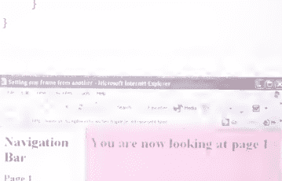

### 创建和加载动态框架

由于 JavaScript 可以即时创建页面内容，因此它非常适合根据用户在另一个框架中的选择，将动态数据加载到框架中。**脚本 5.9**是一个框架集，它加载一个虚拟内容页（**脚本 5.10**）以及接下来将详细介绍的**脚本 5.11**，该脚本可以创建一个页面并将其加载到主内容框架中。它创建的页面如**图 5.9**所示。

**脚本 5.9** 这个框架集加载一个虚拟页面，准备由 JavaScript 替换。

```html
<!DOCTYPE html PUBLIC "-//W3C//DTD XHTML 1.0 Frameset//EN">
<html xmlns="http://www.w3.org/1999/xhtml">
<head>
    <title>Setting one frame from another</title>
</head>
<frameset cols="30%,70%">
    <frame src="left5.html" name="left" id="left" />
    <frame src="frame5.html" name="content" id="content" />
</frameset>
</html>
```

**脚本 5.10** 说到这个，以下是虚拟页面。

```html
<!DOCTYPE html PUBLIC "-//W3C//DTD XHTML 1.0 Transitional//EN">
<html xmlns="http://www.w3.org/1999/xhtml">
<head>
    <title>Content frame</title>
</head>
<body bgcolor="#FFFFFF">
</body>
</html>
```

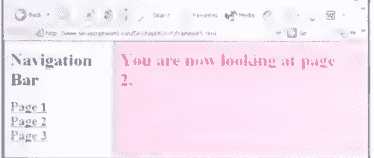

**图 5.9** 这是脚本 5.8 的结果，一个由 JavaScript 编写的网页。右侧框架的内容是在脚本控制下生成的。

**脚本 5.11** 这个脚本创建一个页面并将其加载到主内容框架中。

```javascript
window.onload = initLinks;

function initLinks() {
    for (var i=0; i<document.links.length; i++) {
        document.links[i].onclick = writeContent;
        document.links[i].thisPage = i+1;
    }
}

function writeContent() {
    var newText = "<h1>You are now looking at page " + this.thisPage + "</h1>";
    
    var contentWin = parent.document.getElementById("content").contentWindow;
    contentWin.document.body.innerHTML = newText;
    return false;
}
```

### 从另一个框架加载动态框架：

1. `function initLinks() {`

   `for (var i=0; i<document.links.length; i++) {`

   `document.links[i].onclick = writeContent;`

   `document.links[i].thisPage = i+1;`

   `}`

   `}`

`initLinks()`函数的开头与脚本 5.8 中相同，通过遍历页面上的链接。然后，对于每个链接，设置两件事：该链接的`onclick`处理程序，以及一个新属性：`thisPage`。后者包含点击该链接时要显示的页码，即链接 0 是"第 1 页"，链接 1 是"第 2 页"，依此类推。循环中的`onclick`处理程序将每个链接设置为在被点击时调用`writeContent()`函数。

2. `var newText = "<h1>You are now looking at page " + this.thisPage + ".</h1>";`

   `var contentWin = parent.document.getElementById("content").contentWindow;`

   `contentWin.document.body.innerHTML = newText;`

这是`writeContent()`函数的核心部分，它首先声明并设置一个变量`newText`，并为其分配一些文本。接下来，按照本章前面脚本 5.6 中所示的方式设置`contentWin`变量，然后将`contentWin.document.body.innerHTML`重置为`newText`。进一步解释，给定`contentWin`，我们想要它包含的`document`；然后获取该`document`的`body`，再重置`innerHTML`，即该标签内包含的 HTML。

3. `return false;`

最后，`writeContent()`返回`false`，这告诉浏览器不应该同时加载导航栏框架中的`href`。否则，浏览器会同时执行这两项操作。我们已经在 JavaScript 中处理了一切，所以不需要加载`href`。

### ✔ 提示

- 为什么第 2 步中的斜杠（"/"）前面有一个反斜杠（"\"）？根据 HTML 标准，浏览器可能会将结束标签的开头（"</"）解释为行尾。反斜杠"转义"了斜杠，使我们能够写出 HTML，而不会导致错误。

- 我们这里使用的是`parent.document.getElement...`，而在脚本 5.6 中使用的是`document.getElement...`。这是因为那里的 JavaScript 将由框架页面调用，而这里它是由其中一个框架页面调用的。在后一种情况下，JavaScript 必须返回到其父级（即框架集），以便查看内容页面（父级的另一个子级）。

### 创建和加载动态框架

### 在框架之间共享函数

一种常见的框架布局使用一个固定的导航框架和一个可能显示各种不同页面的内容框架。同样，将对外部 JavaScript 文件的调用放入始终存在的页面（框架集页面）中，而不是为每个可能的内容页面重复复制，这样做是合理的。在**图 5.10**中，我们利用这一功能让许多页面共享一个相同的函数，该函数返回一个随机的横幅图像。**脚本 5.12**将页面加载到框架集中。

#### 在另一个页面上使用函数：

1. `var bannerArray = new Array("images/redBanner.gif", "images/greenBanner.gif", "images/blueBanner.gif");`

   首先创建一个包含所有可能的横幅图像名称的新数组，并将该数组赋值给`bannerArray`变量。

2. `window.onload = initFrames;`

   当框架集加载时，调用`initFrames()`。

3. `var leftWin = document.getElementById("left").contentWindow.document;`

   现在我们开始`initFrames()`函数内部的代码。我们首先创建`leftWin`变量，并按照之前存储框架页面的相同方式设置它：给定框架名称（`left`），获取该元素（`document.getElementById("left")`）；给定该元素，获取其`contentWindow`属性（`document.getElementById("left").contentWindow`）；给定`contentWindow`属性，获取其`document`属性。

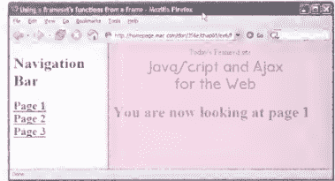

**图 5.10** 右侧或内容框架中的信息由从框架集调用的代码创建。

### 脚本 5.12 这个脚本允许你在多个框架之间共享函数。

```javascript
var bannerArray = new Array("images/redBanner.gif", "images/greenBanner.gif", "images/blueBanner.gif");

window.onload = initFrames;

function initFrames() {
    var leftWin = document.getElementById("left").contentWindow.document;

    for (var i=0; i<leftWin.links.length; i++) {
        leftWin.links[i].target = "content";
        leftWin.links[i].onclick = resetBanner;
    }

    setBanner();
}

function setBanner() {
    var contentWin = document.getElementById("content").contentWindow.document;
    var randomNum = Math.floor(Math.random() * bannerArray.length);

    contentWin.getElementById("adBanner").src = bannerArray[randomNum];
}

function resetBanner() {
    setTimeout("setBanner()",1000);
}
```

4. `for (var i=0; i<leftWin.links.length; i++) {`

   `leftWin.links[i].target = "content";`

   `leftWin.links[i].onclick = resetBanner;`

由于这个函数是从框架集的上下文中调用的，设置左侧导航栏的链接与前面的示例略有不同。这次，我们为每个链接重置`target`属性和`onclick`处理程序。`target`设置为`"content"`，`onclick`处理程序设置为`resetBanner`函数。

5. `setBanner();`

作为最后的初始化步骤，调用`setBanner()`函数。

6. `var contentWin = document.getElementById("content").contentWindow.document;`

`setBanner()`函数加载内容窗口并计算一个随机数。然后，将内容窗口中的广告横幅设置为数组中的一个随机广告。我们首先创建`contentWin`变量，并按照之前存储框架页面的相同方式设置它：给定框架名称（`content`），获取该元素（`document.getElementById("content")`）；给定该元素，获取其`contentWindow`属性（`document.getElementById("content").contentWindow`）；给定`contentWindow`属性，获取其`document`属性。

*下页继续*

### 在框架之间共享函数

 ```
var randomNum = Math.floor(Math.random() * bannerArray.length);
```

这行代码使用`Math.random()`函数乘以`bannerArray`数组中的元素数量，计算一个介于 0 和数组元素数量之间的随机数。然后，将结果放入`randomNum`变量中。

```
contentWin.getElementById("adBanner").src = bannerArray[randomNum];
```

在这里，我们将`adBanner`的`src`设置为数组中的当前项。这就是新的图像名称，随后它将被显示在页面上。

```
function resetBanner() {
  setTimeout("setBanner()",1000);
}
```

`resetBanner()`函数有点巧妙，尽管它只有一行代码。它的作用是等待`content`框架加载其新页面（一秒钟应该足够了），然后才能调用`setBanner()`来重置横幅。

如果我们立即调用`setBanner()`，新的`content`页面可能尚未加载完成。那样的话，我们就会遇到问题，因为要么会得到错误（因为找不到`adBanner`），要么会重置旧的`adBanner`——即来自正在被卸载页面的那个。

#### 提示

请注意，`resetBanner`*没有*返回 false——这意味着浏览器既会执行这里的操作，*又会*从`href`加载页面。这个脚本依赖于此，这就是为什么`onclick`处理器和`target`都被设置了。

## 在框架中存储信息

在与前面示例类似的情况下，您还可以通过在框架集页面中存储变量来跟踪跨框架的有用信息。**图 5.11**显示了本次会话中用户访问每个内容页面的次数。三个（几乎相同的）内容框架之一显示在**脚本 5.13**中。同样，脚本是从框架集页面调用的，外部 JavaScript 脚本显示在**脚本 5.14**中。

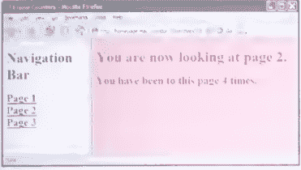

**图 5.11** JavaScript 显示您在本次会话中已查看页面 2 四次。

**脚本 5.13** `<span>`的内容将被 JavaScript 替换。

```
<!DOCTYPE html PUBLIC "-//W3C//DTD XHTML 1.0 Transitional//EN">
<html xmlns="http://www.w3.org/1999/xhtml">
<head>
    <title>Content frame</title>
<body bgcolor="#FFFFFF">
    <h1>You are now looking at page 1.</h1>
    <h2>You have been to this page <span id="pageCt"> </span> times.</h2>
</body>
</html>
```

## 第 5 章

### 统计页面访问次数：

**脚本 5.14** id 为 pageCt 的`<span>`的值将由此脚本设置。

```
var pageCount = new Array(0,0,0);
var pageArray = new Array("frame7a.html",
 "frame7b.html","frame7c.html");

window.onload = initFrames;

function initFrames() {
    var leftWin = document.getElementById
     ("left").contentWindow.document;

    for (var i=0; i<leftWin.links.length; i++) {
        leftWin.links[i].onclick = resetPageCt;
        leftWin.links[i].thisPage = i;
    }

    bumpPageCt(0);
}

function bumpPageCt(currPage) {
    pageCount[currPage]++;

    var contentWin = document.getElementById
     ("content").contentWindow.document;
    contentWin.getElementById("pageCt").
     innerHTML = pageCount[currPage] + " ";
}

function resetPageCt() {
    document.getElementById("content").
     contentWindow.location.href =
     pageArray[this.thisPage];

    setTimeout("bumpPageCt("+this.thisPage+")",
     1000);
    return false;
}
```

- 1. `<h2>You have been to this page <span id="pageCt"> </span> times.</h2>`

脚本 5.13 有一个带 id 的`<span>`。`<span>`内部显然什么也没有，但我们可以用 JavaScript 重置它。实际上，里面有一个空白字符，因为一些浏览器会看到这个 span 是空的而不创建它——里面必须有些东西，它才能成为文档的一部分。

- 2. `var pageCount = new Array(0,0,0);`

`var pageArray = new Array`

`("frame7a.html", "frame7b.html",`

`"frame7c.html");`

在脚本 5.14 的开头，我们声明了两个数组并设置了它们的初始内容。

- 3. `for (var i=0; i<leftWin.links.length; i++) {`

`leftWin.links[i].onclick =`

`resetPageCt;`

`leftWin.links[i].thisPage = i;`

`}`

`initFrames()`函数的开头与前一个任务中的类似，但它将`onclick`处理器设置为`resetPageCt`，并将新的`thisPage`属性设置为`i`——因此`thisPage`（基于链接）将是 0、1 或 2（编号从 0 开始）。

- 4. `bumpPageCt(0);`

该函数通过调用`bumpPageCt`并传递一个零来结束（以增加页面 1 的计数）。

## 在框架中存储信息

- 5. `function bumpPageCt(currPage) {`

`pageCount[currPage]++;`

`var contentWin = document.`

`getElementById("content").`

`contentWindow.document;`

`contentWin.getElementById`

`("pageCt").innerHTML =`

`pageCount[currPage] + " ";`

`}`

`bumpPageCt()`函数接受一个页面参数，并递增该页面的计数器（保存在`pageCount`数组中）。同样，我们获取`contentWin`（即，框架内的主内容文档）。然后我们用它来将`pageCt`的`innerHTML`值设置为当前页面计数，使其显示在页面上。

- 6. `function resetPageCt() {`

`document.getElementById("content").`

`contentWindow.location.href =`

`pageArray[this.thisPage];`

`setTimeout("bumpPageCt("+this.`

`thisPage+")",1000);`

`return false;`

`}`

`resetPageCt()`函数结合了之前看到的`resetBanner()`和`bumpPageCt()`函数，并增加了一点内容。这里我们没有让浏览器自行更改内容窗口，而是基于`pageArray`数组来重置它。一旦内容页面发生了更改，我们希望在内容页面加载完成后调用`bumpPageCt()`函数，因此我们再次使用了`setTimeout()`。最后，我们返回`false`，因为 JavaScript 正在自行处理页面加载。

### 一次加载多个框架

只需一个带有`target`属性的链接就可以更改一个框架的内容：这很简单。要一次点击更改多个框架的内容，你需要 JavaScript。HTML 文件很简单；所有的操作都在脚本 5.15 中完成。窗口可能的两种状态如图 5.12 和 5.13 所示。

**脚本 5.15** JavaScript 允许你通过单次用户点击加载多个框架。

```
window.onload = initFrames;

function initFrames() {
    var leftWin = document.getElementById("left").contentWindow.document;

    for (var i=0; i<leftWin.links.length; i++) {
        leftWin.links[i].onclick = setFrames;
    }
}

function setFrames() {
    document.getElementById("left").contentWindow.document.location.href = this.id + ".html";
    document.getElementById("content").contentWindow.document.location.href = this.href;
    setTimeout("initFrames();",1000);
    return false;
}
```

#### 一次加载多个框架：

- 1. `function initFrames() {`

`var leftWin = document.`

`getElementById("left").`

`contentWindow.document;`

`for (var i=0; i<leftWin.links.`

`length; i++) {`

`leftWin.links[i].onclick =`

`setFrames;`

`}`

`}`

`initFrames()`函数与本章之前的内容非常相似。它一如既往地在`onload`时被调用。该函数遍历导航栏（左侧）的链接。这次，它将`onclick`处理器设置为`setFrames()`函数。

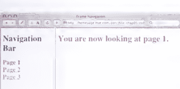

**图 5.12** 页面初始状态如图所示。

- 2. `document.getElementById("left").`

`contentWindow.document.location.`

`href = this.id + ".html";`

`document.getElementById("content").`

`contentWindow.document.location.`

`href = this.href;`

`setTimeout("initFrames();",1000);`

`setFrames()`函数首先根据调用它的链接的`id`重置左侧框架。然后，该函数根据调用它的链接的`href`重置内容框架——是的，我们可以通过 JavaScript 访问它，为什么不使用呢？

该函数等待一秒（通过使用`setTimeout`），然后调用`initFrames()`函数。这必须再次发生，因为它是设置导航栏中`onClick`处理器的东西，一旦我们向导航栏加载了新的导航页面，所有这些`onClick`处理器就都消失了。为了保持功能正常，它们都必须为新页面重置，这就是实现方式。

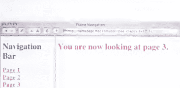

**图 5.13** 但当点击链接时，两个框架都会改变。

- 3. `return false;`

最后，我们返回`false`，这样浏览器就不会加载新页面。

#### 提示

- 如果你快速点击导航栏中的链接，你会得到意想不到的结果：一个内容页面替换了导航栏。这是因为导航页面必须完成加载，才能准备好接受下一次点击。

## 第五章

### 使用内联框架

*内联框架*（*iframe*）是一种内联框架，即可以嵌入到常规 HTML 页面中，而无需置于框架集（frameset）内的框架。与普通框架一样，内联框架是一个独立的 HTML 文档。你可以将内联框架用作脚本的目标，这样就能在脚本控制下动态创建内容并将其显示在页面中，而无需使用框架集。

在本任务中，我们有一个常规 HTML 页面，其内容区域是一个内联框架。内联框架的内容由 JavaScript 创建。**脚本 5.16**创建了常规页面。**脚本 5.17**是占位符 HTML 文档，向用户显示内联框架中的初始内容，即“请加载页面”的指示，如**图 5.14**所示。当用户点击其中一个链接时，该内容将被**脚本 5.18**的输出所替换，JavaScript 会将新代码写入内联框架。在本例中，它显示的是页面名称以及用户在本次会话中访问该页面的次数。你会看到，这个脚本的大部分内容都由本章前面介绍过的片段构成。

```html
<!DOCTYPE html PUBLIC "-//W3C//DTD XHTML 1.0
    Transitional//EN">
<html xmlns="http://www.w3.org/1999/xhtml">
<head>
    <title>iframes</title>
    <script language="javascript"
        type="text/javascript" src="script09.js"></script>
</head>
<body bgcolor="#ffffff">
    <iframe src="frame9b.html" width="550"
        height="300" name="content" id="content"
        align="right" frameborder="1">Your
        browser does not support iframes</iframe>
    <h1>导航栏</h1>
    <h2>
    <a href="page1.html">页面 1</a><br />
    <a href="page2.html">页面 2</a><br />
    <a href="page3.html">页面 3</a>
    </h2>
</body>
</html>
```

脚本 5.16 此页面创建了内联框架并调用外部 JavaScript。

脚本 5.17 放置在内联框架中的初始页面。

```html
<!DOCTYPE html PUBLIC "-//W3C//DTD XHTML 1.0
    Transitional//EN">
<html xmlns="http://www.w3.org/1999/xhtml">
<head>
    <title>Content frame</title>
</head>
<body bgcolor="#ffffff">
    Please load a page
</body>
</html>
```

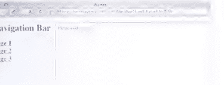

图 5.14 右侧的内联框架最初包含点击链接的指示。

#### 为内联框架创建内容：

**脚本 5.18** 此脚本计算内联框架的内容并将其写入窗口。

1. `<iframe src="frame9b.html" width="550" height="300" name="content" id="content" align="right" frameborder="1">Your browser does not support iframes</iframe>`

在脚本 5.16 中，`<iframe>`标签告诉浏览器，内联框架内容的初始源将在`frame9b.html`中找到。在标签内部，有一条消息将显示给不支持内联框架的浏览器。

```javascript
var pageCount = new Array(0,0,0,0);

window.onload = initFrames;

function initFrames() {
    for (var i=0; i<document.links.length; i++) {
        document.links[i].onclick = writeContent;
        document.links[i].thisPage = i+1;
    }
}

function writeContent() {
    pageCount[this.thisPage]++;

    var newText = "<h1>You are now looking at page " + this.thisPage;
    newText += ".<br />You have been to this page ";
    newText += pageCount[this.thisPage] + " times.</h1>";

    var contentWin = document.getElementById("content").contentWindow.document;
    contentWin.body.innerHTML = newText;
    return false;
}
```

2. `function writeContent() {`

   创建一个名为`writeContent`的函数，用于构建内联框架内部的内容。

3. `pageCount[this.thisPage]++;`

   这行代码递增`pageCount`数组，以便我们跟踪访问特定页面的次数。

4. `var newText = "<h1>You are now looking at page " + this.thisPage; newText += ".<br />You have been to this page "; newText += pageCount[this.thisPage] + " times.</h1>";`

   这些行动态创建将成为内联框架内容的文本。

5. `var contentWin = document.getElementById("content").contentWindow.document; contentWin.body.innerHTML = newText; return false;`

   与之前的示例一样，我们获取`contentWin`并重置其`body`的`innerHTML`属性。重置`innerHTML`会将两行文本写入内联框架，结果显示在**图 5.15**中。由于这是全部操作，我们最后返回`false`，以防止浏览器执行不应执行的操作。

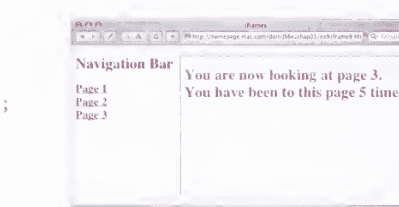

图 5.15 每次点击导航栏中的链接，内联框架中的内容都会更新。

> **✔ 提示**
>
> - 请注意，与我们之前从非框架集页面写入内容框架的方式不同，这次我们使用`document.getElementById("content")`而不是`parent.document.getElementById("content")`。这是因为内联框架是主页面的子元素，而不是框架集的一部分，因此我们可以直接对其进行寻址，而不是仅通过父级来访问。

### 脚本 5.19 此脚本将 HTML 页面加载到内容内联框架中。

```javascript
window.onload = initIframe;

function initIframe() {
    for (var i=0; i<document.links.length; i++) {
        document.links[i].target = "content";
        document.links[i].onclick = setIframe;
    }
}

function setIframe() {
    document.getElementById("content").
        contentWindow.document.location.href =
        this.href;
    return false;
}
```

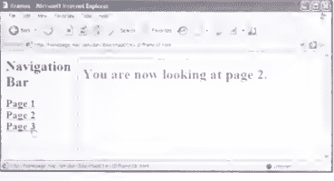

### 使用 JavaScript 加载内联框架

当然，你不必用 JavaScript 将内容写入内联框架；很可能你会想要加载其他 HTML 页面。本示例将向你展示如何操作。同样，我们将有一个设置内联框架的主页面，它与脚本 5.16 几乎完全相同。同样，也有一个包含内联框架初始内容的页面，类似于脚本 5.17。还有三个其他简单的 HTML 页面（未显示），我们使用脚本 5.19 将它们加载到内联框架中。

#### 使用 JavaScript 加载内联框架：

1. `function setIframe() { document.getElementById("content").contentWindow.document.location.href = this.href; return false; }`

   与脚本 5.12 设置链接的`target`和`onclick`处理程序的方式非常相似，脚本 5.19 对内联框架也做了同样的事情。在本示例中，点击任何链接都会触发`setIframe()`函数，然后该函数将新页面加载到内联框架中，如图 5.16 所示。

## 使用浏览器窗口

窗口是 Web 浏览器中最重要的界面元素，正如你可能预料的那样，JavaScript 提供了许多操作窗口的工具。

JavaScript 处理窗口的方式类似于处理框架（见第 5 章）。这完全合理，因为框架只是整个浏览器窗口内的其他文档窗口。

在本章中，你将学习如何使用 JavaScript 打开和关闭、更新以及定位窗口。你将看到如何使用 JavaScript 将信息写入窗口，从而动态构建网页。

### 别关掉那些弹出窗口！

本章全部关于使用 JavaScript 创建和操作窗口。这些窗口有一个名字：它们被称为弹出窗口（pop-up windows），并且已成为许多网页浏览者的困扰。我们将向你展示一些弹出窗口的良善用途，但如果你在运行这些示例时遇到问题，可能是因为你在浏览器中关闭了弹出窗口，或者因为你运行了其他可以阻止弹出窗口的软件。虽然浏览器应该打开任何你明确选择要打开的弹出窗口，但有些浏览器并没有这样做。因此，在学习本章时，请确保你的弹出窗口拦截器已关闭。

然而，一些浏览器据称出于安全原因（我们说的就是你，微软 Internet Explorer），会认为它们比你更懂，无论你是否要求，都不会打开来自脚本的弹出窗口。

### 打开新窗口

你经常希望创建新窗口，以便向用户展示额外的信息，同时不丢失他们正在阅读的内容。例如，你可以为一篇技术论文或新闻报道打开一个注释窗口。虽然用 HTML 也可以打开新的浏览器窗口，但使用 JavaScript 能让你更好地控制新窗口的内容和功能。**图 6.1**展示了一个标准的浏览器窗口，并标注了所有组成部分。你可以创建具有这些部分中任意一个或全部的窗口。**脚本 6.1**展示了 HTML，**脚本 6.2**展示了 JavaScript，它从一个页面（**图 6.2**）创建一个窗口，在该页面中点击链接会弹出一个新窗口（在本例中包含我们猫的图片）。

**脚本 6.1** 调用打开新窗口的外部 JavaScript 的 HTML 页面。

```
<!DOCTYPE html PUBLIC "-//W3C//DTD XHTML 1.0 Transitional//EN">
<html xmlns="http://www.w3.org/1999/xhtml">
<head>
    <title>Opening a Window</title>
    <script src="script01.js"
      type="text/javascript"
      language="javascript">
    </script>
</head>
<body bgcolor="#FFFFFF">
    <h1>The Master of the House</h1>
    <h2>Click on His name to behold He Who Must Be Adored</h2>
    <h2><a href="#" class="newWin">Pixel</a></h2>
</body>
</html>
```

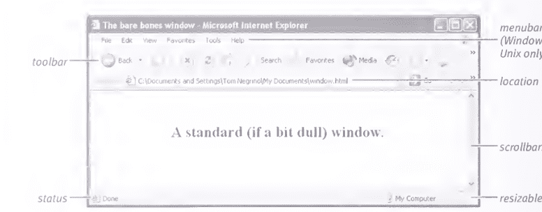

**图 6.1** 浏览器窗口的各个元素。此图中的名称对应于你可以在`open()`命令中应用的参数。

## 操作浏览器窗口

**脚本 6.2** 使用该脚本打开一个新窗口。

```
window.onload = newWinLinks;

function newWinLinks() {
    for (var i=0; i<document.links.length; i++) {
        if (document.links[i].className ==
            "newWin") {
            document.links[i].onclick =
                newWindow;
        }
    }
}

function newWindow() {
    var catWindow = window.open("../images/
        pixel.jpg", "catWin", "resizable=no,
        width=350,height=260");
    return false;
}
```

你会注意到脚本 6.1 中没有 JavaScript，只是调用了外部 JavaScript 文件，而且我们还用名为`newWin`的类标记了页面上的链接。与第 5 章中的框架示例一样，脚本 6.2 包含一个`onload`事件处理程序，它调用一个函数，在本例中称为`newWinLinks`。`newWinLinks`函数遍历页面上的链接，查看是否有任何链接包含`newWin`类。如果是这样，当点击该链接时，函数会调用`newWindow`函数。由于第 5 章中使用了非常相似的函数，我们在下面的步骤中没有详细说明它们。

#### 打开新窗口：

1. `function newWindow() {`

   首先，定义一个名为`newWindow()`的函数。

2. `var catWindow = window.open("../images/pixel.jpg", "catWin", "resizable=no,width=350, height=260");`

   变量`catWindow`包含一个新的窗口对象，引用图像文件`pixel.jpg`。这个新窗口的名称是`catWin`。名称是必需的，因为我们可能稍后在链接或另一个脚本中引用这个窗口。新窗口的宽度为 350 像素，高度为 260 像素：这些参数是可选的。

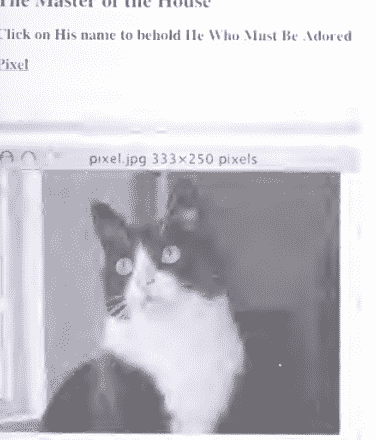

### ✓ 提示

- 在第 2 步中，宽度和高度参数中的逗号之间不能有任何空格。如果有空格，你的脚本在某些浏览器中可能无法工作。一般来说，当你遇到脚本错误并需要调试脚本时，请留意这类小问题。语法错误是初学者感到沮丧的主要原因。

- Internet Explorer 6 及更高版本出于安全原因会做一些怪异且不一致的窗口操作（脚本窗口有时会工作，有时不会）。如果关闭安全设置，本章中的所有内容都能正常工作，但我们不建议关闭安全设置，也不要求你的站点访问者关闭安全设置。此外，根据你的标签页浏览设置，IE7 中的某些新窗口可能会在新标签页中打开。

### 向窗口添加参数

要将图 6.1 中列出的一个或多个参数添加到你的窗口中，请在`open()`命令中用引号括起来声明它们，在你想要的功能名称后加上`=yes`，在你不想要的功能名称后加上`=no`（尽管`=no`通常是默认值，所以你通常甚至可以跳过提及这些功能）。例如，如果你想要一个指定大小带有工具栏、地址栏和滚动条的窗口，你可以输入

```
"toolbar=yes,location=yes, scrollbars=yes,width=300, height=300"
```

作为`open()`命令的一部分。请注意，创建的窗口不会有菜单栏或状态栏，并且不可调整大小。

鉴于完全省略一个参数（通常如此，见下文的一些例外）与将其设置为`=no`相同；你也可以只使用参数本身的名称（不带`=yes`）来启用它。由于存在一些例外，我们在这些脚本中更倾向于让开启和关闭的内容更加明确——因此，我们将它们组合起来，后面跟着 yes 或 no：也就是说，我们使用 "`location, scrollbars=yes`" 来表示与 "`location=yes, scrollbars=yes`" 相同的意思。我们也可以只说 "`location, scrollbars`"，但这样就不太清楚发生了什么。

某些浏览器有默认值，而其他浏览器则没有。例如，Safari 的默认值是 "`resizable=yes`"，这就是脚本 6.2 包含 "`resizable=no`" 参数的原因。另一方面，Windows 上的 Firefox 会使弹出窗口始终可调整大小，无论你设置了该参数与否，而 Mac 上 Firefox 的调整大小功能则按预期工作。在 IE6 和 IE7 中，窗口始终看起来是可调整大小的（它包含调整大小的控件），但除非你明确允许，否则实际上并不可调整。Windows 和 Mac 上的 Firefox 以及 IE6 和 IE7 始终拥有状态栏，无论你是否需要。IE7 还始终拥有地址栏作为安全"功能"，你无法用 JavaScript 更改这一点。**图 6.3**展示了脚本 6.2 在 IE7 和 Windows 版 Firefox 中的结果；同一个脚本会产生不同的结果，因为浏览器的默认值不同。

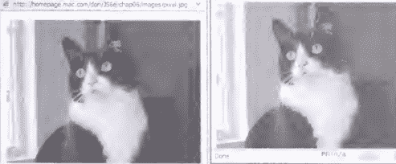

最终，你仍然需要在所有你认为站点用户最可能使用的浏览器中测试你的脚本，这可能意味着准备 Windows 和 Mac（甚至 Linux）机器用于测试。测试（以及必要时的脚本修订）将有助于确保你对脚本的意图能够与浏览器提供的任何功能正常工作。

### 向窗口加载不同内容

在前面的任务中，点击链接会创建一个新窗口，里面填充了一张图片。但是，如果你页面上有几个链接，你希望它们都指向*同一个*新窗口呢？**脚本 6.3**演示了这种技术。**图 6.4**中的主窗口有三个链接。点击任意链接都会打开一个新窗口，里面填充了相应书籍的图片。如果你切换回主窗口并点击另一个链接，小窗口中的图片将被替换。

#### 向窗口加载不同内容：

1. `document.links[i].onclick = newWindow;`

   在`newWinLinks()`函数中，我们通过 JavaScript 将`newWindow()`函数调用添加为`onclick`处理程序。当调用`newWindow()`时，它使用`this.href`——即来自 HTML 的`href`属性值。

2. `function newWindow() {`

   在这里，我们定义了一个名为`newWindow()`的新函数。

**脚本 6.3** 使用此脚本，你可以打开一个新窗口并填充各种内容，通过点击不同的链接触发。

```
window.onload = newWinLinks;

function newWinLinks() {
    for (var i=0; i<document.links.length; i++) {
        if (document.links[i].className == "newWin") {
            document.links[i].onclick = newWindow;
        }
    }
}

function newWindow() {
    var bookWindow = window.open(this.href,
        "bookWin","width=135,height=165");
    bookWindow.focus();
    return false;
}
```

## 操作浏览器窗口

3. `var bookWindow = window.open(this.href, "bookWin", "width=135, height=165");`

这行代码在变量`bookWindow`中打开了一个新的窗口对象，后跟窗口的参数。首先，我们将`this.href`的值传给它。新窗口的名称为`bookWin`，宽度和高度参数用于设置窗口的大小。

4. `bookWindow.focus();`

这行代码使用`focus()`方法来让刚打开的窗口移到最前面。当你需要让某个窗口可见时，随时可以使用`focus()`；如果有多个窗口同时打开，使用`focus()`可以将窗口提到最顶层。

5. `return false;`

函数需要以`return false`结尾，这样 HTML 才会知道不要同时加载`href`中的内容。

> ✓ **提示**

-   步骤 4 中使用的`focus()`方法的反向操作是`blur()`。使用`blur()`可以将窗口推到其他所有打开的窗口后面。窗口对象的`focus()`和`blur()`方法分别关联了`onfocus`和`onblur`事件处理程序，可以在窗口获得或失去焦点时执行相应的操作。

**图 6.4** 点击三个链接中的任意一个，都会打开一个较小的窗口，并显示相应书籍的封面图片。

### 打开多个窗口

有时你会想用脚本打开多个窗口；例如，你可能想创建一个脚本，每次用户点击屏幕上的控件时都打开一个不同的窗口。JavaScript 完全能够胜任这个任务。在这个示例中，页面上有三个链接；点击一个链接会打开一个包含图片的独立窗口；点击另一个链接会打开另一个窗口，每个链接对应一个窗口。**代码清单 6.4**展示了实现方式，**图 6.5**展示了效果。

**代码清单 6.4** 当你需要从多个链接打开多个窗口时，这个脚本可以实现。

```
window.onload = newWinLinks;

function newWinLinks() {
    for (var i=0; i<document.links.length; i++) {
        if (document.links[i].className ==
            "newWin") {
            document.links[i].onclick =
                newWindow;
        }
    }
}

function newWindow() {
    var winName = this.id + "Win";
    var bookWindow = window.open(this.href,
        winName,"width=135,height=165");
    bookWindow.focus();
    return false;
}
```

**使用脚本打开多个窗口：**

1. `function newWindow() {`
   创建一个名为`newWindow`的函数。

2. `var winName = this.id + "Win";`
   变量`winName`基于调用链接的`id`，加上字符串`Win`。

3. `var bookWindow = window.open(this.href, winName, "width=135, height=165");`
   这行代码为`bookWindow`赋值，并使用`window.open`方法打开括号内参数指定的窗口。这个脚本的关键在于`winName`（`window.open`的第二个参数）是唯一的。只要每个窗口名称不同，就会打开新的窗口。

> ✔ **提示**

-   点击一个已经打开窗口的链接，会导致窗口重新绘制，而不会打开重复的窗口。
-   如果你想每次用户点击链接时都打开一个新窗口（而不是刷新现有窗口），可以在窗口名称中添加一个随机数。

**图 6.5** 点击后台窗口中的三个链接，会产生一组子窗口。

### 同时打开多个窗口

也许你想同时打开多个窗口（真的有可能严重打扰正在浏览你网站的人）。你只需对代码清单 6.4 稍加修改就能实现：需要添加一个循环，每次循环时都打开一个窗口，如**代码清单 6.5**所示。

**同时打开多个窗口：**

1. `document.links[i].onclick = newWindows;`

   在`newWinLinks()`函数中，我们将代码清单 6.4 中的那行代码改为调用`newWindows()`函数，因为我们要打开多个窗口。

2. `function newWindows() { var bookTitles = new Array("dw8", "js6e", "ppt");`

   首先创建一个新函数来处理打开多个窗口的操作。接着创建一个名为`bookTitles`的新数组，并用窗口名称填充它。

**代码清单 6.5** 这个脚本在之前的脚本基础上添加了循环，只需点击一次链接即可打开多个窗口。

```
window.onload = newWinLinks;

function newWinLinks() {
  for (var i=0; i<document.links.length; i++) {
    if (document.links[i].className ==
      "newWin") {
      document.links[i].onclick =
        newWindows;
    }
  }
}

function newWindows() {
  var bookTitles = new Array("dw8","js6e",
    "ppt");

  for (var i=0; i<bookTitles.length;i++) {
    var imgName = "../images/" +
      bookTitles[i] + ".jpg";
    var winName = bookTitles[i] + "Win";
    var bookWindow = window.open(imgName,
      "winName","width=135,height=170");
  }

  return false;
}
```

**图 6.6** 点击链接打开了所有三个子窗口；窗口的排列位置由浏览器决定。在本例中，Safari 将三个窗口叠放在一起，为了清晰起见我们移动了它们。

3. `for (var i=0; i<bookTitles.length;i++) { var imgName = "../images/" + bookTitles[i] + ".jpg"; var winName = bookTitles[i] + "Win"; var bookWindow = window.open(imgName, winName, "width=135, height=170"); }`

循环的执行次数取决于`bookTitles`数组的元素数量，使用`length`属性来判断。`imgName`变量包含构建的图片路径。`winName`变量获取`bookTitles`的当前值并加上`Win`。`bookWindow`变量打开包含图片的窗口，添加窗口名称，并指定窗口大小。所有这些循环的结果如**图 6.6**所示。

> ✔ **提示**

-   窗口的排列位置由浏览器决定。如果你想控制窗口的位置，代码清单 6.13 展示了如何在屏幕的指定位置放置窗口。请参阅本章后面的"在指定位置打开窗口"。
-   代码清单 6.4 中有一些代码在此脚本中没有使用，即`bookWindow.focus()`。在代码清单 6.4 中，它使打开的窗口获得焦点，即最前面的窗口。但从用户界面的角度来看，当多个窗口同时打开时，焦点应该放在哪里并不明确。

### 从一个窗口更新另一个窗口

如果你需要处理表单和用户输入的数据，你会想知道如何将一个窗口中输入的信息发送到另一个窗口中显示。这在销售产品的场景中很有用，可以将用户的信息复制到汇总窗口中显示。在这个示例中，我们将使用两个窗口：主窗口是父窗口，用于接收和显示在子窗口中输入的信息。**代码清单 6.6**和**代码清单 6.7**分别展示了父窗口和子窗口的 HTML 页面。**代码清单 6.8**展示了脚本，该脚本在父窗口和子窗口中都会被调用。

**代码清单 6.6** 父窗口的 HTML。

```
<!DOCTYPE html PUBLIC "-//W3C//DTD XHTML 1.0 Transitional//EN">
<html xmlns="http://www.w3.org/1999/xhtml">
<head>
    <title>Big Window</title>
    <script language="Javascript"
        type="text/javascript"
        src="script05.js">
    </script>
</head>
<body bgcolor="#FFFFFF">
<div align="center">
    <h1>Welcome to this page!</h1>
    <form action="#">
        <input type="text" size="20"
            id="msgLine" readonly="readonly" />
    </form>
</div>
</body>
</html>
```

**代码清单 6.7** 子窗口的 HTML。

```
<!DOCTYPE html PUBLIC "-//W3C//DTD XHTML 1.0 Transitional//EN">
<html xmlns="http://www.w3.org/1999/xhtml">
<head>
    <title>Little Window</title>
    <script language="Javascript"
        type="text/javascript"
        src="script05.js">
    </script>
</head>
<body bgcolor="#FFFFFF">
    <h1>What's your name?</h1>
    <form action="#">
        <input type="text" id="childField"
            size="20" />
    </form>
</body>
</html>
```

#### 脚本 6.8

此脚本同时被父窗口和子窗口调用。

```javascript
window.onload = initWindows;

function initWindows() {
    if (document.getElementById("childField")) {
        document.getElementById("childField").
            onchange = updateParent;
    }
    else {
        newWindow = window.open("child.html",
            "newWin","status=yes,width=300,
            height=300");
    }
}

function updateParent() {
    opener.document.getElementById("msgLine").
        value = "Hello " + this.value + "!";
}
```

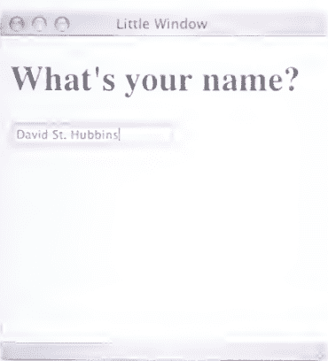

#### 要从一个窗口更新另一个窗口：

1. `window.onload = initWindows;`

当窗口加载时，调用`initWindows()`函数。

2. `if (document.getElementById("childField")) { document.getElementById("childField").onchange = updateParent; }`

该脚本被两个 HTML 页面（父页面和子页面）调用，但需要为每个文件执行不同的操作。它判断当前处于哪个页面的方式是检查`childField`对象是否存在，该对象只存在于子窗口中。如果我们在子窗口中，并且用户更改了该对象，那么我们就调用`updateParent()`函数。

3. `else { newWindow = window.open("child.html","newWin","status=yes,width=300,height=300"); }`

如果`childField`对象不存在，就该打开子窗口了，使用`child.html`文件。该行的其余部分指定子窗口的参数（图 6.7）。

4. `function updateParent() {`

这里我们创建`updateParent`函数。

5. `opener.document.getElementById("msgLine").value = "Hello " + this.value + "!";`

这一行引入了`opener`属性，这是 JavaScript 引用打开子窗口的父文档的方式。这一行告诉 opener 文档（即父窗口）找到名为`msgLine`的字段，并将其值设置为单词 "Hello" 加上`this.value`的内容，最后加上一个感叹号（图 6.8）。

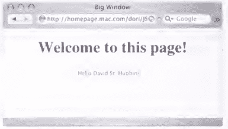

## ✔ 提示

- 表单、字段以及如何对它们进行脚本编写，在第 7 章"表单处理"中有深入介绍。

- 在脚本 6.6 中，我们已向父窗口的`msgLine`字段添加了`readonly="readonly"`属性。这只是为了清楚地表明，访问您网站的用户无法自行编辑该字段；它只能由其他位置设置。

### 使用 JavaScript 创建新页面

**脚本 6.9** 您可以完全在脚本控制下创建新的 HTML 页面。

```javascript
window.onload = initWindows;

function initWindows() {
  var newText, newBr;
  var newWindow = window.open("", "newWin",
    "location,scrollbars,resizable=yes,
    width=300,height=300");
  var newDoc = newWindow.document;

  newDoc.title = "Generated Window";
  newDoc.bgColor = "#000000";
  newDoc.fgColor = "#FFFFFF";
  newDoc.body.innerHTML = "<h2>This window shows the result from the other window<\/h2><div id='looper'> </div>";

  var loopDiv = newDoc.getElementById("looper");

  for (var i=0; i<100; i++) {
    newText = newDoc.createTextNode("The loop is now at: " + i);
    newBr = newDoc.createElement("br");
    loopDiv.appendChild(newText);
    loopDiv.appendChild(newBr);
  }
}
```

本章前面的多窗口示例使用了多个 HTML 文件来创建不同的窗口。但没必要这样做，因为您可以在脚本中嵌入 HTML，即时创建新的 HTML 页面。这尤其有用，因为您可以利用 JavaScript 的强大功能，用动态内容填充新页面。在 JavaScript 控制下更改页面内容是许多 Web 应用程序的基础。作为入门，**脚本 6.9**是一个相当简单的例子：我们将加载一个页面（图 6.9），它会创建一个新的子 HTML 页面，然后执行一个循环，向子页面添加 100 行文本（图 6.10）。

#### 要使用 JavaScript 创建新页面：

1. `var newText, newBr; var newWindow = window.open("","newWin","location,scrollbars,resizable=yes,width=300,height=300");`

在`initWindows()`函数中，我们声明两个新变量`newText`和`newBr`。下一行打开新窗口，设置其参数，并将其赋值给变量`newWindow`。

2. `var newDoc = newWindow.document;`

这个新变量`newDoc`存储我们新窗口的文档对象，我们将在下一步中对其进行更改。

3. `newDoc.title = "Generated Window"; newDoc.bgColor = "#000000"; newDoc.fgColor = "#FFFFFF"; newDoc.body.innerHTML = "<h2>This window shows the result from the other window<\/h2><div id='looper'> </div>";`

这是最酷的部分，我们设置`newDoc`对象的属性（换句话说，就是我们创建的窗口的内容）。我们可以将该新文档的标题、背景颜色、前景颜色和`body.innerHTML`（文档 body 标签的内容）设置为我们想要的任何内容。在本例中，我们生成 HTML 标题和页面主体的第一部分（图 6.10）。

图 6.9 这个父窗口正在向子窗口写入内容……

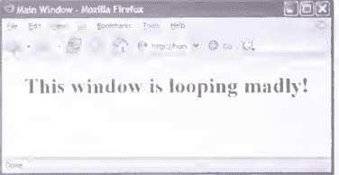

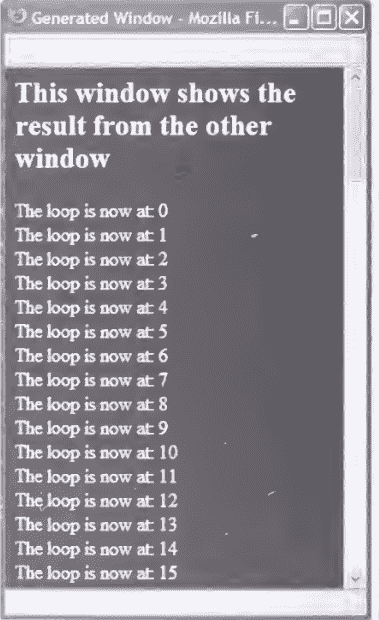

4. `var loopDiv = newDoc.getElementById("looper");`

您可能注意到上一步末尾的 div 具有 id "looper"——这就是我们即将要添加内容的 div。为此，我们创建并设置新的`loopDiv`变量。

5. `for (i=0; i<100; i++) {`

我们使用计数器变量`i`启动一个循环。将`i`初始设置为 0；然后，只要`i`小于 100，就将`i`的值增加 1。

6. `newText = newDoc.createTextNode("The loop is now at: " + i); newBr = newDoc.createElement("br");`

我们需要创建一些元素，然后可以将它们添加到 looper div 中。在本章前面，我们更改了`innerHTML`，这会覆盖 div 中已有的内容。但在本例中，我们想要追加内容，而不是覆盖。两个内置函数`createTextNode()`和`createElement()`允许我们分别即时创建文本节点和元素（在本例中，是一个`<br />`元素）。

7. `loopDiv.appendChild(newText); loopDiv.appendChild(newBr);`

一旦创建了这些元素，就可以通过使用前面设置的两个变量的内容进行`appendChild()`操作将它们添加到 div 中。使用`appendChild()`和其他操作节点的方法将在第 12 章中进行更深入的讲解。一旦添加完成，我们仍在循环中，所以我们再次循环，直到步骤 5 中的计数器达到 100。

### 关闭窗口

正如您可以创建窗口一样，您也应该知道如何通过关闭它们来消除窗口。在**脚本 6.10**中，父窗口具有"打开"和"关闭"链接，用于创建和关闭子窗口，每个链接都有一个唯一的`id`，我们在脚本中使用这些`id`。外部 JavaScript 在**脚本 6.11**中。

#### 要关闭窗口：

1. `var newWindow = null;`

这一行初始化我们稍后将要使用的`newWindow`对象的值。虽然大多数浏览器会自动执行此操作，但有些不会，因此需要在这里设置以避免稍后出错。

2. `document.links[1].onclick = chgWindowState;`

在`newWinLinks()`函数中，我们像往常一样遍历文档中的链接。这里唯一的区别是，如果我们检测到点击了其中一个链接，就会调用`chgWindowState()`。

3. `function windowOpen() { if (newWindow && !newWindow.closed) { return true; } return false; }`

`if`语句提出了一个使用`&&`运算符的逻辑测试，只有当它两边的值都为真时，才会返回 true 结果。因此在本次情况下，`newWindow`必须存在，而且`newWindow`不能被关闭（`!`是逻辑"非"运算符）。如果窗口打开，此函数返回`true`；如果没有打开，返回`false`。

```html
<!DOCTYPE html PUBLIC "-//W3C//DTD XHTML 1.0 Transitional//EN">
<html xmlns="http://www.w3.org/1999/xhtml">
<head>
  <title>Window Test</title>
  <script language="Javascript"
    type="text/javascript"
    src="script07.js">
  </script>
</head>
<body bgcolor="#FFFFFF">
  <div align="center">
    <h1>Let's play with windows!</h1>
    <h3>
      <a href="#" id="openWin">Open a new window</a>&nbsp;&nbsp;
      <a href="#" id="closeWin">Close the window</a>
    </h3>
  </div>
</body>
</html>
```

脚本 6.10 注意此 HTML 页面中两个链接的`id`标签。

Script 6.11 此脚本用于打开和关闭子窗口。

```
var newWindow = null;

window.onload = newWinLinks;

function newWinLinks() {
    for (var i=0; i<document.links.length; i++) {
        document.links[i].onclick = chgWindowState;
    }
}

function windowOpen() {
    if (newWindow && !newWindow.closed) {
        return true;
    }
    return false;
}

function chgWindowState() {
    if (this.id == "closeWin") {
        if (windowOpen()) {
            newWindow.close();
        }
        else {
            alert("The window isn't open");
        }
    }

    if (this.id == "openWin") {
        if (windowOpen()) {
            alert("The window is already open!");
        }
        else {
            newWindow = window.open("", "newWin",
            "toolbar,location=yes,width=300,height=200");
        }
    }

    return false;
}
```

4. `function chgWindowState() {`

    `if (this.id == "closeWin") {`

在这里，我们检查被点击链接的`id`是否为`closeWin`。如果是`closeWin`，说明用户点击了关闭链接。如果是`openWin`，说明用户点击了打开链接。

5. `if (windowOpen()) {`

    `newWindow.close();`

`}`

如果用户点击了关闭且窗口处于打开状态，这些代码会将其关闭。

6. `else {`

    `alert("The window isn't open");`

`}`

如果用户点击了关闭但窗口已经关闭，则会弹出提示框告知用户。

7. `if (this.id == "openWin") {`

    `if (windowOpen()) {`

        `alert("The window is already open!");`

    `}`

`}`

同样，如果用户点击了打开且窗口已经打开，则会弹出提示框告知用户。

8. `else {`

    `newWindow = window.open("",`

    `"newWin", "toolbar,location=yes,`

    `width=300,height=200");`

`}`

如果用户点击了打开且当前没有窗口，则窗口会打开，并显示该行中设置的参数（图 6.11）。在本例中，工具栏和地址栏可见。

9. `return false;`

我们以`return false`结尾，这样`href`不会被触发。

### 在指定位置打开窗口

有时你想在屏幕上的某个特定位置打开窗口。在本示例中，你可以选择在屏幕的四个角中的任意一个位置打开一个小窗口。与前面的示例类似，我们还提供了关闭子窗口的链接。HTML 与前面的示例类似，如**Script 6.12**所示。正如预期的那样，每个链接都标有自己唯一的`id`。JavaScript 代码在**Script 6.13**中，它基于 Script 6.11 构建。

```
Script 6.12 此脚本在指定屏幕位置打开子窗口。

<!DOCTYPE html PUBLIC "-//W3C//DTD XHTML 1.0
Transitional//EN">
<html xmlns="http://www.w3.org/1999/xhtml">
<head>
	<title>Window Test</title>
	<script language="JavaScript"
	 type="text/javascript"
	 src="script08.js">
	</script>
</head>
<body bgcolor="#FFFFFF">
	<div align="center">
		<h1>Let's play with windows!</h1>
		<h3>
			<a href="#" id="topLeftWin">
				 Open window in the top left
				 </a>&nbsp;&nbsp;
			<a href="#" id="topRightWin">
				 Open window in the top right</a>
				 <br />
			<a href="#" id="bottomLeftWin">
				 Open window in the bottom left
				 </a>&nbsp;&nbsp;
			<a href="#" id="bottomRightWin">
			Open window in the bottom right
				 </a><br />
			<a href="#" id="closeWin">Close the
				 window</a>
		</h3>
	</div>
</body>
</html>
```

在指定位置打开窗口

## 第 6 章

#### 在特定位置打开窗口：

1. `if (this.id != "closeWin") {`

Script 6.11 检查`this.id`是否为`openWin`，而现在我们只是检查它是否不是`closeWin`。这是因为它可能是几个不同链接中的一个。

2. `var topPos = (this.id.indexOf("bottom") == -1) ? 0 : screen.availHeight-200;`

`var leftPos = (this.id.indexOf("Right") == -1) ? 0 : screen.availWidth-300;`

我们基于`screen.availHeight`和`screen.availWidth`创建了两个新变量`topPos`和`leftPos`。这两行都是条件语句，使用了我们在第 2 章"没有唯一正确的方法"侧边栏中描述的`if...else`条件语句的替代写法。其工作原理如下：如果`id`中包含 "bottom" 一词（即 Script 6.12 中指定的`id`为`bottomLeftWin`或`bottomRightWin`），我们知道新打开的窗口需要固定在屏幕底部。因此`topPos`将设置为屏幕可用高度减去 200（要打开的窗口的高度）。如果`id`中不包含 "bottom"（导致`indexOf()`检查返回 -1，表示未找到），则`topPos`设置为零，因为窗口应该固定在屏幕顶部。`leftPos`和 "Right" 同理。

Script 6.13 此脚本为 Script 6.12 添加了移动窗口的功能。

```
var newWindow = null;

window.onload = newWinLinks;

function newWinLinks() {
    for (var i=0; i<document.links.length; i++) {
        document.links[i].onclick = chgWindowState;
    }
}

function windowOpen() {
    if (newWindow && !newWindow.closed) {
        return true;
    }
    return false;
}

function chgWindowState() {
    if (this.id == "closeWin") {
        if (windowOpen()) {
            newWindow.close();
        }
        else {
            alert("The window isn't open");
        }
        return false;
    }

    if (this.id != "closeWin") {
        if (windowOpen()) {
            alert("The window is already open!");
            return false;
        }
    }

    var topPos = (this.id.indexOf("bottom") == -1) ? 0 : screen.availHeight-200;
    var leftPos = (this.id.indexOf("Right") == -1) ? 0 : screen.availWidth-300;

    newWindow = window.open("", "newWin",
        "toolbar,location=yes,width=300, height=200,left="+leftPos+",top="+topPos);

    return false;
}
```

## 操作浏览器窗口

图 6.12 父窗口中的链接会在屏幕指定位置打开子窗口。

```
newWindow = window.open(" ","newWin", 
"toolbar,location=yes,width=300, 
height=200,left="+leftPos+", 
top="+topPos);
```

最后，我们在正确的位置打开新窗口，同样，工具栏和地址栏可见（图 6.12）。

#### 提示

- `availHeight`和`availWidth`属性一次只查看一个显示器，因此如果你有多显示器设置，无法让窗口突然飞到其他地方；窗口将在父窗口所在的同一显示器上打开。

### 在指定位置打开窗口

### 将窗口移动到指定位置

在上一个示例中，父页面上的链接在屏幕指定位置打开和关闭窗口。在本任务中，你将看到如何既打开窗口又移动窗口。在父页面中，点击链接会在指定位置打开窗口。你可能会在打开各种窗口的网站中使用这种脚本，并提供一种只需点击即可重新排列窗口的方法。

本示例的脚本 Script 6.14 基于前一个任务的脚本构建，使用了`moveTo()`方法。在屏幕角落打开窗口的代码保持不变：我们添加了代码来处理窗口已经打开但不在正确位置时移动窗口的情况。页面的 HTML 几乎没有变化，除了链接的措辞有所不同（图 6.13）。

Script 6.14 如果你需要将窗口移动到指定位置，此脚本可以胜任。

```
var newWindow = null;

window.onload = newWinLinks;

function newWinLinks() {
    for (var i=0; i<document.links.length; i++) {
        document.links[i].onclick = chgWindowState;
    }
}

function windowOpen() {
    if (newWindow && !newWindow.closed) {
        return true;
    }
    return false;
}

function chgWindowState() {
    if (this.id == "closeWin") {
        if (windowOpen()) {
            newWindow.close();
        }
        else {
            alert("The window isn't open");
        }
        return false;
    }

    var topPos = (this.id.indexOf("bottom") == -1) ? 0 : screen.availHeight-200;
    var leftPos = (this.id.indexOf("Right") == -1) ? 0 : screen.availWidth-300;

    if (windowOpen()) {
        newWindow.moveTo(leftPos,topPos);
    }
    else {
        newWindow = window.open("","newWin",
            "toolbar,location=yes,width=300,height=200,left="+leftPos+",
            top="+topPos);
    }

    return false;
}
```

## 处理浏览器窗口

图 6.13 如果窗口已打开但位置不符合当前要求，点击其新的放置链接会将其移动到指定位置。

### 打开和移动窗口：

1.  `if (windowOpen()) { newWindow.moveTo(leftPos, topPos); }`

    如果窗口已经打开，我们调用`newWindow.moveTo()`，并传入脚本前面定义的`leftPos`和`topPos`值。就这么简单。

2.  `else { newWindow = window.open("", "newWin", "toolbar,location=yes, width=300,height=200, left="+leftPos+",top="+topPos); }`

    如果窗口没有打开，我们就在指定位置打开它，就像在之前的任务中所做的那样。

## ✔ 提示

-   如果你想改变窗口的尺寸而不是位置，请使用`resizeTo()`而不是`moveTo()`。
-   `resizeTo()`和`moveTo()`命令都可以用于当前窗口，而不仅仅是新打开的窗口。然而，研究表明，网站访问者讨厌他们的主窗口被移动，甚至比讨厌弹出窗口更甚，所以不要这样做。

将窗口移动到指定位置

## 表单处理

任何时候你需要从网站用户那里收集信息，你都需要使用表单。

表单可以包含大多数常见的图形界面元素，包括输入字段、单选按钮、复选框、弹出菜单和输入列表。此外，HTML 表单可以包含密码字段，将用户的输入隐藏起来，防止窥探。

一旦表单填写完毕，点击表单的提交按钮会将表单信息发送到你的 Web 服务器，然后一个 CGI（代表公共网关接口，它是在 Web 服务器上运行的脚本）解释数据并对其采取行动。通常，数据随后会被存储在数据库中以备后用。确保用户输入的数据是“干净的”，即准确且格式正确，在存储到服务器端之前是很有用的。JavaScript 是检查数据的完美方式；这称为*表单验证*。虽然 CGI 可以进行验证（也应该作为备份措施，因为有些人会在浏览器中禁用 JavaScript），但对于用户来说，在客户端机器上使用 JavaScript 进行验证要快得多，也更高效。

# 第 7 章

在本章中，你将学习如何使用 JavaScript 确保你的表单包含有效信息，检查一个字段中的数据是否与另一个字段中的数据匹配，以及突出显示错误信息以让用户知道需要更改什么。

表 7.1

### 足够的 HTML 知识——表单

| 标签 | 属性 | 含义 |
| :--- | :--- | :--- |
| form | | 包含以下任何标签的标签，使其成为一个有效的 HTML 表单 |
| input | action | 控制权交还给 Web 服务器时运行的服务器端 CGI 的名称 |
| | class | 不同类型的表单字段，取决于`type`属性的值 |
| | id | 分配给元素的唯一 id |
| | name | 主要用于对单选按钮组进行分组；也是 JavaScript 可用于引用此字段的名称；与其他 JavaScript 对象一样，不允许有空格或其他标点符号，且不能以数字开头 |
| | maxlength | 用户可能在此字段中输入的最大长度条目 |
| | size | 页面上显示的字符数 |
| | type | 所需输入的类型；可能的值是 button、check box、image、password、radio、reset、submit 和 text |
| | value | 此表单字段的预设值 |
| label | for | 将标签与特定元素的 id 关联起来 |
| option | | `select`标签内可用的选项 |
| | selected | 指示此选项是否被选为默认值 |
| | value | 每个选项的预设值 |
| select | class | 分配给元素的 class |
| | id | 分配给元素的唯一 id |
| | size | 页面上显示的选项数量；如果该属性设置为 1，或此属性不存在，结果将是一个弹出菜单 |

## 选择即跳转导航

你可能在网上见过很多标准导航菜单的例子；你从菜单中选择一个选项并点击“前往”按钮，这将带你前往目的地。例如，许多在线商店使用这样的菜单将你带到不同的部门。但只需一点 JavaScript，你就可以仅通过菜单选择就启动用户的行程，省去了“前往”按钮（图 7.1）。这让你的网站感觉更敏捷、响应更快，这总是一个好主意。我们将这些 JavaScript 增强的菜单称为“选择即跳转”菜单，它们很容易创建。HTML 在脚本 7.1 中，JavaScript 在脚本 7.2 中显示。你将再也不想使用“前往”按钮了！

> **图 7.1** 在此菜单中选择任何选项都会直接跳转到包含该主题的页面，无需单独的“前往”按钮。

**脚本 7.1** “选择即跳转”菜单的 HTML 相当简单。

```
<!DOCTYPE html PUBLIC "-//W3C//DTD XHTML 1.0 Transitional//EN">
<html xmlns="http://www.w3.org/1999/xhtml">
<head>
    <title>Select and Go Navigation</title>
    <script language="Javascript" type="text/javascript" src="script01.js">
    </script>
</head>
<body bgcolor="#FFFFFF">
<div align="center">
    <form action="gotoLocation.cgi">
        <select id="newLocation">
            <option selected="selected">Select a topic</option>
            <option value="script06.html">Cross-checking fields</option>
            <option value="script07.html">Working with radio buttons</option>
            <option value="script08.html">Setting one field with another</option>
            <option value="script09.html">Validating Zip codes</option>
            <option value="script10.html">Validating email addresses</option>
        </select>
        <noscript>
            <input type="submit" value="Go There!" />
        </noscript>
    </form>
</div>
</body>
</html>
```

# 第 7 章

### 创建选择即跳转菜单：

1.  `window.onload = initForm;`
    `window.onunload = function() {};`

    当窗口加载时，调用`initForm()`函数。下一行需要一些解释，因为它是针对某些浏览器奇怪行为的解决方法。

    当窗口卸载时（即，当它关闭或浏览器跳转到另一个位置时），我们调用一个匿名函数，即一个没有名称的函数。在这种情况下，它不仅没有名称，它什么都没有。它之所以在这里，是因为我们必须将`onunload`设置为某个值——否则，在某些浏览器（如 Firefox 和 Safari）中，当点击浏览器的后退按钮时，`onload`事件不会被触发，因为页面被缓存了。让`onunload`执行任何操作都会导致页面取消缓存，因此，当我们返回时，`onload`就会发生。

    该术语的“匿名”部分指的是`function`和`()`之间没有名称。这是触发`onunload`但不执行任何操作的最简单方法。花括号就像任何函数一样：它们将包含函数的内容。这里它们是空的，因为这个特定函数什么都不做。

脚本 7.2 你可以使用 JavaScript 和表单进行网站主动导航。

```
window.onload = initForm;
window.onunload = function() {};

function initForm() {
    document.getElementById("newLocation").
        selectedIndex = 0;
    document.getElementById("newLocation").
        onchange = jumpPage;
}

function jumpPage() {
    var newLoc = document.getElementById("newLocation");
    var newPage = newLoc.options[newLoc.selectedIndex].value;

    if (newPage != "") {
        window.location = newPage;
    }
}
```

```
document.getElementById
("newLocation").selectedIndex = 0;

document.getElementById
("newLocation").onchange = jumpPage;
```

在`initForm()`函数中，第一行获取 HTML 页面上 id 为`newLocation`的菜单，并将其`selectedIndex`属性设置为零，强制它显示“Select a topic”。

第二行告诉脚本在菜单选择更改时调用`jumpPage()`函数。

```
function jumpPage() {
```

首先，创建新函数`jumpPage`。

```
var newLoc = document.getElementById
("newLocation");
```

`newLoc`变量查找访问者在菜单中选择的值。

```
var newPage = newLoc.options
[newLoc.selectedIndex].value;
```

从括号内的代码开始，向外处理。对象`newLoc.selectedIndex`将是一个从 0 到 5 的数字（因为有六个可能的菜单选择；记住 JavaScript 通常是从零开始计数的）。给定该数字，我们接下来获取相应菜单选项的值，这是我们要跳转到的网页的名称。然后我们将结果赋值给变量`newPage`。

```
if (newPage != "") {
    window.location = newPage;
```

这个条件首先检查`newPage`是否不等于空值（即它不为空）。换句话说，如果`newPage`有一个值，那么就告诉窗口跳转到所选菜单选项指定的 URL。

## 选择即跳转导航

## Chapter 7

### Tips

- One of the nicest things about this script is that once the JavaScript function has been added, there's no need to modify the function when pull-down options are added, modified, or changed. Only the values of the options (i.e., the URLs that the menu options jump to) need to be set. For this reason, this script works well with WYSIWYG page editors.

- As mentioned above, Firefox caches pages, causing `onload` events to not be triggered when the back button is clicked. One way to work around this is covered above; another way we could have done this would have been to add the line:

`window.onpageshow = initForm;`

We didn't use this because it doesn't work in Safari (the other caching troublemaker). But if you are specifically targeting Firefox, it's worth knowing that there are two new non-standard window event handlers, `onpageshow` and `onpagehide`, which can be used to handle events that we only want triggered in Firefox.

- We call these "select-and-go" menus, which isn't especially elegant but clearly tells you what's going on. You may see other names for the same functionality; for example, Dreamweaver calls them "jump menus." By the way, if you're a Dreamweaver user and need a great book on getting the most out of Dreamweaver 8, let us suggest *Macromedia Dreamweaver 8 for Windows and Macintosh: Visual QuickStart Guide* (Peachpit Press, 2006), by, uh, us.

### SELECT-AND-GO NAVIGATION

### 160

## Accommodating the JavaScript-impaired User

The point of this task is to use JavaScript to eliminate the need for a Go button when using a form to jump from one page to another. But what if the user has an old, non-JavaScript-capable browser, or just has JavaScript turned off? No problem; the script handles those users just fine, by putting in a Go button that's only visible in the absence of JavaScript.

The only way to get from one page to another with a form but without JavaScript is to use a CGI, a program running on the Web server. Script 7.1 sets that up in this line:

```
<form action="gotoLocation.cgi">
```

The `form` tag has the `action` attribute, which calls the CGI. But a form action requires the user to click a `submit` button, and there's no such button in Figure 7.1. Ah, but there is in **Figure 7.2**, which shows what happens when you turn JavaScript off. These lines contain the button, wrapped in the `noscript` tags, which are only executed if JavaScript is missing.

**Figure 7.2** If the user doesn't have JavaScript, they'll still be able to get around on your site, because the Go There! button automagically appears.

```
<noscript> <input type="submit"
value="Go There!"> </noscript>
```

The really cool thing about all this is that the CGI only ever gets called if JavaScript is missing: if the user has a JavaScript-enabled browser, then the `submit` button doesn't appear, and the CGI is unnecessary.

## Changing Menus Dynamically

It's often useful to offer the user a choice of inputs via pop-up menus, and to be able to change the contents of one or more pop-up menus depending on the choice the user makes in another pop-up menu. You've probably seen this on Web sites that ask you to choose the country you live in from a pop-up menu and then fill a second menu with state or province names, based on the choice you made. In **Scripts 7.3** (HTML) and **7.4** (JavaScript), we're using two pop-up menus (**Figure 7.3**). The first menu is for months. When the user picks a month, the script populates the second pop-up menu with the correct number of days for the selected month (**Figure 7.4**).

### Script 7.3 The HTML for the pop-up menus lists the months but not the days.

```
<!DOCTYPE html PUBLIC "-//W3C//DTD XHTML 1.0 Transitional//EN">
<html xmlns="http://www.w3.org/1999/xhtml">
<head>
    <title>Dynamic Menus</title>
    <script language="JavaScript"
        type="text/javascript" src="script02.js">
    </script>
</head>
<body bgcolor="#FFFFFF">
<form action="#">
    <select id="months">
        <option value="">Month</option>
        <option value="0">January</option>
        <option value="1">February</option>
        <option value="2">March</option>
        <option value="3">April</option>
        <option value="4">May</option>
        <option value="5">June</option>
        <option value="6">July</option>
        <option value="7">August</option>
        <option value="8">September</option>
        <option value="9">October</option>
        <option value="10">November</option>
        <option value="11">December</option>
    </select>
    &nbsp;
    <select id="days">
        <option>Day</option>
    </select>
</form>
</body>
</html>
```

#### To change menus dynamically:

1. `var monthDays = new Array(31,28,31,30,31,30,31,31,30,31,30,31);`

This new array contains 12 values for the 12 months, with the correct number of days in each month. The array is stored in the variable `monthDays`.

2. `var monthStr = this.options[this.selectedIndex].value;`

We're using `this` (the month the user picked from the first menu) to get the value from the menu, and storing it in `monthStr`.

**Script 7.4** By selecting a value from one pop-up menu, you can create the contents of a second pop-up menu.

```
window.onload = initForm;

function initForm() {
    document.getElementById("months").selectedIndex = 0;
    document.getElementById("months").onchange = populateDays;
}

function populateDays() {
    var monthDays = new Array(31,28,31,30,31,30,31,31,30,31,30,31);
    var monthStr = this.options[this.selectedIndex].value;

    if (monthStr != "") {
        var theMonth = parseInt(monthStr);

        document.getElementById("days").options.length = 0;

        for(var i=0; i<monthDays[theMonth]; i++) {
            document.getElementById("days").options[i] = new Option(i+1);
        }
    }
}
```

3. `if (monthStr != "") {`
    `var theMonth = parseInt(monthStr);`

If the value of `monthStr` is "", then the user chose the word "Month" in the menu, rather than a month name. What these lines do is check to see that the value of `monthStr` is not ""; if that condition is true, then `monthStr` is turned into a number with the `parseInt` method, and the variable `theMonth` is set to the result.

4. `document.getElementById("days").options.length = 0;`
`for(var i=0; i<monthDays[theMonth]; i++) {`
    `document.getElementById("days").options[i] = new Option(i+1);`

Start changing the day menu by setting its options length to zero. That clears out whatever happened to be there before, so we're starting fresh. The loop simply goes through the number of days in whatever the chosen month is, adding a new option to the menu for each day. `Option` is passed `i+1`, so that it shows 1 to 31 instead of 0 to 30.

**Figure 7.3** The contents of the Day menu are filled in automatically when the user makes a selection from the Month menu.

> ✔ Tip
> - The `monthDays` array contains the number of days in each month, which works fine except in the case of leap years. To get your script to work in a leap year, you'll need to change the February value in `monthDays`.

**Figure 7.4** The result of choosing a month: the correct number of days of that month appear in the Day menu.

### 164

## Making Fields Required

When filling out a form, you may want to specify particular fields that are required to be filled out by the user before the form can be submitted. You can use JavaScript to check that some or all fields are filled out. In this example, we use HTML, CSS, and JavaScript (**Scripts 7.5, 7.6**, and **7.7**, respectively) to highlight fields that are not filled out with a red border and a yellow interior. The check occurs when the user clicks the form's Submit button.

Here's the big picture: the class attributes in the HTML store which checks we want the JavaScript to do. If a check is failed, we add `invalid` to the list of class attributes. Doing that causes (1) the form submission to fail, and (2) the CSS in Script 7.6 to change the appearance of the field on the page (**Figure 7.5**).

**Figure 7.5** Make sure that passwords are entered by letting the user know there's a problem with a particular field.

**Script 7.5** The HTML for the password check example.

```
<!DOCTYPE html PUBLIC "-//W3C//DTD XHTML 1.0 Transitional//EN">
<html xmlns="http://www.w3.org/1999/xhtml">
<head>
    <title>Password Check</title>
    <script language="Javascript" type="text/javascript" src="script03.js">
    </script>
    <link rel="stylesheet" href="script03.css" />
</head>
<body>
<form action="#">
    <p><label for="userName">Your name: <input type="text" size="30" id="userName" class="reqd"
    /></label></p>
    <p><label for="passwd1">Choose a password: <input type="password" id="passwd1" class="reqd"
    /></label></p>
    <p><label for="passwd2">Verify password: <input type="password" id="passwd2" class="reqd passwd1"
    /></label></p>
    <p><input type="submit" value="Submit" />&nbsp;<input type="reset" /></p>
</form>
</body>
</html>
```

## 将字段设为必填项：

```
function initForms() {
  for (var i=0; i< document.forms.length; i++) {
    document.forms[i].onsubmit = function()
    {return validForm();}
  }
}
```

当页面首次加载时，会调用`initForms()`函数。该函数会遍历页面上的每一个表单。对于每个表单，它都会为该表单的`onsubmit`事件添加一个处理程序：调用`function() {return validForm();}`。这是另一个匿名函数，但这一次它会执行一些操作：返回`true`或`false`来告诉浏览器是否继续执行`action`属性中的操作。当`onsubmit`处理程序返回`false`时，表单不会被提交回服务器。只有当我们返回`true`时，服务器才会收到表单（并运行`action`属性中存储的 CGI）。

```
var allTags = document.getElementsByTagName("*");
```

`document.getElementsByTagName("*")`非常有用——那个星号告诉 JavaScript 返回一个包含页面中*每一个*标签的数组。然后，我们只需遍历`allTags`变量来查找感兴趣的内容。

```
for (var i=0; i<allTags.length; i++) {
  if (!validTag(allTags[i])) {
    allGood = false;
  }
}
```

这个循环遍历`allTags`，并且`if`条件调用了`validTag()`函数，该函数检查每个标签，看是否有任何内容会阻止表单提交页面。它接收的是`allTags[i]`，即我们当前正在处理的对象。如果任何标签导致`validTag()`返回`false`，我们就将`allGood`设为`false`。然而，即使有一个是`false`，我们仍然会继续检查所有标签。

### 脚本 7.6 CSS 设置无效表单元素的样式。

```
body {
  color: #000;
  background-color: #FFF;
}

input.invalid {
  background-color: #FF9;
  border: 2px red inset;
}

label.invalid {
  color: #F00;
}
```

### 脚本 7.7 此脚本作为本章其余所有示例的基础；它是一个框架，你可以用它来添加额外的验证检查。

```
window.onload = initForms;

function initForms() {
    for (var i=0; i< document.forms.length; i++) {
        document.forms[i].onsubmit = function() {
            return validForm();
        }
    }
}

function validForm() {
    var allGood = true;
    var allTags = document.getElementsByTagName("*");

    for (var i=0; i<allTags.length; i++) {
        if (!validTag(allTags[i])) {
            allGood = false;
        }
    }

    return allGood;
}

function validTag(thisTag) {
    var outClass = "";
    var allClasses = thisTag.className.split(" ");

    for (var j=0; j<allClasses.length; j++) {
        outClass += validBasedOnClass(allClasses[j]) + " ";
    }

    thisTag.className = outClass;

    if (outClass.indexOf("invalid") > -1) {
        thisTag.focus();
        if (thisTag.nodeName == "INPUT") {
            thisTag.select();
        }
        return false;
    }

    (script continues on next page)
```

4. `return allGood;`

我们返回`allGood`，以表明是否可以继续。

5. `function validTag(thisTag) {`

创建`validTag()`函数，并设置它接收`thisTag`值。

6. `var allClasses = thisTag.className.split(" ");`

对于每个标签，我们想要查看每个 class 属性（记住，class 可以设置为多个属性"像这样这样这样"）。`allClasses`数组被创建并基于`thisTag.className.split(" ")`设置；它将一个字符串按照传入的分隔符拆分成数组。这里的分隔符是空格，例如，这会导致字符串`"this that and the other"`变成一个包含五个元素的数组：this、that、and、the、other。

我们想要查看每个 class 属性，因为 class 是我们存储每个表单字段需要提供什么内容的地方。在这个任务中，我们关心的是`reqd`——required（必填）。如果任何表单字段的 class 为`reqd`，那它就必须包含某些内容。

7. `for (var j=0; j<allClasses.length; j++) {`
    `outClass += validBasedOnClass(allClasses[j]) + " ";`
`}`

这个循环使用`j`作为循环变量，因为我们正处于一个使用`i`的循环内部。我们会对`allClasses`中的每个 class 属性循环一次。

对于每个 class，我们执行：`outClass += validBasedOnClass(allClasses[j]) + " ";` 这会调用`validBasedOnClass()`函数（见下文解释），传入我们正在查看的当前 class。该函数返回某个值，而这个值加上一个空格，会被追加到`outClass`变量中。

## 将字段设为必填项

第七章

8. `thisTag.className = outClass;`

当我们完成`allClasses`循环后，我们将`outClass`的内容放入`thisTag.className`，覆盖该表单字段当前的`class`属性。这是因为在这一过程中它可能会发生变化，我们很快就会看到。

9. `if (outClass.indexOf("invalid") > -1) {`

新`class`属性中可能返回的内容之一是单词 "invalid"，所以我们要检查它。如果在新的 class 中的任何位置找到了这个词，就执行以下操作，因为存在问题。

10. `thisTag.focus();`

如果该表单字段可以获得焦点（记住，我们在第六章讨论过焦点），我们想要将焦点放入该字段，而这就是这一行代码的作用。这是一种强制让用户知道哪个字段有问题的方法。

11. `if (thisTag.nodeName == "INPUT") { thisTag.select(); }`

基本上，这些代码是在说："我正在查看的这个标签：它是一个`<input>`标签吗？如果是，选中它的值，这样用户就能更方便地修改它。"

12. `return false;`

我们仍然在 "invalid 被返回" 的代码块内，所以返回`false`回调用的地方。

13. `return true;`

如果一切正确且有效，我们返回`true`。

14. `function validBasedOnClass(thisClass) {`

开始新的`validBasedOnClass()`函数，并设置它接收`thisClass`值。

脚本 7.7 续

```
return true;

function validBasedOnClass(thisClass) {
    var classBack = "";

    switch(thisClass) {
        case "":
        case "invalid":
            break;
        case "reqd":
            if (allGood && thisTag.
                .value == "") classBack =
                ."invalid ";
            classBack += thisClass;
            break;
        default:
            classBack += thisClass;
    }
    return classBack;
}

}
```

将字段设为必填项

168

15. `var classBack = "";`

创建`classBack`变量，目前将其设为空。这将包含要返回的 class，也就是我们要发送回去的值。

16. `switch(thisClass) {`

`switch`语句查看传入的那个 class 属性（在`thisClass`中），并根据它执行相应的操作。

17. `case "":`

    `case "invalid":`

        `break;`

如果`thisClass`为空或`invalid`，则跳出条件语句；否则，继续。

18. `case "reqd":`

    `if (allGood && thisTag.value == "") classBack = "invalid ";`

    `classBack += thisClass;`

    `break;`

如果正在处理的属性是`reqd`，并且`allGood`为`true`，且当前标签的当前值为 ""（即空），那么我们将`classBack`设为`invalid`，因为存在问题，我们想要通知用户。之后，无论是否有问题，我们都将当前 class 追加到`classBack`，以免丢失。

19. `default:`

    `classBack += thisClass;`

`default`块会在上述 case 都未捕获到的情况发生时执行。当这种情况发生时，说明是我们不关心的 class，所以直接把它附加到`classBack`上，不必担心。

20. `return classBack;`

最后，我们返回`classBack`。

# 第七章

## 字段互相检查

检查一个字段与另一个字段是否相符是很常见的需求，尤其是在要求用户输入密码时。你希望他们输入两次以确保准确性，并且你要确保他们两次输入的是相同的内容。

此示例复用了脚本 7.5（HTML）和 7.6（CSS）；只需向脚本 7.7（脚本 7.8）添加几行 JavaScript 代码，就能为脚本提供额外的交叉检查功能。结果如图 7.6 所示：同样，当检查失败时，违规字段会获得红色边框。

脚本 7.8 使用此脚本将一个字段的值与另一个字段进行比较。它们是否匹配？

```
window.onload = initForms;

function initForms() {
    for (var i=0; i < document.forms.length; i++) {
        document.forms[i].onsubmit = function() {return validForm();}
    }
}

function validForm() {
    var allGood = true;
    var allTags = document.getElementsByTagName("*");

    for (var i=0; i<allTags.length; i++) {
        if (!validTag(allTags[i])) {
            allGood = false;
        }
    }

    return allGood;
}

function validTag(thisTag) {
    var outClass = "";
    var allClasses = thisTag.className.split(" ");

    for (var j=0; j<allClasses.length; j++) {
```

## 脚本 7.8 续

### 用于交叉验证字段的代码：

```
outClass += validBasedOnClass
(allClasses[j]) + " ";
}

thisTag.className = outClass;

if (outClass.indexOf("invalid") > -1) {
    thisTag.focus();
    if (thisTag.nodeName == "INPUT") {
        thisTag.select();
    }
    return false;
}

return true;

function validBasedOnClass(thisClass) {
    var classBack = "";

    switch(thisClass) {
        case "":
        case "invalid":
            break;
        case "reqd":
            if (allGood && thisTag.value
                == "") classBack = "invalid ";
            classBack += thisClass;
            break;
        default:
            if (allGood && !crossCheck
                (thisTag, thisClass))
                classBack = "invalid ";
            classBack += thisClass;
    }
    return classBack;
}

function crossCheck(inTag, otherFieldID) {
    if (!document.getElementById
        (otherFieldID)) return false;
    return (inTag.value == document.
        getElementById(otherFieldID).value);
}

}
}
```

- `if (allGood && !crossCheck(thisTag, thisClass)) classBack = "invalid ";`

我们现在的检查是为了确保两个密码字段的值一致。因为（参见脚本 7.5）第二个密码字段的类名包含`passwd1`，这段 JavaScript 就知道它必须将第二个字段与第一个进行交叉验证。这里，在条件语句的`default`分支中处理了这种情况。如果`allGood`是*true*且`crossCheck()`函数（见下文）发现了问题（并返回了`false`），那么我们希望将`classBack`设置为`invalid`。

```
function crossCheck(inTag,
   otherFieldID) {
       if (!document.getElementById
           (otherFieldID)) return false;
       return (inTag.value == document.
           getElementById(otherFieldID).
           value);
   }
```

这就是`crossCheck()`函数。它接收当前标签和要交叉检查的另一个字段的 ID。在这个例子中，当前标签是`passwd2` `<input>`，另一个字段的 ID 是`passwd1`。如果另一个字段不存在，则无法进行检查；这是个问题，所以函数返回`false`。否则，两个字段都存在，我们比较它们的值：如果相等，返回`true`；如果不相等，返回`false`。

> ✔ **提示**
>
> - 这个脚本不会对照主密码数据库来检查用户输入的密码是否有效；这需要服务器端的 CGI 程序。它只是确保当密码被输入两次时，两次的值是相同的。

## 第 7 章

## 识别问题字段

将输入字段的边框变为红色虽然不错，但如果我们能让哪个字段有问题变得更清楚一些就更好了。在这个例子中，你将学习如何将字段周围的标签设置为红色和加粗，以明确问题所在（**图 7.7**）。同样，HTML 和 CSS 文件没有改变（它们仍然是脚本 7.5 和 7.6）。在**脚本 7.9**中，我们在之前的脚本 7.8 基础上添加了几行 JavaScript，以帮助指出输入错误。

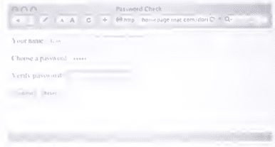

**图 7.7** 当出现问题时，你可以将字段的标签以及字段本身设置为红色加粗。

**脚本 7.9** 此脚本在发现错误时，会高亮显示不正确字段的标签。

```
window.onload = initForms;

function initForms() {
    for (var i=0; i< document.forms.length; i++) {
        document.forms[i].onsubmit = function() {return validForm();}
    }
}

function validForm() {
    var allGood = true;
    var allTags = document.getElementsByTagName("*");

    for (var i=0; i<allTags.length; i++) {
        if (!validTag(allTags[i])) {
            allGood = false;
        }
    }

    return allGood;

    function validTag(thisTag) {
        var outClass = "";
        var allClasses = thisTag.className.split(" ");

        for (var j=0; j<allClasses.length; j++) {
            outClass += validBasedOnClass(allClasses[j]) + " ";
        }
```

*(脚本在下一页继续)*

172

**脚本 7.9 续**

```
thisTag.className = outClass;

if (outClass.indexOf("invalid") > -1) {
    invalidLabel(thisTag.parentNode);
    thisTag.focus();
    if (thisTag.nodeName == "INPUT") {
        thisTag.select();
    }
    return false;
}

return true;

function validBasedOnClass(thisClass) {
    var classBack = "";

    switch(thisClass) {
        case "":
        case "invalid":
            break;
        case "reqd":
            if (allGood && thisTag.value == "") classBack = "invalid ";
            classBack += thisClass;
            break;
        default:
            if (allGood && !crossCheck(thisTag,thisClass)) classBack = "invalid ";
            classBack += thisClass;
    }
    return classBack;
}

function crossCheck(inTag,otherFieldID) {
    if (!document.getElementById(otherFieldID)) return false;
    return (inTag.value == document.getElementById(otherFieldID).value);
}

function invalidLabel(parentTag) {
    if (parentTag.nodeName == "LABEL") {
        parentTag.classPrototype += " invalid";
    }
}
```

## 第 7 章

### 识别有问题的表单字段：

1. `invalidLabel(thisTag.parentNode);`

这行代码被添加到了`validTag()`内的无效检查中。当当前字段验证失败时，我们希望检查是否也能将围绕问题子元素的标签标记为无效。为此，调用新的`invalidLabel()`函数（下文解释），并传递当前标签的*父*节点。也就是说，如果`passwd1`输入字段有问题，我们希望这个标签*以及*它周围的`label`标签都被赋予`invalid`类。因此，一旦我们知道`passwd1`输入字段有问题，我们就将其父元素（`label`标签）传递给`invalidLabel()`，以检查它是否是适合标记为无效的元素。

2. `function invalidLabel(parentTag) {`
    `if (parentTag.nodeName == "LABEL") {`
        `parentTag.className += " invalid";`
    `}`
`}`

这个函数接收一个标签，并检查该标签是否是一个`label`。如果是，它就在其类属性中添加`invalid`。

如果我们现在尝试提交表单，并且存在错误，我们会注意到有问题的字段的标签在出错时会变成加粗和红色。修正错误并提交表单后，它们会再次变回黑色。

## 将表单验证付诸实践

关于我们在最后几个示例中构建的脚本，一个有趣的特点是，它在很大程度上与我们使用的 HTML 页面是独立的。换句话说，你可以替换一个完全不同的页面，使用一个完全不同的表单，而你只需要对脚本进行微小的更改，就能让它执行你想要的所有验证任务。

例如，看看**图 7.8**，这是一个简化的表单版本，可用于定制你想要购买的汽车。该表单包括各种选项和界面元素，包括单选按钮、下拉菜单、复选框和需要进行正确数据输入验证的文本字段。你可以在**脚本 7.10**中找到这个表单的 HTML；我们将在本章剩余的示例中使用这个 HTML。

JavaScript 文件，**脚本 7.11**，是建立在我们本章前面使用的脚本基础上的。我们向脚本中添加了几行代码来处理新的界面元素，但除此之外表单是相同的。在这个例子中，你将看到为了准备脚本进行更多验证需要添加什么，后续的例子将深入探讨特定类型的表单元素。

*图 7.8* 汽车选择器表单使用了文本字段、弹出菜单、复选框和单选按钮——所有这些常见的表单元素。

## 第 7 章

**脚本 7.10** 这是汽车选择器示例的完整 HTML 页面。

```
<!DOCTYPE html PUBLIC "-//W3C//DTD XHTML 1.0 Transitional//EN">
<html xmlns="http://www.w3.org/1999/xhtml">
<head>
    <title>Car Picker</title>
    <script language="JavaScript" type="text/javascript" src="script06.js">
    </script>
    <link rel="stylesheet" href="script06.css" />
</head>
<body>
<h2 align="center">Car Picker</h2>
<form action="someAction.cgi">
    <p><label for="emailAddr">Email Address:
        <input id="emailAddr" type="text" size="30" class="reqd email" />
    </label></p>
    <p><label for="color">Colors:
        <select id="color" class="reqd">
            <option value="" selected="selected">Choose a color</option>
            <option value="Red">Red</option>
            <option value="Green">Green</option>
            <option value="Blue">Blue</option>
        </select>
    </label></p>
    <p>Options:
        <label for="sunroof"><input type="checkbox" id="sunroof" value="Yes" />Sunroof (Two door only)
        </label>
        <label for="pWindows"><input type="checkbox" id="pWindows" value="Yes" />Power Windows</label>
    </p>
    <p><label for="DoorCt">Doors:&nbsp;&nbsp;
        <input type="radio" id="twoDoor" name="DoorCt" value="twoDoor" class="radio" />Two
        <input type="radio" id="fourDoor" name="DoorCt" value="fourDoor" class="radio" />Four
    </label></p>
    <p><label for="zip">Enter your Zip code or pick the dealer nearest you:<br />
        Zip: <input id="zip" type="text" size="5" maxlength="5" class="isZip dealerList" />
        <select id="dealerList" size="4" class="zip">
            <option value="California--Lemon Grove">California--Lemon Grove</option>
            <option value="California--Lomita">California--Lomita</option>
            <option value="California--Long Beach">California--Long Beach</option>
            <option value="California--Los Alamitos">California--Los Alamitos</option>
            <option value="California--Los Angeles">California--Los Angeles</option>
        </select>
    </label></p>
    <p><input type="submit" value="Submit" />&nbsp;<input type="reset" /></p>
</form>
</body>
</html>
```

## 表单处理

**脚本 7.11** 本脚本向`switch/case`条件语句添加了多个分支，为后续示例做好准备。

```
window.onload = initForms;

function initForms() {
    for (var i=0; i< document.forms.length; i++) {
        document.forms[i].onsubmit = function() {return validForm();}
    }
}

function validForm() {
    var allGood = true;
    var allTags = document.getElementsByTagName("*");

    for (var i=0; i<allTags.length; i++) {
        if (!validTag(allTags[i])) {
            allGood = false;
        }
    }

    return allGood;

    function validTag(thisTag) {
        var outClass = "";
        var allClasses = thisTag.className.split(" ");

        for (var j=0; j<allClasses.length; j++) {
            outClass += validBasedOnClass(allClasses[j]) + " ";
        }

        thisTag.className = outClass;

        if (outClass.indexOf("invalid") > -1) {
            invalidLabel(thisTag.parentNode);
            thisTag.focus();
            if (thisTag.nodeName == "INPUT") {
                thisTag.select();
            }
            return false;
        }

        return true;

        function validBasedOnClass(thisClass) {
            var classBack = "";

            switch(thisClass) {
                case "":
```

第 7 章

### 验证包含多个元素的表单：

脚本 7.11 *续*

```
case "":
case "invalid":
    break;
case "reqd":
    if (allGood && thisTag.value == "") classBack = "invalid ";
    classBack += thisClass;
    break;
case "radio":
    if (allGood && !radioPicked(thisTag.name)) classBack = "invalid ";
    classBack += thisClass;
    break;
case "isNum":
case "isZip":
case "email":
    classBack += thisClass;
    break;
default:
    if (allGood && !crossCheck(thisTag, thisClass))
        classBack = "invalid ";
    classBack += thisClass;
}

return classBack;
}

```

通过向`validBasedOnClass()`函数内的`switch/case`条件语句添加额外分支，我们允许脚本检查更多字段和更多情况。我们向列表中添加了`radio`、`isNum`、`isZip`和`email`。虽然我们在本任务中不对它们进行验证，但我们希望在将来验证时不会引起问题，因此将它们每个都添加到`switch/case`处理的属性列表中。由于前三个分支中没有指令，它们都会穿透到`email`分支，该分支只是将当前正在检查的属性添加到`classBack`上。

```
return (inTag.value != "" ||
    document.getElementById
    (otherFieldID).value != "");
```

`crossCheck()`中的这一行有所改变。我们不再比较两个字段以确保它们相同，而是比较两个字段以确保其中至少有一个被设置（这是为了处理表单末尾的邮政编码和列表元素）。如果任一字段包含值，我们返回`true`。否则，我们返回`false`。

```
function crossCheck(inTag, otherFieldID) {
    if (!document.getElementById
        (otherFieldID)) return false;
    return (inTag.value != "" || document.
        getElementById(otherFieldID).
        value != "");
}

function invalidLabel(parentTag) {
    if (parentTag.nodeName == "LABEL") {
        parentTag.className += " invalid";
    }
}

}
```

将表单验证付诸实践

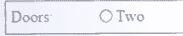

图 7.9 单选按钮是让用户从一组选项中只选择一个的最佳方式。

## 使用单选按钮

单选按钮是一种二选一的界面元素，允许用户在一组选项中选择一个（且仅一个）选项。当这些选项中有一个是必需的时，应使用单选按钮。如**图 7.9**所示，该表单使用单选按钮让假设的汽车购买者在双门或四门汽车之间做出选择。在这种情况下，你只能选择其中一个选项，并且必须做出选择。

**脚本 7.12** 只能选中一个单选按钮，此 JavaScript 用于强制执行界面规则。

如**脚本 7.12**所示，检查是否选中了一个按钮不需要太多脚本。我们使用一种技术，遍历每个按钮并检查其状态，然后如果没有选中任何按钮，则将单选按钮的标签和按钮变为红色和加粗。

```
window.onload = initForms;

function initForms() {
    for (var i=0; i< document.forms.length; i++) {
        document.forms[i].onsubmit = function()
        {return validForm();}
    }
}

function validForm() {
    var allGood = true;
    var allTags = document.getElementsByTagName
    ("*");

    for (var i=0; i<allTags.length; i++) {
        if (!validTag(allTags[i])) {
            allGood = false;
        }
    }

    return allGood;
}

function validTag(thisTag) {
    var outClass = "";
    var allClasses = thisTag.className.split
    (" ");

    for (var j=0; j<allClasses.length;
    j++) {
        outClass += validBasedOnClass
        (allClasses[j]) + " ";
    }
```

### 确保用户选择了一个单选按钮：

- 1. `if (allGood && !radioPicked(thisTag.name)) classBack = "invalid ";`

这行代码进入`switch/case`条件语句的`radio`分支。我们想检查是否至少选中了一个单选按钮，新的`radioPicked()`函数处理了这个问题。如果它返回`false`，那么我们将`classBack`设置为`invalid`。

- 2. `function radioPicked(radioName) { var radioSet = "";`

开始新的`radioPicked()`函数，并初始化`radioSet`变量。

此函数接收一组单选按钮的*名称*——在本例中是`DoorCt`，如脚本 7.10 所示。注意，这不是当前标签的`id`或类或我们通常看到的任何东西，而是它的`name`。`<input>`标签的`name`属性是 HTML 知道哪些单选按钮分组在一起的方式；也就是说，所有具有相同`name`属性的`<input>`标签都属于一个单选按钮组。

脚本 7.12 *续*

```
thisTag.className = outClass;

if (outClass.indexOf("invalid") > -1) {
    invalidLabel(thisTag.parentNode);
    thisTag.focus();
    if (thisTag.nodeName == "INPUT") {
        thisTag.select();
    }
    return false;
}

return true;
```

```
function validBasedOnClass(thisClass) {
    var classBack = "";

    switch(thisClass) {
        case "":
        case "invalid":
            break;
        case "reqd":
            if (allGood && thisTag.value == "") classBack = "invalid ";
            classBack += thisClass;
            break;
        case "radio":
            if (allGood && !radioPicked(thisTag.name)) classBack = "invalid ";
            classBack += thisClass;
            break;
        case "isNum":
        case "isZip":
        case "email":
            classBack += thisClass;
            break;
        default:
            if (allGood && !crossCheck(thisTag,thisClass))
                classBack = "invalid ";
            classBack += thisClass;
    }
```

脚本 7.12 *续*

```
return classBack;
}

function crossCheck(inTag,otherFieldID) {
    if (!document.getElementById
        (otherFieldID)) return false;
    return (inTag.value != "" ||
        document.getElementById
        (otherFieldID).value != "");
}

function radioPicked(radioName) {
    var radioSet = "";

    for (var k=0; k<document.forms.length;
        k++) {
        if (!radioSet) {
            radioSet = document.forms
                [k][radioName];
        }
    }

    if (!radioSet) return false;

    for (k=0; k<radioSet.length; k++) {
        if (radioSet[k].checked) {
            return true;
        }
    }

    return false;
}

function invalidLabel(parentTag) {
    if (parentTag.nodeName == "LABEL") {
        parentTag.className += " invalid";
    }
}

}
```

- 3. `for (var k=0; k<document.forms.length; k++) { if (!radioSet) { radioSet = document.forms[k][radioName]; } }`

接下来，我们遍历当前页面上的所有表单。我们知道单选按钮组的名称，但不知道它是哪个表单的一部分，而任何给定的页面可能有多个表单。因为此函数位于另一个循环`j`的函数内部，所以我们这里使用`k`作为循环变量。

然后，我们尝试将`radioSet`设置为我们正在查看的表单中这组单选按钮的名称。如果找到，`radioSet`将具有一个值。

- 4. `if (!radioSet) return false;`

当循环完成时，我们查看`radioSet`——如果它未被设置，我们返回`false`，因为我们找不到它，因此无法检查它。

- 5. `for (k=0; k<radioSet.length; k++) { if (radioSet[k].checked) { return true; } }`

好的，我们得到了要检查的单选按钮组。现在，我们开始另一个循环来遍历每个按钮。当我们找到一个被选中的按钮时，我们返回`true`，因为任务完成。

- 6. `return false;`

如果我们到达循环的末尾，我们查看了整个组，没有任何按钮被点击。在这种情况下，返回`false`并更改单选按钮的标签，使按钮变为红色和加粗。

## 第7章

## 用一个字段设置另一个字段

在你的表单中，你经常会发现，如果用户做出一个选择，这个选择会决定表单上其他字段的值。例如，假设天窗选项只在双门车型上可用。你可以用两种方式处理这个问题。首先，你可以检查输入，如果用户做出错误选择，就弹出一个警告对话框。但更巧妙的设计是直接为用户设置条目。所以，如果他们选择了天窗，脚本会自动点击双门按钮，如图7.10所示。脚本7.13展示了如何实现。

图7.10 当用户勾选天窗选项时，脚本会自动设置双门单选按钮。

脚本7.13 一种处理用户选择的复杂方法，让你能够根据用户的其他选择来控制和设置字段条目。

```
window.onload = initForms;

function initForms() {
    for (var i=0; i< document.forms.length; i++) {
        document.forms[i].onsubmit = function()
            {return validForm();}
    }

    document.getElementById("sunroof").
        onclick = doorSet;
}

function validForm() {
    var allGood = true;
    var allTags = document.getElementsByTagName("*");

    for (var i=0; i<allTags.length; i++) {
        if (!validTag(allTags[i])) {
            allGood = false;
        }
    }

    return allGood;
}

function validTag(thisTag) {
    var outClass = "";
    var allClasses = thisTag.className.split(" ");

    for (var j=0; j<allClasses.length; j ISCROLLAR jTAGOUTX=OUTX+1
```

要自动设置字段值：

1. `document.getElementById("sunroof").onclick = doorSet;`
这行代码已添加到`initForms()`中。当用户点击天窗复选框时，将调用`doorSet()`函数。

2. `function doorSet() { if (this.checked) { document.getElementById("twoDoor").checked = true; } }`
这个新函数检查天窗字段是否被选中；如果是，它将`twoDoor`单选按钮设置为`true`。如果我们点击天窗复选框取消选择，则不会发生任何事情。

> **提示**
> 你可能已经注意到，没有检查用户是否点击了天窗然后重置了`fourDoor`单选按钮。我们将其留作读者练习。

脚本7.13 续

```
if (outClass.indexOf("invalid") > -1) {
    invalidLabel(thisTag.parentNode);
    thisTag.focus();
    if (thisTag.nodeName == "INPUT") {
        thisTag.select();
    }
    return false;
}

return true;

function validBasedOnClass(thisClass) {
    var classBack = "";

    switch(thisClass) {
        case "":
        case "invalid":
            break;
        case "reqd":
            if (allGood && thisTag.value == "") classBack = "invalid ";
            classBack += thisClass;
            break;
        case "radio":
            if (allGood && !radioPicked(thisTag.name)) classBack = "invalid ";
            classBack += thisClass;
            break;
        case "isNum":
        case "isZip":
        case "email":
            classBack += thisClass;
            break;
        default:
            if (allGood && !crossCheck(thisTag,thisClass)) classBack = "invalid ";
            classBack += thisClass;
    }

    return classBack;
}

function crossCheck(inTag,otherFieldID) {
    if (!document.getElementById(otherFieldID)) return false;
    return (inTag.value != "" || document.getElementById(otherFieldID).value != "");
}
```

脚本7.13 续

```
function radioPicked(radioName) {
    var radioSet = "";

    for (var k=0; k<document.forms.length; k++) {
        if (!radioSet) {
            radioSet = document.forms[k][radioName];
        }
    }

    if (!radioSet) return false;

    for (k=0; k<radioSet.length; k++) {
        if (radioSet[k].checked) {
            return true;
        }
    }

    return false;
}

function invalidLabel(parentTag) {
    if (parentTag.nodeName == "LABEL") {
        parentTag.className += " invalid";
    }
}

function doorSet() {
    if (this.checked) {
        document.getElementById("twoDoor").checked = true;
    }
}
```

## 验证邮政编码

那些古怪的用户可以在表单中输入几乎任何东西，所以你会想确保如果他们在邮政编码字段（图7.11）中输入了任何内容，它只包含数字。脚本7.14向你展示如何实现。

图7.11 你可以确保用户要么输入邮政编码，要么从滚动列表中进行选择。

### 确保邮政编码有效：

脚本7.14 只需几行JavaScript，就能从你的邮政编码中清除不正确的字母。

```
window.onload = initForms;

function initForms() {
  for (var i=0; i< document.forms.length; i++) {
    document.forms[i].onsubmit = function()
      {return validForm();}
  }
  document.getElementById("sunroof").onclick
    = doorSet;
}

function validForm() {
  var allGood = true;
  var allTags = document.getElementsByTagName
    ("*");

  for (var i=0; i<allTags.length; i++) {
    if (!validTag(allTags[i])) {
      allGood = false;
    }
  }
  return allGood;
}

function validTag(thisTag) {
  var outClass = "";
  var allClasses = thisTag.className.split
    (" ");

  for (var j=0; j<allClasses.length; j++) {
    outClass += validBasedOnClass
      (allClasses[j]) + " ";
  }
```

3. `function isNum(passedVal) {`

首先，定义函数`isNum`。变量`passedVal`从表单传递到函数。

4. `if (passedVal == "") { return false; }`

如果`passedVal`为空，则我们正在查看的字段不是数字。发生这种情况时，返回`false`，表示错误。

5. `for (var k=0; k<passedVal.length; k++) {`

现在扫描`passedVal`的长度，每次循环时递增`k`计数器。我们使用`k`是因为我们已经在另一个循环内。

6. `if (passedVal.charAt(k) < "0") { return false; } if (passedVal.charAt(k) > "9") { return false; }`

`charAt()`运算符检查位置`k`处的字符。如果字符小于"0"或大于"9"，则它不是数字，因此退出并声明输入为非数字或`false`。

7. `return true;`

如果我们执行到这里，说明我们得到了一个数字，所以返回`true`。

8. `function isZip(inZip) { if (inZip == "") { return true; } return (isNum(inZip)); }`

在此表单上下文中，邮政编码字段为空是有效的。因此，我们首先检查该字段用户是否输入了任何内容，如果没有，我们返回`true`——这是一个有效的条目。但如果他们输入了任何内容，则需要是数字，所以这是下一个检查。

#### 提示

- 如果以后我们想向HTML表单添加一个必须为数字的新字段，则不需要编写新的JavaScript代码。相反，我们只需使用现已存在的`isNum`检查即可。

- 请记住，这是万维网，而不是美国网络。如果你的网站可能吸引美国以外的注意力，不要要求用户输入邮政编码。美国以外的地址可能有也可能没有邮政编码，而且这些邮政编码可能不是数字的。

验证邮政编码

脚本7.14 续

```
thisTag.className = outClass;

if (outClass.indexOf("invalid") > -1) {
    invalidLabel(thisTag.parentNode);
    thisTag.focus();
    if (thisTag.nodeName == "INPUT") {
        thisTag.select();
    }
    return false;
}
return true;

function validBasedOnClass(thisClass) {
    var classBack = "";

    switch(thisClass) {
        case "":
        case "invalid":
            break;
        case "reqd":
            if (allGood && thisTag.value == "") classBack = "invalid ";
            classBack += thisClass;
            break;
        case "radio":
            if (allGood && !radioPicked(thisTag.name)) classBack = "invalid ";
            classBack += thisClass;
            break;
        case "isNum":
            if (allGood && !isNum(thisTag.value)) classBack = "invalid ";
            classBack += thisClass;
            break;
        case "isZip":
            if (allGood && !isZip(thisTag.value)) classBack = "invalid ";
            classBack += thisClass;
            break;
    }
```

脚本 7.14 续

```
case "email":
    classBack += thisClass;
    break;
default:
    if (allGood && !crossCheck(thisTag, thisClass)) classBack = "invalid ";
    classBack += thisClass;
}
return classBack;
}
```

```
function crossCheck(inTag, otherFieldID) {
    if (!document.getElementById(otherFieldID)) return false;
    return (inTag.value != "" || document.getElementById(otherFieldID).value != "");
}
```

```
function radioPicked(radioName) {
    var radioSet = "";

    for (var k=0; k<document.forms.length; k++) {
        if (!radioSet) {
            radioSet = document.forms[k][radioName];
        }
    }
    if (!radioSet) return false;
    for (k=0; k<radioSet.length; k++) {
        if (radioSet[k].checked) {
            return true;
        }
    }
    return false;
}
```

```
function isNum(passedVal) {
    if (passedVal == "") {
        return false;
    }
    for (var k=0; k<passedVal.length; k++) {
        if (passedVal.charAt(k) < "0") {
            return false;
        }
        if (passedVal.charAt(k) > "9") {
```

（脚本在下一页继续）

```
return false;
}
}
return true;
}

function isZip(inZip) {
    if (inZip == "") {
        return true;
    }
    return (isNum(inZip));
}

function invalidLabel(parentTag) {
    if (parentTag.nodeName == "LABEL") {
        parentTag.className += " invalid";
    }
}
}
}

function doorSet() {
    if (this.checked) {
        document.getElementById("twoDoor").checked = true;
    }
}
```

## 验证电子邮件地址

对于用户，尤其是新用户来说，输入互联网地址可能是一件棘手的事情。你可以通过扫描他们输入的电子邮件地址并检查其格式是否正确来帮助他们。例如，你可以检查是否只有一个`@`符号，以及是否没有无效字符，正如图 7.12 所示。当然，其局限性在于你的脚本无法捕获拼写错误，所以如果用户本想输入 joe@myprovider.com 而误输入了 joe@yprovider.com，这个错误将会被通过。脚本 7.15 向你展示了如何检查地址中的错误。

脚本 7.15 通过扫描你表单中电子邮件字段的文本，可以确保你获得正确的电子邮件地址。

```
window.onload = initForms;

function initForms() {
  for (var i=0; i< document.forms.length; i++) {
    document.forms[i].onsubmit = function()
      {return validForm();}
  }
  document.getElementById("sunroof").onclick
    = doorSet;
}

function validForm() {
  var allGood = true;
  var allTags = document.getElementsByTagName
    ("*");

  for (var i=0; i<allTags.length; i++) {
    if (!validTag(allTags[i])) {
      allGood = false;
    }
  }
  return allGood;
}

function validTag(thisTag) {
  var outClass = "";
  var allClasses = thisTag.className.split
    (" ");

  for (var j=0; j<allClasses.length; j++) {
    outClass += validBasedOnClass
      (allClasses[j]) + " ";
  }

  thisTag.className = outClass;
```

（脚本在下一页继续）

要验证一个电子邮件地址：

- 1. `if (allGood && !validEmail(thisTag.value)) classBack = "invalid ";`

- 2. `function validEmail(email) {`

- 3. `var invalidChars = " /:;,";`

这一行已被添加到电子邮件的`switch/case`块中。如果`validEmail()`函数返回`false`，则将类设置为无效。

首先定义一个函数，表单中电子邮件字段的内容将被传递给它。

创建一个变量`invalidChars`，其中包含电子邮件地址中最可能的五个无效字符：空格、斜杠、冒号、逗号和分号。

在下一页继续

验证电子邮件地址

```
4. if (email == "") {
    return false;
```

这个测试表示：“如果电子邮件的内容为空（或空字符串），则结果为`false`。”

```
5. for (var k=0; k<invalidChars.length; k++) {
```

在这个`for`语句中，开始一个循环来扫描`invalidChars`字符串。首先将计数器`k`初始化为零，然后，每次循环中当`k`小于字符串长度时，使用`++`自增运算符将`k`加 1。

```
6. var badChar = invalidChars.charAt(k);
if (email.indexOf(badChar) > -1) {
    return false;
}
```

变量`badChar`被设置为`invalidChars`字符串中位置`k`处的无效字符，然后我们检查该字符是否在`email`中。如果是，`indexOf()`返回找到它的位置；如果不是，则返回 -1。如果我们得到的值不是 -1，就说明发现了一个坏字符，因此我们返回`false`。

```
7. var atPos = email.indexOf("@",1);
if (atPos == -1) {
    return false;
}
```

变量`atPos`保存`@`符号的位置。脚本使用`indexOf`从地址的第二个字符开始查找第一个`@`符号。如果结果显示`@`符号的位置是 -1，这意味着地址中没有`@`符号，你就遇到了麻烦。

### 脚本 7.15 续

```
if (outClass.indexOf("invalid") > -1) {
    invalidLabel(thisTag.parentNode);
    thisTag.focus();
    if (thisTag.nodeName == "INPUT") {
        thisTag.select();
    }
    return false;
}
return true;
```

```
function validBasedOnClass(thisClass) {
    var classBack = "";

    switch(thisClass) {
        case "":
        case "invalid":
            break;
        case "reqd":
            if (allGood && thisTag.value == "") classBack = "invalid ";
            classBack += thisClass;
            break;
        case "radio":
            if (allGood && !radioPicked (thisTag.name)) classBack = "invalid ";
            classBack += thisClass;
            break;
        case "isNum":
            if (allGood && !isNum (thisTag.value)) classBack = "invalid ";
            classBack += thisClass;
            break;
        case "isZip":
            if (allGood && !isZip (thisTag.value)) classBack = "invalid ";
            classBack += thisClass;
            break;
        case "email":
```

（脚本在下一页继续）

## 表单处理

### 脚本 7.15 续

```
if (allGood && !validEmail(thisTag.value))
classBack = "invalid ";
classBack += thisClass;
break;
default:
  if (allGood && !crossCheck(thisTag, thisClass))
    classBack = "invalid ";
    classBack += thisClass;
  }
  return classBack;
}
```

```
function crossCheck(inTag,otherFieldID) {
  if (!document.getElementById(otherFieldID)) return false;
  return (inTag.value != "" || document.getElementById(otherFieldID).value != "");
}
```

```
function radioPicked(radioName) {
  var radioSet = "";

  for (var k=0; k<document.forms.length; k++) {
    if (!radioSet) {
      radioSet = document.forms[k][radioName];
    }
  }

  if (!radioSet) return false;
  for (k=0; k<radioSet.length; k++) {
    if (radioSet[k].checked) {
      return true;
    }
  }
  return false;
}
```

```
function isNum(passedVal) {
```

```
8. if (email.indexOf("@",atPos+1) != -1) {
     return false;
   }
```

现在脚本确保只有一个`@`符号，并通过检查从找到第一个`@`符号后一位开始的字符来拒绝任何包含多个`@`的地址。

```
9. var periodPos = email.indexOf(".",atPos);
   if (periodPos == -1) {
     return false;
   }
```

现在脚本检查在`@`符号之后的某个位置是否有一个句点。如果没有，我们将得到一个`false`结果。

```
10. if (periodPos+3 > email.length) {
      return false;
    }
    return true;
```

最后，脚本要求地址中的句点之后至少有两个字符。如果我们执行到这一步都没有得到`false`结果，那么函数`validEmail`的值就是`true`，这意味着我们有了一个有效的电子邮件地址。

（脚本在下一页继续）

#### 提示

验证电子邮件地址和核实电子邮件地址是有区别的。此脚本通过确保用户输入的内容符合电子邮件地址的正确格式来验证地址。但它并不核实该地址是否真实存在。唯一的方法是向该地址发送一封电子邮件，看看是否会被退回。除了发送这样的验证邮件可能会让你的用户非常恼火之外，一封邮件可能需要数小时才能退回，而用户不会在此期间耐心地在你的表单前等待。

### 脚本 7.15 续

```
if (passedVal == "") {
    return false;
}
for (var k=0; k<passedVal.length; k++) {
    if (passedVal.charAt(k) < "0") {
        return false;
    }
    if (passedVal.charAt(k) > "9") {
        return false;
    }
}
return true;
}
```

这个脚本例程并不能捕获所有可能的错误电子邮件地址，只能捕获最可能的错误。要全面检查所有可能的错误电子邮件地址将需要几页的代码。如果你稍加思考，你可能会发现一些超出此脚本检查范围的可能错误。

```
function isZip(inZip) {
    if (inZip == "") {
        return true;
    }
    return (isNum(inZip));
}
```

验证电子邮件地址

此脚本不处理一些较新的顶级域名，例如`.museum`和`.info`，因为这些后缀超过三个字符。你需要修改脚本，使其能够处理这类域名。

```
function validEmail(email) {
    var invalidChars = " /:;";
    if (email == "") {
        return false;
    }
    for (var k=0; k<invalidChars.length; k++) {
        var badChar = invalidChars.charAt(k);
        if (email.indexOf(badChar) > -1) {
            return false;
        }
    }
    var atPos = email.indexOf("@",1);
    if (atPos == -1) {
        return false;
    }
    if (email.indexOf("@",atPos+1) != -1) {
```

（脚本在下一页继续）

### 脚本 7.15 续

```javascript
return false;
}

var periodPos = email.indexOf(".", atPos);
if (periodPos == -1) {
    return false;
}

if (periodPos + 3 > email.length) {
    return false;
}

return true;
    }
  }
}

function invalidLabel(parentTag) {
    if (parentTag.nodeName == "LABEL") {
        parentTag.className += " invalid";
    }
  }
}

function doorSet() {
    if (this.checked) {
        document.getElementById("twoDoor").checked = true;
    }
}
```

## 表单与正则表达式

正则表达式是一种功能极其强大的方式，用于验证和格式化文本字符串。使用正则表达式，你可以编写一两行 JavaScript 代码来完成原本需要数十行代码才能完成的任务。

*正则表达式*（通常缩写为 *RegExp*）是一种使用特殊符号编写的模式，用于描述一个或多个文本字符串。你使用正则表达式来匹配文本模式，这样你的脚本就能轻松地识别和操作文本。与算术表达式类似，你可以通过*运算符*来创建正则表达式，不过这里操作的是文本而非数字。正则表达式有许多运算符，我们将在本章介绍一些最常见的。通过学习和使用这些运算符，你将在需要检测和操作文本字符串时节省大量精力。

正则表达式也常被认为是编程中最令人费解的部分之一。你可能觉得自己已经对 JavaScript 有了很好的掌握，但当你看到包含正则表达式的脚本时，它可能完全不知所云。如果你不了解语法，你甚至无法猜测它在做什么。那些天书般的符号到底是什么意思？

不过，语法其实并不难，只要你把那些晦涩的部分分解成小的、有意义的部分（那样它们就不再是天书了）。在本章中，我们将揭开正则表达式语法的神秘面纱，并讨论如何使用正则表达式使你的代码更简洁、更强大。

### 脚本 8.1 —— 这几行 JavaScript 代码对验证电子邮件地址大有裨益。

```javascript
window.onload = initForms;

function initForms() {
  for (var i = 0; i < document.forms.length; i++) {
    document.forms[i].onsubmit = function() {
      return validForm();
    };
  }
}

function validForm() {
  var allGood = true;
  var allTags = document.getElementsByTagName("*");

  for (var i = 0; i < allTags.length; i++) {
    if (!validTag(allTags[i])) {
      allGood = false;
    }
  }
  return allGood;
}

function validTag(thisTag) {
  var outClass = "";
  var allClasses = thisTag.className.split(" ");

  for (var j = 0; j < allClasses.length; j++) {
    outClass += validBasedOnClass(allClasses[j]) + " ";
  }

  thisTag.className = outClass;

  if (outClass.indexOf("invalid") > -1) {
    invalidLabel(thisTag.parentNode);
    thisTag.focus();
    if (thisTag.nodeName == "INPUT") {
      thisTag.select();
    }
    return false;
  }
```

## 使用正则表达式验证电子邮件地址

回到第 7 章，其中一个任务是验证电子邮件地址。为了完成这个任务，脚本需要写得相对较长。**脚本 8.1**的核心功能与脚本 7.15 完全相同；但通过使用正则表达式，它使用的代码行数少得多，并且你得到的结果也更加严格。你可以在**脚本 8.2**中找到简单的 HTML，CSS 部分则与脚本 7.6 相同。

### 使用正则表达式验证电子邮件地址：

1. `var re = /^\w+([\.-]?\w+)*@\w+([\.-]?\w+)*(\.\w{2,3})+$/;`

天哪！这到底是什么？别慌；这只是`validEmail()`函数中的一个正则表达式。让我们把它拆解开来，一部分一部分地看。像任何一行 JavaScript 代码一样，你要从左到右阅读正则表达式。

首先，`re`只是一个变量。我们给它取名为`re`，这样以后使用时，我们就能记住它是一个正则表达式。这行代码将`re`的值设置为等号右边的正则表达式。

正则表达式总是以斜杠`/`开头和结尾（当然，这里还有一个分号，表示 JavaScript 语句的结束，但分号不是正则表达式的一部分）。斜杠之间的所有内容都是正则表达式的一部分。

脱字符`^`表示我们将使用此表达式从字符串的开头开始检查字符串。如果省略脱字符，即使字符串开头有一堆垃圾字符，电子邮件地址也可能被验证为有效。

表达式`\w`表示任意单个字符，"a" 到 "z"、"A" 到 "Z"、"0" 到 "9" 或下划线。电子邮件地址必须以这些字符之一开头。

加号`+`表示前面要检查的项可以是*一个或多个*。在这种情况下，电子邮件地址必须以"a"到"z"、"A"到"Z"、"0"到"9"或下划线的任意组合的一个或多个字符开头。

左括号`(`表示一个分组。它的意思是我们稍后会以某种方式引用括号内的所有内容，所以现在先把它们放入一个分组中。

方括号`[]`用于表示我们可以拥有内部的任意*一个*字符。在这个例子中，字符`\.-`位于方括号内。我们希望允许用户输入句点或破折号，但句点在正则表达式中具有特殊含义，所以我们需要在它前面加上反斜杠`\`，以表示我们真正要指的是句点本身，而不是它的特殊含义。在特殊字符前使用反斜杠称为对该字符进行*转义*。因为有了方括号，输入的字符串可以在这里有一个句点或一个破折号，但不能同时有两者。注意，这里的破折号不代表任何特殊字符，它就是它本身。

问号`?`表示我们可以有*零个或一个*前面的项。因此，不仅在电子邮件地址的第一部分（`@`之前的部分）可以有一个句点或破折号，也可以两者都没有。

### 脚本 8.1 续

```javascript
return true;
}

function validBasedOnClass(thisClass) {
    var classBack = "";

    switch (thisClass) {
        case "":
        case "invalid":
            break;
        case "email":
            if (allGood && !validEmail(thisTag.value)) classBack = "invalid ";
        default:
            classBack += thisClass;
    }
    return classBack;
}

function validEmail(email) {
    var re = /^\w+([\.-]?\w+)*@\w+([\.-]?\w+)*(\.\w{2,3})+$/;

    return re.test(email);
}

function invalidLabel(parentTag) {
    if (parentTag.nodeName == "LABEL") {
        parentTag.className += " invalid";
    }
}
}
```

### 脚本 8.2 —— 电子邮件验证示例的 HTML。

```html
<!DOCTYPE html PUBLIC "-//W3C//DTD XHTML 1.0 Transitional//EN">
<html xmlns="http://www.w3.org/1999/xhtml">
<head>
    <title>Email Validation</title>
    <link rel="stylesheet" href="script01.css" />
    <script language="javascript" type="text/javascript" src="script01.js">
    </script>
</head>
<body>
    <h2 align="center">Email Validation</h2>
    <form action="someAction.cgi">
        <p><label>Email Address:
        <input class="email" type="text"
        size="50" /></label></p>
        <p><input type="reset" />&nbsp;<input
        type="submit" value="Submit" /></p>
    </form>
</body>
</html>
```

## 你是不是开始抓狂了？

如果这是你第一次接触正则表达式，此刻你很可能感到有些不知所措。我们把这一章放在这里，是因为使用正则表达式来验证表单条目是最合理的做法。但本书其余部分的内容并不建立在这一章的基础上，所以如果你想跳到下一章，直到你积累更多的脚本编写经验，我们也完全不介意。

在`?`之后，我们再次看到`\w+`，这表示句点或破折号后面必须跟着一些其他字符。右括号`)`表示这个分组的结束。后面跟着一个星号`*`，表示我们可以有零个或多个前面的项——在这个例子中，就是括号内的内容。因此，虽然 "dori" 是一个有效的电子邮件前缀，但 "testing-testing-1-2-3" 也是有效的。`@`字符除了它自身之外不代表任何东西，它位于电子邮件地址和域名之间。

`\w+`再次表示域名必须以"a"到"z"、"A"到"Z"、"0"到"9"或下划线的一个或多个字符开头。后面再次跟着`([\.-]?\w+)*`，表示电子邮件地址的后缀中允许出现句点和破折号。

然后我们有一个括号内的分组：`\.\w{2,3}`，表示我们期望找到一个句点后跟字符。在这个例子中，花括号内的数字表示前面的项（这里指`\w`，即字母、数字或下划线）可以是 2 个或 3 个。在这个分组的右括号之后是一个`+`，再次表示前面的项（这里是这个分组）必须出现一次或多次。例如，这将匹配 ".com" 或 ".edu"，以及 "ox.ac.uk"。

最后，正则表达式以美元符号`$`结尾，表示匹配的字符串必须在此处结束。这可以防止脚本验证那些开头正确但结尾包含垃圾字符的电子邮件地址。斜杠关闭正则表达式。分号结束 JavaScript 语句，这与通常一样。

## 验证电子邮件地址

 第 8 章

2. `return re.test(email);`

这一行代码采用了上一步定义的正则表达式，并使用`test()`方法来验证`email`的有效性。如果输入的字符串不符合`re`中存储的模式，`test()`将返回`false`，用户会看到错误的字段及其标签变为红色并加粗显示，如**图 8.1**所示。否则，有效输入将返回`true`（**图 8.2**），表单会将电子邮件地址提交给 CGI `someAction.cgi`进行进一步处理。

> ✔ **提示**

> 

> - 此代码并不能匹配所有可能的合法电子邮件地址变体，仅匹配那些你可能希望允许用户输入的常见格式。

> 

> - 请注意，在脚本 8.1 中，我们为`re`赋值后，在第 2 步中将`re`用作对象。与其他任何 JavaScript 变量一样，正则表达式的结果也可以是一个对象。

> 

> - 比较脚本 7.15 和脚本 8.1 中的`validEmail()`函数。前者有 27 行代码，后者仅有 4 行。它们实现的功能相同，由此可见正则表达式的强大威力可以为你节省大量编码工作。

> 

> - 在上面的脚本中，`someAction.cgi`只是 CGI 的一个示例名称——字面意思就是"某个动作"——即你希望它执行的任何操作。如果你想学习编写 CGI，我们推荐 Elizabeth Castro 的著作*Perl and CGI for the World Wide Web, Second Edition: Visual QuickStart Guide*。

> 

> - 你将在**表 8.1**中看到，正则表达式中的特殊字符（有时称为*元字符*）是区分大小写的。调试使用正则表达式的脚本时，请牢记这一点。

> 

> - 正则表达式中还有一些用于修饰其他运算符的字符，我们在**表 8.2**中列出了它们。

# 表 8.1

#### 正则表达式特殊字符

| 字符 | 匹配内容 |

|:---|:---|

| \ | 在字面字符与特殊字符之间切换；例如，"\w" 表示 "w" 的特殊含义（见下文），而非字面量 "w"，但 "\$" 表示忽略 "$" 的特殊含义（见下文），而使用 "$" 字符 |

| ^ | 字符串开头 |

| $ | 字符串结尾 |

| * | 零次或多次 |

| + | 一次或多次 |

| ? | 零次或一次 |

| . | 除换行符外的任何字符 |

| \b | 单词边界 |

| \B | 非单词边界 |

| \d | 任意数字 0 至 9（等同于 [0-9]） |

| \D | 任意非数字字符 |

| \f | 换页符 |

| \n | 换行符 |

| \r | 回车符 |

| \s | 任意单个空白字符（等同于 [ \f\n\r\t\v]） |

| \S | 任意单个非空白字符 |

| \t | 制表符 |

| \v | 垂直制表符 |

| \w | 任意字母、数字或下划线（等同于 [a-zA-Z0-9_]） |

| \W | 除字母、数字或下划线外的任意字符 |

| \xnn | 由十六进制数 nn 定义的 ASCII 字符 |

| \onn | 由八进制数 nn 定义的 ASCII 字符 |

| \cX | 控制字符 X |

| [abcde] | 字符集，匹配括号内的任意一个字符 |

| [^abcde] | 补集或否定字符集；不匹配括号内的任何字符 |

| [a-e] | 字符集，匹配指定范围内的任意一个字符 |

| [\b] | 字面意义上的退格字符（不同于 \b） |

| {n} | 前一个字符恰好出现 n 次 |

| {n,} | 前一个字符至少出现 n 次 |

| {n,m} | 前一个字符出现 n 到 m 次 |

| () | 分组，同时存储以供后续使用 |

| x\|y | 匹配 x 或 y |

# 表 8.2

#### 正则表达式修饰符

| 修饰符 | 含义 |

|:---|:---|

| g | 搜索所有可能的匹配项（全局），而非仅匹配第一个 |

| i | 搜索时不区分大小写 |

## 验证文件名

正则表达式可以做很多事情，但其中最有用的功能之一是验证网页表单的输入字段。**脚本 8.3**要求用户输入有效的图像 URL，而正则表达式有助于确保用户按要求操作（具体来说，文件名必须以 .gif 或 .jpg 结尾，表示图像文件）。**图 8.3**显示了用户不小心输入无效内容时页面的外观，**图 8.4**显示了图像名称输入正确时的结果。

**脚本 8.3** 此脚本请求一个图像位置，如果通过验证，则在页面上显示该图像。

```
window.onload = initForms;

function initForms() {
  for (var i=0; i< document.forms.length; i++) {
    document.forms[i].onsubmit = function()
      {return validForm();}
  }
}

function validForm() {
  var allGood = true;
  var allTags = document.getElementsByTagName
    ("*");

  for (var i=0; i<allTags.length; i++) {
    if (!validTag(allTags[i])) {
      allGood = false;
    }
  }
  return false;
}

function validTag(thisTag) {
  var outClass = "";
  var allClasses = thisTag.className.split
    (" ");

  for (var j=0; j<allClasses.length;
    j++) {
    outClass += validBasedOnClass
      (allClasses[j]) + " ";
  }

  thisTag.className = outClass;

  if (outClass.indexOf("invalid") > -1) {
    invalidLabel(thisTag.parentNode);
    thisTag.focus();
    if (thisTag.nodeName == "INPUT") {
      thisTag.select();
    }
    return false;
  }
```

**图 8.3** 如果用户输入的内容不是有效的图像文件名，借助正则表达式，页面会显示错误信息。

**图 8.4** 当图像名称输入正确时，图像会显示在页面上。

（脚本在下一页继续）

## 表单与正则表达式

脚本 8.3（续）

### 验证 URL：

```
var re = /^(file|http):\/\/\S+\.\.(gif|jpg)$/i;
```

这是在`imgURL()`函数中。与前面的示例一样，我们希望检查整个输入字段，因此正则表达式以`/^`开头，以`$/`结尾。输入可以以 "http" 或 "file" 开头，因此将两者分组在一起，使用`|`表示其中任意一个值均可接受。

无论用户是从硬盘还是网络获取图像，接下来的字符必须是 "://"，因此接下来检查此项。请注意，每个正斜杠都必须单独转义（两个`\/`实例即为转义后的正斜杠），因为正斜杠是正则表达式的特殊字符。

之后，几乎任何字符都可以出现，因此使用`\S+`表示后面跟着一个或多个非空白字符。然后是另一个必需的正斜杠（同样进行了转义），用于分隔域名和文件名，接着再用一个`\S+`处理文件名部分。

文件名需要以一个点和 "gif" 或 "jpg" 结尾。点被转义，两个后缀被分组在一起，以便测试其中任意一个。

在正则表达式之后，使用了修饰符`i`，允许用户输入大写或小写字母。此修饰符告诉正则表达式不区分大小写。

```
function validBasedOnClass(thisClass) {
    var classBack = "";

    switch(thisClass) {
        case "":
        case "invalid":
            break;
        case "imgURL":
            if (allGood && !imgURL(thisTag.value)) classBack
                = "invalid";
        default:
            classBack += thisClass;
    }
    return classBack;
}
```

```
function imgURL(newURL) {
    var re = /^(file|http):\/\/\S+
    \/\S+\.(gif|jpg)$/i;

    if (re.test(newURL)) {
        document.getElementById
        ("chgImg").src = newURL;
        return true;
    }
    return false;
}
```

```
function invalidLabel(parentTag) {
    if (parentTag.nodeName == "LABEL") {
        parentTag.className +=
            " invalid";
    }
}
```

## 提取字符串

字符串验证并不是正则表达式的唯一用途。字符串提取同样有用：能够只取字符串的一部分并进行操作，可以让你对最终结果有更多控制。在脚本 8.4 中，我们将获取一个以"名在前、姓在后"格式输入的姓名列表，并将其转换为"姓在前、名在后"的格式。

### 提取字符串：

1. `var re = /\s*\n\s*/;`

这是一个新的正则表达式，它搜索的模式包括：任意空白字符`\s*`，后跟一个换行符`\n`，再后跟任意空白字符`\s*`。

2. `var nameList = inNameList.split(re);`

字符串方法`split()`获取该正则表达式，并将其应用于用户输入的数据（图 8.5），该数据存储在`inNameList`中。每个换行符分隔一个姓名，`split()`在每个换行符处将输入的数据切分。结果是一个字符串数组，包含输入的姓名，每个数组元素一个姓名，存储在数组`nameList`中。

3. `re = /(\S+)\s(\S+)/;`

接下来我们需要另一个正则表达式，用于将每个姓名拆分为名和姓。它搜索任意非空白字符（`\S+`），后跟一个空白字符`\s`，再后跟任意非空白字符（`\S+`）。每组字符周围都需要加括号，以便稍后使用这些信息。

**脚本 8.4** 此脚本重新排列输入的姓名列表。

```
window.onload = initForms;

function initForms() {
    for (var i=0; i< document.forms.length; i++) {
        document.forms[i].onsubmit = function() {
            return validForm();
        }
    }
}

function validForm() {
    var allTags = document.getElementsByTagName("*");
    for (var i=0; i<allTags.length; i++) {
        validTag(allTags[i]);
    }
    return false;
}

function validTag(thisTag) {
    var allClasses = thisTag.className
        .split(" ");
    for (var j=0; j<allClasses.length; j++) {
        // (脚本在下一页继续)
    }
}
```

### 脚本 8.4（续）


```javascript
validBasedOnClass(allClasses[j]);
}

function validBasedOnClass(thisClass) {
    switch(thisClass) {
        case "":
            break;
        case "nameList":
            thisTag.value = nameList
                (thisTag.value);
        default:
    }
}

function nameList(inNameList) {
    var newNames = new Array;
    var newNameField = "";

    var re = /\s*\n\s*/;

    var nameList = inNameList.split(re);

    re = /(\S+)\s(\S+)/;

    for (var k=0; k<nameList.length; k++) {
        newNames[k] = nameList[k].replace
            (re, "$2, $1");
    }

    for (k=0; k<newNames.length; k++) {
        newNameField += newNames[k] + "\n";
    }

    return newNameField;
}
```

## 表单与正则表达式

```
for (var k=0; k<nameList.length;
       k++) {
```

对于`nameList`数组中的每个姓名，循环执行以下代码行。

```
newNames[k] = nameList[k].replace
       (re, "$2, $1");
```

还记得第 3 步中的那些括号吗？当执行`replace()`方法时，正则表达式`re`将`nameList`拆分为名和姓。这些括号告诉 JavaScript 将名字存储在正则表达式属性`$1`中，将姓氏存储在正则表达式属性`$2`中。然后，`replace()`方法使用传递给它的第二个参数返回姓氏`$2`，后跟一个逗号，再跟名字`$1`。现在按"姓，名"顺序排列的姓名被存储在新数组`newNames`中。

```
for (k=0; k<newNames.length; k++) {
       newNameField += newNames[k] + "\n";
   }
```

这个循环设置了一个新变量`newNameField`，它将包含用户输入文本的修订版本。对于`newNames`数组中的每个姓名，将该姓名后跟一个换行符追加到`newNameField`中。

## 提取字符串

## 第 8 章

```
return newNameField;
```

我们将结果返回以更新网页。这发生在`switch/case`部分：`thisTag.value = nameList(thisTag.value);` 结果如**图 8.6**所示。

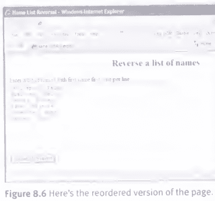

### ✔ 提示

- 如所示，此脚本仅处理用空格分隔的名和姓。如果你想让它处理中间名或多部分的姓氏，则必须进行修改。

- 在此脚本中，变量`re`被多次使用，在脚本的不同部分为其分配不同的值。这在 JavaScript 中完全可行（这也是我们在这里用它作为示例的原因），但在你自己的脚本中，你可能需要考虑使用不同的变量名。这样在几个月后回来调试或修改时，会更容易处理。

## 格式化字符串

那些用户经常以一种随意的方式输入数据。如果你希望条目遵循标准格式，最好的办法是自己来处理格式化。**脚本 8.5**展示了如何获取姓名列表并将其转换为标准的大小写格式。

**脚本 8.5** 此脚本将任意格式输入的姓名替换为你想要的大小写格式。

```javascript
window.onload = initForms;

function initForms() {
    for (var i=0; i< document.forms.length; i++) {
        document.forms[i].onsubmit = function() {return validForm();}
    }
}

function validForm() {
    var allTags = document.getElementsByTagName("*");

    for (var i=0; i<allTags.length; i++) {
        validTag(allTags[i]);
    }
    return false;

    function validTag(thisTag) {
        var allClasses = thisTag.className.split(" ");

        for (var j=0; j<allClasses.length; j++) {
            validBasedOnClass(allClasses[j]);
        }

        function validBasedOnClass(thisClass) {
            switch(thisClass) {
                case "":
                    break;
                case "nameList":
                    thisTag.value = nameList(thisTag.value);
                default:
            }
        }
    }
}
```

（脚本在下一页继续）

#### 格式化字符串的步骤：

1. `re = /^(\S)(\S+)\s(\S)(\S+)$/;`

此正则表达式同样期望找到"名 空格 姓"格式的姓名，并将每个姓名分成四个部分：名字的首字母`^(\S)`、名字的剩余部分`(\S+)`、姓氏的首字母`(\S)`，以及姓氏的剩余部分`(\S+)$`。注意，`^`和`$`强制字符串从开头开始并在末尾结束——我们不想遗漏任何部分。

2. `for (var k=0; k<nameList.length; k++) {`

我们要查看`nameList`数组中的每个姓名，如**图 8.7**所示。

3. `re.exec(nameList[k]);`

此步骤使用`exec()`方法在字符串`nameList[k]`上执行`re`模式，将字符串分成四个部分，并自动设置 JavaScript 内置的`RegExp`对象。这四个部分将分别存储在`RegExp.$1`、`RegExp.$2`、`RegExp.$3`和`RegExp.$4`中。

## 脚本 8.5（续）

```javascript
function nameList(inNameList) {
    var newNames = new Array;
    var newNameField = "";
    
    var re = /^\s*\n\s*/;
    var nameList = inNameList.split(re);
    
    re = /^(\S)(\S+)\s(\S)(\S+)$/;
    
    for (var k=0; k<nameList.length;
     k++) {
        if (nameList[k]) {
            re.exec(nameList[k]);
            newNames[k] = RegExp.$1
            .toUpperCase() + RegExp.$2.
            toLowerCase() + " " +
            RegExp.$3.toUpperCase() +
            RegExp.$4.toLowerCase();
        }
    }
    
    for (k=0; k<newNames.length; k++) {
        newNameField += newNames[k] + "\n";
    }
    
    return newNameField;
}
```

### 姓名列表大小写转换

#### 将姓名列表转换为首字母大写

输入姓名列表，每个姓名姓在前，每行一个：

ralph spoilsport

bettyo balovsky

audrey farber

melanie haber

porgy tirebiter

nick danger

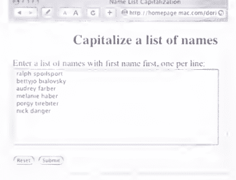

**图 8.7** 这是转换前的姓名版本。

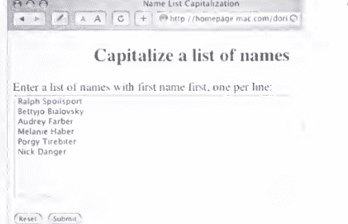

**图 8.8** 这是转换后的样子，正是我们想要的效果。

4. `newNames[k] = RegExp.$1.toUpperCase() + RegExp.$2.toLowerCase() + " " + RegExp.$3.toUpperCase() + RegExp.$4.toLowerCase();`

姓名的新版本存储在`newNames`数组中。它由名字的首字母（`RegExp.$1`）转换为大写，然后名字的剩余部分（`RegExp.$2`）转换为小写，接着是一个空格，然后是姓氏的首字母（`RegExp.$3`）转换为大写，最后是姓氏的剩余部分（`RegExp.$4`）转换为小写。然后显示该姓名，如**图 8.8**所示。

## 关于 RegExp 对象

JavaScript 有一个内置的`RegExp`对象，每次脚本执行正则表达式方法时（见**表 8.4**和**表 8.5**），该对象都会自动设置（和重置）。该对象的属性如**表 8.3**所示，其方法如**表 8.4**所示。`RegExp`对象不是一个包含正则表达式操作结果的变量，而是包含由正则表达式描述的*模式*，以可以通过`RegExp`对象的属性和方法在脚本中使用的形式。

## 表 8.3

**RegExp 对象的属性**

| 属性 | 含义 |
| --- | --- |
| `$1`（至 `$9`） | 带括号的子字符串匹配 |
| `$_` | 与 `input` 相同 |
| `$*` | 与 `multiline` 相同 |
| `$$` | 与 `lastMatch` 相同 |
| `$+` | 与 `lastParen` 相同 |
| `$`` | 与 `leftContext` 相同 |
| `$'` | 与 `rightContext` 相同 |
| `constructor` | 指定创建对象原型的函数 |
| `global` | 全局搜索（使用 `g` 修饰符） |
| `ignoreCase` | 不区分大小写搜索（使用 `i` 修饰符） |
| `input` | 如果未传递字符串，则为要搜索的字符串 |
| `lastIndex` | 开始下一次匹配的索引 |
| `lastMatch` | 最后匹配的字符 |
| `lastParen` | 最后一个带括号的子字符串匹配 |
| `leftContext` | 最近匹配左侧的子字符串 |
| `multiline` | 字符串是否跨多行搜索 |
| `prototype` | 允许向所有对象添加属性 |
| `rightContext` | 最近匹配右侧的子字符串 |
| `source` | 正则表达式模式本身 |

## 表 8.4

**RegExp 对象的方法**

| 方法 | 含义 |
| --- | --- |
| `compile(pattern, [, "g" \| "i" \| "gi"])` | 编译正则表达式 |
| `exec(string)` | 执行搜索以查找匹配 |
| `test(string)` | 测试是否匹配 |
| `toSource()` | 返回表示对象的文字 |
| `toString()` | 返回表示指定对象的字符串 |
| `valueOf()` | 返回指定对象的原始值 |

## 表 8.5

**字符串方法**

| 方法 | 含义 |
| --- | --- |
| `match(re)` | 在字符串中查找正则表达式模式（`re`）的匹配 |
| `replace(re, replaceStr)` | 使用正则表达式（`re`）执行所需的替换 |
| `search(re)` | 搜索与正则表达式（`re`）的匹配 |
| `split(re)` | 基于正则表达式（`re`）拆分字符串 |

## 格式化与排序字符串

另一个典型任务可能是对一组姓名进行排序。脚本 8.6 结合了前面的两个示例，并增加了排序功能。最终结果是按姓氏顺序排列的姓名列表，经过了正确的大小写格式化和字母排序。

**脚本 8.6** 该脚本接收任意格式和顺序的姓名列表，并将其转换为一个整洁有序的列表。

```javascript
window.onload = initForms;

function initForms() {
    for (var i=0; i< document.forms.length; i++) {
        document.forms[i].onsubmit = function() {return validForm();}
    }
}

function validForm() {
    var allTags = document.getElementsByTagName("*");

    for (var i=0; i<allTags.length; i++) {
        validTag(allTags[i]);
    }
    return false;

    function validTag(thisTag) {
        var allClasses = thisTag.className.split(" ");

        for (var j=0; j<allClasses.length; j++) {
            validBasedOnClass(allClasses[j]);
        }
    }

    function validBasedOnClass(thisClass) {
        switch(thisClass) {
            case "":
                break;
            case "nameList":
                thisTag.value = nameList(thisTag.value);
            default:
        }
    }
}
```

### 格式化与排序字符串的步骤：

1. `newNames[k] = RegExp.$3.toUpperCase() + RegExp.$4.toLowerCase() + ", " + RegExp.$1.toUpperCase() + RegExp.$2.toLowerCase();`

在此示例中，我们希望按姓氏排序，因此通过组合姓氏首字母大写、姓氏其余部分小写、逗号和空格、名字首字母大写以及名字其余部分小写，来创建新的`newNames`数组。

2. `newNames.sort();`

数组方法`sort()`会原地排序数组元素，覆盖之前的内容。**图 8.9**展示了“排序前”的版本，**图 8.10**展示了“排序后”的版本。

**脚本 8.6** *续*

```javascript
function nameList(inNameList) {
  var newNames = new Array;
  var newNameField = "";

  var re = /\s*\n\s*/;
  var nameList = inNameList.split(re);

  re = /^(\S)(\S+)\s(\S)(\S+)$/;

  for (var k=0; k<nameList.length; k++) {
    if (nameList[k]) {
      re.exec(nameList[k]);
      newNames[k] = RegExp.$3.
        toUpperCase() + RegExp.$4.
        toLowerCase() + ", " +
        RegExp.$1.toUpperCase() +
        RegExp.$2.toLowerCase();
    }
  }

  newNames.sort();
  for (k=0; k<newNames.length; k++) {
    newNameField += newNames[k] + "\n";
  }
  return newNameField;
}
```

**图 8.9** 这是用户输入时的版本。

**图 8.10** 这是排序和清理后的列表，正是我们想要的样子。

## 格式化与验证字符串

正则表达式可用于同时格式化*和*验证输入的值。在**脚本 8.7**中，用户可以以任意格式输入电话号码。最终结果将是一个格式化的电话号码，或者输入框会变红，并且标签会变红且加粗。

**脚本 8.7** 该脚本验证并格式化用户输入的电话号码。

```javascript
window.onload = initForms;

function initForms() {
	for (var i=0; i< document.forms.length; i++) {
		document.forms[i].onsubmit = function() {return validForm();}
	}
}

function validForm() {
	var allTags = document.getElementsByTagName("*");

	for (var i=0; i<allTags.length; i++) {
		validTag(allTags[i]);
	}
	return false;

	function validTag(thisTag) {
		var outClass = "";
		var allClasses = thisTag.className.split(" ");

		for (var j=0; j<allClasses.length; j++) {
			outClass += validBasedOnClass(allClasses[j]) + " ";
		}
		
		thisTag.className = outClass;

		if (outClass.indexOf("invalid") > -1) {
			invalidLabel(thisTag.parentNode);
			thisTag.focus();
			if (thisTag.nodeName == "INPUT") {
				thisTag.select();
			}
		}
	}

	function validBasedOnClass(thisClass) {
		var classBack = "";

		switch(thisClass) {
			case "" :
			case "invalid":
				break;
			case "phone":
				if (!validPhone(thisTag.value))
					classBack = "invalid ";
			default:
				classBack += thisClass;
		}
		return classBack;
	}

	function validPhone(phoneNum) {
		var re = /^\(?(\d{3})\)?[\.\- \/ ]?(\d{3})[\.\- \/ ]?(\d{4})$/;

		var phoneArray = re.exec(phoneNum);

		if (phoneArray) {
			if (phoneArray[1].length == 3) {
				phoneArray[1] = "(" + phoneArray[1] + ")";
			}
			return true;
		}
		return false;
	}

	function invalidLabel(parentTag) {
		if (parentTag.nodeName == "LABEL") {
			parentTag.className += " invalid";
		}
	}
}
```

### 格式化与验证电话号码的步骤：

1. `var re = /^\(?(\d{3})\)?[\.\- \/ ]?(\d{3})[\.\- \/ ]?(\d{4})$/;`

此正则表达式查找符合以下结构的字符串：

- 可选的左括号`\(?`
- 3 位数字`(\d{3})`
- 可选的右括号`\)?`
- 可选的句点、破折号、斜杠或空格`[\.\- \/ ]?`
- 3 位数字`(\d{3})`
- 可选的句点、破折号、斜杠或空格`[\.\- \/ ]?`
- 4 位数字`(\d{4})`

此模式固定在字符串的开头和结尾，因此多余的字符无效。如果找到，三组数字序列（区号）、三位数字（前缀）和四位数字（后缀）将被保存。

2. `var phoneArray = re.exec(phoneNum);`

`exec()`方法在`phoneNum`上执行存储在`re`中的正则表达式。如果未找到我们搜索的模式（**图 8.11**），`phoneArray`将被设置为`null`。否则，`phoneArray`将是一个包含正则表达式捕获的值的数组。

3. `if (phoneArray) {`

    `document.getElementById("phoneField").value = "(" + phoneArray[1] + ") " + phoneArray[2] + "-" + phoneArray[3];`

    如果`phoneArray`为真，则测试成功通过，数组已被初始化。因此，我们将页面上的表单字段重置为括号内的区号加空格，然后是前缀、破折号和后缀，如**图 8.12**所示。

**图 8.11** 这是输入无效号码时的结果。

**图 8.12** 这是正确输入号码时显示的结果。

## 使用正则表达式替换元素

你已经看到正则表达式在查找、匹配和替换字符串方面的强大作用。但你也可以用它们来替换页面元素的名称，这通常能为你节省大量时间。在这个任务中，我们将把一个正则表达式改造到一个你之前见过的脚本（脚本 4.5）中。该脚本构建了三态翻转效果。这是一个有用的脚本，但它有一个缺点：它要求你为你想要操作的每个图像都设置自己的`id`。这不算太难，但你可以改用 JavaScript 来构建页面元素的名称，从而节省一些工作。

此时，你应该回顾一下脚本 4.4 和 4.5，看看这个例子是怎么回事。去吧，我们等你。

这么快就回来了？很好。简而言之，我们不再基于每个图像的`id`动态创建图像的`_click`和`_on`名称，而是基于图像的`_off`名称动态创建`_click`和`_on`名称。这样，我们甚至不需要图像的`id`。**脚本 8.8**展示了这种方法。更改 JavaScript 不会改变页面的外观或行为；但它为你创建 HTML 页面节省了工作。

**脚本 8.8** 使用正则表达式来避免编写或改造你的 HTML 文件。

```javascript
window.onload = rolloverInit;

function rolloverInit() {
    for (var i=0; i<document.images.length; i++) {
        if (document.images[i].parentNode.tagName == "A") {
            setupRollover(document.images[i]);
        }
    }
}

function setupRollover(thisImage) {
    var re = /\s*_off\s*/;

    thisImage.outImage = new Image();
    thisImage.outImage.src = thisImage.src;
    thisImage.onmouseout = rollOut;

    thisImage.clickImage = new Image();
    thisImage.clickImage.src = thisImage.src.replace(re,"_click");
    thisImage.onclick = rollClick;

    thisImage.overImage = new Image();
    thisImage.overImage.src = thisImage.src.replace(re,"_on");
    thisImage.onmouseover = rollOver;
}

function rollOver() {
    this.src = this.overImage.src;
}

function rollOut() {
    this.src = this.outImage.src;
}

function rollClick() {
    this.src = this.clickImage.src;
}
```

## 处理事件

事件是用户在访问页面时执行的操作。当浏览器检测到事件时，例如鼠标点击或按键按下，它可以触发与该事件相关联的 JavaScript 对象，称为*事件处理程序*。在这本书之前的大多数章节中，你已经看到了如何使用事件处理程序的例子。但事件处理是一种非常重要的技术——它几乎涵盖了你页面上所有与用户的交互——因此值得单独用一个章节来讲述。

在本章中，你将了解如何使用事件处理程序来操作窗口、捕获鼠标移动和点击、处理表单事件，以及在用户按下键盘按键时做出响应。

### 处理窗口事件

窗口事件发生在用户执行某些影响整个浏览器窗口的操作时。最常见的窗口事件就是通过打开特定网页来加载窗口。你还可以设置事件，在窗口关闭、移动甚至发送到后台时触发事件处理程序。

在使用事件处理程序时，你经常会发现使用点语法将事件处理程序连接到对象上很有用，如下所示：

```
window.onfocus
window.onload
document.onmousedown
```

请注意，当你像这样将事件处理程序作为对象的一部分使用时，事件处理程序全部用小写字母书写。此外，将事件处理程序放在外部脚本中，而不是放在 HTML 标签内——这种方法更符合标准，它将 JavaScript 代码与 HTML 代码分离，并且更容易在单个外部文件中编辑（或替换）所有 JavaScript 代码。

脚本 9.1 多个 onload 示例的 HTML。

```html
<!DOCTYPE html PUBLIC "-//W3C//DTD XHTML 1.0 Transitional//EN">
<html xmlns="http://www.w3.org/1999/xhtml">
<head>
    <title>Welcome!</title>
    <script type="text/javascript" language="Javascript" src="script01.js">
    </script>
</head>
<body id="pageBody">
    <h1>Welcome to our Web site!</h1>
</body>
</html>
```

脚本 9.2 使用我们新的`addOnload()`函数设置多个`onload`属性。

#### onload 事件

```
addOnload(initOne);
addOnload(initTwo);
addOnload(initThree);

function addOnload(newFunction) {
    var oldOnload = window.onload;
    if (typeof oldOnload == "function") {
        window.onload = function() {
            if (oldOnload) {
                oldOnload();
            }
            newFunction();
        }
    } else {
        window.onload = newFunction;
    }
}
```

我们在本书中频繁使用了**onload**事件。它在用户进入页面且所有元素都完成加载时触发。广告弹出窗口的泛滥就是一个例子，尽管不是特别令人愉快的例子，展示了**onload**事件处理程序的实际应用。

尽管我们已经反复展示了**onload**，但到目前为止我们跳过了一个重要信息：当你有多个需要在页面加载时发生的事情时该怎么做。**脚本 9.1**和**9.2**演示了如何实现这一点。

```
function initOne() {
    document.getElementById("pageBody").style.
        backgroundColor = "#0000FF";
}

function initTwo() {
    document.getElementById("pageBody").style.
        color = "#FF0000";
}

function initThree() {
    var allTags = document.getElementsByTagName
        ("*");

    for (var i=0; i<allTags.length; i++) {
        if (allTags[i].nodeName == "H1") {
            allTags[i].style.border =
                "5px green solid";
            allTags[i].style.padding = "25px";
            allTags[i].style.backgroundColor =
                "#FFFFFF";
        }
    }
}
```

# 第 9 章

```
addOnload(initOne);
addOnload(initTwo);
addOnload(initThree);
```

在这个脚本中，当页面首次加载时，我们希望发生三件完全不同的事情。将`window.onload`设置三次是行不通的，因为第二次会覆盖第一次，然后第三次会覆盖第二次。相反，我们调用一个新函数（定义如下），`addOnload()`，它为我们处理`onload`处理程序。每次调用时，我们传递一个参数：`onload`事件触发时我们想要运行的函数名称。你可以在图 9.1 中看到结果。

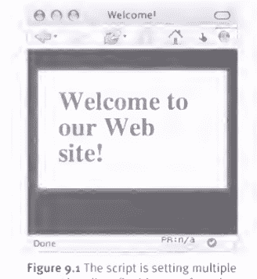

**图 9.1** 该脚本在页面加载时设置多个`onload`处理程序（在本例中，用于颜色格式化）。

```
function addOnload(newFunction) {
```

这一行开始一个新函数，就像任何其他函数一样。传入的是函数的名称。

这可能有点令人困惑，所以这里有个例子。不用调用

`window.onload = myNewFunction;`

我们将改为调用

`addOnload(myNewFunction);`

这在最终效果上是相同的。

```
var oldOnload = window.onload;
```

这一行声明了一个新变量`oldOnload`——如果我们已经设置了`window.onload`，我们将把它存储在这里。如果我们还没有设置，这不会造成任何损害。

```
if (typeof oldOnload == "function") {
```

在这一行中，我们检查`oldOnload`是什么类型的变量。如果我们之前已经设置了`window.onload`，它将是一个函数调用（否则，它将完全是空的）。如果它是一个函数，执行以下操作。

## 替换元素

### 要使用正则表达式替换元素：

```
var re = /\s*_off\s*/;
```

这一行设置了一个新的正则表达式模式，用于在字符串中任何位置查找文本`_off`。

```
thisImage.clickImage.src = thisImage.src.replace(re, "_click");
```

脚本 4.5 中的代码行是`thisImage.clickImage.src = "images/" + thisImage.id + "_click.gif";`

新行使用`re`模式来查找字符串中的特定部分，并在找到时将其替换为此字符串。在本例中，我们查找`_off`并将其替换为`_click`。这样我们就不必担心此图片上是否设置了`id`属性——它已经无关紧要了。

```
thisImage.overImage.src = thisImage.src.replace(re, "_on");
```

脚本 4.5 中的代码行是`thisImage.overImage.src = "images/" + thisImage.id + "_on.gif";` 在本例中，我们查找`_off`并将其替换为`_on`。

> ✔ 提示

- 如果你的图像是 GIF 和 JPEG 文件的混合，这也很方便——现在，你的 JavaScript 代码根本不需要知道每个图像的后缀是什么。

```
window.onload = function() {
    if (oldOnload) {
        oldOnload();
    }
    newFunction();
}
```

这些代码行重置`window.onload`的值，使其做两件事：以前所做的任何事情，以及我们的新函数。`window.onload`事件处理程序被设置为一个匿名函数（一个没有名称的函数）。然后，如果`oldOnload`有值（它应该有，但这可以绕过 Internet Explorer 7 中的一个 bug），我们告诉`window.onload`执行它之前已经在做的事情。但在函数结束之前，我们添加了它还需要执行我们的`newFunction()`。

#### 提示

- 如果你想让`onload`处理程序做不止一件事，最简单的方法是创建一个完成所有事情的函数，然后让`onload`处理程序调用该函数。但确保每个函数都会返回——例如，如果你的函数包含一个对自身调用的`setTimeout()`，它将永远不会返回，因此永远不会继续执行其他被调用的函数。

- 如果你正在处理现有的代码库，很容易意外重置`window.onload`——任何给定的 HTML 页面都可以调用多个外部 JavaScript 文件，其中任何一个都可以设置事件处理程序。如果某个地方直接设置了`window.onload`，但之后每次都调用`addOnload()`，那么你没有问题。但如果你在已经设置`window.onload`之后再次设置它（无论是直接设置还是通过`addOnload()`），你就会覆盖之前的处理程序并丢失其原始值。

- 这个脚本（非常）松散地基于 Simon Willison (simonwillison.net) 的一个脚本，经其许可使用。

```
else {
    window.onload = newFunction;
}
```

如果`oldOnload`不是一个函数，也就是说，它是未定义的，我们告诉它在页面完成加载时执行我们的新函数。这样，我们就可以多次调用`addOnload()`：第一次时它将其函数分配给`window.onload`；第二次及之后它创建那个匿名函数，告诉 JavaScript 执行它之前被告知要做的所有事情以及新的事情。

## 第9章

### onunload 事件

`onunload`处理程序在用户离开你的网页时触发。最常见的用途是当你离开某些商业网站（尤其是色情网站）时弹出的广告窗口。如果你发现自己身处后者，你常常会发现几乎不可能离开——每次你关闭一个窗口或试图导航离开该网站时，窗口一个接一个地出现，重新打开相同或不同的页面，所有都是同一类型的内容。

因此，人们对`onunload`处理程序深恶痛绝，所以请谨慎使用。

### onresize 事件

Netscape 4.x 有一个著名的缺陷，即当网页被调整大小时，动态内容不会被重绘。脚本 9.3 和 9.4 强制页面重新加载其内容以避免此问题。值得庆幸的是，Netscape 6 及更高版本不再受此缺陷的影响。

1. `window.onresize = resizeFix;`

    该事件处理程序附加到`window`对象，并调用`resizeFix`函数。

2. `if (document.layers) {`

    我们只想在用户使用 Netscape 4.x 时执行以下操作，这是检查此情况的最简单方法。`document.layers`对象仅在此浏览器中存在。

3. `var origWidth = window.innerWidth;`

    `var origHeight = window.innerHeight;`

    如果我们在 Netscape 4.x 中，我们希望保存浏览器窗口的当前高度和宽度以备后用。

脚本 9.3 此 HTML 将 JavaScript 隐藏在多行注释中，因为它旨在用于较旧的浏览器。

```html
<!DOCTYPE html PUBLIC "-//W3C//DTD XHTML 1.0 Transitional//EN">
<html xmlns="http://www.w3.org/1999/xhtml">
<head>
	<title>onResize Netscape fix</title>
	<script language="Javascript"
	 type="text/javascript" src="script02.js">
	</script>
</head>
<body bgcolor="#FFFFFF">
	<h1>
	<script language="Javascript"
	 type="javascript">
	 <!-- Hide code from older browsers
	
document.write("This is dynamic content")
	 // Stop hiding code -->
	</script>
	</h1>
</body>
</html>
```

脚本 9.4 你可以使用此脚本修复 Netscape 4.x 的动态内容重绘缺陷。

```javascript
window.onresize = resizeFix;

if (document.layers) {
	var origWidth = window.innerWidth;
	var origHeight = window.innerHeight;
}

function resizeFix() {
	if (document.layers) {
		if (window.innerWidth != origWidth ||
		 window.innerHeight != origHeight) {
			window.location.reload();
		}
	}
}
```

## 处理窗口事件

## 处理事件

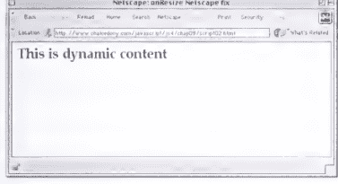

```
function resizeFix() {
```

这里是我们实际处理浏览器调整大小的地方。

```
if (document.layers) {
```

再次检查，确保这仅在用户使用 Netscape 4.x 时发生。

```
if (window.innerWidth != origWidth || window.innerHeight != origHeight) {
```

如果他们进入这里时窗口的高度或宽度发生了变化，则是用户调整了窗口大小，我们希望强制页面重新加载。如果浏览器窗口大小没有变化，则`onresize`处理程序是由 Netscape 绘制滚动条触发的，可以忽略。

```
window.location.reload();
```

如果用户确实调整了窗口大小，则重新加载页面（**图 9.2**）。

**图 9.2** 重新加载（但仍然有点枯燥）的页面。

### onmove 事件

`onmove`事件处理程序在窗口被移动时触发。

## onabort 事件

`onabort`事件处理程序在用户取消网页上的图像加载时触发。它并不常用，而且并非所有浏览器都完全支持它。

## onerror 事件

`onerror`事件可能在页面上发生 JavaScript 错误时触发。

> ✔ **提示**

> 在你发布到 Web 上的复杂页面中设置`onerror = null`是一种礼貌的做法。有了这行代码，*一些*错误消息将不会在不幸发生问题时显示给用户——但哪些错误会被隐藏取决于浏览器。

## 处理窗口事件

## onfocus 事件

`onfocus`和`onblur`处理程序是彼此的镜像。虽然它们听起来像是熬夜写 JavaScript 太晚时发生的事情，但实际上，`onfocus`处理程序在页面成为最前面的活动窗口时触发。脚本 9.5 和 9.6 捕获`onfocus`处理程序并强制页面始终转到后面（图 9.3）。

1. `window.onfocus = moveBack;`

    这是窗口和事件处理程序对象调用函数的另一个例子，本例中是`moveBack`。

2. `function moveBack() {`

    `self.blur();`

    `}`

    如果浏览器窗口成为活动窗口，则触发此函数并强制窗口变为非活动状态（即，失焦）。

脚本 9.5 此 HTML 用于位于后方的页面。

```html
<!DOCTYPE html PUBLIC "-//W3C//DTD XHTML 1.0 Transitional//EN">
<html xmlns="http://www.w3.org/1999/xhtml">
<head>
    <title>Always in Back</title>
    <script type="text/javascript" language="Javascript" src="script03.js"></script>
</head>
<body bgcolor="#FFFFFF">
    <h1>Unimportant content that should never be in front</h1>
</body>
</html>
```

脚本 9.6 使用`onfocus`处理程序，你可以控制窗口的堆叠顺序。

```javascript
window.onfocus = moveBack;

function moveBack() {
    self.blur();
}
```


图 9.3 位于后方的页面将保持在那里。

**脚本 9.7** 此 HTML 用于始终保持在前面的页面。

```html
<!DOCTYPE html PUBLIC "-//W3C//DTD XHTML 1.0 Transitional//EN">
<html xmlns="http://www.w3.org/1999/xhtml">
<head>
    <title>Always in Front</title>
    <script type="text/javascript"
      language="Javascript" src="script04.js">
    </script>
</head>
<body bgcolor="#FFFFFF">
    <h1>Important content that should always be
    in front</h1>
</body>
</html>
```

**脚本 9.8** 此脚本使用`onblur`将窗口保持在前台（活动）位置。

```javascript
window.onblur = moveUp;

function moveUp() {
    self.focus();
}
```

## onblur 事件

如果你有一个窗口希望始终位于所有其他窗口的前面（例如，一个加载主页面内容的控制面板），你需要的是**脚本 9.7**和**9.8**。每当用户试图将此页面置于后台时（触发`onblur`处理程序），它会强制返回到前面。

1. `window.onblur = moveUp;`

    这是窗口和事件处理程序对象调用函数的另一个例子，本例中是`moveUp`。

2. `function moveUp() {`

    `self.focus();`

    `}`

    如果浏览器窗口成为非活动窗口，则触发此函数并强制窗口变为活动状态。

#### 提示

- 要非常小心，不要意外打开两个都包含此段代码的窗口。很可能，你的浏览器将无法优雅地处理结果！

- 与其在控制面板上使用此脚本，你可以在主窗口上使用**脚本 9.6**始终使其转到后面，从而使控制面板始终是最高层的窗口。

- 你可能更熟悉`onblur`事件的一种更恶劣的用途：广告商在你当前网页的*后面*打开广告窗口，你直到关闭窗口并发现一堆窗口堆叠时才会发现。不幸的是，人们将责任归咎于他们最后打开的网站，而实际上广告可能是由很早之前浏览的页面创建的。

## 鼠标事件处理

用户与你页面的许多交互都是以鼠标移动或鼠标点击的形式进行的。JavaScript 为此类事件提供了一组强大的处理程序。

#### onmousedown 事件

JavaScript 新手最常问的问题之一是，“我如何向任何访问我的页面的人隐藏我的脚本？” 答案是，很简单，你做不到。如果任何人有足够的决心，他们总能找出你代码中的内容。

不过，如果你真的需要尝试向普通浏览者隐藏你的代码，**脚本 9.9**可以防止他们通过通常会弹出快捷菜单的鼠标点击来查看页面源代码。

1. `if (typeof document.oncontextmenu == "object") {`

    `if (document.all) {`

    `document.onmousedown = captureMousedown;`

    `}`

    这第一个块检查此浏览器是否为 Firefox，它使用`window.oncontextmenu`（因此不知道`document.oncontextmenu`）。如果不是 Firefox，我们接着查找`document.all`，这是检查浏览器是否为 IE 的一种简单方法。如果是，我们希望设置`captureMousedown()`，以便在`onmousedown`被触发时运行。

2. `else {`

    `document.oncontextmenu = captureMousedown;`

    如果我们在这里，是因为你的访客使用的是 Safari，该浏览器需要在`document`对象上设置`oncontextmenu`。

**脚本 9.9** 此脚本将阻止一些没有经验的用户在你的页面上调出快捷菜单。

```javascript
if (typeof document.oncontextmenu == "object") {
    if (document.all) {
        document.onmousedown = captureMousedown;
    }
    else {
        document.oncontextmenu = captureMousedown;
    }
}
else {
    window.oncontextmenu = captureMousedown;
}

function captureMousedown(evt) {
    var mouseClick = (evt) ? evt.which : window.event.button;

    if (mouseClick==1 || mouseClick==2 || mouseClick==3) {
        alert("Menu Disabled");
        return false;
    }
}
```

# 第 9 章

## `onmouseup` 事件

与`onmousedown`事件类似，`onmouseup`事件在用户按下鼠标按钮并释放时触发。

## `onmousemove` 事件

当页面访问者移动鼠标时，`onmousemove`事件就会被触发。在此示例中，用户会感觉有人在监视他们的一举一动（**图 9.5**）。脚本 **9.10**、**9.11** 和 **9.12** 展示了如何使用 JavaScript 显示跟随访问者移动的眼球。

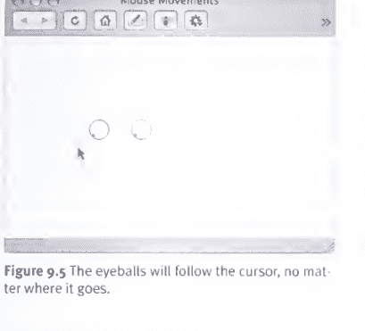

**1.** `document.onmousemove = moveHandler;`

对于所有浏览器，如果触发了`mousemove`事件，就调用`moveHandler()`函数。

**2.** `function moveHandler(evt) {`

    `if (!evt) {`

        `evt = window.event;`

    `}`

    `animateEyes(evt.clientX, evt.clientY);`

`}`

每当发生`mousemove`事件时，`moveHandler()`函数就会被触发。如果访问者使用的是 Internet Explorer，我们需要初始化`evt`，然后对于所有浏览器，我们都调用`animateEyes()`函数，并将光标的 X 和 Y 坐标传递给它。

**3.** `function animateEyes(xPos, yPos) {`

这里就是实际进行眼球运动的地方，基于传入的 X 和 Y 坐标。

**4.** `var rightEye = document.getElementById("rEye");`

`var leftEye = document.getElementById("lEye");`

`var rightEyeball = document.getElementById("rDot").style;`

`var leftEyeball = document.getElementById("lDot").style;`

此部分将变量分配给与眼球圆形图像和眼球圆点图像的 ID 相对应的元素。

```html
<!DOCTYPE html PUBLIC "-//W3C//DTD XHTML 1.0 Transitional//EN">
<html xmlns="http://www.w3.org/1999/xhtml">
<head>
    <title>Mouse Movements</title>
    <script language="JavaScript" type="text/javascript" src="script06.js"></script>
    <link rel="stylesheet" href="script06.css" />
</head>
<body>
    
    
    
    
</body>
</html>
```

脚本 9.10 跟随眼睛示例的 HTML。

下页继续

**5.** `leftEyeball.left = newEyeballPos(xPos, leftEye.offsetLeft);`

   `leftEyeball.top = newEyeballPos(yPos, leftEye.offsetTop);`

   `rightEyeball.left = newEyeballPos(xPos, rightEye.offsetLeft);`

   `rightEyeball.top = newEyeballPos(yPos, rightEye.offsetTop);`

此代码块根据鼠标指针的位置绘制眼球，使用了下一步中定义的`newEyeballPos()`函数的结果。

```
function newEyeballPos
      (currPos, eyePos) {
       return Math.min(Math.max(currPos,
       eyePos+3), eyePos+17) + "px";
   }
```

我们当然不希望眼球跑到眼睛外面去，对吧？所以，对于每个眼球，我们都会检查确保它尽可能靠近光标，同时仍然出现在眼睛的圆形区域内。

### 鼠标事件处理

##### 脚本 9.11 跟随眼睛示例的 CSS。

```css
body {
    background-color: #FFF;
}

#lEye, #rEye {
    position: absolute;
    top: 100px;
}

#lDot, #rDot {
    position: absolute;
    top: 113px;
}

#lEye {
    left: 100px;
}

#rEye {
    left: 150px;
}

#lDot {
    left: 118px;
}

#rDot {
    left: 153px;
}
```

##### 脚本 9.12 用此脚本盯住（好吧，是两只眼睛）你的用户。

```javascript
document.onmousemove = moveHandler;

function moveHandler(evt) {
    if (!evt) {
        evt = window.event;
    }
    animateEyes(evt.clientX, evt.clientY);
}

function animateEyes(xPos, yPos) {
    var rightEye = document.getElementById("rEye");
    var leftEye = document.getElementById("lEye");
    var rightEyeball = document.getElementById("rDot").style;
    var leftEyeball = document.getElementById("lDot").style;

    leftEyeball.left = newEyeballPos(xPos, leftEye.offsetLeft);
    leftEyeball.top = newEyeballPos(yPos, leftEye.offsetTop);
    rightEyeball.left = newEyeballPos(xPos, rightEye.offsetLeft);
    rightEyeball.top = newEyeballPos(yPos, rightEye.offsetTop);
}

function newEyeballPos(currPos, eyePos) {
    return Math.min(Math.max((currPos - eyePos - 5), 0), 20) + "px";
}
```

## ✔ 提示

- 为什么我们要检查三种不同的鼠标点击？一种难道不够吗？

理论上，是的，但在实践中，不行——如**表 9.1**所示。不幸的是，这种方法可能会适得其反：你可能成功阻止了左键和右键点击输入（例如，阻止人们从网页上拖走图片），但这也意味着你可能阻止了人们点击页面上的任何链接。

**表 9.1**

**鼠标点击代码**

| 代码 | 浏览器/事件 |
|---|---|
| 1 | Internet Explorer/左键点击<br>所有 Mac 浏览器/Control-左键点击 |
| 2 | Internet Explorer/右键点击 |
| 3 | Firefox/右键点击<br>所有 Mac 浏览器/右键点击 |

- 技术熟练的冲浪者很容易就能绕过这个：他们只需在浏览器中关闭 JavaScript，点击功能就恢复了。将你的 JavaScript 代码放入外部`.js`文件似乎是一个巧妙的解决方法，但用户可以查看他们硬盘上的缓存文件夹。或者他们可以查看页面源代码，找到外部文件的名称，然后在浏览器中输入外部文件的 URL，浏览器就会忠实地显示文件内容。如果你真的担心源代码被盗，唯一能保证不被查看的方法就是永远不要将其放在 Web 上。

- IE 理解`document.oncontextmenu`，所以你会认为设置它会导致它处理这些事件——但它并没有。IE 是唯一需要设置`document.onmousedown`的浏览器。如果你同时设置了`window.oncontextmenu`和`document.onmousedown`，Firefox 会为每个操作触发两次事件。

- Web 上有一个常见的 JavaScript 小部件，页面上有一堆点（或设计师想要的任何东西）跟随光标在页面上移动。我们不想重新创建一个已经存在的效果，所以我们做了眼球；但如果你想在你的页面上放跟随的点，你应该可以直接修改这个脚本。

- Netscape 6 有一个错误，两个眼球总是被放置在低 10 像素的位置。这个错误在 Netscape 7 中被修复了。

## `onmouseover` 事件

到现在，你应该已经熟悉这个事件了：它是我们在图像翻转中的好朋友。每当鼠标移动到任何已注册了`onmouseover`的区域时，此事件就会触发。

## `onmouseout` 事件

现在也不足为奇了，有`onmouseover`的地方，通常就有`onmouseout`。当用户将鼠标移出已注册事件的区域时，此事件会被触发。

## `ondblclick` 事件

Web 的一个缺点是，计算机用户学会交互的用户界面元素在 Web 上都发生了变化。例如，新计算机用户最先学会的操作之一是双击鼠标，但在 Web 上没有双击。或者至少，以前没有，但现在有了脚本 9.13 和 9.14，你将能够检查双击鼠标。

`document.images[i].ondblclick = newWindow;`

当用户双击其中一个缩略图时，`newWindow()`事件处理程序就会被触发。在这种情况下，会弹出一个新窗口（图 9.6），以更大的格式显示相同的图像。

```html
<!DOCTYPE html PUBLIC "-//W3C//DTD XHTML 1.0 Transitional//EN">
<html xmlns="http://www.w3.org/1999/xhtml">
<head>
  <title>Image Popup</title>
  <script language="Javascript" type="text/javascript" src="script07.js"></script>
</head>
<body bgcolor="#FFFFFF">
  <h3>Double-click on an image to see the full-size version</h3>
  
  
  
</body>
</html>
```

脚本 9.13 此 HTML 帮助你处理双击。

```javascript
window.onload = initImages;

function initImages() {
  for (var i=0; i<document.images.length; i++) {
    document.images[i].ondblclick = newWindow;
  }
}

function newWindow() {
  var imgName = "images/" + this.id + ".jpg"
  var imgWindow = window.open(imgName,
    "imgWin", "width=320,height=240,scrollbars=no")
}
```

脚本 9.14 使用此脚本捕获和处理双击。

## 鼠标事件处理

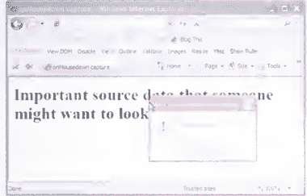

图 9.4 此警告框吓退了胆小者（并惹恼了其他人）。

```
else {
    window.oncontextmenu = captureMousedown;
}
```

最后，如果浏览器是 Firefox，我们希望窗口的`oncontextmenu`事件调用`captureMousedown()`函数。

```
function captureMousedown(evt) {
```

处理`onmousedown`和`oncontextmenu`事件的函数从这里开始。基于 Netscape 的浏览器和 Safari 会在触发事件时自动生成传入的`evt`参数，此变量包含有关事件的信息。

```
var mouseClick = (evt) ? evt.which : window.event.button;
```

如果`evt`变量存在，我们可以通过检查`evt.which`来确定用户点击了哪个按钮。如果用户使用的是 IE，用户操作的结果将在`window.event.button`中找到。无论哪种方式，都将结果存储在`mouseClick`变量中。

```
if (mouseClick==1 || mouseClick==2
    || mouseClick==3) {
        alert("Menu Disabled");
        return false;
    }
```

如果`mouseClick`是 1、2 或 3，则弹出一个警告框（图 9.4），说明该功能已禁用，并返回`false`。返回`false`可以防止菜单窗口显示。

## onclick 事件

**onclick**处理程序的工作方式与**ondblclick**处理程序类似，区别在于单击即可触发，而非双击。**onmouseup**处理程序也类似，但**onclick**要求用户既要按下又要松开鼠标按钮才能触发，而**onmouseup**只需要后者即可。

图 9.6 双击缩略图会打开该图片的较大版本。

# 第 9 章

## 表单事件处理

你主要会出于验证表单的目的来使用表单事件处理。借助下面列出的事件，你可以处理用户与表单交互时几乎任何操作。

### onsubmit 事件

`onsubmit`处理程序（如第 7 章所示）在用户点击"提交"按钮完成表单时触发。此外，根据浏览器的不同，当用户退出表单的最后一个文本输入字段时也可能触发。如果脚本包含`onsubmit`处理程序，且该处理程序的结果为`false`，表单将不会发送回服务器。

### onreset 事件

`onreset`处理程序在用户点击表单上的"重置"按钮时触发（如果存在）。如果你的表单在页面加载时设置了默认值，这会很有用——如果用户点击"重置"，你需要用一个脚本动态地重置默认值来处理这种情况。

### onchange 事件

如脚本 7.2 所示，`onchange`事件处理程序在用户更改表单字段时触发。这可以用来验证他们即时输入的信息，或者在用户点击"提交"按钮之前响应用户的选择。

### onselect 事件

如果用户在`input`或`textarea`表单字段中选择了文本，`onselect`处理程序就会被触发。

## 处理事件

脚本 9.15 此 HTML 创建了一个简单的表单。

```html
<!DOCTYPE html PUBLIC "-//W3C//DTD XHTML 1.0 Transitional//EN">
<html xmlns="http://www.w3.org/1999/xhtml">
<head>
    <title>Requiring an entry</title>
    <script language="Javascript"
            type="text/javascript" src="script08.js">
    </script>
</head>
<body bgcolor="#FFFFFF">
    <form action="#">
        <h3>
            Email address: <input type="text"
                class="reqd" /><br /><br />
            Name (optional): <input type="text" />
        </h3>
    </form>
</body>
</html>
```

### onclick 事件

虽然上文在"鼠标事件"下提到了`onclick`处理程序，但这里再次列出，因为它在处理表单时最为常用。当用户点击复选框或单选按钮时，此事件会被触发，如脚本 7.13 所示。脚本 2.10 也使用了`onclick`处理程序；在该示例中，它允许单个链接对支持 JavaScript 的浏览器执行一种操作，而对不支持 JavaScript 的浏览器执行完全不同的另一种操作。

### onblur 事件

虽然`onblur`可以用于浏览器窗口（如上所示），但更常见的用法是在表单中。脚本 9.15 和 9.16 展示了如何使用`onblur`处理程序强制用户在字段中输入数据。

1. `if (allTags[i].className.indexOf("reqd") > -1) {`

   我们使用`class`属性（值为`reqd`）来决定何时使用`onblur`事件处理程序。只需在`input`标签中添加`class="reqd"`即可触发该事件，而不必逐个字段地添加`onblur`处理程序。

2. `allTags[i].onblur = fieldCheck;`

   字段上的此事件处理程序会在用户离开必填字段时调用`fieldCheck()`函数。

3. `function fieldCheck() {`

       `if (this.value == "") {`

           `this.style.backgroundColor = "#FFFF99";`

           `this.focus();`

       `}`

       `else {`

           `this.style.backgroundColor = "#FFFFFF";`

       `}`

   `}`

`fieldCheck()`函数检查当前字段中是否输入了某些内容（任何内容）。如果字段没有值，该字段的背景色会变为淡黄色（图 9.7），并且光标会通过`focus()`放回表单字段中。当错误被纠正后，背景色会被重置为白色。

#### ✓ 提示

- `onblur`和`onchange`事件都在用户更改字段后离开该字段时触发。如果用户没有更改就离开字段，则只触发`onblur`处理程序。

- 当前发布的 Firefox 版本存在`focus()`的问题：即使你告诉浏览器停留在某个字段中，它也不会。不过，更改背景色可以给用户一个视觉提示，表明出了问题，因此他们仍然会知道存在问题。

**表单事件处理**

脚本 9.16 `onblur`处理程序可用于表单中，在用户离开字段时触发操作。

```javascript
window.onload = initForm;

function initForm() {
    var allTags = document.getElementsByTagName("*");
    for (var i=0; i<allTags.length; i++) {
        if (allTags[i].className.indexOf("reqd") > -1) {
            allTags[i].onblur = fieldCheck;
        }
    }
}

function fieldCheck() {
    if (this.value == "") {
        this.style.backgroundColor = "#FFFF99";
        this.focus();
    }
    else {
        this.style.backgroundColor = "#FFFFFF";
    }
}
```

图 9.7 当用户未输入任何内容就从"电子邮件地址"字段切换出去时，该字段变为黄色并保持活动状态，直到有数据输入为止。

**脚本 9.17** 此 HTML 创建了表单，该表单不允许在电子邮件字段中输入内容。

```html
<!DOCTYPE html PUBLIC "-//W3C//DTD XHTML 1.0
Transitional//EN">
<html xmlns="http://www.w3.org/1999/xhtml">
<head>
    <title>Forbidding an entry</title>
    <script src="script09.js"
        type="text/javascript"
        language="javascript">
    </script>
</head>
<body bgcolor="#FFFFFF">
    <form action="#">
    <h3>
        Your message: <textarea rows="5"
            cols="30">Enter your message
            here</textarea><br /><br />
        Will be sent to: <input type="text"
            value="js6@javascriptworld.com"
            readonly="readonly" />
    </h3>
    </form>
</body>
</html>
```

### onfocus 事件

有时你的页面上会有一个表单字段，其中包含你想作为表单一部分显示的数据，但不希望用户修改该字段。你可以使用**readonly** HTML 属性来阻止用户进入，但并非所有浏览器都支持它。**脚本 9.17**和**9.18**展示了如何使用**onfocus**事件将用户直接从该字段中弹出，以防万一他们进入了不该进入的地方。

- `allTags[i].onfocus = function() {this.blur()};`

当用户试图进入该字段时，焦点（在此情况下是活动字段）会自动被直接弹出（**图 9.8**）。这是因为**onfocus**事件处理程序被设置为调用一个匿名函数（没有名称的函数），该函数只做一件事：在当前字段上调用**blur()**，将用户弹出去。

**脚本 9.18** 使用表单中的`onfocus`处理程序防止错误的字段输入。

```javascript
window.onload = initForm;

function initForm() {
    var allTags = document.getElementsByName
        ("*");

    for (var i=0; i<allTags.length; i++) {
        if (allTags[i].readOnly) {
            allTags[i].onfocus = function()
                {this.blur()};
        }
    }
}
```

**图 9.8** 用户无法在底部字段中输入任何内容。

# 第 9 章

# 键盘事件处理

除了鼠标之外，另一个主要的输入设备是键盘，至少在那些酷炫的计算机思维控制设备投入使用之前是如此。与鼠标一样，JavaScript 也有能力处理键盘。

### onkeydown 事件

允许用户通过键盘以及鼠标来控制你的网页是很方便的。借助键盘事件处理程序，你可以在按下适当的键时触发事件。在**脚本 9.19**和**9.20**中，一个标准的幻灯片（其他方面与脚本 4.17 中的相同）可以通过按键盘上的左右箭头键来查看（**图 9.9**）。

1. `document.onkeydown = keyHit;`

   这里我们将`keyHit()`函数注册为处理`onkeydown`事件的函数。

2. `var thisPic = 0;`

   变量`thisPic`被初始化并在全局范围内设置，以便每次调用`keyHit()`时都可以存储和使用。

3. `function keyHit(evt) {`

   `keyHit()`函数在按键被按下时处理该事件。

4. `var ltArrow = 37;`

   `var rtArrow = 39;`

   我们需要存储按下按键时的适当值。左箭头键生成 37，右箭头键触发 39。

#### 脚本 9.19 幻灯片的 HTML。

```html
<!DOCTYPE html PUBLIC "-//W3C//DTD XHTML 1.0 Transitional//EN">
<html xmlns="http://www.w3.org/1999/xhtml">
<head>
    <title>Image Slideshow</title>
    <script language="JavaScript"
        type="text/javascript" src="script10.js">
    </script>
</head>
<body bgcolor="#FFFFFF">
    <h3 align="center">
        <br />
        Use the right and left arrows on your
        keyboard to view the slideshow
    </h3>
</body>
</html>
```

图 9.9 此幻灯片通过按键控制，而非点击导航按钮。

# 键盘事件处理

## 事件处理

## 关键事件处理

# 第 9 章

**脚本 9.20** 使用此脚本中的`onkeydown`处理器来触发幻灯片切换。

```javascript
document.onkeydown = keyHit;
var thisPic = 0;

function keyHit(evt) {
    var myPix = new Array("images/callista.jpg",
        "images/europa.jpg", "images/io.jpg",
        "images/ganymede.jpg");
    var imgCt = myPix.length-1;
    var ltArrow = 37;
    var rtArrow = 39;

    var thisKey = (evt) ? evt.which :
        window.event.keyCode;

    if (thisKey == ltArrow) {
        chgSlide(-1);
    }
    else if (thisKey == rtArrow) {
        chgSlide(1);
    }
    return false;

    function chgSlide(directian) {
        thisPic = thisPic + directian;
        if (thisPic > imgCt) {
            thisPic = 0;
        }
        if (thisPic < 0) {
            thisPic = imgCt;
        }
        document.getElementById("myPicture").
            src = myPix[thisPic];
    }
}
```

5. `var thisKey = (evt) ? evt.which : window.event.keyCode;`

   我们如何判断用户按下了哪个键取决于他们使用的浏览器。如果是 Firefox 或 Safari，我们查看`evt.which`，它包含所按键的代码。如果是 IE，同样的值则在`window.event.keyCode`中。无论哪种方式，结果都会保存在`thisKey`中。

6. `if (thisKey == ltArrow) {`

       `chgSlide(-1);`

   `}`

   `else if (thisKey == rtArrow) {`

       `chgSlide(1);`

   `}`

   如果用户按下了左箭头键，则向后浏览幻灯片。如果按下了右箭头键，则向前浏览。如果按下了其他任何键，则不执行任何操作。

7. `return false;`

   这一行是为了绕过某个浏览器的 bug：Safari。其他浏览器都能正常处理，但 Safari 每次按下箭头键时会触发两次按键事件（导致`onkeydown`被触发两次）。如果返回`false`值，Safari 就知道应该停止处理这些事件，而其他浏览器对此并不在意。

### onkeyup 事件

`onkeyup`事件处理器与`onkeydown`处理器完全相同，区别在于（想想也知道）它在用户完成按键并松开按键后才被调用。

### onkeypress 事件

`onkeypress`事件在用户按下按键并松开按键时都会触发——只是为了完整性。

提示：如果你不确定某个特定键的键值是什么，可以通过在步骤 5 和步骤 6 的代码之间插入`alert(thiskey);`这一行来查找；然后按下你想查找值的按键。弹出的警告框中会显示该按键的数字键值。

## JAVASCRIPT 和 Cookie

在网络术语中，*cookie*是 Web 服务器在初次与浏览器"见面"时发送给你的浏览器的一条独特信息片段，之后每次访问时双方都会共享它。远程服务器保存它那部分的 cookie 及其中包含的关于你的信息；你的浏览器也同样保存，以纯文本文件的形式存储在你电脑的硬盘上。

作为 JavaScript 开发者，你可以利用 cookie 做许多有用的事情。如果你的网站需要注册，你可以设置 cookie 将读者的用户名和密码存储在他们的硬盘上，这样他们每次访问时就不需要重新输入。你可以跟踪用户访问了网站的哪些部分，并统计该用户的访问次数。

人们对 cookie 有许多常见的误解，因此有必要说明你不能用 cookie 做什么：你无法获取用户的真实信息，如电子邮件地址；你无法使用 cookie 查看他们硬盘的内容；cookie 也不会传播计算机病毒。Cookie 只是你硬盘上的一个简单文本文件，你作为 JavaScript 程序员可以在其中存储一些信息。

### 第 10 章

Cookie 始终包含发送它的服务器地址。这是 cookie 技术背后的核心理念：身份识别。可以将其视为网络版的来电显示，在此基础上有所变化——每个使用 cookie 的网站都会给你的浏览器分配某种个性化 ID，以便在下次访问时识别你。当你返回首次向你传递特定 cookie 的 Web 服务器时，服务器可以查询你的浏览器，看看你是否是它的众多 cookie 持有者之一。如果是，服务器就可以检索你们最初交换时存储在 cookie 中的信息。请记住，cookie 只能识别正在使用的计算机，而无法识别使用该计算机的个人。

**脚本 10.1** 我们第一个 cookie 页面的 HTML 代码。

```html
<!DOCTYPE html PUBLIC "-//W3C//DTD XHTML 1.0
Transitional//EN">
<html xmlns="http://www.w3.org/1999/xhtml">
<head>
    <title>Set a cookie based on a form</title>
    <script language="javascript"
        type="text/javascript"
        src="script01.js">
    </script>
</head>
<body bgcolor="#FFFFFF">
    <form action="#">
        <h1>Enter your name: <input
            type="text" id="nameField" /></h1>
    </form>
</body>
</html>
```

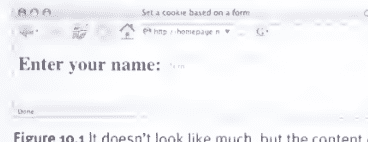

图 10.1 看起来没什么特别的，但表单文本框中的内容刚刚已被写入了一个 cookie。

### 烘焙你的第一个 Cookie

Cookie 是一种具有特定格式的文本字符串：

```
cookieName=cookieValue; expires=
expirationDateGMT; path=URLPath;
domain=siteDomain
```

逐项分解，字符串的第一部分为 cookie 赋予名称和值。这是 cookie 唯一必需的部分；其余字符串都是可选的。接下来是 cookie 的过期日期；当到达此日期时，浏览器会自动删除该 cookie。过期日期之后是一个 URL 路径，可以让你在 cookie 中存储一个 URL。最后，你可以在 cookie 中存储一个域名值。

脚本 10.1 是 HTML 文件，它调用了脚本 10.2 中的 JavaScript，该脚本将用户在表单中输入的值设置为 cookie。当你试用时，它看起来似乎没什么变化（如图 10.1 所示），但 cookie 实际上已经被创建了。本章后面的示例都基于此示例构建。

设置 cookie 的步骤：

1. `function nameFieldInit() {`

   首先，定义函数`nameFieldInit()`来设置 cookie 的值。此函数在窗口加载完成后被调用。

2. `var userName = "";`

   接下来，我们用空值初始化变量`userName`。

3. `if (document.cookie != "") {`

   `userName = document.cookie.split("=")[1];`

   `}`

   我们开始一个条件测试，首先检查`document.cookie`对象是否不包含空值。`split("=")`方法将 cookie 拆分为一个数组，其中`cookieField[0]`是 cookie 名称，`cookieField[1]`是 cookie 值。注意`cookieField`可以是你想用于存储特定 cookie 字段的任何变量。因此，你将`document.cookie.split("=")[1]`返回的值赋给`userName`，即 cookie 的值。

4. `document.getElementById("nameField").value = userName;`

   设置`getElementById("nameField").value`可以在页面加载时，如果 cookie 文件中有存储的名称，则将其放入文本框。

5. `document.getElementById("nameField").onblur = setCookie;`

   `onblur`事件处理器（参见第 1 章）在用户离开文本框时调用`setCookie()`函数。

6. `function setCookie() {`

   现在开始一个新函数，名为`setCookie()`。

7. `var expireDate = new Date();`

   获取当前日期，并将其放入新变量`expireDate`中。

8. `expireDate.setMonth(expireDate.getMonth()+6);`

   这行代码获取`expireDate`的月份部分，加上 6，然后将`expireDate`的月份部分设置为新值。换句话说，它将我们创建的 cookie 的过期日期设置为六个月后。

### 烘焙你的第一个 Cookie

```javascript
window.onload = nameFieldInit;
function nameFieldInit() {
var userName = "";
if (document.cookie != "") {
userName = document.cookie.split("=")[1];
}
document.getElementById("nameField").value = userName;
document.getElementById("nameField").onblur = setCookie;
}
function setCookie() {
var expireDate = new Date();
expireDate.setMonth(expireDate.getMonth()+6);
var userName = document.getElementById("nameField").value;
document.cookie = "userName=" + userName + ";expires=" + expireDate.toGMTString();
}
```

9. `var userName = document.getElementById("nameField").value;`

这一行创建了一个新的`userName`变量，并将用户在文本框中输入的内容赋值给它。`userName`变量需要创建两次（每个函数内部各一次），因为它不是全局变量；也就是说，我们只在每个函数内部使用它，但并不期望它的值能在函数间保持——每次使用时它都是新的。

10. `document.cookie = "userName=" + userName + ";expires=" + expireDate.toGMTString();`

这就是写入 cookie 的地方。我们通过设置`document.cookie`（记住，cookie 只是一个文本字符串，所以你可以使用同样的文本字符串技术来构建它，比如用`+`号来组合内容）来包含用户名和 cookie 的过期日期。`toGMTString()`方法将`expireDate`日期对象转换成文本字符串，以便可以写入 cookie。

### 一把 cookies

一个页面上可以有多个 cookie，其格式如下：

```
"cookieName1=cookieValue1;
expires1=expirationDateGMT1;
path1=sitePath1;
domain1=siteDomain1;
"cookieName2=cookieValue2;
expires2=expirationDateGMT2;
path2=sitePath2;
domain2=siteDomain2"
```

同样，唯一必需的字段是名称和值这一对。

`split("; ")`命令将多个 cookie 记录分割成一个数组，每个 cookie 记录中的 cookie 从 0 开始编号。注意此命令中的分号后有一个空格。因此`cookieArray[0]`将是多条 cookie 记录中的第一个 cookie，`cookieArray[1]`将是下一个，依此类推。更多信息，请参阅本章后面的“处理多个 Cookie”示例。

- **提示**

  - 此脚本假定第一个 cookie 包含用户名。后续脚本将展示如何处理多个 cookie 以及如何按名称而不是编号获取 cookie。

  - 本章中的脚本是按顺序编排的，如果你按它们出现的顺序运行，它们会正常工作。但是，如果你跳着运行，可能会遇到一些奇怪的结果（例如浏览器认为你的名字是一个数字）。如果你想不按顺序运行，可以尝试在脚本之间运行脚本 10.7（“删除 Cookie”）。

## 读取 Cookie

一旦设置了 cookie，你需要检索它以便进行任何有用的操作。上一个示例用文本字符串 "Tom" 设置了 cookie。非常简单的脚本 10.3 和 10.4 展示了如何从 cookie 中获取该值并显示在屏幕上（当然，你通常不会炫耀你的 cookie；这个脚本只是作为示例来显示 cookie）。

### 要读取 cookie：

- 1. `if (document.cookie != "") {`

确保`document.cookie`对象中的值不为空。

- 2. `document.getElementById ("nameField").innerHTML = "Hello, " + document.cookie.split("=")[1];`

如果 cookie 不为空，则写入一个文本字符串（"Hello,"，注意逗号后的空格）并将其与按等号分割后的 cookie 值组合起来（图 10.2）。

> **提示**

> 你是否注意到你不需要指定正在读取 cookie 文件中的哪一个 cookie？这是因为一个 cookie 只能由最初写入它的服务器读取。浏览器内部的 cookie 机制不允许你读取或写入其他人编写的 cookie。你只能访问自己的 cookie。

脚本 10.3 JavaScript 使用此 HTML 页面中的`id`来插入 cookie 结果。

```html
<!DOCTYPE html PUBLIC "-//W3C//DTD XHTML 1.0 Transitional//EN">
<html xmlns="http://www.w3.org/1999/xhtml">
<head>
<title>I know your name!</title>
<script language="Javascript" type="text/javascript" src="script02.js"></script>
</head>
<body bgcolor="#FFFFFF">
<h1 id="nameField">&nbsp;</h1>
</body>
</html>
```

脚本 10.4 这个简短的脚本读取先前设置的 cookie 并将其发送到文档窗口。

```javascript
window.onload = nameFieldInit;

function nameFieldInit() {
  if (document.cookie != "") {
    document.getElementById("nameField").innerHTML = "Hello, " + document.cookie.split("=")[1];
  }
}
```

## 显示你的 Cookie

在上一个示例中，我们从服务器读取了一个 cookie 的值。现在我们将看到如何编写一个脚本，读取来自你服务器的所有 cookie 并显示它们的名称和值。如果没有 cookie，脚本会显示 "There are no cookies here"（图 10.3）。如果有 cookie，它会为每个 cookie 显示一行，显示 cookie 中的内容（图 10.4）。脚本 10.5 将向你展示如何做。

图 10.3 如果你的网页所在的服务器没有 cookie，你会看到这个结果。

### 要显示你的所有 cookie：

- 1. `var outMsg = "";`

首先初始化变量`outMsg`，它将包含我们要显示的消息。

- 2. `if (document.cookie == "") {`

      `outMsg = "There are no cookies here";`

  `}`

此条件测试读作：“如果`outMsg`对象为空（即为空），则向文档窗口写入 'There are no cookies here'。”

- 3. `var thisCookie = document.cookie.split("; ");`

如果上一个测试失败（即，如果至少存在一个 cookie），则使用`document.cookie.split("; ")`获取所有 cookie 的值，并将这些值放入一个名为`thisCookie`的数组中。记住，`split("; ")`命令会创建一个包含所有 cookie 的数组。稍后，脚本将能够引用该数组中的每个值。

图 10.4 如果有一个或多个 cookie，则脚本会将它们写入文档窗口。

- 4. `for (var i=0; i<thisCookie.length; i++) {`

这一行通过首先将计数器变量`i`的值设置为 0 来开始一个循环。然后，如果`i`小于`thisCookie`数组中的 cookie 数量，则将`i`的值加 1。

脚本 10.5 此脚本逐步遍历并显示你机器上由特定服务器设置的所有 cookie。

```javascript
window.onload = showCookies;

function showCookies() {
    var outMsg = "";

    if (document.cookie == "") {
        outMsg = "There are no cookies here";
    }
    else {
        var thisCookie = document.cookie.split("; ");

        for (var i=0; i<thisCookie.length; i++) {
            outMsg += "Cookie name is '" + 
                thisCookie[i].split("=")[0] + 
                "', and the value is '" + 
                thisCookie[i].split("=")[1] + 
                "'<br />";
        }
    }
    document.getElementById("cookieData").innerHTML = outMsg;
}
```

- 5. `outMsg += "Cookie name is '" + thisCookie[i].split("=")[0];`

   `outMsg += "', and the value is '" + thisCookie[i].split("=")[1] + "'<br />";`

随着脚本遍历数组，它将文本字符串 "Cookie name is '" 放入`outMsg`，后面跟着 cookie 的名称。然后它连接文本字符串 "', and the value is '" 和 cookie 的值。在每行的末尾，我们添加一个 HTML 换行符。

- 6. `document.getElementById("cookieData").innerHTML = outMsg;`

在设置变量`outMsg`后，当所有 cookie 都被遍历完后，它通过`innerHTML`被输出到页面上。

## 使用 Cookie 作为计数器

因为 cookie 是持久性的，也就是说，因为它们在 Web 服务器和浏览器之间的多个会话中都可用，所以你可以使用 cookie 来存储特定用户访问页面的次数。但这与你在许多网页上看到的页面计数器不同。因为 cookie 是特定于用户的，你只能告诉*该*用户他或她访问了多少次；你不能使用 cookie 告诉所有用户页面被点击了多少次。不过，了解如何创建这样的个人计数器还是很有用的，你也可以将**脚本 10.6**用于其他目的（参见提示）。

### 要将 cookie 用作计数器：

- 1. `var expireDate = new Date();`

     `expireDate.setMonth(expireDate.getMonth()+6);`

这两行与“烤你的第一个 Cookie”示例中的步骤 7 和 8 相同。请参考那里的解释。

- 2. `var hitCt = parseInt(cookieVal("pageHit"));`

字符串`pageHit`是 cookie 的名称。在接下来的步骤中，你将看到`cookieVal()`函数。这一行从`cookieVal()`获取 cookie 的名称，使用`parseInt()`方法将其转换为数字，然后将结果存储在变量`hitCt`中。`parseInt()`方法将字符串（cookie 中的内容）更改为数字（变量需要将其用作计数器）。

**脚本 10.6** 此脚本统计你的 cookie。

```javascript
window.onload = initPage;

function initPage() {
    var expireDate = new Date();
    expireDate.setMonth(expireDate.getMonth()+6);

    var hitCt = parseInt(cookieVal("pageHit"));
    hitCt++;

    document.cookie = "pageHit=" + hitCt +
    ";expires=" + expireDate.toGMTString();
    document.getElementById("pageHits").
        innerHTML = "You have visited this page "
    + hitCt + " times.";
}

function cookieVal(cookieName) {
    var thisCookie = document.cookie.split("; ");

    for (var i=0; i<thisCookie.length; i++) {
        if (cookieName == thisCookie[i].split("=")[0]) {
            return thisCookie[i].split("=")[1];
        }
    }
    return 0;
}
```

## 第 10 章

- 3. `hitCt++;`

    现在获取`hitCt`的值并加上 1，使计数器递增。

- 4. `document.cookie = "pageHit=" + hitCt + ";expires=" + expireDate.toGMTString();`

    这行代码将更新后的信息写回 cookie 以供将来使用。写入的是一个文本字符串，它将字符串`"pageHit="`与递增后的`hitCt`值拼接起来，并添加`";expires="`与过期日期（该日期在步骤 1 中已设为六个月后）。

- 5. `document.getElementById("pageHits").innerHTML = "You have visited this page " + hitCt + " times.";`

    这行代码在文档中显示用户消息（图 10.5）。"page" 后面和 "times" 前面有多余的空格，是为了使行在屏幕上显示时看起来更整齐。

- 6. `function cookieVal(cookieName) {`

    这行代码开始定义一个名为`cookieVal()`的新函数。它接收一些数据，这些数据随后可在函数内部作为变量`cookieName`来引用。

- 7. `var thisCookie = document.cookie.split("; ");`

    变量`thisCookie`被赋值为由`split("; ")`方法生成的数组。

- 8. `for (var i=0; i<thisCookie.length; i++) {`

    这里我们开始一个循环，就像在"显示你的 Cookie"示例的步骤 4 中一样。

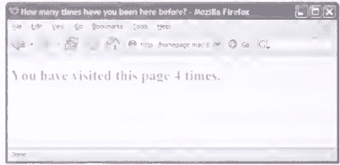

图 10.5 真不敢相信我们竟然访问这个无聊的页面这么多次。

### 将 Cookie 用作计数器

- 9. `if (cookieName == thisCookie[i].split("=")[0]) {`

    这个条件语句检查`cookieName`是否与 cookie 数组的第 i 个元素相同。

- 10. `return thisCookie[i].split("=")[1];`

    如果步骤 9 中的测试成功，则返回 cookie 的值。

- 11. `return 0;`

    如果我们已遍历数组中的所有项但没有找到匹配项，则返回 0 值。

## ✔ 提示

- 当你加载调用此脚本的 HTML 页面时，点击浏览器中的刷新按钮即可看到计数器递增。

- 如前所述，你可以将脚本 10.6 改造用于其他用途。一种可能的用途是使用 cookie 来跟踪特定用户上次访问你网站的时间，并根据该时间显示不同的页面。例如，一些在线杂志在封面页上展示当期的艺术插图和文章标题。如果用户在 24 小时内再次访问该网站，他们第一次之后的后续访问会直接跳转到网站的目录页面。

- 如果你想要一个真正的页面访问计数器——一个能显示页面被所有用户加载次数的计数器，你需要使用安装在 Web 服务器上的计数程序。请咨询你的 Web 托管公司，看看他们是否提供计数器服务，或者在你常用的搜索引擎中输入"网页访问计数器"进行搜索。

## 删除 Cookie

在某个时候，你可能会想要删除一个或多个 cookie 记录中的 cookie。这相当容易实现；一种行之有效的方法是简单地将 cookie 的过期日期设置为过去的某个日期，这样浏览器就会自动将其删除。**脚本 10.7**展示了如何强制使你的 cookie 过期。

### 删除 cookie：

- 1. `var cookieCt = 0;`

    此脚本将跟踪我们已删除的 cookie 数量，因此我们首先创建`cookieCt`变量并将其设置为零。

- 2. `if (document.cookie != "" && confirm("Do you want to delete the cookies?")) {`

    这个测试首先检查 cookie 是否不包含空值，即是否存在一些 cookie。如果测试显示 cookie 为空，则脚本不会执行任何操作。测试的第二部分让浏览器弹出一个包含文本的确认对话框（**图 10.6**）。如果`confirm()`返回`true`，则我们知道用户想要删除其 cookie。如果返回`false`，则跳到步骤 9。

- 3. `var thisCookie = document.cookie.split("; ");`

    这行代码使用`split("; ")`方法将 cookie 的内容拆分为数组，并将该数组赋值给变量`thisCookie`。

- 4. `cookieCt = thisCookie.length;`

    我们现在知道了要删除的 cookie 数量，并将其存储在`cookieCt`中。

### 脚本 10.7 此脚本用于删除 cookie。

```javascript
window.onload = cookieDelete;

function cookieDelete() {
    var cookieCt = 0;

    if (document.cookie != "" && confirm
    ("Do you want to delete the cookies?")) {
    var thisCookie = document.cookie.split
    ("; ");
    cookieCt = thisCookie.length;

    var expireDate = new Date();
    expireDate.setDate(expireDate.
    getDate()-1);

    for (var i=0; i<cookieCt; i++) {
        var cookieName = thisCookie[i].
        split("=")[0];
        document.cookie = cookieName +
        "=;expires=" + expireDate
        .toGMTString();
        }
    }
    document.getElementById("cookieData").
    innerHTML = "Number of cookies deleted: "
    + cookieCt;
}
```


**图 10.6** 在擦除或删除任何内容之前与用户确认，这是一种良好的界面设计。

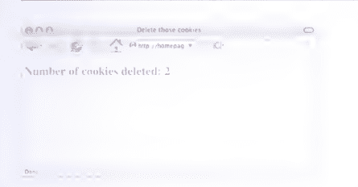

**图 10.7** 用户也应该获得事件已按预期发生的反馈。

```
var expireDate = new Date();
   expireDate.setDate(expireDate.
   getDate()-1);
```

这里我们创建一个新的日期对象`expireDate`，然后将其设置为当前日期减 1——换句话说，就是昨天。

```
for (var i=0; i<cookieCt; i++) {
```

现在开始一个`for`循环，以便我们可以删除所有 cookie，而不仅仅是第一个。首先将`i`的值设置为 0；然后，只要`i`小于 cookie 的数量，就将`i`递增 1。

```
var cookieName = thisCookie[i].
   split("=")[0];
```

使用`split("=")[0]`获取数组中第 i 个 cookie 的名称，然后将其存储在变量`cookieName`中。

```
document.cookie = cookieName +
   "=;expires=" + expireDate.
   toGMTString();
```

这就是将更改了过期日期的 cookie 重新写回的地方。

```
document.getElementById
   ("cookieData").innerHTML =
   "Number of cookies deleted: " +
   cookieCt;
```

脚本现在已退出`for`循环，这行代码将删除的 cookie 数量设置到 HTML 文档中（**图 10.7**）。

> **✔ 提示**

- 在本书的前几版中，如果不存在 cookie 或用户取消了删除操作，此脚本不会显示任何内容。现在将`innerHTML`设置为一个值，在这些情况下（始终为零）也会显示实际删除的 cookie 数量。

## 处理多个 Cookie

你经常需要一次处理多个 cookie，**脚本 10.8**展示了如何从多个 cookie 中读取信息并将其显示出来。此示例与"将 Cookie 用作计数器"示例共享了相当多的代码。

### 处理多个 cookie：

- 1. `var lastVisit = cookieVal("pageVisit");`

    我们首先通过将字符串`"pageVisit"`传递给`cookieVal()`函数来查找名为`pageVisit`的 cookie。它返回一个值，然后将其存储在`lastVisit`中。

- 2. `if (lastVisit == 0) {`

    `    lastVisit = "";`

    `}`

    如果`lastVisit`的值为零，则将空值赋给`lastVisit`。我们现在知道该用户以前从未来过这里。

### 脚本 10.8 使用数组在单个脚本中处理多个 cookie。

```javascript
window.onload = initPage;

function initPage() {
    var now = new Date();
    var expireDate = new Date();
    expireDate.setMonth(expireDate.getMonth()+6);

    var hitCt = parseInt(cookieVal("pageHit"));
    hitCt++;

    var lastVisit = cookieVal("pageVisit");
    if (lastVisit == 0) {
        lastVisit = "";
    }

    document.cookie = "pageHit=" + hitCt + 
        ";expires=" + expireDate.toGMTString();
    document.cookie = "pageVisit=" + now + 
        ";expires=" + expireDate.toGMTString();

    var outMsg = "You have visited this page "
        + hitCt + " times.";
    if (lastVisit != "") {
        outMsg += "<br />Your last visit was " +
            lastVisit;
    }
    document.getElementById("cookieData").
        innerHTML = outMsg;
}

function cookieVal(cookieName) {
    var thisCookie = document.cookie.split("; ");

    for (var i=0; i<thisCookie.length; i++) {
        if (cookieName == thisCookie[i].
            split("=")[0]) {
            return thisCookie[i].split("=")[1];
        }
    }
    return 0;
}
```

## 处理多个 Cookie

## 第十章

## 显示“对您而言是新的”消息

您可以使用 Cookies 和 JavaScript 来提醒网站的常客哪些内容对他们来说是新的。这能为用户访问您的网站时提供更个性化的体验，使其成为一个更智能、更友好的地方。

**脚本 10.9**和**脚本 10.10**会在行首添加一个小“New!”图片，当 Cookie 显示自访客上次访问以来该行内容已被添加（图 10.9）。您会再次看到本章之前示例中的熟悉代码。

### 显示“对您而言是新的”消息：

- 1. `p.newImg {`

    `padding-left: 35px;`

    `background-image: url(images/new.gif);`

    `background-repeat: no-repeat;`

  `}`

在脚本 10.9 中，我们使用 CSS 指定页面上任何标记为段落（在`<p>`标签内）且同时具有`newImg`类的元素，其左侧将添加 35 像素的内边距，并在背景中放置一个“New!”图片。然而，由于内边距确保了段落内容前方不会出现其他东西，该图片看起来不会像一个背景图案。

- 2. `<p id="New-20060901"><a href="http://www.javascriptworld.com/">JavaScript &amp; Ajax for the Web: Visual QuickStart Guide, 6th Edition</a></p>`

  `<p id="New-20051221"><a href="http://www.dreamweaverbook.com/">Dreamweaver 8 for Windows &amp; Macintosh: Visual QuickStart Guide</a></p>`

脚本 10.9 本页 HTML 中使用的 CSS 将下一个脚本的结果应用到页面。

```html
<!DOCTYPE html PUBLIC "-//W3C//DTD XHTML 1.0
Transitional//EN">
<html xmlns="http://www.w3.org/1999/xhtml">
<head>
  <title>New for You</title>
  <script language="Javascript"
    type="text/javascript"
    src="script07.js">
  </script>
  <style type="text/css">
    p.newImg {
      padding-left: 35px;
      background-image: url(images/new.gif);
      background-repeat: no-repeat;
    }
  </style>
</head>
<body bgcolor="#FFFFFF">
  <p>Negrino and Smith’s most recent books:</p>
  <p id="New-20060901"><a href="http://www.
    javascriptworld.com/">JavaScript &amp;
    Ajax for the Web: Visual QuickStart
    Guide, 6th Edition</a></p>
  <p id="New-20051221"><a href="http://www.
    dreamweaverbook.com/">Dreamweaver 8
    for Windows &amp; Macintosh: Visual
    QuickStart Guide</a></p>
</body>
</html>
```

图 10.9 JavaScript 可以询问一个 Cookie 您上次访问网站的时间，并为您标记新项目。

## JavaScript 与 Cookies

**脚本 10.10** 该脚本可以通过提醒用户注意新内容，帮助您个性化您的网站。

```javascript
window.onload = initPage;

function initPage() {
    var now = new Date();
    var lastVisit = new Date(cookieVal
      ("pageVisit"));
    var expireDate = new Date();
    expireDate.setMonth(expireDate.getMonth()+6);

    document.cookie = "pageVisit=" + now +
      ";expires=" + expireDate.toGMTString();
    var allGrafs = document.
      getElementsByTagName("p");

    for (var i=0; i<allGrafs.length; i++) {
        if (allGrafs[i].id.indexOf("New-")
          != -1) {
            newCheck(allGrafs[i],allGrafs[i].
              id.substring(4));
        }
    }
}

function newCheck(grafElement,dtString) {
    var yyyy = parseInt(dtString.substring
      (0,4),10);
    var mm = parseInt(dtString.substring
      (4,6),10);
    var dd = parseInt(dtString.substring
      (6,8),10);
    var lastChgd = new Date(yyyy,mm-1,dd);

    if (lastChgd.getTime() > lastVisit.
      getTime()) {
        grafElement.className =
          (grafElement.className == "") ?
          "newImg" : "newImg " +
          grafElement.className;
    }
}
```

*（脚本在下一页继续）*

这两个段落的`id`属性将向 JavaScript（我们很快会看到）发出信号，表明它们包含日期，这些日期将与以下步骤中设置的信息进行比较。

- 3. `var lastVisit = new Date(cookieVal("pageVisit"));`

`var expireDate = new Date();`

`expireDate.setMonth(expireDate.getMonth()+6);`

在脚本 10.10 中，此部分初始化`now`、`lastVisit`和`expireDate`日期。第一个是当前日期，第二个是访客上次访问网站的保存日期，最后一个将是 Cookie 被重写时的过期日期。

- 4. `document.cookie = "pageVisit=" + now + ";expires=" + expireDate.toGMTString();`

此行写入 Cookie，将当前日期放入`pageVisit`值中，将`expireDate`的值放入`expires`中。

- 5. `var allGrafs = document.getElementsByTagName("p");`

此行创建一个包含页面上所有`<p>`元素的数组，使我们能够逐一检查每个元素，仅寻找我们关心的那些。

- 6. `for (var i=0; i<allGrafs.length; i++) {`

这里，我们开始一个循环来遍历数组，依次查看每个段落元素。

- 7. `if (allGrafs[i].id.indexOf("New-") != -1) {`

如果此段落有一个包含文本“New-”的`id`属性，那么我们知道这是我们关心的段落，因此执行以下操作。

*（在下一页继续）*

8. `newCheck(allGrafs[i], allGrafs[i].id.substring(4));`

我们希望检查此段落中是否有对访客而言是新的内容。`newCheck()`函数将执行此操作，并传递两个参数：当前段落元素（`allGrafs[i]`）和`id`属性的第二部分。`substring()`抓取从第五个字符开始到字符串末尾的部分，由于这是我们在此处唯一关心的内容，我们将只传递这部分。（请记住，JavaScript 字符串是从零开始计数的，这就是为什么字符串的第五个字符位于位置 4。）

```javascript
function cookieVal(cookieName) {
    var thisCookie = document.cookie.split("; ");
    for (var i=0; i<thisCookie.length; i++) {
        if (cookieName == thisCookie[i].split("=")[0]) {
            return thisCookie[i].split("=")[1];
        }
    }
    return "1 January 1970";
}
```

9. `function newCheck(grafElement, dtString) {`

此函数期望传入两个参数，在内部将分别称为`grafElement`（那个段落元素）和`dtString`（`id`属性的第二部分）。

10. `var yyyy = parseInt(dtString.substring(0,4),10);`

`var mm = parseInt(dtString.substring(4,6),10);`

`var dd = parseInt(dtString.substring(6,8),10);`

这里，日期是从字符串中解析出来的；例如，“20060901”是 2006 年 9 月 1 日。变量`yyyy`获取前 4 位数字（从数字 0 开始，到数字 4 之前结束），结果为“2006”。变量`mm`获取第四位和第五位数字，变量`dd`获取第六位和第七位数字。在每种情况下，我们还对结果执行`parseInt()`，这会将`substring()`返回的值强制转换为整数。

> 显示“对您而言是新的”消息

### 关于 substring() 的更多信息

命令`substring(to, from)`返回字符串中的字符，从`to`位置开始，到`from`位置之前的字符结束，从零开始计数。因此，如果字符串包含“20060807”，而您想要第五个和第六个字符，您应该使用`substring(4,6)`。您的结果是字符串“08”。

`from`参数是可选的；省略它意味着您将获得从`to`位置开始一直到字符串末尾的部分。

11. `var lastChgd = new Date(yyyy, mm-1, dd);`

最后，我们可以设置`lastChgd`，因为我们已经有了年、月、日。但等等！JavaScript 及其奇特的日期处理现在给我们带来了麻烦，我们必须从月份中减去 1 才能得到正确的结果——注意，只是月份，不是年份或日期。确实如此。月份是从零开始计数的，而年份和日期是从一开始计数的。（有关日期及其奇特性的更多信息，请参阅第 13 章"让您的页面动起来"。）

12. `if (lastChgd.getTime() > lastVisit.getTime()) {`

现在我们可以比较这两个日期，并且只在信息最后更改的日期晚于访问者上次访问的日期时执行下一行代码。

13. `grafElement.className = (grafElement.className == "") ? "newImg" : "newImg " + grafElement.className;`

现在，这是巧妙的部分：我们知道这是一个应该显示"New!"图像的段落。因此，如果我们向`<p>`标签添加一个`class`属性值为`newImg`，那么该样式（在 HTML 页面上声明的）就会自动应用于该段落，从而显示该图像。

### grafElement 的替代写法

顺便说一下，`grafElement`的代码也可以写成：

```
if (grafElement.className == "") {
    grafElement.className = "newImg";
}
else {
    grafElement.className = "newImg "
        + grafElement.className;
}
```

然而，脚本中包含的简写风格不仅更符合网络上的常见用法，而且更简洁、更紧凑。（有关更多信息，请参阅第 2 章中的边栏"没有唯一正确的方法"。）

也就是说，我们可以使用 JavaScript 向元素添加一个属性（及其关联值）。在本例中，元素是`<p>`，属性是`class`，属性值是`newImg`。由于该元素可能已经有一个现有的`class`，这段代码会小心地添加该值，而不仅仅是覆盖当前已有的内容。

一旦这个新属性被添加，它就会触发浏览器的渲染引擎立即自动将样式应用于该元素，使图像得以显示。

*下页继续*

## 第 10 章

```
function cookieVal(cookieName) {
    var thisCookie = document.cookie.split("; ");

    for (var i=0; i<thisCookie.length; i++) {
        if (cookieName == thisCookie[i].split("=")[0]) {
            return thisCookie[i].split("=")[1];
        }
    }
    return "1 January 1970";
}
```

这是大家现在熟悉的`cookieVal()`函数。这里唯一的区别是，如果找不到该名称的 cookie，它已被改为返回 "1 January 1970" 而不是零，这使其他地方的代码稍微简单了一些。这个日期的奇特之处在于，JavaScript 认为这是时间的开端，所以一切日期都应该在此之后。用户不会看到这个日期；它只是 JavaScript 的一个内部参考日期。

#### 提示

- 您可能更熟悉只向`parseInt()`传递单个参数。这里传递了两个参数：要转换的字符串，以及 10。最后一个参数告诉`parseInt()`始终返回十进制数。否则，当`parseInt()`被传递以 0 开头的字符串时，它可能会尝试将结果转换为八进制（基数为 8 的计数法），导致错误的结果。在本例中，调用`parseInt("09")`不会返回与`parseInt("09", 10)`相同的结果，而后者才是我们想要的。这只是 JavaScript 的一个奇怪特性，您需要了解。

## CSS 简介

在网络发展的黑暗时代，设计师们最热衷的活动就是哀叹他们无法控制网页的外观。突然间，他们对自己能力的最基本假设受到了质疑。他们无法精确定位网页上的对象，也无法很好地控制网页上文字的样式和规格。事实上，"网页"的整个概念都令人恼火地模糊；在印刷世界中，设计师总是知道他们设计的纸张尺寸。但在网络上，没有固定的页面尺寸。

万维网联盟（即 W3C，该组织制定互联网标准：http://www.w3.org）的层叠样式表规范允许设计师指定页面元素的外观，包括文字样式，以及精确定位这些元素在网页上的位置。除了这些功能外，CSS 还让设计师能够轻松做到他们擅长的事情：改变主意。如果网站元素的外观是根据样式表定义的，那么要改变网站的外观，只需更改样式表中的定义，更改就会自动应用。使用 CSS 可以让网页设计师将更多时间用于设计，而不是与 HTML 的局限性作斗争。

您会注意到本章没有任何 JavaScript；我们之所以绕道一下，是因为您必须了解一些 CSS 才能理解后面章节的概念。在本章中，您将了解 CSS。您将看到如何使用 CSS 进行文本格式化，以及如何定位页面元素。

### 关于 CSS 规范

CSS 规范共有三个。CSS1 规定了文本格式化，于 1996 年 12 月标准化。CSS-P（其中"P"代表"定位"）于 1997 年 1 月首次推出。CSS2 于 1998 年 5 月标准化，融合了前两个标准，涵盖了格式化和定位。截至本文撰写之时，距离 CSS2 被采纳已超过八年，没有任何已发布的浏览器完全、完整地支持所有这些标准。但大多数现代浏览器对 CSS 的显示效果都相当不错，甚至非常出色，包括 Microsoft Internet Explorer 6 及更高版本，以及 Firefox 1.0 及更高版本。Apple 的浏览器 Safari 对 CSS2 的支持非常好。

截至 2006 年 8 月，W3C 正在对 CSS 2.1 进行最后的润色，它作为主流浏览器制造商实际实现的 CSS 功能的"快照"。它还删除了 CSS2 中那些社区共识认为永远不会被广泛实现的功能。W3C 于 2002 年开始 CSS 2.1 的工作，这应该能让您了解他们的工作速度。

将成为 CSS3 的规范自 1999 年以来一直在进行中，所以我们也不会指望 W3C 很快做出任何最终决定。如果您想了解 CSS 2.1 或 CSS3 的当前状态，请访问 http://www.w3.org/Style/CSS/current-work。

脚本 11.1 添加样式表使**图 11.1**和**图 11.2**产生了区别。

### 用样式来表达

脚本 11.1 展示了莎士比亚《*驯悍记*》中的一幕场景，用`<div>`标签标记为 HTML 页面。如果没有附加的样式表，文本会显得非常朴素，没有任何样式，如**图 11.1**所示。如果我们想要显示整部戏剧，我们需要一个样式表：用来让浏览器显示舞台指示需要加粗，所有对话需要缩进。支持 CSS 的浏览器可以使用该样式表来按照样式表的指示改变文本的显示方式。

```html
<!DOCTYPE html PUBLIC "-//W3C//DTD XHTML 1.0 Transitional//EN">
<html xmlns="http://www.w3.org/1999/xhtml">
<head>
  <title>Taming of the Shrew</title>
  <style type="text/css">@import
  "script02.css";</style>
</head>
<body>
  <div class="menu">
    <a href="act1.html">Act I</a> |
    <a href="act2.html">Act II</a> |
    <a href="act3.html">Act III</a> |
    <a href="act4.html">Act IV</a> |
    <a href="act5.html">Act V</a>
  </div>
  <p class="directions">Enter <span class="character">Katharina</span></p>
  
  <div class="character">Petruchio</div>
  <div class="dialog">
    Good morrow, Kate; for that's your name,
    I hear.
  </div>
  <div class="character">Katharina</div>
  <div class="dialog">
    Well have you heard, but something hard
    of hearing:<br />
    They call me Katharina that do talk of me.
  </div>
  <div class="character" id="week1">
  Petruchio</div>
  <div class="dialog">
    You lie, in faith; for you are call'd
    plain Kate,<br />
    And bonny Kate and sometimes Kate the
    curst;<br />
    But Kate, the prettiest Kate in
    Christendom<br />
  </div>
```

（脚本在下页继续）

使用外部样式表的好处在于，只需更改样式表中的样式定义，就可以完全改变网站的外观，而无需对 HTML 页面本身做任何更改。在本章中，所有示例都将使用相同的 HTML 页面（脚本 11.1）；每个示例中我们更改的仅仅是样式表。**脚本 11.2**添加了一些样式，**图 11.2**显示了结果。


**图 11.1** 莎士比亚《*驯悍记*》的一幕场景，使用普通的 HTML 标记，没有附加样式表。

## 第11章

#### 为页面添加样式表和样式：

```
<style type="text/css">@import "script02.css";</style>
```

在脚本 11.1 中，`<style>`标签与`<script>`标签类似：两者都位于`<head>`部分，并且都需要`type`属性。对于样式而言，`type`始终设置为 "text/css"。`@import`命令后面跟着外部样式表的名称（如有必要，还包括目录路径）。

```
body {
    background-color: white;
    color: black;
    font-weight: bold;
}
```

现在我们转到脚本 11.2，它展示了如何将样式应用到标签。这一行（称为`rule`（规则））表示`<body>`标签内的所有文本应以白色背景、黑色文本和粗体显示。一个规则由`selector`（选择器）——通常是 HTML 元素（此处为`body`）——和要应用于选择器的样式（始终用大括号包围）组成。

### 用样式保存

```
div {
    font-weight: normal;
}
```

这一行演示了为什么 CSS 的名称中有 "cascading"（层叠）一词。虽然上一步说`<body>`中的所有内容都应该是粗体，但这一步覆盖了这一设置，表示`<div>`中的所有内容应以正常方式显示。这种覆盖先前设置的能力赋予了格式命令一种层叠效果。结果是，在图 11.2 中，唯一以粗体显示的文本是脚本 11.1 中不在`<div>`内的那一行。

### 脚本 11.1 续

```html
<div>Kate of Kate Hall, my super-dainty
 · Kate,<br />
For dainties are all Kate's, and
 · therefore, Kate,<br />
Take this of me, Kate of my
 · consolation;<br />
Hearing thy mildness praised in every
 · town,<br />
Thy virtues spoke of, and thy beauty
 · sounded,<br />
Yet not so deeply as to thee belongs,
 · Myself am moved to woo thee for my wife.
</div>
<div class="character">Katharina</div>
<div class="dialog" id="week2">
Moved! in good time: let him that moved
 · you hither,<br />
Remove you hence: I knew you at the
 · first<br />
You were a moveable.
</div>
</body>
</html>
```

### 脚本 11.2 此 CSS 为 body 和 img 标签添加样式。

```css
body {
    background-color: white;
    color: black;
    font-weight: bold;
}
div {
    font-weight: normal;
}
img {
    margin-right: 10px;
}
```

**图 11.2** 使用 CSS 后，舞台指示现在变为粗体，并且图像右侧有了边距。

```
img {
       margin-right: 10px;
   }
```

这为对开页图像的右侧添加了 10 像素的边距，为其留出了一些呼吸空间，如图 11.2 所示。

## ✓ 提示

- 如果你的目标是相当旧的浏览器，应该在`<style>`标签的内容周围添加 HTML 注释，类似于`<script>`标签的注释，这样旧浏览器就不会被它们不理解的标签弄糊涂了。本书的目标是使用现代浏览器，所以我们在本章的示例中去掉了注释，但如果你需要它们，应该在`<style>`标签之后立即放置一行以`<!--`开头的内容，并在`</style>`标签之前放置一行以`-->`结尾的内容。

- 有两种方法可以将外部样式表引入你的网页：此任务中显示的`<style>`标签，以及使用以下格式的`<link>`标签：

  `<link type="text/css" rel="stylesheet" href="script02.css">`

  每种方法都有其优缺点；例如，`<link>`方法比`@import`语法需要多输入几个字符。在这里使用`@import`语法的主要原因之一是它会被 Netscape 4.x 忽略，使该浏览器能够简单地渲染页面，从而不会因复杂的样式表而崩溃（它倾向于这样做）。网站可以同时使用`<link>`和`<style>`标签，这样组合的结果是让旧浏览器应用简单的样式，而更新、更强大的浏览器则获得最新、最棒、最酷的效果。

## 使用 Class 的样式

使用样式表的主要原因之一是摆脱像`<i>`和`<b>`这样的格式化标签。在使用这些标签的页面中，标签只是用来使页面按照设计师希望的方式显示。相反，使用 CSS，如**脚本 11.3**所示，我们摆脱了这些格式化标签，而是精确定义我们希望文本如何显示。我们在脚本 11.2 中添加了四条新的 CSS 规则，为文本添加了一些真正的样式。结果如**图 11.3**所示。

**使用 CSS 格式化文本：**

1. `.character {`

    `font-weight: bold;`

    `text-transform: uppercase;`

`}`

此规则适用于名为`character`的类。在页面中，我们可以说某些文本属于这个类（例如，像这样：`<div class="character">Petruchio</div>`），并且该文本将使用此规则显示。在此规则中，所有角色名称最终都会变为粗体和大写。注意，要定义类规则，它前面必须有一个句点。

在脚本 11.1 中，`class="character"`以两种不同的方式使用，既作为多个`div`的属性，也作为`span`的属性。此规则对两者都适用。

```css
body {
    background-color: white;
    color: black;
}

img {
    margin-right: 10px;
}

.character {
    font-weight: bold;
    text-transform: uppercase;
}

div.character {
    margin: 1.5em 0em 1em 17em;
}

.directions {
    font-style: italic;
}

.dialog, .directions {
    margin-left: 22em;
}
```

## CSS 简介

表 11.1

| **大小** | **定义** |
|---|---|
| em | 所选字体中字母 M 的宽度 |
| ex | 所选字体中字母 x 的高度 |
| px | 像素 |

```
div.character {
    margin: 1.5em 0em 1em 17em;
}
```

然而，`div.character`*仅*适用于`class="character"`作为`div`属性的那些地方。这些`div`的上边距为 1.5 em，右边距为零，下边距为 1 em，左边距为 17 em。注意，具有四个值的规则从顶部开始顺时针排列，并且需要较大的左边距来绕过图像。

表 11.2

| **大小** | **定义** |
|---|---|
| pt | 点大小，其中 1 pt = 1/72 英寸 |
| in | 英寸 |
| mm | 毫米 |
| cm | 厘米 |
| pc | 派卡，其中 1 pc = 1/6 英寸 |

```
.directions {
    font-style: italic;
}
```

这是另一个规则和类；这个名为`directions`。每个被指定为`directions`类型的类（即所有舞台指示）都将以斜体显示。

## 使用 CLASS 的样式

```
.dialog, .directions {
    margin-left: 22em;
}
```

最后一条规则同时适用于`dialog`和`directions`类。类可以用逗号分隔，然后规则就同时适用于两者。

## 什么是 Em？

CSS 大小有两种类型：相对大小和绝对大小。相对大小（如表 11.1 所示）是根据与页面中某个元素的关系来定义的，而绝对大小（如表 11.2 所示）则是，嗯，绝对的：它们固定于特定的大小。

总体而言，W3C 强烈建议你在页面中使用相对大小而不是绝对大小，除非你能完全确定显示设备的尺寸（这对于网页来说非常罕见）。

注意，点和像素根本不是一回事！虽然 Mac 最初是 1pt=1px，但自 9 英寸黑白屏幕时代以来，情况已经发生了变化。而在 PC 上，点和像素从未等价。

然而，俗话说，理论上，理论和实践之间没有区别。而在实践中，如果你坚持使用像素，你可能会获得更好的结果——但无论你使用什么，你永远无法保证你的站点访问者看到的就是你设计的。

## 第11章

## 使用 CSS 更改字体

CSS 最著名的能力之一是只改变一条规则就能更改整个页面的字体。换句话说，你只需更改类的定义，就可以更改分配给该类的所有文本的显示。在**脚本 11.4**中，将字体信息添加到`body`规则会使整个页面按照你喜欢的方式显示，如**图 11.4**所示。

**脚本 11.4** 注意与脚本 11.2 相比，`body`选择器的差异。

```css
body {
    background-color: white;
    color: black;
    font-family: "Trebuchet MS", verdana,
        helvetica, arial, sans-serif;
    font-size: 0.9em;
}

img {
    margin-right: 10px;
}

.character {
    font-weight: bold;
    text-transform: uppercase;
}

div.character {
    margin: 1.5em 0em 1em 17em;
}

.directions {
    font-style: italic;
}

.dialog, .directions {
    margin-left: 22em;
}
```

**使用 CSS 更改字体：**

```
body {
    background-color: white;
    color: black;
    font-family: "Trebuchet MS",
        verdana, helvetica, arial,
        sans-serif;
    font-size: 0.9em;
}
```

我们为`body`选择器添加了两个属性：`font-family`和`font-size`。前者与旧的`<font>`标签类似，接受一个字体列表，浏览器显示它拥有的第一个可用字体，从左到右遍历列表。给出的最后一种字体是通用字体`sans-serif`，它告诉浏览器（如果支持此功能）如果找不到列出的任何字体，则使用任何无衬线字体作为后备。`font-size`属性在此情况下设置为将所有文本显示为 0.9 em。

> **✓ 提示**

> - 列表中的第一个字体必须用引号括起来，因为它是一个多词名称。这适用于所有字体，而不仅仅是列表中的第一个。

**图 11.4** 更改`body`选择器会改变整个页面的字体和字号。

### 脚本 11.5 将 id 选择器应用于样式。

```css
body {
    background-color: white;
    color: black;
    font-family: "Trebuchet MS", verdana,
        helvetica, arial, sans-serif;
    font-size: 0.9em;
}

img {
    margin-right: 10px;
}

.character {
    font-weight: bold;
    text-transform: uppercase;
}

div.character {
    margin: 1.5em 0em 1em 17em;
}

.directions {
    font-style: italic;
}

.dialog, .directions {
    margin-left: 22em;
}

#week2 {
    background-color: #FFFF00;
}
```

### 检查你的 ID

除了基于标签和类的规则之外，还有另一种称为`id`的选择器。`id`是一个唯一标识符，让你在格式化时能够精确指定。你可以同时应用一个类和一个`id`，如**脚本 11.5**所示。这样你既能使用类的格式，又能通过定义的更具体的`id`格式来增强它。如果你愿意，也可以单独使用`id`选择器，而不与类一起使用。

当使用`id`时，是因为你需要一种唯一的方式来标识页面上的特定对象。你在本书中已经见过`id`的使用，因为`id`也是 JavaScript 知道要操作页面上哪个精确对象的方式。

在这个例子中，一位老师想让学生把某个特定角色的台词翻译成现代语言，因此给每段台词分配了一个唯一的`id`。为了突出显示特定部分，老师只需在`style`标签中更改选择器的`id`。

#### 向样式表添加 ID：

- 1. `#week2 { background-color: #FFFF00; }`

这条规则创建了一个名为`week2`的选择器。任何使用此规则的区域都将具有黄色背景（黄色的十六进制值为`#FFFF00`）。注意，`id`选择器必须以`#`字符开头定义。

- 2. `<div class="dialog" id="week2">`

你可以在**脚本 11.1**中找到这一行。这个`<div>`标签内的文本同时使用了类 "dialog" 和`id` "week2"。这会导致两条规则都应用。如果它们相互冲突，`id`将优先。

#### 提示

- 如**图 11.5**所示，背景色的改变不仅限于文本后面，而是延伸到右边距。如果你只想改变文本后面的背景，你应该使用`<span>`而不是`<div>`。

- 定义`#FFFF00`这类颜色的另一种方式是`#FF0`。由于十六进制字符是重复的，这个简写版本是等效的，产生相同的结果。

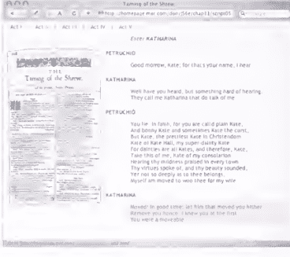

**图 11.5** 此 CSS 更改了`id`选择器的背景色；彩色条横跨页面宽度。

### 脚本 11.6 更改文本中链接的颜色和行为。

```css
body {
  background-color: white;
  color: black;
  font-family: "Trebuchet MS", verdana, 
    helvetica, arial, sans-serif;
  font-size: 0.9em;
}
img {
  margin-right: 10px;
}
```

> （脚本在下一页继续）

## 精致的链接

CSS 的一个常见用途是创建比纯旧 HTML 更精美的链接效果。在**脚本 11.6**中，我们选中页面顶部的幕号并使它们突出显示，如**图 11.6**所示。

### 增强你的链接：

- 1. `a { text-decoration: none; padding: 5px 10px 5px 10px; }`

这条规则适用于所有锚点标签，表示我们希望链接不带下划线显示。链接还应该在上方有 5 像素空间，右侧 10 像素，下方 5 像素，左侧 10 像素。

- 2. `a:link { color: #0000FF; }`

这条规则将所有链接变为蓝色（但很快会在某些情况下被覆盖）。元素后的冒号，后跟一个属性，表示我们正在声明一个*伪类*。在 CSS 中，伪类用于为某些选择器添加特殊效果。

- 3. `a:visited { color: #000000; }`

这条规则适用于所有已访问的链接，表示它们应该以黑色文本显示。与步骤 1 中的规则结合，已访问的链接看起来就像普通文本一样。

> *在下一页继续*

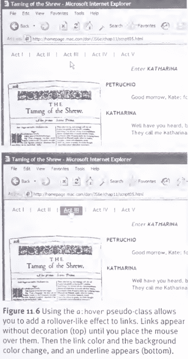

## 第 11 章

```
a:hover {
    color: #FFFFFF;
    background-color: #000000;
    text-decoration: underline;
}
```

这条规则表示，当我们悬停（即，将鼠标光标放在链接上）时，链接应以白色文本显示，黑色背景，并带下划线。由于这条规则在前一条规则之后，它在悬停于已访问链接上时仍然适用。如果它放在前一条规则之前，那一条规则将优先。

```
a:active {
    color: #FF0000;
}
```

这条规则表示，当链接被点击时，将文本变为红色。

> 提示

> - 不同的锚点伪类规则可能会出现层叠问题。解决方法是将它们按特定顺序放置（link、visited、hover、active）。记忆口诀是 LVHA，即 LoVe/HAte。真的。

### 脚本 11.6 续

```css
.character {
    font-weight: bold;
    text-transform: uppercase;
}
div.character {
    margin: 1.5em 0em 1em 17em;
}
.directions {
    font-style: italic;
}
.dialog, .directions {
    margin-left: 22em;
}
#week2 {
    background-color: #FFFF00;
}
a {
    text-decoration: none;
    padding: 5px 10px 5px 10px;
}
a:link {
    color: #0000FF;
}
a:visited {
    color: #000000;
}
a:hover {
    color: #FFFFFF;
    background-color: #000000;
    text-decoration: underline;
}
a:active {
    color: #FF0000;
}
```

## 样式嵌入样式

如果你愿意，你可以比我们之前展示的更精确地更改页面上的元素。你可以通过创建仅当某个类*位于*另一个类内部时才适用的规则来实现。**脚本 11.7**展示了如何操作，**图 11.7**显示了结果，这使舞台指示内的角色名称变得更大。

```css
body {
    background-color: white;
    color: black;
    font-family: "Trebuchet MS", verdana, helvetica, arial, sans-serif;
    font-size: 0.9em;
}
img {
    margin-right: 10px;
}
.character {
    font-weight: bold;
    text-transform: uppercase;
}
div.character {
    margin: 1.5em 0em 1em 17em;
}
.directions {
    font-style: italic;
}
.dialog, .directions {
    margin-left: 22em;
}
.directions .character {
    font-size: 1.4em;
}
```

*（脚本在下一页继续）*

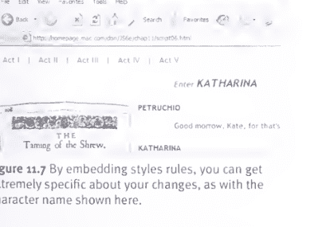

### 将样式规则嵌入另一个样式规则：

```
.directions .character {
    font-size: 1.4em;
}
```

这条规则仅适用于`character`类*位于*`directions`类内部的地方。

#### 提示

当你以这种方式嵌入样式时，你需要注意区分这两个：

```
.directions .character

.directions, .character
```

第一个选择器仅设置位于`directions`类内部的`character`类元素，而第二个（用逗号分隔两个元素）设置所有具有`character`类或`directions`类（或两者兼有）的元素。

### 脚本 11.7 续

```css
#week2 {
    background-color: #FFFF00;
}

a {
    text-decoration: none;
    padding: 5px 10px 5px 10px;
}

a:link {
    color: #0000FF;
}

a:visited {
    color: #000000;
}

a:hover {
    color: #FFFFFF;
    background-color: #000000;
    text-decoration: underline;
}

a:active {
    color: #FF0000;
}
```

### 脚本 11.8 我们回到 body 规则，插入背景图像，指定其来源和属性。

## 添加背景图像

如果你熟悉手写 HTML，你可能曾经为页面添加过背景图像。你可以继续在 HTML 中添加背景图像，但如果通过 CSS 来实现，你会有更多的控制权。在这个例子中，我们通过向`body`规则添加几个属性，将莎士比亚本人的图片添加到了页面上，如**脚本 11.8**所示。图像出现在我们的页面上，如**图 11.8**所示。

```css
body {
    background-color: white;
    color: black;
    font-family: "Trebuchet MS", verdana,
        helvetica, arial, sans-serif;
    font-size: 0.9em;
    background-image:
        url(images/shakespeare.gif);
    background-repeat: no-repeat;
    background-position: right 50px;
}

img {
    margin-right: 10px;
}

.character {
    font-weight: bold;
    text-transform: uppercase;
}

div.character {
    margin: 1.5em 0em 1em 17em;
}

.directions {
    font-style: italic;
}
```

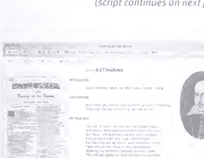

**图 11.8** 我们只对`body`规则做了快速添加，就让莎士比亚来守护这个页面了。

## 绝对定位

在 CSS 出现之前，如果你想在浏览器窗口的精确位置放置某个元素，就必须使用一些复杂的表格技巧，并祈祷它能在不同浏览器中正常工作。**脚本 11.9**展示了如何利用 CSS 告诉浏览器将元素精确放置在你想要的位置。

在这个例子中，我们决定交换两张图片（戏剧对开本和莎士比亚肖像）。与其修改 HTML，不如直接修改两条 CSS 规则，即**body**（用于剧作家的背景图片）和**img**（用于对开本）。你可以精确指定元素在页面上的显示位置，如**图 11.9**所示。

### 添加背景图片：

- `background-image: url(images/shakespeare.gif); background-repeat: no-repeat; background-position: right 50px;`

第一行添加背景图片并指定图片路径。下一行告诉浏览器不要向下重复显示图片（换句话说，在页面上只放置一次）。最后，图片被定位在右侧紧贴边缘，距离页面顶部 50 像素。

### 脚本 11.8 续

```css
.dialog, .directions {
  margin-left: 22em;
}
.directions .character {
  font-size: 1.4em;
}
#week2 {
  background-color: #FFFF00;
}
a {
  text-decoration: none;
  padding: 5px 10px 5px 10px;
}
a:link {
  color: #0000FF;
}
a:visited {
  color: #000000;
}
a:hover {
  color: #FFFFFF;
  background-color: #000000;
  text-decoration: underline;
}
a:active {
  color: #FF0000;
}
```

**脚本 11.9** 通过修改`body`和`img`规则，我们改变了页面的外观。

```css
body {
    background-color: white;
    color: black;
    font-family: "Trebuchet MS", verdana,
    helvetica, arial, sans-serif;
    font-size: 0.9em;
    background-image:
    url(images/shakespeare.gif);
    background-repeat: no-repeat;
    background-position: 20px 80px;
}

img {
    position: absolute;
    top: 20px;
    right: 20px;
}

.character {
    font-weight: bold;
    text-transform: uppercase;
}

div.character {
    margin: 1.5em 0em 1em 17em;
}
```

**（脚本在下一页继续）**

### 使用绝对定位：

### 脚本 11.9 续

```css
.directions {
    font-style: italic;
}
.dialog, .directions {
    margin-left: 22em;
}
.directions .character {
    font-size: 1.4em;
}
#week2 {
    background-color: #FFFF00;
}
a {
    text-decoration: none;
    padding: 5px 10px 5px 10px;
}
a:link {
    color: #0000FF;
}
a:visited {
    color: #000000;
}
a:hover {
    color: #FFFFFF;
    background-color: #000000;
    text-decoration: underline;
}
a:active {
    color: #FF0000;
}
```

- 1. `background-position: 20px 80px;`

   该属性位于`body`规则内，告诉浏览器将莎士比亚的图片放置在距离窗口左边缘 20 像素、距离窗口顶部 80 像素的位置。换言之，第一个值是水平位置，第二个值是垂直位置。

2. `img {`

    `position: absolute;`

    `top: 20px;`

    `right: 20px;`

`}`

   这些对`img`规则的修改非常直接。首先，我们指定位置为`absolute`（绝对定位），这意味着它将通过`top`、`right`（以及必要时`bottom`和`left`）属性进行精确定位。然后我们给出`top`和`right`的值，同样以像素为单位，从页面的左上角开始测量。

> ✔ 提示

> - 如果页面上有多个图片，我们可以通过使用`id`（来指定特定的图片；记住`id`在页面上是唯一的）而不是`img`标签本身，来精确指定要修改哪一个。

# 12

## 对象与 DOM

节点操作是 W3C 推荐的方式，用于让符合标准的浏览器支持表现得更像应用程序而非传统静态页面的网页。例如，你可以让页面根据用户的输入进行变化，而无需访问服务器，也可以在脚本控制下更新页面。虽然我们可以使用像`innerHTML`这样的技术，就像本书其他地方所做的那样，但这里我们展示的是官方支持的方法。虽然这也能够通过服务器端 CGI 来实现，但只有使用 JavaScript，我们才能提供这种功能，而无需让用户在页面之间来回跳转。

在本章中，你将进一步了解节点和 DOM：添加、删除和操作特定节点；以及在页面中插入和替换节点。

### 关于节点操作

这一章涉及本书中 JavaScript 和 DOM 最深的内容，因此我们需要先了解一些历史和术语。

#### DOM-2 与 W3C

W3C（如第 1 章所述）已经发布了浏览器应如何处理文档对象模型（也称为 DOM）的规范。DOM Level 2 规范于 2000 年 11 月成为官方推荐标准，它更深入地阐述了浏览器应如何引用和管理其页面内容。你可以在 http://www.w3.org/TR/DOM-Level-2-Core/ 了解更多细节。

虽然该规范已经存在多年，但仍有大量正在使用的浏览器对 DOM-2 的支持不完整或部分支持。在使用这些脚本之前，请确保你的目标受众能够运行它们，或者你为旧浏览器提供了另一种实现相同结果的方法。好在今天大多数上网者使用 Internet Explorer 6+、Firefox 或 Safari，这些浏览器应该都能很好地运行这些脚本。

#### DOM-2 术语

在本书开头，我们将 JavaScript 称为"搭扣式语言"，因为你可以将对象、属性和方法组合在一起构建 JavaScript 应用程序。还有一种看待 HTML 页面的方式，我们之前只是简要提及：作为带有节点的树状结构。例如，这个简单的网页

```html
<html>
<head>
    <title>My page</title>
</head>
<body>
    <p>This is text on my page</p>
</body>
</html>
```

可以如**图 12.1**所示进行展示。我们可以使用 JavaScript 修改这棵树的任何方面，包括添加、访问、更改和删除树上的节点。树上的每个方框都是一个节点。如果节点包含 HTML 标签，则称为*元素节点*。否则，称为*文本节点*。当然，元素节点可以包含文本节点。

#### DOM-3

DOM 标准的第三级于 2004 年 4 月成为官方推荐标准。该规范位于 http://www.w3.org/TR/DOM-Level-3-Core/。与 W3C 流程的许多其他部分一样，我们距离发布浏览器真正实现该标准还有很长的路要走，因此本章仅讨论 DOM-2。不过，如果你想了解更多，最佳去处是查看 ECMAScript 绑定，可以在 http://www.w3.org/TR/DOM-Level-3-Core/ecma-script-binding.html 找到。

## 添加节点

学习节点的最简单方法是从将元素节点（包含文本节点的元素节点）追加到文档末尾开始。**脚本 12.1 和 12.2**允许用户输入一些数据并点击按钮，然后——瞧！——一个新段落被添加到你的页面中（**图 12.2**）。

### 添加节点：

- 1. `var newText = document.createTextNode(inText);`

   我们首先使用`createTextNode()`方法创建一个新的文本节点（名为`newText`），它将包含`textArea`中找到的任何文本。

2. `var newGraf = document.createElement("p");`

   接下来，我们使用`createElement()`方法创建一个新的元素节点。虽然这里创建的节点是段落标签，但它可以是任何 HTML 容器（`div`、`span`等）。新元素的名称是`newGraf`。

3. `newGraf.appendChild(newText);`

   为了将新文本放入新段落中，我们必须调用`appendChild()`。这是`newGraf`的一个方法，当传入`newText`时，它将文本节点放入段落中。

**脚本 12.1** 该 HTML 创建了文本区域和提交按钮，允许用户添加文本节点。

```html
<!DOCTYPE html PUBLIC "-//W3C//DTD XHTML 1.0 Transitional//EN">
<html xmlns="http://www.w3.org/1999/xhtml">
<head>
	<title>Adding Nodes</title>
	<script type="text/javascript"
		language="Javascript" src="script01.js">
	</script>
</head>
<body>
	<form action="#">
		<p><textarea id="textArea" rows="5"
			cols="30"></textarea></p>
		<input type="submit" value="Add some text
			to the page" />
	</form>
</body>
</html>
```

**图 12.2** 要添加节点，在字段中输入文本（上图），然后点击按钮。文本出现在页面上（下图）。

脚本 12.2 通过这个脚本，用户可以将任意文本添加到页面中。

```javascript
window.onload = initAll;

function initAll() {
    document.getElementsByTagName("form")[0].
    onsubmit = function() {return addNode();}
}

function addNode() {
    var inText = document.getElementById
    ("textArea").value;
    var newText = document.createTextNode
    (inText);

    var newGraf = document.createElement("p");
    newGraf.appendChild(newText);

    var docBody = document.getElementsByTagName
    ("body")[0];
    docBody.appendChild(newGraf);

    return false;
}
```

4. `var docBody = document.getElementsByTagName("body")[0];`

为了向文档的`body`中添加新节点，我们需要先确定`body`的位置。`getElementsByTagName()`方法会返回页面中所有的`body`标签。如果我们的页面符合标准，那么应该只有一个`body`标签。`[0]`属性指的是第一个`body`标签，我们将其存储在`docBody`中。

5. `docBody.appendChild(newGraf);`

最后，再次使用`appendChild()`将`newGraf`附加到`docBody`上，这样用户的新文本就会显示在页面中。

#### 提示

你可能会问，为什么要费这么大的劲去创建文本节点、创建元素节点、再分别附加子节点，而不是简单地用`innerHTML`赋值来实现呢？这里有一个原因：采用这种方法，你不会让页面变得无效。例如，每个添加的`<p>`或`<div>`标签都会自动闭合。而另一方面，使用`innerHTML`很容易（几乎过于容易）制造出标签杂烩——一旦发生这种情况，页面的 DOM 就变得难以操作。例如，如果一个元素有开始标签但没有结束标签，你就无法读取它的内容。

## 添加节点

## 删除节点

如果你想向页面添加内容，也很可能需要从页面删除内容。**脚本 12.3**和**12.4**会删除页面上的最后一个段落，如**图 12.3**所示。

删除节点：

- 1. `var allGrafs = document.getElementsByTagName("p");`

这一行使用`getElementsByTagName`方法收集页面中所有的段落标签，并将它们存储在`allGrafs`数组中。

2. `if (allGrafs.length > 1) {`

在采取任何可能后悔的操作之前，我们必须先检查`allGrafs`数组的长度是否大于 1。我们不希望尝试删除不存在的东西，而且长度至少会是 1（因为脚本 12.3 中的`textarea`表单字段位于`<p>`标签内）。

**脚本 12.3** 这个脚本添加了一个链接（而不是按钮）来删除文本节点。

```html
<!DOCTYPE html PUBLIC "-//W3C//DTD XHTML 1.0 Transitional//EN">
<html xmlns="http://www.w3.org/1999/xhtml">
<head>
<title>Deleting Nodes</title>
<script type="text/javascript" language="Javascript" src="script02.js"></script>
</head>
<body>
<form action="#">
<p><textarea id="textArea" rows="5" cols="30"></textarea></p>
<input type="submit" value="Add some text to the page" />
</form>
<a id="deleteNode" href="#">Delete last paragraph</a>
</body>
</html>
```

## 脚本 12.4 现在用户既可以添加文本，也可以删除文本。

```javascript
window.onload = initAll;

function initAll() {
    document.getElementsByTagName("form")[0].
        onsubmit = function() {return addNode();}
    document.getElementById("deleteNode").
        onclick = delNode;
}

function addNode() {
    var inText = document.getElementById
        ("textArea").value;
    var newText = document.createTextNode
        (inText);

    var newGraf = document.createElement("p");
    newGraf.appendChild(newText);

    var docBody = document.getElementsByTagName
        ("body")[0];
    docBody.appendChild(newGraf);

    return false;
}

function delNode() {
    var allGrafs = document.getElements
        ByTagName("p");

    if (allGrafs.length > 1) {
        var lastGraf = allGrafs.item
            (allGrafs.length-1);
        var docBody = document.getElements
            ByTagName("body")[0];
        docBody.removeChild(lastGraf);
    }
    else {
        alert("Nothing to remove!");
    }

    return false;
}
```

- 3. `var lastGraf = allGrafs.item(allGrafs.length-1);`

如果存在段落，通过将长度减 1 并将结果作为数组索引，获取页面上的最后一个段落。请记住，`length`是 1 基数，而数组是 0 基数，所以从`length`减去 1 就能得到页面上的最后一个段落。

- 4. `var docBody = document.getElementsByTagName("body")[0];`

`docBody.removeChild(lastGraf);`

和上一个任务一样，为了修改文档，我们需要获取`body`的内容。一旦获取完毕，只需调用`docBody.removeChild()`方法并传入`lastGraf`，就能告诉 JavaScript 我们想删除哪个段落。我们的页面应该会立即显示少了一个段落。

#### 提示

- 再次提醒，你可以删除除段落以外的其他元素节点。要做到这一点，你需要修改脚本，将`getElementsByTagName()`的参数改为其他值而不是`p`。

## 删除节点

### 删除特定节点

虽然总是删除最后一个段落可能很有趣，但有时你可能想删除不在页面末尾的内容。**脚本 12.5**和**12.6**让我们的代码更加灵活，允许用户决定哪个段落成为历史，如**图 12.4**和**图 12.5**所示。

**脚本 12.5** 单选按钮让你可以为访客提供添加或删除文本的选择。

```html
<!DOCTYPE html PUBLIC "-//W3C//DTD XHTML 1.0
Transitional//EN">
<html xmlns="http://www.w3.org/1999/xhtml">
<head>
    <title>Deleting Selected Nodes</title>
    <script type="text/javascript"
    language="Javascript" src="script03.js">
    </script>
</head>
<body>
<form action="#">
    <p><textarea id="textArea" rows="5"
    cols="30"></textarea></p>
    <p><label><input type="radio"
    name="nodeAction" />Add node</label>
    <label><input type="radio" name="nodeAction"
    />Delete node</label></p>
    Paragraph #: <select id="grafCount">
    </select>
    <input type="submit" value="Submit" />
</form>
<div id="modifiable"> </div>
</body>
</html>
```

### 删除特定节点

### 脚本 12.6 这个脚本允许用户选择他们想删除的段落。

```javascript
window.onload = initAll;
var nodeChangingArea;

function initAll() {
    document.getElementsByTagName("form")[0].onsubmit = function() {return nodeChanger();}

    nodeChangingArea = document.getElementById("modifiable");
}

function addNode() {
    var inText = document.getElementById("textArea").value;
    var newText = document.createTextNode(inText);

    var newGraf = document.createElement("p");
    newGraf.appendChild(newText);

    nodeChangingArea.appendChild(newGraf);
}

function delNode() {
    var delChoice = document.getElementById("grafCount").selectedIndex;
    var allGrafs = nodeChangingArea.getElementsByTagName("p");
    var killGraf = allGrafs.item(delChoice);

    nodeChangingArea.removeChild(killGraf);
}

function nodeChanger() {
    var actionType = -1;
    var currentPgraphCount = nodeChangingArea.getElementsByTagName("p").length;
    var radioButtonSet = document.getElementsByTagName("form")[0].nodeAction;

    for (var i=0; i<radioButtonSet.length; i++) {
        if (radioButtonSet[i].checked) {
            actionType = i;
        }
    }

    switch(actionType) {
        case 0:
            addNode();
            break;
        case 1:
            if (currentPgraphCount > 0) {
                delNode();
                break;
            }
        default:
            alert("No valid action was chosen");
    }

    document.getElementById("grafCount").options.length = 0;

    for (i=0; i<nodeChangingArea.getElementsByTagName("p").length; i++) {
        document.getElementById("grafCount").options[i] = new Option(i+1);
    }

    return false;
}
```

（脚本在下一页继续）

### 删除特定节点：

1. `nodeChangingArea = document.getElementById("modifiable");`

由于我们的 HTML 页面现在包含多个段落，跟踪哪些可以删除、哪些不能删除可能会令人困惑。因此，我们现在设置了一个全新的区域：一个`id`为`modifiable`的`div`。在这里，我们将全局变量`nodeChangingArea`设置为该元素节点。

2. `var delChoice = document.getElementById("grafCount").selectedIndex;`

`var allGrafs = nodeChangingArea.getElementsByTagName("p");`

`var killGraf = allGrafs.item(delChoice);`

当用户选择删除段落时，他们还需要选择要删除哪个段落。我们从`grafCount`字段中读取该数字并存储在`delChoice`中。然后`allGrafs`变量被设置为`nodeChangingArea`中的所有段落，而要删除的段落则存储在`killGraf`中。

3. `nodeChangingArea.removeChild(killGraf);`

这一步和上一个任务类似，只不过执行时我们会看到段落从页面中间消失。

### 删除特定节点

```
case 1:
    if (currentPgraphCount > 0) {
        delNode();
        break;
    }
default:
    alert("No valid action was chosen");
```

```
document.getElementById("grafCount").options.length = 0;

for (i=0; i<nodeChangingArea.getElementsByTagName("p").length; i++) {
    document.getElementById("grafCount").options[i] = new Option(i+1);
}

return false;
```

### 脚本 12.6 续

## 对象与 DOM

### ✔ 提示

- 在理解其他代码时遇到困难？`nodeChanger()`函数结合（按出现顺序）了脚本 7.12、3.12 和 7.4 的功能。在编程中，拥有一个简单例程库非常常见，这些例程组合在一起可以创建一个更复杂、更完整的整体。

- 注意，在上面的代码中，我们使用了`nodeChangingArea`，而之前使用的是`docBody`——当处理节点时，很容易将处理一个元素节点的代码替换为另一个元素节点的代码。这里，我们只关注页面的一部分，而不是整个页面，但完成任务的整体方式是相同的。

- 我们没有将`nodeChangingArea`声明为全局变量并在`initAll()`中初始化，而是可以在每个使用它的函数内部创建并局部初始化它。每种选择都有其优缺点：这里，我们选择了全局变量，这样就不必反复初始化它。

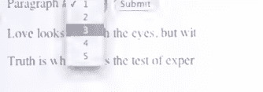

图 12.4 添加节点后，“段落 #”弹出菜单包含一个段落编号列表。


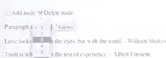


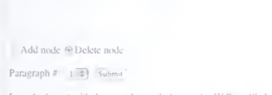

图 12.5 首先，你点击“删除节点”单选按钮，然后从弹出菜单中选择要删除的段落（上）。点击“提交”按钮会删除选中的段落（马克·吐温的引文），并将后面的段落向上移动（下）。

## 第 12 章

### 插入节点

除了想在文档末尾之外删除节点，你很可能还想在末尾之外的其他位置添加节点。借助**脚本 12.7**和**12.8**，你将能够选择新节点出现的位置。在**图 12.6**中，你可以看到新节点是如何被插入的。

```html
<!DOCTYPE html PUBLIC "-//W3C//DTD XHTML 1.0 Transitional//EN">
<html xmlns="http://www.w3.org/1999/xhtml">
<head>
    <title>Inserting Nodes</title>
    <script type="text/javascript"
      language="Javascript" src="script04.js">
    </script>
</head>
<body>
<form action="#">
    <p><textarea id="textArea" rows="5"
      cols="30"></textarea></p>
    <p><label><input type="radio"
      name="nodeAction" />Add node</label>
    <label><input type="radio"
      name="nodeAction" />Delete node</label>
    <label><input type="radio"
      name="nodeAction" />Insert before
      node</label></p>
    Paragraph #: <select id="grafCount">
    </select>
    <input type="submit" value="Submit" />
</form>
<div id="modifiable"> </div>
</body>
</html>
```

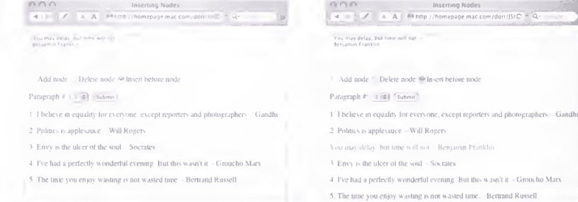

#### 脚本 12.8 用户现在可以在页面上的任何位置添加文本。

```javascript
window.onload = initAll;
var nodeChangingArea;

function initAll() {
    document.getElementsByTagName("form")[0].onsubmit = function() {return nodeChanger();}

    nodeChangingArea = document.getElementById("modifiable");
}

function addNode() {
    var inText = document.getElementById("textArea").value;
    var newText = document.createTextNode(inText);

    var newGraf = document.createElement("p");
    newGraf.appendChild(newText);

    nodeChangingArea.appendChild(newGraf);
}

function delNode() {
    var delChoice = document.getElementById("grafCount").selectedIndex;
    var allGrafs = nodeChangingArea.getElementsByTagName("p");
    var killGraf = allGrafs.item(delChoice);

    nodeChangingArea.removeChild(killGraf);
}

function insertNode() {
    var inChoice = document.getElementById("grafCount").selectedIndex;
    var inText = document.getElementById("textArea").value;

    var newText = document.createTextNode(inText);
    var newGraf = document.createElement("p");
    newGraf.appendChild(newText);

    var allGrafs = nodeChangingArea.getElementsByTagName("p");
    var oldGraf = allGrafs.item(inChoice);

    nodeChangingArea.insertBefore(newGraf, oldGraf);
}
```

（脚本在下一页继续）

#### 要插入一个节点：

#### 脚本 12.8 *续*

```javascript
function nodeChanger() {
  var actionType = -1;
  var currentPgraphCount = nodeChangingArea.
    getElementsByTagName("p").length;
  var radioButtonSet = document.getElements
    ByTagName("form")[0].nodeAction;

  for (var i=0; i<radioButtonSet.length;
    i++) {
    if (radioButtonSet[i].checked) {
      actionType = i;
    }
  }

  switch(actionType) {
    case 0:
      addNode();
      break;
    case 1:
      if (currentPgraphCount > 0) {
        delNode();
        break;
      }
    case 2:
      if (currentPgraphCount > 0) {
        insertNode();
        break;
      }
    default:
      alert("No valid action was chosen");
  }

  document.getElementById("grafCount").
    options.length = 0;

  for (i=0; i<nodeChangingArea.getElements
    ByTagName("p").length; i++) {
    document.getElementById("grafCount").
      options[i] = new Option(i+1);
  }

  return false;
}
```

1. `var inChoice = document.getElementById("grafCount").selectedIndex;`

    `var inText = document.getElementById("textArea").value;`

    为了插入一个段落，我们需要知道两件事：用户想要插入的位置（`inChoice`）以及他们想要插入的文本（`inText`）。

2. `var newText = document.createTextNode(inText);`

    `var newGraf = document.createElement("p");`

    `newGraf.appendChild(newText);`

    这是我们迄今为止的标准方法，用于创建一个新的段落节点并用用户的文本填充它。

3. `var allGrafs = nodeChangingArea.getElementsByTagName("p");`

    `var oldGraf = allGrafs.item(inChoice);`

    再次，我们获取区域中所有的`p`标签，然后将目标段落（我们将在其前面插入新段落的那个）存储在`oldGraf`中。

4. `nodeChangingArea.insertBefore(newGraf, oldGraf);`

    通过调用`insertBefore()`方法并传递两个参数来插入新段落：新节点和我们希望新节点插入其前面的现有节点（因此得名）。

> **✓ 提示**

虽然你可能认为如果有`insertBefore()`就应该有`insertAfter()`，但事实并非如此。如果你想在页面末尾添加内容，你需要使用`appendChild()`。

### 替换节点

虽然你总是可以删除现有节点并插入新节点，但如果你想直接替换节点，这样做更简单。

**脚本 12.9**和**12.10**展示了如何用一个节点替换另一个节点。**图 12.7**显示了替换过程。

### 脚本 12.9 在 HTML 中添加“替换节点”单选按钮，完善了我们的节点操作示例。

```html
<!DOCTYPE html PUBLIC "-//W3C//DTD XHTML 1.0
Transitional//EN">
<html xmlns="http://www.w3.org/1999/xhtml">
<head>
    <title>Replacing Nodes</title>
    <script type="text/javascript"
      language="javascript" src="script05.js">
    </script>
</head>
<body>
<form action="#">
    <p><textarea id="textArea" rows="5"
      cols="30"></textarea></p>
    <p><label><input type="radio"
      name="nodeAction" />Add node</label>
    <label><input type="radio"
      name="nodeAction" />Delete node</label>
    <label><input type="radio"
      name="nodeAction" />Insert before
      node</label>
    <label><input type="radio"
      name="nodeAction" />Replace node</label>
     </p>
    Paragraph #: <select id="grafCount">
     </select>
    <input type="submit" value="Submit" />
</form>
<div id="modifiable"> </div>
</body>
</html>
```

## 替换节点

## 第 12 章

#### 脚本 12.10 最后，用户可以添加、删除和替换页面上的任何文本。

```javascript
window.onload = initAll;
var nodeChangingArea;

function initAll() {
    document.getElementsByTagName("form")[0].onsubmit = function() {return nodeChanger();}

    nodeChangingArea = document.getElementById("modifiable");
}

function addNode() {
    var inText = document.getElementById("textArea").value;
    var newText = document.createTextNode(inText);

    var newGraf = document.createElement("p");
    newGraf.appendChild(newText);

    nodeChangingArea.appendChild(newGraf);
}

function delNode() {
    var delChoice = document.getElementById("grafCount").selectedIndex;
    var allGrafs = nodeChangingArea.getElementsByTagName("p");
    var killGraf = allGrafs.item(delChoice);

    nodeChangingArea.removeChild(killGraf);
}

function insertNode() {
    var inChoice = document.getElementById("grafCount").selectedIndex;
    var inText = document.getElementById("textArea").value;

    var newText = document.createTextNode(inText);
    var newGraf = document.createElement("p");
    newGraf.appendChild(newText);

    var allGrafs = nodeChangingArea.getElementsByTagName("p");
    var oldGraf = allGrafs.item(inChoice);

    nodeChangingArea.insertBefore(newGraf,oldGraf);
}

function replaceNode() {
    var inChoice = document.getElementById("grafCount").selectedIndex;
    var inText = document.getElementById("textArea").value;

    var newText = document.createTextNode(inText);
    var newGraf = document.createElement("p");
    newGraf.appendChild(newText);

    var allGrafs = nodeChangingArea.getElementsByTagName("p");
    var oldGraf = allGrafs.item(inChoice);

    nodeChangingArea.replaceChild(newGraf, oldGraf);
}

function nodeChanger() {
    var actionType = -1;
    var currentPgraphCount = nodeChangingArea.getElementsByTagName("p").length;
    var radioButtonSet = document.getElementsByTagName("form")[0].nodeAction;

    for (var i=0; i<radioButtonSet.length; i++) {
        if (radioButtonSet[i].checked) {
            actionType = i;
        }
    }

    switch(actionType) {
        case 0:
            addNode();
            break;
        case 1:
            if (currentPgraphCount > 0) {
                delNode();
                break;
            }
        case 2:
            if (currentPgraphCount > 0) {
                insertNode();
                break;
            }
        case 3:
            if (currentPgraphCount > 0) {
                replaceNode();
                break;
            }
        default:
            alert("No valid action was chosen");
    }

    document.getElementById("grafCount").options.length = 0;

    for (i=0; i<nodeChangingArea.getElementsByTagName("p").length; i++) {
        document.getElementById("grafCount").options[i] = new Option(i+1);
    }

    return false;
}
```

`nodeChangingArea.replaceChild(newGraf, oldGraf);`

这段脚本中唯一对你来说应该是新内容的就是这一行（关于脚本其余部分的解释请参见本章其余内容）。与上一个任务类似，我们需要做的就是调用`replaceChild()`并传入两个参数：我们想要替换进去的段落和我们想要替换出来的段落。

> **提示**

> 本章绝不是对节点操作的全面讨论——它只是一个帮助你入门的示例。如果你想了解更多关于所有可用属性和方法的文档，请查看本章开头提到的 W3C 规范。

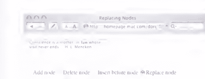

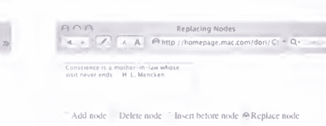

图 12.7 这里，我们用新文本（右）替换了第三段（左）。

## 第 13 章

### 将当前日期放入网页

JavaScript 可以从你的计算机获取当前日期和时间（它以数字形式获取），然后以多种方式操作该数值。然而，你的脚本必须处理从数字到文本日期的转换。脚本 13.1 展示了如何获取当前日期，将其从数字转换为标准日期格式，然后将结果写入文档窗口。

**将当前日期放入网页：**

1. `window.onload = initDate;`

   当文档加载时，调用`initDate()`。

2. `var dayName = new Array("Sunday", "Monday", "Tuesday", "Wednesday", "Thursday", "Friday", "Saturday");`

   首先，我们需要创建一个包含星期几的新数组。确保使用逗号分隔数组中的各项：并且因为它们是文本字符串，所以每个项都必须用引号括起来。该数组被赋值给变量`dayName`。

3. `var monName = new Array("January", "February", "March", "April", "May", "June", "July", "August", "September", "October", "November", "December");`

   在这一步中，我们对月份名称做同样的事情：并将它们赋值给这个起名精妙的`monName`变量。

脚本 13.1 此脚本将当前日期写入文档窗口。

```javascript
window.onload = initDate;

function initDate() {
   var dayName = new Array("Sunday",
      "Monday", "Tuesday", "Wednesday",
      "Thursday", "Friday", "Saturday");
   var monName = new Array("January",
      "February", "March", "April", "May",
      "June", "July", "August", "September",
      "October", "November", "December");
   var now = new Date();
   var dtString = dayName[now.getDay()] + ", " +
      monName[now.getMonth()] + " " +
      now.getDate();
   document.getElementById("dtfield").
      innerHTML = dtString;
}
```

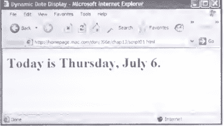

图 13.1 JavaScript 在窗口中动态显示当前日期。

## JavaScript 处理时间的不一致性

正如本书前面提到的，JavaScript 在大多数情况下从零开始编号，因此编号从 0、1、2、3 等开始。但这与日期不一致，日期是从数字 1 开始的。所以如果你有一个处理星期几的数组，你会有：

- Sunday = 0
- Monday = 1
- Tuesday = 2
- Wednesday = 3
- Thursday = 4
- Friday = 5
- Saturday = 6

同样，一年中的 12 个月份从 0 编号到 11。

另一方面，当处理日期中的天数时，从零开始毫无意义（就我个人而言，我从未听说过 4 月 0 日），所以 JavaScript 从 1 开始。

小时的处理方式是从 0（午夜）到 23（晚上 11 点），与军用时间相同。本章稍后我们将向你展示如何从军用时间转换为上午/下午时间。

4. `var now = new Date();`

这第一部分中最后要做的是告诉 JavaScript 创建一个新的`Date`对象，将其命名为`now`，并用当前日期填充它。

5. `var dtString = dayName[now.getDay()] + ", " + monName[now.getMonth()] + " " + now.getDate();`

对象`dayName[now.getDay()]`从右往左读取：`getDay()`是获取星期几的 JavaScript 方法，向`now`请求它即可获取今天是星期几。数值结果引用数组`dayName`中的某个条目。

接下来，我们向正在构建的文本字符串连接一个逗号和一个空格，然后连接下一个表达式，即月份名称，由对象`monName[now.getMonth()]`表示。获取月份的方式与获取星期几类似：并引用数组`monName`中的某个条目。

然后连接一个空格，最后以对象`now.getDate()`结束，它返回日期中的天数。所有这些都被赋值给`dtString`变量。

6. `document.getElementById("dtField").innerHTML = dtString;`

`id` `dtField`在 HTML 页面中（HTML 非常简单，所以我们没有在这里包含它）：它在一个`<span>`标签内，如下所示：

```html
<h1>Today is <span id="dtField"> </span>.</h1>
```

JavaScript 将`dtField`的`innerHTML`属性设置为`dtString`的值。结果显示在图 13.1 中。

## 第 13 章

### 处理星期几

你可能想在周末时向用户显示不同的消息。脚本 13.2 告诉你如何做到这一点。

#### 判断是否为周末：

1. `var now = new Date();`

   将变量`now`填充为当前日期。

2. `if (now.getDay() > 0 && now.getDay() < 6) {`

   这行从`now`变量中提取星期几的数值，然后判断它是否大于 0（记住 Sunday 是 0）。接下来这行使用了`&&`运算符，这是一个逻辑*与*（即两部分都必须为真），然后判断`now`是否小于 6，6 是 Saturday 的编号。

3. `dtString = "Sorry, it's a weekday.";`

   如果上一个表达式的结果大于 0 且小于 6，那么它一定在 1 到 5 之间，也就是说从 Monday 到 Friday，所以脚本将相应含义的字符串放入`dtString`。

4. `else {`

   `dtString = "Hooray, it's a weekend!";`

   如果我们在步骤 2 中的测试未通过，那一定是周末，我们将包含这个好消息的字符串放入`dtString`。

5. `document.getElementById("dtField").innerHTML = dtString;`

   最后，我们将`dtField`的`innerHTML`属性设置为`dtString`的值，就像前面的示例一样。结果显示在**图 13.2**中。

脚本 13.2 此脚本判断今天是工作日还是周末。

```javascript
window.onload = initDate;

function initDate() {
    var now = new Date();
    var dtString;
    if (now.getDay() > 0 && now.getDay() < 6) {
        dtString = "Sorry, it's a weekday.";
    }
    else {
        dtString = "Hooray, it's a weekend!";
    }
    document.getElementById("dtField").innerHTML = dtString;
}
```

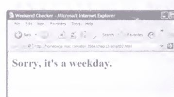

图 13.2 令人沮丧的消息被写入了窗口。

脚本 13.3 可以使用脚本来检查一天中的时间，并做出相应的反应。

```javascript
window.onload = initDate;

function initDate() {
    var now = new Date();
    var dtString;

    if (now.getHours() < 5) {
        dtString = "What are you doing up so late?";
    }
    else if (now.getHours() < 9) {
        dtString = "Good Morning!";
    }
    else if (now.getHours() < 17) {
        dtString = "No surfing during working hours!";
    }
    else {
        dtString = "Good Evening!";
    }

    document.getElementById("dtField").
        innerHTML = dtString;
}
```

### 根据一天中的不同时间定制消息

你可以采用上一个示例中使用的技巧，再次用它来为用户定制消息，具体取决于一天中的时间。这通常用作用户进入网站时的友好问候。脚本 13.3 展示了如何实现这一点，图 13.3 展示了我们是如何在通常的睡眠时间之后还在写作。

#### 根据一天中的不同时间定制消息：

```
if (now.getHours() < 5) {
    dtString = "What are you doing up so late?";
}
```

我们通过开始一个条件测试来编写这个新脚本。`getHours()`方法从`now`变量中提取小时数，然后检查该数字是否小于 5（对应于凌晨 5 点，因为 JavaScript 中的编号从午夜开始）。

如果是在凌晨 5 点之前，脚本会通过向文档窗口写入此消息来责备用户，如图 13.3 所示。

脚本的其余部分重复上面的代码行，根据一天中的时间进行调整，并输出不同的消息。如果是在早上 5 点到 9 点之间，脚本显示 "Good Morning!"；在上午 9 点到下午 5 点之间，显示 "No surfing during working hours!"；下午 5 点之后，显示 "Good Evening!"

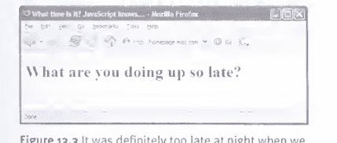

### 按时区显示日期

默认情况下，显示的日期和时间是用户机器上的日期和时间（假设它们设置正确）。如果你想在其他地方显示日期，你需要根据 UTC，即协调世界时来计算。UTC 本质上是格林尼治标准时间（GMT）的另一个名称；UTC 还有 "universal time"（UT）和 "world time" 等名称。脚本 13.4 展示了页面的 HTML；脚本 13.5 包含 JavaScript，展示了如何计算其他时区的日期。

#### 按时区显示日期：

```
function initDate() {
    var allTags = document.
        getElementsByTagName("*");
```

开始`initDate()`函数，然后创建`allTags`变量。命令`document.getElementsByTagName("*")`是一个方便的技巧——这个星号告诉 JavaScript 返回一个包含页面上每个标签的数组。然后，我们可以遍历它来查找感兴趣的内容。

第 306 页继续

脚本 13.4 时区脚本的 HTML 使用类来为不同的办公室标记该办公室的时区。

```html
<!DOCTYPE html PUBLIC "-//W3C//DTD XHTML 1.0 Transitional//EN">
<html xmlns="http://www.w3.org/1999/xhtml">
<head>
    <title>Time Zones</title>
    <script language="javascript" type="text/javascript" src="script04.js"></script>
</head>
<body bgcolor="#FFFFFF">
    <h3>Our office hours are 9:00 am to 5:00 pm, Monday through Friday, at each of our locations. It is now</h3>
    <ul>
        <li><span class="tz-8"> </span> in San Francisco</li>
        <li><span class="tz-5"> </span> in New York</li>
        <li><span class="tz-0"> </span> in London</li>
        <li><span class="tz+7"> </span> in Hong Kong</li>
    </ul>
</body>
</html>
```

脚本 13.5 你可以调整此脚本以显示任何你想要的时区。

```javascript
window.onload = initDate;

function initDate() {
  var allTags = document.getElementsByTagName("*");

  for (var i=0; i<allTags.length; i++) {
    if (allTags[i].className.indexOf("tz")==0) {
      showTheTime(allTags[i],allTags[i].className.substring(2));
    }
  }
}

function showTheTime(currElem,tzOffset) {
  var dayName = new Array ("Sunday","Monday","Tuesday","Wednesday","Thursday","Friday","Saturday");

  var thatTZ = new Date();
  var dateStr = thatTZ.toUTCString();

  dateStr = dateStr.substr(0,dateStr.length - 3);
  thatTZ.setTime(Date.parse(dateStr));
  thatTZ.setHours(thatTZ.getHours() + parseInt(tzOffset));

  currElem.innerHTML = showTheHours(thatTZ.getHours()) + showZeroFilled(thatTZ.getMinutes()) + showAmPm(thatTZ.getHours()) + dayName[thatTZ.getDay()];

  function showTheHours(theHour) {
    if (theHour == 0) {
      return (12);
    }
    if (theHour < 13) {
      return (theHour);
    }
    return (theHour-12);
  }

  function showZeroFilled(inValue) {
    if (inValue > 9) {
      return ":" + inValue;
    }
    return ":0" + inValue;
  }

  function showAmPm(thatTime) {
    if (thatTime < 12) {
      return (" AM ");
    }
    return (" PM ");
  }
}
```

## 第 13 章

```
for (var i=0; i<allTags.length; i++) {
    if (allTags[i].className.
        indexOf("tz")==0) {
        showTheTime(allTags[i],
            allTags[i].className.
            substring(2));
    }
}
```

我们开始一个循环，以便遍历页面元素，由`allTags`表示。`allTags[i].className.indexOf("tz")==0`这部分的意思是，"第 *i* 个标签是否有一个以 'tz' 开头的`class`属性——如果是，调用`showTheTime()`。" `showTheTime()`函数被传入两个参数：首先，第 *i* 个标签元素；其次，`class`属性中 "tz" 之后的部分（见脚本 13.4），由`substring(2)`表示。是的，我们可以从第一个参数推断出第二个参数，但何必呢？这让`showTheTime()`函数变得简单得多，因为第二个参数变成了时区偏移量。

```
function showTheTime(currElem,
        tzOffset) {
```

此函数接收上一步传给`showTheTime()`的两个参数。在函数内部，它们分别被称为`currElem`和`tzOffset`。

```
var thatTZ = new Date();
    var dateStr = thatTZ.toUTCString();
```

我们创建一个新的日期变量`thatTZ`。下一行将该日期和时间（基于 UT）转换为字符串（见本章末尾的**表 13.1**），将结果保存在`dateStr`中。

```
dateStr = dateStr.substr(0,dateStr.length - 3);
```

我们在本节中试图做的是将`thatTZ`重置为基于 UT 而不是本地时间，这样我们就可以添加传入的偏移量以获得所需结果。不幸的是，JavaScript 并不让这变得简单。我们现在有了 UT 时间的字符串格式，但如果我们只是尝试基于它来重置时间，它会比我们更聪明，知道我们真正想要的是本地时间。我们需要做的是获取日期和时间的字符串版本，并去掉最后三个字符，即 UTC。

```
thatTZ.setTime(Date.parse(dateStr));
```

一旦我们去掉了最后三个字符，我们就可以使用`parse`方法将日期转换为毫秒，然后使用`setTime`方法将`thatTZ`设置为我们想要的时间。

```
thatTZ.setHours(thatTZ.getHours() +
parseInt(tzOffset));
```

现在我们终于存储了 UT 日期，我们需要加上我们想要的时区与 UT 相差的小时数。由于时区可以从 +12 到 -12 不等，传入的时区可以是 "-12" 到 "+12" 之间的任何值。我们使用`parseInt()`将该字符串转换为 -12 到 12 之间的数字，然后将其加到当前的 UT 时间上。结果给出了我们想要的值：该时区的正确日期和时间。

下一页继续

```
currElem.innerHTML = showTheHours
(thatTZ.getHours()) +
showZeroFilled(thatTZ.
getMinutes()) + showAmPm
(thatTZ.getHours()) +
dayName[thatTZ.getDay()];
```

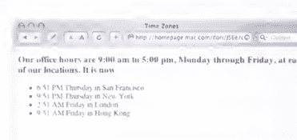

这看起来很吓人，但它只是在构建要放入文档的时间值，通过连接所有其他函数的结果，然后设置`currElem`的`innerHTML`属性，从而将计算结果放入文档中。最终结果如**图 13.4**所示。

接下来的三个函数`showTheHours()`、`showZeroFilled()`和`showAmPm()`位于`showTheTime()`函数内部，好好看看它们可以共享变量。结果发现，在这个任务中它们没有共享，但在下一个任务中会。

```
function showTheHours(theHour) {
    if (theHour == 0) {
        return (12);
    }
}
```

首先，设置一个名为`showTheHours`的函数，包含变量`theHour`。然后，如果`theHour`为零，返回结果 12（表示时间是 12 A.M.）；否则继续执行脚本。


```javascript
if (theHour < 13) {
    return (theHour);
}
return (theHour-12);
```

10. 如果时间的小时部分结果小于 13，则将该数字放入变量 `theHour`。否则，返回 `theHour` 减去 12（将 13 及更高的小时数转换为其 12 小时制对应值）。

```javascript
function showZeroFilled(inValue) {
    if (inValue > 9) {
        return ":" + inValue;
    }
    return ":0" + inValue;
}
```

这个函数用于美化输出；当分钟或秒数小于等于9时，会在数字前面补零。

```javascript
function showAmPm(thatTime) {
    if (thatTime < 12) {
        return (" AM ");
    }
    return (" PM ");
}
```

这个函数用于在时间后面添加 A.M. 或 P.M.。如果传入的变量 `thatTime` 小于12，则函数返回 A.M.；否则返回 P.M.。注意 A.M. 和 P.M. 文本字符串前面有一个空格，这样显示出来更美观。

### 小贴士

- 在这个脚本中，我们使用 `toUTCString()` 方法而不是 `toGMTString()` 方法；它们的工作方式几乎相同。在此书的先前版本中，我们使用 `toGMTString()`，因为 `toGMTString()` 在 JavaScript 1.0 中引入，而 `toUTCString()` 是在 JavaScript 1.2 中才出现的；通过使用 `toUTCString()`，我们确保脚本即使在非常老的浏览器中也能工作。由于那些浏览器已不再使用，我们在这一版中改用了 UTC。两种方法的主要区别在于 `toGMTString()` 方法在字符串末尾附加 "GMT"，而 `toUTCString()` 方法在字符串末尾附加 "UTC"。无论哪种方式，在第5步中你都需要去掉三个字符。

- 处理夏令时并没有简单直接的方法。有些浏览器就是无法正确处理它。而且不幸的是，你还必须依赖计算机用户知道如何设置他们的电脑来识别夏令时的发生。幸运的是，Windows 和 Mac OS X 都具备基于互联网时间服务器自动设置时间的功能，这会考虑夏令时，所以这个问题比以前小多了。坏消息是：JavaScript 无法从操作系统获取该信息，因此无法判断你所处的时间和地点是否适用夏令时。

- 添加另一个城市到 HTML 中非常容易，无需修改任何 JavaScript 代码——而且一切都会正常工作。

## 第13章

## 将军事时间转换为 A.M./P.M.

JavaScript 以24小时制提供时间，这也被称为军事时间。许多人对这种格式不熟悉或不习惯，所以你会想要了解如何将其转换为12小时制。在接下来的两个脚本中，你会看到一种实现方法，这需要一些解释。我们创建的页面（脚本13.6）使用了一个表单，其中包含一个 `div`，我们通过脚本中的函数将时间写入其中。该表单由两个单选按钮控制，让我们可以在24小时制和12小时制之间切换时间。其背后的 JavaScript 代码在脚本13.7中。结果如图13.5所示。

### 将军事时间转换为 AM/PM：

1. `document.getElementById("showTime").innerHTML = showTheHours(now.getHours()) + showZeroFilled(now.getMinutes()) + showZeroFilled(now.getSeconds()) + showAmPm();`

与前面的任务一样，这看起来可能令人望而生畏，但它只是在通过连接其他函数的结果（下面会讲到）来构建页面上显示的时间值。结果会被放入 `showTime` 的 `innerHTML` 属性中。

2. `setTimeout("showTheTime()",1000);`

这段代码告诉显示内容每秒更新一次。

3. `function showTheHours(theHour) {`

接下来，设置一个名为 `showTheHours` 的函数，包含变量 `theHour`。

4. `return (showMilitaryTime() || (theHour > 0 && theHour < 13)) ? theHour : (theHour == 0) ? 12 : theHour-12;`

```html
<!DOCTYPE html PUBLIC "-//W3C//DTD XHTML 1.0
Transitional//EN">
<html xmlns="http://www.w3.org/1999/xhtml">
<head>
  <title>JavaScript Clock</title>
  <script language="Javascript" type="text/
  javascript" src="script05.js">
  </script>
</head>
<body bgcolor="#FFFFFF">
<div align="center">
  <h2 id="showTime"> </h2>
  <form action="#">
    Display Military Time?
    <input type="radio" name="milTime"
      id="showMilitary" checked="checked"
    /><label for="showMilitary">Yes</label> &nbsp;&nbsp;
    <input type="radio" name="milTime"
      id="noMilitary" /><label for=
      "noMilitary">No</label>
  </form>
</div>
</body>
</html>
```


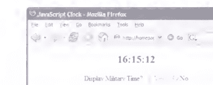

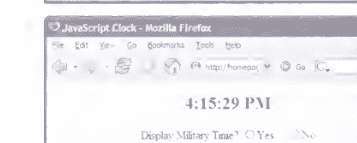

图 13.5 脚本运行效果。

### 脚本 13.7 该脚本在24小时制和12小时制之间进行转换。

```javascript
window.onload = showTheTime;

function showTheTime() {
    var now = new Date();

    document.getElementById('showTime').innerHTML = showTheHours(now.getHours()) + 
        ':' + showZeroFilled(now.getMinutes()) + ':' + 
        showZeroFilled(now.getSeconds()) + ' ' + showAmPm();

    setTimeout('showTheTime()', 1000);
}

function showTheHours(theHour) {
    return (showMilitaryTime() ? theHour : 
        (theHour == 0) ? 12 : theHour - 12;
}

function showZeroFilled(inValue) {
    return (inValue > 9) ? ':' + inValue : ':0' + inValue;
}

function showMilitaryTime() {
    return (document.getElementById('showMilitary').checked);
}

function showAmPm() {
    return (showMilitaryTime() ? '' : 
        (now.getHours() < 12) ? ' AM' : ' PM';
}
```

这个条件语句采用简写形式，表示如果用户想要显示军事时间，或者时间的小时部分大于零且小于13，则直接返回变量 `theHour`。记住，`||` 运算符表示逻辑*或*，正如你在第1章中首次看到的那样。否则，如果 `theHour` 为0，则返回12（即12 A.M.时）；否则返回 `theHour` 减去12（这将13及更晚的小时转换为对应的12小时制时间）。

5. `function showZeroFilled(inValue) {`

```javascript
function showZeroFilled(inValue) {
    return (inValue > 9) ? ':' + inValue : ':0' + inValue;
}
```

与脚本13.6中同名函数类似（但采用简写形式），当分钟或秒数小于等于9时，会在数字前面补零。

6. `function showMilitaryTime() {`

```javascript
function showMilitaryTime() {
    return (document.getElementById('showMilitary').checked);
}
```

这个函数根据用户选中页面上的哪个单选按钮来返回值。如果选中了 `showMilitary`，则返回 `true` 结果；否则返回 `false` 结果。

7. `function showAmPm() {`

```javascript
function showAmPm() {
    return (showMilitaryTime()) ? '' : 
        (now.getHours() < 12) ? ' AM' : ' PM';
}
```

这个函数为12小时制时间添加 A.M. 或 P.M.。如果 `showMilitaryTime` 函数返回 `true`，则返回空字符串，并继续执行下一个函数。如果 `now` 变量的小时部分小于12，则函数值为 A.M.；否则为 P.M.。同样，A.M. 或 P.M. 文本字符串前面有一个空格，这样显示出来更美观。

## 第13章

## 创建倒计时

迟早你会想在页面上添加一个倒计时，告诉用户距离某个特定事件还有多少天或多少小时。脚本13.8（HTML）和脚本13.9（JavaScript）让其中一位作者明确无误地知道自己的责任，如图13.6所示。

### 创建倒计时：

1. `var allTags = document.getElementsByTagName("*");`

   创建一个新的 `allTags` 数组，并用页面上的所有标签填充它。

2. `for (var i=0; i<allTags.length; i++) {`

```javascript
for (var i=0; i<allTags.length; i++) {
    if (allTags[i].className.indexOf("daysTill") > -1) {
        allTags[i].innerHTML = showTheDaysTill(allTags[i].id);
    }
}
```

这个循环扫描 `allTags`，查看 `daysTill` 字符串是否出现在页面上任何标签的 `class` 属性中。记住，一个标签可以有多个 `class` 属性（即 `class="firstClass daysTill somethingElse fourthThing"`）。

如果找到 `daysTill`，我们调用 `showTheDaysTill()` 函数，传入一个参数：该标签的 `id`（用于存储要在页面上显示的日期）。该函数返回的值随后被放入 `innerHTML` 中。

### 脚本 13.8 倒计时脚本的 HTML。

```html
<!DOCTYPE html PUBLIC "-//W3C//DTD XHTML 1.0 Transitional//EN">
<html xmlns="http://www.w3.org/1999/xhtml">
<head>
    <title>Dynamic Countdown</title>
    <script language="Javascript" type="text/javascript" src="script06.js"></script>
</head>
<body bgcolor="#FFFFFF">
    <p>Dori says:</p>
    <p>It's only <span class="daysTill" id="bdry"> </span> days until my birthday and <span class="daysTill" id="xmas"> </span> days until Christmas, so you'd better start shopping now!</p>
    <p>And it's only <span class="daysTill" id="anniv"> </span> days until our anniversary...</p>
</body>
</html>
```

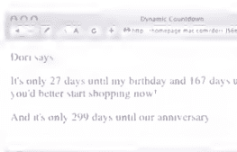

下页第314页继续

### 脚本 13.9 本脚本计算汤姆远离狗屋的天数。

```javascript
window.onload = showDays;

function showDays() {
  var allTags = document.getElementsByTagName("*");

  for (var i=0; i<allTags.length; i++) {
    if (allTags[i].className.indexOf("daysTill") > -1) {
      allTags[i].innerHTML = showTheDaysTill(allTags[i].id);
    }
  }
}

function showTheDaysTill(thisDate) {
  var theDays;

  switch(thisDate) {
    case "anniv":
      theDays = daysTill(5,6);
      break;
    case "bday":
      theDays = daysTill(8,7);
      break;
    case "xmas":
      theDays = daysTill(12,25);
      break;
    default:
  }
  return theDays + " ";
}

function daysTill(mm,dd) {
  var now = new Date();
  var inDate = new Date(now.getFullYear(), mm-1, dd);

  if (inDate.getTime() < now.getTime()) {
    inDate.setYear(now.getFullYear()+1);
  }

  return (Math.ceil(dayToDays(inDate) - dayToDays(now)));
}

function dayToDays(inTime) {
  return (inTime.getTime() / (1000 * 60 * 60 * 24));
}
```

3. `switch(thisDate) {`

```javascript
switch(thisDate) {
    case "anniv":
      theDays = daysTill(5,6);
      break;
    case "bday":
      theDays = daysTill(8,7);
      break;
    case "xmas":
      theDays = daysTill(12,25);
      break;
    default:
}
```

如果你不记得 `switch/case` 多级条件语句，可以复习第 3 章中的讨论。这里，我们使用 `thisDate` 的值来测试三个 `case` 语句。对于 `anniv` 情况，我们将 `theDays` 设置为 5 月 6 日（5,6 是数字表示形式，就像你在现实世界中写的那样）；对于 `bday`，我们将其设置为 8 月 7 日；而对于 `xmas`，`theDays` 被设置为 12 月 25 日。

4. `return theDays + " ";`

`showTheDays()` 函数最后返回天数后跟一个空格。这是为了规避 IE 中的一个问题：它会吞掉 HTML 中的空格。如果脚本最后不返回一个空格，数字就会和单词 "days" 连在一起。如果你只是把单词 "days" 放到这个函数中，那后面就需要有一个空格，以此类推。

5. `function daysTill(mm,dd) {`

```javascript
function daysTill(mm,dd) {
    var now = new Date();
    var inDate = new Date(now.getFullYear(),mm-1,dd);
}
```

这一步展示了 `daysTill()` 函数，它接收来自步骤 3 中 `case` 语句的日期。然后，我们创建 `now` 和 `inDate` 变量。后一个变量被填充为当前年份，但月份（减去 1 以得到正确的月份；参见“更多奇怪的时间问题”边栏）和传入的日期。

### 更多奇怪的时间问题

JavaScript 中的月份编号从 0 开始，而日期编号从 1 开始，并且 JavaScript 对 1970 年之前的年份处理不一致，这取决于浏览器使用的 JavaScript 版本。

Navigator 2（使用 JavaScript 1.0）完全无法处理 1970 年之前的年份，并且存在千年虫问题，因为它对 2000 年及以后的日期返回错误的答案。Navigator 3（使用 JavaScript 1.1）据称将 `getYear()` 方法返回的值改为：如果年份在 1900 年代则为两位数，如果年份在 1900 年之前或 2000 年之后则为四位数。然而，这并非适用于所有版本的 Netscape；例如，Netscape Navigator 4 for Mac 对 2000 年返回 100。更糟糕的是，这种情况在 Firefox 中仍然存在——当前版本（1.5）对 `getYear()` 仍然返回百位数（相对于 2000 年代）。

JavaScript 1.2（在 Navigator 4 中，以及在与 ECMAScript 兼容的浏览器中，如 Internet Explorer 4 及更高版本）引入了一个新方法 `getFullYear()`，它总是返回四位数年份。我们建议，如果你知道只使用第 4 版及更高版本的浏览器，就使用 `getFullYear()`，所以这也是我们在整本书中使用的方法。

JavaScript 中的 `getTime()` 方法，原因最好不去深究，返回一个数字，表示自 1970 年 1 月 1 日以来的毫秒数。幸运的是，我们几乎不需要看这个数字，因为过去三十年中的毫秒数已经多得惊人。

6. `if (inDate.getTime() < now.getTime()) {`

```javascript
if (inDate.getTime() < now.getTime()) {
    inDate.setYear(now.getFullYear()+1);
}
```

然后我们将该日期与今天进行比较。如果今年这个日期已经过去，我们就将年份增加，取而代之下一年。

7. `return (Math.ceil(dayToDays(inDate) - dayToDays(now)));`

这里，我们计算 `inDate` 与当前日期之间的天数。`Math.ceil()` 方法确保我们的结果是整数。

8. `function dayToDays(inTime) {`

```javascript
function dayToDays(inTime) {
    return (inTime.getTime() / (1000 * 60 * 60 * 24));
}
```

JavaScript 以自 1970 年 1 月 1 日以来的毫秒数存储日期。为了比较两个日期，需要将其转换为自 1970 年 1 月 1 日以来的天数。首先，将 1000（一秒中的毫秒数）乘以 60（一分钟中的秒数），再乘以 60（一小时中的分钟数），然后乘以 24（一天中的小时数），得到一天中的毫秒数。将 `getTime()` 返回的毫秒数除以这个数，就得到自 1970 年 1 月 1 日以来的天数。

## 创建倒计时

## 第 13 章

### 在文档中移动对象

可以使用 JavaScript 在屏幕上移动对象（图像、文本或任何内容）。实际上，你可以让一个对象看起来在三维空间中移动，使其看起来像是穿过文档中的其他对象。在这个示例中，你将看到如何将一张月球图像移动到另外两个对象后面，使其看起来有盈亏变化。

这需要三个文档：HTML 文档（脚本 13.10）、CSS 样式表（脚本 13.11）和 JavaScript 文件（脚本 13.12）。月球在图 13.7、13.8 和 13.9 中进行它的旅程。我们使用 JavaScript 通过 HTML 中分配的 `id` 来操作图像，并使用 CSS 来设置页面上所有对象的定位，特别是它们的 *z-index*，这是指示哪个对象在另一个对象上方显示的指标。z-index 数值较高的对象在两个对象占据同一空间时显示在上面。

```html
<!DOCTYPE html PUBLIC "-//W3C//DTD XHTML 1.0 Transitional//EN">
<html xmlns="http://www.w3.org/1999/xhtml">
<head>
    <title>Moon</title>
    <script language="Javascript" type="text/javascript" src="script07.js">
    </script>
    <link rel="stylesheet" rev="stylesheet" href="script07.css" />
</head>
<body>
    
    
    
</body>
</html>
```

### 脚本 13.11 CSS 设置每个对象的初始位置。

```css
body {
    background-color: #000;
}

#leftfore, #mover, #rightfore {
    position: absolute;
    top: 5px;
}

#leftfore {
    left: 0;
    z-index: 2;
}

#mover {
    left: 5px;
    z-index: 1;
}

#rightfore {
    left: 470px;
    z-index: 2;
}
```

### 脚本 13.12 JavaScript 让月球动起来。

```javascript
window.onload = slide;

function slide() {
    document.getElementById("mover").style.left = currPos("mover") + 1 + "px";
    
    if (currPos("mover") < currPos("rightfore")) {
        setTimeout("slide()",10);
    }
}

function currPos(elem) {
    return document.getElementById(elem).offsetLeft;
}
```

## 让你的页面动起来

### 移动对象：

1. `function slide() {`

```javascript
function slide() {
    document.getElementById("mover").style.left = currPos("mover") + 1 + "px";
}
```

如果你查看脚本 13.10，你会发现我们想要移动的图像的 `id` 是 `mover`。为了移动图像对象（以跨浏览器兼容的方式），我们必须改变该对象的 `style.left` 属性。这里，我们通过获取对象的当前位置（如下所述），将其增加 1，最后加上 `px` 以放入正确的格式来改变它。改变 `style.left` 就是将其移动到新位置所需的全部操作。

2. `if (currPos("mover") <= currPos("rightfore")) {`

既然我们已经移动了图像对象，我们需要确定是否要继续移动它——通过检查它当前的位置并与 `rightfore`（最右侧的前景图像）的当前位置进行比较来实现。如果 `mover` 的当前位置小于或等于 `rightfore` 的当前位置，即它仍然在其左侧，那么我们就继续移动它。

3. `setTimeout("slide()",10);`

在这里，我们告诉 JavaScript 继续移动 `mover`，通过调用 `setTimeout()` 在十毫秒后再次调用 `slide()`。

4. `function currPos(elem) {`

上面的几个地方都需要获取元素的当前位置，这里就是我们执行该操作的地方。我们只需要该元素的 `id` 即可。

### 在文档中移动对象

## 第 13 章

5. `return document.getElementById(elem).offsetLeft;`

给定对象的 `id`，我们就能获取到该对象。然后，我们需要的就是它的 `offsetLeft` 属性，即对象的左侧位置。`offsetLeft` 属性包含一个数值，因此我们可以直接原样返回。

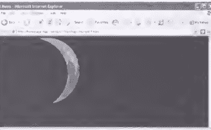

## 提示

- 你可能会想：如果 `offsetLeft` 是数值，为什么还要大费周章地去修改 `style.left` 属性呢？我们必须这样做，因为 `offsetLeft` 是只读的；也就是说，你可以读取它的值，但不能修改它。目前没有任何跨浏览器的、可写的、数值型定位属性。

- 每个对象的 `z-index` 是在脚本 13.11 中设置的。这些数字不必是连续的；只要一个数字比另一个大，较大的那个就会显示在上层。

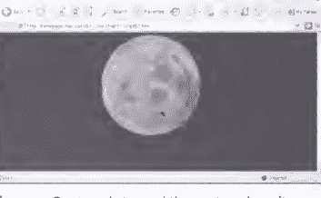

### 在文档中移动对象

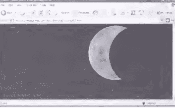

### 日期方法

由于你经常需要处理日期，这里列出 `Date` 对象的所有方法。在**表 13.1** 中，你会看到对 UTC 的引用，UTC 代表协调世界时，它于 1986 年取代格林威治标准时间（GMT）成为世界时间标准。任何包含 UTC 的方法仅在 JavaScript 1.2 或更高版本中可用。

### 表 13.1

| 方法 | 描述 | 返回值 | 支持的浏览器 |
|--------|-------------|---------------|-------------------|
| `getDate()` | 月份中的日期 | 1–31 | JavaScript 1.0 |
| `getUTCDate()` | | | JavaScript 1.2 |
| `getDay()` | 星期的整数值 | 0–6 | JavaScript 1.0 |
| `getUTCDay()` | | | JavaScript 1.2 |
| `getFullYear()` | 完整的四位数年份 | 1900+ | JavaScript 1.2 |
| `getUTCFullYear()` | | | |
| `getHours()` | 一天中的整数小时 | 0–23 | JavaScript 1.0 |
| `getUTCHours()` | | | JavaScript 1.2 |
| `getMilliseconds()` | 自上一秒以来的毫秒数 | 0–999 | JavaScript 1.2 |
| `getUTCMilliseconds()` | | | |
| `getMinutes()` | 自上一小时以来的分钟数 | 0–59 | JavaScript 1.0 |
| `getUTCMinutes()` | | | JavaScript 1.2 |
| `getMonth()` | 一年中的月份 | 0–11 | JavaScript 1.0 |
| `getUTCMonth()` | | | JavaScript 1.2 |
| `getSeconds()` | 自上一分钟以来的秒数 | 0–59 | JavaScript 1.0 |
| `getUTCSeconds()` | | | JavaScript 1.2 |
| `getTime()` | 自 1970 年 1 月 1 日午夜以来的毫秒数 | | JavaScript 1.0 |
| `getTimezoneOffset()` | 本地时间与 GMT 之间的差值（以分钟为单位） | 0–1439 | JavaScript 1.0 |
| `getYear()` | 日期中的年份字段 | 1900–1999 年为 0–99，之后为四位数年份 | JavaScript 1.0 |
| `parse()` | 给定日期/时间字符串，返回自 1970 年 1 月 1 日午夜以来的毫秒数 | | JavaScript 1.0 |
| `setDate()` | 设置日期，给定 1–31 之间的数字 | 以毫秒为单位的日期（自 JavaScript 1.2 起） | JavaScript 1.0 |
| `setUTCDate()` | | | JavaScript 1.2 |
| `setFullYear()` | 设置年份，给定四位数年份 | 以毫秒为单位的日期 | JavaScript 1.2 |
| `setUTCFullYear()` | | | |
| `setHours()` | 设置小时，给定 0–23 之间的数字 | 以毫秒为单位的日期（自 JavaScript 1.2 起） | JavaScript 1.0 |
| `setUTCHours()` |  |  | JavaScript 1.2 |
| `setMilliseconds()` | 设置毫秒，给定 0–999 之间的数字 | 以毫秒为单位的日期 | JavaScript 1.2 |
| `setUTCMilliseconds()` |  |  |  |
| `setMinutes()` | 设置分钟，给定 0–59 之间的数字 | 以毫秒为单位的日期（自 JavaScript 1.2 起） | JavaScript 1.0 |
| `setUTCMinutes()` |  |  | JavaScript 1.2 |
| `setMonth()` | 设置月份，给定 0–11 之间的数字 | 以毫秒为单位的日期（自 JavaScript 1.2 起） | JavaScript 1.0 |
| `setUTCMonth()` |  |  | JavaScript 1.2 |
| `setSeconds()` | 设置秒数，给定 0–59 之间的数字 | 以毫秒为单位的日期（自 JavaScript 1.2 起） | JavaScript 1.0 |
| `setUTCSeconds()` |  |  | JavaScript 1.2 |
| `setTime()` | 设置日期，给定自 1970 年 1 月 1 日以来的毫秒数 | 以毫秒为单位的日期 | JavaScript 1.0 |
| `setYear()` | 设置年份，给定两位或四位数字值 | 以毫秒为单位的日期（自 JavaScript 1.2 起） | JavaScript 1.0 |
| `toGMTString()` | 以字符串格式返回 GMT 日期和时间 | day dd mm yyyy hh:mm:ss GMT | JavaScript 1.0 |
| `toUTCString()` |  |  | JavaScript 1.2 |
| `toLocaleString()` | 以字符串格式返回本地日期和时间 | 因操作系统、区域设置和浏览器而异 | JavaScript 1.0 |
| `toString()` | 以字符串格式返回本地日期和时间 | 因操作系统和浏览器而异 | JavaScript 1.0 |
| `UTC()` | 给定年、月、日（以及可选的小时、分钟、秒和毫秒）格式的日期，返回自 1970 年 1 月 1 日以来的毫秒数 | 以毫秒为单位的日期 | JavaScript 1.0 |
| `valueOf()` | 自 1970 年 1 月 1 日午夜以来的毫秒数 | 以毫秒为单位的日期 | JavaScript 1.2 |

## 应用 JavaScript

在本书前面的章节中，你已经学习了如何使用数十种 JavaScript 技术来完成许多特定任务。在你构建的许多网页上，通常只需要一种技术，你就能使用本书中的脚本（通常稍作修改）来完成任务。

但有时你需要在页面上使用多种技术来完成任务。这就是本章的内容所在。你在这里找到的任务需要各种不同的方法，并且（即使不是完全相同，至少在精神上）与你在自己的网站上需要做的事情类似。

在本章中，你将学习如何通过大纲式的滑动和弹出菜单来改善网站的用户界面；创建幻灯片放映；通过 JavaScript 处理文本来进行文本操作；让 JavaScript 以易于理解的图形方式完成繁重的数据展示工作；以及在脚本控制下切换不同的样式表。

## 第 14 章

### 使用滑动菜单

滑动菜单是一种简单的用户界面小部件，可以让你在页面上放置大量信息而不会显得杂乱。用户可以根据需要查看额外信息的全部或部分内容。**脚本 14.1** 包含 HTML，**脚本 14.2** 包含 CSS，**脚本 14.3** 包含 JavaScript，如下所示。

**脚本 14.1** 这是一个包含大量链接的简洁 HTML 页面。

```html
<!DOCTYPE html PUBLIC "-//W3C//DTD XHTML 1.0 Transitional//EN">
<html xmlns="http://www.w3.org/1999/xhtml">
<head>
    <title>Shakespeare's Plays</title>
    <link rel="stylesheet" rev="stylesheet" href="script01.css" />
    <script type="text/javascript" language="Javascript" src="script01.js">
    </script>
</head>
<body>
    <h1>Shakespeare's Plays</h1>
    <div>
        <a href="menu1.html" class="menuLink">Comedies</a>
        <ul class="menu" id="menu1">
            <li><a href="pg1.html">All's Well That Ends Well</a></li>
            <li><a href="pg2.html">As You Like It</a></li>
            <li><a href="pg3.html">Love's Labour's Lost</a></li>
            <li><a href="pg4.html">The Comedy of Errors</a></li>
        </ul>
    </div>
    <div>
        <a href="menu2.html" class="menuLink">Tragedies</a>
        <ul class="menu" id="menu2">
            <li><a href="pg5.html">Anthony &amp; Cleopatra</a></li>
            <li><a href="pg6.html">Hamlet</a></li>
            <li><a href="pg7.html">Romeo &amp; Juliet</a></li>
        </ul>
    </div>
    <div>
        <a href="menu3.html" class="menuLink">Histories</a>
        <ul class="menu" id="menu3">
            <li><a href="pg8.html">Henry IV, Part 1</a></li>
            <li><a href="pg9.html">Henry IV, Part 2</a></li>
        </ul>
    </div>
</body>
</html>
```

### 脚本 14.2 实现此效果所需的 CSS 并不多。

```css
body {
    background-color: white;
    color: block;
}

div {
    margin-bottom: 10px;
}

ul.menu {
    display: none;
    list-style-type: none;
    margin-top: 5px;
}

o.menuLink {
    font-size: 16px;
    font-weight: bold;
}
```

## 使用滑动菜单：

1. `var allLinks = document.getElementsByTagName("a");`

    页面加载时，`initAll()` 函数被调用，它首先创建一个包含页面上所有链接的数组。

2. `for (var i=0; i<allLinks.length; i++) {`

```javascript
for (var i=0; i<allLinks.length; i++) {
    if (allLinks[i].className.indexOf("menuLink") > -1) {
        allLinks[i].onclick = toggleMenu;
    }
}
```

    获取所有链接后，我们遍历它们，查找那些 `class` 属性包含 `menuLink` 的链接，并仅为这些链接添加 `onclick` 事件处理器。这里，`onclick` 处理器被设置为在链接被点击时调用 `toggleMenu()` 函数。

3. `var startMenu = this.href.lastIndexOf("/")+1;`

    `var stopMenu = this.href.lastIndexOf(".");`

    在 `toggleMenu()` 函数内部，JavaScript 将 `this` 传递给我们。这里的 `this` 是用户点击的链接对象，这意味着 `this.href` 是链接的完整 URL。但我们只需要最后一个正斜杠和最后一个点号之间的部分（即，如果链接是 `http://www.javascriptworld.com/index.html`，我们只需要 "index"）。因此，我们创建并设置 `startMenu` 和 `stopMenu` 为 `this.href` 中我们想要开始和结束查找字符串（该字符串最终将成为菜单名称）的位置。

### 脚本 14.3 使用此脚本，文本（和链接）可以出现和消失。

```javascript
window.onload = initAll;

function initAll() {
    var allLinks = document.getElementsByTagName("a");

    for (var i=0; i<allLinks.length; i++) {
        if (allLinks[i].className.indexOf("menuLink") > -1) {
            allLinks[i].onclick = toggleMenu;
        }
    }
}

function toggleMenu() {
    var startMenu = this.href.lastIndexOf("/") + 1;
    var stopMenu = this.href.lastIndexOf(".");
}
```

(脚本在下一页继续)

4. `var thisMenuName = this.href.substring(startMenu, stopMenu);`

    我们想要的菜单名称就在这两个位置之间，所以在此处设置它。

5. `var thisMenu = document.getElementById(thisMenuName).style;`

    变量 `thisMenu` 通过 `getElementById()` 方法被设置为对所需菜单的引用。

6. `thisMenu.display = (thisMenu.display == "block") ? "none" : "block";`

    如果 `thisMenu` 的 `display` 属性是 `block`，则此代码将其更改为 `none`。或者，如果是 `none`，则将其更改为 `block`。这就是切换菜单显示的方式，如图 14.1 和 14.2 所示。

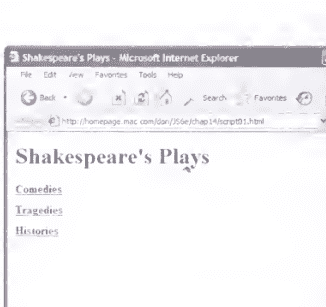

7. `return false;`

    最后，我们返回一个 `false` 值——这是因为 `toggleMenu()` 函数是由于链接上的 `onclick` 事件处理器而被调用的。当我们返回 `false` 时，`href` 属性永远不会被加载到浏览器窗口中，因此观众将停留在当前页面。

**使用滑动菜单**

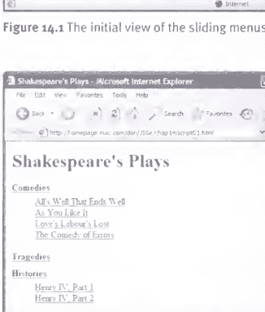

### 脚本 14.4 稍多的 CSS 和 JavaScript 使你的菜单看起来更传统。

```css
body {
    background-color: white;
    color: black;
}

div {
    margin-bottom: 10px;
    width: 180px;
    background-color: #CF9;
}

ul.menu {
    display: none;
    list-style-type: none;
    margin: 0;
    padding: 0;
}

ul.menu li {
    font: 12px arial, helvetica, sans-serif;
    padding-left: 10px;
}

a.menuLink, li a {
    text-decoration: none;
    color: #060;
}

a.menuLink {
    font-size: 16px;
    font-weight: bold;
}

li a:hover {
    background-color: #060;
    color: white;
}
```

## 添加下拉菜单

你可能看过前一个任务中的滑动菜单，并对自己说，这很好，但我真正想要的是那些让网页看起来像应用程序的下拉菜单。秘诀在于：前一个任务和这个任务之间没有很大区别。事实上，HTML 是相同的（请参考脚本 14.1）；CSS 在脚本 14.4 中，JavaScript 在脚本 14.5 中。

**添加下拉菜单**

### 脚本 14.5 此脚本将你普通的链接转换为下拉菜单。

```javascript
window.onload = initAll;

function initAll() {
    var allLinks = document.getElementsByTagName("a");

    for (var i=0; i<allLinks.length; i++) {
        if (allLinks[i].className.indexOf("menuLink") > -1) {
            allLinks[i].onclick = function() {return false;}
            allLinks[i].onmouseover = toggleMenu;
        }
    }
}

function toggleMenu() {
    var startMenu = this.href.lastIndexOf("/") + 1;
    var stopMenu = this.href.lastIndexOf(".");
    var thisMenuName = this.href.substring(startMenu, stopMenu);

    document.getElementById(thisMenuName).style.display = "block";

    this.parentNode.className = thisMenuName;
    this.parentNode.onmouseout = toggleDivOff;
    this.parentNode.onmouseover = toggleDivOn;
}

function toggleDivOn() {
    document.getElementById(this.className).style.display = "block";
}

function toggleDivOff() {
    document.getElementById(this.className).style.display = "none";
}
```

**添加下拉菜单**


**图 14.3** 当你将鼠标悬停在菜单上时，菜单会展开，并高亮显示鼠标指针下的选项。

## 添加下拉菜单：

1. `allLinks[i].onclick = function() {return false;}`

    `allLinks[i].onmouseover = toggleMenu;`

    与之前不同，我们没有添加一个调用 `toggleMenu()` 的 `onclick` 处理器，而是将 `onclick` 设置为始终返回 `false`——我们根本不想让它做任何事情。相反，我们将让 `onmouseover` 调用 `toggleMenu()`，这意味着无论何时我们将鼠标移到菜单上，菜单都会打开（**图 14.3**）。

2. `document.getElementById(thisMenuName).style.display = "block";`

    在 `toggleMenu()` 函数内部，我们不再以完全相同的方式进行切换。相反，我们现在将设置此菜单始终显示。

3. `this.parentNode.className = thisMenuName;`

    `this.parentNode.onmouseout = toggleDivOff;`

    `this.parentNode.onmouseover = toggleDivOn;`

    一旦我们设置菜单显示，我们就必须找出如何再次隐藏它。下拉菜单的秘诀在于，你不想在鼠标移出触发链接时关闭它；你想在鼠标移出整个 `div` 时关闭它。也就是说，如果你在菜单的任何位置，你希望它保持打开状态。在这里，我们将一个类分配给当前链接的父级（即链接周围的 `div`），然后我们将 `onmouseover` 和 `onmouseout` 处理器分配给该 `div`。这些将触发 `toggleDivOn()` 和 `toggleDivOff()`，从现在开始处理该 `div`。

    这里有个技巧：如果我们执行到这里，那么根据定义，光标就在 `div` 内部。因此，仅仅设置 `onmouseover` 就会导致 `toggleDivOn()` 立即被触发。

4. `document.getElementById(this.className).style.display = "block";`

    这是 `toggleDivOn()` 函数的完整内容，我们在此告诉整个 `div`（再次）显示。是的，我们在上面的第 2 步中已经这样做了，但我们需要在这里再次这样做：否则，我们移出链接的那一刻，菜单会立即关闭。

5. `document.getElementById(this.className).style.display = "none";`

    这是我们执行与 `toggleDivOn()` 相反操作的地方，位于 `toggleDivOff()` 内部。我们不是将 `div` 设置为始终显示，而是设置为隐藏——但仅当光标移出整个 `div` 区域时才如此。

**添加下拉菜单**

### 脚本 14.6 添加一行 CSS，你将获得全新的菜单外观。

```css
body {
    background-color: white;
    color: black;
}

div {
    margin-bottom: 10px;
    width: 180px;
    background-color: #CF9;
    float: left;
}

ul.menu {
    display: none;
    list-style-type: none;
    margin: 0;
    padding: 0;
}

ul.menu li {
    font: 12px arial, helvetica, sans-serif;
    padding-left: 10px;
}

a.menuLink, li a {
    text-decoration: none;
    color: #060;
}

a.menuLink {
    font-size: 16px;
    font-weight: bold;
}

li a:hover {
    background-color: #060;
    color: white;
}
```

## Applied JavaScript


## 提示

- 但你可能会说："我不想要垂直菜单，我想要水平菜单！"好吧，好吧——这里有个巧妙的技巧：如**脚本 14.6** 和**图 14.4** 所示，将 `float: left;` 添加到每个菜单 `div` 的 CSS 中。是的，这就是把一个变成另一个所需要的全部——不需要更改 JavaScript。

- 下面是这些菜单内部的一些原理：如果你仔细查看 HTML，会发现链接实际上是在 `<ul>` 和 `<li>` 标签内——也就是说，它们是无序列表和列表项。如果用户的浏览器不支持 CSS，他们将只会看到页面上的项目列表（**图 14.5**）。但是，如果浏览器支持，我们可以使用 CSS 来设置我们想要的列表样式，其结果看起来完全不像一个普通的列表。

图 14.4 对 CSS 的一个简单更改使菜单在页面上水平显示，而不是在左侧垂直显示。


图 14.5 当你关闭 CSS 显示（如我们在 Firefox 中所做的），菜单揭示了它们的真实面目：只是一个简单的无序列表。

## 添加下拉菜单

## 带标题的幻灯片

虽然幻灯片（如脚本 4.17 中的那个）可能很方便，但如果你还能显示随图像变化的标题，它可能会更有用。**脚本 14.7 (HTML)、14.8 (CSS) 和 14.9 (JavaScript)** 展示了这样一个幻灯片的示例（包含了我们暑假的照片！）。在这个任务中，我们将向你展示如何将前面章节中学到的不同技术融合到一个脚本中。

**脚本 14.7** 我们的幻灯片 HTML 页面。

```html
<!DOCTYPE html PUBLIC "-//W3C//DTD XHTML 1.0 Transitional//EN">
<html xmlns="http://www.w3.org/1999/xhtml">
<head>
	<title>Our Summer Vacation!</title>
	<link rel="Stylesheet" href="script03.css" />
	<script type="text/javascript" language="JavaScript" src="script03.js">
	</script>
</head>
<body>
	<h1>Our Summer Vacation Slideshow</h1>
	
	<div id="imgText"> &nbsp; </div>
	<br clear="all" />
	<form action="#">
		<input type="button" id="prevLink" value="&laquo; Previous" />
		<input type="button" id="nextLink" value="Next &raquo;" />
	</form>
</body>
</html>
```

### 脚本 14.8 脚本 14.7 调用的外部层叠样式表。

```css
body {
    background-color: white;
    color: black;
    font: 12px verdana, arial, helvetica, geneva, sans-serif;
}

h1 {
    font: 24px "trebuchet ms", verdana, arial, helvetica, geneva, sans-serif;
    margin-left: 100px;
}

form {
    margin-left: 100px;
}

#slideshow {
    padding: 0 10px 10px 10px;
    float: left;
}

#imgText {
    padding: 10px 0 0 10px;
    float: left;
    width: 200px;
    height: 150px;
    border-color: black;
    border-width: 1px 0 0 1px;
    border-style: solid;
}
```

## 第14章

**脚本 14.9** 幻灯片脚本显示照片和标题。

```javascript
window.onload = initAll;
var currImg = 0;
var captionText = new Array(
    "Our ship, leaving Vancouver.",
    "We took a helicopter ride at our first port, Juneau.",
    "The helicopter took us to Mendenhall Glacier.",
    "The happy (and chilly) couple, on the glacier.",
    "Here's what our second stop, Ketchikan, looked like from the ship.",
    "We got to cruise through Glacier Bay. It was absolutely breathtaking!",
    "In Skagway, we took a train up into the mountains, all the way to the Canadian Border.",
    "Looking back down at Skagway from the train.",
    "On a trip this romantic, I shouldn't have been surprised by a proposal, but I was (obviously, I said yes).",
    "It's nice to go on vacation, but it's nice to be home again, too."
)
```

```javascript
function initAll() {
    document.getElementById("imgText").innerHTML = captionText[0];
    document.getElementById("prevLink").onclick = processPrevious;
    document.getElementById("nextLink").onclick = processNext;
}
```

```javascript
function processPrevious() {
    newSlide(-1);
}
```

```javascript
function processNext() {
    newSlide(1);
}
```

```javascript
function newSlide(direction) {
    var imgCt = captionText.length;

    currImg = currImg + direction;

    if (currImg < 0) {
        currImg = imgCt-1;
    }

    if (currImg == imgCt) {
        currImg = 0;
    }

    document.getElementById("slideshow").src = "images/slideImg" + currImg + ".jpg";
    document.getElementById("imgText").innerHTML = captionText[currImg];

}
```


### 创建带标题的幻灯片：

1. `document.getElementById("imgText").innerHTML = captionText[0];`

`document.getElementById("prevLink").onclick = processPrevious;`

`document.getElementById("nextLink").onclick = processNext;`

我们的 `initAll()` 函数需要设置三件事：第一张幻灯片的照片标题（在 `imgText` 区域），以及前进和后退按钮的 `onClick` 处理器，它们将分别调用 `processNext()` 和 `processPrevious()` 函数。

2. `function processPrevious() {`

```javascript
function processPrevious() {
    newSlide(-1);
}

function processNext() {
    newSlide(1);
}
```

是的，这两个函数所做的确实就是这些——嗯，差不多。我们本可以编写一些复杂的代码，根据点击了哪个按钮来决定是前进还是后退，但相反，我们将只使用两个函数，这两个函数都调用 `newSlide()`。区别在于：一个函数调用时传递值为 1，另一个传递值为 -1，让 `newSlide()` 知道应该向哪个方向移动。

3. `document.getElementById("slideshow").src = "images/slideImg" + currImg + ".jpg";`

`document.getElementById("imgText").innerHTML = captionText[currImg];`

这一步同时更改图像及其对应的标题。**图 14.6** 显示了结果。

## 搞笑名字生成器

你可能以前见过基于网页的玩具，它们获取你的名字并将其转换成一个新名字，比如"你的超级英雄名字"或"如果你是《黑道家族》中的一个角色，你的名字会是什么"。我们只是追求简单搞笑，所以脚本 14.10 和 14.11 可以向你展示如何得到你自己的新搞笑名字。在这个过程中，你可以看到如何将字符串处理、数组、错误检查和表单验证组合到一个非常搞笑的脚本中。

**脚本 14.10** 你可以输入真实姓名并获取搞笑姓名的网页。

```html
<!DOCTYPE html PUBLIC "-//W3C//DTD XHTML 1.0 Transitional//EN">
<html xmlns="http://www.w3.org/1999/xhtml">
<head>
<title>Silly Name Generator</title>
<script language="Javascript"
type="text/javascript" src="script04.js"></script>
</head>
<body bgcolor="#FFFFFF">
<h1>What's your silly name?</h1>
<form action="#">
<table>
<tr>
<td align="right">First Name:</td>
<td><input type="text" id="fName" size="30" /></td>
</tr>
<tr>
<td align="right">Last Name:</td>
<td><input type="text" id="lName" size="30" /></td>
</tr>
<tr>
<td>&nbsp;</td>
<td><input type="submit" value="Submit" />&nbsp;<input type="reset" /></td>
</tr>
</table>
</form>
<p id="msgField">&nbsp;</p>
</body>
</html>
```

**脚本 14.11** 这个脚本根据用户输入的姓和名，从两个数组中生成一个搞笑的名字。

```javascript
window.onload = initAll;

function initAll() {
    document.forms[0].onsubmit = getSillyName;
}

function getSillyName() {
    document.getElementById("msgField").innerHTML = getSillyNameString();
    return false;
}

function getSillyNameString() {
    var firstName = new Array("Runny", "Buttercup", "Dinky", "Stinky", "Crusty", "Greasy", "Gidget",
    "Cheesypoof", "Lumpy", "Wacky", "Tiny", "Flunky", "Fluffy", "Zippy", "Doofus", "Gobsmacked",
    "Slimy", "Grimy", "Salamander", "Oily", "Burrito", "Bumpy", "Loopy", "Snotty", "Irving", "Egbert");
    var lastName1 = new Array("Snicker", "Buffalo", "Gross", "Bubble", "Sheep", "Corset", "Toilet",
    "Lizard", "Waffle", "Kumquot", "Burger", "Chimp", "Liver", "Gorilla", "Rhino", "Emu", "Pizza",
    "Toad", "Gerbil", "Pickle", "Tofu", "Chicken", "Potato", "Hamster", "Lemur", "Vermin");
    var lastName2 = new Array("face", "dip", "nose", "brain", "head", "breath", "pants", "shorts",
    "lips", "mouth", "muffin", "butt", "bottom", "elbow", "honker", "toes", "buns", "spew", "kisser",
    "fanny", "squirt", "chunks", "brains", "wit", "juice", "shower");

    var firstNm = document.getElementById("fName").value.toUpperCase();
    var lastNm = document.getElementById("lName").value.toUpperCase();
    var validName = true;

    if (firstNm == "") {
        validName = false;
    }
    else {
        var firstNum = firstNm.charCodeAt(0) - 65;
        if (firstNum < 0 || firstNum > 25) {
            validName = false;
        }
    }

    if (!validName) {
        document.getElementById("fName").focus();
        document.getElementById("fName").select();
        return "That's not a valid first name";
    }
```

## 第14章

综合使用 JavaScript 技术：

1. `document.getElementById("msgField").innerHTML = getSillyNameString();`

   `return false;`

页面首次加载时，表单的 `onsubmit` 处理程序被设置为调用 `getSillyName()` 函数。下面是该函数的内容。首先，我们调用 `getSillyNameString()`。该函数返回一个字符串值（要么是搞笑名字，要么是错误信息），然后我们将该字符串写入页面。接着我们返回 `false`，这样 `onsubmit` 就不会真正尝试将表单提交到服务器。

2. `var firstNm = document.getElementById("fName").value.toUpperCase();`

   `var lastNm = document.getElementById("lName").value.toUpperCase();`

访问此页面的用户会被要求在表单字段中输入自己的名和姓。表单提交时，我们通过 `getSillyNameString()` 函数将两个名字都转换为大写，并分别存储在变量 `firstNm` 和 `lastNm` 中。

3. `if (firstNm != "") {`

```javascript
if (firstNm != "") {
    validName = false;
}
```

要求访客至少输入名字的一个字符，此处即进行该检查。注意，该表达式读作"如果 `firstNm` 不等于空字符串，则"。如果条件成立，我们将 `validName` 设为 `false`。

## 搞笑名字生成器

**脚本 14.11 续**

```javascript
if (lastNm == "") {
  validName = false;
}
else {
  var lastNum1 = lastNm.charCodeAt(0) - 65;
  var lastNum2 = lastNm.charCodeAt((lastNm.length-1)) - 65;

  if (lastNum1 < 0 || lastNum1 > 25 ||
      lastNum2 < 0 || lastNum2 > 25) {
    validName = false;
  }
}
```

```javascript
if (!validName) {
  document.getElementById("lName").focus();
  document.getElementById("lName").select();
  return "That's not a valid last name";
}

return "Your silly name is " + firstName[firstNum] + " " + lastNm1[lastNum1] + lastNm2[lastNum2];
}
```

## 应用 JavaScript

4. `var firstNum = firstNm.charCodeAt(0) - 65;`

否则，`charCodeAt()` 方法从字符串中取出一个字符。字符串中的该字符由传递给方法的数字决定；此处是第 0 位的字符，即字符串中的第一个字符（记住，JavaScript 从 0 开始计数），并返回该字符的 ASCII 值。大写字母表中，"A" 的 ASCII 值为 65，"Z" 的值为 90。然后我们用结果减去 65，得到一个 0 到 25 之间的数，并将该结果保存为 `firstNum`。

5. `if (firstNum < 0 || firstNum > 25) {`

```javascript
if (firstNum < 0 || firstNum > 25) {
    validName = false;
}
```

如果用户输入的名字不是以 "A" 到 "Z" 之间的字符开头，就不会有对应的搞笑名字。这里，我们在检查姓氏之前确保其在有效范围内。如果不是，我们将 `validName` 设为 `false`。

6. `if (!validName) {`

```javascript
if (!validName) {
    document.getElementById("fName").focus();
    document.getElementById("fName").select();
    return "That's not a valid first name";
}
```

此时，我们知道如果 `validName` 为 `false`，意味着用户输入的名字无效。发生这种情况时，我们将光标置于该字段，选中该字段中的任何内容，并返回一条错误信息。

7. `if (lastNm != "") {`

```javascript
if (lastNm != "") {
    validName = false;
}
```

与名字一样，姓氏字段也必须输入内容。

8. `var lastNum1 = lastNm.charCodeAt(0) - 65;`

`var lastNum2 = lastNm.charCodeAt((lastNm.length-1)) - 65;`

为了计算访客的新搞笑姓氏，我们需要计算姓氏第一个和最后一个字符的 ASCII 值。第一个字符的计算方式与第 4 步相同。最后一个字符则通过获取 `lastNm` 字符串的长度，减去 1，然后将该数字传递给 `charCodeAt()` 方法来获取。

9. `if (lastNum1 < 0 || lastNum1 > 25 || lastNum2 < 0 || lastNum2 > 25) {`

```javascript
if (lastNum1 < 0 || lastNum1 > 25 ||
    lastNum2 < 0 || lastNum2 > 25) {
    validName = false;
}
```

与名字字段一样，我们必须确保姓氏的首字母和尾字母都在 "A" 到 "Z" 之间，因此如果存在问题，我们再次将 `validName` 设为 `false`。

10. `if (!validName) {`

```javascript
if (!validName) {
    document.getElementById("lName").focus();
    document.getElementById("lName").select();
    return "That's not a valid last name";
}
```

正如我们在第 6 步所做的，如果名字无效，我们要让用户知道。

### 你的搞笑名字

你的搞笑名字是通过取你名字的第一个字母、姓氏的第一个字母和姓氏的最后一个字母，然后在表 14.1 的图表中查找对应项来确定的。名字的第一个字母对应你的新名，姓氏的两个字母分别对应新搞笑姓氏的第一部分和第二部分。

例如，Tom 中的 "T" 对应的新名字是 "Oily"，Negrino 中的 "N" 和 "O" 产生的新姓氏是 "Gorillahonker"。Dori 中的 "D" 变成 "Stinky"，Smith 中的 "S" 和 "H" 变成 "Gerbilshorts"。因此，本书作者的搞笑名字是 Oily Gorillahonker 和 Stinky Gerbilshorts。

## 表 14.1

### 搞笑名字图表

| | 名字的首字母 | 姓氏的首字母 | 姓氏的尾字母 |
| :--- | :--- | :--- | :--- |
| A | runny | snicker | face |
| B | buttercup | buffalo | dip |
| C | dinky | gross | nose |
| D | stinky | bubble | brain |
| E | crusty | sheep | head |
| F | greasy | corset | breath |
| G | gidget | toilet | pants |
| H | cheesypooh | lizard | shorts |
| I | lumpy | waffle | lips |
| J | warky | kumquat | mouth |
| K | tiny | burger | muffin |
| L | flunky | chump | butt |
| M | fluffy | liver | bottom |
| N | zippy | gorilla | elbow |
| O | doolus | rhino | honker |
| P | gobsmacked | emu | toes |
| Q | slimy | pizza | buns |
| R | grimy | toad | spew |
| S | salamander | gerbil | kisser |
| T | oily | pickle | fanny |
| U | burrito | tolu | squirt |
| V | bumpy | chicken | chunks |
| W | loopy | potato | brains |
| X | snotty | hamster | wit |
| Y | irving | lemur | juice |
| Z | egbert | vermin | shower |

11. `return "Your silly name is " + firstName[firstNum] + " " + lastName1[lastNum] + lastName2[lastNum];`

如果我们通过了所有测试，就可以计算新的搞笑名字了。由于我们将字符转换成了 0 到 25 之间的数字，我们可以将这些结果用作名字数组的索引：`firstName`、`lastName1` 和 `lastName2`。每个数组查找的结果依次拼接，在名字和姓氏之间留一个空格。注意，姓氏的两部分拼接时中间没有空格。完成后，该名字被返回并放入文档中，如图 14.7 所示。

## 搞笑名字生成器

图 14.7 生成的搞笑名字结果。

## 条形图生成器

图表是展示可视化信息的绝佳方式。你可以在 Adobe Photoshop 中绘制条形图，也可以通过 Microsoft Excel 计算生成，但对于可能需要定期更改的动态数据，为什么不直接用 JavaScript 即时生成呢？虽然我们在本书中一直说 JavaScript 是面向对象的（因此符合流行术语），而且全书都在使用对象，但我们只简要展示了如何创建自定义对象。下面是一个更深入的示例，展示对象是如何工作的，参见脚本 14.12（HTML）、14.13（CSS）和 14.14（JavaScript）。

### 生成条形图：

1. `var radioButtons = document.getElementsByTagName("input");`

```javascript
var radioButtons = document.getElementsByTagName("input");
for (var i=0; i < radioButtons.length; i++) {
    if (radioButtons[i].type == "radio") {
        radioButtons[i].onclick = chgChart;
    }
}
chgChart();
```

   正如我们多次做过的那样，`initAll()` 函数开始启动一切。这里，我们获取所有的单选按钮并遍历它们，将每个按钮的单击事件设置为调用 `chgChart()`。完成后，我们手动调用 `chgChart()` 以显示页面的默认视图。

2. `var bChart = new Object();`

   这里，在 `chgChart()` 内部，我们创建了第一个自定义对象 `bChart`（"browser chart" 的简写）。是的，就是这么简单。

### 脚本 14.12 条形图生成器的 HTML 页面。

```html
<!DOCTYPE html PUBLIC "-//W3C//DTD XHTML 1.0
Transitional//EN">
<html xmlns="http://www.w3.org/1999/xhtml">
<head>
    <title>Bar Chart Form Input</title>
    <link rel="stylesheet" rev="stylesheet"
        href="script05.css" />
    <script language="Javascript" type="text/
        javascript" src="script05.js">
    </script>
</head>
<body>
<form action="#">
Choose a chart<br />
<input type="radio" name="type"
    value="browser" checked="checked" />
    Browser Usage<br />
<input type="radio" name="type"
    value="platform" /> JavaScript Usage<br />
<p><br /></p>
Choose a color<br />
<input type="radio" name="color"
    value="lilRed.gif" checked="checked"
    />&nbsp;Red<br />
<input type="radio" name="color"
    value="lilGreen.gif" /> Green<br />
<input type="radio" name="color"
    value="lilBlue.gif" /> Blue<br />
<p><br /></p>
Choose a direction<br />
<input type="radio" name="direction"
    value="horizontal" checked="checked" />
    Horizontal<br />
<input type="radio" name="direction"
    value="vertical" /> Vertical
</form>
<div id="chartArea">&nbsp;</div>
</body>
</html>
```

应用 JavaScript

### 脚本 14.13 该脚本包含条形图示例的样式。

```css
body {
  background-color: white;
  color: black;
  font-size: 12px;
}

form {
  float: left;
  width: 200px;
}

.vert {
  text-align: center;
  vertical-align: bottom;
}

.horiz {
  padding: 5px;
}

th.vert {
  border-left: 1px black solid;
  border-bottom: 1px black solid;
  vertical-align: middle;
  text-align: left;
  font-size: 16px;
}

th.horiz {
  border-right: 1px black solid;
  vertical-align: middle;
  text-align: left;
  font-size: 16px;
}
```

3. `bChart.name = "Browser usage by year";`

```javascript
bChart.name = "Browser usage by year";
bChart.years = new Array("1998", "1999", "2000", "2001", "2002", "2003", "2004", "2005", "2006");
bChart.fieldnames = new Array("Netscape", "MSIE", "Other");
bChart.field1 = new Array(38.9, 31.9, 21.2, 12.4, 6.6, 5.1, 3.1, 6);
bChart.field2 = new Array(60.6, 67.4, 78.3, 85.6, 92.5, 94.0, 92, 89, 90);
bChart.field3 = new Array(0.5, 0.5, 0.5, 2.1, 0.9, 1.0, 4, 9, 3);
```

自定义对象的属性通过向它们赋值来创建和初始化。在这里，我们设置了 `bChart` 的 `name`、`years`、`fieldnames`、`field1`、`field2` 和 `field3` 属性。这些字段分别是图表的名称、图表涵盖的年份、图表值的三个标签，以及每个年份和每个标签的数据集（在本例中，即每个浏览器）。

请注意，我们在每个属性前面没有使用 `var` 关键字；这是因为它们不是新变量。相反，它们是我们要添加到现有变量上的新属性（尽管这个变量是我们刚刚创建的）。

4. `bChart.fields = new Array(bChart.field1, bChart.field2, bChart.field3);`

这里我们创建了 `fields` 属性。它实际上是一个数组的数组，这将使我们更容易访问内部的数据。

条形图生成器

## 第 14 章

5. `var jsChart = new Object();`

```javascript
var jsChart = new Object();
jsChart.name = "JavaScript usage by year";
jsChart.years = new Array("1998", "1999", "2000", "2001", "2002", "2003", "2004", "2005", "2006");
jsChart.fieldnames = new Array("1.2 or later", "1.0 - 1.1", "No JavaScript");
jsChart.field1 = new Array(63.4, 66.5, 78.4, 80.2, 88.1, 89.1, 94, 89, 96);
jsChart.field2 = new Array(18.7, 12.6, 2.8, 0.8, 0.3, 0.3, 0, 0, 0);
jsChart.field3 = new Array(17.9, 21.0, 18.8, 19.0, 11.6, 10.6, 4, 9, 3);
jsChart.fields = new Array(jsChart.field1, jsChart.field2, jsChart.field3);
```

就像我们创建 `bChart` 对象一样，我们现在创建 `jsChart`（JavaScript 图表）对象并赋值其属性。对于 JavaScript 图表，我们同样有年份，但这次我们测量的是有多少百分比的浏览器支持 JavaScript 以及支持哪个版本。

### 脚本 14.14 下面是绘制条形图的代码。

```javascript
window.onload = initAll;

function initAll() {
    var radioButtons = document.getElementsByTagName("input");
    for (var i=0; i<radioButtons.length; i++) {
        if (radioButtons[i].type == "radio") {
            radioButtons[i].onclick = chgChart;
        }
    }
    chgChart();
}

function chgChart() {
    var bChart = new Object();
    bChart.name = "Browser usage by year";
    bChart.years = new Array("1998", "1999", "2000", "2001", "2002", "2003", "2004", "2005", "2006");
    bChart.fieldnames = new Array("Netscape", "MSIE", "Other");
    bChart.field1 = new Array(38.9, 31.9, 21.2, 12.4, 6.6, 5.1, 3.1, 6);
    bChart.field2 = new Array(60.6, 67.4, 78.3, 85.6, 92.5, 94.0, 92, 89, 90);
    bChart.field3 = new Array(0.5, 0.5, 0.5, 2.1, 0.9, 1.0, 4, 9, 3);
    bChart.fields = new Array(bChart.field1, bChart.field2, bChart.field3);

    var jsChart = new Object();
    jsChart.name = "JavaScript usage by year";
    jsChart.years = new Array("1998", "1999", "2000", "2001", "2002", "2003", "2004", "2005", "2006");
    jsChart.fieldnames = new Array("1.2 or later", "1.0 - 1.1", "No JavaScript");
    jsChart.field1 = new Array(63.4, 66.5, 78.4, 80.2, 88.1, 89.1, 94, 89, 96);
    jsChart.field2 = new Array(18.7, 12.6, 2.8, 0.8, 0.3, 0.3, 0, 0, 0);
```

### 脚本 14.14 续

```javascript
jsChart.field3 = new Array(17.9, 21.0, 18.8, 19.0, 11.6, 10.6, 4, 9, 3);
jsChart.fields = new Array(jsChart.field1, jsChart.field2, jsChart.field3);

var radioButtons = document.getElementsByTagName("input");
var currDirection = getButton("direction");
var imgSrc = "images/" + getButton("color");
var thisChart = (getButton("type") == "browser") ? bChart : jsChart;

var chartBody = "<h2>" + thisChart.name + "</h2><table>";

for (var i=0; i<thisChart.years.length; i++) {
    if (currDirection=="horizontal") {
        chartBody += "<tr><th rowspan='4' class='horiz'>" + thisChart.years[i];
        chartBody += "</th><td colspan='2'></td></tr>";
        for (var j=0; j<thisChart.fieldnames.length; j++) {
            chartBody += "<tr><td class='horiz'>" + thisChart.fieldnames[j];
            chartBody += "</td><td>";
            chartBody += "&nbsp;&nbsp;" + thisChart.fields[j][i] + "</td></tr>";
        }
    }
    else {
        chartBody += "<tr><th rowspan='2' class='vert'>" + thisChart.years[i] + "</th>";
```

6. `var radioButtons = document.getElementsByTagName("input");`

`var currDirection = getButton("direction");`

`var imgSrc = "images/" + getButton("color");`

在绘制图表之前，我们需要知道选中了哪些单选按钮。`radioButtons` 数组包含页面上所有的 `input` 元素，一旦我们获取了它，就可以调用 `getButton()` 函数。`getButton()` 函数接收一个字符串（单选按钮组的名称），并返回一个字符串（该组的当前值）。

我们也可以将 `radioButtons` 的设置在 `getButton()` 函数内部完成，而不是在这里做；但这样做意味着它只会被初始化一次，而不是三次（每次调用 `getButton()` 时都会初始化）。

7. `var thisChart = (getButton("type") == "browser") ? bChart : jsChart;`

当用户点击任何单选按钮来更改图表时，会调用 `chgChart()` 函数。当这种情况发生时，如果需要浏览器图表，整个 `bChart` 对象将被存储在 `thisChart` 中。否则，就是 JavaScript 图表，`thisChart` 被赋值为 `jsChart` 对象。

8. `var chartBody = "<h2>" + thisChart.name + "</h2><table>";`

这是实际绘图代码的开始。首先，我们写出图表的名称（存储在 `thisChart.name` 中，并在 `<h2>` 标签内显示），然后打开一个 `<table>` 标签。从现在开始，我们都在向 `chartBody` 变量添加内容，完成后，我们会将其写入页面。

条形图生成器

## 第 14 章

9. `for (var i=0; i<thisChart.years.length; i++) {`

这是我们要遍历的两个循环中的第一个（还记得步骤 4 中的那个伪二维数组吗？）。这个外部循环使用 `i` 作为索引变量，循环次数基于图表所涵盖的年数。

10. `if (currDirection=="horizontal") {`

如果用户想查看图表的水平版本（图 14.8），则运行以下代码。

11. `chartBody += "<tr><th rowspan='4' class='horiz'>" + thisChart.years[i];`

`chartBody += "</th><td colspan='2'></td></tr>";`

每个水平图表的第一行包含第 `i` 个年份标签。

12. `for (var j=0; j<thisChart.fieldnames.length; j++) {`

这是两个循环中第二个的水平版本。这个内部循环使用 `j` 作为其索引，循环次数基于我们存储的 `fieldnames` 数量。

13. `chartBody += "<tr><td class='horiz'>" + thisChart.fieldnames[j];`

表格的详情行在这里开始，我们首先写出值标签（浏览器类型或 JavaScript 版本），它存储在 `fieldnames` 的第 `j` 个元素中。

### 脚本 14.14 续

```javascript
for (var j=0; j<thisChart.fieldnames.length; j++) {
    chartBody += "<td class='vert'>";
    chartBody += "";
    chartBody += "</td>";
}
chartBody += "</tr><tr>";
for (j=0; j<thisChart.fieldnames.length; j++) {
    chartBody += "<td class='vert'>";
    chartBody += thisChart.fields[j][i];
    chartBody += "<br />";
    chartBody += thisChart.fieldnames[j] + "<br /><br />";
    chartBody += "</td>";
}
chartBody += "</tr>";
}
}
chartBody += "</table>";
document.getElementById("chartArea").innerHTML = chartBody;
```

```javascript
function getButton(buttonSet) {
    for (var i=0; i<radioButtons.length; i++) {
        if (radioButtons[i].name == buttonSet && radioButtons[i].checked) {
            return radioButtons[i].value;
        }
    }
    return -1;
}
```

## JavaScript 实战应用


图 14.8 初始的横向柱状图版本。


图 14.9 纵向柱状图版本。

14. `chartBody += "</td><td>";`

接下来，我们关闭前一个单元格并计算条形图像。条形的颜色基于 `imgSrc`，高度始终为 15 像素，宽度是数组中第 `j` 行第 `i` 列索引的值乘以 3。例如，如果 `imgSrc` 是 `lilBlue.gif`，且 `thisChart.fields[3][4]` 是 30，那么这将写出一个图像标签来绘制一个蓝色的矩形，高 15 像素，宽 90 像素。

15. `chartBody += "&nbsp;&nbsp;"+ thisChart.fields[j][i]+"</td> </tr>";`

写入几个空白字符（`&nbsp;`），然后在条形右侧显示实际的数据值，以完成这一行。这是代码水平部分的内部循环的结束。

16. `chartBody += "<tr><th rowspan= '2' class='vert'>"+thisChart. years[i]+"</th>";`

如果用户希望以纵向方式显示图表（**图 14.9**），我们开始写入图表的初始行。纵向版本稍微复杂一些，需要两个内部（但独立的）`j` 循环。这里我们写入图表的标签。

17. `for (var j=0; j<thisChart. fieldnames.length; j++) {`

这是第一个内部循环。这个循环在一行中写入每个竖直条形。

## 柱状图生成器

```javascript
chartBody += "<td class='vert'></td>";
```

这是动态写入的图像标签。这次，宽度固定在 15 像素，但高度根据数组中的值而变化。

例如，如果 `imgSrc` 是 `lilGreen.gif`，且 `thisChart.fields[3][4]` 是 30，那么这将写出一个图像标签来绘制一个绿色的矩形，高 90 像素，宽 15 像素。

```javascript
chartBody += "</tr><tr>";
```

当图表上的所有条形都写入完成后，关闭该表格行并开始下一行。

```javascript
for (j=0; j<thisChart.fieldnames.length; j++) {
```

这是第二个内部循环。这个循环写入每个数据点的值，位于其对应条形的下方，后面跟着 y 轴标签。

```javascript
chartBody += "<td class='vert'>" + thisChart.fields[j][i] + "<br />";
chartBody += thisChart.fieldnames[j] + "<br /><br /></td>";
```

这是为每个条形写入的信息。变量 `thisChart.fields[j][i]` 是该条形的值，`thisChart.fieldnames[j]` 是该条形的数据标签。

```javascript
chartBody += "</tr>";
```

最后一个内部循环完成后，我们需要写入一个最终的结束行标签。

23. `chartBody += "</table>";`

`document.getElementById("chartArea").innerHTML = chartBody;`

此时，横向和纵向部分都已完成，外部循环也已结束，所以我们写入最终的表格结束标签来结束脚本，然后将整个结果放入页面 `chartArea` 部分的 `innerHTML` 属性中。

## 提示

- 这段代码使用三张图片：`lilRed.gif`、`lilBlue.gif` 和 `lilGreen.gif`。每张都是对应颜色的单像素 GIF。HTML 允许你设置高度和宽度，不受图像实际物理尺寸的限制，所以单个像素可以让我们创建任意大小和形状的条形。

- 这个图表可以通过简单地更改步骤 3 和 5 中的数组值来改成几乎任何图表。无论你如何设置数组，都不需要更改创建图表的循环。

- 这些图表中的统计数据基于 The Counter 的全球统计，网址为 http://www.thecounter.com/stats/ 。不幸的是，他们仅从 1998 年 9 月开始记录这些数据，因此 1998 年的数据从 9 月开始。所有其他年份的数据从 1 月开始。

## 样式表切换器

JavaScript 最强大的用途之一是能够动态修改正在使用的样式表。例如，你可以让网站访问者选择网站上文字的样式和大小。有些人喜欢阅读细小的无衬线字体，这样可以显示更多文字（**图 14.10**），而另一些人更喜欢较大的衬线字体，这样更易读（**图 14.11**）。现在你可以让这两种访问者都满意。为了让它更实用，这个脚本还使用 cookie 来存储用户的选择，以便将来访问时使用。

### 允许用户在样式表之间切换：

1. `<link href="sansStyle.css" rel="stylesheet" rev="stylesheet" title="default" />`

   **脚本 14.15** 显示了一个标准的 `link` 引入外部样式表，但有一点新内容：它有一个 `title` 属性，值为 "default"。这将在后面发挥作用。


**图 14.10** 一些访问者更喜欢阅读较小的无衬线字体，这样可以在页面上显示更多文字。


**图 14.11** 其他访问者会很高兴选择他们认为更易读的较大衬线字体。

## JavaScript 实战应用

**脚本 14.15** 这个页面包含页面内容和用户控件，并调用用户可以选择的外部样式表。

```html
<!DOCTYPE html PUBLIC "-//W3C//DTD XHTML 1.0 Transitional//EN">
<html xmlns="http://www.w3.org/1999/xhtml">
<head>
    <title>Style Changer</title>
    <link href="script06.css" rel="stylesheet" rev="stylesheet" />
    <link href="sansStyle.css" rel="stylesheet" rev="stylesheet" title="default" />
    <link href="serifStyle.css" rel="alternate stylesheet" rev="alternate stylesheet" title="serif" />
    <script src="script06.js" language="javascript" type="text/javascript"></script>
</head>
<body>
    <div class="navBar"><p>Change your font:</p>
        <form action="#">
            <input type="button" class="typeBtn" value="Sm Sans" id="default" />&nbsp;&nbsp;
            <input type="button" class="typeBtn2" value="Lg Serif" id="serif" />
        </form>
        <br clear="all" />
    </div>
```

Lorem ipsum dolor sit amet, consectetuer adipiscing elit. Aenean lacus elit, volutpat vitae, egestas in, tristique ut, nibh. Donec congue lacinia magna. Duis tortor justo, dapibus vel, vulputate sed, mattis sit amet, leo. Cras purus quam, semper quis, dignissim id, hendrerit eget, ante. Nulla id lacus eget nulla bibendum venenatis. Duis faucibus adipiscing mauris. Integer augue. In vulputate purus eget enim. Nam odio eros, porta vitae, bibendum sit amet, iaculis nec, elit. Cras egestas scelerisque pede. Donec a tellus. Nullam consectetuer fringilla nunc.

Nam varius metus congue ligula. In hac habitasse platea dictumst. In ut ipsum a pede rhoncus convallis. Sed at enim. Integer sed metus quis est egestas vestibulum. Quisque mattis tortor a lorem. Nam diam. Integer consequat lectus. Donec molestie elementum nisl. Donec ligula sapien, volutpat eget, dictum quis, mollis a, odio. Aliquam augue enim, gravida nec, tempor ac, interdum in, urna. Aliquam mauris. Duis massa urna, ultricies id, condimentum ac, gravida nec, dolor. Morbi et est quis enim gravida nonummy. Cum sociis natoque penatibus et magnis dis parturient montes, nascetur ridiculus mus. MaurExpressions and BlendingModesl nisl quam, tincidunt ultrices, malesuada eget, posuere eu, lectus. Nulla a arcu. Sed consectetuer arcu et velit. Quisque dignissim risus vel elit.

Nunc massa mauris, dictum id, suscipit non, accumsan et, lorem. Suspendisse non lorem quis dui rutrum vestibulum. Quisque mauris. Curabitur auctor nibh non enim. Praesent tempor aliquam ligula. Fusce eu purus. Vivamus ac enim eget urna pulvinar bibendum. Integer porttitor, augue et auctor volutpat, lectus dolor sagittis ipsum, sed posuere lacus pede eget wisi. Proin vel orci ac velit porttitor pellentesque. Maecenas mattis velit scelerisque tellus. Cras eu tellus quis sapien malesuada porta. Nunc nulla. Nullam dapibus malesuada lorem. Duis eleifend rutrum tellus. In tempor tristique neque. Mauris rhoncus. Aliquam purus.

## 样式表切换器

2. `<link href="serifStyle.css" rel="alternate stylesheet" rev="alternate stylesheet" title="serif" />`

这里是另一个样式表，同样使用了 `link` 标签。但是，`rel` 和 `rev` 属性并没有设置为通常的 `stylesheet`，而是设置为 `alternate stylesheet`。这是因为这个样式表实际上并未在使用中——它只有在用户选择时才会被启用。

3. `<input type="button" class="typeBtn" value="Sm Sans" id="default" />&nbsp;&nbsp; <input type="button" class="typeBtn2" value="Lg Serif" id="serif" />`

这里有两个按钮：Sm Sans 和 Lg Serif。点击前者会将页面上的所有文本设置为小号无衬线字体，而点击后者会将所有文本设置为更大的衬线字体。如果浏览器支持，**脚本 14.16** 中的样式会使按钮本身也以目标字体显示，从而向用户提示他们选择该按钮后将看到的效果。

4. `body, p, td, ol, ul, select, span, div, input {`

```css
body, p, td, ol, ul, select, span, div, input {
    font: .9em/1.1em verdana, geneva, arial, helvetica, sans-serif;
}
```

**脚本 14.17**（通常被称为 `sansStyle.css`）只是告诉浏览器，当它加载时，它所涵盖的每个标签都应以 0.9em Verdana（或用户计算机上的其他无衬线字体之一）显示。

### 脚本 14.15 续

```html
<p>Morbi felis quam, placerat sed, gravida a, bibendum a, mauris. Aliquam porta diam. Nam consequat feugiat diam.
Fusce luctus, felis ut gravida mattis, ante mi viverra sapien, a vestibulum tellus lectus ut massa. Duis placerat. Aliquam molestie tellus. Suspendisse potenti. Fusce aliquet tellus a lectus. Proin augue diam, sollicitudin eget, hendrerit non, semper at, arcu. Sed suscipit tincidunt nibh. Donec ullamcorper. Nullam faucibus euismod augue. Cras lacinia. Aenean scelerisque, lorem sed gravida varius, nunc tortor gravida odio, sed sollicitudin pede augue ut metus. Maecenas condimentum ipsum et enim. Sed nulla. Ut neque elit, varius a, blandit quis, facilisis sed, velit. Suspendisse aliquam odio sed nibh.</p>

</body>
</html>
```

应用 JavaScript

**脚本 14.16** 这个层叠样式表包含了始终加载的样式。

```css
body {
    margin: 0 20px;
    padding: 0;
    background-color: white;
    color: black;
}

div.navBar {
    background-color: #CCC;
    width: 175px;
    position: relative;
    top: -1.0em;
    right: -20px;
    float: right;
    padding: 20px 0 0 20px;
    border-left: 2px groove #999;
    border-bottom: 2px groove #999;
}

.typeBtn {
    font: 9px/10px verdana, geneva, arial, helvetica, sans-serif;
}

.typeBtn2 {
    font: 14px/15px Times New Roman, Times, serif;
}
```

**脚本 14.17** 这个样式表 `sansStyle.css` 将所有文本更改为更小的无衬线字体。

```css
body, p, td, ol, ul, select, span, div, input {
    font: .9em/1.1em verdana, geneva, arial, helvetica, sans-serif;
}
```

5. `body, p, td, ol, ul, select, span, div, input {`

```css
body, p, td, ol, ul, select, span, div, input {
    font: 1.1em/1.2em Times New Roman, Times, serif;
}
```

作为补充，**脚本 14.18**（通常被称为 `serifStyle.css`）告诉浏览器，它所涵盖的每个标签都应以 1.1em Times New Roman（或浏览器能找到的任何其他衬线字体）显示。

6. `var thisCookie = cookieVal("style");`

`var title = (thisCookie) ? thisCookie : getPreferredStylesheet();`

`setActiveStylesheet(title);`

**脚本 14.19** 中的 `initStyle()` 函数在页面运行时加载，其目标是初始化页面所需的一切。这里，我们检查用户是否已设置保存其首选样式的 cookie。我们熟悉的老朋友 `cookieVal()` 函数从第 10 章回归，用于读取 cookie 并查看是否存在名为 "style" 的 cookie。如果存在，其值就是我们要的样式表；如果不存在，则调用 `getPreferredStylesheet()`。一旦知道了所需的样式表，就调用 `setActiveStylesheet()` 来设置想要的外观。

*续下页*

## 样式表切换器

## 第 14 章

7. `var allButtons = document.getElementsByTagName("input");`

```javascript
var allButtons = document.getElementsByTagName("input");
for (var i=0; i<allButtons.length; i++) {
    if (allButtons[i].type == "button") {
        allButtons[i].onclick = setActiveStylesheet;
    }
}
```

8. `function unloadStyle() {`

```javascript
function unloadStyle() {
    var expireDate = new Date();
    expireDate.setYear(expireDate.getFullYear()+1);
    document.cookie = "style=" + getActiveStylesheet() + ";expires=" + expireDate.toGMTString() + ";path=/";
}
```

9. `function getPreferredStylesheet() {`

```javascript
function getPreferredStylesheet() {
    var thisLink, relAttribute;
    var linksFound = document.getElementsByTagName("link");
}
```

`initStyle()` 函数还需要为我们的按钮添加事件处理器。这里，我们让两个按钮在被点击时都调用 `setActiveStylesheet()`。

当页面卸载时，我们需要为将来设置 cookie。cookie 的过期日期设置为从今天起一年后。调用 `getActiveStylesheet()` 以确定用户当前的样式，然后写出 cookie 以供将来使用。

如果页面加载时，没有 cookie 表明用户之前选择了哪种样式，我们的脚本需要能够找出首选的样式表。这就是此步骤及下一步中 `getPreferredStylesheet()` 函数的目标。

### 脚本 14.18 这个样式表 `serifStyle.css` 将页面文本更改为更大的衬线字体。

```css
body, p, td, ol, ul, select, span, div, input {
    font: 1.1em/1.2em Times New Roman, Times, serif;
}
```

### 脚本 14.19 此脚本处理设置活动样式表。

```javascript
window.onload = initStyle;
window.onunload = unloadStyle;

function initStyle() {
    var thisCookie = cookieVal("style");
    var title = (thisCookie) ? thisCookie : getPreferredStylesheet();
    setActiveStylesheet(title);

    var allButtons = document.getElementsByTagName("input");
    for (var i=0; i<allButtons.length; i++) {
        if (allButtons[i].type == "button") {
            allButtons[i].onclick = setActiveStylesheet;
        }
    }
}

function unloadStyle() {
    var expireDate = new Date();
    expireDate.setYear(expireDate.getFullYear()+1);
    document.cookie = "style=" + getActiveStylesheet() + ";expires=" + expireDate.toGMTString() + ";path=/";
}

function getPreferredStylesheet() {
    var thisLink, relAttribute;
    var linksFound = document.getElementsByTagName("link");
```

（脚本续下页）

### 脚本 14.19 续

```javascript
for (var i=0; i<linksFound.length; i++) {
    thisLink = linksFound[i];
    relAttribute = thisLink.getAttribute("rel");
    if (relAttribute.indexOf("style") > -1 && relAttribute.indexOf("alt") == -1 && thisLink.getAttribute("title")) {
        return thisLink.getAttribute("title");
    }
}
return "";
```

```javascript
function getActiveStylesheet() {
    var thisLink;
    var linksFound = document.getElementsByTagName("link");
    for (var i=0; i<linksFound.length; i++) {
        thisLink = linksFound[i];
        if (thisLink.getAttribute("rel").indexOf("style") > -1 && thisLink.getAttribute("title") && !thisLink.disabled) {
            return thisLink.getAttribute("title");
        }
    }
    return "";
}
```

```javascript
function setActiveStylesheet(inVal) {
    var thisLink;
    var linksFound = document.getElementsByTagName("link");
    var title = (inVal) ? ((typeof inVal == "string") ? inVal : inVal.target.id) : window.event.srcElement.id;
    for (var i=0; i<linksFound.length; i++) {
        thisLink = linksFound[i];
```

（脚本续下页）

10. `for (var i=0; i<linksFound.length; i++) {`

```javascript
for (var i=0; i<linksFound.length; i++) {
    thisLink = linksFound[i];
    relAttribute = thisLink.getAttribute("rel");
    if (relAttribute.indexOf("style") > -1 && relAttribute.indexOf("alt") == -1 &&
        thisLink.getAttribute("title")) {
        return thisLink.getAttribute("title");
    }
}
```

此函数循环遍历每个 `link` 标签，检查每个标签是否具有 *rel* 属性，该属性的值是否包含 "style"，该属性的值是否*不*包含 "alt"，以及该标签是否具有 *title* 属性。如果找到一个符合所有这些条件的标签，那就是首选样式表，并返回其 *title* 属性。

要查看我们代码中哪个实际标签是首选样式表，请查看 HTML 文件中的 *link* 标签。虽然有三个 *link* 标签，但只有两个具有 *title* 属性。而在这两个中，一个的 *rel* 属性是 "stylesheet"，另一个是 "alternate stylesheet"。因此，首选样式表必须是 *default*。

续下页

样式表切换器

## 第14章

11. `for (var i=0; i<linksFound.length; i++) {`

```javascript
for (var i=0; i<linksFound.length; i++) {
    thisLink = linksFound[i];
    if (thisLink.getAttribute("rel").indexOf("style") > -1 && thisLink.getAttribute("title") && !thisLink.disabled) {
        return thisLink.getAttribute("title");
    }
}
```

### 脚本 14.19 续

```javascript
if (thisLink.getAttribute("rel").indexOf("style") > -1 && thisLink.getAttribute("title")) {
    thisLink.disabled = true;
    if (thisLink.getAttribute("title") == title) {
        thisLink.disabled = false;
    }
}
}
}
```

如上所述，我们希望在用户离开网站时，使用一个 cookie 来存储他们选择的样式表，这样当他们返回时，就能看到自己喜爱的字体。虽然我们可以在他们每次点击样式按钮时都写入一个 cookie，但更好的做法是只在用户离开网站时写入一次。这里，`getActiveStylesheet()` 函数（如上所见，在页面卸载时被调用）会遍历所有的 `link` 标签，选择当前启用的那个，并返回该样式的标题。

```javascript
function cookieVal(cookieName) {
    var thisCookie = document.cookie.split("; ");
    for (var i=0; i<thisCookie.length; i++) {
        if (cookieName == thisCookie[i].split("=")[0]) {
            return thisCookie[i].split("=")[1];
        }
    }
    return "";
}
```

12. `function setActiveStylesheet(inVal) {`

```javascript
function setActiveStylesheet(inVal) {
    var thisLink;
    var linksFound = document.getElementsByTagName("link");

    var title = (inVal) ? ((typeof inVal == "string") ? inVal : inVal.target.id) : window.event.srcElement.id;
}
```

如上所见，当用户加载此页面时，会调用 `setActiveStyleSheet()` 函数并传递一个在函数内被称为 `inVal` 的参数。然而，当点击按钮后调用 `setActiveStyleSheet()` 时，根据所使用的浏览器及其处理事件的方式，可能传递也可能不传递参数。这里我们进行一些检查，以确定我们是如何到达这里以及用户想要做什么。有三种可能性：

1. `initStyle()` 调用了此函数并传递了一个包含首选样式表的字符串。在这种情况下，`inVal` 存在且为字符串，因此 `title` 被设置为 `inVal`。

2. 在一个支持 W3C 样式事件的浏览器中，点击了一个样式按钮。在这种情况下，`inVal` 会自动被设置为触发函数的事件，因此 `inVal` 会存在但不是字符串。当这种情况发生时，我们知道事件的 `target`（触发事件的原因）是被点击的按钮，而该按钮的 `id` 存储了所需的样式。

3. 在一个不支持 W3C 标准但支持 IE 事件模型的浏览器中，点击了一个样式按钮。如果是这种情况，`inVal` 变量将不存在，因此我们转而从 `window.event.srcElement.id` 获取所需的样式。

13. `thisLink = linksFound[i];`

```javascript
thisLink = linksFound[i];
if (thisLink.getAttribute("rel").indexOf("style") > -1 && thisLink.getAttribute("title")) {
    thisLink.disabled = true;
    if (thisLink.getAttribute("title") == title) {
        thisLink.disabled = false;
    }
}
```

`setActiveStylesheet()` 函数遍历文档中的所有 `link` 标签，检查每一个标签，确保它同时具有包含 "style" 的 `rel` 属性和一个存在的 `title` 属性。如果这两个条件都满足，该链接首先被禁用，然后（且仅当）`title` 属性设置为 `title` 的值时，才会重新启用。

因此，如果当前使用的样式表具有 "default" 的 `title` 属性，并且用户点击了 Lg Serif 按钮，JavaScript 会看到它应该加载衬线体样式表。有一个 `title` 为 "serif" 的 `link` 标签，因此所有其他标签（即本例中的默认样式表）都被禁用，只有衬线体样式表被激活。

## 样式表切换器

## 第15章

## Ajax 入门

网络世界总是变化的，对于网络和 JavaScript 开发者来说，从 2005 年初开始，他们脚下的大地就开始了移动。一些新出现并立即大受欢迎的网络应用程序，其中一些来自谷歌，如 Gmail 和 Google Maps，还有一些来自其他公司，如 Flickr 和 MyYahoo! 门户网站。所有这些新网站的共同特点是，它们的行为更像桌面应用程序，具有快速、响应灵敏的用户界面。这些新网站更倾向于即时反应，立即更新页面，提供卓越的交互性，并带来更好的用户体验，而不是传统的网络应用程序——用户点击，等待几秒钟让服务器响应并刷新页面，然后重复此过程。

驱动这些网站的是一种新的（实际上并不那么新，正如我们将看到的）技术，它被称为 *Ajax*。你可以使用 Ajax 技术使你的网站响应更快、更具吸引力，这会让你的网站用户更满意。最重要的是，你不必学习一项全新的技术，因为 Ajax 是由你已经知道（并且我们在本书前面已经涵盖过）的构建块组成的。

## 第15章

在本章中，你将学习如何在后台从服务器请求信息并将其转换为你的 Ajax 应用程序可以使用的形式；自动刷新来自服务器的信息；为页面上的对象构建一个酷炫的预览效果；以及构建一个能够自动完成表单字段的 Ajax 应用程序，就像桌面应用程序一样。让我们开始吧。


**图 15.1** 这是催生了无数 Ajax 网站的那篇文章。

### Ajax：精确定义

关于 Ajax 的一个有趣之处在于，对于 Ajax 究竟是什么，存在一些困惑甚至一点点分歧。我们知道它很重要，而且非常流行；见鬼，我们甚至为了搭上 Ajax 的流行，把这本书的名字从之前的版本改掉了。所以，这里是我们对 Ajax 是什么、不是什么以及我们使用这个术语时所指含义的看法。

首先，讲一点历史。2005年2月，Jesse James Garrett，Adaptive Path（一家位于旧金山的网络界面和设计公司）的创始人之一，在他们网站上的一篇文章中创造了 Ajax 这个术语。他说 Ajax 是 "Asynchronous JavaScript and XML" 的简写（但*不是*一个首字母缩写词）。你可以自己在 www.adaptivepath.com/publications/essays/archives/000385.php 阅读这篇文章（**图 15.1**）。

根据 Garrett 的说法，Ajax 本身不是一种新技术；它是一种结合了多种长期存在的 Web 技术的技术：

- 使用 XHTML 和 CSS 进行结构和表现

- 使用文档对象模型来显示和操作页面

- 使用浏览器的 `XMLHttpRequest` 对象在客户端和服务器之间传输数据

- 使用 XML 作为客户端和服务器之间流动数据的格式

- 最后，使用 JavaScript 动态显示并与上述所有内容交互

Ajax 应用程序在用户和服务器之间放置了一个中介。这个 *Ajax 引擎*（也称为网页的 JavaScript 部分）向用户提供了一个界面（当然，是与 XHTML 和 CSS 配合使用的），如果用户操作不需要向服务器发送请求（例如，显示已经本地化的数据），Ajax 引擎就会响应。这允许浏览器立即对许多用户操作做出反应，使网页表现出我们从桌面程序中所期望的快速响应。如果用户操作确实需要服务器调用，Ajax 引擎会*异步*执行它，也就是说，不需要用户等待服务器响应；用户可以继续与应用程序交互，当请求的数据到达时，引擎会更新页面。重要的是，用户的操作不会因为等待服务器而突然中断。

随着该技术的发展，并非所有部分都必须齐备才能将某物称为 Ajax 应用程序，而这正是困惑和分歧产生的地方。事实上，即使是本书的作者们也对此存在分歧：

> Tom 说。“我接受只通过 DOM、XHTML 和 CSS 以及 JavaScript 来操作页面并称之为 Ajax。人们将大量效果称为 Ajax，现代网站的整体外观已经因为这种方法而改变。从静态 Web 到动态网页（有时称为 Web 2.0）的转变，其外观和感觉要归功于 Ajax 方法，无论幕后是否有服务器调用。也许称其为 Ajax 不会让纯粹主义者满意，但对我来说这已经足够好了。”

Dori，团队中真正的 JavaScript 程序员，说：“要称其为 Ajax，你需要使用 `XMLHttpRequest` 并在客户端和服务器之间传输一些数据。否则，它有什么新的呢？”

Dori 负责编写代码，因此在本章中，大部分情况下我们会遵循他对 Ajax 应用程序及其功能的理解。但在下一章中，我们将向你展示如何为网站添加一些出色的（但仍然实用，而不仅仅是花哨的）Web 2.0 风格的视觉效果。

现在，让我们来谈谈什么不是 Ajax。因为可以使用 Ajax 在网页上实现一些很酷的视觉效果，所以有些人认为 Ajax 是*任何*你在页面上能实现好看效果的东西，这导致他们将 Macromedia Flash 制作的界面也称为"Ajax"。但光这么说并不意味着它就是。Ajax 不是在网站上堆满可爱的用户界面小部件，也不是添加那些看起来很酷但会改变或破坏人们习惯的网页行为的用户界面调整。

这就引出了 Ajax 存在的问题，而且这些问题可能很严重。例如，要正常工作，Ajax 网站需要在现代浏览器中运行（有关列表，请参阅本书封底）。它还需要 JavaScript。那么对于使用旧浏览器或关闭了 JavaScript 的人该怎么办呢？或者残障用户，或者使用功能有限的手持设备（如手机或 PDA）浏览你网站的人呢？答案是，你必须让网站优雅降级，这意味着使用功能较弱浏览器的用户可以获得你网站的子集功能，或者至少获得一条有意义的错误消息，解释为什么他们无法使用你的网站。

## 第15章

Ajax 应用程序的另一个潜在问题是，它们可能会破坏浏览器后退按钮的预期行为。对于静态页面，用户期望点击后退按钮会让浏览器回到上次加载的页面。但由于支持 Ajax 的页面是动态更新的，这可能不是一个有效的期望。对于"后退按钮问题"存在解决方案，在你全身心投入 Ajax 之前，你应该将这个问题及其解决方案考虑在内。

此外，Ajax 不依赖于特定的服务器端技术。有许多公司正在利用 Ajax 的热潮来推销他们自己的服务器端解决方案，这正是他们的业务所在——但这并不意味着他们的产品是必需的。只要后端是你的 JavaScript 可以读取的内容（理想情况下是 XML），就没问题。那些穿着时髦西装的家伙*（咳咳 IBM 咳咳 Sun 咳咳）*想要把他们那些符合流行语标准的产品搭在 Ajax 的成功上，好让你购买，但这并不意味着你必须上当。

## 读取服务器数据

我们从 Ajax 的基础知识开始探索：使用 `XMLHttpRequest` 对象从服务器检索和显示信息。

为了完成这项工作，我们将使用**脚本 15.1**（HTML）和**15.2**（JavaScript）。有两个可能的文件可以读取：**脚本 15.3** 中显示的 XML 文件和**脚本 15.4** 的纯文本文件。

### 请求服务器数据：

1. `var xhr = false;`

在脚本 15.2 中，`xhr` 变量是你本章会经常看到的。它是一个 `XMLHttpRequest` 对象（或者稍后初始化后会是）。此时，我们只需要在任何函数之外创建它，以使其全局可用。

2. `function initAll() {`

```javascript
function initAll() {
    document.getElementById("makeTextRequest").onclick = getNewFile;
    document.getElementById("makeXMLRequest").onclick = getNewFile;
}
```

当页面首次加载时，它知道要调用 `initAll()` 函数。在这里，我们设置两个 `onclick` 处理程序，以便当用户点击两个链接中的任意一个时，触发 `getNewFile()` 函数。

**脚本 15.1** 文本和 XML 文件请求示例的 HTML。

```html
<!DOCTYPE html PUBLIC "-//W3C//DTD XHTML 1.0 Transitional//EN">
<html>
<head>
	<title>My First Ajax Script</title>
	<script src="script01.js"
		type="text/javascript"
		language="Javascript">
	</script>
</head>
<body>
	<p><a id="makeTextRequest"
		href="gAddress.txt">Request a text
		file</a><br />
	<a id="makeXMLRequest"
		href="us-states.xml">Request an XML
		file</a></p>
	<div id="updateArea">&nbsp;</div>
</body>
</html>
```

**脚本 15.2** 这段 JavaScript 从服务器获取文件。

```javascript
window.onload = initAll;

var xhr = false;

function initAll() {
	document.getElementById("makeTextRequest").
		onclick = getNewFile;
	document.getElementById("makeXMLRequest").
		onclick = getNewFile;
}

function getNewFile() {
	makeRequest(this.href);
	return false;
}

function makeRequest(url) {
	if (window.XMLHttpRequest) {
		xhr = new XMLHttpRequest();
```

3. `function getNewFile() {`

```javascript
function getNewFile() {
    makeRequest(this.href);
    return false;
}
```

有人点击了链接，所以是时候做些什么了。在这里，要做的内容是调用 `makeRequest()`——但该函数需要知道请求的是哪个文件。幸好，我们知道该信息藏在 `this.href` 中，所以可以把它传递过去。当我们返回时，我们知道已经完成工作了，所以返回 `false` 值，告诉浏览器不，我们其实并不想加载一个新网页。

4. `if (window.XMLHttpRequest) {`

```javascript
if (window.XMLHttpRequest) {
    xhr = new XMLHttpRequest();
}
```

现在，我们在 `makeRequest()` 内部，这里开始变得有趣了。现代浏览器将原生 `XMLHttpRequest` 对象作为 `window` 的属性支持。因此，我们检查该属性是否存在，如果存在，就创建一个新的 `XMLHttpRequest` 对象。

5. `if (window.ActiveXObject) {`

```javascript
if (window.ActiveXObject) {
    try {
        xhr = new ActiveXObject("Microsoft.XMLHTTP");
    }
    catch (e) { }
}
```

然而，有一个支持 `XMLHttpRequest` 的浏览器并没有该对象的原生版本，那就是 Microsoft Internet Explorer（5.5 和 6 版本）。在这种情况下，我们必须检查浏览器是否支持 ActiveX。如果支持，我们再检查（使用 `try/catch` 错误检查）是否能基于 ActiveX 创建 `XMLHttpRequest` 对象。如果能，那就太好了。

### 脚本 15.2 续

```javascript
	}
	else {
		if (window.ActiveXObject) {
			try {
				xhr = new ActiveXObject("Microsoft.XMLHTTP");
			}
			catch (e) { }
		}
	}

	if (xhr) {
		xhr.onreadystatechange = showContents;
		xhr.open("GET", url, true);
		xhr.send(null);
	}
	else {
		document.getElementById("updateArea").
			innerHTML = "Sorry, but I couldn't create an XMLHttpRequest";
	}
}

function showContents() {
	if (xhr.readyState == 4) {
		if (xhr.status == 200) {
			var outMsg = (xhr.responseXML &&
				xhr.responseXML.contentType ==
				"text/xml") ? xhr.responseXML.
				getElementsByTagName("choices")
				[0].textContent : xhr.responseText;
		}
		else {
			var outMsg = "There was a problem with the request " + xhr.status;
		}
		document.getElementById("updateArea").
			innerHTML = outMsg;
	}
}
```

### 脚本 15.3 这是被请求的 XML 文件。

```xml
<?xml version="1.0"?>
<choices xml:lang="EN">
    <item><label>Alabama</label><value>AL</value></item>
    <item><label>Alaska</label><value>AK</value></item>
    <item><label>Arizona</label><value>AZ</value></item>
    <item><label>Arkansas</label><value>AR</value></item>
    <item><label>California</label><value>CA</value></item>
    <item><label>Colorado</label><value>CO</value></item>
    <item><label>Connecticut</label><value>CT</value></item>
    <item><label>Delaware</label><value>DE</value></item>
    <item><label>Florida</label><value>FL</value></item>
    <item><label>Georgia</label><value>GA</value></item>
    <item><label>Hawaii</label><value>HI</value></item>
    <item><label>Idaho</label><value>ID</value></item>
    <item><label>Illinois</label><value>IL</value></item>
    <item><label>Indiana</label><value>IN</value></item>
    <item><label>Iowa</label><value>IA</value></item>
    <item><label>Kansas</label><value>KS</value></item>
    <item><label>Kentucky</label><value>KY</value></item>
    <item><label>Louisiana</label><value>LA</value></item>
    <item><label>Maine</label><value>ME</value></item>
    <item><label>Maryland</label><value>MD</value></item>
    <item><label>Massachusetts</label><value>MA</value></item>
    <item><label>Michigan</label><value>MI</value></item>
    <item><label>Minnesota</label><value>MN</value></item>
    <item><label>Mississippi</label><value>MS</value></item>
    <item><label>Missouri</label><value>MO</value></item>
    <item><label>Montana</label><value>MT</value></item>
    <item><label>Nebraska</label><value>NE</value></item>
    <item><label>Nevada</label><value>NV</value></item>
    <item><label>New Hampshire</label><value>NH</value></item>
    <item><label>New Jersey</label><value>NJ</value></item>
    <item><label>New Mexico</label><value>NM</value></item>
    <item><label>New York</label><value>NY</value></item>
    <item><label>North Carolina</label><value>NC</value></item>
    <item><label>North Dakota</label><value>ND</value></item>
    <item><label>Ohio</label><value>OH</value></item>
    <item><label>Oklahoma</label><value>OK</value></item>
    <item><label>Oregon</label><value>OR</value></item>
    <item><label>Pennsylvania</label><value>PA</value></item>
    <item><label>Rhode Island</label><value>RI</value></item>
    <item><label>South Carolina</label><value>SC</value></item>
    <item><label>South Dakota</label><value>SD</value></item>
    <item><label>Tennessee</label><value>TN</value></item>
    <item><label>Texas</label><value>TX</value></item>
```

## 第15章

6. `if (xhr) {`

```javascript
if (xhr) {
    xhr.onreadystatechange = showContents;
    xhr.open("GET", url, true);
    xhr.send(null);
}
```

无论哪种方式，我们都应该有一个新的 `xhr` 对象，如果有的话，我们需要用它做一些事情（实际上是三件事）。以下是我们对 `xhr` 总是要做的三件事：

- 设置 `xhr` 的 `onreadystatechange` 事件处理程序。每当 `xhr.readyState` 属性的值发生变化时，这个处理程序就会被触发。

- 我们调用 `open()` 并传入三个参数：一个 HTTP 请求方法（例如，"GET"、"POST" 或 "HEAD"）、服务器上一个文件的 URL，以及一个布尔值，告诉服务器该请求是否为异步的（也就是说，我们是否坐在这里等待它完成）。

- 最后，我们用 `send()` 发送刚刚创建的请求。如果我们请求的是 POST，参数将在这里传递。

7. `else {`

```javascript
else {
    document.getElementById("updateArea").innerHTML = "Sorry, but I couldn't create an XMLHttpRequest";
}
```

如果我们最终来到这里，说明由于某种原因我们无法创建 `XMLHttpRequest`，而且没有其他办法了。

### 脚本 15.3 续

```xml
  <item><label>Utah</label><value>UT</value></item>
  <item><label>Vermont</label><value>VT</value></item>
  <item><label>Virginia</label><value>VA</value></item>
  <item><label>Washington</label><value>WA</value></item>
  <item><label>West Virginia</label><value>WV</value></item>
  <item><label>Wisconsin</label><value>WI</value></item>
  <item><label>Wyoming</label><value>WY</value></item>
</choices>
```

## 脚本 15.4 请求的文本文件。

> 八十七年前，我们的先辈们在这个大陆上建立了一个新国家，它孕育于自由之中，奉行一切人生来平等的原则。

现在我们正从事一场伟大的内战，以考验这个国家，或任何一个孕育于自由和奉行上述原则的国家，是否能够长久存在下去。我们在这场战争中的一个伟大战场上集会。烈士们为使这个国家能够生存下去而献出了自己的生命，我们来到这里，是要把这个战场的一部分奉献给他们作为最后安息之所。我们这样做是完全应该而且非常恰当的。

但是，从更广泛的意义上来说，这块土地我们不能够奉献，不能够圣化，不能够神化。那些曾在这里战斗过的勇士们，活着的和去世的，已经把这块土地圣化了，这远不是我们微薄的力量所能增减的。我们今天在这里所说的话，全世界不大会注意，也不会长久地记住，但勇士们在这里所做过的事，全世界却永远不会忘记。毋宁说，倒是我们这些还活着的人，应该在这里把自己奉献于勇士们已经如此崇高地向前推进但尚未完成的事业。倒是我们应该在这里把自己奉献于仍然留在我们面前的伟大任务——我们要从这些光荣的死者身上汲取更多的献身精神，来完成他们已经完全彻底为之献身的事业；我们要在这里下定最大的决心，不让这些死者白白牺牲；我们要使国家在上帝福佑下得到自由的新生——要使这个民有、民治、民享的政府永世长存。

8. `if (xhr.readyState == 4) {`

```javascript
if (xhr.readyState == 4) {
    if (xhr.status == 200) {
```

现在我们进入了 `showContents()` 函数。`readyState` 属性可以有几种不同的值（参见**表 15.1**），每当服务器改变其值时，`showContents()` 函数就会被触发。然而，我们实际上不想做任何事情（至少在这里不想做），直到请求完成，所以我们首先检查 `readyState` 是否为 4。如果是，我们就可以继续，并检查请求返回了什么。

首先要检查的是请求的状态，这是服务器返回的结果代码（服务器为每个提供的文件常规返回这些代码，尽管浏览器只在出错时才会显示给你）。状态码 200 表示一切正常。这里的状态与任何服务器调用返回的状态相同；例如，如果你请求一个不存在的文件，你会从 Web 服务器得到一个 404 错误。

*下页继续*

## 表 15.1

| readyState 属性值 |
| --- |
| **值** | **含义** |
| 0 | 未初始化；对象不包含任何数据 |
| 1 | 加载中；对象正在加载其数据 |
| 2 | 已加载；对象已完成数据加载 |
| 3 | 交互中；用户可以与对象交互，即使它尚未完全加载 |
| 4 | 完成；对象已完成初始化 |

9. `var outMsg = (xhr.responseXML && xhr.responseXML.contentType =="text/xml") ? xhr.responseXML.getElementsByTagName("choices")[0].textContent : xhr.responseText;`

如果我们来到这里，那意味着一切正常，我们想看看服务器实际上给了我们什么。我们可能读取两种不同类型的文件，因此我们需要检查返回的数据类型。如果数据是 XML，`responseXML` 属性包含该数据。如果 `contentType` 属性（也可以称为 MIME 类型）包含 "text/xml"，那么我们知道我们得到了一个格式正确的 DOM 对象，我们可以使用之前见过的命令（如 `getElementsByTagName()`）来遍历其节点。但在这里，我们只是试图看看它是否有效，所以我们将所有内容都放入 `outMsg` 中。

如果我们返回的不是有效的 XML，那就是我们的文本文件。在这种情况下，我们希望将 `xhr` 的 `responseText` 属性放入 `outMsg` 中。

10. `else {`

```javascript
else {
    var outMsg = "There was a problem with the request " + xhr.status;
}
```

如果我们返回的状态不是 200，那我们就有问题了，所以我们设置 `outMsg` 来说明这一点，并附加状态错误，以便我们尝试找出问题所在。

11. `document.getElementById("updateArea").innerHTML = outMsg;`

最后，我们将 `outMsg` 输出到屏幕上，如图 15.2 所示。


图 15.2 通过点击适当的链接，你可以获取葛底斯堡演说的文本文件（上图）或美国各州及其缩写列表的 XML 文件（下图）。

### 提示

- 由于 Ajax 的工作方式，当你进行开发和测试时，你读取的文件必须位于服务器上；它们不能只是本地文件。

- 回到第 5 步，我们说过 IE 5.5 和 6 使用 ActiveX 控件来创建 `XMLHttpRequest` 对象。值得庆幸的是，IE7 有一个原生对象，所以不再需要这样做了。然而，这意味着你必须始终首先检查原生对象是否存在——如果你先检查 `window.ActiveXObject`，对于 IE7 来说那将是 `true`，然后你就会走错路。大量早于 IE7 的旧 Ajax 代码都有这个问题。

- 如果你的代码非常在意实际获得哪个版本的 Microsoft ActiveX 对象，这里有一个代码片段供你使用：

```javascript
if (window.ActiveXObject) {
  try {
    xhr = new ActiveXObject("Msxml2.XMLHTTP");
  }
  catch (e) {
    try {
      xhr = new ActiveXObject("Microsoft.XMLHTTP");
    }
    catch (e) { }
  }
}
```

这种方法首先尝试使用 IE6 版本（`Msxml2.XMLHTTP`）的 `XMLHttpRequest` 对象，只有在找不到它时才回退到旧版本。然而，`Microsoft.XMLHTTP` 版本应该总是给你 PC 上可用的最新版本，所以我们将在本章中只使用它——因为最终，旧代码将会被淘汰。

## 提示

- Ajax 调用的一个缺点是它们可能被缓存：也就是说，看起来你的应用程序正在联系服务器并获取新数据，但实际上它只是查看之前读取过的东西。如果是这种情况，设置请求的头部可能会有帮助。添加以下一个或多个可以帮助强制顽固的服务器交出数据：

```javascript
xhr.setRequestHeader("If-Modified-Since", "Wed, 15 Jan 1995 01:00:00 GMT");
xhr.setRequestHeader("Cache-Control","no-cache");
xhr.setRequestHeader("Cache-Control","must-revalidate");
xhr.setRequestHeader("Cache-Control","no-store");
xhr.setRequestHeader("Pragma","no-cache");
xhr.setRequestHeader("Expires","0");
```

- 你可以通过覆盖 MIME 类型来强制调用返回 XML 数据：

```javascript
xhr.overrideMimeType("text/xml");
```

然而，这可能会在某些浏览器和配置中导致问题，所以请谨慎使用。

## 解析服务器数据

**脚本 15.5** 本脚本中额外的 JavaScript 代码允许你解析之前请求的数据。

既然我们已经从服务器获取了数据，就需要找出确切需要的信息，并确保其格式能被我们的 Ajax 应用程序使用。要做到这一点，我们首先需要检查这些信息。由于数据是一个结构良好的 XML 文档，我们的脚本会遍历 XML 文档树来查找并提取我们需要的特定数据，并将其存储在变量中。然后，如果需要，脚本可以重新格式化数据以供后续使用。

```javascript
window.onload = initAll;
var xhr = false;
function initAll() {
    if ( XMLHttpRequest) {
        xhr = new XMLHttpRequest();
    }
    else {
        if (window.ActiveXObject) {
            try {
                xhr = new ActiveXObject("Microsoft.XMLHTTP");
            }
            catch (e) { }
        }
    }

    if (xhr) {
        xhr.onreadystatechange = showPictures;
        xhr.open("GET", "flickrfeed.xml", true);
        xhr.send(null);
    }
    else {
        alert("Sorry, but I couldn't create an XMLHttpRequest");
    }
}

function showPictures() {
    var tempDiv = document.createElement("div");
    var pageDiv = document.getElementById("pictureBar");

    if (xhr.readyState == 4) {
        if (xhr.status == 200) {
            tempDiv.innerHTML = xhr.responseText;
            var allLinks = tempDiv.getElementsByTagName("a");

            for (var i=1; i<allLinks.length; i+=2) {

(script continues on next page)
```

HTML 与上一个示例相比没有变化，所以我们需要做的就是向 JavaScript 文件中添加更多代码。最终结果是**脚本 15.5**。对于此任务，XML 文件包含的是存储在 Flickr 上的照片数据：**脚本 15.6** 中可以看到部分 XML 内容。

### 解析服务器信息的步骤：

1. `xhr.onreadystatechange = showPictures;`

   `xhr.open("GET", "flickrfeed.xml", true);`

每次 `readyState` 发生变化时，我们都想调用 `showPictures()` 函数。我们要从服务器读取的文件名是 `flickrfeed.xml`。这两个值都在这里设置。

2. `var tempDiv = document.createElement("div");`

   `var pageDiv = document.getElementById("pictureBar");`

真正的工作在 `showPictures()` 中完成。我们首先创建变量来存储两个元素：`tempDiv`，一个临时的 `div` 占位符；以及 `pageDiv`，指向页面中 `pictureBar` `div` 的引用。

3. `tempDiv.innerHTML = xhr.responseText;`

   `var allLinks = tempDiv.getElementsByTagName("a");`

从服务器返回的响应包含 XML，但为了方便起见，我们这里从 `responseText`（即文本版本）获取数据，并将其放入 `tempDiv` 的 `innerHTML` 属性中。

看看**脚本 15.6** 中的 XML，你会发现里面有很多我们根本不在意的内容——事实上，我们只需要 `<a>` 标签中的内容（而且实际上只需要其中一半）。因此，我们通过创建 `allLinks` 数组来缩小范围，该数组将包含文档中所有 `<a>` 节点的内容。

### 脚本 15.5 续

```javascript
pageDiv.appendChild(allLinks[i].cloneNode(true));
}
}
    else {
        alert("There was a problem with the request " + xhr.status);
    }
}
}
```

4. `for (var i=1; i<allLinks.length; i+=2) {`

如前所述，我们只需要一半的 `<a>` 节点，所以在这里筛选掉我们不想要的。在一个包含 20 张照片信息的文件中，会有 20 个 `<entry>` 节点，每个节点包含两个链接。每个 `<entry>` 节点包含摄影师的姓名（链接到他们的 Flickr 页面），后跟一个缩略图，该缩略图链接到完整尺寸版本。我们只需要后者，所以我们可以从 1 开始循环（而不是 0），并且每次循环将 `i` 增加 2。

最终结果：我们会得到第 1、3、5 等链接，每个都是链接内部的缩略图。

### 脚本 15.6

```xml
<?xml version="1.0" encoding="utf-8" standalone="yes"?>
<feed xmlns="http://www.w3.org/2005/Atom" xmlns:dc="http://purl.org/dc/elements/1.1/">
    <title>Dori Smith's Photos</title>
    <link rel="self" href="http://www.flickr.com/services/feeds/photos_public.gne?id=23922109@N00" />
    <link rel="alternate" type="text/html" href="http://www.flickr.com/photos/dorismith/" />
    <id>tag:flickr.com,2005:/photos/public/116078</id>
    <icon>http://static.flickr.com/5/buddyicons/23922109@N00.jpg?1113973282</icon>
    <subtitle>A feed of Dori Smith's Photos</subtitle>
    <updated>2006-03-22T20:12:44Z</updated>
    <generator uri="http://www.flickr.com/">Flickr</generator>
    <entry>
        <title>Mosh note</title>
        <link rel="alternate" type="text/html" href="http://www.flickr.com/photos/dorismith/116463569/" />
```

### 脚本 15.6 续

```xml
<id>tag:flickr.com,2005:/photo/116463569</id>
<published>2006-03-22T20:12:44Z</published>
<updated>2006-03-22T20:12:44Z</updated>
<dc:date.Taken>2006-03-22T12:12:44-08:00</dc:date.Taken>
<content type="html"><p><a href="http://www.flickr.com/people/dorismith/">Dori Smith</a> posted a photo:</p>
<p><a href="http://www.flickr.com/photos/dorismith/116463569/" title="Mash note"></a></p></content>
<author>
  <name>Dori Smith</name>
  <uri>http://www.flickr.com/people/dorismith/</uri>
</author>
<category term="dorismith" scheme="http://www.flickr.com/photos/tags/" />
<category term="ncmug" scheme="http://www.flickr.com/photos/tags/" />
</entry>
<entry>
  <title>My odometer reading</title>
  <link rel="alternate" type="text/html" href="http://www.flickr.com/photos/dorismith/69558528/"/>
  <id>tag:flickr.com,2005:/photo/69558528</id>
  <published>2005-12-03T03:48:40Z</published>
  <updated>2005-12-03T03:48:40Z</updated>
  <dc:date.Taken>2005-11-07T13:04:54-08:00</dc:date.Taken>
  <content type="html"><p><a href="http://www.flickr.com/people/dorismith/">Dori Smith</a> posted a photo:</p>
<p><a href="http://www.flickr.com/photos/dorismith/69558528/" title="My odometer reading"></a></p>
<p>Why yes, I am a geek.</p></content>
<author>
  <name>Dori Smith</name>
  <uri>http://www.flickr.com/people/dorismith/</uri>
</author>
<category term="32768" scheme="http://www.flickr.com/photos/tags/" />
<category term="dori" scheme="http://www.flickr.com/photos/tags/" />
<category term="geek" scheme="http://www.flickr.com/photos/tags/" />
<category term="dorismith" scheme="http://www.flickr.com/photos/tags/" />
</entry>
</feed>
```

5. `pageDiv.appendChild(allLinks[i].cloneNode(true));`

在循环内部，我们获取想要的节点，克隆它，然后将其附加到 HTML 页面的 `pageDiv` 上。最终结果如**图 15.3** 所示，页面上每个缩略图都是指向完整尺寸版本的链接。

我们需要使用 `cloneNode` 而不能直接附加 `allLinks[i]`，因为使用 append 会将节点从一个地方移动到另一个地方——而我们想要的是复制已有的内容。作为参数传递的 `true` 值告诉 JavaScript 不仅要克隆这个节点，还要克隆它的任何子节点，这正是我们想要的，以便同时获取 `` 节点和 `<a>` 节点。

**图 15.3** 这些缩略图是从 Flickr 读取的。

## 提示

## 获取你的数据

- 虽然你无法读取存储在另一台服务器上的数据文件（有关原因的更多信息，请参阅"获取你的数据"边栏），但你始终可以让你的 HTML 文件从另一台服务器加载信息。在这里，无论你的网页位于何处，都能够显示来自 flickr.com 服务器的图像。

- 新一代 Web 2.0 网站最出色的特点之一就是，它们理解人们想要访问数据的需求——而且不仅仅是自己的数据，还包括他人的数据（在他们同意公开的情况下）。例如，你可以在 Flickr 中搜索所有包含标签 "Hawaii" 和 "sunset" 的照片，然后将结果获取为 XML 文件。将其与此脚本或下一个脚本结合使用，你的页面上就会总有新的精美照片。

当人们初次听说 Ajax 时，他们想做的事情之一就是编写 JavaScript 来读取各种 XML 文件（包括 RSS 和 Atom 订阅源），将它们混搭起来，然后把结果放到自己的网页上。

坏消息是：实际情况并非如此——脚本只能读取与其自身所在服务器来自同一服务器的文件。如果你仔细想一想，就会开始明白原因：毕竟，如果脚本可以读取任何内容，那就会打开各种可能的安全骗局和虚假网站的大门。

勉强算好消息的是：你可以让服务器上的程序定期外出获取 XML 文件，然后在本地存储。一旦完成这一步，你的 Ajax 应用程序读取它就不会有任何问题。在本示例和下一个示例中，假设你已经运行了某些程序，定期获取你选择的 Flickr 数据文件并将其保存在服务器上。至于如何做到这一点，则超出了本书的范围。

## 刷新服务器数据

我们的 Ajax 应用程序已经从服务器获取了信息，然后解析数据并对其进行了处理。现在，我们将向您展示如何使应用程序从服务器检索新版本的数据，从而自动刷新页面。**脚本 15.7** 包含了所需的 JavaScript。

### 脚本 15.7 使用此脚本自动刷新服务器信息。

```javascript
window.onload = initAll;

var xhr = false;
function initAll() {
    if (window.XMLHttpRequest) {
        xhr = new XMLHttpRequest();
    }
    else {
        if (window.ActiveXObject) {
            try {
                xhr = new ActiveXObject("Microsoft.XMLHTTP");
            }
            catch (e) { }
        }
    }

    if (xhr) {
        getPix();
    }
    else {
        alert("Sorry, but I couldn't create an XMLHttpRequest");
    }
}

function getPix() {
    xhr.open("GET", "flickrfeed.xml", true);
    xhr.onreadystatechange = showPictures;
    xhr.send(null);

    setTimeout("getPix()",5 * 1000);
}

function showPictures() {
    var tempDiv = document.createElement("div");
    var tempDiv2 = document.createElement("div");

    if (xhr.readyState == 4) {
        if (xhr.status == 200) {
            tempDiv.innerHTML = xhr.responseText;
            var allLinks = tempDiv.getElementsByTagName("a");
            
            for (var i=1; i<allLinks.length; i+=2) {
                tempDiv2.appendChild(allLinks[i].cloneNode(true));
            }
            
            allLinks = tempDiv2.getElementsByTagName("a");
            var randomImg = Math.floor(Math.random() * allLinks.length);
            document.getElementById("pictureBar").innerHTML = allLinks[randomImg].innerHTML;
        }
        else {
            alert("There was a problem with the request " + xhr.status);
        }
    }
}
```

### 刷新服务器信息：

1. `function getPix()`

```javascript
function getPix() {
    xhr.open("GET", "flickrfeed.xml", true);
    xhr.onreadystatechange = showPictures;
    xhr.send(null);

    setTimeout("getPix()",5 * 1000);
}
```

之前的脚本在 `initAll()` 内部执行 `xhr` 调用，而这个脚本将其下移到它自己的函数 `getPix()` 中。这里新增了一点：之后的 `setTimeout()`。脚本抓取一张随机图片五秒后，它会再去获取另一张。

2. `for (var i=1; i<allLinks.length; i+=2)`

```javascript
for (var i=1; i<allLinks.length; i+=2) {
    tempDiv2.appendChild(allLinks[i].cloneNode(true));
}
```

这与前一个任务中的循环几乎相同，有一个区别：它不是将节点附加到网页上，而是将它们添加到另一个临时 `div` 中。

3. `allLinks = tempDiv2.getElementsByTagName("a")`

```javascript
allLinks = tempDiv2.getElementsByTagName("a");
var randomImg = Math.floor(Math.random() * allLinks.length);
document.getElementById("pictureBar").innerHTML = allLinks[randomImg].innerHTML;
```

当循环完成时，我们希望从所有图片中选出一张随机图片进行显示。我们首先创建另一个链接数组（现在只包含链接的图片，而不是所有链接）。然后，我们使用 `Math.random()` 和 `Math.floor()` 计算一个介于零和图片数量减一之间的随机数，就像我们在第四章“显示随机图片”中所做的那样。最后，我们将这个随机数作为索引，从 `allLinks` 数组中抓取那张图片，并将其放入我们的网页中（图 15.4）。

**图 15.4** 脚本一张接一张地获取图片。

## 提示

您可能会想知道为什么这个脚本每次都费心从同一个 XML 文件读取——毕竟，如果文件没有更改，为什么不第一次之后就把数据保留在变量中呢？如果您记住前一个旁注（“获取您的数据”）中提到的技术，您就会意识到 XML 文件可能随时在变化。假设您的服务器端程序每隔几分钟就抓取一次新版本的 XML 文件——为什么非得有人要等待才能看到最新的图片呢？这样，您网站的访问者总能获得尽可能最新的版本。

如果您采用刚才提到的方法，您很可能会遇到本章前面介绍的 Ajax 缺点：缓存。不同的浏览器（以及不同的版本、不同的平台）都有自己独特的缓存特性，其中大部分可以通过前面讨论的修改头部来解决。许多推荐的另一个解决方案是将 GET 改为 POST。但这是我们发现的有效方法：交换 `open()` 和 `onreadystatechange` 的顺序，如上面步骤 1 所示。

---

## 使用 Ajax 预览链接

许多网站现在正在使用一种便捷且美观的视觉效果，即当您将鼠标悬停在链接上时，该链接目标页面的前几行会出现在光标下方的浮动窗口中（图 15.5）。这原来是一个相当容易创建的 Ajax 应用程序。您可以在脚本 15.8 中找到 HTML，在脚本 15.9 中找到 CSS，在脚本 15.10 中找到 JavaScript。

图 15.5 当您将鼠标悬停在链接上时，此脚本读取服务器上的 HTML 文件，并为您提供一个包含该文件前几行预览的覆盖层。

### 使用 Ajax 预览链接：

1. `var allLinks = document.getElementsByTagName("a")`

```javascript
var allLinks = document.getElementsByTagName("a");
for (var i=0; i< allLinks.length; i++) {
    allLinks[i].onmouseover = showPreview;
}
```

这是我们的 `initAll()` 函数，它简单地遍历页面上的所有链接，并为每个链接添加一个 `onmouseover` 事件处理程序。这个事件处理程序将（正如您将在下面看到的）读取目标页面并为（可能的）访问者显示预览。

### 脚本 15.8 此 HTML 为预览示例构建页面。

```html
<!DOCTYPE html PUBLIC "-//W3C//DTD XHTML 1.0
 Transitional//EN">
<html>
<head>
    <title>My Fourth Ajax Script</title>
    <link rel="stylesheet" rev="stylesheet"
        href="script04.css" />
    <script src="script04.js"
        type="text/javascript"
        language="javascript">
    </script>
</head>
<body>
<h2>A Gentle Introduction to JavaScript</h2>
<ul>
    <li><a href="jsintro/2000-08.html">August
        column</a></li>
    <li><a href="jsintro/2000-09.html">
        September column</a></li>
    <li><a href="jsintro/2000-10.html">
        October column</a></li>
    <li><a href="jsintro/2000-11.html">
        November column</a></li>
</ul>
<div id="previewWin"> </div>
</body>
</html>
```

2. `function showPreview(evt)`

```javascript
function showPreview(evt) {
    getPreview(evt);
    return false;
}
```

`showPreview()` 事件处理函数将触发函数调用的事件传递给 `getPreview()`。真正的工作将在那里完成。

### 脚本 15.9 此 CSS 为预览弹出窗口设置样式。

```css
#previewWin {
    background-color: #FF9;
    width: 400px;
    height: 100px;
    font: .8em arial, helvetica, sans-serif;
    padding: 5px;
    position: absolute;
    visibility: hidden;
    top: 10px;
    left: 10px;
    border: 1px #CC0 solid;
    clip: auto;
    overflow: hidden;
}

#previewWin h1, #previewWin h2 {
    font-size: 1.0em;
}
```

### 脚本 15.10 允许服务器请求和弹出窗口出现的 JavaScript。

```javascript
window.onload = initAll;
var xhr = false;
var xPos, yPos;

function initAll() {
    var allLinks = document.getElementsByTagName("a");

    for (var i=0; i< allLinks.length; i++) {
        allLinks[i].onmouseover = showPreview;
    }
}

function showPreview(evt) {
    getPreview(evt);
    return false;
}

function hidePreview() {
    document.getElementById("previewWin").style.visibility = "hidden";
}

function getPreview(evt) {
    if (evt) {
        var url = evt.target;
    }
    else {
        evt = window.event;
        var url = evt.srcElement;
    }
    xPos = evt.clientX;
    yPos = evt.clientY;

    var prevWin = document.getElementById("previewWin");

    if (xhr.readyState == 4) {
        // 内容继续...
    }
}
```

3. `function hidePreview()`

```javascript
function hidePreview() {
    document.getElementById("previewWin").style.visibility = "hidden";
}
```

如果我们有一个 `showPreview()` 函数，我们就需要一个 `hidePreview()`，对吧？这是我们的 `hidePreview()` 函数，它所做的就是将预览窗口的可见性设置回隐藏级别。

4. 确定 URL 和鼠标位置

```javascript
if (evt) {
    var url = evt.target;
}
else {
    evt = window.event;
    var url = evt.srcElement;
}
xPos = evt.clientX;
yPos = evt.clientY;
```

在这里的 `getPreview()` 函数中，我们需要做的第一件事是弄清楚我们要读取哪个文件，这是通过查看事件的属性来完成的。根据您访问者使用的浏览器，URL 位于 `evt.target` 或 `window.event.srcElement` 中。一旦我们得到了它，我们就可以抓取鼠标的 x 和 y 位置以供以后使用。

5. 显示预览窗口

```javascript
var prevWin = document.getElementById("previewWin");

if (xhr.readyState == 4) {
    // 显示预览内容
}
```

在使用 Ajax 读取文件后，我们现在进入了 `showContents()` 函数。我们将 `previewWin` 元素存储在 `prevWin` 中以供以后使用，当 `xhr.readyState` 为 4 时，就该展示了。

## 第15章

```javascript
prevWin.innerHTML = (xhr.status == 200) ? xhr.responseText : "There was a problem with the request " + xhr.status;
prevWin.style.top = parseInt(yPos) + 2 + "px";
prevWin.style.left = parseInt(xPos) + 2 + "px";
prevWin.style.visibility = "visible";
prevWin.onmouseout = hidePreview;
```

如果一切正常，那么 `xhr.status` 就是 200，而我们想要放入 `prevWin.innerHTML` 的数据就在 `xhr.responseText` 中。如果不正常，我们就在那里放置错误消息。

完成之后，只需确定将预览窗口放在哪里，这就是那些 x 和 y 鼠标坐标派上用场的地方。这是一个弹出窗口，所以我们把它放在触发此调用的光标位置的右下方（向右 2 像素，向下 2 像素）。

最后，我们将 `prevWin` 设置为可见，并让 JavaScript 知道当光标移出预览窗口时应该隐藏它。

### 使用 AJAX 预览链接

**脚本 15.10 续**

```javascript
document.getElementById("previewWin").style.visibility = "hidden";
}

function getPreview(evt) {
  if (evt) {
    var url = evt.target;
  }
  else {
    evt = window.event;
    var url = evt.srcElement;
  }
  xPos = evt.clientX;
  yPos = evt.clientY;

  if (window.XMLHttpRequest) {
    xhr = new XMLHttpRequest();
  }
  else {
    if (window.ActiveXObject) {
      try {
        xhr = new ActiveXObject("Microsoft.XMLHTTP");
      }
      catch (e) { }
    }
  }

  if (xhr) {
    xhr.onreadystatechange = showContents;
    xhr.open("GET", url, true);
    xhr.send(null);
  }
  else {
    alert("Sorry, but I couldn't create an XMLHttpRequest");
  }
}

function showContents() {
  var prevWin = document.getElementById("previewWin");

  if (xhr.readyState == 4) {
    prevWin.innerHTML = (xhr.status == 200)
      ? xhr.responseText : "There was a problem with the request " + xhr.status;
    prevWin.style.top = parseInt(yPos) + 2 + "px";
    prevWin.style.left = parseInt(xPos) + 2 + "px";
    prevWin.style.visibility = "visible";
    prevWin.onmouseout = hidePreview;
  }
}
```

## 提示

- 读取的数据是 HTML 格式。将 `xhr.responseText` 放入 `innerHTML` 是在告诉浏览器，当预览窗口显示时，它也应该解释 HTML。如果你想显示其他内容（例如，假设你想查看页面的实际源代码），你可以在显示预览之前修改 `innerHTML` 中的内容。

- Ajax 要求被读取的文件位于同一服务器上——但它并不要求在同一目录中。如果你读取的页面位于不同的目录，并且该页面包含相对链接，那么这些链接将无法工作。如果你的页面引用了特定的 CSS 文件、图像或 JavaScript，你将无法预览这些文件的特定部分。这里也适用相同的解决方案：在显示之前修改 `prevWin.innerHTML`。

## 第15章

### 自动完成表单字段

帮助网站访客的一种一流方法是减少将数据输入字段的枯燥工作。帮助他们填写有大量选项的表单，可以为他们节省时间和精力，此外还有助于为你的网站提供有效数据。

在这个例子中，**脚本 15.11（HTML）**、**脚本 15.12（CSS）** 和 **脚本 15.13（JavaScript）** 会自动显示与用户在表单字段中输入的字母匹配的美国州列表（**图 15.6**）。随着用户继续输入，列表会缩小直到只剩下一个州；然后这会自动放入输入字段，列表消失。

### 构建自动完成表单字段：

1. 请输入你的州：

    ```html
    <input type="text" id="searchField" autocomplete="off" /><br />
    <div id="popups"> </div>
    ```

    这是我们关心的部分 HTML。有一点棘手（且不符合标准）的部分：`autocomplete` 属性。它告诉浏览器不要对此字段进行任何自动完成，因为我们将用脚本处理它。虽然它不属于任何 W3C 建议，但 `autocomplete` 和 `XMLHttpRequest` 本身一样，具有出色的跨浏览器支持。

2. `document.getElementById("searchField").onkeyup = searchSuggest;`

    为了捕获和处理每次按键，我们需要一个事件处理器，这就是我们的，设置在 `initAll()` 中。

    ```html
    <!DOCTYPE html PUBLIC "-//W3C//DTD XHTML 1.0 Transitional//EN">
    <html>
    <head>
        <title>My Fifth Ajax Script</title>
        <link rel="stylesheet" rev="stylesheet"
            href="script05.css" />
        <script src="script05.js"
            type="text/javascript"
            language="javascript">
        </script>
    </head>
    <body>
        <form action="#">
            Please enter your state:<br />
            <input type="text" id="searchField"
                autocomplete="off" /><br />
            <div id="popups"> </div>
        </form>
    </body>
    </html>
    ```

    ```css
    body, #searchfield {
        font: 1.2em arial, helvetica, sans-serif;
    }

    .suggestions {
        background-color: #FFF;
        padding: 2px 6px;
        border: 1px solid #000;
    }

    .suggestions:hover {
        background-color: #69F;
    }

    #popups {
        position: absolute;
    }

    #searchField.error {
        background-color: #FFC;
    }
    ```

### 图 15.6

当你输入时，可能的选择数量会减少。

### 脚本 15.13

这个 JavaScript 处理服务器请求和弹出显示。

```javascript
window.onload = initAll;
var xhr = false;
var statesArray = new Array();

function initAll() {
    document.getElementById("searchField").onkeyup = searchSuggest;

    if (window.XMLHttpRequest) {
        xhr = new XMLHttpRequest();
    }
    else {
        if (window.ActiveXObject) {
            try {
                xhr = new ActiveXObject("Microsoft.XMLHTTP");
            }
            catch (e) { }
        }
    }

    if (xhr) {
        xhr.onreadystatechange = setStatesArray;
        xhr.open("GET", "us-states.xml", true);
        xhr.send(null);
    }
    else {
        alert("Sorry, but I couldn't create an XMLHttpRequest");
    }
}

function setStatesArray() {
    if (xhr.readyState == 4) {
        if (xhr.status == 200) {
            if (xhr.responseXML) {
                var allStates = xhr.responseXML.getElementsByTagName("item");
                for (var i=0; i<allStates.length; i++) {
                    statesArray[i] = allStates[i].getElementsByTagName("label")[0].firstChild;
                }
            }
        }
        else {
            alert("There was a problem with the request " + xhr.status);
        }
    }
}

function searchSuggest() {
    var str = document.getElementById("searchField").value;
    document.getElementById("searchField").className = "";
    if (str != "") {
```

3. `xhr.onreadystatechange = setStatesArray;`

   `xhr.open("GET", "us-states.xml", true);`

   `xhr.send(null);`

    与本章前面的那些照片不同，美国各州的名称不太可能改变。我们可以读取一次 XML 文件（脚本 15.3），初始化我们的数组，并安全地假设我们的列表在本次会话结束时仍然有效。

4. `if (xhr.responseXML) {`

```javascript
if (xhr.responseXML) {
    var allStates = xhr.responseXML.getElementsByTagName("item");
    for (var i=0; i<allStates.length; i++) {
        statesArray[i] = allStates[i].getElementsByTagName("label")[0].firstChild;
    }
}
```

    这里是我们读取该文件的地方，查看每个 `item` 节点，找到里面的 `label` 节点，然后存储 `label` 的 `firstChild`——州名本身。它们每个都进入 `statesArray` 数组的一个位置。

5. `var str = document.getElementById("searchField").value;`

   `document.getElementById("searchField").className = "";`

    当你开始在字段中输入时，你最终会在这里，在 `searchSuggest()` 事件处理函数中。我们首先获取 `searchField` 的值，即到目前为止输入的内容。接下来，我们清除该字段的 `class` 属性。

6. `if (str != "") {`

```javascript
if (str != "") {
    document.getElementById("popups").innerHTML = "";
}
```

    如果没有输入任何内容，我们不想做任何事情，所以这里有一个检查，以确保用户的输入有值，然后我们才开始弹出可能性。如果有什么内容，我们就清空之前的可能性列表。

7. `for (var i=0; i<statesArray.length; i++) {`

```javascript
for (var i=0; i<statesArray.length; i++) {
    var thisState = statesArray[i].nodeValue;
}
```

    现在，我们循环遍历州列表，将当前正在查看的州存储在 `thisState` 中。

8. `if (thisState.toLowerCase().indexOf(str.toLowerCase()) == 0) {`

    我们想看看他们到目前为止输入的内容是否是州名的一部分——但这还不够；我们还必须确保他们输入的内容在名称的开头。如果你输入 Kansas，你不想看到一个下拉框询问你是要 Arkansas 还是 Kansas。只要我们正在进行此检查，我们也会在检查 `indexOf()` 之前强制两边都转换为小写。

    如果 `indexOf()` 返回 0——也就是说，在 `thisState` 的位置 1 处找到了输入的字符串——那么我们就知道有一个匹配项。

### 脚本 15.13 续

```javascript
document.getElementById("popups").innerHTML = "";

for (var i=0; i<statesArray.length; i++) {
  var thisState = statesArray[i].nodeValue;

  if (thisState.toLowerCase().indexOf(str.toLowerCase()) == 0) {
    var tempDiv = document.createElement("div");

    tempDiv.innerHTML = thisState;
    tempDiv.onclick = makeChoice;
    tempDiv.className = "suggestions";
    document.getElementById("popups").appendChild(tempDiv);
  }
}

var foundCt = document.getElementById("popups").childNodes.length;

if (foundCt == 0) {
  document.getElementById("searchField").className = "error";
}

if (foundCt == 1) {
  document.getElementById("searchField").value = document.getElementById("popups").firstChild.innerHTML;

  document.getElementById("popups").innerHTML = "";
  }
}

function makeChoice(evt) {
  var thisDiv = (evt) ? evt.target : window.event.srcElement;

  document.getElementById("searchField").value = thisDiv.innerHTML;

  document.getElementById("popups").innerHTML = "";
}
```

9. `var tempDiv = document.createElement("div");`

```javascript
var tempDiv = document.createElement("div");
tempDiv.innerHTML = thisState;
tempDiv.onclick = makeChoice;
tempDiv.className = "suggestions";
document.getElementById("popups").appendChild(tempDiv);
```

因为这个州名是一个可能的选项，我们希望将其添加到将要显示的列表中。这通过创建一个临时的 `div` 实现，将其 `innerHTML` 设置为州名，添加 `onclick` 处理器和 `className`，然后将整个元素附加到弹出层 `div` 中。将每个州作为单独的 `div` 添加，允许我们使用 JavaScript 和 CSS 来操作每一个。

10. `var foundCt = document.getElementById("popups").childNodes.length;`

当我们遍历完所有州之后，弹出层的设置就完成了——但我们找到了多少个匹配项呢？我们在这里计算 `foundCt`。

11. `if (foundCt == 0) {`

```javascript
if (foundCt == 0) {
  document.getElementById("searchField").className = "error";
}
```

如果 `foundCt` 为 0，说明用户输入了一些意料之外的内容。我们通过将 `className` 设置为 `"error"` 来通知他们，这会导致输入框以淡黄色背景显示（基于脚本 15.12 中的 CSS 样式规则）。

下页继续

### 自动完成表单字段

## 介绍 Ajax

## 第 15 章

12. `if (foundCt == 1) {`

```javascript
if (foundCt == 1) {
    document.getElementById("searchField").value = document.getElementById("popups").firstChild.innerHTML;
    document.getElementById("popups").innerHTML = "";
}
```

然而，如果 `foundCt` 为 1，我们就知道用户得到了一个唯一匹配项，因此可以将那个州名放入输入框。如果用户输入了 `ca`，他们就不必再输入 `lifornia`；我们已经知道他们想要哪个州。我们通过使用弹出层中的单个 `div` 来填充输入框，向用户显示完整的州名，然后清空弹出层 `div`。

13. `function makeChoice(evt) {`

```javascript
function makeChoice(evt) {
    var thisDiv = (evt) ? evt.target : window.event.srcElement;
    document.getElementById("searchField").value = thisDiv.innerHTML;
    document.getElementById("popups").innerHTML = "";
}
```

用户输入州名的另一种方式是从弹出列表中点击一个。在这种情况下，会调用 `makeChoice()` 事件处理函数。首先，我们通过查看事件的 `target` 来确定用户点击的是哪个州，这给出了一个特定的 `div`。查看该 `div` 的 `innerHTML` 可以得到州名，然后我们将其放入输入框。最后，我们清空可能性列表的弹出层。

### 提示

- 你可以在 Google Suggest (labs.google.com/suggest/) 看到这项技术的高级示例。当你在一个看起来像普通 Google 搜索框的字段中输入时，会出现一个包含搜索结果的弹出列表。随着你的输入，列表中的搜索结果会持续被过滤。

- 你可能已经注意到，这个任务和上一个任务花了更多时间和精力让界面看起来美观，而不是真正演示 Ajax、XML 和服务器端技术。这是因为，许多被称为 Ajax（或者至少被一些人认为是 Ajax）的内容，不仅涉及底层技术，还包括技术的工作方式。如何让这一切变得更简单，是第 16 章的目标。

## 第 16 章

## AJAX 工具包

我们在上一章没有告诉你的事是：编写 Ajax 应用程序可能很困难。它们通常需要大量关于 DOM、CSS、JavaScript 和服务器资源的知识。由于这是一本面向初学者的脚本书，我们已经向你展示了一些使用 Ajax 的简单方法，所以你可以看到学习 Ajax 技术是完全在你能力范围内的。但是，已经有很多书完全致力于向中级到高级的脚本编写者展示如何创建 Ajax 应用程序，我们的 Ajax 章节无法替代那种深入的探索。

这是否意味着，即使你还不完全是 JavaScript 大师，也无法在你的网站上很好地利用 Ajax 呢？根本不是这样！本章将向你展示如何利用 *Ajax 工具包*：预先编写好的、已编程的函数库，使你能够轻松地将 Ajax 的强大功能带到你的项目中。

*下页继续*

有许多 Ajax 工具包可供下载，其中大多数是免费的。对于本章，我们使用的是 Yahoo! 用户界面 (YUI) 库 (developer.yahoo.com/yui/)。YUI 是一个可免费下载的开源工具和控件集，可帮助你构建交互式 Web 应用程序。我们认为它是最好的之一。在本章中，我们将向你展示如何使用 YUI 来让用户拖放页面元素；添加日历对象；创建叠加层和弹出窗口；为你的页面添加酷炫的动画效果；最后，在页面中嵌入一个轻量级调试器来帮助你创建应用程序。

### 理解和使用 Yahoo! 全局对象

本章中的所有示例都要求你下载整个 Yahoo! 用户界面库，该库可从 Sourceforge (sourceforge.net/projects/yui) 以 ZIP 压缩包形式下载。当你下载并解压后，你会得到一个文件夹，其中包含子文件夹，包含所有库组件 (build)、文档文件 (docs) 和一个示例文件夹。你需要将 `build` 文件夹中你将要使用的特定 JavaScript 和 CSS 文件上传到你的服务器，并且在 XHTML 页面的 `<link>` 和 `<script>` 标签中，你需要指定这些文件的路径。

你需要上传的文件将根据你将要使用的库组件而有所不同，但所有组件都需要 Yahoo! 全局对象，`yahoo.js`。此文件提供了包含所有 YUI 代码的命名空间（即第 394 页步骤 5 中提到的 `YAHOO` 对象）。你必须在使用 YUI 组件的每个页面上包含 Yahoo! 全局对象，并且它必须在任何其他组件之前出现在页面上，以便首先加载。需要其他组件才能工作的 YUI 组件被称为*依赖于*这些组件，并且一个组件可以需要多个*依赖项*。

你可以通过添加一个指定它的 `<script>` 标签来包含 Yahoo! 全局对象，如下所示：

```html
<script type="text/javascript" src="yui/yahoo.js"></script>
```

然后，为每个其他 YUI 组件及其依赖项（如果需要）添加额外的 `<script>` 标签。

请注意，这意味着你正在从自己的服务器运行这些文件，因此如果 Yahoo! 升级了其代码，你不会自动获得修复。请务必定期检查是否有更新的版本可用。

Ajax 工具包

## 拖放页面元素

最棒的 Ajax 效果之一就是能够拖放页面元素以满足你的偏好。你在个性化的 My Yahoo! 和 Google 页面上看到了这一点，它们允许你移动可自定义的模块（图 16.1）。

在这个例子中，我们为基于 Web 的幻灯片创建了一个虚拟的灯箱页面（图 16.2）。你可以将图像拖放到页面上的特定顺序。如果这是一个完整的 Web 应用程序，你然后可以点击 "Build it!" 按钮，按照你选择的顺序创建并播放幻灯片。页面的 HTML 在脚本 16.1 中，CSS 在脚本 16.2 中，JavaScript 在脚本 16.3 中。

### 为页面元素启用拖放功能：

1. `<link type="text/css" rel="stylesheet" href="yui/screen.css" />`

   `<link type="text/css" rel="stylesheet" href="script01.css" />`

YUI 完成的大部分工作几乎完全通过在 HTML 页面中包含对其文件的链接来处理。在脚本 16.1 中，我们添加了一个到 YUI `screen.css` 文件的链接，然后是我们自己的 `script01.css` 文件的链接。CSS 级联最方便的部分之一是，如果我们不喜欢 Yahoo! 样式中的某些内容，我们所要做的就是在我们自己的样式表中覆盖一个样式，然后将其链接在他们的样式表之后。

下页继续（第 393 页）

图 16.1 你可以在个性化的 Google 主页上拖动模块。

图 16.2 在幻灯片构建器中拖动图像以排列它们。

拖放页面元素

## 第16章

### 脚本 16.1 这段 HTML 创建了幻灯片构建器页面，并调用了六个 YUI 文件和两个我们自己的文件。

```html
<!DOCTYPE html PUBLIC "-//W3C//DTD XHTML 1.0 Transitional//EN">
<html>
<head>
	<title>Drag and Drop</title>
	<link type="text/css" rel="stylesheet" href="yui/screen.css" />
	<link type="text/css" rel="stylesheet" href="script01.css" />
	<script type="text/javascript" src="yui/yahoo.js"></script>
	<script type="text/javascript" src="yui/event.js"></script>
	<script type="text/javascript" src="yui/dom.js"></script>
	<script type="text/javascript" src="yui/dragdrop.js"></script>
	<script type="text/javascript" src="yui/DDList.js"></script>
	<script type="text/javascript" src="script01.js"></script>
</head>
<body>
	<h1>Slideshow Builder</h1>
	<ul>
		<li id="li0" class="sortList"></li>
		<li id="li1" class="sortList"></li>
		<li id="li2" class="sortList"></li>
		<li id="li3" class="sortList"></li>
		<li id="li4" class="sortList"></li>
		<li id="li5" class="sortList"></li>
		<li id="li6" class="sortList"></li>
	</ul>
	<br clear="all" />
	<div>
		<form action="#">
			<input id="build" type="submit" value="Build it!" />
			<input id="revert" type="reset" value="Revert" />
		</form>
	</div>
</body>
</html>
```

### 脚本 16.2 幻灯片构建器的样式由这段 CSS 提供。

```css
h1, form {
    margin-left: 40px;
}

li {
    list-style-type: none;
    float: left;
    margin: 0 16px 16px 0;
}

.sortList {
    width: 130px;
}

ul {
    width: 600px;
}
```

2. `<script type="text/javascript" src="yui/yahoo.js"></script>`

`<script type="text/javascript" src="yui/event.js"></script>`

`<script type="text/javascript" src="yui/dom.js"></script>`

`<script type="text/javascript" src="yui/dragdrop.js"></script>`

`<script type="text/javascript" src="yui/DDList.js"></script>`

`<script type="text/javascript" src="script01.js"></script>`

适用于 CSS 的原则同样适用于 JavaScript。然而，后台有更多的 JavaScript 工作在进行，因此我们必须引入多个 YUI JavaScript 库。在这里，我们先引入 `yahoo.js`、`event.js`、`dom.js`、`dragdrop.js` 和 `DDList.js`，最后才是我们自己的 `script01.js`。

这些文件里都有什么？使用工具包的好处之一就是，你不需要学习所有细节——遵循 Yahoo! 的示例和说明，你的代码应该就能工作。不过有一点需要始终记住：你需要从 Yahoo! 的 `yahoo.js` 文件开始，因为它设置了一些全局变量，这些变量被 Yahoo! 的所有组件使用。

3. `<li id="li0" class="sortList">`

``

这是我们页面上的一张图片。它位于列表标签内部，因为我们使用 YUI 的拖放列表处理程序（见上面的 `DDList.js`）来处理拖放需求。

4. `li {`

```css
li {
    list-style-type: none;
    float: left;
    margin: 0 16px 16px 0;
}
```

在脚本 16.2 中，我们将列表样式设置为不显示为列表。虽然它在内部需要是列表，但在屏幕上没有理由让它看起来像一个列表。

5. `YAHOO.DDApp = function() {`

```javascript
YAHOO.DDApp = function() {
    return {
        init: function() {
            for (j=0; j<7; j++) {
                new YAHOO.example.DDList("li" + j);
            }
            YAHOO.util.DDM.mode = 1;
        }
    }
}();
```

脚本 16.3 中的代码可能看起来与你以前在本书中看到的略有不同，但这只是编码风格的差异。在这里，我们设置了一些页面首次加载时要执行的操作：调用 `YAHOO.example.DDList()` 来设置我们的列表项，并设置 `YAHOO.util.DDM.mode` 来选择 Yahoo! 的一种拖放样式。你会注意到，所有的函数和变量都以 `YAHOO` 开头：这是为了让它们能够与其他代码共存，并确保彼此不会相互冲突或覆盖。

### 脚本 16.3 这段 JavaScript 调用 YUI 库并实现拖放功能。

```javascript
YAHOO.DDApp = function() {
    return {
        init: function() {
            for (j=0; j<7; j++) {
                new YAHOO.example.DDList("li" + j);
            }
            YAHOO.util.DDM.mode = 1;
        }
    }
}();

YAHOO.util.Event.addListener(window, "load", YAHOO.DDApp.init);
```


## 使用 Yahoo! 用户界面库

```
YAHOO.DDApp = function() {
    return {
        init: function() {
            for (j=0; j<7; j++) {
                new YAHOO.example.DDList("li" + j);
            }
            YAHOO.util.DDM.mode = 1;
        }
    }
} ();
YAHOO.util.Event.addListener(window, "load",
    YAHOO.DDApp.init);
```

```
YAHOO.example.DDList.prototype.
onDragOver = function(e, id) {
```

不过，一旦你了解了 Yahoo! 命名风格的工作方式，就可以将其优势利用起来。方法`onDragOver`通常深藏在`DDList.js`的代码中——但我们希望稍微改变它的工作方式。要做到这一点，我们完全不需要修改 Yahoo! 的代码；相反，我们只需创建自己的版本，并将其放入我们外置的`.js`文件中。因为我们的是最后引入的，所以知道当运行到这个函数时，我们的版本将会是被调用的那个。

### 进一步了解 YUI

Yahoo! 的团队希望你使用他们的工具包，他们创建了多个不同的渠道，让你可以了解这个工具包并与 Yahoo! 正在建设的日益壮大的用户和开发者社区互动。查看以下资源：

- Yahoo! 用户界面库主页（`developer.yahoo.com/yui/`）包含指向库中所有组件的链接，附有详尽的文档、示例代码和运行中的示例。这应该是你的第一站。
- YUI 开发者维护着一个博客，在那里他们解释如何使用这些组件，并重点介绍他们发现的创新用法。你可以在`yuiblog.com`找到这个博客。
- 如果你需要更多的互动，有一个 Yahoo! 群组可以让你提问和回答关于 YUI 的问题。和所有 Yahoo! 群组一样，你可以在网页上阅读讨论，或者通过电子邮件程序以邮件列表的形式接收。该群组的地址是`groups.yahoo.com/group/ydn-javascript/`。

### 提示

- 在这个例子中，*Build it!* 按钮没有实际功能；唯一有效的是拖放功能。有关构建幻灯片的示例，请参阅第 4 章和第 14 章。
- 你还应该花时间了解一下 YUI 库 CSS 工具，它们与 YUI 库的其余部分在同一页上。CSS 工具包括 Grids CSS 组件，这是一套网页模板，允许你在每个模板中创建一到四列的网格。这使你能够基于 CSS 创建超过 100 种完全符合标准的页面布局，而 CSS 库的大小不到 2K。还有 Fonts CSS 和 CSS Reset 组件，分别让你更好地控制字体显示和 HTML 渲染。
- 当你下载 YUI 文件时，你会发现它们按照关联的任务被分组到不同的目录中。不过，你不必保持这种方式——你可以按照自己的风格随意移动它们。在本章中，我们将它们全部移到了自己的`yui`目录中，位于 HTML、CSS 和脚本页面下一级。

## 其他 Ajax 工具包

回溯到 1990 年代末期，当动态 HTML（DHTML）还是一种新兴技术时，人们编写并发布了各种各样的 DHTML 工具包。其中一些最优秀的工具包，实际上是由少数几个人在某个车库之类的地方完成的。当互联网泡沫破灭后，这些工具包的作者不得不去找日常工作，这些工具包也被弃置，不再维护。因此，当我们为本书寻找 Ajax 工具包时，我们有些谨慎。

我们选择在本章讨论 Yahoo! 用户界面库（YUI），因为它有详尽的文档、高质量、开源，并且得到了大公司的积极支持，这使其更有可能在本书的整个生命周期内持续可用。但还有许多其他优秀的 Ajax 工具包可供选择。甚至有一些网站对不同的工具包进行评级；在付印时，我们最喜欢的一个评级网站是 Musings from Mars 博客，地址是`www.musingsfrommars.org/2006/03/ajax-dhtml-library-scorecard.html`。

我们认为，在选择一个工具包时，最重要的是看它是否能很好地支持 Web 标准。这意味着它应该跨平台地完全支持最流行的浏览器。对我们来说，这个列表包括 Internet Explorer 6 和 7、Windows 和 Mac 版的 Firefox、Mac 版的 Safari 以及 Windows 和 Mac 版的 Opera。工具包经过彻底调试并有良好的文档也同样重要。

我们建议您也看看这些其他的工具包，它们都很流行，有良好的支持，网站上提供了很棒的演示，以便您判断它们是否满足您的需求，并且文档齐全：

- Dojo (`www.dojotoolkit.org`)
- MochiKit (`www.mochikit.com`)
- script.aculo.us (`script.aculo.us`)

如果您正在使用 Adobe Flex 和 Flash，并且需要 JavaScript 和 ActionScript 之间的接口，可以看看 Flex-Ajax Bridge (FABridge)，这是 Adobe 的一个开源库。要找到它，请访问 Adobe 网站进行搜索，或者在`www.javascriptworld.com`的资源页面上查找链接。

最后，我们应该提一下微软的 Atlas 框架（`atlas.asp.net`）。它与 ASP.NET 服务器端开发紧密相关。我们只在您计划仅将 Web 应用部署到在 Windows 上运行的微软浏览器时才推荐它，因为在付印时，其跨平台能力至少是较差的。

### 为您的页面添加日历

许多 Web 应用程序都需要一个用户可以参考和交互的日历。预订表单、待办事项列表、博客文章的导航，诸如此类。YUI 库提供了一个易于实现的良好日历小部件（**图 16.3**）。

日历的简单 HTML 代码见**代码清单 16.4**。CSS 代码在**代码清单 16.5**中，**代码清单 16.6**向您展示了如何为交互式的、单月日历（一次只显示一个月）添加 JavaScript。


*图 16.3* 当您将鼠标悬停在未来日期上时，该日期会高亮显示。

要添加单月日历：

```
<link type="text/css"
   rel="stylesheet"
   href="yui/reset.css" />
<link type="text/css"
   rel="stylesheet"
   href="yui/calendar.css" />
```

对于日历，我们需要在代码清单 16.4 中包含 Yahoo 的`reset.css`和`calendar.css`文件。

```
<script type="text/javascript"
   src="yui/yahoo.js"></script>
<script type="text/javascript"
   src="yui/event.js"></script>
<script type="text/javascript"
   src="yui/dom.js"></script>
<script type="text/javascript"
   src="yui/calendar.js"></script>
```

对于脚本，我们需要`yahoo.js`（一如既往）以及`event.js`、`dom.js`和`calendar.js`。当然，这还不包括我们自己的 CSS 和 JavaScript 文件。

```
YAHOO.namespace("calendar");
```

这行代码（代码清单 16.6 的开头）告诉浏览器，我们将要处理与 YUI 日历相关的变量和对象。这样，我们不仅不会干扰非 YUI 的代码，甚至不会干扰 YUI 其他模块的代码。

**代码清单 16.4** 这个相对简单的 HTML 主要为日历示例调用外部文件。

```
<!DOCTYPE html PUBLIC "-//W3C//DTD XHTML 1.0 Transitional//EN">
<html>
<head>
<title>Yahoo! Calendar Control: 1 up</title>
<link type="text/css" rel="stylesheet" href="yui/reset.css" />
<link type="text/css" rel="stylesheet" href="yui/calendar.css" />
<link type="text/css" rel="stylesheet" href="script02.css" />
<script type="text/javascript" src="yui/yahoo.js"></script>
<script type="text/javascript" src="yui/event.js"></script>
<script type="text/javascript" src="yui/dom.js"></script>
<script type="text/javascript" src="yui/calendar.js"></script>
<script type="text/javascript" src="script02.js"></script>
</head>
<body>
<div class="column left">
<h1>Make a Reservation</h1>
<p>Use the calendar to your right to pick your preferred date to visit:</p>
<p id="datePicked"> </p>
</div>
<div class="column right">
<div id="cal1Container"></div>
<a class="navLink" id="resetCal">Reset</a>
<a class="navLink" id="getSelectedDate">Choose Date</a>
</div>
</body>
</html>
```

```
YAHOO.calendar.cal1 = new YAHOO.widget.Calendar("YAHOO.calendar.cal1","cal1Container");
YAHOO.calendar.cal1.render();
document.getElementById("resetCal").onclick = YAHOO.calendar.cal1.reset;
document.getElementById("getSelectedDate").onclick = showSelected;
```

这段代码在`init()`函数内部，全部在页面首次加载时被调用。我们首先创建一个新的日历对象：`cal1`，并告诉它渲染（即创建自身）到屏幕上。我们还为两个链接设置了事件处理程序：`resetCal`，用于重置日历上的日期；以及`getSelectedDate`，允许用户在日历上选择一个日期。

```
var pickedDate = YAHOO.calendar.cal1.getSelectedDates()[0];
var outDate = YAHOO.calendar.cal1.Locale.WEEKDAYS_LONG[pickedDate.getDay()] + ", " + YAHOO.calendar.cal1.Locale.MONTHS_LONG[pickedDate.getMonth()] + " " + pickedDate.getDate() + ".";
document.getElementById("datePicked").innerHTML = "We're looking forward to seeing you on " + outDate;
```

**代码清单 16.5** 日历样式表。

```
a.navLink {
    font-size: 12px;
    text-decoration: underline;
    padding: 5px;
    color: #000;
    cursor: pointer;
}

div.right div {
    margin-left: auto;
    margin-right: auto;
    width: 150px;
}

h1 {
    font-size: 1.5em;
}

.column p {
    margin: 10px 0px;
    font: normal 14px verdana, sans-serif;
    line-height: 15px;
}

.column.right {
    text-align: center;
    background-color: #C2C2D7;
    float: left;
    margin-left: 10px;
    width: 200px;
    padding: 50px 0px;
    height: 425px;
}

.column.left {
    float: left;
    display: inline;
    margin-left: 80px;
    width: 300px;
}
```

有时，您会希望您的 Web 应用程序做一些 YUI 没有内置的功能，这就是这里发生的情况。我们希望用户选择日期后，我们选择的日期能以友好的方式显示在屏幕上。在步骤 4 中，我们告诉`showSelected()`函数它将处理该事件，这就是相应的代码。YUI 工具包将我们想要的日期存储在`YAHOO.calendar.cal1.getSelectedDates()[0]`中。这不是最友好（或最短、或最易记）的变量名，所以我们首先将其放入`pickedDate`变量中。

接下来，我们将`outDate`设置为我们想要显示在屏幕上的字符串。我们可以使用您在第 13 章中学到的日期方法，但使用 YUI 内置的方法更简单：`YAHOO.calendar.cal1.Locale.WEEKDAYS_LONG`和`YAHOO.calendar.cal1.Locale.MONTHS_LONG`是分别包含星期几名称和月份名称的数组。最后，我们将`datePicked`的`innerHTML`设置为显示我们的消息（图 16.4）。


### 提示

用 YUI 制作单月日历非常简单，以至于您可能会认为编写标准的两月日历（2-up calendar）也差不多。不幸的是，虽然它仍然比从头开始编写容易得多，但并没有一个简单的、“只需添加这个”的方法来从一个月切换到两个月——这就是为什么它是一个独立任务，接下来会讲。

**代码清单 16.6** 日历的 JavaScript 可能会有点长，但并不复杂。

```
YAHOO.namespace("calendar");

function init() {
    YAHOO.calendar.cal1 = new YAHOO.widget.
    Calendar("YAHOO.calendar.cal1",
    "calcontainer");
    YAHOO.calendar.cal1.render();

    document.getElementById("resetCal").
    onclick = YAHOO.calendar.cal1.reset;
    document.getElementById("getSelectedDate").
    onclick = showSelected;
}

YAHOO.util.Event.addListener(window, "load", init);

function showSelected() {
    var pickedDate = YAHOO.calendar.cal1.
    getSelectedDates()[0];
    var outDate = YAHOO.calendar.cal1.locale.
    WEEKDAYS_LONG[pickedDate.getDay()]
    + ", " + YAHOO.calendar.cal1.locale.
    MONTHS_LONG[pickedDate.getMonth()] + " "
    + pickedDate.getDate() + ".";

    document.getElementById("datePicked").
    innerHTML = "We're looking forward to
    seeing you on " + outDate;
}
```

## 向页面添加并排日历

有时你只需要一个日历：预约、餐厅预订等等。但并排日历也很常见；它们用于开始和结束日期不同的事件。例如，在预订酒店和购买机票时，你经常会看到它们。**脚本 16.7（HTML）**、**脚本 16.8（CSS）**和**脚本 16.9（JavaScript）**向你展示了如何创建双日历（**图 16.5**）。


**图 16.5** 点击第一组弹出菜单旁的小日历图标，调出双日历，让你选择第一个日期。

### 添加双日历的步骤

**脚本 16.7** 这段 HTML 设置了弹出菜单和库调用。

```
<!DOCTYPE html PUBLIC "-//W3C//DTD XHTML 1.0 Transitional//EN">
<html>
<head>
	<title>Yahoo! Calendar Control: 2 up</title>
	<link type="text/css" rel="stylesheet" href="yui/reset.css" />
	<link type="text/css" rel="stylesheet" href="yui/calendar.css" />
	<link type="text/css" rel="stylesheet" href="script02a.css" />
	<script type="text/javascript" src="yui/yahoo.js"></script>
	<script type="text/javascript" src="yui/event.js"></script>
	<script type="text/javascript" src="yui/dom.js"></script>
	<script type="text/javascript" src="yui/calendar.js"></script>
	<script type="text/javascript" src="script02a.js"></script>
</head>
<body>
<h1>Select your check-in and check-out dates:</h1>
<div id="sel1">
	<select id="selMonth1" name="selMonth1">
		<option value="Jan">Jan</option>
		<option value="Feb">Feb</option>
```

```
<select id="selMonth1" name="selMonth1">
   <option value="Jan">Jan</option>
   <option value="Feb">Feb</option>
   <option value="Mar">Mar</option>
   <option value="Apr">Apr</option>
   <option value="May">May</option>
   <option value="Jun">Jun</option>
   <option value="Jul">Jul</option>
   <option value="Aug">Aug</option>
   <option value="Sep">Sep</option>
   <option value="Oct">Oct</option>
   <option value="Nov">Nov</option>
   <option value="Dec">Dec</option>
   </select>
```

脚本 16.7 需要允许用户选择日期，因此我们有两个弹出菜单：一个用于月份，一个用于月份中的日期。

```

```

但除了从弹出菜单中选择日期外，还可以点击按钮查看一个实际的日历，让用户从可视化的日期显示中进行选择。

```
YAHOO.calendar.cal1 = new YAHOO.widget.Calendar2up("YAHOO.calendar.cal1", "container1", (thisMonth+1)+"/"+thisYear, (thisMonth+1)+"/"+thisDay+"/"+thisYear);
YAHOO.calendar.cal1.title = "Select your desired check-in date:";
YAHOO.calendar.cal1.setChildFunction("onSelect",setDate1);
YAHOO.calendar.cal1.render();
```

页面加载时，脚本 16.9 的`init()`例程中设置了大量变量，但我们关注的是处理新日历的那些。这里，我们创建`cal1`（两个并排日历中的第一个），类型为`Calendar2up`，并初始化为在`container1` div 中显示。首次显示时，当前月份和当前日期将被选中——不要被月份的`+1`搞糊涂了：它们是为了让 JavaScript 的月份与实际月份一致。接下来我们设置标题，然后将日历的`onselect`事件处理程序设置为调用`setDate1()`函数。最后，我们渲染日历。

**脚本 16.7 续**

```
<option value="Mar">Mar</option>
<option value="Apr">Apr</option>
<option value="May">May</option>
<option value="Jun">Jun</option>
<option value="Jul">Jul</option>
<option value="Aug">Aug</option>
<option value="Sep">Sep</option>
<option value="Oct">Oct</option>
<option value="Nov">Nov</option>
<option value="Dec">Dec</option>
</select>
<select name="selDay1" id="selDay1">
<option value="1">1</option>
<option value="2">2</option>
<option value="3">3</option>
<option value="4">4</option>
<option value="5">5</option>
<option value="6">6</option>
<option value="7">7</option>
<option value="8">8</option>
<option value="9">9</option>
<option value="10">10</option>
<option value="11">11</option>
<option value="12">12</option>
<option value="13">13</option>
<option value="14">14</option>
<option value="15">15</option>
<option value="16">16</option>
<option value="17">17</option>
<option value="18">18</option>
<option value="19">19</option>
<option value="20">20</option>
<option value="21">21</option>
<option value="22">22</option>
<option value="23">23</option>
<option value="24">24</option>
<option value="25">25</option>
<option value="26">26</option>
<option value="27">27</option>
<option value="28">28</option>
<option value="29">29</option>
<option value="30">30</option>
<option value="31">31</option>
</select>
```

```
</div>
<div id="sel2">
    <select id="selMonth2" name="selMonth2">
        <option value="Jan">Jan</option>
        <option value="Feb">Feb</option>
        <option value="Mar">Mar</option>
        <option value="Apr">Apr</option>
        <option value="May">May</option>
        <option value="Jun">Jun</option>
        <option value="Jul">Jul</option>
        <option value="Aug">Aug</option>
        <option value="Sep">Sep</option>
        <option value="Oct">Oct</option>
        <option value="Nov">Nov</option>
        <option value="Dec">Dec</option>
    </select>
    <select name="selDay2" id="selDay2">
        <option value="1">1</option>
        <option value="2">2</option>
        <option value="3">3</option>
        <option value="4">4</option>
        <option value="5">5</option>
        <option value="6">6</option>
        <option value="7">7</option>
        <option value="8">8</option>
        <option value="9">9</option>
        <option value="10">10</option>
        <option value="11">11</option>
        <option value="12">12</option>
        <option value="13">13</option>
        <option value="14">14</option>
        <option value="15">15</option>
        <option value="16">16</option>
        <option value="17">17</option>
        <option value="18">18</option>
        <option value="19">19</option>
        <option value="20">20</option>
        <option value="21">21</option>
        <option value="22">22</option>
        <option value="23">23</option>
        <option value="24">24</option>
        <option value="25">25</option>
        <option value="26">26</option>
        <option value="27">27</option>
        <option value="28">28</option>
    </select>
```

```
YAHOO.calendar.cal2.hide();
var pos = YAHOO.util.Dom.getXY(link1);
YAHOO.calendar.cal1.outerContainer.style.display="block";
YAHOO.util.Dom.setXY(YAHOO.calendar.cal1.outerContainer, [pos[0],pos[1]+link1.offsetHeight+1]);
```

当需要显示日历时，我们来到这里的`showCalendar1()`函数。首先要做的就是隐藏第二个日历，以防它仍然处于打开状态。如果它已经关闭了，也不会有任何影响。然后我们获取鼠标的 X 和 Y 坐标，将日历设置为块级显示，并根据鼠标点击的位置定义日历的显示位置。

```
var date1 = YAHOO.calendar.cal1.getSelectedDates()[0];
selMonth1.selectedIndex=date1.getMonth();
selDay1.selectedIndex=date1.getDate()-1;
YAHOO.calendar.cal1.hide();
```

当用户从日历中选择一个日期时，我们最终会进入`setDate1()`函数。发生这种情况时，我们使用`YAHOO.calendar.cal1.getSelectedDates()`来确定选择了哪个日期。利用这个结果，我们将月份和日期弹出菜单设置为相应的值（图 16.6），然后隐藏日历。


**图 16.6** 当你点击日历中的日期时，弹出菜单会随之更改以反映你的选择。

```
var month = selMonth1.selectedIndex;
var day = selDay1.selectedIndex + 1;
var year = today.getFullYear();
YAHOO.calendar.cal1.select((month+1) + "/" + day + "/" + year);
YAHOO.calendar.cal1.setMonth(month);
YAHOO.calendar.cal1.render();
```

`changeDate1()`函数与`setDate1()`函数的作用相反：给定一个新的弹出式选择日期，它会改变日历下次显示时的内容。`month`和`day`变量根据下拉框的值进行设置。年份始终设置为当前年份，然后调用`YAHOO.calendar.cal1.select()`和`YAHOO.calendar.cal1.setMonth()`来更改日期。最后，调用`render()`来渲染日历显示以供后续使用。

**脚本 16.7 续**

```
<option value="29">29</option>
<option value="30">30</option>
<option value="31">31</option>
</select>
</div>
<div id="container1"></div>
<div id="container2"></div>
</body>
</html>
```

**脚本 16.8** 双日历的 CSS。

```
#sel1 {
    position: absolute;
    left: 148px;
    top: 75px;
}

#sel2 {
    position: absolute;
    left: 303px;
    top: 75px;
}

#selMonth1, #selDay1, #selMonth2, #selDay2 {
    vertical-align: middle;
}

#dateLink1, #dateLink2 {
    vertical-align: middle;
    margin: 5px;
}

#container1, #container2 {
    position: absolute;
    display: none;
}

h1 {
    font-size: 1.5em;
    margin: 50px 0 0 50px;
}
```

**脚本 16.9** 这段 JavaScript 是双日历功能实现的核心代码。

```
YAHOO.namespace("calendar");
function init() {
    this.todday = new Date();

    var thisMonth = this.todday.getMonth();
    var thisDay = this.todday.getDate();
    var thisYear = this.todday.getFullYear();

    this.link1 = document.getElementById("dateLink1");
    this.link2 = document.getElementById("dateLink2");

    this.selMonth1 = document.getElementById("selMonth1");
    this.selDay1 = document.getElementById("selDay1");

    this.selMonth1.selectedIndex = thisMonth;
    this.selDay1.selectedIndex = thisDay-1;

    this.selMonth2 = document.getElementById("selMonth2");
    this.selDay2 = document.getElementById("selDay2");

    this.selMonth2.selectedIndex = thisMonth;
    this.selDay2.selectedIndex = thisDay-1;

    this.selMonth1.onchange = changeDate1;
    this.selDay1.onchange = changeDate1;
    this.selMonth2.onchange = changeDate2;
    this.selDay2.onchange = changeDate2;

    YAHOO.calendar.cal1 = new YAHOO.widget.Calendar2up("YAHOO.calendar.cal1", "container1",
        (thisMonth+1)+"/"+thisYear,(thisMonth+1)+"/"+thisDay+"/"+thisYear);
    YAHOO.calendar.cal1.title = "Select your desired check-in date:";
    YAHOO.calendar.cal1.setChildFunction("onSelect",setDate1);
    YAHOO.calendar.cal1.render();

    YAHOO.calendar.cal2 = new YAHOO.widget.Calendar2up("YAHOO.calendar.cal2", "container2",
        (thisMonth+1)+"/"+thisYear,(thisMonth+1)+"/"+thisDay+"/"+thisYear);
    YAHOO.calendar.cal2.title = "Select your desired check-out date:";
    YAHOO.calendar.cal2.setChildFunction("onSelect",setDate2);
    YAHOO.calendar.cal2.render();

    document.getElementById("dateLink1").onclick = showCalendar1;
    document.getElementById("dateLink2").onclick = showCalendar2;
}

function showCalendar1() {
    YAHOO.calendar.cal2.hide();

    var pos = YAHOO.util.Dom.getXY(link1);
    YAHOO.calendar.cal1.outerContainer.style.display="block";
    YAHOO.util.Dom.setXY(YAHOO.calendar.cal1.outerContainer, [pos[0],pos[1]+link1.offsetHeight+1]);
}

function showCalendar2() {
    YAHOO.calendar.cal1.hide();

    var pos = YAHOO.util.Dom.getXY(link2);
    YAHOO.calendar.cal2.outerContainer.style.display="block";
    YAHOO.util.Dom.setXY(YAHOO.calendar.cal2.outerContainer, [pos[0],pos[1]+link2.offsetHeight+1]);
}

function setDate1() {
    var date1 = YAHOO.calendar.cal1.getSelectedDates()[0];
    selMonth1.selectedIndex=date1.getMonth();
    selDay1.selectedIndex=date1.getDate()-1;
    YAHOO.calendar.cal1.hide();
}

function setDate2() {
    var date2 = YAHOO.calendar.cal2.getSelectedDates()[0];
    selMonth2.selectedIndex=date2.getMonth();
    selDay2.selectedIndex=date2.getDate()-1;
    YAHOO.calendar.cal2.hide();
}

function changeDate1() {
    var month = selMonth1.selectedIndex;
    var day = selDay1.selectedIndex + 1;
    var year = today.getFullYear();

    YAHOO.calendar.cal1.select((month+1) + "/" + day + "/" + year);
    YAHOO.calendar.cal1.setMonth(month);
    YAHOO.calendar.cal1.render();
}

function changeDate2() {
    var month = selMonth2.selectedIndex;
    var day = selDay2.selectedIndex + 1;
    var year = today.getFullYear();

    YAHOO.calendar.cal2.select((month+1) + "/" + day + "/" + year);
    YAHOO.calendar.cal2.setMonth(month);
    YAHOO.calendar.cal2.render();
}

YAHOO.util.Event.addListener(window, "load", init);
```


**图 16.7** 此页面上的天气模块有一个编辑链接，用于弹出首选项对话框。


**图 16.8** 首选项对话框还会在页面其余部分放置一个遮罩层，将视觉焦点集中到对话框上。

## 使用容器工具

在 Yahoo! 用户界面库的术语中，*容器*是一种封装任何类型内容的对象。容器有两种基本类型：*模块*和*覆盖层*。第一种可以出现在页面上的任何位置，用户将其视为一个整体进行操作（如果你允许对其进行操作）。覆盖层是模块的扩展，它浮动在文档的内联内容之上，不会影响页面上文本和图像的流动。

还有四种与覆盖层相关的容器类型。*工具提示*创建小型浮动框，类似于 Windows 和 Mac OS X 等操作系统中提供上下文帮助的那种。*面板*模拟操作系统窗口。*对话框*创建标准对话框，可以看起来像系统对话框。而*简单对话框*的行为则类似于操作系统警告，提供双重选择选项（是/否、确定/取消等）。

在本例中，我们创建了一个新的对话框，用作天气应用程序的首选项设置（**图 16.7** 和 **16.8**）。**脚本 16.10** 展示了 HTML，**脚本 16.11** 展示了 CSS，**脚本 16.12** 展示了 JavaScript。

**脚本 16.10** 在这个例子中，我们将天气模块的 HTML 硬编码了；在生产应用程序中，这应该是动态生成的。

```
<!DOCTYPE html PUBLIC "-//W3C//DTD XHTML 1.0 Transitional//EN">
<html>
<head>
    <title>Pop-up Dialog</title>
    <link type="text/css" rel="stylesheet" href="yui/container.css" />
    <link type="text/css" rel="stylesheet" href="script03.css" />
    <script type="text/javascript" src="yui/yahoo.js"></script>
    <script type="text/javascript" src="yui/event.js"></script>
    <script type="text/javascript" src="yui/dom.js"></script>
    <script type="text/javascript" src="yui/connection.js"></script>
    <script type="text/javascript" src="yui/dragdrop.js"></script>
    <script type="text/javascript" src="yui/container.js"></script>
    <script type="text/javascript" src="script03.js"></script>
</head>
<body>
<div id="WeatherWidget">
    <div id="header">
        <a href="#" id="loadDialog">edit</a>
        <span>Your Local Weather</span>
    </div>
    <a href="#">Sonoma, CA</a><br />
    <div class="weatherFig">
        Tonight<br />
        <br />
        Low: 59&deg;
    </div>
    <div class="weatherFig">
        Today<br />
        RIJK <br />
        High: 95&deg;
    </div>
    <span class="big">91&deg;F</span><br />
    Clear<br />
    Humidity: 36%<br />
    Visibility: 10 mi<br />
    Wind: SE 10 mph
</div>
<div id="dlg">
    <div class="hd">Your weather preferences.</div>
    <form name="dlgForm" action="#">
        <p><label for="radiobuttons">Temperature:</label>
        <input type="radio" name="radiobuttons[]" value="C" checked="checked" /> C
        <input type="radio" name="radiobuttons[]" value="F" /> F</p>
        <p><label for="zip">Zip code:</label> <input type="text" name="zip" size="5" /></p>
    </form>
</div>
</body>
</html>
```

**脚本 16.11** 这段 CSS 用于设置主页和弹出对话框的样式。

```
#WeatherWidget {
    font-family: verdana, arial, sans-serif;
    font-size: 12px;
    width: 300px;
}

#header {
    background-color: #E4ECF9;
    border-top: 1px blue solid;
    margin-bottom: 10px;
    color: #36C;
    font-size: 18px;
}

#loadDialog {
    float: right;
    padding: 2px 5px 0 0;
    font-size: 12px;
}

.big {
    font-size: 16px;
}

div.weatherFig {
    float: right;
    text-align: center;
    padding: 0 10px;
    font-size: 10px;
}

form p {
    margin-left: 20px;
}
```

### 添加弹出容器

```
<link type="text/css" rel="stylesheet" href="yui/container.css" />
```

容器必须看起来像某种特定类型的容器，因此在脚本 16.10 中，我们引入`container.css`来处理样式需求。我们还将在脚本部分引入`container.js`。

```
<div id="dlg">
<div class="hd">Your weather preferences:</div>
<form name="dlgForm" action="#">
    <p><label for="radiobuttons">Temperature:</label>
    <input type="radio" name="radiobuttons[]" value="C" checked="checked" /> C
    <input type="radio" name="radiobuttons[]" value="F" /> F</p>
    <p><label for="zip">Zip code:</label> <input type="text" name="zip" size="5" /></p>
</form>
</div>
```

这个`div`在页面首次加载时看起来没什么特别的——实际上，它完全看不见。它一直处于隐藏状态，直到用户点击编辑链接。

```
YAHOO.container.dlg = new YAHOO.widget.Dialog("dlg",
{
    modal:true, visible:false,
    width:"250px", fixedcenter:true,
    constraintoviewport:true,
    draggable:true
}
);
```

脚本 16.12 看起来可能有点奇怪，但它确实是 JavaScript，而且值得去适应。更准确地说，这是 JavaScript 对象表示法，即 JSON。JSON 是一种将 JavaScript 对象当作数据处理的方式；也就是说，它们可以像 XML 一样来回传递。按照我们的标准格式，上面的代码可以表示为类似这样的形式：

```
YAHOO.container.dlg = new YAHOO.widget.Dialog();
YAHOO.container.dlg.modal=true;
YAHOO.container.dlg.visible=false;
YAHOO.container.dlg.width="250px";
YAHOO.container.dlg.fixedcenter=true;
YAHOO.container.dlg.constraintoviewport=true;
YAHOO.container.dlg.draggable=true;
```

```
YAHOO.container.dlg.cfg.queueProperty("buttons", [ { text:"Submit", handler: handleSubmit } ]);
YAHOO.container.dlg.render();
```

这段代码向对话框添加了一个"提交"按钮，然后渲染该对话框。

```
document.getElementById
("loadDialog").onclick =
function() {
    YAHOO.container.dlg.show();
    return false;
}
```

当点击编辑链接时，会触发其`onclick`事件处理程序，从而执行到这里。`show()`方法只是告诉浏览器显示对话框，如图 16.8 所示。最后，我们返回`false`，以便 JavaScript 知道停止处理该链接。

### 提示

- 正如我们在第 2 章所说的：写 JavaScript 没有唯一正确的方式。一些程序员（比如 YUI 团队）更喜欢 JSON，因为它紧凑，而且能同时作为内联代码和 XML 的替代品。正因为如此，JSON 也可能有些复杂和晦涩，所以本书中大部分情况下我们避免了使用它。

## 添加动画效果

Yahoo! 用户界面库的动画工具允许你为 YUI 对象添加多种动画效果。你可以让图像和其他对象变大或变小；使它们淡入或淡出；动画化颜色；让对象在页面上移动；沿指定路径移动它们；以及水平、垂直或同时两个方向滚动文本字段。当然，组合和可能性几乎是无限的。

在这个例子中，我们将向你展示如何为上一个任务中使用的对话框添加动画。HTML 中的添加内容在**脚本 16.13**中，JavaScript 中的添加内容在**脚本 16.14**中。

### 为对象添加动画

```
<script type="text/javascript" src="yui/animation.js"></script>
```

这也许就是为什么 Web 2.0 中很多内容都是关于对象的淡入淡出等动画效果：脚本 16.13 唯一需要做的改动就是引入 YUI 的`animation.js`文件。

**脚本 16.13** 这段 HTML 的标题与脚本 16.10 不同，并调用了额外的库，但其他方面完全相同。

```
<!DOCTYPE html PUBLIC "-//W3C//DTD XHTML 1.0 Transitional//EN">
<html>
<head>

   <title>Animation</title>
   <link type="text/css" rel="stylesheet"
      href="yui/container.css" />
   <link type="text/css" rel="stylesheet"
      href="script03.css" />
   <script type="text/javascript"
      src="yui/yahoo.js"></script>
   <script type="text/javascript"
      src="yui/event.js"></script>
   <script type="text/javascript"
      src="yui/dom.js"></script>
   <script type="text/javascript"
      src="yui/connection.js"></script>
   <script type="text/javascript"
      src="yui/dragdrop.js"></script>
   <script type="text/javascript"
      src="yui/container.js"></script>
   <script type="text/javascript"
      src="yui/animation.js"></script>
   <script type="text/javascript"
      src="script04.js"></script>

</head>
<body>
<div id="WeatherWidget">
   <div id="header">
      <a href="#" id="loadDialog">edit</a>
      <span>Your Local Weather</span>
   </div>
   <a href="#">Sonoma, CA</a><br />
   <div class="weatherFig">
      Tonight<br />
      <br />
      Low: 59&deg;
   </div>
   <div class="weatherFig">
      Today<br />
      <br />
      High: 95&deg;
   </div>
   <span class="big">91&deg;F</span><br />
   Clear<br />
   Humidity: 36%<br />
   Visibility: 10 mi<br />
   Wind: SE 10 mph
</div>
<div id="dlg">
    <div class="hd">Your weather preferences:
    </div>
    <form name="dlgForm" action="#">
        <p><label for="radiobuttons">
            - Temperature:</label>
        <input type="radio" name=
            "radiobuttons[]" value="C" checked=
            "checked" /> C
        <input type="radio" name=
            "radiobuttons[]" value="F" /> F</p>
        <p><label for="zip">Zip code:</label>
            <input type="text" name="zip"
            size="5" /></p>
    </form>
</div>
</body>
</html>
```

```
var myAnim = new YAHOO.util.Anim
    ("dlg");
myAnim.attributes.opacity =
    { from: 0, to: 1 };
myAnim.duration = 2;
myAnim.method = YAHOO.util.Easing.
    easeIn;
myAnim.onComplete.subscribe
    (showDialog);
```

在脚本 16.14 中，我们创建了一个名为`myAnim`的新动画对象，基于上一个任务中的`dlg`对话框对象。我们给它设置了一个透明度，从 0 开始，到 1 结束（从不可见到可见），将动画持续时间设置为两秒，并将方法设置为`Easing.easeIn`（一种内置样式，告诉 JavaScript 快速开始，然后*缓入*到显示对象）。最后，我们告诉动画，当它完成时（即其`onComplete`事件处理程序被触发时），应该调用`showDialog()`函数，因为它已经被*订阅*了——也就是说，已经有一个函数被注册为在`myAnim`事件发生后执行某些操作。

```
myAnim.animate();
```

现在，当有人点击编辑链接时，我们希望动画开始。

```
function showDialog() {
    YAHOO.container.dlg.show();
}
```

当`showDialog()`事件被触发时，我们希望显示`dlg`对话框（图 16.9）。

**脚本 16.14** 使动画生效的 JavaScript。

```
YAHOO.namespace("container");
function init() {
    var handleSubmit = function() {
        this.submit();
    }

    YAHOO.container.dlg = new YAHOO.widget.Dialog("dlg", {
        modal:true, visible:false, width:"250px", fixedcenter:true, constraintoviewport:true, draggable:true
    });

    YAHOO.container.dlg.cfg.queueProperty("buttons", [ { text:"Submit", handler: handleSubmit } ]);
    YAHOO.container.dlg.render();

    var myAnim = new YAHOO.util.Anim("dlg");
    myAnim.attributes.opacity = { from: 0, to: 1 };
    myAnim.duration = 2;
    myAnim.method = YAHOO.util.Easing.easeIn;
    myAnim.onComplete.subscribe(showDialog);

    document.getElementById("loadDialog").onclick = function() {
        myAnim.animate();
        return false;
    }

    function showDialog() {
        YAHOO.container.dlg.show();
    }
}

YAHOO.util.Event.addListener(window, "load", init);
```


**图 16.10** 日志控件可以显示在页面上，如图所示，也可以隐藏起来，以不显眼的方式向调试器发送消息。

## 实现用于调试的日志控件

当你进行 Ajax 开发时，浏览器在后台做了大量工作，而你能获取的关于正在发生什么的信息越多越好。这就是我们为什么喜欢 Yahoo! 用户界面库中的日志控件的原因。它可以让你看到关于任何 YUI 组件在工作时的内部运行情况的消息。而且你可以将日志的输出**管道**（也就是写入）到 FireBug（Firefox 的一个调试扩展）或 Safari 的 JavaScript 控制台。这是一个很好的工具，可以帮助你在事情没有按预期工作时找出问题所在。

**脚本 16.15** 同样，我们在这个 HTML 页面中调用了额外的库。

```
<!DOCTYPE html PUBLIC "-//W3C//DTD XHTML 1.0 Transitional//EN">
<html>
<head>
    <title>Event Logger</title>
    <link type="text/css" rel="stylesheet" href="yui/container.css" />
    <link type="text/css" rel="stylesheet" href="yui/logger.css" />
    <link type="text/css" rel="stylesheet" href="script03.css" />
    <script type="text/javascript" src="yui/yahoo.js"></script>
    <script type="text/javascript" src="yui/event.js"></script>
    <script type="text/javascript" src="yui/dom.js"></script>
    <script type="text/javascript" src="yui/connection.js"></script>
    <script type="text/javascript" src="yui/dragdrop.js"></script>
    <script type="text/javascript" src="yui/container.js"></script>
    <script type="text/javascript" src="yui/animation.js"></script>
    <script type="text/javascript" src="yui/logger.js"></script>
    <script type="text/javascript" src="script05.js"></script>
</head>
```

如果你需要即时反馈，可以选择将日志显示在页面上（图 16.10），或者让它在后台不可见地运行，将输出发送到你的外部调试器。脚本 16.15 中的 HTML 和脚本 16.16 中的 JavaScript 向你展示了如何在开发页面中使用日志控件。

### 向页面添加日志窗口

```
<script type="text/javascript" src="yui/logger.js"></script>
```

到现在，你大概不会惊讶于我们需要对脚本 16.15 所做的唯一更改就是添加对`logger.css`和`logger.js`文件的引用。

```
YAHOO.log("Dialog submitted", "warn");
```

当你想将信息写入日志文件时，只需调用`YAHOO.log()`。在脚本 16.16 中，我们给自己写了一条备注，表明我们已经到达提交对话框的代码。

日志控件知道五种消息类型：**info**、**warn**、**error**、**time**和**window**。这一条是**warn**。

```
YAHOO.log("Animation starting now");
```

如果我们完全不包含第二个参数，日志将假定这是一条**info**消息，下面是`onclick`处理器中的一条，注明动画正在开始。

```
var myConfigs = {
    width: "250px",
    right: "10em",
    top: "10%",
    fontSize: "80%"
};
```

上面的代码已经使用了日志控件，但我们还没有找到设置它的代码——从这里开始。日志控件的配置设置非常灵活；在这里，我们将它设置为宽 250 像素，距右侧 10 em，距顶部 10%，字体大小为正常大小的 80%。

```
var myContainer = null;
var myLogReader = new YAHOO.widget.
LogReader(myContainer, myConfigs);
```

这就是我们创建日志控件的地方：首先我们创建一个新的空容器，然后告诉`YAHOO.widget.LogReader()`这就是我们想要它去的地方，并使用我们刚才在`myConfigs`中创建的配置。或者，我们可以在页面上创建一个`div`，然后将其分配给`YAHOO.widget.LogReader()`的第一个参数。

**脚本 16.15 续**

```
</head>
<body>
<div id="WeatherWidget">
    <div id="header">
        <a href="#" id="loadDialog">edit</a>
        <span>Your Local Weather</span>
    </div>
    <a href="#">Sonoma, CA</a><br />
    <div class="weatherFig">
        Tonight<br />
        <br />
        Low: 59&deg;
    </div>
    <div class="weatherFig">
        Today<br />
        <br />
        High: 95&deg;
    </div>
    <span class="big">91&deg;F</span><br />
    Clear<br />
    Humidity: 36%<br />
    Visibility: 10 mi<br />
    Wind: SE 10 mph
</div>
<div id="dlg">
    <div class="hd">Your weather
        preferences:</div>
    <form name="dlgform" action="#">
        <p><label for="radiobuttons">
            Temperature:</label>
            <input type="radio" name=
                "radiobuttons[]" value="C"
                checked="checked" /> C
            <input type="radio" name=
                "radiobuttons[]" value="F" /> F</p>
        <p><label for="zip">Zip code:</label>
            <input type="text" name="zip"
                size="5" /></p>
    </form>
</div>
</body>
</html>
```

**脚本 16.16** 你可以指定哪些消息发送到日志控件，如这个 JavaScript 所示。

```
YAHOO.namespace("container");
function init() {
    var handleSubmit = function() {
        YAHOO.log("Dialog submitted","warn");
        this.submit();
    }

    YAHOO.container.dlg = new YAHOO.widget.
    Dialog("dlg",
    {
        modal:true, visible:false,
        width:"250px", fixedcenter:true,
        constrainviewport:true,
        draggable:true
    }
    );

    YAHOO.container.dlg.cfg.queueProperty
    ("buttons", [ { text:"Submit",
    handler:handleSubmit } ]);
    YAHOO.container.dlg.render();

    var myAnim = new YAHOO.util.Anim("dlg");
    myAnim.attributes.opacity = { from: 0,
    to: 1 };
    myAnim.duration = 2;
    myAnim.method = YAHOO.util.Easing.easeIn;
    myAnim.onComplete.subscribe(showDialog);

    document.getElementById("loadDialog").
    onclick = function() {
        myAnim.animate();
        YAHOO.log("Animation starting now");
        return false;
    }

    var myConfigs = {
        width: "250px",
        right: "10em",
        top: "10%",
        fontSize: "80%"
    }
```

```
YAHOO.log("Animation ended", "warn");
```

这是另一条警告消息，注明动画已经结束。这一条在`showDialog()`函数中。

### 提示

每个人都有自己的工作风格，他们喜欢日志如何显示（甚至是否喜欢日志）是个人选择。对我们来说有效的方式是像上面那样创建一个日志文件，但请记住：该日志文件是一个可移动的小部件。因此，你可以将它移到网页边缘以外，这样你就可以看到页面内部发生了什么，而不会被日志控件挡住。但当你遇到问题时，它就在那里，很容易把它拉回来查看其历史记录。

既然你已经看到了 YUI 所包含内容的冰山一角，你是否开始好奇如何将这一切牢记在脑中？答案是：不要这样做。相反，到`developer.yahoo.com/yui/docs/assets/yui-0.11-cheatsheets.zip`下载可下载的"备忘单"，你将获得九页单页 PDF，适合打印并定期参考。

```
};

var myContainer = null;
var myLogReader = new YAHOO.widget.
    LogReader(myContainer, myConfigs);

function showDialog() {
    YAHOO.container.dlg.show();
    YAHOO.log("Animation ended","warn");
}
}
YAHOO.util.Event.addListener(window, "load",
    init);
```

## 浏览器分级

之前我们提到过，选择工具包时一个重要的考量因素是其对 Web 标准的支持以及跨浏览器能力。以下是 YUI 的做法：

- **A 级：** 这些浏览器最为流行，且经过 Yahoo! 质量保证团队的测试和认可。如果发现适用于这些浏览器的 YUI 缺陷，YUI 团队会进行修复。
- **C 级：** 这些浏览器较为老旧，使用人数不多——至少目前如此。它们的能力是已知的，但不足以处理酷炫的现代功能。它们获得的是"核心"体验；也就是说，它们能获取内容，但无法获得样式。
- **X 级：** 这些浏览器属于另类。总有人试图编写自己的浏览器，而 Yahoo! 无法保证其库在未知情况下的表现。由于它们可能是新版浏览器的测试版本，YUI 代码将它们当作 A 级浏览器对待——也就是说，如果它们能够处理前沿功能，那就没有问题。

总体而言，YUI 浏览器支持的分布大约为 96% A 级、3% C 级和 1% X 级。

由于 Yahoo! 已明确记录了其目标和支持要求，我们愿意推荐其工具——毕竟，你不希望在 Firefox 2.0 发布时，发现自己的 Web 应用无法工作，而你的工具包开发团队却忙于期末考试和高中舞会，无暇将其更新到最新版本。

想亲自看看 Yahoo! 的说法？你可以在`developer.yahoo.com/yui/articles/gbs/gbs.html`找到原始文章，并在`developer.yahoo.com/yui/articles/gbs/gbs_browser-chart.html`查看 Yahoo! 的浏览器分级表。

## 小书签（Bookmarklets）

你知道 JavaScript 可以用于从网页内部控制 Web 浏览器。然而，你也可以不使用网页，而是通过所谓的*小书签*来控制浏览器。小书签是书签（或者如果你更喜欢 Internet Explorer 的术语，可以叫收藏夹；有时小书签也被称为 favelets），它们包含对浏览器 JavaScript 解释器的调用，而不是外部 URL。小书签中的 JavaScript 可以做任何事情，从获取图片详情、提供单词定义，到显示所有 Web 安全色的图形图表。而且由于你了解 JavaScript，添加这些功能非常容易，可以让你的浏览器变得更智能、更实用。

小书签与你编写的其他 JavaScript 代码有所不同，因为它们有一个显著而有趣的格式限制：它们必须全部写在一行中。你需要用分号将命令串联起来。

在本章中，你将了解到各种有用的小书签，稍加努力，你就能继续编写自己的小书签了。

### 你的第一个小书签

好吧，脚本 17.1 并不是你看到的最激动人心的脚本。它是我们的老朋友"Hello World"脚本的变体。但重要的是，你无需加载任何网页就能在 Web 浏览器中实现某些功能。本示例还演示了如何在各种浏览器中创建和使用小书签。

#### 创建小书签（Firefox）

1. 从书签菜单中，选择管理书签。书签管理器将打开。
2. 从文件菜单中，选择新建书签。书签属性对话框将打开（图 17.1）。
3. 在名称字段中，输入我们希望显示在工具栏上的名称。在本例中，输入 Hello。
4. 在地址字段中，输入`javascript:alert('Hello World');`，然后点击确定。我们将返回到书签管理器对话框。
5. 选择书签工具栏文件夹，以确保新书签显示在书签工具栏中。
6. 点击确定，然后关闭书签管理器。我们的新按钮应该会出现在书签工具栏上。点击该按钮即可激活命令，并弹出显示"Hello World"的警告框。

```
javascript:alert('Hello World');
```

### 提示

如果你在 Firefox 中看不到书签工具栏，请选择查看 > 工具栏 > 书签工具栏来显示它。

### 创建小书签（Safari）

1. 确保书签栏可见，方法是确认查看菜单中的某个项目显示的是"隐藏书签栏"而不是"显示书签栏"。
2. 在地址栏中，输入`javascript:alert('Hello World');`。
3. 将地球图标（位于你输入文本的左侧）从地址栏拖动到书签栏，然后松开鼠标按钮。会出现一个对话框，要求我们命名新书签（图 17.2）。
4. 输入小书签的名称，然后点击确定。新的小书签会以按钮形式出现在书签栏中。点击该按钮即可激活命令。

### 提示

- 如果你愿意，可以使用书签 > 显示所有书签将小书签从书签栏移动到书签菜单中。
- 要从 Safari 的书签栏中移除小书签，请将其拖离书签栏并拖入浏览器窗口中。它会在一阵动画烟雾中消失。如果你不小心删除了错误的书签，请按 Cmd-Z 撤销错误操作。

#### 小书签的起源

这一创意最初来自 Netscape JavaScript 指南，其中介绍了如何将 JavaScript 添加到个人工具栏。Steve Kangas 创造了"bookmarklets"一词，他现在运营着 Bookmarklets.com 网站。他的网站`http://www.bookmarklets.com`包含了数百个实用的小书签；本章只是触及了其中的可能性。本章中的一些示例 loosely 基于其网站上的脚本，并已获得使用许可。

### 创建小书签（Internet Explorer 6）

1. 从收藏夹菜单中，选择添加到收藏夹。添加收藏夹对话框将出现。
2. 在名称字段中，输入 Hello。
3. 在对话框的创建到部分，选择链接文件夹以确保新书签显示在链接工具栏中，然后点击确定。
4. 右键单击链接工具栏中的新"Hello"小书签，然后选择属性。属性对话框将出现。在 URL 字段中，输入`javascript:alert('Hello World');`，如**图 17.3**所示，然后点击确定。
5. 如果 IE 的安全设置设置得当，快捷方式问题对话框将会出现，如**图 17.4**所示。这是为了防止恶意脚本被添加到我们的浏览器中。我们不是恶意的（至少对自己的电脑不是！），所以一切都没问题。点击是。
6. 点击链接工具栏中的"Hello"按钮以激活命令。

### 创建小书签（Internet Explorer 7）

1. 从收藏夹菜单中，选择添加到收藏夹。收藏夹中心对话框将出现（图 17.5）。
2. 在名称字段中，输入 Hello。
3. 在对话框的创建到部分，选择链接文件夹以确保新书签显示在链接工具栏中，然后点击添加。
4. 右键单击链接工具栏中的新"Hello"小书签，然后选择属性。属性对话框将出现。在 URL 字段中，我们输入`javascript:alert('Hello World');`（图 17.6），如果我们对 IE 分配给按钮的图标满意（通常是当前网页的图标），点击确定。

## 书签脚本与 IE 安全性

众所周知，Windows 的每一个版本的 Microsoft Internet Explorer 都存在诸多安全问题，微软也以各种方式加以应对。Windows XP Service Pack 2 大幅强化了 Windows 整体的安全性，包括 IE6；而融入了更多安全功能的 IE7，原本甚至计划在 Windows Vista 发布之前都不会推出，但由于 Vista 一再延期，微软不得不改变了这一计划。

截至撰写本文时，我们正在使用 IE7 的公开测试版，而在我们的测试中，书签脚本在 IE6 和 IE7 之间的表现并不一致。我们发现，某些书签脚本只能在部分页面上运行，而有些则完全无法运行，这取决于 IE 中启用了哪些安全设置，情况相当复杂。这些设置包括是否开启弹出窗口拦截器，以及"工具 > Internet 选项"中"安全"选项卡下的众多设置。简而言之，微软为 IE6 和 IE7 不断增加的安全层，使得书签脚本在 Internet Explorer 中更难正常运作。虽然通过更改安全设置可以让更多书签脚本在 IE 中运行，但考虑到 IE 糟糕的安全历史，我们并不建议这样做。

以下是我们的建议：如果你必须在降低 IE 安全级别和放弃使用书签脚本之间做出选择，我们建议使用 Firefox 替代。这基本上可以解决你的浏览器安全问题，同时你还能获得稳定一致的书签脚本功能。

## 更改页面背景色

**脚本 17.2** 该脚本将背景色改为白色，能够改善许多设计糟糕的页面。

```
javascript:void(document.bgColor='#FFFFFF');
```

脚本 17.2 简单却强大。你是否曾访问过某个网站，明知它包含大量有用信息，但背景色与文字颜色过于接近，导致信息难以阅读？或者更糟糕的是，页面作者使用了严重冲突的配色，让你的眼睛备受折磨？这个小书签脚本就能解决这些问题。请注意，此时使用书签脚本会改变你对他人页面的浏览方式——这正是书签脚本的强大之处之一。当然，它并不会改变实际的页面，只是改变了你的浏览器显示它的方式。

要更改背景色：

```
javascript:void(document.bgColor='#FFFFFF');
```

该脚本使用`document.bgColor`对象并将其重置为白色。现在，我们就能看清页面上实际写的内容了，如图 17.8 和 17.9 所示。

### 提示

- 注意书签脚本采用的是`javascript:void(command);`这种形式。这是因为书签脚本必须返回某个值，而这个值通常会用于覆盖当前页面的内容。通过使用`void()`方法，没有任何内容被返回，因此也不会有任何内容被覆盖。
- 书签脚本使用单引号，而非双引号。这是因为在幕后，每个书签脚本都位于`<a href="">`标签内部。使用双引号会过早结束书签脚本。

## 更改页面样式

前面的示例在页面背景色是在 HTML 中设置时工作良好。但如果页面使用样式表来更改背景色，则无法生效。下一个书签脚本（脚本 17.3）会替换页面的背景色、文字颜色以及链接颜色的 CSS 样式。背景色变为白色，文字颜色变为黑色；链接为蓝色；已访问的链接为紫色。例如，你可以在图 17.10 和 17.11 中看到这类更改。

如果你难以阅读使用白色文字配黑色背景的网页，或者对网站使用过于相近的颜色作为链接和正文颜色感到厌烦，那么这个书签脚本非常适合你。在日常网页浏览中，我们使用这个书签脚本的频率高于其他任何书签脚本。再次提醒，书签脚本只是改变了页面在你浏览器中的外观，而非页面本身。事实上，如果你刷新页面，它还会以其原始的、难以阅读的样子重新出现。但有了这个书签脚本，只需轻轻一点，就能获得视觉上的缓解。

**脚本 17.3** 不要被灰色箭头误导；它们只是因为本书页面尺寸有限而出现的。请记住，实际的书签脚本全部位于一行。该脚本更改页面样式，使其更易阅读。

```
javascript:var nuStyle=document.createElement('link');nuStyle.rel='stylesheet';nuStyle.href='data:text/css,* {background:#FFF !important; color:#000 !important} :link {color:#00F !important} :visited {color:#90C !important}';void(document.documentElement.childNodes[0].appendChild(nuStyle));
```

要更改页面样式：

```
var nuStyle=document.createElement('link');
```

该行在页面上创建一个新的`link`元素，然后将该元素存储在新变量`nuStyle`中。

```
nuStyle.rel='stylesheet';
```

该行为新创建的元素创建一个`rel`属性，并将其值设置为`'stylesheet'`。此处，`rel`属性告诉浏览器我们正在链接到一个样式表。

```
nuStyle.href='data:text/css, * {background:#FFF !important; color:#000 !important} :link {color:#00F !important} :visited {color:#93C !important}';
```

该行为新创建的元素创建一个`href`属性，并设置我们想要添加到页面的样式：背景为白色，文字颜色为黑色，链接为蓝色，已访问的链接为紫色。`!important`强制这些样式覆盖所有其他样式，而`*`表示这些新样式应用于页面上的所有元素。

```
void(document.documentElement.childNodes[0].appendChild(nuStyle));
```

该行将新的`link`元素插入网页，使新样式生效，让页面变得可读。

## Web 安全色

你是否曾希望有一个便捷的在线 Web 安全色表格，附带十六进制代码？印刷在书籍（以及杂志，甚至鼠标垫）上的颜色总是无法与显示器上的颜色完全匹配。脚本 17.4 展示了如何使用书签脚本随时显示一个 Web 安全色表。

要显示 Web 安全色表：

```
javascript:var i, j, k, l, t='<table width=100%>',
```

该书签脚本照例以`javascript:`开头。该行还声明了变量`i`、`j`、`k`、`l`和`t`。最后一个变量开始创建稍后将要输出的表格。

```
c=new Array('00', '33', '66', '99', 'CC', 'FF');
```

此处我们创建一个新数组`c`，其中包含红、绿、蓝三色的全部有效 Web 安全色值。

```
for(i=0; i<6; i++){
```

`i`循环遍历红色值。注意，在适当的位置使用`{`时，它也充当分隔符。

```
for(j=0; j<6; j++){
```

`j`循环遍历绿色值。

```
t+='<tr>';
```

每行将包含六个颜色值，其中红色和绿色值保持不变，而蓝色值变化。

```
javascript:var i, j, k, l, t='<table width=100%>',
c=new Array('00', '33', '66', '99', 'CC', 'FF');
for(i=0; i<6; i++){for(j=0; j<6; j++){t+=
'<tr>';for(k=0; k<6; k++){l=c[i]+c[j]+c[k];t+=
'<td bgcolor=#'+l+'>'+l+'</td>'}t+=
'</tr>'}}void(document.body.innerHTML=
t+'</table>');
```

```
for(k=0;k<6;k++){
```

`k`循环遵循蓝色的值。

```
l=c[i]+c[j]+c[k];
```

变量`l`将包含从`"000000"`到`"FFFFFF"`的 216 个值，随着三个循环的变化而变化。

```
t+='<td bgcolor=#'+l+'>'+l+'</td>'}
```

表格的每个单元格都被分配了一个背景颜色，并包含该颜色的十六进制值。此步骤也结束了`k`循环。

```
t+='</tr>'}}
```

表格的行在这里结束，`j`和`i`循环也在此结束。

```
void(document.body.innerHTML=
t+'<table>'
```

当所有循环完成时，用我们的颜色图表内容加上一个结束的表格标签来重置`document.body.innerHTML`。这将显示整个页面，如**图 17.12**所示。

**图 17.12** 该脚本的结果是一个布局精美的 Web 安全色表格。

### 提示

- 正如本章引言所述，书签小工具必须是单行代码。在语句之间使用分号可以将所有命令放在单行上。

## 单词查询

如果你使用网页浏览器进行写作（尤其是电子邮件），你会发现你希望拥有大多数文字处理器中可用的词典和同义词库工具。通过脚本 17.5、17.6 和 17.7，你将能够在所有写作中获得此功能。你可以使用书签小工具来查询在线词典或同义词库。由于这些脚本非常相似，我们将它们全部在一个任务中呈现。脚本 17.5 展示了如何在 Safari 和 Firefox 中进行词典查询。脚本 17.6 在 IE 中进行词典查询，脚本 17.7 展示了如何在 Safari 和 Firefox 中进行同义词库查询。由于代码与脚本 17.6 几乎相同，我们省略了在 IE 中进行同义词库查询的脚本，相信你能够自己弄明白。

要查询一个单词：

```
javascript:
```

这是所有书签小工具的标准开头。

```
var inText=window.getSelection()+'';
```

或

```
inText=document.selection.createRange().text;
```

我们的代码随后将使用上述两行中的一行。后者适用于 IE，前者适用于 Safari 和 Firefox。此行创建一个新变量`inText`，其值设置为浏览器中选定文本的值。

请注意，在第一行中，最后部分是两个单引号，而不是一个双引号。这样做是因为 Safari 和 Firefox 可能返回非字符串的内容，这强制结果成为字符串。

**脚本 17.5** 此书签小工具在 Safari 和 Firefox 中执行词典查询。

```
javascript:var inText=window.getSelection()+'';
if(!inText){inText=prompt('Word:','')};
if(inText){void(window.open('http://www.dictionary.com/cgi-bin/dict.pl?db=*&term='+escape(inText)+'&x=13&y=11','dictWin','width=650,height=600,left=75,top=175,scrollbars=yes'));}
```

**脚本 17.6** 此脚本在 Internet Explorer 中执行词典查询。

```
javascript:inText=document.selection.createRange().text;if(!inText){inText=prompt('Word:','')};if(inText){void(window.open('http://www.dictionary.com/cgi-bin/dict.pl?db=*&term='+escape(inText)+'&x=13&y=11','dictWin','width=650,height=600,left=75,top=175')));}
```

**脚本 17.7** 此书签小工具在 Safari 和 Firefox 中执行同义词库查询。

```
javascript:var inText=window.getSelection()+'';
if(!inText){inText=prompt('Word:','')}
if(inText){window.open('http://www.thesaurus.com/cgi-bin/search?config=roget&words='+escape(inText),'thesWin','width=650,height=600,left=75,top=175')}void(null);
```

```
if(!inText){
```

如果我们没有选择任何文本，那么我们将得到以下提示。

```
{inText=prompt('Word:','')};
```

这会提示用户输入要查询的单词。

```
if(inText){
```

用户已经有两次机会了，所以他们现在应该已经输入了要查询的内容。即便如此，我们还是会在查询前检查一下。

```
void(window.open('http://www.dictionary.com/cgi-bin/dict.pl?db=*&term='+escape(inText)+'&x=13&y=11','dictWin','width=650,height=600,left=75,top=175,scrollbars=yes'));}
```

或

```
window.open('http://www.thesaurus.com/cgi-bin/search?config=roget&words='+escape(inText),'thesWin','width=650,height=600,left=75,top=175')}void(null);
```

我们根据是要进行词典还是同义词库查询来选择这两者之一，如**图 17.13**和**17.14**所示。两者都会打开一个新窗口，其中包含我们请求的信息。你可以通过更改`window.open()`调用的`height`和`width`属性来调整窗口尺寸以适应你的屏幕大小。

**图 17.13** 触发词典书签小工具会返回包含查询结果的此窗口。

**图 17.14** 同义词库查询结果。

### 提示

- 这与 JavaScript 无关，但它很酷且值得一提：如果你在 Mac 上运行 Mac OS X 10.4 或更高版本，在 Safari 或许多其他程序中，你只需将光标放在一个单词上，然后按 Cmd-Ctrl-D，操作系统就会弹出一个基于字典应用程序（图 17.15）的词典/同义词库窗口。这在任何基于 Cocoa 的程序中都有效（太棒了），所以如果你在 Mac 上使用 Firefox，它就不行（真遗憾）。如果你不知道什么是"基于 Cocoa 的程序"，不用担心；只需试试看它是否在你当前使用的程序中有效。

**图 17.15** 在 Mac OS X Tiger 下，词典和同义词库是内置的。

### 为什么代码不同？

不同浏览器的代码版本不同的原因通常是，微软坚持按自己的方式行事，而不是遵循商定的 Web 标准。浏览器 DOM（文档对象模型）之间的差异决定了具有相同结果的命令必须以不同的方式编写。这对世界各地的编码人员来说是更多——而且是不必要的——工作。唉。

## 查看图像

**脚本 17.8** 你可以使用此脚本查看页面图像的表格。

```
javascript:var imgWin,i,outText='',di=document.images;for (i=0;i<di.length;i++){if(outText.indexOf(di[i].src)<0){outText+='<tr><td></td><td>'+di[i].height+'</td><td>'+di[i].width+'</td><td>'+di[i].src+'</td></tr>'}};if(outText==''){alert('No images!');}else{imgWin=window.open('','IW','width=800,height=600,scrollbars=yes');void(imgWin.document.body.innerHTML='<table border=1 cellpadding=10><tr><th>Image</th><th>Height</th><th>Width</th><th>URL</th></tr>'+outText+'</table>');}
```

对于设计师来说，一个有用的工具是能够查看页面上的所有图像，而忽略页面的布局。**脚本 17.8**让你能够窥探他人页面的幕后，并查看页面各个图像的列表、图像的高度和宽度（在现代浏览器中）及其 URL。

要查看图像：

```
javascript:var imgWin,i,outText='',di=document.images;
```

书签小工具开始并初始化四个变量：`imgWin`；`i`；`outText`，它将包含所有输出；以及`di`，它包含`document.images`对象。

```
for (i=0;i<di.length;i++){
```

我们现在循环遍历文档中的每个图像。

```
if(outText.indexOf(di[i].src)<0){
```

在此步骤中，我们检查是否已将图像放在页面上。此代码行防止同一图像出现多次。

```
outText+='<tr><td></td><td>'+di[i].height+'</td><td>'+di[i].width+'</td><td>'+di[i].src+'</td></tr>'}};
```

我们想要的所有信息都以漂亮的表格格式写在这里。第一个单元格包含图像；第二个包含高度；第三个包含宽度；最后一个包含图像的 URL。

```
if(outText==''){
```

当循环完成时，检查是否找到了任何图像。

```
alert('No images!');
```

如果在步骤 5 中没有找到任何图像，则会显示一个提示"无图像！"的警告窗口。

```
else{imgWin=window.open('','IW', 'width=800,height=600,scrollbars=yes');}
```

如果我们找到了图像，就为图像信息打开一个新窗口。

```
void(imgWin.document.body.
innerHTML='<table border=1
cellpadding=10><tr><th>Image
</th><th>Height</th><th>Width
</th><th>URL</th></tr>'+outText+
'</table>');}
```

这里是新窗口被创建并显示的地方。图像信息，连同每列的标题信息，被写出来，如图 17.16 所示。

**图 17.16** 此脚本将图像和信息格式化为一个吸引人的表格。

## 显示 ISO Latin 字符

如果你正在手工编写网页，要记住 á 和 à 等不同字符的代码可能会很麻烦。**代码 17.9**展示了常见元音变音的列表。

**显示 ISO Latin 字符：**

```
javascript:var i,j,w,t='',
```

通过初始化四个变量来开始这个书签小程序。

```
v=new Array('a','A','e','E','i','I','o','O','u','U'),
```

初始化一个数组`v`，其中包含所有元音字母。

```
s=new Array('grave','acute','uml','circ');
```

这是另一个数组`s`，其中包含所有变音字符代码。

```
for(i=0;i<10;i++){
```

这一行设置`i`来循环遍历`v`数组。

```
for(j=0;j<4;j++){
```

这一行设置`j`来循环遍历`s`数组。

```
w=v[i]+s[j];
```

在这一行中，我们将变量`w`设置为元音字母与代码的拼接。

```
t+='&'+w+' is &'+amp;'+w+';<br />';
```

因此输出的是字符，后跟显示该字符所需的 HTML 代码。所有这些代码前面都有一个连字符（`&`）。

```
}}void(document.body.innerHTML=t);
```

最后，文档被显示出来，如**图 17.17**所示。

**图 17.17** 此脚本的结果是一个新窗口，其中显示了所有可能的重音字符。

## 将 RGB 值转换为十六进制

Web 开发人员经常希望手头拥有的另一个实用小工具是 RGB 到十六进制的转换器。每当你需要将 Adobe Photoshop 或 Macromedia Fireworks 等图形程序中的颜色值转换为浏览器颜色，用于页面背景或文本颜色时，这就很有用。**代码 17.10**展示了用 JavaScript 编写的转换计算器，并被制作成了书签小程序。

**将 RGB 值转换为十六进制：**

```
javascript:var s,i,n,h='',
```

通过初始化四个变量来开始这个书签小程序。

```
x='0123456789ABCDEF',
```

将变量`x`设置为有效的十六进制值。

```
c=prompt('R,G,B:', '');
```

这一行提示用户输入所需的 RGB 值，以逗号分隔，如**图 17.18**所示。

```
if(c){
```

如果用户输入了任何内容，则继续执行代码。否则，`c`的值将为`null`，书签小程序结束，如下面的步骤 10 所示。

**代码 17.10** 此脚本获取 RGB 颜色值并将其转换为其十六进制等效值。

```
javascript:var s,i,n,h='',x='0123456789ABCDEF',c=prompt('R,G,B:', '');if(c){s=c.split(',');for(i=0;i<3;i++){n=parseInt(s[i]);h+=x.charAt(n>>4)+x.charAt(n&15)}void(prompt('Hexcolor: ','#'+h))}else{void(null);}
```

**图 17.18** 脚本的第一部分提示用户输入 RGB 值。

**图 17.19** 另一个提示框提供了计算出的十六进制值。

```
s=c.split(',');
```

将`c`中以逗号分隔的条目拆分，并将结果放入`s`数组中。

```
for(i=0;i<3;i++){
```

对以下行循环执行三次，分别对应红、绿、蓝三个颜色值。

```
n=parseInt(s[i]);
```

将`s`的当前元素转换为数字，并将其保存为`n`。

```
h+=x.charAt(n>>4)+x.charAt(n&15)}
```

这一行将`n`转换为 2 位十六进制数字，并将结果添加到`h`。

```
void(prompt('Hexcolor:','#'+h))}
```

结果（前面带有井号，可直接复制到 HTML 页面中）通过`prompt`命令显示，如图 17.19 所示。之所以这样处理而不是用`alert`，是为了能够复制代码并在稍后粘贴。

```
else{void(null);}
```

如果在步骤 3 中没有输入任何内容，步骤 4 会导致代码跳转到此步骤，这里什么都不发生。

## 转换数值

可以转换的值类型无穷无尽。**代码 17.11**仅展示了一个示例：如何将千米转换为英里。

**代码 17.11** 你可以创建用于几乎任何单位转换的书签小程序。此脚本将千米转换为英里。

```
javascript:var expr=prompt('Length in kilometers:','');if(isNaN(parseFloat(expr)))
{alert(expr+' is not a number')}else
{alert('Length in miles is '+Math.round(expr*6214)/10000);}
```

**将千米转换为英里：**

```
javascript:var expr=prompt('Length in kilometers:','');
```

书签小程序首先提示用户输入以千米为单位的长度（图 17.20）。

```
if(isNaN(parseFloat(expr)))
```

检查用户是否输入了数值。

```
{alert(expr+' is not a number')}
```

如果没有，则显示错误消息。

```
else{alert('Length in miles is '+Math.round(expr*6214)/10000);}
```

否则，将该值转换为英里并显示为警告，如图 17.21 所示。

**图 17.20** 首先，询问要转换的数字。

**图 17.21** JavaScript 返回转换结果。

### 提示

- 将此脚本改编为你需要的任何转换都是一个简单的过程。只需更改步骤 1 中的标签，并将步骤 4 中的数学表达式替换为你要进行的具体转换的正确表达式即可。
- 你可以制作一堆不同转换的书签小程序，然后将它们全部整理到"书签"或"收藏夹"菜单的文件夹中。转换只需鼠标一点即可完成。

## 书签小程序计算器

**代码 17.12** 用这个书签小程序可以计算出奇复杂的方程式。

```
javascript:var evl,em,expr=prompt('Formula...
(eg: 2*3 + 7/8)','');with(Math)try{evl=
parseFloat(eval(expr));if(isNaN(evl))
{throw Error('Not a number!');}void(prompt
('Result: ',evl));}catch(em){alert(em);}
```

想想看，只用一长行代码就做一个带有按钮和运行值的成熟计算器确实太难了。然而，你可以使用像**代码 17.12**这样的书签小程序来进行相当复杂的计算，使用 JavaScript 内置的 Math 函数，如**表 17.1**所述。

### 表 17.1 JavaScript 的 Math 功能

| 函数 | 描述 |
| --- | --- |
| `abs` | 绝对值 |
| `sin`, `cos`, `tan` | 标准三角函数；参数为弧度 |
| `acos`, `asin`, `atan` | 反三角函数；返回值为弧度 |
| `exp`, `log` | 指数和自然对数，底数为 e |
| `ceil` | 返回大于或等于参数的最小整数 |
| `floor` | 返回小于或等于参数的最大整数 |
| `min` | 返回两个参数中较小的一个 |
| `max` | 返回两个参数中较大的一个 |
| `pow` | 指数运算；第一个参数为底数，第二个为指数 |
| `round` | 将参数四舍五入到最接近的整数 |
| `sqrt` | 平方根 |

#### 使用 JavaScript 计算器

```
javascript:var evl,em,expr=prompt ('Formula...(eg: 2*3 + 7/8)','');
```

这一行设置两个变量，然后提示用户输入表达式或公式，如**图 17.22**所示，该表达式存储在`expr`中。

```
with(Math)try{
```

以下几行需要使用 JavaScript 内置的 Math 例程进行评估。`with(Math)`一行告诉解释器，当看到这些函数中的任何一个时，将其作为 Math 命令进行评估。`try{}`警告 JavaScript，我们所做的操作很可能会失败，如果失败，不要惊慌。事实上，如果有问题，甚至不要显示错误消息，因为我们将自己处理错误。

**图 17.22** 必须提示用户输入公式。

```
evl=parseFloat(eval(expr));
```

对表达式进行求值，并将其转换为浮点数，然后存入`evl`。

```
if(isNaN(evl))
```

如果`evl`中的结果值不是一个数字（`NaN`），则执行下一行。

```
{throw Error('Not a number!');}
```

如果执行到此处，说明由于某种原因用户输入的内容未能计算出一个数字。此时我们希望强制显示错误信息"Not a number!"。这里设置了错误信息，它将在第 7 步中显示。

```
void(prompt('Result:',evl));
```

否则，表达式是有效的，因此显示结果，如**图 17.23**所示。

```
}catch(em){alert(em);}
```

这是从第 2 步开始的`try{}`代码块的结尾。执行到这里，发生了以下两种情况之一：要么我们遇到了第 5 步中的错误，要么发生了其他完全不同的错误。无论哪种情况，我们都会"捕获"被"抛出"的错误，并将其以警告框的形式显示在屏幕上。

### 提示

- 试着回忆一下在哪里见过`try`/`throw`/`catch`语法？它最早出现在第 3 章"处理错误"一节中。

## 验证页面

在创建页面时，确保你制作的页面符合 Web 标准是一个很好的做法：这样的页面在现代浏览器中加载更快，也更容易维护。检查你正在处理的页面代码是否有效的最简单方法，是将其提交给万维网联盟（W3C）维护的页面验证器进行验证，网址为`http://validator.w3.org`。这个书签工具即**脚本 17.13**，它会检查当前浏览器中显示的页面是否有效。具体做法是获取当前页面的 URL，将其传递给验证器，然后打开一个新窗口显示验证结果，如**图 17.24**所示。

```
void(window.open('http://validator.w3.org/check?uri='+window.location.href,'','width=800,height=900,status=yes,resizable=yes,scrollbars=yes,location=yes'));
```

**图 17.24** 如果你的页面编码正确，将其提交给 W3C 验证器后会返回这个结果。

### 验证你的页面

```
javascript:void(window.open('http://validator.w3.org/check?uri='+window.location.href,'','width=800,height=900,status=yes,resizable=yes,scrollbars=yes,location=yes'));
```

这个工具虽然有用，但并不复杂。首先，我们打开一个窗口，并向该窗口传递验证器的 URL。你会注意到验证器有一个参数`uri`，它接收当前页面的 URL，我们通过`window.location.href`传递。中间的加号将`location`对象与验证器的 URL 拼接起来。该行的其余部分只是窗口的大小和其他属性参数。

## JavaScript 谱系与参考

自 JavaScript 作为 Netscape Navigator 2.0 的一部分推出以来，它在过去几年中经历了巨大的变化。本附录简要讨论了 JavaScript 的不同版本以及哪些浏览器包含哪些版本的 JavaScript。

你还会找到一个 JavaScript 对象流程图，以及一个表格，列出了截至 JavaScript 1.5 版本（含）的大多数 JavaScript 软件对象及其属性、方法和事件处理程序。

### JavaScript 版本

你所认为的 JavaScript 脚本语言有多个不同的名称（取决于你使用的产品），以及近十几个不同的版本。除了 JavaScript 之外，还有 JScript 和 ECMAScript。以下是关于哪个版本具有哪些功能的指南。

### Netscape 的 JavaScript

JavaScript 的第一个版本最初名为 LiveScript，首次发布于 Netscape Navigator 2.0。Netscape 旨在通过 LiveScript 扩展浏览器的功能，并让网页设计师为其网站添加一些交互性。Navigator 2.0 中的 JavaScript 版本是 JavaScript 1.0。

随着 Navigator 3.0 的发布，JavaScript 1.1 随之而来，它增加了对图像、数组、Java 小程序和插件等的支持，还有许多其他改动。

随着 Navigator 4.0（也称为 Netscape Communicator）的发布，JavaScript 1.2 诞生，带来了更多的增强和改进。Netscape 4.5 后来搭载了 JavaScript 1.3。JavaScript 1.4 仅用于服务器端，而 Netscape 6 引入了 JavaScript 1.5。

JavaScript 的当前版本由开源的 Mozilla 项目开发，主要是为了其 Firefox 浏览器。Firefox（及其衍生产品，如 Mac OS X 的 Camino）使用 ECMAScript-262 第 3 版（见下文），对应于 JavaScript 1.6（Netscape 6 及更高版本基于 Mozilla）。本书出版时，JavaScript 的当前版本是 1.6。

### 微软的 JScript

与往常一样，微软以它自己的方式实现了 JavaScript，这并不总是与 Netscape 版本兼容。这个微软版本的 JavaScript 称为 JScript 版本 1，它与 JavaScript 1.0 大致兼容，但存在一些差异。自然，JScript 只出现在微软 Internet Explorer（MSIE）的各个版本中。

在 Windows 上，还有一个 JScript 版本 2（与 JavaScript 1.1 有些类似），用于 Windows 95/NT，随 MSIE 3.02 及更高版本的升级版本提供。并非所有 MSIE 3.02 版本都带有 JScript 2.0。要确定你安装了哪个版本的 JScript，请在磁盘上搜索`jscript.dll`。获取该文件的属性，然后点击"版本"选项卡。如果文件版本号不以 2 开头，那么你的浏览器早就该升级了。

在 Macintosh 上，MSIE 3.0 没有 JScript，但版本 3.01 有。它包含了 JScript 1.0，但与 Windows 上的版本不完全相同：Mac 和 Windows 版本的 JScript 之间存在差异（例如，Mac 版本支持用于鼠标悬停效果的`Image`对象，而 Windows 的 JScript 1.0 不支持）。2003 年，微软停止了对 Mac 版 MSIE 的开发，于 2005 年终止了官方支持。

还没搞糊涂？大有人在。但等等，还有更多：MSIE 4.0 包含了 JScript 3.0，MSIE 5.0 包含了 JScript 5.0。JScript 3.0 大致相当于 JavaScript 1.2，JScript 5.0 大致相当于 JavaScript 1.5。MSIE 5.5 搭载了 JScript 5.5，MSIE 6.0 引入了 JScript 5.6，这两者都只是小幅更新。

某些 Windows 版本也与特定的 JScript 版本相关联（JScript 是可以用于对 Windows 本身进行脚本编写的脚本语言之一）。Windows 2000 搭载了 JScript 5.1。Windows ME 包含 JScript 5.5，Windows XP 使用 JScript 5.6。

### AOL

AOL 浏览器支持哪些版本的 JavaScript？鉴于 AOL 拥有 Netscape，你可能会猜测它搭载的是该浏览器，但你猜错了，除非你说的是 Mac OS X 版 AOL。由于合同原因，AOL 使用的是微软的 Internet Explorer。**表 A.1**显示了哪些浏览器与哪些版本的 AOL 一起发布。

据 AOL 称，Mac 版（适用于 Mac OS 9 及更早版本）和 16 位 PC 版随客户端嵌入了 MSIE，但自 AOL 3.0 版以来的 32 位 PC 版可以使用用户系统上安装的任何版本的 MSIE。因此，这些人可能安装了从 MSIE 3 到 MSIE 6 或更高版本的任何版本。Mac OS X 版 AOL 使用 Netscape 技术提供嵌入式浏览器，从 JavaScript 角度来看，它在功能上等同于 Netscape 7。

| AOL 版本 | 16位 PC | 32位 PC | Mac |
| --- | --- | --- | --- |
| 3.0 | 3.0 | 3.0 | 2.1 |
| | | 3.01 | |
| | | 3.02 | |
| | | 4.01 | |
| 4.0 | 3.0 | 不适用 | 3.01 |
| 5.0 | | 不适用 | 4.01 |

**表 A.1** AOL/MS IE 浏览器对照表

### ECMAScript

1996 年，Web 开发人员开始抱怨，Netscape 朝着一个方向发展 JavaScript，而微软则朝着一个有些兼容但不同的方向发展 JScript。没有人喜欢为了处理 JavaScript 的不同方言而编写页面代码，或者让自己的代码在一个浏览器中工作而在另一个中不行。开发人员需要一个标准。于是 Netscape 前往一个名为 ECMA 的国际标准化组织，将 JavaScript 语言规范提交给它，微软也提出了自己的意见和建议。ECMA 做了标准组织所做的事情，并于 1997 年 6 月制定了一个名为 ECMA-262 的标准（也称为 ECMAScript，这个名字朗朗上口）。这个标准与 JavaScript 1.1 非常相似，但（叹气）并非完全相同；后续版本纠正了这个问题。如果你想阅读官方的 ECMAScript 规范，可以从`http://www.ecma-international.org/`下载。查找"标准"链接，然后按照指引找到 ECMA-262 规范。

ECMAScript 也有几个版本，其中最新的是第三版。本书出版时，第四版的工作正在进行中，但尚未最终确定。需要注意的是，ECMAScript 现在正在推动 JavaScript 的标准化进程：所有当前的浏览器制造商都已使其 JavaScript 实现符合 ECMAScript 标准。

微软声称 Internet Explorer 4.0 及更高版本符合 ECMAScript 标准，并包含一些专有的、特定于 MSIE 的额外功能。因此，只要你编写兼容 ECMAScript 的代码，它应该可以在 MSIE 4.0+ 和 Netscape Navigator 6.0+（及其后续版本 Firefox 和 Mozilla 浏览器系列）中正常运行。但为了确保无误，你始终应该在不同的浏览器、平台和版本上测试你的代码。

Apple 的 Safari 浏览器一直支持 ECMAScript。随 Mac OS X 10.4（"Tiger"）一同发布的当前版本 Safari 2.0 支持 ECMAScript-262 第 3 版。

### 表 A.2

| Netscape 浏览器 | JavaScript 版本 |
|---|---|
| 2.0 | 1.0 |
| 3.0 | 1.1 |
| 4.0–4.05 | 1.2 |
| 4.06–4.7 | 1.3 |
| 6.0, 7.0, Mozilla, Firefox 1.0–1.41 | 1.5 |
| Firefox 1.5 | 1.6 |

| MSIE 浏览器 | JScript 版本 |
|---|---|
| 3.x/1 | 1.0 |
| 3.x/2 | 2.0 |
| 4.0 | 3.0 |
| 5.0 | 5.0 |
| 5.1 | 5.1 |
| 5.5 | 5.5 |
| 6.0, 7.0 | 5.6 |

## 浏览器与 JavaScript

表 A.2 向你展示了哪些浏览器的哪些版本支持给定版本的 JavaScript。此表只是一个粗略的指南，因为如上文 JScript 部分所述，Mac 和 Windows 平台上的 JScript 实现一直有所不同。

## 对象流程图

在本书中，我们主要使用 DOM 脚本，依赖于查找特定的`id`而不是特定的对象。使用`getElementById()`直接访问你想要的元素，比像`document.form.button.radio`那样沿着对象树向下查找要简单得多。我们也建议你在代码中使用 DOM 脚本。

如果你想了解有哪些对象可供你使用，请查看 Firefox DOM Inspector。虽然并非所有内容都具有跨浏览器兼容性，但它会为你提供许多入手点。

然而，对于较旧的浏览器，这些选项并不可用，你需要知道存在哪些属性以及它们如何组合在一起，这就是本节的作用所在，作为对旧方法的一个参考。

JavaScript 对象以特定的顺序连接在一起，你可以将其想象为一张组织结构图。JavaScript 中的主要对象是当前窗口（`window`），所有其他软件对象都从该窗口衍生出来，如**图 A.1**所示。这种对象顺序通常被称为 JavaScript 对象层次结构，但这个名称对于本书来说有点过于自命不凡了。

## 图 A.1

```
window (frame, self, top, parent)

clientInformation
closed
defaultStatus
dialogArguments
dialogHeight
dialogLeft
dialogTop
dialogWidth
document
event
external
frames[]
history
history[]
innerHeight
innerWidth
length
location
locationbar
menubar
name

activeElement
alinkColor
all
all[]
applet
applets[]
area
areas[]
attributes[]
bgColor
body
charset
childNodes[]
children
cookie
defaultCharset
documentElement
domain Vehicle
embed
embeds[]
expando
fgColor
firstChild

element
style
text
x
y

alink
background
bgColor
bgProperties
bottomMargin
leftMargin
link
noWrap
rightMargin
scroll
scrollLeft
scrollTop
text
topMargin
vlink

alt
coords
hash
host
hostname
href
noHref
port
protocol
search
shape
target

align
code
codeBase
height
hspace
name
vspace
width

background
backgroundAttachment
backgroundColor
backgroundImage
backgroundPosition
backgroundPositionX
backgroundPositionY
backgroundRepeat
border
borderBottom
borderBottomColor
borderBottomStyle
borderBottomWidth
borderColor
borderLeft
borderLeftColor
borderLeftStyle
borderLeftWidth
borderRight
borderRightColor
borderRightStyle
borderRightWidth
borderStyle
borderTop
borderTopColor
borderTopStyle
borderTopWidth
borderWidth
bottom
clear
clip

length

current
length
next
previous

length

hash
host
hostname
href
pathname
port
protocol
search

visibility

visibility

length

length

length

length

length

length
```

`element`对象仅在 MSIE 中作为占位符。在编码中，应将其替换为对象的实际名称。

`Style`及其属性在 Netscape 6+ 中可用，但只能通过`document.getElementById`访问，如第 2 章所述。

`layer`（和`layers[]`）对象及其属性仅存在于 Netscape 4.x 中，在更高版本中未被包含。

| 样式颜色 | 浏览器兼容性 |
|---|---|
| 黑色（粗体） | 所有支持 JavaScript 的浏览器 |
| 深紫色 | Netscape 3+ 和 MSIE 4+ |
| 绿色 | Netscape 4+ 和 MSIE 4+ |
| 红色 | 仅 MSIE 4+ |
| 浅紫色 | 仅 Netscape 4+ |
| 浅蓝色 | Netscape 6+ 和 MSIE4+ |
| 深红色 | Netscape 6+ 和 MSIE5+ |

此对象（及其属性）存在于 Netscape 3+ 和 MSIE 4+ (Mac) 中。

此对象（及其属性）存在于 Netscape 3+ 和 MSIE 5+ (Mac) 中。

## 巨大的对象表

任何一本 JavaScript 书籍都不能缺少庞大的 JavaScript 对象表，以及它们相关的属性、方法和事件处理程序（请查看第 1 章以了解这些术语的定义）。**表 A.3**涵盖了截至并包括 JavaScript 1.5 的语言中大部分 JavaScript 对象。我们省略了一些非常冷门的对象，以及一些来自早期版本的旧对象，这些旧对象在 1.5 版本中已被新的或扩展的对象所取代。

**表 A.3**

**JavaScript 对象表**

| 对象 | 属性 | 方法 | 事件处理程序 |
|--------|-----------|---------|---------------|
| | `text`<br>`x`<br>`y` | 无 | 无 |
| | | 无 | 无 |
| Applet | `align`<br>`code`<br>`codeBase`<br>`height`<br>`hspace`<br>`name`<br>`vspace`<br>`width` | applet 的方法<br>`blur`<br>`focus` | `onblur`<br>`onclick`<br>`ondblclick`<br>`onfocus`<br>`onhelp`<br>`onkeydown`<br>`onkeypress`<br>`onkeyup`<br>`onload`<br>`onmousedown`<br>`onmousemove`<br>`onmouseout`<br>`onmouseover`<br>`onmouseup`<br>`onresize`<br>`onscroll` |
| applets 数组 | `length` | 无 | 无 |
| Area | `alt`<br>`coords`<br>`hash`<br>`host`<br>`hostname`<br>`href`<br>`noHref`<br>`pathname`<br>`port`<br>`protocol`<br>`search`<br>`shape`<br>`target` | 无 | `onblur`<br>`ondblclick`<br>`onfocus`<br>`onhelp`<br>`onkeydown`<br>`onkeypress`<br>`onkeyup`<br>`onload`<br>`onmousedown`<br>`onmousemove`<br>`onmouseout`<br>`onmouseover`<br>`onmouseup`<br>`onresize` |

**表 A.3**

**JavaScript 对象表（续）**

| 对象 | 属性 | 方法 | 事件处理程序 |
|--------|------------|---------|--------------|
| Array | `length` | `join`, `pop`, `push`, `reverse`, `shift`, `sort`, `toLocaleString`, `toString`, `unshift` | 无 |
| Body | `alink`, `background`, `bgColor`, `bgProperties`, `bottomMargin`, `leftMargin`, `link`, `noWrap`, `rightMargin`, `scroll`, `scrollLeft`, `scrollTop`, `text`, `topMargin`, `vlink` | `createTextRange` | `onblur`, `onclick`, `ondblclick`, `onfocus`, `onhelp`, `onkeydown`, `onkeypress`, `onkeyup`, `onmousedown`, `onmousemove`, `onmouseout`, `onmouseover`, `onmouseup`, `onresize`, `onscroll` |
| Button | `form`, `name`, `type`, `value` | `blur`, `click`, `focus`, `handleEvent` | `onblur`, `onchange`, `onclick`, `ondblclick`, `onfocus`, `onhelp`, `onkeydown`, `onkeypress`, `onkeyup`, `onmousemove`, `onmouseout`, `onmouseover`, `onselect` |
| Checkbox | `checked`, `defaultChecked`, `form`, `name`, `type`, `value` | `blur`, `click`, `focus`, `handleEvent` | `onblur`, `onchange`, `onclick`, `ondblclick`, `onfocus`, `onhelp`, `onkeydown`, `onkeypress`, `onkeyup`, `onmousemove`, `onmouseout`, `onmouseover`, `onselect` |
| Date | 无 | `getDate`, `getDay` | 无 |

**JavaScript 对象表（续）**

| 对象 | 属性 | 方法 | 事件处理程序 |
| :--- | :--- | :--- | :--- |
| Date（续） | | `getHours`<br>`getMinutes`<br>`getMonth`<br>`getSeconds`<br>`getTime`<br>`getTimezoneOffset`<br>`getYear`<br>`parse`<br>`setDate`<br>`setHours`<br>`setMinutes`<br>`setMonth`<br>`setSeconds`<br>`setTime`<br>`setYear`<br>`toGMTString`<br>`toDateString`<br>`toLocaleString`<br>`toLocaleTimeString`<br>`toString`<br>`UTC`<br>`valueOf` | |
| document | `activeElement`<br>`alinkColor`<br>`all`<br>`applet`<br>`applets`<br>`Area`<br>`areas`<br>`attributes`<br>`bgColor`<br>`Body`<br>`charset`<br>`childNodes`<br>`children`<br>`cookie`<br>`defaultCharset`<br>`documentElement` | `clear`<br>`close`<br>`createElement`<br>`createStyleSheet`<br>`createTextNode`<br>`elementFromPoint`<br>`focus`<br>`getElementById`<br>`getElementsByName`<br>`getElementsByTagName`<br>`getSelection`<br>`handleEvent`<br>`open`<br>`write`<br>`writeln` | `onblur`<br>`onclick`<br>`oncut`<br>`ondblclick`<br>`onfocus`<br>`onhelp`<br>`onkeydown`<br>`onkeypress`<br>`onkeyup`<br>`onmousedown`<br>`onmousemove`<br>`onmouseout`<br>`onmouseover`<br>`onmouseup`<br>`onpaste`<br>`onresize` |

**表 A.3**

**JavaScript 对象表（续）**

| 对象 | 属性 | 方法 | 事件处理程序 |
|---|---|---|---|
| document (续) | `domain`, `embed`, `embeds`, `expando`, `fgColor`, `firstChild`, `Form`, `forms`, `height`, `Image`, `images`, `lastChild`, `lastModified`, `Layer`, `layers`, `linkColor`, `Link`, `links`, `location`, `namespaceURI`, `nextSibling`, `nodeName`, `nodeType`, `parentNode`, `parentWindow`, `plugins`, `previousSibling`, `readyState`, `referrer`, `Script`, `scripts`, `StyleSheet`, `styleSheets`, `title`, `URL`, `vlinkColor`, `width` | | |
| FileUpload | `form`, `name`, `type`, `value` | `blur`, `focus`, `handleEvent`, `select` | `onblur`, `onchange`, `onclick`, `ondblclick`, `onfocus`, `onhelp`, `onkeydown`, `onkeypress`, `onkeyup`, `onmousedown`, `onmousemove`, `onmouseout`, `onmouseover`, `onmouseup`, `onselect` |
| Form | `action`, `Button`, `Checkbox`, `elements`, `encoding`, `enctype`, `FileUpload`, `Hidden`, `length`, `method`, `name`, `Password`, `Radio`, `Reset`, `Select`, `Submit`, `target`, `Text`, `Textarea` | `handleEvent`, `reset`, `submit` | `onclick`, `ondblclick`, `onhelp`, `onkeydown`, `onkeypress`, `onkeyup`, `onmousedown`, `onmousemove`, `onmouseout`, `onmouseover`, `onmouseup`, `onreset`, `onsubmit` |
| forms array | `length` | none | none |
| frames array | `length` | none | none |
| Hidden | `form`, `maxLength`, `name`, `readOnly`, `size`, `type`, `value` | none | none |
| History | `current`, `length`, `next`, `previous` | `back`, `forward`, `go` | none |
| history array | `length` | none | none |
| Image | `align`, `alt`, `border`, `complete`, `height`, `href`, `hspace`, `isMap`, `lowsrc`, `name`, `src`, `useMap`, `vspace`, `width`, `x`, `y` | none | `onabort`, `onblur`, `onchange`, `onclick`, `ondblclick`, `onerror`, `onfocus`, `onhelp`, `onkeydown`, `voicepress`, `onkeyup`, `onload`, `onmousedown`, `onmousemove`, `onmouseout`, `onmouseover`, `onmouseup`, `onreset`, `onresize`, `onscroll`, `onsubmit` |
| images array | `length` | none | none |
| Layer | `above`, `background`, `below`, `bgColor`, `clip`, `document`, `hidden`, `left`, `name`, `pageX`, `pageY`, `parentLayer`, `siblingAbove`, `siblingBelow`, `src`, `top`, `visibility`, `zIndex` | `load`, `moveAbove`, `moveBelow`, `moveBy`, `moveTo`, `moveToAbsolute`, `resizeBy`, `resizeTo` | `onblur`, `onfocus`, `onload`, `onmouseout`, `onmouseover`, `onmouseup` |
| layers array | `length` | none | none |
| Link | `hash`, `host`, `hostname`, `href`, `name`, `pathname`, `port`, `protocol`, `rel`, `rev`, `search`, `target`, `text`, `x`, `y` | none | `onblur`, `onclick`, `onfocus`, `onhelp`, `onkeydown`, `onkeypress`, `onkeyup`, `onmousemove`, `onmouseout`, `onmouseover` |
| links array | `length` | none | none |
| location | `hash`, `host`, `hostname`, `href`, `pathname`, `port`, `protocol`, `search` | `assign`, `reload`, `replace` | none |
| Math | `E`, `LN2`, `LN10`, `LOG2E`, `LOG10E`, `PI`, `SQRT1_2`, `SQRT2` | `abs`, `acos`, `asin`, `atan`, `atan2`, `ceil`, `cos`, `exp`, `floor`, `log`, `max`, `min`, `pow`, `random`, `round`, `sin`, `sqrt`, `tan` | none |
| MimeType | `description`, `enabledPlugin`, `suffixes`, `type` | none | none |
| mimeTypes array | `length` | none | none |
| navigator | `appCodeName`, `appMinorVersion`, `appName`, `appVersion`, `browserLanguage`, `cookieEnabled`, `cpuClass`, `language`, `MimeType`, `mimeTypes`, `online`, `Plugin`, `plugins`, `systemLanguage`, `userAgent`, `userLanguage`, `userProfile` | `javaEnabled`, `preference`, `taintEnabled` | none |
| Number | `MAX_VALUE`, `MIN_VALUE`, `NaN`, `NEGATIVE_INFINITY`, `POSITIVE_INFINITY` | `toExponential`, `toFixed`, `toLocaleString`, `toPrecision` | none |
| Option | `defaultSelected`, `form`, `index`, `selected`, `text`, `value` | `remove` | none |
| options array | `length` | none | none |
| Password | `defaultValue`, `form`, `maxLength`, `name`, `readOnly`, `size`, `type`, `value` | `blur`, `focus`, `handleEvent`, `select` | `onblur`, `onchange`, `onclick`, `ondblclick`, `onfocus`, `onhelp`, `onmousedown`, `onmousemove`, `onmouseout`, `onmouseover`, `onmouseup`, `onselect` |
| Plugin | `description`, `filename`, `length`, `name` | `refresh` | none |
| plugins array | `length` | none | none |
| Radio | `checked`, `defaultChecked`, `form`, `name`, `type`, `value` | `blur`, `click`, `focus`, `handleEvent` | `onblur`, `onchange`, `onclick`, `ondblclick`, `onfocus`, `onhelp`, `onkeydown`, `onkeypress`, `onkeyup`, `onmousemove`, `onmouseout`, `onmouseover`, `onselect` |
| radio array | `length` | none | none |
| Reset | `form`, `name`, `type`, `value` | `blur`, `click`, `focus`, `handleEvent` | `onblur`, `onclick`, `ondblclick`, `onfocus`, `onhelp`, `onkeydown`, `onkeypress`, `onkeyup`, `onmousemove`, `onmouseout`, `onmouseover`, `onselect` |
| screen | `availHeight`, `availLeft`, `availTop`, `availWidth`, `bufferDepth`, `colorDepth`, `fontSmoothingEnabled`, `height`, `pixelDepth`, `updateInterval`, `width` | none | none |
| Script | `defer`, `event`, `htmlFor`, `language`, `src`, `text`, `type` | none | `onerror`, `onload` |
| Select | `form`, `length`, `multiple`, `name`, `Option`, `options`, `selectedIndex`, `size`, `type`, `value` | `blur`, `focus`, `handleEvent` | `onblur`, `onchange`, `onclick`, `ondblclick`, `onfocus`, `onhelp`, `onkeydown`, `onkeypress`, `onkeyup`, `onmousedown`, `onmousemove`, `onmouseout`, `onmouseover`, `onmouseup`, `onresize` |
| String | `length` | `anchor`, `big`, `blink`, `bold`, `charAt`, `fixed`, `fontcolor`, `fontsize`, `indexOf`, `italics`, `lastIndexOf`, `link`, `localeCompare`, `small`, `split`, `strike`, `sub`, `substring`, `sup`, `toLocaleLowerCase`, `toLocaleUpperCase`, `toLowerCase`, `toUpperCase` | none |
| Style | `background`, `backgroundAttachment`, `backgroundColor`, `backgroundImage`, `backgroundPosition`, `backgroundPositionX`, `backgroundPositionY`, `backgroundRepeat`, `border`, `borderBottom`, `borderBottomColor`, `borderBottomStyle`, `borderBottomWidth`, `borderColor`, `borderLeft`, `borderLeftColor`, `borderLeftStyle`, `borderLeftWidth`, `borderRight`, `borderRightColor`, `borderRightStyle`, `borderRightWidth`, `borderStyle`, `borderTop`, `borderTopColor`, `borderTopStyle`, `borderTopWidth`, `borderWidth`, `bottom`, `clear`, `clip`, `color`, `cssText`, `cursor`, `direction`, `display`, `font`, `fontFamily`, `fontSize`, `fontStyle`, `fontVariant`, `fontWeight`, `height`, `left`, `lineHeight`, `listStyle`, `listStyleImage`, `listStylePosition`, `listStyleType`, `margin`, `marginBottom`, `marginLeft`, `marginRight`, `marginTop`, `overflow`, `padding`, `paddingBottom`, `paddingLeft`, `paddingRight`, `paddingTop`, `pageBreakAfter`, `pageBreakBefore`, `pixelHeight`, `pixelLeft`, `pixelTop`, `pixelWidth`, `posHeight`, `position`, `posLeft`, `posTop`, `posWidth`, `right`, `styleFloat`, `tableLayout`, `textAlign`, `textDecoration`, `textDecorationBlink`, `textDecorationLineThrough`, `textDecorationNone`, `textDecorationOverline`, `textDecorationUnderline`, `textIndent`, `textTransform`, `top`, `unicodeBidi`, `verticalAlign`, `visibility`, `whiteSpace`, `width`, `wordSpacing`, `zIndex` | none | none |
| StyleSheet | `cssRules`, `disabled`, `href`, `id`, `imports`, `media`, `owningElement`, `parentStyleSheet`, `readOnly`, `rules`, `title`, `type` | `addImport`, `addRule`, `removeRule` | none |
| Submit | `form`, `name`, `type`, `value` | `blur`, `click`, `focus`, `handleEvent` | `onblur`, `onclick`, `ondblclick`, `onfocus`, `onhelp`, `onkeydown`, `onkeypress`, `onkeyup`, `onmousemove`, `onmouseout`, `onmouseover`, `onselect` |
| Text | `defaultValue`, `disabled`, `form`, `maxLength`, `name`, `readOnly`, `size`, `type`, `value` | `blur`, `click`, `focus`, `handleEvent`, `select` | `onblur`, `onchange`, `onclick`, `ondblclick`, `onfocus`, `onmousedown`, `onmousemove`, `onmouseout`, `onmouseover`, `onmouseup`, `onselect` |

**表 A.3**

| 对象 | 属性 | 方法 | 事件处理器 |
| :--- | :--- | :--- | :--- |
| Textarea | `cols`<br>`defaultValue`<br>`form`<br>`name`<br>`readOnly`<br>`rows`<br>`type`<br>`value`<br>`wrap` | `blur`<br>`click`<br>`createTextRange`<br>`focus`<br>`handleEvent`<br>`select` | `onblur`<br>`onchange`<br>`onclick`<br>`ondblclick`<br>`onfocus`<br>`onhelp`<br>`onmousedown`<br>`onmousemove`<br>`onmouseout`<br>`onmouseover`<br>`onmouseup`<br>`onscroll`<br>`onselect` |
| window | `clientInformation`<br>`closed`<br>`defaultStatus`<br>`dialogArguments`<br>`dialogHeight`<br>`dialogLeft`<br>`dialogTop`<br>`dialogWidth`<br>`document`<br>`event`<br>`external`<br>`frames`<br>`history`<br>`innerHeight`<br>`innerWidth`<br>`length`<br>`location`<br>`locationbar`<br>`menubar`<br>`name`<br>`navigator`<br>`offscreenBuffering`<br>`opener`<br>`outerHeight`<br>`outerWidth`<br>`pageXOffset`<br>`pageYOffset`<br>`parent`<br>`personalbar`<br>`screen`<br>`screenLeft`<br>`screenTop`<br>`screenX`<br>`screenY`<br>`scrollbars`<br>`self`<br>`status`<br>`statusbar`<br>`toolbar`<br>`top` | `alert`<br>`back`<br>`blur`<br>`clearTimeout`<br>`close`<br>`confirm`<br>`focus`<br>`forward`<br>`handleEvent`<br>`home`<br>`navigate`<br>`open`<br>`prompt`<br>`scroll`<br>`setTimeout`<br>`stop` | `onblur`<br>`onerror`<br>`onfocus`<br>`onhelp`<br>`onload`<br>`onmove`<br>`onscroll`<br>`onunload` |

## JavaScript 保留字

保留字是指对 JavaScript 具有特殊含义的单词。因此，它们不能用作变量名或函数名。

你会从前几章中认出许多保留字，但其他的可能会比较陌生。后者中的一部分是未来保留字；也就是说，预计它们将成为未来 JavaScript 版本中的命令。现在就将它们预留出来，以便在新版本发布时，你就不必修改自己的代码。

### JavaScript 保留字

这些单词是 ECMAScript 第 3 版中 JavaScript 语言的组成部分。

- `break`
- `case`
- `catch`
- `continue`
- `default`
- `delete`
- `do`
- `else`
- `finally`
- `for`
- `function`
- `if`
- `in`
- `instanceof`
- `new`
- `return`
- `switch`
- `this`
- `throw`
- `try`
- `typeof`
- `var`
- `void`
- `while`
- `with`

### ECMAScript 3 为未来使用而额外保留的单词

- `abstract`
- `boolean`
- `byte`
- `char`
- `class`
- `const`
- `debugger`
- `double`
- `enum`
- `export`
- `extends`
- `final`
- `float`
- `goto`
- `implements`
- `import`
- `int`
- `interface`
- `long`
- `native`
- `package`
- `private`
- `protected`
- `public`
- `short`
- `static`
- `super`
- `synchronized`
- `throws`
- `transient`
- `volatile`

### ECMAScript 4

在撰写本文时，ECMAScript 第 4 版尚未最终确定。这些单词可能会被添加到保留字列表中，因此你应避免使用它们：

- `as`
- `namespace`
- `use`
- `false`
- `null`
- `is`
- `true`

这些单词可能不再被保留，但我们仍然建议你避免使用它们：

- `boolean`
- `final`
- `short`
- `byte`
- `float`
- `static`
- `char`
- `int`
- `double`
- `long`

### 其他应避免使用的标识符

附录 A 中使用的对象名称并未正式保留（上述关键字除外），但由于它们是 JavaScript 语言的一部分，你不应将它们用作函数名或变量名。如果你执意使用，请放弃一切希望；结果将难以预料。

此外，大多数浏览器是区分大小写的，这意味着它们能区分`Document`和`document`。Internet Explorer 只是有时会区分大小写，这意味着，例如，它可能无法理解`Document`和`document`之间的任何区别。因此，请注意，仅仅因为某个用法在一个浏览器中有效，并不意味着它在其他浏览器中也始终有效。测试，测试，再测试。

## 层叠样式表参考


本附录列出了 W3C 在`http://www.w3.org/TR/REC-CSS2`上定义的 CSS2 属性。该规范早在 1998 年 5 月就已标准化，但在撰写本文时，这些属性中的许多尚未在任何浏览器中实现。下一个版本 CSS 2.1 在撰写本文时仍处于工作草案阶段。CSS 2.1 规范的目标是对 CSS2 进行澄清，使其更接近浏览器制造商实际实现的内容。此列表是完整的，但省略了听觉属性（用于视觉障碍者的语音合成），这些属性目前无法通过 JavaScript 修改。

由于这是一本关于 JavaScript 的书，我们仅触及了 CSS 所能做的众多酷炫功能中的一小部分。如果你想了解更多，我们推荐 Eric A. Meyer 所著的*《层叠样式表：权威指南，第二版》*。这本书名副其实，对 CSS1 和 CSS2 进行了详尽的描述。书中还讨论了正在制定中的 CSS 2.1 标准。

### 表 C.1

| 属性名称 | 值 |
|---|---|
| 在 HTML 中 | `link`<br>`<style>...</style>`<br>`<x style="declaration;">` |
| 分组 | `x, y, z {declaration;}` |
| 上下文选择器 | `x y z {declaration;}` |
| 类选择器 | `.class` |
| ID 选择器 | `#ID` |
| At 规则 | `@import`<br>`@font-face`<br>`@media`<br>`@page` |
| 重要 | `!important` |

### 表 C.2

| 属性名称 | 值 |
|---|---|
| after | `:after` |
| anchor | `a:active`<br>`a:focus`<br>`a:hover`<br>`a:link`<br>`a:visited` |
| before | `:before` |
| first | `:first` |
| first-child | `:first-child` |
| left | `:left` |
| paragraph | `p:first-letter`<br>`p:first-line` |
| right | `:right` |

### 表 C.3

| 属性名称 | 值 |
|---|---|
| background | `<background-color>`<br>`<background-image>`<br>`<background-repeat>`<br>`<background-attachment>`<br>`<background-position>` |
| background-attachment | `scroll`<br>`fixed` |
| background-color | `<color>`<br>`transparent` |
| background-image | `<url>`<br>`none` |
| background-position | `<percentage>`<br>`<length>`<br>`top`<br>`center`<br>`bottom`<br>`left`<br>`right` |
| background-repeat | `repeat`<br>`repeat-x`<br>`repeat-y`<br>`no-repeat` |
| color | `<color>` |

### 表 C.4

| 属性名称 | 值 |
|---|---|
| font | `<font-style>` `<font-variant>` `<font-weight>` `<font-size>` / `<line-height>` `<font-family>`<br>`caption`<br>`icon`<br>`menu`<br>`message-box`<br>`small-caption`<br>`status-bar` |
| font-family | `<family-name>`<br>`cursive`<br>`fantasy`<br>`monospace`<br>`sans-serif`<br>`serif` |
| font-size | `<absolute-size>` (xx-small~xx-large)<br>`<relative-size>` (smaller~larger)<br>`<length>`<br>`<percentage>` |
| font-size-adjust | `<number>`<br>`none` |
| font-stretch | `normal`<br>`wider`<br>`narrower`<br>`ultra-condensed`<br>`extra-condensed`<br>`condensed`<br>`semi-condensed`<br>`semi-expanded`<br>`expanded`<br>`extra-expanded`<br>`ultra-expanded` |
| font-style | `normal`<br>`italic`<br>`oblique` |
| font-variant | `normal`<br>`small-caps` |
| font-weight | `normal`<br>`bold`<br>`bolder`<br>`lighter`<br>`100`~`900` |

### 表 C.5 - 文本属性

| 属性名称 | 值 |
|-------------|-------|
| content | `<string>`<br>`<url>`<br>`<counter>`<br>`open-quote`<br>`close-quote`<br>`no-open-quote`<br>`no-close-quote` |
| counter-increment | `<identifier>`<br>`<integer>`<br>`none` |
| counter-reset | `<identifier>`<br>`<integer>`<br>`none` |
| direction | `ltr`<br>`rtl` |
| letter-spacing | `normal`<br>`<length>` |
| line-height | `normal`<br>`<number>`<br>`<length>`<br>`<percentage>` |
| quotes | `<string>`<br>`none` |
| text-align | `left`<br>`right`<br>`center`<br>`justify` |
| text-decoration | `none`<br>`underline`<br>`overline`<br>`line-through`<br>`blink` |
| text-indent | `<length>`<br>`<percentage>` |
| text-shadow | `none`<br>`<color>`<br>`<length>` |
| text-transform | `capitalize`<br>`uppercase`<br>`lowercase`<br>`none` |
| unicode-bidi | `normal`<br>`embed`<br>`bidi-override` |
| vertical-align | `baseline`<br>`sub`<br>`super`<br>`top`<br>`text-top`<br>`middle`<br>`bottom`<br>`text-bottom`<br>`<percentage>`<br>`<length>` |
| white-space | `normal`<br>`pre`<br>`nowrap` |
| word-spacing | `normal`<br>`<length>` |

### 表 C.6 - 盒模型属性

| 属性名称 | 值 |
| :--- | :--- |
| border | `<border-width>` `<border-style>` `<color>` |
| border-bottom | `<border-width>` `<border-style>` `<color>` |
| border-bottom-color | `<color>` |
| border-bottom-style | `<border-style>` |
| border-bottom-width | `<border-width>` |
| border-collapse | `collapse`<br>`separate` |
| border-color | `<color>`<br>`transparent` |
| border-left | `<border-top-width>` `<border-style>` `<color>` |
| border-left-color | `<color>` |
| border-left-style | `<border-style>` |
| border-left-width | `<border-width>` |
| border-right | `<border-top-width>` `<border-style>` `<color>` |
| border-right-color | `<color>` |
| border-right-style | `<border-style>` |
| border-right-width | `<border-width>` |
| border-spacing | `<length>` |
| border-style | `none`<br>`dotted`<br>`dashed`<br>`solid`<br>`double`<br>`groove`<br>`ridge`<br>`inset`<br>`outset` |
| border-top | `<border-top-width>` `<border-style>` `<color>` |
| border-top-color | `<color>` |
| border-top-style | `<border-style>` |
| border-top-width | `<border-width>` |
| border-width | `thin`<br>`medium`<br>`thick`<br>`<length>` |
| bottom | `<length>` `<percentage>` |
| clear | `none`<br>`left`<br>`right`<br>`both` |
| float | `left`<br>`right`<br>`none` |
| height | `<length>` `<percentage>`<br>`auto` |
| margin | `<margin-width>` |
| margin-bottom | `<margin-width>` |
| margin-left | `<margin-width>` |
| margin-right | `<margin-width>` |
| margin-top | `<margin-width>` |
| max-height | `<length>` `<percentage>`<br>`none` |
| max-width | `<length>` `<percentage>`<br>`none` |
| min-height | `<length>` `<percentage>` |
| min-width | `<length>` `<percentage>` |
| padding | `<padding-width>` |
| padding-bottom | `<padding-width>` |
| padding-left | `<padding-width>` |
| padding-right | `<padding-width>` |
| padding-top | `<padding-width>` |
| width | `<length>` `<percentage>`<br>`auto` |

### 表 C.7

**定位属性**

| 属性名称 | 值 |
| :--- | :--- |
| caption-side | `top`, `bottom`, `left`, `right`, `auto` |
| clip | `<shape>` |
| display | `block`, `inline`, `list-item`, `run-in`, `compact`, `marker`, `table`, `inline-table`, `table-row-group`, `table-header-group`, `table-footer-group`, `table-row`, `table-column-group`, `table-column`, `table-cell`, `table-caption`, `none` |
| empty-cells | `show`, `hide` |
| left | `<length>`, `<percentage>`, `auto` |
| overflow | `visible`, `hidden`, `scroll`, `auto` |
| position | `static`, `absolute`, `relative`, `fixed` |
| right | `<length>`, `<percentage>`, `auto` |

**表 C.7（续）**

**定位属性（续）**

| 属性名称 | 值 |
| :--- | :--- |
| table-layout | `auto`, `fixed` |
| top | `auto`, `<length>`, `<percentage>` |
| visibility | `collapse`, `visible`, `hidden` |
| z-index | `auto`, `<integer>` |

### 表 C.8

| 属性名称 | 值 |
|---|---|
| list-style | `<list-style-type>` `<list-style-position>` `<list-style-image>` |
| list-style-image | `<url>` `none` |
| list-style-position | `inside` `outside` |
| list-style-type | `disc` `circle` `square` `decimal` `decimal-leading-zero` `lower-roman` `upper-roman` `lower-greek` `lower-alpha` `lower-latin` `upper-alpha` `upper-latin` `hebrew` `armenian` `georgian` `cjk-ideographic` `hiragana` `katakana` `hiragana-iroha` `katakana-iroha` `none` |

### 表 C.9

| 属性名称 | 值 |
|---|---|
| marks | `crop` `cross` `none` |
| orphans | `<integer>` |
| page | `<identifier>` `auto` |
| page-break-after | `auto` `always` `avoid` `left` `right` |
| page-break-before | `auto` `always` `avoid` `left` `right` |
| page-break-inside | `avoid` `auto` |
| size | `<length>` `auto` `portrait` `landscape` |
| widows | `<integer>` |

### 表 C.10

**用户界面属性**

| 属性名称 | 值 |
|---|---|
| cursor | `<url>`, `auto`, `crosshair`, `default`, `pointer`, `move`, `e-resize`, `ne-resize`, `nw-resize`, `n-resize`, `se-resize`, `sw-resize`, `s-resize`, `w-resize`, `text`, `wait`, `help` |
| outline | `<outline-color>`, `<outline-style>`, `<outline-width>` |
| outline-color | `<color>`, `invert` |
| outline-style | `<border-style>` |
| outline-width | `<border-width>` |

### 表 C.11

**单位**

| 属性名称 | 值 |
|---|---|
| 长度单位 | `em`, `ex`, `px`, `in`, `cm`, `mm`, `pt`, `pc` |
| 颜色单位 | `#ooo`, `#oooooo`, `(RRR,GGG,BBB)`, `(R%,G%,B%)`, `<keyword>` |
| URL | `<url>` |

## 在哪里可以学到更多

在阅读完本书后，你应该已经掌握了使用 JavaScript 来让你的网站更加丰富多彩的基础。但是，关于 JavaScript 语言还有很多需要学习的地方，而且在编写自己的代码时，你很可能会遇到一些问题。

你可能会想到，获取这些问题答案的最佳途径是上网。网络上以及互联网的其他地方有很多资源可以帮助你，并加深你对 JavaScript 的理解。

在这个附录中，我们将向你介绍一些最有用的、以 JavaScript 为核心的网站，以及一些你可以与其他脚本编写者交流的在线论坛，我们甚至还会提到作者认为有帮助的其他几本书。

但是，首先，请允许我温和地提醒一下：网络并非一成不变。网站可能会，也经常更改其页面的地址，因此，我们列出的 URL 在你使用时可能已经过时了。我们只是列出这些 URL；我们无法控制它们。有时，整个网站都会消失。如果你发现某个链接已经失效，请查看我们的配套网站`http://www.javascriptworld.com/`，看看我们是否已为你寻找的页面发布了新的地址。

## 在网上寻找帮助

最初的 JavaScript 文档可以在 Netscape 的网站上找到，但微软和独立的 JavaScript 页面上也有很多好的信息。以下是一些最佳的 JavaScript 网站。

### Mozilla 网站

由于 Netscape 开发了 JavaScript，所以 Mozilla 项目（Mozilla 和 Firefox 的开源创建者，它们是 Netscape 浏览器的后继者）拥有大量关于该语言及其进一步发展的优秀信息，这并不奇怪。

### 核心 JavaScript 指南 1.5

```
http://developer.mozilla.org/en/docs/Core_JavaScript_1.5_Guide
```

该网站（图 D.1）是为 JavaScript 初学者设计的。它为你概述了语言的基础知识，以及 JavaScript 中使用的概念的定义和解释。总的来说，核心 JavaScript 指南的难度有点偏技术性，示例也比较简略，但一旦你消化了本书的内容，你应该能理解它。对于你这样的编程高手来说，这个网站将是小菜一碟。

### 核心 JavaScript 参考 1.5

```
http://developer.mozilla.org/en/docs/Core_JavaScript_1.5_Reference
```

这是 JavaScript 1.5 的参考指南。当你需要查找特定对象的语法时，你会在这里找到它。图 D.2 向你展示了核心 JavaScript 参考网站。

### 在你的网页中使用 Web 标准

```
http://www.mozilla.org/docs/web-developer/upgrade_2.html
```

这个由 Mozilla 托管的网站是一个很棒的指南，它可以帮助你过渡到编写符合当前 Web 标准的页面。通过编写符合标准的 JavaScript 和 XHTML，你的页面将能在尽可能广泛的浏览器上运行。**图 D.3**展示了该网站简洁的首页。

*图 D.3* 这个 Mozilla 网站提供了许多关于确保你的页面在不同平台上正常运行的好技巧。

### Venkman，Mozilla JavaScript 调试器

```
http://developer.mozilla.org/en/docs/Venkman
```

当你需要调试 JavaScript 时，如果有一个好工具来帮助你，那当然很好。不要再期盼了；Venkman 是 Mozilla 项目推出的一款 JavaScript 调试器，它是一个相当不错的工具，适用于 Firefox、Thunderbird、Mozilla 和 Netscape 7，它允许你单步执行代码、设置断点、在脚本执行时检查对象和变量，以及处理 JavaScript 源代码。**图 D.4**展示了 Venkman 的主页。

*图 D.4* 当你需要一个 JavaScript 调试器时，Mozilla 的 Venkman 是一个不错的选择。

## 其他优秀的 JavaScript 网站

当你离开 Netscape 网站后，你会发现有非常多的地方可以获取脚本示例、查找教程以及向 JavaScript 专家提问。以下是我们撰写本书时的一些最佳网站，但像往常一样，在互联网上，这些网站在你阅读时可能已经改变甚至消失了。

### 微软的脚本语言页面

```
http://msdn.microsoft.com/ie/SCR/
```

微软的 JavaScript 竞争版本，称为 JScript，在微软开发者网络网站（**图 D.5**）上拥有自己的页面，在那里你可以了解它与 Mozilla 的 JavaScript 的相似之处（以及不同之处）。你会发现详细的 JScript 语言参考和 JScript 用户指南。

**图 D.5** 微软的脚本语言网页为你详细介绍了 JScript，即微软重要的 JavaScript 变体。

### Yahoo! 用户界面库

```
http://developer.yahoo.com/yui/
```

### Yahoo! JavaScript 开发者中心

```
http://developer.yahoo.com/javascript/
```

### Yahoo! 设计模式库

```
http://developer.yahoo.com/ypatterns/
```

这三个网站是 JavaScript 和 Ajax 新开发者的绝佳资源。Yahoo! 用户界面库是一组用 JavaScript 编写的实用工具和控件，用于构建富交互的 Web 应用程序，采用的技术如 DOM 脚本和 AJAX。所有示例都是开源的，可以自由地用于你的页面。Yahoo! JavaScript 开发者中心提供了关于使用 Yahoo! JavaScript 框架和 API 的文档，以及许多可用于学习 JavaScript 和 Ajax 的代码示例。Yahoo! 设计模式库（**图 D.6**）提供了许多可用的 JavaScript 接口解决方案示例，可以下载并直接集成到你的网站中。

**图 D.6** 你可以在 Yahoo! 的 JavaScript 开发者页面上找到许多优秀的 JavaScript 和 Ajax 示例。设计模式库让你能够获取预制的用户界面解决方案，并将其集成到你自己的网站中。

### QuirksMode

```
http://www.quirksmode.org/
```

Peter-Paul Koch 是荷兰的一位 JavaScript 开发者。他网站（图 D.7）最棒的地方在于，它始终紧跟浏览器及其 JavaScript 功能的最新动态。网站上有很多优秀的脚本供你复制使用。这不是一个教程网站，但包含大量基础信息，对初学者很有帮助。

**图 D.7** Peter-Paul Koch 的 QuirksMode 网站通常比其他网站更早发布 JavaScript 信息。

### Web Standards Project 的 DOM Scripting Task Force

```
http://domscripting.webstandards.org/
```

Web Standards Project 致力于游说浏览器和工具制造商，使其产品遵循 Web 标准；DOM Scripting Task Force（图 D.8）则致力于向用户和制造商宣传 DOM 脚本的优势，并推广脚本编写的最佳实践。本书作者之一（Dori）是该工作组的联合负责人。

### 博客

有许多博客专注于 JavaScript、Ajax 和 DOM 脚本。以下是我们最喜欢的一些，但绝非详尽列表。

### DOM Scripting: The Blog

```
http://domscripting.com/blog/
```

在这个博客中，你会发现大量关于 DOM 脚本的最新信息和新闻，作者是 Jeremy Keith，一位居住在英格兰布莱顿的 Web 开发者和书籍作者。他还会演奏布祖基琴，不过他把相关内容写在了另一个博客上（顺便一提，他是 DOM Scripting Task Force 的另一位联合负责人）。

**图 D.8** Web Standards Project 的 DOM Scripting Task Force 正在为更好的脚本实践和更好的脚本工具而奋斗。

### Ajaxian

```
http://ajaxian.com/
```

这是一个非常优秀的博客，包含新闻、JavaScript 和 Ajax 资源列表、与 JavaScript 和 Ajax 名人的播客，等等（图 D.9）。有时它会对 Ajax 的神奇之处过于兴奋，让你觉得 Ajax 既能治愈癌症又是绝佳的甜点配料，但我们相信这个博客的视角会随着时间的推移而成熟。它还有一个不好的习惯，就是对 Ajax 到底是什么有些困惑（不，Flash *不是* Ajax 的任何部分），但我们希望它也能在这方面多学一点。在此之前，这是一个了解谁在做酷炫用户界面技巧的好网站。

**图 D.9** Ajaxian 博客是获取 JavaScript 和 Ajax 新闻与信息的好去处。

### Yahoo! User Interface Blog

```
http://yuiblog.com/blog/
```

这个博客是我们在第 16 章讨论的 Yahoo! 库的配套博客。它讨论了 Yahoo! Design Pattern Library 和 Yahoo! User Interface Library，帮助你高效地充分利用当今的浏览器。Yahoo! 开发者们定期发布文章、回答问题，并讨论更好地使用他们库的方法。

### JavaScript World Scripting Forums

```
http://www.javascriptworld.com/forums/
```

JavaScript World 长期以来一直是本书的配套网站，你可以在这里找到书中的所有脚本，以及帮助你学习更多 JavaScript 的资源。2006 年，我们添加了 JavaScript World 论坛，这是一个公告板，脚本编写者可以在遇到脚本难题时互相帮助。快来加入我们这个活跃的社区吧！

### JavaScript Usenet 新闻组

你可以把 Usenet 想象成一个全球性的公告板系统，来自世界各地的人们可以发布消息并参与他们感兴趣的主题讨论。每个主题称为一个*新闻组*。据最近一次统计，有超过 100,000 个新闻组，涵盖几乎所有你能想象的主题。当然，我们这里感兴趣的是少数专注于 JavaScript 的新闻组。

JavaScript 的主要 Usenet 新闻组是`news:comp.lang.javascript`，那里有很多关于脚本的讨论，人们询问让他们束手无策的问题，以及 JavaScript 开发者之间的一般交流。这是一个获取答案和收集技巧的好地方。在新闻组中，有不同的讨论主题，或称为线程。你经常会发现其他人发起的线程也适用于你自己的问题。

### 提示

Usenet 可能是一个狂野的地方，老手们可能会对新人（"菜鸟"）毫不留情，如果新人问了（对老手来说）看似愚蠢的问题。最好先潜水一段时间，只阅读其他人的消息，然后再在新闻组发布你的第一条消息。这样可以省去很多麻烦，避免许多恶意消息（称为火焰）。永远不要忘记，你的消息可能被全球数百万人阅读。如果有的话，阅读任何新闻组的 FAQ 文件。很可能你会发现一些问题在 FAQ 中已有答案，而且那里总有其他有趣的信息。你可以在`news.answers`新闻组上找到大多数新闻组的最新 FAQ 文件。

### 书籍

虽然作者们自然希望认为你手中的这本书是你成为 JavaScript 专家所需的一切，但他们认识到，在你如饥似渴地读完这本书后，你可能还想要更多信息。市场上大约有无数本 JavaScript 书籍：以下（按特定顺序）是我们认为最好的一些。

#### JavaScript, The Definitive Guide

由 David Flanagan 撰写，O'Reilly Media 出版，这是对 JavaScript 语言的详尽参考。不适合胆小者，这是专家们查找那些奇怪运算符和确定怪异语法时求助的地方。本书的第 5 版，即我们写作时的最新版本，涵盖 JavaScript 1.5。我们不知道为什么这本书封面上有一只爪哇犀牛：那不应该出现在 Java 书上吗？

#### JavaScript & DHTML Cookbook

Danny Goodman 撰写的这本 O'Reilly 书籍是现实世界问题与解决方案的绝佳汇编。我们知道这本书值得你花时间，因为 Dori 是该书的技术审校之一。

#### The JavaScript Anthology: 101 Essential Tips, Tricks & Hacks

当你掌握了 JavaScript 和 Ajax 的基础知识后，你就可以阅读这本书了，由 Cameron Adams 和 James Edwards 撰写，SitePoint 出版。你会发现许多写得很好的示例和可以在你自己网站中使用的代码片段。

#### Ajax in Action

这本 Manning Publications 的书籍由 Dave Crane、Eric Pascarello 和 Darren James 撰写，是对 Ajax 的深入探索，适合正在接触 Ajax 的有经验的 JavaScript 开发者。这本书帮助你从复制粘贴脚本阶段迈向创建自己的 Ajax 应用程序。

#### ppk on JavaScript

Peter-Paul Koch 是公认的 JavaScript 大师之一。在这本 New Riders 出版的书中，他使用为付费客户创建的真实脚本示例，带你经历一段既理论又实践的旅程。推荐。

#### Head Rush Ajax

这是 Brett McLaughlin 撰写的一本非常易读甚至有趣的 Ajax 入门书。Head First 和 Head Rush 系列的风格是使用大量视觉元素、重复和幽默来克服可能枯燥的主题，而这种方法应用于 Ajax 效果很好。这是另一本 O'Reilly Media 的书籍。


# 索引

## A

- 作为 JavaScript 的一个版本，445
- 脚本语言网页，482

## W

- Windows
  - Java 与 Windows，3
  - 设置时间，309
- Word，作为文本编辑器，20

## M

- 英里，从公里转换，438
- 军用时间，转换，310–311
- Mochikit 工具包，396
- RegExp 中的修饰符，201
- 模块容器，407
- 月份，编号方式，301, 315
- 鼠标点击。参见 mouse events
- 鼠标事件，228–235
  - `onclick` 事件，235
  - `ondblclick` 事件，234
  - `onmousedown` 事件，228–230
  - `onmousemove` 事件，231–233
  - `onmouseout` 事件，234
  - `onmouseover` 事件，234
  - `onmouseup` 事件，230–231
- `moveTo()` 方法，152–153
- 在文档中移动对象，316
- Mozilla
  - JavaScript 调试器，481
  - 网站，480
- 多级条件语句，64–66
- 多行注释，29–30
- Musings From Mars 网志，396

## N

- `name` 属性，70, 104, 156, 180
- 名称生成器，334–339
- 导航
  - 导航栏，被内容页替换，123
  - 框架，112, 116
  - 选择并跳转，157
- Navigator Web 浏览器，5
- Netscape
  - JavaScript 的创建与 Netscape，1
  - 早期版本，78
  - `evt` 参数与 Netscape，229
  - Navigator Web 浏览器，5
  - Netscape JavaScript，444
  - 支持外部 JavaScript 文件，28
  - 4.X 版本
    - `@import` 语法 (CSS) 与 Netscape，267
    - 动态内容重绘错误，224
  - 年份编号方式，315
- “New to You” 消息，显示，258–262

## N

- 节点（nodes），281–298
  - 添加，284–285
  - 删除，286–291
  - DOM 与，282–283
  - 元素节点（element nodes），13
  - 插入，292–294
  - 操作，282–283
  - 替换，295–298
  - 文本节点（text nodes），13
- `<noscript>` 标签，32, 161
- 记事本（Notepad），与纯文本，20
- `null` 值，与提示用户，35–36
- 数字（numbers）
  - 数组中的索引号，55
  - JavaScript 中的编号，301
  - 电话号码，格式化和验证，213–214
  - 年月编号的不规则性，315

## O

- 面向对象语言，JavaScript 作为，11–13
- 对象层次结构流程图，450–454
- `<object>` HTML 标签，4
- 对象（objects）。另见具体对象
  - 添加动画，412–414
  - 基础知识，11–13
  - 日期对象方法，319–320
  - 检测，53–54
  - 在文档中移动，315, 316–318
  - 命名，11
  - 对象表，455–466
  - 堆叠对象的 z 索引，316, 318
- `onabort` 事件，14, 225
- `onblur` 事件，14, 227, 237–238
- `onchange` 事件，14, 236
- `onclick` 事件，14, 235, 237
- `onclick` 处理程序，38, 123
- `ondblclick` 事件，234
- `onerror` 事件，14, 225
- 增量式日历，添加，397–400
- `onfocus` 事件，14, 226–227, 239
- `onkeydown` 事件，240–241
- `onkeypress` 事件，242
- `onkeyup` 事件，242
- 在线参考，YUI 库，395
- `onload` 事件，14, 221–223
- `onmousedown` 事件，228–230
- `onmousemove` 事件，231–233
- `onmouseout` 事件，14, 78–79, 90, 234, 328
- `onmouseover` 事件，14, 78–79, 90, 234, 328
- `onmouseup` 事件，230–231
- `onmove` 事件，225
- `onpagehide` 事件处理程序，160
- `onpageshow` 事件处理程序，160
- `onreset` 事件，236
- `onresize` 事件，224–225
- `onselect` 事件，14, 236
- `onsubmit` 事件，14, 236
- `onunload` 事件，14, 158, 224
- `open()` 命令，130, 133
- `opener` 属性，142
- 运算符（operators）。另见具体运算符
  - 赋值和比较，16
  - 定义，15
  - RegExp，195, 197
- `option` 标签，156
- Overlay 容器，407

## P

- 页面属性（page properties），CSS，477
- 页面（pages）。另见动态页面；网页
  - 页面验证器，441
  - 父页面，定义，103
- Panel 容器，407
- 参数（parameters）
  - 定义，35
  - `width`/`length` 参数中的空格，132
  - `window.open()` 命令和，130, 133
- 括号（parentheses）`()`
  - 函数中，25, 28
  - 表示方法，12
  - 循环中，46
- `parentNode` 属性，75
- `parseInt()` 方法，164, 251, 262, 307
- 解析服务器数据，371–374
- Passarello, Eric，487
- 密码，检查，165, 170
- 句点（`.`）。见点语法
- *Perl and CGI for the World Wide Web, Second Edition: Visual QuickStart Guide*，200
- 电话号码，格式化/验证，213–214
- 纯文本格式，20
- 加号（`+`）运算符，RegExp，198
- 弹出容器（Pop-up containers），409–411
- 弹出菜单，通过选择输入，162–164
- 弹出窗口，129
  - 自动完成表单字段中，382
  - 作为链接预览，378–381
- 定位属性，CSS，476
- *ppk on JavaScript*，487
- 首选样式表，352–353
- 上一页链接，97
- `prompt()` 方法，35
- 属性（properties）。另见具体属性
  - CSS
    - 盒子属性，475
    - 颜色/背景属性，472
    - 字体属性，473
    - 列表属性，477
    - 页面属性，477
    - 定位属性，476
    - 文本属性，474
    - 用户界面属性，478
  - 定义，12
  - `RegExp` 对象的属性，210
- 伪类（pseudo-classes），CSS
  - 定义，273
  - 列表，472
- 伪元素（pseudo-elements），CSS，472
- 下拉菜单，325–329

## Q

- 问号（`?`），RegExp 中，198
- QuirksMode，483
- 引号，与字体，270

## R

- 单选按钮（radio buttons），179–181
- `re` 变量，206
- 读取服务器数据，使用 Ajax，363–370
- `readonly` HTML 属性，239
- 参考。另见 JavaScript，谱系和参考；资源
  - *Ajax in Action*，487
  - CSS 参考，471–478
  - *Head Rush Ajax*，487
  - *HTML, XHTML, and CSS, Sixth Edition*，2
  - *Java 2 for the World Wide Web: Visual QuickStart Guide*，4
  - *JavaScript, The Definitive Guide*，486
  - *JavaScript and DHTML Cookbook*，486
  - *The JavaScript Anthology: 101 Essential Tips, Tricks and Hacks*，486
  - *Perl and CGI for the World Wide Web, Second Edition: Visual QuickStart Guide*，200
  - *ppk on JavaScript*，487
  - YUI 库，395
- 引用页面，42–43
- 刷新服务器数据，使用 Ajax，375–377
- RegExp。见正则表达式（RegExp）
- `RegExp` 对象，208
- 正则表达式（RegExp），195–217。另见浏览器窗口
  - 定义，195
  - 元素，替换，216–217
  - 电子邮件地址，验证，197–201
  - 文件名，验证，202–203
  - 作为主修饰符，201
  - `RegExp` 对象，209–210
  - 其中的特殊字符，201
  - 字符串
    - 提取，204–206
    - 格式化，207–210
    - 格式化和排序，211–212
    - 格式化和验证，213–215
  - URL，验证，203

## S

- CSS 中的相对大小，269
- `replace()` 方法，106, 205
- 设置请求头，370
- 保留字
  - JavaScript 中的，467–469
  - 变量和，15
- 重置按钮，236
- `resizeTo()` 命令，153
- 资源，479–487
  - 书籍。见参考
  - JavaScript Usenet 新闻组，485
  - 网站，480–483
    - Ajax，359
    - Atlas 框架工具包，396
    - Bare Bones Software，20
    - 书签小程序（bookmarklets），421
    - Core JavaScript Guide 1.5，480
    - Core JavaScript Reference 1.5，480
    - Counter's Global Statistics，347
    - CSS，264
    - DHTML，43
    - Dojo 工具包，396
    - DOM-2，282
    - DOM-3，283
    - ECMAScript 绑定，283
    - FABridge（Flex-Ajax Bridge），396
    - Google Maps Mania，10
    - Google Suggest，387
    - JavaScript 入门，2
    - JavaScript World Scripting Forums，484
    - Microsoft 脚本语言页面，482
    - MochiKit，396
    - Mozilla 站点，480, 481
    - QuirksMode，483
    - script.aculo.us，396
    - Venkman Mozilla JavaScript 调试器，481
    - W3C，263, 471
    - Web 标准，481
    - Web Standards Project's DOM Scripting Task Force，483
    - Willison, Simon，223
    - Yahoo! Design Pattern Library，482
    - Yahoo! User Interface Library，390, 482
  - 博客，483–485
    - Ajaxian，484
    - DOM Scripting: The Blog，483
    - Musings from Mars 博客，396
    - Yahoo! User Interface Blog，395, 484
- `responseXML` 属性，368
- RGB 值，转换为十六进制，436–437
- 翻转效果（rollovers）
  - 构建三态，81–82
  - 创建，71–82
  - 创建有效的，73–77
  - 创建简单的，71–73
  - 定义，6
  - 多个，88–91
  - 新旧 JavaScript 风格与，79–80
  - 单个，通过多个链接触发，86–87
  - 从文本链接触发，83–85
- 规则与 CSS
  - 定义，266
  - 嵌入其他样式规则，275–276

## S

- Safari
  - 在其中创建书签小程序，421
  - 其中的 CSS 支持，264
  - 其中的默认值，133
  - 其中的词典查找，430
  - JavaScript 警告框和，32
  - JavaScript 控制台，415
  - 与 `oncontextmenu`，228
  - 与 `onload` 事件，160
  - 对外部 JavaScript 文件的支持，28
  - 其中的同义词查找，430
- 示例脚本
  - Ajax
    - 自动完成表单字段，382–385
    - Flickr.com 示例，372–374
    - 解析服务器数据，371–373
    - 预览链接，378–381
    - 自动刷新服务器数据，375–376
    - 请求服务器数据，363–370
  - 书签小程序
    - 将背景色改为白色，425
    - 将公里转换为英里，438
    - 在 Firefox 中创建，420
    - 在 Internet Explorer 中创建，422–424
    - 在 Safari 中创建，421
    - 用其更改 CSS 样式，426
    - 确保符合 Web 标准有效标记，441
    - 生成重音字符列表，435
    - 执行复杂计算，439
    - 在 IE 中执行词典查找，430
    - 在 Safari 和 Firefox 中执行词典查找，430
    - 将 RGB 颜色值转换为十六进制，436
    - 查看页面图像表，433
  - 浏览器窗口
    - 添加窗口移动功能，150
    - 在脚本控制下创建新 HTML 页面，143
    - 将不同内容加载到窗口中，134
    - 将窗口移动到指定位置，152
    - 在指定屏幕位置打开子窗口，149
    - 打开多个窗口，136
    - 单击一次打开多个窗口，138
    - 打开新窗口，130–131
    - 打开/关闭子窗口，147
    - 带有子窗口打开和关闭链接的父窗口，146
    - 从父窗口和子窗口更新，140
  - Cookie 与 JavaScript
    - 提醒用户新内容，259
    - 用数组处理多个 cookie，256
    - 计数 cookie，251
    - 删除 cookie，254
    - 显示 cookie，250
    - HTML 页面中的 `id` 用于插入 cookie 结果，248
    - 显示"对您而言是新的"消息，258
    - 读取先前设置的 cookie 并发送到文档窗口，248
    - 设置浏览器 cookie，246
  - CSS
    - 为 `body` 和 `img` 标签添加样式，266
    - 将 `id` 选择器应用于样式，271
    - 更改 `body` 和 `img` 规则以实现绝对定位，279–280
    - 更改文本内链接的颜色和行为，273–274
    - 更改字体，270
    - 在另一样式中嵌入样式规则，275
    - 用 CSS 格式化文本，268
    - 用标准 HTML 格式化文本，无 CSS 样式，265–266
    - 插入背景图像，指定源和属性，277–278
  - 动态页面
    - 检查一天中的时间并响应，303
    - 在 24 小时制和 12 小时制之间转换，311
    - 将军事时间转换为 12 小时制，310
    - 创建倒计时，312
    - 倒计时天数，313
    - 用于对象移动的 CSS，317
    - 确定工作日或周末，302
    - 显示任何时区，305
    - 对象移动，317
    - 将当前日期写入文档窗口，300

## 示例脚本 *(续)*

- 事件处理
  - 捕获和处理双击，234
  - 使用 `onfocus` 处理器控制窗口层叠，225–227
  - 显示跟随用户移动的眼球，231–233
  - 修复 Netscape 4.X 的动态内容重绘 bug，224
  - 在表单中使用 `onblur` 处理器，在用户离开字段时触发操作，238
  - 设置多个 `onload` 属性，220–221
  - 使用 `onblur` 保持窗口在最前面，227
  - 使用 `onkeydown` 处理器触发幻灯片切换，241
- 表单处理
  - 在 `switch/case` 条件语句中添加代码块，177–178
  - "汽车选择器"示例（表单验证），176
  - 比较字段的值，170–171
  - 根据用户选择控制/设置字段条目，182–184
  - CSS 为无效表单元素设置样式，166
  - 从邮政编码中剔除错误字符，185–188
  - 用于网站活动导航的表单，158
  - 添加验证检查的框架，167–168
  - 发现错误时高亮显示错误字段的标签，172–173
  - 密码检查示例，165
  - 列出月份而非日期的弹出菜单，162
  - 扫描电子邮件字段中的文本以检查正确的地址，189–193
  - 选择即跳转菜单，157
  - 从一个弹出菜单中选择值以创建另一个菜单的内容，163
- 表单与正则表达式
  - 将姓名列表首字母大写，207–208
  - 电子邮件验证示例，199
  - 重新排列输入的姓名列表，204–205
  - 使用 RegExp 替换元素，216
  - 对姓名组进行排序，211–212
  - 使用 RegExp 验证电子邮件，197–199
  - 验证文件名，202–203
  - 验证/格式化用户输入的电话号码，213–214
- 框架（frames）
  - 计算 `iframe` 的内容，125
  - 统计页面访问次数，120
  - 创建 `iframe`，124
  - 将页面强制加载到框架集中，107
  - 将页面强制加载到独立页面，105
  - 将网站强制加载到框架中，109
  - 包含强制加载页面的框架集，107
  - 调用 JavaScript 文件实现站点强制加载的框架集页面，107
  - 从其他框架加载动态框架，113
  - 将 HTML 页面加载到内容 `iframe` 中，127
  - 加载多个框架，122
  - 设置框架目标，112
  - 在多个框架之间共享函数，117
  - 在框架中存储信息，119
- 图像
  - 横幅图像，循环切换，92
  - 循环横幅，添加链接，94
  - 循环横幅，创建，92
  - 多个翻转效果，引用外部脚本，89
  - 随机图像，以随机图像开始循环展示，101
  - 随机图像，显示，99
  - 从文本链接触发翻转效果，83–84
  - 在图像链接标签内实现翻转效果，71
  - 翻转效果，创建更灵活的，74
  - 翻转效果，创建简单的，71
  - 翻转效果，创建更平滑的动画，73
  - 单个翻转效果，使用多个链接触发，86、87
  - 带导航链接的幻灯片，96
  - 三态翻转效果，构建，81
- JavaScript 应用
  - 柱状图生成，340–347
  - 下拉菜单，325–326
  - 趣味姓名生成器，334–336
  - 带标题的幻灯片，330–332
  - 滑动菜单，322–323
  - 切换样式表，349–354
- JavaScript 基础
  - 警告窗口，创建，31
  - 为脚本添加注释，29
  - 使用 `<script>` 和 `</script>` HTML 标签包裹脚本，23
  - 使用 JavaScript 增强链接，39
  - 向用户提问，35
  - 使用链接重定向用户，37
  - 引用外部 JavaScript 文件，26
  - 来源页面（referrer pages）的处理，42
- JavaScript 语言要素
  - 数组，更改内容，58
  - 以多种方式调用脚本，62–63
  - `do/while` 循环示例，60
  - 使用 `try/throw/catch` 命令处理错误，67
  - 循环示例（宾果卡片），46–48
  - 多级条件语句和 `switch/case` 语句，65–66
  - 对象检测，53
  - 向函数传递值，52
  - 从函数返回值，57
  - 使用数组，55
- 对象与 DOM
  - 添加、删除、替换文本，296–298
  - 添加文本节点，284–285
  - 添加/删除特定文本，287–290
  - 使用链接删除文本节点，286
  - 插入文本，292–294
  - 替换节点，295–298
- YUI 库
  - 为对象添加动画，412–414
  - 添加用于调试的 logger 控件，415–417
  - 使用 YUI 库添加单日历，398–400
  - 使用 YUI 库添加双日历，401–406
  - 拖放页面元素，392–394
  - Slideshow Builder 脚本，392–394
  - 使用容器实用工具，408–410
- 无衬线字体，270、348
- 作用域，变量的，36
- `<script>` 标签
  - `<style>` 标签与，266
  - 在 CSS 中，266、267
  - 定义，22
  - 用其包裹脚本，23、24
  - 旧浏览器与，267
  - 脚本文本与，2
- 脚本编写，非侵入式，41
- script.aculo.us，396
- 脚本。*另请参见* 示例脚本
  - `body` 脚本，定义，23
  - 以多种方式调用，62–63
  - 注释，放置位置，29–30
  - 定义，2
  - 在其中嵌入 HTML，143
  - 外部，26–28
  - 头部脚本，定义，23
  - 内部，26
  - 位置，23–24
  - 在线来源，2
  - IE 中的安全问题，132、424
  - `select` 标签，156
  - 选择即跳转导航，157–161
  - `selected` 属性，156
  - 选择器，CSS，266
- 分号（`;`）
  - 用于结束语句，49
  - 在 JavaScript 中，23、49、197
- 用于样式表的衬线字体，348
- 服务器调用，异步，360
- 服务器数据，与 Ajax
  - 解析，371–374
  - 读取，363–370
  - 刷新，375–377

## 服务器端程序，定义，6

- `setTimeout()` 方法，307
- `setTimeout` 命令，93、121
- 趣味姓名生成器，334–339
- Simple Dialog 容器，407
- 单引号（`'`），在书签小程序中，425
- 单行注释，29–30
- 大小
  - CSS 中的绝对大小，269
  - CSS 中的相对大小，269
- `size` 属性，156
- 斜杠（`/`）运算符，RegExp，197
- Slideshow Builder 脚本，392–394
- 幻灯片
  - 允许用户控制，240–241
  - 构建循环播放的幻灯片，96–99
  - 带标题的幻灯片，330–333
- 滑动菜单，322–324
- Smith, Dori，4
- 字符串排序，211–212
- 空格，宽度/长度参数中的，132
- `<span>` 标签
  - 定义，18
- 特殊字符
  - 生成重音字符列表，435
  - 在 RegExp 中，201
- `split("")` 命令，204、247、249
- `src` 属性，22、26、70、74、104
- 语句
  - 花括号 `{}`，条件语句中的，33–34
  - `if...else` 条件语句，150
  - 分号（`;`），用于结束，49
  - `switch/case`，64–66
- 存储，在框架中，119–121
- 字符串方法，`RegExp` 对象的，210
- 字符串
  - JavaScript，50
  - RegExp 与
    - 提取，204–206
    - 格式化与排序，211–212
    - 格式化与验证，213–215
    - 格式化基础，207–210
- 字符串值，定义，15
- 样式表。参见层叠样式表（CSS）
- `<style>` 标签，CSS，266、267
- 样式
  - 添加到页面，265–267
  - 使用书签小程序修改，426–427
- 提交按钮，161
- `substring()` 命令，260
- Sun Microsystems，Java for Windows，3
- `switch/case` 语句，64–66
- 切换器，样式表，348–356
- 语法
  - `@import` 语法，CSS，267
  - 点语法，定义，12、13

## `<table>` 标签，45

- `tagName`，78
- 标签
  - 锚点标签，测试，75
  - 基本标签，22
  - 表单标签，156
  - HTML 基本标签，45
  - `img` 标签，70
  - XHTML，18
- `target` 属性，112
- 目标，设置框架的，112
- `<td>` 标签，45
- 术语，JavaScript，43–44
- `test()` 方法，200
- 文本
  - 添加、删除、替换，296–298
  - 使用 CSS 格式化，268–269
  - 插入，292–294
- 文本属性（CSS），474
- 文本编辑器，20
- 文本文件，17
- 文本链接，从文本链接触发翻转效果，83–85
- 文本节点
  - 添加，284–285
  - 定义，13
  - 删除，286–291
- TextEdit，20
- TextWrangler，20
- `<th>` 标签，45
- 条件语句中的 `then` 部分，33
- 同义词库查询，430–432
- `this` 关键字，41、76
- 时间
  - 自定义时间消息，303
  - 夏令时，309
  - JavaScript 对时间的不一致处理，301
  - 军事时间，转换为 12 小时制，310–311
  - 时区，按日期显示，304–309
  - 年/月编号不规则性，315
- `<title>` 标签，22
- `toGMTString()` 方法，247
- 工具
  - CSS，395
  - 文本编辑器。参见文本编辑器
- 工具包，396。另请参见 Ajax 工具包；Yahoo! User Interface (YUI) 库
- Tooltip 容器，407
- 顶级域名，与电子邮件地址，192
- 顶层页面，定义，103
- `toUTCString()` 方法，309
- `<tr>` 标签，45
- `try/throw/catch` 命令，67
- 双日历，添加，401–406
- `type` 属性，22–23、156、206
- `<ul>` 标签，329
- Unix，文本编辑器，20
- 非侵入式脚本编写，41、44
- 更新数组，58–59
- URL，使用 RegExp 验证，203
- Usenet 新闻组，485
- 用户界面属性（CSS），478
- 用户
  - 警告窗口，31–32
  - 提示用户响应，35–36
  - 使用链接重定向，37–38
- 用户组，Yahoo!，395
- UTC（协调世界时），304、319
- 验证
  - 书签小程序的，441
  - 电子邮件地址的，189–193、197–201
  - 文件名的，使用 RegExp，202–203
  - 表单验证，155、175–178
  - 页面验证器，441
  - URL 的，使用 RegExp，203
  - 添加验证检查，167–168
  - 网页的，441
  - 邮政编码的，185–188
- `value` 属性，156
- 值
  - 转换，438
  - 定义，15
  - RGB 值，转换为十六进制，436–437
- `var` 关键字，35–36、341
- 变量
  - 数组作为变量，55–56
  - 赋值，16
  - 比较，16
  - 定义，15
  - 命名，51
  - 传递给函数，51
  - `re` 变量，206
  - 作用域，36
  - `xhr` 变量，定义，363
- Venkman JavaScript 调试器，481
- JavaScript 版本，444–448
- 查看图像，433–434
- `void()` 方法，425
- `vspace` 属性，70
- W3C。参见万维网联盟（W3C）
- Web 应用程序，交互式，8

## W

Web 浏览器。参见*browsers*

网页。另见*dynamic pages*

- 向其中添加样式/样式表，265–267
- 更改背景颜色，425
- 更改样式，426–427
- 子页面，定义，103
- 在其中放置当前日期，300–301
- 设计，263–264。另见*Cascading Style Sheets (CSS)*
- 强制放入框架，107
- 阻止进入框架，105–106
- 多窗口，143–145
- 页面访问次数，计数，120
- 父页面，定义，103
- 引荐页面，42–43
- 顶级页面，定义，103
- 在其中查看图像，433–434

网站

- 下载网站
  - Sun 的 Java for Windows，3
  - YUI 速查表，417
  - YUI 库，390
- 参考网站。参见*resources*

Web Standards Project 的 DOM Scripting Task Force，483

`width` 属性，70，74，104

Willison, Simon，223

窗口事件，220–227

- `onabort`，225
- `onblur`，227
- `onerror`，225
- `onfocus`，226–227
- `onload`，221–223
- `onmove`，225
- `onresize`，224–225
- `onunload`，224

`window.ActiveXObject`，369

`window.location`，38

Windows。参见*Microsoft, Windows*

窗口，警告，31–32

单词查找，430–432

单词。参见*reserved words*

万维网联盟 (W3C)

- CSS 与，263–264
- DOM-2 与，282
- 节点操作与，281
- 页面验证器，441

循环幻灯片的制作，96–99

所见即所得编辑器，20

`xhr` 变量，363，366

XHTML

- 定义，17
- *HTML, XHTML, and CSS, Sixth Edition: Visual QuickStart Guide*，2
- `language` 属性与，24
- 标签，18
- XHTML Strict，112

XML 与异步 JavaScript，8

`XMLHttpRequest` 对象，9，359，363，364，369

## Y

雅虎!

- Ajax 与，8
- 设计模式库，482
- 全局对象，390
- 用户界面博客，484

雅虎用户界面 (YUI) 库，389–418，482

- 添加动画，412–414
- 添加日历，397–406
  - 单月日历，397–400
  - 双月日历，401–406
- 容器工具，407–411
- 浏览器分级，418
- 调试日志控件，415–418
- 在线参考，395
- 页面元素的拖放，391–395
- `yahoo.js` 文件，390，393

JavaScript 中的年份编号，315

YUI 库。参见*Yahoo! User Interface (YUI) Library*

yuiblog.com，395

## Z

`z-index`，用于叠加对象，316，318

邮政编码，验证，185–188

## 视觉快速入门指南

### 面向 Web 的 JAVASCRIPT & AJAX

#### 第六版

视觉快速入门指南——快速简便的学习方式！

- **轻松的视觉方法**使用图片来指导你学习 JavaScript 和 Ajax，并向你展示如何操作。
- **简洁的步骤和说明**让你能够快速上手。
- **就内容价值而言，每一页都是最超值的。**
- **配套网站** www.javascriptworld.com 提供示例脚本、更新等内容。

**Tom Negrino** 是多本著作的作者，包括涵盖 Keynote 和 Macromedia Contribute 的视觉快速入门指南，以及关于 PowerPoint、Quicken 和升级 Mac OS X 的视觉快速项目指南。**Dori Smith** 是 *Java 2 for the World Wide Web: Visual QuickStart Guide* 的作者。她是行业会议的演讲常客，Wise-Women's Web 社区的发布者，Web Standards Project 的成员。他们共同撰写了关于 JavaScript 和 Dreamweaver 8 的畅销视觉快速入门指南，并撰写了大量印刷和在线文章。他们还出版了 Backup Brain 博客。

Peachpit Press

1249 Eighth Street, Berkeley, CA 94710

800 283-9444 510 524-2178 传真 510 524-2221

在网站上找到我们：www.peachpit.com

美国 $24.99 加拿大 $29.99 英国 £17.99

ISBN 0-321-43032-8

面向计算机用户：Internet Explorer 6 或更高版本，Firefox 1.5 或更高版本，Safari 2 或更高版本，Netscape 7 或更高版本

计算机图书分类：JavaScript/编程语言
