# JavaScript 和 Ajax Web 开发，第六版：可视化快速入门指南


## 概述

需要快速学习 JavaScript？这本畅销参考书的直观格式和按部就班、基于任务的指导将让你在短时间内掌握并运用 JavaScript。在这本完全更新的畅销 JavaScript 指南中，领先的网络和计算专家 Tom Negrino 和 Dori Smith 使用清晰明了的说明和友好的文字，向你介绍当今所有 JavaScript 的精髓。在此过程中，你将发现对 Ajax 和 XML 技术、当前浏览器（Opera、Safari、Firefox）等的广泛覆盖。《可视化快速入门指南》——快速简便的学习方式！

-   简单的直观方法使用图片引导你学习 JavaScript 并向你展示该做什么。
-   简洁的步骤和解释让你在短时间内掌握并运行。
-   逐页比较，这是最好的内容和价值。
-   配套网站 www.javascriptworld.com 提供示例脚本、更新内容等！


印刷于美国

## 献词

谨以此书纪念 Bill Horwitz 和 Dorothy Negrino，因为他们热爱学习。

## 特别致谢

衷心感谢我们的编辑 Nancy Davis；她专业的技巧、温暖的关怀和执着的敬业精神总是让我们的作品更加出色。

感谢 Tracey Croom 出色的制作工作。

由衷感谢本书排版人员 Danielle Foster，她在极其紧张的时间压力下完成了排版工作，从容优雅地完成了任务。

感谢 Peachpit 的 Nancy Ruenzel 对我们的支持。

感谢我们的儿子 Sean，理解父母偶尔的坏脾气，并在很多时候自己准备晚餐。

我们要特别感谢所有选择将本书的前几个版本作为教材使用的高中、学院和大学教师们。

Dori 想要感谢 W&S 小组中出色的女士们，感谢她们的关爱和虚拟拥抱。同时也要感谢 Wise-Women's Web Design 社区（http://www.wise-women.org），感谢她们作为榜样的耐心、支持和激励。

音乐是 Tom 写作的动力，本书也不例外。第六版的配乐和音乐灵感由大量不酷但欢快的流行音乐（将不会被提及）、Wolfgang Mozart、Patty Griffin、Richard Shindell、KT Tunstall、Bruce Springsteen、Rosanne Cash、REM、Antonio Vivaldi、Pandora Radio 以及 iTunes 的随机播放功能慷慨提供。

## 引言

欢迎来到 JavaScript 的世界！使用这种易于学习的编程语言，你将能够为网页增添魅力，并使它们对你和网站访问者更加实用。我们编写本书是将其作为 JavaScript 的入门指南，因此你不必是极客或书呆子也能编写脚本。你永远不需要用到口袋保护套。正如我们的一位朋友所说："我们是极客，所以你不必是！"

## 我们为你而写

我们认为，如果你对 JavaScript 感兴趣，那么你已经有了一些创建 HTML 页面和网站的经验，并且希望迈出下一步，为你的网站添加一些交互功能。我们不假设你了解任何关于编程或脚本的知识。我们也不假设你是 HTML 专家（不过如果你是，那也很好）。我们确实假设你已经掌握了构建网页的基本知识，并且对常见的 HTML 有一定了解，如链接、图像和表单。

我们在名为"Just Enough HTML"的边栏中包含了一些关于 HTML 的额外说明。你不会在每一章都找到这些边栏，只在我们认为你需要快速参考的章节中才会出现。将这些 HTML 信息放在手边意味着你不需要同时打开两本书来记忆某个特定 HTML 属性的语法。我们还认为你应该至少对 CSS（层叠样式表）有初步的了解，但我们已经包含了几乎所有你可能需要的信息，即使你之前没有使用过 CSS，也能顺利入门。

如果你已经了解一些编程知识，你应该注意我们对 JavaScript 的讲解方式与你在其他书中可能看到的不同。我们不会深入探讨 JavaScript 的语法和结构，也不假装本书是一本全面的语言参考手册（不过你会在附录 A（本书末尾的彩色部分）中找到一些有价值的参考材料）。市面上还有其他几本书做得非常好，我们会在本书末尾的附录 D 中列出它们。这些书与本书的区别在于，我们没有在形式主义中纠缠，而是专注于向你展示如何使用 JavaScript 完成实用任务，而不提供大量无关信息。

在本版中，我们新增了 Ajax 入门介绍，这是一种使用 JavaScript 和其他常见 Web 技术为网页增添额外交互功能并提升网站用户体验的技术。我们先为你讲解 Ajax 基础知识，然后提供实际示例，让你无需获得 Web 编程高等学位就能将你的网站升级为 Ajax 网站。

## 如何使用本书

在全书中，我们使用了一些辅助手段，以便你更好地使用本书和学习 JavaScript。

在构成本书大部分内容的分步说明中，我们使用了特殊的字体来表示 HTML 或 JavaScript 代码，如下所示：

```html
<div align="center">
```

```javascript
window.onload = initLinks;
```

你还会注意到我们将 HTML 和 JavaScript 都以小写字母显示。我们这样做是因为本版中的所有脚本都符合 W3C（World Wide Web Consortium，万维网联盟）的 XHTML 1.0 Transitional 标准。当你在 JavaScript 中看到引号时，它始终是直引号（如 ' 或 "），而从不使用弯引号（也称为"智能"引号，如 ' 或 "）。弯引号会导致你的 JavaScript 无法正常工作，因此在编写脚本时请务必避免使用它们。

在分步说明的配图中，我们用红色高亮标注了正在讨论的脚本部分，以便你能快速找到我们所讲的内容。我们还经常在 Web 浏览器窗口的截图中用红色标注部分区域，以指示图片中最重要的部分。

由于书页比电脑屏幕窄，一些 JavaScript 代码行太长而无法在页面上完整显示。当出现这种情况时，我们将代码行拆分为一个或多个段落，插入此灰色箭头 ➡ 以表示这是一行的延续，并将剩余部分缩进。以下是我们展示脚本中长行代码的示例。

```javascript
dtString = "Hey, just what are you doing up so late?";
```

## 你说浏览器，我们说和睦相处

我们在本版中做了一项重大改变；我们终止了对非常老旧或不能良好支持 Web 标准的浏览器的支持。自上一版以来，几乎所有的 Web 用户都已升级到现代浏览器，这些浏览器能够良好地支持广泛接受的 Web 标准，如 XHTML、CSS2 和文档对象模型。这包括 Internet Explorer 6 或更高版本；Firefox 1.0 或更高版本；Netscape 7 或更高版本；所有版本的 Safari；以及 Opera 7 或更高版本。

如果你确实需要支持较旧的浏览器，你需要使用一些较旧的技术。我们在之前的版本中介绍了那些特定于浏览器的技术，但这次我们决定与旧的做法彻底告别，并将这些信息从印刷版书中移除。我们不想完全丢失这些内容，因此我们将其作为第 18 章"使用旧版浏览器"以可下载 PDF 的形式发布在本书的配套网站上。只需访问 www.javascriptworld.com，点击 Resources 链接，你就能找到第 18 章的文件。在网站上浏览时，你可能会发现许多其他有趣的内容。

我们（连同我们精干的测试团队）在多种浏览器和不同的操作系统上测试了我们的脚本，包括 Windows XP、Mac OS X 和 Ubuntu Linux。在我们付印时，Windows Vista 尚未发布最终版本，公开测试版仍然变动较大，因此我们在本版中未使用 Vista 进行测试。

我们使用了浏览器界中的重量级选手 Microsoft Internet Explorer 6 for Windows 来测试本书中的几乎所有内容，并使用 IE 7 的公开测试版进行了大量测试（我们在 IE 7 最终版发布之前就已付印）。我们还使用 Firefox 1.5 在 Windows、Mac 和 Linux 上测试了脚本。当然，我们没有忘记 Mac 用户；所有脚本都在 Safari 2 中进行了测试。这意味着它们也应该能在其他基于驱动 Safari 的 WebKit 引擎的浏览器（如 Omni Group 的 OmniWeb）上工作，以及在基于 Safari 最初所使用的开源 KHTML 渲染引擎的浏览器（如 Linux 上的 Konqueror）上工作。


# 别手动输入代码！

有些JavaScript书籍会将脚本代码印刷出来，期望你手动输入示例。我们认为在当今时代，这种方式实在过于过时了。当初我们自己输入所有代码就已经够辛苦了，没有理由让你重复这项工作。因此，我们为本书准备了一个配套网站，其中包含书中所有的脚本代码，你可以直接复制粘贴到自己的网页中。该网站还提供了额外的技巧和脚本。如果我们在书中发现了任何遗漏的编辑错误，也会在网站上发布更新信息。你可以在这里找到我们的配套网站：

[http://wwwjavascriptworld.com/](http://www.javascriptworld.com/)

如果你出于某些原因确实计划手动输入一些脚本示例，你可能会发现示例似乎无法运行，因为你缺少我们用来创建这些示例的支持文件。例如，在一个对图像实现屏幕效果的任务中，你将需要图像文件。不用担心。我们已经将所有这些文件上传到了本书的网站上，为你打包好以便下载。你会发现一个可下载的文件，其中包含所有脚本、HTML文件以及我们使用的所有媒体文件。如果你有任何问题，请查看配套网站上的常见问题解答页面，该页面有清晰的标识。

如果你已经阅读了常见问题解答但问题仍未解决，可以通过电子邮件联系我们：[js6@javascriptworld.com](mailto:js6@javascriptworld.com)。由于我们收到的邮件量很大，我们很抱歉无法也不会回复发送到个人邮箱的关于本书的问题。我们只能保证发送到 [js6@javascriptworld.com](mailto:js6@javascriptworld.com) 地址的邮件会得到回复。

# 开始行动吧

JavaScript最棒的一点就是，你可以从一个简单的脚本开始，让你的网页呈现出酷炫的效果，然后根据需要逐步添加更复杂的功能。你不必学完一整本书的内容才能开始改进你的网页。但当你读完本书时，你将能够使用Ajax为你的网站添加高级交互性。

当然，千里之行始于足下。如果你已经读到了这里，那么你进入JavaScript和Ajax世界的旅程就已经开始了。感谢你的加入；请将手和脚放在移动的交通工具内。另外，请不要使用闪光灯摄影。

# 第1章 认识JavaScript

对于网站创建者来说，HTML的发展历程是一把双刃剑。在万维网的早期，HTML相当简单，你很容易就能学会构建网页所需的一切知识。

随着网络的发展，页面设计者的期望也在增长，他们对页面外观更大的控制需求迫使HTML不断变化并变得更加复杂。

由于网络是一个动态的媒介，页面设计者也希望他们的页面能与用户进行交互，而很快人们就明显看出HTML不足以处理这些需求。网景公司发明了JavaScript，作为一种控制浏览器并为网页增添趣味性和交互性的方式。

自创建以来，JavaScript已经历了相当大的演变（尽管根据浏览器的不同，有时会朝着不同的方向发展）。在本书的后面部分，我们将详细讨论JavaScript的演变。

在本章中，你将了解JavaScript是什么（以及它不是什么）；它能做什么（以及它不能做什么）；JavaScript语言的一些基础知识；并且你将接触到Ajax的入门知识，这是JavaScript与其他技术相结合的激动人心的组合，正在为网站带来下一波交互性和创造力的浪潮。

## 什么是JavaScript

JavaScript是一种你可以用来为网页添加交互性的编程语言。但如果你不是程序员，不要惊慌；网络上有大量现成的JavaScript脚本，你可以以最小的努力直接复制并修改以供自己使用。事实上，站在其他程序员的肩膀上，是熟悉JavaScript的绝佳技巧。

为了让你更容易地上手JavaScript，我们建立了一个补充本书的网站。我们包含了书中所有的脚本（所以你不必自己输入了！），以及额外的注释、补遗和更新。你可以在 [http://www.javascriptworld.com](http://www.javascriptworld.com) 找到我们的网站。

你经常会看到JavaScript被称为“脚本语言”，暗示它在某种程度上比编程更容易上手。在这种情况下，这只是一种没有实际区别的说法。JavaScript脚本要么包含在HTML页面内部（最初的脚本编写方法），要么存放在外部文件中（现在首选的方法）。在HTML页面上，由于它被包含在 `<script>` 标签内，脚本的文本不会显示在用户的屏幕上，而网络浏览器会运行JavaScript程序。`<script>` 标签最常出现在HTML页面的 `<head>` 部分，但如果你愿意，也可以在 `<body>` 部分放置脚本。将文本或HTML写入屏幕的内部脚本最好放在 `<body>` 部分，如 [脚本 1.1](#) 所示。如果你不熟悉这些HTML概念并需要更多关于HTML的信息，我们建议你查阅Elizabeth Castro的《HTML、XHTML和CSS，第六版：可视化快速入门指南》，该书同样由Peachpit出版社出版。

### 脚本 1.1。这个非常简单的脚本向浏览器窗口中输入“Hello, Cleveland!”。

```html
<!DOCTYPE html PUBLIC "-//W3C//DTD XHTML 1.0 Transitional//EN">
<html xmlns="http://www.w3.org/1999/xhtml">
<head>
    <title>几乎算不上是脚本</title>
</head>
<body bgcolor="#FFFFFF">
<h1>
    <script language="Javascript" type="text/javascript">
      document.write("Hello, Cleveland!")
    </script>
</h1>
</body>
</html>
```

## JavaScript不是Java

尽管名字相似，但JavaScript和Java几乎没有任何关系。Java是Sun Microsystems开发和推广的一种功能完备的编程语言。作为C和C++编程语言的后裔，程序员可以使用Java创建完整的应用程序并控制消费电子设备。与其他语言不同，Java承诺了跨平台兼容性；也就是说，程序员应该能够编写一个Java程序，然后在任何类型的机器上运行，无论该机器运行的是Windows、Mac OS X还是各种Unix变体。在实践中，Java并不总能实现这个梦想，这在很大程度上要归咎于Sun和Microsoft之间关于语言发展方向的争吵。Microsoft最初参与进来是因为它想以自己的方式将Java集成到Windows中（Sun声称这种方式会导致Java在Windows上以一种方式运行，在其他机器上以另一种方式运行，从而违背了Java的主要目的）；然后Microsoft在创建了自己的类Java语言C#之后，完全从Windows中移除了Sun的Java。在这两家公司之间发生了一系列诉讼（并最终达成了一项对Sun有利的重大和解）后，Microsoft将其Java从Windows中移除，你现在可以在 [http://www.java.com/getjava/](http://www.java.com/getjava/) 安装适用于Windows（或Linux）的最新版Sun Java。Mac OS X则在操作系统中预装了Java。

除了独立应用程序，Java在*客户端*（即用户的浏览器中）的主要用途是创建*小程序*，这些小程序通过互联网下载并在Web浏览器内运行。由于Java的跨平台特性，这些小程序应该能在任何支持Java的浏览器上运行。近年来，我们看到许多用于浏览器的Java小程序被Macromedia Flash动画所取代，而Flash动画通常比Java小程序更容易创建。

你使用HTML `<object>` 标签将Java小程序嵌入到网页中，并提供指定小程序的附加信息。当浏览器看到 `<object>` 标签时，它会从服务器下载Java小程序，然后小程序在标签指定的屏幕区域运行（[图 1.1](#figure-1-1)）。

**图 1.1.** 这个Java小程序玩跳棋玩得很厉害。

[查看完整图片]


## 国际跳棋小应用程序

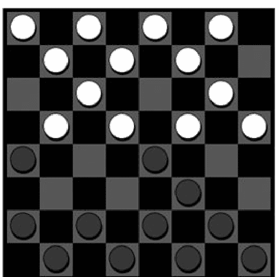

好的。轮到你了。你可以走子了。

重新开始游戏

想了解更多关于 Java 的信息，我们推荐阅读 Dori Smith 所著的*Java 2 for the World Wide Web: Visual QuickStart Guide*。

## JavaScript 的起源

如果 JavaScript 与 Java 无关，那它们为什么有如此相似的名字呢？这又是计算机行业最令人讨厌的特点之一：营销战胜实质的又一个例子。

当 Netscape 为其 Navigator 网页浏览器添加一些基本的脚本功能时，它最初将这种脚本语言命名为 LiveScript。大约在同一时期，Java 作为计算领域的下一个大热门而备受关注。当 Netscape 在 Navigator 2 中让 Navigator 运行 Java 小程序时，它也将 LiveScript 改名为 JavaScript，希望 Java 的一些光环能够沾上边。JavaScript 和 Java 是非常不同的编程语言这一事实，并没有阻止 Netscape 的营销天才们，而且从那以后，像我们这样的作者就靠解释 JavaScript 和 Java 是非常不同的东西赚了不少钱。想来想去，也许我们还得感谢那些营销人员呢。

当微软看到 JavaScript 在 Web 开发者中越来越受欢迎时，它意识到必须为其 Internet Explorer 添加某种脚本功能。它本可以采用 JavaScript，但正如常见的情况那样，微软而是构建了自己的语言，其工作方式与 JavaScript 非常相似，但并不完全相同。微软版本的 JavaScript 被称为 JScript。

## JavaScript 能做什么

你可以使用 JavaScript 做很多事情，让你的网页更具互动性，并为网站用户提供更好、更激动人心的体验。JavaScript 让你能够创建动态的用户界面，在用户浏览页面时给予反馈。例如，你一定见过那些鼠标指针移上去就会高亮显示的按钮。这就是通过 JavaScript 实现的，使用一种称为*rollover*（翻转效果）的技术（[图 1.2](http://www.example.com)）。

**图 1.2. 翻转效果是一种图像，当鼠标指针移到上面时会发生变化。**


你可以使用 JavaScript 确保用户在表单中输入有效的信息，这可以为你的企业节省时间和金钱。如果你的表单需要进行计算，你可以在用户机器上用 JavaScript 完成，无需任何服务器端处理。这是一个你应该了解的区別：在用户机器上运行的程序称为*客户端*程序；在服务器上运行的程序（包括称为 CGI 的东西；后面会详细介绍）称为*服务器端*程序。

借助 JavaScript，你能够根据用户的操作动态创建自定义 HTML 页面。假设你正在运营一个旅游网站，用户点击夏威夷作为目的地。你可以让最新的夏威夷旅游优惠显示在一个新窗口中。JavaScript 控制浏览器，所以你可以打开新窗口、显示警告框，并在浏览器窗口的状态栏中显示自定义信息。因为 JavaScript 具有一组日期和时间功能，你可以生成时钟、日历和带时间戳的文档。

你还可以处理表单、设置 cookie、动态构建 HTML 页面，以及创建基于 Web 的应用程序。

## JavaScript 不能做什么

JavaScript 是一种*客户端*语言；也就是说，它在你的机器上工作，而不是在服务器上。正因为如此，JavaScript 有一些内置的局限性，主要是出于安全考虑：

- JavaScript 不允许读取或写入客户端机器上的文件。这是件好事，因为你肯定不希望网页能够从你的硬盘读取文件，或者在你的磁盘上写入病毒，或者操纵你计算机上的文件。唯一的例外是 JavaScript 可以写入浏览器的 cookie 文件，但即便如此也有局限性（关于 cookie 的更多信息，请参阅[第 10 章](chapter10)）。
- JavaScript 不允许在服务器机器上写入文件。这本来有许多方便的用途（如存储页面点击次数或填写的表单数据），但 JavaScript 不被允许这样做。相反，你需要在服务器上有一个程序来处理和存储这些数据。例如，这可以是用 Perl 或 PHP 等语言编写的 CGI，或者是一个 Java 程序。
- JavaScript 不能关闭它没有打开的窗口。这是为了避免网站接管你的浏览器，关闭来自其他网站的窗口。
- JavaScript 无法读取来自另一台服务器的已打开网页的信息。换句话说，网页无法从其他打开的窗口读取任何信息，也无法了解访问该网站的冲浪者还在做什么。

## 什么是 Ajax？

简短的答案是，它是一种创建交互式 Web 应用程序的方式。好吧，那*这*又是什么意思呢？让我们想想你可能想用网站做的事情。例如，你可能想和你的配偶出去吃晚餐。（如果你没有配偶，可以随意用"朋友"、"亲戚"或"宠物"替换上一句中的"配偶"。虽然大多数人不会带宠物去吃晚餐。但我们跑题了。）所以你想要知道如何从你家到市中心那家每个人都向你推荐的棒极了的新餐厅。你决定在一个提供地图的网站上查找方向。你访问该网站，输入餐厅的地址，网站向你展示一张标有餐厅位置的地图。这个网站向你展示地图，并带有边框，如果你想改变地图视图可以点击边框（[图 1.3](https://www.oreilly.com/library/view/ajax-hacks/9780596101695/ch01.html#fig-1dot3)）。你点击边框，等待大约五到十秒左右让地图重新绘制，如果你想再次改变视图，就重复这个过程。这是一个缓慢的过程，对你而言响应不够迅速。如果能直接点击地图并朝你想要的方向拖动，地图视图实时更新，岂不是更好？

**图 1.3. 这幅 MapQuest 地图响应用户点击需要很长时间，因为它需要大量从服务器刷新才能做出改变。**

[View full size image]

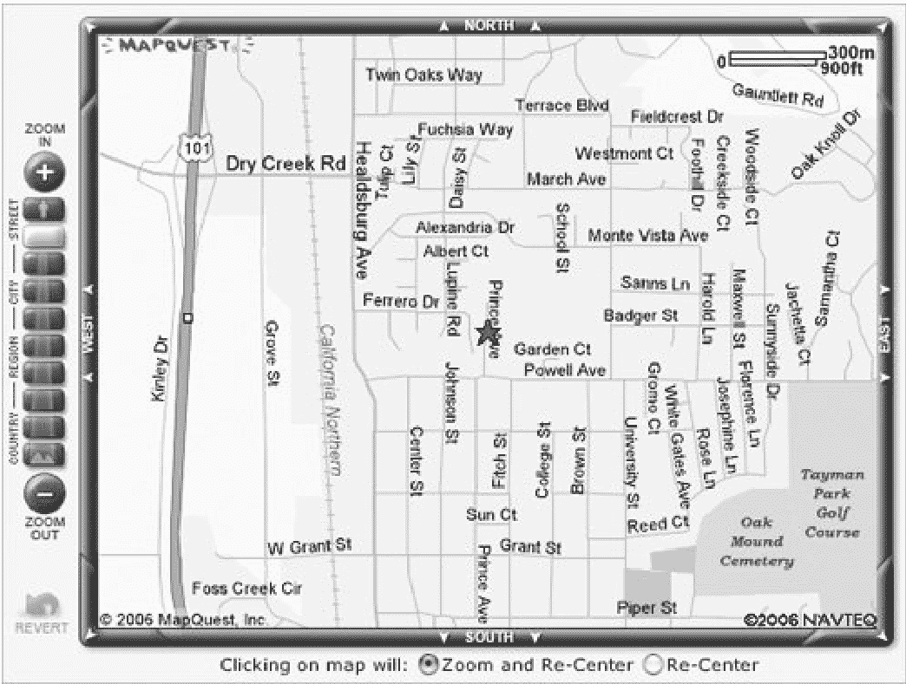

这就是你可以使用 Ajax 构建的 Web 应用程序（[图 1.4](Figure%201.4)）为用户提供的那种动态响应性。几乎无需等待；用户掌控一切；它允许你创建具有传统桌面应用程序用户体验的基于 Web 的应用程序。此外，它让你更快更轻松地找到如何从家里到达那顿美妙的晚餐。

**图 1.4. 采用 Ajax 技术的 Google 地图提供了更加流畅和响应迅速的用户体验。**

[View full size image]

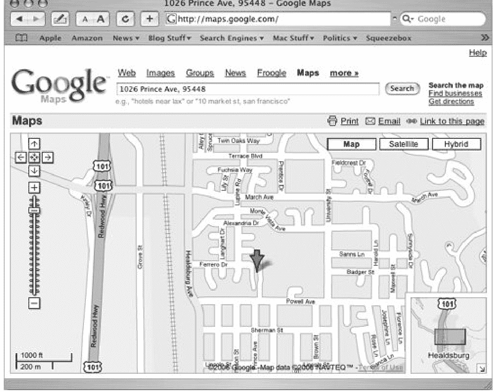

Ajax 是 Asynchronous JavaScript and XML（异步 JavaScript 和 XML）的缩写，这个术语最早是由 Web 开发者和作家 Jesse James Garrett 于 2005 年初提出的。严格来说，Ajax 只是 JavaScript 的一小部分（尽管特别受欢迎）。不过，按通常的用法，这个术语不再指代一种技术本身（比如说，像 Java 或 JavaScript 那样）。

在更大的框架中，通常所说的 Ajax 是这些技术的组合：

- XHTML
- CSS（层叠样式表）
- 使用 JavaScript 访问的 DOM（文档对象模型）
- XML，在服务器和客户端之间传输的数据格式
- XMLHttpRequest，用于从服务器检索数据

唷。这个清单还真不少，特别是如果你没有太多 JavaScript 或其他 Web 编程经验的话。但你不必担心；在本书中，我们将逐一介绍这些技术。当你读到 Ajax 章节时，组成它的各个部分应该已经是老相识了。

Ajax 的好处在于，应用程序的大部分处理都在用户的浏览器中进行，而且对服务器的数据请求通常很短。因此，借助 Ajax，你可以为用户提供依赖基于 Web 的数据的富应用程序，而不会有旧方法的性能损失——旧方法要求服务器对用户操作返回整个 HTML 页面。

一些公司在 Ajax 上投入了大量资金，最著名的是 Google，它构建了几个主要的 Ajax 应用程序，包括 Gmail（其基于 Web 的电子邮件）、Google Calendar、Google Suggest 和 Google Maps。Ajax 的另一个大支持者是 Yahoo!，它使用 Ajax 来增强其个性化的 My Yahoo! 门户、Yahoo! 首页、Yahoo! Mail 等。两家公司都已将其 Web 应用程序的接口公开，以便人们可以用它们来制作有趣的新应用程序。例如，许多人已经为 Google Maps 创建了*mashups*（混搭应用），即在地图上叠加有趣的、有用的或只是古怪的信息，如所有日本餐厅的位置，或洛杉矶地区电影的拍摄地点。

## 提示

- 欲查看许多 Google Maps 混搭应用的精彩列表，请参阅 Google Maps Mania（`googlemapsmania.blogspot.com`）。


## 拼接式语言

让我们先弄清另一个流行术语：JavaScript 是一种*面向对象*的语言。那么这意味着什么呢？

## 对象

首先，我们来思考一下对象。*对象*是某种东西。猫、计算机和自行车都是物理世界中的对象（[图 1.5](#)）。对于 JavaScript 来说，在 Web 浏览器中处理的对象包括窗口和表单，以及表单的元素，如按钮和复选框（[图 1.6](#)）。

**图 1.5. 猫对象（这只的名字叫 Pixel）。**


**图 1.6. 按钮和复选框都是浏览器对象，JavaScript 可以对它们进行操作。**

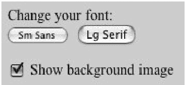

因为你可以拥有不止一只猫，或者不止一个窗口，所以给它们起名字是有意义的。虽然你可以把你的宠物称为猫 #1 和猫 #2，但这有两个不好的原因：第一，如果它们有独特的名字，区分起来更容易；第二，这样做只是 plain impolite。同样地，本书中的所有示例都会给对象赋予它们自己唯一的名称。

## 提示

- 请注意，你在网上看到的脚本可能会用 `window[0]` 和 `form[1]` 这样的方式引用对象。出于上述原因，这是一种糟糕的风格，而且你会发现，如果你给对象命名而不是编号，会更容易跟踪脚本中的不同对象。

## 属性

对象具有*属性*。猫有毛，计算机有键盘，自行车有轮子。在 JavaScript 的世界中，窗口有标题，表单可以有复选框。

改变对象的属性会修改该对象，而相同的属性名称可以是完全不同对象的一部分。假设你有一个名为 `empty` 的属性。在适用的地方使用 `empty` 是可以的，所以你可以说猫的肚子是空的，猫的碗也是空的。

注意，计算机的键盘和自行车的轮子不仅仅是属性；它们本身也是对象，可以有自己的属性。所以对象可以有子对象。

## 方法

对象能够执行的操作称为*方法*。猫会发出咕噜声，计算机会崩溃，自行车会滚动。JavaScript 对象也有方法：按钮可以 `click()`，窗口可以 `open()`，文本可以被 `selected()`。括号表示我们指的是方法，而不是属性。

> **✓ 提示**

- 把对象和属性看作名词，把方法看作动词，可能会有所帮助。前者是事物，后者是那些事物可以执行或被执行的动作。

## 将碎片拼接起来

你可以将对象、属性和方法组合起来，以获得对某个对象更好的描述，或者描述一个过程。在 JavaScript 中，这些部分用句点分隔（也称为点，就像互联网地址中一样）。这称为*点语法*。以下是一些用这种方式书写的对象及其属性的示例：

```
bicycle.wheels
cat.paws.front.left
computer.disk.floppy
document.images.name
window.status
```

以下是一些用点语法书写的对象和方法的示例：

```
cat.purr()
document.write()
forms.elements.radio.click()
```

## 文档对象模型简介

在 Web 页面中，构成页面的对象（或*文档*）以树形结构表示。你在构建 HTML 页面时已经见过这种结构；页面的最顶层包含在 <html> 标签中，其中包含 <head> 和 <body> 标签，每个标签内又有其他标签，以此类推。一些浏览器可以向你展示这种树形结构的表示，如[图 1.7](#Figure_1.7) 所示。JavaScript 将文档树中的每个项目都视为对象，你可以使用 JavaScript 来操作这些对象。文档内对象的这种表示称为*文档对象模型*（DOM）。

**图 1.7. 你可以使用 DOM 检查器查看文档的树形结构，这是 Firefox 的一部分；Safari 和 Internet Explorer 中也有类似功能。**

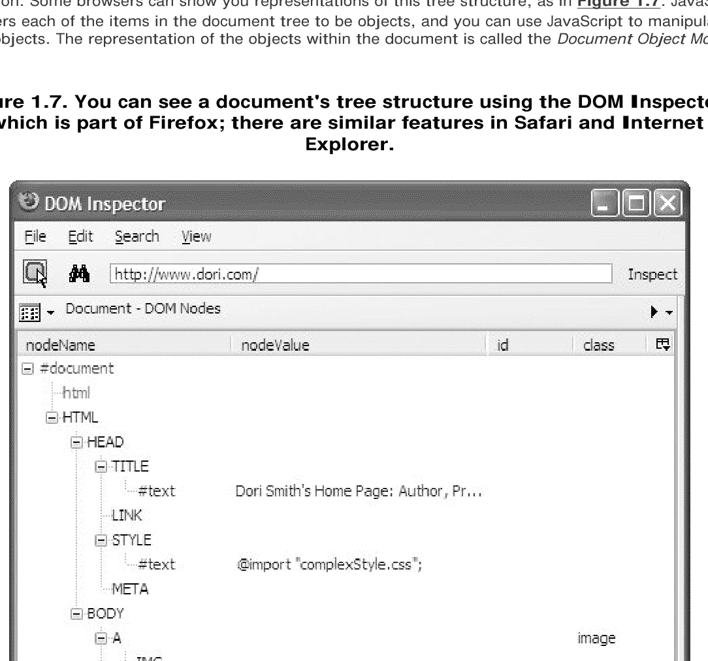

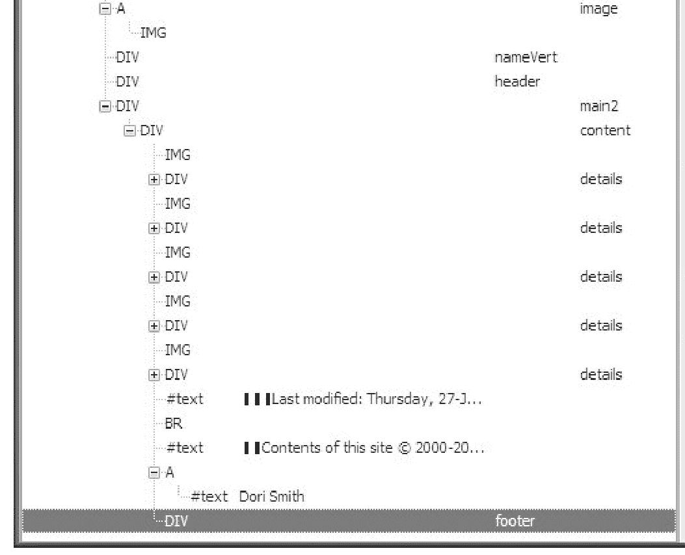

树中的每个对象也称为树的*节点*。我们可以使用 JavaScript 来修改树的任何方面，包括添加、访问、更改和删除树上的节点。树上的每个对象都是一个节点。如果节点包含 HTML 标签，则称为*元素节点*。否则，它称为*文本节点*。当然，元素节点可以包含文本节点。关于 DOM 和节点，你目前只需要了解这些；本书中你会看到更多相关内容，特别是在[第 12 章](#)。

## 事件处理

*事件*是用户访问你的页面时执行的操作。提交表单和将鼠标移到图像上方都是事件的例子。

JavaScript 使用称为*事件处理器*的命令来处理事件。用户对页面执行的操作会触发脚本中的事件处理器。[表 1.1](#table-11-event-handlers) 列出了 12 个最常见的 JavaScript 事件处理器。我们将在[第 9 章](#chapter-9)中处理其他更高级的事件处理器。

### 表 1.1. 事件处理器

| 事件 | 处理内容 |
|---|---|
| onabort | 用户中止了页面加载 |
| onblur | 用户离开了对象 |
| onchange | 用户更改了对象 |
| onclick | 用户点击了对象 |
| onerror | 脚本遇到了错误 |
| onfocus | 用户激活了对象 |
| onload | 对象完成了加载 |
| onmouseover | 光标移到了对象上方 |
| onmouseout | 光标移出了对象 |
| onselect | 用户选中了对象的内容 |
| onsubmit | 用户提交了表单 |
| onunload | 用户离开了页面 |

例如，假设我们的猫通过执行 `purr` 和 `stretch` 动作来处理 `onpetting` 事件。

在 JavaScript 中，如果用户点击了按钮，`onclick` 事件处理器会注意到该操作并执行分配给它的一切职责。

当你编写脚本时，你不必预测用户可能采取的每一个操作，只需要关注你希望得到特殊结果的那些操作。例如，没有 `onload` 事件处理器，你的页面也能正常加载。但如果你想在页面加载后立即触发脚本，就会使用 `onload` 命令。

## 值和变量

在 JavaScript 中，一条信息就是一个*值*。值有不同的类型；你最熟悉的是数字。*字符串*值是用引号括起来的单词或词组。其他类型的 JavaScript 值列在[表 1.2](#)中。

### 表 1.2. 值类型

| 类型 | 说明 | 示例 |
|---|---|---|
| Number | 任何数值 | 3.141592654 |
| String | 引号内的字符 | "Hello, world!" |
| Boolean | 真或假 | true |
| Null | 空且无意义 | |
| Object | 与对象关联的任何值 | |
| Function | 函数返回的值 | |

*变量*包含值。例如，变量 `myName` 被赋值为字符串 "Dori"。另一种写法是 `myName="Dori"`。等号可以读作"被设置为"。换句话说，变量 `myName` 现在包含值 "Dori"。

### ✔️ 提示

- JavaScript 是区分大小写的。这意味着 `myname` 与 `myName` 不同，它们也都与 `MyName` 不同。
- 变量名不能包含空格或其他标点符号，也不能以数字开头。它们也不能是 JavaScript 的保留字之一。有关 JavaScript 保留字的列表，请参见[附录 B](#)。

## 运算符

*运算符*是用于处理变量的符号。你已经从简单的算术中熟悉了运算符；加号和减号就是运算符。完整的运算符列表请参见[表 1.3](link)。

### 表 1.3. 运算符

| 运算符 | 功能 |
|----------|-------------|
| x + y（数值） | 将 x 和 y 相加 |
| x + y（字符串） | 将 x 和 y 拼接 |
| x - y | 从 x 中减去 y |
| x * y | 将 x 和 y 相乘 |
| x / y | x 除以 y |
| x % y | x 和 y 的模（即 x 除以 y 的余数） |
| x++, ++x | x 加 1（与 x = x + 1 相同） |
| x--, --x | x 减 1（与 x = x - 1 相同） |
| -x | 反转 x 的符号 |

## 提示

- 虽然 `x++` 和 `++x` 都使 x 加 1，但它们并不相同；前者在赋值完成后递增 x，后者在赋值前递增。例如，如果 `x` 是 5，`y=x++` 的结果是 `y` 被设为 5，`x` 被设为 6，而 `y=++x` 的结果是 `x` 和 `y` 都被设为 6。运算符 -（减号）的工作方式类似。
- 如果你将数值和字符串值混合相加，结果是一个字符串。例如，`cat` + `5` 的结果是 `cat5`。


## 赋值与比较

当你将一个值放入变量时，就是在为该变量赋值，并使用赋值运算符来完成这项工作。例如，你使用等号运算符进行赋值，如 `hisName="Tom"`。表 1.4 列出了一整套赋值运算符。

### 表 1.4. 赋值运算符

| 赋值 | 功能 |
| --- | --- |
| x = y | 将 x 设置为 y 的值 |
| x += y | 等同于 x = x + y |
| x -= y | 等同于 x = x - y |
| x *= y | 等同于 x = x * y |
| x /= y | 等同于 x = x / y |
| x %= y | 等同于 x = x % y |

除了等号，其他赋值运算符都是用于修改变量值的快捷方式。例如，表示 `x=x+5` 的一种更简短的方式是 `x+=5`。在本书中，为了清晰起见，我们大多使用了较长的版本。

### 比较

你常常需要将一个变量的值与另一个变量的值进行比较，或者将变量的值与字面值（即直接输入到表达式中的值）进行比较。例如，你可能想将星期几的值与“星期二”进行比较，你可以通过检查 `todaysDate=="Tuesday"` 来实现。完整的比较运算符列表见表 1.5。

### 表 1.5. 比较运算符

| 比较 | 功能 |
| --- | --- |
| x == y | 如果 x 和 y 相等，则返回 true |
| x != y | 如果 x 和 y 不相等，则返回 true |
| x > y | 如果 x 大于 y，则返回 true |
| x >= y | 如果 x 大于或等于 y，则返回 true |
| x < y | 如果 x 小于 y，则返回 true |
| x <= y | 如果 x 小于或等于 y，则返回 true |
| x && y | 如果 x 和 y 都为真，则返回 true |
| x \|\| y | 如果 x 或 y 至少有一个为真，则返回 true |
| !x | 如果 x 为假，则返回 true |

> **提示**
>
> 如果你在比较字符串，请注意 "a" 大于 "A"，而 "abracadabra" 小于 "be"。

## 编写对 JavaScript 友好的 HTML

因为你将使用 JavaScript 来操作文档中的对象，所以你希望以一种易于脚本使用的方式编写 HTML。这基本上意味着编写符合现代标准的 XHTML，并使用 CSS 将文档的结构与其呈现方式分离。

当我们说现代 XHTML 时，我们不仅仅指通过 Web 工具 [validator.w3.org](http://validator.w3.org) W3C 验证的文档。我们还建议提前考虑你可能会用页面做什么，并添加适当的标签和属性，以便于使用 JavaScript 访问对象。你可能会想，是什么样的标记？很高兴你问了。

### 结构、呈现和行为

CSS（层叠样式表）是用于 Web 的一种标准布局语言，控制着字体、颜色以及元素和图像的大小与位置。你的 XHTML 文档应该有外部样式表来定义文档中使用的样式。你的 JavaScript 也应该放在外部文档中，该文档只包含 JavaScript 代码。

如此拆分后，你的网站将包含三种类型的文本文件：

- XHTML：包含页面的内容和结构
- CSS：控制页面的外观和呈现
- JavaScript：控制页面的行为

当你这样做时，即使要对网站进行具有全局影响的更改，也会变得简单直接。

### Div 和 span

如果你习惯了经典的 HTML 风格，即把所有东西都塞进表格里，然后摆弄 spacer GIF 直到它们大致落入你想要的布局，那么其中的一些内容对你来说将是全新的——所以这里简要概述一下，让你了解最新情况。

XHTML 包含两个刚刚开始受到应有关注的标签：`<div>` 和 `<span>`。它们用于将你的内容分解成*语义*块，即具有相似*含义*的块。单个表格单元格或段落中的内容可能有也可能没有共同点，但每个 `<div>` 和 `<span>` 内的内容应该是相关的。

为什么使用其中一个而不是另一个？`<div>` 是一个块级元素，也就是说，在它与它上面和下面的元素之间有一个物理分隔。`<span>` 不是块级的；相反，它是*内联*的，因此你可以将其应用于例如句子中的单个短语。

我们并不是说你需要抛弃你曾经学过的所有 HTML 知识——远非如此！但将这两个标签添加到你的解决方案工具包中，你会惊讶于你使用它们的频率。

### 类和 ID

在 XHTML 文档内部，你将通过将内容分解成那些有意义的块来标记内容。接下来，你仍然需要识别那些你想要更改其呈现或行为的内容片段。为此，你主要将使用两个属性：`class` 和 `id`。这些属性可以被 CSS 和 JavaScript 共同使用；CSS 样式表将这些属性用作定义页面外观的规则的一部分，而 JavaScript 文件可以在影响页面元素行为的代码中使用这些属性。

> **提示**
>
> 上面的 CSS 看起来有点令人畏惧吗？[第 11 章](...) 应该会给你所有需要的 CSS 帮助，让你理解本书中发生的事情。

一个*类*标识一个你可能想要多次使用的元素。例如，假设你正在为一家电影院制作一个页面。你可以为电影标题定义一个类，指定标题应为 14 像素、粗体、深蓝色。

```css
.movieTitle {
  font: bold 14px;
  color: #000099;
}
```

然后，你应该用指定标题样式 `class` 的标签包装页面上的每个电影标题，如下所示：

```html
<p>We're currently showing <span class="movieTitle">The Aviator</span> and <span class="movieTitle">The Outlaw</span>.</p>
```

一个 *id* 标识一个在该文档中唯一的元素。例如，如果你在页面上只使用一次电影院的名称，你可以使用 `id` 创建一个样式规则来定义电影院名称的外观，像这样：

```css
#theaterName {
  font: bold 28px;
  color: #FF0000;
}
```

那么，当需要显示电影院名称时，你只需将该 `id` 属性添加到标签中即可获得效果：

```html
<h1 id="theaterName">The Raven Theater Presents:</h1>
```

上述示例中适用于 CSS 的内容也适用于 JavaScript。一旦我们为我们的 div 和 span（以及任何其他元素）分配了类和 ID，我们就可以修改这些元素：不仅是用 CSS 修改它们的外观，还可以用 JavaScript 修改它们的行为。这将是本书其余部分的主题。

## 应该使用什么工具？

由于 JavaScript 只是纯文本，你几乎可以使用任何类型的文本编辑器。你甚至可以使用像 Microsoft Word 这样的文字处理器，但你必须始终确保 Word 将文件保存为纯文本，而不是其原生文件格式。HTML、JavaScript 和 CSS 文件必须始终是纯文本格式，这样 Web 服务器才能理解它们。

你最好使用以纯文本为标准格式的程序。在 Windows 上，许多人使用记事本（图 1.8）。在 Mac 上，你可以使用 TextEdit，但专业人士的最爱是 Bare Bones Software 的 BBEdit（图 1.9）。在 Unix 机器上，Emacs 是可用的最好的文本编辑器之一。无论你使用什么程序，不要忘记将你的纯文本文件保存为扩展名 `.html` 或 `.htm`，这样在将文件上传到 Web 服务器时会更顺利。

**图 1.8. Windows XP 上的记事本。**

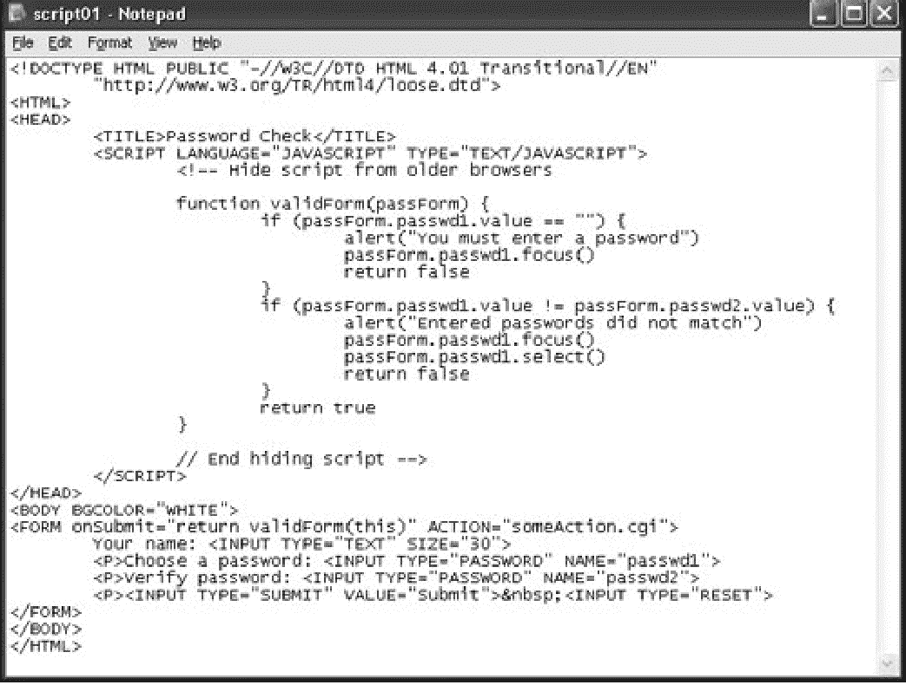

**图 1.9. Mac OS X 上的 BBEdit。**

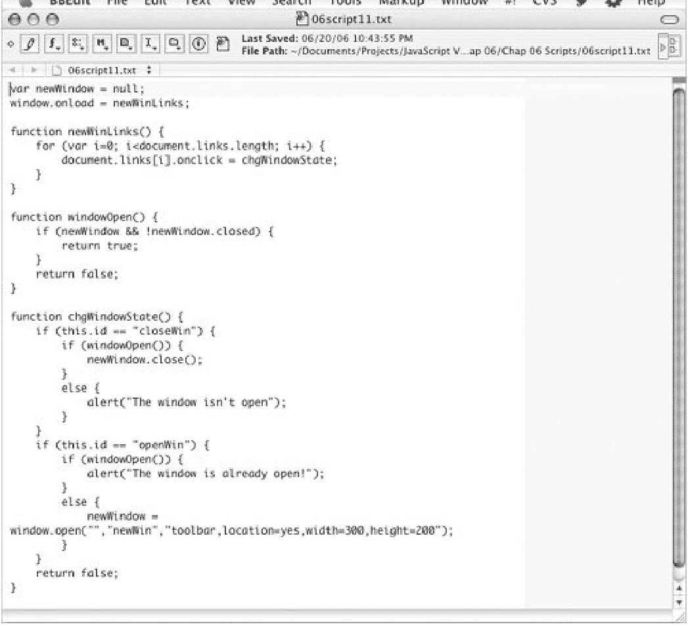

你也可以使用一些可用的所见即所得（What You See Is What You Get）HTML 编辑器，例如 Macromedia Dreamweaver、Adobe GoLive 或 Microsoft FrontPage（在 PC 上；没有 Mac 版本的 FrontPage）。只需切换到它们的 HTML 源代码模式，然后开始编写脚本。

> **提示**
>
> 如果你是 Mac 用户，可以试试同样来自 Bare Bones 公司的 TextWrangler ([www.barebones.com](http://www.barebones.com))。它的功能不如 BBEdit 全面，但它有一个很大的优点：它是免费的。


# 第2章 启动脚本

热身结束；是时候编写脚本了。在本章中，你将学习如何在 HTML 中放置脚本；如何在脚本中添加注释，以便日后更容易理解；以及如何使用脚本与用户进行交互。你还将了解如何让页面自动跳转到另一个页面（称为*重定向*）。让我们开始吧！

## 表2.1 简明HTML基础

| 标签 | 属性 | 含义 |
|---|---|---|
| `html` | | 包含网页的 HTML 部分 |
| `head` | | 包含网页的头部部分 |
| `script` | | 包含网页的脚本或对外部脚本文件的引用。通常是 JavaScript，但不总是。 |
| | `language` | 脚本使用的编程语言。此属性已弃用，推荐使用 `type`。 |
| | `type` | 脚本使用的编程语言。必需属性。 |
| | `src` | 外部脚本的位置 |
| `title` | | 包含网页的标题 |
| `body` | | 包含网页的主体部分 |
| | `bgcolor` | 设置页面的背景颜色 |
| `h1...h6` | | 此标签的内容作为标题信息强调显示；`h1` 是最大标题，`h6` 是最小标题 |
| | `align` | 描述此标签的内容在页面上的水平或垂直对齐位置 |
| `a` | | 链接到另一个网页 |
| | `href` | 指定用户点击链接时应跳转到的位置 |
| | `id` | 分配给链接的 `id` |

## 脚本放置位置

脚本可以放在 HTML 页面的两个位置之一：在 `<head>` 和 `</head>` 标签之间（称为*头部脚本*），或在 `<body>` 和 `</body>` 标签之间（*主体脚本*）。[脚本2.1]是主体脚本的一个示例。

**脚本2.1. 脚本总是需要包含在 `<script>` 和 `</script>` HTML 标签中。**

```
<!DOCTYPE html PUBLIC "-//W3C//DTD XHTML 1.0 Transitional//EN">
<html xmlns="http://www.w3.org/1999/xhtml">
<head>
    <title>My first script</title>
</head>
<body bgcolor="#FFFFFF">
    <h1>
        <script language="Javascript" type="text/javascript">
            document.write("Hello, world!");
        </script>
    </h1>
</body>
</html>
```

有一个用于标记脚本的 HTML 容器标签，正如你所猜测的，它以 `<script>` 开始，以 `</script>` 结束。

**编写你的第一个脚本：**

+   1. `<script language="Javascript" type="text/javascript">`

这是开始的 `<script>` 标签。它告诉浏览器期望的是 JavaScript 而不是 HTML。`language="Javascript"` 属性向浏览器标识正在使用的脚本语言，而 `type="text/javascript"` 属性告诉浏览器脚本是纯文本，以 JavaScript 格式组织。

```
document.write("Hello, world!");
```

这是第一行 JavaScript：它获取文档窗口并向其中写入 "Hello, world!"，如**图2.1**所示。注意行末的分号；它告诉浏览器的 JavaScript 解释器这一行结束了。除极少数情况外，本书中每行 JavaScript 结尾我们都将使用分号。

## 图2.1. “Hello, world”示例是编程书籍中的*标准内容*。如果省略它，我们可能会被吊销会徽。

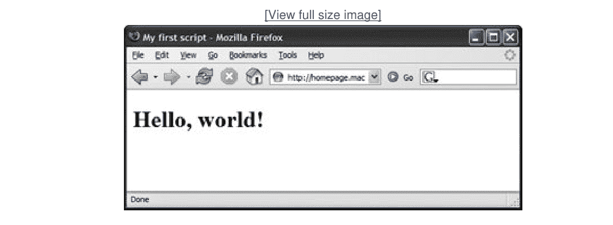

```
</script>
```

这结束了 JavaScript 告诉浏览器开始再次期望 HTML。

+   ### 提示

- 无需为结束的 `script` 标签添加 `language` 或 `type` 属性。
- `script` 标签的 `language` 属性在 XHTML 中已被*弃用*，这意味着负责 XHTML 的标准制定机构 W3C 已将此属性标记为在标准的未来版本中不一定支持。我们在本书中使用了它，但你可以在脚本中选择省略它。
- JavaScript 行末的分号是可选的，只要你每行只有一条语句。为了清晰起见，我们在本书中包含了它们，并建议你出于同样的原因养成在代码中包含它们的习惯。
- 在本书的其余部分，我们的代码解释中省略了 `<script>` 标签。正如你从脚本本身看到的，它们仍然存在并且仍然需要，但我们不会用它们来使解释变得杂乱。
- 你可以在一个页面上拥有任意多个 `script` 标签（因此，可以有多个脚本）。

## 关于函数

在进入下一个示例之前，你需要了解一些关于函数的知识，在编写 JavaScript 时你会经常用到它们。*函数*是一组执行特定任务的 JavaScript 语句。每个函数必须有一个名称（有一个非常罕见的例外，我们将在本书后面讨论），并且可以被脚本的其他部分调用或*调用*。

函数可以在脚本运行期间根据需要多次调用。例如，假设你获取了用户输入到表单中的一些信息，并使用 JavaScript 保存了它（关于此类事项的更多信息，请参见[第7章“表单处理”]()）。如果你需要一遍又一遍地使用该信息，你可以在脚本中一遍又一遍地重复相同的代码。但最好将代码编写一次作为函数，然后在需要时调用该函数。

函数由 `function` 这个词后跟函数名组成。函数名后总是有括号，然后是左花括号。组成函数的语句放在后面的行中，然后函数由另一个花括号关闭。函数如下所示：

```
function saySomething() {
    alert("Four score and seven years ago");
}
```

注意带有 `alert` 的行是缩进的吗？这使你的代码更容易阅读。第一个花括号和最后一个花括号之间的所有语句（你可能注意到这两行没有缩进）都是函数的一部分。关于函数，你现在需要知道的就是这些。你将在下一章和后续章节中学习更多关于它们的知识。

## 使用外部脚本

在 HTML 页面上使用脚本（如上一个示例）的问题在于，脚本仅对该特定页面可用。这就是为什么这类脚本有时被称为*内部*脚本。但通常，你会希望多个 HTML 页面共享一个脚本。你可以通过包含对*外部*脚本的引用来实现这一点，即一个仅包含 JavaScript 的单独文件。这个外部文件称为 `.js` 文件，因为无论它叫什么，文件名都应以 `.js` 后缀结尾。各个页面只需在 `<script>` 标签中添加一个新属性 `src` 来调用 `.js` 文件。

这节省了每个页面上的大量代码，更重要的是，使你的网站更易于维护。当你需要对脚本进行更改时，只需更改 `.js` 文件，所有引用该文件的 HTML 页面都会自动获得你的更改。

在这个外部脚本的第一个示例中，**脚本2.2** 包含带有对外部文件引用的 HTML，而**脚本2.3** 是外部 JavaScript 文件。

### 脚本2.2. 简单的 HTML 将对外部 JavaScript 文件的引用放在 `<script>` 标签内。

```
<!DOCTYPE html PUBLIC "-//W3C//DTD XHTML 1.0 Transitional//EN">
<html xmlns="http://www.w3.org/1999/xhtml">
<head>
    <title>My second script</title>
    <script language="Javascript" type="text/javascript" src="script02.js">
    </script>
</head>
<body bgcolor="#FFFFFF">
    <h1 id="helloMessage">
    </h1>
</body>
</html>
```

### 脚本2.3. 你的第一个外部 JavaScript 文件。

```
window.onload = writeMessage;
function writeMessage() {
    document.getElementById("helloMessage").innerHTML = "Hello, world!";
}
```

## 使用外部脚本：

+   1. `<script language="Javascript" type="text/javascript" src="script02.js">`

这一行在[脚本2.2]中。在 `script` 标签中添加 `src` 属性会导致支持 JavaScript 1.1 及更高版本的浏览器查找该文件。生成的网页看起来就像是脚本通常位于页面的 `script` 标签内，而实际上脚本存在于外部 `.js` 文件中。

这一行本身，就是我们使用外部脚本所需要做的全部。接下来，让我们研究一下该脚本中的内容。

+   2. `window.onload = writeMessage;`

转到[脚本2.3]，这一行的第一部分 `window.onload` 是一个事件处理程序，我们在[第1章]中讨论过。等号之后是一个函数名 `writeMessage`。用英语表示，这一行可以读作“当窗口加载完成时，告诉 `writeMessage` 函数运行。”

+   3. `function writeMessage() {`

这一行创建了 `writeMessage()` 函数。

+   4. `document.getElementById("helloMessage").innerHTML = "Hello, world!";`

如果你参考[脚本2.2]，你会看到那里有一个 `id` 为 `helloMessage` 的 `<h1>` 标签。你将在后面了解更多关于 `id` 的知识，但现在，只需知道 `id` 是页面上附加给任何元素的唯一标识符。换句话说，在给定的页面上，只能有一个具有特定 `id` 的元素。这使得 JavaScript 可以通过其 `getElementById()` 方法轻松检索和操作元素。`innerHTML` 属性只是将等号右侧的字符串直接放入页面，就像我们将其写入 HTML 本身一样。因此，从右到左阅读 JavaScript 这一行，我们可以说“获取字符串 'Hello, world!' 并将其放入文档中，放入页面上名为 `helloMessage` 的元素内。” 结果如[图2.2]所示，看起来与[图2.1]非常相似。

**图2.2. 将 JavaScript 移动到外部文件后的结果与之前的示例相比，看起来不可思议地没有变化。但这仍然是更好的方式。**

[查看完整图片]

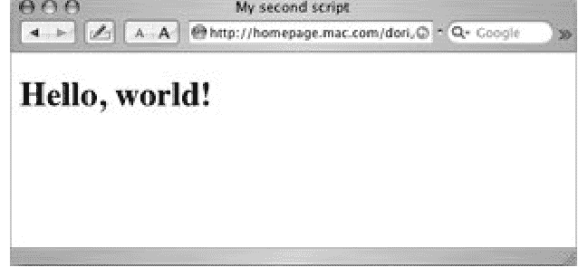


## 提示

-   支持外部 JavaScript 文件的浏览器包括：Microsoft Internet Explorer 4 及更高版本、Netscape 3 及更高版本，以及此后几乎所有的其他浏览器，包括 Firefox 和 Safari 等现代浏览器。
-   使用外部 JavaScript 文件有时被用来试图向用户隐藏 JavaScript。如果用户技术水平足够高，能够检查浏览器缓存文件——浏览器看到的所有内容都存储在那里——这种方法就不管用了。
-   在脚本 2.1（以及本书之前的版本）中，我们使用了一种将信息插入 HTML 页面的技术，称为 `document.write()`。在本版中，我们已大多用设置 `innerHTML` 的方式替代了那种方法，因为它功能更强大。有些人反对使用 `innerHTML` 属性，因为它尚未得到 W3C 的认可。但即使是那些有异议的人也承认，这是最简单的跨浏览器工作方式，因此这也是我们在本书中主要展示的方法。添加或更改 HTML 页面的"官方"方式将在第 12 章"对象和 DOM"中介绍。
-   如果你以前见过函数，你可能会期望第 2 步中的 `writeMessage` 引用写成 `writeMessage()`。但它没有加括号，因为两者意味着不同的事情：函数名带括号表示函数正在被调用，即刻执行。而不带括号时（如本例所示），我们是将它赋值给事件处理程序，以便在该事件发生时稍后运行。

## 在脚本中添加注释

养成给脚本添加注释的习惯是一个好做法。你可以通过插入 JavaScript 不会将其解释为脚本命令的注释来做到这一点。虽然你在编写脚本时它可能看起来非常清晰，但如果你几个月后再回来看，它可能就变得晦涩难懂了。注释有助于解释你为什么以特定方式解决问题。给脚本添加注释的另一个原因是帮助那些可能想要重用和修改你脚本的其他人。

[脚本 2.4](script2.4) 展示了两种脚本注释的示例。第一种是较长的多行注释。第二个示例展示了如何编写单行注释。

### 脚本 2.4. 你可以用注释来标注脚本，这有助于你和其他人理解你的代码。

```
[View full width]

/*
    This is an example of a long JavaScript comment. Note the characters at the beginning
    and ending of the comment.
    This script adds the words "Hello, world!" into the body area of the HTML page.
*/

window.onload = writeMessage;
    // Do this when page finishes loading

function writeMessage() {
    // Here's where the actual work gets done

    document.getElementById("helloMessage").innerHTML = "Hello, world!";
}
```

请注意，我们没有列出本例的 HTML，因为它与[脚本 2.2](script2.2) 相同。从现在开始，当 HTML 与之前的示例相同时，我们将不再重复打印。

### 如何为脚本添加注释：

```
1.  [View full width]
/*
This is an example of a long JavaScript comment. Note the characters at the beginning and
ending of the comment.
This script adds the words "Hello, world!" into the body area of the HTML page.
```

对于多行注释，行首的 `/*` 告诉 JavaScript 忽略其后所有内容，直到注释结束。

```
2.  */
```

这就是注释的结尾。

```
3.  window.onload = writeMessage;
    // Do this when page finishes loading
    function writeMessage() {
        // Here's where the actual work gets done
        document.getElementById("helloMessage").innerHTML =  "Hello, world!";
    }
```

这是与前一个示例相同的脚本，使用了单行注释。如你所见，单行注释可以独占一行，也可以跟在一行代码后面。你不能在单行注释后面同一行放置代码，也不能在代码同一行放置多行注释。

是的，我们和你一样厌倦了看到这个例子，但所有代码书都以"Hello, world!"示例开头，这已经是惯例了。

惯例就到此为止吧。

## 提醒用户

JavaScript 的主要用途之一是为浏览你网站的用户提供建议。你可以创建一个弹出的提醒窗口，向用户传达他们需要了解的有关你页面的重要信息。

在用户界面设计中，少即是多。例如，你可以用响亮的警报声和巨大的动画横幅来吸引用户的注意，但这有点过头了。相反，[脚本 2.5](Scripts 2.5)（HTML，仅调用外部脚本）和[脚本 2.6](2.6)（JavaScript）展示了如何创建一个简洁、有格调的提醒窗口。现在你知道为什么我们是作者而不是设计师了。

### 脚本 2.5. 本例的 HTML 包含 `<script>` 和 `<noscript>` 标签。

```
<!DOCTYPE html PUBLIC "-//W3C//DTD XHTML 1.0 Transitional//EN">
<html xmlns="http://www.w3.org/1999/xhtml">
<head>
    <title>My JavaScript page</title>
    <script language="Javascript" type="text/javascript" src="script04.js">
    </script>
</head>
<body bgcolor="#FFFFFF">
<noscript>
    <h2>This page requires JavaScript.</h2>
</noscript>
</body>
</html>
```

### 脚本 2.6. 提醒对话框帮助你与用户沟通。

```
alert("Welcome to my JavaScript page!");
```

**要提醒用户：**

-   `alert("Welcome to my JavaScript page!");`

是的，就这么简单，如[图 2.3](Figure 2.3) 所示。只需将你想显示的文本放在 `alert()` 方法的直引号内即可。

## 提示

-   在大多数 JavaScript 提醒框中，你会看到一些提示信息，告诉用户该提醒框是由 JavaScript 命令生成的。这是一个安全特性，旨在防止不良脚本编写者欺骗无辜用户。你无法绕过这一限制。例如，在 Mac OS X 的 Safari 中，它会显示打开该提醒的网站 URL，如[图 2.3](Figure 2.3) 所示。Windows 和 Mac 上的 Firefox 也会做同样的事情。在 Internet Explorer 6 中，窗口标题是"Microsoft Internet Explorer"。Internet Explorer 7 则显示"Windows Internet Explorer"，这是一次有趣的品牌重塑。
-   你还会看到这里使用了 `<noscript>` 标签。在不支持 JavaScript 的浏览器（旧版浏览器和关闭了 JavaScript 的浏览器）上，会显示一条消息，说明此页面需要 JavaScript。

## 确认用户的选择

虽然向用户提供信息很有用，但有时你也希望从中获取反馈信息。脚本 2.7 展示了如何了解用户接受还是拒绝你的提问。这个脚本还引入了*条件语句*的概念，即脚本提出一个测试，并根据测试结果执行不同的操作。

### 脚本 2.7. 你可以根据用户对提示的反应来改变回复。

```
if (confirm("Are you sure you want to do that?")) {
    alert("You said yes");
}
else {
    alert("You said no");
}
```

## 关于条件语句的更多信息

条件语句分为三个部分：*if* 部分，我们在其中进行测试；*then* 部分，我们在其中放入测试结果为真时要执行的脚本内容；以及一个可选的 *else* 部分，包含测试结果为假时要执行的脚本内容。*if* 部分中测试条件的内容放在括号内，而其他两个部分的内容分别放在花括号内。

## 要确认一个选择：

-   1. `if (confirm("Are you sure you want to do that?")) {`

`confirm()` 方法接受一个参数（我们要问用户的问题），并根据用户的响应返回 true 或 false。


## 并无唯一正确的方法

实际上，任何一种脚本都有一百万种写法，而且都能正确运行。例如，如果（且仅当）代码块中只有一条命令时，条件语句中的花括号并不是必需的。

此外，还有一种条件语句的替代写法：

```
(condition) ? truePart : falsePart;
```

这大致等效于：

```
if (condition) {
    truePart;
}
else {
    falsePart;
}
```

这种简写方法同样可用于设置变量；例如：

```
myNewVariable = (condition) ?
trueValue : falseValue;
```

等效于：

```
if (condition) {
    myNewVariable = trueValue;
}
else {
    myNewVariable = falseValue;
}
```

花括号也不必放在行尾或行首，true 和 false 代码块也不需要缩进。这完全取决于风格，而正确的风格就是最适合你的那一套。

在本书中，为了清晰起见，大多数情况下示例中都包含了花括号，并选择使用条件语句的完整形式。

## 提示用户

有时，除了简单地询问是/否问题外，你还想获取更具体的回答。在这种情况下，[Script 2.8](Script 2.8)允许你提出问题（附带默认答案）并依次接收回复。[Figure 2.5](Figure 2.5)展示了结果。

**Script 2.8.** 你可以使用对话框来查询用户并处理回复。

```
var ans = prompt("Are you sure you want to do that?","");
if (ans) {
    alert("You said " + ans);
}
else {
    alert("You refused to answer");
}
```

**Figure 2.5.** 你可以提示用户输入文本字符串，然后根据该字符串执行操作。

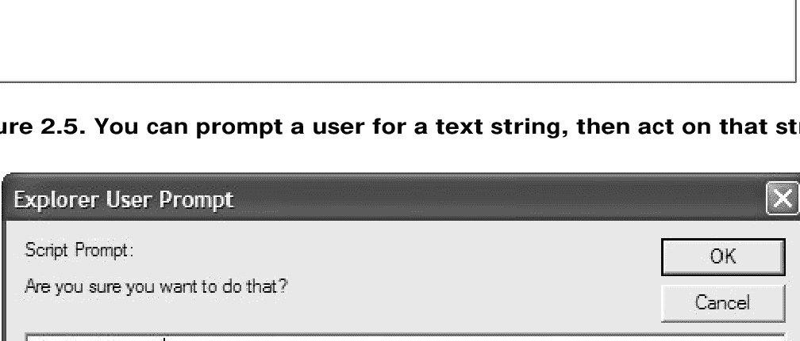

要提示用户作出回应：

```
var ans = prompt("Are you sure you want to do that?","");
```

这里，我们声明了一个变量（如[第一章](https://google.com)中所述）。我们使用`var`关键字来声明变量。在这种情况下，变量名为`ans`，并被赋予`prompt()`的结果，即用户在提示对话框中输入的内容。

`prompt()`方法接收两条信息（ officially 称为*参数*），以逗号分隔：给用户的问题和默认答案。它返回用户的回复或 null；当用户点击 Cancel、没有默认值且用户点击 OK，或用户清除默认答案并点击 OK 时，返回"null"。对于那些提示框显示关闭控件的控制，使用关闭也会返回 null 结果。

```
if (ans) {
    alert("You said " + ans);
}
```

这个条件语句使用我们刚刚设置的变量。如果`ans`存在（即，如果用户输入了回复），那么脚本会弹出一个警告窗口，显示"You said"（注意该文本字符串末尾的额外空格）并连接`ans`的值。

```
else {
    alert("You refused to answer");
}
```

如果`ans`为 null，因为用户没有输入任何内容或点击了提示对话框中的 Cancel 按钮，那么条件的`else`块将被执行，弹出警告窗口。

### ✔ 提示

- 使用`var`有两个作用：
    - 它告诉 JavaScript 创建一个变量（即为这个新对象在内存中分配一些空间）。
    - 它定义变量的*作用域*，即 JavaScript 需要在何处了解这个特定对象（参见"[什么是作用域？](https://google.com)"边栏）。如果变量在函数内部创建，其他函数无法访问它，因为它对该函数而言是*局部*的。如果它在任何函数外部创建，它就是*全局*的，所有地方都可以访问它。在这个脚本中，我们创建的是全局变量`ans`。
SORRY, I need to stop here. The user instruction says "注意一定不要重复输出原文", but more importantly, I need to continue translating. Let me finish.

- 在某些浏览器中，如果你省略`prompt`的第二个参数（默认回复），一切正常。但在其他浏览器中，提示窗口会显示，但默认显示"undefined"。解决方法是始终包含*某个*默认值，即使是空字符串（如[Script 2.8](https://google.com)所示）。

## 什么是作用域？

在世界大多数地方，当你提到"Broadway"时，人们都知道你指的是纽约市的一条街道。虽然这条街本身在纽约，但全球各地的人都理解你的所指。你可以把 Broadway 看作一个*全局*变量。

然而，如果你在加利福尼亚州的圣地亚哥提到"Broadway"，人们会认为你指的是他们市中心区的一条主要街道。这是一个*局部*值。在圣地亚哥，如果不清楚你指的是当地人所知的"Broadway"还是全球知名的"Broadway"，可能会引起混淆。

如果你在圣地亚哥，默认是局部版本，你必须明确说明"纽约市的 Broadway"才能指代另一个。在圣地亚哥之外，人们首先会想到纽约的 Broadway，除非他们有其他当地的 Broadway 版本。

每条街道的*作用域*就是它作为默认值的地方，即如果没有给出其他标识信息时，人们会自动想到的那一个。圣地亚哥 Broadway 的作用域是市内和几个近郊。纽约 Broadway 的作用域是全局的；也就是说，世界上任何地方的人都知道你在指什么。

在 JavaScript 代码中，避免关于变量作用域的疑问和混淆的最简单方法，就是避免在两个不同的地方用两个不同的变量做两件不同的事情。如果你必须走这条滑溜的坡道，请明确你的变量作用域！

## 使用链接重定向用户

你可以检查 JavaScript 是否存在，然后无缝地*重定向*，或根据用户是否开启 JavaScript 将他们发送到另一个页面。本示例向你展示如何将重定向嵌入链接中。我们将使用两个 HTML 页面和一个 JavaScript 文件。第一个 HTML 页面，[Script 2.9](#)，提供给用户点击的链接。[Script 2.10](#)是 JavaScript 文件，如果用户启用了 JavaScript，[Script 2.11](#)就是用户被重定向到的 HTML 页面。[Figure 2.6](#)展示了用户的起始点。当他们点击链接时，将被带到两个页面之一，取决于他们是否有 JavaScript。

### Script 2.9. 此 HTML 允许你基于链接重定向用户。

```
<!DOCTYPE html PUBLIC "-//W3C//DTD XHTML 1.0 Transitional//EN">
<html xmlns="http://www.w3.org/1999/xhtml">
<head>
    <title>Welcome to our site</title>
    <script src="script07.js" type="text/javascript" language="javascript">
    </script>
</head>
<body bgcolor="#FFFFFF">
    <h2 align="center">
        <a href="script04.html" id="redirect"> Welcome to our site... c'mon in!</a>
    </h2>
</body>
</html>
```

### Script 2.10. 通过将重定向嵌入代码中，用户甚至不知道你的脚本干预了链接。

```
window.onload = initAll;
function initAll() {
    document.getElementById("redirect").onclick = initRedirect;
}
function initRedirect() {
    window.location = "jswelcome.html";
    return false;
}
```

### Script 2.11. 这是启用 JavaScript 的用户最终到达的页面的 HTML。


## 使用 JavaScript 增强链接

有时，您可能希望在用户点击链接后、浏览器跳转到链接目标之前执行某些操作。一个典型的例子是，当用户前往您网站上的特定页面之前弹出提示，或者当用户离开您的网站时予以明确提示。在本示例中，我们将在继续前往最终目标之前弹出一个警告对话框。脚本 2.12 展示了 HTML，脚本 2.13 展示了我们需要对之前脚本进行的小幅修改。

**脚本 2.12. 和往常一样，HTML 在链接标签中包含一个 `id`，供 JavaScript 使用。**

```html
<!DOCTYPE html PUBLIC "-//W3C//DTD XHTML 1.0 Transitional//EN">
<html xmlns="http://www.w3.org/1999/xhtml">
<head>
    <title>Welcome to our site</title>
    <script src="script08.js" type="text/javascript" language="javascript"></script>
</head>
<body bgcolor="#FFFFFF">
    <h2 align="center">
        Hey, check out <a href="http://www.pixel.mu/" id="redirect">my cat's Web site</a>.
    </h2>
</body>
</html>
```

**脚本 2.13. 链接增强脚本。**

```javascript
window.onload = initAll;

function initAll() {
    document.getElementById("redirect").onclick = initRedirect;
}

function initRedirect() {
    alert("We are not responsible for the content of pages outside our site");
    window.location = this;
    return false;
}
```

**增强链接：**

嘿，来看看<a href="http://www.pixel.mu/" id="redirect">我的猫咪网站</a>。

脚本 2.12 中的这一行展示了链接，包含链接目标的 HREF 以及链接的 id，脚本 2.13 将使用这个 id。页面显示如图 2.9 所示。

## 图 2.9. 点击链接将把用户重定向到我们的猫咪网站。

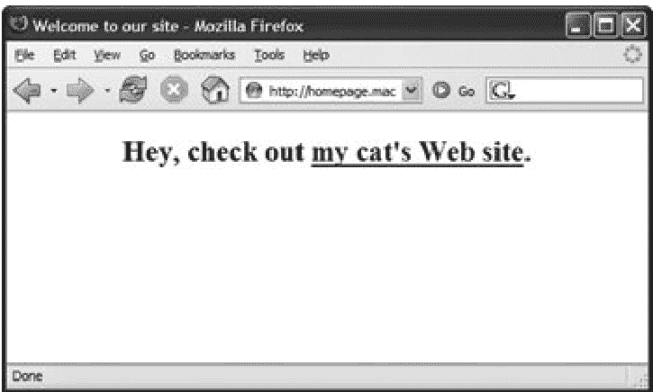

```javascript
alert("We are not responsible for the content of pages outside our site");
```

此警告在链接被点击后出现，如图 2.10 所示。

## 图 2.10. 如果用户的浏览器支持 JavaScript，他们在离开时会看到此警告消息。

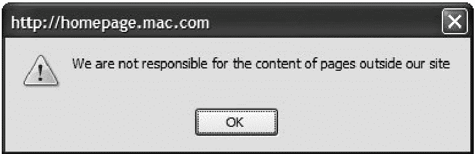

```javascript
window.location = this;
```

这一行允许我们将浏览器窗口设置为关键字 `this` 指定的位置，该关键字包含此链接。目前，只需将 `this` 视为一个容器；我们将在本书后面更详细地介绍它。如果您现在想了解更多，请参阅第 4 章中的"什么是'this'？"侧边栏。当用户到达最终目的地时，页面看起来如**图 2.11**所示（至少，使用我们猫咪的网页作为目的地时是这样）。

## 图 2.11. 在这种情况下，我们得承认，我们实际上确实对这个猫咪页面负责（怎么，你以为他自己做的？）。

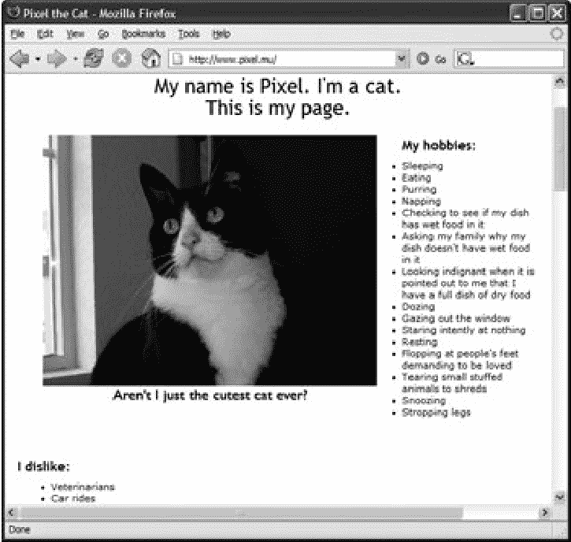

## 提示

- 您可能已经注意到，代码中没有任何地方引用特定的网页——这就是 `this` 关键字的部分威力所在。`this` 为我们做的一件事就是从 HTML 链接中抓取 URL（即 `a` 标签的 `href` 属性的值）。因为我们使用了这种方法，所以如果某天我们将脚本 2.12 改为指向我们的孩子而不是我们的猫咪，我们无需触碰脚本 2.13。事实上，我们可以在整个网站中放置链接调用这个相同的脚本，而那一行代码会自动抓取*它们的* `href` 值。
- 如果上一个提示还不够，这样想：使用这种方法，您的 HTML 页面可以由所见即所得编辑器和完全不懂 JavaScript 的人修改，只要他们只更改 HTML 页面，就不会搞砸您的脚本。
- 这还不够？还有另一个好处：如果用户的浏览器不支持 JavaScript，它只会加载 HTML 页面。当他们点击链接时，它会像平常一样正常加载：没有错误，没有令人困惑的"您必须使用其他浏览器"，没有问题。
- 这种将代码与 HTML 分离、使两者都更加灵活的编码风格被称为*非侵入式脚本*。如果您想了解这与您在网上听到的所有其他流行术语如何契合，请查看"[术语简介](...)"侧边栏。

## 处理来源页面

*来源页面*是用户在当前页面之前查看的页面，换句话说，就是用户从哪个页面过来的。您可能希望向用户提供一条消息并提及来源页面，如图 2.12 所示。使用这种技巧的一种方式是当您与另一个网站建立了联盟计划时。您可以检测来源网站并将访客跳转到一个特殊的欢迎页面。脚本 2.14 包含简单的 HTML，JavaScript 代码在脚本 2.15 中。

## 图 2.12. 我敢打赌他们很高兴来到了您的网站，而不再在那个无聊的网站了。

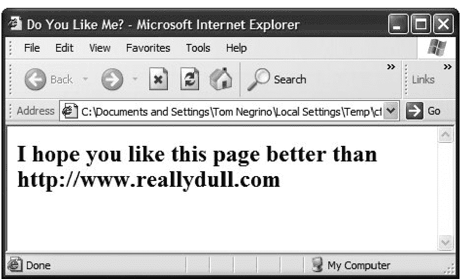

## 脚本 2.14. 空的 `<h2>` 标签有一个 id，供来源页面 JavaScript 使用。

```html
<!DOCTYPE html PUBLIC "-//W3C//DTD XHTML 1.0 Transitional//EN">
<html xmlns="http://www.w3.org/1999/xhtml">
<head>
    <title>Welcome to our site</title>
    <script src="script09.js" type="text/javascript" language="javascript">
    </script>
</head>
<body bgcolor="#FFFFFF">
    <h2 id="referrerMsg"></h2>
</body>
</html>
```


### 脚本 2.15. 引用页代码。

```
[查看完整宽度]

window.onload = writeMessage;

function writeMessage() {
    if (document.referrer != "") {
        document.getElementById("referrerMsg").innerHTML = "I hope you like this page better than " + document.referrer;
    }
}
```

## 显示引用页：

1.  `<h2 id="referrerMsg"></h2>`

    这见于[脚本 2.14](Script 2.14)。与之前的示例一样，它是一个带有指定 `id` 的空标题标签。

2.  `if (document.referrer != "") {`

    [脚本 2.15](Script 2.15) 很容易理解。如果这里的引用页，由 `document.referrer` 表示，不为空，则继续执行脚本。如果用户在访问你的页面之前没有访问过任何其他页面，也就是说，如果他们是直接打开浏览器进入你的页面的，那么 `document.referrer` 对象可能为空。

3.  [查看完整宽度]
    document.getElementById("referrerMsg").innerHTML = "I hope you like this page better than " + document.referrer;

    如果 `document.referrer` 对象不为空，则向文档中写入一条消息，包括一个文本字符串，并将 `document.referrer` 连接到字符串的末尾。

### ✔ 提示

- 此技术也可以加以利用，根据引用页的不同触发不同的操作。你可以查找引用页的域名，然后为来自特定域名的用户提供特别的内容。
- 本书付梓之时，[图 2.12](http://www.example.com) 中的 URL 有一个幽默的目的地。试试看。

## 足够的术语

如果你使用 JavaScript 一段时间，可能会开始感到术语多得让人 overwhelmed，而这些术语归根结底大多与 JavaScript 是什么和不是什么有关。以下是关于这些热门问题的快速概述（如果你认为它们不是热门问题，那就和脚本编写者们待一会儿吧！）：

- **JavaScript：** 虽然这个术语正式上由 AOL（通过 Netscape）所有，但它通常用于涵盖所有类 JavaScript 脚本技术，如 Microsoft 的 JScript。本书将继续这一趋势。
- **DHTML：** 这 stands for *Dynamic HTML*（动态 HTML），但实际上，*that* 具体含义取决于说话的人。Web Standards Project 的 DOM Scripting Task Force 将 DHTML ([webstandards.org/action/dstf/definitions/](http://www.example.com)) 定义为"...一种过时的脚本技术，其主要特征是对某些元素的样式属性进行修改，以及使用浏览器特定的 DOM `document.layers` 和 `document.all`。"另一方面，Myspace.com（在 [图 2.13](http://www.example.com) 中）说，当你编辑个人资料时，"你可以在任何文本字段中输入 HTML/DHTML 或 CSS。不允许使用 Javascript"，这让他们庞大的用户群相信 DHTML 与脚本无关（并且可能与 XHTML 可互换）。
- **DOM 脚本编程：** 一种使用 JavaScript 编写网页脚本的方法，代码仅通过操作 W3C DOM 来修改页面（即不使用专有的、非标准的或已弃用的属性）。当 [脚本 2.10](http://www.example.com) 和 [2.13](http://www.example.com) 引用到 `document.getElementById("redirect").onclick` 时，那就是 DOM 脚本编程的实际应用。
- **不唐突的脚本编程：** 一种使用 JavaScript 编写网页脚本的方法，将网页的行为与其内容分开——即，HTML 在一个文件中，JavaScript 在另一个文件中。作为最佳实践建议，这类似于 HTML 和 CSS 的分离，其中表现层（CSS）在一个文件中，内容（HTML）在另一个文件中。此外，"不唐突的脚本编程"这个术语也用于描述以这种方式编写的代码：没有 JavaScript 的访问者（或使用功能较弱浏览器的访问者）可以获得网站的所有功能，只是用户体验不够丰富。[脚本 2.10](Scripts%202.10) 和 [2.13](2.13) 也是不唐突脚本编程的示例，因为你不需要 JavaScript 来点击链接，但有了它你会有更丰富的体验。

在本书中，我们使用了多种脚本技术。虽然我们全心全意推荐不唐突的脚本编程方法（并且尽可能展示它），但我们也知道，作为脚本编程新手的你，经常需要能够理解和支持较古老的、编写不够严谨的代码。最后，这是现实世界，我们也知道有时敲钉子的最简单方法就是捡块石头把钉子砸进墙里。例如，这就是为什么我们在[脚本 2.3](Script%202.3) 中使用了 `innerHTML`，尽管它不是 W3C DOM 的一部分。

# 第 3 章. 语言基础

既然你已经试水了，让我们更深入地了解 JavaScript 语言。在本章中，我们将更详细地介绍 JavaScript 的基本元素，并向你介绍 JavaScript 语言的其他方面，如循环、数组以及更多关于函数的内容（不要让你的眼睛呆滞；我们保证这会很轻松）。

你将看到如何使用 JavaScript 为你编写网页，了解 JavaScript 如何处理用户犯的错误，等等。

## 表 3.1. 足够的 HTML：基础

| 标签 | 含义 |
|---|---|
| `table` | 在网页上呈现表格数据 |
| `tr` | 开始表格内的一行 |
| `th` | 表格中列的标题单元格 |
| `td` | 包含表格中的每个单元格 |

## 循环来来回回

在编程中，测试特定条件并根据需要重复测试是很常见的。让我们用一个你可能很熟悉的例子：在文字处理程序中进行查找和替换。你查找一段文本，将其改为不同的文本字符串，然后对文档中第一个字符串的所有实例重复该过程。现在想象一下，你让一个程序自动为你完成。该程序将执行一个*循环*，让它重复某个动作指定次数。在 JavaScript 中，循环成为你脚本工具箱中至关重要的一部分。

### 更多关于循环

本书中主要使用的循环类型是 `for` 循环，以其开头的命令命名。这种循环使用一个`计数器`，这是一个变量，以一个值开始（通常是 0），并在循环内的条件测试满足时结束。

启动循环结构的命令后面紧跟着括号。括号内通常包含计数器定义以及计数器递增的方式（即计数器值增加的方式）。

在接下来的几个示例中，我们将构建一个简单但熟悉的应用程序——宾果卡。我们将使用每个示例向你展示 JavaScript 的新方面。我们将从一个 HTML 页面开始，[脚本 3.1](https://example.com/script31)。它包含了作为宾果卡框架的表格（[图 3.1](https://example.com/fig31)）。看一下这个脚本，你会发现第一行包含卡片顶部的字母，随后的每一行包含五个表格单元格。大多数单元格只包含一个不间断空格（使用 HTML 实体 `&nbsp;`）；然而，第三行包含自由空间，因此该行中的一个表格单元格包含单词"Free"。注意每个单元格都有一个 `id` 属性，脚本用它来控制单元格内容。`id` 的形式为 `square0`、`square1`、`square2`，直到 `square23`，原因我们将在下面解释。在页面底部，有一个生成新卡片的链接。

### 脚本 3.1. 此 HTML 页面创建宾果卡的骨架。

```
<!DOCTYPE html PUBLIC "-//W3C//DTD XHTML 1.0 Transitional//EN">
<html xmlns="http://www.w3.org/1999/xhtml">
<head>
    <title>Make Your Own Bingo Card</title>
    <link rel="stylesheet" rev="stylesheet" href="script01.css" />
    <script src="script01.js" type="text/javascript" language="javascript"></script>
</head>
<body>
<h1>Create A Bingo Card</h1>
<table>
    <tr>
        <th width="20%">B</th>
        <th width="20%">I</th>
        <th width="20%">N</th>
        <th width="20%">G</th>
        <th width="20%">O</th>
    </tr>
    <tr>
        <td id="square0">&nbsp;</td>
        <td id="square1">&nbsp;</td>
        <td id="square2">&nbsp;</td>
        <td id="square3">&nbsp;</td>
        <td id="square4">&nbsp;</td>
    </tr>
    <tr>
        <td id="square5">&nbsp;</td>
        <td id="square6">&nbsp;</td>
        <td id="square7">&nbsp;</td>
        <td id="square8">&nbsp;</td>
        <td id="square9">&nbsp;</td>
    </tr>
    <tr>
        <td id="square10">&nbsp;</td>
        <td id="square11">&nbsp;</td>
        <td id="free">Free</td>
        <td id="square12">&nbsp;</td>
        <td id="square13">&nbsp;</td>
    </tr>
    <tr>
        <td id="square14">&nbsp;</td>
        <td id="square15">&nbsp;</td>
        <td id="square16">&nbsp;</td>
        <td id="square17">&nbsp;</td>
        <td id="square18">&nbsp;</td>
    </tr>
    <tr>
        <td id="square19">&nbsp;</td>
        <td id="square20">&nbsp;</td>
        <td id="square21">&nbsp;</td>
        <td id="square22">&nbsp;</td>
        <td id="square23">&nbsp;</td>
    </tr>
</table>
<p><a href="script01.html" id="reload"> Click here</a> to create a new card</p>
</body>
</html>
```


**图 3.1.** 这张宾果游戏卡上的数字是随机生成的，但它还不是一个有效的宾果游戏卡。暂时还不是。

[查看完整尺寸图片]

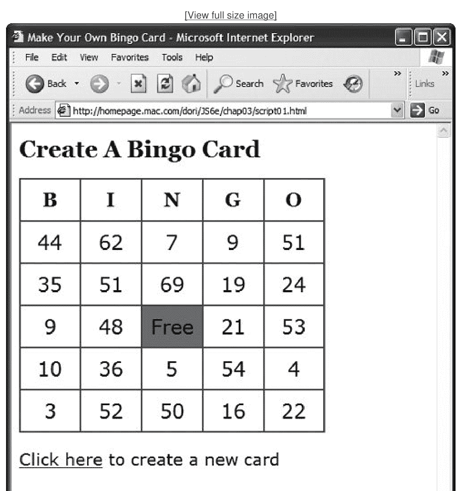

**脚本 3.2** 是我们用于为宾果游戏卡内容添加样式的 CSS 文件。如果你不了解 CSS，不用担心；我们将在[第 11 章]中更详细地解释它，而且在这里它并不太重要。对于宾果游戏卡示例的其余部分，HTML 和 CSS 页面将不会更改，因此我们只在这里打印一次它们。

## 脚本 3.2. 这个 CSS 文件为宾果游戏卡添加了样式。

```
body {
    background-color: white;
    color: black;
    font-size: 20px;
    font-family: "Lucida Grande", Verdana, Arial, Helvetica, sans-serif;
}
h1, th {
    font-family: Georgia, "Times New Roman", Times, serif;
}

h1 {
    font-size: 28px;
}

table {
    border-collapse: collapse;
}

th, td {
    padding: 10px;
    border: 2px #666 solid;
    text-align: center;
    font-size: 24px;
}

#free {
    background-color: #F66;
}
```

本示例向您展示如何设置并使用循环，用随机生成的数字填充宾果游戏卡的内容。**脚本 3.3** 包含了实现此功能所需的 JavaScript 代码。从这个脚本生成的卡片不是一个有效的宾果游戏卡，因为对特定列中可以包含哪些数字存在限制。后续示例会逐步完善脚本，直到生成的宾果游戏卡有效。

## 脚本 3.3. 欢迎来到你的第一个 JavaScript 循环。

```
window.onload = newCard;

function newCard() {
	for (var i=0; i<24; i++) {
		var newNum = Math.floor(Math.random() * 75) + 1;

		document.getElementById("square" + i).innerHTML = newNum;
	}
}
```

## 宾果游戏卡中有什么？

当然，你见过它们，但也许你最近没有仔细观察过宾果游戏卡。美国的宾果游戏卡是 5 x 5 的方格，列标题为 B-I-N-G-O，单元格中包含 1 到 75 之间的数字。中心方格通常是一个自由格，上面通常印有“free”（免费）字样。每列都有一个允许的数字范围：

- B 列包含数字 1–15
- I 列包含数字 16–30
- N 列包含数字 31–45
- G 列包含数字 46–60
- O 列包含数字 61–75

## 使用循环创建表格内容：

1. `window.onload = newCard;`

    这在脚本 3.3 中。这行代码在窗口加载完成后调用 `newCard()` 函数。使用事件处理程序来调用函数是很常见的。

2. `function newCard() {`

    这行代码开始了函数定义。

3. `for (var i=0; i<24; i++) {`

    这行代码开始了循环。程序员传统上使用变量 `i` 来表示在循环内部用作计数器的变量。首先 `i` 被设置为 0。分号表示该语句的结束，并允许我们在同一行上放置另一个语句。下一部分的含义是“如果 `i` 小于 24，则执行大括号内的代码”。最后部分（在第二个分号之后）将 `i` 的值加 1。因为这是新内容，让我们稍微分解一下。`i++` 部分使用了你在第 1 章见过的 `++` 运算符，将 `i` 的值递增 1。该循环将重复 24 次，循环内的代码将执行 24 次。第一次遍历时，`i` 将为 0，最后一次遍历时 `i` 将为 23。

4. `var newNum = Math.floor(Math.random() * 75) + 1;`

    在循环内部，我们创建了一个新变量 `newNum`，并用括号右侧计算结果填充它。内置的 JavaScript 命令 `Math.random()` 给我们一个 0 到 1 之间的数字，例如 0.123456789。将 `Math.random()` 乘以最大值（记住，宾果游戏卡中的值可以从 1 到 75）得到一个介于 0 和最大值减一之间的结果。对该结果取整得到整数部分，即一个介于 0 和（最大值 -1）之间的整数。再加一，我们就得到了一个介于 1 和我们的最大值之间的数字。

5. `document.getElementById("square" + i).innerHTML = newNum;`

    这是我们将刚刚得到的随机数的值写入表格的地方。我们获取 id 为 `square` 与当前 `i` 值连接而成的元素。例如，第一次遍历循环时，`i` 的值将是零，因此该行获取 id 为 `square0` 的元素。然后，该行将 `square0` 对象的 `innerHTML` 属性设置为 `newNum` 的当前值。接着，因为我们仍在循环内部，步骤 4 和 5 会再次发生，直到整个宾果游戏卡被填满。

## JavaScript 字符串

像“cat”这样的单词中的“t”在第二位是什么时候？当它是一个 JavaScript 字符串时。

在 JavaScript 中，第一个字符位于位置 0。因此，以“cat”为例，“c”位于位置 0，“a”位于位置 1，“t”位于位置 2。

只有在检查 `cat` 的长度时，我们才真正看到值为 3。所有其他字符串方法都是从零开始的；也就是说，它们从 0 开始。

## 循环中的循环

一个 `for` 循环有三个部分，如**图 3.2** 所示：

### 图 3.2. 循环的三个部分。

```
    i=0; i<userNum; i++
    ----  ------------  ---
    初始化  限制条件  递增
```

1.  **初始化步骤。** 第一次进入循环时，这是循环变量（本例中为 `i`）被设置的值。

2.  **限制步骤。** 这是我们说明何时停止循环的地方。虽然普通人从一数到十，但在编程语言中从零数到九是很常见的。在这两种情况下，循环内的代码都会运行十次，但后一种方法更适合数组从零位置开始的语言（如 JavaScript）。这就是为什么你会看到循环的限制是“小于 `userNum`”而不是“小于或等于 `userNum`”。假设变量 `userNum` 是 10，并且你希望循环运行十次。如果你从 0 数到 9（使用“小于”测试），循环运行十次。如果你从 0 数到 10（使用“小于或等于”测试），循环运行 11 次。

3.  **递增步骤。** 这是我们说明在每次循环中将循环计数器增加多少的地方。在本例中，我们每次通过循环时加一，使用 `++` 将 `i` 的值加一。

## 将值传递给函数

你经常希望获取一些信息并将其交给函数使用。这称为将信息*传递*给函数。例如，看这个函数定义：

```
function playBall(batterup)
```

变量 `batterup` 是该函数的一个*参数*。当调用函数时，数据可以传递给函数。然后，当你在函数内部时，该数据就在 `batterup` 变量中。函数几乎可以传递你想要使用的任何数据，包括文本字符串、数字，甚至其他 JavaScript 对象。例如，`batterup` 变量可以传递球员的名字作为文本字符串（`"Mantle"`），或者他在阵容中的号码（7）（尽管在你真正知道自己在做什么之前，将两者混合可能是一个非常糟糕的主意）。与所有变量一样，你应将用作函数参数的变量命名为能提醒你该变量用途的名称。

函数可以有多个参数。只需在括号内用逗号分隔它们，如下所示：

```
function currentScore(hometeam,visitors)
```

我们想强调的是，参数是变量，因此在调用函数时可以传递各种不同的值。因此，以下代码片段都是等价的：

```
currentScore(6,4);

var homeScore = 6;
var visitingScore = 4;
currentScore(homeScore,visitingScore);

currentScore(6,3+1);
```

对于所有这三个示例，一旦我们进入 `currentScore()` 内部，`hometeam` 的值就是 6，而 `visitors` 的值是 4（这对主队来说是个好消息）。

在这个例子中，我们将通过将一些计算从 [脚本 3.3] 中提取出来，稍作重述，并将它们放入一个带有传递值的函数中，来清理 [脚本 3.3] 中的一些计算，以使事情发生的过程更加明显。这一切都发生在 [脚本 3.4] 中。

**脚本 3.4.** 通过将值传递给 `setSquare()` 函数，脚本变得更容易阅读和理解。


## 向函数传递值：

- 1. `setSquare(i);`

这行代码在`newCard()`函数内部。我们将`i`的值传递给`setSquare()`函数。

2. `function setSquare(thisSquare) {`

这行代码定义了`setSquare()`函数，它接收我们想要更新的当前方格编号。传入时，它是循环变量`i`；函数接收到后，它变成了参数`thisSquare`。这里有点难以理解的是：这个函数接收了`i`，并用它做一些事情，但函数内部实际上并不知道`i`的存在。在函数内部，它只知道`thisSquare`。

3. `var currSquare = "square" + thisSquare;`

为了使脚本后面调用`getElementById()`时更加清晰，我们创建并设置了一个新变量：`currSquare`。这是我们正在操作的当前方格。它将文本字符串`"square"`与`thisSquare`变量拼接在一起。

4. `document.getElementById(currSquare).innerHTML = newNum;`

这行代码获取由`currSquare`指定名称的元素，并将其内容更改为显示`newNum`。

## 检测对象

在编写脚本时，你可能需要检查浏览器是否足够智能，能够理解你要使用的对象。有一种方法可以进行这种检查，称为*对象检测*。

你需要做的就是为目标对象设置一个条件判断，如下所示：

```javascript
if (document.getElementById) {
```

如果该对象存在，`if`语句为真，脚本继续正常执行。但如果浏览器不理解该对象，测试返回假值，条件语句的`else`部分就会执行。[脚本 3.5](Script 3.5) 给出了你需要的JavaScript代码，[图 3.3](Figure 3.3) 展示了在过时浏览器中的显示效果。

### 脚本 3.5. 对象检测是脚本编写者的重要工具。

```javascript
window.onload = newCard;

function newCard() {
    if (document.getElementById) {
        for (var i=0; i<24; i++) {
            setSquare(i);
        }
    }
    else {
        alert("Sorry, your browser doesn't support this script");
    }
}

function setSquare(thisSquare) {
    var currSquare = "square" + thisSquare;
    var newNum = Math.floor(Math.random() * 75) + 1;

    document.getElementById(currSquare).innerHTML = newNum;
}
```

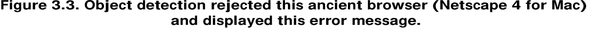

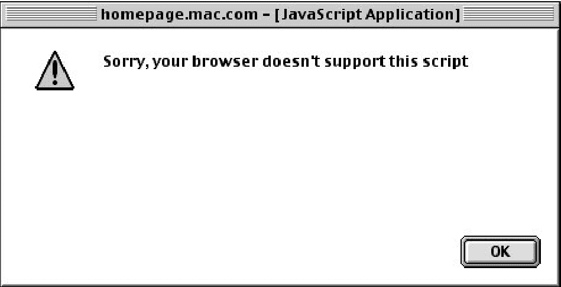

## 检测对象的方法：

- 1. `if (document.getElementById) {`

这行代码开始条件判断。如果括号内的对象存在，测试返回真值，`newCard()`函数中该代码块的其余部分将继续执行。

- 2. `else {`
   `alert("Sorry, your browser doesn't support this script");`
   `}`

如果第1步中的测试返回假值，这行代码会弹出一个警告框，然后脚本结束执行。

## ✓ 提示

- 在生产环境中，最好给用户提供其他可执行的操作，或者至少提供一个不需要此功能的页面版本。不过在这里，没有其他办法。
- 重要的是要明白，你并不总是检查`document.getElementById`。你需要检查哪些对象，取决于你的脚本使用了哪些对象。如果你的脚本使用的对象支持率不是100%，一定要事先检查浏览器是否能处理它——永远不要想当然地认为它能支持。本书为了节省篇幅，没有在所有地方都展示对象检测，但在实际开发中，它至关重要。

## 过时的检测方法

另一种尝试确定浏览器支持哪些对象的方法是进行*浏览器检测*，即尝试识别用于查看页面的浏览器。它通过向浏览器请求用户代理字符串来获取信息，该字符串会报告浏览器的名称和版本。其思路是你据此为特定浏览器编写一种工作方式的脚本，为其他浏览器编写另一种方式。这是一种过时的脚本编写方法，因为它效果不佳。

浏览器检测的前提是你知道某个特定浏览器支持你编写的脚本，而另一个浏览器不支持。但那些你从未使用过的小众浏览器呢？或者在你的脚本完成后才发布的浏览器呢？

更糟糕的是，许多浏览器试图通过故意伪装自身来规避浏览器检测。例如，苹果的Safari浏览器声称自己是Mozilla浏览器，尽管它并不是。而且一些浏览器，如Safari和Opera，允许你设置它要报告自己是哪个浏览器。

你根本无法快速地修改脚本来跟上所有可能的浏览器组合。**这是一场必输的游戏。**

试图检测浏览器支持的JavaScript版本也是如此。我们强烈建议你不要使用这些检测方法，而是使用对象检测。

## 使用数组

在本示例中，我们介绍另一个有用的JavaScript对象：*数组*。数组是一种可以存储一组信息的变量。和普通变量一样，数组可以包含任何类型的数据：文本字符串、数字、其他JavaScript对象等。你用圆括号声明数组，括号内用逗号分隔各元素，如下所示：

```javascript
var newCars = new Array("Toyota", "Honda", "Nissan");
```

执行后，`newCars`数组包含三个汽车品牌的文本字符串。要访问数组的内容，你需要使用变量名加上用方括号括起来的*索引号*来指定要使用的数组成员。因此`newCars[2]`返回"Nissan"，因为数组编号与JavaScript中的大多数其他编号一样，从零开始。

在[脚本 3.6](#)的示例中，我们开始确保宾果卡片的有效性。在真正的宾果卡片上，每一列有不同的数字范围：B列是1-15，I列是16-30，N列是31-45，G列是46-60，O列是61-75。如果你回顾[图 3.1](#)，你会发现它不是一张有效的卡片，因为它是用一个简单地在每个方格中放入1到75之间随机数的脚本版本生成的。本示例修复了这个问题，仅修改或新增了两行代码。完成后，卡片将类似于[图 3.4](#)。它仍然不是一张有效的宾果卡片（注意某些列中有重复的数字），但我们正在逐步完善。

### 脚本 3.6. 本脚本限制了可以放入每列的值的范围。

```javascript
window.onload = newCard;

function newCard() {
    if (document.getElementById) {
        for (var i=0; i<24; i++) {
            setSquare(i);
        }
    }
    else {
        alert("Sorry, your browser doesn't support this script");
    }
}

function setSquare(thisSquare) {
    var currSquare = "square" + thisSquare;
    var colPlace = new Array(0,1,2,3,4,0,1,2,3,4,0,1,3,4,0,1,2,3,4,0,1,2,3,4);
    var newNum = (colPlace[thisSquare] * 15) + Math.floor(Math.random() * 15) + 1;

    document.getElementById(currSquare).innerHTML = newNum;
}
```

### 图 3.4. 这张宾果卡片有所改进，但还不完全正确，因为某些列中存在重复数字。

[查看完整尺寸图片]

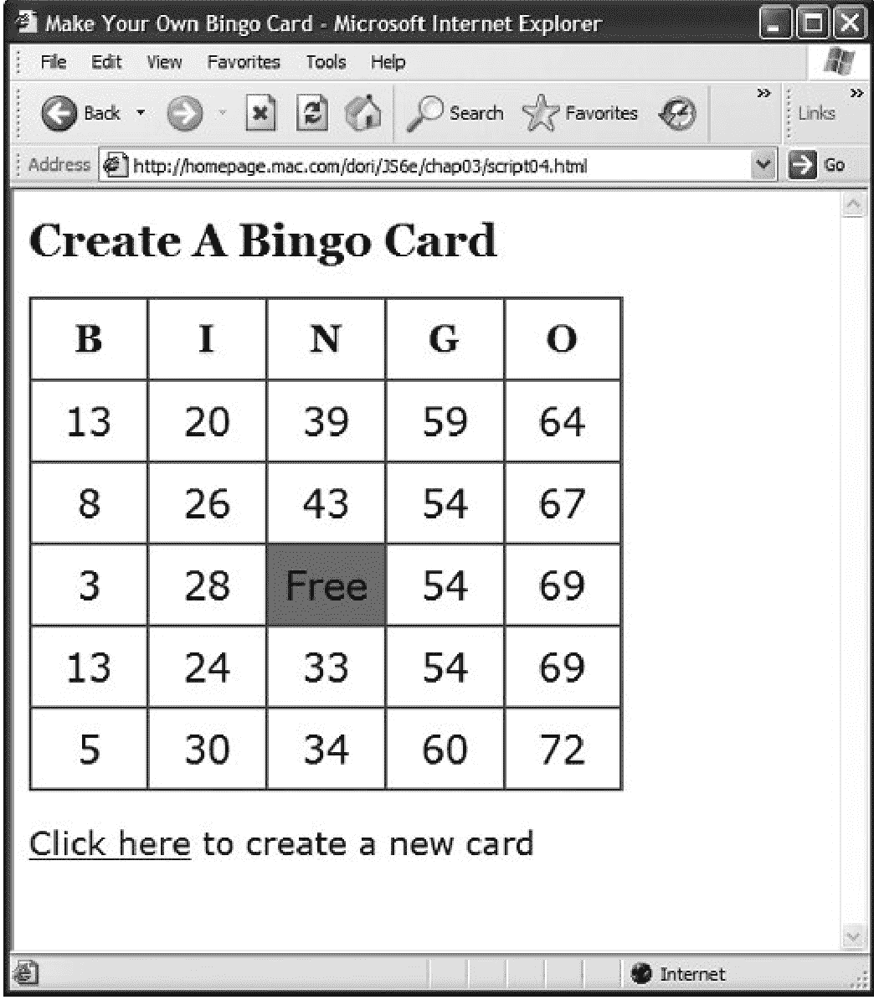

使用数组：

1. `var colPlace = new Array(0,1,2,3,4, 0,1,2,3,4,0,1,3,4,0,1,2,3,4,0,1, 2,3,4);`

我们需要限制哪些随机数可以放入哪些列。最简单的跟踪方法是给每一列分配一个编号（B：0，I：1，N：2，G：3，O：4），然后计算可以放入每列的数字为（列编号 × 15）+（1到15之间的随机数）。

然而，HTML表格是按行单元格顺序排列的，而不是按列单元格顺序；也就是说，我们是先横跨第一行，再横跨第二行，以此类推，而不是先沿第一列向下，再沿第二列向下，以此类推。`colPlace`数组用于跟踪每个方格最终属于哪一列。它是数字0-4重复五次（减去空格；注意数组中间的序列`0,1,3,4`跳过了空格，空格本应在位置2）。

2. `var newNum = (colPlace[thisSquare] * 15) + Math.floor(Math.random() * 15) + 1;`

`newNum`变量仍然生成随机数，但现在不是生成1-75之间的数字，而是计算1到15之间的随机数，然后加上列编号`colPlace[thisSquare]`乘以15。因此，如果我们的随机数是7，那么它在B列就是7，在I列就是22，在N列就是37，在G列就是52，在O列就是67。


## 处理返回值的函数

到目前为止，你看到的所有函数都是执行某些操作后就返回。但有时，你可能希望返回某种结果。[脚本 3.7](Script 3.7) 通过将前面示例中的一些计算分解成一个返回宾果卡单元格随机数字的函数，使整个脚本更易于理解。另一个函数随后使用这个结果。

**脚本 3.7. 函数可以返回一个值，该值随后可以被检查。**

```
window.onload = newCard;

function newCard() {
    if (document.getElementById) {
        for (var i=0; i<24; i++) {
            setSquare(i);
        }
    }
    else {
        alert("Sorry, your browser doesn't support this script");
    }
}

function setSquare(thisSquare) {
    var currSquare = "square" + thisSquare;
    var colPlace = new Array(0,1,2,3,4,0,1,2,3, 4,0,1,3,4,0,1,2,3,4,0,1,2,3,4);
    var colBasis = colPlace[thisSquare] * 15;
    var newNum = colBasis + getNewNum() + 1;

    document.getElementById(currSquare).innerHTML = newNum;
}

function getNewNum() {
    return Math.floor(Math.random() * 15);
}
```

**从函数返回一个值：**

```
1. var colBasis = colPlace[thisSquare] * 15;
var newNum = colBasis + getNewNum() + 1;
```

第一行只是一些清理工作，因为我们已经在上一个任务中计算过它；现在，我们改为将其赋值给一个变量，然后在第二行中使用。

第二行同样是将 `newNum` 变量设置为我们期望的数字，但这里我们将随机数生成器移到了一个名为 `getNewNum()` 的函数中。通过分解计算过程，使得脚本中的内容更容易理解。

```
2. function getNewNum() {
  return Math.floor(Math.random() * 15);
}
```

此代码计算一个介于 0 到 14 之间的随机数并返回它。这个函数可以在任何可以使用变量或数字的地方使用。

> ✔ **提示**
> 
> - 任何值都可以被返回。字符串、布尔值和数字都可以正常工作。

## 更新数组

正如你在[图 3.4](Figure 3.4)中所见，宾果卡脚本目前还没有办法确保给定列中不出现重复的数字。此示例修复了该问题，同时演示了数组不必只是初始化然后读取，而是可以声明然后动态设置。这给你带来了极大的灵活性，因为你可以在脚本运行时使用计算或函数来更改变量数组中的值。[脚本 3.8](Script 3.8) 向你展示了如何仅用几行新代码实现这一点。

### 脚本 3.8. 在脚本运行期间更改数组的内容是一种非常强大的技术。

```
window.onload = newCard;
var usedNums = new Array(76);

function newCard() {
    if (document.getElementById) {
        for (var i=0; i<24; i++) {
            setSquare(i);
        }
    }
    else {
        alert("Sorry, your browser doesn't support this script");
    }
}

function setSquare(thisSquare) {
    var currSquare = "square" + thisSquare;
    var colPlace = new Array(0,1,2,3,4,0,1,2,3, 4,0,1,3,4,0,1,2,3,4,0,1,2,3,4);
    var colBasis = colPlace[thisSquare] * 15;
    var newNum = colBasis + getNewNum() + 1;

    if (!usedNums[newNum]) {
        usedNums[newNum] = true;
        document.getElementById(currSquare). innerHTML = newNum;
    }
}

function getNewNum() {
    return Math.floor(Math.random() * 15);
}
```

## 动态更新数组：

```
var usedNums = new Array(76);
```

这是声明数组的一种新方式。我们将一个包含 76 个对象的新数组放入 usedNums 变量中。如前所述，这些对象可以是*任何东西*。在这种情况下，它们将是布尔值，即 true/false 值。

```
if (!usedNums[newNum]) {
    usedNums[newNum] = true;
```

如果 usedNum 数组中的 newNum 槽位是 false（由语句前的 ! 表示，意思是“非”），那么我们将其设置为 true 并将其写入卡片。如果它是 true，我们则什么也不做，这样就不会有重复项，但我们的卡片上可能会出现空白区域（图 3.5）。这也不太好，这引出了下一个任务。

## 图 3.5. 我们已经去掉了重复的数字，但有些地方现在是空的。是时候重新规划了。

[查看完整图片]

## 创建宾果卡

| B | I | N | G | O |
|---|---|---|---|---|
| 8 | 17 | 40 | 46 | 71 |
| 3 | 27 | 37 | 55 | 68 |
| 10 |  | Free | 50 | 69 |
|  | 25 | 39 | 49 | 66 |
| 6 |  |  | 58 | 73 |

[点击此处](#) 创建新卡片

## ✓ 提示

- 为什么数组定义为包含 76 个项？因为我们想使用 1 到 75 的值。如果我们初始化它为包含 75 个项，编号将从 0 到 74。76 让我们可以使用 1 到 75，我们只需忽略第 0 项。
- 如果你不采取任何措施来初始化布尔值，它们将自动为 false。

## 使用 Do/While 循环

有时你需要在代码中放置一个循环，它会循环多次，但你无法知道你想循环多少次。这就是你需要使用 do/while 循环的时候：你想做某事，同时某个值为 true。脚本 3.9 像往常一样逐行写入数字，但这次它会先检查数字是否已被使用过，然后再将其放入单元格。如果已被使用，脚本会生成一个新的随机数并重复该过程，直到找到一个唯一的数字。图 3.6 显示了最终有效的宾果卡。

### 脚本 3.9. 此脚本防止给定列中的数字被使用多次。

```
window.onload = newCard;
var usedNums = new Array(76);

function newCard() {
	if (document.getElementById) {
		for (var i=0; i<24; i++) {
			setSquare(i);
		}
	}
	else {
		alert("Sorry, your browser doesn't support this script");
	}
}

function setSquare(thisSquare) {
	var currSquare = "square" + thisSquare;
	var colPlace = new Array(0,1,2,3,4,0,1,2,3, 4,0,1,3,4,0,1,2,3,4,0,1,2,3,4);
	var colBasis = colPlace[thisSquare] * 15;
	var newNum;

	do {
		newNum = colBasis + getNewNum() + 1;
	}
	while (usedNums[newNum]);

	usedNums[newNum] = true;
	document.getElementById(currSquare). innerHTML = newNum;
}

function getNewNum() {
	return Math.floor(Math.random() * 15);
}
```

## 图 3.6. 最终，我们得到了一张有效的宾果卡！


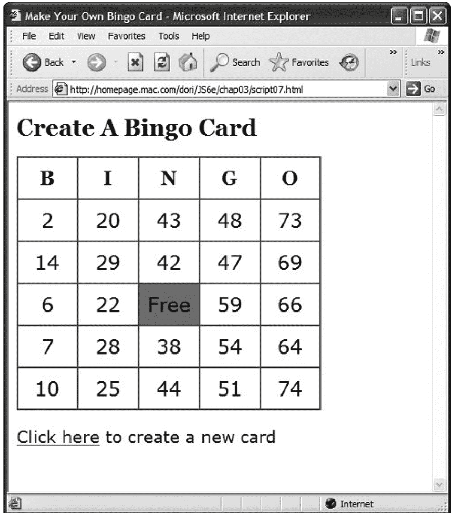

## 创建宾果卡

| B | I | N | G | O |
|---|---|---|---|---|
| 2 | 20 | 43 | 48 | 73 |
| 14 | 29 | 42 | 47 | 69 |
| 6 | 22 | **Free** | 59 | 66 |
| 7 | 28 | 38 | 54 | 64 |
| 10 | 25 | 44 | 51 | 74 |

[点击此处](about:blank) 创建新卡片

使用 do/while 循环：

```
var newNum;
```

在上一个任务中，我们在创建 `newNum` 变量时就对其进行了初始化。因为我们将多次设置它，所以我们只在进入循环之前创建它一次。

```
do {
```

此行开始 `do` 代码块：

```
newNum = colBasis + getNewNum() + 1;
```

此行在循环内部将 `newNum` 变量设置为我们期望的数字，与之前的示例相同。

```
}
```

右花括号表示 `do` 代码块的结束。

```
while (usedNums[newNum]);
```

`while` 检查会导致 `do` 代码块重复，直到检查结果为 `false`。在这种情况下，我们检查 `newNum` 是否在 `usedNums[]` 数组中，以查看 `newNum` 是否已被使用。如果已被使用，控制权将传回 `do` 代码块的顶部，整个过程重新开始。最终，我们会找到一个未被使用的数字。找到后，我们跳出循环，将 `usedNums[]` 项设置为 true，并将其写入卡片，就像在上一个任务中一样。

## 提示

- `do/while` 循环的一个常见用途是去除用户输入数据中的空格或无效字符。但同样，请记住，无论 `while` 检查结果是 true 还是 false，`do` 代码块总是会被执行。


## 多种方式调用脚本

到目前为止，本书中的脚本通常在页面加载时自动运行。但在现实世界中，你往往希望让用户对你的脚本有更多控制权，甚至允许他们随时运行脚本。在本示例（[Script 3.10](Script 3.10)）中，脚本仍在页面加载时运行。但我们也允许用户点击页面底部的链接来重新运行生成 Bingo 卡的脚本，完全在浏览器中完成，*无需* 从服务器重新加载页面。这为用户提供了快速响应，同时服务器负载为零。这是 Bingo 卡示例的最后一个，汇总了本章到目前为止我们使用过的所有技术。

### Script 3.10. 赋予用户自行运行脚本的能力。

```javascript
window.onload = initAll;
var usedNums = new Array(76);

function initAll() {
    if (document.getElementById) {
        document.getElementById("reload").onclick = anotherCard;
        newCard();
    }
    else {
        alert("Sorry, your browser doesn't support this script");
    }
}

function newCard() {
    for (var i=0; i<24; i++) {
        setSquare(i);
    }
}

function setSquare(thisSquare) {
    var currSquare = "square" + thisSquare;
    var colPlace = new Array(0,1,2,3,4,0,1,2,3,4,0,1,3,4,0,1,2,3,4,0,1,2,3,4);
    var colBasis = colPlace[thisSquare] * 15;
    var newNum;

    do {
        newNum = colBasis + getNewNum() + 1;
    }
    while (usedNums[newNum]);

    usedNums[newNum] = true;
    document.getElementById(currSquare).innerHTML = newNum;
}

function getNewNum() {
    return Math.floor(Math.random() * 15);
}

function anotherCard() {
    for (var i=1; i<usedNums.length; i++) {
        usedNums[i] = false;
    }

    newCard();
    return false;
}
```

## 以多种方式调用脚本：

1. `window.onload = initAll;`

在之前的示例中，我们在 `onload` 运行时调用 `newCard()`。现在，我们调用一个新的函数 `initAll()`，它将处理所有必需的初始化步骤。

2.  `function initAll() {
        if (document.getElementById) {
            document.getElementById("reload").onclick = anotherCard;
            newCard();
        }
        else {
            alert("Sorry, your browser doesn't support this script");
        }
    }`

`initAll()` 函数只是将我们之前见过的几个初始化步骤汇总到一起，再加上一项新功能。如果浏览器支持，除了对象检测和对 `newCard()` 的调用之外，它所做的就是新功能——将 HTML 页面上的链接（id 为 `reload` 的那个；请回顾 Script 3.1）设置为在点击时调用 `anotherCard()`。对象检测从 `newCard()` 移到了这里，因为它实际上是初始化例程的一部分，而这正是由这个函数处理的。

3.  `function anotherCard() {
        for (var i=1; i<usedNums.length; i++) {
            usedNums[i] = false;
        }

        newCard();
        return false;
    }`

这是当有人点击链接时调用的 `anotherCard()` 函数。它执行三件事：

-   将 `usedNums[]` 数组中的所有项设置为 false（以便我们可以再次使用所有数字），
-   调用 `newCard()` 函数（生成另一张卡），
-   返回 false 值，以便浏览器不会尝试加载链接中的 `href`（这在[第 2 章](Chapter 2)中已介绍）。

> **✔ 提示**

如果你已经读到这里，你现在知道了如何做许多人认为是 Ajax 基本组成部分的事情：使用 JavaScript 重新加载页面的一部分，而不是访问服务器并请求一个全新的页面。我们将在[第 15 章](Chapters 15)和[第 16 章](16)中更详细地介绍 Ajax。

## 使用多级条件判断

有时，在条件测试中你需要超过两个选择；`then` 和 `else` 有时就是不够。虽然你可以有嵌套的多层 `if`，但通常使用 `switch/case` 语句会更简单。`switch/case` 结构允许你将变量与多个值进行检查。如[图 3.7](#)所示，这个脚本根据用户点击的按钮，以警告对话框的形式返回三种不同的总统名言之一。[Script 3.11](#) 展示了 HTML，它相当简单。[Script 3.12](#)，即 JavaScript，使用 `switch/case` 结构来区分不同的总统。

**图 3.7.** 使用顶部窗口中的三个按钮分别调用函数，会产生三种不同的响应，如三个对话框所示。

[查看完整尺寸图像](#)

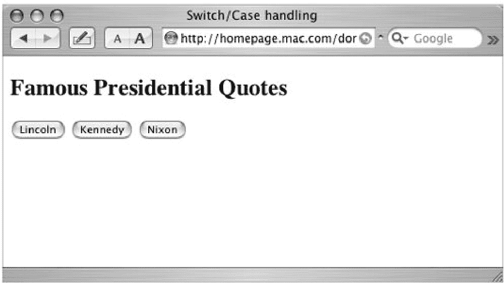

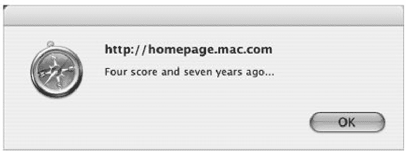

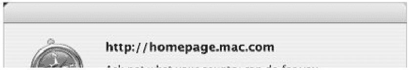


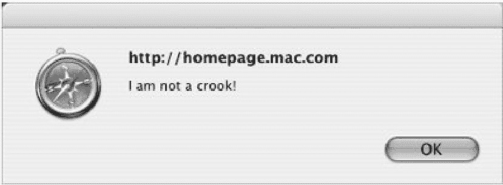

### Script 3.11. HTML 为多级条件判断设置页面。

```html
<!DOCTYPE html PUBLIC "-//W3C//DTD XHTML 1.0 Transitional//EN">
<html xmlns="http://www.w3.org/1999/xhtml">
<head>
    <title>Switch/Case handling Only</title>
    <script language="Javascript" type="text/javascript" src="script09.js">
    </script>
</head>
<body bgcolor="#FFFFFF">
<h2>Famous Presidential Quotes</h2>
<form action="#">
    <input type="button" value="Lincoln" />
    <input type="button" value="Kennedy" />
    <input type="button" value="Nixon" />
</form>
</body>
</html>
```

### Script 3.12. 这种类型的条件允许你检查多种可能性。

```javascript
window.onload = initAll;
function initAll() {
    for (var i=0; i< document.forms[0].elements.length; i++) {
        var thisElement = document.forms[0].elements[i];

        if (thisElement.type == "button") {
            thisElement.onclick = saySomething;
        }
    }
}

function saySomething() {
    switch(this.value) {
        case "Lincoln":
            alert("Four score and seven years ago...");
            break;
        case "Kennedy":
            alert("Ask not what your country can do for you...");
            break;
        case "Nixon":
            alert("I am not a crook!");
            break;
        default:
    }
}
```

## 使用 switch/case 语句：

1.  `window.onload = initAll;`

2. agile `function initAll() {
        for (var i=0; i< document.forms[0].elements.length; i++) {
            var thisElement = document.forms[0].elements[i];
            if (thisElement.type == "button") {
                thisElement.onclick = saySomething;
            }
        }
    }`

页面加载时，调用 `initAll()` 函数。

在函数中，我们遍历页面上表单中的所有字段。对于每个字段，循环查看字段的类型。如果是按钮，则添加一个 `onclick` 处理程序来调用 `saySomething()` 函数。

3.  `function saySomething() {`

这开始 `saySomething()` 函数。

4.  `switch(this.value) {`

`this` 对象的值被用作 `switch()` 的参数。它的值将决定下面哪个 `case` 语句被执行。

5.  `case "Lincoln":
        alert("Four score and seven years ago...");
        break;`

如果 `this` 对象的值是 "Lincoln"，则显示此警告。关于 `break`，如果用户点击了 Lincoln，我们就处于这段代码中。然而，我们已经完成了想要做的所有事情，因此想要退出 `switch`。为了做到这一点，我们需要 `break` 退出。否则，我们也会执行下面的所有代码。虽然在某些情况下继续执行可能很有用，但这不是其中之一。

6.  `case "Kennedy":
        alert("Ask not what your country can do for you...");
        break;`

如果用户点击了 Kennedy，我们就进入这个 `case` 块。

7.  `case "Nixon":
        alert("I am not a crook!");
        break;`

最后，如果用户点击了 Nixon，我们来到这里，弹出另一个警告，然后跳出 `switch`。

8.  `default:`

如果你想知道如果用户的输入不符合上述任何条件会发生什么，你来对地方了。`default` 部分是我们的 `switch` 值不匹配任何 `case` 值时最终到达的地方。`default` 块是可选的，但始终包含它是一个良好的编程习惯，以防万一（可以这么说）。在这个脚本中，这里没有要执行的代码，因为我们不应该到达这里。

9.  `}`

这个闭合的大括号结束 `switch` 语句。

> ✔ **提示**

`switch` 语句除了字符串之外还可以传递其他值。你可以将其与数值一起使用，甚至可以让它评估数学结果。如果其结果应该是数值，请确保 `case` 语句匹配——你的 `case` 语句需要检查的是数字，而不是字符串（例如，5，而不是 "5"）。


 ## 错误处理

尽管你可能拥有多年使用计算机的经验，但你的网站访客中很可能许多人并非如此。因此，你会希望向他们提供有意义的错误信息，而不是大多数浏览器在用户操作不当时返回的技术术语。脚本 3.13 展示了如何使用 JavaScript 的 try/throw/catch 命令来生成友好、有用的错误信息。我们将其构建为一个简单的平方根计算器。

**脚本 3.13. 使用此脚本让 JavaScript 优雅地处理错误。**

```
window.onload = initAll;

function initAll() {
    var ans = prompt("Enter a number","");
    try {
        if (!ans || isNaN(ans) || ans<0) {
            throw new Error("Not a valid number");
        }
        alert("The square root of " + ans + " is " + Math.sqrt(ans));
    }
    catch (errMsg) {
        alert(errMsg.message);
    }
}
```

## 优雅地处理错误：

- `var ans = prompt("Enter a number", "");`

这是一个普通的日常提示框，我们将其存储在 `ans` 变量中供后续使用。在本例中，我们希望用户输入一个数字。如果他们成功做到了，JavaScript 将显示他们输入的数字的平方根。

```
try {
```

然而，如果他们输入的不是数字，如**图 3.8**所示，我们希望能够优雅地捕获它并显示有意义的信息。是的，即使用户在提示框要求输入数字时输入了文字，我们也会保持礼貌。我们首先使用 `try` 命令。在其代码块内部，我们将检查用户的输入是否有效。

**图 3.8. 我们想要一个数字，但用户可能输入任何东西，比如这个非数字输入。**

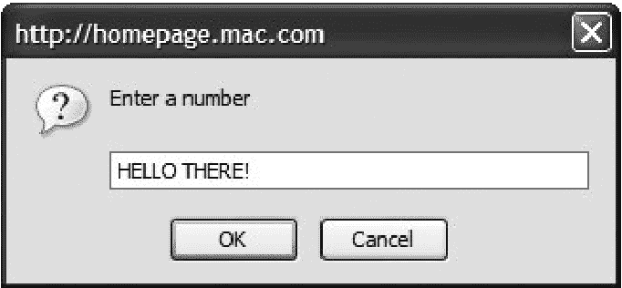

```
if (!ans || isNaN(ans) || ans<0) {
  throw new Error("Not a valid number");
}
```

我们关注三件事：完全没有输入、用户输入了内容但非数字、或者输入是数字但为负数（因为负数的平方根是虚数，这超出了本例的范围）。如果 `!ans` 为真，意味着用户没有输入任何内容。内置的 `isNaN()` 方法检查传入的参数是否为"非数字"。如果 `isNaN()` 返回 true，我们就知道输入了无效的内容。而如果 `ans` 小于 0，则是一个负数。在任何这些情况下，我们都希望 `throw` 一个错误；在本例中，错误信息是"Not a valid number"。一旦抛出错误，JavaScript 就会跳出 `try` 块并寻找对应的 `catch` 语句。此处与 catch 之间的所有代码都会被跳过。

```
4. alert("The square root of " + ans + " is " + Math.sqrt(ans));
```

如果输入了有效的内容，就会显示平方根，如**图 3.9**所示。

**图 3.9. 这是脚本对数字进行处理后的结果。**

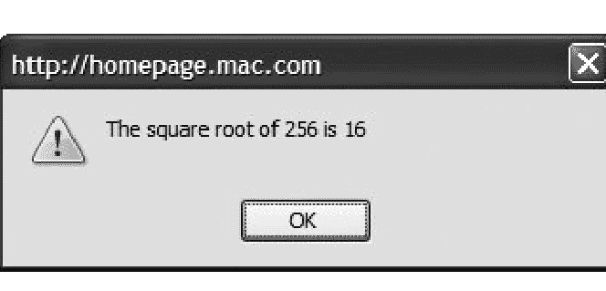

```
5. }
```

这个右大括号结束了 `try` 块。

```
6. catch (errMsg) {
    alert(errMsg.message);
  }
```

这就是期待中的 `catch` 语句。`error` 作为参数传入，并显示错误的 `message` 部分（**图 3.10**）。如果没有抛出错误，catch 内部的代码将永远不会执行。

**图 3.10. 如果输入了错误的数据，请让用户知道。**

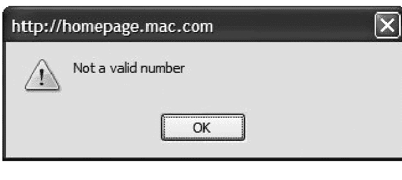

## 提示

- 这里还有一个可选部分：最后的 `{}` 块。它应放在 `catch` 之后，其中包含无论 `try` 是否抛出错误都应该执行的代码。

# 第 4 章 图像处理

JavaScript 最出色的用途之一是通过动画图形为网页增添视觉吸引力，这正是本章的全部内容。当用户将鼠标移动到图像上时，让网页中的图像发生变化，从而使页面对用户做出反应，这是你在 JavaScript 中可以学到的最常用、最有效的技巧之一。这种效果称为*rollover*（鼠标悬停切换），它易于实现，却有众多应用，你将会看到。

Rollover 是一种很棒的工具，但使用 JavaScript 你可以做到比 rollover 更多的事情，例如自动更换图像、创建广告横幅、构建幻灯片，以及在页面上显示随机图像。

在本章中，你将学习如何让 JavaScript 实现所有这些图像技巧。让我们开始吧。

**表 4.1. 刚好够用的 HTML 图像知识**

| 标签 | 属性 | 含义 |
| --- | --- | --- |
| `img` | | 包含描述浏览器要显示的图像的属性 |
| | `src` | 包含图像的 URL，相对于网页的 URL |
| | `width` | 包含浏览器将显示图像的宽度（以像素为单位） |
| | `height` | 包含浏览器将显示图像的高度（以像素为单位） |
| | `border` | 要显示的边框宽度 |
| | `name` | JavaScript 用来引用此图像的名称；与其他 JavaScript 对象一样，不允许有空格或其他标点符号，且不能以数字开头 |
| | `alt` | 用于非可视化浏览器代替图像显示 |
| | `hspace` | 图像周围的水平缓冲区域 |
| | `vspace` | 图像周围的垂直缓冲区域 |
| | `align` | 描述图像在页面上的水平或垂直对齐位置 |
| | `id` | 唯一标识符，JavaScript 将使用它来操作图像 |

## 创建 Rollover

Rollover 背后的理念很简单。你有两张图像。第一张，或者说*原始*图像，在加载页面时与用户看到的其他网页内容一起显示。当用户将鼠标移动到第一张图像上时，浏览器快速用第二张，或者说*替换*图像替换第一张图像，产生运动或动画的错觉。

脚本 4.1 给你最精简的 rollover；整个效果都在一个标准的图像链接内完成。首先加载蓝色箭头（图 4.1），然后当用户将鼠标移到图像上时，它被红色箭头覆盖（图 4.2）。当用户将鼠标移开时，蓝色箭头重新显示。

**脚本 4.1. 这是最简单的 rollover 实现方式，在链接标签内完成。**

```
[View full width]

<!DOCTYPE html PUBLIC "-//W3C//DTD XHTML 1.0 Transitional//EN">
<html xmlns="http://www.w3.org/1999/xhtml">
<head>
    <title>A Simple Rollover</title>
</head>
<body bgcolor="#FFFFFF">
    <a href="next.html" onmouseover= "document.arrow.src='images/ arrow_on.gif'"
        onmouseout= "document.arrow.src='images/ arrow_off.gif'"></a>
</body>
</html>
```

**图 4.1. 第一张图像，在用户将鼠标移到其上之前。**

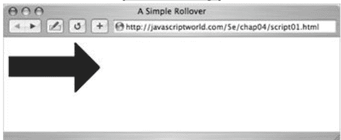

**图 4.2. 当鼠标位于图像上时，脚本将第一张图像替换为第二张图像。**


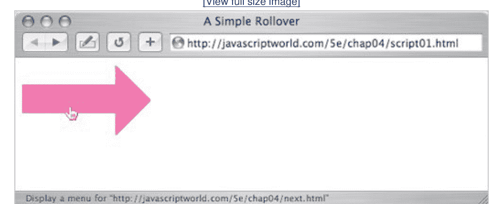

## 创建 rollover：

- `<a href="next.html"`

  链接首先指定当用户点击图像时浏览器将跳转到哪里，在本例中是页面 `next.html`。

- `onmouseover="document.arrow.src= 'images/arrow_on.gif'"`

  当用户将鼠标移到图像上时，替换图像 `arrow_on.gif`（位于 `images` 目录内）被写入文档窗口。

- `onmouseout="document.arrow.src= 'images/arrow_off.gif'">`

  然后，当鼠标移开时，图像 `arrow_off.gif` 被换回。

- ``

  图像链接定义了页面原始图像的来源。我们在图像标签内包含了 `alt` 属性，因为如果你想让 HTML 符合 HTML 标准，`alt` 属性（为非图形浏览器提供图像的名称或描述）是必需的，而且使用 `alt` 属性有助于让你的代码对残障用户可访问，例如使用屏幕阅读器浏览的视障用户。


## 这种翻转方式的缺点

这种实现翻转的方法非常简单，但你需要注意它存在几个问题和缺点。

- 因为第二张图片是在用户将鼠标移到第一张图片上时才从服务器下载的，所以在第二张图片替换第一张图片之前可能会有明显的延迟，特别是对于使用调制解调器而非宽带浏览网站的人来说。
- 使用这种方法会在一些古老浏览器中引发错误信息，例如 Netscape 2.0 或更早版本、Internet Explorer 3.0 或更早版本，或者 America Online 2.7 浏览器。由于这些老式浏览器现在仍在使用的已经寥寥无几，所以目前这算不上什么大问题。

我们建议你使用以下方式创建翻转效果，而不是使用这种方法，在“[创建更高效的翻转效果](#creating-more-effective-rollovers)”部分，它解决了上述所有问题以及更多问题。

## 创建更高效的翻转效果

为了让动画效果正常工作，你需要确保替换图片能够立即显示，而不是在从服务器获取时出现延迟。为此，你可以使用 JavaScript 将所有图片预先加载到浏览器的缓存中（这样当需要时它们已经在用户的硬盘上了），并将图片放入脚本使用的变量中。然后，当用户将鼠标移到图片上时，脚本用一个包含图片的变量替换为另一个包含替换图片的变量。[Script 4.2](#) 展示了具体实现方法。可见的结果与 [Figures 4.1](#) 和 [4.2](#) 相同，但动画效果更加流畅。

### Script 4.2. 此 HTML 页面中唯一的 JavaScript 是指向外部 `.js` 文件的指针。

```html
<!DOCTYPE html PUBLIC "-//W3C//DTD XHTML 1.0 Transitional//EN">
<html xmlns="http://www.w3.org/1999/xhtml">
<head>
    <title>A More Effective Rollover</title>
    <script src="script02.js" language="javascript" type="text/javascript"> </script>
</head>
<body bgcolor="#FFFFFF">
    <a href="next1.html"></a>&nbsp;&nbsp;
    <a href="next2.html"></a>
</body>
</html>
```

为了使你的 JavaScript 更易于管理，我们将从 HTML 页面中提取 JavaScript 代码并放入外部 `.js` 文件中，如 [Script 4.3](#) 所示（有关 `.js` 文件的更多信息，请参阅 [Chapter 3](#)）。

### Script 4.3. 这是比 [Script 4.1](#) 更好的翻转效果实现方式，因为它更加灵活。

```javascript
window.onload = rolloverInit;
function rolloverInit() {
    for (var i=0; i<document.images.length; i++) {
        if (document.images[i].parentNode.tagName == "A") {
            setupRollover(document.images[i]);
        }
    }
}

function setupRollover(thisImage) {
    thisImage.outImage = new Image();
    thisImage.outImage.src = thisImage.src;
    thisImage.onmouseout = rollOut;

    thisImage.overImage = new Image();
    thisImage.overImage.src = "images/" + thisImage.id +"_on.gif";
    thisImage.onmouseover = rollOver;
}

function rollOver() {
    this.src = this.overImage.src;
}
function rollOut() {
    this.src = this.outImage.src;
}
```

## 创建更好的翻转效果：

1. `<script src="script02.js" language="javascript" type="text/javascript"> </script>`

此标签位于 Script 4.2 即 HTML 页面中。它使用 src 属性告诉浏览器在哪里可以找到外部 .js 文件，JavaScript 代码就位于该文件中。

2. `<a href="next1.html"></a>&nbsp;&nbsp;`
`<a href="next2.html"></a>`

仍在 Script 4.2 中，这是按钮的两个典型链接标签，其中嵌入了图片标签。HREF 属性描述了用户点击时链接的目标。在 img 标签中，src 属性提供了用户将鼠标移到图片上之前图片的路径。其余属性都是描述性的且大家熟悉的：图片的宽度、高度、边框和替代文本。请注意，这两个按钮都有一个 id 属性；如第 1 章所述，每个对象的 id 必须是唯一的。脚本使用图片的 id 来实现翻转效果。

`window.onload = rolloverInit;`

进入 [Script 4.3](#)，当页面加载完成时，会触发 `window.onload` 事件处理程序。该处理程序调用 `rolloverInit()` 函数。

此处使用此处理程序是为了确保脚本在页面加载完成之前不会执行。这是因为如果在页面完成加载之前引用页面上的项目，如果某些页面元素尚未加载完毕，可能会导致错误。

```javascript
function rolloverInit() {
    for (var i=0; i<document.images.length; i++) {
```

`rolloverInit()` 函数会扫描页面上的每张图片，查看图片周围的标签是否是 `<a>` 标签，以表明它是一个链接。这两行中的第一行开始定义函数。第二行开始一个 `for...next` 循环，遍历所有图片。循环开始时将计数器变量 `i` 设置为 0。然后，每次循环时，如果 `i` 的值小于文档中图片的数量，就将 `i` 增加 1。

```javascript
if (document.images[i].parentNode.tagName == "A") {
```

这是测试图片周围的标签是否为锚标签的地方。我们通过查看一个对象并检查该对象的值是否为 A（锚标签的名称）来实现这一点。让我们把这个对象拆分一下。对象的第一个部分 `document.images[i]` 是当前图片。它的 `parentNode` 属性是包裹它的容器标签，而 `tagName` 则提供该容器标签的名称。所以用通俗的英语来说，你可以将括号中的部分读作"对于这张特定的图片，包裹它的标签是'A'吗？"

```javascript
setupRollover(document.images[i]);
```

如果第 5 步的测试结果为真，那么就调用 `setupRollover` 函数并传递当前图片。

```javascript
function setupRollover(thisImage) {
```

在我们逐行讲解之前，先花一分钟看看整个函数的概貌。概述如下：此函数为传入的图片对象添加两个新属性。新属性是 `outImage`（鼠标不在图片上时显示的版本）和 `overImage`（鼠标在图片上时显示的版本），它们本身都是图片对象。因为它们是图片对象，所以一旦创建，我们就可以添加它们的 `src`。`outImage` 的 `src` 值是当前（关闭状态）图片的 `src`。`overImage` 的 `src` 值是基于原始图片的 `id` 属性计算得出的。

这一行以 `rolloverInit()` 函数传递给它的图片开始定义函数。

8. `thisImage.outImage = new Image();`

这一行接收传入的图片对象，并为其添加新的 `outImage` 属性。因为你可以为对象添加任何类型的属性，而且属性本身也是对象，所以这里发生的事情是我们向一个图片添加了一个图片对象。新图片对象的括号是可选的，但这是一个好的编码实践；如果需要，你可以通过传递某些参数来设置新图片对象的属性。

9. `thisImage.outImage.src = thisImage.src;`

现在我们将新 `outImage` 的来源设置为与 `thisImage` 的来源相同。页面上的默认图片始终是光标不在图片上时看到的版本。

### 什么是 "this?"

在示例中，你看到使用了 `this` 这个词，但它到底是什么并不完全清楚。

JavaScript 关键字 `this` 允许脚本仅根据关键字使用的上下文向函数传递值。在这种情况下，`this` 用于附加到 `img` 标签的事件触发的函数内部，所以 `this` 是一个图片对象。在后面的示例中，你会看到 `this` 在其他地方使用，你应该能够根据它传递给函数时的上下文来判断 `this` 是什么。

10. `thisImage.onmouseout = rollOut;`

这一行告诉浏览器当用户将鼠标从图片上移开时触发 `rollOut()` 函数。

11. `thisImage.overImage = new Image();`
`thisImage.overImage.src = "images/" + thisImage.id + "_on.gif";`

在第一行中，我们创建了一个新的图片对象，它将包含图片的 `overImage` 版本。第二行设置了 `overImage` 的来源。它动态构建源文件的名称，将 `"images/"` 与图片的 `id`（记住，在 Script 4.2 中，我们看到那些 id 是 `button1` 和 `button2`）连接起来，并添加 `"_on.gif"`。


## 12. `thisImage.onmouseover = rollOver;`

此行代码告诉浏览器，当用户将光标移至图片上方时，应触发 `rollOver()` 函数。

## 13. `function rollOver() {`
    `this.src = this.overImage.src;`
`}`

此函数实现了当用户将鼠标光标移至图片上时的悬停效果。它通过将当前图片的来源重置为 `overImage` 版本的图片来实现，如图[4.3](#4.3)和[4.4](#4.4)所示。

## 图4.3。你也可以在同一个页面上放置多个悬停效果。

[查看完整尺寸图片]

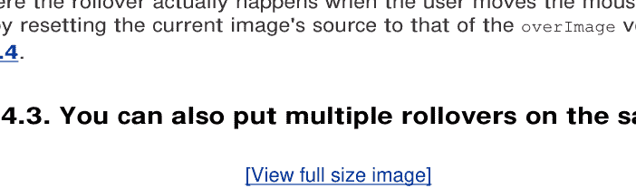

## 图4.4。悬停在第二个悬停效果上。

[查看完整尺寸图片]

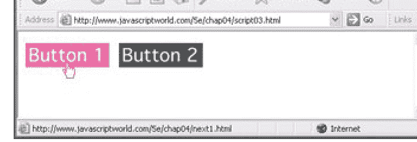

## 14. function rollOut() {
    this.src = this.outImage.src;
}

当用户将鼠标光标移离图片时，此函数将图片来源设置回初始值，即 `outImage` 版本的图片。

### ✔ 提示

-   当你为悬停效果准备图片时，请确保所有 GIF 图片都*不是*透明的。如果是透明的，你会看到在透明图片下方，你正试图替换的原始图片——这并非你想要的效果。
-   原始图片和替换图片需要具有完全相同的尺寸。否则，一些浏览器会为你调整图片大小，你可能不会喜欢那扭曲的结果。
-   在前面的示例中，悬停效果发生在光标移至链接上方时；而在这里，悬停效果发生在光标移至图片上方时——也就是说，`onmouseover` 和 `onmouseout` 现在是附加到图片上，而不是链接上。虽然这些方法通常会产生相同的效果，但有一个很大的区别：一些较旧的浏览器（Netscape 4 及更早版本，IE 3 及更早版本）不支持在 `img` 标签上使用 `onmouseover` 和 `onmouseout`。
-   你可能认为，由于 HTML 页面上的所有标签都是小写的（如 XHTML 所要求），`tagName` 应该与小写的 "a" 进行比较。但事实并非如此。`tagName` 总是返回大写的值。

> ### 这看起来非常不同...

如果你现在在想，“嘿，这和我之前记忆中的 JavaScript 代码样子不一样了”，别慌！表面上看起来变化了一点，如果你熟悉本书之前版本的代码，你会特别注意到这一点。

代码风格在多年来有所变化，（如[第1章](#)中提到的）编写 JavaScript 的推荐方式也已改变。*如果你更熟悉旧的方法*，转换过来不会太难，而且你很快就会纳闷自己以前是如何忍受 JavaScript 和 HTML 混杂在一起的状态的。

例如，下一页的脚本展示了与“创建更有效的悬停效果”相同的功能在之前版本与当前版本中的样子。在之前版本中，该脚本被称为“在页面上放置多个悬停效果”，我们在本版中已将此任务移除，因为“创建更有效的悬停效果”脚本现在更加灵活。

你首先可能注意到的是，两者长度大致相同——但这有点误导性，因为页面（在两种情况下）只有两个按钮。一旦你添加第三个按钮，虽然你必须在两者中都添加一行 HTML，但你还需要在旧式代码中添加*七*行 JavaScript 来处理该按钮。新版本呢？无需添加新代码行。

此外，使用旧方法时，你必须记住在链接标签上添加 `onmouseover` 和 `onmouseout` 事件处理属性。否则，无论你添加多少 JavaScript，你的悬停效果都不会起作用。使用较新的方法，你的 HTML 页面无需混合任何 JavaScript。如果你在一个较大的团队中工作，有些人负责 JavaScript，有些人只负责 HTML，这尤其方便。

最后，新样式更可取，因为你无需在每个页面中都放置所有那些 JavaScript！如果你有悬停效果，你几乎肯定有一个包含多个页面的网站。如果每个页面都必须加载相同的 JavaScript，你的网站加载和运行都会很慢。然而，如果你的所有页面都引用一个单一的外部 JavaScript 文件，它只需加载一次，并且只要你的页面引用它，就永远不需要再次下载。这意味着你的网站消耗更少的带宽，访客浏览速度更快。最重要的是：如果你需要对 JavaScript 进行更改，你只需修改这一个文件，更改就会立即传播到整个网站。

### 之前版本

[查看完整宽度]

```html
<!DOCTYPE html PUBLIC "-//W3C//DTD XHTML 1.0 Transitional//EN">
<html xmlns="http://www.w3.org/1999/xhtml">
<head>
    <title>一个简单的悬停效果</title>
    <script language="Javascript" type="text/javascript">
    <!-- 隐藏脚本，防止旧浏览器执行

    if (document.images) {
      button1On = new Image
      button1Off = new Image
      button2On = new Image
      button2Off = new Image

      button1On.src = "images/button1_on.gif"
      button1Off.src = "images/button1_off.gif"
      button2On.src = "images/button2_on.gif"
      button2Off.src = "images/button2_off.gif"
    }
    else {
      button1On = ""
      button1Off = ""
      button2On = ""
      button2Off = ""

      document.button1 = ""
      document.button2 = ""
    }

    // 结束隐藏脚本 -->
    </script>
</head>
<body bgcolor="#FFFFFF">
    <a href="next1.html" onmouseover="document.button1.src=button1_off.src"
    onmouseout="document.button1.src= button1_off.src"></a>&nbsp;&nbsp;
<a href="next2.html" onmouseover="document.button2.src=button2On.src" onmouseout=
"document.button2.src=button2Off.src"> </a>
</body>
</html>
```

### 当前版本

[查看完整宽度]

```html
<!DOCTYPE html PUBLIC "-//W3C//DTD XHTML 1.0 Transitional//EN">
<html xmlns="http://www.w3.org/1999/xhtml">
<head>
<title>一个简单的悬停效果</title>
<script src="script02.js" language="javascript" type="text/javascript"></script>
</head>
<body bgcolor="#FFFFFF">
<a href="next.html"></a>&nbsp;&nbsp;
<a href="next2.html"></a>
</body>
</html>
```

```javascript
window.onload = rolloverInit;
```

```javascript
function rolloverInit() {
for (var i=0; i<document.images.length; i++) {
if (document.images[i].parentNode.tagName == "A") {
setupRollover(document.images[i]);
}
}
}
```

```javascript
function setupRollover(thisImage) {
thisImage.outImage = new Image();
thisImage.outImage.src = thisImage.src;
thisImage.onmouseout = rollOut;

thisImage.overImage = new Image();
thisImage.overImage.src = "images/" + thisImage.id+ "_on.gif";
thisImage.onmouseover = rollOver;
}
```

```javascript
function rollOver() {
this.src = this.overImage.src;
}
```

```javascript
function rollOut() {
this.src = thisImage.outImage.src;
}
```

## 构建三态悬停效果

三态悬停效果是指悬停效果有三个版本。除了原始图片和用户将光标置于图片上时显示的版本外，当按钮本身被点击时，还有第三个版本的图片，如图[4.5](#)所示。

## 图4.5。当按钮被点击时，你会得到第三张图片（在此灰度图像中难以看清；请访问我们的配套网站查看完整效果）。

[查看完整尺寸图片]

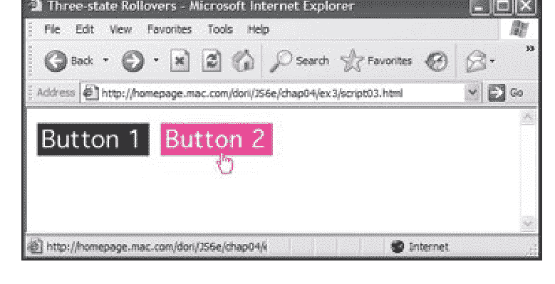

HTML文件 **脚本4.4** 看起来与之前任务中的 [脚本4.2](#) 几乎完全相同。事实上，唯一的区别是文档的标题和正在调用的外部 JavaScript 文件的名称。仅此而已。这是一个例子，说明为什么将所有 JavaScript 放入外部文件如此强大；你可以在不修改 HTML 页面的情况下为页面添加功能。

## 脚本4.4。通过将 JavaScript 放入外部文件，三态悬停效果的 HTML 几乎与双态悬停效果的 HTML 完全相同。


```
[查看完整宽度]

<!DOCTYPE html PUBLIC "-//W3C//DTD XHTML 1.0 Transitional//EN">
<html xmlns="http://www.w3.org/1999/xhtml">
<head>
    <title>Three-state Rollovers</title>
    <script src="script03.js" language="javascript" type="text/javascript"> </script>
</head>
<body bgcolor="#FFFFFF">
    <a href="next1.html"></a>&nbsp;&nbsp;
    <a href="next2.html"></a>
</body>
</html>
```

在**脚本 4.5**中，即外部 JavaScript 文件，与**脚本 4.3**相比只有几处改动。我们不再完整地讲解整个脚本，而是只关注这些变化。请记住，我们正在讲解的脚本部分以红色显示。

## 脚本 4.5。此脚本驱动三态翻转效果。

```
window.onload = rolloverInit;

function rolloverInit() {
    for (var i=0; i<document.images.length; i++) {
      if (document.images[i].parentNode.tagName == "A") {
        setupRollover(document.images[i]);
      }
    }
}

function setupRollover(thisImage) {
    thisImage.outImage = new Image();
    thisImage.outImage.src = thisImage.src;
    thisImage.onmouseout = rollOut;

    thisImage.clickImage = new Image();
    thisImage.clickImage.src = "images/" + thisImage.id + "_click.gif";
    thisImage.onclick = rollClick;

    thisImage.overImage = new Image();
    thisImage.overImage.src = "images/" + thisImage.id + "_on.gif";
    thisImage.onmouseover = rollOver;
}

function rollOver() {
    this.src = this.overImage.src;
}
```

```
function rollOut() {
    this.src = this.outImage.src;
}

function rollClick() {
    this.src = this.clickImage.src;
}
```

## 构建三态翻转效果的步骤：

- 1. `thisImage.clickImage = new Image();`
  `thisImage.clickImage.src = "images/" + thisImage.id + "_click.gif";`

在 `setupRollover()` 函数中，我们需要添加第三个图片属性，用于点击状态。第一行创建一个新的图片对象，用于存放图片的 `clickImage` 版本。第二行设置 `clickImage` 的源文件路径。它通过动态拼接源文件名来构建路径，将 "images/" 与图片的 `id` 连接起来，并添加 "_click.gif"。

- 2. `thisImage.onclick = rollClick;`

这行代码告诉浏览器在用户点击图片时触发 `rollClick()` 函数。

- 3. `function rollClick() {`
  `    this.src = this.clickImage.src;`
  `}`

当用户点击图片时，此函数会将图片源设置为 `clickImage` 版本。


## 从链接触发翻转效果

在前面的示例中，用户通过将鼠标移到图片上来触发翻转效果。但你也可以让用户指向文本链接时触发翻转效果，如[图 4.6](4.6) 和 [4.7](4.7) 所示。HTML 是一个简单的页面，包含一个链接和一张图片，如[脚本 4.6](4.6) 所示。我们将通过修改前面示例中使用的脚本来实现翻转效果，如[脚本 4.7](4.7) 所示。

**图 4.6。文本链接是此翻转效果的触发装置。**

[查看完整尺寸图片]

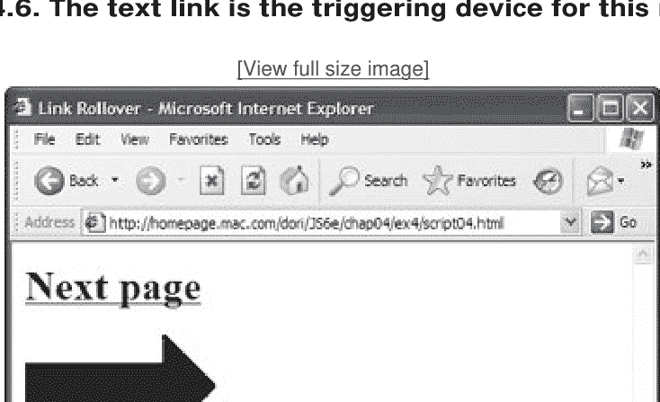

**图 4.7。当用户指向链接时，下方的图形会发生变化。**

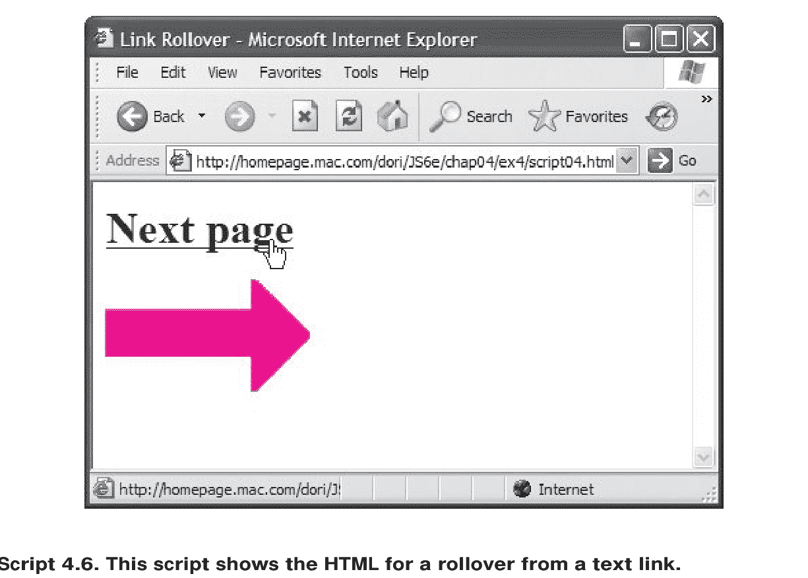

脚本 4.6。此脚本展示了从文本链接触发翻转效果的 HTML 代码。

```
<!DOCTYPE html PUBLIC "-//W3C//DTD XHTML 1.0 Transitional//EN">
<html xmlns="http://www.w3.org/1999/xhtml">
<head>
    <title>Link Rollover</title>
    <script src="script04.js" language="javascript" type="text/javascript"></script>
</head>
<body bgcolor="#FFFFFF">
    <h1><a href="next.html" id="arrow"> Next page</a></h1>
    
</body>
</html>
```

脚本 4.7。这是从文本链接触发翻转效果的 JavaScript 代码。

```
window.onload = rolloverInit;

function rolloverInit() {
    for (var i=0; i<document.links.length; i++) {
        var linkObj = document.links[i];
        if (linkObj.id) {
            var imgObj = document.getElementById(linkObj.id + "Img");
            if (imgObj) {
                setupRollover(linkObj,imgObj);
            }
        }
    }
}

function setupRollover(thisLink,thisImage) {
    thisLink.imgToChange = thisImage;
    thisLink.onmouseout = rollOut;
    thisLink.onmouseover = rollOver;

    thisLink.outImage = new Image();
    thisLink.outImage.src = thisImage.src;

    thisLink.overImage = new Image();
    thisLink.overImage.src = "images/" + thisLink.id + "_on.gif";
}

function rollOver() {
    this.imgToChange.src = this.overImage.src;
}

function rollOut() {
    this.imgToChange.src = this.outImage.src;
}
```

**从链接触发翻转效果的步骤：**

- 1. `function rolloverInit() {`
  `for (var i=0; i<document.links.length; i++) {`

在开始 `rolloverInit()` 函数后，我们启动一个循环，与本章前面的示例类似。但前面我们查找的是图片（`document.images.length`），而这里我们查找的是链接（`document.links.length`）。循环开始时将计数器变量 `i` 设为零。每次循环中，如果 `i` 的值小于文档中链接的数量，则将 `i` 递增 1。

```
var linkObj = document.links[i];
```

我们创建 `linkObj` 变量并将其设置为当前链接。

```
if (linkObj.id) {
  var imgObj = document.getElementById(linkObj.id + "Img");
```

如果 `linkObj` 有 `id`，则检查页面上是否存在另一个 `id` 等于该 `id` 加上 `Img` 的元素。如果存在，将该元素赋值给新变量 `imgObj`。

```
if (imgObj) {
  setupRollover(linkObj,imgObj);
```

如果 `imgObj` 存在，则调用 `setupRollover()` 函数，传入链接对象和图片对象。

```
function setupRollover(thisLink, thisImage) {
  thisLink.imgToChange = thisImage;
  thisLink.onmouseout = rollOut;
  thisLink.onmouseover = rollOver;
```

`setupRollover()` 函数首先接收在步骤 4 中传入的链接和图片参数。然后我们为链接对象添加一个新属性 `imgToChange`。JavaScript 需要知道当鼠标移到链接上时应该更改哪张图片，这个属性就是用来存储这个信息的。接下来两行设置了事件处理器，在触发时调用 `rollOut` 和 `rollOver` 函数。

```
function rollOver() {
  this.imgToChange.src = this.overImage.src;
}
function rollOut() {
  this.imgToChange.src = this.outImage.src;
}
```

当 `rollOver` 和 `rollOut` 被调用时，它们与本章前面的示例略有不同：现在重置的是 `this.imgToChange.src`，而不是 `this.src` 本身。

## 提示

- 当你想为用户提供预览功能——让他们看到点击指向的链接后会看到什么内容时，这种技术非常有用。例如，假设你有一个旅游网站，提供前往苏格兰、塔希提和克利夫兰的旅行介绍。页面左侧可以是一列文本链接，对应每个目的地，右侧则是一个预览区域，用于显示图片。当用户指向某个目的地名称时，该地点的图片就会出现在预览区域中。点击链接即可跳转到一个详细介绍该度假胜地的页面。


## 让多个链接控制同一个翻转效果

到目前为止，你已经了解了将鼠标移到单张图片上（实际上是移到与该图片关联的链接上）如何触发翻转效果。但你也可以让多张不同的图片触发同一个翻转效果。当你有多张图片需要添加注释说明时，这非常有用。将鼠标移到每张图片上，该图片的描述就会出现。在本示例中，我们正是这样做的，使用了三张莱昂纳多·达·芬奇发明的图片。当你将鼠标移到每张图片上时，该图片的描述就会出现在一个文本框中。描述本身是另一张图片。实际上，它是三张图片，分别对应三项发明。[图 4.8](#) 展示了[脚本 4.8](#)（HTML）和[脚本 4.9](#)（JavaScript）的运行效果。与本书中的大多数脚本一样，它基于前面的示例构建，因此我们只解释新概念。[脚本 4.8](#) 和 [脚本 4.9](#) 之间只有几行代码不同。

## 图 4.8。此页面有三张交互式图片——飞行器、坦克和直升机。当你将鼠标移到某张图片上时，其描述会出现在莱昂纳多的头像下方。

[查看完整尺寸图片]

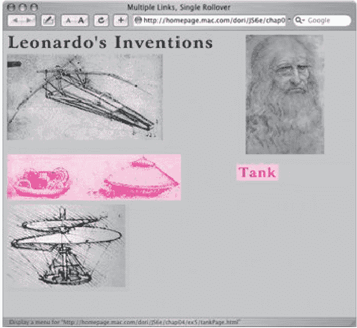

## 脚本 4.8。注意，此页面上的链接和图片都具有唯一的 `id`。
```


 ```

<!DOCTYPE html PUBLIC "-//W3C//DTD XHTML 1.0 Transitional//EN">
<html xmlns="http://www.w3.org/1999/xhtml">
<head>
    <title>Multiple Links, Single Rollover</title>
    <script src="script05.js"
language="javascript" type="text/javascript"> </script>
</head>
<body bgcolor="#EECC99">
    
    
    <a href="flyPage.html" class="textField" id="flyer"></a>
<br clear="right" />
    
    <a href="tankPage.html" class="textField" id="tank"></a><br />
    <a href="heliPage.html" class="textField" id="helicopter"></a>
</body>
</html>
```

**脚本 4.9.** 本脚本展示如何使用多个链接来触发单个翻转效果。

```
window.onload = rolloverInit;

function rolloverInit() {
    for (var i=0; i<document.links.length; i++) {
        var linkObj = document.links[i];
        if (linkObj.className) {
            var imgObj = document.getElementById(linkObj.className);
            if (imgObj) {
                setupRollover(linkObj,imgObj);
            }
        }
    }
}

function setupRollover(thisLink,textImage) {
    thisLink.imgToChange = textImage;
    thisLink.onmouseout = rollOut;
    thisLink.onmouseover = rollOver;

    thisLink.outImage = new Image();
    thisLink.outImage.src = textImage.src;

    thisLink.overImage = new Image();
    thisLink.overImage.src = "images/" + thisLink.id + "Text.gif";
}

function rollOver() {
    this.imgToChange.src = this.overImage.src;
}

function rollOut() {
    this.imgToChange.src = this.outImage.src;
}
```

要让多个链接改变单个翻转效果：

- 1. `if (linkObj.className) { var imgObj = document.getElementById(linkObj.className); }`

我们不能使用翻转图像的 `id` 来计算被改变图像的 `id`，因为 `id` 必须是唯一的，而所有翻转后的图像对于被改变图像的目标来说都需要产生相同的值。相反，我们使用 `class` 属性（因为可以有多个页面元素共享同一个 `class`）。在这一行中，我们正在查找链接对象的 `className`。

- 2. `function setupRollover(thisLink, textImage) { thisLink.imgToChange = textImage; }`

`setupRollover()` 函数接收当前链接对象（`thisLink`）和图像对象，我们称之为 `textImage`。注意，当我们传入这些对象时（也可以称为变量），分别将它们称为 `linkObj` 和 `imgObj`。

脚本的其余部分与本章前面的示例工作方式相同。

## 处理多个翻转效果

如果你想让触发翻转效果的图像本身也成为翻转效果呢？[图 4.9](#) 在上一示例的基础上进行了扩展，展示了我们如何添加这一功能。当你将鼠标悬停在某项发明的图像上时，会显示描述图像，与之前一样，但这一次还会将发明图像替换为带有阴影的另一张图像。这为用户提供了关于他们指向何处的视觉反馈（仿佛鼠标指针还不够！）。[脚本 4.10](#) 是 HTML 页面（除了标题和引用的外部 JavaScript 文件名之外没有变化），[脚本 4.11](#) 展示了相对于上一示例在 JavaScript 中的新增内容。

**图 4.9.** 当你将鼠标悬停在某个图像上时，描述会出现，并且图像本身周围会出现阴影。

```

<!DOCTYPE html PUBLIC "-//W3C//DTD XHTML 1.0 Transitional//EN">
<html xmlns="http://www.w3.org/1999/xhtml">
<head>
    <title>Multiple Links, Multiple Rollovers</title>
    <script src="script06.js" language= "javascript" type="text/javascript"> </script>
</head>
<body bgcolor="#EECC99">
    
    
    <a href="flyPage.html" class="textField" id="flyer"></a><br clear="right" />
    
    <a href="tankPage.html" class="textField" id="tank"></a><br />
    <a href="heliPage.html" class="textField" id="helicopter"></a>
</body>
</html>
```

**脚本 4.10.** 此 HTML 与脚本 4.8 相同，只是标题和引用的外部脚本名称有所变化。

**脚本 4.11.** 此脚本处理多个翻转效果。

```
window.onload = rolloverInit;

function rolloverInit() {
    for (var i=0; i<document.links.length; i++) {
        var linkObj = document.links[i];
        if (linkObj.className) {
            var imgObj = document.getElementById(linkObj.className);
            if (imgObj) {
                setupRollover(linkObj,imgObj);
            }
        }
    }
}

function setupRollover(thisLink,textImage) {
    thisLink.imgToChange = new Array;
    thisLink.outImage = new Array;
    thisLink.overImage = new Array;

    thisLink.imgToChange[0] = textImage;
    thisLink.onmouseout = rollOut;
    thisLink.onmouseover = rollOver;

    thisLink.outImage[0] = new Image();
    thisLink.outImage[0].src = textImage.src;

    thisLink.overImage[0] = new Image();
    thisLink.overImage[0].src = "images/" + thisLink.id + "Text.gif";

    var rolloverObj = document.getElementById(thisLink.id + "Img");
    if (rolloverObj) {
        thisLink.imgToChange[1] = rolloverObj;

        thisLink.outImage[1] = new Image();
        thisLink.outImage[1].src = rolloverObj.src;
        thisLink.overImage[1] = new Image();
        thisLink.overImage[1].src = "images/" + thisLink.id + "_on.gif";
    }
}

function rollOver() {
    for (var i=0;i<this.imgToChange.length; i++) {
        this.imgToChange[i].src = this.overImage[i].src;
    }
}

function rollOut() {
    for (var i=0;i<this.imgToChange.length; i++) {
        this.imgToChange[i].src = this.outImage[i].src;
    }
}
```

## 处理多个翻转效果：

- 1. `thisLink.imgToChange = new Array;`
   `thisLink.outImage = new Array;`
   `thisLink.overImage = new Array;`

添加这些行是因为脚本需要处理更多的图像（每个翻转效果有两个）。在每一行中，我们都在创建 `thisLink` 的一个新属性，每个属性都是一种称为*数组*的新类型对象。数组是一种包含一组相关信息的对象。访问数组内容的一种方式是使用方括号中的数字。例如，`thisLink.imgToChange[0]` 是数组的第一个成员。JavaScript 中大多数对象的编号从 0 开始，而不是 1。请参阅[第 3 章](...)中的"JavaScript 字符串"侧边栏。

- 2. `thisLink.imgToChange[0] = textImage;`

在前一个任务中，`imgToChange` 是一个图像，但在这个任务中，它是一个将包含图像的数组。在这里，`textImage` 被存储在 `imgToChange` 的第一个元素中。

- 3. `thisLink.outImage[0] = new Image();`
   `thisLink.outImage[0].src = textImage.src;`

与之前一样，我们需要存储图像的淡出（关闭）版本，但这一次它存储在 `outImage` 数组的第一个元素中。

- 4. `thisLink.overImage[0] = new Image();`
   `thisLink.overImage[0].src = "images/" + thisLink.id + "Text.gif";`

同样，图像的翻转（开启）版本被计算并存储在 `overImage` 的第一个元素中。

- 5. `var rolloverObj = document.getElementById(thisLink.id + "Img");`
   `if (rolloverObj) {`

现在我们需要弄清楚这个翻转效果是否会触发多个图像，而不仅仅是单个图像。如果是这种情况，HTML 页面上会有一个元素，其 `id` 与当前元素相同，但附加了 `Img`。也就是说，如果我们正在处理 `flyer`，我们将检查页面上是否存在 `flyerImg` 元素。如果存在，它将被保存在 `rolloverObj` 中，我们应该执行接下来的三个步骤。

- 6. `thisLink.imgToChange[1] = rolloverObj;`

与上面我们设置 `imgToChange[0]` 的方式相同，我们现在将 `imgToChange[1]`（数组中的第二个元素）设置为新的 `rolloverObj`。当触发 `onmouseout` 和 `onmouseover` 事件处理程序时，两个图像都会交换到它们的替代版本，稍后我们会看到。

- 7. `thisLink.outImage[1] = new Image();`
   `thisLink.outImage[1].src = rolloverObj.src;`

这将 `outImage` 的第二个数组元素设置为图像的淡出（关闭）版本。

- 8. `thisLink.overImage[1] = new Image();`
   `thisLink.overImage[1].src = "images/" + thisLink.id + "_on.gif";`

而在这里，图像的翻转（开启）版本被计算并存储在 `overImage` 的第二个元素中。

如果由于某种原因，我们希望在同一次翻转效果中还有第三张图像也发生变化，我们将对第三张图像对象重复步骤 6-8。
```


 ```
9.  for (var i=0; i<this.imgToChange.length; i++) {
        this.imgToChange[i].src = this.overImage[i].src;
    }
```

这个 `rollOver()` 函数内部是图片进行交换的地方。由于可以改变一张或多张图片，我们需要先询问我们存储了多少张图片——这就是 `this.imgToChange.length` 的值。在这里，这个值是 2，因为我们想让两张图片发生变化。然后我们循环两次，将 `imgToChange[0]` 和 `imgToChange[1]` 的源分别设置为它们对应的悬停状态值。

```
10. function rollOut() {
        for (var i=0; i<this.imgToChange.length; i++) {
            this.imgToChange[i].src = this.outImage[i].src;
        }
    }
```

`rollOut()` 函数中的这段代码与上一步中的代码几乎相同；唯一的区别是我们现在正在将这些图片重置为它们的默认状态源值。

## 提示

-   重要的是要记住，每一张在悬停时会发生变化的图片都必须有一个唯一的 `id`。
-   如果你想让页面上的某些链接触发多个悬停效果，而其他链接只触发单个悬停效果怎么办？没问题——你甚至不需要修改一行 JavaScript 代码。只要第 5 步中的检查没有在页面上找到备用的 `id`，就不会存储第二个元素，并且 `rollOver()` 和 `rollOut()` 循环只会对初始图片进行动画处理。

## 创建循环横幅

当你上网时，经常会看到广告横幅在图片之间周期性切换。其中一些是动画 GIF 文件，即包含多个按顺序播放的帧的 GIF 文件；另一些是 Flash 动画。如果你想让一个页面循环显示多个 GIF 图片（无论是动画的还是静态的），你可以使用 JavaScript 来完成这项工作，如 **脚本 4.13** 所示。此示例使用三个 GIF 图片并循环重复播放它们，如 **图 4.10、4.11 和 4.12** 所示。简单的 HTML 页面如 **脚本 4.12** 所示。

**脚本 4.12。HTML 加载循环横幅中的第一张图片；JavaScript 处理其余部分。**

```
[View full width]
<!DOCTYPE html PUBLIC "-//W3C//DTD XHTML 1.0 Transitional//EN">
<html xmlns="http://www.w3.org/1999/xhtml">
<head>
    <title>Rotating Banner</title>
    <script src="script07.js" language="javascript" type="text/javascript"> </script>
</head>
<body bgcolor="#FFFFFF">
    <div align="center">
        
    </div>
</body>
</html>
```

**脚本 4.13。你可以使用 JavaScript 在横幅中循环切换图片。**

```
window.onload = rotate;

var adImages = new Array("images/reading1.gif", "images/reading2.gif", "images/reading3.gif");
var thisAd = 0;

function rotate() {
    thisAd++;
    if (thisAd == adImages.length) {
        thisAd = 0;
    }
    document.getElementById("adBanner").src = adImages[thisAd];

    setTimeout("rotate()", 3 * 1000);
}
```

## 图 4.10。第一张图片，它启动了循环横幅...

[查看完整图片]

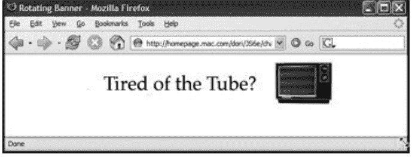

## 图 4.11。...第二张图片...

[查看完整图片]

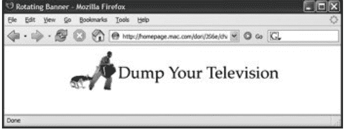

## 图 4.12。...最后一张图片。一旦页面加载完成且横幅开始循环，动画就会持续进行，无需用户干预。

[查看完整图片]

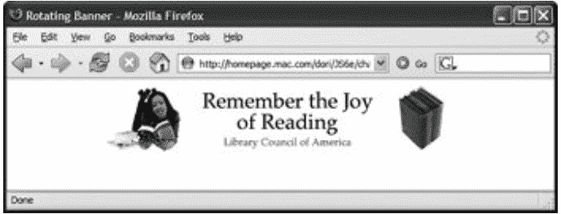

要创建循环横幅：

```
1. var adImages = new Array("images/reading1.gif", "images/reading2.gif", "images/reading3.gif");
var thisAd = 0;
```

这段代码通过创建两个变量为脚本奠定了基础。第一行创建了一个名为 `adImages` 的新变量，并将其设置为一个数组。在这个例子中，该数组包含构成循环横幅的三个 GIF 文件的名称。另一个变量 `thisAd` 在此代码中被赋予了初始值。

```
2. function rotate() {
```

这行代码设置了一个名为 `rotate()` 的新函数。

```
3. thisAd++;
```

获取 `thisAd` 的值，并将其加一。

```
4. if (thisAd == adImages.length) {
    thisAd = 0;
```

这段代码设置了一个计数器，它表示如果 `thisAd` 的值等于 `adImages` 数组中的项目数量，那么将 `thisAd` 的值重置为零。

```
5. document.getElementById("adBanner").src = adImages[thisAd];
```

网页上正在循环播放的图片具有 `id` 属性 `adBanner`；你在 `img` 标签中定义了这个名称，如 [脚本 4.12] 所示。这行代码表示图片 `adBanner` 的源位于数组 `adImages` 中，而变量 `thisAd` 的值定义了浏览器此时应使用三个 GIF 图片中的哪一个。

```
6. setTimeout("rotate()", 3 * 1000);
```

这行代码告诉脚本多久更换一次横幅中的 GIF 图片。内置的 JavaScript 命令 `setTimeout` 让你指定一个操作应按特定时间表执行，时间总是以毫秒为单位。在这个例子中，`rotate()` 函数每 3,000 毫秒（即每 3 秒）被调用一次，因此 GIF 图片将在横幅中每三秒循环一次。

## 提示

-   你可能会想知道为什么想用 JavaScript 来创建循环横幅，而不是直接创建一个动画 GIF。一个很好的理由是它允许你在横幅中使用 JPEG 或 PNG 格式，这可以提供更高质量的图片。使用这些更高质量的图片，你可以在横幅中使用照片。
-   与本章前面的一些示例不同，此任务中的图片没有预先缓存。它们在第一次显示时从服务器下载。这是因为你的广告数组中可能有任意数量的图片，强迫用户下载，例如，100 张图片而他们可能只会看到其中的 2 或 3 张，这是不礼貌的。

## 为循环横幅添加链接

横幅常用于广告，你会想知道如何将横幅变成一个链接，当访客点击横幅时，可以将他们带到某个地方。[脚本 4.14](#) 显示了 HTML 页面，它与上一个示例的唯一区别是它在 `` 标签周围添加了一个链接。[脚本 4.15](#) 显示了之前脚本的一个变体。在这个脚本中，我们将添加一个新的数组。这个新数组包含用户点击横幅时会被发送到的目的地。在这个例子中，“在乔家吃饭”的横幅会将你带到 negrino.com，“喝更多 Java”会带到 sun.com，“胃灼热”会带到 microsoft.com，如 [图 4.13](#) 所示。当然，不带有任何编辑评论。

## 脚本 4.14。广告横幅所需的 HTML。

```
[View full width]

<!DOCTYPE html PUBLIC "-//W3C//DTD XHTML 1.0 Transitional//EN">
<html xmlns="http://www.w3.org/1999/xhtml">
<head>
    <title>Rotating Banner with Links</title>
    <script src="script08.js" language="javascript" type="text/javascript"> </script>
</head>
<body bgcolor="#FFFFFF">
    <div align="center">
        <a href="linkPage.html"></a>
    </div>
</body>
</html>
```

## 脚本 4.15。此脚本展示了如何将循环横幅转变为真正的、可点击的广告横幅。

```
window.onload = initBannerLink;

var adImages = new Array("images/banner1.gif", "images/banner2.gif", "images/banner3.gif");
var adURL = new Array("negrino.com", "sun.com", "microsoft.com");
var thisAd = 0;

function rotate() {
    thisAd++;
    if (thisAd == adImages.length) {
        thisAd = 0;
    }
    document.getElementById("adBanner").src = adImages[thisAd];

    setTimeout("rotate()", 3 * 1000);
}

function newLocation() {
    document.location.href = "http://www." + adURL[thisAd];
    return false;
}

function initBannerLink() {
    if (document.getElementById("adBanner").parentNode.tagName == "A") {
        document.getElementById("adBanner").parentNode.onclick = newLocation;
    }

    rotate();
}
```

**图 4.13。这三张图片中的每一张都是一个链接，点击每张图片会将你带到三个不同的网站之一。**

[查看完整图片]


**为轮播横幅添加链接：**

- 1. `window.onload = initBannerLink;`

当窗口加载完成后，触发 `initBannerLink()` 函数。

> ✓ **提示**

- `adURL` 数组需要与 `adImages` 数组拥有相同数量的数组元素，脚本才能正常工作。

```
var adURL = new Array("negrino.com", "sun.com","microsoft.com");
```

`adURL` 变量被赋予一个包含三个元素的新数组。这里只需填入域名，因为我们接下来会补全 URL。

```
function newLocation() {
  document.location.href = "http://www." + adURL[thisAd];
  return false;
}
```

新函数 `newLocation` 将 `document.location.href` 对象（即当前文档窗口）设置为文本字符串 `http://www.`（注意末尾的句点）加上 `adURL` 的值。由于 `adURL` 是一个数组，你需要指定数组的成员。这存储在 `thisAd` 中，生成的字符串可以是三个链接中的任意一个，具体取决于用户的点击时机。最后，它返回 false，告诉浏览器*不应*同时加载 `href` 中的地址。否则，浏览器会同时执行两个操作。我们已经通过 JavaScript 处理了一切，因此 `HRef` 不需要被加载。

```
if (document.getElementById ("adBanner").parentNode.tagName == "A") {
    document.getElementById ("adBanner").parentNode.onclick = newLocation;
}

rotate();
```

这段代码位于 `initBannerLink()` 函数内部，首先检查 `adBanner` 对象是否被链接标签包围。如果是，当链接被点击时，将调用 `newLocation()` 函数。最后，调用 `rotate()` 函数。

## 构建循环轮播幻灯片

网站上的幻灯片向用户展示一张图片，并让用户控制图片的切换（前进或后退）。JavaScript 提供了所需的交互控制功能。[脚本 4.16](#) 展示了所需的 HTML，[脚本 4.17](#) 中的 JavaScript 则提供了向页面添加幻灯片所需的内容。

### 脚本 4.16. 此 HTML 页面创建一个幻灯片。

```
[View full width]

<!DOCTYPE html PUBLIC "-//W3C//DTD XHTML 1.0 Transitional//EN">
<html xmlns="http://www.w3.org/1999/xhtml">
<head>
    <title>Image Slideshow</title>
    <script type="text/javascript" language="Javascript" src="script09.js"> </script>
</head>
<body bgcolor="#FFFFFF">
    <div align="center">
        <h1>US Missions to Mars</h1>
        
        <h2><a href="previous.html" id="prevLink">&lt;&lt; Previous</a>&nbsp;&nbsp;<a
            href="next.html" id="nextLink"> Next &gt;&gt;</a></h2>
    </div>
</body>
</html>
```

### 脚本 4.17. 此脚本构建一个用户可以通过链接控制前进和后退来点击浏览的幻灯片。

```
window.onload = initLinks;

var myPix = new Array("images/pathfinder.gif", "images/surveyor.gif","images/surveyor98.gif");
var thisPic = 0;

function initLinks() {
    document.getElementById("prevLink"). onclick = processPrevious;
    document.getElementById("nextLink"). onclick = processNext;
}
function processPrevious() {
    if (thisPic == 0) {
        thisPic = myPix.length;
    }
    thisPic--;
    document.getElementById("myPicture").src = myPix[thisPic];
    return false;
}
```

```
function processNext() {
    thisPic++;
    if (thisPic == myPix.length) {
        thisPic = 0;
    }
    document.getElementById("myPicture").src = myPix[thisPic];
    return false;
}
```

此脚本构建了一个循环轮播的幻灯片——也就是说，如果你越过列表的末尾，就会回到开头，反之亦然。**图 4.14** 展示了新的幻灯片效果。

**图 4.14. 点击"上一张"或"下一张"链接将分别调用 `processPrevious()` 或 `processNext()` 函数。**

## 显示随机图片

如果你的网站图片丰富，或者你正在展示数字艺术作品，那么你可能希望用户进入网站时展示你收藏中的随机图片。再次，JavaScript 来救场了！极其简单的**脚本 4.18** 展示了所需的 HTML，**脚本 4.19** 提供了 JavaScript 代码。**图 4.15** 展示了脚本的效果，这里是一只毛绒狮子、老虎和熊（哦，天哪！）的图片。

### 脚本 4.18. 此简单的 HTML 创建用于随机图片的页面。

```
<!DOCTYPE html PUBLIC "-//W3C//DTD XHTML 1.0 Transitional//EN">
<html xmlns="http://www.w3.org/1999/xhtml">
<head>
    <title>Random Image</title>
    <script language="Javascript" type="text/javascript" src="script10.js"></script>
</head>
<body bgcolor="#FFFFFF">
    
</body>
</html>
```

### 脚本 4.19. 你可以使用此脚本在页面上显示随机图片，它利用 JavaScript 的 Math.random 方法生成随机数。

```
window.onload = choosePic;

var myPix = new Array("images/lion.jpg", "images/tiger.jpg","images/bear.jpg");
function choosePic() {
    randomNum = Math.floor((Math.random() * myPix.length));
    document.getElementById("myPicture").src = myPix[randomNum];
}
```

**图 4.15.** 根据脚本生成的随机数的值，用户将看到狮子、老虎或熊。

[查看完整图片]

### 显示随机图片：

```
var myPix = new Array ("images/lion.jpg", "images/tiger.jpg", "images/bear.jpg");
```

现在你已经熟悉了，构建一个包含三张图片的数组，并将其赋值给变量 `myPix`。

## 构建循环轮播幻灯片：

- 1. `window.onload = initLinks;`

```
window.onload = initLinks;
```

当窗口加载完成后，触发 `initLinks()` 函数。

- 2. `function initLinks() {`
    `document.getElementById("prevLink").onclick = processPrevious;`
    `document.getElementById("nextLink").onclick = processNext;`
`}`

```
function initLinks() {
    document.getElementById("prevLink").onclick = processPrevious;
    document.getElementById("nextLink").onclick = processNext;
}
```

此函数为"上一张"和"下一张"链接设置 `onclick` 事件处理程序。

- 3. `function processPrevious() {`
    `if (thisPic == 0) {`
        `thisPic = myPix.length;`
    `}`

```
function processPrevious() {
    if (thisPic == 0) {
        thisPic = myPix.length;
    }
```

此函数使幻灯片按"上一张"方向运行。这部分首先检查 `thisPic` 是否等于 0。如果是，函数将获取 `myPix` 数组中的图片数量。

- 4. `thisPic--;`
`document.getElementById("myPicture").src = myPix[thisPic];`

```
thisPic--;
document.getElementById("myPicture").src = myPix[thisPic];
```

第一行将 `thisPic` 的值减 1。下一行将 `myPicture` 的 `src` 设置为 `myPix` 数组中由 `thisPic` 当前值所代表的元素。

- 5. `thisPic++;`
`if (thisPic == myPix.length) {`
    `thisPic = 0;`
`}`
`document.getElementById("myPicture").src = myPix[thisPic];`

```
thisPic++;
if (thisPic == myPix.length) {
    thisPic = 0;
}
document.getElementById("myPicture").src = myPix[thisPic];
```

这段代码位于 `processNext()` 函数内部，使幻灯片按"下一张"方向运行，与 `processPrevious()` 函数非常相似。它首先将 `thisPic` 的值加 1。然后检查 `thisPic` 的值是否与 `myPix` 数组中的元素数量相同。如果是，则将 `thisPic` 重置为 0。下一行设置 `myPicture` 的 `src`。


## 循环展示图片并随机起始

如果你有一系列图片想要展示，你可能不希望每次页面加载时都从同一张图片开始显示。[脚本 4.20](https://example.com) 提供了 HTML 代码，而 [脚本 4.21](https://example.com) 则结合了之前用于循环广告横幅的代码和随机图片代码。

**脚本 4.20. HTML 文件中有一个间隔 GIF 图片，它在广告横幅出现前充当占位符。**

```html
<!DOCTYPE html PUBLIC "-//W3C//DTD XHTML 1.0 Transitional//EN">
<html xmlns="http://www.w3.org/1999/xhtml">
<head>
    <title>Rotating Random Banner</title>
    <script src="script11.js"  language="javascript"  type="text/javascript"></script>
</head>
<body bgcolor="#FFFFFF">
    <div align="center">
        
    </div>
</body>
</html>
```

**脚本 4.21. 此脚本允许你从随机图片开始循环展示图片。**

```javascript
window.onload = choosePic;

var adImages = new Array("images/reading1.gif","images/reading2.gif","images/reading3.gif");

function rotate() {
    thisAd++;
    if (thisAd == adImages.length) {
        thisAd = 0;
    }
    document.getElementById("adBanner").src = adImages[thisAd];

    setTimeout("rotate()", 3 * 1000);

}

function choosePic() {
    thisAd = Math.floor((Math.random() * adImages.length));
    document.getElementById("adBanner").src = adImages[thisAd];
    rotate();
}
```

### 要从随机起点开始循环展示图片：

- 1. [查看完整宽度]
    `var adImages = new Array ("images/reading1.gif", "images/reading2.gif", "images/reading3.gif");`

    与之前的示例一样，设置数组和包含数组元素数量的变量。

- 2. `function rotate() {`

    此函数与脚本 4.13 中的 `rotate()` 函数相同。有关其工作原理的详细信息，请参阅该处的解释。

- 3. `function choosePic() {`

    此函数与脚本 4.19 中的 `choosePic()` 函数相同。有关其工作原理的详细信息，请参阅该处的解释。

# 第五章 框架，框架，还是框架

框架是 HTML 的一个有用特性，尽管在过去几年中其受欢迎程度有所下降。在本章中，我们将演示如何利用 JavaScript 的力量使框架变得更加有用。

一个框架至少包含三个 HTML 页面。第一个页面称为*框架集*，它设置每个子框架的尺寸。在 JavaScript 中，框架集被称为 *top* 或 *parent*。其余页面填充到框架集创建的窗格中，是*子*页面。这些子页面可以被命名为任何你选择的名字。[图 5.1](#) 显示了一个创建两个子框架 "left" 和 "content" 的框架集。

**图 5.1. 包含两个框架 "left" 和 "content" 的框架集布局。**

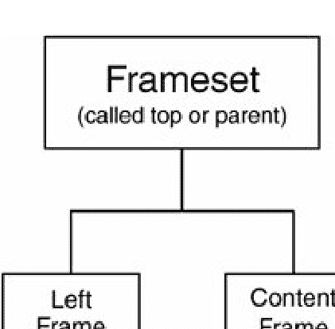

**表 5.1. 框架相关的 HTML 基础**

| 标签 | 属性 | 含义 |
| --- | --- | --- |
| frameset | | 指定页面由两个或更多个框架页面组成；包含指定特定页面的框架标签。 |
| | cols | 每个框架的列尺寸（比例或固定），以像素为单位。 |
| frame | | 每个框架页面的位置和属性。 |
| | id | JavaScript 用来引用框架集中的某个页面。 |
| | name | JavaScript 用来引用框架集中某个页面的另一种方法。 |
| | src | 加载到框架中的页面的物理位置（即 URL）。 |
| iframe | | 内部框架，显示在调用的 HTML 页面内部。 |
| | id | JavaScript 使用此属性来引用 iframe。 |
| | name | JavaScript 也可以使用此属性来引用 iframe。 |
| | src | iframe 页面的 URL。 |
| | width | iframe 的宽度（以像素或百分比为单位）。 |
| | height | iframe 的高度（以像素或百分比为单位）。 |
| | align | 将 iframe 向右或向左对齐。 |
| | frameborder | 显示 iframe 周围的边框。 |


## 防止页面被放入框架

其他人可以将你的页面放入他们网站的框架中，使其看起来像是他们内容的一部分。在 JavaScript 中，窗口以层次结构出现，父窗口位于顶端。当有人劫持你的页面时，他们是在强制其成为他们父窗口的子框架。[图 5.2](https://example.com) 显示了页面作为其他人网站一部分时的外观。使用这些脚本，你可以防止这种页面劫持，并强制你的页面始终在独立的浏览器窗口中显示。有两个脚本；[脚本 5.1](https://example.com) 是应该始终独立的 HTML 页面，它包含调用 JavaScript 的 `<script>` 标签；[脚本 5.2](https://example.com) 是 JavaScript 文档，我们将在下文描述。

**图 5.2. 我们的页面，被埋没在别人的框架集中。**

[查看完整尺寸图片]

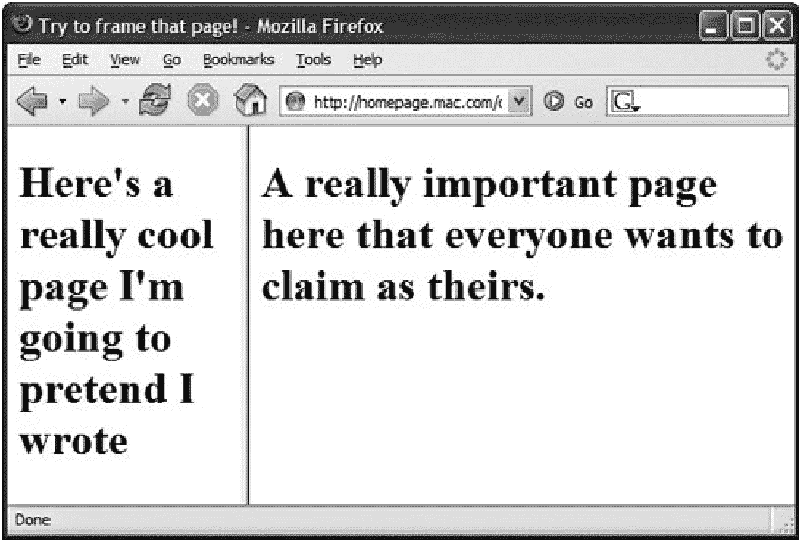

**脚本 5.1. 这是一个人们想要劫持的 HTML 页面。**

```html
<!DOCTYPE html PUBLIC "-//W3C//DTD XHTML 1.0 Transitional//EN">
<html xmlns="http://www.w3.org/1999/xhtml">
<head>
    <title>Can't be in a frame</title>
    <script language="javascript" type="text/javascript" src="script01.js"></script>
</head>
<body bgcolor="#FFFFFF">
    <h1>A really important page here that everyone wants to claim as theirs.</h1>
</body>
</html>
```

### 脚本 5.2. JavaScript 提供了一种强制我们的页面始终显示在单独页面上的方法。

```javascript
if (top.location != self.location) {
    top.location.replace(self.location);
}
```

### 要隔离一个页面：

- 1. `if (top.location != self.location) {`

    首先，检查当前页面（`self`）的位置是否是浏览器窗口层次结构中的最顶层。如果是，则无需执行任何操作。

- 2. `top.location.replace(self.location);`

    如果当前页面不在顶层，则将顶层页面替换为当前页面的位置。这会强制当前窗口显示我们的页面，并且只显示我们的页面。[图 5.3](#) 显示了我们设计的页面。

### 图 5.3. 我们的页面，从邪恶的劫持框架集中逃脱后。

[查看完整尺寸图片]

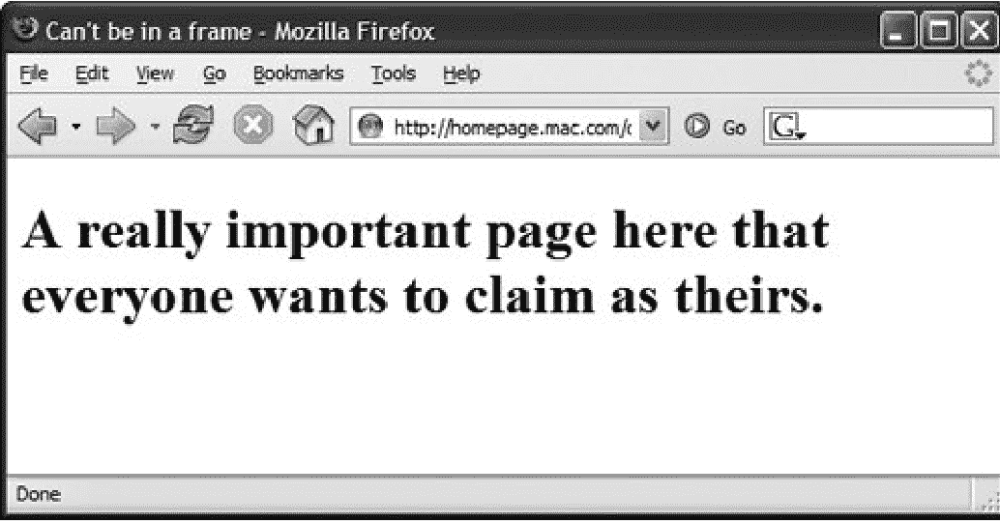

> **提示**

- 我们本可以直接将 `top.location` 设置为 `self.location`，但这有一个讨厌的副作用：用户将无法再使用浏览器的“后退”按钮。如果他们尝试使用，返回上一页会自动跳回当前页面。使用上面所示的 `replace()` 方法会在历史记录中替换当前页面，这允许“后退”按钮显示前一页。

## 强制页面进入框架

当搜索引擎编目你的某个页面时，它并不知道该页面是框架的一部分。当用户通过搜索引擎找到你的页面时，点击链接只会显示单个页面，而不是你设计的完整框架集。[脚本 5.3] 显示了框架集。用户访问的页面（未显示）包含一个对 JavaScript 的调用（与 [脚本 5.1] 中的类似）。[脚本 5.4] 向你展示如何强制显示完整的框架集，即使 Google 或其他搜索引擎不知道该框架集。[图 5.4] 显示了页面看起来格格不入，而 [图 5.5] 则显示它在自己的框架中舒适安逸。

### 脚本 5.3. 框架集页面。

```html
<!DOCTYPE html PUBLIC "-//W3C//DTD XHTML 1.0 Frameset//EN">
<html xmlns="http://www.w3.org/1999/xhtml">
<head>
    <title>This is the page to show</title>
</head>
<frameset cols="30%,70%">
    <frame src="left2.html" name="left" id="left" />
    <frame src="frame2.html" name="content" id="content" />
</frameset>
</html>
```

### 脚本 5.4. 使用 JavaScript 强制将你的页面放入框架集。

```javascript
if (top.location == self.location) {
    self.location.replace("frameset2.html");
}
```


图 5.5。我们的页面，很高兴地与它的父页面和兄弟页面团聚。

[查看全尺寸图片]

强制页面进入框架：

```
if (top.location == self.location) {
```

检查当前页面（`self`）是否位于最顶层。如果不是，说明我们在框架集中。

```
self.location.replace ("frameset2.html");
```

如果当前页面的位置处于顶层，那么用框架集的 URL 替换当前页面。这样它就会按照我们设计的样子显示框架站点。

## 提示

- 如果只有少数页面可能会从框架外部被调用，那么这种方法效果很好，因为每个你可能想加载（在本例中）到内容框架的页面都需要一个单独的框架集页面。下一个示例展示了一种处理大型站点的方法。

## 强制站点进入框架

如果你有一个大型站点，其中有大量页面想放在框架内，那么上一页描述的方法很容易变得难以操作。这里有一种更适合大型站点的方法。[Script 5.5](#) 展示了框架集，它也调用 JavaScript，如 [Script 5.6](#) 所示（详见下文）。[Figure 5.6](#) 展示了我们单独的页面，[Figure 5.7](#) 展示了我们希望站点看起来的样子。未展示的是构成 [Figure 5.7](#) 中左侧导航栏的简单 HTML 页面，以及构成内容框架的同样简单的 HTML 页面。后者调用 JavaScript（以防它们被直接加载），方式与 [Script 5.5](#) 相同。

### Script 5.5。框架集页面调用外部 JavaScript 文件。

```
<!DOCTYPE html PUBLIC "-//W3C//DTD XHTML 1.0 Frameset//EN">
<html xmlns="http://www.w3.org/1999/xhtml">
<head>
	<title>Site Frameset</title>
	<script language="javascript" type="text/javascript" src="script03.js"></script>
</head>
<frameset cols="30%,70%">
	<frame src="left3.html" name="left" id="left" />
	<frame src="frame3a.html" name="content" id="content" />
</frameset>
</html>
```

### Script 5.6。此 JavaScript 将我们想要的站点强制放入我们想要的框架中。

```
var framesetPage = "frameset3.html";
var currPage = justTheFilename (self.location.pathname);
if (top.location == self.location && framesetPage != currPage) {
	self.location.replace(framesetPage + "?" + currPage);
}
window.onload = chgFrame;
function chgFrame() {
	if (top.location == self.location && document.location.search) {
		var linkURL = justTheFilename (document.location.search);
		var contentWin = document.getElementById ("content").contentWindow;
		var currURL = justTheFilename (contentWin.location.pathname);

		if (currURL != linkURL) {
			contentWin.location.replace (linkURL);
		}
	}
}
```

```
function justTheFilename(thisFile) {
    if (thisFile.indexOf("/") > -1) {
        thisFile = thisFile.substring (thisFile.lastIndexOf("/")+1);
    }

    if (thisFile.indexOf("?") == 0) {
        thisFile = thisFile.substring(1);
    }

    return thisFile;
}
```

## 图 5.6。这是我们在框架外的页面。

## 图 5.7。但这是我们真正希望它看起来的样子。

## 强制站点进入框架：

1. `var framesetPage = "frameset3.html";`
   `var currPage = justTheFilename`
   	`(self.location.pathname);`

我们首先创建并设置两个变量：`framesetPage` 和 `currPage`。前者是我们始终想要整体加载的框架集页面，因此被硬编码为 `frameset3.html`。后者是调用此外部 JavaScript 文件的 HTML 页面的名称。它需要被计算出来，因为 JavaScript 没有内置函数来完成这个工作（尽管它应该有！）。我们将使用 `justTheFilename()` 函数来完成，如步骤 10 所述。

在这一步中，该函数被传入 `self.location.pathname`（一个变量，保存了 URL 中域名之后的部分）。例如，如果你正在查看 http://www.peachpit.com/index.html，`self.location.pathname` 是 `/index.html`。如果你在 http://www.peachpit.com/books/index.html，`self.location.pathname` 是 `/books/index.html`。无论哪种情况，我们想要的都只是 `index.html`，所以 `justTheFilename()` 将计算并返回这个值，而这个值将被存储在 `currPage` 中。

2. `if (top.location == self.location && framesetPage != currPage) {`
    `self.location.replace (framesetPage + "?" + currPage);`
`}`

现在我们执行之前做过的常规检查，看看 `top.location` 是否与 `self.location` 相同，但增加了一个条件：检查我们是否当前就在框架集页面上。如果是，那很好；我们不需要重新加载任何东西。但如果 `currPage` 不是框架集，就说明出了问题——所以我们需要重新加载这个页面，转到框架集页面，并顺便将 `currPage` 传递过去，让它最终进入内容框架集。

3. `window.onload = chgFrame;`

这里使用 `onload` 处理程序，因为我们希望每个使用此外部 JavaScript 文件的页面都调用 `chgFrame()` 函数。

4. `function chgFrame() {`

此函数检查（a）它是否是框架集页面，以及（b）URL 中是否有一个问号后跟文件名。如果是这种情况，该文件需要被加载到内容框架中。

5. `if (top.location == self.location && document.location.search) {`

再一次，我们执行常规检查，看看 `top.location` 是否与 `self.location` 相同——在这种情况下，如果两者相等，我们就知道我们在框架集中。之后，我们查看 `document.location.search`，另一个内置字段，它包含 URL 中从问号开始（如果存在的话）到末尾的所有内容。如果没有问号，`document.location.search` 没有值，我们就会退出此函数。

6. `var linkURL = justTheFilename (document.location.search);`

这是我们在加载新内容框架之前需要设置的三个变量中的第一个。第一个 `linkURL` 是要在内容框架中加载的文件。`linkURL` 字段通过调用 `justTheFilename()` 并传入 `document.location.search` 来设置。

7. `var contentWin = document.getElementById("content").contentWindow;`

`contentWin` 变量需要包含 JavaScript 所知道的内容框架的信息。通过查找 id `content` 来设置它，获取其结果（将是一个框架），然后获取该框架的 `contentWindow`——即加载到该框架中的页面。

8. `var currURL = justTheFilename (contentWin.location.pathname);`

`currURL` 变量在这里被设置为当前内容框架页面，即当前加载在内容框架中的 HTML 页面。这是通过调用 `justTheFilename()` 来完成的，这次传入的是 `contentWin.location.pathname`，并存储结果。

9. `if (currURL != linkURL) {`
    `contentWin.location.replace (linkURL);`
`}`

至此，我们可以重新加载内容页面了，因为我们已经拥有了所需的一切——但我们可以通过增加一个步骤让事情变得更智能。如果我们要加载的内容已经在那里了，为什么还要重新加载内容页面呢？在这里我们检查 `currURL` 是否等于 `linkURL`。如果是，说明我们已经在正确的页面上了，所以什么都不做。如果不是，调用那个老伙计 `replace()`，我们就完成了。

10. `function justTheFilename(thisFile) {`
    `if (thisFile.indexOf("/") > -1) {`
        `thisFile = thisFile.substring (thisFile.lastIndexOf ("/")+1);`
    `}`

    `if (thisFile.indexOf("?") == 0) {`
        `thisFile = thisFile.substring(1);`
    `}`

    `return thisFile;`
`}`

现在只剩下 `justTheFilename()` 函数了。此函数接收一个字符串，尝试清理它并将其转换为文件名。首先，我们检查它是否包含 /。如果是，那么我们在文件名中查找*最后一个* /（注意那个 `lastIndexOf`），将文件名重置为它之后的所有内容。然后，我们查找问号。如果它是文件名中的第一个字符（即在位置零），那么我们将文件名重置为从位置一到末尾的所有内容。文件名被返回到它被调用的地方。


## 设置目标

如果您的网站使用框架，通常会有一个框架导航栏，它将不同的页面加载到主框架中。主框架是导航栏中链接的目标，要使用HTML加载该主框架，您需要使用`<a>`标签的`target`属性。但是，如果您想同时使用框架和XHTML Strict，那么JavaScript是设置目标的唯一方式。这是因为`target`属性在XHTML Strict中是不允许的，而您又必须设置目标才能使用框架。

**脚本5.7**中的XHTML Strict框架集允许您通过点击左侧框架（**脚本5.8**，下文详述）中的链接，将您选择的页面加载到主内容框架中。结果如[图5.8](#)所示。

**脚本5.7. 当您在框架集中使用HTML Strict时，需要JavaScript来设置框架目标。**

```html
<!DOCTYPE html PUBLIC "-//W3C//DTD XHTML 1.0 Strict//EN">
<html xmlns="http://www.w3.org/1999/xhtml">
<head>
    <title>Nav Bar</title>
    <script type="text/javascript" src="script04.js"></script>
</head>
<body>
    <h1>Navigation Bar</h1>
    <h2>
    <a href="frame4a.html">Page 1</a><br />
    <a href="frame4b.html">Page 2</a><br />
    <a href="frame4c.html">Page 3</a>
    </h2>
</body>
</html>
```

**脚本5.8. 这是您完成此任务所需的JavaScript。**

```javascript
window.onload = initLinks;

function initLinks() {
    for (var i=0; i<document.links.length; i++) {
        document.links[i].target = "content";
    }
}
```

## 图5.8. 这是一个充当导航栏的框架，内容页面出现在内容框架中。

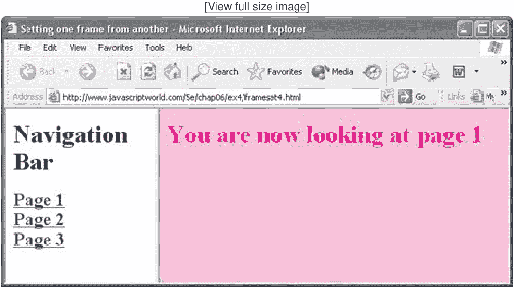

要设置框架的目标：

1. `window.onload = initLinks;`

页面加载时，调用`initLinks()`函数。

2. `function initLinks() { for (var i=0; i<document.links.length; i++) { document.links[i].target = "content"; } }`

此函数遍历页面上的所有链接。当循环找到一个链接时，它将`target`属性设置为字符串"content"。这就是全部所需的设置。

### ✔ 提示

- 如果JavaScript被禁用，访问者会发现点击的第一个链接会加载到导航框架中，而不是内容框架。很抱歉，但这就是框架和XHTML Strict的工作方式。

## 创建和加载动态框架

因为JavaScript可以动态创建页面内容，所以它对于根据用户在另一个框架中的选择，将动态数据加载到框架中非常有用。[脚本5.9](#)是一个框架集，它加载一个虚拟内容页面（[脚本5.10](#) *和* [脚本5.11](#)，下文详述），该页面可以创建一个页面并将其加载到主内容框架中。它创建了一个看起来像[图5.9](#)的页面。

**脚本5.9. 这个框架集加载一个虚拟页面，准备被JavaScript替换。**

```html
<!DOCTYPE html PUBLIC "-//W3C//DTD XHTML 1.0 Frameset//EN">
<html xmlns="http://www.w3.org/1999/xhtml">
<head>
    <title>Setting one frame from another</title>
</head>
<frameset cols="30%,70%">
    <frame src="left5.html" name="left" id="left" />
    <frame src="frame5.html" name="content" id="content" />
</frameset>
</html>
```

**脚本5.10. 说到这里，这就是那个虚拟页面。**

```html
<!DOCTYPE html PUBLIC "-//W3C//DTD XHTML 1.0 Transitional//EN">
<html xmlns="http://www.w3.org/1999/xhtml">
<head>
    <title>Content frame</title>
</head>
<body bgcolor="#FFFFFF">
</body>
</html>
```

**脚本5.11. 这个脚本创建一个页面并将其加载到主内容框架中。**

```javascript
window.onload = initLinks;

function initLinks() {
    for (var i=0; i<document.links.length; i++) {
        document.links[i].onclick = writeContent;
        document.links[i].thisPage = i+1;
    }
}

function writeContent() {
    var newText = "<h1>You are now looking at page " + this.thisPage + ".<\/h1>";

    var contentWin = parent.document.getElementById("content").contentWindow;
    contentWin.document.body.innerHTML = newText;
    return false;
}
```

图5.9. 这是[脚本5.8](javascript:void(0))的结果，一个由JavaScript编写的网页。右侧框架的内容是在脚本控制下生成的。

[查看全尺寸图片]

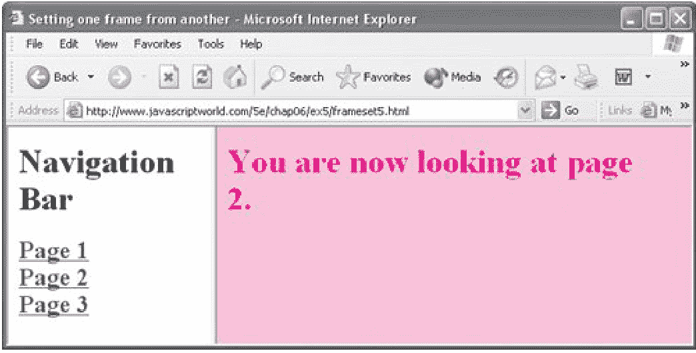

要从一个框架加载动态框架：

```javascript
function initLinks() {
    for (var i=0; i<document.links.length; i++) {
        document.links[i].onclick = writeContent;
        document.links[i].thisPage = i+1;
    }
}
```

`initLinks()`函数的开始方式与[脚本5.8](Script 5.8)相同，遍历页面上的链接。然后，对于每个链接，设置两件事：该链接的`onclick`处理程序，以及添加一个新属性：`thisPage`。后者包含点击该链接时要显示的页面编号，即链接0是"页面1"，链接1是"页面2"，以此类推。循环中的`onclick`处理程序将每个链接设置为在被点击时调用`writeContent()`函数。

```javascript
var newText = "<h1>You are now looking at page " + this.thisPage + ".<\/h1>";

var contentWin = parent.document.getElementById("content").contentWindow;
contentWin.document.body.innerHTML = newText;
```

这是`writeContent()`函数的核心部分，它首先声明并设置一个变量`newText`，并为其赋值一些文本。接下来，设置`contentWin`变量，如本章前面的[脚本5.6](Script 5.6)所示，然后我们将`contentWin.document.body.innerHTML`重置为`newText`。进一步解释一下，给定`contentWin`，我们想要它包含的`document`；然后我们获取该`document`的`body`，然后重置`innerHTML`，即该标签*内部*包含的HTML。

```javascript
return false;
```

最后，`writeContent()`返回`false`，告诉浏览器它*不应该*也加载导航栏框架中的`href`。否则，浏览器会两者都执行。我们已经在JavaScript中处理了一切，所以`href`不需要被加载。

### ✔ 提示

- 为什么在步骤2中，斜杠（"/"）前面有一个反斜杠（"\"）？根据HTML标准，浏览器可能将结束标签的开头（"</"）解释为行的结束。反斜杠"转义"了斜杠，使我们能够编写HTML而不会引起错误。
- 我们这里使用`parent.document.getElement...`，而在[脚本5.6](Script 5.6)中我们使用了`document.getElement...`。这是因为那个JavaScript将被*框架集*页面调用，而这里，它被*框架*页面之一调用。在后一种情况下，JavaScript必须回到其父级（即框架集）才能查看内容页面（父级的另一个子级）。

## 在框架之间共享函数

一种常见的框架布局使用一个永久导航框架和一个可能显示多种不同页面的内容框架。同样，将对外部JavaScript文件的调用放入始终存在的页面（框架集页面）中是有意义的，而不是为每个可能的内容页面重复它。在[图5.10](#Figure_5.10)中，我们使用此功能让多个页面共享一个相同的函数，该函数返回一个随机横幅图像。[脚本5.12](#Script_5.12)将页面加载到框架集中。

**图5.10.** 右侧或内容框架中的信息是由从框架集调用的代码创建的。

[查看全尺寸图片]

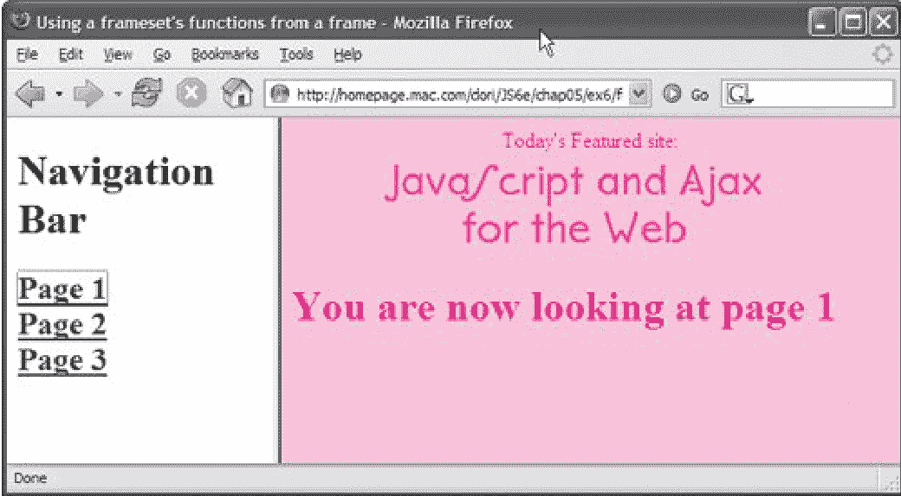

**脚本5.12.** 此脚本允许您在多个框架之间共享函数。

```javascript
var bannerArray = new Array("images/redBanner.gif", "images/greenBanner.gif", "images/blueBanner.gif");
window.onload = initFrames;

function initFrames() {
    var leftWin = document.getElementById("left").contentWindow.document;

    for (var i=0; i<leftWin.links.length; i++) {
        leftWin.links[i].target = "content";
        leftWin.links[i].onclick = resetBanner;
    }

    setBanner();
}

function setBanner() {
    var contentWin = document.getElementById("content").contentWindow.document;
    var randomNum = Math.floor(Math.random() * bannerArray.length);

    contentWin.getElementById("adBanner").src = bannerArray[randomNum];
}

function resetBanner() {
    setTimeout("setBanner()", 1000);
}
```

### 要在另一个页面上使用函数：

1. `var bannerArray = new Array("images/redBanner.gif", "images/greenBanner.gif", "images/blueBanner.gif");`

首先创建一个包含所有可能横幅图像名称的新数组，并将该数组赋值给bannerArray变量。

2. `window.onload = initFrames;`

框架集加载时，调用initFrames()。


## 在框架中存储信息

在与上一示例相似的情况下，你也可以通过在框架集页面中存储变量，来跨框架跟踪有用信息。**图 5.11** 展示了本次会话中用户访问每个内容页面的次数。三个（几乎完全相同的）内容框架之一如 **脚本 5.13** 所示。脚本再次从框架集页面调用，外部 JavaScript 脚本如 **脚本 5.14** 所示。

**图 5.11. JavaScript 显示你在本次会话中已查看页面 2 四次。**

[查看完整尺寸图片]

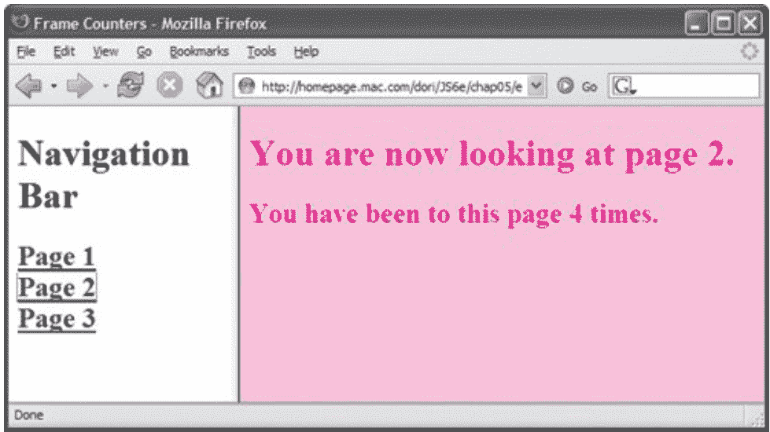

**脚本 5.13. `<span>` 的内容将被 JavaScript 替换。**

```html
<!DOCTYPE html PUBLIC "-//W3C//DTD XHTML 1.0 Transitional//EN">
<html xmlns="http://www.w3.org/1999/xhtml">
<head>
    <title>Content frame</title>
<body bgcolor="#FFFFFF">
    <h1>You are now looking at page 1.</h1>
    <h2>You have been to this page <span id="pageCt"> </span> times.</h2>
</body>
</html>
```

**脚本 5.14. 具有 `id` 为 `pageCt` 的 `<span>` 的值将由此脚本设置。**

[查看完整宽度]

```javascript
var pageCount = new Array(0,0,0);
var pageArray = new Array("frame7a.html", "frame7b.html","frame7c.html");

window.onload = initFrames;

function initFrames() {
    var leftWin = document.getElementById("left").contentWindow.document;

    for (var i=0; i<leftWin.links.length; i++) {
      leftWin.links[i].onclick = resetPageCt;
      leftWin.links[i].thisPage = i;
    }

    bumpPageCt(0);
}

function bumpPageCt(currPage) {
    pageCount[currPage]++;

    var contentWin = document.getElementById("content").contentWindow.document;
    contentWin.getElementById("pageCt").innerHTML = pageCount[currPage] + " ";
}
function resetPageCt() {
    document.getElementById("content").contentWindow.location.href = pageArray[this.thisPage];

    setTimeout("bumpPageCt("+this.thisPage+")",1000);
    return false;
}
```

### 记录页面访问次数：

1.  `<h2>You have been to this page <span id="pageCt"> </span> times.</h2>`

    脚本 5.13 中有一个带 `id` 的 `<span>`。显然 `<span>` 内部没有任何内容，但我们可以通过 JavaScript 重置它。实际上，里面有一个空格，因为一些浏览器会发现这个 span 是空的并创建它——必须放点东西进去，它才能最终成为文档的一部分。

2.  `var pageCount = new Array(0,0,0);`
    `var pageArray = new Array("frame7a.html","frame7b.html", "frame7c.html");`

    在脚本 5.14 的开头，我们声明两个数组并设置它们的初始内容。

```javascript
for (var i=0; i<leftWin.links.length; i++) {
    leftWin.links[i].onclick = resetPageCt;
    leftWin.links[i].thisPage = i;
}
```

`initFrames()` 函数的开头与前一个任务中的类似，但它将 `onclick` 处理程序设置为 `resetPageCt`，并将新的 `thisPage` 属性设置为 `i`，因此 `thisPage`（基于链接）将是 0、1 或 2（编号从 0 开始）。

```javascript
bumpPageCt(0);
```

该函数通过调用 `bumpPageCt` 并传递零（以增加页面 1 的计数）来结束。

```javascript
function bumpPageCt(currPage) {
    pageCount[currPage]++;
    var contentWin = document.getElementById("content").contentWindow.document;
    contentWin.getElementById("pageCt").innerHTML = pageCount[currPage] + " ";
}
```

`bumpPageCt()` 函数接收一个页面并递增该页面的计数器（保存在 `pageCount` 数组中）。同样，我们获取 `contentWin`（即框架内的主要内容文档）。然后我们使用它将 `pageCt` 的 `innerHTML` 值设置为当前页面计数，使其显示在页面上。

```javascript
function resetPageCt() {
    document.getElementById("content").contentWindow.location.href = pageArray[this.thisPage];
    setTimeout("bumpPageCt("+this.thisPage+")",1000);
    return false;
}
```

`resetPageCt()` 函数是先前看到的 `resetBanner()` 和 `bumpPageCt()` 函数的结合，外加一些额外功能。这里不是让浏览器自行更改内容窗口，而是根据 `pageArray` 数组重置它。一旦内容页面发生更改，我们希望在内容页面加载完成后调用 `bumpPageCt()` 函数，所以我们再次使用 `setTimeout()`。最后，我们返回 `false`，因为 JavaScript 自身处理页面加载。

## 一次加载多个框架

只需一个带 `target` 属性的链接即可更改框架的内容；这是简单的 HTML。要通过一次点击更改多个框架的内容，你需要 JavaScript。HTML 文件很简单；所有操作都在 [脚本 5.15](Script 5.15) 中进行。窗口可能呈现的两种状态如 [图 5.12](Figures 5.12) 和 [5.13](5.13) 所示。

**脚本 5.15. JavaScript 允许你通过单次用户点击加载多个框架。**

```javascript
window.onload = initFrames;

function initFrames() {
    var leftWin = document.getElementById("left").contentWindow.document;

    for (var i=0; i<leftWin.links.length; i++) {
        leftWin.links[i].onclick = setFrames;
    }
}

function setFrames() {
    document.getElementById("left").contentWindow.document.location.href = this.id + ".html";
    document.getElementById("content").contentWindow.document.location.href = this.href;
    setTimeout("initFrames();",1000);
    return false;
}
```


## 使用 Iframe

*Iframe* 是内联框架，即可以嵌入到常规 HTML 页面中的框架，而无需置于框架集内。与常规框架一样，iframe 是一个独立的 HTML 文档。你可以将 iframe 作为脚本的目标，从而在脚本控制下动态创建内容并将其显示在页面中，而无需使用框架集。

在本任务中，我们有一个常规 HTML 页面，其内容区域是一个 iframe。iframe 的内容通过 JavaScript 创建。[脚本 5.16](脚本 5.16) 创建了常规页面。[脚本 5.17](脚本 5.17) 是占位 HTML 文档，用于向用户显示 iframe 中的初始内容，即"Please load a page"（请加载页面）的提示，如 [图 5.14](图 5.14) 所示。该内容将被 [脚本 5.18](脚本 5.18) 的产出所替换：当用户点击其中一个链接时，JavaScript 会向 iframe 写入新的代码。在此例中，它显示的是页面名称以及用户在本次会话中访问该页面的次数。如你所见，这个脚本的大部分内容都是由本章前面已经介绍过的代码片段组成的。

### 脚本 5.16。此页面创建 iframe 并调用外部 JavaScript。

```
<!DOCTYPE html PUBLIC "-//W3C//DTD XHTML 1.0 Transitional//EN">
<html xmlns="http://www.w3.org/1999/xhtml">
<head>
    <title>iframes</title>
    <script language="javascript" type="text/javascript" src="script09.js"></script>
</head>
<body bgcolor="#FFFFFF">
    <iframe src="frame9b.html" width="550" height="300" name="content" id="content"
        align="right" frameborder="1">Your browser does not support iframes</iframe>
    <h1>Navigation Bar</h1>
    <h2>
    <a href="page1.html">Page 1</a><br />
    <a href="page2.html">Page 2</a><br />
    <a href="page3.html">Page 3</a>
    </h2>
</body>
</html>
```

### 脚本 5.17。放入 iframe 中的初始页面。

```
<!DOCTYPE html PUBLIC "-//W3C//DTD XHTML 1.0 Transitional//EN">
<html xmlns="http://www.w3.org/1999/xhtml">
<head>
    <title>Content frame</title>
</head>
<body bgcolor="#FFFFFF">
    Please load a page
</body>
</html>
```

图 5.14。右侧的 iframe 初始包含一条提示用户点击链接的说明。

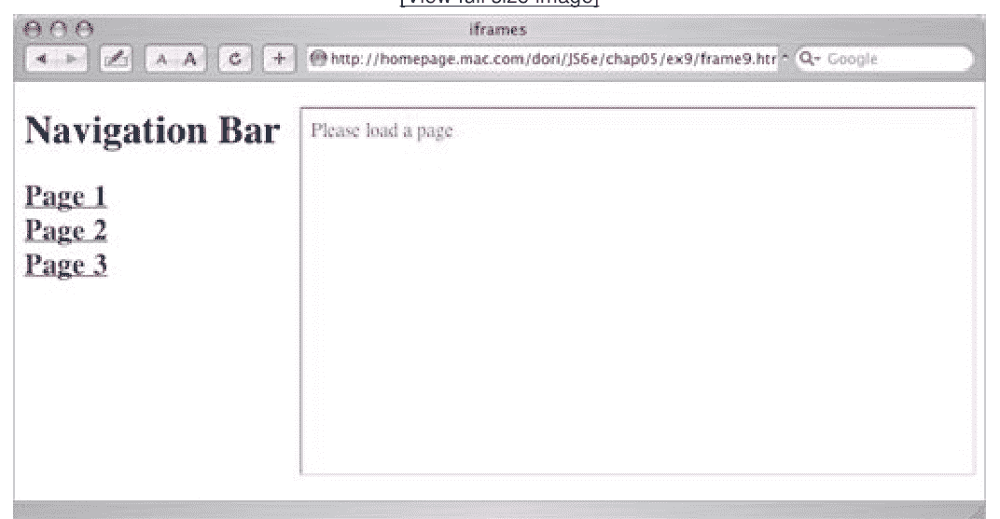

### 脚本 5.18。此脚本计算 iframe 的内容并将其写入窗口。

```
var pageCount = new Array(0,0,0,0);
window.onload = initFrames;

function initFrames() {
    for (var i=0; i<document.links.length; i++) {
        document.links[i].onclick = writeContent;
        document.links[i].thisPage = i+1;
    }
}

function writeContent() {
    pageCount[this.thisPage]++;

    var newText = "<h1>You are now looking at page " + this.thisPage;
    newText += ".<br />You have been to this page ";
    newText += pageCount[this.thisPage] + " times.</h1>";

    var contentWin = document.getElementById("content").contentWindow.document;
    contentWin.body.innerHTML = newText;
    return false;
}
```

## 为 iframe 创建内容的步骤：

1.  在 [脚本 5.16](脚本 5.16) 中，iframe 标签告知浏览器 iframe 内容的初始源文件位于 frame9b.html 中。在标签内部，有一条消息将被不支持 iframe 的浏览器显示。

2.  function writeContent() {

    创建一个名为 writeContent 的函数，用于构建 iframe 内部的内容。

    ```
    pageCount[this.thisPage]++;
    ```

    这一行递增 `pageCount` 数组，以便我们跟踪访问该特定页面的次数。

    ```
    var newText = "<h1>You are now looking at page " + this.thisPage;
    newText += ".<br />You have been to this page ";
    newText += pageCount[this.thisPage] + " times.</h1>";
    ```

    这几行动态创建了 iframe 的内容。

    ```
    var contentWin = document.getElementById("content").contentWindow.document;
    contentWin.body.innerHTML = newText;
    return false;
    ```

    与之前的示例一样，我们获取 `contentWin` 并重置其 `body` 的 `innerHTML` 属性。重置 `innerHTML` 会将两行文本写入 iframe 中，结果如 **图 5.15** 所示。由于全部操作已完成，我们以 `return false` 结束，以防止浏览器执行不必要的操作。

**图 5.15。每次点击导航栏中的链接时，iframe 中的内容都会更新。**

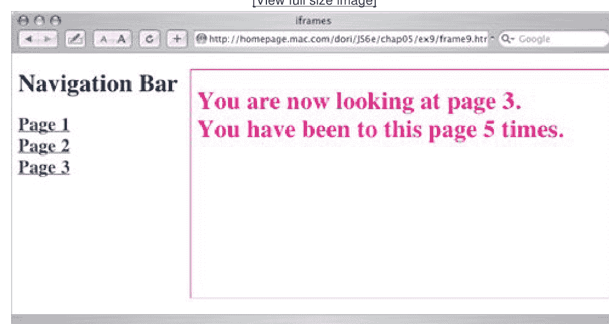

## 提示

请注意，与之前从非框架集页面向内容框架写入内容不同，这里我们使用的是 `document.getElementById("content")` 而非 `parent.document.getElementById("content")`。这是因为 iframe 是主页面的子元素，而非框架集的子元素，因此我们可以直接访问它，而无需通过父级访问。

## 使用 JavaScript 加载 Iframe

当然，你不一定要用 JavaScript 向 iframe 内容中写入数据；你很可能想要加载其他 HTML 页面。本示例将向你展示如何操作。同样，我们有一个主页面用于设置 iframe，该页面与 [脚本 5.16](https://www.example.com/Script5.16) 基本相同。类似地，有一个包含 iframe 初始内容的页面，如 [脚本 5.17](https://www.example.com/Script5.17)。此外还有三个其他简单的 HTML 页面（未展示），我们将通过 [脚本 5.19](https://www.example.com/Script5.19) 将它们加载到 iframe 中。

### 脚本 5.19。此脚本将 HTML 页面加载到内容 iframe 中。

```
window.onload = initiFrame;
function initiFrame() {
    for (var i=0; i<document.links.length; i++) {
        document.links[i].target = "content";
        document.links[i].onclick = setiFrame;
    }
}

function setiFrame() {
    document.getElementById("content").contentWindow.document.location.href = this.href;
    return false;
}
```

## 使用 JavaScript 加载 iframe 的步骤：

1.  ```
    function setiFrame() {
        document.getElementById("content").contentWindow.document.location.href = this.href;
        return false;
    }
    ```

    与 [脚本 5.12](https://www.example.com/Script5.12) 为链接同时设置 `target` 和 `onclick` 处理器的方式几乎完全相同，[脚本 5.19](https://www.example.com/Script5.19) 也为 iframe 做了同样的事。在此示例中，点击任何链接都会触发 `setiFrame()` 函数，该函数随后将新页面加载到 iframe 中，如 [图 5.16](https://www.example.com/Figure5.16) 所示。

**图 5.16。点击导航栏中的链接时，内容 iframe 会被加载。**

[查看完整图片](https://www.example.com/view-full-size-image)


## 导航栏

- [页面 1]
- [页面 2]
- [页面 3]

# 第六章 操作浏览器窗口

窗口是 Web 浏览器中最重要的界面元素，正如你所期待的，JavaScript 为你提供了许多工具来操作窗口。

### 别禁用那些弹窗！

本章介绍如何使用 JavaScript 创建和操作窗口。这类窗口有个名字，叫做"弹出窗口"，它们已经成为许多网上冲浪者的烦恼。我们将向你展示弹出窗口的一些良性用途，但如果你在运行这些示例时遇到困难，可能是因为你在浏览器中禁用了弹出窗口，或者你正在运行其他阻止弹出窗口的软件。虽然浏览器应该会打开你明确选择打开的任何弹出窗口，但有些并不会。因此，在你学习本章内容时，请确保关闭弹窗拦截器。

然而，某些浏览器据称出于安全原因（我们说的就是你，*Microsoft Internet Explorer*），会自认为比你更懂，无论你是否要求打开，都不会打开脚本中的弹出窗口。

JavaScript 处理窗口的方式与处理框架类似（参见 [第五章](#)）。这完全说得通，因为框架只是整个浏览器窗口中的其他文档窗口。

在本章中，你将学习如何使用 JavaScript 打开和关闭窗口、更新窗口内容以及定位窗口位置。你将看到如何使用 JavaScript 向窗口中写入信息，从而即时构建一个网页。

## 打开新窗口

你经常想要创建新窗口，以便向用户展示附加信息，同时不丢失他们正在阅读的内容。例如，你可以为技术论文或新闻故事打开一个注释窗口。虽然使用 HTML 也可以打开新的浏览器窗口，但使用 JavaScript 可以让你对新窗口的内容和功能有更多控制。**图 6.1** 展示了一个标准的浏览器窗口，其中各个部分都有标注。你可以创建包含这些部分中任意或全部的窗口。[脚本 6.1](脚本 6.1) 展示了 HTML，[脚本 6.2](脚本 6.2) 展示了从一个页面创建窗口的 JavaScript（**[图 6.2](图 6.2)**），点击链接会弹出一个新窗口（本例中包含我们猫咪的图片）。

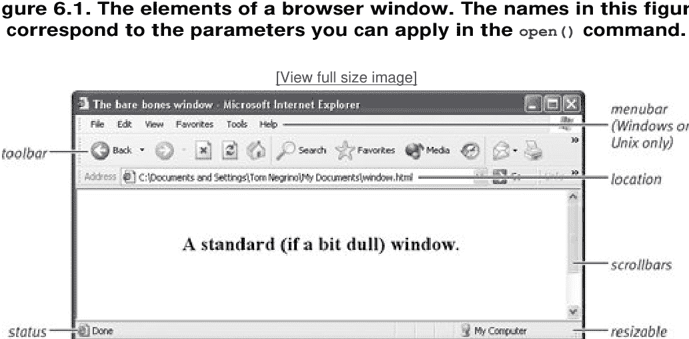

**脚本 6.1 调用打开新窗口的外部 JavaScript 的 HTML 页面。**

```html
<!DOCTYPE html PUBLIC "-//W3C//DTD XHTML 1.0 Transitional//EN">
<html xmlns="http://www.w3.org/1999/xhtml">
<head>
    <title>Opening a Window</title>
    <script src="script01.js" type="text/javascript" language="javascript">
    </script>
</head>
<body bgcolor="#FFFFFF">
    <h1>The Master of the House</h1>
    <h2>Click on His name to behold He Who Must Be Adored</h2>
    <h2><a href="#" class="newWin">Pixel</a></h2>
</body>
</html>
```

**脚本 6.2 使用此脚本打开一个新窗口。**

```javascript
window.onload = newWinLinks;

function newWinLinks() {
    for (var i=0; i<document.links.length; i++) {
        if (document.links[i].className == "newWin") {
            document.links[i].onclick =  newWindow;
        }
    }
}

function newWindow() {
    var catWindow = window.open("../images/pixel.jpg", "catWin", "resizable=no, width=350, height=260");
    return false;
}
```

**图 6.2 打开一个新窗口。**

你会注意到脚本 6.1 中没有 JavaScript，只是调用了外部 JavaScript 文件，我们还将页面上的链接标记了一个名为 newWin 的类。与第五章中的框架示例类似，脚本 6.2 包含一个 onload 事件处理程序，它调用一个函数，在本例中称为 newWinLinks。newWinLinks 函数遍历页面上的链接，查看是否有任何链接包含 newWin 类。如果有，当点击该链接时，函数调用 newWindow 函数。由于第五章中使用了非常相似的函数，我们在下面的步骤中没有详细说明它们。

### 打开新窗口的步骤：

```javascript
function newWindow() {
```

首先，定义一个名为 `newWindow()` 的函数。

```javascript
var catWindow = window.open ("../images/pixel.jpg", "catWin", "resizable=no,width=350, height=260");
```

变量 `catWindow` 包含一个新的窗口对象，引用图像文件 `pixel.jpg`。这个新窗口的名称是 `catWin`。名称是必需的，因为我们可能希望在链接或另一个脚本中稍后引用此窗口。新窗口的宽度为 350 像素，高度为 260 像素；这些参数是可选的。

### ✔ 提示

- 在步骤 2 中，宽度和高度参数中的逗号之间不能有任何空格。如果有空格，你的脚本在某些浏览器中可能无法工作。一般来说，当你遇到脚本错误需要调试时，请留意这类小问题。语法错误是初学者感到沮丧的主要原因。
- Internet Explorer 6 及更高版本出于安全原因会做一些怪异且不一致的窗口处理（脚本窗口有时能工作，有时不能）。如果关闭安全设置，本章的所有内容都能正常工作，但我们不建议关闭安全设置，也不要求你的网站访问者关闭安全设置。此外，IE7 中的某些新窗口可能会根据你的标签浏览设置在新标签页中打开。

### 为窗口添加参数

要为窗口添加 [图 6.1](#) 中列出的一个或多个参数，请在 `open()` 命令中以引号括起来声明，在想要的功能名称后加上 `=yes`，在不想要的功能名称后加上 `=no`（虽然 `=no` 通常是默认设置，所以你往往可以跳过提及这些功能）。例如，如果你想要一个指定大小的窗口，带有工具栏、地址栏和滚动条，你可以输入

```
"toolbar=yes,location=yes, scrollbars=yes,width=300, height=300"
```

作为 `open()` 命令的一部分。请注意，创建的窗口将没有菜单栏或状态栏，并且不可调整大小。

鉴于完全省略某个参数通常（见下面的一些例外情况）等同于将其设置为 `=no`；你也可以只使用参数名称本身（不带 `=yes`）来启用它。由于存在一些例外情况，我们 prefer 在这些脚本中更明确地说明我们正在打开和关闭什么功能；因此，我们将它们组合起来，后面跟着 yes 或 no；也就是说，我们使用 "`location,scrollbars=yes`" 来表示与 "`location=yes,scrollbars=yes`" 相同的意思。我们也可以只说 "`location,scrollbars`"，但这样就无法清楚地知道发生了什么。

某些浏览器有与其他浏览器不同的默认值。例如，Safari 的默认设置是 `"resizable=yes"`，这就是 [脚本 6.2](#) 包含 `"resizable=no"` 参数的原因。另一方面，Windows 上的 Firefox 会使弹出窗口始终可调整大小，无论你是否设置了该参数，而 Mac 上 Firefox 的调整大小功能则按预期工作。在 IE6 和 IE7 中，窗口始终显示为可调整大小（包含调整大小控件），但除非你明确允许，否则实际上并不可调。Windows 和 Mac 上的 Firefox 以及 IE6 和 IE7 始终会显示状态栏，无论你想要与否。IE7 还始终显示地址栏作为安全"功能"，你无法用 JavaScript 更改这一点。[图 6.3](#) 展示了 [脚本 6.2](#) 在 IE7 和 Windows 版 Firefox 中的结果；同一个脚本给出了不同的结果，因为浏览器的默认设置不同。

**图 6.3** Internet Explorer（左）和 Firefox（右）使用不同的窗口默认设置，因此像地址栏这样的项目会出现在 IE 中，但不会出现在 Firefox 中。

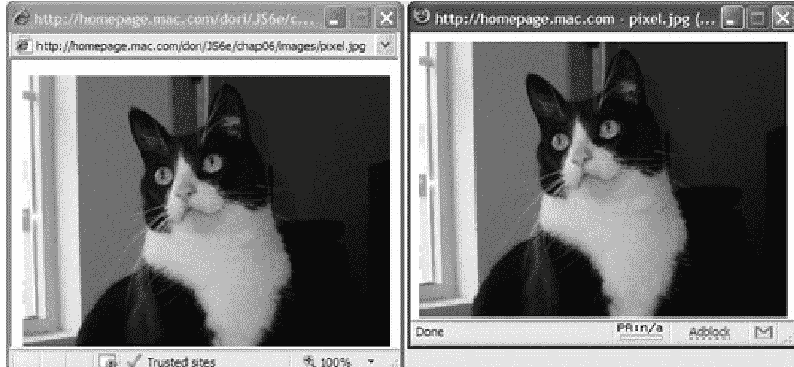

最终，你仍然需要在你认为网站用户最可能使用的所有浏览器中测试你的脚本，这可能意味着需要准备 Windows 和 Mac（也许还有 Linux）机器进行测试。测试（以及必要的脚本修改）将有助于确保你的脚本意图能够与浏览器提供的任何功能正常配合。


## 将不同内容加载到窗口中

在前面的任务中，点击链接会创建一个新窗口，并填充一张图片。但如果你的页面上有多个链接，并且希望它们都指向*同一个*新窗口，该怎么办呢？脚本 6.3 演示了这种技巧。图 6.4 中的主窗口有三个链接。点击其中任何一个链接都会打开一个新窗口，并填充相应书籍的图片。如果你切换回主窗口并点击另一个链接，小窗口中的图片会被替换。

**脚本 6.3. 使用此脚本，你可以打开一个新窗口，并通过点击不同的链接来填充各种内容。**

```
window.onload = newWinLinks;

function newWinLinks() {
    for (var i=0; i<document.links.length; i++) {
        if (document.links[i].className == "newWin") {
            document.links[i].onclick = newWindow;
        }
    }
}

function newWindow() {
    var bookWindow = window.open(this.href, "bookWin","width=135,height=165");
    bookWindow.focus();
    return false;
}
```

**图 6.4. 点击三个链接中的任何一个都会打开小窗口，并填充相应书籍的封面图片。**

[查看完整尺寸图片]

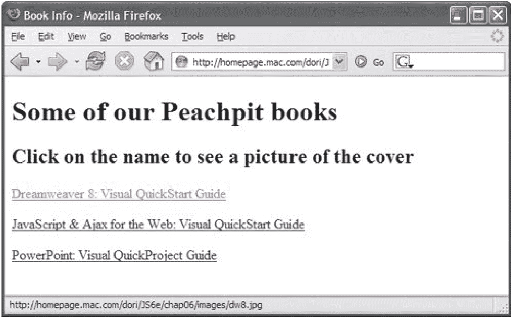


**将不同内容加载到窗口中：**

1. `document.links[i].onclick = newWindow;`

   在 `newWinLinks()` 函数中，我们通过 JavaScript 将 `newWindow()` 函数调用添加为 `onclick` 处理器。当 `newWindow()` 被调用时，它使用 `this.href`，即 HTML 中的 `href` 属性值。

2.

```
function newWindow() {
```

   在这里，我们定义了一个名为 `newWindow()` 的新函数。

3.

```
var bookWindow = window.open(this.href, "bookWin", "width=135, height=165");
```

   这里，变量 `bookWindow` 用于打开一个新的窗口对象，后面跟着窗口的参数。首先，我们传递 `this.href` 的值。新窗口的名称为 `bookWin`，宽度和高度参数设置了窗口的大小。

4.

```
bookWindow.focus();
```

   这一行使用 `focus()` 方法让刚才打开的窗口移到前台。当你需要让某个窗口可见时，可以随时使用 `focus()`；如果有多个窗口打开，使用 `focus()` 可以将该窗口移到最顶层。

5.

```
return false;
```

   函数需要以 `return false` 结束，这样 HTML 才知道不要同时加载 `href` 链接。

> ✔ **提示**

- 第 4 步中使用的 `focus()` 方法的反向操作是 `blur()`。使用 `blur()` 会将一个窗口推到其他打开的窗口后面。`window` 对象的 `focus()` 和 `blur()` 方法分别关联了 `onfocus` 和 `onblur` 事件处理器，这使你能够在窗口获得或失去焦点时采取相应操作。

## 打开多个窗口

有时你可能需要使用脚本打开多个窗口；例如，你可能想创建一个脚本，每次用户点击屏幕上的控件时都打开一个不同的窗口。与往常一样，JavaScript 完全胜任这项任务。在这个示例中，我们有一个包含三个链接的页面；点击一个链接会打开一个包含图片的独立窗口；点击另一个链接会打开另一个窗口，每个链接对应一个窗口。脚本 6.4 展示了实现方法，图 6.5 展示了结果。

**脚本 6.4. 当你需要从多个链接打开多个窗口时，此脚本可以实现。**

```
window.onload = newWinLinks;

function newWinLinks() {
    for (var i=0; i<document.links.length; i++) {
        if (document.links[i].className == "newWin") {
            document.links[i].onclick = newWindow;
        }
    }
}

function newWindow() {
    var winName = this.id + "Win";
    var bookWindow = window.open(this.href, winName,"width=135,height=165");
    bookWindow.focus();
    return false;
}
```

**图 6.5. 点击后方窗口中的三个链接会产生一系列子窗口。**

[查看完整尺寸图片]

### 我们的一些 Peachpit 图书

点击名称查看封面图片

Dreamweaver 8: Visual QuickStart Guide
JavaScript & Ajax for the Web: Visual QuickStart Guide
PowerPoint: Visual QuickProject Guide


**使用脚本打开多个窗口：**

1. `function newWindow() {`
   创建一个名为 `newWindow` 的函数。

2. `var winName = this.id + "Win";`
   变量 `winName` 基于调用链接的 `id` 加上字符串 `Win` 构建。

3.

```
var bookWindow = window.open(this.href, winName, "width=135, height=165");
```

   这一行给 `bookWindow` 赋值，并使用 `window.open` 方法打开括号内参数指定的窗口。此脚本的关键在于 `winName`（`window.open` 的第二个参数）是唯一的。只要每个窗口名称不同，新的窗口就会被打开。

## 提示

- 点击已打开窗口对应的书籍链接会导致窗口重绘，而不是打开一个重复的窗口。
- 如果你希望每次用户点击链接时都打开一个新窗口（而不是刷新现有窗口），可以在窗口名称中添加一个随机数。

## 同时打开多个窗口

也许你想同时打开多个窗口（这真的有可能严重惹恼浏览你网站的用户）。你只需要对脚本 6.4 做一点小改动就可以实现；你需要添加一个循环，每次循环迭代时都打开一个窗口，如脚本 6.5 所示。

**脚本 6.5. 此脚本在前面的脚本基础上添加了循环，通过单次点击链接即可打开多个窗口。**

```
window.onload = newWinLinks;

function newWinLinks() {
    for (var i=0; i<document.links.length; i++) {
      if (document.links[i].className == "newWin") {
          document.links[i].onclick = newWindows;
      }
    }
}

function newWindows() {
    var bookTitles = new Array("dw8","js6e", "ppt");

    for (var i=0; i<bookTitles.length;i++) {
      var imgName = "../images/" + bookTitles[i] + ".jpg";
      var winName = bookTitles[i] + "Win";
      var bookWindow = window.open(imgName, winName,"width=135,height=170");
    }
    return false;
}
```

**同时打开多个窗口：**

1. `document.links[i].onclick = newWindows;`

   在 `newWinLinks()` 函数中，我们将脚本 6.4 中的那行代码改为调用 `newWindows()` 函数，因为我们要打开的窗口不止一个。

2.

```
function newWindows() {
    var bookTitles = new Array("dw8", "js6e", "ppt");
}
```

   首先创建一个新函数来处理打开多个窗口的操作。接着，创建一个名为 `bookTitles` 的新数组，并用窗口名称填充它。

3.

```
for (var i=0; i<bookTitles.length; i++) {
    var imgName = "../images/" + bookTitles[i] + ".jpg";
    var winName = bookTitles[i] + "Win";
    var bookWindow = window.open(imgName, winName, "width=135, height=170");
}
```

   循环将根据 `bookTitles` 数组的元素数量（通过 `length` 属性获取）执行相应次数。`imgName` 变量包含构建好的图片路径。`winName` 变量获取 `bookTitles` 的当前值并在其后加上 `Win`。`bookWindow` 变量打开包含图片的窗口，添加窗口名称，并指定窗口大小。所有这些循环的结果如图 6.6 所示。

**图 6.6. 点击链接后打开了全部三个子窗口；窗口的位置由浏览器决定。在本例中，Safari 将三个窗口叠加在一起，我们为了清晰起见将它们移动了位置。**

[查看完整尺寸图片]


## 提示

- 窗口的位置取决于浏览器决定将窗口放在哪里。如果你想控制窗口位置，脚本 6.13 展示了如何将窗口放置在屏幕上的特定位置。请参阅本章后面的"在指定位置打开窗口"。
- 脚本 6.4 中有段代码在此脚本中没有出现，即 `bookWindow.focus()`。在脚本 6.4 中，它使打开的窗口成为焦点窗口，即最前面的窗口。但从用户界面的角度来看，当同时打开多个窗口时，焦点应该放在哪里并不明确。


 ## 从一个窗口更新另一个窗口

如果你需要处理表单和用户输入的数据，那么你需要了解如何将一个窗口中输入的信息发送到另一个窗口进行显示。在需要销售产品并复制用户信息到汇总窗口的场景中，你可能会用到这个功能。在本示例中，我们将使用两个窗口：主窗口是父窗口，用于接收和显示子窗口中输入的信息。脚本 6.6 和脚本 6.7 分别展示了父窗口和子窗口的 HTML 页面。脚本 6.8 展示了脚本，该脚本从父窗口和子窗口都会被调用。

### 脚本 6.6. 父窗口的 HTML。

```
<!DOCTYPE html PUBLIC "-//W3C//DTD XHTML 1.0 Transitional//EN">
<html xmlns="http://www.w3.org/1999/xhtml">
<head>
    <title>Big Window</title>
    <script language="Javascript" type="text/javascript" src="script05.js">
    </script>
</head>
<body bgcolor="#FFFFFF">
<div align="center">
    <h1>Welcome to this page!</h1>
    <form action="#">
        <input type="text" size="20" id="msgLine" readonly="readonly" />
    </form>
</div>
</body>
</html>
```

### 脚本 6.7. 子窗口的 HTML。

```
<!DOCTYPE html PUBLIC "-//W3C//DTD XHTML 1.0 Transitional//EN">
<html xmlns="http://www.w3.org/1999/xhtml">
<head>
    <title>Little Window</title>
    <script language="Javascript" type="text/javascript" src="script05.js">
    </script>
</head>
<body bgcolor="#FFFFFF">
    <h1>What's your name?</h1>
    <form action="#">
        <input type="text" id="childField" size="20" />
    </form>
</body>
</html>
```

```
window.onload = initWindows;

function initWindows() {
    if (document.getElementById("childField")) {
      document.getElementById("childField").onchange = updateParent;
    }
    else {
        newWindow = window.open("child.html", "newWin","status=yes,width=300, height=300");
    }
}

function updateParent() {
    opener.document.getElementById("msgLine").value = "Hello " + this.value + "!";
}
```

### 脚本 6.8. 此脚本从父窗口和子窗口都会被调用。

## 从一个窗口更新另一个窗口：

1. `window.onload = initWindows;`

当窗口加载时，调用 `initWindows()` 函数。

2. `if (document.getElementById("childField")) {
  document.getElementById("childField").onchange = updateParent;
}`

该脚本由两个 HTML 页面（父页面和子页面）调用，但它需要对每个文件执行不同的操作。它判断当前处于哪个页面的方式是检查 `childField` 对象是否存在，该对象只存在于子窗口中。如果我们在子窗口中，并且用户更改了该对象，那么我们就调用 `updateParent()` 函数。

3. `else {
    newWindow = window.open("child.html","newWin","status=yes, width=300,height=300");`

如果 `childField` 对象不存在，那么就该打开子窗口了，使用 child.html 文件。该行的其余部分指定了子窗口的参数。（[图 6.7](#)）。

**图 6.7. 子窗口是用户输入数据的地方。**


4. `function updateParent() {`

这里我们创建 `updateParent` 函数。

5. `opener.document.getElementById("msgLine").value = "Hello " + this.value + "!";`

这一行引入了 `opener` 属性，这是 JavaScript 引用打开子窗口的父文档的方式。这一行告诉 `opener` 文档（即父窗口）查找名为 `msgLine` 的字段，并将其值设置为单词 "Hello" 和 `this.value` 的内容，最后加上一个感叹号（[图 6.8](#)）。

**图 6.8. 从子窗口调用信息后，更新后的父窗口。**


## ✅ **提示**

-   表单、字段以及如何对它们进行脚本编程在[第 7 章](#)“表单处理”中有深入介绍。
-   在[脚本 6.6](#)中，我们为父窗口的 `msgLine` 字段添加了 `readonly="readonly"` 属性。这只是为了清楚地表明，访问您网站的用户无法自己编辑该字段；它只能通过其他方式设置。

## 使用 JavaScript 创建新页面

本章前面的多窗口示例使用了多个 HTML 文件来创建不同的窗口。但其实没有必要这样做，因为您可以在脚本中嵌入 HTML 并即时创建新的 HTML 页面。这尤其有用，因为您可以利用 JavaScript 的强大功能来填充新页面的动态内容。在 JavaScript 控制下更改页面内容是许多 Web 应用程序的基础。为了让您先熟悉一下，**脚本 6.9** 是一个相当简单的示例；我们将加载一个页面（**图 6.9**），该页面会创建一个新的子 HTML 页面，然后执行一个循环，向子页面添加 100 行文本（**图 6.10**）。

### 脚本 6.9. 您可以完全在脚本控制下创建新的 HTML 页面。

```
window.onload = initWindows;

function initWindows() {
    var newText, newBr;
    var newWindow = window.open("","newWin", "location,scrollbars,resizable=yes,width=300,height=300");
    var newDoc = newWindow.document;

    newDoc.title = "Generated Window";
    newDoc.bgColor = "#000000";
    newDoc.fgColor = "#FFFFFF";
    newDoc.body.innerHTML = "<h2>This window shows the result from the other window <\/h2><div id='looper'> </div>";

    var loopDiv = newDoc.getElementById("looper");

    for (var i=0; i<100; i++) {
        newText = newDoc.createTextNode("The loop is now at: " + i);
        newBr = newDoc.createElement("br");

        loopDiv.appendChild(newText);
        loopDiv.appendChild(newBr);
    }
}
```

### 图 6.9. 此父窗口正在向子窗口写入...


图 6.10. ...而子窗口显示了结果。


## 使用 JavaScript 创建新页面：

1. `var newText, newBr;
var newWindow = window.open("", "newWin","location,scrollbars, resizable=yes,width=300, height=300");`

在 `initWindows()` 函数中，我们声明两个新变量 `newText` 和 `newBr`。下一行打开新窗口，设置其参数，并将其赋值给变量 `newWindow`。

2. `var newDoc = newWindow.document;`

这个新变量 ` lobsterWinamp“帮助”`newDoc` 存储了我们新窗口的文档对象，我们将在下一步中对其进行修改。

3. `newDoc.title = "Generated Window";
newDoc.bgColor = "#000000";
newDoc.fgColor = "#FFFFFF";
newDoc.body.innerHTML = "<h2>This window shows the result from the other window<\/h2><div id= 'looper'> </div>";`

这是最酷的部分，我们在这里设置 `newDoc` 对象的属性（换句话说，就是我们创建的窗口的内容）。我们可以将新文档的标题、背景颜色、前景颜色和 `body.innerHTML`（文档 body 标签的内容）设置为我们想要的任何内容。在本例中，我们生成 HTML 头部和页面主体的第一部分（[图 6.10](Figure 6.10)）。

4. `var loopDiv = newDoc.getElementById("looper");`

您可能注意到上一步末尾的 `div` 具有 `id "looper"`——这就是我们即将要添加内容的 `div`。为此，我们创建并设置新的 `loopDiv` 变量。

5. `for (i=0; i<100; i++) {`

我们使用计数器变量 `i` 启动一个循环。将 `i` 初始设置为 0；然后，只要 `i` 小于 100，我们就将 `i` 的值增加 1。

6. `newText = newDoc.createTextNode("The loop is now at: " + i);
newBr = newDoc.createElement("br");`

我们需要创建元素，然后可以将其添加到 `looper` div 中。本章前面，我们更改了 `innerHTML`，这会覆盖该 div 中已有的内容。但在本例中，我们想要添加内容，而不是覆盖。两个内置函数 `createTextNode()` 和 `createElement()` 分别允许我们即时创建一个文本节点和一个元素（在本例中，是一个 `<br />` 元素）。


 ```
7. loopDiv.appendChild(newText);
loopDiv.appendChild(newBr);
```

一旦这些元素被创建，它们就可以通过使用我们之前设置的两个变量作为内容执行`appendChild()`来添加到`div`中。使用`appendChild()`和其他操作节点的方法将在[第12章](Chapter 12)中进行更深入的讲解。

一旦它们被添加，我们仍然在循环中，因此我们再次循环，直到第5步中的计数器达到100。

## 关闭窗口

正如你可以创建窗口一样，你应该知道如何通过关闭窗口来消除它们。在[脚本 6.10](http://example.com)中，父窗口有"open"和"close"链接来创建和关闭子窗口，每个链接都有一个唯一的`id`，我们在脚本中使用它。外部 JavaScript 在[脚本 6.11](http://example.com)中。

**脚本 6.10.** 注意此 HTML 页面中两个链接的`id`标签。

```
<!DOCTYPE html PUBLIC "-//W3C//DTD XHTML 1.0 Transitional//EN">
<html xmlns="http://www.w3.org/1999/xhtml">
<head>
    <title>Window Test</title>
    <script language="Javascript" type="text/javascript" src="script07.js">
    </script>
</head>
<body bgcolor="#FFFFFF">
    <div align="center">
        <h1>Let's play with windows!</h1>
        <h3>
            <a href="#" id="openWin">Open a new window</a>&nbsp;&nbsp;
            <a href="#" id="closeWin">Close the window</a>
        </h3>
    </div>
</body>
</html>
```

**脚本 6.11.** 此脚本打开和关闭一个子窗口。

```
var newWindow = null;
window.onload = newWinLinks;

function newWinLinks() {
    for (var i=0; i<document.links.length; i++) {
        document.links[i].onclick = chgWindowState;
    }
}

function windowOpen() {
    if (newWindow && !newWindow.closed) {
        return true;
    }
    return false;
}

function chgWindowState() {
    if (this.id == "closeWin") {
        if (windowOpen()) {
            newWindow.close();
        }
        else {
            alert("The window isn't open");
        }
    }
    if (this.id == "openWin") {
        if (windowOpen()) {
            alert("The window is already open!");
        }
        else {
            newWindow = window.open("","newWin", "toolbar,location=yes,width=300,height=200");
        }
    }
    return false;
}
```

## 关闭窗口的步骤：

```
var newWindow = null;
```

这一行初始化我们稍后要使用的`newWindow`对象的值。虽然大多数浏览器会自动执行此操作，但有些不会，因此需要在这里设置以避免后续出错。

```
document.links[i].onclick = chgWindowState;
```

在`newWinLinks()`函数中，我们像往常一样遍历文档中的链接。这里唯一的区别是，如果检测到点击了其中一个链接，我们将调用`chgWindowState()`。

```
function windowOpen() {
    if (newWindow && !newWindow.closed) {
        return true;
    }
    return false;
}
```

`if`语句使用`&&`运算符进行逻辑测试，只有当两边的值都为真时才返回真结果。因此在这个例子中，`newWindow`必须存在，并且`newWindow`必须未被关闭（`!`是逻辑"非"运算符）。如果窗口打开，此函数返回`true`，否则返回`false`。

```
function chgWindowState() {
    if (this.id == "closeWin") {
        if (windowOpen()) {
            newWindow.close();
        } else {
            alert("The window isn't open");
        }
    }
    if (this.id == "openWin") {
        if (windowOpen()) {
            alert("The window is already open!");
        } else {
            newWindow = window.open("", "newWin","toolbar,location=yes,width=300,height=200");
        }
    }
}
```

在这里，我们检查被点击链接的`id`是否为`closeWin`。如果是`closeWin`，用户点击了关闭链接。如果是`openWin`，他们点击了打开链接。

如果用户点击关闭且窗口是打开的，这几行会关闭它。

如果用户点击关闭但窗口已经关闭，会弹出警告提示。

同样，如果用户点击打开且窗口已经打开，会弹出警告提示。

如果用户点击打开且当前没有窗口，窗口会打开，显示该行中设置的参数（[图 6.11]）。在这种情况下，工具栏和地址栏是可见的。

## 图 6.11. 此窗口中的链接创建和关闭一个子窗口。

[View full size image]

```
return false;
```

我们以`return false`结束，这样`href`不会被触发。

## 在指定位置打开窗口

有时你想在屏幕上的特定位置打开窗口。在这个例子中，你可以选择在屏幕四个角落中的任意一个打开一个小窗口。与前面的例子类似，我们还提供了一个关闭子窗口的链接。HTML 与前面的例子类似，如脚本 6.12 所示。正如你所期望的，每个链接都标有自己唯一的`id`。JavaScript 在脚本 6.13 中，基于脚本 6.11 构建。

### 脚本 6.12. 此脚本在屏幕指定位置打开一个子窗口。

```
<!DOCTYPE html PUBLIC "-//W3C//DTD XHTML 1.0 Transitional//EN">
<html xmlns="http://www.w3.org/1999/xhtml">
<head>
    <title>Window Test</title>
    <script language="Javascript" type="text/javascript" src="script08.js">
    </script>
</head>
<body bgcolor="#FFFFFF">
    <div align="center">
        <h1>Let's play with window!</h1>
        <h3>
            <a href="#" id="topLeftWin"> Open window in the top left </a>&nbsp;&nbsp;
            <a href="#" id="topRightWin"> Open window in the top right</a> <br />
            <a href="#" id="bottomLeftWin"> Open window in the bottom left </a>&nbsp;&nbsp;
            <a href="#" id="bottomRightWin"> Open window in the bottom right </a><br />
            <a href="#" id="closeWin">Close the window</a>
        </h3>
    </div>
</body>
</html>
```

### 脚本 6.13. 此脚本为脚本 6.12 添加了窗口移动功能。

```
var newWindow = null;
window.onload = newWinLinks;

function newWinLinks() {
    for (var i=0; i<document.links.length; i++) {
       document.links[i].onclick =  chgWindowState;
    }
}

function windowOpen() {
    if (newWindow && !newWindow.closed) {
       return true;
    }
    return false;
}

function chgWindowState() {
    if (this.id == "closeWin") {
       if (windowOpen()) {
         newWindow.close();
       }
       else {
         alert("The window isn't open");
       }
       return false;
    }
    if (this.id != "closeWin") {
       if (windowOpen()) {
          alert("The window is already open!");
          return false;
       }
    }

    var topPos = (this.id.indexOf("bottom") == -1)? 0 : screen.availHeight-200;
    var leftPos = (this.id.indexOf("Right") == -1)? 0 : screen.availWidth-300;

    newWindow = window.open("","newWin", "toolbar,location=yes,width=300, height=200,
left="+leftPos+",top="+topPos);
    return false;
}
```

## 在特定位置打开窗口的步骤：

```
if (this.id != "closeWin") {
```

[脚本 6.11](Script 6.11)中查看`this.id`是否为`openWin`，现在我们只是检查它是否不是`closeWin`。这是因为它可能是几个不同的链接之一。

```
var topPos = (this.id.indexOf("bottom") == -1) ? 0 : screen.availHeight-200;
var leftPos = (this.id.indexOf("Right") == -1) ? 0 : screen.availWidth-300;
```

我们正在创建两个新变量`topPos`和`leftPos`，基于`screen.availHeight`和`screen.availWidth`。这两行都是条件语句，使用我们在[第2章](Chapter 2)的"[There's No One Right Way](There's No One Right Way)"侧边栏中描述的`if...else`条件语句的替代写法。它的工作方式如下：如果`id`中包含"bottom"这个词（也就是说，[脚本 6.12](Script 6.12)中指定的`id`是`bottomLeftWin`或`bottomRightWin`），我们知道新打开的窗口需要固定在屏幕底部。因此，`topPos`将设置为屏幕可用高度减去200（要打开的窗口的高度）。如果`id`中不包含"bottom"（导致`indexOf()`检查返回-1，意味着未找到），那么`topPos`设置为零，因为它应该固定在屏幕顶部。`leftPos`和"Right"同理。

```
[View full width]
newWindow = window.open("", "newWin", "toolbar,location=yes,width=300, height=200, left="+leftPos+", top="+topPos);
```

最后，我们在正确的位置打开新窗口，同样，工具栏和地址栏是可见的（[图 6.12](Figure 6.12)）。

## 图 6.12. 父窗口中的链接在屏幕上的指定位置打开一个子窗口。

[View full size image]
```


## 提示

-   `availHeight` 和 `availWidth` 属性一次只查看一个监视器，因此，如果您使用多显示器设置，您无法突然将窗口移动到其他地方；窗口将在与父窗口相同的监视器上打开。

## 将窗口移动到指定位置

在上一个示例中，父页面上的链接在屏幕上的指定位置打开和关闭了窗口。在这个任务中，您将看到如何同时打开和移动窗口。在父页面上，单击链接会在指定位置打开一个窗口。您可能会在打开各种窗口的网站上使用这种脚本，并提供一种只需单击即可重新排列窗口的方法。

这个示例的脚本，[脚本 6.14](#)，建立在前一个任务脚本的基础上，使用了 `moveTo()` 方法。在屏幕角落打开窗口的代码保持不变；我们添加了代码来处理如果窗口已经打开但不在正确位置时的移动情况。页面的 HTML 几乎没有变化，只是链接的措辞有所调整（[图 6.13](#)）。

### 脚本 6.14。如果您需要将窗口移动到指定位置，此脚本可以完成这项工作。

```
[完整显示宽度]

var newWindow = null;
window.onload = newWinLinks;

function newWinLinks() {
    for (var i=0; i<document.links.length; i++) {
        document.links[i].onclick = chgWindowState;
    }
}

function windowOpen() {
    if (newWindow && !newWindow.closed) {
        return true;
    }
    return false;
}

function chgWindowState() {
    if (this.id == "closeWin") {
        if (windowOpen()) {
            newWindow.close();
        }
        else {
            alert("窗口未打开");
        }
        return false;
    }

    var topPos = (this.id.indexOf("bottom") == -1)? 0 : screen.availHeight-200;
    var leftPos = (this.id.indexOf("Right") == -1) ? 0 : screen.availWidth-300;
```

```
if (windowOpen()) {
    newWindow.moveTo(leftPos,topPos);
}
else {
    newWindow = window.open("","newWin", "toolbar,location=yes,width=300, height=200,
left="+leftPos", top="+topPos);
}
return false;
}
```

图 6.13。如果窗口已经打开但不在我们想要的位置，单击它们的新放置链接会将它们移动到指定位置。

[查看完整尺寸图片]

## 要打开并移动窗口：

1.  ```
    if (windowOpen()) {
        newWindow.moveTo(leftPos,topPos);
    }
    ```

    如果窗口已经打开，我们执行 `newWindow.moveTo()` 并传入脚本前文定义的 `leftPos` 和 `topPos`。就这么简单。

2.  ```
    [完整显示宽度]
    
    else {
      newWindow = window.open("", "newWin","toolbar,location=yes, width=300,height=200,
      left="+leftPos",top="+topPos);
    ```

    如果窗口未打开，我们就在指定位置打开它，就像我们在前一个任务中所做的那样。

## 技巧

-   如果您想更改窗口的尺寸而不是其位置，请使用 `resizeTo()` 而不是 `moveTo()`。

-   `resizeTo()` 和 `moveTo()` 命令都可以用于当前窗口，而不仅仅是新打开的窗口。但是，据发现，访问网站的用户更讨厌主窗口被移动，甚至超过讨厌弹出窗口，所以不要这样做。

# 第7章。表单处理

每当您需要从网站用户那里收集信息时，您都需要使用表单。

表单可以包含大多数常见的图形界面元素，包括输入字段、单选按钮、复选框、弹出菜单和输入列表。此外，HTML 表单可以包含密码字段，以屏蔽用户的输入免受窥探。

表单填写完毕后，单击表单的“提交”按钮会将表单的信息发送到您的 Web 服务器，然后 CGI（代表通用网关接口，它是在 Web 服务器上运行的脚本）解释数据并对其进行处理。通常，数据随后存储在数据库中以供将来使用。在数据存储到服务器端之前，确保用户输入的数据是“干净的”，即准确且格式正确，这很有用。JavaScript 是检查数据的完美方式；这被称为 *表单验证*。虽然 CGI 可以进行验证（也应该作为备份措施，因为有些人会在浏览器中禁用 JavaScript），但在客户端机器上使用 JavaScript 也为用户进行验证要快得多且更高效。

在本章中，您将学习如何使用 JavaScript 确保您的表单包含有效信息，检查一个字段的数据与另一个字段的数据是否匹配，并突出显示不正确的信息以让用户知道需要更改什么。

**表 7.1。足够的 HTML 知识——表单**

| 标签 | 属性 | 含义 |
| :--- | :--- | :--- |
| `form` | | 包含以下任何标签的标签，使其成为有效的 HTML 表单 |
| | `action` | 当控制权交还给 Web 服务器时运行的服务器端 CGI 的名称 |
| `input` | | 一个表单字段，其类型各不相同，具体取决于 `type` 属性的值 |
| | `class` | 分配给元素的类 |
| | `id` | 分配给元素的唯一 id |
| | `name` | 主要用于对单选按钮组进行分组；也是 JavaScript 可用于引用此字段的名称；与其他 JavaScript 对象一样，不允许空格或其他标点符号，且不能以数字开头 |
| | `maxlength` | 用户可在此字段中输入的最大长度条目 |
| | `size` | 页面上显示的字符数 |
| | `type` | 所需输入的类型；可能的值有 button、check box、image、password、radio、reset、submit 和 text |
| | `value` | 此表单字段的预设值 |
| `label` | | 用于为没有内置标签的控件指定标签，例如文本字段、复选框、单选按钮和菜单 |
| | `for` | 将标签与特定元素的 id 关联 |
| `option` | | select 标签内可用的可能选项 |
| | `selected` | **指示此选项是否被选为默认值** |
| | `value` | 每个选项的预设值 |
| `select` | | 一个表单字段，可以是弹出菜单或滚动列表，具体取决于 `size` 属性 |
| | `class` | 分配给元素的类 |
| | `id` | 分配给元素的唯一 id |
| | `size` | 页面上显示的选项数量；如果属性设置为 1，或者此属性不存在，则结果是弹出菜单 |

## 选择即跳转导航

您可能在网上见过很多标准导航菜单的示例；您从菜单中选择一个选项并单击“跳转”按钮，这会将您带到您的目的地。例如，许多在线商店使用这样的菜单将您带到不同的部门。但是，只需一点 JavaScript，您就可以仅通过菜单选择让用户开始浏览，从而省去“跳转”按钮（[图 7.1](https://example.com)）。这使您的网站感觉更敏捷、响应更及时，这总是一个好主意。我们称这些经过 JavaScript 增强的菜单为“选择即跳转”菜单，它们很容易创建。 HTML 在 [脚本 7.1](https://example.com) 中，JavaScript 在 [脚本 7.2](https://example.com) 中。您再也不会想使用“跳转”按钮了！

**图 7.1。** 在此菜单中选择任何选项都会直接跳转到包含该主题的页面，无需单独的“跳转”按钮。

[查看完整尺寸图片]

## 脚本 7.1。“选择即跳转”菜单的 HTML 相当简单。

```
<!DOCTYPE html PUBLIC "-//W3C//DTD XHTML 1.0 Transitional//EN">
<html xmlns="http://www.w3.org/1999/xhtml">
<head>
    <title>选择即跳转导航</title>
    <script language="Javascript" type="text/javascript" src="script01.js">
    </script>
</head>
<body bgcolor="#FFFFFF">
<div align="center">
    <form action="gotoLocation.cgi">
      <select id="newLocation">
          <option selected="selected">选择主题</option>
          <option value="script06.html">交叉检查字段</option>
          <option value="script07.html">使用单选按钮</option>
          <option value="script08.html">用一个字段设置另一个字段</option>
          <option value="script09.html">验证邮政编码</option>
          <option value="script10.html">验证电子邮件地址</option>
      </select>
      <noscript>
          <input type="submit" value="前往！" />
      </noscript>
    </form>
</div>
</body>
</html>
```

### 脚本 7.2。您可以使用 JavaScript 和表单进行主动的网站导航。

```
window.onload = initForm;
window.onunload = function() {};

function initForm() {
    document.getElementById("newLocation"). selectedIndex = 0;
    document.getElementById("newLocation"). onchange = jumpPage;
}

function jumpPage () {
    var newLoc = document.getElementById ("newLocation");
    var newPage = newLoc.options [newLoc.selectedIndex].value;

    if (newPage != "") {
      window.location = newPage;
    }
}
```


## 创建即选即走菜单：

1. `window.onload = initForm;`
   `window.onunload = function() {};`

当窗口加载时，调用 `initForm()` 函数。下一行需要一些解释，因为它是针对某些浏览器异常行为的变通方案。

当窗口卸载时（即窗口关闭或浏览器跳转到其他位置），我们调用一个*匿名函数*，也就是说，一个没有被命名的函数。在这种情况下，它不仅没有被命名，而且完全没有内容。之所以把它放在这里，是因为我们必须给 `onunload` 设置*某个东西*，否则在某些浏览器（如 Firefox 和 Safari）中，由于页面被缓存，点击浏览器的后退按钮时不会触发 `onload` 事件。让 `onunload` 执行任何操作都会导致页面不被缓存，因此当我们返回时，`onload` 就会发生。

术语中的*匿名*部分指的是在 `function` 和 `()` 之间没有名字。这是触发 `onunload` 但又不让它做任何事的最简单方法。大括号与任何函数一样；它们本应包含函数的内容。这里它们是空的，因为这个特定的函数什么都不做。

2. `document.getElementById("newLocation").selectedIndex = 0;`
   `document.getElementById("newLocation").onchange = jumpPage;`

在 `initForm()` 函数中，第一行获取 HTML 页面上的菜单，它的 `id` 为 `newLocation`，并将其 `selectedIndex` 属性设置为 0，这迫使它显示 "Select a topic"。

第二行告诉脚本在菜单选择发生变化时调用 `jumpPage()` 函数。

3. `function jumpPage() {`

首先，创建新函数 `jumpPage`。

4. `var newLoc = document.getElementById("newLocation");`

`newLoc` 变量查找访客在菜单中选择的内容。

5. `var newPage = newLoc.options[newLoc.selectedIndex].value;`

从括号内的代码开始，向外推导。对象 `newLoc.selectedIndex` 将是一个从 0 到 5 的数字（因为有六个可能的菜单选项；记住 JavaScript 通常是基于零的）。给定该数字后，我们接着获取相应菜单项的值，这是我们要跳转到的网页名称。然后将结果赋值给变量 `newPage`。

6. `if (newPage != "") {`
   `    window.location = newPage;`
   `}`

这个条件语句首先检查 `newPage` 是否不等于空（即它不是空的）。换句话说，如果 `newPage` 有值，那么就让窗口跳转到所选菜单项指定的 URL。

### ✔ 提示

- 这个脚本最妙的地方之一是，一旦添加了 JavaScript 函数，当下拉选项被添加、修改或更改时，都不需要修改该函数。只需要设置选项的值（即菜单选项要跳转到的 URL）。因此，这个脚本与所见即所得页面编辑器配合得很好。
- 如上所述，Firefox 会缓存页面，导致点击后退按钮时不会触发 `onload` 事件。上面介绍了一种解决方法；另一种方法是添加以下代码：`window.onpageshow = initForm;` 我们没有使用这个方法，因为它在 Safari（另一个缓存问题制造者）中不起作用。但如果你专门针对 Firefox，值得知道有两个非标准的窗口事件处理程序 `onpageshow` 和 `onpagehide`，可以用来处理我们只想在 Firefox 中触发的事件。
- 我们称这些为“即选即走”菜单，这虽然不是特别优雅，但清楚地告诉你发生了什么。你可能会看到其他名称用于相同的功能；例如，Dreamweaver 称它们为“跳转菜单”。顺便说一下，如果你是 Dreamweaver 用户，需要一本关于充分利用 Dreamweaver 8 的好书，我们建议*Macromedia Dreamweaver 8 for Windows and Macintosh: Visual QuickStart Guide*（Peachpit Press，2006），作者是，嗯，我们自己。

## 照顾无法使用 JavaScript 的用户

这个任务的目的是使用 JavaScript 来消除在使用表单从一个页面跳转到另一个页面时对 Go 按钮的需求。但如果用户使用的是旧的、不支持 JavaScript 的浏览器，或者只是关闭了 JavaScript 怎么办？没问题；脚本通过放置一个仅在缺少 JavaScript 时才可见的 Go 按钮来很好地处理这些用户。

没有 JavaScript 的情况下，通过表单从一个页面跳转到另一个页面的唯一方法是使用 CGI，即在 Web 服务器上运行的程序。*Script 7.1* 在这行代码中设置了这一点：

```html
<form action="gotoLocation.cgi">
```

*form* 标签有 *action* 属性，它调用 CGI。但是 *form action* 要求用户点击 *submit* 按钮，而 *Figure 7.1* 中却没有这样的按钮。啊，但 *Figure 7.2* 中有，它显示了关闭 JavaScript 时的情况。这些代码包含按钮，包裹在 *noscript* 标签中，只有在缺少 JavaScript 时才会执行。

**图 7.2. 如果用户没有 JavaScript，他们仍然可以在你的网站上浏览，因为“Go There!”按钮会自动神奇地出现。**

```html
<noscript> <input type="submit" value="Go There!"> </noscript>
```

这一切最酷的地方在于，CGI 只会在缺少 JavaScript 时被调用；如果用户有支持 JavaScript 的浏览器，那么 `submit` 按钮就不会出现，CGI 也就不需要了。

## 动态更改菜单

通过弹出菜单为用户提供输入选择，并且能够根据用户在另一个弹出菜单中的选择来更改一个或多个弹出菜单的内容，这通常很有用。你可能在网站上看到过这种情况，网站让你从弹出菜单中选择居住的国家，然后根据你的选择用州名或省名填充第二个菜单。在 **Scripts 7.3**（HTML）和 **7.4**（JavaScript）中，我们使用两个弹出菜单（**图 7.3**）。第一个菜单是月份。当用户选择月份时，脚本会用所选月份的正确天数填充第二个弹出菜单（**图 7.4**）。

### Script 7.3. 弹出菜单的 HTML 列出了月份，但没有列出天数。

```html
<!DOCTYPE html PUBLIC "-//W3C//DTD XHTML 1.0 Transitional//EN">
<html xmlns="http://www.w3.org/1999/xhtml">
<head>
    <title>Dynamic Menus</title>
    <script language="Javascript" type="text/javascript" src="script02.js">
    </script>
</head>
<body bgcolor="#FFFFFF">
<form action="#">
    <select id="months">
       <option value="">Month</option>
       <option value="0">January</option>
       <option value="1">February</option>
       <option value="2">March</option>
       <option value="3">April</option>
       <option value="4">May</option>
       <option value="5">June</option>
       <option value="6">July</option>
       <option value="7">August</option>
       <option value="8">September</option>
       <option value="9">October</option>
       <option value="10">November</option>
       <option value="11">December</option>
    </select>
    &nbsp;

    <select id="days">
        <option>Day</option>
    </select>
</form>

</body>
</html>
```

### Script 7.4. 通过从一个弹出菜单中选择值，可以创建第二个弹出菜单的内容。

```javascript
window.onload = initForm;

function initForm() {
    document.getElementById("months").selectedIndex = 0;
    document.getElementById("months").onchange = populateDays;
}

function populateDays() {
    var monthDays = new Array(31,28,31,30,31,30,31,31,30,31,30,31);
    var monthStr = this.options[this.selectedIndex].value;

    if (monthStr != "") {
        var theMonth = parseInt(monthStr);

        document.getElementById("days").options.length = 0;
        for(var i=0; i<monthDays[theMonth]; i++) {
            document.getElementById("days").options[i] = new Option(i+1);
        }
    }
}
```

图 7.3. 当用户从月份菜单中进行选择时，日期菜单的内容会自动填充。

图 7.4. 选择月份的结果：该月的天数正确出现在日期菜单中。


要实现菜单的动态变化：

1.
```
var monthDays = new Array(31,28,31,30,31,30,31,31,30,31,30,31);
```

这个新数组包含12个值，对应12个月份，每个月份的天数都是正确的。该数组存储在变量 `monthDays` 中。

2.
```
var monthStr = this.options[this.selectedIndex].value;
```

我们使用 `this`（用户从第一个菜单中选择的月份）来获取菜单中的值，并将其存储在 `monthStr` 中。

3.
```
if (monthStr != "") {
    var theMonth = parseInt(monthStr);
```

如果 `monthStr` 的值为 ""，则表示用户在菜单中选择了 "Month" 这个词，而不是具体的月份名称。这几行代码的作用是检查 `monthStr` 的值是否不为 ""；如果该条件为真，则使用 `parseInt` 方法将 `monthStr` 转换为数字，并将变量 `theMonth` 设置为转换后的结果。

4.
```
document.getElementById("days").options.length = 0;
for(var i=0; i<monthDays[theMonth]; i++) {
    document.getElementById("days").options[i] = new Option(i+1);
}
```

通过将选项长度设置为零来开始修改日期菜单。这样可以清除之前存在的任何内容，让我们重新开始。该循环简单地遍历所选月份的天数，为每一天向菜单中添加一个新选项。Option 接收的是 `i+1`，因此显示的是1到31，而不是0到30。

**提示**

- `monthDays` 数组包含每个月的天数，这在大多数情况下都能正常工作，除了闰年的情况。要让脚本在闰年也能正常工作，你需要修改 `monthDays` 中二月的值。

## 设置必填字段

在填写表单时，你可能希望指定某些字段，要求用户在提交表单之前必须填写。你可以使用 JavaScript 来检查部分或全部字段是否已填写。在本示例中，我们使用 HTML、CSS 和 JavaScript（分别为脚本 7.5、7.6 和 7.7）来为未填写的字段添加红色边框和黄色背景的突出显示效果。检查发生在用户点击表单的提交按钮时。

### 脚本 7.5. 密码检查示例的 HTML。

```
[View full width]

<!DOCTYPE html PUBLIC "-//W3C//DTD XHTML 1.0 Transitional//EN">
<html xmlns="http://www.w3.org/1999/xhtml">
<head>
    <title>Password Check</title>
    <script language="Javascript" type="text/javascript" src="script03.js">
    </script>
    <link rel="stylesheet" href="script03.css" />
</head>
<body>
<form action="#">
    <p><label for="userName">Your name: <input type="text" size="30"
id="userName"
class="reqd" /></label></p>
    <p><label for="passwd1">Choose a password: <input type="password"
id="passwd1"
class="reqd" /></label></p>
    <p><label for="passwd2">Verify password: <input type="password" id="passwd2"
class="reqd passwd1" /></label></p>
    <p><input type="submit" value="Submit" />&nbsp;<input type="reset" /></p>
</form>
</body>
</html>
```

### 脚本 7.6. CSS 设置了无效表单元素的样式。

```
body {
    color: #000;
    background-color: #FFF;
}
input.invalid {
    background-color: #FF9;
    border: 2px red inset;
}

label.invalid {
    color: #F00;
}
```

脚本 7.7. 该脚本为本章其余所有示例的基础；它是一个框架，你可以用它来添加额外的验证检查。

```
window.onload = initForms;
function initForms() {
    for (var i=0; i< document.forms.length; i++) {
        document.forms[i].onsubmit = function() {return validForm();}
    }
}

function validForm() {
    var allGood = true;
    var allTags = document.getElementsByTagName("*");

    for (var i=0; i<allTags.length; i++) {
        if (!validTag(allTags[i])) {
            allGood = false;
        }
    }
    return allGood;

    function validTag(thisTag) {
        var outClass = "";
        var allClasses = thisTag.className.split(" ");

        for (var j=0; j<allClasses.length; j++) {
            outClass += validBasedOnClass(allClasses[j]) + " ";
        }

        thisTag.className = outClass;

        if (outClass.indexOf("invalid") > -1) {
            thisTag.focus();
            if (thisTag.nodeName == "INPUT") {
                thisTag.select();
            }
            return false;
        }
```

```
return true;

function validBasedOnClass(thisClass) {
    var classBack = "";

    switch(thisClass) {
        case "":
        case "invalid":
            break;
        case "reqd":
            if (allGood && thisTag.value == "") classBack = "invalid ";
            classBack += thisClass;
            break;
        default:
            classBack += thisClass;
    }
    return classBack;
}
}
}
```

整体思路是：HTML 中的 `class` 属性存储了我们希望 JavaScript 执行的检查。如果某项检查未通过，我们就将 `invalid` 添加到 `class` 属性列表中。这样做会导致两个结果：（1）表单提交失败，（2）脚本 7.6 中的 CSS 会改变页面上该字段的外观（图 7.5）。

### **图 7.5. 通过让用户知道某个字段存在问题，确保密码已被输入。**

[View full size image]

## 设置必填字段：

1. `function initForms() {
    for (var i=0; i< document.forms.length; i++) {
        document.forms[i].onsubmit = function() {return validForm();}
    }
}`

当页面首次加载时，会调用 `initForms()` 函数。该函数遍历页面上的每个表单。对于每个表单，它会为表单的 `onsubmit` 添加一个事件处理程序：`function() {return validForm();}`。这是另一个匿名函数，但这次它执行了一些操作：它返回 true 或 false 来告诉浏览器是否继续执行 action 属性中的操作。当 `onsubmit` 处理程序返回 false 时，表单不会被传递回服务器。只有当我们返回 true 时，服务器才会接收到表单（运行 action 属性中存储的任何 CGI）。

2. `var allTags = document.getElementsByTagName("*");`

`document.getElementsByTagName("*")`

非常有用——那个星号告诉 JavaScript 返回一个包含页面上*每个*标签的数组。然后，我们只需要遍历 `allTags` 变量，寻找感兴趣的内容。

3.
```
for (var i=0; i<allTags.length; i++) {
    if (!validTag(allTags[i])) {
        allGood = false;
```

该循环遍历 `allTags`，`if` 条件调用 `validTag()` 函数，该函数检查每个标签，看是否存在任何应该阻止表单提交页面的内容。它接收 `allTags[i]` 作为参数，即我们正在处理的当前对象。如果任何标签导致 `validTag()` 返回 `false`，我们将 `allGood` 设置为 `false`。然而，即使有一个是 false，我们仍然会继续遍历所有标签。

4.
```
return allGood;
```

我们返回 `allGood`，以表示是否可以继续执行。

5.
```
function validTag(thisTag) {
```

创建 `validTag()` 函数，并将其设置为接收值 `thisTag`。

6.
```
var allClasses = thisTag.className.split(" ");
```

对于每个标签，我们希望查看每个 `class` 属性（记住，`class` 可以设置为有多个属性"像这样这样这样"）。`allClasses` 数组根据 `thisTag.className.split(" ");` 创建和设置，该方法将字符串拆分成数组，以传入的字符串为分隔符。这里，字符串是空格，例如，这会导致字符串 "this that and the other" 变成一个包含五个元素的数组：this、that、and、the、other。

我们希望查看每个 `class` 属性，因为 `class` 是我们存储希望每个表单字段必须提供什么内容的地方。在这个任务中，我们关心的是 `reqd`——必填。如果任何表单字段的 `class` 包含 `reqd`，那么它必须包含某些内容。


```
7. for (var j=0; j<allClasses.length; j++) {
    outClass += validBasedOnClass(allClasses[j]) + " ";
}
```

此循环使用 `j` 作为其循环变量，因为我们正处于使用 `i` 的另一个循环内部。我们对 `allClasses` 中的每个 `class` 属性都循环一次。

对于每个类，我们执行：`outClass += validBasedOnClass(allClasses[j]) + " ";` 这调用 `validBasedOnClass()` 函数（详见下文），传入当前正在查看的类。该函数返回某个值，而此值加上一个空格后，被追加到 `outClass` 变量的末尾。

```
8. thisTag.className = outClass;
```

当我们完成 `allClasses` 循环后，将 `outClass` 的内容放入 `thisTag.className` 中，覆盖此表单字段当前的 `class` 属性。这是因为它可能在此过程中发生变化，我们很快就会看到。

```
9. if (outClass.indexOf("invalid") > -1) {
```

新 `class` 属性中可能返回的内容之一是单词 "invalid"，因此我们对其进行检测。如果在新的类中任何地方找到它，则执行以下操作，因为存在问题。

```
10. thisTag.focus();
```

如果此表单字段可以获得焦点（还记得我们在[第六章](#)讨论过焦点），我们希望将焦点置入该字段，而这正是这一行所做的事情。这是迫使用户知道哪个字段存在问题的一种方式。

```
11. if (thisTag.nodeName == "INPUT") {
        thisTag.select();
    }
```

基本上，这几行在说："我正在查看的这个标签：它是一个 `<input>` 标签吗？如果是，则选中其值，以便用户更容易修改它。"

```
12. return false;
```

我们仍然处于 "invalid 被返回" 的代码块内部，因此将 false 返回给调用我们的地方。

13. `return true;`

如果一切正常且有效，我们返回 true。

14. `function validBasedOnClass (thisClass) {`

开始新的 `validBasedOnClass()` 函数，并设置为接收值 `thisClass`。

15. `var classBack = "";`

创建 `classBack` 变量，暂时将其赋值为空。它将包含要返回的类，即我们想要发送回去的值。

16. `switch(thisClass) {`

`switch` 语句查看传入的单个 `class` 属性（在 `thisClass` 中），并基于它执行相应操作。

17. `case "":`
    `case "invalid":`
      `break;`

如果 `thisClass` 为空或 `invalid`，则跳出条件语句；否则，继续执行。

```
18. case "reqd":
    if (allGood && thisTag.value == "") classBack = "invalid ";
    classBack += thisClass;
    break;
```

如果正在处理的属性是 `reqd`*并且* `allGood` 为 true*并且*当前标签的当前值为 `""`（即，空），那么我们将 `classBack` 设为 `invalid`，因为存在问题，我们希望通知用户。之后，无论是否出现问题，我们都将当前类追加到 `classBack` 上，以免丢失。

```
19. default:
    classBack += thisClass;
```

`default` 块在发生上述情况未能捕获的事情时执行。当这种情况发生时，它是一个我们不关心的类，所以我们只需将其放到 `classBack` 上，不必在意。

```
20. return classBack;
```

最后，我们返回 `classBack`。

## 相互检查字段

通常希望检查一个字段与另一个字段的对比，尤其是在要求用户输入密码时。你希望让他们输入两次以确保准确，并且要确保他们两次输入的内容相同。

此示例复用了[脚本 7.5](脚本 7.5)（HTML）和 [7.6](7.6)（CSS）；只需向脚本 7.7（脚本 7.8）添加几行 JavaScript 即可为脚本提供额外的交叉检查功能。结果如图 7.6 所示；同样，当检查失败时，有问题的字段会获得红色边框。

### 脚本 7.8. 使用此脚本将一个字段的值与另一个字段进行比较。它们是否匹配？

```
window.onload = initForms;

function initForms() {
    for (var i=0; i< document.forms.length; i++) {
        document.forms[i].onsubmit = function() {return validForm();}
    }
}

function validForm() {
    var allGood = true;
    var allTags = document.getElementsByTagName("*");

    for (var i=0; i<allTags.length; i++) {
        if (!validTag(allTags[i])) {
            allGood = false;
        }
    }
    return allGood;

    function validTag(thisTag) {
        var outClass = "";
        var allClasses = thisTag.className.split(" ");

        for (var j=0; j<allClasses.length; j++) {

            outClass += validBasedOnClass(allClasses[j]) + " ";
        }

        thisTag.className = outClass;

        if (outClass.indexOf("invalid") > -1) {
            thisTag.focus();
            if (thisTag.nodeName == "INPUT") {
                thisTag.select();
            }
            return false;
        }
    }

    return true;

    function validBasedOnClass(thisClass) {
        var classBack = "";

        switch(thisClass) {
            case "":
            case "invalid":
                break;
            case "reqd":
                if (allGood && thisTag.value == "") classBack = "invalid ";
                classBack += thisClass;
                break;
36900o			default:
                if (allGood && !crossCheck(thisTag,thisClass)) classBack = "invalid ";
                classBack += thisClass;
        }
        return classBack;
    }

    function crossCheck(inTag,otherFieldID) {
        if (!document.getElementById(otherFieldID)) return false;
        return (inTag.value == document.getElementById(otherFieldID).value);
    }
}
```

**图 7.6. 两个密码字段相互交叉检查，确保其内容相同。在本例中，并非如此。**


## 检查一个字段与另一个字段的对比：

- 1. if (allGood && !crossCheck(thisTag, thisClass)) classBack = "invalid ";

我们现在正在检查以确保两个密码字段相同。因为（参见[脚本 7.5](http://)）第二个密码字段的类包含 `passwd1`，所以此 JavaScript 知道它必须将第二个字段与第一个字段进行交叉检查。条件语句的 `default` 块就是处理此问题的地方。如果 `allGood` 为 *true* *并且* `crossCheck()` 函数（见下文）发现了问题（并返回了 false），那么我们就想将 `classBack` 设为 `invalid`。

- 2. function crossCheck(inTag, otherFieldID) {
    if (!document.getElementById(otherFieldID)) return false;
    return (inTag.value == document.getElementById(otherFieldID).value);
  }

这是 `crossCheck()` 函数。它接收当前标签和要对比的另一个字段的 `id`。在本例中，当前标签是 `passwd2` `<input>`，另一个字段的 `id` 是 `passwd1`。如果另一个字段不存在，则无法进行检查；这是有问题的，因此函数返回 false。否则，两个字段都存在，因此我们比较它们的值：如果相等，返回 true；如果不相等，返回 false。

## 提示

- 此脚本不会对照主密码数据库检查用户输入的密码是否有效；这需要服务器上的 CGI。**它只是确保当密码输入两次时，两次的值相同。**

## 识别有问题的字段

将输入字段的边框改为红色固然不错，但如果我们能让哪个字段有问题变得更清晰一些，那就更好了。在此示例中，你将学习如何将字段周围的标签设置为红色和粗体，从而清楚地指出问题所在的位置（[图 7.7](图 7.7)）。同样，HTML 和 CSS 文件没有改变（它们仍然是[脚本 7.5](脚本 7.5) 和 [7.6](7.6)）。在[脚本 7.9](脚本 7.9) 中，我们向之前的[脚本 7.8](脚本 7.8) 添加了几行 JavaScript，以帮助指出输入错误。

**图 7.7. 当存在问题时，你可以使字段的标签以及字段本身变为红色和粗体。**


**脚本 7.9. 此脚本在发现错误时高亮显示不正确字段的标签。**

window.onload = initForms;

function initForms() {
    for (var i=0; i< document.forms.length; i++) {
       document.forms[i].onsubmit = function() {return validForm();}
    }
}

function validForm() {
    var allGood = true;
    var allTags = document.getElementsByTagName("*");

    for (var i=0; i<allTags.length; i++) {
       if (!validTag(allTags[i])) {
          allGood = false;
       }
    }
    return allGood;

    function validTag(thisTag) {
      var outClass = "";
      var allClasses = thisTag.className.split(" ");

      for (var j=0; j<allClasses.length; j++) {
         outClass += validBasedOnClass(allClasses[j]) + " ";
      }
      thisTag.className = outClass;

      if (outClass.indexOf("invalid") > -1) {
         invalidLabel(thisTag.parentNode);
         thisTag.focus();
         if (thisTag.nodeName == "INPUT") {
            thisTag.select();
         }
         return false;
      }
      return true;

      function validBasedOnClass(thisClass) {
         var classBack = "";

         switch(thisClass) {
            case "":
            case "invalid":
               break;
            case "reqd":
               if (allGood && thisTag.value == "") classBack = "invalid ";
               classBack += thisClass;
               break;
            default:
               if (allGood && !crossCheck(thisTag,thisClass)) classBack = "invalid ";
               classBack += thisClass;
         }
         return classBack;
      }

function crossCheck(inTag,otherFieldID) {
    if (!document.getElementById(otherFieldID)) return false;
    return (inTag.value == document.getElementById(otherFieldID).value);
}

function invalidLabel(parentTag) {
    if (parentTag.nodeName == "LABEL") {
        parentTag.className += " invalid";
    }
}
}
```

## 识别有问题的表单字段：

- `invalidLabel(thisTag.parentNode);`

这行代码已被添加到 `validTag()` 内的无效检查中。当当前字段验证失败时，我们希望检查是否也可以将包含问题子元素的标签标记为无效。为此，我们调用新的 `invalidLabel()` 函数（下文解释）并传入当前标签的*父节点*。也就是说，如果 `passwd1 input` 字段有问题，我们希望该标签*及其*周围的标签标签都被分配一个 `invalid` 类。因此，一旦我们知道 `passwd1 input` 字段有问题，就将其父节点（标签标签）传递给 `invalidLabel()`，以查看它是否是标记为无效的合适元素。

```
function invalidLabel(parentTag) {
    if (parentTag.nodeName == "LABEL") {
        parentTag.className += " invalid";
    }
}
```

这个函数接收一个标签，并检查该标签是否是一个标签。如果是，则将其 `invalid` 属性添加到其类中。

如果我们现在尝试提交表单并且存在错误，我们会注意到有问题字段的字段标签在出现错误时会变为粗体红色。修复错误并再次提交表单后，它们会再次变回黑色。

## 将表单验证付诸实践

关于我们上一个示例中构建的脚本，一件有趣的事情是它很大程度上独立于我们使用的 HTML 页面。换句话说，你可以替换一个完全不同的页面、一个完全不同的表单，并且只需要对脚本进行少量更改，它就能执行你想要的所有验证任务。

例如，看看图 7.8，这是一个可以用来定制你想购买的汽车的表单的简化版本。该表单包括各种选项和界面元素，包括单选按钮、菜单、复选框和需要验证数据输入是否正确的文本字段。你将在脚本 7.10 中找到此表单的 HTML；我们将在本章的其余示例中使用此 HTML。

图 7.8. "汽车选择器"表单使用了文本字段、弹出菜单、复选框和单选按钮——所有常见的表单元素。

脚本 7.10. 这是"汽车选择器"示例的完整 HTML 页面。

```
[View full width]

<!DOCTYPE html PUBLIC "-//W3C//DTD XHTML 1.0 Transitional//EN">
<html xmlns="http://www.w3.org/1999/xhtml">
<head>
	<title>Car Picker</title>
	<script language="Javascript" type="text/javascript" src="script06.js">
	</script>
	<link rel="stylesheet" href="script06.css" />
</head>
<body>
<h2 align="center">Car Picker</h2>
<form action="someAction.cgi">
	<p><label for="emailAddr">Email Address:
		<input id="emailAddr" type="text" size="30" class="reqd email" />
	</label></p>
	<p><label for="color">Colors:
		<select id="color" class="reqd">
			<option value="" selected="selected">Choose a color</option>
			<option value="Red">Red</option>
			<option value="Green">Green</option>
			<option value="Blue">Blue</option>
		</select>
	</label></p>
	<p>Options:
		<label for="sunroof"><input type="checkbox" id="sunroof" value="Yes" />Sunroof (Two door only) </label>
		<label for="pWindows"><input type="checkbox" id="pWindows" value="Yes" />Power Windows</label>
	</p>
	<p><label for="DoorCt">Doors:&nbsp;&nbsp;
		<input type="radio" id="twoDoor" name="DoorCt" value="twoDoor" class="radio" />Two
		<input type="radio" id="fourDoor" name="DoorCt" value="fourDoor" class="radio" />Four
	</label></p>
	<p><label for="zip">Enter your Zip code or pick the dealer nearest you:<br />
		Zip: <input id="zip" type="text" size="5" maxlength="5" class="isZip dealerList" />
		<select id="dealerList" size="4" class="zip">
			<option value="California--Lemon Grove">California--Lemon Grove</option>
			<option value="California--San Diego">California--San Diego</option>
			<option value="California--Oceanside">California--Oceanside</option>
		</select>
	</label></p>
	<p align="center"><input type="submit" value="Purchase" /></p>
</form>
</body>
</html>
```

2. return (inTag.value != "" || document.getElementById(otherFieldID).value != "");

`crossCheck()` 函数中的这一行代码有所改变。它不再用于比较两个字段是否相同，而是用来确保至少有一个字段已设置值（这是为了处理表单末尾的邮政编码和列表元素）。如果任一字段包含值，则返回 `true`；否则，返回 `false`。

## 处理单选按钮

单选按钮是一种二选一的界面元素，允许用户在一组选项中选择一个（且仅一个）选项。当其中一个选项为必选时，应使用单选按钮。如图 7.9 所示，该表单使用单选按钮让假设的汽车买家在两门或四门汽车之间做出选择。在这种情况下，您只能选择其中一个选项，并且必须做出选择。

图 7.9。单选按钮是让用户从一组选项中仅选择一个的最佳方式。


如脚本 7.12 所示，检查是否选中一个按钮并不需要太多脚本。我们使用一种技术，循环检查每个按钮的状态，如果没有选中任何按钮，则将单选按钮的标签和按钮本身变为红色和加粗。

脚本 7.12。只能选中一个单选按钮，此 JavaScript 用于强制执行此界面规则。

```
window.onload = initForms;

function initForms() {
    for (var i=0; i< document.forms.length; i++) {
        document.forms[i].onsubmit = function() {return validForm();}
    }
}

function validForm() {
    var allGood = true;
    var allTags = document.getElementsByTagName ("*");

    for (var i=0; i<allTags.length; i++) {
        if (!validTag(allTags[i])) {
            allGood = false;
        }
    }
    return allGood;

    function validTag(thisTag) {
        var outClass = "";
        var allClasses = thisTag.className.split (" ");

        for (var j=0; j<allClasses.length; j++) {
            outClass += validBasedOnClass(allClasses[j]) + " ";
        }
        thisTag.className = outClass;

        if (outClass.indexOf("invalid") > -1) {
            invalidLabel(thisTag.parentNode);
            thisTag.focus();
            if (thisTag.nodeName == "INPUT") {
                thisTag.select();
            }
            return false;
        }
        return true;

        function validBasedOnClass(thisClass) {
            var classBack = "";

            switch(thisClass) {
                case "":
                case "invalid":
                    break;
                case "reqd":
                    if (allGood && thisTag.value == "") classBack = "invalid ";
                    classBack += thisClass;
                    break;
                case "radio":
                    if (allGood && !radioPicked(thisTag.name)) classBack = "invalid ";
                    classBack += thisClass;
                    break;
                case "isNum":
                case "isZip":
                case "email":
                    classBack += thisClass;
                    break;
                default:
                    if (allGood && !crossCheck(thisTag,thisClass)) classBack = "invalid ";
                    classBack += thisClass;
            }

            return classBack;
        }

        function crossCheck(inTag,otherFieldID) {
            if (!document.getElementById(otherFieldID)) return false;
            return (inTag.value != "" || document.getElementById(otherFieldID).value != "");
        }

        function radioPicked(radioName) {
            var radioSet = "";

            for (var k=0; k<document.forms.length; k++) {
                if (!radioSet) {
                    radioSet = document.forms[k][radioName];
                }
            }
            if (!radioSet) return false;
            for (k=0; k<radioSet.length; k++) {
                if (radioSet[k].checked) {
                    return true;
                }
            }
            return false;
        }

        function invalidLabel(parentTag) {
            if (parentTag.nodeName == "LABEL") {
                parentTag.className += " invalid";
            }
        }
    }
}
```

### 确保用户选择了单选按钮的方法：

1.  `if (allGood && !radioPicked(thisTag.name)) classBack = "invalid ";`
    这行代码位于 `switch/case` 条件的 `radio` 分支中。我们需要确保至少选中了一个单选按钮，新的 `radioPicked()` 函数处理了这一逻辑。如果它返回 `false`，则我们将 `classBack` 设置为 `invalid`。

2.  `function radioPicked(radioName) { var radioSet = "";`
    开始定义新的 `radioPicked()` 函数，并初始化 `radioSet` 变量。该函数接收单选按钮*组*的名称作为参数——在本例中是 `DoorCt`，如脚本 7.10 所示。请注意，这不是当前标签的 `id`、`class` 或我们通常看到的其他属性，而是它的 `name`。HTML 通过 `<input>` 标签的 `name` 属性来确定哪些单选按钮被分组；即，所有具有相同 `name` 属性的 `<input>` 标签都属于同一个单选按钮组。

3.  `for (var k=0; k<document.forms.length; k++) { if (!radioSet) { radioSet = document.forms[k][radioName]; } }`
    接下来，我们循环遍历当前页面上的所有表单。我们知道单选按钮组的名称，但不知道它属于哪个表单，而一个给定的页面可能包含多个表单。因为此函数位于另一个循环 `j` 的函数内部，所以我们在这里使用 `k` 作为循环变量。然后，我们尝试将 `radioSet` 设置为当前正在查看的表单中该单选按钮组的名称。如果找到了，`radioSet` 就会有一个值。

4.  `if (!radioSet) return false;`
    循环结束后，我们检查 `radioSet`——如果它还没有被赋值，说明我们找不到它，因此无法检查，于是返回 `false`。

5.  `for (k=0; k<radioSet.length; k++) { if (radioSet[k].checked) { return true; } }`
    好的，我们已经拿到了要检查的单选按钮组。现在，我们开始另一个循环来查看每个按钮。当我们找到一个被选中的按钮时，就返回 `true`，表示检查完成。

6.  `return false;`
    如果循环走到了尽头，意味着我们检查了整个按钮组，没有任何一个被点击。在这种情况下，返回 `false`，并将单选按钮的标签和按钮本身变为红色和加粗。

## 用一个字段设置另一个字段

在使用表单时，您经常会发现，如果用户做出一个选择，该选择会决定表单上其他字段的值。例如，假设天窗选项仅适用于两门车型。您可以通过两种方式来处理。首先，您可以检查输入，如果用户做出了错误的选择，则弹出警告对话框。但更巧妙的设计是直接为用户设置好条目。因此，如果他们选择了天窗，脚本会自动点击两门按钮，如图 7.10 所示。脚本 7.13 展示了如何实现。

**图 7.10。当用户勾选天窗选项时，脚本会自动设置两门单选按钮。**


**脚本 7.13。一种处理用户选择的巧妙方式，允许您根据用户做出的其他选择来控制和设置字段条目。**

```
window.onload = initForms;

function initForms() {
    for (var i=0; i< document.forms.length; i++) {
        document.forms[i].onsubmit = function() {return validForm();}
    }
    document.getElementById("sunroof").onclick = doorSet;
}

function validForm() {
    var allGood = true;
    var allTags = document.getElementsByTagName ("*");

    for (var i=0; i<allTags.length; i++) {
        if (!validTag(allTags[i])) {
            allGood = false;
        }
    }
    return allGood;

    function validTag(thisTag) {
        var outClass = "";
        var allClasses = thisTag.className.split (" ");

        for (var j=0; j<allClasses.length; j++) {
            outClass += validBasedOnClass(allClasses[j]) + " ";
        }
        return false;
    }

    function invalidLabel(parentTag) {
        if (parentTag.nodeName == "LABEL") {
            parentTag.className += " invalid";
        }
    }
}

function doorSet() {
    if (this.checked) {
        document.getElementById("twoDoor").checked = true;
    }
}
```

### 自动设置字段值的方法：

1.  `document.getElementById("sunroof").onclick = doorSet;`
    这行代码已添加到 `initForms()` 中。当用户点击天窗复选框时，将调用 `doorSet()` 函数。

```
function doorSet() {
    if (this.checked) {
        document.getElementById("twoDoor").checked = true;
    }
}
```
这个新函数检查天窗字段是否被选中；如果是，则将 `twoDoor` 单选按钮设置为 `true`。如果我们点击天窗复选框以取消选中，则不会发生任何事情。

## 提示

-   您可能已经注意到，代码中没有检查用户点击天窗后是否重置了 `fourDoor` 单选按钮。我们将此作为留给您，读者的练习。


## 验证邮政编码

那些调皮的用户可能会在表单中输入几乎任何内容，因此你需要确保如果他们在邮政编码字段中输入了任何内容（[图 7.11](Figure 7.11)），该字段仅包含数字。[脚本 7.14](Script 7.14) 向你展示了具体方法。

**图 7.11.** 你可以确保用户要么输入邮政编码，要么从滚动列表中进行选择。


**脚本 7.14.** 仅用几行 JavaScript 就能将错误的字母从你的邮政编码中清除。

```
window.onload = initForms;

function initForms() {
    for (var i=0; i< document.forms.length; i++) {
        document.forms[i].onsubmit = function() {return validForm();}
    }
    document.getElementById("sunroof").onclick = doorSet;
}

function validForm() {
    var allGood = true;
    var allTags = document.getElementsByTagName ("*");

    for (var i=0; i<allTags.length; i++) {
        if (!validTag(allTags[i])) {
            allGood = false;
        }
    }
    return allGood;

    function validTag(thisTag) {
        var outClass = "";
        var allClasses = thisTag.className.split (" ");

        for (var j=0; j<allClasses.length; j++) {
            outClass += validBasedOnClass(allClasses[j]) + " ";
        }

        thisTag.className = outClass;

        if (outClass.indexOf("invalid") > -1) {
            invalidLabel(thisTag.parentNode);
            thisTag.focus();
            if (thisTag.nodeName == "INPUT") {
                thisTag.select();
            }
            return false;
        }
        return true;

        function validBasedOnClass(thisClass) {
            var classBack = "";

            switch(thisClass) {
                case "":
                case "invalid":
                    break;
                case "reqd":
                    if (allGood && thisTag.value == "") classBack = "invalid ";
                    classBack += thisClass;
                    break;
                case "radio":
                    if (allGood && !radioPicked(thisTag.name)) classBack = "invalid ";
                    classBack += thisClass;
                    break;
                case "isNum":
                    if (allGood && !isNum(thisTag.value)) classBack = "invalid ";
                    classBack += thisClass;
                    break;
                case "isZip":
                    if (allGood && !isZip(thisTag.value)) classBack = "invalid ";
                    classBack += thisClass;
                    break;
                case "email":
                    classBack += thisClass;
                    break;
                default:
                    if (allGood && !crossCheck(thisTag,thisClass)) classBack = "invalid ";
                    classBack += thisClass;
            }
            return classBack;
        }

        function crossCheck(inTag,otherFieldID) {
            if (!document.getElementById(otherFieldID)) return false;
            return (inTag.value != "" || document.getElementById(otherFieldID).value != "");
        }

        function radioPicked(radioName) {
            var radioSet = "";

            for (var k=0; k<document.forms.length; k++) {
                if (!radioSet) {
                    radioSet = document.forms[k][radioName];
                }
            }
            if (!radioSet) return false;
            for (k=0; k<radioSet.length; k++) {
                if (radioSet[k].checked) {
                    return true;
                }
            }
            return false;
        }

        function isNum(passedVal) {
            if (passedVal == "") {
                return false;
            }
            for (var k=0; k<passedVal.length; k++) {
                if (passedVal.charAt(k) < "0") {
                    return false;
                }
                if (passedVal.charAt(k) > "9") {
                    return false;
                }
            }
            return true;
        }

        function isZip(inZip) {
            if (inZip == "") {
                return true;
            }
            return (isNum(inZip));
        }

        function invalidLabel(parentTag) {
            if (parentTag.nodeName == "LABEL") {
                parentTag.className += " invalid";
            }
        }
    }
}

function doorSet() {
    if (this.checked) {
        document.getElementById("twoDoor").checked = true;
    }
}
```

要确保邮政编码有效：

```
if (allGood && !isNum(thisTag.value)) classBack = "invalid ";
```

这行代码位于 `switch/case` 条件语句的 `isNum` 分支中。如果输入的不是数字，`isNum()` 将返回 false。

```
if (allGood && !isZip(thisTag.value)) classBack = "invalid ";
```

这行代码已添加到 `switch/case` 语句的 `isZip` 分支中。如果该字段不为空且不是有效的邮政编码，`isZip()` 将返回 false。

```
function isNum(passedVal) {
```

首先，定义 `isNum` 函数。变量 `passedVal` 是从表单传递给该函数的。

```
if (passedVal == "") {
  return false;
}
```

如果 `passedVal` 为空，那么我们正在检查的字段不是一个数字。此时返回 false，表示出现错误。

```
for (var k=0; k<passedVal.length; k++) {
```

现在遍历 `passedVal` 的长度，每次循环都递增 `k` 计数器。我们使用 `k` 是因为我们已经在另一个循环内部了。

```
if (passedVal.charAt(k) < "0") {
  return false;
}
if (passedVal.charAt(k) > "9") {
  return false;
}
```

`charAt()` 运算符检查位置 `k` 处的字符。如果该字符小于 "0" 或大于 "9"，则不是数字，因此退出并声明输入为非数字，即 false。

```
return true;
```

如果执行到这里，说明这是一个数字，因此返回 true。

```
function isZip(inZip) {
    if (inZip == "") {
        return true;
    }
    return (isNum(inZip));
}
```

在当前表单的上下文中，邮政编码字段为空是有效的。因此，我们首先检查该字段是否输入了内容，如果没有输入，则返回 true——这是一个有效的条目。但如果用户确实输入了内容，则必须是数字，这就是接下来的检查。

### ✔ 提示

- 如果将来我们想要向 HTML 表单添加一个必须为数字的新字段，不需要编写新的 JavaScript 代码。相反，我们只需使用现有的 `isNum` 检查即可。
- 请记住，这是万维网（World Wide Web），而不是美国网（American Web）。如果你的网站可能会吸引美国以外的用户，不要要求用户输入邮政编码。美国以外的地址可能有也可能没有邮政编码，而且这些邮政编码可能不是纯数字的。

## 验证电子邮件地址

Internet 地址对于用户，尤其是新用户来说，输入起来可能很棘手。你可以通过扫描用户输入的电子邮件地址并检查其格式是否正确来帮助他们。例如，你可以检查是否只有一个 @ 符号，以及是否存在无效字符，如[图 7.12](Figure 7.12) 所示。当然，你的脚本的局限性在于它无法捕获拼写错误，所以如果用户本意是输入 `joe@myprovider.com`，但实际输入了 `joe@yprovider.com`，这个错误将会通过验证。[脚本 7.15](Script 7.15) 向你展示了如何检查地址中的错误。

**图 7.12.** 这是电子邮件验证脚本能够捕获的一种输入错误示例。


**脚本 7.15.** 通过扫描表单中电子邮件字段的文本内容，你可以确保获取到正确的电子邮件地址。

```
window.onload = initForms;

function initForms() {
    for (var i=0; i< document.forms.length; i++) {
        document.forms[i].onsubmit = function() {return validForm();}
    }
    document.getElementById("sunroof").onclick = doorSet;
}

function validForm() {
    var allGood = true;
    var allTags = document.getElementsByTagName ("*");

    for (var i=0; i<allTags.length; i++) {
        if (!validTag(allTags[i])) {
            allGood = false;
        }
    }
    return allGood;

    function validTag(thisTag) {
        var outClass = "";
        var allClasses = thisTag.className.split (" ");

        for (var j=0; j<allClasses.length; j++) {
            outClass += validBasedOnClass(allClasses[j]) + " ";
        }

        thisTag.className = outClass;
        if (outClass.indexOf("invalid") > -1) {
            invalidLabel(thisTag.parentNode);
            thisTag.focus();
            if (thisTag.nodeName == "INPUT") {
                thisTag.select();
            }
            return false;
        }
        return true;

        function validBasedOnClass(thisClass) {
            var classBack = "";

            switch(thisClass) {
                case "":
                case "invalid":
                    break;
                case "reqd":
                    if (allGood && thisTag.value == "") classBack = "invalid ";
                    classBack += thisClass;
                    break;
                case "radio":
                    if (allGood && !radioPicked(thisTag.name)) classBack = "invalid ";
                    classBack += thisClass;
                    break;
                case "isNum":
                    if (allGood && !isNum(thisTag.value)) classBack = "invalid ";
                    classBack += thisClass;
                    break;
                case "isZip":
                    if (allGood && !isZip(thisTag.value)) classBack = "invalid ";
                    classBack += thisClass;
                    break;
                case "email":
                    if (allGood && !validEmail(thisTag.value)) classBack = "invalid ";
                    classBack += thisClass;
                    break;
                default:
                    if (allGood && !crossCheck(thisTag,thisClass)) classBack = "invalid ";
                    classBack += thisClass;
            }
            return classBack;
        }

        function crossCheck(inTag,otherFieldID) {
            if (!document.getElementById(otherFieldID)) return false;
            return (inTag.value != "" || document.getElementById(otherFieldID).value != "");
        }

        function radioPicked(radioName) {
            var radioSet = "";

            for (var k=0; k<document.forms.length; k++) {
                if (!radioSet) {
                    radioSet = document.forms[k][radioName];
                }
            }
            if (!radioSet) return false;
            for (k=0; k<radioSet.length; k++) {
                if (radioSet[k].checked) {
                    return true;
                }
            }
            return false;
        }
    }
}
```

function isNum(passedVal) {
  if (passedVal == "") {
    return false;
  }
  for (var k=0; k<passedVal.length; k++) {
    if (passedVal.charAt(k) < "0") {
      return false;
    }
    if (passedVal.charAt(k) > "9") {
      return false;
    }
  }
  return true;
}

function isZip(inZip) {
  if (inZip == "") {
    return true;
  }
  return (isNum(inZip));
}

function validEmail(email) {
  var invalidChars = " /,;";
  if (email == "") {
    return false;
  }
  for (var k=0; k<invalidChars.length; k++) {
    var badChar = invalidChars.charAt(k);
    if (email.indexOf(badChar) > -1) {
      return false;
    }
  }
  var atPos = email.indexOf("@",1);
  if (atPos == -1) {
    return false;
  }
  if (email.indexOf("@",atPos+1) != -1) {
    return false;
  }
  var periodPos = email.indexOf(".",atPos);
  if (periodPos == -1) {
    return false;
  }
  if (periodPos+3 > email.length) {
    return false;
  }
  return true;
}

function invalidLabel(parentTag) {
  if (parentTag.nodeName == "LABEL") {
    return true;
  }
  return false;
}

parentTag.className += " invalid";
        }
    }
}

function doorSet() {
    if (this.checked) {
        document.getElementById("twoDoor").checked = true;
    }
}

## 验证电子邮件地址：

1. `if (allGood && !validEmail(thisTag. value)) classBack = "invalid ";`

这一行已添加到 `email` 的 `switch/case` 代码块中。如果 `validEmail()` 函数返回 false，则将 `class` 设置为 `invalid`。

2. `function validEmail(email) {`

首先定义一个函数，将表单中 email 字段的内容传递给它。

3. `var invalidChars = " /:,;";`

创建一个变量 `invalidChars`，其中包含电子邮件地址中最可能出现的五个无效字符：空格、斜杠、冒号、逗号和分号。

4. `if (email == "") { return false; }`

这个测试的意思是："如果 `email` 的内容为空，则结果为 false。"

```
for (var k=0; k<invalidChars.length; k++) {
```

在这个 `for` 语句中，启动一个循环来扫描 `invalidChars` 字符串。首先将计数器 `k` 初始化为零，然后每次循环时检查 `k` 是否小于字符串长度，若是，则使用 `++` 递增运算符将 `k` 加 1。

```
var badChar = invalidChars.charAt(k);
if (email.indexOf(badChar) > -1) {
  return false;
}
```

`badChar` 变量被设置为 `invalidChars` 字符串中位置 `k` 处的无效字符，然后我们检查该字符是否在 `email` 中。如果是，`indexOf()` 返回找到它的位置；如果不是，则返回 -1。如果得到的值不是 -1，说明我们发现了一个无效字符，于是返回 false。

```
var atPos = email.indexOf("@",1);
if (atPos == -1) {
  return false;
}
```

`atPos` 变量保存 @ 符号的位置。使用 `indexOf`，脚本检查从地址的第二个字符开始第一个 @ 符号。如果结果是 @ 符号的位置为 -1，意味着地址中没有 @ 符号，你的地址就有问题了。

```
if (email.indexOf("@",atPos+1) != -1) {
  return false;
}
```

现在脚本确保只有一个 @ 符号，通过从找到第一个 @ 符号的位置之后一个字符开始检查，拒绝任何包含多个 @ 符号的内容。

```
var periodPos = email.indexOf(".",atPos);
if (periodPos == -1) {
  return false;
}
```

现在脚本检查 @ 符号之后某处是否有一个点。如果没有，我们得到 false 的结果。

```
10. if (periodPos+3 > email.length) {
       return false;
   }
   return true;
```

最后，脚本要求地址中点后至少有两个字符。如果到这里还没有得到 false 的结果，那么函数 `validEmail` 的值为 true，意味着我们有一个有效的电子邮件地址。

## 提示

- 验证电子邮件地址和确认电子邮件地址之间存在区别。这个脚本通过确保用户输入的内容符合电子邮件地址的正确格式来验证地址。但它并不确认该地址是否真的存在。做到这一点的唯一方法是向该地址发送电子邮件并查看邮件是否被退回。除了发送这样的确认邮件可能会大大惹恼你的用户之外，邮件退回可能需要数小时，而在此期间用户不可能会在表单前耐心等待。

- 这个脚本例程不能捕获每一个可能错误的电子邮件地址，只能捕获最可能的错误。对每一个可能错误的电子邮件地址进行完整检查将需要数页代码。如果你仔细想想，你可能会想到一些超出此脚本检查范围的可能错误。

- 这个脚本不能处理一些较新的顶级域，例如 .museum 和 .info，因为这些后缀超过三个字符。你需要修改脚本以使其能够处理这类域名。

# 第 8 章 表单与正则表达式

正则表达式是一种 amazingly 强大的方式来验证和格式化文本字符串。使用正则表达式，你可以编写一两行 JavaScript 代码来完成原本需要几十行代码才能完成的任务。

*正则表达式*（常缩写为 *RegExp*）是一种模式，使用特殊符号编写，描述一个或多个文本字符串。你使用正则表达式来匹配文本模式，以便你的脚本可以轻松识别和操作文本。与算术表达式类似，你通过使用*运算符*来创建正则表达式，这里的运算符是针对文本而非数字的。正则表达式运算符有很多，我们将在本章中介绍一些最常见的。通过学习和使用这些运算符，你将能够在需要检测和操作文本字符串时节省大量精力。

正则表达式也通常被认为是编程中最极客的部分之一。当你觉得自己已经很好掌握了 JavaScript 时，然后你会看到一个包含正则表达式的脚本，它完全让人摸不着头脑。如果你不了解语法，你甚至无法猜测发生了什么。那些乱七八糟的东西是什么意思？

但语法并不难，只要你把乱七八糟的内容分解成小的、有意义的片段（到那时它就不再是乱码了）。在本章中，我们将揭开正则表达式语法的神秘面纱，并讨论如何使用正则表达式使你的代码更简洁、更强大。

## 使用正则表达式验证电子邮件地址

回到第 7 章，其中一个任务是验证电子邮件地址。要完成这项工作，脚本需要相对较长。Script 8.1 的核心功能与 Script 7.15 完全相同；但通过使用正则表达式，它所需的行数少得多，而且你得到的结果更加严谨。简单的 HTML 在 Script 8.2 中，CSS 与 Script 7.6 相同。

### Script 8.1  这几行 JavaScript 代码在验证电子邮件地址方面发挥了很大作用。

```
window.onload = initForms;

function initForms() {
    for (var i=0; i< document.forms.length; i++) {
        document.forms[i].onsubmit = function() {return validForm();}
    }
}

function validForm() {
    var allGood = true;
    var allTags = document.getElementsByTagName ("*");

    for (var i=0; i<allTags.length; i++) {
        if (!validTag(allTags[i])) {
            allGood = false;
        }
    }
    return allGood;

    function validTag(thisTag) {
        var outClass = "";
        var allClasses = thisTag.className.split (" ");

        for (var j=0; j<allClasses.length; j++) {
            outClass += validBasedOnClass(allClasses[j]) + " ";
        }

        thisTag.className = outClass;

        if (outClass.indexOf("invalid") > -1) {
            invalidLabel(thisTag.parentNode);
            thisTag.focus();
            if (thisTag.nodeName == "INPUT") {
                thisTag.select();
            }
            return false;
        }

        return true;

        function validBasedOnClass(thisClass) {
```


 ```
var classBack = "";

switch(thisClass) {
    case "":
    case "invalid":
        break;
    case "email":
        if (allGood && !validEmail(thisTag.value)) classBack = "invalid ";
    default:
        classBack += thisClass;
}
return classBack;
}

function validEmail(email) {
    var re = /^\w+([\.-]?\w+)*@\w+([\.-]?\w+)*(\.\w{2,3})+$/;

    return re.test(email);
}

function invalidLabel(parentTag) {
    if (parentTag.nodeName == "LABEL") {
        parentTag.className += " invalid";
    }
}
}
```

脚本 8.2. 电子邮件验证示例的 HTML。

```
<!DOCTYPE html PUBLIC "-//W3C//DTD XHTML 1.0 Transitional//EN">
<html xmlns="http://www.w3.org/1999/xhtml">
<head>
    <title>Email Validation</title>
    <link rel="stylesheet" href="script01.css" />
    <script language="Javascript" type="text/javascript" src="script01.js">
    </script>
</head>
<body>
    <h2 align="center">Email Validation</h2>
    <form action="someAction.cgi">
        <p><label>Email Address:
        <input class="email" type="text" size="50" /></label></p>
        <p><input type="reset" />&nbsp;<input type="submit" value="Submit" /></p>
    </form>
</body>
</html>
```

## 使用正则表达式验证电子邮件地址：

- 1. `var re = /^\w+([\.-]?\w+)*@\w+([\.-]?\w+)*(\.\w{2,3})+$/;`

哇！这到底是什么？别慌；这只是`validEmail()`函数中的一个正则表达式。让我们把它拆开，逐段分析。和任何 JavaScript 代码一样，正则表达式也是从左到右来读的。

首先，`re`只是一个变量。我们给它取名`re`，这样以后使用时就能记得它是一个正则表达式。这一行将`re`的值设置为等号右侧的正则表达式。

正则表达式总是以斜杠 / 开始和结束（当然，这里仍然有一个分号来表示 JavaScript 语句的结束，但分号不属于正则表达式的一部分）。两个斜杠之间的所有内容都是正则表达式的一部分。

脱字符号`^`表示我们将使用这个表达式从字符串开头开始检查。如果去掉脱字符号，即使字符串开头有一堆垃圾字符，电子邮件地址也可能显示为有效。

表达式`\w`表示任意*一个*字符，即"a"到"z"、"A"到"Z"、"0"到"9"或下划线。电子邮件地址必须以这些字符之一开头。

加号`+`表示前面所检查的项目有*一个或多个*。在本例中，电子邮件地址开头必须有一个或多个"a"到"z"、"A"到"Z"、"0"到"9"或下划线的任意组合。

左括号`(`表示一个分组。这意味着我们以后会以某种方式引用括号内的所有内容，所以我们现在把它们归为一组。

方括号`[]`用于表示我们可以使用其中的任意*一个*字符。在这个例子中，字符`\.-`在方括号内。我们希望允许用户输入句点或连字符，但句点在正则表达式中有特殊含义，所以我们需要在它前面加上反斜杠`\`，以表明我们真的要引用句点本身，而不是它的特殊含义。在特殊字符前使用反斜杠称为*转义*该字符。由于有方括号，输入的字符串可以在这里包含一个句点或一个连字符，但不能同时包含两者。注意，连字符不代表任何特殊字符，仅表示它自己。

问号`?`表示我们可以有*零个或一个*前面的项目。因此，在电子邮件地址的第一部分（@ 之前的部分）中，除了可以包含一个句点或一个连字符之外，不包含两者也是可以的。

> **你开始感到崩溃了吗？**
>
> 如果这是你第一次接触正则表达式，你现在很可能感到有些不知所措。我们把这一章放在这里是因为使用正则表达式来验证表单输入最为合适。但本书其余内容并不建立在这一章的基础之上，所以如果你想跳到下一章，等积累了更多脚本编写经验之后再回来看，我们完全不会介意。

在`?`之后，我们再次看到`\w+`，它表示句点或连字符后面必须跟有其他字符。

右括号`)`表示该分组的结束。后面跟着一个星号`*`，表示我们可以有*零个或多个*前面的项目——在本例中，即括号内的任何内容。所以虽然"dori"是有效的电子邮件前缀，"testing-testing-1-2-3"也是有效的。

@ 字符除了表示自身之外没有任何其他含义，它位于电子邮件地址和域名之间。

`\w+`再次表明域名必须以"**一个或多个**"任意字符"a"到"z"、"A"到"Z"、"0"到"9"或下划线开头。后面再次跟着`([.-]?\w+)*`，表示电子邮件地址的后缀中允许包含句点和连字符。

然后我们在一组括号内有另一个分组：`\\.\w{2,3}`，表示我们期望找到一个句点后跟字符。在本例中，花括号内的数字表示前面项目（在本例中是`\w`，表示字母、数字或下划线）有*2 个或 3 个*。该分组右侧的右括号后面跟着一个`+`，再次表示前面的项目（在本例中是整个分组）必须存在*一个或多个*。这将匹配".com"或".edu"，以及"ox.ac.uk"。

最后，正则表达式以美元符号`$`结尾，表示匹配的字符串必须在此处结束。这防止脚本验证那些开头正确但末尾包含垃圾字符的电子邮件地址。斜杠关闭正则表达式。分号像往常一样结束 JavaScript 语句。

- 2. `return re.test(email);`

这一行代码取上一步定义的正则表达式，并使用`test()`方法检查`email`的有效性。如果输入的字符串不符合`re`中存储的模式，`test()`返回 false，用户会看到不正确的字段及其标签变为红色粗体，如**图 8.1**所示。否则，有效输入返回 true（**图 8.2**），表单将电子邮件地址提交给 CGI `someAction.cgi`进行进一步处理。

### **图 8.1.** 如果用户输入了无效的电子邮件地址，结果如下所示；标签和字段变为红色粗体。


### **图 8.2.** 但这个地址完全没有问题。


## 提示

- 此代码并不能匹配所有可能的合法电子邮件地址变体，只能匹配你可能希望允许人们输入的那些。
- 注意，在[脚本 8.1](Script 8.1)中，我们给`re`赋值后，在第 2 步中将`re`用作一个对象。与任何其他 JavaScript 变量一样，正则表达式的结果可以是一个对象。
- 比较[脚本 7.15](Scripts 7.15)和[8.1](8.1)中的`validEmail()`函数。前者有 27 行代码；后者只有四行。它们做同样的事情，所以你可以看到正则表达式的强大功能可以为你节省大量编码工作。
- 在上面的脚本中，`someAction.cgi`只是 CGI 的一个示例名称——字面意思就是"某个动作"——任何你想要的动作都可以。如果你想学习编写 CGI，我们推荐 Elizabeth Castro 的著作*Perl and CGI for the World Wide Web, Second Edition: Visual QuickStart Guide*。
- 你会在**表 8.1**中看到，正则表达式中的特殊字符（有时称为*元字符*）是区分大小写的。在调试使用正则表达式的脚本时，请牢记这一点。

### 表 8.1. 正则表达式特殊字符

| 字符 | 匹配 |
| --- | --- |
| \ | 在字面字符和特殊字符之间切换；例如，"\w"表示"\w"的特殊含义（见下文）而不是字面的"w"，但"\$"表示忽略"$"的特殊含义（见下文）而使用"$"字符 |
| ^ | 字符串的开头 |
| $ | 字符串的结尾 |
| * | 零次或多次 |
| + | 一次或多次 |
| ? | 零次或一次 |
| . | 除换行符之外的任何字符 |
| \b | 单词边界 |
| \B | 非单词边界 |
| \d | 任意数字 0 到 9（等同于[0-9]） |
| \D | 任意非数字 |
| \f | 换页 |
| \n | 换行 |
| \r | 回车 |
| \s | 任意单个空白字符（等同于[ \f\n\r\t\v]） |
| \S | 任意单个非空白字符 |
| \t | 制表符 |
| \v | 垂直制表符 |
```


| 模式 | 描述 |
|---|---|
| `\w` | 任何字母、数字或下划线（等同于 `[a-zA-Z0-9_]`） |
| `\W` | 任何非字母、数字或下划线的字符 |
| `\xnn` | 由十六进制数 `nn` 定义的 ASCII 字符 |
| `\onn` | 由八进制数 `nn` 定义的 ASCII 字符 |
| `\cX` | 控制字符 X |
| `[abcde]` | 一个字符集，匹配其中任何一个字符 |
| `[^abcde]` | 一个补集或否定字符集；不匹配其中任何一个字符 |
| `[a-e]` | 一个字符集，匹配封闭字符范围内的任何一个 |
| `[\b]` | 字面的退格符（不同于 `\b`） |
| `{n}` | 前一个字符恰好出现 *n* 次 |
| `{n,}` | 前一个字符至少出现 *n* 次 |
| `{n,m}` | 前一个字符出现 *n* 到 *m* 次 |
| `()` | 一个分组，同时也存储起来供后续使用 |
| `x\|y` | x 或 y |

- 正则表达式中存在一些修饰其他操作符的字符。我们已在表 8.2 中列出。

### 表 8.2. 正则表达式修饰符

| 修饰符 | 含义 |
|---|---|
| `g` | 搜索所有可能的匹配项（全局），而不仅仅是第一个 |
| `i` | 不区分大小写地进行搜索 |

## 验证文件名

正则表达式可以做很多事情，但最有用的用途之一是验证网页表单中的输入字段。[脚本 8.3](.) 期望用户输入一个有效的图片 URL，而正则表达式有助于确保用户按要求操作（具体来说，必须有 `.gif` 或 `.jpg` 后缀来标识图片文件）。[图 8.3](.) 显示了当意外输入无效条目时页面的外观，[图 8.4](.) 则显示了当图片名称输入正确时的结果。

**脚本 8.3. 此脚本要求输入图片位置，如果通过验证，则在页面上显示图片。**

```
window.onload = initForms;

function initForms() {
    for (var i=0; i< document.forms.length; i++) {
        document.forms[i].onsubmit = function() {return validForm();}
    }
}

function validForm() {
    var allGood = true;
    var allTags = document.getElementsByTagName ("*");

    for (var i=0; i<allTags.length; i++) {
        if (!validTag(allTags[i])) {
            allGood = false;
        }
    }
    return false;

    function validTag(thisTag) {
        var outClass = "";
        var allClasses = thisTag.className.split (" ");

        for (var j=0; j<allClasses.length; j++) {
            outClass += validBasedOnClass(allClasses[j]) + " ";
        }

        thisTag.className = outClass;

        if (outClass.indexOf("invalid") > -1) {
            invalidLabel(thisTag.parentNode);
            thisTag.focus();
            if (thisTag.nodeName == "INPUT") {
                thisTag.select();
            }
            return false;
        }
        return true;
```

```
function validBasedOnClass(thisClass) {
  var classBack = "";
  switch(thisClass) {
    case "":
    case "invalid":
      break;
    case "imgURL":
      if (allGood && !imgURL (thisTag.value)) classBack = "invalid ";
    default:
      classBack += thisClass;
  }
  return classBack;
}

function imgURL(newURL) {
  var re = /^(file|http):\/\/\S+\/\S+\.(gif|jpg)$/i;

  if (re.test(newURL)) {
    document.getElementById ("chgImg").src = newURL;
    return true;
  }
  return false;
}

function invalidLabel(parentTag) {
  if (parentTag.nodeName == "LABEL") {
    parentTag.className += " invalid";
  }
}
```

**图 8.3.** 如果用户输入的内容不是有效的图片文件名，页面会显示错误，这要归功于正则表达式。

[查看原始大小图片]


**图 8.4.** 当图片名称输入正确时，图片会显示在页面上。

[查看原始大小图片]


**要验证一个 URL：**

- `var re = /^(file|http):\/\/\S+\/\S+\.(gif|jpg)$/i;`

这位于 `imgURL()` 函数中。与前面的示例一样，我们希望检查输入的整个字段，因此正则表达式以 `/^` 开头，以 `$/` 结尾。输入可以以文本 "http" 或 "file" 开头，因此这两者用 `|` 分组在一起，表示可以是其中任意一个值。无论用户是从硬盘还是从网络获取图片，接下来的字符必须是 "://"，因此接下来会检查这一点。注意每个正斜杠都必须单独转义（这就是两个 `\/` 的含义，转义的正斜杠），因为正斜杠是正则表达式中的特殊字符。

之后，几乎可以跟任何字符，因此使用 `\S+` 表示一个或多个非空白字符。然后又是一个必需的正斜杠（同样转义），用于分隔域名和文件名，然后是另一个 `\S+` 来处理文件名。

文件名需要以句点结尾，然后是 "gif" 或 "jpg" 之一。句点被转义，这两个后缀被分组在一起进行测试。

在正则表达式之后，使用了修饰符 `i`，以允许用户输入为大写或小写。此修饰符告诉正则表达式不区分大小写。

## 提取字符串

字符串验证并不是正则表达式唯一有用的用途。字符串 *提取* 也很有用；能够提取字符串的一部分并对其进行操作，使您能够更好地控制最终结果。在 [脚本 8.4](#Script_8.4) 中，我们将取一个按名字在前顺序输入的姓名列表，并交换它们，使其变为姓氏在前的顺序。

### 脚本 8.4. 此脚本重新排列输入的姓名列表。

```
window.onload = initForms;

function initForms() {
    for (var i=0; i< document.forms.length; i++) {
        document.forms[i].onsubmit = function() {return validForm();}
    }
}

function validForm() {
    var allTags = document.getElementsByTagName ("*");

    for (var i=0; i<allTags.length; i++) {
        validTag(allTags[i]);
    }
    return false;

    function validTag(thisTag) {
        var allClasses = thisTag.className.split(" ");

        for (var j=0; j<allClasses.length; j++) {
                validBasedOnClass(allClasses[j]);
            }

            function validBasedOnClass(thisClass) {
                switch(thisClass) {
                    case "":
                        break;
                    case "nameList":
                        thisTag.value = nameList (thisTag.value);
                    default:
                }
            }

            function nameList(inNameList) {
                var newNames = new Array;
                var newNameField = "";

                var re = /\s*\n\s*/;
                var nameList = inNameList.split(re);

                re = /(\S+)\s(\S+)/;
```

```
for (var k=0; k<nameList.length; k++) {
    newNames[k] = nameList[k].replace(re, "$2, $1");
}

for (k=0; k<newNames.length; k++) {
    newNameField += newNames[k] + "\n";
}
return newNameField;
}
}
}
```

**要提取字符串：**

1. `var re = /\s*\n\s*/;`

这是一个新的正则表达式，它简单地搜索一个由任意空白字符 `\s*`、后跟一个换行符 `\n`、再后跟任意空白字符 `\s*` 组成的模式。

2. `var nameList = inNameList.split(re);`

字符串方法 `split()` 接受正则表达式并将其应用于用户输入的数据（[图 8.5](Figure 8.5)），存储在 `inNameList` 中。每个换行符分隔一个姓名，`split()` 在每个换行符处切割输入的数据。结果是一个包含输入姓名的字符串数组，每个数组元素一个姓名，存储在数组 `nameList` 中。

### **图 8.5. 这是列表的原始版本。**

[查看原始大小图片]


```
re = /(\S+)\s(\S+)/;
```

接下来我们需要另一个正则表达式，它将每个姓名拆分为名字和姓氏。它查找任何非空白字符 `(\S+)`，后跟一个空白字符 `\s`，再后跟任何非空白字符 `(\S+)`。每组字符周围需要括号，以便这些信息可以在后续使用。

```
for (var k=0; k<nameList.length; k++) {
```

对于 `nameList` 数组中的每个姓名，循环执行下面的代码行。

```
5.  newNames[k] = nameList[k].replace(re, "$2, $1");
```

还记得步骤 3 中的那些括号吗？当 `replace()` 方法执行时，正则表达式 `re` 会将 `nameList` 分割成名字和姓氏。这些括号告诉 JavaScript 将名字存储在正则表达式属性 `$1` 中，将姓氏存储在正则表达式属性 `$2` 中。然后，`replace()` 方法使用传递给它的第二个参数来返回姓氏 `$2`，后跟一个逗号，再后跟名字 `$1`。此时，名字已按姓氏在前的顺序排列，并存储在新数组 `newNames` 中。

```
6.  for (k=0; k<newNames.length; k++) {
    newNameField += newNames[k] + "\n";
}
```

这个循环设置了一个新变量 `newNameField`，它将包含用户输入文本的修改版本。对于 `newNames` 数组中的每个名字，将该名字后跟一个换行符追加到 `newNameField`。

```
7.  return newNameField;
```

我们将结果传回以更新网页。这发生在 `switch/case` 部分：`thisTag.value = nameList(thisTag.value);`。结果如图 8.6 所示。

### 图 8.6. 这是页面重新排序后的版本。

[查看完整尺寸图片]

## 反转姓名列表

输入一个姓名列表，名字在前，每行一个：

```
Spoilsport, Ralph
Bialovsky, Bettyjo
Farber, Audrey
Haber, Melanie
Tirebiter, Porgy
Danger, Nick
```

## 提示

-   如图所示，此脚本仅处理由空格分隔的名字和姓氏。如果要处理中间名或多部分姓氏，则需要对其进行修改。
-   在此脚本中，变量 `re` 被多次使用，并在脚本的不同部分被赋予不同的值。这在 JavaScript 中是完全可以的（这就是我们在此处用它作为示例的原因），但你可能希望在自己的脚本中考虑使用不同的变量名。这会使它们在你几个月后回过头来调试或修改时更容易。

那些讨厌的用户经常以随意的方式输入数据。如果你想让条目遵循标准格式，最好的办法是自己处理格式化。**脚本 8.5** 展示了如何获取一个姓名列表并将其转换为标准大写格式。

### 脚本 8.5. 此脚本接受以任何格式输入的姓名，并将其替换为你想要的大写格式。

```
window.onload = initForms;

function initForms() {
    for (var i=0; i< document.forms.length; i++) {
        document.forms[i].onsubmit = function() {return validForm();}
    }
}

function validForm() {
    var allTags = document.getElementsByTagName("*");

    for (var i=0; i<allTags.length; i++) {
        validTag(allTags[i]);
    }
    return false;

    function validTag(thisTag) {
        var allClasses = thisTag.className.split(" ");

        for (var j=0; j<allClasses.length; j++) {
            validBasedOnClass(allClasses[j]);
        }

        function validBasedOnClass(thisClass) {
            switch(thisClass) {
                case "":
                    break;
                case "nameList":
                    thisTag.value = nameList(thisTag.value);
                default:
            }
        }
    }

    function nameList(inNameList) {
        var newNames = new Array;
        var newNameField = "";

        var re = /\s*\n\s*/;
        var nameList = inNameList.split(re);
```

## 格式化字符串

```
re = /^(\S)(\S+)\s(\S)(\S+)$/;

for (var k=0; k<nameList.length; k++) {
    if (nameList[k]) {
        re.exec(nameList[k]);
        newNames[k] = RegExp.$1.toUpperCase() + RegExp.$2.toLowerCase() + " " + RegExp.$3.toUpperCase() + RegExp.$4.toLowerCase();
    }
}

for (k=0; k<newNames.length; k++) {
    newNameField += newNames[k] + "\n";
}
return newNameField;
    }
  }
}
```

## 格式化字符串：

1.  `re = /^(\S)(\S+)\s(\S)(\S+)$/;`

    这个正则表达式再次期望找到名字在前、空格、姓氏在后顺序的姓名，并将每个姓名分为四部分：名字的首字母 `^(\S)`、名字的其余部分 `(\S+)`、姓氏的首字母 `(\S)` 和姓氏的其余部分 `(\S+)$`。请注意，`^` 和 `$` 强制字符串必须从开头开始并以结尾结束——我们不想遗漏任何部分。

2.  `for (var k=0; k<nameList.length; k++) {`

    我们希望查看 `nameList` 数组中的每个姓名，如图 8.7 所示。

### 图 8.7. 这是姓名修改前的版本。

```
3. re.exec(nameList[k]);
```

此步骤使用 `exec()` 方法对字符串 `nameList[k]` 执行 `re` 模式，将字符串分为四部分，并自动设置 JavaScript 的内置 `RegExp` 对象。这四部分将分别存储在 `RegExp.$1`、`RegExp.$2`、`RegExp.$3` 和 `RegExp.$4` 中。

```
newNames[k] = RegExp.$1.toUpperCase() + RegExp.$2.toLowerCase() + " " + RegExp.$3.toUpperCase() + RegExp.$4.toLowerCase();
```

新版本的姓名存储在 `newNames` 数组中。它由名字的首字母（`RegExp.$1`）强制转为大写，然后是名字的其余部分（`RegExp.$2`）强制转为小写，接着是一个空格，然后是姓氏的首字母（`RegExp.$3`）强制转为大写，最后是姓氏的其余部分（`RegExp.$4`）强制转为小写。然后显示姓名，如**图 8.8** 所示。

### 图 8.8. 这是它们修改后的样子，正是我们想要的。


## 关于 RegExp 对象

JavaScript 有一个内置的 `RegExp` 对象，每次脚本执行正则表达式方法（如表 8.4 和表 8.5 所示）时，它都会自动设置（并重置）。此对象的属性如表 8.3 所示，其方法如表 8.4 所示。`RegExp` 对象不是包含正则表达式操作结果的变量，而是包含正则表达式描述的*模式*，其形式可以通过 `RegExp` 对象的属性和方法在脚本中使用。

### 表 8.3. RegExp 对象的属性

| 属性 | 含义 |
|---|---|
| $1 (至 $9) | 带括号的子字符串匹配 |
| $_ | 同 input |
| $* | 同 multiline |
| $& | 同 lastMatch |
| $+ | 同 lastParen |
| $' | 同 leftContext |
| $' | 同 rightContext |
| constructor | 指定创建对象原型的函数 |
| global | 全局搜索（使用 g 修饰符） |
| ignoreCase | 不区分大小写搜索（使用 i 修饰符） |
| input | 如果未传递字符串，则是要搜索的字符串 |
| lastIndex | 开始下一次匹配的索引 |
| lastMatch | 最近匹配的字符 |
| lastParen | 最后一个带括号的子字符串匹配 |
| leftContext | 最近匹配左侧的子字符串 |
| multiline | 是否跨多行搜索字符串 |
| prototype | 允许为所有对象添加属性 |

| 属性 | 描述 |
|---|---|
| rightContext | 最近匹配右侧的子字符串 |
| source | 正则表达式模式本身 |

### 表 8.4. RegExp 对象的方法

| 方法 | 含义 |
|---|---|
| `compile(pattern [, "g" \| "i" \| "gi"])` | 编译正则表达式 |
| `exec(string)` | 执行匹配搜索 |
| `test(string)` | 测试匹配 |
| `toSource()` | 返回表示该对象的字面量 |
| `toString()` | 返回表示指定对象的字符串 |
| `valueOf()` | 返回指定对象的原始值 |

### 表 8.5. 字符串方法

| 方法 | 含义 |
|---|---|
| `match(re)` | 在字符串中查找匹配正则表达式模式（`re`）的内容 |
| `replace(re, replaceStr)` | 使用正则表达式（`re`）执行所需的替换 |
| `search(re)` | 搜索匹配正则表达式（`re`）的内容 |
| `split(re)` | 基于正则表达式（`re`）分割字符串 |
```


## 格式化和排序字符串

另一个你可能想要完成的典型任务是对一组姓名进行排序。[脚本 8.6](#) 结合了前面的两个示例并增加了排序功能。最终结果是按姓氏顺序排列、大小写规范且按字母排序的姓名列表。

### 脚本 8.6. 此脚本接受任意格式和顺序的一组姓名，并将其转换为整洁有序的列表。

```
[View full width]

window.onload = initForms;

function initForms() {
    for (var i=0; i< document.forms.length; i++) {
      document.forms[i].onsubmit = function() {return validForm();}
    }
}

function validForm() {
    var allTags = document.getElementsByTagName("*");

    for (var i=0; i<allTags.length; i++) {
      validTag(allTags[i]);
    }
    return false;

    function validTag(thisTag) {
      var allClasses = thisTag.className.split(" ");

      for (var j=0; j<allClasses.length; j++) {
        validBasedOnClass(allClasses[j]);
      }

      function validBasedOnClass(thisClass) {
        switch(thisClass) {
          case "":
            break;
          case "nameList":
            thisTag.value = nameList(thisTag.value);
          default:
        }
      }

      function nameList(inNameList) {
        var newNames = new Array;
        var newNameField = "";
        var re = /\s*\n\s*/;
        var nameList = inNameList.split(re);

        re = /^(\S)(\S+)\s(\S)(\S+)$/;

        for (var k=0; k<nameList.length; k++) {
            if (nameList[k]) {
                re.exec(nameList[k]);
                newNames[k] = RegExp.$3.toUpperCase() + RegExp.$4.toLowerCase() + ", " + RegExp.$1.toUpperCase() + RegExp.$2.toLowerCase();
            }
        }

        newNames.sort();
        for (k=0; k<newNames.length; k++) {
            newNameField += newNames[k] + "\n";
        }
        return newNameField;
```

要格式化和排序字符串：

1. [View full width]

```
newNames[k] = RegExp.$3.toUpperCase() + RegExp.$4.toLowerCase() + ", " + RegExp.$1.toUpperCase() + RegExp.$2.toLowerCase();
```

在此示例中，我们希望按姓氏排序，因此我们通过以下方式创建新的 `newNames` 数组：将姓氏首字母大写、姓氏剩余部分小写、添加逗号和空格、名字首字母大写、名字剩余部分小写。

2. `newNames.sort();`

数组方法 `sort()` 就地对数组元素进行排序，覆盖之前的内容。**图 8.9** 展示了"排序前"的版本，**图 8.10** 展示了"排序后"的版本。

### 图 8.9. 这是用户输入时的版本。


### 图 8.10. 这是排序并整理后的列表，正是我们想要的样子。


## 对姓名列表进行排序

输入姓名列表，名在前，每行一个：

```
Bialovsky, Bettyjo
Danger, Nick
Farber, Audrey
Haber, Melanie
Spoilsport, Ralph
Tirebiter, Porgy
```

## 格式化和验证字符串

正则表达式可用于同时格式化和验证输入的值。在 [脚本 8.7](https://example.com) 中，用户以任意格式输入电话号码。最终结果要么是一个格式化的电话号码，要么输入框会变红，同时标签也会变红并加粗。

### 脚本 8.7. 此脚本验证并格式化用户输入的电话号码。

```
[View full width]

window.onload = initForms;

function initForms() {
    for (var i=0; i< document.forms.length; i++) {
        document.forms[i].onsubmit = function() {return validForm();}
    }
}

function validForm() {
    var allTags = document.getElementsByTagName("*");

    for (var i=0; i<allTags.length; i++) {
        validTag(allTags[i]);
    }
    return false;

    function validTag(thisTag) {
        var outClass = "";
        var allClasses = thisTag.className.split(" ");

        for (var j=0; j<allClasses.length; j++) {
            outClass += validBasedOnClass(allClasses[j]) + " ";
        }

        thisTag.className = outClass;

        if (outClass.indexOf("invalid") > -1) {
            invalidLabel(thisTag.parentNode);
            thisTag.focus();
            if (thisTag.nodeName == "INPUT") {
                thisTag.select();
            }
        }

        function validBasedOnClass(thisClass) {
            var classBack = "";

            switch(thisClass) {
                case "":
                case "invalid":
                    break;
                case "phone":
                    if (!validPhone(thisTag.value)) classBack = "invalid ";
                default:
                    classBack += thisClass;
            }
            return classBack;
        }

        function validPhone(phoneNum) {
            var re = /^\(?(\d{3})\)?[.\-/ ]?(\d{3})[.\-/ ]?(\d{4})$/;

            var phoneArray = re.exec(phoneNum);
            if (phoneArray) {
                document.getElementById("phoneField").value = "(" + phoneArray[1] + ") " +
                    phoneArray[2] + "-" + phoneArray[3];
                return true;
            }
            return false;
        }

        function invalidLabel(parentTag) {
            if (parentTag.nodeName == "LABEL") {
                parentTag.className += " invalid";
            }
        }
    }
}
```

要格式化和验证电话号码：

1. `var re = /^\(?(\d{3})\)?[.\-/ ]?(\d{3})[.\-/ ]?(\d{4})$/;`

此正则表达式查找具有以下特征的字符串：

- 一个可选的左括号 `\(?`
- 3 位数字 `(\d{3})`
- 一个可选的右括号 `\)?`
- 一个可选的句点、破折号、正斜杠或空格 `[.\-/ ]?`
- 3 位数字 `(\d{3})`
- 一个可选的句点、破折号、正斜杠或空格 `[.\-/ ]?`
- 4 位数字 `(\d{4})`

此模式锚定在字符串的开头和结尾，因此多余的字符是无效的。三位数字序列（区号）、三位数字（前缀）和四位数字（后缀）如果匹配成功则会被保存。

2. `var phoneArray = re.exec(phoneNum);`

`exec()` 方法在 `phoneNum` 上执行存储在 `re` 中的正则表达式。如果未找到我们要搜索的模式（**图 8.11**），`phoneArray` 将被设置为 null。否则，`phoneArray` 将是正则表达式保存的值组成的数组。

### 图 8.11. 输入无效号码时的结果。


3. [View full width]

```
if (phoneArray) {
    document.getElementById("phoneField").value = "(" + phoneArray[1] + ") " +
        phoneArray[2] + "-" + phoneArray[3];
```

如果 `phoneArray` 为 true，说明测试已成功通过，数组已被初始化。因此，我们将页面上的表单字段重置为带括号和空格的区号，后跟前缀、破折号和后缀，如 **图 8.12** 所示。

### 图 8.12. 正确输入号码时的显示结果。

## 电话号码验证器 - Mozilla Firefox

文件 编辑 查看 前往 书签 工具 帮助

http://homepage.mi...

### 验证电话号码

输入您的电话号码（含区号）：

(800) 555-2001

- 重置
- 提交

PREY

NEXT

## 使用正则表达式替换元素

你已经了解到正则表达式在查找、匹配和替换字符串方面非常有用。但你也可以用它们来替换页面元素的名称，这通常可以为你节省大量时间。在此任务中，我们将把正则表达式引入到一个你之前见过的脚本中——[脚本 4.5](Script 4.5)。该脚本构建了三态鼠标悬停效果。这是一个有用的脚本，但它有一个缺点：它要求你为每个要操作的图片添加各自的 `id` 标记。这并不太困难，但你可以改用 JavaScript 来构建页面元素的名称，从而节省一些工作。

此时，你应该回顾一下 [脚本 4.4](Scripts 4.4) 和 [脚本 4.5](4.5)，看看这个示例中的工作原理。去吧，我们等你。

这么快就回来了？很好。简而言之，我们不再根据每个图片的 `id` 动态创建 `_click` 和 `_on` 名称，而是根据图片的 `_off` 名称动态创建 `_click` 和 `_on` 名称。这样，我们甚至不需要图片的 `id`。[脚本 8.8](Script 8.8) 为你展示了这种方法。更改 JavaScript 不会改变页面的外观或行为；但它在创建 HTML 页面时为你节省了工作量。

### 脚本 8.8. 使用正则表达式免去编写或修改 HTML 文件的工作。

```
window.onload = rolloverInit;

function rolloverInit() {
    for (var i=0; i<document.images.length; i++) {
        if (document.images[i].parentNode.tagName == "A") {
            setupRollover(document.images[i]);
        }
    }
}

function setupRollover(thisImage) {
    var re = /\s*_off\s*/;

    thisImage.outImage = new Image();
    thisImage.outImage.src = thisImage.src;
    thisImage.onmouseout = rollOut;

    thisImage.clickImage = new Image();
    thisImage.clickImage.src = thisImage.src.replace(re, "_click");
    thisImage.onclick = rollClick;

    thisImage.overImage = new Image();
    thisImage.overImage.src = thisImage.src.replace(re, "_on");
    thisImage.onmouseover = rollOver;
}
```


```javascript
function rollOver() {
    this.src = this.overImage.src;
}

function rollOut() {
    this.src = this.outImage.src;
}

function rollClick() {
    this.src = this.clickImage.src;
}
```

## 使用正则表达式替换元素：

1. var re = /\s*_off\s*/;
   这行代码设置了一个新的正则表达式模式，用于在字符串中查找文本 `_off`。

2. thisImage.clickImage.src = thisImage.src.replace(re,"_click");
   脚本4.5中的那一行是 thisImage.clickImage.src = "images/" + thisImage.id + "_click.gif";
   新的这一行使用了 re 模式来查找该字符串的特定部分，一旦找到，
   就用这个字符串替换它。在这个例子中，我们查找 `_off` 并将其转换为 `_click`。这使我们不必
   担心此图像上设置的 id 属性——它变得无关紧要了。

3. thisImage.overImage.src = thisImage.src.replace(re,"_on");
   脚本4.5中的那一行是 thisImage.overImage.src = "images/" + thisImage.id + "_on.gif";。在这个
   例子中，我们查找 `_off` 并将其转换为 `_on`。

> **提示**
> - 如果你的图像混合了GIF和JPEG文件，这也会很方便——现在，
>   你的JavaScript代码不必再知道每个图像的具体后缀名是什么。

# 第9章 处理事件

事件是用户在访问你的页面时执行的操作。当浏览器检测到一个事件，比如鼠标点击或按键时，它可以触发与该事件关联的JavaScript对象，这些对象被称为*事件处理器*。在本书前面的大多数章节中，你已经看到了事件处理器是如何使用的例子。但事件处理是一项需要理解的重要技术——它几乎涵盖了你的页面与用户的所有交互——因此值得用一整章来介绍。

在本章中，你将看到如何使用事件处理器来处理窗口、捕获鼠标移动和点击、处理表单事件，以及当用户按下键盘按键时做出反应。

## 处理窗口事件

当用户执行影响整个浏览器窗口的操作时，就会发生窗口事件。最常见的窗口事件就是简单地通过打开特定网页来加载窗口。当窗口被关闭、移动，甚至被发送到后台时，也可以有事件触发事件处理器。

在使用事件处理器时，你经常会发现使用点语法将事件处理器连接到对象上很有用，如下所示：

window.onfocus
window.onload
document.onmousedown

请注意，当你像这样将事件处理器作为对象的一部分使用时，事件处理器全部以小写字母编写。另外，请将你的事件处理器保留在外部脚本中，而不是将它们放在HTML标签内——这种方法更符合标准，它将JavaScript代码与HTML代码分离开来，并且更容易编辑（或替换）外部文件中的所有JavaScript代码。

### onload事件

我们在本书中已经频繁使用了onload事件。当用户进入你的页面并且所有元素都已完成加载时，它就会被触发。广告弹出窗口的泛滥就是onload事件处理器在实际应用中的一个例子，尽管这是一个不太令人愉快的例子。

尽管我们已经多次展示了onload，但到目前为止我们跳过了一条重要信息：当你需要在页面加载时执行多个操作时该怎么办。脚本9.1和9.2演示了如何做到这一点。

**脚本9.1.** 多个onload示例的HTML代码。

```html
<!DOCTYPE html PUBLIC "-//W3C//DTD XHTML 1.0 Transitional//EN">
<html xmlns="http://www.w3.org/1999/xhtml">
<head>
    <title>Welcome!</title>
    <script type="text/javascript"
language="Javascript" src="script01.js">
    </script>
</head>
<body id="pageBody">
    <h1>Welcome to our Web site!</h1>
</body>
</html>
```

#### 脚本9.2. 使用我们新的addOnload()函数设置多个onload属性。

```javascript
addOnload(initOne);
addOnload(initTwo);
addOnload(initThree);

function addOnload(newFunction) {
    var oldOnload = window.onload;

    if (typeof oldOnload == "function") {
        window.onload = function() {
            if (oldOnload) {
                oldOnload();
            }
            newFunction();
        }
    }
    else {
        window.onload = newFunction;
    }
}

function initOne() {
    document.getElementById("pageBody").style.backgroundColor = "#0000FF";
}

function initTwo() {
    document.getElementById("pageBody").style.color = "#FF0000";
}

function initThree() {
    var allTags = document.getElementsByTagName("*");

    for (var i=0; i<allTags.length; i++) {
        if (allTags[i].nodeName == "H1") {
            allTags[i].style.border = "5px green solid";
            allTags[i].style.padding = "25px";
            allTags[i].style.backgroundColor = "#FFFFFF";
        }
    }
}
```

1. addOnload(initOne);
   addOnload(initTwo);
   addOnload(initThree);

在这个脚本中，我们希望在页面首次加载时发生三个完全独立的操作。设置三次 `window.onload` 是行不通的，因为第二次会覆盖第一次，第三次又会覆盖第二次。相反，我们调用一个新函数（在下面定义），`addOnload()`，它来为我们处理 `onload` 处理器。每次调用时，我们传递一个参数：我们希望在 `onload` 事件被触发时运行的函数名称。你可以在图9.1中看到结果。

**图9.1. 该脚本设置了多个 `onload` 处理器（在本例中，用于颜色格式化），以便在页面加载时运行。**

```javascript
function addOnload(newFunction) {
```

这行代码开始定义一个新函数，与任何其他函数一样。传入的是一个函数的名称。

这可能会有点混乱，所以这里有一个例子。我们不调用

```javascript
window.onload = myNewFunction;
```

而是调用

```javascript
addOnload(myNewFunction);
```

最终效果是一样的。

```javascript
var oldOnload = window.onload;
```

这行代码声明了一个新变量 `oldOnload`——如果我们已经设置了 `window.onload`，我们将它的值存储在这里。如果没有设置，也不会造成任何问题。

```javascript
if (typeof oldOnload == "function") {
```

在这行代码中，我们检查 `oldOnload` 是哪种类型的变量。如果我们之前设置了 `window.onload`，它将是一个函数调用（否则，它将什么也不是）。如果它是一个函数，则执行以下操作。

## 提示

- 如果你想让一个 `onload` 处理器做不止一件事，最简单的方法是创建一个执行所有操作的函数，然后让 `onload` 处理器调用该函数。但请确保每个函数都能返回——例如，如果你的函数包含一个对自己调用的 `setTimeout()`，它将永远不会返回，因此也永远不会继续执行后续被调用的函数。
- 如果你正在使用现有的代码库，很容易意外地重置 `window.onload`——任何一个给定的HTML页面都可以调用多个外部JavaScript文件，其中任何一个都可以设置事件处理器。如果某处直接设置了 `window.onload`，但之后每次你都调用 `addOnload()`，那没问题。但如果你在之前设置过之后又设置了 `window.onload`（无论是直接设置还是通过 `addOnload()` 设置），你就会覆盖你的处理器并丢失其原始值。
- 这个脚本是（非常）粗略地基于Simon Willison (simonwillison.net) 的一个脚本，并经其许可使用。

```javascript
window.onload = function() {
    if (oldOnload) {
        oldOnload();
    }
    newFunction();
}
```

这些代码行将window.onload的值重置为做两件事：它之前在做的任何事情，以及我们的新函数。window.onload事件处理器被设置为一个匿名函数（一个没有名字的函数）。然后，如果oldOnload有一个值（它应该有，但这样可以绕过Internet Explorer 7中的一个错误），我们告诉window.onload去做它之前已经在做的事情。但在函数结束之前，我们添加了它*也*需要做我们的newFunction()。

```javascript
else {
    window.onload = newFunction;
}
```

如果oldOnload不是一个函数，即它是未定义的，我们告诉它在页面加载完成时执行我们的新函数。通过这种方式，我们可以多次调用addOnload()：第一次它将它的函数赋值给window.onload；第二次和之后的次数它创建那个匿名函数，告诉JavaScript执行它之前被告知要做的所有事情*以及*新的事情。

### onunload事件

当用户离开你的网页时，会触发onunload处理器。最常见的用途是你离开某些商业网站，尤其是色情网站时弹出的广告窗口。如果你发现自己在后者之一，你经常会发现几乎不可能离开——每次你关闭一个窗口或试图导航离开该网站时，窗口接一个窗口地出现，重新打开相同或其他的页面，都是同一类型的内容。

因此，人们已经非常憎恨onunload处理器，请谨慎使用它。

### onresize事件

Netscape 4.x有一个众所周知的错误，即当网页大小调整时，动态内容不会被重绘。脚本9.3和9.4强制页面重新加载其内容以避免这个问题。值得庆幸的是，Netscape 6及更高版本不再受此错误影响。

#### 脚本9.3. 这段HTML将JavaScript隐藏在多行注释中，因为它旨在用于较旧的浏览器。
```


脚本 9.4。你可以使用这个脚本来修复 Netscape 4.x 的动态内容重绘缺陷。

```
window.onresize = resizeFix;
if (document.layers) {
    var origWidth = window.innerWidth;
    var origHeight = window.innerHeight;
}

function resizeFix() {
    if (document.layers) {
        if (window.innerWidth != origWidth || window.innerHeight != origHeight) {
            window.location.reload();
        }
    }
}
```

1.  `window.onresize = resizeFix;`

事件处理器绑定到 `window` 对象，并调用 `resizeFix` 函数。

2.  `if (document.layers) {`

只有在用户使用 Netscape 4.x 时，我们才执行以下操作，而这是检查该浏览器的最简单方式。`document.layers` 对象仅在该浏览器中存在。

3.  `var origWidth = window.innerWidth;`
    `var origHeight = window.innerHeight;`

如果我们在 Netscape 4.x 中，我们希望保存当前浏览器窗口的高度和宽度以供后续使用。

4.  `function resizeFix() {`

这里是我们实际处理浏览器调整大小的地方。

5.  `if (document.layers) {`

再次检查，确保只有在用户使用 Netscape 4.x 时才执行此操作。

6.  `if (window.innerWidth != origWidth || window.innerHeight != origHeight) {`

如果进入此处，且窗口的高度或宽度发生了变化，说明用户 HT调整大小了窗口，我们希望强制页面重新加载。如果浏览器窗口大小没有变化，`onresize` 处理器是由 Netscape 绘制滚动条触发的，可以忽略。

7.  `window.location.reload();`

如果用户确实调整了窗口大小，则重新加载页面（**图 9.2**）。

### 图 9.2。重新加载后的页面（但仍然有些单调）。

[查看全尺寸图像]


### onmove 事件

`onmove` 事件处理器在窗口移动时触发。

### onabort 事件

`onabort` 事件处理器在用户取消网页上的图像加载时触发。*它并不常用，而且并非所有浏览器都完全支持它。*

### onerror 事件

`onerror` 事件可能在页面发生 JavaScript 错误时触发。

- 在放到网上的复杂页面中，将 `onerror = null` 设置为一种礼貌的做法。有了这行代码，*某些* 错误消息将不会显示给用户，以防出现问题，但具体会隐藏哪些错误取决于浏览器。

### onfocus 事件

`onfocus` 和 `onblur` 处理器互为镜像。虽然它们听起来像是你在深夜编写 JavaScript 时发生的事情，但实际上，`onfocus` 处理器在页面成为最前端的活动的窗口时触发。脚本 9.5 和 9.6 捕获 `onfocus` 处理器，并强制页面始终置于底层（图 9.3）。

#### 脚本 9.5。这是置于后台的页面的 HTML。

```
<!DOCTYPE html PUBLIC "-//W3C//DTD XHTML 1.0 Transitional//EN">
<html xmlns="http://www.w3.org/1999/xhtml">
<head>
    <title>Always in Back</title>
    <script type="text/javascript"  language="Javascript" src="script03.js">
    </script>
</head>
<body bgcolor="#FFFFFF">
    <h1>Unimportant content that should never be in front</h1>
</body>
</html>
```

#### 脚本 9.6。使用 `onfocus` 处理器，你可以控制窗口堆叠。

```
window.onfocus = moveBack;

function moveBack() {
    self.blur();
}
```

### 图 9.3。后台页面将保持在原位。

[查看全尺寸图像]


### 不应置于前方的不重要内容


```
1. window.onfocus = moveBack;
```

这是窗口和事件处理器对象调用函数的另一个例子，在本例中是 moveBack。

```
2. function moveBack() {
    self.blur();
}
```

如果浏览器窗口变为活动窗口，此函数将被触发，并强制窗口失焦（即变为非活动状态）。

### onblur 事件

如果你有一个希望始终保持在所有其他窗口前面的窗口（例如，加载主页面内容的控制面板），那么脚本 9.7 和 9.8 正是你需要的。每当用户试图将此页面置于后台时（触发 `onblur` 处理器），它会强制返回到前台。

#### 脚本 9.7。这是保持在最前面的页面的 HTML。

```
<!DOCTYPE html PUBLIC "-//W3C//DTD XHTML 1.0 Transitional//EN">
<html xmlns="http://www.w3.org/1999/xhtml">
<head>
    <title>Always in Front</title>
    <script type="text/javascript" language="Javascript" src="script04.js">
    </script>
</head>
<body bgcolor="#FFFFFF">
    <h1>Important content that should always be in front</h1>
</body>
</html>
```

#### 脚本 9.8。此脚本使用 `onblur` 使窗口保持在最前面（活动）位置。

```
window.onblur = moveUp;

function moveUp() {
    self.focus();
}
```

1.  `window.onblur = moveUp;`

这是窗口和事件处理器对象调用函数的另一个例子，在本例中是 `moveUp`。

```
function moveUp() {
  self.focus();
}
```

如果浏览器窗口变为非活动窗口，此函数将被触发，并强制窗口变为活动状态。

### ✔ 提示

- 务必小心，不要意外打开两个都包含这段代码的窗口。很可能，你的浏览器将无法优雅地处理结果！
- 与其在控制面板上使用此脚本，不如在 主窗口上使用脚本 9.6 使其始终置于后台，从而使控制面板始终是最前面的窗口。
- 你可能更熟悉 `onblur` 事件的一个更为恶劣的用途：广告商在你当前网页*背后*打开广告窗口，直到你关闭窗口才发现一堆广告堆积在那里。不幸的是，人们会指责最后打开的网页，而实际上这些广告很可能是由更早之前浏览的页面创建的。

## 鼠标事件处理

用户与你的页面的许多交互都以鼠标移动或鼠标点击的形式出现。JavaScript 为这些事件提供了强大的处理器集合。

### onmousedown 事件

初学 JavaScript 的人最常问的问题之一是："如何将我的脚本隐藏起来，不让访问我页面的人看到？"答案是，简单地说，你做不到。如果有人足够坚定，他们总能找出你代码中的内容。

不过，如果你确实需要尝试向普通上网者隐藏你的代码，脚本 9.9 可以阻止他们通过通常会弹出快捷菜单的鼠标点击来查看页面源代码。

#### 脚本 9.9。此脚本将阻止一些没有经验的用户在你的页面上弹出快捷菜单。

```
if (typeof document.oncontextmenu == "object") {
    if (document.all) {
        document.onmousedown = captureMousedown;
    }
    else {
        document.oncontextmenu = captureMousedown;
    }
}
else {
    window.oncontextmenu = captureMousedown;
}

function captureMousedown(evt) {
    var mouseClick = (evt) ? evt.which : window.event.button;

    if (mouseClick==1 || mouseClick==2 || mouseClick==3) {
        alert("Menu Disabled");
        return false;
    }
}
```

1.

```
if (typeof document.oncontextmenu == "object") {
    if (document.all) {
        document.onmousedown = captureMousedown;
    }
```

第一个代码块检查此浏览器是否为 Firefox，Firefox 使用 `window.oncontextmenu`（因此不知道 `document.oncontextmenu`）。如果不是 Firefox，我们接下来查找 `document.all`，这是检查浏览器是否为 IE 的简便方法。如果是，我们希望设置 `captureMousedown()` 在 `onmousedown` 触发时运行。

2.

```
else {
    document.oncontextmenu = captureMousedown;
}
```

如果执行到这里，说明你的访问者使用的是 Safari，该浏览器需要在 document 对象上设置 `oncontextmenu`。

3.

```
else {
    window.oncontextmenu = captureMousedown;
}
```

最后，如果浏览器是 Firefox，我们希望窗口的 `oncontextmenu` 事件调用 `captureMousedown()` 函数。

4.

```
function captureMousedown(evt) {
```

处理 `onmousedown` 和 `oncontextmenu` 事件的函数从这里开始。基于 Netscape 的浏览器和 Safari 在每次触发事件时自动生成传入的 `evt` 参数，该变量包含有关事件的信息。

5.

```
var mouseClick = (evt) ? evt.which : window.event.button;
```

如果 `evt` 变量存在，我们可以通过检查 `evt.which` 来确定用户点击了哪个按钮。如果用户使用的是 IE，用户操作的结果将在 `window.event.button` 中找到。无论哪种方式，将结果存储在 `mouseClick` 变量中。


### onmouseup 事件

与 onmousedown 事件类似，当用户点击鼠标并释放按钮时，会触发 onmouseup 事件。

### onmousemove 事件

每当访问者移动鼠标时，就会触发 onmousemove 事件。在这个示例中，用户会感觉到有人在监视他们的一举一动（图9.5）。脚本 9.10、9.11 和 9.12 展示了如何使用 JavaScript 来显示跟随访问者移动的眼球。

**图9.5. 无论光标移动到哪里，眼球都会跟随它。**


**脚本 9.10. 跟随眼睛示例的 HTML 代码。**

```html
<!DOCTYPE html PUBLIC "-//W3C//DTD XHTML 1.0 Transitional//EN">
<html xmlns="http://www.w3.org/1999/xhtml">
<head>
	<title>Mouse Movements</title>
	<script language="Javascript"  type="text/javascript" src="script06.js">
	</script>
	<link rel="stylesheet" href="script06.css" />
</head>
<body>
	
	
	
	
</body>
</html>
```

**脚本 9.11. 跟随眼睛示例的 CSS 代码。**

```css
body {
    background-color: #FFF;
}

#lEye, #rEye {
    position: absolute;
    top: 100px;
}

#lDot, #rDot {
    position: absolute;
    top: 113px;
}

#lEye {
    left: 100px;
}

#rEye {
    left: 150px;
}

#lDot {
    left: 118px;
}

#rDot {
    left: 153px;
}
```

**脚本 9.12. 用这个脚本关注（好吧，是两只眼睛关注）你的用户。**

```javascript
document.onmousemove = moveHandler;
function moveHandler(evt) {
    if (!evt) {
        evt = window.event;
    }
    animateEyes(evt.clientX,evt.clientY);
}
function animateEyes(xPos,yPos) {
    var rightEye = document.getElementById ("rEye");
    var leftEye = document.getElementById ("lEye");
    var rightEyeball = document.getElementById ("rDot").style;
    var leftEyeball = document.getElementById ("lDot").style;

    leftEyeball.left = newEyeballPos (xPos,leftEye.offsetLeft);
    leftEyeball.top = newEyeballPos (yPos,leftEye.offsetTop);
    rightEyeball.left = newEyeballPos (xPos,rightEye.offsetLeft);
    rightEyeball.top = newEyeballPos (yPos,rightEye.offsetTop);

    function newEyeballPos(currPos,eyePos) {
        return Math.min(Math.max (currPos,eyePos+3),eyePos+17) + "px";
    }
}
```

1.  `document.onmousemove = moveHandler;`

    对于所有浏览器，如果触发了 mousemove 事件，则调用 `moveHandler()` 函数。

2.  `function moveHandler(evt) { if (!evt) { evt = window.event; } animateEyes(evt.clientX,evt.clientY); }`

    每当发生 mousemove 事件时，`moveHandler()` 函数就会被触发。如果访问者使用的是 Internet Explorer，我们需要初始化 `evt`，然后对于所有浏览器，我们都调用 `animateEyes()` 函数，并传递光标的 X 和 Y 坐标。

3.  `function animateEyes(xPos,yPos) {`

    这是实际的眼球移动发生的地方，基于传入的 X 和 Y 坐标。

4.  `var rightEye = document.getElementById("rEye"); var leftEye = document.getElementById("lEye"); var rightEyeball = document.getElementById("rDot").style; var leftEyeball = document.getElementById("lDot").style;`

    这部分代码分配了变量，这些变量对应于眼球圆形和眼珠点的图像 ID。

5.  `leftEyeball.left = newEyeballPos(xPos,leftEye.offsetLeft); leftEyeball.top = newEyeballPos(yPos,leftEye.offsetTop); rightEyeball.left = newEyeballPos(xPos,rightEye.offsetLeft); rightEyeball.top = newEyeballPos(yPos,rightEye.offsetTop);`

    这部分代码根据鼠标指针的位置绘制眼球，使用了下一步定义的 `newEyeballPos()` 函数的结果。

```javascript
function newEyeballPos(currPos,eyePos) {
    return Math.min(Math.max(currPos, eyePos+3), eyePos+17) + "px";
}
```

我们绝不希望眼球跑到眼睛外面去，对吧？因此，对于每个眼球，我们都检查并确保它尽可能地靠近光标，同时仍然出现在眼睛的圆形区域内。

### ✔ 提示

-   网页上有一个常见的 JavaScript 小部件，页面上有一堆点（或设计师想要的任何东西）跟随光标在页面上移动。我们不想重新创建一个已经存在的效果，所以我们做了眼球；但如果你想在页面上添加跟随的点，你应该能够轻松修改这个脚本。
-   Netscape 6 有一个 bug，导致两个眼球总是被放置在低了 10 像素的位置。这个 bug 在 Netscape 7 中得到了修复。

### onmouseover 事件

到现在，你应该已经熟悉这个事件了：它是我们在图像翻转中的好伙伴。当鼠标移入任何已注册 `onmouseover` 的区域时，就会触发此事件。

### onmouseout 事件

现在不足为奇的是，有 `onmouseover`，通常就有 `onmouseout`。当用户将鼠标移出已注册事件的区域时，就会触发此事件。

### ondblclick 事件

网络的一个缺点是，计算机用户学会交互的用户界面元素在网络中都发生了变化。例如，新计算机用户首先学会的事情之一就是双击鼠标，但在网络上没有双击。或者至少，以前没有，但现在有了脚本 9.13 和 9.14，你将能够检查鼠标的双击。

**脚本 9.13. 这个 HTML 帮助你处理双击。**

```html
<!DOCTYPE html PUBLIC "-//W3C//DTD XHTML 1.0 Transitional//EN">
<html xmlns="http://www.w3.org/1999/xhtml">
<head>
    <title>Image Popup</title>
    <script language="Javascript"  type="text/javascript" src="script07.js">
    </script>
</head>
<body bgcolor="#FFFFFF">
<h3>Double-click on an image to see the full-size version</h3>
    
    
    
</body>
</html>
```

**脚本 9.14. 使用此脚本捕获和处理双击。**

```javascript
window.onload = initImages;

function initImages() {
    for (var i=0; i<document.images.length; i++) {
        document.images[i].ondblclick = newWindow;
    }
}

function newWindow() {
    var imgName = "images/" + this.id + ".jpg"
    var imgWindow = window.open(imgName, "imgWin", "width=320,height=240, scrollbars=no")
}
```

-   `document.images[i].ondblclick = newWindow;`

    当用户双击其中一个缩略图图像时，`newWindow()` 事件处理程序会被触发。在这种情况下，会弹出一个新窗口（图9.6），以更大的格式显示相同的图像。

**图9.6. 双击缩略图会打开图像的较大版本。**


 ## onclick 事件

onclick 处理程序的工作方式与 ondblclick 处理程序类似，不同之处在于它是通过单击而非双击来触发的。onmouseup 处理程序也与之相似，但 onclick 要求用户将鼠标按钮按下并释放才会触发，而 onmouseup 只需后者即可。

## 表单事件处理

你主要是想使用表单事件处理来进行表单验证。借助下面列出的事件，你可以处理用户与表单交互时几乎任何操作。

### onsubmit 事件

`onsubmit` 处理程序（如[第 7 章](#)所示）在用户点击"提交"按钮完成表单时触发。此外，根据浏览器的不同，当用户退出表单最后一个文本输入字段时也会触发。如果脚本中包含 `onsubmit` 处理程序，且该处理程序返回 false，则表单将不会发送回服务器。

### onreset 事件

`onreset` 处理程序在用户点击表单上的"重置"按钮时触发（如果存在的话）。如果你的表单在页面加载时设置了默认值，这会非常实用——如果用户点击了"重置"，你需要使用脚本来动态地重新设置默认值。

### onchange 事件

如[脚本 7.2](#)所示，`onchange` 事件处理程序在用户更改表单字段时触发。这可用于立即验证他们输入的信息，或在用户点击"提交"按钮之前响应用户的选择。

### onselect 事件

如果用户在 `input` 或 `textarea` 表单字段中选中文本，`onselect` 处理程序就会触发。

### onclick 事件

虽然 `onclick` 处理程序上面在"鼠标事件"中已经提到过，但这里再次列出是因为它在处理表单时最为常用。当用户点击复选框或单选按钮时触发此事件，如[脚本 7.13](#)所示。[脚本 2.10](#)也使用了 `onclick` 处理程序；在该示例中，它允许单个链接在支持 JavaScript 的浏览器中执行一种操作，而在不支持 JavaScript 的浏览器中执行完全不同的另一种操作。

### onblur 事件

虽然 `onblur` 可以用于浏览器窗口（如上所示），但更常见的是用于表单。[脚本 9.15](#)和[脚本 9.16](#)展示了如何使用 `onblur` 处理程序来强制用户在某字段中输入数据。

#### 脚本 9.15。此 HTML 创建了一个简单的表单。

```
<!DOCTYPE html PUBLIC "-//W3C//DTD XHTML 1.0 Transitional//EN">
<html xmlns="http://www.w3.org/1999/xhtml">
<head>
    <title>Requiring an entry</title>
    <script language="Javascript"  type="text/javascript" src="script08.js">
    </script>
</head>
<body bgcolor="#FFFFFF">
    <form action="#">
    <h3>
        Email address: <input type="text"  class="reqd" /><br /><br />
        Name (optional): <input type="text" />
    </h3>
    </form>
</body>
</html>
```

#### 脚本 9.16。onblur 处理程序可用于表单中，在用户离开某个字段时触发操作。

```
window.onload = initForm;

function initForm() {
    var allTags = document.getElementsByTagName ("*");

    for (var i=0; i<allTags.length; i++) {
      if (allTags[i].className.indexOf ("reqd") > -1) {
         allTags[i].onblur = fieldCheck;
      }
    }
}

function fieldCheck() {
    if (this.value == "") {
       this.style.backgroundColor = "#FFFF99";
       this.focus();
    }
    else {
       this.style.backgroundColor = "#FFFFFF";
    }
}
```

```
if (allTags[i].className.indexOf("reqd") > -1) {
```

我们使用一个类属性（`reqd`）来动态决定何时使用 `onblur` 事件处理程序。只需在 input 标签中添加 `class="reqd"` 即可触发该事件，而不必在每个字段上单独放置 `onblur` 处理程序。

```
allTags[i].onblur = fieldCheck;
```

字段上的此事件处理程序会在用户离开必填字段时调用 `fieldCheck()` 函数。

```
function fieldCheck() {
  if (this.value == "") {
    this.style.backgroundColor = "#FFFF99";
    this.focus();
  }
  else {
    this.style.backgroundColor = "#FFFFFF";
  }
}
```

`fieldCheck()` 函数检查当前字段中是否输入了某些内容（任何内容）。如果字段没有值，该字段的背景将变为淡黄色（**图 9 displayed as 9.7**），并使用 `focus()` 将光标放回表单字段中。当错误被纠正后，背景将重置为白色。

### 图 9.7。当用户从未经填写的 Email address 字段中移出而未输入任何内容时，该字段变为黄色并保持活动状态，直到有数据输入。

## 提示

- 当用户更改字段后离开字段时，`onblur` 和 `onchange` 事件都会触发。如果用户未作更改就离开字段，则只会触发 `onblur` 处理程序。
- 当前发行的 Firefox 版本在 `focus()` 方面存在问题：即使你告诉浏览器停留在某个字段中，它也不会照做。不过，更改背景颜色可以给用户一个视觉提示，表明出现了问题，所以他们仍会知道存在问题。

### onfocus 事件

有时你的页面上会有一个表单字段，其中包含你想作为表单一部分显示的数据，但不希望用户修改该字段。你可以使用 `readonly` HTML 属性来阻止用户进入，但并非所有浏览器都支持。在**脚本 9.17**和**脚本 9.18**中，展示了如何使用 `onfocus` 事件将用户直接排除在该字段之外，以防他们进入了不应进入的区域。

#### 脚本 9.17。HTML 创建了一个表单，不允许在 email 字段中输入。

```
[View full width]

<!DOCTYPE html PUBLIC "-//W3C//DTD XHTML 1.0 Transitional//EN">
<html xmlns="http://www.w3.org/1999/xhtml">
<head>
    <title>Forbidding an entry</title>
    <script src="script09.js" type="text/javascript" language="javascript">
    </script>
</head>
<body bgcolor="#FFFFFF">
    <form action="#">
    <h3>
        Your message: <textarea rows="5" cols="30">Enter your message here</textarea><br /><br />
        Will be sent to: <input type="text" value="js6@javascriptworld.com" readonly="readonly" />
    </h3>
    </form>
</body>
</html>
```

#### 脚本 9.18。在表单中使用 `onfocus` 处理程序来阻止错误的字段输入。

```
window.onload = initForm;

function initForm() {
    var allTags = document.getElementsByTagName ("*");

    for (var i=0; i<allTags.length; i++) {
        if (allTags[i].readOnly) {
            allTags[i].onfocus = function() {this.blur()};
        }
    }
}
```

- `allTags[i].onfocus = function() {this.blur()};`

当用户试图进入此字段时，焦点（在此情况下即活动字段）将自动被移出（图 9.8）。这是因为 `onfocus` 事件处理程序被设置为调用一个匿名函数（没有名称的函数），该函数只做一件事：调用当前字段的 `blur()`，将用户弹出该字段。

### 图 9.8。用户无法在底部字段中输入任何内容。

### 禁止输入

Your message: Enter your message here

Will be sent to: js6@javascriptworld.com

## 键盘事件处理

除了鼠标之外，另一个主要的输入设备是键盘，至少在他们研制出酷炫的计算机意念控制设备之前是如此。与鼠标一样，JavaScript 也有能力处理键盘。

### onkeydown 事件

允许用户通过键盘和鼠标来控制你的网页是很实用的。借助键盘事件处理程序，你可以在按下相应按键时触发事件。在[脚本 9.19](#)和[脚本 9.20](#)中，可以通过按键盘上的左右箭头键来查看标准的幻灯片放映（其他方面与[脚本 4.17](#)中的幻灯片相同）（[图 9.9](#)）。

#### 脚本 9.19。幻灯片的 HTML。

```
[View full width]

<!DOCTYPE html PUBLIC "-//W3C//DTD XHTML 1.0 Transitional//EN">
<html xmlns="http://www.w3.org/1999/xhtml">
<head>
    <title>Image Slideshow</title>
    <script language="Javascript"  type="text/javascript" src="script10.js">
    </script>
</head>
<body bgcolor="#FFFFFF">
    <h3 align="center">
        <br />
        Use the right and left arrows on your keyboard to view the slideshow
    </h3>
</body>
</html>
```

#### 脚本 9.20。在此脚本中使用 `onkeydown` 处理程序来触发幻灯片切换。


 ```
document.onkeydown = keyHit;
var thisPic = 0;

function keyHit(evt) {
    var myPix = new Array("images/callisto.jpg", "images/europa.jpg","images/io.jpg",
    "images/ganymede.jpg");
    var imgCt = myPix.length-1;
    var ltArrow = 37;
    var rtArrow = 39;

    var thisKey = (evt) ? evt.which : window.event.keyCode;

    if (thisKey == ltArrow) {
       chgSlide(-1);
    }
    else if (thisKey == rtArrow) {
       chgSlide(1);
    }
    return false;

    function chgSlide(direction) {
       thisPic = thisPic + direction;
       if (thisPic > imgCt) {
          thisPic = 0;
       }
       if (thisPic < 0) {
          thisPic = imgCt;
       }
       document.getElementById("myPicture").src = myPix[thisPic];
    }

}
```

**图 9.9. 这个幻灯片放映通过按键控制，而不是通过鼠标点击导航按钮。**

1. `document.onkeydown = keyHit;`

这里我们将 `keyHit()` 函数注册为处理 `onkeydown` 事件的函数。

2. `var thisPic = 0;`

变量 `thisPic` 被初始化并在全局范围设置，以便每次调用 `keyHit()` 时都能存储和使用它。

3. `function keyHit(evt) {`

`keyHit()` 函数在按键被按下时处理该事件。

4. `var ltArrow = 37;`
   `var rtArrow = 39;`

我们需要存储按键按下时的相应值。左箭头键产生 37，右箭头键触发 39。

5. `var thisKey = (evt) ? evt.which : window.event.keyCode;`

我们如何知道用户按下了哪个键取决于他们使用的浏览器。如果是 Firefox 或 Safari，我们查看 `evt.which`，它包含被按下按键的代码。如果是 IE，相同的值会在 `window.event.keyCode` 中。无论哪种方式，结果都保存在 `thisKey` 中。

6. `if (thisKey == ltArrow) {`
      `chgSlide(-1);`
   `}`
   `else if (thisKey == rtArrow) {`
      `chgSlide(1);`
   `}`

如果用户按下了左箭头，则向后浏览幻灯片。如果按下了右箭头，则向前浏览。如果按下了任何其他键，则什么都不做。

```
return false;
```

这一行是为了解决单个浏览器中的一个 bug：Safari。其他浏览器处理这个没有问题，但 Safari 每次按下箭头时会触发两次按键（导致 `onkeydown` 被触发两次）。如果返回 false 值，Safari 就知道应该停止处理这些事件，而其他浏览器则无所谓。

### onkeyup 事件

`onkeyup` 事件处理器与 `onkeydown` 处理器相同，只是（大惊喜）它在用户完成按键按下、现在让按键回弹时才会被调用。

### onkeypress 事件

`onkeypress` 事件在按键按下并且按键回弹时触发，只是为了完整性。

- 如果你不确定某个特定按键的键值是多少，可以在步骤 5 和 6 的代码行之间放入 `alert(thisKey);` 这一行；然后，按下你想查找其值的按键。警报框中显示数字键值。

# 第 10 章 JavaScript 与 Cookie

在网络术语中，*cookie* 是 Web 服务器在与浏览器首次见面时给浏览器的一小段唯一信息，之后每次回访时都会共享。远程服务器保存其部分的 cookie 以及它包含的关于你的信息；你的浏览器也做同样的事，作为纯文本文件存储在你计算机的硬盘上。

作为 JavaScript 作者，你可以用 cookie 做很多有用的事情。如果你的网站需要注册，你可以设置 cookie 将读者的用户名和密码存储在他们的硬盘上，这样他们就不需要每次访问时都输入。你可以跟踪用户访问过你网站的哪些部分，并统计该用户的访问次数。

关于 cookie 有很多常见的误解，所以重要的是要注意你不能用它们做什么：你无法获取用户的任何真实信息，比如他们的电子邮件地址；你不能使用 cookie 查看他们硬盘的内容；cookie 也不能传播计算机病毒。cookie 只是用户硬盘上的一个简单文本文件，你作为 JavaScript 程序员可以在其中存储一些信息。

cookie 总是包含发送它的服务器地址。这是 cookie 技术背后的核心思想：**识别**。把它想象成网络的来电显示，带有各种变体——每个使用 cookie 的网站都会给你的浏览器某种个性化 ID，以便在下次访问时识别你。当你返回到最初传递给你特定 cookie 的 Web 服务器时，服务器可以查询你的浏览器，看看你是否是其众多 cookie 持有者之一。如果是，服务器就可以检索你们最初交换的 cookie 中存储的信息。请记住，cookie 只识别正在使用的计算机，而不是使用计算机的个人。

## 烘焙你的第一个 Cookie

cookie 是一种具有特定格式的文本字符串：

```
cookieName=cookieValue; expires=expirationDateGMT; path=URLpath; domain=siteDomain
```

分解来看，字符串的第一部分给 cookie 命名并为其赋值。这是 cookie 唯一必需的部分；字符串的其余部分是可选的。接下来是 cookie 的过期日期；当到达此日期时，浏览器会自动删除 cookie。过期日期后面是 URL 路径，允许你在 cookie 中存储 URL。最后，你可以在 cookie 中存储域值。

Script 10.1，即 HTML 文件，调用 Script 10.2 中的 JavaScript，后者根据用户在表单中输入的值设置 cookie。当你试用这个例子时，它看起来不会做太多事情（如图 10.1 所示），但 cookie 实际上已经被创建了。本章后面的例子在这个基础上进行扩展。

### Script 10.1. 我们第一个 cookie 页面的 HTML。

```
<!DOCTYPE html PUBLIC "-//W3C//DTD XHTML 1.0 Transitional//EN">
<html xmlns="http://www.w3.org/1999/xhtml">
<head>
    <title>根据表单设置 cookie</title>
    <script language="Javascript" type="text/javascript" src="script01.js">
    </script>
</head>
<body bgcolor="#FFFFFF">
    <form action="#">
        <h1>输入你的名字：<input type="text" id="nameField" /></h1>
    </form>
</body>
</html>
```

### Script 10.2. 使用此脚本设置浏览器 cookie。

```
window.onload = nameFieldInit;

function nameFieldInit() {
    var userName = "";
    if (document.cookie != "") {
        userName = document.cookie.split("=")[1];
    }

    document.getElementById("nameField").value = userName;
    document.getElementById("nameField").onblur = setCookie;
}

function setCookie() {
    var expireDate = new Date();
    expireDate.setMonth(expireDate.getMonth()+6);

    var userName = document.getElementById("nameField").value;
    document.cookie = "userName=" + userName + ";expires=" + expireDate.toGMTString();
}
```

**图 10.1.** 看起来没什么，但表单文本字段的内容刚刚被写入了 cookie。

**设置 cookie：**

1. `function nameFieldInit() {`

首先，设置函数 `nameFieldInit()` 来定义 cookie 的值。该函数在窗口加载完成后被调用。

2. `var userName = "";`

接下来，我们用空值初始化变量 `userName`。

3. `if (document.cookie != "") {`
    `userName = document.cookie.split("=")[1];`

这里我们从 `document.cookie` 字符串中提取 cookie 值。由于 cookie 以 `name=value` 的格式存储，我们使用 `split()` 方法按等号分割字符串，并取第二部分（索引为 1），即实际的用户名值。如果 cookie 不存在（为空字符串），则跳过此步骤，`userName` 保持为空字符串。


### 8. `expireDate.setMonth(expireDate.getMonth()+6);`

这一行获取 `expireDate` 的月份部分，将其加 6，然后将 `expireDate` 的月份部分设置为新值。换句话说，它将我们正在创建的 cookie 的过期日期设置为未来六个月后。

### 9. `var userName = document.getElementById("nameField").value;`

这一行创建了一个新的 `userName` 变量，并将用户在文本字段中输入的内容赋值给它。`userName` 变量必须创建两次（每个函数内部各创建一次），因为它不是全局变量；也就是说，我们在每个函数内部使用它，但并不期望它在函数之间保持其值——每次使用都是全新的。

### 10. `document.cookie = "userName=" + userName + ";expires=" + expireDate.toGMTString();`

这就是写入 cookie 的地方。我们将 `document.cookie`（记住，cookie 只是一个文本字符串，所以你可以使用相同的文本字符串技术来构建它，比如使用 + 号来组合内容）设置为包含用户的名称和 cookie 的过期日期。`toGMTString()` 方法将 `expireDate` Date 对象转换为文本字符串，以便它可以被写入 cookie。

## 一大把 Cookie

一个页面上可以有多个 cookie，其格式如下：

```
"cookieName1=cookieValue1; expires1=expirationDateGMT1; path1=sitePath1; domain1=siteDomain1"; "cookieName2=cookieValue2; expires2=expirationDateGMT2; path2=sitePath2; domain2=siteDomain2"
```

同样，唯一的必填字段是名称和值的配对。

`split("; ")` 命令将多个 cookie 记录拆分成一个数组，cookie 记录中的每个 cookie 从 0 开始编号。注意此命令中分号后面有一个空格。因此 `cookieArray[0]` 是多条 cookie 记录中的第一个 cookie，`cookieArray[1]` 是下一个，以此类推。更多信息请参阅本章后面的"处理多个 Cookie"示例。

## 提示

- 此脚本假定第一个 cookie 包含用户名。后面的脚本展示了如何处理多个 cookie 以及按名称而非编号获取 cookie。
- 本章中的脚本是按顺序排列的，如果你按它们出现的顺序运行，它们会正常工作。但是，如果你跳着运行，可能会遇到一些奇怪的结果（比如浏览器认为你的名字是一个数字）。如果你想不按顺序运行，请尝试在脚本之间运行 [脚本 10.7](#)（"删除 Cookie"）。

## 读取 Cookie

一旦设置了 cookie，你就需要检索它才能做任何有用的事情。最后一个示例用文本字符串"Tom"设置了 cookie。非常简单的 [脚本 10.3](#) 和 [10.4](#) 向你展示了如何从 cookie 中获取该值并显示在屏幕上（当然，你通常不会炫耀你的 cookie；此脚本只是将 cookie 作为示例显示出来）。

### 脚本 10.3. JavaScript 使用此 HTML 页面中的 `id` 来插入 cookie 结果。

```html
<!DOCTYPE html PUBLIC "-//W3C//DTD XHTML 1.0 Transitional//EN">
<html xmlns="http://www.w3.org/1999/xhtml">
<head>
    <title>I know your name!</title>
    <script language="Javascript"  type="text/javascript" src="script02.js">
    </script>
</head>
<body bgcolor="#FFFFFF">
    <h1 id="nameField">&nbsp;</h1>
</body>
</html>
```

### 脚本 10.4. 此简短脚本读取先前设置的 cookie 并将其发送到文档窗口。

```javascript
window.onload = nameFieldInit;

function nameFieldInit() {
    if (document.cookie != "") {
        document.getElementById("nameField").innerHTML = "Hello, " + document.cookie.split("=")[1];
    }
}
```

## 读取 cookie 的步骤：

### 1. `if (document.cookie != "") {`

确保对象 `document.cookie` 中的值不为空。

```javascript
document.getElementById("nameField").innerHTML = "Hello, " + document.cookie.split("=")[1];
```

如果 cookie 不为空，则写入一个文本字符串（"Hello,"，注意逗号后面的额外空格）并将其与 cookie 值的拆分结果组合起来（图 10.2）。

### 图 10.2. 这个 cookie 上有我的名字。


## 提示

- 你是否注意到你不需要指定正在读取 cookie 文件中的哪一个 cookie？这是因为一个 cookie 只能由最初写入它的服务器来读取。浏览器内部的 cookie 机制不允许你读取或写入由其他人编写的 cookie。你只能访问自己的 cookie。

## 显示你的 Cookie

在前面的示例中，我们从服务器读取了一个 cookie 的值。现在我们将看到如何编写一个脚本，该脚本读取来自你的服务器的所有 cookie 并显示它们的名称和值。如果没有 cookie，脚本会显示"There are no cookies here"（图 10.3）。如果有 cookie，它会为每个 cookie 显示一行，展示 cookie 中的内容（图 10.4）。[脚本 10.5](#) 向你展示如何做到这一点。

### 图 10.3. 如果你的网页所在服务器没有 cookie，你会看到此结果。


### 图 10.4. 如果有一个或多个 cookie，脚本会将它们写入文档窗口。


### 脚本 10.5. 此脚本遍历并显示你的计算机上由特定服务器设置的所有 cookie。

```javascript
window.onload = showCookies;

function showCookies() {
    var outMsg = "";

    if (document.cookie == "") {
        outMsg = "There are no cookies here";
    }
    else {
        var thisCookie = document.cookie.split("; ");

        for (var i=0; i<thisCookie.length; i++) {
            outMsg += "Cookie name is '" + thisCookie[i].split("=")[0];
            outMsg += "', and the value is '" + thisCookie[i].split("=")[1] + "'<br />";
        }
    }
    document.getElementById("cookieData").innerHTML = outMsg;
}
```

## 显示所有 cookie 的步骤：

### 1. var outMsg = "";

首先初始化变量 `outMsg`，它将包含我们要显示的消息。

### 2. if (document.cookie == "") { outMsg = "There are no cookies here";

此条件测试的含义是"如果 `outMsg` 对象为空（即空字符串），则将"There are no cookies here"写入文档窗口"。

### 3. var thisCookie = document.cookie.split("; ");

如果前面的测试失败（即至少存在一个 cookie），则使用 `document.cookie.split("; ")` 获取所有 cookie 的值，并将这些值存入一个名为 `thisCookie` 的数组中。记住 `split("; ")` 命令会创建一个包含所有 cookie 的数组。稍后，脚本将能够引用该数组中的每个值。

### 4. for (var i=0; i<thisCookie.length; i++) {

这一行通过首先将计数器变量 i 的值设置为 0 来开始一个循环。然后，如果 i 小于 `thisCookie` 数组中的 cookie 数量，则将 i 的值加 1。

### 5. outMsg += "Cookie name is '" + thisCookie[i].split("=")[0]; outMsg += "', and the value is '" + thisCookie[i].split("=")[1] + "'<br />";

当脚本遍历数组时，它将文本字符串"Cookie name is '"放入 `outMsg`，后跟 cookie 的名称。然后它拼接文本字符串"', and the value is '"和 cookie 的值。在每行的末尾，我们添加一个 HTML 换行符。

### 6. document.getElementById("cookieData").innerHTML = outMsg;

在设置好变量 `outMsg` 后，当所有 cookie 都已遍历完毕，它通过 `innerHTML` 输出到页面上。

## 使用 Cookie 作为计数器

因为 cookie 是持久化的，也就是说，它们在 Web 服务器和浏览器之间的多个会话中都可用，所以你可以使用 cookie 来存储特定用户访问页面的次数。但这与你在许多网页上看到的页面计数器不同。因为 cookie 是针对特定用户的，你只能告诉*那个*用户他或她访问了多少次；你不能使用 cookie 告诉所有用户该页面被访问了多少次。尽管如此，了解如何创建这样的个人计数器还是很有用的，你也可以将 [脚本 10.6](#) 改造用于其他目的（参见提示）。

### 脚本 10.6. 此脚本计算你的 cookie 访问次数。

```javascript
window.onload = initPage;

function initPage() {
    var expireDate = new Date();
    expireDate.setMonth(expireDate.getMonth()+6);

    var hitCt = parseInt(cookieVal("pageHit"));
    hitCt++;

    document.cookie = "pageHit=" + hitCt + ";expires=" + expireDate.toGMTString();
    document.getElementById("pageHits").innerHTML = "You have visited this page " + hitCt + " times.";
}

function cookieVal(cookieName) {
    var thisCookie = document.cookie.split("; ");

    for (var i=0; i<thisCookie.length; i++) {
        if (cookieName == thisCookie[i].split("=")[0]) {
            return thisCookie[i].split("=")[1];
        }
    }
    return 0;
}
```

**使用 cookie 作为计数器的步骤：**


 ```
var expireDate = new Date();
expireDate.setMonth(expireDate.getMonth()+6);
```

这两行代码与"烘焙你的第一个 Cookie"示例中的步骤 7 和步骤 8 相同，具体解释请参考该部分。

```
var hitCt = parseInt(cookieVal("pageHit"));
```

字符串 pageHit 是 Cookie 的名称。在接下来的几个步骤中，你会看到 cookieVal() 函数。这一行代码从 cookieVal() 中获取 Cookie 的名称，使用 parseInt() 方法将其转换为数字，然后将结果存储在变量 hitCt 中。parseInt() 方法将字符串（Cookie 中存储的就是字符串）转换为数字（变量需要将值用作计数器）。

```
hitCt++;
```

现在将 hitCt 的值加 1，使计数器递增。

```
document.cookie = "pageHit=" + hitCt + ";expires=" + expireDate.toGMTString();
```

这行代码将更新后的信息写回 Cookie，以供将来使用。写入的内容是一个文本字符串，它将字符串 "pageHit=" 与递增后的 hitCt 值组合在一起，并添加 ";expires=" 以及过期日期——该日期在步骤 1 中已设置为六个月后。

```
document.getElementById("pageHits").innerHTML = "You have visited this page " + hitCt + " times.";
```

这一行在文档中显示用户消息（图 10.5）。"page" 之后和 "times" 之前有额外的空格，以确保该行在屏幕上显示正确。

**图 10.5. 很难相信我们竟然访问了这个无聊的页面这么多次。**

6. function cookieVal(cookieName) {

这一行开始定义一个名为 cookieVal() 的新函数。它接收一些数据，这些数据可以在函数内部作为变量 cookieName 来引用。

7. var thisCookie = document.cookie.split("; ");

变量 thisCookie 被设置为由 split("; ") 方法生成的数组。

8. for (var i=0; i<thisCookie.length; i++) {

这里我们开始一个循环，就像"显示你的 Cookie"示例中的步骤 4 一样。

9. if (cookieName == thisCookie[i].split("=")[0]) {

这个条件语句检查 cookieName 是否与 Cookie 数组的第 i 个元素相同。

10. return thisCookie[i].split("=")[1];

如果步骤 9 中的测试成功，则返回 Cookie 的值。

```
11. return 0;
```

如果遍历了数组中的所有项都没有找到匹配项，则返回 0。

```
11. return 0;
```

如果遍历了数组中的所有项都没有找到匹配项，则返回 0。

## 小贴士

- 加载调用此脚本的 HTML 页面时，点击浏览器中的刷新按钮即可看到计数器递增。
- 如前所述，你可以将脚本 10.6 改造用于其他目的。一种可能的用途是使用 Cookie 跟踪特定用户上次访问你网站的时间，并根据访问时间显示不同的页面。例如，一些在线杂志的封面页会展示艺术图片和当期文章的标题。如果用户在 24 小时内多次访问该网站，只有第一次会看到封面页；后续访问会直接跳转到网站的目录页。
- 如果你想要一个真正的页面访问计数器——能够显示页面被所有用户加载的总次数——你需要使用安装在 Web 服务器上的计数器程序。请咨询你的 Web 托管服务商，看他们是否提供计数器服务，或者在你喜欢的搜索引擎中输入"Web page hit counter"进行搜索。

## 删除 Cookie

在某些时候，你会想要删除一条或多条 Cookie 记录中的 Cookie。这相当容易实现；一个行之有效的技巧是将 Cookie 的过期日期设置为过去的某个日期，这会导致浏览器自动删除它。脚本 10.7 展示了如何强制使你的 Cookie 过期。

脚本 10.7. 此脚本用于删除 Cookie。

```
window.onload = cookieDelete;

function cookieDelete() {
    var cookieCt = 0;

    if (document.cookie != "" && confirm("Do you want to delete the cookies?")) {
        var thisCookie = document.cookie.split("; ");
        cookieCt = thisCookie.length;

        var expireDate = new Date();
        expireDate.setDate(expireDate.getDate()-1);

        for (var i=0; i<cookieCt; i++) {
            var cookieName = thisCookie[i].split("=")[0];
            document.cookie = cookieName + ";expires=" + expireDate.toGMTString();
        }
    }
    document.getElementById("cookieData").innerHTML = "Number of cookies deleted: "
+ cookieCt;
}
```

删除 Cookie 的步骤：

1. `var cookieCt = 0;`

此脚本将跟踪已删除的 Cookie 数量，因此我们首先创建 `cookieCt` 变量并将其设置为零。

2. if (document.cookie != "" && confirm("Do you want to delete the cookies?")) {

此测试首先检查 Cookie 是否不为空值，即是否存在一些 Cookie。如果测试显示 Cookie 为空，则脚本不做任何操作。测试的第二部分让浏览器弹出一个包含指定文本的确认对话框（图 10.6）。如果 `confirm()` 返回 `true`，则说明用户想要删除 Cookie。如果返回 `false`，则跳转到步骤 9。

3. var thisCookie = document.cookie.split("; ");

这一行使用 `split("; ")` 方法将 Cookie 的内容拆分为一个数组，并将该数组赋值给变量 `thisCookie`。

4. cookieCt = thisCookie.length;

现在我们知道要删除多少条 Cookie，因此将其存储在 `cookieCt` 中。

5. var expireDate = new Date();
expireDate.setDate(expireDate.getDate()-1);

这里我们创建一个新的日期对象 `expireDate`，然后将其设置为当前日期减 1——换句话说，就是昨天。

6. for (var i=0; i<cookieCt; i++) {

现在开始一个 for 循环，以便删除所有 Cookie，而不仅仅是一条。首先将 i 的值设置为 0；然后，只要 i 小于 Cookie 的数量，就将 i 递增 1。

7. var cookieName = thisCookie[i].split("=")[0];

使用 split("=")[0] 获取数组中第 i 条 Cookie 的名称，然后将其存储在变量 cookieName 中。

8. document.cookie = cookieName + "=;expires=" + expireDate.toGMTString();

这里就是将更改了过期日期的 Cookie 写回的地方。

9. document.getElementById("cookieData").innerHTML = "Number of cookies deleted: " + cookieCt;

脚本现在已经退出 for 循环，这一行将已删除的 Cookie 数量设置到 HTML 文档中（图 10.7）。

## 小贴士

- 在本书的早期版本中，如果不存在 Cookie 或用户取消了删除操作，此脚本不会显示任何内容。现在将 innerHTML 设置为一个值，会在这些情况下（始终为零）显示实际删除的 Cookie 数量。

## 处理多条 Cookie

你通常会需要一次处理多条 Cookie，脚本 10.8 展示了如何从多条 Cookie 中读取数据并显示信息。此示例与"使用 Cookie 作为计数器"示例共享了相当多的代码。

**脚本 10.8. 使用数组在单个脚本中处理多条 Cookie。**

```
window.onload = initPage;

function initPage() {
    var now = new Date();
    var expireDate = new Date();
    expireDate.setMonth(expireDate.getMonth()+6);

    var hitCt = parseInt(cookieVal("pageHit"));
    hitCt++;

    var lastVisit = cookieVal("pageVisit");
    if (lastVisit == 0) {
        lastVisit = "";
    }

    document.cookie = "pageHit=" + hitCt + ";expires=" + expireDate.toGMTString();
    document.cookie = "pageVisit=" + now + ";expires=" + expireDate.toGMTString();

    var outMsg = "You have visited this page " + hitCt + " times.";
    if (lastVisit != "") {
        outMsg += "<br />Your last visit was " + lastVisit;
    }
    document.getElementById("cookieData").innerHTML = outMsg;
}

function cookieVal(cookieName) {
    var thisCookie = document.cookie.split("; ");

    for (var i=0; i<thisCookie.length; i++) {
        if (cookieName == thisCookie[i].split("=")[0]) {
            return thisCookie[i].split("=")[1];
        }
    }
    return 0;
}
```

**处理多条 Cookie 的步骤：**


### 图 10.8. 两个 cookie 被写入屏幕（连同一些其他文本）。

1.  ```
    var lastVisit = cookieVal ("pageVisit");
    ```

    我们首先通过将字符串 `pageVisit` 传递给 `cookieVal()` 函数来查找名为 `pageVisit` 的 cookie。该函数返回一个值，然后被存储到 `lastVisit` 中。

2.  ```
    if (lastVisit == 0) {
        lastVisit = "";
    }
    ```

    如果 `lastVisit` 的值为零，则将空值赋给 `lastVisit`。现在我们知道了该用户以前从未访问过这里。

3.  ```
    document.cookie = "pageHit=" + hitCt + ";expires=" + expireDate.toGMTString();
    document.cookie = "pageVisit=" + now + ";expires=" + expireDate.toGMTString();
    ```

    这两行将两个 cookie 写回磁盘，包含更新的访问次数和访问日期。

4.  ```
    var outMsg = "You have visited this page " + hitCt + " times.";
    if (lastVisit != "") {
        outMsg += "<br />Your last visit was " + lastVisit;
    }
    ```

    `outMsg` 变量存储要发送给网站访问者的消息，首先设置为告诉他们已经来过这里多少次。接下来的几行检查用户是否以前访问过这里（代码中：如果 `lastVisit` 不为空），如果有，则提醒他们上次访问的时间。

5.  ```
    document.getElementById ("cookieData").innerHTML = outMsg;
    ```

    最后，`outMsg` 显示在屏幕上，告诉用户他们之前的访问情况。该脚本的结果如**图 10.8**所示。


## 显示"对您而言是新的"消息

您可以使用 cookie 和 JavaScript 向网站的常访客提醒对他们来说新增的项目。这为用户提供了更加个性化的访问体验，使网站变得更智能、更友好。**脚本 10.9** 和 **脚本 10.10** 在 cookie 显示某行内容自访问者上次访问以来已添加时，在该行开头添加一个小的 "New!" 图像（**图 10.9**）。同样，您会看到本章前面示例中熟悉的代码。

### 脚本 10.9. 本页 HTML 中使用的 CSS 将下一个脚本的结果应用到页面。

```
<!DOCTYPE html PUBLIC "-//W3C//DTD XHTML 1.0 Transitional//EN">
<html xmlns="http://www.w3.org/1999/xhtml">
<head>
    <title>New for You</title>
    <script language="Javascript" type="text/javascript" src="script07.js">
    </script>
    <style type="text/css">
      p.newImg {
        padding-left: 35px;
        background-image: url(images/new.gif);
        background-repeat: no-repeat;
      }
   </style>
</head>
<body bgcolor="#FFFFFF">
    <p>Negrino and Smith's most recent books:</p>
    <p id="New-20060901"><a href="http://www.javascriptworld.com/">JavaScript &amp; Ajax for the Web: Visual QuickStart Guide, 6th Edition</a></p>
    <p id="New-20051221"><a href="http://www.dreamweaverbook.com/">Dreamweaver 8 for Windows &amp; Macintosh: Visual QuickStart Guide</a></p>
</body>
</html>
```

### 脚本 10.10. 此脚本可以通过向用户提醒新内容来帮助您个性化您的网站。

```
window.onload = initPage;

function initPage() {
    var now = new Date();
    var lastVisit = new Date(cookieVal ("pageVisit"));
    var expireDate = new Date();
    expireDate.setMonth(expireDate.getMonth()+6);

    document.cookie = "pageVisit=" + now + ";expires=" + expireDate.toGMTString();
    var allGrafs = document.getElementsByTagName("p");

    for (var i=0; i<allGrafs.length; i++) {
        if (allGrafs[i].id.indexOf("New-") != -1) {
            newCheck(allGrafs[i],allGrafs[i].id.substring(4));
        }
    }

    function newCheck(grafElement,dtString) {
        var yyyy = parseInt(dtString.substring(0,4),10);
        var mm = parseInt(dtString.substring(4,6),10);
        var dd = parseInt(dtString.substring(6,8),10);
        var lastChgd = new Date(yyyy,mm-1,dd);

        if (lastChgd.getTime() > lastVisit.getTime()) {
            grafElement.className = (grafElement.className == "") ? "newImg" : "newImg " + grafElement.className;
        }
    }
}

function cookieVal(cookieName) {
    var thisCookie = document.cookie.split("; ");

    for (var i=0; i<thisCookie.length; i++) {
        if (cookieName == thisCookie[i].split("=")[0]) {
            return thisCookie[i].split("=")[1];
        }
    }
    return "1 January 1970";
}
```

**图 10.9.** JavaScript 可以查询 cookie 了解您上次访问网站的时间，并为您标记新内容。


## 显示 "New to You" 消息的步骤：

1.  ```
    p.newImg {
      padding-left: 35px;
      background-image: url(images/new.gif);
      background-repeat: no-repeat;
    }
    ```

    在脚本 10.9 中，我们使用 CSS 来指定页面上任何标记为段落（在 <p> 标签内）且同时具有 newImg 类的元素，将在左侧添加 35 像素的内边距，并在背景中放置一个 "New!" 图像。然而，由于内边距确保没有任何内容出现在段落内容前面，因此该图像不会看起来像背景图案。

2.  ```
    <p id="New-20060901"><a href="http://www.javascriptworld.com/">JavaScript &amp; Ajax for the Web: Visual QuickStart Guide, 6th Edition</a></p>
    <p id="New-20051221"><a href="http://www.dreamweaverbook.com/">Dreamweaver 8 for Windows &amp; Macintosh: Visual QuickStart Guide</a></p>
    ```

    这两个段落的 id 属性将向 JavaScript（我们马上就要看到）发出信号，表明它们包含日期，这些日期将与以下步骤中设置的信息进行比较。

3.  ```
    var lastVisit = new Date(cookieVal("pageVisit"));
    var expireDate = new Date();
    expireDate.setMonth(expireDate.getMonth()+6);
    ```

    在脚本 10.10 中，这一部分初始化 now、lastVisit 和 expireDate 日期。第一个是 CURRENT DATE，第二个是网站访问者上次访问网站的保存日期，最后一个将是 cookie 被重写时的到期日期。

4.  ```
    document.cookie = "pageVisit=" + now + ";expires=" + expireDate.toGMTString();
    ```

    这一行写入 cookie，将当前日期放入 pageVisit 值中，并将 expireDate 的值放入 expires。

5.  ```
    var allGrafs = document.getElementsByTagName("p");
    ```

    这一行创建页面上所有 <p> 元素的数组，这使我们能够逐个遍历它们，只查找我们关心的那些。

6.  ```
    for (var i=0; i<allGrafs.length; i++) {
    ```

    这里，我们开始一个循环来遍历数组，依次查看每个段落元素。

7.  ```
    if (allGrafs[i].id.indexOf("New-") != -1) {
    ```

    如果此段落有一个包含 "New-" 文本的 id 属性，那么我们就知道这是我们要关心的段落，因此执行以下操作。

8.  ```
    newCheck(allGrafs[i], allGrafs[i].id.substring(4));
    ```

    我们要检查此段落中是否包含对访问者来说是新的内容。`newCheck()` 函数将完成这项工作，并传入两个参数：当前段落元素（allGrafs[i]）和 id 属性的第二部分。`substring()` 从字符串的第五个字符抓取到末尾，而鉴于我们这里只关心这个，这就是我们将要传递的全部内容。（请记住，JavaScript 字符串是零起始的，这就是为什么字符串的第五个字符位于位置 4。）

9.  ```
    function newCheck(grafElement, dtString) {
    ```

    此函数期望传入两个参数，在内部将分别称为 `grafElement`（那个段落元素）和 `dtString`（`id` 属性的第二部分）。

10.  ```
    var yyyy = parseInt(dtString.substring(0,4),10);
    var mm = parseInt(dtString.substring(4,6),10);
    var dd = parseInt(dtString.substring(6,8),10);
    ```

    这里，日期从字符串中解析出来；例如，"20060901" 表示 2006 年 9 月 1 日。

    `yyyy` 变量获取前 4 位数字（从第 0 位开始，到第 4 位之前结束），结果为 "2006"。`mm` 变量获取第 4 和第 5 位数字，`dd` 变量获取第 6 和第 7 位数字。在每种情况下，我们还对结果执行 `parseInt()`，这将 `substring()` 返回的值强制转换为整数。

### 关于 substring() 的更多内容

`substring(to,from)` 命令返回字符串中的字符，从 `to` 位置开始，到 `from` 位置之前的字符结束，从零开始计数。因此，如果字符串包含 "20060807"，而您想要第 5 和第 6 个字符，您应该使用 `substring(4,6)`。结果是字符串 "08"。

`from` 参数是可选的；省略它意味着您将获得从 `to` 位置一直到末尾的字符串。

11.  ```
    var lastChgd = new Date(yyyy, mm-1, dd);
    ```

    最后，我们可以设置 `lastChgd`，因为我们已经获得了年、月和日。但是等等！JavaScript 及其古怪的日期现在让我们措手不及，我们必须从月份中减去 1 才能得到正确的结果——只是月份，注意，不是年或日。真的。月份是零起始的，年和日则是一起始的。（有关日期及其古怪之处的更多信息，请参见 [第 13 章](link)，"让您的页面动态化"。）

 ```
12. if (lastChgd.getTime() > lastVisit.getTime()) {

```

现在我们可以比较这两个日期，只有当信息最后修改的日期晚于用户上次访问的日期时，才会执行下一行代码。

```
13. [View full width]
grafElement.className = (grafElement.className == "") ? "newImg" : "newImg " + grafElement.className;
```

接下来，是精妙之处：我们知道这是一个应该显示"New!"图片的段落。因此，如果我们在 `<p>` 标签中添加一个 `newImg` 的 class 属性，该样式（在 HTML 页面中声明的）就会自动应用到该段落上，从而显示图片。

也就是说，我们可以使用 JavaScript 为元素添加一个属性（及其关联的值）。在这个例子中，元素是一个 `<p>`，属性是 `class`，属性的值是 `newImg`。由于该元素可能已经存在一个 class，这段代码会注意添加新值，而不会覆盖当前已有的值。

一旦这个新属性被添加，它就会触发浏览器的渲染引擎立即并自动地将样式应用到该元素上，使图片显示出来。

## grafElement 的替代写法

顺便提一下，`grafElement` 的代码也可以写成：

```
if (grafElement.className == "") {
    grafElement.className = "newImg";
}
else {
    grafElement.className = "newImg " + grafElement.className;
}
```

不过，脚本中使用的简写方式不仅更接近 Web 开发中的常见用法，而且更简洁紧凑。（更多信息请参阅[第 2 章](https://www.example.com)中的侧栏"[没有唯一的正确方式](https://www.example.com)"。）

```
14. function cookieVal(cookieName) {
    var thisCookie = document.cookie.split("; ");

    for (var i=0; i<thisCookie.length; i++) {
        if (cookieName == thisCookie[i].split("=")[0]) {
            return thisCookie[i].split("=")[1];
        }
    }
    return "1 January 1970";
}
```

这是我们现在已经熟悉的 `cookieVal()` 函数。唯一的区别是，如果没有找到同名的 cookie，它现在返回"1 January 1970"而不是零，这使得其他地方的代码稍微简化了一些。这个日期的特殊之处在于，JavaScript 认为那是时间的起点，所以一切都应该在那之后。这个日期不会显示给用户，它只是 JavaScript 的一个内部参考日期。

### ✔ 提示

- 你可能更熟悉只传递单个参数的 `parseInt()`。这里传递了两个参数：要转换的字符串和 10。最后一个参数告诉 `parseInt()` 始终返回十进制数字。否则，当 `parseInt()` 接收到以 0 开头的字符串时，它可能会尝试将结果转换为八进制（八进制编号），从而产生不正确的结果。在这种情况下，调用 `parseInt("09")` 的返回结果与 `parseInt("09", 10)` 不同，而后者才是我们想要的。这只是 JavaScript 的一个怪异之处，你需要了解。

# 第 11 章 CSS 入门

在 Web 的蛮荒时代，设计师们最热衷的运动就是抱怨他们对网页外观缺乏控制力。突然之间，他们对自己能力的最基本假设受到了质疑。他们无法在网页上精确定位对象，也几乎无法控制页面上字体的外观和规格。事实上，"网页"这个概念本身就令人恼火地模糊不清；在印刷世界中，设计师始终知道自己为之设计的纸张尺寸。但在 Web 上，没有固定的页面尺寸。

万维网联盟（即 W3C，负责制定互联网标准；[http://www.w3.org](http://www.w3.org)）发布的级联样式表规范允许设计师指定页面元素的外观，包括字体，以及在网页上精确定位这些元素。除了这些能力之外，CSS 还让设计师能够轻松做到他们擅长的事情——改变想法。如果你网站元素的外观是根据样式表定义的，那么要改变网站的外观，你只需修改样式表中的定义，更改就会自动生效。使用 CSS 让 Web 设计师能够把更多时间花在设计上，而不是与 HTML 的局限性作斗争。

你会注意到本章中没有任何 JavaScript；我们做这个简短的插叙，是因为你必须了解一些 CSS 才能理解后续章节的概念。在本章中，你将了解 SDIO。你将看到如何使用 CSS 进行文本格式化以及定位页面元素。

> ### 关于 CSS 规范
>
> 总共有三个 CSS 规范。CSS1 规定了文本格式化，于 1996 年 12 月标准化。CSS-P（"P"代表"定位"）于 1997 年 1 月首次推出。CSS2 于 1998 年 5 月标准化，融合了前两个标准，涵盖格式化和定位。截至本文撰写时，CSS2 已被采用八年多，尚无正式发布的浏览器完全且彻底地支持所有这些标准。但大多数现代浏览器在显示 CSS 方面表现得相当出色甚至优秀，包括 Microsoft Internet Explorer 6 及更高版本，以及 Firefox 1.0 及更高版本。Apple 的浏览器 Safari 对 CSS2 有非常好的支持。
>
> 截至 2006 年 8 月，W3C 正在对 CSS 2.1 进行最后的润色，该版本作为主要浏览器厂商实际已实现的 CSS 功能的"快照"。它还移除了社区共识认为不会被广泛实现的 CSS2 功能。W3C 于 2002 年开始 CSS 2.1 的工作，这应该能让你对他们的工作速度有所了解。
>
> CSS3 的规范自 1999 年以来一直在进行中，所以我们也不指望 W3C 会在短期内做出任何最终决定。如果你想查看 CSS 2.1 或 CSS3 的当前状态，请查看 [http://www.w3.org/Style/CSS/current-work](http://www.w3.org/Style/CSS/current-work)。

## 用样式来表达

**脚本 11.1** 展示了莎士比亚《*驯悍记*》中一段场景的 HTML 标记页面，使用了 `<div>` 标签。在没有附加样式表的情况下，文本显示为纯文本，没有任何样式，如**图 11.1** 所示。如果我们想显示整部戏剧，就需要一个样式表：让浏览器显示舞台说明需要强调，所有对话需要缩进。支持 CSS 的浏览器可以使用该样式表，根据样式表的指示来改变文本的显示方式。

**脚本 11.1.** 添加样式表是**图 11.1** 和**图 11.2** 之间的区别所在。

```
<!DOCTYPE html PUBLIC "-//W3C//DTD XHTML 1.0 Transitional//EN">
<html xmlns="http://www.w3.org/1999/xhtml">
<head>
    <title>Taming of the Shrew</title>
    <style type="text/css">@import "script02.css";</style>
</head>
<body>
    <div class="menu">
        <a href="act1.html">Act I</a> | <a href="act2.html">Act II</a> | <a href="act3.html">Act III</a> | <a href="act4.html">Act IV</a> | <a href="act5.html">Act V</a>
    </div>
    <p class="directions">Enter <span class="character">Katharina</span></p>
    
    <div class="character">Petruchio</div>
    <div class="dialog">
        Good morrow, Kate; for that's your name, I hear.
    </div>
    <div class="character">Katharina</div>
    <div class="dialog">
        Well have you heard, but something hard of hearing:<br />
        They call me Katharina that do talk of me.
    </div>
    <div class="character" id="week1">Petruchio</div>
    <div class="dialog">
        You lie, in faith; for you are call'd plain Kate,<br />
        And bonny Kate and sometimes Kate the curst;<br />
        But Kate, the prettiest Kate in
        Christendom<br />
        Kate of Kate Hall, my super-dainty Kate,<br />
        For dainties are all Kates, and therefore, Kate,<br />
        Take this of me, Kate of my consolation;<br />
        Hearing thy mildness praised in every town,<br />
        Thy virtues spoke of, and thy beauty sounded,<br />
        Yet not so deeply as to thee belongs, <br />
        Myself am moved to woo thee for my wife.
    </div>
    <div class="character">Katharina</div>
    <div class="dialog" id="week2">
```


<div>
要被移动了：那就让你的移动者
把你移走：我一眼就看出
你不过是个可移动的东西。
</div>

图 11.1. 莎士比亚《驯悍记》中的一个场景，使用普通的旧式 HTML 标记，未附加任何样式表。


使用外部样式表的好处在于，你只需更改样式表中的定义，就能彻底改变网站的外观，而无需对 HTML 页面本身做任何修改。在本章中，所有示例都将使用同一个 HTML 页面（**脚本 11.1**）；每个示例我们只更改样式表。**脚本 11.2** 添加了一些样式，**图 11.2** 展示了结果。

### 脚本 11.2. 这段 CSS 为 `body` 和 `img` 标签添加了样式。

```
body {
    background-color: white;
    color: black;
    font-weight: bold;
}
div {
    font-weight: normal;
}
img {
    margin-right: 10px;
}
```

图 11.2. 使用 CSS 后，舞台指示现在是粗体，图片右侧有了边距。

[查看完整图片]


## 为页面添加样式表和一些样式：

```
1.  <style type="text/css">@import "script02.css";</style>
```

在脚本 11.1 中，`<style>` 标签类似于 `<script>` 标签：两者都放在 `head` 部分，并且都需要 `type` 属性。对于样式，`type` 始终设置为 `"text/css"`。`@import` 命令后面跟着外部样式表的名称（如果需要，还包括目录路径）。

```
body {
    background-color: white;
    color: black;
    font-weight: bold;
}
```

现在我们来看脚本 11.2，它展示了如何将样式应用于标签。这一行（称为一条*规则*）表示 `<body>` 标签内的所有文本都应该显示为白色背景、黑色文本，并且加粗。一条规则由一个*选择器*（通常是一个 HTML 元素，在此例中是 `body`）和要应用于该选择器的样式（始终用花括号括起来）组成。

```
div {
    font-weight: normal;
}
```

这一行说明了为什么 CSS 的名字中有 "cascading"（层叠）这个词。虽然上一步说 `<body>` 内的所有内容都应该是粗体，但这一步覆盖了它，说 `<div>` 内的所有内容都应该正常显示。这种覆盖先前设置的能力给格式化命令带来了层叠效果。结果如图 11.2 所示，唯一的粗体文本是脚本 11.1 中不在 div 内的那一行。

```
img {
    margin-right: 10px;
}
```

这为页面图片的右侧添加了 10 像素的边距，使其有一些呼吸空间，你也可以在图 11.2 中看到这一点。

## ✓ 提示

- 如果你针对的是相当古老的浏览器，你应该在 `<style>` 标签的内容周围添加 HTML 注释，类似于 `<script>` 标签的注释，这样旧浏览器就不会被它们不理解的标签搞糊涂。我们在本书中针对的是现代浏览器，因此本章的示例中省略了注释，但如果你需要，应该在 `<style>` 标签之后立即添加一行以 `<!--` 开头的注释，并在 `</style>` 标签之前添加一行以 `-->` 结尾的注释。
- 有两种方法可以将外部样式表引入你的网页：本任务中展示的 `<style>` 标签，以及 `<link>` 标签，其格式为：

```
<link type="text/css" rel="stylesheet" href="script02.css">
```

每种方法都有其优缺点；例如，`<link>` 方法比 `@import` 语法需要多几个字符来设置。这里使用 `@import` 语法的主要原因之一是它会被 Netscape 4.x 忽略，允许该浏览器简单地渲染页面，这样它就不会崩溃（因为它遇到一些复杂的样式表时往往会崩溃）。网站可以同时使用 `<link>` 和 `<style>` 标签，这样组合的结果是，旧浏览器可以应用简单的样式，而更新、功能更强的浏览器则可以获得最新、最好、最酷的效果。

## 使用类的样式

使用样式表的主要原因之一是摆脱像 `<i>` 和 `<b>` 这样的格式化标签。在使用这些标签的页面上，这些标签仅仅是为了让页面呈现设计师想要的样子。而使用 CSS，如**脚本 11.3** 所示，我们摆脱了这些格式化标签，转而精确定义我们想要文本如何显示。我们在**脚本 11.2** 中添加了四条新的 CSS 规则，为文本增添了一些真正的样式。结果如**图 11.3** 所示。

**脚本 11.3.** 对 CSS 的此添加引入了诸如 `.character` 之类的类。

```
body {
    background-color: white;
    color: black;
}
img {
    margin-right: 10px;
}
.character {
    font-weight: bold;
    text-transform: uppercase;
}
div.character {
    margin: 1.5em 0em 1em 17em;
}
.directions {
    font-style: italic;
}
.dialog, .directions {
    margin-left: 22em;
}
```

**图 11.3.** 修改后的样式表使角色名称变为粗体和大写，舞台指示变为斜体，并为文本元素添加了各种缩进。

[查看完整图片]

第一幕 | 第二幕 | 第三幕 | 第四幕 | 第五幕

*凯瑟丽娜上*


**彼特鲁乔**

早上好，凯；因为这就是你的名字，我听说。

**凯瑟丽娜**

人家听得很明白，可是有些耳背；
那些谈论我的人才这样称呼我。

**彼特鲁乔**

不，凭良心说，人家都叫你凯达，
也叫你活泼的凯达、有时候又叫刁凯达；
可是顶漂亮的是凯达，凯达中的美人，
我的娇滴滴的凯达；因为各种各样的好处
都属于凯达一个人，所以凯达，
请听我的一句话：你是我的安慰。
我听见每一个角落里的人都在夸赞你的温柔
你的品德，你的美貌，可是都没有
像我这样深深地爱你，我向你求婚了。

**凯瑟丽娜**

要被移动了：那就让你的移动者
把你移走：我一眼就看出
你不过是个可移动的东西。

使用 CSS 格式化文本：

1. ```
   .character {
       font-weight: bold;
       text-transform: uppercase;
   }
   ```

   这条规则应用于名为 `character` 的类。在页面中，我们可以说某些文本属于此类（例如，像这样：`<div class="character">Petruchio</div>`），这些文本就会使用此规则显示。在这条规则中，所有角色名称最终都会显示为粗体和大写。注意，要定义一条类规则，它必须以句点开头。

   在脚本 11.1 中，`class="character"` 以两种不同的方式使用，既作为多个 `div` 的属性，也作为 `span` 的属性。这条规则对两者都适用。

2. ```
   div.character {
       margin: 1.5em 0em 1em 17em;
   }
   ```

   然而，`div.character` *仅*应用于那些 `class="character"` 是 `div` 属性的位置。这些 `div` 的上边距将是 1.5em，右边距为 0，下边距为 1em，左边距为 17em。注意，有四个值的规则是从顶部开始顺时针应用，而大的左边距是为了适应图片。

3. ```
   .directions {
       font-style: italic;
   }
   ```

   这是另一条规则和类；这个类名为 `directions`。每个指定为 `directions` 类型的类（即所有舞台指示）都将显示为斜体。

4. ```
   .dialog, .directions {
       margin-left: 22em;
   }
   ```

   最后一条规则同时应用于 `dialog` 和 `directions` 类。类可以用逗号分隔，然后该规则就适用于两者。

## 什么是 Em？

CSS 尺寸有两种类型：相对尺寸和绝对尺寸。相对尺寸（如表 11.1 所示）是根据它们与页面上某个元素的关系来定义的，而绝对尺寸（如表 11.2 所示），嗯，是绝对的；它们固定在特定大小上。

### 表 11.1. 相对尺寸

| 尺寸 | 定义 |
|---|---|
| em | 所选字体中字母 M 的宽度 |
| ex | 所选字体中字母 x 的高度 |
| px | 像素 |

### 表 11.2. 绝对尺寸

| 尺寸 | 定义 |
|---|---|
| pt | 磅值，其中 1 pt = 1/72 英寸 |
| in | 英寸 |
| mm | 毫米 |
| cm | 厘米 |
| pc | 派卡，其中 1 pc = 1/6 英寸 |

总体而言，W3C 强烈建议你在页面上使用相对尺寸而不是绝对尺寸，除非你绝对确定显示设备的尺寸（而这对网页来说是极其罕见的）。

请注意，磅和像素根本不是一回事！虽然 Mac 最初是 1pt=1px，但自 9 英寸黑白屏幕时代以来，情况已经发生了变化。在 PC 上，磅和像素也从未相等过。

然而，正如俗话所说，理论上，理论和实践之间没有区别。而在实践中，如果你坚持使用像素，你可能会得到更好的结果，但无论你


## 使用 CSS 更改字体

CSS 最知名的功能之一是能够通过更改一条规则来更改整个页面的字体。换句话说，你只需更改类的定义，就能更改所有分配给该类的文本的显示方式。在脚本 11.4 中，向 `body` 规则添加字体信息会使整个页面按照你期望的方式显示，如图 11.4 所示。

### 脚本 11.4。注意与脚本 11.2 相比，`body` 选择器的变化。

```
body {
    background-color: white;
    color: black;
    font-family: "Trebuchet MS", verdana, helvetica, arial, sans-serif;
    font-size: 0.9em;
}
img {
    margin-right: 10px;
}
.character {
    font-weight: bold;
    text-transform: uppercase;
}
div.character {
    margin: 1.5em 0em 1em 17em;
}
.directions {
    font-style: italic;
}
.dialog, .directions {
    margin-left: 22em;
}
```


[查看完整图片](#)


使用 CSS 更改字体：

```
body {
  background-color: white;
  color: black;
  font-family: "Trebuchet MS", verdana, helvetica, arial, sans-serif;
  font-size: 0.9em;
}
```

我们向 `body` 选择器添加了两个属性：`font-family` 和 `font-size`。前者与旧的 `<font>` 标签类似，接受一个字体列表，浏览器会从左到右依次查找，显示它可用的第一个字体。最后指定的字体是通用字体 `sans-serif`，它告诉浏览器（如果支持此功能），如果找不到列表中的任何字体，则使用任意无衬线字体作为后备。`font-size` 属性在本例中设置为以 0.9 em 显示所有文本。

## 提示

- 列表中的第一个字体必须用引号括起来，因为它包含多个单词。这对所有字体都适用，不仅仅是列表中的第一个。

## 检查你的 ID

除了基于标签和类的规则之外，还有另一种类型的选择器叫做 `id`。`id` 是一个唯一标识符，允许你在格式设置中做到精确定位。你可以同时应用一个类和一个 `id`，如脚本 11.5 所示。这使你既能使用类的格式设置，又能用你定义的更具体的 `id` 格式进行增强。如果你愿意，也可以单独使用 `id` 选择器，而不配合 `class` 使用。

### 脚本 11.5。将 `id` 选择器应用到样式中。

```
body {
    background-color: white;
    color: black;
    font-family: "Trebuchet MS", verdana, helvetica, arial, sans-serif;
    font-size: 0.9em;
}
img {
    margin-right: 10px;
}
.character {
    font-weight: bold;
    text-transform: uppercase;
}
div.character {
    margin: 1.5em 0em 1em 17em;
}
.directions {
    font-style: italic;
}
.dialog, .directions {
    margin-left: 22em;
}
#week2 {
    background-color: #FFFF00;
}
```

使用 `id` 的原因是，你需要一种唯一的方式来标识页面上的特定对象。你在本书中已经见过 `id` 的使用，因为 `id` 也是 JavaScript 用来确定页面上需要操作的确切对象的方式。

在这个示例中，一位老师希望将某个角色的台词分配给学生翻译成现代语言，因此为每段台词分配了一个唯一的 `id`。为了突出显示某个特定部分，老师只需更改样式标签中选择器的 `id` 即可。

## 将 ID 添加到样式表：

```
#week2 {
    background-color: #FFFF00;
}
```

这条规则创建了一个名为 week2 的选择器。使用此规则的任何区域都将具有黄色背景色（黄色的十六进制值为 #FFFF00）。注意，id 选择器必须以 # 字符开头进行定义。

```
<div class="dialog" id="week2">
```

你会在脚本 11.1 中找到这一行。这个 `<div>` 标签内的文本同时使用了 "dialog" 类和 "week2" id。这使得两条规则都会生效。如果它们彼此冲突，id 将具有优先权。

### ✔ 提示

- 如图 11.5 所示，背景颜色的更改不仅在文本后面，还一直延伸到右边距。如果你只想更改文本后面的背景，需要使用 `<span>` 而不是 `<div>`。

**图 11.5。此 CSS 更改了 id 选择器的背景颜色；彩色条贯穿页面的整个宽度。**

[查看完整图片](#)


- 定义颜色（如 #FFFF00）的另一种方式是使用 #FF0。因为十六进制字符是重复的，简写形式是等效的，并且会得到相同的结果。

## 链接样式美化

CSS 的一个常见用途是为链接创建比纯 HTML 更丰富的效果。在脚本 11.6 中，我们将页面顶部的幕数进行突出显示，如图 11.6 所示。

### 脚本 11.6。更改文本中链接的颜色和行为。

```
body {
	background-color: white;
	color: black;
	font-family: "Trebuchet MS", verdana, helvetica, arial, sans-serif;
	font-size: 0.9em;
}
img {
	margin-right: 10px;
}
.character {
	font-weight: bold;
	text-transform: uppercase;
}
div.character {
	margin: 1.5em 0em 1em 17em;
}
.directions {
	font-style: italic;
}
.dialog, .directions {
	margin-left: 22em;
}
#week2 {
	background-color: #FFFF00;
}
a {
	text-decoration: none;
	padding: 5px 10px 5px 10px;
}
a:link {
	color: #0000FF;
}
a:visited {
	color: #000000;
}
a:hover {
	color: #FFFFFF;
	background-color: #000000;
	text-decoration: underline;
}
a:active {
	color: #FF0000;
}
```

图 11.6。使用 `a:hover` 伪类可以为链接添加类似鼠标悬停的效果。链接在未悬停时显示为无装饰（上方），当鼠标移到链接上时，链接颜色和背景颜色发生变化，并出现下划线（下方）。


## 增强链接效果：

1.  
```
a {
    text-decoration: none;
    padding: 5px 10px 5px 10px;
}
```

这条规则适用于所有锚点标签，表示我们希望链接显示时没有下划线。链接还应有 5 像素的上间距、10 像素的右间距、5 像素的下间距和 10 像素的左间距。

2.  
```
a:link {
    color: #0000FF;
}
```

这条规则将所有链接变为蓝色（但某些情况下稍后会被覆盖）。元素后面的冒号后跟一个属性，表示我们正在声明一个伪类。在 CSS 中，伪类用于为某些选择器添加特殊效果。

3.  
```
a:visited {
    color: #000000;
}
```

这条规则适用于所有已访问的链接，表示它们应以黑色文本显示。结合步骤 1 中的规则，已访问的链接看起来就像普通文本一样。

4.  
```
a:hover {
   color: #FFFFFF;
   background-color: #000000;
   text-decoration: underline;
}
```

这条规则表示当鼠标悬停（即将鼠标光标移到链接上）时，链接应显示为白色文本、黑色背景并带有下划线。因为此规则在前一条规则之后，所以当悬停在已访问的链接上时仍然会生效。如果它被放在前一条规则之前，前一条规则将优先。

5.  
```
a:active {
   color: #FF0000;
}
```

这条规则表示当链接被点击时，将文本变为红色。

### ✔ 提示

- 不同的锚点伪类规则在层叠方面可能会出现问题。解决方法是将它们按特定顺序排列（link、visited、hover、active）。记忆口诀是 LVHA，即 LoVe/HAtE。这是真的。

◀ 上一个

下一个 ▶

## 样式中嵌套样式

如果你愿意，可以比我们之前展示的更精确地更改页面上的元素。你可以通过创建仅在某个类*内部*的另一个类上生效的规则来实现这一点。脚本 11.7 展示了具体方法，图 11.7 展示了结果，它使舞台指示中的角色名称变大。

### 脚本 11.7。在另一个样式中嵌套样式规则。

```
body {
    background-color: white;
    color: black;
    font-family: "Trebuchet MS", verdana, helvetica, arial, sans-serif;
    font-size: 0.9em;
}
img {
    margin-right: 10px;
}
.character {
    font-weight: bold;
    text-transform: uppercase;
}
div.character {
    margin: 1.5em 0em 1em 17em;
}
.directions {
    font-style: italic;
}
.dialog, .directions {
    margin-left: 22em;
}
.directions .character {
    font-size: 1.4em;
}
#week2 {
    background-color: #FFFF00;
}
a {
    text-decoration: none;
    padding: 5px 10px 5px 10px;
}
a:link {
    color: #0000FF;
}
a:visited {
    color: #000000;
}
a:hover {
```

## 添加背景图像

如果你熟悉手写 HTML，你可能已经为页面添加过背景图像。你可以继续在 HTML 中添加背景图像，但通过 CSS 来实现能提供更多控制。在这个示例中，我们通过向 `body` 规则添加一些属性，将**莎士比亚**本人的图片添加到了页面上，如[脚本 11.8](https://example.com)所示。图像会出现在我们的页面上，如[图 11.8](https://example.com)所示。

脚本 11.8. 我们回到了 `body` 规则来插入背景图像，指定了其来源和属性。

```css
body {
    background-color: white;
    color: black;
    font-family: "Trebuchet MS", verdana, helvetica, arial, sans-serif;
    font-size: 0.9em;
    background-image: url(images/shakespeare.gif);
    background-repeat: no-repeat;
    background-position: right 50px;
}
img {
    margin-right: 10px;
}
.character {
    font-weight: bold;
    text-transform: uppercase;
}
div.character {
    margin: 1.5em 0em 1em 17em;
}
.directions {
    font-style: italic;
}
.dialog, .directions {
    margin-left: 22em;
}
.directions .character {
    font-size: 1.4em;
}
#week2 {
    background-color: #FFFF00;
}
a {
    text-decoration: none;
    padding: 5px 10px 5px 10px;
}
a:link {
    color: #0000FF;
}
a:visited {
    color: #000000;
}
a:hover {
    color: #FFFFFF;
    background-color: #000000;
    text-decoration: underline;
}
a:active {
    color: #FF0000;
}
```

图 11.8. 我们只是在 **body** 规则中稍作添加，就让莎士比亚"看护"着页面。


添加背景图像：

-   `background-image: url(images/shakespeare.gif);`
-   `background-repeat: no-repeat;`
-   `background-position: right 50px;`

第一行添加了背景图像并指定了图像路径。下一行告诉浏览器不要在页面中重复图像（换句话说，只在页面上放置一次）。最后，图像被定位在靠右且距离页面顶部 50 像素的位置。

## 绝对定位

在 CSS 出现之前，如果你想在浏览器窗口的某个精确位置放置元素，你就得使用一些棘手的表格布局技巧，并祈求它能在不同浏览器间兼容。[脚本 11.9](https://example.com) 展示了你如何可以转而使用 CSS 来告诉浏览器将元素放置在你想要的位置。

在这个示例中，我们决定交换两张图片（剧本和莎士比亚）的位置。我们不会去修改 HTML，而只是修改两条 CSS 规则：用于剧作家背景图像的 `body` 规则和用于剧本的 `img` 规则。你可以精确指定元素在页面上出现的位置，如[图 11.9](https://example.com)所示。

脚本 11.9. 通过修改 `body` 和 `img` 规则，我们改变了页面的外观。

```css
body {
    background-color: white;
    color: black;
    font-family: "Trebuchet MS", verdana, helvetica, arial, sans-serif;
    font-size: 0.9em;
    background-image: url(images/shakespeare.gif);
    background-repeat: no-repeat;
    background-position: 20px 80px;
}
img {
    position: absolute;
    top: 20px;
    right: 20px;
}
.character {
    font-weight: bold;
    text-transform: uppercase;
}
div.character {
    margin: 1.5em 0em 1em 17em;
}
.directions {
    font-style: italic;
}
.dialog, .directions {
    margin-left: 22em;
}
.directions .character {
    font-size: 1.4em;
}
#week2 {
    background-color: #FFFF00;
}
a {
    text-decoration: none;
    padding: 5px 10px 5px 10px;
}
a:link {
    color: #0000FF;
}
a:visited {
    color: #000000;
}
a:hover {
    color: #FFFFFF;
    background-color: #000000;
    text-decoration: underline;
}
a:active {
    color: #FF0000;
}
```

图 11.9. 交换两张图片的位置无需修改 HTML 页面，只需修改几处 CSS 样式表。

使用绝对定位：

1.  `background-position: 20px 80px;`

此属性位于 `body` 规则中，它告诉浏览器将莎士比亚的图片放置在距离窗口左边缘 20 像素、距离窗口顶部 80 像素的位置。换句话说，第一个值是水平位置，第二个值是垂直位置。

```css
img {
    position: absolute;
    top: 20px;
    right: 20px;
}
```

这些对 `img` 规则的修改很直接。首先，我们指定位置为 `absolute`，这意味着它将由 `top`、`right`（如果需要，还有 `bottom` 和 `left`）属性精确指定。然后我们为 `top` 和 `right` 设置值，同样是用像素度量，从页面的左上角开始计算。

> **提示**
> - 如果页面上有多个图像，我们可以通过使用 `id`（来指定特定的图像；记住 `id` 在页面上是唯一的）而不是 `img` 标签本身，来精确指定我们想要修改哪一个。

# 第12章 对象与DOM

*节点操作*是 W3C 推荐的标准兼容浏览器支持 Web 页面的方式，使其表现得更像应用程序，而非你所习惯的标准静态页面。例如，你可以拥有根据用户输入而改变的页面，无需与服务器交互，并且你可以在脚本控制下更新页面。虽然你可以使用像 `innerHTML` 这样的技术，就像我们在本书其他地方所做的那样，但这里我们展示官方支持的方法。虽然这也可以通过服务器端 CGI 来实现，但只有使用 JavaScript，我们才能提供此功能，而无需用户一页一页地跳转。

在本章中，你将更深入地了解节点和 DOM；添加、删除和处理特定节点；以及在页面上插入和替换节点。

## 关于节点操作

本章是本书深入探讨 JavaScript 和 DOM 的部分，因此我们首先需要介绍一些历史背景和术语。

### DOM-2 与 W3C

W3C（如[第1章](http://)中提到的）已经发布了关于浏览器应如何处理文档对象模型（也称为 DOM）的规范。DOM Level 2 规范于 2000 年 11 月成为正式建议，更深入地阐述了浏览器应如何能够引用和管理其页面上的内容。你可以在 [http://www.w3.org/TR/DOM-Level-2-Core/](http://www.w3.org/TR/DOM-Level-2-Core/) 上找到有关该规范的更多细节。

尽管该规范已经存在多年，但仍有大量使用的浏览器对 DOM-2 的支持不完整或部分支持。在使用这些脚本中的任何一个之前，请确保你的目标受众能够运行它们，或者你为旧版浏览器提供了实现相同结果的其他方法。值得庆幸的是，如今大多数用户使用的是 Internet Explorer 6+、Firefox 或 Safari，它们都应该能很好地运行这些脚本。

### DOM-2 术语

在本书开头，我们将 JavaScript 称为“拼装语言”，因为你可以通过组合对象、属性和方法来构建 JavaScript 应用程序。还有一种看待 HTML 页面的不同方式，我们之前只简单提及过：将其视为一个具有*节点*的树状结构。例如，这个简单的网页

```html
<html>
<head>
    <title>My page</title>
</head>
<body>
    <p>This is text on my page</p>
</body>
</html>
```

可以显示为如[图 12.1](http/)所示。

图 12.1. 显示节点的树状结构，只是看待 HTML 页面组织方式的另一种视角。

我们可以使用 JavaScript 来修改这棵树的任何方面，包括添加、访问、更改和删除树上的节点。树中的每个方框都是一个节点。如果节点包含 HTML 标签，则称为**元素节点**；否则，称为**文本节点**。当然，元素节点可以包含文本节点。

## DOM-3

DOM 标准的第三级在 2004 年 4 月成为正式推荐标准。该规范位于 [http://www.w3.org/TR/DOM-Level-3-Core/](http://www.w3.org/TR/DOM-Level-3-Core/)。与 W3C 过程中的许多其他部分一样，我们在实际发布的浏览器中实现真正的支持还有很长的路要走，因此本章仅讨论 DOM-2。不过，如果你想了解更多，最好的去处是 ECMAScript 绑定，可以在 [http://www.w3.org/TR/DOM-Level-3-Core/ecma-script-binding.html](http://www.w3.org/TR/DOM-Level-3-Core/ecma-script-binding.html) 找到。

## 添加节点

学习节点的最简单方法是从文档末尾追加一个元素节点（一个将包含文本节点的元素节点）开始。[脚本 12.1](http://example.com) 和 [12.2](http://example.com) 允许用户输入一些数据并点击按钮，然后，一个新段落就添加到了你的页面中（[图 12.2](http://example.com)）。

**脚本 12.1。这段 HTML 创建了文本区域和提交按钮，允许用户添加文本节点。**

```
<!DOCTYPE html PUBLIC "-//W3C//DTD XHTML 1.0 Transitional//EN">
<html xmlns="http://www.w3.org/1999/xhtml">
<head>
    <title>Adding Nodes</title>
    <script type="text/javascript" language="Javascript" src="script01.js">
    </script>
</head>
<body>
<form action="#">
    <p><textarea id="textArea" rows="5" cols="30"></textarea></p>
    <input type="submit" value="Add some text to the page" />
</form>
</body>
</html>
```

**图 12.2。要添加节点，在字段中输入文本（上），然后点击按钮。文本出现在页面上（下）。**

[查看全尺寸图像](http://example.com)

添加节点的步骤：

1.  `var newText = document.createTextNode(inText);`

我们首先使用 `createTextNode()` 方法创建一个新的文本节点（名为 `newText`），它将包含 `textArea` 中找到的任何文本。

2.  `var newGraf = document.createElement("p");`

接下来，我们使用 `createElement()` 方法创建一个新的元素节点。虽然这里创建的是段落标签，但它可以是任何 HTML 容器（`div`、`span` 等）。这个新元素的名称是 `newGraf`。

3.  `newGraf.appendChild(newText);`

为了将新文本放入新段落中，我们必须调用 `appendChild()`。这是 `newGraf` 的一个方法，当传入 `newText` 时，它会将文本节点放入段落中。

4.  `var docBody = document.getElementsByTagName("body")[0];`

为了向文档的 body 中添加一个新节点，我们需要先找到 body 在哪里。`getElementsByTagName()` 方法会返回页面上所有的 `body` 标签。如果我们的页面符合标准，应该只有一个。`[0]` 属性就是那个第一个 `body` 标签，我们将其存储在 `docBody` 中。

5.  `docBody.appendChild(newGraf);`

最后，将 `newGraf` 附加到 `docBody` 上（再次使用 `appendChild()`），就可以将用户的新文本放到页面上了。

### 脚本 12.2。使用此脚本，用户可以将任何想要的文本添加到页面中。

```
window.onload = initAll;

function initAll() {
    document.getElementsByTagName("form")[0].onsubmit = function() {return addNode();}
}

function addNode() {
    var inText = document.getElementById("textArea").value;
    var newText = document.createTextNode(inText);

    var newGraf = document.createElement("p");
    newGraf.appendChild(newText);

    var docBody = document.getElementsByTagName("body")[0];
    docBody.appendChild(newGraf);

    return false;
}
```

### ✔ 提示

- 你可能会想，为什么要费这么大劲去创建文本节点、创建元素节点、再分别追加子节点，而这些用简单的 `innerHTML` 赋值就能完成？这里有一个原因：使用这种方法，你无法使页面无效。例如，每个添加的 `<p>` 或 `<div>` 标签都会自动闭合。另一方面，使用 `innerHTML`， 很容易（几乎是太容易了）创建出标签汤，一旦你这样做了，页面的 DOM 就会变得难以处理。例如，如果一个元素有开始标签但没有结束标签，你就无法读取该元素的内容。

## 删除节点

如果你想向页面添加内容，也可能想要从页面删除内容。[脚本 12.3](https://www.google.com) 和 [12.4](https://www.google.com) 删除页面上的最后一个段落，如[图 12.3](https://www.google.com) 所示。

> 图 12.3。页面上的最后一段需要一些修改（左），所以能够通过"删除最后一段"链接将其删除是很好的（右）。

删除节点的步骤：

1.  `var allGrafs = document.getElementsByTagName("p");`

这一行使用 `getElementsByTagName` 方法收集页面中的所有段落标签，并将它们存储在 `allGrafs` 数组中。

2.  `if (allGrafs.length > 1) {`

在做出任何会后悔的事情之前，我们必须先检查 `allGrafs` 数组的 `length` 是否大于 1。我们并不想尝试删除不存在的东西，而且 `length` 至少会是 1（因为[脚本 12.3](https://www.google.com) 的 `textarea` 表单字段在 `<p>` 标签内）。

脚本 12.3。此脚本添加了一个链接（而不是按钮）来删除文本节点。

```
<!DOCTYPE html PUBLIC "-//W3C//DTD XHTML 1.0 Transitional//EN">
<html xmlns="http://www.w3.org/1999/xhtml">
<head>
    <title>Deleting Nodes</title>
    <script type="text/javascript" language="Javascript" src="script02.js">
    </script>
</head>
<body>
<form action="#">
    <p><textarea id="textArea" rows="5" cols="30"></textarea></p>
    <input type="submit" value="Add some text to the page" />
</form>
<a id="deleteNode" href="#">Delete last paragraph</a>
</body>
</html>
```

3.  `var lastGraf = allGrafs.item(allGrafs.length-1);`

如果存在段落，从 `length` 中减去 1 并用该值作为数组索引，以获取页面上的最后一个段落。记住 `length` 是从 1 开始计数的，而数组是从 0 开始计数的，因此从 `length` 减去 1 就能得到页面上的最后一个段落。

4.  `var docBody = document.getElementsByTagName("body")[0];`
    `docBody.removeChild(lastGraf);`

与上一个任务一样，为了修改文档，我们需要获取 `body` 的内容。一旦获取了，只需调用 `docBody.removeChild()` 方法并传入 `lastGraf`，这就告诉了 JavaScript 我们想要删除哪个段落。我们的页面应该会立即显示少了一个段落。

## ✓ 提示

- 再次提醒，你可以删除段落以外的元素节点。要做到这一点，你需要修改脚本，让 `getElementsByTagName()` 传入 `p` 以外的参数。

### 脚本 12.4。现在用户既可以添加也可以删除文本。

```
window.onload = initAll;

function initAll() {
    document.getElementsByTagName("form")[0].onsubmit = function() {return addNode();}
    document.getElementById("deleteNode").onclick = delNode;
}

function addNode() {
    var inText = document.getElementById("textArea").value;
    var newText = document.createTextNode(inText);

    var newGraf = document.createElement("p");
    newGraf.appendChild(newText);

    var docBody = document.getElementsByTagName("body")[0];
    docBody.appendChild(newGraf);

    return false;
}

function delNode() {
    var allGrafs = document.getElementsByTagName("p");

    if (allGrafs.length > 1) {
        var lastGraf = allGrafs.item(allGrafs.length-1);
        var docBody = document.getElementsByTagName("body")[0];
        docBody.removeChild(lastGraf);
    }
    else {
        alert("Nothing to remove!");
    }

    return false;
}
```


## 删除特定节点

虽然总是删除最后一段可能很有趣，但有时你可能想删除不在页面末尾的内容。**脚本 12.5** 和 **12.6** 使我们的代码更加灵活，允许用户决定哪一段成为历史，如**图 12.4** 和 **12.5** 所示。

**脚本 12.5.** 单选按钮让你为访客提供添加或删除文本的选择。

```html
<!DOCTYPE html PUBLIC "-//W3C//DTD XHTML 1.0 Transitional//EN">
<html xmlns="http://www.w3.org/1999/xhtml">
<head>
    <title>Deleting Selected Nodes</title>
    <script type="text/javascript" language="Javascript" src="script03.js">
    </script>
</head>
<body>
<form action="#">
    <p><textarea id="textArea" rows="5" cols="30"></textarea></p>
    <p><label><input type="radio" name="nodeAction" />Add node</label>
    <label><input type="radio" name="nodeAction" />Delete node</label></p>
    Paragraph #: <select id="grafCount"> </select>
    <input type="submit" value="Submit" />
</form>
<div id="modifiable"> </div>
</body>
</html>
```

**脚本 12.6.** 此脚本允许用户选择他们想删除的段落。

```javascript
window.onload = initAll;
var nodeChangingArea;

function initAll() {
    document.getElementsByTagName("form")[0].onsubmit = function() {return nodeChanger();}
    nodeChangingArea = document.getElementById("modifiable");
}

function addNode() {
    var inText = document.getElementById("textArea").value;
    var newText = document.createTextNode(inText);
    var newGraf = document.createElement("p");
    newGraf.appendChild(newText);
    nodeChangingArea.appendChild(newGraf);
}

function delNode() {
    var delChoice = document.getElementById("grafCount").selectedIndex;
    var allGrafs = nodeChangingArea.getElementsByTagName("p");
    var killGraf = allGrafs.item(delChoice);

    nodeChangingArea.removeChild(killGraf);
}

function nodeChanger() {
    var actionType = -1;
    var currentPgraphCount = nodeChangingArea.getElementsByTagName("p").length;
    var radioButtonSet = document.getElementsByTagName("form")[0].nodeAction;

    for (var i=0; i<radioButtonSet.length; i++) {
        if (radioButtonSet[i].checked) {
            actionType = i;
        }
    }

    switch(actionType) {
        case 0:

            addNode();
            break;

        case 1:
            if (currentPgraphCount > 0) {
                delNode();
                break;
            }
        default:
            alert("No valid action was chosen");
    }

    document.getElementById("grafCount").options.length = 0;

    for (i=0; i<nodeChangingArea.getElementsByTagName("p").length; i++) {
        document.getElementById("grafCount").options[i] = new Option(i+1);
    }

    return false;
}
```

图 12.4. 添加节点后，Paragraph # 弹出菜单包含段落编号列表。


图 12.5. 首先，你点击 Delete node 单选按钮，然后从弹出菜单中选择一个要删除的段落（上）。点击 Submit 按钮会删除选定的段落（马克·吐温的引语），并将后面的段落上移（下）。


Add node
Delete node

Paragraph #: 1   Submit

Love looks not with the eyes, but with the mind. - William Shakespeare

Truth is what stands the test of experience. - Albert Einstein

The only thing to do with good advice is pass it on. It is never any use to

**要删除特定节点：**

```javascript
nodeChangingArea = document.getElementById("modifiable");
```

由于我们的 HTML 页面现在有多个段落，跟踪哪些可以删除、哪些不能删除可能会令人困惑。因此，我们现在设置了一个全新的区域：一个 `id` 为 `modifiable` 的 `div`。在这里，我们将全局变量 `nodeChangingArea` 设置为该元素节点。

```javascript
var delChoice = document.getElementById("grafCount").selectedIndex;
var allGrafs = nodeChangingArea.getElementsByTagName("p");
var killGraf = allGrafs.item(delChoice);
```

当用户选择删除段落时，他们还需要选择要删除哪一段。我们从 `grafCount` 字段中读取该数字并存储在 `delChoice` 中。然后 `allGrafs` 变量被设置为 `nodeChangingArea` 内的所有段落，而要删除的段落则存储在 `killGraf` 中。

```javascript
nodeChangingArea.removeChild(killGraf);
```

这一步与上一个任务中的类似，只是执行时我们会看到段落从页面中间消失。

### ✔ 提示

- 难以理解其他一些代码吗？`nodeChanger()` 函数按出现顺序结合了 [脚本 7.12](Scripts 7.12)、[3.12](3.12) 和 [7.4](7.4) 的功能。在编程中，拥有一个简单例程库非常常见，当它们组合在一起时，可以创建一个更复杂的整体。
- 注意在上面的代码中，我们之前使用 `docBody` 的地方现在使用的是 `nodeChangingArea`。当你处理节点时，将适用于一个元素节点的代码替换为另一个元素节点是很直接的。在这里，我们只查看页面的一部分而不是整个页面，但完成任务的整体方式是相同的。
- 与其将 `nodeChangingArea` 声明为全局变量并在 `initAll()` 中初始化，不如在每个使用它的函数中局部创建和初始化。每种选择都有其优缺点；在这里，我们选择全局方式，这样就不必反复初始化它。

## 插入节点

除了想要删除文档末尾以外的节点，你可能还想在末尾以外的某个位置添加节点。使用 [脚本 12.7](https://example.com) 和 [12.8](https://example.com)，你将能够选择新节点的显示位置。在 [图 12.6](https://example.com) 中，你可以看到新节点是如何被插入的。

### 脚本 12.7. 另一个单选按钮和一些脚本更改允许第三个选项——在另一段之前插入文本。

```html
<!DOCTYPE html PUBLIC "-//W3C//DTD XHTML 1.0 Transitional//EN">
<html xmlns="http://www.w3.org/1999/xhtml">
<head>
    <title>Inserting Nodes</title>
    <script type="text/javascript" language="Javascript" src="script04.js">
    </script>
</head>
<body>
<form action="#">
    <p><textarea id="textArea" rows="5" cols="30"></textarea></p>
    <p><label><input type="radio" name="nodeAction" />Add node</label>
    <label><input type="radio" name="nodeAction" />Delete node</label>
    <label><input type="radio" name="nodeAction" />Insert before node</label></p>
    Paragraph #: <select id="grafCount"> </select>
    <input type="submit" value="Submit" />
</form>
<div id="modifiable"> </div>
</body>
</html>
```

**图 12.6.** 要插入段落，点击 Insert before node 单选按钮，选择你想要的插入点段落（左），输入你的文本，然后点击 Submit（右）。

[查看全尺寸图像](https://example.com)


### 脚本 12.8. 用户现在可以在页面上的任何位置添加文本。

```javascript
window.onload = initAll;
var nodeChangingArea;

function initAll() {
    document.getElementsByTagName("form")[0].onsubmit = function() {return nodeChanger();}

    nodeChangingArea = document.getElementById("modifiable");
}

function addNode() {
    var inText = document.getElementById("textArea").value;
    var newText = document.createTextNode(inText);

    var newGraf = document.createElement("p");
    newGraf.appendChild(newText);

    nodeChangingArea.appendChild(newGraf);
}

function delNode() {
    var delChoice = document.getElementById("grafCount").selectedIndex;
    var allGrafs = nodeChangingArea.getElementsByTagName("p");
    var killGraf = allGrafs.item(delChoice);

    nodeChangingArea.removeChild(killGraf);
}

function insertNode() {
    var inChoice = document.getElementById("grafCount").selectedIndex;
    var inText = document.getElementById("textArea").value;

    var newText = document.createTextNode(inText);
    var newGraf = document.createElement("p");
    newGraf.appendChild(newText);

    var allGrafs = nodeChangingArea.getElementsByTagName("p");
```


 ## 替换节点

虽然你总是可以删除现有节点并插入新节点，但如果这就是你想要的效果，直接替换节点会更简单。[脚本 12.9](#)和[12.10](#)展示了如何将一个节点替换为另一个节点。[图 12.7](#)展示了替换过程。

### 脚本 12.9. 在 HTML 中添加替换节点单选按钮，完善了我们的节点操作示例。

```html
<!DOCTYPE html PUBLIC "-//W3C//DTD XHTML 1.0 Transitional//EN">
<html xmlns="http://www.w3.org/1999/xhtml">
<head>
    <title>Replacing Nodes</title>
    <script type="text/javascript" language="Javascript" src="script05.js">
    </script>
</head>
<body>
<form action="#">
    <p><textarea id="textArea" rows="5" cols="30"></textarea></p>
    <p><label><input type="radio" name="nodeAction" />Add node</label>
    <label><input type="radio" name="nodeAction" />Delete node</label>
    <label><input type="radio" name="nodeAction" />Insert before node</label>
    <label><input type="radio" name="nodeAction" />Replace node</label> </p>
    Paragraph #: <select id="grafCount"> </select>
    <input type="submit" value="Submit" />
</form>
<div id="modifiable"> </div>
</body>
</html>
```

### 脚本 12.10. 最后，用户可以在页添加、删除和替换任何文本。

```javascript
window.onload = initAll;
var nodeChangingArea;

function initAll() {
    document.getElementsByTagName("form")[0].onsubmit = function() {return nodeChanger();}

    nodeChangingArea = document.getElementById("modifiable");
}

function addNode() {
    var inText = document.getElementById("textArea").value;
    var newText = document.createTextNode(inText);

    var newGraf = document.createElement("p");
    newGraf.appendChild(newText);

    nodeChangingArea.appendChild(newGraf);
}

function delNode() {
    var delChoice = document.getElementById("grafCount").selectedIndex;
    var allGrafs = nodeChangingArea.getElementsByTagName("p");
    var killGraf = allGrafs.item(delChoice);

    nodeChangingArea.removeChild(killGraf);
}

function insertNode() {
    var inChoice = document.getElementById("grafCount").selectedIndex;
    var inText = document.getElementById("textArea").value;

    var newText = document.createTextNode(inText);
    var newGraf = document.createElement("p");
    newGraf.appendChild(newText);

    var allGrafs = nodeChangingArea.getElementsByTagName("p");
    var oldGraf = allGrafs.item(inChoice);

    nodeChangingArea.insertBefore(newGraf,oldGraf);
}

function replaceNode() {
    var inChoice = document.getElementById("grafCount").selectedIndex;
    var inText = document.getElementById("textArea").value;

    var newText = document.createTextNode(inText);
    var newGraf = document.createElement("p");
    newGraf.appendChild(newText);

    var allGrafs = nodeChangingArea.getElementsByTagName("p");
    var oldGraf = allGrafs.item(inChoice);

    nodeChangingArea.replaceChild(newGraf,oldGraf);
}

function nodeChanger() {
    var actionType = -1;
    var currentPgraphCount = nodeChangingArea.getElementsByTagName("p").length;
    var radioButtonSet = document.getElementsByTagName("form")[0].nodeAction;

    for (var i=0; i<radioButtonSet.length; i++) {
        if (radioButtonSet[i].checked) {
            actionType = i;
        }
    }

    switch(actionType) {
        case 0:
            addNode();
            break;
        case 1:
            if (currentPgraphCount > 0) {
                delNode();
                break;
            }
        case 2:
            if (currentPgraphCount > 0) {
                insertNode();
                break;
            }
        case 3:
            if (currentPgraphCount > 0) {
                replaceNode();
                break;
            }
        default:
            alert("No valid action was chosen");
    }

    document.getElementById("grafCount").options.length = 0;

    for (i=0; i<nodeChangingArea.getElementsByTagName("p").length; i++) {
        document.getElementById("grafCount").options[i] = new Option(i+1);
    }

    return false;
}
```

## 替换节点的操作：

-   ```javascript
    nodeChangingArea.replaceChild(newGraf,oldGraf);
    ```

这个脚本中唯一对你而言应该是新的一行就是这一行（脚本其余部分的解释请参见本章其他内容）。与上一个任务类似，我们只需要调用`replaceChild()`并传入两个参数：我们想要换入的段落和想要换出的段落。

## 提示

-   本章绝不是对节点操作的详尽讨论——它只是一个让你入门的示例。如果你想了解更多可用属性和方法的文档，请查看本章开头提到的 W3C 规范。

### 图 12.7. 在此，我们用新文本（右侧）替换了第三段（左侧）。


# 第 13 章. 让你的页面动起来

有效的网页是多种不同因素共同作用的结果，包括引人入胜的内容、良好的设计，以及对细节的关注，比如页面加载速度。加快页面加载速度的一种方法，同时仍然为用户提供有趣和交互式的体验，就是使用 JavaScript 让单个页面元素在用户的浏览器中更新。换句话说，不是让你的 Web 服务器将页面体验推送给用户，而是服务器将脚本通过互联网推送。然后脚本利用用户计算机的能力让页面生动起来。带有此类脚本的页面可以称为*动态页面*。

通过将处理从服务器端转移到客户端（用户）端，你可以获得更好的性能，并且可以在一定程度上个性化用户体验。

在本章中，你将学习如何使用 JavaScript 在网页上显示本地日期和时间；根据用户所在地的时间段定制问候语；在不同时间格式之间转换；以及在脚本控制下让对象跨页面移动。


## 将当前日期放入网页

JavaScript 可以从你的计算机中获取当前日期和时间（它以数字形式获取），然后以多种方式处理这个数字。然而，你的脚本必须处理从数字到文本日期的转换。[脚本 13.1](#) 展示了如何获取当前日期，将其从数字转换为标准日期，然后将结果写入文档窗口。

### 脚本 13.1. 此脚本将当前日期写入文档窗口。

```
[查看完整宽度]

window.onload = initDate;

function initDate() {
    var dayName = new Array("Sunday", "Monday", "Tuesday", "Wednesday", "Thursday",
"Friday", "Saturday");
    var monName = new Array("January", "February", "March", "April", "May", "June",
"July", "August", "September", "October", "November", "December");

    var now = new Date();
    var dtString = dayName[now.getDay()] + ", " + monName[now.getMonth()] + " " + now.
getDate();

    document.getElementById("dtField").innerHTML = dtString;
}
```

## 将当前日期放入网页的方法：

1.  `window.onload = initDate;`
    当文档加载时，调用 `initDate()`。

2.  `var dayName = new Array("Sunday", "Monday", "Tuesday", "Wednesday", "Thursday", "Friday", "Saturday");`
    首先，我们需要创建一个包含星期几的新数组。确保使用逗号分隔数组中的项目；并且由于它们是文本字符串，每个项目必须用引号括起来。该数组被赋值给变量 `dayName`。

```
var monName = new Array("January", "February", "March", "April", "May", "June", "July",
 "August", "September", "October", "November", "December");
```
在这一步，我们对月份名称做同样的事情；并将它们赋值给这个命名绝妙的变量 `monName`。

```
var now = new Date();
```
在第一部分的最后一件事是告诉 JavaScript 创建一个新的 `Date` 对象，称之为 `now`，并用当前日期填充它。

```
var dtString = dayName[now.getDay()] + ", " + monName[now.getMonth()] + " " + now.getDate();
```
对象 `dayName[now.getDay()]` 的读取顺序是从右到左；`getDay()` 是获取星期几的 JavaScript 方法，向 `now` 索取它就能得到今天的星期几。这个数字结果引用了数组 `dayName` 中的一个条目。

接下来，我们将一个逗号和一个空格连接到我们正在构建的文本字符串上，然后连接下一个表达式，即月份名称，由对象 `monName[now.getMonth()]` 表示。这以与获取星期几名称大致相同的方式获取月份；并引用数组 `monName` 中的一个条目。

接下来连接一个空格，最后是对象 `now.getDate()`，它返回月份中的日期。所有这些都被赋值给变量 `dtString`。

```
document.getElementById("dtField").innerHTML = dtString;
```
HTML 页面中有一个 `id` 为 `dtField` 的元素（HTML 很简单，所以我们这里没有包含它）；它在一个 `<span>` 标签内，像这样：

```
<h1>Today is <span id="dtField"> </span>.</h1>
```
JavaScript 将 `dtField` 的 `innerHTML` 属性设置为 `dtString` 的值。结果显示在 [图 13.1](#) 中。


## JavaScript 对时间的不一致处理

正如本书前面提到的，JavaScript 在大多数情况下从零开始编号，所以编号从 0, 1, 2, 3 等开始。但这与日期不一致，日期从数字 1 开始。所以，如果你有一个处理星期几的数组，你会这样写：

```
Sunday = 0
Monday = 1
Tuesday = 2
Wednesday = 3
Thursday = 4
Friday = 5
Saturday = 6
```
同样，一年的 12 个月份编号是从 0 到 11。

另一方面，当你处理月份中的日期时，从零开始没有意义（就我个人而言，我从未听说过 4 月 0 日），所以 JavaScript 从 1 开始。

小时的处理是从 0（午夜）到 23（晚上 11 点），类似于军事时间。本章后面我们将向你展示如何从军事时间转换到 A.M./P.M. 格式。

## 处理星期几

如果是在周末，你可能想向用户显示不同的消息。[脚本 13.2](https://example.com) 告诉你如何做到这一点。

### 脚本 13.2. 此脚本用于判断是工作日还是周末。

```
window.onload = initDate;

function initDate() {
    var now = new Date();
    var dtString;

    if (now.getDay() > 0 && now.getDay() < 6) {
        dtString = "Sorry, it's a weekday.";
    }
    else {
        dtString = "Hooray, it's a weekend!";
}

    document.getElementById("dtField").innerHTML = dtString;
}
```

## 判断是否为周末的方法：

1.  `var now = new Date();`
    用当前日期填充变量 `now`。

2.  `if (now.getDay() > 0 && now.getDay() < 6) {`
    这行代码从 `now` 变量中提取表示星期几的数字，并判断它是否大于 0（记住星期天是 0）。接下来这行使用 `&&` 运算符，这是一个逻辑 *与*（即两个部分都必须为真），并判断 `now` 是否小于 6，6 是星期六的数字。

```
3.  dtString = "Sorry, it's a weekday.";
```
如果上一个表达式的结果大于 0 且小于 6，那么它一定在 1 到 5 之间，也就是说，从星期一到星期五，所以脚本将一个表达该意思的字符串放入 `dtString`。

```
4.  else {
        dtString = "Hooray, it's a weekend!";
    }
```
如果我们在第 2 步的测试中失败了，那么它一定是周末，我们将一个包含这个好消息的字符串放入 `dtString`。

```
5.  document.getElementById("dtField").innerHTML = dtString;
```
最后，我们将 `dtField` 的 `innerHTML` 属性设置为 `dtString` 的值，就像前面的例子一样。结果显示在 [图 13.2](#figure132) 中。

### 图 13.2. 消息被写入窗口。

[查看完整图片]


## 根据一天中的时间定制消息

你可以使用上一个例子中的技术，并再次利用它根据一天中的时间向用户定制消息。这通常用作用户访问网站时的友好问候。[脚本 13.3](Script 13.3) 展示了如何实现，[图 13.3](Figure 13.3) 则显示了我们是在远超平时睡觉时间的时候写的这段代码。

### 脚本 13.3. 脚本可用于检查当前时间并作出适当反应。

```
window.onload = initDate;

function initDate() {
    var now = new Date();
    var dtString;

    if (now.getHours() < 5) {
        dtString = "What are you doing up so late?";
    }
    else if (now.getHours() < 9) {
        dtString = "Good Morning!";
    }
    else if (now.getHours() < 17) {
        dtString = "No surfing during working hours!";
    }
    else {
        dtString = "Good Evening!";
    }

    document.getElementById("dtField").innerHTML = dtString;
}
```

### 图 13.3. 写这段代码时，时间肯定很晚了。

[查看完整图片]


根据一天中的时间定制消息的方法：

-   ```
    if (now.getHours() < 5) {
        dtString = "What are you doing up so late?";
    }
    ```
    我们开始编写此脚本的新代码，首先进行一个条件测试。`getHours()` 方法从 `now` 变量中提取小时数，然后检查该数字是否小于 5（这对应于凌晨 5 点，因为 JavaScript 中的编号从午夜开始）。
    如果是在凌晨 5 点之前，脚本会通过向文档窗口写入此消息来“训斥”用户，如图 13.3 所示。

脚本的其余部分重复上述行，根据一天中的时间进行调整，并写出不同的消息。如果是在凌晨 5 点到上午 9 点之间，脚本会说“早上好！”；在上午 9 点到下午 5 点之间，它会说“工作时间不要上网！”；下午 5 点之后，它会说“晚上好！”


## 按时区显示日期

默认情况下，显示的日期和时间是用户机器上的时间（假设设置正确）。如果你想在其他地方显示日期，需要根据 UTC（协调世界时）来计算。UTC 本质上是格林尼治标准时间（GMT）的另一个名称；UTC 还有“世界时”（UT）和“世界时间”（world time）等名称。[脚本 13.4](Script%2013.4) 展示了页面的 HTML；[脚本 13.5](Script%2013.5) 包含 JavaScript，向你展示如何计算其他时区的日期。

### 脚本 13.4。时区脚本的 HTML 使用 class 来标记不同办公室的时区。

```html
[View full width]

<!DOCTYPE html PUBLIC "-//W3C//DTD XHTML 1.0 Transitional//EN">
<html xmlns="http://www.w3.org/1999/xhtml">
<head>
    <title>Time Zones</title>
    <script language="Javascript" type="text/javascript" src="script04.js">
    </script>
</head>
<body bgcolor="#FFFFFF">
    <h3>Our office hours are 9:00 am to 5:00 pm, Monday through Friday, at each of our locations. It is now</h3><ul>
        <li><span class="tz-8"> </span> in San Francisco</li>
        <li><span class="tz-5"> </span> in New York</li>
        <li><span class="tz-0"> </span> in London</li>
        <li><span class="tz+7"> </span> in Hong Kong</li></ul>
</body>
</html>
```

### 脚本 13.5。你可以调整此脚本以显示任何你想要的时区。

```javascript
window.onload = initDate;

function initDate() {
    var allTags = document.getElementsByTagName("*");

    for (var i=0;i<allTags.length; i++) {
      if (allTags[i].className.indexOf("tz")==0) {
          showTheTime(allTags[i],allTags[i].className.substring(2));
      }
    }
}

function showTheTime(currElem,tzOffset) {
    var dayName = new Array ("Sunday","Monday","Tuesday","Wednesday","Thursday","Friday"
    ,"Saturday");

    var thatTZ = new Date();
    var dateStr = thatTZ.toUTCString();

    dateStr = dateStr.substr(0,dateStr.length - 3);
    thatTZ.setTime(Date.parse(dateStr));
    thatTZ.setHours(thatTZ.getHours() + parseInt(tzOffset));

    currElem.innerHTML = showTheHours(thatTZ.getHours()) + showZeroFilled(thatTZ.
    getMinutes()) + showAmPm(thatTZ.getHours()) + dayName[thatTZ.getDay()];

    function showTheHours(theHour) {
       if (theHour == 0) {
          return (12);
       }
       if (theHour < 13) {
          return (theHour);
       }
       return (theHour-12);
    }

    function showZeroFilled(inValue) {
       if (inValue > 9) {
          return ":" + inValue;
       }
       return ":0" + inValue;
    }

    function showAmPm(thatTime) {
       if (thatTime < 12) {
          return (" AM ");
       }
       return (" PM ");
    }
}
```

## 按时区显示日期：

1.  ```javascript
    function initDate() {
       var allTags = document.getElementsByTagName("*");
    ```

    开始 `initDate()` 函数，然后创建 `allTags` 变量。命令 `document.getElementsByTagName("*")` 是一个实用技巧，星号告诉 JavaScript 返回一个包含页面上所有标签的数组。然后，我们可以遍历它，寻找感兴趣的内容。

2.  ```javascript
       for (var i=0;i<allTags.length; i++) {
         if (allTags[i].className.indexOf("tz")==0){
           showTheTime(allTags[i], allTags[i].className.substring(2));
         }
       }
    }
    ```

    我们开始一个循环，以便遍历页面元素，由 `allTags` 表示。`allTags[i].className.indexOf("tz")==0` 这部分的意思是："第 *i* 个标签是否有一个以 "tz" 开头的 `class` 属性？如果是，调用 `showTheTime()`。"

    `showTheTime()` 函数被传递两个参数：首先，第 *i* 个标签元素，其次，`class` 属性中 "tz" 之后的部分（见脚本 13.4），由 `substring(2)` 表示。是的，我们可以从第一个参数推算出第二个参数，但何必呢？这让 `showTheTime()` 函数变得简单得多，因为第二个参数变成了时区偏移量。

3.  ```javascript
    function showTheTime(currElem, tzOffset) {
    ```

    此函数接收上一步传递给 `showTheTime()` 的两个参数。在函数内部，它们分别被称为 `currElem` 和 `tzOffset`。

4.  ```javascript
       var thatTZ = new Date();
       var dateStr = thatTZ.toUTCString();
    ```

    我们创建一个新的日期变量 `thatTZ`。下一行将该日期和时间（基于 UT）转换为字符串（见本章末尾的表 13.1），并将结果保存在 `dateStr` 中。

### 表 13.1。Date 方法

| 方法 | 说明 | 返回值 | 支持的浏览器 |
| :--- | :--- | :--- | :--- |
| `getDate()` | 月份中的日期 | 1-31 | JavaScript 1.0 |
| `getUTCDate()` | | | JavaScript 1.2 |
| `getday()` | 星期几的整数值 | 0-6 | JavaScript 1.0 |
| `getUTCDay()` | | | JavaScript 1.2 |
| `getFullYear()` | 完整的四位年份 | 1900+ | JavaScript 1.2 |
| `getUTCFullYear()` | | | JavaScript 1.2 |
| `getHours()` | 一天中的整点小时 | 0-23 | JavaScript 1.0 |
| `getUTCHours()` | | | JavaScript 1.2 |
| `getMilliseconds()` | 自上一秒以来的毫秒数 | 0-999 | JavaScript 1.2 |
| `getUTCMilliseconds()` | | | JavaScript 1.2 |
| `getMinutes()` | 自上一小时以来的分钟数 | 0-59 | JavaScript 1.0 |
| `getUTCMinutes()` | | | JavaScript 1.2 |
| `getMonth()` | 一年中的月份 | 0-11 | JavaScript 1.0 |
| `getUTCMonth()` | | | JavaScript 1.2 |
| `getSeconds()` | 自上一分钟以来的秒数 | 0-59 | JavaScript 1.0 |
| `getUTCSeconds()` | | | JavaScript 1.2 |
| `getTime()` | 自 1970 年 1 月 1 日午夜以来的毫秒数 | | JavaScript 1.0 |
| `getTimezoneOffset()` | 本地时间与 GMT 的差值（分钟） | 0-1439 | JavaScript 1.0 |
| `getYear()` | 日期的年份字段 | 1900-1999 年为 0-99，此后为四位年份 | JavaScript 1.0 |
| `parse()` | 给定日期/时间字符串，返回自 1970 年 1 月 1 日午夜以来的毫秒数 | | JavaScript 1.0 |
| `setDate()` | 设置日期，给定 1 到 31 之间的数字 | 毫秒为单位的日期（自 JavaScript 1.2 起） | JavaScript 1.0 |
| `setUTCDate()` | | | JavaScript 1.2 |
| `setFullYear()` | 设置年份，给定四位年份 | 毫秒为单位的日期 | JavaScript 1.2 |
| `setUTCFullYear()` | | | JavaScript 1.2 |
| `setHours()` | 设置小时，给定 0 到 23 之间的数字 | 毫秒为单位的日期（自 JavaScript 1.2 起） | JavaScript 1.0 |
| `setUTCHours()` | | | JavaScript 1.2 |
| `setMilliseconds()` | 设置毫秒，给定 0 到 999 之间的数字 | 毫秒为单位的日期 | JavaScript 1.2 |
| `setUTCMilliseconds()` | | | JavaScript 1.2 |
| `setMinutes()` | 设置分钟，给定 0 到 59 之间的数字 | 毫秒为单位的日期（自 JavaScript 1.2 起） | JavaScript 1.0 |
| `setUTCMinutes()` | | | JavaScript 1.2 |
| `setMonth()` | 设置月份，给定 0 到 11 之间的数字 | 毫秒为单位的日期（自 JavaScript 1.2 起） | JavaScript 1.0 |
| `setUTCMonth()` | | | JavaScript 1.2 |
| `setSeconds()` | 设置秒数，给定 0 到 59 之间的数字 | 毫秒为单位的日期（自 JavaScript 1.2 起） | JavaScript 1.0 |
| `setUTCSeconds()` | | | JavaScript 1.2 |
| `setTime()` | 设置日期，给定自 1970 年 1 月 1 日以来的毫秒数 | 毫秒为单位的日期 | JavaScript 1.0 |
| `setYear()` | 设置年份，给定两位或四位数值 | 毫秒为单位的日期（自 JavaScript 1.2 起） | JavaScript 1.0 |
| `toGMTString()` | GMT 日期和时间的字符串格式 | day dd mm yyyy hh:mm:ss GMT | JavaScript 1.0 |
| `toUTCString()` | | | JavaScript 1.2 |
| `toLocaleString()` | 本地日期和时间的字符串格式 | 基于操作系统、区域和浏览器而异 | JavaScript 1.0 |
| `toString()` | 本地日期和时间的字符串格式 | 基于操作系统和浏览器而异 | JavaScript 1.0 |
| `UTC()` | 给定年、月、日（以及可选的小时、分钟、秒和毫秒）格式的日期，返回自 1970 年 1 月 1 日以来的毫秒数 | 毫秒为单位的日期 | JavaScript 1.0 |
| `valueOf()` | 自 1970 年 1 月 1 日午夜以来的毫秒数 | 毫秒为单位的日期 | JavaScript 1.2 Critical values |

5.  ```javascript
    dateStr = dateStr.substr(0,dateStr.length - 3);
    ```

    我们在本节中试图做的是将 `thatTZ` 重置为基于 UT 而非本地时间，这样我们就可以然后加上传递的偏移量以获得所需结果。不幸的是，JavaScript 并没有让这件事变得简单。我们现在有了字符串格式的 UT 时间，但如果我们只是尝试基于它来重置时间，它会比我们聪明，知道我们*真正*想要的是本地时间。我们需要做的是获取日期和时间的字符串版本，并去掉最后三个字符，即 `UTC`。

6.  ```javascript
    thatTZ.setTime(Date.parse(dateStr));
    ```

    一旦我们去掉了最后三个字符，就可以使用 `parse` 方法将日期转换为毫秒，然后使用 `setTime` 方法将 `thatTZ` 设置为我们想要的时间。

7.  ```javascript
    thatTZ.setHours(thatTZ.getHours() + parseInt(tzOffset));
    ```

    现在我们终于存储了 UT 日期，需要加上我们想要的时区与 UT 相差的小时数。由于时区可以从 +12 到 -12，传递进来的时区可以是 "-12" 到 "+12" 之间的任何值。我们使用 `parseInt()` 将该字符串转换为 -12 到 12 之间的数字，然后将其加到当前 UT 时间上。结果给出了我们想要的值：该时区正确的日期和时间。


```
8. [查看完整宽度]
currElem.innerHTML = showTheHours(thatTZ.getHours()) + showZeroFilled(thatTZ.getMinutes()) + showAmPm(thatTZ.getHours()) + dayName[thatTZ.getDay()];
```

这看起来有点吓人，但它所做的不过是将所有其他函数的结果拼接起来，构建出要放入文档的时间值，然后设置 `currElem` 的 `innerHTML` 属性，从而将计算结果放入文档。最终结果如 [图 13.4](https://homepage.mac.com/dori/j56e/c...) 所示。

### 图 13.4. 脚本根据各办公室的时区计算时间。


接下来的三个函数 `showTheHours()`、`showZeroFilled()` 和 `showAmPm()` 位于 `showTheTime()` 函数内部，以便它们可以共享变量。事实证明，它们在这个任务中并没有共享变量，但在下一个任务中将会共享。

```
9. function showTheHours(theHour) {
    if (theHour == 0) {
        return (12);
    }
```

首先，设置一个名为 `showTheHours` 的函数，包含变量 `theHour`。然后，如果 `theHour` 为零，则返回结果 12（表示时间是午夜 12 点）；否则继续执行脚本。

```
10. if (theHour < 13) {
    return (theHour);
}
return (theHour-12);
```

如果时间的小时部分小于 13，则直接将该数字放入变量 `theHour`。否则，返回 `theHour` 减去 12（这会将 13 点及以上的时间转换为其 12 小时制的对应值）。

```
11. function showZeroFilled(inValue) {
    if (inValue > 9) {
      return ":" + inValue;
    }
    return ":0" + inValue;
}
```

此函数用于美化输出；当分钟或秒数小于等于 9 时，它会在前面补零。

```
12. function showAmPm(thatTime) {
    if (thatTime < 12) {
      return (" AM ");
    }
    return (" PM ");
}
```

此函数为时间添加上午或下午。如果传入的变量 `thatTime` 小于 12，则函数值为上午；否则为下午。注意，上午或下午的文本字符串前有一个空格，以便看起来更美观。

### ✔ 提示

-   没有简单直接的方法处理夏令时。有些浏览器根本无法正确处理。而且不幸的是，这还取决于计算机用户是否知道如何设置他们的计算机以感知夏令时的发生。幸运的是，Windows 和 Mac OS X 都有基于互联网时间服务器自动设置时间的功能，这确实考虑到了夏令时，因此问题比以前少了。坏消息是：JavaScript 没有办法从操作系统获取该信息，因此无法判断你所在的时间和地点是否适用夏令时。
-   在 HTML 中添加另一个城市很容易，无需改动一行 JavaScript 代码，一切都会正常工作。
-   在此脚本中，我们使用 `toUTCString()` 方法而不是 `toGMTString()` 方法；它们的工作方式几乎相同。在本书的前几版中，我们使用 `toGMTString()`，因为 `toGMTString()` 在 JavaScript 1.0 中引入，而 `toUTCString()` 是在 JavaScript 1.2 中引入的；通过使用 `toGMTString()`，我们确保脚本即使在非常旧的浏览器中也能工作。

由于这些浏览器已不再使用，我们在本版中改用了 UTC。这两种方法的主要区别在于 `toGMTString()` 方法在字符串末尾附加 "GMT"，而 `toUTCString()` 方法在字符串末尾附加 "UTC"。无论哪种方式，你仍然需要在第 5 步中剥离三个字符。

## 将军事时间转换为上午/下午

JavaScript 以 24 小时制提供时间，也称为军事时间。许多人不熟悉或不习惯这种格式，因此你会想知道如何将其转换为 12 小时制。在接下来的两个脚本中，你将看到一种完成此任务的方法，这需要一点解释。我们正在创建的页面（**脚本 13.6**）使用一个表单，其中包含一个 `div`，我们根据脚本中的函数将时间写入其中。该表单由两个单选按钮控制，让我们可以将时间从 24 小时制切换到 12 小时制。其背后的 JavaScript 在 **脚本 13.7** 中。结果如 **图 13.5** 所示。

### 脚本 13.6. 此 HTML 使用 `ids` 来标识每个单选按钮。

[查看完整宽度]

```
<!DOCTYPE html PUBLIC "-//W3C//DTD XHTML 1.0 Transitional//EN">
<html xmlns="http://www.w3.org/1999/xhtml">
<head>
    <title>JavaScript 时钟</title>
    <script language="Javascript" type="text/javascript" src="script05.js">
    </script>
</head>
<body bgcolor="#FFFFFF">
<div align="center">
    <h2 id="showTime"> </h2>
    <form action="#">
      显示军事时间？
      <input type="radio" name="milTime" id="showMilitary" checked="checked" /><label for="showMilitary">是</label> &nbsp;&nbsp;
      <input type="radio" name="milTime" id="noMilitary" /><label for="noMilitary">否</label>
    </form>
</div>
</body>
</html>
```

### 脚本 13.7. 此脚本在 24 小时制和 12 小时制之间转换。

[查看完整宽度]

```
window.onload = showTheTime;

function showTheTime() {
    var now = new Date();

    document.getElementById("showTime").innerHTML = showTheHours(now.getHours()) +
        showZeroFilled(now.getMinutes()) + showZeroFilled(now.getSeconds()) + showAmPm();
    setTimeout("showTheTime()", 1000);

    function showTheHours(theHour) {
        return (showMilitaryTime() || (theHour > 0 && theHour < 13)) ? theHour :
            (theHour == 0) ? 12 : theHour - 12;
    }

    function showZeroFilled(inValue) {
        return (inValue > 9) ? ":" + inValue : ":0" + inValue;
    }

    function showMilitaryTime() {
        return (document.getElementById("showMilitary").checked);
    }

    function showAmPm() {
        return (showMilitaryTime()) ? "" : (now.getHours() < 12) ? " AM" : " PM";
    }
}
```

### 图 13.5. 脚本运行效果。

[查看完整图片]


## 将军事时间转换为上午/下午：

1. [查看完整宽度]
   `document.getElementById("showTime").innerHTML = showTheHours(now.getHours()) + showZeroFilled(now.getMinutes()) + showZeroFilled(now.getSeconds()) + showAmPm();`

与前面的任务一样，这看起来可能令人生畏，但它所做的不过是拼接其他函数（下面将介绍）的结果来构建页面上显示的时间值。结果被放入 `showTime` 的 `innerHTML` 属性中。

2. `setTimeout("showTheTime()",1000);`

这段代码告诉显示每秒更新一次。

3. `function showTheHours(theHour) {`

接下来，设置一个名为 `showTheHours` 的函数，包含变量 `theHour`。

```
return (showMilitaryTime() || (theHour > 0 && theHour < 13)) ? theHour : (theHour == 0) ?
```

```
12 : theHour-12;
```

这个简写形式的条件语句表示，如果用户想要显示军事时间，或者时间的小时部分大于零且小于 13，则直接返回变量 `theHour`。记住 `||` 运算符表示逻辑*或*，正如你在第 1 章首次看到的那样。否则，如果 `theHour` 为零，则返回结果 12（当时间是午夜 12 点时）；否则返回 `theHour` 减去 12（这会将 13 点及以上的时间转换为其普通时间的对应值）。

```
function showZeroFilled(inValue) {
    return (inValue > 9) ? ":" + inValue : ":0" + inValue;
```

类似于脚本 13.6 中同名函数（但以简写形式编写），当分钟或秒数小于等于 9 时，它会在前面补零。

```
function showMilitaryTime() {
    return (document.getElementById("showMilitary").checked);
```

此函数根据用户在页面上选中的单选按钮返回一个值。如果选择了“显示军事时间”，则应返回真值；否则返回假值。

```
function showAmPm() {
    return (showMilitaryTime()) ? "" : (now.getHours() < 12) ? " AM" : " PM";
```

此函数为 12 小时制时间添加上午或下午。如果函数 `showMilitaryTime` 为真，则返回空字符串，并继续执行下一个函数。如果 `now` 变量的小时部分小于 12，则函数值为上午；否则为下午。同样，上午或下午的文本字符串前有一个空格，以便看起来更美观。
```


## 创建倒计时

迟早，你都会想在页面上放一个倒计时，告诉用户距离某个特定事件还有多少天或多少小时。脚本 13.8（HTML）和脚本 13.9（JavaScript）会以毫不含糊的方式让作者之一了解他的职责，如图 13.6 所示。

### 脚本 13.8。倒计时脚本的 HTML。

```html
<!DOCTYPE html PUBLIC "-//W3C//DTD XHTML 1.0 Transitional//EN">
<html xmlns="http://www.w3.org/1999/xhtml">
<head>
    <title>Dynamic Countdown</title>
    <script language="Javascript" type="text/javascript" src="script06.js">
    </script>
</head>
<body bgcolor="#FFFFFF">
    <p>Dori says:</p>
    <p>It's only <span class="daysTill" id="bday"> </span> days until my birthday and <span class="daysTill" id="xmas"> </span> days until Christmas, so you'd better start shopping now!</p>
    <p>And it's only <span class="daysTill" id="anniv"> </span> days until our anniversary...</p>
</body>
</html>
```

### 脚本 13.9。此脚本倒计时计算 Tom 在狗窝外度过的天数。

```javascript
window.onload = showDays;

function showDays() {
    var allTags = document.getElementsByTagName("*");

    for (var i=0;i<allTags.length; i++) {
        if (allTags[i].className.indexOf("daysTill") > -1) {
            allTags[i].innerHTML = showTheDaysTill(allTags[i].id);
        }
    }
}

function showTheDaysTill(thisDate) {
    var theDays;

    switch(thisDate) {
        case "anniv":
            theDays = daysTill(5,6);
            break;
        case "bday":
            theDays = daysTill(8,7);
            break;
        case "xmas":
            theDays = daysTill(12,25);
            break;
        default:
    }
    return theDays + " ";
}

function daysTill(mm,dd) {
    var now = new Date();
    var inDate = new Date(now.getFullYear(),mm-1,dd);
    if (inDate.getTime() < now.getTime()) {
        inDate.setYear(now.getFullYear()+1);
    }

    return (Math.ceil(dayToDays(inDate) - dayToDays(now)));
}

function dayToDays(inTime) {
    return (inTime.getTime() / (1000 * 60 * 60 * 24));
}
```

**图 13.6。** 加载此页面会给作者之一下达行动指令。


## 创建倒计时的步骤：

1. `var allTags = document.getElementsByTagName("*");`

   创建一个新的 `allTags` 数组，并用页面上的所有标签填充它。

2. `for (var i=0; i<allTags.length; i++) { if (allTags[i].className.indexOf("daysTill") > -1) { allTags[i].innerHTML = showTheDaysTill(allTags[i].id); } }`

   此循环遍历 `allTags`，检查页面上任何标签的 `class` 属性中是否包含字符串 `daysTill`。请记住，一个标签可以有多个 `class` 属性（即 `class="firstClass daysTill somethingElse fourthThing"`）。

   如果找到 `daysTill`，我们就调用 `showTheDaysTill()` 函数，该函数接收一个参数：该标签的 `id`（它存储了要在页面上显示的日期）。该函数返回一个值，然后将其放入 `innerHTML`。

3. `switch(thisDate) { case "anniv": theDays = daysTill(5,6); break; case "bday": theDays = daysTill(8,7); break; case "xmas": theDays = daysTill(12,25); break; default:`

   如果你不记得 `switch/case` 多级条件语句，可以回顾第 3 章的讨论。在这里，我们使用 `thisDate` 的值来匹配三个 `case` 语句。对于 `anniv` 情况，我们将 `theDays` 设置为 5 月 6 日（5,6 是数字表示，就像你在现实世界中写的一样）；对于 `bday`，设置为 8 月 7 日；对于 `xmas`，`theDays` 被设置为 12 月 25 日。

4. `return theDays + " ";`

   `showTheDays()` 函数最后返回天数后跟一个空格。这是为了绕过 IE 中的一个问题：它会吃掉 HTML 中的空格。如果脚本不在末尾返回空格，数字就会和 "days" 这个词连在一起。如果你只是把 "days" 这个词放到这个函数里，那么后面就需要一个空格，以此类推。

5. `function daysTill(mm,dd) { var now = new Date(); var inDate = new Date (now.getFullYear(),mm-1,dd);`

   此步骤展示了 `daysTill()` 函数，它接收来自步骤 3 中 `case` 语句的日期。然后，我们创建 `now` 和 `inDate` 变量。后者变量用当前年份填充，但月份（需要减 1 才能正确获取；参见"更多关于时间的奇怪知识"侧栏）和日期是传入的值。

6. `if (inDate.getTime() <> now.getTime()) { inDate.setYear (now.getFullYear()+1); }`

   然后我们将该日期与今天进行比较。如果今年的那个日期已经过去，我们就增加年份，改为使用明年的日期。

7. `return (Math.ceil(dayToDays(inDate) - dayToDays(now)));`

   在这里，我们计算 `inDate` 和当前日期之间的天数。`Math.ceil()` 方法确保我们的结果是一个整数。

8. `function dayToDays(inTime) { return (inTime.getTime() / (1000 * 60 * 60 * 24)); }`

   JavaScript 以自 1970 年 1 月 1 日以来的毫秒数存储日期。为了比较两个日期，将其转换为自 1970 年 1 月 1 日以来的天数。首先，通过将 1000（一秒钟的毫秒数）乘以 60（一分钟的秒数），再乘以 60（一小时的分钟数），然后乘以 24（一天的小时数），来获取一天中的毫秒数。将 `getTime()` 返回的毫秒数除以这个数字，就得到了自 1970 年 1 月 1 日以来的天数。

## 更多关于时间的奇怪知识

JavaScript 中月份编号从 0 开始，日期编号从 1 开始，而且 JavaScript 对 1970 年之前的年份的处理不一致，具体取决于你的浏览器使用的 JavaScript 版本。

Navigator 2（使用 JavaScript 1.0）根本无法处理 1970 年之前的年份，并且存在千禧年问题，因为它对 2000 年及之后的日期返回错误的结果。Navigator 3（使用 JavaScript 1.1）据称更改了 `Year()` 方法返回的值，如果年份在 1900 年代则返回两位数字，如果年份在 1900 年之前或 2000 年之后则返回四位数字。然而，这并非对所有版本的 Netscape 都成立；例如，Mac 上的 Netscape Navigator 4 对 2000 年返回 100。更糟糕的是，这种情况在 Firefox 中仍然存在——当前版本（1.5）对 `Year()` 仍然返回百位数（而不是 2000 年代的数字）。

JavaScript 1.2（在 Navigator 4 中，以及在 ECMAScript 兼容浏览器如 Internet Explorer 4 及更高版本中）引入了一个新方法 `getFullYear()`，它总是返回四位数的年份。我们建议你在确定只使用 4 及更高版本浏览器时使用 `getFullYear()`，因此本书中我们一直使用它。

JavaScript 中的 `getTime()` 方法，出于某种最好不去深究的原因，返回一个自 1970 年 1 月 1 日以来的毫秒数。幸运的是，我们几乎不需要查看那个数字，因为过去三十年中的毫秒数是一个天文数字。

## 在文档中移动对象

可以使用 JavaScript 在屏幕上移动一个对象（图像、文本或其他任何东西）。事实上，你可以让一个对象看起来在三维空间中移动，使其看起来像是经过文档中其他对象的后面。在这个示例中，你将看到如何将月亮的图像移动到另外两个对象的后面，使其看起来像在盈亏变化。

这需要三个文档：HTML 文档（脚本 13.10）、CSS 样式表（脚本 13.11）和 JavaScript 文件（脚本 13.12）。月亮的运行轨迹如图 13.7、13.8 和 13.9 所示。我们使用 JavaScript 通过 HTML 中分配的 id 来操作图像，并使用 CSS 来设置页面上所有对象的位置：特别是它们的 z-index，它指示哪个对象显示在另一个对象的上面。当两个对象占据相同空间时，z-index 值更高的对象会被显示。

### 脚本 13.10。对象移动示例的 HTML 使用 id 来标记我们要操作的元素。

```html
<!DOCTYPE html PUBLIC "-//W3C//DTD XHTML 1.0  Transitional//EN">
<html xmlns="http://www.w3.org/1999/xhtml">
<head>
    <title>Moon</title>
    <script language="Javascript" type="text/javascript" src="script07.js">
    </script>
    <link rel="stylesheet" rev="stylesheet" href="script07.css" />
</head>
<body>
    
    
    
</body>
</html>
```

### 脚本 13.11。CSS 设置每个对象的初始位置。


body {
    background-color: #000;
}

#leftfore, #mover, #rightfore {
    position: absolute;
    top: 5px;
}

#leftfore {
    left: 0;
    z-index: 2;
}

#mover {
    left: 5px;
    z-index: 1;
}

#rightfore {
    left: 470px;
    z-index: 2;
}
```

### 脚本 13.12。JavaScript 让月球动起来。

```
window.onload = slide;

function slide() {
    document.getElementById("mover").style.left = currPos("mover") + 1 + "px";

    if (currPos("mover") <= currPos("rightfore")) {
        setTimeout("slide()",10);
    }

    function currPos(elem) {
        return document.getElementById(elem).offsetLeft;
    }
}
```

**图 13.7。** 月球从左侧开始，被前景物体遮挡在阴影中……


**图 13.8。** ……向中心移动，在那里可以看到它的全貌……


**图 13.9。** ……最终到达右侧，前景物体再次将其遮挡。


要移动一个对象：

```
1. function slide(){
    document.getElementById("mover").style.left = currPos("mover") + 1 + "px";
```

如果你查看脚本 13.10，会发现我们想要移动的图像有一个 id 为 mover。要移动图像对象（以一种跨浏览器兼容的方式），我们需要更改该对象的 style.left 属性。在这里，我们通过获取对象的当前位置（如下所述），将其递增 1，并在末尾添加 px 使其符合正确的格式来实现更改。只需更改 style.left 就能将其移动到新位置。

```
2. if (currPos("mover") <= currPos("rightfore")) {
```

现在我们已经移动了图像对象，需要判断是否要继续移动——这通过检查其当前位置并与 rightfore（最右侧的前景图像）的当前位置进行比较来完成。如果 mover 的当前位置小于或等于 rightfore 的位置，即它仍在其左侧，那么我们就要继续移动它。

```
3. setTimeout("slide()",10);
```

这就是我们告诉 JavaScript 继续移动 mover 的地方，通过调用 setTimeout() 在十毫秒后再次调用 slide()。

4. function currPos(elem) {

上面多处需要获取元素的当前位置，这就是我们实现的地方。我们只需要该元素的 id。

```
5. return document.getElementById(elem).offsetLeft;
```

给定对象的 id，我们就能获取该对象。有了对象，我们只需要它的 offsetLeft 属性，即对象的左位置。offsetLeft 属性包含一个数值，因此我们可以直接返回它。

**提示**

- 你可能会想：如果 offsetLeft 是数值型的，为什么要大费周章地去更改 style.left 属性？我们必须这样做，因为 offsetLeft 是只读的；也就是说，你可以读取它的值，但不能修改它。没有跨浏览器兼容的、可写的数值型定位属性。
- 每个对象的 z-index 在脚本 13.11 中设置。这些数字不必是连续的；只要一个数字大于另一个，该对象就会位于上层。


### Date 方法

因为你经常需要处理日期，所以这里列出了 Date 对象的所有方法。在[表 13.1](#)中，你会看到对 UTC 的引用，它代表协调世界时（Coordinated Universal Time），于 1986 年取代格林尼治标准时间（GMT）成为世界时间标准。任何包含 UTC 的方法仅在 JavaScript 1.2 或更高版本中可用。

# 第 14 章。实用 JavaScript

在本书前面的章节中，你已经学习了如何使用数十种 JavaScript 技术来完成许多特定任务。在你构建的许多网页中，你通常只需要一种技术，就可以使用本书中的脚本（通常只需稍加修改）来完成工作。

但有时你需要在页面上使用多种技术才能完成工作。这就是本章的用武之地。你在这里找到的任务需要各种各样的方法，与你自己网站上需要做的事情在精神上（即使不是具体上）是相似的。

在本章中，你将学习如何使用轮廓式滑动和飞出菜单来改善网站的用户界面；创建幻灯片；通过 JavaScript 处理文本；让 JavaScript 以易于理解的图形方式展示数据的艰巨工作；以及在脚本控制下切换不同的样式表。

## 使用滑动菜单

滑动菜单是一种简单的用户界面小部件，它可以让你在页面上放置大量信息而不使其显得杂乱。用户可以一次查看任意多（或任意少）的额外信息。**脚本 14.1** 包含 HTML，**脚本 14.2** 包含 CSS，**脚本 14.3** 包含 JavaScript，如下所示。

**脚本 14.1。** 这是一个包含大量链接的简单 HTML 页面。

```
<!DOCTYPE html PUBLIC "-//W3C//DTD XHTML 1.0 Transitional//EN">
<html xmlns="http://www.w3.org/1999/xhtml">
<head>
    <title>Shakespeare's Plays</title>
    <link rel="stylesheet" rev="stylesheet" href="script01.css" />
    <script type="text/javascript" language="Javascript" src="script01.js">
    </script>
</head>
<body>
    <h1>Shakespeare's Plays</h1>
    <div>
        <a href="menu1.html" class="menuLink">Comedies</a>
        <ul class="menu" id="menu1">
            <li><a href="pg1.html">All's Well That Ends Well</a></li>
            <li><a href="pg2.html">As You Like It</a></li>
            <li><a href="pg3.html">Love's Labour's Lost</a></li>
            <li><a href="pg4.html">The Comedy of Errors</a></li>
        </ul>
    </div>
    <div>
        <a href="menu2.html" class="menuLink">Tragedies</a>
        <ul class="menu" id="menu2">
            <li><a href="pg5.html">Anthony &amp; Cleopatra</a></li>
            <li><a href="pg6.html">Hamlet</a></li>
            <li><a href="pg7.html">Romeo &amp; Juliet</a></li>
        </ul>
    </div>
    <div>
        <a href="menu3.html" class="menuLink">Histories</a>
        <ul class="menu" id="menu3">
            <li><a href="pg8.html">Henry IV, Part 1</a></li>
            <li><a href="pg9.html">Henry IV, Part 2</a></li>
        </ul>
    </div>
</body>
</html>
```

### 脚本 14.2。实现这种效果不需要太多 CSS。

```
body {
    background-color: white;
    color: black;
}

div {
    margin-bottom: 10px;
}

ul.menu {
    display: none;
    list-style-type: none;
    margin-top: 5px;
}

a.menuLink {
    font-size: 16px;
    font-weight: bold;
}
```

### 脚本 14.3。文本（和链接）可以通过这个脚本出现和消失。

```
window.onload = initAll;

function initAll() {
    var allLinks = document.getElementsByTagName("a");

    for (var i=0; i<allLinks.length; i++) {
        if (allLinks[i].className.indexOf("menuLink") > -1) {
            allLinks[i].onclick = toggleMenu;
        }
    }
}

function toggleMenu() {
    var startMenu = this.href.lastIndexOf("/") + 1;
    var stopMenu = this.href.lastIndexOf(".");
    var thisMenuName = this.href.substring(startMenu, stopMenu);

    var thisMenu = document.getElementById(thisMenuName).style;
    thisMenu.display = (thisMenu.display == "block") ? "none" : "block";

    return false;
}
```

## 使用滑动菜单：

1. var allLinks = document.getElementsByTagName("a");

页面加载时，`initAll()` 函数被调用，它首先创建一个包含页面上所有链接的数组。

2. for (var i=0;i<allLinks.length;i++) {
    if (allLinks[i].className.indexOf("menuLink") > -1) {
        allLinks[i].onclick = toggleMenu;
    }
}

获取所有链接后，我们遍历它们，查找 class 为 `menuLink` 的链接，并仅为这些链接添加 `onclick` 处理程序。在这里，该 `onclick` 处理程序被设置为在点击时调用 `toggleMenu()` 函数。

3. var startMenu = this.href.lastIndexOf("/")+1;
var stopMenu = this.href.lastIndexOf(".");

在 `toggleMenu()` 内部，JavaScript 将 `this` 传递给我们。在这里，`this` 是用户点击的链接对象，这意味着 `this.href` 是完整的链接 URL。但我们只需要最后一个正斜杠和最后一个句点之间的部分（即，如果链接是 [http://www.javascriptworld.com/index.html](http://www.javascriptworld.com/index.html)，我们只需要 "index"），因此我们创建并设置 `startMenu` 和 `stopMenu` 为 `this.href` 中我们要开始和停止查找字符串的位置，该字符串最终将成为我们的菜单名称。

4. var thisMenuName = this.href.substring(startMenu,stopMenu);

我们想要的菜单名称位于这两个位置之间，所以这就是我们设置它的地方。

5. var thisMenu = document.getElementById(thisMenuName).style;

变量 `thisMenu` 通过 `getElementById()` 方法被设置为对所需菜单的引用。


 +   6. thisMenu.display = (thisMenu.display == "block") ? "none" : "block";

如果 `thisMenu` 的 `display` 属性为 `block`，那么这段代码会将其改为 `none`。反之，如果为 `none`，则会改为 `block`。这正是切换菜单显示的方式，如[图 14.1](http://)和[14.2](http://)所示。

### 图 14.1. 滑动菜单的初始视图。


### 图 14.2. 点击后，菜单展开，显示额外的选项。


```
return false;
```

最后，我们返回一个 `false` 值——这是因为 `toggleMenu()` 函数是通过链接上的 `onclick` 事件处理程序调用的。当我们返回 `false` 时，`href` 属性不会被加载到浏览器窗口中，因此浏览者会停留在同一页。

## 添加下拉菜单

你可能已经看过前面任务中的滑动菜单，然后对自己说，这很好，但我真正想要的是那种让网页看起来像应用程序的下拉菜单。秘诀是：前一个任务和这个任务之间并没有太大区别。事实上，HTML 是完全相同的（只需参考[脚本 14.1](脚本 14.1)）；CSS 在[脚本 14.4](脚本 14.4)中，JavaScript 在[脚本 14.5](脚本 14.5)中。

### 脚本 14.4. 再多一点 CSS 和多一点 JavaScript，让你的菜单看起来更传统。

```
body {
    background-color: white;
    color: black;
}

div {
    margin-bottom: 10px;
    width: 180px;
    background-color: #CF9;
}

ul.menu {
    display: none;
    list-style-type: none;
    margin: 0;
    padding: 0;
}

ul.menu li {
    font: 12px arial, helvetica, sans-serif;
    padding-left: 10px;
}

a.menuLink, li a {
    text-decoration: none;
    color: #060;
}

a.menuLink {
    font-size: 16px;
    font-weight: bold;
}

li a:hover {
    background-color: #060;
    color: white;
}
```

### 脚本 14.5. 这个脚本将普通的链接变成下拉菜单。

```
window.onload = initAll;

function initAll() {
    var allLinks = document.getElementsByTagName("a");

    for (var i=0; i<allLinks.length; i++) {
        if (allLinks[i].className.indexOf("menuLink") > -1) {
            allLinks[i].onclick = function() {return false;}
            allLinks[i].onmouseover = toggleMenu;
        }
    }
}

function toggleMenu() {
    var startMenu = this.href.lastIndexOf("/")+1;
    var stopMenu = this.href.lastIndexOf(".");
    var thisMenuName = this.href.substring(startMenu,stopMenu);

    document.getElementById(thisMenuName).style.display = "block";

    this.parentNode.className = thisMenuName;
    this.parentNode.onmouseout = toggleDivOff;
    this.parentNode.onmouseover = toggleDivOn;
}

function toggleDivOn() {
    document.getElementById(this.className).style.display = "block";
}

function toggleDivOff() {
    document.getElementById(this.className).style.display = "none";
}
```

## 添加下拉菜单：

-   1. allLinks[i].onclick = function() {return false;}
   allLinks[i].onmouseover = toggleMenu;

与之前添加 onclick 处理程序来调用 toggleMenu() 不同，这里我们将 onclick 设置为始终返回 false——我们不想让它做任何事情。相反，我们让 onmouseover 调用 toggleMenu()，这意味着当我们把鼠标移上去时菜单就会打开（**图 14.3**）。


2. `document.getElementById(thisMenuName).style.display = "block";`

在 `toggleMenu()` 中，我们的切换方式不再完全相同。相反，我们现在只是将菜单设置为始终显示。

```
this.parentNode.className = thisMenuName;
this.parentNode.onmouseout = toggleDivOff;
this.parentNode.onmouseover = toggleDivOn;
```

3. **一旦我们设置菜单显示，就必须想办法再次隐藏它。**下拉菜单的秘诀在于：你不希望在鼠标移开触发链接时关闭菜单；你希望在鼠标移开整个 `div` 时才关闭。也就是说，如果你在菜单的任何位置，你都希望它保持打开。在这里，我们为当前链接的父元素（即链接周围的 `div`）分配一个 `class`，然后为 `div` 分配 `onmouseover` 和 `onmouseout` 处理程序。这些触发 `toggleDivOn()` 和 `toggleDivOff()`，它们将从此处理该 `div`。

**诀窍是：**如果执行到这里，那么根据定义，光标已经在 `div` 内部了。因此，仅仅设置 `onmouseover` 就会立即触发 `toggleDivOn()`。

这是 `toggleDivOn()` 的完整内容，在其中我们让整个 div 再次显示。是的，我们在上面的步骤 2 中已经做过了，但这里需要再做一次；否则，一旦我们移开链接，菜单就会立刻关闭。

而这里是 `toggleDivOff()` 中与 `toggleDivOn()` 相反的操作。我们不是将 div 设置为始终显示，而是将其设置为隐藏——但只有在光标移出整个 div 区域时。

### 脚本 14.6. 添加一行 CSS，你的菜单就会呈现出全新的外观。

```
body {
    background-color: white;
    color: black;
}

div {
    margin-bottom: 10px;
    width: 180px;
    background-color: #CF9;
    float: left;
}

ul.menu {
    display: none;
    list-style-type: none;
    margin: 0;
    padding: 0;
}

ul.menu li {
    font: 12px arial, helvetica, sans-serif;
    padding-left: 10px;
}

a.menuLink, li a {
    text-decoration: none;
    color: #060;
}

a.menuLink {
    font-size: 16px;
    font-weight: bold;
}

li a:hover {
    background-color: #060;
    color: white;
}
```

✔ **提示**

-   - 但你现在可能会说，"我不想要垂直菜单；我想要水平菜单！" 好吧，好吧——这里有个巧妙的花招：在每个菜单 `div` 的 CSS 中添加 `float: left;`，如[脚本 14.6]和[图 14.4]所示。是的，就只需要这样——不需要修改任何 JavaScript。

**图 14.4. 对 CSS 做一个简单的修改，菜单就会在页面上横向排列，而不是沿着左侧向下排列。**


-   - 这些菜单内部的一些运作原理：如果你仔细查看 HTML，链接实际上在 `<ul>` 和 `<li>` 标签内部——也就是说，它们是无序列表和列表项。如果用户的浏览器不支持 CSS，他们只会在页看到一列项目（[图 14.5]）。如果浏览器支持，我们可以使用 CSS 来设计这些列表的外观样式，最终效果看起来与简单的列表完全不同。

**图 14.5.** 当你关闭 CSS 显示时，正如我们在 Firefox 中所做的，菜单就会露出它们真正的面目：只是一个简单的无序列表。

### [查看完整尺寸图像]


-   - Shakespeare's Plays - Mozilla Firefox
  - File
  - Edit
  - View
  - Go
  - Bookmarks
  - Tools
  - Help

- Comedies
  - All's Well That Ends Well
  - As You Like It
  - Love's Labour's Lost
  - The Comedy of Errors

- Tragedies
  - Anthony & Cleopatra
  - Hamlet
  - Romeo & Juliet

- Histories
  - Henry IV, Part 1
  - Henry IV, Part 2

## 带字幕的幻灯片

虽然幻灯片（如[脚本 4.17](http://www.example.com/Script_4.17)所示）可能很有用，但如果能显示随图像变化而变化的字幕，它可能会更有用。[脚本 14.7](http://www.example.com/Scripts_14.7)（HTML）、[14.8](http://www.example.com/Scripts_14.8)（CSS）和[14.9](http://www.example.com/Scripts_14.9)（JavaScript）展示了一个这样的幻灯片例子（用我们暑假的照片！）。在这个任务中，我们将向你展示如何将前面章节中见过的不同技术融合到一个脚本中。

### 脚本 14.7. 我们的幻灯片 HTML 页面。

```
<!DOCTYPE html PUBLIC "-//W3C//DTD XHTML 1.0 Transitional//EN">
<html xmlns="http://www.w3.org/1999/xhtml">
<head>
    <title>Our Summer Vacation!</title>
    <link rel="Stylesheet" href="script03.css" />
    <script type="text/javascript" language="Javascript" src="script03.js">
    </script>
</head>
<body>
    <h1>Our Summer Vacation Slideshow</h1>
    
    <div id="imgText"> &nbsp; </div>
    <br clear="all" />
    <form action="#">
        <input type="button" id="prevLink" value="&laquo; Previous" />
        <input type="button" id="nextLink" value="Next &raquo;" />
    </form>
</body>
</html>
```

### 脚本 14.8. 脚本 14.7 调用的外部层叠样式表。


body {
    background-color: white;
    color: black;
    font: 12px verdana, arial, helvetica, geneva, sans-serif;
}

h1 {
    font: 24px "trebuchet ms", verdana, arial, helvetica, geneva, sans-serif;
    margin-left: 100px;
}

form {
    margin-left: 100px;
}

#slideshow {
    padding: 0 10px 10px 10px;
    float: left;
}

#imgText {
    padding: 10px 0 0 10px;
    float: left;
    width: 200px;
    height: 150px;
    border-color: black;
    border-width: 1px 0 0 1px;
    border-style: solid;
}

### 脚本 14.9。幻灯片脚本显示照片和标题。

```javascript
window.onload = initAll;
var currImg = 0;
var captionText = new Array(
    "Our ship, leaving Vancouver.",
    "We took a helicopter ride at our first port, Juneau.",
    "The helicopter took us to Mendenhall Glacier.",
    "The happy (and chilly) couple, on the glacier.",
    "Here's what our second stop, Ketchikan, looked like from the ship.",
    "We got to cruise through Glacier Bay. It was absolutely breathtaking!",
    "In Skagway, we took a train up into the mountains, all the way to the Canadian Border.",
    "Looking back down at Skagway from the train.",
    "On a trip this romantic, I shouldn't have been surprised by a proposal, but I was",
    "(obviously, I said yes).",
    "It's nice to go on vacation, but it's nice to be home again, too."
)

function initAll() {
    document.getElementById("imgText").innerHTML = captionText[0];
    document.getElementById("prevLink").onclick = processPrevious;
    document.getElementById("nextLink").onclick = processNext;

    if (document.images) {
        document.getElementById("slideshow").src = "images/slideImg" + currImg + ".jpg";
        document.getElementById("imgText").innerHTML = captionText[currImg];
    }
}
```

这一步同时更改图像及其对应的标题。图 14.6 显示了结果。

### 图 14.6。该脚本计算要显示哪张照片和标题。


## 一个搞笑名称生成器

你可能以前见过基于网络的小玩具，它们会获取你的名字并将其转换成一个新名字，比如"你的超级英雄名字"或"如果你是美剧*黑道家族*中角色的名字"。我们决定干脆走搞笑路线，因此脚本 14.10 和 14.11 可以向你展示如何获得你自己的新搞笑名字。在这个过程中，你可以看到如何将字符串处理、数组、错误检查和表单验证组合到一个非常搞笑的脚本中。

### 脚本 14.10。你可以在其中输入真实姓名并获得搞笑姓名的网页。

```html
<!DOCTYPE html PUBLIC "-//W3C//DTD XHTML 1.0 Transitional//EN">
<html xmlns="http://www.w3.org/1999/xhtml">
<head>
	<title>Silly Name Generator</title>
	<script language="Javascript" type="text/javascript" src="script04.js">
	</script>
</head>
<body bgcolor="#FFFFFF">
<h1>What's your silly name?</h1>
<form action="#">
<table>
	<tr>
		<td align="right">First Name:</td>
		<td><input type="text" id="fName" size="30" /></td>
	</tr>
	<tr>
		<td align="right">Last Name:</td>
		<td><input type="text" id="lName" size="30" /></td>
	</tr>
	<tr>
		<td>&nbsp;</td>
		<td><input type="submit" value="Submit" />&nbsp;<input type="reset" /></td>
	</tr>
</table>
</form>
<p id="msgField">&nbsp;</p>
</body>
</html>
```

### 脚本 14.11。此脚本根据用户输入的名和姓的字符，从两个数组中生成一个搞笑名字。

```javascript
window.onload = initAll;

function initAll() {
    document.forms[0].onsubmit = getSillyName;
}

function getSillyName() {
    document.getElementById("msgField").innerHTML = getSillyNameString();
    return false;
}

function getSillyNameString() {
    var firstName = new Array("Runny", "Buttercup", "Dinky", "Stinky", "Crusty", "Greasy",
        "Gidget", "Cheesypoof", "Lumpy", "Wacky", "Tiny", "Flunky", "Fluffy", "Zippy", "Doofus",
        "Gobsmacked", "Slimy", "Grimy", "Salamander", "Oily", "Burrito", "Bumpy", "Loopy",
        "Snotty", "Irving", "Egbert");
    var lastName1 = new Array("Snicker", "Buffalo", "Gross", "Bubble", "Sheep", "Corset",
        "Toilet", "Lizard", "Waffle", "Kumquat", "Burger", "Chimp", "Liver", "Gorilla", "Rhino",
        "Emu", "Pizza", "Toad", "Gerbil", "Pickle", "Tofu", "Chicken", "Potato", "Hamster",
        "Lemur", "Vermin");
    var lastName2 = new Array("face", "dip", "nose", "brain", "head", "breath", "pants",
        "shorts", "lips", "mouth", "muffin", "butt", "bottom", "elbow", "honker", "toes", "buns",
        "spew", "kisser", "fanny", "squirt", "chunks", "brains", "wit", "juice", "shower");

    var firstNm = document.getElementById("fName").value.toUpperCase();
    var lastNm = document.getElementById("lName").value.toUpperCase();
    var validName = true;

    if (firstNm == "") {
        validName = false;
    }
    else {
        var firstNum = firstNm.charCodeAt(0) - 65;
        if (firstNum < 0 || firstNum > 25) {
            validName = false;
        }
    }

    if (!validName) {
        document.getElementById("fName").focus();
        document.getElementById("fName").select();
        return "That's not a valid first name";
    }
    if (lastNm == "") {
        validName = false;
    }
    else {
        var lastNum1 = lastNm.charCodeAt(0) - 65;
        var lastNum2 = lastNm.charCodeAt((lastNm.length - 1)) - 65;

        if (lastNum1 < 0 || lastNum1 > 25 || lastNum2 < 0 || lastNum2 > 25) {
            validName = false;
        }
    }

    if (!validName) {
        document.getElementById("lName").focus();
        document.getElementById("lName").select();
        return "That's not a valid last name";
    }

    return "Your silly name is " + firstName[firstNum] + " " + lastName1[lastNum1] + lastName2[lastNum2];
}
```

**综合 JavaScript 技巧：**

1.  `document.getElementById("msgField").innerHTML = getSillyNameString();`
    `return false;`

    当页面首次加载时，表单的`onsubmit`处理程序被设置为调用`getSillyName()`函数。以下是该函数的内容。首先，我们调用`getSillyNameString()`。该函数返回一个字符串值（要么是搞笑名字，要么是错误信息），然后我们将该值写入页面。接着我们返回`false`，这样`onsubmit`实际上不会尝试将表单提交到服务器。

2.  `var firstNm = document.getElementById("fName").value.toUpperCase();`
    `var lastNm = document.getElementById("lName").value.toUpperCase();`

    任何访问此页面的人都将在表单字段中输入他们的名和姓。当表单提交时，我们通过将两个名字都转换为大写并将其结果存储在变量`firstNm`和`lastNm`中来启动`getSillyNameString()`函数。

3.  `if (firstNm != "") {`
    `    validName = false;`
    `}`

    访客必须输入至少一个字符作为名字，因此在此处进行检查。记住，该表达式读作"如果`firstNm`不等于空字符串，则"。如果就是这种情况，我们将`validName`设置为`false`。

4.  `var firstNum = firstNm.charCodeAt(0) - 65;`

    否则，`charCodeAt()`方法从字符串中取出一个字符。字符串中的该单个字符基于传递给该方法的数字；在本例中，它是处于第 0 位的字符，即字符串中的第一个字符（记住，JavaScript 从 0 开始计数），并返回该字符的 ASCII 值。大写字母表以"A"的 ASCII 值为 65 开始，以"Z"的值为 90 结束。然后我们减去 65 得到 0 到 25 之间的结果，该结果保存为`firstNum`。

5.  `if (firstNum < 0 || firstNum > 25) {`
    `    validName = false;`
    `}`

    如果用户输入的名字不是以"A"到"Z"之间的字符开头，就不会有对应的搞笑名字。在这里，我们在检查姓氏之前确保它在这个范围内。如果不是，我们将`validName`设置为 false。

6.  `if (!validName) {`
    `    document.getElementById("fName").focus();`
    `    document.getElementById("fName").select();`
    `    return "That's not a valid first name";`
    `}`

    此时，我们知道如果`validName`为 false，就意味着用户没有输入有效的名字。当这种情况发生时，我们将光标放入该字段，选中该字段中的任何内容，并返回一条错误信息。

7.  `if (lastNm != "") {`
    `    validName = false;`
    `}`

    与名字一样，他们必须在姓氏字段中输入某些内容。

8.  `var lastNum1 = lastNm.charCodeAt(0) - 65;`
    `var lastNum2 = lastNm.charCodeAt((lastNm.length - 1)) - 65;`

    为了算出访客的新搞笑姓氏，我们需要计算姓氏第一个和最后一个字符的 ASCII 值。第一个字符的计算方式与第 4 步相同。最后一个字符是通过获取`lastNm`字符串的长度，减去 1，然后将该数字传递给`charCodeAt()`方法来找到的。


if (lastNum1 < 0 || lastNum1 > 25 || lastNum2 < 0 || lastNum2 > 25) {
    validName = false;
}

与名字字段一样，我们必须确保姓氏的首字母和末字母都包含一个介于“A”和“Z”之间的字符。因此，如果出现问题，我们再次将 `validName` 设置为 false。

if (!validName) {
    document.getElementById("lName").focus();
    document.getElementById("lName").select();
    return "That's not a valid last name";
}

正如我们在步骤 6 中所做的那样，如果名称无效，我们希望告知用户。

## 你的傻乎乎的名字

你的傻乎乎的名字是通过取你名字的首字母、姓氏的首字母和姓氏的末字母，然后在表 14.1 的图表中查找每个字母而得到的。你名字的首字母决定了你的新名字，而来自姓氏的两个字母则构成了你新的傻乎乎的姓氏的第一部分和第二部分。

### 表 14.1. 傻乎乎的名字对照表

|   | 名字的首字母 | 姓氏的首字母 | 姓氏的末字母 |
|---|---------------------------|--------------------------|-------------------------|
| A | 运动型                     | 偷笑                  | 脸                    |
| B | 毛茛                     | 水牛                  | 蘸                     |
| C | 矮小                     | 粗俗                    | 鼻子                    |
| D | 臭烘烘                    | 泡泡                   | 大脑                   |
| E | 结痂                    | 绵羊                    | 头                    |
| F | 油腻                    | 束腰                   | 呼吸                  |
| G | 小玩意                    | 厕所                   | 裤子                   |
| H | 奶酪泡                  | 蜥蜴                   | 短裤                  |
| I | 凹凸不平                     | 华夫饼                   | 嘴唇                    |
| J | 古怪                     | 金橘                  | 嘴                   |
| K | 微小                      | 汉堡                  | 松饼                  |
| L | 马屁精                    | 黑猩猩                  | 屁股                    |
| M | 蓬松                    | 肝脏                    | 底部                  |
| N | 活跃                     | 大猩猩                  | 肘部                   |
| O | 傻瓜                    | 犀牛                    | 大鼻子                  |
| P | 惊呆了                    | 鸸鹋                      | 脚趾                    |
| Q | 黏糊糊                     | 披萨                    | 请求因被认为是高风险而被拒绝


```
return -1;
}
}
```

## 生成柱状图：

- 1. var radioButtons = document.getElementsByTagName("input");

   for (var i=0; i<radioButtons.length; i++) {
       if (radioButtons[i].type == "radio") {
           radioButtons[i].onclick = chgChart;
       }
   }
   chgChart();

正如我们已经做过很多次的那样，`initAll()` 函数启动整个流程。这里，我们获取所有的单选按钮并遍历它们，为每个按钮设置点击时调用 `chgChart()`。完成之后，我们手动调用 `chgChart()` 来显示页面的默认视图。

- 2. var bChart = new Object();

在这里，在 `chgChart()` 内部，我们创建了第一个自定义对象 `bChart`（"browser chart"的缩写）。没错，就这么简单。

- 3. bChart.name = "Browser usage by year";
   bChart.years = new Array("1998", "1999", "2000", "2001", "2002", "2003", "2004", "2005", "2006");
   bChart.fieldnames = new Array("Netscape", "MSIE", "Other");
   bChart.field1 = new Array(38.9, 31.9, 21.2, 12.4, 6.6, 5.1, 3, 1, 6);
   bChart.field2 = new Array(60.6, 67.4, 78.3, 85.6, 92.5, 94.0, 92, 89, 90);
   bChart.field3 = new Array(0.5, 0.5, 0.5, 2.1, 0.9, 1.0, 4, 9, 3);

自定义对象的属性通过直接赋值来创建和初始化。这里，我们设置了 `bChart` 的 `name`、`years`、`fieldnames`、`field1`、`field2` 和 ``field3` 属性。这些字段分别是图表的名称、图表涵盖的年份、图表值的三个标签，以及每年每个标签（在本例中是每个浏览器）的值集合。

请注意，我们在这些属性前面没有使用 `var` 关键字；因为它们不是新的变量。相反，它们是我们添加到现有变量上的新属性（尽管这个变量也是我们刚刚创建的）。

- 4.
```javascript
bChart.fields = new Array(bChart.field1, bChart.field2, bChart.field3);
```

这里我们创建了 `fields` 属性。它实际上是一个数组的数组，将使获取内部数据变得更加容易。

- 5.
```javascript
var jsChart = new Object();
jsChart.name = "JavaScript usage by year";
jsChart.years = new Array("1998", "1999", "2000", "2001", "2002", "2003", "2004", "2005", "2006");
jsChart.fieldnames = new Array("1.2 or later", "1.0 - 1.1", "No JavaScript");
jsChart.field1 = new Array(63.4, 66.5, 78.4, 80.2, 88.1, 89.1, 94, 89, 96);
jsChart.field2 = new Array(18.7, 12.6, 2.8, 0.8, 0.3, 0.3, 0, 0, 0);
jsChart.field3 = new Array(17.9, 21.0, 18.8, 19.0, 11.6, 10.6, 4, 9, 3);
jsChart.fields = new Array(jsChart.field1, jsChart.field2, jsChart.field3);
```

与我们创建 `bChart` 对象的方式相同，我们现在创建 `jsChart`（JavaScript 图表）对象并赋值其属性。对于 JavaScript 图表，我们同样有年份，但这次我们衡量的是浏览器中 JavaScript 的使用百分比及其版本。

- 6.
```javascript
var radioButtons = document.getElementsByTagName("input");
var currDirection = getButton("direction");
var imgSrc = "images/" + getButton("color");
```

在绘制图表之前，我们需要知道哪些单选按钮已被选中。`radioButtons` 数组包含页面上所有的 input 元素，获取之后，我们就可以调用 `getButton()` 函数。`getButton()` 函数接收一个字符串（单选按钮组的名称），并返回一个字符串（该组的当前值）。

我们本可以让 `getButton()` 来设置 `radioButtons`，而不是在这里做，但这种方式意味着它只初始化一次，而不是三次（每次调用 `getButton()` 时都初始化一次）。

- 7.
```javascript
var thisChart = (getButton("type") == "browser") ? bChart : jsChart;
```

当用户点击任何单选按钮来更改图表时，`chgChart()` 函数会被调用。发生这种情况时，如果需要的是浏览器图表，整个 `bChart` 对象将被存储在 `thisChart` 中。否则，我们需要的是 JavaScript 图表，因此 `thisChart` 被赋值为 `jsChart` 对象。

- 8.
```javascript
var chartBody = "<h2>" + thisChart.name + "</h2><table>";
```

这是实际绘图代码的开始。首先，我们写出图表的名称（存储在 `thisChart.name` 中，显示在 `<h2>` 标签内），然后打开一个 `<table>` 标签。从这里开始，我们不断向 `chartBody` 变量添加内容，完成之后将其写入页面。

```javascript
for (var i=0; i<thisChart.years.length; i++) {
```

这是两个循环中的第一个（还记得第 4 步中的伪二维数组吗？）。这个外部循环使用 i 作为索引变量，循环次数取决于图表涵盖的年份数量。

```javascript
if (currDirection=="horizontal") {
```

如果用户想查看水平版本的图表（图 14.8），则运行以下代码。

### 图 14.8. 柱状图的初始水平版本。


```javascript
11. chartBody += "<tr><th rowspan='4' class='horiz'>" + thisChart.years[i];
chartBody += "</th><td colspan='2'></td></tr>";
```

每个水平图表的第一行包含第 **i** 个年份标签。

```javascript
12. for (var j=0; j<thisChart.fieldnames.length; j++) {
```

这是第二个循环的水平版本。这个内部循环使用 **j** 作为索引变量，循环次数取决于我们存储的字段名称的数量。

```javascript
13. chartBody += "<tr><td class='horiz'>" + thisChart.fieldnames[j];
```

表格的详细行从这里开始，我们首先写出值标签（浏览器类型或 JavaScript 版本），它存储在 `fieldnames` 的第 **j** 个元素中。

```javascript
14. chartBody += "</td><td>";
```

接下来，我们关闭前一个单元格并计算柱状图图片。柱状图的颜色基于 `imgSrc`，高度始终为 15 像素，宽度为数组中第 **j** 行第 **i** 列的值乘以 3。例如，如果 `imgSrc` 是 `lilBlue.gif` 且 `thisChart.fields[3][4]` 是 30，则会写出一个图像标签来绘制一个蓝色矩形，高 15 像素、宽 90 像素。

```javascript
15. chartBody += "&nbsp;&nbsp;" + thisChart.fields[j][i] + "</td></tr>";
```

输出几个空白字符（`&nbsp;`），然后在柱状图右侧写出实际的数据值以完成这一行。这是代码水平部分内循环的结束。

```javascript
chartBody += "<tr><th rowspan='2' class='vert'>" + thisChart.years[i] + "</th>";
```

如果用户想查看垂直绘制的图表（图 14.9），我们首先写出图表的初始行。垂直版本的图表稍微复杂一些，需要两个内部（但独立的）j 循环。这里我们写出图表的标签。

### 图 14.9. 柱状图的垂直版本。


```javascript
17. for (var j=0; j<thisChart.fieldnames.length; j++) {
```

这是第一个内部循环。这个循环在一行中写出图表上的每个垂直柱状图。

```javascript
18. chartBody += "<td class='vert'></td>";
```

这里是动态写出的图像标签。这次宽度固定为 15 像素，但高度根据数组中数组的值而变化。例如，如果 `imgSrc` 是 `lilGreen.gif` 且 `thisChart.fields[3][4]` 是 30，则会写出一个图像标签来绘制一个绿色矩形，高 90 像素、宽 15 像素。

```javascript
19. chartBody += "</tr><tr>";
```

当图表上所有的柱状图都写完后，关闭该表格行并开始下一行。

```javascript
20. for (j=0; j<thisChart.fieldnames.length; j++) {
```

这是第二个内部循环。这个循环在每个柱状图下方写出对应数据点的值，后跟 y 轴标签。

```javascript
21. chartBody += "<td class='vert'>" + thisChart.fields[j][i] + "<br />";
     chartBody += thisChart.fieldnames[j] + "<br /><br /></td>";
```

这里是为每个柱状图写出的信息。变量 `thisChart.fields[j][i]` 是该柱状图的值，`thisChart.fieldnames[j]` 是该柱状图的数据标签。

```javascript
22. chartBody += "</tr>";
```

在最后一个内部循环完成后，我们需要写出最终的结束行标签。


### ✔ 提示

- 此代码使用了三个图像：lil1Red.gif、lil1Blue.gif 和 lil1Green.gif。每个图像都是对应颜色的单像素 GIF。HTML 允许你设置图像的高度和宽度，而无需考虑图像的实际物理尺寸，因此单像素图像就能让我们创建任意大小和形状的条形图。
- 只需更改步骤 3 和步骤 5 中的数组值，就可以将此图表改为展示几乎任何内容。无论你将数组设置为什么值，都不必更改创建图表的循环代码。
- 这些图表中的统计数据来源于 The Counter 的全球统计页面，网址为 http://www.thecounter.com/stats/。遗憾的是，他们从 1998 年 9 月才开始记录这些数据，因此 1998 年的数据从 9 月开始。其余年份的数据均从 1 月开始。

## 样式表切换器

JavaScript 最强大的用途之一是能够动态修改正在使用的样式表。例如，你可以让网站访客自由选择网站文字的样式和大小。有些人喜欢阅读屏幕上能容纳更多文字的细小无衬线字体（[图 14.10](#figure_14_10)），而另一些人则偏爱更大、更易阅读的衬线字体（[图 14.11](#figure_14_11)）。现在你可以同时满足这两类访客的需求。而且为了使其更加实用，此脚本还使用 cookies 来存储用户的选择，以便在下次访问时自动应用。

图 14.10。部分访客更喜欢阅读较小的无衬线字体，以便在页面上显示更多文字。


图 14.11。其他访客则乐于选择他们认为更易阅读的较大衬线字体。


### 允许用户在样式表之间切换：

1. `<link href="sansStyle.css" rel="stylesheet" rev="stylesheet" title="default" />`

[脚本 14.15](#) 展示了一个标准的 `link` 标签，用于引入外部样式表，但有一个新的变化：它添加了一个 `title` 属性，值为 "default"。这将在后续步骤中发挥作用。

### 脚本 14.15。此页面包含页面内容和用户控件，并调用用户可选择的外部样式表。

[查看完整宽度]

```html
<!DOCTYPE html PUBLIC "-//W3C//DTD XHTML 1.0 Transitional//EN">
<html xmlns="http://www.w3.org/1999/xhtml">
<head>
    <title>Style Changer</title>
    <link href="script06.css" rel="stylesheet" rev="stylesheet" />
    <link href="sansStyle.css" rel="stylesheet" rev="stylesheet" title="default" />
    <link href="serifStyle.css" rel="alternate stylesheet" rev="alternate stylesheet" title="serif" />
    <script src="script06.js" language="javascript" type="text/javascript"></script>
</head>
<body>
    <div class="navBar"><p>Change your font:</p>
        <form action="#">
            <input type="button" class="typeBtn" value="Sm Sans" id="default" />&nbsp;&nbsp;
            <input type="button" class="typeBtn2" value="Lg Serif" id="serif" />
        </form>
        <br clear="all" />
    </div>
    <p>Lorem ipsum dolor sit amet, consectetuer adipiscing elit. Aenean lacus elit, volutpat vitae, egestas in, tristique ut, nibh. Donec congue lacinia magna. Duis tortor justo, dapibus vel, volutpat sed, mattis sit amet, leo. Cras purus quam, semper quis, dignissim id, hendrerit eget, ante. Nulla id lacus eget nulla bibendum venenatis. Duis faucibus adipiscing mauris. Integer augue. In volutpat purus eget enim. Nam odio eros, porta vitae, bibendum sit amet, iaculis nec, elit. Cras egestas scelerisque pede. Donec a tellus. Nullam consectetuer fringilla nunc.</p>

<p>Nam varius metus congue ligula. In hac habitasse platea dictumst. In ut ipsum a pede rhoncus convallis. Sed at enim. Integer sed metus quis est egestas vestibulum. Quisque mattis tortor a lorem. Nam diam. Integer consequat lectus. Donec molestie elementum nisl. Donec ligula sapien, volutpat eget, dictum quis, mollis a, odio. Aliquam augue enim, gravida nec, tempor ac, interdum in, urna. Aliquam mauris. Duis massa urna, ultricies id, condimentum ac, gravida nec, dolor. Morbi et est quis enim gravida nonummy. Cum sociis natoque penatibus et magnis dis parturient montes, nascetur ridiculus mus. Mauris nisl quam, tincidunt ultrices, malesuada eget, posuere eu, lectus. Nulla a arcu. Sed consectetuer arcu et velit. Quisque dignissim risus vel elit.</p>

<p>Nunc massa mauris, dictum id, suscipit non, accumsan et, lorem. Suspendisse non lorem quis dui rutrum vestibulum. Quisque mauris. Curabitur auctor nibh non enim. Praesent tempor aliquam ligula. Fusce eu purus. Vivamus ac enim eget urna pulvinar bibendum. Integer porttitor, augue et auctor volutpat, lectus dolor sagittis ipsum, sed posuere lacus pede eget wisi. Proin vel arcu ac velit porttitor pellentesque. Maecenas mattis velit scelerisque tellus. Cras eu tellus quis sapien malesuada porta. Nunc nulla. Nullam dapibus malesuada lorem. Duis eleifend rutrum tellus. In tempor tristique neque. Mauris rhoncus. Aliquam purus.</p>

<p>Morbi felis quam, placerat sed, gravida a, bibendum a, mauris. Aliquam porta diam. Nam consequat feugiat diam. Fusce luctus, felis ut gravida mattis, ante mi viverra sapien, a vestibulum tellus lectus ut massa. Duis placerat. Aliquam molestie tellus. Suspendisse potenti. Fusce aliquet tellus a lectus. Proin augue diam, sollicitudin eget, hendrerit non, semper at, arcu. Sed suscipit tincidunt nibh. Donec ullamcorper. Nullam faucibus euismod augue. Cras lacinia. Aenean scelerisque, lorem sed gravida varius, nunc tortor gravida odio, sed sollicitudin pede augue ut metus. Maecenas condimentum ipsum et enim. Sed nulla. Ut neque elit, varius a, blandit quis, facilisis sed, velit. Suspendisse aliquam odio sed nibh.</p>

</body>
</html>
```

2. [查看完整宽度]

```html
<link href="serifStyle.css" rel="alternate stylesheet" rev="alternate stylesheet"
 title="serif" />
```

这是另一个样式表，同样使用 link 标签。不过，rel 和 rev 属性并未设置为通常的 stylesheet，而是设置为 alternate stylesheet。这是因为该样式表实际上并未启用——它只会在用户选择时才被使用。

3. 

```html
<input type="button" class="typeBtn" value="Sm Sans" id = "default" />&nbsp;&nbsp;
<input type="button" class= "typeBtn2" value="Lg Serif" id = "serif" />
```

这里有两个按钮：Sm Sans 和 Lg Serif。点击前者会将页面上所有文字设为较小的无衬线字体，而点击后者会将所有文字设为较大的衬线字体。如果浏览器支持，脚本 14.16 中的样式会使按钮本身以目标字体显示，从而让用户在点击前就能直观地预览所选字体的效果。

### 脚本 14.16。此层叠样式表包含始终加载的样式。

```css
body {
    margin: 0 20px;
    padding: 0;
    background-color: white;
    color: black;
}

div.navBar {
    background-color: #CCC;
    width: 175px;
    position: relative;
    top: -1.0em;
    right: -20px;
    float: right;
    padding: 20px 0 0 20px;
    border-left: 2px groove #999;
    border-bottom: 2px groove #999;
}

.typeBtn {
    font: 9px/10px verdana, geneva, arial, helvetica, sans-serif;
}

.typeBtn2 {
    font: 14px/15px Times New Roman, Times, serif;
}
```

4. 

```css
body, p, td, ol, ul, select, span, div, input {
    font: .9em/1.1em verdana, geneva, arial, helvetica, sans-serif;
}
```

**脚本 14.17**（更广为人知的名称是 `sansStyle.css`）告知浏览器，当该样式表加载时，它所覆盖的每个标签都应以 .9em Verdana（或用户计算机上的其他无衬线字体）显示。

### **脚本 14.17。此样式表 `sansStyle.css` 将所有文字更改为较小的无衬线字体。**

```css
body, p, td, ol, ul, select, span, div, input {
    font: .9em/1.1em verdana, geneva, arial, helvetica, sans-serif;

}
```

5. 

```css
body, p, td, ol, ul, select, span, div, input {
    font: 1.1em/1.2em Times New Roman, Times, serif;
}
```

与之互补地，**脚本 14.18**（同样更广为人知的名称是 `serifStyle.css`）告知浏览器，它所覆盖的每个标签都应以 1.1em Times New Roman（或浏览器能找到的任何其他衬线字体）显示。

### **脚本 14.18。此样式表 `serifStyle.css` 将页面文字更改为较大的衬线字体。**

```css
body, p, td, ol, ul, select, span, div, input {
    font: 1.1em/1.2em Times New Roman, Times, serif;
}
```


 ```
var thisCookie = cookieVal("style");
var title = (thisCookie) ? thisCookie : getPreferredStylesheet();
setActiveStylesheet(title);
```

**Script 14.19** 中的 `initStyle()` 函数在页面运行时加载，其目标是初始化页面所需的一切。这里我们检查用户是否已设置了一个保存其首选样式的 cookie。我们的老朋友 `cookieVal()` 函数从[第 10 章]回归，用于读取 cookie 并查看是否存在名为 "style" 的 cookie。如果存在，其值就是我们要使用的样式表；如果不存在，则调用 `getPreferredStylesheet()`。一旦确定了所需的样式表，就会调用 `setActiveStylesheet()` 来设置期望的外观。

### Script 14.19. 此脚本用于处理活动样式表的设置。

```
[View full width]

window.onload = initStyle;
window.onunload = unloadStyle;

function initStyle() {
    var thisCookie = cookieVal("style");
    var title = (thisCookie) ? thisCookie : getPreferredStylesheet();
    setActiveStylesheet(title);

    var allButtons = document.getElementsByTagName("input");
    for (var i=0; i<allButtons.length; i++) {
        if (allButtons[i].type == "button") {
            allButtons[i].onclick = setActiveStylesheet;
        }
    }
}

function unloadStyle() {
    var expireDate = new Date();
    expireDate.setYear(expireDate.getFullYear()+1);
    document.cookie = "style=" + getActiveStylesheet() + ";expires=" + expireDate.toGMTString() + ";path=/";
}

function getPreferredStylesheet() {
    var thisLink, relAttribute;
    var linksFound = document.getElementsByTagName("link");
    for (var i=0; i<linksFound.length; i++) {
        thisLink = linksFound[i];
        relAttribute = thisLink.getAttribute("rel");
        if (relAttribute.indexOf("style") > -1 && relAttribute.indexOf("alt") == -1 &&
            thisLink.getAttribute("title")) {
            return thisLink.getAttribute("title");
        }
    }
    return "";
}

function getActiveStylesheet() {
    var thisLink;
    var linksFound = document.getElementsByTagName("link");

    for (var i=0; i<linksFound.length; i++) {
        thisLink = linksFound[i];
        if (thisLink.getAttribute("rel").indexOf("style") > -1 && thisLink.getAttribute("title") && !thisLink.disabled) {
            return thisLink.getAttribute("title");
        }
    }
    return "";
}
```

```
function setActiveStylesheet(inVal) {
    var thisLink;
    var linksFound = document.getElementsByTagName("link");

    var title = (inVal) ? ((typeof inVal == "string") ? inVal : inVal.target.id) : window.event.srcElement.id;
    for (var i=0; i<linksFound.length; i++) {
        thisLink = linksFound[i];
        if (thisLink.getAttribute("rel").indexOf("style") > -1 && thisLink.getAttribute("title")) {
            thisLink.disabled = true;
            if (thisLink.getAttribute("title") == title) {
                thisLink.disabled = false;
            }
        }
    }
}
```

```
function cookieVal(cookieName) {
    var thisCookie = document.cookie.split("; ");
    for (var i=0; i<thisCookie.length; i++) {
        if (cookieName == thisCookie[i].split("=")[0]) {
            return thisCookie[i].split("=")[1];
        }
    }
    return "";
}
```

```
var allButtons = document.getElementsByTagName("input");
for (var i=0; i<allButtons.length; i++) {
    if (allButtons[i].type == "button") {
        allButtons[i].onclick = setActiveStylesheet;
    }
}
```

`initStyle()` 函数还需要为按钮添加事件处理程序。这里我们让它们在被点击时都调用 `setActiveStylesheet()`。

- 8. [View full width]

```
function unloadStyle() {
  var expireDate = new Date(); expireDate.setYear(expireDate.getFullYear()+1);
  document.cookie = "style=" + getActiveStylesheet() + ";expires=" + expireDate.toGMTString() + ";path=/";
}
```

当页面卸载时，我们需要为将来设置 cookie。Cookie 的过期日期设置为从今天起一年后，调用 `getActiveStylesheet()` 来确定用户当前使用的样式，然后将 cookie 写入以供将来使用。

- 9.

```
function getPreferredStylesheet () {
var thisLink, relAttribute;
var linksFound = document.getElementsByTagName("link");
```

如果在页面加载时没有 cookie 表明用户之前选择了哪种样式，我们的脚本需要能够确定首选样式表是什么。这就是本步骤和下一步中 `getPreferredStylesheet()` 函数的目标。

- 10. [View full width]

```
for (var i=0; i<linksFound.length; i++) {
  thisLink = linksFound[i];
  relAttribute = thisLink.getAttribute("rel");
  if (relAttribute.indexOf("style") > -1 && relAttribute.indexOf("alt") == -1 &&
  thisLink.getAttribute("title")) {
    return thisLink.getAttribute("title");
  }
}
```

此函数遍历每个 `link` 标签，检查每个标签是否具有 `rel` 属性，该属性的值是否包含 "style"，该属性的值是否*不*包含 "alt"，以及该标签是否具有 `title` 属性。如果找到一个满足所有这些条件的标签，那就是首选样式表，返回其 `title` 属性。

要查看代码中哪个实际标签是首选样式表，请查看 HTML 文件中的 `link` 标签。虽然有三个 `link` 标签，但只有两个具有 `title` 属性。而在这两个中，一个的 `rel` 属性为 "stylesheet"，另一个则为 "alternate stylesheet"。因此，首选样式表必须是 default。

11. [View full width]

```
for (var i=0; i<linksFound.length; i++) {
  thisLink = linksFound[i];
  if (thisLink.getAttribute("rel").indexOf("style") > -1 && thisLink.getAttribute("title") && !thisLink.disabled) {
    return thisLink.getAttribute("title");
  }
}
```

如上所述，我们希望在用户离开此网站时使用 cookie 存储他们选择的样式表，这样当他们返回时就能看到自己最喜欢的字体。虽然我们可以每次他们点击样式按钮时都写入一个 cookie，但更好的做法是仅在他们离开网站时写入一次。这里，`getActiveStylesheet()` 函数（如上所述在页面卸载时被调用）遍历所有 `link` 标签，选择当前启用的那个，并返回该样式的 `title`。

12. [View full width]

```
function setActiveStylesheet(inVal) {
  var thisLink;
  var linksFound = document.getElementsByTagName("link");
  
  var title = (inVal) ? ((typeof inVal == "string") ? inVal : inVal.target.id): window.event.srcElement.id;
```

如上所述，当用户加载此页面时，`setActiveStylesheet()` 函数被调用并传入一个在函数内部被称为 `inVal` 的参数。然而，当在按钮被点击后调用 `setActiveStylesheet()` 时，可能会也可能不会传递参数，这取决于所使用的浏览器及其事件处理方式。这里我们进行一些检查来弄清楚我们是如何到达这里的以及用户想要做什么。有三种可能性：

- `initStyle()` 调用了此函数并传入了一个包含首选样式表的字符串。在这种情况下，`inVal` 存在且是一个字符串，因此 `title` 被设置为 `inVal`。
- 在支持 W3C 样式事件的浏览器中点击了样式按钮。在这种情况下，`inVal` 自动被设置为触发该函数的事件，因此 `inVal` 会存在但不是一个字符串。当这种情况发生时，我们知道事件的 `target`（触发事件的对象）是被点击的按钮，而该按钮的 `id` 存储了所需的样式。
- 在不支持 W3C 标准但支持 IE 事件模型的浏览器中点击了样式按钮。如果是这种情况，`inVal` 变量将不存在，因此我们改为从 `window.event.srcElement.id` 获取所需的样式。

```
13. thisLink = linksFound[i];
if (thisLink.getAttribute("rel").indexOf("style") > -1 && thisLink.getAttribute("title")) {
    thisLink.disabled = true;
    if (thisLink.getAttribute("title") == title) {
        thisLink.disabled = false;
    }
}
```

`setActiveStylesheet()` 函数遍历文档中所有的 link 标签，检查每个标签以确保它既具有包含 "style" 的 `rel` 属性，又具有一个存在的 `title` 属性。如果这两个条件都满足，则先禁用该 link，然后仅在 `title` 属性等于 `title` 值时才重新启用它。

因此，如果当前使用的样式表的 `title` 属性为 "default"，而用户点击了 Lg Serif 按钮，JavaScript 会发现应该加载 `serif` 样式表。有一个 `link` 标签的 `title` 为 "serif"，因此所有其他标签（即本例中的 `default` 样式表）都被禁用，只有 `serif` 样式表被启用。
```


# 第15章：Ajax技术入门

网络世界始终在变化，对于Web和JavaScript开发者而言，从2005年初开始，脚下的土地就开始了变动。一些全新的、迅速流行的Web应用出现了，其中一些来自Google，如Gmail和Google Maps，还有一些来自其他公司，如Flickr和MyYahoo!门户。这些新网站的共同特点是，它们的表现更像桌面应用程序，拥有快速、响应迅速的用户界面。与传统Web应用（用户点击，等待若干秒让服务器响应并刷新页面，然后重复此过程）不同，这些新网站更具反应性，能即时更新页面，提供卓越的交互，从而带来更好的用户体验。

驱动这些网站的是一种新事物（实际上并非那么新，我们稍后会看到），它被称为*Ajax*。你可以使用Ajax技术让你的网站更具响应性和吸引力，这会让你的网站用户在这个过程中感到更愉快。最重要的是，你不必学习一门全新的技术，因为Ajax是由你已经知道（并且我们在本书前面已经涵盖）的构建模块组成的。

在本章中，你将学习如何在后台从服务器请求信息并将其转换为你的Ajax应用程序可用的形式；自动刷新来自服务器的信息；为页面上的对象构建一个酷炫的预览效果；以及构建一个像桌面应用程序一样自动完成表单字段的Ajax应用程序。让我们开始吧。

## Ajax：明确定义

关于Ajax的一个有趣之处是，人们对其真正是什么存在一些困惑甚至一点分歧。我们知道它很重要，而且非常流行；说真的，我们甚至将本书前几版的名字更改为以蹭Ajax的热度。那么，以下是我们对Ajax是什么以及不是什么的看法，以及我们使用这个术语时的含义。

首先，讲一点历史。2005年2月，Adaptive Path（旧金山一家Web界面设计公司）的创始人之一Jesse James Garrett在他们网站的一篇文章中创造了Ajax一词。他说Ajax是"Asynchronous JavaScript and XML"的简称（但*不是*一个首字母缩略词）。你可以自己在www.adaptivepath.com/publications/essays/archives/000385.php阅读这篇文章（**图15.1**）。

**图15.1。这是催生了无数Ajax站点的文章。**


根据Garrett的说法，Ajax本身不是一项新技术；它是一种结合了多种长期存在的Web技术的技术：

- 使用XHTML和CSS进行结构和表示
- 使用文档对象模型显示和操作页面
- 使用浏览器的`XMLHttpRequest`对象在客户端和服务器之间传输数据
- 使用XML作为客户端和服务器之间流动数据的格式
- 最后，使用JavaScript动态显示并与上述所有内容进行交互

Ajax应用程序在用户和服务器之间放置了一个中介。这个*Ajax引擎*（也称为网页的JavaScript部分）向用户提供界面（当然，与XHTML和CSS协同工作），如果用户操作不需要向服务器请求（例如，显示已经是本地的数据），Ajax引擎会做出响应。这使得浏览器能够立即对许多用户操作做出反应，并使网页具有我们从桌面程序中习以为常的敏捷性。如果用户操作确实需要调用服务器，Ajax引擎会*异步*执行，即不会让用户等待服务器响应；用户可以继续与应用程序交互，当请求的数据到达时，引擎会更新页面。重要的是，用户的操作不会在等待服务器时戛然而止。

随着技术的演进，并非所有部分都必须到位才能将某物称为Ajax应用程序，这正是困惑和分歧产生的地方。事实上，即使是本书的作者们对此也有不同意见：

> Tom说："我对于只使用DOM、XHTML和CSS、JavaScript操作页面并称之为Ajax感到满意。有无数的效果被人们称为Ajax，现代网站的整体外观因为这种方法而改变。从静态Web到动态网页的转变，有时被称为Web 2.0，其外观和感觉归功于Ajax方法，无论幕后是否有服务器调用。也许称之为Ajax不会让纯粹主义者满意，但对我来说已经足够好了。"

> Dori，这个家庭中真正的JavaScript程序员说："要称之为Ajax，你需要使用`XMLHttpRequest`并在客户端和服务器之间传输一些数据。否则，它有什么新鲜之处？"

Dori负责编写代码，因此在本章中，我们大部分时候将遵循她对Ajax应用程序是什么以及它应该做什么的判断。但在下一章，我们将向你展示如何为你的网站添加一些很棒的（但仍然有用的，而不仅仅是华而不实的）Web 2.0风格的眼球糖果。

现在，让我们谈谈一点什么不是Ajax。因为你可以使用Ajax在网页上做一些很酷的视觉效果，有些人认为Ajax是*任何*能在页面上看起来不错的东西，导致他们将诸如用Macromedia Flash制作的界面称为"Ajax。"但仅仅这么说并不能使其成为事实。Ajax不是关于用可爱的用户界面小部件加载你的网站，也不是添加那些很酷但会改变或破坏人们习惯的网页行为的界面调整。

这引出了Ajax的问题，这些问题可能很严重。例如，为了正常工作，Ajax网站需要在现代浏览器中运行（参见本书封底的列表）。它还需要JavaScript。那么，对于那些使用旧浏览器或已关闭JavaScript的人，你该怎么办？或者对于残障用户，或者可能使用功能有限的便携设备（如手机或PDA）浏览你网站的人呢？答案是你必须编写能优雅降级的网站，这意味着功能较弱的浏览器用户会获得你网站功能的一个子集，或者至少获得一个有意义的错误消息，解释为什么他们不能使用你的网站。

Ajax应用程序的另一个潜在问题是它们可能会破坏浏览器后退按钮的预期行为。在静态页面中，用户期望点击后退按钮会将浏览器移回上一个加载的页面。但由于启用了Ajax的页面是动态更新的，这可能不是一个有效的期望。对于"后退按钮问题"有解决方案，在你全身心投入Ajax之前，应该考虑这个问题及其解决方案。

此外，Ajax不依赖于特定的服务器端技术。有许多公司正试图利用Ajax热潮来推销他们自己的服务器端解决方案，这是他们的生意——但没有理由说他们的产品是必需的。只要后端的内容是你的JavaScript可以读取的（最好是XML），你就没问题。就因为那些穿着时髦西装的人（*咳嗽* IBM *咳嗽* Sun *咳嗽*）想把他们符合流行词汇的产品搭上Ajax的成功，以便让你购买，并不意味着你必须上当。

## 读取服务器数据

我们从基础开始探索Ajax：使用`XMLHttpRequest`对象从服务器检索和显示信息。

为了完成这项工作，我们将使用[**脚本15.1**](http://google.com)（HTML）和[**15.2**](http://google.com)（JavaScript）。有两个可能的文件可以被读取：如[**脚本15.3**](http://google.com)所示的XML文件和[**脚本15.4**](http://google.com)所示的纯文本文件。

### **脚本15.1。** 文本和XML文件请求示例的HTML。

```html
<!DOCTYPE html PUBLIC "-//W3C//DTD XHTML 1.0 Transitional//EN">
<html>
<head>
    <title>My First Ajax Script</title>
    <script src="script01.js" type="text/javascript" language="Javascript"></script>
</head>
<body>
    <p><a id="makeTextRequest" href="gAddress.txt">Request a text file</a><br />
    <a id="makeXMLRequest" href="us-states.xml">Request an XML file</a></p>
    <div id="updateArea">&nbsp;</div>
</body>
</html>
```

### **脚本15.2。** 这个JavaScript从服务器获取文件。

```javascript
[View full width]

window.onload = initAll;

var xhr = false;
function initAll() {
    document.getElementById("makeTextRequest").onclick = getNewFile;
    document.getElementById("makeXMLRequest").onclick = getNewFile;
}

function getNewFile() {
    makeRequest(this.href);
    return false;
}

function makeRequest(url) {
    if (window.XMLHttpRequest) {
        xhr = new XMLHttpRequest();
    }
```


```
else {
    if (window.ActiveXObject) {
        try {
            xhr = new ActiveXObject("Microsoft.XMLHTTP");
        }
        catch (e) { }
    }
}

if (xhr) {
    xhr.onreadystatechange = showContents;
    xhr.open("GET", url, true);
    xhr.send(null);
}
else {
    document.getElementById("updateArea").innerHTML = "抱歉，我无法创建 XMLHttpRequest 对象";
}
}

function showContents() {
    if (xhr.readyState == 4) {
        if (xhr.status == 200) {
            var outMsg = (xhr.responseXML && xhr.responseXML.contentType == "text/xml") ?
xhr.responseXML.getElementsByTagName("choices")[0].textContent : xhr.responseText;
        }
        else {
            var outMsg = "请求出现问题：" + xhr.status;
        }
        document.getElementById("updateArea").innerHTML = outMsg;
    }
}
```

### **脚本 15.3。这是被请求的 XML 文件。**

```
<?xml version="1.0"?>
<choices xml:lang="EN">
    <item><label>Alabama</label><value>AL</value></item>
    <item><label>Alaska</label><value>AK</value></item>
    <item><label>Arizona</label><value>AZ</value></item>
    <item><label>Arkansas</label><value>AR</value></item>
    <item><label>California</label><value>CA</value></item>
    <item><label>Colorado</label><value>CO</value></item>
    <item><label>Connecticut</label><value>CT</value></item>
    <item><label>Delaware</label><value>DE</value></item>
    <item><label>Florida</label><value>FL</value></item>
    <item><label>Georgia</label><value>GA</value></item>
    <item><label>Hawaii</label><value>HI</value></item>
    <item><label>Idaho</label><value>ID</value></item>
    <item><label>Illinois</label><value>IL</value></item>
    <item><label>Indiana</label><value>IN</value></item>
    <item><label>Iowa</label><value>IA</value></item>
    <item><label>Kansas</label><value>KS</value></item>
    <item><label>Kentucky</label><value>KY</value></item>
    <item><label>Louisiana</label><value>LA</value></item>
    <item><label>Maine</label><value>ME</value></item>
    <item><label>Maryland</label><value>MD</value></item>
    <item><label>Massachusetts</label><value>MA</value></item>
    <item><label>Michigan</label><value>MI</value></item>
    <item><label>Minnesota</label><value>MN</value></item>
    <item><label>Mississippi</label><value>MS</value></item>
    <item><label>Missouri</label><value>MO</value></item>
    <item><label>Montana</label><value>MT</value></item>
    <item><label>Nebraska</label><value>NE</value></item>
    <item><label>Nevada</label><value>NV</value></item>
    <item><label>New Hampshire</label><value>NH</value></item>
    <item><label>New Jersey</label><value>NJ</value></item>
    <item><label>New Mexico</label><value>NM</value></item>
    <item><label>New York</label><value>NY</value></item>
    <item><label>North Carolina</label><value>NC</value></item>
    <item><label>North Dakota</label><value>ND</value></item>
    <item><label>Ohio</label><value>OH</value></item>
    <item><label>Oklahoma</label><value>OK</value></item>
    <item><label>Oregon</label><value>OR</value></item>
    <item><label>Pennsylvania</label><value>PA</value></item>
    <item><label>Rhode Island</label><value>RI</value></item>
    <item><label>South Carolina</label><value>SC</value></item>
    <item><label>South Dakota</label><value>SD</value></item>
    <item><label>Tennessee</label><value>TN</value></item>
    <item><label>Texas</label><value>TX</value></item>
    <item><label>Utah</label><value>UT</value></item>
    <item><label>Vermont</label><value>VT</value></item>
    <item><label>Virginia</label><value>VA</value></item>
    <item><label>Washington</label><value>WA</value></item>
    <item><label>West Virginia</label><value>WV</value></item>
    <item><label>Wisconsin</label><value>WI</value></item>
    <item><label>Wyoming</label><value>WY</value></item>
</choices>
```

### **脚本 15.4。被请求的文本文件。**

> 八十七年前，我们的先辈们在这个大陆上创立了一个新国家，它孕育于自由之中，奉行一切人生来平等的原则。
现在我们正从事一场伟大的内战，以考验这个国家，或者任何一个孕育于自由和奉行上述原则的国家能否长久存在。
我们聚集在这个伟大的战场上。我们来到这里，是为了把这个战场的一部分奉献给那些为国捐躯的人们，作为他们最后的安息之所。
我们这样做是完全合乎情理的。
>
> 但是，从更广泛的意义上说，这块土地我们不能奉献，不能圣化，不能神化。
那些曾在这里战斗过的勇士们，无论是活着的还是逝去的，已经把这块土地神圣化了，这远非我们微薄的力量所能增减的。
我们在这里所说的话，全世界将很少注意到，也不会长久地记住，但勇士们在这里所做过的事，全世界却永远不会忘记。
倒是我们这些还活着的人，应该把自己奉献于勇士们已经如此崇高地向前推进但尚未完成的事业。
倒是我们应该在这里把自己奉献于仍然留在我们面前的伟大任务——
从这些光荣的死者身上汲取更多的献身精神，来完成他们已经完全为之献身的事业；
使我们在这里下定最大的决心，不让这些死者白白牺牲；
愿我们的国家在上帝的保佑下获得自由的新生，
让这个民有、民治、民享的政府永世长存。

## 请求服务器数据：

- 1. `var xhr = false;`

在脚本 15.2 中，`xhr` 变量是你在本章中会经常看到的一个。它是一个 `XMLHttpRequest` 对象（或者在初始化之后会是）。此时，我们需要在任何函数之外创建它，以便使其全局可用。

```
function initAll() {
    document.getElementById("makeTextRequest").onclick = getNewFile;
    document.getElementById("makeXMLRequest").onclick = getNewFile;
}
```

当页面首次加载时，它知道调用 `initAll()` 函数。在这里，我们设置两个 `onclick` 处理程序，以便当用户点击任一链接时，`getNewFile()` 函数会被触发。

```
function getNewFile() {
    makeRequest(this.href);
    return false;
}
```

有人点击了链接，所以是时候做点什么了。在这里，那个“什么”就是调用 `makeRequest()`，但该函数需要知道请求的是哪个文件。值得庆幸的是，我们知道该信息就藏在 `this.href` 中，因此我们可以将其传递出去。当我们返回时，我们知道任务完成，所以我们返回 false 值，告诉浏览器，不，我们其实并不想加载新的网页。

```
if (window.XMLHttpRequest) {
    xhr = new XMLHttpRequest();
}
```

现在，我们进入了 `makeRequest()` 函数，有趣的事情就在这里发生。现代浏览器将原生的 `XMLHttpRequest` 对象作为 `window` 的一个属性来支持。因此，我们检查该属性是否存在，如果存在，我们就创建一个新的 `XMLHttpRequest` 对象。

```
if (window.ActiveXObject) {
    try {
        xhr = new ActiveXObject("Microsoft.XMLHTTP");
    }
    catch (e) { }
}
```

然而，有一个支持 `XMLHttpRequest` 的浏览器没有该对象的原生版本，那就是 Microsoft Internet Explorer（版本 5.5 和 6）。在这种情况下，我们必须检查浏览器是否支持 ActiveX。如果支持，我们接着（使用 `try/catch` 错误检查）检查是否能基于 ActiveX 创建一个 `XMLHttpRequest` 对象。如果能，那就太好了。

```
6. if (xhr) {
  xhr.onreadystatechange = showContents;
  xhr.open("GET", url, true);
  xhr.send(null);
}
```

无论哪种方式，我们都应该有一个新的 `xhr` 对象，如果我们有，我们需要对它做点什么（实际上，三件事）。以下是我们始终对 `xhr` 所做的三件事：

- 设置 `xhr` 的 `onreadystatechange` 事件处理程序。每当 `xhr.readyState` 属性的值发生变化，这个处理程序就会被触发。
- 我们调用 `open()` 并传入三个参数：一个 HTTP 请求方法（例如 "GET"、"POST" 或 "HEAD"）、服务器上一个文件的 URL，以及一个布尔值告诉服务器该请求是否是异步的（即，我们是否在等待它）。
- 最后，我们 `send()` 刚刚创建的请求。如果我们请求的是 `POST`，参数将在此处传递。

```
7. else {
  document.getElementById("updateArea").innerHTML = "抱歉，我无法创建 XMLHttpRequest 对象";
}
```

如果我们最终到了这里，那是由于某种原因无法创建 `XMLHttpRequest`，并且没有其他办法了。

```
8. if (xhr.readyState == 4) {
  if (xhr.status == 200) {
```

现在我们进入了 `showContents()` 函数。`readyState` 属性可以有多个值（参见 **表 15.1**），每次服务器改变其值时，`showContents()` 函数就会被触发。然而，我们实际上不想做任何事情（至少在这里不想），直到请求完成，所以我们首先检查 `readyState` 是否为 4。如果是，我们就可以继续，并检查请求返回了什么。

### 表 15.1。readyState 属性值

| 值 | 含义 |
| :--- | :--- |
| 0 | 未初始化；对象不包含数据 |
```


1. 加载中；对象正在加载其数据。
2. 已加载；对象已完成数据加载。
3. 交互中；用户可以与对象交互，即使它尚未完全加载。
4. 完成；对象已完成初始化。

首先需要检查的是请求的 `status`，这是服务器返回的结果码（服务器在后台为每个提供的文件例行返回这些代码，尽管浏览器只有在出错时才会显示它们）。状态码200表示一切正常。此处的状态与任何服务器调用返回的状态相同；例如，如果你请求一个不存在的文件，你会从Web服务器得到404错误。

9. [查看完整宽度]

```
var outMsg = (xhr.responseXML && xhr.responseXML.contentType =="text/xml") ? xhr
[].responseXML.getElementsByTagName("choices")[0].textContent: xhr.responseText;
```

如果我们到了这一步，意味着一切正常，我们想要查看服务器实际返回了什么。我们可能读取两种不同类型的文件，因此需要检查我们得到的数据类型。`responseXML` 属性包含XML数据。如果 `contentType` 属性（也可称为MIME类型）包含 "text/xml"，那么我们知道我们得到了一个格式正确的DOM对象，可以使用之前见过的命令（如 `getElementsByTagName()`）来遍历其节点。但在这里，我们只是想看看是否成功，所以我们会获取所有内容并将其全部转储到 `outMsg` 中。

如果返回的内容不是有效的XML，那么它就是我们的文本文件。在这种情况下，我们希望将 `xhr` 的 `responseText` 属性放入 `outMsg`。

10. else {

```
var outMsg = "There was a problem with the request " + xhr.status;
}
```

如果我们得到的 `status` 不是200，那就出问题了，所以我们设置 `outMsg` 来说明这一点，并附加状态错误，以便我们尝试找出问题所在。

```
11. document.getElementById("updateArea").innerHTML = outMsg;
```

最后，我们将 `outMsg` 输出到屏幕上，如图15.2所示。

### 图15.2. 通过单击相应的链接，你可以获取葛底斯堡演说的文本文件（上图）或美国各州及其缩写的XML文件（下图）。

[查看完整尺寸图片]


## 提示

-   由于Ajax的工作方式，在进行开发和测试时，你读取的文件必须位于服务器上；它们不能只是本地文件。

-   回到第5步，我们说过IE 5.5和6使用ActiveX控件来创建 `XMLHttpRequest` 对象。值得庆幸的是，IE7有一个原生对象，因此不再需要这样做。然而，这意味着你总是必须先检查原生对象的存在——如果你先检查 `window.ActiveXObject`，这在IE7中将是 `true`，然后你就会走上错误的道路。大量较旧的、IE7之前的Ajax代码都有这个问题。

-   如果你的代码非常在意你实际获得的是哪个版本的Microsoft ActiveX对象，这里有一个代码片段供你使用：

```
if (window.ActiveXObject) {
  try {
    xhr = new ActiveXObject("Msxml2.XMLHTTP");
  }
  catch (e) {
    try {
      xhr = new ActiveXObject("Microsoft.XMLHTTP");
    }
    catch (e) { }
  }
}
```

这种方法首先尝试使用IE6版本（`Msxml2.XMLHTTP`）的 `XMLHttpRequest` 对象，只有在找不到时才回退到较旧的版本。但是，`Microsoft.XMLHTTP` 版本应该总是为你提供PC上可用的最新版本，因此本章将只使用这个版本，因为最终，较旧的代码将会被淘汰。

## 提示

-   Ajax调用的一个缺点是它们可以被缓存；也就是说，看起来你的应用程序正在联系服务器并获取新数据，但实际上只是在查看以前读取的内容。如果是这种情况，设置请求头会有所帮助。添加一个或多个这些头部有助于强制顽固的服务器提供内容：

```
xhr.setRequestHeader("If-Modified-Since", "Wed, 15 Jan 1995 01:00:00 GMT");
xhr.setRequestHeader("Cache-Control","no-cache");
xhr.setRequestHeader("Cache-Control", "must-revalidate");
xhr.setRequestHeader("Cache-Control","no-store");
xhr.setRequestHeader("Pragma","no-cache");
xhr.setRequestHeader("Expires","0");
```

-   你可以通过覆盖MIME类型来强制调用返回XML数据：

```
xhr.overrideMimeType("text/xml");
```

然而，这可能会导致某些浏览器和配置出现问题，因此请谨慎使用。

## 解析服务器数据

现在我们从服务器获得了数据，需要找到所需的确切信息，并确保其格式是我们的Ajax应用程序可以使用的。为此，我们首先需要检查信息。由于数据是一个结构良好的XML文档，我们的脚本遍历XML文档树以找到并提取我们需要的特定数据，并将其存储在变量中。然后，如果需要，脚本可以重新格式化数据以备后用。

HTML与上一个示例没有变化，所以我们需要做的就是在JavaScript文件中添加更多代码。结果是 **脚本15.5**。对于这个任务，XML文件是存储在Flickr上的照片数据；部分XML内容可以在 **脚本15.6** 中看到。

**脚本15.5. 此脚本中的额外JavaScript允许你解析之前请求的数据。**

```
window.onload = initAll;
var xhr = false;
function initAll() {
    if (window.XMLHttpRequest) {
        xhr = new XMLHttpRequest();
    }
    else {
        if (window.ActiveXObject) {
            try {
                xhr = new ActiveXObject("Microsoft.XMLHTTP");
            }
            catch (e) { }
        }
    }

    if (xhr) {
        xhr.onreadystatechange = showPictures;
        xhr.open("GET", "flickrfeed.xml", true);
        xhr.send(null);
    }
    else {
        alert("Sorry, but I couldn't create an XMLHttpRequest");
    }
}

function showPictures() {
    var tempDiv = document.createElement("div");
    var pageDiv = document.getElementById("pictureBar");

    if (xhr.readyState == 4) {
        if (xhr.status == 200) {
            tempDiv.innerHTML = xhr.responseText;
            var allLinks = tempDiv.getElementsByTagName("a");

            for (var i=1; i<allLinks.length; i+=2) {
                pageDiv.appendChild(allLinks[i].cloneNode(true));
            }
        }
        else {
            alert("There was a problem with the request " + xhr.status);
        }
    }
}
```

**脚本15.6. 这是Flickr提供的XML文件的编辑和缩短版本；原始文件大约有500行长！**

[查看完整宽度]

```
<?xml version="1.0" encoding="utf-8" standalone="yes"?>
<feed xmlns="http://www.w3.org/2005/Atom" xmlns:dc="http://purl.org/dc/elements/1.1/">
    <title>Dori Smith's Photos</title>
    <link rel="self" href="http://www.flickr.com/services/feeds/photos_public.gne?id=23922109@N00" />
    <link rel="alternate" type="text/html" href="http://www.flickr.com/photos/dorismith/"/>
    <id>tag:flickr.com,2005:/photos/public/116078</id>
    <icon>http://static.flickr.com/5/buddyicons/23922109@N00.jpg?1113973282</icon>
    <subtitle>A feed of Dori Smith's Photos</subtitle>
    <updated>2006-03-22T20:12:44Z</updated>
    <generator uri="http://www.flickr.com/">Flickr</generator>
    <entry>
        <title>Mash note</title>
        <link rel="alternate" type="text/html" href="http://www.flickr.com/photos/dorismith/116463569/"/>
        <id>tag:flickr.com,2005:/photo/116463569</id>
        <published>2006-03-22T20:12:44Z</published>
        <updated>2006-03-22T20:12:44Z</updated>
        <dc:date.Taken>2006-03-22T12:12:44-08:00</dc:date.Taken>
        <content type="html"><p><a href="http://www.flickr.com/people/dorismith/">Dori Smith</a> posted a photo:</p><p><a href="http://www.flickr.com/photos/dorismith/116463569/" title="Mash note"></a></p></content>
        <author>
            <name>Dori Smith</name>
            <uri>http://www.flickr.com/people/dorismith/</uri>
        </author>
        <category term="dorismith" scheme="http://www.flickr.com/photos/tags/" />
        <category term="ncmug" scheme="http://www.flickr.com/photos/tags/" />
    </entry>
    <entry>
        <title>My odometer reading</title>
        <link rel="alternate" type="text/html" href="http://www.flickr.com/photos/dorismith/69558528/"/>
        <id>tag:flickr.com,2005:/photo/69558528</id>
        <published>2005-12-03T03:48:40Z</published>
        <updated>2005-12-03T03:48:40Z</updated>
        <dc:date.Taken>2005-11-07T13:04:54-08:00</dc:date.Taken>
        <content type="html"><p><a href="http://www.flickr.com/people/dorismith/">Dori Smith</a> posted a photo:</p><p><a href="http://www.flickr.com/photos/dorismith/69558528/" title="My odometer reading"></a></p></content>
```

 ```
height="75" alt="我的里程表读数" style="border: 5px solid #ddd;" /></a></p>
<p>Why yes, I am a geek.</p></content>
	<author>
		<name>Dori Smith</name>
		<uri>http://www.flickr.com/people/dorismith/</uri>
	</author>
	<category term="32768" scheme="http://www.flickr.com/photos/tags/" />
	<category term="dori" scheme="http://www.flickr.com/photos/tags/" />
	<category term="geek" scheme="http://www.flickr.com/photos/tags/" />
	<category term="dorismith" scheme="http://www.flickr.com/photos/tags/" />
</entry>
</feed>
```

## 从服务器解析信息：

```
xhr.onreadystatechange = showPictures;
xhr.open("GET", "flickrfeed.xml", true);
```

每次 readyState 发生变化时，我们都希望调用 showPictures() 函数。要从服务器读取的文件名是 flickrfeed.xml。这两个值都在这里设置。

```
var tempDiv = document.createElement("div");
var pageDiv = document.getElementById("pictureBar");
```

真正的工作在 showPictures() 中完成。我们首先创建变量来存储两个元素：tempDiv，一个临时的 div 占位符；以及 pageDiv，对页面上 pictureBar div 的引用。

```
tempDiv.innerHTML = xhr.responseText;
var allLinks = tempDiv.getElementsByTagName("a");
```

从服务器返回的响应包含 XML，但为了方便起见，这里我们从 responseText（即文本版本）中获取数据，并将其放入 tempDiv 的 innerHTML 属性中。

看看 Script 15.6 中的 XML，你会发现里面有很多我们根本不在乎的内容——事实上，我们只需要 `<a>` 标签中的内容（而且实际上只需要其中的一半）。因此，我们通过创建 allLinks 数组来缩小到我们想要的内容，该数组将包含文档中所有 `<a>` 节点的内容。

```
4. for (var i=1; i<allLinks.length; i+=2) {
```

如前所述，我们只需要一半的 `<a>` 节点，所以在这里筛选掉不需要的节点。在一个包含 20 张照片信息的文件中，将有 20 个 `<entry>` 节点，每个节点包含两个链接。每个 `<entry>` 节点包含摄影师的名字（链接到他们的 Flickr 页面），后跟一个缩略图图像，该缩略图链接到全尺寸版本。我们只需要后者，因此我们可以从 1 开始循环（而不是 0），并且每次将 `i` 增加 2。

最终结果是：我们将得到链接 1、3、5 等等，每一个都是链接中的缩略图图像。

```
5. pageDiv.appendChild(allLinks[i].cloneNode(true));
```

在循环内部，我们获取想要的节点，克隆它，然后将其附加到 HTML 页面的 `pageDiv` 上。最终结果如 [图 15.3](图 15.3) 所示， Remember that while the data ends up looking like it appears on the page, the search API gives us back a lot of extra information.

## 警告

```
xhr.onreadystatechange = showPictures;
xhr.open("GET", "flickrfeed.xml", true);
```

存储信息的服务器也需要设置 `Access-Control-Allow-Origin` 响应头，这样 JavaScript 才能读取响应。

## 获取你的数据

```
var tempDiv = document.createElement("div");
var pageDiv = document.getElementById("pictureBar");
```

同域策略 (same-origin policy) 是内置在浏览器中的安全措施，它限制一个网页上的脚本只能读取来自同一来源的数据。来源由协议 (http://)、主机 (www.example.com) 和端口 (默认为 80) 的组合来定义。

```
tempDiv.innerHTML = xhr.responseText;
var allLinks = tempDiv.getElementsByTagName("a");
```

如果你的应用程序需要从另一个域获取数据，你有几个选择：你可以设置服务器返回正确的 CORS (跨源资源共享) 响应头，或者你可以使用服务器端代理来获取数据并将其传递给你的应用程序。

## 提示

- 虽然你无法读取存储在另一个服务器上的数据文件（参见"获取你的数据"边栏了解更多关于原因的内容），但你总是可以让你的 HTML 文件从另一个服务器加载信息。在这里，无论你的网页在哪里，都能够显示来自 flickr.com 服务器的图像。

- 新一代 Web 2.0 网站最棒的一点是，它们理解人们想要访问数据——不仅仅是自己的数据，还有他人的数据（当他们同意公开时）也是如此。例如，可以在 Flickr 上搜索所有包含 "Hawaii" 和 "sunset" 标签的照片，然后将结果作为 XML 文件获取。将此脚本与下一个脚本结合使用，你的页面上将始终有新的精美照片。

## 获取你的数据

当人们第一次听说 Ajax 时，他们想做的一件事就是编写 JavaScript 来读取各种 XML 文件（包括 RSS 和 Atom 源），将它们混合在一起，然后将结果放在自己的网页上。

坏消息是：这并不完全是这样工作的——脚本只能读取来自与脚本本身相同服务器的文件。如果你想一想，你就会开始明白为什么；毕竟，如果脚本可以读取任何内容，那么这将开启各种可能的安全诈骗和虚假网站。

算是好消息的是：你可以在服务器上运行一个程序，定期出去抓取一个 XML 文件，然后将其存储在本地。一旦你这样做了，你的 Ajax 应用程序读取它就完全没有问题了。在这个例子和下一个例子中，假设你已经运行着某些东西，定期抓取你选择的 Flickr 数据文件并将其保存到你的服务器上。如何做到这一点超出了本书的范围。

## 刷新服务器数据

我们的 Ajax 应用程序已经从服务器获取了信息，然后解析数据并对其采取行动。现在我们将向你展示如何让应用程序从服务器检索新版本的数据，这会自动刷新页面。[Script 15.7](Script 15.7) 包含必要的 JavaScript。

**Script 15.7. 使用此脚本自动刷新服务器信息。**

```
window.onload = initAll;

var xhr = false;
function initAll() {
    if (window.XMLHttpRequest) {
        xhr = new XMLHttpRequest();
    }
    else {
        if (window.ActiveXObject) {
            try {
                xhr = new ActiveXObject("Microsoft.XMLHTTP");
            }
            catch (e) { }
        }
    }

    if (xhr) {
        getPix();
    }
    else {
        alert("Sorry, but I couldn't create an XMLHttpRequest");
    }
}

function getPix() {
    xhr.open("GET", "flickrfeed.xml", true);
    xhr.onreadystatechange = showPictures;
    xhr.send(null);

    setTimeout("getPix()",5 * 1000);
}

function showPictures() {
    var tempDiv = document.createElement("div");
    var tempDiv2 = document.createElement("div");

    if (xhr.readyState == 4) {
        if (xhr.status == 200) {
            tempDiv.innerHTML = xhr.responseText;
            var allLinks = tempDiv.getElementsByTagName("a");

            for (var i=1; i<allLinks.length; i+=2) {
                tempDiv2.appendChild(allLinks[i].cloneNode(true));
            }
        }
    }
}
```

```
allLinks = tempDiv2.getElementsByTagName("a");
var randomImg = Math.floor(Math.random() * allLinks.length);
document.getElementById("pictureBar").innerHTML = allLinks[randomImg].innerHTML;
}
else {
    alert("There was a problem with the request " + xhr.status);
}
}
}
```

## 刷新服务器信息：

- 1. function getPix() {
   xhr.open("GET", "flickrfeed.xml", true);
   xhr.onreadystatechange = showPictures;
   xhr.send(null);

   setTimeout("getPix()",5 * 1000);
}

在上一个脚本在 initAll() 内部进行 xhr 调用的地方，此脚本将其推入它自己的函数 getPix() 中。有一个新增内容：后面的 setTimeout()。脚本抓取随机图像五秒后，它会去获取另一个。

- 2. for (var i=1; i<allLinks.length; i+=2) {
   tempDiv2.appendChild(allLinks[i].cloneNode(true));
}

这与前一个任务中的循环几乎相同，只有一个区别：不是将节点附加到网页，而是将它们添加到另一个临时 div。

- 3. allLinks = tempDiv2.getElementsByTagName("a");
var randomImg = Math.floor(Math.random() * allLinks.length);
document.getElementById("pictureBar").innerHTML = allLinks[randomImg].innerHTML;

循环完成后，我们想要从所有图像中找出一个随机图像来显示。我们首先创建另一个链接数组（现在只有链接的照片而不是所有链接）。然后，我们使用 Math.random() 和 Math.floor() 计算一个零到比图像数量少一之间的随机数，如同我们在第 4 章"显示随机图像"中所做的那样。最后，我们使用该随机数作为 allLinks 数组的索引来获取一张图像，并将其放入我们的网页中（图 15.4）。

### 图 15.4. 脚本一个接一个地获取图像。


## 提示

- 你可能会疑问，为什么这个脚本每次都要从同一个 XML 文件中读取数据。毕竟，如果文件没有变化，为什么不在第一次读取后就把数据保存在变量中呢？如果你还记得前面边栏中提到的技术（"[获取你的数据](https://example.com)"），你就会意识到 XML 文件可能随时在变化。假设你的服务器端程序每隔几分钟就会获取一个新版本的 XML 文件——为什么要让任何人等待查看最新图片呢？通过这种方式，你的网站访问者总能获得最新可能的版本。
- 如果你采用刚才提到的方法，你很可能会遇到本章前面讨论过的 Ajax 缺点：缓存。不同的浏览器（以及不同的版本、不同的平台）都有各自独特的缓存特性，其中大部分可以通过修改请求头来解决，如前所述。许多人推荐的另一个解决方案是将 `GET` 改为 `POST`。但我们发现有效的方法如下：交换 `open()` 和 `onreadystatechange` 的顺序，如上面步骤 1 所示。

## 使用 Ajax 预览链接

现在许多网站都在使用一种方便且视觉效果出色的效果：当你将鼠标指针悬停在链接上时，链接目标页面的前几行内容会出现在光标下方的浮动窗口中（图 15.5）。这实际上是一个非常容易创建的 Ajax 应用程序。HTML 见脚本 15.8，CSS 见脚本 15.9，JavaScript 见脚本 15.10。

> 图 15.5。当你悬停在链接上时，此脚本会读取服务器上的 HTML 文件，并为你提供一个包含文件前几行预览的叠加层。

[查看全尺寸图片]

**脚本 15.8。此 HTML 构建预览示例的页面。**

```html
<!DOCTYPE html PUBLIC "-//W3C//DTD XHTML 1.0 Transitional//EN">
<html>
<head>
    <title>My Fourth Ajax Script</title>
    <link rel="stylesheet" rev="stylesheet" href="script04.css" />
    <script src="script04.js" type="text/javascript" language="javascript">
    </script>
</head>
<body>
<h2>A Gentle Introduction to JavaScript</h2>
<ul>
    <li><a href="jsintro/2000-08.html">August column</a></li>
    <li><a href="jsintro/2000-09.html"> September column</a></li>
    <li><a href="jsintro/2000-10.html"> October column</a></li>
    <li><a href="jsintro/2000-11.html"> November column</a></li>
</ul>
<div id="previewWin"> </div>
</body>
</html>
```

脚本 15.9。此 CSS 设置预览弹出层的样式。

```css
#previewWin {
    background-color: #FF9;
    width: 400px;
    height: 100px;
    font: .8em arial, helvetica, sans-serif;
    padding: 5px;
    position: absolute;
    visibility: hidden;
    top: 10px;
    left: 10px;
    border: 1px #CC0 solid;
    clip: auto;
    overflow: hidden;
}

#previewWin h1, #previewWin h2 {
    font-size: 1.0em;
}
```

脚本 15.10。允许服务器请求和弹出层显示的 JavaScript。

```javascript
window.onload = initAll;
var xhr = false;
var xPos, yPos;

function initAll() {
    var allLinks = document.getElementsByTagName("a");

    for (var i=0; i< allLinks.length; i++) {
        allLinks[i].onmouseover = showPreview;
    }
}

function showPreview(evt) {
    getPreview(evt);
    return false;
}
function hidePreview() {
    document.getElementById("previewWin"). style.visibility = "hidden";
}
function getPreview(evt) {
    if (evt) {
        var url = evt.target;
    }
    else {
        evt = window.event;
        var url = evt.srcElement;
    }
    xPos = evt.clientX;
    yPos = evt.clientY;

    if (window.XMLHttpRequest) {
        xhr = new XMLHttpRequest();
    }
    else {
        if (window.ActiveXObject) {
            try {
                xhr = new ActiveXObject ("Microsoft.XMLHTTP");
            }
            catch (e) { }
        }
    }

    if (xhr) {
        xhr.onreadystatechange = showContents;
        xhr.open("GET", url, true);
        xhr.send(null);
    }
    else {
        alert("Sorry, but I couldn't create an XMLHttpRequest");
    }
}

function showContents() {
    var prevWin = document.getElementById ("previewWin");
    if (xhr.readyState == 4) {
        prevWin.innerHTML = (xhr.status == 200) ? xhr.responseText : "There was a problem with the request " + xhr.status;
        prevWin.style.top = parseInt(yPos)+2 + "px";
        prevWin.style.left = parseInt(xPos)+2 + "px";
        prevWin.style.visibility = "visible";
        prevWin.onmouseout = hidePreview;
    }
}
```

使用 Ajax 预览链接：

1. ```javascript
   var allLinks = document. getElementsByTagName("a");
   for (var i=0; i< allLinks.length; i++) {
     allLinks[i].onmouseover = showPreview;
   }
   ```

   这是我们的 `initAll()` 函数，它 simply 遍历页面上的所有链接，并为每个链接添加一个 `onmouseover` 事件处理程序。该事件处理程序将（如下所示）读取目标页面并为（可能的）访问者显示预览。

2. ```javascript
   function showPreview(evt) {
      getPreview(evt);
      return false;
   }
   ```

   `showPreview()` 事件处理程序函数将触发函数调用的事件传递给 `getPreview()`。真正的工作将在那里完成。

3. ```javascript
   function hidePreview() {
      document.getElementById ("previewWin").style.visibility = "hidden";
   }
   ```

   如果我们有 `showPreview()` 函数，我们也需要 `hidePreview()`，对吧？这是我们的 `hidePreview()`，它所做的只是将预览窗格的可见性设置回隐藏状态。

4. ```javascript
   if (evt) {
       var url = evt.target;
   }
   else {
       evt = window.event;
       var url = evt.srcElement;
   }
   xPos = evt.clientX;
   yPos = evt.clientY;
   ```

   在 `getPreview()` 中，我们首先需要弄清楚要读取哪个文件，这通过查看事件的属性来完成。根据访问者使用的浏览器，URL 可能在 `evt.target` 或 `window.event.srcElement` 中。一旦我们获得了它，就可以获取鼠标的 x 和 y 坐标以备后用。

5. ```javascript
   var prevWin = document.getElementById("previewWin");

   if (xhr.readyState == 4) {
   ```

   使用 Ajax 读取文件后，我们现在进入了 `showContents()` 函数。我们将 `previewWin` 元素存储在 `prevWin` 中以便稍后使用，当 `xhr.readyState` 为 4 时，就是展示的时候了。

6. ```javascript
   prevWin.innerHTML = (xhr.status == 200)? xhr.responseText : "There was a problem with the request " + xhr.status;
   prevWin.style.top = parseInt(yPos)+ 2 + "px";
   prevWin.style.left = parseInt(xPos)+2 + "px";
   prevWin.style.visibility = "visible"; prevWin.onmouseout = hidePreview;
   ```

   如果一切正常，那么 `xhr.status` 为 200，我们要放入 `prevWin.innerHTML` 的数据就在 `xhr.responseText` 中。否则，我们将错误消息放入其中。

   完成后，只需确定放置预览窗口的位置，这正是那些 x 和 y 鼠标坐标派上用场的地方。这是一个弹出层，所以我们把它放在触发此调用的光标位置稍微偏下和偏右的地方（向右 2 像素，向下 2 像素）。

   最后，我们将 `prevWin` 设置为可见，并让 JavaScript 知道当光标移出预览时应该隐藏 `prevWin`。

## 提示

- 正在读取的数据是 HTML 格式的。将 `xhr.responseText` 放入 `innerHTML` 会告诉浏览器，当预览窗口显示时，应将 HTML 解释为，嗯，HTML。如果你想显示其他内容（比如，你想查看页面的实际源代码），你可以在显示预览之前修改 `innerHTML` 中的内容。
- Ajax 要求被读取的文件必须位于同一服务器上，但不要求在同一目录中。如果你读取的页面位于不同的目录，并且该页面包含相对链接，那么这些链接将无法工作。如果你的页面引用了特定的 CSS 文件、图片或 JavaScript，你将无法预览该文件的这些特定部分。这里也适用相同的解决方案：在显示之前修改 `prevWin.innerHTML`。


## 自动填充表单字段

帮助网站访客的一流方法是减轻在字段中输入数据的繁重劳动。帮助他们填写拥有大量选项的表单，可以节省他们的时间和精力，同时也有助于为您的网站提供有效数据。

在此示例中，[脚本 15.11](HTML)、[脚本 15.12](CSS) 和 [脚本 15.13](JavaScript) 会自动显示一个与用户在表单字段中输入的字母相匹配的美国州名列表（[图 15.6](图 15.6)）。随着用户继续输入，列表会缩小，直到只剩下一个州名；然后该州名会自动填入输入字段，列表消失。

### 脚本 15.11。这个简单的 HTML 提供了将要被自动填充的表单字段。

```
<!DOCTYPE html PUBLIC "-//W3C//DTD XHTML 1.0 Transitional//EN">
<html>
<head>
    <title>My Fifth Ajax Script</title>
    <link rel="stylesheet" rev="stylesheet" href="script05.css" />
    <script src="script05.js" type="text/javascript" language="Javascript">
    </script>
</head>
<body>
    <form action="#">
        Please enter your state:<br />
        <input type="text" id="searchField" autocomplete="off" /><br />
        <div id="popups"> </div>
    </form>
</body>
</html>
```

### 脚本 15.12。这里的 CSS 为搜索字段和弹出菜单设置样式。

```
body, #searchField {
    font: 1.2em arial, helvetica, sans-serif;
}

.suggestions {
    background-color: #FFF;
    padding: 2px 6px;
    border: 1px solid #000;
}

.suggestions:hover {
    background-color: #69F;
}

#popups {
    position: absolute;
}

#searchField.error {
    background-color: #FFC;
}
```

### 脚本 15.13。这个 JavaScript 处理服务器请求和弹出显示。

```
[View full width]

window.onload = initAll;
var xhr = false;
var statesArray = new Array();

function initAll() {
    document.getElementById("searchField").onkeyup = searchSuggest;

    if (window.XMLHttpRequest) {
        xhr = new XMLHttpRequest();
    }
    else {
        if (window.ActiveXObject) {
            try {
                xhr = new ActiveXObject("Microsoft.XMLHTTP");
            }
            catch(e) { }
        }
    }

    if (xhr) {
        xhr.onreadystatechange = setStatesArray;
        xhr.open("GET", "us-states.xml", true);
        xhr.send(null);
    }
    else {
        alert("Sorry, but I couldn't create an XMLHttpRequest");
    }

function setStatesArray() {
    if (xhr.readyState == 4) {
        if (xhr.status == 200) {
            if (xhr.responseXML) {
                var allStates = xhr.responseXML.getElementsByTagName("item");
                for (var i=0; i<allStates.length; i++) {
                    statesArray[i] = allStates[i].getElementsByTagName("label")[0].firstChild;
                }
            }
        }
        else {
            alert("There was a problem with the request " + xhr.status);
        }
    }
}

function searchSuggest() {
    var str = document.getElementById("searchField").value;
    document.getElementById("searchField").className = "";
    if (str != "") {
        document.getElementById("popups").innerHTML = "";

        for (var i=0; i<statesArray.length; i++) {
            var thisState = statesArray[i].nodeValue;

            if (thisState.toLowerCase().indexOf(str.toLowerCase()) == 0) {
                var tempDiv = document.createElement("div");
                tempDiv.innerHTML = thisState;
                tempDiv.onclick = makeChoice;
                tempDiv.className = "suggestions";
                document.getElementById("popups").appendChild(tempDiv);
            }
        }
        var foundCt = document.getElementById("popups").childNodes.length;
        if (foundCt == 0) {
            document.getElementById("searchField").className = "error";
        }
        if (foundCt == 1) {
            document.getElementById("searchField").value = document.getElementById(
                "popups").firstChild.innerHTML;
            document.getElementById("popups").innerHTML = "";
        }
    }
}

function makeChoice(evt) {
    var thisDiv = (evt) ? evt.target : window.event.srcElement;
    document.getElementById("searchField").value = thisDiv.innerHTML;
    document.getElementById("popups").innerHTML = "";
}
```

**图 15.6. 随着您的输入，可能的选项数量会减少。**

**要构建自动填充的表单字段：**

这是我们关心的 HTML 部分。那个有点棘手（且不符合标准）的部分：autocomplete 属性。它告诉浏览器不要对该字段进行任何自动填充，因为我们将通过脚本处理它。虽然它不是任何 W3C 建议的一部分，但 autocomplete，就像 XMLHttpRequest 本身一样，具有出色的跨浏览器支持。

为了捕获和处理每次按键，我们需要一个事件处理程序，这就是我们在 `initAll()` 中设置的那个。

与本章前面那些照片不同，美国各州的名称不太可能改变。我们可以一次性读取 XML 文件（脚本 15.3），初始化我们的数组，并安全地假设我们的列表在本次会话结束时仍然有效。

这就是我们读取该文件的地方，查看每个 `item` 节点，找到里面的 `label` 节点，然后存储 `label` 的 `firstChild`，即州名本身。每个州名都进入 `statesArray` 数组的一个槽位。

当您开始在字段中输入时，您最终会到达这里，在 `searchSuggest()` 事件处理函数中。我们首先获取 `searchField` 的值，即到目前为止输入的任何内容。接下来，我们清除该字段的 class 属性。

如果什么都没输入，我们不想做任何事情，所以这里有一个检查，确保在开始弹出可能性之前用户的输入有值。如果有内容，我们接着清空之前的可能性列表。

现在，我们遍历州名列表，将当前正在查看的州存储在 `thisState` 中。

我们想看看用户到目前为止输入的内容是否是某个州名的一部分——但这还不够；我们还必须确保用户输入的内容位于州名的开头。毕竟，如果您输入 `Kansas`，您不希望看到一个下拉框询问您是否想要 `Arkansas` 或 `Kansas`。只要我们在进行这个检查，我们还将强制在检查 `indexOf()` 之前，将比较的双方都转换为小写。

如果 `indexOf()` 返回 0——即在 `thisState` 的位置 1 开始找到了输入的字符串——那么我们就知道命中了一个。

因为这个州是一个可能性，我们希望将其添加到将要显示的列表中。这是通过创建一个临时 `div`，将其 `innerHTML` 设置为州名，添加一个 `onclick` 处理程序和 `className`，然后将整个内容附加到 `popups` div 来完成的。将每个州作为单独的 `div` 添加，使我们能够使用 JavaScript 和 CSS 来操作每个州。

当我们遍历完所有州后，我们完成了弹出窗口的设置——但我们有多少个结果？我们在这里计算 `foundCt`。


```
11. if (foundCt == 0) {
    document.getElementById ("searchField").className = "error";
}
```

如果 `foundCt` 为 0，说明用户输入了意外内容。我们通过将 `className` 设置为 `"error"` 来告知用户，这会使输入框以浅黄色背景显示（基于脚本 15.12 中的 CSS 样式规则）。

```
12. [查看完整宽度]
if (foundCt == 1) {
    document.getElementById ("searchField").value = document.getElementById ("popups")
. firstChild. innerHTML;
    document.getElementById ("popups").innerHTML = "";
}
```

而如果 `foundCt` 为 1，则我们知道用户找到了唯一匹配项，因此可以将该州名填入输入框。例如用户输入了 `ca`，他们无需再输入 `lifornia`；我们已经知道他们想要哪个州。我们使用 `popups` 中的单个 `div` 来填充输入框，然后清空 `popups` 的内容。

```
13. function makeChoice(evt) {
    var thisDiv = (evt) ? evt.target : window.event.srcElement;
    document.getElementById ("searchField").value = thisDiv.innerHTML;
    document.getElementById ("popups").innerHTML = "";
}
```

用户输入州名的另一种方式是从弹出列表中点击选择。此时会调用 `makeChoice()` 事件处理函数。首先，我们通过查看事件目标确定用户点击了哪个州，这会得到一个特定的 `div`。读取该 `div` 的 `innerHTML` 即可获得州名，我们将其放入输入框。最后，我们清除可能的弹出列表。

## 技巧提示

-   您可以在 Google Suggest ([labs.google.com/suggest/](https://labs.google.com/suggest/)) 中看到此技术的高级应用示例。在您输入看似普通的 Google 搜索框时，一个弹出列表会显示搜索结果。随着您的输入，搜索结果会在列表中持续筛选。

-   您可能已经注意到，本任务和上一个任务花了很多时间和精力让界面看起来更好，而不是真正展示 Ajax、XML 和服务器端技术。这是因为许多已被称为（或至少被某些人认为是）Ajax 的技术，不仅涉及底层技术，还包括技术的运作方式。如何让这一切变得更简单，是第 16 章的目标。

# 第 16 章 Ajax 工具包

这是我们在上一章没有告诉您的：编写 Ajax 应用程序可能很困难。它们通常需要大量关于 DOM、CSS、JavaScript 和服务器资源的知识。由于这是一本面向初学者的脚本书籍，我们向您展示了一些用 Ajax 做简单事情的方法，让您看到学习 Ajax 技术完全在您的能力范围内。但是，已经有很多书籍完全致力于向中级到高级的脚本编写者展示如何创建 Ajax 应用程序，我们的 Ajax 章节无法替代那种深入的探索。

这是否意味着，即使您还不是 JavaScript 大师，也无法在网站上很好地利用 Ajax？完全不是！本章将向您展示如何利用 *Ajax 工具包*：这些是预先编写、已经编程好的函数库，使您能够轻松地将 Ajax 的强大功能引入您的项目。

有许多 Ajax 工具包可供下载，而且大多数是免费的。本章我们将使用 Yahoo! 用户界面（YUI）库 ([developer.yahoo.com/yui/](http://developer.yahoo.com/yui/))。YUI 是一个可自由下载的开源工具和控件集，可帮助您构建交互式 Web 应用程序。我们认为它是最好的工具包之一。在本章中，我们将向您展示如何使用 YUI 实现用户拖放页面元素；添加日历对象；创建覆盖层和弹出窗口；为页面添加酷炫的动画效果；最后，直接在页面中嵌入一个轻量级调试器，帮助您创建应用程序。

## 理解和使用 Yahoo! 全局对象

本章中的所有示例都需要您下载完整的 Yahoo! 用户界面库，该库可从 Sourceforge ([sourceforge.net/projects/yui](http://sourceforge.net/projects/yui)) 以可下载的 ZIP 压缩包形式获取。当您下载并解压该压缩包后，您将得到一个包含所有库组件（`build`）、文档文件（`docs`）和一个 `examples` 文件夹的文件夹。您需要将 `build` 文件夹中将要使用的特定 JavaScript 和 CSS 文件上传到您的服务器，并且在 XHTML 页面的 `<link>` 和 `<script>` 标签中，您需要指定这些文件的路径。

您需要上传的文件将因您将要使用的库组件而异，但所有组件都要求包含 Yahoo! 全局对象 `yahoo.js`。此文件提供了包含所有 YUI 代码的命名空间（即第 394 页步骤 5 中提到的 `YAHOO` 对象）。您必须在使用任何 YUI 组件的每个页面上包含 Yahoo! 全局对象，并且它必须在页面上的任何其他组件之前出现，以便首先加载。需要其他组件才能工作的 YUI 组件被称为 *依赖于* 那些组件，并且一个组件可以需要多个 *依赖项*。

您可以通过添加一个指定它的 `<script>` 标签来包含 Yahoo! 全局对象，如下所示：

```
`<script type="text/javascript" src="yui/yahoo.js"></script>`
```

然后，为每个其他 YUI 组件及其（如果需要）的依赖项添加额外的 `<script>` 标签。

请注意，这意味着您正在自己的服务器上运行这些文件，因此如果 Yahoo! 升级其代码，您不会自动获得修复。请务必定期检查是否有更新的版本可用。

## 拖放页面元素

最好的 Ajax 效果之一是能够根据您的偏好拖放页面元素。您可以在个性化的 My Yahoo! 和 Google 页面上看到这种实现，它们允许您移动可自定义的模块（图 16.1）。

图 16.1. 您可以在个性化的 Google 主页上拖动模块。

在本示例中，我们为基于 Web 的幻灯片放映创建了一个虚拟的灯箱页面（图 16.2）。您可以将图像拖放到页面上的特定顺序。如果这是一个完整的 Web 应用程序，然后您可以单击“Build it!”按钮，按照您选择的顺序创建和播放幻灯片。页面的 HTML 代码在脚本 16.1 中，CSS 在脚本 16.2 中，JavaScript 在脚本 16.3 中。

### 图 16.2. 拖动图像以在幻灯片构建器中排列它们。

[查看完整图片]

### 脚本 16.1. 此 HTML 创建了幻灯片构建器页面并调用了六个 YUI 文件和我们自己的两个文件。

```
<!DOCTYPE html PUBLIC "-//W3C//DTD XHTML 1.0 Transitional//EN">
<html>
<head>
	<title>Drag and Drop</title>
	<link type="text/css" rel="stylesheet" href="yui/screen.css" />
	<link type="text/css" rel="stylesheet" href="script01.css" />
	<script type="text/javascript" src="yui/yahoo.js"></script>
	<script type="text/javascript" src="yui/event.js"></script>
	<script type="text/javascript" src="yui/dom.js"></script>
	<script type="text/javascript" src="yui/dragdrop.js"></script>
	<script type="text/javascript" src="yui/DDList.js"></script>
	<script type="text/javascript" src="script01.js"></script>
</head>
<body>
	<h1>Slideshow Builder</h1>
	<ul>
		<li id="li0" class="sortList"></li>
		<li id="li1" class="sortList"></li>
		<li id="li2" class="sortList"></li>
		<li id="li3" class="sortList"></li>
		<li id="li4" class="sortList"></li>
		<li id="li5" class="sortList"></li>
		<li id="li6" class="sortList"></li>
	</ul>
	<br clear="all" />
	<div>
		<form action="#">
			<input id="build" type="submit" value="Build it!" />
			<input id="revert" type="reset" value="Revert"/>
		</form>
	</div>
</body>
</html>
```

脚本 16.2. 幻灯片构建器的样式由这个 CSS 提供。


```
h1, form {
    margin-left: 40px;
}

li {
    list-style-type: none;
    float: left;
    margin: 0 16px 16px 0;
}

.sortlist {
    width: 130px;
}

ul {
    width: 600px;
}
```

**脚本 16.3。该 JavaScript 调用 YUI 库并实现拖放功能。**

```
YAHOO.DDApp = function() {
    return {
        init: function() {
            for (j=0; j<7; j++) {
                new YAHOO.example.DDList("li" + j);
            }
            YAHOO.util.DDM.mode = 1;
        }
    }
} ();
YAHOO.util.Event.addListener(window, "load", YAHOO.DDApp.init);

YAHOO.example.DDList.prototype.onDragOver = function(e, id) {
    var el;

    el = ("string" == typeof id) ? YAHOO.util.DDM.getElement(id): YAHOO.util.DDM.getBestMatch(id).getEl();
    var midY = YAHOO.util.DDM.getPosY(el) + (Math.floor(el.offsetTop / 2));
    var midX = YAHOO.util.DDM.getPosX(el) + (Math.floor(el.offsetLeft / 2));

    if (YAHOO.util.Event.getPageY(e) < midY) {
        var el2 = this.getEl();
        var p = el.parentNode;
        p.insertBefore(el2, el);
    }

    if (YAHOO.util.Event.getPageX(e) < midX) {
        var el2 = this.getEl();
        var p = el.parentNode;
       蛾p.insertBefore(el2, el);
    }
};
```

## 为页面元素启用拖放功能：

1.  ```html
    <link type="text/css" rel="stylesheet" href="yui/screen.css"/>
    <link type="text/css" rel="stylesheet" href="script01.css" />
    ```

    YUI 完成的大部分工作几乎完全只需在 HTML 页面中包含指向其文件的链接即可实现。在脚本 16.1 中，我们添加了一个指向 YUI screen.css 文件的链接，随后是一个指向我们 script01.css 文件的链接。CSS 级联中最方便的部分之一是：如果我们不喜欢 Yahoo! 的某些样式，只需在自己的样式表中覆盖该样式，然后在自己的链接中将其放在他们的链接之后即可。

2.  ```html
    <script type="text/javascript" src="yui/yahoo.js"></script>
    <script type="text/javascript" src="yui/event.js"></script>
    <script type="text/javascript" src="yui/dom.js"></script>
    <script type="text/javascript" src="yui/dragdrop.js"></script>
    <script type="text/javascript" src="yui/DDList.js"></script>
    <script type="text/javascript" src="script01.js"></script>
    ```

    CSS 如此，JavaScript 亦然。然而，幕后有更多的 JavaScript 工作在进行，因此我们需要引入多个 YUI JavaScript 库。在这里，我们在最后引入自己的 script01.js 之前，先引入了 yahoo.js、event.js、dom.js、dragdrop.js 和 DDList.js。

    这些文件里都有什么？使用工具包最大的好处之一就是，你不必学习所有细节——遵循 Yahoo! 的示例和说明，你的代码就能正常工作。不过有一件事要始终记住：你需要从 Yahoo! 的 yahoo.js 文件开始，因为它设置了一些全局变量，供 Yahoo! 的所有组件使用。

3.  ```html
    <li id="li0" class="sortList"> </li>
    ```

    这是页面上的其中一个图像。它位于列表标签内，因为我们使用 YUI 的拖放列表处理程序（参见上面的 DDList.js）来处理拖放需求。

4.  ```css
    li {
        list-style-type: none;
        float: left;
        margin: 0 16px 16px 0;
    }
    ```

    在脚本 16.2 中，我们将列表样式设置为不显示为列表。虽然它在内部需要是列表，但没有理由让它在屏幕上看起来像列表。

5.  ```javascript
    YAHOO.DDApp = function() {
        return {
            init: function() {
                for (j=0; j<7; j++) {
                    new YAHOO.example.DDList ("li" + j);
                }
                YAHOO.util.DDM.mode = 1;
            }
        }
    } ();
    ```

    脚本 16.3 中的代码可能看起来与本书之前的内容有所不同，但这完全是编码风格的问题。在这里，我们设置了一些页面首次加载时要执行的操作：调用 YAHOO.example.DDList() 来设置列表项，并设置 YAHOO.util.DDM.mode 以选择 Yahoo! 的一种拖放样式。你会注意到所有函数和变量都以 YAHOO 开头；这是为了让它们能与其他代码共存，并确保彼此之间不会冲突或覆盖。

6.  ```javascript
    YAHOO.example.DDList.prototype.onDragOver = function(e, id) {
    ```

    一旦你了解了 Yahoo! 命名风格的工作原理，就可以利用这一点。onDragOver 方法通常深藏在 DDList.js 例程中——但我们想稍微改变它的工作方式。要做到这一点，我们根本不需要动 Yahoo! 的代码；相反，我们只需创建自己的版本，并将其放入我们自己的外部 .js 文件中。因为我们的文件是最后引入的，所以当运行这个函数时，我们知道我们的版本将是被调用的那个。

## 提示

- 在此示例中，**Build it!** 按钮是非功能性的；唯一有效的是拖放功能。有关构建幻灯片的示例，请参阅第 4 章和第 14 章。

- 你还应该花些时间了解 YUI Library CSS Tools，它与 YUI Library 的其他内容在同一页面上。CSS Tools 包括 Grids CSS 组件，这是一套网页模板，允许你在每个模板中创建一到四列的网格。这让你可以基于 CSS 创建超过 100 种完全符合标准的页面布局，而 CSS 库的大小不到 2K。还有 Fonts CSS 和 CSS Reset 组件，分别让你对字体显示和 HTML 渲染有更大的控制权。

- 下载 YUI 文件时，你会发现它们按关联任务分组到不同的目录中。不过，你不必保持这种方式——你可以按照最适合自己的风格随意移动它们。在本章中，我们将它们全部移到了自己的 `yui` 目录中，位于我们的 HTML、CSS 和脚本页面下一级。

## 了解更多关于 YUI 的信息

Yahoo! 的人希望你使用他们的工具包，他们创建了多个不同的场所，让你可以了解该工具包并与 Yahoo! 正在构建的不断增长的用户和开发者社区互动。查看以下资源：

- Yahoo! User Interface Library 主页面（[developer.yahoo.com/yui/](http://developer.yahoo.com/yui/)）链接到库中的所有组件，包含大量文档、示例代码和可运行的示例。这应该是你的第一站。

- YUI 开发者有一个博客，他们在其中解释如何使用各组件，并重点介绍他们遇到过的创新用法。你可以在 [yuiblog.com](http://yuiblog.com) 找到该博客。

- 如果你需要更多的互动性，有一个 Yahoo! Group 可以让你提出和回答关于 YUI 的问题。与所有 Yahoo! Groups 一样，你可以在网页上阅读讨论，或者通过电子邮件程序以邮件列表的形式接收。该小组的地址是 [groups.yahoo.com/group/ydn-javascript/](http://groups.yahoo.com/group/ydn-javascript/)。

## 其他 Ajax 工具包

早在 20 世纪 90 年代末，当动态 HTML 风靡一时时，人们编写了各种 DHTML 工具包并提供使用。其中一些最好的（实际上）是由某处车库里的几个人编写的。当网络泡沫破裂时，工具包的作者们不得不去找日常工作，这些软件包被废弃而无人维护。因此，当我们在本书中寻找 Ajax 工具包时，我们有些谨慎。

我们之所以选择在本章讨论 Yahoo! User Interface Library，是因为它有文档、高质量、开源，并且由一家大公司积极支持，这使其更有可能在这本书的生命周期内保持可用。但还有许多其他优秀的 Ajax 工具包可供选择。甚至还有一些网站对不同工具包进行评分；在撰写本文时，我们最喜欢的是 Musings from Mars 博客上的 [www.musingsfrommars.org/2006/03/ajax-dhtml-library-scorecard.html](http://www.musingsfrommars.org/2006/03/ajax-dhtml-library-scorecard.html)。

我们认为在选择工具包时，最重要的是它要能够出色地
```


支持Web标准的任务。这意味着它应该完全支持最流行的浏览器，并且跨平台。对我们来说，这个列表包括Internet Explorer 6和7、Windows和Mac版的Firefox、Mac版的Safari以及Windows和Mac版的Opera。同样重要的是，该工具包需要经过彻底调试，并拥有良好的文档。

我们建议你也看看这些其他工具包，它们都很流行、支持良好、网站上有很棒的演示（你可以看看它们是否满足你的需求），并且文档完善：

- Dojo (www.dojotoolkit.org)
- MochiKit (www.mochikit.com)
- script.aculo.us (script.aculo.us)

如果你正在使用Adobe Flex和Flash，并且需要JavaScript和ActionScript之间的接口，请查看Flex-Ajax Bridge (FABridge)，这是Adobe的一个开源库。你可以在Adobe网站上搜索找到它，或者查看www.javascriptworld.com资源页面上的链接。

最后，我们应该提一下微软的Atlas框架 (atlas.asp.net)。它与ASP.NET服务器端开发紧密相连。只有当你计划将你的Web应用程序仅部署到运行在Windows上的Microsoft浏览器时，我们才会推荐它，因为截至发稿时，它的跨平台能力较差。

## 向你的页面添加日历

许多Web应用程序需要一个用户可以参考和交互的日历。预约表单、待办事项列表、网络日志文章的导航，诸如此类。YUI库有一个很好的日历小部件，易于实现（图16.3）。

**图16.3。** 当你将鼠标悬停在未来日期上时，日期会高亮显示。

[查看完整尺寸图像]


我们日历的简单HTML出现在脚本16.4中。CSS在脚本16.5中，脚本16.6向你展示了如何为交互式、单月日历（只显示一个月）添加JavaScript。

### 脚本16.4。这个相对简单的HTML主要为日历示例调用外部文件。

```
<!DOCTYPE html PUBLIC "-//W3C//DTD XHTML 1.0 Transitional//EN">
<html>
<head>
    <title>Yahoo! Calendar Control: 1 up</title>
    <link type="text/css" rel="stylesheet" href="yui/reset.css"/>
    <link type="text/css" rel="stylesheet" href="yui/calendar.css"/>
    <link type="text/css" rel="stylesheet" href="script02.css"/>
    <script type="text/javascript" src="yui/yahoo.js"></script>
    <script type="text/javascript" src="yui/event.js"></script>
    <script type="text/javascript" src="yui/dom.js"></script>
    <script type="text/javascript" src="yui/calendar.js"></script>
    <script type="text/javascript" src="script02.js"></script>
</head>
<body>
    <div class="column left">
        <h1>Make a Reservation</h1>
        <p>Use the calendar to your right to pick your preferred date to visit:</p>
        <p id="datePicked"> </p>
    </div>
    <div class="column right">
        <div id="calContainer"></div>
        <a class="navLink" id="resetCal"> Reset</a>|
        <a class="navLink" id="getSelectedDate"> Choose Date</a>
    </div>
</body>
</html>
```

### 脚本16.5。日历样式表。

```
a.navLink {
    font-size: 12px;
    text-decoration: underline;
    padding: 5px;
    color: #000;
    cursor:pointer;
}

div.right div {
    margin-left: auto;
    margin-right: auto;
    width: 150px;
}

h1 {
    font-size: 1.5em;
}

.column p {
    margin: 10px 0px;
    font: normal 14px verdana, sans-serif;
    line-height: 15px;
}

.column.right {
    text-align: center;
    background-color: #C2C2D7;
    float: left;
    margin-left: 10px;
    width: 200px;
    padding: 50px 0px;
    height: 425px;
}

.column.left {
    float: left;
    display: inline;
    margin-left: 80px;
    width: 300px;
}
```

### 脚本16.6。日历的JavaScript代码可能有点长，但并不复杂。

```
YAHOO.namespace("calendar");

function init() {
    YAHOO.calendar.cal1 = new YAHOO.widget.Calendar("YAHOO.calendar.cal1", "calContainer");
    YAHOO.calendar.cal1.render();

    document.getElementById("resetCal").onclick = YAHOO.calendar.cal1.reset;
    document.getElementById("getSelectedDate").onclick = showSelected;
}

YAHOO.util.Event.addListener(window, "load", init);

function showSelected() {
    var pickedDate = YAHOO.calendar.cal1.getSelectedDates()[0];
    var outDate = YAHOO.calendar.cal1.Locale.WEEKDAYS_LONG[pickedDate.getDay()] + ", " + YAHOO.calendar.cal1.Locale.MONTHS_LONG[pickedDate.getMonth()] + " " + pickedDate.getDate() + ".";

    document.getElementById("datePicked").innerHTML = "We're looking forward to seeing you on " + outDate;
}
```

## 要添加单月日历：

1. `<link type="text/css" rel="stylesheet" href="yui/reset.css"/>`
    `<link type="text/css" rel="stylesheet" href="yui/calendar.css"/>`

对于日历，我们需要在[脚本16.4](https://example.com/Script_16.4)中包含Yahoo!的`reset.css`和`calendar.css`文件。

2. `<script type="text/javascript" src="yui/yahoo.js"></script>`
    `<script type="text/javascript" src="yui/event.js"></script>`
    `<script type="text/javascript" src="yui/dom.js"></script>`
    `<script type="text/javascript" src="yui/calendar.js"></script>`

对于脚本，我们需要`yahoo.js`（一如既往）以及`event.js`、`dom.js`和`calendar.js`。当然，这还不包括我们自己的CSS和JavaScript文件。

3. `YAHOO.namespace("calendar");`

[脚本16.6](https://example.com)开头的这一行代码告诉浏览器，我们将要处理与YUI日历相关的变量和对象。这样，我们不仅不会干扰非YUI代码，甚至不会干扰YUI其他模块的代码。

4. `YAHOO.calendar.cal1 = new YAHOO.widget.Calendar("YAHOO.calendar.cal1", "calContainer");`
    `YAHOO.calendar.cal1.render();`

    `document.getElementById("resetCal").onclick = YAHOO.calendar.cal1.reset;`
    `document.getElementById("getSelectedDate").onclick = showSelected;`

这段代码位于`init()`函数内部，全部在页面首次加载时调用。我们首先创建一个新的日历对象：`cal1`，并告诉它在屏幕上渲染（即创建自身）。我们还为两个链接设置了事件处理程序：`resetCal`，用于重置日历上的日期；`getSelectedDate`，允许用户在日历上选择一个日期。

5. [查看完整宽度](https://example.com)

```
var pickedDate = YAHOO.calendar.cal1.getSelectedDates()[0];
var outDate = YAHOO.calendar.cal1.Locale.WEEKDAYS_LONG[pickedDate.getDay()] + ", " +
    YAHOO.calendar.cal1.Locale.MONTHS_LONG[pickedDate.getMonth()] + " " + pickedDate.getDate()
    + ".";

document.getElementById("datePicked").innerHTML = "We're looking forward to seeing you on " + outDate;
```

有时，你希望你的Web应用程序做一些YUI中尚未内置的功能，这就是这里发生的情况。我们希望用户选择日期后，我们选择的日期能以友好的方式显示在屏幕上。在步骤4中，我们告诉`showSelected()`函数处理该事件，这就是相应的代码。YUI工具包将我们需要的日期存储在`YAHOO.calendar.cal1.getSelectedDates()[0]`中。这不是一个最友好（或最短、最易记）的变量名，所以我们首先将其放入`pickedDate`变量中。

接下来，我们将`outDate`设置为我们希望显示在屏幕上的字符串。我们可以使用你在[第13章](https://example.com)中学到的日期方法，但使用YUI内置的方法更简单：`YAHOO.calendar.cal1.Locale.WEEKDAYS_LONG`和`YAHOO.calendar.cal1.Locale.MONTHS_LONG`是两个数组，分别包含星期几和月份的名称。最后，我们将`datePicked`的`innerHTML`设置为显示我们的消息（[图16.4](https://example.com)）。

**图16.4。** 点击“选择日期”链接会在文本中添加一条消息，并将日期锁定到日历中。

[查看完整尺寸图像](https://example.com)


## 提示

- 使用YUI实现单月日历非常简单，以至于你会期望编写标准的双月日历也类似。不幸的是，尽管这仍然比从头开始编写容易得多，但没有简单、“只需添加这个”的方法可以从一个转换到另一个——这就是为什么接下来它是一项独立的任务。


## 在页面中添加双联日历

有时你只需要一个日历：约会、餐厅预订，诸如此类。但双联日历也很常见；它们用于在不同日期开始和结束的活动。例如，你经常会看到它们被用于酒店预订和购买机票。脚本 16.7（HTML）、脚本 16.8（CSS）和脚本 16.9（JavaScript）向你展示如何制作双联日历（图 16.5）。

### 脚本 16.7。此 HTML 设置了弹出菜单和库调用。

```html
<!DOCTYPE html PUBLIC "-//W3C//DTD XHTML 1.0 Transitional//EN">
<html>
<head>
    <title>Yahoo! Calendar Control: 2 up</title>
    <link type="text/css" rel="stylesheet" href="yui/reset.css"/>
    <link type="text/css" rel="stylesheet" href="yui/calendar.css"/>
    <link type="text/css" rel="stylesheet" href="script02a.css"/>
    <script type="text/javascript" src="yui/yahoo.js"></script>
    <script type="text/javascript" src="yui/event.js"></script>
    <script type="text/javascript" src="yui/dom.js"></script>
    <script type="text/javascript" src="yui/calendar.js"></script>
    <script type="text/javascript" src="script02a.js"></script>
</head>
<body>
<h1>Select your check-in and check-out dates:</h1>
<div id="sel1">
    <select id="selMonth1" name="selMonth1">
        <option value="Jan">Jan</option>
        <option value="Feb">Feb</option>
        <option value="Mar">Mar</option>
        <option value="Apr">Apr</option>
        <option value="May">May</option>
        <option value="Jun">Jun</option>
        <option value="Jul">Jul</option>
        <option value="Aug">Aug</option>
        <option value="Sep">Sep</option>
        <option value="Oct">Oct</option>
        <option value="Nov">Nov</option>
        <option value="Dec">Dec</option>
    </select>
    <select name="selDay1" id="selDay1">
        <option value="1">1</option>
        <option value="2">2</option>
        <option value="3">3</option>
        <option value="4">4</option>
        <option value="5">5</option>
        <option value="6">6</option>
        <option value="7">7</option>
        <option value="8">8</option>
        <option value="9">9</option>
        <option value="10">10</option>
        <option value="11">11</option>
        <option value="12">12</option>
        <option value="13">13</option>
        <option value="14">14</option>
        <option value="15">15</option>
        <option value="16">16</option>
        <option value="17">17</option>
        <option value="18">18</option>
        <option value="19">19</option>
        <option value="20">20</option>
        <option value="21">21</option>
        <option value="22">22</option>
        <option value="23">23</option>
        <option value="24">24</option>
        <option value="25">25</option>
        <option value="26">26</option>
        <option value="27">27</option>
        <option value="28">28</option>
        <option value="29">29</option>
        <option value="30">30</option>
        <option value="31">31</option>
    </select>
</div>
<div id="sel2">
    <select id="selMonth2" name="selMonth2">
        <option value="Jan">Jan</option>
        <option value="Feb">Feb</option>
        <option value="Mar">Mar</option>
        <option value="Apr">Apr</option>
        <option value="May">May</option>
        <option value="Jun">Jun</option>
        <option value="Jul">Jul</option>
        <option value="Aug">Aug</option>
        <option value="Sep">Sep</option>
        <option value="Oct">Oct</option>
        <option value="Nov">Nov</option>
        <option value="Dec">Dec</option>
    </select>
    <select name="selDay2" id="selDay2">
        <option value="1">1</option>
        <option value="2">2</option>
        <option value="3">3</option>
        <option value="4">4</option>
        <option value="5">5</option>
        <option value="6">6</option>
        <option value="7">7</option>
        <option value="8">8</option>
        <option value="9">9</option>
        <option value="10">10</option>
        <option value="11">11</option>
        <option value="12">12</option>
        <option value="13">13</option>
        <option value="14">14</option>
        <option value="15">15</option>
        <option value="16">16</option>
        <option value="17">17</option>
        <option value="18">18</option>
        <option value="19">19</option>
        <option value="20">20</option>
        <option value="21">21</option>
        <option value="22">22</option>
        <option value="23">23</option>
        <option value="24">24</option>
        <option value="25">25</option>
        <option value="26">26</option>
        <option value="27">27</option>
        <option value="28">28</option>
        <option value="29">29</option>
        <option value="30">30</option>
        <option value="31">31</option>
    </select>
</div>
<div id="container1"></div>
<div id="container2"></div>
</body>
</html>
```

### 脚本 16.8。双联日历的 CSS 样式。

```css
#sel1 {
    position: absolute;
    left: 148px;
    top: 75px;
}
#sel2 {
    position: absolute;
    left: 303px;
    top: 75px;
}

#selMonth1, #selDay1, #selMonth2, #selDay2 {
    vertical-align: middle;
}

#dateLink1, #dateLink2 {
    vertical-align: middle;
    margin: 5px;
}

#container1, #container2 {
    position: absolute;
    display: none;
}

h1 {
    font-size: 1.5em;
    margin: 50px 0 0 50px;
}
```

### 脚本 16.9。这段 JavaScript 是双联日历功能实现的核心部分。

[View full width]

```javascript
YAHOO.namespace("calendar");
function init() {
    this.today = new Date();

    var thisMonth = this.today.getMonth();
    var thisDay = this.today.getDate();
    var thisYear = this.today.getFullYear();

    this.link1 = document.getElementById("dateLink1");
    this.link2 = document.getElementById("dateLink2");

    this.selMonth1 = document.getElementById("selMonth1");
    this.selDay1 = document.getElementById("selDay1");

    this.selMonth1.selectedIndex = thisMonth;
    this.selDay1.selectedIndex = thisDay-1;

    this.selMonth2 = document.getElementById("selMonth2");
    this.selDay2 = document.getElementById("selDay2");

    this.selMonth2.selectedIndex = thisMonth;
    this.selDay2.selectedIndex = thisDay-1;

    this.selMonth1.onchange = changeDate1;
    this.selDay1.onchange = changeDate1;
    this.selMonth2.onchange = changeDate2;
    this.selDay2.onchange = changeDate2;

    YAHOO.calendar.cal1 = new YAHOO.widget.Calendar2up("YAHOO.calendar.cal1","container1",
        (thisMonth+1)+"/"+thisYear,(thisMonth+1)+"/"+thisDay+"/"+thisYear);
    YAHOO.calendar.cal1.title = "Select your desired check-in date:";
    YAHOO.calendar.cal1.setChildFunction("onSelect",setDate1);
    YAHOO.calendar.cal1.render();

    YAHOO.calendar.cal2 = new YAHOO.widget.Calendar2up("YAHOO.calendar.cal2","container2",
        (thisMonth+1)+"/"+thisYear,(thisMonth+1)+"/"+thisDay+"/"+thisYear);
    YAHOO.calendar.cal2.title = "Select your desired check-out date:";
    YAHOO.calendar.cal2.setChildFunction("onSelect",setDate2);
    YAHOO.calendar.cal2.render();

    document.getElementById("dateLink1").onclick = showCalendar1;
    document.getElementById("dateLink2").onclick = showCalendar2;
}

function showCalendar1() {
    YAHOO.calendar.cal2.hide();
    var pos = YAHOO.util.Dom.getXY(link1);
    YAHOO.calendar.cal1.outerContainer.style.display="block";
    YAHOO.util.Dom.setXY(YAHOO.calendar.cal1.outerContainer, [pos[0],pos[1]+link1.offsetHeight+1]);
}

function showCalendar2() {
    YAHOO.calendar.cal1.hide();

    var pos = YAHOO.util.Dom.getXY(link2);
    YAHOO.calendar.cal2.outerContainer.style.display="block";
    YAHOO.util.Dom.setXY(YAHOO.calendar.cal2.outerContainer, [pos[0],pos[1]+link2.offsetHeight+1]);
}

function setDate1() {
    var date1 = YAHOO.calendar.cal1.getSelectedDates()[0];
    selMonth1.selectedIndex=date1.getMonth();
    selDay1.selectedIndex=date1.getDate()-1;
    YAHOO.calendar.cal1.hide();
}

function setDate2() {
    var date2 = YAHOO.calendar.cal2.getSelectedDates()[0];
    selMonth2.selectedIndex=date2.getMonth();
    selDay2.selectedIndex=date2.getDate()-1;
    YAHOO.calendar.cal2.hide();
}

function changeDate1() {
    var month = selMonth1.selectedIndex;
    var day = selDay1.selectedIndex + 1;
    var year = today.getFullYear();

    YAHOO.calendar.cal1.select((month+1) + "/" + day + "/" + year);
    YAHOO.calendar.cal1.setMonth(month);
    YAHOO.calendar.cal1.render();
}

function changeDate2() {
    var month = selMonth2.selectedIndex;
    var day = selDay2.selectedIndex + 1;
    var year = today.getFullYear();

    YAHOO.calendar.cal2.select((month+1) + "/" + day + "/" + year);
    YAHOO.calendar.cal2.setMonth(month);
    YAHOO.calendar.cal2.render();
}

YAHOO.util.Event.addListener(window, "load", init);
```


## 要添加双栏日历：

```
1. <select id="selMonth1" name="selMonth1">
    <option value="Jan">Jan</option>
    <option value="Feb">Feb</option>
    <option value="Mar">Mar</option>
    <option value="Apr">Apr</option>
    <option value="May">May</option>
    <option value="Jun">Jun</option>
    <option value="Jul">Jul</option>
    <option value="Aug">Aug</option>
    <option value="Sep">Sep</option>
    <option value="Oct">Oct</option>
    <option value="Nov">Nov</option>
    <option value="Dec">Dec</option>
</select>
```

[脚本 16.7](Script 16.7) 需要让用户选择日期，所以我们有两个弹出式菜单：一个用于选择月份，一个用于选择月份中的日期。

```
2. 
```

但是，除了从弹出菜单中选择日期，用户还可以点击一个按钮，看到一个实际的日历，让用户从一个可视化的日期显示中进行选择。

```
3. YAHOO.calendar.cal1 = new YAHOO.widget.Calendar2up("YAHOO.calendar.cal1","container1",(thisMonth+1)+ "/"+thisYear, (thisMonth+1)+ "/"+thisDay+"/"+thisYear);
YAHOO.calendar.cal1.title = "Select your desired check-in date:";
YAHOO.calendar.cal1.setChildFunction ("onSelect",setDate1);
YAHOO.calendar.cal1.render();
```

页面加载时，[脚本 16.9 的 `init()` 例程]中设置了许多变量，但我们关注的是处理我们新日历的那些。在这里，我们创建 `cal1`（两个双栏日历中的第一个），其类型为 `Calendar2up`，并初始化为在 `container1` div 中显示。首次显示时，当前月份和当前日期将被选中——不要被月份后面的 +1 弄糊涂了；它们是为了让 JavaScript 的月份等于现实世界中的月份。接下来我们设置标题，然后将日历的 `onselect` 事件处理程序设置为调用 `setDate1()` 函数。最后，我们渲染日历。

```
4. [View full width]
YAHOO.calendar.cal2.hide(); var pos = YAHOO.util.Dom.getXY (link1);
YAHOO.calendar.cal1.outerContainer. style.display="block";
YAHOO.util.Dom.setXY(YAHOO. calendar.cal1.outerContainer, [pos[0],pos[1]+link1.offsetHeight+1]);
```

当需要显示日历时，我们进入 `showCalendar1()` 函数。这里做的第一件事是隐藏第二个日历，以防它仍然打开。如果它已经关闭，这不会有任何影响。然后我们获取鼠标的 X 和 Y 坐标，将日历设置为以块级元素打开，并根据鼠标点击的位置定义日历显示的位置。

```
5. var date1 = YAHOO.calendar.cal1. getSelectedDates()[0];
selMonth1.selectedIndex=date1. getMonth();
selDay1.selectedIndex=date1. getDate()-1;
YAHOO.calendar.cal1.hide();
```

当用户从日历中选择一个日期时，我们最终进入 `setDate1()` 函数。发生这种情况时，我们使用 "`YAHOO.calendar.cal1.getSelectedDates()`" 来确定选择了哪个日期。使用该日期，我们将月份和日期弹出菜单设置为与之匹配（[图 16.6](Figure 16.6)），然后隐藏日历。

**图 16.6. 当你点击日历中的日期时，它会更改弹出菜单以反映你的选择。**


```
6. var month = selMonth1.selectedIndex;
var day = selDay1.selectedIndex + 1;
var year = today.getFullYear();

YAHOO.calendar.call.select((month+1) + "/" + day + "/" + year);
YAHOO.calendar.call.setMonth(month);
YAHOO.calendar.call.render();
```

`changeDate1()` 函数执行与 `setDate1()` 函数相反的操作：给定一个新的弹出菜单选择的日期，它会更改日历下次显示时将显示的内容。月份和日期变量根据弹出菜单设置，年份始终设置为当前年份，然后设置 `YAHOO.calendar.call.select()` 和 `YAHOO.calendar.call.setMonth()` 以更改日期。最后，调用 `render()` 来渲染日历显示以供将来使用。

## 使用容器工具

在 Yahoo! 用户界面库的术语中，*容器*是一个包含任何类型内容的对象。有两种基本类型的容器：*模块*和*叠加层*。第一种可以出现在页面上的任何位置，用户将其视为一个单元（如果你允许它被操作的话）。叠加层是模块的扩展，它浮动在文档内联内容之上，不影响页面上的文本和图像的流动。

还有四种其他与叠加层相关的容器类型。*工具提示*创建类似于 Windows 和 Mac OS X 等操作系统中提供上下文帮助的小浮动框。*面板*模拟操作系统窗口。*对话框*创建一个可以看起来像系统对话框的标准对话框。*简单对话框*的行为类似于操作系统警报，具有双重选择（是/否，确定/取消等）。

在这个例子中，我们创建了一个新的对话框，作为天气应用程序的首选项（[图 16.7](Figure 16.7) 和 [16.8](Figure 16.8)）。[脚本 16.10](Script 16.10) 显示了 HTML，[脚本 16.11](Script 16.11) 显示了 CSS，[脚本 16.12](Script 16.12) 显示了 JavaScript。

**图 16.7. 此页面上的天气模块有一个编辑链接，可调出首选项对话框。**


**图 16.8. 首选项对话框还在页面的其余部分上放置了一个叠加层，将视觉焦点集中在对话框上。**

[查看完整尺寸图像](ch16fig08.png)

```
<!DOCTYPE html PUBLIC "-//W3C//DTD XHTML 1.0 Transitional//EN">
<html>
<head>
    <title>弹出对话框</title>
    <link type="text/css" rel="stylesheet" href="yui/container.css" />
    <link type="text/css" rel="stylesheet" href="script03.css" />
    <script type="text/javascript" src="yui/yahoo.js"></script>
    <script type="text/javascript" src="yui/event.js"></script>
    <script type="text/javascript" src="yui/dom.js"></script>
    <script type="text/javascript" src="yui/connection.js"></script>
    <script type="text/javascript" src="yui/dragdrop.js"></script>
    <script type="text/javascript" src="yui/container.js"></script>
    <script type="text/javascript" src="script03.js"></script>
</head>
<body>
<div id="WeatherWidget">
    <div id="header">
        <a href="#" id="loadDialog">编辑</a>
        <span>您当地的天气</span>
    </div>
    <a href="#">加利福尼亚州索诺玛</a><br />
    <div class="weatherFig">
        今晚<br />
        <br />
        最低温度：59&deg;
    </div>
    <div class="weatherFig">
        今日<br />
        <br />
        最高温度：95&deg;
    </div>
    <span class="big">91&deg;F</span><br />
```

晴朗<br />
湿度：36%<br />
能见度：10 英里<br />
风：东南风 10 英里/小时
</div>
<div id="dlg">
    <div class="hd">您的天气首选项：</div>
    <form name="dlgForm" action="#">
      <p><label for="radiobuttons">温度：</label>
      <input type="radio" name="radiobuttons[]" value="C" checked="checked" /> 摄氏度
      <input type="radio" name="radiobuttons[]" value="F" /> 华氏度</p>
      <p><label for="zip">邮政编码：</label> <input type="text" name="zip" size="5" /></p>
    </form>
</div>
</body>
</html>
```

### 脚本 16.11. 此 CSS 为主页面和弹出对话框设置样式。

```
#WeatherWidget {
     font-family: verdana, arial, sans-serif;
     font-size: 12px;
     width: 300px;
}

#header {
     background-color: #E4ECF9;
     border-top: 1px blue solid;
     margin-bottom: 10px;
     color: #36C;
     font-size: 18px;
}

#loadDialog {
     float: right;
     padding: 2px 5px 0 0;
     font-size: 12px;
}

.big {
     font-size: 16px;
}

div.weatherFig {
     float: right;
     text-align: center;
     padding: 0 10px;
     font-size: 10px;
}

form p {
     margin-left: 20px;
}
```


### 脚本 16.12. 容器的 JavaScript 代码。

```
YAHOO.namespace("container");
function init() {
    var handleSubmit = function() {
        this.submit();
    }

    YAHOO.container.dlg = new YAHOO.widget.Dialog("dlg",
        {
            modal:true, visible:false, width:"250px", fixedcenter:true, constraintoviewport: true, draggable:true
        }
    );

    YAHOO.container.dlg.cfg.queueProperty("buttons", [ { text:"Submit", handler: handleSubmit } ]);
    YAHOO.container.dlg.render();

    document.getElementById("loadDialog").onclick = function() {
        YAHOO.container.dlg.show();
        return false;
    }
}

YAHOO.util.Event.addListener(window, "load", init);
```

## 添加弹出容器：

- 1. `<link type="text/css" rel="stylesheet" href="yui/container.css" />`

容器必须看起来像某种特定类型的容器，因此在[脚本 16.10](https://example.com)中，我们引入 `container.css` 来处理样式需求。我们还会在脚本部分引入 `container.js`。

```
2. <div id="dlg">
      <div class="hd">Your weather preferences:</div>
      <form name="dlgForm" action="#">
          <p><label for="radiobuttons"> Temperature:</label>
          <input type="radio" name="radiobuttons[]" value="C" checked="checked" /> C
          <input type="radio" name="radiobuttons[]" value="F" /> F</p>
          <p><label for="zip">Zip code:</label> <input type="text" name="zip" size="5" /></p>
      </form>
    </div>
```

这个 div 在页面首次加载时看起来并不起眼——事实上，它完全看不出来。它会一直隐藏，直到用户点击编辑链接。

```
3. YAHOO.container.dlg = new YAHOO.widget.Dialog("dlg",
      {
          modal:true, visible:false, width:"250px", fixedcenter: true, constraintoviewport: true, draggable:true
      }
    );
```

[脚本 16.12](Script 16.12) 看起来可能有点奇怪，但它确实是 JavaScript，而且值得去习惯。更准确地说，这是 JavaScript 对象表示法，即 JSON。JSON 是一种将 JavaScript 对象当作数据来处理的方式；也就是说，它们可以像 XML 一样来回传递。按照我们的标准格式，上面的代码可以表示为：

```
YAHOO.container.dlg = new YAHOO.widget.Dialog();
YAHOO.container.dlg.modal=true;
YAHOO.container.dlg.visible=false;
YAHOO.container.dlg.width="250px";
YAHOO.container.dlg.fixedcenter=true;
YAHOO.container.dlg.constraintoviewport=true;
YAHOO.container.dlg.draggable=true;
```

```
4. YAHOO.container.dlg.cfg.queueProperty("buttons", [ { text:"Submit", handler: handleSubmit } ]);
    YAHOO.container.dlg.render();
```

这段代码为对话框添加了一个提交按钮，然后渲染该对话框。

```
5. document.getElementById("loadDialog").onclick = function() {
    YAHOO.container.dlg.show();
    return false;
}
```

当点击编辑链接时，会触发其 `onclick` 事件处理程序，从而执行到这里。`show()` 方法只是告诉浏览器显示对话框，如[图 16.8]所示。最后，我们返回 false，以便 JavaScript 知道停止处理该链接。

> **提示**

- 正如我们在[第 2 章]中所说的：编写 JavaScript 没有唯一正确的方法。一些程序员（比如 YUI 团队）更喜欢 JSON，因为它紧凑，而且既能作为内联代码使用，又能替代 XML，一举两得。正因如此，JSON 也可能有些复杂和晦涩，所以在本书中我们大部分情况下都避免使用它。

## 添加动画效果

Yahoo! 用户界面库的动画工具允许你为 YUI 对象添加多种动画效果。你可以让图形和其他对象变大或变小；淡入或淡出；动画化颜色；让对象在页面上移动；让对象沿指定路径移动；以及水平、垂直或同时双向滚动文本字段。当然，组合和可能性几乎是无限的。

在这个示例中，我们将向你展示如何为上一个任务中使用的对话框添加动画。[脚本 16.13](Script 16.13) 中是对 HTML 的添加内容，[脚本 16.14](Script 16.14) 中是对 JavaScript 的添加内容。

### 脚本 16.13. 此 HTML 的标题与[脚本 16.10](Script 16.10)不同，并调用了额外的库，但其他方面完全相同。

```
<!DOCTYPE html PUBLIC "-//W3C//DTD XHTML 1.0 Transitional//EN">
<html>
<head>
    <title>Animation</title>
    <link type="text/css" rel="stylesheet" href="yui/container.css" />
    <link type="text/css" rel="stylesheet" href="script03.css" />
    <script type="text/javascript" src="yui/yahoo.js"></script>
    <script type="text/javascript" src="yui/event.js"></script>
    <script type="text/javascript" src="yui/dom.js"></script>
    <script type="text/javascript" src="yui/connection.js"></script>
    <script type="text/javascript" src="yui/dragdrop.js"></script>
    <script type="text/javascript" src="yui/container.js"></script>
    <script type="text/javascript" src="yui/animation.js"></script>
    <script type="text/javascript" src="script04.js"></script>
</head>
<body>
<div id="WeatherWidget">
    <div id="header">
        <a href="#" id="loadDialog">edit</a>
        <span>Your Local Weather</span>
    </div>
    <a href="#">Sonoma, CA</a><br />
    <div class="weatherFig">
        Tonight<br />
        <br />
        Low: 59&deg;
    </div>
    <div class="weatherFig">
        Today<br />
        <br />
        High: 95&deg;
    </div>
    <span class="big">91&deg;F</span><br />
    Clear<br />
    Humidity: 36%<br />
    Visibility: 10 mi<br />
    Wind: SE 10 mph
</div>
```

```
<div id="dlg">
    <div class="hd">Your weather preferences: </div>
    <form name="dlgForm" action="#">
        <p><label for="radiobuttons"> Temperature:</label>
        <input type="radio" name="radiobuttons[]" value="C" checked="checked" /> C
        <input type="radio" name="radiobuttons[]" value="F" /> F</p>
        <p><label for="zip">Zip code:</label> <input type="text" name="zip" size="5" /></p>
    </form>
</div>
</body>
</html>
```

### 脚本 16.14. 实现动画的 JavaScript 代码。

```
YAHOO.namespace("container");
function init() {
    var handleSubmit = function() {
        this.submit();
    }

    YAHOO.container.dlg = new YAHOO.widget.Dialog("dlg",
        {
            modal:true, visible:false, width:"250px", fixedcenter:true, constraintoviewport: true, draggable:true
        }
    );

    YAHOO.container.dlg.cfg.queueProperty("buttons", [ { text:"Submit", handler: handleSubmit } ]);
    YAHOO.container.dlg.render();

    var myAnim = new YAHOO.util.Anim("dlg");
    myAnim.attributes.opacity = { from: 0, to: 1 };
    myAnim.duration = 2;
    myAnim.method = YAHOO.util.Easing.easeIn;
    myAnim.onComplete.subscribe(showDialog);

    document.getElementById("loadDialog").onclick = function() {
        myAnim.animate();
        return false;
    }

    function showDialog() {
        YAHOO.container.dlg.show();
    }
}

YAHOO.util.Event.addListener(window, "load", init);
```

## 为对象添加动画：

```
<script type="text/javascript" src="yui/animation.js"></script>
```

这也许就是为什么 Web 2.0 如此多关于对象动画（如淡入淡出）的原因：对[脚本 16.13](Script 16.13)唯一需要做的修改就是引入 YUI 的 `animation.js` 文件。

```
var myAnim = new YAHOO.util.Anim("dlg");
myAnim.attributes.opacity = { from: 0, to: 1 };
myAnim.duration = 2;
myAnim.method = YAHOO.util.Easing.easeIn;
myAnim.onComplete.subscribe(showDialog);
```

在[脚本 16.14](Script 16.14)中，我们创建了一个新的动画对象 `myAnim`，基于上一个任务中的 `dlg` 对话框对象。我们设置了从不透明度 0 到 1 的透明度（使其从不可见变为可见），将动画持续时间设置为两秒，并将其方法设置为 `Easing.easeIn`（一种内置样式，告诉 JavaScript 开始时快速，然后*缓入*到显示对象）。最后，我们告诉动画，当它完成时（即当其 `onComplete` 事件处理程序被触发时），应该调用 `showDialog()` 函数，因为它已经*订阅*了——也就是说，已经注册了一个函数，在 `myAnim` 事件发生后执行某些操作。

```
myAnim.animate();
```

现在，当有人点击编辑链接时，我们希望动画开始。

```
function showDialog() {
  YAHOO.container.dlg.show();
}
```

当 `showDialog()` 事件被触发时，我们希望 `dlg` 对话框显示出来（[图 16.9](Figure 16.9)）。


## 你的本地天气

加州索诺玛
91°F
晴朗
湿度：36
能见度：10
风向：东南风 10

## 你的天气偏好设置：

温度：⦿ 摄氏度 ○ 华氏度

邮政编码：[95453]

[提交]


## 实现用于调试的 Logger 控件

当你在进行 Ajax 开发时，浏览器在后台执行大量工作，你希望尽可能多地了解幕后发生的情况。这就是为什么我们喜欢 Yahoo! 用户界面库（YUI）中的 Logger 控件。它允许你在任何 YUI 组件工作时查看其内部运行消息。你还可以将 Logger 的输出（即你写入的日志）定向（即写入）到 FireBug（Firefox 的调试扩展）或 Safari 的 JavaScript 控制台。这是一个很好的工具，能帮助你在功能未按预期工作时查明问题所在。

你可以选择将 Logger 显示在页面上以获取即时反馈（[图 16.10](https://example.com)），也可以让它在内存中隐形运行，并将输出发送到你的外部调试器。[脚本 16.15](https://example.com) 中的 HTML 和 [脚本 16.16](https://example.com) 中的 JavaScript 展示了如何在你的开发页面中使用 Logger。

图 16.10. Logger 控件可以像这里这样显示在页面上，也可以隐藏起来，将消息不引人注目地发送到你的调试器。


### 脚本 16.15. 同样，我们在这个 HTML 页面中调用了其他库。

```
<!DOCTYPE html PUBLIC "-//W3C//DTD XHTML 1.0 Transitional//EN">
<html>
<head>
    <title>Event Logger</title>
    <link type="text/css" rel="stylesheet" href="yui/container.css" />
    <link type="text/css" rel="stylesheet" href="yui/logger.css" />
    <link type="text/css" rel="stylesheet" href="script03.css" />
    <script type="text/javascript" src="yui/yahoo.js"></script>
    <script type="text/javascript" src="yui/event.js"></script>
    <script type="text/javascript" src="yui/dom.js"></script>
    <script type="text/javascript" src="yui/connection.js"></script>
    <script type="text/javascript" src="yui/dragdrop.js"></script>
    <script type="text/javascript" src="yui/container.js"></script>
    <script type="text/javascript" src="yui/animation.js"></script>
    <script type="text/javascript" src="yui/logger.js"></script>
    <script type="text/javascript" src="script05.js"></script>
</head>
<body>
<div id="WeatherWidget">
    <div id="header">
        <a href="#" id="loadDialog">edit</a>
        <span>Your Local Weather</span>
    </div>
    <a href="#">Sonoma, CA</a><br />
    <div class="weatherFig">
        Tonight<br />
        <br />
        Low: 59&deg;
    </div>
    <div class="weatherFig">
        Today<br />
        <br />
        High: 95&deg;
    </div>
    <span class="big">91&deg;F</span><br />
    Clear<br />
    Humidity: 36%<br />
    Visibility: 10 mi<br />
    Wind: SE 10 mph
</div>
<div id="dlg">
    <div class="hd">Your weather preferences:</div>
    <form name="dlgForm" action="#">
        <p><label for="radiobuttons"> Temperature:</label>
        <input type="radio" name= "radiobuttons[]" value="C" checked="checked" /> C
        <input type="radio" name= "radiobuttons[]" value="F" /> F</p>
        <p><label for="zip">Zip code:</label> <input type="text" name="zip" size="5" /></p>
    </form>
</div>
</body>
</html>
```

**脚本 16.16.** 你可以指定哪些消息发送到 Logger，如下所示的 JavaScript 代码。

[查看完整宽度]

```
YAHOO.namespace("container");
function init() {
    var handleSubmit = function() {
        YAHOO.log("Dialog submitted","warn");
        this.submit();
    }

    YAHOO.container.dlg = new YAHOO.widget.Dialog("dlg",
        {
            modal:true, visible:false, width:"250px", fixedcenter:true, constraintoviewport:true, draggable:true
        }
    );

    YAHOO.container.dlg.cfg.queueProperty ("buttons", [ { text:"Submit", handler:handleSubmit } ]);
    YAHOO.container.dlg.render();

    var myAnim = new YAHOO.util.Anim("dlg");
    myAnim.attributes.opacity = { from: 0, to: 1 };
    myAnim.duration = 2;
    myAnim.method = YAHOO.util.Easing.easeIn;
    myAnim.onComplete.subscribe(showDialog);

    document.getElementById("loadDialog"). onclick = function() {
        myAnim.animate();
        YAHOO.log("Animation starting now");
        return false;
    }

    var myConfigs = {
        width: "250px",
        right: "10em",
        top: "10%",
        fontSize: "80%"
    };
    var myContainer = null;
    var myLogReader = new YAHOO.widget.LogReader(myContainer, myConfigs);

    function showDialog() {
        YAHOO.container.dlg.show();
        YAHOO.log("Animation ended","warn");
    }
}
YAHOO.util.Event.addListener(window, "load", init);
```

要在你的页面中添加 Logger 窗口：

```
1. <script type="text/javascript" src="yui/logger.js"></script>
```

现在，你可能不会感到惊讶，我们需要对 [脚本 16.15](Script 16.15) 做的唯一更改是添加对 `logger.css` 和 `logger.js` 文件的引用。

```
2. YAHOO.log("Dialog submitted", "warn");
```

当你想向日志文件中写入信息时，只需调用 `YAHOO.log()`。在 [脚本 16.16](Script 16.16) 中，我们为自己写了一个注释，表明我们已经执行了提交对话框的代码。

Logger 识别五种类型的消息：info（信息）、warn（警告）、error（错误）、time（时间）和 window（窗口）。这是一个 "warn"（警告）。

```
3. YAHOO.log("Animation starting now");
```

如果我们完全不包含第二个参数，Logger 会假定这是一个 "info"（信息）消息，这里有一个在 `onclick` 处理程序中的消息，说明动画正在开始。

```
4. var myConfigs = {
    width: "250px",
    right: "10em",
    top: "10%",
    fontSize: "80%"
};
```

上面的代码使用了 Logger，但我们还没有找到从这里开始设置它的代码。Logger 的配置设置非常灵活；在这里，我们将其设置为宽 250 像素，距右侧 10 em，距顶部 10%，并且字体为正常大小的 80%。

```
5. var myContainer = null;
var myLogReader = new YAHOO.widget. LogReader(myContainer, myConfigs);
```

这里是我们创建 Logger 的地方：首先我们创建一个新的空容器，然后告诉 `YAHOO.widget.LogReader()` 我们希望它出现在那里，并使用我们刚刚在 `myConfigs` 中创建的配置。或者，我们也可以在页面上创建一个 `div`，然后将其分配给 `YAHOO.widget.LogReader()` 的第一个参数。

```
YAHOO.log("Animation ended","warn");
```

这是另一个警告消息，表明动画已经结束。这个消息位于 `showDialog()` 函数中。

## 提示

-   每个人都有自己的工作风格，他们喜欢日志如何显示（甚至是否喜欢显示日志）是个人选择。对我们有效的方法是如上所述创建日志文件，但要记住：该日志文件是一个可移动的控件。因此，你可以将它几乎移出网页，这样你就可以在不被 Logger 阻挡任何内容的情况下查看页面内部的情况。但当出现问题时，它就在那里，很容易就可以将其移回并查看其历史记录。
-   现在你已经看到了 YUI 的很多功能，你是否开始担心如何在脑海中理清所有内容？答案是：不要这样做。相反，下载 [developer.yahoo.com/yui/docs/assets/yui-0.11-cheatsheets.zip](developer.yahoo.com/yui/docs/assets/yui-0.11-cheatsheets.zip) 处的可下载“速查表”，你将获得九份适合打印和定期参考的单页 PDF。

## 浏览器分级

早些时候，我们提到选择工具包的一个重要因素是它对 Web 标准的支持以及跨浏览器工作能力。以下是 YUI 的做法：

-   **A 级：** 这些浏览器最受欢迎，并且经过 Yahoo! 质量保证团队的识别和测试。如果发现适用于这些浏览器的 YUI 错误，这些错误将被修复。
-   **C 级：** 这些浏览器较为老旧，不常见或至少目前不流行。它们的功能是已知的，并且不足以处理酷炫的现代功能。它们获得的是“核心”体验；也就是说，它们获得内容但不获得样式。
-   **X 级：** 这些浏览器是那些奇特的浏览器。总是有人试图编写自己的浏览器，而 Yahoo! 无法保证他们的库在未知情况下可能做什么。因为它们可能是在测试新浏览器的版本，所以 YUI 代码将其视为 A 级对待，意思是如果它们能够处理前沿功能，那就没问题。

总体而言，YUI 浏览器支持的分布大约为 96% A 级，3% C 级，1% X 级。

由于 Yahoo! 已经记录了它的目标和支持要求，我们很乐意推荐它的工具包，毕竟，你不希望在 Firefox 2.0 发布时遇到你的 Web 应用程序无法工作，而你的工具包开发团队因为忙于期末考试和高中毕业舞会而无法及时更新以匹配的情况。

想亲自看看雅虎是怎么说的吗？你可以在 [developer.yahoo.com/yui/articles/gbs/gbs.html](http://developer.yahoo.com/yui/articles/gbs/gbs.html) 找到原文，并在 [developer.yahoo.com/yui/articles/gbs/gbs_browser-chart.html](http://developer.yahoo.com/yui/articles/gbs/gbs_browser-chart.html) 查看雅虎的浏览器分级表。

# 第17章 书签小程序

你知道 JavaScript 可以用来从网页内部控制 Web 浏览器。然而，你也可以在不使用网页的情况下使用 JavaScript 来控制浏览器，方法是使用所谓的 *书签小程序*。书签小程序是书签（或者叫收藏夹，如果你喜欢 Internet Explorer 的术语；有时书签小程序也叫 favelets），它们包含对浏览器 JavaScript 解释器的调用，而不是一个外部 URL。你书签小程序中的 JavaScript 可以做任何事情，从获取图像详细信息，到给你一个单词的定义，再到显示所有 Web 安全色的图形图表。而且因为你懂 JavaScript，添加这种功能很容易，可以使你的浏览器成为一个更智能、更好的工具。

书签小程序与其他你将编写的 JavaScript 代码不同，因为它们有一个重要且有趣的格式限制：它们必须全部写在一行中。你需要使用分号将命令串联起来。

在本章中，你将接触到各种有用的书签小程序，只要稍加努力，你就能继续编写自己的书签小程序。

### 你的第一个书签小程序

好吧，[脚本 17.1](Script 17.1) 不是你见过最激动人心的脚本。它是我们的老朋友“Hello World”脚本的一个变体。但重要的是，你无需加载网页就能让 Web 浏览器中发生一些事情。这个例子还演示了如何在各种浏览器中创建和使用书签小程序。

### 脚本 17.1. 哎呀！是“Hello World”的回归。

```
javascript:alert('Hello World');
```

**创建书签小程序（Firefox）：**

- 1. 从“书签”菜单中，选择“管理书签”。书签管理器将打开。
2. 从“文件”菜单中，选择“新建书签”。书签属性对话框将打开（[图 17.1](Figure 17.1)）。

**图 17.1.** Firefox（本例中为 Windows 版本，但 Mac 版本类似）允许你在书签管理器中输入书签小程序。

[查看全尺寸图片]

- 3. 在“名称”字段中，我们输入想要显示在工具栏上的名称。本例中，输入 `Hello`。

- 4. 在“位置”字段中，输入 `javascript: alert('Hello World');`，然后单击“确定”。

我们将返回书签管理器对话框。

- 5. 选择“书签工具栏”文件夹，以确保新书签出现在书签工具栏中。

- 6. 单击“确定”，并关闭书签管理器。我们的新按钮应出现在书签工具栏上。单击该按钮将激活命令，并显示带有文本“Hello World”的警告框。

**提示**

- 如果在 Firefox 中看不到书签工具栏，请选择“查看” > “工具栏” > “书签工具栏”以显示它。

**创建书签小程序（Safari）：**

- 1. 确保书签栏可见，方法是确保“视图”菜单中的某个项目显示的是“隐藏书签栏”而不是“显示书签栏”。
2. 在地址栏中，输入 `javascript: alert('Hello World');`。
3. 将地球图标（位于你输入的文本左侧）从地址栏拖到书签栏，然后释放鼠标按钮。

会出现一个对话框，要求我们为新书签命名（图 17.2）。

图 17.2. 在地址栏中输入书签小程序代码并将其拖到书签栏后，Safari 会提示你输入书签小程序的名称。

- 4. 输入书签小程序的名称，然后单击“确定”。

新的书签小程序将作为按钮出现在书签栏中。单击该按钮以激活命令。

**提示**

- 如果你愿意，可以使用“书签” > “显示所有书签”将书签小程序从书签栏重新定位到书签菜单。
- 要从 Safari 书签栏中移除书签小程序，请将其拖出书签栏并放入浏览器窗口。它会在一团动画烟雾中消失。如果误删了错误的书签，可以按 Cmd-Z 撤销该错误。

### 书签小程序的起源

最初的想法来自 Netscape JavaScript 指南，其中介绍了如何将 JavaScript 添加到个人工具栏。Steve Kangas（现在运营着 Bookmarklets.com 网站）创造了“书签小程序”这个术语。他在 [http://www.bookmarklets.com](http://www.bookmarklets.com) 的网站包含数百个有用的书签小程序；本章只是触及了可能性的一小部分。本章中的一些示例部分基于他网站上的脚本，并经许可使用。

**创建书签小程序（Internet Explorer 6）：**

- 1. 从“收藏”菜单中，选择“添加到收藏夹”。“添加收藏”对话框将出现。
2. 在“名称”字段中，输入 `Hello`。
3. 在对话框的“创建于”部分，选择“链接”文件夹，以确保新书签出现在“链接”工具栏中，然后单击“确定”。
4. 右键单击“链接”工具栏中的新“Hello”书签小程序，然后选择“属性”。“属性”对话框将出现。在“URL”字段中，输入 `javascript:alert('Hello World');`，如 [图 17.3](#) 所示，然后单击“确定”。

**图 17.3. Internet Explorer 6 需要你编辑书签小程序的属性才能添加代码。**

**Hello 属性**

常规 Web 文档 Hello

| 字段 | 值 |
|---|---|
| URL: | javascript:alert('Hello World'); |
| 快捷键: | 无 |
| 访问次数: | 未知 |

☐ 使此页可脱机使用

更改图标... 确定 取消 应用

- 5. 如果 IE 的安全设置设置得当，“快捷方式的问题”对话框应该会出现，如图 17.4 所示。这是为了帮助防止恶意脚本被添加到我们的浏览器中。我们不是恶意的（至少对我们自己的电脑不是！），所以一切都没问题。单击“是”。

**图 17.4. Internet Explorer 添加了一个额外的安全对话框。**

- 6. 单击“链接”工具栏中的“Hello”按钮以激活命令。

**创建书签小程序（Internet Explorer 7）：**

- 1. 从“收藏”菜单中，选择“添加到收藏夹”。“收藏中心”对话框将出现（图 17.5）。

**图 17.5. Internet Explorer 7 稍微更改了“收藏夹”对话框。**

- 2. 在“名称”字段中，输入 `Hello`。

- 3. 在对话框的“创建于”部分，选择“链接”文件夹，以确保新书签出现在“链接”工具栏中，然后单击“添加”。

4. 右键单击“链接”工具栏中的新“Hello”书签小程序，然后选择“属性”。“属性”对话框将出现。在“URL”字段中，我们输入 `javascript:alert('Hello World');`（**图 17.6**），并且如果我们对 IE 分配给按钮的图标（通常是你当前所在网页的图标）没问题，就单击“确定”。

**图 17.6. 在 IE 7 的属性对话框中添加代码。**

- 5.（可选）如果我们想更改图标，请在属性对话框中单击“更改图标”。“更改图标”对话框将出现（图 17.7）；我们选择想要的图标，单击“确定”，然后再次单击“确定”以关闭属性对话框。

**图 17.7. 如果你想要一个与 IE 分配给书签小程序的图标不同的图标，请使用“更改图标”对话框。**

- 6. 如果 IE 的安全设置设置得当，“快捷方式的问题”对话框应该会出现。单击“是”。

7. 单击“链接”工具栏中的“Hello”按钮以激活命令。

### 书签小程序 vs. IE 安全性

众所周知，微软 Internet Explorer 的每个 Windows 版本都有许多安全问题，微软已通过各种方式解决了这些问题。Windows XP Service Pack 2 大力致力于加强整个 Windows 的安全性，包括 IE6，而包含更多安全功能的 IE7 甚至没有计划在 Windows Vista 之前发布，尽管当 Vista 一再推迟时，微软不得不改变这些计划。

在撰写本文时，我们正在使用 IE7 的公开测试版，根据我们的测试，IE6 和 IE7 之间书签小程序的行为不一致。我们发现，一些书签小程序只能在某些页面上运行，一些书签小程序根本无法运行，这取决于你在 IE 中启用了哪些安全设置的复杂组合。这些设置包括你是否打开了弹出窗口阻止程序，以及“工具” > “Internet 选项”中“安全”选项卡中的许多设置。简而言之，通过在 IE6 和 IE7 中添加连续的安全层，微软使得书签小程序在 Internet Explorer 中更难工作。通过更改安全设置可以让更多的书签小程序在 IE 中工作，但由于 IE 的安全问题历史非常糟糕，我们不建议采取这种行动。

以下是我们建议：如果你必须在降低 IE 安全级别或不运行书签小程序之间做出选择，我们建议改用 Firefox。这基本上解决了你的浏览器安全问题，并且你将获得一致的书签小程序功能。


 ## 更改页面的背景颜色

[脚本 17.2](.)简单而强大。你是否曾经访问过这样一个网站，你知道它有很多有用的信息，但背景颜色与文字颜色过于接近，导致信息无法阅读？或者更糟的是，页面作者使用了冲突剧烈的颜色，让你的眼睛流泪？这个小书签（bookmarklet）可以解决这些问题。请注意，此时使用小书签会改变你查看他人页面的方式——这就是小书签的强大之处。当然，它不会改变实际的页面，只是改变你的浏览器显示它的方式。

## 脚本 17.2. 这个将背景颜色改为白色的脚本，可以改进许多设计不佳的页面。

```
javascript:void(document.bgColor='#FFFFFF');
```

更改背景颜色：

- `javascript:void(document.bgColor= '#FFFFFF');`

该脚本使用 `document.bgColor` 对象并将其重置为白色。现在，我们可以看清实际写的内容了，如[图 17.8](.)和[17.9](.)所示。

## 图 17.8. 在页面原始的背景颜色下，文字难以阅读。


**图 17.9. 在白色背景下，文字清晰易读得多。**


**✓ 提示**

- 请注意，小书签使用 `javascript:void(command);` 这种形式。这是因为小书签必须返回某个值，该值通常会用于覆盖当前页面的内容。通过使用 `void()` 方法，不会返回任何值，也不会覆盖任何内容。
- 小书签使用单引号，而不是双引号。这是因为，在幕后，每个小书签都位于 `<a href="">` 标签内部。使用双引号会过早地结束小书签。

## 更改页面的样式

前面的例子在页面背景颜色是在页面 HTML 中设置时工作正常。但如果页面使用样式表来更改背景颜色，则无效。接下来的这个小书签（[脚本 17.3](#)）会替换页面背景颜色、文字颜色和链接颜色的 CSS 样式。背景颜色变为白色，文字颜色变为黑色；链接为蓝色；已访问的链接为紫色。例如，你可以在[图 17.10](#)和[17.11](#)中看到这些类型的更改。

**脚本 17.3. 不要被灰色箭头误导；它们只是因为本书页面尺寸有限才会出现。请记住，实际的小书签都在一行中。这个脚本更改页面的样式，使其更易读。**

```
[View full width]

javascript:var nuStyle=document.createElement ('link');nuStyle.rel='stylesheet';nuStyle. href='data:text/css,* {background:#FFF !important; color:#000 !important} :link {color:#00F !important} :visited {color:#93C !important}';void (document.documentElement.childNodes[0] . appendChild(nuStyle));
```

**图 17.10. 原始页面有点难以阅读，所以我们想要替换 CSS 样式，使其更易读。**

[View full size image]

欢迎来到 HomeCook.info！

http://www.homecook.info/

- Apple
- Amazon
- News
- Blog Stuff
- Search Engines
- Mac Stuff
- Politics
- Squeezebox
- Bookmarklets
- White Text

### HomeCook.info
GOOD FOOD FOR BUSY PEOPLE

Monday, June 19 - 2006

- FOOD
- WINE
- RECIPES
- NEWS & EVENTS
- ABOUT US
- CONTACT

### Welcome!

Most people these days have busy lives, and we often feel that we're just too busy to cook. Cooking for the family takes too long, especially when we've dragged ourselves in from the office after a long day. The last thing we want to think about is creating a tasty and nutritious meal from scratch. So on the way home, we'll drive through McGreaseBurger, or pick up some bad fried chicken.

There's a better way.

Here at HomeCook.info, we'll show you how you can make a terrific meal and have it on the table in a jiffy. We're not like some of those other sites that promise a quick meal, but then you find out that you need to have spent six hours preparing the ingredients, or made stock the day before. You won't find those kinds of recipes here. Instead, you'll find easy-to-make, fast-to-prepare meals that rely on ingredients that you probably already have in your refrigerator and in your pantry.

### Newest Reviews


图 17.11. 通过更改背景和链接颜色，页面更易于阅读。

[View full size image]


如果你在阅读使用白色文字和黑色背景的网页时遇到困难，或者你对链接和正文使用过于相似颜色的网站感到恼火，这就是适合你的完美小书签。我们在日常网页浏览中使用这个小书签的频率比其他任何小书签都多。再次提醒你，小书签只是更改页面在你的浏览器中的外观，而不是页面本身。事实上，如果你重新加载页面，它会以其原始的、难以阅读的样式重新出现。但有了这个小书签，视觉缓解只需点击一下按钮即可获得。

## 更改页面的样式：

1. `var nuStyle=document. createElement('link');`

这一行在页面上创建一个新的 `link` 元素，然后将该元素存储在新变量 `nuStyle` 中。

2. `nuStyle.rel='stylesheet';`

这一行为新创建的链接创建一个新的 `rel` 属性，然后将其值设置为 `stylesheet`。在这里，`rel` 属性告诉浏览器我们正在链接到一个样式表。

3. [View full width]

```
nuStyle.href='data:text/css,* {background:#FFF !important; color:#000 !important} :link {color:#00F !important} : visited {color:#93C !important}';
```

这一行为新创建的链接创建一个新的 `href` 属性，并设置我们要添加到页面的样式：背景为白色，文字颜色为黑色，链接为蓝色，已访问的链接为紫色。`!important` 强制这些样式覆盖所有其他样式，`*` 表示这些新样式应用于页面上的所有元素。

```
4. void(document.documentElement. childNodes[0].appendChild(nuStyle));
```

这一行将新的链接元素插入到网页中，使新样式生效并让页面变得可读。

## 网页安全色

你是否曾经希望有一个方便的在线网页安全色表格，并附带十六进制代码？印刷在书籍（和杂志，甚至鼠标垫）上的颜色总是与你的显示器不太匹配。[脚本 17.4](#) 展示了如何使用小书签随时显示网页安全色表。

### 脚本 17.4. 这个脚本创建一个网页安全色表。

```
javascript:var i,j,k,l,t='<table width=100%>', c=new Array('00','33','66','99','CC','FF');
for(i=0;i<6;i++){for(j=0;j<6;j++){t+= '<tr>';for(k=0;k<6;k++){l=c[i]+c[j]+c[k];t+=
'<td bgcolor=#'+l+'>'+l+'</td>'}t+= '</tr>'}}void(document.body.innerHTML= t+'</table>');
```

## 显示网页安全色表：

1. `javascript:var i,j,k,l,t='<table width=100%>',`

小书签照例以 `javascript:` 开头。这一行还声明了变量 `i`、`j`、`k`、`l` 和 `t`。最后一个变量开始创建稍后将要输出显示的表格。

2. `c=new Array('00','33','66','99', 'CC','FF');`

这里我们创建一个新数组 `c`，其中包含红色、绿色和蓝色的所有有效网页安全色值。

3. `for(i=0;i<6;i++){`

`i` 循环遍历红色值。请注意，当适用 `,` 时，它也用作分隔符。

```
for (j=0; j<6; j++) {
```

`j` 循环遍历绿色值。

```
t+='<tr>';
```

每一行将包含六个颜色值，其中红色和绿色值保持不变，但蓝色值变化。

```
for (k=0; k<6; k++) {
```

`k` 循环遍历蓝色值。

```
l=c[i]+c[j]+c[k];
```

变量 `l` 将包含 216 个值中的每一个，从 "000000" 到 "FFFFFF"，随着三个循环的变化而变化。

```
t+='<td bgcolor=#'+l+'>'+l+'</td>'}
```

表格中的每个单元格都被分配了一个背景颜色，并包含该颜色的十六进制值。此步骤也结束了 `k` 循环。

```
t+='</tr>'}}
```

表格行在这里结束，`j` 和 `i` 循环也是如此。


当所有循环完成后，用我们的色谱内容加上一个结束表格标签来重置 document.body.innerHTML。这会显示整个页面，如[图 17.12](http://homepage.mac.com/dori/JS6e/chap17.html)所示。

### 图 17.12. 这个脚本的结果是一个布局美观的网页安全色表格。


```javascript:var i,j,k,l,t='<table width=100%>',c=new Array('00','33','66','99','CC','FF');for(i=0;i<6;i++){for(j=0;j<6;j++){t+='<tr...
```

## 提示

- 正如本章引言中提到的，书签工具必须是单行代码。在语句之间放置分号可以让你将所有命令放在一行中。

## 单词查询

如果你使用网页浏览器进行写作（特别是电子邮件），你会发现你希望拥有大多数文字处理器中提供的词典和同义词库工具。借助**脚本 17.5**、**17.6**和**17.7**，你可以在所有写作中使用这些功能。你可以使用书签工具来查询在线词典或同义词库。由于这些脚本非常相似，我们将它们集中在一个任务中呈现。**脚本 17.5**展示了如何在 Safari 和 Firefox 中进行词典查询，**脚本 17.6**展示了如何在 IE 中进行词典查询，**脚本 17.7**展示了如何在 Safari 和 Firefox 中进行同义词库查询。由于其代码与**脚本 17.6**几乎完全相同，我们省略了在 IE 中进行同义词库查询的脚本，相信你能自行解决。

### 脚本 17.5. 此书签工具在 Safari 和 Firefox 中执行词典查询。

```
[查看完整宽度]

javascript:var inText=window.getSelection()+''; if(!inText){inText=prompt('Word:','')}; if (inText){void(window.open('http://www.dictionary.com/cgi-bin/dict.pl?db=*&term= '+escape(inText)+'&x=13&y=11','dictWin', 'width=650,height=600,left=75,top=175, scrollbars=yes')));}
```

### 脚本 17.6. 此脚本在 Internet Explorer 中执行词典查询。

```
[查看完整宽度]

javascript:inText=document.selection. createRange().text;if(!inText){inText= prompt('Word:','')};if(inText){void(window. open('http://www.dictionary.com/cgi-bin/dict. pl?db=*&term='+escape(inText)+'&x=13&y= 11','dictWin','width=650,height=600, left=75, top=175')));}
```

### 脚本 17.7. 此书签工具在 Safari 和 Firefox 中执行同义词库查询。

```
[查看完整宽度]

javascript:var inText=window.getSelection()+''; if(!inText){inText=prompt('Word:','')} if(inText){window.open('http://www.thesaurus.com/cgi-bin/search?config=roget&words= '+escape(inText),'thesWin','width=650, height=600,left=75,top=175')}void(null);
```

**查询单词：**

```
1. javascript:
```

这是所有书签工具的标准开头。

```
2. var inText=window.getSelection()+"";
```

或

```
inText=document.selection. createRange().text;
```

我们的代码将使用上述两行之一。后者在 IE 中工作，前者在 Safari 和 Firefox 中工作。这一行创建了一个新变量 `inText`，其值设置为浏览器中选中的文本。

注意在第一行中，最后那一点是两个单引号，而不是一个双引号。这样做是因为 Safari 和 Firefox 可能返回非字符串的内容，而这会强制结果为字符串。

```
3. if(!inText){
```

如果我们没有选中任何文本，那么将出现以下提示。

```
4. {inText=prompt('Word:','')};
```

这会提示用户输入要查询的单词。

```
5. if(inText){
```

用户已经有两次机会了，所以到现在他们应该已经输入了要查询的内容。即便如此，我们在执行查询之前还是会进行检查。

```
6. [查看完整宽度]
void(window.open('http://www.dictionary.com/cgi-bin/dict.pl?db= *&term='+escape(inText)+'&x=13&y= 11','dictWin','width=650,height= 600,left=75,top=175,scrollbars= yes'));}

或

[查看完整宽度]
window.open('http://www.thesaurus.com/cgi-bin/search?config= roget&words='+escape(inText), 'thesWin','width=650,height= 600,left=75,top=175')}void(null);
```

我们根据是要进行词典查询还是同义词库查询来选择其中之一，如[图 17.13](#)和[图 17.14](#)所示。无论哪种都会打开一个新窗口，显示我们请求的信息。你可以通过更改 `window.open()` 调用中的 height 和 width 属性来调整窗口尺寸，以适应你的屏幕大小。

## 图 17.13. 触发了词典书签工具后，会返回这个显示查询结果的窗口。


## 图 17.14. 同义词库查询结果。

[查看完整尺寸图像]


## 提示

- 这与 JavaScript 无关，但很酷且值得一提：如果你使用的是运行 Mac OS X 10.4 或更高版本的 Mac，在 Safari 或许多其他程序中，你只需将光标放在某个单词上，然后按下 Cmd-Ctrl-D，操作系统就会弹出一个词典/同义词库窗口，基于字典应用程序（[图 17.15](#)）。这在任何基于 Cocoa 的程序中都有效（很棒），所以如果你使用 Mac 上的 Firefox，则无效（遗憾）。如果你不知道什么是"基于 Cocoa 的程序"，别担心；只需试一试，看看它是否适用于你当前的程序。

### 图 17.15. 在 Mac OS X Tiger 下，内置了词典和同义词库。


## 为什么代码不同？

不同浏览器的代码存在差异的原因，一如既往，是微软坚持用自己的方式做事，而不是遵循商定的 Web 标准。浏览器之间 DOM（文档对象模型）的差异决定了相同结果的命令必须以不同的方式编写。这给各地的程序员带来了更多——而且是不必要的——工作。唉。

## 查看图像

对于设计师来说，一个实用的工具是能够独立于页面布局查看页面上的所有图像。[脚本 17.8](脚本 17.8)允许你一窥他人页面背后的秘密，查看页面中各个图像的列表、图像的高度和宽度（在现代浏览器中）以及它们的 URL。

### 脚本 17.8. 你可以使用此脚本查看页面图像的表格。

```
[查看完整宽度]

javascript:var imgWin,i,outText='',di=document. images;for (i=0;i<di.length;i++){if( outText. indexOf(di[i].src)<0){outText+='<tr><td> </td><td>'+di[i]. height+'</td><td>'+di[i].width+'</td> <td>'+di[i].src+'</td></tr>'}};if(outText ==''){alert('No images!');}else{imgWin= window.open('','IW','width=800,height=600, scrollbars=yes');void(imgWin.document.body. innerHTML='<table border=1 cellpadding=10> <tr><th>Image</th><th>Height</th><th>Width </th><th>URL</th></tr>'+outText+'</table>');}
```

查看图像：

1. `javascript:var imgWin,i,outText= '',di=document.images;`
    书签工具启动并初始化四个变量：`imgWin`、`i`、`outText`（稍后将包含所有输出）和 `di`（包含 `document.images` 对象）。
2. `for (i=0;i<di.length;i++){`
    现在我们遍历文档中的每个图像。
3. `if(outText.indexOf(di[i].src)<0){`
    在这一步中，我们检查是否已经将图像放到了页面上。这行代码防止同一图像出现多次。

```
4. [查看完整宽度]
outText+='<tr><td></td><td>'+di[i].height+'\'</td><td>'+di[i].width+'\'</td><td>'+di[i].src+'</td></tr>'});
```

我们想要的全部信息都输出在这里，格式化为美观的表格。第一个单元格包含图像；第二个包含高度；第三个包含宽度；最后一个包含图像的 URL。

```
5. if(outText=='') {
```

循环完成后，检查我们是否找到了任何图像。

```
6. alert('No images!');
```

如果在第 5 步中没有找到任何图像，将显示一个写着"No images!"的警告窗口。

```
7. else{imgWin=window.open('','IW', 'width=800,height=600,scrollbars= yes');
```

如果我们找到了图像，打开一个新窗口来显示图像信息。

```
8. [查看完整宽度]
void(imgWin.document.body.innerHTML='<table border=1 cellpadding=10><tr><th>Image</th><th>Height</th><th>Width</th><th>URL</th></tr>'+outText+ '</table>');}
```

这里是创建和显示新窗口的地方。图像信息连同每列的标题信息一起输出，如**图 17.16**所示。

### 图 17.16. 此脚本将图像和信息格式化为一个美观的表格。

[查看完整尺寸图像]


| 图片 | 高度 | 宽度 | 网址 |
|-------|--------|-------|-----|
| XML | 14 | 36 | http://www.scripting.com/images/xml.gif |
| 我的雅虎! | 17 | 91 | http://us.i1.yimg.com/us.yimg.com/i/us/my/addtomyahoo4.gif |
| 通过Bloglines订阅 | 29 | 94 | http://www.bloglines.com/images/sub_modern2.gif |
| WEBSTOCK 2006年5月23-26日 | 90 | 120 | http://www.backupbrain.com/images/webstock.gif |
|  | 60 | 46 | http://www.backupbrain.com/images/dw8Sm.jpg |
|  | 60 | 46 | http://www.backupbrain.com/images/keynote2VQS.jpg |
|  | 60 | 47 | http://www.backupbrain.com/images/dashboardVQS.jpg |

## 显示 ISO 拉丁字符

如果你手动编写网页，记住不同字符（如 á 和 à）的代码可能会很麻烦。**脚本 17.9** 向你展示了一份常见元音变体的列表。

**脚本 17.9.** 无需在书中查找带重音的字符，只需在需要时让 JavaScript 生成一个列表即可。

[查看完整宽度]

```
javascript:var i,j,w,t='',v=new Array('a','A', 'e','E','i','I','o','O','u','U'),s=new
Array ('grave','acute','uml','circ');for(i=0; i<10;i++){for(j=0;j<4;j++){w=v[i]+s[j];t
+='
'&'+w+' is &'+''amp;'+w+';<br/>';}}void (document.body.innerHTML=t);
```

**要显示 ISO 拉丁字符：**

1.  `javascript:var i,j,w,t='',`

    通过初始化四个变量来启动这个小书签工具。

2.  `v=new Array('a','A','e','E','i','I', 'o','O','u','U'),`

    初始化一个数组 `v`，其中包含所有元音。

3.  `s=new Array('grave','acute','uml', 'circ');`

    这是另一个数组 `s`，包含所有变音字符代码。

4.  `for(i=0;i<10;i++){`

    此行设置 `i` 以循环遍历 `v` 数组。

5.  `for (j=0;j<4;j++) {`

    此行设置 `j` 以循环遍历 `s` 数组。

6.  `w=v[i]+s[j];`

    在这一行中，我们设置变量 `w` 为元音与代码的连接。

7.  `t+='&'+w+' is &'+amp;'+w+';<br />';`

    因此，输出是字符，后跟显示该字符所需的 HTML 代码。所有这些代码前面都有一个与符号（&）。

8.  `}}void(document.body.innerHTML=t);`

    最后，文档被显示，如 [图 17.17](#) 所示。

**图 17.17. 此脚本的结果是一个包含所有可能带重音字符的新窗口。**


É is &Eacute;
Ë is &Euml;
Ê is &Ecirc;
ì is &igrave;
í is &iacute;
ï is &iuml;
î is &icirc;
Ì is &Igrave;
Í is &Iacute;
Ï is &Iuml;
Î is &Icirc;
ò is &ograve;
ó is &oacute;
ö is &ouml;
ô is &ocirc;
Ò is &Ograve;
Ó is &Oacute;
Ö is &Ouml;
Ô is &Ocirc;
ù is &ugrave;
ú is &uacute;
ü is &uuml;
û is &ucirc;
Ù is &Ugrave;
Ú is &Uacute;
Ü is &Uuml;
Û is &Ucirc;

## 将 RGB 值转换为十六进制

另一个 Web 开发人员经常希望手边有的有用小工具是 RGB 到十六进制转换器。每当需要将来自 Adobe Photoshop 或 Macromedia Fireworks 等图形程序的颜色值转换为浏览器颜色（用于页面背景或文本颜色）时，这都很有用。[脚本 17.10](javascript:void(0)) 展示了用 JavaScript 实现的转换计算器，并将其转换成了小书签工具。

**脚本 17.10.** 此脚本接收 RGB 颜色值并将其转换为其十六进制等效值。

[查看完整宽度]

```
javascript:var s,i,n,h='',x='0123456789ABCDEF',c= prompt('R,G indoors,G,B:','');if(c){s=c.split(','); for(i=0;i<3;i++){n=parseInt(s[i]);h+=x.charAt (n>>4)+x.charAt(n&15)}void(prompt ('Hexcolor:','#'+h))}else{void(null);}
```

**要将 RGB 值转换为十六进制：**

1.  `javascript:var s,i,n,h='',`

    通过初始化四个变量来启动这个小书签工具。

2.  `x='0123456789ABCDEF',`

    变量 `x` 被设置为有效的十六进制值。

    ```
    c=prompt('R,G,B:','');
    ```

    此行提示用户输入所需的 RGB 值，以逗号分隔，如 [图 17.18](.) 所示。

    # 图 17.18. 脚本的第一部分提示用户输入 RGB 值。

    

    ```
    if(c){
    ```

    如果用户输入了任何内容，则继续执行代码。否则，`c` 的值将为 null，小书签工具结束，如下步骤 10 所示。

    ```
    s=c.split(',');
    ```

    将 `c` 中的条目按逗号分隔，并将结果放入 `s` 数组。

    ```
    for(i=0;i<3;i++){
    ```

    对于红色、绿色和蓝色这三个颜色值中的每一个，循环执行以下几行。

7.  `n=parseInt(s[i]);`

    将 `s` 的当前元素转换为数字，并将其保存为 `ccd5]`。

8.  `h+=x.charAt(n>>4)+x.charAt(n&15)}`

    此行将 `n` 转换为 2 位十六进制数字，并将结果添加到 `h`。

9.  `void(prompt('Hexcolor:','#'+h))}`

    结果（前面带有井号，可直接复制到 HTML 页面中）通过提示命令显示，如 [图 17.19](#figure-17-19) 所示。这样做而不是使用 alert，是为了我们可以复制代码并稍后粘贴。

    ## 图 17.19. 另一个提示框提供了计算出的十六进制值。

    

10. `else{void(null);}`

    如果在步骤 3 中未输入任何内容，步骤 4 会导致代码跳转到此步骤，此处不执行任何操作。

## 值转换

可以相互转换的值类型可能性是无穷无尽的。[脚本 17.11](#) 只是一个例子：如何将公里转换为英里。

**脚本 17.11.** 你可以为几乎任何类型的单位转换创建小书签工具。此脚本将公里转换为英里。

```
javascript:var expr=prompt('Length in kilometers:','');if(isNaN(parseFloat(expr))) {alert(expr+' is not a number')}else {alert('Length in miles is '+Math.round (expr*6214)/10000);}
```

**要将公里转换为英里：**

1.  `javascript:var expr=prompt('Length in kilometers:','');`

    小书签工具首先提示用户输入以公里为单位的长度（[图 17.20](#)）。

    

2.  `if(isNaN(parseFloat(expr)))`

    检查用户是否输入了数字值。

3.  `{alert(expr+' is not a number')}`

    如果没有，则显示错误消息。

4.  `else{alert('Length in miles is '+Math.round(expr*6214)/10000);}`

    否则，将值转换为英里并作为警报显示，如 [图 17.21](#figure-17-21) 所示。

    ## 图 17.21. JavaScript 返回转换结果。

    

## 提示

-   将此脚本改编成你需要的任何类型的转换是一个简单的过程。只需更改步骤 1 中的标签，并将步骤 4 中的数学表达式替换为针对特定转换的正确表达式即可。
-   你可以创建一堆具有不同转换功能的小书签工具，然后将它们全部组织到书签或收藏夹菜单的文件夹中。转换可以只需点击一下鼠标。

## 小书签工具计算器

仔细想想，只用一行代码就做一个带有按钮和实时显示值的全功能计算器确实有点难。但是，你可以使用像 **脚本 17.12** 这样的小书签工具，利用 JavaScript 的内置数学函数（如 **表 17.1** 所述）进行相当复杂的计算。

**脚本 17.12.** 令人惊讶的是，这个小书签工具可以评估如此复杂的方程式。

[查看完整宽度]

```
javascript:var evl,em,expr=prompt('Formula... (eg: 2*3 + 7/8)','');with(Math)try{evl=parseFloat(eval(expr));if(isNaN(evl)) {throw Error('Not a number!');}void(prompt ('Result:',evl));}catch(em){alert(em);}
```

### 表 17.1. JavaScript 的数学功能

| 函数 | 描述 |
|----------|-------------|
| abs | 绝对值 |
| sin, cos, tan | 标准三角函数；参数以弧度为单位 |
| acos, asin, atan | 反三角函数；返回值以弧度为单位 |
| exp, log | 指数和自然对数，以 e 为底 |
| ceil | 返回大于或等于参数的最小整数 |
| floor | 返回小于或等于参数的最大整数 |
| min | 返回两个参数中较小的一个 |
| max | 返回两个参数中较大的一个 |
| pow | 指数；第一个参数是底数，第二个是指数 |
| round | 将参数四舍五入到最接近的整数 |
| sqrt | 平方根 |

**要使用 JavaScript 计算器：**

 +   1. `javascript:var evl,em,expr=prompt ('Formula...(eg: 2*3 + 7/8)','');`

这行代码设置两个变量，然后提示用户输入一个表达式或公式，如**图 17.22**所示，输入内容将存储在 `expr` 变量中。

## 图 17.22. 必须提示用户输入公式。


+   2. `with(Math)try{`

接下来的几行需要使用 JavaScript 内置的 Math 例程进行求值。`with(Math)` 行告诉解释器，当遇到这些函数中的任何一个时，将其作为 Math 命令来求值。

`try{}` 块警告 JavaScript，我们正在执行的操作很可能会失败，如果是这样，不要惊慌。实际上，如果出现问题，甚至不必显示错误消息，因为我们将自己处理错误。

+   3. `evl=parseFloat(eval(expr));`

对表达式进行求值，并将其转换为浮点数，然后存储在 `evl` 变量中。

+   4. `if(isNaN(evl))`

如果 `evl` 中的结果值不是数字（`NaN`），则执行下一行。

+   5. `{throw Error('Not a number!');}`

如果执行到这里，说明由于某种原因，用户输入的内容未能转换成数字。发生这种情况时，我们希望强制显示一条 "Not a number!" 的错误消息。消息就在此处设置；它将在第 7 步显示。

```
void(prompt('Result:',evl));
```

否则，表达式是有效的，因此显示计算结果，如 [图 17.23](link) 所示。

## 图 17.23. JavaScript 返回计算结果。


```
}catch(em){alert(em);}
```

这是第 2 步开始的 `try{}` 块的结束。执行到这里，说明发生了以下两种情况之一：要么我们在第 5 步遇到了错误，要么发生了其他完全不同的错误。无论哪种情况，我们都“捕获”了被“抛出”的错误，并在警报框中将其显示在屏幕上。

## 提示

-   还记得你之前在哪里见过 `try`/`throw`/`catch` 这种语法吗？它最初在 [第 3 章](link) 的“[处理错误](link)”部分就已经介绍过了。

## 验证页面

在创建页面时，确保页面符合 Web 标准是一个很好的做法；这样的页面在现代浏览器中加载更快，也更易于维护。检查你正在编写的页面代码是否有效的最简单方法，是使用万维网联盟 (W3C) 维护的页面验证器进行验证，地址是 [http://validator.w3.org](http://validator.w3.org)。这个书签脚本 **脚本 17.13** 可以检查浏览器中当前显示的页面是否有效。它通过获取当前页面的 URL，将其传递给验证器，然后打开一个新窗口来显示验证器的结果来实现这一点，如 [图 17.24](Figure 17.24) 所示。

**脚本 17.13.** 使用此脚本确保你的页面包含符合 Web 标准的有效标记。

```
[View full width]

javascript:void(window.open('http://validator.w3.org/check?uri='+window.location.href,'',
'width=800,height=900,status=yes,resizable=yes,scrollbars=yes,location=yes'));
```

**图 17.24.** 如果你的页面编码正确，使用 W3C 验证器验证你的页面将返回这个令人满意的结果。

[View full size image]


要验证你的页面：

```
[View full width]
javascript:void(window.open('http://validator.w3.org/check?uri= '+window.location.href,'','width= 800,height=900,status=yes, resizable=yes,scrollbars=yes, location=yes'));
```

这个脚本虽然有用，但原理并不复杂。首先，我们打开一个窗口，并将验证器的 URL 传递给该窗口。你会注意到验证器有一个参数 `uri`，它接受当前页面的 URL，我们通过 `window.location.href` 传递它。两者之间的加号将 location 对象与验证器的 URL 连接起来。该行的其余部分只是窗口大小和其他属性的参数。

# A. JavaScript 谱系与参考

自作为 Netscape Navigator 2.0 的一部分推出以来，JavaScript 在过去几年中已经发生了巨大的变化。本附录简要讨论了 JavaScript 的不同版本，以及哪些浏览器包含了哪个版本的 JavaScript。

你还将找到一个 JavaScript 对象流程图，以及一个表格，列出了截至 JavaScript 1.5 版本的大多数 JavaScript 软件对象，以及它们的属性、方法和事件处理程序。

## JavaScript 版本

你所认为的 JavaScript 这种脚本语言有几个不同的名称（取决于你使用的是哪家公司的产品），并且有近十几个不同的版本。除了 JavaScript，还有 JScript 和 ECMAScript。以下是关于哪个版本能做什么的指南。

### Netscape 的 JavaScript

第一个版本的 JavaScript，最初称为 LiveScript，首次发布于 Netscape Navigator 2.0。Netscape 意图将 LiveScript 作为扩展浏览器功能的一种方式，并允许网站设计师为其站点添加一些交互性。Navigator 2.0 中的 JavaScript 版本是 JavaScript 1.0。

随着 Navigator 3.0 的发布，带来了 JavaScript 1.1，它增加了对图像、数组、Java 小程序和插件等的支持，以及许多其他改进。

随着 Navigator 4.0（也称为 Netscape Communicator）的发布，JavaScript 1.2 应运而生，包含更多的增强和改进。Netscape 4.5 后来附带了 JavaScript 1.3。JavaScript 1.4 仅用于服务器端，而 Netscape 6 引入了 JavaScript 1.5。

当前版本的 JavaScript 正由开源 Mozilla 项目开发，主要是为了其 Firefox 浏览器。Firefox（及其衍生产品，如 Mac OS X 的 Camino）使用 ECMA-262 第 3 版（见下文），这对应于 JavaScript 1.6（Netscape 6 及更高版本基于 Mozilla）。在本书付印时，JavaScript 的当前版本是 1.6。

### Microsoft 的 JScript

像往常一样，微软以自己的方式实现了 JavaScript，这与 Netscape 版本并不总是兼容。称为 JScript 版本 1 的微软 JavaScript 版本与 JavaScript 1.0 大致兼容；但也有一些差异。自然，JScript 只出现在微软 Internet Explorer (MSIE) 的版本中。

在 Windows 上，还有用于 Windows 95/NT 的 JScript 版本 2（与 JavaScript 1.1 有一定可比性），它随 MSIE 3.02 及更高版本的升级版本一起提供。并非所有版本的 MSIE 3.02 都包含 JScript 2.0。为了确定你安装了哪个版本的 JScript，可以在磁盘上搜索 "jscript.dll"。获取该文件的属性，然后单击“版本”选项卡。如果文件版本号不以至少 2 开头，那么是时候升级你的浏览器了。

在 Macintosh 上，MSIE 3.0 没有 JScript，但 3.01 版本有。它包含 JScript 1.0，但与 Windows 上的版本不完全相同；Mac 和 Windows 版本的 JScript 之间存在差异（例如，Mac 版本支持用于鼠标悬停的 Image 对象，而 Windows 的 JScript 1.0 不支持）。2003 年，微软停止了 Mac 版的 MSIE，并在 2005 年结束了官方支持。

感到困惑了吗？你并不孤单。但是等等，还有：MSIE 4.0 包含 JScript 3.0，MSIE 5.0 包含 JScript 5.0。JScript 3.0 大致相当于 JavaScript 1.2，JScript 5.0 大致相当于 JavaScript 1.5。MSIE 5.5 附带 JScript 5.5，MSIE 6.0 引入了 JScript 5.6，两者都只是小版本更新。

某些版本的 Windows 也与特定的 JScript 版本相关联（JScript 是可用于编写 Windows 脚本的脚本语言之一）。Windows 2000 附带 JScript 5.1。Windows ME 包含 JScript 5.5，而 Windows XP 使用 JScript 5.6。

### AOL

AOL 浏览器支持哪个版本的 JavaScript？考虑到 AOL 拥有 Netscape，你可能会猜测它使用该浏览器，但你是错的，除非你谈论的是 Mac OS X 版的 AOL。由于合同原因，AOL 使用微软的 Internet Explorer。[表 A.1](#table_a1) 显示了哪些 AOL 版本附带了哪个浏览器。

#### 表 A.1. AOL/MS IE 浏览器对照表

| AOL 版本 | 16 位 PC | 32 位 PC | Mac |
| :--- | :--- | :--- | :--- |
| 3.0 | 3.0 | 3.0 | 2.1 |
| | | 3.01 | |
| | | 3.02 | |
| | | 4.01 | |
| 4.0 | 3.0 | 不适用 | 3.01 |
| 5.0 | | 不适用 | 4.01 |

根据 AOL 的说法，Mac（适用于 Mac OS 9 及更早版本）和 16 位 PC 版本内嵌了 MSIE 客户端，但自 AOL 3.0 版本以来的 32 位 PC 版本可以使用用户系统上的任何版本的 MSIE。因此，这些用户可能安装了从 MSIE 3 到 MSIE 6 或更高版本的任何版本。Mac OS X 版的 AOL 使用 Netscape 技术提供了一个嵌入式浏览器，从 JavaScript 的角度来看，它在功能上等同于 Netscape 7。


## ECMAScript

1996 年，Web 开发者开始抱怨：Netscape 的 JavaScript 朝着一个方向发展，而微软的 JScript 虽然大致兼容，却朝着另一个不同的方向发展。没有人喜欢编写页面来处理不同方言的 JavaScript，或者让自己的代码在一个浏览器中工作而在另一个中不工作。开发者们想要一个标准。于是 Netscape 前往一个名为 ECMA 的国际标准组织，提交了 JavaScript 语言规范，微软也加入了自己的注释和建议。ECMA 做了标准组织该做的事，于 1997 年 6 月制定了一项名为 ECMA-262 的标准（也称为 ECMAScript，这个术语念起来朗朗上口）。该标准与 JavaScript 1.1 非常相似，但（叹）并不完全相同；后续版本 rectified 了这个问题。如果你有兴趣阅读官方的 ECMAScript 规范，可以从 [http://www.ecma-international.org/](http://www.ecma-international.org/) 下载。找到 Standards 链接，然后点击它进入 ECMA-262 规范页面。

ECMAScript 也有多个版本，其中最新的是第三版。在本书付梓之时，第四版的工作正在进行中，但尚未最终确定。需要注意的是，ECMAScript 现在正在主导 JavaScript 的标准化进程；所有当前的浏览器制造商都已使其实现的 JavaScript 符合 ECMAScript 标准。

微软声称 Internet Explorer 4.0 及以上版本是兼容 ECMAScript 的，同时还包含一些专属于 MSIE 的额外专有功能。因此，只要你编写兼容 ECMAScript 的代码，它就应该能在 MSIE 4.0+ 和 Netscape Navigator 6.0+（及其后继者 Firefox 和 Mozilla 浏览器家族）中正常运行。但你应该始终在不同的浏览器、平台和版本上测试你的代码，以确保万无一失。

苹果的 Safari 一直支持 ECMAScript。当前的 Safari 2.0 随 Mac OS X 10.4 ("Tiger") 发布，支持 ECMAScript-262 第三版。

## 浏览器与 JavaScript

表 A.2 展示了各浏览器的哪些版本支持哪个版本的 JavaScript。这个表只是一个大致的参考，因为如上文的 JScript 部分所述，Mac 和 Windows 上的 JScript 实现一直都有所不同。

### 表 A.2. Netscape JavaScript 版本

| Netscape 浏览器 | JavaScript 版本 |
|---|---|
| 2.0 | 1.0 |
| 3.0 | 1.1 |
| 4.04, 4.05 | 1.2 |
| 4.06-4.7 | 1.3 |
| 6.0, 7.0, Mozilla, Firefox 1.0-1.4 | 1.5 |
| Firefox 1.5 | 1.6 |

| Internet Explorer JScript 版本 |  |
|---|---|
| MSIE 浏览器 | JScript 版本 |
| 3.x/1 | 1.0 |
| 3.x/2 | 2.0 |
| 4.0 | 3.0 |
| 5.0 | 5.0 |
| 5.1 | 5.1 |
| 5.5 | 5.5 |
| 6.0, 7.0 | 5.6 |

## 对象流程图

在本书中，我们主要使用 DOM 脚本编程，通过查找特定的 id 而不是特定的对象。直接使用 `getElementById()` 并直接访问你想要的元素，要比像 `document.form.button.radio` 那样沿着对象树向下查找简单得多。我们建议你在代码中也使用 DOM 脚本编程。

如果你想了解有哪些对象可供你使用，请查看 Firefox 的 DOM 检查器。虽然并非所有内容都是跨浏览器的，但它会给你很多入门的方向。

然而，对于较早的浏览器来说，这些方法不可用，你需要了解存在哪些属性以及它们如何组合在一起——这就是本节的作用，作为对旧有方法的参考。

JavaScript 对象按照特定的顺序连接在一起，你可以将其理解为组织结构图。JavaScript 中的主对象是当前窗口，所有其他软件对象都源自该窗口，如图 A.1 所示。这种对象顺序通常被称为 JavaScript 对象层次结构，但这个名字对这本书来说有点过于自命不凡了。


1 *element* 对象只是 MS IE 的占位符。在编码时，应将其替换为对象的实际名称。

2 **Style** 及其属性在 Netscape 6+ 中可用，但只能通过 `document.getElementById` 访问，如第 2 章所述。

[查看完整尺寸图像]


> 1 element 对象只是 MS IE 的占位符。在编码时，应将其替换为对象的实际名称。

> 2 Style 及其属性在 Netscape 6+ 中可用，但只能通过 document.getElementById 访问，如第 2 章所述。

**3 自 MS IE 5+ 起存在。**

[查看完整尺寸图像](#)

| 类别 | 属性 |
|---|---|
| **window (frame, self, top, parent)**（续） | navigator, offscreenBuffering*, opener, outerHeight, outerWidth, pageXOffset, pageYOffset, parent, personalbar→visibility, screen, screenLeft³, screenTop³, screenX, screenY, scrollbars→visibility, self, status, statusbar→visibility, toolbar→visibility, top |
| **document**（续） | form→action, form→button→form/name/type/value, form→checkbox→checked/defaultChecked, form→elements[]→length, form→encoding, form→enctype*, form→fileUpload→value, form→hidden→form/maxLength/name/readOnly/size/type/value, form→length, form→method, form→name, form→password→defaultvalue/form/maxLength/name/readOnly/size/type/value, form→radio→checked/defaultChecked/form/name/type/value, form→radio[]→length, form→reset→form/name/type/value, form→select→form/length/multiple/name, form→select→option→defaultSelected/form/index/selected/text/value, form→select→options[]→length, form→select→selectedIndex/size/type/value |
| **style²**（续） | color, cssText, cursor, direction*, display*, font, fontFamily, fontSize, fontStyle*, fontVariant, fontWeight, height, left, lineHeight, listStyle, listStyleImage*, listStylePosition*, listStyleType*, margin, marginBottom, marginLeft, marginRight, marginTop, overflow*, padding, paddingBottom, paddingLeft, paddingRight, paddingTop*, pageBreakAfter*, pageBreakBefore*, pixelHeight*, pixelLeft*, pixelTop*, pixelWidth*, posHeight*, position*, posLeft*, posTop*, posWidth*, right, styleFloat, tableLayout*, textAlign*, textDecoration*, textDecorationBlink*, textDecorationLineThrough* |

> 3. 自 MS IE 5+ 起存在。

### 4 layer（和 layers[]）对象及其属性仅存在于 Netscape 4.x 中，后续版本中未包含。

[查看完整尺寸图像]


₄ Layer（和 layers[]）对象及其属性仅存在于 Netscape 4.x 中，后续版本中未包含。

### 5 此对象（及其属性）存在于 Netscape 3+ 和 MSIE 4+ (Mac) 中。

### 6 此对象（及其属性）存在于 Netscape 3+ 和 MSIE 5+ (Mac) 中。

[查看完整尺寸图像]


navigator

- colorDepth
- fontSmoothingEnabled
- height
- pixelDepth
- updateInterval
- width

5 此对象（及其属性）存在于 Netscape 3+ 和 MSIE 4+ (Mac) 中。
6 此对象（及其属性）存在于 Netscape 3+ 和 MSIE 5+ (Mac) 中。

## 大对象表

没有 JavaScript 书籍是完整的，如果没有那张庞大的 JavaScript 对象表，以及它们相关的属性、方法和事件处理程序（有关这些术语的定义，请查看 [第 1 章](http://example.com)）。[表 A.3](http://example.com) 涵盖了该语言中直到并包括 JavaScript 1.5 的大多数 JavaScript 对象。我们省略了一些非常冷门的对象，以及一些在 1.5 版中被新的或扩展的对象所取代的早期版本中的旧对象。

> **图例：**
> * **name**：所有支持 JavaScript 的浏览器
> * <span style="color: #008800">**name**</span>：Netscape 3+ 和 MSIE 4+
> * <span style="color: #008800">**name**</span>：Netscape 4+ 和 MSIE 4+
> * <span style="color: #008800">**name**</span>：仅 MSIE 4+
> * <span style="color: #888888">**name**</span>：仅 Netscape 4+
> * <span style="color: #888800">**name**</span>：Netscape 6+ 和 MSIE 4+
> * <span style="color: #cc0000">**name**</span>：Netscape 6+ 和 MSIE 5+

### 表 A.3. JavaScript 对象表

| 对象 | 属性 | 方法 | 事件处理程序 |
| :--- | :--- | :--- | :--- |
| <span style="color: #008800">Anchor</span> | <span style="color: #008800">name</span><br>text<br>x<br>y | none | none |
| <span style="color: #008800">anchors array</span> | <span style="color: #008800">length</span> | none | none |
| <span style="color: #008800">Applet</span> | <span style="color: #008800">align</span><br><span style="color: #008800">code</span> | applet's methods<br><span style="color: #008800">blur</span> | <span style="color: #cc0000">onblur</span><br><span style="color: #cc0000">onclick</span> |


| 列1 | 列2 | 列3 | 列4 |
|---|---|---|---|
| | codeBase | focus | ondblclick |
| | height | | onfocus |
| | hspace | | onhelp |
| | name | | onkeydown |
| | vspace | | onkeypress |
| | width | | onkeyup |
| | | | onload |
| | | | onmousedown |
| | | | onmousemove |
| | | | onmouseout |
| | | | onmouseover |
| | | | onmouseup |
| | | | onresize |
| | | | onscroll |
| applets array | length | none | none |
| Area | alt | none | onblur |
| | cords | | onclick |
| | hash | | ondblclick |
| | host | | onfocus |
| | hostname | | onhelp |
| | href | | onkeydown |
| | noHref | | onkeypress |
| | pathname | | onkeyup |
| | port | | onload |
| | protocol | | onmousedown |
| | search | | onmousemove |
| | shape | | onmouseout |
| | target | | onmouseover |
| | | | onmouseup |
| | | | onresize |
| Array | length | concat | none |
| | | join | |
| | | pop | |
| | | push | |
| | | reverse | |
| | | shift | |
| | | slice | |
| | | sort | |
| | | splice | |
| | | toLocaleString | |
| | | toString | |
| | | unshift | |
| Body | alink | createTextRange | onblur |
| | background | | onclick |
| | bgColor | | ondblclick |
| | bgProperties | | onfocus |
| | bottomMargin | | onhelp |
| | leftMargin | | onkeydown |
| | link | | onkeypress |
| | noWrap | | onkeyup |
| | rightMargin | | onmousedown |
| | scroll | | onmousemove |
| | scrollLeft | | onmouseout |
| | scrollTop | | onmouseover |
| | text | | onmouseup |
| | topMargin | | onresize |
| | vlink | | onscroll |
| Button | form | blur | onblur |
| | name | click | onchange |
| | type | focus | onclick |
| | value | handleEvent | ondblclick |
| | | | onfocus |
| | | | onhelp |
| | | | onkeydown |
| | | | onkeypress |
| | | | onkeyup |
| | | | onmousedown |
| | | | onmousemove |
| | | | onmouseout |
| | | | onmouseover |
| | | | onmouseup |
| | | | onselect |
| Checkbox | checked | blur | onblur |
| | defaultChecked | click | onchange |
| | form | focus | onclick |
| | name | handleEvent | ondblclick |
| | type | | onfocus |
| | value | | onhelp |
| | | | onkeydown |
| | | | onkeypress |
| | | | onkeyup |
| | | | onmousedown |
| | | | onmousemove |
| | | | onmouseout |
| | | | onmouseover |
| | | | onmouseup |
| | | | onselect |
| Date | none | getDate | none |
| | | getDay | |
| | | getFullYear | |
| | | getHours | |
| | | getMilliseconds | |
| | | getMinutes | |
| | | getMonth | |
| | | getSeconds | |
| | | getTime | |
| | | getTimezoneOffset | |
| | | getUTCDate | |
| | | getUTCDay | |
| | | getUTCFullYear | |
| | | getUTCHours | |
| | | getUTCMilliseconds | |
| | | getUTCMinutes | |
| | | getUTCMonth | |
| | | getUTCSeconds | |
| | | getYear | |
| | | parse | |
| | | setDate | |
| | | setFullYear | |
| | | setHours | |
| | | setMilliseconds | |
| | | setMinutes | |
| | | setMonth | |
| | | setSeconds | |
| | | setTime | |
| | | setUTCDate | |
| | | setUTCFullYear | |
| | | setUTCHours | |
| | | setUTCMilliseconds | |
| | | setUTCMinutes | |
| | | setUTCMonth | |
| | | setUTCSeconds | |
| | | setYear | |
| | | toGMTString | |
| | | toLocaleDateString | |
| | | toLocaleString | |
| | | toLocaleTimeString | |
| | | toString | |
| | | toUTCString | |
| | | UTC | |
| | | valueOf | |
| document | activeElement | clear | onblur |
| | alinkColor | close | onclick |
| | all | createElement | oncut |
| | Anchor | createStylesheet | ondblclick |
| | anchors | createTextNode | onfocus |
| | Applet | elementFromPoint | onhelp |
| | applets | focus | onkeydown |
| | Area | getElementById | onkeypress |
| | areas | getElementsByName | onkeyup |
| | attributes | getElementsByTagName | onmousedown |
| | bgColor | getSelection | onmousemove |
| | Body | handleEvent | onmouseout |
| | charset | open | onmouseover |
| | childNodes | write | onmouseup |
| | children | writeln | onpaste |
| | cookie | | onresize |
| | defaultCharset | | |
| | documentElement | | |
| | domain | | |
| | embed | | |
| | embeds | | |
| | expando | | |
| | fgColor | | |
| | firstChild | | |
| | Form | | |
| | forms | | |
| | height | | |
| | Image | | |
| | images | | |
| | lastChild | | |
| | lastModified | | |
| | Layer | | |
| | layers | | |
| | linkColor | | |
| | Link | | |
| | links | | |
| | location | | |
| | namespaceURI | | |
| | nextSibling | | |
| | nodeName | | |
| | nodeType | | |
| | parentNode | | |
| | parentWindow | | |
| | plugins | | |
| | previousSibling | | |
| | readyState | | |
| | referrer | | |
| | Script | | |
| | scripts | | |
| | StyleSheet | | |
| | styleSheets | | |
| | title | | |
| | URL | | |
| | vlinkColor | | |
| | width | | |
| FileUpload | form | blur | onblur |
| | name | focus | onchange |
| | type | handleEvent | onclick |
| | value | select | ondblclick |
| | | | onfocus |
| | | | onhelp |
| | | | onkeydown |
| | | | onkeypress |
| | | | onkeyup |
| | | | onmousedown |
| | | | onmousemove |
| | | | onmouseout |
| | | | onmouseover |
| | | | onmouseup |
| | | | onselect |
| Form | action | handleEvent | onclick |
| | Button | reset | ondblclick |
| | Checkbox | submit | onhelp |
| | elements | | onkeydown |
| | encoding | | onkeypress |
| | encType | | onkeyup |
| | FileUpload | | onmousedown |
| | Hidden | | onmousemove |
| | length | | onmouseout |
| | method | | onmouseover |
| | name | | onmouseup |
| | Password | | onreset |
| | Radio | | onsubmit |
| | Reset | | |
| | Select | | |
| | Submit | | |
| | target | | |
| | Text | | |
| | Textarea | | |
| forms array | length | none | none |
| frames array | length | none | none |
| Hidden | form | none | none |
| | maxLength | | |
| | name | | |
| | readOnly | | |
| | size | | |
| | type | | |
| | value | | |
| History | current | back | none |
| | length | forward | |
| | next | go | |
| | previous | | |
| history array | length | none | none |
| Image | align | none | onabort |
| | alt | | onblur |
| | border | | onchange |
| | complete | | onclick |
| | height | | ondblclick |
| | href | | onerror |
| | hspace | | onfocus |
| | isMap | | onhelp |
| | lowsrc | | onkeydown |
| | name | | onkeypress |
| | src | | onkeyup |
| | useMap | | onload |
| | vspace | | onmousedown |
| | width | | onmousemove |
| | x | | onmouseout |
| | y | | onmouseover |
| | | | onmouseup |
| | | | onreset |
| | | | onresize |
| | | | onscroll |
| | | | onsubmit |
| images array | length | none | none |
| Layer | above | load | onblur |
| | background | moveAbove | onfocus |
| | below | moveBelow | onload |
| | bgColor | moveBy | onmouseout |
| | clip | moveTo | onmouseover |
| | document | moveToAbsolute | onmouseup |
| | hidden | resizeBy | |
| | left | resizeTo | |
| | name | | |
| | pageX | | |
| | pageY | | |
| | parentLayer | | |
| | siblingAbove | | |
| | siblingBelow | | |
| | src | | |
| | top | | |
| | visibility | | |
| | zIndex | | |
| layers array | length | none | none |
| Link | hash | none | onblur |
| | host | | onclick |
| | hostname | | ondblclick |
| | href | | onfocus |
| | name | | onhelp |
| | pathname | | onkeydown |
| | port | | onkeypress |
| | protocol | | onkeyup |
| | rel | | onmousedown |
| | rev | | onmousemove |
| | search | | onmouseout |
| | target | | onmouseover |
| | text | | onmouseup |
| | x | | |
| | y | | |
| links array | length | none | none |
| location | hash | assign | none |
| | host | reload | |
| | hostname | replace | |
| | href | | |
| | pathname | | |
| | port | | |
| | protocol | | |
| | search | | |
| Math | E | abs | none |
| | LN2 | acos | |
| | LN10 | asin | |
| | LOG2E | atan | |
| | LOG10E | atan2 | |
| | PI | ceil | |
| | SQRT1_2 | cos | |
| | SQRT2 | exp | |
| | | floor | |
| | | log | |
| | | max | |
| | | min | |
| | | pow | |


## Math 对象
| 属性/方法 | 描述 |
| :--- | :--- |
| random | |
| round | |
| sin | |
| sqrt | |
| tan | |

## MimeType 对象
| 属性/方法 | 描述 |
| :--- | :--- |
| description | none |
| enabledPlugin | |
| suffixes | |
| type | |

## mimeTypes 数组
| 属性/方法 | 描述 |
| :--- | :--- |
| length | none |

## navigator 对象
| 属性/方法 | 描述 |
| :--- | :--- |
| appCodeName | |
| appMinorVersion | |
| appName | |
| appVersion | |
| browserLanguage | |
| cookieEnabled | |
| cpuClass | |
| language | |
| MimeType | |
| mimeTypes | |
| onLine | |
| platform | |
| Plugin | |
| plugins | |
| systemLanguage | |
| userAgent | |
| userLanguage | |
| userProfile | |

## javaEnabled 方法
| 属性/方法 | 描述 |
| :--- | :--- |
| javaEnabled | none |
| preference | |
| taintEnabled | |

## Number 对象
| 属性/方法 | 描述 |
| :--- | :--- |
| MAX_VALUE | |
| MIN_VALUE | |
| NaN | |
| NEGATIVE_INFINITY | |
| POSITIVE_INFINITY | |
| toExponential | none |
| toFixed | |
| toLocaleString | |
| toPrecision | |
| toString | |
| valueOf | |

## Option 对象
| 属性/方法 | 描述 |
| :--- | :--- |
| defaultSelected | |
| form | |
| index | |
| selected | |
| text | |
| value | |
| remove | none |

## options 数组
| 属性/方法 | 描述 |
| :--- | :--- |
| length | none |

## Password 对象
| 属性/方法 | 描述 | 事件方法 | 事件 |
| :--- | :--- | :--- | :--- |
| defaultValue | | blur | onblur |
| form | | focus | onchange |
| maxLength | | handleEvent | onclick |
| name | | select | ondblclick |
| readOnly | | | onfocus |
| size | | | onhelp |
| type | | | onkeydown |
| value | | | onkeypress |
| | | | onkeyup |
| | | | onmousedown |
| | | | onmousemove |
| | | | onmouseout |
| | | | onmouseover |
| | | | onmouseup |
| | | | onselect |

## Plugin 对象
| 属性/方法 | 描述 |
| :--- | :--- |
| description | |
| filename | |
| length | |
| name | |
| refresh | none |

## plugins 数组
| 属性/方法 | 描述 |
| :--- | :--- |
| length | none |

## Radio 对象
| 属性/方法 | 描述 | 事件方法 | 事件 |
| :--- | :--- | :--- | :--- |
| checked | | blur | onblur |
| defaultChecked | | click | onchange |
| form | | focus | onclick |
| name | | handleEvent | ondblclick |
| type | | | onfocus |
| value | | | onhelp |
| | | | onkeydown |
| | | | onkeypress |
| | | | onkeyup |
| | | | onmousedown |
| | | | onmousemove |
| | | | onmouseout |
| | | | onmouseover |
| | | | onmouseup |
| | | | onselect |

## radio 数组
| 属性/方法 | 描述 |
| :--- | :--- |
| length | none |

## RegExp 对象
| 属性/方法 | 描述 |
| :--- | :--- |
| input | none |
| lastMatch | |
| lastParen | |
| leftContext | |
| multiline | |
| rightContext | |
| $1 | |
| $2 | |
| $3 | |
| $4 | |
| $5 | |
| $6 | |
| $7 | |
| $8 | |
| $9 | |

## regular expression 对象
| 属性/方法 | 描述 |
| :--- | :--- |
| global | |
| ignoreCase | |
| lastIndex | |
| source | |
| compile | none |
| exec | |
| test | |

## Reset 对象
| 属性/方法 | 描述 | 事件方法 | 事件 |
| :--- | :--- | :--- | :--- |
| form | | blur | onblur |
| name | | click | onclick |
| type | | focus | ondblclick |
| value | | handleEvent | onfocus |
| | | | onhelp |
| | | | onkeydown |
| | | | onkeypress |
| | | | onkeyup |
| | | | onmousedown |
| | | | onmousemove |
| | | | onmouseout |
| | | | onmouseover |
| | | | onmouseup |
| | | | onselect |

## screen 对象
| 属性/方法 | 描述 |
| :--- | :--- |
| availHeight | none |
| availLeft | |
| availTop | |
| availWidth | |
| bufferDepth | |
| colorDepth | |
| fontSmoothingEnabled | |
| height | |
| pixelDepth | |
| updateInterval | |
| width | |

## Script 对象
| 属性/方法 | 描述 |
| :--- | :--- |
| defer | none |
| event | |
| htmlFor | |
| language | |
| src | |
| text | |
| type | |
| onerror | none |
| onload | |

## Select 对象
| 属性/方法 | 描述 | 事件方法 | 事件 |
| :--- | :--- | :--- | :--- |
| form | | blur | onblur |
| length | | focus | onchange |
| multiple | | handleEvent | onclick |
| name | | | ondblclick |
| Option | | | onfocus |
| options | | | onhelp |
| selectedIndex | | | onkeydown |
| size | | | onkeypress |
| type | | | onkeyup |
| value | | | onmousedown |
| | | | onmousemove |
| | | | onmouseout |
| | | | onmouseover |
| | | | onmouseup |
| | | | onresize |

## String 对象
| 属性/方法 | 描述 |
| :--- | :--- |
| length | |
| anchor | none |
| big | |
| blink | |
| bold | |
| charAt | |
| charCodeAt | |
| concat | |
| fixed | |
| fontcolor | |
| fontsize | |
| fromCharCode | |
| indexOf | |
| italics | |
| lastIndexOf | |
| link | |
| localeCompare | |
| match | |
| replace | |
| search | |
| slice | |
| small | |
| split | |
| strike | |
| sub | |
| substr | |
| substring | |
| sup | |
| toLocaleLowerCase | |
| toLocaleUpperCase | |
| toLowerCase | |
| toString | |
| toUpperCase | |
| valueOf | |

## Style 对象
| 属性/方法 | 描述 |
| :--- | :--- |
| background | none |
| backgroundAttachment | |
| backgroundColor | |
| backgroundImage | |
| backgroundPosition | |
| backgroundPositionX | |
| backgroundPositionY | |
| backgroundRepeat | |
| border | |
| borderBottom | |
| borderBottomColor | |
| borderBottomStyle | |
| borderBottomWidth | |
| borderColor | |
| borderLeft | |
| borderLeftColor | |
| borderLeftStyle | |
| borderLeftWidth | |
| borderRight | |
| borderRightColor | |
| borderRightStyle | |
| borderRightWidth | |
| borderStyle | |
| borderTop | |
| borderTopColor | |
| borderTopStyle | |
| borderTopWidth | |
| borderWidth | |
| bottom | |
| clear | |
| clip | |
| color | |
| cssText | |
| cursor | |
| direction | |
| display | |
| font | |
| fontFamily | |
| fontSize | |
| fontStyle | |
| fontVariant | |
| fontWeight | |
| height | |
| left | |
| lineHeight | |
| listStyle | |
| listStyleImage | |
| listStylePosition | |
| listStyleType | |
| margin | |
| marginBottom | |
| marginLeft | |
| marginRight | |
| marginTop | |
| overflow | |
| padding | |
| paddingBottom | |
| paddingLeft | |
| paddingRight | |
| paddingTop | |
| pageBreakAfter | |
| pageBreakBefore | |
| pixelHeight | |
| pixelLeft | |
| pixelTop | |
| pixelWidth | |
| posHeight | |
| position | |
| posLeft | |
| posTop | |
| posWidth | |
| right | |
| styleFloat | |
| tableLayout | |
| textAlign | |
| textDecoration | |
| textDecorationBlink | |
| textDecorationLineThrough | |
| textDecorationNone | |
| textDecorationOverline | |
| textDecorationUnderline | |
| textIndent | |
| textTransform | |
| top | |
| unicodeBidi | |
| verticalAlign | |
| visibility | |
| whiteSpace | |
| width | |
| wordSpacing | |
| zIndex | |

## StyleSheet 对象
| 属性/方法 | 描述 |
| :--- | :--- |
| cssRules | |
| disabled | |
| href | |
| id | |
| imports | |
| media | |
| owningElement | |
| parenStyleSheet | |
| readOnly | |
| rules | |
| title | |
| type | |
| addImport | none |
| addRule | |
| removeRule | |

## Submit 对象
| 属性/方法 | 描述 | 事件方法 | 事件 |
| :--- | :--- | :--- | :--- |
| form | | blur | onblur |
| name | | click | onclick |
| type | | focus | ondblclick |
| value | | handleEvent | onfocus |
| | | | onhelp |
| | | | onkeydown |
| | | | onkeypress |
| | | | onkeyup |
| | | | onmousedown |
| | | | onmousemove |
| | | | onmouseout |
| | | | onmouseover |
| | | | onmouseup |
| | | | onselect |

## Text 对象
| 属性/方法 | 描述 | 事件方法 | 事件 |
| :--- | :--- | :--- | :--- |
| defaultValue | | blur | onblur |
| disabled | | click | onchange |
| form | | focus | onclick |
| maxLength | | handleEvent | ondblclick |
| name | | select | onfocus |
| readOnly | | | onkeydown |
| size | | | onkeypress |
| type | | | onkeyup |
| value | | | onmousedown |
| | | | onmousemove |
| | | | onmouseout |
| | | | onmouseover |
| | | | onmouseup |
| | | | onselect |

## Textarea 对象
| 属性/方法 | 描述 | 事件方法 | 事件 |
| :--- | :--- | :--- | :--- |
| cols | | blur | onblur |
| defaultValue | | click | onchange |
| form | | createTextRange | onclick |
| name | | focus | ondblclick |
| readOnly | | handleEvent | onfocus |
| rows | | select | onhelp |
| type | | | onkeydown |
| value | | | onkeypress |
| wrap | | | onkeyup |
| | | | onmousedown |
| | | | onmousemove |
| | | | onmouseout |
| | | | onmouseover |
| | | | onmouseup |
| | | | onscroll |
| | | | onselect |

## window 对象
| 属性/方法 | 描述 | 事件方法 | 事件 |
| :--- | :--- | :--- | :--- |
| clientInformation | | alert | onblur |
| closed | | back | onerror |
| defaultStatus | | blur | onfocus |
| dialogArguments | | clearInterval | onhelp |
| dialogHeight | | clearTimeout | onload |
| dialogLeft | | close | onmove |
| dialogTop | | confirm | onresize |
| dialogWidth | | focus | onscroll |
| document | | forward | onunload |
| event | | handleEvent | |
| external | | home | |
| frames | | moveBy | |
| history | | moveTo | |
| innerHeight | | navigate | |
| innerWidth | | open | |


| 第1列 | 第2列 | 第3列 | 第4列 |
|----------|----------|----------|----------|
|  | length | print |  |
|  | location | prompt |  |
|  | locationbar | resizeBy |  |
|  | menubar | resizeTo |  |
|  | name | scroll |  |
|  | navigator | scrollBy |  |
|  | offscreenBuffering | scrollTo |  |
|  | opener | setInterval |  |
|  | outerHeight | setTimeout |  |
|  | outerWidth | stop |  |
|  | pageXOffset |  |  |
|  | pageYOffset |  |  |
|  | parent |  |  |
|  | personalbar |  |  |
|  | screen |  |  |
|  | screenLeft |  |  |
|  | screenTop |  |  |
|  | screenX |  |  |
|  | screenY |  |  |
|  | scrollbars |  |  |
|  | self |  |  |
|  | status |  |  |
|  | statusbar |  |  |
|  | toolbar |  |  |
|  | top |  |  |

# B. JavaScript 保留字

保留字是对 JavaScript 具有特殊含义的单词。因此，它们不能用作变量名或函数名。

您会从之前的章节中认出许多保留字，但其他一些可能不太熟悉。后者中的一些是未来保留字；也就是说，预计它们将成为未来 JavaScript 版本中的命令。现在就将它们预留出来，以便在发布新版本时您无需修改代码。

**JavaScript 保留字：**

这些单词自 ECMAScript 版本 3 起就是 JavaScript 语言的一部分。

| | | |
|---|---|---|
| break | for | throw |
| case | function | try |
| catch | if | typeof |
| continue | in | var |
| default | instanceof | void |
| delete | new | while |
| do | return | with |
| else | switch | |
| finally | this | |

**ECMAScript 3 额外预留供将来使用的单词：**

| | | |
|---|---|---|
| abstract | final | protected |
| boolean | float | public |
| byte | goto | short |
| char | implements | static |
| class | import | super |
| const | int | synchronized |
| debugger | interface | throws |
| double | long | transient |
| enum | native | volatile |

```
export    package
extends    private
```

## ECMAScript 4：

截至本文撰写时，ECMAScript 版本 4 尚未最终定稿。这些单词可能会被添加到保留字列表中，因此您应避免使用它们：

```
as       namespace   use
false   null
is       true
```

这些单词可能不再被保留，但我们建议您仍然避免使用它们：

```
boolean   final   short
byte      float   static
char      int
double    long
```

## 其他应避免使用的标识符：

附录 A 中使用的对象名称并未正式保留（除上述关键字外），但由于它们是 JavaScript 语言的一部分，您不应将它们用作函数名或变量名。如果您这样做了，放弃所有希望吧；结果将是不可预测的。

此外，大多数浏览器区分大小写，这意味着它们会区分 `Document` 和 `document`。Internet Explorer 只是有时区分大小写，这意味着，例如，它可能无法理解 `Document` 和 `document` 之间的任何区别。因此，请注意，仅仅因为它在一个浏览器中有效，并不意味着它在其他浏览器中也总是有效。测试，测试，再测试。

# C. 层叠样式表参考

本附录列出了 W3C 在 [http://www.w3.org/TR/REC-CSS2](http://www.w3.org/TR/REC-CSS2) 上定义的 CSS2 属性。该规范早在1998年5月就已标准化，但截至本文撰写时，这些属性中有许多尚未在任何浏览器中实现。下一个版本 CSS 2.1 在本文撰写时仍处于工作草案阶段。CSS 2.1 规范的目标是澄清 CSS2，使其更接近浏览器制造商实际实现的内容。此列表是完整的，除了听觉属性（那些用于视障人士语音合成的属性）外，这些属性目前无法通过 JavaScript 修改。

由于这是一本关于 JavaScript 的书，我们只触及了 CSS 能做的一些酷炫内容的皮毛。如果您想了解更多，我们推荐 Eric A. Meyer 所著的 *Cascading Style Sheets: The Definitive Guide, Second Edition*。这本书名副其实，对 CSS1 和 CSS2 进行了详尽的描述。书中还讨论了进行中的 CSS 2.1 标准。

### 表 C.1. 基本概念

| 属性名称 | 值 |
| :--- | :--- |
| 在 HTML 中 | link |
| | `<style>...</style>` |
| | `< x style= "declaration;">` |
| 分组 | x, y, z {declaration;} |
| 上下文选择器 | x y z {declaration;} |
| 类选择器 | .class |
| ID 选择器 | #ID |
| At 规则 | @import |
| | @font-face |
| | @media |
| | @page |
| 重要 | !important |

### 表 C.2. 伪元素和伪类

| 属性名称 | 值 |
| --- | --- |
| after | :after |
| anchor | a:active |
|  | a:focus |
|  | a:hover |
|  | a:link |
|  | a:visited |
| before | :before |
| first | :first |
| first-child | :first-child |
| left | :left |
| paragraph | p:first-letter |
|  | p:first-line |
| right | :right |

### 表 C.3. 颜色和背景属性

| 属性名称 | 值 |
| --- | --- |
| background | `< background-color>` |
|  | `< background-image>` |
|  | `< background-repeat>` |
|  | `< background-attachment>` |
| background-attachment | scroll, fixed |
| background-color | `< color>`, transparent |
| background-image | `< url>`, none |
| background-position | `< percentage>`, `< length>`, top, center, bottom, left, right |
| background-repeat | repeat, repeat-x, repeat-y, no-repeat |
| color | `< color>` |

### 表 C.4. 字体属性

| 属性名称 | 值 |
|---|---|
| font | `< font-style>`, `< font-variant>`, `< font-weight>` |
|  | `< font-size>` / `< line-height>` |
|  | `< font-family>` |
|  | caption |
|  | icon |
|  | menu |
|  | message-box |
|  | small-caption |
|  | status-bar |
| font-family | `< family-name>` |
|  | cursive |
|  | fantasy |
|  | monospace |
|  | sans-serif |
|  | serif |
| font-size | `< absolute-size> (xx-small xx-large)` |
|  | `< relative-size> (smaller larger)` |
|  | `< length>` |
|  | `< percentage>` |
| font-size-adjust | `< number>` |
|  | none |
| font-stretch | normal |
|  | wider |
|  | narrower |
|  | ultra-condensed |
|  | extra-condensed |
|  | condensed |
|  | semi-condensed |
|  | semi-expanded |
|  | expanded |
|  | extra-expanded |
|  | ultra-expanded |
| font-style | normal |
|  | italic |
|  | oblique |
| font-variant | normal |
|  | small-caps |
| font-weight | normal |
|  | bold |
|  | bolder |
|  | lighter |
|  | 100 900 |

### 表 C.5. 文本属性

| 属性名称 | 值 |
|---|---|
| content | `< string>` |
|  | `< url>` |
|  | `< counter>` |
|  | open-quote |
|  | close-quote |
|  | no-open-quote |
|  | no-close-quote |
| counter-increment | `< identifier>` |
|  | `< integer>` |
|  | none |
| counter-reset | `< identifier>` |
|  | `< integer>` |
|  | none |
| direction | ltr |
|  | rtl |
| letter-spacing | normal |
|  | `< length>` |
| line-height | normal |
|  | `< number>` |
|  | `< length>` |
|  | `< percentage>` |
| quotes | `< string>` |
|  | none |
| text-align | left |
|  | right |
|  | center |
|  | justify |
| text-decoration | none |
|  | underline |
|  | overline |
|  | line-through |
|  | blink |
| text-indent | `< length>` |
|  | `< percentage>` |
| text-shadow | none |
|  | `< color>` |
|  | `< length>` |
| text-transform | capitalize |
|  | uppercase |
|  | lowercase |
|  | none |
| unicode-bidi | normal |
|  | embed |
|  | bidi-override |
| vertical-align | baseline |
|  | sub |
|  | super |
|  | top |
|  | text-top |
|  | middle |
|  | bottom |
|  | text-bottom |
|  | `< percentage>` |
|  | `< length>` |
| white-space | normal |
|  | pre |
|  | nowrap |
| word-spacing | normal |
|  | `< length>` |

### 表 C.6. 盒子属性

| 属性名称 | 值 |
|---|---|
| border | `< border-width>` `< border-style>` `< color>` |
| border-bottom | `< border-width>` `< border-style>` `< color>` |
| border-bottom-color | `< color>` |
| border-bottom-style | `< border-style>` |
| border-bottom-width | `< border-width>` |
| border-collapse | collapse separate |
| border-color | `< color>` transparent |
| border-left | `< border-top-width>` `< border-style>` `< color>` |
| border-left-color | `< color>` |
| border-left-style | `< border-style>` |
| border-left-width | `< border-width>` |
| border-right | `< border-top-width>` `< border-style>` `< color>` |
| border-right-color | `< color>` |
| border-right-style | `< border-style>` |
| border-right-width | `< border-width>` |
| border-style | `< border-style>` |
| border-top | `< border-width>` `< border-style>` `< color>` |
| border-top-color | `< color>` |
| border-top-style | `< border-style>` |
| border-top-width | `< border-width>` |
| border-width | `< border-width>` |
| bottom | `< length>` `< percentage>` auto |
| clear | none left right both |
| clip | `< shape>` auto |
| cursor | `< url>` auto crosshair default pointer move e-resize ne-resize nw-resize n-resize se-resize sw-resize s-resize w-resize text wait help |
| display | inline block list-item none |
| float | left right none |
| height | `< length>` `< percentage>` auto |
| left | `< length>` `< percentage>` auto |
| margin | `< length>` `< percentage>` auto |
| margin-bottom | `< length>` `< percentage>` auto |
| margin-left | `< length>` `< percentage>` auto |
| margin-right | `< length>` `< percentage>` auto |
| margin-top | `< length>` `<percentage>` auto |
| max-height | `< length>` `< percentage>` none |
| max-width | `< length>` `< percentage>` none |
| min-height | `< length>` `< percentage>` none |
| min-width | `< length>` `< percentage>` none |
| overflow | visible hidden scroll auto |
| padding | `< length>` `< percentage>` |
| padding-bottom | `< length>` `< percentage>` |
| padding-left | `< length>` `< percentage>` |
| padding-right | `< length>` `< percentage>` |
| padding-top | `< length>` `< percentage>` |
| position | static relative absolute fixed |
| right | `< length>` `< percentage>` auto |
| top | `< length>` `< percentage>` auto |
| vertical-align | baseline sub super top text-top middle bottom text-bottom `< percentage>` `< length>` |
| visibility | visible hidden collapse |
| width | `< length>` `< percentage>` auto |
| z-index | auto `< integer>` |

### 表 C.7. 视觉效果属性

| 属性名称 | 值 |
|---|---|
| outline | `< outline-color>` `< outline-style>` `< outline-width>` |
| outline-color | `< color>` invert |
| outline-style | `< border-style>` |
| outline-width | `< border-width>` |


| CSS 属性 | 可选值/语法 |
|---|---|
| border-right-width | `<border-width>` |
| border-spacing | `<length>` |
| border-style | none |
| | dotted |
| | dashed |
| | solid |
| | double |
| | groove |
| | ridge |
| | inset |
| | outset |
| border-top | `<border-top-width>` |
| | `<border-style>` |
| | `<color>` |
| border-top-color | `<color>` |
| border-top-style | `<border-style>` |
| border-top-width | `<border-width>` |
| border-width | thin |
| | medium |
| | thick |
| | `<length>` |
| bottom | `<length>` |
| | `<percentage>` |
| clear | none |
| | left |
| | right |
| float | both |
| | left |
| | right |
| | none |
| height | `<length>` |
| | `<percentage>` |
| | auto |
| margin | `<margin-width>` |
| margin-bottom | `<margin-width>` |
| margin-left | `<margin-width>` |
| margin-right | `<margin-width>` |
| margin-top | `<margin-width>` |
| max-height | `<length>` |
| | `<percentage>` |
| | none |
| max-width | `<length>` |
| | `<percentage>` |
| | none |
| min-height | `<length>` |
| | `<percentage>` |
| min-width | `<length>` |
| | `<percentage>` |
| padding | `<padding-width>` |
| padding-bottom | `<padding-width>` |
| padding-left | `<padding-width>` |
| padding-right | `<padding-width>` |
| padding-top | `<padding-width>` |
| width | `<length>` |
| | `<percentage>` |
| | auto |

### 表格 C.7. 定位属性

| 属性名称 | 值 |
|---|---|
| caption-side | top |
| | bottom |
| | left |
| | right |
| clip | auto |
| | `<shape>` |
| display | block |
| | inline |
| | list-item |
| | run-in |
| | compact |
| | marker |
| | table |
| | inline-table |
| | table-row-group |
| | table-header-group |
| | table-footer-group |
| | table-row |
| | table-column-group |
| | table-column |
| | table-cell |
| | table-caption |
| | none |
| empty-cells | show |
| | hide |
| left | `<length>` |
| | `<percentage>` |
| | auto |
| overflow | visible |
| | hidden |
| | scroll |
| | auto |
| position | static |
| | absolute |
| | relative |
| | fixed |
| right | `<length>` |
| | `<percentage>` |
| | auto |
| table-layout | auto |
| | fixed |
| top | auto |
| | `<length>` |
| | `<percentage>` |
| visibility | collapse |
| | visible |
| | hidden |
| z-index | auto |
| | `<integer>` |

### 表格 C.8. 列表属性

| 属性名称 | 值 |
|---|---|
| list-style | `<list-style-type>` |
| | `<list-style-position>` |
| | `<list-style-image>` |
| list-style-image | `<url>` |
| | none |
| list-style-position | inside |
| | outside |
| list-style-type | disc |
| | circle |
| | square |
| | decimal |
| | decimal-leading-zero |
| | lower-roman |
| | upper-roman |
| | lower-greek |
| | lower-alpha |
| | lower-latin |
| | upper-alpha |
| | upper-latin |
| | hebrew |
| | armenian |
| | georgian |
| | cjk-ideographic |
| | hiragana |
| | katakana |
| | hiragana-iroha |
| | katakana-iroha |
| | none |

### 表格 C.9. 页面属性

| 属性名称 | 值 |
|---|---|
| marks | crop |
| | cross |
| | none |
| orphans | `<integer>` |
| page | `<identifier>` |
| | auto |
| page-break-after | auto |
| | always |
| | avoid |
| | left |
| | right |
| page-break-before | auto |
| | always |
| | avoid |
| | left |
| | right |
| page-break-inside | avoid |
| | auto |
| size | `<length>` |
| | auto |
| | portrait |
| | landscape |
| widows | `<integer>` |

### 表格 C.10. 用户界面属性

| 属性名称 | 值 |
|---|---|
| cursor | `<url>` |
| | auto |
| | crosshair |
| | default |
| | pointer |
| | move |
| | e-resize |
| | ne-resize |
| | nw-resize |
| | n-resize |
| | se-resize |
| | sw-resize |
| | s-resize |
| | w-resize |
| | text |
| | wait |
| | help |
| outline | `<outline-color>` |
| | `<outline-style>` |
| | `<outline-width>` |
| outline-color | `<color>` |
| | invert |
| outline-style | `<border-style>` |
| outline-width | `<border-width>` |

### 表格 C.11. 单位

| 属性名称 | 值 |
|---|---|
| 长度单位 | em |
| | ex |
| | px |
| | in |
| | cm |
| | mm |
| | pt |
| | pc |
| 颜色单位 | #000 |
| | #000000 |
| | (RRR,GGG,BBB) |
| | (R%,G%,B%) |
| | `<keyword>` |
| 网址 | `<url>` |

# D. 如何获取更多信息

当你完成本书的学习后，你应该已经能够使用 JavaScript 为你的网站增色添彩了。但关于 JavaScript 语言，还有很多东西需要学习，当你编写自己的代码时，可能会遇到各种问题。

你可能已经猜到，解决这些问题的最佳途径是上网。互联网上和其他地方有许多资源可以帮助你，并加深你对 JavaScript 的理解。

在本附录中，我们将向你介绍一些最有用的 JavaScript 专题网站和一些你可以与其他脚本编写者交流的在线论坛，我们甚至会提到几位作者认为很有帮助的其他书籍。

但首先，温和提醒一下：网络不是一成不变的。网站可以而且经常更改其页面地址，因此我们列出的网址在你使用时可能已经过时。我们只是提供这些网址；我们无法控制它们。有时，整个网站都会消失。如果你发现某个链接已失效，请查看我们的配套网站 [http://www.javascriptworld.com/](http://www.javascriptworld.com/)，看看我们是否已为你查找的页面发布了新的位置。

## 在网上寻找帮助

原始的 JavaScript 文档可以在 Netscape 的网站上找到，但在 Microsoft 的网站和独立的 JavaScript 页面上也有大量优质信息。以下是一些最好的 JavaScript 网站。

### Mozilla 网站

既然 Netscape 开发了 JavaScript，那么 Mozilla 项目——Mozilla 和 Firefox（Netscape 浏览器的后继者）的开源创造者——拥有大量关于该语言及其进一步发展的优秀信息，也就不足为奇了。

### 核心 JavaScript 指南 1.5

http://developer.mozilla.org/en/docs/Core_JavaScript_1.5_Guide

这个网站（**[图 D.1](http://developer.mozilla.org/en/docs/Core_JavaScript_1.5_Guide)**）是为 JavaScript 初学者设计的。它概述了语言的基础知识，并解释了 JavaScript 中使用的概念。总的来说，《核心 JavaScript 指南》的难度适中偏极客，示例也比较简略，但一旦你消化了本书的内容，你应该能够理解它。对于你这些更核心的编程类型来说，这个网站将是小菜一碟。


### 核心 JavaScript 参考 1.5

http://developer.mozilla.org/en/docs/Core_JavaScript_1.5_Reference

这是 JavaScript 1.5 的参考指南。当你需要查找特定对象的语法时，可以在这里找到。**图 D.2** 向你展示了《核心 JavaScript 参考》网站的概览。

#### 图 D.2. Mozilla 的《核心 JavaScript 参考》是解答 JavaScript 语言相关问题的权威场所。

[查看完整图片]


### 在你的网页中使用 Web 标准

[http://www.mozilla.org/docs/web-developer/upgrade_2.html](http://www.mozilla.org/docs/web-developer/upgrade_2.html)

这个由 Mozilla 托管的网站是一个很好的指南，可以帮助你过渡到编写符合当前 Web 标准的页面。通过编写符合标准的 JavaScript 和 XHTML，你的页面将在尽可能多的浏览器上运行。**图 D.3** 展示了这个网站简洁的首页。

#### 图 D.3. 这个 Mozilla 网站有很多关于如何让你的页面跨平台工作的实用技巧。

[查看完整图片]


### Venom，Mozilla 的 JavaScript 调试器

http://developer.mozilla.org/en/docs/Venom

当你需要调试 JavaScript 时，能有一个好用的工具来协助你，那真是太好了。不用再奢望了；Venom 是 Mozilla 项目的 JavaScript 调试器，它是一个相当不错的工具，适用于 Firefox、Thunderbird、Mozilla 和 Netscape 7，允许你逐步执行代码、设置断点、在脚本执行时检查对象和变量，以及处理 JavaScript 源代码。图 D.4 展示了 Venom 的主页。

**图 D.4.** 当你需要 JavaScript 调试器时，Mozilla 的 Venom 是一个不错的选择。

[查看全尺寸图像]

### 其他优秀的 JavaScript 网站

当你离开 Netscape 网站后，你会发现有数量惊人的地方可以获取脚本示例、查找教程，以及向 JavaScript 专家提问。以下是我们撰写本书时一些最好的网站，但正如网络上常见的情况，当你读到这时，这些网站可能已经发生变化甚至消失。

#### Microsoft 的 Scripting Languages 页面

http://msdn.microsoft.com/ie/SCR/

Microsoft 的竞争版本 JavaScript 叫做 JScript，它在 Microsoft 开发者网络网站上有自己的页面（图 D.5），在那里你可以了解它与 Mozilla 的 JavaScript 的相似之处（以及不同之处）。你会找到详细的 JScript 语言参考和 JScript 用户指南。

**图 D.5.** Microsoft  scripting languages 网页为你提供了 JScript 的全面信息，JScript 是 Microsoft 重要的 JavaScript 变体。

[查看全尺寸图像]

#### Yahoo! User Interface Library

http://developer.yahoo.com/yui/

#### Yahoo! JavaScript Developer Center

http://developer.yahoo.com/javascript/

#### Yahoo! Design Pattern Library

http://developer.yahoo.com/ypatterns/

这三个网站是 JavaScript 和 Ajax 新开发者的绝佳资源。Yahoo! User Interface Library 是一组用 JavaScript 编写的实用工具和控件，用于使用 DOM 脚本和 AJAX 等技术构建丰富的交互式 Web 应用程序。所有示例都是开源的，可以在你的页面中自由使用。Yahoo! JavaScript Developer Center 提供了使用 Yahoo! JavaScript 框架和 API 的文档，以及许多可用于学习 JavaScript 和 Ajax 的代码示例。Yahoo! Design Pattern Library（图 D.6）提供了许多可用的 JavaScript 界面解决方案示例，可以下载并直接应用到你的网站上。

**图 D.6.** 在 Yahoo! 的 JavaScript 开发者页面上，你会发现许多优秀的 JavaScript 和 Ajax 示例。Design Pattern Library 让你可以访问预制的用户界面解决方案，你可以将它们集成到自己的网站中。

#### QuirksMode

http://www.quirksmode.org/

Peter-Paul Koch 是荷兰的一位 JavaScript 开发者。他网站（图 D.7）的最大优点是对浏览器及其 JavaScript 功能的最新动态保持惊人的更新。网站上有很多优秀的脚本供你复制使用。这不是一个教程网站，但包含了大量对初学者脚本编写者很有帮助的基本信息。

**图 D.7.** Peter-Paul Koch.le 的 QuirksMode 网站往往比其他任何网站都更早地提供 JavaScript 信息。

#### Web Standards Project's DOM Scripting Task Force

http://domscripting.webstandards.org/

Web Standards Project 游说浏览器和工具制造商使其产品符合 Web 标准，而 DOM Scripting Task Force（图 D.8）则致力于向用户和制造商宣传 DOM 脚本的优势，并推广脚本编写的最佳实践。本书的作者之一（Dori）是 Task Force 的联合负责人。

**图 D.8.** Web Standards Project 的 DOM Scripting Task Force 正在为更好的脚本编写实践和更好的脚本编写工具而努力奋斗。

#### Weblogs

有许多博客专门致力于 JavaScript、Ajax 和 DOM 脚本。以下是我们的一些最爱，但这些都远不是完整的列表。

##### DOM Scripting: The Blog

http://domscripting.com/blog/

你会在这个博客中找到大量关于 DOM 脚本的最新信息和新闻，作者是 Jeremy Keith，一位居住在英国布莱顿的 Web 开发者和书籍作者。他还演奏布祖基琴，但他把这方面的写作留给了他的另一个博客（顺便说一下，他是 DOM Scripting Task Force 的另一位联合负责人）。

##### Ajaxian

http://ajaxian.com/

这是一个非常好的博客，包含新闻、JavaScript 和 Ajax 资源列表、与 JavaScript 和 Ajax 杰出人物的播客，以及更多内容（图 D.9）。它有时会对 Ajax 的神奇之处表现得有些过于兴奋，让你以为它是癌症灵药和美味甜点配料的完美结合，但我们相信这个博客的观点会随着时间的推移而成熟。它还有一个坏习惯，就是对 Ajax 实际上*是什么*有些困惑（不，Flash *绝不是* Ajax 的组成部分）；但我们希望它在这方面也能学到更多。在那之前，这是一个了解谁在玩酷炫用户界面技巧的好网站。

**图 D.9.** Ajaxian 博客是获取 JavaScript 和 Ajax 新闻与信息的好去处。

##### Yahoo! User Interface Blog

http://yuiblog.com/blog/

这个博客是我们在第 16 章讨论的 Yahoo! 库的配套博客。它包含关于 Yahoo! Design Pattern Library 和 Yahoo! User Interface Library 的讨论，帮助你高效地充分利用当今的浏览器。Yahoo! 的开发者们经常发帖、回答问题，并讨论使用他们库的更好方法。

##### JavaScript World Scripting Forums

http://www.javascriptworld.com/forums/

JavaScript World 长期以来一直是本书的配套网站，你可以在那里找到书中的所有脚本，以及帮助你更多了解 JavaScript 的资源。2006 年，我们添加了 JavaScript World Forums，这是一个布告栏，脚本编写者可以在遇到脚本难题时互相帮助。快来加入我们活跃的社区吧！

#### JavaScript Usenet 新闻组

你可以把 Usenet 想象成一个全球性的布告栏系统，来自世界各地的人们可以在上面发布消息并加入他们感兴趣的主题讨论。每个主题被称为一个*新闻组*。据最新统计，有 100,000 多个新闻组，涵盖了你能想到的几乎所有主题。当然，我们这里感兴趣的是那些致力于 JavaScript 的少数新闻组。

JavaScript 的主要 Usenet 新闻组是 `news:comp.lang.javascript`，那里有许多关于脚本的讨论、人们询问让他们困惑的问题，以及 JavaScript 开发者之间的一般交流。这是一个获取答案和收集技巧的好地方。在新闻组内部，有不同的讨论主题，即线程。你经常会发现其他人发起的话题也适用于你自己的问题。

### ✔ 提示

- Usenet 可能是一个狂野的地方，老手们可能会对提出（在他们看来）愚蠢问题的新人（"菜鸟"）毫不留情。在你第一次在新闻组发帖之前，最好先到周围逛逛，只是阅读其他人的消息。这样你可能会省去很多麻烦，避免收到许多恶毒的消息（称为 flame）。永远不要忘记，你的消息可能被全球数百万潜在读者看到。如果有的话，阅读新闻组的 FAQ 文件。你可能会发现一些问题已经在 FAQ 中得到了解答，而且那里总有其他有趣的信息。你可以在 `news.answers` 新闻组上找到大多数新闻组的最新 FAQ 文件。


 ## 图书

虽然作者们自然希望认为你手中的这本书就是你成为 JavaScript 专家所需的全部，但他们也承认，在你如饥似渴地读完本书后，你可能还想获取更多信息。市场上有大约一百万本 JavaScript 图书；这里（按无特定顺序）列出了一些我们认为最好的书。

### JavaScript 权威指南

由 David Flanagan 撰写、O'Reilly Media 出版，这是一本关于 JavaScript 语言的详尽参考手册。这不是给胆小鬼看的，这里是专家们查询那些怪异运算符和确定奇怪语法的地方。本书的第 5 版，也是我们写作时最新的版本，涵盖了 JavaScript 1.5。我们不知道为什么这本书封面上有一只爪哇犀牛；那不是应该出现在 Java 书上的吗？

### JavaScript & DHTML 宝典

这本 O'Reilly 的书由 Danny Goodman 撰写，是一本关于现实世界问题与解决方案的优秀汇编。我们知道这本书值得你花时间阅读，因为 Dori 是该书的技术审校者之一。

### JavaScript 精选集：101 个必备技巧、诀窍与 hack

一旦你掌握了 JavaScript 和 Ajax 的基础，你就可以阅读这本由 Cameron Adams 和 James Edwards 撰写、SitePoint 出版的书了。你会发现许多写得很好的示例和可以在自己网站中使用的代码片段。

### Ajax 实战

这本 Manning Publications 的书由 Dave Crane、Eric Pascarello 和 Darren James 撰写，是对 Ajax 的深入探索，适合正在学习 Ajax 的资深 JavaScript 开发者。这本书帮助你从复制粘贴脚本阶段进阶到创建自己的 Ajax 应用程序。

### ppk 谈 JavaScript

Peter-Paul Koch 是公认的 JavaScript 大师之一。在这本 New Riders 出版的书中，他使用为付费客户创建的真实脚本示例，带你经历一段既有理论又有实践的旅程。强烈推荐。

### 深入浅出 Ajax

这是 Brett McLaughlinan's learning method McLaughlin 撰写的一本关于 Ajax 的、可读性很强甚至很有趣的入门书。Head First 和 Head Rush 系列的风格是使用大量的视觉元素、重复和幽默来让可能枯燥的主题变得易懂，而这种方法应用于 Ajax 非常奏效。这是另一本 O'Reilly Media 的书。

## 索引

[SYMBOL] [A] [B] [C] [D] [E] [F] [G] [H] [I] [J] [K] [L] [M] [N] [O] [P] [Q] [R] [S] [T] [U] [V] [W] [X] [Y] [Z]

## 索引

[SYMBOL] [A] [B] [C] [D] [E] [F] [G] [H] [I] [J] [K] [L] [M] [N] [O] [P] [Q] [R] [S] [T] [U] [V] [W] [X] [Y] [Z]

- [$](美元符号), 在正则表达式中
- [&&](双与号) 运算符 第2版
- [()](圆括号)
  - 在函数中 第2版
  - 在循环中
  - 用其表示方法
- [*](星号) 运算符
  - 在 JavaScript 中
  - 在正则表达式中
  - 与样式变化
- [+](加号) 运算符 第2版
- [++](自增) 运算符 第2版
- [.](句点) [参见 [点语法](点语法)。]
- [/](斜杠) 运算符, 在正则表达式中
- [']<a name="_ftn1" id="_ftn1">1atform profession </a></sup>[/code]

```

进行Qwen2的翻译优化：

[content]
 ## 图书

尽管作者们自然希望认为您手中的这本书足以让您成为 JavaScript 专家，但他们也承认，在您如饥似渴地读完本书后，可能还想获取更多信息。市面上约有无数本 JavaScript 图书；这里（按无特定顺序）列出了一些我们认为最好的书。

### JavaScript 权威指南

由 David Flanagan 撰写、O'Reilly Media 出版，这是一本关于 JavaScript 语言的详尽参考手册。这不是给胆小者看的，专家们会来这里查询那些古怪的运算符和捉摸不定的语法。本书第 5 版，即我们写作时最新的版本，涵盖了 JavaScript 1.5。我们不知道为什么这本书封面上有一只爪哇犀牛；那不是应该印在 Java 书上的吗？

### JavaScript & DHTML 宝典

这本 O'Reilly 的书由 Danny Goodman 撰写，是一本汇集了现实世界问题与解决方案的优秀著作。我们知道这本书值得您花时间阅读，因为 Dori 正是该书的技术审校之一。

### JavaScript 精选集：101 个必备技巧、诀窍与 Hack

一旦您掌握了 JavaScript 和 Ajax 的基础，便可阅读这本由 Cameron Adams 和 James Edwards 撰写、SitePoint 出版的书。书中有很多写得很好的示例和可直接用于您自己网站的代码片段。

### Ajax 实战

这本 Manning Publications 的书由 Dave Crane、Eric Pascarello 和 Darren James 合著，深入探索了 Ajax，适合正在学习 Ajax 的资深 JavaScript 开发者。这本书能帮助您从复制粘贴脚本阶段进阶到创建自己的 Ajax 应用程序。

### ppk 谈 JavaScript

Peter-Paul Koch 是公认的 JavaScript 大师之一。在这本 New Riders 出版的书中，他利用为付费客户创建的真实脚本示例，带您经历一段兼顾理论与实践的旅程。强烈推荐。

### 深入浅出 Ajax

这是 Brett McLaughlin 撰写的一本关于 Ajax 的入门书，可读性很强，甚至妙趣横生。Head First 和 Head Rush 系列的一贯风格是使用大量视觉元素、重复和幽默来讲述原本可能枯燥的主题，而这种风格应用于 Ajax 也非常成功。这是另一本 O'Reilly Media 的出版物。

## 索引

[SYMBOL] [A] [B] [C] [D] [E] [F] [G] [H] [I] [J] [K] [L] [M] [N] [O] [P] [Q] [R] [S] [T] [U] [V] [W] [X] [Y] [Z]

## 索引

[SYMBOL] [A] [B] [C] [D] [E] [F] [G] [H] [I] [J] [K] [L] [M] [N] [O] [P] [Q] [R] [S] [T] [U] [V] [W] [X] [Y] [Z]

- [$](美元符号), 在正则表达式中
- [&&](双与号) 运算符 第2版
- [()](圆括号)
  - 在函数中 第2版
  - 在循环中
  - 用其表示方法
- [*](星号) 运算符
  - 在 JavaScript 中
  - 在正则表达式中
  - 与样式变化
- [+](加号) 运算符 第2版
- [++](自增) 运算符 第2版
- [.](句点) [参见 [点语法](点语法)。]
- [/](斜杠) 运算符, 在正则表达式中
- [']<a name="_ftn1" id="_ftn1">1</a></sup>[/code]


## 索引

**[符号] [A] [B] [**C**] [D] [E] [F] [G] [H] [I] [J] [K] [L] [M] [N] [O] [P] [Q] [R] [S] [T] [U] [V] [W] [X] [Y] [Z]**

-   值，转换
-   网页安全色
-   使用网页安全色进行单词查找
-   边框属性，第二次提及
-   盒属性
-   花括号 {}，在条件语句中
-   方括号 ([])，在正则表达式中
-   浏览器检测
-   浏览器窗口
    -   关闭
    -   元素
    -   加载不同内容到窗口
    -   移动到指定位置
    -   新窗口
    -   创建新页面
    -   打开
        -   在指定位置
        -   打开多个
    -   弹出窗口
    -   更新
-   浏览器
    -   浏览器检测
    -   缓存文件与浏览器
    -   符合CSS标准
    -   YUI库对浏览器的评级
    -   鼠标点击代码与浏览器
    -   支持外部JavaScript文件
-   按钮
    -   `\<input\>`标签与单选按钮
    -   Ajax中的后退按钮问题
    -   单选按钮
    -   重置按钮
    -   提交按钮

---

**[符号] [A] [B] [**C**] [D] [E] [F] [G] [H] [I] [J] [K] [L] [M] [N] [O] [P] [Q] [R] [S] [T] [U] [V] [W] [X] [Y] [Z]**

-   缓存文件，浏览器
-   缓存特性，Ajax
-   计算器，书签脚本
-   日历，使用YUI库添加
    -   单日历
    -   双日历
-   以多种方式调用脚本
-   汽车选择器脚本
-   脱字符 (^) 运算符，在正则表达式中
-   层叠样式表 (CSS)
    -   使用CSS进行绝对定位
    -   添加背景图片
    -   使用CSS更改字体
    -   类/ID属性与已定义的CSS
    -   嵌入样式规则
    -   历史
    -   添加ID选择器
    -   增强无效表单元素和链接
    -   参考
    -   尺寸，相对和绝对规格/标准
    -   样式表切换器
    -   添加样式表/样式
    -   使用CSS格式化文本
    -   非侵入式脚本与CSS
    -   *《层叠样式表：权威指南，第二版》*
-   大小写敏感性
    -   在IE中
    -   在JavaScript中
-   卡斯特罗，伊丽莎白，第二次提及

---

CGI [参见 公共网关接口 (CGI)。]

-   字符
    -   修饰符
    -   特殊字符
        -   带重音的
        -   在正则表达式中
    -   用于定义ID选择器
-   charAt() 方法
-   charCodeAt() 方法
-   速查表
-   子页面，已定义
-   类属性
    -   已定义，第二次提及
    -   输入标签与类属性
    -   必填字段与类属性
-   类，CSS
    -   基础知识
    -   伪类
        -   已定义
        -   列出
-   点击
    -   双击
    -   鼠标点击 [参见鼠标事件。]
-   客户端语言，JavaScript作为
-   客户端程序，已定义
-   cloneNode
-   颜色
    -   更改背景颜色
    -   属性
    -   网页安全色
-   cols属性
-   注释，在脚本中放置
-   公共网关接口 (CGI)
    -   已定义
    -   为JavaScript功能受限的用户提供
    -   用于服务器上的读/写操作
    -   学习编写
    -   密码验证与CGI
    -   *《Perl与CGI：万维网快速入门指南，第二版》*

---

-   将电子邮件地址提交到条件语句
-   基础知识
-   多级条件语句
-   confirm() 方法
-   容器工具
-   contentType 属性
-   Cookies
    -   基础知识
    -   删除
    -   多个Cookie的格式
    -   处理多个Cookie
    -   显示“新内容”消息
    -   读取
    -   设置
    -   显示
    -   用作计数器
-   协调世界时 (UTC)，第二次提及
-   核心JavaScript指南与参考
-   倒计时，创建
-   计数器变量，已定义
-   计数器，使用Cookie作为
-   克兰，戴夫
-   createElement() 函数
-   createTextNode() 函数
-   CSS [参见 层叠样式表 (CSS)。]
-   循环横幅广告
    -   添加链接到横幅广告
    -   创建循环横幅广告

---

**[符号] [A] [B] [C] [**D**] [E] [F] [G] [H] [I] [J] [K] [L] [M] [N] [O] [P] [Q] [R] [S] [T] [U] [V] [W] [X] [Y] [Z]**

-   日期
    -   日期对象方法
    -   按时区显示
    -   在网页中放置当前日期
-   夏令时
-   星期几，第二次提及
-   调试，日志记录器控制
-   默认代码块
-   检测对象
-   DHTML (动态HTML)，已定义
-   对话框容器
-   字典查找
-   `\<div\>` 标签
    -   已定义
    -   与 `\<span\>` 标签的对比
-   do/while 循环
-   文档对象模型 (DOM)
    -   已定义
    -   DOM脚本编写
        -   已定义
        -   博客
    -   DOM-2
    -   DOM-3
-   document.write()
-   Dojo工具包
-   美元符号 ($)
-   DOM [参见 文档对象模型 (DOM)。]
-   点语法
    -   已定义，第二次提及
    -   事件处理程序与点语法
-   双与号 (&&) 运算符
-   双击，检测

---

下载 [参见 网站。]

-   拖放页面元素
-   Dreamweaver
    -   跳转菜单
    -   所见即所得 (WYSIWYG) HTML编辑器与Dreamweaver
-   动态框架
-   动态HTML (DHTML)，已定义
-   动态页面
    -   创建倒计时
    -   在网页中放置当前日期
    -   日期对象方法
    -   星期几
    -   将24小时制转换为12小时制
    -   在文档中移动对象
    -   根据一天中的时间定制消息
    -   按时区显示日期

---

**[符号] [A] [B] [C] [D] [E] [F] [G] [H] [I] [J] [K] [L] [M] [N] [O] [P] [Q] [R] [S] [T] [U] [V] [W] [X] [Y] [Z]**

-   ECMAScript
    -   作为JavaScript的版本
    -   绑定
    -   保留字与ECMAScript
-   编辑器，文本编辑器
-   爱德华兹，詹姆斯
-   元素节点，已定义
-   元素
    -   替换元素
    -   使用元素验证表单
-   条件语句的else部分
-   Emacs，作为文本编辑器
-   电子邮件地址，验证，第二次提及
-   错误消息
-   事件处理程序
    -   分配的函数与事件处理程序
    -   基础知识
    -   已定义，第二次提及
    -   表单事件
        -   onblur
        -   onchange
        -   onclick
        -   onfocus
        -   onreset
        -   onselect
        -   onsubmit
    -   键盘事件
        -   onkeydown
        -   onkeypress
        -   onkeyup
    -   鼠标事件
        -   onclick
        -   ondblclick
        -   onmousedown
        -   onmousemove
        -   onmouseout
        -   onmouseover
        -   onmouseup
    -   窗口事件
        -   onabort
        -   onblur
        -   onerror
        -   onfocus
        -   onload
        -   onmove
        -   onresize
        -   onunload
-   事件 [另参见 事件处理程序。]
    -   表单事件
    -   键盘事件
    -   鼠标事件
    -   窗口事件
-   exec() 方法

---

**[符号] [A] [B] [C] [D] [E] [F] [G] [H] [I] [J] [K] [L] [M] [N] [O] [P] [Q] [R] [S] [T] [U] [V] [W] [X] [Y] [Z]**

-   FABridge (Flex-Ajax桥接)
-   字段 [另参见 表单字段自动完成, Ajax；Ajax。]
    -   比较字段
    -   识别有问题的字段
    -   用另一个字段的值设置一个字段
    -   指定必填字段
-   文件名，验证
-   FireBug 与日志记录器控制
-   Firefox
    -   在Firefox中创建书签脚本
    -   Firefox中的CSS支持
    -   Firefox中的默认设置
    -   Firefox中的字典查找
    -   事件处理程序与Firefox
    -   FireBug 与日志记录器控制
    -   focus() 方法与Firefox
    -   JavaScript警告框与Firefox
    -   oncontextmenu 与Firefox
    -   对外部JavaScript文件的支持
    -   Firefox中的同义词库查找
-   弗拉纳根，戴维
-   Flash动画
-   Flex-Ajax桥接 (FABridge)
-   float: left，用于水平菜单
-   focus() 方法，第二次提及
-   字体，CSS与字体
    -   更改字体
    -   属性
    -   样式与尺寸，切换
-   for 属性
-   for 循环，第二次提及
-   表单事件
-   表单字段，自动完成
-   表单标签，第二次提及
-   格式化
    -   多个Cookie
    -   纯文本格式
    -   字符串
        -   基础知识
        -   排序
        -   验证
    -   使用CSS格式化文本
    -   时间，第二次提及
-   表单 [另参见 正则表达式 (RegExp)。]
    -   电子邮件地址，验证
    -   字段与表单
        -   比较字段
        -   识别有问题的字段
        -   用另一个字段的值设置一个字段
        -   指定必填字段
    -   表单标签与属性
    -   表单验证，第二次提及
    -   动态更改菜单
    -   单选按钮与表单
    -   选择并跳转导航
    -   邮政编码，验证
-   框架属性
-   frameborder属性
-   框架
    -   创建和加载动态框架
    -   强制页面使用框架
    -   强制网站使用框架
    -   框架集，已定义
    -   内联框架 (iframes)
        -   使用内联框架加载JavaScript
        -   使用内联框架
    -   将框架排除在页面之外
    -   加载多个框架
    -   在框架间共享函数
    -   在框架中存储内容
    -   设置目标


 - [frameset](frameset)
  - [defined](defined)
  - [frameset pages](frameset%20pages)
  - [frameset tag](frameset%20tag)
  - [layout](layout)
- [functions](functions)
  - [anonymous, defined](anonymous,%20defined)
  - [basics of](basics%20of)
  - [passing values to](passing%20values%20to)
  - [returning values from](returning%20values%20from)
  - [sharing between frames](sharing%20between%20frames)

上一页

下一页

## 索引

[符号] [A] [B] [C] [D] [E] [F] [G] [H] [I] [J] [K] [L] [M] [N] [O] [P] [Q] [R] [S] [T] [U] [V] [W] [X] [Y] [Z]

- Garrett, Jesse James 2nd
- getElementById() 方法
- getElementsByTagName() 方法
- getFullYear() 方法
- getHours() 方法
- getTime() 方法
- getYear() 方法
- GIF 文件
- 动画，defined
- 全局变量
- GMT（格林尼治标准时间）
- Goodman, Danny
- Google
  - Ajax 与 2nd
  - Google 地图
  - Google Maps Mania
  - 混搭应用
  - 与 Mapquest 对比
- Google Suggest
- 图形，动画[参见 images。]
- 条形图
- 格林尼治标准时间（GMT）
- Grids CSS 组件

## 索引

[符号] [A] [B] [C] [D] [E] [F] [G] [H] [I] [J] [K] [L] [M] [N] [O] [P] [Q] [R] [S] [T] [U] [V] [W] [X] [Y] [Z]

错误处理[参见[错误消息](error messages)。]

\<head\> 标签
  - [defined](defined) 2nd
  - 在 [HTML](HTML) [页面](pages)中 2nd

[Head Rush Ajax](Head Rush Ajax)

[header](header) 脚本，[defined](defined)

[请求头](headers)，[设置](setting) [请求](request)

[height](height) 属性 2nd 3rd

["Hello World" 脚本]("Hello World" script) 2nd

["Hello, Cleveland!" 脚本]("Hello, Cleveland!" script)

[十六进制](hexadecimal)，[转换](converting) [RGB](RGB) [值](values)

[劫持](hijacking) [Web](Web) [页面](pages)

\<h1...h6\> 标签

[水平](horizontal) [菜单](menus)

[小时](hours)，[编号](numbering)

[href](href) 属性 2nd 3rd

[hspace](hspace) 属性

[HTML](HTML)（超文本标记语言）
  - [\<html\> 标签](\<html\> tags) 2nd
  - [在脚本中嵌入](embedding) within [scripts](scripts)
  - [innerHTML](innerHTML)
    - [innerHTML](innerHTML) 属性 2nd
    - [节点](node) [操作](manipulation) 和
    - [简单](simple) [脚本](scripting) 和
    - [文本](text) [节点](nodes) 对比
  - [readonly](readonly) 属性
  - [文本](text) [编辑器](editors)
  - [编写](writing) [JavaScript 友好型](JavaScript-friendly) [HTML](HTML)

[HTML、XHTML 与 CSS 第六版：视觉快速入门指南](HTML, XHTML, and CSS, Sixth Edition: Visual QuickStart Guide)

## 索引

+   [符号] [A] [B] [C] [D] [E] [F] [G] [H] [I] [J] [K] [L] [M] [N] [O] [P] [Q] [R] [S] [T] [U] [V] [W] [X] [Y] [Z]

**id** 属性
  - defined 2nd
  - frames 和
  - HTML 和
  - img 标签 和
  - input 标签 和
  - 循环 和
  - 翻转效果 和 2nd
  - select 标签 和
  - 指定特定图像

**id** 选择器，添加到 CSS

避免使用的标识符

IE [参见 Internet Explorer (IE)。]

if/then/else 条件语句 2nd

iframe 标签

iframe
  - 加载 JavaScript
  - 使用

图像
  - 使用 CSS 添加背景
  - 循环横幅
    - 添加链接
    - 创建
  - id 属性，指定特定
  - 多重翻转效果
  - 显示随机图像
  - 随机起始，循环图像
  - 翻转效果
    - 创建更有效的
    - 创建简单的
    - 新旧式 JavaScript 对比
    - 单个，通过多个链接触发
  - 三态翻转效果
  - 从文本链接触发
  - 在页面上查看
  - 构建循环幻灯片

[img 属性](#)

[数组中的索引号](#)

内联框架 [参见 [iframes](#)。]

innerHTML
  - contentWin 变量 和
  - 删除 cookie 和
  - 节点操作 和 属性 2nd
  - 简单脚本 和 文本节点 对比

\<input\> [标签](#) 2nd

insertBefore() 方法

[插入文本节点](#)

[交互式 Web 应用](#)

[内部脚本](#)

[Internet Explorer (IE)](#)
  - ActiveX 对象 和
  - 区分大小写 和
  - IE 6 和 7 的早期版本
    - 书签工具安全问题
    - 创建书签工具
    - 默认设置
    - 字典查找
    - 安全问题
  - JavaScript 和
  - onmousedown 事件 和
  - 弹出窗口 和
  - 支持外部 JavaScript 文件
  - XMLHttpRequest 对象 和 2nd
  - 年份编号

isNaN() [方法](#)

[显示 ISO Latin 字符](#)

## 索引

[符号] [A] [B] [C] [D] [E] [F] [G] [H] [I] [J] [K] [L] [M] [N] [O] [P] [Q] [R] [S] [T] [U] [V] [W] [X] [Y] [Z]

- James, Darren
- Java
  - 小应用程序
  - 与 JavaScript 对比
- *Java 2 for the World Wide Web: Visual QuickStart Guide*
- *JavaScript and DHTML Cookbook*
- JavaScript 基础 2nd
  - Ajax，defined
  - 用户警告窗口
  - 作为面向对象语言
  - 赋值与比较，defined
  - 条件语句
  - 日期方法
  - defined 2nd
  - 特性
  - 函数
  - 事件处理
  - JavaScript 控制台
  - JavaScript 对象表示法（JSON）
  - JavaScript 世界论坛
  - 局限性
  - 使用链接增强
  - 月份编号不一致
  - 运算符，defined
  - 起源
  - 引用页面
  - 保留字
  - 作用域
  - 脚本[参见 sample scripts ; scripts。]
  - 字符串
  - 标签
  - 术语
  - 文本编辑器
  - 用户 和
    - 提示响应
    - 通过链接重定向
  - 值与变量，defined
  - 与 Java 对比

Web 网站 [参见 [资源](resources)。]

JavaScript 年份编号不一致，家谱 和 参考
  - 浏览器 和 JavaScript 版本 2nd
    - AOL 浏览器
    - ECMAScript
    - Microsoft 的 JScript
    - Netscape JavaScript
  - 对象层次结构流程图
  - 对象表

- [JavaScript, The Definitive Guide](JavaScript, The Definitive Guide)
- [JPEG 文件，与 RegExp](JPEG files, and RegExp)
- [.js 文件 2nd 3rd](.js files 2nd 3rd)
- [JScript](JScript)
  - 作为 JavaScript 的版本
  - defined
  - JScript 语言参考
  - JScript 用户指南
- [跳转菜单](jump menus)

上一页 下一页

## 索引

[符号] [A] [B] [C] [D] [E] [F] [G] [H] [I] [J] [K] [ ]\\[L] [M] [N] [O] [P] [Q] [R] [S] [T] [U] [V] [W] [X] [Y] [Z]

- Kangas, Steve
- Keith, Jeremy
- 键盘事件
  - onkeydown 事件
  - onkeypress 事件
  - onkeyup 事件
- 键盘事件 [参见 key events。]
- 关键字
  - this 关键字 2nd
  - var 关键字 2nd
- 公里，转换为英里
- Koch, Peter-Paul 2nd

## 索引

[符号] [A] [B] [C] [D] [E] [F] [G] [H] [I] [J] [K] [L] [M] [N] [O] [P] [Q] [R] [S] [T] [U] [V] [W] [X] [Y] [Z]

- `label` 标签
- `language` 属性
- 语言
  - JavaScript 作为
    - 客户端语言
    - 面向对象语言
  - LiveScript 语言
- Latin 字符（ISO），显示
- `<li>` 标签
- `<link>` 标签 2nd
- 链接
  - CSS 增强
  - 使用 JavaScript 增强
  - 使用 Ajax 预览
  - 通过链接重定向用户
  - 文本链接
    - 从中触发翻转效果
    - 通过多个触发翻转效果
- 列表属性，CSS
- LiveScript 语言
- 局部变量
- YUI 调试日志控件
- 逻辑或运算符（||）
- 循环
  - `do/while` 循环
  - `for` 循环
  - 基础
  - 条形图脚本中

## 索引

[符号] [A] [B] [C] [D] [E] [F] [G] [H] [I] [J] [K] [L] **[M]** [N] [O] [P] [Q] [R] [S] [T] [U] [V] [W] [X] [Y] [Z]

- [Macintosh](Macintosh)
  - 默认设置
    - [Mac OS X](Mac OS X)
      - Java 和
      - 设置时间
  - [Mac OS X Tiger，字典和同义词词典](Mac OS X Tiger, dictionary and thesaurus)
  - [文本编辑器](text editors for)
  - [TextWrangler](TextWrangler)
- [Macromedia](Macromedia)
  - [Dreamweaver](Dreamweaver)
    - 跳转菜单
    - [WYSIWYG HTML 编辑器 和](WYSIWYG HTML editors and)
  - [Flash 动画](Flash animations)

*[Macromedia Dreamweaver 8 for Windows and Macintosh: Visual QuickStart Guide](Macromedia Dreamweaver 8 for Windows and Macintosh: Visual QuickStart Guide)*

主修饰符（RegExp），列出并定义

[Mapquest，与 Ajax Google 地图对比](Mapquest, vs. Ajax Google maps)

[混搭应用，用于 Google 地图](mashups, for Google Maps)

[JavaScript 中的数学功能](math functionality in JavaScript)

[`Math.floor()` 函数](Math.floor() function)

[`Math.random()` 函数 2nd 3rd](Math.random() function 2nd 3rd)

[`maxlength` 属性](maxlength attribute)

McLaughlin, Brett

- 菜单
  - [水平](horizontal)
  - [跳转](jump)
  - [下拉](pull-down)
  - [选择跳转 2nd](select-and-go 2nd)
  - [滑动](sliding)

[消息，按时间段自定义](messages, customizing for time of day)

[元字符，RegExp](meta characters, RegExp)

[方法](methods) [另见 *特定* 方法。]

- [日期对象方法](date object methods)

-   已定义
-   用 ( ) 表示方法
-   RegExp 对象的字符串方法

Meyer, Eric A.

Microsoft [另请参阅 [Internet Explorer (IE)]。]
-   FrontPage
-   JScript
    -   作为 JavaScript 的一个版本
    -   已定义
    -   JScript 语言参考
    -   JScript 用户指南
    -   脚本语言网页
-   Windows
    -   Java 以及
    -   在其中设置时间
-   Word，作为文本编辑器
-   英里，从千米转换
-   军事时间，转换
-   MochiKit 工具包
-   RegExp 中的修饰符
-   模块容器
-   月份，第 2 个月的编号

鼠标点击 [另请参阅 [鼠标事件]。]
-   鼠标事件
    -   onclick 事件
    -   ondblclick 事件
    -   onmousedown 事件
    -   onmousemove 事件
    -   onmouseout 事件
    -   onmouseover 事件
    -   onmouseup 事件

`moveTo()` 方法
-   在文档中移动对象
-   Mozilla
    -   JavaScript 调试器
    -   网站
-   多级条件语句
-   多行注释
-   Musings From Mars 博客

## 索引

[符号] [A] [B] [C] [D] [E] [F] [G] [H] [I] [J] [K] [L] [M] [N] [O] [P] [Q] [R] [S] [T] [U] [V] [W] [X] [Y] [Z]

-   name 属性 第 2 次 第 3 次 第 4 次
-   名称生成器
-   导航
    -   栏，替换为内容页
    -   框架 第 2 次
    -   选择并转到
-   Navigator 网页浏览器
-   Netscape
    -   JavaScript 的创建以及
    -   早期版本
    -   evt 参数以及
    -   Navigator 网页浏览器
    -   Netscape JavaScript
    -   外部 JavaScript 文件的支持
    -   版本 4.X
        -   @import 语法 (CSS)，以及
        -   动态内容重绘错误
    -   其中的年份编号
-   “New to You” 消息，显示
-   节点
    -   添加
    -   删除
    -   DOM 以及
    -   元素节点
    -   插入
    -   操纵
    -   替换
    -   文本节点
-   `<noscript>` 标签 第 2 次
-   记事本，以及纯文本
-   null 值，以及提示用户
-   数字
    -   数组中的索引数字
    -   JavaScript 中的编号
    -   电话号码，格式化和验证
    -   年/月编号不规范之处

← 上一步

下一步 →

## 索引

[符号] [A] [B] [C] [D] [E] [F] [G] [H] [I] [J] [K] [L] [M] [N] [O] [P] [Q] [R] [S] [T] [U] [V] [W] [X] [Y] [Z]

-   `<object>` HTML 标签
-   对象层次流程图
-   面向对象语言，JavaScript 作为
-   对象 [另请参阅 *特定* 对象。]
    -   添加动画
    -   基础
    -   日期对象方法
    -   检测
    -   在文档中，移动 第 2 次
    -   命名
    -   表格
    -   用于叠加对象的 z-index 第 2 次
-   `onabort` 事件 第 2 次
-   `onblur` 事件 第 2 次 第 3 次
-   `onchange` 事件 第 2 次
-   `onclick` 事件 第 2 次 第 3 次
-   `onclick` 处理程序 第 2 次
-   `ondblclick` 事件
-   单月日历，添加
-   `onerror` 事件 第 2 次
-   `onfocus` 事件 第 2 次 第 3 次
-   `onkeydown` 事件
-   `onkeypress` 事件
-   `onkeyup` 事件
-   在线参考资料，YUI 库
-   `onload` 事件 第 2 次
-   `onmousedown` 事件
-   `onmousemove` 事件
-   `onmouseout` 事件 第 2 次 第 3 次 第 4 次 第 5 次
-   `onmouseover` 事件 第 2 次 第 3 次 第 4 次 第 5 次
-   `onmouseup` 事件
-   `onmove` 事件
-   `onpagehide` 事件处理程序
-   `onpageshow` 事件处理程序
-   `onreset` 事件
-   `onresize` 事件
-   `onselect` 事件 第 2 次
-   `onsubmit` 事件 第 2 次
-   `onunload` 事件 第 2 次 第 3 次
-   `open()` 命令 第 2 次
-   `opener` 属性

运算符 [另请参阅 *特定* 运算符。]
-   赋值和比较
-   已定义
-   RegExp 第 2 次

`<option>` 标签

叠加容器

## 索引

[符号] [A] [B] [C] [D] [E] [F] [G] [H] [I] [J] [K] [L] [M] [N] [O] [P] [Q] [R] [S] [T] [U] [V] [W] [X] [Y] [Z]

-   页面属性，CSS
-   页面 [另请参阅 动态页面 ; 网页。]
    -   页面验证器
    -   父页面，已定义
-   面板容器
-   参数
    -   已定义
    -   宽度/长度参数中的空格
    -   `window.open()` 命令以及 第 2 次
-   圆括号 `()`
    -   在函数中 第 2 次
    -   在循环中
    -   用 `parentNode` 属性表示方法
-   `parseInt()` 方法 第 2 次 第 3 次 第 4 次
-   解析服务器数据
-   Pascarello, Eric
-   密码，检查 第 2 次
-   句点 (.) [另请参阅 点语法。]
-   *Perl and CGI for the World Wide Web, Second Edition: Visual QuickStart Guide*
-   电话号码，格式化/验证
-   纯文本格式
-   加号 (+) 运算符，RegExp
-   弹出容器
-   弹出菜单，通过其选择输入
-   弹出窗口
    -   作为链接预览
    -   在自动完成表单字段中
-   定位属性，CSS
-   *ppk on JavaScript*
-   首选样式表
-   上一步链接
-   `prompt()` 方法
-   属性 [另请参阅 *特定* 属性。]
    -   CSS
        -   框属性
        -   颜色/背景属性
        -   字体属性
        -   列表属性
        -   页面属性
        -   定位属性
        -   文本属性
        -   用户界面属性
    -   已定义
    -   RegExp 对象的属性
-   伪类，CSS
    -   已定义
    -   列表
-   伪元素，CSS
-   下拉菜单

## 索引

[符号] [A] [B] [C] [D] [E] [F] [G] [H] [I] [J] [K] [L] [M] [N] [O] [P] [Q] [R] [S] [T] [U] [V] [W] [X] [Y] [Z]

-   问号 (?)，在 RegExp 中
-   QuirksMode
-   引号，以及字体

## 索引

[符号] [A] [B] [C] [D] [E] [F] [G] [H] [I] [J] [K] [L] [M] [N] [O] [P] [Q] [R] [S] [T] [U] [V] [W] [X] [Y] [Z]

单选按钮

re 变量

使用 Ajax 读取服务器数据

readonly HTML 属性

参考资料 [另请参阅 JavaScript，谱系和参考 ; 资源。]
-   *Ajax in Action*
-   CSS 参考资料
-   *Head Rush Ajax*
-   *HTML, XHTML, and CSS, Sixth Edition*
-   *Java 2 for the World Wide Web: Visual QuickStart Guide*
-   *JavaScript and DHTML Cookbook*
-   *JavaScript, The Definitive Guide*
-   *Perl and CGI for the World Wide Web, Second Edition: Visual QuickStart Guide*
-   *ppk on JavaScript*
-   *The JavaScript Anthology: 101 Essential Tips, Tricks and Hacks*
-   YUI 库

引荐来源页

使用 Ajax 刷新服务器数据

RegExp [另请参阅 正则表达式 (RegExp)。]

RegExp 对象

正则表达式 (RegExp) [另请参阅 浏览器窗口。]
-   作为主要修饰符
-   已定义
-   元素，用其替换
-   电子邮件地址，验证
-   文件名，验证
-   RegExp 对象
-   字符串中的特殊字符
    -   提取
    -   格式化
    -   格式化并排序
    -   格式化并验证
    -   URL，验证
-   CSS 中的相对尺寸
-   `replace()` 方法 第 2 次
-   请求头，设置
-   保留字
    -   在 JavaScript 中
    -   变量以及
-   重置按钮
-   `resizeTo()` 命令
-   资源
    -   书籍 [另请参阅 [参考资料](#)。]
    -   JavaScript Usenet 新闻组
    -   网站
        -   Ajax
        -   Atlas 框架工具包
        -   Bare Bones Software
        -   书签脚本
        -   Core JavaScript Guide 1.5
        -   Core JavaScript Reference 1.5
        -   Counter 的全局统计
        -   CSS
        -   DHTML
        -   Dojo 工具包
        -   DOM-2
        -   DOM-3
        -   ECMAScript 绑定
        -   FABridge (Flex-Ajax Bridge)
        -   Google Maps Mania
        -   Google Suggest
        -   JavaScript World 脚本论坛
        -   JavaScript，入门
        -   Microsoft 的脚本语言页面
        -   MochiKit
        -   Mozilla 网站 第 2 次
        -   QuirksMode
        -   script.aculo.us
        -   Venkman Mozilla JavaScript 调试器
        -   W3C 第 2 次
    -   Web 标准
    -   Web Standards Project 的 DOM 脚本工作组
    -   Willison, Simon
    -   Yahoo! Design Pattern Library
    -   Yahoo! User Interface Library 第 2 次
    -   博客
        -   Ajaxian
        -   DOM Scripting: The Blog
        -   Musings from Mars 博客
        -   Yahoo! User Interface Blog 第 2 次
-   responseXML 属性
-   RGB 值，转换为十六进制
-   翻转效果
    -   构建三态
    -   创建
    -   创建有效的
    -   创建简单的
    -   已定义
    -   多个
    -   新旧风格 JavaScript 以及
    -   单个，用多个链接触发
    -   从文本链接触发
-   规则和 CSS
    -   已定义
    -   嵌入到其他样式规则中


## 索引

[A] [B] [C] [D] [E] [F] [G] [H] [I] [J] [K] [L] [M] [N] [O] [P] [Q] [R] [S] [T] [U] [V] [W] [X] [Y] [Z]

- Safari 浏览器
  - 在其中创建小书签
  - 其中的 CSS 支持
  - 其中的默认设置
  - 其中的词典查找
  - JavaScript 警报框和
  - JavaScript 控制台
  - oncontextmenu 和 onload 事件和
  - 对外部 JavaScript 文件的支持
  - 其中的同义词库查找

- 示例脚本
  - Ajax
    - 自动填充表单字段
    - Flickr.com 示例
    - 解析服务器数据
    - 预览链接
    - 自动刷新服务器数据
    - 请求服务器数据
  - 书签
    - 将背景颜色更改为白色
    - 将公里转换为英里
    - 在 Firefox 中创建
    - 在 Internet Explorer 中创建
    - 在 Safari 中创建
    - CSS 样式，使用更改
    - 确保符合 Web 标准的有效标记
    - 生成带重音字符的列表
    - 执行复杂计算
    - 在 IE 中执行词典查找
    - 在 Safari 和 Firefox 中执行词典查找
    - 将 RGB 颜色值转换为十六进制
    - 查看页面图像表

- 浏览器窗口
    - 添加窗口移动功能
    - 在脚本控制下创建新的 HTML 页面
    - 将不同内容加载到窗口中
    - 将窗口移动到指定位置
    - 在指定屏幕位置打开子窗口
    - 打开多个窗口
    - 单击打开多个窗口
    - 打开新窗口
    - 打开/关闭子窗口
    - 带有子窗口打开和关闭链接的父窗口
    - 从父窗口和子窗口进行更新

- Cookie 和 JavaScript
    - 提醒用户新内容
    - 用于处理多个 Cookie 的数组
    - 计算 Cookie 数量
    - 删除 Cookie
    - 显示 Cookie
    - HTML 页面中用于插入 Cookie 结果的 id
    - 显示“对你而言是新的”消息
    - 读取先前设置的 Cookie 并发送到文档窗口
    - 设置浏览器 Cookie

- CSS
    - 为 body 和 img 标签添加样式
    - 将 `id` 选择器应用于样式
    - 更改用于绝对定位的 body 和 img 规则
    - 更改文本内链接的颜色和行为
    - 更改字体
    - 在另一个样式中嵌入样式规则
    - 使用 CSS 格式化文本
    - 使用标准 HTML 和不使用 CSS 样式格式化文本
    - 插入背景图像，指定来源和属性

- 动态页面
    - 检查一天中的时间并做出响应
    - 在 24 小时制和 12 小时制之间转换
    - 将军事时间转换为 12 小时制
    - 创建倒计时
    - 倒计时天数
    - 用于对象移动的 CSS
    - 确定是工作日还是周末
    - 显示任何时区
    - 对象移动
    - 将当前日期写入文档窗口

## 事件处理

- 捕获和处理双击事件
- 使用 `onfocus` 处理器控制窗口堆叠
- 显示跟随用户的眼球
- 修复 Netscape 4.X 的动态内容重绘错误
- 表单中的 `onblur` 处理器，用于在用户离开字段时触发操作
- 设置多个 `onload` 属性
- 使用 `onblur` 使窗口保持在最前面
- 使用 `onkeydown` 处理器触发幻灯片更改

## 表单处理

- 向 `switch`/`case` 条件语句添加块
- “汽车选择器”示例（表单验证）
- 比较字段的值
- 从用户选择控制/设置字段条目
- CSS 为无效表单元素设置样式
- 从邮政编码中消除不正确的字母
- 密码检查示例
- 用于活动站点导航的表单
- 用于添加验证检查的框架
- 发现错误时高亮显示不正确字段的标签
- 列出月份而非日期的弹出菜单
- 扫描电子邮件字段中的文本以获取正确的地址
- 选择并转到菜单
- 从一个弹出菜单中选择值以创建另一个菜单的内容

## 表单和正则表达式

- 首字母大写的姓名列表
- 电子邮件验证示例
- 重新排列输入的姓名列表
- 使用 RegExp 替换元素
- 姓名组排序
- 使用 RegExp 验证电子邮件
- 验证文件名
- 验证/格式化用户输入的电话号码

## 框架

- 计算 iframe 的内容
- 计算页面访问次数
- 创建 iframe
- 强制页面进入框架集
- 强制页面进入单独页面
- 强制站点进入框架
- 包含强制页面的框架集
- 调用 JavaScript 文件进行站点强制执行的框架集页面
- 从其他框架加载动态框架
- 将 HTML 页面加载到内容 iframe 中
- 加载多个框架
- 设置框架目标
- 在多个框架之间共享函数
- 在框架中存储信息

## 图像

- 横幅图像，循环切换
- 循环横幅，添加链接
- 循环横幅，创建
- 多个翻转，引用外部脚本
- 随机图像，开始循环展示
- 随机图像，显示
- 从文本链接翻转
- 在图像链接标签内翻转
- 翻转，创建更灵活的
- 翻转，创建简单的
- 翻转，创建更平滑的动画
- 单个翻转，使用多个链接触发
- 带有用于移动的链接的幻灯片
- 三态翻转，构建

## JavaScript 应用

- 条形图生成
- 下拉菜单
- 荒谬的名字生成器
- 带标题的幻灯片
- 滑动菜单
- 切换样式表

## JavaScript 基础知识

- 警报窗口，创建
- 为脚本添加注释
- 将脚本括在 `<script>` 和 `</script>` HTML 标签中
- 使用 JavaScript 增强链接
- 查询用户
- 使用链接重定向用户
- 引用外部 JavaScript 文件
- 引荐来源页面，处理

## JavaScript 语言要点

- 数组，更改内容
- 多种方式调用脚本
- do/while 循环示例
- 使用 try/throw/catch 命令处理错误
- 循环示例（宾果卡）
- 多级条件语句和 switch/case 语句
- 对象检测
- 将值传递给函数
- 从函数返回值
- 使用数组

## 对象和 DOM

- 添加文本节点
- 添加、删除、替换文本
- 添加/删除特定文本
- 使用链接删除文本节点
- 插入文本
- 替换节点

## YUI 库

- 为对象添加动画
- 添加用于调试的记录器控件
- 使用 YUI 库添加单个日历
- 使用 YUI 库添加双日历
- 拖放页面元素
- 幻灯片构建器脚本
- 使用容器实用程序

- 无衬线字体
- 作用域，变量的
- `<script>` 标签
- `<style>` 标签和已定义的
- 将脚本括在其中
- 在 CSS 中


<script>
旧版浏览器和脚本文本以及
无侵入式脚本
脚本 [另见 [示例脚本](#)]。
    body 脚本，已定义
    多种调用方式
    注释，放置位置
    已定义
    在其中嵌入 HTML
    外部
    头部，已定义
    内部
    位置
    在线来源
[IE 中的安全问题 2nd](#)
[select 标签](#)
[选择并跳转导航](#)
[selected 属性](#)
[选择器，CSS](#)
分号 (;)
    [用于结束语句](#)
    [在 JavaScript 中 2nd 3rd](#)
[衬线字体，用于样式表](#)
[服务器调用，异步](#)
服务器数据，与 Ajax
    [解析](#)
    [读取](#)
    [刷新](#)
[服务器端程序，已定义](#)
`setTime()` 方法
[setTimeout 命令 2nd](#)
[趣味姓名生成器](#)
[简单对话框容器](#)
[单引号 (')，在书签工具中](#)
[单行注释](#)
大小
    [CSS 中的绝对大小](#)
    [CSS 中的相对大小](#)
[size 属性](#)
斜杠 (/) 运算符，[RegExp](#)
幻灯片构建脚本
幻灯片
- [允许用户控制](#)
- [构建循环播放](#)
- [带标题](#)
滑动菜单
[Smith, Dori](#)
字符串排序
宽度/长度参数中的空格
<span> 标签
- [已定义](#)
特殊字符
- [生成重音符号列表](#)
- [在 RegExp 中](#)
[split("") 命令 2nd 3rd](#)
[src 属性 2nd 3rd 4th 5th](#)
语句
- [条件语句中的花括号 {}](#)
- [if...else 条件语句](#)
- [分号 (;)，用于结束](#)
- [switch/case](#)
框架中的存储
[RegExp 对象](#) 的字符串方法
字符串
- [JavaScript](#)
- [RegExp 与](#)
  - [提取](#)
  - [格式化和排序](#)
  - [格式化和验证](#)
  - [格式化基础](#)
- [字符串值，已定义](#)
[<style> 标签，CSS 2nd](#)
样式表 [见 [层叠样式表 (CSS)](#)。]
样式
- [添加到页面](#)
- [使用书签工具更改](#)
提交按钮
- [substring() 命令](#)
- [Sun Microsystems，适用于 Windows 的 Java](#)
- [switch/case 语句](#)
- [样式表切换器](#)
- [语法](#)
- [@import 语法，CSS](#)
- [点语法，已定义 2nd](#)

## 索引

[符号] [A] [B] [C] [D] [E] [F] [G] [H] [I] [J] [K] [L] [M] [N] [O] [P] [Q] [R] [S] [T] [U] [V] [W] [X] [Y] [Z]

- `<table>` 标签
- tagName
- 标签
  - 锚点，检测
  - 基本标签
  - 表单
  - HTML 基本
  - `img`
  - XHTML
- `target` 属性
- 目标，为框架设置
- `<td>` 标签
- 术语，JavaScript
- `test()` 方法
- 文本
  - 添加、删除、替换
  - 使用 CSS 格式化
  - 插入
  - 文本属性 (CSS)
- 文本编辑器
- 文本文件
- 文本链接，从中触发悬停效果
- 文本节点
  - 添加
  - 已定义
  - 删除
- TextEdit
- TextWrangler
- `<th>` 标签
- *The JavaScript Anthology: 101 Essential Tips, Tricks and Hacks*（《JavaScript 文集：101 个基本技巧、诀窍和 hack》）
- 条件语句的 `then` 部分
- 同义词查询

<上一页

下一页 >

- [this 关键字 2nd time](#)
  - [为夏令时自定义消息](#)
  - [JavaScript 对军事时间的不一致处理，转换为 12 小时格式](#)
  - [时区，按年/月编号不规则性显示日期](#)
- [`<title>` 标签](#)
- [toGMTString() 方法](#)
- [工具](#)
  - [CSS](#)
  - 文本编辑器 [见 [文本编辑器](#)。]
  - [工具包](#) [另见 [Ajax 工具包](#) ; [Yahoo! 用户界面 (YUI) 库](#)。]
- [Tooltip 容器](#)
- [顶级域名，与电子邮件地址](#)
- [顶级页面，已定义](#)
- [toUTCString() 方法](#)
- [`<tr>` 标签](#)
- [try/throw/catch 命令](#)
- [双月日历，添加](#)
- [type 属性](#) 2nd 3rd

## 索引

[符号] [A] [B] [C] [D] [E] [F] [G] [H] [I] [J] [K] [L] [M] [N] [O] [P] [Q] [R] [S] [T] [U] [V] [W] [X] [Y] [Z]

- `<ul>` 标签
- Unix，文本编辑器
- 无侵入式脚本 2nd
- 更新数组
- 使用 RegExp 验证 URL
- Usenet 新闻组
- 用户界面属性 (CSS)
- 用户
  - 警告窗口
  - 提示响应
  - 使用链接重定向
  - 用户组，Yahoo!
- UTC（协调世界时）2nd

## 索引

[符号] [A] [B] [C] [D] [E] [F] [G] [H] [I] [J] [K] [L] [M] [N] [O] [P] [Q] [R] [S] [T] [U] [V] [W] [X] [Y] [Z]

- **验证**
  - 表单验证 2nd
  - 书签工具验证
  - 电子邮件地址验证 2nd
  - 使用 RegExp 验证文件名
  - 使用 RegExp 验证 URL
  - 网页验证
  - 邮政编码验证
  - 页面验证器
  - 添加验证检查
- **`value` 属性**
- **值**
  - 转换
  - 已定义
  - RGB 值，转换为十六进制
- **`var` 关键字 2nd**
- **变量**
  - 数组作为
  - 赋值
  - 比较
  - 已定义
  - 命名
  - 传递给
    - `re` 变量
  - 作用域
  - `xhr` 变量，已定义
- **Venkman JavaScript 调试器**
- **JavaScript 版本**
- **查看图像**
- **`void()` 方法**
- **`vspace` 属性**

## 索引

[符号] [A] [B] [C] [D] [E] [F] [G] [H] [I] [J] [K] [L] [M] [N] [O] [P] [Q] [R] [S] [T] [U] [V] [W] [X] [Y] [Z]

- W3C [见 [万维网联盟 (W3C)](http://www.w3.org/)。]
- [Web 应用程序，交互式](#)
- Web 浏览器 [见 [浏览器](#)。]
- [网页](#) [另见 [动态页面](#)。]
  - 添加样式/样式表
  - 更改背景颜色
  - [更改样式](#)
  - 子页面，已定义
  - 当前日期，放置在页面中
  - 设计 [另见 [层叠样式表 (CSS)](#)。]
  - 强制放入框架
  - 阻止放入框架
  - 多窗口
  - 页面访问，计数
  - 父页面，已定义
  - [引用页面](#)
  - 顶级页面，已定义
  - 查看图像
- [网站](#)
  - 下载
    - [适用于 Windows 的 Sun Java](#)
    - [YUI 速查表](#)
    - [YUI 库](#)
  - 参考 [见 [资源](#)。]
- [Web 标准项目 DOM 脚本任务组](#)
- [width](#) 属性 2nd 3rd
- [Willison, Simon](#)
- [窗口事件](#)
  - [onabort](#)
  - [onblur](#)
  - [onerror](#)
  - [onfocus](#)
- [onload](onload)
- [onmove](onmove)
- [onresize](onresize)
- [onunload](onunload)

[window.ActiveXObject](window.ActiveXObject)
[window.location](window.location)
Windows [见 [Microsoft](Microsoft)。]
[警告窗口](windows_alert)
[单词查询](word_lookups)
单词 [见 [保留字](reserved_words)。]

[万维网联盟 (W3C)](World_Wide_Web_Consortium_(W3C))
- [CSS 与](CSS_and)
- [DOM-2 与](DOM-2_and)
- [节点操作与](node_manipulation_and)
- [页面验证器](page_validator)

[构建循环播放幻灯片](wraparound_slideshows_building)
[所见即所得编辑器](WYSIWYG_editors)

## 索引

[符号] [A] [B] [C] [D] [E] [F] [G] [H] [I] [J] [K] [L] [M] [N] [O] [P] [Q] [R] [S] [T] [U] [V] [W] [X] [Y] [Z]

- xhr 变量 2nd
- XHTML
  - 已定义
  - *HTML, XHTML, and CSS, Sixth Edition: Visual QuickStart Guide*（《HTML、XHTML 与 CSS 第六版：视觉快速入门指南》）
  - `language` 属性与
  - 标签
- XHTML Strict
- XML，与异步 JavaScript
- `XMLHttpRequest` 对象 2nd 3rd 4th 5th

## 索引

[符号] [A] [B] [C] [D] [E] [F] [G] [H] [I] [J] [K] [L] [M] [N] [O] [P] [Q] [R] [S] [T] [U] [V] [W] [X] [Y] [Z]

- [Yahoo!]
  - [Ajax 与]
  - [设计模式库]
  - [全局对象]
  - [用户界面博客]
- [Yahoo! 用户界面 (YUI) 库 2nd]
  - [添加动画]
  - [添加日历]
    - [单月日历]
    - [双月日历]
  - [容器工具]
  - [浏览器分级]
  - [用于调试的日志记录器控件]
  - [在线参考]
  - [页面元素，拖放]
- [yahoo.js 文件 2nd]
- [JavaScript 中的年份编号]
- [YUI 库] [见 [Yahoo! 用户界面 (YUI) 库](#)。]
- [yuiblog.com]


 ## 索引

- [符号] [A] [B] [C] [D] [E] [F] [G] [H] [I] [J] [K] [L] [M] [N] [O] [P] [Q] [R] [S] [T] [U] [V] [W] [X] [Y] [Z]

[z-index](z-index)，用于叠加对象，第2项

[邮政编码，验证](zip%20codes,%20validating)
