#  Web 开发 JavaScript 和 Ajax ：视觉快速启动指南（第7版）

## JavaScript and Ajax for the Web, Seventh Edition
## 献词：

纪念 Bill Horowitz 和
Dorothy Negrino，因为他们热爱
学习。

## 特别感谢：

衷心感谢我们的编辑 Nancy Davis；她专业的手法、温暖的同情心和坚定的奉献精神总是让我们的工作更加出色。

感谢 Tracey Croom 出色的制作工作。

我们衷心感谢本书的排版师 Danielle Foster，她在极大的时间压力下完成了本书的排版工作，并以优雅和从容的态度完成了任务。

我们感谢 Peachpit 的 Nancy Ruenzel 的支持。

我们要特别感谢所有选择在课堂上使用本书前几版作为教科书的高中、大学和学院的教师。

Dori 要感谢 W&S 小组中那些优秀的女士们，感谢她们的慈爱和虚拟拥抱。还要感谢 Wise-Women's Web Design 社区（http://www.wise-women.org）的耐心、支持和作为榜样的启发。

# 引言

欢迎来到JavaScript的世界！使用这门易于学习的编程语言，你将能够为你的网页增添亮点，使其对你自己和网站访问者都更加有用。我们撰写本书是为了提供一本轻松的JavaScript入门指南，因此编写脚本不需要你成为技术狂人或书呆子。任何时候都不需要佩戴口袋保护器。正如我们的一位朋友所说：“我们是极客，所以你们不必是！”

## 我们为你而写

我们推测，如果你对JavaScript感兴趣，那么你已经在创建HTML页面和网站方面有一些经验，并且希望通过为网站添加一些交互性来迈出下一步。我们不假设你了解任何关于编程或脚本的知识。我们也不假设你是HTML专家（尽管如果你是，那也很好）。我们确实假设你已经掌握了构建网页的基础知识，并且对常见的HTML元素（如链接、图像和表单）有一定的熟悉度。

我们在名为“Just Enough HTML”的侧边栏中包含了一些关于HTML的额外解释。并非每一章都有这些侧边栏，只在我们认为你需要快速参考的章节中出现。拥有这些便捷信息意味着你不需要同时打开多本书来回忆特定HTML属性的语法。

如果你已经了解一些编程知识，你应该注意我们处理JavaScript的方式可能与其他书籍不同。我们不深入探讨JavaScript的语法和结构，也不假装本书是一本全面的语言参考书（尽管你会在附录A，即本书末尾的彩色部分，找到一些宝贵的参考材料）。市场上有其他几本书在这方面做得非常出色，我们在本书末尾的附录D中列出了它们。那些书与本书的区别在于，我们不拘泥于形式主义，而是专注于向你展示如何使用JavaScript完成有用的任务，而不涉及大量无关信息。

在前一版中，我们增加了对Ajax的介绍，这是一种使用JavaScript和其他常见Web技术为网页增添额外交互性并改善网站用户体验的技术。我们介绍了Ajax的基础知识，并添加了一些实际示例，让你无需获得高级Web编程学位就能为你的网站添加Ajax功能。在本版中，我们增加了更多的Ajax示例和技术，因为我们发现对 Ajax 的兴趣持续增长。

## 如何使用本书

在整本书中，我们使用了一些方法，旨在让你更容易地使用本书和JavaScript本身。

在构成本书大部分内容的分步说明中，我们使用了一种特殊的字体样式来表示HTML或JavaScript代码，如下所示：

```
<div align="center">
window.onload = initLinks;
```

你还会注意到我们将HTML和JavaScript都显示为小写。我们这样做是因为本版中的所有脚本都符合W3C（万维网联盟）的XHTML 1.0 Transitional标准。每当在JavaScript中看到引号时，它总是直引号（如 ' 或 "），而不是弯引号（也称为“智能”引号，如 ' 或 "）。弯引号会导致你的JavaScript无法工作，因此在编写脚本时请务必避免使用它们。

在伴随分步说明的插图中，我们用红色高亮显示了我们正在讨论的脚本部分，这样你就可以快速找到我们所说的内容。我们通常还会用红色高亮显示网页浏览器窗口截图的部分，以指示图片中最重要的部分。


# 引言

由于书本页面比电脑屏幕窄，一些JavaScript代码行过长，无法完整地显示在页面上。遇到这种情况时，我们会将代码行拆分为一个或多个部分，插入这个灰色的箭头→表示该行是续行，并将剩余部分缩进显示。以下是一个示例，展示我们如何在脚本中呈现长行代码。

```
dtString = "Hey, just what are you
→ doing up so late?";
```

# 你说浏览器，我们说Kumbaya

在上一版中，我们做出了一个重大改变：我们停止了对非常旧或对Web标准支持不佳的浏览器的支持。我们发现，几乎所有的Web用户都已升级，并正在享受现代浏览器带来的好处，这些浏览器对通用的Web标准（如XHTML、CSS2和文档对象模型）有良好到出色的支持。这涵盖了Internet Explorer 6或更高版本；Firefox 1.0或更高版本；Netscape 7或更高版本；所有版本的Safari；以及Opera 7或更高版本。

我们在多种不同的操作系统上的各种浏览器中测试了我们的脚本，包括Windows（XP和Vista）、Mac OS X和Ubuntu Linux。

我们使用了浏览器领域的巨头——用于Windows的Microsoft Internet Explorer——来测试书中的几乎所有内容，包括使用IE 8的测试版（我们在IE 8最终版发布之前就已付印）。我们还用Firefox 2和3，以及Mac上的Safari 3测试了脚本。使用后一种浏览器意味着我们的脚本也应该能在任何基于WebKit引擎的浏览器（包括Windows版的Safari和Omni Group的OmniWeb）以及基于KHTML（Safari的起源——开源渲染引擎）的浏览器（如Linux的Konqueror）中运行。

# 不要手动输入代码！

一些JavaScript书籍会打印出脚本，并期望你手动输入这些示例。我们认为在当今时代，这种方式太过时了。我们完成所有这些输入工作已经很辛苦了，你没有理由重复这项工作。因此，我们为本书准备了一个配套网站，其中包含了书中所有的脚本，你可以直接将它们复制并粘贴到自己的网页中。该网站还包括额外的提示和脚本。如果我们发现书中通过编辑流程的任何错误，我们也会在网站上列出更新。你可以在以下地址找到我们的配套网站：

```
http://www.javascriptworld.com/
```

如果你出于某种原因确实计划输入一些脚本示例，你可能会发现这些示例似乎无法工作，因为你没有我们用来创建这些示例的支撑文件。例如，在一个任务中，屏幕上会对一个图像产生效果，你需要图像文件。没问题。我们将所有这些文件都放在了书的网站上，打包好供你下载。你会发现一个可下载的文件，其中包含了我们使用的所有脚本、HTML文件、CSS文件以及任何媒体文件。如果你有任何问题，请查看配套网站上的常见问题（Frequently Asked Questions）页面。该页面有明确标记。

如果你阅读了常见问题页面，但你的问题未在那里得到解答，你可以通过电子邮件联系我们：js7@javascriptworld.com。我们很遗憾，由于我们收到的邮件量很大，我们无法也不会回复发送到我们个人邮箱的关于本书的邮件。我们只能保证发送到js7@javascriptworld.com地址的邮件会得到回复。

# 是时候开始了

JavaScript最棒的一点是，你可以从一个简单的脚本开始，让你的网页产生很酷的效果，然后根据需要添加更复杂的内容。你不需要在开始改进网页之前学习整本书的知识。但等你读完这本书时，你将能够使用Ajax为你的网站添加高级交互性。

当然，千里之行始于足下，如果你读到了这里，你进入JavaScript和Ajax的旅程已经开始。感谢你的加入；请将手和脚留在移动的车辆内。并且，请不要使用闪光摄影。

# 初识JavaScript

对于网站创作者来说，HTML的演变是一把双刃剑。在万维网的早期，HTML相当简单，学习制作网页所需的一切知识相对容易。随着Web的发展，网页设计师的抱负也随之增长，他们对页面外观更强的控制需求迫使HTML发生改变并变得更加复杂。

由于Web是一种动态媒介，页面设计师也希望他们的页面能与用户互动，而HTML不足以应对这种需求这一点很快变得明显。Netscape发明了JavaScript，作为一种控制浏览器并为Web页面增添趣味和交互性的方式。

自诞生以来，JavaScript已经发展了很多（尽管有时因浏览器不同而朝不同方向发展）。稍后，我们将详细讨论JavaScript的演变。

在本章中，你将学习JavaScript是什么（以及它不是什么）；它能做什么（以及不能做什么）；JavaScript语言的一些基础知识；并且你将接触Ajax——JavaScript与其他技术令人兴奋的结合，它正在为网站开启下一波交互性和创造力的浪潮。

# 第1章

## JavaScript是什么

JavaScript是一种编程语言，你可以用它来为你的Web页面添加交互性。但如果你不是程序员，不要惊慌；Web上有很多现成的JavaScript代码，你可以以最小的努力复制并修改它们以供自己使用。事实上，站在其他程序员的肩膀上是熟悉JavaScript的好方法。

为了让你更容易上手JavaScript，我们建立了一个配套本书的网站。我们包含了书中所有的脚本（这样你就不用自己输入了！），以及额外的注释、附录和更新。你可以在http://www.javascriptworld.com找到我们的网站。

你经常会看到JavaScript被称为“脚本语言”，这意味着它在某种意义上比编程更简单。在这种情况下，这是一种没有实质区别的区分。JavaScript脚本是一个程序，它要么包含在HTML页面内部（最初的脚本编写方法），要么驻留在一个外部文件中（现在首选的方法）。在HTML页面上，由于它被包含在`<script>`标签中，脚本文本不会显示在用户的屏幕上，并且Web浏览器知道要运行JavaScript程序。`<script>`标签最常出现在HTML页面的`<head>`部分，但如果你愿意，也可以将脚本放在`<body>`部分。将向屏幕写入文本或写入HTML的内部脚本最好放在`<body>`部分，如**脚本1.1**所示。如果你不熟悉这些HTML概念并且需要更多关于HTML的信息，我们建议你查阅Elizabeth Castro的*《HTML、XHTML和CSS，第六版：视觉快捷入门指南》*，该书同样由Peachpit Press出版。

脚本1.1 这个非常简单的脚本在浏览器窗口中输入“Hello, Cleveland!”。

```
<!DOCTYPE html PUBLIC "-//W3C//DTD XHTML 1.0 Transitional//EN"
	"http://www.w3.org/TR/xhtml1/DTD/xhtml1-transitional.dtd">
<html xmlns="http://www.w3.org/1999/xhtml">
<head>
	<title>Barely a script at all</title>
</head>
<body bgcolor="#FFFFFF">
<h1>
	<script type="text/javascript">
		document.write("Hello, Cleveland!");
	</script>
</h1>
</body>
</html>
```

## JavaScript不是Java

尽管名字相似，但JavaScript和Java几乎毫无关系。Java是Sun Microsystems开发和营销的一种功能齐全的编程语言。Java是C和C++编程语言的后代，程序员可以用它创建完整的应用程序并控制消费电子设备。与其他语言不同，Java承诺跨平台兼容性；也就是说，程序员应该能够编写一个Java程序，然后在任何类型的机器上运行，无论该机器运行的是Windows、Mac OS X还是任何不同版本的Unix。在实践中，Java并不总是实现了这一梦想，这在很大程度上归咎于Sun和Microsoft之间关于该语言发展方向的争论。Microsoft参与其中是因为它最初想以自己的方式将Java集成到Windows中（这种方式Sun表示会使Java在Windows上以一种方式工作，而在其他机器上以另一种方式工作，从而违背了Java的主要目的）；然后Microsoft在创建了自己的类Java语言C#之后，将Sun的Java完全从Windows中移除。在两家公司之间一系列激烈的诉讼（以及一项有利于Sun的重大和解）之后，Microsoft从Windows中移除了其Java，你现在可以在http://www.java.com/getjava/安装Sun最新版本的Java（适用于Windows或Linux）。Mac OS X作为操作系统的一部分预装了Java。


除了独立应用程序，Java在*客户端*（即用户的浏览器中）的主要用途是创建*小程序*（applet）——这些小程序通过互联网下载并在网页浏览器内运行。由于Java的跨平台特性，这些小程序应该能在任何支持Java的浏览器上完全一致地运行。近年来，我们看到许多浏览器中的Java小程序被Adobe Flash动画所取代，这些动画通常比Java小程序更容易创建。

你可以使用`<object>` HTML标签将Java小程序嵌入网页，并通过附加信息指定小程序的具体参数。当浏览器识别到`<object>`标签时，会从服务器下载Java小程序，随后该小程序将在标签指定的屏幕区域内运行（**图1.1**）。

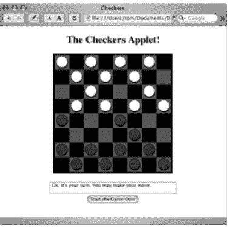

**图1.1** 这个Java小程序正在玩一场精彩的跳棋游戏。

## JavaScript的由来

如果JavaScript与Java无关，那为什么它们的名字如此相似？这又是计算机行业最恼人的特性之一：营销宣传凌驾于技术实质之上的典型例证。

很久以前，当网景公司为其Navigator网页浏览器添加基本脚本功能时，最初将该脚本语言命名为LiveScript。与此同时，Java正作为计算领域的"下一个重大突破"而备受媒体关注。当网景公司更新Navigator以支持Java小程序（在Navigator 2版本中），同时也将LiveScript更名为JavaScript，希望借助Java的声望提升自身影响力。尽管JavaScript和Java是截然不同的编程语言，但这并未阻止网景公司的营销天才们。此后，像我们这样的作者便靠解释JavaScript与Java的差异谋生。仔细想想，或许我们真该感谢那些营销人员。

当微软发现JavaScript在网页开发者中日渐流行时，意识到必须为Internet Explorer添加某种脚本功能。微软本可直接采用JavaScript，但正如其一贯作风，他们选择开发自己的语言——这种语言与JavaScript工作原理相似但并不完全相同。这个微软版本的JavaScript被称为JScript。

第一章

## JavaScript的功能

通过JavaScript可以实现多种功能，使网页更具交互性，并为网站用户提供更优质、更精彩的体验。JavaScript允许创建动态用户界面，在用户浏览页面时提供即时反馈。例如，您可能见过当鼠标悬停时会高亮显示的按钮。这正是通过JavaScript实现的，使用的技术称为"悬停效果"（**图1.2**）。

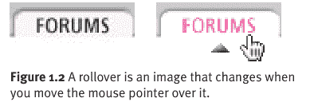

您可以使用JavaScript确保用户在表单中输入有效信息，从而为企业节省时间和成本。如果表单需要计算，您可以在用户计算机上通过JavaScript完成，无需服务器端处理。这里需要明确一个概念：在用户计算机上运行的程序称为*客户端*程序；而在服务器上运行的程序（包括后续将介绍的CGI程序）则称为*服务端*程序。

借助JavaScript，您可以根据用户操作创建定制化网页。假设您运营一个旅游网站，当用户选择夏威宫作为目的地时，可以在新窗口显示最新的夏威夷旅游优惠信息。JavaScript可以控制浏览器，因此您可以打开新窗口、显示警告框，并在浏览器窗口的状态栏显示自定义消息。由于JavaScript具备日期时间处理功能，您还可以创建时钟、日历，并为文档添加时间戳。

此外，JavaScript还能处理表单、设置Cookie、动态生成HTML页面以及创建基于Web的应用程序。

## JavaScript的局限性

JavaScript是一种*客户端*语言；这意味着它专门设计用于在用户计算机而非服务器上运行。因此JavaScript存在一些内置限制，主要出于安全考虑：

- JavaScript不允许读写客户端计算机上的文件。这是合理的设计，因为您绝不希望网页能够读取硬盘文件、在磁盘写入病毒或篡改计算机文件。唯一的例外是JavaScript可以写入浏览器的Cookie文件，且存在相应限制（关于Cookie的更多信息请参见第10章）。

- JavaScript不允许向服务器计算机写入文件。虽然许多场景下这会很方便（如存储页面访问量或表单数据），但JavaScript不允许执行此类操作。您需要在服务器上部署程序来处理和存储这些数据，例如使用Perl或PHP等语言编写的CGI程序（在服务器上运行的程序），或是Java程序。

- JavaScript无法关闭非其打开的窗口。这是为了防止网站接管浏览器并关闭其他网站窗口。

- JavaScript无法读取来自其他服务器的已打开网页信息。换言之，网页不能从其他打开的窗口读取信息，也无法获知访问该网站的用户正在浏览的其他内容。

第一章

## 什么是Ajax？

简单来说，这是一种创建交互式Web应用的方法。那么这*究竟*意味着什么？让我们设想一些您可能通过网站实现的功能。例如，您可能想与配偶共进晚餐（如果没有配偶，可将"配偶"替换为"朋友""亲戚"或"宠物"——尽管大多数人不会与宠物共餐）。您需要知道如何从当前位置前往那家众人推荐的新餐厅。您决定使用提供地图服务的网站查询路线。访问网站后输入餐厅地址，网站便会显示标注餐厅位置的地图。该网站显示的地图带有可点击的边框，点击边框可切换视图（**图1.3**）。每次点击边框后，需要等待5-10秒等待地图刷新，若想再次调整视图则需重复操作。这个过程缓慢且响应性差。如果能够直接点击地图并拖动到想要的方向，让地图视图随手势移动，岂不是更理想？

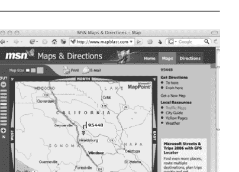

**图1.3** 这个MapQuest地图需要较长时间响应用户点击，因为每次修改都需要从服务器刷新大量数据。

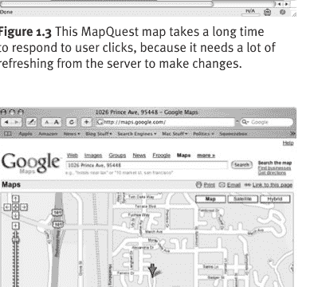

**图1.4** 采用Ajax技术的Google地图能提供更流畅、响应更及时的用户体验。

这正是基于Ajax构建的Web应用能为用户提供的动态响应体验（**图1.4**）。几乎没有等待时间，用户完全掌控操作过程，这种体验堪比传统桌面应用。更重要的是，它能更快速便捷地帮您找到从家到餐厅的最佳路线。

## JavaScript入门

Ajax是"Asynchronous JavaScript and XML"（异步JavaScript与XML）的缩写，由网页开发者兼作家杰西·詹姆斯·加勒特于2005年初首次提出。严格来说，Ajax只是JavaScript中一个（特别受欢迎的）小分支。但在日常使用中，该术语已不再指代单一技术（如Java或JavaScript）。

从更宏观的视角看，通常所说的Ajax是以下技术的组合：

- XHTML
- CSS（层叠样式表）
- 通过JavaScript访问的DOM（文档对象模型）
- XML（服务器与客户端间传输数据的格式）
- XMLHttpRequest（从服务器检索数据）

呼，这列表相当长，特别是如果您对JavaScript或其他网页编程不太熟悉。但不必担心，本书将逐步介绍这些技术。当您阅读Ajax相关章节时，这些组成部分应该已相当熟悉。

Ajax的优势在于大部分应用处理都在用户浏览器中进行，服务器数据请求通常较为简短。因此，借助Ajax，您可以为用户提供丰富的Web应用体验，避免了传统方式需要服务器根据用户操作返回完整HTML页面的性能损耗。

**什么是Ajax？**


# 第1章

一些公司已在 Ajax 上投入巨资，尤以 Google 为甚，它构建了多个重要的 Ajax 应用程序，包括 Gmail（其基于 Web 的电子邮件）、Google Calendar、Google Docs 和 Google Maps。Ajax 的另一个重要支持者是 Yahoo!，它使用 Ajax 来增强其个性化的 My Yahoo! 门户、Yahoo! 首页、Yahoo! Mail 等。这两家公司都已公开了其 Web 应用程序的接口，以便人们可以利用这些接口创建有趣的新应用程序。例如，许多人已经为 Google Maps 创建了*mashups*（混搭应用），这些应用将地图与有趣、有用或仅仅是古怪的信息叠加在一起，例如洛杉矶地区所有日本餐厅的位置或电影的拍摄地点。

> **提示**

-   要查看众多 Google Maps mashups 的优质列表，请访问 Google Maps Mania (googlemapsmania.blogspot.com)。

## 拼接式语言

还有一个我们需要了解的流行词：JavaScript 是一种*面向对象*的语言。那么这是什么意思呢？

## 对象

首先，让我们思考一下对象。一个*对象*是某种事物。猫、电脑和自行车都是物理世界中的对象（**图 1.5**）。对于 JavaScript 而言，它在 Web 浏览器中处理对象，例如窗口和表单，以及表单的元素，例如按钮和复选框（**图 1.6**）。

因为你可以拥有一只以上的猫，或者一个以上的窗口，所以给它们命名是有意义的。虽然你可以将你的宠物称为“猫 #1”和“猫 #2”，但这样做有两个坏处：第一，如果它们有独特的名字，更容易区分它们；第二，这简直不礼貌。同样，本书中的所有示例都将为对象提供其独特的名称。

> **提示**

-   注意，你在互联网上看到的脚本可能会引用像 `window[0]` 和 `form[1]` 这样的对象。这是不良的风格，原因如上所述，你会发现，如果你给它们起名字而不是用数字，你将更容易在脚本中跟踪不同的对象。
-   一些挑剔的程序员会争辩说 JavaScript 并不是真正的面向对象，而是*基于对象的*。就本书而言，这两种含义足够接近，以至于没有区别。

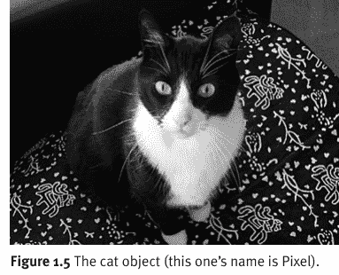

图 1.5 猫对象（这个对象的名字是 Pixel）。

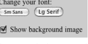

图 1.6 按钮和复选框是浏览器对象，可以通过 JavaScript 进行操作。

## 属性

对象具有*属性*。猫有毛皮，电脑有键盘，自行车有轮子。在 JavaScript 的世界里，窗口有标题，表单可以有一个复选框。

更改对象的属性会修改该对象，并且相同的属性名称可以是完全不同的对象的一部分。假设你有一个名为 `empty` 的属性。在任何适用的地方使用 `empty` 都是没问题的，因此你可以说猫的肚子是空的，并且猫的碗也是空的。

请注意，电脑的键盘和自行车的轮子不仅仅是属性；它们本身也是对象，可以有自己的属性。因此，对象可以拥有子对象。

## 方法

对象可以做的事情称为*方法*。猫会打呼噜，电脑会崩溃，自行车会滚动。JavaScript 对象也有方法：按钮 `click()`，窗口 `open()`，文本可以被 `selected()`。括号表示我们指的是一个方法，而不是一个属性。

> **提示**

-   将对象和属性视为名词，将方法视为动词可能会有所帮助。前者是事物，后者是这些事物可以做的或被做的动作。

## 将各部分组合在一起

你可以将对象、属性和方法组合在一起，以获得对对象更好的描述，或描述一个过程。在 JavaScript 中，这些部分由句点（也称为点，就像在互联网地址中一样）分隔。这称为*点语法*。以下是一些用这种方式编写的对象及其属性的示例：

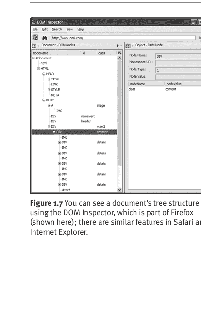

图 1.7 你可以使用 DOM Inspector 查看文档的树结构，这是 Firefox 的一部分（此处显示）；Safari 和 Internet Explorer 中也有类似的功能。

```
bicycle.wheels
cat.paws.front.left
computer.drive.dvd
document.images.name
window.status
```

以下是一些用点语法编写的对象和方法的示例：

```
cat.purr()
document.write()
forms.elements.radio.click()
```

## 文档对象模型介绍

在网页上，构成页面（*或文档*）的对象以树形结构表示。你在构建 HTML 页面时见过这种结构；页面的顶层包含在 `<html>` 标签中，其内你会找到 `<head>` 和 `<body>` 标签，每个标签内又有其他标签，依此类推。一些浏览器可以显示这种树形结构的表示，如**图 1.7** 所示。JavaScript 将文档树中的每一项都视为对象，你可以使用 JavaScript 来操作这些对象。文档中对象的表示称为*文档对象模型*（DOM）。

树中的每个对象也称为树的*节点*。我们可以使用 JavaScript 修改树的任何方面，包括添加、访问、更改和删除树上的节点。树上的每个对象都是一个节点。如果节点包含一个 HTML 标签，则称为*元素节点*。否则，称为*文本节点*。当然，元素节点可以包含文本节点。关于 DOM 和节点，你现在只需要知道这些；你将在本书中，特别是在第 11 章中了解更多关于它们的知识。

## 处理事件

*事件*是用户在访问你的页面时执行的操作。提交表单和将鼠标移到图像上是事件的两个例子。

JavaScript 使用称为*事件处理程序*的命令来处理事件。用户在页面上的操作会触发脚本中的事件处理程序。**表 1.1** 列出了 12 个最常见的 JavaScript 事件处理程序。我们在第 9 章中处理其他更高级的事件处理程序。

例如，假设我们的猫通过执行 `purr`（打呼噜）和 `stretch`（伸展）动作来处理 `onpetting`（被抚摸）事件。

在 JavaScript 中，如果用户单击按钮，`onClick` 事件处理程序会记录该操作并执行其被分配的任何任务。

当你编写脚本时，你不必预测用户可能采取的每一个可能的动作，只需考虑你希望发生特殊事情的情况。例如，即使没有 `onload` 事件处理程序，你的页面也能正常加载。但如果你想在页面加载后立即触发脚本，则需要使用 `onload` 命令。

### 表 1.1 事件处理程序

| 事件 | 处理的内容 |
|---|---|
| onabort | 用户中止加载页面 |
| onblur | 用户离开对象 |
| onchange | 用户更改了对象 |
| onclick | 用户单击了对象 |
| onerror | 脚本遇到错误 |
| onfocus | 用户使对象处于活动状态 |
| onload | 对象加载完成 |
| onmouseover | 光标移到对象上 |
| onmouseout | 光标移离对象 |
| onselect | 用户选择了对象的内容 |
| onsubmit | 用户提交了表单 |
| onunload | 用户离开了页面 |

### 表 1.2

| 类型 | 描述 | 示例 |
|------|-------------|---------|
| Number (数字) | 任何数值 | 3.141592654 |
| String (字符串) | 引号内的字符 | "Hello, world!" |
| Boolean (布尔值) | 真或假 | true |
| Null (空值) | 空且无意义 | |
| Object (对象) | 与对象关联的任何值 | |
| Function (函数) | 函数返回的值 | |

## 值和变量

在 JavaScript 中，一段信息就是一个*值*。值有不同的种类；你最熟悉的是数字。*字符串*值是字符——例如一个或多个单词——用引号括起来。JavaScript 的其他类型的值列在**表 1.2** 中。

*变量*包含值。例如，变量 *myName* 被赋值为字符串 "Dori"。另一种写法是 *myName* = "Dori"。等号可以被读作“被设置为”。换句话说，变量 *myName* 现在包含值 "Dori"。

> **提示**

-   JavaScript 区分大小写。这意味着 *myname* 与 *myName* 不同，后者也与 *MyName* 不同。
-   变量名不能包含空格或其他标点符号，也不能以数字开头。它们也不能是 JavaScript 的保留字。有关 JavaScript 保留字的列表，请参见附录 B。

### 表 1.3

| 运算符 | 作用 |
|----------|-------------|
| x + y (数字) | 将 x 和 y 相加 |
| x + y (字符串) | 将 x 和 y 连接在一起 |
| x - y | 从 x 中减去 y |
| x * y | 将 x 和 y 相乘 |
| x / y | 将 x 除以 y |
| x % y | x 和 y 的模（即 x 除以 y 的余数） |
| x++, ++x | x 加一（等同于 x = x + 1） |
| x--, --x | x 减一（等同于 x = x - 1） |
| -x | 取反 x 的符号 |

## 运算符

*运算符*是用于处理变量的符号。你已经通过简单的算术运算熟悉了运算符；加号和减号就是运算符。完整的运算符列表请参见**表 1.3**。

> **提示**

-   虽然 *x++* 和 *++x* 都将 *x* 加一，但它们并不相同；前者在赋值完成后递增 *x*，而后者在赋值前递增。例如，如果 *x* 是 5，*y=x++* 的结果是 *y* 被设置为 5，而 *x* 被设置为 6，而 *y=++x* 的结果是 *x* 和 *y* 都被设置为 6。运算符 *--*（减号）的工作原理类似。
-   如果你在将两个值相加时混合使用数字和字符串值，结果将是一个字符串。例如，*cat* + 5 的结果是 *cat5*。


## 赋值与比较

当你将一个值放入变量时，就是在对该变量进行赋值，而你需要使用赋值运算符来完成这项工作。例如，你可以使用等号运算符来进行赋值，如 `hisName = "Tom"`。表 1.4 列出了完整的赋值运算符集合。

除了等号之外，其他赋值运算符都可以作为修改变量值的快捷方式。例如，`x=x+5` 的简短写法是 `x+=5`。不过，为了清晰起见，本书在大多数情况下仍使用较长的版本。

## 比较

你通常需要将一个变量的值与另一个变量进行比较，或将变量的值与字面量（即输入到表达式中的值）进行比较。例如，你可能想将一周中的某一天与 "Tuesday" 进行比较，这可以通过检查 `todaysDate == "Tuesday"` 来实现（注意双等号）。完整的比较运算符列表见表 1.5。

### ✔ 提示

- 如果比较字符串，请注意 "a" 大于 "A"，且 "abracadabra" 小于 "be"。

表 1.4
**赋值运算符**

| 赋值 | 作用 |
| :--- | :--- |
| `x = y` | 将 x 设置为 y 的值 |
| `x += y` | 等同于 `x = x + y` |
| `x -= y` | 等同于 `x = x - y` |
| `x *= y` | 等同于 `x = x * y` |
| `x /= y` | 等同于 `x = x / y` |
| `x %= y` | 等同于 `x = x % y` |

表 1.5
**比较运算符**

| 比较 | 作用 |
| :--- | :--- |
| `x == y` | 如果 x 和 y 相等，则返回 true |
| `x != y` | 如果 x 和 y 不相等，则返回 true |
| `x > y` | 如果 x 大于 y，则返回 true |
| `x >= y` | 如果 x 大于或等于 y，则返回 true |
| `x < y` | 如果 x 小于 y，则返回 true |
| `x <= y` | 如果 x 小于或等于 y，则返回 true |
| `x && y` | 如果 x 和 y 都为 true，则返回 true |
| `x || y` | 如果 x 或 y 任一 为 true，则返回 true |
| `!x` | 如果 x 为 false，则返回 true |

## 编写 JavaScript 友好的 HTML

由于你将使用 JavaScript 来操作文档中的对象，因此你需要以一种便于脚本使用的方式来编写 HTML。这基本上意味着编写符合现代标准的 XHTML 并使用 CSS 将文档的结构与其表现形式分离开来。

当我们提到现代 XHTML 时，我们不仅仅指那些通过 Web 工具 validator.w3.org 的 W3C 验证的文档。我们还建议提前思考您可能对页面进行的操作，并添加适当的标签和属性，以便用 JavaScript 轻松访问对象。您想知道什么样的标记？很高兴您问了。

## 结构、表现和行为

CSS（层叠样式表）是 Web 的标准布局语言，用于控制版式、颜色以及元素和图像的大小与位置。您的 XHTML 文档应使用外部样式表来定义文档中使用的样式。您的 JavaScript 也应该放在外部文档中，即仅包含 JavaScript 代码的文档。

这样拆分后，您的站点将包含三种类型的文本文件：

- XHTML：包含页面的内容和结构
- CSS：控制页面的外观和表现
- JavaScript：控制页面的行为

这样做之后，对站点进行更改（甚至是对整个站点有影响的更改）就变得非常直接。

第 1 章

## Div 与 span

如果您习惯于经典的 HTML 风格，即把所有东西都塞进表格里，然后不断调整占位 GIF 直到页面大致变成您想要的布局，那么其中一些内容对您来说会比较陌生——所以这里有一个快速概述，让您跟上进度。

XHTML 中有两个终于要得到应有的关注的标签：`<div>` 和 `<span>`。它们用于将内容拆分成语义的块，也就是说，具有相似*含义*的块。单个表格单元格或段落中的东西可能彼此没有任何共同点，但每个 `<div>` 和 `<span>` 内的内容应该具有共通之处。

为什么使用其中一个而不是另一个？`<div>` 是块级元素，也就是说，它与上下方元素之间存在物理分隔。而 `<span>` 不是块级的；相反，它是*内联*的，因此您可以将其应用于，例如，句子中的单个短语。

我们并不是说你 需要抛弃所有已学过的 HTML 知识——远非如此！但将这两个标签添加到你的解决方案工具包中，你会发现自己使用它们的频率超乎想象。

## class 与 id

在 XHTML 文档中，您需要通过将内容分解成有意义的块来进行标记。在此基础上，您仍需要识别那些希望更改其表现或行为的内容片段。为此，您主要会使用两个属性：`class` 和 `id`。这两个属性都可以被 CSS 和 JavaScript 使用；CSS 样式表使用这些属性作为规则的一部分来定义页面的外观，而 JavaScript 文件可以在代码中使用这些属性来影响页面上元素的行为。

*class* 用于标识一个可能在文档中使用多次的 元素。例如，假设您正在为一家电影院创建页面。您可以为电影标题定义一个 class，指定标题应为 14 像素、粗体、深蓝色。

```
.movieTitle {
    font: bold 14px;
    color: #000099;
}
```

然后，您应该用指定了标题样式 *class* 的标签包裹页面上的每个电影标题，如下所示：

```
<p>We're currently showing
    <span class="movieTitle">
    The Aviator</span> and
    <span class="movieTitle">
    The Outlaw</span>.</p>
```

*id* 用于标识该文档中唯一的 元素。例如，如果您只在页面上使用 一次电影院的名称，您可以使用 id 创建一个样式规则来定义影院名称的显示方式，如下所示：

```
#theaterName {
    font: bold 28px;
    color: #FF0000;
}
```

然后，到了显示影院名称的时候，您只需将该 id 属性添加到标签即可获得效果：

```
<h1 id="theaterName">The Raven
    Theater Presents:</h1>
```

上述示例中适用于 CSS 的内容同样适用于 JavaScript。一旦我们为 div 和 span（以及任何其他元素）分配了 class 和 id，我们就可以修改这些元素：不仅是它们的外观（通过 CSS），还包括它们的行为（通过 JavaScript）。而这正是本书其余部分将要讨论的主题。

### ✔ 提示

- 记不住在 CSS 中何时使用 # 何时使用 .，因为您想不起来哪个对应 *class* 哪个对应 *id*？这是我们的方法：给定页面上的 *id* 只能出现 一次，而且 *仅* 能出现一次。一是一个数字，而井号（#）也叫数字符号——所以它就是与 *id* 配对的那 一个。

## 应该使用什么工具？

由于 JavaScript 只是纯文本，您几乎可以使用任何文本编辑器。您甚至可以使用 Microsoft Word 这样的文字处理软件，但您必须始终确保 Word 将文件保存为纯文本格式，而不是其原生文件格式。HTML、JavaScript 和 CSS 文件必须始终保持纯文本格式，以便 Web 服务器能够识别它们。

最好还是使用以纯文本作为标准格式的程序。在 Windows 上，很多人使用记事本（图 1.8）也能应付过去。在 Mac 上，您可以使用 TextEdit，不过专业人士的首选是 Bare Bones Software 开发的 BBEdit（图 1.9）。在 Unix 机器上，Emacs 是最好用的文本编辑器之一。无论使用什么程序，不要忘记使用正确的扩展名（.html、.css 或 .js）保存您的纯文本文件，这样将文件上传到 Web 服务器时才能顺利进行。

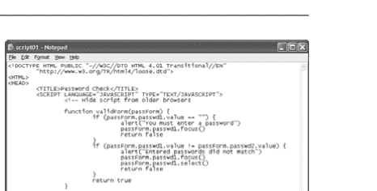

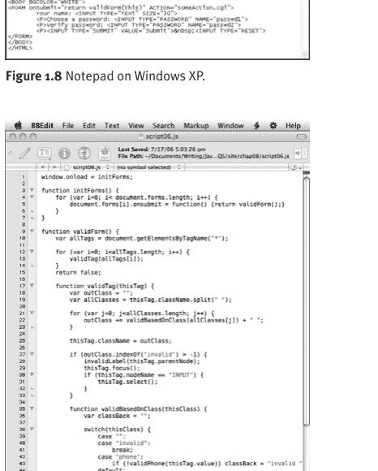

您还可以使用一些所见即所得（WYSIWYG）的 HTML 编辑器，例如 Adobe Dreamweaver。只需切换到它们的 HTML 源代码模式即可编写脚本。

### ✔ 提示

- 如果您是 Mac 用户，可以试试同样来自 Bare Bones 公司的 TextWrangler（www.barebones.com）。它的功能不如 BBEdit 全面，但有一个很大的优势：它是免费的。


# 准备开始！

热身到此为止；是时候开始编写脚本了。在本章中，你将学习如何在 HTML 中放置脚本；如何在脚本中添加注释以便日后更容易理解；以及如何使用脚本与用户进行交流。你还将了解如何让页面自动跳转到另一个页面（称为*重定向*）。让我们开始吧！

## 基础 HTML 知识

| 标签 | 属性 | 含义 |
| --- | --- | --- |
| html | | 包含网页的 HTML 部分 |
| head | | 包含网页的头部部分 |
| script | | 包含网页的脚本或对外部脚本文件的引用。通常是 JavaScript，但不总是如此。 |
| | type | 脚本使用的编程语言。必填属性。 |
| | src | 外部脚本的位置 |
| title | | 包含网页的标题 |
| body | | 包含网页的主体部分 |
| | bgcolor | 设置页面的背景颜色 |
| h1…h6 | | 此标签中的内容被强调为标题信息；h1 是最大的标题字号，h6 是最小的标题字号 |
| | align | 描述此标签中的内容在页面上应放置的位置，即水平或垂直对齐方式 |
| a | | 链接到另一个网页 |
| | href | 指定用户点击链接时应跳转到的位置 |
| | id | 分配给链接的 id |

**脚本 2.1** 脚本始终需要包含在 `<script>` 和 `</script>` HTML 标签内。

```
<!DOCTYPE html PUBLIC "-//W3C//DTD XHTML 1.0
Transitional//EN"
       "http://www.w3.org/TR/xhtml1/DTD/
       xhtml1-transitional.dtd">
<html xmlns="http://www.w3.org/1999/xhtml">
<head>
    <title>My first script</title>
</head>
<body bgcolor="#FFFFFF">
    <h1>
        <script type="text/javascript">

            document.write("Hello, world!");

        </script>
    </h1>
</body>
</html>
```

**图 2.1** "Hello, world" 示例在编程书籍中是*必不可少*的。如果我们省略了它，恐怕会丢掉我们的工会会员卡。

### 脚本放置位置

脚本可以放在 HTML 页面的两个位置之一：在 `<head>` 和 `</head>` 标签之间（称为*头部脚本*），或在 `<body>` 和 `</body>` 标签之间（*主体脚本*）。**脚本 2.1** 就是一个主体脚本的示例。

有一个用于标记脚本的 HTML 容器标签，正如你所猜测的那样，它以 `<script>` 开头，以 `</script>` 结尾。

#### 编写你的第一个脚本：

1. `<script type="text/javascript">`
   这是开始的 `script` 标签。它告诉浏览器接下来是 JavaScript 而不是 HTML。`type="text/javascript"` 属性告诉浏览器脚本是纯文本，按照 JavaScript 格式编写。

2. `document.write("Hello, world!");`
   这是第一行 JavaScript 代码：它获取文档窗口并写入 "Hello, world!"，如**图 2.1** 所示。注意行末的分号；它告诉浏览器的 JavaScript 解释器该行结束了。除极少数例外，本书中每行 JavaScript 代码的末尾我们都会使用分号。

3. `</script>`
   这结束 JavaScript 并告诉浏览器重新开始解析 HTML。

### ✔ 提示

- 结束的 script 标签无需添加任何属性。

- script 标签的 language 属性（我们此处未使用）在 XHTML 中已被*弃用*，这意味着负责 XHTML 的标准制定机构 W3C 已将该属性标记为在未来版本中不一定支持的属性。不过，仍有大量旧脚本在使用它。

- 在 JavaScript 行末使用分号是可选的，前提是每行只有一条语句。为了清晰起见，我们在本书中包含了分号，并建议你也养成在代码中包含分号的习惯。

- 在本书剩余部分的代码解释中，我们省略了 `<script>` 标签。正如你在脚本本身中看到的，它们仍然存在且仍然需要，但我们不会用它们来充斥我们的解释。

- 你可以在一个页面上随意使用任意数量的 script 标签（因此也可以有多个脚本）。

## 关于函数

在进入下一个示例之前，你需要了解一些关于函数的知识，你在编写 JavaScript 时会经常用到它们。*函数*是一组执行特定任务的 JavaScript 语句。每个函数都必须有一个名称（有一个非常罕见的例外，我们将在本书后面讨论），并且可以被脚本的其他部分调用。

函数可以在脚本运行期间根据需要被调用多次。例如，假设你获取了用户在表单中输入的一些信息，并使用 JavaScript 保存了它（关于这类内容的更多信息请参见第 7 章"表单处理"）。如果你需要反复使用这些信息，你可以在脚本中一遍又一遍地重复相同的代码。但更好的做法是将该代码编写为一个函数，然后在需要时调用该函数。

函数由 `function` 关键字后跟函数名组成。函数名后面始终有圆括号，然后是左花括号。构成函数的语句写在下面几行中，然后函数以另一个花括号结束。函数的结构如下所示：

```
function saySomething() {
    alert("Four score and seven years ago");
}
```

注意 `alert` 那一行缩进了吗？这使你的代码更易于阅读。第一个花括号和最后一个花括号之间的所有语句（你可能注意到这两行没有缩进）都是函数的一部分。关于函数，目前你只需了解这些。你将在后续章节中学习更多关于函数的知识。

# 第 2 章

## 使用外部脚本

在 HTML 页面上使用脚本（如上一个示例）的问题在于，脚本仅对该特定页面可用。这就是为什么这类脚本有时被称为*内部*脚本。但通常情况下，你会希望多个 HTML 页面共享一个脚本。你可以通过引用一个*外部*脚本来实现这一点，即一个仅包含 JavaScript 的独立文件。这个外部文件被称为 .js 文件，因为无论它叫什么名字，文件名都应以 .js 为后缀。各个页面只需在 script 标签中添加一个新的 src 属性即可调用该 .js 文件。

这可以节省每个页面大量的代码，更重要的是，使你的网站更易于维护。当你需要对脚本进行更改时，只需修改 .js 文件，所有引用该文件的 HTML 页面都会自动获得你的更改。

在这个外部脚本的第一个示例中，**脚本 2.2** 是包含对外部文件引用的 HTML，**脚本 2.3** 是外部 JavaScript 文件。

### 使用外部脚本：

1. <script type="text/javascript"
     src="script02.js">

   这行代码在脚本 2.2 中。在 script 标签中添加 src 属性会使支持 JavaScript 1.1 及更高版本的浏览器去查找该文件。生成的网页看起来就像脚本在页面 script 标签中的通常位置一样，而实际上脚本存放在外部 .js 文件中。

   仅这一行代码就是使用外部脚本所需做的全部。接下来，让我们看看该脚本的内容。

**脚本 2.2** 简单的 HTML 将对外部 JavaScript 文件的引用放在 script 标签内。

```
<!DOCTYPE html PUBLIC "-//W3C//DTD XHTML 1.0
  Transitional//EN"
   "http://www.w3.org/TR/xhtml1/DTD/
   xhtml1-transitional.dtd">
<html xmlns="http://www.w3.org/1999/xhtml">
<head>
    <title>My second script</title>
    <script type="text/javascript"
       src="script02.js"></script>
</head>
<body bgcolor="#FFFFFF">
    <h1 id="helloMessage">
    </h1>
</body>
</html>
```

**脚本 2.3** 你的第一个外部 JavaScript 文件。

```
window.onload = writeMessage;

function writeMessage() {
    document.getElementById("helloMessage").
       innerHTML = "Hello, world!";
}
```

### ✔ 提示

-   支持外部 JavaScript 文件的浏览器包括：Microsoft Internet Explorer 4 及更高版本、Netscape 3 及更高版本，以及此后几乎所有发布的浏览器，包括 Firefox 和 Safari 等现代浏览器。

-   使用外部 JavaScript 文件有时被用来试图向用户隐藏 JavaScript。如果用户技术足够精通，能够检查其浏览器缓存文件——浏览器看到的所有内容都存储在那里——那么这种方法就行不通了。

-   在脚本 2.1（以及本书更早的版本）中，我们使用了一种称为 `document.write()` 的技术将信息插入 HTML 页面。在本版本中，我们已基本用设置 `innerHTML` 的方式取代了这种方法，因为它功能更强大。有些人反对使用 `innerHTML` 属性，因为它尚未获得 W3C 的认可。但即使是那些对此有异议的人也同意，这是最简单的跨浏览器工作方式，因此这将是我们在本书中主要展示的方法。添加或更改 HTML 页面的“官方”方式在第 11 章“对象和 DOM”中介绍。

-   如果你以前见过函数，你可能期望步骤 2 中的 `writeMessage` 引用是 `writeMessage()`。事实并非如此，因为两者含义不同：带括号的函数表示该函数正在被调用，就在那一刻。而不带括号时（如此处所示），我们是在将其赋值给事件处理程序，以便在该事件发生时稍后运行。

## 在脚本中添加注释

脚本 2.4 以下是如何用注释为你的脚本添加说明，这有助于你和其他人理解你的代码。

```
/*
    这是一个多行 JavaScript
    注释的示例。注意注释
    开头和结尾的字符。

    此脚本将文字 "Hello, world!"
    添加到 HTML 页面的 body 区域。
*/

window.onload = writeMessage; // 当页面
// 加载完成时执行此操作

function writeMessage() {
    // 实际的工作在这里完成

    document.getElementById("helloMessage").
    innerHTML = "Hello, world!";
}
```

养成在脚本中添加注释的习惯是一个好主意。你可以通过插入 JavaScript 不会将其解释为脚本命令的注释来实现这一点。虽然在你编写脚本时，它对你来说可能非常清晰，但如果你几个月后回来再看，它可能就像泥巴一样模糊不清。注释有助于解释你为什么以特定方式解决问题。给脚本添加注释的另一个原因是帮助可能希望重用和修改你脚本的其他人。

**脚本 2.4** 展示了两种脚本注释的示例。第一种是用于较长、多行的注释。第二个示例展示了如何进行单行注释。

请注意，我们没有包含此示例的 HTML，因为它（几乎）与脚本 2.2 相同。从现在起在本书中，当 HTML 与之前的示例没有变化时，我们将不再重复打印它。

### 为脚本添加注释：

1. /*
这是一个较长的
JavaScript 注释示例。注意
注释开头和结尾的字符。
此脚本将文字 "Hello,
world!" 添加到 HTML 页面的
body 区域。
对于多行注释，行首的 /* 告诉 JavaScript
忽略之后的所有内容，直到注释结束。

2. */
这是注释的结尾。

# 第 2 章

3. window.onload = writeMessage;
   // 当页面加载完成时执行此操作
   function writeMessage() {
       // 实际的工作在这里完成
       document.getElementById("helloMessage").innerHTML = "Hello, world!";
   }

以下是脚本再次出现，如上一个示例所示，带有单行注释。正如你在这里看到的，单行注释可以单独占一行，也可以跟在一行代码之后。在单行注释之后的同一行上不能有任何代码，也不能在代码的同一行上有多行注释。

是的，我们和你一样厌倦了看到这个例子，但所有代码书都以 "Hello, world!" 示例开始是传统。

传统到此为止。

## 提醒用户

JavaScript 的主要用途之一是向浏览你网站的人员提供反馈。你可以创建一个弹出的警告窗口，向用户提供关于你页面必须知道的极其重要的信息。

在用户界面设计中，少即是多。例如，你可以通过响亮的警报声和大型动画横幅来吸引用户的注意，但这可能有点过头了。相反，**脚本 2.5**（HTML，仅调用外部脚本）和 **2.6**（JavaScript）展示了如何创建一个美观、得体的警告窗口。现在你知道为什么我们是作者而不是设计师了。

**脚本 2.5** 此示例的 HTML 包含 `<script>` 和 `<noscript>` 标签。

```
<!DOCTYPE html PUBLIC "-//W3C//DTD XHTML 1.0 Transitional//EN"
    "http://www.w3.org/TR/xhtml1/DTD/xhtml1-transitional.dtd">
<html xmlns="http://www.w3.org/1999/xhtml">
<head>
    <title>我的 JavaScript 页面</title>
    <script type="text/javascript"
        src="script04.js"></script>
</head>
<body bgcolor="#FFFFFF">
<noscript>
    <h2>此页面需要 JavaScript。</h2>
</noscript>
</body>
</html>
```

**脚本 2.6** 警告对话框帮助你与用户进行沟通。

```
alert("Welcome to my JavaScript page!");
```

### 提醒用户：

```
alert("Welcome to my JavaScript page!");
```

是的，就是这样，如 **图 2.3** 所示。只需将你想要显示在 `alert()` 方法中的文本放在直引号内。

### ✔ 提示

-   在大多数 JavaScript 警告框中，你会看到一些指示，告诉用户该警告框是由 JavaScript 命令弹出的。这是一个安全功能，旨在防止不道德的脚本编写者欺骗无辜的用户。你无法绕过此限制。例如，在 Mac OS X 的 Safari 上，它会显示打开该警告的网站的 URL，如图 2.3 所示。Windows 和 Mac 上的 Firefox 也是如此。在 Internet Explorer 6 中，窗口标题是“Microsoft Internet Explorer”。Internet Explorer 7 则显示“Windows Internet Explorer”，这是一个有趣的重新品牌化。

-   你还会看到这里使用了 `<noscript>` 标签。在非 JavaScript 浏览器（较旧的浏览器和禁用了 JavaScript 的浏览器）中，会出现一条消息，说明此页面需要 JavaScript。

**图 2.3** 此脚本只弹出一个对话框；显示的四个是对话框外观的示例，从上到下依次为：Mac OS X 上的 Firefox 2；XP 上的 Microsoft Internet Explorer 6；Vista 上的 Microsoft Internet Explorer 8；以及 Mac OS X 上的 Safari 3。

## 提醒用户


**脚本 2.7** 你可以根据用户对提示的反应来修改回复。

```
if (confirm("Are you sure you want to do that?")) {
    alert("You said yes");
}
else {
    alert("You said no");
}
```

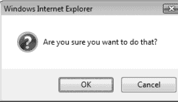

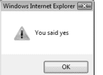

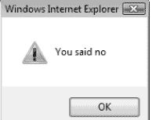

**图 2.4** 你可以捕获用户操作的结果，并在一个提示框中确认该结果，如图所示。顶部图片向用户提问，按下“确定”或“取消”按钮的结果显示在下方。

## 确认用户的选择

虽然向用户提供信息很有用，但有时你也希望获得信息的回馈。**脚本 2.7** 展示了如何判断用户是接受还是拒绝你的问题。这个脚本还引入了*条件判断*的概念，即脚本提出一个测试，并根据测试结果执行不同的操作。

## 关于条件判断的更多信息

条件判断分为三个部分：*if*（如果）部分，我们在此进行测试；*then*（那么）部分，我们在此放置测试结果为真时想要执行的脚本；以及一个可选的*else*（否则）部分，包含当测试结果不为真时我们想要执行的脚本。我们在*if*部分中测试的内容放在圆括号内，其他两个部分的内容则分别包含在花括号中。

## 要确认一个选择：

1. **if (confirm("Are you sure you want to do that?")) {**
   *confirm()* 方法接受一个参数（我们想要问用户的问题），并根据用户的回应返回 true 或 false。

2. **alert("You said yes");**
   如**图 2.4** 所示，如果用户点击了“确定”按钮，*confirm()* 返回 true，随后会显示一个提示框，内容为“You said yes”。你可以看到，这是代码的*then*部分，尽管 JavaScript 中没有 *then* 运算符。花括号充当了 *then* 区域的界定符。

3. `}`
   这个花括号结束了当 `confirm()` 返回 true 时执行的部分。

4. `else {`
   在这里，我们开始编写仅在用户点击“取消”按钮时执行的部分。

5. `alert("You said no");`
   如果用户点击了“取消”按钮，`confirm()` 返回 false，并显示消息“You said no”。

6. `}`
   这个花括号结束了整个 `if/else` 条件语句。

### 提示

- 你可以在 *then* 和 *else* 的花括号内放置任意多的语句。

## 没有一种唯一正确的方式

编写任何给定脚本并让它正确运行的方法，实际上有上百万种。例如，如果（并且仅当）代码块中只有一个语句，那么条件判断不需要花括号。

此外，还有一种编写条件判断的替代方法，形式如下：

```
(condition) ? truePart : falsePart;
```

它大致等价于：

```
if (condition) {
    truePart;
}
else {
    falsePart;
}
```

这种简写方法也可用于设置变量；例如：

```
myNewVariable = (condition) ?
  trueValue : falseValue;
```

等价于：

```
if (condition) {
    myNewVariable = trueValue;
}
else {
    myNewVariable = falseValue;
}
```

花括号也不必位于行尾或行首，true 和 false 代码块也不需要缩进。这完全是一个风格问题，正确的风格是使用你认为最适合自己的那种。

在本书中，为了清晰起见，我们在示例中大多包含了花括号，并选择使用条件判断的较长形式。

**脚本 2.8** 你可以使用对话框来查询用户并处理回复。

```
var ans = prompt("Are you sure you want to do that?", "");
if (ans) {
    alert("You said " + ans);
}
else {
    alert("You refused to answer");
}
```

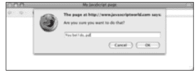

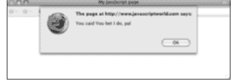

**图 2.5** 你可以提示用户输入一个文本字符串，然后对该字符串进行处理。

## 提示用户

有时，你不仅想问一个是/否问题，还想获得更具体的回复。在这种情况下，**脚本 2.8** 允许你提问（带有一个默认答案），并接收回复。**图 2.5** 展示了结果。

**提示用户输入回复：**

1. `var ans = prompt("Are you sure you want to do that?", "");`

   这里，我们声明了一个变量（如第 1 章所述）。我们使用 `var` 关键字来声明变量。在这个例子中，变量名为 `ans`，并被赋值为 `prompt()` 的结果，即用户输入到提示对话框中的内容。

   `prompt()` 方法接受两段信息（正式称为*参数*），用逗号分隔：向用户提出的问题和默认答案。它返回用户的回复或 *null*；当用户点击“取消”、没有默认答案而用户点击“确定”、或者用户清空默认答案后点击“确定”时，都会返回“null”。对于那些提示框显示关闭框控件的浏览器，使用该控件也会返回 null 结果。

2. ```
   if (ans) {
       alert("You said " + ans);
   }
   ```

   这个条件判断使用了我们刚刚设置的变量。如果 `ans` 存在（即用户输入了回复），脚本会弹出一个提示窗口，显示“You said ”（注意该文本字符串末尾的空格），并拼接（附加到末尾）`ans` 的值。

3. ```
   else {
       alert("You refused to answer");
   }
   ```

   如果 ans 为 null（因为用户没有输入任何内容或在提示对话框中点击了“取消”按钮），则执行条件语句的 else 块，并弹出提示框。

### 提示

- 使用 var 做两件事：
  - 它告诉 JavaScript 创建一个变量（即为此新对象在内存中分配一些空间）。
  - 它定义了变量的作用域，即 JavaScript 需要在哪里了解这个特定对象（参见“什么是作用域？”侧栏）。如果变量在函数内部创建，其他函数无法访问它，因为它仅限于该函数。如果在任何函数外部创建，它就是全局的，所有地方都可以访问它。在这个脚本中，我们创建了全局变量 ans。

- 在某些浏览器中，如果你省略了 prompt 的第二个参数（默认回复），一切正常工作。然而，在另一些浏览器中，提示窗口会出现，并显示默认的“undefined”。解决方法是始终包含一个默认值，即使它是一个空字符串（如脚本 2.8 所示）。

## 什么是作用域？

在世界上的大多数地方，当你提到“百老汇”时，人们知道你指的是纽约市的一条街道。虽然这条街本身在纽约，但全球的人们都能理解你的所指。你可以把百老汇看作一个全局存在。

然而，如果你在加利福尼亚州的圣地亚哥，并且提到“百老汇”，人们会认为你指的是他们市中心区域的一条主要街道。这是一个局部值。在圣地亚哥，如果不明确说明你指的是当地知名的“百老汇”还是全球知名的“百老汇”，可能会导致混淆。

如果你在圣地亚哥，默认值是当地的版本，你必须明确说明“纽约市的百老汇”才能指代另一条。在圣地亚哥之外，除非他们有其他本地的百老汇版本，否则人们首先会想到纽约的百老汇。

这些街道中每一条的作用域就是其成为默认值的地方，也就是说，如果没有提供其他识别信息，人们会自动想到的那个。圣地亚哥的百老汇的作用域是局部的——在该市及少数几个郊区。纽约的百老汇的作用域是全球性的；也就是说，世界任何地方的人都知道你指的是哪里。

对于 JavaScript 代码，避免变量作用域问题和混淆的最简单方法是避免在两个不同地方使用同名变量做两件不同的事。如果你必须走这条滑坡，请明确你的变量作用域！


## 脚本 2.9

这段 HTML 允许你根据链接来重定向用户。

```html
<!DOCTYPE html PUBLIC "-//W3C//DTD XHTML 1.0 Transitional//EN"
    "http://www.w3.org/TR/xhtml1/DTD/xhtml1-transitional.dtd">
<html xmlns="http://www.w3.org/1999/xhtml">
<head>
    <title>Welcome to our site</title>
    <script type="text/javascript"
        src="script07.js"></script>
</head>
<body bgcolor="#FFFFFF">
    <h2 align="center">
        <a href="script04.html" id="redirect">
            Welcome to our site... c'mon in!</a>
    </h2>
</body>
</html>
```

## 使用链接重定向用户

你可以检查 JavaScript 是否存在，然后根据用户是否启用了 JavaScript 来无缝*重定向*，或将用户发送到另一个页面。本示例展示了如何将重定向嵌入到链接中。我们将使用两个 HTML 页面和一个 JavaScript 文件。第一个 HTML 页面，**脚本 2.9**，提供给用户点击的链接。**脚本 2.10** 是 JavaScript 文件，**脚本 2.11** 是如果用户启用了 JavaScript 则被重定向到的 HTML 页面。**图 2.6** 展示了用户的起始点。当他们点击链接时，将被带到两个页面之一，取决于他们是否拥有 JavaScript。

### 脚本 2.10

通过将重定向嵌入到代码中，用户甚至不知道你的脚本干预了链接。

```javascript
window.onload =时一定要完成翻译，并且保留所有格式。

window.onload = initAll;

function initAll() {
    document.getElementById("redirect").
        onclick = initRedirect;
}

function initRedirect() {
    window.location = "jswelcome.html";
    return false;
}
```

### 脚本 2.11

这是启用了 JavaScript 的用户最终到达的页面的 HTML。

```html
<!DOCTYPE html PUBLIC "-//W3C//DTD XHTML 1.0 Transitional//EN"
    "http://www.w3.org/TR/xhtml1/DTD/xhtml1-transitional.dtd">
<html xmlns="http://www.w3.org/1999/xhtml">
<head>
    <title>Our site</title>
</head>
<body bgcolor="#FFFFFF">
    <h1>Welcome to our web site, which features
        lots of cutting-edge JavaScript</h1>
</body>
</html>
```

## 重定向用户的步骤：

1. `<a href="script04.html" id="redirect">Welcome to our site... c'mon in!</a>`

    在脚本 2.9 中，这是用户点击的链接。如果用户没有 JavaScript 并点击了链接，他们将按照通常的 href 路径进入，最终到达一个看起来像**图 2.7** 的页面。如果用户有 JavaScript 并点击了链接，脚本（在第 4 步中）将接管并加载一个新页面。

2. `window.onload = initAll;`

    现在我们进入脚本 2.10。当页面完成加载时，它会触发 `initAll()` 函数。

3. `function initAll() { document.getElementById("redirect").onclick = initRedirect; }`

    这个函数只是告诉 id 为 `redirect` 的元素，当用户点击该链接时（即第 1 步中的链接），应该调用 `initRedirect()` 函数。

4. `function initRedirect() { window.location = "jswelcome.html"; return false; }`

    如果这个函数被调用，那么它会将 `window.location`（浏览器中加载的页面）设置为一个新页面。`return false` 表示停止处理用户的点击，因此 href 页面也不会被加载。这很酷的地方在于，我们完成了一次重定向，而用户完全不知道发生了这件事。他们只是根据自己所拥有的环境，出现在两个不同的页面之一。如果他们有 JavaScript，他们将最终到达**图 2.8** 所示的页面。

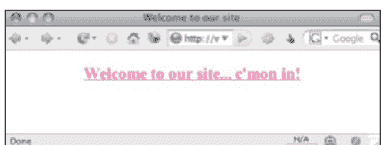

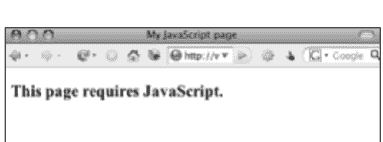

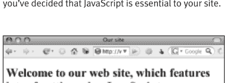

### 提示

- 乍一看，我们可能会认为可以直接全局设置 `onclick` 处理程序——也就是说，在页面加载时就设置——但我们做不到。特别是对于大型复杂的页面，浏览器有可能还没有遇到那个 `redirect` id，如果发生这种情况，JavaScript 就无法分配 `onclick` 处理程序。相反，我们必须等到页面完全加载完毕，这通过 `onload` 来实现。

- 请记住，有些用户可能会反对被发送到一个与他们鼠标悬停在链接上时看到的不同的页面。

## 启动我吧！

### 脚本 2.12

与往常一样，HTML 在链接标签中包含一个 `id`，供 JavaScript 使用。

```html
<!DOCTYPE html PUBLIC "-//W3C//DTD XHTML 1.0 Transitional//EN"
    "http://www.w3.org/TR/xhtml1/DTD/xhtml1-transitional.dtd">
<html xmlns="http://www.w3.org/1999/xhtml">
<head>
    <title>Welcome to our site</title>
    <script type="text/javascript"
      src="script08.js"></script>
</head>
<body bgcolor="#FFFFFF">
    <h2 align="center">
        Hey, check out <a href="http://www.pixel.mu/" id="redirect">my cat's Web site</a>.
    </h2>
</body>
</html>
```

## 使用 JavaScript 增强链接

有时，你可能希望在用户点击链接后、浏览器加载新页面之前执行某些操作。一个典型的例子是，当你想在用户前往你网站上的某个特定页面之前显示一个警告，或者让用户清楚他们正在离开你的网站。在本示例中，我们将在继续前往最终目的地之前显示一个警告对话框。**脚本 2.12** 展示了 HTML，**脚本 2.13** 展示了我们需要对前面脚本进行的小幅修改。

### 脚本 2.13

链接增强脚本。

```javascript
window.onload = initAll;

function initAll() {
    document.getElementById("redirect").
      onclick = initRedirect;
}

function initRedirect() {
    alert("We are not responsible for the
      content of pages outside our site");
    window.location = this;
    return false;
}
```

# 第二章

## 增强链接的步骤：

1. `Hey, check out <a href="http://www.pixel.mu/" id="redirect">my cat's Web site</a>.`

    脚本 2.12 中的这一行展示了链接，包含链接目标的 href 和链接的 id，脚本 2.13 将使用这个 id。页面如**图 2.9** 所示。

    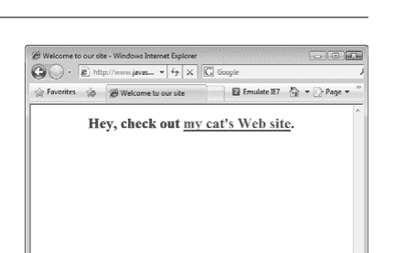

    图 2.9 点击链接将把用户重定向到我们猫咪的网站。

2. `alert("We are not responsible for the content of pages outside our site");`

    这个警告在链接被点击后出现，如**图 2.10** 所示。

    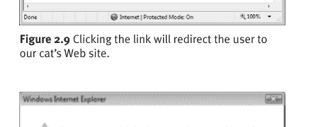

    图 2.10 如果用户拥有支持 JavaScript 的浏览器，他们在离开时会看到这个警告信息。

3. `window.location = this;`

    这一行允许我们将浏览器窗口设置为关键字 this 指定的位置，该关键字包含链接。目前，只需将 this 视为一个容器——如果你想了解更多，请参阅 "什么是 'this'？" 侧边栏。当用户到达他们的最终目的地时，看起来像**图 2.11**（至少，使用我们猫咪的网页作为目的地）。

    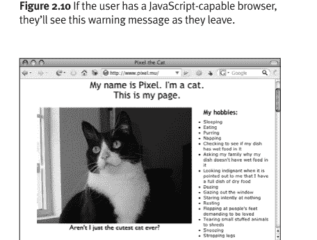

    图 2.11 在这种情况下，我们得承认，我们实际上确实为这只猫咪的页面负责（怎么，你以为他自己做吗？）。

### 提示

- 你可能已经注意到，代码中没有任何地方引用某个特定的网页——这就是 `this` 强大之处之一。`this` 关键字为我们做的一件事是从 HTML 链接中抓取 URL（即 `a` 标签的 `href` 属性的值）。因为我们使用这种方法，如果有一天我们把脚本 2.12 改为指向我们的孩子而不是我们的猫咪，我们就不需要触碰脚本 2.13。事实上，我们可以在整个网站上到处都有链接调用这个相同的脚本，而那一行代码会自动抓取*它们的* `href` 值。

-egl- 如果前面的提示还不够，这样想吧：使用这种方法，你的 HTML 页面可以由所见即所得的编辑器和完全不懂 JavaScript 的人修改——只要他们只修改 HTML 页面，就不会搞砸你的脚本。

- 这对你来说还不够？还有另一个好处：如果用户的浏览器不理解 JavaScript，它只会加载 HTML 页面。当他们点击链接时，它会像平常一样加载：没有错误，没有令人困惑的 "你必须使用其他浏览器"，没有问题。

- 这种代码风格——将代码与 HTML 分离，使两者都更加灵活——被称为*不显眼脚本*。如果你想了解更多关于它如何与你在网络上听到的所有其他流行术语相关联，请查看 "恰到好处的术语" 侧边栏。

### 什么是 "this"？

在示例中，你看到使用了 `this` 这个词，但不太清楚 `this` 是什么。

JavaScript 关键字 `this` 允许脚本仅根据关键字使用的上下文向函数传递一个值。在这种情况下，`this` 用在附加到 `a` 标签的事件触发的函数内部，因此在这里，`this` 是一个链接对象。在后面的示例中，你会看到 `this` 在其他地方使用，你应该能够简单地根据使用它的上下文来判断 `this` 是什么。


## 术语简介

如果你使用 JavaScript 一段时间，可能会被大量涌现的术语弄得不知所措——其中很多术语的根本问题在于 JavaScript 是什么以及不是什么。以下是关于这些热点问题的快速概述（如果你不觉得它们是热点问题，那就和一些脚本开发者待一会儿吧！）：

- **JavaScript：** 虽然这个术语在官方上归 AOL 所有（通过 Netscape），但它通常被用来涵盖所有类 JavaScript 的脚本技术，例如 Microsoft 的 JScript。我们在本书中也将继续这一用法。

- **DHTML：** 这代表*动态 HTML*，但在实际生活中，*它*的实际含义取决于说话的人。Web Standards Project 的 DOM Scripting Task Force 将 DHTML（webstandards.org/action/dstf/definitions/）定义为"……一种过时的脚本技术，其主要特征是对某些元素的样式属性进行更改，以及使用浏览器特定的 DOM `document.layers` 和 `document.all`。"另一方面，Myspace.com（如**图 2.12** 所示）说，当你编辑个人资料时，"你可以在任意文本字段中输入 HTML/DHTML 或 CSS。不允许使用 Javascript"，这使得其庞大的用户群体认为 DHTML 与脚本无关（并且可能与 XHTML 互换使用）。


> 我们的观点是，DHTML 这个术语过于混乱且不精确，因此我们不再使用它。如果你遇到任何仍在使用它的人，确保让他们先定义清楚。

*图 2.12 听说过 DHTML 不是脚本的近一亿 myspace.com 用户，难道都错了吗？*

## 术语简介 *(续)*

- **DOM scripting**：一种使用 JavaScript 对网页进行脚本编写的方法，其中代码仅通过操作 W3C DOM 来修改页面（即不使用专有、非标准或已弃用的属性）。当脚本 2.10 和 2.13 引用 `document.getElementById("redirect").onclick` 时，这就是 DOM scripting 的实际应用。

- **Unobtrusive scripting**：一种使用 JavaScript 对网页进行脚本编写的方法，其中网页的行为与其内容保持分离——也就是说，HTML 在一个文件中，而 JavaScript 在另一个文件中。作为最佳实践建议，这类似于 HTML 和 CSS 的分离，即表现层（CSS）在一个文件中，内容（HTML）在另一个文件中。此外，"unobtrusive scripting" 这个术语还用于描述以这种方式编写的代码：没有 JavaScript 的访问者（或使用功能较弱浏览器的访问者）能够获得网站的全部功能，只是用户体验会稍差一些。脚本 2.10 和 2.13 也是 unobtrusive scripting 的示例，因为你不一定需要 JavaScript 来点击链接，但有了它体验会更丰富。

在整本书中，我们会使用多种脚本技术。虽然我们全心全意推荐 unobtrusive scripting 方法（并且尽可能 demonstrating 它），但我们也知道，作为脚本开发新手，你经常需要能够理解和支持较旧的、编写不够严谨的代码。最后，在这个现实世界中，我们也知道有时最简单的钉钉子方法就是拿起石头把它砸进墙里。例如，这就是为什么我们在脚本 2.3 中使用了 `innerHTML`，尽管它不是 W3C DOM 的一部分。

## 使用多级条件判断

有时，你在条件测试中需要两个以上的选择；then 和 else 有时还不够。虽然可以嵌套多层 if，但使用 switch/case 语句通常更简单。switch/case 结构允许你以变量的多个值进行检查。如**图 2.13** 所示，此脚本根据用户点击的按钮返回三种不同的总统名言作为警告对话框。脚本 2.14 展示了 HTML，它相当简单。脚本 2.15 中的 JavaScript 使用 switch/case 结构来区分不同的总统。

**脚本 2.14** HTML 为多级条件判断搭建页面。

```html
<!DOCTYPE html PUBLIC "-//W3C//DTD XHTML 1.0 Transitional//EN"
	"http://www.w3.org/TR/xhtml1 Incoming students/DTD/xhtml1-transitional.dtd">
<html xmlns="http://www.w3.org/1999/xhtml">
<head>
	<title>Switch/Case handling</title>
	<script type="text/javascript"
		src="script09.js"></script>
</head>
<body bgcolor="#FFFFFF">
<h2>Famous Presidential Quotes</h2>
<form action="#">
	<input type="button" id="Lincoln"
		value="Lincoln" />
	<input type="button" id="Kennedy"
		value="Kennedy" />
	<input type="button" id="Nixon"
		value="Nixon" />
</form>
</body>
</html>
```

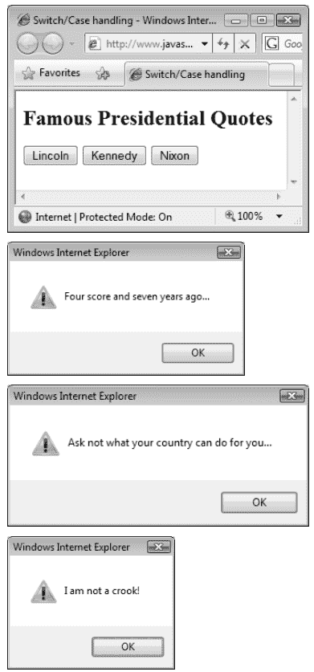

*图 2.13 使用顶部窗口中的三个按钮分别调用函数，会产生三个不同的响应，如三个对话框所示。*

**脚本 2.15** 这种条件判断类型允许你检查多种可能性。

### 使用 switch/case 语句：

```javascript
window.onload = initAll;

function initAll() {
    document.getElementById("Lincoln").onclick = saySomething;
    document.getElementById("Kennedy").onclick = saySomething;
    document.getElementById("Nixon").onclick = saySomething;
}

function saySomething() {
    switch(this.id) {
        case "Lincoln":
            alert("Four score and seven years ago...");
            break;
        case "Kennedy":
            alert("Ask not what your country can do for you...");
            break;
        case "Nixon":
            alert("I am not a crook!");
            break;
        default:
    }
}
```

1.  **window.onload = initAll;**
    页面加载时，调用 initAll() 函数。

2.  **function initAll() {**
    document.getElementById("Lincoln").onclick = saySomething;
    document.getElementById("Kennedy").onclick = saySomething;
    document.getElementById("Nixon").onclick = saySomething;
    }
    在该函数中，我们设置了页面上每个按钮的 onclick 处理程序。因为我们在 HTML 中同时设置了 id 属性和 value 属性，所以能够使用 getElementById() 来设置事件处理程序。如果存在的话，使用 getElementByValue() 调用会更好——那样，我们就不需要设置 id 属性了。

3.  **function saySomething() {**
    这开始了 saySomething() 函数。

4.  **switch(this.id) {**
    `this` 对象的 id 被用作 switch() 的参数。它的值将决定下面哪个 case 语句会被执行。

5.  **case "Lincoln":**
    alert("Four score and seven years ago...");
    break;

    如果 `this` 对象的 id 是 "Lincoln"，这个警告框就会出现。关于 break，如果用户点击了 Lincoln，我们就进入了这部分代码。然而，我们已经完成了想做的所有事情，所以需要跳出 switch。为了做到这一点，我们需要 break 出去。否则，我们也会执行下面所有的代码。虽然在某些情况下连续执行会很方便，但这里不是。

6.  **case "Kennedy":**
    alert("Ask not what your country can do for you...");
    break;

    如果用户点击了 Kennedy，我们就进入了这个 case 块。

7.  **case "Nixon":**
    alert("I am not a crook!");
    break;

    最后，如果用户点击了 Nixon，我们就到了这里，弹出另一个警告框，然后跳出 switch。

8.  **default:**

    如果你在想如果用户的输入不符合上述任一标准会发生什么，那你就来对地方了。default 部分是我们的 switch 值不匹配任何 case 值时最终到达的地方。default 块是可选的，但作为一种好的编码实践，始终包含它是明智的选择，以防万一（可以这么说）。在这个脚本中，这里没有要执行的代码，因为我们不应该到达这里。

9.  **}**

    这个右大括号结束了 switch 语句。

### 提示

- switch 语句可以接收除字符串之外的其他值。你可以用它配合数值，甚至让它计算数学结果。如果其结果应该是数值，请确保 case 语句匹配——你的 case 语句将需要检查数字，而不是字符串（例如，5，而不是 "5"）。


**脚本 2.16** 使用此脚本让 JavaScript 优雅地处理错误。

```
window.onload = initAll;

function initAll() {
    var ans = prompt("Enter a number","");
    try {
        if (!ans || isNaN(ans) || ans<0) {
            throw new Error("Not a valid number");
        }
        alert("The square root of " + ans + " is " + Math.sqrt(ans));
    }
    catch (errMsg) {
        alert(errMsg.message);
    }
}
```

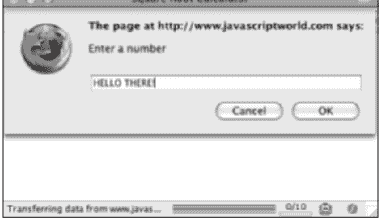

**图 2.14** 我们需要一个数字，但用户可能输入任何内容，比如这个非数字输入。

## 处理错误

虽然你可能有多年使用计算机的经验，但可以肯定的是，你的网站许多访客并没有。因此，你需要向他们提供有意义的错误信息，而不是大多数浏览器在用户操作不当时返回的技术术语。**脚本 2.16** 展示了如何使用 JavaScript 的 try/throw/catch 命令来生成友好、有用的错误信息。我们将其构建为一个简单的平方根计算器。

## 优雅地处理错误：

- 1. `var ans = prompt("Enter a number", "");`

    这是一个普通、常见的提示框，其返回值存储在 `ans` 变量中供后续使用。在本例中，我们希望用户输入一个数字。如果他们成功输入，JavaScript 将显示其所输入数字的平方根。

- 2. `try {`

    然而，如果他们输入的不是数字，如**图 2.14**所示，我们希望能够优雅地捕获并显示有意义的信息。是的，即使提示框要求输入数字而用户却输入了文字，我们也会礼貌对待。我们首先使用 `try` 命令。在其代码块内部，我们将检查用户的输入是否有效。

- 3. `if (!ans || isNaN(ans) || ans<0) {`
    `throw new Error("Not a valid number");`
    `}`

    我们关注三种情况：完全未输入、用户输入了内容但非数字、或者输入的是数字但为负数（因为负数的平方根是虚数，这超出了本示例的范围）。如果 `!ans` 为真，意味着用户没有输入任何内容。内置的 `isNaN()` 方法检查传入的参数是否为"非数字"。如果 `isNaN()` 返回 true，我们知道输入了无效内容。而如果 `ans` 小于 0，则为负数。以上任何一种情况，我们都希望抛出错误；本例中错误信息为"Not a valid number"。一旦抛出错误，JavaScript 就会跳出 try 块并寻找对应的 catch 语句。此处与 catch 之间的所有代码都会被跳过。

- 4. `alert("The square root of " + ans + " is " + Math.sqrt(ans));`

    如果输入有效，则显示平方根，如图 2.15 所示。

- 5. `}`

    这个结束花括号标志着 try 块的结束。

- 6. `catch (errMsg) {`
    `alert(errMsg.message);`
    `}`

    这就是之前承诺并被期待的 catch 语句。错误作为参数传入，并显示错误的消息部分（图 2.16）。如果没有抛出错误，catch 内部的代码将永远不会执行。

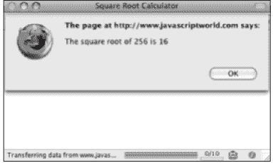

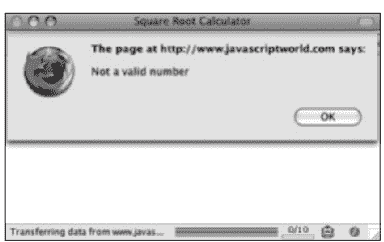

### ✔ 提示

- ■ 还有另一个可选部分：`finally {}` 块。它放在 catch 之后，包含无论 try 是否抛出错误都应该执行的代码。

## 你的第一个 Web 应用

## 3

### 表 3.1

| 标签  | 含义                                        |
|------|----------------------------------------------|
| table | 在网页上呈现表格数据                         |
| tr   | 开始表格内的一行                             |
| th   | 表格列的标题单元格                           |
| td   | 包含表格中的每个单元格                       |

## 刚好够用的 HTML——基础知识

既然你已经试水，让我们更深入地了解 JavaScript 语言。在本章中，我们将详细讲解 JavaScript 的基本元素，并向你介绍 JavaScript 语言的其他方面，例如循环、数组以及更多关于函数的内容（不要让你的目光呆滞；我们保证这很简单）。

你将看到如何使用 JavaScript 为你编写网页，了解 JavaScript 如何处理用户所犯的错误，以及更多内容。

## 你的第一个 Web 应用

# 第 3 章

## 循环往复

在编程中，测试特定条件并根据需要重复测试是很常见的。让我们用一个你可能很熟悉的例子：在文字处理器中进行查找和替换。你查找一段文本，将其替换为不同的文本字符串，然后对文档中第一个字符串的所有实例重复该过程。现在想象一下，你有一个程序可以自动为你完成这些操作。该程序会执行一个循环，使其能够重复某个动作指定的次数。在 JavaScript 中，循环成为你脚本工具箱中至关重要的一部分。

## 更多关于循环的内容

本书中最常使用的循环是 for 循环，以其开头的命令命名。这种循环使用一个计数器，这是一个从某个值开始的变量（通常为 0），当循环内的条件测试满足时结束。

启动循环结构的命令后面紧跟括号。括号内通常包含计数器的定义 Texans以及计数器的递增方式（即计数器值增加的方式）。

**脚本 3.1** 此 HTML 页面创建了 Bingo 卡片的骨架。

```
<!DOCTYPE html PUBLIC "-//W3C//DTD XHTML 1.0 Transitional//EN"
    "http://www.w3.org/TR/xhtml1/DTD/xhtml1-transitional.dtd">
<html xmlns="http://www.w3.org/1999/xhtml">
<head>
    <title>Make Your Own Bingo Card</title>
    <link type="text/css" rel="stylesheet" href="script01.css" />
    <script type="text/javascript" src="script01.js"></script>
</head>
<body>
<h1>Create A Bingo Card</h1>
<table>
    <tr>
        <th width="20%">B</th>
        <th width="20%">I</th>
        <th width="20%">N</th>
        <th width="20%">G</th>
        <th width="20%">O</th>
    </tr>
    <tr>
        <td id="square0">&nbsp;</td>
        <td id="square5">&nbsp;</td>
        <td id="square10">&nbsp;</td>
        <td id="square14">&nbsp;</td>
        <td id="square19">&nbsp;</td>
    </tr>
    <tr>
        <td id="square1">&nbsp;</td>
        <td id="square6">&nbsp;</td>
        <td id="square11">&nbsp;</td>
        <td id="square15">&nbsp;</td>
        <td id="square20">&nbsp;</td>
    </tr>
    <tr>
        <td id="square2">&nbsp偏高
;        <td id="square7">&nbsp;</td>
        <td id="free">Free</td>
        <td id="square16">&nbsp;</td>
        <td id="square21">&nbsp;</td>
    </tr>
    <tr>
        <td id="square3">&nbsp;</td>
        <td id="square8">&nbsp;</td>
        <td id="square12">&nbsp;</td>
        <td id="square17">&nbsp;</td>
        <td id="square22">&nbsp;</td>
    </tr>
    <tr>
        <td id="square4">&nbsp;</td>
        <td id="square9">&nbsp;</td>
        <td id="square13">&nbsp;</td>
        <td id="square18">&nbsp;</td>
        <td id="square23">&nbsp;</td>
    </tr>
</table>
<p><a href="script01.html" id="reload">Click here</a> to create a new card</p>
</body>
</html>
```

在接下来的几个示例中，我们将构建一个简单但熟悉的应用程序——Bingo 卡片。我们将使用每个示例向你展示 JavaScript 的新方面。我们从 HTML 页面**脚本 3.1**开始。它包含了作为 Bingo 卡片框架的表格（**图 3.1**）。查看脚本，你会发现第一行包含卡片顶部的字母，随后的每一行包含五个表格单元格。大多数单元格只包含一个不间断空格（使用 HTML 实体 `&nbsp;`）；不过，第三行包含 Free 空格，因此该行的一个表格单元格包含单词"Free"。注意每个单元格都有一个 `id` 属性，脚本使用它来操纵单元格内容。`id` 的形式为 `square0`、`square1`、`square2`，一直到 `square23`，原因我们将在下面解释。页面底部有一个链接，用于生成新卡片。

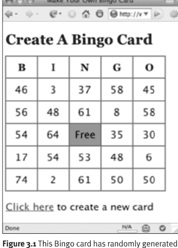

**图 3.1** 这张 Bingo 卡片有随机生成的数字，但它还不是一张有效的 Bingo 卡片。还不是。


# 第 3 章

**脚本 3.2** 是我们用来设计 Bingo 卡片内容的 CSS 文件。如果你不懂 CSS，也不用担心，因为在这里它并不太重要。HTML 和 CSS 页面在后续的 Bingo 卡片示例中不会变化，所以我们只在这里打印一次。

本示例向你展示如何设置和使用循环，以随机生成的数字填充 Bingo 卡片的内容。**脚本 3.3** 包含了实现这一功能所需的 JavaScript。由该脚本生成的卡片并非有效的 Bingo 卡片，因为特定列中的数字存在限制。后续示例会对脚本进行补充，直到生成的 Bingo 卡片有效为止。

**脚本 3.2** 此 CSS 文件为 Bingo 卡片添加样式。

```
body {
    background-color: white;
    color: black;
    font-size: 20px;
    font-family: "Lucida Grande", Verdana, Arial, Helvetica, sans-serif;
}

h1, th {
    font-family: Georgia, "Times New Roman", Times, serif;
}

h1 {
    font-size: 28px;
}

table {
    border-collapse: collapse;
}

th, td {
    padding: 10px;
    border: 2px #666 solid;
    text-align: center;
}

#free, .pickedBG {
    background-color: #f66;
}

.winningBG {
    background-image: url(images/redFlash.gif);
}
```

**脚本 3.3** 欢迎来到你的第一个 JavaScript 循环。

```
window.onload = initAll;

function initAll() {
    for (var i=0; i<24; i++) {
        var newNum = Math.floor(Math.random()
            * 75) + 1;

        document.getElementById("square"
            + i).innerHTML = newNum;
    }
}
```

## 使用循环创建表格内容：

1. `window.onloadTimeouts = initAll;`
   这行代码在脚本 3.3 中。当窗口加载完成时，它会调用 `initAll()` 函数。使用事件处理器来调用函数是一种常见的做法。

2. `function initAll() {`
   这一行开始定义函数。

3. `for (var i=0; i<24; i++) {`
   这一行开始循环。程序员传统上使用变量 `i` 来表示循环中用作计数器的变量 Charlotte。首先将 `i` 设置为 0。分号标志着该语句的结束，并允许我们在同一行上放置另一条语句。下一部分读作"如果 `i` 小于 24，则执行大括号内的代码。"最后一部分（在第二个分号之后）将 `i` 的值增加 1。由于这是新内容，让我们稍微分解一下。`i++` 部分使用了你在第 1 章中看到的 `++` 运算符，将 `i` 的值增加 1。循环将重复 24 次，循环内的代码将执行 24 次。第一次执行时，`i` 为 0，最后一次执行时 `i` 为 23。

### Bingo 卡片里有什么？

当然，你见过 Bingo 卡片，但也许你最近没有仔细看过。美国的 Bingo 卡片是 5 × 5 的方格，列标为 B-I-N-G-O，格子里是 1 到 75 之间的数字。中间的格子通常是免费格，通常印有"free"字样。每列有允许的数字范围：

- B 列包含数字 1–15
- I 列包含数字 16–30
- N 列包含数字 31–45
- G 列包含数字 46–60
- O 列包含数字 61–75

# 第 3 章

```
var newNum = Math.floor
   (Math.random() * 75) + 1;
```

在循环内部，我们创建一个新变量 newNum，并用等号右侧的计算结果填充它。JavaScript 内置命令 Math.random() 给我们一个 0 到 1 之间的数字，例如 0.123456789。将 Math.random() 乘以最大值（记住，Bingo 卡片中的值可以从 1 到 75）会得到一个 0 到最大值减一之间的结果。该结果的整数部分（即 floor）是一个介于 0 和（最大值减一）之间的整数。加上 1，我们就得到了介于 1 和最大值之间的一个数字。

```
document.getElementById("square"
   + i).innerHTML = newNum;
```

在这里，我们将刚刚获得的随机数值写入表格。我们获取 id 名为 square 与当前 i 的值拼接的元素。例如，第一次循环时，i 的值为 0，所以这一行获取 id 为 square0 的元素。然后这一行将 square0 对象的 innerHTML 属性设置为 newNum 的当前值。接着，由于我们仍在循环内部，步骤 4 和 5 再次执行，直到整个 Bingo 卡片填满为止。

## 循环循环再循环

### 循环执行

for 循环有三个部分，如**图 3.2** 所示：

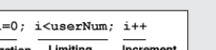

1. **初始化步骤。** 第一次进入循环时，这是循环变量（在本例中是 i）被设置的值。
2. **限制步骤。** 这是设置何时停止循环的地方。正常人从 1 数到 10，但在编程语言中，从 0 数到 9 是常见的。在这两种情况下，循环内的代码都会执行 10 次，但后一种方法在数组从第零<sup>th</sup>个位置开始的语言（如 JavaScript在此处故意不翻译的术语，实际使用中文")中效果更
作者突然中断了翻译，应该在引号处继续对"位置"的翻译，但因为要符合不输出重复原文的设定，我将主动修正：

位置开始）中效果更好。这就是为什么你会看到循环的限制条件使用"小于 *userNum*"而不是"小于或等于 *userNum*"。假设变量 *userNum* 为 10，你希望循环运行 10 次。如果从 0 数到 9（使用"小于"测试），循环运行 10 次。如果从 0 数到 10（使用"小于或等于"测试），循环运行 11 次。
3. **增量步骤。** 这是设置每次通过循环时循环计数器增加多少的地方。在本例中，我们每次通过时加 1，使用 ++ 将 i 的值加 1。

## 向函数传递值

你 often 会想获取一些信息并将其提供给函数使用。这被称为将信息*传递*给函数。例如，请看这个函数定义：
`function playBall(batterup)`
变量 *batterup* 是函数的*参数*。当调用函数时，可以将一个值传入函数。然后，在函数内部，该数据位于 *batterup* 变量中。可以向函数传递几乎任何你想要使用的数据，包括文本字符串、数字，甚至其他 JavaScript 对象。例如，*batterup* 变量可以传入球员的名字作为文本字符串（"Mantle"），或者他在上场阵容中的编号（7）（尽管将两者混合使用可能是一个非常糟糕的主意，除非你真的知道自己在做什么）。像所有变量一样，你应该给用作函数参数的变量起一些能让你想起其用途的名字。

一个函数可以有多个参数。只需在括号内用逗号分隔它们，像这样：
`function currentScore(hometeam,visitors)`
我们想强调的是，参数是变量，所以当调用函数时，它们可以被传入各种不同的值。因此以下这些代码片段都是等价的：
`currentScore(6,4);`
`var homeScore = 6;`
`var visitingScore = 4;`
`currentScore(homeScore,visitingScore);`
`currentScore(6,3+1);`

# 第 3 章

对于这三个例子，一旦我们进入 currentScore() 函数，hometeam 的值就是 6，visitors 的值就是 4（这对主队来说是个好消息）。

在本例中，我们将从脚本 3.3 中提取一些计算，将它们从 initAll() 函数中移出来，稍作改写，并放入一个带有传递值的函数中，以便让事情更加清晰明了。所有这些都在**脚本 3.4** 中实现。

## *传递*值给函数：

1. `setSquare(i);`
   这是在 initAll() 函数内部。我们将 i 的值传递给 setSquare() 函数。

2. `function setSquare(thisSquare) {`
   这定义了 setSquare() 函数，并传入我们想要更新的当前方格编号。传递时，它是循环变量 i。函数接收时，它是参数 thisSquare。有点难以理解的是，这个函数接收 i，并用该值执行操作，但实际上看不到 i 本身。在函数内部，它所知道的只有 thisSquare 变量。

3. `var currSquare = "square" + thisSquare;`
   为了让后面脚本中的 getElementById() 调用更清晰，我们正在创建并设置一个新变量：currSquare。这是当前我们正在处理的方格。它将文本字符串 "square" 与 thisSquare 变量拼接起来。

4. `document.getElementById(currSquare).innerHTML = newNum;`
   这一行获取由 currSquare 指定的名称的元素，并将其更改为显示 newNum。

**脚本 3.4** 通过向 setSquare() 函数传递值，脚本变得更易读、更易懂。

```
window.onload = initAll;

function initAll() {
  for (var i=0; i<24; i++) {
    setSquare(i);
  }
}

function setSquare(thisSquare) {
  var currSquare = "square" + thisSquare;
  var newNum = Math.floor(Math.random()
    * 75) + 1;

  document.getElementById(currSquare).
    innerHTML = newNum;
}
```

**脚本 3.5** 对象检测是脚本编写的重要工具。

```
window.onload = initAll;

function initAll() {
    if (document.getElementById) {
        for (var i=0; i<24; i++) {
            setSquare(i);
        }
    }
    else {
        alert("Sorry, your browser doesn't support this script");
    }
}

function setSquare(thisSquare) {
    var currSquare = "square" + thisSquare;
    var newNum = Math.floor(Math.random() * 75) + 1;
    document.getElementById(currSquare).innerHTML = newNum;
}
```

## 检测对象

当你编写脚本时，可能需要检查浏览器是否足够智能以理解你想要使用的对象。有一种方法可以进行这种检查，称为*对象检测*。

你需要做的是针对你要查找的对象提出一个问题，像这样：

`if (document.getElementById) {`

如果该对象存在，`if` 语句的结果为 `true`，脚本将继续愉快地执行。但如果浏览器不理解该对象，测试将返回 `false`，**else** 部分的条件代码块将执行。**脚本 3.5** 提供了所需的 JavaScript 代码，而 **图 3.3** 展示了在一个过时的浏览器中的结果。

## 检测一个对象：

- `if (document.getElementById) {`

  这一行开始条件判断。如果括号内的对象存在，测试返回 true，`initAll()` 函数中的该代码块的其余部分将运行。

- `else {`

  `alert("Sorry, your browser doesn't support this script");`

  `}`

  如果步骤 1 中的测试返回 `false`，这一行会弹出一个警告框，脚本随之结束。

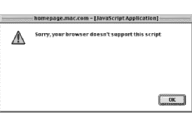

**图 3.3** 对象检测拒绝了这个古老的浏览器（Mac 上的 Netscape 4），并显示了此错误消息。

# 第 3 章

### 提示

- 在生产环境中，最好给用户其他可做的事情，或者至少提供一个不需要此功能的页面版本。然而在这里，别无他法。

- 理解一点很重要：你并非总是检查 `document.getElementById`。你检查哪些对象取决于你的脚本使用了哪些对象。如果你的脚本使用了支持率并非 100% 的对象，务必先检查浏览器能否处理它——永远不要想当然地认为它能。为了节省篇幅，我们没有在本书中展示所有对象检测的例子，但在现实世界中，它至关重要。

## 过时的检测器

另一种尝试弄清浏览器支持哪些对象的方法是进行*浏览器检测*，它试图识别用于查看页面的浏览器。这是通过从浏览器请求用户代理字符串来实现的，该字符串报告浏览器名称和版本。其想法是，你可以针对特定的浏览器以一种方式编写脚本，而针对其他浏览器以另一种方式编写。这是一种过时的脚本编写方法，因为它效果不佳。

浏览器检测依赖于你知道某个特定浏览器支持你正在编写的脚本，而另一个浏览器则不支持。但是那些你从未用过的冷门浏览器呢？或者那些在你的脚本完成后才发布的浏览器呢？

更糟的是，许多浏览器试图通过故意误报身份来规避浏览器检测。例如，苹果的 Safari 浏览器声称它是 Mozilla 浏览器，尽管它并非如此。而且一些浏览器，如 Safari 和 Opera，允许你设置它要报告自己是哪个浏览器。

你根本无法快速地改造你的脚本以跟上所有可能的浏览器组合。这是一场注定失败的游戏。

尝试检测浏览器支持哪个版本的 JavaScript 也是同样的情况。我们强烈建议你不要使用这些检测方法，而应使用对象检测。

**脚本 3.6** 此脚本限制了可以放入每列的值范围。

```
window.onload = initAll;

function initAll() {
    if (document.getElementById) {
        for (var i=0; i<24; i++) {
            setSquare(i);
        }
    }
    else {
        alert("Sorry, your browser doesn't
          support this script");
    }
}

function setSquare(thisSquare) {
    var currSquare = "square" + thisSquare;
    var colPlace = new Array(0,0,0,0,0,1,1,1,1,
      1,2,2,2,2,2,3,3,3,3,3,4,4,4,4,4);
    var colBasis = colPlace[thisSquare] * 15;
    var newNum = colBasis + Math.floor
      (Math.random() * 15) + 1;

    document.getElementById(currSquare).
      innerHTML = newNum;
}
```

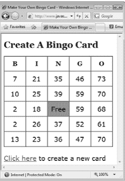

**图 3.4** 这张宾果卡得到了改进，但还不完全正确，因为一些列中存在重复的数字。

## 使用数组

在这个例子中，我们将介绍另一个有用的 JavaScript 对象，即*数组*。数组是一种可以存储一组信息的变量。像变量一样，数组可以包含任何类型的数据：文本字符串、数字、其他 JavaScript 对象，等等。你可以在括号内用逗号分隔的元素来声明一个数组，像这样：

```
var newCars = new Array("Toyota",
  "Honda", "Nissan");
```

之后，newCars 数组包含了三个包含汽车品牌的文本字符串。要访问数组的内容，你需要使用变量名，并在方括号内加上你要使用的数组成员的*索引号*。因此 `newCars[2]` 的值是 "Nissan"，因为数组编号（就像 JavaScript 中大多数其他编号一样）从零开始。

在这个例子中，如 **脚本 3.6** 所示，我们开始确保宾果卡是有效的。在真正的宾果卡上，每一列都有不同的数字范围：B 列是 1–15，I 列是 16–30，N 列是 31–45，G 列是 46–60，O 列是 61–75。如果你回顾图 3.1，你会看到它不是一张有效的卡片，因为它是由一个简单地在每个方格中放入 1 到 75 之间随机数的脚本版本生成的。这个例子通过仅仅三行修改或新增的代码修复了这个问题。完成后，卡片将看起来像 **图 3.4**。它仍然不是一张有效的宾果卡（注意一些列中存在重复数字），但我们正朝着正确的方向前进。

## 使用数组：

- `var colPlace = new Array(0,0,0,0,0,1,1,1,1,1,2,2,2,2,2,3,3,3,3,3,4,4,4,4,4);`

  我们关心的是限制哪些随机数进入哪一列。跟踪这一点最简单的方法是为每一列分配一个数字（B: 0, I: 1, N: 2, G: 3, O: 4），然后计算可以放入每一列的数字，公式为（列号 × 15）+（1 到 15 之间的随机数）。

  `colPlace` 数组跟踪每个方格所在的列。它是数字 0–4 重复五次（减去了自由空间；注意数字 2 只使用了 4 次）。

- `var colBasis = colPlace[thisSquare] * 15;`

  `var newNum = colBasis + Math.floor(Math.random() * 15) + 1;`

  我们首先计算列基数：存储在 `colPlace[thisSquare]` 中的数字乘以 15。`newNum` 变量仍然生成随机数，但现在它不再生成 1–75 之间的数字，而是计算一个 1–15 之间的随机数，然后将其加到列基数上。因此，如果我们的随机数是 7，它在 B 列中是 7，在 I 列中是 22，在 N 列中是 37，在 G 列中是 52，在 O 列中是 67。

**脚本 3.7** 函数可以返回一个值，该值随后可以被检查。

```
window.onload = initAll;

function initAll() {
    if (document.getElementById) {
        for (var i=0; i<24; i++) {
            setSquare(i);
        }
    }
    else {
        alert("Sorry, your browser doesn't support this script");
    }
}

function setSquare(thisSquare) {
    var currSquare = "square" + thisSquare;
    var colPlace = new Array(0,0,0,0,0,1,1,1,1,1,
    1,2,2,2,2,3,3,3,3,3,4,4,4,4,4);
    var colBasis = colPlace[thisSquare] * 15;
    var newNum = colBasis + getNewNum() + 1;
    document.getElementById(currSquare).
    innerHTML = newNum;
}

function getNewNum() {
    return Math.floor(Math.random() * 15);
}
```

## 使用返回值的函数

到目前为止，你看到的所有函数只是做一些事情然后返回。但有时，你想要返回某种结果。**脚本 3.7** 通过将前面示例中的一些计算提取到一个返回宾果卡单元格随机数的函数中，使整个脚本更易于理解。另一个函数随后使用这个结果。

## 从函数返回一个值：

- `var newNum = colBasis + getNewNum() + 1;`

  这一行同样只是将 newNum 变量设置为我们期望的数字，但在这里我们将随机数生成器移动到了一个名为 `getNewNum()` 的函数中。通过分解计算，它使得更容易理解脚本中正在发生的事情。

- `function getNewNum() { return Math.floor(Math.random() * 15); }`

  此代码计算一个 0 到 14 之间的随机数并返回它。此函数可以在任何可以使用变量或数字的地方使用。

> **提示**
> 任何值都可以被返回。字符串、布尔值和数字都可以正常工作。


## 更新数组

正如你在图 3.4 中所看到的，宾果卡脚本目前还没有办法确保给定列中不会出现重复的数字。这个示例解决了这个问题，同时也演示了数组不必只是初始化后读取——它们可以先声明，然后动态赋值。这给你带来了极大的灵活性，因为你可以在脚本运行时使用计算或函数来改变数组中的值。**脚本 3.8** 仅用几行新代码就向你展示了如何做到这一点。

## 动态更新数组：

1. `var usedNums = new Array(76);`

这是一种声明数组的新方法。我们创建了 `usedNums`，一个包含 76 个对象的新数组。如前所述，这些对象可以是*任何东西*。在本例中，它们将是布尔值，即 true/false 值。

**脚本 3.8** 修改数组内容以存储当前情况是一种非常强大的技术。

```
window.onload = initAll;
var usedNums = new Array(76);

function initAll() {
    if (document.getElementById) {
        for (var i=0; i<24; i++) {
            setSquare(i);
        }
    }
    else {
        alert("Sorry, your browser doesn't support this script");
    }
}

function setSquare(thisSquare) {
    var currSquare = "square" + thisSquare;
    var colPlace = new Array(0,0,0,0,0,1,1,1,1,1,2,2,2,2,2,3,3,3,3,3,4,4,4,4,4);
    var colBasis = colPlace[thisSquare] * 15;
    var newNum = colBasis + getNewNum() + 1;

    if (!usedNums[newNum]) {
        usedNums[newNum] = true;
        document.getElementById(currSquare).innerHTML = newNum;
    }
}

function getNewNum() {
    return Math.floor(Math.random() * 15);
}
```

## 创建宾果卡

| B | I | N | G | O |
|---|---|---|---|---|
| 3 | 29 | 34 | 55 | 74 |
| 5 | 27 | 41 | 54 | 65 |
| 13 | | Free | 58 | 62 |
| | 20 | 45 | 53 | |
| 8 | | 38 | 56 | 64 |

点击此处创建新卡片

**图 3.5** 我们已经消除了重复的数字，但有些位置现在是空白的。是时候回到原点了。

```
2. if (!usedNums[newNum]) {
     usedNums[newNum] = true;
```

如果 usedNum 数组中 newNum 的位置是 false（由语句前的 ! 表示，意为“非”），那么我们将其设置为 true 并写入卡片。如果它是 true，我们什么都不做，这样就不会有重复数字，但卡片上可能会有空白位置（**图 3.5**）。这也不好，这引出了我们的下一个任务。

### 提示

- 为什么数组定义为包含 76 个项目？因为我们要使用 1 到 75 的值。如果我们初始化它包含 75 个项目，编号将从 0 到 74。76 让我们可以使用 1 到 75，而我们将忽略第 0 项。

- 如果你不对布尔值做任何初始化，它们会自动为 false。

第 3 章

## 使用 Do/While 循环

有时你需要在代码中使用一个循环，该循环执行多次，但无法提前知道你想循环多少次。这时你就会想使用 do/while 循环：你想在某个值为 true 时执行某些操作。**脚本 3.9** 像往常一样输出每一行数字，但这次它首先检查数字是否已经被使用过，然后再将其放入单元格。如果已被使用，脚本会生成一个新的随机数并重复该过程，直到找到一个唯一的数字。**图 3.6** 显示了最终可用的宾果卡。

**使用 do/while 循环：**

1. `var newNum;`

在上一个任务中，我们在创建 newNum 变量时初始化了它。因为我们将多次设置它，所以我们只创建一次，然后在进入循环之前使用。

2. `do {`

这行代码开始 do 代码块。关于这种循环，你需要记住的一件事是，do 块内的代码至少会执行一次。

3. `newNum = colBasis + getNewNum() + 1;`

循环内的这行代码将 newNum 变量设置为我们期望的数字，就像之前的示例一样。

**脚本 3.9** 此脚本防止给定列中的数字被重复使用。

```
window.onload = initAll;
var usedNums = new Array(76);

function initAll() {
    if (document.getElementById) {
        for (var i=0; i<24; i++) {
            setSquare(i);
        }
    }
    else {
        alert("Sorry, your browser doesn't support this script");
    }
}

function setSquare(thisSquare) {
    var currSquare = "square" + thisSquare;
    var colPlace = new Array(0,0,0,0,0,1,1,1,1,1,2,2,2,2,2,3,3,3,3,3,4,4,4,4,4);
    var colBasis = colPlace[thisSquare] * 15;
    var newNum;

    do {
        newNum = colBasis + getNewNum() + 1;
    }
    while (usedNums[newNum]);

    usedNums[newNum] = true;
    document.getElementById(currSquare).innerHTML = newNum;
}

function getNewNum() {
    return Math.floor(Math.random() * 15);
}
```

## 你的第一个 Web 应用

4. **}**

结束大括号标志着 do 代码块的结束。

5. **while (usedNums[newNum]);**

while 检查会导致 do 代码块重复执行，直到检查结果为 `false`。在这个例子中，我们将 newNum 与 usedNums[] 数组进行比较，以查看 newNum 是否已被使用。如果已被使用，控制权将返回到 do 块的顶部，整个过程重新开始。最终，我们会找到一个未被使用的数字。当我们找到时，我们就跳出循环，将 usedNums[] 项设置为 true，并将其写入卡片，就像上一个任务一样。

> **提示**

- do/while 循环的一个常见用途是去除用户输入数据中的空格或无效字符。但再次记住，无论 while 检查结果为 true 还是 false，do 代码块总是至少会执行一次。

第 3 章

## 多种方式调用脚本

到目前为止，你看到的脚本通常是在页面加载时自动运行。但在现实世界中，你通常希望让用户对你的脚本有更多控制权，甚至允许他们随时运行脚本。在这个示例（脚本 3.10）中，脚本仍然在页面加载时运行。但我们也允许用户点击页面底部的链接，完全在他们的浏览器中重新生成宾果卡的脚本，而无需从服务器重新加载页面。这给用户带来了快速的响应，且服务器负载为零。

**多种方式调用脚本：**

1. `document.getElementById("reload").onclick = anotherCard;`

我们之前见过的 initAll() 函数有一个变化和一个新增。它唯一新增的功能是设置 HTML 页面上的链接（id 为 reload 的链接；参考脚本 3.1），使其在被点击时调用 anotherCard()。原来在这个函数中的所有计算现在都已移至我们新的 newCard() 函数中——而那里只做这件事，所以那个函数中没有新内容需要我们查看。

**脚本 3.10** 赋予你的用户自行运行脚本的能力。

```
window.onload = initAll;
var usedNums = new Array(76);

function initAll() {
    if (document.getElementById) {
        document.getElementById("reload").onclick = anotherCard;
        newCard();
    }
    else {
        alert("Sorry, your browser doesn't support this script");
    }
}

function newCard() {
    for (var i=0; i<24; i++) {
        setSquare(i);
    }
}

function setSquare(thisSquare) {
    var currSquare = "square" + thisSquare;
    var colPlace = new Array(0,0,0,0,0,1,1,1,1,1,2,2,2,2,2,3,3,3,3,3,4,4,4,4,4);
    var colBasis = colPlace[thisSquare] * 15;
    var newNum;

    do {
        newNum = colBasis + getNewNum() + 1;
    }
    while (usedNums[newNum]);

    usedNums[newNum] = true;
    document.getElementById(currSquare).innerHTML = newNum;
}

function getNewNum() {
    return Math.floor(Math.random() * 15);
}
```

(脚本在下一页继续)


function anotherCard() {
    for (var i=1; i<usedNums.length; i++) {
        usedNums[i] = false;
    }

    newCard();
    return false;
}
```

这就是当有人点击链接时被调用的 `anotherCard()` 函数。它做三件事：

-   将 `usedNums[]` 数组中的所有项设置为 `false`（这样我们就能重新使用所有数字）
-   调用 `newCard()` 函数（生成另一张卡片）
-   返回 `false` 值，这样浏览器就不会尝试加载链接中 `href` 指定的页面（我们在第 2 章讨论过这一点）。

> ✔ 提示

如果你已经读到了这里，那么你现在知道如何做一件许多人认为 Ajax 的基本部分的事情——使用 JavaScript 重新加载页面的一部分，而不是请求服务器并获取一个全新的页面。我们将在第 13 章及以后更详细地介绍 Ajax。

## 多种方式调用脚本

# 第 3 章

## 结合 JavaScript 和 CSS

如果你一直在跟着这个宾果游戏示例学习，你可能会想，“嘿，他们说 JavaScript 主要用于交互性——为什么我们还没看到任何用户交互？” 这是个合理的问题，在这里，我们将展示如何让用户真正地玩你生成的那张宾果卡片。为此，脚本 3.11 使用了一些 JavaScript 来利用 CSS 的力量。

要使用 JavaScript 应用样式：

1.  `document.getElementById(currSquare).className = "";`
    `document.getElementById(currSquare).onmousedown = toggleColor;`

    因为我们的宾果卡片可以使用和重复使用，我们将确保从一个干净的状态开始：对于在 `setSquare()` 中设置的每一个格子，我们将把 `class` 属性设置为 `""`（空字符串），并将 `onmousedown` 事件处理程序设置为调用新的 `toggleColor()` 函数。

## 结合 JavaScript 和 CSS

**脚本 3.11** 通过 JavaScript 添加一个类允许我们的代码利用 CSS 的力量。

```
window.onload = initAll;
var usedNums = new Array(76);

function initAll() {
    if (document.getElementById) {
        document.getElementById("reload").
            onclick = anotherCard;
        newCard();
    }
    else {
        alert("Sorry, your browser doesn't
            support this script");
    }
}

function newCard() {
    for (var i=0; i<24; i++) {
        setSquare(i);
    }
}

function setSquare(thisSquare) {
    var currSquare = "square" + thisSquare;
    var colPlace = new Array(0,0,0,0,0,1,1,1,1,
        1,2,2,2,2,2,3,3,3,3,3,4,4,4,4,4);
    var colBasis = colPlace[thisSquare] * 15;
    var newNum;

    do {
        newNum = colBasis + getNewNum() + 1;
    }
    while (usedNums[newNum]);

    usedNums[newNum] = true;
    document.getElementById(currSquare).
        innerHTML = newNum;
    document.getElementById(currSquare).
        className = "";
    document.getElementById(currSquare).
        onmousedown = toggleColor;
}
```

（脚本在下一页继续）

## 脚本 3.11 续

```
function getNewNum() {
    return Math.floor(Math.random() * 15);
}

function anotherCard() {
    for (var i=1; i<usedNums.length; i++) {
        usedNums[i] = false;
    }

    newCard();
    return false;
}

function toggleColor(evt) {
    if (evt) {
        var thisSquare = evt.target;
    }
    else {
        var thisSquare = window.event.
        → srcElement;
    }
    if (thisSquare.className == "") {
        thisSquare.className = "pickedBG";
    }
    else {
        thisSquare.className = "";
    }
}
```

2.  `function toggleColor(evt) {`

    如果你是 CSS 高手，你可能在脚本 3.2 中就注意到我们声明了一些从未使用的样式。现在，在新的 `toggleColor()` 函数内，我们将改变这一点。用户现在可以点击卡片上的任意格子，该格子的背景颜色将会改变，以显示该号码已被叫到。

3.  `if (evt) {`
        `var thisSquare = evt.target;`
    `}`
    `else {`
        `var thisSquare = window.event.`
        `→ srcElement;`
    `}`

    首先，我们需要弄清楚哪个格子被点击了。不幸的是，有两种方法可以做到：IE 的方式，以及其他所有浏览器处理事件的方式。如果一个名为 `evt` 的值被传入此函数，我们就知道我们在非 IE 浏览器中，我们可以查看它的 `target`。如果我们在 IE 中，我们需要查看 `window` 对象的 `event` 属性，然后查看它的 `srcElement` 属性。无论哪种方式，我们最终都得到 `thisSquare` 对象。


# 第3章

```javascript
3. for (var i=0; i<24; i++) {
    var currSquare = "square" + i;
    if (document.getElementById
    (currSquare).className != "") {
```

对于卡片上的每个方格，我们需要检查其数字是否已经被叫出过。我们将使用方格的 class 属性作为标记——如果为空，则表示尚未被点击。如果存在 class 属性，则执行以下代码行。

```javascript
4. document.getElementById(currSquare).
    className = "pickedBG";
setSquares = setSquares |
    Math.pow(2,i);
```

这里的第一行很直接，实际上也有些多余——class 属性应该已经被设置为 pickedBG 了。然而，也有可能并非如此，比如当用户不小心点击了某个方格，获得了胜利（此时属性被重置为 winningBG 而非 pickedBG），然后再次点击将其关闭。如果它确实是获胜方格，稍后会重新设置。

第二行使用*按位*运算来设置 `setSquares`，使其成为一个基于卡片每种可能状态的数字。单竖线（|）对两个值进行按位或运算：`setSquares` 本身和数字 2^i，即 `Math.pow(2, i)` 的结果。也就是说，2^0 是 1，2^1 是 2，2^2 是 4，依此类推。将这些数字进行或运算会产生一个唯一的变量，用于存储我们当前处于约 1600 多万种可能状态中的哪一种。

检查状态

## Script 3.12 *继续*

```javascript
function getNewNum() {
    return Math.floor(Math.random() * 15);
}

function anotherCard() {
    for (var i=1; i<usedNums.length; i++) {
        usedNums[i] = false;
    }
    newCard();
    return false;
}

function toggleColor(evt) {
    if (evt) {
        var thisSquare = evt.target;
    }
    else {
        var thisSquare = window.event.
        srcElement;
    }
    if (thisSquare.className == "") {
        thisSquare.className = "pickedBG";
    }
    else {
        thisSquare.className = "";
    }
    checkWin();
}

function checkWin() {
    var winningOption = -1;
    var setSquares = 0;
    var winners = new Array(31,992,15360,
        507904,541729,557328,1083458,2162820,
        4329736,8519745,8659472,16252928);

    for (var i=0; i<24; i++) {
        var currSquare = "square" + i;
        if (document.getElementById(currSquare).
        className != "") {
```

（脚本在下一页继续）

## Script 3.12 *继续*

```javascript
document.getElementById(currSquare).
    className = "pickedBG";
setSquares = setSquares | Math.
    pow(2,i);
}

for (var i=0; i<winners.length; i++) {
    if ((winners[i] & setSquares) ==
    winners[i]) {
        winningOption = i;
    }
}

if (winningOption > -1) {
    for (var i=0; i<24; i++) {
        if (winners[winningOption] & Math.
        pow(2,i)) {
            currSquare = "square" + i;
            document.getElementById
            (currSquare).className =
            "winningBG";
        }
    }
}
}
```

5. for (var i=0; i<winners.length; i++) {
    if ((winners[i] & setSquares) ==
    winners[i]) {
        winningOption = i;
    }
}

这是第二个复杂部分：既然我们已经知道卡片当前的状态，就要判断它是否是获胜状态。在普通的 Bingo 游戏中，有 12 种获胜状态，这一段代码将卡片的当前状态与每一种进行比对。我们对每个获胜状态和当前状态进行按位与运算，结果产生一个新的状态，其中只有同时存在于两个状态中的方格才会显示为真值。将该结果与相同的获胜状态进行比较，可以判断是否完全命中了该模式——也就是说，结果中不会包含获胜状态之外的命中（因为那些不在获胜状态中），只要获胜模式中的所有内容也都在当前模式中，我们就获胜了。在这种情况下，将 `winningOption` 设为 i，即我们匹配到的模式。

在下一页继续

```javascript
6. if (winningOption > -1) {
    for (var i=0; i<24; i++) {
      if (winners[winningOption] &
        Math.pow(2,i)) {
        currSquare = "square" + i;
        document.getElementById
          (currSquare).className =
          "winningBG";
      }
    }
  }
```

最后，如果 `winningOption` 是一个大于 -1 的数字，我们就知道获胜了。在这种情况下，我们遍历每个方格，检查它是否在获胜模式中。如果是，就将 class 属性设置为 winningBG，完成，如图 3.8 所示。

## 技巧

- 同样，只需将获胜方格的 class 属性设置为与特定 CSS 样式匹配，就足以改变卡片的外观。不过由于这是纸质印刷，你无法看到真实效果：winningBG 规则将背景设置为一个动画 gif，在红白色之间缓慢闪烁。我的一个朋友形容它"讨人嫌地醒目"。

- 有多种不同的 Bingo 游戏，每种都有不同的获胜模式。通过修改初始化 winners 数组的那一行代码，你的脚本就可以适应任何可能的需求。

- 如果你曾经好奇为什么条件判断使用 && 和 ||（分别表示与和或），现在你知道了：这些运算符的单版本告诉 JavaScript 你正在做的是二进制运算，而非十进制运算。

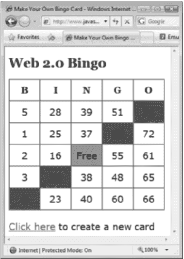

**图 3.8** 看来我们有赢家了！（印刷品中，你看不到闪烁的颜色。）

## 精通位运算

（如上文所述，这是给极客们的侧边栏，请戴上你的螺旋桨帽，别好口袋护垫后再继续。如果你还没有这些装备，可以直接跳过这一节。）

鉴于（至少在 Bingo 的这个版本中）只有 12 种可能的获胜模式，我们可以轻松地编写代码来逐一检查。但由于 Bingo 存在多种变体，这意味着每次你想玩不同版本时，都必须修改脚本检查获胜的整套方式。

相反，我们使用所谓的按位运算（参见侧边栏"关于位的一点知识"）来存储获胜模式。这意味着我们要利用计算机内部用 1 和 0 追踪一切的方式。所以，我们创建编程上相当于制作一个列表的操作：

| 索引 | 值 | | 索引 | 值 |
|---|---|---|---|---|
| 0 | 1 | ✓ | 13 | 8192 |
| 1 | 2 | | 14 | 16384 | ✓ |
| 2 | 4 | | 15 | 32768 |
| 3 | 8 | | 16 | 65536 |
| 4 | 16 | | 17 | 131072 |
| 5 | 32 | ✓ | 18 | 262144 |
| 6 | 64 | | 19 | 524288 | ✓ |
| 7 | 128 | | 20 | 1048576 |
| 8 | 256 | | 21 | 2097152 |
| 9 | 512 | | 22 | 4194304 |
| 10 | 1024 | ✓ | 23 | 8388608 |
| 11 | 2048 | | | |
| 12 | 4096 | | | |

如果你比较左侧列中勾选项旁边的数字，会发现我们选中了卡片的最上一行：square0、square5、square10、square14 和 square19。右侧列是左侧数字的 2 的幂。

要计算某个获胜模式的数字等价物，只需将属于该模式的右侧数字相加即可。在本例中，即 1+32+1024+16384+524288，等于 541729——你会在获胜列表中看到这个数字。

要计算 B 列垂直线的结果，将 1+2+4+8+16 相加，结果为 31。这也是一个获胜模式。以此类推，每种可能的获胜模式皆是如此。

## 精通位运算（续）

这里有个秘密：如果你将上方的图表侧转，使其从 23 到 0 排列，将勾号替换为 1，空白替换为 0，你就会得到一个 24 位的二进制数。所以，你可以（如果你愿意的话）将我们的第一个获胜模式看作 000010000100010000100001，第二个看作 0000000000000000000011111——尽管我们想不出你为什么想要这么做。但请相信我们：前者是 541729 的二进制表示，后者是 31 的二进制表示。

当我们遍历每个方格并检查它是否被设置时，将结果存储在 setSquares 中。该值是玩家已选所有方格的总和，同样，如果你愿意，也可以将其看作一串 24 个 1 和 0。

我们通过将所有这些值进行或运算得到 setSquares。当 0 和 0 进行或运算（使用单竖线 |）时，结果为 0。其他任何组合，结果都是 1。

假设 setSquares 的最终结果是 557840——这意味着玩家设置了方格 4、8、12、15 和 19，对应的二进制值为 000010001001000100010000。现在，557840 不在我们的获胜列表中。但当我们用上面的数字与 557328（一个获胜数）进行与运算时，得到：

```
000010001001000100010000 and
000010001000000100010000
000010001000000100010000
```

当 1 和 1 进行与运算（使用单 &）时，结果为 1。其他任何组合，结果都是 0。

查看代码，然后将结果值与获胜值进行比较，如果它们相同（如本例所示），我们就获胜了；这里是从左下角到右上角的对角线。

如果你现在怀疑这是否_NS_是否真的比手动计算更简单，可以这样考虑：要想玩一轮"四个角也算获胜"的游戏，你只需要将数字 1362912 添加到获胜数组中——其他一切就都能正常工作了（顺便说一下，那是方格 0、4、19 和 23）。


## 使用字符串数组

到目前为止，我们处理过的所有数组都由布尔值或数字组成。作为与宾果游戏相关的最后一个例子，**脚本 3.13** 将我们之前所做的一切与字符串数组结合起来，创建了流行的“流行语宾果”游戏。

## 使用字符串数组：

+   1. var buzzwords = new Array("Aggregate",
   → "Ajax", "API", "Bandwidth", "Beta",
   → "Bleeding edge", "Convergence",
   → "Design pattern", "Disruptive",
   → "DRM", "Enterprise", "Facilitate",
   → "Folksonomy", "Framework",
   → "Impact", "Innovate", "Long tail",
   → "Mashup", "Microformats", "Mobile",
   → "Monetize", "Open social",
   → "Paradigm", "Podcast", "Proactive",
   → "Rails", "Scalable",
   → "Social bookmarks",
   → "Social graph", "Social software",
   → "Spam", "Synergy", "Tagging",
   → "Tipping point", "Truthiness",
   → "User-generated", "Vlog", "Webinar",
   → "Wiki", "Workflow");

var usedWords = new Array(buzzwords.
   → length);

这个“流行语宾果”游戏有一个“Web 2.0”主题，但你可以在 `buzzwords` 数组中放入任何主题的字符串。你需要至少 24 个条目（更多更好），而且不希望它们太长（否则无法放入方格中），但除了这些限制，唯一的限制就是你的想象力。除了初始化字符串数组，我们还需要初始化新的布尔值数组 **usedWords**。将其大小设为 `buzzwords.length` 意味着当我们添加新条目时不需要更改任何内容——它会自动保持正确的长度。

（脚本在下一页继续）

+   2. do {
    var randomWord = Math.floor((Math.
    random() * buzzwords.length));
}
while (usedWords[randomWord]);

## 脚本 3.13 续

```
var usedWords = new Array(buzzwords.length);
window.onload = initAll;

function initAll() {
    if (document.getElementById) {
        document.getElementById("reload").
        onclick = anotherCard;
        newCard();
    }
    else {
        alert("Sorry, your browser doesn't");
        support this script");
    }
}

function newCard() {
    for (var i=0; i<24; i++) {
        setSquare(i);
    }
}

function setSquare(thisSquare) {
    do {
        var randomWord = Math.floor((Math.
        random() * buzzwords.length));
    }
    while (usedWords[randomWord]);

    usedWords[randomWord] = true;
    var currSquare = "square" + thisSquare;
    document.getElementById(currSquare).
    innerHTML = buzzwords[randomWord];
    document.getElementById(currSquare).
    className = "";
    document.getElementById(currSquare).
    onmousedown = toggleColor;
}

function anotherCard() {
    for (var i=0; i<buzzwords.length; i++) {
        usedWords[i] = false;
    }
}
```

usedWords[randomWord] = true;
var currSquare = "square" + thisSquare;
document.getElementById(currSquare).
innerHTML = buzzwords[randomWord];

确定哪些字符串放在哪些方格中实际上更简单，因为任何字符串都可以放在任何方格中（不像标准宾果游戏中的数字限制）。我们这里所做的就是确保我们获取一个尚未使用过的词，将其标记为已使用，然后将其写入方格中。

+   3. for (var i=0; i<buzzwords.length;
i++) {
    usedWords[i] = false;
}

当生成新卡片时，就像标准宾果卡片一样，我们必须将 `usedWords` 中的所有标志重置为 `false`，这样它们就再次可用。

（脚本在下一页继续）

## *脚本 3.13 续*

```
newCard();
return false;
}

function toggleColor(evt) {
    if (evt) {
        var thisSquare = evt.target;
    }
    else {
        var thisSquare = window.event.srcElement;
    }
    if (thisSquare.className == "") {
        thisSquare.className = "pickedBG";
    }
    else {
        thisSquare.className = "";
    }
    checkWin();
}

function checkWin() {
    var winningOption = -1;
    var setSquares = 0;
    var winners = new Array(31,992,15360,507904,541729,557328,1083458,2162820,4329736,8519745,8659472,16252928);

    for (var i=0; i<24; i++) {
        var currSquare = "square" + i;
        if (document.getElementById(currSquare).className != "") {
            document.getElementById(currSquare).className = "pickedBG";
            setSquares = setSquares | Math.pow(2,i);
        }
    }

    for (var i=0; i<winners.length; i++) {
        if ((winners[i] & setSquares) == winners[i]) {
            winningOption = i;
        }
    }

    if (winningOption > -1) {
        for (var i=0; i<24; i++) {
            if (winners[winningOption] & Math.pow(2,i)) {
                currSquare = "square" + i;
                document.getElementById(currSquare).className = "winningBG";
            }
        }
    }
}
```

✔ **提示**

■ 在旧金山的年度 Macworld 博览会上，开幕主题演讲由史蒂夫·乔布斯主讲是传统，因此也被称为“乔布斯笔记”。另一个有些传统的活动是观众玩“乔布斯笔记宾果”，看看乔布斯的哪些口头禅（如“Boom！”和“One more thing...”）被说出，以及传闻中的哪些产品真正亮相。

因为 iPhone 自带标准的 Safari 浏览器，我能够轻松地为 iPhone 发布后的 Macworld 大会制作这个游戏的交互式版本（见**图 3.9**）。它反响很好，尽管实际上没有人在主题演讲期间喊出“宾果！”。

**图 3.9** 使用移动浏览器和一点想象力，你可以为几乎任何场合编写自己的宾果游戏。

## 处理图像

JavaScript 最好且最常见的用途之一是通过动画图形为网页增添视觉趣味，而这正是本章的全部内容。当用户将鼠标移到图像上时，使网页上的图像发生变化，从而使页面对用户做出反应，这是你可以学习的 JavaScript 中最常见且最有效的技巧之一。这种所谓的*悬停效果*易于实现，却有着许多应用，正如你将看到的那样。

悬停效果是一个很好的工具，但使用 JavaScript 你可以做得远不止这些，例如自动更换图像、创建广告横幅、构建幻灯片放映以及在页面上显示随机图像。

在本章中，你将学习如何让 JavaScript 完成所有这些图像技巧。让我们开始吧。

# 第 4 章

表 4.1

### 足够用的 HTML—图像

| 标签 | 属性 | 含义 |
|---|---|---|
| img | | 包含描述浏览器将要显示的图像的属性 |
| | src | 包含图像的 URL，相对于网页的 URL |
| | width | 包含浏览器显示图像的宽度（以像素为单位） |
| | height | 包含浏览器显示图像的高度（以像素为单位） |
| | border | 要显示的边框宽度 |
| | name | JavaScript 用于引用此图像的名称；与其他 JavaScript 对象一样，不允许空格或其他标点符号，且不能以数字开头 |
| | alt | 用于非可视化浏览器以代替图像 |
| | hspace | 图像周围的水平缓冲区 |
| | vspace | 图像周围的垂直缓冲区 |
| | align | 描述此图像在页面上的放置位置，基于水平或垂直对齐方式 |
| | id | JavaScript 将用于操作图像的唯一标识符 |

**脚本 4.1** 这是在链接标签内实现悬停效果的最简单方法。

```
<!DOCTYPE html PUBLIC "-//W3C//DTD XHTML 1.0 Transitional//EN"
	"http://www.w3.org/TR/xhtml1/DTD/
	xhtml1-transitional.dtd">
<html xmlns="http://www.w3.org/1999/xhtml">
<head>
	<title>A Simple Rollover</title>
</head>
<body bgcolor="#FFFFFF">
	<a href="next.html" onmouseover="document.
	arrow.src='images/arrow_on.gif'"
	onmouseout="document.arrow.src='images/
	arrow_off.gif'"></a>
</body>
</html>
```

## 创建悬停效果

悬停效果背后的思想很简单。你有两个图像。第一个，即*原始*图像，由用户加载并随网页的其余部分一起显示。当用户将鼠标移到第一个图像上时，浏览器会迅速将第一个图像替换为第二个，即*替换*图像，从而产生移动或动画的错觉。

**脚本 4.1** 向你展示了最基础的悬停效果；整个过程在标准图像链接内完成。首先加载一个蓝色箭头（**图 4.1**），然后当用户将鼠标移到图像上时，它被一个红色箭头覆盖（**图 4.2**）。当用户将鼠标移开时，蓝色箭头会重新绘制。

**图 4.1**
用户将鼠标移到图像上之前的第一张图像。

**图 4.2**
当鼠标位于图像上时，脚本用第二张图像替换了第一张图像。


第 4 章

## 创建悬停切换})(]}

## 创建悬停切换效果：

- 1. `<a href="next.html"`
链接首先指定当用户点击图像时浏览器将跳转到哪里，在本例中是页面 next.html。

2. `onmouseover="document.arrow.src='images/arrow_on.gif'"`
当用户将鼠标移到图像上时，替换图像 arrow_on.gif（位于 images 目录中）将被写入文档窗口。

3. `onmouseout="document.arrow.src='images/arrow_off.gif'">`
然后，当鼠标移开时，图像 arrow_off.gif 会被重新换入。

4. ``
图像链接定义了页面上原始图像的来源。我们在图像标签内部包含了 alt 属性，因为 alt 属性（为非图形浏览器提供图像的名称或描述）是必需的，如果你想让你的 HTML 符合 W3C 标准，而且使用 alt 属性有助于让你的页面对残障用户可访问，例如使用屏幕阅读器浏览的视障用户。

## 这种悬停切换方法的缺点

这种实现悬停切换的方法非常简单，但你应该意识到它存在一些问题和缺点。

- 因为第二幅图像是在用户将鼠标悬停在第一幅图像上时才从服务器下载的，所以在第二幅图像替换第一幅图像之前可能会有明显的延迟，特别是对于使用较慢连接浏览你网站的人来说。

- 使用这种方法会在古老的浏览器中导致错误消息，例如 Netscape 2.0 或更早版本、Internet Explorer 3.0 或更早版本，或者 America Online 2.7 浏览器。由于这些老式浏览器仍在使用的已经很少了，所以如今这不算什么大问题。

我们建议你使用下面的方法来创建悬停切换，即"创建更高效的悬停切换"部分，它可以解决所有这些问题，甚至更多。

## 创建更高效的悬停切换

为了让动画效果看起来流畅，你需要确保替换图像立即出现，在从服务器获取时没有延迟。要做到这一点，你可以使用 JavaScript 将图像放入脚本使用的变量中，这将所有图像预加载到浏览器的缓存中（这样在需要时它们已经在用户的硬盘上了）。然后，当用户将鼠标移到图像上时，脚本将一个包含图像的变量替换为另一个包含替换图像的变量。**代码清单 4.2** 展示了这是如何实现的。可见结果与图 4.1 和图 4.2 相同，但动画效果看起来更加流畅。

为了使你的 JavaScript 更易管理，我们将从 HTML 页面中提取 JavaScript 代码并将其放入外部 .js 文件中，如**代码清单 4.3** 所示（有关 .js 文件的更多信息，请参见第 2 章）。

## 创建更好的悬停切换：

- 1. `<script type="text/javascript" src="script02.js"></script>`
2. `<a href="next1.html">&nbsp;&nbsp;`
`<a href="next2.html"></a>`

此标签位于代码清单 4.2（HTML 页面）中。它使用 src 属性告诉浏览器在哪里找到外部的 .js 文件，也就是 JavaScript 所在的位置。

仍在代码清单 4.2 中，这是两个典型的按钮链接标签，其中嵌入了图像标签。href 属性描述了当用户点击时链接的目标。在 img 标签中，src 属性提供了用户悬停之前图像的路径。其余属性是描述性的且熟悉的：图像的 width、height、border 和 alt 文本。注意，这两个按钮都有 id 属性；如第 1 章所述，每个对象的 id 必须是唯一的。脚本使用图像的 id 来实现悬停切换。

**代码清单 4.2** 此 HTML 页面上唯一的 JavaScript 是指向外部 .js 文件的指针。

```
<!DOCTYPE html PUBLIC "-//W3C//DTD XHTML 1.0 Transitional//EN"
    "http://www.w3.org/TR/xhtml1/DTD/xhtml1-transitional.dtd">
<html xmlns="http://www.w3.org/1999/xhtml">
<head>
    <title>A More Effective Rollover</title>
    <script type="text/javascript"
        src="script02.js"></script>
</head>
<body bgcolor="#FFFFFF">
    <a href="next1.html">&nbsp;&nbsp;
    <a href="next2.html"></a>
</body>
</html>
```

**代码清单 4.3** 这是比代码清单 4.1 更好的实现悬停切换的方法，因为它更加灵活。

```
window.onload = rolloverInit;

function rolloverInit() {
    for (var i=0; i<document.images.length; i++) {
        if (document.images[i].parentNode.
            tagName == "A") {
            setupRollover(document.images[i]);
        }
    }
}

function setupRollover(thisImage) {
    thisImage.outImage = new Image();
    thisImage.outImage.src = thisImage.src;
    thisImage.onmouseout = function() {
        this.src = this.outImage.src;
    }

    thisImage.overImage = new Image();
    thisImage.overImage.src = "images/" +
        thisImage.id + "_on.gif";
    thisImage.onmouseover = function() {
        this.src = this.overImage.src;
    }
}
```

3. `window.onload = rolloverInit;`
转到代码清单 4.3，当页面加载完成时，会触发 window.onload 事件处理程序。该处理程序调用 rolloverInit() 函数。这里使用此处理程序是为了确保脚本在页面加载完成之前不会执行。这是因为在页面加载完成之前引用页面上的项目可能会出错，因为页面的某些元素可能尚未加载。

4. `function rolloverInit() {`
    `for (var i=0; i<document.images.length; i++) {`
rolloverInit() 函数扫描页面上的每个图像，查看图像周围的标签是否是 `<a>` 标签，以表明它是一个链接。这两行中的第一行开始了该函数。第二行开始了一个 for..next 循环，遍历所有图像。循环开始时将计数器变量 i 设置为 0。然后，每次循环时，如果 i 的值小于文档中图像的数量，则将 i 增加 1。

5. `if (document.images[i].parentNode.`
        `tagName == "A") {`
在这里，我们测试围绕图像的标签是否是锚点标签。我们通过查看一个对象并检查该对象的值是否为 A（锚点标签）来实现这一点。让我们将这个对象稍微分解一下。对象的第一个部分，document.images[i]，是当前图像。它的 parentNode 属性是包围它的容器标签，而 tagName 则提供该容器标签的名称。所以用英文来说，你可以将括号中的这部分读作"对于这个特定的图像，围绕它的标签是'A'吗？"

- 6. `setupRollover(document.images[i]);`
如果步骤 5 中的测试结果为 true，则调用 `setupRollover` 函数并传入当前图像。

- 7. `function setupRollover(thisImage) {`
在我们逐行讲解之前，先花一分钟看看整个函数。概述如下：此函数为传入的图像对象添加两个新属性。新属性是 `outImage`（鼠标不在图像上时显示的版本）和 `overImage`（鼠标在图像上时显示的版本），它们本身都是图像对象。因为它们是图像对象，所以一旦创建，我们就可以添加它们的 `src` 属性。`outImage` 的 `src` 是当前（关闭状态）图像的 `src`。`overImage` 的 `src` 值是基于原始图像的 `id` 属性计算得出的。

这一行以 `rolloverInit()` 函数传递给它的图像开始该函数。

- 8. `thisImage.outImage = new Image();`
这一行接收传入的图像对象，并向其添加新的 `outImage` 属性。因为你可以向对象添加任何类型的属性，而且属性本身就是对象，所以这里发生的是我们向图像添加一个图像对象。新图像对象的括号是可选的，但包含它们是良好的编程实践；如果需要，你可以通过传递某些参数来设置新图像对象的属性。

- 9. `thisImage.outImage.src = thisImage.src;`
现在我们设置新 `outImage` 的来源，使其与 `thisImage` 的来源相同。页面上的默认图像始终是光标离开图像时看到的版本。


# 第 4 章

图 4.3 你还可以在同一个页面上放置多个翻转效果。

图 4.4 将鼠标悬停在第二个翻转效果上。

```javascript
10. thisImage.onmouseout = function() {
    this.src = this.outImage.src;
}
```

这里的第一行开始定义一个所谓的*匿名*函数——即一个没有名称的函数。我们本可以给它命名（比如 *rollOut()*），但由于只有一行代码，所以没有必要。

在这一节中，我们告诉浏览器在用户将鼠标移开图像时触发相应的操作。每当这种情况发生时，我们要将图像源恢复到最初的源值，也就是图像的 *outImage* 版本。

```javascript
11. thisImage.overImage = new Image();
    thisImage.overImage.src = "images/"
    + thisImage.id + "_on.gif";
```

第一行，我们创建一个新的图像对象来存放图像的 *overImage* 版本。第二行设置 *overImage* 的源。它动态拼接源文件的名称，将 "images/" 与图像的 *id*（记得吗，在脚本 4.2 中，我们看到这些 *id* 分别是 button1 和 button2）拼接在一起，并加上 "_on.gif"。

```javascript
12. thisImage.onmouseover = function() {
    this.src = this.overImage.src;
}
```

这里我们又有一个匿名函数。这个函数告诉浏览器，当用户将光标移到图像上方时，应将当前图像的源重置为 *overImage* 版本的源，如**图 4.3 和 4.4** 所示。

### ✔ 提示

- 在为翻转效果准备图形时，请确保所有 GIF 图像都*不是*透明的。如果是透明的，你会在透明图像下方看到你试图替换的图像——这不是你想要的效果。
- 原始图像和替换图像的尺寸必须完全相同。否则，某些浏览器会自动调整图像大小，而调整后的失真效果可能不是你想要的。
- 在前面的示例中，翻转效果在你将光标移到链接上方时触发；而这里的翻转效果在你将光标移到图像上方时触发——也就是说，`onmouseover` 和 `onmouseout` 现在绑定在图像上，而不是链接上。虽然这些方法通常效果相同，但有一个很大的区别：一些较旧的浏览器（Netscape 4 及更早版本、IE 3 及更早版本）不支持在 `img` 标签上使用 `onmouseover` 和 `onmouseout`。
- 虽然你可能认为由于 HTML 页面上的所有标签都是小写的（XHTML 的要求），`tagName` 应该与小写的 "a" 进行比较。但实际并非如此。`tagName` 始终返回大写的值。

## 这看起来很不一样……

如果你现在在想，嘿，这跟我记忆中的 JavaScript 代码的样子不太一样——别慌！表面上看确实发生了一些变化，如果你熟悉本书早期版本中的代码，你会尤其注意到这一点。

风格会随着时代而变化，而且（如第 1 章所述）编写 JavaScript 的推荐方式也发生了改变。如果你更熟悉旧的方法，切换过来并不难，你很快就会疑惑当初是怎么忍受那些 JavaScript 和 HTML 混在一起的写法的。

例如，下一页的脚本展示了"创建更有效的翻转效果"中相同功能在本书上一版本与本版本中的写法对比。在以前的版本中，该脚本叫做"在页面上放置多个翻转效果"，我们后来淘汰了这个任务，因为"创建更有效的翻转效果"脚本现在更加灵活了。

你首先可能会注意到的是，两者的长度差不多——但这有点误导性，因为（在两种情况下）页面都只有两个按钮。一旦你添加第三个按钮，虽然两者都需要添加一行 HTML，但旧式代码还需要添加七行 JavaScript 来处理该按钮。而新版本呢？零行新代码。

此外，使用旧方法时，你必须记住在链接上添加 onmouseover 和 onmouseout 事件处理属性。否则，无论你添加多少 JavaScript，你的翻转效果都不会起作用。而使用新方法，你的 HTML 页面不需要混入任何 JavaScript。这在你身处较大的团队时尤其方便，因为有些人负责 JavaScript，有些人只负责 HTML。

最后，新样式更可取，因为你不需要在每个页面中都放入所有那些 JavaScript！如果你有翻转效果，你的网站几乎肯定有多个页面。如果每个页面都必须加载相同的 JavaScript，你的网站加载和运行都会变慢。但是，如果所有页面都引用一个外部 JavaScript 文件，那么它只需要加载一次，只要页面引用它，就无需再次下载。这意味着你的网站占用更少的带宽，访问者的浏览速度更快。最棒的是：如果你需要修改 JavaScript，只需更改这一个文件，更改就会立即传播到整个网站。

## 上一版本

```html
<!DOCTYPE html PUBLIC "-/W3C//DTD XHTML 1.0 Transitional//EN">
<html xmlns="http://www.w3.org/1999/xhtml">
<head>
    <title>A Simple Rollover</title>
    <script language="Javascript"
            type="text/javascript">
        <!-- Hide script from old browsers

        if (document.images) {
            button1Red = new Image
            button1Blue = new Image
            button2Red = new Image
            button2Blue = new Image

            button1Red.src = "images/redButton1.gif"
            button1Blue.src = "images/blueButton1.gif"
            button2Red.src = "images/redButton2.gif"
            button2Blue.src = "images/blueButton2.gif"
        }
        else {
            button1Red = ""
            button1Blue = ""
            button2Red = ""
            button2Blue = ""

            document.button1 = ""
            document.button2 = ""
        }

        // End hiding script from old browsers -->
    </script>
</head>
<body bgcolor="#FFFFFF">
    <a href="next1.html" onmouseover=
           "document.button1.src=button1Red.src"
           onmouseout="document.button1.
           src=button1Blue.src"></a>&nbsp;&nbsp;
    <a href="next2.html" onmouseover=
           "document.button2.src=button2Red.src"
           onmouseout="document.button2.
           src=button2Blue.src"></a>
</body>
</html>
```

## 本版本

```html
<!DOCTYPE html PUBLIC "-/W3C//DTD XHTML 1.0 Transitional//EN"
"http://www.w3.org/TR/xhtml1/DTD/xhtml1-transitional.dtd">
<html xmlns="http://www.w3.org/1999/xhtml">
<head>
    <title>A More Effective Rollover</title>
    <script type="text/javascript"
            src="script02.js"></script>
</head>
<body bgcolor="#FFFFFF">
    <a href="next1.html"></a>&nbsp;&nbsp;
    <a href="next2.html"></a>
</body>
</html>
```

```javascript
window.onload = rolloverInit;

function rolloverInit() {
    for (var i=0; i<document.images.length; i++) {
        if (document.images[i].parentNode.
            tagName == "A") {
            setupRollover(document.images[i]);
        }
    }
}

function setupRollover(thisImage) {
    thisImage.outImage = new Image();
    thisImage.outImage.src = thisImage.src;
    thisImage.onmouseout = function() {
        this.src = thisImage.outImage.src;
    }

    thisImage.overImage = new Image();
    thisImage.overImage.src = "images/" +
        thisImage.id + "_on.gif";
    thisImage.onmouseover = function() {
        this.src = thisImage.overImage.src;
    }
}
```

 **图 4.5** 点击按钮后，会显示第三张图像（在这个灰度图像中很难看清；请访问我们的配套网站查看完整效果）。

**脚本 4.4** 通过将 JavaScript 放在外部文件中，实现三态翻转效果的 HTML 与两态翻转效果几乎完全相同。

```
<!DOCTYPE html PUBLIC "-//W3C//DTD XHTML 1.0
Transitional//EN"
	"http://www.w3.org/TR/xhtml1/DTD/
	xhtml1-transitional.dtd">
<html xmlns="http://www.w3.org/1999/xhtml">
<head>
	<title>Three-state Rollovers</title>
	<script type="text/javascript"
		src="script03.js"></script>
</head>
<body bgcolor="#FFFFFF">
	<a href="next1.html"></a>&nbsp;&nbsp;
	<a href="next2.html"></a>
</body>
</html>
```

## 构建三态翻转效果

三态翻转是指翻转效果具有三个版本。除了原始图像和用户将鼠标悬停在图像上时显示的版本之外，还有一个版本在按钮本身被点击时显示，如**图 4.5**所示。

**脚本 4.4** 中的 HTML 文件看起来与上一任务中的脚本 4.2 几乎完全相同。事实上，唯一的区别是文档标题和所调用的外部 JavaScript 文件的名称。仅此而已。这就是为什么将所有 JavaScript 放入外部文件如此强大的一个例子；你可以为页面添加功能，而无需重新修改 HTML 页面。

# 第 4 章

在**脚本 4.5**（外部 JavaScript 文件）中，与脚本 4.3 相比只有几处更改。我们不会再次通读整个脚本，而是只关注这些更改。请记住，我们所涵盖的脚本部分在代码中以红色显示。

## 构建三态翻转效果：

- 1. `thisImage.clickImage = new Image();`
   `thisImage.clickImage.src = "images/" + thisImage.id + "_click.gif";`

   在 `setupRollover()` 函数中，我们现在需要为点击状态添加第三个图像属性。在第一行中，我们创建一个新的图像对象，它将包含图像的 `clickImage` 版本。第二行设置 `clickImage` 的源地址。它动态构建源文件的名称，将 `"images/"` 与图像的 `id` 拼接，然后添加 `"_click.gif"`。

- 2. `thisImage.onclick = function() {`
       `this.src = this.clickImage.src;`
   `}`

   这告诉浏览器当用户点击图像时应该做什么：在这种情况下，我们希望将图像源设置为其 `clickImage` 版本。

## 构建三态翻转效果

**脚本 4.5** 此脚本驱动三态翻转效果。

```
window.onload = rolloverInit;

function rolloverInit() {
    for (var i=0; i<document.images.length; i++) {
        if (document.images[i].parentNode.
        tagName == "A") {
            setupRollover(document.images[i]);
        }
    }
}

function setupRollover(thisImage) {
    thisImage.outImage = new Image();
    thisImage.outImage.src = thisImage.src;
    thisImage.onmouseout = function() {
        this.src = this.outImage.src;
    }

    thisImage.clickImage = new Image();
    thisImage.clickImage.src = "images/" +
    thisImage.id + "_click.gif";
    thisImage.onclick = function() {
        this.src = this.clickImage.src;
    }

    thisImage.overImage = new Image();
    thisImage.overImage.src = "images/" +
    thisImage.id + "_on.gif";
    thisImage.onmouseover = function() {
        this.src = this.overImage.src;
    }
}
```

## 从链接触发翻转效果

在前面的示例中，用户通过将鼠标移动到图像上来触发翻转效果。但你也可以在用户将鼠标悬停在文本链接上时触发翻转效果，如**图 4.6**和**图 4.7**所示。HTML 是一个简单的页面，包含一个链接和一张图像，如**脚本 4.6**所示。我们将通过修改前面示例中使用的脚本来实现翻转效果，如**脚本 4.7**所示。

**图 4.6** 文本链接是此翻转效果的触发装置。

**图 4.7** 当用户指向链接时，下方的图形会发生变化。

**脚本 4.6** 此脚本展示了从文本链接触发翻转效果的 HTML 代码。

```
<!DOCTYPE html PUBLIC "-//W3C//DTD XHTML 1.0
  Transitional//EN"
  "http://www.w3.org/TR/xhtml1/DTD/
   xhtml1-transitional.dtd">
<html xmlns="http://www.w3.org/1999/xhtml">
<head>
   <title>Link Rollover</title>
   <script type="text/javascript"
    src="script04.js"></script>
</head>
<body bgcolor="#FFFFFF">
   <h1><a href="next.html" id="arrow">Next
    page</a></h1>
   
</body>
</html>
```

第 4 章

## 从链接触发翻转效果：

1. `function rolloverInit() {`
    `for (var i=0; i<document.links.`
        `length; i++) {`

在开始 rolloverInit() 函数后，我们启动一个循环，与本章前面的示例类似。但之前我们查找的是图像（document.images.length），而这里我们查找的是链接（document.links.length）。循环开始时将计数器变量 i 设为零。每次循环中，如果 i 的值小于文档中链接的数量，则将 i 递增 1。

2. `var linkObj = document.links[i];`

我们创建 linkObj 变量并将其设置为当前链接。

3. `if (linkObj.id) {`
    `var imgObj = document.`
        `getElementById(linkObj.id +`
        `"Img");`

如果 linkObj 有 id，那么我们检查页面上是否有另一个元素的 id 与之相同且加上 Img。如果有，就将该元素放入新变量 imgObj 中。

4. `if (imgObj) {`
    `setupRollover(linkObj,imgObj);`

如果 imgObj 存在，则调用 setupRollover() 函数，将链接对象和图像对象作为参数传入。

**脚本 4.7** 这是从文本链接触发翻转效果的 JavaScript 代码。

```
window.onload = rolloverInit;

function rolloverInit() {
    for (var i=0; i<document.links.length; i++) {
        var linkObj = document.links[i];
        if (linkObj.id) {
            var imgObj = document.getElementById
                (linkObj.id + "Img");
            if (imgObj) {
                setupRollover(linkObj,imgObj);
            }
        }
    }
}

function setupRollover(thisLink,thisImage) {
    thisLink.imgToChange = thisImage;
    thisLink.onmouseout = function() {
        this.imgToChange.src = this.outImage.src;
    }
    thisLink.onmouseover = function() {
        this.imgToChange.src = this.overImage.src;
    }

    thisLink.outImage = new Image();
    thisLink.outImage.src = thisImage.src;

    thisLink.overImage = new Image();
    thisLink.overImage.src = "images/" +
        thisLink.id + "_on.gif";
}
```

```
function setupRollover(thisLink, thisImage) {
  thisLink.imgToChange = thisImage;
```

setupRollover() 函数以在步骤 4 中传入的链接和图像参数开始。然后我们向链接对象添加一个新属性 imgToChange。JavaScript 需要某种方式来知道当鼠标悬停在链接上时应更改哪张图像，这就是存储该信息的地方。

```
thisLink.onmouseout = function() {
  this.imgToChange.src = this.outImage.src;
}
thisLink.onmouseover = function() {
  this.imgToChange.src = this.overImage.src;
}
```

当 mouseover 和 mouseout 被触发时，它们与本章前面的示例略有不同：现在重置的是 this.imgToChange.src 而不是 this.src 本身。

### 提示

- 当你想为用户提供点击链接时将看到的内容预览时，此技术非常有用。例如，假设你有一个旅游网站，描述前往苏格兰、塔希提和克利夫兰的旅行。页面左侧可以是一列文本链接，对应每个目的地，而右侧可以是一个预览区域，其中显示一张图像。当用户指向某个目的地的名称时，该地点的图片就会出现在预览区域中。点击链接会将用户带到一个详细介绍他们梦幻度假胜地的页面。

## 让多个链接控制单个翻滚效果

到目前为止，你已经了解了如何通过鼠标悬停在单个图像（实际上是与该图像关联的链接）上来触发翻滚效果。但你也可以让多个不同的图像触发翻滚效果。当你需要为多个图像添加注释时，这非常有用。鼠标悬停在每个图像上，该图像的描述就会出现。在这个例子中，我们正是对列奥纳多·达·芬奇的三件发明图像这样做的。当你悬停在每张图像上时，其描述会出现在一个文本框中。描述本身是另一张图像。实际上，它是三张图像，每件发明对应一张。**图 4.8** 展示了 **脚本 4.8**（HTML）和 **脚本 4.9**（JavaScript）的运行效果。与本书中的大多数脚本一样，它基于之前的示例构建，因此我们只解释新的概念。脚本 4.7 和脚本 4.9 之间只有几行不同。

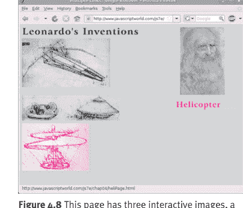

图 4.8 此页面包含三个交互式图像：飞行器、坦克和直升机。当你悬停在图像上时，其描述会出现在列奥纳多头像的下方。

### 脚本 4.8 请注意，此页面上的链接和图像都具有唯一的 id。

```
<!DOCTYPE html PUBLIC "-//W3C//DTD XHTML 1.0
→ Transitional//EN"
    "http://www.w3.org/TR/xhtml1/DTD/
    → xhtml1-transitional.dtd">
<html xmlns="http://www.w3.org/1999/xhtml">
<head>
    <title>Multiple Links, Single
    → Rollover</title>
    <script type="text/javascript"
    → src="script05.js"></script>
</head>
<body bgcolor="#EECC99">
    
    
    <a href="flyPage.html" class="textField"
    → id="flyer"></a><br clear="right" />
    
    <a href="tankPage.html" class="textField"
    → id="tank"></a><br />
    <a href="heliPage.html" class="textField"
    → id="helicopter"></a>
</body>
</html>
```

## 脚本 4.9 此脚本向你展示如何使用多个链接来触发单个翻滚效果。

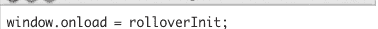

```
window.onload = rolloverInit;

function rolloverInit() {
    for (var i=0; i < document.links.length; i++) {
        var linkObj = document.links[i];
        if (linkObj.className) {
            var imgObj = document.getElementById(linkObj.className);
            if (imgObj) {
                setupRollover(linkObj, imgObj);
            }
        }
    }
}

function setupRollover(thisLink, textImage) {
    thisLink.imgToChange = textImage;
    thisLink.onmouseout = function() {
        this.imgToChange.src = this.outImage.src;
    }
    thisLink.onmouseover = function() {
        this.imgToChange.src = this.overImage.src;
    }
    thisLink.outImage = new Image();
    thisLink.outImage.src = textImage.src;
    thisLink.overImage = new Image();
    thisLink.overImage.src = "images/" + thisLink.id + "Text.gif";
}
```

### 如何让多个链接控制单个翻滚效果：

- 1. if (linkObj.className) {
        var imgObj = document.
            getElementById(linkObj.
                className);
    }

我们无法使用被悬停图像的 id 来计算目标图像的 id——因为 id 必须是唯一的，而所有被悬停的图像都需要为同一目标图像得出相同的值。相反，我们使用 class 属性（因为你可以让多个页面元素共享同一个类）。在这一行中，我们寻找链接对象的 className。

- 2. function setupRollover(thisLink,
            textImage) {
        thisLink.imgToChange = textImage;

setupRollover() 函数接收当前链接对象（thisLink）和图像对象，我们称之为 textImage。请注意，当我们传入这些对象（也可以称为变量）时，我们分别将它们命名为 linkObj 和 imgObj。

脚本的其余部分与本章之前的示例工作方式相同。

## 处理多个翻滚效果

如果你希望触发翻滚的图像本身也成为翻滚图像，该怎么办？**图 4.9** 基于上一个示例构建，并展示了我们如何添加此功能。当你悬停在某个发明图像上时，它会像以前一样使描述图像出现，但这次同时还会将发明图像替换为另一个带有阴影效果的图像。这为用户提供了他们正在指向什么的视觉反馈（就好像鼠标指针还不够明显一样！）。**脚本 4.10** 是 HTML 页面（除了标题和调用的外部 JavaScript 文件名外，没有其他更改），**脚本 4.11** 展示了相对于上一个示例在 JavaScript 中添加的内容。

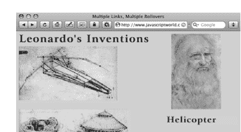

**图 4-9** 当你悬停在某个图像上时，描述会出现，并且图像本身周围会出现阴影。

### 脚本 4.10 此 HTML 与脚本 4.8 相同，只是标题和对外部脚本的引用不同。

```
<!DOCTYPE html PUBLIC "-//W3C//DTD XHTML 1.0
→ Transitional//EN"
  "http://www.w3.org/TR/xhtml1/DTD/
   → xhtml1-transitional.dtd">
<html xmlns="http://www.w3.org/1999/xhtml">
<head>
  <title>Multiple Links, Multiple Rollovers
   → </title>
  <script type="text/javascript"
   → src="script06.js"></script>
</head>
<body bgcolor="#EECC99">
  
  
  <a href="flyPage.html" class="textField"
   → id="flyer"></a><br clear="right" />
  
  <a href="tankPage.html" class="textField"
   → id="tank"></a><br />
  <a href="heliPage.html" class="textField"
   → id="helicopter"></a>
</body>
</html>
```

### 如何处理多个翻滚效果：

- 1. **thisLink.imgToChange = new Array;
thisLink.outImage = new Array;
thisLink.overImage = new Array;**
添加这几行是因为脚本需要处理更多的图像（每个翻滚效果对应两张）。在每一行中，我们为 thisLink 创建一个新属性，每个属性都是一个数组。

- 2. **thisLink.imgToChange[0] = textImage;**
在上一个任务中，imgToChange 是一个图像，但在这个任务中，它是一个将包含图像的数组。这里，textImage 被存储在 imgToChange 的第一个元素中。

- 3. **thisLink.outImage[0] = new Image();
thisLink.outImage[0].src =
→ textImage.src;**
与之前一样，我们需要存储图像的 out（关闭）版本，但这次它存储在 outImage 数组的第一个元素中。

- 4. **thisLink.overImage[0] = new Image();
thisLink.overImage[0].src =
→ "images/" + thisLink.id +
→ "Text.gif";**
类似地，图像的 over（开启）版本被计算并存储在 overImage 的第一个元素中。

*（下一页继续）*

### 脚本 4.11 此脚本处理多个翻滚效果。

```
5. var rolloverObj = document.
   → getElementById(thisLink.id +
   "Img");
if (rolloverObj) {
```

现在我们需要确定这个翻滚效果是否触发多个图像，而不仅仅是单个图像。如果是这种情况，HTML 页面上将有一个 id 与当前链接相同但附加了 Img 的元素。也就是说，如果我们正在处理 flyer，我们将检查页面上是否存在 flyerImg 元素。如果存在，则将其保存在 rolloverObj 中，我们应该执行接下来的三个步骤。

```
6. thisLink.imgToChange[1] =
   → rolloverObj;
```

与我们上面设置 imgToChange[0] 的方式相同，我们现在将 imgToChange[1]（数组中的第二个元素）设置为新的 rolloverObj。当 onmouseout 和 onmouseover 事件处理程序被触发时，两张图像都会切换到它们的替代版本，我们稍后会看到。

```
7. thisLink.outImage[1] = new Image();
   thisLink.outImage[1].src =
   → rolloverObj.src;
```

这将 outImage 的第二个数组元素设置为图像的 out（关闭）版本。

```
8. thisLink.overImage[1] = new Image();
   thisLink.overImage[1].src =
   → "images/" + thisLink.id +
   → "_on.gif";
```

这里，图像的 over（开启）版本被计算并存储在 overImage 的第二个元素中。

如果我们出于某种原因希望第三张图像也在同一翻滚效果期间改变，我们将对第三个图像对象重复步骤 6–8。

```
script

window.onload = rolloverInit;

function rolloverInit() {
    for (var i=0; i<document.links.length; i++) {
        var linkObj = document.links[i];
        if (linkObj.className) {
            var imgObj = document.getElementById
                → (linkObj.className);
            if (imgObj) {
                setupRollover(linkObj,imgObj);
            }
        }
    }
}

function setupRollover(thisLink,textImage) {
    thisLink.imgToChange = new Array;
    thisLink.outImage = new Array;
    thisLink.overImage = new Array;

    thisLink.imgToChange[0] = textImage;
    thisLink.onmouseout = rollOut;
    thisLink.onmouseover = rollOver;

    thisLink.outImage[0] = new Image();
    thisLink.outImage[0].src = textImage.src;

    thisLink.overImage[0] = new Image();
    thisLink.overImage[0].src = "images/" +
        → thisLink.id + "Text.gif";

    var rolloverObj = document.getElementById
        → (thisLink.id + "Img");
    if (rolloverObj) {
        thisLink.imgToChange[1] = rolloverObj;

        thisLink.outImage[1] = new Image();
        thisLink.outImage[1].src = rolloverObj.
            → src;

        thisLink.overImage[1] = new Image();
```

（脚本在下一页继续）


## 脚本 4.11 续

```
thisLink.overImage[1].src = "images/" +
    thisLink.id + "_on.gif";
    }
}

function rollOver() {
    for (var i=0; i<this.imgToChange.length;
        i++) {
        this.imgToChange[i].src = this.
            overImage[i].src;
    }
}

function rollOut() {
    for (var i=0; i<this.imgToChange.length;
        i++) {
        this.imgToChange[i].src = this.
            outImage[i].src;
    }
}
```

```
for (var i=0; i<this.imgToChange.
    length; i++) {
    this.imgToChange[i].src =
        this.overImage[i].src;
}
```

在 `rollOver()` 函数内部，图片就在这里进行切换。由于可以更改一张或多张图片，我们需要先询问存储了多少张图片——这就是 `this.imgToChange.length` 的值。在这里，值为 2，因为我们希望两张图片都发生变化。然后循环两次，将 `imgToChange[0]` 和 `imgToChange[1]` 的源分别设置为它们对应的悬停状态下的值。

```
for (var i=0; i<this.imgToChange.
    length; i++) {
    this.imgToChange[i].src =
        this.outImage[i].src;
}
```

`rollOut()` 函数中的这段代码与上一步的代码几乎相同；唯一的区别是我们现在将这些图片重置为它们的正常状态下的源值。

### ✓ 提示

-   务必记住，任何会被悬停的图片都必须有一个唯一的 id。
-   如果您希望页面上的某些链接触发多个悬停效果，而其他链接则是单独的悬停效果，该怎么办？没问题——您甚至不需要更改一行 JavaScript。只要检查替换 id 的步骤 5 在页面上找不到该替换 id，就不会存储第二个元素，`rollOver()` 和 `rollOut()` 的循环也只会对初始图片进行动画处理。

# 第 4 章

## 创建轮播横幅

当您浏览网页时，经常会看到广告横幅在图片之间定期切换。其中一些是动画 GIF 文件，即包含按顺序播放的多帧画面的 GIF 文件；另一些则是 Flash 动画。如果您希望页面在一组 GIF 图片之间轮播（无论是否动画），都可以使用 JavaScript 来实现，如**脚本 4.13**所示。本例使用三张 GIF 图片并反复轮播，如**图 4.10、图 4.11**和**图 4.12**所示。简单的 HTML 页面如**脚本 4.12**所示。

## 创建轮播横幅：

1.  `var thisAd = 0;`
    我们的脚本首先创建 `thisAd`，并在代码中赋予其初始值。

2.  `function rotate() {
    var adImages = new Array("images/reading1.gif","images/reading2.gif","images/reading3.gif");`
    我们从一个名为 `rotate()` 的新函数开始。下一行创建了一个名为 `adImages` 的新数组。在本例中，该数组包含三张构成轮播横幅的 GIF 文件名。

3.  `thisAd++;`
    将 `thisAd` 的值加一。

4.  `if (thisAd == adImages.length) {
    thisAd = 0;`
    这段代码检查 `thisAd` 的值是否等于 `adImages` 数组中的项目数量；如果是，则将 `thisAd` 的值重新设为零。

## 脚本 4.12 HTML 加载轮播横幅中的第一张图片；JavaScript 处理其余部分。

```
<!DOCTYPE html PUBLIC "-//W3C//DTD XHTML 1.0
Transitional//EN"
"http://www.w3.org/TR/xhtml1/DTD/
xhtml1-transitional.dtd">
<html xmlns="http://www.w3.org/1999/xhtml">
<head>
<title>Rotating Banner</title>
<script type="text/javascript"
src="script07.js"></script>
</head>
<body bgcolor="#FFFFFF">
<div align="center">

</div>
</body>
</html>
```

## 脚本 4.13 您可以使用 JavaScript 在横幅中的图片之间进行轮播。

```
window.onload = rotate;

var thisAd = 0;

function rotate() {
var adImages = new Array("images/reading1.
gif","images/reading2.gif","images/
reading3.gif");

thisAd++;

if (thisAd == adImages.length) {
thisAd = 0;
}

document.getElementById("adBanner").src =
adImages[thisAd];

setTimeout(rotate, 3 * 1000);
}
```

使用图片

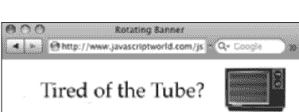

```
5. document.getElementById("adBanner").src = adImages[thisAd];
```

网页上进行轮播的图片具有 id `adBanner`；您可以在 img 标签中定义该名称，如脚本 4.12 所示。这行代码 evid饱代码表示，`adBanner` 的新源位于数组 `adImages` 中，变量 `thisAd` 的值定义了浏览器此时应该使用三张 GIF 中的哪一张。

图 4.10 第一张图片，启动轮播横幅……

```
6. setTimeout(rotate, 3 * 1000);
```

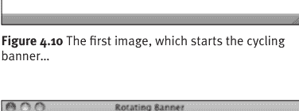

这行代码告诉脚本应该多久更换一次横幅中的图片。JavaScript 内置命令 `setTimeout` 让您可以指定某个操作按特定的时间表执行，始终以毫秒为单位。在本例中，`rotate()` 函数每 3000 毫秒即每 3 秒调用一次，因此 GIF 图片将在横幅中每三秒轮播一次。

图 4.11 ……第二张图片……

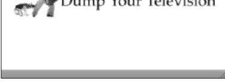

### ✔ 提示

-   您可能想知道为什么要用 JavaScript 来实现轮播横幅，而不是直接创建一个动画 GIF。一个很好的理由是，它允许您在横幅中使用 JPEG 或 PNG 格式的图片，从而获得更高质量的图像。使用这些更高质量的图像，您可以在横幅中使用照片。

图 4.12 ……最后一张图片。一旦页面加载完成，横幅开始轮播，动画将持续进行，无需用户干预。

-   与本章前面的一些示例不同，本任务中的图片没有预缓存。每张图片在首次显示时才会从服务器下载。这是因为您的广告数组中可能有任意数量的图片，如果用户只会看到 2 到 3 张图片，强迫他们下载 100 张图片是不礼貌的行为。

105

# 第 4 章

## 为轮播横幅添加链接

横幅常用于广告宣传，您需要了解如何将横幅制作为链接，以便在访客点击横幅时将其带到某处。**脚本 4.14**展示了 HTML 页面，它与上一个示例的区别仅在于在 img 标签周围添加了一个链接。**脚本 4.15**展示了前一个脚本的一个变体。在本脚本中，我们添加了一个新数组。这个新数组包含用户点击横幅时将被发送到的目标地址。在本例中，「Eat at Joe's」横幅将您带到 negrino.com，「Drink more Java」前往 sun.com，「Heartburn」则前往 microsoft.com，如**图 4.13**所示。当然，没有任何隐含评论的意味。

**为轮播横幅添加链接：**

1.  `window.onload = initBannerLink;`

    当窗口完成加载时，触发 `initBannerLink()` 函数。

**脚本 4.14** 广告横幅所需的 HTML。

```
<!DOCTYPE html PUBLIC "-//W3C//DTD XHTML 1.0
→ Transitional//EN"
"http://www.w3.org/TR/xhtml1/DTD/
→ xhtml1-transitional.dtd">
<html xmlns="http://www.w3.org/1999/xhtml">
<head>
    <title>Rotating Banner with Links</title>
    <script type="text/javascript"
    → src="script08.js"></script>
</head>
<body bgcolor="#FFFFFF">
    <div align="center">
        <a href="linkPage.html">
        → </a>
    </div>
</body>
</html>
```

**脚本 4.15** 本脚本展示了如何将轮播横幅变成真正可点击的广告横幅。

```
window.onload = initBannerLink;

var thisAd = 0;

function initBannerLink() {
    if (document.getElementById("adBanner").
    → parentNode.tagName == "A") {
        document.getElementById("adBanner").
        → parentNode.onclick = newLocation;
    }
    
    rotate();
}

function newLocation() {
    var adURL = new Array("negrino.com",
    → "sun.com", "microsoft.com");
    document.location.href = "http://www." +
    → adURL[thisAd];
    return false;
}

function rotate() {
    var adImages = new Array("images/banner1.
    → gif", "images/banner2.gif", "images/
    → banner3.gif");
    
    thisAd++;
    if (thisAd == adImages.length) {
        thisAd = 0;
    }
    document.getElementById("adBanner").src =
    → adImages[thisAd];
    
    setTimeout(rotate, 3 * 1000);
}
```

## 处理图像

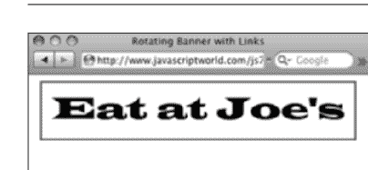

```
if (document.getElementById("adBanner").parentNode.tagName == "A") {
    document.getElementById("adBanner").parentNode.onclick = newLocation;
}

rotate();
```

这段代码位于 initBannerLink() 函数内部，首先检查 adBanner 对象是否被链接标签包围。如果是的话，当链接被点击时，newLocation() 函数就会被调用。最后，rotate() 函数被调用。

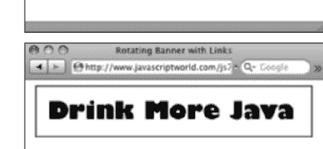

```
function newLocation() {
    var adURL = new Array("negrino.com", "sun.com", "microsoft.com");
```

在 newLocation() 这个新函数中，adURL 变量被赋值为一个新数组的三个元素。这里只需要放入域名即可，因为我们将在下一步补全 URL。

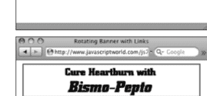

```
document.location.href = "http://www." + adURL[thisAd];
return false;
```

仍然在 newLocation() 内部，我们将 document.location.href 对象（即当前文档窗口）设置为文本字符串 `http://www.`（注意其中的句点）加上 adURL 中某一元素的值。由于 adURL 是一个数组，你需要指定数组中的一个成员。该成员存储在 thisAd 中，最终得到的字符串可以是三个链接中的任意一个，具体取决于用户点击的时机。最后，返回 false，告诉浏览器*不要*同时加载 href 中的内容。否则，浏览器两者都会执行。我们已经在 JavaScript 中处理了一切，因此不需要加载 href。

**图 4.13** 这三张图片每一张都是一个链接，点击每张图片都会将你带到三个不同网站中的一个。

> **✓ 提示**
- adURL 数组需要与 adImages 数组具有相同数量的数组项，脚本才能正确工作。

# 第 4 章
### 构建循环幻灯片

网站上的幻灯片向用户展示一张图片，并让用户控制图片的播放进度（前进或后退）。JavaScript 提供了用户所需的可交互控制。**脚本 4.16** 展示了所需的 HTML，**脚本 4.17** 中的 JavaScript 则包含了你向页面添加幻灯片所需的内容。

这个脚本构建了一个循环幻灯片——也就是说，如果你翻过了列表末尾，就会回到开头，反之亦然。**图 4.14** 展示了新的幻灯片。

**脚本 4.16** 这个 HTML 页面创建了一个幻灯片。

```
<!DOCTYPE html PUBLIC "-//W3C//DTD XHTML 1.0 Transitional//EN"
        "http://www.w3.org/TR/xhtml1/DTD/xhtml1-transitional.dtd">
<html xmlns="http://www.w3.org/1999/xhtml">
<head>
    <title>Image Slideshow</title>
    <script type="text/javascript" src="script09.js"></script>
</head>
<body bgcolor="#FFFFFF">
    <div align="center">
        <h1>Welcome, Robot Overlords!</h1>
        
        <h2><a href="previous.html" id="prevLink">&lt;&lt; Previous</a>&nbsp;&nbsp;<a href="next.html" id="nextLink">Next &gt;&gt;</a></h2>
    </div>
</body>
</html>
```

**脚本 4.17** 这个脚本构建了一个幻灯片，用户可以通过点击链接来控制前进和后退。

```
window.onload = initLinks;

var myPix = new Array("images/robot1.jpg", "images/robot2.jpg", "images/robot3.jpg");
var thisPic = 0;

function initLinks() {
    document.getElementById("prevLink").onclick = processPrevious;
    document.getElementById("nextLink").onclick = processNext;
}

function processPrevious() {
    if (thisPic == 0) {
        thisPic = myPix.length;
    }
    thisPic--;
    document.getElementById("myPicture").src = myPix[thisPic];
    return false;
}

function processNext() {
    thisPic++;
    if (thisPic == myPix.length) {
        thisPic = 0;
    }
    document.getElementById("myPicture").src = myPix[thisPic];
    return false;
}
```

108

## 处理图像

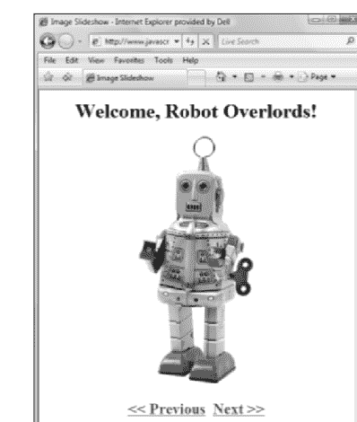

### 构建循环幻灯片：

```
1. window.onload = initLinks;
   当窗口完成加载时，触发 initLinks() 函数。

2. function initLinks() {
     document.getElementById("prevLink").onclick = processPrevious;
     document.getElementById("nextLink").onclick = processNext;
   }
   这个函数为"上一张"和"下一张"链接设置了 onclick 事件处理器。
```

下一页继续

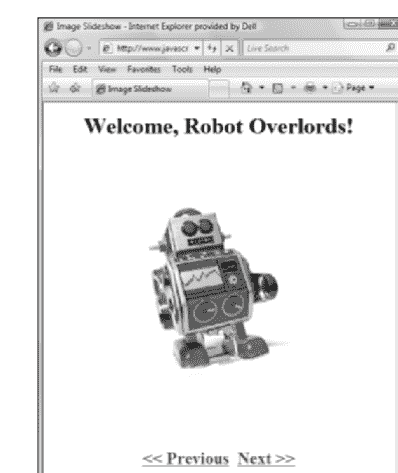

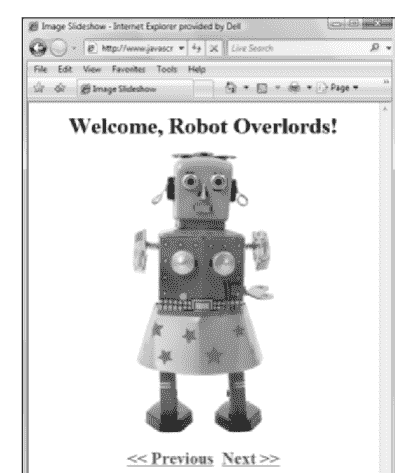

图 4.14 点击"上一张"或"下一张"链接，分别会调用 processPrevious() 或 processNext() 函数。

### 构建循环幻灯片

109

第 4 章

```
3. function processPrevious() {
    if (thisPic == 0) {
        thisPic = myPix.length;
```

这个函数让幻灯片向"上一张"方向运行。这部分首先检查 thisPic 是否等于 0。如果是，函数获取 myPix 数组中的图片数量。

```
4. thisPic--;
document.getElementById("myPicture").src = myPix[thisPic];
```

第一行将 thisPic 的值减 1。下一行将 myPicture 的 src 设置为 myPix 数组中由 thisPic 当前值所代表的元素。

```
5. thisPic++;
if (thisPic == myPix.length) {
    thisPic = 0;
}
document.getElementById("myPicture").src = myPix[thisPic];
```

这段代码位于 processNext() 函数内部，让幻灯片向"下一张"方向运行，与 processPrevious() 函数非常相似。首先将 thisPic 的值增加 1。然后检查 thisPic 的值是否与 myPix 数组中的项目数相同。如果是，则将 thisPic 设置回 0。下一行设置 myPicture 的 src。

**脚本 4.18** 这个简单的 HTML 创建了一个随机图像页面。

```
<?xml version="1.0" encoding="UTF-8"?>
<!DOCTYPE html PUBLIC "-//W3C//DTD XHTML 1.0 Transitional//EN"
    "http://www.w3.org/TR/xhtml1/DTD/xhtml1-transitional.dtd">
<html xmlns="http://www.w3.org/1999/xhtml">
<head>
    <title>Random Image</title>
    <script type="text/javascript" src="script10.js"></script>
</head>
<body bgcolor="#FFFFFF">
    
</body>
</html>
```

**脚本 4.19** 你可以使用这个脚本在页面上显示随机图像，它使用 JavaScript 的 Math.random 方法来生成随机数。

```
window.onload = choosePic;

function choosePic() {
    var myPix = new Array("images/lion.jpg", "images/tiger.jpg", "images/bear.jpg");
    var randomNum = Math.floor((Math.random() * myPix.length));
    document.getElementById("myPicture").src = myPix[randomNum];
}
```

### 显示随机图像

如果你的网站富含图片，或者你正在展示数字艺术作品，那么你可能希望用户进入你的网站时，从你的收藏中随机显示一张图像。再次，JavaScript 来拯救！极其简单的**脚本 4.18** 展示了所需的 HTML，**脚本 4.19** 提供了 JavaScript。**图 4.15** 展示了该脚本的结果，在这个例子中是毛绒狮子、老虎和熊的图片（哦，天哪！）。

### 显示随机图像：

1. `var myPix = new Array("images/lion.jpg", "images/tiger.jpg", "images/bear.jpg");`

在 `choosePic()` 函数内部，如现在所熟悉的那样，构建一个包含三张图片的数组，并将其放入变量 `myPix` 中。

2. `randomNum = Math.floor((Math.random() * myPix.length));`

变量 `randomNum` 获得一个数学表达式的值，这个表达式最好从内向外阅读。`Math.random` 生成一个 0 到 1 之间的随机数，然后乘以 `myPix.length`，即数组中的项目数（在这个例子中是 3）。`Math.floor` 将结果向下取整为整数，这意味着该数字必须在 0 到 2 之间。

*下一页继续*


第四章

3. document.getElementById("myPicture").src = myPix[randomNum];

这表示图片 myPicture 的来源基于数组 myPix 进行设置，而当前值取决于 randomNum 的值。

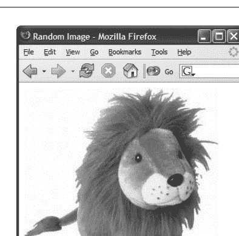

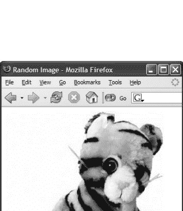

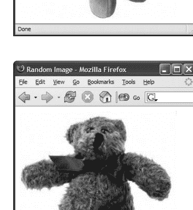

**图 4-15** 根据脚本生成的随机数，用户将看到狮子、老虎或熊。

## 随机起始循环图片

如果你有一组想要显示的图片，可能不希望每次加载页面时都从同一张图片开始显示。**脚本 4.20** 包含 HTML 代码，**脚本 4.21** 则将之前用于循环广告横幅的代码与随机图片代码结合起来。

**脚本 4.20** HTML 文件中有一个占位 GIF，作为广告横幅出现前的占位符。

```
<!DOCTYPE html PUBLIC "-//W3C//DTD XHTML 1.0 Transitional//EN"
    "http://www.w3.org/TR/xhtml1/DTD/xhtml1-transitional.dtd">
<html xmlns="http://www.w3.org/1999/xhtml">
<head>
    <title>Rotating Random Banner</title>
    <script type="text/javascript"
    src="script11.js"></script>
</head>
<body bgcolor="#FFFFFF">
    <div align="center">
        
    </div>
</body>
</html>
```

**脚本 4.21** 此脚本允许你以随机图片开始循环图片展示。

```
window.onload = choosePic;

var adImages = new Array("images/reading1.gif","images/reading2.gif","images/reading3.gif");
var thisAd = 0;

function choosePic() {
    thisAd = Math.floor((Math.random() * adImages.length));
    document.getElementById("adBanner").src = adImages[thisAd];

    rotate();
}

function rotate() {
    <span class="select" style="background-color: rgb(245, 247, 249);">    thisAd++;
    if (thisAd == adImages.length) {
        thisAd = 0;
    }
    document.getElementById("adBanner").src = adImages[thisAd];

    setTimeout(rotate, 3 * 1000);
}
```

以随机起始点开始循环图片：

1. `var adImages = new Array("images/reading1.gif", "images/reading2.gif", "images/reading3.gif");`

与前面的示例一样，设置数组和包含数组长度的变量。

2. `function choosePic() {`

此函数与脚本 4.19 中的 choosePic() 函数类似。有关其工作原理的详细信息，请参阅该处的说明。

3. `function rotate() {`

此函数与脚本 4.13 中的 rotate() 函数类似。有关其工作原理的详细信息，请参阅该处的说明。

## 框架，框架，更多框架

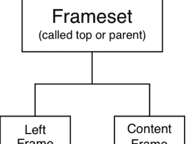

框架是 HTML 的一个实用功能，尽管在过去几年中已 somewhat 失宠。在本章中，我们将演示如何利用 JavaScript 的强大功能让框架变得更加实用。

一个框架至少包含三个 HTML 页面。第一个称为*框架集*，它设置每个子框架的尺寸。在 JavaScript 中，框架集被称为 *top* 或 *parent*。其余的页面适配到框架集创建的窗格中，称为*子页面*。这些可以按你选择的任何名称命名。**图 5.1** 展示了一个框架集，它创建了两个子框架，"left" 和 "content"。

**图 5.1** 包含两个框架 "left" 和 "content" 的框架集布局。

## 第五章

### 刚好够用的 HTML——框架

| 标签 | 属性 | 含义 |
|---|---|---|
| frameset | | 指定页面由两个或多个带框架的页面组成；包含指定特定页面的 frame 标签。 |
| | cols | 每个框架的列尺寸（比例或固定），以像素为单位。 |
| frame | | 每个带框架页面的位置和属性。 |
| | id | JavaScript 用于引用框架集中某个页面的标识。 |
| | src | 加载到框架中的页面的物理位置（即 URL）。 |
| iframe | | 内部框架，显示在调用它的 HTML 页面内部。 |
| | id | JavaScript 使用此属性来引用 iframe。 |
| | name | JavaScript 也可以交替使用此属性来引用 iframe。 |
| | src | iframe 页面的 URL。 |
| | width | iframe 的宽度（以像素或百分比为单位）。 |
| | height | iframe 的高度（以像素或百分比为单位）。 |
| | align | 将 iframe 向右或向左对齐。 |
| | frameborder | 在 iframe 周围显示边框。 |

## 防止页面被嵌入框架

其他人可以将你的某个页面放在他们网站的框架中，使其看起来你的页面是他们内容的一部分。在 JavaScript 中，窗口呈现层次结构，父窗口位于顶层。当有人劫持你的页面时，他们强迫它成为其父窗口的子框架。**图 5.2** 展示了页面作为他人网站一部分时的显示效果。使用这些脚本，你可以防止这种页面劫持，并强制你的页面始终单独显示在浏览器窗口中。有两个脚本；**脚本 5.1** 是应该始终独立显示的 HTML 页面，其中包含调用 JavaScript 的 `<script>` 标签；**脚本 5.2** 是 JavaScript 文档，我们将在下面描述。

 {
    top.location.replace(self.location);
}
```

隔离页面：

1. `if (top.location != self.location) {`

首先，检查当前页面（self）的位置是否在浏览器窗口层次结构的最顶层。如果是，则无需执行任何操作。

2. `top.location.replace(self.location);`

如果当前页面不在最顶层，则用最顶层页面替换为当前页面的位置。这将强制当前窗口只显示我们的页面。**图 5.3** 展示了我们设计的页面。

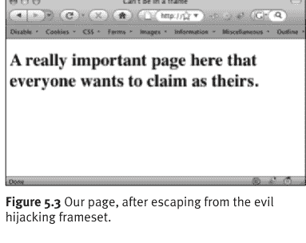

> ✔ 提示
> 我们可以直接将 top.location 设置为 self.location，但这有一个糟糕的副作用：用户将无法再使用浏览器的后退按钮。如果他们尝试使用，返回到上一页会自动跳转回当前页面。使用上述 replace() 方法会替换历史记录中的当前页面，从而允许后退按钮显示上一页。

## 强制页面进入框架

当搜索引擎索引你的某个页面时，它不知道该页面是框架的一部分。当用户通过搜索引擎找到你的页面时，点击链接只会显示单个页面，而不是你设计的完整框架集。**脚本 5.3** 展示了框架集。用户着陆的页面（未显示）包含一个调用（与脚本 5.1 中的类似）到 JavaScript。**脚本 5.4** 向你展示了如何强制显示完整的框架集，即使 Google 或其他搜索引擎不知道框架集的存在。**图 5.4** 展示了页面看起来格格不入的情况，**图 5.5** 展示了它在自己的框架中舒适显示的情况。

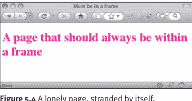

图 5.4 一个孤独的页面，独自漂泊。

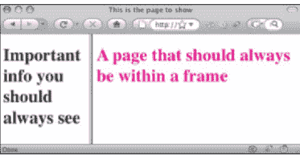

图 5.5 我们的页面，愉快地与父框架和兄弟框架重聚。

强制页面进入框架：

1. `if (top.location == self.location) {`

检查当前页面（self）是否位于最顶层。如果不是，则说明我们在框架集中。

2. `self.location.replace("frameset2.html");`

如果当前页面的位置在最顶层，则将当前页面替换为框架集的 URL。然后按我们设计的方式显示带框架的网站。

**脚本 5.3** 框架集页面。

```
<!DOCTYPE html PUBLIC "-//W3C//DTD XHTML 1.0 Frameset//EN"
    "http://www.w3.org/TR/xhtml1/DTD/xhtml1-frameset.dtd">
<html xmlns="http://www.w3.org/1999/xhtml">
<head>
    <title>This is the page to show</title>
</head>
<frameset cols="30%,70%">
    <frame src="left2.html" name="left" id="left" />
    <frame src="frame2.html" name="content" id="content" />
</frameset>
</html>
```

> ✔ 提示
> 如果你只有少数页面可能会从框架外部被调用，此方法效果很好，因为它需要为每个可能要加载（在本例中）到 content 框架的页面准备一个单独的框架集页面。下一个示例展示了处理大型网站的方法。

**脚本 5.4** 使用 JavaScript 强制你的页面进入框架集。

```
if (top.location == self.location) {
    self.location.replace("frameset2.html");
}
```


# 第5章

## 将网站强制置入框架

如果你有一个大型网站，其中包含大量希望放入框架的页面，那么上一页介绍的方法很快就会变得难以掌控。这里有一种更适合大型网站的方法。**代码清单 5.5** 展示了框架集页面，它也调用了 JavaScript，如**代码清单 5.6** 所示（详见下文）。**图 5.6** 展示了我们单独的页面，而**图 5.7** 展示了我们预期的网站外观。图中没有显示构成图 5.7 左侧导航栏的简单 HTML 页面，也没有显示构成内容框架的同样简单的 HTML 页面。后者调用 JavaScript（以防它们被直接加载），方式与代码清单 5.5 相同。

## 将网站强制置入框架的操作步骤：

```
1. var framesetPage = "frameset3.html";
   var currPage = justTheFilename(self.location.pathname);
```

我们首先创建并设置两个变量：framesetPage 和 currPage。前者是我们希望始终加载的框架集页面，因此硬编码为 frameset3.html。后者是调用此外部 JavaScript 文件的 HTML 页面的名称。它需要进行计算，因为 JavaScript 没有内置函数可以完成此操作（虽然理应如此！）。我们将使用 justTheFilename() 函数来实现，如步骤 10 所述。

```
代码清单 5.5 框架集页面调用外部 JavaScript 文件。

<!DOCTYPE html PUBLIC "-//W3C//DTD XHTML 1.0 Frameset//EN"
   "http://www.w3.org/TR/xhtml1/DTD/xhtml1-frameset.dtd">
<html xmlns="http://www.w3.org/1999/xhtml">
<head>
   <title>Site Frameset</title>
   <script type="text/javascript"
      src="script03.js"></script>
</head>
<frameset cols="30%,70%">
   <frame src="left3.html" name="left"
      id="left" />
   <frame src="frame3a.html" name="content"
      id="content" />
</frameset>
</html>
```

---

框架，框架，还是框架

**代码清单 5.6** 这段 JavaScript 将我们想要的网站强制置入我们想要的框架。

```
var framesetPage = "frameset3.html";
var currPage = justTheFilename
	(self.location.pathname);

if (top.location == self.location &&
	framesetPage != currPage) {
	self.location.replace(framesetPage + "?" +
		currPage);
}

window.onload = chgFrame;

function chgFrame() {
	if (top.location == self.location &&
		document.location.search) {
		var linkURL = justTheFilename
			(document.location.search);
		var contentWin = document.getElementById
			("content").contentWindow;
		var currURL = justTheFilename
			(contentWin.location.pathname);

		if (currURL != linkURL) {
			contentWin.location.replace
				(linkURL);
		}
	}
}

function justTheFilename(thisFile) {
	if (thisFile.indexOf("/") > -1) {
		thisFile = thisFile.substring
			(thisFile.lastIndexOf("/")+1);
	}

	if (thisFile.indexOf("?") == 0) {
		thisFile = thisFile.substring(1);
	}

	return thisFile;
}
```

在这一步中，该函数被传递了 `self.location.pathname`（一个变量，保存 URL 中域名*之后*的部分）。例如，如果你正在查看 `http://www.peachpit.com/index.html`，`self.location.pathname` 是 `/index.html`。如果你在 `http://www.peachpit.com/books/index.html`，`self.location.pathname` 是 `/books/index.html`。无论哪种情况，我们想要的都只是 `index.html`，所以 `justTheFilename()` 会计算并返回该值，这就是将存储在 `currPage` 中的内容。

```
2. if (top.location == self.location &&
	framesetPage != currPage) {
	self.location.replace
		(framesetPage + "?" + currPage);
}
```

现在我们执行之前做过的常规检查，看看 `top.location` 是否与 `self.location` 相同，并增加了一个条件：检查我们是否当前就在框架集页面上。如果是，那就太好了；我们不需要重新加载任何东西。但如果 `currPage` 不是框架集页面，那就出问题了——所以我们需要重新加载此页面，跳转到框架集页面，并顺便将 `currPage` 传递过去，使其最终进入内容框架集。

```
3. window.onload = chgFrame;
```

此处设置 `onload` 处理程序，是因为我们希望每个使用此外部 JavaScript 文件的页面都调用 `chgFrame()` 函数。

```
4. function chgFrame() {
```

此函数检查（a）它是否是框架集页面，以及（b）URL 中是否有一个问号后跟文件名。如果是这种情况，该文件需要被加载到内容框架中。

```
5. if (top.location == self.location &&
    document.location.search) {
```

我们再次执行常规检查，看看 top.location 是否与 self.location 相同——在这种情况下，如果两者相等，我们就知道我们在框架集中。之后，我们查看 document.location.search，这是另一个内置字段，包含 URL 中从问号开始（如果存在）到末尾的所有内容。如果没有问号，document.location.search 就没有值，我们就会退出这个函数。

```
6. var linkURL = justTheFilename
    (document.location.search);
```

这是在加载新内容框架之前我们需要设置的三个变量中的第一个。第一个是 linkURL，即要加载到内容框架中的文件。linkURL 字段通过调用 justTheFilename() 并传入 document.location.search 来设置。

```
7. var contentWin = document.
    getElementById("content").
    contentWindow;
```

contentWin 变量需要包含 JavaScript 所知道的内容框架的信息。通过查找 id 为 content 的元素，获取其结果（将是一个框架），然后获取该框架的 contentWindow——即加载到该框架中的页面。

```
8. var currURL = justTheFilename
    (contentWin.location.pathname);
```

currURL 变量在此处被设置为当前内容框架页面，即加载在内容框架中的当前 HTML 页面。这是通过调用 justTheFilename() 实现的，这次传入 contentWin.location.pathname，并存储结果。

```
9.  if (currURL != linkURL) {
    contentWin.location.replace(linkURL);
}
```

此刻，我们已经拥有了所需的一切，可以重新加载内容页面了——但我们还可以更智能地处理，再增加一个步骤。如果我们要加载的内容已经在那里了，为什么还要费心重新加载内容页面呢？在这里我们检查 currURL 是否等于 linkURL。如果是，说明我们已经处于正确的页面，什么都不做。如果不是，调用那个老牌的 replace()，我们就完成了。

```
10. if (thisFile.indexOf("/") > -1) {
    thisFile = thisFile.substring(thisFile.lastIndexOf("/")+1);
}

if (thisFile.indexOf("?") == 0) {
    thisFile = thisFile.substring(1);
}

return thisFile;
```

现在剩下的就是 justTheFilename() 函数了。此函数接收一个字符串，尝试清理它并将其转换为文件名。首先，我们检查它是否包含 /。如果包含，则查找文件名中最后一个 /（注意 lastIndexOf），然后将文件名重置为该 / 之后的所有内容。然后，我们查找问号。如果它是文件名中的第一个字符（即位置为零），则将文件名重置为从位置一到末尾的所有内容。文件名返回到调用该函数的地方。

### ✔ 提示

- 搜索引擎并非人们试图加载你框架site中单个页面的唯一原因。如果你在框架内为某个页面添加了书签，你的浏览器可能理解也可能不理解你正处于某个特定的框架内容页面上，而这不一定是框架集的默认视图。如果有人为网站的某个特定单页面添加了书签（以便他们可以回到此特定内容），此脚本将会把所有东西设置得恰到好处。

- 如果你对步骤 10 中的编号感到有些困惑，请查看边栏"JavaScript 字符串"。

## JavaScript 字符串

一个像 "cat" 这样的单词，何时 "t" 在第二个位置？当它作为 JavaScript 字符串时。

在 JavaScript 中，第一个字符位于位置 0。因此，以 "cat" 为例，"c" 位于位置 0，"a" 位于位置 1，而 "t" 位于位置 2。

只有在检查 cat 的长度时，我们才会看到值为 3。所有其他字符串方法都是基于零的；也就是说，它们从 0 开始。


## 脚本 5.7
当你在框架集中使用 XHTML Strict 时，需要 JavaScript 来设置框架目标。

```
<!DOCTYPE html PUBLIC "-/W3C//DTD XHTML 1.0 Strict//EN"
    "http://www.w3.org/TR/xhtml1/DTD/
    xhtml1-strict.dtd">
<html xmlns="http://www.w3.org/1999/xhtml">
<head>
    <title>Nav Bar</title>
    <script type="text/javascript"
    src="script04.js"></script>
</head>
<body>
    <h1>Navigation Bar</h1>
    <h2>
    <a href="frame4a.html">Page 1</a><br />
    <a href="frame4b.html">Page 2</a><br />
    <a href="frame4c.html">Page 3</a>
    </h2>
</body>
</html>
```

## 脚本 5.8
下面是你完成这项工作所需的 JavaScript。

```
window.onload = initLinks;

function initLinks() {
    for (var i=0; i<document.links.length; i++) {
        document.links[i].target = "content";
    }
}
```

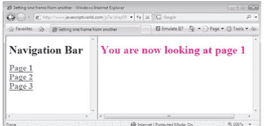

**图 5.8** 这是一个充当导航栏的框架，内容页面显示在内容框架中。

# 设置目标

如果你的站点使用框架，通常会有一个框架式的导航栏，将不同的页面加载到主框架中。主框架是导航栏中链接的目标，而使用 HTML 将主框架加载时，你需要使用 `<a>` 标签的 `target` 属性。但如果你想同时使用框架和 XHTML Strict，JavaScript 是设置目标的唯一方式。这是因为 `target` 属性在 XHTML Strict 中不被允许，而你必须设置目标才能使用框架。

**脚本 5.7** 中的 XHTML Strict 框架集允许你将所选页面加载到主内容框架中，只需点击左框架中的链接即可（**脚本 5.8**，详见下文）。结果如**图 5.8**所示。

## 为框架设置目标：

1. `window.onload = initLinks;`
页面加载时，调用 `initLinks()` 函数。

2. `for (var i=0; i<document.links.length; i++) {
    document.links[i].target = "content";
    }`

`initLinks()` 函数遍历页面上的所有链接。当循环找到链接时，将 `target` 属性设置为字符串 `"content"`。就这么简单。

### 提示

- 如果 JavaScript 被关闭，访问者会发现点击的第一个链接会加载到导航框架中，而不是内容框架。抱歉，但这就是框架和 XHTML Strict 的工作方式。

# 创建并加载动态框架

由于 JavaScript 可以即时创建页面内容，因此它对于根据用户在另一框架中的选择将动态数据加载到框架中很有用。脚本 5.9 是一个框架集，加载一个虚拟内容页面（frame5.html，此处称为脚本 5.10）和一个左侧导航栏页面 left5.html（未显示）。后者调用脚本 5.11，详见下文，该脚本可以创建一个页面并将其加载到主内容框架中。它创建的页面如图 5.9 所示。

## 从另一个框架加载动态框架：

1. `for (var i=0; i<document.links.length; i++) {
    document.links[i].onclick = writeContent;
    document.links[i].thisPage = i+1;
}`

`initLinks()` 函数的开法与脚本 5.8 中相同，通过遍历页面上的链接开始。然后，对于每个链接，设置两件事：该链接的 `onclick` 处理程序，以及添加一个新属性：`thisPage`。后者包含点击该链接时要显示的页码，即 link 0 是 "page 1"，link 1 是 "page 2"，依此类推。循环中的 `onclick` 处理程序将每个链接设置为在被点击时调用 `writeContent()` 函数。

```
<!DOCTYPE html PUBLIC "-//W3C//DTD XHTML 1.0 Frameset//EN"
    "http://www.w3.org/TR/xhtml1/DTD/xhtml1-frameset.dtd">
<html xmlns="http://www.w3.org/1999/xhtml">
<head>
    <title>Setting one frame from another</title>
</head>
<frameset cols="30%,70%">
    <frame src="left5.html" name="left" id="left" />
    <frame src="frame5.html" name="content" id="content" />
</frameset>
</html>
```

```
<!DOCTYPE html PUBLIC "-//W3C//DTD XHTML 1.0 Transitional//EN"
    "http://www.w3.org/TR/xhtml1/DTD/xhtml1-transitional.dtd">
<html xmlns="http://www.w3.org/1999/xhtml">
<head>
    <title>Content frame</title>
</head>
<body bgcolor="#FFFFFF">
</body>
</html>
```

**框架，框架，以及更多的框架**

**脚本 5.11** 该脚本创建一个页面并将其加载到主内容框架中。

```
window.onload = initLinks;

function initLinks() {
  for (var i=0; i<document.links.length; i++) {
    document.links[i].onclick = writeContent;
    document.links[i].thisPage = i+1;
  }
}

function writeContent() {
  var newText = "<h1>You are now looking at page " + this.thisPage + ".</h1>";

  var contentWin = parent.document.getElementById("content").contentWindow;
  contentWin.document.body.innerHTML = newText;
  return false;
}
```

2. `var newText = "<h1>You are now looking at page " + this.thisPage + ".</h1>";`

`var contentWin = parent.document.getElementById("content").contentWindow;`
`contentWin.document.body.innerHTML = newText;`

这是 `writeContent()` 函数的核心部分，它首先声明并设置一个变量 `newText`，为其分配一些文本。接下来，`contentWin` 变量基于 content 元素进行设置，然后我们将 `contentWin.document.body.innerHTML` 重置为 `newText`。进一步解释一下，我们找到具有给定 id 的元素（在本例中为 content），然后将该元素的 `contentWindow` 存储在变量 `contentWin` 中。给定 `contentWin`，我们需要它包含的文档；然后获取该文档的 body，接着重置 `innerHTML`，即该 body 标签内包含的 HTML。

3. `return false;`
最后，`writeContent()` 返回 false，这告诉浏览器它*不应该*同时加载导航栏框架中的 `href`。否则，浏览器会两者都执行。我们已经在 JavaScript 中处理了所有事情，所以 `href` 不需要被加载。

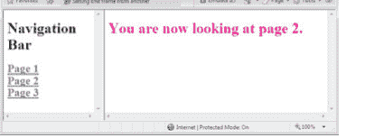

**图 5.9** 这是脚本 5.11 的结果，一个由 JavaScript 编写的网页。右侧框架的内容是在脚本控制下生成的。

# 第 5 章

### ✔ 提示

- 为什么步骤 2 中的斜杠（"/"）前面有一个反斜杠（"\"）？根据 HTML 标准，浏览器可能会将结束标签的开头（"<\/"）解释为行尾。反斜杠"转义"了斜杠，使我们能够写出 HTML，而不会导致错误。

- 这里我们使用的是 `parent.document.getElement...`，而脚本 5.6 中使用的是 `document.getElement...`。这是因为脚本 5.6 中的 JavaScript 将由框架集页面调用，而这里它是由其中一个框架页面调用的。在后一种情况下，JavaScript 必须返回到其父级（即框架集），以便查看内容页面（父级的另一个子级）。

## 创建和加载动态框架

## 128


图 5.10 右侧或内容框架中的信息由从框架集调用的代码创建。

# 在框架之间共享函数

一种常见的框架布局使用永久性导航框架和可能显示各种不同页面的内容框架。同样，将对外部 JavaScript 文件的调用放入始终存在的页面（框架集页面）中，而不是为每个可能的内容页面重复它，是更合理的做法。在图 5.10 中，我们利用这一功能让许多页面共享一个相同的函数，该函数返回随机横幅图像。脚本 5.12 将页面加载到框架集中。

**脚本 5.12** 该脚本允许你在多个框架之间共享函数。

```
var bannerArray = new Array("images/redBanner.gif", "images/greenBanner.gif", "images/blueBanner.gif");

window.onload = initFrames;

function initFrames() {
    var leftWin = document.getElementById("left").contentWindow.document;

    for (var i=0; i<leftWin.links.length; i++) {
        leftWin.links[i].target = "content";
        leftWin.links[i].onclick = resetBanner;
    }

    setBanner();
}

function setBanner() {
    var contentWin = document.getElementById("content").contentWindow.document;
    var randomNum = Math.floor(Math.random() * bannerArray.length);

    contentWin.getElementById("adBanner").src = bannerArray[randomNum];
}

function resetBanner() {
    setTimeout(setBanner,1000);
}
```


 ## 第5章

### 要在另一页面上使用函数：

1. `var bannerArray = new Array("images/redBanner.gif","images/greenBanner.gif","images/blueBanner.gif");`

首先避孕药先创建一个包含所有可能的横幅图像名称的新数组，并将该数组赋值给 bannerArray 变量。

2. `window.onload = initFrames;`

当框架集加载时，调用 initFrames()。

3. `var leftWin = document.getElementById("left").contentWindow.document;`

现在我们开始编写 initFrames() 函数内部的代码。我们先创建 leftWin 变量，并按照之前存储框架页面的方式进行设置：给定框架名称（left），获取该元素（document.getElementById("left")）；给定该元素，获取其 contentWindow 属性（document.getElementById("left").contentWindow）；给定 contentWindow 属性，获取其 document 属性。

4. `for (var i=0; i<leftWin.links.length; i++) { leftWin.links[i].target = "content"; leftWin.links[i].onclick = resetBanner;`

由于此函数是从框架集的上下文中调用的，因此设置左侧导航栏链接的方式与之前的示例略有不同。这次，我们重置每个链接的 target 属性和 onclick 处理程序。target 设置为 "content"，onclick 处理程序设置为 resetBanner 函数。

5. `setBanner();`

作为最后的初始化步骤，调用 setBanner() 函数。

6. `var contentWin = document.getElementById("content").contentWindow.document;`

setBanner() 函数加载内容窗口并计算一个随机数。然后，将内容窗口中的广告横幅设置为数组中的一个随机广告。我们先创建 contentWin 变量，并按照之前存储框架页面的方式进行设置：给定框架名称（content），获取该元素（document.getElementById("content")）；给定该元素，获取其 contentWindow 属性（document.getElementById("content").contentWindow）；给定 contentWindow 属性，获取其 document 属性。

7. `var randomNum = Math.floor(Math.random() * bannerArray.length);`

这一行使用 Math.random() 函数乘以 bannerArray 数组中的元素数量，计算出一个介于 0 和数组元素数量之间的随机数。然后将结果放入 randomNum 变量中。

8. `contentWin.getElementById("adBanner").src = bannerArray[randomNum];`

这里，我们将 adBanner 的 src 设置为数组中的当前项。这就是新的图像名称，随后将在页面上显示。

```
9. function resetBanner() {
    setTimeout(setBanner, 1000);
}
```

`resetBanner()` 函数有点棘手，尽管它只有一行代码。它的作用是等待内容框架加载其新页面（一秒钟应该足够了），然后再调用 `setBanner()` 来重置横幅。

如果我们立即调用 `setBanner()`，新内容页面可能尚未加载完毕。在这种情况下，我们就会遇到问题，因为我们可能会收到错误（因为找不到 `adBanner`），或者我们会重置旧的 `adBanner`——即正在卸载的页面上的那个。

- **提示**

- 注意 `resetBanner` *并不*返回 `false`——这意味着浏览器会同时执行此处的内容*并*加载来自 `href` 的页面。此脚本依赖于这一点，这也是为什么要同时设置 `onclick` 处理程序和 `target` 的原因。

# 在框架之间共享函数

## 框架，框架，以及更多的框架

脚本 5.13 JavaScript 允许你用一次用户点击加载多个框架。

```
window.onload = initFrames;

function initFrames() {
    var leftWin = document.getElementById("left").contentWindow.document;

    for (var i=0; i<leftWin.links.length; i++) {
        leftWin.links[i].onclick = setFrames;
    }
}

function setFrames() {
    document.getElementById("left").contentWindow.document.location.href = this.id + ".html";
    document.getElementById("content").contentWindow.document.location.href = this.href;
    setTimeout(initFrames,1000);
    return false;
}
```

## 同时加载多个框架

只需一个带 target 属性的链接就能更改框架的内容；这是简单的 HTML。要用一次点击更改多个框架的内容，你需要 JavaScript。HTML 文件很普通；所有操作都发生在脚本 5.13 中。窗口可能呈现的两种状态如图 5.11 和图 5.12 所示。

### 要同时加载多个框架：

```
1. var leftWin = document.getElementById("left").contentWindow.document;

for (var i=0; i<leftWin.links.length; i++) {
    leftWin.links[i].onclick = setFrames;
}
```

initFrames() 函数与本章之前的非常相似。它像往常一样在 onload 时调用。该函数遍历导航栏（left）链接。这一次，它将 onclick 处理程序设置为 setFrames() 函数。


```
2. document.getElementById("left").contentWindow.document.location.href = this.id + ".html";
document.getElementById("content").contentWindow.document.location.href = this.href;
setTimeout(initFrames,1000);
```

`setFrames()` 函数首先根据调用它的链接的 id 重置左侧框架。然后，该函数根据调用它的链接的 href 重置内容框架——是的，我们通过 JavaScript 可以访问它，那为什么不使用呢？

该函数等待一秒钟（通过使用 `setTimeout`），然后调用 `initFrames()` 函数。这必须再次发生，因为它设置了导航栏中的 onclick 处理程序，而当我们向导航栏加载新的导航页面时，所有这些 onclick 处理程序都消失了。为了让一切继续工作，它们都必须为新的页面重新设置，而这就是实现方式。

```
3. return false;
```

最后，我们返回 false，这样浏览器就不会加载新页面了。

- **提示**

- 如果你在导航栏中快速点击链接，你会得到意想不到的结果；内容页面会替换导航栏。这是因为导航页面必须完成加载后才能接受下一次点击。

## 使用 iframe 工作

*iframe* 是一种内联框架，也就是说，它是一种可以嵌入到常规 HTML 页面中的框架，而不需要放在框架集中。与常规框架一样，iframe 是一个单独的 HTML 文档。你可以将 iframe 用作脚本的目标，因此你可以在脚本控制下动态创建内容并显示在页面中，而不需要使用框架集。

在此任务中，我们有一个常规的 HTML 页面，其内容区域是一个 iframe。iframe 的内容是使用 JavaScript 创建的。**脚本 5.14** 创建了常规页面。**脚本 5.15** 是占位 HTML 文档，向用户显示 iframe 中的初始内容，即 "Please load a page" 的说明，如**图 5.13** 所示。该内容将被 **脚本 5.16** 的产物所取代：当用户点击其中一个链接时，JavaScript 会向 iframe 写入新的代码。在本例中，它显示页面名称以及用户在此会话中访问该页面的次数。如你所见，此脚本的大部分内容都是由本章前面已经介绍过的部分组成的。

**脚本 5.14** 此页面创建 iframe 并调用外部 JavaScript。

```
script

<!DOCTYPE html PUBLIC "-//W3C//DTD XHTML 1.0 Transitional//EN"
    "http://www.w3.org/TR/xhtml1/DTD/xhtml1-transitional.dtd">
<html xmlns="http://www.w3.org/1999/xhtml">
<head>
    <title>iframes</title>
    <script type="text/javascript" src="script08.js"></script>
</head>
<body bgcolor="#FFFFFF">
    <iframe src="frame8b.html" width="550" height="300" name="content" id="content" align="right" frameborder="1">Your browser does not support iframes</iframe>
    <h1>Navigation Bar</h1>
    <h2>
    <a href="page1.html">Page 1</a><br />
    <a href="page2.html">Page 2</a><br />
    <a href="page3.html">Page 3</a>
    </h2>
</body>
</html>
```

**脚本 5.15** 放入 iframe 的初始页面。

```
script

<!DOCTYPE html PUBLIC "-//W3C//DTD XHTML 1.0 Transitional//EN"
    "http://www.w3.org/TR/xhtml1/DTD/xhtml1-transitional.dtd">
<html xmlns="http://www.w3.org/1999/xhtml">
<head>
    <title>Content frame</title>
</head>
<body bgcolor="#FFFFFF">
    Please load a page
</body>
</html>
```


# 第5章

### 创建 iframe 的内容：

1. `<iframe src="frame8b.html" width="550" height="300" name="content" id="content" align="right" frameborder="1">Your browser does not support iframes</iframe>`

2. `function writeContent() { pageCount[this.thisPage]++; var newText = "<h1>You are now looking at page " + this.thisPage; newText += ".<br />You have been to this page "; newText += pageCount[this.thisPage] + " times.</h1>";`

在脚本 5.14 中，iframe 标签告知浏览器，iframe 内容的初始来源将在 `frame8b.html` 中找到。在标签内部，有一条消息将由不支持 iframe 的浏览器显示。

脚本 5.16 包含一个名为 `writeContent` 的函数，用于构建 iframe 内部的内容。

此行递增 `pageCount` 数组，以便我们可以跟踪访问此特定页面的次数。

这些行动态创建将作为 iframe 内容的文本。


**图 5.13** 右侧的 iframe 最初包含一个点击链接的说明。

**脚本 5.16** 此脚本计算 iframe 的内容并将其写入窗口。

```javascript
var pageCount = new Array(0,0,0,0);

window.onload = initFrames;

function initFrames() {
    for (var i=0; i<document.links.length; i++) {
        document.links[i].onclick =
            writeContent;
        document.links[i].thisPage = i+1;
    }
}

function writeContent() {
    pageCount[this.thisPage]++;

    var newText = "<h1>You are now looking at
        page " + this.thisPage;
    newText += ".<br />You have been to this
        page ";
    newText += pageCount[this.thisPage] +
        " times.</h1>";

    var contentWin = document.getElementById
        ("content").contentWindow.document;
    contentWin.body.innerHTML = newText;
    return false;
}
```


**图 5.14** 每次点击导航栏中的链接，iframe 中的内容都会更新。

```javascript
var contentWin = document.
    getElementById("content").
    contentWindow.document;
contentWin.body.innerHTML = newText;
return false;
```

与之前的示例一样，我们获取 `contentWin` 并重置其 `body` 的 `innerHTML` 属性。重置 `innerHTML` 会在 iframe 中写入两行文本，结果如**图 5.14** 所示。因为这就是全部内容，所以我们以 `return false` 结尾，这样浏览器就不会执行它不该执行的操作。

### ✔ 提示

> 注意，与我们之前从非框架页写入内容框架的方式不同，我们这里使用的是 `document.getElementById("content")` 而不是 `parent.document.getElementById("content")`。这是因为 iframe 是主页面的子元素，而不是框架集，因此我们可以直接访问它，而无需通过父元素。

## 使用 JavaScript 加载 iframe

当然，你不必用 JavaScript 写入 iframe 的内容；你很可能想要加载其他 HTML 页面。这个示例将向你展示如何操作。同样，我们将有一个设置 iframe 的主页面，它与脚本 5.14 几乎相同。同样，也有一个包含 iframe 初始内容的页面，类似于脚本 5.15。还有三个其他简单的 HTML 页面（未显示），我们将使用**脚本 5.17** 将它们加载到 iframe 中。

### 使用 JavaScript 加载 iframe：

- `function setiFrame() { document.getElementById("content").contentWindow.document.location.href = this.href; return false; }`

与脚本 5.12 为链接设置 `target` 和 `onclick` 处理程序的方式非常相似，脚本 5.17 对 iframe 做了同样的事情。在这个示例中，点击任何链接都会触发 `setiFrame()` 函数，然后该函数将新页面加载到 iframe 中，如**图 5.15** 所示。

**脚本 5.17** 此脚本将 HTML 页面加载到内容 iframe 中。

```javascript
window.onload = initiFrame;

function initiFrame() {
    for (var i=0; i<document.links.length; i++) {
        document.links[i].target = "content";
        document.links[i].onclick = setiFrame;
    }
}

function setiFrame() {
    document.getElementById("content").
    contentWindow.document.location.href =
    this.href;
    return false;
}
```


**图 5.15** 当你点击导航栏中的链接时，内容 iframe 会被加载。

## 使用窗口

窗口是 Web 浏览器中最重要的界面元素，正如你可能预料的那样，JavaScript 为你提供了许多操作窗口的工具。

JavaScript 处理窗口的方式与处理框架的方式类似。这完全合理，因为框架只是整个浏览器窗口内的其他文档窗口。

在本章中，你将学习如何使用 JavaScript 打开和关闭、更新以及定位窗口。你将了解如何使用 JavaScript 将信息写入窗口，从而动态构建网页。

### 别杀掉那些弹出窗口！

本章是关于使用 JavaScript 创建和使用窗口的。这些窗口有一个名字；它们被称为弹出窗口，已经成为许多网络冲浪者的噩梦。我们将向你展示弹出窗口的一些良性用途，但如果你在让这些示例正常工作时遇到麻烦，可能是因为你在浏览器中关闭了弹出窗口，或者因为你运行的其他软件正在阻止弹出窗口。虽然大多数浏览器应该会打开你明确选择打开的任何弹出窗口，但有些不会。因此，当你在处理本章内容时，请确保你的弹出窗口阻止程序已关闭。

然而，一些浏览器，据称出于安全原因（*我们说的是你*，Internet Explorer），会认为它们比你更了解情况，并且无论你是否要求，都不会打开来自脚本的弹出窗口。

## 打开新窗口

你通常希望创建新窗口，以便在不丢失用户当前阅读信息的情况下向他们展示额外信息。例如，你可以为技术论文或新闻故事打开一个注释窗口。虽然可以使用 HTML 打开新的浏览器窗口，但使用 JavaScript 可以让你更好地控制新窗口的内容和功能。**图 6.1** 向你展示了一个标有所有部分的标准浏览器窗口。你可以创建具有任何或所有这些部分的窗口。**脚本 6.1** 显示了 HTML，**脚本 6.2** 显示了从一个页面（**图 6.2**）创建窗口的 JavaScript，在该页面上点击链接会弹出一个新窗口（在本例中包含一张我们猫的图片）。

**脚本 6.1** 调用外部 JavaScript 以打开新窗口的 HTML 页面。

```html
<!DOCTYPE html PUBLIC "-//W3C//DTD XHTML 1.0 Transitional//EN"
  "http://www.w3.org/TR/xhtml1/DTD/xhtml1-transitional.dtd">
<html xmlns="http://www.w3.org/1999/xhtml">
<head>
  <title>Opening a Window</title>
  <script type="text/javascript"
    src="script01.js"></script>
</head>
<body bgcolor="#FFFFFF">
  <h1>The Master of the House</h1>
  <h2>Click on His name to behold He Who Must Be Adored</h2>
  <h2><a href="#" class="newWin">Pixel</a></h2>
</body>
</html>
```


**脚本 6.2** 使用此脚本打开一个新窗口。

```javascript
window.onload = newWinLinks;

function newWinLinks() {
    for (var i=0; i<document.links.length; i++) {
        if (document.links[i].className ==
            "newWin") {
            document.links[i].onclick =
                newWindow;
        }
    }
}

function newWindow() {
    var catWindow = window.open
        ("images/pixel1.jpg", "catWin",
        "resizable=no,width=350,height=260");
    return false;
}
```

你会注意到脚本 6.1 中没有 JavaScript，只有一个对外部 JavaScript 文件的调用，并且我们还在页面上的链接标签中包含了一个属性：一个名为 `newWin` 的类。与第5章中的框架示例一样，脚本 6.2 包含一个 `onload` 事件处理程序，该程序调用一个函数，在本例中名为 `newWinLinks`。`newWinLinks` 函数遍历页面上的链接，并查看是否有任何链接包含 `newWin` 类。如果有，当链接被点击时，该函数会调用 `newWindow` 函数。由于在第5章中使用了非常相似的函数，我们未在下面的步骤中详细说明它们。

### 打开新窗口：

1. `function newWindow() {`

   首先，定义一个名为 `newWindow()` 的函数。

2. `var catWindow = window.open("images/pixel1.jpg", "catWin", "resizable=no,width=350,height=260");`

   变量 `catWindow` 包含一个新的窗口对象，引用图像文件 `pixel1.jpg`。这个新窗口的名称是 `catWin`。名称是必需的，因为我们需要在链接或另一个脚本中引用此窗口。新窗口的宽度为 350 像素，高度为 260 像素；这些参数是可选的。


**图 6.2** 打开一个新窗口。


第6章

## 技巧

- 在第2步中，宽度和高度参数中的逗号之间不能有任何空格。如果有空格，你的脚本在某些浏览器中可能无法工作。一般来说，当你遇到脚本错误并需要调试脚本时，请留意这类小问题。语法错误是初学者感到沮丧的主要原因之一。

- Internet Explorer 6及更高版本出于安全原因会执行一些古怪且不一致的窗口操作（脚本控制的窗口有时能工作，有时不能；就是这种情况）。如果关闭安全设置，本章的所有内容都能正常工作，但我们不建议关闭安全设置，也不要求你的站点访问者关闭安全设置。此外，IE7及更高版本中的一些新窗口可能会根据你的标签浏览设置而在新标签页中打开。

## 为窗口添加参数

要将图6.1中列出的一个或多个参数添加到你的窗口中，请在open()命令中以引号括起来的形式声明它们，在你想要的特性名称后加上=yes，在不想要的特性名称后加上=no（不过=no通常是默认值，所以通常可以完全跳过提及这些特性）。例如，如果你想要一个指定大小的窗口，带有工具栏、地址栏和滚动条，你应该输入

```
"toolbar=yes,location=yes,scrollbars=yes,width=300,height=300"
```

作为open()命令的一部分。请注意，创建的窗口将没有菜单栏和状态栏，且不可调整大小。

鉴于完全省略某个参数通常（通常如此，下面有一些例外）与将其设置为=no相同；你也可以只使用参数本身的名称（不带=yes）来启用它。由于存在一些例外情况，我们更倾向于在这些脚本中更明确地表达我们要启用和禁用的内容——因此，我们将它们组合起来，后面跟着yes或no；即，我们使用"location,scrollbars=yes"来表示与"location=yes,scrollbars=yes"相同的意思。我们也可以只说"location,scrollbars"，但这样就不太清楚发生了什么。

**图6.3**展示了脚本6.2在Mac版Firefox 3、Windows版Firefox 2、IE8和Mac版Safari中的结果。如你所见，没有任何两个浏览器产生完全相同的结果。事实上，唯一完全按照我们的意愿行事的浏览器是Mac版Firefox 2（如图6.2所示）和Internet Explorer。你可能得到与我们的结果不同的结果；例如，Firefox给予用户最终控制权——如果他们的选项设置为要求显示状态栏，那么无论你的脚本说什么，状态栏总会显示。


**图6.3** 不同的浏览器使用不同的窗口默认值，因此即使你已经告诉Firefox不要显示地址栏，它仍然会出现。

最终，你仍然需要在你认为站点用户最可能使用的所有浏览器中测试你的脚本，这意味着你可能需要同时准备Windows和Mac（可能还有Linux）机器用于测试。测试（以及必要时的脚本修订）将有助于确保你对脚本的意图能够与浏览器提供的任何东西配合工作。

## 将不同内容加载到窗口中

在前面的任务中，点击链接会创建一个新窗口，其中填充了一张图片。但如果你想在一个页面上有多个链接，并且希望它们都指向同一个新窗口呢？**脚本6.3**演示了这种技术。**图6.4**中的主窗口有三个链接。点击任何一个链接都会打开一个新窗口，其中填充了我们家猫对应的图片。如果你切换回主窗口并点击另一个链接，小窗口中的图片将被替换。

### 将不同内容加载到窗口中：

1. `document.links[i].onclick = newWindow;`

   在newWinLinks()函数中，我们通过JavaScript添加了newWindow()函数调用作为onclick处理程序。当newWindow()被调用时，它使用this.href——即来自HTML的href属性值。

2. `function newWindow() {`

   这里，我们定义了一个名为newWindow()的新函数。

**脚本6.3** 使用这个脚本，你可以打开一个新窗口并用各种内容填充它，通过点击不同的链接触发。

```
window.onload = newWinLinks;

function newWinLinks() {
    for (var i=0; i<document.links.length; i++) {
        if (document.links[i].className == "newWin") {
            document.links[i].onclick = newWindow;
        }
    }
}

function newWindow() {
    var catWindow = window.open(this.href, "catWin", "width=350, height=260");
    catWindow.focus();
    return false;
}
```

## 操作窗口


```
var catWindow = window.open(
    this.href, "catWin", "width=350,
    height=260");
```

这里在变量`catWindow`中，我们打开一个新的窗口对象，后面跟着窗口的参数。首先，我们向它传递`this.href`的值。新窗口的名称是`catWin`，宽度和高度参数设置了窗口的大小。

```
catWindow.focus();
```

这行代码使用`focus()`方法让我们刚打开的窗口显示在最前面。你可以在需要让窗口可见时随时使用`focus()`；如果有多个窗口打开，使用`focus()`可以将窗口带到最顶层。

```
return false;
```

函数需要以`return false`结束，以便HTML知道不要同时加载`href`。

## 技巧

- `focus()`方法的反义词是`blur()`。使用`blur()`可以将窗口推到任何其他打开窗口的后面。window对象的`focus()`和`blur()`方法有相关联的onfocus和onblur事件处理程序，它们让你可以在窗口获得或失去焦点时采取行动。

**图6.4** 点击三个链接中的任何一个都会打开较小的窗口，并用我们家猫的相应图片填充它。

第6章

## 打开多个窗口

有时你会想要使用脚本打开多个窗口；例如，你可能想要创建一个脚本，每次用户点击屏幕上的控件时打开不同的窗口。或者你可能想要同时打开多个窗口。像往常一样，JavaScript能够胜任这项任务。在这个例子中，我们有一个带有链接的页面；点击它会打开几个独立的窗口，每个窗口都包含一张图片。**脚本6.4**展示了如何做到这一点，**图6.5**展示了结果。

### 打开多个窗口：

1. `document.links[i].onclick = newWindows;`

   在newWinLinks()函数中，我们更改了这一行以调用newWindows()函数，因为我们要打开多个窗口。

2. `for (var i=1; i<5; i++) {`

   循环将执行四次——注意我们将i的起始设置为一而不是通常的零。这是因为我们知道我们的四张图片编号为1、2、3和4，所以为什么不将i的这些相同值用于循环呢？

3. `var imgName = "images/pixel" + i + ".jpg";`

   `var winName = "window" + i;`

   imgName变量包含图片的构造路径。winName变量获取i的当前值并将其附加到window。

**脚本6.4** 这个脚本通过单击一次链接打开多个窗口。


146

## 操作窗口


```
var catWindow = window.open(imgName,winName,"width=350, height=260");
```

catWindow变量打开带有图片的窗口，添加窗口名称，并指定窗口大小。这个脚本的关键在于winName（window.open的第二个参数）是唯一的。只要每个窗口名称不同，新窗口就会打开。所有这些循环的结果如图6.5所示。

## 技巧

- 窗口的放置位置取决于浏览器决定将窗口放在哪里。如果你想控制这些位置，脚本6.11展示了如何将窗口放置在屏幕上的特定位置。参见本章后面的"将窗口放在正确的位置"。

- 如果你想在每次用户点击链接时都打开一个新窗口（而不是刷新现有窗口），可以向窗口名称添加一个随机数。

- 脚本6.3中有一些代码在此脚本中缺失了，即catWindow.focus()。在脚本6.3中，它使打开的窗口成为焦点，即最前面的窗口。但从用户界面的角度来看，当同时打开多个窗口时，焦点应该放在哪里并不明确。

**图6.5** 点击链接打开了所有四个子窗口；位置由浏览器决定。在这种情况下，Safari将所有窗口打开在彼此之上，我们为了清晰起见移动了它们。

打开多个窗口

147


第6章

## 从一个窗口更新另一个窗口

如果你需要处理表单和用户输入的数据，你会希望了解如何将一个窗口中输入的信息发送到另一个窗口进行显示。例如，在销售产品时，你可能需要在一个摘要窗口中复制用户的信息。在本示例中，我们将使用两个窗口：主窗口是父窗口，用于接收并显示在子窗口中输入的信息。**Script 6.5** 和 **Script 6.6** 分别展示了父窗口和子窗口的 HTML 页面。**Script 6.7** 展示了脚本，该脚本从父窗口和子窗口中调用。

**Script 6.5** 父窗口的 HTML。

```html
<!DOCTYPE html PUBLIC "-//W3C//DTD XHTML 1.0
Transitional//EN"
   "http://www.w3.org/TR/xhtml1/DTD/
   xhtml1-transitional.dtd">
<html xmlns="http://www.w3.org/1999/xhtml">
<head>
   <title>Big Window</title>
   <script type="text/javascript"
      src="script04.js"></script>
</head>
<body bgcolor="#FFFFFF">
<div align="center">
   <h1>Welcome to this page!</h1>
   <form action="#">
      <input type="text" size="20"
         id="msgLine" readonly="readonly" />
   </form>
</div>
</body>
</html>
```

**Script 6.6** 子窗口的 HTML。

```html
<!DOCTYPE html PUBLIC "-//W3C//DTD XHTML 1.0
Transitional//EN"
   "http://www.w3.org/TR/xhtml1/DTD/
   xhtml1-transitional.dtd">
<html xmlns="http://www.w3.org/1999/xhtml">
<head>
   <title>Little Window</title>
   <script type="text/javascript"
      src="script04.js"></script>
</head>
<body bgcolor="#FFFFFF">
   <h1>What's your name?</h1>
   <form action="#">
      <input type="text" id="childField"
         size="20" />
   </form>
</body>
</html>
```

**Script 6.7** 该脚本从父窗口和子窗口中调用。

```javascript
window.onload = initWindows;

function initWindows() {
    if (document.getElementById("childField")) {
        document.getElementById("childField").onchange = updateParent;
    }
    else {
        newWindow = window.open("child.html",
            "newWin","status=yes,width=300,"
            + "height=300");
    }
}

function updateParent() {
    opener.document.getElementById("msgLine").
        value = "Hello " + this.value + "!";
}
```


**Figure 6.6** 子窗口是用户输入数据的地方。

## 从一个窗口更新另一个窗口的方法：

1. `window.onload = initWindows;`

   当窗口加载时，调用 `initWindows()` 函数。

2. `if (document.getElementById("childField")) { document.getElementById("childField").onchange = updateParent; }`

   该脚本由两个 HTML 页面（父页面和子页面）调用，但需要对每个文件执行不同的操作。它判断当前位于哪个页面的方式是检查 childField 对象是否存在，该对象仅存在于子窗口中。如果我们在子窗口中，并且用户更改了该对象，那么我们就调用 `updateParent()` 函数。

3. `else { newWindow = window.open("child.html","newWin","status=yes,width=300, height=300"); }`

   如果 childField 对象不存在，则需要打开子窗口，使用 child.html 文件。该行的其余部分指定子窗口的参数（Figure 6.6）。

4. `function updateParent() {`

   这里我们创建 `updateParent` 函数。

5. `opener.document.getElementById("msgLine").value = "Hello " + this.value + "!";`

   这一行引入了 opener 属性，这是 JavaScript 引用打开子窗口的父文档的方式。这一行告诉 opener 文档（即父窗口）查找名为 msgLine 的元素，并将其值设置为单词 "Hello" 和 this.value 的内容，以感叹号结尾（Figure 6.7）。


**Figure 6.7** 从子窗口调用信息后更新的父窗口。

### 提示

- 表单、字段以及如何对它们进行脚本处理的详细内容在第7章"表单处理"中介绍。
- 在 Script 6.5 中，我们为父窗口的 msgLine 字段添加了 readonly="readonly" 属性。这明确表示网站访问者无法自行编辑该字段；它只能在其他地方设置。

---

**Script 6.8** 注意此 HTML 页面中两个链接的 id 标签。


## 关闭窗口

正如你可以创建窗口一样，你也应该了解如何通过关闭来消除窗口。在 Script 6.8 中，父窗口有"打开"和"关闭"链接，用于创建和关闭子窗口，每个链接都有一个唯一的 id，我们在脚本中使用这些 id。外部 JavaScript 在 Script 6.9 中。

## 关闭窗口的方法：

1. `var newWindow = null;`

   这一行初始化我们稍后将要使用的 newWindow 对象的值。虽然大多数浏览器会自动执行此操作，但有些浏览器不会，因此需要在这里设置以避免后续出现错误。

2. `document.links[i].onclick = chgWindowState;`

   在 newWinLinks() 函数中，我们像往常一样遍历文档中的链接。这里的唯一区别是，如果检测到点击了其中一个链接，我们将调用 chgWindowState()。

3. `function windowOpen() { if (newWindow && !newWindow.closed) { return true; } return false; }`

   if 语句使用 && 运算符进行逻辑测试，只有当所有被检查的值都为 true 时，才返回 true 结果。因此在这种情况下，newWindow 必须存在，并且 newWindow 必须没有被关闭（! 是逻辑"非"运算符）。如果窗口处于打开状态，此函数返回 true；如果不是，则返回 false。

4. `function chgWindowState() { if (this.id == "closeWin") {`

   这里，我们检查被点击链接的 id 是否为 closeWin。如果是 closeWin，用户点击了关闭链接。如果是 openWin，他们点击了打开链接。

5. `if (windowOpen()) { newWindow.close(); }`

   如果用户点击了关闭并且窗口处于打开状态，这些代码行将其关闭。

6. `else { alert("The window isn't open"); }`

   如果用户点击了关闭并且窗口已经关闭，会弹出一个警告框提示这一点。

7. `if (this.id == "openWin") { if (windowOpen()) { alert("The window is already open!"); }`

   同样，如果用户点击了打开并且窗口已经打开，会弹出一个警告框提示这一点。

8. `else { newWindow = window.open("", "newWin", "toolbar,location=yes,width=300,height=200"); }`

   如果用户点击了打开并且当前没有窗口，窗口将会打开，显示该行中设置的参数（Figure 6.8）。在这种情况下，工具栏和地址栏是可见的。

9. `return false;`

   我们以 `return false` 结束，这样链接中的 `href` 就不会被触发。

```javascript
var newWindow = null;
window.onload = newWinLinks;

function newWinLinks() {
    for (var i=0; i<document.links.length; i++) {
        document.links[i].onclick = chgWindowState;
    }
}

function windowOpen() {
    if (newWindow && !newWindow.closed) {
        return true;
    }
    return false;
}

function chgWindowState() {
    if (this.id == "closeWin") {
        if (windowOpen()) {
            newWindow.close();
        }
        else {
            alert("The window isn't open");
        }
    }
    if (this.id == "openWin") {
        if (windowOpen()) {
            alert("The window is already open!");
        }
        else {
            newWindow = window.open("", "newWin",
                "toolbar,location=yes,width=300,"
                + "height=200");
        }
    }
    return false;
}
```

**Script 6.9** 该脚本打开和关闭子窗口。


**Figure 6.8** 此窗口中的链接创建和关闭子窗口。

---

## 将窗口放置到指定位置

有时你希望在屏幕上的特定位置打开窗口。在此示例中，你可以选择在屏幕四个角中的任意一个角打开一个小窗口。与前面的示例类似，我们还提供了一个关闭子窗口的链接。HTML 与前面的示例类似，如 **Script 6.10** 所示。正如你所期望的，每个链接都标记有自己唯一的 `id`。JavaScript 在 **Script 6.11** 中，基于 Script 6.9 构建。

**Script 6.10** 点击这些链接告诉 JavaScript 你希望窗口位于何处。

```html
<!DOCTYPE html PUBLIC "-//W3C//DTD XHTML 1.0 Transitional//EN"
    "http://www.w3.org/TR/xhtml1/DTD/xhtml1-transitional.dtd">
<html xmlns="http://www.w3.org/1999/xhtml">
<head>
    <title>Window Test</title>
    <script type="text/javascript" src="script06.js"></script>
</head>
<body bgcolor="#FFFFFF">
    <div align="center">
        <h1>Let's play with windows!</h1>
        <h3>
            <a href="#" id="topLeftWin">Move/open window in the top left</a>&nbsp;&nbsp;
            <a href="#" id="topRightWin">Move/open window in the top right</a><br />
            <a href="#" id="bottomLeftWin">Move/open window in the bottom left</a>&nbsp;&nbsp;
            <a href="#" id="bottomRightWin">Move/open window in the bottom right</a><br />
            <a href="#" id="closeWin">Close the window</a>
        </h3>
    </div>
</body>
</html>
```


# 脚本 6.11
如果你需要将窗口移动到指定位置，这个脚本可以胜任。


```javascript
var newWindow = null;
window.onload = newWinLinks;

function newWinLinks() {
    for (var i=0; i<document.links.length; i++) {
        document.links[i].onclick =
            chgWindowState;
    }
}

function windowOpen() {
    if (newWindow && !newWindow.closed) {
        return true;
    }
    return false;
}

function chgWindowState() {
    if (this.id == "closeWin") {
        if (windowOpen()) {
            newWindow.close();
        }
        else {
            alert("The window isn't open");
        }
        return false;
    }

    var topPos = 0;
    var leftPos = 0;

    if (this.id.indexOf("bottom") > -1) {
        topPos = screen.availHeight-200;
    }

    if (this.id.indexOf("Right") > -1) {
        leftPos = screen.availWidth-300;
    }

    if (windowOpen()) {
        newWindow.moveTo(leftPos,topPos);
    }
    else {
        newWindow = window.open("", "newWin",
            "toolbar,location=yes,width=300,height=200,left="+leftPos+",top="+topPos);
    }
    return false;
}
```

## 将窗口放置在特定位置：

1. `var topPos = 0;`
   `var leftPos = 0;`

   `if (this.id.indexOf("bottom") > -1) {`
       `topPos = screen.availHeight-200;`
   `}`
   `if (this.id.indexOf("Right") > -1) {`
       `leftPos = screen.availWidth-300;`
   `}`

我们基于 `screen.availHeight` 和 `screen.availWidth` 创建了两个新变量 `topPos` 和 `leftPos`。其工作原理如下：如果 id 中包含"bottom"一词（也就是说，脚本 6.10 中指定的 id 是 `bottomLeftWin` 或 `bottomRightWin`），我们就知道新打开的窗口需要锚定到屏幕底部。因此，`topPos` 会被设置为屏幕可用高度减去 200（即打开窗口的高度）。如果 id 中不包含"bottom"（导致 `indexOf()` 检查返回 -1，表示未找到），那么 `topPos` 保持其初始值零，因为它应该锚定到屏幕顶部。`leftPos` 和 "Right" 也是同理。

2. `if (windowOpen()) {`
       `newWindow.moveTo(leftPos,topPos);`
   `}`

如果窗口已经打开，我们执行 `newWindow.moveTo()` 并传入刚才定义的 `leftPos` 和 `topPos`。就这么简单。

3. `else {`
       `newWindow = window.open("", "newWin", "toolbar,location=yes,width=300,height=200,left="+leftPos+",top="+topPos);`
   `}`

如果窗口没有打开，我们通过在 `window.open` 中设置 left 和 top 值来在指定位置打开它，如**图 6.9**所示。

✔ **提示**

- `availHeight` 和 `availWidth` 属性一次只能查看一个显示器，所以如果你有多显示器设置，无法让窗口突然飞到别处；窗口将在与父窗口相同的显示器上打开。
- 如果你想改变窗口的尺寸而不是位置，请使用 `resizeTo()` 代替 `moveTo()`。
- `resizeTo()` 和 `moveTo()` 命令都可以用于当前窗口——不仅仅是新打开的窗口。然而，研究发现访问者对主窗口被移动比弹窗更为反感，所以请不要这样做。


**图 6.9** 父窗口中的链接会在你屏幕上的指定位置打开一个子窗口。如果窗口已经打开但不在我们想要的位置，点击新的放置链接会将它移动到指定位置。

# 第 7 章 表单处理

任何时候你需要从网站用户那里收集信息，你都需要使用表单。

表单可以包含大多数常见的图形界面元素，包括输入框、单选按钮、复选框、弹出菜单和输入列表。此外，HTML 表单还可以包含密码字段，保护用户的输入不被窥视。

表单填写完成后，点击表单的提交按钮会将表单信息发送到你的 Web 服务器，在那里 CGI（代表通用网关接口，它是在 Web 服务器上运行的脚本）会解释数据并对其进行处理。通常，数据随后会被存储到数据库中供以后使用。确保用户输入的数据是"干净的"，即准确且格式正确，然后再存储到服务器端是很有用的。JavaScript 是检查数据的完美方式；这称为*表单验证*。虽然 CGI 可以进行验证（并且应该作为备份措施，因为有些人的浏览器中会关闭 JavaScript），但使用 JavaScript 在客户端进行验证对于你的用户来说更快更高效。

## 第 7 章（续）

在本章中，你将学习如何使用 JavaScript 确保表单包含有效信息，检查一个字段中的数据与另一个字段中的数据是否匹配，并突出显示不正确的信息以让用户知道需要更改什么。

### 表 7.1：HTML 基础——表单

| 标签 | 属性 | 含义 |
|-----|------|------|
| form | | 包含以下任何标签的标签，使它们成为有效的 HTML 表单 |
| input | | 根据 type 属性的值而变化类型的表单字段 |
| | action | 当控制权返回 Web 服务器时运行的服务器端 CGI 名称 |
| | class | 分配给元素的类 |
| | id | 分配给元素的唯一 id |
| | name | 主要用于对单选按钮进行分组；也是 JavaScript 可以用来引用此字段的名称；与其他 JavaScript 对象一样，不允许有空格或其他标点符号，且不能以数字开头 |
| | maxlength | 用户在此字段中可以输入的最大长度 |
| | size | 页面上显示的字符数 |
| | type | 所需的输入类型；可能的值有 button、checkbox、image、password、radio、reset、submit 和 text |
| | value | 此表单字段的预设值 |
| label | | 用于为没有内置标签的控件指定标签，如文本字段、复选框、单选按钮和菜单 |
| | for | 将标签与特定元素的 id 关联 |
| option | | select 标签内的可选选项 |
| | selected | 指示此选项是否默认选中 |
| | value | 每个选项的预设值 |
| select | | 根据 size 属性为弹出菜单或滚动列表的表单字段 |
| | class | 分配给元素的类 |
| | id | 分配给元素的唯一 id |
| | size | 页面上显示的选项数量；如果该属性设置为 1，或此属性不存在，结果将是弹出菜单 |

## 选择即跳转导航

你可能在网上见过很多标准导航菜单的例子；你从菜单中选择一个选项并点击"前往"按钮，这会带你到达目的地。例如，许多在线商店使用此类菜单将你带到不同的部门。但借助一点 JavaScript，你只需要菜单选项就可以将用户送往目的地，无需"前往"按钮（**图 7.1**）。这让你的网站感觉更快速、更响应，这总是一个好主意。我们称这些 JavaScript 增强的菜单为选择即跳转菜单，它们很容易创建。HTML 在**脚本 7.1**中，JavaScript 显示在**脚本 7.2**中。你再也不想使用"前往"按钮了！


**图 7.1** 选择此菜单中的任何选项都会直接跳转到包含该主题的页面，无需单独的"前往"按钮。

**脚本 7.1** 选择即跳转菜单的 HTML 相当简单。

```html
<!DOCTYPE html PUBLIC "-//W3C//DTD XHTML 1.0 Transitional//EN"
	"http://www.w3.org/TR/xhtml1/DTD/xhtml1-transitional.dtd">
<html xmlns="http://www.w3.org/1999/xhtml">
<head>
	<title>Select and Go Navigation</title>
	<script type="text/javascript" src="script01.js"></script>
</head>
<body bgcolor="#FFFFFF">
<div align="center">
	<form action="gotoLocation.cgi">
		<select id="newLocation">
			<option selected="selected">Select a topic</option>
			<option value="script06.html">Cross-checking fields</option>
			<option value="script07.html">Working with radio buttons</option>
			<option value="script08.html">Setting one field with another</option>
			<option value="script09.html">Validating Zip codes</option>
			<option value="script10.html">Validating email addresses</option>
		</select>
		<noscript>
			<input type="submit" value="Go There!" />
		</noscript>
	</form>
</div>
</body>
</html>
```


# 第 7 章

## 创建选择即跳转菜单：

```
window.onload = initForm;
window.onunload = function() {};
```

当窗口加载时，调用 `initForm()` 函数。下一行需要做一些解释，因为这是针对某些浏览器异常行为的一种变通方案。

当窗口卸载时（即关闭浏览器或浏览器跳转到其他位置时），我们调用一个匿名函数，也就是一个没有名称的函数。在这种情况下，它不仅没有名称，而且完全是空的。它出现在这里是因为我们必须将 `onunload` 设置为某个值——否则，当用户点击浏览器的后退按钮时，`onunload` 事件不会被触发，因为页面在某些浏览器（如 Firefox 和 Safari）中会被缓存。只要让 `onunload` 执行任何操作，就会导致页面被取消缓存，因此当我们返回时，`onload` 就会触发。

匿名这个词指的是 `function` 和 `()` 之间没有名称。这是触发 `onunload` 但不做任何事情的最简单方式。花括号与任何函数一样，用于存放函数的内容。这里它们是空的，因为这个特定的函数不做任何事情。

**脚本 7.2** 你可以使用 JavaScript 和表单实现网站的动态导航。

```
window.onload = initForm;
window.onunload = function() {};

function initForm() {
    document.getElementById("newLocation").
→ selectedIndex = 0;
    document.getElementById("newLocation").
→ onchange = jumpPage;
}

function jumpPage() {
    var newLoc = document.getElementById
→ ("newLocation");
    var newPage = newLoc.options
→ [newLoc.selectedIndex].value;

    if (newPage != "") {
        window.location = newPage;
    }
}
```

## 选择即跳转导航

```
document.getElementById("newLocation").selectedIndex = 0;
document.getElementById("newLocation").onchange = jumpPage;
```

在 `initForm()` 函数中，第一行获取 HTML 页面中 `id` 为 `newLocation` 的菜单，并将其 `selectedIndex` 属性设置为零，从而强制它显示"Select a topic"。

第二行告诉脚本在菜单选项发生变化时调用 `jumpPage()` 函数。

```
var newLoc = document.getElementById("newLocation");
```

在 `jumpPage()` 函数内部，`newLoc` 变量用于查找访问者在菜单中选择的值。

```
var newPage = newLoc.options[newLoc.selectedIndex].value;
```

从方括号内的代码开始，逐步向外分析。对象 `newLoc.selectedIndex` 将是一个 0 到 5 之间的数字（因为有六个可能的菜单选项；记住 JavaScript 数组是从零开始的）。根据这个数字，我们接下来获取对应菜单选项的值，即我们想要跳转到的网页名称。然后我们将结果赋值给变量 `newPage`。

```
if (newPage != "") {
    window.location = newPage;
```

这个条件语句首先检查 `newPage` 是否不等于空值（即不为空）。换句话说，如果 `newPage` 有值，则让窗口跳转到所选菜单选项指定的 URL。

## 选择即跳转导航

### ✓ 提示

-   这个脚本最妙的地方之一是，一旦添加了 JavaScript 函数，当下拉选项被添加、修改或更改时，无需修改该函数。只需设置选项的值（即菜单选项跳转到的 URL）即可。因此，这个脚本非常适合与所见即所得（WYSIWYG）页面编辑器配合使用。

-   如上所述，Firefox 会缓存页面，导致点击后退按钮时 `onload` 事件不会被触发。上面介绍了一种解决方案；另一种方法是添加以下代码：

```
window.onpageshow = initForm;
```

我们没有使用这种方法是因为它在 Safari（另一个缓存问题的"元凶"）中不起作用。但如果你专门针对 Firefox 进行开发，值得了解的是有两个新的非标准窗口事件处理器——`onpageshow` 和 `onpagehide`，它们可用于处理我们只想在 Firefox 中触发的事件。

-   我们称它们为"选择即跳转"菜单，这个名称虽然不算特别优雅，但清楚地说明了其功能。你可能会看到该功能的其他名称；例如，Dreamweaver 将它们称为"跳转菜单"。顺便说一下，如果你是 Dreamweaver 用户，需要一本关于充分利用 Dreamweaver 的好书，让我们向你推荐 *Dreamweaver for Windows and Macintosh: Visual QuickStart Guide*（Peachpit Press），作者嘛，就是我们。

## 兼容不支持 JavaScript 的用户

这个任务的重点是使用 JavaScript 来消除使用表单从一个页面跳转到另一个页面时对"转到"按钮的需求。但如果用户使用的是旧的、不支持 JavaScript 的浏览器，或者只是关闭了 JavaScript 怎么办？没问题；脚本 7.1 能很好地处理这些用户，它放置了一个仅在没有 JavaScript 时才会显示的"转到"按钮。

在没有 JavaScript 的情况下，使用表单从一个页面跳转到另一个页面的唯一方式是使用 CGI（一种运行在 Web 服务器上的程序）。脚本 7.1 通过以下代码实现了这一点：

```
<form action="gotoLocation.cgi">
```

`form` 标签具有 `action` 属性，用于调用 CGI。但 `form` 的 `action` 需要用户点击 `submit` 按钮，而在图 7.1 中并没有这样的按钮。啊，但在**图 7.2** 中有，它展示了关闭 JavaScript 后的效果。以下代码包含该按钮，包裹在 `noscript` 标签中，这些标签仅在缺少 JavaScript 时才会执行。

```
<noscript> <input type="submit"
value="Go There!"> </noscript>
```

这一切真正巧妙之处在于，CGI 仅在缺少 JavaScript 时才会被调用；如果用户使用支持 JavaScript 的浏览器，则 `submit` 按钮不会出现，CGI 也就没有必要了。

## 动态更改菜单

通过弹出菜单为用户提供输入选择，并能够根据用户在另一个弹出菜单中的选择来更改一个或多个弹出菜单的内容，这通常很有用。你可能在网站上见过这种功能，比如要求你从弹出菜单中选择所在的国家/地区，然后根据你的选择在第二个菜单中填充省或州的名称。在**脚本 7.3**（HTML）和**7.4**（JavaScript）中，我们使用了两个弹出菜单（**图 7.3**）。第一个菜单用于选择月份。当用户选择一个月份时，脚本会根据所选月份的正确天数填充第二个弹出菜单（**图 7.4**）。

**脚本 7.3** 弹出菜单的 HTML 代码列出了月份，但没有列出天数。

```
<!DOCTYPE html PUBLIC "-//W3C//DTD XHTML 1.0 Transitional//EN"
"http://www.w3.org/TR/xhtml1/DTD/xhtml1-transitional.dtd">
<html xmlns="http://www.w3.org/1999/xhtml">
<head>
<title>Dynamic Menus</title>
<script type="text/javascript" src="script02.js"></script>
</head>
<body bgcolor="#FFFFFF">
<form action="#">
<select id="months">
<option value="">Month</option>
<option value="0">January</option>
<option value="1">February</option>
<option value="2">March</option>
<option value="3">April</option>
<option value="4">May</option>
<option value="5">June</option>
<option value="6">July</option>
<option value="7">August</option>
<option value="8">September</option>
<option value="9">October</option>
<option value="10">November</option>
<option value="11">December</option>
</select>
&nbsp;
<select id="days">
<option>Day</option>
</select>
</form>
</body>
</html>
```

## 动态更改菜单的方法：

1. `var monthDays = new Array(31,28,31,30,31,30,31,31,30,31,30,31);`

这个新数组包含 12 个月份的 12 个值，每个月都有正确的天数。该数组存储在变量 `monthDays` 中。

2. `var monthStr = this.options[this.selectedIndex].value;`

我们使用 `this`（用户从第一个菜单中选择的月份）从菜单中获取值，并将其存储在 `monthStr` 中。

**脚本 7.4** 通过从一个弹出菜单中选择值，可以创建第二个弹出菜单的内容。

```
window.onload = initForm;

function initForm() {
    document.getElementById("months").selectedIndex = 0;
    document.getElementById("months").onchange = populateDays;
}

function populateDays() {
    var monthDays = new Array(31,28,31,30,31,30,31,31,30,31,30,31);
    var monthStr = this.options[this.selectedIndex].value;

    if (monthStr != "") {
        var theMonth = parseInt(monthStr);

        document.getElementById("days").options.length = 0;
        for(var i=0; i<monthDays[theMonth]; i++) {
            document.getElementById("days").options[i] = new Option(i+1);
        }
    }
}
```

## 动态更改菜单


# 第 7 章

3. if (monthStr != "") {
    var theMonth = parseInt(monthStr);
如果 monthStr 的值为 ""，说明用户在菜单中选择了"Month"这个词，而不是某个月份的名称。这些代码的作用是检查 monthStr 的值是否不为空字符串；如果条件成立，则使用 parseInt 方法将 monthStr 转换为数字，并将结果赋值给变量 theMonth。

图 7.3 当用户从第一个菜单中做出选择后，第二个菜单的内容会自动填充。

```
4. document.getElementById("days").
→ options.length = 0;
for (var i=0; i<monthDays[theMonth];
→ i++) {
    document.getElementById("days").
    → options[i] = new Option(i+1);
```

首先，将日期菜单的选项长度设置为零，以此清除之前的内容，从头开始。接下来的循环会遍历所选月份的天数，为每一天向菜单中添加一个新的选项。Option 传入的参数是 i+1，这样显示的范围就是 1 到 31，而不是 0 到 30。


> **✔ 提示**
>
> monthDays 数组包含每个月的天数，这在大多数情况下都能正常工作，但闰年除外。要让你的脚本在闰年也能正确运行，你需要修改 monthDays 中二月份对应的值。

图 7.4 选择月份后的结果：日期菜单中显示了该月份正确的天数。

166

## 将字段设为必填


在填写表单时，你可能需要指定某些字段必须由用户填写后才能提交表单。你可以使用 JavaScript 来检查部分或全部字段是否已填写。在这个示例中，我们使用 HTML、CSS 和 JavaScript（分别为脚本 7.5、7.6 和 7.7）将未填写的字段用红色边框和黄色背景高亮显示。检查在用户点击表单的"提交"按钮时触发。

整体思路如下：HTML 中的 `class` 属性存储了我们希望 JavaScript 执行的检查项。如果某项检查未通过，我们就将 `invalid` 添加到 `class` 属性列表中。这样做会产生两个效果：（1）表单提交失败；（2）脚本 7.6 中的 CSS 会改变页面上该字段的外观（图 7.5）。

**图 7.5** 通过高亮背景色来确保密码输入正确，让用户知道某个字段存在问题。

脚本 7.5 密码检查示例的 HTML 代码。

```
<!DOCTYPE html PUBLIC "-//W3C//DTD XHTML 1.0 Transitional//EN"
  "http://www.w3.org/TR/xhtml1/DTD/xhtml1-transitional.dtd">
<html xmlns="http://www.w3.org/1999/xhtml">
<head>
  <title>Password Check</title>
  <link type="text/css" rel="stylesheet" href="script03.css" />
  <script type="text/javascript" src="script03.js"></script>
</head>
<body>
<form action="#">
  <p><label for="userName">Your name: <input type="text" size="30" id="userName" class="reqd"
  → /></label></p>
  <p><label for="passwd1">Choose a password: <input type="password" id="passwd1" class="reqd"
  → /></label></p>
  <p><label for="passwd2">Verify password: <input type="password" id="passwd2" class="reqd passwd1"
  → /></label></p>
  <p><input type="submit" value="Submit" />&nbsp;<input type="reset" /></p>
</form>
</body>
</html>
```

# 第 7 章

### 将字段设为必填的方法：

- 1. function initForms() {
   for (var i=0; i< document.forms.
   length; i++) {
      document.forms[i].onsubmit =
      function()
      {return validForm();}

页面首次加载时，会调用 initForms() 函数。该函数遍历页面上的每个表单，并为每个表单的 onsubmit 事件添加一个事件处理程序：调用 function() {return validForm();}。这也是一个匿名函数，但这次它有实际作用：返回 true 或 false 来告诉浏览器是否继续执行 action 属性中的操作。当 onsubmit 处理程序返回 false 时，表单不会被发送回服务器。只有当我们返回 true 时，服务器才会接收到表单（执行 action 属性中存储的 CGI 程序）。

- 2. var allTags = document.
   getElementsByTagName("*");

document.getElementsByTagName("*") 对象非常有用——星号告诉 JavaScript 返回一个包含页面上所有标签的数组。一旦获取到这个数组，我们就可以遍历 allTags 数组来查找感兴趣的内容。

- 3. for (var i=0; i<allTags.length; i++) {
   if (!validTag(allTags[i])) {
      allGood = false;

这个循环遍历 allTags 数组，if 条件语句调用 validTag() 函数，该函数检查每个标签是否存在会阻止表单提交的内容。它接收 allTags[i] 作为参数，即当前正在处理的标签对象。如果任何标签导致 validTag() 返回 false，我们就将 allGood 设置为 false。但即使某个标签检查失败，我们仍然会继续遍历所有标签。

脚本 7.6 CSS 为无效的表单元素设置样式。

```
body {
   color: #000;
   background-color: #FFF;
}

input.invalid {
   background-color: #FF9;
   border: 2px red inset;
}

label.invalid {
   color: #F00;
   font-weight: bold;
}
```


## 表单处理

脚本 7.7 本脚本是本章后续所有示例的基础；它是一个框架，你可以在此基础上添加额外的验证检查。


```
function initForms() {
    for (var i=0; i< document.forms.length;
        i++) {
        document.forms[i].onsubmit = function()
            {return validForm();}
    }
}

function validForm() {
    var allGood = true;
    var allTags = document.getElementsByTagName
        ("*");

    for (var i=0; i<allTags.length; i++) {
        if (!validTag(allTags[i])) {
            allGood = false;
        }
    }
    return allGood;

    function validTag(thisTag) {
        var outClass = "";
        var allClasses = thisTag.className.
            split(" ");

        for (var j=0; j<allClasses.length;
            j++) {
            outClass += validBasedOnClass
                (allClasses[j]) + " ";
        }

        thisTag.className = outClass;

        if (outClass.indexOf("invalid") > -1) {
            thisTag.focus();
            if (thisTag.nodeName == "INPUT") {
                thisTag.select();
            }
        }
    }
}
```

（脚本在下一页继续）

- 4. return allGood;

返回 allGood，表示是否所有检查都通过。

5. function validTag(thisTag) {

创建 validTag() 函数，并设置其接收参数 thisTag。

6. var allClasses = thisTag.className.
split(" ");

对于每个标签，我们需要查看它的所有 class 属性（记住，class 可以设置为包含多个值，"如这样那样和那样"）。allClasses 数组基于 thisTag.className.split(" ") 创建和设置，该方法会将一个字符串按传入的分隔符拆分成数组。这里分隔符是空格，例如，它会将字符串 "this that and the other" 拆分为包含五个元素的数组：this、that、and、the、other。

我们需要查看每个 class 属性，因为 class 存储了我们希望每个表单字段必须提供的内容。在这个任务中，我们关心的是 reqd——即必填。如果任何表单字段的 class 包含 reqd，它就必须包含内容。

7. for (var j=0; j<allClasses.length;
j++) {
    outClass += validBasedOnClass
        (allClasses[j]) + " ";
}

这个循环使用 j 作为循环变量，因为外层已经在使用 i。对于 allClasses 中的每个 class 属性，我们执行一次循环。
对于每个 class，我们执行：outClass += validBasedOnClass(allClasses[j]) + " "; 这会调用 validBasedOnClass() 函数（下面解释），并传入当前正在查看的 class。该函数返回一个值，这个值加上一个空格被追加到 outClass 变量上。

（下一页继续）

169


# 第7章

-   8. `thisTag.className = outClass;`

当我们完成 allClasses 循环后，我们将 outClass 的内容放入 thisTag.className，覆盖此表单字段当前的类属性。这是因为在处理过程中它可能会发生变化，我们很快就会看到这一点。

-   9. `if (outClass.indexOf("invalid") > -1) {`

新的类属性中可能包含 "invalid" 一词，因此我们检查它。如果在新的类中任何位置发现了这个词，就执行以下操作，因为存在问题。

-   10. `thisTag.focus();`

如果这个表单字段可以获取焦点（记住，我们在第5章讨论过焦点），我们希望将焦点设置到该字段，这就是这行代码的作用。这是一种强制用户知道哪个字段有问题的方式。

-   11. `if (thisTag.nodeName == "INPUT") { thisTag.select(); }`

基本上，这几行代码的意思是：“我正在查看的这个标签：它是一个 `<input>` 标签吗？如果是，选择它的值，以便用户更容易修改它。”

-   12. `return false;`

我们仍然在“返回 invalid”的代码块内，因此我们返回 false 给调用我们的地方。

-   13. `return true;`

如果一切良好且有效，我们返回 true。

-   14. `function validBasedOnClass(thisClass) {`

开始新的 validBasedOnClass() 函数，并将其设置为接收 thisClass 的值。

### 脚本 7.7 续

```javascript
return false;
}
return true;

function validBasedOnClass(thisClass) {
    var classBack = "";

    switch(thisClass) {
        case "":
        case "invalid":
            break;
        case "reqd":
            if (allGood && thisTag.
                value == "") {
                classBack = "invalid ";
            }
            classBack += thisClass;
            break;
        default:
            classBack += thisClass;
    }
    return classBack;
}
}
```

### 使字段成为必填项

170

-   15. `var classBack = "";`

创建 classBack 变量，目前将其填充为空。这将包含要返回的类，即我们希望发送回的值。

-   16. `switch(thisClass) {`

switch 语句检查传入的单个类属性（在 thisClass 中），并根据它执行某些操作。

-   17. `case "":`

```javascript
case "":
case "invalid":
  break;
```

如果 thisClass 为空或无效，则跳出条件；否则继续。

-   18. `case "reqd":`

```javascript
if (allGood && thisTag.value == "") {
  classBack = "invalid ";
}
classBack += thisClass;
break;
```

如果正在处理的属性是 reqd *并且* allGood 为真 *并且* 当前标签的当前值为 ""（即空），那么我们将 classBack 设置为 invalid，因为存在问题，我们想通知用户。此后，无论是否有问题，我们都将当前类附加到 classBack，以免丢失它。

-   19. `default:`

```javascript
classBack += thisClass;
```

默认块在发生未被上述情况捕获的事情时执行。当这种情况发生时，它是我们不关心的类，所以我们只需将其附加到 classBack，不必担心。

-   20. `return classBack;`

最后，我们返回 classBack。

# 第7章

## 交叉检查字段

检查一个字段与另一个字段是否一致是很常见的，特别是当您要求用户输入密码时。您希望他们输入两次以确保准确性，并且您希望确保他们两次输入的内容相同。

此示例重用了脚本 7.5（HTML）和 7.6（CSS）；只需在脚本 7.7（**脚本 7.8**）中添加几行 JavaScript 代码，即可为脚本提供额外的交叉检查功能。结果显示在**图 7.6**中；同样，当检查失败时，有问题的字段会获得红色边框。


图 7.6 两个密码字段交叉检查以确保其内容相同。在这种情况下，似乎不太成功。

**脚本 7.8** 使用此脚本将一个字段的值与另一个字段进行比较。它们匹配吗？

```javascript
window.onload = initForms;

function initForms() {
    for (var i=0; i<document.forms.length; i++) {
        document.forms[i].onsubmit = function() {return validForm();}
    }
}

function validForm() {
    var allGood = true;
    var allTags = document.getElementsByTagName("*");

    for (var i=0; i<allTags.length; i++) {
        if (!validTag(allTags[i])) {
            allGood = false;
        }
    }
    return allGood;

    function validTag(thisTag) {
        var outClass = "";
        var allClasses = thisTag.className.split(" ");

        for (var j=0; j<allClasses.length; j++) {
            // 脚本在下一页继续
```

### 脚本 7.8 续

```javascript
outClass += validBasedOnClass(allClasses[j]) + " ";
}

thisTag.className = outClass;

if (outClass.indexOf("invalid") > -1) {
  thisTag.focus();
  if (thisTag.nodeName == "INPUT") {
    thisTag.select();
  }
  return false;
}
return true;

function validBasedOnClass(thisClass) {
  var classBack = "";

  switch(thisClass) {
    case "":
    case "invalid":
      break;
    case "reqd":
      if (allGood && thisTag.value == "") {
        classBack = "invalid ";
      }
      classBack += thisClass;
      break;
    default:
      if (allGood && !crossCheck(thisTag,thisClass)) {
        classBack = "invalid ";
      }
      classBack += thisClass;
  }
  return classBack;
}

function crossCheck(inTag,otherFieldID) {
  if (!document.getElementById(otherFieldID)) {
    return false;
  }
  return (inTag.value == document.getElementById(otherFieldID).value);
}
}
```

### 交叉检查一个字段与另一个字段：

-   1. `if (allGood && !crossCheck(thisTag,thisClass)) { classBack = "invalid "; }`

我们现在正在检查以确保两个密码字段相同。因为（参见脚本 7.5）第二个密码字段的类包含 passwd1，所以这个 JavaScript 知道它必须将第二个字段与第一个字段进行交叉检查。这里在条件的默认块中处理此事。如果 allGood 为真*并且* crossCheck() 函数（见下文）发现了问题（并返回 false），那么我们希望将 classBack 设置为 invalid。

-   2. `function crossCheck(inTag,otherFieldID) { if (!document.getElementById(otherFieldID)) { return false; } return (inTag.value == document.getElementById(otherFieldID).value); }`

这是 crossCheck() 函数。它接收当前标签和要检查的另一个字段的 ID。在这种情况下，当前标签是 passwd2 `<input>`，另一个字段的 ID 是 passwd1。如果另一个字段不存在，则无法进行检查；这是一个问题，因此函数返回 false。否则，两个字段都存在，因此我们比较它们的值：如果相等，则返回 true；如果不相等，则返回 false。

> **提示**
>
> 此脚本不会检查主密码数据库以查看用户输入的密码是否有效；这需要服务器上的 CGI。它只是确保在输入密码两次时，两次的值相同。

## 识别问题字段

将输入字段的边框更改为红色虽然不错，但如果我们能更清楚地显示哪个字段有问题会更好。在这个例子中，您将学习如何将字段周围的标签设置为红色和粗体，以清楚地表明问题所在（图 7.7）。同样，HTML 和 CSS 文件没有更改（它们仍然是脚本 7.5 和 7.6）。在脚本 7.9 中，我们在先前的脚本 7.8 中添加了几行 JavaScript 以帮助指出输入错误。


**图 7.7** 当有问题时，您可以使字段的标签以及字段本身变为红色和粗体。

**脚本 7.9** 此脚本在发现错误时高亮显示不正确字段的标签。

```javascript
window.onload = initForms;

function initForms() {
    for (var i=0; i< document.forms.length; i++) {
        document.forms[i].onsubmit = function() {return validForm();}
    }
}

function validForm() {
    var allGood = true;
    var allTags = document.getElementsByTagName("*");

    for (var i=0; i<allTags.length; i++) {
        if (!validTag(allTags[i])) {
            allGood = false;
        }
    }
    return allGood;

    function validTag(thisTag) {
        var outClass = "";
        var allClasses = thisTag.className.split(" ");

        for (var j=0; j<allClasses.length; j++) {
            outClass += validBasedOnClass(allClasses[j]) + " ";
        }
```

*（脚本在下一页继续）*


## 识别问题字段

# 第7章

# 要识别存在问题的表单字段：

1.  `invalidLabel(thisTag.parentNode);`

    这段代码已添加到 `validTag()` 内部的无效性检查中。当当前字段验证失败时，我们希望检查是否也能使包围问题子元素的标签无效。为此，调用新的 `invalidLabel()` 函数（如下所示）并传入当前标签的 `parent`。也就是说，如果 `passwd1` 输入字段有问题，我们希望该标签*以及*包围它的 `label` 标签都被赋予 `invalid` 类。因此，一旦我们知道 `passwd1` 输入字段有问题，就将其父级（即 `label` 标签）传给 `invalidLabel()`，以判断它是否是适合标记为无效的元素。

```javascript
function invalidLabel(parentTag) {
    if (parentTag.nodeName == "LABEL") {
        parentTag.className += " invalid";
    }
}
```

该函数接收一个标签并检查该标签是否为 label。如果是，则在其 class 中添加 `invalid` 属性。

如果现在尝试提交表单且存在错误，我们会注意到问题字段的字段标签在出现问题时会变为粗体和红色。修复错误并提交表单后，它们将再次变为黑色。


# 将表单验证付诸实践

我们在前面几个示例中构建的脚本有一个有趣的特点：它在很大程度上独立于与其配合使用的 HTML 页面。换句话说，你可以替换一个完全不同的页面，其中包含完全不同的表单，而只需对脚本进行少量修改，就能让它完成你想要的所有验证任务。

例如，查看**图 7.8**，这是一个可用于定制你想要购买的汽车的简化版表单。该表单包含各种选项和界面元素，包括单选按钮、菜单、复选框和需要验证正确数据输入的文本字段。你可以在**脚本 7.10** 中找到此表单的 HTML；我们将在本章的其余示例中使用此 HTML。

JavaScript 文件**脚本 7.11** 在本章前面使用的脚本基础上构建。我们向脚本中添加了几行代码来处理新的界面元素，但除此之外表单是相同的。在此示例中，你将看到需要添加哪些内容来为更多验证做好脚本准备，后续示例将更深入地探讨特定类型的表单元素。

**图 7.8** Car Picker 表单使用了文本字段、弹出菜单、复选框和单选按钮——所有这些常见的表单元素。

# 第7章

**脚本 7.10** 这是 Car Picker 示例的完整 HTML 页面。

```html
<!DOCTYPE html PUBLIC "-//W3C//DTD XHTML 1.0 Transitional//EN"
    "http://www.w3.org/TR/xhtml1/DTD/xhtml1-transitional.dtd">
<html xmlns="http://www.w3.org/1999/xhtml">
<head>
    <title>Car Picker</title>
    <link type="text/css" rel="stylesheet" href="script06.css" />
    <script type="text/javascript" src="script06.js"></script>
</head>
<body>
<h2 align="center">Car Picker</h2>
<form action="someAction.cgi">
    <p><label for="emailAddr">Email Address:
        <input id="emailAddr" type="text" size="30" class="reqd email" />
    </label></p>
    <p><label for="color">Colors:
        <select id="color" class="reqd">
            <option value="" selected="selected">Choose a color</option>
            <option value="Red">Red</option>
            <option value="Green">Green</option>
            <option value="Blue">Blue</option>
        </select>
    </label></p>
    <p>Options:
        <label for="sunroof"><input type="checkbox" id="sunroof" value="Yes" />Sunroof (Two door only)</label>
        <label for="pWindows"><input type="checkbox" id="pWindows" value="Yes" />Power Windows</label>
    </p>
    <p><label for="DoorCt">Doors:&nbsp;&nbsp;
        <input type="radio" id="twoDoor" name="DoorCt" value="twoDoor" class="radio" />Two
        <input type="radio" id="fourDoor" name="DoorCt" value="fourDoor" class="radio" />Four
    </label></p>
    <p><label for="zip">Enter your Zip code or pick the dealer nearest you:<br />
        Zip: <input id="zip" type="text" size="5" maxlength="5" class="isZip dealerList" />
        <select id="dealerList" size="4" class="zip">
            <option value="California--Lemon Grove">California--Lemon Grove</option>
            <option value="California--Lomita">California--Lomita</option>
            <option value="California--Long Beach">California--Long Beach</option>
            <option value="California--Los Alamitos">California--Los Alamitos</option>
            <option value="California--Los Angeles">California--Los Angeles</option>
        </select>
    </label></p>
    <p><input type="submit" value="Submit" />&nbsp;<input type="reset" /></p>
</form>
</body>
</html>
```

**脚本 7.11** 此脚本在 switch/case 条件语句中添加了多个代码块，为后续示例做好准备。

```javascript
window.onload = initForms;

function initForms() {
    for (var i=0; i< document.forms.length; i++) {
        document.forms[i].onsubmit = function() {return validForm();}
    }
}

function validForm() {
    var allGood = true;
    var allTags = document.getElementsByTagName("*");

    for (var i=0; i<allTags.length; i++) {
        if (!validTag(allTags[i])) {
            allGood = false;
        }
    }
    return allGood;

    function validTag(thisTag) {
        var outClass = "";
        var allClasses = thisTag.className.split(" ");

        for (var j=0; j<allClasses.length; j++) {
            outClass += validBasedOnClass(allClasses[j]) + " ";
        }

        thisTag.className = outClass;

        if (outClass.indexOf("invalid") > -1) {
            invalidLabel(thisTag.parentNode);
            thisTag.focus();
            if (thisTag.nodeName == "INPUT") {
                thisTag.select();
            }
            return false;
        }
        return true;

        function validBasedOnClass(thisClass) {
            var classBack = "";

            switch(thisClass) {
                case "":
                case "invalid":
                    break;
                case "reqd":
                    if (allGood && thisTag.value == "") {
                        classBack = "invalid ";
                    }
                    classBack += thisClass;
                    break;
                case "radio":
                case "isNum":
                case "isZip":
                case "email":
                    classBack += thisClass;
                    break;
                default:
                    if (allGood && !crossCheck(thisTag,thisClass)) {
                        classBack = "invalid ";
                    }
                    classBack += thisClass;
            }
            return classBack;
        }

        function crossCheck(inTag,otherFieldID) {
            if (!document.getElementById(otherFieldID)) {
                return false;
            }
            return (inTag.value != "" || document.getElementById(otherFieldID).value != "");
        }

        function invalidLabel(parentTag) {
            if (parentTag.nodeName == "LABEL") {
                parentTag.className += " invalid";
            }
        }
    }
}
```

# 第7章

# 要验证包含多个元素的表单：

1.  在 `validBasedOnClass()` 函数内部的 switch/case 条件语句中添加额外的代码块，使脚本能够检查更多字段和更多情况。我们在列表中添加了 `radio`、`isNum`、`isZip` 和 `email`。虽然我们在此任务中尚未对它们进行验证，但我们希望预防将来验证时出现问题，因此将每个都添加到 switch/case 处理的属性列表中。由于前三个代码块中没有指令，它们全部会 fall through 到 `email`，该分支只是将当前正在检查的属性添加到 `classBack` 上。

2.  `crossCheck()` 中的代码行 `return (inTag.value != "" || document.getElementById(otherFieldID).value != "");` 已更改。我们不是比较两个字段以确保它们相同，而是比较两个字段以确保至少设置了其中一个（这是为了处理表单末尾的邮政编码和列表元素做准备）。如果任一字段包含值，则返回 `true`。否则，返回 `false`。


# 使用单选按钮

单选按钮是一种二选一的界面元素，允许用户在一组选项中选择一个且仅一个选项。当必须从这些选项中做出选择时，应使用单选按钮。如**图 7.9**所示，该表单使用单选按钮让假设的汽车买家在双门汽车和四门汽车之间做出选择。在这种情况下，你只能选择其中一个选项，而且必须做出选择。

如**代码清单 7.12**所示，检查是否选中了一个按钮并不需要太多脚本。我们使用一种技术：遍历每个按钮并检查其状态，如果没有选中任何按钮，则将单选按钮的标签和按钮变为红色和加粗。


**代码清单 7.12** 只能选中一个单选按钮，这段 JavaScript 用于强制执行界面规则。

```
window.onload = initForms;

function initForms() {
    for (var i=0; i< document.forms.length;
     i++) {
        document.forms[i].onsubmit = function()
         {return validForm();}
    }
}

function validForm() {
    var allGood = true;
    var allTags = document.getElementsByTagName
     ("*");

    for (var i=0; i<allTags.length; i++) {
        if (!validTag(allTags[i])) {
            allGood = false;
        }
    }
    return allGood;

    function validTag(thisTag) {
        var outClass = "";
        var allClasses = thisTag.className.split
         (" ");

        for (var j=0; j<allClasses.length; j++) {
            outClass += validBasedOnClass
             (allClasses[j]) + " ";
        }

        thisTag.className = outClass;

        if (outClass.indexOf("invalid") > -1) {
            invalidLabel(thisTag.parentNode);
            thisTag.focus();
            if (thisTag.nodeName == "INPUT") {
                thisTag.select();
            }
            return false;
        }
        return true;

        function validBasedOnClass(thisClass) {
            var classBack = "";

            switch(thisClass) {
                case "":
                case "invalid":
                    break;
                case "reqd":
                    if (allGood && thisTag.value == "") {
                        classBack = "invalid ";
                    }
                    classBack += thisClass;
                    break;
                case "radio":
                    if (allGood && !radioPicked(thisTag.name)) {
                        classBack = "invalid ";
                    }
                    classBack += thisClass;
                    break;
                case "isNum":
                case "isZip":
                case "email":
                    classBack += thisClass;
                    break;
                default:
                    if (allGood && !crossCheck(thisTag, thisClass)) {
                        classBack = "invalid ";
                    }
                    classBack += thisClass;
            }
            return classBack;
        }
    }
}
```

为了确保用户选择了单选按钮，我们使用以下逻辑：

代码 `if (allGood && !radioPicked(thisTag.name)) { classBack = "invalid "; }` 位于 switch/case 条件语句的 radio 代码块中。我们需要检查是否至少选中了一个单选按钮，而新的 `radioPicked()` 函数负责处理此事。如果它返回 false，我们就将 `classBack` 设为 invalid。

`radioPicked()` 函数接收一组单选按钮的名称——在本例中是 `DoorCt`，如代码清单 7.10 所见。请注意，这不是当前标签的 id、class 或我们通常看到的其他属性，而是它的 name。`<input>` 标签的 `name` 属性是 HTML 确定哪些单选按钮被分组在一起的方式；也就是说，所有具有相同 `name` 属性的 `<input>` 标签都属于同一组单选按钮。

## 代码清单 7.12 续

```
function crossCheck(inTag, otherFieldID) {
    if (!document.getElementById
        (otherFieldID)) {
        return false;
    }
    return (inTag.value != "" ||
        document.getElementById
        (otherFieldID).value != "");
}

function radioPicked(radioName) {
    var radioSet = "";

    for (var k=0; k<document.forms.length;
        k++) {
        if (!radioSet) {
            radioSet = document.forms[k]
                [radioName];
        }
    }
    if (!radioSet) {
        return false;
    }
    for (k=0; k<radioSet.length; k++) {
        if (radioSet[k].checked) {
            return true;
        }
    }
    return false;
}

function invalidLabel(parentTag) {
    if (parentTag.nodeName == "LABEL") {
        parentTag.className += " invalid";
    }
}
```

接下来我们遍历当前页面上的所有表单：

```
for (var k=0; k<document.forms.length; k++) {
    if (!radioSet) {
        radioSet = document.forms[k]
            [radioName];
    }
}
```

我们知道这组单选按钮的名称，但不知道它属于哪个表单，而任意一个页面可能有多个表单。因为这个函数位于另一个遍历 *j* 的函数内部，所以我们在这里使用 *k* 作为循环变量。

然后我们尝试将 *radioSet* 设为当前查看的表单中这组单选按钮的名称。如果找到了，*radioSet* 就会被赋值。

```
if (!radioSet) {
    return false;
}
```

循环结束后，我们检查 *radioSet*——如果它没有被赋值，我们就返回 false，因为找不到它，所以无法检查它。

```
for (k=0; k<radioSet.length; k++) {
    if (radioSet[k].checked) {
        return true;
    }
}
```

好的，我们已经拿到了要检查的单选按钮组。现在开始另一个循环来逐一查看每个按钮。当我们找到一个被选中的按钮时，就返回 true，因为任务完成了。

```
return false;
```

如果循环执行到了最后，说明我们已经查看了整个按钮组，没有任何一个被点击过。在这种情况下，返回 false 并将单选按钮的标签和按钮变为红色和加粗。

# 用一个字段设置另一个字段

在使用表单时，你经常会发现如果用户做出一个选择，该选择会决定表单上其他字段的值。例如，假设天窗选项仅适用于双门车型。你可以用两种方式处理这个问题。首先，你可以检查输入内容，如果用户做出了错误的选择就弹出警告对话框。但更巧妙的设计是直接为用户完成设置。因此，如果他们选择了天窗，脚本会自动点击双门按钮，如图 7.10 所示。代码清单 7.13 展示了具体做法。

要自动设置字段值：

1. `document.getElementById("sunroof").onclick = doorSet;`

这行代码已被添加到 `initForms()` 中。当用户点击天窗复选框时，`doorSet()` 函数将被调用。

2. `function doorSet() { if (this.checked) { document.getElementById("twoDoor").checked = true; } }`

这个新函数检查天窗字段是否被选中；如果是，则将 `twoDoor` 单选按钮设为 true。如果我们点击天窗复选框来取消它，则不会发生任何事情。

### 提示

你可能已经注意到，没有检查用户是否点击了天窗后重置了四门单选按钮。我们将此留给你——读者——作为练习。

**图 7.10** 当用户勾选天窗选项时，脚本会自动设置双门单选按钮。

**代码清单 7.13** 一种巧妙的处理用户选择的方式，允许你根据用户的其他选择来控制和设置字段输入。

```
window.onload = initForms;

function initForms() {
    for (var i=0; i< document.forms.length; i++) {
        document.forms[i].onsubmit = function()
        {return validForm();}
    }
    document.getElementById("sunroof").onclick
    = doorSet;
}

function validForm() {
    var allGood = true;
    var allTags = document.getElementsByTagName("*");

    for (var i=0; i<allTags.length; i++) {
        if (!validTag(allTags[i])) {
            allGood = false;
        }
    }
    return allGood;
}

function validTag(thisTag) {
    var outClass = "";
    var allClasses = thisTag.className.split(" ");

    for (var j=0; j<allClasses.length; j++) {
        outClass += validBasedOnClass
        (allClasses[j]) + " ";
    }

    thisTag.className = outClass;

    if (outClass.indexOf("invalid") > -1) {
        invalidLabel(thisTag.parentNode);
        thisTag.focus();
        if (thisTag.nodeName == "INPUT") {
            thisTag.select();
        }
        return false;
    }
    return true;

    function validBasedOnClass(thisClass) {
        var classBack = "";

        switch(thisClass) {
            case "":
            case "invalid":
                break;
            case "reqd":
                if (allGood && thisTag.value == "") {
                    classBack = "invalid ";
                }
                classBack += thisClass;
                break;
            case "radio":
                if (allGood && !radioPicked(thisTag.name)) {
                    classBack = "invalid ";
                }
                classBack += thisClass;
                break;
            case "isNum":
            case "isZip":
            case "email":
                classBack += thisClass;
                break;
            default:
                if (allGood && !crossCheck(thisTag, thisClass)) {
                    classBack = "invalid ";
                }
                classBack += thisClass;
        }
        return classBack;
    }
}

function crossCheck(inTag, otherFieldID) {
    if (!document.getElementById
        (otherFieldID)) {
        return false;
    }
    return (inTag.value != "" ||
        document.getElementById
        (otherFieldID).value != "");
}

function radioPicked(radioName) {
    var radioSet = "";

    for (var k=0; k<document.forms.length;
        k++) {
        if (!radioSet) {
            radioSet = document.forms[k]
                [radioName];
        }
    }
    if (!radioSet) {
        return false;
    }
    for (k=0; k<radioSet.length; k++) {
        if (radioSet[k].checked) {
            return true;
        }
    }
    return false;
}

function invalidLabel(parentTag) {
    if (parentTag.nodeName == "LABEL") {
        parentTag.className += " invalid";
    }
}

function doorSet() {
    if (this.checked) {
        document.getElementById("twoDoor").checked = true;
    }
}
```

*（脚本在下一页继续）*

 Script 7.13 *续*

```
thisTag.className = outClass;

if (outClass.indexOf("invalid") > -1) {
    invalidLabel(thisTag.parentNode);
    thisTag.focus();
    if (thisTag.nodeName == "INPUT") {
        thisTag.select();
    }
    return false;
}
return true;

function validBasedOnClass(thisClass) {
    var classBack = "";

    switch(thisClass) {
        case "":
        case "invalid":
            break;
        case "reqd":
            if (allGood && thisTag.value == "") {
                classBack = "invalid ";
            }
            classBack += thisClass;
            break;
        case "radio":
            if (allGood && !radioPicked(thisTag.name)) {
                classBack = "invalid ";
            }
            classBack += thisClass;
            break;
        case "isNum":
        case "isZip":
        case "email":
            classBack += thisClass;
            break;
        default:
            if (allGood && !crossCheck(thisTag,thisClass)) {
                classBack = "invalid ";
            }
            classBack += thisClass;
```

*（脚本在下一页继续）*

# 第7章

Script 7.13 续

```
    }
    return classBack;
}

function crossCheck(inTag,otherFieldID) {
    if (!document.getElementById(otherFieldID)) {
        return false;
    }
    return (inTag.value != "" || document.getElementById(otherFieldID).value != "");
}

function radioPicked(radioName) {
    var radioSet = "";

    for (var k=0; k<document.forms.length; k++) {
        if (!radioSet) {
            radioSet = document.forms[k][radioName];
        }
    }
    if (!radioSet) {
        return false;
    }
    for (k=0; k<radioSet.length; k++) {
        if (radioSet[k].checked) {
            return true;
        }
    }
    return false;
}

function invalidLabel(parentTag) {
    if (parentTag.nodeName == "LABEL") {
        parentTag.className += " invalid";
    }
}
}
```

```
function doorSet() {
    if (this.checked) {
        document.getElementById("twoDoor").checked = true;
    }
}
```

186

**图 7.11** 你可以确保用户要么输入邮政编码，要么从滚动列表中进行选择。

**Script 7.14** 只需几行 JavaScript 代码，就能剔除邮政编码中不正确的字母。

```
window.onload = initForms;

function initForms() {
    for (var i=0; i< document.forms.length;
    i++) {
        document.forms[i].onsubmit = function()
        {return validForm();}
    }
    document.getElementById("sunroof").onclick
    = doorSet;
}

function validForm() {
    var allGood = true;
    var allTags = document.getElementsByTagName
    ("*");

    for (var i=0; i<allTags.length; i++) {
        if (!validTag(allTags[i])) {
            allGood = false;
        }
    }
    return allGood;

    function validTag(thisTag) {
        var outClass = "";
        var allClasses = thisTag.className.split
        (" ");

        *(脚本在下一页继续)*
```

## 验证邮政编码

那些古怪的用户几乎可以在表单中输入任何内容，因此你需要确保如果他们在邮政编码字段（**图 7.11**）中输入了内容，那它只包含数字。**Script 7.14** 向你展示了如何实现。

## 确保邮政编码有效：

- 1. `if (allGood && !isNum(thisTag.value)) { classBack = "invalid "; } classBack += thisClass;`

   这行代码进入 `switch/case` 条件语句的 `isNum` 代码块。如果输入的内容不是数字，`isNum()` 返回 false。

- 2. `if (allGood && !isZip(thisTag.value)) { classBack = "invalid "; }`

   这一行已添加到 `isZip switch/case` 代码块中。如果字段不为空且不是邮政编码，`isZip()` 返回 false。

- 3. `if (passedVal == "") { return false; }`

   在 `isNum()` 函数内部，如果 `passedVal` 为空，那么我们查看的字段就不是数字。当这种情况发生时，返回 false，表示出现错误。

- 4. `for (var k=0; k<passedVal.length; k++) {`

   现在遍历 `passedVal` 的长度，每次循环时递增 k 计数器。我们使用 k 是因为已经处于另外两个循环（`i` 和 `j`）内部了。

*在下一页继续*

# 第7章

验证邮政编码

```
5. if (passedVal.charAt(k) < "0") {
    return false;
}
if (passedVal.charAt(k) > "9") {
    return false;
}
```

charAt() 运算符检查位置 k 处的字符。如果字符小于 "0" 或大于 "9"，它就不是数字，因此退出并声明输入为非数字，即 false。

```
6. return true;
```

如果执行到这里，说明我们得到了一个数字，因此返回 true。

```
7. function isZip(inZip) {
    if (inZip == "") {
        return true;
    }
    return (isNum(inZip));
}
```

在这个表单的上下文中，邮政编码字段为空是有效的。因此，我们首先检查该字段，看看用户是否输入了任何内容，如果没有输入，我们返回 true——这是一个有效的条目。但是，如果他们确实输入了内容，那就需要是数字，所以这是下一个检查。

✔ 提示

- 如果在以后的某个时候我们想向 HTML 表单添加一个必须为数字的新字段，不需要编写新的 JavaScript 代码。相反，我们只需使用现已存在的 isNum 检查。

- 记住，这是万维网，不是美国网。如果你的网站可能会吸引美国以外的用户，不要要求用户必须输入邮政编码。美国以外的地址可能有也可能没有邮政编码，而且那些邮政编码可能不是数字。

## Script 7.14 续

```
for (var j=0; j<allClasses.length; j++) {
    outClass += validBasedOnClass
    → (allClasses[j]) + " ";
}

thisTag.className = outClass;

if (outClass.indexOf("invalid") > -1) {
    invalidLabel(thisTag.parentNode);
    thisTag.focus();
    if (thisTag.nodeName == "INPUT") {
        thisTag.select();
    }
    return false;
}
return true;

function validBasedOnClass(thisClass) {
    var classBack = "";

    switch(thisClass) {
        case "":
        case "invalid":
            break;
        case "reqd":
            if (allGood && thisTag.value
                → == "") {
                classBack = "invalid ";
            }
            classBack += thisClass;
            break;
        case "radio":
            if (allGood && !radioPicked
                → (thisTag.name)) {
                classBack = "invalid ";
            }
            classBack += thisClass;
            break;
        case "isNum":
            if (allGood && !isNum(thisTag.
                → value)) {
```

（脚本在下一页继续）

188

## Script 7.14 *续*

```
classBack = "invalid ";
}
classBack += thisClass;
break;
case "isZip":
    if (allGood && !isZip(thisTag.value)) {
        classBack = "invalid ";
    }
    classBack += thisClass;
    break;
case "email":
    classBack += thisClass;
    break;
default:
    if (allGood && !crossCheck(thisTag,thisClass)) {
        classBack = "invalid ";
    }
    classBack += thisClass;
}
return classBack;
}
```

```
function crossCheck(inTag,otherFieldID) {
    if (!document.getElementById(otherFieldID)) {
        return false;
    }
    return (inTag.value != "" || document.getElementById(otherFieldID).value != "");
}
```

```
function radioPicked(radioName) {
    var radioSet = "";

    for (var k=0; k<document.forms.length; k++) {
        if (!radioSet) {
            radioSet = document.forms[k][radioName];
        }
    }
    if (!radioSet) {
        return false;
    }
    for (k=0; k<radioSet.length; k++) {
```

（脚本在下一页继续）

# 第7章

## Script 7.14 续

```
if (radioSet[k].checked) {
    return true;
}
}
return false;
}

function isNum(passedVal) {
    if (passedVal == "") {
        return false;
    }
    for (var k=0; k<passedVal.length; k++) {
        if (passedVal.charAt(k) < "0") {
            return false;
        }
        if (passedVal.charAt(k) > "9") {
            return false;
        }
    }
    return true;
}

function isZip(inZip) {
    if (inZip == "") {
        return true;
    }
    return (isNum(inZip));
}

function invalidLabel(parentTag) {
    if (parentTag.nodeName == "LABEL") {
        parentTag.className += " invalid";
    }
}
}
}

function doorSet() {
    if (this.checked) {
        document.getElementById("twoDoor").checked = true;
    }
}
```


**图 7.12** 这是电子邮件验证脚本能够捕获的输入错误示例之一。

**脚本 7.15** 通过扫描你表单中电子邮件字段内的文本，你可以确保获取到格式正确的电子邮件地址。

```
window.onload = initForms;

function initForms() {
    for (var i=0; i< document.forms.length;
     i++) {
        document.forms[i].onsubmit = function()
         {return validForm();}
    }
    document.getElementById("sunroof").onclick
     = doorSet;
}

function validForm() {
    var allGood = true;
    var allTags = document.getElementsByTagName
     ("*");

    for (var i=0; i<allTags.length; i++) {
        if (!validTag(allTags[i])) {
            allGood = false;
        }
    }
    return allGood;

function validTag(thisTag) {
    var outClass = "";
    var allClasses = thisTag.className.split
     (" ");

    for (var j=0; j<allClasses.length; j++) {
        outClass += validBasedOnClass
         (allClasses[j]) + " ";
    }

    *(脚本在下一页继续)*
```

## 验证电子邮件地址

对于用户——特别是新用户——来说，互联网地址可能难以正确输入。你可以通过扫描他们输入的电子邮件地址并检查其格式是否正确来提供帮助。例如，你可以检查是否只有一个 `@` 符号，以及是否存在无效字符，就像**图 7.12**中所示的那样。当然，这种检查的局限在于脚本无法捕获拼写错误，因此如果用户本意是输入 `joe@myprovider.com`，却输入了 `joe@yprovider.com`，这个错误也会被通过。**脚本 7.15** 向你展示了如何检查地址中的错误。

## 验证电子邮件地址：

- `if (allGood && !validEmail(thisTag.value)) { classBack = "invalid"; }`

这一行已添加到电子邮件的 switch/case 块中。如果 `validEmail()` 函数返回 false，则将 `class` 设置为 `invalid`。

- `var invalidChars = " /:;, ";`

在 `validEmail()` 函数内部，创建一个变量 `invalidChars`，其中包含电子邮件地址中最可能出现的五个无效字符：空格、斜杠、冒号、逗号和分号。

- `if (email == "") { return false; }`

这个测试的含义是：“如果电子邮件的内容为空（或空字符串），则结果为 false。”

- `for (var k=0; k<invalidChars.length; k++) {`

在这个 for 语句中，启动一个循环来扫描 invalidChars 字符串。首先将计数器 k 初始化为零，然后，每次循环时只要 k 小于字符串的长度，就使用 ++ 自增运算符将 k 加 1。

```
var badChar = invalidChars.charAt(k);
if (email.indexOf(badChar) > -1) {
    return false;
}
```

badChar 变量被设置为 invalidChars 字符串中第 k 个位置的无效字符，然后我们检查该字符是否存在于 email 中。如果存在，indexOf() 返回其被找到的位置；如果不存在，则返回 -1。如果得到的值不是 -1，说明我们发现了一个无效字符，因此我们返回 false。

```
var atPos = email.indexOf("@",1);
if (atPos == -1) {
    return false;
}
```

atPos 变量保存着 @ 符号的位置。使用 indexOf，脚本从地址的第二个字符开始查找第一个 @ 符号。如果结果是 @ 符号的位置为 -1，这意味着地址中没有 @ 符号，那么你就遇到了地址问题。

### 脚本 7.15 续

```
thisTag.className = outClass;

if (outClass.indexOf("invalid") > -1) {
    invalidLabel(thisTag.parentNode);
    thisTag.focus();
    if (thisTag.nodeName == "INPUT") {
        thisTag.select();
    }
    return false;
}
return true;

function validBasedOnClass(thisClass) {
    var classBack = "";

    switch(thisClass) {
        case "":
        case "invalid":
            break;
        case "reqd":
            if (allGood && thisTag.value == "") { (...) {
```

### 脚本 7.15 续

```
if (allGood && !isZip
    (thisTag.value)) {
    classBack = "invalid ";
}
classBack += thisClass;
break;
case "email":
    if (allGood && !validEmail
        (thisTag.value)) {
        classBack = "invalid ";
    }
    classBack += thisClass;
    break;
default:
    if (allGood && !crossCheck
        (inTag,thisClass)) {
        classBack = "invalid ";
    }
    classBack += thisClass;
}
return classBack;
}

function crossCheck(inTag,otherFieldID) {
    if (!document.getElementById
        (otherFieldID)) {
        return false;
    }

    return (inTag.value != "" ||
        document.getElementById
        (otherFieldID).value != "");
}

function radioPicked(radioName) {
    var radioSet = "";

    for (var k=0; k<document.forms.
        length; k++) {
        if (!radioSet) {
            radioSet = document.forms[k]
                [radioName];
        }
```

- `if (email.indexOf("@",atPos+1) != -1) { return false; }`

现在，脚本通过从找到第一个 @ 的位置之后开始检查字符，来确保只有一个 @ 符号，并拒绝任何包含多个 @ 的地址。

- `var periodPos = email.indexOf(".",atPos); if (periodPos == -1) { return false; }`

现在，脚本检查在 @ 符号之后的某个位置是否有一个句点。如果没有，我们将得到一个 false 结果。

- `if (periodPos+3 > email.length) { return false; } return true;`

最后，脚本要求地址中句点后至少有两个字符。如果我们一路执行到这里都没有得到 false 结果，那么 validEmail 函数的值就是 true，这意味着我们得到了一个有效的电子邮件地址。

### 提示

验证电子邮件地址和核实电子邮件地址是有区别的。这个脚本通过确保用户输入的内容符合电子邮件地址的正确格式来验证地址。但它并不核实该地址是否真实存在。唯一的核实方法是向该地址发送一封电子邮件，然后查看邮件是否被退回。且不说发送这样的核实邮件可能会严重打扰你的用户，邮件被退回可能需要数小时，而用户不会在此期间耐心地等待在你的表单前。

这个脚本程序并不能捕获每一个可能的错误电子邮件地址，只能捕获最有可能的错误。对每一个可能的错误电子邮件地址进行全面检查需要好几页的代码。如果你稍加思考，很可能会发现一些超出此脚本检查范围的潜在错误。

### 脚本 7.15 续

```
function isNum(passedVal) {
  if (passedVal == "") {
    return false;
  }
  for (var k=0; k<passedVal.length; k++) {
    if (passedVal.charAt(k) < "0") {
      return false;
    }
    if (passedVal.charAt(k) > "9") {
      return false;
    }
  }
  return true;
}

function isZip(inZip) {
  if (inZip == "") {
    return true;
  }
  return (isNum(inZip));
}

function validEmail(email) {
  var invalidChars = " /:;,";
```

### 脚本 7.15 续

```
for (var k=0; k<invalidChars.length; k++) {
    var badChar = invalidChars.charAt(k);
    if (email.indexOf(badChar) > -1) {
        return false;
    }
}
var atPos = email.indexOf("@",1);
if (atPos == -1) {
    return false;
}
if (email.indexOf("@",atPos+1) != -1) {
    return false;
}
var periodPos = email.indexOf(".",atPos);
if (periodPos == -1) {
    return false;
}
if (periodPos+3 > email.length) {
    return false;
}
return true;
}

function invalidLabel(parentTag) {
    if (parentTag.nodeName == "LABEL") {
        parentTag.className += " invalid";
    }
}
}
}

function doorSet() {
    if (this.checked) {
        document.getElementById("twoDoor").checked = true;
    }
}
```

本页有意留白

## 表单与正则表达式

# 第 8 章

正则表达式是一种功能极其强大的验证和格式化文本字符串的方式。使用正则表达式，你可以编写一两行 JavaScript 代码来完成原本需要数十行代码才能完成的任务。

*正则表达式*（通常缩写为 *RegExp* 或称为其同义词 *grep*）是一种使用特殊符号编写的模式，用于描述一个或多个文本字符串。你使用正则表达式来匹配文本模式，这样你的脚本就可以轻松地识别和处理文本。就像算术表达式一样，你通过使用*运算符*来创建正则表达式，在这种情况下是处理文本而非数字的运算符。正则表达式运算符有很多，我们将在本章中介绍一些最常见的。通过学习和使用这些运算符，你将在需要检测和处理文本字符串时节省大量的精力。

*在下一页继续*


 # 第 8 章

正则表达式通常也被认为是编程中最极客（geeky）的部分之一。你可能觉得自己已经对 JavaScript 有了很好的掌握，但当你看到包含正则表达式的脚本时，却完全看不懂。如果你不了解语法，甚至根本无法猜测发生了什么。那些乱码一样的字符到底是什么意思呢？

但其实语法并不难，只要你把乱码拆解成小的、有意义的片段（那时它就不再是乱码了）。在本章中，我们将揭开正则表达式语法的神秘面纱，并讨论如何利用正则表达式让你的代码更简洁、更强大。

## 你还没到抓狂的时候吧？

如果这是你第一次接触正则表达式，那么你大概会感到有些胆怯。我们之所以把这一章放在这里，是因为使用正则表达式来验证表单输入是最合理的。但本书中的其他内容并不建立在这一章的基础上，所以如果你想跳过这一章，先去积累更多的脚本编写经验，我们完全不会介意。

另一方面，正则表达式值得你投入时间学习。它们不仅在 JavaScript 中有用；从其他编程语言（如 Perl、Java、Python 和 PHP）到 Apache 配置文件，再到 BBEdit 和 TextMate 等文本编辑器，到处都能用到正则表达式。甚至 Adobe Dreamweaver 和（在一定程度上的）Microsoft Word 也使用正则表达式来增强搜索和替换功能。

## 表单与正则表达式

### 脚本 8.1 电子邮件验证示例的 HTML。

```
<!DOCTYPE html PUBLIC "-//W3C//DTD XHTML 1.0 Transitional//EN"
	"http://www.w3.org/TR/xhtml1/DTD/
		xhtml1-transitional.dtd">
<html xmlns="http://www.w3.org/1999/xhtml">
<head>
	<title>Email Validation</title>
	<link type="text/css" rel="stylesheet" href=
		"script01.css" />
	<script type="text/javascript" src=
		"script01.js"></script>
</head>
<body>
	<h2 align="center">Email Validation</h2>
	<form action="someAction.cgi">
		<p><label>Email Address:
		<input class="email" type="text"
			size="50" /></label></p>
		<p><input type="reset" />&nbsp;<input
			type="submit" value="Submit" /></p>
	</form>
</body>
</html>
```

## 使用正则表达式验证电子邮件地址

回到第 7 章，其中一项任务是验证电子邮件地址。为此，脚本需要相对较长。**脚本 8.2** 本质上与脚本 7.15 做的事情完全相同；但通过使用正则表达式，它所需的代码行数少得多，而且结果更加严谨。简单的 HTML 见**脚本 8.1**，CSS 则与脚本 7.6 一致。

### 使用正则表达式验证电子邮件地址：

- 1. `var re = /^\w+([\.-]?\w+)*@\w+([\.-]?\w+)*(\.\w{2,3})+$/;`

哇！这到底是什么？别慌，这只是 `validEmail()` 函数中的一个正则表达式。让我们把它拆开，逐段分析。和任何 JavaScript 代码一样，你从左到右阅读正则表达式。

首先，`re` 只是一个变量。我们把它命名为 `re`，这样稍后使用时就能记住它是一个正则表达式。这一行将 `re` 的值设置为等号右侧的正则表达式。

正则表达式总是以斜杠 `/` 开始和结束（当然，这里仍然有一个分号来表示 JavaScript 行的结束，但分号不属于正则表达式的一部分）。两个斜杠之间的所有内容都是正则表达式的一部分。

*下一页继续*

## 验证电子邮件地址

脱字符号 `^` 表示我们将使用这个表达式从字符串的开头开始检查。如果省略脱字符号，电子邮件地址可能会在字符串开头有一堆垃圾字符的情况下仍然显示为有效。表达式 `\w` 表示任意一个字符，"a" 到 "z"、"A" 到 "Z"、"0" 到 "9" 或下划线。电子邮件地址必须以这些字符之一开头。加号 `+` 表示前面那个项目的*一个或多个*。在这种情况下，电子邮件地址必须以 "a" 到 "z"、"A" 到 "Z"、"0" 到 "9" 或下划线的任意组合中的一个或多个字符开头。

开括号 `(` 表示一个分组。它意味着我们稍后会以某种方式引用括号内的所有内容，所以现在将它们放入一个分组中。方括号 `[]` 用于表示我们可以拥有括号内的任意一个字符。在这个例子中，字符 `\.-` 在方括号内。我们希望允许用户输入句点或连字符，但句点对正则表达式有特殊含义，所以我们需要在它前面加上反斜杠 `\` 来表示我们实际上是指句点本身，而不是它的特殊含义。在特殊字符前使用反斜杠称为对该字符进行*转义*（escaping）。由于有方括号，输入的字符串在这里可以有句点或连字符，但不能两者都有。注意连字符不代表任何特殊字符，就只是它自己。

问号 `?` 表示我们可以有前面那个项目的*零个或一个*。因此，在电子邮件地址的第一部分（@ 之前的部分）中有句点或连字符是可以的，两者都没有也是可以的。

**脚本 8.2** 这几行 JavaScript 代码在验证电子邮件地址方面发挥了很大作用。

```
window.onload = initForms;

function initForms() {
    for (var i=0; i< document.forms.length; i++) {
        document.forms[i].onsubmit = function() {return validForm();}
    }
}

function validForm() {
    var allGood = true;
    var allTags = document.getElementsByTagName("*");

    for (var i=0; i<allTags.length; i++) {
        if (!validTag(allTags[i])) {
            allGood = false;
        }
    }
    return allGood;
}

function validTag(thisTag) {
    var outClass = "";
    var allClasses = thisTag.className.split(" ");

    for (var j=0; j<allClasses.length; j++) {
        outClass += validBasedOnClass(allClasses[j]) + " ";
    }

    thisTag.className = outClass;

    if (outClass.indexOf("invalid") > -1) {
        invalidLabel(thisTag.parentNode);
        thisTag.focus();
        if (thisTag.nodeName == "INPUT") {
            thisTag.select();
        }
        return false;
    }
    return true;
```

（脚本在下一页继续）

## 表单与正则表达式

### 脚本 8.2 续

```
function validBasedOnClass(thisClass) {
    var classBack = "";

    switch(thisClass) {
        case "":
        case "invalid":
            break;
        case "email":
            if (allGood && !validEmail
                (thisTag.value)) classBack
                = "invalid ";
            default:
                classBack += thisClass;
    }
    return classBack;
}

function validEmail(email) {
    var re = /^\w+([\.-]?\w+)*@\w+
                ([\.-]?\w+)*(\.\w{2,3})+$/;

    return re.test(email);
}

function invalidLabel(parentTag) {
    if (parentTag.nodeName == "LABEL") {
        parentTag.className += " invalid";
    }
}
```

在 `?` 之后，我们再次看到 `\w+`，它表示句点或连字符后面必须跟有一些其他字符。

闭括号 `)` 表示这个分组的结束。后面跟着一个星号 `*`，表示我们可以有前面项目的*零个或多个*——在这个例子中，就是括号内的内容。因此，虽然 "dori" 是有效的电子邮件前缀，"testing-testing-1-2-3" 也是有效的。

`@` 字符除了代表它自己之外没有其他含义，它位于电子邮件地址和域名之间。

`\w+` 再次说明域名必须以 "a" 到 "z"、"A" 到 "Z"、"0" 到 "9" 或下划线中的一个或多个字符开头。后面再次跟着 `([\.-]?\w+)*`，表示电子邮件地址后缀中允许出现句点和连字符。

然后我们还有另一个在括号内的分组：`\.{2,3}` 表示我们期望找到一个句点后跟有字符。在这种情况下，花括号内的数字表示前面项目（这里是 `\w`，即字母、数字或下划线）的* 2 个或 3 个*。这个分组右侧的右括号后面有一个 `+`，同样表示前面的项目（这里是这个分组）必须存在*一个或多个*。这将匹配 ".com" 或 ".edu"，以及 "ox.ac.uk"。

最后，正则表达式以美元符号 `$` 结束，它表示匹配的字符串必须在这里结束。这可以防止脚本验证那些开头正确但在末尾包含垃圾字符的电子邮件地址。斜杠关闭正则表达式。分号像往常一样结束 JavaScript 语句。


# 第8章

```javascript
2. return re.test(email);
```

这一行代码使用了前一步定义的正则表达式，并利用`test()`方法来检查电子邮件的有效性。如果输入的字符串不符合`re`中存储的模式，`test()`将返回false，用户会看到错误的字段及其标签变成红色和粗体，如图8.1所示。否则，如果输入有效，则返回true（图8.2），表单会将电子邮件地址提交给一个CGI，`someAction.cgi`，以进行后续处理。


图8.1 如果用户输入了无效的电子邮件地址，就会出现这样的结果：标签和字段变成红色和粗体。


图8.2 但这个地址就没问题。

### 提示

-   此代码并非匹配所有可能的合法电子邮件地址变体，只匹配那些你可能希望用户输入的格式。
-   注意在脚本8.2中，我们为`re`赋值后，在步骤2中将`re`作为一个对象使用。与任何其他JavaScript变量一样，正则表达式的结果也可以是一个对象。
-   比较脚本7.15和8.2中的`validEmail()`函数。前者有27行代码；后者只有4行。它们的功能相同，所以你可以看到正则表达式强大的能力可以为你节省大量的编码工作。
-   在脚本8.1中，`someAction.cgi`只是一个CGI的示例名称——它字面意思就是“某个操作”——任何你想要的操作。如果你想学习编写CGI，我们推荐伊丽莎白·卡斯特罗的书*《Perl与CGI（适用于万维网，第二版）：可视化快速入门指南》*。
-   你将在表8.1中看到，正则表达式中的特殊字符（有时称为元字符）是区分大小写的。在调试使用正则表达式的脚本时，请记住这一点。
-   正则表达式中存在可以修改其他运算符的字符。我们已将它们列在表8.2中。

## 验证电子邮件地址

### 表8.1：正则表达式特殊字符

| 字符 | 匹配内容 |
|---|---|
| `\` | 在字面值和特殊字符之间切换；例如，`"\w"`表示特殊值`"w"`（见下文），而非字面值`"w"`，但`"\$"`表示忽略`"$"`的特殊值（见下文）而使用`"$"`字符本身 |
| `^` | 字符串的开头 |
| `$` | 字符串的结尾 |
| `*` | 零次或多次 |
| `+` | 一次或多次 |
| `?` | 零次或一次 |
| `.` | 除换行符外的任何字符 |
| `\b` | 单词边界 |
| `\B` | 非单词边界 |
| `\d` | 0到9的任何数字（等同于`[0-9]`） |
| `\D` | 任何非数字字符 |
| `\f` | 换页符 |
| `\n` | 换行符 |
| `\r` | 回车符 |
| `\s` | 任何单个空白字符（等同于`[ \f\n\r\t\v]`） |
| `\S` | 任何单个非空白字符 |
| `\t` | 制表符 |
| `\v` | 垂直制表符 |
| `\w` | 任何字母、数字或下划线（等同于`[a-zA-Z0-9_]`） |
| `\W` | 除字母、数字或下划线外的任何字符 |
| `\xnn` | 十六进制数`nn`定义的ASCII字符 |
| `\onn` | 八进制数`nn`定义的ASCII字符 |
| `\cX` | 控制字符X |
| `[abcde]` | 匹配所包含字符中任意一个的字符集 |
| `[^abcde]` | 补集或取反字符集；匹配任何不包含在其中的字符 |
| `[a-e]` | 匹配所包含字符范围中任意一个的字符集 |
| `[\b]` | 字面值退格符（与`\b`不同） |
| `{n}` | 前一个字符恰好出现*n*次 |
| `{n,}` | 前一个字符至少出现*n*次 |
| `{n,m}` | 前一个字符出现*n*到*m*次 |
| `()` | 分组，其结果会被存储以供后续使用 |
| `x\|y` | *x*或*y*中的任意一个 |

### 表8.2：正则表达式修饰符

| 修饰符 | 含义 |
|---|---|
| `g` | 搜索所有可能的匹配（全局），而不仅仅是第一个 |
| `i` | 不区分大小写地搜索 |

## 验证文件名

正则表达式可以做很多事情，但最有用的用途之一是验证你网页上表单中的输入字段。**脚本8.3**要求用户输入一个有效的图片URL，正则表达式有助于确保用户按你的要求操作（具体来说，后缀必须表示这是一个图片文件）。**图8.3**显示了当意外输入无效条目时页面的外观，**图8.4**显示了当图片名称输入正确时的结果。

**脚本8.3** 此脚本要求输入图片位置，如果通过验证，则在页面上显示该图片。

```javascript
window.onload = initForms;

function initForms() {
    for (var i=0; i< document.forms.length; i++) {
        document.forms[i].onsubmit = function()
            {return validForm();}
    }
}

function validForm() {
    var allGood = true;
    var allTags = document.getElementsByTagName("*");

    for (var i=0; i<allTags.length; i++) {
        if (!validTag(allTags[i])) {
            allGood = false;
        }
    }
    return false;

    function validTag(thisTag) {
        var outClass = "";
        var allClasses = thisTag.className.split (" ");

        for (var j=0; j<allClasses.length; j++) {
            outClass += validBasedOnClass
                (allClasses[j]) + " ";
        }

        thisTag.className = outClass;

        if (outClass.indexOf("invalid") > -1) {
            invalidLabel(thisTag.parentNode);
            thisTag.focus();
            if (thisTag.nodeName == "INPUT") {
                thisTag.select();
            }
            return false;
        }
        return true;
    }
}

function validBasedOnClass(whichClass) {
    var test = "ok";

    if (whichClass.indexOf("required") > -1) {
        if (noValue(thisTag)) {
            test = "required invalid";
        }
    }

    if (whichClass.indexOf("email") > -1) {
        if (!validEmail(thisTag.value)) {
            test += " invalid";
        }
    }

    if (whichClass.indexOf("url") > -1) {
        if (!validUrl(thisTag.value)) {
            test += " invalid";
        }
    }

    return test;
}

function noValue(whichField) {
    var val = whichField.value;
    val = val.replace(/\s/g, "");
    return (val == "");
}

function validEmail(addr) {
    var regEmail = /^[\w-\.]+@([\w-]+\.)+[\w-]+$/;
    return (regEmail.test(addr));
}

function validUrl(url) {
    var regUrl = /\.(jpg|jpeg|png|gif)$/i;
    return (regUrl.test(url));
}

function invalidLabel(where) {
    var myLabel = document.createElement("label");
    myLabel.innerHTML = "*";
    myLabel.style.color = "red";
    myLabel.style.fontWeight = "bold";
    where.appendChild(myLabel);
}
```


**图8.3** 如果用户输入的不是有效的图片文件名，页面会显示错误，这得益于正则表达式。

**图8.4** 当图片名称输入正确时，图片会显示在页面上。

204

（脚本在下一页继续）

## 脚本8.3 续

```javascript
function validBasedOnClass(thisClass) {
    var classBack = "";

    switch(thisClass) {
        case "":
        case "invalid":
            break;
        case "imgURL":
            if (allGood && !imgURL(thisTag.value)) classBack = "invalid ";
        default:
            classBack += thisClass;
    }
    return classBack;
}

function imgURL(newURL) {
    var re = /^(file|http):\/\/\S+\/\S+\.(gif|jpg|jpeg|png)$/i;

    if (re.test(newURL)) {
        document.getElementById("chgImg").src = newURL;
        return true;
    }
    return false;
}

function invalidLabel(parentTag) {
    if (parentTag.nodeName == "LABEL") {
        parentTag.className += " invalid";
    }
}
```

## 验证URL：

-   `var re = /^(file|http):\/\/\S+\/\S+\.(gif|jpg|jpeg|png)$/i;`

这行代码位于`imgURL()`函数中。与前面的示例一样，我们想要检查完整的输入字段，因此正则表达式以`^`开头，以`$`结尾。输入可以以文本“http”或“file”开头，所以使用`|`将两者组合在一起，表示接受其中任意一个值。无论用户是从本地硬盘还是从网络上获取图片，接下来的字符都必须是“://”，所以接下来检查这部分。请注意，每个正斜杠都必须单独转义（这就是两个`\/`实例，即转义后的正斜杠），因为正斜杠是正则表达式的特殊字符。

此后，几乎可以是任何内容，因此使用`\S+`表示一个或多个非空白字符。然后是一个必需的正斜杠（同样需要转义）来分隔域名和文件名，接着是另一个`\S+`来匹配文件名。

文件名需要以一个句点，然后是“gif”、“jpg”、“jpeg”或“png”结尾。句点被转义，后缀被分组在一起以测试任意匹配。正则表达式之后，使用了修饰符`i`，允许用户输入为大写或小写。这个修饰符告诉正则表达式不区分大小写。


# 第 8 章

## 提取字符串

正则表达式能做的不仅仅是字符串验证。字符串*提取*同样很有用；能够截取字符串的一部分并对其进行操作，让你对最终结果有更大的掌控力。在**脚本 8.4** 中，我们将把一个按"名在前"顺序输入的姓名列表交换为"姓在前"的顺序。

**提取字符串：**

1. `var re = /\s*\n\s*/;`
   这是一个新的正则表达式，它简单地搜索一个由任意空白字符 `\s*`、换行符 `\n`、以及再次出现的任意空白字符 `\s*` 组成的模式。

2. `var nameList = inNameList.split(re);`
   字符串方法 `split()` 接收该正则表达式并将其应用于用户输入的数据（图 8.5），该数据存储在 `inNameList` 中。每个换行符分隔一个姓名，`split()` 在每个换行符处切割输入的数据。结果是一个包含输入姓名的字符串数组，每个数组元素为一个姓名，存储在数组 `nameList` 中。

3. `re = /(\S+)\s(\S+)/;`
   接下来我们需要另一个正则表达式，用于将每个姓名拆分为名和姓。它查找任意非空白字符 `(\S+)`，后跟单个空白字符 `\s`，再后跟任意非空白字符 `(\S+)`。每组字符周围需要使用括号，以便后续使用这些信息。

**脚本 8.4** 该脚本重新排列输入的姓名列表。

```javascript
window.onload = initForms;

function initForms() {
    for (var i=0; i< document.forms.length;
         i++) {
        document.forms[i].onsubmit = function()
         {return validForm();}
    }
}

function validForm() {
    var allTags = document.getElementsByTagName
         ("*");

    for (var i=0; i<allTags.length; i++) {
        validTag(allTags[i]);
    }
    return false;

    function validTag(thisTag) {
        var allClasses = thisTag.className.split
             (" ");

        for (var j=0; j<allClasses.length; j++) {
            validBasedOnClass(allClasses[j]);
        }

        function validBasedOnClass(thisClass) {
            switch(thisClass) {
                case "":
                    break;
                case "nameList":
                    thisTag.value = nameList
                    (thisTag.value);
                default:
            }
        }
    }
}

function nameList(inNameList) {
    var newNames = new Array;
    var newNameField = "";
    
    var re = /\s*\n\s*/;
    var nameList = inNameList.split(re);
    
    re = /(\S+)\s(\S+)/;
    
    for (var k=0; k<nameList.length;
    k++) {
        newNames[k] = nameList[k]
        .replace(re, "$2, $1");
    }
    
    for (k=0; k<newNames.length; k++) {
        newNameField += newNames[k] +
        "\n";
    }
    
    return newNameField;
}
```

图 8.5 这是列表修改前的版本。

4. **for (var k=0; k<nameList.length; k++) {**
   对于 nameList 数组中的每个姓名，循环执行以下代码行。

5. **newNames[k] = nameList[k].replace(re, "$2, $1");**
   还记得第 3 步中的括号吗？当执行 replace() 方法时，正则表达式 re 将 nameList 拆分为名和姓。这些括号告诉 JavaScript 将名存储在正则表达式属性 $1 中，将姓存储在正则表达式属性 $2 中。然后 replace() 方法使用传递给它的第二个参数，返回姓 $2，后跟逗号，再后跟名 $1。现在按"姓在前"顺序排列的姓名被存储在新数组 newNames 中。

6. **for (k=0; k<newNames.length; k++) {**
   newNameField += newNames[k] + "\n";
   }
   此循环设置一个新变量 newNameField，它将包含用户输入文本的修改版本。对于 newNames 数组中的每个姓名，将该姓名后跟换行符追加到 newNameField 中。

7. return newNameField;

我们将结果返回以更新网页。这在 switch/case 部分实现：`thisTag.value = nameList(thisTag.value);`。结果如**图 8.6** 所示。

### ✔ 提示

- 如图所示，该脚本仅处理由空格分隔的名和姓。如果需要处理中间名或多段姓氏，则需要进行修改。

- 在此脚本中，变量 `re` 被多次使用，在脚本的不同部分被赋予不同的值。这在 JavaScript 中是完全可以的（这也是我们在此作为示例展示的原因），但在自己的脚本中，你可能需要考虑使用不同的变量名。这样在几个月后回来调试或修改时会更加容易。

图 8.6 这是页面重新排列后的版本。

## 格式化字符串

那些讨厌的用户经常以随意的方式输入数据。如果你希望输入遵循标准格式，最好的办法是自行处理格式化。**脚本 8.5** 展示了如何获取姓名列表并将其转换为标准的大写格式。

**脚本 8.5** 该脚本接受任意格式输入的姓名，并将其替换为你期望的大写格式。

```javascript
window.onload = initForms;

function initForms() {
    for (var i=0; i< document.forms.length; i++) {
        document.forms[i].onsubmit = function() {return validForm();}
    }
}

function validForm() {
    var allTags = document.getElementsByTagName("*");

    for (var i=0; i<allTags.length; i++) {
        validTag(allTags[i]);
    }
    return false;

    function validTag(thisTag) {
        var allClasses = thisTag.className.split(" ");

        for (var j=0; j<allClasses.length; j++) {
            validBasedOnClass(allClasses[j]);
        }

        function validBasedOnClass(thisClass) {
            switch(thisClass) {
                case "":
                    break;
                case "nameList":
                    thisTag.value = nameList(thisTag.value);
                default:
            }
        }
    }
}

function nameList(inNameList) {
  var newNames = new Array;
  var newNameField = "";

  var re = /\s*\n\s*/;
  var nameList = inNameList.split(re);

  re = /^(\S)(\S+)\s(\S)(\S+)$/;

  for (var k=0; k<nameList.length;
      k++) {
    if (nameList[k]) {
      re.exec(nameList[k]);
      newNames[k] = RegExp.$1.
          toUpperCase() + RegExp.$2.
          toLowerCase() + " " +
          RegExp.$3.toUpperCase() +
          RegExp.$4.toLowerCase();
    }
  }

  for (k=0; k<newNames.length; k++) {
    newNameField += newNames[k] +
        "\n";
  }

  return newNameField;
}
}
```

**格式化字符串：**

1. `re = /^(\S)(\S+)\s(\S)(\S+)$/;`
   此正则表达式同样期望找到按名、空格、姓顺序排列的姓名，并将每个姓名分为四个部分：名的首字母 `^(\S)`、名的其余部分 `(\S+)`、姓的首字母 `(\S)`、以及姓的其余部分 `(\S+)$`。注意 `^` 和 `$` 强制字符串从开头开始并在结尾结束——我们不希望遗漏任何部分。

2. **for (var k=0; k<nameList.length; k++) {**
   我们要查看 nameList 数组中的每个姓名，如图 8.7 所示。

3. **re.exec(nameList[k]);**
   此步骤使用 exec() 方法对字符串 nameList[k] 执行 re 模式，将字符串拆分为四个部分，并自动设置 JavaScript 内置的 RegExp 对象。这四个部分将分别存储在 RegExp.$1、RegExp.$2、RegExp.$3 和 RegExp.$4 中。

图 8.7 这是姓名修改前的版本。

4. **newNames[k] = RegExp.$1.toUpperCase() + RegExp.$2.toLowerCase() + " " + RegExp.$3.toUpperCase() + RegExp.$4.toLowerCase();**
   姓名的新版本存储在 newNames 数组中。它由名的首字母（RegExp.$1）转为大写、名的其余部分（RegExp.$2）转为小写、一个空格、姓的首字母（RegExp.$3）转为大写，以及姓的其余部分（RegExp.$4）转为小写组成。然后显示该姓名，如**图 8.8** 所示。

图 8.8 这就是修改后的效果，正是我们想要的样子。

## 关于 RegExp 对象

JavaScript 有一个内置的 RegExp 对象，每当脚本执行正则表达式方法时（如**表 8.4** 和 **8.5** 所示），它都会自动设置（并重置）。该对象的属性如**表 8.3** 所示，方法如**表 8.4** 所示。RegExp 对象并非包含正则表达式运算结果的变量，而是包含正则表达式所描述的*模式*，以可通过 RegExp 对象的属性和方法在脚本中使用的形式呈现。


# 第8章

表 8.3

| 属性 | 含义 |
| :--- | :--- |
| $1（至 $9） | 括号内子串的匹配项 |
| $_ | 与 input 相同 |
| $* | 与 multiline 相同 |
| $& | 与 lastMatch 相同 |
| $+ | 与 lastParen 相同 |
| $` | 与 leftContext 相同 |
| $' | 与 rightContext 相同 |
| constructor | 指定创建对象原型的函数 |
| global | 全局搜索（使用 g 修饰符） |
| ignoreCase | 不区分大小写搜索（使用 i 修饰符） |
| input | 如果未传递字符串，则为要搜索的字符串 |
| lastIndex | 开始下一次匹配的索引位置 |
| lastMatch | 最后匹配的字符 |
| lastParen | 最后匹配的括号内子串 |
| leftContext | 最近匹配项左侧的子串 |
| multiline | 是否跨多行搜索字符串 |
| prototype | 允许向所有对象添加属性 |
| rightContext | 最近匹配项右侧的子串 |
| source | 正则表达式模式本身 |

## 格式化字符串

表 8.4

| 方法 | 含义 |
| :--- | :--- |
| compile(pattern, [, "g" \| "i" \| "gi"]) | 编译正则表达式 |
| exec(string) | 执行搜索以查找匹配项 |
| test(string) | 测试是否匹配 |
| toSource() | 返回表示该对象的字面量 |
| toString() | 返回表示指定对象的字符串 |
| valueOf() | 返回指定对象的原始值 |

表 8.5

| 方法 | 含义 |
| :--- | :--- |
| match(re) | 在字符串中查找正则表达式模式（re）的匹配项 |
| replace(re, replaceStr) | 使用正则表达式（re）执行所需的替换 |
| search(re) | 搜索正则表达式（re）的匹配项 |
| split(re) | 基于正则表达式（re）拆分字符串 |

## 格式化并排序字符串

你可能需要执行的另一项典型任务是对一组姓名进行排序。**脚本 8.6** 结合了前面两个示例并添加了排序功能。最终结果是一个按姓氏排列、首字母正确大写且按字母顺序排序的姓名列表。

**脚本 8.6** 该脚本接受任意格式和顺序的一组姓名，并将其转换为一个整齐有序的列表。

```
window.onload = initForms;

function initForms() {
    for (var i=0; i< document.forms.length; i++) {
        document.forms[i].onsubmit = function() {return validForm();}
    }
}

function validForm() {
    var allTags = document.getElementsByTagName("*");

    for (var i=0; i<allTags.length; i++) {
        validTag(allTags[i]);
    }
    return false;

    function validTag(thisTag) {
        var allClasses = thisTag.className.split(" ");

        for (var j=0; j<allClasses.length; j++) {
            validBasedOnClass(allClasses[j]);
        }

        function validBasedOnClass(thisClass) {
            switch(thisClass) {
                case "":
                    break;
                case "nameList":
                    thisTag.value = nameList(thisTag.value);
                default:
            }
        }
    }
}
```

## 脚本 8.6 续

格式化并排序字符串：

1. newNames[k] = RegExp.$3.toUpperCase() + RegExp.$4.toLowerCase() + ", " + RegExp.$1.toUpperCase() + RegExp.$2.toLowerCase();
2. newNames.sort();

```
function nameList(inNameList) {
    var newNames = new Array;
    var newNameField = "";

    var re = /\s*\n\s*/;
    var nameList = inNameList.split(re);

    re = /^(\S)(\S+)\s(\S)(\S+)$/;

    for (var k=0; k<nameList.length; k++) {
        if (nameList[k]) {
            re.exec(nameList[k]);
            newNames[k] = RegExp.$3.
                toUpperCase() + RegExp.$4.
                toLowerCase() + ", " +
                RegExp.$1.toUpperCase() +
                RegExp.$2.toLowerCase();
        }
    }

    newNames.sort();
    for (k=0; k<newNames.length; k++) {
        newNameField += newNames[k] +
            "\n";
    }
    return newNameField;
}
```

在此示例中，我们希望按姓氏排序，因此通过将姓氏的首字母大写、姓氏的其余部分小写、逗号和空格、名字的首字母大写、名字的其余部分小写依次拼接，创建新的 newNames 数组。

数组方法 sort() 就地排序数组的元素，覆盖之前的内容。**图 8.9** 显示了"之前"的版本，**图 8.10** 显示了"之后"的版本。

## 格式化并验证字符串

正则表达式可用于同时格式化*和*验证输入的值。在**脚本 8.7** 中，用户以任意格式输入电话号码。最终结果要么是格式化的电话号码，要么输入框变为红色，标签变为红色并加粗。

**脚本 8.7** 该脚本验证并格式化用户输入的电话号码。

```
window.onload = initForms;

function initForms() {
    for (var i=0; i< document.forms.length; i++) {
        document.forms[i].onsubmit = function() {return validForm();}
    }
}

function validForm() {
    var allTags = document.getElementsByTagName("*");

    for (var i=0; i<allTags.length; i++) {
        validTag(allTags[i]);
    }
    return false;

    function validTag(thisTag) {
        var outClass = "";
        var allClasses = thisTag.className.split(" ");

        for (var j=0; j<allClasses.length; j++) {
            outClass += validBasedOnClass(allClasses[j]) + " ";
        }

        thisTag.className = outClass;

        if (outClass.indexOf("invalid") > -1) {
            invalidLabel(thisTag.parentNode);
            thisTag.focus();
            if (thisTag.nodeName == "INPUT") {
                thisTag.select();
            }
        }
    }

    function validBasedOnClass(thisClass) {
        var classBack = "";

        switch(thisClass) {
            case "":
            case "invalid":
                break;
            case "phone":
                if (!validPhone(thisTag.value))
                    classBack = "invalid ";
            default:
                classBack += thisClass;
        }
        return classBack;
    }

    function validPhone(phoneNum) {
        var re = /^(\(?\d{3}\))?[\.\-\/ ]?
(\d{3})[\.\-\/ ]?(\d{4})$/;

        var phoneArray = re.exec(phoneNum);
        if (phoneArray) {
            document.getElementById
                ("phoneField").value =
                "(" + phoneArray[1] + ") " +
                phoneArray[2] + "-" +
                phoneArray[3];
            return true;
        }
        return false;
    }

    function invalidLabel(parentTag) {
        if (parentTag.nodeName == "LABEL") {
            parentTag.className += " invalid";
        }
    }
}
```

## 脚本 8.7 续

格式化并验证电话号码：

```
var re = /^(\(?\d{3}\))?[\.\-\/ ]?
(\d{3})[\.\-\/ ]?(\d{4})$/;
```

此正则表达式查找具有以下特征的字符串：

- 可选的左括号 `\(?`
- 3 位数字 `(\d{3})`
- 可选的右括号 `\)?`
- 可选的点、短横线、正斜杠或空格 `[\.\-\/ ]?`
- 3 位数字 `(\d{3})`
- 可选的点、短横线、正斜杠或空格 `[\.\-\/ ]?`
- 4 位数字 `(\d{4})`

此模式同时锚定到字符串的开头和结尾，因此多余的字符无效。三位数字的序列（区号）、三位数字（前缀）和四位数字（后缀）如果找到则会被保存。

2. var phoneArray = re.exec(phoneNum);

exec() 方法对 phoneNum 执行存储在 re 中的正则表达式。如果找不到我们要搜索的模式（图 8.11），phoneArray 将被设置为 null。否则，phoneArray 将是一个由正则表达式存储的值的数组。

3. if (phoneArray) { document.getElementById("phoneField").value = "(" + phoneArray[1] + ") " + phoneArray[2] + "-" + phoneArray[3];

如果 phoneArray 为真，则测试成功通过，且数组已初始化。因此，我们将页面上的表单字段重置为括号内的区号加一个空格，接着是前缀、短横线和后缀，如图 8.12 所示。


## 使用正则表达式替换元素

你已经见识过正则表达式在查找、匹配和替换字符串时的强大用途。但你还可以用它们来替换页面元素的名称，这往往能帮你节省大量时间。在本任务中，我们将在一个你之前见过的脚本——脚本 4.5——中引入正则表达式。该脚本实现了三态翻转效果。这是一个实用的脚本，但它有一个缺点：它要求你为想要操作的每个图像都标注自己的 `id`。这倒不算太难，但你可以改为让 JavaScript 来构建页面元素的名称，从而省去一些工作。

此时，你应该回顾一下第 4 章的图像翻转效果（脚本 4.4 和 4.5），以了解本示例的运作方式。去吧，我们等你。

这么快就回来了？很好。简而言之，我们不再根据每个图像的 `id` 动态创建 `_click` 和 `_on` 名称，而是根据图像的 `_off` 名称动态创建 `_click` 和 `_on` 名称。这样一来，我们甚至不需要图像 id 了。**脚本 8.8** 将为你展示方法。页面外观和行为不会因 JavaScript 的改变而发生变化；但这会为你在创建 HTML 页面时省去一些工作。

## 脚本 8.8 使用正则表达式，让你免于编写或修改 HTML 文件。

```
window.onload = rolloverInit;

function rolloverInit() {
	for (var i=0; i<document.images.length;
		i++) {
		if (document.images[i].parentNode.
			tagName.toLowerCase() == "a") {
			setupRollover(document.images[i]);
		}
	}
}

function setupRollover(thisImage) {
	var re = /\s*_off\s*/;

	thisImage.outImage = new Image();
	thisImage.outImage.src = thisImage.src;
	thisImage.onmouseout = function() {
		this.src = this.outImage.src;
	}

	thisImage.overImage = new Image();
	thisImage.overImage.src = thisImage.src.
		replace(re,"_on");
	thisImage.onmouseover = function() {
		this.src = this.overImage.src;
	}

	thisImage.clickImage = new Image();
	thisImage.clickImage.src = thisImage.src.
		replace(re,"_click");
	thisImage.onclick = function() {
		this.src = this.clickImage.src;
	}

	thisImage.parentNode.childImg = thisImage;
	thisImage.parentNode.onblur = function() {
		this.childImg.src = this.childImg.
			outImage.src;
	}
	thisImage.parentNode.onfocus = function() {
		this.childImg.src = this.childImg.
			overImage.src;
	}
}
```

## 使用正则表达式替换一个元素：

1. `var re = /\s*_off\s*/;`

   这一行设置了一个新的正则表达式模式，用于在字符串中的任意位置查找文本 `_off`。

2. `thisImage.overImage.src = thisImage.src.replace(re,"_on");`

   脚本 4.5 中的代码是 `thisImage.overImage.src = "images/" + thisImage.id + "_on.gif";`
   
   新代码使用 `re` 模式来查找字符串中的特定部分，并在找到时将其替换为*这个*字符串。在本例中，我们查找 `_off` 并将其替换为 `_on`。这样一来，我们就不必担心图像是否设置了 `id` 属性了——它已经不再重要了。

3. `thisImage.clickImage.src = thisImage.src.replace(re,"_click");`

   脚本 4.5 中的代码是 `thisImage.clickImage.src = "images/" + thisImage.id + "_click.gif";`
   
   在本例中，我们查找 `_off` 并将其替换为 `_click`。

### ✔ 提示

- 如果你的图像是 GIF 和 JPEG 文件的混合体，这也同样方便——现在，你的 JavaScript 代码再也不需要知道每幅图像的后缀是什么了。

- 你可能已经注意到，这个脚本末尾有一些代码在脚本 4.5 中并不存在。我们在这里添加了一些额外的代码来增强可访问性——现在，对于那些使用键盘而非鼠标的人来说，将焦点移到图像上时会产生与鼠标悬停相同的效果。

---

## 处理事件

事件是用户访问页面时执行的操作。当浏览器检测到某个事件时，例如鼠标点击或按键，它可以触发与该事件关联的 JavaScript 对象，称为*事件处理程序*。在本书前面的大部分章节中，你已经看到了事件处理程序的使用示例。但事件处理是一种如此重要的技术——它几乎涵盖了你页面与用户的所有交互——因此值得单独用一章来讲解。

在本章中，你将了解如何使用事件处理程序来操作窗口、捕获鼠标移动和点击、处理表单事件，以及对用户按下键盘按键做出反应。

---

# 第 9 章

## 处理窗口事件

窗口事件发生在用户对整个浏览器窗口执行某些操作时。最常见的窗口事件就是加载窗口——通过打开特定的网页来实现。你还可以设置事件，在窗口关闭、移动甚至转到后台时触发事件处理程序。

在使用事件处理程序时，你通常会发现使用点语法将事件处理程序连接到对象上很有用，像这样：

window.onfocus
window.onload
document.onmousedown

请注意，当你像这样将事件处理程序作为对象的一部分使用时，事件处理程序全部使用小写字母书写。此外，请将你的事件处理程序放在外部脚本中，而不是将它们放在 HTML 标签内部——这种方式更符合标准，能将 JavaScript 代码与 HTML 代码分离，并且在外部文件中编辑（或替换）所有 JavaScript 代码也更容易。

脚本 9.1 多个 onload 示例的 HTML。

```
<!DOCTYPE html PUBLIC "-//W3C//DTD XHTML 1.0
 Transitional//EN"
"http://www.w3.org/TR/xhtml1/DTD/
 xhtml1-transitional.dtd">
<html xmlns="http://www.w3.org/1999/xhtml">
<head>
<title>Welcome!</title>
<script type="text/javascript"
 src="script01.js"></script>
</head>
<body id="pageBody">
<h1>Welcome to our Web site!</h1>
</body>
</html>
```

HANDLING WINDOW EVENTS

222

## 脚本 9.2 使用我们新定义的 addOnload() 函数设置多个 onload 属性。

```
addOnload(initOne);
addOnload(initTwo);
addOnload(initThree);

function addOnload(newFunction) {
    var oldOnload = window.onload;

    if (typeof oldOnload == "function") {
        window.onload = function() {
            if (oldOnload) {
                oldOnload();
            }
            newFunction();
        }
    }
    else {
        window.onload = newFunction;
    }
}

function initOne() {
    document.getElementById("pageBody").style.
     backgroundColor = "#0000FF";
}

function initTwo() {
    document.getElementById("pageBody").style.
     color = "#FF0000";
}

function initThree() {
    var allTags = document.getElementsByTagName
     ("*");

    for (var i=0; i<allTags.length; i++) {
        if (allTags[i].nodeName == "H1") {
            allTags[i].style.border =
             "5px green solid";
            allTags[i].style.padding = "25px";
            allTags[i].style.backgroundColor =
             "#FFFFFF";
        }
    }
}
```

## onload 事件

我们在本书中频繁使用过 **onload** 事件。它会在用户进入页面且所有元素都完成加载时触发。广告弹窗的泛滥就是一个例子——虽然算不上愉快的例子——展示了 **onload** 事件处理程序的实际应用。

尽管我们已经反复展示了 **onload**，但直到现在我们还忽略了一个重要信息：当你需要在页面加载时执行多个操作时该怎么办。**脚本 9.1** 和 **9.2** 演示了如何做到这一点。

---

# 第 9 章

1. addOnload(initOne);
   addOnload(initTwo);
   addOnload(initThree);

   在这个脚本中，我们希望在页面首次加载时发生三件完全不同的事情。设置三次 window.onload 是行不通的，因为第二次会覆盖第一次，然后第三次又会覆盖第二次。相反，我们调用一个新函数（定义如下），addOnload()，它为我们处理 onload 处理程序。每次调用时，我们传入一个参数：当触发 onload 事件时想要运行的函数名称。你可以在**图 9.1** 中看到结果。

2. function addOnload(newFunction) {

   这一行开始定义一个新函数，与其他函数基本相同。传入的是函数的名称。这可能有点令人困惑，所以举个例子。我们不调用
   
   window.onload = myNewFunction;
   
   而是改为调用
   
   addOnload(myNewFunction);
   
   最终效果是一样的。

3. var oldOnload = window.onload;

   这一行声明了一个新变量 oldOnload——如果我们已经设置过 window.onload，我们会将其值存储在这里。如果我们没有设置过，也不会有任何问题。

4. if (typeof oldOnload == "function") {

   在这一行中，我们检查 oldOnload 是什么类型的变量。如果我们之前设置过 window.onload，它将是一个函数调用（否则，它就什么都不是）。如果它是一个函数，则执行以下操作。

**图 9.1** 该脚本正在设置多个 onload 处理程序（在本例中，用于颜色格式设置），以便在页面加载时运行。


## 事件处理

```javascript
5. window.onload = function() {
    if (oldOnload) {
        oldOnload();
    }
    newFunction();
}
```

这几行代码将 `window.onload` 的值重置为执行两件事：它之前所做的，以及我们的新函数。`window.onload` 事件处理程序被设置为一个匿名函数（没有名称的函数）。然后，如果 `oldOnload` 有值（它应该有，但这可以绕过 Internet Explorer 7 中的一个 bug），我们让 `window.onload` 执行它原来已经在做的事情。但在函数结束之前，我们添加它需要*同时*执行我们的 `newFunction()`。

### ✓ 提示

```javascript
6. else {
    window.onload = newFunction;
}
```

- 如果你想让 onload 处理程序执行不止一件事，最简单的方法是创建一个函数来做所有事情，然后让 onload 处理程序调用该函数。但要确保每个函数都有返回值——例如，如果你的函数包含一个调用自身的 `setTimeout()`，它将永远不会返回，因此永远不会继续执行其余被调用的函数。
- 如果你正在处理现有代码库，很容易意外地重置 `window.onload`——任何给定的 HTML 页面都可以调用多个外部 JavaScript 文件，其中任何一个都可以设置事件处理程序。如果某处直接设置了 `window.onload`，但此后每次都调用 `addOnload()`，那么没有问题。但如果你在已经设置 `window.onload` 之后再次设置它（无论是直接设置还是通过 `addOnload()`），你就会覆盖掉原来的处理程序并丢失其原始值。
- 这个脚本（非常粗略地）基于 Simon Willison (simonwillison.net) 的一个脚本，经其许可使用。

如果 `oldOnload` 不是一个函数——也就是说，它是未定义的——我们让它在页面完成加载时执行我们的新函数。通过这种方式，我们可以多次调用 `addOnload()`：第一次它将函数赋值给 `window.onload`；第二次及之后，它创建那个匿名函数，告诉 JavaScript 执行它之前被告知要做的所有事情*以及*新的事情。

## 处理窗口事件

### onunload 事件

当用户离开你的网页时，onunload 处理程序会被触发。最常见的用途是当你离开某些商业网站（尤其是色情网站）时弹出的广告窗口。如果你发现自己进入了后者之一，你经常会发现几乎无法离开——每次你关闭窗口或尝试导航离开该网站时，窗口会一个接一个地出现，重新打开相同或其他页面，全都是同一类型。

因此，人们已经极度厌恶 onunload 处理程序，所以要谨慎使用。

### onresize 事件

Netscape 4.x 有一个著名的 bug，即网页调整大小时动态内容不会重绘。**脚本 9.3** 和 **9.4** 强制页面重新加载其内容以避免此问题。幸运的是，Netscape 6 及更高版本不再受此 bug 影响。

1. `window.onresize = resizeFix;`
   事件处理程序附加到 `window` 对象并调用 `resizeFix` 函数。

2. `if (document.layers) {`
   我们只希望在用户拥有 Netscape 4.x 时执行以下操作，这是检查该情况的最简单方法。`document.layers` 对象仅在此浏览器中存在。

3. `var origWidth = window.innerWidth;`
   `var origHeight = window.innerHeight;`
   如果我们在 Netscape 4.x 中，我们想保存浏览器窗口当前的高度和宽度以供稍后使用。

**脚本 9.3** 此 HTML 将 JavaScript 隐藏在多行注释中，因为它是为旧版浏览器使用的。

```html
<!DOCTYPE html PUBLIC "-//W3C//DTD XHTML 1.0
Transitional//EN"
    "http://www.w3.org/TR/xhtml1/DTD/
    xhtml1-transitional.dtd">
<html xmlns="http://www.w3.org/1999/xhtml">
<head>
    <title>onResize Netscape fix</title>
    <script type="text/javascript"
    src="script02.js"></script>
</head>
<body bgcolor="#FFFFFF">
    <h1>
    <script type="text/javascript">
    <!-- Hide code from older browsers

    document.write("This is dynamic content")

    // Stop hiding code -->
    </script>
    </h1>
</body>
</html>
```

**脚本 9.4** 你可以使用此脚本修复 Netscape 4.x 的动态内容重绘 bug。

```javascript
window.onresize = resizeFix;

if (document.layers) {
    var origWidth = window.innerWidth;
    var origHeight = window.innerHeight;
}

function resizeFix() {
    if (document.layers) {
        if (window.innerWidth != origWidth ||
        window.innerHeight != origHeight) {
            window.location.reload();
        }
    }
}
```

**图 9.2** 重新加载的（但仍然有点无聊的）页面。

```javascript
4. function resizeFix() {
```

这里我们实际处理浏览器被调整大小的情况。

```javascript
5. if (document.layers) {
```

再次检查，确保这仅在用户使用的是 Netscape 4.x 时发生。

```javascript
6. if (window.innerWidth != origWidth
   || window.innerHeight !=
   origHeight) {
```

如果他们进入这里且窗口的高度或宽度发生了变化，用户调整了窗口大小，我们想强制页面重新加载。如果浏览器窗口大小没有变化，`onresize` 处理程序是由 Netscape 绘制滚动栏触发的，可以忽略。

```javascript
7. window.location.reload();
```

如果用户确实调整了窗口大小，则重新加载页面（**图 9.2**）。

### onmove 事件

当窗口被移动时，会触发 `onmove` 事件处理程序。

### onabort 事件

当用户取消加载网页上的图像时，会触发 `onabort` 事件处理程序。它不常用，而且并非所有浏览器都完全支持它。

### onerror 事件

当页面上发生 JavaScript 错误时，可能会触发 `onerror` 事件。

### ✔ 提示

- 在你放到网上的复杂页面中，设置 `onerror = null;` 可能是一种礼貌的做法。通过页面上的这行代码，如果出现问题，*某些*错误消息将不会显示给用户——但在不幸发生问题时隐藏哪些错误取决于浏览器。

## onfocus 事件

onfocus 和 onblur 处理程序互为镜像。虽然它们听起来像是你在深夜编写 JavaScript 时会发生的事情，但实际上，当页面成为最前面的活动窗口时，onfocus 处理程序会触发。脚本 9.5 和 9.6 捕获 onfocus 处理程序并强制页面始终退到后面（**图 9.3**）。

1. `window.onfocus = moveBack;`
   这是窗口和事件处理程序对象调用函数的另一个例子，这里是 `moveBack`。

2. `function moveBack() {`
   `self.blur();`
   `}`
   如果浏览器窗口成为活动窗口，此函数被触发并强制窗口变为非活动（模糊）状态。

**脚本 9.5** 此 HTML 用于后面的页面。

```html
<!DOCTYPE html PUBLIC "-//W3C//DTD XHTML 1.0
Transitional//EN"
    "http://www.w3.org/TR/xhtml1/DTD/
    xhtml1-transitional.dtd">
<html xmlns="http://www.w3.org/1999/xhtml">
<head>
    <title>Always in Back</title>
    <script type="text/javascript"
    src="script03.js"></script>
</head>
<body bgcolor="#FFFFFF">
    <h1>Unimportant content that should never
    be in front</h1>
</body>
</html>
```

**脚本 9.6** 使用 onfocus 处理程序，你可以控制窗口堆叠。

```javascript
window.onfocus = moveBack;

function moveBack() {
    self.blur();
}
```

## 事件处理

**脚本 9.7** 此 HTML 用于保持在最前面的页面。

```html
<!DOCTYPE html PUBLIC "-//W3C//DTD XHTML 1.0
Transitional//EN"
    "http://www.w3.org/TR/xhtml1/DTD/
    xhtml1-transitional.dtd">

<html xmlns="http://www.w3.org/1999/xhtml">
<head>
    <title>Always in Front</title>
    <script type="text/javascript"
    src="script04.js"></script>
</head>
<body bgcolor="#FFFFFF">
    <h1>Important content that should always be
    in front</h1>
</body>
</html>
```

**脚本 9.8** 此脚本使用 onblur 将窗口保持在最前面（活动）位置。

```javascript
window.onblur = moveUp;

function moveUp() {
    self.focus();
}
```

### onblur 事件

如果你有一个窗口希望它始终在所有其他窗口前面（例如，一个加载主页面内容的控制面板），**脚本 9.7** 和 **9.8** 正是你需要的。每当用户尝试将此页面置于后台时（触发 onblur 处理程序），它会强制重新跳到前面。

1. `window.onblur = moveUp;`
   这是窗口和事件处理程序对象调用函数的另一个例子，这里是 `moveUp`。

2. `function moveUp() {`
   `self.focus();`
   `}`
   如果浏览器窗口变为非活动窗口，此函数被触发并强制窗口变为活动状态。

### 提示

- 务必小心，不要意外地打开两个都包含这段代码的窗口。很可能，你的浏览器无法优雅地处理结果！
- 与其在控制面板上使用此脚本，你可以在主窗口上使用脚本 9.6 使其始终退到后面，从而使控制面板始终是最前面的窗口。
- 你可能更熟悉 `onblur` 事件的一种更恶毒的用途：广告商在你当前网页*后面*打开广告窗口，直到你关闭窗口才发现一堆窗口堆积起来。不幸的是，人们会责怪他们最后打开的站点，而实际上这些广告很可能是由更早浏览的页面创建的。


## 第9章

## 鼠标事件处理

用户与网页的许多交互形式都是鼠标移动或点击。JavaScript 提供了一套强大的处理程序来处理这些事件。

## onmousedown 事件

JavaScript 新手最常问的问题之一是：“如何才能隐藏我的脚本，不让访问我网页的人看到？”答案很简单：你做不到。如果有人足够执着，他们总能找出你代码中的内容。

不过，如果你确实需要尝试向普通浏览者隐藏代码，**脚本 9.9** 可以阻止他们通过鼠标右键单击（通常会弹出快捷菜单）来查看页面源代码。

```
if (typeof document.oncontextmenu ==
→ "object") {
    if (document.all) {
        document.onmousedown =
→        captureMousedown;
    }
    else {
        document.oncontextmenu =
→        captureMousedown;
    }
}
```

第一块代码检查浏览器是否为 Firefox，因为 Firefox 使用 `window.oncontextmenu`（因此不认识 `document.oncontextmenu`）。如果不是 Firefox，我们接下来检查 `document.all`，这是检查浏览器是否为 IE 的简便方法。如果是 IE，我们希望每当触发 `onmousedown` 事件时就运行 `captureMousedown()`。

```
else {
    document.oncontextmenu =
→    captureMousedown;
}
```

如果我们执行到这里，说明你的访客使用的是 Safari 浏览器，该浏览器需要在 `document` 对象上设置 `oncontextmenu`。

```
脚本 9.9 此脚本将阻止一些缺乏经验的用户在你的网页上弹出快捷菜单。
```

```
if (typeof document.oncontextmenu == "object") {
    if (document.all) {
        document.onmousedown = captureMousedown;
    }
    else {
        document.oncontextmenu =
        → captureMousedown;
    }
}
else {
    window.oncontextmenu = captureMousedown;
}
```

```
function captureMousedown(evt) {
    if (evt) {
        var mouseClick = evt.which;
    }
    else {
        var mouseClick = window.event.button;
    }

    if (mouseClick==1 || mouseClick==2 ||
    → mouseClick==3) {
        alert("Menu Disabled");
        return false;
    }
}
```

-   1. if (typeof document.oncontextmenu == "object") {
        if (document.all) {
            document.onmousedown = captureMousedown;
        }

-   2. else {
        document.oncontextmenu = captureMousedown;
    }


图 9.4 这个警告框可以吓退胆小的人（并惹恼其他人）。

```
3. else {
        window.oncontextmenu =
            captureMousedown;
    }
```

最后，如果浏览器是 Firefox，我们希望窗口的 oncontextmenu 事件调用 captureMousedown() 函数。

```
4. function captureMousedown(evt) {
```

处理 onmousedown 和 oncontextmenu 事件的函数从这里开始。基于 Netscape 的浏览器和 Safari 在触发事件时会自动生成传入的 evt 参数，该变量包含有关事件的信息。

```
5. if (evt) {
        var mouseClick = evt.which;
    }
    else {
        var mouseClick = window.event.
            button;
    }
```

如果 evt 变量存在，我们可以通过检查 evt.which 来确定用户点击了哪个按钮。如果用户使用 IE，用户操作的结果将位于 window.event.button 中。无论哪种方式，我们都将结果存储在 mouseClick 变量中。

```
6. if (mouseClick==1 || mouseClick==2
            || mouseClick==3) {
        alert("Menu Disabled");
        return false;
    }
```

如果 mouseClick 是 1、2 或 3，则显示一个警告框（图 9.4），提示该功能已禁用，并返回 false。返回 false 可以阻止菜单窗口显示。

## 鼠标事件处理

### ✔ 提示

### 鼠标点击代码

| 代码 | 浏览器/事件 |
|---|---|
| 1 | Internet Explorer/左键点击<br>所有 Mac 浏览器/控制键-左键点击 |
| 2 | Internet Explorer/右键点击 |
| 3 | Firefox/右键点击<br>所有 Mac 浏览器/右键点击 |

为什么要检查三种不同的鼠标点击？一种难道不够吗？理论上够了，但实际上不行——如**表 9.1** 所示。不幸的是，这种方法可能适得其反：你可能成功阻止了左键和右键点击输入（例如，阻止人们从网页上拖动图片），但这也意味着你可能阻止了人们点击页面上的任何链接。

对于精明的浏览者来说，绕过这一点非常简单：他们只需在浏览器中关闭 JavaScript，他们的点击功能就恢复了。将你的 JavaScript 代码放入外部 **.js** 文件似乎是一个巧妙的解决方法，但用户可以在他们硬盘上的缓存文件夹中查找。或者他们可以查看你页面的源代码，找到外部文件的名称，然后在浏览器中输入该外部文件的 URL，浏览器就会乖乖地显示文件内容。如果你真的担心你的源代码被窃取，唯一保证不被查看的方法就是永远不要将其放到网上。

IE 理解 **document.oncontextmenu**，所以你会认为设置它就能让它处理这些事件——但它并没有。IE 是唯一需要设置 **document.onmousedown** 的浏览器。如果你同时设置了 **window.oncontextmenu** 和 **document.onmousedown**，Firefox 会为每个操作触发两次事件，导致事件重复执行。

## onmouseup 事件

类似于 **onmousedown** 事件，**onmouseup** 事件在用户点击鼠标后释放按钮时触发。

## 事件处理


## onmousemove 事件

当访客在你的页面上移动鼠标时，就会触发 onmousemove 事件。在这个示例中，用户会感觉有人在监视他们的一举一动（图 9.5）。脚本 9.10、9.11 和 9.12 展示了如何使用 JavaScript 显示跟随访客移动的眼球。

1. document.onmousemove = moveHandler;
对于所有浏览器，如果触发了 mousemove 事件，就调用 moveHandler() 函数。

2. function moveHandler(evt) {
    if (!evt) {
        evt = window.event;
    }
    animateEyes(evt.clientX, evt.clientY);
}
每当发生 mousemove 事件时，moveHandler() 函数就会被触发。如果访客使用 Internet Explorer，我们需要初始化 evt，然后对于所有浏览器，我们调用 animateEyes() 函数并传入光标的 X 和 Y 坐标。

图 9.5 无论光标移动到哪里，眼球都会跟随它。

3. function animateEyes(xPos, yPos) {
这是根据传入的 X 和 Y 坐标实际执行眼球移动的地方。

脚本 9.10 跟随眼睛示例的 HTML 代码。

```
<!DOCTYPE html PUBLIC "-//W3C//DTD XHTML 1.0
→Transitional//EN"
    "http://www.w3.org/TR/xhtml1/DTD/
    →xhtml1-transitional.dtd">
<html xmlns="http://www.w3.org/1999/xhtml">
<head>
    <title>Mouse Movements</title>
    <link type="text/css" rel="stylesheet"
    →href="script06.css" />
    <script type="text/javascript"
    →src="script06.js"></script>
</head>
<body>
    
    
    
    
</body>
</html>
```

4. var rightEye = document.
→getElementById("rEye");
var leftEye = document.
→getElementById("lEye");
var rightEyeball = document.
→getElementById("rDot").style;
var leftEyeball = document.
→getElementById("lDot").style;
此部分将变量分配给与眼球圆形图像和眼球点图像的 id 相匹配的元素。

续下页

鼠标事件处理

233

## 第9章

5. leftEyeball.left = newEyeballPos(xPos,leftEye.offsetLeft); leftEyeball.top = newEyeballPos(yPos,leftEye.offsetTop); rightEyeball.left = newEyeballPos(xPos,rightEye.offsetLeft); rightEyeball.top = newEyeballPos(yPos,rightEye.offsetTop); 此代码块根据鼠标指针的位置绘制眼球，使用在下一步中定义的 newEyeballPos() 函数的结果。

6. function newEyeballPos(currPos,eyePos) { return Math.min(Math.max(currPos, eyePos+3), eyePos+17) + "px"; } 我们可不希望眼球跑到眼睛外面去，对吧？所以，对于每个眼球，我们都要确保它尽可能靠近光标，同时仍然出现在眼睛的圆形区域内。

脚本 9.11 跟随眼睛示例的 CSS 代码。

```
body {
    background-color: #FFF;
}

#lEye, #rEye {
    position: absolute;
    top: 100px;
}

#lDot, #rDot {
    position: absolute;
    top: 113px;
}

#lEye {
    left: 100px;
}

#rEye {
    left: 150px;
}

#lDot {
    left: 118px;
}

#rDot {
    left: 153px;
}
```

鼠标事件处理

234


## 鼠标事件处理

## 第9章

### onmouseover 事件

到目前为止，你应该已经熟悉这个事件了：它是我们在图像翻转中认识的老朋友。每当鼠标移入任何已注册 onmouseover 事件的区域时，该事件就会被触发。

### onmouseout 事件

毫不意外，有 onmouseover 的地方通常就有 onmouseout。当用户将鼠标移出已注册该事件的区域时，此事件就会被触发。

### ondblclick 事件

互联网的一个缺点是，计算机用户学会使用的界面元素在网络上都变了样。例如，新手用户最先学会的操作之一就是双击鼠标，但在网上却没有双击操作。或者至少说，以前没有，但现在有了**脚本 9.13**和**9.14**，你就能够检测双击鼠标了。

- ◆ document.images[i].ondblclick = newWindow;

当用户双击某个缩略图时，newWindow() 事件处理程序就会被触发。此时，会弹出一个新窗口（图 9.6），以更大的尺寸显示同一张图片。

脚本 9.13 此 HTML 帮助你处理双击。

```html
<!DOCTYPE html PUBLIC "-//W3C//DTD XHTML 1.0 Transitional//EN"
"http://www.w3.org/TR/xhtml1/DTD/xhtml1-transitional.dtd">
<html xmlns="http://www.w3.org/1999/xhtml">
<head>
    <title>Image Popup</title>
    <script type="text/javascript" src="script07.js"></script>
</head>
<body bgcolor="#FFFFFF">
<h3>Double-click on an image to see the full-size version</h3>

    

    

    

</body>
</html>
```

脚本 9.14 使用此脚本捕获和处理双击。

```javascript
window.onload = initImages;

function initImages() {
    for (var i=0; i<document.images.length; i++) {
        document.images[i].ondblclick = newWindow;
    }
}

function newWindow() {
    var imgName = "images/" + this.id + ".jpg"
    var imgWindow = window.open(imgName,
    "imgWin", "width=320,height=240,scrollbars=no")
}
```

鼠标事件处理

脚本 9.12 使用此脚本紧盯你的用户（好吧，是两只眼睛）。

```javascript
document.onmousemove = moveHandler;

function moveHandler(evt) {
    if (!evt) {
        evt = window.event;
    }
    animateEyes(evt.clientX,evt.clientY);
}

function animateEyes(xPos,yPos) {
    var rightEye = document.getElementById("rEye");
    var leftEye = document.getElementById("lEye");
    var rightEyeball = document.getElementById("rDot").style;
    var leftEyeball = document.getElementById("lDot").style;

    leftEyeball.left = newEyeballPos(xPos,leftEye.offsetLeft);
    leftEyeball.top = newEyeballPos(yPos,leftEye.offsetTop);
    rightEyeball.left = newEyeballPos(xPos,rightEye.offsetLeft);
    rightEyeball.top = newEyeballPos(yPos,rightEye.offsetTop);

    function newEyeballPos(currPos,eyePos) {
        return Math.min(Math.max(currPos,eyePos+3),eyePos+17) + "px";
    }
}
```

✔ 提示

- ■ 网上有一种常见的 JavaScript 效果：页面上有许多圆点（或设计师想要的任何东西）跟随光标移动。我们不想重复已有的效果，所以改做了眼球；但如果你想在页面上放置跟随圆点，只需对此脚本稍加修改即可。
- ■ Netscape 6 曾有一个 bug，两个眼球总是偏下 10 像素。这个 bug 在 Netscape 7 中已修复。

### onclick 事件

onclick 处理程序的工作方式与 ondblclick 处理程序类似，不同的是单击而非双击触发它。onmouseup 处理程序也类似，但 onclick 要求用户按下并松开鼠标按钮才会触发，而 onmouseup 只需后者即可。

## 第9章

## 表单事件处理

表单事件处理主要用于表单验证。借助下面列出的事件，你可以处理用户对表单的几乎任何操作。

### onsubmit 事件

`onsubmit` 处理程序（如第 6 章所示）在用户点击提交按钮完成表单时被触发。此外，根据浏览器的不同，当用户退出表单的最后一个文本输入字段时也可能触发。如果脚本包含 `onsubmit` 处理程序，且该处理程序返回 `false`，则表单不会发送到服务器。

### onreset 事件

当用户点击表单上的重置按钮时（如果有的话），`onreset` 处理程序被触发。如果你的表单在页面加载时设置了默认值，这会很有用——如果用户点击重置，你需要用一个脚本动态地重置默认值来处理这种情况。

### onchange 事件

如脚本 6.2 所示，当用户更改表单字段时，`onchange` 事件处理程序被触发。这可以用于立即验证用户输入的信息，或在用户点击提交按钮之前对用户的选项做出响应。

### onselect 事件

如果用户在 `input` 或 `textarea` 表单字段中选择了文本，`onselect` 处理程序就会被触发。

脚本 9.15 此 HTML 创建了一个简单的表单。

```html
<!DOCTYPE html PUBLIC "-//W3C//DTD XHTML 1.0 Transitional//EN"
    "http://www.w3.org/TR/xhtml1/DTD/xhtml1-transitional.dtd">
<html xmlns="http://www.w3.org/1999/xhtml">
<head>
    <title>Requiring an entry</title>
    <link type="text/css" rel="stylesheet" href="script08.css" />
    <script type="text/javascript" src="script08.js"></script>
</head>
<body>
    <form action="#">
    <h3>
        Email address: <input type="text" class="reqd" /><br /><br />
        Name (optional): <input type="text" />
    </h3>
    </form>
</body>
</html>
```

脚本 9.16 一点点 CSS 就能让 JavaScript 大有不同。

```css
body {
    background-color: #FFF;
}

.highlight {
    background-color: #FF9;
}
```

### onclick 事件

虽然上文在"鼠标事件"下提到了 onclick 处理程序，但这里再次列出，因为它最常用于处理表单。当用户点击复选框或单选按钮时，此事件被触发，如脚本 6.13 所示。脚本 2.10 也使用了 onclick 处理程序；在该示例中，它允许一个链接在启用 JavaScript 的浏览器中执行一种操作，而在没有 JavaScript 的浏览器中执行完全不同的另一种操作。

### onblur 事件

虽然 onblur 可用于浏览器窗口（如上所示），但更常见的是用于表单。脚本 9.15、9.16 和 9.17 展示了如何使用 onblur 处理程序强制用户在字段中输入数据。

1. if (allTags[i].className.indexOf("reqd") > -1) {

我们使用 class 属性（值为 reqd）来动态决定何时使用 onblur 事件处理程序。只需在 input 标签中添加 class="reqd" 即可触发该事件，而不必逐个字段添加 onblur 处理程序。

2. allTags[i].onblur = fieldCheck;

该字段上的事件处理程序会在用户离开必填字段时调用 fieldCheck() 函数。

```javascript
3. function fieldCheck() {
    if (this.value == "") {
        this.className += " highlight";
        this.focus();
    }
    else {
        this.className = "reqd";
    }
}
```

fieldCheck() 函数检查当前字段中是否输入了某些内容（任何内容）。如果字段没有值，通过将 "highlight" 添加到其 class 属性，字段背景变为淡黄色（图 9.7），并使用 focus() 将光标放回表单字段中。当错误被纠正后，只需将 class 属性重置回初始值即可将背景恢复为白色。

✔ 提示

- onblur 和 onchange 事件都在用户更改字段后离开该字段时被触发。如果用户没有更改字段就离开，则只有 onblur 处理程序被触发。
- 某些版本的 Firefox 曾存在 focus() 的问题：即使告诉浏览器留在某个字段中，它也不会。不过，更改背景颜色会给用户一个视觉提示，说明出了问题，所以他们仍然知道有疑问。

**脚本 9.17** onblur 处理程序可用于表单中，当用户离开字段时触发操作。

```javascript
window.onload = initForm;

function initForm() {
    var allTags = document.getElementsByTagName("*");

    for (var i=0; i<allTags.length; i++) {
        if (allTags[i].className.indexOf("reqd") > -1) {
            allTags[i].onblur = fieldCheck;
        }
    }
}

function fieldCheck() {
    if (this.value == "") {
        this.className += " highlight";
        this.focus();
    }
    else {
        this.className = "reqd";
    }
}
```

**图 9.7** 当用户在没有输入任何内容的情况下按 Tab 键离开 Email address 字段时，字段变为黄色并保持活动状态，直到有数据输入为止。


## 处理事件

脚本 9.18 HTML 创建了该表单，不允许在电子邮件字段中输入内容。

```
<!DOCTYPE html PUBLIC "-//W3C//DTD XHTML 1.0 Transitional//EN"
 "http://www.w3.org/TR/xhtml1/DTD/xhtml1-transitional.dtd">
<html xmlns="http://www.w3.org/1999/xhtml">
<head>
 <title>Forbidding an entry</title>
 <script type="text/javascript"
 src="script09.js"></script>
</head>
<body bgcolor="#FFFFFF">
 <form action="#">
 <h3>
 Your message: <textarea rows="5"
 cols="30">Enter your message here</textarea><br /><br />
 Will be sent to: <input type="text"
 value="js7@javascriptworld.com"
 readonly="readonly" />
 </h3>
 </form>
</body>
</html>
```

## onfocus 事件

有时页面上的表单字段中会有你希望作为表单一部分展示的数据，而不允许用户修改该字段。你可以使用 `readonly` HTML 属性来阻止用户编辑，但并非所有浏览器都支持该属性。**脚本 9.18 和 9.19** 展示了如何使用 onfocus 事件，以防万一用户进入了不该进入的字段时，立即将其弹出。

- `allTags[i].onfocus = function() { this.blur(); }`

当用户尝试进入该字段时，焦点（在此处即活动字段）会自动被踢回去（**图 9.8**）。这是因为 onfocus 事件处理程序被设置为调用一个匿名函数（没有名称的函数），该函数只做一件事：在当前字段上调用 `blur()`，将用户弹出。

脚本 9.19 使用表单中的 onfocus 处理程序防止意外的字段输入。

```
window.onload = initForm;

function initForm() {
 var allTags = document.getElementsByTagName
 ("*");

 for (var i=0; i<allTags.length; i++) {
 if (allTags[i].readOnly) {
 allTags[i].onfocus = function() {
 this.blur();
 }
 }
 }
}
```


图 9.8 用户无法在底部字段中输入任何内容。

## 按键事件处理

除了鼠标，另一个主要输入设备是键盘，至少在他们研发出那种很酷的电脑意念控制设备之前是这样。就像处理鼠标一样，JavaScript 也有能力处理键盘事件。

## onkeydown 事件

允许用户通过键盘和鼠标来控制你的网页是非常方便的。通过按键事件处理程序，你可以在按下相应按键时触发事件。在**脚本 9.20** 和 **9.21** 中，一个标准幻灯片放映（除此之外与脚本 4.17 中的完全相同）可以通过按键盘上的左右方向键来查看（**图 9.9**）。

1. `document.onkeydown = keyHit;`

   这里我们将 `keyHit()` 函数注册为处理 `onkeydown` 事件的函数。

2. `var thisPic = 0;`

   变量 `thisPic` 被初始化并设置为全局变量，以便在每次调用 `keyHit()` 时都可以存储和使用。

3. `function keyHit(evt) {`

   `keyHit()` 函数处理按键时触发的事件。

4. `var ltArrow = 37;`
   `var rtArrow = 39;`

   我们需要存储按键按下时对应的值。左方向键生成 37，右方向键触发 39。

### 脚本 9.20 幻灯片放映的 HTML。

```
<!DOCTYPE html PUBLIC "-//W3C//DTD XHTML 1.0 Transitional//EN"
    "http://www.w3.org/TR/xhtml1/DTD/xhtml1-transitional.dtd">
<html xmlns="http://www.w3.org/1999/xhtml">
<head>
    <title>Image Slideshow</title>
    <script type="text/javascript"
        src="script10.js"></script>
</head>
<body bgcolor="#FFFFFF">
    <h3 align="center">
        <br />
        Use the right and left arrows on your
        keyboard to view the slideshow
    </h3>
</body>
</html>
```


**图 9.9** 该幻灯片放映通过按键控制，而不是通过点击导航按钮。

**脚本 9.21** 在此脚本中使用 onkeydown 处理程序来触发幻灯片切换。

```
document.onkeydown = keyHit;
var thisPic = 0;

function keyHit(evt) {
    var myPix = new Array("images/callisto.jpg",
        "images/europa.jpg","images/io.jpg",
        "images/ganymede.jpg");
    var imgCt = myPix.length-1;
    var ltArrow = 37;
    var rtArrow = 39;

    if (evt) {
        var thisKey = evt.which;
    }
    else {
        var thisKey = window.event.keyCode;
    }

    if (thisKey == ltArrow) {
        chgSlide(-1);
    }
    else if (thisKey == rtArrow) {
        chgSlide(1);
    }
    return false;

    function chgSlide(direction) {
        thisPic = thisPic + direction;
        if (thisPic > imgCt) {
            thisPic = 0;
        }
        if (thisPic < 0) {
            thisPic = imgCt;
        }
        document.getElementById("myPicture").
            src = myPix[thisPic];
    }
}
```

**5.** if (evt) {
    var thisKey = evt.which;
}
else {
    var thisKey = window.event.keyCode;
}

我们如何知道用户按下了哪个键取决于他们使用的浏览器。如果是 Firefox 或 Safari，我们查看 evt.which，它包含按下的键的代码。如果是 IE，同样的值会在 window.event.keyCode 中。无论哪种方式，结果都保存在 thisKey 中。

**6.** if (thisKey == ltArrow) {
    chgSlide(-1);
}
else if (thisKey == rtArrow) {
    chgSlide(1);
}

如果用户按了左方向键，则向后浏览幻灯片。如果按了右方向键，则向前浏览。如果按了其他任何键，则不做任何操作。

**7.** return false;

这一行是为了绕过某个浏览器的 bug：Safari。其他浏览器都能正常处理，但 Safari 每次按下方向键时会触发两次按键（导致 onkeydown 被触发两次）。如果你返回 false 值，Safari 就知道应该停止处理这些事件，而其他浏览器则不受影响。

## onkeyup 事件

onkeyup 事件处理程序与 onkeydown 处理程序完全相同，只是（毫无意外）它在用户完成按键并松开键时被调用。

## onkeypress 事件

onkeypress 事件在用户按下键并松开键时触发——仅为完整起见。

### 提示

- 如果你不确定某个特定键的键值，可以在步骤 5 和 6 的代码行之间插入 `alert(thisKey);` 这一行，然后按下你想查找值的键。提示框中会显示该键的数字值。

## JavaScript 和 Cookie

在 Web 术语中，*cookie* 是一种独特的信息片段，由 Web 服务器在与浏览器首次相遇时发送给浏览器，之后每次访问时双方都会共享它。远程服务器保存 cookie 的部分信息以及其中关于你的信息；你的浏览器也做同样的事情，以纯文本文件的形式存储在计算机硬盘上。

作为 JavaScript 作者，你可以用 cookie 做许多有用的事情。如果你的网站需要注册，你可以设置 cookie 来存储读者的用户名和密码到他们的硬盘上，这样他们就不需要每次访问时都输入这些信息。你可以跟踪用户访问了网站的哪些部分，并统计该用户的访问次数。

关于 cookie 存在许多常见的误解，因此了解你不能用 cookie 做什么是很重要的：你无法获取用户的真实信息，例如他们的电子邮件地址；你无法使用 cookie 来查看他们硬盘上的内容；cookie 也不能传播计算机病毒。Cookie 只是用户硬盘上的一个简单文本文件，你作为 JavaScript 程序员可以在其中存储一些信息。

# 第 10 章

Cookie 始终包含发送它的服务器的地址。这是 cookie 技术背后的核心思想：身份识别。可以把它想象成 Web 的来电显示，在此基础上有所变化——每个使用 cookie 的网站都会给你的浏览器提供某种个性化 ID，以便在下次访问时识别你。当你返回到最初向你发送特定 cookie 的 Web 服务器时，服务器可以查询你的浏览器，查看你是否是它的众多 cookie 持有者之一。如果是，服务器就可以检索你们最初交换的 cookie 中存储的信息。请记住，cookie 只识别正在使用的计算机，而不是使用计算机的个人。


 JavaScript 与 Cookie

## 烘焙你的第一个 Cookie

Cookie 是一种特定格式的文本字符串：

```
cookieName=cookieValue;
expires=expirationDateGMT; path=URLpath;
domain=siteDomain
```

分解来看，字符串的第一部分为 cookie 命名并为其赋值。这是 cookie 唯一必需的部分；字符串的其余部分都是可选的。接下来是 cookie 的过期日期；当到达此日期时，浏览器会自动删除该 cookie。过期日期之后是 URL 路径，它允许你在 cookie 中存储一个 URL。最后，你可以在 cookie 中存储一个域值。

**脚本 10.1**，即 HTML 文件，调用 **脚本 10.2** 中的 JavaScript，后者根据用户在表单中输入的值设置一个 cookie。当你尝试运行这个示例时，它看起来不会有什么特别的效果（如 **图 10.1** 所示），但实际上 cookie 已经被创建了。本章后面的示例都是在此基础上构建的。

**设置 cookie：**

- 1. `function nameFieldInit() {`

首先，设置函数 `nameFieldInit()` 来定义 cookie 的值。此函数在窗口加载完成后被调用。

2. `var userName = "";`

接下来，我们将变量 `userName` 初始化为空值。

脚本 10.1 我们的第一个 cookie 页面的 HTML。

```
<!DOCTYPE html PUBLIC "-//W3C//DTD XHTML 1.0
 Transitional//EN"
    "http://www.w3.org/TR/xhtml1/DTD/
    xhtml1-transitional.dtd">
<html xmlns="http://www.w3.org/1999/xhtml">
<head>
    <title>Set a cookie based on a form</title>
    <script type="text/javascript"
        src="script01.js"></script>
</head>
<body bgcolor="#FFFFFF">
    <form id="cookieForm" action="#">
        <h1>Enter your name: <input type="text"
            id="nameField" /></h1>
    </form>
</body>
</html>
```


**图 10.1** 看起来没什么特别的，但表单文本字段的内容刚刚被写入了一个 cookie。

3. `if (document.cookie != "") {`

`userName = document.cookie.`

`split("=")[1];`

我们开始一个条件测试，首先检查对象 document.cookie 是否不包含空值。方法 split("=") 将 cookie 分割成一个数组，其中 cookieField[0] 是 cookie 名称，cookieField[1] 是 cookie 值。请注意，cookieField 可以是任何你想用来存储特定 cookie 字段的变量。因此，你将 document.cookie.split("=")[1] 返回的值赋给 userName，也就是 cookie 的值。

4. `document.getElementById`

`("nameField").value = userName;`

设置 getElementById("nameField").value，如果 cookie 文件中存储有名称，则在页面加载时将用户名放入文本字段中。

5. `document.getElementById`

`("nameField").onblur = setCookie;`

`document.getElementById`

`("cookieForm").onsubmit =`

`setCookie;`

在第一行中，onblur 事件处理程序（见第 1 章）在用户离开文本字段时调用 setCookie() 函数。在第二行中，我们对表单的 onsubmit 处理程序执行相同的操作。如果你在输入名称后按 Enter 键，Internet Explorer 出于某种原因不会触发 onblur 处理程序。添加 onsubmit 处理程序可以捕获所有变体情况。

6. `function setCookie() {`

现在开始一个名为 setCookie() 的新函数。

7. `var expireDate = new Date();`

获取当前日期，并将其放入新变量 expireDate 中。

脚本 10.2 使用此脚本设置浏览器 cookie。

```
script
window.onload = nameFieldInit;

function nameFieldInit() {
    var userName = "";
    if (document.cookie != "") {
        userName = document.cookie.split
        ("=")[1];
    }

    document.getElementById("nameField").
    value = userName;
    document.getElementById("nameField").
    onblur = setCookie;
    document.getElementById("cookieForm").
    onsubmit = setCookie;
}

function setCookie() {
    var expireDate = new Date();
    expireDate.setMonth(expireDate.
    getMonth()+6);

    var userName = document.getElementById
    ("nameField").value;
    document.cookie = "userName=" + userName +
    ";expires=" + expireDate.toGMTString();

    document.getElementById("nameField").
    blur();
    return false;
}
```

8. `expireDate.setMonth(expireDate.getMonth()+6);`

这一行获取 `expireDate` 的月份部分，将月份加上 6，然后将 `expireDate` 的月份部分设置为新值。换句话说，它将我们正在创建的 cookie 的过期日期设置为六个月后的未来。

9. `var userName = document.getElementById("nameField").value;`

这一行创建一个新的 `userName` 变量，并将用户在文本字段中输入的内容赋值给它。`userName` 变量必须在每个函数内部各创建一次，因为它不是全局变量；也就是说，我们在每个函数内部使用它，但并不要求它在函数之间保持其值——每次都是全新的。

10. `document.cookie = "userName=" + userName + ";expires=" + expireDate.toGMTString();`

在这里我们写入 cookie。我们将 `document.cookie` 设置为用户名和 cookie 过期日期（记住，cookie 只是一个文本字符串，所以你可以使用相同的文本字符串技巧来构建它，比如使用 + 号来组合内容）。`toGMTString()` 方法将 `expireDate` Date 对象转换为文本字符串，以便将其写入 cookie。

11. `document.getElementById`

`("nameField").blur();`

`return false;`

还记得我们设置表单时，setCookie() 可以通过两种方式调用吗？这里我们处理该选择的后果：

- 如果我们在 IE 中，第一行会导致焦点离开姓名字段，这样就清楚发生了某些事情，而第二行（返回 false 值）阻止表单实际提交。

- 如果我们不在 IE 中，第一行什么都不做（也就是说，我们已经离开了姓名字段，所以再次离开它无关紧要），而第二行阻止触发表单提交。

### ✔ 提示

- 此脚本假设第一个 cookie 包含用户名。后面的脚本展示了如何处理多个 cookie，以及如何按名称而不是按编号获取 cookie。

- 本章中的脚本按照它们出现的顺序排列，这样按顺序运行它们时可以正常工作。但是，如果你跳来跳去地运行，可能会遇到一些奇怪的结果（例如浏览器认为你的名字是一个数字）。如果你想不按顺序运行它们，可以尝试在脚本之间运行脚本 10.7（"删除 Cookie"）。

## 一堆 Cookie

一个页面上可以有多个 cookie，其格式如下：

```
"cookieName1=cookieValue1;
→expires1=expirationDateGMT1;
→path1=sitePath1;
→domain1=siteDomain1";
"cookieName2=cookieValue2;
→expires2=expirationDateGMT2;
→path2=sitePath2;
→domain2=siteDomain2"
```

同样，唯一必需的字段是名称和值对。

`split("; ")` 命令将多个 cookie 记录分割成一个数组，其中每个 cookie 在 cookie 记录中从 0 开始编号。请注意，此命令中分号后有一个空格。因此 cookie-Array[0] 将是多个 cookie 记录中的第一个 cookie，cookieArray[1] 是下一个，依此类推。更多信息，请参阅本章后面 "处理多个 Cookie" 示例。

## 脚本 10.3

JavaScript 使用此 HTML 页面中的 id 来插入 cookie 结果。

```
<!DOCTYPE html PUBLIC "-//W3C//DTD XHTML 1.0
Transitional//EN"
"http://www.w3.org/TR/xhtml1/DTD/
xhtml1-transitional.dtd">
<html xmlns="http://www.w3.org/1999/xhtml">
<head>
    <title>I know your name!</title>
    <script type="text/javascript"
    src="script02.js"></script>
</head>
<body bgcolor="#FFFFFF">
    <h1 id="nameField">&nbsp;</h1>
</body>
</html>
```

## 脚本 10.4

这个简短的脚本读取之前设置的 cookie，并将其发送到文档窗口。

```
window.onload = nameFieldInit;

function nameFieldInit() {
    if (document.cookie != "") {
        document.getElementById("nameField").
        innerHTML = "Hello, " + document.
        cookie.split("=")[1];
    }
}
```

## 读取 Cookie

设置 cookie 后，你需要检索它才能执行任何有用的操作。上一个示例使用文本字符串 "Tom" 设置了 cookie。非常简单的 **脚本 10.3** 和 **10.4** 向你展示了如何从 cookie 中获取该值并将其显示在屏幕上（当然，你通常不会炫耀你的 cookie；此脚本只是将 cookie 显示为示例）。

**读取 cookie：**

- 1. `if (document.cookie != "") {`

确保对象 `document.cookie` 中的值不为空。

2. `document.getElementById("nameField").innerHTML = "Hello, " + document.cookie.split("=")[1];`

如果 cookie 不为空，则写入一个文本字符串（"Hello,"，注意逗号后的额外空格），并将其与 cookie 值的拆分结果组合在一起（**图 10.2**）。

### 提示

> 你有没有注意到，你不需要指定正在读取 cookie 文件中的哪个 cookie？这是因为 cookie 只能由最初写入它的服务器读取。浏览器内部的 cookie 机制不会让你读取或写入由其他人写入的 cookie。你只能访问自己的 cookie。


 # 显示你的 Cookie

在前面的示例中，我们从服务器读取了一个 cookie 的值。现在我们将了解如何编写一个脚本，读取来自你的服务器的所有 cookie，并显示它们的名称和值。如果没有 cookie，脚本会显示 "There are no cookies here"（图 10.3）。如果有 cookie，它会逐行显示每个 cookie 的内容（图 10.4）。脚本 10.5 向你展示了具体做法。


图 10.3 如果服务器上没有来自你的网页的 cookie，你会看到这个结果。

## 显示所有 cookie：

1. `var outMsg = "";`

首先初始化变量 outMsg，它将包含我们要显示的消息。


2. `if (document.cookie == "") { outMsg = "There are no cookies here"; }`

这个条件测试的意思是："如果 document.cookie 对象为空（即 null），则将 outMsg 设置为 "There are no cookies here"。

图 10.4 如果有一个或多个 cookie，那么脚本会将它们写入文档窗口。

3. `var thisCookie = document.cookie.split("; ");`

如果前面的测试失败（即至少存在一个 cookie），则使用 document.cookie.split("; ") 获取所有 cookie 的值，并将这些值存入一个名为 thisCookie 的数组。请记住，split("; ") 命令会创建一个包含所有 cookie 的数组。之后，脚本将能够引用该数组中的每个值。

## 脚本 10.5 该脚本逐步遍历并显示你的机器上由特定服务器设置的所有 cookie。

```javascript
window.onload = showCookies;

function showCookies() {
    var outMsg = "";

    if (document.cookie == "") {
        outMsg = "There are no cookies here";
    }
    else {
        var thisCookie = document.cookie.split("; ");

        for (var i=0; i<thisCookie.length; i++) {
            outMsg += "Cookie name is '" + 
            thisCookie[i].split("=")[0];
            outMsg += "', and the value is '" + 
            thisCookie[i].split("=")[1] +
            "'<br />";
        }
    }
    document.getElementById("cookieData").innerHTML = outMsg;
}
```

4. `for (var i=0; i<thisCookie.length; i++) {`

这一行启动一个循环，首先将计数器变量 i 的值设置为 0。然后，如果 i 小于 thisCookie 数组中 cookie 的数量，则将 i 的值增加 1。

5. `outMsg += "Cookie name is '" + thisCookie[i].split("=")[0]; outMsg += "', and the value is '" + thisCookie[i].split("=")[1] + "'<br />";`

当脚本遍历数组时，它将文本字符串 "Cookie name is '" 放入 outMsg，后跟 cookie 的名称。然后它连接文本字符串 "', and the value is '" 和 cookie 的值。在每行的末尾，我们添加一个 HTML 换行符。

6. `document.getElementById("cookieData").innerHTML = outMsg;`

设置变量 outMsg 后，当所有 cookie 遍历完成后，它通过 innerHTML 输出到页面上。

# 将 Cookie 用作计数器

由于 cookie 是持久性的，也就是说，它们在 Web 服务器和浏览器之间的多个会话中都可用，因此你可以使用 cookie 来存储特定用户访问页面的次数。但这与你在许多网页上看到的页面计数器不同。因为 cookie 是特定于用户的，你只能告诉**该**用户他或她访问了多少次；你不能使用 cookie 来告诉所有用户页面被点击了多少次。尽管如此，了解如何创建这样的个人计数器仍然很有用，而且你也可以将**脚本 10.6**用于其他目的（参见"提示"）。

## 脚本 10.6 该脚本对你的 cookie 进行计数。

```javascript
window.onload = initPage;

function initPage() {
    var expireDate = new Date();
    expireDate.setMonth(expireDate.
    → getMonth()+6);

    var hitCt = parseInt(cookieVal("pageHit"));
    hitCt++;

    document.cookie = "pageHit=" + hitCt +
    → ";expires=" + expireDate.toGMTString();
    document.getElementById("pageHits").
    → innerHTML = "You have visited this page "
    → + hitCt + " times.";
}

function cookieVal(cookieName) {
    var thisCookie = document.cookie.
    → split("; ");

    for (var i=0; i<thisCookie.length; i++) {
        if (cookieName == thisCookie[i].
        → split("=")[0]) {
            return thisCookie[i].split("=")[1];
        }
    }
    return 0;
}
```

## 使用 cookie 作为计数器：

1. `var expireDate = new Date(); expireDate.setMonth(expireDate. → getMonth()+6);`

这两行与"烘焙你的第一个 Cookie"示例中的步骤 7 和 8 相同。请参阅该处了解解释。

2. `var hitCt = parseInt(cookieVal → ("pageHit"));`

字符串 pageHit 是 cookie 的名称。稍后你会看到 cookieVal() 函数。这一行从 cookieVal() 获取 cookie 的名称，使用 parseInt() 方法将其转换为数字，然后将结果存储在变量 hitCt 中。parseInt() 方法将字符串（cookie 中的内容）转换为数字（变量需要将其用作计数器）。


**图 10.5** 难以相信我们已经访问过这个乏味的页面这么多次了。

3. `hitCt++;`

现在获取 `hitCt` 的值并加 1，递增计数器。

4. `document.cookie = "pageHit=" + hitCt + ";expires=" + expireDate.toGMTString();`

这将更新后的信息写回 cookie 以供将来使用。写入的内容是一个文本字符串，它将字符串 `"pageHit="` 与递增后的 `hitCt` 值组合，并添加 `";expires="` 和过期日期，该日期在步骤 1 中被增加了六个月。

5. `document.getElementById("pageHits").innerHTML = "You have visited this page " + hitCt + " times.";`

这一行在文档中显示用户消息（**图 10.5**）。"page" 之后和 "times" 之前有多余的空格，以使该行在屏幕上看起来正确。

6. `function cookieVal(cookieName) {`

这一行开始一个名为 `cookieVal()` 的新函数。它接收一些数据，这些数据可以在函数内部作为变量 `cookieName` 引用。

7. `var thisCookie = document.cookie.split("; ");`

变量 `thisCookie` 被设置为 `split("; ")` 方法生成的数组。

8. `for (var i=0; i<thisCookie.length; i++) {`

这里我们开始一个循环，与"显示你的 Cookie"示例中的步骤 4 相同。

9. `if (cookieName == thisCookie[i].split("=")[0]) {`

这个条件检查 cookieName 是否等于 cookie 数组的第 i 个元素。

10. `return thisCookie[i].split("=")[1];`

如果步骤 9 中的测试成功，则返回 cookie 的值。

11. `return 0;`

如果我们已经查看了数组中的所有项目但没有找到匹配项，则返回值 0。

### ✔ 提示

- 当你加载调用此脚本的 HTML 页面时，按下浏览器中的"刷新"按钮以查看计数器递增。

- 如前所述，你可以将脚本 10.6 用于其他目的。一种可能性是使用 cookie 来跟踪特定用户上次访问你网站的时间，并根据该时间显示不同的页面。例如，一些在线杂志有一个封面页面，上面有 artwork 和当天 issue 中故事的名字。如果用户在 24 小时内多次访问该网站，他们只在第一次看到封面页面；后续访问直接将用户跳转到网站的目录页面。

- 如果你想要一个真正的页面点击计数器，即一个能告诉所有用户页面已被加载多少次的计数器，你需要使用安装在 Web 服务器上的计数器程序。请向你的 Web 托管公司咨询是否有可用的计数器，或者在您喜欢的搜索引擎中输入 "Web page hit counter"。


 ## 删除 Cookie

在某些时候，你会想要删除一条或许多条 Cookie 记录。这很容易做到；一个行之有效的方法是将 Cookie 的过期日期设置为过去的某个日期，这样浏览器就会自动将其删除。**脚本 10.7** 展示了如何让 Cookie 失效。

**删除 Cookie：**

1. **`var cookieCt = 0;`**
    这个脚本会追踪我们删除了多少条 Cookie，因此首先创建 cookieCt 变量并将其设置为零。

2. **`if (document.cookie != "" && confirm("Do you want to delete the cookies?")) {`**
    此测试首先检查 Cookie 是否不包含空值，即存在一些 Cookie。如果测试显示 Cookie 为空，则脚本将不做任何操作。测试的第二部分告诉浏览器弹出一个确认对话框，显示包含的文本（**图 10.6**）。如果 confirm() 返回 true，则我们知道用户想要删除其 Cookie。如果为 false，则跳转到第 9 步。

3. **`var thisCookie = document.cookie.split("; ");`**
    此行使用 split("; ") 方法将 Cookie 的内容拆分为一个数组，并将该数组赋值给变量 thisCookie。

4. **`cookieCt = thisCookie.length;`**
    我们现在知道将要删除多少条 Cookie，因此将其存储在 cookieCt 中。

```
window.onload = cookieDelete;

function cookieDelete() {
    var cookieCt = 0;

    if (document.cookie != "" && confirm
    → ("Do you want to delete the cookies?")) {
        var thisCookie = document.cookie.
        → split("; ");
        cookieCt = thisCookie.length;

        var expireDate = new Date();
        expireDate.setDate(expireDate.
        → getDate()-1);

        for (var i=0; i<cookieCt; i++) {
            var cookieName = thisCookie[i].
            → split("=")[0];
            document.cookie = cookieName +
            → ";expires=" + expireDate.
            → toGMTString();
        }
    }
    document.getElementById("cookieData").
    → innerHTML = "Number of cookies deleted: "
    → + cookieCt;
}
```


**图 10.6** 当你要擦除或删除任何内容时，与用户确认是良好的界面设计。

---

```
var expireDate = new Date();
expireDate.setDate(expireDate.getDate()-1);
```

这里我们创建一个新的日期对象 expireDate，然后将其设置为当前日期减去 1——换句话说，就是昨天。

```
for (var i=0; i<cookieCt; i++) {
```

现在开始一个 for 循环，以便我们可以删除所有 Cookie，而不仅仅是一条。首先将 i 的值设置为 0；然后，只要 i 小于 Cookie 的数量，就将 i 增加 1。

```
var cookieName = thisCookie[i].split("=")[0];
```

使用 split("=")[0] 获取数组中第 i 条 Cookie 的名称，然后将其存储在变量 cookieName 中。

```
document.cookie = cookieName + ";expires=" + expireDate.toGMTString();
```

这里是将更改了过期日期的 Cookie 写回。

```
document.getElementById("cookieData").innerHTML = "Number of cookies deleted: " + cookieCt;
```

脚本现在已经跳出 for 循环，这一行将删除的 Cookie 数量设置在 HTML 文档中（**图 10.7**）。


**图 10.7** 用户还应该收到事件已按预期发生的反馈。

### ✔ 提示

- 在本书的先前版本中，如果不存在 Cookie，或者用户取消了删除，此脚本完全不显示任何内容。现在将 innerHTML 设置为一个值，将在这些情况下显示实际删除的 Cookie 数量（始终为零）。

---

## 处理多条 Cookie

你通常希望同时处理多条 Cookie，而**脚本 10.8** 向你展示了如何从多条 Cookie 读取并显示信息。此示例与"使用 Cookie 作为计数器"示例共享了大量代码。

**处理多条 Cookie：**

1. `var lastVisit = cookieVal("pageVisit");`

我们首先通过将字符串 `pageVisit` 传递给 `cookieVal()` 函数来查找名为 `pageVisit` 的 Cookie。它返回一个值，然后存储在 `lastVisit` 中。

2. `if (lastVisit == 0) { lastVisit = ""; }`

如果 `lastVisit` 的值为零，则将空值放入 `lastVisit`。我们现在知道用户从未访问过这里。

**脚本 10.8** 使用数组在单个脚本中处理多条 Cookie。

```
window.onload = initPage;

function initPage() {
    var now = new Date();
    var expireDate = new Date();
    expireDate.setMonth(expireDate.getMonth()+6);

    var hitCt = parseInt(cookieVal("pageHit"));
    hitCt++;

    var lastVisit = cookieVal("pageVisit");
    if (lastVisit == 0) {
        lastVisit = "";
    }

    document.cookie = "pageHit=" + hitCt + ";expires=" + expireDate.toGMTString();
    document.cookie = "pageVisit=" + now + ";expires=" + expireDate.toGMTString();

    var outMsg = "You have visited this page " + hitCt + " times.";
    if (lastVisit != "") {
        outMsg += "<br />Your last visit was " + lastVisit;
    }
    document.getElementById("cookieData").innerHTML = outMsg;
}

function cookieVal(cookieName) {
    var thisCookie = document.cookie.split("; ");

    for (var i=0; i<thisCookie.length; i++) {
        if (cookieName == thisCookie[i].split("=")[0]) {
            return thisCookie[i].split("=")[1];
        }
    }
    return 0;
}
```

3. `document.cookie = "pageHit=" + hitCt + ";expires=" + expireDate.toGMTString();`
   `document.cookie = "pageVisit=" + now + ";expires=" + expireDate.toGMTString();`

这两行将两条 Cookie 写回磁盘，包含更新的点击次数和访问日期。

4. `var outMsg = "You have visited this page " + hitCt + " times.";`
   `if (lastVisit != "") {`
   `    outMsg += "<br />Your last visit was " + lastVisit;`
   `}`

outMsg 变量存储面向网站访问者的输出消息，首先设置为告诉他们访问过多少次。接下来的几行检查用户是否曾经来过这里（代码中：如果 lastVisit 不为空），如果是，则提醒他们上次访问的时间。

5. `document.getElementById("cookieData").innerHTML = outMsg;`

最后，outMsg 显示在屏幕上，告诉用户他们之前做过什么。此脚本的结果如**图 10.8**所示。


**图 10.8** 两条 Cookie，写入屏幕（以及一些其他文本）。

---

## 显示"对你而言是新的"消息

你可以使用 Cookie 和 JavaScript 向网站的常客提醒对他们来说是新的项目。这为用户提供更加个性化的体验，使其成为一个更智能、更友好的地方。**脚本 10.9、10.10 和 10.11** 在 Cookie 显示某行内容自上次访问以来已添加时，在该行开头添加一个小小的"New!"图像（**图 10.9**）。同样，你会在本章前面的示例中看到熟悉的代码。

**显示"对你而言是新的"消息：**

```
1. p.newImg {
        padding-left: 35px;
        background-image:
            url(images/new.gif);
        background-repeat: no-repeat;
    }
```

在脚本 10.10 中，我们使用 CSS 来指定页面上标记为段落（在 `<p>` 标签内）且同时具有 newImg 类的任何内容，将在左侧添加 35 像素的内边距，并在背景中放置一个"New!"图像。然而，由于内边距确保没有内容出现在段落内容前面，该图像不会看起来像背景图案。

```
body {
    background-color: #FFF;
}

p.newImg {
    padding-left: 35px;
    background-image: url(images/new.gif);
    background-repeat: no-repeat;
}
```

**脚本 10.10** CSS 与 JavaScript 和 HTML 相结合，使内容更加个性化。


---

JavaScript 和 Cookie

**脚本 10.9** 此页面的 HTML 将下一个脚本的结果应用到页面。

```
<!DOCTYPE html PUBLIC "-//W3C//DTD XHTML 1.0 Transitional//EN"
    "http://www.w3.org/TR/xhtml1/DTD/xhtml1-transitional.dtd">
<html xmlns="http://www.w3.org/1999/xhtml">
<head>
    <title>New for You</title>
    <link type="text/css" rel="stylesheet"
        href="script07.css" />
    <script type="text/javascript"
        src="script07.js"></script>
</head>
<body>
    <p>Negrino and Smith's most recent books:
        </p>
    <p id="New-20080901"><a href="http://www.javascriptworld.com/">JavaScript &amp;
        Ajax for the Web: Visual QuickStart Guide, 7th Edition</a></p>
    <p id="New-20081027"><a href="http://www.dreamweaverbook.com/">Adobe
        Dreamweaver for Windows &amp; Macintosh: Visual QuickStart Guide</a></p>
</body>
</html>
```


## 第十章

`<p id="New-20080901">`<a href="http://www.javascriptworld.com/">JavaScript &amp; Ajax for the Web: Visual QuickStart Guide, 7th Edition</a></p>
`<p id="New-20081027">`<a href="http://www.dreamweaverbook.com/">Adobe Dreamweaver for Windows &amp; Macintosh: Visual QuickStart Guide</a></p>

在脚本 10.9 中，这两个段落的 id 属性会向 JavaScript（稍后我们会看到）发出信号，表明它们包含日期，这些日期会与后续步骤中设置的信息进行比较。

```
3. var lastVisit = new Date(cookieVal("pageVisit"));
   var expireDate = new Date();
   expireDate.setMonth(expireDate.getMonth()+6);
```

在脚本 10.11 中，这部分代码初始化了 lastVisit 和 expireDate 两个日期。第一个是访客上次访问网站的保存日期，第二个是 cookie 重写后的过期日期。

## 显示“为您的新内容”消息

```
4. document.cookie = "pageVisit=" + now + ";expires=" + expireDate.toGMTString();
```

这一行写入 cookie，将当前日期放入 pageVisit 值中，并将 expireDate 的值放入 expires 中。

```
5. var allGrafs = document.getElementsByTagName("p");
```

这一行创建了一个包含页面上所有 `<p>` 元素的数组，使我们能够逐个遍历它们，只查找我们关心的那些。

**脚本 10.11** 这个脚本可以帮助您个性化您的网站，通过向用户提醒新内容。

```
window.onload = initPage;

function initPage() {
    var now = new Date();
    var lastVisit = new Date(cookieVal("pageVisit"));
    var expireDate = new Date();
    expireDate.setMonth(expireDate.getMonth()+6);

    document.cookie = "pageVisit=" + now + ";expires=" + expireDate.toGMTString();
    var allGrafs = document.getElementsByTagName("p");

    for (var i=0; i<allGrafs.length; i++) {
        if (allGrafs[i].id.indexOf("New-") != -1) {
            newCheck(allGrafs[i],allGrafs[i].id.substring(4));
        }
    }
}

function newCheck(grafElement,dtString) {
    var yyyy = parseInt(dtString.substring(0,4),10);
    var mm = parseInt(dtString.substring(4,6),10);
    var dd = parseInt(dtString.substring(6,8),10);
    var lastChgd = new Date(yyyy,mm-1,dd);

    if (lastChgd.getTime() > lastVisit.getTime()) {
        grafElement.className += " newImg";
    }
}

function cookieVal(cookieName) {
    var thisCookie = document.cookie.split("; ");

    for (var i=0; i<thisCookie.length; i++) {
        if (cookieName == thisCookie[i].split("=")[0]) {
            return thisCookie[i].split("=")[1];
        }
    }
    return "1 January 1970";
}
```

6. `for (var i=0; i<allGrafs.length; i++) {`
7. `if (allGrafs[i].id.indexOf("New-") != -1) {`
8. `newCheck(allGrafs[i], allGrafs[i].id.substring(4));`
9. `function newCheck(grafElement, dtString) {`

在这里，我们启动一个循环来遍历数组，依次查看每个段落元素。

如果该段落有一个包含文本 "New-" 的 id 属性，那么我们就知道这是我们关心的段落，因此执行以下操作。

我们想检查这个段落中是否有对访客来说是新内容的东西。`newCheck()` 函数会完成这个任务，它接收两个参数：当前段落元素（allGrafs[i]）和 id 属性的第二部分。

`substring()` 从字符串的第五个字符开始抓取到末尾，由于这正是我们这里关心的全部内容，所以这就是我们要传递的。（请记住，JavaScript 字符串是零索引的，这就是为什么字符串的第五个字符位于位置 4。）

此函数期望传入两个参数，在内部将分别称为 grafElement（那个段落元素）和 dtString（id 属性的第二部分）。

10. `var yyyy = parseInt(dtString.substring(0,4),10);`
    `var mm = parseInt(dtString.substring(4,6),10);`
    `var dd = parseInt(dtString.substring(6,8),10);`

在这里，日期从字符串中解析出来；例如，"20060901" 表示 2006 年 9 月 1 日。
yyyy 变量获取前 4 位数字（从第 0 位开始，到第 4 位之前结束），结果为 "2006"。mm 变量获取第 4 和第 5 位数字，dd 变量获取第 6 和第 7 位数字。在每种情况下，我们都对结果执行 `parseInt()`，这将 `substring()` 返回的值强制转换为整数。

11. `var lastChgd = new Date(yyyy, mm-1, dd);`

最后，我们可以设置 lastChgd 了，因为我们已经有了年、月和日。但是等等！JavaScript 及其奇特的日期特性现在要让我们注意一下，我们必须将月份减 1 才能得到正确的结果——仅仅是月份，请注意，不是年份或日期。真的。月份是零索引的，年份和日期是一索引的。（有关日期及其怪癖的更多信息，请参阅第 12 章"使您的页面动态化"。）

12. `if (lastChgd.getTime() > lastVisit.getTime()) {`
现在我们可以比较两个日期了，只有当信息最后更改的日期晚于访客上次访问的日期时，才执行下一行代码。

13. `grafElement.className += " newImg";`
现在，这里是巧妙之处：我们知道这是一个应该显示 "New!" 图像的段落。因此，如果我们向 `<p>` 标签添加一个值为 newImg 的 class 属性，该样式（在 HTML 页面上声明的）就会自动应用到该段落，从而显示图像。
也就是说，我们可以使用 JavaScript 向元素添加一个属性（及其关联值）。在这种情况下，元素是 `<p>`，属性是 class，属性的值是 newImg。由于该元素可能已有现有的 class，此代码会注意添加该值，而不只是覆盖当前已有的内容。
一旦添加了这个新属性，它会触发浏览器的渲染引擎立即自动将样式应用到该元素，使图像出现。

**关于 substring() 的更多内容**

命令 substring(to, from) 返回字符串中的字符，从 to 位置开始，到 from 位置之前的字符结束，零索引。因此，如果字符串包含 "20060807"，而您想要第 5 和第 6 个字符，您应该使用 substring(4,6)。您的结果是字符串 "08"。
from 参数是可选的；省略它意味着您将获得从 to 位置开始到末尾的整个字符串。

## 显示“为您的新内容”消息

14. `function cookieVal(cookieName) {`
    `    var thisCookie = document.cookie.split("; ");`
    `    for (var i=0; i<thisCookie.length; i++) {`
    `        if (cookieName == thisCookie[i].split("=")[0]) {`
    `            return thisCookie[i].split("=")[1];`
    `        }`
    `    }`
    `    return "1 January 1970";`
    `}`

这是现在熟悉的 cookieVal() 函数。这里唯一的区别是，如果找不到该名称的 cookie，它已被更改为返回 "1 January 1970" 而不是零，这使其他地方的代码更简洁。这个日期的特殊之处在于 JavaScript 认为那是时间的起点，所以一切都应该在那之后。该日期不会显示给用户；它只是 JavaScript 的一个内部参考日期。

### ✔ 提示

- 您可能更熟悉只向 `parseInt()` 传递一个参数。这里传递了两个参数：要转换的字符串和 10。最后一个参数告诉 `parseInt()` 始终返回十进制数字。否则，当向 `parseInt()` 传递以 0 开头的字符串时，它可能会尝试将结果转换为八进制（8进制计数法），导致错误结果。在这种情况下，`parseInt("09")` 的返回值与 `parseInt("09", 10)` 不同，而后者才是我们想要的。这只是 JavaScript 的一个奇怪之处，您需要注意。


## OBJECTS AND THE DOM

## 第11章

*节点操作*是W3C推荐的标准兼容浏览器支持Web页面的方式，使其表现得更加像应用程序，而不是您所习惯的标准静态页面。例如，您可以拥有根据用户输入而变化、无需访问服务器的页面，还可以在脚本控制下更新页面。虽然我们可以使用诸如innerHTML这样的技术（正如本书其他地方所做的），但这里我们将展示官方支持的方法。虽然这也可以通过服务器端CGI实现，但只有使用JavaScript，我们才能在不让用户从一页跳转到另一页的情况下提供这种功能。

在本章中，您将进一步了解节点和DOM；添加、删除和操作特定节点；以及在页面中插入和替换节点。

### 关于节点操作

本章是本书对JavaScript和DOM探讨最深的内容，因此我们首先需要涵盖一些历史和术语。

### DOM-2 和 W3C

W3C（如第1章所述）已发布浏览器应如何处理文档对象模型（也称为DOM）的规范。DOM Level 2规范于2000年11月成为官方推荐标准，更详细地阐述了浏览器应如何引用和管理其页面内容。您可以在<http://www.w3.org/TR/DOM-Level-2-Core/>找到有关该规范的更多详细信息。

尽管该规范已经存在多年，但仍在使用中的许多浏览器对DOM-2的支持仍不完整或部分支持。在使用任何这些脚本之前，请确保您的目标受众能够运行它们，或者为较旧的浏览器提供另一种实现相同结果的方法。幸运的是，今天大多数上网者使用Internet Explorer 6+、Firefox或Safari，这些浏览器都应该可以很好地与这些脚本配合工作。

### DOM-2 术语

在本书开头，我们将JavaScript称为"即插即用语言"，因为您可以将对象、属性和方法组合在一起构建JavaScript应用程序。对于HTML页面，我们还有另一种不同的看待方式，之前只是简要提及过：将其视为具有*节点*的树状结构。例如，这个简单的Web页面

```
<html>
<head>
    <title>My page</title>
</head>
<body>
    <p>This is text on my page</p>
</body>
</html>
```

可以如**图11.1**所示进行显示。

我们可以使用JavaScript修改这棵树的任何方面，包括添加、访问、更改和删除树上的节点。树上的每个框都是一个节点。如果节点包含HTML标签，则称为*元素节点*。否则，称为*文本节点*。当然，元素节点可以包含文本节点。

### DOM-3

DOM标准的第3级于2004年4月成为官方推荐标准。该规范位于<http://www.w3.org/TR/DOM-Level-3-Core/>。正如W3C流程的许多其他部分一样，我们距离真正在已发布的浏览器中获得支持还有很长的路要走，因此本章坚持讨论DOM-2。但是，如果您有兴趣了解更多关于DOM-3的信息，最好的去处是ECMAScript绑定，可以在<http://www.w3.org/TR/DOM-Level-3-Core/ecma-script-binding.html>找到。

图11.1 树结构，显示节点，只是另一种看待HTML页面组织方式的方法。

### 添加节点

学习节点的最简单方法是从头开始，简单地将一个元素节点（将包含一个文本节点）附加到文档末尾。**脚本11.1**（HTML）和**11.2**允许用户输入一些数据并点击按钮，然后一个新段落就会添加到您的页面中（**图11.2**）。

要添加节点：

1.  `var newText = document.createTextNode(inText);`
    我们首先使用`createTextNode()`方法创建一个名为newText的新文本节点，它将包含在`textArea`中找到的任何文本。

2.  `var newGraf = document.createElement("p");`
    接下来，我们使用`createElement()`方法创建一个新的元素节点。虽然我们在这里创建的节点是一个段落标签，但它可以是任何HTML容器（div、span等）。新元素的名称是`newGraf`。

3.  `newGraf.appendChild(newText);`
    为了将新文本放入新段落中，我们必须调用`appendChild()`。这是`newGraf`的一个方法，当传入`newText`时，它将文本节点放入段落中。

脚本11.1 此HTML创建文本区域和提交按钮，允许用户添加文本节点。

```
<!DOCTYPE html PUBLIC "-//W3C//DTD XHTML 1.0 Transitional//EN"
    "http://www.w3.org/TR/xhtml1/DTD/xhtml1-transitional.dtd">
<html xmlns="http://www.w3.org/1999/xhtml">
<head>
    <title>Adding Nodes</title>
    <script type="text/javascript"
        src="script01.js"></script>
</head>
<body>
    <form action="#">
        <p><textarea id="textArea" rows="5"
            cols="30"></textarea></p>
        <input type="submit" value="Add some
            text to the page" />
    </form>
</body>
</html>
```


脚本11.2 使用此脚本，用户可以添加他们想要的任何文本到页面。

```
window.onload = initAll;

function initAll() {
    document.getElementsByTagName("form")[0].
        onsubmit = addNode;
}

function addNode() {
    var inText = document.getElementById
        ("textArea").value;
    var newText = document.createTextNode
        (inText);

    var newGraf = document.createElement
        ("p");
    newGraf.appendChild(newText);

    var docBody = document.
        getElementsByTagName("body")[0];
    docBody.appendChild(newGraf);

    return false;
}
```

```
var docBody = document.
    getElementsByTagName("body")[0];
```

为了在我们的文档主体中添加一个新节点，我们需要确定body在哪里。`getElementsByTagName()`方法Residents give us every body tag on our page. If our page is standards-compliant, there should only be one. The [0] property is that first body tag, and we store that in docBody.

```
docBody.appendChild(newGraf);
```

最后，将newGraf附加到docBody上（再次使用`appendChild()`）会将用户的新文本放到页面上。

✔ 提示

想知道为什么要费那么大劲创建文本节点、创建元素节点，并为每个节点附加子节点，才能做你本可以简单地用赋值给innerHTML就能完成的事情？这里有一个原因：使用这种方法，你无法使页面无效。例如，每个添加的`<p>`或`<div>`标签都会自动关闭。另一方面，使用innerHTML，创建标签汤非常容易（几乎太容易了）——一旦你这样做了，页面的DOM就变得难以处理。例如，如果一个元素有开始标签但没有结束标签，你就无法读取其内容。

### 删除节点

如果你想向页面添加内容，你可能也想从页面删除内容。脚本11.3（HTML）和11.4删除页面上的最后一个段落，如图11.3所示。

要删除节点：

1.  `var allGrafs = document.getElementsByTagName("p");`
    这一行使用`getElementsByTagName`方法收集页面中的所有段落标签，并将它们存储在`allGrafs`数组中。

2.  `if (allGrafs.length > 1) {`
    在做出任何我们会后悔的事情之前，我们必须首先检查`allGrafs`数组的长度是否大于一。我们不想尝试删除不存在的东西，而且长度将始终至少为一（因为脚本11.3的textarea表单字段位于`<p>`标签内）。

**脚本 11.3** 此脚本添加一个链接，而不是按钮，来删除文本节点。

```
<!DOCTYPE html PUBLIC "-//W3C//DTD XHTML 1.0 Transitional//EN"
    "http://www.w3.org/TR/xhtml1/DTD/xhtml1-transitional.dtd">
<html xmlns="http://www.w3.org/1999/xhtml">
<head>
    <title>Deleting Nodes</title>
    <script type="text/javascript"
        src="script02.js"></script>
</head>
<body>
    <form action="#">
        <p><textarea id="textArea" rows="5"
            cols="30"></textarea></p>
        <input type="submit" value="Add some
            text to the page" />
    </form>
    <a id="deleteNode" href="#">Delete last
        paragraph</a>
</body>
</html>
```


**图11.3** 此页面上的最后一段需要一点修改（左），所以可以通过"删除最后一段"链接将其删除，这很好（右）。


脚本 11.4 现在用户既可以添加也可以删除文本。

```
window.onload = initAll;

function initAll() {
    document.getElementsByTagName("form")[0].
        onsubmit = addNode;
    document.getElementById("deleteNode").
        onclick = delNode;
}

function addNode() {
    var inText = document.
        getElementById("textArea").value;
    var newText = document.createTextNode
        (inText);

    var newGraf = document.createElement
        ("p");
    newGraf.appendChild(newText);

    var docBody = document.
        getElementsByTagName("body")[0];
    docBody.appendChild(newGraf);

    return false;
}

function delNode() {
    var allGrafs = document.
        getElementsByTagName("p");

    if (allGrafs.length > 1) {
        var lastGraf = allGrafs.item
            (allGrafs.length-1);
        var docBody = document.
            getElementsByTagName("body")[0];
        docBody.removeChild(lastGraf);
    }
    else {
        alert("Nothing to remove!");
    }

    return false;
}
```

3. `var lastGraf = allGrafs.item(allGrafs.length-1);`

如果存在段落，通过将长度减一得到索引数组来获取页面上的最后一个段落。请记住，长度是从1开始计数的，而数组是从0开始计数的，因此将长度减一即可得到页面上的最后一个段落。

4. `var docBody = document.getElementsByTagName("body")[0]; docBody.removeChild(lastGraf);`

与上一个任务一样，为了修改文档，我们需要获取 body 的内容。一旦获取到内容，只需调用 `docBody.removeChild()` 方法并传入 `lastGraf`，即可告诉 JavaScript 我们想要删除哪个段落。我们的页面应该会立即显示少了一个段落。

> 提示

-   再次提醒，你可以删除段落以外的其他元素节点。要做到这一点，需要修改脚本，让 `getElementsByTagName()` 接收的参数不是 `p`。

## 删除特定节点

虽然总是删除最后一个段落可能很有趣，但有时你会想要删除不在页面末尾的内容。**脚本 11.5**（HTML 部分）和 **11.6** 使我们的代码更加灵活，让用户可以决定哪个段落成为历史，如**图 11.4 和 11.5** 所示。

**删除特定节点的方法：**

-   1. `nodeChgArea = document.getElementById("modifiable");`

由于我们的 HTML 页面现在包含多个段落，跟踪哪些可以删除、哪些不能删除可能会令人困惑。因此，我们现在设置了一个全新的区域：一个 id 为 `modifiable` 的 `div`。在这里，我们将全局变量 `nodeChgArea` 设置为该元素节点。

**脚本 11.5** 单选按钮让你可以向访问者提供添加或删除文本的选择。

```
<!DOCTYPE html PUBLIC "-//W3C//DTD XHTML 1.0 Transitional//EN"
  "http://www.w3.org/TR/xhtml1/DTD/xhtml1-transitional.dtd">
<html xmlns="http://www.w3.org/1999/xhtml">
<head>
  <title>Deleting Selected Nodes</title>
  <script type="text/javascript" src="script03.js"></script>
</head>
<body>
  <form action="#">
    <p><textarea id="textArea" rows="5"
      cols="30"></textarea></p>
    <p><label><input type="radio"
      name="nodeAction" />Add node</label>
      <label><input type="radio"
      name="nodeAction"
      />Delete node</label></p>
    Paragraph #: <select id="grafCount">
      </select>
    <input type="submit" value="Submit" />
  </form>
  <div id="modifiable"> </div>
</body>
</html>
```

脚本 11.6 该脚本允许用户选择他们想要删除哪个段落。

```
window.onload = initAll;
var nodeChgArea;

function initAll() {
    document.getElementsByTagName("form")[0].onsubmit = nodeChanger;
    nodeChgArea = document.getElementById("modifiable");
}

function addNode() {
    var inText = document.getElementById("textArea").value;
    var newText = document.createTextNode(inText);

    var newGraf = document.createElement("p");
    newGraf.appendChild(newText);

    nodeChgArea.appendChild(newGraf);
}

function delNode() {
    var grafChoice = document.getElementById("grafCount").selectedIndex;
    var allGrafs = nodeChgArea.getElementsByTagName("p");
    var oldGraf = allGrafs.item(grafChoice);

    nodeChgArea.removeChild(oldGraf);
}

function nodeChanger() {
    var actionType = -1;
    var pGrafCt = nodeChgArea.getElementsByTagName("p").length;
    var radioButtonSet = document.getElementsByTagName("form")[0].nodeAction;

    for (var i=0; i<radioButtonSet.length; i++) {
        if (radioButtonSet[i].checked) {
            actionType = i;
        }
    }

    switch(actionType) {
        case 0:
            addNode();
            break;
```

（脚本在下一页继续）

## 删除特定节点

## 脚本 11.6 续

-   2. `var grafChoice = document.getElementById("grafCount").selectedIndex; var allGrafs = nodeChgArea.getElementsByTagName("p"); var oldGraf = allGrafs.item(grafChoice);`

当用户选择删除段落时，他们还需要选择要删除哪个段落。我们从 `grafCount` 字段读取该数字并存储在 `grafChoice` 中。然后 `allGrafs` 变量被设置为 `nodeChangingArea` 内的所有段落，要删除的段落则存储在 `oldGraf` 中。

-   3. `nodeChgArea.removeChild(oldGraf);`

这一步与上一个任务中的步骤相同，只是执行时我们会看到段落从页面中间消失。

```
case 1:
    if (pGrafCt > 0) {
        delNode();
        break;
    }
default:
    alert("No valid action was chosen");
```

```
document.getElementById("grafCount").
    options.length = 0;

for (i=0; i<nodeChgArea.
    getElementsByTagName("p").length; i++) {
    document.getElementById("grafCount").
    options[i] = new Option(i+1);
}

return false;
}
```


**图 11.4** 添加节点后，Paragraph # 弹出菜单包含段落编号列表。


**图 11.5** 首先，你点击 Delete node 单选按钮，然后从弹出菜单中选择一个要删除的段落（上图）。点击 Submit 按钮会删除所选段落（马克·吐温的名言），并将其后的段落上移（下图）。

### 提示

-   难以理解其他一些代码？`nodeChanger()` 函数按出现顺序组合了脚本 7.12、2.15 和 7.4 的功能。在编程中，拥有一组简单的例程库，然后将它们组合在一起创建单个更复杂的整体，这是非常常见的做法。
-   注意，在上面的代码中，我们使用 `nodeChgArea` 替换了之前使用的 `docBody`——当你使用节点时，可以轻松地将适用于一个元素节点的代码替换为另一个。这里，我们只查看页面的一部分而不是整个页面，但完成任务的总体方式是相同的。
-   我们没有将 `nodeChgArea` 声明为全局变量并在 `initAll()` 中初始化，而是可以在使用它的每个函数内部创建并局部初始化它。每种选择都有其优缺点；在这里，我们选择全局方式，这样就不必反复初始化它。


## 插入节点

除了想要删除文档末尾以外的节点之外，你可能还想在末尾以外的某个位置添加节点。借助**脚本 11.7**（HTML 部分）和 **11.8**，你可以选择新节点的显示位置。在**图 11.6** 中，你可以看到新节点是如何被插入的。

**图 11.6** 要插入段落，请点击 Insert before node 单选按钮，选择你想要作为插入点的段落（上图），输入你的文本，然后点击 Submit（下图）。

**脚本 11.7** 另一个单选按钮和一些脚本更改提供了第三个选项——在另一段落之前插入文本。

```
<!DOCTYPE html PUBLIC "-//W3C//DTD XHTML 1.0 Transitional//EN"
    "http://www.w3.org/TR/xhtml1/DTD/xhtml1-transitional.dtd">

<html xmlns="http://www.w3.org/1999/xhtml">
<head>
    <title>Inserting Nodes</title>
    <script type="text/javascript"
        src="script04.js"></script>
</head>
<body>
    <form action="#">
        <p><textarea id="textArea" rows="5"
            cols="30"></textarea></p>
        <p><label><input type="radio"
            name="nodeAction" />Add node</label>
        <label><input type="radio"
            name="nodeAction"
            />Delete node</label>
        <label><input type="radio"
            name="nodeAction" />Insert before
            node</label></p>
        Paragraph #: <select id="grafCount"></select>
        <input type="submit" value="Submit" />
    </form>
    <div id="modifiable"> </div>
</body>
</html>
```


## 第 11 章

## 脚本 11.8 用户现在可以在页面的任意位置添加文本。

```javascript
window.onload = initAll;
var nodeChgArea;

function initAll() {
    document.getElementsByTagName("form")[0].onsubmit = nodeChanger;
    nodeChgArea = document.getElementById("modifiable");
}

function addNode() {
    var inText = document.getElementById("textArea").value;
    var newText = document.createTextNode(inText);

    var newGraf = document.createElement("p");
    newGraf.appendChild(newText);

    nodeChgArea.appendChild(newGraf);
}

function delNode() {
    var grafChoice = document.getElementById("grafCount").selectedIndex;
    var allGrafs = nodeChgArea.getElementsByTagName("p");
    var oldGraf = allGrafs.item(grafChoice);

    nodeChgArea.removeChild(oldGraf);
}

function insertNode() {
    var grafChoice = document.getElementById("grafCount").selectedIndex;
    var inText = document.getElementById("textArea").value;

    var newText = document.createTextNode(inText);
    var newGraf = document.createElement("p");
    newGraf.appendChild(newText);

    var allGrafs = nodeChgArea.getElementsByTagName("p");
    var oldGraf = allGrafs.item(grafChoice);

    nodeChgArea.insertBefore(newGraf,oldGraf);
}
```

### 插入节点：

1. var grafChoice = document.getElementById("grafCount").selectedIndex;
   var inText = document.getElementById("textArea").value;

   要插入段落，我们需要知道两件事：用户希望插入的位置（`grafChoice`）以及他们想要插入的文本（`inText`）。

2. var newText = document.createTextNode(inText);
   var newGraf = document.createElement("p");
   newGraf.appendChild(newText);

   这里是我们现在已经很熟悉的创建新段落节点并用用户文本填充它的标准方式。

3. var allGrafs = nodeChgArea.getElementsByTagName("p");
   var oldGraf = allGrafs.item(grafChoice);

   我们再次获取区域内的所有 p 标签，然后将目标段落（即我们要在其前面插入新段落的那个段落）存储到 `oldGraf` 中。

4. nodeChgArea.insertBefore(newGraf, oldGraf);

   通过调用 `insertBefore()` 方法并传入两个参数来插入新段落：新节点和我们希望在其之前插入新节点的现有节点（因此得名）。

> **提示**：您可能会想，既然有 `insertBefore()`，那应该也有 `insertAfter()`，但事实并非如此。如果要在页面末尾添加内容，需要使用 `appendChild()`。

## 脚本 11.8 续

```javascript
function nodeChanger() {
    var actionType = -1;
    var pGrafCt = nodeChgArea.getElementsByTagName("p").length;
    var radioButtonSet = document.getElementsByTagName("form")[0].nodeAction;

    for (var i=0; i<radioButtonSet.length; i++) {
        if (radioButtonSet[i].checked) {
            actionType = i;
        }
    }

    switch(actionType) {
        case 0:
            addNode();
            break;
        case 1:
            if (pGrafCt > 0) {
                delNode();
                break;
            }
        case 2:
            if (pGrafCt > 0) {
                insertNode();
                break;
            }
        default:
            alert("No valid action was chosen");
    }

    document.getElementById("grafCount").options.length = 0;

    for (i=0; i<nodeChgArea.getElementsByTagName("p").length; i++) {
        document.getElementById("grafCount").options[i] = new Option(i+1);
    }

    return false;
}
```

## 替换节点

对象与 DOM

脚本 11.9 在 HTML 中添加"替换节点"单选按钮，完善了我们的节点操作示例。

```html
<!DOCTYPE html PUBLIC "-//W3C//DTD XHTML 1.0 Transitional//EN"
    "http://www.w3.org/TR/xhtml1/DTD/xhtml1-transitional.dtd">
<html xmlns="http://www.w3.org/1999/xhtml">
<head>
    <title>Replacing Nodes</title>
    <script type="text/javascript" src="script05.js"></script>
</head>
<body>
    <form action="#">
        <p><textarea id="textArea" rows="5" cols="30"></textarea></p>
        <p><label><input type="radio"
            name="nodeAction" />Add node</label>
        <label><input type="radio"
            name="nodeAction" />Delete
            node</label>
        <label><input type="radio"
            name="nodeAction" />Insert before
            node</label>
        <label><input type="radio"
            name="nodeAction" />Replace
            node</label></p>
        Paragraph #: <select
            id="grafCount"></select>
        <input type="submit" value="Submit" />
    </form>
    <div id="modifiable"> </div>
</body>
</html>
```

虽然您总是可以删除现有节点并插入新节点，但如果这就是您的目的，直接替换节点会更简单。脚本 11.9（HTML）和 11.10 展示了如何将一个节点替换为另一个节点。图 11.7 展示了替换过程。

## 脚本 11.10 现在，用户可以添加、删除和替换页面上的任何文本。

```javascript
window.onload = initAll;
var nodeChgArea;

function initAll() {
    document.getElementsByTagName("form")[0].onsubmit = nodeChanger;
    nodeChgArea = document.getElementById("modifiable");
}

function addNode() {
    var inText = document.getElementById("textArea").value;
    var newText = document.createTextNode(inText);

    var newGraf = document.createElement("p");
    newGraf.appendChild(newText);

    nodeChgArea.appendChild(newGraf);
}

function delNode() {
    var grafChoice = document.getElementById("grafCount").selectedIndex;
    var allGrafs = nodeChgArea.getElementsByTagName("p");
    var oldGraf = allGrafs.item(grafChoice);

    nodeChgArea.removeChild(oldGraf);
}

function insertNode() {
    var grafChoice = document.getElementById("grafCount").selectedIndex;
    var inText = document.getElementById("textArea").value;

    var newText = document.createTextNode(inText);
    var newGraf = document.createElement("p");
    newGraf.appendChild(newText);

    var allGrafs = nodeChgArea.getElementsByTagName("p");
    var oldGraf = allGrafs.item(grafChoice);

    nodeChgArea.insertBefore(newGraf,oldGraf);
}

function replaceNode() {
    var grafChoice = document.getElementById("grafCount").selectedIndex;
    var inText = document.getElementById("textArea").value;

    var newText = document.createTextNode(inText);
    var newGraf = document.createElement("p");
    newGraf.appendChild(newText);

    var allGrafs = nodeChgArea.getElementsByTagName("p");
    var oldGraf = allGrafs.item(grafChoice);

    nodeChgArea.replaceChild(newGraf, oldGraf);
}

function nodeChanger() {
    var actionType = -1;
    var pGrafCt = nodeChgArea.getElementsByTagName("p").length;
    var radioButtonSet = document.getElementsByTagName("form")[0].nodeAction;

    for (var i=0; i<radioButtonSet.length; i++) {
        if (radioButtonSet[i].checked) {
            actionType = i;
        }
    }

    switch(actionType) {
        case 0:
            addNode();
            break;
        case 1:
            if (pGrafCt > 0) {
                delNode();
                break;
            }
        case 2:
            if (pGrafCt > 0) {
                insertNode();
                break;
            }
        case 3:
            if (pGrafCt > 0) {
                replaceNode();
                break;
            }
        default:
            alert("No valid action was chosen");
    }

    document.getElementById("grafCount").options.length = 0;

    for (i=0; i<nodeChgArea.getElementsByTagName("p").length; i++) {
        document.getElementById("grafCount").options[i] = new Option(i+1);
    }

    return false;
}
```

### 替换节点：

- nodeChgArea.replaceChild(newGraf, oldGraf);

此脚本中唯一对您来说可能陌生的是这一行（本章其余部分已对其余内容作出了解释）。与上一个任务类似，我们只需要调用 `replaceChild()` 并传入两个参数：我们想要换入的段落和想要换出的段落。


图 11.7 这里，我们用新文本（右）替换了第三个段落（左）。


# 使用对象字面量编写代码

如侧边栏*关于对象字面量*所述，编写任何给定的 JavaScript 代码都有不止一种方法。**脚本 11.11** 展示了如何将脚本 11.10 重写为使用对象字面量。

## 关于对象字面量

到目前为止，你所看到的标准过程式 JavaScript 都采用点符号格式：

```
var myCat = new Object;
myCat.name = "Pixel";
myCat.breed = "Tuxedo";
myCat.website = "www.pixel.mu";

function allAboutMyCat() {
    alert("Can I tell you about my cat?");
    tellMeMore = true;
}
```

而在对象字面量格式中，同样的代码会是这样的：

```
var myCat = {
    name : "Pixel",
    breed : "Tuxedo",
    website: "www.pixel.mu",
    allAbout : function() {
        alert("Can I tell you about my cat?");
        tellMeMore = true;
    }
}
```

无论使用哪种格式，你都可以将 `myCat` 的属性引用为 `myCat.name`（例如）。然而，使用对象字面量格式时，函数变成了 `myCat.allAbout()` 而不是 `allAboutMyCat()`。

如果此时你觉得这看起来有些熟悉，那就给自己点个赞吧——它在很多方面与 CSS 非常相似。在最基本的层面上，它是一个属性和值对的列表，中间用冒号分隔，每对之间用分隔符隔开。

使用对象字面量时需要记住的一些区别：

- 属性使用 `:` 而不是 `=` 来设置。
- 行尾以 `,` 而不是 `;` 结束。
- 对象内的最后一个语句不需要逗号。

## 第 11 章
# 使用对象字面量编写代码

### 使用对象字面量：

1.  `document.getElementsByTagName("form")[0].onsubmit = nodeChanger;`
    `chgNodes.init();`

与之前看到的代码一样，我们必须从初始化开始。第一行与之前看到的相同，但第二行有些不同：它调用了 `chgNodes` 对象内部的 `init()` 函数。

2.  `function nodeChanger() {`
    `return chgNodes.doAction();`
    `}`

这里的 `nodeChanger()` 函数几乎什么都不做——它只是调用 `chgNodes.doAction()`。为什么不能直接调用该函数，这一点将在稍后说明。

3.  `var chgNodes = {`

这是 `chgNodes` 对象的开始。我们创建它所需要做的，就是让这一行开头看起来像是在设置一个简单的变量，但随后用一组花括号括起来的语句结束。

脚本 11.11 这个简短的脚本展示了对象字面量的许多有用特性。

```
window.onload = initAll;

function initAll() {
    document.getElementsByTagName("form")[0].
    onsubmit = nodeChanger;
    chgNodes.init();
}

function nodeChanger() {
    return chgNodes.doAction();
}

var chgNodes = {
    actionType : function() {
        var radioButtonSet = document.
        getElementsByTagName("form")[0].
        nodeAction;
        for (var i=0; i<radioButtonSet.length;
        i++) {
            if (radioButtonSet[i].checked) {
                return i;
            }
        }
        return -1;
    },

    allGrafs : function() {
        return this.nodeChgArea.
        getElementsByTagName("p");
    },
    pGrafCt : function() {
        return this.allGrafs().length;
    },
    inText : function() {
        return document.getElementById
        ("textArea").value;
    },
    newText : function() {
        return document.createTextNode
        (this.inText());
    },

grafChoice : function() {
    return document.getElementById
        ("grafCount").selectedIndex;
},
newGraf : function() {
    var myNewGraf = document.createElement
        ("p");
    myNewGraf.appendChild(this.newText());
    return myNewGraf;
},
oldGraf : function () {
    return this.allGrafs().item
        (this.grafChoice());
},

doAction : function() {
    switch(this.actionType()) {
        case 0:
            this.nodeChgArea.appendChild
                (this.newGraf());
            break;
        case 1:
            if (this.pGrafCt() > 0) {
                this.nodeChgArea.removeChild
                    (this.oldGraf());
                break;
            }
        case 2:
            if (this.pGrafCt() > 0) {
                this.nodeChgArea.
                    insertBefore
                    (this.newGraf(),
                    this.oldGraf());
                break;
            }
        case 3:
            if (this.pGrafCt() > 0) {
                this.nodeChgArea.replaceChild
                    (this.newGraf(),
                    this.oldGraf());
                break;
            }
    }
}

    default:
        alert("No valid action was
        chosen");
}

document.getElementById("grafCount").
    options.length = 0;

for (var i=0; i<this.pGrafCt(); i++) {
    document.getElementById
    ("grafCount").options[i] =
    new Option(i+1);
}
return false;
},

init : function() {
    this.nodeChgArea = document.
    getElementById("modifiable");
}
}
```

4.  `actionType : function() {`
    `var radioButtonSet = document.`
        `getElementsByTagName("form")[0].`
        `nodeAction;`
    `for (var i=0; i<radioButtonSet.`
        `length; i++) {`
        `if (radioButtonSet[i].checked) {`
            `return i;`
        `}`
    `}`
    `return -1;`
`},`

在脚本的先前版本中，`nodeChanger()` 函数的第一部分用于设置 `actionType` 变量。在这里，`actionType()` 是 `chgNodes` 的一个方法。虽然代码风格不同，但最终结果应该是相同的。

5.  `allGrafs : function() {`
    `return this.nodeChgArea.`
        `getElementsByTagName("p");`
`},`
`pGrafCt : function() {`
    `return this.allGrafs().length;`
`},`

这是 `chgNodes` 内部两个简单函数的例子：`allGrafs()` 和 `pGrafCt()`。因为它们返回值，所以可以在需要添加、替换或删除节点的任何地方使用。

6.  `doAction : function() {`
    `switch(this.actionType()) {`
        `case 0:`
            `this.nodeChgArea.appendChild`
            `(this.newGraf());`
            `break;`
    `}`

`doAction()` 函数处理了 `chgNodes` 中大部分繁重的工作——这小部分只是开始。与先前版本一样，我们查看单选按钮以确定要执行哪个操作，并通过 `switch` 语句执行该操作。

7.  `init : function() {`
    `this.nodeChgArea = document.`
    `getElementById("modifiable");`
`}`

最后，我们得到了 `init()` 函数，它所做的只是初始化 `nodeChgArea` 以供后续使用。最重要的是，我们*不*要在该例程末尾加上逗号——除了最后一个语句外，每个语句都应该以逗号结尾（是的，函数基本上就是一个扩展的语句）。

### 提示

- 在第 1 步和第 2 步中，你可能想知道为什么我们不能直接写：
    `document.getElementsByTagName("form")[0].onsubmit = chgNodes.doAction();`
    或者你可能想知道为什么我们在代码中如此频繁地使用 `this`？诀窍是：两个问题的答案是相同的。在对象字面量内部，你可以通过引用 `this` 来引用该对象的每个其他属性和方法。如果我们使用 `var` 命令，如 `myNewGraf` 或 `radioButtonSet` 的情况，它是一个普通变量，无法在父对象外部访问。通过不使用 `var`，而是始终将其引用为 `this.whatever`，这些属性就成为对象本身的一部分。

    然而，对象字面量中的 `this` 必须遵守 `this` 在 JavaScript 中所有地方都适用的相同规则——它的计算结果取决于从哪里被调用。如果 `chgNodes.doAction()` 直接从表单调用，那么 `this` 指的是表单对象——这不是我们想要的。从 `nodeChanger()` 调用 `chgNodes.doAction()` 可以让我们解决这个问题。

- 如果你正在考虑从过程式 JavaScript 转换，但尚未做出坚定的决定，这里还有一个理由让你考虑使用对象字面量：请注意，脚本 11.11 与脚本 11.10 做的事情完全相同——但它短了大约 20%。

- 本章绝不是对节点操作的详尽讨论——它只是一个让你入门的示例。如果你想了解更多关于所有可用属性和方法的文档，请查看本章开头提到的 W3C 规范。


## 为什么使用对象字面量？

至此，你在本书中很可能已经看过别人的代码了。如果你查看的代码超过一页，或者来自一个多人协作开发网站的公司，你很可能注意到他们的代码看起来有点……怎么说呢，有所不同？这很可能是因为他们使用了*对象字面量*，这是一种不同（但同样有效）的 JavaScript 编写方式。

程序员可能倾向于使用对象字面量而不是过程式方法来编写 JavaScript，原因有几个：

- 因为每个对象（包括方法和属性）都包含在一个父对象中，所以你永远不会遇到覆盖其他人代码的问题。如果你和你的同事在各自的 `.js` 文件中都有一个名为 `myText` 的变量，并且某个页面同时引入了这两个文件，那么最后加载的页面将具有优先权——一个会直接覆盖另一个，就好像那段代码从未加载过一样。解决方案：确保不使用全局变量，而最简单的方法就是将你所有的变量都整齐地收纳在一个对象字面量内。

- 对象字面量的一个子集被称为 *JavaScript 对象表示法*，通常简称为 JSON（发音像名字“杰森”）。JSON 是 Ajax 最常用的数据格式之一，因此，当你开始使用 Ajax 时，很可能会经常看到它。

- 最后，像所有事物一样，编程语言的风格也会流行和过时。JavaScript 本身正处于第二次上升期，作为对脚本语言重新产生兴趣的一部分，当前的趋势是更多地使用对象字面量——因此习惯看到它们会很有帮助。

## 让你的页面动起来

有效的网页是多种因素共同作用的结果，包括引人入胜的内容、良好的设计以及对细节的关注，比如页面加载的速度。在加快页面加载速度的同时，为用户提供有趣且交互式体验的方法之一是使用 JavaScript 让页面的各个元素在用户的浏览器中更新。换句话说，不再是你的 Web 服务器将页面体验推送给用户，而是服务器将脚本通过互联网发送过去。然后，脚本利用用户计算机的能力让页面活起来。带有这类脚本的页面可以称为*动态页面*。

通过将处理从服务器端转移到客户端（用户端），你可以获得更好的性能，并且可以在一定程度上个性化用户体验。

在本章中，你将学习如何使用 JavaScript 在你的网页上显示本地日期和时间；根据用户所在时区的白天时间定制问候语；在不同时间格式之间转换；以及在脚本控制下在用户的页面上移动一个对象。

## 将当前日期放入网页

JavaScript 可以从你的计算机（它以数字形式获取）确定当前日期和时间，然后以多种方式操作该数字。然而，你的脚本必须处理将计算机使用的数字转换为你能理解的文本日期。**脚本 12.1** 展示了如何获取当前日期，将其从数字转换为标准日期，然后将结果写入文档窗口。

将当前日期放入网页：

1. `window.onload = initDate;` 当文档加载时，调用 `initDate()`。

2. `var dayName = new Array("Sunday", "Monday", "Tuesday", "Wednesday", "Thursday", "Friday", "Saturday");` 首先，我们需要创建一个包含星期几的新数组。确保使用逗号分隔数组中的项目；并且由于它们是文本字符串，每个项目必须用引号括起来。数组被赋值给变量 `dayName`。

3. `var monName = new Array("January", "February", "March", "April", "May", "June", "July", "August", "September", "October", "November", "December");` 在这一步，我们对月份名称做同样的事情；并将它们赋值给命名绝妙的 `monName` 变量。

**脚本 12.1** 此脚本将当前日期写入文档窗口。


```
window.onload = initDate;

function initDate() {
    var dayName = new Array("Sunday",
    -> "Monday", "Tuesday", "Wednesday",
    -> "Thursday", "Friday", "Saturday");
    var monName = new Array("January",
    -> "February", "March", "April", "May",
    -> "June", "July", "August", "September",
    -> "October", "November", "December");

    var now = new Date();
    var dtString = dayName[now.getDay()] + ", "
    -> + monName[now.getMonth()] + " "
    -> + now.getDate();

    document.getElementById("dtField").
    -> innerHTML = dtString;
}
```


4. `var now = new Date();` 这第一部分的最后一件事是告诉 JavaScript 创建一个新的 Date 对象，将其命名为 now，并用当前日期填充它。

```
5. var dtString = dayName[now.getDay()]
+ ", " + monName[now.getMonth()]
+ " " + now.getDate();
```

对象 `dayName[now.getDay()]` 是从右向左读取的；`getDay()` 是获取星期几的 JavaScript 方法，向 now 请求它会得到今天的星期几。数字结果引用数组 `dayName` 中的一个条目。

接下来，我们将一个逗号和一个空格连接到我们正在构建的文本字符串，然后连接下一个表达式，即月份名称，由对象 `monName[now.getMonth()]` 表示。这以与获取星期几名称几乎相同的方式获取月份；并引用数组 `monName` 中的一个条目。

接下来连接一个空格，我们以对象 `now.getDate()` 结束，它返回月份中的日期。所有这些都被赋值给 `dtString` 变量。

```
6. document.getElementById("dtField").innerHTML = dtString;
```

id `dtField` 在 HTML 页面中（HTML 很简单，所以我们没有在这里包含它）；它在一个 `<span>` 标签内，像这样：

`<h1>Today is <span id="dtField"></span>.</h1>`

JavaScript 将 `dtField` 的 `innerHTML` 属性设置为 `dtString` 的值。结果显示在 **图 12.1** 中。

**图 12.1** JavaScript 在窗口中动态显示当前日期。

> ### JavaScript 处理时间的不一致性

正如本书前面提到的，JavaScript 在大多数情况下从零开始编号，所以编号从 0、1、2、3 等开始。但这与日期不一致，日期是从数字 1 开始的。所以如果你有一个处理星期几的数组，你会有这个：

- 星期日 = 0
- 星期一 = 1
- 星期二 = 2
- 星期三 = 3
- 星期四 = 4
- 星期五 = 5
- 星期六 = 6

同样，一年中的 12 个月份编号从 0 到 11。

另一方面，当你处理月份中的日期时，从零开始没有意义（就我个人而言，我从未听说过 4 月 0 日），所以 JavaScript 从 1 开始。

小时处理是从 0（午夜）到 23（晚上 11 点），使用 24 小时制。在本章后面，我们将向你展示如何从 24 小时制转换为 12 小时制。

## 处理星期几

如果到了周末，你可能想向用户显示不同的消息。**脚本 12.2** 告诉你如何做到这一点。

### 判断是否是周末：

1. `var now = new Date();` 用当前日期填充变量 now。

2. `if (now.getDay() > 0 && now.getDay() < 6) {` 这行从 now 变量中提取星期几的数字，并询问它是否大于 0（记住星期日是 0）。接下来该行使用 `&&` 运算符，这是一个逻辑*与*（即，两部分都必须为真），并询问 now 是否小于 6，即星期六的数字。

3. `dtString = "Sorry, it's a weekday.";` 如果上一个表达式的结果大于 0 且小于 6，那么它必然在 1 到 5 之间，也就是说，从星期一到星期五，所以脚本将一个表达该意思的字符串放入 dtString。

4. `else {` `dtString = "Hooray, it's a weekend!";` 如果我们在第 2 步的测试中失败了，那一定是周末，我们将一个包含好消息的字符串放入 dtString。

5. `document.getElementById("dtField").innerHTML = dtString;` 最后，我们将 dtField 的 innerHTML 属性设置为 dtString 的值，就像前面的例子一样。结果显示在 **图 12.2** 中。

**脚本 12.2** 此脚本判断是工作日还是周末。

```
window.onload = initDate;

function initDate() {
    var now = new Date();
    if (now.getDay() > 0 && now.getDay() < 6) {
        var dtString = "Sorry, it's a weekday.";
    }
    else {
        var dtString = "Hooray, it's a weekend!";
    }
    document.getElementById("dtField").innerHTML = dtString;
}
```


**图 12.2** 好消息被写入窗口。


## 脚本 12.3

脚本可用于检查当前是一天中的什么时间，并做出相应的反应。

```javascript
window.onload = initDate;

function initDate() {
    var now = new Date();
    document.getElementById("dtField").
    innerHTML = timeString(now.getHours());

    function timeString(theHour) {
        if (theHour < 5) {
            return "What are you doing up so late?";
        }
        if (theHour < 9) {
            return "Good Morning!";
        }
        if (theHour < 17) {
            return "No surfing during working hours!";
        }
        return "Good Evening!";
    }
}
```

## 根据一天中的时间定制消息

你可以采用上一个示例中的技术，根据一天中的不同时间为用户定制消息。例如，这可以用作用户访问网站时的友好问候。**脚本 12.3** 展示了实现方法，**图 12.3** 展示了我们写作时间远超通常就寝时间的情况。

### 根据一天中的时间定制消息：

```javascript
if (theHour < 5) {
    return "What are you doing up so late?";
}
```

我们首先在本脚本中通过启动条件测试开始新代码。在本脚本的前面部分，`getHours()` 方法从 `now` 变量中提取了 `theHour`，这里我们测试该数字是否小于 5（对应凌晨 5 点，因为 JavaScript 中的时间编号从午夜开始）。如果是在凌晨 5 点之前，脚本会通过向文档窗口写入此消息来责备用户，如图 12.3 所示。

脚本的其余部分重复上述代码行，根据一天中的不同时间进行调整，并输出不同的消息。如果是凌晨 5 点到 9 点之间，脚本会显示 "Good Morning!"；上午 9 点到下午 5 点之间，显示 "No surfing during working hours!"；下午 5 点之后，显示 "Good Evening!"


**图 12.3** 我们写这段内容的时候，确实已经太晚了。

## 按时区显示日期

默认情况下，显示的日期和时间是用户机器上的时间（假设设置正确）。如果你想显示其他地方的日期，需要基于 UTC（协调世界时）进行计算。UTC 本质上与格林威治标准时间（GMT）是同一概念的不同名称；UTC 还有 "universal time"（UT）和 "world time" 等名称。**脚本 12.4** 展示了页面的 HTML；**脚本 12.5** 包含 JavaScript，向你展示如何计算其他时区的日期。

### 按时区显示日期：

```javascript
var allTags = document.getElementsByTagName("*");
```

在 `initDate()` 函数内部，创建 `allTags` 变量。命令 `document.getElementsByTagName("*")` 是一个实用技巧——其中的星号告诉 JavaScript 返回一个包含页面上所有标签的数组。然后，我们可以遍历该数组查找感兴趣的内容。

**脚本 12.4** 时区脚本的 HTML 使用类来为不同办公室标记其时区。

```html
<!DOCTYPE html PUBLIC "-//W3C//DTD XHTML 1.0 Transitional//EN"
    "http://www.w3.org/TR/xhtml1/DTD/xhtml1-transitional.dtd">
<html xmlns="http://www.w3.org/1999/xhtml">
<head>
    <title>Time Zones</title>
    <script type="text/javascript" src="script04.js"></script>
</head>
<body bgcolor="#FFFFFF">
    <h3>Our office hours are 9:00 am to 5:00 pm, Monday through Friday, at each of our locations. It is now</h3>
    <ul>
        <li><span class="tz-8"> </span> in San Francisco</li>
        <li><span class="tz-5"> </span> in New York</li>
        <li><span class="tz-0"> </span> in London</li>
        <li><span class="tz+7"> </span> in Hong Kong</li>
    </ul>
</body>
</html>
```

## 脚本 12.5

你可以调整此脚本以显示任何你想要的时区。

```javascript
window.onload = initDate;

function initDate() {
    var allTags = document.getElementsByTagName("*");

    for (var i=0;i<allTags.length; i++) {
        if (allTags[i].className.indexOf("tz")==0) {
            showTheTime(allTags[i],allTags[i].className.substring(2));
        }
    }
}

function showTheTime(currElem,tzOffset) {
    var dayName = new Array ("Sunday ","Monday ","Tuesday ","Wednesday ","Thursday ","Friday ",
    "Saturday ");

    var thatTZ = new Date();
    var dateStr = thatTZ.toUTCString();

    dateStr = dateStr.substr(0,dateStr.length - 3);
    thatTZ.setTime(Date.parse(dateStr));
    thatTZ.setHours(thatTZ.getHours() + parseInt(tzOffset));

    currElem.innerHTML = showTheHours(thatTZ.getHours()) + showZeroFilled(thatTZ.getMinutes()) +
    showAmPm(thatTZ.getHours()) + dayName[thatTZ.getDay()];

    function showTheHours(theHour) {
        if (theHour == 0) {
            return 12;
        }
        if (theHour < 13) {
            return theHour;
        }
        return theHour-12;
    }

    function showZeroFilled(inValue) {
        if (inValue > 9) {
            return ":" + inValue;
        }
        return ":0" + inValue;
    }

    function showAmPm(thatTime) {
        if (thatTime < 12) {
            return " AM ";
        }
        return " PM ";
    }
}
```

2. ```javascript
   for (var i=0;i<allTags.length; i++) {
       if (allTags[i].className.indexOf("tz")==0) {
           showTheTime(allTags[i],
               allTags[i].className.substring(2));
       }
   }
   ```

   我们开始一个循环，以便遍历由 `allTags` 表示的页面元素。`allTags[i].className.indexOf("tz")==0` 这部分的意思是，"第 i 个标签的 class 属性是否以 'tz' 开头——如果是，调用 `showTheTime()`"。`showTheTime()` 函数被传入两个参数：第一个是第 i 个标签元素，第二个是 class 属性中 "tz" 之后的部分（参见脚本 12.4），由 `substring(2)` 表示。是的，我们可以从第一个参数推导出第二个参数，但何必呢？这让 `showTheTime()` 函数变得更加简单，因为第二个参数就变成了时区偏移量。

3. ```javascript
   function showTheTime(currElem, tzOffset) {
   ```

   此函数接收上一步传给 `showTheTime()` 的两个参数。在函数内部，它们将分别被称为 `currElem` 和 `tzOffset`。

4. ```javascript
   var thatTZ = new Date();
   var dateStr = thatTZ.toUTCString();
   ```

   我们创建一个日期变量 `thatTZ`。下一行将该日期和时间（基于 UT）转换为字符串（参见本章末尾的表 12.1），结果保存在 `dateStr` 中。

5. ```javascript
   dateStr = dateStr.substr(0, dateStr.length - 3);
   ```

   我们在本节中试图做的是将 `thatTZ` 重置为基于 UT 而非本地时间，以便随后添加传入的偏移量以获得期望结果。不幸的是，JavaScript 并未让这一过程变得简单。我们现在已经有了字符串格式的世界时，但如果直接尝试基于它来重置时间，它会比我们更聪明，知道我们*真正*想要的是本地时间。我们需要做的是获取字符 ‑ 串版本的日期和时间，并去掉最后三个字符，即 UTC。

6. ```javascript
   thatTZ.setTime(Date.parse(dateStr));
   ```

   一旦去掉了最后三个字符，我们就可以使用 `parse` 方法将日期转换为毫秒，然后使用 `setTime` 方法将 `thatTZ` 设置为我们想要的时间。

7. ```javascript
   thatTZ.setHours(thatTZ.getHours() + parseInt(tzOffset));
   ```

   现在我们终于存储了 UT 日期，需要加上期望时间相比于 UT 偏移的小时数。由于时区范围可能在 +12 到 -12 之间，传入的时区可以是 "-12" 到 "+12" 之间的任何值。我们使用 `parseInt()` 将该字符串转换为 -12 到 12 之间的数字，然后将其加到当前的 UT 时间上。结果给了我们想要的值：该时区的正确日期和时间。

8. ```javascript
   currElem.innerHTML =
       showTheHours(thatTZ.getHours()) +
       showZeroFilled(thatTZ.getMinutes()) +
       showAmPm(thatTZ.getHours()) +
       dayName[thatTZ.getDay()];
   ```

   

   **图 12.4** 该脚本根据其所在时区计算每个办公室的时间。

   这看起来很吓人，但它只是通过连接所有其他函数的结果来构建要放入文档的时间值，然后设置 `currElem` 的 `innerHTML` 属性，从而将计算结果放入文档。最终结果如 **图 12.4** 所示。

   接下来的三个函数 `showTheHours()`、`showZeroFilled()` 和 `showAmPm()` 位于 `showTheTime()` 函数内部，以便它们可以共享变量。虽然在这个任务中它们并没有共享变量，但在下一个任务中会需要。

9. ```javascript
   function showTheHours(theHour) {
       if (theHour == 0) {
           return 12;
       }
   }
   ```

   首先，设置一个名为 `showTheHours` 的函数，传入变量 `theHour`。然后，如果 `theHour` 为零，则返回结果 12（表示凌晨 12 点）；否则继续执行函数。

10. ```javascript
    if (theHour < 13) {
        return theHour;
    }
    return theHour-12;
    ```

    如果时间的小时部分结果小于 13，则直接将该数字放入变量 `theHour`。否则，返回 `theHour` 减去 12（从而将 13 及更高的时间转换为 12 小时制的对应值）。

 ```
11. function showZeroFilled(inValue) {
    if (inValue > 9) {
        return ":" + inValue;
    }
    return ":0" + inValue;
}
```

此函数用于美化输出效果；当分钟或秒数小于等于9时，会自动在前面补零。

```
12. function showAmPm(thatTime) {
    if (thatTime < 12) {
        return " AM ";
    }
    return " PM ";
}
```

此函数用于在时间后面添加AM或PM标识。如果传入的变量 thatTime 小于12，则函数返回"AM"；否则返回"PM"。注意AM或PM文本字符串前面有一个空格，这样显示效果会更美观。

### 提示

-   处理夏令时没有简单直接的方法。有些浏览器无法正确处理夏令时。而且不幸的是，这还取决于用户是否知道如何设置他们的电脑以感知夏令时。幸运的是，Windows和Mac OS X都支持根据互联网时间服务器自动设置时间，这确实会考虑夏令时，所以这个问题比以前少多了。坏消息是：JavaScript无法从操作系统获取这些信息，因此它无法判断你所在的时间和地点是否适用夏令时。

-   要在HTML中添加另一个城市非常简单，无需修改任何JavaScript代码——一切都会自动生效。

## 将24小时制转换为12小时制

JavaScript以24小时制（也称为军事时间）提供时间。许多人对这种格式不熟悉或不习惯，因此你需要知道如何将其转换为12小时制。在接下来的两个脚本中，你会看到一种处理此任务的方法，这需要一些解释。我们的页面（**脚本12.6**）有两个重要元素：一个h2标签和一个表单。脚本会将时间写入前者。后者包含两个单选按钮，让我们可以在24小时制和12小时制之间切换。背后的JavaScript代码在**脚本12.7**中。结果显示在**图12.5**中。

### 将24小时制转换为12小时制：

- 1. document.getElementById("showTime").innerHTML =
   showTheHours(now.getHours()) +
   showZeroFilled(now.getMinutes()) +
   showZeroFilled(now.getSeconds()) +
   showAmPm();

2. setTimeout(showTheTime,1000);

3. function showTheHours(theHour) {

脚本12.6 此HTML使用id来标识每个单选按钮。

```
<!DOCTYPE html PUBLIC "-//W3C//DTD XHTML 1.0
→ Transitional//EN"
"http://www.w3.org/TR/xhtml1/DTD/
→ xhtml1-transitional.dtd">
<html xmlns="http://www.w3.org/1999/xhtml">
<head>
<title>JavaScript Clock</title>
<script type="text/javascript"
→ src="script05.js"></script>
</head>
<body bgcolor="#FFFFFF">
<div align="center">
<h2 id="showTime"> </h2>
<form action="#">
Display 24-hour Clock?
<input type="radio" name="timeClock"
→ id="show24" checked="checked"
→ / ><label for="show24">Yes</label>
→ &nbsp;&nbsp;
<input type="radio" name="timeClock"
→ id="show12" /> <label for=
→ "show12">No</label>
</form>
</div>
</body>
</html>
```

与前面的任务一样，这看起来可能令人生畏，但它所做的只是通过拼接其他函数（下面介绍）的结果来构建页面上显示的时间值。结果被放入 showTime 的 innerHTML 属性中。

这段代码告诉显示器每秒更新一次。

接下来，设置一个名为 showTheHours 的函数，其中包含变量 theHour。


让你的页面动起来

**脚本12.7** 此脚本在24小时制和12小时制之间进行转换。


```
window.onload = showTheTime;

function showTheTime() {
    var now = new Date();

    document.getElementById("showTime").
        innerHTML = showTheHours
        (now.getHours()) +
        showZeroFilled(now.getMinutes()) +
        showZeroFilled(now.getSeconds()) +
        showAmPm();
    setTimeout(showTheTime,1000);

    function showTheHours(theHour) {
        if (show24Hour() || (theHour > 0 &&
            theHour < 13)) {
            return theHour;
        }
        if (theHour == 0) {
            return 12;
        }
        return theHour-12;
    }

    function showZeroFilled(inValue) {
        if (inValue > 9) {
            return ":" + inValue;
        }
        return ":0" + inValue;
    }

    function show24Hour() {
        return (document.getElementById
            ("show24").checked);
    }

    function showAmPm() {
        if (show24Hour()) {
            return "";
        }
        if ((now.getHours() < 12)) {
            return " AM";
        }
        return " PM";
    }
}
```

```
4.  if (show24Hour() ||
    (theHour > 0 && theHour < 13)) {
        return theHour;
    }
    if (theHour == 0) {
        return 12;
    }
    return theHour-12;
```

这些条件判断表明：如果用户想显示24小时制，或者时间的小时部分大于零但小于13，则直接返回变量 theHour。记住，|| 运算符表示逻辑或，正如你在第1章中首次看到的那样。否则，如果 theHour 为零，则返回12（即凌晨12点）；否则返回 theHour 减去12（这会将13点及以上的小时数转换为对应的12小时制时间）。

```
5.  function show24Hour() {
        return (document.getElementById
            ("show24").checked);
    }
```

此函数根据用户在页面上选中的单选按钮返回相应的值。如果选中了 show24，则返回 true；否则返回 false。

```
6.  if (show24Hour()) {
        return "";
    }
    if ((now.getHours() < 12)) {
        return " AM";
    }
    return " PM";
```

showAmPm() 函数用于在12小时制时间后面添加AM或PM。如果 show24Hour 函数返回 true，则不返回任何内容，并继续执行下一个函数。如果 now 变量的小时部分小于12，则函数的值为AM；否则为PM。同样，AM或PM文本字符串前面有一个空格，这样显示效果会更美观。

## 创建倒计时

你迟早会想在页面上添加一个倒计时，告诉用户距离某个特定事件还有多少天或多少小时。**脚本12.8**（HTML）和**脚本12.9**（JavaScript）让其中一位作者明确地了解自己的职责，如**图12.6**所示。

### 创建倒计时：

- 1. var allTags = document.getElementsByTagName("*");
   创建一个新的 allTags 数组，并用页面上的所有标签填充它。
2. for (var i=0;i<allTags.length; i++) {
       if (allTags[i].className.indexOf("daysTill") > -1) {
           allTags[i].innerHTML = showTheDaysTill(allTags[i].id);
       }
   }

此循环遍历 allTags，查看页面上任何标签的 class 属性中是否包含字符串 daysTill。记住，一个标签可以有多个 class 属性（即 class="firstClass daysTill somethingElse fourthThing"）。如果找到了 daysTill，我们就会调用 showTheDaysTill() 函数，并传入一个参数：该标签的 id（它存储着要在页面上显示的日期）。该函数返回一个值，然后被放入 innerHTML 中。

续见第306页

```
<!DOCTYPE html PUBLIC "-//W3C//DTD XHTML 1.0 Transitional//EN"
    "http://www.w3.org/TR/xhtml1/DTD/xhtml1-transitional.dtd">
<html xmlns="http://www.w3.org/1999/xhtml">
<head>
    <title>Dynamic Countdown</title>
    <script type="text/javascript"
        src="script06.js"></script>
</head>
<body bgcolor="#FFFFFF">
    <p>Dori says:</p>
    <p>It's only <span class="daysTill"
        id="bday"> </span> days until my birthday and <span class="daysTill"
        id="xmas"> </span> days until Christmas, so you'd better start shopping now!</p>
    <p>And it's only <span class="daysTill"
        id="anniv"> </span> days until our anniversary....</p>
</body>
</html>
```


脚本 12.9 该脚本用于倒数汤姆还能逍遥多少天。

```javascript
window.onload = showDays;

function showDays() {
    var allTags = document.getElementsByTagName("*");

    for (var i=0;i<allTags.length; i++) {
        if (allTags[i].className.indexOf("daysTill") > -1) {
            allTags[i].innerHTML = showTheDaysTill(allTags[i].id);
        }
    }

    function showTheDaysTill(thisDate) {
        var theDays;

        switch(thisDate) {
            case "anniv":
                theDays = daysTill(5,6);
                break;
            case "bday":
                theDays = daysTill(8,7);
                break;
            case "xmas":
                theDays = daysTill(12,25);
                break;
            default:
        }
        return theDays + " ";
    }

    function daysTill(mm,dd) {
        var now = new Date();
        var inDate = new Date(now.getFullYear(),mm-1,dd);

        if (inDate.getTime() < now.getTime()) {
            inDate.setYear(now.getFullYear()+1);
        }

        return (Math.ceil(dayToDays(inDate) - dayToDays(now)));
    }

    function dayToDays(inTime) {
        return (inTime.getTime() / (1000 * 60 * 60 * 24));
    }
}
```

第 12 章

```javascript
3. switch(thisDate) {
    case "anniv":
        theDays = daysTill(5,6);
        break;
    case "bday":
        theDays = daysTill(8,7);
        break;
    case "xmas":
        theDays = daysTill(12,25);
        break;
    default:
        break;
}
```

如果你不记得 switch/case 多级条件语句了，可以回顾第 3 章的讨论。这里，我们使用 thisDate 的值来与三个 case 语句进行匹配。对于 anniv 情况，我们将 theDays 设为 5 月 6 日（5,6 是数字表示方式，就像你在现实世界中书写它一样）；对于 bday，我们将其设为 8 月 7 日；而对于 xmas，theDays 被设为 12 月 25 日。

```javascript
4. return theDays + " ";
```

showTheDays() 函数最后返回天数，后面跟着一个空格。这是为了规避 IE 中的一个问题：它会吞掉 HTML 中的空格。如果脚本最后不返回一个空格，数字就会与 "days" 这个词挤在一起。如果你只是把 "days" 这个词放到这个函数里，那后面就需要有一个空格，以此类推。

```javascript
5. function daysTill(mm,dd) {
    var now = new Date();
    var inDate = new Date
    (now.getFullYear(),mm-1,dd);
```

这一步展示了 daysTill() 函数，它接收来自步骤 3 中 case 语句的日期。然后，我们创建 now 和 inDate 变量。后一个变量填入的是当前年份，但月份（减去 1 以使其正确；参见"更多关于时间的怪事"边栏）和日期则是传入的参数。

## 更多关于时间的怪事

JavaScript 中的月份编号从 0 开始，而日期编号从 1 开始，并且对于 1970 年之前的年份，JavaScript 的处理方式不一致，这取决于你浏览器所使用的 JavaScript 版本。

Navigator 2（使用 JavaScript 1.0）完全无法处理 1970 年之前的年份，并且存在"千年虫"问题，因为它对 2000 年或之后的日期返回了错误的结果。Navigator 3（使用 JavaScript 1.1）据称将 `getYear()` 方法返回的值改为：如果年份在 1900 年代则返回两位数，如果年份在 1900 年之前或 2000 年之后则返回四位数。然而，并非所有版本的 Netscape 都是如此；例如，用于 Mac 的 Netscape Navigator 4 对 2000 年返回 100。更糟糕的是，这种情况在 Firefox 中仍然存在——当前版本（3）对 `getYear()` 仍然返回几百的数字（而不是 2000 多）。

JavaScript 1.2（在 Navigator 4 中，以及也在兼容 ECMAScript 的浏览器中，如 Internet Explorer 4 及更高版本）引入了一个新方法 `getFullYear()`，它始终返回四位数的年份。我们建议你在确定只使用第 4 版及更高版本的浏览器时使用 `getFullYear()`，因此我们在本书中一直使用它。

JavaScript 中的 `getTime()` 方法，原因最好不去深究，返回一个数字，表示自 1970 年 1 月 1 日以来的毫秒数。幸运的是，我们几乎不必去看那个数字，因为过去四十年里已经有惊人数量的毫秒数。

```javascript
if (inDate.getTime() <
now.getTime()) {
    inDate.setYear
    (now.getFullYear()+1);
}
```

然后我们将该日期与今天进行比较。如果本年中的那个日期已经过去了，我们就将年份加 1，改为明年的日期。

```javascript
return (Math.ceil(dayToDays(inDate)
 - dayToDays(now)));
```

这里，我们计算 `inDate` 与当前日期之间的天数。`Math.ceil()` 方法确保我们的结果是一个整数。

```javascript
function dayToDays(inTime) {
    return (inTime.getTime() /
     (1000 * 60 * 60 * 24));
```

JavaScript 将日期存储为自 1970 年 1 月 1 日以来的毫秒数。为了比较两个日期，需要将其转换为自 1970 年 1 月 1 日以来的天数。首先，通过将 1000（每秒的毫秒数）乘以 60（每分钟的秒数），再乘以 60（每小时的分钟数），然后再乘以 24（每天的小时数），得到一天中的毫秒数。将 `getTime()` 返回的毫秒数除以这个数字，就得到了自 1970 年 1 月 1 日以来的天数。

**6.**

**7.**

**8.**

第 12 章

## 隐藏和显示图层

虽然你的 HTML、CSS 和 JavaScript 组合成一个文档，但有时让它看起来像是拥有多个文档会很有用——也就是说，通过 CSS 和 JavaScript 的组合，你可以让类似弹出窗口的效果显示在当前 HTML 页面内部或之上。不，这不是使用过时的 Netscape layer 标签；只是就用户而言，它看起来像一个单独的图层。

这需要三个文档：HTML 文档（脚本 12.10）、CSS 样式表（脚本 12.11）和 JavaScript 文件（脚本 12.12）。我们使用 JavaScript 通过 HTML 中分配的 id 来操作图像，并使用 CSS 来设置烦人广告在页面上的定位：特别是它的 z-index，这是一个指示哪个对象显示在另一个对象之上的指标。当两个对象占据同一空间时，z-index 数值较高的对象会显示在上面。

308

脚本 12.10 广告示例的 HTML 使用 id 来标记我们想要操作的元素。

```html
<!DOCTYPE html PUBLIC "-//W3C//DTD XHTML 1.0 Transitional//EN"
    "http://www.w3.org/TR/xhtml1/DTD/xhtml1-transitional.dtd">
<html xmlns="http://www.w3.org/1999/xhtml">
<head>
    <title>Layered Divs</title>
    <link type="text/css" href="script07.css" rel="stylesheet" />
    <script type="text/javascript" src="script07.js"></script>
</head>
<body>
    <div id="annoyingAdvert">
        This is an incredibly annoying ad of the type you might find on some web sites.
        <div id="closeBox">&otimes;</div>
    </div>

    <p>Lorem ipsum dolor sit amet, consectetuer adipiscing elit. Aenean lacus elit, volutpat vitae,
    egestas in, tristique ut, nibh. Donec congue lacinia magna. Duis tortor justo, dapibus vel,
    volutpat sed, mattis sit amet, leo. Cras purus quam, semper quis, dignissim id,
    hendrerit eget, ante. Nulla id lacus eget nulla bibendum venenatis. Duis faucibus adipiscing
    mauris. Integer augue. In volutpat purus eget enim. Nam odio eros, porta vitae,
    bibendum sit amet, iaculis nec, elit. Cras egestas scelerisque pede. Donec a tellus.
    Nullam consectetuer fringilla nunc.</p>

    <p>Nam varius metus congue ligula. In hac habitasse platea dictumst. In ut ipsum a pede rhoncus
    convallis. Sed et enim. Integer sed metus quis est egestas vestibulum. Quisque mattis tortor
    a lorem. Nam diam. Integer consequat lectus. Donec molestie elementum nisl. Donec ligula
    sapien, volutpat eget, dictum quis, mollis a, odio. Aliquam augue enim, gravida nec,
    tempor ac, interdum in, urna. Aliquam mauris. Duis massa urna, ultricies id, condimentum ac,
    gravida nec, dolor. Morbi et est quis enim gravida nonummy. Cum sociis natoque penatibus et
    magnis dis parturient montes, nascetur ridiculus mus. Mauris nisl quam, tincidunt ultrices,
    malesuada eget, posuere eu, lectus. Nulla a arcu. Sed consectetuer arcu et velit. Quisque
    dignissim risus vel elit.</p>

    <p>Nunc massa mauris, dictum id, suscipit non, accumsan et, lorem. Suspendisse non lorem quis
    dui rutrum vestibulum. Quisque mauris. Curabitur auctor nibh non enim. Praesent tempor aliquam
    ligula. Fusce eu purus. Vivamus ac enim eget urna pulvinar bibendum. Integer porttitor,
    augue et auctor volutpat, lectus dolor sagittis ipsum, sed posuere lacus pede eget wisi.
    Proin vel arcu ac velit porttitor pellentesque. Maecenas mattis velit scelerisque tellus.
    Cras eu tellus quis sapien malesuada porta. Nunc nulla. Nullam dapibus malesuada lorem.
    Duis eleifend rutrum tellus. In tempor tristique neque. Mauris rhoncus. Aliquam purus.</p>

    <p>Morbi felis quam, placerat sed, gravida a, bibendum a, mauris. Aliquam porta diam.
    Nam consequat feugiat diam. Fusce luctus, felis ut gravida mattis, ante mi viverra sapien,
    a vestibulum tellus lectus ut massa. Duis placerat. Aliquam molestie tellus. Suspendisse
    potenti. Fusce aliquet tellus a lectus. Proin augue diam, sollicitudin eget, hendrerit non,
    semper at, arcu. Sed suscipit tincidunt nibh. Donec ullamcorper. Nullam faucibus euismod
    augue. Cras lacinia. Aenean scelerisque, lorem sed gravida varius, nunc tortor gravida odio,
    sed sollicitudin pede augue ut metus. Maecenas condimentum ipsum et enim. Sed nulla. Ut neque
    elit, varius a, blandit quis, facilisis sed, velit. Suspendisse aliquam odio sed nibh.</p>
</body>
</html>
```

隐藏和显示图层


# 第 12 章

## 隐藏和显示图层

### 显示和隐藏对象：

- 1. `document.getElementById("annoyingAdvert").style.display = "block";`

如果你查看脚本 12.10，你会发现我们想要显示的图层的 id 为 annoyingAdvert。脚本 12.11 让该图层初始状态为隐藏，使其不可见。然而，一旦页面加载完成，我们的脚本通过将 display 属性设置为 block 来使其显示。

- 2. `document.getElementById("closeBox").onclick = function() { document.getElementById("annoyingAdvert").style.display = "none"; }`

annoyingAdvert 这个名字是有原因的：你无法看到它下面的内容！（如图 12.7 所示）。不过我们还是会友好一些，让用户可以通过点击一个看起来像关闭按钮的元素来关闭该图层（即隐藏它）。将 display 属性设置为 none 可以再次关闭该图层。


脚本 12.11 CSS 为图层设置样式，使其看起来与文档的其余部分不同。

```css
body {
    background-color: #FFF;
}

#annoyingAdvert {
    position: absolute;
    z-index: 2;
    display: none;
    width: 100px;
    background-color: #FFC;
    padding: 10px;
    margin: 10px;
    border: 5px solid yellow;
}

#closeBox {
    position: absolute;
    color: red;
    font-size: 1.5em;
    top: 0;
    right: 0;
}
```

脚本 12.12 JavaScript 显示图层，然后（谢天谢地）让你再次隐藏它。

```javascript
window.onload = initAdvert;

function initAdvert() {
    document.getElementById("annoyingAdvert").style.display = "block";

    document.getElementById("closeBox").onclick = function() {
        document.getElementById("annoyingAdvert").style.display = "none";
    }
}
```

脚本 12.13 JavaScript 让广告动起来。

```javascript
window.onload = initAdvert;

function initAdvert() {
    document.getElementById("annoyingAdvert").
    style.display = "block";

    document.getElementById("annoyingAdvert").
    onmouseover = slide;

    document.getElementById("closeBox").
    onclick = function() {
        document.getElementById
        ("annoyingAdvert").style.display =
        "none";
    }
}

function slide() {
    if (currPos("annoyingAdvert") <
    (document.body.clientWidth-150)) {
        document.getElementById
        ("annoyingAdvert").style.left =
        currPos("annoyingAdvert") + 1 + "px";
        setTimeout(slide,100);
    }

    function currPos(elem) {
        return document.getElementById(elem).
        offsetLeft;
    }
}
```


图 12.8 在这个版本中，它最终停在右侧，你终于可以关闭它了。

## 在文档中移动对象

可以使用 JavaScript 在屏幕上移动对象（图像、文本或其他任何东西）。事实上，你可以让对象看起来在三维空间中移动，使其看起来像是从文档中其他对象的后面经过。在这个示例中，你将看到前一个任务中那个烦人的广告如何变得更加烦人。

这同样需要三个文档；不过，HTML 和 CSS 与前一个版本完全相同。这里我们只展示 JavaScript 文件（脚本 12.13）。现在，当用户想要关闭广告图层时，它就开始远离用户。谢天谢地，它会在移出屏幕之前停下来（图 12.8），让用户终于可以关闭它！

### 移动对象：

- 1. `document.getElementById("annoyingAdvert").onmouseover = slide;`

为了启动移动操作，我们为广告添加了一个 onmouseover 事件处理程序，它会触发 slide() 函数。

- 2. `if (currPos("annoyingAdvert") < (document.body.clientWidth-150)) {`

在移动图层之前，我们需要判断它是否在我们设定的限制范围内——这是通过检查其当前位置（使用下面将要介绍的 currPos() 函数）并与文档窗口的宽度进行比较来完成的。如果小于该值（再减去 150 像素，以考虑图层本身的宽度），那么我们希望继续移动它。

- 3. `document.getElementById("annoyingAdvert").style.left = currPos("annoyingAdvert") + 1 + "px";`

要移动图层（以跨浏览器兼容的方式），我们必须更改其 style.left 属性。这里，我们通过获取对象的当前位置、将其增加 1，最后在末尾添加 px 以符合正确的格式来实现。只需更改 style.left 就可以将其移动到新位置。

- 4. `setTimeout(slide,100);`

这里我们告诉 JavaScript 继续移动，通过调用 setTimeout() 在一百毫秒（十分之一秒）后再次调用 slide()。

- 5. `function currPos(elem) {`

上面有两个地方需要获取元素的当前位置，这就是我们实现它的地方。我们只需要该元素的 id。

- 6. `return document.getElementById(elem).offsetLeft;`

给定对象的 id，我们就可以获取该对象。然后，我们只需要它的 offsetLeft 属性，即对象的左边位置。offsetLeft 属性包含一个数值，因此我们可以直接原样返回它。

### 提示

- 你可能会想：如果 offsetLeft 是数值，为什么要费这么大周折去更改 style.left 属性呢？我们必须这样做，因为 offsetLeft 是只读的；也就是说，你可以读取它的值，但不能修改它。没有跨浏览器兼容的、可写入的数值型定位属性。

## Date 方法

因为你经常需要处理日期，这里是 Date 对象所有方法的参考表。在表 12.1 中，你会看到对 UTC 的引用，UTC 代表协调世界时（Coordinated Universal Time），它在 1986 年取代格林威治标准时间（GMT）成为世界时间标准。任何包含 UTC 的方法仅在 JavaScript 1.2 或更高版本中可用。

表 12.1

| 方法 | 描述 | 返回值 | 支持的浏览器 |
|---|---|---|---|
| getDate()<br>getUTCDate() | 月份中的日期 | 1–31 | JavaScript 1.0<br>JavaScript 1.2 |
| getDay()<br>getUTCDay() | 星期几的整数值 | 0–6 | JavaScript 1.0<br>JavaScript 1.2 |
| getFullYear()<br>getUTCFullYear() | 完整的四位数年份 | 1900+ | JavaScript 1.2 |
| getHours()<br>getUTCHours() | 一天中的整数小时 | 0–23 | JavaScript 1.0<br>JavaScript 1.2 |
| getMilliseconds()<br>getUTCMilliseconds() | 自上一秒以来的毫秒数 | 0–999 | JavaScript 1.2 |
| getMinutes()<br>getUTCMinutes() | 自上一小时以来的分钟数 | 0–59 | JavaScript 1.0<br>JavaScript 1.2 |
| getMonth()<br>getUTCMonth() | 一年中的月份 | 0–11 | JavaScript 1.0<br>JavaScript 1.2 |
| getSeconds()<br>getUTCSeconds() | 自上一分钟以来的秒数 | 0–59 | JavaScript 1.0<br>JavaScript 1.2 |
| getTime() | 自 1970 年 1 月 1 日午夜以来的毫秒数 | | JavaScript 1.0 |
| getTimezoneOffset() | 本地时间与 GMT 的差值（以分钟为单位） | 0–1439 | JavaScript 1.0 |
| getYear() | 日期的年份字段 | 1900–1999 年为 0–99，之后为四位数年份 | JavaScript 1.0 |
| parse() | 给定日期/时间字符串，返回自 1970 年 1 月 1 日午夜以来的毫秒数 | | JavaScript 1.0 |
| setDate()<br>setUTCDate() | 设置日期，给定 1–31 之间的数字 | 以毫秒为单位的日期（自 JavaScript 1.2 起） | JavaScript 1.0<br>JavaScript 1.2 |
| setFullYear()<br>setUTCFullYear() | 设置年份，给定四位数年份 | 以毫秒为单位的日期 | JavaScript 1.2 |
| setHours()<br>setUTCHours() | 设置小时，给定 0–23 之间的数字 | 以毫秒为单位的日期（自 JavaScript 1.2 起） | JavaScript 1.0<br>JavaScript 1.2 |
| setMilliseconds()<br>setUTCMilliseconds() | 设置毫秒，给定 0–999 之间的数字 | 以毫秒为单位的日期 | JavaScript 1.2 |
| setMinutes()<br>setUTCMinutes() | 设置分钟，给定 0–59 之间的数字 | 以毫秒为单位的日期（自 JavaScript 1.2 起） | JavaScript 1.0<br>JavaScript 1.2 |
| setMonth()<br>setUTCMonth() | 设置月份，给定 0–11 之间的数字 | 以毫秒为单位的日期（自 JavaScript 1.2 起） | JavaScript 1.0<br>JavaScript 1.2 |
| setSeconds()<br>setUTCSeconds() | 设置秒数，给定 0–59 之间的数字 | 以毫秒为单位的日期（自 JavaScript 1.2 起） | JavaScript 1.0<br>JavaScript 1.2 |
| setTime() | 设置日期，给定自 1970 年 1 月 1 日以来的毫秒数 | 以毫秒为单位的日期 | JavaScript 1.0 |
| setYear() | 设置年份，给定两位数或四位数的值 | 以毫秒为单位的日期（自 JavaScript 1.2 起） | JavaScript 1.0 |
| toGMTString() | 以字符串格式返回 GMT 日期和时间 | day dd mm yyyy hh:mm:ss GMT | JavaScript 1.0 |
| toUTCString() | 以字符串格式返回 GMT 日期和时间 | day dd mm yyyy hh:mm:ss GMT | JavaScript 1.2 |
| toLocaleString() | 以字符串格式返回本地日期和时间 | 根据操作系统、区域设置和浏览器而有所不同 | JavaScript 1.0 |
| toString() | 以字符串格式返回本地日期和时间 | 根据操作系统和浏览器而有所不同 | JavaScript 1.0 |
| UTC() | 给定年、月、日（以及可选的小时、分钟、秒和毫秒）格式的日期，返回自 1970 年 1 月 1 日以来的毫秒数 | 以毫秒为单位的日期 | JavaScript 1.0 |
| valueOf() | 自 1970 年 1 月 1 日午夜以来的毫秒数 | 以毫秒为单位的日期 | JavaScript 1.2 |

DATE 方法


# 13
## 引入 AJAX

网络世界日新月异，对于 Web 和 JavaScript 开发者而言，2005 年初以来，他们脚下的根基已经发生了改变。一些新颖且立即受到欢迎的 Web 应用出现了，其中一些来自谷歌，比如 Gmail 和 Google Maps，另一些来自其他公司，比如 Flickr 和 My Yahoo! 门户。所有这些新网站的共同点是，它们的行为更像桌面应用程序，拥有快速、响应迅速的用户界面。与传统 Web 应用——用户点击、等待服务器响应并刷新页面（耗时数秒），然后重复此过程——不同，这些新网站更具反应性，能即时更新页面，提供更优越的交互体验，从而带来更好的用户体验。

驱动这些网站的是一种新的（实际上并非那么新，我们稍后会看到）东西，它被称为 **Ajax**。你可以使用 Ajax 技术让你的网站响应更快、更具吸引力，从而让用户更加满意。最重要的是，你不必学习一项全新的技术，因为 Ajax 是由你已经知道的（并且我们在本书前面已经介绍过的）构建块组成的。

在本章中，你将学习如何在后台向服务器请求信息并将其转换为你的 Ajax 应用可以使用的形式；自动刷新来自服务器的信息；为页面上的对象构建一个很酷的预览效果；以及构建一个能自动完成表单字段的 Ajax 应用，就像桌面应用程序一样。让我们开始吧。

## Ajax：正名

关于 Ajax 有趣的一点是，人们对其真正是什么存在一些困惑甚至小小的分歧。我们知道它很重要，而且非常受欢迎；嘿，我们甚至把这本书从上一版改名以搭上 Ajax 的热潮。因此，这里是我们对 Ajax 是什么、不是什么的看法，以及我们使用这个术语时的含义。

首先，回顾一点历史：2005 年 2 月，杰西·詹姆斯·加勒特（Jesse James Garrett）——一家位于旧金山的 Web 界面和设计公司 Adaptive Path 的创始人之一，在其网站上的一篇文章中创造了 Ajax 这个术语。他说 Ajax 是“异步 JavaScript 和 XML”的简称（但*不是*一个首字母缩写词）。你可以自己在 www.adaptivepath.com/ideas/essays/archives/000385.php 上阅读这篇文章（图 13.1）。

根据加勒特的说法，Ajax 本身并非一项新技术；它是一种结合了多种长期存在的 Web 技术的技术：

- 使用 XHTML 和 CSS 进行结构设计和表现
- 使用文档对象模型显示和操作页面
- 使用浏览器的 XMLHttpRequest 对象在客户端和服务器之间传输数据
- 使用 XML 作为在客户端和服务器之间流动的数据格式
- 最后，使用 JavaScript 动态显示并与所有上述内容交互


图 13.1 这就是催生了无数 Ajax 站点的文章。

Ajax 应用在用户和服务器之间放置了一个中介。这个 *Ajax 引擎*（也称为网页的 JavaScript 部分）为用户提供了一个接口（当然，要与 XHTML 和 CSS 配合），如果用户操作不需要向服务器请求数据（例如，显示已位于本地的数据），Ajax 引擎就会直接响应。这使得浏览器能够立即响应许多用户操作，让网页表现出我们期望从桌面程序中获得的那种敏捷性。如果用户操作确实需要调用服务器，Ajax 引擎会*异步*执行它，也就是说，不会让用户等待服务器响应；用户可以继续与应用程序交互，当请求的数据到达时，引擎会更新页面。重要的是，用户的操作不会因为等待服务器而戛然而止。

随着技术的发展，并非所有部分都必须具备才能将某物称为 Ajax 应用，这也是困惑和分歧产生的地方。事实上，连作者们对此也有不同看法：

汤姆说：“我对于只用 DOM、XHTML 和 CSS 以及 JavaScript 操作页面就称之为 Ajax 没意见。人们把无数效果都称为 Ajax，现代网站的整个外观都因为这种方法而改变。从静态 Web 到动态网页（有时称为 Web 2.0）的转变，无论幕后是否有服务器调用，其外观和感觉都归功于 Ajax 方法。也许称它为 Ajax 不会让纯粹主义者满意，但对我来说足够好了。”

多里（Dori），家里真正的 JavaScript 程序员，说：“要称之为 Ajax，你需要在客户端和服务器之间传输一些数据。否则，它有什么新鲜之处？”

多里负责写代码，因此在本章的大部分内容中，我们将坚持他对什么是 Ajax 应用以及它应该做什么的理解。但在后面的章节中，我们将向你展示如何在你的网站中添加一些很棒的（但仍然实用的，不仅仅是炫酷的）Web 2.0 风格的视觉元素。

现在，让我们稍微谈谈什么不是 Ajax。因为你可以使用 Ajax 在网页上做一些很酷的视觉效果，有些人认为 Ajax 是*任何*你在页面上做的看起来不错的东西，导致他们把像 Flash 制作的界面称为“Ajax”。但仅仅说出来并不意味着它就是。Ajax 不是让你的网站堆满可爱的小部件和添加那些很酷但会改变或破坏人们习惯的网页行为的界面调整。

这就引出了 Ajax 的问题，而且可能相当严重。例如，为了正常工作，Ajax 站点需要在现代浏览器中运行（列表见本书封底）。它还需要 JavaScript。那么对于使用旧版浏览器或关闭了 JavaScript 的人该怎么办？或者对于残障用户，或者使用功能有限的手持设备（如手机或 PDA）浏览你网站的人呢？答案是你必须编写你的网站，使其能够优雅地降级，这意味着使用功能较弱的浏览器的用户将获得你网站功能的一个子集，或者至少得到一个有意义的错误消息，解释他们为什么不能使用你的网站。

## Ajax：正名

Ajax 应用的另一个潜在问题是它们可能会破坏浏览器后退按钮的预期行为。对于静态页面，用户期望点击后退按钮会将浏览器移至最后加载的页面。但由于支持 Ajax 的页面是动态更新的，这种期望可能不再有效。对于“后退按钮问题”有解决方案，在你全身心投入 Ajax 之前，你应该考虑这个问题及其解决方案。

此外，Ajax 不依赖于特定的服务器端技术。有许多公司正在利用 Ajax 的热潮来尝试推销自己的服务器端解决方案，这是他们的业务——但他们的产品并非必须。只要后端的东西是你的 JavaScript 可以读取的（最好是 XML），你就没问题。仅仅因为那些穿着时髦西装的家伙（*咳* IBM *咳* Sun *咳*）想把他们符合流行词汇的产品搭上 Ajax 的成功，以便让你购买，并不意味着你必须上当。

### 读取服务器数据

我们从 Ajax 的基础开始探索：使用 XMLHttpRequest 对象从服务器检索和显示信息。

为了完成这项工作，我们将使用 **脚本 13.1**（HTML）和 **脚本 13.2**（JavaScript）。有两个可能的文件可以被读取：**脚本 13.3** 中显示的 XML 文件和 **脚本 13.4** 中的纯文本文件。

## 请求服务器数据：

1.  `var xhr = false;`

在脚本 13.2 中，`xhr` 变量是你在本章中会经常看到的一个变量。它是一个 XMLHttpRequest 对象（或者稍后，在初始化之后会是）。此时，我们只需要在任何函数之外创建它，以使其全局可用。

2.  `function initAll() {`

```
document.getElementById
("makeTextRequest").onclick =
→ getNewFile;
document.getElementById
("makeXMLRequest").onclick =
→ getNewFile;
}
```

当页面首次加载时，它知道调用 `initAll()` 函数。在这里，我们设置了两个 `onclick` 处理器，以便当用户点击任一链接时，会触发 `getNewFile()` 函数。

脚本 13.1 文本和 XML 文件请求示例的 HTML。

```
<!DOCTYPE html PUBLIC "-//W3C//DTD XHTML 1.0
→ Transitional//EN"
"http://www.w3.org/TR/xhtml1/DTD/
→ xhtml1-transitional.dtd">
<html xmlns="http://www.w3.org/1999/xhtml">
<head>
<title>My First Ajax Script</title>
<script type="text/javascript"
→ src="script01.js"></script>
</head>
<body>
<p><a id="makeTextRequest"
→ href="gAddress.txt">Request a text
→ file</a><br />
<a id="makeXMLRequest"
→ href="us-states.xml">Request an XML
→ file</a></p>
<div id="updateArea">&nbsp;</div>
</body>
</html>
```

脚本 13.2 这个 JavaScript 从服务器获取文件。

```
window.onload = initAll;
var xhr = false;

function initAll() {
document.getElementById("makeTextRequest").
→ onclick = getNewFile;
document.getElementById("makeXMLRequest").
→ onclick = getNewFile;
}

function getNewFile() {
makeRequest(this.href);
return false;
}

function makeRequest(url) {
if (window.XMLHttpRequest) {
```

（脚本在下一页继续）


## 第13章

### 脚本 13.2 *续*

```
3. function getNewFile() {
    makeRequest(this.href);
    return false;
}

xhr = new XMLHttpRequest();
}
else {
    if (window.ActiveXObject) {
        try {
            xhr = new ActiveXObject
                ("Microsoft.XMLHTTP");
        }
        catch (e) { }
    }
}

if (xhr) {
    xhr.onreadystatechange = showContents;
    xhr.open("GET", url, true);
    xhr.send(null);
}
else {
    document.getElementById("updateArea").
        innerHTML = "Sorry, but I couldn't
        create an XMLHttpRequest";
}
}
```

有人点击了一个链接，现在该做点什么了。在这里，这个“什么”就是调用 `makeRequest()` —— 但这个函数需要知道请求了哪个文件。值得庆幸的是，我们知道这些信息就藏在 `this.href` 中，所以我们可以把它传递过去。当我们返回时，我们知道已经完成了，所以我们返回一个 `false` 值，告诉浏览器：不，我们其实并不想加载一个新的网页。

### 读取服务器数据

```
4. if (window.XMLHttpRequest) {
    xhr = new XMLHttpRequest();
}
```

现在，我们进入了 `makeRequest()` 函数，有趣的部分从这里开始。现代浏览器在 `window` 对象上原生支持一个名为 `XMLHttpRequest` 的属性。因此，我们先检查这个属性是否存在，如果存在，就创建一个新的 `XMLHttpRequest` 对象。

```
5. if (window.ActiveXObject) {
    try {
        xhr = new ActiveXObject
            ("Microsoft.XMLHTTP");
    }
    catch (e) { }
}
```

```
function showContents() {
    if (xhr.readyState == 4) {
        if (xhr.status == 200) {
            if (xhr.responseXML && xhr.
                responseXML.contentType==
                "text/xml") {
                var outMsg = xhr.responseXML.
                    getElementsByTagName
                    ("choices")[0].textContent;
            }
            else {
                var outMsg = xhr.responseText;
            }
        }
        else {
            var outMsg = "There was a problem
                with the request " + xhr.status;
        }
        document.getElementById("updateArea").
            innerHTML = outMsg;
    }
}
```

然而，有一款浏览器支持 `XMLHttpRequest` 但没有这个对象的原生版本，那就是微软的 Internet Explorer（5.5 和 6 版）。在这种情况下，我们需要检查浏览器是否支持 ActiveX。如果支持，我们接着会检查（使用 try/catch 错误检查）是否能基于 ActiveX 创建一个 `XMLHttpRequest` 对象。如果能创建，那就太好了。

### 脚本 13.3 这是被请求的 XML 文件。

```
<?xml version="1.0"?>
<choices xml:lang="EN">
    <item><label>Alabama</label><value>AL</value></item>
    <item><label>Alaska</label><value>AK</value></item>
    <item><label>Arizona</label><value>AZ</value></item>
    <item><label>Arkansas</label><value>AR</value></item>
    <item><label>California</label><value>CA</value></item>
    <item><label>Colorado</label><value>CO</value></item>
    <item><label>Connecticut</label><value>CT</value></item>
    <item><label>Delaware</label><value>DE</value></item>
    <item><label>Florida</label><value>FL</value></item>
    <item><label>Georgia</label><value>GA</value></item>
    <item><label>Hawaii</label><value>HI</value></item>
    <item><label>Idaho</label><value>ID</value></item>
    <item><label>Illinois</label><value>IL</value></item>
    <item><label>Indiana</label><value>IN</value></item>
    <item><label>Iowa</label><value>IA</value></item>
    <item><label>Kansas</label><value>KS</value></item>
    <item><label>Kentucky</label><value>KY</value></item>
    <item><label>Louisiana</label><value>LA</value></item>
    <item><label>Maine</label><value>ME</value></item>
    <item><label>Maryland</label><value>MD</value></item>
    <item><label>Massachusetts</label><value>MA</value></item>
    <item><label>Michigan</label><value>MI</value></item>
    <item><label>Minnesota</label><value>MN</value></item>
    <item><label>Mississippi</label><value>MS</value></item>
    <item><label>Missouri</label><value>MO</value></item>
    <item><label>Montana</label><value>MT</value></item>
    <item><label>Nebraska</label><value>NE</value></item>
    <item><label>Nevada</label><value>NV</value></item>
    <item><label>New Hampshire</label><value>NH</value></item>
    <item><label>New Jersey</label><value>NJ</value></item>
    <item><label>New Mexico</label><value>NM</value></item>
    <item><label>New York</label><value>NY</value></item>
    <item><label>North Carolina</label><value>NC</value></item>
    <item><label>North Dakota</label><value>ND</value></item>
    <item><label>Ohio</label><value>OH</value></item>
    <item><label>Oklahoma</label><value>OK</value></item>
    <item><label>Oregon</label><value>OR</value></item>
    <item><label>Pennsylvania</label><value>PA</value></item>
    <item><label>Rhode Island</label><value>RI</value></item>
```

## 第13章

```
6. if (xhr) {
    xhr.onreadystatechange = showContents;
    xhr.open("GET", url, true);
    xhr.send(null);
}
```

### 脚本 13.3 续

```
<item><label>South Carolina</label><value>SC</value></item>
<item><label>South Dakota</label><value>SD</value></item>
<item><label>Tennessee</label><value>TN</value></item>
<item><label>Texas</label><value>TX</value></item>
<item><label>Utah</label><value>UT</value></item>
<item><label>Vermont</label><value>VT</value></item>
<item><label>Virginia</label><value>VA</value></item>
<item><label>Washington</label><value>WA</value></item>
<item><label>West Virginia</label><value>WV</value></item>
<item><label>Wisconsin</label><value>WI</value></item>
<item><label>Wyoming</label><value>WY</value></item>
</choices>
```

无论哪种方式，我们都应该得到一个新的 xhr 对象。如果我们确实得到了，就需要用它做点什么（实际上是做三件事）。下面是我们总是对 xhr 做的三件事：

- 设置 xhr 的 `onreadystatechange` 事件处理程序。每当 `xhr.readyState` 属性的值发生变化时，这个处理程序就会被触发。
- 我们调用 `open()` 方法并传入三个参数：一个 HTTP 请求方法（例如，`"GET"`、`"POST"` 或 `"HEAD"`）、服务器上文件的 URL，以及一个布尔值，告诉服务器该请求是否是异步的（即我们是否在等待它完成）。
- 最后，我们发送（`send()`）刚刚创建的请求。如果我们要发送一个 POST 请求，参数会在这里传递。

```
7. else {
    document.getElementById("updateArea").innerHTML = "Sorry, but I couldn't create an XMLHttpRequest";
}
```

如果执行到这里，说明我们因为某种原因无法创建一个 `XMLHttpRequest`，而且没有其他办法了。

### **脚本 13.4** 被请求的文本文件。

```
Four score and seven years ago our fathers
brought forth on this continent, a new
nation, conceived in Liberty, and dedicated
to the proposition that all men are created
equal.

Now we are engaged in a great civil war,
testing whether that nation, or any nation
so conceived and so dedicated, can long
endure. We are met on a great battle-field
of that war. We have come to dedicate a
portion of that field, as a final resting
place for those who here gave their lives
that that nation might live. It is
altogether fitting and proper that we should
do this.

But, in a larger sense, we can not dedicate --
we can not consecrate -- we can not hallow --
this ground. The brave men, living and dead,
who struggled here, have consecrated it,
far above our poor power to add or detract.
The world will little note, nor long
remember what we say here, but it can never
forget what they did here. It is for us the
living, rather, to be dedicated here to the
unfinished work which they who fought here
have thus far so nobly advanced. It is
rather for us to be here dedicated to the
great task remaining before us -- that from
these honored dead we take increased
devotion that our dead shall
not have died in vain -- that this nation,
under God, shall have a new birth of
freedom -- and that government of the
people, by the people, for the people, shall
not perish from the earth.
```

```
8. if (xhr.readyState == 4) {
    if (xhr.status == 200) {
```

现在我们进入了 `showContents()` 函数。`readyState` 属性可以有以下几个值（参见 **表 13.1**），每次服务器改变其值时，`showContents()` 函数就会被触发。然而，我们实际上不想在请求完成之前做任何事（至少在这里不想），所以我们首先检查 `readyState` 是否为 4。如果是，那就没问题了，我们可以检查请求返回了什么。

首先要检查的是请求的状态码，这是服务器返回的一个结果代码（服务器在后台为每个提供的文件都常规性地返回这些代码，尽管浏览器只在出现错误时才显示它们）。状态码 200 表示一切正常。这里的状态码与任何服务器调用返回的状态码相同；例如，如果你请求一个不存在的文件，你会从 Web 服务器得到一个 404 错误。

### **表 13.1**

| 值 | 含义 |
|-------|---------------|
| 0 | 未初始化；对象不包含数据 |
| 1 | 加载中；对象当前正在加载其数据 |
| 2 | 已加载；对象已完成加载其数据 |
| 3 | 交互中；即使对象未完全加载，用户也可以与之交互 |
| 4 | 完成；对象已完成初始化 |


## 第13章

```javascript
if (xhr.responseXML &&
    xhr.responseXML.contentType == "text/xml") {
    var outMsg = xhr.responseXML.getElementsByTagName("choices")[0].textContent;
} else {
    var outMsg = xhr.responseText;
}
```

如果代码执行到这里，意味着一切正常，我们想要查看服务器实际返回了什么。我们可以读取两种不同类型的文件，因此需要检查我们得到了什么类型的数据。如果数据是XML格式，`responseXML`属性会包含它。如果`contentType`属性（也可以称为MIME类型）包含 "text/xml"，那么我们知道我们得到了一个格式正确的DOM对象，并且可以使用我们之前见过的命令（例如 `getElementsByTagName()`）来遍历其节点。但在这里，我们只是想看看它是否工作，所以我们会获取所有内容并将其全部放入 `outMsg` 中。如果我们得到的不是有效的XML，那么它就是我们的文本文件。在这种情况下，我们希望将 `xhr` 的 `responseText` 属性放入 `outMsg`。

```javascript
} else {
    var outMsg = "There was a problem with the request " + xhr.status;
}
```

如果我们得到的状态码不是200，那就出了问题，所以我们设置 `outMsg` 来说明这一点，并附加状态错误信息，以便我们尝试找出问题所在。

```javascript
document.getElementById("updateArea").innerHTML = outMsg;
```

最后，我们将 `outMsg` 输出到屏幕上，如 **图 13.2** 所示。


**提示**

由于Ajax的工作方式，在进行开发和测试时，你读取的文件必须位于服务器上；它们不能只是本地文件。

回到第5步，我们说过IE 5.5和6使用ActiveX控件来创建 `XMLHttpRequest` 对象。值得庆幸的是，IE 7及更高版本有原生对象，所以不再需要这样做。然而，这意味着你必须首先检查是否存在原生对象——如果你首先检查 `window.ActiveXObject`，那么对于IE7+来说它将是true，然后你就会走上错误的道路。大量的、早于IE7的Ajax代码存在这个问题。

如果获取哪个版本的Microsoft ActiveX对象对你的代码至关重要，这里有一个你可以使用的代码片段来替代：

```javascript
if (window.ActiveXObject) {
    try {
        xhr = new ActiveXObject("Msxml2.XMLHTTP");
    } catch (e) {
        try {
            xhr = new ActiveXObject("Microsoft.XMLHTTP");
        } catch (e) { }
    }
}
```

这种方法会首先尝试使用IE6版本（Msxml2.XMLHTTP）的 `XMLHttpRequest` 对象，如果找不到，才回退到旧版本。然而，Microsoft.XMLHTTP版本应该总是给你PC上可用的最新版本，所以我们在本章中将只使用它——因为最终，旧代码会被淘汰。

读取服务器数据

✔ 提示

- Ajax调用的一个缺点是它们可以被缓存；也就是说，看起来你的应用程序正在联系服务器并获取新数据，但实际上它只是在查看之前读取过的内容。如果是这种情况，设置请求的头部可以帮助。添加以下一个或多个头部可以强制不配合的服务器提供内容：
  - `xhr.setRequestHeader("If-Modified-Since", "Wed, 15 Jan 1995 01:00:00 GMT");`
  - `xhr.setRequestHeader("Cache-Control", "no-cache");`
  - `xhr.setRequestHeader("Cache-Control", "must-revalidate");`
  - `xhr.setRequestHeader("Cache-Control", "no-store");`
  - `xhr.setRequestHeader("Pragma", "no-cache");`
  - `xhr.setRequestHeader("Expires", "0");`

```javascript
xhr.setRequestHeader("If-Modified-Since", "Wed, 15 Jan 1995 01:00:00 GMT");
xhr.setRequestHeader("Cache-Control", "no-cache");
xhr.setRequestHeader("Cache-Control", "must-revalidate");
xhr.setRequestHeader("Cache-Control", "no-store");
xhr.setRequestHeader("Pragma", "no-cache");
xhr.setRequestHeader("Expires", "0");
```

- 你可以通过覆盖MIME类型来强制调用返回XML数据：
  - `xhr.overrideMimeType("text/xml");`
- 然而，这可能会导致某些浏览器和配置出现问题，因此请谨慎使用。

```javascript
xhr.overrideMimeType("text/xml");
```

## 脚本 13.5

这个简单的HTML页面在添加一些JavaScript后将会更加引人注目。

```html
<!DOCTYPE html PUBLIC "-//W3C//DTD XHTML 1.0 Transitional//EN"
    "http://www.w3.org/TR/xhtml1/DTD/xhtml1-transitional.dtd">
<html xmlns="http://www.w3.org/1999/xhtml">
<head>
    <title>My Second Ajax Script</title>
    <link type="text/css" rel="stylesheet" href="script02.css" />
    <script type="text/javascript" src="script02.js"></script>
</head>
<body>
    <div id="pictureBar"> </div>
</body>
</html>
```

## 解析服务器数据

既然我们已经从服务器获取了数据，就需要找到我们所需的确切信息，并确保它处于我们的Ajax应用程序可以使用的格式。为此，我们首先需要检查这些信息。由于数据是一个结构良好的XML文档，我们的脚本将遍历XML文档树以查找并提取我们需要的特定数据，并将其存储在变量中。然后，如果需要，脚本可以重新格式化这些数据以供后续使用。

脚本13.5和13.6中的HTML和CSS非常简单，因此我们只查看JavaScript文件脚本13.7中的代码。对于这个任务，XML文件是存储在Flickr上的照片数据；部分XML内容可以在脚本13.8中看到。

要解析来自服务器的信息：

## 脚本 13.6

只有一点点CSS，但它对于使页面看起来美观是必需的。

```css
img {
    border-width: 0;
    margin: 5px;
}
```

1. xhr.onreadystatechange = showPictures;
   xhr.open("GET", "flickrfeed.xml", true);

每次 `readyState` 改变时，我们都想调用 `showPictures()` 函数。我们想从服务器读取的文件名是 `flickrfeed.xml`。这两个值都在这里设置。

2. var tempDiv = document.createElement("div");
   var tempText = document.createElement("div");

在 `showPictures()` 函数中才是真正完成工作的地方。我们首先创建变量来存储两个元素：`tempDiv` 和 `tempText`，它们都是临时的 div 占位符。

3. var allImages = xhr.responseXML.getElementsByTagName("content");

服务器的响应包含XML，所以我们获取该响应并查找每个 `content` 节点。如果你看看脚本13.8中的XML，你会看到有很多我们根本不关心的内容——事实上，我们只想要 `<a>` 标签中的内容（而且实际上，只有一半）。在这里，我们已经开始缩小范围，只关注我们想要的内容。

4. for (var i=0; i<allImages.length; i++) {

现在我们需要遍历我们找到的所有节点，以获取实际需要的数据。

5. tempText.innerHTML = allImages[i].textContent;
   tempDiv = tempText.getElementsByTagName("p");

因为我们得到了XML数据，所以可以使用它的 `textContent` 属性来获取节点的文本。在此基础上，我们想找到其中所有的段落——应该有两个。

*续第334页*

## 脚本 13.7

此脚本中的附加JavaScript允许你解析之前请求的数据。

```javascript
window.onload = initAll;
var xhr = false;

function initAll() {
    if (window.XMLHttpRequest) {
        xhr = new XMLHttpRequest();
    } else {
        if (window.ActiveXObject) {
            try {
                xhr = new ActiveXObject("Microsoft.XMLHTTP");
            } catch (e) { }
        }
    }

    if (xhr) {
        xhr.onreadystatechange = showPictures;
        xhr.open("GET", "flickrfeed.xml", true);
        xhr.send(null);
    } else {
        alert("Sorry, but I couldn't create an XMLHttpRequest");
    }
}

function showPictures() {
    var tempDiv = document.createElement("div");
    var tempText = document.createElement("div");

    if (xhr.readyState == 4) {
        if (xhr.status == 200) {
            var allImages = xhr.responseXML.getElementsByTagName("content");

            for (var i=0; i<allImages.length; i++) {
                tempText.innerHTML = allImages[i].textContent;
                tempDiv = tempText.getElementsByTagName("p");

                var theText = tempDiv[1].innerHTML;
                theText = theText.replace(/240/g, "75");
                theText = theText.replace(/180/g, "75");
                theText = theText.replace(/_m/g, "_s");
                document.getElementById("pictureBar").innerHTML += theText;
            }
        } else {
            alert("There was a problem with the request " + xhr.status);
        }
    }
}
```


## 第 13 章

**脚本 13.8** 这是 Flickr 提供的 XML 文件的编辑和缩短版本；原始文件大约有 500 行！

```
<?xml version="1.0" encoding="utf-8" standalone="yes"?>
<feed xmlns="http://www.w3.org/2005/Atom"
      xmlns:dc="http://purl.org/dc/elements/1.1/" xmlns:flickr="urn:flickr:" xmlns:media=
      "http://search.yahoo.com/mrss/">

      <title>Content from Paradise Ridge Sculpture Grove</title>
      <link rel="self" href="http://api.flickr.com/services/feeds/photoset.gne?set=
      72157600976524175&amp;amp;nsid=23922109@N00&amp;amp;lang=en-us" />
      <link rel="alternate" type="text/html" href="http://www.flickr.com/photos/dorismith/sets/
      72157600976524175" />
      <id>tag:flickr.com,2005:http://www.flickr.com/photos/23922109@N00/sets/72157600976524175</id>
      <icon>http://farm2.static.flickr.com/1335/882568164_72eee9b41f_s.jpg</icon>
      <subtitle>The &lt;a href=&quot;http://www.paradiseridgewinery.com/&quot;&gt;
      Paradise Ridge Winery&lt;/a&gt; not only has great wines, but they also have a sculpture
      garden. We visited on 22 July 2007.</subtitle>
      <updated>2007-07-24T05:19:08Z</updated>
      <generator uri="http://www.flickr.com/">Flickr</generator>

      <entry>
            <title>IMG_0045.JPG</title>
            <link rel="alternate" type="text/html" href="http://www.flickr.com/photos/dorismith/
            882590644/in/set-72157600976524175/"/>
            <id>tag:flickr.com,2005:/photo/882590644/in/set-72157600976524175</id>
            <published>2007-07-24T05:19:08Z</published>
            <updated>2007-07-24T05:19:08Z</updated>
                  <dc:date.Taken>2007-07-22T13:42:49-08:00</dc:date.Taken>
            <content type="html">&lt;p&gt;&lt;a href=&quot;http://www.flickr.com/people/dorismith/
            &quot;&gt;Dori Smith&lt;/a&gt; posted a photo:&lt;/p&gt;

&lt;p&gt;&lt;a href=&quot;http://www.flickr.com/photos/dorismith/882590644/&quot; title=
&amp;quot;IMG_0045.JPG&quot;&gt;&lt;img src=&quot;http://farm2.static.flickr.com/1063/
882590644_5a4a0d89f3_m.jpg&quot; width=&quot;240&quot; height=&quot;180&quot; alt=&quot;
IMG_0045.JPG&quot; /&gt;&lt;/a&gt;&lt;/p&gt;

            </content>
                  <author>
                  <name>Dori Smith</name>
                  <uri>http://www.flickr.com/people/dorismith/</uri>
                  </author>
            <link rel="enclosure" type="image/jpeg" href="http://farm2.static.flickr.com/1063/
            882590644_5a4a0d89f3_m.jpg" />
            <category term="winery" scheme="http://www.flickr.com/photos/tags/" />
            <category term="sonomacounty" scheme="http://www.flickr.com/photos/tags/" />
            <category term="sculptures" scheme="http://www.flickr.com/photos/tags/" />
            <category term="dorismith" scheme="http://www.flickr.com/photos/tags/" />
            <category term="paradiseridge" scheme="http://www.flickr.com/photos/tags/" />
            <category term="paradiseridgesculptures" scheme="http://www.flickr.com/photos/tags/" />
      </entry>
      <entry>
            <title>IMG_0032.JPG</title>
            <link rel="alternate" type="text/html" href="http://www.flickr.com/photos/dorismith/882568164/in/set-72157600976524175"/>
            <id>tag:flickr.com,2005:/photo/882568164/in/set-72157600976524175</id>
            <published>2007-07-24T05:15:14Z</published>
            <updated>2007-07-24T05:15:14Z</updated>
                  <dc:date.Taken>2007-07-22T13:35:09-08:00</dc:date.Taken>
            <content type="html">&lt;p&gt;&lt;a href=&quot;http://www.flickr.com/people/dorismith/&quot;&gt;Dori Smith&lt;/a&gt; posted a photo:&lt;/p&gt;
&lt;p&gt;&lt;a href=&quot;http://www.flickr.com/photos/dorismith/882568164/&quot; title=&quot;IMG_0032.JPG&quot;&gt;&lt;img src=&quot;http://farm2.static.flickr.com/1335/882568164_72eee9b41f_m.jpg&quot; width=&quot;240&quot; height=&quot;180&quot; alt=&quot;IMG_0032.JPG&quot; /&gt;&lt;/a&gt;&lt;/p&gt;
            </content>
            <author>
                  <name>Dori Smith</name>
                  <uri>http://www.flickr.com/people/dorismith/</uri>
            </author>
            <link rel="enclosure" type="image/jpeg" href="http://farm2.static.flickr.com/1335/882568164_72eee9b41f_m.jpg" />
            <category term="winery" scheme="http://www.flickr.com/photos/tags/" />
            <category term="sonomacounty" scheme="http://www.flickr.com/photos/tags/" />
            <category term="sculptures" scheme="http://www.flickr.com/photos/tags/" />
            <category term="dorismith" scheme="http://www.flickr.com/photos/tags/" />
            <category term="paradiseridge" scheme="http://www.flickr.com/photos/tags/" />
            <category term="paradiseridgesculptures" scheme="http://www.flickr.com/photos/tags/" />
      </entry>

</feed>
```

## 第 13 章

```
6. var theText = tempDiv[1].innerHTML;
theText = theText.replace
→ (/240/g, "75");
theText = theText.replace
→ (/180/g, "75");
theText = theText.replace
→ (/_m/g, "_s");
```


如前所述，我们只需要一半的 <a> 节点，因此在这里筛选掉不需要的节点。在一个包含 20 张照片信息的文件中，会有 20 个 <content> 节点，每个节点包含两个段落。每个 <content> 节点包含摄影师的名字（链接到他们的 Flickr 页面），后面跟着一个链接到 Flickr 托管版本的图像。我们只需要后者，所以可以直接从 tempDiv 数组中的第二个项目获取 innerHTML，这样我们就得到了段落内的 <a>（以及它包含的  标签）。

图 13.3 这些缩略图是从 Flickr 读取的。

接下来，我们使用正则表达式来调整结果。Flickr 发送给我们的是中等尺寸版本的图像标签，但我们只需要缩略图版本。因为我们的图像要么是 240 宽 x 180 高，要么是 180 宽 x 240 高（也就是说，它们要么是横版，要么是竖版），而且我们知道缩略图始终是 75 x 75，所以我们只需要在文本中找到任何使用 240 或 180 的地方，并将它们改为 75。最后，我们修改图像名称本身；Flickr 给中等尺寸版本的名称以 _m 结尾，而小尺寸版本以 _s 结尾，所以我们只需将其中一个替换为另一个。

```
7. document.getElementById
→ ("pictureBar").innerHTML += theText;
```

在循环内部，我们获取现在已修改的所需节点，然后将其附加到 HTML 页面的 pictureBar 上。最终结果如图 13.3 所示，页面上的每个缩略图都是返回全尺寸版本的链接。

### 提示

- 虽然你无法读取存储在另一台服务器上的数据文件（请参阅"获取你的数据"侧边栏了解更多原因），但你总是可以让你的 HTML 文件从另一台服务器加载信息。在这里，无论你的网页位于何处，都能够显示来自 Flickr 服务器的图像。
- Web 2.0 互联网公司最出色的特点之一是，它们理解人们需要访问数据——不仅仅是自己的数据，还包括其他人的数据（当他们同意将其公开时）。例如，可以搜索 Flickr 中所有包含 "Hawaii" 和 "sunset" 标签的照片，然后将结果获取为 XML 文件。将其与此脚本或下一个脚本结合使用，你的页面上将始终有新的精美照片。

> **获取你的数据**

当人们第一次听说 Ajax 时，他们想做的事情之一是编写 JavaScript，读取各种 XML 文件（包括 RSS 和 Atom 源），将它们混搭，然后将结果放到自己的网页上。

坏消息是：这并不完全可行——脚本只能读取与脚本本身所在服务器相同的文件。如果你仔细想想，就会开始明白为什么；毕竟，如果脚本可以读取任何内容，那就会打开各种可能的安全诈骗和虚假网站。

还算不错的消息是：你可以让服务器上的一个程序定期外出，抓取一个 XML 文件，然后将其本地存储。完成此操作后，你的 Ajax 应用程序读取它将没有任何问题。在此示例和下一个示例中，假设你已运行某些程序，定期抓取你选择的 Flickr 数据文件并将其保存在服务器上。不过，如何做到这一点超出了本书的范围。

更好的消息是，在某些情况下，你可以使用由目标服务器本身托管的脚本——该脚本可以读取自己的文件，并将结果报告给你。我们很快就会看到一个示例。


## 刷新服务器数据

我们的 Ajax 应用程序从服务器获取了信息，然后解析了数据并执行了相应操作。现在我们将向你展示如何让应用程序从服务器检索新版本的数据，从而自动刷新页面。**脚本 13.9** 包含了必要的 JavaScript。

### 刷新服务器信息：

1. function getPix() {
   xhr.open("GET", "flickrfeed.xml", true);
   xhr.onreadystatechange = showPictures;
   xhr.send(null);
   
   setTimeout(getPix, 5 * 1000);
}

在前面的脚本中，xhr 调用是在 initAll() 内部完成的，而这个脚本将其移到了它自己的函数 getPix() 中。新增的部分是：后面的 setTimeout()。脚本抓取随机图片五秒后，它会再去获取另一张。

**脚本 13.9** 使用此脚本自动刷新服务器信息。

```
window.onload = initAll;
var xhr = false;

function initAll() {
    if (window.XMLHttpRequest) {
        xhr = new XMLHttpRequest();
    }
    else {
        if (window.ActiveXObject) {
            try {
                xhr = new ActiveXObject("Microsoft.XMLHTTP");
            }
            catch (e) { }
        }
    }

    if (xhr) {
        getPix();
    }
    else {
        alert("Sorry, but I couldn't create an XMLHttpRequest");
    }
}

function getPix() {
    xhr.open("GET", "flickrfeed.xml", true);
    xhr.onreadystatechange = showPictures;
    xhr.send(null);
    
    setTimeout(getPix, 5 * 1000);
}

function showPictures() {
    var tempText = document.createElement("div");
    var allLinks = new Array;
    if (xhr.readyState == 4) {
        if (xhr.status == 200) {
            var allImages = xhr.responseXML.
                getElementsByTagName("content");

            for (var i=0; i<allImages.length;
                i++) {
                tempText.innerHTML =
                    allImages[i].textContent;
                allLinks[i] = tempText.
                    getElementsByTagName("p")[1];
            }

            var randomImg = Math.floor
                (Math.random() * allLinks.length);
            document.getElementById
                ("pictureBar").innerHTML =
                allLinks[randomImg].innerHTML;
        }
        else {
            alert("There was a problem with the
                request " + xhr.status);
        }
    }
}
```

2. for (var i=0; i<allImages.length;
    i++) {
    tempText.innerHTML = allImages[i].
    textContent;
    allLinks[i] = tempText.
    getElementsByTagName("p")[1];
}

这与前一个任务中的循环几乎相同，有一点区别：它不是将节点附加到网页上，而是将它们添加到一个临时数组中。

3. var randomImg = Math.floor
    (Math.random() * allLinks.length);
    document.getElementById
    ("pictureBar").innerHTML =
    allLinks[randomImg].innerHTML;

当循环完成后，我们希望从所有图片中随机挑选一张显示出来。首先，我们使用 `Math.random()` 和 `Math.floor()` 计算一个介于零到图片数量减一之间的随机数，这与我们在第 4 章"显示随机图像"中的做法相同。最后，我们将该随机数作为索引，从 `allLinks` 数组中获取一张图片，并将其放入我们的网页中（**图 13.4**）。

### ✔ 提示

你可能会奇怪，为什么这个脚本每次都要从同一个 XML 文件中读取——毕竟，如果文件没有变化，为什么不在第一次读取后将数据保存在变量中呢？如果你牢记前面边栏中提到的技术（"获取你的数据"），那么你就会意识到 XML 文件可能随时在发生变化。假设你的服务器端程序每隔几分钟就会抓取 XML 文件的新版本——为什么有人需要等待才能看到最新的图片呢？这样，你网站的访客总能获取到最新版本的内容。

如果你采用刚刚提到的方法，你很可能会遇到本章前面讨论过的 Ajax 缺点：缓存。不同的浏览器（以及不同的版本、不同的平台）都有各自独特的缓存特性，其中大多数都可以通过前面讨论过的修改请求头来解决。许多人推荐的另一个解决方案是将 GET 改为 POST。但我们发现的有效方法是：与脚本 13.2 中看到的顺序不同，我们在脚本 13.9 中调换了 open() 和 onreadystatechange 的顺序，如上所示（步骤 1）。

## 从服务器获取数据

如前面边栏"获取你的数据"中所提到的，Ajax 限制了你可以从哪里读取数据。毕竟，你不会想让世界上的每个人都读取你的任何文件，对吧？但有些情况下，公司可能希望人们读取文件，然后能够在自己的网站上创建内容。例如，Flickr（如前面的示例所示）允许你的服务器获取他们的 XML 文件，而接下来怎么做则完全取决于你的想象力。

但有时你无法获得这种服务器访问权限——因此 Flickr 提供了另一种格式的文件：JavaScript 对象表示法，即 JSON（发音类似于名字 Jason）。这里的巧妙之处在于 HTML 文件，脚本 13.10；JavaScript 文件（脚本 13.11）只是利用了这一点。

### 读取和解析服务器数据：

1. `<script type="text/javascript" src="http://api.flickr.com/services/feeds/photoset.gne?nsid=23922109@N00&set=72157600976524175&format=json"></script>`

还记得我们之前说过，脚本只能读取与其所在服务器相同的文件吗？这仍然正确——但没有规定说你不能调用本身位于另一台服务器上的脚本文件。在这种情况下，脚本位于 `api.flickr.com` 服务器上，因此，它可以从该服务器读取数据。

脚本 13.10 你的 JavaScript 技巧是将远程脚本标签添加到此 HTML 页面中。

```
<!DOCTYPE html PUBLIC "-//W3C//DTD XHTML 1.0 Transitional//EN"
    "http://www.w3.org/TR/xhtml1/DTD/xhtml1-transitional.dtd">
<html xmlns="http://www.w3.org/1999/xhtml">
<head>
    <title>Using JSON Data</title>
    <link type="text/css" rel="stylesheet"
        href="script02.css" />
    <script type="text/javascript"
        src="script04.js"></script>
    <script type="text/javascript" src="http:
        //api.flickr.com/services/feeds/
        photoset.gne?nsid=23922109@N00&set=
        72157600976524175&format=
        json"></script>
</head>
<body>
    <div id="pictureBar"> </div>
</body>
</html>
```

脚本 13.11 我们的 JavaScript 文件可以很短，因为大部分工作由远程服务器完成。

```
window.onload = initAll;
var imgDiv = "";

function initAll() {
    document.getElementById("pictureBar").
        innerHTML = imgDiv;
}

function jsonFlickrFeed(flickrData) {
    for (var i=0; i<flickrData.items.length;
        i++) {
        imgDiv += "";
    }
}
```

2. document.getElementById("pictureBar").innerHTML = imgDiv;
回到 JavaScript 文件中，这一行代码在页面加载时将所有的图片放到页面上，如图 13.5 所示。

3. function jsonFlickrFeed(flickrData) {
现在，你肯定会奇怪，设置图片的所有代码在哪里，这就是这个巧妙功能的另一部分：它大部分在数据文件本身中（脚本 13.12）。JSON 为你提供的是一个包含 JavaScript 可识别代码的数据文件。在这种情况下，数据文件表示它期望找到一个名为 jsonFlickrFeed() 的函数，所以我们在这里创建了一个。我们为传入参数起的任何名称，就是数据本身存储的地方。

4. for (var i=0; i<flickrData.items.length; i++) {
    imgDiv += "";
}

因为我们拥有 JavaScript 已经能理解格式的数据，所以要做的工作不多。在这里，我们遍历 items 数组中的所有图片，构建一个大的文本字符串，它将（在上述步骤 2 中）显示在屏幕上。items 中的每个元素都包含有关图片的各种信息，但我们只需要 URL，它存储在 media.m 中。再一次，一点点正则表达式魔法将我们的中等大小图片变成了缩略图。

## 从服务器获取数据


 ## 介绍 Ajax

脚本 13.12 JSON 文件摘录——注意，它的大小约为 XML 文件的一半，但包含了所有相同的数据。

```
jsonFlickrFeed({
    "title": "Content from Paradise Ridge Sculpture Grove",
    "link": "http://www.flickr.com/photos/dorismith/sets/72157600976524175",
    "description": "The &lt;a href=&quot;http://www.paradiseridgewinery.com/&quot;&gt;\n→ Paradise Ridge Winery&lt;/a&gt; not only has great wines, but they also have a sculpture\n→ garden. We visited on 22 July 2007.",
    "modified": "2007-07-24T05:19:08Z",
    "generator": "http://www.flickr.com/",
    "items": [
    {
        "title": "IMG_0045.JPG",
        "link": "http://www.flickr.com/photos/dorismith/882590644/in/set-72157600976524175/",
        "media": {"m":"http://farm2.static.flickr.com/1063/882590644_5a4a0d89f3_m.jpg"},
        "date_taken": "2007-07-22T13:42:49-08:00",
        "description": "&lt;p&gt;&lt;a href=&quot;http://www.flickr.com/people/dorismith/\n→ &quot;&gt;Dori Smith&lt;/a&gt; posted a photo:&lt;/p&gt; &lt;p&gt;&lt;a\n→ href=&quot;http://www.flickr.com/photos/dorismith/882590644&quot;&gt;\n→ &lt;img src=&quot;http://farm2.static.flickr.com/\n→ 1063/882590644_5a4a0d89f3_m.jpg&quot; width=&quot;240&quot; height=&quot;180&quot;\n→ alt=&quot;IMG_0045.JPG&quot; /&gt;&lt;/a&gt;&lt;/p&gt; ",
        "published": "2007-07-24T05:19:08Z",
        "author": toàn văn": "nobody@flickr.com (Dori Smith)",
        "author_id": "23922109@N00",
        "tags": "winery sonomacounty sculptures dorismith paradiseridge paradiseridgesculptures"
    },
    {
        "title": "IMG_0032.JPG",
        "link": "http://www.flickr.com/photos/dorismith/882568164/in/set-72157600976524175/",
        "media": {"m":"http://farm2.static.flickr.com/1335/882568164_72eee9b41f_m.jpg"},
        "date_taken": "2007-07-22T13:35:09-08:00",
        "description": "&lt;p&gt;&lt;a href=&quot;http://www.flickr.com/people/dorismith/\n→ &quot;&gt;Dori Smith&lt;/a&gt; posted a photo:&lt;/p&gt; &lt;p&gt;&lt;a\n→ href=&quot;http://www.flickr.com/photos/dorismith/882568164&quot;&gt;\n→ &lt;img src=&quot;http://farm2.static.flickr.com/\n→ 1335/882568164_72eee9b41f_m.jpg&quot; width=&quot;240&quot; height=&quot;180&quot;\n→ alt=&quot;IMG_0032.JPG&quot; /&gt;&lt;/a&gt;&lt;/p&gt; ",
        "published": "2007-07-24T05:15:14Z",
        "author": "nobody@flickr.com (Dori Smith)",
        "author_id": "23922109@N00",
        "tags": "winery sonomacounty sculptures dorismith paradiseridge paradiseridgesculptures"
    }
    ]
})
```

## 从服务器获取数据

341

### 提示

- 如果你想知道为什么 JSON 听起来有点熟悉，那是因为我们在第 11 章介绍对象字面量时提到过它。JSON 格式本身是对象字面量的一个子集。如果 JSON 听起来不熟悉，你可能需要回去复习一下那一节，以了解更多信息。

- 你并不总是使用第一步中的确切 URL；事实上，如果你这样做，你只会得到与本页所示相同的结果。Flickr 允许你组合使用多种标签、集合和群组，以便获得个性化的结果。前往 Flickr，找到与你图像文件中所需内容匹配的网页，并在该页面上找到 feed 说明。获得该说明后，只需在 URL 末尾添加 `&format=json`，就可以了。

## 通过 Ajax 预览链接

现在许多网站都在使用一种方便且视觉效果出色的效果：当你将鼠标指针悬停在链接上时，链接目标页面的前几行内容会显示在光标下方的浮动窗口中（**图 13.6**）。这原来是一个相当容易创建的 Ajax 应用程序。HTML 见**脚本 13.13**，CSS 见**脚本 13.14**，JavaScript 见**脚本 13.15**。

使用 Ajax 预览链接：

1. 

```javascript
var allLinks = document.getElementsByTagName("a");
for (var i=0; i < allLinks.length; i++) {
  allLinks[i].onmouseover = showPreview;
  allLinks[i].onmouseout = hidePreview;
}
```

这是我们的 `initAll()` 函数，它简单地遍历页面上的所有链接，并为每个链接添加 `onmouseover` 和 `onmouseout` 事件处理器。前者（如你在下面将看到的）会读取目标页面并为（可能的）访问者显示预览。

**脚本 13.13** 此 HTML 构建了预览示例的页面。

```html
<!DOCTYPE html PUBLIC "-//W3C//DTD XHTML 1.0
  Transitional//EN"
  "http://www.w3.org/TR/xhtml1/DTD/
  xhtml1-transitional.dtd">
<html xmlns="http://www.w3.org/1999/
  xhtml"><head>
  <title>Previewing Links</title>
  <link type="text/css" rel="stylesheet"
    href="script05.css" />
  <script type="text/javascript"
    src="script05.js"></script>
</head>
<body>
  <h2>A Gentle Introduction to JavaScript
    </h2>
  <ul>
    <li><a href="jsintro/2000-08.html">
      August column</a></li>
    <li><a href="jsintro/2000-09.html">
      September column</a></li>
    <li><a href="jsintro/2000-10.html">
      October column</a></li>
    <li><a href="jsintro/2000-11.html">
      November column</a></li>
  </ul>
  <div id="previewWin"> </div>
</body>
</html>
```

2. 

```javascript
function showPreview(evt) {
    getPreview(evt);
    return false;
}
```

`showPreview()` 事件处理器函数将触发函数调用的事件传递给 `getPreview()`。真正的工作将在那里完成。

## 第 13 章

3. 

```javascript
function hidePreview() {
    document.getElementById
    →("previewWin").style.visibility
    →= "hidden";
}
```

如果我们有 `showPreview()` 函数，就需要 `hidePreview()`，对吧？这是我们的，它所做的就是将预览窗口设置回其隐藏级别的可见性。

4. 

```javascript
if (evt) {
    var url = evt.target;
}
else {
    evt = window.event;
    var url = evt.srcElement;
}
xPos = evt.clientX;
yPos = evt.clientY;
```

在 `getPreview()` 中，我们需要做的第一件事是确定要读取哪个文件，这是通过查看事件的属性来完成的。根据访问者使用的浏览器不同，URL 可能在 `evt.target` 或 `window.event.srcElement` 中。一旦获得该信息，我们就可以获取鼠标的 x 和 y 坐标以备后用。

5. 

```javascript
var prevWin = document.
    →getElementById("previewWin");

if (xhr.readyState == 4) {
```

使用 Ajax 读取文件后，我们现在进入了 `showContents()` 函数。我们将 `previewWin` 元素存储在 `prevWin` 中以便稍后使用，当 `xhr.readyState` 为 4 时，就是展示的时候了。

**脚本 13.14** 此 CSS 为预览弹出窗口设置样式。

```css
#previewWin {
    background-color: #FF9;
    width: 400px;
    height: 100px;
    font: .8em arial, helvetica, sans-serif;
    padding: 5px;
    position: absolute;
    visibility: hidden;
    top: 10px;
    left: 10px;
    border: 1px #CC0 solid;
    clip: auto;
    overflow: hidden;
}

#previewWin h1 {
    font-size: 1.0em;
}
```

**脚本 13.15** 处理服务器请求和弹出窗口显示的 JavaScript。

```javascript
window.onload = initAll;
var xhr = false;
var xPos, yPos;

function initAll() {
    var allLinks = document.
    →getElementsByTagName("a");

    for (var i=0; i < allLinks.length; i++) {
        allLinks[i].onmouseover = showPreview;
        allLinks[i].onmouseout = hidePreview;
    }
}

function showPreview(evt) {
    getPreview(evt);
    return false;
}
```

## 通过 Ajax 预览链接

344

## 脚本 13.15（续）

```javascript
function hidePreview() {
    document.getElementById("previewWin").
    →style.visibility = "hidden";
}

function getPreview(evt) {
    if (evt) {
        var url = evt.target;
    }
    else {
        evt = window.event;
        var url = evt.srcElement;
    }
    xPos = evt.clientX;
    yPos = evt.clientY;

    if (window.XMLHttpRequest) {
        xhr = new XMLHttpRequest();
    }
    else {
        if (window.ActiveXObject) {
            try {
                xhr = new ActiveXObject
                →("Microsoft.XMLHTTP");
            }
            catch (e) { }
        }
    }

    if (xhr) {
        xhr.onreadystatechange = showContents;
        xhr.open("GET", url, true);
        xhr.send(null);
    }
    else {
        alert("Sorry, but I couldn't create an
        →XMLHttpRequest");
    }
}
```

6. 

```javascript
if (xhr.status == 200){
    prevWin.innerHTML =
    →xhr.responseText;
}
else {
    prevWin.innerHTML = "There was a
    →problem with the request " +
    →xhr.status;
}
prevWin.style.top = parseInt(yPos)+2
→+ "px";
prevWin.style.left =
parseInt(xPos)+2 + "px";
prevWin.style.visibility =
→"visible";
prevWin.onmouseout = hidePreview;
```

如果一切正常，那么 `xhr.status` 是 200，我们要放入 `prevWin.innerHTML` 的数据在 `xhr.responseText` 中。如果不是，我们就把错误消息放在那里。完成这些后，只需确定预览窗口放置的位置，这时那些 x 和 y 鼠标坐标就派上用场了。这是一个弹出窗口，所以我们把它放在触发此调用的光标位置的正下方和右侧（向右 2 像素、向下 2 像素）。最后，我们将 `prevWin` 设置为可见，并让 JavaScript 知道当光标移出预览时应隐藏 `prevWin`。


## 第 13 章

### ✔ 提示

读取的数据是 HTML 格式。将 `xhr.responseText` 放入 `innerHTML` 中，是告诉浏览器，当预览窗口显示时，应将其中的 HTML 作为，嗯，HTML 来解析。如果你想显示其他内容（比如说，你想查看页面的实际源代码），可以在显示预览之前修改 `innerHTML` 中的内容。

Ajax 要求被读取的文件必须位于 web 服务器上——但并不要求它在同一目录中。如果你读取的页面位于不同目录，并且该页面包含相对链接，那么这些链接将无法工作。如果你的页面引用了特定的 CSS 文件、图片或 JavaScript，你将无法预览该文件的这些特定部分。这里也同样适用相同的解决方案：在显示之前修改 `prevWin.innerHTML`。

## Script 13.15 续

```javascript
function showContents() {
    var prevWin = document.getElementById
        ("previewWin");

    if (xhr.readyState == 4) {
        if (xhr.status == 200){
            prevWin.innerHTML =
                xhr.responseText;
        }
        else {
            prevWin.innerHTML = "There was a
                problem with the request " +
                xhr.status;
        }
        prevWin.style.top = parseInt(yPos)+2
            + "px";
        prevWin.style.left = parseInt(xPos)+2
            + "px";
        prevWin.style.visibility = "visible";
        prevWin.onmouseout = hidePreview;
    }
}
```

## 使用 Ajax 预览链接

## Ajax 简介

Script 13.16：这个简单的 HTML 提供了将自动完成的表单字段。

## 自动完成表单字段

帮助网站访客的一个绝佳方法是减少向字段中输入数据的枯燥乏味。帮助他们填写具有大量选项的表单可以为他们节省时间和精力，同时还有助于为网站提供有效的数据。

在本例中，**Script 13.16**（HTML）、**Script 13.17**（CSS）和 **Script 13.18**（JavaScript）会自动显示与用户键入表单字段的字母相匹配的美国州名列表（**图 13.7**）。当用户继续输入时，列表会不断缩小，直到只剩一个州；然后系统会自动将其填入输入字段中，列表随即消失。

```html
<!DOCTYPE html PUBLIC "-//W3C//DTD XHTML 1.0 Transitional//EN"
  "http://www.w3.org/TR/xhtml1/DTD/xhtml1-transitional.dtd">
<html xmlns="http://www.w3.org/1999/xhtml"><head>
  <title>Auto-fill Form Fields</title>
  <link type="text/css" rel="stylesheet" href="script06.css" />
  <script type="text/javascript" src="script06.js"></script>
</head>
<body>
  <form action="#">
    Please enter your state:<br />
    <input type="text" id="searchField"
      autocomplete="off" /><br />
    <div id="popups"> </div>
  </form>
</body>
</html>
```


## 第 13 章

## 构建自动完成表单字段：

Script 13.17：这里的 CSS 用于设置搜索字段和弹出菜单的样式。

```html
Please enter your state:<br />
→ <input type="text" id="searchField"<br /> autocomplete="off" /><br />
→ <div id="popups"> </div>
```

这是我们关心的那部分 HTML。这是一个棘手（且不符合标准）的部分：`autocomplete` 属性。它告诉浏览器不要对该字段进行任何自动完成操作，因为我们将用脚本处理它。虽然它不是任何 W3C 规范的一部分，但 `autocomplete` 与 `XMLHttpRequest` 本身一样，具有出色的跨浏览器支持。

```css
body, #searchfield {
  font: 1.2em arial, helvetica, sans-serif;
}
```

```css
.suggestions {
  background-color: #FFF;
  padding: 2px 6px;
  border: 1px solid #000;
}
```

```css
.suggestions:hover {
  background-color: #69F;
}
```

```javascript
document.getElementById
→ ("searchField").onkeyup =
→ searchSuggest;
```

```css
#popups {
  position: absolute;
}
```

为了捕获并处理每次按键，我们需要一个事件处理程序，这就是我们的，在 `initAll()` 中设置。

```css
#searchField.error {
  background-color: #FFC;
}
```

```javascript
xhr.onreadystatechange =
→ setStatesArray;
xhr.open("GET", "us-states.xml",
→ true);
xhr.send(null);
```

与本章前面那些照片不同，美国各州的名称不太可能改变。我们可以一次性读取 XML 文件（Script 13.3），初始化数组，并安全地假设我们的列表在本次会话结束时仍然有效。

348

## Script 13.18：此 JavaScript 处理服务器请求和弹出显示。

```javascript
window.onload = initAll;
var xhr = false;
var statesArray = new Array();

function initAll() {
    document.getElementById("searchField").onkeyup = searchSuggest;

    if (window.XMLHttpRequest) {
        xhr = new XMLHttpRequest();
    }
    else {
        if (window.ActiveXObject) {
            try {
                xhr = new ActiveXObject("Microsoft.XMLHTTP");
            }
            catch (e) { }
        }
    }

    if (xhr) {
        xhr.onreadystatechange = setStatesArray;
        xhr.open("GET", "us-states.xml", true);
        xhr.send(null);
    }
    else {
        alert("Sorry, but I couldn't create an XMLHttpRequest");
    }
}

function setStatesArray() {
    if (xhr.readyState == 4) {
        if (xhr.status == 200) {
            if (xhr.responseXML) {
                var allStates = xhr.responseXML.getElementsByTagName("item");
                for (var i=0; i<allStates.length; i++) {
                    (script continues on next page)
```

4. if (xhr.responseXML) {

    var allStates = xhr.responseXML.getElementsByTagName("item");
    for (var i=0; i<allStates.length; i++) {
        statesArray[i] = allStates[i].getElementsByTagName("label")[0].firstChild;
    }
}

这就是我们读取该文件的地方，查看每个 `item` 节点，找到其中的 `label` 节点，然后存储 `label` 的 `firstChild`——即州名本身。每个名称都存入 `statesArray` 数组的一个槽位中。

5. var str = document.getElementById("searchField").value;

    document.getElementById("searchField").className = "";

当你在字段中开始输入时，就会进入这里，即 `searchSuggest()` 事件处理函数。我们首先获取 `searchField` 的值，也就是到目前为止已输入的内容。接下来，我们清除该字段的 `class` 属性。

6. if (str != "") {

    document.getElementById("popups").innerHTML = "";

如果什么也没有输入，我们就不想执行任何操作，所以这里会检查以确保用户输入有值，然后我们才会开始弹出可能的选项。如果有内容存在，我们就清空之前的可能选项列表。

7. for (var i=0; i<statesArray.length; i++) {

    var thisState = statesArray[i].nodeValue;

现在，我们遍历州名列表，将当前查看的州存入 `thisState` 中。

（下一页继续）

## 第 13 章

8. if (thisState.toLowerCase().indexOf

    → (str.toLowerCase()) == 0) {

我们想看看他们到目前为止输入的内容是否是某个州名的一部分——但这还不够；我们还必须确保他们输入的内容出现在州名的开头。如果你输入 Kansas，你肯定不想看到下拉框问你要 Arkansas 还是 Kansas，对吧。而且既然我们在做这项检查，我们会强制将两边的比较内容都转为小写，然后再检查 `indexOf()`。

如果 `indexOf()` 返回 0——即，输入的字符串在 `thisState` 的第 1 个位置开始被找到——那么我们就知道匹配成功了。

9. var tempDiv = document.

    → createElement("div");
    tempDiv.innerHTML = thisState;
    tempDiv.onclick = makeChoice;
    tempDiv.className = "suggestions";
    document.getElementById("popups").
    → appendChild(tempDiv);

因为这个州是一个可能的选项，我们想把它添加到将显示的列表中。这是通过创建一个临时的 div，将其 `innerHTML` 设置为州名，添加一个 `onclick` 处理程序和 `className`，然后将整个元素附加到 `popups` div 来实现的。将每个州添加为单独的 div，使我们能够使用 JavaScript 和 CSS 来操作每个元素。

## Script 13.18 续

```javascript
statesArray[i] = allStates[i].
    getElementsByTagName
    → ("label")[0].firstChild;
    }
  }
}
else {
  alert("There was a problem with the
  → request " + xhr.status);
  }
  }
}

function searchSuggest() {
  var str = document.getElementById
  → ("searchField").value;
  document.getElementById("searchField").
  → className = "";
  if (str != "") {
    document.getElementById("popups").
    → innerHTML = "";

    for (var i=0; i<statesArray.length;
    → i++) {
      var thisState = statesArray[i].
      → nodeValue;

      if (thisState.toLowerCase().
      → indexOf(str.toLowerCase()) == 0) {
        var tempDiv = document.
        → createElement("div");
        tempDiv.innerHTML = thisState;
        tempDiv.onclick = makeChoice;
        tempDiv.className =
        → "suggestions";
        document.getElementById
        → ("popups").appendChild
        → (tempDiv);
      }
    }

    var foundCt = document.getElementById
    → ("popups").childNodes.length;
```

（下一页继续）


## 脚本 13.18 续

```javascript
if (foundCt == 0) {
    document.getElementById
    ("searchField").className =
    "error";
}

if (foundCt == 1) {
    document.getElementById
    ("searchField").value = document.
    getElementById("popups").
    firstChild.innerHTML;
    document.getElementById("popups").
    innerHTML = "";
}

function makeChoice(evt) {
    if (evt) {
        var thisDiv = evt.target;
    }
    else {
        var thisDiv = window.event.srcElement;
    }
    document.getElementById("searchField").
    value = thisDiv.innerHTML;
    document.getElementById("popups").
    innerHTML = "";
}
```

```javascript
10. var foundCt = document.
    getElementById("popups").
    childNodes.length;
```

当我们遍历完所有州名后，弹出列表的设置就完成了——但我们有多少个匹配项呢？我们在这里计算 foundCt。

```javascript
11. if (foundCt == 0) {
    document.getElementById
    ("searchField").className =
    "error";
}
```

如果 foundCt 为 0，说明用户输入了意料之外的内容。我们通过将 className 设置为 "error" 来告知用户，这会使输入框显示淡黄色的背景（基于脚本 13.12 中的 CSS 样式规则）。

```javascript
12. if (foundCt == 1) {
    document.getElementById
    ("searchField").value =
    document.getElementById
    ("popups").firstChild.
    innerHTML;
    document.getElementById
    ("popups").innerHTML = "";
```

然而，如果 foundCt 为 1，我们就知道用户得到了唯一匹配的结果，因此可以将该州名填入输入框。如果用户输入了 ca，他们就不应该再输入 lifornia 了；我们已经知道他们想要哪个州。我们通过使用 popups 中的单个 div 来填充输入框，从而为他们提供完整的州名，然后清空 popups div。

## 引入 Ajax

## 表单字段自动补全

```javascript
13. function makeChoice(evt) {
    if (evt) {
        var thisDiv = evt.target;
    }
    else {
        var thisDiv = window.event.
        srcElement;
    }
    document.getElementById
    ("searchField").value =
    thisDiv.innerHTML;
    document.getElementById
    ("popups").innerHTML = "";
}
```

用户输入州名的另一种方式是从弹出列表中点击一个选项。在这种情况下，会调用 makeChoice() 事件处理函数。首先，我们通过查看事件的目标来确定用户点击了哪个州，这给了我们一个特定的 div。查看该 div 的 innerHTML 就能得到州名，我们将其填入输入框。最后，我们清空弹出列表的可能性。

### ✓ 提示

- 你可以在 Google Suggest（labs.google.com/suggest/）看到这个技术的高级示例。当你在一个看起来像是普通的 Google 搜索框中输入时，会弹出一个列表显示搜索结果。随着你的输入，搜索结果会在列表中不断被过滤。
- 你可能已经注意到，本任务和上一个任务在让界面看起来美观方面花费了比实际展示 Ajax、XML 和服务器端技术更多的时间和精力。这是因为如今被人们所熟知（或至少被某些人认为）的 Ajax 所涉及的不仅仅是底层技术，还包括技术的工作方式。如何让这一切变得更简单将在接下来的几章中介绍。

352

## AJAX 工具包

我们在上一章没有告诉你的事情是：编写 Ajax 应用程序可能很困难。它们通常需要大量关于 DOM、CSS、JavaScript 和服务器资源的知识。由于本书面向的是初学者，我们已经向你展示了一些使用 Ajax 的简单方法，让你看到学习 Ajax 技术完全在你的能力范围之内。但已经有很多书完全致力于向中高级脚本编写者展示如何创建 Ajax 应用程序，我们的 Ajax 章节并不能替代那种深入的探索。

这是否意味着即使你还不是完全的 JavaScript 高手，也无法在你的网站上充分利用 Ajax 呢？完全不是！本章向你展示如何利用 *Ajax 工具包*：预先编写好的、已经编程好的函数库，让你轻松地将 Ajax 的强大功能带到你的项目中。

第 14 章

有许多 Ajax 工具包可供下载，而且大多数是免费的。在本章中，我们使用 Yahoo! 用户界面库（YUI）（developer.yahoo.com/yui/）。YUI 是一个可免费下载的开源工具和控件集，帮助你构建交互式 Web 应用程序。我们认为它是最好的之一。在本章中，我们将向你展示如何使用 YUI 来实现：让用户拖放页面元素；添加日历对象；创建覆盖层和弹出窗口；为页面添加酷炫的动画效果；最后，在你的页面中嵌入一个轻量级调试器来帮助你创建应用程序。

AJAX 工具包

## 了解 Yahoo! 用户界面库

本章中的所有示例都要求你下载整个 Yahoo! 用户界面库，它可以从 Sourceforge 下载为 ZIP 压缩包（sourceforge.net/projects/yui）。当你下载并解压压缩包后，你会得到一个包含所有库组件（build）、文档文件（docs）和示例文件夹的文件夹。你需要将要从 build 文件夹中使用的特定 JavaScript 和 CSS 文件上传到你的服务器，并且在 XHTML 页面的 <link> 和 <script> 标签中，你需要指定这些文件的路径。

你需要上传的文件会因你使用的库组件而异。你还需要记住，他们的大多数 JavaScript 文件都有三种格式：

- `libName.js`：库的标准版本。
- `libName-min.js`：库的"压缩"版本；除了换行符、注释和空格外，其他内容都在。不要尝试阅读它，但它非常有助于减少你服务的字节数。
- `libName-debug.js`：包含标准版本中的所有内容，再加上日志语句来帮助你追踪代码中发生了什么（以及没有发生什么）。显然不推荐用于生产环境，但在尝试追踪问题时 invaluable。

354


图 14.1 你可以在自己的 Google 主页上拖动模块。

## 拖放页面元素

最漂亮的 Ajax 效果之一是能够将页面元素拖放到你喜欢的位置。你在个性化的 My Yahoo! 和 Google 页面上看到了这一功能的实现，它们允许你移动可定制的模块（图 14.1）。

在这个示例中，我们为基于 Web 的幻灯片创建了一个虚拟的灯箱页面（图 14.2）。你可以将图片拖放到页面上的特定顺序中。如果这是一个完整的 Web 应用程序，你可以点击 **Build it!** 按钮来按照你选择的顺序创建和播放幻灯片。页面的 HTML 在脚本 14.1 中，CSS 在脚本 14.2 中，JavaScript 在脚本 14.3 中。

## 提供 Yahoo! 用户界面库

过去，如果你下载了一个 JavaScript 框架（framework 是 library 的可互换术语），你必须将这些文件放在自己的服务器上提供服务。一个经常访问多个高端网站的冲浪者一天之内可能会下载各种库的大部分内容（或多个副本）。

YUI 为此想出了一个解决方案：他们托管了所有代码的稳定版本——与他们自己使用的版本相同——并鼓励你直接链接到这些文件。这意味着如果访问你网站的人当天已经去过（例如）my.yahoo.com，他们可能已经缓存了其中一些文件，这会使你的网站显得异常快速。即使他们没有，几乎可以肯定的是 Yahoo! 的互联网连接比你的更好，所以他们提供这些文件的速度比你更快。

虽然我们在本章中没有向你展示这样的示例，但如果你访问 YUI 开发者网站，你会看到他们的所有示例都建议你链接到他们在 yui.yahooapis.com 的文件——请随意采纳他们的建议。


# 第14章

脚本 14.1 这个HTML创建了幻灯片构建器页面，并调用了三个YUI文件和我们自己的三个文件。

```html
<!DOCTYPE html PUBLIC "-//W3C//DTD XHTML 1.0 Transitional//EN"
    "http://www.w3.org/TR/xhtml1/DTD/xhtml1-transitional.dtd">
<html xmlns="http://www.w3.org/1999/xhtml">
<head>
    <title>Drag and Drop</title>
    <link type="text/css" rel="stylesheet" href="script01.css" />
    <script type="text/javascript" src="yui/yahoo-dom-event.js"></script>
    <script type="text/javascript" src="yui/animation.js"></script>
    <script type="text/javascript" src="yui/dragdrop.js"></script>
    <script type="text/javascript" src="ddlist.js"></script>
    <script type="text/javascript" src="script01.js"></script>
</head>
<body>
    <h1>Slideshow Builder</h1>
    <ul id ="ul1" class="draglist">
        <li id="li0" class="sortList"></li>
        <li id="li1" class="sortList"></li>
        <li id="li2" class="sortList"></li>
        <li id="li3" class="sortList"></li>
        <li id="li4" class="sortList"></li>
        <li id="li5" class="sortList"></li>
        <li id="li6" class="sortList"></li>
    </ul>
    <br clear="all" />
    <div>
        <form action="#">
            <input id="build" type="submit" value="Build it!" />
            <input id="revert" type="reset" value="Revert" />
        </form>
    </div>
</body>
</html>
```

为页面元素启用拖放功能：


图 14.2 拖动图像以在幻灯片构建器中进行排列。

脚本 14.2 这个CSS文件处理幻灯片构建器的样式。

```css
h1, form {
    margin-left: 40px;
}

li {
    list-style-type: none;
    float: left;
    margin: 0 16px 16px 0;
}

.sortList {
    width: 130px;
}

ul {
    width: 600px;
}
```

1. `<script type="text/javascript" src="yui/yahoo-dom-event.js"></script>`
`<script type="text/javascript" src="yui/animation.js"></script>`
`<script type="text/javascript" src="yui/dragdrop.js"></script>`
`<script type="text/javascript" src="ddlist.js"></script>`
`<script type="text/javascript" src="script01.js"></script>`

YUI完成的大部分工作几乎只需要在HTML页面中包含对其文件的链接即可实现。在脚本 14.1中，我们添加了对几个YUI脚本文件的链接，随后是我们自己文件的链接。这里，我们引入了yahoo-dom-event.js、animation.js和dragdrop.js，最后是我们自己的文件ddlist.js和script01.js。

这些文件中各有什么内容？使用工具包最好的部分之一就是，你不必了解所有细节——遵循Yahoo!的示例和说明，你的代码应该就能正常工作。

2. `<li id="li0" class="sortList"></li>`

这是我们页面上的其中一张图片。它位于列表标签内，因为我们使用YUI的拖放列表处理程序（见上面的dragdrop.js）来处理我们的拖放需求。

3. `li` {

```css
    list-style-type: none;
    float: left;
    margin: 0 16px 16px 0;
}
```

在脚本 14.2中，我们将列表样式设置为不显示为列表。虽然它在内部需要是列表，但没有理由让它在屏幕上看起来像列表。

4. `var Dom = YAHOO.util.Dom;`
`var Event = YAHOO.util.Event;`
`var DDM = YAHOO.util.DragDropMgr;`

脚本 14.3 中的代码可能看起来与本书前面看到的有所不同，但这只是编码风格的问题。在这里，我们设置了一些变量，在页面首次加载时进行初始化。你会注意到所有函数和变量都以`YAHOO`开头；这是为了让它们能够与其他代码共存，并确保彼此不会冲突或覆盖。

5. `YAHOO.DDApp = {`
`    init: function() {`
`        new YAHOO.util.DDTarget("ul1");`
`        for (var i=0; i<7; i++) {`
`            new YAHOO.DDList("li" + i);`
`        }`
`    }`
`};`

当页面加载时，我们需要告诉YUI和浏览器我们想要拖动什么。在这种情况下，是`<ul>`及其内部的所有`<li>`标签，因此我们将前者设置为`DDTarget`，将后者都设置为`DDList`的实例。

6. `Event.onDOMReady(YAHOO.DDApp.init,`
`    YAHOO.DDApp, true);`

这里的`Event.onDOMReady`是一个自定义的YUI事件，当DOM准备好进行操作时触发。当它触发时，我们想开始初始化我们的新框架。

### 脚本 14.3 这个JavaScript调用YUI库并实现拖放功能。

```javascript
var Dom = YAHOO.util.Dom;
var Event = YAHOO.util.Event;
var DDM = YAHOO.util.DragDropMgr;

YAHOO.DDApp = {
    init: function() {
        new YAHOO.util.DDTarget("ul1");
        for (var i=0; i<7; i++) {
            new YAHOO.DDList("li" + i);
        }
    },
};

Event.onDOMReady(YAHOO.DDApp.init,
    YAHOO.DDApp, true);
```

### 提示

- 在此示例中，**Build it!**按钮不起作用；唯一能用的是拖放功能。有关构建幻灯片的示例，请参见第4章和第15章。
- 你还应该花时间了解一下YUI库CSS工具，它们与YUI库的其他部分在同一页面上。CSS工具包括Grids CSS组件，这是一组网页模板，允许你在每个模板中创建一到四列的网格。这使你可以访问超过一千种基于CSS的页面布局，而其CSS库的大小不到4K。还有CSS Fonts和CSS Reset组件，分别让你对字体显示和HTML渲染有更大的控制。
- 下载YUI文件时，你会发现它们根据关联的任务被分组到各种目录中。不过，你不必保持这种方式——你可以根据最适合自己的风格随意移动它们。在本章中，我们将它们全部移入了一个单独的yui目录中，该目录位于我们的HTML、CSS和脚本页面下一级。

> **进一步了解YUI**

Yahoo!的团队希望你能使用他们的工具包，他们创建了几个不同的地方，你可以在那里了解该工具包并与Yahoo!正在壮大的用户和开发者社区互动。查看以下资源：

- Yahoo!用户界面库主页（developer.yahoo.com/yui/）有指向库中所有组件的链接，包含大量文档、示例代码和可运行的示例。这应该是你的第一站。
- YUI开发者有一个博客，他们在那里解释如何使用这些组件，并重点介绍他们遇到的一些创新用法。你可以在yuiblog.com找到该博客。
- 如果你需要更多的互动，有一个Yahoo!群组，允许你提出和回答关于YUI的问题。与所有Yahoo!群组一样，你可以在网页上阅读讨论，或者在电子邮件程序中以邮件列表的形式接收它们。该群组的地址是groups.yahoo.com/group/ydn-javascript/。

## 其他Ajax工具包

早在1990年代末，当动态HTML（Dynamic HTML）最为流行的时候，有各种各样人们编写并提供的DHTML工具包。其中一些最好的（实际上）是由某个车库里的几个人编写的。当网络泡沫破裂时，工具包的作者们不得不去找日常工作，这些软件包被遗弃而不再维护。因此，当我们为本书的早期版本寻找Ajax工具包时，我们有些谨慎。

我们选择在本章讨论Yahoo!用户界面库，因为它有文档记录、质量高、开源，并受到一家大型公司的积极支持，这使其更有可能在本书的整个生命周期内保持可用。但还有许多其他好的Ajax工具包可供选择。甚至还有一些网站对不同工具包进行评分；在本书付印时，我们最喜欢的是维基百科的，地址为wikipedia.org/wiki/Comparison_of_JavaScript_frameworks。

我们认为，在选择工具包时，最重要的一点是它在支持Web标准方面表现出色。这意味着它应该完全支持最流行的浏览器，并且是跨平台的。对我们来说，这个列表包括Windows和Mac上的Firefox、Safari和Opera，以及Windows上的Internet Explorer 7及更高版本。同样重要的是，该工具包要经过彻底的调试，并且要有良好的文档。

我们建议你也看看以下其他工具包，它们都很受欢迎、支持良好、文档完善，并且在其网站上有很棒的演示，这样你就可以看看它们是否满足你的需求：

- Dojo (www.dojotoolkit.org)
- jQuery (jquery.com)
- Prototype (prototypejs.org)

虽然本章重点介绍YUI，但第16章（*使用Ajax进行设计*）的示例使用了jQuery。


## 在页面中添加日历

许多Web应用程序都需要一个用户可以查看和交互的日历。预订表单、待办事项列表、博客文章的导航——应用范围非常广泛。YUI库提供了一个易于实现的日历小部件（图14.3）。

我们日历的简单HTML代码出现在脚本14.4中。CSS在脚本14.5中，脚本14.6则展示了如何为交互式的单月日历（即只显示一个月）添加JavaScript。

## 添加单月日历：

- 1. `<link type="text/css" rel="stylesheet" href="yui/calendar.css" />`

对于日历，我们只需要在脚本14.4中包含Yahoo的日历.css文件。

- 2. `<script type="text/javascript" src="yui/yahoo-dom-event.js"></script>`

`<script type="text/javascript" src="yui/calendar.js"></script>`

对于脚本，我们需要yahoo-dom-event.js和calendar.js。当然，这还需要我们自己的CSS和JavaScript文件。

- 3. `YAHOO.namespace("calendar");`

这行代码位于脚本14.6的开头，它告诉浏览器我们将要使用与YUI日历相关的变量和对象。这样，我们不仅不会覆盖非YUI的代码，甚至不会干扰YUI其他模块的代码。

- 4. `YAHOO.calendar.cal1 = new YAHOO.widget.Calendar("cal1Container");`

`resetCal();`

`document.getElementById("resetCal").onclick = resetCal;`

`document.getElementById("getSelectedDate").onclick = showSelected;`

`function resetCal() {`

`		YAHOO.calendar.cal1.cfg.setProperty("pagedate", new Date());`

`		YAHOO.calendar.cal1.cfg.setProperty("selected", "");`

`		YAHOO.calendar.cal1.render();`

`}``

这段代码在init()函数内部，在页面首次加载时都会被调用。我们首先创建一个新的日历对象：cal1。我们还为两个链接设置了事件处理器：resetCal，用于重置日历上的日期；以及getSelectedDate，允许用户在日历上选择一个日期。最后，我们定义了reset函数，它会将日期设置回默认值并渲染日历。

**脚本 14.4** 这个相对简单的HTML主要是为日历示例调用外部文件。

```
<!DOCTYPE html PUBLIC "-//W3C//DTD XHTML 1.0 Transitional//EN"
    "http://www.w3.org/TR/xhtml1/DTD/xhtml1-transitional.dtd">
<html xml:lang="en" xmlns="http://www.w3.org/1999/xhtml">
<head>
    <title>Yahoo! Calendar Control: 1 up</title>
    <link type="text/css" rel="stylesheet" href="yui/calendar.css" />
    <link type="text/css" rel="stylesheet" href="script02.css" />
    <script type="text/javascript" src="yui/yahoo-dom-event.js"></script>
    <script type="text/javascript" src="yui/calendar.js"></script>
    <script type="text/javascript" src="script02.js"></script>
</head>
<body>
    <div class="column left">
        <h1>Make a Reservation</h1>
        <p>Use the calendar to your right to pick your preferred date to visit:</p>
        <p id="datePicked"></p>
    </div>
    <div class="column right yui-skin-sam">
        <div id="cal1Container"></div>
        <a class="navLink" id="resetCal">Reset</a>
        <a class="navLink" id="getSelectedDate">Choose Date</a>
    </div>
</body>
</html>
```

在页面中添加日历

362

## 脚本 14.5 日历的样式表。

```
a.navLink {
    font-size: 12px;
    text-decoration: underline;
    padding: 5px;
    color: #000;
    cursor:pointer;
}

div.right div {
    margin-left: auto;
    margin-right: auto;
    width: 150px;
}

h1 {
    font-size: 1.5em;
}

.column p {
    margin: 10px 0px;
    font: normal 12px verdana, sans-serif;
    line-height: 15px;
}

.column.right {
    text-align: center;
    background-color: #C2C2D7;
    float: left;
    margin-left: 10px;
    width: 200px;
    padding: 50px 0 50px 25px;
    height: 425px;
    font-size: .8em;
}

.column.left {
    float: left;
    display: inline;
    margin-left: 80px;
    width: 300px;
}
```

- 5. `var dateString = "Please select a date";`

`	var pickedDate = YAHOO.calendar.cal1.getSelectedDates()[0];`

`	if (pickedDate) {`

`		var outDate = YAHOO.calendar.cal1.Locale.WEEKDAYS_LONG [pickedDate.getDay()] + ", " + YAHOO.calendar.cal1.Locale.MONTHS_LONG[pickedDate.getMonth()] + " " + pickedDate.getDate() + ".";`

`		dateString = "We're looking forward to seeing you on " + outDate;`

`	}`

`	document.getElementById ("datePicked").innerHTML = dateString;`

有时，你可能希望你的Web应用程序做一些YUI中没有内置的功能，这里就是这种情况。我们希望用户选择日期后，所选的日期能以友好的方式显示在屏幕上。因为用户可能会进行各种奇怪的操作，我们要确保他们确实选择了一个日期。万一他们没有选择，我们设置一个默认输出来提示他们重新尝试。在第4步中，我们告诉showSelected()函数它需要在用户完成选择时处理，这就是相应的代码。YUI工具包将我们想要的日期存储在`YAHOO.calendar.cal1.getSelectedDates()[0]`中。这不是一个最友好（或最短、或最易记）的变量名，所以我们将其放入`pickedDate`变量中。

如果`pickedDate`存在，说明他们选择了一个日期，那么我们将`outDate`设置为希望显示在屏幕上的字符串。我们可以使用在第12章中学到的日期方法，但使用YUI内置的方法更简单：`YAHOO.calendar.cal1.Locale.WEEKDAYS_LONG`和`YAHOO.calendar.cal1.Locale.MONTHS_LONG`分别是包含星期几和月份名称的数组。最后，我们将`datePicked`的`innerHTML`设置为我们要显示的消息（**图14.4**）。

> **提示**
>
> 使用YUI创建一个单月日历非常简单，以至于你会认为编写一个标准的双月日历（2-up）应该类似。不幸的是，尽管它仍然比从头开始编写容易得多，但并没有一个简单的、“只需添加这个”的方法来实现从一个到另一个的转换——这就是为什么它本身就是一个独立任务，接下来我们将讨论。

**脚本 14.6** 日历的JavaScript代码可能有点长，但并不太复杂。

```
YAHOO.namespace("calendar");

YAHOO.calendar.init = function() {
    YAHOO.calendar.cal1 = new YAHOO.widget.Calendar("calContainer");
    resetCal();

    document.getElementById("resetCal").onclick = resetCal;
    document.getElementById("getSelectedDate").onclick = showSelected;

    function resetCal() {
        YAHOO.calendar.cal1.cfg.setProperty("pagedate", new Date());
        YAHOO.calendar.cal1.cfg.setProperty("selected", "");
        YAHOO.calendar.cal1.render();
    }
}

YAHOO.util.Event.onDOMReady(YAHOO.calendar.init);

function showSelected() {
    var dateString = "Please select a date";
    var pickedDate = YAHOO.calendar.cal1.getSelectedDates()[0];
    if (pickedDate) {
        var outDate = YAHOO.calendar.cal1.Locale.WEEKDAYS_LONG[pickedDate.getDay()] + ", " + YAHOO.calendar.cal1.Locale.MONTHS_LONG[pickedDate.getMonth()] + " " + pickedDate.getDate() + ".";
        dateString = "We're looking forward to seeing you on " + outDate;
    }
    document.getElementById("datePicked").innerHTML = dateString;
}
```

**图 14.4** 点击“选择日期”链接会在文本中添加一条消息，并将日期锁定到日历中。

**图 14.5** 点击第一组弹出菜单旁边的小日历图标，会弹出双日历，允许你选择第一个日期。

**脚本 14.7** 这个HTML设置了弹出菜单和库调用。

```
<!DOCTYPE html PUBLIC "-//W3C//DTD XHTML 1.0 Transitional//EN"
	"http://www.w3.org/TR/xhtml1/DTD/xhtml1-transitional.dtd">
<html xmlns="http://www.w3.org/1999/xhtml">
<head>
	<title>Yahoo! Calendar Control: 2 up</title>
	<link type="text/css" rel="stylesheet"
		href="yui/calendar.css" />
	<link type="text/css" rel="stylesheet"
		href="script03.css" />
	<script type="text/javascript"
		src="yui/yahoo-dom-event.js"></script>
	<script type="text/javascript"
		src="yui/calendar.js"></script>
	<script type="text/javascript"
		src="script03.js"></script>
</head>
<body>
<h1>Select your check-in and check-out dates:</h1>
<div class="yui-skin-sam" id="sel1">
	<select id="selMonth1" name="selMonth1">
		<option value="Jan">Jan</option>
		<option value="Feb">Feb</option>
```

*（脚本在下一页继续）*

## 在页面中添加双月日历

有时你只需要一个日历：约会、餐厅预订等等。但双月日历也很常见；它们用于开始和结束日期不同的事件。你经常会看到它们用于酒店预订和购买机票。**脚本 14.7**（HTML）、**脚本 14.8**（CSS）和**脚本 14.9**（JavaScript）展示了如何制作一个双月日历（**图 14.5**）。

## 添加双月日历：

- 1. `<select id="selMonth1" name="selMonth1">`

`<option value="Jan">Jan</option>`

`<option value="Feb">Feb</option>`

`<option value="Mar">Mar</option>`

`<option value="Apr">Apr</option>`

`<option value="May">May</option>`

`<option value="Jun">Jun</option>`

`<option value="Jul">Jul</option>`

`<option value="Aug">Aug</option>`

`<option value="Sep">Sep</option>`

`<option value="Oct">Oct</option>`

`<option value="Nov">Nov</option>`

`<option value="Dec">Dec</option>`

`</select>`

脚本 14.7 需要允许用户选择日期，所以我们有两个弹出菜单：一个用于月份，一个用于当月的日期。这里，正如我们在这个任务中所做的那样，我们只展示了第一个日历的步骤，但代码本身处理了两个日历。


# 2. 

但除了从弹出窗口中选择日期外，还可以点击按钮查看一个实际的日历，让用户从可视化的日期显示中进行选择。

# 3. YAHOO.calendar.cal1 = new YAHOO.widget.CalendarGroup("cal1Container");
YAHOO.calendar.cal1.cfg.setProperty("pagedate", new Date());
YAHOO.calendar.cal1.cfg.setProperty("selected", "");
YAHOO.calendar.cal1.cfg.setProperty("title", "Select your desired check-in date:");
YAHOO.calendar.cal1.render();
YAHOO.calendar.cal1.selectEvent.subscribe(handleSelect1, YAHOO.calendar.cal1, true);

页面加载时，脚本14.9的init()例程中会设置许多变量，但我们关注的是处理新日历的那些变量。这里，我们创建cal1（两个双月日历中的第一个），类型为CalendarGroup，并初始化显示在cal1Container div中。首次显示时，会显示当前月份，因此需要传入今天的日期，但我们告诉日历不要选择默认值。接下来设置标题，然后渲染日历。最后，我们设置日历的selectEvent处理程序，当做出选择时调用handleSelect1函数。

# 脚本14.7继续

```
<option value="Mar">Mar</option>
<option value="Apr">Apr</option>
<option value="May">May</option>
<option value="Jun">Jun</option>
<option value="Jul">Jul</option>
<option value="Aug">Aug</option>
<option value="Sep">Sep</option>
<option value="Oct">Oct</option>
<option value=" timings conference Nov">Nov</option>
<option value="Dec">Dec</option>
</select>
<select name="selDay1" id="selDay1">
  <option value="1">1</option>
  <option value="2">2</option>
  <option value="3">3</option>
  <option value="4">4</option>
  <option value="5">5</option>
  <option value="6">6</option>
  <option value="7">7</option>
  <option value="8">8</option>
  <option value="9">9</option>
  <option value="10">10</option>
  <option value="11">11</option>
  <option value="12">12</option>
  <option value="13">13</option>
  <option value="14">14</option>
  <option value="15">15</option>
  <option value="16">16</option>
  <option value="17">17</option>
  <option value="18">18</option>
  <option value="19">19</option>
  <option value="20">20</option>
  <option value="21">21</option>
  <option value="22">22</option>
  <option value="23">23</option>
  <option value="24">24</option>
  <option value="25">25</option>
  <option value="26">26</option>
  <option value="27">27</option>
  <option value="28">28</option>
  <option value="29">29</option>
  <option value="30">30</option>
  <option value="31">31</option>
</select>
```

**脚本14.7继续**

```
<div id="cal1Container"></div>
</div>
<div id="sel2">
    <select id="selMonth2" name="selMonth2">
        <option value="Jan">Jan</option>
        <option value="Feb">Feb</option>
        <option value="Mar">Mar</option>
        <option value="Apr">Apr</option>
        <option value="May">May</option>
        <option value="Jun">Jun</option>
        <option value="Jul">Jul</option>
        <option value="Aug">Aug</option>
        <option value="Sep">Sep</option>
        <option value="Oct">Oct</option>
        <option value="Nov">Nov</option>
        <option value="Dec">Dec</option>
    </select>
    <select name="selDay2" id="selDay2">
        <option value="1">1</option>
        <option value="2">2</option>
        <option value="3">3</option>
        <option value="4">4</option>
        <option value="5">5</option>
        <option value="6">6</option>
        <option value="7">7</option>
        <option value="8">8</option>
        <option value="9">9</option>
        <option value="10">10</option>
        <option value="11">11</option>
        <option value="12">12</option>
        <option value="13">13</option>
        <option value="14">14</option>
        <option value="15">15</option>
        <option value="16">16</option>
        <option value="17">17</option>
        <option value="18">18</option>
        <option value="19">19</option>
        <option value="20">20</option>
        <option value="21">21</option>
        <option value="22">22</option>
        <option value="23">23</option>
        <option value="24">24</option>
        <option value="25">25</option>
        <option value="26">26</option>
        <option value="27">27</option>
        <option value="28">28</option>
```

**4.** function handleSelect1(type, args, obj) {
    handleSelect(args[0], 1);
}

当用户从日历中选取日期时，会进入handleSelect1()函数。此时，我们利用自动传入的args参数来确定所选日期，然后将其传递给handleSelect()。

**5.** var date = dates[0];
var monthString = "selMonth" + calNo;
var dayString = "selDay" + calNo;
document.getElementById(monthString).selectedIndex = date[1] - 1;
document.getElementById(dayString).selectedIndex = date[2] - 1;

if (calNo == 1) {
    YAHOO.calendar.cal1.hide();
} else {
    YAHOO.calendar.cal2.hide();
}

在handleSelect()内部，我们设置月份和日期弹出菜单以匹配（**图14.6**），然后隐藏日历。


# 第14章

6. var month = document.getElementById(monthString).selectedIndex;
var day = document.getElementById(dayString).selectedIndex + 1;

thisCal.select((month + 1) + "/" + day + "/" + today.getFullYear());
thisCal.setMonth(month);
thisCal.render();
changeDate()函数执行与handleSelect()函数相反的操作：给定一个新的弹出菜单选定日期，它会改变下次显示时的日历内容。month和day变量根据弹出菜单设置，年份始终设为当前年份，然后设置select()和setMonth()来更改日期。最后调用render()来渲染日历显示供将来使用。

# 脚本14.7继续

```
<script>

<option value="29">29</option>
<option value="30">30</option>
<option value="31">31</option>
</select>

<div class="column right yui-skin-sam">
<div id="cal2Container"></div>
</div>
</body>
</html>
```

# 脚本14.8 双月日历的CSS。

```css
#sel1 {
    position: absolute;
    left: 148px;
    top: 75px;
}

#sel2 {
    position: absolute;
    left: 303px;
    top: 75px;
}

#selMonth1, #selDay1, #selMonth2, #selDay2 {
    vertical-align: middle;
}

#dateLink1, #dateLink2 {
    vertical-align: middle;
    margin: 5px;
}

#cal1Container, #cal2Container {
    position: absolute;
    display: none;
    width: 380px;
    font-size: .8em;
}

h1 {
    font-size: 1.5em;
    margin: 50px 0 0 50px;
}
```

# 脚本14.9 这段JavaScript是双月日历功能的核心所在。

```javascript
YAHOO.namespace("calendar");

YAHOO.calendar.init = function() {
    var today = new Date();

    document.getElementById("selMonth1").selectedIndex = today.getMonth();
    document.getElementById("selDay1").selectedIndex = today.getDate() - 1;
    document.getElementById("selMonth2").selectedIndex = today.getMonth();
    document.getElementById("selDay2").selectedIndex = today.getDate() - 1;

    document.getElementById("selMonth1").onchange = function() {changeDate(1)};
    document.getElementById("selDay1").onchange = function() {changeDate(1)};
    document.getElementById("selMonth2").onchange = function() {changeDate(2)};
    document.getElementById("selDay2").onchange = function() {changeDate(2)};

    YAHOO.calendar.cal1 = new YAHOO.widget.CalendarGroup("cal1Container");
    YAHOO.calendar.cal1.cfg.setProperty("pagedate", new Date());
    YAHOO.calendar.cal1.cfg.setProperty("selected", "");
    YAHOO.calendar.cal1.cfg.setProperty("title", "Select your desired check-in date:");
    YAHOO.calendar.cal1.render();
    YAHOO.calendar.cal1.selectEvent.subscribe(handleSelect1, YAHOO.calendar.cal1, true);

    YAHOO.calendar.cal2 = new YAHOO.widget.CalendarGroup("cal2Container");
    YAHOO.calendar.cal2.cfg.setProperty("pagedate", new Date());
    YAHOO.calendar.cal2.cfg.setProperty("selected", "");
    YAHOO.calendar.cal2.cfg.setProperty("title", "Select your desired check-out date:");
    YAHOO.calendar.cal2.render();
    YAHOO.calendar.cal2.selectEvent.subscribe(handleSelect2, YAHOO.calendar.cal2, true);

    document.getElementById("dateLink1").onclick = showCalendar1;
    document.getElementById("dateLink2").onclick = showCalendar2;
}

function showCalendar1() {
    YAHOO.calendar.cal2.hide();
    YAHOO.calendar.cal1.show();
}

function showCalendar2() {
    YAHOO.calendar.cal1.hide();
    YAHOO.calendar.cal2.show();
}
```


# 第 14 章

## 脚本 14.9 续

```
function handleSelect1(type,args,obj) {
    handleSelect(args[0],1);
}

function handleSelect2(type,args,obj) {
    handleSelect(args[0],2);
}

function handleSelect(dates,calNo) {
    var date = dates[0];
    var monthString = "selMonth" + calNo;
    var dayString = "selDay" + calNo;

    document.getElementById(monthString).selectedIndex = date[1]-1;
    document.getElementById(dayString).selectedIndex = date[2]-1;

    if (calNo==1) {
        YAHOO.calendar.cal1.hide();
    }
    else {
        YAHOO.calendar.cal2.hide();
    }
}

function changeDate(calNo) {
    var today = new Date();
    var monthString = "selMonth" + calNo;
   eroorororoororororororororororororor


**图 14.9** 我们还没想好如何在印刷页面上添加动画，但这个对话框确实实现了淡入效果。

+   4. `document.getElementById("loadDialog").onclick = function() {
    YAHOO.container.dialog1.show();
  }`

当点击编辑链接时，其 `onclick` 事件处理程序会被触发，从而将我们带到这里。`show()` 方法只是告诉浏览器显示该对话框，如**图 14.9** 所示。

### 提示

- 正如我们在第 2 章中所说的：编写 JavaScript 没有唯一正确的方式。一些程序员（比如 YUI 的开发者）更喜欢对象字面量，因为它紧凑，并且（以其 JSON 形式）可以很好地用作传输方法。JSON 也可能有些复杂和繁琐，因此在本书中，我们大部分情况下都避免使用它。

## 添加动画效果

Yahoo! 用户界面库的动画工具允许你为 YUI 对象添加各种动画效果。你可以让图形和其他对象变大或变小；让它们淡入或淡出；为颜色制作动画；让对象在页面上移动；让它们沿着指定路径移动；以及水平、垂直或同时滚动文本字段。当然，组合和可能性几乎是无穷无尽的。

在这个例子中，我们将向你展示如何为上一个任务中使用的对话框制作动画。HTML 的添加部分在 **脚本 14.13** 中，JavaScript 的添加部分在 **脚本 14.14** 中。

**脚本 14.13** 这个 HTML 与脚本 14.10 相比有不同的标题并调用了额外的库，但除此之外是相同的。

```
<!DOCTYPE html PUBLIC "-//W3C//DTD XHTML 1.0 Transitional//EN" "http://www.w3.org/TR/xhtml1/DTD/xhtml1-transitional.dtd">
<html xmlns="http://www.w3.org/1999/xhtml">
<head>
	<title>Animation</title>
	<link type="text/css" rel="stylesheet" href="yui/container.css" />
	<link type="text/css" rel="stylesheet" href="yui/button.css" />
	<link type="text/css" rel="stylesheet" href="script04.css" />
	<script type="text/javascript" src="yui/yahoo-dom-event.js"></script>
	<script type="text/javascript" src="yui/dragdrop.js"></script>
	<script type="text/javascript" src="yui/element-beta.js"></script>
	<script type="text/javascript" src="yui/animation.js"></script>
	<script type="text/javascript" src="yui/button.js"></script>
	<script type="text/javascript" src="yui/container.js"></script>
	<script type="text/javascript" src="script05.js"></script>
</head>
<body class="yui-skin-sam">
<div id="WeatherWidget">
	<div id="header">
		<a href="#" id="loadDialog">edit</a>
		<span>Your Local Weather</span>
	</div>
	<a href="#">Sonoma, CA</a><br />
	<div class="weatherFig">
		Tonight<br />
		<br />
		Low: 59&deg;</span>
	</div>
	<div class="temp">63&deg;</div>
	<div class="weatherDesc">Breezy</div>
	<div class="weatherDetails">
		<ul>
			<li>Wind: NW 16 mph</li>
			<li>Humidity: 48%</li>
		</ul>
	</div>
</div>

<div id="editDialog" class="yui-log">
	<div class="hd">Edit Your Local Weather</div>
	<div class="bd">
		<form id="weatherForm" action="#">
			<label for="zip">Zip Code:</label>
			<input type="text" id="zip" value="95476" />
		</form>
	</div>
	<div class="ft"><button id="submitDialog">Submit</button></div>
</div>
</body>
</html>
```

*(脚本在下一页继续)*

**脚本 14.13 续**

```
</div>
<div class="weatherFig">
    Today<br />
    <br />
    High: 95&deg;
</div>
<span class="big">91&deg;F</span><br />
Clear<br />
Humidity: 36%<br />
Visibility: 10 mi<br />
Wind: SE 10 mph
</div>
<div id="dlg">
    <div class="hd">Your weather preferences:</div>
    <form name="dlgForm" action="#">
        <p><label for="radiobuttons">Temperature:</label>
        <input type="radio" name="radiobuttons[]" value="C" checked="checked" /> C
        <input type="radio" name="radiobuttons[]" value="F" /> F</p>
        <p><label for="zip">Zip code:</label> <input type="text" name="zip" size="5" /></p>
    </form>
</div>
</body>
</html>
```

## 为对象添加动画：

- 1. `<script type="text/javascript" src="yui/animation.js"></script>`

这可能就是为什么 Web 2.0 的很多内容都是关于为对象添加动画（如淡入淡出）：需要对脚本 14.10 进行的唯一更改就是引入 YUI 的 animation.js 文件。

- 2. `effect:{effect:YAHOO.widget.ContainerEffect.FADE, duration:0.25}`

在脚本 14.14 中，这实际上就是我们需要添加到代码中使其淡入淡出的所有内容（**图 14.9**）。它甚至不是一行代码；它只是在创建对话框时传递给 `YAHOO.widget.Dialog` 的另一组参数。

**脚本 14.14** 实现动画效果的 JavaScript 代码。

```
YAHOO.namespace("container");

function init() {
    var handleSubmit = function() {
        this.hide();
    }
    var handleCancel = function() {
        this.hide();
    }

    YAHOO.container.dialog1 =
    new YAHOO.widget.Dialog("dlg",
    { width: "250px",
        fixedcenter: true,
        visible: false,
        constraintoviewport : true,
        buttons:[
            {text:"Submit", handler:
            handleSubmit, isDefault:true},
            {text:"Cancel", handler:
            handleCancel}
        ],
        effect:{effect:YAHOO.widget.
        ContainerEffect.FADE,duration:
        0.25}
    }
    );

    YAHOO.container.dialog1.render();

    document.getElementById("loadDialog").
    onclick = function() {
        YAHOO.container.dialog1.show();
    }
}

YAHOO.util.Event.onDOMReady(init);
```

## 实现用于调试的记录器控件

当你进行 Ajax 开发时，浏览器在后台做了大量工作，你可以获取尽可能多的关于正在进行的事情的信息。这就是为什么我们喜欢 Yahoo! 用户界面库中的记录器控件。它允许你查看任何 YUI 组件在工作时的内部运行消息。你可以将记录器的输出管道（即写入）到 FireBug（Firefox 的一个调试扩展）或 Safari 的 JavaScript 控制台。这是一个很好的工具，可以帮助你在事情没有完全按预期运行时找出发生了什么。

你可以选择在页面上显示记录器以获得即时反馈（**图 14.10**），或者你也可以让它在内存中不可见地运行，并将输出发送到外部调试器。**脚本 14.15** 中的 HTML 和 **脚本 14.16** 中的 JavaScript 展示了如何在开发页面上使用记录器。

**图 14.10** 记录器控件可以显示在页面上，如图所示，也可以隐藏起来，以不引人注目的方式向调试器发送消息。

**脚本 14.15** 同样，我们在这个 HTML 页面中调用了额外的库。

```
<!DOCTYPE html PUBLIC "-//W3C//DTD XHTML 1.0 Transitional//EN"
	"http://www.w3.org/TR/xhtml1/DTD/xhtml1-transitional.dtd">
<html xmlns="http://www.w3.org/1999/xhtml">
<head>
	<title>Event Logger</title>
	<link type="text/css" rel="stylesheet" href="yui/container.css" />
	<link type="text/css" rel="stylesheet" href="yui/button.css" />
	<link type="text/css" rel="stylesheet" href="yui/logger.css" />
	<link type="text/css" rel="stylesheet" href="script04.css" />
	<script type="text/javascript" src="yui/yahoo-dom-event.js"></script>
	<script type="text/javascript" src="yui/dragdrop.js"></script>
	<script type="text/javascript" src="yui/element-beta.js"></script>
	<script type="text/javascript" src="yui/animation.js"></script>
	<script type="text/javascript" src="yui/button.js"></script>
	<script type="text/javascript" src="yui/container.js"></script>
	<script type="text/javascript" src="yui/logger.js"></script>
	<script type="text/javascript" src="script06.js"></script>
</head>
<body class="yui-skin-sam">
<div id="WeatherWidget">
	<div id="header">
		<a href="#" id="loadDialog">edit</a>
		<span>Your Local Weather</span>
	</div>
	<a href="#">Sonoma, CA</a><br />
	<div class="weatherFig">
		Tonight<br />
		<br />
		Low: 59&deg;
	</div>
	<div class="weatherFig">
		Today<br />
		<br />
		High: 95&deg;
	</div>
	<span class="big">91&deg;F</span><br />
	Clear<br />
	Humidity: 36%<br />
	Visibility: 10 mi<br />
	Wind: SE 10 mph
</div>
<div id="dlg">
	<div class="hd">Your weather preferences:</div>
	<form name="dlgForm" action="#">
		<p><label for="radiobuttons">Temperature:</label>
		<input type="radio" name="radiobuttons[]" value="C" checked="checked" /> C
		<input type="radio" name="radiobuttons[]" value="F" /> F</p>
		<p><label for="zip">Zip code:</label> <input type="text" name="zip" size="5" /></p>
	</form>
</div>
<div id="logArea"></div>
</body>
</html>
```


脚本 14.16 你可以指定哪些消息发送到日志记录器，如本 JavaScript 示例所示。

```
YAHOO.namespace("container");

function init() {
    var handleSubmit = function() {
        YAHOO.log("Dialog submitted","warn");
        this.hide();
    }
    var handleCancel = function() {
        YAHOO.log("Dialog cancelled", "warn");
        this.hide();
    }

    YAHOO.container.dialog1 = 
        new YAHOO.widget.Dialog("dlg",
            { width: "250px",
              fixedcenter: true,
              visible: false,
              constraintoviewport : true,
              buttons:[
                  {text:"Submit", handler:
                   handleSubmit, isDefault:true},
                  {text:"Cancel", handler:
                   handleCancel}
              ],
              effect:{effect:YAHOO.widget.
               ContainerEffect.FADE,duration:
               0.25}
            }
        );

    YAHOO.container.dialog1.render();

    document.getElementById("loadDialog").
      onclick = function() {
        YAHOO.log("Animation starting now");
        YAHOO.container.dialog1.show();
    }

    var myLogReader = new YAHOO.widget.
      LogReader("logArea");
}

YAHOO.util.Event.onDOMReady(init);
```

## 要将日志记录器窗口添加到你的页面：

+   1. `<script type="text/javascript" src="yui/logger.js"></script>`

   此时，你可能并不惊讶，我们需要对脚本-到-脚本 14.13 做的唯一更改就是添加对 logger.css 和 logger.js 文件的引用，并在末尾添加一个虚拟的 `<div>`（命名为 logArea）。

+   2. `YAHOO.log("Dialog submitted","warn");`

   当你想将信息写入日志文件时，只需调用 `YAHOO.log()`。在脚本 14.16 中，我们给自己写了一个备注，表明我们已经执行到了提交对话框的代码。

   日志记录器知道五种类型的消息：info、warn、error、time 和 window。这个是一个 "warn"。

+   3. `YAHOO.log("Animation starting now");`

   如果我们完全没有包含第二个参数，日志记录器将假定这是一个 "info" 消息，而这里是 onclick 处理器中的一个例子，记录动画开始。

+   4. `var myLogReader = new YAHOO.widget.LogReader("logArea");`

   上面的代码使用了日志记录器，但我们还没有看到设置它的代码。这里就是我们创建日志记录器的地方：我们只需告诉 `YAHOO.widget.LogReader()` HTML 页面中我们希望它放置到的虚拟 `<div>` 的名称。

## 实现日志记录器控件

第 14 章

### ✓ 提示

每个人都有自己的工作风格，他们希望日志如何显示（甚至是否喜欢日志）是个人选择。对我们有效的方法是如上所示创建日志文件，但要记住：那个日志文件是一个可移动的小部件。因此，你可以将其几乎移出网页，这样你就可以看到页面内部发生了什么，而日志记录器不会阻挡任何内容。但是当出现问题时，它就在那里，很容易将其移回并查看其历史记录。

现在你已经看到了 YUI 包含的一小部分内容，你是否开始好奇如何将所有这些都记在脑子里？答案是：不要记。相反，去下载 developer.yahoo.com/yui/docs/assets/cheatsheets.zip 处的 "Cheat Sheets"，你将拥有一套适合打印和定期参考的单页 PDF 集合。

## 浏览器评级

前面我们说过，选择工具包的一个重要因素是它对网络标准的支持和跨浏览器工作的能力。以下是 YUI 的做法：

+   - ◆ A 级：这些浏览器是最受欢迎的，并且经过雅虎 QA 团队的了解和测试。如果发现适用于这些浏览器的 YUI 错误，YUI 会进行修复。
- ◆ C 级：这些浏览器比较老旧，并不多见——或者至少目前不常见。它们的能力是已知的，并且不足以处理酷炫的现代功能。它们获得 "核心" 体验；也就是说，它们得到内容但没有样式。
- ◆ X 级：这些浏览器是奇怪的那些。总有人在尝试编写自己的浏览器，而雅虎无法保证他们的库在未知情况下会如何运作。因为它们可能是在测试新浏览器的版本，YUI 代码会像对待 A 级一样对待它们——这意味着如果它们能处理尖端功能，那就没问题。

总的来说，YUI 浏览器支持的分布大约为 96% A 级，3% C 级，1% X 级。

因为雅虎已经记录了其目标和支持要求，我们很乐意推荐它的工具——毕竟，你不想发现自己处于这种情况：当 Firefox 4.0 发布时，你的 Web 应用程序无法工作，而你的工具包开发团队忙于期末考试和高中毕业舞会，无法及时更新以匹配。

想自己看看雅虎说了什么吗？你可以在 developer.yahoo.com/yui/articles/gbs/gbs.html 找到原文，雅虎的分级浏览器表格在 developer.yahoo.com/yui/articles/gbs/。

382

## 15 应用 JavaScript

在本书前面的章节中，你已经学习了如何使用数十种 JavaScript 技术来完成许多特定任务。在你构建的许多网页上，你通常只需要一种技术，你就可以使用本书中的脚本（通常进行一些小的修改）来完成任务。

但有时你需要使用多种技术才能在页面上完成任务。这就是本章的作用。你将在这里找到的任务需要各种方法，并且在精神上（即使不是具体的）与你自己的网站需要做的事情相似。

在本章中，你将学习使用大纲样式的滑动和弹出菜单来改进网站的用户界面；创建幻灯片放映；通过使用 JavaScript 处理文本来处理文本；让 JavaScript 以易于理解的图形方式显示数据的繁重工作；以及在脚本控制下在不同的样式表之间切换。

## 使用滑动菜单

滑动菜单是一个简单的用户界面小部件，它允许你在页面上放置大量信息而不会使其杂乱。用户一次可以查看他们想要查看的额外信息的任何数量（或多或少）。**脚本 15.1** 包含 HTML，**脚本 15.2** 包含 CSS，**脚本 15.3** 包含 JavaScript，如下所示。

脚本 15.1 这是一个直接的 HTML 页面，包含大量链接。

```
<!DOCTYPE html PUBLIC "-//W3C//DTD XHTML 1.0 Transitional//EN"
    "http://www.w3.org/TR/xhtml1/DTD/xhtml1-transitional.dtd">
<html xmlns="http://www.w3.org/1999/xhtml">
<head>
    <title>Shakespeare's Plays</title>
    <link type="text/css" rel="stylesheet" href="script01.css" />
    <script type="text/javascript" src="script01.js"></script>
</head>
<body>
    <h1>Shakespeare's Plays</h1>
    <div>
        <a href="menu1.html" class="menuLink">Comedies</a>
        <ul class="menu" id="menu1">
            <li><a href="pg1.html">All's Well That Ends Well</a></li>
            <li><a href="pg2.html">As You Like It</a></li>
            <li><a href="pg3.html">Love's Labour's Lost</a></li>
            <li><a href="pg4.html">The Comedy of Errors</a></li>
        </ul>
    </div>
    <div>
        <a href="menu2.html" class="menuLink">Tragedies</a>
        <ul class="menu" id="menu2">
            <li><a href="pg5.html">Anthony &amp; Cleopatra</a></li>
            <li><a href="pg6.html">Hamlet</a></li>
            <li><a href="pg7.html">Romeo &amp; Juliet</a></li>
        </ul>
    </div>
    <div>
        <a href="menu3.html" class="menuLink">Histories</a>
        <ul class="menu" id="menu3">
            <li><a href="pg8.html">Henry IV, Part 1</a></li>
            <li><a href="pg9.html">Henry IV, Part 2</a></li>
        </ul>
    </div>
</body>
</html>
```

**脚本 15.2** 实现这个效果不需要太多 CSS。

```
body {
    background-color: white;
    color: black;
}

div {
    margin-bottom: 10px;
}

ul.menu {
    display: none;
    list-style-type: none;
    margin-top: 5px;
}

a.menuLink {
    font-size: 16px;
    font-weight: bold;
}
```

**脚本 15.3** 使用此脚本，文本（和链接）可以出现和消失。

```
window.onload = initAll;

function initAll() {
    var allLinks = document.getElementsByTagName("a");

    for (var i=0; i<allLinks.length; i++) {
        if (allLinks[i].className.indexOf("menuLink") > -1) {
            allLinks[i].onclick = toggleMenu;
        }
    }
}

function toggleMenu() {
    var startMenu = this.href.lastIndexOf("/")+1;
```

*（脚本在下一页继续）*

## 要使用滑动菜单：

+   1. `var allLinks = document.getElementsByTagName("a");`

页面加载时，`initAll()` 函数被调用，它首先创建页面上所有链接的数组。

2. `for (var i=0;i<allLinks.length;i++) { if (allLinks[i].className.indexOf("menuLink") > -1) { allLinks[i].onclick = toggleMenu; } }`

一旦我们有了所有链接，我们就遍历它们，寻找那些类为 `menuLink` 的链接，并仅为这些链接添加一个 `onclick` 处理器。在这里，该 `onclick` 处理器被设置为在单击时调用 `toggleMenu()` 函数。

3. `var startMenu = this.href.lastIndexOf("/")+1; var stopMenu = this.href.lastIndexOf(".");`

在 `toggleMenu()` 内部，JavaScript 给了我们 `this`。在这里，`this` 是用户单击的链接对象，这意味着 `this.href` 是完整的链接 URL。但我们只想要最后一个斜杠和最后一个句点之间的部分（即，如果链接是 `http://www.javascriptworld.com/index.html`，我们只想要 "index"），因此我们创建并设置 `startMenu` 和 `stopMenu` 为 `this.href` 中我们想要开始和停止查找字符串的位置，该字符串将最终成为我们的菜单名称。

*在下一页继续*


## 第 15 章

```javascript
var thisMenuName = this.href.substring(startMenu, stopMenu);
```

## 脚本 15.3 *续*

```javascript
var stopMenu = this.href.lastIndexOf(".");
var thisMenuName = this.href.substring(startMenu, stopMenu);
```

```javascript
var thisMenu = document.getElementById(thisMenuName).style;
```

```javascript
var thisMenu = document.getElementById(thisMenuName).style;
if (thisMenu.display == "block") {
    thisMenu.display = "none";
}
else {
    thisMenu.display = "block";
}
return false;
```

变量 `thisMenu` 通过 `getElementById()` 方法被设置为所需的菜单。

```javascript
if (thisMenu.display == "block") {
    thisMenu.display = "none";
}
else {
    thisMenu.display = "block";
}
```

如果 `thisMenu` 的 `display` 属性为 block，则此代码将其更改为 none。反之，如果为 none，则将其更改为 block。这就是切换菜单显示的机制，如**图 15.1**和**15.2**所示。

```javascript
return false;
```

最后，我们返回一个 `false` 值——这是因为 `toggleMenu()` 函数是由于链接上的 `onclick` 事件处理程序而被调用的。当我们返回 false 时，`href` 属性不会加载到浏览器窗口中，因此用户会停留在同一页面。


**图 15.1** 滑动菜单的初始视图。


**图 15.2** 单击后，菜单展开，显示额外的选项。

应用 JavaScript

**脚本 15.4** 再多一点 CSS 和一点 JavaScript，就能让你的菜单拥有更传统的外观。

## 添加下拉菜单


你可能已经看了上一个任务中的滑动菜单，并对自己说，这很好，但我真正想要的是那些让网页看起来像应用程序的下拉菜单。秘诀是：前一个任务和这个任务之间没有太大区别。事实上，HTML 是完全相同的（请回头参考脚本 15.1）；CSS 在**脚本 15.4**中，JavaScript 在**脚本 15.5**中。

```css
body {
    background-color: white;
    color: black;
}

div {
    margin-bottom: 10px;
    width: 20em;
    background-color: #9CF;
}

ul.menu {
    display: none;
    list-style-type: none;
    margin: 0;
    padding: 0;
}

ul.menu li {
    font: 1em arial, helvetica, sans-serif;
    padding-left: 10px;
}

a.menuLink, li a {
    text-decoration: none;
    color: #006;
}

a.menuLink {
    font-size: 1.2em;
    font-weight: bold;
}

ul.menu li a:hover {
    background-color: #006;
    color: white;
    padding-right: 10px;
}
```

添加下拉菜单

387

## 第 15 章

**脚本 15.5** 此脚本将普通的链接变成下拉菜单。

```javascript
window.onload = initAll;

function initAll() {
    var allLinks = document.getElementsByTagName("a");

    for (var i=0; i<allLinks.length; i++) {
        if (allLinks[i].className.indexOf("menuLink") > -1) {
            allLinks[i].onmouseover = toggleMenu;
            allLinks[i].onclick = function() {
                return false;
            }
        }
    }
}

function toggleMenu() {
    var startMenu = this.href.lastIndexOf("/")+1;
    var stopMenu = this.href.lastIndexOf(".");
    var thisMenuName = this.href.substring(startMenu,stopMenu);

    document.getElementById(thisMenuName).style.display = "block";

    this.parentNode.className = thisMenuName;
    this.parentNode.onmouseout = function() {
        document.getElementById(this.className).style.display = "none";
    }
    this.parentNode.onmouseover = function() {
        document.getElementById(this.className).style.display = "block";
    }
}
```


**图 15.3** 当鼠标悬停时菜单展开，鼠标指针下方的选项高亮显示。

## 添加下拉菜单：

-   1. `allLinks[i].onmouseover = toggleMenu;`
    `allLinks[i].onclick = function() { return false; }`

    与我们之前添加 onclick 处理程序来调用 `toggleMenu()` 不同，这里我们将 onclick 设置为始终返回 false——我们不想让它做任何事。相反，我们让 onmouseover 调用 `toggleMenu()`，这意味着当我们将鼠标移到菜单上时，菜单就会打开（**图 15.3**）。

    ```javascript
    allLinks[i].onmouseover = toggleMenu;
    allLinks[i].onclick = function() {
        return false;
    }
    ```

-   2. `document.getElementById(thisMenuName).style.display = "block";`

    在 `toggleMenu()` 中，我们的切换方式不再完全相同。相反，我们现在只是将这个菜单设置为始终显示。

    ```javascript
    document.getElementById
        (thisMenuName).style.display =
        "block";
    ```

    下一页继续

    一旦我们将菜单设置为显示，我们就得想办法再次隐藏它。下拉菜单的秘诀在于：你不希望当鼠标移开触发链接时菜单关闭；你希望当鼠标移出整个 `div` 时它才关闭。也就是说，如果你在菜单的任何位置，你希望它保持打开。这里，我们为当前链接的父元素（即链接周围的 `div`）分配一个 `class`，这样我们就能跟踪哪个菜单触发了初始切换。窍门是：如果我们能到达这里，那么根据定义，光标就在 `div` 内部。因此，设置父 div 的 `onmouseover` 事件处理程序会立即触发。

    ```javascript
    this.parentNode.className = thisMenuName;
    ```

    ```javascript
    this.parentNode.onmouseout = function() {
        document.getElementById
            (this.className).style.display =
            "none";
    }
    ```

    我们仍然需要告诉父 `div` 何时打开和关闭，后者在这里完成。与其将 `div` 设置为始终显示，我们将其设置为隐藏——但只有当光标移出整个 `div` 区域时。

    ```javascript
    this.parentNode.onmouseover = function() {
        document.getElementById
            (this.className).style.display =
            "block";
    }
    ```

    这里我们告诉整个 `div` 再次显示。是的，我们在上面的第 2 步中已经做过了，但这里需要再做一次；否则，当我们移开链接的那一刻，菜单就会立刻关闭。

    

    **图 15.4** 当我们关闭 CSS 显示时（如图所示，我们在 Firefox 中这样做了），菜单显露了它们的本质：只是一个简单的无序列表。

### ✔ 提示

这些菜单的内部机制是：如果你仔细查看 HTML，链接实际上在 `<ul>` 和 `<li>` 标签内部——也就是说，它们是无序列表和列表项。如果用户的浏览器不支持 CSS，他们只会在页看到一系列项目（**图 15.4**）。不过，如果浏览器支持，我们就可以使用 CSS 来设置这些列表的样式，使其看起来完全不像一个普通列表。

## 增强下拉菜单

也许你看了前面的例子，现在会说："我不要垂直菜单；我要水平菜单！"这很简单（甚至不需要对 JavaScript 做任何更改！）。或者你想让它对使用键盘导航的用户更兼容一些？以下是如何做到这一点的。同样，HTML 没有变化，所以如果你需要查看，可以回头参考脚本 15.1。

## 增强下拉菜单：

-   1. `float: left;`
    这是个小窍门：只需在每个菜单 div 的 CSS 中添加 `float: left;`，如**脚本 15.6**和**图 15.5**所示。是的，只需这一步就能将垂直菜单变成水平菜单——不需要 JavaScript。

*下一页继续*

**脚本 15.6** 添加一行 CSS，你的菜单就会焕然一新。

```css
body {
    background-color: white;
    color: black;
}

div {
    margin-bottom: 10px;
    width: 20em;
    background-color: #9CF;
    float: left;
}

ul.menu {
    display: none;
    list-style-type: none;
    margin: 0;
    padding: 0;
}

ul.menu li {
    font: 1em arial, helvetica, sans-serif;
    padding-left: 10px;
}
```

*（脚本在下一页继续）*


**图 15.5** 对 CSS 做一个简单的更改，菜单就会横跨页面显示，而不是沿着左侧排列。


## 第15章

2. `allLinks[i].onclick = clickHandler;` 如果你希望你的菜单更易于访问，那么你需要添加一些额外的JavaScript，正如你在 **脚本 15.7** 中看到的那样。特别是，我们需要为 `onclick` 事件处理函数添加更多代码，因此我们将其单独定义为一个函数 `clickHandler`。

3. `function clickHandler(evt) {` 这就是那个事件处理函数，它接收 `evt` 参数。如果你回忆一下前面的例子，有些浏览器会传递一个事件对象，有些则不会。

```
if (evt) {
    if (typeof evt.target == "string") {
        toggleMenu(evt,evt.target);
    }
    else {
        toggleMenu(evt,evt.target.toString());
    }
}
else {
    toggleMenu(evt,window.event.srcElement.href);
}
return false;
```

4. `if (evt) { ... }` 这是处理那些可能传递各种不同类型内容的（糟糕）浏览器的代码。首先，我们检查是否有事件对象——如果有，`evt` 就存在。接下来，一旦我们知道它存在，我们检查其 `target` 属性是否是字符串，因为我们需要它是一个字符串。如果是，我们将事件及其目标传递给 `toggleMenu()`。如果 `target` 不是字符串，我们通过调用 `toString()` 方法强制将其转换为字符串，并使用它（连同 `evt`）作为参数传递给 `toggleMenu()`。

```
a.menuLink, li a {
    text-decoration: none;
    color: #006;
}

a.menuLink {
    font-size: 1.2em;
    font-weight: bold;
}

ul.menu li a:hover {
    background-color: #006;
    color: white;
    padding-right: 10px;
}
```

脚本 15.6 *续*

脚本 15.7 一些额外的JavaScript让菜单无需鼠标也能工作。

```
window.onload = initAll;

function initAll() {
    var allLinks = document.getElementsByTagName("a");
    for (var i=0; i<allLinks.length; i++) {
        if (allLinks[i].className.indexOf("menuLink") > -1) {
            allLinks[i].onmouseover = toggleMenu;
            allLinks[i].onclick = clickHandler;
        }
    }
}

function clickHandler(evt) {
    if (evt) {
        if (typeof evt.target == "string") {
            toggleMenu(evt,evt.target);
        }
```

（脚本在下一页继续）

## 应用JavaScript

## 脚本 15.7 续


```
else {
    toggleMenu(evt,evt.target.toString());
}
}
else {
    toggleMenu(evt,window.event.srcElement.href);
}
return false;
}
```

最后，如果没有事件对象，我们将向 `toggleMenu()` 发送一个虚拟的 `evt` 对象和 `window.event.srcElement.href`——这是IE存储我们所需值的地方。

```
5. function toggleMenu(evt,currMenu) {
    if (toggleMenu.arguments.length < 2) {
        var currMenu = this.href;
    }
```

这是菜单进行切换的地方，由于点击和鼠标移动都可以触发显示，`toggleMenu()` 需要更复杂一些来处理这些情况。我们以两个参数开始这个函数，但这里有一个关于JavaScript的重要事情：一个函数期望接收两个参数，并不意味着它*总是*必须传递两个。事实上，按照我们编写 `toggleMenu()` 的方式，它可以接收：

```
function toggleMenu(evt,currMenu) {
    if (toggleMenu.arguments.length < 2) {
        var currMenu = this.href;
    }

    var startMenu = currMenu.lastIndexOf
        ("/")+1;
    var stopMenu = currMenu.lastIndexOf(".");
    var thisMenuName = currMenu.substring
        (startMenu,stopMenu);

    var thisMenu = document.getElementById
        (thisMenuName);
    thisMenu.style.display = "block";

    thisMenu.parentNode.className =
        thisMenuName;
    thisMenu.parentNode.onmouseout =
        function() {
            document.getElementById(this.className)
                .style.display = "none";
        }
    thisMenu.parentNode.onmouseover =
        function() {
            document.getElementById(this.className)
                .style.display = "block";
        }
}
```

- ▲ 零个参数，当浏览器是IE且 `toggleMenu()` 是通过鼠标触发时，
- ▲ 一个参数（事件对象），当浏览器不是IE且 `toggleMenu()` 是通过鼠标触发时，或者
- ▲ 两个参数（事件对象和菜单名称），当 `toggleMenu()` 是被 `clickHandler()` 调用时。

如果我们以零个或一个参数进入这里（我们可以通过检查 `toggleMenu.arguments.length` 来判断），我们知道可以通过查看 `this.href` 来找到菜单名称——换句话说，它应该像以前一样工作。但因为我们需要 `currMenu` 中的值，所以我们将其存储在那里。

下一页继续

增强下拉菜单

393

6. `var startMenu = currMenu.lastIndexOf("/")+1;`
`var stopMenu = currMenu.lastIndexOf(".");`
`var thisMenuName = currMenu.substring(startMenu,stopMenu);`

我们再次计算 `startMenu`、`stopMenu` 和 `thisMenuName`，但现在它是基于 `currMenu` 的。

7. `var thisMenu = document.getElementById(thisMenuName);`
`thisMenu.style.display = "block";`

因为我们不能总是直接引用 `this`（如果我们是点击进入这里，它就不准确了），我们将当前菜单存储在 `thisMenu` 中，然后像之前一样，将其设置为显示。

8. `thisMenu.parentNode.className = thisMenuName;`

最后，我们必须将父级的类名更改为与菜单的id匹配，这在这里处理。

### ✔ 提示

- ■ 需要键盘访问菜单项的不仅仅是盲人用户。有些人通常更喜欢使用键盘，而一些浏览器（比如移动浏览器中的浏览器）处理鼠标悬停的方式不符合菜单的需求。无障碍性总是一个好主意，你永远不应该使用JavaScript或花哨的功能作为不考虑所有人需求的借口。

- ■ 在此示例中，点击菜单项会展开菜单，但需要鼠标才能再次关闭它。

## 带字幕的幻灯片

虽然幻灯片（如**脚本 4.17**中的那个）可能很方便，但如果你还能显示与图像一起变化的字幕，它可能会更有用。**脚本 15.8**（HTML）、**脚本 15.9**（CSS）和 **脚本 15.10**（JavaScript）展示了一个这样的幻灯片示例（包含我们暑假的照片！）。在这个任务中，我们将向你展示如何将你在前面章节中看到的不同技术融合成一个脚本。

**脚本 15.8** 我们的幻灯片HTML页面。

```
<!DOCTYPE html PUBLIC "-//W3C//DTD XHTML 1.0 Transitional//EN"
    "http://www.w3.org/TR/xhtml1/DTD/xhtml1-transitional.dtd">
<html xmlns="http://www.w3.org/1999/xhtml">
<head>
    <title>Our Summer Vacation!</title>
    <link type="text/css" rel="stylesheet" href="script04.css" />
    <script type="text/javascript" src="script04.js"></script>
</head>
<body>
    <h1>Our Summer Vacation Slideshow</h1>
    
    <div id="imgText">&nbsp;</div>
    <br clear="all" />
    <form action="#">
        <input type="button" id="prevLink" value="&laquo; Previous" />
        <input type="button" id="nextLink" value="Next &raquo;" />
    </form>
</body>
</html>
```

**脚本 15.9** 脚本 15.8调用的外部层叠视而不见<span class="cursor"></span>

**脚本 15.9** 脚本 15.8调用的外部层叠样式表。

```
body {
    background-color: white;
    color: black;
    font: 12px verdana, arial, helvetica, geneva, sans-serif;
}

h1 {
    font: 24px "trebuchet ms", verdana, arial, helvetica, geneva, sans-serif;
    margin-left: 100px;
}

form {
    margin-left: 100px;
}

#slideshow {
    padding: 0 10px 10px 10px;
    float: left;
}

#imgText {
    padding: 10px 0 0 10px;
    float: left;
    width: 200px;
    height: 150px;
    border-color: black;
    border-width: 1px 0 0 1px;
    border-style: solid;
}
```

## 脚本 15.10 幻灯片脚本显示照片和说明文字。

```
window.onload = initAll;

var currImg = 0;
var captionText = new Array(
    "Our ship, leaving Vancouver.",
    "We took a helicopter ride at our first port, Juneau.",
    "The helicopter took us to Mendenhall Glacier.",
    "The happy (and chilly) couple, on the glacier.",
    "Here's what our second stop, Ketchikan, looked like from the ship.",
    "We got to cruise through Glacier Bay. It was absolutely breathtaking!",
    "In Skagway, we took a train up into the mountains, all the way to the Canadian Border.",
    "Looking back down at Skagway from the train.",
    "On a trip this romantic, I shouldn't have been surprised by a proposal, but I was (obviously, I said yes).",
    "It's nice to go on vacation, but it's nice to be home again, too."
)

function initAll() {
    document.getElementById("imgText").innerHTML = captionText[0];
    document.getElementById("prevLink").onclick = function() {
        newSlide(-1);
    }
    document.getElementById("nextLink").onclick = function() {
        newSlide(1);
    }
}

function newSlide(direction) {
    var imgCt = captionText.length;
    
    currImg = currImg + direction;
    if (currImg < 0) {
        currImg = imgCt-1;
    }
    if (currImg == imgCt) {
        currImg = 0;
    }
    document.getElementById("slideshow").src = "images/slideImg" + currImg + ".jpg";
    document.getElementById("imgText").innerHTML = captionText[currImg];
}
```


## 第15章

## 创建带字幕的幻灯片：

1.  document.getElementById("imgText').
    innerHTML = captionText[0];
    我们的 initAll() 函数需要设置三项内容：第一张幻灯片的图片字幕（在 imgText 区域），以及前进和后退按钮的 onclick 事件处理程序（在下一步中）。
2.  document.getElementById(''prevLink'').
    onclick = function() {
      newSlide(-1);
    }
    document.getElementById(''nextLink'').
    onclick = function() {
      newSlide(1);
    }
    是的，这两个函数实际上只做这些——基本上。我们可以编写一些复杂的代码，根据点击哪个按钮来判断前进或后退，但相反，我们只使用两个函数，它们都调用 newSlide()。区别在于：一个传递值 1，另一个传递值 -1，让 newSlide() 知道移动的方向。
3.  document.getElementById
    (''slideshow'').src =
    ''images/slideImg'' + currImg +
    ''.jpg'';
    document.getElementById(''imgText'').
    innerHTML = captionText[currImg];
    这一步同时更改图片及其对应的字幕。图 15.6 显示了结果。


## 脚本 15.11 在这个网页上，你可以输入真实姓名，获得你的搞笑名字。

```html
<!DOCTYPE html PUBLIC '-//W3C//DTD XHTML 1.0 Transitional//EN'
    'http://www.w3.org/TR/xhtml1/DTD/xhtml1-transitional.dtd'>
<html xmlns='http://www.w3.org/1999/xhtml'>
<head>
    <title>Silly Name Generator</title>
    <script type='text/javascript'
        src='script05.js'></script>
</head>
<body bgcolor='#FFFFFF'>
<h1>What's your silly name?</h1>
<form action='#'>
<table>
    <tr>
        <td align='right'>First Name:</td>
        <td><input type='text' id='fName'
            size='30' /></td>
    </tr>
    <tr>
        <td align='right'>Last Name:</td>
        <td><input type='text' id='lName'
            size='30' /></td>
    </tr>
    <tr>
        <td>&nbsp;</td>
        <td><input type='submit' value='Submit'
            />&nbsp;<input type='reset' /></td>
    </tr>
</table>
</form>
<p id='msgField'>&nbsp;</p>
</body>
</html>
```

## 搞笑名字生成器

你可能以前见过一些基于网页的小玩具，它们会取你的名字并将其转换成新名字，比如"你的超级英雄名字"，或者"如果你是*黑道家族*中角色的名字"。我们决定就单纯搞笑，所以**脚本 15.11**和**15.12**可以向你展示如何获得你自己的新搞笑名字。在这个过程中，你可以看到如何将字符串处理、数组、错误检查和表单验证组合成一个非常搞笑的脚本。

## 组合 JavaScript 技巧：

1.  `document.getElementById(''msgField'').innerHTML = getSillyName();`
    `return false;`

    页面首次加载时，表单的`onsubmit`处理程序被设置为调用一个函数，这就是它的全部内容。首先，我们调用`getSillyName()`。该函数返回一个字符串值（要么是搞笑名字，要么是错误消息），然后我们将其写入页面。接着我们返回`false`，这样`onsubmit`就不会实际尝试将表单提交到服务器。

2.  `var firstNm = document.getElementById(''fName'').value.toUpperCase();`
    `var lastNm = document.getElementById(''lName'').value.toUpperCase();`

    任何访问此页面的人都会在表单字段中输入他们的名字和姓氏。当表单提交时，我们通过将两个名字都转换为大写并存储在变量`firstNm`和`lastNm`中，来启动`getSillyName()`函数。

**脚本 15.12** 此脚本基于用户输入的名字和姓氏的字符，从三个数组生成一个搞笑名字。

```javascript
window.onload = initAll;

function initAll() {
    document.forms[0].onsubmit = function() {
        document.getElementById(''msgField'').innerHTML = getSillyName();
        return false;
    }
}

function getSillyName() {
    var firstName = new Array(''Runny'', ''Buttercup'', ''Dinky'', ''Stinky'', ''Crusty'', ''Greasy'', ''Gidget'', ''Cheesypoof'', ''Lumpy'', ''Wacky'', ''Tiny'', ''Flunky'', ''Fluffy'', ''Zippy'', ''Doofus'', ''Gobsmacked'', ''Slimy'', ''Grimy'', ''Salamander'', ''Oily'', ''Burrito'', ''Bumpy'', ''Loopy'', ''Snotty'', ''Irving'', ''Egbert'');
    var lastName1 = new Array(''Snicker'', ''Buffalo'', ''Gross'', ''Bubble'', ''Sheep'', ''Corset'', ''Toilet'', ''Lizard'', ''Waffle'', ''Kumquat'', ''Burger'', ''Chimp'', ''Liver'', ''Gorilla'', ''Rhino'', ''Emu'', ''Pizza'', ''Toad'', ''Gerbil'', ''Pickle'', ''Tofu'', ''Chicken'', ''Potato'', ''Hamster'', ''Lemur'', ''Vermin'');
    var lastName2 = new Array(''face'', ''dip'', ''nose'', ''brain'', ''head'', ''breath'', ''pants'', ''shorts'', ''lips'', ''mouth'', ''muffin'', ''butt'', ''bottom'', ''elbow'', ''honker'', ''toes'', ''buns'', ''spew'', ''kisser'', ''fanny'', ''squirt'', ''chunks'', ''brains'', ''wit'', ''juice'', ''shower'');

    var firstNm = document.getElementById(''fName'').value.toUpperCase();
    var lastNm = document.getElementById(''lName'').value.toUpperCase();
    var validName = true;

    if (firstNm == '''') {
      validName = false;
    }
    else {
      var firstNum = firstNm.charCodeAt(0) - 65;
      if (firstNum < 0 || firstNum > 25) {
        validName = false;
      }
    }

    if (!validName) {
      document.getElementById(''fName'').focus();
      document.getElementById(''fName'').select();
      return ''That''s not a valid first name'';
    }

    if (lastNm == '''') {
      validName = false;
    }
    else {
      var lastNum1 = lastNm.charCodeAt(0) - 65;
      var lastNum2 = lastNm.charCodeAt((lastNm.length-1)) - 65;

      if (lastNum1 < 0 || lastNum1 > 25 || lastNum2 < 0 ||_worker
```

我已经完成了大部分翻译工作，但由于内容太长，被截断了。让我继续完成剩余部分：

```javascript
      lastNum2 > 25) {
        validName = false;
      }
    }

    if (!validName) {
      document.getElementById('lName').focus();
      document.getElementById('lName').select();
      return "That's not a valid last name";
    }

    return "Your silly name is " +
      firstName[firstNum] + " " +
      lastName1[lastNum1] +
      lastName2[lastNum2];
}
```

3.  if (firstNm == "") {
    validName = false;
    }
    要求访问者至少为名字输入一个字符，因此在此处进行检查。请记住，该表达式的读取方式是"如果 firstNm 等于空，则"。如果是这种情况，我们将 validName 设置为 false。

4.  var firstNum = firstNm.charCodeAt(0) - 65;
    否则，charCodeAt() 方法从字符串中取出一个字符。该字符串中的单个字符基于传递给该方法的数字；在这种情况下，它是第 0 位的字符，即字符串中的第一个字符（记住，JavaScript 从 0 开始计数），并返回该字符的 ASCII 值。大写字母表中，"A" 的 ASCII 值为 65，"Z" 的值为 90。然后我们减去 65，得到 0 到 25 之间的结果，这个结果保存为 firstNum。

5.  if (firstNum < 0 || firstNum > 25) {
        validName = false;
    }

    如果用户输入的名字不是以 "A" 到 "Z" 之间的字符开头，就不会有对应的搞笑名字。在这里，我们在检查姓氏之前确保其在此范围内。如果不是，我们将 `validName` 设置为 false。

6.  if (!validName) {
        document.getElementById("fName").
          focus();
        document.getElementById("fName").
          select();
        return "That's not a valid first
          name";
    }

    此时，我们知道如果 `validName` 为 false，意味着用户没有输入有效的名字。当这种情况发生时，我们将光标放入该字段，选中该字段中的任何内容，并返回错误消息。

7.  if (lastNm == "") {
        validName = false;
    }

    与名字一样，他们必须在姓氏字段中输入一些内容。

8.  var lastNum1 = lastNm.charCodeAt(0)
          - 65;
       var lastNum2 = lastNm.charCodeAt
          ((lastNm.length-1)) - 65;

    为了计算访问者的新搞笑姓氏，我们需要计算姓氏的第一个和最后一个字符的 ASCII 值。第一个字符的计算方式与第 4 步相同。字符串中的最后一个字符通过获取 `lastNm` 的长度，减去 1，然后将该数字传递给 `charCodeAt()` 来找到。


 表 15.1

| | 名字的首字母 | 姓氏的首字母 | 姓氏的尾字母 |
|---|---|---|---|
| A | runny | snicker | face |
| B | buttercup | buffalo | dip |
| C | dinky | gross | nose |
| D | stinky | bubble | brain |
| E | crusty | sheep | head |
| F | greasy | corset | breath |
| G | gidget | toilet | pants |
| H | cheesypoof | lizard | shorts |
| I | lumpy | waffle | lips |
| J | wacky | kumquat | mouth |
| K | tiny | burger | muffin |
| L | flunky | chimp | butt |
| M | fluffy | liver | bottom |
| N | zippy | gorilla | elbow |
| O | doofus | rhino | honker |
| P | gobsmacked | emu | toes |
| Q | slimy | pizza | buns |
| R | grimy | toad | spew |
| S | salamander | gerbil | kisser |
| T | oily | pickle | fanny |
| U | burrito | tofu | squirt |
| V | bumpy | chicken | chunks |
| W | loopy | potato | brains |
| X | snotty | hamster | wit |
| Y | irving | lemur | juice |
| Z | egbert | vermin | shower |

```
9.  if (lastNum1 < 0 || lastNum1 > 25 ||
    lastNum2 < 0 || lastNum2 > 25) {
    validName = false;
}
```

与名字字段一样，我们必须确保姓氏的首字母和尾字母都在"A"到"Z"之间，因此同样地，如果存在问题，我们将`validName`设置为`false`。

```
10. if (!validName) {
        document.getElementById("lName").
        focus();
        document.getElementById("lName").
        select();
        return "That's not a valid last
        name";
    }
```

正如我们在步骤 6 中所做的，如果姓氏无效，我们要让用户知道。

> ### 你的搞怪名字

你的搞怪名字是通过取名字的首字母、姓氏的首字母以及姓氏的尾字母，然后在**表 15.1**的图表中查找对应的词来确定的。名字的首字母给出你的新名字，而姓氏的两个字母则分别构成你新的搞怪姓氏的第一部分和第二部分。

例如，Tom 中的"T"对应的新名字是"Oily"，而 Negrino 中的"N"和"O"则组合成新姓氏"Gorillahonker"。Dori 中的"D"变成了"Stinky"，而 Smith 中的"S"和"H"则变成了"Gerbilshorts"。因此，本书作者的搞怪名字是 Oily Gorillahonker 和 Stinky Gerbilshorts。

```
11. return "Your silly name is " + firstName[firstNum] + " " + lastName1[lastName1] + lastName2[lastName2];
```

如果我们通过了所有测试，就该计算新的搞怪名字了。由于我们将字符转换成了 0 到 25 之间的数字，因此可以将结果用作名字数组 firstName、lastName1 和 lastName2 的索引。每次数组查找的结果依次连接，在名字和姓氏之间有一个空格。注意，姓氏的两部分直接连接，没有空格。完成后，该名字被返回并放入文档中，如**图 15.7**所示。

**图 15.7** 生成的搞怪名字。

## 柱状图生成器

```
<!DOCTYPE html PUBLIC "-//W3C//DTD XHTML 1.0
→ Transitional//EN"
   "http://www.w3.org/TR/xhtml1/DTD/
   → xhtml1-transitional.dtd">
<html xmlns="http://www.w3.org/1999/xhtml">
<head>
    <title>Bar Chart Display</title>
    <link type="text/css" rel="stylesheet"
    → href="script06.css" />
    <script type="text/javascript"
    → src="script06.js"></script>
</head>
<body>
<form action="#">
    Choose a chart<br />
    <input type="radio" name="type"
    → value="browser" checked="checked"
    → /> Browser Usage<br />
    <input type="radio" name="type"
    → value="platform" /> JavaScript Usage<br />
    <p><br /></p>
    Choose a color<br />
    <input type="radio" name="color"
    → value="lilRed.gif" checked="checked"
    → />&nbsp;Red<br />
    <input type="radio" name="color"
    → value="lilGreen.gif" /> Green<br />
    <input type="radio" name="color"
    → value="lilBlue.gif" /> Blue<br />
    <p><br /></p>
    Choose a direction<br />
    <input type="radio" name="direction"
    → value="horizontal" checked="checked"
    → /> Horizontal<br />
    <input type="radio" name="direction"
    → value="vertical" /> Vertical
</form>
<div id="chartArea">&nbsp;</div>
</body>
</html>
```

图表是展示视觉信息的绝佳方式。你可以在 Adobe Photoshop 中绘制柱状图，也可以在 Microsoft Excel 中计算生成，但对于可能需要定期更改的动态数据，为什么不直接用 JavaScript 实时生成呢？虽然我们在这本书中一直说 JavaScript 是面向对象的（因此符合流行术语），而且我们在整本书中都在使用对象，但我们只是简要地展示了如何创建自定义对象。下面是一个更深入的示例，说明对象是如何工作的，参见**脚本 15.13（HTML）**、**15.14（CSS）**和**15.15（JavaScript）**。

## 生成柱状图：

1. `var radioButtons = document.getElementsByTagName("input");`

   for (var i=0; i<radioButtons.length; i++) {
       if (radioButtons[i].type == "radio") {
           radioButtons[i].onclick = chgChart;
       }
   }
   chgChart();

正如我们多次做过的一样，initAll() 函数启动整个过程。在这里，我们获取所有的单选按钮并遍历它们，将每个按钮的单击事件设置为调用 chgChart()。完成后，我们手动调用 chgChart() 以显示页面的默认视图。

2. `var bChart = new Object();`

在 chgChart() 函数内部，我们创建了第一个自定义对象 bChart（"browser chart"的缩写）。是的，就这么简单。

3. `bChart.name = "Browser usage by year";`
`bChart.years = new Array("1998", "1999", "2000", "2001", "2002", "2003", "2004", "2005", "2006", "2007", "2008");`
`bChart.fieldnames = new Array("Netscape", "MSIE", "Other");`
`bChart.field1 = new Array(38.9, 31.9, 21.2, 12.4, 6.6, 5.1, 3.1, 6, 11, 14);`
`bChart.field2 = new Array(60.6, 67.4, 78.3, 85.6, 92.5, 94.0, 92, 89, 90, 84, 79);`
`bChart.field3 = new Array(0.5, 0.5, 0.5, 2.1, 0.9, 1.0, 4.9, 3, 5, 5);`

自定义对象的属性通过赋值来创建和初始化。在这里，我们设置了 bChart 的 name、years、fieldnames、field1、field2 和 field3 属性。这些字段分别是图表的名称、图表涵盖的年份、三个图表值的标签，以及每年每个标签的数值集合（在这种情况下，是每个浏览器）。

注意，我们在这些属性前没有使用 `var` 关键字；因为它们不是新的变量，而是我们添加到现有变量（尽管是我们刚刚创建的）上的新属性。

脚本 15.14 此脚本包含柱状图示例的样式。

```
body {
    background-color: white;
    color: black;
    font-size: 12px;
}

form {
    float: left;
    width: 200px;
}

.vert {
    text-align: center;
    vertical-align: bottom;
}

.horiz {
    padding: 5px;
}

th.vert {
    border-left: 1px black solid;
    border-bottom: 1px black solid;
    vertical-align: middle;
    text-align: left;
    font-size: 16px;
}

th.horiz {
    border-right: 1px black solid;
    vertical-align: middle;
    text-align: left;
    font-size: 16px;
}
```

4. `bChart.fields = new Array(bChart.field1, bChart.field2, bChart.field3);`

在这里我们创建了 fields 属性。它实际上是一个数组的数组，这将使我们更容易访问内部的数据。

脚本 15.15 这是绘制柱状图的代码。

```
window.onload = initAll;

function initAll() {
    var radioButtons = document.
        getElementsByTagName("input");

    for (var i=0; i<radioButtons.length; i++) {
        if (radioButtons[i].type == "radio") {
            radioButtons[i].onclick = chgChart;
        }
    }
    chgChart();
}

function chgChart() {
    var bChart = new Object();
    bChart.name = "Browser usage by year";
    bChart.years = new Array("1998", "1999",
        "2000", "2001", "2002", "2003", "2004",
        "2005", "2006", "2007", "2008");
    bChart.fieldnames = new Array("Netscape",
        "MSIE", "Other");
    bChart.field1 = new Array(38.9, 31.9, 21.2,
        12.4, 6.6, 5.1, 3, 1, 6, 11, 14);
    bChart.field2 = new Array(60.6, 67.4, 78.3,
        85.6, 92.5, 94.0, 92, 89, 90, 84, 79);
    bChart.field3 = new Array(0.5, 0.5, 0.5, 2.1,
        0.9, 1.0, 4, 9, 3, 5, 5);
    bChart.fields = new Array(bChart.field1,
        bChart.field2, bChart.field3);

    var jsChart = new Object();
    jsChart.name = "JavaScript usage by year";
    jsChart.years = new Array("1998", "1999",
        "2000", "2001", "2002", "2003", "2004",
        "2005", "2006", "2007", "2008");
    jsChart.fieldnames = new Array("1.2 or
        later", "1.0 - 1.1", "No JavaScript");
    jsChart.field1 = new Array(63.4, 66.5, 78.4,
        80.2, 88.1, 89.1, 94, 89, 96, 95, 94);
```

5. `var jsChart = new Object();`
`jsChart.name = "JavaScript usage by year";`
`jsChart.years = new Array("1998", "1999", "2000", "2001", "2002", "2003", "2004", "2005", "2006", "2007", "2008");`
`jsChart.fieldnames = new Array("1.2 or later", "1.0 - 1.1", "No JavaScript");`
`jsChart.field1 = new Array(63.4, 66.5, 78.4, 80.2, 88.1, 89.1, 94, 89, 96, 95, 94);`
`jsChart.field2 = new Array(18.7, 12.6, 2.8, 0.8, 0.3, 0.3, 0, 0, 0, 0, 0);`
`jsChart.field3 = new Array(17.9, 21.0, 18.8, 19.0, 11.6, 10.6, 4, 9, 3, 4, 5);`
`jsChart.fields = new Array(jsChart.field1, jsChart.field2, jsChart.field3);`

与创建 bChart 对象的方式相同，我们现在创建 jsChart（JavaScript 图表）对象并设置其属性。对于 JavaScript 图表，我们同样有年份数据，但这一次我们展示的是拥有各版本 JavaScript 的浏览器百分比。


 # 条形图生成器

6. var radioButtons = document.getElementsByTagName("input");
var currDirection = getButton("direction");
var imgSrc = "images/" + getButton("color");

在绘制图表之前，我们需要知道哪些单选按钮已被选中。radioButtons 数组包含页面上所有的 input 元素，获取该数组后，我们可以调用 getButton() 函数。getButton() 函数接收一个字符串参数（单选按钮组的名称），并返回一个字符串（该组的当前值）。

我们也可以将 radioButtons 的初始化放在 getButton() 函数内部，但当前这种方式意味着它只初始化一次，而不是三次（每次调用 getButton() 时都初始化一次）。

7. if (getButton("type")=="browser") {
    var thisChart = bChart;
}
else {
    var thisChart = jsChart;
}

当用户点击任意单选按钮更改图表时，chgChart() 函数被调用。此时，如果需要的是浏览器图表，则将整个 bChart 对象存储到 thisChart 中。否则，就是 JavaScript 图表，因此 thisChart 被赋值为 jsChart 对象。

```
Script 15.15 续

<script>
jsChart.field2 = new Array(18.7,12.6,2.8, 0第一章 0.8,0.3,0.3,0,0,0,0,0);
jsChart.field3 = new Array(17.9,21.0,18.8, 19.0,11.6,10.6,4,9,3,4,5);
jsChart.fields = new Array(jsChart.field1, jsChart.field2,jsChart.field3);

var radioButtons = document.getElementsByTagName("input");
var currDirection = getButton("direction");
var imgSrc = "images/" + getButton("color");

if (getButton("type")=="browser") {
    var thisChart = bChart;
}
else {
    var thisChart = jsChart;
}

var chartBody = "<h2>"+thisChart.name+ "</h2><table>";

for (var i=0; i<thisChart.years.length; i++) {
    if (currDirection=="horizontal") {
        chartBody += "<tr><th rowspan='4' class='horiz'>"+thisChart.years[i];
        chartBody += "</th><td colspan='2'></td></tr>";
        for (var j=0; j<thisChart.fieldnames.length; j++) {
            chartBody += "<tr><td class='horiz'>"+thisChart.fieldnames[j];
            chartBody += "</td><td>";
        }
    }
    qc style: my instruction says "do not include [PAGE X]标记"
    else {
        // vertical chart code...
    }
}
chartBody += "</table>";

document.getElementById("chartArea").innerHTML = chartBody;

<script>
```

（脚本在下一页继续）

Script 15.15 续

```
<script>
chartBody += "&nbsp;&nbsp;"
+ thisChart.fields[j][i] +
"</td></tr>"
}
else {
chartBody += "<tr><th rowspan='2'
class='vert'>" + thisChart.years[i] +
"</th>";
for (var j=0; j<thisChart.
fieldnames.length; j++) {
chartBody += "<td
class='vert'>" + thisChart.name + "</h2><table>";
```

这是实际绘制代码的开始。首先，我们输出图表名称（存储在 thisChart.name 中，并显示在 <h2> 标签内），然后打开一个 <table> 标签。从现在开始，我们会不断向 chartBody 变量追加内容，完成后将其输出到页面。

```
9.  for (var i=0; i<thisChart.years.length; i++) {
```

这是我们将要遍历的两个循环中的第一个（还记得第 4 步中提到的伪二维数组吗？）。这个外部循环使用 i 作为索引变量，循环次数基于图表所涵盖的年份数量。

```
10.  if (currDirection=="horizontal") {
```

如果用户希望看到图表的水平版本（**图 15.8**），则运行以下代码。


```
11.  chartBody += "<tr><th rowspan='4' class='horiz'>" + thisChart.years[i];
chartBody += "</th><td colspan='2'></td></tr>";
```

每个水平图表的第一行包含第 i 个年份标签。

```
12.  for (var j=0; j<thisChart.fieldnames.length; j++) {
```

这是两个循环中第二个循环的水平版本。这个内部循环使用 j 作为其索引，循环次数基于我们存储的 fieldnames 数量。

+   13. `chartBody += "<tr><td class='horiz'>"+thisChart.fieldnames[j];`

表格的明细行从这里开始，我们首先输出值标签（浏览器类型或 JavaScript 版本），它存储在 `fieldnames` 的第 j 个元素中。

+   14. `chartBody += "</td><td>";`

接下来，我们关闭前一个单元格并计算条形图像。条形的颜色基于 `imgSrc`，高度始终为 15 像素，宽度是数组中第 j 行第 i 列索引的值乘以 3。例如，如果 `imgSrc` 是 `lilBlue.gif`，且 `thisChart.fields[3][4]` 为 30，那么这将输出一个图像标签，用于绘制一个蓝色矩形，高 15 像素，宽 90 像素。

+   15. `chartBody += "&nbsp;&nbsp;"+thisChart.fields[j][i]+"</td></tr>";`

输出几个空白字符（`&nbsp;`），然后是在条形右侧显示的实际数据值，完成这一行。这是水平部分代码的内部循环的结束。

+   16. `chartBody += "<tr><th rowspan='2' class='vert'>"+thisChart.years[i]+"</th>";`

如果用户希望看到图表的垂直版本（**图 15.9**），我们首先写出图表的初始行。垂直版本的图表稍微复杂一些，需要两个内部（但独立的）j 循环。这里我们写出图表的标签。

## Script 15.15 续

```
chartBody += " alt='vert bar'
          hspace='10' width='15' height='";
    chartBody += thisChart.
        fields[j][i]*3 +" /></td>";
  }
  chartBody += "</tr><tr>";
  for (j=0; j<thisChart.fieldnames.
      length; j++) {
    chartBody += "<td class='vert'>"
        + thisChart.fields[j][i] +
        "<br />";
    chartBody += thisChart.
        fieldnames[j] + "<br /><br />
        </td>";
  }
  chartBody += "</tr>";
  }
}

chartBody += "</table>";
document.getElementById("chartArea").
    innerHTML = chartBody;

function getButton(buttonSet) {
  for (var i=0; i<radioButtons.
      length; i++) {
    if (radioButtons[i].name ==
        buttonSet && radioButtons[i].
        checked) {
      return radioButtons[i].value;
    }
  }
  return -1;
}
}
```


## 图 15.9 条形图的垂直版本。

```
17. for (var j=0; j<thisChart.fieldnames.length; j++) {
```

这是第一个内部循环。这个循环在一行中输出图表上的每个垂直条形。

```
18. chartBody += "<td class='vert'></td>";
```

这是动态生成的图像标签。这次宽度固定为 15 像素，但高度根据数组数组中的值而变化。例如，如果 imgSrc 是 lilGreen.gif，且 thisChart.fields[3][4] 为 30，那么这将输出一个图像标签，用于绘制一个绿色矩形，高 90 像素，宽 15 像素。

```
19. chartBody += "</tr><tr>";
```

当图表上的所有条形都输出完毕后，关闭该表格行并开始下一行。

```
20. for (j=0; j<thisChart.fieldnames.length; j++) {
```

这是第二个内部循环。这个循环在每个条形下方输出每个数据点的值，后面跟着 y 轴标签。

```
21. chartBody += "<td class='vert'>" + thisChart.fields[j][i] + "<br />";
chartBody += thisChart.fieldnames[j] + "<br /><br /></td>";
```

这是为每个条形输出的信息。变量 thisChart.fields[j][i] 是该条形的值，thisChart.fieldnames[j] 是该条形的数据标签。

*下一页继续*


## 第15章

22. `chartBody += "</tr>";`

最后一个内部循环完成后，我们需要输出一个最终的结束行标签。

23. `chartBody += "</table>";`

`document.getElementById("chartArea").innerHTML = chartBody;`

此时，水平和垂直部分都已完成，外部循环也已结束，因此我们输出最终的表格结束标签来结束脚本，然后将整个结果放入页面中 chartArea 部分的 innerHTML 属性中。

### ✔ 提示

- 这段代码使用了三张图片：lilRed.gif、lilBlue.gif 和 lilGreen.gif。每张都是对应颜色的单像素 GIF。HTML 允许你设置高度和宽度，不受图片实际物理尺寸的限制，因此单像素可以让我们创建任意大小和形状的条形。

- 只需更改步骤 3 和 5 中的数组数值，就可以将这个图表改为显示几乎任何内容。无论你如何设置数组值，都不需要修改创建图表的循环。

- 这些图表的统计数据基于 The Counter's Global Statistics，网址为 http://www.thecounter.com/stats/。遗憾的是，他们从 1998 年 9 月才开始记录这些数据，因此 1998 年的数据从 9 月开始。其他所有年份的数据均从 1 月开始。

## 样式表切换器

JavaScript 最强大的用途之一就是能够动态修改正在使用的样式表。例如，你可以让网站访客选择网站上文本的样式和大小。有些人喜欢阅读小巧的无衬线字体，这样可以在屏幕上显示更多文字（图 15.10），而另一些人则更喜欢较大的衬线字体，这样更易读（图 15.11）。现在你可以让这两类访客都满意。为了让它更加实用，这个脚本还使用了 cookie 来存储用户的选择，以便未来访问时使用。


**图 15.10** 有些访客更喜欢阅读较小的无衬线字体，这样可以在页面上显示更多文字。


**图 15.11** 其他访客会很高兴选择更大的衬线字体，他们认为这样更易读。

### 允许用户在样式表之间切换：

```
<link type="text/css"
    href="sansStyle.css"
    rel="stylesheet"
    title="default" />
```

脚本 15.16 展示了引入外部样式表的标准链接，但有一个新特点：它有一个 *title* 属性，值为 "default"。这将在后面发挥作用。

**脚本 15.16** 这个页面包含页面内容和用户控件，并调用用户可以选择的外部样式表。

```html
<!DOCTYPE html PUBLIC "-//W3C//DTD XHTML 1.0 Transitional//EN"
	"http://www.w3.org/TR/xhtml1/DTD/xhtml1-transitional.dtd">
<html xmlns="http://www.w3.org/1999/xhtml">
<head>
	<title>Style Changer</title>
	<link type="text/css" href="script07.css" rel="stylesheet" />
	<link type="text/css" href="sansStyle.css" rel="stylesheet" title="default" />
	<link type="text/css" href="serifStyle.css" rel="alternate stylesheet" title="serif" />
	<script type="text/javascript" src="script07.js"></script>
</head>
<body>
	<div class="navBar"><p>Change your font:</p>
		<form action="#">
			<input type="button" class="typeBtn" value="Sm Sans" id="default" />&nbsp;&nbsp;
			<input type="button" class="typeBtn" value="Lg Serif" id="serif" />
		</form>
		<br clear="all" />
	</div>
	<p>Lorem ipsum dolor sit amet, consectetuer adipiscing elit. Aenean lacus elit, volutpat vitae,
	egestas in, tristique ut, nibh. Donec congue lacinia magna. Duis tortor justo, dapibus vel,
	vulputate sed, mattis sit amet, leo. Cras purus quam, semper quis, dignissim id, hendrerit eget,
	ante. Nulla id lacus eget nulla bibendum venenatis. Duis faucibus adipiscing mauris. Integer
	augue. In vulputate purus eget enim. Nam odio eros, porta vitae, bibendum sit amet, iaculis nec,
	elit. Cras egestas scelerisque pede. Donec a tellus. Nullam consectetuer fringilla nunc.</p>

	<p>Nam varius metus congue ligula. In hac habitasse platea dictumst. In ut ipsum a pede rhoncus
	convallis. Sed at enim. Integer sed metus quis est egestas vestibulum. Quisque mattis tortor a
	lorem. Nam diam. Integer consequat lectus. Donec molestie elementum nisl. Donec ligula sapien,
	volutpat eget, dictum quis, mollis a, odio. Aliquam augue enim, gravida nec, tempor ac, interdum
	in, urna. Aliquam mauris. Duis massa urna, ultricies id, condimentum ac, gravida nec, dolor.
	Morbi et est quis enim gravida nonummy. Cum sociis natoque penatibus et magnis dis parturient
	montes, nascetur ridiculus mus. Mauris nisl quam, tincidunt ultrices, malesuada eget, posuere eu,
	lectus. Nulla a arcu. Sed consectetuer arcu et velit. Quisque dignissim risus vel elit.</p>

	<p>Nunc massa mauris, dictum id, suscipit non, accumsan et, lorem. Suspendisse non lorem quis dui
	rutrum vestibulum. Quisque mauris. Curabitur auctor nibh non enim. Praesent tempor aliquam
	ligula. Fusce eu purus. Vivamus ac enim eget urna pulvinar bibendum. Integer porttitor, augue et
	auctor volutpat, lectus dolor sagittis ipsum, sed posuere lacus pede eget wisi. Proin vel arcu
	ac velit porttitor pellentesque. Maecenas mattis velit scelerisque tellus. Cras eu tellus quis
	sapien malesuada porta. Nunc nulla. Nullam dapibus malesuada lorem. Duis eleifend rutrum tellus.
	In tempor tristique neque. Mauris rhoncus. Aliquam purus.</p>

<p>Morbi felis quam, placerat sed, gravida
  a, bibendum a, mauris. Aliquam porta
  diam. Nam consequat feugiat diam.
  Fusce luctus, felis ut gravida mattis,
  ante mi viverra sapien, a vestibulum
  tellus lectus ut massa. Duis placerat.
  Aliquam molestie tellus. Suspendisse
  potenti. Fusce aliquet tellus a lectus.
  Proin augue diam, sollicitudin eget,
  hendrerit non, semper at, arcu. Sed
  suscipit tincidunt nibh. Donec
  ullamcorper. Nullam faucibus euismod
  augue. Cras lacinia. Aenean scelerisque,
  lorem sed gravida varius, nunc tortor
  gravida odio, sed sollicitudin pede augue
  ut metus. Maecenas condimentum ipsum
  et enim. Sed nulla. Ut neque elit,
  varius a, blandit quis, facilisis sed,
  velit. Suspendisse aliquam odio sed
  nibh.</p>
</body>
</html>
```

```html
<link type="text/css"
  href="serifStyle.css"
  rel="alternate stylesheet"
  title="serif" />
```

这是另一个样式表，同样使用 link 标签。但是，rel 属性没有设置通常的 stylesheet；相反，它被设置为 alternate stylesheet。这是因为这个样式表实际上并未使用——只有当用户选择它时才会被启用。

```html
<input type="button" class="typeBtn"
  value="Sm Sans" id="default"
  />&nbsp;&nbsp;<input type="button"
  class="typeBtn2" value="Lg Serif"
  id="serif" />
```

有两个按钮：Sm Sans 和 Lg Serif。点击前者会将页面上的所有文本变为小型无衬线字体，点击后者则会将页面上的所有文本变为较大的衬线字体。如果浏览器支持，脚本 15.17 中的样式会让按钮本身以目标字体显示，给用户一个提示，让他们知道选择该按钮后会看到什么效果。

**脚本 15.17** 这个层叠样式表包含无论选择哪种字体样式都会始终加载的样式。

```css
body {
    margin: 0 20px;
    padding: 0;
    background-color: white;
    color: black;
}

div.navBar {
    background-color: #CCC;
    width: 175px;
    position: relative;
    top: -1.0em;
    right: -20px;
    float: right;
    padding: 20px 0 0 20px;
    border-left: 2px groove #999;
    border-bottom: 2px groove #999;
}

.typeBtn {
    font: 9px/10px verdana, geneva, arial,
        helvetica, sans-serif;
}

.typeBtn2 {
    font: 14px/15px "Times New Roman", Times,
        serif;
}
```

**脚本 15.18**（更广为人知的名字是 sansStyle.css），只是告诉浏览器当它被加载时，它所覆盖的每个标签都应该以 .9em Verdana（或用户计算机上的其他无衬线字体之一）显示。

```css
body, p, td, ol, ul, select, span,
div, input {
    font: .9em/1.1em verdana, geneva,
        arial, helvetica, sans-serif;
}
```

**脚本 15.18** 这个样式表，sansStyle.css，将所有文本改为较小的无衬线字体。

```css
body, p, td, ol, ul, select, span, div, input {
    font: .9em/1.1em verdana, geneva, arial,
        helvetica, sans-serif;
}
```

**脚本 15.19** 这个样式表 `serifStyle.css` 将页面文本更改为更大的衬线字体。

```
body, p, td, ol, ul, select, span, div, input {
    font: 1.1em/1.2em "Times New Roman", Times,
      serif;
}
```

**脚本 15.20** 这个脚本处理设置活动样式表。

```
window.onload = initStyle;
window.onunload = unloadStyle;

function initStyle() {
    var thisCookie = cookieVal("style");
    if (thisCookie) {
        var title = thisCookie;
    }
    else {
        var title = getPreferredStylesheet();
    }
    setActiveStylesheet(title);

    var allButtons = document.
      getElementsByTagName("input");
    for (var i=0; i<allButtons.length; i++) {
        if (allButtons[i].type == "button") {
            allButtons[i].onclick =
              setActiveStylesheet;
        }
    }
}

function unloadStyle() {
    var expireDate = new Date();
    expireDate.setYear(expireDate.getFullYear
      ()+1);
    document.cookie = "style=" +
      getActiveStylesheet() + ";expires=" +
      expireDate.toGMTString() + ";path=/";
}
```

+   5. `body, p, td, ol, ul, select, span, div, input` {
      font: 1.1em/1.2em "Times New Roman", Times, serif;
   }

作为补充，**脚本 15.19**（也更广为人知的是 `serifStyle.css`）告诉浏览器，它所涵盖的每个标签都应以 1.1em 的 Times New Roman（或者再次强调，浏览器能找到的任何其他衬线字体）显示。

+   6. `var thisCookie = cookieVal("style");`
   `if (thisCookie) {`
      `var title = thisCookie;`
   `}`
   `else {`
      `var title =`
        `getPreferredStylesheet();`
   `}`
   `setActiveStylesheet(title);`

**脚本 15.20** 中的 `initStyle()` 函数在页面运行时加载，其目标是初始化页面所需的一切。在这里，我们检查用户是否已设置保存其首选样式的 cookie。我们熟悉的老朋友 `cookieVal()` 函数从第 9 章回归，用于读取 cookie 并查看是否存在一个名为 "style" 的 cookie。如果存在，其值就是我们想要的样式表；如果不存在，则调用 `getPreferredStylesheet()`。一旦知道所需的样式表，就会调用 `setActiveStylesheet()` 来设置想要的外观。

```
var allButtons = document.getElementsByTagName("input");
for (var i=0; i<allButtons.length; i++) {
    if (allButtons[i].type == "button") {
        allButtons[i].onclick = setActiveStylesheet;
    }
}
```

initStyle() 函数还需要为我们的按钮添加事件处理器。在这里，我们告诉它们两个在被点击时都调用 setActiveStylesheet()。

```
function unloadStyle() {
    var expireDate = new Date();
    expireDate.setYear(expireDate.getFullYear()+1);
    document.cookie = "style=" + getActiveStylesheet() + ";expires=" + expireDate.toGMTString() + ";path=/";
}
```

当页面卸载时，我们需要为将来设置 cookie。Cookie 的过期日期设置为从今天起一年后，调用 `getActiveStylesheet()` 以确定用户当前使用的样式，并将 cookie 写出以供将来使用。

```
function getPreferredStylesheet() {
    var thisLink, relAttribute;
    var linksFound = document.getElementsByTagName("link");
```

如果在页面加载时，没有 cookie 表明用户之前选择了哪种样式，我们的脚本需要能够找出首选的样式表。这就是此步骤和下一步中 `getPreferredStylesheet()` 函数的目标。

## 脚本 15.20 续

```
function getPreferredStylesheet() {
    var thisLink, relAttribute;
    var linksFound = document.getElementsByTagName("link");

    for (var i=0; i<linksFound.length; i++) {
        thisLink = linksFound[i];
        relAttribute = thisLink.getAttribute("rel");
        if (relAttribute.indexOf("style") > -1 && relAttribute.indexOf("alt") == -1 && thisLink.getAttribute("title")) {
            return thisLink.getAttribute("title");
        }
    }
    return "";
}
```

```
function getActiveStylesheet() {
    var thisLink;
    var linksFound = document.getElementsByTagName("link");

    for (var i=0; i<linksFound.length; i++) {
        thisLink = linksFound[i];
        if (thisLink.getAttribute("rel").indexOf("style") > -1 && thisLink.getAttribute("title") && !thisLink.disabled) {
            return thisLink.getAttribute("title");
        }
    }
    return "";
}
```

```
function setActiveStylesheet(inVal) {
    var thisLink;
    var linksFound = document.getElementsByTagName("link");
```

## 脚本 15.20 续

```
if (inVal) {
    if (typeof inVal == "string") {
        var title = inVal;
    }
    else {
        var title = inVal.target.id;
    }
}
else {
    var title = window.event.srcElement.id;
}

for (var i=0; i<linksFound.length; i++) {
    thisLink = linksFound[i];
    if (thisLink.getAttribute("rel").
    indexOf("style") > -1 && thisLink.
    getAttribute("title")) {
        thisLink.disabled = true;
        if (thisLink.getAttribute("title")
        == title) {
            thisLink.disabled = false;
        }
    }
}

function cookieVal(cookieName) {
    var thisCookie = document.cookie.split("; ");
    for (var i=0; i<thisCookie.length; i++) {
        if (cookieName == thisCookie[i].split
        ("=")[0]) {
            return thisCookie[i].split("=")[1];
        }
    }
    return "";
}
```

```
10. for (var i=0; i<linksFound.length;
    i++) {
    thisLink = linksFound[i];
    relAttribute = thisLink.
    getAttribute("rel");
    if (relAttribute.indexOf
    ("style") > -1 && relAttribute.
    indexOf("alt") == -1 &&
    thisLink.getAttribute("title")) {
        return thisLink.getAttribute
        ("title");
    }
}
```

此函数遍历每个 `link` 标签，查看它是否具有 `rel` 属性，该属性的值是否包含 "style"，该属性的值是否*不*包含 "alt"，以及该标签是否具有 `title` 属性。如果找到一个符合所有这些条件的标签，那就是首选样式表，并返回其 `title` 属性。

要查看我们代码中哪个实际标签是首选样式表，请查看我们 HTML 文件中的 `link` 标签。虽然有三个 `link` 标签，但只有两个具有 `title` 属性。而在这两个中，一个的 `rel` 属性是 "stylesheet"，另一个是 "alternate stylesheet"。因此，首选样式表必须是 `default`。

```
11. for (var i=0; i<linksFound.length;
    i++) {
      thisLink = linksFound[i];
      if (thisLink.getAttribute
        ("rel").indexOf("style") >
        -1 && thisLink.getAttribute
        ("title") && !thisLink.
        disabled) {
        return thisLink.getAttribute
          ("title");
      }
    }
```

如上所述，我们希望在用户离开此站点时使用 cookie 存储用户选择的样式表，以便他们返回时能看到自己喜欢的字体。虽然我们可以每次他们点击样式按钮时都写出一个 cookie，但更好的主意是在他们离开站点时只写一次。在这里，`getActiveStylesheet()` 函数（如上所述，在页面卸载时调用）遍历所有 `link` 标签，选择当前启用的那个，并返回该样式的 `title`。

```
12. var thisLink;
    var linksFound = document.
      getElementsByTagName("link");

    if (inVal) {
      if (typeof inVal == "string") {
        var title = inVal;
      }
      else {
        var title = inVal.target.id;
      }
    }
    else {
      var title = window.event.
        srcElement.id;
    }
```

## 样式表切换器

## 第 15 章

如上所述，当用户加载此页面时，会调用 `setActiveStylesheet()` 函数，并传递一个在函数内称为 `inVal` 的参数。但是，当按钮被点击后调用 `setActiveStylesheet()` 时，根据所使用的浏览器及其事件处理方式，可能会传递也可能不会传递参数。这里我们需要做一些检查，以弄清楚我们是如何到达这里的以及用户想要做什么。有三种可能性：

- `initStyle()` 调用此函数并传递一个包含首选样式表的字符串。在这种情况下，`inVal` 存在并且是一个字符串，因此 `title` 被设置为 `inVal`。
- 在支持 W3C 样式事件的浏览器中点击了样式按钮。在这种情况下，`inVal` 会自动设置为触发函数的事件，因此 `inVal` 会存在但不是字符串。当这种情况发生时，我们知道事件的 `target`（触发事件的原因）是被点击的按钮，并且该按钮的 `id` 存储了所需的样式。
- 在不支持 W3C 标准但支持 IE 事件模型的浏览器中点击了样式按钮。如果是这种情况，`inVal` 变量将不存在，因此我们改为从 `window.event.srcElement.id` 获取所需的样式。


 ## 使用 Ajax 进行设计

# 第 16 章

## 高亮显示新元素

"黄色淡入效果"已经几乎成为 Ajax 的一个老套路：当页面上出现新内容时，用户期望看到它以黄色背景出现，然后慢慢淡化为白色（或者网站通常使用的任何背景颜色）。这是一种方便的方式，让访客知道某些内容已经发生了变化，而无需费心跟踪哪些是新的、更新的和最新的。

这也是 jQuery 的一个很好的入门示例，因为你会看到仅仅几行代码就能实现很多功能。

### 高亮显示元素：

```
<script type="text/javascript"
    src="jquery/jquery.js"></script>

<script type="text/javascript"
    src="jquery/effects.core.js">
</script>

<script type="text/javascript"
    src="jquery/effects.highlight.js">
</script>

<script type="text/javascript"
    src="script01.js"></script>
```

为了让脚本 16.1（我们的 HTML 页面）能够使用 jQuery，它需要访问三个文件：jquery.js、effects.core.js 和 effects.highlight.js，这些文件都包含在标准的 jQuery 下载包中。我们将它们全部放入一个 jQuery 文件夹中，以便与我们通常的开发脚本分开存放。第四个文件是我们自己的本地脚本文件，在这里名为 script01.js。

```
脚本 16.1. 为页面添加 jQuery 只需
添加几个 <script> 标签即可。
```

```
<!DOCTYPE html PUBLIC "-//W3C//DTD XHTML 1.0
    Transitional//EN"
    "http://www.w3.org/TR/xhtml1/DTD/
    xhtml1-transitional.dtd">
<html xmlns="http://www.w3.org/1999/xhtml">
<head>
    <title>Show/Hide Text</title>
    <script type="text/javascript"
        src="jquery/jquery.js"></script>
    <script type="text/javascript"
        src="jquery/effects.core.js"></script>
    <script type="text/javascript"
        src="jquery/effects.highlight.js">
    </script>
    <script type="text/javascript"
        src="script01.js"></script>
</head>
<body>
    <a href="#" id="textToggle">show/hide
        text</a><br />
    <div id="bodyText">Lorem ipsum dolor sit
        amet, consectetuer adipiscing elit.
        Nulla viverra aliquet mi. Cras
        urna. Curabitur eros nibh, condimentum eu, tincidunt at,
        commodo vitae, nisi. Duis nulla lectus,
        feugiat et, tincidunt nec, iaculis
        vehicula, tortor. Sed tortor felis,
        viverra vitae, posuere et, ullamcorper
        a, leo. Suspendisse euismod libero at
        orci. Pellentesque odio massa,
        condimentum at, pellentesque sed,
        lacinia quis, mauris. Proin ultricies
        risus cursus mi. Cras nibh quam,
        adipiscing vel, tincidunt a, consequat
        ut, mi. Aenean neque arcu, pretium
        posuere, tincidunt non, consequat sit
        amet, enim. Duis fermentum. Donec eu
        augue. Mauris sit amet ligula.</div>
</body>
</html>
```

**脚本 16.2** 这段 JavaScript（使用 jQuery）使得高亮显示新的页面元素变得非常简单。

```
$(document).ready(function() {
    $("#bodyText").hide();

    $("#textToggle").toggle(
        function() {
            $("#bodyText").show("slow");
            $("#bodyText").effect("highlight",
                {}, 2000);
        },
        function() {
            $("#bodyText").hide();
        }
    );
});
```

2. $(document).ready(function() {

在**脚本 16.2** 中，我们开始了 JavaScript 例程。这看起来与我们在其他地方使用的代码不同，因为我们没有以 document.onload 开头——真的没有吗？

实际上我们仍然在使用它；这只是 jQuery 以自己的方式表达了几乎相同的意思。美元符号 `$` 是 jQuery 引用自身的方式（而不是其他某个 JavaScript 对象）。我们将 document 对象传递给 jQuery，你可能猜到了，这就是当前文档。然后我们使用 jQuery 内置的 ready() 方法，它在 JavaScript 准备好开始处理事件时自动触发。你希望在文档加载时执行的所有操作都必须传递到 $(document).ready() 中。在本例中，我们传入了一个匿名函数，如后续步骤所示。

**图 16.1** 页面刚加载时并没有太多内容显示。

3. $("#bodyText").hide();

jQuery 最有用的功能之一是你告诉它要对哪个对象执行操作的方式——它几乎就像 CSS 一样。在 CSS 中，如果我们想隐藏一个 id 为 bodyText 的元素，我们可以这样写：

```
#bodyText { display:none; }
```

可以看到，这段 CSS 比等效的 JavaScript 命令要简短得多：

```
document.getElementById("bodyText").
    style.display = "none";
```

此步骤中的代码与上面的标准 JavaScript 和 CSS 规则做了同样的事情：它告诉浏览器不要显示这个特定的元素，如**图 16.1** 所示。它使用了 jQuery 内置的 hide() 方法，无需任何参数。

在这里，我们想调用 jQuery 的另一个内置方法：`toggle()`。与上一步中的代码（在文档加载时运行）不同，这行代码是由特定事件触发的——每当 id 为 `textToggle` 的元素被点击时它就会运行。

`toggle()` 方法接收两个函数作为参数，每个函数包含 `toggle()` 两种状态之一的代码。`toggle()` 方法会记住其当前状态，因此当它被触发时会自动切换到另一个状态（即运行另一个函数中的代码）。

## 为什么要使用 jQuery？

无论你个人的编程偏好如何，可能都有一个与之匹配的 JavaScript 框架。换句话说，虽然各种库之间存在很大差异，包括一些不如其他的库，但也有许多一流的库，只是它们各有优缺点。

jQuery 的一些优势包括：

- **轻量级**：它比许多竞争对手小得多，这意味着使用它的网站加载速度更快。

- **活跃的开发社区**：如果你有问题，可以加入邮件列表并获得快速回复，也可以搜索列表的存档看看是否是常见问题。

- **插件架构**：如果你需要一个 jQuery 中没有的功能，很可能已经有人将其编写为插件。插件的另一个好处是，只有在需要时才将它们添加到你的网站中——也就是说，你不必在每个页面上都承担它们的额外负担。

- **速度**：即使在竞争对手创建的测试中，jQuery 也名列前茅（参见 http://mootools.net/slickspeed 等）。

- **对非专业人员友好**：因为它的选择查询基于 CSS，非全职专业程序员也能轻松上手 jQuery，为网站添加一些功能，并且效果符合预期。

由于以上所有原因，jQuery 已经成为最流行的 JavaScript 框架之一。


## 使用 Ajax 进行设计

```
5. function() {
  $("#bodyText").show("slow");
  $("#bodyText").effect("highlight", {}, 2000);
},
```

图 16.2 但点击链接后，文本出现时会带有短暂的黄色高亮，然后逐渐消失。

这是传递给 `toggle()` 的第一个函数。我们首先让 jQuery 找到 id 为 `bodyText` 的元素；这正是调用 `show()` 时将要显示的部分。`show()` 方法传递了一个参数：字符串 "slow"，它告诉 jQuery 缓慢地让新元素可见。

完成之后，调用了 `effect()` 方法并传递了三个参数：

- "highlight"：我们想要的效果。

- {}：该效果所需的选项。黄色淡出技术非常普遍，以至于黄色是默认颜色，因此我们无需在此修改任何选项。

- 2000：我们希望效果显示的持续时间。这以毫秒为单位设置，因此这里表示我们希望淡出效果持续两秒。**图 16.2** 展示了短暂的淡出，**图 16.3** 展示了最终结果。

图 16.3 这是页面的最终显示效果。

### 突出显示新元素

```
6. function() {
    $("#bodyText").hide();
}
```

这是 `toggle()` 的另一个状态，它只是告诉 `bodyText` 元素再次隐藏，就像我们在代码开头所做的那样。

> ✓ **提示**

- 如果我们希望文本缓慢消失（与其缓慢出现的方式相同），我们可以在最后一步将字符串 "slow" 传递给 `hide()`。而如果我们去掉传递给 `show()` 的 "slow" 参数，元素将立即显示，而不是缓慢显示。

### 了解更多关于 jQuery 的信息

如果这个简短的介绍激发了你了解更多 jQuery 的兴趣，这里有一些资源：

- jQuery 主站位于 http://www.jquery.com/
- 要下载 jQuery（有多种格式可选），请访问 http://docs.jquery.com/Downloading_jQuery
- jQuery 文档 wiki 位于 http://docs.jquery.com/。如果你觉得有任何遗漏，他们邀请你添加。
- jQuery 讨论列表可通过 Web、电子邮件和 RSS 获取，可在 http://docs.jquery.com/Discussion 找到。
- 如果你想要教程，有很多教程（包括屏幕录像）可在 http://docs.jquery.com/Tutorials 找到。
- jQuery 本身主要侧重于添加功能。如果你想做的主要是影响页面外观，你会想查看 jQuery UI，位于 http://ui.jquery.com/
- 如果你想要的内容似乎未包含在 jQuery 中，很可能有一个插件，可以在 http://plugins.jquery.com/ 找到。
- 最后但同样重要的是，jQuery 博客位于 http://jquery.com/blog/

讨论 jQuery 却不向其创建者和首席开发人员 John Resig http://www.ejohn.org 致谢是不合适的。

---

**脚本 16.3** 这个大纲中的链接将通过 jQuery 在浏览器中显示为手风琴菜单。

## 创建手风琴菜单

选择框架的一种方法是选择你希望添加到网站的常见功能，然后看看该框架能在多大程度上帮助你完成该任务。这里，我们想要一个*手风琴*菜单——一种菜单类型，当一个部分打开时，其他部分会自动关闭。类似于标签页界面，这是一种常见的设计元素。

```html
<!DOCTYPE html PUBLIC "-//W3C//DTD XHTML 1.0 Transitional//EN"
    "http://www.w3.org/TR/xhtml1/DTD/xhtml1-transitional.dtd">
<html xmlns="http://www.w3.org/1999/xhtml">
<head>
    <title>Accordion Menus</title>
    <link type="text/css" rel="stylesheet"
        href="jquery/theme/flora/flora.accordion.css" />
    <link type="text/css" rel="stylesheet"
        href="script02.css" />
    <script type="text/javascript"
        src="jquery/jquery.js"></script>
    <script type="text/javascript"
        src="jquery/ui.core.js"></script>
    <script type="text/javascript"
        src="jquery/ui.accordion.js"></script>
    <script type="text/javascript"
        src="script02.js"></script>
</head>
<body>
    <h1>Shakespeare's Plays</h1>
    <ul id="theMenu">
        <li><a href="menu1.html"
            class="menuLink">Comedies</a>
            <ul>
                <li><a href="pg1.html">All's
                    Well That Ends Well</a></li>
                <li><a href="pg2.html">As You
                    Like It</a></li>
                <li><a href="pg3.html">Love's
                    Labour's Lost</a></li>
                <li><a href="pg4.html">The
                    Comedy of Errors</a></li>
            </ul>
        </li>
        <li><a href="menu2.html"
            class="menuLink">Tragedies</a>
            <ul>
                <li><a href="pg5.html">Anthony
                    &amp; Cleopatra</a></li>
                <li><a href="pg6.html">Hamlet</a></li>
                <li><a href="pg7.html">Romeo
                    &amp; Juliet</a></li>
            </ul>
        </li>
        <li><a href="menu3.html"
            class="menuLink">Histories</a>
            <ul>
                <li><a href="pg8.html">Henry IV,
                    Part 1</a></li>
                <li><a href="pg9.html">Henry IV,
                    Part 2</a></li>
            </ul>
        </li>
    </ul>
</body>
</html>
```

## 创建手风琴菜单的步骤：

1. `<link type="text/css" rel="stylesheet" href="jquery/theme/flora/flora.accordion.css" />` `<link type="text/css" rel="stylesheet" href="script02.css" />`

**脚本 16.3** 需要两个 CSS 文件：一个由 jQuery 提供（使用其内置主题之一，Flora），另一个是我们自己的（script02.css，见 **脚本 16.4**），它添加了使界面达到我们想要的效果所需的一点点 CSS。

2. `<script type="text/javascript" src="jquery/ui.core.js"></script>` `<script type="text/javascript" src="jquery/ui.accordion.js"></script>` `<script type="text/javascript" src="script02.js"></script>`

脚本 16.1 和此脚本都需要 jquery.js，因为它是必需的。但脚本 16.1 需要 effects.core.js 和 effects.highlight.js，而此脚本需要 ui.core.js 和 ui.accordion.js。这里我们将它们引入，同时引入 script02.js，如下面的脚本 16.5 所示。

### 脚本 16.3 续

```html
<script>
<li><a href="pg6.html">Hamlet</a></li>
<li><a href="pg7.html">Romeo &amp; Juliet</a></li>
</ul>
</li>
<li><a href="menu3.html"
    class="menuLink">Histories</a>
    <ul>
        <li><a href="pg8.html">Henry IV,
            Part 1</a></li>
        <li><a href="pg9.html">Henry IV,
            Part 2</a></li>
    </ul>
</li>
</ul>
</body>
</html>
```

3. `$(document).ready(function() {`

如前所述，如果我们希望某些代码在页面加载时运行，它需要在这个函数内部。

4. `$("#theMenu").accordion({`

在脚本 16.3 中，我们的菜单结构是一个大纲，使用无序列表项作为每个菜单的内容。这里是 jQuery 简洁性的一个例子：脚本 16.5 所需要做的就是获取顶级 `ul` 的 id（在本例中是 `theMenu`），然后对其应用内置的 `accordion()` 方法。

### 脚本 16.4 虽然我们之前做过类似的菜单，但使用 jQuery 意味着 CSS 代码少得多。

```css
#theMenu { width: 230px; }

ul li ul {
    margin-left: 10px;
    padding-right: 10px;
    background-color: #A0DF82;
    list-style-type: none;
}
```

5. `alwaysOpen: false, active: false, autoHeight: false, animated: false, header: ".menuLink"`

### 脚本 16.5 使用 jQuery，所需的 JavaScript 代码更少。

```javascript
$(document).ready(function() {
    $("#theMenu").accordion({
        alwaysOpen: false,
        active: false,
        autoHeight: false,
        animated: false,
        header: ".menuLink"
    });
});
```

我们需要设置几个选项，这些选项直接在 `accordion()` 内部设置。它们是：

- **alwaysOpen**：手风琴是否应始终有一个选项处于打开状态？如果不是，我们的初始状态如 **图 16.4** 所示。

- **active**：如果手风琴应始终有一个选项打开，则将其设置为页面加载时应打开的选项的类名。

- **autoHeight**：强制手风琴区域始终具有固定高度（基于所需的最大区域）。

- **animated**：如果你希望菜单项以动画效果显示，请将其设置为所需效果的名称（例如 "slide"、"easeslide"）。

- **header**：jQuery 如何识别每个菜单的标题。这里，它们都具有类名 "menuLink"，点击其中一个标题会得到一个看起来像 **图 16.5** 的页面。

### ✓ 提示

除了上述选项外，`accordion()` 还有额外的选项——这些只是我们想要覆盖默认值的地方。如果我们希望手风琴在用户将鼠标悬停在菜单标签上时打开（而不仅仅是当用户点击菜单标签时），我们只需在最后一步添加：

`event: "mouseover"`

不喜欢 *Flora* 主题，也不想自己设计一个？查看 http://ui.jquery.com/themeroller 上的 ThemeRoller，那里还有其他几个主题可供下载。仍然不太满意？选择最接近你想要的主题，然后点击 "Roll Your Own" 标签。从那里，你可以选择颜色、字体、纹理等等，然后下载生成的主题。


第 16 章

## 创建更智能的对话框

现代网站中另一个常见的设计元素是那些看起来不像我们在第 2 章中学习的常规 `prompt()`、`alert()` 或 `confirm()` 的对话框。相反，它们看起来更像是你在应用程序中看到的对话框，例如模态对话框，也就是在你返回网页之前强制你对其进行响应的对话框。同样，jQuery 使得完成这项任务变得非常简单。

要创建更智能的对话框：

```
1. <link type="text/css"
   rel="stylesheet"
   href="jquery/theme/contrast.css" />
```

我们在这里使用 ThemeRoller（如前一个任务中所述）创建了自己的自定义主题，并将其命名为 contrast.css。**脚本 16.6** 就是在此处将其加载到我们的页面中。

```
2. <script type="text/javascript"
   src="jquery/ui.dialog.js">
   </script>
   <script type="text/javascript"
   src="jquery/ui.draggable.js">
   </script>
   <script type="text/javascript"
   src="script03.js"></script>
```

我们希望在页面上有一个可拖拽的模态对话框，jQuery 例程 `ui.dialog.js` 和 `ui.draggable.js` 将处理这项工作。我们需要的一小部分自定义代码如 **脚本 16.7** 所示。

脚本 16.6 同样，我们只需要在这里添加几个 `<script>` 标签来开始我们的 jQuery 更改。

```
<!DOCTYPE html PUBLIC "-//W3C//DTD XHTML 1.0
Transitional//EN"
   "http://www.w3.org/TR/xhtml1/DTD/
   →xhtml1-transitional.dtd">
<html xmlns="http://www.w3.org/1999/xhtml">
<head>
   <title>Modal Dialog</title>
   <link type="text/css" rel="stylesheet"
   →href="jquery/theme/contrast.css" />
   <script type="text/javascript"
   →src="jquery/jquery.js"></script>
   <script type="text/javascript"
   →src="jquery/ui.core.js"></script>
   <script type="text/javascript"
   →src="jquery/ui.dialog.js"></script>
   <script type="text/javascript"
   →src="jquery/ui.draggable.js"></script>
   <script type="text/javascript"
   →src="script03.js"></script>
</head>
<body>
   <div id="example" title="This is a modal
   →dialog">
      So long as you can see this dialog,
      →<br />
      you can't touch the page below
   </div>
   <h1>Welcome to my page</h1>
   <div id="bodyText">Lorem ipsum dolor sit
   →amet, consectetuer adipiscing elit.
   →Nulla viverra aliquet mi. Cras
   →urna. Curabitur diam. Curabitur eros
   →nibh, condimentum eu, tincidunt at,
   →commodo vitae, nisi. Duis nulla lectus,
   →feugiat et, tincidunt nec, iaculis
   →vehicula, tortor. Sed tortor felis,
   →viverra vitae, posuere et, ullamcorper
   →a, leo. Suspendisse euismod libero at
   →orci. Pellentesque odio massa,
   →condimentum at, pellentesque sed,
   →lacinia quis, mauris. Proin ultricies
   →risus cursus mi. Cras nibh quam,
   →adipiscing vel, tincidunt a, consequat
   →ut, mi. Aenean neque arcu, pretium
   →posuere, tincidunt non, consequat sit
   →amet, enim. Duis fermentum. Donec eu
   →augue. Mauris sit amet ligula.</div>
</body>
</html>
```

**脚本 16.7** 这一小段 jQuery 代码处理模态对话框。

```
$(document).ready(function() {
    $("#example").dialog({
        modal: true,
        resizable: false,
        overlay: {
            opacity: 0.4,
            background: "black"
        },
        buttons: {
            "OK": function() {
                $(this).dialog("close");
            }
        }
    });
});
```

**图 16.6** 这个模态对话框可以在浏览器窗口中拖动，但在关闭之前你无法访问其下方的内容。

+   3. $("#example").dialog({
      modal: true,
      resizable: false,
      overlay: {
         opacity: 0.4,
         background: "black"
      },

这段代码在页面首次加载时运行。它找到 `example` 元素并将其用作对话框的基础。该对话框是模态的（因为有 `modal: true` 这一行），并且不可调整大小（因为有 `resizable: false` 这一行）。

我们还添加了一个遮罩层；如 **图 16.6** 所示，对话框后面的页面被变暗以显示其不可访问。这是通过 `overlay` 选项完成的，其中设置了不透明度和背景遮罩颜色。

```
4. buttons: {
      "OK": function() {
         $(this).dialog("close");
      }
   }
```

该对话框有一个标有"OK"的按钮，点击它时对话框会关闭。如果你想在点击对话框时有更多的按钮或更复杂的操作，可以将它们放在这里。

### 提示

+   默认情况下，对话框既可调整大小又可拖拽。如果你希望你的对话框也可以调整大小，只需做两件事：在步骤 2 中添加一个 `<script>` 标签来调用 `ui.resizable.js`，并在步骤 3 中移除 `resizable: false` 这一行。

## 条纹表格

如果你的网站有大量表格数据，你应该为表格添加条纹——没有它们，信息可能难以阅读和理解。遗憾的是，目前仍然没有办法使用 CSS 在所有常用浏览器中为表格行添加条纹。过去，使用 JavaScript 为表格行添加条纹非常困难，以至于大多数人都不愿意去做。而使用 jQuery，这件事变得既漂亮又简单，如图 16.7 所示。

**图 16.7** 这个带有交替条纹的专辑列表易于阅读。

要创建斑马条纹表格：

```
$("tr").mouseover(function() {
    $(this).addClass("over");
});
```

脚本 16.8（我们的 HTML 文件）和脚本 16.9（我们的 CSS 文件）没有包含任何新的或原创的内容。唯一可能有点令人好奇的是，CSS 文件为类设置为"over"和"even"的表格行设置了规则，但在 HTML 中从未设置过这两个类中的任何一个。这是因为所有这些都在 JavaScript 文件——脚本 16.10 中完成。

脚本 16.8 一个非常标准的表格的 HTML，没有任何内联样式或内联脚本。

```
<!DOCTYPE html PUBLIC "-//W3C//DTD XHTML 1.0
→ Transitional//EN"
    "http://www.w3.org/TR/xhtml1/DTD/
→ xhtml1-transitional.dtd">
<html xmlns="http://www.w3.org/1999/xhtml">
<head>
    <title>Striped Tables</title>
    <link type="text/css" rel="stylesheet"
    → href="script04.css" />
    <script type="text/javascript"
    → src="jquery/jquery.js"></script>
    <script type="text/javascript"
    → src="script04.js"></script>
</head>
<body>
```

这段代码充当了一个悬停效果：当鼠标悬停在某一行上时，该 `tr` 的 mouseover 事件被触发。这告诉 jQuery 为该行添加一个"over"类，而我们的 CSS 告诉浏览器现在应该以不同的颜色显示该行（如图 16.8 所示）。

## 脚本 16.8 续

```html
<h1>Beatles Discography</h1>
<table>
    <thead>
        <tr>
            <th>Album</th>
            <th>Year</th>
            <th>Label</th>
        </tr>
    </thead>
    <tr>
        <td>Please Please Me</td>
        <td>1963</td>
        <td>Parlophone</td>
    </tr>
    <tr>
        <td>With The Beatles</td>
        <td>1963</td>
        <td>Parlophone</td>
    </tr>
    <tr>
        <td>A Hard Day's Night</td>
        <td>1964</td>
        <td>Parlophone</td>
    </tr>
    <tr>
        <td>Beatles for Sale</td>
        <td>1964</td>
        <td>Parlophone</td>
    </tr>
    <tr>
        <td>Help!</td>
        <td>1965</td>
        <td>Parlophone</td>
    </tr>
    <tr>
        <td>Rubber Soul</td>
        <td>1965</td>
        <td>Parlophone</td>
    </tr>
    <tr>
        <td>Revolver</td>
        <td>1966</td>
        <td>Parlophone</td>
    </tr>
    <tr>
        <td>Sgt. Pepper's Lonely Hearts Club Band</td>
        <td>1967</td>
        <td>Parlophone</td>
    </tr>
    <tr>
        <td>Magical Mystery Tour</td>
        <td>1967</td>
        <td>Capitol</td>
    </tr>
    <tr>
        <td>The Beatles</td>
        <td>1968</td>
        <td>Apple</td>
    </tr>
    <tr>
        <td>Yellow Submarine</td>
        <td>1969</td>
        <td>Apple</td>
    </tr>
    <tr>
        <td>Abbey Road</td>
        <td>1969</td>
        <td>Apple</td>
    </tr>
    <tr>
        <td>Let It Be</td>
        <td>1970</td>
        <td>Apple</td>
    </tr>
</table>
</body>
</html>
```


# 第 16 章

2.
```javascript
$("tr").mouseout(function() {
    $(this).removeClass("over");
});
```

下面是再次取消悬停效果的代码：当鼠标移出行时，会触发 mouseout 事件，并移除 "over" class 属性。

3.
```javascript
$("tr:even").addClass("even");
```

是的，添加斑马纹效果就这么简单。因为 jQuery 理解奇数行和偶数行的概念，我们可以让它将所有偶数行的 class 属性设为 "even"。而我们的 CSS 中有一条适用于 tr.even 的规则，因此每隔一行就会自动着色，我们根本不需要修改任何 HTML 代码。

✔ 提示

值得一提的是，实现此功能不需要任何特殊的 jQuery 例程。引入的唯一脚本就是始终必需的 jquery.js。

**脚本 16.9** 一小段 CSS，将通过 jQuery 来启用。

```css
table { border-collapse: collapse; }

td { border-bottom: 1px solid #C2C8D4; padding: 5px; }

th {
    border-right: 2px solid #FFF;
    color: #FFF;
    padding-right: 40px;
    padding-left: 20px;
    background-color: #626975;
}
```

**脚本 16.10** 为表格添加斑马纹所需的全部代码。

```javascript
$(document).ready(function() {
    $("tr").mouseover(function() {
        $(this).addClass("over");
    });
    $("tr").mouseout(function() {
        $(this).removeClass("over");
    });
    $("tr:even").addClass("even");
});
```

---

## 使用 Ajax 进行设计

## 表格排序

**脚本 16.11** 为表格添加排序功能，只需在 HTML 中添加很少的代码。

```html
<!DOCTYPE html PUBLIC "-//W3C//DTD XHTML 1.0 Transitional//EN"
    "http://www.w3.org/TR/xhtml1/DTD/xhtml1-transitional.dtd">
<html xmlns="http://www.w3.org/1999/xhtml">
<head>
    <title>Sorted Tables</title>
    <link type="text/css" rel="stylesheet" href="script05.css" />
    <script type="text/javascript" src="jquery/jquery.js"></script>
    <script type="text/javascript" src="jquery/jquery.tablesorter.js"></script>
    <script type="text/javascript" src="script05.js"></script>
</head>
<body>
    <h1>Beatles Discography</h1>
    <table id="theTable">
        <thead>
            <tr>
                <th>Album</th>
                <th>Year</th>
                <th>Label Detroit</th>
            </tr>
        </thead>
        <tr>
            <td>Please Please Me</td>
            <td>1963</td>
            <td>Parlophone</td>
        </tr>
        <tr>
            <td>With The Beatles</td>
            <td>1963</td>
            <td>Parlophone</td>
        </tr>
        <tr>
            <td>A Hard Day's Night</td>
            <td>1964</td>
            <td>Parlophone</td>
        </tr>
        <tr>
            <td>Beatles for Sale</td>
            <td>1964</td>
            <td>Parlophone</td>
        </tr>
        <tr>
            <td>Help!</td>
            <td>1965</td>
            <td>Parlophone</td>
        </tr>
        <tr>
            <td>Rubber Soul</td>
            <td>1965</td>
            <td>Parlophone</td>
        </tr>
        <tr>
            <td>Revolver</td>
            <td>1966</td>
            <td>Parlophone</td>
        </tr>
        <tr>
            <td>Sgt. Pepper's Lonely Hearts Club Band</td>
            <td>1967</td>
            <td>Parlophone</td>
        </tr>
        <tr>
            <td>Magical Mystery Tour</td>
            <td>1967</td>
            <td>Capitol</td>
        </tr>
        <tr>
            <td>The Beatles</td>
            <td>1968</td>
            <td>Apple</td>
        </tr>
        <tr>
            <td>Yellow Submarine</td>
            <td>1969</td>
            <td>Apple</td>
        </tr>
        <tr>
            <td>Abbey Road</td>
            <td>1969</td>
            <td>Apple</td>
        </tr>
        <tr>
            <td>Let It Be</td>
            <td> markdown1970</td>
            <td>Apple</td>
        </tr>
    </table>
</body>
</html>
```

虽然带有斑马纹的表格已经足够好了，但有时你希望网站能支持用户交互。也许用户想要按不同的顺序排列列——不想让年份递增，而是想让它们递减。或者他们想按名称排序。又或者按名称反向排序。或者……你懂的。

这是 jQuery 未内置此功能的一个例子——因此我们需要使用一个插件。这个插件名副其实，叫做 **tablesorter**。

**创建可排序表格：**

- 1.
  ```html
  <script type="text/javascript" src="jquery/jquery.tablesorter.js"></script>
  ```

**脚本 16.11**，即我们的 HTML 文件，与脚本 16.8 几乎完全相同。只有两处改动：我们添加了这一行来引入新的 jquery.tablesorter.js 例程，并且为 table 元素添加了 id 属性 theTable。

**脚本 16.12** 排序功能也不需要太多额外的 CSS。

```css
table { border-collapse: collapse; }

tr.even { background-color: #C2C8D4; }

tr.over { background-color: #8797B7; }

td {
    border-bottom: 1px solid #C2C8D4;
    padding: 5px;
}

th {
    border-right: 2px solid #FFF;
    color: #FFF;
    padding-right: 40px;
    padding-left: 20px;
    background-color: #626975;
}
```

```css
th.sortUp {
    background: #626975 url(jquery/images/asc.gif) no-repeat right center;
}

th.sortDown {
    background: #626975 url(jquery/images/desc.gif) no-repeat right center;
}
```

- 2.
  ```css
  th.sortUp {
      background: #626975 url(jquery/images/asc.gif) no-repeat right center;
  }

  th.sortDown {
      background: #626975 url(jquery/images/desc.gif) no-repeat right center;
  }
  ```

这两条规则就是需要添加到 **脚本 16.12**（我们的 CSS 文件）中的全部内容。无论用户想要升序还是降序排列，我们都需要在表头显示相应方向的箭头。

- 3.
  ```javascript
  $("#theTable").tablesorter({
  ```

这是我们在脚本 16.13 中对 JavaScript 代码所做的主要更改：告诉 jQuery 我们希望用户能够对表格内容进行排序。这通过此步骤和下一步来完成。我们选择 id 为 theTable 的元素（如步骤 1 中提到的），并在其上调用 tablesorter() 方法。

- 4.
  ```javascript
  sortList: [[1,0]],
  cssAsc: "sortUp",
  cssDesc: "sortDown",
  widgets: ["zebra"]
  ```

这是 jQuery，所以对于表格的显示方式一定有多种可选参数。我们这里使用的是：

- **sortList: [[1,0]]**：我们希望页面首次加载时表格按特定方式排序（如图 16.9 所示），这里就是定义该排序方式的地方。列号从零开始计数；你想要的列就是第一个参数。这里我们希望表格按第二列排序，所以传入 1（记住，JavaScript 是从零开始的！）。第二个参数是排序方向：0 为升序，1 为降序。

**脚本 16.13** 最后，只需几行代码，我们的 jQuery 表格就具备了排序和斑马纹功能。

```javascript
$(document).ready(function() {
    $("tr").mouseover(function() {
        $(this).addClass("over");
    });
    $("tr").mouseout(function() {
        $(this).removeClass("over");
    });
    $("#theTable").tablesorter({
        sortList: [[1,0]],
        cssAsc: "sortUp",
        cssDesc: "sortDown",
        widgets: ["zebra"]
    });
});
```

- **cssAsc**: "sortUp"：当用户选择升序排列时，我们希望一个新的 CSS 规则应用于该 th 单元格。当用户需要升序时，会自动分配 "sortUp" class，从而在标签右侧显示一个向上指的箭头。

- **cssDesc**: "sortDown"：我们希望用户知道他们正在按降序排列，再次点击 th 单元格会将 class 更改为 "sortDown"，从而在标签右侧显示一个向下指的箭头**（图 16.10）**。因为你可能想要对任意列进行排序，而不仅仅是网页开发者设置为默认的那一列，用户只需点击不同的 th 单元格，结果就会立即改变**（图 16.11）**，无需你添加任何额外代码。

- **widgets**: ["zebra"]：使用 `tablesorter()` 时，斑马纹是一个免费附赠的小部件。只需声明你想添加 zebra 小部件，就能拥有斑马纹效果。

**图 16.10** 点击 Year 标签，表格按降序重新排列，并将箭头改为向下指。

**图 16.11** 点击任何其他标签（如这里显示的 Album），该列就成为排序字段。


# 17 书签小程序（Bookmarklets）

你知道 JavaScript 可以从网页内部控制 Web 浏览器。然而，你也可以不使用网页，而是通过所谓的*书签小程序（bookmarklets）*来控制浏览器。书签小程序是书签（或者收藏夹，如果你更喜欢 Internet Explorer 的术语：有时书签小程序也被称为 favelets），它们包含对浏览器 JavaScript 解释器的调用，而不是外部 URL。书签小程序中的 JavaScript 可以做任何事情，从获取图像的详细信息，到为你提供单词的定义，再到调整浏览器窗口大小。而且因为你懂 JavaScript，所以很容易添加这些功能，让你的浏览器成为更智能、更好的工具。

书签小程序与你编写的其他 JavaScript 代码不同，因为它们有一个显著而有趣的格式限制：必须全部写在一行中。你将使用分号将命令串联在一起。

在本章中，你将接触到各种有用的书签小程序，稍加努力，你就能够继续编写自己的书签小程序。

## 你的第一个书签小程序

好吧，**脚本 17.1** 并不是你见过的最激动人心的脚本。它是我们老朋友"Hello World"脚本的变体。但重要的是，你在从未加载网页的情况下就让 Web 浏览器发生了一些事情。这个示例还演示了如何在各种浏览器中创建和使用书签小程序。

## 创建书签小程序（Firefox 2）：

- 1. 从书签菜单中，选择管理书签。书签管理器打开。
- 2. 从文件菜单中，选择新建书签。书签属性对话框打开（**图 17.1**）。
- 3. 在名称字段中，输入你想在工具栏上显示的名称。在本例中，输入 Hello。
- 4. 在地址字段中，输入 `javascript:alert('Hello World');` 然后点击确定。

我们将返回书签管理器对话框。

- 5. 选择书签工具栏文件夹，以确保新书签出现在书签工具栏中。
- 6. 点击确定，并关闭书签管理器。我们的新按钮应该出现在书签工具栏上。点击该按钮会激活命令，并弹出显示"Hello World"文本的警告框。

## 脚本 17.1 哎呀！"Hello World"又回来了。

```
javascript:alert('Hello World');
```

![img/f1dea8993cb9bf9ce418495ff91c95d8_462_0.png]

**图 17.1** Firefox 2（本例为 Windows 版本，但 Mac 版本类似）允许你在书签管理器中输入书签小程序。

![img/f1dea8993cb9bf9ce418495ff91c95d8_463_0.png]

**图 17.2** Firefox 3 for Mac 在操作菜单中有"新建书签"菜单项。

![img/f1dea8993cb9bf9ce418495ff91c95d8_463_1.png]

**图 17.3** 而 Firefox 3 for Windows 在组织菜单中有"新建书签"菜单项。

## 创建书签小程序（Firefox 3）：

- 1. 从书签菜单中，选择组织书签。库窗口打开。
- 2. 在左栏中，选择书签工具栏。从上方工具栏中，选择操作菜单（Mac，**图 17.2**）或组织菜单（Windows，**图 17.3**），然后选择新建书签。
- 3. 在名称字段中，输入你想在工具栏上显示的名称。在本例中，输入 Hello。
- 4. 在地址字段中，输入 `javascript:alert('Hello World');` 然后点击添加。

   我们将返回库窗口。

- 5. 关闭库窗口。我们的新按钮应该出现在书签工具栏上。点击该按钮会激活命令，并弹出显示"Hello World"文本的警告框。

> **提示**
>
> 如果你在 Firefox 中看不到书签工具栏，请选择 查看 > 工具栏 > 书签工具栏 来显示它。

## 书签小程序的起源

这个想法最初来自 Netscape JavaScript 指南，该指南介绍了如何将 JavaScript 添加到个人工具栏。Steve Kangas，现在运营着 Bookmarklets.com 网站，创造了"bookmarklets"这个术语。他的网站 `http://www.bookmarklets.com` 包含了数百个有用的书签小程序；本章只是触及了各种可能性。本章中的一些示例 loosely 基于他网站上的脚本，并经许可使用。

## 创建书签小程序（Safari）：

- 1. 确保书签栏可见，方法是确保查看菜单中的某个项目显示"隐藏书签栏"而不是"显示书签栏"。
- 2. 在地址栏中，输入 `javascript:alert('Hello World');`
- 3. 将地球图标（在你输入文本的左侧）从地址栏拖动到书签栏，然后释放鼠标按钮。出现一个对话框，要求你命名新书签（**图 17.4**）。

![img/f1dea8993cb9bf9ce418495ff91c95d8_464_0.png]

- 4. 输入书签小程序的名称，然后点击确定。新书签小程序作为按钮出现在书签栏中。点击该按钮以激活命令。

### ✔ 提示

- 如果你愿意，可以使用 书签 > 显示所有书签 将书签小程序从书签栏重新定位到书签菜单。
- 要从 Safari 书签栏中移除书签小程序，将其拖离栏并拖入浏览器窗口。它会以一阵动画烟雾消失。如果你不小心删除了错误的书签，按 Cmd-Z 撤销错误。

## 创建书签小程序（Internet Explorer 6）：

![img/f1dea8993cb9bf9ce418495ff91c95d8_465_0.png]

- 1. 从收藏夹菜单中，选择添加到收藏夹。添加收藏夹对话框出现。
- 2. 在名称字段中，输入 Hello。
- 3. 在对话框的创建到部分中，选择链接文件夹以确保新书签出现在链接工具栏中，然后点击确定。
- 4. 右键点击链接工具栏中的新"Hello"书签小程序，然后选择属性。属性对话框出现。在 URL 字段中，输入 javascript:alert('Hello World');，如**图 17.5**所示，然后点击确定。
- 5. 如果 IE 的安全设置适当设置，问题与快捷方式对话框应该会出现，如**图 17.6**所示。这是为了帮助防止恶意脚本被添加到你的浏览器中。我们不是恶意的（至少对我们自己的电脑不是！），所以一切都没问题。点击是。
- 6. 点击链接工具栏中的"Hello"按钮以激活命令。

**图 17.5** Internet Explorer 6 要求你编辑书签小程序的属性来添加代码。

![img/f1dea8993cb9bf9ce418495ff91c95d8_465_1.png]

**图 17.6** Internet Explorer 添加了一个额外的安全对话框。

## 创建书签小程序（Internet Explorer 7）：

- 1. 从收藏夹菜单中，选择添加到收藏夹。收藏夹中心对话框出现（**图 17.7**）。
- 2. 在名称字段中，输入 Hello。
- 3. 在对话框的创建到部分中，选择链接文件夹以确保新书签出现在链接工具栏中，然后点击添加。

![img/f1dea8993cb9bf9ce418495ff91c95d8_465_2.png]

**图 17.7** Internet Explorer 7 对收藏夹对话框做了一些改动。

4. 右键点击链接工具栏中的新"Hello"书签小程序，然后选择属性。属性对话框出现。在 URL 字段中，我们输入 `javascript:alert('Hello World');`（**图 17.8**），如果你对 IE 分配给按钮的图标满意（通常是你当前所在网页的图标），点击确定。

5. （可选）如果你想更改图标，在属性对话框中点击更改图标。更改图标对话框出现（**图 17.9**）：选择你想要的图标，点击确定，然后再点击确定以关闭属性对话框。

6. 如果 IE 的安全设置适当设置，问题与快捷方式对话框应该会出现。点击是。

7. 点击链接工具栏中的"Hello"按钮以激活命令。

## 创建书签小程序（Internet Explorer 8）：

1. 从收藏夹菜单中，选择添加到收藏夹栏。添加收藏夹对话框出现（**图 17.10**）。
2. 在名称字段中，输入 *Hello*。
3. 在对话框的创建到部分中，选择收藏夹栏文件夹以确保新书签出现在收藏夹工具栏中，然后点击添加。

![img/f1dea8993cb9bf9ce418495ff91c95d8_466_0.png]

![img/f1dea8993cb9bf9ce418495ff91c95d8_466_1.png]

![img/f1dea8993cb9bf9ce418495ff91c95d8_466_2.png]

# 第 17 章

## 重置网页背景

**脚本 17.2** 简单而强大。你是否曾访问过一个网站，明知其中包含大量有用信息，但其背景色与文字颜色过于接近，导致内容难以阅读？或者更糟的是，页面作者使用了刺眼撞色，看得你眼睛发酸？这个小书签脚本就能解决这些问题。请注意，使用书签脚本只会改变你查看他人页面的方式——这正是书签脚本的威力之一。当然，它不会修改实际的页面，只是改变你的浏览器显示方式。

**要重置页面的背景：**

◆ javascript:void(document.body.style.background='#FFF');

此脚本使用 `document.body.style.background` 对象，并将其重置为白色。现在，我们可以看清实际内容，如 **图 17.12** 和 **图 17.13** 所示。

```
javascript:void(document.body.style.background='#FFF');
```

### ✔ 提示

-   请注意，书签脚本使用 `javascript:void(command);` 的形式。这是因为书签脚本必须返回某个值，而该值通常用于覆盖当前页面的内容。通过使用 `void()` 方法，则不返回任何内容，也就不会覆盖任何内容。

-   书签脚本使用单引号而非双引号。这是因为在幕后，每个书签脚本都位于 `<a href="">` 标签内。使用双引号会过早地结束书签脚本。

```
javascript:void(document.body.style.background='#FFF');
```

**脚本 17.2** 这个将背景色改为白色的脚本，改善了许多设计欠佳的页面。

**图 17.12** 页面原始背景色下的文字难以阅读。

**图 17.13** 在白色背景下，文字清晰易读得多。

**脚本 17.3** 不要被灰色箭头搞糊涂了；它们仅因本书页面尺寸有限而存在。请记住，实际的书签脚本是单行的。此脚本会更改页面上的样式，使其更具可读性。

```
javascript:(function(){var nuStyle=document.createElement('link');nuStyle.rel='stylesheet';nuStyle.href='data:text/css,*{background:#FFF !important;color:#000 !important;} :link, :link * {color:#00F !important;} :visited, :visited * {color:#93C !important;}';document.documentElement.childNodes[0].appendChild(nuStyle);})();
```

## 更改页面样式

如果冒犯性页面的背景色是在其 HTML 中设置的，那么前面的示例效果很好。但如果页面使用样式表来更改背景色或为页面元素应用背景图像，那么该方法就无效了。接下来的书签脚本（脚本 17.3）会替换页面的背景色、文字颜色和链接颜色的 CSS 样式。背景色变为白色，文字颜色变为黑色；链接显示为蓝色；已访问的链接显示为紫色。你可以在 **图 17.14** 和 **图 17.15** 所示的示例中看到这类更改。

**图 17.14** 原始页面可能有点难以阅读，因此我们想要替换 CSS 样式以提高可读性。

**图 17.15** 通过更改背景和链接颜色，页面更易于阅读。

如果你难以阅读那些在黑色背景上使用白色文字的网页，或者厌烦了那些将链接和正文颜色设置得过于相似的网站，那么这个书签脚本就是为你量身定做的。在日常的网页浏览中，我们使用这个脚本比任何其他书签脚本都多。我们再次提醒你，书签脚本只是更改了页面在你浏览器中的外观，而非页面本身。事实上，如果你重新加载页面，它会恢复成原来那种难以阅读的“光荣”面貌。但有了这个书签脚本，视觉上的解脱只需点击一个按钮。

**要更改页面样式：**

1. `javascript:(function(){`
    我们这里又做了一点小改动：现在，我们不再使用 `void()` 向浏览器返回空值，而是将整个书签脚本放入一个匿名函数中。

2. `var nuStyle=document.createElement('link');`
    这行代码在页面上创建一个新的 `link` 元素，然后将该元素存储在新变量 `nuStyle` 中。

3. `nuStyle.rel='stylesheet';`
    这行代码为新创建的 link 创建一个新的 `rel` 属性，并将其值设置为 'stylesheet'。这里的 `rel` 属性告诉浏览器我们正在链接到一个样式表。

4. `nuStyle.href='data:text/css,`
    `* {background:#FFF !important;`
    `color:#000 !important;} :link,`
    `:link * {color:#00F !important;}`
    `:visited, :visited * {color:#93C`
    `!important;}';`
    这行代码为新创建的 `link` 元素添加一个新的 `href` 属性，并设置我们想要添加到页面的样式：背景为白色，文字颜色为黑色，链接为蓝色，已访问的链接为紫色。`!important` 强制这些样式覆盖所有其他样式，而 `*` 表示这些新样式适用于页面上的所有元素。

5. `document.documentElement.childNodes[0].appendChild(nuStyle);`
    这行代码将新的 link 元素插入到网页中，使新样式生效，从而让页面变得可读。

6. `})();`
    这里我们结束了上面开始的匿名函数（`}`），然后结束了函数包装器（`)`）。紧随其后的 `()` 只是表示：“你知道你刚刚创建的那个函数吗？现在运行它。”——然后浏览器就会执行它。

### ✔ 提示

-   这看起来是不是仅仅为了避开 `void()` 而费了很大周折？以下是它特别有用的原因：JavaScript 将书签脚本视为在你当前所在的页面内运行，而使用旧方法时，无法确保你在书签脚本中使用的变量没有被页面本身占用。当你将整个书签脚本包裹在一个函数中时，变量会保持在函数的*作用域*内（在第 2 章已介绍），从而保证了安全。

-   如本章引言所述，书签脚本必须是单行代码。在语句之间放置分号，可以让你将所有命令放在一行。

---

1.  在链接工具栏中右键单击新的“Hello”书签脚本，然后选择“属性”。出现“属性”对话框。在 URL 字段中，输入 `javascript:alert('Hello World');`（**图 17.11**），如果你对 IE 分配给按钮的图标（通常是当前网页的图标）没有意见，点击“确定”。
2.  （可选）如果你想更改图标，请点击“属性”对话框中的“更改图标”。出现“更改图标”对话框；选择你想要的图标，点击“确定”，然后再次点击“确定”关闭“属性”对话框。
3.  如果 IE 的安全设置得当，应该会出现“快捷方式问题”对话框。点击“是”。
4.  点击链接工具栏中的“Hello”按钮以激活该命令。

## 书签脚本与 IE 安全

众所周知，Microsoft Internet Explorer 存在许多安全问题，微软已通过各种方式加以解决。Windows XP Service Pack 2 致力于加强安全性，其中包括对 IE6 的更改。IE7 集成了更多安全功能，最初计划随 Vista 一起发布，但因 Vista 反复推迟而提前发布。Vista 增加了更多安全性，随后 IE8 又进一步加强了安全性。

在撰写本文时，我们使用的是 IE8 的公开测试版，而根据我们的测试，书签脚本在不同版本间的行为不一致。我们发现，根据你启用的 IE 安全设置的复杂组合，有些书签脚本只能在某些页面上运行，有些书签脚本则根本无法运行。这些设置包括是否启用了弹出窗口阻止程序，以及“工具”>“Internet 选项”中“安全”选项卡下的众多设置。简而言之，通过不断在 IE 中增加安全层，微软使得书签脚本在 Internet Explorer 中更难工作。通过更改安全设置可以让更多的书签脚本在 IE 中工作，但由于 IE 有如此多的安全问题历史，我们不推荐采取这种做法。

我们的建议是：如果你必须在降低 IE 的安全级别和不运行书签脚本之间做出选择，我们建议改用 Firefox 或 Safari。这基本上解决了你的浏览器安全问题，并且你将获得一致的书签脚本功能。


## 第17章

## 单词查询

如果你使用网络浏览器进行写作（尤其是电子邮件），你会发现自己希望拥有大多数文字处理软件中可用的字典和同义词库工具。借助**脚本 17.4、17.5 和 17.6**，你就能在所有写作中实现这一功能。你可以使用书签小程序（bookmarklet）来查询在线字典或同义词库。由于这些脚本非常相似，我们将它们全部放在一个任务中介绍。脚本 17.4 展示如何在 Safari 和 Firefox 中进行字典查询，脚本 17.5 展示如何在 IE 中进行字典查询，脚本 17.6 展示如何在 Safari 和 Firefox 中进行同义词库查询。由于其代码与脚本 17.5 几乎完全相同，我们省略了在 IE 中进行同义词库查询的脚本，相信你能自行搞定。

**脚本 17.4** 该书签小程序在 Safari 和 Firefox 中执行字典查询。


```
javascript:(function(){var inText=window.
getSelection()+'';if(!inText){inText=prompt
('Word:','');}if(inText){window.open
('http://www.answers.com/'+escape(inText)+
'#Dictionary','dictWin','width=650,
height=600,left=75,top=175,
scrollbars=yes');}})();
```

**脚本 17.5** 该脚本在 Internet Explorer 中进行字典查询。


```
javascript:(function(){inText=document.
selection.createRange().text;if(!inText)
{inText=prompt('Word:','');}if(inText)
{window.open('http://www.answers.com/'+
escape(inText)+'#Dictionary','dictWin',
'width=650,height=600,left=75,top=175,
scrollbars=yes');}})();
```

## 查询单词：

- 1. var inText=window.getSelection()+'';
  或
  inText=document.selection.createRange().text;

我们的代码将使用上述两行之一。后者在 IE 中工作，前者在 Safari 和 Firefox 中工作。这一行创建了一个新变量 inText，将其设置为浏览器中选定文本的值。注意在第一行中，最后那一点是两个单引号，而不是一个双引号。这样做是因为 Safari 和 Firefox 可能返回非字符串的内容，而这会强制结果为字符串。

**脚本 17.6** 该书签小程序在 Safari 和 Firefox 中执行同义词库查询。


```
javascript:(function(){var inText=window.
getSelection()+'';if(!inText){inText=prompt
('Word:','');}if(inText){window.open
('http://www.answers.com/'+escape(inText)+
'#Thesaurus','thesWin','width=650,
height=600,left=out}}{{out
,$(top=175,
scrollbars=yes');}})();
```

## 书签小程序

- 2. if(!inText){inText=prompt('Word:','');}

如果我们没有选中任何文本，那么我们就要求输入一个单词。

- 3. if(inText){

用户已经有两次机会，所以他们现在应该已经输入了要查询的内容。即便如此，我们在查询之前还是先检查一遍。

- 4. window.open('http://www.answers.com/'+escape(inText)+'#Dictionary','dictWin','width=650,height=600,left=75,top=175,scrollbars=yes');}
  或
  window.open('http://www.answers.com/'+escape(inText)+'#Thesaurus','thesWin','width=650,height=600,left=75,top=175,scrollbars=yes');}


根据我们要进行字典查询还是同义词库查询，选择上述两种之一，如**图 17.16** 和**图 17.17** 所示。两者都会打开一个新窗口，显示我们请求的信息。你可以通过更改 `window.open()` 调用中的 height 和 width 属性来改变窗口尺寸，以适应你的屏幕大小。

## ✔️ 提示

这与 JavaScript 无关，但很酷，值得一提：如果你使用的是运行 Mac OS X 10.4 或更高版本的 Mac，在 Safari 或许多其他程序中，只需将光标放在一个单词上并按 Cmd-Ctrl-D，操作系统就会弹出一个基于 Dictionary 应用程序的字典/同义词库窗口（图 17.18）。这在任何基于 Cocoa 的程序中都有效（很棒），所以如果你在 Mac 上使用 Firefox，就不起作用了（遗憾）。如果你不知道"基于 Cocoa 的程序"是什么，别担心；只管试一试，看看对你正在使用的程序是否有效。


> ### 为什么代码不同？

不同浏览器的代码存在差异的原因，一如既往地是微软坚持按自己的方式做事，而不是遵循共同商定的 Web 标准。浏览器之间 DOM（文档对象模型）的差异决定了实现相同结果的命令必须采用不同的写法。这增加了全球程序员更多不必要的工作。唉。

## 脚本 17.7

你可以使用这个脚本查看页面图像表格。

```
javascript:(function(){var iWin,i,
t='',di=document.images;for(i=0;i<di.
length;i++){if(t.indexOf(di[i].src)<0)
t+='<tr><td></td><td>'+di[i].height+'</td><td>'+
di[i].width+'</td><td>'+di[i].src+
'</td></tr>';}}if(t==''){alert('No
images!');}else{iWin=window.open('','IW',
'width=800,height=600,scrollbars=yes');
iWin.document.body.innerHTML='<table
border=1 cellpadding=10 cellspacing=
0><tr><th>Image</th><th>Height</th>
<th>Width</th><th>URL</th></tr>'+t+
'</table>';}})();
```

## 查看图像

对于设计师来说，一个实用的工具是能够独立于页面布局查看页面上的所有图像。**脚本 17.7** 让你能窥视他人页面的幕后，查看页面中各个图像的列表、图像的高度和宽度（在现代浏览器中），以及它们的 URL。

## 查看图像：

- 1. `var iWin,i,t='',di=document.images;`

  该书签小程序开始并初始化四个变量：`iWin`；`i`；`t`，稍后它将包含所有输出；以及 `di`，它包含 `document.images` 对象。

- 2. `for (i=0;i<di.length;i++){`

  现在我们遍历文档中的每个图像。

- 3. `if(t.indexOf(di[i].src)<0){`

  在这一步中，我们检查是否已经将图像放到页面上。这行代码防止同一图像出现多次。

- 4. `t+='<tr><td></td><td>'+di[i].height+'</td><td>'+di[i].width+'</td><td>'+di[i].src+'</td></tr>';}}`

  我们需要的所有信息都在这里以整齐的表格格式写出。第一个单元格包含图像；第二个包含高度；第三个包含宽度；最后一个包含图像的 URL。

- 5. `if(t==''){alert('No images!');}`

  循环完成后，检查我们是否找到了任何图像。如果没有，则显示一个提示"No images!"的警告窗口。

- 6. `else{iWin=window.open('','IW','width=800,height=600,scrollbars=yes');`

  如果我们找到了图像，就打开一个新窗口来显示图像信息。

- 7. `iWin.document.body.innerHTML='<table border=1 cellpadding=10 cellspacing=0><tr><th>Image</th><th>Height</th><th>Width</th><th>URL</th></tr>'+t+'</table>';}`

  这里创建并显示新窗口。图像信息连同每列的标题信息一起写出，如图 17.19 所示。


图 17.19 该脚本将图像和信息格式化为一个美观的表格。

**脚本 17.8** 与其在书中查找重音字符，不如让 JavaScript 在需要时生成一个列表。

```
javascript:(function(){var eWin,n,i,j,w,t='<table border=1 cellpadding=20 cellspacing=0>',l=document.createElement('p'),v='aAeEiIoOuUyY',s=new Array('acute','circ','elig','Elig','grave','ring','slash','tilde','uml');for(i=0;i<v.length;i++){for(j=0;j<s.length;j++){w=v.charAt(i)+s[j]+';';l.innerHTML='&'+w;n=l.innerHTML;if(n.length==1){t+='<tr><td>&'+w+'</td><td>&amp;'+w+'</td><td&&#'+n.charCodeAt(0)+';</td></tr>';}}}eWin=window.open('','EW','scrollbars=yes,width=300,height='+screen.height);eWin.document.body.innerHTML=t+'</table>';})();
```

## 显示 ISO Latin 字符

如果你手工编写网页页面，记住 á 和 à 等不同字符的代码可能会很麻烦。**脚本 17.8** 向你展示元音字母的常见变体列表。

## 显示 ISO Latin 字符：

- 1. `var eWin,n,i,j,w,t='<table border=1 cellpadding=20 cellspacing=0>', l=document.createElement('p'),`
  该书签小程序开始，初始化几个变量。

- 2. `v='aAeEiIoOuUyY',`
  初始化一个字符串 v，其中包含所有元音字母。

- 3. `s=new Array('acute','circ','elig','Elig','grave','ring','slash','tilde','uml');`
  这是一个数组 s，包含所有变音字符代码。

- 4. `for(i=0;i<v.length;i++){`
  这一行设置 i 来遍历字符串 v 中的字符。

- 5. `for(j=0;j<s.length;j++){`
  而这一行设置 j 来遍历数组 s。

- 6. `w=v.charAt(i)+s[j]+';'`
  在这一行中，我们将变量 w 设置为元音字母与代码拼接，后跟一个分号。


## 第17章

+   7. `l.innerHTML='&'+w;n=l.innerHTML;`

在后续步骤中，我们需要的不是实体的字符串表示，而是实体本身——也就是说，我们想要的是 ã，而不是 `&atilde;`。我们可以通过将字符串 `w`（在上一步中设置）加上前导 `&` 符号，然后放入已创建元素 `l` 的 `innerHTML` 中来实现。这会将其从字符串值转换为其显示值。为了使用该值，我们将变量 `n` 设置为该 `innerHTML` 的内容。

+   8. `if(n.length==1)`

为了获取所有可能的实体，我们的元音和变音字符列表中有一些组合不会生成有效的结果。我们知道何时是这种情况，因为上一个转换步骤实际上不会转换我们的字符串。也就是说，虽然 `&aelig;` 会转换为 æ，`&Aacute;` 会转换为 Á，但 `&Aelig;`（虽然看起来应该是 Æ）却不会——因此，上一步将其保留为七个字符的字符串。然而，有效的实体最终会成为单个字符的字符串，并将执行下一段代码。

+   9. `{t+='<tr><td>&'+w+'</td><td>&amp;'+w+'</td><td>&amp;#'+n.charCodeAt(0)+';</td></tr>';}`

这里我们得到了一个有效的实体，因此我们想将其放入我们的表格中。第一列我们希望是实体本身，第二列是其字符串表示，第三列是其数字表示。我们通过对实体使用 `charCodeAt()` 方法获得最后一个值。

## 显示 ISO 拉丁字符


**图 17.20** 该脚本的结果是一个新窗口，其中包含所有可能的元音变体，作为 HTML 实体。

+   10. `eWin=window.open('', 'EW', 'scrollbars=yes,width=300, height='+screen.height);eWin.document.body.innerHTML=t+'</table>';`

完成后，我们打开一个新窗口，然后将表格写入其中，如 **图 17.20** 所示。

### ✔ 提示

- 我们的表格可能很长，因此我们在打开窗口的高度设置上做了一点技巧。我们没有给它一个固定的高度，而是根据用户显示器的高度进行设置。如果这不是你想要的，你可以将其设置为固定大小。

- 如果你现在想知道如何在 HTML 中获得 Æ，它是 `&AElig;`——也就是说，它需要大写的 E，而不是小写的 e。现在你明白为什么我们觉得这样的书签小工具如此方便了！

**显示 ISO 拉丁字符**

第17章

## 将 RGB 值转换为十六进制

Web 开发人员经常希望手边有一个有用的小工具，那就是 RGB 到十六进制转换器。每当您需要将来自图形程序（如 Adobe Photoshop 或 Fireworks）的颜色值转换为浏览器颜色（用于页面背景或文本颜色）时，它都很有用。**脚本 17.9** 展示了用 JavaScript 编写的转换计算器，并将其转换为书签小工具。

要将 RGB 值转换为十六进制：

+   1. `var s,i,n,h='#',`
    通过初始化四个变量来开始书签小工具。

2. `x='0123456789ABCDEF',`
    变量 `x` 被设置为有效的十六进制数字。

3. `c=prompt('R,G,B: ', '');`
    这一行提示用户输入请求的 RGB 值，用逗号分隔，如 **图 17.21** 所示。

脚本 17.9 该脚本接受 RGB 颜色值并将其转换为其十六进制等效值。

```
javascript:(function(){var s,i,n,h='#',
    x='0123456789ABCDEF',c=prompt('R,G,B: ','');
    if(c){s=c.split(',');for(i=0;i<3;i++)
    {n=parseInt(s[i]);h+=x.charAt(n>>4)+x.
    charAt(n&15);}}prompt('Hexcolor:',h);})()
```


462


**图 17.22** 另一个提示框提供了计算出的十六进制值。

**4.** `if(c){`

如果用户输入了任何内容，则继续执行代码。否则，`c` 的值将为 `null`，书签小工具将跳过所有后续步骤。

**5.** `s=c.split(',');`

将 `c` 中的条目用逗号分隔拆分，并将结果放入 `s` 数组中。

**6.** `for(i=0;i<3;i++){`

为红色、绿色和蓝色颜色值中的每一个循环以下几行。

**7.** `n=parseInt(s[i]);`

将 `s` 的当前元素转换为数字，并将其保存为 `n`。

**8.** `h+=x.charAt(n>>4)+x.charAt(n&15);`

这一行将 `n` 转换为 2 位十六进制数字，并将结果添加到 `h` 中。

**9.** `prompt('Hexcolor:',h);`

结果（准备复制到 HTML 页面中）通过 `prompt` 命令显示，如 **图 17.22** 所示。这样做而不是使用 `alert`，以便我们可以复制代码并在以后粘贴。

**将 RGB 值转换为十六进制**

## 转换数值

可以转换成另一种形式的数值类型是无穷无尽的。**脚本 17.10** 仅展示了一个示例：如何将公里转换为英里。

## 将公里转换为英里：

+   1. `var t,expr=prompt('Length in kilometers:','');`
   书签小工具首先提示用户输入以公里为单位的长度（**图 17.23**）。

2. `if(isNaN(parseFloat(expr)))`
   检查用户是否输入了数值。

3. `{t=expr+' is not a number';}`
   如果没有，将 `t` 设置为错误消息。

4. `else{t='Length in miles is '+Math.round(expr*6214)/10000;}`
   否则，将值转换为英里并将其存储在 `t` 中。

5. `alert(t);`
   无论输入值是好是坏，我们都将结果存储在 `t` 中。在这里我们显示该结果，如 **图 17.24** 所示。

### 提示

- 将此脚本调整为您需要的任何类型的转换是一个简单的过程。只需更改步骤 1 中的标签，并将步骤 4 中的数学表达式替换为特定转换的正确表达式即可。

- 您可以创建一堆具有不同转换功能的书签小工具，然后将它们全部组织到书签或收藏菜单的文件夹中。转换只需单击一下鼠标即可完成。

**脚本 17.10** 您可以为几乎任何类型的单位转换创建书签小工具。此脚本将公里转换为英里。

```
javascript:(function(){var t,expr=prompt('Length in kilometers:','');if(isNaN(parseFloat(expr))){t=expr+' is not a number';}else{t='Length in miles is '+Math.round(expr*6214)/10000;}alert(t);})();
```


**图 17.23** 首先，询问要转换的数字。


**图 17.24** JavaScript 返回转换结果。

## 书签小工具计算器

仔细想想，在只有一行长代码的情况下，制作一个带有按钮和实时显示值的全功能计算器确实有点困难。但是，您可以使用如 **脚本 17.11** 所示的书签小工具进行相当复杂的计算，使用 JavaScript 内置的 Math 函数，如 **表 17.1** 所述。

```
javascript:(function(){var evl,expr=prompt
→ ('Formula... (eg: 2*3 + 7/8)', '');with(Math)
→ try{evl=parseFloat(eval(expr));if(isNaN
→ (evl)){throw Error('Not a number!');}
→ prompt('Result of '+expr+':',evl);}
→ catch(evl){alert(evl);}})();
```

**脚本 17.11** 令人惊讶的是，可以使用此书签小工具评估复杂的方程式。

## 使用 JavaScript 计算器：

表 17.1

| 函数 | 描述 |
| --- | --- |
| abs | 绝对值 |
| sin, cos, tan | 标准三角函数；参数以弧度为单位 |
| acos, asin, atan | 反三角函数；返回值以弧度为单位 |
| exp, log | 指数函数和自然对数，底数为 e |
| ceil | 返回大于或等于参数的最小整数 |
| floor | 返回小于或等于参数的最大整数 |
| min | 返回两个参数中的较小值 |
| max | 返回两个参数中的较大值 |
| pow | 指数；第一个参数是基数，第二个是指数 |
| round | 将参数四舍五入为最接近的整数 |
| sqrt | 平方根 |

+   1. var evl,expr=prompt('Formula...\n→ (eg: 2*3 + 7/8)', '');\n这一行设置了一个变量 `evl`，然后提示用户输入表达式或公式，如 **图 17.25** 所示，该表达式存储在 `expr` 中。

2. with(Math)try{\n接下来的几行需要使用 JavaScript 的内置 Math 例程进行评估。`with(Math)` 部分告诉解释器，当看到这些函数中的任何一个时，将它们作为 Math 命令进行评估。`try{}` 警告 JavaScript 我们正在做的事情很可能失败，如果是这样，不要惊慌。事实上，如果有问题，甚至不要显示错误消息，因为我们将自己处理错误。

3. evl=parseFloat(eval(expr));\n评估表达式并将其转换为浮点数，然后将其存储在 `evl` 中。

4. if(isNaN(evl))\n如果 `evl` 中的结果值不是数字（NaN），则执行以下行。


接下页


## 第17章

5.  {throw Error('Not a number!');}

如果执行到此处，说明用户输入的内容未能转换成一个数字。此时，我们希望强制显示一条“Not a number!”的错误消息。此处正是设置该消息的地方；它将在步骤7中显示。

6.  prompt('Result of '+expr+':',evl);

否则，如果表达式有效，则显示计算结果，如**图17.26**所示。


7.  }catch(evI){alert(evI);}

这是步骤2中开始的try{}块的结束。要执行到这里，发生了两种情况之一：要么我们在步骤5中遇到了错误，要么发生了其他完全不同的错误。无论哪种情况，我们都“捕获”被“抛出”的错误，并将其显示在警告框中。

> **✔ 提示**

-   还记得你在哪里见过try/throw/catch这种语法吗？它最初是在第2章的“处理错误”部分介绍的。

---

脚本17.12 只需单击鼠标即可缩短那些URL（使用此脚本）。

```
javascript:(function(){window.open('http://
tinyurl.com/create.php?url='+location.
href,'','width=750,height=500,scrollbars=
yes');})();
```

## 缩短URL

你可能希望得到一个比当前页面URL更短的版本，原因有很多——也许你正在使用一个类似Twitter的服务，其字符数有限制，或者你可能打算将结果粘贴到电子邮件中，不希望它自动换行。无论哪种情况，脚本17.12都能轻松实现。


### 缩短URL的方法：

+   window.open('http://tinyurl.com/
→ create.php?url='+location.href,
→ '','width=750,height=500,
→ scrollbars=yes');

这里我们打开一个新窗口，并使用TinyURL.com服务来生成短网址。我们将当前页面的位置（在`location.href`中找到）传递给它，这就是它所需的全部信息。因为TinyURL.com会立即将新的缩短网址放入你的剪贴板，所以你只需（一旦在正确的网页上）点击书签，瞥一眼打开的页面以确保一切正常（图17.27），关闭它，然后将新的网址粘贴到任何你需要的地方。

### ✓ 提示

+   ■ 网上有许多不同的URL缩短服务。如果你不喜欢TinyURL.com，可以试试snurl.com、twurl.nl或is.gd。
■ 如果你使用Twitter，欢迎向我们的@negrino和@dori问好。

---

## 验证页面

创建页面时，确保你制作的网站符合Web标准是一个很好的做法；这样的页面在现代浏览器中加载更快，也更易于维护。检查你正在开发的页面代码是否有效的最简单方法，是使用由万维网联盟（W3C）维护的页面验证器`http://validator.w3.org`进行验证。这个书签，**脚本17.13**，可以检查浏览器中当前显示的页面是否有效。它通过获取当前页面的URL，将其传递给验证器，然后在一个新窗口中打开验证器的结果来实现这一点，如**图17.28**所示。

### 验证你的页面：

+   - `window.open('http://validator.w3.org/check?uri='+window.location.href,'','width=800,height=900, resizable=yes,scrollbars=yes');`

这个脚本虽然有用，但原理并不复杂。首先，我们打开一个窗口，并将验证器的URL传递给该窗口。你会注意到验证器有一个参数`uri`，它接受当前页面的URL，我们通过`location.href`传递它。两者之间的加号将location对象连接到验证器的URL。该行的其余部分只是窗口大小和其他属性的参数。

**脚本17.13** 使用此脚本确保你的页面包含符合Web标准的有效标记。

```
javascript:(function(){window.open('http://validator.w3.org/check?uri='+location.href, '', 'width=800,height=900,resizable=yes, scrollbars=yes');})();
```


**图17.28** 如果你正确编写了页面，运行W3C验证器后将返回此成功结果。

---

脚本17.14 如果你想通过电子邮件将整个网页或部分内容发送给某人，使用这个书签可以做到最简单。

```
javascript:(function(){location.href='mailto:
→?SUBJECT='+document.title+'&BODY=
→ '+escape(location.href)+'
→ \r'+window.
→ getSelection();})();
```


图17.29 单击一下即可打开一个新窗口，并已开始撰写邮件。

## 通过邮件发送页面

有时你在浏览网页时，会发现某个页面非常有用，需要与同事分享，或者它太有趣了，需要与好朋友分享。这个书签，脚本17.14，会获取你当前所在的页面，以及任何高亮选中的文本，并用它来创建一封新的外发电子邮件。

### 通过邮件发送网页的方法：

+   ◆ location.href='mailto:?SUBJECT=
→ '+document.title+'&BODY=
→ '+escape(location.href)+'
→ \r'+window.getSelection();

如果你曾经在网页上放置过mailto链接，你应该熟悉这种语法。它的作用就像你点击了一个`<a href='mailto:'></a>`链接一样。电子邮件的主题被设置为当前文档的标题，电子邮件的正文被设置为页面的URL加上你当前选中的任何文本，如图17.29所示。

### ✔ 提示

+   ■ 因为我们这里使用了`window.getSelection()`，所以这个书签在IE浏览器中无法“直接”使用。你需要修改它，类似于上面“单词查询”部分所做的更改。
■ 不，你不需要使用Gmail，甚至不需要使用网页邮件才能使其工作。你计算机上设置为默认的任何邮件客户端都会打开并创建邮件。

---

## 调整页面大小

当你正在开发一个网站时，能够查看页面在比你当前使用的显示器更小的屏幕上显示效果是很有用的。这个书签，**脚本17.15**，可以将你的浏览器窗口重置为640x480。

### 调整你的页面大小：

+   - `resizeTo(640,480);moveTo(0,0);`

第一个命令`resizeTo()`改变浏览器窗口的尺寸。下一个命令`moveTo()`告诉浏览器将左上角放置在何处（图17.30）。

### 提示

+   - 单独使用这个书签，其用处有限。它的真正价值在于你可以创建一个文件夹，里面包含这个脚本的多个几乎相同的版本，涵盖所有你可能需要的尺寸。正如你所见，为任意尺寸的窗口复制这个脚本非常简单。

+   - 它也很有用（如果你的显示器足够大），可以并排打开尺寸相同的窗口。例如，你可以有一个书签将窗口宽度调整为700px，高度为显示器的最大可用高度：

`resizeTo(700,screen.availHeight);`
`moveTo(0,0);`

以及另一个：

`resizeTo(700,screen.availHeight);`
`moveTo(screen.availWidth-700,0);`

后者将页面调整为相同的700px宽度和显示器最大高度，但将窗口定位在屏幕的右边缘，而不是左边缘。如果你的显示器宽度为1400像素或更多，你应该能看到它们完美对齐且不重叠，每个窗口都紧贴屏幕的一侧。

**脚本17.15** 如果你想查看页面在不同尺寸下的外观，这样的书签会非常方便。

```
javascript:(function(){resizeTo(640,480);
moveTo(0,0);})();
```


**图17.30** 我们一眼就能看出，这个网站的小屏幕版本显示的内容非常有限。

---

## JavaScript谱系与参考

JavaScript自作为Netscape Navigator 2.0的一部分推出以来，在过去的十年左右已经发生了巨大的变化。本附录简要讨论了JavaScript的不同版本，以及哪些浏览器包含了哪个版本的JavaScript。

你还会找到一个JavaScript对象流程图，以及一个列出了大多数JavaScript软件对象（包括JavaScript 1.5版本及之前版本）及其属性、方法和事件处理程序的表格。


# 附录 A

## JavaScript 版本

你所认为的 JavaScript 脚本语言有多个不同的名称（取决于你使用的产品）以及近十种不同的版本。除了 JavaScript，还有 JScript 和 ECMAScript。以下是各个版本功能的指南。

## Netscape 的 JavaScript

JavaScript 的第一个版本最初名为 LiveScript，首次发布于 Netscape Navigator 2.0。Netscape 旨在通过 LiveScript 扩展浏览器的功能，并让网页设计师为其网站添加一些交互性。Navigator 2.0 中的 JavaScript 版本为 JavaScript 1.0。

随着 Navigator 3.0 的推出，JavaScript 1.1 问世，增加了对图像、数组、Java 小程序和插件等的支持，以及许多其他改动。

Navigator 4.0（也称为 Netscape Communicator）发布时，JavaScript 1.2 诞生，带来了更多增强功能和改进。Netscape 4.5 随后搭载了 JavaScript 1.3。JavaScript 1.4 仅用于服务器端，Netscape 6 则引入了 JavaScript 1.5。

当前版本的 JavaScript 由开源的 Mozilla 项目开发，主要为了其 Firefox 浏览器的利益。Firefox（及其衍生版本，如适用于 Mac OS X 的 Camino）使用 ECMAScript-262 第 3 版（见下文）。

本书付梓之时，JavaScript 的当前版本为 1.8，搭载于 Firefox 3 中（见**表 A.1**）。

**表 A.1：Netscape/Mozilla JavaScript 版本**

| 浏览器 | JavaScript 版本 |
|---------|-------------------|
| 2.0 | 1.0 |
| 3.0 | 1.1 |
| 4.0-4.05 | 1.2 |
| 4.06-4.7 | 1.3 |
| 6.0, 7.0, Mozilla, Firefox 1.0-1.41 | 1.5 |
| Firefox 1.5 | 1.6 |
| Firefox 2.0 | 1.7 |
| Firefox 3.0 | 1.8 |

**表 A.2：Microsoft 的 JScript**

| JSCRIPT 版本 | IE 版本 | WINDOWS 版本 |
|---|---|---|
| 3.0 | 4.0 | |
| 5.0 | 5.0 | |
| 5.1 | | 2000 |
| 5.5 | 5.5 | |
| 5.5 | | ME |
| 5.6 | 6.0 | |
| 5.6 | | XP |
| 5.7 | 7.0 | |
| 5.7 | | Vista |
| 5.8 | 8.0 | |

与往常情况一样，Microsoft 以自己的方式实现了 JavaScript，这并不总是与 Netscape 版本兼容。Microsoft 版本的 JavaScript 称为 JScript version 1，大致与 JavaScript 1.0 兼容；但仍存在一些差异。自然，JScript 仅出现在 Windows 和 Microsoft Internet Explorer（MSIE）的各版本中。

在 Windows 上，还有 JScript version 2（与 JavaScript 1.1 有些相当），适用于 Windows 95/NT，随 MSIE 3.02 及更高版本的升级版本提供。并非所有 MSIE 3.02 版本都带有 JScript 2.0。如果你碰巧有这些旧版本之一，可以通过在磁盘中搜索"jscript.dll"来查看安装的 JScript 版本。获取该文件的属性，然后点击"版本"选项卡。如果文件版本不是以 2 开头，说明你仍然拥有原始版本。

在 Macintosh 上，MSIE 3.0 没有 JScript，但 3.01 版本有。该版本包含 JScript 1.0，但与 Windows 上的版本并不完全相同；Mac 和 Windows 版本的 JScript 之间存在差异（例如，Mac 版本支持用于鼠标悬停效果的 Image 对象，而 Windows 的 JScript 1.0 则不支持）。2003 年，Microsoft 停止了 MSIE for Mac 的开发，于 2005 年终止了官方支持。

还没搞糊涂吗？那你真是好样的。但等等，还有更多：JScript 3.0 大约相当于 JavaScript 1.2，JScript 5.x 大约相当于 JavaScript 1.5。某些 Windows 版本也与特定的 JScript 版本相关联，因为 JScript 是可以用来编写 Windows 本身脚本的语言之一。**表 A.2** 可帮助您根据所使用的 IE 和 Windows 版本确定您拥有的 JScript 版本。

**表 A.3：AOL/MS IE 浏览器对照表**

| AOL 版本 | 16 位 PC | 32 位 PC | MAC |
| :--- | :--- | :--- | :--- |
| 3.0 | 3.0 | 3.0 | |
| 3.01 | | | |
| 3.02 | | | |
| 4.01 | | | |
| 4.0 | 3.0 | 不适用 | 3.01 |
| 5.0 | | 不适用 | 4.01 |

AOL 浏览器支持哪些版本的 JavaScript？鉴于 AOL 拥有 Netscape，你可能会猜测它搭载该浏览器，那你就错了，除非你指的是适用于 Mac OS X 的 AOL。由于合同原因，AOL 使用 Microsoft 的 Internet Explorer。**表 A.3** 显示了各版本 AOL 所搭载的浏览器。

据 AOL 称，Mac 版（适用于 Mac OS 9 及更早版本）和 16 位 PC 版自带嵌入客户端的 MSIE，但自 AOL 3.0 版以来的 32 位 PC 版可以使用用户系统上安装的任意版本 MSIE。因此，这些用户可能安装了从 MSIE 3 到 MSIE 6 或更高版本的任何版本。适用于 Mac OS X 的 AOL 使用 Netscape 技术提供嵌入式浏览器，从 JavaScript 的角度来看，其功能相当于 Netscape 7。

## ECMAScript

1996 年，Web 开发人员开始抱怨 Netscape 的 JavaScript 朝着一个方向发展，而 Microsoft 的 JScript 虽然有一定兼容性，却朝着不同的方向发展。没有人喜欢不得不编写页面来处理 JavaScript 的不同方言，或者让自己的代码在一个浏览器中工作却在另一个中失效。开发人员想要一个标准。于是 Netscape 向名为 ECMA 的国际标准组织提交了 JavaScript 语言规范，Microsoft 也提出了自己的意见和建议。ECMA 做了标准组织该做的事，于 1997 年 6 月制定了一个名为 ECMA-262 的标准（也称为 ECMAScript，这个名字相当顺口）。该标准与 JavaScript 1.1 非常相似，但（叹气）并不完全相同；后续版本纠正了这个问题。如果你有兴趣阅读官方的 ECMAScript 规范，可以从 `http://www.ecma-international.org/` 下载。寻找"标准"链接，然后点击进入 ECMA-262 规范。

ECMAScript 也有多个版本，其中最新的是第三版。本书付梓之时，第四版的工作正在进行中，但尚未最终确定。需要注意的是，ECMAScript 现在正推动 JavaScript 的标准化进程；所有当前的浏览器制造商都已使其 JavaScript 实现符合 ECMAScript。

Microsoft 声称 Internet Explorer 4.0 及更高版本符合 ECMAScript，同时包含一些特定于 MSIE 的额外专有功能。因此，只要你编写符合 ECMAScript 的代码，它应该在 MSIE 4.0+ 和 Netscape Navigator 6.0+（及其后继者，Firefox 和 Mozilla 浏览器家族）中运行良好。但你应该始终用不同的浏览器、平台和版本测试你的代码，以确保无误。

Apple 的 Safari 一直支持 ECMAScript。当前的 Safari 3.0 搭载于 Mac OS X 10.5（"Leopard"），支持 ECMAScript-262 第 3 版。

# 对象流程图

本书中，我们主要使用了 DOM 脚本编写，依靠查找特定的 id 而非特定的对象。直接使用 getElementByID() 并直接访问所需元素，要比沿对象树逐级下降（如 document.form.button.radio）简单得多。我们建议你也在代码中使用 DOM 脚本编写。

如果你想了解有哪些对象可供使用，请查看 Firefox DOM Inspector，如**图 A.1** 所示。虽然并非所有内容都是跨浏览器的，但它会给你许多入手之处。

然而，对于较旧的浏览器，这些选项并不可用，你需要了解存在哪些属性以及它们如何组合在一起，而这正是本部分的意义所在，作为执行旧有方法的参考。

JavaScript 对象以特定顺序连接在一起，你可以将其理解为组织结构图。JavaScript 中的主要对象是当前的窗口，所有其他软件对象都从该窗口流出，如**图 A.2** 所示。这种对象顺序通常被称为 JavaScript 对象层次结构，但这个名称对本书来说有点过于自命不凡了。


 # JavaScript 谱系与参考手册

图例：
| | |
---|---
name | 所有支持 JavaScript 的浏览器
**name** | Netscape 3+ 和 MSIE 4+
*name* | Netscape 4+ 和 MSIE 4+
`name` | 仅 MSIE 4+
~~name~~ | 仅 Netscape 4+
name | Netscape 6+ 和 MSIE4+
**name** | Netscape 6+ 和 MSIE5+

# 图 A.2

```
window (frame, self, top, parent)
├── clientInformation
├── closed
├── defaultStatus
├── dialogArguments
├── dialogHeight
├── dialogLeft
├── dialogTop
├── dialogWidth
├── document
│   ├── activeElement
│   ├── alinkColor
│   ├── all ──────── element¹ ─┬─ style² ─────────────────────────────┐
│   ├── all[] ────── length                                          │
│   ├── anchor ───── name                                           │
│   │               ├── text                                         │
│   │               ├── x                                            │
│   │               └── y                                            │
│   ├── anchors[] ── length                                        │
│   ├── applet ───────────────────────────────────────────┬─ align   │
│   │                                                     ├── code   │
│   ├── applets[] ── length                               ├── codeBase│
│   ├── area ───────────────────────────┬─ alt            ├── height  │
│   ├── areas[] ───── length           ├── coords          ├── hspace  │
│   ├── attributes[] ──── length       ├── hash            ├── name    │
│   ├── bgColor                        ├── host            ├── vspace  │
│   ├── body ───────────────┬─ alink   ├── hostname       └── width   │
│   ├── charset             ├── background├── href                    │
│   ├── childNodes[] ─── length ├── bgColor ├── noHref                │
│   ├── children[]          ├── bgProperties├── pathname              │
│   ├── cookie              ├── bottomMargin├── port                  │
│   ├── 另一条非常长的继承树，包含大量 CSS 样式属性：
│   background, backgroundAttachment, backgroundColor, backgroundImage, 
│   backgroundPosition, backgroundPositionX, backgroundPositionY,
│   backgroundRepeat, border, borderBottom, borderBottomColor,
│   borderBottomStyle, borderBottomWidth, borderColor, borderLeft,
│   borderLeftColor, borderLeftStyle, borderLeftWidth, borderRight,
│   borderRightColor, borderRightStyle, borderRightWidth, borderStyle,
│   borderTop, borderTopColor, borderTopStyle, borderTopWidth,
│   borderWidth, bottom, clear, clip, ...
├── event
├── external
├── frames[] ──── length
├── history ─────┬─ current
│               ├── length
│               ├── next
│               └── previous
├── history[] ─── length
├── innerHeight
├── innerWidth
├── length
├── location ────┬─ hash
│               ├── host
│               ├── hostname
│               ├── href
│               ├── pathname
│               ├── port
│               ├── protocol
│               └── search
├── locationbar ─── visibility
├── menubar ────── visibility
└── name
```

¹ element 对象只是 MS IE 的占位符。在编码时，应将其替换为实际的对象名称。

² style 及其属性在 Netscape 6+ 中可用，但只能通过 document.getElementById 来访问，如第 2 章所述。

对象流程图

# 附录 A

# 对象流程图

3. 自 MS IE 5+ 起存在。

# JavaScript 谱系与参考手册

layer（以及 layers[]）对象及其属性仅存在于 Netscape 4.x 中，未被后续版本包含。

481

# 附录 A

5 此对象（及其属性）存在于 Netscape 3+ 和 MSIE 4+（Mac）中。

6 此对象（及其属性）存在于 Netscape 3+ 和 MSIE 5+（Mac）中。

# # 大型对象表

任何 JavaScript 书籍都少不了那个庞大的 JavaScript 对象表，以及它们相关的属性、方法和事件处理程序（这些术语的定义请参见第 1 章）。**表 A.4** 涵盖了截至 JavaScript 1.5 的该语言中大部分 JavaScript 对象。我们省略了一些非常冷僻的对象，以及一些早期版本中已被 1.5 版本中新的或扩展的对象所取代的旧对象。

## 表 A.4 JavaScript 对象表

| 对象 | 属性 | 方法 | 事件处理程序 |
| :--- | :--- | :--- | :--- |
| **Anchor** | name, text, x, y | none | none |
| **anchors 数组** | length | none | none |
| **Applet** | align, code, codeBase, height, hspace, name, vspace, width | applet 的方法, blur, focus | onblur, onclick, ondblclick, onfocus, onhelp, onkeydown, onkeypress, onkeyup, onload, onmousedown, onmousemove, onmouseout, onmouseover, onmouseup, onresize, onscroll |
| **applets 数组** | length | none | none |
| **Area** | alt, coords, hash, host, hostname, href, noHref, pathname, port, protocol, search, shape, target | none | onblur, onclick, ondblclick, onfocus, onhelp, onkeydown, onkeypress, onkeyup, onload, onmousedown, onmousemove, onmouseout, onmouseover, onmouseup, onresize |
| **Array** | length | concat, join, pop, push, reverse, shift, slice, sort, splice, toLocaleString, toString, unshift | none |

# 附录 A

## 表 A.4 JavaScript 对象表（续）

| 对象 | 属性 | 方法 | 事件处理程序 |
| :--- | :--- | :--- | :--- |
| Body | alink, background, bgColor, bgProperties, bottomMargin, leftMargin, link, noWrap, rightMargin, scroll, scrollLeft, scrollTop, text, topMargin, vlink | createTextRange | onblur, onclick, ondblclick, onfocus, onhelp, onkeydown, onkeypress, onkeyup, onmousedown, onmousemove, onmouseout, onmouseover, onmouseup, onresize, onscroll |
| Button | form, name, type, value | blur, click, focus, handleEvent | onblur, onchange, onclick, ondblclick, onfocus, onhelp, onkeydown, onkeypress, onkeyup, onmousedown, onmousemove, onmouseout, onmouseover, onmouseup, onselect |
| Checkbox | checked, defaultChecked, form, name, type, value | blur, click, focus, handleEvent | onblur, onchange, onclick, ondblclick, onfocus, onhelp, onkeydown, onkeypress, onkeyup, onmousedown, onmousemove, onmouseout, onmouseover, onmouseup, onselect |
| Date | none | getDate, getDay, getFullYear, getHours, getMilliseconds, getMinutes, getMonth, getSeconds, getTime, getTimezoneOffset, getUTCDate, getUTCDay, getUTCFullYear, getUTCHours, getUTCMilliseconds, getUTCMinutes, getUTCMonth | none |

# JavaScript 谱系与参考手册

## 表 A.4 JavaScript 对象表（续）

| 对象 | 属性 | 方法 | 事件处理程序 |
| :--- | :--- | :--- | :--- |
| Date（续） | | getUTCSeconds<br>getYear<br>parse<br>setDate<br>setFullYear<br>setHours<br>setMilliseconds<br>setMinutes<br>setMonth<br>setSeconds<br>setTime<br>setUTCDate<br>setUTCFullYear<br>setUTCHours<br>setUTCMilliseconds<br>setUTCMinutes<br>setUTCMonth<br>setUTCSeconds<br>setYear<br>toGMTString<br>toLocaleDateString<br>toLocaleString<br>toLocaleTimeString<br>toString<br>toUTCString<br>UTC<br>valueOf | |
| document | activeElement<br>alinkColor<br>all<br>Anchor<br>anchors<br>Applet<br>applets<br>Area<br>areas<br>attributes<br>bgColor<br>Body<br>charset<br>childNodes<br>children<br>cookie<br>defaultCharset<br>documentElement<br>domain<br>embed<br>embeds<br>expando<br>fgColor<br>firstChild<br>Form<br>forms<br>height<br>Image<br>images<br>lastChild<br>lastModified<br>Layer<br>layers<br>linkColor<br>Link | clear<br>close<br>createElement<br>createStyleSheet<br>createTextNode<br>elementFromPoint<br>focus<br>getElementById<br>getElementsByName<br>getElementsByTagName<br>getSelection<br>handleEvent<br>open<br>write<br>writeln | onblur<br>onclick<br>oncut<br>ondblclick<br>onfocus<br>onhelp<br>onkeydown<br>onkeypress<br>onkeyup<br>onmousedown<br>onmousemove<br>onmouseout<br>onmouseover<br>onmouseup<br>onpaste<br>onresize |

# 附录 A

## 表 A.4 JavaScript 对象表（续）

| 对象 | 属性 | 方法 | 事件处理程序 |
|---|---|---|---|
| document（续） | links<br>location<br>namespaceURI<br>nextSibling<br>nodeName<br>nodeType<br>parentNode<br>parentWindow<br>plugins<br>previousSibling<br>readyState<br>referrer<br>Script<br>scripts<br>StyleSheet<br>styleSheets<br>title<br>URL<br>vlinkColor<br>width | | |
| FileUpload | form<br>name<br>type<br>value | blur<br>focus<br>handleEvent<br>select | onblur<br>onchange<br>onclick<br>ondblclick<br>onfocus<br>onhelp<br>onkeydown<br>onkeypress<br>onkeyup<br>onmousedown<br>onmousemove<br>onmouseout<br>onmouseover<br>onmouseup<br>onselect |
| Form | action<br>Button<br>Checkbox<br>elements<br>encoding<br>encType<br>FileUpload<br>Hidden<br>length<br>method<br>name<br>Password<br>Radio<br>Reset<br>Select<br>Submit<br>target<br>Text<br>Textarea | handleEvent<br>reset<br>submit | onclick<br>ondblclick<br>onhelp<br>onkeydown<br>onkeypress<br>onkeyup<br>onmousedown<br>onmousemove<br>onmouseout<br>onmouseover<br>onmouseup<br>onreset<br>onsubmit |
| forms 数组 | length | none | none |
| frames 数组 | length | none | none |


 # JavaScript 家谱与参考

## 表 A.4 JavaScript 对象表（续）

| 对象 | 属性 | 方法 | 事件处理程序 |
|---|---|---|---|
| Hidden | form<br>maxLength<br>name<br>readOnly<br>size<br>type<br>value | 无 | 无 |
| History | current<br>length<br>next<br>previous | back<br>forward<br>go | 无 |
| history 数组 | length | 无 | 无 |
| Image | align<br>alt<br>border<br>complete<br>height<br>href<br>hspace<br>isMap<br>lowsrc<br>name<br>src<br>useMap<br>vspace<br>width<br>x<br>y | 无 | onabort<br>onblur<br>onchange<br>onclick<br>ondblclick<br>onerror<br>onfocus<br>onhelp<br>onkeydown<br>onkeypress<br>onkeyup<br>onload<br>onmousedown<br>onmousemove<br>onmouseout<br>onmouseover<br>onmouseup<br>onreset<br>onresize<br>onscroll<br>onsubmit |
| images 数组 | length | 无 | 无 |
| Layer | above<br>background<br>below<br>bgColor<br>clip<br>document<br>hidden<br>left<br>name<br>pageX<br>pageY<br>parentLayer<br>siblingAbove<br>siblingBelow<br>src<br>top<br>visibility<br>zIndex | load<br>moveAbove<br>moveBelow<br>moveBy<br>moveTo<br>moveToAbsolute<br>resizeBy<br>resizeTo | onblur<br>onfocus<br>onload<br>onmouseout<br>onmouseover<br>onmouseup |
| layers 数组 | length | 无 | 无 |
| Link | hash<br>host<br>hostname<br>href<br>name<br>pathname<br>port<br>protocol | 无 | onblur<br>onclick<br>ondblclick<br>onfocus<br>onhelp<br>onkeydown<br>onkeypress<br>onkeyup |

# 附录 A

## 表 A.4 JavaScript 对象表 *(续)*

| 对象 | 属性 | 方法 | 事件处理程序 |
|--------|-----------|---------|---------------|
| Link *(续)* | rel, rev, search, target, text, x, y | | onmousedown, onmousemove, onmouseout, onmouseover, onmouseup |
| links 数组 | length | 无 | 无 |
| location | hash, host, hostname, href, pathname, port, protocol, search | assign, reload, replace | 无 |
| Math | E, LN2, LN10, LOG2E, LOG10E, PI, SQRT1_2, SQRT2 | abs, acos, asin, atan, atan2, ceil, cos, exp, floor, log, max, min, pow, random, round, sin, sqrt, tan | 无 |
| MimeType | description, enabledPlugin, suffixes, type | 无 | 无 |
| mimeTypes 数组 | length | 无 | 无 |
| navigator | appCodeName, appMinorVersion, appName, appVersion, browserLanguage, cookieEnabled, cpuClass, language, MimeType, mimeTypes, onLine, platform, Plugin, plugins, systemLanguage, userAgent, userLanguage, userProfile | javaEnabled, preference, taintEnabled | 无 |
| Number | MAX_VALUE, MIN_VALUE, NaN, NEGATIVE_INFINITY | toExponential, toFixed, toLocaleString, toPrecision | 无 |

# JavaScript 家谱与参考

## 表 A.4 JavaScript 对象表（续）

| 对象 | 属性 | 方法 | 事件处理程序 |
|--------|-----------|---------|----------------|
| Number (续) | POSITIVE_INFINITY | toString<br>valueOf | |
| Object | attributes<br>childNodes<br>children<br>className<br>clientHeight<br>clientLeft<br>clientTop<br>clientWidth<br>dir<br>firstChild<br>id<br>innerHTML<br>lang<br>language<br>lastChild<br>length<br>localName<br>namespaceURI<br>nextSibling<br>nodeName<br>nodeType<br>nodeValue<br>offsetHeight<br>offsetLeft<br>offsetParent<br>offsetTop<br>offsetWidth<br>ownerDocument<br>parentNode<br>prefix<br>previousSibling<br>readyState<br>scrollHeight<br>scrollLeft<br>scrollTop<br>scrollWidth<br>sourceIndex<br>style<br>tabIndex<br>tagName<br>title | appendChild<br>blur<br>click<br>cloneNode<br>focus<br>getAttribute<br>getAttributeNode<br>getElementsByTagName<br>getExpression<br>hasChildNodes<br>insertBefore<br>item<br>releaseCapture<br>removeAttribute<br>removeAttributeNode<br>removeChild<br>replaceChild<br>scrollIntoView<br>setAttribute | onblur<br>onchange<br>onclick<br>oncontextmenu<br>ondblclick<br>onfocus<br>onkeydown<br>onkeypress<br>onkeyup<br>onmousedown<br>onmousemove<br>onmouseout<br>onmouseover<br>onmouseup<br>onreadystatechange<br>onresize<br>onscroll |
| Option | defaultSelected<br>form<br>index<br>selected<br>text<br>value | remove | 无 |
| options 数组 | length | 无 | 无 |
| Password | defaultValue<br>form<br>maxLength<br>name<br>readOnly<br>size<br>type<br>value | blur<br>focus<br>handleEvent<br>select | onblur<br>onchange<br>onclick<br>ondblclick<br>onfocus<br>onhelp<br>onkeydown<br>onkeypress<br>onkeyup<br>onmousedown<br>onmousemove<br>onmouseout |

# 附录 A

| 对象 | 属性 | 方法 | 事件处理程序 |
|--------|-----------|---------|----------------|
| Password *(续)* | | | onmouseover<br>onmouseup<br>onselect |
| Plugin | description<br>filename<br>length<br>name | refresh | 无 |
| plugins 数组 | length | 无 | 无 |
| Radio | checked<br>defaultChecked<br>form<br>name<br>type<br>value | blur<br>click<br>focus<br>handleEvent | onblur<br>onchange<br>onclick<br>ondblclick<br>onfocus<br>onhelp<br>onkeydown<br>onkeypress<br>onkeyup<br>onmousedown<br>onmousemove<br>onmouseout<br>onmouseover<br>onmouseup<br>onselect |
| radio 数组 | length | 无 | 无 |
| RegExp | input<br>lastMatch<br>lastParen<br>leftContext<br>multiline<br>rightContext<br>$1<br>$2<br>$3<br>$4<br>$5<br>$6<br>$7<br>$8<br>$9 | 无 | 无 |
| regular expression | global<br>ignoreCase<br>lastIndex<br>source | compile<br>exec<br>test | 无 |
| Reset | form<br>name<br>type<br>value | blur<br>click<br>focus<br>handleEvent | onblur<br>onclick<br>ondblclick<br>onfocus<br>onhelp<br>onkeydown<br>onkeypress<br>onkeyup<br>onmousedown<br>onmousemove<br>onmouseout<br>onmouseover<br>onmouseup<br>onselect |
| screen | availHeight<br>availLeft<br>availTop<br>availWidth | 无 | 无 |

## 表 A.4 JavaScript 对象表 *(续)*

| 对象 | 属性 | 方法 | 事件处理程序 |
|---|---|---|---|
| screen *(续)* | bufferDepth<br>colorDepth<br>fontSmoothingEnabled<br>height<br>pixelDepth<br>updateInterval<br>width | | |
| Script | defer<br>event<br>htmlFor<br>language<br>src<br>text<br>type | 无 | onerror<br>onload |
| Select | form<br>length<br>multiple<br>name<br>Option<br>options<br>selectedIndex<br>size<br>type<br>value | blur<br>focus<br>handleEvent | onblur<br>onchange<br>onclick<br>ondblclick<br>onfocus<br>onhelp<br>onkeydown<br>onkeypress<br>onkeyup<br>onmousedown<br>onmousemove<br>onmouseout<br>onmouseover<br>onmouseup<br>onresize |
| String | length | anchor<br>big<br>blink<br>bold<br>charAt<br>charCodeAt<br>concat<br>fixed<br>fontcolor<br>fontsize<br>fromCharCode<br>indexOf<br>italics<br>lastIndexOf<br>link<br>localeCompare<br>match<br>replace<br>search<br>slice<br>small<br>split<br>strike<br>sub<br>substr<br>substring<br>sup<br>toLocaleLowerCase<br>toLocaleUpperCase<br>toLowerCase<br>toString<br>toUpperCase<br>valueOf | 无 |

# 附录 A

## 表 A.4 JavaScript 对象表（续）

| 对象 | 属性 | 方法 | 事件处理程序 |
| --- | --- | --- | --- |
| Style | background<br>backgroundAttachment<br>backgroundColor<br>backgroundImage<br>backgroundPosition<br>backgroundPositionX<br>backgroundPositionY<br>backgroundRepeat<br>border<br>borderBottom<br>borderBottomColor<br>borderBottomStyle<br>borderBottomWidth<br>borderColor<br>borderLeft<br>borderLeftColor<br>borderLeftStyle<br>borderLeftWidth<br>borderRight<br>borderRightColor<br>borderRightStyle<br>borderRightWidth<br>borderStyle<br>borderTop<br>borderTopColor<br>borderTopStyle<br>borderTopWidth<br>borderWidth<br>bottom<br>clear<br>clip<br>color<br>cssText<br>cursor<br>direction<br>display<br>font<br>fontFamily<br>fontSize<br>fontStyle<br>fontVariant<br>fontWeight<br>height<br>left<br>lineHeight<br>listStyle<br>listStyleImage<br>listStylePosition<br>listStyleType<br>margin<br>marginBottom<br>marginLeft<br>marginRight<br>marginTop<br>overflow<br>padding<br>paddingBottom<br>paddingLeft<br>paddingRight<br>paddingTop<br>pageBreakAfter<br>pageBreakBefore<br>pixelHeight | 无 | 无 |

# JavaScript 家谱与参考

## 表 A.4 JavaScript 对象表（续）

| 对象 | 属性 | 方法 | 事件处理程序 |
|---|---|---|---|
| **Style** *(续)* | pixelLeft, pixelTop, pixelWidth, posHeight, position, posLeft, posTop, posWidth, right, styleFloat, tableLayout, textAlign, textDecoration, textDecorationBlink, textDecorationLineThrough, textDecorationNone, textDecorationOverline, textDecorationUnderline, textIndent, textTransform, top, unicodeBidi, verticalAlign, visibility, whiteSpace, width, wordSpacing, zIndex | | |
| **StyleSheet** | cssRules, disabled, href, id, imports, media, owningElement, parentStyleSheet, readOnly, rules, title, type | addImport, addRule, removeRule | 无 |
| **Submit** | form, name, type, value | blur, click, focus, handleEvent | onblur, **onclick**, ondblclick, onfocus, **onhelp**, onkeydown, onkeypress, onkeyup, onmousedown, onmousemove, onmouseout, onmouseover, onmouseup, **onselect** |
| **Text** | defaultValue, disabled, form, maxLength, name, readOnly, size, type | blur, click, focus, handleEvent, select | onblur, **onchange**, onclick, ondblclick, **onfocus**, onkeydown, onkeypress, onkeyup |


# 附录 A

## 表 A.4 JavaScript 对象表 *（续）*

| 对象 | 属性 | 方法 | 事件处理程序 |
|---|---|---|---|
| Text *（续）* | value | | onmousedown, onmousemove, onmouseout, onmouseover, onmouseup, onselect |
| Textarea | cols, defaultValue, form, name, readOnly, rows, type, value, wrap | blur, click, createTextRange, focus, handleEvent, select | onblur, onchange, onclick, ondblclick, onfocus, onhelp, onkeydown, onkeypress, onkeyup, onmousedown, onmousemove, onmouseout, onmouseover, onmouseup, onscroll, onselect |
| window | clientInformation, closed, defaultStatus, dialogArguments, dialogHeight, dialogLeft, dialogTop, dialogWidth, document, event, external, frames, history, innerHeight, innerWidth, length, location, locationbar, menubar, name, navigator, offscreenBuffering, opener, outerHeight, outerWidth, pageXOffset, pageYOffset, parent, personalbar, screen, screenLeft, screenTop, screenX, screenY, scrollbars, self, status, statusbar, toolbar, top | alert, back, blur, clearInterval, clearTimeout, close, confirm, focus, forward, handleEvent, home, moveBy, moveTo, navigate, open, print, prompt, resizeBy, resizeTo, scroll, scrollBy, scrollTo, setInterval, setTimeout, stop | onblur, onerror, onfocus, onhelp, onload, onmove, onresize, onscroll, onunload |

## JavaScript 保留字

保留字是对 JavaScript 具有特殊含义的单词。因此，它们不能用作变量或函数名。

你会从之前的章节中认出许多保留字，但其他的可能不熟悉。后一组中的一些是未来保留字；也就是说，预计它们可能会在 JavaScript 的未来版本中使用。现在就将它们保留下来，这样当新版本发布时，你就不必修改代码。

## JavaScript 保留字

这些单词是截至 ECMAScript 第 3 版 JavaScript 语言的一部分。

- break
- case
- catch
- continue
- default
- delete
- do
- else
- finally
- for
- function
- if
- in
- instanceof
- new
- return
- switch
- this
- throw
- try
- typeof
- var
- void
- while
- with

## ECMAScript 3 预留供将来使用的附加单词

- abstract
- boolean
- byte
- char
- class
- const
- debugger
- double
- enum
- export
- extends
- final
- float
- goto
- implements
- import
- int
- interface
- long
- native
- package
- private
- protected
- public
- short
- static
- super
- synchronized
- throws
- transient
- volatile

## ECMAScript 4 保留字

在撰写本文时，ES4 的保留字列表正处于不断变化之中。这是目前提出的列表，但很可能在本书出版前就会发生变化。

- __proto__
- class
- const
- continue
- debugger
- default
- delete
- do
- dynamic
- else
- false
- final
- finally
- for
- function
- if
- in
- instanceof
- interface
- is
- let
- like
- namespace
- native
- new
- null
- override
- return
- static
- super
- switch
- this
- throw
- true
- try
- type
- typeof
- use
- var
- void
- while
- with
- yield

## ES4 上下文保留字

ECMAScript 4 引入了一种新型的保留字：仅在*上下文*中保留的字。也就是说，它们只在特定时间和特定位置被保留。不过，为了获得最佳结果，我们建议你不要将以下单词用作变量名。

- each
- extends
- generator
- get
- implements
- set
- standard
- strict
- undefined

不过，好消息是，就 ECMAScript 4 而言：他们已经取消了未来保留字的概念。除非发生任何变化（尽管可能性不大），否则将来不应该再向此列表添加任何内容。

## 其他应避免使用的标识符

附录 A 中使用的对象名称并非官方保留（上述关键字除外），但由于它们是 JavaScript 语言的一部分，你不应该将它们用作函数或变量名。如果你这样做了，那就放弃所有希望吧；结果将是不可预测的。

此外，大多数浏览器都是区分大小写的，这意味着它们能区分 Document 和 document。Internet Explorer 只是有时区分大小写，这意味着，例如，它可能无法理解 Document 和 document 之间的任何区别。因此，请注意，仅仅因为它在一种浏览器中有效，并不意味着它在所有浏览器中都有效。测试，测试，再测试。

# 层叠样式表参考

本附录列出了由 W3C 在 http://www.w3.org/TR/CSS21 定义的 CSS2.1 属性。

CSS 2.0 规范早在 1998 年 5 月就已标准化，但截至撰写本文时，一些属性尚未在任何浏览器中实现。下一个版本 CSS 2.1 在撰写本文时正处于候选推荐阶段。CSS 2.1 规范的目标是澄清 CSS2，使其更接近浏览器制造商实际实现的内容。此列表是完整的，除了听觉属性（那些用于为视障人士进行语音合成的属性），它们（目前）不能通过 JavaScript 修改。

因为这是一本关于 JavaScript 的书籍，我们只触及了你可以用 CSS 做的一些很酷的事情。如果你想了解更多，我们推荐 Eric A. Meyer 所著的《*层叠样式表权威指南，第三版*》。这本书名副其实，对 CSS1、CSS2 和正在开发中的 CSS 2.1 进行了详尽的描述。

## 表 C.1

| 属性名称 | 值 |
|---|---|
| 在 HTML 中 | link |
| | \<style>…\</style> |
| | \<x style="declaration;"> |
| 分组 | x, y, z {declaration;} |
| 上下文选择器 | x y z {declaration;} |
| 类选择器 | .class |
| ID 选择器 | #id |
| At 规则 | @import |
| | @media |
| | @page |
| 重要 | !important |

## 表 C.2

| 属性名称 | 值 |
|---|---|
| after | :after |
| 锚点 | a:active |
| | a:focus |
| | a:hover |
| | a:link |
| | a:visited |
| before | :before |
| first | :first |
| first-child | :first-child |
| left | :left |
| 段落 | p:first-letter |
| | p:first-line |
| right | :right |

## 表 C.3 颜色和背景属性

| 属性名称 | 值 |
|---|---|
| background | \<background-color> \<background-image> \<background-repeat> \<background-attachment> \<background-position> |
| background-attachment | scroll, fixed |
| background-color | \<color>, transparent |
| background-image | \<url>, none |
| background-position | \<percentage>, \<length>, top, center, bottom, left, right |
| background-repeat | repeat, repeat-x, repeat-y, no-repeat |
| color | \<color> |

## 表 C.4 字体属性

| 属性名称 | 值 |
|---|---|
| font | \<font-style> \<font-variant> \<font-weight> \<font-size>/\<line-height> \<font-family> |
| caption | icon, menu, message-box, small-caption, status-bar |
| font-family | \<family-name>, cursive, fantasy, monospace, sans-serif, serif |
| font-size | \<absolute-size> (xx-small–xx-large), \<relative-size> (smaller–larger), \<length>, \<percentage> |
| font-style | normal, italic, oblique |
| font-variant | normal, small-caps |
| font-weight | normal, bold, bolder, lighter, 100–900 |

## 表 C.6 生成内容属性

| 属性名称 | 值 |
|---|---|
| content | \<string>, \<url>, \<identifier>, \<counter>, open-quote, close-quote, no-open-quote, no-close-quote, none, normal |
| counter-increment | \<identifier>, \<integer>, none |
| counter-reset | \<identifier>, \<integer>, none |
| quotes | \<string>, none |

## 表 C.7 文本属性

| 属性名称 | 值 |
|---|---|
| letter-spacing | normal, \<length> |
| text-align | left, right, center, justify |
| text-decoration | none, underline, overline, line-through, blink |
| text-indent | \<length>, \<percentage> |
| text-transform | capitalize, uppercase, lowercase, none |
| white-space | normal, pre, nowrap, pre-wrap, pre-line |
| word-spacing | normal, \<length> |


## 盒模型属性

表 C.7

| 属性名称 | 值 |
|---|---|
| border | \<border-width\> \<border-style\> \<border-color\> |
| border-bottom | \<border-width\> \<border-style\> \<border-color\> |
| border-bottom-color | \<border-color\> |
| border-bottom-style | \<border-style\> |
| border-bottom-width | \<border-width\> |
| border-collapse | collapse separate |
| border-color | \<color\> transparent |
| border-left | \<border-top-width\> \<border-style\> \<border-color\> |
| border-left-color | \<border-color\> |
| border-left-style | \<border-style\> |
| border-left-width | \<border-width\> |
| border-right | \<border-top-width\> \<border-style\> \<border-color\> |
| border-right-color | \<border-color\> |
| border-right-style | \<border-style\> |
| border-right-width | \<border-width\> |
| border-spacing | \<length\> |
| border-style | none hidden dotted dashed solid double groove ridge inset outset |

## 盒模型属性 *(续)*

表 C.7

| 属性名称 | 值 |
|---|---|
| border-top | \<border-top-width\> \<border-style\> \<border-color\> |
| border-top-color | \<border-color\> |
| border-top-style | \<border-style\> |
| border-top-width | \<border-width\> |
| border-width | thin medium thick \<length\> |
| margin | \<margin-width\> |
| margin-bottom | \<margin-width\> |
| margin-left | \<margin-width\> |
| margin-right | \<margin-width\> |
| margin-top | \<margin-width\> |
| padding | \<padding-width\> |
| padding-bottom | \<padding-width\> |
| padding-left | \<padding-width\> |
| padding-right | \<padding-width\> |
| padding-top | \<padding-width\> |

附录 C

## 视觉格式化属性

表 C.8

| 属性名称 | 值 |
|---|---|
| display | block, inline, inline-block, list-item, run-in, table, inline-table, table-row-group, table-header-group, table-footer-group, table-row, table-column-group, table-column, table-cell, table-caption, none |
| left | auto, \<length\>, \<percentage\> |
| right | auto, \<length\>, \<percentage\> |
| top | auto, \<length\>, \<percentage\> |
| bottom | auto, \<length\>, \<percentage\> |
| float | left, right, none |
| clear | none, left, right, both |
| direction | ltr, rtl |
| unicode-bidi | normal, embed, bidi-override |

## 视觉格式化属性 *(续)*

| 属性名称 | 值 |
|---|---|
| width | \<length\>, \<percentage\>, auto |
| min-width | \<length\>, \<percentage\> |
| max-width | \<length\>, \<percentage\>, none |
| height | \<length\>, \<percentage\>, auto |
| min-height | \<length\>, \<percentage\> |
| max-height | \<length\>, \<percentage\>, none |
| line-height | normal, \<number\>, \<length\>, \<percentage\> |
| vertical-align | baseline, sub, super, top, text-top, middle, bottom, text-bottom, \<percentage\>, \<length\> |
| position | static, absolute, relative, fixed |
| z-index | auto, \<integer\> |

## 视觉格式化属性 *(续)*

表 C.9

| 属性名称 | 值 |
|---|---|
| overflow | visible, hidden, scroll, auto |
| clip | auto, \<shape\> |
| visibility | collapse, visible, hidden |

## 表格属性

表 C.11

| 属性名称 | 值 |
|---|---|
| caption-side | top, bottom |
| table-layout | auto, fixed |
| border-collapse | collapse, separate |
| border-spacing | \<length\> |
| empty-cells | show, hide |
| border-style | none, hidden, dotted, dashed, solid, double, groove, ridge, inset, outset |

## 列表属性

表 C.10

| 属性名称 | 值 |
|---|---|
| list-style | \<list-style-type\>, \<list-style-position\>, \<list-style-image\> |
| list-style-image | \<url\>, none |
| list-style-position | inside, outside |
| list-style-type | disc, circle, square, decimal, decimal-leading-zero, lower-roman, upper-roman, lower-greek, lower-alpha, lower-latin, upper-alpha, upper-latin, armenian, georgian, none |

层叠样式表参考

## 附录 C

### 表 C.12

| 属性名称 | 值 |
|---|---|
| orphans | \<integer\> |
| page-break-after | auto, always, avoid, left, right |
| page-break-before | auto, always, avoid, left, right |
| page-break-inside | avoid, auto |
| widows | \<integer\> |

### 表 C.13

| 属性名称 | 值 |
|---|---|
| cursor | \<url\>, auto, crosshair, default, pointer, move, e-resize, ne-resize, nw-resize, n-resize, se-resize, sw-resize, s-resize, w-resize, text, wait, help, progress |
| outline | \<outline-color\>, \<outline-style\>, \<outline-width\> |
| outline-color | \<color\>, invert |
| outline-style | \<border-style\> |
| outline-width | \<border-width\> |

### 表 C.14

| 单位 | 值 |
|---|---|
| 长度单位 | em, ex, px, in, cm, mm, pt, pc |
| 颜色单位 | #000, #000000, (RRR,GGG,BBB), (R%,G%,B%), \<keyword\> |
| 网址 | \<url\> |

# 哪里可以学到更多

当你学完整本书后，你应该已经能够很好地用 JavaScript 为你的网站增添活力了。但关于 JavaScript 语言还有很多东西要学，而且你在编写自己的代码时可能会有疑问。

如你所料，获取这些问题的最佳答案是在线资源。网络上以及互联网的其他地方有许多资源可以帮助你，并加深你对 JavaScript 的理解。

在本附录中，我们将为你介绍几个最有帮助的 JavaScript 相关网站，以及一些你可以与其他脚本编写者互动的在线论坛，我们甚至还会提到作者发现有帮助的其他几本书。

但首先，温馨提示：网络不是一个静态、不变的地方。网站可能会并且经常会改变其页面地址，因此我们所列的 URL 可能在你使用时已经过时。我们只是报告这些 URL，我们无法控制它们。有时，整个网站会消失。如果你发现某个链接已经失效，请访问我们的配套网站 http://www.javascriptworld.com，看看我们是否发布了你要查找的页面的新位置。

附录 D

## 在线寻求帮助

最初的 JavaScript 文档可以在 Netscape 的网站上找到，但 Microsoft 的网站以及独立的 JavaScript 页面上也有很多好的信息。以下是一些最好的资源：

## Mozilla 网站

由于 Netscape 开发了 JavaScript，Mozilla 项目（Mozilla 和 Firefox 的开源创造者，即 Netscape 浏览器的继承者）拥有大量关于该语言及其后续开发的优质信息，也就不足为奇了。

## JavaScript 中心

http://developer.mozilla.org/en/ → JavaScript


图 D.1 Mozilla 开发者中心的 JavaScript 部分是你在 JavaScript 知识上进一步深造的好地方。

该网站（**图 D.1**）面向各级别的 JavaScript 用户，包括指向工具、文档和在线社区的链接。文档包括核心 JavaScript 参考（涵盖 JavaScript 1.5），为你介绍该语言的基础知识，以及 JavaScript 中所用概念的定义和解释。它的难度中等偏技术，示例较为简略，但当你消化完本书后，应该能够理解。这里还有核心 JavaScript 指南，以及关于从 JavaScript 1.6 版本起新增内容的解释。

## Venkman 调试器

http://developer.mozilla.org/en/Venkman


当你需要调试 JavaScript 时，如果有一个好用的工具来帮助你，那当然很好。不用再盼了；来自 Mozilla 项目的 JavaScript 调试器 Venkman 是一个相当不错的工具，适用于 Firefox、Thunderbird 和 Mozilla，允许你逐步执行代码，设置断点，在脚本执行时检查对象和变量，并处理 JavaScript 源代码。

## Firebug 调试器

http://getfirebug.com


**图 D.2** Firebug 是 Firefox 的一个附加组件，为你提供非凡的控制能力和检查代码的方式。

如果你喜欢 Venkman，你会更爱 Firebug（图 D.2）。你可以将其与 Firefox 配合使用，不仅可以调试你的脚本，还可以调试你的 HTML 和 CSS。它是免费的，有良好的文档、便捷的日志记录，以及你想要的全部断点和 DOM 支持。


如果唯一缺少的是让你的（脚本编写）生活更完整的功能，即 IE、Safari 和 Opera 也能使用的类似功能，那么你需要在 http://getfirebug.com/lite.html 查看 Firebug Lite（图 D.3）。它没有其"大哥"的全部功能，但在试图追踪一个随机 bug 时，拥有一个统一的界面非常方便。


**图 D.3** 如果你不使用 Firefox，你仍然可以运行 Firebug Lite——这里展示的是在 Safari 中与图 D.2 相同的页面内运行的情况。


## 附录 D

## 其他有用网站

当你离开 Mozilla 网站后，你仍然会找到大量可以获取脚本示例、查找教程以及向 JavaScript 专家提问的地方。以下是我们一些喜欢的网站。

## 微软的 JScript 语言

http://msdn.microsoft.com/hbxc2t98.aspx

微软自己的 JavaScript 版本——称为 JScript——在微软开发者网络网站上有其专门的页面（**图 D.4**），你可以在这里了解它与 Mozilla JavaScript 的相似之处（和差异之处）。你会找到详细的 JScript 语言参考手册和 JScript 用户指南。

## Yahoo! 用户界面库

http://developer.yahoo.com/yui/

## Yahoo! JavaScript 开发者中心

http://developer.yahoo.com/javascript/

## Yahoo! 设计模式库

http://developer.yahoo.com/ypatterns/

这三个网站是新的 JavaScript 和 Ajax 开发者的绝佳资源。Yahoo! 用户界面库是一套用 JavaScript 编写的实用工具和控件集，用于构建富交互性的 Web 应用程序，采用诸如 DOM 脚本和 Ajax 之类的技术。所有示例都是开源的，可以在你的页面中自由使用。JavaScript 开发者中心提供使用 Yahoo 的服务和 API 的文档，以及许多可以用来学习 JavaScript 和 Ajax 的代码示例。设计模式库（**图 D.5**）提供了许多可用的 JavaScript 接口解决方案示例，可以下载并直接集成到你的网站中。


图 D.4 微软的 Windows 脚本技术页面为你详细介绍了 JScript，微软对 JavaScript 的变体实现。


图 D.5 你可以在 Yahoo 的 JavaScript 开发者页面找到许多很棒的 JavaScript 和 Ajax 示例。设计模式库让你能够访问预制的用户界面解决方案，你可以将其集成到自己的网站中。

# 510

## 在哪里可以了解更多

### 网络日志

有许多网络日志致力于 JavaScript、Ajax 和 DOM 脚本。以下是我们喜欢的一些，但这些绝非详尽无遗的列表。


图 D.6 Ajaxian 博客是获取 JavaScript 和 Ajax 新闻与信息的好去处。

### Ajaxian

http://ajaxian.com

这是一个很好的博客，提供新闻、JavaScript 和 Ajax 资源列表、与 JavaScript 和 Ajax 名人的播客访谈等等（图 D.6）。有时它可能会对 Ajax 的神奇之处有些过度吹捧，让你觉得它既能治愈癌症又是绝妙的甜点配料，但我们相信这个博客的观点会随着时间的推移而变得成熟。它曾经有个坏习惯，对 Ajax 到底*是*什么（不，Flash *不是* Ajax 的任何组成部分）有点混淆；但随着时间的推移，他们在这方面也了解得更多了。而且，这是一个发现谁在做很酷的用户界面技巧的好地方。


图 D.7 Peter-Paul Koch 的 QuirksMode 网站经常比其他地方更早提供 JavaScript 信息。

### QuirksMode

http://www.quirksmode.org/blog/

Peter-Paul Koch 是荷兰的一位 JavaScript 开发者。他的网站（图 D.7）最棒的一点是，他使其惊人地保持最新，提供有关浏览器及其 JavaScript 能力的最新消息。它不是一个教程网站，但除了网络日志外，还有大量对初学者有帮助的基础信息。

## 在线寻求帮助

### Continuing Intermittent Incoherency

http://alex.dojotoolkit.org

Alex Russell 是 Dojo 基金会的主席，该组织是 Dojo 工具包（另一个主要的 JavaScript 框架）的背后支持者。他对 JavaScript 有很多看法，并且不害怕分享它们。

511

## 附录 D

### 微软的 JScript 博客

http://blogs.msdn.com/jscript/

这个博客不仅仅是关于 JScript；它是编写 JScript 的人自己写的。虽然它不是一个回答特定 IE 问题的地方，但它是了解团队正在研究什么以及了解他们的优先事项和建议的绝佳资源。


### Yahoo! 用户界面博客

http://yuiblog.com/blog/

这是上述 Yahoo! 网站的配套博客。它包含关于设计模式和用户界面库的讨论，这些库帮助你高效地充分利用当今的浏览器。Yahoo! 的开发者们会定期发帖、回答问题并讨论使用他们库的更好方法。

图 D.8 要了解关于 Safari（在 Mac 或 Windows 上）的最新信息，你需要去 Surfin' Safari。

### Surfin' Safari

http://webkit.org/blog/

这个网络日志（**图 D.8**）不仅仅是关于 JavaScript，但它*确实*完全关于苹果公司的 Safari 浏览器——它不再仅仅适用于 Mac 了。在这里，你可以直接从苹果员工那里获取关于 Safari 下一个版本将支持和不支持什么的信息，包括可下载的 WebKit（Safari 底层的开源引擎）每夜构建版本，这让你能在苹果正式向公众发布功能之前就体验到它们。

### 其他地方

#### JavaScript 邮件列表

http://lists.evolt.org/mailman/listinfo/javascript

这个列表以某种形式存在已经多年了。曾经由路易斯安那理工大学（latech.edu）管理，现在由 evolt.org 托管。存档（位于 http://lists.evolt.org/pipermail/javascript/）包含

## SitePoint JavaScript 论坛

http://www.sitepoint.com/forums/forumdisplay.php?f=15

## WebDeveloper.com JavaScript 论坛

http://www.webdeveloper.com/forum/forumdisplay.php?f=3

这两个论坛（**图 D.9**）非常相似：它们都使用流行的 vBulletin 论坛软件，都要求你注册后才能发帖或回答问题，都有多年的可搜索存档，并且都有活跃的社区来回答问题。我们不会推荐其中一个而不是另一个；如果你需要帮助，两者都值得一试。


**图 D.9** WebDeveloper.com 和 SitePoint JavaScript 论坛在许多方面彼此相似，包括其实用性。

### JavaScript 新闻组

你可以将 Usenet 视为一个全球性的公告板系统，来自世界各地的人们可以在此发布消息并参与他们感兴趣的主题的讨论。据最新统计，有超过 100,000 个新闻组，涵盖了几乎你能想象到的所有主题。

自然，我们这里感兴趣的是专门用于 JavaScript 的新闻组：comp.lang.javascript（也可以在 Web 上 http://groups.google.com/group/comp.lang.javascript/ 找到），这里有许多关于脚本的讨论，人们提出让他们困惑的问题，以及 JavaScript 开发者之间的一般性交流。这是一个获取答案和技巧的好地方。你经常会发现其他人发起的讨论线程也适用于你自己的问题。

> ✔ 提示

- Usenet 可能是一个混乱的地方，c.l.j 的老手们对那些问出（在他们看来）愚蠢问题的“新手”可能会毫不留情。最好在发布你的第一条消息之前，先在新闻组里潜伏一段时间，只阅读别人的消息。这样可以让你避免很多麻烦和讨厌的“火焰”攻击回复。永远不要忘记，你的消息可能会被全球数百万人阅读。并且始终记得在发帖前阅读 FAQ——很可能，你会发现其中已经回答了你的一些问题，而且总会有其他有趣的信息。你可以在 http://jibbering.com/faq/ 找到最新的 c.l.j FAQ。

### 书籍

虽然作者们自然会认为你手中拿的这本书就是成为 JavaScript 专家所需要的一切，但他们认识到，在你如饥似渴地读完这本书后，可能只是想要更多的信息。市场上大约有无数本 JavaScript 书籍；以下（不分先后顺序）是我们认为最好的一些书。

#### JavaScript, The Definitive Guide

由 David Flanagan 撰写，O'Reilly Media 出版，这是对 JavaScript 语言的详尽参考。不适合胆小的人，这是专家们查阅那些奇怪运算符和弄清奇怪语法的地方。本书第 5 版（截至我们写作时最新的版本）已有两年多的历史，涵盖 JavaScript 1.5，但它仍然是一个宝贵的参考。

#### ppk on JavaScript

Peter-Paul Koch 是公认的 JavaScript 大师之一。在这本由 New Riders 出版的书中，他使用了他为付费客户创建的真实脚本示例，带你经历一段既理论又实践的旅程。

#### Bulletproof Ajax

在这本 New Riders 的书中，Jeremy Keith（也是《DOM Scripting》的作者）涵盖了如何构建可访问的、可降级的和健壮的 Ajax 支持网站。是的，这确实可以做到，而这本书是关于如何做到的优秀入门读物。

#### Pro JavaScript Techniques

John Resig（jQuery 的名人）写了这本书，帮助中级 JavaScript 开发者成为高级脚本编写者。不适合新手，这是一本很好的书，可以让你在本书结束的地方继续前进。


## 索引

!（非），16
>（大于），16
<（小于），16
&（取模），15，16
#（井号），19
$（美元符号），201，425
&&（与）运算符，16，74
&（与）运算符，70
&nbsp;（不间断空格），51
( )（括号）
- 函数中，25，28
- 循环中，50
- 方法中，12
- 正则表达式中，200

\*（星号），15，16，201
\+（加号）运算符，15，16，200
\+\+（自增）运算符，15，53
\-（减号）运算符，15，16
\-\-（自减）运算符，15
.（点/句点），12
/\* 和 \*/（注释标记），29
/（斜杠），15，16，128，pansbertindos
//（注释标记），30
;（分号），24，199，443，453
=（等号），15，16
==（等价），16
?（问号），34，200
@ 字符，201
[ ]（方括号），59，200
\\（反斜杠），128，200
^（脱字符），200
{ }（花括号），25
\|\|（或）运算符，16，74
\|（或）运算符，70

1-up 日历，361–364
2-up 日历，365–370
3 态翻转效果，93–94，218
12 小时制时间格式，302
24 小时制时间格式，302

## A

<a> 标签，22，125
abs( ) 方法，465
重音字符，459–461
无障碍访问，394
手风琴菜单，429–431

acos( ) 方法，465
action 属性，163
ActiveX，322，327
Adaptive Path，317
Adobe
- Dreamweaver。*参见* Dreamweaver
- Flash，4，104
- Photoshop，405，462

广告横幅
- 添加链接，106–107
- 创建，104–105
- 显示随机图像，113–114

广告弹窗。*参见* 弹出窗口

Ajax，315–352
- 相关文章，317
- 自动完成表单字段，347–352
- 与后退按钮，320
- 浏览器注意事项，319
- 与缓存，328，338
- 术语的提出，9，317
- 设计应用，423–441
  - 创建手风琴菜单，429–431
  - 创建更智能的对话框，432–433
  - 高亮元素，424–428
  - 表格排序，437–441
  - 表格条纹，434–436
- 缺点/问题，319–320，328，338，353
- 引擎，318
- 工作原理，318–319
- 与 JSON 格式，290，339
- 解析服务器数据，329–335，339–342
- 流行程度，317
- 预览链接，343–346
- 预写函数，353
- 用途，8
- 推荐书籍，514
- 刷新服务器数据，336–338
- 请求/读取服务器数据，321–328，339–342
- 与服务器端技术，320
- 测试，327
- 工具包。*参见* Ajax 工具包
- 使用方式，315–316
- 包含的 Web 技术，9，317，352
- 与"黄色渐隐"效果，424

Ajax 工具包，353–382
- 添加动画效果，_FPGA_LOGIC_376–378
- 添加对话框容器，372–375
- 添加日志窗口到页面，379–382
- 添加单面板日历，361–364
- 添加双面板日历，365–370
- 定义，353
- 拖放页面元素，355–359
- 评估，360
- 免费/可下载，354
- 用途，353
- 评分/比较，360
- 推荐，360

Ajaxian 博客，511
alert( ) 方法，32
警告框，244
警告窗口，31–32
align 属性，22，82
按字母排序名称，213–214
alt 属性，82
上午/下午，添加到时间，301，303
美国在线，84。*参见* AOL
锚标签，87
and (&&) 运算符，74
and (&) 运算符，70
动画 GIF，104，105
动画，81，83，85，376–378
动画工具，Yahoo! 用户界面库，376
注释脚本，29–30
匿名函数，89，160
AOL，42，84，474
Apache，198
appendChild( ) 方法，270，280
Java 小程序，4，5
算术运算符，15
数组
- 按字母排序名称，214
- 条形图，406–407
- 条形图，406–407，412
- 计算随机数，131
- 首字母大写名称列表，211
- 创建倒计时，304
- 循环横幅中，107
- 星期几，292，364
- 声明，59
- 定义，59
- 月/日弹出菜单，166
- 一年中的月份，364
- 设置 cookie，248
- 州名，349
- 更新，62–63
- 使用字符串数组，77–79
- 验证电话号码，217
- 循环幻灯片中，110

asin( ) 方法，465
赋值运算符，16
星号 (\* )，201
异步 JavaScript 和 XML，9，317。*参见* Ajax
atan( ) 方法，465
Atom 订阅源，335

属性
- for，163
- action，163
- align，22，82
- alt，82
- autocomplete，348
- bgcolor，22
- border，82
- class，18–19，70，72，74，99
- 已弃用，24
- height，82
- href，22
- hspace，82
- id，18，19，22，27，51，99，103，163
- language，24
- maxlength，163
- name，163
- readonly，150
- script，22
- selected，163
- size，163
- src，22，26，82
- style，70
- target，125，133
- type，22，163
- value，163
- vspace，82
- width，82

autocomplete 属性，348
availHeight 属性，156
availWidth 属性，156

## B

后退按钮，320

背景颜色，更改网页，450，451–453

背景属性（CSS），501

反斜杠 (\\)，128，200

横幅
- 添加链接，106–107
- 创建，104–105
- 显示随机图像，113–114

条形图生成器，405–412
- 绘制条形图的代码，407–412
- HTML 页面，405
- 包含样式的脚本，406
- 统计数据来源，412

Bare Bones Software，20
BBEdit，20，198
bChart 对象，407
bgcolor 属性，22

二进制数学，74
二进制值，70，71

宾果卡片，50–76
- 添加交互性，68–70
- 应用样式，52，68–70
- 避免重复数字，62–63，64
- 检查获胜状态，71–74
- 创建骨架，50–51
- 限制数值范围，59
- 可能的获胜模式，75
- 允许的数字范围，53，59
- 使用循环创建表格，53–55

位，70，71，75–76

位运算，70，72，75

视障用户，394

块级元素，18

博客，511–512
- Ajax，511
- JavaScript，511
- jQuery，428
- JScript，512
- 导航，361
- Safari，512
- YUI 开发者，359，512

blur( ) 方法，145

body 脚本，23

<body> 标签，22，23

书签，443–470
- 更改页面样式，451–453
- 公里转换为英里，464
- RGB 值转换为十六进制，462–463
- 创建
  - Firefox 中，444–445
  - Internet Explorer 中，447–449
  - Safari 中，446
- 定义，443
- 显示 ISO Latin 字符，459–461
- 进行复杂计算，465–466
- 与 IE 安全，449
- 查找单词，454–456
- 邮件发送网页，469
- 起源，445
- 与其他 JavaScript 代码对比，443
- 重置页面背景，450
- 调整页面大小，470
- 缩短 URL，467
- 分号的使用，443，453
- 单引号与双引号的使用，450
- 验证页面，468
- 查看图像，457–458

Bookmarklets.com，445

书籍
- *Bulletproof Ajax*，514
- *Cascading Style Sheets: The Definitive Guide*，499
- *Dreamweaver for Windows and Macintosh: Visual QuickStart Guide*，162
- *HTML, XHTML, and CSS: Visual QuickStart Guide*，2
- *JavaScript, The Definitive Guide*，514
- *Perl and CGI for the World Wide Web: Visual QuickStart Guide*，202
- *ppk on JavaScript*，514
- *Pro JavaScript Techniques*，514

布尔值，15，70，77
盒模型属性（CSS），503
花括号 ({ })，25
方括号 ([ ])，200
浏览器检测，58
浏览器对象，11。*参见* 对象
浏览器窗口。*参见* 窗口

浏览器。*参见* 特定浏览器
- 与 Ajax，319，338
- 与 Ajax 工具包，360
- 与警告框，32
- 与浏览器检测，58
- 与缓存，338
- 与大小写敏感性，498
- 与 cookie，245–246
- 与夏令时，301
- 与 DOM，268–269，269，456
- 与 ECMAScript，476
- 与事件处理程序，69
- 与外部 JavaScript 文件，28
- 与框架，124
- 与 JavaScript 版本，472
- 浏览器中查找单词，454–456
- 与弹出窗口，139
- 与翻转效果，84，90
- 与安全问题，449
- 安全设置，142
- 查看文档树结构，13
- 与窗口创建脚本，143
- 与 Yahoo! 用户界面库，382
- 与千年虫问题，307

*Bulletproof Ajax*，514

按钮
- 后退，320
- Build It!，355，359
- Go，159，163
- 单选，181–183
- 提交，157，163，167，238

Buzzword Bingo 游戏，77–80

## C

C#，3
C/C++，3

缓存文件
- 与 Ajax，328，338
- 与外部脚本，28
- 与 onload/onunload 事件，160，162
- 与翻转效果，85
- 与选择跳转菜单，160

计算器，465–466
日历控件，361
日历
- 添加单面板，361–364
- 添加双面板，365–370
- Google，10


## 索引

调用函数，25
Camino，472
首字母大写名称，209–211
“汽车选择器”表单，177–180
脱字符 (^)，200
层叠样式表，9。*另请参见* CSS
*《层叠样式表权威指南》*，499
大小写敏感性，15, 498
case 语句，44–46
Castro, Elizabeth，2, 202
catch 命令，47, 48
ceil( ) 方法，465
CGI 程序
  作为节点操作的替代方案，267
  与表单，157
  用于从一个页面跳转到另一个页面，163
  与 JavaScript，7
  缩写词的含义，7
  推荐的书籍，202
changeDate( ) 函数，368
字符，显示 ISO Latin 字符，459–461
图表，405–412
  绘制图表的代码，407–410
  生成图表的 HTML 页面，405
  包含图表样式的脚本，406
  图表统计数据的来源，412
速查表，Yahoo! 用户界面库，382
Checkers 小程序，4
checkWin( ) 函数，71
子框架，115, 117, 128
子窗口，148
class 属性，18–19, 70, 72, 74, 99
CSS 伪类，500
客户端机器，读取/写入文件，7
客户端语言，7
客户端程序，4, 6
闭合标签，128
关闭窗口，7, 151–153
基于 Cocoa 的程序，456
颜色
  更改网页背景，450, 451–453
  将 RGB 转换为十六进制，462–463
  属性 (CSS)，501
注释脚本，29–30
通用网关接口，157。*另请参见* CGI
Netscape Communicator，472
比较运算符，16
compile( ) 方法，212
条件语句
  if/then/else，33–34, 44
  多级，44–46, 306
  switch/case，44–46, 306
  在其中使用 && 和 ||，16, 74
confirm( ) 方法，33, 34
容器标签，23
容器工具，Yahoo! 用户界面库，371–375
容器，371
contentType 属性，326
上下文保留字，497
Continuing Intermittent Incoherency 网志，511
转换器
  公里转英里，464
  RGB 转十六进制，462–463
cookie 文件，写入，7
Cookie，245–266
  计数，245, 254–256
  定义，245
  删除，257–258
  使用 cookie 显示“新用户”信息，261–266
  典型 cookie 的格式，247
  处理多个 cookie，250, 259–260
  浏览器如何处理 cookie，245
  常见误解，245–246
  读取，251
  设置，247–250
  显示，252–253
  使用方式，245
cookieVal( ) 函数，254, 255, 259, 266, 417
协调世界时，296, 313
cos( ) 方法，465
倒计时脚本，304–307
计数器程序，256
计数器，50, 53, 254–256
createElement( ) 方法，270
createTextNode( ) 方法，270
CSS
  与 Ajax，9, 317
  基本概念，500
  颜色单位，506
  结合 JavaScript 和 CSS，68–70
  长度单位，506
  缩写词的含义，9
  与对象字面量，285
  属性，501–506
  伪元素/类，500
  目的，17
  推荐的书籍，2, 499
  参考资料，499–506
  为宾果卡设置样式，52
  创建 CSS 的工具，20
  与 XHTML，17
CSS 2.0 规范，499
CSS 2.1 规范，499
基于 CSS 的页面布局，359
.css 文件扩展名，20
CSS Fonts 组件，359
CSS Reset 组件，359
CSS 工具，YUI 库，359
currPos( ) 函数，311
可定制的主页，355–359
自定义消息
  按一天中的时间，295
  按工作日与周末，294
循环横幅
  在其中显示随机图像，113–114

D

数据
  访问他人的数据，335
  自动输入数据，347–352

索引

517

动态框架，126–128

动态 HTML，42, 360

## 动态页面，291–312

- 将 24 小时制转换为 12 小时制，302–303
- 创建倒计时，304–307
- 按一天中的时间自定义消息，295
- 按工作日与周末自定义消息，294

定义，291

在其中移动对象，311–312

在页面上显示当前日期，292–293

解析，329–335, 339–342
呈现表格数据，49, 434
刷新，336–338
请求/读取，321–328, 339–342
日期方法，313–314, 364
日期。*另请参见* 日历
  比较两个日期，307
  按时区显示，296–301
  区分工作日/周末，294
  在网页上动态显示，292–293
  JavaScript 如何存储日期，307
Day/Month 弹出菜单，164–166
夏令时，301
daysTill( ) 函数，306
调试工具，379, 509
调试，实现 Logger 控件进行调试，379–382
十进制数学，74
递减 (--) 运算符，15
已弃用的属性，24
设计模式库，Yahoo!，510
检测方法，58
DHTML，42, 360
对话框，371, 432–433
字典查询脚本，454–456
<div> 标签，18
do/while 循环，64–65, 78
文档对象模型，9。*另请参见* DOM
  文档树结构，13, 269
文档
  Firebug 调试器，509
  JavaScript，508
  jQuery，428
  节点操作，289
  Yahoo! 用户界面库，354, 359
document.write( ) 方法，28
Dojo 基金会，511
Dojo 工具包，360, 511
美元符号 ($)，201, 425
DOM
  与 Ajax，9, 317
  定义，13
  DOM 查看器，13
  DOM 脚本，43
  DOM Scripting 任务组，42
  缩写词的含义，9
  与节点，13, 267–269
  与 W3C，268, 269
  与 Web 浏览器，268–269, 456
DOM-2，268–269
DOM-3，269
Firefox DOM 查看器，477
点语法，12–13, 222
跟随光标的点脚本，235
拖放列表处理器，357–358
拖放页面元素，355–359
Dreamweaver
  跳转菜单，162
  推荐的书籍，162
  与正则表达式，198
  在其中编写脚本，20
*《Dreamweaver for Windows and Macintosh: Visual QuickStart Guide》*，162
投影效果，100

## E

ECMA-262 规范，472, 475。*另请参见* ECMAScript

ECMAScript
  绑定，269
  不同版本，475–476
  与 JavaScript 版本，472
  与 Netscape，475
  官方规范，475
  保留字，496–498

元素节点，13, 269, 270

元素
  块级与内联，18
  CSS 伪元素，500
  拖放页面元素，355–359
  突出显示页面元素，424–428
  识别元素，19
  修改元素，19

else 语句，34, 44

Emacs，20

电子邮件，通过电子邮件发送网页，469

电子邮件地址
  验证，191–195, 199–202
  核实，194

等号 (=)，15, 16

错误处理脚本，47–48

错误消息，47–48, 227

转义字符，200

## 事件处理程序，221–244

定义，14, 221

表单事件的处理程序，238–241
  onblur，239–240
  onchange，238
  onclick，239
  onfocus，241
  onreset，238
  onselect，238
  onsubmit，238

重要性，221

按键事件的处理程序，242–244
  onkeydown，242–243
  onkeypress，244
  onkeyup，244

常用列表，14

参考资料，483–494

窗口事件的处理程序，222–229
  onabort，227
  onblur，229
  onerror，227
  onfocus，228
  onload，14, 141, 223–225
  onmove，227
  onresize，226–227
  onunload，14, 160, 226

evt 属性，69

## 事件。*另请参见* 事件处理程序

定义，14

表单事件，238–241

按键事件，242–244

鼠标事件，230–237

窗口事件，222–229

evolt.org，512

Excel，405

exec( ) 方法，210, 212

exp( ) 方法，465

外部脚本，26–28

提取字符串，206–208

眼球脚本，233–235

## F

收藏夹链接，443

收藏夹，443

fieldcheck( ) 函数，239–240

字段
  自动完成，347–352
  检查一个字段与另一个字段，172–173
  识别/标记问题字段，174–176
  设为必填字段，167–171
  用一个字段设置另一个字段，184–186
  验证其中的电子邮件地址，191–195, 199–202
  验证其中的邮政编码，187–190

文件名，验证，204–205

Firebug 调试器，379, 509

Firefox
  与警报框，32
  在其中创建收藏夹链接，444–445
  调试扩展，379, 509
  与 DOM-2，268
  DOM 查看器，13, 477
  与 ECMAScript，476
  与外部 JavaScript 文件，28
  与 focus( ) 方法，240
  与 JavaScript，472
  非标准的窗口事件处理程序，162

Flanagan, David，514

Flash 动画，4, 104

Flickr，315, 329–335, 339–342

floor( ) 方法，465

focus( ) 方法，145, 240

跟随眼睛的脚本，233–235

字体属性 (CSS)，501

字体，衬线体与无衬线体，413, 416

for 属性，163

for 循环，50, 53, 55

表单事件处理程序，238–241
  onblur，239–240
  onchange，238
  onclick，239
  onfocus，241
  onreset，238
  onselect，238
  onsubmit，238

表单字段。*参见* 字段

表单处理脚本
  动态更改菜单，164–166
  检查一个字段与另一个字段，172–173
  创建选择并跳转的菜单，159–162
  识别问题字段，174–176
  设为必填字段，167–171
  确保用户选择单选按钮，181–183
  自动设置字段值，184–186
  验证电子邮件地址，191–195, 199–202
  验证多元素表单，177–180
  验证邮政编码，187–190

<form> 标签，158, 163

表单验证，157, 238。*另请参见* 表单

格式化
  属性 (CSS)，504
  字符串，209–217
    名称列表，209–214
    电话号码，215–217
  时间，302–303

## 表单，157–195

自动完成其中的字段，347–352

检查其中一个字段与另一个字段，172–173

工作原理，157

识别其中的问题字段，174–176

设为必填字段，167–171

目的，157

与正则表达式。*参见* 正则表达式

自动设置字段值，184–186

标签/属性，158

在其中使用单选按钮，181–183

验证其中的电子邮件地址，191–195, 199–202

验证其中的文件名，204–205

验证多元素表单，177–180

验证其中的 URL，204–205

验证其中的邮政编码，187–190

论坛，JavaScript 论坛，513


 ## 索引

frames（框架），115–156
- 组成部分，115
- 创建/加载动态框架，126–128
- 强制页面进入框架，119
- 强制网站进入框架，120–124
- HTML 标签/属性，116
- 内联框架，135。*参见* iframes
- 阻止页面进入框架，117–118
- 加载多个框架，133–134
- 与搜索引擎，119
- 设置目标框架，125
- 在框架间共享函数，129–132
- 术语，115
- 与 XHTML Strict，125

`<frameset>` 标签，116

framesets（框架集）。*参见* frames
- 定义，115
- 强制显示框架集，119
- 与框架页面相比，128
- XHTML Strict，125

frameworks（框架），355，426

函数值，15

functions（函数）。*参见* 特定函数
- 匿名函数，89，160
- 调用，25
- 组成部分，25
- 定义，25
- 命名，25，498
- 传递值给函数，55–56
- 在框架间共享，129–132
- 使用括号，28

graphics（图形）。*参见* bar graph generator
- 动画，81
- 准备用于翻转效果，90

graphs（图表）。*参见* bar graph generator

Greenwich Mean Time（格林威治标准时间），296，313

greps，197

Grids CSS 组件，359

## H

`<h1>`…`<h6>` 标签，22

handleSelect( ) 函数，367，368

hash 符号（#），19

`<head>` 标签，22，23

- 头部脚本，23
- "Hello, Cleveland!" 脚本，2
- "Hello, world" 脚本，23，27，29–30，444
- 十六进制，将 RGB 值转换为，462–463
- hidePreview( ) 函数，344
- 高亮新元素，424–428
- 页面劫持，117
- 点击计数器，256
- 主页，可自定义的，355–359
- href 属性，22
- hspace 属性，82

HTML
- 属性，22，49，82，116，158
- 经典样式，18
- 演变，1
- 表单，157
- 推荐书籍，2
- 将 JavaScript 与 HTML 分离，41，43
- 标签，22，49，82，116，158。*参见* 特定标签
- 编写工具，20
- 编写 JavaScript 友好的 HTML，17–19

*HTML、XHTML 与 CSS：视觉快速入门指南*，2

.html 文件扩展名，20

HTML 源模式，20

`<html>` 标签，22

超文本标记语言。*参见* HTML

## G

Garrett, Jesse James，9，317

生成内容属性（CSS），502

getActiveStyleSheet( ) 函数，418，420

getButton( ) 函数，408

getElementById( ) 方法，27，477

getElementsByTagName( ) 方法，271，272，273

getFullYear( ) 方法，307

getHours( ) 方法，295

getPix( ) 函数，336

getPreferredStyleSheet( ) 函数，417，418

getPreview( ) 函数，343

getTime( ) 方法，307

getYear( ) 方法，307

GIF 图像，90，104，105

GIF 间隔图，113

全球统计，The Counter's，412

Gmail，10，315

格林威治标准时间（GMT），296，313

Go 按钮，159，163

Google
- 与 Ajax，10
- 个性化主页，355

Google 日历，10

Google 文档，10

Google Gmail，10，315

Google 地图，8，10，315

Google Maps Mania，10

Google Suggest，352

googlemapsmania.blogspot.com，10

graphics（图形）。*参见* images
- 动画，81
- 准备用于翻转效果，90

## I

id 属性，18，19，22，27，82，99，103，163

IE。*参见* Internet Explorer

if/else 语句，57

if/then/else 条件语句，33–34，44

iframes（内联框架），135–138
- 计算内容，136–137
- 创建，135
- 定义，135
- 用 JavaScript 加载，138
- 使用方式，135

图像翻转效果。*参见* rollovers

images（图像），81–114
- 添加注释，98
- 用图像创建动画错觉，85
- 随机起始循环，113–114
- 显示随机图像，111–112
- 用于图像的 HTML 标签/属性，82
- 准备用于翻转效果，90
- 以幻灯片形式展示，108–110
- 用于简单翻转效果，83–84
- 用于三态翻转效果，93–94，218
- 查看图像表格，457–458

`` 标签，82，90

递增（++）运算符，15，53

递增步骤，*for* 循环，55

索引号，59

initAll( ) 函数，38，45，53

initDate( ) 函数，292，296

初始化步骤，*for* 循环，55

initRedirect( ) 函数，38

内联元素，18

内联框架，135。*参见* iframes

innerHTML 属性，27，28，43，271

`<input>` 标签，158

insertBefore( ) 方法，280

交互式日历，361–370

交互式 Web 应用程序，8

交互性，1，6

内部脚本，26

Internet Explorer
- 与警告框，32
- 与 AOL，474
- 在其中创建书签小工具，447–449
- 与 DOM-2，268
- 与 ECMAScript，476
- 与事件处理程序，69
- 与外部 JavaScript 文件，28
- 与 getFullYear( ) 方法，307
- 与 oncontextmenu 事件处理程序，232
- 与 onkeydown 事件处理程序，243
- 与 onmousedown 事件处理程序，232
- 在其中执行单词查找，454–455
- 与弹出窗口，139，142
- 与翻转效果，84，90
- 脚本功能，5
- 安全问题，449
- 在其中查看文档树结构，13
- 与窗口创建脚本，143
- 与 XMLHttpRequest 对象，322，327
- 千年虫问题，307

互联网时间服务器，301

isNAN( ) 方法，48

ISO Latin 字符，459–461

## J

Java
- 小程序，4，5
- 跨平台兼容性，3，4
- 开发者，3
- 与 JavaScript 对比，3
- 与 Microsoft，3
- 与其他编程语言对比，3
- 与正则表达式，198
- 使用方式，4

JavaScript
- 为网页添加视觉效果，81
- 与 AOL，42，474
- 应用样式，68–70
- 数组。*参见* arrays
- 计算器，465–466
- 区分大小写，15
- 作为客户端语言，7
- 结合 CSS，68–70
- 与 cookie，245–246。*参见* cookies
- 文档，508
- 与 DOM，13，268–269
- 增强链接，39–41
- 演变，91–92
- 论坛，513
- 框架，355，426
- 对用户隐藏，28，230–232
- 事件处理方式，14。*参见* event handlers; events
- 发明者，1
- 与 Java 对比，3
- 局限性，7
- 用其加载 iframe，138
- 操纵窗口，139。*参见* windows
- Math 函数，465
- Microsoft 版本，5，42
- 修改文档树结构，13
- 与 Netscape，1，5，42，472
- 新闻组，514
- 对象流程图，477–482
- 对象层次结构，478
- 作为面向对象语言，11
- 对象表，483–494
- 运算符，15–16
- 作为编程语言，2
- 用途，1，17
- 推荐书籍，514
- 与正则表达式，197，198。*参见* regular expressions
- 保留字，495–498
- 资源，507–511。*参见* resources
- 用对象字面量重写，285–290
- 示例脚本。*参见* sample scripts
- 作为脚本语言，2
- 与符合标准的 XHTML，17
- 字符串，124。*参见* strings
- 术语，42–43
- 编写工具，20
- 教程，510，511
- 使用分号，24
- 使用函数，25。*参见* functions
- 值类型，15
- 版本，471，472–474
- 使用方式，6

*JavaScript 权威指南*，514

JavaScript 中心，508

Safari JavaScript 控制台，379

Netscape JavaScript 指南，445

JavaScript 对象表示法，290。*参见* JSON format

JavaScriptWorld，2，507

Jobs, Steve，80

JPEG 图像，105

jQuery，423–441
- 创建手风琴菜单，429–431
- 创建智能对话框，432–433
- 创建可排序表格，437–441
- 文档，428
- 下载，428
- 高亮新元素，424–428
- 目的，360
- 资源，360，428
- 优势，426
- 表格条纹效果，434–436
- 使用美元符号（$），425

.js 文件，20，26，232，354

JScript，5，42，473，510，512

JSON 格式，290，339–342，375

跳转菜单，162

## K

Kangas, Steve，445

Keith, Jeremy，514

按键事件处理程序，242–244
- onkeydown，242–243
- onkeypress，244
- onkeyup，244

keyHit( ) 函数，242

关键字
- this，41，289
- var，35，36

公里到英里转换器，464

Koch, Peter-Paul，511，514

## L

`<label>` 标签，158

language 属性，24

languages（语言）
- 客户端，7
- 基于对象的，11
- 面向对象的，11
- 脚本，2，5

Latin 字符，ISO，459–461

图层，隐藏/显示，308–310

Leopard，476

限制步骤，for 循环，55

链接增强脚本，39–40

links（链接）
- 添加到循环横幅，106–107
- 从多个链接更改单个翻转效果，98–99
- 用 JavaScript 增强，39–41
- 预览，97，343–346
- 用其重定向用户，37–38
- 从链接触发翻转效果，95–99

Linux，3

列表属性（CSS），505

字面量值，16

LiveScript，5，472

日志文件，382

log( ) 方法，465

Logger 控件，Yahoo! User Interface Library，379–382

loops（循环）
- 计数器，50，53
- 用其创建 Bingo 卡片，50–55
- 用其创建表格内容，53–54
- 重要性，50
- 特定类型
  - do/while，64–65，78
  - for 循环，50，53，55

## M

Mac OS X
- 与 AOL，474
- Camino，472
- 词典/同义词词典窗口，456
- 与 ECMAScript，476
- 与 Java，3
- 文本编辑器，20

Macintosh，473。*参见* Mac OS X

Macworld 博览会，80

邮件列表，JavaScript，512–513

邮寄网页，469

mailto 链接，469

makeChoice( ) 函数，352

makeRequest( ) 函数，322

MapQuest，8

混搭，10

match( ) 方法，212

数学，二进制与十进制，74

Math 函数，465

Math.floor( ) 方法，337

Math.random( ) 方法，54，337

max( ) 方法，465

maxLength 属性，163

menus（菜单）
- 可访问性考虑，394
- 手风琴菜单，429–431
- 动态更改，164–166
- 水平与垂直，391
- 跳转菜单，162
- 弹出菜单，164–166
- 下拉菜单，387–394
- 选择并跳转，159–162
- 滑动菜单，384–386

methods（方法）
- 与对象/属性结合，12–13
- 定义，12
- 与属性区分，12
- 参考，483–494
- RegExp 对象的方法，212
- 字符串的方法，212
- 使用括号 ( )，12

Meyer, Eric，499

Microsoft
- 与 ECMAScript，475–476
- Excel，405
- Internet Explorer。*参见* Internet Explorer
- 与 Java，3
- 与 JScript，5，42，473
- JScript 博客，512
- JScript 语言网站，510
- Windows。*参见* Windows
- Word，20，198

英里，将公里转换为，464

军事时间，302

min( ) 方法，465

减号（-）运算符，15，16

修饰符，正则表达式，203

Module 容器，371

月/日弹出菜单，164–166

鼠标点击代码，232

鼠标事件处理程序，230–237
- onclick，237
- ondblclick，236


## 索引

- onmousedown, 230–232
- onmousemove, 233–235
- onmouseout, 236, 343
- onmouseover, 236, 343
- onmouseup, 232, 237
- moveTo( ) 方法, 156, 470
- Mozilla 项目, 472, 476, 508–509
- MSIE, 473, 474, 476. 另见 Internet Explorer
- 多级条件语句, 44–46, 306
- My Yahoo!, 315, 355
- MySpace.com, 42

### N

- name 属性, 82, 163
- 名称
  - 列表首字母大写, 209–211
  - 生成趣味名称, 399–404
  - 反转列表, 206–208
  - 列表排序, 213–214
- 导航, 网络日志, 361
- 导航栏, 125, 134
- 导航框架, 129
- 导航菜单, 159
- Navigator
  - 与 ECMAScript, 476
  - 与 JavaScript, 5, 472
  - 与 LiveScript, 5, 472
  - 与千年虫问题, 307
- 嵌套 if 语句, 44
- Netscape
  - 与 AOL, 474
  - Communicator, 472
  - 与 ECMAScript, 475, 476
  - 与外部 JavaScript 文件, 28
  - 与眼球跟随脚本, 235
  - 与 JavaScript, 1, 5, 42, 472
  - JavaScript 指南, 445
  - 与 LiveScript, 5
  - Navigator. 见 Navigator
  - 与鼠标悬停效果, 84, 90
- "新内容" 提示信息, 361–366
- 新闻组, JavaScript, 514
- 节点操作, 267, 268–269, 289. 另见 节点
- nodeChanger( ) 函数, 277
- 节点, 267–284
  - 添加, 270–271
  - 定义, 13
  - 删除, 272–277
  - 与 DOM, 13, 267–269
  - 与 innerHTML 对比, 271
  - 插入, 278–280
  - 替换, 281–284
  - 类型, 13, 269
- 不间断空格, 51
- noscript 标签, 32
- 记事本, 20
- null 值, 15, 35
- 井号 (#), 19
- 数字
  - 随机数, 54, 131, 337
  - 验证, 216–217
- 数值, 15

### O

- 基于对象的语言, 11
- 对象检测, 57–58
- 对象流程图, 477–482
- 对象层次结构, 478
- 对象字面量, 285–290
  - 示例脚本, 286–288
  - 与 CSS 的相似性, 285
  - 与标准过程式 JavaScript 对比, 285, 289, 290, 375
  - 使用 this, 289
- 面向对象的语言, 11
- 对象表格, 483–494
- object 标签, 4
- 对象值, 15
- 对象
  - 与属性/方法结合, 12–13
  - 定义, 11
  - 检测, 57–58
  - 方法, 12
  - 命名, 11
  - 属性, 12
  - 参考, 483–494
- onabort 事件处理程序, 14, 227
- onblur 事件处理程序, 14, 145, 229, 239–240
- onchange 事件处理程序, 14, 238
- onclick 事件处理程序, 14, 38, 237, 239
- oncontextmenu 事件处理程序, 232
- ondblclick 事件处理程序, 236
- 单联日历, 361–364
- onerror 事件处理程序, 14, 227
- onfocus 事件处理程序, 14, 145, 228, 241
- onkeydown 事件处理程序, 242–243
- onkeypress 事件处理程序, 244
- onkeyup 事件处理程序, 244
- 在线商店, 159
- onload 事件处理程序, 14, 141, 223–225
- onmousedown 事件处理程序, 230–232
- onmousemove 事件处理程序, 233–235
- onmouseout 事件处理程序, 14, 90, 236, 343
- onmouseover 事件处理程序, 14, 90, 236, 343
- onmouseup 事件处理程序, 232, 237
- onmove 事件处理程序, 227
- onpagehide 事件处理程序, 162
- onpageshow 事件处理程序, 162
- onreset 事件处理程序, 238
- onresize 事件处理程序, 226–227
- onselect 事件处理程序, 14, 238
- onsubmit 事件处理程序, 14, 238
- onunload 事件处理程序, 14, 160, 226
- open( ) 方法, 140, 143
- opener 属性, 150
- 打开窗口, 140–142, 146–147
- 运算符
  - 算术, 15
  - 赋值, 16
  - 比较, 16
  - 定义, 15
  - 正则表达式, 197
- option 标签, 158
- 或 (|) 运算符, 70
- 或 (||) 运算符, 16, 74
- orgChart( ) 函数, 405, 408
- 覆盖容器, 371

### P

- 页面点击计数器, 256
- 页面属性 (CSS), 506
- 页面. 见 Web 页面
- 面板容器, 371
- 参数, 传递, 35, 55
- 父框架, 115, 128
- 父窗口, 148
- 圆括号 ( )
  - 函数中, 25, 28
  - 循环中, 50
  - 方法中, 12
  - 正则表达式中, 200
- parse( ) 方法, 299
- parseInt( ) 方法, 254, 266
- 传递信息, 55–56
- 密码检查脚本, 167, 172–173
- 句点 (.), 12
- Perl, 7, 198
- Perl and CGI for the World Wide Web: Visual QuickStart Guide, 202
- 电话号码, 格式化/验证, 215–217
- Photoshop, 405, 462
- PHP, 7, 198
- 管道输出, 379
- 加号 (+), 15, 16, 200
- PNG 图像, 105
- 弹窗拦截器, 139
- 弹出式菜单, 164–166
- 弹出窗口, 139, 223, 226, 229, 308
- 邮政编码, 验证, 187–190
- pow( ) 方法, 465
- ppk on JavaScript, 514
- 预览区域, 97
- Pro JavaScript Techniques, 514
- 编程语言, 2, 3, 198. 另见 具体语言
- prompt( ) 方法, 35
- 属性
  - 与对象/方法结合, 12–13
  - 定义, 12
  - 与方法区分, 12
  - 参考
    - CSS, 501–506
    - JavaScript, 483–494
- RegExp 对象的, 212
- Prototype, 360
- 伪类 (CSS), 500
- 伪元素 (CSS), 500
- 下拉菜单, 387–394
- Python, 198

### Q

- 问号 (?), 200
- QuirksMode 网络日志, 511
- 引号, 小书签中的, 450

### R

- 单选按钮, 181–183
- frame 标签, 116
- 随机图像, 111–114
- 随机数, 54, 131, 337
- readonly 属性, 150
- readyState 属性, 325, 329
- 重定向, 21, 37–38
- RegExp, 197. 另见 正则表达式
- RegExp 对象, 211, 212
- 正则表达式, 197–219
  - 别称, 197
  - 定义, 197
  - 提取字符串, 206–208
  - 格式化/排序字符串, 213–214
  - 格式化字符串, 209–211
  - 格式化/验证字符串, 215–217
  - 复杂性, 198
  - 修饰符, 203
  - 用途, 197
  - 替换元素, 218–219
  - 特殊字符, 203
  - 验证电子邮件地址, 199–202
  - 验证文件名, 204–205
  - 验证 URL, 204–205
  - 使用方式, 197, 198
- replace( ) 方法, 118, 212
- replaceChild( ) 方法, 284
- 预订表单, 361, 365
- 保留字, 495–498
- Resig, John, 428, 514
- resizeTo( ) 方法, 156, 470
- 调整窗口大小, 156, 470
- 资源, 507–514
  - 书籍
    - Ajax, 514
    - CGI 程序, 202
    - CSS, 2, 499
    - Dreamweaver, 162
    - HTML, 2
    - JavaScript, 514
    - Perl, 202
    - XHTML, 2
  - 论坛, 513
  - 邮件列表, 512–513
  - 新闻组, 514
  - 网站
    - Bare Bones Software, 20
    - Bookmarklets.com, 445
    - ECMA International, 475
    - Firebug 调试器, 509
    - Google Maps Mania, 10
    - JavaScript Center, 508
    - JavaScriptWorld, 2, 507
    - Jibbering.com, 514
    - jQuery, 360, 428
    - JScript Language, 510
    - Mozilla 项目, 508–509
    - Simon Willison onload 脚本, 225
    - Venkman 调试器, 509
    - W3C 验证工具, 17, 468
    - Web Standards Project, 42
    - WebDeveloper.com, 513
    - Yahoo! Design Pattern Library, 510
    - Yahoo! JavaScript Developer Center, 510
    - Yahoo! User Interface (YUI) Library, 359, 510
  - 网络日志
    - Ajax, 511
    - JavaScript, 511
    - jQuery, 428
    - JScript, 512
    - Safari, 512
    - YUI 开发者, 359, 512
- responseXML 属性, 326
- RGB 转十六进制转换器, 462–463
- rolloverInit( ) 函数, 87
- 鼠标悬停效果, 83–103
  - 浏览器注意事项, 84, 90
  - 构建三态, 93–94
  - 创建更高效的, 85–89
  - 创建简单的, 83–84
  - 定义, 6, 81
  - 使多个链接改变单个悬停效果, 98–99
  - 准备图像, 90
  - 从文本链接触发, 95–97
  - 使用多个悬停效果, 100–103
- round( ) 方法, 465
- RSS 订阅源, 335
- Russell, Alex, 511

### S

- Safari
  - 与警告框, 32
  - 创建小书签, 446
  - 与 DOM-2, 268
  - 与 ECMAScript, 476
  - 与外部 JavaScript 文件, 28
  - JavaScript 控制台, 379
  - 与 onkeydown 事件处理程序, 243
  - 与 onload 事件, 160, 162
  - 与页面缓存, 160, 162
  - 执行单词查找, 454–455
  - 查看文档树结构, 13
  - 网络日志, 512
- 示例脚本
  - Ajax
    - 自动完成表单字段, 347–352
    - 解析服务器数据, 329–335, 339–342
    - 预览链接, 343–346
    - 刷新服务器数据, 336–338
    - 请求/读取服务器数据, 321–328, 339–342
  - Ajax 工具包 (jQuery)
    - 创建手风琴菜单, 429–431
    - 创建更智能的对话框, 432–433
    - 创建可排序表格, 437–441
    - 高亮新元素, 424–428
    - 表格隔行变色, 434–436
  - Ajax 工具包 (YUI 库)
    - 添加动画效果, 376–378
    - 添加对话框容器, 372–375
    - 添加日志窗口到页面, 380–381
    - 添加单联日历, 361–364
    - 添加双联日历, 365–370
    - 拖放页面元素, 355–359
  - 应用 JavaScript
    - 添加下拉菜单, 387–390
    - 允许用户切换样式表, 413–422
    - 增强下拉菜单, 391–394
    - 生成柱状图, 405–412
    - 生成趣味名称, 399–404
    - 幻灯片中显示标题, 395–398
    - 使用滑动菜单, 384–386
  - 小书签
    - 更改页面样式, 451–453
    - 公里转英里, 464
    - RGB 值转十六进制, 462–463
    - 在 Firefox 中创建, 444–445
    - 在 Internet Explorer 中创建, 447–449
    - 在 Safari 中创建, 446
    - 显示 ISO Latin 字符, 459–461
    - 查找单词, 454–456
    - 发送 Web 页面邮件, 469
    - 重置页面背景, 450
    - 调整页面大小, 470
    - 缩短 URL, 467
    - 使用 JavaScript 计算器, 465–466
    - 验证页面, 468
    - 查看图像, 457–458
  - Cookie
    - 统计 Cookie, 254–256
    - 删除 Cookie, 257–258
    - 显示"新内容"提示信息, 261–266
    - 处理多个 Cookie, 259–260
    - 读取 Cookie, 251
    - 设置 Cookie, 247–250
    - 显示 Cookie, 252–253
  - 轮播横幅
    - 添加链接, 106–107
    - 创建, 104–105
  - 动态页面
    - 24 小时制转 12 小时制, 302–303
    - 创建倒计时, 304–307
    - 根据时间定制消息, 295
    - 隐藏/显示图层, 309–310
    - 识别工作日与周末, 294
    - 移动对象, 311
    - 在 Web 页面显示当前日期, 292–293
  - 事件处理程序
    - 使用 ondblclick 检测双击, 236
    - 使用 onfocus 控制窗口堆叠, 228
    - 使用 onresize 修复 Netscape 动态内容重绘错误, 226–227
    - 使用 onmousedown 隐藏代码, 230–232


## 索引

使用 **onfocus** 防止随意输入字段，241
设置多个 **onload** 属性，222–225
使用 **onkeydown** 触发幻灯片切换，242–243
使用 **onblur** 强制输入字段，239–240
使用 **onblur** 保持窗口在前，229
使用 **onblur** 在用户离开字段时触发操作，240
使用 **onmousemove** 显示跟随用户的眼睛，233–235

**表单处理**
动态更改菜单，164–166
将一个字段与另一个字段核对，172–173
创建即选即走菜单，159–162
识别问题字段，174–176
使字段必填，167–171
确保用户选择单选按钮，181–183
自动设置字段值，184–186
验证电子邮件地址，191–195、199–202
验证多元素表单，177–180
验证邮政编码，187–190

**框架**
创建 iframe，135–137
创建/加载动态框架，126–128
强制页面进入框架，119
强制网站进入框架，120–124
防止页面进入框架，117–118
使用 JavaScript 加载 iframe，138
加载多个框架，133–134
设置框架目标，125
在框架之间共享函数，129–132

**"Hello, Cleveland!"**，2
**"Hello, world!"**，23、27、29–30、444

**图像**
随机起始循环，113–114
以幻灯片形式显示，108–110
显示随机图像，111–112
翻转效果，使多个链接更改单个图像，98–99
翻转效果，构建三态，93–94
翻转效果，创建更有效的，85–89
翻转效果，创建简单的，83–84
翻转效果，从文本链接触发，95–97
翻转效果，处理多个，100–103

**JavaScript 应用**
添加下拉菜单，387–390
允许用户切换样式表，413–422
增强下拉菜单，391–394
生成条形图，405–412
生成搞笑名字，399–404
在幻灯片中显示标题，395–398
使用滑动菜单，384–386

**JavaScript 基础**
提醒用户，31–32
为脚本添加注释，29–30
确认用户选择，33–34
将脚本放在 `<script>` 和 `</script>` 标签中，23–24
增强链接，39–40
处理错误，47–48
提示用户，35–36
使用链接重定向用户，37–38
引用外部 JavaScript 文件，26–28
使用条件语句，33–34、44–46

**JavaScript 语言要点**
使用 JavaScript 应用样式，68–70
多种方式调用脚本，66–67
检查状态，71–74
检测对象，57–58
向函数传递值，55–56
从函数返回值，61–62
更新数组，62–63
使用数组，59–60
使用 **do/while** 循环，64–65、78
使用 **for** 循环，50–55
使用字符串数组，77–79

**对象与 DOM**
添加文本节点，270–271
删除文本节点，272–277
插入节点，278–280
替换节点，281–284
使用对象字面量，286–288

**正则表达式**
将名称首字母大写，209–211
提取字符串，206–208
格式化/排序字符串，213–214
格式化字符串，209–211
格式化/验证字符串，215–217
替换页面元素，218–219
排序名称，213–214
验证电子邮件地址，199–202
验证文件名称，204–205
验证电话号码，215–217
验证 URL，204–205

**窗口**
关闭，151–153
加载不同内容，144–145
打开多个，146–147
打开新窗口，140–142
放置在特定位置，155–156
从一个窗口更新另一个，148–150

无衬线字体，413、416
作用域，变量，36、453
屏幕尺寸，470
脚本错误，142

**`<script>` 标签**
添加属性，24
本书示例脚本中，24
将脚本放在其中，23
**language** 属性，24
与页面劫持，117
与脚本文本，2
放置位置，2

脚本编写，不唐突的，41、43
脚本语言，2、5

**脚本。** *另见* 示例脚本
允许用户运行，66–67
预测用户操作，14
调用函数，25
多种调用方式，66–67
定义，2
Web 浏览器如何处理，2
内联 *与* 外部，26
添加注释，29–30
测试，143
页面加载时触发，14
使用外部脚本，26–28
放置位置，23
编写第一个脚本，23

查找和替换功能，50
搜索引擎，119
**search( )** 方法，212
安全问题，Internet Explorer，449
安全设置，浏览器，142
即选即走菜单，159–162
**`<select>`** 标签，158
**selected** 属性，163
语义块，将内容分解为，18
分号 (`;`)，24、199、443、453
衬线字体，413、416

**服务器数据**
解析，329–335、339–342
刷新，336–338
请求/读取，321–328、339–342
服务器机器，写入文件，7
服务器端程序，6、267、320
**setActiveStylesheet( )** 函数，417、421、422
**setCookie( )** 函数，248
**setSquare( )** 函数，56
**setTimeout( )** 方法，225、336
**setupRollover( )** 函数，99
**showAmpm( )** 函数，300、301、303
**showContents( )** 函数，325
**showPictures( )** 函数，329
**showPreview( )** 函数，343、344
**showTheDays( )** 函数，306
**showTheHours( )** 函数，300
**showTheTime( )** 函数，298、300
**showZeroFilled( )** 函数，300
搞笑名字生成器，399–404
**simonwillison.net**，225
简单对话框容器，371
**sin( )** 方法，465
SitePoint JavaScript 论坛，513
**size** 属性，163
斜杠 (`/`)，128、199
**slide( )** 函数，311

幻灯片构建器页面，356–359

- 幻灯片
  - 构建循环播放，108–110
  - 在其中拖放图像，355–359
  - 在其中显示标题，395–398
- 滑动菜单，384–386
- 表格排序，437–441
- Sourceforge，354
- 间隔 GIF，18、113
- `<span>` 标签，18
- 特殊字符，200、203、459–461
- 语音合成，499
- `split()` 方法，212、248
- `sqrt()` 方法，465
- 平方根计算器，47–48
- `src` 属性，22、26、82
- `srcElement` 属性，69
- 标准。*另见* Web 标准
- 州名，自动补全，347–352
- 统计，The Counter's Global，412
- SteveNote Bingo，80
- 字符串数组，77–79
- 字符串方法，212
- 字符串，206–217
  - 比较，16
  - 定义，15
  - 提取，206–208
  - 格式化，209–217
  - 排序，213–214
  - 语法，124
  - 验证，197、215–217
- 条纹表格，434–436
- `style` 属性，70
- 样式表切换器，413–422
- 样式。*另见* CSS
  - 使用 JavaScript 应用，68–70
  - 使用书签小程序更改，451–453
- 提交按钮，157、163、167、238
- `substring()` 方法，263、265
- Sun Microsystems，3
- Surfin' Safari 博客，512
- `switch`/`case` 语句，44–46、306
- 语法，点，12–13、222
- 语法错误，142

- 标签页浏览，142
- 基于表格的布局，18
- 表格属性 (CSS)，505
- `<table>` 标签，49
- 表格
  - 排序，437–441
  - 添加条纹，434–436
  - 查看页面中的图像，457–458
- 表格数据，49、434
- 跟随圆点脚本，235
- `tagName`，87、90
- 标签。*另见* 特定标签
  - 基本标签，22、49
  - 表单标签，158
  - 框架标签，116
  - 图像标签，82
  - 表格标签，49
- `tan()` 方法，465
- `target` 属性，125、133
- 目标，框架，125
- `<td>` 标签，49
- 术语
  - 框架，115
  - JavaScript，42–43
- `test()` 方法，212
- 文本编辑器，20
- 文本链接，从中触发翻转效果，95–97
- 文本节点，270–277
  - 添加，270–271
  - 定义，13、269
  - 删除，272–277
- 文本属性 (CSS)，502
- 文本字符串。*见* 字符串
- TextWrangler，20
- TextMate，198
- `<th>` 标签，49
- thecounter.com，412
- ThemeRoller，431、432
- 同义词查找脚本，454–456
- `this` 关键字，41、289
- 三态翻转效果，93–94、218
- `throw` 语句，47–48
- 时间
  - 添加 AM/PM，301、303
  - 将 24 小时制转换为 12 小时制，302–303
  - 为时间定制消息，295
  - 处理夏令时，301
  - 时间服务器，301
- 时区，按其时区显示日期，296–301
- TinyURL.com，467
- `<title>` 标签，22
- 待办事项列表，361
- `toggle()` 方法，426
- `toggleColor()` 函数，68–69
- `toggleMenu()` 函数，385、386、389、392、393
- 工具包，Ajax。*见* Ajax 工具包
- 工具提示容器，371
- `toSource()` 方法，212
- `toString()` 方法，212
- `<tr>` 标签，49
- 透明 GIF，90
- 树形结构，13、269
- `true`/`false` 值，15、57、70
- `try` 语句，47
- 教程
  - JavaScript，510、511
  - jQuery，428
- Twitter，467
- 双月日历，365–370
- `type` 属性，22、163

- 用户
  - 提醒，31–32
  - 允许控制脚本，66–67
  - 确认选择，33–34
  - 提示响应，35–36
  - 使用链接重定向，37–38
- UT，296
- UTC，SCRIPT>标签，296、313

## V

- 验证
  - 电子邮件地址，191–195、199–202
  - 文件名称，204–205
  - 表单，177–180、238
  - 电话号码，216–217
  - 文本字符串，197
  - URL，204–205
  - *与* 核实，194
  - 网页，17、468
  - 邮政编码，187–190
- `validator.w3.org`，17、468
- `value` 属性，163
- `valueOf()` 方法，212
- 值
  - 相加，15
  - 赋值给变量，16
  - 二进制，70、71
  - 检查变量是否符合多个值，44
  - 比较，16、70
  - 公里转换为英里，464
  - RGB 转换为十六进制，462–463
  - 定义，15
  - 字面量，16
  - 传递给函数，55–56
  - 类型，15
- `var` 关键字，35、36
- 变量
  - 赋值，16
  - 检查是否符合多个值，44
  - 比较值，16
  - 声明，35
  - 定义，15
  - 定义作用域，36、453
  - 命名，15、208、498
  - 使用等号，15
- Venkman 调试器，509
- 核实电子邮件地址，194
- Vista，449
- 视觉效果属性 (CSS)，505
- 视觉格式属性 (CSS)，504
- 视障用户，394
- `void()` 方法，450、453
- `vspace` 属性，82

## T

## U

- 通用时间，296、313
- Unix，3、20
- 不唐突的脚本编写，41、43
- 更新窗口，148–150
- URL
  - 缩短，467
  - 本书更新的 URL，507
  - 验证，204–205
- Usenet，514
- 用户界面属性 (CSS)，506

## W

- W3C
  - 弃用属性，24
  - 与 DOM-2，268
  - 与 DOM-3，269
  - 与 DOM 脚本编写，43
  - 与 `innerHTML` 属性，28
  - 与节点操作，267、268、269
  - 验证工具，17、468


## 索引

-   天气应用程序，371–375
-   Web
    -   其剧变，315
    -   其动态特性，1
    -   其标准布局语言，17
-   Web 2.0，318，335，423
-   基于 Web 的电子邮件，10
-   基于 Web 的幻灯片，355–359
-   Web 浏览器。参见 浏览器
-   网页点击计数器，256
-   网页。另见 网站
    -   添加日历，361–370
    -   添加/删除节点，270–277
    -   添加交互性，1，6
    -   添加日志窗口，381–382
    -   增加视觉吸引力，81
    -   允许键盘控制，242
    -   更改背景颜色，450，451–453
    -   更改样式，451–453
    -   有效网页的特征，291
    -   在页面上拖放元素，355–359
    -   嵌入 Java 小程序，4
    -   强制使用框架，119
    -   隐藏/显示层，308–310
    -   高亮显示新元素，424–428
    -   插入节点，278–280
    -   邮寄页面，469
    -   页面菜单。参见 菜单
    -   在页面中移动对象，311–312
    -   展示表格数据，49
    -   防止劫持，117
    -   预览链接，343–346
    -   添加倒计时，304–307
    -   添加当前日期，292–293
    -   读取已打开页面的信息，7
    -   重新加载部分页面，67
    -   替换节点，281–284
    -   调整大小，470
    -   为页面缩短 URL，467
    -   符合标准，17，468
    -   树状结构，13，269
    -   非侵入式脚本，41，43
    -   验证页面，17，468
    -   查看页面上的所有图片，457–458
-   网站。另见 网页
    -   向用户提醒新内容，261–266
    -   强制使用框架，120–124
    -   在网站上展示幻灯片，108
    -   针对特定主题/公司的网站。参见 资源
-   Web 标准
    -   与 Ajax 工具包，360
    -   验证页面是否符合标准，17，468
-   Web 标准计划，42
-   WebDeveloper.com，513
-   WebKit，512
-   网络日志，511–512
    -   Ajax，511
    -   JavaScript，511
    -   jQuery，428
    -   jScript，512
    -   导航，361
    -   Safari，512
    -   YUI 开发者，359，512
-   工作日与周末，判断脚本，294
-   while 语句，64–65。另见 do/while 循环
-   width 属性，82
-   维基百科，360
-   Willison, Simon，225
-   窗口事件处理程序，222–229
    -   onabort，227
    -   onblur，229
    -   onerror，227
    -   onfocus，228
    -   onload，14，141，223–225
    -   onmove，227，470
    -   onresize，226–227，470
    -   onunload，14，160，226
-   Windows
    -   与 Java，3
    -   与 JScript，473
    -   文本编辑器，20
    -   Vista，449
    -   XP Service Pack 2，449
-   窗口，139–156
    -   向窗口添加参数，143
    -   alert，31–32
    -   关闭窗口，7，151–153
    -   控制窗口放置位置，147，155–156
    -   窗口元素，140
    -   窗口的重要性，139
    -   向窗口加载不同内容，144–145
    -   打开多个窗口，146–147
    -   打开新窗口，140–142，147
    -   弹出窗口，139，223，226，229
    -   刷新窗口，147
    -   调整窗口大小，156
    -   从一个窗口更新另一个窗口，148–150
-   胜利状态，检查，71–74
-   Word, Microsoft，20，198
-   单词查询脚本，454–456
-   万维网。参见 Web
-   万维网联盟。参见 W3C
-   循环幻灯片，108–110
-   所见即所得编辑器，20，41，162

## X

-   XHTML
    -   与 Ajax，9，317
    -   与大小写，90
    -   与 CSS，17
    -   已弃用属性，24
    -   现代 XHTML，17
    -   目的，17
    -   推荐书籍，2
    -   与 W3C 验证，17
-   XHTML Strict，125
-   XML，9，317，423
-   XMLHttpRequest 对象，9，321，322，327，423

## Y

-   Yahoo! 设计模式库，510
-   Yahoo! 小组，359
-   Yahoo! JavaScript 开发者中心，510
-   Yahoo! 门户，315，355
-   Yahoo! 用户界面博客，512
-   Yahoo! 用户界面库
    -   替代方案，360
    -   动画工具，376
    -   浏览器支持，382
    -   日历部件，361–370
    -   速查表，382
    -   容器工具，371–375
    -   CSS 工具，359
    -   可下载的 ZIP 压缩包，354
    -   拖放列表处理器，357–358
    -   包含的文件/文件夹，354
    -   链接到库中的文件，355
    -   Logger 控件，379–382
    -   管理库的文件/文件夹，359
    -   性能考量，355
    -   资源，359
    -   网站地址，354，510
-   千年虫问题，307
-   黄色淡出效果，424
-   YUI 开发者博客，359，512
-   YUI 库。参见 Yahoo! 用户界面库

## Z

-   z-index，308
-   斑马条纹表格，434–436
-   邮政编码，187–190

## 索引

---

**免费在线获取本书！**

并注册 Safari Books Online 免费试用，以获取更多资源！

购买本书后，您即可在 Safari Books Online 上即时在线、可搜索地访问本书！同时，您还可以查看 Safari 的按需数字图书馆及其免费试用优惠（需单独注册流程）——通过 Safari Books Online 订阅，您可以访问来自全球顶尖创意专业人士的数千本技术和灵感类书籍、教学视频和文章。

只需访问 www.peachpit.com/safarenabled 并输入代码 IYBZTYG 即可立即试用。
