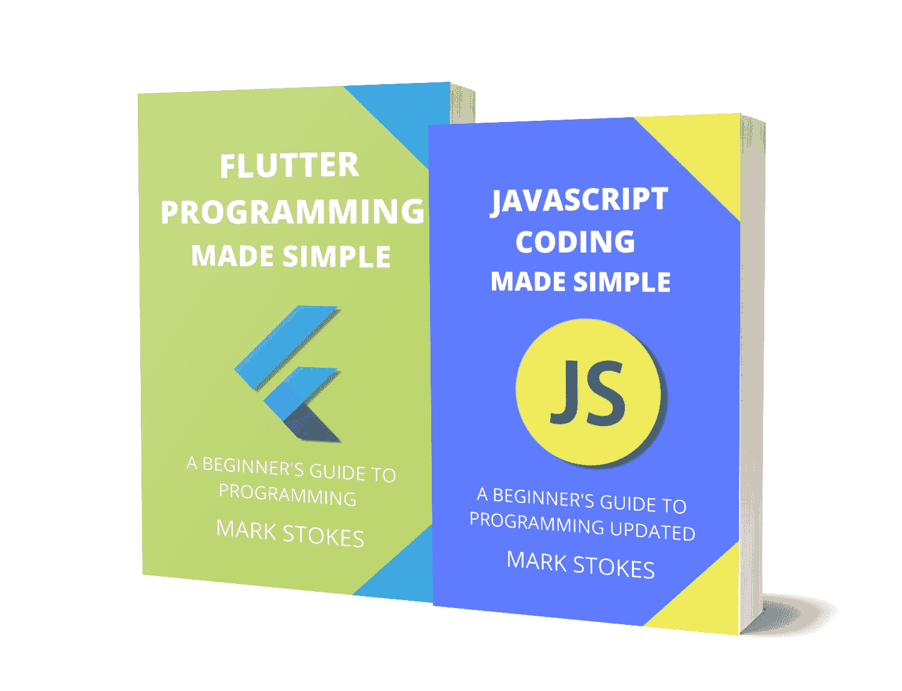

# 简易 JavaScript 与 Flutter 编程：编程初学者指南 - 2 合 1



- 第 1 章：JavaScript 简介
- 第 2 章：JavaScript 语法、运算符与表达式
- 第 3 章：JavaScript 控制流语句
- 第 4 章：JavaScript 函数
- 第 5 章：JavaScript 数组
- 第 6 章：JavaScript 对象
- 第 7 章：JavaScript 事件与事件处理
- 第 8 章：JavaScript AJAX 与 Fetch API
- 第 9 章：高级 JavaScript Concept
- 第 10 章：JavaScript 模块与模块化开发
- 第 11 章：JavaScript 中的面向对象编程
- 第 13 章：在 JavaScript 中操作 API
- 第 14 章：JavaScript 框架与库
- 第 15 章：移动端应用开发中的 JavaScript
- 第 1 章：Flutter 简介
- 第 2 章：配置开发环境
- 第 3 章：Dart 入门
- 第 4 章：理解 Widget 与布局
- 第 5 章：Flutter 中的状态管理
- 第 6 章：处理用户输入
- 第 7 章：页面间的导航
- 第 8 章：操作 API 与网络连接
- 第 9 章：使用本地持久化存储数据
- 第 10 章：动画与手势
- 第 11 章：构建自定义 Widget
- 第 12 章：国际化与本地化
- 第 13 章：部署 Flutter 应用
- 第 14 章：测试与调试
- 第 15 章：持续集成与交付

# 简单的 JavaScript 编码

## MARK STOKES 编程入门指南

# 第 1 章：JavaScript 简介

欢迎来到令人兴奋的 JavaScript 世界！在本章中，我们将开启探索 JavaScript 编程基础的旅程。我们将涵盖 JavaScript 的基础知识、它在 Web 开发中的作用，以及它是如何与 HTML 和 CSS 交互的。

## 1.1 什么是 JavaScript？

JavaScript 是一种高级解释型编程语言，主要用于为网站添加交互性。与关注网页结构和呈现的 HTML 及 CSS 不同，JavaScript 能够实现动态和响应式的行为。它允许你创建交互式元素、处理用户输入、操作页面内容等更多功能。

JavaScript 是一种多功能的语言，多年来一直在不断演进，被广泛采用，并成为现代 Web 开发中不可或缺的一部分。它受到所有主流浏览器的支持，可以用于各种用途，从简单的网站增强到复杂的 Web 应用程序。

## 1.2 JavaScript 简史

为了更好地理解 JavaScript，让我们简要回顾一下它的历史。JavaScript 由 Brendan Eich 在 1995 年于 Netscape Communications 工作期间创造。它最初被命名为 "LiveScript"，后来为了利用当时 Java 的流行程度，它被重命名为 JavaScript。该语言的设计目标是提供一种为网页添加交互性的方法，并为浏览器带来编程能力。

多年来，JavaScript 经历了重大的进展。定义语言规范的 `ECMAScript` 标准经历了几个版本，每个版本都引入了新功能和改进。现代 JavaScript（也称为 `ECMAScript 6` (`ES6`) 及更高版本）提供了强大的功能，使开发变得更加高效和愉快。

## 1.3 JavaScript 与 Web 开发

JavaScript 在现代 Web 开发中起着至关重要的作用。它主要用于客户端，这意味着它直接运行在 Web 浏览器中。这允许 JavaScript 与文档对象模型 (`DOM`)（网页结构的表示）进行交互，并实时操作其元素。通过利用 JavaScript，Web 开发人员可以创建响应用户操作的动态交互式网站。

除了客户端脚本外，JavaScript 的触角已扩展到 Web 开发的其他领域。随着 `Node.js` 的引入，JavaScript 现在也可以用于服务器端。这使得开发者可以使用同一种编程语言构建全栈应用程序，简化了开发流程并提高了代码的可重用性。

## 1.4 配置你的开发环境

在深入学习 JavaScript 编码之前，设置一个合适的开发环境至关重要。拥有正确的工具和舒适的设置可以极大提高你作为开发者的效率。让我们来看看设置 JavaScript 开发环境的步骤。

首先，你需要一个文本编辑器来编写代码。有很多选择，从轻量级编辑器到功能丰富的集成开发环境 (`IDEs`)。流行的选择包括 `Visual Studio Code`、`Sublime Text`、`Atom` 和 `WebStorm`。根据功能、易用性和定制化需求选择适合你的一个。

一旦有了文本编辑器，你还需要一个浏览器来运行和测试代码。所有现代浏览器如 `Chrome`、`Firefox`、`Safari` 和 `Edge` 都内置了可以执行代码的 JavaScript 引擎。

除了编辑器和浏览器，你可能会发现浏览器提供的开发者工具非常有帮助。这些工具提供了调试、检查元素、监控网络请求等功能。大多数浏览器都通过快捷键或菜单选项访问这些工具。

最后，你可能希望考虑使用版本控制软件（如 `Git`）来管理代码并进行协作。Git 允许你跟踪代码库的变化、为功能开发创建分支并方便地与其他协作。`GitHub`、`GitLab` 和 `Bitbucket` 等平台提供了 Git 仓库托管服务，方便共享代码。

## 1.5 运行 JavaScript 代码

现在开发环境已经准备好，让我们探索如何运行 JavaScript 代码。JavaScript 代码有两种执行方式：内联在 HTML 文件或在外部文件中。虽然内联 JavaScript 有其用途，但通常建议将 JavaScript 代码放在外部文件中并使用 `<script>` 标签将其链接到 HTML 文件。这种关注点分离有助于保持代码结构的整洁有序。

要引入外部 JavaScript 文件，你可以在 HTML 文件中使用以下语法：

```html
<!DOCTYPE html>
<html>
<head>
<title>我的 JavaScript 页面</title>
<script src="path/to/your/script.js"></script>
</head>
<body>
<!-- 你的 HTML 内容 -->
</body>
</html>
```

在这个示例中，我们通过使用 `<script>` 标签并指定 JavaScript 文件路径的 `src` 属性来引入外部文件。浏览器在遇到此标签时会加载并执行 JavaScript 代码，允许你将 HTML 和 JavaScript 代码分离，以便更好地组织和可维护性。

## 1.6 你的第一个 JavaScript 程序

让我们直接进入编码阶段！在 JavaScript 中，传统的 "Hello, World!" 程序可以这样写：

```javascript
console.log("Hello, World!");
```

在这里，我们使用 `console.log()` 函数在浏览器的控制台中显示“Hello, World!”消息。控制台是开发过程中调试和打印输出的有用工具。通过使用 `console.log()`，你可以检查变量、追踪代码执行流并解决可能任何问题。

控制台并不是与 JavaScript 代码交互的唯一方式。你也可以通过操作 DOM 直接在网页本身上显示输出。例如，你可以使用 `document.getElementById()` 函数选择页面上的一个元素并动态修改其内容。

```html
<!DOCTYPE html>
<html>
<head>
<title>My JavaScript Page</title>
</head>
<body>
<h1 id="output">Hello, World!</h1>
<script>
var outputElement = document.getElementById("output");
outputElement.textContent = "Hello, JavaScript!";
</script>
</body>
</html>
```

在例例中，我们选取了 `id` 属性为 "output" 的 `<h1>` 元素，并使用 `textContent` 属性更新了它的内容。当页面加载时，JavaScript 代码将执行，文本“Hello, JavaScript!”将替换 `<h1>` 元素中初始的“Hello, World!”文本。

## 1.7 变量与数据类型

变量是任何编程语言中的基础构建模块。它们允许你存储和操作数据。在 JavaScript 中，你可以使用 `var`、`let` 或 `const` 关键字来声明变量。让我们探索这些关键字及其特性。

`var` 关键字在历史上一直用于在 JavaScript 中声明变量。它具有函数级作用域，这意味着用 `var` 声明的变量在定义它的函数内部是可以访问的。然而，如果它没有在函数内部显式声明，也可以在函数外部访问。

随着 ES6 的引入，`let` 和 `const` 关键字被引入用以解决 `var` 的某些缺点并提供块级作用域。用 `let` 声明的变量具有块级作用域。它们的范围限制在定义它们的块内，例如循环内部或 `if` 语句内部。这有助于防止变量名冲突并促进更好的代码组织。

另一方面，用 `const` 关键字声明的变量也是块级作用域，但有一个额外的特性：它们是常量。一旦给常量赋值了值，就无法重新赋值或修改。当你有在整个代码执行过程中应该保持不变的值时，常量是非常有用的。

在声明变量时，考虑它们将包含的值的数据类型是非常重要的。JavaScript 有几种内置数据类型，包括：

- **字符串 (Strings)**：用于表示文本，并包含在单引号或双引号中。例如，`"Hello, World!"` 或 `'JavaScript'`。

- **数字 (Numbers)**：用于表示数值，包括整数和浮点数。例如，`42` 或 `3.14`。

- **布尔值 (Booleans)**：表示逻辑值，即 `true` 或 `false`。布尔值通常用于条件语句和比较。

- **数组 (Arrays)**：用于在单个变量中存储多个值。数组可以包含任何数据类型的元素，并用方括号表示。例如，`["apple", "banana", "orange"]`。

- **对象 (Objects)**：用于存储键值对集合。对象用花括号表示，可以包含属性和方法。例如，`{ name: "John", age: 30 }`。

JavaScript 是一种动态类型语言，这意味着你在声明变量时不需要显式指定数据类型。变量类型根据赋值给它的值自动确定。这种灵活性允许你在整个代码过程中在同一个变量中处理不同的数据类型。

你可以对变量执行各种操作，例如数学计算、字符串拼接和逻辑比较。JavaScript 提供了大量的运算符，包括算术运算符（`+`、`-`、`*`、`/`）、字符串运算符（`+`）、比较运算符（`>`、`<`、`===`）和逻辑运算符（`&&`、`||`、`!`）。

理解变量和数据类型至关重要，因为它们是 JavaScript 编程的基础。通过这些知识，你可以开始编写更复杂的程序，动态地处理数据并构建交互式 Web 应用程序。

《JavaScript 世界：初学者 Web 开发指南》第一章到此。在本章中，我们概述了 JavaScript、其历史以及它在 Web 开发中的重要性。我们还搭建了开发环境并编写了首个 JavaScript 程序。最后，我们介绍了变量和数据类型。

在下一章中，我们将深入研究 JavaScript 语法、运算符和表达式。准备好提升你的 JavaScript 技能，向成为精通的 Web 开发者迈出一步！

# 第二章：JavaScript 语法、运算符和表达式

在第 1 章中，我们对 JavaScript 的基础有了了解，包括它的历史、在 Web 开发中的作用以及如何设置开发环境。现在，让我们深入研究 JavaScript 语法、运算符和表达式。这些基础概念将为编写更复杂、交互性的 JavaScript 代码铺平道路。

## 2.1 JavaScript 语法

语法是指规范编程语言中如何编写代码的规则集。正确的语法确保代码结构正确，并且可以被人类和机器理解。让我们探索 JavaScript 语法的一些本质方面。

### 2.1.1 语句与分号

在 JavaScript 中，语句是代码的构建模块。语句是执行特定操作的指令。JavaScript 中的每个语句都以分号（`;`）结束，表示语句的完成。虽然分号在 JavaScript 中不是强制性的，但一致地使用它们被认为是一种良好的习惯，可以避免潜在问题。

例如，以下语句为变量赋值：

```javascript
var name = "John";
var age = 25;
```

### 2.1.2 注释

注释用于在代码中添加解释性注记。它们会被 JavaScript 引擎忽略，目的是为开发者提供上下文并使代码更具读性。JavaScript 中有两种类型的注释：

- **单行注释**：由两个斜杠（`//`）表示。`//` 之后的任何内容都被视为注释且不会执行。

```javascript
// 这是一个单行注释
```

- **多行注释**：包含在 `/*` 和 `*/` 之间。多行注释可以跨越多行，适用于提供较长的解释或注释掉部分代码。

```javascript
/*
这是一个多行注释。
它可以跨越多行。
*/
```

## 2.2 JavaScript 运算符

JavaScript 中的运算符是对操作数（值或变量）执行操作的符号。它们允许我们执行数学计算、比较值、赋值值等。让我们探索 JavaScript 中常用的运算符。

### 2.2.1 算术运算符

算术运算符用于执行数学计算。JavaScript 包含以下算术运算符：

- 加法 (`+`)：相两个数字或拼接两个字符串。

- 减法 (`-`)：从一个数字减去另一个。

- 乘法 (`*`)：将两个数字相乘。

- 除法 (`/`)：将一个数字除以另一个。

- 取模 (`%`)：返回除法后的余数。

- 增增 (`++`)：将值加 1。

- 递减 (`--`)：将值减 1。

这是一个演示算术运算符用的示例：

```javascript
var x = 5;
var y = 2;
var sum = x + y;       // 7
var difference = x - y; // 3
var product = x * y;   // 10
var quotient = x / y;   // 2.5
var remainder = x % y; // 1
x++; // x 现在是 6
y--; // y 现在是 1
```

赋值运算符用于给变量赋值。它们将赋值运算符 (`=`) 与其他算术或逻辑运算符结合。最常见的赋值运算符有：

- `=`: 给变量赋值。

- `+=`: 将变量的当前值加上一个值并赋值结果。

- `-=`: 从变量的当前值中减去一个值并赋值。

- `*=`: 将变量的当前值乘以一个值并赋值结果。

- `/=`: 将变量的当前值除以一个值并赋值。

这里是一个说明赋值运算符使用的示例：

```javascript
var x = 5;
var y = 2;
x += y; // Equivalent to x = x + y; (x is now 7)
y -= 1; // Equivalent to y = y - 1; (y is now 1)
```

### 2.2.3 比较运算符

比较运算符用于比较值并返回布尔结果（`true` 或 `false`）。它们通常用于条件语句和循环中。以下是 JavaScript 中的一些比较运算符：

- `==`: 检查两个值是否相等。

- `!=`: 检查两个值是否不相等。

- `>`: 检查左侧的值是否大于右侧的值。

- `<`: 检查左侧的值是否小于右侧的值。

- `>=`: 检查左侧的值是否大于等于右侧的值。

- `<=`: 检查左侧的值是否小于等于右侧的值。

- `===`: 检查两个值是否严格相等（值和类型都相同）。

比较运算符使用的示例：

```javascript
var x = 5;
var y = 2;
console.log(x == y);    // false
console.log(x > y);      // true
console.log(x <= 5);    // true
console.log(x === "5"); // false
```

## 2.3 JavaScript 表达式

表达式是值、变量和运算符的组合，用于产生结果。它们可以是简单的值，也可以是多个运算符和变量的复杂组合。理解表达式对于编写动态交互的 JavaScript 代码至关重要。

### 2.3.1 算术表达式

算术表达式涉及使用算术运算符进行数学计算。这是一个算术表达式的示例：

```javascript
var x = 5;
var y = 2;
var result = (x + y) * 3;
console.log(result); // 21
```

在这个示例中，表达式 `(x + y) * 3` 执行加法和乘法以产生结果 `21`。

### 2.3.2 字符串拼接

在 JavaScript 中，`+` 运算符也用于字符串拼接。它允许将两个或多个字符串合并成单个字符串。这是一个示例：

```javascript
var firstName = "John";
var lastName = "Doe";
var fullName = firstName + " " + lastName;
console.log(fullName); // "John Doe"
```

在这种情况下，`+` 运算符允许我们合并字符串。

### 2.3.3 逻辑表达式

逻辑表达式涉及 `&&`、`||` 和 `!` 等运算符。它们用于确定复杂表达式的真值。这是一个示例：

```javascript
var x = true;
var y = false;
var result = x && y;
console.log(result); // false
```

在这个示例中，表达式 `x && y` 评估两个操作数是否为真，结果为 `false`。

## 2.4 结论

在本章，我们学习了赋值运算符、比较运算符和表达式。我们还探索了算术表达式、字符串拼接和逻辑表达式。理解这些基础概念对于编写有效的 JavaScript 至关重要。

# 第 3 章：JavaScript 控制流

在第 2 章中，我们学习了语法、运算符和表达式。现在，让我们探索控制流语句来做出决策。

## 3.1 条件语句

条件语句用于根据条件执行不同的代码块。JavaScript 提供了几种条件语句，包括 `if` 语句、`if...else` 语句和 `switch` 语句。

### 3.1.1 if 语句

`if` 语句是最简单的条件语句。如果给定条件为 `true`，则执行代码块。以下是 `if` 语句的基本语法：

```javascript
if (condition) {
  // code to be executed if the condition is true
}
```

让我们来看一个示例：

```javascript
var age = 18;
if (age >= 18) {
  console.log("You are eligible to vote.");
}
```

在这个示例中，如果变量 `age` 大于或等于 `18`，将显示消息 "You are eligible to vote."

### 3.1.2 if...else 语句

`if...else` 语句允许我们在条件为 `true` 时执行一个代码块，在条件为 `false` 时执行另一个代码块。以下是其语法：

```javascript
if (condition) {
  // code to be executed if the condition is true
} else {
  // code to be executed if the condition is false
}
```

让我们修改之前的示例以包含一个 `if...else` 语句：

```javascript
var age = 16;
if (age >= 18) {
  console.log("You are eligible to vote.");
} else {
  console.log("You are not eligible to vote yet.");
}
```

在这种情况下，如果变量 `age` 小于 `18`，将显示消息 "You are not eligible to vote yet."

### 3.1.3 switch 语句

`switch` 语句用于根据不同的条件执行不同的操作。它评估一个表达式并执行与表达式值匹配的相应 `case`。以下是其语法：

```javascript
switch (expression) {
  case value1:
    // code to be executed if the expression matches value1
    break;
  case value2:
    // code to be executed if the expression matches value2
    break;
  default:
    // code to be executed if the expression doesn't match any case
    break;
}
```

```javascript
var day = "Monday";

switch (day) {
  case "Monday":
    console.log("It's the first day of the week.");
    break;
  case "Tuesday":
    console.log("It's the second day of the week.");
    break;
  // ... more cases ...
  default:
    console.log("It's an unknown day.");
    break;
}
```

在这个示例中，如果 `day` 变量的值为 "Monday"，将显示消息 "It's the first day of the week."。如果值为 "Tuesday"，则将显示消息 "It's the second day of the week."。如果该值不匹配任何 `case`，则将显示默认消息 "It's an unknown day"。

## 3.2 循环语句

循环语句允许我们多次执行某块代码。当我们想要重复执行某个任务或遍历数据集时，这些语句非常有用。JavaScript 提供了几种循环语句，包括 `for` 循环、`while` 循环和 `do...while` 循环。

### 3.2.1 for 循环

`for` 循环通常在我们预知迭代次数时使用。它由三部分组成：初始化、条件和更新。其语法如下：

```javascript
for (initialization; condition; update) {
  // 每次迭代时执行的代码
}
```

让我们来看一个 `for` 循环的示例：

```javascript
for (var i = 1; i <= 5; i++) {
  console.log(i);
}
```

在这个示例中，循环将迭代五次，并显示 1 到 5 的数字。

### 3.2.2 while 循环

`while` 循环用于我们预知具体迭代次数的情况。只要指定的条件为真，它就会继续执行代码块。其语法如下：

```javascript
while (condition) {
  // 每次迭代时执行的代码
}
```

让我们来看一个 `while` 循环的示例：

```javascript
var i = 1;
while (i <= 5) {
  console.log(i);
  i++;
}
```

在这个示例中，循环将迭代五次，与之前的 `for` 循环示例相似。

### 3.2.3 do...while 循环

`do...while` 循环类似于 `while` 循环，但它保证在检查条件之前至少执行一次代码块。其语法如下如下：

```javascript
do {
  // 每次迭代时执行的代码
} while (condition);
```

让我们来看一个 `do...while` 循环的示例：

```javascript
var i = 1;
do {
  console.log(i);
  i++;
} while (i <= 5);
```

在这个示例中，循环将迭代五次，与之前的示例一样。

## 3.3 总结

在本章中，我们探索了 JavaScript 控制流语句，包括条件语句和循环语句。我们学习了如何使用 `if` 和 `switch` 语句进行决策，以及如何使用 `for`、`while` 和 `do...while` 循环重复代码。理解控制流是至关重要的。

# 第 4 章：函数

在本章中，我们将探索函数，函数允许我们创建可重用的代码块。

## 4.1 函数简介

函数是设计用于执行特定任务的代码块。它们在被调用时执行。

## 4.2 函数声明

要定义一个函数，我们使用 `function` 关键字。其基本语法如下：

```javascript
function square(number) {
  var result = number * number;
  return result;
}
```

## 4.3 函数调用

要执行函数，我们通过它的名称调用它。这里有一个函数调用的示例：

```javascript
var number = 5;
var squaredNumber = square(number);
console.log(squaredNumber); // 输出: 25
```

在这个示例中，我们将 `5` 作为参数传递给函数。

## 4.4 参数与实参数

函数可以接受参数，参数是传递给函数的值的占位符。参数允许函数具有灵活性并处理不同的值。当我们调用函数时，我们传递实参，实参是替换参数的实际值。

## 4.5 函数返回语句

函数中的 `return` 语句用于指定函数应该返回的值。它标记了函数执行的结束，并将指定的值发送回调用者。

## 4.6 函数作用域

JavaScript 中的函数有它们自己的作用域。在函数内部声明的变量是局部作用域的，这意味着它们只能在函数内部访问。相反，在任何函数外部声明的变量具有全局作用域，可以从代码的任何地方访问。让我们通过示例来检查函数作用域的概念：

```javascript
var globalVariable = "I'm a global variable";

function myFunction() {
  var localVariable = "I'm a local variable";
  console.log(localVariable); // 输出: I'm a local variable
  console.log(globalVariable); // 输出: I'm a global variable
}

myFunction();

console.log(localVariable); // 错误: localVariable is not defined
console.log(globalVariable); // 输出: I'm a global variable
```

在这个示例中，我们有一个名为 `globalVariable` 的全局变量，它可以在代码的任何地方访问。在 `myFunction` 函数内部，我们声明了一个名为 `localVariable` 的局部变量，它只在函数内部可访问。当我们调用 `myFunction` 时，它会正确地打印 `localVariable` 和 `globalVariable` 的值。然而，如果我们尝试在函数外部访问 `localVariable`，将会发生错误，因为它在全局作用域中没有定义。

## 4.7 函数表达式

除了函数声明外，JavaScript 还支持函数表达式。函数表达式涉及将一个函数赋值给变量，使其成为一个可以传递和调用的对象。这里有一个函数表达式的示例：

```javascript
var greet = function(name) {
  console.log("Hello, " + name + "!");
};

greet("John"); // Output: Hello, John!
```

在这个示例中，我们通过将一个匿名函数赋值给变量 `greet` 来创建一个函数表达式。该函数接收一个 `name` 参数并在控制台打印问候语。然后，我们可以通过调用 `greet` 并传递参数来执行该函数。

## 4.8 箭头函数

ES6 引入了箭头函数，它为编写函数提供了简洁的语法。箭头函数对于编写更短、更具读性的代码特别有用。这里有一个箭头函数的示例：

```javascript
var double = (number) => number * 2;
console.log(double(5)); // Output: 10
```

在这个示例中，我们定义了一个名为 `double` 的箭头函数，它接收一个 `number` 参数并返回该数字的两倍值。箭头函数的语法 `(number) => number * 2` 代表了编写函数的紧凑方式。

## 4.9 总结

在本章中，我们探索了 JavaScript 函数，它允许我们将代码组织成可重用的块并执行特定任务。我们学习了函数声明、函数调用、参数、返回语句、函数作用域、函数表达式和箭头函数。函数是 JavaScript 编程的基础构建模块，使我们能够编写出模块化、可重用且高效的代码。

在下一章中，我们将深入研究 JavaScript 数组，这是一种强大的数据结构允许我们存储和操作元素集合。准备好探索数组的世界并释放它们的全部潜力吧！

# 第 5 章：JavaScript 数组

在第 4 章中，我们探索了 JavaScript 函数，它允许我们将代码组织成可重用的块。现在，让我们进入 JavaScript 数组，这是一种强大的数据结构，允许我们存储和操作元素集合。

## 5.1 数组简介

JavaScript 中的数组是一种允许我们在单个变量中存储多个值的数据结构。数组是有序的、索引的集合，其中每个值都被分配了一个从 `0` 开始的唯一索引。数组可以包含任何数据类型的元素，例如数字、字符串、对象甚至是其他数组。它们提供了各种方法和属性，以便对存储的数据执行高效操作。

## 5.2 创建数组

在 JavaScript 中创建数组有两种常用方法：使用数组字面量和 `Array` 构造函数。

### 5.2.1 数组字面量

数组字面量是创建数组最且最常用的方法。它们涉及在方括号 `[]` 内包含用逗号分隔的值列表。这里有一个示例：

```javascript
var fruits = ['apple', 'banana', 'orange'];
```

在这个示例中，我们创建了一个名为 `fruits` 的数组，包含三个元素：`'apple'`、`'banana'` 和`'orange'`。

### 5.2.2 使用 Array 构造函数

JavaScript 还提供了 `Array` 构造函数来创建数组。我们可以使用 `new` 关键字后跟 `Array()` 来创建一个空数组，或者在括号内传递值来初始化具有特定元素的数组。这里有一些示例：

```javascript
var emptyArray = new Array();
var numbers = new Array(1, 2, 3, 4, 5);
```

在第一个示例中，我们创建了一个名为 `emptyArray` 的空数组。在第二个示例中，我们创建了一个名为 `numbers` 的数组，包含五个元素：`1`、`2`、`3`、`4` 和 `5`。

## 5.3 访问数组元素

我们可以使用索引访问数组中的单个元素。索引从第一个元素的 `0` 开始，每个随后的元素递增 `1`。我们使用方括号 `[]` 并在其中指定索引。这里有一个示例：

```javascript
var fruits = ['apple', 'banana', 'orange'];
console.log(fruits[0]); // Output: 'apple'
console.log(fruits[1]); // Output: 'banana'
console.log(fruits[2]); // Output: 'orange'
```

在这个示例中，我们通过各自的索引访问并打印 `fruits` 数组的元素。

## 5.4 修改数组元素

JavaScript 中的数组是可变的，这意味着可以在创建后修改它们的元素。我们可以使用赋值运算符 `=` 为特定索引分配新值。这里有一个示例：

```javascript
var fruits = ['apple', 'banana', 'orange'];
fruits[1] = 'grape';
console.log(fruits); // Output: ['apple', 'grape', 'orange']
```

在这个示例中，我们修改了 `fruits` 数组索引为 `1` 的元素，将其从 `'banana'` 更改为 `'grape'`。

## 5.5 数组长度

数组的 `length` 属性允许我们确定它包含的元素数量。我们可以使用点符号（`length`）来访问它。这里有一个示例：

```javascript
var fruits = ['apple', 'banana', 'orange'];
console.log(fruits.length); // Output: 3
```

在这个示例中，我们获取了 `fruits` 数组的长度，结果为 `3`。

## 5.6 数组方法

JavaScript 提供了大量的数组方法，允许我们高效地执行操作。让我们探索一些常用的方法：

### 5.6.1 `push()` 和 `pop()`

`push()` 方法向数组尾添加一个或多个元素，而 `pop()` 方法从数组中删除最后一个元素并返回它。这里有一个示例：

```javascript
var fruits = ['apple', 'banana', 'orange'];
fruits.push('grape');
console.log(fruits); // Output: ['apple', 'banana', 'orange', 'grape']
var removedFruit = fruits.pop();
console.log(removedFruit); // Output: 'grape'
```

在这个示例中，我们使用 `push()` 将元素 `'grape'` 添加到 `fruits` 数组的末尾。然后，我们使用 `pop()` 删除最后一个元素并将其存储在变量 `removedFruit` 中。

### 5.6.2 `shift()` 和 `unshift()`

`shift()` 方法从数组中删除第一个元素并返回，而 `unshift()` 方法向数组开头添加一个或多个元素。这里有一个示例：

```javascript
var fruits = ['apple', 'banana', 'orange'];
fruits.shift();
console.log(fruits); // Output: ['banana', 'orange']
fruits.unshift('grape', 'kiwi');
console.log(fruits); // Output: ['grape', 'kiwi', 'banana', 'orange']
```

在这个示例中，我们使用 `shift()` 删除 `fruits` 数组的第一个元素（`'apple'`）。然后，我们使用 `unshift()` 将 `'grape'` 和 `'kiwi'` 添加数组开头。

### 5.6.3 `slice()`

`slice()` 方法提取数组的一部分并返回包含所选元素的新数组。它接收两个参数：起始索引（包含）和结束索引（不包含）。这里有一个示例：

```javascript
var fruits = ['apple', 'banana', 'orange', 'grape', 'kiwi'];
var slicedFruits = fruits.slice(1, 4);
console.log(slicedFruits); // Output: ['banana', 'orange', 'grape']
```

在这个示例中，我们使用 `slice(1, 4)` 从 `fruits` 数组中提取从索引 `1`（包含）到索引 `4`（不包含）的元素。

### 5.6.4 `concat()`

`concat()` 方法合并两个或多个数组并返回新数组。它不会修改原始数组。这里有一个示例：

```javascript
var array1 = ['apple', 'banana'];
var array2 = ['orange', 'grape'];
var combined = array1.concat(array2);
console.log(combined); // Output: ['apple', 'banana', 'orange', 'grape']
```

```javascript
var fruits = ['apple', 'banana'];
var moreFruits = ['orange', 'grape', 'kiwi'];
var combinedFruits = fruits.concat(moreFruits);
console.log(combinedFruits);  // Output: ['apple', 'banana', 'orange', 'grape', 'kiwi']
```

在此示例中，我们使用 `concat()` 将 `fruits` 数组与 `moreFruits` 数组合并，并将结果存储在 `combinedFruits` 变量中。

## 5.7 结论

在本章中，我们探索了 JavaScript 数组，这是一种强大的数据结构，允许我们存储和操作元素集合。我们学习了如何使用数组字面量和 `Array` 构造函数创建数组，如何访问和修改数组元素，获取数组的长度，以及使用各种数组方法如 `push()`、`pop()` 和 `slice()`。

在本章中，我们探索了 JavaScript 对象，这是一种强大的数据结构，允许我们存储和操作元素集合。我们学习了如何使用数组，JavaScript 允许我们通过不同的键值对来组织数据。在下一章中，我们将深入探讨对象。

# 第 6 章：JavaScript 对象

在 JavaScript 中，对象是用于存储相关数据值对的复合类型。在第 5 章中，我们探索了数组，它们允许我们存储和操作元素。现在，让我们进入对象的世界及其强大功能！

## 6.1 对象初探

在 JavaScript 中，对象是用于存储相关数据值对的复合类型。对象通过键（key）和值（value）来组织数据。键通常是字符串，而值可以是任何类型。

## 6.2 创建对象

有多种方法可以创建对象。一种常见的方法是使用对象字面量，如下所示。这里有一个示例：

```javascript
var person = {
  name: "John Doe",
  age: 30,
  profession: "Developer"
};
```

在此示例中，我们创建了一个名为 `person` 的对象，包含三个属性：`name`、`age` 和 `profession`。

## 6.3 访问属性

我们可以通过点符号法或括号法来访问对象的属性。点符号法是最常用的。这里有一个示例：

```javascript
var car = {
  make: "Toyota",
  model: "Camry",
  year: 2022
};

console.log(car.make);    // 输出: Toyota
console.log(car["model"]); // 输出: Camry
```

在此示例中，我们访问了 `car` 对象的 `make` 和 `model` 属性。

## 6.4 修改属性

JavaScript 对象是可变的，这意味着我们可以在创建后修改它们的属性。我们可以使用点符号法或括号法重新为属性赋值。这里有一个示例：

```javascript
person.age = 35;
car['year'] = 2023;
```

在此示例中，我们修改了 `person` 对象的 `age` 属性和 `car` 对象的 属性。

## 6.5 添加和删除属性

我们可以通过向不存在的属性赋值为对象添加新属性。同样，我们可以使用 `delete` 关键字来删除属性。这里有一个示例：

```javascript
person.gender = "Male";
delete car.model;
```

在此示例中，我们为 `person` 对象添加了 `gender` 属性，并从 `car` 对象中删除了 `model` 属性。

## 6.6 对象方法

除了属性，JavaScript 对象还可以包含方法。方法是与对象关联的函数，可以使用点符号法调用。

JavaScript 中的方法是与对象关联的函数，可以使用对象的属性执行操作或计算。来看这个示例：

```javascript
var calculator = {
  add: function (a, b) {
    return a + b;
  },
  subtract: function (a, b) {
    return a - b;
  }
};

console.log(calculator.add(5, 3));   // 输出: 8
console.log(calculator.subtract(10, 4)); // 输出: 6
```

在此示例中，我们创建了一个名为 `calculator` 的对象，包含两个方法：`add` 和 `subtract`。这些方法可以使用点符号法调用，并传递所需的参数。

## 6.7 对象迭代

我们可以使用各种技术来遍历对象的属性。一种常见方法是使用 `for...in` 循环，它允许我们遍历对象的枚举属性。这里有一个示例：

```javascript
for (var key in person) {
  console.log(key + ": " + person[key]);
}
```

在这个示例中，我们遍历了 `person` 对象的属性，并记录了属性名（`key`）及其对应的值（`person[key]`）。

## 6.8 对象原型与继承

JavaScript 是一种基于原型的语言，这意味着对象可以从其他对象继承属性和方法。这个概念被称为继承。对象可以拥有一个原型对象，该对象作为其继承的属性和方法的蓝图。

在 JavaScript 中，继承是通过原型链实现的。对象拥有一个内部的 `[[Prototype]]` 属性，引用它们的原型对象。如果在一个对象中没有找到某个属性或方法，JavaScript 将会在该对象的原型中查找。这种链会一直持续，直到找到该属性或方法，或者到达原型链的末端。

### 6.9 结论

在本章中，我们探索了 JavaScript 对象，这是该语言中的一个核心概念。对象允许我们表示复杂的数据结构，使用键值对组织相关数据，并定义对数据执行操作的方法。我们学习了如何使用对象字面量和 `Object()` 构造函数创建对象，如何使用点符号和中括号符号访问和修改对象属性，如何添加和删除属性，定义对象方法，以及使用 `for...in` 循环遍历对象属性。

在下一章中，我们将深入研究 JavaScript 事件和事件处理的世界，理解如何响应用户交互并创建动态交互的 Web 应用程序。准备好增强你的 JavaScript 程序的交互性吧！

# 第 7 章：JavaScript 事件与事件处理

在第 6 章中，我们探索了 JavaScript 对象及其属性和方法。现在，让我们进入 JavaScript 事件和事件处理的精彩世界吧。事件允许我们响应用户交互，并创建动态且交互的 Web 应用程序。

## 7.1 事件简介

在 Web 开发中，事件是在浏览器中发生的动作或事件。这些事件可以由用户交互触发，例如点击按钮、悬停在元素上或提交表单。JavaScript 提供了一套强大的机制来捕获和处理这些事件。

## 7.2 事件处理器

事件处理器是响应特定事件而执行的函数。我们可以将事件处理器绑定到 HTML 元素上，以定义事件发生时应该发生什么。这里有一个示例：

```javascript
var button = document.getElementById("myButton");

button.onclick = function() {
  alert("Button clicked!");
};
```

在这个示例中，我们使用 `document.getElementById()` 选择了一个 id 为 "myButton" 的 HTML 按钮元素。然后，我们将一个匿名函数赋值给按钮的 `onclick` 事件处理器。当按钮被点击时，该函数会被执行，并显示“Button clicked!”的警告消息。

## 7.3 事件监听器

除了事件处理器，我们还可以使用事件监听器来处理事件。事件监听器提供了一种更灵活的方式为一个元素绑定多个事件处理器。这里有一个示例：

```javascript
var button = document.getElementById("myButton");

button.addEventListener("click", function() {
  alert("Button clicked!");
});
```

在这个示例中，我们使用 `addEventListener()` 方法为按钮元素添加一个 "click" 事件监听器。监听器被定义为一个匿名函数，当按钮被点击时会显示警告消息。

## 7.4 事件对象

当事件发生时，JavaScript 会创建一个包含事件信息的事件对象。可以在事件处理器或监听器函数内部访问该对象，以便根据事件详情执行特定操作。这里有一个示例：

```javascript
var button = document.getElementById("myButton");

button.addEventListener("click", function(event) {
  console.log("Button clicked at coordinates:", event.clientX, event.clientY);
});
```

在这个示例中，我们访问事件对象的 `clientX` 和 `clientY` 属性，以记录在按钮上点击鼠标的坐标。

## 7.5 事件传播

事件传播是指当嵌套元素上发生事件时，事件被处理的顺序。有两种类型的事件传播：冒泡和捕获。

在冒泡阶段，事件首先由最内部的元素处理，然后沿着 DOM 树向上传播到其父元素。这是大多数事件的默认行为。

在捕获阶段，事件首先由最外层的祖先元素处理，然后沿着 DOM 树向下传播到最内部的元素。

## 7.6 事件委托

事件委托是一种技术，我们在父元素上绑定单个事件处理器，并处理其子元素的事件。这在动态添加或删除子元素时非常有用，因为我们不需要为每个元素单独绑定事件处理器。事件从子元素传播到父元素，我们可以使用事件委托来识别事件的具体目标。

### 7.7 结论

在本章中，我们探索了 JavaScript 事件和事件处理，这允许我们创建动态且交互的 Web 应用程序。我们学习了事件处理器和事件监听器、如何将它们绑定到 HTML 元素以及如何响应特定事件。我们发现了事件对象，它提供了有关事件的信息。此外，我们讨论了事件传播（包括冒泡和捕获）以及事件委托的概念。

# 第 8 章：JavaScript AJAX 与 Fetch API

在第 7 章中，我们深入研究了 JavaScript 事件和事件处理，这使我们能够创建动态交互的 Web 应用程序。现在，让我们探索 AJAX（异步 JavaScript 和 XML）和 Fetch API，这些强大的工具允许我们与服务器通信并检索数据，而无需刷新整个网页。

## 8.1 AJAX 简介

AJAX 是一种允许 Web 应用程序在后台异步发送和接收数据的技术。通过 AJAX，我们可以在不需要刷新整个网页的情况下更新网页的部分，从而带来更流畅、更响应的用户体验。AJAX 允许我们使用 JavaScript 与服务器交互并检索数据。

## 8.2 XMLHttpRequest 对象

`XMLHttpRequest` 对象是 AJAX 的核心组件。它提供了向服务器发送 HTTP 请求并处理服务器响应的方法和属性。来看一个示例：

```javascript
var xhr = new XMLHttpRequest();

xhr.open("GET", "https://api.example.com/data", true);

xhr.onreadystatechange = function() {
  if (xhr.readyState === 4 && xhr.status === 200) {
    var response = JSON.parse(xhr.responseText);
    console.log(response);
  }
};

xhr.send();
```

在这个示例中，我们使用 `new XMLHttpRequest()` 构造函数创建了一个 `XMLHttpRequest` 对象。然后我们使用 `open()` 方法指定 HTTP 方法（在此处为 "GET"）和我们要获取数据的服务器 URL。第三个参数 (`true`) 表示请求是异步的。

我们将一个匿名函数赋值给 `onreadystatechange` 事件处理器。当请求状态发生变化时执行该函数。在函数内部，我们检查 `readyState` 属性是否等于 `4`（表示请求完成）以及 `status` 属性是否等于 `200`（表示响应成功）。如果满足条件，我们将 `responseText` 解析为 JSON 并打印到控制台。

最后，我们调用 `send()` 方法向服务器发送请求。

## 8.3 Fetch API

`Fetch` API 是 `XMLHttpRequest` 对象发送 HTTP 请求的现代替代方案。它为发送和处理请求提供了一个更精简、更直观的界面。这里有一个示例：

```javascript
fetch("https://api.example.com/data")
.then(function(response) {
  if (response.ok) {
    return response.json();
  } else {
    throw new Error("Error: " + response.status);
  }
})
.then(function(data) {
  console.log(data);
})
.catch(function(error) {
  console.log(error);
});
```

在这个示例中，我们使用 `fetch()` 函数向指定的 URL 发送 GET 请求。`fetch()` 函数返回一个 `Promise`，该 Promise 将解析为服务器返回的响应。

我们使用 `then()` 方法对 `Promise` 进行链式调用。在第一个 `then()` 回调函数中，我们检查响应是否成功（`response.ok`）。如果成功，我们调用响应对象上的 `json()` 方法，将响应数据解析为 JSON。如果发生错误，我们抛出一个带有相应状态码的新 `Error` 对象。

在第二个 `then()` 回调函数中，我们接收解析后的数据并将其打印到控制台。

`catch()` 方法用于处理在 `Promise` 链过程中可能发生的任何错误。

## 8.4 处理响应数据

一旦我们从服务器获取了数据，就可以在 JavaScript 代码中对其进行处理。这可能涉及操作数据、更新网页，或根据获取的信息执行其他操作。

## 8.5 跨源资源共享 (CORS)

在向不同域发送 AJAX 请求时，我们可能会遇到 CORS 限制。

跨源资源共享（CORS）是 Web 浏览器实现的一种安全机制，用于限制从一个域向另一个域发送 AJAX 请求。默认情况下，Web 浏览器执行同源策略，防止 JavaScript 代码向不同域发送请求。CORS 允许指定哪些域可以访问其资源。

要启用 CORS，服务器需要在 HTTP 响应中返回适当的 CORS Header。这些头部包含了允许的源、允许的方法和允许的头部等信息。

如果在发送 AJAX 请求时遇到 CORS 限制，有几种可能的解决方案：

1. **服务器端的 CORS 配置**：如果你对服务器有控制权，可以配置它在响应中包含必要的 CORS Header。这允许特定域访问服务器资源。

2. **代理服务器**：你可以在你的域上设置代理服务器，作为 JavaScript 代码和远程服务器之间的中介。代理服务器可以代表你的代码发送请求，从而绕过 CORS 限制。

3. **JSONP (带填充的 JSON)**：JSONP 是一种利用从不同域包含脚本的能力来允许跨域请求的技术。它涉及将响应数据封装在函数调用中，并作为脚本加载到浏览器。

需要注意的是，CORS 限制是由 Web 浏览器强制执行的，目的是保护用户的安全和隐私。通常建议配置服务器以允许必要的 CORS 请求，而不是依赖代理或 JSONP 等通通方案。

## 8.6 处理 AJAX 错误

在发送 AJAX 请求时，妥善处理错误对于提供流畅的用户体验至关重要。错误可能由于各种原因引起，例如网络问题、服务器错误或无效请求。

要处理 AJAX 错误，你可以利用 `XMLHttpRequest` 对象或 Fetch API 的错误处理能力。例如，使用 `XMLHttpRequest` 对象，你可以监听 `onerror` 事件并在相应的事件处理器中处理错误。

以下是一个使用 Fetch API 的示例：

```javascript
fetch("https://api.example.com/data")
  .then(function(response) {
    if (response.ok) {
      return response.json();
    } else {
      throw new Error("Error: " + response.status);
    }
  })
  .then(function(data) {
    console.log(data);
  })
  .catch(function(error) {
    console.log("An error occurred:", error);
  });
```

在这个示例中，`catch()` 方法用于捕获 `Promise` 链过程中发生的任何错误。随后将错误对象打印到控制台以进行调试。

通过妥善处理 AJAX 错误，你可以向用户提供反馈，并优雅地处理在数据检索过程中可能出现的任何问题。

### 8.7 总结

在本章中，我们探索了 AJAX（异步 JavaScript 和 XML）和 Fetch API，这些都是与服务器通信和异步获取数据的强大工具。我们学习了 `XMLHttpRequest` 对象及其用于发送 HTTP 请求的方法和属性。我们还探索了 Fetch API，它提供了一种更现代、更简洁的方法来处理 AJAX 请求。此外，我们还讨论了 CORS（跨源资源共享）以及处理 AJAX 错误的各种技术。

通过 AJAX 和 Fetch API，你可以创建动态且交互式的 Web 应用，这些程序可以在后台从服务器获取数据，提供无缝的用户体验。在下一章中，我们将深入研究 JavaScript 的高级概念，包括 Promises、`async/await` 和错误处理技术。准备好将你的 JavaScript 提升提升新的高度吧！

# 第 9 章：高级 JavaScript 概念

在之前的章节中，我们涵盖了 JavaScript 的基础知识，包括变量、数据类型、函数、对象、事件和 AJAX。现在，是时候探索提升提升技能的高级 JavaScript 概念了。在本章中，我们将深入研究 Promises、`async/await`、错误处理技术等。

## 9.1 Promises

Promises 是 JavaScript 中处理异步操作的强大工具。与回调相比，它们提供了一种更清晰、更直观的管理异步代码的方式。`Promise` 代表异步操作的最终完成或失败，并允许我们将多个异步操作链在一起。

`Promise` 的基本结构如下：

```javascript
const myPromise = new Promise((resolve, reject) => {
  // 异步操作
  // 如果成功，调用 resolve(value)
  // 如果发生错误，调用 reject(error)
});

myPromise
  .then((value) => {
    // 处理解析的值
  })
  .catch((error) => {
    // 处理错误
  });
```

在这个示例中，我们使用 `new Promise()` 构造函数创建一个新的 `Promise`，并向它传递一个带有 `resolve` 和 `reject` 参数的回调函数。在回调函数内部，我们执行异步操作。如果操作成功，我们调用 `resolve(value)` 并传入值。如果发生错误，我们调用 `reject(error)` 并传入相应的错误。

我们可以链 `then()` 方法来处理解析的值，并链 `catch()` 方法来处理过程中发生的任何错误。

## 9.2 Async/Await

Async/await 是 JavaScript 最近引入的特性，它是 Promises 之上的语法糖。它允许我们以更同步、更易读的方式编写异步代码。Async/await 让处理 Promises 更加直观，并减少了对显式 Promise 链的需求。

要使用 async/await，我们需要用 `async` 关键字声明函数。在函数内部，可以使用 `await` 关键字暂停执行并等待 `Promise` 解析或拒绝。以下是一个示例：

```javascript
async function fetchData() {
  try {
    const response = await fetch('https://api.example.com/data');
    const data = await response.json();
    console.log(data);
  } catch (error) {
    console.log(error);
  }
}

fetchData();
```

在本示例中，`fetchData()` 函数使用 `async` 关键字进行声明。在函数内部，我们使用 `await` 关键字暂停执行，并等待 `fetch()` 返回的 `Promise` 解析（resolve）。一旦 Promise 解析完成，我们将响应赋值给 `response` 变量。

随后，我们再次使用 `await` 暂停执行，等待 `response.json()` 返回的 `Promise` 解析。一旦 Promise 解析完成，我们将解析后的数据赋值给 `data` 变量并打印到控制台。

如果在 Promise 链过程中发生任何错误，它将在 `catch` 块中被捕获。

## 9.3 错误处理

在任何 JavaScript 应用中，适当的错误处理都是至关重要的。在处理异步代码时，有效地处理错误对于确保流畅的用户体验和提供有意义的反馈非常重要。

除了之前示例演示的 `try/catch` 块外，我们还可以使用 `Promises` 的 `catch()` 方法或通过抛出自定义错误来处理错误。这是一个示例：

```javascript
fetch('https://api.example.com/data')
  .then((response) => {
    if (!response.ok) {
      throw new Error('Error: ' + response.status);
    }
    return response.json();
  })
  .then((data) => {
    console.log(data);
  })
  .catch((error) => {
    console.log('An error occurred:', error);
  });
```

在上一个示例中，我们演示了如何在 Promise 链中使用 `catch()` 方法进行错误处理。在发送 `fetch()` 请求后，我们检查响应是否正常（`!response.ok`）。如果不是，我们将抛出一个带有包含响应状态的自定义错误消息的新 `Error` 对象。

在 Promise 链中抛出错误允许我们在随后的 `catch()` 块中处理该错误。这样，我们可以优雅地处理错误并向用户提供适当的反馈。

此外，你还可以使用 `throw` 语句抛出自定义错误。例如：

```javascript
function divide(a, b) {
  if (b === 0) {
    throw new Error('Division by zero is not allowed');
  }
  return a / b;
}

try {
  const result = divide(10, 0);
  console.log('Result:', result);
} catch (error) {
  console.log('An error occurred:', error.message);
}
```

在这个示例中，`divide()` 函数检查除数 `b` 是否等于零。如果是，我们将抛出一个带有自定义错误消息的新 `Error` 对象。该错误随后在 `catch` 块中被捕获，错误消息被打印到控制台。

通过利用适当的错误处理技术，你可以确保你的 JavaScript 代码在出现问题时优雅地处理错误并向用户提供有意义的反馈。

## 9.4 生成器 (Generators)

生成器是 ECMAScript 2015 (ES6) 引入的一种独特特性，允许函数暂停和恢复执行。它们使用 `function*` 语法定义，并使用 `yield` 关键字暂停执行并返回一个值。

在处理迭代算法或涉及复杂控制流的异步操作时，生成器特别有用。它们为编写涉及迭代或异步任务的代码提供了一种更灵活、更有表现力的方式。

这是一个演示生成器基本用的简单示例：

```javascript
function* countUpTo(n) {
  for (let i = 0; i <= n; i++) {
    yield i;
  }
}

const generator = countUpTo(5);
console.log(generator.next().value); // Output: 0
console.log(generator.next().value); // Output: 1
console.log(generator.next().value); // Output: 2
console.log(generator.next().value); // Output: 3
console.log(generator.next().value); // Output: 4
console.log(generator.next().value); // Output: 5
```

在这个示例中，我们定义了 `countUpTo()` 生成器函数，它可以生成从 0 到 `n` 的数字。在函数内部，我们使用 `yield` 关键字暂停执行并返回 `i` 的当前值。

我们使用 `countUpTo(5)` 创建生成器的实例。通过调用生成器的 `next()` 方法，我们可以恢复执行并获取序列中的下一个值。

生成器提供了一种控制执行流的强大机制，并可以用于各种场景以简化复杂逻辑。

### 9.5 总结

在本章中，我们探索了将增强你编程技能的高级 JavaScript 概念。我们学习了 `Promises` 以及它们如何提供一种更简洁、更直观的方式来处理异步操作。我们还深入研究了 `async/await`，这是一种简化 `Promises` 工作并使异步代码更具读性的现代方法。

此外，我们还讨论了错误处理技术，以确保流畅的错误恢复和有效的用户反馈。我们接触了抛出自定义错误、在 Promise 链中捕获错误以及使用 `try/catch` 块。

最后，我们引入了生成器，这是一种允许函数暂停和恢复执行的强大特性。生成器为处理迭代算法和异步任务提供了一种灵活且有表现力的方式。

在下一章中，我们将探索更多高级的 JavaScript 主题，包括模块、类和面向对象的编程原则。这些概念将进一步扩展你作为 JavaScript 开发人员的能力，使你能够构建更具扩展性和可维护性的应用程序。准备好深入 JavaScript 的世界吧！

注意：本章提供的示例旨在说明这些概念，可能无法涵盖所有可能的用例或最佳实践。建议咨询官方文档和额外资源以更全面地理解这些高级 JavaScript 概念。

# 第 10 章：JavaScript 模块与模块化开发

在本章中，我们将探索 JavaScript 模块和模块化开发。模块允许我们将代码组织成可重用的封装单元，使我们的代码库更具维护性和扩展性。我们将涵盖模块的基础、模块语法、导出和导入以及模块化开发的一些实践。

## 10.1 JavaScript 模块简介

JavaScript 模块是自包含的代码单元，可以导出并导入到应用程序的其他部分。它们提供了一种封装功能、变量和类的方法，防止污染命名空间并促进代码重用。

在 JavaScript 引入原生模块之前，开发者使用各种模块系统（如 CommonJS 和 AMD）来实现模块化开发。然而，随着 ECMAScript 2015 (ES6) 的发布，引入了原生模块支持，无需第三方库或框架即可轻松处理模块。

## 10.2 模块语法：导出与导入

在 ES6 模块中，我们使用 `export` 和 `import` 关键字来定义模块的部分可以在外部访问，并将这些导出的实体导入到其他模块。

从模块导出实体，我们使用 `export` 关键字。我们可以导出变量、函数、类，甚至是默认导出。这是一个示例：

```javascript
// module.js
export const PI = 3.14;

export function double(number) {
  return number * 2;
}

export default function greet(name) {
  return `Hello, ${name}!`;
}
```

在这个示例中，我们导出了常量 `PI`、函数 `double()` 以及一个默认导出函数 `greet()`。默认导出通过使用 `export default` 语法表示。

从模块导入实体，我们使用 `import` 关键字。我们可以导入特定的实体、将所有实体作为命名空间或导入默认导出。以下是从 `module.js` 模块导入实体的方法：

```javascript
// main.js
import { PI, double } from './module.js';

console.log(PI); // Output: 3.14
console.log(double(5)); // Output: 10
```

在这个示例中，我们从 `module.js` 模块导入了 `PI` 常量和 `double()` 函数。然后我们就可以我们的 `main.js` 模块中使用这些导入的实体。

## 10.3 模块最佳实践

在使用 JavaScript 模块时，遵循一些最佳实践以确保代码的整洁和可维护性非常重要：

- 保持模块聚焦：每个模块应该具有单一职责或专注于特定的功能。这有助于保持代码库的组织有序，并使其更容易理解和维护。

- 使用显式导出：与其依赖默认导出（default export），建议显式导出你想要从模块中暴露实体。这可以清楚地说明哪些实体旨在供其他模块使用。

- 谨慎使用默认导出：默认导出在某些情况下很有用，但应该节节使用。使用命名导出（named exports）可以更容易理解从模块导入了什么内容。

- 最小化模块依赖：避免创建对其他模块有过度依赖的模块。这可以减少循环依赖的风险，并简化重构或移除模块的过程。

- 注意模块大小：虽然模块促进了代码组织，但保持平衡并避免创建过大的模块也很重要。如果一个模块变得过于大或复杂，考虑将其重构为更小、更集中的模块。

通过遵循这些最佳实践，你可以确保你的模块化 JavaScript 代码是可维护的、可重用的且易于理解的。

## 10.4 模块环境与工具

JavaScript 模块可以在不同的环境中使用，例如 Web 浏览器和 Node.js。然而，具体的模块语法和支持的功能可能会取决于具体环境。

在 Web 浏览器中，现代浏览器支持原生模块系统。然而，如果你需要支持旧版浏览器或有更复杂的需求，你可能需要使用如 `webpack` 或 `Rollup` 等打包工具将你的模块转译并打包成与旧浏览器兼容的单个 JavaScript 文件。

在 Node.js 中，传统使用的是 CommonJS 模块系统。然而，从 Node.js 版本 12 开始，增加了对 ECMAScript 模块 (ESM) 的支持，允许你在 Node.js 应用中使用原生模块语法。

在处理模块工作时，还有各种可用的工具和框架可以提供额外的功能和优化。一些流行的工具包括 `TypeScript`、`Babel` 和 `Parcel`。这些工具可以增强你的开发工作流，并允许你利用高级模块能力。

## 10.5 总结

JavaScript 模块在现代 JavaScript 开发中起着至关重要的作用。它们允许我们编写模块化、可重用的代码，并防止全局命名空间污染。通过利用 `export` 和 `import` 关键字，我们可以定义模块中应供其他模块访问的部分，并根据需要轻松地导入它们。

在本章中，我们涵盖了 JavaScript 模块的基础知识，包括模块语法、实体的导出和导入以及模块化开发的最佳实践。我们还讨论了模块环境以及在不同场景下支持模块开发的可用工具。

通过采用模块化开发实践并利用 JavaScript 模块的力量，你可以创建更具维护性、可扩展性且组织良好的代码库。在下一章中，我们将深入探索 JavaScript 中的类和面向对象编程，将我们的代码组织和重用性提升到一个新的高度。

# 第 11 章：JavaScript 中的面向对象编程

在本章中，我们将探索 JavaScript 中的面向对象编程 (OOP)。面向对象编程是一种强大的范式，允许我们将真实世界的实体建模为对象，在这些对象内部封装数据和行为，并在它们之间进行交互。JavaScript 通过基于原型的继承系统支持 OOP 原则。

## 11.1 面向对象编程简介

面向对象编程是以“对象”为核心概念的编程范式。对象是类的实例，类充当蓝图，定义了该类对象的属性和行为。

面向对象编程的核心原则是：

- 封装：封装允许我们将相关的数据（属性）和功能（方法）封装在对象内部，防止从外部直接访问，并通过定义的接口提供受控的访问。

- 继承：继承允许对象从其他对象继承属性和方法。它促进了代码复用以及类之间的层级关系。

- 多态：多态允许不同类的对象被视为同一公共父类的对象。它允许根据共享的行为对对象进行灵活且可交换的使用。

## 11.2 在 JavaScript 中创建对象

在 JavaScript 中，可以使用对象字面量（object literals）或构造函数创建对象。

对象字面量是一种通过直接定义属性和方法来创建对象的方便方法。这是一个示例：

```javascript
const person = {
  name: 'John',
  age: 30,
  greet() {
    console.log(`Hello, my name is ${this.name} and I'm ${this.age} years old.`);
  }
};

person.greet(); // 输出: Hello, my name is John and I'm 30 years old.
```

构造函数提供了一种根据蓝图（类）使用 `new` 关键字创建对象的方法。这是一个示例：

```javascript
function Person(name, age) {
  this.name = name;
  this.age = age;
}

Person.prototype.greet = function() {
  console.log(`Hello, my name is ${this.name} and I'm ${this.age} years old.`);
};

const person = new Person('John', 30);
person.greet(); // 输出: Hello, my name is John and I'm 30 years old.
```

在这个示例中，我们定义了一个 `Person` 构造函数，接受 `name` 和 `age` 作为参数。我们使用 `this` 关键字将这些值赋值给对象。`greet()` 方法被添加到 `Person` 构造函数的原型上，以便在所有实例之间共享该功能。

## 11.3 JavaScript 中的继承与原型

JavaScript 使用原型继承来实现对象之间的继承。每个对象都有一个名为 `[[Prototype]]` 的内部属性，指向它的原型对象。原型用于从其他对象继承属性和方法。

我们可以使用 `Object.create()` 方法或 ECMAScript 2015 (ES6) 引入的 `class` 语法在对象之间创建继承关系。

使用 `Object.create()` 的示例：

```javascript
const personPrototype = {
  greet() {
    console.log(`Hello, my name is ${this.name} and I'm ${this.age} years old.`);
  }
};

const person = Object.create(personPrototype);
person.name = 'John';
person.age = 30;
person.greet(); // 输出: Hello, my name is John and I'm 30 years old.
```

在这个示例中，我们创建了一个 `personPrototype` 对象，作为 `person` 对象的原型。`person` 对象从 `personPrototype` 对象继承了 `greet()` 方法。

或者，我们可以使用 `class` 语法来定义类并创建继承关系。这是一个示例：

```javascript
class Person {
  constructor(name, age) {
    this.name = name;
    this.age = age;
  }
  greet() {
    console.log(`Hello, my name is ${this.name} and I'm ${this.age} years old.`);
  }
}

class Student extends Person {
  constructor(name, age, grade) {
    super(name, age);
    this.grade = grade;
  }
  study() {
    console.log(`${this.name} is studying hard for the ${this.grade} grade.`);
  }
}

const student = new Student('John', 15, 9);
student.greet(); // 输出: Hello, my name is John and I'm 15 years old.
student.study(); // 输出: John is studying hard for the 9th grade.
```

在这个示例中，我们定义了一个包含构造函数和 `greet()` 方法的 `Person` 类。然后，我们使用 `extends` 关键字创建了一个继承自 `Person` 类的 `Student` 类。`Student` 类有自己的构造函数，该函数通过调用 `super()` 方法来执行父类的构造函数。它还有一个专门针对学生的 `study()` 方法。

通过利用继承，我们可以创建一个对象的层级结构，这些对象共享共同的属性行为，同时也可以根据特定目的对其进行扩展和定制。

## 11.4 JavaScript 中的多态

多态允许不同类的对象被视为同一公共父类的对象。在 JavaScript 中，可以通过在不同的类中定义相同名称的方法来实现多态。

这是一个示例：

```javascript
class Shape {
  constructor() {
    this.name = 'Shape';
  }
  draw() {
    console.log('Drawing a shape.');
  }
}

class Circle extends Shape {
  constructor() {
    super();
    this.name = 'Circle';
  }
  draw() {
    console.log('Drawing a circle.');
  }
}

class Square extends Shape {
  constructor() {
    super();
    this.name = 'Square';
  }
  draw() {
    console.log('Drawing a square.');
  }
}

const shape = new Shape();
const circle = new Circle();
const square = new Square();

shape.draw(); // Output: Drawing a shape.
circle.draw(); // Output: Drawing a circle.
square.draw(); // Output: Drawing a square.
```

在这个示例中，我们定义了一个带有 `draw()` 方法的 `Shape` 类。然后我们创建了 `Circle` 和 `Square` 类，它们继承自 `Shape` 类并用它们自己的实现覆盖了 `draw()` 方法。尽管调用了相同的方法名，每个对象根据其特定的类表现出不同的行为。

多态允许我们编写可以与不同类对象互换运行的代码，提高了灵活性和扩展性。

### 11.5 总结

JavaScript 中的面向对象编程通过利用对象、封装、继承和多态，为构建和组织代码提供了一种强大的方法。通过理解 OOP 的原则和技术，我们可以创建更模块化、可重用且易维护的 JavaScript 应用。

在本章中，我们探索了 JavaScript 面向对象编程的基础，包括创建对象、继承和多态。我们还讨论了如何使用构造函数和 ES6 引入的 `class` 语法。

在下一章中，我们将深入 JavaScript 编程的另一个核心方面：错误处理和调试技术。理解如何处理错误和有效地调试代码将极大地提升我们的开发流程，并帮助我们构建健壮的 JavaScript 应用。

# 第 12 章：JavaScript 中的错误处理与调试

在本章中，我们将探索 JavaScript 中的错误处理和调试技术。作为开发者，遇到错误和 bug 是开发过程中的常见部分。能够有效地处理错误并调试代码对于构建健壮可靠的 JavaScript 应用至关重要。

## 12.1 理解 JavaScript 中的错误

JavaScript 中的错误可能由于多种原因引起，例如语法错误、逻辑错误或运行时异常。当代码在执行过程中发生错误时，它可能会中断正常流程并可能导致应用程序崩溃。

JavaScript 提供了内置错误对象，如 `SyntaxError`、`TypeError` 和 `ReferenceError` 来表示不同类型的错误。这些错误对象包含了有用信息。

## 12.2 使用 try...catch 处理错误

`try...catch` 语句用于封装可能抛错误的代码。如果 `try` 块内部发生错误，将执行 `catch` 块。这是一个示例：

```javascript
try {
  const result = someFunction();
} catch (error) {
  console.log('发生错误:', error.message);
}
```

## 12.3 抛出自定义错误

除了内置错误对象，JavaScript 还允许我们使用 `throw` 创建自定义错误。这是一个抛出错误的示例：

```javascript
function divide(a, b) {
  if (b === 0) {
    throw new Error('不允许除零');
  }
  return a / b;
}

try {
  const result = divide(10, 0);
  console.log(result);
} catch (error) {
  console.log('发生错误:', error.message);
}
```

## 12.4 调试技术

调试是识别并修复代码中 bug 的过程。JavaScript 提供了多种工具和技术：

- **console.log**: 在代码的策略位置放置 `console.log` 语句允许我们向控制台输出值或消息。

- **断点**: 现代浏览器提供了内置调试器的开发者工具。通过在特定代码行设置断点，我们可以暂停执行并检查变量状态。

- **调试工具**: 开发者工具还提供了一系列调试功能，如检查调用堆栈、监控网络请求、分析内存使用和性能剖析。

- **错误信息**: 注意控制台中显示的错误信息可以为错误原因提供价值的见解。

- **代码审查**: 请求同事或同行审查我们的代码可以提供新的视角并识别潜在问题。

- **小鸭子调试**: 向无生命物体解释我们的代码和正尝试解决的问题有助于发现逻辑错误。

## 12.5 处理异步错误

JavaScript 经常涉及异步操作，例如发起网络请求或从数据库访问数据。处理异步代码中的错误需要不同的方法。一种常见方法是使用 Promise 和 `catch` 方法处理错误：

```javascript
async function fetchData() {
  try {
    const response = await fetch('https://api.example.com/data');
    const data = await response.json();
    // 处理数据
  } catch (error) {
    console.log('发生错误:', error.message);
  }
}

fetchData();
```

在这个示例中，我们定义了一个 `async` 函数 `fetchData`，它使用 `fetch` API 发起一个异步网络请求。我们使用 `await` 等待响应和解析后的数据。如果在请求或解析过程中发生错误，它将在 `catch` 块中被捕获。

通过利用 promises 和 `catch` 方法，我们可以处理异步操作中的错误，并确保我们的代码能够优雅地处理任何潜在问题。

## 12.6 结论

错误处理和调试是 JavaScript 开发者不可或缺的技能。通过理解如何使用 `try...catch` 处理错误、抛出自定义错误以及采用有效的调试技术，我们可以更高效地诊断并修复代码中的错误。

在本章中，我们探索了使用 `try...catch` 进行错误处理、抛出自定义错误以及各种调试技术，如控制台日志、断点和使用开发者工具。我们还讨论了如何使用 promises 和 `catch` 方法处理异步代码中的错误。

通过掌握错误处理和调试，我们可以创建更健壮的 JavaScript 应用程序，减少错误的发生概率，并为用户提供更好的体验。

# 第 13 章：在 JavaScript 中使用 API

在当今互联的世界中，应用程序接口（API）在实现不同软件系统之间的通信方面起着至关重要的作用。JavaScript 提供了强大的工具和技术处理 API，允许我们检索数据、发送请求并与外部服务交互。在本章中，我们将探索在 JavaScript 中使用 API 的基础知识。

## 13.1 API 简介

API 是一组规则和协议，定义了不同软件组件之间如何相互交互。API 允许应用程序访问和使用其他系统的功能，例如从服务器检索数据、与社交媒体平台集成或与云服务交互。

API 可以暴露代表特定功能的端点（endpoints）。这些端点接受请求并以标准格式（如 JSON 或 XML）提供响应。在 JavaScript 中使用 API，我们使用内置的 `fetch` 函数或像 Axios 或 jQuery 等专用库。

## 13.2 使用 Fetch 发起 HTTP 请求

`fetch` 函数是一个内置的 JavaScript 函数，允许我们向 API 端点发起 HTTP 请求。它返回一个 `Promise`，该 Promise 将解析为服务器的响应。

这里是一个使用 `fetch` 向 API 端点发送 GET 请求的示例：

```javascript
fetch('https://api.example.com/data')
.then(response => response.json())
.then(data => {
  // 处理数据
  console.log(data);
})
.catch(error => {
  console.log('An error occurred:', error.message);
});
```

在此示例中，我们使用 `fetch` 向 URL `'https://api.example.com/data'` 发送 GET 请求。我们链式调用 `then` 方法来将响应解析为 JSON。最后，我们处理数据或使用 `catch` 方法处理任何潜在错误。

## 13.3 使用 POST 请求发送数据

除了 GET 请求外，API 通常还支持 POST、PUT 或 DELETE 等其他 HTTP 方法来发送数据或修改资源。要使用 POST 请求发送数据，我们需要为 `fetch` 函数提供额外的选项。

这里是一个使用 POST 请求发送数据的示例：

```javascript
const userData = {
  name: 'John Doe',
  email: 'john@example.com',
};

fetch('https://api.example.com/data', {
  method: 'POST',
  headers: {
    'Content-Type': 'application/json'
  },
  body: JSON.stringify(userData)
})
.then(response => response.json())
.then(data => {
  // 处理数据
  console.log(data);
})
.catch(error => {
  console.log('An error occurred:', error.message);
});
```

在此示例中，我们使用 `fetch` 向 URL `'https://api.example.com/data'` 发送 POST 请求。我们链式调用 `then` 方法来将响应解析为 JSON。最后，我们处理数据或使用 `catch` 方法处理任何潜在错误。

## 13.4 身份验证与授权

许多 API 需要身份验证或授权来保护访问。这里有一个包含令牌（token）的示例：

```javascript
fetch('https://api.example.com/data', {
  headers: {
    'Authorization': 'Bearer YOUR_TOKEN'
  }
})
.then(response => response.json())
.then(data => {
  // 处理数据
  console.log(data);
})
.catch(error => {
  console.log('An error occurred:', error.message);
});
```

在此示例中，我们使用 `fetch` 向 URL `'https://api.example.com/data'` 发送请求。我们链式调用 `then` 方法来将响应解析为 JSON。最后，我们处理数据或使用 `catch` 方法处理任何潜在错误。

## 13.5 处理 API 响应

API 响应的结构可能各异，因此妥善处理它们非常重要。这里有一个处理响应的示例：

```javascript
fetch('https://api.example.com/data')
.then(response => {
  if (response.ok) {
    return response.json();
  } else {
    throw new Error('API failed');
  }
})
.then(data => {
  // 处理数据
  console.log(data);
})
.catch(error => {
  console.log('An error occurred:', error.message);
});
```

在此示例中，我们使用 `ok` 属性检查响应是否成功。如果成功，则返回 `response.json()`。如果失败，则抛出错误。

## 13.6 频率限制与分页

API 通常会实施频率限制（rate limiting）以防止滥用并确保公平使用。频率限制限制了客户端在特定时间内可以进行的请求次数。此外，在处理大数据集时，API 可能会实现分页以分组获取数据。分页涉及使用 `page` 或 `offset` 等参数请求多页数据。

为了处理频率限制和分页，我们可以跟踪请求次数，并在 JavaScript 代码中实现分页逻辑。

## 13.7 测试与文档

与 API 交互的代码进行测试对于确保其可靠性和正确至关重要。我们可以编写单元测试或集成测试来验证 API 调用返回了预期结果并能够顺利处理各种情况。此外，API 提供者通常会提供文档说明可用端点、请求/响应格式、身份验证方法以及任何特定的指南或限制。参考 API 文档对于理解如何有效地使用 API 非常重要。

### 13.8 结论

在 JavaScript 中处理 API 允许我们将应用程序与外部服务集成、检索数据并执行各种操作。在本章中，我们涵盖了使用 `fetch` 发起 HTTP 请求、使用 POST 请求发送数据、处理身份验证与授权以及处理 API 响应的基础知识。我们还讨论了频率限制、分页、测试以及 API 文档的重要性。

通过理解并掌握这些概念，我们可以利用 API 的力量创建动态、互联且功能丰富的 JavaScript 应用程序。

# 第 14 章：JavaScript 框架与库

在 Web 开发领域，JavaScript 框架和库彻底改变了我们构建动态交互式应用程序的方式。这些强大的工具提供了一个基础以及了一套预定义的结构和功能，简化并加速了开发过程。在本章中，我们将探索一些流行的 JavaScript 框架和库，并讨论它们的优势和用用场景。

## 14.1 JavaScript 框架和库导论

JavaScript 框架和库是预先编写的代码集合，为开发者提供了一种结构化的应用程序构建方法。它们提供了一系列功能，包括 DOM 操作、数据绑定、路由、状态管理等。这些工具抽象了许多低级细节，让开发者能够专注于构建应用程序逻辑和用户界面。

## 14.2 React.js

`React.js` 是由 Facebook 开发的广受欢迎的 JavaScript 库。它用于构建用户界面，特别是用于单页应用程序。`React.js` 引入了可复用 UI 组件的概念，允许开发者创建模块化且易于维护的代码。`React` 使用虚拟 DOM（文档对象模型）来高效地更新和渲染 UI 组件，从而获得最佳性能。

`React.js` 的核心特性之一是它的声明式语法。`React` 允许开发者定义每个状态下 UI 应该什么样子，而不是手动操作 DOM，并高效地处理更新。`React` 通常与其他库和工具结合使用，例如处理路由的 `React Router` 和管理应用状态的 `Redux`。

## 14.3 Angular

`Angular` 是由 Google 开发和维护的全面 JavaScript 框架。它为构建大型 Web 应用程序提供了完整的解决方案。`Angular` 遵循模型-视图-控制器（MVC）架构模式，并强调关注点分离。

`Angular` 提供了一强大的功能，包括双向数据绑定、依赖注入和健壮的模板系统。它还提供了构建表单、处理路由、执行 HTTP 请求以及通过 Angular 内置的状态管理系统 `RxJS` 管理状态的工具。

通过 `Angular`，开发者可以轻松地构建复杂的应用程序，这得益于其详的文档、强大的社区支持以及丰富的第三方库生态系统。

## 14.4 Vue.js

`Vue.js` 是一个专注于构建用户界面的渐进式 JavaScript 框架。它以简单和易于与现有项目集成而闻名。`Vue.js` 允许开发者根据需要增量地采用其功能并扩展其应用程序。

`Vue.js` 提供了类似于 `React` 的虚拟 DOM、响应式系统和基于组件的架构。它还提供了如计算属性、指令和灵活的模板语法等功能，可以将 HTML 和 JavaScript 无缝结合。`Vue.js` 的学习曲线平缓，使得各种专业水平的开发者都能轻松上手。

凭借其多功能性和活性，`Vue.js` 是构建现代、交互和高性能 Web 应用程序的卓越选择。

## 14.5 jQuery

`jQuery` 是一个轻量级的 JavaScript 库，简化了 DOM 操作和事件处理。多年来它被广泛使用，对 Web 开发的进步做出了巨大贡献。

`jQuery` 提供了简洁直观的语法，用于选择和操作 DOM 中的元素，使得执行常见任务（如遍历 DOM、处理事件和发送 AJAX 请求）变得更加容易。它还提供了大量的插件来扩展其功能。

虽然像 `React`、`Angular` 和 `Vue.js` 较新的框架已获得流行，但 `jQuery` 在小型项目、遗留代码库或简单性和兼容性至重要的场景中仍然具有重要性。

## 14.6 其他框架和库

除了上述框架和库外，还有许多其他 JavaScript 工具可以满足特定的用例和领域。一些显著的工具包括：

- `Ember.js`: 一个用于构建宏大 Web 应用程序的框架，强调“约定优于配置”。

- `D3.js`: 一个使用 HTML、CSS 和 SVG 创建数据可视化的强大库。`D3.js` 提供了广泛的数据可视化技术，并允许自定义和交互。

- `Express.js`: 一个用于 `Node.js` 的极简且灵活的 Web 应用程序框架。它通过提供一组健壮的功能和中间件，简化了构建服务端应用程序和 API 的过程。

- `Redux`: 一个用于 JavaScript 应用程序的可预测状态容器。`Redux` 帮助以中心化的方式管理应用程序状态，使得跨组件的跟踪跟踪和更新变得更简单。

- `Lodash`: 一个工具库，提供了处理数组、对象和其他数据结构的有用函数。`Lodash` 为迭代、过滤、排序和处理数据等任务提供了多种方法。

- `Axios`: 一个用于从 JavaScript 发送 HTTP 请求的流行库。`Axios` 简化了发送请求、处理响应和处理错误的过程，提供了比内置 `fetch` 函数更方便的替代方案。

## 14.7 选择合适的框架或库

在为你的项目选择 JavaScript 框架或库时，考虑几个因素是非常重要的。这些包括项目需求、学习曲线、社区支持、性能考虑以及与其他工具和库的兼容性。

考虑你应用程序的复杂性、团队的大小以及所需的特定功能。评估该框架或库的可用文档、资源和社区支持，以确保开发过程顺畅。

值得注意的是，框架和库会随着时间演进，因此关注最新版本、最佳实践和社区趋势至关重要。

## 14.8 总结

JavaScript 框架和库改变了我们开发 Web 应用程序的方式，为构建交互用户界面、管理状态、发送 HTTP 请求和处理复杂的应用程序逻辑提供了结构化的方法。

在本章中，我们探索了一些流行的 JavaScript 框架和库，包括 `React.js`、`Angular`、`Vue.js` 和 `jQuery`。我们还提到了其他重要的工具，如 `Ember.js`、`D3.js`、`Express.js`、`Redux`、`Lodash` 和 `Axios`。

记住，框架或库的选择取决于你的项目需求、团队经验以及应用程序的具体需求。通过利用正确的工具，你可以提高生产力、维护代码质量并交付健壮且吸引人的 Web 应用程序。

# 第十五章：移动应用开发中的 JavaScript

近年来，随着移动设备继续统治数字领域，移动应用开发变得日益重要。JavaScript 凭借其通用性和广泛采用，已成为构建跨平台移动应用程序的强大语言。在本章中，我们将探索 JavaScript 在移动应用开发中的作用，并讨论用于基于 JavaScript 的移动应用开发的各种框架和工具。

## 15.1 JavaScript 移动应用开发导论

基于 JavaScript 的移动应用开发允许开发者利用现有的 JavaScript 技能构建可以在包括 iOS 和 Android 在多个平台上运行的移动应用程序。这种方法不需要学习特定平台的语言（如 `Swift` 或 `Java`），让 Web 开发者更容易进入移动应用开发领域。

## 15.2 React Native

React Native 由 Facebook 开发，是一个使用 JavaScript 构建原生移动应用程序的流行框架。它允许开发者使用 JavaScript 编写代码，并创建在 iOS 和 Android 平台上均具有原生外观和体验的移动应用。

React Native 通过在 JavaScript 和每个平台的原生组件之间提供一个桥梁来实现这一点。开发者可以使用单份代码库来构建移动应用，从而实现更快的开发周期和跨平台的代码复用。React Native 还提供了对原生 API 和设备功能的访问权限，允许开发者构建功能丰富的移动应用。

## 15.3 Flutter

Flutter 由 Google 开发，是另一个利用 JavaScript 的跨平台移动应用开发框架。Flutter 使用 `Dart`（一种可以编译为 JavaScript 的语言）来构建具有类原生性能的移动应用。

通过 `Flutter`，开发者可以编写运行在 iOS 和 Android 平台上的代码，它提供了一系列丰富的预设计小部件和组件，用于创建惊艳的用户界面。Flutter 应用被编译为原生代码，从而具有卓越的性能和快速的执行速度。

### 15.4 Ionic

Ionic 是一个使用 JavaScript、HTML 和 CSS 构建混合移动应用的流行框架。它利用 Web 技术并将其封装在类原生容器中，允许应用运行在多个平台上。

Ionic 提供了一系列预构建的 UI 组件库，以及一套用于构建和部署移动应用的健壮工具和工具。它还提供了与 `Angular` 和 `React` 等流行 JavaScript 框架的无缝集成，允许开发者利用其现有的知识。

### 15.5 NativeScript

NativeScript 是一个使用 JavaScript、`TypeScript` 或 `Angular` 构建原生移动应用的开源框架。它提供了一个原生运行时，允许 JavaScript 代码直接访问原生 API 和 UI 组件。

通过 `NativeScript`，开发者可以构建高性能的原生移动应用，这些应用可以访问特定平台的特性和功能。NativeScript 同时支持 iOS 和 Android 平台，并提供了丰富的插件和扩展生态系统来增强应用开发。

### 15.6 Capacitor

Capacitor 是一个基于 JavaScript 的运行时和桥接，允许开发者使用 HTML、CSS 和 JavaScript 等 Web 技术构建移动应用。它使开发者能够创建在 iOS、Android 和 Web 上原生运行的应用。

Capacitor 提供了跨平台的一致 API，使得访问原生功能和插件变得简单。它还提供了用于应用打包、部署和应用商店分发的工具。

## 15.7 选择合适的框架

在选择用于移动应用开发的 JavaScript 框架时，应该考虑几个因素。这些包括项目需求、所需的平台支持、性能要求、开发者对框架的熟悉程度，以及社区支持和资源的可用性。

本章中提到的每个框架都有自己的优势和考虑因素，因此根据你的特定需求和偏好对它们进行评估是非常重要的。

## 15.8 结论

JavaScript 已成为一种移动应用开发的强大语言，让开发者能够轻松构建跨平台移动应用程序。在本章中，我们探索了几个框架和工具，包括 `React Native`、`Flutter`、`Ionic`、`NativeScript` 和 `Capacitor`，它们促进了基于 JavaScript 的移动应用开发。

我们讨论了 `React Native`，这是一个允许开发者使用 JavaScript 构建原生移动应用并在 JavaScript 与原生组件之间提供桥梁的框架。React Native 提供了代码复用性和访问特定平台的功能。

另一个跨平台移动应用开发框架 `Flutter` 通过将 `Dart` 代码编译为 JavaScript 来利用 JavaScript。Flutter 提供了一系列丰富的预设计小部件并交付类原生的性能。

`Ionic` 是一个流行的框架，使用 JavaScript、HTML 和 CSS 构建混合移动应用。它利用 Web 技术并将其封装在类原生容器中，允许应用运行在多个平台上。

`NativeScript` 是一个使用 JavaScript、`TypeScript` 或 `Angular` 构建原生移动应用的开源框架。它提供了一个原生运行时，允许 JavaScript 代码直接访问原生 API 和 UI 组件。

`Capacitor` 是一个基于 JavaScript 的运行时和桥接，允许开发者使用 HTML、CSS 和 JavaScript 等 Web 技术构建移动应用。它使开发者能够创建在 iOS、Android 和 Web 上原生运行的应用。

# 第 1 章：Flutter 简介

Flutter 的起源可以追溯到 2015 年，当时 Google 的一个小团队启动了一项任务，旨在寻找一种构建移动设备用户界面的方法。那时，移动应用开发领域由各个平台的原生开发主导。为 Android 和 iOS 应用创建并维护独立的代码库是一个既费力又耗时的过程。

该团队的愿景是开发一个不仅能够跨平台共享代码，还能提供无缝且愉悦用户体验的框架。因此，Flutter 诞生了，目标是成为一个灵活、表现力且高性能的 UI 工具包。

## Flutter 架构

Flutter 架构的核心是它的渲染引擎，它用 `C++` 编写。该引擎负责绘制用户界面的所有组件，并处理手势、动画和其他交互。渲染引擎通过平台通道（platform channels）与 `Dart` 框架通信。

`Dart` 框架（也称为 Flutter 框架）提供了一系列预定义的组件和 API，用于创建用户界面和处理应用逻辑。`Dart` 用于编写大部分应用程序代码，包括 UI 元素、事件处理和数据操作。

## 为什么选择 Flutter？

Flutter 具有许多优势，使其在其他应用开发框架中脱颖而出。选择 Flutter 的关键原因之一是它的“一次编写，到处运行”理念。通过 Flutter，开发者可以编写一次代码并部署到多个平台，显著节省了时间和精力。

传统的跨平台开发框架通常依赖于视图（web views）或基于 JavaScript 的解决方案，这可能会导致性能和用户体验问题。相比之下，Flutter 使用 Skia 图形引擎直接在屏幕上渲染组件，从而获得流畅且类原生性能。

## 富有表现力且精美的 UI

Flutter 提供了丰富的预定义组件，这些组件可以自定义以创建令人惊艳的动态用户界面。从按钮、文本字段、图像到复杂的动画和过渡，Flutter 的组件库涵盖了所有内容。组件系统允许开发者组合和组合组件，让 UI 开发变得轻而易。

此外，Flutter 遵循声明式编程范式，使用组件树来描述 UI。当组件的状态发生变化时，Flutter 会高效地仅更新受影响的 UI 部分，产生高性能且响应迅速的用户界面。

## 热重载 - 开发者的福音

Flutter 最受喜的功能之一是它的热重载（hot reload）功能。通过热重载，开发者可以看到对代码的更改立即反映在运行的应用上。这种实时反馈显著加快了开发过程，并使开发者能够快速实验、迭代和微调他们的应用。

热重载的工作原理是将更新后的代码注入到运行的 `Dart` 虚拟机（`VM`）中，而无需重启整个应用。它保持应用的状态，这意味着开发者在调整代码时可以保留当前的屏幕和上下文。此功能在 UI 开发和调试期间特别有用。

## Dart 的力量

Flutter 应用使用 `Dart` 构建，这是一种由 Google 开发的现代面向对象的编程语言。`Dart` 易于学习，并为来自 Java 或 JavaScript 等语言的开发者提供了熟悉的语法。它提供了诸如强类型、用于开发的即时编译（JIT）以及用于生产环境的提前编译（AOT）等特性，这些特性都共同提升了 Flutter 应用的整体性能。

`Dart` 的语言特性及其对 JIT 和 AOT 编译的支持使其非常适合移动应用开发。在开发期间，JIT 编译允许快速迭代和快速周转；而 AOT 编译则为最终的生产环境构建生成高效且优化的原生代码。

## 社区与生态系统

自发布以来，Flutter 在全球范围内吸引了一个充满活力且相互支持的开发者社区。该社区通过创建扩展 Flutter 能力的包、库和插件，积极为框架的增长做出贡献。

Flutter 生态系统正在快速扩展，开发者可以找到大量的资源、教程和示例项目，帮助他们入门并解决特定的挑战。此外，Google 的 Flutter 团队积极与社区互动，听取反馈，并根据用户需求不断改进框架。

## 开始使用 Flutter

要开始构建 Flutter 应用，你需要设置开发环境。首先，访问 Flutter 网站（https://flutter.dev）并下载适用于你操作系统的最新稳定版本。下载完成后，将包解压到计算机上的某个位置。

接下来，将 Flutter 的二进制路径添加到系统的 `PATH` 变量中。此步骤确保了你可以从终端或命令提示符的任何目录访问 Flutter 命令行工具。

现在，要验证安装，打开终端或命令提示符并运行 `flutter doctor` 命令。该命令将检查任何缺失的依赖，并指导你如何设置模拟器或物理设备来测试你的应用。

恭喜！你已成功在系统上设置了 Flutter。你现在准备好开启 Flutter 应用开发的奇妙之旅了。

## 总结

在本章中，我们探索了 Flutter 的基础知识，包括它的起源、架构和关键特性。我们学习了为什么 Flutter 是构建跨平台应用的流行选择，以及它如何赋予开发者创建富有表现力且精美的用户界面的能力。

随着学习深入，你将深入 Flutter 开发的各个方面，并在构建真实应用中获得实践经验。在下一章中，我们将设置开发环境并创建第一个“Hello, Flutter!”应用。所以，让我们卷起袖子准备创建一些惊人的 Flutter 应用吧！

# 第 2 章：设置开发环境

在第 1 章中，我们学习了 Flutter 及其在开发跨平台应用方面的许多优势。现在，在第 2 章中，我们将专注于为 Flutter 设置开发环境。配置适当的环境对于 Flutter 应用的高效开发和测试至关重要。我们将介绍各个平台的安装过程并验证一切运行正常。

## 前提条件

在开始之前，请确保你的系统满足以下前提条件：

1. 操作系统：Flutter 支持 Windows、macOS 和 Linux。确保你的计算机上安装了兼容的操作系统。

2. 磁盘空间：Flutter 需要大量的磁盘空间来存储 SDK、工具和项目文件。确保你有足够的可用空间。

3. Git：Flutter 依赖 Git 进行版本控制和包管理。如果系统中尚未安装，请安装 Git。

4. Flutter SDK：访问 Flutter 网站（https://flutter.dev）并下载适用于操作系统的最新稳定版本。

5. 开发 IDE：你可以使用 Android Studio、Visual Studio Code 或 IntelliJ IDEA，并安装 Flutter 和 Dart 插件。

## 在 Windows 上安装 Flutter

按照以下步骤在 Windows 系统上安装 Flutter：

1. 将下载的 Flutter SDK 压缩包解压到你任选的位置。例如，`C:\flutter\`。

2. 将 Flutter 的二进制路径添加到系统的 `PATH` 变量中：

- 打开开始菜单并搜索“环境变量”。

- 点击“编辑系统环境变量”。

- 在“系统属性”窗口中，点击“环境变量”按钮。

- 在“系统变量”下，选择“Path”并点击“编辑”。

- 点击“新建”并添加 Flutter SDK 的 `bin` 目录路径（例如，`C:\flutter\bin`）。

3. 打开新的命令提示符或 PowerShell 窗口并运行 `flutter doctor`。此命令将检查任何缺失的依赖项，并指导你如何设置模拟器或物理设备以测试你的应用程序。

4. 安装 Android Studio（如果尚未安装）并配置 Android SDK：

- 从 https://developer.android.com/studio/index.html 下载 Android Studio。

- 运行安装程序并按照屏幕上的指示操作。

- 启动 Android Studio，并在“欢迎来到 Android Studio”界面或“配置”菜单中打开“SDK Manager”。

- 在“SDK Platforms”选项卡中，选择你想要针对的 Android 版本（例如 Android 11）。

- 在“SDK Tools”选项卡中，勾选“Android SDK Command-line Tools”并点击“Apply”进行安装。

## 在 macOS 上安装 Flutter

要在 macOS 上安装 Flutter，请按照以下步骤操作：

1. 将下载的 Flutter SDK zip 文件解压到你选择的位置。例如，`/Users/your-username/flutter/`。

2. 将 Flutter 二进制文件路径添加到你的 `bash` 配置文件中：

- 打开终端窗口并运行 `nano ~/.bash_profile`。

- 在文件中添加以下行：`export PATH="$PATH:/Users/your-username/flutter/bin"`。

- 按 `Ctrl+X`，然后按 `Y`，最后按 `Enter` 保存并退出。

3. 在终端中运行 `source ~/.bash_profile` 以应用更改。

4. 打开新的终端窗口并运行 `flutter doctor`。此命令将检查任何缺失的依赖项，并指导你如何设置模拟器或物理设备以测试你的应用程序。

5. 从 App Store 安装 Xcode（如果尚未安装）。使用 Flutter 进行 iOS 开发需要 Xcode。

## 在 Linux 上安装 Flutter

要在 Linux 系统上安装 Flutter，请按照以下步骤操作：

1. 将下载的 Flutter SDK tar.gz 文件解压到你选择的位置。例如，`/home/your-username/flutter/`。

2. 将 Flutter 二进制文件路径添加到系统的 PATH 变量中：

- 打开终端并运行 `nano ~/.bashrc`。

- 在文件中添加以下行：`export PATH="$PATH:/home/your-username/flutter/bin"`。

- 按 `Ctrl+X`，然后按 `Y`，最后按 `Enter` 保存并退出。

3. 在终端中运行 `source ~/.bashrc` 以应用更改。

4. 打开新的终端窗口并运行 `flutter doctor`。此命令将检查任何缺失的依赖项，并指导你如何设置模拟器或物理设备以测试你的应用程序。

5. 安装 Android Studio（如果尚未安装）并按照与 Windows 相同的步骤配置 Android SDK。

## 配置你的开发 IDE

安装 Flutter 后，你需要设置你偏好的开发 IDE。你可以选择 Android Studio、Visual Studio Code 或 IntelliJ IDEA。每个 IDE 都提供不同的功能和优势，因此选择最适合你需求的一个。

### 使用 Android Studio

1. 从 https://developer.android.com/studio/index.html 下载并安装 Android Studio。

2. 打开 Android Studio 并进入“Configure” > “Plugins”。

3. 搜索“Flutter”并点击“Install”安装 Flutter 插件。

4. 重启 Android Studio 以应用更改。

### 使用 Visual Studio Code

1. 从 https://code.visualstudio.com/ 下载并安装 Visual Studio Code。

2. 打开 Visual Studio Code，点击窗口侧侧活动栏上的扩展图标进入扩展视图。

3. 搜索“Flutter”并点击“Install”安装 Flutter 扩展。

4. 重启 Visual Studio Code 以应用更改。

### 使用 IntelliJ IDEA

1. 从 https://www.jetbrains.com/idea/ 下载并安装 IntelliJ IDEA。

2. 打开 IntelliJ IDEA 并进入“Configure” > “Plugins”。

3. 搜索“Flutter”并点击“Install”安装 Flutter 插件。

4. 重启 IntelliJ IDEA 以应用更改。

## 验证安装

现在你已经设置好了 Flutter 和你的开发 IDE，是时候验证安装的时间了。

1. 打开终端或命令提示符并运行 `flutter doctor`。此命令将检查一切是否配置正确，并对任何缺失的依赖项提供指导。

2. 确保你的系统已连接了 Android 模拟器或物理 Android 设备以进行 Android 应用测试。

3. 对于 iOS 应用测试，请确保在 macOS 上安装了 Xcode，并且可以设置 iOS 模拟器或物理 iOS 设备进行测试。

恭喜！你已经成功搭建了 Flutter 的开发环境。你现在准备好在下一章创建你的第一个 Flutter 应用了。

## 总结

在本章中，我们介绍了在各种平台上设置 Flutter 开发环境的过程。我们安装了 Flutter，配置了开发 IDE，并使用 `flutter doctor` 命令验证了安装。现在一切已准备就绪，我们可以开始构建令人兴奋的 Flutter 应用。

# 第 3 章：开始学习 Dart

在第 2 章中，我们设置了 Flutter 的开发环境。现在，在第 3 章中，我们将探索用于构建 Flutter 应用的编程语言 Dart。Dart 是一种强大且灵活的语言，对于来自 Java 或 JavaScript 等语言的人，它提供了熟悉的语法。在本章中，我们将涵盖 Dart 的基础，包括数据类型、变量、函数和控制流。在本章结束时，你将对 Dart 的基础有深入的理解。

## Dart 简介

Dart 是一种由 Google 开发的通用面向对象编程语言。它在 2011 年首次引入，现已演变为适用于多种用途的语言，包括 Web 开发、服务端脚本，当然还有 Flutter 应用。

Dart 以其性能、开发者友好的特性和强类型而闻名。它支持即时编译（JIT）和预执行编译（AOT），使其适用于开发环境和生产环境。

### 安装 Dart SDK

在我们深入学习 Dart 编程之前，请确保你已经安装了 Dart SDK。如果你在上一章安装了 Flutter，你已经拥有了 Dart SDK。否则，你可以从 Dart 官网下载独立的 SDK。

一旦安装完成，你可以在终端或提示符中使用 `dart` 命令来运行 Dart 程序。

## Hello, Dart!

让我们通过编写一个简单的“Hello, Dart!”程序开始我们的 Dart 之旅。打开你偏好的编辑器并创建一个 Dart 文件，例如 `hello.dart`。在该文件中添加以下代码：

```dart
void main() {
  print("Hello, Dart!");
}
```

要运行程序，打开终端或命令提示符，进入 `hello.dart` 文件所在的目录，执行以下命令：

```
dart hello.dart
```

你应该看到输出：

```
Hello, Dart!
```

恭喜！你成功运行了你的第一个 Dart 程序。

## 变量和数据类型

与任何编程语言一样，Dart 使用变量来存储数据。Dart 是一种静态类型语言，这意味着在声明变量时需要指定其数据类型。Dart 提供了各种内置类型，包括数字、字符串、布尔值、列表、映射等。

### 数字

Dart 支持整数和双精度浮点数。你可以这样声明并初始化数值变量：

```dart
int age = 25;
double height = 1.75;
```

### 字符串

字符串表示文本数据，使用单引号或双引号声明：

```dart
String name = "John Doe";
String message = 'Welcome to Dart!';
```

你可以使用 `+` 运算符或字符串插值来拼接字符串。

```dart
String firstName = "John";
String lastName = "Doe";
String fullName = firstName + " " + lastName;

// 或者，使用字符串插值：

String fullNameInterpolated = "$firstName $lastName";
```

### 布尔值

布尔值表示真或假值：

```dart
bool isFlutterAwesome = true;
bool isDartEasy = false;
```

### 列表

Dart 中的列表是项的有序集合：

```dart
List<int> numbers = [1, 2, 3, 4, 5];
List<String> fruits = ["apple", "banana", "orange"];
```

### 映射

Maps 将键与值关联起来：

```dart
Map<String, String> capitals = {
  "USA": "Washington, D.C.",
  "France": "Paris",
  "Japan": "Tokyo",
};
```

## 函数

函数是可以在调用时执行的代码块。它们允许你对代码进行模块化并避免重复。在 Dart 中，你可以使用 `void` 关键字声明不返回值的函数，或者为返回值的函数指定返回类型。

```dart
// 无返回值的函数
void greet() {
  print("Hello, Flutter enthusiasts!");
}

// 有返回值的函数
int add(int a, int b) {
  return a + b;
}
```

你可以使用函数名后跟括号来调用函数：

```dart
greet(); // 输出: Hello, Flutter enthusiasts!
int result = add(5, 3);
print(result); // 输出: 8
```

## 控制流

控制流语句允许你根据某些条件做出决策并执行代码。Dart 提供了 `if` 和 `else` 语句，以及 `for` 和 `while` 循环。

### If-Else 语句

```dart
int age = 18;
if (age >= 18) {
  print("You are an adult.");
} else {
  print("You are a minor.");
}
```

### For 循环

```dart
for (int i = 1; i <= 5; i++) {
  print("Number: $i");
}
```

### While 循环

```dart
int count = 1;
while (count <= 5) {
  print("Count: $count");
  count++;
}
```

## 结论

在本章中，我们探索了 Dart 的基础，包括数据类型、变量、函数和控制流语句。Dart 的简单性和灵活性使其成为构建 Flutter 应用的极佳语言。现在你已经对 Dart 基础有了充分理解，准备好在后续章节中深入学习 Flutter 开发了。

# 第 4 章：理解 Widget 和布局

在第 3 章中，我们探索了作为 Flutter 编程语言的 Dart 基础。现在，在第 4 章中，我们将深入 Flutter 开发的核心——理解 Widget 和布局。Widget 是 Flutter 应用的构建块，它们负责创建用户界面。在本章中，我们将学习不同类型的 Widget、如何使用它们，以及如何创建布局来在屏幕上排列 Widget。

## 什么是 Widget？

在 Flutter 中，一切都是 Widget —— 从文本、图像等简单元素，到按钮、列表和动画等复杂组件。Widget 是定义用户界面的结构和行为的对象。它们是轻量级的，可以组合起来创建可重用且可定制的组件。

### 无状态 Widget 与有状态 Widget

Flutter 有两种主要类型的 Widget —— 无状态（stateless）和有状态（stateful）。

### 无状态 Widget

无状态 Widget 是不可变的，这意味着一旦初始化，它们的属性就无法更改。它们用于展示不随时间改变的数据。无状态 Widget 简单、快速，并且可以在需要时高效重绘。要创建一个无状态 Widget，请扩展 `StatelessWidget` 类并重写 `build` 方法。

```dart
class MyStatelessWidget extends StatelessWidget {
  @override
  Widget build(BuildContext context) {
    return Container(
      child: Text("Hello, I am a stateless widget."),
    );
  }
}
```

### 有状态 Widget

另一方面，有状态 Widget 在应用的生命周期内可以它们的属性。它们用于显示可能会变化的数据或响应用户交互。要创建一个有状态 Widget，请扩展 `StatefulWidget` 类并创建一个持有可变状态的独立 `State` 类。

```dart
class MyStatefulWidget extends StatefulWidget {
  @override
  _MyStatefulWidgetState createState() => _MyStatefulWidgetState();
}

class _MyStatefulWidgetState extends State<MyStatefulWidget> {
  int count = 0;
  void incrementCounter() {
    setState(() {
      count++;
    });
  }

  @override
  Widget build(BuildContext context) {
    return Container(
      child: Column(
        children: [
          Text("Count: $count"),
          ElevatedButton(
            onPressed: incrementCounter,
            child: Text("Increment"),
          ),
        ],
      ),
    );
  }
}
```

## 基础 Widget

Flutter 提供了一系列用于各种用途的内置 Widget。

### Text Widget

`Text` Widget 用于显示简单文本。你可以自定义样式、对齐方式。

```dart
Text("Hello, Flutter!", style: TextStyle(fontSize: 24, fontWeight: FontWeight.bold))
```

### Container Widget

`Container` Widget 是多功能的，用于定义其子组件的大小、内边距（padding）、外边距（margin）和装饰。

```dart
Container(
  width: 200,
  height: 100,
  child: Center(child: Text("Centered")),
)
```

### Row and Column Widgets

`Row` 和 `Column` Widget 分别用于水平或垂直排列子项。

```dart
Row(
  children: [
    Icon(Icons.star),
    Icon(Icons.star),
  ],
)
```

```dart
Column(
  children: [
    Text("Item 1"),
    Text("Item 2"),
  ],
)
```

### Image Widget

`Image` Widget 用于从各种来源显示图像，例如本地资源、网络或内存。

```dart
Image.network("https://example.com/image.jpg")
```

### RaisedButton and FlatButton

`RaisedButton` 和 `FlatButton` Widget 用于创建按钮。

```dart
RaisedButton(
  onPressed: () => print("Button pressed"),
  child: Text("Click Me"),
)
```

### TextField Widget

`TextField` Widget 用于捕捉文本输入。

```dart
TextField(
  onChanged: (value) => print("User typed: $value"),
  decoration: InputDecoration(hintText: "Enter your name"),
)
```

## 布局

Flutter 提供了各种布局 Widget 来在屏幕上排列和对齐组件。常用的布局 Widget 包括：

### Container Widget

正如我们之前看到的，`Container` Widget 可以定义其子组件的大小、内边距、外边距和装饰。

### Row and Column Widgets

`Row` 和 `Column` Widget 用于排列子项。你可以使用 `mainAxisAlignment` 和 `crossAxisAlignment` 属性来控制子项的对齐。

```dart
Row(
  mainAxisAlignment: MainAxisAlignment.spaceEvenly,
  crossAxisAlignment: CrossAxisAlignment.center,
  children: [
    // 子 Widget
  ],
)
```

### Stack Widget

`Stack` Widget 允许将 Widget 堆叠在一起。你可以使用 `Positioned` Widget 控制子组件在栈中的位置。

```dart
Stack(
  children: [
    Positioned(
      left: 50,
      top: 100,
      child: Text("Hello"),
    ),
    Positioned(
      right: 50,
      top: 100,
      child: Text("World"),
    ),
  ],
)
```

### ListView Widget

`ListView` Widget 用于创建滚动列表。它可以拥有有限数量的子项，也可以使用 `ListView.builder` 动态生成子项。

```dart
ListView(
  children: [
    ListTile(title: Text("Item 1")),
    ListTile(title: Text("Item 2")),
    ListTile(title: Text("Item 3")),
  ],
)
```

```dart
ListView.builder(
  itemCount: items.length,
  itemBuilder: (context, index) {
    return ListTile(title: Text(items[index]));
  },
)
```

在本章中，我们探索了 Flutter 中组件（widgets）和布局的世界。我们学习了无状态组件（stateless widgets）和有状态组件（stateful widgets）、它们的区别以及如何使用它们。我们还发现了 Flutter 提供的一些基础组件，包括 `text`、`container`、`row`、`column`、`image`、`buttons` 和文本字段（text fields）。

布局组件在安排屏幕上的组件方面起着至关重要的作用，我们探索了一些常用的布局，例如 `Container`、`Row`、`Column`、`Stack` 和 `ListView`。

有了这些知识，你现在已经开始为 Flutter 应用创建复杂的用户界面。

# 第 5 章：Flutter 中的状态管理

在第 4 章中，我们探索了 Flutter 中组件和布局的世界。现在，在第 5 章中，我们将深入探讨 Flutter 应用开发的一个关键方面——状态管理。状态管理是处理应用中数据和 UI 变化的过程。随着应用程序变得越来越复杂，有效地管理状态对于保持流畅的用户体验变得至关重要。在本章中，我们将学习 Flutter 中不同的状态管理方法，并探索实际示例以理解如何实现它们。

## 理解 Flutter 中的状态

在 Flutter 中，状态指的是随时间推移而变化并影响用户界面的数据。例如，考虑一个计数器。屏幕上显示的当前计数就是状态的一个示例，因为当用户增加或减少计数时，它可以发生。

状态可以分为两种：

### 1. 本地状态 (Local State)

本地状态特定于组件，不影响应用的其他部分。它通常用于单个组件内部的 UI 相关变化。

### 2. 全局状态 (App-wide State)

全局状态是跨应用多个组件或屏幕共享的数据。全局状态的变化会影响应用程序的多个部分。

## 状态管理方法

Flutter 提供了多种管理状态的方法，适用于不同的场景。让我们探索 Flutter 中一些流行的状态管理方法：

### 1. setState

简单的状态管理方法是使用 `StatefulWidget` 提供的 `setState` 方法。当状态变化时，调用 `setState` 将重建该组件及其子组件，相应地更新 UI。

```dart
class CounterApp extends StatefulWidget {
  @override
  _CounterAppState createState() => _CounterAppState();
}

class _CounterAppState extends State<CounterApp> {
  int count = 0;
  void incrementCounter() {
    setState(() {
      count++;
    });
  }

  @override
  Widget build(BuildContext context) {
    return Scaffold(
      appBar: AppBar(title: Text('Counter App')),
      body: Center(
        child: Text('Count: $count'),
      ),
      floatingActionButton: FloatingActionButton(
        onPressed: incrementCounter,
        child: Icon(Icons.add),
      ),
    );
  }
}
```

### 2. InheritedWidget

`InheritedWidget` 是一种允许你将数据向下向组件树传播的组件。它适用于在多个组件之间共享全局状态，而无需手动将数据作为参数传递。

### 3. Provider 包

`Provider` 包是 Flutter 中一种流行的第三方状态管理解决方案。它通过允许组件监听数据模型的变化并相应地重建，从而简化了状态管理。

### 4. Bloc (业务逻辑组件)

`Bloc` 是一种有助于将 UI 与业务逻辑分离的架构模式。它使用流（streams）来管理和传播状态变化，使得处理复杂的状态管理场景变得更加容易。

### 5. MobX

`MobX` 是另一个强大的状态管理库，它使用观察对象（observable objects）和反应（reactions）来高效地管理状态变化。

## 示例：使用 Provider 实现简单的 Todo 应用

让我们使用 `Provider` 包来实现一个简单的 Todo 应用进行状态管理。该应用允许用户添加和删除任务。

1. 首先，将 `provider` 包添加到你的 `pubspec.yaml` 文件并运行 `flutter pub get`：

```yaml
dependencies:
  flutter:
    sdk: flutter
  provider: ⁵.0.0
```

2. 创建一个 `Task` 类来表示 todo 任务：

```dart
class Task {
  final String name;
  Task(this.name);
}
```

3. 创建一个 `TaskProvider` 类来管理任务相关的状态和操作：

```dart
class TaskProvider extends ChangeNotifier {
  List<Task> _tasks = [];
  List<Task> get tasks => _tasks;
  void addTask(String name) {
    _tasks.add(Task(name));
    notifyListeners();
  }
  void removeTask(int index) {
    _tasks.removeAt(index);
    notifyListeners();
  }
}
```

4. 用 `ChangeNotifierProvider` 包裹你的 `MaterialApp`：

```dart
void main() {
  runApp(
    ChangeNotifierProvider(
      create: (context) => TaskProvider(),
      child: MyApp(),
    ),
  );
}

class MyApp extends StatelessWidget {
  @override
  Widget build(BuildContext context) {
    return MaterialApp(
      home: TaskScreen(),
    );
  }
}
```

5. 实现 `TaskScreen`，用户可以在这里添加和删除任务：

```dart
class TaskScreen extends StatelessWidget {
  final TextEditingController _controller = TextEditingController();
  @override
  Widget build(BuildContext context) {
    return Scaffold(
      appBar: AppBar(title: Text('Todo App')),
      body: Column(
        children: [
          Expanded(
            child: ListView.builder(
              itemCount: context.watch<TaskProvider>().tasks.length,
              itemBuilder: (context, index) {
                final task = context.watch<TaskProvider>().tasks[index];
                return ListTile(
                  title: Text(task.name),
                  trailing: IconButton(
                    icon: Icon(Icons.delete),
                    onPressed: () => context.read<TaskProvider>().removeTask(index),
                  ),
                );
              },
            ),
          ),
          Padding(
            padding: const EdgeInsets.all(8.0),
            child: TextField(
              controller: _controller,
              decoration: InputDecoration(hintText: 'Enter task name'),
            ),
          ),
          ElevatedButton(
            onPressed: () {
              final taskName = _controller.text;
              if (taskName.isNotEmpty) {
                context.read<TaskProvider>().addTask(taskName);
                _controller.clear();
              }
            },
            child: Text('Add Task'),
          ),
        ],
      ),
    );
  }
}
```

在这个示例中，我们使用 `Provider` 来管理任务列表。当用户添加或删除任务时，`TaskProvider` 通知监听者（在本例中为 `TaskScreen`），UI 随之更新。

## 总结

在本章中，我们探索了 Flutter 中不同的状态管理方法。我们理解有效管理状态以确保流畅用户体验的重要性。我们学习了本地状态和全局状态，以及如何使用 `setState` 处理简单的状态变化。此外，我们还探索了 `provider` 包作为 Flutter 应用强大且简单的状态管理解决方案。

在你继续 Flutter 之旅时，请记住明智地使用状态管理来创建扩展、可维护且令人快乐的应用。

# 第 6 章：处理用户输入

在第 5 章中，我们探索了状态管理，这允许我们管理和更新应用的状态。现在，在第 6 章中，我们将关注开发的另一个重要方面——处理用户输入。用户输入对于创建交互性和吸引力的应用至关重要。在本章中，我们将学习不同类型的用户输入，例如点击、手势、文本输入，以及如何使用 Flutter 组件和回调有效地处理它们。

## 点击和手势

点击和手势是移动应用中最常见的用户输入形式。Flutter 提供了各种组件来轻松处理点击和手势。

### GestureDetector

`GestureDetector` 组件是一种多功能组件，可以检测各种类型的手势，如点击、双击、长按和滑动。你可以用 `GestureDetector` 包裹任何组件，使其对用户交互做出响应。

示例：

```dart
GestureDetector(
  onTap: () {
    print('Single Tap');
  },
  onDoubleTap: () {
    print('Double Tap');
  },
  onLongPress: () {
    print('Long Press');
  },
  child: Container(
    width: 100,
    height: 100,
    color: Colors.blue,
  ),
)
```

### InkWell

`InkWell` 小部件专门为处理点击和波纹效果而设计。它通常用于按钮和可点击元素。

示例：

```dart
InkWell(
  onTap: () {
    print('Button Pressed');
  },
  child: Container(
    padding: EdgeInsets.all(16),
    decoration: BoxDecoration(
      color: Colors.blue,
      borderRadius: BorderRadius.circular(8),
    ),
    child: Text(
      'Click Me',
      style: TextStyle(color: Colors.white),
    ),
  ),
)
```

## Text Input

处理文本输入对于各种任务至关重要，例如创建表单、搜索栏或聊天界面。Flutter 提供了 `TextField` 小部件来处理文本输入。

### TextField

`TextField` 小部件允许用户输入文本，并提供键盘类型、验证和输入格式的选项。

示例：

```dart
TextField(
  onChanged: (text) {
    print('User typed: $text');
  },
  decoration: InputDecoration(
    hintText: 'Enter your name',
  ),
)
```

### FocusNode

当处理多个文本字段或聚焦于某个特定字段时，我们可以使用 `FocusNode` 来管理焦点状态。

示例：

```dart
FocusNode _nameFocusNode = FocusNode();
TextField(
  focusNode: _nameFocusNode,
  decoration: InputDecoration(
    hintText: 'Enter your name',
  ),
)
ElevatedButton(
  onPressed: () {
    if (_nameFocusNode.hasFocus) {
      _nameFocusNode.unfocus();
    }
  },
  child: Text('Dismiss Keyboard'),
)
```

## Handling Form Submission

在处理表单时，你通常需要在用户点击提交按钮时处理表单提交。Flutter 提供了一种简单的方法，使用 `Form` 和 `FormField` 小部件来管理表单提交。

示例：

```dart
class MyForm extends StatefulWidget {
  @override
  _MyFormState createState() => _MyFormState();
}
class _MyFormState extends State<MyForm> {
  final _formKey = GlobalKey<FormState>();
  String _name = '';
  void _submitForm() {
    if (_formKey.currentState.validate()) {
      _formKey.currentState.save();
      print('Form submitted with name: $_name');
    }
  }
  @override
  Widget build(BuildContext context) {
    return Form(
      key: _formKey,
      child: Column(
        children: [
          TextFormField(
            validator: (value) {
              if (value.isEmpty) {
                return 'Please enter your name';
              }
              return null;
            },
            onSaved: (value) {
              _name = value;
            },
          ),
          ElevatedButton(
            onPressed: _submitForm,
            child: Text('Submit'),
          ),
        ],
      ),
    );
  }
}
```

在这个示例中，我们使用 `Form` 小部件来包裹表单字段，每个 `TextFormField` 都有一个验证函数来验证用户的输入。当用户点击提交按钮时，会调用 `_submitForm`，如果数据有效则保存表单数据。

## GestureDetector and DragTarget for Drag-and-Drop

Flutter 还支持使用 `GestureDetector` 和 `DragTarget` 小部件来实现拖放交互。你可以轻松地实现自定义拖放功能。

示例：

```dart
class MyDragDrop extends StatefulWidget {
  @override
  _MyDragDropState createState() => _MyDragDropState();
}

class _MyDragDropState extends State<MyDragDrop> {
  String _draggedItem = 'Drag Me';
  String _droppedItem = 'Drop Here';

  @override
  Widget build(BuildContext context) {
    return Column(
      mainAxisAlignment: MainAxisAlignment.center,
      children: [
        GestureDetector(
          onLongPress: () {
            setState(() {
              _draggedItem = 'Dragging';
            });
          },
          onLongPressUp: () {
            setState(() {
              _draggedItem = 'Drag Me';
            });
          },
          child: Draggable<String>(
            data: _draggedItem,
            child: Container(
              padding: EdgeInsets.all(16),
              color: Colors.blue,
              child: Text(_draggedItem),
            ),
            feedback: Container(
              padding: EdgeInsets.all(16),
              color: Colors.blue.withOpacity(0.5),
              child: Text(_draggedItem),
            ),
            childWhenDragging: Container(),
          ),
        ),
        SizedBox(height: 20),
        DragTarget<String>(
          builder: (context, candidateData, rejectedData) {
            return Container(
              padding: EdgeInsets.all(16),
              color: Colors.green,
              child: Text(_droppedItem),
            );
          },
          onWillAccept: (data) {
            return data == 'Dragging';
          },
          onAccept: (data) {
            setState(() {
              _droppedItem = 'Dropped';
            });
          },
        ),
      ],
    );
  }
}
```

在这个示例中，`Draggable` 小部件代表可以被拖动的物品，而 `DragTarget` 小部件代表放置物品的区域。`onWillAccept` 回调决定是否允许放置，当物品成功放置时，会触发 `onAccept` 回调。

## Conclusion

在本章中，我们学习了 Flutter 中的用户输入。现在，当你继续你的 Flutter 之之旅时，请记住要设计出具有交互性和吸引力的应用。

# 第 7 章：页面间的导航

### 使用路由进行导航

Flutter 使用路由系统在屏幕之间跳转。应用程序中的每个屏幕都由路由表示。Flutter 提供了 `Navigator` 小部件，它管理导航栈和过渡。最简单的导航形式是使用 `Navigator.push` 将新屏幕推入导航栈，并使用 `Navigator.pop` 弹出顶层屏幕并返回上一个屏幕。

示例：

```dart
// 屏幕 1
Navigator.push(
  context,
  MaterialPageRoute(
    builder: (context) => Screen2(),
  ),
);

// 屏幕 2
Navigator.pop(context);
```

### 命名路由

命名路由提供了一种更具结构且易于维护的导航方法。与其使用匿名路由，不如在应用程序中定义命名路由并使用这些名称进行导航。

示例：

```dart
// Main.dart
void main() {
  runApp(MaterialApp(
    initialRoute: '/',
    routes: {
      '/': (context) => HomeScreen(),
      '/details': (context) => DetailsScreen(),
    },
  ));
}

// HomeScreen.dart
Navigator.pushNamed(context, '/details');
```

### 在屏幕间传递数据

通常你需要在导航期间在屏幕间传递数据。可以通过向新屏幕的构造传递参数来实现。

示例：

```dart
// HomeScreen.dart
Navigator.push(
  context,
  MaterialPageRoute(
    builder: (context) => DetailsScreen(data: 'Hello from Home Screen!'),
  ),
);

// DetailsScreen.dart
class DetailsScreen extends StatelessWidget {
  final String data;
  DetailsScreen({required this.data});
  @override
  Widget build(BuildContext context) {
    return Scaffold(
      appBar: AppBar(title: Text('Details')),
      body: Center(child: Text(data)),
    );
  }
}
```

### 处理导航结果

在某些情况下，你可能需要从跳转的屏幕接收结果。你可以使用带有结果的 `Navigator.push` 和 `Navigator.pop` 来实现。

示例：

```dart
// HomeScreen.dart
final result = await Navigator.push(
  context,
  MaterialPageRoute(
    builder: (context) => DetailsScreen(),
  ),
);

// DetailsScreen.dart
Navigator.pop(context, 'Result from Details Screen');
```

标签导航是一种常见的导航模式，用于在 App 内的不同部分或类别之间切换。Flutter 提供了 `TabBar` 和 `TabBarView` 小部件来实现标签导航。

示例：

```dart
class TabNavigation extends StatelessWidget {
  @override
  Widget build(BuildContext context) {
    return DefaultTabController(
      length: 3,
      child: Scaffold(
        appBar: AppBar(
          title: Text('Tab Navigation'),
          bottom: TabBar(
            tabs: [
              Tab(text: 'Tab 1'),
              Tab(text: 'Tab 2'),
              Tab(text: 'Tab 3'),
            ],
          ),
        ),
        body: TabBarView(
          children: [
            Center(child: Text('Tab 1 Content')),
            Center(child: Text('Tab 2 Content')),
            Center(child: Text('Tab 3 Content')),
          ],
        ),
      ),
    );
  }
}
```

在这个示例中，我们使用 `TabBar` 小部件在屏幕顶部创建标签栏，并使用 `TabBarView` 为每个标签显示不同的内容。

## 抽屉导航

抽屉是一个包含导航选项、设置或其他信息的侧边面板。Flutter 提供了 `Drawer` 小部件来实现抽屉导航。

示例：

```dart
class DrawerNavigation extends StatelessWidget {
  @override
  Widget build(BuildContext context) {
    return Scaffold(
      appBar: AppBar(title: Text('Drawer Navigation')),
      drawer: Drawer(
        child: ListView(
          children: [
            DrawerHeader(
              child: Text('Drawer Header'),
              decoration: BoxDecoration(color: Colors.blue),
            ),
            ListTile(
              title: Text('Option 1'),
              onTap: () {
                Navigator.pop(context);
                // Handle option 1 tap
              },
            ),
            ListTile(
              title: Text('Option 2'),
              onTap: () {
                Navigator.pop(context);
                // Handle option 2 tap
              },
            ),
          ],
        ),
      ),
      body: Center(child: Text('Main Content')),
    );
  }
}
```

在这个示例中中，我们使用 `Drawer` 小部件创建了一个带有选项的抽屉面板。当用户点击某个选项时，我们使用 `Navigator.pop` 关闭抽屉并处理点击事件。

## 底部导航栏

底部导航栏是用于在 App 的不同部分或视图之间切换的常见模式。Flutter 提供了 `BottomNavigationBar` 小部件来实现底部导航栏。

示例：

```dart
class BottomNavigation extends StatefulWidget {
  @override
  _BottomNavigationState createState() => _BottomNavigationState();
}
class _BottomNavigationState extends State<BottomNavigation> {
  int _currentIndex = 0;
  final List<Widget> _screens = [
    Screen1(),
    Screen2(),
    Screen3(),
  ];

  @override
  Widget build(BuildContext context) {
    return Scaffold(
      appBar: AppBar(title: Text('Bottom Navigation')),
      body: _screens[_currentIndex],
      bottomNavigationBar: BottomNavigationBar(
        currentIndex: _currentIndex,
        onTap: (index) {
          setState(() {
            _currentIndex = index;
          });
        },
        items: [
          BottomNavigationBarItem(icon: Icon(Icons.home), label: 'Home'),
          BottomNavigationBarItem(icon: Icon(Icons.search), label: 'Search'),
          BottomNavigationBarItem(icon: Icon(Icons.person), label: 'Profile'),
        ],
      ),
    );
  }
}
```

在这个示例中，我们使用 `BottomNavigationBar` 小部件创建了一个包含三个项目的底部导航栏。`onTap` 回调函数会更改 `_currentIndex`，从而根据所选项目更新显示的屏幕。

## 结语

在本章中，我们探索了 Flutter 中不同的导航技术。我们学习了使用 `Navigator.push` 和 `Navigator.pop` 进行基础导航，以及用于更结构化导航的命名路由。我们还学习了如何在屏幕之间传递数据、处理导航结果，并实现标签导航、抽屉导航和底部导航栏。

有效的导航对于在你的 App 中创建无缝的用户体验至关重要。通过掌握导航技术，你可以设计直观且高效的 App 导航，确保用户能够轻松探索并与你的 App 内容和功能交互。

# 第 8 章：处理 API 和网络

在第 7 章中，我们学习了如何在 Flutter 中在屏幕之间导航。现在，在第 8 章中，我们将探索应用开发的另一个关键方面——处理 API 和网络。API（应用程序接口）允许 App 与远程服务器交互并检索数据或执行操作。在本章中，我们将学习如何使用 Flutter 发送 HTTP 请求、处理响应以及解析来自 API 的，并结合实际示例。

## 发送 HTTP 请求

为了与 API 交互，我们需要发送 HTTP 请求向服务器发送数据或从其检索数据。Flutter 提供了 `http` 包，它简化了 HTTP 请求的发送。

### 发送 GET 请求

GET 请求用于从服务器检索数据。让我们发送一个简单的 GET 请求来从假设的 API 获取数据：

示例：

```dart
import 'package:http/http.dart' as http;
void fetchData() async {
  final url = Uri.parse('https://api.example.com/data');
  final response = await http.get(url);
  if (response.statusCode == 200) {
    print('Data fetched successfully!');
    print(response.body); // The response data
  }
}
```

在这个示例中，我们使用 `http.get` 方法从 API 获取数据。我们检查 `statusCode` 是否成功（200）。

### 发送 POST 请求

POST 请求用于向服务器发送数据，例如提交表单或创建资源。

示例：

```dart
import 'package:http/http.dart' as http;
void createResource() async {
  final url = Uri.parse('https://api.example.com/resource');
  final response = await http.post(url, body: {'name': 'New Resource'});
  if (response.statusCode == 201) {
    print('Resource created successfully!');
    print(response.body);
  } else {
    print('Failed to create resource.');
  }
}
```

在这个示例中，我们通过将 `Map` 作为 `body` 参数向 API 发送数据。

## 处理 JSON 数据

API 通常以 JSON（JavaScript 对象表示）格式返回数据。Flutter 提供了处理 JSON 数据的支持。

### 解码 JSON 数据

要将 JSON 数据解码为 Dart 对象，我们使用 `json.decode` 方法：

示例：

```dart
import 'dart:convert';
void parseJson(String jsonString) {
  final Map<String, dynamic> jsonData = json.decode(jsonString);
  final String name = jsonData['name'];
  final int age = jsonData['age'];
  print('Name: $name');
  print('Age: $age');
}
```

在这个示例中，我们从字符串解码 JSON 数据并使用键值对访问其属性。

### 编码 JSON 数据

要将 Dart 对象编码为 JSON 数据，我们使用 `json.encode` 方法：

示例：

```dart
import 'dart:convert';
String convertToJson() {
  final Map<String, dynamic> data = {
    'name': 'John Doe',
    'age': 30,
  };
  final jsonString = json.encode(data);
  return jsonString;
}
```

在这个示例中，我们使用 `json.encode` 方法将 `Map` 转换为 JSON 字符串。

## 使用包调用 API

对于更复杂的 API 交互，可以使用提供额外功能和抽象的第三方包。

### Dio 包

`dio` 包是一个强大的 Flutter HTTP 客户端，支持请求和响应拦截器、取消和身份验证等功能。

示例：

```dart
import 'package:dio/dio.dart';
void fetchDataWithDio() async {
  final url = 'https://api.example.com/data';
  final dio = Dio();
  try {
    final response = await dio.get(url);
    print('Data fetched successfully!');
    print(response.data); // The response data
  } catch (e) {
    print('Failed to fetch data. Error: $e');
  }
}
```

### Retrofit 包

`retrofit` 包通过注解将 API 端点定义为 Dart 方法，从而简化了处理 API 的工作。

```dart
import 'package:dio/dio.dart';
import 'package:retrofit/retrofit.dart';

part 'api_service.g.dart';

@RestApi(baseUrl: 'https://api.example.com/')
abstract class ApiService {
  factory ApiService(Dio dio) = _ApiService;

  @GET('/data')
  Future<Map<String, dynamic>> fetchData();
}

void fetchDataWithRetrofit() async {
  final dio = Dio();
  final apiService = ApiService(dio);
  try {
    final response = await apiService.fetchData();
    print('Data fetched successfully!');
    print(response); // The response data
  } catch (e) {
    print('Failed to fetch data. Error: $e');
  }
}
```

在这个示例中，我们使用 `retrofit` 包将 API 端点定义为 Dart 方法。该包会自动为这些方法生成实现代码。

## 错误处理与异常处理

在处理 API 时，优雅地处理错误和异常至关重要，这可以提供流畅的用户体验。

### API 调用中的错误处理

在发送 HTTP 请求时，我们可以使用 `try-catch` 块来处理错误和异常。

示例：

```dart
void fetchData() async {
  final url = Uri.parse('https://api.example.com/data');
  try {
    final response = await http.get(url);
    if (response.statusCode == 200) {
      print('Data fetched successfully!');
      print(response.body);
    } else {
      print('Failed to fetch data. Error code: ${response.statusCode}');
    }
  } catch (e) {
    print('An error occurred: $e');
  }
}
```

### JSON 解码中的错误处理

在解码 JSON 数据时，我们也应该处理潜在的异常，例如无效的 JSON 格式。

示例：

```dart
void parseJson(String jsonString) {
  try {
    final Map<String, dynamic> jsonData = json.decode(jsonString);
    final String name = jsonData['name'];
    final int age = jsonData['age'];
    print('Name: $name');
    print('Age: $age');
  } catch (e) {
    print('Failed to parse JSON. Error: $e');
  }
}
```

## 总结

在本章中，我们探索了在 Flutter 应用中处理 API 和网络连接。我们学习了如何使用 `http` 包发送 HTTP 请求，如何通过 GET 和 POST 请求发送数据，以及如何处理 JSON 数据。此外，我们还了解了如何使用 `dio` 和 `retrofit` 等第三方包来简化 API 调用并优雅地处理错误。

处理 API 和网络连接是现代应用开发的基础部分。通过理解这些概念并有效地实现它们，你可以创建出能够与远程服务器交互、获取数据并为用户提供动态且最新内容的应用程序。

# 第 9 章：使用本地持久化存储数据

在第 8 章中，我们探索了如何通过 API 和网络连接来与远程服务器交互并检索数据。然而，有时我们需要将数据存储在设备本地，即使在应用程序关闭或重启后也是如此。在本章中，我们将深入研究 Flutter 中的本地数据持久化。我们将学习在本地存储数据的多种不同方法，例如使用 shared preferences、文件和数据库，并结合实际示例来理解它们的实现方式。

## 为什么需要本地数据持久化？

本地数据持久化对于需要保存用户偏好、缓存数据或其他跨应用会话持续的信息的应用程序至关重要。将数据存储在本地还可以允许应用程序在离线或无互联网连接的情况下运行。

## Shared Preferences

Shared preferences 是一种在设备上存储键值对的简单方法。它们通常用于存储用户设置，例如语言偏好或应用主题。

### 使用 Shared Preferences 存储数据

要使用 shared preferences，我们首先需要在 `pubspec.yaml` 文件中添加 `shared_preferences` 包并运行 `flutter pub get`。

示例：

```dart
import 'package:shared_preferences/shared_preferences.dart';

void savePreferences() async {
  final prefs = await SharedPreferences.getInstance();
  await prefs.setString('username', 'JohnDoe');
  await prefs.setInt('age', 30);
}

void readPreferences() async {
  final prefs = await SharedPreferences.getInstance();
  final username = prefs.getString('username') ?? '';
  final age = prefs.getInt('age') ?? 0;
  print('Username: $username');
  print('Age: $age');
}
```

在这个示例中，我们使用 `SharedPreferences.getInstance()` 来获取 shared preferences 实例。然后我们使用 `setString` 和 `setInt` 方法存储数据，并使用 `getString` 和 `getInt` 方法读取数据。

## 文件存储

文件存储允许我们对设备上的文件进行读写操作。它适合存储结构化数据或大量数据。

### 向文件写入数据

示例：

```dart
import 'dart:io';

void writeToFile() async {
  final file = File('data.txt');
  await file.writeAsString('Hello, world!');
}
```

在这个示例中，我们使用 `File` 类来表示文件，并使用 `writeAsString` 方法将数据写入文件。

### 从文件读取数据

示例：

```dart
import 'dart:io';

void readFromFile() async {
  final file = File('data.txt');
  final content = await file.readAsString();
  print('File content: $content');
}
```

## SQLite 数据库

SQLite 是一个轻量级的无服务器数据库引擎，允许我们使用 SQL 创建、读取、更新和删除数据。它适用于复杂的数据结构和较大的数据集。

### 使用 SQLite

在 Flutter 中使用 SQLite，我们需要在 `pubspec.yaml` 文件中添加 `sqflite` 包并运行 `flutter pub get`。

示例：

```dart
import 'package:sqflite/sqflite.dart';
import 'package:path/path.dart';

void initializeDatabase() async {
  final databasePath = await getDatabasesPath();
  final path = join(databasePath, 'my_database.db');
  final database = await openDatabase(path, version: 1,
      onCreate: (db, version) {
    db.execute('CREATE TABLE users (id PRIMARY KEY, name TEXT)');
  });

  // 插入数据
  await database.insert('users', {'name': 'John Doe'});

  // 查询数据
  final users = await database.query('users');

  // 打印结果
  for (final user in users) {
    print('User ID: ${user['id']}, Name: ${user['name']}');
  }
}
```

在这个示例中，我们使用 `sqflite` 包来创建并操作 SQLite 数据库。我们在 `onCreate` 回调中使用 SQL 定义表，并插入和查询数据。

## Hive 数据库

Hive 是一种专为 Flutter 设计的轻量级快速 NoSQL 数据库。它提供了卓越的性能，非常适合存储结构化数据。

### 使用 Hive

在 Flutter 中使用 Hive，我们需要在 `pubspec.yaml` 中添加 `hive` 和 `hive_flutter` 包并运行 `flutter pub get`。

示例：

```dart
import 'package:hive/hive.dart';
import 'package:hive_flutter/hive_flutter.dart';

void initializeHive() async {
  await Hive.initFlutter();
  // 适配器
  Hive.registerAdapter(UserAdapter());
  final box = await Hive.openBox('users');

  // 插入数据
  final user = User(id: 1, name: 'John Doe');
  await box.put(1, user);

  // 读取数据
  final retrievedUser = box.get(1) as User;
  print('User ID: ${retrievedUser.id}, Name: ${retrievedUser.name}');
}

class User {
  final int id;
  final String name;
  User({required this.id, required this.name});
}

class UserAdapter extends TypeAdapter<User> {
  @override
  final int typeId = 0;

  @override
  User read(BinaryReader reader) {
    return User(id: reader.readInt(), name: reader.readString());
  }

  @override
  void write(BinaryWriter writer, User obj) {
    writer.writeInt(obj.id);
    writer.writeString(obj.name);
  }
}
```

在本章中，我们探索了 Flutter 中本地数据持久化的不同方法。我们学习了用于存储简单键值对的 `shared preferences`，用于向文件读写句的 `file storage`，以及用于处理更复杂的数据结构和更大数据集的 `SQLite` 和 `Hive` 数据库。

本地数据持久化对于创建可以在设备上存储和检索数据的应用至关重要，即使在离线场景下也能为用户提供无缝体验。通过有效实现本地数据持久化，你可以增强应用的功能并提高用户满意度。

# 第 10 章：动画与手势

在第 10 章中，我们将探索 Flutter 开发中两个核心方面——动画和手势。动画为我们的应用增加了生命力和交互性，而手势允许用户通过触摸与应用进行交互。我们将学习如何使用 Flutter 组件和控制器来创建平滑的动画并处理各种手势，并结合实际示例来理解它们的实现。

## 动画

动画是创建应用中引人注目且愉悦的用户体验的重要部分。Flutter 提供了一系列丰富的动画组件和控制器，用于创建平滑且流畅的动画。

### AnimatedContainer

`AnimatedContainer` 组件是实现容器属性（如尺寸、颜色或对齐方式）变化变化的简单方法。

示例：

```dart
class AnimatedContainerExample extends StatefulWidget {
  @override
  _AnimatedContainerExampleState createState() =>
      _AnimatedContainerExampleState();
}

class _AnimatedContainerExampleState extends State<AnimatedContainerExample> {
  bool _isExpanded = false;

  @override
  Widget build(BuildContext context) {
    return GestureDetector(
      onTap: () {
        setState(() {
          _isExpanded = !_isExpanded;
        });
      },
      child: AnimatedContainer(
        duration: Duration(milliseconds: 500),
        width: _isExpanded ? 200 : 100,
        height: _isExpanded ? 200 : 100,
        color: _isExpanded ? Colors.blue : Colors.red,
        alignment:
            _isExpanded ? Alignment.center : AlignmentDirectional.topCenter,
        child: Text('Tap Me'),
      ),
    );
  }
}
```

在这个示例中，我们创建了一个名为 `AnimatedContainerExample` 的有状态组件，它使用 `AnimatedContainer` 组件来对容器宽度、高度、颜色和对齐方式的变化制作动画。当点击容器时，`_isExpanded` 状态会被切换，从而触发动画。

### AnimationController 和 Tween

对于更复杂的动画，我们可以使用 `AnimationController` 和 `Tween` 对象来定义动画行为。

示例：

```dart
class AnimationControllerExample extends StatefulWidget {
  @override
  _AnimationControllerExampleState createState() =>
      _AnimationControllerExampleState();
}

class _AnimationControllerExampleState
    extends State<AnimationControllerExample>
    with SingleTickerProviderStateMixin {
  late AnimationController _controller;
  late Animation<double> _animation;

  @override
  void initState() {
    super.initState();
    _controller = AnimationController(
      duration: Duration(seconds: 2),
      vsync: this,
    );
    final animation = CurvedAnimation(
      parent: _controller,
      curve: Curves.easeInOut,
    );
    _animation = Tween<double>(begin: 0, end: 1).animate(animation);
  }

  @override
  Widget build(BuildContext context) {
    return GestureDetector(
      onTap: () {
        if (_controller.isCompleted) {
          _controller.reverse();
        } else {
          _controller.forward();
        }
      },
      child: Center(
        child: ScaleTransition(
          scale: _animation,
          child: Container(
            width: 100,
            height: 100,
            color: Colors.blue,
          ),
        ),
      ),
    );
  }

  @override
  void dispose() {
    _controller.dispose();
    super.dispose();
  }
}
```

在这个示例中，我们创建了一个名为 `AnimationControllerExample` 的有状态组件，使用 `AnimationController` 和 `Tween` 来创建一个缩放动画。当点击容器时，动画将根据动画的当前状态正向或反向播放。

## 手势

手势是用户与应用的交互方式，例如点击、滑动、拖拽或缩放。Flutter 提供了手势检测组件来处理各种类型的用户手势。

### GestureDetector

`GestureDetector` 组件可以检测各种类型的手势并对其做出响应。

示例：

```dart
class GestureDetectorExample extends StatelessWidget {
  @override
  Widget build(BuildContext context) {
    return GestureDetector(
      onTap: () {
        print('Tapped');
      },
      onDoubleTap: () {
        print('Double Tapped');
      },
      onLongPress: () {
        print('Long Pressed');
      },
      onPanUpdate: (details) {
        print('Pan Update: ${details.globalPosition}');
      },
      onScaleUpdate: (details) {
        print('Scale Update: ${details.scale}');
      },
      child: Container(
        width: 100,
        height: 100,
        color: Colors.blue,
      ),
    );
  }
}
```

在这个示例中，我们创建了一个名为 `GestureDetectorExample` 的无状态组件，它使用 `GestureDetector` 组件来检测点击、双击、长按、滑动和平缩放手势。当检测到手势时，控制台会打印相应的消息。

### Dismissible

`Dismissible` 组件允许我们实现通过滑动删除列表的功能。

示例：

```dart
class DismissibleExample extends StatefulWidget {
  @override
  _DismissibleExampleState createState() => _DismissibleExampleState();
}

class _DismissibleExampleState extends State<DismissibleExample> {
  List<String> _items = List.generate(5, (index) => 'Item ${index + 1}');

  @override
  Widget build(BuildContext context) {
    return ListView.builder(
      itemCount: _items.length,
      itemBuilder: (context, index) {
        final item = _items[index];
        return Dismissible(
          key: Key(item),
          direction: DismissDirection.endToStart,
          background: Container(
            color: Colors.red,
            alignment: Alignment.centerRight,
            padding: EdgeInsets.symmetric(horizontal: 16.0),
            child: Icon(Icons.delete, color: Colors.white),
          ),
          onDismissed: (direction) {
            setState(() {
              _items.removeAt(index);
            });
          },
          child: ListTile(
            title: Text(item),
          ),
        );
      },
    );
  }
}
```

## 动画与手势

我们可以结合动画和手势来创建交互式的用户界面。

示例：

```dart
class AnimatedGestureExample extends StatefulWidget {
  @override
  _AnimatedGestureExampleState createState() => _AnimatedGestureExampleState();
}

class _AnimatedGestureExampleState extends State<AnimatedGestureExample>
    with SingleTickerProviderStateMixin {
  late AnimationController _controller;
  bool _isExpanded = false;

  @override
  void initState() {
    super.initState();
    _controller = AnimationController(
      vsync: this,
      duration: Duration(milliseconds: 500),
    );
  }

  @override
  Widget build(BuildContext context) {
    return GestureDetector(
      onTap: () {
        setState(() {
          _isExpanded = !_isExpanded;
          if (_isExpanded) {
            _controller.forward();
          } else {
            _controller.reverse();
          }
        });
      },
      child: Center(
        child: Container(
          width: 100,
          height: _controller.value * 100 + 100,
          color: Colors.blue,
          alignment: _isExpanded ? Alignment.center : AlignmentDirectional.topCenter,
          child: Text('Tap Me'),
        ),
      ),
    );
  }

  @override
  void dispose() {
    _controller.dispose();
    super.dispose();
  }
}
```

在这个示例中，我们结合动画和手势来创建一个展开和收起的容器。当点击容器时，它将使用 `AnimationController` 和 `GestureDetector` 平滑地展开或收起。

## 总结

在本章中，我们探索了 Flutter 中的动画和手势。动画允许我们创建流畅且吸引人的用户界面，而手势则让用户能够通过触摸与应用进行交互。我们学习了如何使用 `AnimatedContainer`、`AnimationController` 和 `Tween` 创建动画，以及如何使用 `GestureDetector` 和 `Dismissible` 处理手势。

通过结合动画和手势，我们可以构建出交互性强且视觉良好的用户体验，从而提升应用程序的整体易用性和趣味。

# 第 11 章：构建自定义组件

在第 10 章中，我们探索了动画和手势，以为应用添加交互性和参与度。现在，在第 11 章中，我们将深入如何在 Flutter 中构建自定义组件。自定义组件允许我们封装和重用 UI 组件，使我们的代码库更具维护性且更有组织。在本章中，我们将学习如何从零开始创建自定义组件，并结合实际示例理解它们的实现方式。

## 为什么要构建自定义组件？

Flutter 提供了丰富的内置组件集，但有时我们应用的 UI 需求会超出内置组件的范围。构建自定义组件允许我们创建完美符合应用设计和功能的定制化组件。自定义组件还促进了代码重用，因为我们可以在整个应用中多次使用它们。

## 创建无状态自定义组件

无状态自定义组件是不维护任何内部状态且是不可变的组件。它非常适用于内容不随时间变化的固定内容组件。

示例：

```dart
import 'package:flutter/material.dart';

class MyCustomButton extends StatelessWidget {
  final String label;
  final VoidCallback onPressed;
  MyCustomButton({required this.label, required this.onPressed});

  @override
  Widget build(BuildContext context) {
    return ElevatedButton(
      onPressed: onPressed,
      child: Text(label),
    );
  }
}
```

在这个示例中，我们创建了一个名为 `MyCustomButton` 的自定义无状态组件。它接受两个参数 `label` 和 `onPressed`，用于自定义按钮的文本和行为。该组件使用内置的 `ElevatedButton` 来渲染按钮。

## 创建有状态自定义组件

有状态自定义组件是可以维护内部状态且是可变的组件。它适用于需要随时间更改内容或外观的组件。

示例：

```dart
import 'package:flutter/material.dart';

class MyCounter extends StatefulWidget {
  @override
  _MyCounterState createState() => _MyCounterState();
}

class _MyCounterState extends State<MyCounter> {
  int _count = 0;
  void _incrementCounter() {
    setState(() {
      _count++;
    });
  }

  @override
  Widget build(BuildContext context) {
    return Column(
      children: [
        Text('Count: $_count'),
        ElevatedButton(
          onPressed: _incrementCounter,
          child: Text('Increment'),
        ),
      ],
    );
  }
}
```

在这个示例中，我们创建了一个名为 `MyCounter` 的自定义有状态组件。它维护了一个内部变量 `_count`，并在按钮被按下时使用 `setState()` 方法更新它。该组件显示当前计数值和一个用于递加的按钮。

## 组合组件以创建复杂的自定义组件

自定义组件可以由其他内置组件或自定义组件组成，允许我们创建更复杂、更专门的 UI 组件。

示例：

```dart
import 'package:flutter/material.dart';

class MyCustomCard extends StatelessWidget {
  final String title;
  final String content;
  MyCustomCard({required this.title, required this.content});

  @override
  Widget build(BuildContext context) {
    return Card(
      child: Column(
        children: [
          ListTile(
            title: Text(title),
          ),
          Divider(),
          Padding(
            padding: EdgeInsets.all(16.0),
            child: Text(content),
          ),
        ],
      ),
    );
  }
}
```

在这个示例中，我们创建了一个名为 `MyCustomCard` 的自定义组件，它是一个显示标题和内容的简单卡片。它使用 `Card` 组件作为基础，并与 `Column`、`ListTile`、`Divider` 和 `Padding` 组合。

## 使用属性自定义组件

自定义组件可以接受属性（也称为 props 或参数）来定制它们的外观和行为。

示例：

```dart
import 'package:flutter/material.dart';

class MyCustomButton extends StatelessWidget {
  final String label;
  final VoidCallback onPressed;
  final Color? color;
  MyCustomButton({
    required this.label,
    required this.onPressed,
    this.color,
  });

  @override
  Widget build(BuildContext context) {
    return ElevatedButton(
      onPressed: onPressed,
      child: Text(label),
      style: ElevatedButton.styleFrom(
        primary: color,
      ),
    );
  }
}
```

在这个示例中，我们增强了 `MyCustomButton` 组件，使其接受一个可选的 `color` 参数。按钮的背景颜色现在是可以自定义的，如果没有提供颜色，它将使用 `ElevatedButton` 定义的默认颜色。

## 使用组件组合和继承

组件组合允许我们通过组合多个组件来创建更复杂的自定义组件。另一方面，组件继承允许我们扩展现有组件以添加或覆盖功能。

示例：

```dart
import 'package:flutter/material.dart';

class MyCustomButton extends StatelessWidget {
  final String label;
  final VoidCallback onPressed;
  MyCustomButton({required this.label, required this.onPressed});

  @override
  Widget build(BuildContext context) {
    return ElevatedButton(
      onPressed: onPressed,
      child: Text(label),
    );
  }
}

class MyColoredButton extends MyCustomButton {
  final Color color;
  MyColoredButton({required String label, required VoidCallback onPressed, required this.color})
    : super(label: label, onPressed: onPressed);

  @override
  Widget build(BuildContext context) {
    return ElevatedButton(
      onPressed: onPressed,
      child: Text(label),
      style: ElevatedButton.styleFrom(
        primary: color,
      ),
    );
  }
}
```

在这个示例中，我们创建了一个名为 `MyColoredButton` 的自定义组件，它继承自 `MyCustomButton`。我们添加了一个新属性 `color` 来自定义按钮背景颜色。通过重写 `build` 方法，我们根据提供的颜色定制按钮外观。

## 总结

在本章中，我们探索了在 Flutter 中构建自定义组件。自定义组件允许我们创建专门且可用的组件，促进了代码的组织和维护。我们学习了如何创建无状态和有状态的自定义组件，使用属性对其进行定制，并通过组合组件来构建更复杂的 UI 元素。

通过自定义组件，我们可以设计出完美符合应用需求的独特且响应式的用户界面。通过组件组合和继承，我们可以扩展并增强现有组件，减少代码重复并促进代码重用。

# 第 12 章：国际化与本地化

在第 12 章中，我们将探索 Flutter 中的国际化和本地化。国际化是适配应用程序以支持多种语言和地区的过程，而本地化是将应用内容翻译成不同语言的过程。Flutter 为国际化和本地化提供了很好的支持，使我们能够创建面向全球观众的应用。在本章中，我们将学习如何通过实际示例在 Flutter 中实现国际化和本地化。

## 设置国际化

为了开始对应用国际化，我们需要对 `pubspec.yaml` 文件进行一些修改。

示例：

```yaml
name: my_app
description: A new Flutter project
# ...
flutter:
  uses-material-design: true

# 添加以下行用于国际化
dependencies:
  flutter:
    sdk: flutter
  flutter_localizations:
    sdk: flutter

# 添加以下行以指定支持的语言
supportedLocales:
  - en
  - es
  - fr

# 添加以下行以指定应用的默认语言
locale: en
```

在这个示例中，我们将 `flutter_localizations` 软件包作为依赖项添加到我们的应用程序中。我们还指定了支持的语言（英语、西班牙语和法语），并将默认语言设置为英语。

## 创建语言文件

接下来，我们需要为每种支持的语言创建语言文件。这些这些文件将包含应用文本和内容的翻译。这些文件应该组织在 `lib/l10n` 目录下。

示例：

```
my_app
|-- lib
|   |-- main.dart
|   |-- l10n
|   |   |-- app_localizations.dart
|   |   |-- intl_en.arb
|   |   |-- intl_es.arb
|   |   |-- intl_fr.arb
```

`.arb` 文件（应用程序资源包）包含表示原始文本及其翻译的键值对。

示例 `.arb` 文件 (intl_en.arb)：

```json
{
  "@@locale": "en",
  "greeting": "Hello!",
  "welcome": "Welcome to my app.",
  "button_label": "Press Me",
  "error": {
    "generic": "An error occurred.",
    "network": "Network error occurred.",
    "permission": "Permission denied."
  }
}
```

## 生成本地化类

为了在应用中使用这些翻译，我们需要从 `.arb` 文件生成本地化类。Flutter 了一个了一个名为 `flutter gen-l10n` 的工具来生成这些类。

在终端中运行以下命令：

```
flutter gen-l10n
```

这将在 `app_localizations.dart` 文件中生成 `AppLocalizations` 类。

示例 `app_localizations.dart`：

```dart
import 'package:flutter/foundation.dart';
import 'package:flutter/material.dart';
import 'package:flutter/services.dart';
import 'package:flutter/widgets.dart';

class AppLocalizations {
  AppLocalizations(this.locale);
  final Locale locale;
  static AppLocalizations of(BuildContext context) {
    return Localizations.of<AppLocalizations>(context, AppLocalizations)!;
  }
  static const LocalizationsDelegate<AppLocalizations> delegate =
    _AppLocalizationsDelegate();
  late Map<String, String> _localizedStrings;
  Future<bool> load() async {
    final jsonString =
        await rootBundle.loadString('lib/l10n/intl_${locale.languageCode}.arb');
    final Map<String, dynamic> jsonMap = json.decode(jsonString);
    _localizedStrings =
        jsonMap.map((key, value) => MapEntry(key, value.toString()));
    return true;
  }
  String translate(String key) {
    return _localizedStrings[key] ?? key;
  }
  // 为频繁使用的翻译定义 getter
  String get greeting => translate('greeting');
  String get welcome => translate('welcome');
  String get buttonLabel => translate('button_label');
  String get errorGeneric => translate('error.generic');
  String get errorNetwork => translate('error.network');
  String get errorPermission => translate('error.permission');
}

class _AppLocalizationsDelegate
    extends LocalizationsDelegate<AppLocalizations> {
  const _AppLocalizationsDelegate();
  @override
  bool isSupported(Locale locale) {
    return ['en', 'es', 'fr'].contains(locale.languageCode);
  }
  @override
  Future<AppLocalizations> load(Locale locale) async {
    final localizations = AppLocalizations(locale);
    await localizations.load();
    return localizations;
  }
  @override
  bool shouldReload(_AppLocalizationsDelegate old) => false;
}
```

## 在应用中实现本地化

为了在应用中使用生成的本地化类，我们需要用 `MaterialApp` 小部件包裹 `MaterialApp`，并提供 `localizationsDelegates` 和 `supportedLocales` 属性。

示例：

```dart
import 'package:flutter/material.dart';
import 'package:flutter_gen/gen_l10n/app_localizations.dart';

void main() {
  runApp(MyApp());
}

class MyApp extends StatelessWidget {
  @override
  Widget build(BuildContext context) {
    return MaterialApp(
      localizationsDelegates: AppLocalizations.delegate,
      supportedLocales: AppLocalizations.delegate.supportedLocales,
      locale: Locale('en'), // 在此处设置初始语言
      home: MyHomePage(),
    );
  }
}

class MyHomePage extends StatelessWidget {
  @override
  Widget build(BuildContext context) {
    return Scaffold(
      appBar: AppBar(
        title: Text(AppLocalizations.of(context).greeting),
      ),
      body: Center(
        child: Text(AppLocalizations.of(context).welcome),
      ),
    );
  }
}
```

在这个示例中，我们通过 `MaterialApp` 小部件设置了 `MyApp` 类并提供了 `localizationsDelegates` 和 `supportedLocales`。

## 修改应用语言

为了让用户更改语言，我们可以使用 `DropdownButton` 或其他小部件来选择语言并更新 `MaterialApp`。

```dart
import 'package:flutter/material.dart';
import 'package:flutter_gen/gen_l10n/app_localizations.dart';

void main() {
  runApp(MyApp());
}

class MyApp extends StatelessWidget {
  @override
  Widget build(BuildContext context) {
    return MaterialApp(
      localizationsDelegates: AppLocalizations.delegate,
      supportedLocales: AppLocalizations.delegate.supportedLocales,
      locale: Locale('en'), // 在此处设置初始语言
      home: MyHomePage(),
    );
  }
}

class MyHomePage extends StatelessWidget {
  void _changeLanguage(BuildContext context, Locale locale) {
    AppLocalizations.delegate.load(locale).then((localizations) {
      Navigator.of(context).pushReplacement(MaterialPageRoute(
        builder: (context) => MyHomePage(),
      ));
    });
  }

  @override
  Widget build(BuildContext context) {
    final localizations = AppLocalizations.of(context);
    return Scaffold(
      appBar: AppBar(
        title: Text(localizations.greeting),
        actions: [
          IconButton(
            icon: Icon(Icons.language),
            onPressed: () {
              showDialog(
                context: context,
                builder: (context) {
                  return AlertDialog(
                    title: Text('Select Language'),
                    content: DropdownButton<Locale>(
                      value: Localizations.localeOf(context),
                      onChanged: (Locale? newLocale) {
                        if (newLocale != null) {
                          _changeLanguage(context, newLocale);
                        }
                      },
                      items: AppLocalizations.delegate.supportedLocales
                          .map<DropdownMenuItem<Locale>>(
                            (locale) {
                              return DropdownMenuItem<Locale>(
                                value: locale,
                                child: Text(locale.languageCode.toUpperCase()),
                              );
                            },
                          ).toList(),
                    ),
                  );
                },
              );
            },
          ),
        ],
      ),
      body: Center(
        child: Text(localizations.welcome),
      ),
    );
  }
}
```

在这个示例中，我们使用 `MaterialApp` 小部件设置了 `MyApp` 类并提供了 `localizationsDelegates` 和 `supportedLocales`。当选择了新语言时，会调用 `_changeLanguage` 函数来更新应用的区域并使用新语言重新构建 UI。

# 第 13 章：部署 Flutter 应用

要将 Flutter 应用部署到 Android，我们需要生成一个 `APK`（Android 软件包）文件。`APK` 是一个包含应用所有必要组件的二进制文件。

在终端中运行以下命令：

```
flutter build apk
```

命令执行完成后，`APK` 文件将位于 `build/app/outputs/flutter-apk/` 目录下。发布构建的文件名为 `app-release.apk`，调试构建的文件名为 `app-debug.apk`。

### 部署到设备

要将应用部署到连接到计算机的 Android 设备上，请使用以下命令：

```
flutter install
```

这将把应用安装到连接的设备上，你现在可以直接在你的 Android 设备上测试和使用该应用。

## 部署到 iOS

### 生成 IPA

要将 Flutter 应用部署到 iOS，我们需要生成一个 `IPA`（iOS App Store 应用程序包）文件。`IPA` 是一个包含应用所有必要组件的二进制文件。

在终端中运行以下命令：

```
flutter build ios
```

命令执行完成后，`IPA` 文件将位于 `build/ios/iphoneos/` 目录下。文件名为 `Runner.ipa`。

### 部署到设备

要将应用部署到连接到计算机的 iOS 设备上，请使用以下命令：

```
flutter install
```

这将把应用安装到连接的 iOS 设备上，你现在可以直接在你的 iPhone 或 iPad 上测试和使用该应用。

### 部署到 App Store

在部署到 App Store 之前，你需要按照必要的步骤创建 App Store Connect 账户并为提交应用做好准备。这包括创建开发者账户、生成证书以及配置应用元数据。

当你的应用准备就后，按照以下步骤将其提交到 App Store：

1. 归档应用（Archive）：在 Xcode 中，选择 `Generic iOS Device` 作为构建目标，进入 `Product > Archive`，并按照指令归档应用。

2. 验证归档：归档后，在 Xcode 的 Organizer 窗口中选择该归档并点击 `Validate App`。此步骤会在提交前检查应用是否存在常见问题。

3. 提交应用：一旦验证成功，点击 `Distribute App` 将应用提交到 App Store。按照 Xcode 提供的指令完成提交过程。

4. 等待审核：提交应用后，它将通过 App Store 审核流程。审核完成且应用通过后，它将出现在 App Store 上供用户下载和安装。

## 部署到 Web

### 生成 Web 构建

要将 Flutter 应用部署到 Web，我们需要生成一个 Web 构建版本。Web 构建由 HTML、JavaScript 和 CSS 文件组成，可以托管在 Web 服务器上。

在终端中运行以下命令：

```
flutter build web
```

命令执行完成后，Web 构建将位于 `build/web/` 目录下。

### 托管 Web 构建

要部署 Web 构建，你需要在 Web 服务器上托管 `build/web/` 目录的内容。有多种托管选项，包括 GitHub Pages、Firebase Hosting、Netlify 等。

例如，如果你选择 Firebase Hosting，请遵循以下步骤：

1. 安装 Firebase 工具：如果尚未安装，请运行以下命令安装 Firebase CLI 工具：

```
npm install -g firebase-tools
```

2. 验证 Firebase 身份：运行以下命令并按照指令登录你的 Firebase 账户：

```
firebase login
```

3. 为你的项目初始化 Firebase：在 Web 构建的根目录下，运行以下命令并按照指令操作：

```
firebase init
```

4. 部署到 Firebase Hosting：初始化 Firebase 后，使用以下命令将 Web 构建部署到 Firebase Hosting：

```
firebase deploy --only hosting
```

5. 你的应用现在已通过 Firebase Hosting 提供的 URL 在 Web 上上线。

## 总结

在本章中，我们探索了将 Flutter 应用部署到不同平台的流程。我们学习了如何分别为 Android 和 iOS 生成 `APK` 和 `IPA` 文件，并将它们部署到连接的设备上进行测试。此外，我们还学习了将 iOS 应用提交到 App Store 分发的必要步骤。

对于 Web 部署，我们生成了 Web 构建，并探索了如何在 Firebase Hosting 等各种平台上托管构建内容。通过将 Flutter 应用部署到多个平台，我们可以覆盖更广泛的受众，并跨设备提供无缝的用户体验。

# 第 14 章：测试与调试

在第 14 章中，我们将探索 Flutter 中的测试与调试。测试是应用开发的关键环节，可确保我们的代码按预期工作，而调试则帮助我们识别并修复代码中的问题。Flutter 提供了强大的测试和调试的工具与技术，使开发过程更加高效可靠。在本章中，我们将学习如何为 Flutter 应用编写测试，以及如何通过实际示例有效地调试和诊断问题。

## Flutter 中的测试

### 单元测试（Unit Testing）

单元测试是对应用中的单个单元或函数进行隔离测试的过程，以确保它们产生预期的输出。

示例：

假设有一个简单的加两个数字的函数：

```dart
int addNumbers(int a, int b) {
  return a + b;
}
```

我们可以使用 Flutter 测试框架为此函数编写单元测试：

```dart
import 'package:flutter_test/flutter_test.dart';

void main() {
  test('addNumbers should return the sum of two numbers', () {
    expect(addNumbers(2, 3), 5);
    expect(addNumbers(-1, 1), 0);
  });
}
```

在这个示例中，我们使用 `test` 函数定义了一个测试用例，并使用 `expect` 函数来断言 `addNumbers` 函数的输出。

### Widget 测试

Widget 测试用于验证单个 Widget 的行为和外观。

示例：

```dart
import 'package:flutter_test/flutter_test.dart';
import 'package:flutter/material.dart';

void main() {
  testWidgets('Counter increments when button is tapped', (WidgetTester tester) async {
    await tester.pumpWidget(MyApp());

    expect(find.text('0'), findsOneWidget);

    await tester.tap(find.byIcon(Icons.add));
    await tester.pump();

    expect(find.text('1'), findsOneWidget);
  });
}
```

在这个示例中，我们使用 `testWidgets` 函数来测试一个计数器应用。我们使用 `tester.pumpWidget` 来构建 Widget，使用 `find` 来定位 Widget，使用 `tester.tap` 来模拟用户交互。

## 调试

调试是识别并修复代码中 bug 的过程。Flutter 提供了多种调试工具和技术：

- **Flutter DevTools**: 一套用于调试 Flutter 应用的性能分析和调试工具。

- **断点**: 在 IDE 中设置断点可以暂停代码执行并检查变量状态。

- **日志输出**: 使用 `print` 或 `debugPrint` 函数输出调试信息。

- **Flutter Inspector**: 用于检查 Widget 树和布局的工具。

- **错误信息**: 注意控制台中显示的错误信息可以为错误原因提供有价值的见解。

## 总结

在本章中，我们探索了 Flutter 中的测试与调试。我们学习了如何编写单元测试和 Widget 测试，以及如何使用各种调试工具和技术来识别和修复代码中的问题。通过掌握测试和调试，我们可以创建更健壮、更可靠的 Flutter 应用。


```dart
import 'package:flutter_test/flutter_test.dart';

void main() {
  test('Test addNumbers function', () {
    expect(addNumbers(2, 3), equals(5));
    expect(addNumbers(-2, 5), equals(3));
  });
}
```

在此示例中，我们使用`flutter_test`里的`test`函数为该函数编写测试。

### 小部件测试（Widget Testing）

小部件测试允许我们测试 Flutter 中的单个组件或 UI 组件。我们可以模拟用户交互并验证组件的行为。

示例：

假设我们有一个显示文本标签的简单组件：

```dart
import 'package:flutter/material.dart';

class MyButton extends StatelessWidget {
  final String label;
  final VoidCallback onPressed;

  MyButton({required this.label, required this.onPressed});

  @override
  Widget build(BuildContext context) {
    return ElevatedButton(
      onPressed: onPressed,
      child: Text(label),
    );
  }
}
```

我们可以使用 Flutter 测试框架为编写编写测试：

```dart
import 'package:flutter/material.dart';
import 'package:flutter_test/flutter_test.dart';
import 'package:my_app/my_button.dart';

void main() {
  testWidgets('Test MyButton widget', (WidgetTester tester) async {
    await tester.pumpWidget(MyButton(label: 'Click Me', onPressed: (){}));

    final buttonFinder = find.byType(ElevatedButton);
    final textFinder = find.text('Click Me');

    expect(buttonFinder, findsOneWidget);
    expect(textFinder, findsOneWidget);

    await tester.tap(buttonFinder);
  });
}
```

## Flutter 中的调试

### 日志（Logging）

日志是在 Flutter 中调试代码的一种简单且有效的方法。我们可以使用`print`函数在运行时向控制台打印消息。

示例：

```dart
void main() {
  print('App started');
  runApp(MyApp());
}
```

### 使用 DevTools 调试

Flutter 提供了一个名为 DevTools 的强大调试工具，允许我们检查和调试 Flutter 应用。要使用 DevTools，请遵循以下步骤：

1. 以启用调试模式启动应用：

```
flutter run --enable-vmservice
```

2. 打开 Chrome 并导航到`chrome://inspect`。

3. 点击“打开 Dart 专用 DevTools”。

4. DevTools 窗口将打开，你可以用它来检查应用的 widget 树、性能、内存使用等。

### 使用断点调试

断点是代码中的标记，当程序运行到它们时会暂停应用的执行，允许我们检查该点的应用状态和变量。

示例：

```dart
void main() {
  print('App started'); // 在此处添加断点
  runApp(MyApp());
}
```

在这个示例中，我们在`print`语句处添加了断点。当以调试模式运行应用时，它将在此断点处暂停，我们可以检查此时应用的状态和变量。

### 使用 Flutter Inspector 调试

Flutter Inspector 是集成在 Android Studio 和 Visual Studio Code 中的一个工具，允许我们检查和可视化查看应用的 widget 树。

要使用 Flutter Inspector，请按照以下步骤操作：

1. 在 Android Studio 或 Visual Studio Code 中打开你的 Flutter 项目。

2. 以调试模式启动你的应用。

3. 在 IDE 中，点击“Flutter Inspector”图标，或按`Alt + Shift + V`（Visual Studio Code）或`Ctrl + Alt + Shift + I`（Android Studio）。

4. Flutter Inspector 将打开，你可以用它来检查并交互应用的 widget 树。

## 结论

在本章中，我们探索了 Flutter 中的测试和调试。测试对于确保我们的代码按预期运行至关重要，Flutter 提供了单元测试和 widget 测试等工具，帮助我们为应用编写有效的测试。

调试对于识别和修复代码中的问题至关重要。我们学习了不同的调试技术，包括日志记录、使用 DevTools、断点以及 Flutter Inspector，用以检查和诊断 Flutter 应用中的问题。

通过有效地对 Flutter 应用进行测试和调试，我们可以构建出高质量、可靠且高性能的程序，提供无缝的用户体验。

# 第 15 章：持续集成与交付

在第 15 章中，我们将探索 Flutter 应用开发中的持续集成（CI）和持续交付（CD）。CI/CD 是一套自动化构建、测试和部署代码更改过程的实践。它帮助开发者维持高水平的代码质量，加速开发周期，并更高效地交付新功能和更新。在本章中，我们将学习如何使用 GitHub Actions 和 Firebase App Distribution 等热门工具，通过实际示例为 Flutter 应用设置 CI/CD 流线。

## Flutter 的持续集成 (CI)

持续集成（CI）涉及在开发者向仓库推送新代码时，自动构建并测试代码更改。这确保了每次更改都能集成到主代码库，而不会引起冲突或破坏现有功能。

### 为 CI 设置 GitHub Actions

GitHub Actions 是 GitHub 提供的一个强大的 CI/CD 平台。它允许开发者在仓库的`.github/workflows`目录中将工作流定义为代码。

示例：`ci.yml`

```yaml
name: CI
on:
  push:
    branches:
      - main
jobs:
  build:
    runs-on: ubuntu-latest
    steps:
      - name: Check out code
        uses: actions/checkout@v2
      - name: Setup Flutter
        uses: subosito/flutter-action@v2
        with:
          flutter-version: '2.2.3'  # 替换所需的 Flutter 版本
      - name: Get dependencies
        run: flutter pub get
      - name: Analyze code
        run: flutter analyze
      - name: Run tests
        run: flutter test
```

在这个示例中，我们为 CI 设置了一个基础的 GitHub Actions 工作流。当有新代码推送到`main`分支时，工作流就会运行。它会检出代码，设置指定版本的 Flutter，获取依赖，使用`flutter analyze`分析代码，并运行`flutter test`测试。

## Flutter 的持续交付 (CD)

持续交付（CD）涉及在代码更改通过 CI 测试后，自动将其部署到测试环境或生产环境。它允许开发者更频繁、更可靠地向用户交付新功能和错误修复。

### 为 CD 设置 Firebase App Distribution

Firebase App Distribution 是 Firebase 提供的平台，允许开发者向测试人员分发应用的预发布版本。它简化了共享和测试应用构建的过程。

示例：`cd.yml`

```yaml
name: CD
on:
  push:
    tags:
      - 'v*.*.*'  # 匹配格式为 v1.2.3 的标签
jobs:
  deploy:
    runs-on: ubuntu-latest
    steps:
      - name: Check out code
        uses: actions/checkout@v2
      - name: Setup Flutter
        uses: subosito/flutter-action@v2
        with:
          flutter-version: '2.2.3'  # 替换所需的 Flutter 版本
      - name: Get dependencies
        run: flutter pub get
      - name: Build release APK
        run: flutter build apk --release
      - name: Deploy to Firebase App Distribution
        uses: wzieba/Firebase-Distribution-Github-Action@v1.5
        with:
          appId: ${{ secrets.FIREBASE_APP_ID }}
          token: ${{ secrets.FIREBASE_TOKEN }}
          groups: 'testers'
          apkPath: 'build/app/outputs/flutter-apk/app-release.apk'
```

在这个示例中，我们为 CD 设置了一个 GitHub Actions 工作流。当推送格式为`v1.2.3`的新 Git 标签时，工作流就会运行。它检出代码，设置指定版本的 Flutter，获取依赖，使用`flutter build apk --release`构建发布版 APK，并使用提供的`appId`、`token`和`groups`将其部署到 Firebase App Distribution。

### 密钥管理

注意，Firebase 凭据和 API 密钥等敏感信息不应直接存储在工作文件中。相反，请使用 GitHub 仓库密钥（secrets）来安全地存储此类信息。在工作文件中，将`${{ secrets.SECRET_NAME }}`替换为实际的密钥名称。
