# JavaScript 和 HTML CSS 编码实践指南：初学者编码

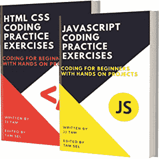

## JavaScript 函数 – 练习题

### HTML 代码

```html
<!DOCTYPE html>
<html>
<head>
  <meta charset="utf-8">
  <title>查找第一个重复的字符。</title>
</head>
<body>
</body>
</html>
```

### JavaScript 代码

```javascript
function find_FirstNotRepeatedChar(str) {
  var arra1 = str.split('');
  var result = '';
  var ctr = 0;
  for (var x = 0; x < arra1.length; x++) {
    ctr = 0;
    for (var y = 0; y < arra1.length; y++) {
      if (arra1[x] === arra1[y]) {
        ctr+= 1;
      }
    }
    if (ctr < 2) {
      result = arra1[x];
      break;
    }
  }
  return result;
}
console.log(find_FirstNotRepeatedChar('abacbec'));
```

#### 输出

e

### 流程图

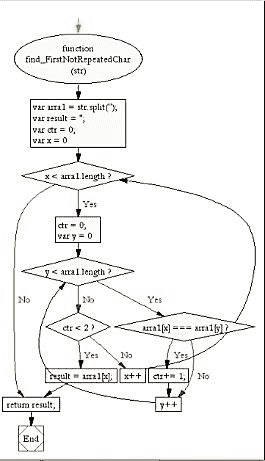

### HTML 代码

```html
<!DOCTYPE html>
<html>
<head>
  <meta charset=utf-8 />
  <title>查找字符串中最长的单词</title>
</head>
<body>
</body>
</html>
```

### JavaScript 代码

```javascript
function find_longest_word(str) {
  var array1 = str.match(/\w[a-z]{0,}/gi);
  var result = array1[0];
  for(var x = 1 ; x < array1.length ; x++) {
    if(result.length < array1[x].length) {
      result = array1[x];
    }
  }
  return result;
}
console.log(find_longest_word('Web Development Tutorial'));
```

#### 输出

Development

#### 解释

假设`str`等于`@Web Production #Tutorial`。

当字符串与正则表达式匹配时，使用`match()`方法来获取匹配项。

作为`str.match(/w[a-z]0,/gi)`的结果将返回`["Web", "Development", "Tutorial"]`。

`for`循环比较数组每个元素与上一个元素的长度，并返回最长的字符串。

`length`属性是一个 32 位无符号整数，其数值始终大于数组的最高索引。

语法 -> `arr.length`

### 流程图

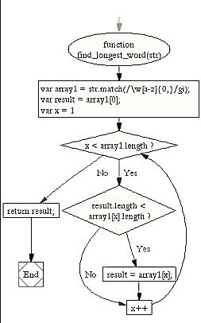

### HTML 代码

```html
<!DOCTYPE html>
<html>
<head>
  <meta charset=utf-8 />
  <title>统计字符串中元音的数量</title>
</head>
<body>
</body>
</html>
```

### JavaScript 代码

```javascript
function vowel_count(str1) {
  var vowel_list = 'aeiouAEIOU';
  var vcount = 0;
  for(var x = 0; x < str1.length ; x++) {
    if (vowel_list.indexOf(str1[x]) !== -1) {
      vcount += 1;
    }
  }
  return vcount;
}
console.log(vowel_count("The quick fox"));
```

#### 输出

5

#### 解释

`indexOf()`方法返回调用字符串对象中从`fromIndex`开始定义的值的首次出现的索引。如果找不到值，则返回 -1。

语法 -> `str.indexOf(searchValue[, fromIndex])`

参数包括：

`searchValue`：要查找的字符串。

`fromIndex`（可选）：字符串向前搜索的索引。可以使用任何整数。

如果满足条件`(vowel_list.indexOf(str1[x])!== -1)`，则字符串字符将被视为元音。

### 流程图

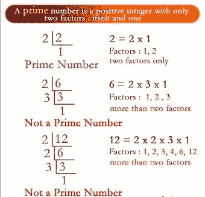

### HTML 代码

```html
<!DOCTYPE html>
<html>
<head>
  <meta charset=utf-8 />
  <title>检查数字是否为质数</title>
</head>
<body>
</body>
</html>
```

### JavaScript 代码

```javascript
function test_prime(n) {
  if (n===1) {
    return false;
  }
  else if(n === 2) {
    return true;
  }else {
    for(var x = 2; x < n; x++) {
      if(n % x === 0) {
        return false;
      }
    }
    return true; 
  }
}
console.log(test_prime(37));
```

#### 输出

True

### 流程图

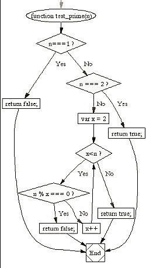

注意六种可能的值：`object`、`boolean`、`method`、`number`、`string`或`undefined`。

### HTML 代码

```html
<!DOCTYPE html>
<html>
<head>
<meta charset=utf-8 />
<title>检测 JavaScript 数据类型</title>
</head>
<body>
</body>
</html>
```

### JavaScript 代码

```javascript
function detect_data_type(value) {
  var dtypes = [Function, RegExp, Number, String, Boolean, Object], x, len;
  if (typeof value === "object" || typeof value === "function") {
    for (x = 0, len = dtypes.length; x < len; x++) {
      if (value instanceof dtypes[x]) {
        return dtypes[x];
      }
    }
  }
  return typeof value;
}
console.log(detect_data_type(12));
console.log(detect_data_type('w3resource'));
console.log(detect_data_type(false));
```

#### 输出

number

string

Boolean

## JavaScript: 从数组中找到第二小和第二数字

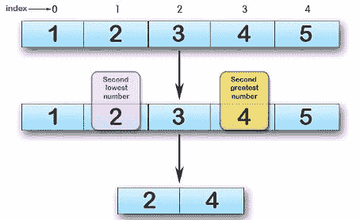

### HTML 代码

```html
<!DOCTYPE html>
<html>
<head>
<body>
</body>
</html>
```

### JavaScript 代码

```javascript
function Second_Greatest_Lowest(arr_num) {
  arr_num.sort(function(x,y) {
    return x-y;
  });
  var uniqa = [arr_num[0]];
  var result = [];
  for(var j=1; j < arr_num.length; j++) {
    if(arr_num[j-1] !== arr_num[j]) {
      uniqa.push(arr_num[j]);
    }
  }
  result.push(uniqa[1],uniqa[uniqa.length-2]);
  return result.join(',');
}
console.log(Second_Greatest_Lowest([1,2,3,4,5]));
```

#### 输出

2,4

### 流程图

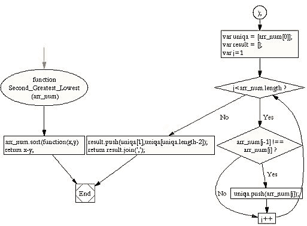

## JavaScript 基础

### 计算两个数字的乘法和除

#### HTML 代码

```html
<!DOCTYPE html>
<html>
<head>
<meta charset=utf-8 />
<title>计算两个数字乘法和除法的 JavaScript 程序 </title>
<style type="text/css">
body {margin: 30px;}
</style>
</head>
<body>
<form>
第一个数字 : <input type="text" id="firstNumber" /><br>
第二个数字: <input type="text" id="secondNumber" /><br>
<input type="button" onClick="multiplyBy()" Value="乘" />
<input type="button" onClick="divideBy()" Value="除" />
</form>
<p>结果是 : <br>
<span id="result"></span>
</p>
</body>
</html>
```

#### JavaScript 代码

```javascript
function multiplyBy() {
  var num1 = document.getElementById("firstNumber").value;
  var num2 = document.getElementById("secondNumber").value;
  document.getElementById("result").innerHTML = num1 * num2;
}
function divideBy() {
  var num1 = document.getElementById("firstNumber").value;
  var num2 = document.getElementById("secondNumber").value;
  document.getElementById("result").innerHTML = num1 / num2;
}
```

#### 解析

`document.getElementById(id).value`: 文本框的属性用于设置或返回值。

`document.getElementById("result").innerHTML`: 元素的`innerHTML`属性用于设置或返回 HTML 内容。

#### 输出


### 将温度摄氏度转换为华氏度

#### HTML 代码

```html
<!DOCTYPE html>
<html>
<head>
<meta charset="utf-8">
<title>编写一个将温度摄氏度转换为华氏度的 JavaScript 程序</title>
</head>
<body>
</body>
</html>
```

#### JavaScript 代码

```javascript
function cToF(celsius) {
  var cTemp = celsius;
  var cToFahr = cTemp * 9 / 5 + 32;
  var message = cTemp+'°C is ' + cToFahr + '°F.';
  console.log(message);
}
function fToC(fahrenheit) {
  var fTemp = fahrenheit;
  var fToCel = (fTemp - 32) * 5 / 9;
  var message = fTemp+'°F is ' + fToCel + '°C.';
  console.log(message);
}
```

#### 输出

60°C is 140°F.

45°F is 7°C.

### 找出三个整数中最大的

#### HTML 代码

```html
<!DOCTYPE html>
<html>
<head>
<meta charset="utf-8">
<title>找出三个整数中最大的 JavaScript 程序</title>
</head>
<body>
</body>
</html>
```

#### JavaScript 代码

```javascript
function max_of_three(x, y, z) {
  var max_val = 0;
  if (x > y) {
    max_val = x;
  } else {
    max_val = y;
  }
  if (z > max_val) {
    max_val = z;
  }
  return max_val;
}
console.log(max_of_three(1,2,3));
console.log(max_of_three(10,5,2));
console.log(max_of_three(7,15,12));
```

#### 输出

3

10

15

### 反转给定字符串

#### HTML 代码

```html
<!DOCTYPE html>
<html>
<head>
<meta charset="utf-8">
<title>反转给定字符串的 JavaScript 程序</title>
</head>
<body>
</body>
</html>
```

#### JavaScript 代码

```javascript
function string_reverse(str) {
  return str.split("").reverse().join("");
}
console.log(string_reverse("resource"));
console.log(string_reverse("www"));
console.log(string_reverse("JavaScript"));
```

#### 输出

ecruoser

www

tpircS

### 将字符串中的每个字符替换为字母表中的下一个字符

#### HTML 代码

```html
<!DOCTYPE html>
<html>
<head>
<meta charset="utf-8">
<title>将给定字符串中的每个字符替换为字母表中的下一个字符的 JavaScript 程序</title>
</head>
<body>
</body>
</html>
```

#### JavaScript 代码

```javascript
function LetterChanges(text) {
  var s = text.split('');
  for (var i = 0; i < s.length; i++) {
    // 撒亚密码
    switch(s[i]) {
      case ' ':
        break;
      case 'z':
        s[i] = 'a';
        break;
      case 'Z':
        s[i] = 'A';
        break;
      default:
        s[i] = String.fromCharCode(1 + s[i].charCodeAt(0));
    }
    // 大写元音
    switch(s[i]) {
      case 'a': case 'e': case 'i': case 'o': case 'u':
      s[i] = s[i].toUpperCase();
    }
  }
  return s.join('');
}
console.log(LetterChanges("PYTHON"));
```

#### 输出

QZUPPO

```javascript
console.log(LetterChanges("W3R"));
console.log(LetterChanges("php"));
```

#### 输出

QZUIPO

X4S

qIq

### 去掉第一个和最后一个字符的字符串

#### HTML 代码

```html
<!DOCTYPE html>
<html>
<head>
  <meta charset="utf-8">
  <meta name="viewport" content="width=device-width">
  <title>创建一个去掉第一个和最后一个字符的字符串的 JavaScript 程序</title>
</head>
<body>
</body>
</html>
```

#### JavaScript 代码

```javascript
function without_first_end(str) {
  return str.substring(1, str.length - 1);
}
console.log(without_first_end('JavaScript'));
console.log(without_first_end('JS'));
console.log(without_first_end('PHP'));
```

#### 输出

avaScrip

H

### 拼接两个字符串（它们第一个字符之外）

#### HTML 代码

```html
<!DOCTYPE html>
<html>
<head>
  <meta charset="utf-8">
  <meta name="viewport" content="width=device-width">
  <title>拼接除第一个字符外的两个字符串的 JavaScript 程序</title>
</head>
<body>
</body>
</html>
```

#### JavaScript 代码

```javascript
function concatenate(str1, str2) {
  str1 = str1.substring(1, str1.length);
  str2 = str2.substring(1, str2.length);
  return str1 + str2;
}
console.log(concatenate("PHP","JS"));
console.log(concatenate("A","B"));
console.log(concatenate("AA","BB"));
```

#### 输出

HPS

AB

### 移动最后三个字符到指定字符串的开头

#### HTML 代码

```html
<!DOCTYPE html>
<html>
<head>
  <meta charset="utf-8">
  <meta name="viewport" content="width=device-width">
  <title>将给定字符串的最后三个字符移动到字符串开头的 JavaScript 程序。字符串长度必须为 3。</title>
</head>
<body>
</body>
</html>
```

#### JavaScript 代码

```javascript
function right_three(str) {
    if (str.length > 1)
    {
      return str.slice(-3) + str.slice(0, -3);
    }
  return str;
}
console.log(right_three("Python"));
console.log(right_three("JavaScript"));
console.log(right_three("Hi"));
```

#### 输出

honPyt

iptJavaScr

Hi

### 计算给定数组的三个元素之和（长度为 3 的整数）

#### HTML 代码

```html
<!DOCTYPE html>
<html>
<head>
  <meta charset="utf-8">
  <meta name="viewport" content="width=device-width">
  <title>计算长度为 3 的给定整数数组中三个元素之和的 JavaScript 程序</title>
</head>
<body>
</body>
</html>
```

#### JavaScript 代码

```javascript
function sum_three(nums)
{
  return nums[0] + nums[1] + nums[2];
}
console.log(sum_three([10, 32, 20])); 
console.log(sum_three([5, 7, 9]));
console.log(sum_three([0, 8, -11]));
```

#### 输出

62

21

-3

### 相加给定正整数的两个数字

#### HTML 代码

```html
<!DOCTYPE html>
<html>
<head>
  <meta charset="utf-8">
  <meta name="viewport" content="width=device-width">
  <title>加上长度为二的给定正整数的两个数字的 JavaScript 程序</title>
</head>
<body>
</body>
</html>
```

#### JavaScript 代码

```javascript
function add_two_digits(n)
  {
    return n % 10 + Math.floor(n / 10);
  }
console.log(add_two_digits(25))
console.log(add_two_digits(50))
```

#### 输出

7

5

### 检查给定年份是否为闰年

#### HTML 代码

```html
<!DOCTYPE html>
<html>
<head>
  <meta charset=utf-8 />
  <title>查找闰年</title>
</head>
<body>
</body>
</html>
```

#### JavaScript 代码

```javascript
function leapyear(year)
{
return (year % 100 === 0) ? (year % 400 === 0) : (year % 4 === 0);
}
console.log(leapyear(2016));
console.log(leapyear(2000));
console.log(leapyear(1700));
console.log(leapyear(1800));
console.log(leapyear(100));
```

#### 输出

true

true

false

false

### 检查给定数字是否为 3 的倍数或 7 的倍数

#### HTML 代码

```html
<!DOCTYPE html>
<html>
<head>
  <meta charset="utf-8">
  <meta name="viewport" content="width=device-width">
  <title>检查给定数字是否为 3 的倍数或 7 的倍数的 JavaScript 程序</title>
</head>
<body>
</body>
</html>
```

#### JavaScript 代码

```javascript
function test37(x)
{
  if (x % 3 == 0 || x % 7 == 0)
  {
    return true;
  }
  else {
    return false;
  }
}
console.log(test37(12));
console.log(test37(14));
console.log(test37(10));
console.log(test37(21));
```

### 检查字符串是否以 'Java' 开头

#### HTML 代码

```html
<!DOCTYPE html>
<html>
<head>
  <meta charset="utf-8">
  <meta name="viewport" content="width=device-width">
  <title>检查字符串是否以 'Java' 开头的 JavaScript 程序</title>
</head>
<body>
</body>
</html>
```

#### JavaScript 代码

```javascript
function start_java(str) {
  if (str.length < 4) {
    return false;
  }
  front = str.substring(0, 4);
  if (front == 'Java') {
    return true;
  }
  else {
    return false;
  }
}
console.log(start_java("JavaScript"));
console.log(start_java("Java"));
console.log(start_java("Python"));
```

#### 输出

true

true

false

### 检查两个给定整数是否在 50..99 范围内

#### HTML 代码

```html
<!DOCTYPE html>
<html>
<head>
  <meta charset="utf-8">
  <meta name="viewport" content="width=device-width">
  <title>检查两个给定整数是否在 50..99 范围内的 JavaScript 程序</title>
</head>
<body>
</body>
</html>
```

#### JavaScript 代码

```javascript
function check_range(x, y)
  {
  if ((x >= 50 && x <= 99) || (y >= 50 && y <= 99))
  {
    return true;
  }
  else {
    return false;
  }
}
console.log(check_range(12, 101));
console.log(check_range(52, 80));
console.log(check_range(15, 99));
```

#### 输出

false

true

true

### 找到距离 100 最近的数值

#### HTML 代码

```html
<!DOCTYPE html>
<html>
<head>
  <meta charset="utf-8">
  <meta name="viewport" content="width=device-width">
  <title>从两个不同的给定整数中找到距离 100 最近的值的 JavaScript 程序</title>
</head>
</html>
```

#### JavaScript 代码

```javascript
function near_100(x, y) {
  if (x != y) {
    x1 = Math.abs(x - 100);
    y1 = Math.abs(y - 100);
    if (x1 < y1) {
      return x;
    }
    if (y1 < x1) {
      return y;
    }
    return 0;
  }
  else {
    return false;
  }
}
console.log(near_100(90, 89));
console.log(near_100(-90, -89));
console.log(near_100(90, 90));
```

#### 输出

90

-89

false

### 在单独浏览器标签页中打开链接的文档

#### HTML 代码

```html
<!DOCTYPE html>
<html>
<head>
  <meta charset="utf-8">
  <title>如何在单独的浏览器标签页中打开链接的文档</title>
</head>
<body>
  <p><a href="https://htmlresource.com" target="_blank">目标 HTML5 练习</a></p>
</body>
</html>
```

### 在 HTML 文档中编写地址的正确方式

#### HTML 代码

```html
<!DOCTYPE html>
<html>
<head>
  <meta charset="utf-8">
  <title>在 HTML 文档中编写地址的正确方式是什么</title>
</head>
<body>
  <address>
    地址：21,MG Road<br>
布德万（Burdwan)<br>
西孟拉邦（West Bengal）。
  </address>
</body>
</html>
```

### 为 area 元素指定替代文本（如果存在 href 属性）

#### HTML 代码

```html
<body> 
   
  <map name="Map"> 
    <area shape="rect" coords="8,5,100,77" href="https://www.htmlresource.com/mysql/mysql-tutorials.php" target="_blank" alt="mysql 教程"> 
    <area shape="circle" coords="155,93,59" href="https://www.htmlresource.com/php/php-home.php" target="_blank" alt="php 教程"> 
    <area shape="rect" coords="197,136,306,188" href="https://www.htmlresource.com/sql/sql-tutorials.php" alt="sql 教程"> 
  </map> 
</body>
```

### 创建使用 article 元素的 HTML 文档

#### HTML 代码

```html
<!DOCTYPE html>
<html>
<head>
  <meta charset="utf-8">
  <title>创建一个使用 article 元素的 HTML 文档</title>
</head>
<body>
  <article> 
    <h1>HTML5 article 元素教程</h1> 
    <p>HTML5 article 元素代表网络文档中的独立项目，如博客文章条目。</p> 
  </article> 
</body>
</html>
```

### 创建使用 aside 元素的 HTML 文档

#### HTML 代码

```html
<!DOCTYPE html>
<html>
<head>
  <meta charset="utf-8">
  <title>如何创建一个使用 aside 元素的 HTML 文档</title>
</head>
<body>
  <p> 我访问了 htmlresource 的 HTML5 教程</p>
  <aside>
    <h4>HTML5 教程</h4>
    <p>在 HTML5 教程中，我可以使用 HTML5 和相关的 API（如 GeoLocation、拖放、WebSocket 等）开发出色的 Web 应用程序。</p>
  </aside>
</body>
</html>
```

#### 输出

我访问了 htmlresource 的 HTML5 教程

##### HTML5 教程

在 HTML5 教程中，我可以使用 HTML5 和相关的 API（如 GeoLocation、拖放、WebSocket 等）开发出色的 Web 应用程序。

### 为音频添加控制控件

#### HTML 代码

```html
<body>
<audio controls>
    <source src="https://www.htmlresource.com/html-css-exercise/basic/solution/beach.ogg" type="audio/ogg">
<source src="https://www.htmlresource.com/html-css-exercise/basic/solution/beach.mp3" type="audio/mpeg">
</audio>
</body>
```

### 使用 HTML 标签编写粗体文本

#### HTML 代码

```html
<!DOCTYPE html>
<html>
<head>
  <meta charset="utf-8">
  <title>如何使用 HTML 标签编写粗体文本</title>
</head>
<body>
```

#### 输出

"htmlresource" 是普通文本 - "htmlresource" 是粗体文本。

### 指定基础 URL

#### HTML 代码

```html
<!DOCTYPE html>
<html>
<head>
<meta charset="utf-8">
<title>如何为文档中所有相对 URL 指定基础 URL/目标</title> 
<base href="https://www.htmlresource.com/"> 
</head> 
<body> 
<ul> 
<li><a href="php/php-home.php">PHP 教程</a></li> 
<li><a href="javascript/javascript.php">JavaScript 教程</a></li> 
<li><a href="mysql/mysql-tutorials.php">MySQL 教程</a></li> 
</ul>
</body>
</html>
```

### 孤立可能以不同方向格式化的文本部分

#### HTML 代码

```html
<!DOCTYPE html>
<html>
<head>
  <meta charset="utf-8">
  <title>如何孤立一个与其外部文本可能以不同方向格式化的文本部分</title>
</head>
<body>
<p>
在下面的示例中，用户名将与比赛中的分数一起显示。
如果浏览器不支持 `bdi` 元素，阿拉伯语用户的用户名将混淆文本（双向算法会将冒号和数字 "80" 放在 "User" 单词旁边，而不是 "points" 单词旁边）。
</p>
<ul>
<li>User <bdi>hrefs</bdi>: 40 分</li>
<li>User <bdi>jdoe</bdi>: 60 分</li>
<li>User <bdi > ترحي ب </bdi>:80 分</li>
</ul>
<p><b>注意：</b> `bdi` 元素目前仅在 Firefox 和 Chrome 中支持。</p>
</body>
</html>
```

#### 输出

在下面的示例中，用户名将与比赛中的分数一起显示。

如果浏览器不支持`bdi`元素，阿拉伯语用户的用户名将混淆文本（双向算法会将冒号和数字 "80" 放在 "User" 单词旁边，而不是 "points" 单词旁边）。

User <bdi>hrefs</bdi>: 40 分

User <bdi>jdoe</bdi>: 60 分

User <bdi > ترحي ب </bdi>:80 分

注意：`bdi`元素目前仅在 Firefox 和 Chrome 中支持。

## HTML CSS 练习：表格

### HTML 代码

```html
<table>
<tr>
<td>快速</td>
</tr>
<tr>
<td>懒惰</td>
</tr>
<tr>
<td>掉落</td>
</tr>
<tr>
<td>猎人</td>
</tr>
</table>
```

### 创建简单的导航栏

#### HTML 代码

```html
<!DOCTYPE html>
<html lang="en">
<head>
<meta charset="utf-8">
<title>HTML CSS 练习 - 创建简单的导航栏</title>
<style type="text/css">
nav {
display: block;
position: absolute;
top: 0;
width: 100%;
background-color: green;
}
li{
list-type: none;
display: inline;
margin-right:20px;
}
a:link {
color: #fff;
text-decoration: none;
}
a:hover {
color: orange;
text-decoration: none;
}
li > ul {
display: none;
}
li:hover ul {display: block; position: absolute; left:200px;background-color:green;}
li:hover ul li:link{display: block;margin-left:-30px;}
</style>
</head>
<body>
<nav>
<ul>
<li><a href="#">首页</a></li>
<li><a href="#">关于</a></li>
<li>
<a href="#">产品</a>
<ul>
<li><a href="#">工程</a></li>
<li><a href="#">电信</a></li>
<li><a href="#">能源</a></li>
<li><a href="#">金融</a></li>
<li><a href="#">咨询</a></li>
</ul>
</li>
<li><a href="#">服务</a></li>
<li><a href="#">联系我们</a></li>
</ul>
</nav>
</body>
</html>
```

## HTML CSS 练习：HTML 表单

### HTML 代码

```html
<!DOCTYPE html>
<html lang="en">
<head>
<meta charset="utf-8">
<title>HTML CSS 表单练习</title>
</head>
<body>
<div class="container">
<h1>旅行预订表</h1>
<h3>* 表示必填项</h3>
<form id="registration_form" method="POST">
  <label>全名*:</label><br>
  <input type="text" name="full_name" placeholder="姓 名" autofocus="autofocus" value=""><br> 
  <label>邮箱地址*:</label><br>
  <input type="text" name="email_addr" value=""><br>
  <label>选择套餐* :</label><br>
  <select name="package">
<option value="Goa" >果阿德</option>
<option value="Kashmir">克什米尔</option>
<option value="Rajasthan">拉贾斯坦</option>
</select>
<label>到达日期*:</label>
<input type="text" name="arv_dt" placeholder="m/d/y" value="">
<label>人数*:</label>
<input type="text" name="persons" value="">
<label>您想享用哪些服务？*</label>
住宿<input type="checkbox" name="facilities[]" value="boarding">
餐饮<input type="checkbox" name="facilities[]" value="fooding">
观光<input type="checkbox" name="facilities[]" value="sightseeing">
<label>优惠券代码:</label>
<input type="text" name="dis_code" value="">
<label>条款与条件*</label>
<input type="radio" name="tnc" value="agree" checked>我同意
<input type="radio" name="tnc" value="disagree">我不同意
<button type="submit" class="btn btn-large btn-primary" name="submit">完成预约</button>
</form>
</div>
</body>
</html>
```

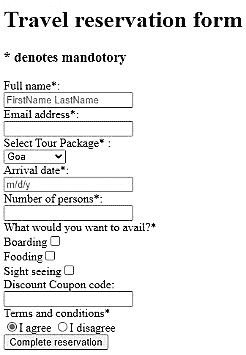

## HTML CSS 练习：HTML5 音频与视频

### HTML 代码

```html
<!DOCTYPE HTML>
<html lang="en">
<head>
<meta charset="utf-8">
<title>HTML CSS 音频/视频练习</title>
</head>
<body>
<video controls>
  <source src="big_buck_bunny.mp4" type="video/ogv">
  <source src="big_buck_bunny.mp4" type="video/mp4">
  您的浏览器不支持 <code>video</code> 元素。
</video>
</body>
</html>
```

#### 输出结果

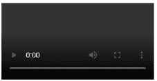

## HTML CSS 练习：CSS 按钮

### HTML 代码

```html
<!doctype html>
<html>
<head>
<title>HTML CSS 练习 - 使用 CSS3 创建按钮</title>
<style>
button {
width: 200px;
padding:8px;
background-color: #428bca;
border-color: #357ebd;
color: #fff;
-moz-border-radius: 10px;
-webkit-border-radius: 10px;
border-radius: 10px; /* 未来兼容性 */
-khtml-border-radius: 10px; /* 用于旧版 Konqueror 浏览器 */
text-align: center;
vertical-align: middle;
border: 1px solid transparent;
font-weight: 900;
font-size:125%
}
</style>
<title>未标题文档</title>
</head>
<body>
<button>立即订阅</button>
</body>
</html>
```

#### 输出结果


## HTML CSS 练习：使用 CSS3 创建缝线效果

### HTML 代码

```html
<!DOCTYPE html>
<html lang="en">
<head>
  <meta charset="utf-8">
  <title>使用 CSS3 创建缝线效果</title>
  <style>
  .stitched {
  width: 200px;
  padding: 20px;
  margin: 10px;
  background: #0d90df;
  color: #fff;
  font-size: 21px;
  font-weight: bold;
  line-height: 1.3em;
  border: 2px dashed #fff;
  border-radius: 10px;
  box-shadow: 0 0 0 4px #0d90df, 2px 1px 6px 4px rgba(10, 10, 0, 0.5);
  text-shadow: -1px -1px #aa3030;
  font-weight: normal;
}
  </style>
</head>
<body>
  <div class="stitched"></div>
</body>
</html>
```

#### 输出结果


## HTML CSS 练习：使用 CSS3 创建角角

### HTML 代码

```html
<!DOCTYPE HTML>
<html lang="en">
<head>
<meta charset="utf-8">
<title>CSS3 角</title>
<style type="text/css">
.ribbon {
background-color: #a00;
overflow: hidden;
white-space: nowrap;
 /* 顶部角 */
position: absolute;
left: -50px;
top: 40px;
 /* 45 度旋转 */
-webkit-transform: rotate(-45deg);
-moz-transform: rotate(-45deg);
-ms-transform: rotate(-45deg);
-o-transform: rotate(-45deg);
 transform: rotate(-45deg);
 /* 创建阴影 */
-webkit-box-shadow: 0 0 10px #888;
-moz-box-shadow: 0 0 10px #888;
 box-shadow: 0 0 10px #888;
}
.ribbon a {
color: #fff;
text-decoration: none;
padding: 5px;
0px;
font-weight: bold;
display: block;
width: 150px;
height: 50px;
line-height: 50px;
text-align: center;
position: absolute;
top: -25px;
left: 25px;
transform: rotate(-45deg);
}
</style>
</head>
<body>
<div class="ribbon"><a href="#">优惠</a></div>
</body>
</html>
```

#### 输出结果


## HTML CSS 练习：CSS3 模糊文本

### HTML 代码

```html
<!DOCTYPE HTML>
<html lang="en">
<head>
<meta charset="utf-8">
<title>CSS3 模糊文本</title>
<style type="text/css">
.blurred {
filter: blur(5px);
}
</style>
</head>
<body>
<p class="blurred">这段文字是模糊的</p>
</body>
</html>
```

#### 输出结果


## HTML CSS 练习：CSS3 气泡框

### HTML 代码

```html
<!DOCTYPE HTML>
<html lang="en">
<head>
<meta charset="utf-8">
<title>CSS3 气泡形状</title>
<style type="text/css">
.bubble {
position: relative;
width: 200px;
height: 100px;
background: #f9f9f9;
border-radius: 50px;
padding: 20px;
text-align: center;
}
.bubble:after {
content: '';
position: absolute;
bottom: -20px;
left: 50px;
width: 0;
height: 0;
border-left: 10px solid transparent;
border-right: 10px solid transparent;
border-top: 20px solid #f9f9f9;
}
</style>
</head>
<body>
<div class="bubble">这是一个气泡框</div>
</body>
</html>
```

#### 输出结果


## HTML CSS 练习：后代选择器

### HTML 代码

```html
<!DOCTYPE HTML>
<html lang="en">
<head>
<meta charset="utf-8">
<title>CSS 后代选择器示例</title>
<style type="text/css">
p span{
color:#4b6c9c; 
}
</style>
</head>
<body>
<p>只有<span>span 内部的文本</span>部分将显示为不同的颜色</p>
</body>
</html>
```

#### 输出结果

只有 span 内部的文本将显示为不同的颜色

## 样式占位符文本

### HTML 代码

```html
<!DOCTYPE html>
<html>
<head>
  <meta charset="utf-8">
  <title>HTML CSS 练习 - 样式占位符文本</title>
  <style type="text/css">
input[type="text"]::-webkit-input-placeholder {
  color: orange;
}
</style>
</head>
<body>
//将此内容插入 html 区域。位于 codepen 的 body 内部
<form action="">
<div>
    <label for="email">邮箱:</label>
    <input id="email" name="email" type="text" placeholder="yourname@yourdomain.com">
  </div>
</form>
//将此内容插入 css 区域。位于 codepen 的 body 内部
</body>
</html>
```

#### 输出结果

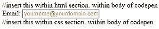

## 指定表单数据的推送位置（当表单被提交时）

### HTML 代码

```html
<!DOCTYPE html>
<html>
<head>
  <meta charset="utf-8">
  <title>如何在提交表单时指定表单数据的推送位置</title>
</head>
<body>
<form action="https://www.htmlresource.com/html-css-exercise/basic/solution/button-formaction-answer-demo.php" method="post">
  名：<input type="text" name="fname"><br>
  姓：<input type="text" name="lname"><br>
  <button type="submit">提交</button><br>
  <button type="submit" formaction="https://www.htmlresource.com/html-css-exercise/basic/solution/button-formaction-admin-demo.php">以管理员身份提交</button>
</form>
</body>
</html>
```

#### 输出结果

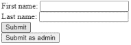

## 发送表单数据（使用哪种 HTTP 方法）

### HTML 代码

```html
<!DOCTYPE html>
<html>
<head>
  <meta charset="utf-8">
  <title>如何发送表单数据，使用哪种 HTTP 方法</title>
</head>
<body>
<form action="https://www.htmlresource.com/html-css-exercise/basic/solution/button-formmethod-answer-demo.php">
  名：<input type="text" name="fname"><br>
  姓：<input type="text" name="lname"><br>
  地址：<input type="text" name="place"><br>
  <button type="submit">提交</button>
  <button type="submit" formmethod="post" formaction="http://localhost/html-css-exercise/basic/solution/button-formmethod-post-answer.php">使用 POST 提交</button>
</form>
</body>
</html>
```

#### 输出结果

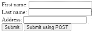

## 指定显示位置（提交表单后的响应）

### HTML 代码

```html
<!DOCTYPE html>
<html>
<head>
  <meta charset="utf-8">
  <title>如何在提交表单后指定显示响应的位置</title>
</head>
<body>
<form action="https://www.htmlresource.com/html-css-exercise/basic/solution/button-formtarget-answer-demo.php" method="POST">
  名：<input type="text" name="fname"><br>
  姓：<input type="text" name="lname"><br>
  <button type="submit">提交</button>
  <button type="submit" formtarget="_blank">提交到新窗口/标签页</button>
</form>
</body>
</html>
```

#### 输出结果

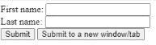

## 为按钮指定名称

### HTML 代码

```html
<!DOCTYPE html>
<html>
<head>
  <meta charset="utf-8">
  <title>如何为按钮指定名称</title> 
</head> 
<body> 
<form action="https://www.htmlresource.com/html-css-exercise/basic/solution/button-formaction-answer-demo.php">
选择感兴趣的主题：<button name="topic" value="JavaScript">JavaScript</button>
<button name="topic" value="PHP">PHP</button>
</form>
</body>
</html>
```

#### 输出结果

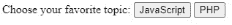

## 指定按钮的类型

### HTML 代码

```html
<!DOCTYPE html>
<html>
<head>
  <meta charset="utf-8">
  <title>如何指定按钮的类型</title>
</head>
<body>
<form action="https://www.htmlresource.com/html-css-exercise/basic/solution/button-type-answer-demo.php" method="post">
  名：<input type="text" name="fname"><br>
  姓：<input type="text" name="lname"><br>
  地址：<input type="text" name="place"><br>
  <button type="submit">提交</button>
  <button type="reset">重置</button>
</form>
</body>
</html>
```

#### 输出结果

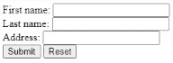

## 动态绘制图形（通过脚本）

### HTML 代码

```html
<!DOCTYPE html>
<html>
<head>
  <meta charset="utf-8">
  <title>如何通过脚本动态绘制图形</title>
</head>
<body>
<style>
#FirstCanvas{
width: 500px;
height: 300px;
border: 3px solid red;
background-color: blue;
}
</style>
<canvas id="FirstCanvas"></canvas>
</body>
</html>
```

#### 输出结果

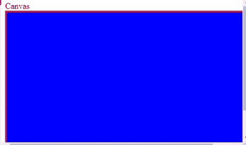

## 定义表格标题

### HTML 代码

```html
<!DOCTYPE html>
<html>
<head>
  <meta charset="utf-8">
  <title>如何定义表格标题</title>
</head>
<body>
<table border="1">
<caption>第一列包含学生代码，第二列包含学生获得的百分比。</caption>
<tr>
<th>学生代码</th>
<th>百分比</th>
</tr>
<tr>
<td>S001</td>
<td>85%</td>
</tr>
<tr>
<td>S002</td>
<td>86%</td>
</tr>
<tr>
<td>S003</td>
<td>72%</td>
</tr>
<tr>
<td>S004</td>
<td>89%</td>
</tr>
</table>
</body>
</html>
```

#### 输出结果

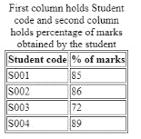

## 指定列属性

### HTML 代码

```html
<!DOCTYPE html>
<html>
<head>
  <meta charset="utf-8">
  <title>如何指定列组内每列的属性</title>
</head>
<body>
<table class="table-bordered">
<colgroup>
  <col span="3" style="background-color:#cc66Ff">
<col style="background-color:#cc66Ff">
</colgroup>
<tr>
<th>COL-1</th>
<th>COL-2</th>
<th>COL-3</th>
</tr>
<tr>
<td>MySQL</td>
<td>PHP</td>
<td>SQL</td>
</tr>
<tr>
<td>MySQL 练习</td>
<td>PHP 练习</td>
<td>SQL 练习</td>
</tr>
</table>
</body>
</html>
```
