# JavaScript 和 JQuery 数据分析与可视化

> 献给 *Ally 和 Kaiya*。*你们照亮了我的每一天。*
>
> —Graham Murray
>
> 献给 Annie
>
> —Vadim Ogievetsky
>
> 献给 *Whic*、*Granger*、*Charisma*、*Surley*、*Two-Gun*、*FEM*，以及*尤其重要的 Rafe*。*很快见，伙计们。*
>
> —Joseph Lowery

## 致谢

| | |
|:---|:---|
| **执行编辑** | Robert Elliott |
| **项目编辑** | Charlotte Kughen |
| **技术编辑** | Ambrose Little |
| **制作编辑** | Christine Mugnolo |
| **文字编辑** | Nancy Rapoport |
| **制作经理** | Kathleen Wisor |
| **内容开发及整合部经理** | Mary Beth Wakefield |
| **市场总监** | David Mayhew |
| **市场经理** | Carrie Sherrill |
| **专业技术与战略总监** | Barry Pruett |
| **业务经理** | Amy Knies |
| **副主编** | Jim Minatel |
| **封面项目协调员** | Patrick Redmond |
| **校对员** | Josh Chase, Word One New York |
| **索引编制员** | Robert Swanson |
| **封面设计师** | Wiley |
| **封面图片** | © iStock.com/Henrik5000 |

## 关于作者

**JON J. RAASCH** 是一名专注于桌面和移动设备 Web 应用开发的自由职业 Web 开发者。作为一名用户体验爱好者，他构建以用户为触控核心、关注每一个触点的 HTML5 和 JavaScript 应用。

Jon 是 John Wiley & Sons 多本书籍的作者，包括 *JavaScript Programming: Pushing the Limits*、*Smashing WebKit* 和 *Smashing Mobile Web Development*。作为一名最佳实践的完美主义者，你可以看到他穿着睡衣在建设现代 Web。

在 Twitter 上关注 Jon @jonraasch，并访问他的网站 `http://jonraasch.com`。他目前居住在俄勒冈州波特兰市。

**GRAHAM MURRAY** 是一名专注于构建 UI 开发工具的软件架构师。目前，他在 Infragistics 工作，为桌面、Web 和移动设备构建数据可视化 UI 控件。他热衷于多种编程语言，并在它们之间构建源到源编译器。小时候，他在一本杂志的后面发现了一些 BASIC 代码，从此便一发不可收拾地开始了编程生涯。

**VADIM OGIEVETSKY** 是 Metamarkets 的一名开发者，他在 AngularJS 之上使用 D3 构建可扩展的交互式数据驱动应用。在加入 Metamarkets 之前，Vadim 曾是斯坦福大学数据可视化小组的成员，为 Protovis 和 D3 做出了贡献。Vadim 是 D3 和基于 Web 的数据可视化的热心推广者；他曾在加州大学伯克利分校、哈佛大学、斯坦福大学以及其他大学、meetup 和企业就 D3 进行客座讲座。

**JOSEPH LOWERY** 目前从事网站建设，为 Lynda.com 和其他网站创建在线课程，撰写小说，并在布鲁克林闲逛。他关于 Web 和网站建设工具的书籍是国际畅销书，在全球以九种不同语言售出超过 400,000 册。

## 致谢

**我要感谢** 他的合著者为本书的编撰所付出的所有努力。我还要感谢 Wiley 的编辑和团队其他成员在整个项目中的支持。另外，感谢 Martin 进行技术校对。

—**Jon J. Raasch**

**我无法对我的妻子** Allison 和女儿 Kaiya 表达足够的感谢，感谢她们没有对我写这本书时的半缺席状态太过厌烦。写作期间各种突如其来的逆境让这段时间并不容易。感谢你们始终支持我，让我能挤出一点时间写这本书，尤其是在时间如此宝贵的时候。我的父母 Chris 和 Tony 在很多场合提供了及时的照看，并且从一开始就让我大量使用电脑，点燃了我对计算机的热爱。我的岳父岳母 Diane 和 Alan 非常仁慈，在我写作期间我们两次流离失所时都容纳了我们。感谢 Ambrose Little 出色的编辑和建议，以及鼓励我去做这件事。还要感谢 Jason Beres 和 Bill Hazard 在我感到胆怯时坚持让我接受这个任务。我要感谢 Robert Elliott 和 Wiley 的每一个人。我要特别感谢本书的所有编辑，尤其是 Charlotte 和 Nancy，感谢你们如此乐于助人和耐心，帮助我将晦涩的散文变成人们可能真正喜欢阅读的东西。我的合著者 Jon、Vadim 和 Joe 在额外内容方面提供了很好的建议。谢谢大家！

—**Graham Murray**

**我要感谢** Jeffrey Heer、Mike Bostock 和斯坦福可视化小组点燃了我对 JavaScript 和 Web 技术的热爱。还要感谢我的导师 Terry Winograd，是他指引我走向 SVG 的方向。特别感谢 Eric Tschetter、Ofir Oss、Sébastien Fragnaud、Young Kim 和 Annie Albagli 阅读我的初稿，以及 Charlotte Kughen、Ambrose Little 和 Wiley 团队其他成员的编辑支持。

—**Vadim Ogievetsky**

**特别感谢** Bob Elliott 和 Wiley 所有优秀的人给我为本书做出贡献的机会。

—**Joseph Lowery**

## 简介

谈到网络，你可能听过“内容为王”这句话。这句话由比尔·盖茨在20世纪90年代创造，这句常被重复的口号强调了信息高于一切的重要性。想想看：普通用户访问你的网站并不是为了欣赏漂亮的设计或酷炫的动画——她去那里是为了内容。从这个意义上说，我们作为网络专业人员所做的一切——无论是设计、开发还是营销——都有一个单一目标：向用户传递信息。

而论及信息的来源，还有什么比原始数据更好的呢？话虽如此，原始数据本身只不过是静态的噪音。数据可视化让我们能够弥合这一差距，将原始数据转化为有意义的内容。

说到这里，你可能已经意识到数据可视化远不止是用来给老板留下深刻印象的花哨部件。尽管本书确实涵盖了一些令人印象深刻的工具——例如全面的 D3 库——但重点始终放在信息上。数据可视化至少要将这些信息传达给用户。但你要做的远不止于此。这是因为数据可视化能够做到更多；除了传达信息，数据可视化还能分析信息以提供有意义的洞察。

好的数据可视化不仅仅是将数据聚合为更易消化的块。好的数据可视化引导用户得出有力的结论。它展示而不是告知，根据我们的经验，没有更好的方式来表达你的观点。没有什么能替代引导用户得出一个他们可以自行得出的结论。

## 本书内容

《*JavaScript and jQuery for Data Analysis and Visualization*》在第一部分以数据可视化的广泛讨论开篇。它讨论了数据可视化的现状及其总体目标，然后涵盖了一些分析的基本原则。第一部分最后概述了理解本书其余部分所需的一些技术基础，例如 HTML5 canvas 和 SVG 的基础知识。

第二部分带你进入数据分析和获取的领域。它讨论了从服务器提取数据的技术，甚至涵盖了如何将存储的数据与用户提交表单的数据相结合。接下来，它涵盖了数据验证以及显示表格数据的技术。第二部分以对客户端分析工具的探讨作为结尾，提供了一个基于 JavaScript 的稳健统计分析工具包。

第三部分探索实际的数据可视化工具，这很可能是你最喜欢本书的部分。你将从基础的图表解决方案开始，例如 Google Charts。从那里开始，本书进入更复杂的图表选项——涵盖如何使用 Raphaël 构建自定义解决方案，以及如何使用 D3 库。最后，你将了解更具体的数据可视化应用，例如地理和股票数据。

最后但同样重要的是，第四部分用几个真实世界的例子巩固你在第一部分到第三部分中学到的所有内容。你首先将看到如何构建一个互联的仪表板，使用 Google Charts 渲染美国人口普查数据，然后你将看到如何在生产环境中使用 D3 创建可复用的可视化。

## 本书面向的读者

本书面向具有前端开发基础知识的 Web 开发人员。尽管你不需要在这个领域拥有高级技能，但你应该至少具备 JavaScript 和 jQuery 的初学者水平知识。除此之外，我们对你的技能水平不做任何假设。我们从零开始介绍数据可视化工具，以及它们的一些底层技术。只要有可能，我们会指向外部资源以进一步支持你在这些领域的知识。这样，我们可以快速涵盖基础知识，然后进入数据可视化中越来越令人印象深刻的部分。

到本书结束时，你将拥有各种数据可视化工具和技术的高级知识。本书将为你提供全面的工具包，以满足你所有的可视化需求。

## 排版约定

为了帮助你充分利用文本并跟踪正在发生的事情，本书全文使用了多种约定。

> **警告** 警告包含重要的、*不可忘记*的信息，这些信息与周围文本直接相关。

> **注意** 注意表示对当前讨论的注释、提示、技巧或旁白。

至于文本中的样式：

- 我们在介绍新术语和重要词汇时会对它们进行*高亮*。

- 我们在文本中这样显示文件名、URL 和代码：`persistence.properties`。

- 我们以两种不同的方式呈现代码：

  - 我们对大多数代码示例使用无高亮的等宽字体。

  - 我们使用**粗体**来强调在当前上下文中特别重要的代码，或显示与先前代码片段相比的变化。

## 配套网站

为了补充本书的内容，我们还在 `www.wrox.com/go/javascriptandjqueryanalysis` 创建了一个配套网站。该网站提供各种有用的资源，例如书中所有代码示例的下载。如果你在任何地方卡住了，这是一个很有用的求助场所。

## 勘误

我们竭尽全力确保文本和代码中没有错误。然而，人无完人，错误确实会发生。如果你在我们的某本书中发现错误，比如拼写错误或错误的代码片段，我们将非常感谢你的反馈。通过提交勘误，你可以为另一位读者节省数小时的挫折，同时你可以帮助提供更高质量的信息。

要查找本书的勘误页面，请访问 `http://www.wrox.com`，并使用搜索框或其中一个标题列表找到该书。然后，在图书详情页面上，点击“Book Errata”链接。在此页面上，你可以查看已为本书提交并由 Wrox 编辑发布的所有勘误。包含每本书勘误链接的完整图书列表也可在 `www.wrox.com/misc-pages/booklist.shtml` 找到。

如果你在图书勘误页面上没有找到“你的”错误，请访问 `www.wrox.com/contact/techsupport.shtml` 并填写那里的表格，将你发现的错误发送给我们。我们会检查信息，如果合适，会在图书的勘误页面上发布消息，并在后续版本中修复问题。

## P2P.Wrox.com

如需作者和同行讨论，请加入 `p2p.wrox.com` 的 P2P 论坛。这些论坛是一个基于网络的系统，供你发布与 Wrox 图书和相关技术有关的消息，并与其他读者和技术用户互动。这些论坛提供订阅功能，当论坛中有新帖子时，会通过电子邮件发送你选择的感兴趣主题给你。Wrox 作者、编辑、其他行业专家和你的 fellow 读者都在这些论坛上。

在 `http://p2p.wrox.com` 上，你可以找到许多不同的论坛，这些论坛不仅在你阅读本书时对你有帮助，在你开发自己的应用程序时也能提供帮助。要加入论坛，只需按照以下步骤操作：

1. 前往 `p2p.wrox.com` 并点击 Register 链接。

2. 阅读使用条款并点击 Agree。

3. 填写加入所需的必填信息以及你想提供的任何可选信息，然后点击 Submit。

4. 你将收到一封电子邮件，其中包含有关如何验证你的账户并完成加入过程的信息。

> **注意** *你可以在不加入 P2P 的情况下阅读论坛中的消息，但要发布你自己的消息，你必须加入。*

加入后，你可以发布新消息并回复其他用户发布的消息。你可以随时在网上阅读消息。如果你想让特定论坛的新消息通过电子邮件发送给你，请在论坛列表中点击论坛名称旁边的 Subscribe to this Forum 图标。

有关如何使用 Wrox P2P 的更多信息，请阅读 P2P 常见问题解答，其中包含有关论坛软件如何工作以及许多与 P2P 和 Wrox 图书相关的常见问题的答案。要阅读常见问题解答，请点击任何 P2P 页面上的 FAQ 链接。

# 第一部分：让数字之美可视化

- 第1章：数据可视化世界

- 第2章：掌握分析要素

- 第3章：构建可视化基础

## 第1章 数据可视化世界

### 本章内容

- 图表设计选项概述

- 数据可视化在不同业务应用中的比较

- 推动数据可视化发展至今的技术进步概览

谈及数据可视化，人们很容易联想到自然界的蜕变。把原始数据比作毛毛虫：功能多样、面面俱到，虽能从一处移动到另一处，但略显笨拙，只有少数人才能真正欣赏。数据经过可视化处理后，便化身为蝴蝶：灵动敏捷、辨识度极高，足以激发情感共鸣。数据可视化本身就是一个生态系统，不断衍生出新的细节节点——在适当的滋养条件下，这些节点会演变为易于理解的呈现方式，将概念整合成一种可理解且富有感染力的形式。

那么，在这个比喻中，网络专业人士扮演着什么角色呢？当然是那些纺丝织茧、守护蜕变的匠人，将原始数字转化为有意义的呈现。抛开语言修辞不谈，网页设计师和开发者是数据可视化中不可或缺的组成部分。当然，当前不断演进的技术环境使这一角色成为可能——并使其效率日益提升。

总体而言，《JavaScript与jQuery数据分析与可视化》是数据可视化这一广阔领域的实用指南，涵盖从数据的获取与培育，到将其转化为最佳视觉格式的全过程。本章旨在概述当前环境，重点介绍其能力与局限性，并讨论作为网络专业人士的你如何在数据可视化中发挥关键作用。

### 让数字活起来

欣赏数值数据可能是一项挑战。借助关联图形和富有感染力的图像进行数据可视化，有助于让原始数据变得有意义。但在将数据转化为有意义的呈现之前，你首先需要获取它。

### 获取数据

数据领域极其庞大，其规模每天都在大幅甚至呈指数级增长。数据从四面八方涌入——当你想到火星探测器"好奇号"不断将探测数据传回地球时，你就会明白"四面八方"绝非夸张。

面对海量的现有数据，数据获取往往只是一个后勤问题。如果信息是非数字化形式，即书面记录，则需要将其转录为适当的格式。如果所需数据已经是数字化的，则可能需要将其从当前结构转换为与显示或可视化应用程序兼容的结构。

当你的信息格式正确后，接下来需要确保它恰好是你所需的数据，不多不少。当今可用的数据非常丰富，有针对性地选择数据（通常通过一种称为*过滤*的过程）在几乎所有情况下都是必需的。即使组织从一开始就精心管理数据输入，随着时间推移，样本或期望输出的变化也会迫使你调整过滤方式。

为什么限制数据流如此重要？一个显而易见的原因是处理效率。处理过多的无用信息会增加应用程序的执行时间——这直接导致带宽增加，从而增加成本。此外，过滤使原始数据更具意义。聚焦的信息更容易分析，也更容易被最终用户理解。

### 可视化数据

从某种意义上说，数据可视化最困难的方面在于确定信息应如何呈现。网页设计师必须选择最佳的呈现方式，以最清晰、最理想的方式传达数据，并产生最大的影响力。更重要的是，这种呈现应该是一种发现工具，引导用户获得有意义的洞察。以下是可用格式的不完整列表：

- 面积图

- 条形图

- 气泡图

- K线图

- 柱状图

- 甜甜圈图

- 流程图

- 漏斗图

- 仪表盘图

- 地理图表

- 热力图

- 层级边缘捆绑图

- 信息图表

- 折线图

- 马赛克图

- 网络节点图

- OLHC（开-高-低-收）图

- 组织结构图

- 帕累托图

- 饼图

- 极坐标图

- 散点图

- 迷你折线图

- 时间线

- 树状图

- 词云

我们其实才触及了数据呈现方式的冰山一角。上述大多数格式都可以以2D或3D形式展示。你可以加入交互元素和动画来丰富数据的维度。但要注意平衡这些花哨的效果与有意义的数据。任何视觉效果都不应以牺牲信息呈现为代价。

> **注意** *要认识到，可视化中的一个关键因素是意图。几乎所有主题的原始数据都可以用多种方式进行解读。在开始可视化呈现数据时，首先要确定的决定之一就是：想要传达什么信息。*

还有其他主要选项需要考虑。你是否展示底层数据？如果是，数字是一直可见，还是仅在某些交互发生时才可见，例如当查看者的鼠标悬停在某个数据点上时？初始可视化是否展示了全部内容，还是在线版本允许用户深入查看更详细的细节？是否使用动画来表示动态变化？是否有其他交互功能可用，例如沿时间线水平滚动或缩放？

此外，还有样式设计。对于简单的条形图和饼图，你不仅需要决定哪些颜色代表哪些元素，还需要确定标签和图例（如果有的话）的大小、颜色、样式和字体——这又是一个需要做出的选择。许多此类选择将受到其他因素的制约，例如创建组织的品牌形象或内部标准；但同样多的情况下并无此类基础可循，设计师的视觉构想将成为决定性因素。

超越图表基本元素，可视化设计师可以选择加入图形元素。背景图像不仅能从视觉和主题上为演示提供框架——符号还可以用作数据点，例如将品牌标志标注在第三季度销售地图上。数据可视化的一个完整领域——信息图表——专门致力于信息与视觉图像的结合。

事实是，网络专业人士当前可用的数据呈现方式极为丰富。尽管可能性看似令人眼花缭乱，但确定最佳呈现方式并将其变为现实，则取决于可视化设计师。

### 同步获取与可视化

数据可视化领域不仅仅消费现有数据：新数据也在不断添加到数据存储中，甚至是实时添加的。信息可以通过网站上的HTML表单直接收集，并通过编程方式整合到呈现中。最常见的例子之一就是在线投票，如图1-1所示。当网站访问者选择其期望的响应并点击投票后，所有条目（包括刚刚输入的）的当前相对排名就会显示出来。

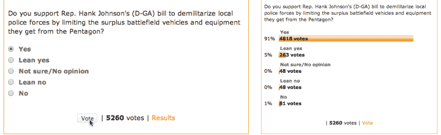

来源：www.dailykos.com/story/2014/08/18/1322337/-Cheers-and-Jeers-Monday

**图1-1：** 部分投票功能允许用户即时查看当前结果。

收集实时数据面临诸多挑战，但HTML5的广泛采用所带来的最新进展已缓解了其中许多问题。当它与几个关键的JavaScript库结合，现在可以在所有现代浏览器中使用高级表单元素，例如滑块控件。

实时获取数据只是第一步。Web 开发人员还需要负责验证和标准化数据。验证有两个关键方面：首先，确保所有必需的信息都已提供；其次，验证数据格式是否正确。当然，如果你想了解客户所在地，如果请求的邮政编码留空，就无法获取。同样，如果邮政编码格式错误，例如美国地址使用了四位数字，数据就是无效的。这两个问题都可以通过适当的验证来纠正，无论是在客户端使用 JavaScript 处理，在服务器端通过 PHP 或其他服务器语言处理，还是两者的某种组合。

标准化数据同样重要，通常适用于时间和日期详细信息。输入日期的方式有很多种：2011年3月10日在美国可能是 03/10/11，在澳大利亚是 10/03/11，在中国则是 11/03/10。为了确保正确收集目标日期，输入的信息需要在保存之前标准化为可视化应用程序可识别的格式。有关数据验证的更多信息，请参阅第6章。

### 数据可视化的应用

既然有这么多精彩的数据等待着通过这种近乎神奇的转化过程被赋予生命，但为什么要这样做呢？问题实际上是*cui bono？*（这对谁有利？）谁能从中受益？从某种意义上说，答案是每个人。每当信息变得更清晰、更易理解时，对所有人都是好事。但 Web 专业人员不会从"每个人"那里获得报酬，因此让我们缩小范围，重点关注最能从数据可视化中获益的关键群体。

#### 公共部门的用途

公共部门包括各级政府（在任者和试图进入者），以及警察、军队、交通机构、教育和医疗设施。就这些人，对吧？哦，顺便把慈善和慈善项目，也就是慈善机构，也加进来吧。

所有这些组织都有一个关键需求：发现正在发生什么（数据），然后将这些信息在内部传达给本组织的其他人，和/或向更广泛的外部公众传达（可视化）。许多此类工作是强制性的，对组织的存在至关重要。以美国人口普查为例。每10年依法进行一次大规模数据收集，然后影响美国生活的多个方面，如州和地区资金，当然还有国会代表。美国人口普查局保存着汇总数据的宝库，现在通过其在线平台`www.census.gov`向所有人提供可视化访问。网站上不仅有政府认可的人口普查信息展示，如图 1-2 所示的地图，还提供 API（`api.census.gov`）供公众 Web 开发人员访问。

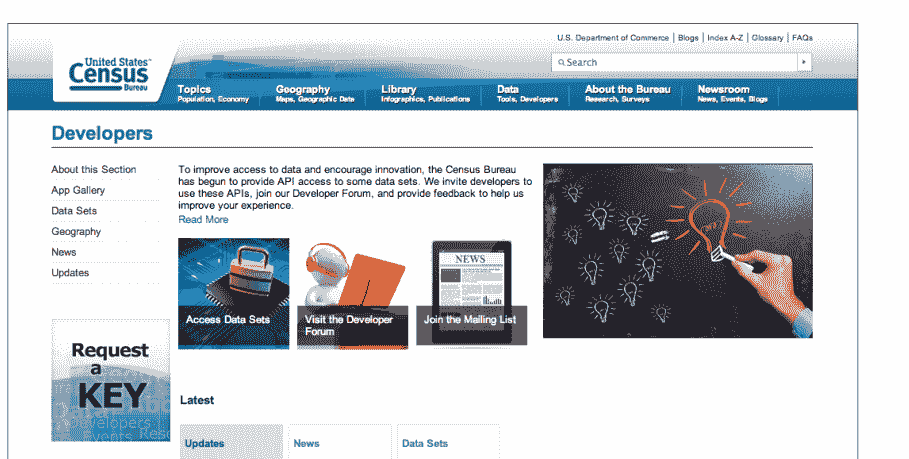

**图 1-2：** 你需要申请免费的数字密钥才能从 `api.census.gov` 访问 API。

#### 企业对企业及企业内部用途

如果商业的本质就是商业，那么如何开展商业活动呢？主要是通过营销，无论你是面向另一家公司的供应商，还是内部某个部门为争取更多资源而进行游说。而营销的核心就是说服力——这往往通过数据的有力展示来加强，甚至完全依赖于此。

与公共部门类似，许多此类展示是必需的。查看任何年度报告，都可以看到公司最新状况的概括，以快速可理解的图表形式呈现。如今，创建在线报告已成为标准做法。类似的每日数据可视化在部门和分部会议中进行，用于绘制销售进度、揭示公众对产品的反应，以及调整业务方向。

Web 设计师在企业对企业领域有着重要的数据可视化机会。这类工作大多与网站或内联网工作一样，由内部团队处理。培养此类技能无疑会为任何 Web 专业人员的简历增添价值。

此外，组织内部还广泛使用各种数据可视化。这些工具帮助企业处理和理解自己的数据。

#### 企业对消费者用途

显然，营销在企业对消费者领域的作用与企业对企业一样大，甚至更大。清晰有效的广告以及其他形式的营销，对于公司的信息在无处不在的媒体噪音中脱颖而出几乎是必需的。通常，明确定义的数据展示可以产生关键影响。

虽然在企业对消费者通信中有许多饼图、股票图表和其他基本数据表示的用途，但信息图表更为常见。信息图表以视觉吸引人的方式结合数据和信息。有时，数据被直接表示，如 HealthIT.gov 的信息图表中所示的百分比值（见图 1-3），或者更图形化地表示，如 CDC 的信息图表（见图 1-4）。

信息图表是一个极为丰富的领域，拥有几乎无限的可能性；由于格式的开放性，它可以成为设计师的游乐场。要了解更多关于创建这种特定类型数据可视化的信息，请参阅第16章。

### WEB 专业人员：置身其中

正如本章引言所述，Web 专业人员处于数据可视化的核心。首先，需要具备 Web 专业知识的人员来访问和将数据转换为可用形式。然后，如果数据收集是持续进行的，必须正确设置一个或多个在线表单，以确保获取所需数据，验证其有效性，并在必要时进行标准化。最后，需要具备浏览器兼容语言工作知识的人员创建数据的可视化显示，以便在互联网上查看。

#### 展示的控制

Web 专业人员——跨越其职能范围——负责这一不断增长的通信领域。让我们从他们的角度来分解这一过程：

- 需要具有服务器端技能的 Web 开发人员来处理后端数据处理，使其可访问。

- JavaScript 程序员负责过滤、排序和操作数据，为展示做准备。这个角色也可以由服务器端处理，或结合客户端技术来完成。

- HTML 程序员构建任何所需的表单，以实现交互式数据添加，通常使用 JavaScript 库进行验证。

- 一个或多个 Web 设计师创建所有数据相关页面的外观和感觉，包括样式化可视化数据的输出。

- Web 程序员利用其 JavaScript 知识，结合核心框架和数据可视化库，以代表性格式展示数据。

虽然上述所有任务可能由一个人完成，但这些任务同样可能由紧密合作的团队来处理。无论是由一个人（非常忙碌的）完成，还是由遍布全球的网络团队完成，重要的启示是 Web 专业人员从上到下拥有数据可视化流程。

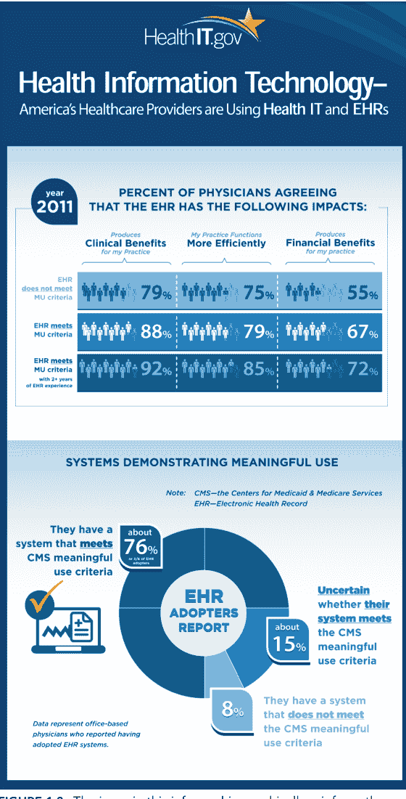

**图 1-3：** 此信息图表中的图标在图形上强化了数字百分比。

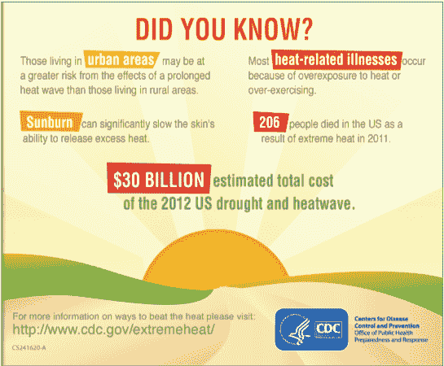

**图 1-4：** 信息图表擅长将突出显示的关键术语（如"城市地区"和"与热有关的疾病"）与数字数据相结合，如 CDC 的此信息图所示。

> **提示** *想知道其他 Web 专业人员在数据可视化领域做了些什么吗？有许多在线网站提供了大量示例。我们发现最好的之一在 [http://visualizing.org/](http://visualizing.org/)，它不仅拥有引人注目的图库，还有一个致力于数据和设计的活跃社区。*

### 技术带来的优势

Web 专业人员依赖强大的 Web 软件来完成其工作的任何方面，但对强大工具的需求对于正确处理数据可视化尤为重要。近年来，在线技术发生了根本性变革，极大地扩展了数据表示的可能性。虽然有许多促成因素，但以下讨论侧重于三个关键因素：

- 浏览器中更快、更高效的 JavaScript 引擎

- 兼容 HTML5 浏览器的迅速普及

- JavaScript 框架和库的可用性增加

#### 更快、更优的 JavaScript 处理

过去几年来，浏览器制造商一直将 JavaScript 处理视为关键战场，并全力以赴研发更快的 JavaScript 引擎。图 1-5 中的条形图对比了由 WebKit.org 创建并维护的 SunSpider 基准测试运行结果，展示了旧版浏览器（Internet Explorer 7 和 Safari 3）与最新（截至本文撰写时）浏览器 Internet Explorer 10 和 Safari 6 之间的差异。在此图表中，数值越小表示性能越好，你可以看到浏览器效率发生了巨大转变。早期浏览器版本的数据来源于 ZDNet 上一篇 2008 年 6 月的文章（`http://www.zdnet.com/blog/hardware/sunspider-javascript-benchmark-and-acid-3-compatibility-charts-firefox-3-0-rc-3-and-opera-9-50-added/2090`）；我们则在新版浏览器上亲自运行了基准测试。

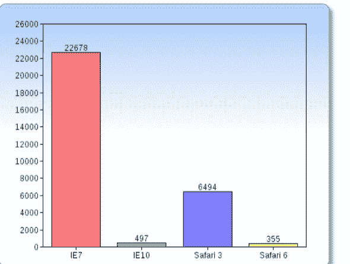

**图 1-5：** 数值越低表示 JavaScript 引擎的处理速度越快、性能越理想。

JavaScript 处理功能的提升对数据可视化领域产生了直接影响，涵盖分析和渲染两个阶段。JavaScript 引擎负责处理原始数值计算以及屏幕绘制工作，无论是直接进行还是与硬件渲染器协同完成。这种组合极大地提升了直接在浏览器中进行数据可视化的能力，无需依赖 Adobe Flash 等第三方插件。

#### HTML5 的崛起

更快的引擎没有燃料驱动也无济于事——幸运的是，大量高标号的 HTML5 燃料及时送达。HTML5 的根源可以追溯到 2004 年和 Web 超文本应用技术（WHAT）工作组——但其采用过程异常缓慢。W3C 曾一度计划将该网络语言在 2022 年才定为最终推荐标准！智能手机的出现，尤其是苹果 iPhone 的推出，彻底改变了这一切。该设备对 HTML5 的拥抱取代了 Flash，引发了一场所有主流浏览器争相支持特性的竞赛，HTML5 由此成为移动设备的当前标准。

HTML5 为何对数据可视化如此重要？首先，让我说明这个网页主要语言的最新版本带来了两个紧密相关的伙伴：CSS3 和高级 JavaScript API。这三种相关技术带来的增强功能彻底革新了整体网页设计与开发。以下是一些对数据可视化特别有益的关键特性：

- `<canvas>` 标签：在你的 HTML5 页面中加入一个看似空白的 `<canvas>` 元素，你便能立即使用完整的图形调色板——包括基本图元（如圆形和矩形）、带连接线的绘制点、渐变、文本、导入图像等等——所有这些都由 JavaScript 实时绘制。更重要的是，你可以选择让你画布上的任何内容变得可交互，能够被用户修改（参见图 1-6）。

- SVG：尽管我们之前已有限地支持 SVG 一段时间，但在 HTML5 下其使用已大大扩展。这种 canvas 的替代方案同样使你能在网页上创建丰富的图形。

- Web 字体：在局限于 PC 和 Mac 上常见的少量系统字体之后，全球网页设计者都渴望浏览器对 Web 字体支持所带来的可能性。现在，设计师可以使用不断增长的装饰性和其他字体系列，为他们的信息图表和其他数据可视化赋予所需的冲击力——同时保持搜索引擎兼容性和屏幕阅读器友好性。

- 高级表单元素：因为我们已经厌倦了使用极其有限的表单元素集合，所以这个特性在我们个人的愿望清单上排名很高。HTML5 带来了大量新的输入类型（如 `email`、`tel` 和 `url`），使用户更容易正确输入适当的数据，尤其是在移动设备上。此外，新的表单控件（如范围滑块）带来了增强的用户体验。浏览器对这些元素的支持尚未达到与某些其他 HTML5 特性同等的水平，但随着每个版本的发布似乎都在不断改进。

> **提示** *检查 HTML5 特性是否能融入网页的最佳资源或许是 http://caniuse.com/。这个网站跟踪每项 HTML5、CSS 和 JavaScript API 特性及其当前（以及过去和未来）的浏览器版本支持情况。我们认为 Can I Use 是任何新网站或应用规划阶段的必访之地。*

#### 降低实现门槛

用我们的汽车比喻来完成这个话题，让我们达成共识：我们现在拥有一辆强大的汽车（我们高效的 JavaScript 引擎）和一种超级燃料（广泛支持的 HTML5）。那么，有谁知道如何驾驶这个大家伙呢？多亏了 JavaScript 相关库的流行和易用性，特别是用 jQuery 编写的库，越来越多的网页专业人士给出的答案是响亮的“是！”。

### 星际行星航空公司

月球跳跃者培训

通过将每日柱状条的角拖动到你在培训当天达到的高度来记录你的培训进度。要留下你培训进度的纪念品，请点击“培训完成”按钮。

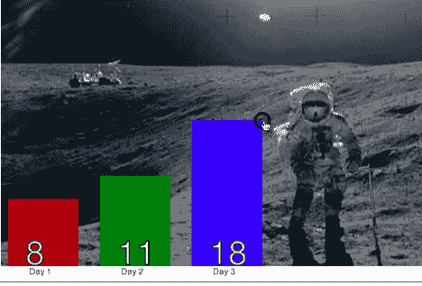

**图 1-6：** HTML5 带来了对高级功能的支持，例如 `<canvas>` 标签，它为交互式图表制作打开了大门，并带来许多其他数据可视化优势。

诚然，任何具备足够 JavaScript 知识的人都能处理数据可视化生命周期所需的数据获取、转换和渲染。然而，借助核心 jQuery 和针对性的库，这样的过程将变得更加高效和成功。

事实上，如果说本书有一个存在的*理由*，那就是这些 JavaScript 库的存在和普及，本书将贯穿始终地利用它们。除了让真实世界的数据更容易鲜活起来，大多数复杂的 JavaScript 库还使修改控制参数甚至数据本身变得更加直接，而且都可以即时进行。这种额外的灵活性增强了利用代码库（例如 Google Charts、D3、Raphaël 和 jqPlot，仅列举本书中涵盖且目前可供使用的一些）的合理性。

### 总结

数据可视化是获取数据、分析数据，并以图形方式显示结果信息的过程。整个过程本身可以极其简单，例如从电子表格中的值创建饼图；也可以极其复杂，例如构建一个提炼了大量人口普查和地理数据的复杂信息图表。思考数据可视化世界时，请记住以下关键点：

- 可视化数据使更广泛的受众能够更快地理解所选数据的相对关系。

- 在决定信息应采取何种表现形式时，有大量选择。可视化设计师的任务是为传达数据信息做出最佳选择。

- 可以通过使用 HTML 表单和 JavaScript 编码实时收集和可视化显示数据。

- 数据可视化的主要创建者是公共部门以及企业对企业、企业内部和企业对消费者市场。

- 浏览器 JavaScript 处理、HTML5 浏览器支持以及相关 JavaScript 库的普及为数据可视化奠定了技术基础。

# 第2章 掌握分析基础

### 本章内容

- 基本分析概念

- 评估数据时常用的关键数学术语

- 揭示信息中模式的技巧

- 预测未来趋势的策略

当前 Google 对 *analysis*（分析）的定义完美契合数据可视化：

> 对某事物的元素或结构进行详细检查，通常作为讨论或解释的基础。

你知道“只见树木，不见森林”的说法吗？当你以可视化为目标分析数据时，你可能同时看到了森林和树木。单个数据点当然极其重要，但它们形成的总体模式也同样重要：即 Google 定义中提到的结构。此外，分析数据进行可视化的全部目的在于讨论、解释和理解——用数字*来*描绘图景，而不是仅仅*由*数字描绘。

本章涵盖了分析的基本原理，为后续内容奠定基础。首先定义了评估数据时常用的一些关键数学术语。接着，讨论了常用于揭示信息中模式的技巧以及基于数据预测未来趋势的策略。

### 关键分析概念

从根本上说，大多数数据是基于数字的。对于每一个以文本为中心的解释——从“一方觉得这样，另一方觉得那样”开始——接下来的问题不可避免地是数字上的：“各方有多少人？”这种简化的人头计数很少能涵盖数据可视化项目的全部范围，通常需要引入更复杂的数值分析。本节将探讨更常用的概念。

#### 平均数与中位数

最常见的统计任务之一是确定一组特定数字的平均值，即*平均数*。平均数是所有考虑值的总和除以这些值的总数。假设你有关于全国七个不同地区的销售数据，如表2-1所示。

| 地区 | 销售额 |
|---|---|
| 东北部 | $100,000 |
| 东南部 | $75,000 |
| 中西部 | $125,000 |
| 中大西洋地区 | $125,000 |
| 西南部 | $75,000 |
| 西北部 | $100,000 |
| 加利福尼亚州 | $400,000 |

所有金额相加等于$1,000,000。将总额除以7——值的总数——得到平均数：$142,857。虽然这对于整体销售额来说意义重大，但它并不能真正反映大多数地区的典型数字。加利福尼亚州显著更高的金额扭曲了结果。通常，当有人要求平均值时，他们真正想要的其实是*中位数*。

中位数是一系列值的中点：字面意思就是中间。让我们将地区销售额按降序排列，从最高到最低（见表2-2）。

| 地区 | 销售额 |
|---|---|
| 加利福尼亚州 | $400,000 |
| 中西部 | $125,000 |
| 中大西洋地区 | $125,000 |
| 东北部 | $100,000 |
| 西北部 | $100,000 |
| 东南部 | $75,000 |
| 西南部 | $75,000 |

中位数销售额（东北部的$100,000）实际上更接近大多数其他地区的业绩。为了量化数据中的差异——如前面的例子所示——统计学家依赖一个称为*标准差*的概念。

#### 标准差

标准差衡量的是数字在任何给定样本集的平均值或平均数周围的分布情况。偏差越高，数据越分散。了解标准差可以让你确定——并因此可能绘制出——哪些值超出了正常范围。

以下是计算标准差的步骤：

1. 确定数值集的平均数。

2. 用每个值减去平均数。

3. 对结果求平方。巧妙的是，这被称为*平方差*。

4. 求出所有平方差的平均数。

5. 对刚计算出的平均数取平方根。结果就是标准差。

让我们用我们的数据集按照这些步骤来找出它的标准差。

1. 如前所述，平均数是142,857。

2. 用值减去平均数，得到以下结果：

| 地区 | 销售额 | 平均数 | 差值 |
|---|---|---|---|
| 东北部 | 100,000 | 142,857 | −42,857 |
| 东南部 | 75,000 | 142,857 | −67,857 |
| 中西部 | 125,000 | 142,857 | −17,857 |
| 中大西洋地区 | 125,000 | 142,857 | −17,857 |
| 西南部 | 75,000 | 142,857 | −67,857 |
| 西北部 | 100,000 | 142,857 | −42,857 |
| 加利福尼亚州 | 400,000 | 142,857 | 257,143 |

3. 为了正确处理负值，对结果求平方：

| 地区 | 差值 | 平方差 |
|---|---|---|
| 东北部 | −42,857 | 1,836,734,694 |
| 东南部 | −67,857 | 4,604,591,837 |
| 中西部 | −17,857 | 318,877,551 |
| 中大西洋地区 | −17,857 | 318,877,551 |
| 西南部 | −67,857 | 4,604,591,837 |
| 西北部 | −42,857 | 1,836,734,694 |
| 加利福尼亚州 | 257,143 | 66,122,448,980 |

4. 将所有平方值相加得到79,642,857,143；除以7（值的个数），得到11,377,551,020。

5. 计算该值的平方根，得出标准差为106,665。

当你知道与平均数的标准差时，你就可以说哪些数字可能异常高或异常低。范围从36,191（平均数减去标准差）到249,522（平均数加上标准差）。加利福尼亚州400,000的销售额超出了正常范围约150,000。

为了演示数值如何改变标准差，尝试在将加利福尼亚州的销售额降至150,000——一个与其他地区更一致的数字——后重新计算。经过此修改，标准差变为44,031，表明从98,825到186,888的差异范围要窄得多。

### 处理抽样数据

统计学家并非总能访问所有数据，就像我们之前在本章引用的区域销售信息那样。例如，民意调查几乎总是只反映目标人群中一部分（即样本）的输入。为了考虑这种差异，应用了三个独立的概念：标准差公式的变体、用于考虑数据人口相对规模的人均计算，以及误差范围。

#### 标准差变体

在处理抽样数据时，会对标准差公式进行一个非常简单的修改。称为贝塞尔校正，这种修改改变了一个单一的值。平方差之和不是除以值的总数，而是除以值的数量减一。这个看似微小的变化具有重大影响，统计学家认为它在处理整个数据集的子集而非完整集合时，能更准确地代表标准差。

假设前面讨论的销售数据来自全球销售团队，因此数据只是一部分而非全部。在这种情况下，平方差之和（79,642,857,143）将除以6而不是7，得到13,273,809,523，而不是11,377,551,020——相差近2万亿。对此值取平方根，得到新的标准差为115,212，而之前是106,665。

#### 人均计算

不考虑其他任何因素而只看原始数字，可能导致不准确的结论。一个增强方法是引入抽样地区的人口规模。这种类型的计算称为*人均*，拉丁语意为“每个人头”。

要应用人均值，你需要将归属于某个地区的给定数字除以该地区的人口。通常，这会产生一个非常小的小数，使得完全理解变得困难。为了使结果更容易掌握，通常将其乘以一个较大的值，例如100,000，这将被描述为每100,000人。

为了更好地理解这个概念，比较两个各带来75,000销售额的销售地区：东南部和西南部。根据美国2010年人口普查，东南部的人口为78,320,977，而西南部的人口为38,030,918。如果你将每个地区的销售额除以其各自的人口，然后乘以100,000，你会得到表2-3所示的结果。

**表2-3：区域人均销售额**

| 地区 | 销售额 | 人口 | 人均 | 每100,000人 |
|---|---|---|---|---|
| 东南部 | 75,000 | 78,320,977 | 0.000957598 | 95.8 |
| 西南部 | 75,000 | 38,030,918 | 0.00197208 | 197.2 |

当计算人均值时，感知上的差异非常显著。本质上，西南部市场的销售额比东南部好了一倍多。这种数据框架对于任何根据当前数据做出未来支出决策的组织来说，将是关键信息。

#### 误差范围

如果你没有针对任何特定主题对整个人口进行抽样，你的数据可能有些不精确。这种不精确性被称为*误差范围*。这个术语经常出现在政治民意调查中，你可能会看到一个注释，说明它包含“±3.5%的误差范围”或类似的内容。这个百分比值非常容易计算，而且奇妙的是，无论总体人口规模如何，它都适用。

要找出误差范围，只需将1除以样本数量的平方根。例如，假设你对一个社区进行了关于家用清洁产品的调查。如果有1,500人回答了你的问题，结果误差范围将是2.58%。以下是计算过程：

1. 求样本量的平方根。1,500的平方根约为38.729。

2. 用1除以该平方根值。1除以38.729约等于0.0258。

3. 将该小数值乘以100，即可得到百分比。本例中，最终的百分比为2.58%。

样本量越大，误差范围越小——这是显而易见的，对吧？因此，如果样本量翻倍至3,000，误差范围将为1.82%。请注意，调查规模翻倍后的百分比值并不是1,500样本量误差范围的一半；两者之间是比例关系，但并非1:1的等比关系。

由于无论总体规模如何，这一计算方法都成立——你的抽样受众可能在纽约，也可能在蒙大拿州——因此它具有广泛的应用性。当然，还有许多其他因素可能参与其中，但误差范围不受影响。

### 通过数据挖掘识别模式

数据可视化通常用于辅助展示目标信息中一个或多个被感知到的模式。识别这些模式及其相互关系的另一个术语是*数据挖掘*。最常见的数据挖掘工具是关系型数据库，其中包含多种形式的信息，如事务数据、环境信息和人口统计数据。

数据挖掘综合运用多种技术来识别各种信息细节之间的关系。以下是一些关键技术：

- **关联分析：** 关联技术通常应用于交易场景，即消费者同时购买两件或更多商品。教科书上的经典案例——尽管是一个虚构的例子——是一家连锁超市发现男性顾客经常在周四购买尿布的同时购买啤酒。这种看似无关产品之间的关联使零售商能够做出关键决策，例如涉及产品陈列或定价的决策。当然，任何关联数据都应持保留态度，因为相关性并不意味着因果关系。

- **分类：** 分类根据现有或预测性标准将数据记录划分到预定义的组或类别中。例如，假设你要根据客户是否会每隔一年购买一辆新车来对在线客户进行分类。通过使用关联性、对比性数据——找出与过去每隔两年购买一辆汽车的消费者相关的其他因素——你可以据此对数据库中的新条目进行分类。

- **决策树：** 决策树遵循由选择和情境所决定的逻辑流程。在实践中，决策树类似于流程图，如图2-1所示。决策树通常与分类结合使用。

- **聚类：** 聚类通过分析现有的属性或值，将具有相似特征的条目分组。聚类技术比分类更具探索性，因为你不必预先确定关联的组别。不过，这种数据挖掘方法也可以识别特定市场细分中的成员。

- **序列模式：** 通过分析操作执行的先后顺序，可以预测下一步可能采取的操作。序列模式是趋势分析的基础，通常与时间线结合用于相关的数据可视化。

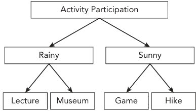

这些不同的技术可以单独使用，也可以相互结合使用。

### 预测未来趋势

基于当前行为预测未来行动是数据可视化的基石。大量预测基于*回归分析*。最简单的回归分析依赖于两个具有因果关系的变量。第一个变量被视为自变量，第二个为因变量。假设你正在研究一只狗参加行为训练学校的时长与其咬坏家具次数之间的关系。在分析数据时，你会发现狗的训练时长（自变量）与其行为（因变量）之间存在相关性：宠物训练时间越长，破坏家具的行为就越少。表2-4展示了原始数据。

**表2-4：回归分析数据**

| 训练天数 | 咬坏事件次数 |
|:---|:---|
| 5 | 8 |
| 10 | 5 |
| 15 | 6 |
| 20 | 3 |
| 25 | 4 |
| 30 | 2 |

> **注意** *一些统计学家将回归分析中的自变量和因变量分别称为外生变量和内生变量。外生变量是指由外部因素发展而来的变量，而内生变量定义为具有内部原因或来源的变量。*

为了更好地理解回归分析的工作原理，图2-2将基本数据点绘制在图表上。如图所示，各点在网格上略有分散。由于只涉及两个变量，这种投影类型被称为简单线性回归。

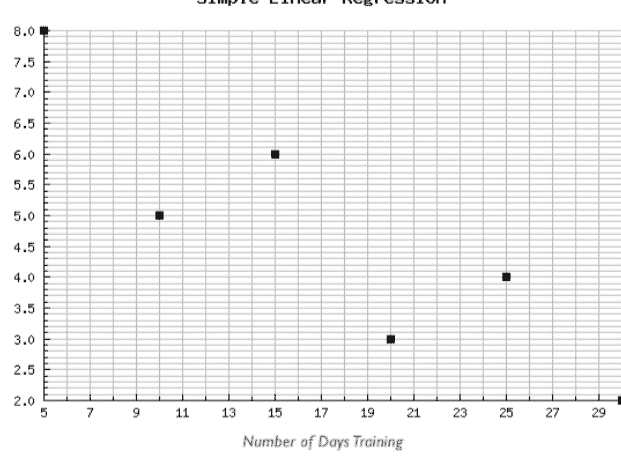

为了阐明数据趋势方向，应用回归分析公式绘制一条直线来概括点的分布（见图2-3）。这条趋势线为分散的点分布提供了直观解读——这是数据可视化如何用于发现和理解的绝佳示例。

当然，并不总是存在一一对应的关系。相关性不等于因果性，这是不言自明的。其中往往还有其他因素参与。然而，通过缩小外部变量——例如将研究限定为单一品种——可以增加预测的可能性。

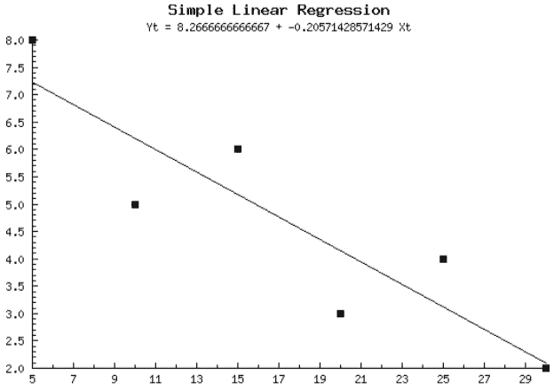

> **参考** *本章涵盖的回归分析及其他概念的实际数学运算超出了本书范围。不过，有许多在线和离线工具可以处理繁重的算术运算。要了解更多关于这些工具及其使用技术，请参阅第8章。*

### 总结

数据分析是数据可视化的一个重要组成部分。有多种数学和统计技术可用于分析各个信息组成部分及其整体结构。以下是关于数据分析基础的几个要点：

- 在大多数情况下，数据分析是一项数字运算工作，对关键数学概念的核心理解是必要的。

- 一组数字的均值通过将数值之和除以其个数来求得。

- 一组数值的中间值被称为中位数。

- 要计算数据的平均分布，需计算其标准差。

- 在分析给定总体的样本数据与整个总体的数据时，必须注意一些特殊考虑因素——包括标准差的变体、人均计算和误差范围。

- 数据挖掘中的多种技术可用于发现当前和预测性模式。这些技术包括关联分析、分类、决策树、聚类和序列模式。

- 回归分析通过研究自变量和因变量来确定未来行为的趋势线。

# 第3章 构建可视化基础

### 本章内容

- 了解图表基本元素，包括散点图、柱状图和饼图

- 理解专业图表，包括K线图、气泡图和曲面图

- 探索这些图表的底层技术，如HTML5和SVG

> **代码下载** *本章的wrox.com代码下载请访问`www.wrox.com/go/javascriptandjqueryanalysis`，在Download Code选项卡中查找。代码位于chapter 04下载包中，文件名与章节中的名称一一对应。*

当你掌握了数据之后，接下来的关键问题是如何呈现数据。在选择最能传达信息的方式之前，你需要全面了解可视化选项以及在线创建可视化所用技术的可能性。

本章为这两个领域奠定基础。首先，它从最基本的可视化（散点图、柱状图和饼图等）到较为专业的可视化（气泡图和K线图）逐一介绍。然后，它探讨了在线显示这些可视化的一些底层技术，主要是HTML5和SVG。

### 探索可视化数据频谱

尝试为数据选择合适的呈现方式，就像一个小孩第一次走进玩具店。有那么多闪闪发亮、引人注目的选项可供选择。无论你是选择基础构件（如饼图或条形图），还是选择更复杂的载体（如基于时间轴的信息图），都取决于诸多因素。为确保做出正确选择，重要的是要充分了解所有可用的选项。本节将审视从简单到复杂的数据可视化可能性范围。

#### 图表基本元素

图形艺术家将线条、矩形和椭圆等核心元素称为绘图基本元素（drawing primitives）。我们借鉴了这一概念，将其应用于数据可视化，并将其命名为*图表基本元素*（charting primitives）。这个集合中最熟悉的成员包括：散点图、折线图、条形图、饼图和面积图。

尽管这些可视化类型是最基础的，但每一种都有丰富多样的变体。虽然许多选项侧重于设计层面——例如二维与三维——但另一些则对于以有意义的方式呈现复杂数据至关重要。

#### 数据点

数据点可能是图表基本元素中最基础的一种。数据点是在图表上绘制的单个元素，通常通过 X 轴和 Y 轴来定位。因此，数据点图也被称为 XY 图。此外，由于它们以点状散布在平面上的形式出现（参见图 3-1），你经常会看到它们被称为*散点图*（scatter charts）。

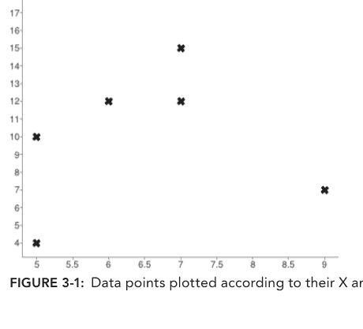

**图 3-1：** 根据 X 值和 Y 值绘制的数据点。

> **注意** *需要注意的是，数据点需要两个数值才能绘制，这与某些其他类型的图表不同——后者可能将一个数字与类别组合，如第三季度收入。*

绘制的数据点用于说明两组不同数据之间的相互关联；这种相互关联被称为*相关性*。如果图表上的数据点看起来是随机的，没有可辨识的模式，则称它们没有相关性。当数值通常一起增加时，出现*正相关*。当一个值下降而另一个值上升时，则认为是负相关。如果任一种情况存在一一对应关系，则相关性被认为是完全的。

> **参考** *如果存在某一方向的强相关，通常会绘制计算直线以强调或指示趋势。这种技术用于回归分析，具体内容参见第二章。*

#### 折线图

当你用一条连续的线条连接两个数据点时，就创建了折线图的第一段。折线图是最常见的图表类型之一，并构成了其他图表类型的基础：面积图、堆积折线图、曲线拟合图（也称为平滑线图）等。单个数据系列呈现为一条从一个点移动到另一个点的线，如图 3-2 所示。

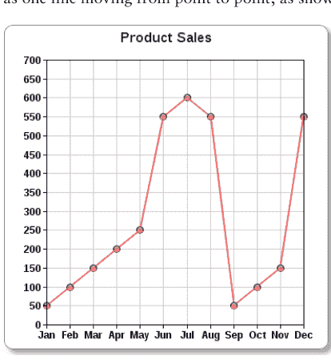

**图 3-2：** 在折线图中，通常使用标记来突出网格上的数据点。

折线图常用于描绘随时间变化的数据点，足够宽幅的折线图可以有效地成为趋势线，尽管它们不一定具有预测性。股票价格图表经常使用折线图，可以用多种方式呈现，包括逐日变化和相对于一段时间内中值的百分比变化（参见图 3-3）。

##### 业绩图：AAPL

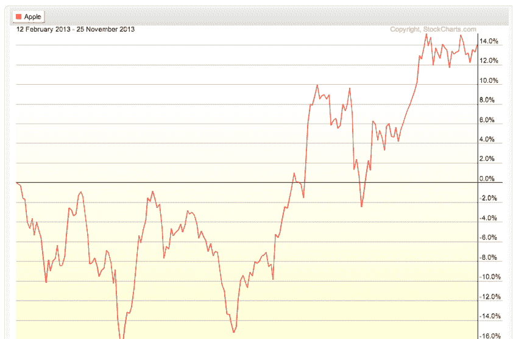

**图 3-3：** 股票价格，如苹果公司 200 天内的百分比变化，为折线图提供了充足的素材。

> **注意** *虽然折线图可以用三维形式呈现，但我们认为折线图中的三维透视效果不如条形图或饼图等其他图表元素有效。这是因为三维透视实际上可能会掩盖数值。无论你的风格偏好如何，都不应以牺牲图表中的信息为代价。*

线条的颜色变化、粗细（或厚度）以及线条类型——实线、点线、虚线等——单独或组合使用，都可以用来表示不同的数据系列。图 3-4 展示了这样一个包含五个数据系列的折线图，通过线条颜色和位置来区分。另一种技术是使用不同的标记来识别数据点；标记可以有多种形状，如圆形、方形或菱形，甚至可以是不同的图形。

##### 季节性图表：AMZN、$SPX

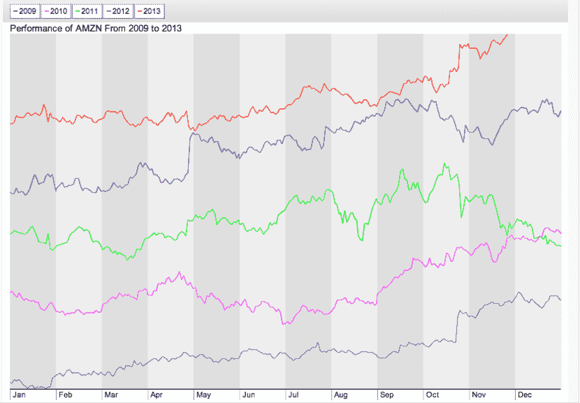

**图 3-4：** 当比较具有相同度量单位的数据集时，如这个亚马逊股票价格 5 年的季节性图表，折线图可以上下排列显示。

为了明确显示线段中的某个数据点，当用户将光标悬停在折线上的某个点或点击移动设备屏幕上的点时，可以显示确切的信息。

堆积折线图，顾名思义，基本上是将一个折线图数据集显示在一个或多个其他数据集之上，但与图 3-4 所示的例子不同，它们通常包含不同的 Y 轴刻度。这种布局允许使用不同的度量单位。例如，你可以在同一时间范围内叠加一个利润数据图表、一个市场份额百分比图表和一个员工人数图表。这三者有不同的度量单位，但通过堆积折线图提供的视觉比较，模式会浮现出来，趋势可以被识别（参见图 3-5）。

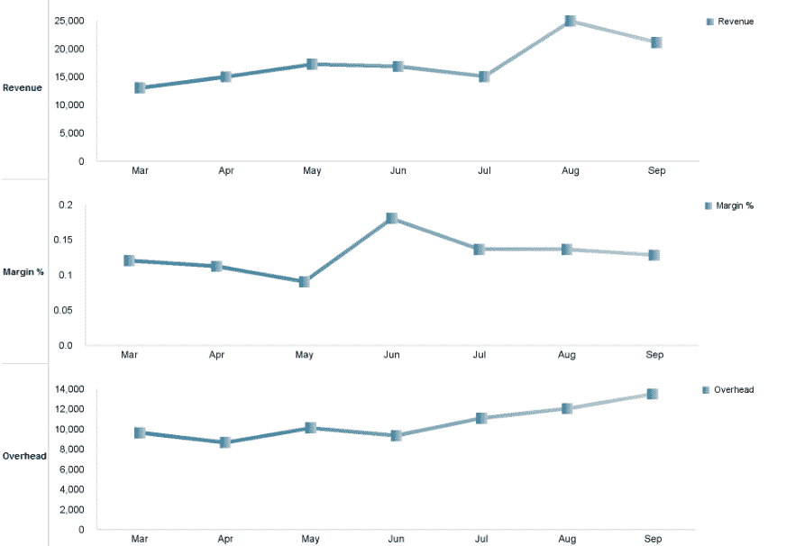

来源：`HTTP://WWW.PERFORMANCE-IDEAS.COM/2012/03/27/STACKED-LINE-CHARTS/`

**图 3-5：** Christoph Papenfuss 的这个堆积折线图示例比较了同一时间段内的收入、利润和管理费用。

大多数情况下，线条从一个点直接画到另一个点。然而，一些折线图采用弧线以获得更弯曲、更平滑的外观，如钟形曲线所示。这些类型图表中的线条（参见图 3-6）被称为*曲线图*或*样条折线图*。

多项式或其他数学函数——如二次函数、指数函数或周期函数——被应用于各点以使线条平滑。将直线折线图转换为曲线折线图时需要考虑的是，应用任何类型的数学曲线函数都会引入数据的近似值，而非精确数据本身。然而，在某些情况下，这种近似可能是可以接受的，甚至是可取的。

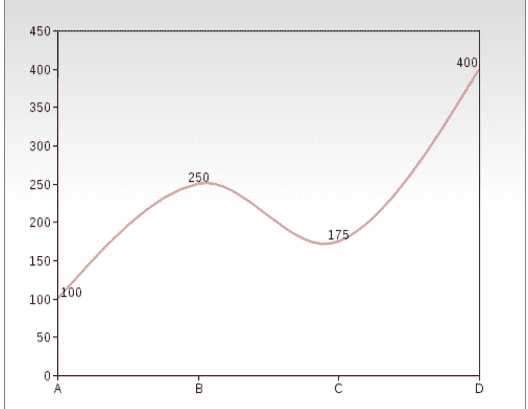

**图 3-6：** 曲线折线图的平滑度是通过应用数学函数来绘制线条实现的。

#### 条形图

条形图使用一个或多个按比例缩放的矩形元素来表示特定的数据值。矩形以水平或垂直方式呈现；如果是后者，这些条可能被称为柱形。通常，多个条形并排放置以说明相对差异，图表的效果依赖于这种比较（参见图 3-7）。

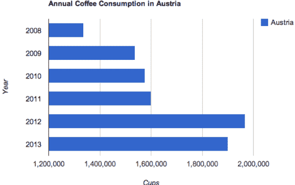

**图 3-7：** 条形图非常适合快速比较，如这幅显示 2012 年奥地利咖啡消费量大幅激增的图表。

在条形图中，一个轴设置所考虑的类别；这些类别可能与日期相关，如一系列月份或季度；地点，如州或销售办事处；或其他相关的分组。相对的轴显示以单一度量单位表示的一系列数值，最常见的排列是从下到上的升序。度量刻度各不相同，但通常从零开始，延伸到等于或略高于最高值项的数值。

除了简单的条形图外，还有另外两种截然不同的条形图类型：分组条形图和堆积条形图。顾名思义，分组条形图将表示子类别相关成员的条形放置在一起——成组地——挨着其他类似的条形集合，如图 3-8 所示。

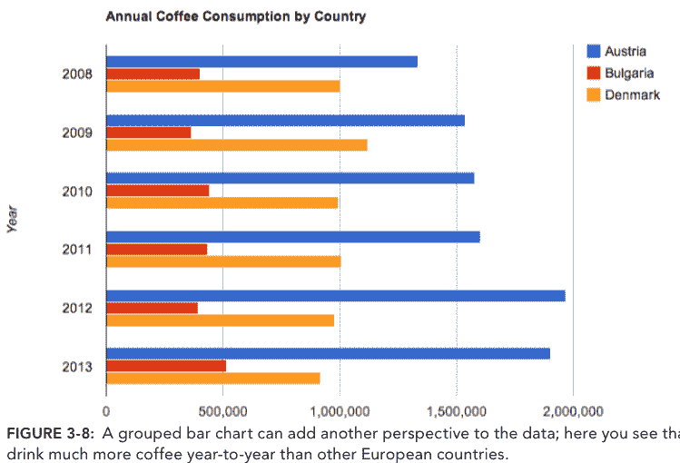

堆积条形图也使用子组，但不是将每个聚类呈现为其独立的条形，而是将子组堆叠在一起以表示累积总值。子组通过某种方式区分，如不同的颜色或图案，每种都用图例标识。

所有类型的条形图都非常适合三维样式。深度感通过观察者相对于图表元素的视角角度，结合三维空间本身围绕 X、Y 和 Z 轴的旋转、俯仰和偏转来增强。使用三维条形图时有如此多的变化可能，以至于很难决定哪一种最合适。图 3-10 所示的条形图——尽管很简单——在最终确定之前经历了多次迭代，以传达基本信息并创造预期的效果。

##### 条形图

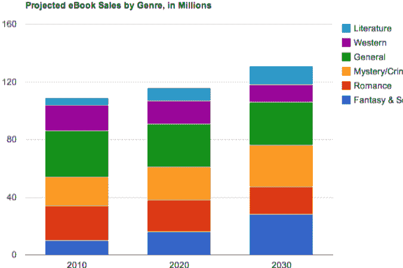

**图 3-9：** 堆叠条形图，如这种柱形版本，既能显示总体合计，也能显示各个层级。

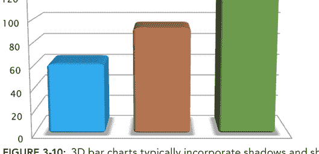

**图 3-10：** 三维条形图通常采用阴影和渐变效果，在二维介质中呈现三维图像。

> **注意** *条形图有多种形状变体，包括圆柱体、圆锥体和金字塔体。某些特定构造（如金字塔）乍一看似乎非常适合堆叠条形图。然而，数据的呈现可能具有误导性，因为虽然元素的高度用于表示数值，但物体不同的体积却传达了不同的印象。例如，图 3-11 所示的金字塔图表显示顶层占总体的 26.76%，底层占 23.32%。虽然金字塔的顶层切片确实比最底层稍高一些，但从体积上看，底层要大许多倍。对于此类条形图，标注至关重要。*

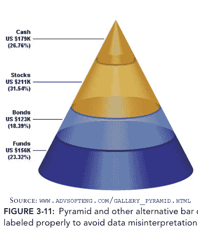

来源：`WWW.ADVSOFTENG.COM/GALLERY_PYRAMID.HTML`

**图 3-11：** 金字塔及其他替代条形图形状在视觉上可能很有吸引力，但必须正确标注以避免数据误读。

#### 饼图

饼图是一种圆形图表，由圆的不同部分组成——即*扇区*——来表示整体样本中各数据的相对大小，换句话说，就是整个"饼"。条形图中的数据系列是开放式的，不需要匹配任何特定总数，而饼图中的数据系列百分比按其本质必须等于 100%。如图 3-12 所示的饼图非常适合展示各数据段之间的简单关系。

##### 热门品种

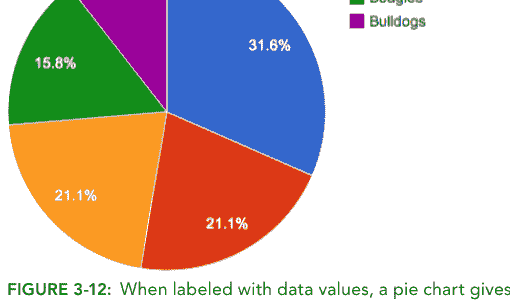

**图 3-12：** 当饼图上标注了数据值时，你能同时获得确切的数字和可视化的百分比。

扇区或饼扇的相对大小通过公式确定：将数据值除以所有值的总和，再乘以 100，得到占总体的百分比。然后将该百分比乘以 360（圆的总度数），得到每个扇区的弧度数。例如，考虑以下数据点。

|  | 北部 | 南部 | 东部 | 西部 | 总计 |
|---|---|---|---|---|---|
| 数据 | 200 | 125 | 175 | 150 | 650 |

所有值的总和为 650。将每个分段的值除以总数，即可得到该分段的百分比（见表 3-1）。

**表 3-1：饼图数据的百分比**

|  | 北部 | 南部 | 东部 | 西部 | 总计 |
|---|---|---|---|---|---|
| 数据 | 200 | 125 | 175 | 150 | 650 |
| 百分比（数据/总数据） | 30.8% | 19.2% | 27.9% | 23.1% | 100% |

将百分比乘以 360，即可得到每个数据点的度数，如表 3-2 所示。

**表 3-2：饼图数据的度数**

|  | 北部 | 南部 | 东部 | 西部 | 总计 |
|---|---|---|---|---|---|
| 数据 | 200 | 125 | 175 | 150 | 650 |
| 百分比（数据/总数据） | 30.8% | 19.2% | 27.9% | 23.1% | 100% |
| 度数（百分比×360） | 111° | 69° | 97° | 83° | 360° |

如你所见，所有度数的总和等于 360，即一个完整的圆。饼图通常会显示原始数据和计算出的百分比，可以是始终显示，也可以在用户悬停或点击某个扇区时显示，如图 3-13 所示。

为了强调某个特定的数据点，相关的饼扇会稍微从中心移出，即"分离"开来。分离式饼图在三维效果中特别有效（见图 3-14）。与条形图一样，三维饼图可以倾斜成任何方向，通常使用阴影和渐变来渲染。

有时，需要进一步深入某个饼图分段以提供更多细节。实现这一目的的一种技术是创建"饼中饼"类型图表，其中子饼图的百分比值总和等于父扇区的值，如图 3-15 所示。

##### 区域销售

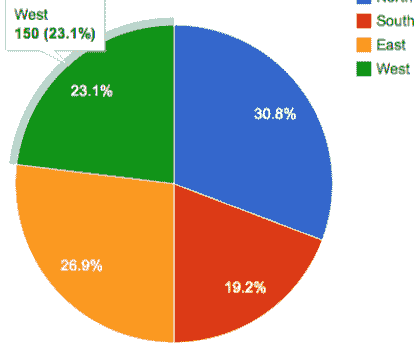

**图 3-13：** 此饼图的底层数据可交互获取。

##### 员工业绩

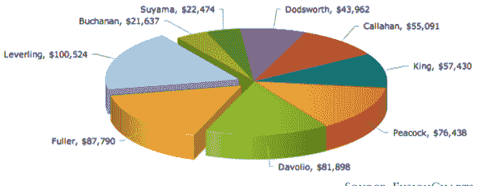

来源：FUSIONCHARTS

**图 3-14：** 分离饼图的一个或多个扇区——无论是二维还是三维——以突出显示它们。

其他类型的圆形图表包括环形图，可用于表示多组数据。例如，图 3-16 中的图表展示了一系列国家及其相关销售百分比，总数显示在环形图的中心。

另一种圆形图表是极区图，它将数据值等同于到圆心的距离，而不是标准饼图的角度百分比。气象学家经常使用此类图表来绘制不同方向的风速，称为风玫瑰图，如图 3-17 所示。

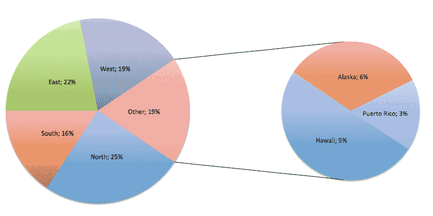

北部　　南部　　东部　　西部　　夏威夷　　阿拉斯加　　波多黎各

**图 3-15：** 饼中饼方法将一个扇区分拆出来以展示更多细节，而不是创建一系列更小的切片。

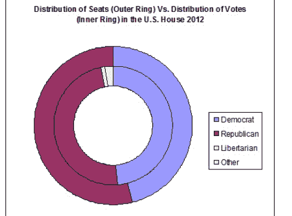

`HTTP://COMMONS.WIKIMEDIA.ORG/WIKI/FILE:2012_US_HOUSE_DONUT_GRAPH.JPG`

**图 3-16：** 环形图使用多个环来展示一系列相关数据。

#### 面积图

面积图本质上是一种折线图，其中线条与图表底部之间的区域用图案或纯色填充，如图 3-18 所示。突出显示面积可以将注意力集中在数据所指示的总体数量上。

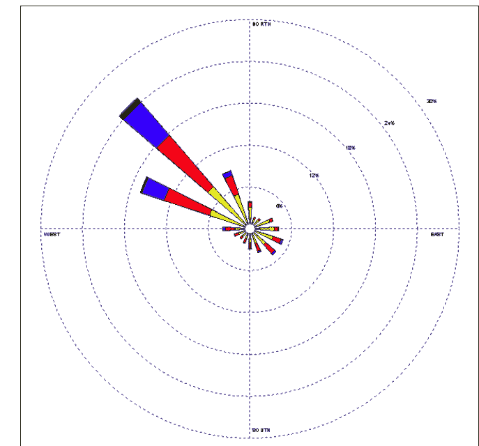

**图 3-17：** 在此极区图中，来自西北方向的风明显最强。

面积图在显示多组数据时真正发挥作用，可以是并排比较，也可以是重叠区域。当不同的数据集重叠时，考虑使用半透明的颜色，以便所有数据都可见（见图 3-19）。

当累积数据很重要时，另一种方法是将面积图堆叠在一起。与堆叠条形图类似，堆叠面积图显示多组数据的相对数值，通常是在一个日期范围内，同时也显示总数。例如，图 3-20 展示了 1999 年至 2012 年间涉及汽车、摩托车和自行车的交通事故数量。由于堆叠面积图的特性，可以立即看出总体事故数量有所下降，这主要是由于摩托车事故的减少，而自行车和汽车事故（2001 年之后）保持相对不变。

### 探索高级可视化

除了基本图表之外，还存在着一个 vast 而广阔的-visualization-领域。乍看之下，其中一些更为奇特的选项可能似乎只是些花哨的装饰，但本节介绍的可能性都是目的驱动的，而非仅仅装饰性的。例如，蜡烛图不仅仅是换了图标的简易条形图；蜡烛形状通常用于绘制指定股票价格的高点和低点，以及开盘价和收盘价。在本节介绍的所有图表类型中，你都会发现类似的需求驱动基础，包括蜡烛图、气泡图、曲面图、地图和信息图。

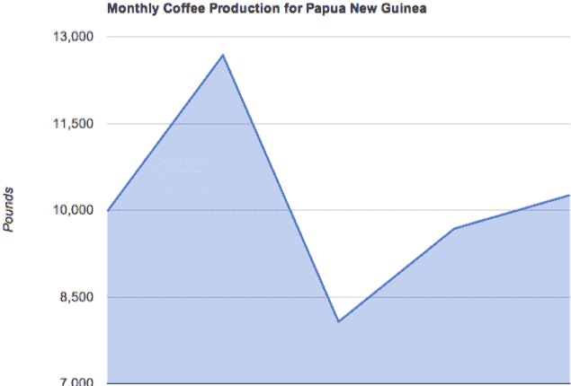

**图 3-18：** 最简单的面积图描绘了一组数据点。

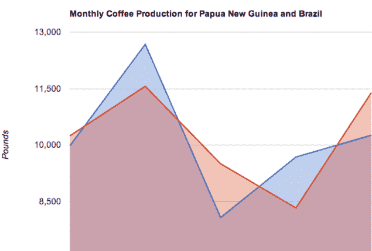

**图 3-19：** 将多个数据集与重叠的面积图结合。

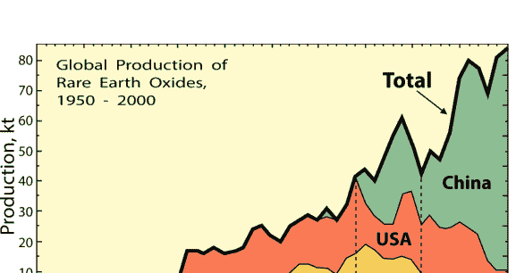

`HTTP://COMMONS.WIKIMEDIA.ORG/WIKI/FILE:RAREEARTH_PRODUCTION.SVG`

**图 3-20：** 堆叠面积图使你能够快速掌握总体趋势以及特定数据集的变化。

#### 蜡烛图

蜡烛图可以以非常紧凑的形式传达大量信息。完整的蜡烛图结合了折线图和条形图的特点，通常用于跟踪股票、商品及类似交易物品在一段时间内的变化。

主要元素实际上只有在考虑到"两头烧蜡烛"这句老话真的可能实现时，才称得上是名副其实的蜡烛。蜡烛图的各种元素来自四个不同的值，每个值都与交易价格相关：

- 最高价：上蜡烛芯或*影线*的顶端

- 收盘价：上影线的底端和蜡烛或*实体*的顶端

- 开盘价：下影线的顶端和实体的底端

- 最低价：下影线的底端

每根蜡烛显示特定时间点的数值集，完整的蜡烛图由许多这样的元素组成，如图 3-21 所示。蜡烛图的真正妙处在于其所传达信息的深度。除了跟踪一段时间内的价格变动外，蜡烛实体的长度表示卖出或买入的相对压力。还增加了一个额外的约定来指示压力的方向：如果实体是空心的，则收盘价高于开盘价，买入更为普遍；如果实体填充了颜色，则收盘价低于开盘价，卖出占主导地位。

#### 气泡图

气泡图为标准数据点图表增加了一个额外的维度。气泡图中的单个气泡使用三个数值：两个用于确定在图上的位置（各轴一个），第三个数值由气泡的大小表示，可以代表任何其他相关数值。例如，在图 3-22 中气泡图根据预期寿命（X轴）和生育率（Y轴）进行映射，其大小则由各国人口决定。此类气泡图有助于说明"苹果对苹果"的比较；在此示例中，你可以看到，尽管英国和德国的人口规模和预期寿命大致相同，但英国的生育率要高得多。

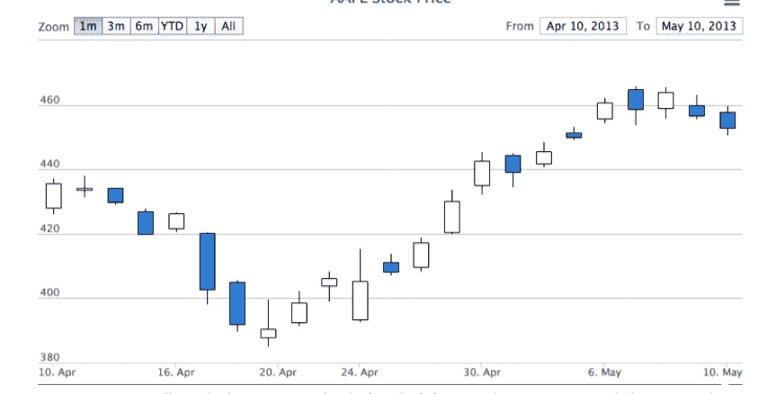

**图 3-21：** 蜡烛图既传达详细数据（如股票开盘价和收盘价），也展示总体趋势。

**世界部分国家预期寿命、生育率与人口之间的关系（2010年）**

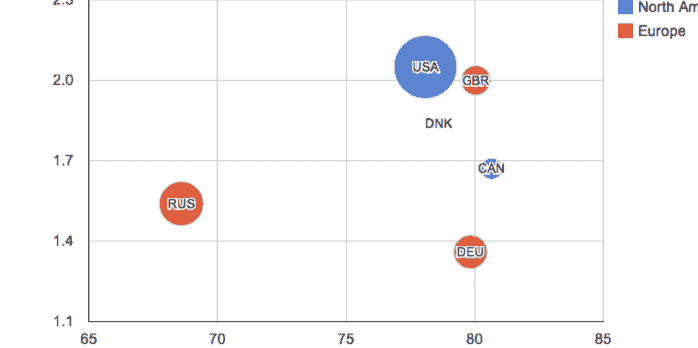

**图 3-22：** 气泡图允许每个元素包含三个数据值。

图 3-22 所示的图表也展示了气泡图存在的一个问题。看到美国和英国下方的那个数据点了吗？也许你能看到，也许你看不到。那个标有首字母缩写 DNK 的较小圆圈代表丹麦。如果第三个值相对太小——就像这里丹麦的人口情况——它可能不那么容易被注意到。当第三个值为零或负数时，这一问题会更加严重。在选择气泡图之前，请务必仔细检查所有数据，确保所有值都能被完整呈现。

#### 曲面图

许多图表使用 3D 图形来增加视觉效果，而曲面图从定义上来说就是三维的。与气泡图类似，曲面图允许你以三个维度传达数据，例如图 3-23 使用曲面图来展示降雨量在纬度和经度上的分布。

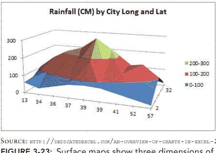

曲面图与其他图表类型的另一个区别在于颜色的使用。通常，在折线图和条形图中，颜色用于标识一个或多个轴上的数据集。而在曲面图中，不同的颜色用于表示数据在三个轴（X、Y 和 Z）上的映射范围，如图 3-24 所示。

曲面图不像其他图表有 2D 和 3D 选项之分，它可以通过实心彩色填充区域或线框图来显示。线框图在绘制大量数据时非常有用，当需要快速渲染结果并更清晰地展示数据点时尤其如此。然而，由于颜色是曲面图中的关键区分因素，线框图缺乏实心彩色区域使其在可读性方面有所欠缺。一个很好的折中方案是将标准曲面图与网格状线框图叠加显示。

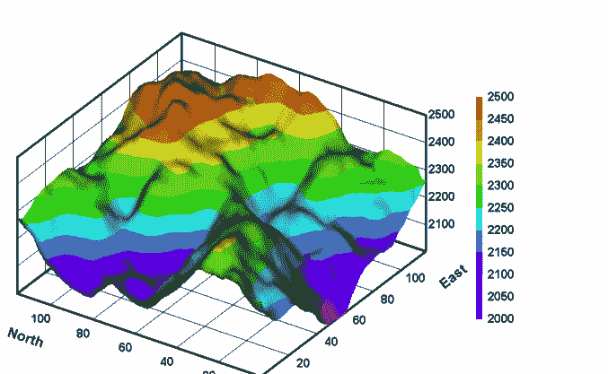

**图 3-24：** 曲面图使用颜色来标识数据范围，如图右侧图例所示。

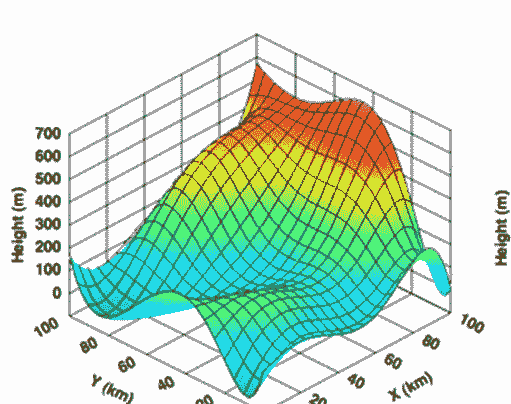

**图 3-25：** 将实心曲面图与线框曲面图结合使用，可以在颜色范围易读性的基础上实现更精细的数据可视化效果。

#### 地图图表

曲面图看起来可能类似地形图，但数据可视化在需要时确实提供了真实的地形替代方案。在此背景下，地图图表将地理区域的渲染与所选数据相结合，数据可以表现为高亮区域，并可选择是否带有自定义标记。地图本身可以尽可能详细——甚至可以用卫星摄影来描绘——也可以渲染为单色轮廓，如图 3-26 所示。

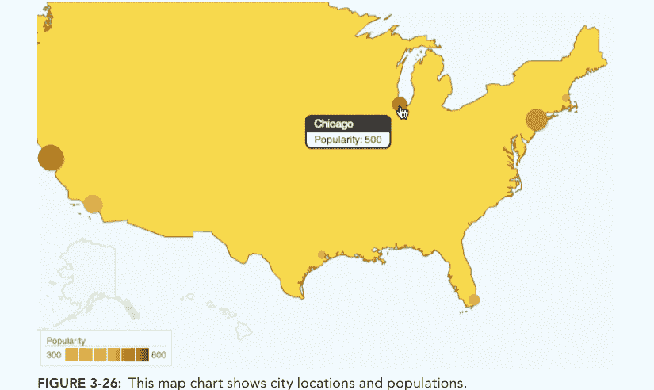

另一种类型的地图图表是地理图（geomap 或 geochart）。地图图表使用实际的地理映射数据，并叠加数据驱动的标记；通常，你可以像在线地图一样对地图图表进行缩放和滚动浏览。而地理图通常不可滚动，缩放功能也有限。地理图还可以包含气泡型标记，标记的大小与数据集相关。不过，这两种类型的地图图表都可以添加交互功能来显示数据点的详细信息（见图 3-27）。

#### 信息图表

顾名思义，信息图表（infographic）是信息与图形的结合。从某种意义上说，这个术语可以适用于任何类型的图表，但它已经演变为涵盖更广泛地通过设计传达知识的范畴。信息图表迎合了人们视觉学习的一面，既能传递相关信息，又能向观察者传达其内在信息。它们的范围从最简单的*《今日美国》*头版新闻图形，到美国政府发布的细节丰富的海报（见图 3-28），涵盖中间的所有形式——甚至更多。

##### 近期奥运会举办国

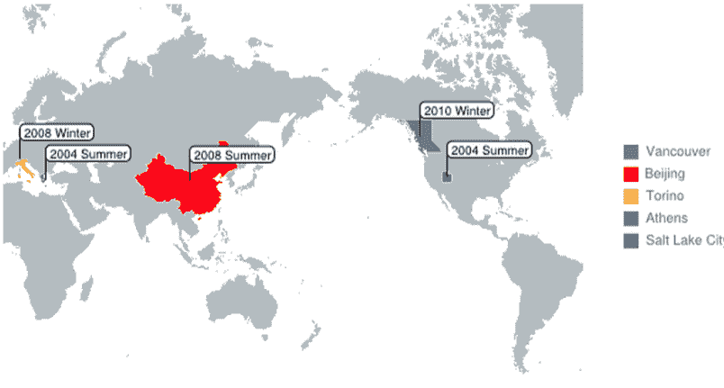

**图 3-27：** 地图图表可以引用全球数据，同时突出显示目标国家。

##### 美国退伍军人概况

美国共有 2180 万退伍军人。

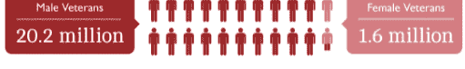

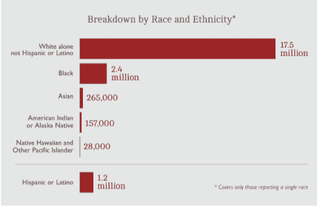

**图 3-28：** 这段摘自美国人口普查局发布的关于退伍军人的信息图表，综合运用了图标、条形图和详细信息。

> **注意** *无论传达的是严肃还是轻松的内容，信息图表都是设计师的乐园。难怪有那么多在线网站专门展示信息图表。你可以在 Visual.ly（http://visual.ly）、Daily Infographic（http://dailyinfographic.com）和 Cool Infographics（http://www.coolinfographics.com）上找到令人惊叹的、富有灵感的示例。*

爱德华·塔夫特——亲切地被称为 ET——是现代信息图表领域的代表人物之一。他在《定性信息的视觉展示》（Graphics Press，2001）一书中概述了信息图表的若干关键原则，包括以下几点：

- 展示你的数据。数据本身对于信息图表至关重要。

- 引发对信息图表主题的思考。目标是将重点放在实质内容上，而非图形的美观或方法论上。

- 忠实于你的数据。为强调特定观点而扭曲信息，会削弱数据的本质。

- 鼓励比较。大量的数据可视化手段（如条形图）能够创建易于理解的关联，应尽可能加以运用。

你可以在政府机构的作品中看到许多这些原则的应用，例如图 3-29 所示的喷气推进实验室的信息图表。

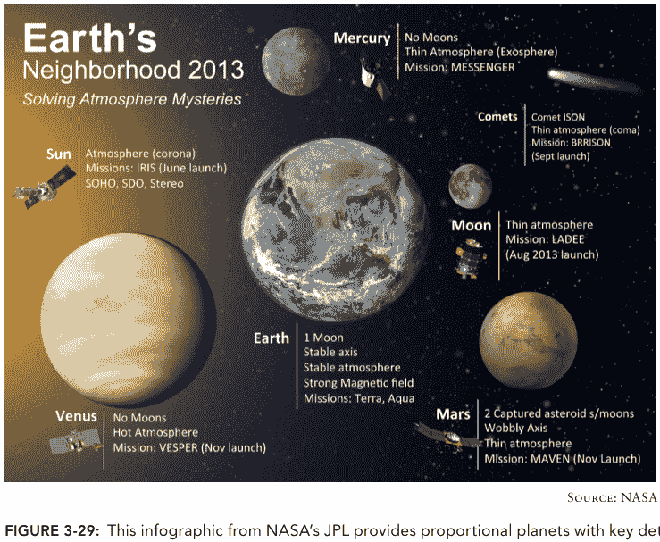

### 利用 HTML5 Canvas

Canvas 是 HTML5 语言中最具创新性和影响力的元素之一，尤其是在数据可视化方面。通过 `<canvas>` 标签，设计者可以在网页上创建一个预留的开放式区域，用于在运行时包含以编程方式创建的图形。HTML5 Canvas 图形由功能强大的 JavaScript API 驱动——其中绝大部分目前享有良好的跨浏览器支持，可以立即投入使用。

使用 `<canvas>` 的第一步是在 HTML 页面的 `<body>` 部分中包含该标签。你只需包含三个属性：`ID`、`width` 和 `height`。如果浏览器不支持此标签，你可以显示一个替代内容。任何内容——无论是替代图片还是文本消息——都可以插入到 `<canvas>` 开始和结束标签之间。以下是一个完整的 `<canvas>` 标签示例：

```
<canvas id="chart1" width="600" height="400">
    
</canvas>
```

在此阶段，假设浏览器支持 HTML5 `<canvas>` 标签，页面上的这个预留区域不会显示任何内容。它就像一块真正的空白画布。要在画布上绘制内容，需要用 JavaScript 对其进行"初始化"或设置。通常，你将必要的 JavaScript 函数放在 `<head>` 中，并在文档就绪时调用它。以下是初始化画布的基本步骤：

1. 创建一个变量来保存画布对象，通过其 `ID` 进行标识。

2. 检查画布 API 的 `getContext()` 方法（以及 `<canvas>` 标签）是否受支持。

3. 如果受支持，则创建一个变量并对目标画布对象应用 `getContext()` 方法。

实际代码如下所示：

```
<script type="text/javascript">
    function drawCanvas(){
        var theChart = document.getElementById('chart1');
        if (theChart.getContext){
            var theContext = theChart.getContext('2d');
        }
    }
</script>
```

> **注意** *在开发 canvas 规范时，W3C 指出最初定义的 canvas 上下文值是二维的，即"2d"。这一决定是考虑到未来可能会扩展规范以包含"3d"上下文。尽管该扩展并未真正落地，但一个可行的替代方案 WebGL 已经出现。专门用于数据可视化的 WebGL 库，例如 InCharts3D (http://incharts3d.com/) 的库，正开始涌现。*

在定义了 canvas 的上下文之后，所有的绘制调用都会引用这个变量，canvas 区域被视为坐标空间。`<canvas>` 标签声明的 `width` 和 `height` 属性决定了网格中可用的像素数量。在以下示例中：

```
<canvas id="chart1" width="600" height="400">
```

X 轴有 600 个像素，Y 轴有 400 个像素。网格原点 (0,0) 默认位于 canvas 的左上角。了解了这些信息，就可以使用 `fillRect()` 函数绘制一个基本的 canvas 对象——填充矩形。该函数接受四个参数：x、y、width 和 height。前两个值确定矩形的左上角位置，后两个值显然用于指定尺寸；所有值均以像素为单位。例如，要绘制一个宽 100 像素、高 200 像素的简单填充矩形，其左上角距 canvas 左边缘 50 像素、距上边缘 200 像素，基本函数如下所示：

```
fillRect(50,200,100,200)
```

图 3-30 的输出展示了基本柱状图的雏形。

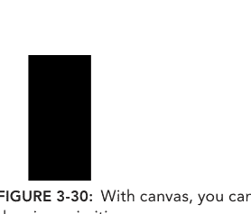

以下是绘制第一个矩形的完整 HTML 页面代码。我们添加了一些基本的 CSS 样式和少量额外的 HTML 来居中显示并勾勒 canvas 的边框。

```
<!doctype html>
<html>
<head>
<meta charset="UTF-8">
<title>Canvas Example 1</title>
<script type="text/javascript">
  function drawCanvas(){
    var theChart = document.getElementById('chart1');
    if (theChart.getContext){
      var theContext = theChart.getContext('2d');
      theContext.fillRect(50,200,100,200);
    }
  }
</script>
<style>
  #outerWrapper {
    width: 800px;
    margin: 1em auto;
  }
  canvas {
    border: 1px solid #000;
  }
</style>
</head>

<body onload="drawCanvas();">
<div id="outerWrapper">
  <canvas id="chart1" width="600" height="400">
    
  </canvas>
</div>
</body>
</html>
```

> **注意** *请注意，在这个简单的示例中，JavaScript 的 `onload()` 函数在 `<body>` 标签中被用来调用先前定义的 `drawCanvas()` 函数。在生产环境中，你更可能使用 `DOMContentLoaded()` 或 jQuery 的 `document.ready()` 函数来触发 `drawCanvas()`。*

canvas API 功能相当强大，你可以通过编程执行多种不同的绘图操作。以下是部分可用功能：

- 矩形，包括实心和空心

- 任意尺寸的点

- 连接的直线

- 弧线

- 圆形和椭圆形，包括实心和空心

- 文字，可指定字体、大小和颜色

- 导入图片

- 完整的颜色控制，包括 Alpha 透明度

- 任意颜色组合的渐变，包括线性渐变和径向渐变

- 任意对象或文字的阴影

- 任意对象的图案，可按指定方向重复

除了这里列出的基本绘图选项外，canvas 对象还可以进行缩放、旋转和移动（或平移）到 canvas 上或 canvas 外的任意位置。这些特性可用于创建动画 canvas 图形，例如缩放时间线，所有操作都在程序员或用户的控制之下。

最后，值得一提的是，canvas 通常比其他绘图替代方案具有更好的性能。再加上丰富的样式选项，许多图表插件——如 ChartJS、RGraph、FusionCharts 和 Flot——提供基于 `<canvas>` 标签的输出也就不足为奇了。

### 集成 SVG

SVG，全称可缩放矢量图形（Scalable Vector Graphics），是 HTML5 canvas 的一种有用替代方案。与 canvas 类似，SVG 支持大多数现代浏览器的运行时图形格式。与基于像素的 canvas 不同，SVG 顾名思义是基于矢量的。矢量具有分辨率无关性——这意味着它们在缩放或放大时不会降低质量——并且通常比栅格图形具有更小的文件尺寸。

SVG 自 2003 年起就已成为 W3C 批准的规范，因此拥有丰富的工具支持，尤其是 Adobe Illustrator 和开源的 Inkscape。当文件导出为 SVG 后，可以通过基本的 `` 标签将其集成到网页中，如下所示：

```

```

> **参考资料** *SVG 拥有一些专注且热情的支持者。要查看精彩的示例集，请访问 SVG Wow (http://svg-wow.org)。*

SVG 也可以创建为 XML 文件或直接内联放置在 HTML 页面中。代码需要使用 XML 命名空间以及特定的语法。与 canvas 不同，你不需要 JavaScript 来以编程方式创建图形，尽管 SVG DOM 组件是可用的。相反，绘制指令在 XML 中详细描述。例如，以下代码在一个 400 像素见方的区域中央创建一个蓝色圆形：

```
<svg height="400" xmlns="http://www.w3.org/2000/svg">
  <circle id="circle1" cx="400" cy="200" r="50" fill="blue" />
</svg>
```

在定义 SVG 区域（包含命名空间声明）之后，`<circle>` 标签包含了 `cx`、`cy`、`r` 和 `fill` 属性——分别表示中心 X 坐标、中心 Y 坐标、半径和填充颜色。你可以在图 3-31 中看到结果。

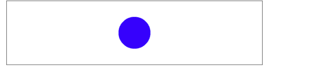

**图 3-31：** 这个 SVG 是使用标记中的 XML 绘制的。

除了提供与 canvas 相同的核心绘图能力（如矩形、椭圆、线条、多边形、文字、渐变等）之外，SVG 还包含许多用于提供特殊效果的滤镜。SVG 效果的一些可能应用包括：

- 混合

- 偏移

- 高斯模糊

- 颜色矩阵

- 合成

- 卷积矩阵

- 漫射光照

- 镜面光照

- 平铺

- 湍流

> **注意** *SVG 滤镜与最新版本的浏览器兼容，但如果你需要支持旧版浏览器，则不是一个好选择。*

SVG 滤镜可以组合使用。例如，图 3-32 展示了混合、偏移和高斯模糊的组合，为先前绘制的蓝色圆形添加了投影效果。


**图 3-32：** 四种不同的滤镜组合在一起，为这个 SVG 绘制的圆形创建了投影效果。

凭借可缩放的矢量图形能力和固有的小体积，SVG 是数据可视化的一种极其可行的媒介。从优点来看，SVG 可以通过 DOM 访问，这意味着你可以引用和调整 SVG 中的值，并在屏幕上看到相应的变化。从缺点来看，这种 DOM 可访问性以性能为代价；SVG 的性能通常不如 canvas。

> **参考资料** *许多在线工具支持 SVG，包括 Google Charts API 和 Raphaël。如需深入了解，请参阅第 9 章和第 10 章。*

### 总结

谈到数据可视化，无论是最终的渲染输出还是实现所用的底层技术，都有大量的选择。在考虑各种可能性时，请牢记以下几点：

- 有许多基础图表——或图表原语——可供选择，其中大多数包含多种变体。

- 蜡烛图主要用于绘制股票价格，包含丰富的细节，包括开盘价、收盘价、最高价和最低价。

- 柱状图的一个轴以单一计量单位呈现，无论是数值、货币还是时间。

- 分组柱状图将相关子类别中的一组柱子与其他组进行比较；堆叠柱状图则显示组合值。

- 要在多个数据系列中显示百分比，请在环形图中使用多个环。

- 在面积图中渲染多个数据集时，务必选择半透明的填充颜色，以便所有数据都能被查看。

- 气泡图和曲面图都能传达三维数据。

- 集成地图可视化可以范围从照片级写实到简单的区域轮廓或边界。

- 信息图将详细信息与相关图形相结合，通常整合了多种不同的图表类型。

- HTML5 canvas 和 SVG 是在浏览器中绘制图形的两种有效工具，各有优缺点。

# 第二部分：使用 JavaScript 进行分析

- 第四章：整合现有数据

- 第五章：交互式获取数据

- 第六章：验证你的数据

- 第七章：检查与排序数据表格

- 第八章：客户端统计分析

# 第4章 整合现有数据

### 本章内容

- 异步工作基础

- 处理不同数据格式（CSV、XML 和 JSON）的技术

- 为结构化数据设置样式的快捷方法

- 将外部 JSON 数据渲染为图表的示例

> **代码下载** *本章的 wrox.com 代码下载位于 `www.wrox.com/go/javascriptandjqueryanalysis` 的 Download Code 标签页。代码在第 04 章下载包中，并根据章节单独命名。*

数据可视化工作的主要部分涉及渲染现有数据。数据可以存储在多种不同的格式中——纯文本、CSV、XML、JSON 等——但只要它是数字格式，就有相应的 JavaScript 和其他服务器端程序来访问这些信息以进行表示。当然，某些情况，如构建复杂的信息图表，需要你手动整合数据。然而，在任何可能的情况下，将内容（数据）与表示（图表绘制）分开都是一个好主意，正如本章所示。这种方法不仅使更新变得轻而易举，还为提高可访问性和数据透明度打开了大门。

### 从标准文本文件读取数据

数据通常存储在纯文本文件中。需要明确的是，“纯”或“标准”文本指的是不包含额外编码或元信息的文件，如 `.txt` 文件。本节探讨逐行读取纯文本文件以及导入和解析通用 CSV 格式的技术。

#### 异步工作

从文本文件读取数据有多种方法，但在在线世界中，异步处理此任务是一个好主意。大多数 JavaScript 库都包含某种形式的 Ajax（异步 JavaScript 和 XML）。使用 Ajax 可以让你在不刷新页面的情况下读取文本文件。Ajax 不仅提供性能优势，还有助于构建单页应用（SPA）。

查看一个基本的文本文件（在配套网站上为 `sample.txt`），由几行数据组成，如下所示：

```
Line one
Line two
Line three
Line four
```

包含 jQuery 库后，你可以使用 `get()` 方法来获取数据。以下是一些基本代码，用于读取文本文件并将其内容在 JavaScript 警报框中输出（如图 4-1 所示）：

```
jQuery.get('sample.txt', function(theData) {
  alert(theData);
});
```

**图 4-1：** 将 `get()` 方法输出到控制台设备（如警报对话框）时，不需要额外的解析。

`alert_data.html` 文件在配套网站上。

`get()` 方法是 `jQuery.ajax` 方法的简写，因此相当强大。`get()` 方法不仅可以传递 URL 和回调函数，你还可以向服务器发送额外数据、获取请求状态等。要了解更多关于 `get()` API 的信息，请访问 jQuery 文档：`http://api.jquery.com/jQuery.get/`。

#### 读取 CSV 文件

尽管可以从文本文件存储和检索基本的非结构化数据，但更常见的是处理 CSV 文件。CSV 文件由数据组成，其中每行是一条记录，每条记录可以包含多个数据列。每个数据列中的值通常用逗号分隔——因此得名逗号分隔值。最基本的 CSV 文件如下所示：

```
one,two,three
four,five,six
```

CSV 中的值有时本身包含逗号，如果是这种情况，这些值必须用单引号或双引号括起来或*定界*。分隔符和定界符是灵活的，但在解析文件时必须加以考虑。

> **注意** *CSV 文件的标准由互联网工程任务组维护。你可以在网上找到它：* `http://tools.ietf.org/html/rfc4180`。

解析可能相当具有挑战性，这取决于特定文本文件的变量。幸运的是，程序员 Evan Plaice 开发了一个代码库来处理所有繁重的工作。这个名为 jquery-csv 的库可在 `https://code.google.com/p/jquery-csv` 获取。

jquery-csv 库提供了丰富的功能，包括多种解析 CSV 的方法以及设置分隔符、定界符等。使用库的 `toObjects()` 方法，你可以解析 CSV 数据并快速将其呈现为 HTML 表格。首先在网页中引用该库：

```
<script src="http://jquery-csv.googlecode.com/git/src/jquery.csv.js"></script>
```

接下来，在 HTML `<body>` 中设置一个表格，指定一个 jQuery 可以操作的 ID：

```
<div class="result">
  <table id="theResult" border="1"></table>
</div>
```

在 jquery-csv 的帮助下，解析数据非常直接。但在开始之前，最好先为构建表格标记建立基础：

```
function createTable(data) {
  var html = '';

  if(data[0].constructor === Object) {
    // build the table header
    html += '<tr>\r\n';
    for(var item in data[0]) {
      html += '<th>' + item + '</th>\r\n';
    }
    html += '</tr>\r\n';

    // build the table rows
    for(var row in data) {
      html += '<tr>\r\n';
      for(var item in data[row]) {
        html += '<td>' + data[row][item] + '</td>\r\n';
      }
      html += '</tr>\r\n';
    }
  }
  return html;
}
```

这个自定义的 `createTable()` 函数首先循环遍历第一行数据，提取 CSV 的列名并将其输出到表头中。然后它循环遍历每一行，在此过程中构建表格的其余标记。它使用 for-in 循环来保持函数足够灵活，以处理任意数量的列头。注意 `data[row][item]` 的用法——它深入二维数组以获取当前行和项。

`createTable()` 函数完成后，你就可以使用之前看到的 jQuery `get()` 方法来导入和解析 CSV 数据：

```
$( document ).ready(function() {
  $.get('stores.csv', function(theData) {
    var data = $.csv.toObjects(theData);
    var theHtml = createTable(data);
    $('#theResult').html(theHtml);
  });
});
```

这里，`csv.toObjects()` 方法将 CSV 数据转换为名为 `data` 的对象，然后传递给 `createTable()` 函数。接着，使用 jQuery 的 `html()` 函数将该标记注入到 DOM 中。图 4-2 显示了无样式的表格——所有数据都是从 CSV 文件动态插入的。

##### 从 CSV 文件将数据提取到对象中并输出为表格

| 商店名称 | 地址 | 城市 | 州 | 邮政编码 | 营业时间 |
|---|---|---|---|---|---|
| Cindy's Art Gallery | 6410 Cindy Lane | Beverly Hills | CA | 90212 | 9:00-5:00 周一至周五 |
| Mudgee Art | 1001 Mark Ave | San Francisco | CA | 94123 | 9:00-4:30 周一至周五 |
| Carpinteria Galleria | 6321 Carpinteria Ave | Carpinteria | CA | 93013 | 9:00-5:00 周一至周五 |
| Nirvana | 153-155 Maitland Street | Ventura | CA | 93003 | 9:00-9:00，每周7天 |
| Cindy's Art Annex | 6398 Cindy Lane | Oxnard | CA | 93033 | 09:00-16:30 周一至周五 |
| Via Real 3D | 6392 Via Real | Carpinteria | CA | 93013 | 08:30-16:30 周一至周五 |

**图 4-2：** 来自 CSV 文件的数据通常以表格格式呈现。

此示例的完整代码在配套网站的 `read_csv_into_array.html` 文件中。

> **注意** *jquery-csv 文档还包括将 CSV 文件导入以与 jQuery 绘图库 Flot (http://jquery-csv.googlecode.com/git/examples/flot.html) 和 Google Visualization API (http://jquery-csv.googlecode.com/git/examples/google-visualization.html) 一起使用的示例。*

### 整合 XML 数据

XML，即可扩展标记语言的缩写，通常用于存储各种数据。这种基于标签的语言非常灵活。事实上，只有一组固定的元素 `<?xml?>`，其他一切都是根据文件需求定制的。

#### 理解 XML 格式

XML 依赖嵌套标签来创建其结构。在开始标签 `<?xml?>` 之后，通常会建立一个根节点，包含所有其他内容。在以下示例中，`<sales>` 是根节点，后面是两个区域的数据：

```
<?xml version="1.0" encoding="UTF-8"?>
<sales>
  <region>
    <territory>Northeast</territory>
    <employees>150</employees>
    <year>
      <date>2013</date>
      <amount>115000</amount>
    </year>
  </region>
  <region>
    <territory>Southeast</territory>
    <employees>125</employees>
    <year>
      <date>2013</date>
      <amount>95000</amount>
    </year>
  </region>
</sales>
```

你可以在配套网站上找到 `example_data.xml` 文件。

请注意，它与 HTML 有很强的相似性。两者都有共同的祖先——标准通用标记语言（SGML），并且已经出现了几个基于 XML 的 HTML 版本。

一般来说，XML在格式上要严格得多，这使得处理其中包含的数据更加容易，因为XML遵循一套非常严格的规则。

XML元素还可以包含属性。例如，你可以重新构建前面的示例，使`<year>`标签成为region的属性：

```
<?xml version="1.0" encoding="UTF-8"?>
<sales>
  <region year="2013">
    <territory>Northeast</territory>
    <employees>150</employees>
    <amount>115,000</amount>
  </region>
  <region year="2013">
    <territory>Southeast</territory>
    <employees>125</employees>
    <amount>95,000</amount>
  </region>
</sales>
```

#### 获取XML数据

你可以通过多种方式将XML文件中的数据提取到HTML页面中，而jQuery的内置功能使这一过程变得非常直接。使用`ajax()`方法，你可以获取任何XML文件，并将数据发送给自定义的解析器函数：

```
$.ajax({
    type: "GET",
    url: "regional_sales.xml",
    dataType: "xml",
    success: xmlParser
});
```

要了解如何应用解析器函数——这里称为`xmlParser`——你需要知道XML文件的基本结构。本示例中使用的文件如下：

```
<?xml version="1.0" encoding="UTF-8"?>
<sales>
  <region year="2013">
    <territory>Northeast</territory>
    <employees>150</employees>
    <amount>115,000</amount>
  </region>
  <region year="2013">
    <territory>Southeast</territory>
    <employees>125</employees>
    <amount>95,000</amount>
  </region>
  <region year="2013">
    <territory>Midwest</territory>
    <employees>225</employees>
    <amount>195,000</amount>
  </region>
  <region year="2013">
    <territory>West</territory>
    <employees>325</employees>
    <amount>265,000</amount>
  </region>
</sales>
```

根据这些数据——要提取地区、员工数量和销售额——自定义解析器需要遍历每个`<region>`节点。首先，使用jQuery的`find()`函数在XML中定位这些节点：

```
$(xml).find('region').each(function () {
});
```

在这个`each()`循环中，你可以将XML的值赋给变量，并使用这些变量来构建标记。然后，你可以将该标记附加到DOM中，如下面完整的`xmlParser()`函数所示：

```
function xmlParser(xml) {
    $(xml).find('region').each(function () {
        var theTerritory = $(this).find('territory').text();
        var numEmployees = $(this).find('employees').text();
        var theAmount = $(this).find('amount').text();
        $('#sales').append('<tr><td>' + theTerritory + '</td><td>' + numEmployees + '</td><td>$' + theAmount + '</td></tr>');
    });
}
```

你可以在配套网站上找到`import_xml.html`文件。

执行这个特定示例后，它会输出一个表格（见图4-3）。

##### 导入的XML数据

| Territory | Employees | Sales |
| :--- | :--- | :--- |
| Northeast | 150 | $115,000 |
| Southeast | 125 | $95,000 |
| Midwest | 225 | $195,000 |
| West | 325 | $265,000 |

**图4-3：** jQuery包含一个内置的XML引擎，用于检索和解析数据文件。

#### 使用XSLT进行样式设计

导入XML数据后，可以直接用CSS进行样式设计。然而，构建JavaScript字符串可能不是整合XML的最有效方式，特别是当你有大量数据分布在页面上时。另一种选择是使用XSLT（可扩展样式表语言转换）。正如你可能从其全名中猜到的，XSLT不仅仅是为内容添加样式；它还会转换内容。

采用XSLT方法的工作流程与你习惯的可能有所不同：

1. 创建一个XML数据文件。

2. 在XML数据文件中添加指向XSLT样式表的链接。

3. 用XML和XSL标签包裹HTML。

4. 在HTML中融入XSL标签。

5. 浏览XML文件。

本质上，你是将数据映射到一个HTML模板。这里提供了一个示例，以便你了解其工作原理。该示例通过XSLT重新创建了带有XML数据的表格。

从一个格式良好的XML数据文件开始，在`<?xml?>`元素之后插入`<?xml-stylesheet?>`标签来链接XSLT文件：

```
<?xml version="1.0" encoding="UTF-8"?>
<?xml-stylesheet type="text/xsl" href="import_xml.xslt"?>
```

然后，打开一个包含页面布局的HTML文件，并插入XML开头声明：

```
<?xml version="1.0" encoding="UTF-8"?>
```

将其余代码包裹在带有适当XSL命名空间的`<xsl:stylesheet>`标签对中：

```
<xsl:stylesheet version="1.0" xmlns:xsl="http://www.w3.org/1999/XSL/Transform">
  ...
</xsl:stylesheet>
```

插入一个`<xsl:output>`元素，将文档类型设置为HTML，这对于HTML5文档来说已经足够了：

```
<xsl:output method="html" encoding="utf-8" indent="yes" />
```

在其余的HTML内容周围放置`<xsl:template>`标签对，并将match属性设置为数据的站点根目录：

```
<xsl:template match="/">
  ...
</xsl:template>
```

在这个阶段，文档的顶部应该如下所示：

```
<?xml version="1.0" encoding="UTF-8"?>
<xsl:stylesheet version="1.0" xmlns:xsl="http://www.w3.org/1999/XSL/Transform">
  <xsl:output method="html" encoding="utf-8" indent="yes" />
  <xsl:template match="/">
    <html>
```

而结尾应该如下所示：

```
</html>
</xsl:template>
</xsl:stylesheet>
```

最后，将文件保存为`.xslt`扩展名。

现在，你可以插入将XML数据映射到页面所需的代码了。本示例场景中有一个`<table>`元素已设置好，包含完整的表头行。所有数据都包含在随后的表格行中。要遍历这些数据，请使用`<xsl:for-each>`标签，并通过`select`属性指向重复节点：

```
<xsl:for-each select="sales/region">
  <tr>
    ...
  </tr>
</xsl:for-each>
```

> **注意** *请注意，这里给出的是指向所需节点的路径，而不仅仅是节点名称本身。这一功能得益于一种与XSL相关的技术，称为XPath。XPath与XML和XSLT一样，是W3C推荐标准，在所有现代浏览器中都得到了良好支持。*

在`<xsl:for-each>`循环中，XML数据值通过`<xsl:value-of>`标签调用，同样使用`select`属性。例如，要获取XML`<territory>`节点的内容，代码为：

```
<xsl:value-of select="territory"/>
```

在本场景中，遍历所有三个XML数据值的完整表格代码为：

```
<table id="sales">
  <tr>
    <th>Territory</th>
    <th>Employees</th>
    <th>Sales</th>
  </tr>
  <xsl:for-each select="sales/region">
    <tr>
      <td><xsl:value-of select="territory"/></td>
      <td><xsl:value-of select="employees"/></td>
      <td>$<xsl:value-of select="amount"/></td>
    </tr>
  </xsl:for-each>
</table>
```

你可以在配套网站上找到`import_xml_xslt.html`和`ch04_regional_sales_xslt.xml`文件。

得到的表格如图4-4所示，与前面通过jQuery直接导入XML数据开发的表格基本相同。

##### 由XSLT导入和转换的XML数据

| Territory | Employees | Sales |
| :--- | :--- | :--- |
| **Northeast** | **150** | **$115,000** |
| Southeast | 125 | $95,000 |
| **Midwest** | **225** | **$195,000** |
| West | 325 | $265,000 |

**图4-4：** 在开发包含XML数据的更复杂文档时，请使用XSLT方法。

请记住，你需要将XML文件发送到浏览器进行查看，而不是XSLT文件。渲染的是转换后的XML数据。

### 显示JSON内容

XML非常灵活且功能强大，但语法上可能有些冗重。幸好你还有另一种选择，JSON，它旨在改善网页上的加载和处理时间。JSON是JavaScript对象表示法（JavaScript Object Notation）的缩写，虽然它基于JavaScript，但实际上是独立于语言和平台的。也就是说，JSON格式与JavaScript对象的格式相同，这使得它在前端工作中非常容易使用。

JSON享有广泛的浏览器支持，并且通常是可视化插件的主要（如果不是唯一的话）数据语言选项。本节提供JSON语法的概述，以及将JSON数据整合到网页中的技术。

#### 理解JSON语法

JSON数据建立在名称/值对之上——冒号将每个键与其值分开，逗号将每个数据对分开。例如：

```
{
    "region": "Northeast",
    "employees": 150,
    "amount": "115,000"
}
```

请注意，所有键和字符串都用双引号括起来。所有数据统称为JSON对象，包含在花括号内。你还可以在JSON值中使用方括号或花括号分别嵌套数组和对象。以下是将之前的XML数据表达为JSON的示例：

```
{
    "sales": {
        "region": [
            {
                "territory": "Northeast",
                "employees": "150",
                "amount": "115,000"
            },
            {
                "territory": "Southeast",
                "employees": "125",
                "amount": "95,000"
            },
            {
                "territory": "West",
                "employees": "325",
                "amount": "265,000"
            }
        ]
    }
}
```

你可以在配套网站上找到`regional_sales.json`文件。

> **注意** *如果你不确定你的JSON数据是否结构正确，可以在线验证：http://jsonlint.com。*

#### 读取JSON数据

由于JSON的格式与JavaScript相似，你可以直接读取它。例如，考虑将数据放入一个对象变量中，如下所示：

```
var jsonObj = { "sales": [
{"region": "Northeast", "employees":150, "amount":"115,000"},
{"region": "Southeast", "employees":125, "amount":"95,000"},
{"region": "West", "employees":325, "amount":"265,000"}
]
};
```

现在你可以深入访问此对象中所需的任何值。例如，要在警报中显示东南部的销售额，如图4-5所示，使用以下代码：

```
var theAmount = jsonObj.sales[1].amount;
alert(theAmount);
```

你可以在配套网站上找到`json_eval.html`文件。

##### JSON Object example

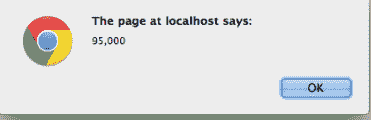

**图4-5：** 如果你知道结构和所需的键，就可以直接访问JSON值。

> **注意** *jQuery包含一个`JSON.parse()`的版本：`parseJSON()`函数，这对于向后兼容很有用。如果将其合并到jQuery脚本中，则仅在查看页面的浏览器不支持原生函数时才使用`parseJSON()`；否则，使用原生的`JSON.parse()`。*

另一种方法是将JSON数据放入字符串中，然后使用`JSON.parse()`方法将解析后的字符串放入对象中：

```
var jsonData = '{"regions":[' +
'{"territory":"Northeast","employees":"150","amount":"115,000" },' +
'{"territory":"Southeast","employees":"125","amount":"95,000" },' +
'{"territory":"Midwest","employees":"225","amount":"195,000" },' +
'{"territory":"West","employees":"325","amount":"265,000" }]}';

jsonObj = JSON.parse(jsonData);
```

此代码产生与上一个示例相同的`jsonObj`。

#### 异步JSON

尽管你可以在页面上内联包含JSON，但更常见的是处理异步访问的外部JSON资源。这个过程有点不同——你可以使用jQuery的`getJSON()`函数来自动解析数据。`getJSON()`函数接受两个参数：文件路径和回调函数。

```
$.getJSON("regional_sales.json", function(data) {
});
```

接下来，你可以使用jQuery的`each()`函数来遍历数据：

```
$.each(data.sales.region,function (k,v) {
});
```

这里`each()`循环提供了来自JSON的键（k）和值（v）。要获取键的值，应用JavaScript点表示法：

```
var theTerritory = v.territory;
var numEmployees = v.employees;
var theAmount = v.amount;
```

获得内容后，你就可以构建HTML并使用jQuery的`append()`函数将其插入页面。以下是完整的代码块：

```
$.getJSON("regional_sales.json", function(data) {
  $.each(data.sales.region,function (k,v) {
    var theTerritory = v.territory;
    var numEmployees = v.employees;
    var theAmount = v.amount;
  });
});
```

你可以在配套网站上找到`import_json.html`文件。

此代码显示了一个数据表格（见图4-6），但数据可以轻松地以任何其他配置呈现。例如，借助HTML5 `<canvas>`标签，只需少量额外编码，你就可以从同一数据文件创建条形图，如图4-7所示。

##### JSON Data Imported

| Territory | Employees | Sales |
| :--- | :--- | :--- |
| Northeast | 150 | $115,000 |
| Southeast | 125 | $95,000 |
| Midwest | 225 | $195,000 |
| West | 325 | $265,000 |

**图4-6：** jQuery的`getJSON()`函数从文件读取JSON数据并自动解析。

你可以在配套网站上找到`ch04_import_json_chart.html`文件。

此数据的canvas表示从一个简单的`<canvas>`元素开始：

```
<canvas id="chart1" width="600" height="400"></canvas>
```

##### JSON Data Charted

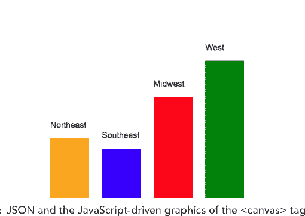

**图4-7：** JSON和`<canvas>`标签的JavaScript驱动图形是天然的搭配。

接下来，以下JavaScript导入数据并在canvas中绘制图表：

```
$( document ).ready(function() {
    var theChart = document.getElementById('chart1');
    var chartHeight = 400;
    var theWidth = 75;
    var theSpace = 100;
    var theX = 0;
    var theY = 0;
    var theFills = ['orange','blue','red','green'];
    var i = 0;

    if (theChart.getContext){
        var theContext = theChart.getContext('2d');
        $.getJSON("regional_sales.json", function(data) {
            $.each(data.sales.region,function (k,v) {
                var theTerritory = v.territory;
                var theHeight = parseInt(v.amount.replace(/,/g, ''))/1000;
                theY = chartHeight - theHeight;
                theX = theX + theSpace;
                theContext.fillStyle = theFills[i];
                theContext.fillRect(theX,theY,theWidth,theHeight);
                theContext.fillStyle = 'black';
                theContext.font = '12pt Arial';
                theContext.fillText(theTerritory,theX, theY-20);
                ++i;
            });
        });
    }
});
```

本书后面会更深入地探讨canvas和SVG表示，因此本章不包含此示例的详细讨论。基本上，脚本首先定义一些设置并为canvas元素设置上下文。接下来，它拉取JSON数据并使用它在canvas中构建可视化。`theContext.fillStyle`设置每个条形的颜色，然后使用`theContext.fillRect()`绘制条形。最后，使用`theContext.fillText()`为图表中的每个条形应用标签。

### 总结

收集数据后，你需要检索数据的技术。数据格式种类繁多，每种格式的读取方法也各不相同。处理此任务时需要牢记以下几个关键点：

- Ajax在现代Web应用中经常用于异步加载数据。JavaScript库提供了有用的Ajax API——例如jQuery的`get()`。

- jquery-csv库为解析CSV文件提供了有用的工具。

- XML是一种高度结构化的格式，广泛用于存储在线和离线业务的数据。你可以使用XSLT将数据转换为HTML模板并浏览数据文件本身。

- JSON是一种轻量级格式，与在线处理配合良好。你可以使用jQuery的`getJSON()`函数读取从JSON文件检索的数据。

- 由于JSON基于JavaScript，它与各种可视化选项都能很好地配合。

# 第5章 交互式获取数据

### 本章内容

- 改善表单可用性以提升用户体验和转化率的技术

- HTML5表单控件——减少数据分割的交互式小部件

- 移动表单最佳实践——上下文键盘、移动样式和移动表单小部件

大多数数据可视化利用服务器上或来自某些外部应用程序编程接口（API）的现有数据。然而，有时你希望将用户直接输入的数据整合到图表中。本章探讨从Web表单收集数据的一些最佳实践，这些数据随后可用于数据可视化。借助这些技术，你可以创建一个可持续的数据生态系统，自主地进行众包和显示数据。

### 使用HTML5表单控件

HTML5表单的广泛采用彻底改变了我们在Web上构建表单的方式。你不必再依赖插件或用户界面（UI）库，现在可以使用原生HTML5元素创建丰富的交互式表单。跳过第三方插件不仅能提高性能；这些原生元素也更可靠。你可以放心，它们将在今天和遥远的未来都得到浏览器的支持。

#### 介绍HTML5输入类型

在HTML4的时代，开发者只有少数几种输入类型，例如：

```
<input type="text">
<input type="password">
<input type="checkbox">
<input type="radio">
```

HTML5为这个列表增添了多种新类型：`email`、`url`、`number`和`date`，仅举几例。这些输入类型表明表单需要更特定类型的数据，这带来了各种重要的可用性和功能性影响：

- 输入类型会构建特殊的控件，例如日历控件或颜色选择器。

- 在移动设备上，输入类型提供了更优化的键盘，例如用于电话号码的数字键盘（本章稍后会详细阅读）。

- 当用户点击或轻触“提交”时，HTML5表单验证会利用这些输入类型来验证数据类型——例如，测试格式正确的电子邮件地址（第6章有更多相关内容）。

最重要的是，在涉及HTML5输入类型时，你无需担心向后兼容性问题。较旧的浏览器如果不理解HTML5输入类型，会默认为标准文本输入。虽然这可能无法提供你所期望的丰富功能，但它仍然提供了一个在整体上完全可用的表单。

> **注意** *特殊输入类型也非常适合面向未来。尽管很难预测浏览器未来将如何利用这些输入类型，但指明特定的数据类型将能利用未来的任何增强功能。*

#### 表单控件与数据格式化

表面上看，HTML5表单控件为用户创造了优雅的表单体验。但除了可用性，这些控件对你的应用数据也有重要影响。具体来说，它们确保用户输入的数据在到达应用逻辑之前格式正确。

例如，你可以允许用户在标准文本输入中手动输入日期。但这可能会产生多种结果，例如：

- February 4, 1986

- 4 Feb 1986

- 02-04-86

- 4/2/86

- 2 / 4 / 1986

如你所见，开放式的文本输入很容易导致数据根据用户的地区和偏好产生分割（这绝非详尽列表）。

然而，如果你使用HTML5的日历控件，它就能确保用户输入的数据在后台始终保持格式正确。在这种情况下，控件总是以1986-02-04的格式返回日期。

话虽如此，即使在一些主流浏览器中，表单控件的支持也可能有限。如前所述，如果浏览器不支持特定的表单控件，它会退回到标准文本输入（并带来所有数据分割的困扰）。因此，请确保包含JavaScript polyfill来填补浏览器控件的空白。

Polyfill通过模拟原生浏览器特性来实现向后兼容，对于HTML5表单有多种选择。特别是，html5forms polyfill能处理广泛的HTML5表单功能。（你可以阅读更多内容请访问 `http://www.useragentman.com/blog/2010/07/27/creating-cross-browser-html5-forms-now-using-modernizr-webforms2-and-html5widgets-2/`。）

#### 最大化利用移动表单

HTML5还引入了一些对移动设备有特殊意义的元素。具体来说，有一些输入元素会根据你请求的数据类型提供特殊的上下文键盘。例如，当要求用户输入电子邮件地址时，你可以显示一个更有针对性的键盘，其中包含@符号和点的默认按钮，如图5-1所示。

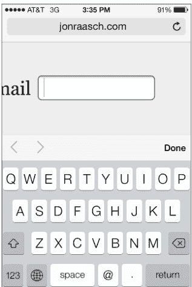

**图5-1：** iOS上的电子邮件输入显示此独特键盘。

尽管这可能看起来有些微不足道，但最大化利用这些上下文键盘对可用性极为重要。手机键盘出了名的不便，因此对体验的任何改进都会带来更高的转化率。

##### 使用上下文键盘

幸运的是，利用上下文键盘非常简单。只需设置输入元素的`type`属性，如下所示：

```
<input type="email" placeholder="Email">
```

这里，电子邮件输入类型会产生图5-1所示的键盘（或在非iOS设备上类似的键盘）。

除了电子邮件输入，还有用于电话号码的特殊键盘，如图5-2所示。类似地，你可以通过将输入类型设置为`tel`来利用此键盘：

```
<input type="tel" placeholder="Phone number">
```

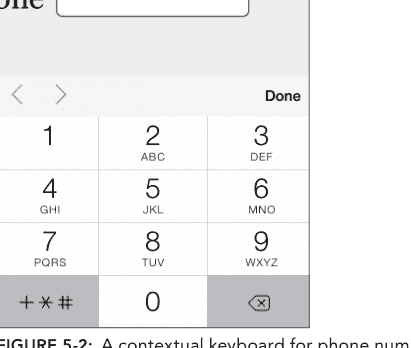

**图5-2：** iOS上电话号码输入的上下文键盘。

> **注意** *还有用于`url`和`number`数据类型的上下文键盘。*

##### 为可用性而设计移动表单

抛开功能不谈，你可以通过遵循一些简单的样式规则来提高表单的可用性。主要的是，确保表单在小巧的移动界面上既易于阅读又易于点击是个好主意。

一般来说，移动表单设计会“更厚实”，使用更大的输入框以便用户更容易点击到目标字段，即使用户“胖手指”操作也是如此。因此，请确保为所有输入字段添加一些额外的内边距，并稍微增加字体大小，这样不仅更易读，在触摸屏上也更大。

当涉及移动可用性时，增大表单字段的大小是最容易实现的改进之一。但这仅仅是移动表单优化的冰山一角。如果你想了解更多，可以尝试阅读LukeW的经典著作《Web Form Design》（Rosenfeld Media，2008）以及他的博客`www.lukew.com`。

#### 移动表单控件

除了原生HTML5表单控件外，还有许多第三方表单插件，其中许多专为移动设备设计。有些旨在弥合桌面和移动浏览器之间的差距，而另一些则用于扩展现有的移动模式。这里有很多选择；特别是jQuery Mobile为移动设备提供了一些优质的表单控件（访问`http://api.jquerymobile.com/category/widgets/`了解更多）。

### 总结

在本章中，你学习了使用表单从用户那里获取数据的技术。

首先，你学习了如何利用HTML5表单控件来创建交互式控件并减少数据分割。然后你探索了移动表单优化技术，使用相同的HTML5表单控件调用上下文键盘，从而简化移动设备上的用户输入。你还学习了移动表单样式设计和移动表单控件的一些基础知识。

在下一章中，你将深入探讨HTML5数据类型，利用它们进行验证和更好的数据格式化。

# 第6章 验证你的数据

### 本章内容

- 原生HTML5验证技术

- jQuery Validation Engine

> **代码下载** *本章的wrox.com代码下载请在`www.wrox.com/go/javascriptandjqueryanalysis`的“下载代码”选项卡上找到。代码位于chapter 06下载文件中，并根据章节中的名称单独命名。*

当使用表单数据进行可视化时，表单验证尤为重要。这是因为格式错误的数据可能会迅速破坏图表或表格。例如，如果你的图表显示不同日期的聚合数据，这种数据格式最好保持一致。如果一个用户输入February 4, 1986，另一个输入2–4–86，你最好在显示前想出一些方法来对齐这些值。通常，最简单的方法是在存储数据之前就进行验证。

在本章中，你将探索服务器端和客户端验证之间的区别，然后发现各种客户端技术。你首先了解原生HTML5验证方法。这些方法利用语义化标签根据各种数据类型和验证规则来验证字段。

接下来，你将了解jQuery Validation Engine，它提供了更丰富的验证功能。你将学习如何使用其基本的正则表达式验证器，以及用于数字和日期的更复杂规则。然后你将看到如何设置表单中各个字段之间复杂的关系。

到本章结束时，你将拥有一个功能强大的表单验证工具包，并了解既能满足轻量级需求，也能满足全功能需求的解决方案。

### 服务端验证与客户端验证对比

在Web发展早期，表单验证完全在服务端进行。这种方式一直运行良好，直到开发人员开始关注如何优化这一流程——事实证明，表单优化对于业务目标来说极为重要。例如，电子商务公司可以通过改进结账表单来获得可观的回报。

最终，客户端验证技术逐渐普及，因为它们能让开发人员简化错误处理流程，在用户填写表单时提供有意义的提示。

服务端验证必须在表单提交后才能进行，而客户端验证则可以在错误发生的那一刻就显示出来。这种方式通常能带来更高的转化率，因为它避免了在用户将表单提交给服务器后，再向其展示大量错误信息。

此外，用户不必去追踪错误的来源——错误始终会出现在她刚刚输入的字段上。最后，它还能避免后端安全问题所带来的一些麻烦，例如服务器让用户重新输入密码，而不是将其嵌入到标记中。

要了解客户端验证的工作原理，请参阅图 6-1 中的对比。

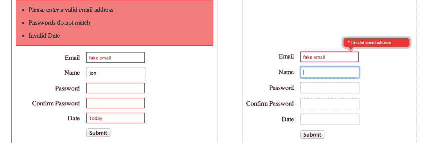

客户端验证能为用户提供更快速的反馈，进而使他能够更快地完成表单填写。此外，它还能让用户更有信心确信表单将会成功提交。这两项改进都能降低放弃率，意味着更多用户会购买你的产品、订阅你的新闻通讯，或完成你希望他们采取的任何行动。

然而，客户端验证也存在一些明显的缺点。也就是说，在浏览器中进行的任何验证都是极不安全的。黑客可以轻易地覆盖客户端验证，或者直接禁用 JavaScript。因此，当你在客户端进行验证时，务必在表单提交后对服务器端的关键字段进行双重检查。

### 原生 HTML5 验证

如今，客户端验证有多种实现方式。在 HTML5 之前，开发人员完全依赖第三方插件和扩展来处理验证。这些解决方案通常构建在 jQuery 等库之上，使用 JavaScript 来验证表单内容，并在需要时显示内联错误消息。

然而近年来，这种验证已经随着 HTML5 而变得原生化了。尽管不如其 JavaScript 方案那样可自定义，但原生验证提供了多种优势，例如性能提升和无障碍性改进。

#### 原生验证与 JavaScript 验证对比

总的来说，尽可能使用原生工具是个好主意——如果没有充分的理由，重复造轮子是没有意义的。这一原则同样适用于 HTML5 验证，与 jQuery 插件等替代方案相比，它具有以下优势：

- **原生验证轻量。** 由于它在浏览器层面实现，用户无需下载外部脚本来处理验证。这减轻了页面负载，从而提升了性能。

- **原生验证一致。** 许多网站都使用 HTML5 验证，因此用户无疑已经熟悉验证用户界面（UI）的视觉语言。这是一种便利，使用户能更轻松地识别验证消息。

- **原生验证已本地化。** 使用原生验证时，浏览器会自动将错误消息翻译成用户的语言。

如你所见，原生 HTML5 验证是外部脚本和插件的一个有吸引力的替代方案。然而，JavaScript 验证也有其自身的优势：

- **JavaScript 验证功能丰富。** 尽管 HTML5 能轻松处理大多数验证场景，但它永远不可能像验证库那样强大。根据你的需求，你可能需要更强大的功能。

- **JavaScript 验证可自定义主题。** 尽管 HTML5 提供用户能立即识别的统一主题消息，但这些可能与你的网站视觉风格不符。对原生验证消息进行样式设置非常有限，所以如果你需要截然不同的外观和感觉，就必须跳过 HTML5。

- **JavaScript 验证兼容旧版浏览器。** 尽管 HTML5 验证在所有现代浏览器中表现优异，但一些较旧的浏览器不被支持，主要是 IE8 及更早版本。如果支持这些浏览器是优先级需求，你就必须转向 JavaScript 解决方案，要么全面采用，要么作为非 HTML5 浏览器的 polyfill（垫片）。

- **JavaScript 验证可自定义。** HTML5 提供针对用户区域本地化的自动错误消息，但这些消息更难自定义。所以如果你不满意通用错误消息，使用 JavaScript 验证可能更好。

#### HTML5 验证入门

第 6 章介绍了如何使用 HTML5 输入类型来提供更丰富的表单控件和更好的移动体验。事实证明，这些特殊的输入类型对表单验证也有深远的影响。

例如，假设你有一个 `email` 输入框：

```
<input type="email">
```

当用户提交此表单时，浏览器会自动根据 `email` 数据类型检查格式是否正确（@ 符号）。任何格式不当的地址都会触发错误，如图 6-2 所示。

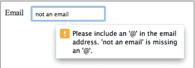

**图 6-2：** 此 email 输入框在 Chrome 中触发了错误。

HTML5 还验证除 `email` 之外的其他数据类型。例如，如果你有一个 `url` 输入框，浏览器会检查格式正确的 URL。

#### HTML5 数字验证

`email` 和 `url` 验证相当基础，而 `number` 和 `range` 输入框则提供了对验证规则更精细的控制。第 5 章介绍了如何使用这些数字输入框的 `min`、`max` 和 `step` 值：

```
<input type="number" min="0" max="10" step="0.5">
```

这里的数字字段被限制在 0 到 10 之间，每隔 0.5 为一个步进值。从表面上看，这些值会影响桌面端 UI：它从 0 开始，然后以 0.5 为步进递增直到 10。但 HTML5 验证也会利用这些属性，如图 6-3 所示。

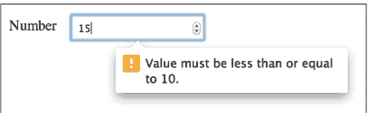

**图 6-3：** 超出 min 和 max 范围的值会为此数字字段触发错误。

#### 必填字段与最大长度

除了特殊输入类型之外，还有许多额外的验证选项可以直接在标记中设置。一个特别有用的选项是 `required` 属性：

```
<input type="text" required>
```

这里的 `required` 属性表示该字段必须填写。未能填写会触发图 6-4 所示的错误。

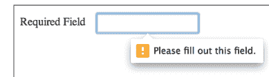

**图 6-4：** 所有必填字段都必须填写才能提交此表单。

> **注意** *请记住，基本验证并不足以使字段成为必填。例如，如果用户将 email 输入框留空，表单仍会成功提交。空白字段不会与给定规则进行匹配。*

此外，你可以为任何字段设置最大长度：

```
<input type="text" maxlength="5">
```

然而，对于 `maxlength`，甚至不会有错误消息，因为大多数浏览器不会允许你输入额外的字符。

#### 自定义 HTML5 验证规则

你还可以设置自定义 HTML5 验证规则。这些规则使用正则表达式（regex）来验证内容，然后向用户显示任何错误。

要设置自定义规则，只需在标记中直接插入正则表达式：

```
<input type="text" pattern="[a-zA-Z]+">
```

当用户提交表单时，此字段会针对正则表达式 `[a-zA-Z]+` 进行检查，该表达式仅接受字母值（无数字、无空格等）。如果用户输入了无效数据，会触发通用错误消息，如图 6-5 所示。

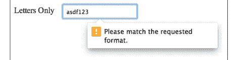

**图 6-5：** 如果字符串未通过正则表达式验证，将显示此通用错误消息。

#### 自定义 HTML5 验证消息

如果你对通用验证消息不满意，无论是自定义正则表达式规则还是标准字段，你也可以自定义这些消息。为此，你需要利用 JavaScript 和 `setCustomValidity()` 应用程序编程接口（API）：

在表单提交失败时，该字段会触发给定的错误文本，如图 6-6 所示。

然而，这个方案相当取巧，还有很多不足之处。首先，无论错误来源是什么，显示的都是相同的错误信息。例如，如果你同时使用了 `pattern` 和 `required`，两个问题的提示信息是一样的。此外，这些硬编码的信息没有针对用户的语言进行本地化。这可能看起来不是最大的问题，但如果你将硬编码信息与默认信息混用，就会出问题。如图 6-7 所示，这会导致非常不一致的体验。在图 6-7 的左侧，浏览器根据语言设置翻译了提示信息（此处为西班牙语）。在右侧，同一表单中的硬编码信息却显示为英语。

### h5Validate Polyfill

虽然 HTML5 验证在大多数浏览器中都是一个极佳的选择，但仍有少数用户在使用 IE8 及其他不支持 HTML5 的浏览器。你需要自己决定是否为这些用户提供客户端验证支持。幸运的是，如果你确实决定提供回退方案，有一些开箱即用的解决方案可以弥合旧版浏览器与 HTML5 之间的差距。具体来说，h5Validate polyfill 提供了一条便捷的途径，让你在所有浏览器中支持 HTML5 风格的验证。这个 polyfill 试图模拟原生功能，在标记中使用与 HTML5 相同的属性。这样，你就可以轻松支持这些特性，而无需重写太多代码。

首先，从 GitHub 下载代码：`https://github.com/dilvie/h5Validate/blob/master/jquery.h5validate.js`。使用这个 polyfill 非常简单；只需将脚本包含在文档末尾即可。

不过，不建议在所有情况下都使用这个 polyfill。大多数浏览器支持原生验证，没有必要重复造轮子——甚至让这些用户下载这个脚本。你应该采取措施确保这个脚本只在需要时才加载。

一种选择是使用特性检测和 JavaScript 加载器，仅在需要时加载脚本。或者，你也可以使用 IE 条件注释（虽然这有点粗糙）：

```
<!--[if lt IE 9]>
<script src="js/jquery.h5validate.js"></script>
<![endif]-->
```

这个条件注释仅针对 IE8 及更早版本，因此会遗漏其他浏览器的旧版本。不过这不算什么大问题，因为这些旧版浏览器的市场份额通常非常小。

### JQUERY VALIDATION ENGINE

在互联网上快速搜索可以找到各种表单验证插件。与任何第三方产品一样，这些插件质量参差不齐，因此选择正确的插件非常重要。其中最佳的选项之一是 jQuery Validation Engine，可在 `https://github.com/posabsolute/jQuery-Validation-Engine` 获取。

jQuery Validation Engine 是一个功能强大的验证套件，提供了比原生 HTML5 验证更丰富的功能。根据你的使用场景，这些功能可能值得为额外的脚本体积买单。

#### Getting Started with jQuery Validation Engine

虽然它使用的属性与 HTML5 验证不同，但 jQuery Validation Engine 也是基于标记驱动的：

```
<input type="text" data-validation-engine="validate[required,custom[email]]">
```

这里，`data-validation-engine` 定义了该字段的功能。首先，`validate[]` 表示该字段需要验证。然后在该数组中定义验证规则——这个特定字段是一个 `required` 字段，必须验证通过 `email` 正则表达式。

最后，在你的表单元素上实例化验证引擎：

```
$(".my-form").validationEngine();
```

现在，如图 6-8 所示，格式错误的数据会触发错误信息。

> **注意** *虽然该插件支持主题定制，但目前只有一个官方主题。*

**图 6-8：** 这条错误信息由 jQuery Validation Engine 生成。（如果你不喜欢这个外观，可以重新配置主题。）

#### Validators

使用 jQuery Validation Engine 的主要原因是其丰富多样的验证规则，开箱即用。从简单的正则规则（用于验证电子邮件地址）到复杂的日期范围和条件验证，这些验证器提供了比原生方案更丰富的功能。如果你需要额外的规则，该库还提供了定义自定义规则的工具。

##### Regex Validators

jQuery Validation Engine 提供了许多预定义的正则规则，涵盖各种常见的验证用例。你在上一节中已经看到了其中一个验证器：`custom[email]`，它用于检查 *email* 正则。按照相同的模式，你还可以设置 URL 验证：

```
<input type="text" data-validation-engine="validate[custom[url]]">
```

或者建立电话号码验证：

```
<input type="text" data-validation-engine="validate[custom[phone]]">
```

除了这些示例，你还可以验证数字、ISO 日期、字母数字字符串等。你可以在文档中查阅 jQuery Validation Engine 支持的所有自定义正则表达式：`http://posabsolute.github.io/jQuery-Validation-Engine/#custom-regex`。如果你还需要更多，可以将自己的正则规则添加到翻译文件中（例如，`jquery.validationEngine-en.js`）。

> **警告** *验证电话号码时要小心，因为这个正则表达式是"宽松的"，意味着它允许各种电话号码格式。考虑到所有国际格式，这个范围相当广泛，所以你可能需要添加额外的验证规则。*

##### Number Validators

你已经学习了如何使用 `custom[number]` 和 `custom[integer]` 等正则验证器来验证字段的数据类型。但 jQuery Validation Engine 还提供了一些额外的非正则验证器，如 `min[]` 和 `max[]`：

```
<input type="text"
  data-validation-engine="validate[custom[number],min[0],max[10]]">
```

这个示例同时使用了 `min[]` 和 `max[]` 验证器，建立了一个规则：数字必须在 0 到 10 之间。

> **注意** *除了 `min[]` 和 `max[]` 之外，还有一些工具可以在更具体的情况下使用。例如，`creditCard` 验证器可以验证一个整数理论上是否可能是信用卡号。当然，它不会向银行验证某张特定卡片是否存在或是否有可用额度。*

##### Date Validators

jQuery Validation Engine 还提供了一些实用的日期验证规则。这些补充了你之前学过的 `custom[date]` 正则，后者验证字符串是否符合 ISO 日期格式：YYYY-MM-DD。例如，你可以使用这些额外的控件来验证某个 ISO 日期不仅有效，而且在过去：

```
<input type="text" data-validation-engine="validate[custom[date],past[NOW]]">
```

这里的 `past[]` 验证器接受 `NOW` 参数，将字段与当前日期（由浏览器提供）进行比较。如图 6-9 所示，如果日期不在过去，该字段会触发错误。

**图 6-9：** 该字段无法通过验证，因为日期不在过去。

同样，你也可以检查日期是否在未来：

```
<input type="text" data-validation-engine="validate[custom[date],future[NOW]]">
```

此外，你还可以在 `past[]` 和 `future[]` 中使用自己的 ISO 字符串。例如，要检查用户是否在 1995 年之前出生，你可以直接问他们 MC Hammer 是谁，或者使用以下代码：

```
<input type="text" data-validation-engine="validate[custom[date],past[1995-01-01]]">
```

此外，如果你想使用日期选择器，可以将 jQuery Validation Engine 与你之前学过的 HTML5 表单元素 `<input type="date">` 结合使用。不过，为了避免 HTML5 验证与 jQuery 验证之间的冲突，请务必在表单元素上添加 `novalidate` 属性：

```
<form novalidate>
<input type="date" data-validation-engine="validate[custom[date],past[NOW]]">
</form>
```

##### Conditional Validators

jQuery Validation Engine 最强大的用例之一是其丰富的条件验证规则。这些验证器不仅检查单个字段；它们允许你在表单的各个字段之间建立更复杂的关系。

一个简单的例子是验证 Password 和 Confirm password 字段是否匹配：

```
<input type="password" name="my-password">
<input type="password" name="confirm-password"
       data-validation-engine="validate[equals[my-password]]">
```

如你所见，第二个字段使用了`equals[]`验证器来匹配名为`my-password`的字段。现在，如果这两个字段不匹配，就会抛出如图 6-10 所示的错误消息。（本章稍后会介绍如何自定义错误消息的文本。）


**图 6-10：** 这些密码不匹配。

除了简单匹配之外，你还可以使用你已经熟悉的`past[]`和`future[]`验证器来跨字段比较日期。例如，假设你想验证酒店预订的日期。你想确保结束日期在起始日期*之后*：

```
<input type="text" name="start-date"
       data-validation-engine="validate[future[NOW]]">
<input type="text" name="end-date"
       data-validation-engine="validate[future[start-date]]">
```

在这里，脚本首先检查起始日期是否在未来（毕竟，你不会想预订昨天的酒店）。然后结束日期会根据起始日期进行验证，如果它不在未来，就会产生图 6-11 所示的错误。


**图 6-11：** 结束日期在起始日期之前，这触发了错误。

除了这些示例之外，还有一些验证器可以设置字段组之间的必需关系、验证用户已勾选的复选框数量等等。查看文档：`http://posabsolute.github.io/jQuery-Validation-Engine/#validators`。

### 编写自定义规则

你还可以为 jQuery Validation Engine 定义自己的验证器，既可以在客户端，甚至也可以在服务器端。

#### 客户端

要在客户端创建验证规则，首先创建一个在失败时返回错误消息的函数：

```
function checkFruit(field, rules, i, options){
    var fruits = ["apple", "banana", "pear", "orange"];

    if (fruits.indexOf(field) == -1) {
        return "Must be a piece of fruit";
    }
}
```

此函数检查字段值是否在水果名称数组中，如果不在则返回错误消息。接下来，使用`funcCall[]`将此函数的引用传递到你的验证规则中：

```
<input type="text" data-validation-engine="validate[funcCall[checkFruit]]">
```

现在，如果用户在此字段中输入的值不在水果数组中，就会产生图 6-12 所示的错误。


**图 6-12：** 披萨不是水果。

#### 服务器端

借助 jQuery Validation Engine，你甚至可以建立验证规则来访问服务器上的 RESTful API。这种能力在各种情况下都非常有用——例如，检查系统中是否已存在某个用户名。

首先，在翻译文件中添加一个 Ajax 规则（例如，`jquery.validationEngine-en.js`）：

```
"ajaxUsername": {
    "url": "my-api-url",
    "extraDataDynamic": ["#my-username"],
    "alertText": "* This username is already taken",
    "alertTextOk": "All good!",
    "alertTextLoad": "* Validating, please wait"
},
```

此规则定义了 Ajax 调用的几个参数，例如 API 的 URL、要传递的表单数据以及各种消息。请特别注意`extraDataDynamic`——那是你想要传递给 API 的字段的 ID 引用列表。

接下来，在标记中将此规则引用为验证器：

```
<input type="text" id="my-username"
data-validation-engine="validate[ajax[ajaxUsername]]">
```

现在 jQuery Validation Engine 会自动针对服务器检查此字段。本章不涉及任何服务器端代码，但你的 API 应返回以下格式的 JSON：

```
["my-username", false, "No dice"]
```

在此情况下，这些值代表以下内容：

- `"my-username"` 是给定字段的 ID 引用（如果你正在验证多个字段，这使你能够返回嵌套数组）。

- `false` 是验证是否通过的布尔值。在这种情况下，验证失败。

- `"No dice"` 是一个可选的错误消息，会覆盖翻译文件中设定的消息。

要了解更多关于`ajax[]`验证器的信息，请参阅本教程：`www.position-absolute.com/articles/using-form-ajax-validation-with-the-jquery-validation-engine-plugin/`。

> **注意** *尽管`ajax[]`验证器会访问服务器端，但该调用最初来自客户端，因此你应该像对待任何客户端验证一样有类似的安全顾虑。也就是说，确保你使用传统的服务器端技术对任何关键验证进行双重检查，以防止黑客攻击和浏览器错误。*

### 错误消息

jQuery Validation Engine 还提供了几种自定义错误消息的方式，从覆盖默认消息到额外的语言包。这些工具比原生 HTML5 替代方案提供了对错误消息更多的控制。

#### 修改错误消息

你可以通过设置`data-errormessage`属性来覆盖 jQuery Validation Engine 中的默认消息：

```
<input type="text" data-validation-engine="validate[required,custom[email]]"
data-errormessage="This is a custom error message">
```

你可以在图 6-13 中看到这个自定义消息。


**图 6-13：** 此字段的默认错误消息已被覆盖。

早些时候，你了解到覆盖原生 HTML5 验证消息可能存在问题，因为不同的错误会触发相同的消息。幸运的是，这在 jQuery Validation Engine 中不那么成问题，因为你可以利用一些额外的错误消息属性：

```
<input type="email" data-validation-engine="validate[required,custom[email]]"
data-errormessage-value-missing="Email is required!"
data-errormessage-custom-error="Let me give you a hint: someone@nowhere.com"
data-errormessage="This is the fall-back error message.">
```

在这里，脚本使用`data-errormessage-value-missing`处理`required`验证的问题，并使用`data-errormessage-custom-error`处理任何`custom`正则表达式的问题。任何其他错误默认使用`data-errormessage`中的消息。

#### 本地化

HTML5 会自动将原生验证的错误消息翻译成用户的语言。幸运的是，jQuery Validation Engine 也提供了一些语言支持——只需在页面中包含适当的本地化文件即可。例如，要使用英语，你可以这样写：

```
<script src="js/jquery.validationEngine-en.js"></script>
<script src="js/jquery.validationEngine.js"></script>
```

jQuery Validation Engine 中的多语言支持很有用；然而，原生验证的本地化在两个方面仍然更优：

- jQuery Validation Engine 提供了对数十种语言的支持，但浏览器支持的语言明显更多（取决于浏览器的不同，是两到三倍）。

- 虽然 jQuery Validation Engine 允许开发者硬编码一种语言，但原生验证会自动本地化为用户的语言。不过，如果你担心与网站上其他文案的一致性，硬编码语言也可能是件好事。

### 总结

在本章中，你学习了各种表单验证技术。你首先学习了如何利用原生 HTML5 验证来验证各种数据类型、设置数值范围的边界以及定义自己的正则规则。

接下来，你学习了如何使用 jQuery Validation Engine 进行更强大的验证支持。你探索了基本的正则验证器，以及用于限制数值和日期的简单验证器。然后你利用条件验证器在表单字段之间建立更复杂的关系。最后，你学习了如何在客户端和服务器端创建自己的验证器，以及如何自定义消息。

# 第7章 检查和排序数据表格

### 本章内容

- 了解 HTML 表格的结构

- 使用 CSS 为 HTML 表格添加样式

- 了解语义化标记

- 使用 JavaScript 和 jQuery 动态设置表格样式并编辑表格

- 使用 DataTables jQuery 插件简化动态表格的创建

> **代码下载** *本章的 wrox.com 代码下载可在 `www.wrox.com/go/javascriptandjqueryanalysis` 的“下载代码”选项卡中找到。代码位于第 07 章下载文件夹中，并根据本章中出现的名称单独命名。*

尽管图表、地图和其他富图形表示可能是你想到*数据可视化*一词时首先浮现的事物，但用于显示和分析数据的主要工具始终是数据表格。此外，设计精良的图表可能为大多数用户讲述数据故事提供了一种简洁的方式，但它可能对视障人士构成障碍。幸运的是，标记适当的数据表格可以承载足够明确的含义，使一种名为*屏幕阅读器*的专门软件能够将数据的视觉矩阵转换为易于理解的文本转语音或盲文内容。

数据表格在浏览器内数据可视化方面代表了一种有趣的最低共同标准。你不仅可以将它们标记为最大可读性和无障碍性，而且每个常用的浏览器都至少具备显示数据表格的基本能力，即使你有意禁用额外功能。鉴于此，你可以采用一种设计策略，从这种基础支持水平开始，然后在当前用户代理支持它们时逐步启用更高级的功能。这样，所有用户都能访问你的内容，但拥有更强大浏览器的用户会获得增强的视图。这种策略通常被称为*渐进增强*。

### 输出基本表格数据

在第 4 章中，你看到了几种使用 JavaScript 从 Web 服务器异步加载数据并在客户端动态构建 HTML 表格的技术。这些策略很有用且功能强大，但它们有一个明显的问题：如果用户的浏览器不支持 JavaScript，或者用户有意配置浏览器不执行 JavaScript，那么你就无法向他们呈现任何数据。与此同时，如果数据表格是页面的静态部分，或者通过服务器端逻辑注入页面，那么即使是基础水平的用户代理或能力故意受限的用户代理也能看到它。

#### 构建表格

在 HTML 中，你使用 `<table>` 元素以表格格式呈现数据。当你想到表格时，视觉上你会假设它包含在网格中相交的行和列，但当你在 HTML 标记中描述表格时，它 surprisingly 是以行为导向的。你描述表格中包含的每一行以及每行中包含的所有单元格，而关于表格中包含的列的信息大多是推断出来的（也就是说，除非你决定更明确地描述关于列的信息，如本章后面讨论的那样）。事实上，浏览器在解释表格元素时进行了大量推断，因此如果你想构建一个最大无障碍性的表格，必须小心。

> **注意** *`<table>` 元素也可以用于布局目的；在早期 Web 中，它实际上经常用于此目的。自 Cascading Style Sheets (CSS) 引入以来，这种做法在大多数情况下已不再流行。通常，在求助于使用表格进行布局之前，你应该检查是否有更简单、更干净的方式使用 CSS 来实现你的目标（通常都有）。*

`<table>` 的每一行表示为 `<tr>`（table row，表格行）元素，行内的每个单元格由 `<td>`（table data，表格数据）元素指示。

重新利用第 2 章中讨论的销售数据并将其转换为 HTML 表格，你会得到清单 7-1 中所示的标记。

##### 清单 7-1

```html
<!DOCTYPE html>
<html>
<head>
<title>Simple Table</title>
</head>
<body>

<table>
    <tr>
        <td>Region</td>
        <td>Sales</td>
        <td>Mean</td>
    </tr>

    <tr>
        <td>Northeast</td>
        <td>$100,000</td>
        <td>$142,857</td>
    </tr>
    <tr>
        <td>Southeast</td>
        <td>$75,000</td>
        <td>$142,857</td>
    </tr>
    <tr>
        <td>Midwest</td>
        <td>$125,000</td>
        <td>$142,857</td>
    </tr>
    <tr>
        <td>Mid-Atlantic</td>
        <td>$125,000</td>
        <td>$142,857</td>
    </tr>
    <tr>
        <td>Southwest</td>
        <td>$75,000</td>
        <td>$142,857</td>
    </tr>
    <tr>
        <td>Northwest</td>
        <td>$100,000</td>
        <td>$142,857</td>
    </tr>
    <tr>
        <td>California</td>
        <td>$400,000</td>
        <td>$142,857</td>
    </tr>
</table>

</body>
</html>
```

清单 7-1 中的代码会产生图 7-1 中显示的表格。你可以在配套网站上找到 `MostSimpleTable.html` 文件。

| Region | Sales | Mean |
|--------|-------|------|
| Northeast | $100,000 | $142,857 |
| Southeast | $75,000 | $142,857 |
| Midwest | $125,000 | $142,857 |
| Mid-Atlantic | $125,000 | $142,857 |
| Southwest | $75,000 | $142,857 |
| Northwest | $100,000 | $142,857 |
| California | $400,000 | $142,857 |

**图 7-1：** 这个表格非常基础。

请注意，图 7-1 中显示的表格不太美观。这实际上可以被认为是"设计如此"。为什么？现代 HTML 提供了语义标记与表现形式的良好分离，因此，理想情况下，你的标记应该只描述页面的内容，而你的 CSS 定义表现方面。因为我们在此示例中没有添加任何针对数据表格元素的 CSS 规则，所以你不应该对它的表现目前略显平淡感到特别惊讶。

> **注意** *HTML 的早期版本在内容和表现分离方面混淆了水域。例如，`<font>` 标签使你能将选定字体应用于一段文本。然而，现在你会使用 CSS 来定义这种表现属性。`<font>` 标签和一些其他与表现相关的元素类型在 HTML 4.01 版本中被弃用，并最终在 HTML5 中被移除。这进一步证明了 HTML 应该只定义内容和语义，而表现应该委托给 CSS。*

你将在本章后面看到如何改进表格的样式，但首先，考虑这个表格的另一个问题。表格内容的语义非常不清楚。第一（顶部）行包含的单元格代表其下方各列的标题，这隐含了一种含义。每行中的第一个单元格描述后续行内容，这也隐含了一种含义。然而，这些只是推断，虽然查看此表格的人可能很容易得出这些推断，但软件（软件代理）或视障人士这样做却不一定简单。此外，在使用 CSS 选择器设置此表格内容的样式时，样式规则无法简单地区分存在的不同类型的单元格。

#### 使用语义化表格标记

你可以通过更好地定义表格中每个标记片段的语义或含义来解决图 7-1 中显示表格的问题。如果第一行中的单元格 meant to be 它们顶部的列标题，那么你可以通过使用 `<th>` 元素而非 `<td>` 元素来明确这一点。

```html
<tr>
    <th>Region</th>
    <th>Sales</th>
    <th>Mean</th>
</tr>
```

现在清楚而明确地表明你提供的是表格标题，而不仅仅是另一行数据。你可以在图 7-2 中看到，将这些单元格更改为表格标题实际上在输出中产生了微小的视觉差异。尽管你想要努力遵循内容和表现分离的原则，但浏览器确实有一些与某些语义标记元素关联的默认表现。就表格标题而言，它们默认在其单元格中bold且居中，但你当然可以使用 CSS 重新定义表格标题的表现方式。

你可以在配套网站上找到 `SimpleTable.html` 文件。

| Region | Sales | Mean |
| :--- | :--- | :--- |
| Northeast | $100,000 | $142,857 |
| Southeast | $75,000 | $142,857 |
| Midwest | $125,000 | $142,857 |
| Mid-Atlantic | $125,000 | $142,857 |
| Southwest | $75,000 | $142,857 |
| Northwest | $100,000 | $142,857 |
| California | $400,000 | $142,857 |

**图 7-2：** 语义化表格标题元素在输出中产生微小差异。

令人惊讶的是，表格标题在表格中任何位置放置都是有效的，但重要的是仅在它们在上下文中有意义的地方使用它们，并考虑屏幕阅读器可能会如何处理表格内容以朗读它。例如，仅因为你想要值bold且居中而应用 `<th>` 元素是对该元素的不良使用。

在示例中的区域销售表格中，将每个区域名称视为该行的标题实际上是有道理的，这是完全有效的标记：

```html
<tr>
    <th>Northeast</th>
    <td>$100,000</td>
    <td>$142,857</td>
</tr>
```

但现在你构建了一个包含两组不同标题的场景，哪些表格单元格与哪些标题相关联并不一定是显而易见的。建议你通过向标题元素添加 `scope` 属性来解决这些歧义。如果你将标题修改为：

```html
<th scope="row">Northeast</th>
```

从默认表现的角度来看，这不会产生任何差异，但你现在已经向屏幕阅读器（以及你的 CSS 选择器，如你稍后所见）表明，与该标题同行的每个单元格都属于该标题。类似地，你可以将列标题修改为：

```html
<th scope="col">Region</th>
```

这确保了同一列中每个具有此类标题的单元格都属于该标题。因此，例如，当您遇到表格中显示 $400,000 的单元格时，屏幕阅读器或其他软件代理将明确知道该值属于列标题 `Sales` 和行标题 `California`。

> **注意** *值得注意的是，不仅仅是屏幕阅读器和 CSS 选择器能从丰富表格的语义内容中受益。搜索引擎的网络爬虫可能会利用提供的额外含义来改进内容的索引，或者您的浏览器在打印时，如果更了解表格的结构，可能会更有效地将表格分页。*

还有其他一些语义标记可以应用于表格的部分，以澄清表格设计者的意图。尽管用 `<th>` 替换第一行中的 `<td>` 元素消除了表格布局中的许多歧义，但通过将内容分为三个语义子元素——`<thead>`、`<tbody>` 和 `<tfoot>`——您可以更清楚地说明表格的不同部分，如清单 7-2 所示。

##### 清单 7-2

```html
<!DOCTYPE html>
<html>
<head>
<title>带有语义标记的表格</title>
</head>
<body>

<table>
<thead>
<tr>
<th scope="col">地区</th>
<th scope="col">销售额</th>
<th scope="col">平均值</th>
</tr>
</thead>
<tfoot>
<tr>
<th scope="row">总计</th>
<td>$1,000,000</td>
<td></td>
</tr>
</tfoot>
<tbody>
<tr>
<th scope="row">东北部</th>
<td>$100,000</td>
<td>$142,857</td>
</tr>
<tr>
<th scope="row">东南部</th>
<td>$75,000</td>
<td>$142,857</td>
</tr>
<tr>
<th scope="row">中西部</th>
<td>$125,000</td>
<td>$142,857</td>
</tr>
<tr>
<th scope="row">中大西洋地区</th>
<td>$125,000</td>
<td>$142,857</td>
</tr>
<tr>
<th scope="row">西南部</th>
<td>$75,000</td>
<td>$142,857</td>
</tr>
<tr>
<th scope="row">西北部</th>
<td>$100,000</td>
<td>$142,857</td>
</tr>
<tr>
<th scope="row">加利福尼亚</th>
<td>$400,000</td>
<td>$142,857</td>
</tr>
</tbody>
</table>
</body>
</html>
```

现在，表格由一个页眉部分、一个页体部分和一个页脚部分组成，这一点已经尽可能清晰了。

> **注意** *尽管页脚在页面呈现顺序中显示在最后，但在标记中，默认情况下它实际上必须出现在表格主体之前。这可能与以下事实有关：如果您要将一个非常长的表格发送到打印机，并希望在每页的底部打印页脚，您就不希望必须预先解析所有表格标记以找到页脚内容。*

当您查看图 7-3 中新表格的结果时，您会注意到与图 7-2 唯一的区别是，您标记为行标题的第一列单元格内容现在是粗体且居中的。`<thead>`、`<tbody>` 和 `<tfoot>` 仅充当纯语义标记，并未引起表格呈现的任何变化。

您可以在配套网站上找到 `TableWithSemanticMarkup.html` 文件。

| 地区 | 销售额 | 平均值 |
| --- | --- | --- |
| **东北部** | $100,000 | $142,857 |
| **东南部** | $75,000 | $142,857 |
| **中西部** | $125,000 | $142,857 |
| **中大西洋地区** | $125,000 | $142,857 |
| **西南部** | $75,000 | $142,857 |
| **西北部** | $100,000 | $142,857 |
| **加利福尼亚** | $400,000 | $142,857 |

**图 7-3：** 此表格同时具有行标题和列标题。

尽管没有明显的内置呈现差异，但一些浏览器确实以有趣的方式利用了您提供的额外上下文。例如，一些浏览器在打印时，会在每一页重复页眉部分和/或页脚部分，以便阅读输出的人不必参考第一页来识别列。在本章稍后，您将了解如何将相当复杂的样式应用于表格的这些不同部分，但现在，应用一些简单的 CSS 规则，即使只是为了澄清表格的结构。将以下代码添加到页面的 `<head>` 部分：

```css
<style type="text/css">
    thead { color: orange; }
    tbody { color: gray; }
    tfoot { color: red; }
</style>
```

正如您在图 7-4 中所看到的，该表格与图 7-3 看起来完全相同，唯一不同的是表格页眉区域中的所有内容都使用了橙色文本颜色，表格页脚区域中的所有内容都使用了红色文本颜色，所有其他文本均为灰色。

您可以在配套网站上找到 `TableWithSemanticMarkupAndCSS.html` 文件。

| 地区 | 销售额 | 平均值 |
| --- | --- | --- |
| 东北部 | $100,000 | $142,857 |
| 东南部 | $75,000 | $142,857 |
| 中西部 | $125,000 | $142,857 |
| 中大西洋地区 | $125,000 | $142,857 |
| 西南部 | $75,000 | $142,857 |
| 西北部 | $100,000 | $142,857 |
| 加利福尼亚 | $400,000 | $142,857 |
| **总计** | **$1,000,000** | |

**图 7-4：** 在此表格中，使用了一些 CSS 样式规则来定位表格的语义标记。

### 为表格添加标签

当向用户提供数据表时，提供标题或标签非常重要，这样用户才能有足够的上下文来理解数据，并看到它与提供的其他内容之间的关系。在无障碍表格中，标题更为重要，因为用户可能没有视觉线索来将表格内容与页面的周围部分联系起来。

要为表格添加标题，您可以在表格中引入 `<caption>` 元素：

```html
<table>
    <caption>按地区划分的销售额</caption>
    <!-- ... -->
</table>
```

默认情况下，标题显示在表格顶部，但您可以通过 CSS 配置其位置（请参见 `caption-side` 属性）。标题不仅仅是对表格内容进行解释；大多数面向无障碍的用户代理会专门查找此标题，以便更好地解释表格的上下文。

如果表格的结构有任何不寻常之处，可能值得在标题中提供一些额外的细节，以尝试使内容更易于理解。但是，最好还是简化表格的复杂性。如果表格复杂到需要一段文字来描述其内容，那么它可能不是可视化数据的最有效方式。

> **注意** *`table` 元素过去有一个 `summary` 属性。此属性在页面上没有视觉呈现，但它提供了屏幕阅读器可以使用的额外上下文。然而，此属性在 HTML5 中已被移除。该属性可能已被移除，因为有关表格的有用信息应该对所有用户都可访问，而不仅仅是屏幕阅读器。*

您可以在图 7-5 中看到带有标题的表格。

| | | |
|---|---|---|
| **按地区划分的销售额** | | |
| **地区** | **销售额** | **平均值** |
| 东北部 | $100,000 | $142,857 |
| 东南部 | $75,000 | $142,857 |
| 中西部 | $125,000 | $142,857 |
| 中大西洋地区 | $125,000 | $142,857 |
| 西南部 | $75,000 | $142,857 |
| 西北部 | $100,000 | $142,857 |
| 加利福尼亚 | $400,000 | $142,857 |
| **总计** | **$1,000,000** | |

**图 7-5：** 已向表格添加了描述性标题。

### 配置列

到目前为止，您已经创建了行和标题，这只是隐式地定义了表格包含的列数。不过，关于列，能否更明确地说明些什么呢？答案是肯定的，但先别太高兴。能够直接定位表格列的标记是有限制的。

如果您列出可能想对表格中的数据列执行的操作，首先想到的一些操作是：

- 设置列中所有单元格内容的字体和颜色

- 设置列中所有单元格内容的文本对齐方式

- 设置整个列的背景颜色

幸运的是，有一个名为 `<col>` 的元素，它使您能够描述一些针对整个列的样式。不幸的是，只有前面列表中的第三项可以直接通过 `<col>` 实现。清单 7-3 展示了如何使用一些 `<col>` 元素来设置表格中某些列的样式。

##### 清单 7-3

```html
<!DOCTYPE html>
<html>
<head>
<title>带有标题和列设置的表格</title>

<style type="text/css">
    .col-header { background-color: gray; }
    .col-amount { background-color: orange; }
</style>
</head>
<body>

<table>
    <caption>按地区划分的销售额</caption>
    <colgroup>
        <col class="col-header">
        <col class="col-amount">
        <col class="col-mean">
    </colgroup>
    <thead>
        <tr>
            <th scope="col">地区</th>
            <th scope="col">销售额</th>
            <th scope="col">平均值</th>
        </tr>
    </thead>
    <tfoot>
        <tr>
            <th scope="row">总计</th>
            <td>$1,000,000</td>
            <td></td>
        </tr>
    </tfoot>
    <tbody>
        <tr>
            <th scope="row">东北部</th>
            <td>$100,000</td>
            <td>$142,857</td>
        </tr>
        <tr>
            <th scope="row">东南部</th>
            <td>$75,000</td>
            <td>$142,857</td>
        </tr>
        <tr>
            <th scope="row">中西部</th>
            <td>$125,000</td>
            <td>$142,857</td>
        </tr>
        <tr>
            <th scope="row">中大西洋地区</th>
            <td>$125,000</td>
            <td>$142,857</td>
        </tr>
        <tr>
            <th scope="row">西南部</th>
            <td>$75,000</td>
            <td>$142,857</td>
        </tr>
        <tr>
            <th scope="row">西北部</th>
            <td>$100,000</td>
            <td>$142,857</td>
        </tr>
        <tr>
            <th scope="row">加利福尼亚</th>
            <td>$400,000</td>
            <td>$142,857</td>
        </tr>
    </tbody>
</table>
</body>
</html>
```

在清单 7-3 中，你有两个新的配置项来帮助配置列。第一个是：

```css
<style type="text/css">
    .col-header { background-color: gray; }
    .col-amount { background-color: orange; }
</style>
```

在这段代码中，定义了两个 CSS 类，分别应用于包含行标题的列和包含销售额的列。在这两种情况下，它们都定义了一个背景颜色——这恰好是可以分配给列的少数合法属性之一。要将这些类分配给各自的列，需要使用以下配置：

```html
<colgroup>
    <col class="col-header">
    <col class="col-amount">
    <col class="col-mean">
</colgroup>
```

这里首先使用 `<colgroup>` 元素表示你要为表格中的一组列定义某些属性，然后在子元素 `<col>` 中分别定义每一列的属性。在本例中，每个列都被分配了一个 CSS 类。结果是标题列的背景被设置为灰色，金额列的背景被设置为橙色。你可以在图 7-6 中看到效果。

你可以在配套网站上找到 `CaptionAndColumnSettings.html` 文件。

| 区域 | 销售额 | 平均值 |
|--------|-------|------|
| 东北部 | $100,000 | $142,857 |
| 东南部 | $75,000 | $142,857 |
| 中西部 | $125,000 | $142,857 |
| 中大西洋 | $125,000 | $142,857 |
| 西南部 | $75,000 | $142,857 |
| 西北部 | $100,000 | $142,857 |
| 加利福尼亚 | $400,000 | $142,857 |
| 合计 | $1,000,000 | |

**图 7-6：** 在此表格中，部分列的设置已被显式配置。

在成功运行前面的示例之后，你很可能会想要尝试将数字列中的单元格内容右对齐，就像这样：

```css
<style type="text/css">
    .col-amount { text-align: right; }
    .col-mean { text-align: right; }
</style>
```

然而，你会发现这实际上并不起作用。表格单元格并不真正被视为列的文档对象模型（DOM）子元素，因此它们实际上不会继承通常以这种方式继承的大多数 CSS 属性。最终，你只能通过这种方式设置少数几个有效属性。尽管如此，右对齐列*确实*是你想要实现的功能，因此在本章后面你会看到一个*确实*有效的策略。

> **注意** *如果你查阅 `<col>` 的应用程序编程接口（API）指南，可能会看到许多可以在列级别设置的有趣属性，例如 `align`。然而，其中一些从未得到广泛支持，而且大多数这些属性在 HTML5 中已被移除。在本章后面，你将了解到一些推荐的替代方案。*

### 确保最佳可读性

正如本章引言中所述，数据表格的优点之一是可以应用*渐进增强*策略。换句话说，你从一个几乎所有浏览器——更不用说屏幕阅读器和其他软件代理——都能呈现的表格开始，然后逐步叠加各种可能被某些用户代理支持的增强功能；不支持这些增强功能的浏览器会优雅地忽略它们。并非每个用户代理都支持你可能引入的每一种增强功能，但如果你足够谨慎，最终应该能在每种场景下都获得最大程度增强的表格。

到目前为止，你在本章中所做的大部分工作都应该可以呈现在支持 HTML4 及更高版本的用户代理上。文中描述了一些 HTML5 属性，只要提供 polyfill，它们就能在非 HTML5 浏览器上工作。

> **注意** *polyfill 是一段代码，帮助你模拟目标浏览器中某些未被原生支持的功能。对于 HTML5，添加了许多新元素，这些元素不一定具有特定的呈现默认值，但它们有助于增强页面的语义内容。能够依赖这些元素的可用性——无论目标用户代理是否支持 HTML5——是非常有用的，这就是 HTML5 polyfill 广泛存在的原因。*

截至图 7-5，你的数据表格当前状态是可用但不太美观。而且它还有点难以阅读。你可以通过一些恰当的 CSS 和 JavaScript 来改善表格的这些方面。你的一些目标平台可能无法利用其中一些功能，但你尝试使用的任何不被支持的功能都应被静默忽略。

以下是当前表格中值得解决的一些问题：

- 单元格之间没有可见的分隔线。

- 除了字体粗细之外，标题和普通单元格之间没有大的视觉区分。

- 数字列右对齐会更好看。

- 眼睛在沿着表格的一行阅读时，容易滑到相邻的行。

#### 为表格添加样式

现在是时候使用清单 7-4 中的代码来美化一下了。

##### 清单 7-4

```html
<!DOCTYPE html>
<html>
<head>
<title>Table With Styled Semantic Markup</title>

<style type="text/css">
/* Remove excess interstitial borders and padding
establish an outer border */
table {
	border-collapse: collapse;
	border: 1px solid #4C4C4C;
}
/* Add a dotted border around both header cells
and normal cells */
th, td {
	border: 1px dotted #707070;
}
/* Add some padding around the header content
removing the cramped spacing. Make the background
color of the headers green. */
th {
	background: #C2F0C2;
	padding: 5px;
}
/* Darken the green background for just the column
headers so that they use a different green than the
row headers. The fact that the column headers are
within a thead element helps to discriminate them
from the row headers. */
thead th {
	background: #9BC09B;
}
/* Set the background behind the caption to a dark
gray and the caption text to white. */
caption {
	background: #4C4C4C;
	padding: 5px;
	color: white;
}
/* This sets a solid bottom border to just the column
headers. This is achieved by using an attribute selector
to select just the th elements with scope set to col. */
th[scope=col] {
	border-bottom: 2px solid #707070;
}
/* This sets a solid right border to just the row headers.
This is achieved by using an attribute selector to
select just the th elements with scope set to row. It also left aligns these headers */
th[scope=row] {
    border-right: 2px solid #707070;
    text-align: left;
}
/* This right aligns all the normal cell content and adds some padding to them */
td {
    text-align: right;
    padding: 5px;
}
/* This sets a different background to just the row header that resides in the footer row. */
tfoot th {
    background: #BBBBD1;
}
/* This sets a different background to just the normal cells that reside in the footer row. */
tfoot td {
    background: #CFCFDF;
    color: #8D1919;
}

</style>
</head>
<body>

<table>
    <caption>Sales By Region</caption>
    <colgroup>
        <col class="col-header">
        <col class="col-amount">
        <col class="col-mean">
    </colgroup>
    <thead>
        <tr>
            <th scope="col">Region</th>
            <th scope="col">Sales</th>
            <th scope="col">Mean</th>
        </tr>
    </thead>
    <tfoot>
        <tr>
            <th scope="row">Sum</th>
            <td>$1,000,000</td>
            <td></td>
        </tr>
    </tfoot>
    <tbody>
        <tr>
            <th scope="row">Northeast</th>
            <td>$100,000</td>
            <td>$142,857</td>
        </tr>
        <tr>
            <th scope="row">Southeast</th>
            <td>$75,000</td>
            <td>$142,857</td>
        </tr>
        <tr>
            <th scope="row">Midwest</th>
            <td>$125,000</td>
            <td>$142,857</td>
        </tr>
        <tr>
            <th scope="row">Mid-Atlantic</th>
            <td>$125,000</td>
            <td>$142,857</td>
        </tr>
        <tr>
            <th scope="row">Southwest</th>
            <td>$75,000</td>
            <td>$142,857</td>
        </tr>
        <tr>
            <th scope="row">Northwest</th>
            <td>$100,000</td>
            <td>$142,857</td>
        </tr>
        <tr>
            <th scope="row">California</th>
            <td>$400,000</td>
            <td>$142,857</td>
        </tr>
    </tbody>
</table>
</body>
</html>
```

你可以在图 7-7 中查看清单 7-4 的结果。

你可以在配套网站上找到 `TableStyling.html` 文件。

图 7-7 中的表格看起来比之前的版本好多了，不是吗？清单 7-4 中的注释解释了每个独立的样式规则所实现的效果。注意，使用恰当的语义化 HTML 元素如何有助于区分各种表头行和普通单元格，以便为它们应用不同的样式。

#### 提高可读性

通过应用样式，你已经显著提高了表格的可读性，但还有更多可以做的。大多数表格的行之间会渲染水平分隔线。这些线条有助于眼睛追踪同一行内的单元格，并防止视线从一行滑到另一行。另一种常用于帮助眼睛扫描表格行的技巧是使用交替行高亮。例如，一个表格可能采用浅色背景后跟深色背景的重复模式。传统观点认为，由于相邻行之间的视觉差异，这将使眼睛更难从一行滑到相邻行。以下是如何添加一些额外的样式规则来实现这一点：

```css
tbody tr:nth-child(odd) {
    background: #DBDBDB;
}
```

这条规则有点复杂，将其分解会有所帮助；有时，如果你从右向左读，会更容易理解复杂的选择器。`nth-child(odd)` 部分表示只选择奇数子元素（每隔一个子元素）。然后，向左再进一步，`tr:nth-child(odd)` 指示选择所有奇数子元素，前提是它们是 `<tr>` 元素。再向左一步，`tbody tr:nth-child(odd)` 选择的是位于 `<tbody>` 元素内的、且为奇数子元素的 `<tr>` 元素。你可以在图 7-8 中看到此规则的效果。

你可以在配套网站上找到 `TableAlternateRowStyling.html` 文件。

**图 7-7：** 已对表格应用了更全面的 CSS 样式规则。

**图 7-8：** 现在表格有了交替行高亮。

实际上，实现交替行高亮所需的 CSS 代码非常简洁。然而，其缺点是 `nth-child` 实际上是一个 CSS 第 3 级选择器，因此只在最新版的浏览器中可用。旧版浏览器会忽略此规则，所以即使有人试图在不支持的浏览器上查看，此规则仍然可以安全且优雅地降级。

如果你放弃一些简洁性，也可以让旧版浏览器支持交替高亮。一种方法是手动为表格的所有奇数行添加一个类，然后直接选择该类以突出显示奇数行。如果你使用服务器端代码生成表格，这种方法将相对简单。你只需确保在为表格生成的标记中，为每隔一行的行添加 `class="odd"`。

然而，采用这种方法有一个明显的缺点。如果你使用一些客户端代码来更改行的排序，你还需要根据新的行顺序重新分配所有的类。

另一种方法是使用 jQuery 操作行来实现交替行高亮，如清单 7-5 所示。jQuery 的优势之一是它可以帮助你在旧版浏览器上模拟一些更现代的浏览器功能。

##### 清单 7-5

你可以在图 7-9 中查看清单 7-5 的结果。

你可以在配套网站上找到 `TableAlternateRowStylingJQuery.html` 文件。

**图 7-9：** 此表格中的交替行高亮是通过 jQuery 实现的。

从以下方面开始回顾此示例的新内容：

```html
<script src="jquery/jquery-1.11.1.min.js"></script>
```

这行代码引用了 jQuery，假设它已下载到名为 jquery 的子文件夹中，就像配套网站的代码下载中一样。它也可以通过 CDN 服务器加载。有关使用 jQuery CDN 服务器的更多信息，请参阅 `http://jquery.com/download/`。当然，使用前你应该查阅 jQuery 的许可条款。

接下来是新的 CSS 代码：

```css
.row-odd {
    background: #DBDBDB;
}
```

这定义了一个 CSS 样式规则，针对任何具有 `row-odd` 类的元素。你使用 jQuery 确保奇数行被分配了这个类。此规则为奇数行分配不同的背景色，从而像之前通过 `nth-child` 选择器实现的那样交替背景颜色。

接下来是以下规则，它只针对奇数行中的 `<th>` 元素，将其背景色设置为表头颜色的较深版本。

```css
.row-odd th {
    background: #A2D0A2;
}
```

然后你有这个：

```css
.cell-number {
    text-align: right;
}
```

此规则假设你稍后会使用 jQuery 将名为 `cell-number` 的类分配给任何看起来包含数字的单元格，以便它们都右对齐。

以下是你将用于操作表格的第一个实际 JavaScript 代码：

```html
<script type="text/javascript">
    function usCurrencyToFloat(currency) {
        currency = currency.replace(/\$/g, '');
        currency = currency.replace(/,/g, '');
        return parseFloat(currency);
    }

    $(function () {
        $("tbody").find("tr:odd").addClass("row-odd");
        $("tbody").find("td").filter(function (index) {
            return !isNaN(usCurrencyToFloat($(this).text()));
        }).addClass("cell-number");
    });
</script>
```

这段代码相当简洁明了，但下面来详细分析一下。第一部分：

```javascript
function usCurrencyToFloat(currency) {
    currency = currency.replace(/\$/g, '');
    currency = currency.replace(/,/g, '');
    return parseFloat(currency);
}
```

试图通过相当“暴力”的方式，将表格单元格中的货币字符串转换为浮点数。这样做的目的是为了识别哪些单元格包含数字，以便之前定义的样式可以只将数字单元格右对齐。这是通过从字符串中移除任何美元符号字符和逗号，然后将结果解析为浮点数来实现的。如果字符串碰巧仍然不是有效数字，那么 `parseFloat` 会返回 `NaN`（非数字）。

接下来，

```javascript
$(function () {
    $("tbody").find("tr:odd").addClass("row-odd");
    $("tbody").find("td").filter(function (index) {
        return !isNaN(usCurrencyToFloat($(this).text()));
    }).addClass("cell-number");
});
```

使用 jQuery 在 DOM 就绪时调用一些代码。在就绪回调中，它调用了：

```javascript
$("tbody").find("tr:odd").addClass("row-odd");
```

这使用 jQuery 从表格主体中找出所有奇数行，并为它们添加 `row-odd` 类。然后它调用：

```javascript
$("tbody").find("td").filter(function (index) {
    return !isNaN(usCurrencyToFloat($(this).text()));
}).addClass("cell-number");
```

这会找出所有 `usCurrencyToFloat` 函数（本章前面讨论过）返回有效数字的单元格，并为这些单元格添加 `cell-number` 类。如前所述，这应该能确保所有数字列最终右对齐。

#### 添加动态高亮显示

尽管现在行更容易浏览了，但你仍然可以采取更多措施来使此表格更具可读性。你可以通过将用户选中的行和/或列着色为与其他行/列不同的颜色，来帮助用户将其单独标出。一个好的解决方案是高亮显示鼠标光标当前所在的行和/或列。你可以使用 jQuery 来实现这一点。为此，你需要添加以下样式：

```css
td.highlight {
    background: #FF944D;
}

th.highlight {
    background: #B26836;
}
```

这段代码预计你会使用 jQuery 将名为 `highlight` 的类添加到与用户鼠标光标处于同一行或列的所有单元格和表头中。

然后你会将以下代码添加到上一个代码清单的就绪回调中：

```javascript
$(document.body).on("mouseover", "td, th", function () {
    var index = $(this).index(),
        row = $(this).parent(),
        trs = $("tr");

    row.children().addClass("highlight");

    for (var i = 0; i < trs.length; i++) {
        trs.eq(i)
            .children()
            .eq(index)
            .addClass("highlight");
    }
});

$(document.body).on("mouseout", "td, th", function () {
    var index = $(this).index(),
        row = $(this).parent(),
        trs = $("tr");

    row.children().removeClass("highlight");

    for (var i = 0; i < trs.length; i++) {
        trs.eq(i)
            .children()
            .eq(index)
            .removeClass("highlight");
    }
});
```

通过 `$(document.body).on("mouseover", "td, th", function () {`，你正在监听页面上任何表格单元格或表头触发的 `mouseover` 事件。`var index = $(this).index()` 获取鼠标正上方单元格在其所在表格行中的索引。`row = $(this).parent()` 获取包含此单元格的行。`trs = $("tr")` 获取所有表格行。同样，如果页面上有多个表格，你需要做些更复杂的事情。你需要找到悬停单元格所在的最近的包含表格元素，并只查找该表格内的元素。

有了这些变量，你可以通过 `row.children().addClass("highlight")` 将 `highlight` 类添加到当前行的所有单元格中，然后遍历所有行并高亮显示与悬停单元格处于同一列的所有单元格：

```javascript
for (var i = 0; i < trs.length; i++) {
    trs.eq(i)
        .children()
        .eq(index)
        .addClass("highlight");
}
```

这里，`.eq(index)` 将子元素集合过滤为仅等于当前列索引的元素。

> **注意** *jQuery 使用函数式编程风格。大多数方法都作用于当前选择。因此，当你执行 `trs.eq(i).children().eq(index).addClass("highlight")` 时，选择从所有表格行开始，被过滤到仅当前行，深入到该行的子元素，然后被过滤到仅提供索引列中的单元格；然后，“highlight”类被应用到整个选择上，在这种情况下，它只是悬停列中的单元格。*

遵循此方法，对 `mouseout` 做同样的处理，只是将 `highlight` 类从所有先前高亮的单元格中移除，而不是添加它。考虑到所有这些，你最终会得到类似图 7-10 所示的结果，它显示了鼠标悬停在表格单元格上的结果。

你可以在配套网站上找到 `TableRowAndColumnHighlights.html` 文件。


**图 7-10**：悬停的行和列被动态高亮显示。

#### 包含计算

现在你已经构建了一个表格，使其可访问，并通过 CSS 和 JavaScript 改进了其可读性，是时候看看还可以做些什么来进一步用 JavaScript 增强它了。回想一下你最初在第 2 章中使用此表数据时，你对数据进行了一些进一步的分析。本节描述如何在 JavaScript 中执行相同的分析，并解释如何在此过程中自动将其添加到表格中。清单 7-6 是新的脚本块：

##### 清单 7-6

```html
<script type="text/javascript">
    function usCurrencyToFloat(currency) {
        currency = currency.replace(/\$/g, '');
        currency = currency.replace(/,/g, '');
        return parseFloat(currency);
    }

    function floatToUSCurrency(value) {
        var numString = value.toFixed(2),
            parts = numString.split('.'),
            outParts = [],
            beforeDecimal = "0",
            afterDecimal = "00",
            currSegment;

        beforeDecimal = parts[0];
        afterDecimal = parts[1];

        while (beforeDecimal.length > 3) {
            currSegment = beforeDecimal.substring(
                beforeDecimal.length - 3,
                beforeDecimal.length);
            beforeDecimal = beforeDecimal.substring(
                0,
                beforeDecimal.length - 3);
            outParts.unshift(currSegment);
        }

        if (beforeDecimal.length > 0) {
            outParts.unshift(beforeDecimal);
        }

        return '$' + outParts.join(',') + '.' + afterDecimal;
    }

    function populateCalculatedColumn(
        tableSelector,
        toPopulateIndex,
        toPopulateHeader,
        calculation,
        parse,
        toString) {

        var columns = [],
            rows = $(tableSelector).find("tbody").find("tr"),
            headers, tableInfo = {},
            headerRow = $(tableSelector).find("thead").find("tr"),
            newColumn, header,
            footerRow = $(tableSelector).find("tfoot").find("tr");

        rows.each(function (index, row) {
            $(this).children().each(function (index, cell) {
                var currColumn;

                if ((columns.length - 1) < index) {
                    columns.push([]);
                }

                currColumn = columns[index];
                currColumn.push(parse($(this).text()));
            });
        });

        tableInfo.columns = columns;

        headers = headerRow.find("th");

        headers.each(function (index, header) {
            tableInfo[$(this).text()] = columns[index];
        });

        newColumn = calculation(tableInfo);

        rows.each(function (index, row) {
            var thisRow = $(this),
                row;

            while ((thisRow.children().length - 1) < toPopulateIndex) {
                thisRow.append($("<td></td>"));
            }

            cell = thisRow.children().eq(toPopulateIndex);
            cell.text(toString(newColumn[index]));
        });

        while ((headerRow.children().length - 1) < toPopulateIndex) {
            headerRow.append($("<th scope='col'></th>"));
        }

        header = headerRow.children().eq(toPopulateIndex);
        header.text(toPopulateHeader);

        while ((footerRow.children().length - 1) < toPopulateIndex) {
            footerRow.append($("<td></td>"));
        }

        if (newColumn.length > rows.length) {
            footerRow.children().eq(toPopulateIndex).text(
                toString(newColumn[rows.length]));
        }
    }

    $(function () {
        $(document.body).on("mouseover", "td, th", function () {
            var index = $(this).index(),
                row = $(this).parent(),
                trs = $("tr"), i;

            row.children().addClass("highlight");

            for (var i = 0; i < trs.length; i++) {
                trs.eq(i)
                    .children()
                    .eq(index)
                    .addClass("highlight");
            }
        });

        $(document.body).on("mouseout", "td, th", function () {
            var index = $(this).index(),
                row = $(this).parent(),
                trs = $("tr"), i;

            row.children().removeClass("highlight");

            for (var i = 0; i < trs.length; i++) {
                trs.eq(i)
                    .children()
                    .eq(index)
                    .removeClass("highlight");
            }
        });

        populateCalculatedColumn(
            "table",
            2,
            "平均值",
            function (tableInfo) {
                var sum = 0, mean, newColumn = [];

                for (var i = 0; i < tableInfo.Sales.length; i++) {
                    sum += tableInfo.Sales[i];
                }

                mean = sum / tableInfo.Sales.length;

                for (var i = 0; i < tableInfo.Sales.length; i++) {
                    newColumn.push(mean);
                }

                return newColumn;
            },
            usCurrencyToFloat,
            floatToUSCurrency);

        populateCalculatedColumn(
            "table",
            3,
            "差值",
            function (tableInfo) {
                var newColumn = [];

                for (var i = 0; i < tableInfo.Sales.length; i++) {
                    newColumn.push(
                        tableInfo.Sales[i] - tableInfo.Mean[i]
                    );
                }

                return newColumn;
            },
            usCurrencyToFloat,
            floatToUSCurrency);

        populateCalculatedColumn(
            "table",
            4,
            "差值平方",
            function (tableInfo) {
                var newColumn = [];

                for (var i = 0; i < tableInfo.Sales.length; i++) {
                    newColumn.push(
                        tableInfo.Difference[i] *
                        tableInfo.Difference[i]
                    );
                }

                return newColumn;
            },
            usCurrencyToFloat,
            floatToUSCurrency);

        $("tbody").find("tr:odd").addClass("row-odd");
        $("tbody").find("td").filter(function (index) {
            return !isNaN(usCurrencyToFloat($(this).text()));
        }).addClass("cell-number");
    });
</script>
```

输出结果如图 7-11 所示。

你可以在配套网站上找到 `TableWithCalculatedColumns.html` 文件。

| 区域 | 销售额 | 平均值 | 差值 | 差值平方 |
|---|---|---|---|---|
| 东北部 | $100,000 | $142,857.14 | $-42,857.14 | $1,836,734,448.98 |
| 东南部 | $75,000 | $142,857.14 | $-67,857.14 | $4,604,591,448.98 |
| 中西部 | $125,000 | $142,857.14 | $-17,857.14 | $318,877,448.98 |
| 中大西洋 | $125,000 | $142,857.14 | $-17,857.14 | $318,877,448.98 |
| 西南部 | $75,000 | $142,857.14 | $-67,857.14 | $4,604,591,448.98 |
| 西北部 | $100,000 | $142,857.14 | $-42,857.14 | $1,836,734,448.98 |
| 加利福尼亚州 | $400,000 | $142,857.14 | $257,142.86 | $66,122,450,448.98 |
| 总计 | $1,000,000 | | | |

**图 7-11：** 此表包含动态计算的列。

在整合了新代码后，你现在可以看到两个额外的列：差值和差值平方。它们是由前面代码中的 JavaScript 计算得出的，你很快就会看到。此外，从本章开始，你一直使用平均值列的静态值，但现在该列也是动态计算的。

#### 使用 JavaScript 进行计算

现在，是时候剖析图 7-11 中所示的动态计算列是如何产生的了。

```javascript
function usCurrencyToFloat(currency) {
    currency = currency.replace(/\$/g, '');
    currency = currency.replace(/,/g, '');
    return parseFloat(currency);
}
```

你可能还记得本章前面讨论过这个方法。这里使用它来操作表格中的货币值，并基于这些值执行计算。

```javascript
function floatToUSCurrency(value) {
    var numString = value.toFixed(2),
        parts = numString.split('.'),
        outParts = [],
        beforeDecimal = "0",
        afterDecimal = "00",
        currSegment;

    beforeDecimal = parts[0];
    afterDecimal = parts[1];

    while (beforeDecimal.length > 3) {
        currSegment = beforeDecimal.substring(
            beforeDecimal.length - 3,
            beforeDecimal.length);
        beforeDecimal = beforeDecimal.substring(
            0,
            beforeDecimal.length - 3);
        outParts.unshift(currSegment);
    }

    if (beforeDecimal.length > 0) {
        outParts.unshift(beforeDecimal);
    }

    return '$' + outParts.join(',') + '.' + afterDecimal;
}
```

与将美元字符串转换为浮点数一样，这是一个从浮点数转回美元字符串的相当“暴力”的转换方法。有更简洁的方法可以实现这一点，但这种方法力求直观明了。它基本上只是将逗号分隔符重新添加回数字中，然后在前面加上美元符号。

现在，将注意力转向为主表格动态填充列的主要函数：`populateCalculatedColumn`。该函数的参数如下：

- `tableSelector` 是一个 jQuery 选择器，用于指定应为哪个表格添加列。
- `toPopulateIndex` 表示应在表格中添加新列的列索引位置。
- `toPopulateHeader` 表示新列顶部所需的新表头文本。
- `calculation` 接受一个函数，该函数允许你执行自定义计算以确定新表格列中每个单元格的内容。
- `parse` 接受一个函数，该函数将任何源列中的值转换为可在计算中引用的值。
- `toString` 接受一个函数，该函数将浮点值渲染为最终你希望在列单元格中看到的文本。

既然我们已经讨论了参数，接下来让我们深入方法体。

```javascript
var columns = [],
    rows = $(tableSelector).find("tbody").find("tr"),
    headers, tableInfo = {},
    headerRow = $(tableSelector).find("thead").find("tr"),
    newColumn, header,
    footerRow = $(tableSelector).find("tfoot").find("tr");
```

在开头，你定义了一些稍后在函数中使用的有用变量，包括用于保存表格中现有列和表头信息的数组。然后，使用 jQuery 选择器定位表格的各个元素。每个选择器，例如 `$(tableSelector).find("tbody").find("tr")`，首先根据 `tableSelector` 参数找到表格，然后使用 jQuery 的 `find` 函数在该表格内找到各种子元素。

```javascript
rows.each(function (index, row) {
    $(this).children().each(function (index, cell) {
        var currColumn;

        if ((columns.length - 1) < index) {
            columns.push([]); // 需要添加一个新列
        }

        currColumn = columns[index];

        // 将此单元格的值添加到其对应的列中
        currColumn.push(parse($(this).text()));
    });
});
```

在这里，对于每一行，使用传入的 `parse` 函数将每列中每个单元格的值收集到列集合中，以便稍后计算列值时引用。

```javascript
tableInfo.columns = columns;

headers = headerRow.find("th");

headers.each(function (index, header) {
    tableInfo[$(this).text()] = columns[index];
});
```

在这段代码中，带有相关单元格值的列被存储起来，以便在计算函数中引用。然后，为了更容易地从计算函数中引用各个列，它会遍历表头行中的表头，并通过表头名称也存储每一列。

```javascript
newColumn = calculation(tableInfo);

rows.each(function (index, row) {
    var thisRow = $(this);

    while ((thisRow.children().length - 1) < toPopulateIndex) {
        thisRow.append($("<td></td>"));
    }

    cell = thisRow.children().eq(toPopulateIndex);
    cell.text(toString(newColumn[index]));
});
```

在这里，调用 `calculation` 函数来计算新列的值。然后，对于每一行，它确保该行有足够的单元格来容纳新列，并将计算出的值填充到相应的单元格中。

```javascript
while ((headerRow.children().length - 1) < toPopulateIndex) {
    headerRow.append($("<th scope='col'></th>"));
}

header = headerRow.children().eq(toPopulateIndex);
header.text(toPopulateHeader);
```

这段代码确保表头行有足够的单元格，并将新列的表头文本设置到相应的位置。

```javascript
while ((footerRow.children().length - 1) < toPopulateIndex) {
    footerRow.append($("<td></td>"));
}

if (newColumn.length > rows.length) {
    footerRow.children().eq(toPopulateIndex).text(
        toString(newColumn[rows.length]));
}
```

最后，这段代码确保页脚行有足够的单元格，并在需要时将计算出的总计值填充到页脚行的相应单元格中。

### 总结

在本章中，你学习了如何构建和增强数据表格。你首先学习了如何使用语义化 HTML 标记来构建无障碍的表格。然后，你学习了如何使用 CSS 来设置表格样式，以及如何使用 jQuery 来动态地增强表格的可读性和功能性。最后，你学习了如何使用 JavaScript 在表格中动态地添加计算列。


接下来，对你收集的列信息调用传入的`calculation`函数，该函数会产生一个需要添加到表格的新列（一个值数组）。为了将它们添加到表格，你遍历表格中的每个现有行，并向当前行添加单元格，直到有足够的单元格来容纳新的列值。然后定位当前行中的正确单元格，并通过调用传入的`toString`函数将计算出的内容作为单元格的文本内容添加进去。

```javascript
while ((headerRow.children().length - 1) < toPopulateIndex) {
    headerRow.append($('<th scope="col"></th>'));
}
header = headerRow.children().eq(toPopulateIndex);
header.text(toPopulateHeader);
```

这个逻辑应该看起来很熟悉，因为它本质上与你刚刚使用的确保有一个单元格来保存新列数据然后填充该单元格的逻辑相同。然而，在这种情况下，你是在确保有一个表头单元格来保存动态计算列的新表头值，然后提供新表头文本（作为参数传入）作为表头的文本。

```javascript
while ((footerRow.children().length - 1) < toPopulateIndex) {
    footerRow.append($('<td></td>'));
}
if (newColumn.length > rows.length) {
    footerRow.children.eq(toPopulateIndex).text(
        toString(newColumn[rows.length]));
}
```

最后，如果`calculation`函数返回了适当的值，这会向页脚行添加一个新单元格。

代码量不少吧？值得庆幸的是，现在有大量库（无论是开源还是商业的）可以为你完成这类事情。然而，正如你所看到的，从头开始做这件事也并非太复杂！

### 填充表格

现在是时候实际填充表格了，所以你将调用`populateCalculatedColumn`函数，通过... (此处原文截断)

```javascript
newColumn.push(mean);
}
return newColumn;
},
usCurrencyToFloat,
floatToUSCurrency);
```

这里，你是在针对页面上所有的表格元素（通常在这种情况下，你可能会使用一个 ID 或类名；但在这个实例中，页面上只有一个表格）。这表示新列应插入到索引 2 的位置，并且其标题文本应为 “Mean”。然后，提供了计算函数，该函数循环遍历 Sales 列的数据并除以条目数量——你可能还记得第 2 章的内容，这就是计算平均值的方法。接着，这个平均值被返回并填入新列的每一行。最后，提供了`usCurrencyToFloat`和`floatToUSCurrency`函数，以便可以从现有列中读取值或渲染到正在创建的新列中。

接下来，创建一列用于存放每行的销售值与每行平均值之间的差值，并将其插入到索引 3 的位置：

```javascript
populateCalculatedColumn(
    "table",
    3,
    "Difference",
    function (tableInfo) {
        var newColumn = [];
        for (var i = 0; i < tableInfo.Sales.length; i++) {
            newColumn.push(
                tableInfo.Sales[i] - tableInfo.Mean[i]
            );
        }
        return newColumn;
    },
    usCurrencyToFloat,
    floatToUSCurrency);
```

最后，最后一列被插入到列索引 4 的位置，其计算逻辑是对每行的 Difference 值进行平方运算，这再次如第 2 章所讨论的那样：

```javascript
populateCalculatedColumn(
    "table",
    4,
    "Squared Difference",
    function (tableInfo) {
        var newColumn = [];
        for (var i = 0; i < tableInfo.Sales.length; i++) {
            newColumn.push(
                tableInfo.Difference[i] *
                tableInfo.Difference[i]
            );
        }
        return newColumn;
    },
    usCurrencyToFloat,
    floatToUSCurrency);
```

得益于你的 jQuery 魔法，表格现在多了三列，而当表格从服务器交付时，这些列原本是不存在的。

> **注意** 请记住，这类操作可以减轻在将数据发送到客户端之前执行的前期分析的要求，但这种策略可能会降低表格的覆盖范围。任何未启用 JavaScript 的浏览器都将无法查看这些额外的列。这包括许多屏幕阅读器程序，它们可能会故意避免运行脚本。然而，如果你希望用户能够选择额外的即席计算来应用于客户端上的数据，计算列会非常有用。

### 使用 DataTables 库

你刚刚仅使用 jQuery 和一些努力就完成了相当令人印象深刻的表格操作，但也有一些成熟的库可用，可以做更精细的事情来帮助你可视化表格数据。在本节中，你将使用这样一个库来完成本章前面通过其他方式已经实现的一些功能。不过，这次你需要自己编写和维护的逻辑要少得多（在使用 JavaScript 时，这可能是一件非常重要的事情！）

> **注意** JavaScript 是一种非常灵活且有趣的语言，但它缺乏一些功能，使其难以用于维护大型代码库。如果你需要维护大量的 JavaScript 代码，最好制定一个好的策略。一个好策略是使用静态分析工具，如 JSLint 或 JSHint，在代码执行之前就警告你存在的问题。另一个有效的策略是尽量减少你需要维护的 JavaScript 代码量。在这方面，使用 jQuery 会对你很有帮助，但也有许多其他库可以帮助处理其他场景，更不用说有许多 jQuery 插件以各种方式扩展了它的能力。

你将在本节中使用的开源库名为 DataTables (www.datatables.net/)。在本章的代码清单和配套代码中，假设你已将 DataTables 插件下载到名为`datatables`的子文件夹中。如果你从配套网站下载代码，就会找到这种安排。与 jQuery 类似，你也可以选择从 CDN 加载代码。

> **注意** 从 CDN 加载 JavaScript 资源有许多好处，其中之一是，如果你的用户已经访问过另一个从相同 URL 加载该资源的网站，那么该资源已经缓存在用户的系统上，这既为你节省了带宽，也为用户节省了加载页面的时间。

#### 使用 DataTables 制作美观的表格

你可以尝试的第一件事是使用 DataTables 对你一直在操作的静态`<table>`元件执行同样的渐进式增强（参见清单 7-7）。

```html
清单 7-7

<!DOCTYPE html>
<html>
<head>
<title>使用 DataTables 的表格</title>
<link rel="stylesheet" type="text/css"
href="datatables/media/css/jquery.dataTables_themeroller.css">
<link rel="stylesheet" type="text/css"
href="jquery-ui-1.11.1/jquery-ui.css">
<script type="text/javascript"
src="jquery/jquery-1.11.1.min.js"></script>
<script type="text/javascript"
src="jquery-ui-1.11.1/jquery-ui.min.js"></script>
<script type="text/javascript"
src="datatables/media/js/jquery.dataTables.min.js">
</script>
<script type="text/javascript">
    $(function () {
        $("#salesByRegion").dataTable({
            bJQueryUI: true
        });
    });
</script>
</head>
<body>
<table id="salesByRegion">
    <caption>按地区统计的销售额</caption>
    <colgroup>
        <col class="col-header">
        <col class="col-amount">
        <col class="col-mean">
    </colgroup>
    <thead>
        <tr>
            <th scope="col">地区</th>
            <th scope="col">销售额</th>
            <th scope="col">平均值</th>
        </tr>
    </thead>
```

```html
<tfoot>
  <tr>
    <th scope="row">总计</th>
    <td>$1,000,000</td>
    <td></td>
  </tr>
</tfoot>
<tbody>
  <tr>
    <th scope="row">东北部</th>
    <td>$100,000</td>
    <td>$142,857</td>
  </tr>
  <tr>
    <th scope="row">东南部</th>
    <td>$75,000</td>
    <td>$142,857</td>
  </tr>
  <tr>
    <th scope="row">中西部</th>
    <td>$125,000</td>
    <td>$142,857</td>
  </tr>
  <tr>
    <th scope="row">中大西洋</th>
    <td>$125,000</td>
    <td>$142,857</td>
  </tr>
  <tr>
    <th scope="row">西南部</th>
    <td>$75,000</td>
    <td>$142,857</td>
  </tr>
  <tr>
    <th scope="row">西北部</th>
    <td>$100,000</td>
    <td>$142,857</td>
  </tr>
  <tr>
    <th scope="row">加利福尼亚</th>
    <td>$400,000</td>
    <td>$142,857</td>
  </tr>
</tbody>
</table>
</body>
</html>
```

清单 7-7 的输出如图 7-12 所示。

你可以在配套网站上找到`TableUsingDataTables.html`文件。

128 | 第 7 章 检查和排序数据表格


**图 7-12：** 表格已通过 DataTables API 进行了增强。

那么，让我们仔细看看：

```javascript
$(function () {
    $("#salesByRegion").dataTable({
        bjQueryUI: true
    });
});
```

这比之前写的 JavaScript 代码少多了，对吧？那么它实现了什么？你得到了大量的样式、数据分页、动态过滤、交替行高亮、可排序的表头等等。而实现这一切，你所要做的就是通过 ID 定位表格并对其调用 DataTable 库。非常酷！而且，你仍然是从一个可访问的表格开始的，即使没有能力运行 JavaScript 逻辑的用户也可以查看它。

在前面的代码片段中，`bjQueryUI: true`表示 DataTables 库应为各种表格元素应用适当的类，以便你可以使用 jQuery ThemeRoller 主题来设置表格样式。DataTables API 有点奇特地使用某种形式的匈牙利命名法来标识其选项的类型，因此小写的`b`表示`bjQueryUI`是一个布尔选项。清单 7-7 顶部加载的 CSS 文件之一是 jQuery UI smoothness 主题。得益于这个选项，你将获得一些非常漂亮的样式应用于所有表格元素。

> **注意** 注意图 7-12 中，表格标题看起来没有应用样式。不幸的是，DataTables 默认情况下似乎没有尝试将其与其他样式化的元素融合。为了使其更好地与其他元素融合，你可以尝试将与 DataTables 应用于表格其他部分相同的 CSS 类应用于`<caption>`。

#### 使用 DataTables 排序

运行上一节的示例时，你会发现，除了其他功能外，你可以通过点击列标题来根据该列的值更改行的排序顺序，就像在 Microsoft Excel 等软件中一样。通过一些额外的配置，你还可以使用以下代码指定行的初始排序顺序：

```javascript
$(function () {
    $("#salesByRegion").dataTable({
        bJQueryUI: true,
        aaSorting: [ [1, "desc"], [0, "desc"] ]
    });
});
```

这里，你指定的新选项是`aaSorting`。匈牙利命名法再次在这里发挥作用，因此`aaSorting`表示预期类型是数组的数组。`[ [1, "desc"], [0, "desc"] ]`表示你希望表格首先按索引为 1 的列降序排序，然后按索引为 0 的列降序排序。这将产生如图 7-13 所示的输出。

你可以在配套网站上找到`TableUsingDataTablesSorting.html`文件。


然而，当你通过点击表头对这些列进行排序，或者像图 7-13 那样对列进行预排序时，你会注意到数字并不是完全按值排序的，而是按字符串排序的。DataTables 能够执行数值样式的排序，但你需要帮助它将数字从字符串解析为浮点数，如下所示：

```javascript
$(function () {
    function usCurrencyToFloat(currency) {
        currency = currency.replace(/\$/g, '');
        currency = currency.replace(/,/g, '');
        return parseFloat(currency);
    }

    jQuery.fn.dataTableExt.oSort['us-currency-asc'] = function(x,y) {
        var fx = usCurrencyToFloat(x),
        fy = usCurrencyToFloat(y);

        if (fx < fy) {
            return -1;
        }
        if (fx > fy) {
            return 1;
        }

        return 0;
    };

    jQuery.fn.dataTableExt.oSort['us-currency-desc'] = function(x,y) {
        var fx = usCurrencyToFloat(x),
        fy = usCurrencyToFloat(y);

        if (fx < fy) {
            return 1;
        }
        if (fx > fy) {
            return -1;
        }

        return 0;
    };
```

```javascript
    $("#salesByRegion").dataTable({
        bJQueryUI: true,
        aaSorting: [ [1, "desc"], [0, "desc"] ],
        aoColumns: [
            null,
            { sType: "us-currency" },
            { sType: "us-currency" } ]
    });
});
```

这里你定义了列类型`us-currency`在升序和降序两种方式下的排序方式。然后第二列和第三列的类型可以更改为`us-currency`，使它们基于数值而不是字符串值（这是默认值）进行排序。

### 在 DataTables 中使用计算列

你在上一节中完成的比较棘手的任务之一是使用 jQuery 动态地向表格中添加一些新列。DataTables 也有一些功能可以实现这一点，但代码要少得多。你可以将表格初始化更改为：

```javascript
$(function () {
    $("#salesByRegion").dataTable({
        bJQueryUI: true,
        aaSorting: [ [3, "desc"], [1, "desc"] ],
        aoColumnDefs: [
            {
                mRender: function ( data, type, row ) {
                    var difference =
                        usCurrencyToFloat(row[1]) - usCurrencyToFloat(row[2]);
                    return floatToUSCurrency(difference);
                },
                aTargets: [ 3 ]
            }]
    });
```

这会添加`aoColumnDefs`选项（一个定义一些新列的对象数组），指定你的单个渲染函数针对表中索引为 3 的列。渲染方法计算索引为 2 的列（平均值）和索引为 1 的列（销售值）之间的差值，就像你在本章前面部分的代码中所做的那样。这个函数还使用了你的两个老朋友：`usCurrencyToFloat`和`floatToUSCurrency`。还要注意，你留出了一个空列来渲染这些值：

```html
<table id="salesByRegion">
    <caption>Sales By Region</caption>
    <colgroup>
        <col class="col-header">
        <col class="col-amount">
        <col class="col-mean">
    </colgroup>
    <thead>
        <tr>
            <th scope="col">Region</th>
            <th scope="col">Sales</th>
            <th scope="col">Mean</th>
            <th scope="col">Difference</th>
        </tr>
    </thead>
    <tfoot>
        <tr>
            <th scope="row">Sum</th>
            <td>$1,000,000</td>
            <td></td>
            <td></td>
        </tr>
    </tfoot>
    <tbody>
        <tr>
            <th scope="row">Northeast</th>
            <td>$100,000</td>
            <td>$142,857</td>
            <td></td>
        </tr>
        <tr>
            <th scope="row">Southeast</th>
            <td>$75,000</td>
            <td>$142,857</td>
            <td></td>
        </tr>
        <tr>
            <th scope="row">Midwest</th>
            <td>$125,000</td>
            <td>$142,857</td>
            <td></td>
        </tr>
        <tr>
            <th scope="row">Mid-Atlantic</th>
            <td>$125,000</td>
            <td>$142,857</td>
            <td></td>
        </tr>
        <tr>
            <th scope="row">Southwest</th>
            <td>$75,000</td>
            <td>$142,857</td>
            <td></td>
        </tr>
        <tr>
            <th scope="row">Northwest</th>
            <td>$100,000</td>
            <td>$142,857</td>
            <td></td>
        </tr>
        <tr>
            <th scope="row">California</th>
            <td>$400,000</td>
            <td>$142,857</td>
            <td></td>
        </tr>
    </tbody>
</table>
```

你可以在图 7-14 中看到列生成的结果。

你可以在配套网站上找到`TableUsingDataTablesCalculated.html`文件。


**图 7-14：** DataTables 在运行时计算列。

### 将数据表与图表关联

为了结束本章，你将把渐进式增强发挥到极致，使用相同的数据呈现一个交互式可编辑的数据表，并带有一个显示相同数据的关联图表。图表组件依赖 HTML5 来执行其复杂的客户端渲染，并且代表了为支持的用户代理呈现数据时可以做出的一个额外增强。

在本章的最后一部分，你将切换到使用 Infragistics 的 IgniteUI `igGrid`和`igDataChart`。这些组件不是免费的，但它们也将一些非常复杂的交互场景简化为简单的交钥匙配置。本章的目的不是讨论图表组件的配置（这将在本书后面部分介绍），因此这里只简要涉及该主题。相反，其思想是关注本章的数据表如何与绑定到相同数据的其他相关可视化相关联。

首先，你应该注册 IgniteUI 的试用版。你可以在 http://www.igniteui.com 找到有关如何执行此操作的更多信息。此外，第 14 章更详细地讨论了 IgniteUI 和`igDataChart`。对于接下来的代码，你使用已下载的 IgniteUI Trial，或者它包含在配套网站本章的下载中。有关加载 IgniteUI 试用版的信息也可以在 http://www.igniteui.com 找到。

### 将可视化效果融合在一起

对于此示例，你将与之前相同的数据加载到交互式数据表和交互式图表中。数据表现在也是可编辑的，编辑某行的销售金额会导致表中的平均值列以及关联图表的视觉效果都得到更新。在图表中选择一列会导致数据表中的相应行被选中，反之亦然。

```html
LISTING 7-8

<!DOCTYPE html>
<html>
<head>
<title>Table Row and Column Highlights</title>
    <script type='text/javascript'
        src='jquery/jquery-1.11.1.min.js'></script>
    <script type="text/javascript"
        src="jquery-ui-1.11.1/jquery-ui.js"></script>
    <script type='text/javascript'
        src="IgniteUI/js/infragistics.core.js"></script>
    <script type='text/javascript'
        src="IgniteUI/js/infragistics.dv.js"></script>
    <link rel="stylesheet"
        href="IgniteUI/css/themes/infragistics/infragistics.theme.css">
    <link rel="stylesheet"
        href="IgniteUI/css/structure/modules/infragistics.ui.shared.css">
    <link rel="stylesheet"
        href="IgniteUI/css/structure/modules/infragistics.ui.chart.css">
```

```html
清单 7-8（续）

<script type='text/javascript'
src="IgniteUI/js/infragistics.lob.js"></script>
<link rel="stylesheet" type="text/css"
href="IgniteUI/css/structure/modules/infragistics.ui.grid.css">
<style>
    #chart1
    {
        margin: 10px;
        float: left;
    }
    #legend1
    {
        margin: 10px;
        float: left;
    }
    #salesByRegion_container
    {
        clear: both;
    }
    #salesByRegion
    {
        margin: 10px;
        max-width: 500px;
    }
</style>
<script type="text/javascript">
    var data = [{ "Region": "Northeast", "Sales": 100000,
    "Mean": 142857.14 },
    { "Region": "Southeast", "Sales": 75000, "Mean": 142857.14 },
    { "Region": "Midwest", "Sales": 125000, "Mean": 142857.14 },
    { "Region": "Mid-Atlantic", "Sales": 125000, "Mean": 142857.14 },
    { "Region": "Southwest", "Sales": 75000, "Mean": 142857.14 },
    { "Region": "Northwest", "Sales": 100000, "Mean": 142857.14 },
    { "Region": "California", "Sales": 400000, "Mean": 142857.14 }];

    var currSelectedIndex = -1;
    var rowLookup = {};
    data.map(function (item,index) {
        rowLookup[item.Region] = index;
    });

    $(function () {
        $("#chart1").igDataChart({
            width: "500px",
            height: "300px",
            dataSource: data,
            animateSeriesWhenAxisRangeChanges: true,
            axes: [{
                name: "xAxis",
                type: "categoryX",
                label: "Region",
                interval: 1,
                labelAngle: 45
            }, {
                name: "yAxis",
                type: "numericY"
            }],
            series: [{
                name: "Sales",
                type: "column",
                xAxis: "xAxis",
                yAxis: "yAxis",
                title: "Sales",
                showTooltip: true,
                valueMemberPath: "Sales",
                isTransitionInEnabled: true,
                isHighlightingEnabled: true,
                isCustomCategoryStyleAllowed: true,
                transitionDuration: 1000
            }, {
                name: "Mean",
                type: "column",
                xAxis: "xAxis",
                yAxis: "yAxis",
                title: "Mean",
                showTooltip: true,
                valueMemberPath: "Mean",
                isTransitionInEnabled: true,
                isHighlightingEnabled: true,
                isCustomCategoryStyleAllowed: true,
                transitionDuration: 1000
            }],
            legend: { element: "legend1" },
            assigningCategoryStyle: function (evt, ui) {
                if (currSelectedIndex >= ui.startIndex &&
                    currSelectedIndex <= ui.endIndex) {
                        ui.fill = "#FFB84D";
                    }
            },
            seriesMouseLeftButtonUp: function (evt, ui) {
                var index = rowLookup[ui.item.Region];
                currSelectedIndex = index;
                updateSelectedIndex(true);
            }
        });
    });

    var updateMeans = function () {
        var count = data.length;
        var sum = 0;
        data.map(function (item) { sum += item.Sales });
        var mean = sum / count;
        data.map(function (item) { item.Mean = mean });
        $("#salesByRegion").igGrid("dataBind");
        $("#chart1").igDataChart("notifyClearItems", data);
    };

    var updateSelectedIndex = function (fromChart) {
        if (fromChart) {
            var rows = $("#salesByRegion").igGrid("rows");
            var key = data[currSelectedIndex].Region;
            var index = -1;
            $(rows).each(function(i, ele) {
                if ($(ele).attr("data-id") == key) {
                    index = i;
                }
            });
            $('#salesByRegion').igGridSelection(
                'selectRow', index);
        }
        $("#chart1").igDataChart("notifyVisualPropertiesChanged",
            "Sales");
        $("#chart1").igDataChart("notifyVisualPropertiesChanged",
            "Mean");
    }

    transcendentalnumber...

清单 7-8（续）

    $("#salesByRegion").igGrid({
        autoCommit: true,
        dataSource: data,
        autoGenerateColumns: false,
        primaryKey: "Region",
        columns: [
            { headerText: "Region",
            key: "Region",
            dataType: "string" },
            { headerText: "Sales",
            key: "Sales",
            dataType: "number",
            format: "currency" },
            { headerText: "Mean",
            key: "Mean",
            dataType: "number",
            format: "currency" }
        ],
        features: [
            {
                name : 'Sorting',
                type: "local"
            },
            {
                name: "Resizing"
            },
            {
                name: "ColumnMoving",
                columnMovingDialogContainment: "window"
            },
            {
                name: 'Updating',
                enableAddRow: false,
                enableDeleteRow: false,
                editRowEnded: function (evt, ui) {
                    updateMeans();
                }
            }
        ]
    },
    columnSettings: [{
            columnKey: "Region",
            editorOptions: {readOnly: true}
        },{
            columnKey: "Mean",
            editorOptions: {readOnly: true}
        }]
    },
    {
        name: "Selection",
        mode: 'row',
        rowSelectionChanged: function (evt, ui) {
            currSelectedIndex = rowLookup[ui.row.id];
            updateSelectedIndex(false);
        }
    }
]
});
});

</script>
</head>
<body>
<div id="chart1"></div>
<div id="legend1"></div>
<table id="salesByRegion"></table>
</body>
</html>
```

深入清单 7-8，首先你有一些 CSS：

```css
<style>
    #chart1
    {
        margin: 10px;
        float: left;
    }
    #legend1
    {
        margin: 10px;
        float: left;
    }
    #salesByRegion_container
    {
        clear: both;
    }
    #salesByRegion
    {
        margin: 10px;
        max-width: 500px;
    }
</style>
```

这确保了图表和图例并排显示，数据表格显示在下方。随后，你有：

```javascript
var data = [{ "Region": "Northeast", "Sales": 100000,
"Mean": 142857.14 },
{ "Region": "Southeast", "Sales": 75000, "Mean": 142857.14 },
{ "Region": "Midwest", "Sales": 125000, "Mean": 142857.14 },
{ "Region": "Mid-Atlantic", "Sales": 125000, "Mean": 142857.14 },
{ "Region": "Southwest", "Sales": 75000, "Mean": 142857.14 },
{ "Region": "Northwest", "Sales": 100000, "Mean": 142857.14 },
{ "Region": "California", "Sales": 400000, "Mean": 142857.14 }];

var currSelectedIndex = -1;
var rowLookup = {};

data.map(function (item,index) {
    rowLookup[item.Region] = index;
});
```

这里你从 JSON 格式的数据开始，而不是从`<table>`开始，以展示另一种表格创建机制，并便于将数据绑定到多个可视化组件。你还构建了一个哈希表，以便根据地区名称查找数据索引。

```javascript
$(function () {
    $("#chart1").igDataChart({
        width: "500px",
        height: "300px",
        dataSource: data,
        animateSeriesWhenAxisRangeChanges: true,
        axes: [{
            name: "xAxis",
            type: "categoryX",
            label: "Region",
            interval: 1,
            labelAngle: 45
        }, {
            name: "yAxis",
            type: "numericY"
        }],
        series: [{
            name: "Sales",
            type: "column",
            xAxis: "xAxis",
            yAxis: "yAxis",
            title: "Sales",
            showTooltip: true,
            valueMemberPath: "Sales",
            isTransitionInEnabled: true,
            isHighlightingEnabled: true,
            isCustomCategoryStyleAllowed: true,
            transitionDuration: 1000
        }, {
            name: "Mean",
            type: "column",
            xAxis: "xAxis",
            yAxis: "yAxis",
            title: "Mean",
            showTooltip: true,
            valueMemberPath: "Mean",
            isTransitionInEnabled: true,
            isHighlightingEnabled: true,
            isCustomCategoryStyleAllowed: true,
            transitionDuration: 1000
        }],
        legend: { element: "legend1" },
        assigningCategoryStyle: function (evt, ui) {
            if (currSelectedIndex >= ui.startIndex &&
                currSelectedIndex <= ui.endIndex) {
                    ui.fill = "#FFB84D";
            }
        },
        seriesMouseLeftButtonUp: function (evt, ui) {
            var index = rowLookup[ui.item.Region];
            currSelectedIndex = index;
            updateSelectedIndex(true);
        }
    });
```

这里你声明了一个绑定到前述数据的`igDataChart`。它有两个柱形系列，分别绑定到销售数据和平均值数据。这些柱形系列设置为以动画方式进入视图，并且设置为对后续来自`igGrid`的数据变化进行动画处理。`assigningCategoryStyle`事件已处理，以便系列可以用橙色为当前选中的项目着色。最后，`seriesMouseLeftButtonUp`事件被处理，以便在系列中的项目被点击时，也能更改`igGrid`中的选中项。

暂时跳过更新方法，你有了`igGrid`的声明：

```javascript
$("#salesByRegion").igGrid({
    autoCommit: true,
    dataSource: data,
    autoGenerateColumns: false,
    primaryKey: "Region",
    columns: [
        { headerText: "Region",
          key: "Region",
          dataType: "string" },
        { headerText: "Sales",
          key: "Sales",
          dataType: "number",
          format: "currency" },
        { headerText: "Mean",
          key: "Mean",
          dataType: "number",
          format: "currency" }
    ],
    features: [
        {
            name: 'Sorting',
```

## 摘要

数据表格提供了一种重要的数据可视化技术。它们能够以非常简洁的格式提供数据，并且通过正确的设计决策，可以让非常广泛的受众都能访问。在本章中，你学习了如何

- 使用 HTML 格式化基础表格
- 使用标记增强语义内容，以辅助无障碍访问和样式设计
- 让表格对屏幕阅读器更加友好
- 为表格添加标题，为数据提供上下文
- 使用 CSS 为表格设置样式
- 使用 JavaScript 为表格设置样式
- 使用 CSS 和 JavaScript 为表格创建交替行高亮效果
- 高亮显示表格中悬停的行或列
- 使用 JavaScript 生成计算列
- 使用 DataTables 库增强 HTML 表格
- 使用 DataTables 库对列进行排序
- 使用 DataTables 库生成计算列
- 使用 IgniteUI `igGrid`和`igDataChart`呈现同一数据的多个关联交互式视图。

# 客户端统计分析

## 本章内容

- 基础统计学概念
- 使用 jStat 库进行统计分析
- 使用 Flot 绘制概率分布图

> **代码下载** 本章的 wrox.com 代码下载位于 www.wrox.com/go/javascriptandjqueryanalysis 的"下载代码"选项卡中。代码位于第 08 章下载包中，并根据本章中的名称单独命名。

本章介绍 jStat，一个客户端统计分析库。通过 jStat，你将学习如何计算基础数值，例如均值和标准差，以及如何利用这些数值创建概率分布。本章探讨了一些基础统计学知识，但主要关注如何使用这些工具。

本章还介绍 jQuery 图表插件 Flot，它专为绘制坐标数据而设计。通过 Flot，你可以与 jStat 的概率分布对接，渲染正态曲线等统计图表。

到本章结束时，你将拥有一个便捷的工具包，不仅可以进行统计分析，还能在客户端渲染这些数据。

*JavaScript® and jQuery® for Data Analysis and Visualization.* Jon J. Raasch, Graham Murray, Vadim Ogievevsky and Joseph Lowery.
© 2015 by John Wiley & Sons Inc. Published 2015 by John Wiley & Sons Inc.

## 使用 jStat 进行统计分析

jStat 是一个可在客户端使用的统计分析库。虽然它不如 MATLAB 或 R 等服务器端统计工具那样强大，但它提供了类似的功能。借助 jStat，你可以计算从基本的均值和标准差到更复杂的概率分布（如图 8-1 所示的正态曲线）等各种指标。

你可以在 Github 上下载和参与 jStat 项目：http://jstat.github.io/。


### jStat 入门

jStat 主要处理向量和矩阵。向量是值的数组——例如`[1, 2, 3, 4]`——而矩阵是值的表格——例如`[[1, 2], [3, 4], [5, 6]]`。例如，一个学生的考试成绩可以用向量表示，而全班的考试成绩可以用矩阵表示。

首先，定义一个向量：

```javascript
var myVector = [3, 6, 1, 9, 7, 5, 3, 2, 2, 1];
```

然后，你可以使用 jStat 计算总和：

```javascript
jStat( myVector ).sum();
// returns 39
```

或者计算均值和标准差：

```javascript
jStat( myVector ).mean();
// returns 3.9

jStat( myVector ).stdev();
// returns 2.5865034312755126
```

> **注意** 均值是值的平均数。例如，`[1,2]`的均值为 1.5。
>
> 标准差表示数据集的波动程度。例如，向量`[4,5,6]`和`[0,5,10]`的均值都是 5，但后者的标准差要高得多。

你也可以对矩阵执行类似的操作。例如：

```javascript
var myMatrix = [[2, 5, 8], [6, 1, 4]];

jStat( myMatrix ).sum();
// returns [8, 6, 12]
```

这里，jStat 按矩阵的每一列计算值，即第一个值之和、第二个值之和、第三个值之和：`[(2+6), (5+1), (8+4)] => [8, 6, 12]`。

同样，你可以计算均值：

```javascript
jStat( myMatrix ).mean();
// returns [4, 3, 6]
```

或者最小值和最大值：

```javascript
jStat( myMatrix ).min();
// returns [2, 1, 4]

jStat( myMatrix ).max();
// returns [6, 5, 8]
```

你可以在配套网站的 Chapter 08 文件夹中找到此示例，文件名为`jstat-basics.html`。

### 统计入门

尽管 jStat 能处理多种任务，但其主要用途是统计分析。为此，该库提供了许多计算概率分布的工具，如 beta、gamma、正态分布、对数正态分布和卡方分布。

本章不会过多讨论统计学知识，但如果你能理解正态分布、PDF 和 CDF 等基本概念，将会很有帮助。

### 正态分布基础

假设你的向量中的值服从正态分布（即围绕一个中心点随机波动），那么正态分布就是建模系统和预测各种结果的有用方式。对于这种特定类型的分布，中心点周围通常有大量值，离中心点越远值越少。因此，正态分布产生了如图 8-2 所示的经典钟形曲线。


**图 8-2：** 正态分布具有经典的钟形曲线。

这种分布有助于预测系统中给定值的可能性，这也是为什么中心点周围的 y 值比远离中心点的 y 值更高的原因。这些 y 值代表了你之前看到的 PDF，即"概率密度函数"。

评估 CDF，即"累积分布函数"也很有用。与仅代表单个值概率的 PDF 不同，CDF 代表的是到该值为止所有值的概率。从图形上看，CDF 是 PDF 曲线下的面积，如图 8-3 所示。


**图 8-3：** 阴影区域是正态分布中到点 z 为止的 CDF。

### 现实生活中的正态分布

正态分布无处不在；一个常见的例子是人的身高。美国成年男性的平均身高为 176.3 厘米，标准差约为 7 厘米。如果你将这些值输入 jStat，就可以得到给定身高的 PDF 和 CDF：

```javascript
jStat.normal( 176.3, 7 ).pdf( 178 );
// returns 0.05533561870891004

jStat.normal( 176.3, 7 ).cdf( 178 );
// returns 0.5959419666157191
```

这里，`jStat.normal()`接受两个参数——均值和标准差。它创建了一个正态分布，然后用于计算给定值 178 厘米的`pdf()`和`cdf()`。

因此，如果你是一名来自美国的男性，你身高 178 厘米的概率为 5.5%（PDF），而身高 178 厘米或更矮的概率为 59.6%（CDF）。当然，如果你来自美国，你也可能不知道 178 厘米是什么概念——大约是 5 英尺 10 英寸。

## 使用 Flot 渲染概率分布

虽然计算不同值的离散概率很有用，但有时你也需要以图形方式渲染整个概率分布。幸运的是，jStat 拥有你需要的所有功能来处理数据并将其导出到 Flot 等图表工具。

### Flot 入门

Flot 是一个简单的 jQuery 图表解决方案，特别擅长根据坐标绘制线条。从 http://www.flotcharts.org/ 下载该插件后，你需要在文档中定义一个带有尺寸的容器：

```html
<div id="flot" style="width: 500px; height: 300px"></div>
```

然后，将该容器的引用和一组坐标传入 Flot 的`plot()`应用程序编程接口（API）：

```javascript
$('#flot').plot([ [[0,0], [1,2], [2,6], [3,5], [4,0]] ]);
```

这里，`plot()` API 渲染出如图 8-4 所示的折线图。


你可能已经注意到，坐标数组本身包含在一个数组中。这样你就可以渲染多条线，如图 8-5 所示：

```javascript
$('#flot').plot([
    [[0,0], [1,2], [2,6], [3,5], [4,0]],
    [[0,7], [1,6], [2,1], [3,2], [4,6]]
]);
```


**图 8-5：** Flot 可以轻松渲染多条线。

你可以为 Flot 设置许多选项。例如，你可以渲染如图 8-6 所示的柱状图：

```javascript
$('#flot').plot([ [[0,7], [1,6], [2,1], [3,2], [4,6]] ], {
    lines: { show: false },
    bars: { show: true }
});
```


**图 8-6：** 你可以在 Flot 中渲染柱状图。

或者你可以渲染点状图，并更改点的颜色，如图 8-7 所示：

```javascript
$('#flot').plot([ [[0,7], [1,6], [2,1], [3,2], [4,6]] ], {
    lines: { show: false },
    points: { show: true },
    colors: ['#F0F']
});
```


你可以在配套网站的 Chapter 08 文件夹中找到此示例，文件名为`flot-basics.html`。

### 渲染正态曲线

现在你已经了解了 Flot 的基础知识，可以开始渲染概率分布了。让我们再次看一下美国成年男性身高的正态分布：

```javascript
var myNormal = jStat.normal( 176.3, 7 );
```

这里，jStat 基于均值 176.3 厘米和标准差 7 厘米创建了一个正态分布。你已经知道如何使用`myNormal.pdf()`和`myNormal.cdf()`计算给定的 PDF 和 CDF。下一步是创建一系列可以渲染为图表的值。幸运的是，jStat 有一个专门用于此目的的实用方法——`seq()` API：

```javascript
var normalPdf = jStat.seq( 160, 192, 100, function(x) {
    // return as coordinates
    return [x, myNormal.pdf(x)];
});
```

如你所见，`seq()`接受几个参数：

- 160 是序列的下界。
- 192 是上界。
- 100 是 160 到 192 之间的值的数量。

最后，回调函数将数据处理为你想要的序列格式。在这种情况下，一组坐标为序列中的每个点建立了正态值。例如，这个特定序列的开头是：

```javascript
[
    [ 160, 0.00378779534905057 ],
    [ 160.32323232323233, 0.004213283430410283 ],
    [ 160.64646464646464, 0.004676584972725774 ]
    ...
]
```

现在你已经创建了序列，剩下的就是将这些坐标传给 Flot：

```javascript
$('#flot').plot([ normalPdf ]);
```

如图 8-8 所示，这段代码渲染出了熟悉的正态曲线。


同样，你也可以渲染该分布的 CDF 可视化图：

```javascript
// create a coordinate sequence for CDF
var normalCdf = jStat.seq( 160, 192, 100, function(x) {
    return [x, myNormal.cdf(x)];
});

// render it
$('#flot').plot([ normalCdf ]);
```

这将渲染出图 8-9 中的 CDF 图表。

你可以在配套网站的 Chapter 08 文件夹中找到此示例，文件名为`jstat-and-flot.html`。

## 第三部分 以编程方式可视化数据

- 第9章：探索图表工具
- 第10章：使用 Raphaël 构建自定义图表
- 第11章：D3 入门
- 第12章：整合符号
- 第13章：映射全球、区域和本地数据
- 第14章：使用 IgniteUI `igDataChart`绘制时间序列图表

# 探索图表工具

## 本章内容

- 从零开始使用 HTML5 canvas 元素构建图表
- 学习线性插值的基础知识及其与图表中几乎所有内容的关联
- 使用关键帧动画和缓动函数在图表中创建流畅的过渡效果
- 使用 Google Charts API 简化一切操作
- 使用 Google Charts API 显示条形图、折线图和饼图可视化

> **代码下载** 本章的 wrox.com 代码下载位于 www.wrox.com/go/javascriptandjqueryanalysis 的"下载代码"选项卡中。代码位于第09章下载文件夹中，并按照本章中出现的名称单独命名。

第3章"构建可视化基础"涵盖了图表可视化的广度，可用于通过数据讲述您想要的故事。本章深入探讨如何实际实现这些可视化。

即使有了高质量的图表工具让一切尽可能简单，构建图表可视化仍可能是一项艰巨的任务。这是因为图表应用程序接口（API）需要相当复杂，才能为您提供灵活性，以实现对您可能重要的所有场景。与任何复杂的事物一样，理解某事物的最佳策略是将其分解，理解所有较小的组成部分，然后再将它们组合起来。

为了促进这一点，您在本章中从头开始构建一个图表！别担心——它并不像听起来那么可怕。您将跳入深水区，但出来时会成为一名游泳健将。您正在构建的自定义图表并不能完成完整图表 API 所能实现的所有功能（这需要一整本书来引导您完成！），但它有助于展示图表的所有部分如何相互交互。

除此之外，您正在为图表构建一些有趣的动画功能，即使一些功能完整的图表 API 也不支持这些功能，同时您还将学习如何使用 HTML5 Canvas 做一些非常有趣的事情。

在本章稍后，您将使用 Google Charts API 实现类似的场景，这是一个用于创建图表可视化的高级且精致的 API。您会发现本章研究的所有场景在使用 Google Charts API 时所需的代码大大减少，也更容易快速理解，因此如果您想要"简单模式"，可以直接跳到该章节部分。然而，您可能还会注意到 Google Charts 的版本动态性较差，也无法帮助您理解一些底层概念。

## 创建 HTML5 Canvas 图表

本章重点介绍最常用的核心图表场景，包括条形图、柱形图、折线图、面积图和饼图。这些可视化是迄今为止最常用的类型。首先，让我们从零开始构建一个基本的柱形图！在此基础上，您可以逐步叠加轴、动画和数据变化等功能。要渲染图表，您需要使用 HTML5 canvas 元素。

### HTML5 Canvas 基础

本书第3章的"使用 HTML5 Canvas"部分对 HTML5 canvas 有入门介绍。在阅读本章之前，阅读该部分可能对您有所帮助。

canvas 是 HTML5 中添加到 HTML 标准的一项新功能。它提供了一个基本的 2D 渲染 API，您可以从 JavaScript 中使用它来将矢量图形和文本渲染到位图中，并在 HTML 页面中显示。在 canvas 出现之前，实现这种动态渲染风格并不那么容易。您的选择有：

- 使用插件来渲染内容，例如 Java、Flash、Silverlight、可缩放矢量图形（SVG）（对于不支持原生 SVG 的浏览器）等
- 在服务器上将内容渲染为图像并作为静态文件提供
- 尝试使用文档对象模型（DOM）元素和层叠样式表（CSS）"伪造"所需的图形

鉴于 Flash 在桌面计算机上的普及，该选项在浏览器图表绘制中相当受欢迎。然而，鉴于移动网络对插件模式的排斥，对于设计为极广泛消费的网站来说，这已不再是一个可行的选择。静态图像是不可取的，因为缺乏任何客户端动态特性，如果需要按需生成，还会增加服务器的负担。最后，尝试使用 DOM 和 CSS 伪造图表图形虽然可以被广泛访问，但不必要地复杂且充满了需要规避的限制。

幸运的是，所有现代浏览器版本都支持 HTML5 canvas 元素和 SVG 元素。没有这些，在摒弃插件的同时创建浏览器中的动态图表可视化将非常困难。SVG 在第10章和第11章中有详细讨论，而本章的第一部分重点介绍 canvas 元素。

为什么要优先使用 canvas 而不是 SVG？为什么要优先使用 SVG 而不是 canvas？答案有些复杂，但归结为"视情况而定"或"两者都使用一点"。SVG 的优势如下：

- 它可以缩放而不会损失保真度。（毕竟，SVG 中的 S 代表可缩放的。）这对于现代网络尤其重要，因为设备屏幕的点每英寸（DPI）指标越来越高。可缩放的图形通常可以自动利用更高 DPI 的屏幕。
- 因为 SVG 基于 DOM，您可以在运行时通过 DOM 检查器检查其布局。
- 您可以使用 CSS 应用样式。
- 您可以将事件处理程序附加到图形元素上。
- 大多数矢量图形编辑器导出为静态 SVG 文件。
- 当元素尺寸较大时，它的性能优于 canvas。
- 与之交互是声明式的。您关注的是定义结果，而不是实现它的底层手段。

与此同时，canvas 元素的优势如下：

- 当需要渲染大量图形元素或渲染是渐进式/累加式时，它的性能优于 SVG。
- 它非常轻量，因为每个图形元素都没有所需的内存和处理开销。
- 它允许对输出进行逐像素操作，从而实现使用 SVG 提供的图形原语不切实际的一些场景。
- 与 SVG 相比，API 表面积很小。它易于学习，并且在不同浏览器环境中具有非常一致的性能和行为语义。
- 与之交互非常明确且是命令式的。您感兴趣的是控制结果，以及实现它的手段。

### 线性插值

在深入从头编写图表之前，熟悉一下您在图表绘制（以及一般的图形编程）中随处可见的计算风格会很有帮助。它如此普遍，以至于许多图形系统都提供了内置的优化函数来执行它（通常命名为`lerp`）。这种计算被称为线性插值。线性插值的基本思想是在两点之间连接一条线。假设您想在点`x0, y0`和`x1, y1`之间连接一条线。您可以在`x0`和`x1`之间改变`x`的值，并计算相应的`y`值：

```javascript
y = y0 + (y1 - y0) * (x - x0) / (x1 - x0)
```

对于 jStat 来说，正态分布只是冰山一角。该库提供了各种额外的分析工具和概率分布。要了解更多信息，请访问 jStat 文档 http://jstat.github.io/。


**图 8-9：** Flot 已被用于渲染正态分布的 CDF。

> **注意** 作为练习，尝试使用 Flot 渲染另一个概率分布，例如 beta 分布。

## 小结

在本章中，您发现了客户端统计库 jStat。首先，您学会了如何计算平均值和标准差等基本值。接下来，您了解了正态分布以及概率密度函数（PDF）和累积分布函数（CDF）如何与正态曲线相关。

然后，您探索了 Flot，这是一个从坐标数据构建可视化的 jQuery 图表插件。在学习了折线图、条形图和点图的基础知识之后，您将 Flot 与 jStat 结合起来渲染正态曲线及其 CDF。

本章是涵盖数据获取和处理的最后一章。在接下来的章节中，您将利用这些数据技能来构建高度交互的图表。既然您已经对数据结构有了坚实的基础，是时候深入挖掘并发现可以用来打动观众的有趣图表工具了。

可以将`(x - x0) / (x1 - x0)`理解为：它根据`x`在`x0`和`x1`之间的位置，解析出一个介于 0 和 1 之间的值。它充当一种权重，你可以将其乘以`y`的范围（`y1 - y0`），这样当权重为 0 时，`y = y0`；当权重为 1 时，`y = y1`。线性插值可用于用线段连接点，但它的用途不止于此。它们在混合方面也非常好用。如果你想基于一个在 0 到 1 之间变化的时间值，在两个值之间进行线性动画混合，可以用以下公式表示，其中`p`是时间值，`start`是混合的起始值，`end`是混合的结束值：

```javascript
v = start + p * (end - start)
```

这与第一个线性插值公式有什么关系呢？想象一下，x 轴代表时间，y 值代表混合过程中的中间值。正如你之前看到的，x 的移动可以简化为一个从 0 到 1 变化的参数`p`。这些公式在本章中随处可见，因此打好基础很有必要。

### 简单的柱形图

柱形图和条形图让你可以使用一组矩形的宽度或高度来比较离散类别的值。图 9-1 展示了使用 Google Charts API 渲染的柱形图，图 9-2 展示了使用 Google Charts API 渲染的条形图，例如。


**图 9-1：** 使用 Google Charts API 渲染的柱形图有助于比较不同类别之间的值。

清单 9-1 首先展示了如何从零开始使用 HTML5 canvas 创建一个简单的柱形可视化。


**图 9-2：** 使用 Google Charts API 渲染的条形图显示了与柱形图相同的信息，但方向不同。

#### 清单 9-1

```javascript
var data = [
    { "name": "Shoes", "Q1": 40, "Q2": 25 },
    { "name": "Hats", "Q1": 50, "Q2": 40 },
    { "name": "Coats", "Q1": 35, "Q2": 45 },
    { "name": "Scarves", "Q1": 20, "Q2": 15 }
];

var palette = [
    "rgba(143, 39, 26, 1)",
    "rgba(13, 113, 125, 1)",
    "rgba(72, 176, 19, 1)"
];

var ChartElement = function (chart) {
    this._chart = chart;
    this._color = "rgba(80, 80, 80, 1)";
};

ChartElement.prototype._validate = function () {
    if (this._chart._data === null ||
        isNaN(this._chart._minValue) ||
        isNaN(this._chart._maxValue)) {
        return false;
    }
    return true;
};

ChartElement.prototype._update = function () {
    this._chart.update();
}

ChartElement.prototype.color = function (col) {
    this._color = col;
    this._update();
    return this;
};

ChartElement.prototype.chart = function () {
    return this._chart;
};

var ColumnSeries = function (chart) {
    ChartElement.call(this, chart);
    this._valueAccessor = null;
    this._color = "rgba(255, 0, 0, 1)";
};

ColumnSeries.prototype = Object.create(ChartElement.prototype);

ColumnSeries.prototype._validate = function () {
    if (this._valueAccessor === null) {
        return false;
    }
    return ChartElement.prototype._validate.call(this);
};

ColumnSeries.prototype._render = function (ctx) {
    if (!this._validate()) {
        return;
    }
    var currWidth, currHeight,
        currX, currY,
        currColor, i;
    var data = this._chart._data;
    var f = {};
    f.xPositions = [];
    f.yPositions = [];
    f.widths = [];
    f.heights = [];
    currColor = this._color;
    var index = this._index;
    var width = this._chart.seriesWidth();
    var halfWidth = width / 2.0;
    var offset = this._chart.offset(index);
    var zeroPosition = this._chart.scaleY(0);
    var val, scaledX, scaledY;
    for (i = 0; i < data.length; i++) {
        val = this._valueAccessor(data[i]);
        scaledY = this._chart.scaleY(val);
        scaledX = this._chart.scaleX(i);
        f.xPositions.push(scaledX + offset - halfWidth);
        f.yPositions.push(Math.min(scaledY, zeroPosition));
        f.widths.push(width);
        f.heights.push(Math.abs(scaledY - zeroPosition));
    }
    for (var i = 0; i < f.widths.length; i++) {
        currX = f.xPositions[i];
        currY = f.yPositions[i];
        currWidth = f.widths[i];
        currHeight = f.heights[i];
        ctx.fillStyle = currColor;
        ctx.fillRect(
            currX, currY,
            currWidth, currHeight);
    }
};

ColumnSeries.prototype.valueAccessor = function (accessor) {
    this._valueAccessor = accessor;
    this._update();
    return this;
};

var Chart = function (targetId) {
    this._canvas = document.getElementById(targetId);
    this._ctx = this._canvas.getContext("2d");
    this._ctx.font = "14pt Verdana";
    this._data = null;
    this._totalWidth = this._canvas.width;
    this._totalHeight = this._canvas.height;
    this._leftMargin = 50;
    this._rightMargin = 50;
    this._topMargin = 50;
    this._bottomMargin = 50;
    this._minValue = NaN;
    this._maxValue = NaN;
    this._series = [];
    this._gap = 0.25;
    this._calculatePlotArea();
};

Chart.prototype.column = function () {
    var c = new ColumnSeries(this);
    this._series.push(c);
    c._index = this._series.length - 1;
    this.update();
    return c;
};

Chart.prototype.minValue = function (val) {
    this._minValue = val;
    this.update();
    return this;
};

Chart.prototype.maxValue = function (val) {
    this._maxValue = val;
    this.update();
    return this;
};

Chart.prototype._calculatePlotArea = function () {
    var left = this._leftMargin;
    var top = this._topMargin;
    var width = this._totalWidth -
    (this._leftMargin + this._rightMargin);
    var height = this._totalHeight -
    (this._topMargin + this._bottomMargin);
    this._plotLeft = left;
    this._plotTop = top;
    this._plotWidth = width;
    this._plotHeight = height;
};

Chart.prototype._render = function () {
    var ctx = this._ctx;
    ctx.clearRect(0, 0, this._totalWidth, this._totalHeight);
    ctx.fillStyle = "rgba(240,240,240,1)";
    ctx.fillRect(0, 0, this._totalWidth, this._totalHeight);
    for (var i = 0; i < this._series.length; i++) {
        this._series[i]._render(ctx);
    }
};

Chart.prototype.update = function () {
    this._render();
    return this;
};

Chart.prototype.data = function (data) {
    this._data = data;
    this.update();
    return this;
};

Chart.prototype.scaleY = function (val) {
    var p = (val - this._minValue) /
    (this._maxValue - this._minValue);
    p = 1.0 - p;
    return this._plotTop + p * this._plotHeight;
};

Chart.prototype.offset = function (seriesIndex) {
    var fullWidth = this._plotWidth / this._data.length;
    var start = this._gap / 2.0 * fullWidth;
    var span = seriesIndex * this.seriesWidth();
    span += this.seriesWidth() / 2.0;
    var offset = start + span;
    return offset;
};

Chart.prototype.scaleX = function (val) {
    var p = val / this._data.length;
    return this._plotLeft + p * this._plotWidth;
};

Chart.prototype.seriesWidth = function () {
    var fullWidth = this._plotWidth / this._data.length;
    var actualWidth = fullWidth * (1.0 - this._gap);
    actualWidth /= this._series.length;
    return actualWidth;
};

var chart = new Chart("chart")
    .minValue(0)
    .maxValue(60)
    .data(data);

chart.column()
    .color(palette[0])
    .valueAccessor(function (item) {
        return item.Q1;
    });

chart.column()
    .color(palette[1])
    .valueAccessor(function (item) {
        return item.Q2;
    });
```

这样所有的 JavaScript 代码就都位了，可以显示可视化效果了。但要在网页中渲染它，你还需要其他部分。以下是使用的 CSS：

```css
#chart {
    width: 700px;
    height: 500px;
}
```

这是使用的 HTML：

```html
<!DOCTYPE html>
<html>
<head>
    <title>Basic Canvas Chart</title>
    <link rel="stylesheet" href="BasicCanvasChart.css">
</head>
<body>
    <canvas id="chart"
            width="700"
            height="500">
    </canvas>
    <script type="text/javascript" src="BasicCanvasChart.js">
    </script>
</body>
</html>
```

本章中大多数 canvas 代码都使用这个完全相同的 HTML，只是 CSS 和 JavaScript 引用不同，因此每个示例不再列出标记/样式片段。完整的文件可以在本书的配套网站上找到。代码清单 9-1 生成的结果如图 9-3 所示，代码位于配套网站上的文件`BasicCanvasChart.js/html/css`中。


好的，在让事情变得更复杂之前，我们先分解代码清单 9-1 的所有组成部分。代码以这段开始：

```javascript
var data = [
    { "name": "Shoes", "Q1": 40, "Q2": 25 },
    { "name": "Hats", "Q1": 50, "Q2": 40 },
    { "name": "Coats", "Q1": 35, "Q2": 45 },
    { "name": "Scarves", "Q1": 20, "Q2": 15 }
];
```

这段代码只是定义了柱状图中使用的数据。它包含四个类别——Shoes、Hats、Coats 和 Scarves——并且为每个类别包含两个值：Q1 和 Q2。目标是将每组值映射到不同的柱系列，这些系列绘制在相同的类别上。

柱状图将数据绘制在连续的数字轴和离散的类别轴上，这与某些其他图表类型（如散点图）不同，后者将数据绘制在两个连续的数字轴上。

```javascript
var palette = [
    "rgba(143, 39, 26, 1)",
    "rgba(13, 113, 125, 1)",
    "rgba(72, 176, 19, 1)"
];
```

这段代码定义了一个调色板，用于定义添加到图表的各种系列的颜色。HTML5 canvas 支持 CSS 颜色字符串，因此一组字符串数组就足以充当调色板。

```javascript
var ChartElement = function (chart) {
    this._chart = chart;
    this._color = "rgba(80, 80, 80, 1)";
};

ChartElement.prototype._validate = function () {
    if (this._chart._data === null ||
        isNaN(this._chart._minValue) ||
        isNaN(this._chart._maxValue)) {
        return false;
    }
    return true;
};

ChartElement.prototype._update = function () {
    this._chart.update();
}

ChartElement.prototype.color = function (col) {
    this._color = col;
    this._update();
    return this;
};

ChartElement.prototype.chart = function () {
    return this._chart;
};
```

> **注意** 本章中的代码使用了 JavaScript 经典继承技术。图表领域中的概念天然是分层的，因此它们适合使用继承来表示以实现代码重用。

前面的代码为图表中的所有各种元素定义了一个基类。各种系列和轴类型将继承自这个类。目前，这支持存储系列所需颜色、持有对包含图表的引用，并可以被要求验证或更新其视觉输出的能力。

> **注意** 这里，我使用了一种约定：对象上以名称中的下划线字符开头的属性被认为不属于类的公共接口。这提示 API 的消费者哪些部分可以安全交互，哪些部分不能。

图表系列是图表中绑定到特定数据集的元素。大多数图表 API 使用术语 series 来指代这个元素。图 9-4 显示了图表的屏幕截图，其中绘图区域（包含两个柱系列）用深色背景强调。

```javascript
var ColumnSeries = function (chart) {
    ChartElement.call(this, chart);
    this._valueAccessor = null;
    this._color = "rgba(255, 0, 0, 1)";
};

ColumnSeries.prototype = Object.create(ChartElement.prototype);
```


这段代码定义了`ColumnSeries`类的构造函数，并使其继承自`ChartElement`类。构造函数调用基构造函数，将`_valueAccessor`属性的值初始化为 null，并为系列分配默认颜色（红色）。`_valueAccessor`期望提供一个函数，该函数可用于从每个数据项中提取系列的值。

```javascript
ColumnSeries.prototype._validate = function () {
    if (this._valueAccessor === null) {
        return false;
    }
    return ChartElement.prototype._validate.call(this);
};
```

接下来，为`ColumnSeries`定义了`_validate`函数。当系列拥有渲染所需的一切时，它应该返回 true。系列必须有一个`_valueAccessor`，以便它能够从数据项中提取所需的值。其他验证由`ChartElement`类上此函数的基实现提供。

```javascript
ColumnSeries.prototype._render = function (ctx) {
    if (!this._validate()) {
        return;
    }
    var currWidth, currHeight,
        currX, currY,
        currColor, i;
    var data = this._chart._data;
    var f = {};
    f.xPositions = [];
    f.yPositions = [];
    f.widths = [];
    f.heights = [];
```

这段代码开始定义`ColumnSeries`类的`_render`函数。如果该系列当前无效，它将中止。定义了一些有用的变量，它从图表中获取数据，然后创建一个名为`f`的对象（你稍后会看到这代表 frame），该对象将保存用于将列渲染到画布中的计算值。

```javascript
currColor = this._color;
var index = this._index;
var width = this._chart.seriesWidth();
var halfWidth = width / 2.0;
var offset = this._chart.offset(index);
```

在这里，你收集将用于填充列的 CSS 颜色字符串。接下来，获取系列在图表中的当前索引。这在系列创建时由图表填充。`this._chart.seriesWidth()`询问图表当前系列应该有多宽。图表应该能够检查存在多少系列，以便相应地划分绘图空间。还查询图表当前系列在系列组中的偏移量。参考图 9-3，可以看到每个类别都有一组以其中心为中心的列集群。偏移量表示该类别的起点到该系列列中心应放置的距离。图表对象知道存在的系列总数，因此图表将为你决定这一点。

要理解偏移量的含义，首先查看图 9-5，该图在每个类别的 x 轴起点处有一条黑线。


**图 9-5：** 一些参考线指示了 x 轴上类别的起始位置。

现在查看图 9-6，该图显示了图表中第一个柱系列的所有列的中心黑线。这些黑线与类别起点之间的距离应该都相同，它们等于从图表查询的偏移量。


**图 9-6：** 图表上的参考线指示了第一个系列中每个项目的中心位置。

```javascript
var zeroPosition = this._chart.scaleY(0);
var val, scaledX, scaledY;
```

这段代码要求图表将数字 0 缩放到绘图区域的 y 坐标空间中。通常，当渲染柱系列时，如果柱的值为正，则从 0 向上延伸；如果值为负，则从 0 向下延伸。因此，了解绘图区域中表示轴 0 线的 y 坐标位置很重要。接下来，定义了一些变量来存储当前数据值，以及当前列（或如果值为负，则为列底部）顶部中点的 x-y 坐标。

```javascript
for (i = 0; i < data.length; i++) {
    val = this._valueAccessor(data[i]);
    scaledY = this._chart.scaleY(val);
    scaledX = this._chart.scaleX(i);
    f.xPositions.push(scaledX + offset - halfWidth);
    f.yPositions.push(Math.min(scaledY, zeroPosition));
    f.widths.push(width);
    f.heights.push(Math.abs(scaledY - zeroPosition));
}
```

此循环计算列的位置、宽度和高度。首先，它对当前数据项调用`_valueAccessor`。然后，它要求图表将当前值缩放到绘图区域的 y 坐标系中，并将其存储在`scaledY`中。然后，它从图表获取索引`i`处类别的起点，并将其存储在`scaledX`中。然而，类别的起点并非列所在的位置，如图 9-5 和 9-6 所示。你将偏移量加到类别的起点，以找到当前类别列中心应放置的位置。但你需要的是列左上角的位置，因此接下来你从该值中减去列宽度的一半，并将其存储为列的 x 位置。

对于列的 y 位置，列要么从 0 线向上延伸，要么从其向下延伸，因此`scaledY`和`zeroPosition`中的最小值应代表列的顶部。

此代码执行以下操作：

- 创建一个图表，其 y 轴的最小值为 0，最大值为 60，并为其分配一些数据
- 向图表添加一个柱形系列，该系列使用调色板中的第一种颜色作为其颜色，并从数据数组中各项的`Q1`属性获取其值
- 向图表添加第二个柱形系列，该系列使用调色板中的第二种颜色作为其颜色，并从数据数组中各项的`Q2`属性获取其值

### 实现坐标轴

到目前为止，您构建的图表完成了坐标轴的工作，但实际上并未渲染任何标签来告诉您坐标轴的刻度是多少！坐标轴（axis）是一种图表元素，用于沿图表边缘显示数值。图 9-7 突出显示了图表中显示刻度标签的坐标轴区域。


此外，在坐标轴就位后，您将开始让图表动起来，因此，为此做准备，您需要重新组织一些其他内容。所使用的动画样式称为关键帧（key frame）动画。基本上，如果您能将代表系列或坐标轴渲染状态的所有内容封装到一个帧类中，并从这个帧驱动渲染，那么稍后您就能够通过生成起始帧和结束帧之间的线性插值帧来实现平滑过渡。因此，首先：

```javascript
var KeyFrame = function () {
    this.xPositions = [];
    this.yPositions = [];
};

KeyFrame.prototype.clear = function () {
    this.xPositions.length = 0;
    this.yPositions.length = 0;
};

var ColumnsKeyFrame = function () {
    KeyFrame.call(this);
    this.widths = [];
    this.heights = [];
};

ColumnsKeyFrame.prototype = Object.create(KeyFrame.prototype);

ColumnsKeyFrame.prototype.addColumn = function (
    x, y,
    width, height) {
    this.xPositions.push(x);
    this.yPositions.push(y);
    this.widths.push(width);
    this.heights.push(height);
    return this;
};

ColumnsKeyFrame.prototype.clear = function () {
    KeyFrame.prototype.clear.call(this);
    this.widths.length = 0;
    this.heights.length = 0;
};
```

这个柱形的关键帧应该看起来很熟悉。基本上，您已将之前在`ColumnSeries`的`_render`函数中作为局部变量计算的所有渲染数据移到这个帧类中进行存储。

```javascript
var AxisKeyFrame = function () {
    KeyFrame.call(this);
    this.labelTexts = [];
};

AxisKeyFrame.prototype = Object.create(KeyFrame.prototype);

AxisKeyFrame.prototype.addLabel = function (
    x, y,
    text) {
    this.xPositions.push(x);
    this.yPositions.push(y);
    this.labelTexts.push(text);
    return this;
};

AxisKeyFrame.prototype.clear = function () {
    KeyFrame.prototype.clear.call(this);
    this.labelTexts.length = 0;
};
```

您的坐标轴视觉效果将由沿绘图区域排列的标签组成，指示坐标轴的刻度。为此，`AxisKeyFrame`类存储的数据与`ColumnsKeyFrame`大致相同，但存储的是标签的文本值，而不是宽度和高度信息。

```javascript
if (!window.queueFrame) {
    if (window.requestAnimationFrame) {
        window.queueFrame = window.requestAnimationFrame;
    } else if (window.webkitRequestAnimationFrame) {
        window.queueFrame = window.webkitRequestAnimationFrame;
    } else if (window.mozRequestAnimationFrame) {
        window.queueFrame = window.mozRequestAnimationFrame;
    } else {
        window.queueFrame = function (callback) {
            window.setTimeout(1000.0 / 60.0, callback);
        };
    }
}
```

作为改用关键帧渲染图表的一部分，您切换为使用`requestAnimationFrame`来调度图表的渲染。如果可用，`requestAnimationFrame`比`setTimeout`或`setInterval`提供更可靠的计时器回调，从而实现更流畅的动画。然而，`requestAnimationFrame`在某些浏览器中不可用，因此前面的代码会检查它，并在不可用时优雅地降级为使用`setTimeout`进行动画。

```javascript
ChartElement.prototype._update = function () {
    if (!this._validate()) {
        return;
    }
    if (this._chart._data === null) {
        return;
    }
    this._updateFrames();
    this._chart.dirty();
};

ChartElement.prototype._updateFrames = function () {
    this._updateFrame(this._displayFrame);
};
```

接下来，您编辑`ChartElement`类上的一些函数。以前，当需要更新系列时，它只会调用包含图表的`update`，导致立即重新渲染。现在，`_update`函数调用`_updateFrames`，后者确保元素的关键帧得到更新。然后，它告诉图表它已"脏（dirty）"，需要在最早的机会重新渲染。这些更改与您将要添加的动画支持相配合，但还有另一个不错的副作用。以前，如果您更改了许多不同的设置，每次更改后都会强制立即重新渲染。现在，取而代之的是，您将标记需要重新渲染，但它会在某个稍后的时间发生，在当前交互让出之后。通过这种方式，图表的渲染被批量处理和延迟。延迟机制将在本节的后面讨论。

```javascript
var ColumnSeries = function (chart) {
    ChartElement.call(this, chart);
    this._displayFrame = new ColumnsKeyFrame();
    this._valueAccessor = null;
    this._color = "rgba(255, 0, 0, 1)";
};
```

在前面的代码中，修改了`ColumnSeries`的构造函数以构造一个`ColumnsKeyFrame`实例供以后使用。

```javascript
ColumnSeries.prototype._render = function (ctx) {
    var f = this._displayFrame;
    var currWidth, currHeight,
        currX, currY;
    ctx.fillStyle = this._color;
    for (var i = 0; i < f.widths.length; i++) {
        currX = f.xPositions[i];
        currY = f.yPositions[i];
        currWidth = f.widths[i];
        currHeight = f.heights[i];
        ctx.fillRect(
            currX, currY,
            currWidth, currHeight);
    }
};
```

`_render`函数以前决定渲染什么然后进行渲染，现在只是渲染存储在`_displayFrame`中的信息。

```javascript
ColumnSeries.prototype._updateFrame = function (frame) {
    var data = this._chart._data;
    var index = this._index;
    var width = this._chart.seriesWidth();
    var halfWidth = width / 2.0;
    var offset = this._chart.offset(index);
    var zeroPosition = this._chart.scaleY(0);
    var val, scaledX, scaledY;
    frame.clear();
    for (var i = 0; i < data.length; i++) {
        val = this._valueAccessor(data[i]);
        scaledY = this._chart.scaleY(val);
        scaledX = this._chart.scaleX(i);
        frame.addColumn(
            scaledX + offset - halfWidth,
            Math.min(scaledY, zeroPosition),
            width,
            Math.abs(scaledY - zeroPosition));
    }
};
```

`_updateFrame`函数包含以前在`_render`函数上半部分的逻辑，不同的是，它不是将需要渲染的信息存储在局部变量中，而是填充作为参数传入的关键帧。

```javascript
var CategoryAxis = function (chart) {
    ChartElement.call(this, chart);
    this._displayFrame = new AxisKeyFrame();
    this._labelAccessor = null;
};

CategoryAxis.prototype = Object.create(ChartElement.prototype);

CategoryAxis.prototype._validate = function () {
    if (this._labelAccessor === null) {
        return false;
    }
    return ChartElement.prototype._validate.call(this);
};

CategoryAxis.prototype._render = function (ctx) {
    var f = this._displayFrame;
    var currText,
        currX, currY;
    ctx.fillStyle = this._color;
    for (var i = 0; i < f.xPositions.length; i++) {
        currX = f.xPositions[i];
        currY = f.yPositions[i];
        currText = f.labelTexts[i];
        var width = ctx.measureText(currText).width;
        ctx.fillText(
            currText,
            currX - width / 2.0,
            currY);
    }
};

CategoryAxis.prototype.labelAccessor = function (accessor) {
    this._labelAccessor = accessor;
    this._update();
    return this;
};

CategoryAxis.prototype._updateFrame = function (frame) {
    var data = this._chart._data;
    var scaledX, nextScaled, label, pos;
    frame.clear();
    for (var i = 0; i < data.length; i++) {
        label = this._labelAccessor(data[i]);
        scaledX = this._chart.scaleX(i);
        nextScaled = this._chart.scaleX(i + 1);
        pos = (scaledX + nextScaled) / 2.0;
        frame.addLabel(
            pos,
            this._chart._totalHeight - 20,
            label);
    }
};
```

`CategoryAxis`的定义基本上与`ColumnSeries`遵循相同的模式，但我们在前面的代码中重点强调了一些有趣的差异。

```javascript
var width = ctx.measureText(currText).width;
```

为了找到某些文本的左侧位置，使其围绕某点居中显示，你需要知道该文本的宽度。你可以让 canvas 上下文测量使用当前字体的字符串，并告诉你该文本渲染后的宽度。

```javascript
CategoryAxis.prototype.labelAccessor = function (accessor) {
    this._labelAccessor = accessor;
    this._update();
    return this;
};
```

`labelAccessor`类似于`ColumnSeries`上的`valueAccessor`。不过，在这里你允许提供一个函数，用于从数据数组的项中获取标签文本。

```javascript
label = this._labelAccessor(data[i]);
scaledX = this._chart.scaleX(i);
nextScaled = this._chart.scaleX(i + 1);
pos = (scaledX + nextScaled) / 2.0;
```

在填充`CategoryAxis`关键帧时，你使用`_labelAccessor`获取标签值，然后通过找到当前类别起点和下一个类别起点的中点来确定标签的 x 位置。

```javascript
var NumericAxis = function (chart) {
    ChartElement.call(this, chart);
    this._displayFrame = new AxisKeyFrame();
};

NumericAxis.prototype = Object.create(ChartElement.prototype);

NumericAxis.prototype._render = function (ctx) {
    var f = this._displayFrame;
    var currText,
        currX, currY;
    ctx.fillStyle = this._color;
    for (var i = 0; i < f.xPositions.length; i++) {
        currX = f.xPositions[i];
        currY = f.yPositions[i];
        currText = f.labelTexts[i];
        ctx.textBaseline = "middle";
        ctx.fillText(
            currText,
            currX,
            currY);
    }
};

NumericAxis.prototype._updateFrame = function (frame) {
    var min = this._chart._minValue;
    var max = this._chart._maxValue;
    var interval = (max - min) / 6.0;
    var label, scaledY;
    frame.clear();
    for (var i = min; i <= max; i += interval) {
        label = i.toString();
        scaledY = this._chart.scaleY(i);
        frame.addLabel(
            15,
            scaledY,
            label);
    }
};
```

`NumericAxis`与`CategoryAxis`的思路大致相同。不过，我们再次强调了一些有趣的差异。

```javascript
ctx.textBaseline = "middle";
```

渲染 y 轴标签时，你希望它们垂直居中于各自的位置。幸运的是，你可以告诉 canvas 将文本基线设置为`"middle"`来实现这一点。

```javascript
var min = this._chart._minValue;
var max = this._chart._maxValue;
var interval = (max - min) / 6.0;
```

这计算了一个非常基础的轴自动间隔。它将空间分成六个部分，结果会渲染七个标签。这很简单，但有点过于简单。很容易导致标签中出现大量小数点！

```javascript
for (var i = min; i <= max; i += interval) {
    label = i.toString();
```

给定最小值、最大值和间隔，你可以遍历这些值并将它们转换为用于显示的字符串标签。

```javascript
this._xAxis = new CategoryAxis(this);
this._yAxis = new NumericAxis(this);
this._isDirty = false;
```

你将这些行添加到`Chart`的构造函数中，因为此图表将被硬编码为使用一个`CategoryAxis`和一个`NumericAxis`，并且图表开始时其 dirty 标志设置为 false，表示它还不需要渲染。

```javascript
Chart.prototype.xAxis = function () {
    return this._xAxis;
};
```

你将`xAxis`函数添加到图表中，以便可以访问图表的轴来修改其设置。

```javascript
Chart.prototype.dirty = function () {
    if (this._isDirty) {
        return;
    }
    this._isDirty = true;
    var self = this;
    window.queueFrame(function () {
        self._render();
    });
};
```

这是图表的另一个新函数，当图表或其元素想要指示图表需要重新渲染时调用。它调用`requestAnimationFrame` API，以请求在最早的机会调用图表的`_render`函数。

```javascript
Chart.prototype._render = function () {
    var ctx = this._ctx;
    ctx.clearRect(0, 0, this._totalWidth, this._totalHeight);
    ctx.fillStyle = "rgba(240,240,240,1)";
    ctx.fillRect(0, 0, this._totalWidth, this._totalHeight);
    this._xAxis._render(ctx);
    this._yAxis._render(ctx);
    for (var i = 0; i < this._series.length; i++) {
        this._series[i]._render(ctx);
    }
};
```

图表的`_render`函数现在除了调用系列之外，还调用两个轴的`_render`函数。

```javascript
Chart.prototype.update = function () {
    this._xAxis._update();
    this._yAxis._update();
    for (var i = 0; i < this._series.length; i++) {
        this._series[i]._update();
    }
    return this;
};
```

图表的`update`函数调用所有元素的`_update`函数。

```javascript
chart.xAxis()
    .labelAccessor(function (item) {
        return item.name;
    });
```

最后一步，你需要告诉 x 轴在构造图表时如何从数据项中检索类别标签。加入轴后，图表如图 9-8 所示，你可以在配套网站上访问文件`CanvasChartWithAxes.js/html/css`。

### 添加动画

为图表添加柱状图的许多改动都在偷偷地为图表内容的动画做准备。你在高层次上实现动画的方式是：让系列和轴在其设置或数据改变时创建一个新的目标帧，然后在之前关键帧和下一个关键帧的值之间进行线性插值（是的，你的老朋友）。


**图 9-8：** 带有轴的图表，它是使用 HTML5 canvas 从头构建的。

```javascript
KeyFrame.prototype.interpolateThings = function (
    p, target, previous, next, doInterpolate, getFallbackValue) {
    var minCount = Math.min(previous.length, next.length);
    var maxCount = Math.max(previous.length, next.length);
    var i = 0, prevLen = previous.length,
        nextLen = next.length, fallBack = getFallbackValue();
    var lastPrev = prevLen > 0 ? previous[prevLen - 1] : fallBack;
    var lastNext = nextLen > 0 ? next[nextLen - 1] : fallBack;
    for (i = 0; i < maxCount; i++) {
        if (i < minCount) {
            target[i] = doInterpolate(p, previous[i], next[i]);
        }
        else if (i < previous.length) {
            target[i] = doInterpolate(p, previous[i], lastNext);
        }
        else if (i < next.length) {
            target[i] = doInterpolate(p, lastPrev, next[i]);
        }
    }
    target.length = maxCount;
};

KeyFrame.prototype.interpolateNumbers = function (
        p, target, previous, next) {
    this.interpolateThings(p, target, previous, next,
        function (p, prev, next) {
            return prev + p * (next - prev);
        },
        function () {
            return 0;
        });
};
```

```javascript
KeyFrame.prototype.interpolate = function (p, previous, next) {
    this.interpolateNumbers(p,
        this.xPositions,
        previous.xPositions,
        next.xPositions);
    this.interpolateNumbers(p,
        this.yPositions,
        previous.yPositions,
        next.yPositions);
};
```

前面的代码定义了`interpolateThings`函数，以帮助对应该基于动画进度（范围从 0 到 1）进行插值的实体数组进行插值。当一个数组的匹配项比另一个数组少时，要么使用最后一项与溢出的值进行插值，要么如果其中一个数组为空，则在插值中使用默认值。`interpolateNumbers`函数使用`interpolateThings`函数来定义如何对两个数字数组进行插值。最后为`KeyFrame`定义了基础的`interpolate`函数，它对`KeyFrame`的 x 位置和 y 位置进行插值。

```javascript
ColumnsKeyFrame.prototype.interpolate = function (p, previous, next) {
    KeyFrame.prototype.interpolate.call(this, p, previous, next);
    this.interpolateNumbers(
        p,
        this.widths,
        previous.widths, next.widths);
    this.interpolateNumbers(
        p,
        this.heights,
        previous.heights, next.heights);
};
```

为`ColumnsKeyFrame`添加了`interpolate`函数，它对柱子的宽度和高度进行插值。

```javascript
AxisKeyFrame.prototype.interpolate = function (p, previous, next) {
    KeyFrame.prototype.interpolate.call(this, p, previous, next);
    this.interpolateThings(p,
        this.labelTexts,
        previous.labelTexts,
        next.labelTexts,
        function (p, previous, next) {
            return next;
        },
        function () {
            return "";
        });
};
```

与`ColumnsKeyFrame`一样，主要的插值工作在基础的`interpolate`方法中完成，该方法对 x 和 y 位置数组进行插值。此方法仅确保在插值标签文本时返回下一个标签值，而不是试图对标签的值进行动画处理。

### ChartElement 的修改

接下来，`ChartElement`有一些变更：

```javascript
var ChartElement = function (chart) {
    this._chart = chart;
    this._color = new Color(1, 80, 80, 80);
    this._animationProgress = -1;
    this._animationStartTime = null;
    this._transitionDuration = 1000;
    this._displayFrame = null;
    this._previousFrame = null;
    this._nextFrame = null;
};
```

新增了一些属性：

- `_animationProgress`：跟踪当前动画的进度。
- `_animationStartTime`：跟踪当前动画的开始时间。
- `_transitionDuration`：可设置的动画持续时间，单位为毫秒。
- `_displayFrame`：图表元素当前显示的帧。在动画期间，这将是`_previousFrame`和`_nextFrame`之间的插值帧。这是始终被渲染的帧。
- `_previousFrame`：已渲染的上一个关键帧。
- `_nextFrame`：作为当前动画目标的下一个关键帧。

```javascript
ChartElement.prototype.transitionDuration = function (val) {
    this._transitionDuration = val;
    return this;
};
```

这段代码允许更改动画的持续时间。

```javascript
ChartElement.prototype._startAnimation = function () {
    this._animationProgress = 0;
    this._animationStartTime = window.getHighResTime();
    this._chart.ensureTicking();
};

ChartElement.prototype._isAnimating = function () {
    return this._animationProgress != -1;
};
```

这些函数允许为图表元素启动动画，并判断该元素当前是否正在运行动画。实际上，图表负责确保该元素的`_tickAnimation`函数在生成动画帧时被调用，因此元素只需请求图表`_ensureTicking`并记录当前动画的开始时间。

```javascript
ChartElement.prototype._tickAnimation = function (time) {
    if (!this._isAnimating()) {
        return false;
    }
    var elapsed = time - this._animationStartTime;
    var finishing = false;
    if (elapsed >= this._transitionDuration) {
        elapsed = this._transitionDuration;
        this._updateFrame(this._previousFrame);
        finishing = true;
    }
    this._animationProgress = elapsed / this._transitionDuration;
    this._animationProgressUpdated();
    if (finishing) {
        this._animationProgress = -1;
        return false;
    }
    return true;
};
```

`_tickAnimation`比较当前时间与开始时间，以判断动画是否结束，或根据所需动画时长计算当前进度。在此过程中，`_animationProgress`属性被更新为 0 到 1 之间的值，代表当前动画的进度，这将作为混合的权重，同时调用`_animationProgressUpdated`。

```javascript
ChartElement.prototype._animationProgressUpdated = function () {
    this._displayFrame.interpolate(
        this._animationProgress,
        this._previousFrame,
        this._nextFrame);
};
```

`_animationProgressUpdated`是你已定义的插值逻辑的主要驱动器。每次动画滴答时，它都会使用当前进度更新`_displayFrame`，使其包含上一个关键帧和下一个关键帧之间的插值。为便于此安排，`_updateFrames`方法也被修改：

```javascript
ChartElement.prototype._updateFrames = function () {
    var swap = this._previousFrame;
    this._startAnimation();
    this._previousFrame = this._displayFrame;
    this._displayFrame = swap;
    this._updateFrame(this._nextFrame);
};
```

当需要为元素生成新的目标帧时，会调用`_updateFrames`。为此，当前的`_displayFrame`成为`_previousFrame`，并生成一个新的`_nextFrame`。当动画开始滴答时，它会生成一个新的`_displayFrame`，其中包含两者之间的插值。动画的每一次连续滴答都会再次更新`_displayFrame`，使其越来越远离`_previousFrame`，并接近`_nextFrame`。

所有图表元素类型都需要在它们的构造函数中构建它们的 previous 和 next 帧：

```javascript
var CategoryAxis = function (chart) {
    ChartElement.call(this, chart);
    this._displayFrame = new AxisKeyFrame();
    this._previousFrame = new AxisKeyFrame();
    this._nextFrame = new AxisKeyFrame();
    this._labelAccessor = null;
};

var NumericAxis = function (chart) {
    ChartElement.call(this, chart);
    this._displayFrame = new AxisKeyFrame();
    this._previousFrame = new AxisKeyFrame();
    this._nextFrame = new AxisKeyFrame();
};

var ColumnSeries = function (chart) {
    ChartElement.call(this, chart);
    this._displayFrame = new ColumnsKeyFrame();
    this._previousFrame = new ColumnsKeyFrame();
    this._nextFrame = new ColumnsKeyFrame();
    this._valueAccessor = null;
    this._color = new Color(1, 255, 0, 0);
};
```

最后，主要的动画驱动器被添加到图表中：

```javascript
Chart.prototype.ensureTicking = function () {
    var self = this;
    if (this._isTicking) {
        return;
    }
    this._isTicking = true;
    window.queueFrame(function () {
        self.animationTick();
    });
};

Chart.prototype.animationTick = function () {
    var time = window.getHighResTime();
    var self = this;
    var stillAnimating = false;
    if (this._xAxis._tickAnimation(time)) {
        stillAnimating = true;
    }
    if (this._yAxis._tickAnimation(time)) {
        stillAnimating = true;
    }
    for (var i = 0; i < this._series.length; i++) {
        if (this._series[i]._tickAnimation(time)) {
            stillAnimating = true;
        }
    }
    this._render();
    if (stillAnimating) {
        window.queueFrame(function () {
            self.animationTick();
        });
    } else {
        this._isTicking = false;
    }
};
```

`ensureTicking`通过排队一个动画帧来启动，该帧调用`animationTick`方法。`animationTick`对所有图表元素调用`_tickAnimation`，调用图表的主`_render`方法将其渲染到画布，最后，如果任何元素仍在进行中，则请求一个新的动画帧，该帧将在新帧准备好时重新调用`animationTick`。

所有这些就位后，你可以加载图表并看到它动画进入位置。图 9-9 显示了动画中的图表，你可以在配套网站上的文件`CanvasChartAnimation.js/html/css`中找到代码。


**图 9-9：** 一个柱状图动画进入视图，使用 HTML5 Canvas 渲染。

为什么一切似乎都从角落动画进入？图表第一次渲染时，任何元素都没有之前的帧状态。你定义的插值为任何初始数值状态使用了 0，所以一切都在从点 (0,0) 动画进入。更理想的情况是列已经到位，只有它们的高度被动画。你可以通过为图表元素定义一个初始的 previous frame 来实现。

```javascript
KeyFrame.prototype._isEmptyFrame = function () {
    return this.xPositions.length === 0;
};
```

首先，能够检测你是否从一个空帧开始动画会有所帮助。

```javascript
ChartElement.prototype._animationProgressUpdated = function () {
    var displayFrame = this._displayFrame;
    var previousFrame = this._previousFrame;
    var nextFrame = this._nextFrame;
    var actualProgress = this._easing(this._animationProgress);
    if (previousFrame._isEmptyFrame() &&
        this._populateDefaultFrame) {
        this._populateDefaultFrame(previousFrame, nextFrame);
    }
    displayFrame.interpolate(
        actualProgress,
        previousFrame,
        nextFrame);
};
```

然后，如果 previous frame 是一个空帧，图表元素可以生成一个默认帧，而不是从空帧开始动画。你可能也注意到了这段代码中添加的`_easing`调用。你可以在本章稍后阅读更多相关内容。

```javascript
CategoryAxis.prototype._populateDefaultFrame = function (
    frame, nextFrame) {
    for (var i = 0; i < nextFrame.xPositions.length; i++) {
        frame.xPositions[i] = 0;
        frame.yPositions[i] = this._chart._totalHeight - 20;
    }
};
```

`CategoryAxis`提供了`_populateDefaultFrame`的一个实现，它将所有标签起始位置放在绘图区下方，但在图表的左侧。这样它们应该从左侧而不是左上角动画进入。

```javascript
NumericAxis.prototype._populateDefaultFrame = function (
    frame, nextFrame) {
    for (var i = 0; i < nextFrame.xPositions.length; i++) {
        frame.xPositions[i] = nextFrame.xPositions[i];
        frame.yPositions[i] = this._chart._plotTop + this._chart._plotHeight;
    }
};
```

`NumericAxis`提供了类似的实现，不同之处在于它让标签从图表底部动画进入。

```javascript
ColumnSeries.prototype._populateDefaultFrame = function (
    frame, nextFrame) {
    for (var i = 0; i < nextFrame.xPositions.length; i++) {
        frame.xPositions[i] = nextFrame.xPositions[i];
        frame.yPositions[i] = this._chart._plotTop +
            this._chart._plotHeight;
        frame.widths[i] = nextFrame.widths[i];
        frame.heights[i] = 0;
    }
};
```

最后，`ColumnSeries`提供了一个实现，它让列从它们最终的 x 位置开始，但高度塌陷，并调整了顶部位置。

现在，如果你运行代码，你会得到一个更干净的动画，其中列从图表底部动画进入，标签从左下角滑入位置。你可以在图 9-10 中看到结果，该图显示了动画中的图表，并且你可以在配套网站上的文件`CanvasChartAnimationWithStartingFrame.js/html/css`中找到代码。

那么，那个缓动调用是做什么用的呢？

```javascript
var easing = {};

easing.toIn = function (f, t) {
    return f(t * 2.0) / 2.0;
};

easing.toOut = function (f, t) {
    t = 1 - t;
    return (1.0 - f(t * 2.0)) / 2.0 + 0.5;
};

easing.cubicIn = function (t) {
    return t * t * t;
};

easing.cubicInOut = function (t) {
    if (t < 0.5) {
        return easing.toIn(easing.cubicIn, t);
    } else {
        return easing.toOut(easing.cubicIn, t);
    }
};

var ChartElement = function (chart) {
    this._chart = chart;
    this._color = new Color(1, 80, 80, 80);
    this._animationProgress = -1;
    this._animationStartTime = null;
    this._transitionDuration = 1000;
    this._displayFrame = null;
    this._previousFrame = null;
    this._nextFrame = null;
    this._easing = easing.cubicInOut;
};
```

缓动函数用于调整动画进展的速度。它可以使运动看起来更自然，因为动画的开始和/或结束部分可以与中间部分以不同的速度播放。到目前为止，你的动画一直以线性速率推进进度。前面代码的思路是使用一个分段三次函数，将时间与进度之间的线性关系弯曲成不同的形状，具体来说，就是在开始和结束时加速和减速。图9-11展示了你之前示例中使用的时间与进度的线性关系，图9-12展示了现在将要使用的分段三次函数关系。


最后，既然所有的动画基础都已就绪，如果你通过页面上的一个按钮来修改柱状图系列的数据，就能获得一些非常酷炫的效果。

```javascript
var data2 = [
    { "name": "Shoes", "Q1": 20, "Q2": 35 },
    { "name": "Hats", "Q1": 30, "Q2": 40 },
    { "name": "Coats", "Q1": 45, "Q2": 25 },
    { "name": "Scarves", "Q1": 10, "Q2": 25 }
];
```

首先，你需要第二套数据。

```javascript
var initialData = true;
var button = document.getElementById("changeData");
button.onclick = function () {
    if (initialData) {
        chart.data(data2);
        initialData = false;
    } else {
        chart.data(data);
        initialData = true;
    }
};
```

接下来，要实现动画变化，你需要做的就是在按下按钮时调用`data`方法，在原始数据和新数据之间来回切换。你可以在图9-13中看到图表在两个数据集之间动画过渡的中间状态，代码可以在配套网站的`CanvasChartAnimationWithDataUpdate.js/html/css`文件中找到。


**图 9-13：** 一个在两个数据集之间进行动画过渡的柱状图，用以展示数据如何随时间变化。

如果你要在切换的两个数据集中拥有不同数量的数据项，事情会变得更加有趣：

```javascript
var data = [
    { "name": "Shoes", "Q1": 40, "Q2": 25 },
    { "name": "Hats", "Q1": 50, "Q2": 40 },
    { "name": "Coats", "Q1": 35, "Q2": 45 },
    { "name": "Scarves", "Q1": 20, "Q2": 15 }
];

var data2 = [
    { "name": "Shoes", "Q1": 20, "Q2": 35 },
    { "name": "Hats", "Q1": 30, "Q2": 40 },
    { "name": "Coats", "Q1": 45, "Q2": 25 },
    { "name": "Scarves", "Q1": 10, "Q2": 25 },
    { "name": "Socks", "Q1": 55, "Q2": 15 },
    { "name": "Sweaters", "Q1": 50, "Q2": 35 }
];
```

图9-14展示了图表在动画中将新数据项融入到位的中间状态，代码位于配套网站的`CanvasChartAnimationLine.js/html/css`文件中。这些文件还展示了折线图系列的实现。


**图 9-14：** 你正在构建的这个自定义Canvas图表在两个数据集之间进行动画过渡，以展示新数据如何随时间引入。

## 从谷歌图表开始

我们希望你深入学习从零开始构建图表工具的过程，已经让你对可视化是如何组合起来有了很好的底层理解。

从零开始构建你自己的工具，或使用像D3这样的底层可视化API，可以给你极大的灵活性，但缺乏高层抽象和简化确实会阻碍生产力。幸运的是，图表API领域是多样化的，从复杂光谱的各个位置都有可用的产品。其中一个受限且高层的产品，使用起来相应地简单，就是谷歌图表API。

### 谷歌图表API基础

要使用谷歌图表API，你需要设置一个数据表实例，其中行对应于数据系列中的各个项目，列对应于一组类别，或者为这些类别绘制的若干个数据系列。首先，你会看到，与之前从头构建你的柱状图相比，用谷歌图表API创建一个条形图需要的代码少得多。

### 基础条形图

以下所有用于谷歌图表API的代码都使用这个CSS：

```css
#chart {
    width: 500px;
    height: 500px;
}
```

这只是用CSS定义了图表容器的大小。以下是HTML代码：

```html
<!DOCTYPE html>
<html>
<head>
    <title>Google Charts API Basic Bar Chart</title>
    <script type="text/javascript" src="https://www.google.com/jsapi">
    </script>
    <script type="text/javascript">
        google.load('visualization', '1',
            { packages: ['corechart'] });
    </script>
    <script type="text/javascript"
        src="847060_ch13_GoogleChartsAPIBarChart.js">
    </script>
    <link rel="stylesheet"
        href="847060_ch13_GoogleChartsAPIBarChart.css">
</head>
<body>
    <div id="chart"></div>
</body>
</html>
```

在这段代码中，你引用了谷歌可视化API脚本，并请求下载corechart包。像许多JavaScript API一样，谷歌图表是模块化的，因此你可以只选择需要的功能以节省带宽并加快页面加载速度。`<div>`是容纳图表的元素，也是你刚刚用CSS规则指定的目标。

```javascript
function renderChart() {
    var data = google.visualization.arrayToDataTable([
        ['product', 'Sales'],
        ['Shoes', 40],
        ['Hats', 50],
        ['Coats', 35],
        ['Scarves', 20]
    ]);

    var options = {
        title : "Product Sales",
        hAxis: { title: "Sales" },
        vAxis: { title: "Products" }
    };

    var chart = new google.visualization.BarChart(
        document.getElementById("chart"));
        chart.draw(data, options);
}

google.setOnLoadCallback(renderChart);
```

代码不多，是吧？首先，你创建了一个包含两列的数据表。列的类型（字符串和数字）是自动确定的。当你请求渲染一个图表时，谷歌图表会尝试对它们进行智能处理。接着，提供了一些选项，这些选项基本上只是为坐标轴和图表本身分配了一些标题。最后，创建了一个`google.visualization.BarChart`，以ID为`chart`的`<div>`为目标，并绘制了图表，提供了数据和选项。

所有这些都封装在一个函数中，这样你就可以调用：

```javascript
google.setOnLoadCallback(renderChart);
```

这确保了你不会在正确的JavaScript资源下载完成或页面DOM准备好之前尝试渲染图表。你可以在图9-15中看到结果。`GoogleChartsAPIBarChart.js/html/css`文件在配套网站上。


**图 9-15：** 这个条形图是用谷歌图表API创建的。

### 基础饼图

看到了谷歌图表API在显示条形图上的巨大简化后，你可以转向饼图，这是另一种流行的图表类型。实际上，这完全不是问题。只需将图表初始化行更改为：

```javascript
var chart = new google.visualization.PieChart(
    document.getElementById("chart"));
```

并删除坐标轴的标题（因为你不再需要了）：

```javascript
var options = {
    title : "Product Sales"
};
```

你可以在图9-16中看到结果，并且可以在配套网站上找到`GoogleChartsAPIPieChart.js/html/css`文件。


**图 9-16：** 这个饼图是用谷歌图表API创建的。

另外，请花点时间注意谷歌图表API为你免费捆绑的所有有趣的附加功能。当你运行这个示例时，你是否注意到你可以通过点击来选择切片？你是否注意到当鼠标悬停在切片上时的悬停效果？好了，现在来看一个很酷的技巧，如果你从头编写这个饼图，要实现它将极其困难。将options代码块更改为：

```javascript
var options = {
    title : "Product Sales",
    is3D: true
};
```

现在图表已呈伪3D效果了！请参见图9-17。`GoogleChartsAPIPieChart3D.js/html/css`文件可在配套网站上找到。不过请记住，3D效果很少能为你要构建的可视化增添新信息，反而往往会使可视化更难解读。在考虑为可视化添加3D元素时，最好评估一下它们是否真的提供了额外信息，还是仅仅出于美观目的。如果是后者，最好适度克制。


## 使用图表动画

在本章前面，你已经了解了从零开始构建动画是多么强大和灵活。但启用动画也需要大量的代码和工作。现在来看看如何使用 Google Charts API 实现类似的效果：

```javascript
function renderChart() {
    var data = google.visualization.arrayToDataTable([
        ['product', 'Sales', { role: 'annotation' } ],
        ['Shoes',  0, "40"],
        ['Hats',  0, "50"],
        ['Coats',  0, "35"],
        ['Scarves',  0, "20"]
    ]);

    var options = {
        title : "Product Sales",
        hAxis: { title: "Sales", viewWindow: { min: 0, max: 55 } },
        vAxis: { title: "Products" },
        animation: {
            duration: 1000,
            easing: 'inAndOut',
        }
    };

    var button = document.getElementById('changeData');
    var initialAnimationPlayed = false;

    var chart = new google.visualization.BarChart(
        document.getElementById("chart"));
```

```javascript
google.visualization.events.addListener(chart, 'ready',
function() {
    if (!initialAnimationPlayed) {
        initialAnimationPlayed = true;
        data.setValue(0, 1, 40);
        data.setValue(1, 1, 50);
        data.setValue(2, 1, 35);
        data.setValue(3, 1, 20);
        chart.draw(data, options);
    } else {
        button.disabled = false;
    }
});
```

```javascript
chart.draw(data, options);
```

```javascript
var firstData = true;
button.onclick = function () {
    if (!firstData) {
        firstData = !firstData;
        data.setValue(0, 1, 40);
        data.setValue(1, 1, 50);
        data.setValue(2, 1, 35);
        data.setValue(3, 1, 20);
        data.setValue(0, 2, "40");
        data.setValue(1, 2, "50");
        data.setValue(2, 2, "35");
        data.setValue(3, 2, "20");
    } else {
        firstData = !firstData;
        data.setValue(0, 1, 25);
        data.setValue(1, 1, 40);
        data.setValue(2, 1, 45);
        data.setValue(3, 1, 15);
        data.setValue(0, 2, "25");
        data.setValue(1, 2, "40");
        data.setValue(2, 2, "45");
        data.setValue(3, 2, "15");
    }
    button.disabled = true;
    chart.draw(data, options);
};
```

```javascript
}

google.setOnLoadCallback(renderChart);
```

这里的要点区别在于：

- 你从数据值为0开始。
- 你为图表启用了动画，并指定了动画持续时间和缓动函数。
- 你为按钮创建了点击处理程序，以更新数据表并重绘图表。
- 仅在图表"就绪"时进行更改，这一点非常重要。

实际上，这个过程本可以更简单。许多图表API提供了在初始数据值上进行过渡的功能，无需显式地将数据默认设为0，但截至本书写作时，Google Charts API 似乎还不支持此功能。此外，在图表未准备好接收命令时避免与之交互，这也有点繁琐。

你可以在图9-18中看到数据变更完成后的动画条形图，相关文件位于配套网站的`GoogleChartsAPIBarChartAnimated.js/html/css`文件中。


**图9-18：** 此动画条形图是使用 Google Charts API 创建的。

你还会发现，如果将`BarChart`替换为`LineChart`或`AreaChart`，这些图表类型都能正常工作，除了重新设置坐标轴标题外无需其他配置。这就是使用高级图表API的优势。

配套网站上的`GoogleChartsAPISelectType.js/html/css`文件向你展示了如何构建一个页面，方便地在主要图表类型之间切换而不带动画。你可以在图9-19中看到折线图。


**图9-19：** 此折线图是使用 Google Charts API 创建的。

## 总结

本章你完成了大量工作。你学到了：

- 图表数据绘制的一些基础知识
- HTML5 canvas 与 SVG、Flash 及其他图形工具的区别
- 如何使用线性插值来映射坐标或在一段时间内混合变化
- 如何使用 HTML5 canvas 和关键帧来渲染和动画化页面中的数据
- 如何使用 HTML5 canvas 渲染动态柱状图
- 如何使用 HTML5 canvas 展示数据随时间的变化
- 如何使用 Google Charts API 渲染条形图、饼图和3D饼图
- 如何使用 Google Charts API 为条形图添加动画

# 使用 Raphaël 构建自定义图表

## 本章内容

- SVG 库 Raphaël
- gRaphaël，Raphaël 的图表插件
- 如何扩展 Raphaël 来创建自定义环形图的示例

> **代码下载** 本章的 wrox.com 代码下载位于 www.wrox.com/go/javascriptandjqueryanalysis 的 Download Code 选项卡中。代码在第10章下载包内，并根据章节中的名称分别命名。

作为开发者，我们很幸运能够使用各种优秀的图表解决方案。十之八九，这些库和插件已经提供了我们应用所需的所有功能。

但当你需要更多东西时该怎么办？在这种情况下，你有两个选择：从零开始编写，或扩展现有脚本。虽然重新发明轮子很诱人，但最好还是从已有项目出发以节省时间。

本章首先介绍 SVG 库 Raphaël，它为创建自定义图形提供了出色的基础。然后你将探索 gRaphaël，它是 Raphaël 的图表插件，可用于创建饼图和条形图等简单可视化。

最后，你将学习如何扩展 Raphaël，利用其工具函数作为起点来创建自己的自定义可视化。你将通过一个创建环形图插件的实际示例，掌握可以用来创建任意类型图表的概念。

## 介绍 Raphaël

Raphaël 是一个便捷的 JavaScript 库，用于绘制、操作和动画化矢量图形。它提供了各种API来标准化和简化 SVG 代码。该库提供了在网页上创建丰富交互式图形所需的所有构建模块。

### SVG 与 Canvas 图表

现代网页图形主要分为两类：SVG 和 canvas。当你使用图表库时，这种区别很大程度上是幕后发生的。但在选择图表解决方案之前，有一些显著差异值得考虑。

本章侧重于 SVG 图表，因为它们更容易自定义。SVG 渲染的图形易于操作，而 canvas 渲染的图形则更静态。例如，如果你在 SVG 中渲染一个圆，可以调整大小、重新着色、移动顶点、添加点击处理程序等。另一方面，canvas 使用静态渲染，因此如果你想更改圆形，需要完全重绘。虽然借助库重绘 canvas 并不十分困难，但这确实使得扩展现有库更加困难。因为 canvas 的渲染逻辑更加抽象和隐晦，而 SVG 则直接存在于 DOM 中。

然而，DOM 的可访问性并非免费午餐——总体而言，SVG 的性能不及 canvas 替代方案。不过别担心，这些性能差异将在第12章中更详细地介绍。

### Raphaël 入门

从 http://raphaeljs.com/ 下载库并在页面中引入后，下一步是为你的 SVG 创建一个包装元素：

```html
<div id="my-svg"></div>
```

接下来，你需要创建一个绘图画布供 Raphaël 用来添加 SVG。在 Raphaël 中，这被称为"纸"（paper），你可以将其赋给包装元素：

```javascript
var paper = Raphael(document.getElementById('my-svg'), 500, 300);
```

这段代码使用宽度500px和高度300px的包装元素创建了一个绘图画布。现在你可以添加任意形状：

```javascript
var rect = paper.rect(50, 25, 200, 150);
rect.attr('fill', '#00F');

var circle = paper.circle(300, 200, 100);
circle.attr('fill', '#F00');
circle.attr('stroke-width', 0);
```

这里 Raphaël 的`rect()` API 绘制了一个宽200px、高150px的矩形。它将该矩形放置在画布坐标(50, 25)处，并将其着色为蓝色(#00F)。

接着，脚本绘制了一个半径为100px、中心位于(300, 200)的圆形。将其着色为红色(#F00)，并通过将描边宽度设为零来移除默认描边。由于圆形是第二个绘制的，因此它渲染在矩形之上，如图10-1所示。


**图 10-1：** 这个矩形和圆形是用 Raphaël 绘制的。

你可以在配套网站的第 10 章文件夹中找到此示例。它的文件名为`raphael-basics.html`。

> **注意** 如果你更倾向于通过 CDN 引入 Raphaël，可以使用 cdnjs：http://cdnjs.com/libraries/raphael.

### 绘制路径

如果你需要的不仅仅是简单的形状，你可以使用坐标和路径自行绘制。例如：

```javascript
var triangle = paper.path('M250,50 L100,250 L400,250 L250,50');
```

这行代码使用了`path()` API，根据坐标绘制线条。尽管这里的路径字符串看起来可能有些复杂，但实际上相当直接：

1. `M250,50`在坐标 (250,50) 处开始路径。
2. `L100,250`从起始点画一条线到 (100,250)。
3. `L400,250`从那个顶点画一条线到点 (400,250)。
4. `L250,50`画一条线回到起始点，闭合形状。

当所有这些路径一起绘制时，就渲染出了图 10-2 所示的三角形。


**图 10-2：** 这个三角形是用 Raphaël 的`path()` API 绘制的。

接下来，路径字符串可以稍微简化一下：

```javascript
var triangle = paper.path('M250,50 L100,250 L400,250 Z');
```

这里，字符串中的最后一个命令被替换为`Z`——这是一个在起始点闭合路径的简写方式。

> **注意** 要了解更多关于 SVG 路径字符串的信息，请访问 https://developer.mozilla.org/en-US/docs/Web/SVG/Tutorial/Paths.

### 将自定义形状导入 Raphaël

你也可以使用 Raphaël 绘制各种曲线，从简单的弧线到复杂的贝塞尔曲线。然而，手动为复杂曲线生成路径字符串可能具有挑战性。幸运的是，有一些工具可以用来生成适用于任何类型曲线的 Raphaël 代码。

一种选择是直接从 Adobe Illustrator 中导出 SVG，使用 Illustrator 自带的`SaveDocsAsSVG`脚本。如图 10-3 所示，此工具允许你将矢量图形导出为 SVG 代码。


保存 SVG 后，只需在文本编辑器中打开它，并找到路径字符串。例如，你的代码可能看起来像这个简单曲线的输出：

```xml
<?xml version="1.0" encoding="iso-8859-1"?>
<!-- Generator: Adobe Illustrator 16.0.4, SVG Export Plug-In . SVG Version: 6.00 Build 0) -->
<!DOCTYPE svg PUBLIC "-//W3C//DTD SVG 1.1//EN"
 "http://www.w3.org/Graphics/SVG/1.1/DTD/svg11.dtd">
<svg version="1.1" id="Layer_1" xmlns="http://www.w3.org/2000/svg"
```

```xml
xmlns:xlink="http://www.w3.org/1999/xlink" x="0px" y="0px"
width="600px" height="400px" viewBox="0 0 600 400"
style="enable-background:new 0 0 600 400;" xml:space="preserve">
<path style="fill:none;stroke:#000000;stroke-width:2.1155;stroke-miterlimit:10;"
d="M251.742,85.146 C75.453,48.476,100.839,430.671,309.565,250.152"/>
</svg>
```

我已经在这里突出了重要部分：`M251.742,85.146 C75.453,48.476,100.839,430.671,309.565,250.152`。你现在可以将此字符串与 Raphaël 的`path()` API 一起使用：

```javascript
paper.path('M251.742,85.146 C75.453,48.476,100.839,430.671,309.565,250.152');
```

如图 10-4 所示，Raphaël 现在渲染了相同的曲线。


**图 10-4：** 来自 Illustrator 的 SVG 现在使用 Raphaël 进行渲染。

当你只想挑选一两条曲线时，这种技术非常有效。但如果你需要导入完整的图形，SVG 代码可能会变得相当复杂。在这些情况下，最好使用像 Ready Set Raphael 这样的转换工具，如图 10-5 所示，可在 www.readysetraphael.com/ 访问。只需将导出的 SVG 上传到此转换器，它就会输出你需要的 Raphaël 代码。


**图 10-5：** Ready Set Raphaël 将 SVG 转换为 Raphaël 代码。

### 为 Raphaël 图形添加动画

Raphaël 最棒的部分之一是其强大的动画支持，它允许你以最少的努力渲染各种动画。例如，你可以为你之前绘制的三角形添加动画：

```javascript
var triangle = paper.path('M250,50 L100,250 L400,250 Z');
triangle.animate({transform: 'r 360'}, 4000, 'bounce');
```

这会将三角形旋转 360 度（`r 360`），整个过程在`4000`毫秒内完成，并使用弹跳（bounce）缓动方法。如果你在浏览器中运行此脚本，就会看到三角形旋转，并带有华丽的弹跳效果。如果你想要更柔和的效果，可以尝试不同的缓动方法，例如`<`为缓入，`>`为缓出，或`<>`为缓入缓出。

你可以在 transform 字符串中添加任意数量的变换。例如，要缩小并旋转三角形，你可以这样写：

```javascript
triangle.animate({transform: 'r 360 s 0.2'}, 4000, '<>');
```

这里使用了缩放变换（scale transformation），将三角形缩小到原始大小的 20%（同时也在旋转）。

除了基本的变换，你还可以为各种样式选项甚至形状的各个顶点添加动画。要了解更多信息，请访问 Raphaël 文档：http://raphaeljs.com/reference.html#Element.animate。

### 使用 Raphaël 处理鼠标事件

使用 SVG 的最佳部分之一是分配鼠标事件非常容易。因为你可以直接与 SVG 中的形状进行交互，所以分配任何你需要的事件监听器都变得轻而易举：

```javascript
triangle.node.onclick = function() {
  triangle.attr('fill', 'red');
};
```

这个脚本首先获取 Raphaël 中三角形形状的 DOM 引用，然后分配`onclick`监听器。为了简单起见，示例使用了基本的`onclick`处理程序，但如果你愿意，可以自由使用 jQuery 事件处理程序或其他更强大的监听器。

然而，如果你在浏览器中运行此脚本，它可能不会产生你期望的结果。因为三角形只是一个细路径，所以很难点击；SVG 鼠标事件针对形状本身，因此在这种情况下，你必须点击一条极细的线才能触发处理程序。为了解决这个问题，只需为三角形设置背景颜色：

```javascript
triangle.attr('fill', 'white');
triangle.node.onclick = function() {
  triangle.attr('fill', 'red');
};
```

或者，如果你需要一个真正透明的三角形，可以使用 RGBa：

```javascript
triangle.attr('fill', 'rgba(0,0,0,0)');
triangle.node.onclick = function() {
    triangle.attr('fill', 'rgba(255,0,0,1)');
};
```

这里三角形开始时完全透明，`rgba(0,0,0,0)`，然后变为不透明的红色，`rgba(255,0,0,1)`。

> **提示** 除非必要，否则不要使用透明度。不透明的颜色在 SVG 中往往渲染和性能更好。

## 使用 gRaphaël

Raphaël 有许多图表选项，最著名的是 gRaphaël，这是 Sencha Labs（Raphaël 的所有者）的一个官方发布。gRaphaël 可以渲染各种常见的可视化图表，如饼图、折线图和条形图。

gRaphaël 为创建你自己的自定义图表提供了一个简单的起点。如果你需要开箱即用的丰富功能，那么像 D3 这样更强大的图表解决方案会更适合你，正如本书第 11 章和第 16 章所涵盖的。但如果你正在寻找简单且易于扩展的解决方案，gRaphaël 是一个绝佳的选择。

首先从`http://g.raphaeljs.com/`下载脚本，并包含核心模块以及你需要的任何图表模块。然后，引用一个 DOM 元素来实例化 SVG 画布：

```javascript
var paper = Raphael(document.getElementById('my-chart'), 500, 300);
```

你可以在配套网站的第 10 章文件夹中找到本节的示例。它的文件名为`graphael-charts.html`。

> **注意** 如果你更倾向于通过 CDN 引入 gRaphaël，可以考虑使用 cdnjs：`http://cdnjs.com/libraries/graphael`。

### 创建饼图

确保你已包含`raphael.js`、`g.raphael.js`和`g.pie.js`后，只需一行代码即可渲染饼图：

```javascript
paper.piechart(250, 150, 120, [80, 55, 32, 21, 9, 5, 2]);
```

如图 10-6 所示，这会在 (250,150) 处创建一个居中的饼图，半径为 120px，并显示数组中的值。

**图 10-6：** gRaphaël 渲染了一个基础饼图。

你可能还希望为这个饼图的各个扇区添加标签。为此，你需要深入了解`piechart()` API 的最后一个参数：

```javascript
paper.piechart(250, 150, 120, [80, 55, 32, 21, 9, 5, 2], {
    legend: [
        'croissants',
        'bagels',
        'doughnuts',
        'muffins',
        'danishes',
        'scones',
        'coffee cakes'
    ]
});
```

传入`legend`数组会为饼图创建一个带标签的图例，如图 10-7 所示。

**图 10-7：** 饼图中添加了一个图例。

你可以使用这个相同的选项对象来调整图表的颜色、为各个扇区设置链接等。要了解更多关于`piechart()` API 的信息，请访问 http://g.raphaeljs.com/reference.html#Paper.piechart。

### 创建折线图

在引入`g.line.js`之后，你也可以轻松地渲染折线图：

```javascript
var xVals = [0, 5, 10, 15, 20, 25, 30, 35, 40, 45, 50],
    yVals = [46, 75, 91, 64, 82, 41, 53, 47, 73, 76, 62];

paper.linechart(0, 0, 500, 300, xVals, yVals);
```

在这段代码中，使用提供的`xVals`和`yVals`在 (0,0) 和 (500,300) 之间绘制了一个折线图。该代码渲染出了如图 10-8 所示的折线图。

**图 10-8：** gRaphaël 的基础折线图。

如果你需要多条线，可以传入额外的 y 值组：

```javascript
var xVals = [0, 5, 10, 15, 20, 25, 30, 35, 40, 45, 50],
    yVals = [46, 75, 91, 64, 82, 41, 53, 47, 73, 76, 62],
    yVals2 = [71, 51, 55, 40, 62, 66, 42, 81, 84, 57, 73];

paper.linechart(0, 0, 500, 300, xVals, [yVals, yVals2]);
```

在这里，第二组 y 值创建了第二条线，如图 10-9 所示。

**图 10-9：** gRaphaël 的折线图支持多条线。

你可以通过传入 axis 选项来建立 x 轴和 y 轴：

```javascript
paper.linechart(20, 0, 500, 280, xVals, [yVals, yVals2],
  {axis: '0 0 1 1'});
```

这里的 axis 数组按照 TRBL（上右下左）顺序显示坐标轴，因此在这种情况下，脚本会在图表的底部和左侧渲染坐标轴，如图 10-10 所示。

然而，你可能已经注意到坐标轴的标签有些奇怪——例如，看看 x 轴上的步数。不幸的是，调整标签有点复杂——你必须像这样设置坐标轴步长值：

```javascript
paper.linechart(20, 0, 500, 280, xVals, [yVals, yVals2],
  {axis: '0 0 1 1', axisxstep: 10});
```

在这里，`axisxstep`定义了要在 x 轴上显示的步数。但是，这个选项有点反直觉，因为值为 10 时实际上会渲染 11 个步长，如图 10-11 所示。

最后，gRaphaël 提供了一些可以用来更改可视化的选项。例如，要像图 10-12 中的面积图那样填充阴影，只需传入`shade`选项：

```javascript
paper.linechart(20, 0, 500, 280, xVals, [yVals, yVals2],
  {axis: '0 0 1 1', axisxstep: 10, shade: true});
```

**图 10-12：** `shade`选项允许你渲染面积图。

或者，你可以创建像图 10-13 那样的曲线图：

```javascript
paper.linechart(20, 0, 500, 280, xVals, [yVals, yVals2],
  {axis: '0 0 1 1', axisxstep: 10, shade: true,
    smooth: true, symbol: 'circle'});
```

在这里，`smooth`渲染曲线，`symbol`渲染线条上的点。

**图 10-13：** `smooth`选项创建曲线。

这些只是`linechart()` API 可用选项中的一部分。要了解更多的可能性，请访问 http://g.raphaeljs.com/reference.html#Paper.linechart。

### 创建条形图和柱形图

gRaphaël 也提供了一些条形图支持，但说实话，其功能相当有限。首先，引入 gRaphaël 核心以及`g.bar.js`。`barchart()` API 的工作方式与`linechart()`非常相似；主要区别是你只需要传入一组值，而不是 (x,y) 对：

```javascript
var vals = [46, 75, 91, 64, 82, 41, 53, 47, 73, 76, 62];

paper.barchart(0, 0, 500, 300, [vals]);
```

前面的代码渲染出了如图 10-14 所示的柱形图。

请仔细注意这些值，因为它们是作为包含在数组中的数组传入的。这允许你渲染多组条形：

```javascript
var vals = [46, 75, 91, 64, 82, 41, 53, 47, 73, 76, 62],
    vals2 = [71, 51, 55, 40, 62, 66, 42, 81, 84, 57, 73];

paper.barchart(0, 0, 500, 300, [vals, vals2]);
```

如图 10-15 所示，这将两组值并排渲染。

不幸的是，为 gRaphaël 的条形图添加标签可能是一个挑战，因为它没有原生的坐标轴支持。也就是说，你可以使用一些 Raphaël 的工具来创建自己的标签。首先，看看这个简单的 gRaphaël 插件：

```javascript
Raphael.fn.labelBarChart = function(x_start, y_start, width, labels, textAttr) {
  var paper = this;
  // offset x_start and width for bar chart gutters
  x_start += 10;
  width -= 20;

  var labelWidth = width / labels.length;

  // offset x_start to center under each column
  x_start += labelWidth / 2;

  for ( var i = 0, len = labels.length; i < len; i++ ) {
    paper.text( x_start + ( i * labelWidth ), y_start, labels[i] ).attr(
      textAttr );
  }
};
```

不要太担心这个脚本的具体细节。重要的是对`paper.text()`的调用。这个 API 根据各种参数在 SVG 中渲染文本。

接下来，要使用这个脚本，只需传入你想要使用的标签：

```javascript
var labels = ['Col 1', 'Col 2', 'Col 3', 'Col 4', 'Col 5', 'Col 6', 'Col 7',
'Col 8'];

paper.labelBarChart(0, 290, 500, labels, {'font-size': 14});
```

在这里，`labelBarChart()` API 从 (0, 290) 开始创建标签，宽度为 500，结果如图 10-16 所示。

**图 10-16：** 使用自定义标签插件的条形图。

这样就解决了为不同数据集添加标签的问题。另一方面，为 y 轴添加标签则更为复杂。作为练习，请按照`labelBarChart()`插件的示例创建一个为坐标轴添加标签的插件。

## 扩展 Raphaël 创建自定义图表

使用 Raphaël 和 gRaphaël 最棒的一点在于这些库是多么轻量且可扩展。它们都为创建自己的自定义图表提供了极佳的起点。在本章前面，你已经通过`labelBarChart()`插件初步了解了扩展 Raphaël 的方法。在本节中，你将了解如何使用 Raphaël 中的各种工具函数来构建如图 10-17 所示的圆环图。

**图 10-17：** 这个自定义圆环图插件扩展了 Raphaël。

你将创建一个具有多种选项的多功能圆环图插件。到本示例结束时，你将能够运用这些概念来创建所需的任何图表。你可以在配套网站的第 10 章文件夹中找到这个示例，文件名为`custom-donut-chart.html`。

### 使用常见模式进行设置

首先，扩展 Raphaël 核心并创建一个新的圆环图插件：

```javascript
Raphael.fn.donutChart = function (cx, cy, r, values, options) {
  // ...
}
```

这个新函数接受各种参数，你需要这些参数来定位和渲染图表：

- 中心点的 X 和 Y 坐标
- 图表的半径
- 要显示的值
- 其他选项

接下来，存储一些稍后需要的变量：

```javascript
Raphael.fn.donutChart = function (cx, cy, r, values, options) {
  var paper = this,
      chart = this.set(),
```

```javascript
      rad = Math.PI / 180;

  return chart;
};
```

在这里，脚本将其重命名为`paper`，以便于访问 SVG 画布，然后存储对`set()`（即 SVG 中的一组形状）的引用。此外，它还缓存了单弧度的值——这在后面做一些三角运算时会派上用场（别担心，不会太复杂的）。最后，脚本返回 SVG 中的形状集合，以便于访问和与其他 API 进行链式调用。

下一步是为插件选项搭建框架。除了图表位置和数据的主要设置外，插件还接受一组通用选项作为参数。这些次要选项应该有合理的默认值，这样用户除非需要，否则可以忽略这些设置：

```javascript
Raphael.fn.donutChart = function (cx, cy, r, values, options) {
    var paper = this,
        chart = this.set(),
        rad = Math.PI / 180;

    // define options
    var o = options || {};
    o.width = o.width || r * .15;

    return chart;
};
```

这个代码片段建立了一个关于甜甜圈图表宽度的基本选项（默认为半径大小的 15%）。随着脚本的开发，你将添加更多选项。

### 绘制弧线

在处理任何数据之前，先从视觉效果开始。对于甜甜圈图表来说，基本的图形构建块是弧线，如图 10-18 所示。


**图 10-18：** 甜甜圈图表由这样的弧线组成。

要绘制这些弧线，你需要创建一个可复用的函数来定位和绘制每条曲线。幸运的是，你已经从设置中获得了所有需要的信息；只需运用一些基本的数学和三角函数即可：

```javascript
function draw_arc(startAngle, endAngle) {
    // get the coordinates
    var x1 = cx + r * Math.cos(-startAngle * rad),
        y1 = cy + r * Math.sin(-startAngle * rad),
        x2 = cx + r * Math.cos(-endAngle * rad),
        y2 = cy + r * Math.sin(-endAngle * rad);

    // draw the arc
    return paper.path(
        ["M", x1, y1,
         "A", r, r, 0, +(endAngle - startAngle > 180), 0, x2, y2
        ]
    );
}
```

这个函数接收弧线的角度，并确定形状的起始点和终止点坐标。如果你不理解三角函数，别太担心。基本上，你需要将半径分别乘以角度的余弦值和正弦值，以获得 x 和 y 的偏移量。将这些值加到中心坐标上，你就得到了弧线的坐标。

> **提示** 如果你想了解更多关于圆的三角函数知识，请访问 www.mathsisfun.com/sine-cosine-tangent.html。虽然网址如此，但我们不保证数学会很有趣。

下一步是用本章前面用过的相同`path()` API 绘制弧线。在这里，脚本从数据中创建标准的 SVG 路径字符串。路径从 (x1,y1) 开始，然后绘制一条半径为 r 的弧线到 (x2,y2)。

如果为`cx`、`cy`和`r`硬编码值，并传入`startAngle`和`endAngle`，你应该会看到如图 10-19 所示的效果。


**图 10-19：** 这条弧线是使用基本三角函数绘制的。

虽然你可以到此为止，只需加粗每条弧线的描边，但你实际上要绘制整个轮廓。绘制整个形状提供了更多的灵活性——例如，可以为形状本身添加描边。但它也增加了一些复杂性，因为你需要在第一条弧线内部绘制第二条弧线，并将其添加到原始形状中：

```javascript
// interior radius
var rin = r - o.width;

// draw arc
function draw_arc(startAngle, endAngle) {
    // get the coordinates
    var x1 = cx + r * Math.cos(-startAngle * rad),
        y1 = cy + r * Math.sin(-startAngle * rad),
        x2 = cx + r * Math.cos(-endAngle * rad),
        y2 = cy + r * Math.sin(-endAngle * rad),
        xin1 = cx + rin * Math.cos(-startAngle * rad),
        yin1 = cy + rin * Math.sin(-startAngle * rad),
        xin2 = cx + rin * Math.cos(-endAngle * rad),
        yin2 = cy + rin * Math.sin(-endAngle * rad);

    // draw the arc
    return paper.path(
        ["M", xin1, yin1,
         "L", x1, y1,
         "A", r, r, 0, +(endAngle - startAngle > 180), 0, x2, y2,
         "L", xin2, yin2,
         "A", rin, rin, 0, +(endAngle - startAngle > 180), 1, xin1, yin1, "z"]
    );
}
```

在这里，脚本首先使用半径和之前设定的宽度选项计算内半径（`rin`）。接下来，它使用相同的三角函数技巧来确定内部弧线的起始和终止坐标（`(xin1, yin1)`和`(xin2, yin2)`）。

然后，路径字符串变得更加复杂一些：

1. 从内部起始点开始。
2. 绘制一条直线到外部起始点。
3. 绘制一条弧线到外部终止点。
4. 绘制一条直线到内部终止点。
5. 通过绘制一条弧线回到内部起始点来闭合形状。

最后但同样重要的是，你要为这些形状着色。但与其硬编码颜色值，不如保持灵活性。一个好的方法是添加一个通用的样式选项，你可以根据需要填充填充颜色、描边设置等。

```javascript
function draw_arc(startAngle, endAngle, styleOpts) {
    // get the coordinates
    var x1 = cx + r * Math.cos(-startAngle * rad),
        y1 = cy + r * Math.sin(-startAngle * rad),
        x2 = cx + r * Math.cos(-endAngle * rad),
        y2 = cy + r * Math.sin(-endAngle * rad),
        xin1 = cx + rin * Math.cos(-startAngle * rad),
        yin1 = cy + rin * Math.sin(-startAngle * rad),
        xin2 = cx + rin * Math.cos(-endAngle * rad),
        yin2 = cy + rin * Math.sin(-endAngle * rad);

    // draw the arc
    return paper.path(
      ["M", xin1, yin1,
      "L", x1, y1,
      "A", r, r, 0, +(endAngle - startAngle > 180), 0, x2, y2,
      "L", xin2, yin2,
      "A", rin, rin, 0, +(endAngle - startAngle > 180), 1, xin1, yin1, "z"]
    ).attr(styleOpts);
}
```

这里函数允许你传入一个通用的`styleOpts`值，包含任何你需要的样式信息。最后，让我们看看用法：

```javascript
Raphael.fn.donutChart = function (cx, cy, r, values, options) {
  var paper = this,
      chart = this.set(),
      rad   = Math.PI / 180;

  // define options
  var o = options || {};
  o.width = o.width || r * .15;

  // interior radius
  var rin = r - o.width;

  // draw arc
  function draw_arc(startAngle, endAngle, styleOpts) {
    // get the coordinates
    var x1 = cx + r * Math.cos(-startAngle * rad),
        y1 = cy + r * Math.sin(-startAngle * rad),
        x2 = cx + r * Math.cos(-endAngle * rad),
        y2 = cy + r * Math.sin(-endAngle * rad),
        xin1 = cx + rin * Math.cos(-startAngle * rad),
        yin1 = cy + rin * Math.sin(-startAngle * rad),
        xin2 = cx + rin * Math.cos(-endAngle * rad),
        yin2 = cy + rin * Math.sin(-endAngle * rad);

    // draw the arc
    return paper.path(
      ["M", xin1, yin1,
      "L", x1, y1,
      "A", r, r, 0, +(endAngle - startAngle > 180), 0, x2, y2,
      "L", xin2, yin2,
      "A", rin, rin, 0, +(endAngle - startAngle > 180), 1, xin1, yin1, "z"]
    ).attr(styleOpts);
  }

  draw_arc(0, 240, { fill: '#f0f', stroke: 0 });

  return chart;
};
```

```javascript
var paper = Raphael(document.getElementById('donut-chart'), 250, 250);
paper.donutChart(125, 125, 100, [], { width: 20 });
```

这个示例渲染了如图 10-20 所示的弧线，带有粉色填充颜色且没有描边。


**图 10-20：** 这条弧线是使用 Raphael 设置样式的。

现在你已经建立了甜甜圈图表图形的基本构建块。在接下来的章节中，你将看到如何将数据转换为可以使用这个通用函数进行渲染的值。

### 将数据加工为可用的值

弧线函数就位后，下一步是创建可用的值。对于甜甜圈图表中的数据，它们的运作方式与饼图非常相似：唯一重要的信息是百分比。因此，要渲染此图表，你需要执行几个步骤：

1. 获取所有值的总和。
2. 确定单个值的百分比。
3. 使用`draw_arc()`函数将该百分比渲染为角度。
4. 从前一条弧线结束的角度开始绘制下一条弧线。

第一步非常简单。只需遍历你之前设置的值数组来获取总和：

```javascript
var total = 0;
for (var i = 0, max = values.length; i < max; i++) {
  total += values[i];
}
```

或者，如果你不担心旧浏览器的向后兼容性，可以使用较新的`Array.reduce()`方法：

```javascript
var total = values.reduce();
```

接下来，你需要处理和渲染每个单独的值。从一个确定甜甜圈渲染百分比的函数开始：

```javascript
var angle = 0;

function build_segment(j) {
  var value = values[j],
```

### Raphael.js 洞察图（Donut Chart）插件开发

接下来，我们创建一个名为`donutChart`的 Raphael 插件，它将接受一个数值数组，并基于这些数值渲染一个洞察图（也称为环形图）。首先，我们设置基本参数并计算每个部分的角度。

```javascript
var angleplus = 360 * value / total;

var arc = draw_arc( angle, angle + angleplus );

angle += angleplus;
}

// 构建图表的每个部分
for (i = 0; i < max; i++) {
    build_segment(i);
}
```

如你所见，`build_segment()`函数首先计算该部分应占整个圆圈的百分比。然后，它利用`draw_arc()`函数从起始角度渲染一个弧形到结束点。最后，它增加角度值，以设置循环中下一个部分的起始点。

接下来，使用随机数据集运行脚本：

```javascript
paper.donutChart(125, 125, 100, [120, 45, 20, 5]);
```

如图10-21所示，该脚本渲染了洞察图，但它只渲染了轮廓。那是因为你仍然需要设置颜色值。


**图 10-21：** 此截图显示了初始洞察图渲染。

与其硬编码，你可以以一种可自定义的方式设置颜色：

```javascript
if ( typeof o.colors == 'undefined' ) {
    for (var i = 0, max = values.length; i < max; i++) {
        o.colors.push( Raphael.hsb(i / 10, .75, 1) );
    }
}
```

在前面的代码中，颜色是使用你之前用于图表宽度的同一个选项对象设置的。这样，开发者可以根据需要设置颜色。或者，如果用户没有设置任何值，脚本将使用 Raphael 工具函数`hsb()`为图表中的每个值创建独特的颜色。这是一种巧妙的技术，使用色相在色轮上均匀地分配颜色。

最后，在`build_segment()`循环中应用每种颜色：

```javascript
function build_segment(j) {
    var value = values[j],
        angleplus = 360 * value / total,
        styleOpts = {
            fill: o.colors[j]
        };

    var arc = draw_arc( angle, angle + angleplus, styleOpts );

    angle += angleplus;
}
```

现在，脚本渲染出如图10-22所示的彩色图表。


**图 10-22：** 洞察图已以彩色渲染。

最后，为描边添加一些自定义选项：

```javascript
o.strokeWidth = o.strokeWidth || 0;
o.strokeColor = o.strokeColor || '#000';
```

并将它们应用于每个部分：

```javascript
function build_segment(j) {
    var value = values[j],
        angleplus = 360 * value / total,
        styleOpts = {
            fill: o.colors[j]
        };

    if ( o.strokeWidth ) {
        styleOpts.stroke = o.strokeColor;
        styleOpts['stroke-width'] = o.strokeWidth;
    }
    else {
        styleOpts.stroke = 'none';
    }

    var arc = draw_arc( angle, angle + angleplus, styleOpts );

    angle += angleplus;
}
```

这里，如果描边存在，则应用它。但如图10-23所示，脚本现在默认使用无描边。


**图 10-23：** 图表现在默认为无描边。

现在，该插件在最基本的层面上渲染图表。以下是到目前为止的完整脚本：

```javascript
Raphael.fn.donutChart = function (cx, cy, r, values, options) {
    var paper = this,
        chart = this.set(),
        rad   = Math.PI / 180;

    // 定义选项
    var o = options || {};
    o.width = o.width || r * .15;
    o.strokeWidth = o.strokeWidth || 0;
    o.strokeColor = o.strokeColor || '#000';

    // 如果未设置颜色，则创建颜色
    if ( typeof o.colors == 'undefined' ) {
        o.colors = [];
        for (var i = 0, max = values.length; i < max; i++) {
            o.colors.push( Raphael.hsb(i / 10, .75, 1) );
        }
    }

    // 内部半径
    var rin = r - o.width;

    // 绘制弧形
    function draw_arc(startAngle, endAngle, styleOpts) {
        // 获取坐标
        var x1 = cx + r * Math.cos(-startAngle * rad),
            y1 = cy + r * Math.sin(-startAngle * rad),
            x2 = cx + r * Math.cos(-endAngle * rad),
            y2 = cy + r * Math.sin(-endAngle * rad),
            xin1 = cx + rin * Math.cos(-startAngle * rad),
            yin1 = cy + rin * Math.sin(-startAngle * rad),
            xin2 = cx + rin * Math.cos(-endAngle * rad),
            yin2 = cy + rin * Math.sin(-endAngle * rad);

        // 绘制弧形
        return paper.path(
            ["M", xin1, yin1,
            "L", x1, y1,
            "A", r, r, 0, +(endAngle - startAngle > 180), 0, x2, y2,
            "L", xin2, yin2,
            "A", rin, rin, 0, +(endAngle - startAngle > 180), 1, xin1, yin1, "z"]
        ).attr(styleOpts);
    }

    // 处理弧形的每个部分并渲染
    function build_segment(j) {
        var value = values[j],
            angleplus = 360 * value / total,
            styleOpts = {
                fill: o.colors[j]
            };

        if ( o.strokeWidth ) {
            styleOpts.stroke = o.strokeColor;
            styleOpts['stroke-width'] = o.strokeWidth;
        }
        else {
            styleOpts.stroke = 'none';
        }

        var arc = draw_arc( angle, angle + angleplus, styleOpts );

        angle += angleplus;
    }

    var angle = 0,
        total = 0;

    // 获取总和
    for (var i = 0, max = values.length; i < max; i++) {
        total += values[i];
    }

    // 构建图表的每个部分
    for (i = 0; i < max; i++) {
        build_segment(i);
    }

    return chart;
}
```

### 添加鼠标交互性

既然脚本已经可以渲染图表，下一步就是添加交互性。幸运的是，使用 SVG 事件监听器设置点击处理程序相当容易。首先，创建一个开发者可以用于点击处理程序的选项：

```javascript
o.onclick = o.onclick || function() {};
```

然后在`build_segment()`函数中应用该处理程序：

```javascript
function build_segment(j) {
    var value = values[j],
        angleplus = 360 * value / total,
        styleOpts = {
          fill: o.colors[j]
        };

    if ( o.strokeWidth ) {
      styleOpts.stroke = o.strokeColor;
      styleOpts['stroke-width'] = o.strokeWidth;
    }
    else {
      styleOpts.stroke = 'none';
    }

    var arc = draw_arc( angle, angle + angleplus, styleOpts );

    arc.click( function() {
      o.onclick(j);
    });
}
```

如你所见，脚本对从`draw_arc()`函数返回的弧形应用了一个简单的点击处理程序。接下来，添加鼠标移入（mouseover）和鼠标移出（mouseout）的处理程序：

```javascript
o.onmouseover = o.onmouseover || function() {};
o.onmouseout = o.onmouseout || function() {};
```

现在应用这些处理程序：

```javascript
arc.mouseover(function () {
  o.onmouseover(j);
}).mouseout(function () {
  o.onmouseout(j);
});
```

最后，添加一些视觉效果，并在鼠标移入时对部分进行动画处理：

```javascript
arc.mouseover(function () {
  arc.stop().animate({transform: 's' + o.animationScale + ' ' + o.animationScale +
    ' ' + cx + " " + cy}, o.animationDuration, o.animationEasing);
  o.onmouseover(j);
}).mouseout (function () {
  arc.stop().animate({transform: ""}, o.animationDuration, o.animationEasing);
  o.onmouseout(j);
});
```

如你所见，脚本利用了 Raphaël 的`animate()` API 在鼠标移入时调整部分的缩放比例。它首先用`stop()`停止任何排队的动画，然后进行变换动画。当然，你还需要为动画选项设置默认值：

```javascript
o.animationDuration = o.animationDuration || 300;
o.animationScale = o.animationScale || 1.1;
o.animationEasing = o.animationEasing || 'backOut';
```

最后，确保插件返回完整的 SVG 形状集合。如果你还记得，当你首次设置脚本时，你缓存了一个 SVG 形状集合：

```javascript
var chart = this.set();
```

通过在`build_segment()`函数末尾将每个新的弧形推送到集合中来保持此列表的更新：

```javascript
chart.push(arc);
```

### 标记数据

最后但同样重要的是，你需要使用 Raphael 的`text()` API 为图表添加标签。首先设置一些带有智能默认值的选项：

```javascript
o.labels = o.labels || [];
o.labelOffsetX = o.labelOffsetX || 50;
o.labelOffsetY = o.labelOffsetY || 30;
```

这里，`labels`选项允许用户传递一个文本标签数组，`labelOffsetX`和`labelOffsetY`控制标签距图表的渲染距离。

接下来，在`build_segment()`循环中，确定要包含哪个标签及其位置：

```javascript
// 如果标签存在，则创建标签
if ( o.labels[j] !== 'undefined' ) {
    var halfAngle = angle + (angleplus / 2),
        label = draw_label( o.labels[j], halfAngle );
}
```

在此代码片段中，脚本首先通过计算弧形的半点来使标签居中。然后，将此角度与标签的文本一起传递给`draw_label()`函数。该函数如下所示：

```javascript
function draw_label( label, angle ) {
    var labelX = cx + ( r + o.labelOffsetX ) * Math.cos( -angle * rad ),
        labelY = cy + ( r + o.labelOffsetY ) * Math.sin( -angle * rad ),
        txt    = paper.text( labelX, labelY, label );

    return txt;
}
```

这里，脚本使用更多的三角函数来计算标签的坐标。这些坐标根据偏移设置的值进行调整，然后与标签文本一起传递给 Raphael 的`text()` API。最后，确保传入你的标签：

```javascript
paper.donutChart(200, 200, 100, [120, 45, 20, 5], {
    labels: [
        'tacos',
        'pizzas',
        'burgers',
        'salads'
    ]
});
```

结果如图10-24所示。如你所见，这些标签的样式还有待改进。

### 收尾

最后，再来看一下这个插件——这次是它的完整代码：

```javascript
Raphael.fn.donutChart = function (cx, cy, r, values, options) {
  var paper = this,
    chart = this.set(),
    rad   = Math.PI / 180;

// define options
var o = options || {};
o.width = o.width || r * .15;
o.strokeWidth = o.strokeWidth || 0;
o.strokeColor = o.strokeColor || '#000';
o.onclick = o.onclick || function() {};
o.onmouseover = o.onmouseover || function() {};
o.onmouseout = o.onmouseout || function() {};
o.animationDuration = o.animationDuration || 300;


```
o.animationScale = o.animationScale || 1.1;

o.animationEasing = o.animationEasing || 'backOut';

o.labels = o.labels || [];

o.labelOffsetX = o.labelOffsetX || 50;

o.labelOffsetY = o.labelOffsetY || 30;

// create colors if not set

if ( typeof o.colors == 'undefined' ) {

  o.colors = [];

  for (var i = 0, max = values.length; i < max; i++) {

    o.colors.push( Raphael.hsb(i / 10, .75, 1) );

  }

}

// interior radius

var rin = r - o.width;

// draw arc

function draw_arc(startAngle, endAngle, styleOpts) {

  // get the coordinates

  var x1 = cx + r * Math.cos(-startAngle * rad),

      y1 = cy + r * Math.sin(-startAngle * rad),

      x2 = cx + r * Math.cos(-endAngle * rad),

      y2 = cy + r * Math.sin(-endAngle * rad),

      xin1 = cx + rin * Math.cos(-startAngle * rad),

      yin1 = cy + rin * Math.sin(-startAngle * rad),

      xin2 = cx + rin * Math.cos(-endAngle * rad),

      yin2 = cy + rin * Math.sin(-endAngle * rad);

  // draw the arc

  return paper.path(

    ["M", xin1, yin1,

     "L", x1, y1,

     "A", r, r, 0, +(endAngle - startAngle > 180), 0, x2, y2,

     "L", xin2, yin2,

     "A", rin, rin, 0, +(endAngle - startAngle > 180), 1, xin1, yin1, "z"]

  ).attr(styleOpts);

}

// add label at given angle

function draw_label( label, angle, styleOpts ) {

  var style = {};

  style.fill = styleOpts.fill || '#000';

  style['font-size'] = styleOpts['font-size'] || 20;

  var labelX = cx + ( r + o.labelOffsetX ) * Math.cos( -angle * rad ),

      labelY = cy + ( r + o.labelOffsetY ) * Math.sin( -angle * rad ),

      txt    = paper.text( labelX, labelY, label ).attr( style );

  return txt;

}

// process each segment of the arc and render

function build_segment(j) {

  var value = values[j],

      angleplus = 360 * value / total,

      styleOpts = {

        fill: o.colors[j]

      };

  if ( o.strokeWidth ) {

    styleOpts.stroke = o.strokeColor;

    styleOpts['stroke-width'] = o.strokeWidth;

  }

  else {

    styleOpts.stroke = 'none';

  }

  // draw the arc

  var arc = draw_arc( angle, angle + angleplus, styleOpts );

  // create labels if they exist

  if ( o.labels[j] !== 'undefined' ) {

    var halfAngle = angle + (angleplus / 2),

        label = draw_label( o.labels[j], halfAngle, {

          fill: o.colors[j]

        });

  }

  // mouse event handlers

  arc.click( function() {

    o.onclick(j);

  });

  arc.mouseover(function () {

    arc.stop().animate({transform: 's' + o.animationScale + ' ' +

    o.animationScale + ' ' + cx + " " + cy}, o.animationDuration,

    o.animationEasing);

    o.onmouseover(j);

  }).mouseout(function () {

    arc.stop().animate({transform: ""}, o.animationDuration, o.animationEasing);

    o.onmouseout(j);

  });

  angle += angleplus;

  chart.push( arc );

  if ( typeof label != 'undefined' ) chart.push( label );

}

var angle = 0,

    total = 0;

// fetch total

for (var i = 0, max = values.length; i < max; i++) {

  total += values[i];

}

// build each segment of the chart

for (i = 0; i < max; i++) {

  build_segment(i);

}

return chart;

};

var paper = Raphael(document.getElementById('donut-chart'), 400, 400);

paper.donutChart(200, 200, 100, [120, 45, 20, 5], {

    labels: [

        'tacos',

        'pizzas',

        'burgers',

        'salads'

    ]

});
```

总结一下：

1.  脚本首先创建了一个带有智能默认值的选项框架。
2.  它定义了第一个核心函数 `draw_arc()`，该函数使用基础三角学和 Raphaël 的 `path()` API 来渲染圆环图的每个扇段。
3.  第二个核心函数 `draw_label()` 使用 Raphaël 的 `text()` API 在适当位置渲染每个标签。
4.  第三个核心函数 `build_segment()` 首先将数据整理为可用格式，然后将处理好的数据传递给 `draw_arc()` 和 `draw_label()`。接着它添加鼠标事件监听器，包括通用的点击事件，以及鼠标悬停时扇段的动画效果。
5.  脚本计算总和，并启动 `build_segment()` 循环来渲染图表。

如图 10-25 所示，这个脚本很好地渲染了圆环图，但仍有改进空间。主要是可以添加更多选项，让插件更加通用。作为练习，尝试为以下内容添加可自定义的设置：

- 更改图表的 `startAngle`（起始角度）
- 顺时针或逆时针渲染扇段
- 创建加载动画，在图表首次出现在屏幕上时展开圆环

### 总结

本章介绍了如何使用 SVG 库 Raphaël 来渲染自定义图表。你首先熟悉了 Raphaël 的基础知识：绘制基本形状、添加动画和鼠标事件监听器。你还学习了导入自己的矢量图形并在库中使用的技巧。

接下来，你了解了 gRaphaël，一个基于 Raphaël 的简单图表库。借助 gRaphaël，你探索了多种不同可视化图表的渲染，从饼图到折线图和柱状图。

最后，你通过一个实际示例为 Raphaël 创建了一个圆环图插件。在这个插件中，你运用了对 Raphaël 的了解以及基础三角学知识来渲染自定义图形。

在接下来的章节中，你将发现更多的图表解决方案，包括高度交互式的 D3，以及各种地图和时间序列库。

## 11 D3 入门

### 本章内容

- D3 入门
- 创建、操作和删除数据驱动元素
- 使用 D3 过渡动画
- 处理视觉复杂的嵌套数据结构
- 探索 D3 的工具函数，简化常见任务
- 使用 D3 内置布局构建文件系统可视化

> **代码下载** 本章的 wrox.com 代码下载请访问 www.wrox.com/go/javascriptandjqueryanalysis 的"下载代码"选项卡。代码位于第 11 章的下载文件中，并按本章中出现的名称单独命名。

D3 是一个用于通用可视化的 JavaScript 库。D3 拥有强大的选择模型，可以以声明式的方式描述数据应该如何映射到视觉元素。它内置了大量可供构建可视化时使用的辅助函数，并且易于扩展以支持自定义功能。

与其他一些可视化库不同，D3 不提供任何预先打包的"标准"可视化图表（柱状图、饼图等），尽管你可以自己创建。如果你只需要标准的快速可视化，那么应该查看一些基于 D3 构建的库，例如 NVD3（http://nvd3.org/）和 C3.js（http://c3js.org/）。

从表面上看，D3 在选择和操作页面上的现有元素方面与 jQuery 相似。D3 增加了一种机制，可以根据数据集添加或删除元素，这使其特别适合数据可视化。

使用 D3 的真正力量（以及乐趣）在于，它能够将数据集转化为完全自定义的交互式可视化效果——通过将视觉元素分配给数据项，并利用其丰富的内置辅助函数套件。

想象一下，查看一个包含美国所有医院的数据集，其中列出了每个机构的名称、城市、州、所有者和位置。图 11-1 展示了该数据集部分行数据的示例。

| (...) | name | city | state | lat | lon | owner |
|---|---|---|---|---|---|---|
| 0 | "Abbeville Area Medical..." | "Abbeville" | "SC" | 34.160624 | -82.382409 | "Voluntary Non-Profit - Pr..." |
| 1 | "Abbeville General Hosp..." | "Abbeville" | "LA" | 29.972204 | -92.106844 | "Government - Hospital Dis..." |
| 2 | "Abbott Northwestern Ho..." | "Minneap..." | "MN" | 44.952012 | -93.262552 | "Voluntary Non-Profit - Pr..." |
| 3 | "Abilene Regional Medic..." | "Abilene" | "TX" | 32.368408 | -99.74275 | "Proprietary" |
| 4 | "Abington Memorial Hosp..." | "Abington" | "PA" | 40.118979 | -75.11928 | "Voluntary Non-Profit - Pr..." |

**图 11-1：** 此表格展示了医院数据集的前五行数据。

你可能有兴趣按州查看医院分布，并将其可视化为柱状图，如图 11-2 所示。或者，你可以从人口普查局获取美国的地理 JSON 表示，选择 D3 的某个地理投影函数，并将每家医院绘制在地图上。然后，你可以使用泰森多边形布局（第 16 章讨论）来可视化每家医院的服务区域，如图 11-3 所示。这些示例（包含完整注释的源代码）可在配套网站第 11 章代码示例的 `us-hospitals` 目录中找到。


**图 11-2：** 此柱状图展示了医院按州的分布情况。

本章深入探讨 D3 的核心概念：元素选择、数据绑定和过渡。D3 社区经历了爆发式增长，网上不缺示例、教程和操作指南。这里的目的是为你提供一个良好的框架，以理解你在实践中可能遇到的任何 D3 可视化效果，并赋予你重新混合它们或创建自己的可视化效果的能力。


**图 11-3：** 此地理可视化展示了美国医院及其影响区域。

### 快速入门

以下是用于承载 D3 可视化的 HTML 基本结构。（你可以在配套网站第 11 章的 `blank/index.html` 目录中找到此文件。）

```
<!DOCTYPE html>

<html>

  <head>

    <meta charset='utf-8'>

    <script src="../d3/d3.js" charset="utf-8"></script>

    <link rel="stylesheet" href="../common.css">

    <link rel="stylesheet" href="style.css">

    <title>My visualization</title>

  </head>

  <body>

    <script src="script.js"></script>

  </body>

</html>
```

本章中的示例使用 D3 的本地副本，以便可以离线运行，但也提供了托管版本。要在你的项目中获取最新版本，请将以下代码片段复制到文档的 `<head>` 部分：

```
<script src="http://d3js.org/d3.v3.min.js" charset="utf-8"></script>
```

或者，你也可以使用在线的 Web 开发环境（如 `http://jsfiddle.net/`）来试用 D3。你只需在侧边栏中选择 D3 作为要加载的库，然后就可以开始使用了。

### DOM 和 SVG

D3 对页面中的元素进行操作。它可以操纵任何实现了文档对象模型接口的元素。这包括 HTML 元素（如 `<div>` 和 `<table>`）以及 SVG 元素。

SVG 代表可缩放矢量图形，是一种可以使用直线和圆形等矢量图元创建视觉效果的标准。SVG 是可视化的一个好选择，因为它基于 DOM，允许其元素拥有事件并可以通过 D3 选择器进行操作。SVG 还可以缩放到任何大小而不会降低质量。图 11-4 展示了一个非常简单的 SVG 元素，其中包含四个矩形。

```
<svg>

  <rect x="0" y="30" width="170" height="20" style="fill: rgb(70, 130, 180);"></rect>

  <rect x="0" y="100" width="20" height="20" style="fill: rgb(70, 130, 180);"></rect>

  <rect x="0" y="170" width="73" height="20" style="fill: rgb(70, 130, 180);"></rect>

  <rect x="200" y="100" width="30" height="30" style="fill: rgb(255, 0, 0);"></rect>

</svg>
```

**图 11-4：** 此处展示的是在 Google Chrome 开发者工具面板中呈现的 SVG 元素表示。

由于 SVG 维护着一个显示视觉元素的场景图，每个元素都会有一些开销。涉及数十万个元素的可视化效果可能更适合使用 HTML5 Canvas 组件来实现。Canvas 作为一个简单的位图容器，让你负责解释鼠标事件的位置和坐标系。

本章的重点是应用 D3 来创建 SVG 图形，因为它是完成此任务最常用的媒介。

与其他一些可视化工具（更确切地说{http://raphaeljs.com/}）不同，D3 期望你了解并理解可视化将要渲染到的底层技术（无论是 SVG 还是 HTML）。因此，建议你手边备有一本参考书，以便查阅不同元素的正确用法。一个很好的 SVG 参考书是 J. David Eisenberg 和 Amelia Bellamy-Royds 合著的《SVG 权威指南》（O’Reilly Media，2014）。

还应注意，现代浏览器附带了强大的调试工具，使你能够在其中查看文档的结构。这是一个熟悉 SVG（以及 HTML）的好方法，因为你总是可以检查你在网上或本章中找到的任何基于 SVG 的可视化效果的结构。右键单击任何元素并选择“检查元素”以查看页面的内部结构。图 11-5 展示了图 11-3 可视化效果的“检查元素”菜单。


**图 11-5：** Web 开发中最有用的工具是开发者工具控制台。

### .select

D3 中的主要数据结构是 *选择*。选择器代表一组元素，并提供可以应用于所选元素的操作符。这些操作符封装了元素的 DOM 接口，用于设置属性（`attr`）、内联样式（`style`）和文本内容（`text`）。操作符的值可以指定为常量或函数；后者会为每个元素进行求值。

`selection.select(selector)` 函数使用 CSS 选择器字符串在 `selection` 中查找匹配 `selector` 的第一个元素。然后，它构造一个包含所找到元素的新选择器。调用 `d3.select(selector)` 则会遍历整个文档。

从一个包含一个带有单个矩形的 SVG 的文档开始。实际上，你很少会从这个状态开始，但请暂时接受这一点：

```
<svg>

    <rect x="150" y="100" width="60" height="123"></rect>

</svg>
```

现在执行一个简单的选择：

```
var svg = d3.select("svg")

svg.select("rect")

    .attr("width", 100)

    .attr("height", 100)

    .style("fill", "steelblue")

    .style("stroke-width", 3)

    .style("stroke", "#FFC000")
```

结果是一个正方形，如图 11-6 所示。（你可以在配套网站第 11 章代码示例的 `select/script.js` 目录中找到此文件。）

前面的代码选择了页面中的 `<svg>` 元素，并将其存储在名为 `svg` 的变量中。然后，它选择了 `svg` 中的 `<rect>` 元素，并修改了其属性和样式。为简洁起见，`attr` 和 `style` 操作被链接在一起，因为每个操作都返回选择器。


**图 11-6：** 此矩形的属性被修改成了一个正方形。

#### .selectAll

尽管 `.select` 是一个非常有用的工具，但你的可视化效果很少会只由一个元素组成。`.selectAll` 的工作方式类似于 `.select`，但它选择所有匹配的元素。由 `.selectAll` 创建的选择器中的元素可以使用 `attr` 和 `style` 操作符进行并发操作。

这些操作符可以接收两种类型的输入：

- 它们可以接收一个值（`.attr("x", 0)`），并将该值应用于所有元素。
- 它们可以接收一个函数（`.attr("y", function(d, i) { return i * 70 + 30 })`），该函数将针对每个元素“运行”一次，以计算该属性的特定于元素的值。此函数的第一个参数通常标记为 `d`，表示与该元素关联的数据（将在下一节中探讨），第二个参数通常标记为 `i`，表示该元素在 DOM 中的索引。

从一个包含一个带有多个矩形的 SVG 的文档开始：

```
<svg>

  <rect x="150" y="100" width="60" height="123"></rect>

  <rect x="80" y="10" width="20" height="50"></rect>

  <rect x="30" y="130" width="60" height="23"></rect>

</svg>
```

现在执行一个简单的 `selectAll`（参见配套网站第 11 章代码中的 `/selectAll/script.js` 目录）：

```
var svg = d3.select("svg")

svg.selectAll("rect")

  .attr("x", 0)

  .attr("y", function(d, i) { return i * 70 + 30 })

  .attr("width", function(d, i) { return i * 50 + 100 })

  .attr("height", 20)

  .style("fill", "steelblue")
```

如图 11-7 所示，三个矩形已被重新定位，形成了一个柱状图的样式（尽管这个柱状图并未表示任何数据）。

`<svg>` 的选择方式与以前相同。在选中 SVG 中的所有 `<rect>` 之后，你为它们应用一系列属性和样式。


**图 11-7：** 三个矩形已被重新排列。

注意这几行代码：

```
.attr("y", function(d, i) { return i * 70 + 30 })

.attr("width", function(d, i) { return i * 50 + 100 })
```

你没有提供一个固定值，而是为 `attr` 操作符提供了一个函数，该函数会对选集中的每个元素求值。通过使用索引，你为每个元素指定了不同的 `y` 和 `width` 属性，使这些条形看起来类似于柱状图。本例中用于调整条形尺寸的公式（`i * 70 + 30`）是任意的；很快你就会了解如何将它们与真实数据关联起来。

D3 总是将提供给操作数的参数解释为函数，因此这样写：

```
.style("fill", "steelblue")
```

实际上只是以下写法的简写：

```
.style("fill", function() {

  return "steelblue"

})
```

### .data()（也称为数据绑定）

现在你已经了解了如何选择元素并以声明式方式设置其属性，是时候深入 D3 的核心了：将数据绑定到视觉元素。

`selection.data` 操作符将一个数据数组绑定到选集中的元素。第一个参数是要绑定的数据——指定为任意值（如数字、字符串或对象）的数组。默认情况下，数据数组的成员通过其索引与元素进行绑定。这一行为可以通过提供键函数来修改，这将在后面的"键函数"部分中介绍。

当数据与元素选集绑定时，会创建三个新选集：

- 已经代表数据但可能需要更新的元素（update）
- 尚未有元素代表的数据（enter）
- 不再有数据代表的元素（exit）

D3 中的术语"enter"和"exit"源自戏剧脚本中舞台方向（注：演员上下场提示）的隐喻。比喻地说，数据是演员，元素是服装。当演员上台时，他需要穿上服装，这是观众所看到的。同样，当演员退场时，就观众而言，他从舞台上消失了。

### 让我们逐一考察这些新选集。

#### Update

`.data` 函数返回的新选集是 update 选集。它代表原始选集中的元素，这些元素与提供数组中的数据相关联。（你可以在配套网站上第 11 章的 `data-update/script.js` 文件中找到以下代码。）

```
var svg = d3.select("svg")

var selection = svg.selectAll("rect")

  .data([170, 20, 73])

selection

  .attr('x', 0)

  .attr('y', function(d, i) { return i * 70 + 30 })

  .attr('width', function(d) { return d })

  .attr('height', 20)

  .style('fill', 'steelblue')
```

通过 `.data([170, 20, 73])` 调用将数据添加到选集中，你将数据与页面上已有的三个矩形关联起来。如果之前的数据联结已经有一些数据与元素关联，此时会被替换。

数据绑定到元素后，你可以使用 `.attr` 和 `.style` 操作符根据数据更新元素的视觉属性。示例中每个矩形的宽度代表与该元素关联的数值，因为 `width` 属性被指定为数据的函数：`.attr("width", function(d) { return d })`。

此操作的结果如图 11-8 所示。

#### Enter

在前面的示例中，数据点的数量恰好与屏幕上的矩形数量相同。如果数据点更多，它们就找不到可以代表的矩形，因而不会显示。这些点需要通过创建新元素来"进入"场景以代表它们。（以下代码位于配套网站第 11 章代码下载中的 `data-enter/script.js` 文件中。）

```
var svg = d3.select('svg')

var selection = svg.selectAll('rect')

  .data([170, 20, 73, 50])

selection

  .attr('x', 0)

  .attr('y', function(d, i) { return i * 70 + 30 })

  .attr('width', function(d) { return d })

  .attr('height', 20)

  .style('fill', 'steelblue')

selection.enter().append('rect')

  .attr('x', 200)

  .attr('y', 100)

  .attr('width', 30)

  .attr('height', 30)

  .style('fill', 'red')
```

通过添加比元素更多的数据，你迫使未匹配的数据（本例中的 `50`）被放入 enter 选集中（可通过 `selection.enter()` 访问）。

> **注意** 由于选集包含元素，`.enter()` 函数的返回值实际上是一个伪选集，因为它包含的是将要添加元素的占位符。只有在其上调用 `.append` 后，它才成为一个真正的选集。因此 `.enter().append(...)` 总是连续调用。由 `.append` 创建的新元素会作为父选集元素的子元素附加；在本例中，它是 `svg` 元素。

如图 11-9 所示，额外的数据现在由旁边的一个正方形来表示，尽管这可能不是你想要的最终结果。如果新元素遵循与现有元素相同的显示规则会更好。要实现这一点，你可以将这些声明式语句

```
.attr("x", 0)

.attr("y", function(d, i) { return i * 70 + 30 })

.attr("width", function(d) { return d })

.attr("height", 20)

.style("fill", "steelblue")
```

复制到 enter 选集中，但由于这是如此常见的用例，而重复代码是不好的做法，D3 提供了一种快捷方式：

```
var svg = d3.select("svg")

var selection = svg.selectAll("rect")

    .data([170, 20, 73, 50])

selection.enter().append("rect")

selection

    .attr("x", 0)

    .attr("y", function(d, i) { return i * 70 + 30 })

    .attr("width", function(d) { return d })

    .attr("height", 20)

    .style("fill", "steelblue")
```

在第 11 章下载中的 `data-enter-shortcut/script.js` 文件中可以找到此代码。


**图 11-9：** 额外的数据已添加，但需要重新设置样式。

图 11-10 显示了由 update 选集上的声明进行定位和设置样式的新元素。

通过调用 `.enter().append()`，你告诉 D3 你希望将新的数据元素添加到可视化中。在进行任何更新之前这样做，可以确保相同的更改将同时应用于现有元素（由初始选集匹配）和新元素（由 `.enter().append()` 创建）。如果出于某种原因，你希望将某些更改应用于现有元素而不应用于新元素，则需要在调用 `.enter().append()` 之前进行更新。这种情况非常罕见，所以要确保你知道自己在做什么。


**图 11-10：** 新元素与现有元素匹配。

所有前面的示例都从现有的 `svg` 元素开始，其中任意放置了一些数量的矩形。这些示例的目的是展示选集，它们并不现实。在实践中，你很可能会从一个空白容器（可能是 HTML `<div>`）开始，然后在其内部创建元素。第一步将是附加一个 SVG，然后从零开始创建元素。

将前面介绍的逻辑应用于没有现有 SVG 的示例，你会得到以下代码，你可以在配套网站上的 `data-enter-blank/script.js` 文件中找到它：

```
var svg = d3.select("body").append("svg")

var selection = svg.selectAll("rect")

  .data([170, 20, 73, 50])

selection.enter().append("rect")

selection

  .attr("x", 0)

  .attr("y", function(d, i) { return i * 70 + 30 })

  .attr("width", function(d) { return d })

  .attr("height", 20)

  .style("fill", "steelblue")
```

由于没有现成的 `<svg>`，你首先需要通过 `d3.select("body").append("svg")` 将它附加到可视化容器（本例中只是 `<body>` 元素）。除此之外，代码与前面的示例几乎相同：

- 首先选择所有 `<rect>` 元素（其中没有任何）。
- 计算数据绑定。
- 将所有四个数据点放入 enter 选集中，并对它们进行定位和设置样式。

图 11-11 显示了条形（以及包含它们的 SVG）的创建过程。

#### 退出

与拥有多余可见数据的元素相反，当元素数量过多时，这些元素必须随后从屏幕上移除。那些无法与数据匹配的元素会被放入退出选择中，并可以通过对该选择调用 `.remove()` 方法来即时移除。

如果你只是基于不会改变的数据向空容器添加元素，那么你不会遇到有意义的退出选择。但是，如果显示的数据因用户交互或时间流逝而发生变化，那么在更新之后，你很可能需要移除那些不再被任何数据表示的元素。

#### 进入/更新/退出

以下通用的动态示例（在配套网站中为 `data-general/script.js`）将这些元素组合在一起：

```javascript
var svg = d3.select("body").append("svg")

function updateBars(barData) {

  var selection = svg.selectAll(".bar")

    .data(barData)

  selection.enter().append("rect")

    .attr("class", "bar")

    .attr("x", 0)

    .attr("height", 20)

    .style("fill", "steelblue")

  selection

    .attr("y", function(d, i) { return i * 70 + 30 })

    .attr("width", function(d) { return d })

  selection.exit().remove()

}

updateBars([170, 20, 73]) // 步骤 1

updateBars([34, 100]) // 步骤 2

updateBars([100, 34, 150, 160]) // 步骤 3
```

该示例从一个空白页面开始，并附加一个 `<svg>` 元素。

通用的进入/更新/退出代码被封装在一个名为 `updateBars` 的函数中，该函数可以被重复调用，以根据 `barData` 的内容更新屏幕上的条形。

为了清晰和高效，你在进入选择上声明所有在条形生命周期内都不会改变的属性，并且在 *更新* 阶段不再重复设置它们。在更新选择中，你为正在更新的元素以及从进入选择添加的新创建元素，重新设置数据驱动的属性。

如图 11-12 所示，在步骤 1 中，创建了三个条形。步骤 2 导致移除一个条形并更新剩余的两个条形。步骤 3 尝试表示四个数据点，导致两个条形被进入。


**图 11-11：** 条形和包含它们的 SVG 被创建。


**图 11-12：** 三个步骤将你从空白初始状态带到代表四个数据点的条形。

应该注意的是，由于 D3 始终保持选择处于一致状态，前面的示例不需要在每次函数运行时创建一个新的选择。该示例可以重用之前的选择，只有初始选择需要被创建：

```javascript
var svg = d3.select("body").append("svg")

var selection = svg.selectAll(".bar")

function updateBars(barData) {

  selection = selection.data(barData)

  selection.enter().append("rect")

    .attr("class", "bar")

    .attr("x", 0)

    .attr("height", 20)

    .style("fill", "steelblue")

  selection

    .attr("y", function(d, i) { return i * 70 + 30 })

    .attr("width", function(d) { return d })

  selection.exit().remove()

}
```

选择引用仍然需要在每次 `.data()` 调用后更新，因为它会创建一个新的选择。这将比原始示例更高效，但仅在容器选择（本例中为 `svg`）没有被动态更新的情况下才有效。

### 一个更复杂的例子

本节提供一个稍微复杂一点的例子，以说明使用进入/更新/退出的一些更有趣的方面。

这个例子开发了一个热门趋势查看器。想象有一个应用程序编程接口（API）可以提供某个趋势的更新排名。此 API 提供的数据可能如下所示：

```javascript
var trends1 = [

    { trend: 'Cats',   score: 1.0 },

    { trend: 'Dogs',   score: 0.8 },

    { trend: 'Fish',   score: 0.4 },

    { trend: 'Ants',   score: 0.3 },

    { trend: 'Koalas', score: 0.2 }

]

var trends2 = [

    { trend: 'Dogs',   score: 1.0 },

    { trend: 'Cats',   score: 0.9 },

    { trend: 'Koalas', score: 0.5 },

    { trend: 'Frogs',  score: 0.3 },

    { trend: 'Bats',   score: 0.2 }

]

// Koalas to the Max!

var trends3 = [

    { trend: 'Koalas', score: 1.0 },

    { trend: 'Dogs',   score: 0.8 },

    { trend: 'Cats',   score: 0.6 },

    { trend: 'Goats',  score: 0.3 },

    { trend: 'Frogs',  score: 0.2 }

]
```

你可以在第 11 章下载的 `trends-no-join/data.js` 文件中找到前面的代码和接下来的代码块。

这些数据由一个趋势数组组成，每个趋势都有一个 `trend` 和一个 `score`，代表该趋势在特定时间的相对受欢迎程度。请注意，趋势的分数可以从一次更新到下一次更新而改变。

```javascript
var svg = d3.select("body").append("svg")

function updateTrends(trendData) {

    var selection = svg.selectAll("g.trend")

        .data(trendData)

    // 进入

    var enterSelection = selection.enter().append("g")

        .attr("class", "trend")

    enterSelection.append("text")

        .attr("class", "trend-label")

        .attr("text-anchor", "end")

        .attr("dx", "-0.5em")

        .attr("dy", "1em")

        .attr("x", 100)

    enterSelection.append("rect")

        .attr("class", "score")

        .attr("x", 100)

        .attr("height", 20)

    // 更新

    selection

        .attr("transform", function(d, i) {

            return "translate(0," + (i * 30 + 20) + ")"

        })

    selection.select(".trend-label")

        .text(function(d) { return d.trend })

    selection.select(".score")

        .attr("width", function(d) { return d.score * 90 })

    // 退出

    selection.exit().remove()

}

updateTrends(trends1)

updateTrends(trends2)

updateTrends(trends3)
```

这个例子展示了一些重要的细节：

- 与 HTML 中几乎每个元素都可以包含其他元素不同，在 SVG 中，只有 `g` 元素（`g` 代表 group）可以作为容器。每个 `g` 元素定义自己的坐标系。最后，`g` 元素不能用 `x`、`y` 属性定位；它们只能通过 `transform` 属性进行变换。
- 将元素附加到 `.enter()` 返回的伪选择之后，你会得到一个常规选择（赋值给 `enterSelection`），你可以向其附加更多元素。`enterSelection.append("text")` 向每个进入的 `g` 添加一个单独的 `<text>` 元素，并返回这些文本元素的选择，允许你配置它们。注意，如果所有的 `append` 都简单地链式调用，这个例子将无法工作，因为每次 `append` 都会返回一个新选择（它会将 `<rect>` 元素放入 `<text>` 元素中，这是无效的）。解决方案是保存对 `enterSelection` 的引用，并在其上附加两次。

> **注意** 文本位置通过 `dx` 和 `dy` 属性进行微调。这些属性由渲染器分别添加到 `x` 和 `y` 属性中，可以相对于文本字体大小来指定（使用 `em` 单位）。设置 `.attr("dy", "1em")` 会将文本向下移动一行的高度。

> **注意** 在包含 `g.trend` 元素的更新选择集中，你可以使用 `selection.select(".trend-label")` 来选择趋势标签，以便将更新后的趋势名称应用到它们上面。趋势标签所绑定的数据默认继承自其容器。

此示例的输出如图 11-13 所示。


**图 11-13：** 这些步骤展示了三个时间点的趋势条形。

### 关键函数

D3 数据绑定原则的最后（也是最重要的）一个方面是关键函数。本节将探讨如何指定数据点映射到哪些视觉元素，以及为什么它如此重要。

关键函数可以作为 `.data()` 函数的第二个参数提供，应该将给定数据映射到一个字符串（键），用于标识元素。关键函数既会在现有选择集中已绑定数据的元素上运行，也会在提供给 `.data()` 函数的新数据上运行。任何键值与数据键值匹配的元素都会被放入更新选择集中。

你可以通过一个小调整来改进前面的示例。以下示例的代码位于第 11 章下载资源中的 `trends-join/script.js` 文件。

```
var svg = d3.select("body").append("svg")

function updateTrends(trendData) {

  var selection = svg.selectAll("g.trend")

    .data(trendData, function(d) { return d.trend })

  // enter

  var enterSelection = selection.enter().append("g")

    .attr("class", "trend")

  enterSelection.append("text")

    .attr("class", "trend-label")

    .attr("text-anchor", "end")

    .attr("dx", "-0.5em")

    .attr("dy", "1em")

    .attr("x", 100)

    .text(function(d) { return d.trend })

  enterSelection.append("rect")

    .attr("class", "score")

    .attr("x", 100)

    .attr("height", 20)

  // update

  selection

    .attr("transform", function(d, i) {

        return "translate(0," + (i * 30 + 20) + ")"

    })

  selection.select(".score")

    .attr("width", function(d) { return d.score * 90 })

  // exit

  selection.exit().remove()

}

updateTrends(trends1)

updateTrends(trends2)

updateTrends(trends3)
```

这些变化非常微妙（肉眼不可见，参考图 11-13），但其影响深远。

默认情况下，连接操作使用数据的索引进行。写 `.data(trendData)` 等价于写 `.data(trendData, function(d, i) { return String(i) })`。这意味着第一个 `<g>` 元素在步骤 1 绑定到 Cats 趋势，在步骤 2 绑定到 Dogs 趋势，在步骤 3 绑定到 Koalas 趋势。因此，`<text>` 元素的文本需要持续更新。

在更新后的示例中，数据连接是根据数据的 `trend` 属性来完成的（`function(d) { return d.trend }`）。因此第一个 `<g>` 元素始终绑定到 Cats 趋势。利用这一点，你只需要在创建元素时设置一次 `<text>` 元素的文本。

以能够代表数据本质的方式定义关键函数非常重要。这有助于避免更新标签。最重要的是，这对于实现元素过渡的准确显示至关重要。

### .transition()

展示过渡效果是动态媒体（如网络）相对于静态媒体的一大优势。

过渡效果通常在以下情境中使用：

- 可视化随时间变化的数据：一种在数据中表达时间的方式是随时间变化视觉元素。这通常称为*动画*。
- 在可视化中保持对象恒常性：当视觉元素的位置基于用户交互发生变化时，让元素平滑过渡可以让观察者更容易追踪变化。例如，在条形图中，用户可以更改条形的顺序。
- 在不同可视化之间保持对象恒常性：当可视化可以变形为另一种可视化时，让各个元素过渡到新形状特别有帮助。
- 为可视化增添视觉效果：过渡效果可以为可视化增添精致感，如果使用得当，可以使其显得更加精炼。

关于不同类型过渡效果的优点的详细分析，请参考 Jeff Heer 和 George Robertson 的"Animated Transitions in Statistical Data Graphics"，可在 http://vis.stanford.edu/papers/animated-transitions 找到。

D3 在表达具有高度定制性的过渡效果方面非常强大，这使其成为动态可视化的绝佳选择。

#### 基本过渡

尝试将一些过渡效果应用到单个圆形（参见第 11 章代码下载中的 `transition-basic/script.js` 文件）：

```
var svg = d3.select("body").append("svg")

svg.append("circle")

    .attr("cx", 20)

    .attr("cy", 20)

    .attr("r", 10)

    .style("fill", "gray")

    .transition()

        .delay(300)

        .duration(700)

        .attr("cx", 150)

        .attr("cy", 100)

        .attr("r", 40)

        .style("fill", "#FFC000")

    .transition()

        .duration(1000)

        .attr("cx", 130)

        .attr("cy", 250)

        .attr("r", 20)

        .style("fill", "red")
```

这个示例确实需要实际运行才能完全理解。请使用 `trends-transition/step3.html` 文件自行运行它。

请分别检查这个过渡的进入、更新和退出部分：

- 进入的 `<g>` 元素被设置了 `opacity` 为 0，使其不可见。它们的初始位置使用与后续加入更新选择集时过渡到的相同逻辑映射来设置。
- 更新选择集在 1200ms 的时间段内进行过渡（并有 1200ms 的延迟以让退出过渡完成）。结束状态的 `opacity` 设置为 1，以使从进入选择集加入的元素淡入（这对屏幕上已有的元素没有影响，因为它们的 `opacity` 已经是 1）。`transform` 被更新以反映趋势（可能新的）排名下的新位置。
- 退出的 `<g>` 元素（其趋势不再位于前五名）会向右过渡 200px 并淡出。它们使用 `cubic-out` 缓动函数，使过渡看起来更自然。过渡完成后，它们会被移除。

这个示例清楚地展示了正确定义键函数的重要性。如果没有它，这些过渡看起来就不会正确，因为相同的五个元素只会被简单地重用以表示新的趋势。将永远不会有一个非空的退出选择集，因此也就没有地方来指定那些不再位于前五名的趋势如何告别。

一个值得注意的有趣行为是，由于退出选择集中的元素根据定义未与新数据绑定，因此它们在被移除之前一直保留着其（旧的）绑定数据值。对退出选择集的任何操作修改都将作用于最后绑定到该元素的数据。

键函数永远不应将两个不同的数据对象转换为相同的键。这样做会导致未定义的行为和奇怪的错误。如果你没有定义键函数，则无需担心键重叠，因为默认的键函数是按其索引为数据加键。

### 嵌套选择集

选择集的最后一个强大之处在于它们可以被嵌套，使你能够有效地表示在数据可视化中经常出现的嵌套数据结构。

考虑以下表示一个 4x4 矩阵的数据结构：

```javascript
var matrixData = [

    [9.4, 2.8, 2.3, 6.3],

    [5.3, 6.3, 7.7, 4.7],

    [6.1, 7.3, 7.9, 0.8],

    [1.2, 2.6, 7.3, 2.6]

]
```

它是一个表示行的数组，其中每一行本身又是一个表示矩阵单元格的数组。假设你想通过将数字渲染到网格中来可视化它；你可以将可视化分解为两个概念部分：将数字数组渲染为一行，以及将行数组渲染以形成一个网格。通过使用嵌套选择集，这两个步骤可以独立处理。首先，你可以创建一个行选择集，并将各行的数据与每个行元素关联起来。因为一个行元素包含其他元素（用于数字），所以你必须使用一个组元素（`<g>`），因为它是唯一的 SVG 容器元素。接下来，在每个行组内，你创建一个代表各个数字的元素选择集。因为每个数字将表示为一个圆圈和一些文本，所以这些也可以组合在一起。

```javascript
var svg = d3.select("body").append("svg")

// 第一次选择（行）

var rowSelection = svg.selectAll("g.row").data(matrixData)

rowSelection.exit().remove()

rowSelection.enter().append("g")

  .attr("class", "row")

  .attr("transform", function(d, i) {

    return "translate(0," + (i * 45 + 30) + ")"

  })
```

```javascript
// 第二次选择（单元格）

var cellSelection = rowSelection

  .selectAll("g.cell").data(function(d) { return d })

cellSelection.exit().remove()

var enterCellSelection = cellSelection.enter().append("g")

  .attr("class", "cell")

  .attr("transform", function(d, i) {

    return "translate(" + (i * 45 + 30) + ",0)"

  })
```

```javascript
// 填充单元格

enterCellSelection.append("circle")

  .attr("r", function(d) { return Math.sqrt(d * 140 / Math.PI) })

enterCellSelection.append("text")

  .attr("text-anchor", "middle")

  .attr("dy", "0.35em")

  .text(function(d) { return "[" + d + "]" })
```

你可以在第 11 章下载文件的 `nested-simple/script.js` 文件中找到前面的代码。

你创建了一个 `g.row` 的选择集，并将 `matrixData` 与其关联。因为 `matrixData` 是一个数组的数组，所以与每个 `g.row` 关联的数据元素本身就是一个数组。注意在示例中步骤被重新排列，为了更好的可读性，退出被放在了前面。

接下来，你使用 D3 选择集的嵌套功能，在每个 `g.row` 元素内创建一个选择集。之前展示的所有示例中，你进行数据联结的选择集通常只包含一个元素（通常是 SVG 容器）。相比之下，这个示例中的第二次数据联结是在一个已经包含四个元素（`g.row`）的选择集上执行的，每个元素都有自己的数据。在这次数据联结中，`.selectAll("g.cell").data(function(d) { return d })`，`data` 操作符的第一个参数是一个函数，该函数定义了要在每个行组内联结中使用的数据。这里提供的简单函数只是返回行数组，导致 D3 为行中的每个数字（在每一行内）创建一个元素。你使用一个组（`g.cell`）来表示行内的每个数字，这样文本和圆圈元素就会出现在相同的位置。

最后，你用一个圆圈（`circle`）和一个标签（`text`）填充每个 `g.cell`。此时，与每个 `g.cell` 元素关联的数据是矩阵中对应的数字，因此调用

```javascript
enterCellSelection.append("circle")

  .attr("r", function(d) { return Math.sqrt(d * 140 / Math.PI) })
```

会创建一个圆圈并设置其半径，使其面积等于 `d * 140`。你可以在图 11-15 中看到生成的气泡矩阵。


**图 11-15：结果是一个气泡矩阵。**

### D3 辅助函数

D3 的巨大优势在于，一旦你理解了本章前面描述的数据联结原理和过渡，你就已经准备好了；其他可视化工具包通常在底层有“魔法”，这使得它们非常容易上手，但很难理解幕后实际发生了什么。在 D3 中，你获得了强大的数据联结和过渡，其余部分你需要自己提供。D3 很有帮助地内置了许多独立的、自包含的函数生成器，可以在多种场景中使用，简化创建复杂可视化的任务。大多数 D3 辅助函数可以在 D3 之外的上下文中使用，因为它们不包含任何 D3 特定的内容。

本节将探讨一些最受欢迎的辅助函数。

#### 绘制线条

折线图是可视化的基础。不幸的是，在 SVG 中绘制线条是件苦差事，如下所示（参见代码下载中的 `helper-line-raw/script.js` 文件）：

```javascript
var svg = d3.select("body").append("svg")

svg.append("path")

  .style("fill", "none")

  .style("stroke", "black")

  .style("stroke-width", 2)

  .attr("d", "M10,10L100,100L100,200L150,50L200,75")
```

要绘制一条线，你需要将 `<path>` 元素的 `d` 属性设置为包含 `M`（移动）和 `L`（画线）命令的字符串。D3 有一个辅助函数，这样你就永远不需要自己处理这些复杂的字符串（参见第 11 章代码下载中的 `helper-line/script.js` 文件）：

```javascript
var points = [

  { x: 10,  y: 10  },

  { x: 100, y: 100 },

  { x: 100, y: 200 },

  { x: 150, y: 50  },

  { x: 200, y: 75  }

]

var lineFn = d3.svg.line()

    .x(function(d) { return d.x })

    .y(function(d) { return d.y })

var svg = d3.select("body").append("svg")

console.log(lineFn(points))

// => "M10,10L100,100L100,200L150,50L200,75"

svg.append("path")

    .style("fill", "none")

    .style("stroke", "black")

    .style("stroke-width", 2)

    .attr("d", lineFn(points))
```

调用 `d3.svg.line()` 会返回一个函数，当该函数作用于数据数组时，会生成一个 SVG 路径字符串。这个函数位于 `d3.svg` 命名空间下，以表明它是特定于 SVG 的。这两个示例的结果完全相同（见图 11-16）。


**图 11-16：** 使用 path 元素绘制折线

D3 的 API 风格大量使用函数链式调用。可以通过 `.x(...)` 和 `.y(...)` 设置器方法分别配置 `d3.svg.line()` 辅助函数，以正确从数据中提取 x 和 y 坐标：

```
.x(function(d) { return d.x })

.y(function(d) { return d.y })
```

上述代码告诉线条辅助函数使用 `d.x` 和 `d.y` 作为点的坐标。

#### 比例尺（Scales）

比例尺是一种将输入定义域映射到输出范围的函数。比例尺几乎出现在每一种可视化中，因为你经常需要进行转换，将数据值转换为像素大小。

D3 提供了多种不同的比例尺，以适应不同类型的数据：

- *定量*（*Quantitative*）比例尺用于连续输入定义域，例如数字。
- *时间*（*Time*）比例尺是专门针对时间数据调优的定量比例尺。
- *序数*（*Ordinal*）比例尺作用于离散输入定义域，例如名称或类别。

在前面的基于柱状图的示例中，柱子始终是水平的。由于在 SVG 坐标系中原点的位置，水平柱状图比更传统的垂直柱状图更容易描述。

你可以借助两个比例尺来创建垂直柱状图。你可在 `helper-scales/script.js` 文件中找到以下代码。

```
var svg = d3.select("body").append("svg")

function updateGdpBars(gdpData, width, height) {

  var countries = gdpData.map(function(d) { return d.country })

  var xScale = d3.scale.ordinal()

    .domain(countries)

    .rangeBands([0, width], 0.2)

  var maxGdp = d3.max(gdpData, function(d) { return d.gdp })

  var yScale = d3.scale.linear()

    .domain([0, maxGdp])

    .range([height - 20, 20])

  var selection = svg.selectAll(".bar")

    .data(gdpData)

  selection.enter().append("rect")

    .attr("class", "bar")

    .style("fill", "steelblue")

  selection

    .attr("x", function(d) { return xScale(d.country) })

    .attr("y", function(d) { return yScale(d.gdp) })

    .attr("width", xScale.rangeBand())

    .attr("height", function(d) {

      return Math.abs(yScale(d.gdp) - yScale(0))

    })

  selection.exit().remove()

}

var UN_2012_GDP = [

  { country: "United States",   gdp: 16244600 },

  { country: "China",            gdp:  8358400 },

  { country: "Japan",            gdp:  5960180 },

  { country: "Germany",          gdp:  3425956 },

  { country: "France",           gdp:  2611221 },

  { country: "United Kingdom",   gdp:  2471600 }

]

updateGdpBars(UN_2012_GDP, 600, 300)
```

图 11-17 中所示的示例更接近你在实际中可能遇到的情况。

你为 x 轴和 y 轴分别创建两个比例尺 `xScale` 和 `yScale`。

```
var countries = gdpData.map(function(d) { return d.country })

var xScale = d3.scale.ordinal()

  .domain(countries)

  .rangeBands([0, width], 0.2)
```


**图 11-17：** 此垂直柱状图使用比例尺来定位和调整柱子大小。

`xScale` 的输入定义域是国家列表（`countries`）。由于这是一个离散值的有序列表，因此使用 `d3.scale.ordinal()` 比例尺。你要求该比例尺将这些值映射到 `[0, width]` 的范围，将它们分成等宽的带状区域，并使用 20% 的空间作为间隙。稍后，你将使用 `xScale.rangeBand()` 方法来获取单个柱子的宽度。

```
var maxGdp = d3.max(gdpData, function(d) { return d.gdp })

var yScale = d3.scale.linear()

  .domain([0, maxGdp])

  .range([height - 20, 20])
```

对于 y 轴，使用 `d3.scale.linear()` 比例尺。该比例尺创建一个简单的线性函数，形式为 `y = m*x + c`，其中 `m` 和 `c` 为常数。使用另一个辅助函数 `d3.max` 来找出数据中的最大 GDP。

在许多 D3 示例中，x 和 y 比例尺存储在名为 `x` 和 `y` 的变量中。这有时会让初学者困惑，因为人们习惯于将 `x` 和 `y` 变量视为数值（而非函数）。

使用以下代码来定位柱子：

```
selection

  .attr("x", function(d) { return xScale(d.country) })

  .attr("y", function(d) { return yScale(d.gdp) })

  .attr("width", xScale.rangeBand())

  .attr("height", function(d) {

    return Math.abs(yScale(d.gdp) - yScale(0))

  })
```

x 和 y 属性通过直接使用比例尺来确定。宽度由序数比例尺方便地提供的带状大小决定。高度通过将给定数据值处的比例尺值减去零处的比例尺值来计算。

### D3 辅助布局

D3 提供的另一种辅助函数类型是布局。与之前讨论的辅助函数不同（那些辅助函数帮助你将数据映射到属性值），布局作用于数据本身，为其补充更多信息。

树图（treemap）是一种流行的可视化形式，它递归地将区域细分为矩形，矩形的大小根据某些数据属性来确定。借助 `d3.layout.treemap()` 布局，你可以轻松创建树图，它会为你完成所有复杂的计算。

树图由 Ben Shneiderman 于 1991 年提出。你可以在 `http://www.cs.umd.edu/hcil/treemap-history/` 了解更多相关信息。

通过将其应用于最初设计的问题，你可以看到树图布局在实际中的用法：可视化磁盘上的文件大小/层次结构。你将树图布局应用于本章示例文件夹内的文件结构。

```
var FILE_DATA = {

  "name": "examples",

  "content": [

    {

      "name": "blank",

      "content": [

        {

          "name": "index.html",

          "size": 320

        }

      ]

    },

    {

      "name": "data-enter",

      "content": [

        {

          "name": "after.html",

          "size": 512

        },

        {

          "name": "before.html",

          "size": 475

        },

        {

          "name": "script.js",

          "size": 404

        }

      ]

    }

    ...lots of data omitted...

  ]

}
```

这是本示例中要使用的数据。如你所见，它是层次化的，因为它描述了一个文件系统。（请参阅代码下载中的 `layout-treemap/script.js` 文件。）

```
var svg = d3.select("body").append("svg")

function updateTreemap(fileData, width, height) {

  var treemap = d3.layout.treemap()

    .size([width, height])

    .children(function(d) { return d.content })

    .value(function(d) { return d.size })

  var nodeData = treemap.nodes(fileData)

  var color = d3.scale.category20c()

  var selection = svg.selectAll("g.node")

    .data(nodeData)

  // Exit

  selection.exit().remove()

  // Enter

  var enterSelection = selection.enter().append("g")

    .attr("class", "node")

  enterSelection.append('rect')

  enterSelection.append('text')

    .attr('dx', '0.2em')

    .attr('dy', '1em')

  // Update

  selection

    .attr("transform", function(d) { return "translate(" + d.x + "," + d.y + ")" })

  selection.select('rect')

    .attr("width", function(d) { return d.dx })

    .attr("height", function(d) { return d.dy })

    .style("stroke", 'black')

    .style("fill", function(d) { return d.children ? color(d.name) : 'none' })

  selection.select('text')

    .text(function(d) {

        if (d.children || d.dx < 50 || d.dy < 10) return null

        return d.name

    })

}

updateTreemap(FILE_DATA, 700, 400)
```

首先声明布局：

```
var treemap = d3.layout.treemap()

    .size([width, height])

    .children(function(d) { return d.content })

    .value(function(d) { return d.size })
```

设置容器尺寸（`size`）、子节点访问器（`children`）和值函数（`value`）。这些告诉布局如何遍历数据的层次结构。

按照惯例，每个布局都提供 `nodes` 和 `links` 函数，用于生成与数据对应的节点以及表示它们之间连接的链接。

```
var nodeData = treemap.nodes(fileData)
```

对于树图，你只关心节点。将数据传入 `nodes` 函数，返回的是一个扁平数组，代表树图的矩形，并附有大量有用的元数据。

以下是 `nodeData` 中一个元素的示例：

```
{
    name: "data-general"
    area: 15716.360529688169
    children: Array[8]
    content: Array[8]
    depth: 1
    x: 174
    y: 202
    dx: 170
    dy: 92
    parent: Object
    value: 1971
}
```

如你所见，所有原始值都被保留了，但额外添加了用于定位的元数据（`x`、`y`、`dx` 和 `dy`）。

现在，你对新的 `nodeData` 执行常规的数据绑定。

```
selection

    .attr("transform", function(d) { return "translate(" + d.x + "," + d.y + ")" })

selection.select('rect')

    .attr("width", function(d) { return d.dx })

    .attr("height", function(d) { return d.dy })
```

你使用布局函数生成的元数据来定位容器组并设置矩形的尺寸。

最终生成的矩形树图如图 11-18 所示。


**图 11-18：** 该矩形树图按文件大小缩放，可视化了本章中的文件。

### 总结

本章介绍了 D3 并展示了其核心原理：

- 你学习了如何使用 D3 选择元素和创建新元素。
- 你了解了如何使用 `.attr` 和 `.style` 函数来定位和设置元素样式。
- 你学习了 D3 将数据绑定到元素的核心原则，以及由此产生的 enter、update 和 exit 选择。
- 你了解了过渡的工作原理以及如何将它们链接在一起。
- 你发现了如何通过提供连接键函数来微调绑定并保持一致性。
- 你学习了在选择中嵌套选择，以此作为表示嵌套数据结构的方式。
- 你了解了 D3 提供的用于辅助创建可视化的不同类型的辅助函数：
  - 你学习了将数据值转换为像素的比例尺。
  - 你了解了能够重塑数据以便更轻松地进行处理的布局。

## 12 使用符号

### 本章内容

- 了解符号如何使图表受益
- 利用 D3 使用 SVG 渲染符号
- 使符号对鼠标靠近做出反应
- 对符号的变化进行动画处理
- 使用 Ignite UI igDataChart 自动绘制符号
- 使用气泡图在符号上显示指标

> **代码下载** 本章的 wrox.com 代码下载位于 www.wrox.com/go/javascriptandjqueryanalysis 的"下载代码"选项卡上。代码位于第 12 章的下载包中，并按照本章中的名称逐一命名。

第 9 到 11 章涵盖了使用 D3、Raphaël 和 Google Charts API 实现各种图表类型的一些机制。这些章节的重点在于每离散数据值由单独的视觉元素表示的图表类型。本章探讨线图和面积图等图表类型，它们提供插值形状来连接所有数据点。在处理此类插值形状时，使用*符号*或*标记*来指示底层数据值在绘图区域的 x-y 空间中确切位置是非常有用的。

符号不仅可用于在插值形状中标示数据值的精确位置。事实上，某些图表类型仅由符号组成，例如散点图或气泡图。或者，你可能想要使用自定义符号在时间序列图表上标示事件的位置。

因此，本章解释了在图表中显示符号的机制。你将从非常底层的角度使用 D3 来构建和显示符号。这不仅可以让你研究可视化应用程序编程接口（API）中符号实现的基础知识，还能为你提供使用 D3 API 在可缩放矢量图形（SVG）中构建临时标记场景的工具。

> **注意** 虽然本书的大多数内容设计为你可以独立阅读各章，甚至可以按非顺序阅读，但强烈建议你在阅读本章之前先阅读第 11 章。为简洁起见，我将假设你已经吸收了 D3 的一些细节，因为重新讲解基础知识会相当冗余，并且会使本章篇幅大大增加。

在本章后面，你将看到如何在相对高级的 API 中表示标记，该 API 可以为你完成大量基础工作。在第 9 章中，你使用了 Google Charts API 来达到此目的，但为了多样性，本章研究了一个不同的 API。另外，在撰写本文时，Google Charts API 在显示和自定义符号方面的功能似乎相当有限。

### 使用 D3 处理 SVG 符号

回顾第 11 章，D3 是创建非常动态的可视化的强大工具。它特别擅长帮助你创建临时可视化，这些可视化不太符合大多数图表 API 预期的你想要对数据进行的操作。由于其底层特性，D3 在你开始探索新的图表概念时也是一个很好的教学工具。如果你对如何在图表中实现符号的机制不太感兴趣，并且不需要超越高级图表 API 所能为你完成的范围，可以自由跳到本章的"使用 Ignite UI igDataChart 创建折线图"部分，在那里你将了解如何使用更高级的 API 来自动处理所有底层细节。

#### 创建 D3 折线图

在第 11 章中，你使用 D3 创建了许多不同的可视化，但折线图只是简要涉及。代码清单 12-1 创建了一个折线图。

```
var data = [

    { "product": "Shoes", "amount": 40 },

    { "product": "Hats", "amount": 50 },

    { "product": "Coats", "amount": 35 },

    { "product": "Scarves", "amount": 20 }

];

var data2 = [

    { "product": "Shoes", "amount": 25 },

    { "product": "Hats", "amount": 40 },

    { "product": "Coats", "amount": 45 },

    { "product": "Scarves", "amount": 15 }

];

var currentData = data;

var chartTotalWidth = 500;

var chartTotalHeight = 500;

var margin = {

    left: 100,

    right: 50,

    top : 20,

    bottom: 40

};

var width = chartTotalWidth - margin.left - margin.right;

var height = chartTotalHeight - margin.top - margin.bottom;

var main = d3.select("body").append("svg")

    .attr("width", chartTotalWidth)

    .attr("height", chartTotalHeight)

    .append("g")

    .attr("transform", "translate(" + margin.left + "," + margin.top + ")");

var xScale = d3.scale.ordinal()

    .rangePoints([0, width], 0.4)

    .domain(data.map(function (d) { return d.product; }));

var yScale = d3.scale.linear()

    .range([height, 0])

    .domain([0, d3.max(data, function (d) { return d.amount; })]);

var xAxis = d3.svg.axis()

    .scale(xScale)

    .orient("bottom")

    .outerTickSize(0);

var yAxis = d3.svg.axis()

    .scale(yScale)

    .orient("left");

main.append("g")

    .attr("class", "x axis")

    .attr("transform", "translate(0," + height + ")")

    .call(xAxis);

main.append("g")

    .attr("class", "y axis")

    .call(yAxis);

var updateLine = function () {

    var lineBuilder = d3.svg.line()

        .x(function (d) {

            return xScale(d.product);

        })

        .y(function (d) {

            return yScale(d.amount);

        })

        .interpolate("linear");

    var line = main.selectAll(".line")

        .data([currentData]);

    line

        .enter().append("path")

        .attr("class", "line")

        .attr("d", function (d) {

            return lineBuilder(d);

        });

    line

        .transition()

        .duration(1000)

        .attr("d", function (d) {

            return lineBuilder(d);

        });

};

updateLine();

d3.select("body").append("input")

    .attr("type", "button")

    .attr("value", "click")

    .on("click", function () {

        if (currentData === data) {

            currentData = data2;

        } else {

            currentData = data;

        }

        updateLine();

    });
```

代码清单 12-1 中的 JavaScript 依赖以下 HTML：

```
<!DOCTYPE html>

<html>

<head>

    <title>Basic Line Chart With Axes</title>

    <script src="d3/d3.min.js" charset="utf-8"></script>

    <link rel="stylesheet" href="D3BasicLineChartWithAxes.css">

</head>

<body>

    <script type="text/javascript" src="D3BasicLineChartWithAxes.js">

    </script>

</body>

</html>
```

```
.line {

    stroke: #4DDB94;

    fill: transparent;

    stroke-width: 3px;

}

.y.axis path {

    display: none;

}

.axis {

    font: 20px Verdana;

    fill: #444444;

}

.axis path,

.axis line {

    fill: none;

    stroke: #999999;

    shape-rendering: crispEdges;

}
```

本章中 D3 示例的 CSS 和 HTML 大致相似，因此本章不再进一步讨论。你可以在配套网站上找到它们。

代码清单 12-1 生成了一个折线图，如图 12-1 所示。你可以在配套网站上找到 `D3BasicLineChartWithAxes.js/html/css` 文件。


**图 12-1：** 此折线图是使用 D3 创建的。

前面的大部分代码与第 11 章使用柱状图可视化数据时的示例相似。主要区别在于，现在你生成的是一个单一的形状，它是所有离散数据点之间的线性插值，而不是为每个数据点生成一个单独的形状。现在，让我们深入探讨这是如何实现的：

```
var lineBuilder = d3.svg.line()

    .x(function (d) {

        return xScale(d.product);

    })

    .y(function (d) {

        return yScale(d.amount);

    })

    .interpolate("linear");
```

这段代码正在创建一个线构建器，它将一组 x-y 位置转换为一些线性插值的路径几何图形（连接所有点的直线）。声明了如何获取 x 和 y 值的函数被赋值。这些函数调用 x 和 y 比例尺，以将传入的数据映射到绘图区域的坐标系中。最后，你将插值模式设置为 `linear`，这表示线构建器应使用数据点之间的直线。你还可以在这里提供许多其他选项，例如 `basis`，它将使用 B 样条（数据点上的平滑数学函数）来连接所有点。当你在传入数据上调用此构建器时，它会生成一些路径数据，你可以将这些数据赋值给 `<path>` 元素的 `d` 属性。

```
var line = main.selectAll(".line")

    .data([currentData]);

line

    .enter().append("path")

    .attr("class", "line")

    .attr("d", function (d) {

        return lineBuilder(d);

    });
```

在上面的代码片段中，对一个包含所有使用 `line` 类元素的选择集进行了数据绑定。这类似于构建条形图或柱状图的方式，不过，这里不是将数据点数组传递给绑定，而是传递一个包含一个元素的数组，这个元素是包含你数据的子数组。这是因为你希望只为数据生成一条线，但这条线需要引用完整的要可视化的数据数组。

接下来，追加一个 `path` 来表示所有数据，并调用 `lineBuilder` 为输入数据生成路径几何图形。

为了添加一些整洁的动画，你还声明了在对新数据连续调用 `updateLine` 方法时应该发生什么：

```
line

    .transition()

    .duration(1000)

    .attr("d", function (d) {

        return lineBuilder(d);

    });
```

这段代码基本上是在过渡动画的上下文中重新生成线的几何形状并赋值。

> **注意** 你可能会有点惊讶，不需要做更复杂的事情就能让线的形状在不同配置之间进行动画。这很直接，因为每次数据更新时，生成的线几何图形都具有相同数量的控制点，并且路径几何图形中的命令序列保持不变。在这种情况下，每个命令都是一个“直线到”命令。因为这是一个如此简单的几何图形，所以 D3 通过索引匹配两个路径几何图形中的所有浮点数，然后进行插值，生成一个介于两者之间的“补间”几何图形就足够了。如果控制点的数量变化，或者更糟的是，使用的命令发生变化，你可能需要使用自定义插值器。

#### 在线上添加符号

既然你已经显示了一条线，接下来该用一些符号来标记它了。幸运的是，就像 D3 为弧和线之类的东西提供构建器/生成器一样，它也为符号几何图形提供了一个可配置的构建器：

```
var symbol = main.selectAll(".symbol")

    .data(currentData);

var symbolBuilder = d3.svg.symbol()

    .type("circle")

    .size(180);
```

当你渲染图表的线部分时，你通过绑定数据来生成一个包含所有数据点的单一可视化，但对于符号，情况更像是你在第 11 章创建柱状图可视化时。符号都应用了 `symbol` 类，并且每个符号都与一个数据项相关联。

接下来，`d3.svg.symbol()` 创建了一个符号几何构建器。你声明每个符号都希望是圆形，并提供一个所需的大小。就像 D3 中的大多数操作符一样，这些操作也可以很容易地是使用上下文数据来驱动符号形状或大小的函数。

> **注意** 你可能希望用数据驱动标记大小或形状的一个常见图表场景是气泡图。气泡图通常将第三个值（除了映射到 x 和 y 的值之外）映射到图表符号的面积。有时，第四个值（或者第三个值加倍）也会映射到为符号选择的颜色。将四个不同的值映射到一个图表系列中可能有点难以轻松理解。

```
symbol

    .enter().append("path")

    .attr("class", "symbol")

    .attr("transform", function (d) {

        return "translate(" + xScale(d.product) +

        "," + yScale(d.amount) + ")";

    })

    .attr("d", function (d) {

        return symbolBuilder(d);

    });
```

这个代码片段为每个数据项添加了一个 `path`，并标记为 `symbol` 类。符号构建器为每个符号生成以坐标原点为中心的几何图形，因此你根据将当前类别和数量缩放到绘图区域坐标系来生成一个 `translate` 变换。在坐标原点被放置到你想要渲染标记的中心位置后，对数据项调用符号几何构建器，以获取要赋值给 `<path>` 的 `d` 属性的几何数据。

```
symbol

    .transition()

    .duration(1000)

    .attr("transform", function (d) {

        return "translate(" + xScale(d.product) +

        "," + yScale(d.amount) + ")";

    });
```

最后，就像线被动画化一样，如果符号在引入新数据时能动画化到新位置，那就太好了。因此，对于更新选择集，你启动一个 `transition`，应用一个 `duration`，并将每个符号的 `translate` 变换动画化到新的目标位置。

你可以在图 12-2 中看到应用于折线图的最终符号，并且可以在配套网站上找到 `D3BasicLineChartWithAxesAndSymbols.html/css/js` 文件。


**图 12-2：** 使用 D3 将符号应用于折线图。

#### 使符号可交互

将符号引入折线图的另一个有用方面是，它们为你提供了一种注释或突出显示线中单个数据值的方法。没有符号时，如果你想突出显示一条线，最简单的方法是突出显示整条线。然而，在引入符号之后，你可以突出显示单个符号，以将特定的数据值聚焦。以下代码展示了如何突出显示当前鼠标下的符号：

```
symbol

    .enter().append("path")

    .attr("class", "symbol")

    .attr("fill", "#4DDB94")

    .attr("transform", function (d) {

        return "translate(" + xScale(d.product) + "," + yScale(d.amount) + ")";

    })

    .attr("d", function (d) {

        return symbolBuilder(d);

    })

    .on("mouseenter", function () {

        d3.select(this).transition()

            .duration(300)

            .attr("fill", "#f2ed96")

            .attr("transform", function (d) {

                return "translate(" + xScale(d.product) + "," +

                    yScale(d.amount) + ")";

            });

    })

    .on("mouseleave", function () {

        d3.select(this).transition()

            .duration(300)

            .attr("fill", "#4DDB94")

            .attr("transform", function (d) {

                return "translate(" + xScale(d.product) + "," +

                    yScale(d.amount) + ")";

            });

    });
```

这里的区别在于，你已经将默认填充颜色从 CSS 中移除并使用 D3 来应用它，并且你为符号路径附加了鼠标进入和鼠标离开处理程序，以便在符号被悬停时可以执行更改。在每个处理程序中，`d3.select(this).transition()` 选择悬停的节点并启动一个过渡。该过渡会根据鼠标是进入还是离开符号来应用高亮颜色或将颜色设置回默认值。

你可能想知道为什么在处理程序中同时动画化变换和颜色。这实际上是为了处理在数据更改过渡正在应用时悬停在符号上的情况。在 D3 中，一个元素一次只能运行一个过渡（尽管可以排队多个）。因此，如果你在数据过渡期间悬停在一个节点上，它实际上会取消正在进行的平移动画。为了解决这个问题，除了填充颜色更改外，你还需要在此过渡中重复目标 `translate` 变换。

你可以在图 12-3 中看到将鼠标悬停在其中一个符号上的结果。你可以在配套网站上找到 `D3BasicLineChartWithAxesAndSymbolsHover.js/html/css` 文件。


**图 12-3：** 展示了在 D3 折线图中悬停于一个交互符号上的效果。

然而，这里存在一个可发现性问题。可视化效果的使用者可能甚至没有意识到，他们可以通过悬停在标记上来突出显示特定数据。你可以更进一步，不依赖悬停在标记上来突出显示它，而是始终突出显示离用户光标最近的符号。

第一个改动是在绘图区域的背景中插入一个矩形，如下所示：

```
var bg = main.append("rect")

    .attr("fill", "#FFFFFF")

    .attr("width", width)

    .attr("height", height);
```

创建这个矩形的原因是，你的绘图区域默认具有透明背景，并且大多数 SVG 实现似乎不会在透明背景上捕获鼠标事件。因此，你需要一个背景来获取持续的鼠标移动更新，以便用户在绘图区域内移动鼠标光标时能够捕获事件。

```
var getClosestProduct = function (mouse) {

    var minDist = NaN;

    var minIndex = -1;

    for (var i = 0; i < xScale.domain().length; i++) {

        var position = xScale(xScale.domain()[i]);

        var dist = Math.abs(position - mouse[0]);

        if (isNaN(minDist)) {

            minDist = dist;

            minIndex = i;

        } else {

            if (dist < minDist) {

                minDist = dist;

                minIndex = i;

            }

        }

    }

    return xScale.domain()[minIndex];

};
```

此方法有助于找到最接近鼠标当前位置的类别值。它通过遍历所有类别，将每个类别映射到绘图区域的坐标系（值域），并测量到鼠标光标的 x 距离来实现这一点。找到并返回距离最小的类别。

```
var previousProduct = null;

main.on("mousemove", function () {

    var mouse = d3.mouse(this);

    var closestProduct = getClosestProduct(mouse);

    if (closestProduct != previousProduct) {

        previousProduct = closestProduct;

        var symbol = main.selectAll(".symbol");

        symbol

            .transition()

            .duration(300)

            .attr("fill", function (d) {

                if (d.product == closestProduct) {

                    return "#f2ed96";

                }

                return "#4DDB94";

            })

            .attr("transform", function (d) {

                var trans = "translate(" + xScale(d.product) + "," +

                    yScale(d.amount) + ")";

                if (d.product == closestProduct) {

                    return trans + " scale(2,2)";

                }

                return trans;

            });

    }

});
```

有了这个 `mousemove` 处理程序，你甚至可以在绘图区域背景上监听鼠标位置的变化。每次移动时，你都会确定光标当前最接近的类别。然后，根据你想要突出显示的类别，你对所有符号应用一个过渡效果，并仅修改包含最接近类别数据值的符号的颜色和渲染比例。

你可以在图 12-4 中看到悬停在其中一个符号附近的结果。你可以在配套网站上找到 `D3BasicLineChartWithAxesAndSymbolsHoverClosest.js/html/css` 文件。


**图 12-4：** 离光标最近的符号被高亮显示。

### 使用 IGNITE UI IGDATACHART 的画布符号

既然你已经了解了在图表上添加符号并使其交互式的一些基础知识，现在是时候看一个更高级的图表 API，了解你可以利用哪些更复杂的内置（但更受约束的）行为了。

第 9 章重点介绍了 Google Charts API，但在撰写本文时，该 API 在符号/标记方面并没有非常灵活的配置。因此，本章后半部分将重点介绍 Infragistics (http://www.igniteui.com) 的 Ignite UI igDataChart。igDataChart 不是一个免费组件，但你可以在 https://igniteui.com/download 找到它的试用版。注册后，下载页面上还提供了一些试用版的 CDN 链接，或者你可以下载试用版。本章假设你已经将 Ignite UI 解压到名为 `IgniteUI` 的子文件夹中。

igDataChart 是一个桌面级的图表组件，专注于性能、大数据量、易用性和功能广度。事实上，它的功能非常多，因此被分割到多个不同的 JavaScript 文件中，以减少加载时间。

> **注意** 为简单起见，本章的示例将加载一个包含 Ignite UI 提供的所有数据可视化工具的合并 JavaScript 文件，但对于生产场景，最好只加载所需功能的子集。可以从 http://igniteui.com/download 获取仅包含所需功能集的自定义下载。

#### 使用 Ignite UI igDataChart 创建折线图

使用 igDataChart 表示前面的 D3 符号场景所需的代码要少得多。第一个代码片段展示了 HTML：

```
<!DOCTYPE html>

<html>

<head>

    <title>Area Chart</title>

    <script src="jquery/jquery-1.11.1.min.js"></script>

    <script src="jquery-ui-1.11.1/jquery-ui.min.js"></script>

    <link rel="stylesheet" href="IgniteUI/css/themes/infragistics/infragistics.theme.css" />

    <link rel="stylesheet" href="IgniteUI/css/structure/infragistics.css" />

    <link rel="stylesheet" href="IgniteUI/css/structure/modules/infragistics.ui.chart.css" />

    <script src="IgniteUI/js/infragistics.core.js"></script>

    <script src="IgniteUI/js/infragistics.dv.js"></script>

    <link rel="stylesheet"

          href="IgniteUIChartArea.css" />

</head>

<body>

    <div id="chart"></div>

    <div id="legend"></div>

    <script type="text/javascript" src="IgniteUIChartArea.js">

    </script>

</body>

</html>
```

前面的代码假设 Ignite UI 试用版已解压到名为 `IgniteUI` 的子文件夹中。此外，从配套网站下载的内容在适当位置包含了 Ignite UI 试用版。本章剩余代码的 HTML 内容大致相同，因此本章不再引用它，但完整的列表可在本章的配套媒体中找到。CSS 也是如此，如下所示：

```
#chart

{

    width: 500px;

    height: 500px;

    float: left;

}

#legend

{

    float: left;

}
```

这里的 CSS 类应用于包含图表及其图例的元素。它们定义了一些尺寸和布局。以下是定义图表的实际代码：

```
$(function () {

    var data = [

        { "product": "Shoes", "amount": 40 },

        { "product": "Hats", "amount": 50 },

        { "product": "Coats", "amount": 35 },

        { "product": "Scarves", "amount": 20 }

    ];

    var data2 = [

        { "product": "Shoes", "amount": 25 },

        { "product": "Hats", "amount": 40 },

        { "product": "Coats", "amount": 45 },

        { "product": "Scarves", "amount": 15 }

    ];

    $("#chart").igDataChart({

        dataSource: data,

        title: "Product Sales",

        subtitle: "Sales in various product categories over time",

        rightMargin: 30,

        legend: { element: "legend" },

        axes: [{

            type: "categoryX",

            name: "xAxis",

            label: "product",

            labelExtent: 40

        }, {

            type: "numericY",

            name: "yAxis",

            title: "Sales",

            minimumValue: 0,

            strip: "rgba(230,230,230,.4)",

            maximumValue: 60,

            labelExtent: 40

        }],

        series: [{

            name: "productSales",

            type: "area",

            xAxis: "xAxis",

            yAxis: "yAxis",

            valueMemberPath: "amount",

            showTooltip: true,

            isTransitionInEnabled: true,

            isHighlightingEnabled: true,

            transitionInDuration: 1000,

            title: "Q1"

        }, {

            name: "productSales2",

            dataSource: data2,

            type: "area",

            xAxis: "xAxis",

            yAxis: "yAxis",

            valueMemberPath: "amount",

            showTooltip: true,

            isTransitionInEnabled: true,

            isHighlightingEnabled: true,

            transitionInDuration: 1000,

            title: "Q2"

        }, {

            name: "itemToolTips",

            type: "itemToolTipLayer",

            transitionDuration: 300

        }]

    });

});
```

这段代码生成了如图 12-5 所示的面积图。（你可以在配套网站上找到 `IgniteUIChartArea.js/html/css` 文件。）把上述内容称为代码可能都不太合适，因为它基本上只是一些用于表示要在图表中绘制的数据的 JavaScript 对象，以及一些用于存储图表配置的额外 JavaScript 对象。


**图 12-5：** 此面积图是使用 Ignite UI 的 igDataChart 创建的。

如果你在浏览器中运行该示例，会注意到一些有趣的现象：

- 图表及其坐标轴都有外观精美的内置标题。
- 数据系列以美观的方式动画进入视野。
- 当你将鼠标悬停在数据上时，会显示一些自动格式化的工具提示，且每个数据系列的工具提示会同时显示。
- 当你将鼠标悬停在某个系列上时，会出现发光高亮效果。
- 坐标轴具有刻度和网格线视觉效果以及交替颜色条带。
- 有一个独立的图例组件，显示系列的标题，并带有色块以将图例项与图表中的系列对应起来。

如果用 D3 来构建所有这些功能，需要相当大量的代码，而且其中许多行为比初看起来要复杂得多，也更具可定制性。D3 的优势源于其底层特性和处理开箱即用的即席场景的能力，但如果你的需求在其约束范围内，像 igDataChart 这样的高层 API 可以大幅简化事情。幸运的是，igDataChart 非常可配置且灵活，因此可以表示各种各样的场景。

以下是前面示例配置中使用的一些设置的详细说明：

- `dataSource` 将数据分配给图表。图表中的所有坐标轴和系列都继承此数据源，除非它们在本地另行指定。
- `title` 分配图表级别或系列级别的标题。图表标题显示在图表上方，系列标题显示在图例或工具提示中。
- `subtitle` 是显示在图表主标题下方的较小标题行。
- `legend` 指定图表图例的一些子选项。这里你需要指出哪个元素（使用选择器）应该接受图例内容。
- `axes` 指定与图表关联的坐标轴。这些坐标轴可以定位在图表的顶部、底部、左侧或右侧，你可以添加任意数量的坐标轴。当向图表添加系列时，只需指明它使用哪些坐标轴。
- `type` 指定正在添加的坐标轴类型。在本例中，我们添加了一个分类（顺序）坐标轴和一个数值坐标轴，以将值映射到绘图区域。系列也有一个 `type` 选项，用于指定正在添加的系列类型。有很多可用的系列类型。你可以在 http://help.infragistics.com/Doc/jQuery/2014.1/CLR4.07?page=igDataChart_Series_Types.html 找到一些可用类型，但该页面甚至没有涵盖所有可用的金融指标和注释层。
- `label` 指定哪个属性保存用于分类标签的标签文本。
- `labelExtent` 指定为坐标轴标签保留的空间量。如果你不指定此项，图表会自动计算，但如果你修改数据或缩放级别，标签区域会动态更新，因此通常最好固定此值。
- `minimumValue`/`maximumValue` 指定坐标轴范围的最小值和最大值。否则，坐标轴范围默认也是自动计算的。
- `strip` 指定坐标轴的交替颜色条带。
- `series` 指定添加到图表的系列。
- `name` 为坐标轴和系列添加标识符。
- `xAxis`/`yAxis` 通过名称标识系列将使用哪些坐标轴来映射其值。
- `valueMemberPath` 指示系列将从哪个属性获取值。
- `showTooltip` 指示当鼠标悬停在系列上时应显示工具提示。
- `isTransitionInEnabled`/`isHighlightingEnabled` 启用系列的过渡效果和高亮效果。
- `transitionInDuration` 指定过渡效果持续的时间，以毫秒为单位。

以上所有内容实际上就是：向图表添加了一个分类坐标轴和一个数值坐标轴，为要显示的两个数据集添加了两个面积系列，以及一个显示同步工具提示的项目工具提示层。如果省略此层，工具提示将不再是同步的，而是取决于当前鼠标悬停在哪个系列上。

这一切都很好，但本章讨论的是符号，那么符号在哪里呢？

#### 向图表添加符号

使用 igDataChart 向图表添加符号非常简单。你可以选择一个想要的符号形状，也可以选择 `automatic`，这意味着设置为自动的每个系列都会尝试选择一个唯一的符号形状（直到用完为止）。方法如下：

```
markerType: "automatic",
```

就这样。你只需将其添加到每个系列的选项中即可。如果你想选择特定的标记，可以使用字符串，如 `circle` 或 `triangle`。你可以在图 12-6 中看到结果，也可以在配套网站上找到 `IgniteUIChartAreaWithSymbols.js/html/css` 文件。


**图 12-6：** 此带有符号的面积图是使用 igDataChart 创建的。

请注意，现在还有一些其他有趣的行为也出现了。当你将鼠标悬停在某个系列上时，不仅主要系列形状会被高亮显示，最近的数据标记也会被高亮显示，就像你之前使用 D3 实现的效果一样。

不仅仅是折线图或面积图支持标记；如果你将系列的类型更改为 `column` 类型，你会看到柱状图也有标记。图 12-7 展示了这一结果。`IgniteUIChartColumnWithSymbols.js/html/css` 文件在配套网站上。


**图 12-7：** 此图展示了带有符号的柱状图。

不过，符号不仅仅用于标示图表中实际数据值的位置；你还可以将其用作信息的额外传递渠道。以下是如何将前面示例中柱状图的标记转换为文本标记，从而在每个柱子的正上方直接显示其值的方法：

```
var markerFont = "18px Verdana";

    var measureSpan = $("<span>M</span>");

    measureSpan.css("font", markerFont);

    measureSpan.css("visibility", "hidden");

    $("body").append(measureSpan);

    var approxFontHeight = parseFloat(measureSpan.prop("offsetHeight"));

    measureSpan.remove();

    var markerTextMargin = 2.5;

    var textualMarker = {

        measure: function (measureInfo) {

            var cont = measureInfo.context;

            cont.font = markerFont;

            var data = measureInfo.data;

            var name = "null";

            if (data.item() !== null) {

                name = data.item().amount.toString();

            }

            var height = approxFontHeight + markerTextMargin * 2.0;

            var width = cont.measureText(name).width + markerTextMargin * 2.0;

            measureInfo.width = width;

            measureInfo.height = height;

        },

        render: function (renderInfo) {

            var ctx = renderInfo.context;

            ctx.font = markerFont;

            if (renderInfo.isHitTestRender) {

                ctx.fillStyle = renderInfo.data.actualItemBrush().fill();

            } else {

                ctx.fillStyle = "black";

            }

            var data = renderInfo.data;

            if (data.item() === null) {

                return;

            }

            var name = data.item().amount.toString();

            var halfWidth = renderInfo.availableWidth / 2.0;

            var halfHeight = renderInfo.availableHeight / 2.0;

            var x = renderInfo.xPosition - halfWidth;

            var y = renderInfo.yPosition - (halfHeight * 2.0);

            if (y < 0) {

                y += (halfHeight * 4.0);

            }

            if (renderInfo.isHitTestRender) {

                ctx.fillRect(x, y, renderInfo.availableWidth,

                renderInfo.availableHeight);

            } else {

                ctx.globalAlpha = 0.5;

                ctx.fillStyle = renderInfo.data.actualItemBrush().fill();

                ctx.fillRect(x, y, renderInfo.availableWidth,

                renderInfo.availableHeight);

                ctx.fillStyle = renderInfo.data.outline().fill();

                ctx.strokeRect(x, y, renderInfo.availableWidth,

                renderInfo.availableHeight);

                ctx.globalAlpha = 1;

                ctx.fillStyle = "black";

                ctx.textBaseline = "top";

                ctx.fillText(name, x + markerTextMargin, y + markerTextMargin);

            }

        }

    };
```

然后，你需要使用 `markerTemplate: textualMarker` 将这个 `textualMarker` 变量赋值给系列。`igDataChart` 使用 HTML5 canvas 进行渲染（与 D3 使用 SVG 不同）。上述代码允许你在需要时介入并向 canvas 发出指令以渲染一些自定义符号内容。你可以访问符号上下文中的数据，以及图表将要使用的颜色，并且你需要在提供的上下文中渲染内容。该代码只是在一个矩形中渲染一些文本，以产生图 12-8 所示的结果。你可以在配套网站上找到 `IgniteUIChartColumnWithTextSymbols.js/html/css` 文件。


**图 12-8：** 这个柱形图包含文本符号。

#### 创建气泡图

某些图表系列完全由符号组成，例如你可以使用以下代码创建的那种：

```javascript
$(function () {

    $.ajax({

        type: "GET",

        url: "Food_Display_Table.xml",

        dataType: "xml",

        success: loadXml

    });

    var data = [];

    function loadXml(xmlData) {

        $(xmlData).find("Food_Display_Row")

            .each(function () {

                var row = $(this);

                var displayName = row.find("Display_Name").text();

                var saturatedFat = parseFloat(row.find("Saturated_Fats").text());

                var calories = parseFloat(row.find("Calories").text());

                var milk = parseFloat(row.find("Milk").text());

                data.push({

                    displayName: displayName,

                    saturatedFat: saturatedFat,

                    calories: calories,

                    milk: milk

                });

            });

        data.sort(function (v1, v2) {

            if (v1.milk < v2.milk) {

                return -1;

            }

            if (v1.milk > v2.milk) {

                return 1;

            }

            return 0;

        });

        console.log("records loaded: " + data.length);

        renderChart();

    }

    function renderChart() {

        $("#chart").igDataChart({

            dataSource: data,

            title: "Saturated Fat vs. Calories",

            subtitle: "Amounts of saturated fat vs. calories\nin common foods. Data: Data.gov",

            horizontalZoomable: true,

            verticalZoomable: true,

            axes: [{

                type: "numericX",

                name: "xAxis",

                title: "Saturated Fat",

                strip: "rgba(230,230,230,.4)"

            }, {

                type: "numericY",

                name: "yAxis",

                title: "Calories",

                strip: "rgba(230,230,230,.4)"

            }],

            series: [{

                name: "saturatedFatVsCalories",

                type: "bubble",

                xAxis: "xAxis",

                yAxis: "yAxis",

                xMemberPath: "saturatedFat",

                yMemberPath: "calories",

                radiusMemberPath: "milk",

                fillMemberPath: "milk",

                labelMemberPath: "displayName",

                showTooltip: true,

                tooltipTemplate: "tooltipTemplate",

                title: "Saturated Fat Vs. Calories",

                maximumMarkers: 3000,

                radiusScale: {

                    minimumValue: 10,

                    maximumValue: 25

                },

                fillScale: {

                    type: "value",

                    brushes: ["red", "orange", "yellow"]

                }

            }]

        });

    }

});
```

对于这段代码，你需要从 http://data.gov 网站获取一些数据。http://catalog.data.gov/dataset/mypyramid-food-raw-data-f9ed6 包含一些数据，包括许多不同常见食物类型的卡路里和饱和脂肪含量。使用第 4 章中描述的策略，你可以使用 AJAX 调用加载该文件并将其内容放入 `data` 中。然后，提供两个数值轴，而不是之前使用的分类轴和数值轴的组合，你就能够加载一个 `type: "bubble"` 系列。

> **注意** 尝试运行前面的示例时，如果你没有通过 Web 服务器加载它，你可能会遇到一些问题。大多数浏览器会阻止针对本地文件系统的 AJAX 请求。如果你在机器上运行 IIS 或 Apache，可以通过将本章的文件放置在可以通过 IIS/Apache 提供服务的某个位置并从 `http://localhost` 地址访问它们来解决此问题。或者，如果你已安装 Python，可以导航到包含本章文件的目录并运行命令 `python -m SimpleHTTPServer`；然后你应该能够通过 `http://localhost:8000/` 访问这些文件。

气泡系列使其符号能够承载的不仅仅是 x-y 位置数据。此外，你可以通过将另外至少两个值映射到符号的大小和颜色来传达信息。这是通过指定 `fillMemberPath` 和 `radiusMemberPath` 来指示应使用哪些属性映射到这些属性来实现的。`radiusScale` 和 `fillScale` 进一步自定义符号的外观，使图表看起来像图 12-9 所示的样子。`IgniteUIBubbleChart.js/html/css` 文件在配套网站上。


数据来源：HTTP://CATALOG.DATA.GOV/DATASET/MYPYRAMID-FOOD-RAW-DATA-F9ED6

**图 12-9：** 这个气泡图是使用 igDataChart 创建的。

还要注意，图表的缩放功能已开启：

```javascript
horizontalZoomable: true,

verticalZoomable: true,
```

在图 12-10 和图 12-11 中，你可以看到如何缩放到气泡图中以深入密集区域并感知细节。igDataChart 中的每个系列都支持以这种方式进行缩放和平移。另外请注意，这里发生的不仅仅是光学缩放，因为随着更多数据点的显示或隐藏，细节级别也会发生变化。尽管使用 D3 等底层可视化 API，只要有足够的代码，就可以实现此类功能，但 certainly 不像使用 igDataChart 那样简单地设置几个属性为 `true` 就能启用。Ignite UI 等产品的优势在于，它们可以将非常复杂的场景转变为交钥匙解决方案。


数据来源：HTTP://CATALOG.DATA.GOV/DATASET/MYPYRAMID-FOOD-RAW-DATA-F9ED6

**图 12-10：** 这显示了缩放到气泡图中。


数据来源：HTTP://CATALOG.DATA.GOV/DATASET/MYPYRAMID-FOOD-RAW-DATA-F9ED6

**图 12-11：** 气泡图已被缩放。

### 小结

现在你已经了解了关于向图表添加符号的所有知识。符号有助于标注数据中的单个项目，并将其位置呈现给可视化的使用者。此外，正如你所见，某些图表类型完全由符号组成。在本章中，你

- 使用 D3 创建了一个折线图并向其中添加了符号
- 使这些符号更具动态性，并使它们响应鼠标交互
- 使用 Ignite UI igDataChart 图表 API 创建了面积系列
- 向 igDataChart 面积系列添加了符号
- 在 igDataChart 的柱形图中添加符号，并将这些标记转换为文本标记
- 使用 igDataChart 创建了气泡图

## 13 映射全球、区域和本地数据

### 本章内容

- 学习如何使用 Google Maps API 在网页上绘制交互式地图
- 在地图上的所需位置绘制标记
- 在地图上绘制数据点云
- 使用热图在地图上显示密度信息
- 将公开可用的矢量地图几何图形转换为 GeoJSON
- 使用 D3 和 TopoJSON 将 GeoJSON 绘制为 SVG
- 使用 D3 显示动画等值区域图

> **代码下载** 本章的 wrox.com 代码下载位于 www.wrox.com/go/javascriptandjqueryanalysis 的 Download Code 选项卡上。代码位于第 13 章下载中，并根据本章中的名称单独命名。

本章是关于在地图上可视化数据的。它从将具有某种相关地理位置的数据作为标记可视化在地图上开始，然后转向通过称为*等值区域图*（choropleth）的映射方式，通过改变地理区域的颜色来传达有关它们的统计信息。

如果你在过去十年中曾使用过互联网，那么你可能在某个时候使用过 Google 地图网页应用。它使你能够搜索感兴趣的点、找到从一个地方到另一个地方的方向，以及平滑地缩放和平移地图以查看事物。幸运的是，Google 还发布了应用程序编程接口（API），它使您能够构建将各种数据绘制在 Google Maps 瓦片图像上的 Web 应用程序，并允许使用与 Google Maps 应用程序相同的机制来浏览这些数据。

您已经在前面的章节中使用过 D3 JavaScript API——主要是在图表的上下文中——但 D3 也提供了绘制地图几何图形的机制。在本章的后半部分，您将使用 D3 在地图上绘制动态几何图形，以传达关于各个地区的统计信息。

您可能想要在地图上绘制的数据或几何图形可能非常庞大且难以处理。此外，您使用的 API 在以在线、交互方式（与预先进行离线渲染相对）绘制动态图像方面可能存在实际限制。因此，您必须以各种方式处理本章中使用的数据，以便为其在地图上的显示做好准备。您可以使用无数种编程语言来预处理数据以达到此目的，但由于这是一本关于使用 JavaScript 进行可视化展示的书，您在这里也将使用 JavaScript 通过 Node.js 平台来处理数据。

### 使用 GOOGLE MAPS

在撰写本文时，只要您的网站免费且公开访问，您就可以免费使用 Google Maps API，但在将其用于生产网站之前，请务必查阅 Google Maps API 的所有使用条款。如果您的网站不免费或不公开访问，Google 还提供 Google Maps for Business 产品。在审查 API 使用条款后，您的第一步应该是申请一个 Google Maps API 密钥。虽然从技术上并非必需（截至撰写本文时，本章中的代码示例均未包含 API 密钥，且它们无需密钥也能运行），但 Google 建议您使用 API 密钥，以便您和他们可以跟踪您的使用情况。这样，您就可以控制在服务免费使用层级内的配额。您可以在此处获取 API 密钥：

```
https://developers.google.com/maps/documentation/javascript/tutorial#api_key
```

获取 API 密钥后，请确保在尝试使用本章中的任何代码时，将 API 密钥包含在 Google Maps API 脚本的脚本 URL 中：

```
<script type="text/javascript"
src="https://maps.googleapis.com/maps/api/js?key=KEY&sensor=false">
</script>
```

在前面的代码中，`KEY` 是您从 Google 获取的 API 密钥。

#### 地图可视化基础

地球地图试图将地球的三维地理形状（近似于一个扁球体）展示在纸张的二维笛卡尔平面上。如果您想要描述地球上一个点，一种流行的方法是使用纬度、经度和海拔值，它们代表了从球体原点出发的角位移和径向位移。原点通常被确定为赤道与划分地球东西半球的本初子午线的交点。

多年来，制图师们定义了各种投影，或数学公式，用于将这个球体上的坐标系映射到可以在纸张或计算机屏幕上轻松显示的二维笛卡尔坐标系。

当您的数据具有地理背景时，它很可能以地理坐标（纬度、经度，以及可选的海拔）的形式表示，而您使用的映射工具将帮助您获取这些值并将其表达在计算机屏幕的二维笛卡尔空间中。

有时您可以为这些空间之间的几何图形映射选择许多不同的投影，但有时这种选择将由使用的工具决定。Google Maps API 的主要用例是在 Google Maps 提供并帮助您导航的地图瓦片图像上绘制数据。这些瓦片使用了修改过的墨卡托地图投影版本进行渲染，因此当您请求将数据绘制在其上时，您使用地理坐标来呈现数据，Google Maps API 会应用此投影，将它们映射到地图上的二维笛卡尔坐标。

多亏了 Google Maps API，您通常不需要考虑您的地理坐标还不是笛卡尔值这一事实，因为 API 会处理到笛卡尔平面的转换，但您有时需要记住地图投影会扭曲实际绘制的几何图形。在图 13-1（您可以在配套文件 `GoogleMapsProjectionDistortion.html/css/js` 中找到）中，我请求 Google Maps API 在地图上绘制一组随机放置的圆圈。这些圆圈在地理坐标中的半径完全相同，但您可以观察到当它们绘制在地图的不同位置时，投影如何在笛卡尔平面中扭曲了它们的形状。


**图 13-1:** 这是地图投影失真的一个示例。

#### Google Maps API v3

首先，在尝试在其上绘制数据之前，您需要使用 API 获取一个基本地图进行显示。以下是 HTML 标记：

```
<!DOCTYPE html>

<html>

<head>

    <title>Basic Map</title>

    <script src="https://maps.googleapis.com/maps/api/js?v=3.exp&sensor=false">
    </script>

    <link rel="stylesheet" href="GoogleMapsBasic.css">

    <script type="text/javascript" src="GoogleMapsBasic.js">
    </script>

</head>

<body>

    <div id="map"></div>

</body>

</html>
```

地图脚本引用是您引入 API 密钥的地方，正如前面所提及的。页面的主要内容是一个 `<div>`，它将容纳由 Google Maps API 创建的地图。本章中 Google Maps API 代码的大部分 HTML 标记看起来完全相同，只是加载了不同的 JavaScript，因此这是唯一一次对此进行介绍。

同样，本章所有的 Google Maps API 代码都使用大致相同的 CSS，它本质上使地图占据页面的所有可用空间：

```
html, body, #map {

    margin: 0;

    padding: 0;

    height: 100%

}
```

#### 清单 13-1

```
var map;

var statueOfLiberty = new google.maps.LatLng(40.6897445, -74.0451452);

var options = {

    zoom: 12,

    center: statueOfLiberty

};

function createMap() {

    var mapElement = document.getElementById("map");

    map = new google.maps.Map(mapElement, options);

}

google.maps.event.addDomListener(window, 'load', createMap);
```

这里的想法是在指定的缩放级别上将地图视图以自由女神像纪念碑为中心。在添加任何额外的复杂性之前，我们先分解一下内容。

```
var map;

var statueOfLiberty = new google.maps.LatLng(40.6897445, -74.0451452);
```

这创建了一个保存地图的变量，以便在初始创建后可以与之交互，并创建了一个代表自由女神像纪念碑地理位置的经纬度对。发现这些坐标的一个简单方法是在 Google Maps 应用程序中搜索一个兴趣点。例如，如果您在 Google Maps 中搜索“Statue of Liberty”并在搜索结果中选择它后查看地址框中返回的统一资源标识符（URI），您会看到：

```
https://www.google.com/maps/place/Statue+of+Liberty+National+Monument/@40.689757,-74.0451453,17z/data=!3m1!4b1!4m2!3m1!1s0x89c25090129c363d:0x40c6a5770d25022b
```

在 `@` 符号之后，您会看到两个坐标，它们代表了兴趣点的位置。这种方法并非总是保证有效，因为 Google 可能会更改此 URI 的结构，但截至撰写本文时，这代表了一种简单快捷获取坐标的方法。对于更可靠的方法，您可以考虑使用 Google Maps 地理编码 API 来查找兴趣点的坐标或查找最接近某个地理坐标的兴趣点：

```
https://developers.google.com/maps/documentation/geocoding/
```

```
var options = {

    zoom: 12,

    center: statueOfLiberty

};
```

前面的代码定义了地图的创建选项。它声明地图应从缩放级别 12 开始，以纪念碑为中心。

> **注意** Google Maps 图像瓦片是一个瓦片树。在顶层，您有四个瓦片，每深入一个级别，一个瓦片就被细分为四个子瓦片。缩放级别表示您当前正在显示此瓦片树中的深度。每个瓦片级别都会为地图图像引入逐步提高的分辨率。这实际上是大多数地图瓦片提供者的工作方式。例如，如果您研究 OpenStreetMap API，您会发现瓦片级别和瓦片坐标是您从服务器请求的资源路径中易于阅读的部分。例如，http://b.tile.openstreetmap.org/5/7/12.png 表示一个来自缩放级别 5，x 瓦片坐标为 7，y 瓦片坐标为 12 的瓦片。

```
function createMap() {

    var mapElement = document.getElementById("map");

    map = new google.maps.Map(mapElement, options);

}
```

前面的函数会在 DOM 准备好接收地图时创建地图。它定位到你要添加地图的 DOM 元素，然后用一组选项实例化地图，这些选项指示地图应以自由女神像为中心，缩放级别为 12。

```
google.maps.event.addDomListener(window, 'load', createMap);
```

最后，这一行会等待窗口加载完成后调用前面的代码，从而创建地图。还不算太复杂，对吧？你可以在图 13-2 中看到结果，也可以在配套网站上找到 `GoogleMapsBasic.html/css/js` 文件。


**图 13-2：** 使用 Google 地图显示的基本地图。

代码可能很简单，但结果非常复杂。你可以缩放、平移，以及执行许多在完整 Google 地图网页应用中能够进行的操作，只不过通过这段代码，你可以将这种体验嵌入到你自己的网页应用中。然而，本书的主题是数据可视化，那么数据在哪里呢？

#### 用图标自定义地图

在地图上可视化数据最直接的方法之一就是在表面放置图标（或符号/标记）。Google 地图 API 使用"标记"（markers）这一术语，因此本章也使用这个术语来描述如何在地图上渲染点数据。

如果你想想经常与之交互的大多数地图，你看到的常见可视化类型之一就是标记。而这些标记通常用于标示各种兴趣点的位置。例如，当你逛购物中心并查看导览图时，标记会标示出洗手间和电梯的位置，而文字标记则标示出各个商店的位置。当你在餐厅网站上查看着晚用餐地点时，会有一个图钉标记在地图上标示其位置。事实上，当你使用餐厅的位置查找页面时，往往是 Google 地图 API 在背后支持的。

##### 显示地图标记

那么，如何使用 Google 地图 API 显示标记呢？事实证明这非常简单，考虑到这是该 API 的主要用例之一，这并不特别令人惊讶。根据清单 13-1，你可以在 `createMap` 函数中地图实例化之后添加以下内容：

```
statueMarker = new google.maps.Marker({

    position: statueOfLiberty,

    map: map,

    title: "Statue of Liberty"

});
```

在这里，你实例化了一个标记，提供了自由女神像纪念碑的位置，指明它应该在刚刚创建的地图上渲染，并为其提供了标题 "Statue of Liberty"。当用户将鼠标悬停在地图上的标记时，标题会显示在工具提示中。图 13-3 展示了代码的结果；你可以在配套网站上找到 `GoogleMapsBasicMarker.html/css/js` 文件。


**图 13-3：** 自由女神像纪念碑已被标记点突出显示。

请注意，Google 地图 API 的默认标记样式是现在熟悉的 Google 地图风格化图钉，但有很多方法可以自定义此标记的外观和感觉。例如，你可以为标记分配各种矢量图像，而不是使用默认外观：

```
statueMarker = new google.maps.Marker({

    position: statueOfLiberty,

    map: map,

    icon: {

        path: google.maps.SymbolPath.CIRCLE,

        scale: 12,

        strokeColor: 'red',

        strokeWeight: 5

    },

    title: "Statue of Liberty"

});
```

你可以在图 13-4 中看到效果，配套网站上有 `GoogleMapsBasicMarkerVector.html/css/js` 文件。但这只是一个数据点。如果你想在地图上绘制点云呢？


**图 13-4：** 此地图上的标记是一个圆形图标。

#### 准备要在地图上绘制的数据

使用 Google 地图 API 中的标记时，你是在动态地交互式渲染内容，而添加到地图上的每块保留几何图形都有一定的开销。因此，可以显示的标记数量存在实际限制，特别是如果你想针对智能手机和平板电脑等低功耗设备时，这些设备的 CPU 性能通常不如台式机和笔记本电脑强大，可用内存（图形或其他方面）也更少。

你可以使用各种策略来简化将大量点云作为标记渲染到地图上的过程，但首先要介绍的是将显示的标记数量削减到更易管理的范围。这有助于避免在渲染过程中使系统负担过重。

首先，你需要找到一组有趣的要在地图上显示的数据集。www.data.gov 网站是一个很好的公共领域数据来源。大多数数据集的使用不受限制，而且它们按数据类型进行了良好的编目和搜索。由于目标是使用 JavaScript 在地图上显示数据，因此找到已经以 JSON 格式表达的数据集会让你的工作轻松很多。事实上，有一种 JSON 的扩展语法叫做 GeoJSON，它标准化了如何在 JSON 格式中传达地理数据和几何信息。

> **注意** 虽然 GeoJSON 特别容易使用，但在通过网络连接发送地理数据时也可能存在一些缺点。如果你需要高精度的地理位置，这通常意味着高精度的浮点数，而这些数字在 JSON 文件中序列化为文本时，每个数字可能会占用相当多的文本字符。当这与高度详细的几何图形或大型点云结合时，GeoJSON 文件的大小可能会快速增长。有一些机制可以避免这种情况。一种解决方案，本章后面会提到，是使用 TopoJSON，它是对规范的修改，允许量化坐标和拓扑共享，以减少所有坐标占用的空间（以及其他方面）。另一种策略是发送二进制打包的浮点数，而不是专注于人类可读的字符串值（这是使用 JSON 的主要吸引力之一）。

在 data.gov 上浏览时，我遇到了这个数据集，它已经是 GeoJSON 格式的：http://catalog.data.gov/dataset/public-library-survey-pls-2011。它代表了 2011 年参与公共图书馆调查的所有图书馆。这个数据集中有 9,000 多个项目，因此渲染所有这些标记将给系统带来相当大的负担，可能会导致性能迟缓。为了解决这个问题，你可以创建一个只包含某个州图书馆的数据子集。为此，正如前面提到的，你可以使用 Node.js。

Node.js 是一个用于运行 JavaScript 编写应用程序的应用平台。它利用 Google 的 V8 JavaScript 引擎以接近原生的速度高效运行程序。你可能想要使用 Node.js 的原因有很多，包括编写简单的非阻塞 Web 服务，但在这里，你使用它只是为了不必使用单独的语言来削减图书馆数据。首先，请按照以下步骤操作：

1. 访问 http://nodejs.org/。
2. 为你的平台安装 Node.js。
3. 在你的计算机上创建一个文件夹，并将公共图书馆数据解压到其中。
4. 在同一文件夹中，创建一个名为 `process.js` 的文本文件，并在文本编辑器中打开它。

然后，将清单 13-2 中的代码添加到你创建的文件中。

#### 清单 13-2

```
var fs = require("fs");

fs.readFile("publdlib.geojson", function (err, data) {

    if (err) {

        console.log("Error: " + err);

        return;

    }

    var content = JSON.parse(data);

    var features = [];

    var newCollection = {

        "type": "FeatureCollection",

        "features": features

    };

    var currFeature;

    var count = 0;

    if (content.features && content.features.length) {

        for (var i = 0; i < content.features.length; i++) {

            currFeature = content.features[i];

            if (currFeature !== null &&

                currFeature.properties !== null &&

                currFeature.properties.STABR) {

                if (currFeature.properties.STABR === "NJ") {

                    features.push(currFeature);

                    count++;

                }

            }

        }

    }

    var output = JSON.stringify(newCollection);

    fs.writeFile("pupld11b_subset.geojson",

        output, function (err) {

            if (err) {

                console.log("Error: " + err);

                return;

            }

            console.log("done, wrote " + count + " features.");

        });

});
```

我们来分解一下清单 13-2。首先有

```
var fs = require("fs");
```

这行代码加载了 Node.js 的文件系统模块，以便你可以从磁盘读取和写入文件。紧接着是这一行：

```
fs.readFile("pupld11b.geojson", function (err, data) {
```

Node.js 平台上的大多数 API 都被设计为完全异步的，以避免阻塞系统的主事件循环。因此，输入/输出（IO）操作，比如这个操作，需要提供一个在操作完成时会被调用的回调函数。在前面的代码中，你请求读取下载的包含图书馆信息的 GeoJSON 文件，将其读入字符串。

```
if (err) {

    console.log("Error: " + err);

    return;

}

var content = JSON.parse(data);

var features = [];

var newCollection = {

    "type": "FeatureCollection",

    "features": features

};

var currFeature;
```

如果文件加载过程中发生错误，前面的代码会将其打印到控制台然后中止。否则，它会将 GeoJSON 解析成一个 JavaScript 对象，然后准备一个新的输出数组，用于存放数据的子集。

```
var count = 0;

if (content.features && content.features.length) {

    for (var i = 0; i < content.features.length; i++) {

        currFeature = content.features[i];

        if (currFeature !== null &&

            currFeature.properties !== null &&

            currFeature.properties.STABR) {

            if (currFeature.properties.STABR === "NJ") {

                features.push(currFeature);

                count++;

            }

        }

    }

}
```

使用这段代码，你会遍历输入的集合，并将 `STABR` 属性等于 `NJ` 的值移入子集。因此，`features` 应该只包含新泽西州内的图书馆。

```
var output = JSON.stringify(newCollection);

fs.writeFile("pupld11b_subset.geojson", output, function (err) {

    if (err) {

        console.log("Error: " + err);

        return;

    }

    console.log("done, wrote " + count + " features.");

});
```

最后，你将子集集合序列化回 JSON 并写入一个名为 `pupld11b_subset.geojson` 的新文件。或者，如果无法写入新文件，则会打印错误信息。

要运行生成的逻辑，你应该启动 Node.js 命令提示符。因为实现此目标的策略取决于你运行 Node.js 的平台，更多信息请参考 Node.js 文档。在 Windows 上，我运行一个随 Node.js 一起安装的快捷方式，它会创建一个命令提示符并确保其中可以使用 Node.js。在命令提示符中，你应该导航到放置了 `process.js` 和输入 GeoJSON 数据的文件夹。然后你可以运行以下命令：

```
node process.js
```

这应该会导致文件 `pupld11b_subset.geojson` 被创建。你可以在图 13-5 中看到在 Windows 上运行此命令的示例。文件 `pupld11b.geojson` 和 `process.js` 位于配套网站上。


**图 13-5:** 此图显示了使用 Node.js 来筛选 GeoJSON 文件。

#### 使用标记绘制点数据

有了 GeoJSON 文件的子集，你就可以继续在地图上绘制它。

```
$(function () {

    $.ajax({

        type: "GET",

        url: "pupld11b_subset.geojson",

        dataType: "json",

        success: createMap

    });

});
```

如你所见，jQuery 被用于获取 GeoJSON 文件并解析它。

> **注意** 如果你是从本地磁盘加载 HTML 文件，而不是运行本地 Web 服务器并使用 HTTP URL，一些浏览器，如 Google Chrome，会给你安全错误。Chrome 试图通过这种限制来防止恶意网站访问你本地磁盘上的文件。其他浏览器允许访问，只要你尝试不离开页面加载的目录。为了避免这些问题，你可能希望将本章剩余部分的页面托管在本地 Web 服务器上，并通过 `http://localhost` 访问它们；或者，你可以使用 Mozilla Firefox 来加载它们，在撰写本文时，它没有同样的限制。

当文件被成功解析后，`createMap` 函数被调用。

```
var map;

var markers = [];

var njView = new google.maps.LatLng(40.3637892, -74.3553047);

var options = {

    zoom: 8,

    center: njView

};
```

与之前将视图中心对准自由女神像类似，这将视图中心对准新泽西州。

```
function createMap(data) {

    var mapElement = document.getElementById("map");

    var currentFeature, geometry, libraryName;

    map = new google.maps.Map(mapElement, options);

    for (var i = 0; i < data.features.length; i++) {

        currentFeature = data.features[i];

        if (!currentFeature.geometry) {

            continue;

        }

        geometry = currentFeature.geometry;

        libraryName = "Unknown";

        if (currentFeature.properties) {

            libraryName = currentFeature.properties.LIBNAME;

        }

        markers.push(new google.maps.Marker({

            position: new google.maps.LatLng(

                geometry.coordinates[1],

                geometry.coordinates[0]),

            map: map,

            title: libraryName

        }));

    }

}
```

在前面的代码中，发生了以下事情：

- 地图被实例化，与之前类似。
- 你遍历 GeoJSON 文件中的所有要素。
- 对于每个要素，提取要素的几何图形，在本例中是一对经纬度。
- 对于每个要素，一个标记被添加到地图上，该标记以要素点为中心，并且标记标题被设置为关联的图书馆名称。

你可以在图 13-6 中看到结果；`GoogleMapsManyMarkers.html/css/js` 是配套网站上的文件。


图书馆数据来源：HTTP://CATALOG.DATA.GOV/DATASET/PUBLIC-LIBRARY-SURVEY-PLS-2011

**图 13-6:** 这些标记绘制了新泽西州的公共图书馆。

另外，请注意你可以将鼠标悬停在标记上，并（最终）看到一个包含相关图书馆名称的工具提示。在初始缩放级别下，所有标记都聚集在一起并相互遮挡，但你可以放大以获得更详细的视图，标记开始分解成更分散的实体。图 13-7 显示了地图的样子以及一个工具提示的示例。


**图 13-7:** 放大后，标记开始分离，工具提示也变得可见。

> **注意** 为每个数据点渲染单个标记很容易实现，但随着要可视化的点数增加，这不是一个非常令人满意的策略。随着点数的增加，你使用的工具开始出现性能问题，并且数据只是变得越来越难以分析，因为它越来越会遮挡自身。在地图上渲染更大量点数据的一种更聪明的方法是将相邻的标记聚类成一个代表该组的单个标记，然后在地图进一步放大该区域时再将分组的标记拆分。另一种有效的策略是切换到使用热力图来可视化数据，这将在本章的“使用热力图显示数据密度”部分讨论。

到目前为止，你只处理了简单的图标，这些图标在地图上划定了一个经纬度位置，但只需稍作调整，标记就可以向用户传达额外的数据通道。如果你回想第 12 章和气泡图，你可以预期下一步行动。

#### 使用标记面积绘制附加统计数据

在绘制标记时，尤其是圆形标记，你可以使用标记的大小向可视化消费者传达另一个数据通道。如果你检查前面场景中加载的 GeoJSON 文件，你会看到每个图书馆都有许多额外的属性，你可能希望可视化这些属性，而不仅仅是图书馆的位置。

一个突出的有趣统计数据是每个图书馆的访问次数。将这个值映射到标记的大小，应该使它们的大小与单个图书馆的访问量成正比，这是相对标记大小的一个相当自然的用法。以下是 `createMap` 函数的修改版本，它不是创建 `Marker` 对象，而是创建 `Circle` 对象并将它们与地图关联：

```
function createMap(data) {

    var mapElement = document.getElementById("map");

    var currentFeature, geometry, libraryName, visits,

        minVisits, maxVisits, area, radius, i;

    map = new google.maps.Map(mapElement, options);

    for (i = 0; i < data.features.length; i++) {

        currentFeature = data.features[i];

        visits = currentFeature.properties.VISITS;

        if (i === 0) {

            minVisits = visits;

            maxVisits = visits;

        } else {

            minVisits = Math.min(minVisits, visits);

            maxVisits = Math.max(maxVisits, visits);

        }

    }

    for (i = 0; i < data.features.length; i++) {

        currentFeature = data.features[i];

        if (!currentFeature.geometry) {

            continue;

        }

        geometry = currentFeature.geometry;

        visits = currentFeature.properties.VISITS;

        libraryName = "Unknown";

        if (currentFeature.properties) {

            libraryName = currentFeature.properties.LIBNAME;

        }

        area = (visits - minVisits) / (maxVisits - minVisits)

            * 500000000 + 100000;

        radius = Math.sqrt(area / Math.PI);

        circles.push(new google.maps.Circle({

            center: new google.maps.LatLng(

                geometry.coordinates[1],

                geometry.coordinates[0]),

            map: map,

            radius: radius,

            fillOpacity: .7,

            strokeOpacity: .7,

            strokeWeight: 2,

            title: libraryName,

            visits: currentFeature.properties.VISITS,

            fillColor: '#0066FF',

            strokeColor: '#0047B2'

        }));

        google.maps.event.addListener(circles[i], 'mouseover', onMouseOver);

        google.maps.event.addListener(circles[i], 'mouseout', onMouseOut);

    }

}

function onMouseOver() {

    map.getDiv().setAttribute('title', this.get('title') + ": " +

        this.get('visits'));

}

function onMouseOut() {

    map.getDiv().removeAttribute('title');

}
```

其目的仅仅是收集访问次数的最小值和最大值，以帮助确定你要映射到标记尺寸范围的值域。

```
visits = currentFeature.properties.VISITS;
```

在前面的代码中，你从每个项目中提取 `VISITS` 属性，以便在决定标记大小时引用它。Google Maps API 将需要一个半径值（以米为单位）来定义圆的大小。实际上，将 `VISITS` 值映射到面积比映射到半径更合适，因此你可以使用一些数学计算将圆的面积转换为相应的半径。

```
area = (visits - minVisits) / (maxVisits - minVisits)
    * 500000000 + 100000;
radius = Math.sqrt(area / Math.PI);
```

这会将输入域（访问次数）映射到输出范围（圆的面积）。如果你想知道为什么数字这么大，这是因为 `Circle` 对象期望半径以米为单位指定，因此圆的面积是以平方米为单位的。所以，如果你希望圆从远处可见，面积就必须非常大。这也是为什么圆在放大时会变大，而不是保持恒定大小。它们有一个固定的地理区域，而不是固定的像素区域。

```
circles.push(new google.maps.Circle({
        center: new google.maps.LatLng(
            geometry.coordinates[1],
            geometry.coordinates[0]),
        map: map,
        radius: radius,
        fillOpacity: .7,
        strokeOpacity: .7,
        strokeWeight: 2,
        title: libraryName,
        visits: currentFeature.properties.VISITS,
        fillColor: '#0066FF',
        strokeColor: '#0047B2'
    }));
```

这实例化了一个 `Circle`，它：

- 以图书馆的位置为中心
- 与你创建的图关联
- 具有你先前计算的半径
- 不透明度为 70%
- 描边宽度为两个像素
- 有一个标题和关联的访问次数，你稍后会引用
- 填充和描边颜色使用蓝色的阴影

```
google.maps.event.addListener(circles[i], 'mouseover', onMouseOver);

google.maps.event.addListener(circles[i], 'mouseout', onMouseOut);

function onMouseOver() {
    map.getDiv().setAttribute('title', this.get('title') + ": " +
        this.get('visits'));
}

function onMouseOut() {
    map.getDiv().removeAttribute('title');
}
```

最后，这些事件处理器在鼠标悬停于 `Circle` 元素时，会更改地图容器的 `title` 属性，以近似模拟一个工具提示，显示图书馆的名称和访问次数。你可以看到所有这些工作的结果如图 13-8 所示，你可以在配套网站上找到 `GoogleMapsManyCircleMarkers.html/css/js` 文件。


**图 13-8:** 这些圆形标记的面积与新泽西州图书馆的访问次数成正比。

#### 使用热力图显示数据密度

请注意，即使你减少了使用标记或圆来显示图书馆位置时显示的点数，由于某些地区拥有大量的图书馆，仍然存在大量的遮挡问题。遮挡的问题在于，即使使用半透明的圆，在没有颜色区分的情况下，眼睛也很难判断不同位置点的密度。结果就是，3 或 4 个靠得很近的图书馆最终看起来可能和 300 个靠得很近的图书馆一模一样。

因此，如果地理空间上绘制的数据点的密度是你试图用数据讲述的故事的重要组成部分，那么尽可能清晰地显示地图上每个位置的数据密度就变得很有必要。实现这一点的一种方法是使用*热力图*，它在两种或多种颜色之间进行插值，使得数据点越密集的地方，地图上的像素着色就越“热”。热力图通常在数据点周围渲染一定可配置半径内的颜色，当像素与其他数据点的像素相交时，它们的“热度”会增加，从而产生更热的颜色。

幸运的是，基于你目前所构建的内容，使用 Google Maps API 切换到用热力图渲染图书馆位置实际上非常容易，如清单 13-3 所示。

#### 清单 13-3

```
var map;

var njView = new google.maps.LatLng(40.3637892, -74.3553047);

var options = {

    zoom: 8,

    center: njView

};

function createMap(data) {

    var mapElement = document.getElementById("map");

    var geometry, points, heatmap, heatData;

    map = new google.maps.Map(mapElement, options);

    heatData = [];

    for (var i = 0; i < data.features.length; i++) {

        geometry = data.features[i].geometry;

        heatData.push(new google.maps.LatLng(

                geometry.coordinates[1],

                geometry.coordinates[0]));

    }

    points = new google.maps.MVCArray(heatData);

    heatmap = new google.maps.visualization.HeatmapLayer({

        data: points,

        radius: 20

    });

    heatmap.setMap(map);

}

$(function () {

    $.ajax({

        type: "GET",

        url: "pupld11b_subset.geojson",

        dataType: "json",

        success: createMap

    });

});
```

清单 13-3 中新增和重要的部分已突出显示。如果你运行代码，你应该能看到与图 13-9 所示相同的结果（此图对应的 `GoogleMapsHeatMap.js/html/css` 文件在配套网站上）。代码本身与你之前用标记和圆所做的工作极其相似。主要区别在于 `HeatmapLayer` 需要一个包含点数据的 `MVCArray`。还要注意，你可以在构造时配置热力图的半径。你还可以在热力图上配置的其他值包括不透明度（`opacity`）、渐变（`gradient`）、最大强度（`maxIntensity`）和消散（`dissipating`）。


图书馆数据来源：HTTP://CATALOG.DATA.GOV/DATASET/PUBLIC-LIBRARY-SURVEY-PLS-2011

**图 13-9：** 这显示了使用 Google Maps API 制作的新泽西州图书馆密度热力图。

这很棒，但与本章前面的圆示例相比，它有点欠缺。圆示例不仅仅显示了图书馆的位置，还绘制了与每个图书馆相关的统计值，使用圆的面积来表示。现在，使用热力图，你以一种更清晰的方式显示了点的密度，但是，从数据上讲，你又回到了只传达图书馆的位置。然而，通过一个小小的调整，你可以将一个数据值重新引入其中，并用它来加权不同的点，使它们对热力图的“热度”贡献或多或少。

```
heatData = [];

for (var i = 0; i < data.features.length; i++) {

    geometry = data.features[i].geometry;

    weighted = {};

    visits = data.features[i].properties.VISITS;

    weighted.location = new google.maps.LatLng(

        geometry.coordinates[1],

        geometry.coordinates[0]);

    weighted.weight = visits;

    heatData.push(weighted);

}
```

上述代码已进行微调，以创建包含 `LatLng` 位置和权重的对象，权重映射到 `visits`。这会产生一些热力图输出，其中最热的区域表示图书馆访问量最多的地方，如图 13-10 所示。


图书馆数据来源：HTTP://CATALOG.DATA.GOV/DATASET/PUBLIC-LIBRARY-SURVEY-PLS-2011

**图 13-10：** 这个加权热力图使用 Google Maps API 显示了新泽西州的图书馆访问情况。

热力图可以大大增加在地图上渲染大量点云的可能性，而不会因遮挡丢失任何信息，但是，随着点数增加，热力图在交互式渲染时可能会相当耗费资源——包括 CPU 和内存。由于这些性能现实，根据你的计算机或设备速度，你可能会在运行上述任一示例时注意到一些延迟。缓解此成本的一个常见策略是进行一些预先的、服务器端的数据处理，以便更容易地交互式显示内容。对于 Google Maps API，如果你将数据设置在 Google Fusion Table 中，你可以显示一个优化的热力图，其包含的点数比 `HeatmapLayer` 可行使用的多得多。然而，这确实需要你预先定义要提取到热力图中的数据。

切换到显示密度表面而不是单独解析的对象，提供了一种在地图上显示更多数据的方式，且比使用标记更容易实现信息无损显示。然而，这并不是你唯一可用的策略。

#### 在等值区域图上绘制数据

在前面的章节中，你看到了在地图上可视化大量点数据的一些限制。热力图作为一种解决方案被讨论，但在地图可视化中传达大量数据还有另一种策略。如果你的统计数据首先按区域聚合，你可以为地图的各个区域着色，向可视化消费者传达信息通道。在本节中，你将了解如何构建这种可视化。

首先，你了解如何获取一些区域几何图形，以便将其渲染到屏幕上并进行动态着色。然后，你看到如何将这种几何图形转换为更容易在浏览器中使用的格式。最后，你使用 D3 来渲染区域几何图形并创建应用颜色比例尺的结果。

#### 获取要绘制在地图上的几何图形

在使用 Google Maps API 时，你显示的大多数几何图形都是从服务器下载的图像形式。瓦片图像的优点是在客户端渲染时需要的处理能力非常少，这在低功耗移动设备上尤其重要，但这并不真正有助于动态着色地图几何图形，或者例如，知道鼠标悬停在哪一个几何图形上。

为了使事物更具动态性，你可以获取一些矢量图形数据形式的几何图形，在客户端渲染。公共政府数据再次在此发挥作用。美国人口普查局等政府机构发布了许多 Esri 形状文件，包含各种区域边界的几何图形。

> **注意** Esri 形状文件是一种用于存储地理空间矢量几何图形的矢量图形文件格式。它由 Esri 创建，并且已经流行了很长时间，以至于在可视化地图数据时有大量形状文件可供选择，更不用说许多用于显示、编辑和管理它们的工具了。形状文件的另一个好处是它们是一种高效的二进制格式，可以在不浪费空间的情况下传输大量几何图形。一些基于浏览器的映射产品甚至可以直接加载它们，而无需先转换为 GeoJSON 或其他基于 JavaScript 的格式：www.igniteui.com/map/geo-shapes-series。形状文件的另一个有趣方面是它们实际上由一组几个不同的相关文件组成，通常有一个配对的数据库文件，提供可以与每组显示的几何图形相关联的数据。

在 www.census.gov/geo/maps-data/data/cbf/cbf_state.html，你可以找到一组形状文件，其中包含美国各州边界几何图形的不同详细程度版本。出于此可视化的目的，只需要最不详细的版本：www2.census.gov/geo/tiger/GENZ2010/gz_2010_us_040_00_20m.zip。D3 不会直接加载形状文件，因此你必须先将其转换为 GeoJSON。

实际上，D3 的创建者之一得出结论，GeoJSON 存在一些不足，因此他创建了一组扩展该格式的工具，称为 TopoJSON，以及一个用于将形状文件转换为 TopoJSON 格式的工具。TopoJSON 的优点在于它超越了几何图形定义，并描绘了文件中几何图形的共享拓扑，并通过使用各种量化技巧帮助压缩 GeoJSON，后者是一种相当冗长的格式。

在处理地理空间几何图形时，有一个常见问题，即如果你处理的文件细节太多，无法高效渲染，减少构成它的多边形或折线中的点数会有所帮助。大多数地理空间文件格式会为相邻的新泽西州和宾夕法尼亚州存储两个独立的封闭多边形。因此，它们的共享边界将在两个独立的多边形中包含两次，而简单的多边形简化例程（一次简化一个多边形）不一定能以相同的方式两次简化共享边界。不幸的是，这可能会在相邻边界处创建间隙。

#### 使用 TopoJSON 转换几何图形以进行显示

TopoJSON 通过确保共享边界在文件中只存储一次来解决此问题并节省空间。提供 TopoJSON 格式的文件，D3 可以在客户端将其转换回 GeoJSON，然后渲染到页面。提供的用于将形状文件转换为 TopoJSON 的工具使用 Node.js。幸好你已经安装了它，对吧？

在安装 TopoJSON 之前，你还需要安装 Python。你可以从 www.python.org/ 安装 Python。在撰写本文时，你需要 Python 的 2.x 版本而不是 3.x 版本，因为 3.x 版本不兼容这些用途。安装 Python 后，如果你使用 Windows，可能需要将其添加到你的 `path` 环境变量中。完成后，从 node 命令提示符，你应该能够运行

```
npm install -g topojson
```

你应该会看到大量输出流过，如图 13-11 所示。

如果安装过程中出现错误，请确保 Python 已安装并配置为在你的 `path` 中，并确保 node 在你的命令提示符上下文中（Windows 有一个快捷方式，或者你可以确保 Node.js 在你的 `path` 环境变量中）。

安装 TopoJSON 后，你应该能够转到提取形状文件的文件夹并运行此命令行：

```
topojson -p STATE -p NAME -o states.json gz_2010_us_040_00_20m.shp
```

这会加载形状文件并将其转换为名为 `states.json` 的输出文件中的 TopoJSON。它还确保从附带的数据库中提取两个属性 `STATE` 和 `NAME`，并将它们作为属性注入到每个形状的 TopoJSON 中。有了这个 `states.json` 文件，你应该能够获得一个基本的地图渲染。你应该看到类似于图 13-12 的输出。


**图 13-11：** 这显示了使用 npm 安装 TopoJSON


**图 13-12：** 形状文件已转换为 TopoJSON。

#### 使用 D3 渲染地图几何图形

首先，与本章前面类似，你即将使用 AJAX 从本地磁盘加载 JavaScript 文件，因此请记住本章前面的警告。因此，除非你正在从本地网络服务器加载页面，我建议使用 Firefox，因为在撰写本文时，它并未阻止此交互。清单 13-4 展示了如何将 TopoJSON 几何图形加载到 D3 中。

#### 清单 13-4

```javascript
var mapWidth = 900;

var mapHeight = 500;

var main = d3

    .select("body")

    .append("svg")

    .attr("width", mapWidth)

    .attr("height", mapHeight);

d3.json("states.json", function (error, states) {

    var statesFeature = topojson.feature(

        states,

        states.objects.gz_2010_us_040_00_20m);

    var path = d3.geo

        .path();

    main

    .selectAll(".state")

    .data(statesFeature.features)

    .enter().append("path")

    .attr("class", "state")

    .attr("d", path);

});
```

这需要如下定义的 HTML：

```html
<!DOCTYPE html>

<html>

<head>

    <title>D3 Basic Map</title>

    <link rel="stylesheet" href="D3Map.css">

</head>

<body>

    <script src="d3/d3.min.js"></script>

    <script src="topojson/topojson.js"></script>

    <script type="text/javascript" src="D3Map.js"></script>

</body>

</html>
```

代码生成了图 13-13 中的图像，这些是配套网站上的 `D3Map.html/css/js` 文件。


几何数据来源：HTTP://WWW.CENSUS.GOV/GEO/MAPS-DATA/DATA/CBF/CBF_STATE.HTML

**图 13-13：** 这是使用 TopoJSON 在 D3 中加载几何图形的结果。

清单 13-4 定义了地图的宽度和高度，然后创建一个具有此尺寸的 `<svg>` 元素来容纳各种地图可视化元素。如果您还不熟悉 D3，请回顾第 11 章以了解其中一些机制的更多细节。

接下来，您有

```javascript
d3.json("states.json", function (error, states) {
```

这会使 D3 将 `states.json` 作为 JSON 文件加载，并在就绪时，用填充好的 JavaScript 对象调用您提供的回调函数。假定 JavaScript 对象包含几何数据：

```javascript
var statesFeature = topojson.feature(

    states,

    states.objects.gz_2010_us_040_00_20m);
```

此代码要求 TopoJSON 从输入的 TopoJSON 文件中提取 GeoJSON 要素。这些要素用于生成路径几何图形，以在地图上显示形状。

```javascript
var path = d3.geo

    .path();
```

这创建了一个地理路径构建器，当您执行数据绑定时，它能解释 GeoJSON 要素数据并将其转换为 SVG 路径数据，从而创建各州的形状：

```javascript
main

.selectAll(".state")

.data(statesFeature.features)

.enter().append("path")

.attr("class", "state")

.attr("d", path);
```

前面的代码执行了数据绑定。您选择了所有具有 `state` 类的元素。请记住，代码首次执行时，这些元素并不存在，但此声明式布局指明了这些元素应位于何处，这有助于 D3 了解如何分组正在绑定的数据项，并确定新元素应添加到哪个父元素下。

接下来，您操作 `enter` 集，并为每个州要素附加一个 `<path>`；这些路径随后被标记上 `state` 类，然后将路径构建器赋值给它，以将要素数据转换为 SVG 路径几何图形。如图 13-13 所示，这提供了一张美国地图，其中所有单独的州多边形都具有相同的颜色。该颜色来自 CSS 文件和 `state` 类的规则：

```css
.state {

    fill: #5daecc;

    stroke: #225467;

}
```

#### 使用等值区域图显示统计信息

既然您已经为所有独立的州显示了一些多边形，现在是时候展示一些有趣的统计数据，并将其映射到多边形颜色上，这也就是所谓的*等值区域图*。

美国农业部提供了一些 Microsoft Excel 文件，其中包含按州划分的各种农业统计数据。我是通过浏览 `http://data.gov` 找到的，但该数据页面的实际链接是 `http://www.ers.usda.gov/data-products/agricultural-productivity-in-the-us.aspx`。您将使用的文件位于

```
http://www.ers.usda.gov/datafiles/Agricultural_Productivity_in_the_US/StateLevel_Tables_Relative_Level_Indices_and_Growth_19602004Outputs/table03.xls
```

其中包含按年份划分的各州农业总产出的有趣信息。加载此数据最简单的方法是将该 `.xls` 文件另存为 `.csv` 文件，然后提取除标题行（包含每列的标题）和每年的实际数据行之外的所有多余行。您可以在图 13-14 中看到我的意思。


**图 13-14：** 这是农场产出 CSV 文件的布局外观。

在配套网站上，该文件是 `farmoutput.csv`。D3 加载 CSV 文件没有问题，但您需要克服一点挑战，因为该 CSV 文件中的数据使用了各州的缩写名称，而您的 GeoJSON 文件中的 `STATE` 属性只有全称。为了解决这个问题，您可以构建或从配套网站下载一个 CSV 文件，该文件在完整州名及其缩写之间进行映射。此文件有助于关联 TopoJSON 文件中的项目与农场产出 CSV 文件中的项目。您可以在图 13-15 中看到此 CSV 文件的外观，并在配套网站上找到它，文件名为 `stateabbreviations.csv`。


**图 13-15：** 这是州名缩写 CSV 文件的布局外观。

以下代码片段假定您已拥有这两个 CSV 文件：

```javascript
var mapWidth = 900;

var mapHeight = 500;

var main = d3

    .select("body")

    .append("svg")

    .attr("width", mapWidth)

    .attr("height", mapHeight);
```

首先，您有这段熟悉的代码，它创建 SVG 元素

```javascript
var colors = ['#D0E5F2', '#729EBA',

              '#487896', '#2F6180',

              '#143D57', '#08293D'];

var currentYear = 2004;

var firstYear = 0;

var data = [];

var currentData;

var currentMap;

var statesFeature;
```

在前面的代码中，定义了一些有用的变量供后续使用。您允许使用 `<select>` 框更改当前年份。因此，您存储了一个包含所有年份数据的矩阵，以及一个单独的变量，仅包含当前选中年份的数据。`colors` 代表一组美观的颜色，用作具有离散输出范围的颜色比例尺。

```javascript
d3.json("states.json", function (error, states) {

    d3.csv("farmoutput.csv", function (error, farmoutput) {

        d3.csv("stateabbreviations.csv", function (error,

            stateAbbreviations) {
```

三层嵌套的原因是为了链接回调，以便在继续渲染地图之前，最终加载完所有三个文件。回顾一下，这些文件是：

- `states.json`：您之前通过转换 Esri 形状文件创建的 TopoJSON 文件。
- `farmoutput.csv`：包含按州按年份划分的所有农场产出的 CSV 文件。
- `stateabbreviations.csv`：州名缩写与州全名之间的映射。这有助于整合两个数据源。

现在，您可以继续加载地图：

```javascript
statesFeature = topojson.feature(

    states,

    states.objects.gz_2010_us_040_00_20m);
```

这部分与之前的代码没有变化，同样是将 TopoJSON 输入转换回 GeoJSON 要素。

```javascript
var i, j, currItem;

var abbreviationsMap = {};

var allAbbrev = [];

for (i = 0; i < stateAbbreviations.length; i++) {

    abbreviationsMap[stateAbbreviations[i].Abbreviation] =

        stateAbbreviations[i].Name;

    allAbbrev.push(stateAbbreviations[i].Abbreviation);

}
```

在前面的代码片段中，基于输入的 CSV 文件，构建了一个映射（字典/哈希表），在缩写州名和完整州名之间进行映射。请注意，D3 已经为您解析了 CSV，在此回调内部，它看起来就像一个 JavaScript 对象：`stateAbbreviations`。

接下来，您需要对农场产出数据进行一些转换。输入是一个 CSV，每个州有一列，但如果每个州的数值是一个值数组，其中数组中的每个项目都包含州名和产出值，那么用 D3 消费此数据会容易得多。此外，您需要州名为全称，因为这是您在 GeoJSON 中需要匹配的内容。

```javascript
for (i = 0; i < farmoutput.length; i++) {

    var year = farmoutput[i];

    var yearNumber = parseInt(year.Year, 10);

    if (i === 0) {

        firstYear = yearNumber;

    }

    currItem = {};

    currItem.year = yearNumber;

    currItem.states = [];

    for (j = 0; j < allAbbrev.length; j++) {

        currItem.states.push({

            name: abbreviationsMap[allAbbrev[j]],

            value: parseFloat(year[allAbbrev[j]])

        });

    }

    data.push(currItem);

}
```

在执行此转换时，会捕获数据中第一年的值（假设按升序排序），以帮助稍后找到当前年份的索引。

到目前为止，在您的 D3 探索中，您经常使用 D3 来操作 SVG 元素，但 D3 同样能够操作 HTML 文档对象模型（DOM）。要选择当前显示的年份数据，使用一个填充了所有有效数据年份的 HTML `<select>` 元素，并对选择更改做出反应会很有帮助。以下是使用 D3 实现此目的的方法：

```javascript
var select = d3.select("select");

select

.selectAll("option")

.data(data)

.enter()

.append("option")

.attr("value", function (d) { return d.year; })

.text(function (d) { return d.year; })

.attr("selected", function (d) {

    if (d.year == currentYear) {

        return "selected";

    }

    return null;

});

select.on("change", function () {

    currentYear = this.value;

    renderMap();

});
```

遵循熟悉的模式，你首先按类型选择现有的 `<select>` 元素，然后选择所有子 `<option>` 元素（潜在地，因为它们第一次不会存在），将其与数据（其中包含每年一个元素）连接，并对 `enter` 集合进行操作。对于 `enter` 集合中的每个占位符（第一次，每年会有一个），添加一个 `<option>` 元素，然后根据上下文数据项上的当前年份配置其 `value` 和 `text`。当且仅当年份等于当前年份时，才选中该选项。最后，这绑定了一个更改处理程序，该程序切换当前年份变量并重新渲染地图。

相当简洁，不是吗？完全没有使用 SVG，而你使用相同的转换技术简洁地操作 DOM 对象。为了完成你的嵌套回调，你有以下代码：

```javascript
renderMap();

d3.select("body")

    .append("div")

    .text(

        "Source: http://www.ers.usda.gov/data-products/agricultural-productivity-in-the-us.aspx");

});

});

});
```

这会第一次渲染地图，并添加一行描述数据来源的文字。那么，剩下的就是在地图上渲染颜色了。要渲染地图，请使用以下代码：

```javascript
function renderMap() {

    var index = currentYear - firstYear;

    var i;

    currentData = data[index];

    currentMap = {};

    for (i = 0; i < currentData.states.length; i++) {

        currentMap[currentData.states[i].name] =

            currentData.states[i].value;

    }

    var path = d3.geo

        .path();

    var max = d3.max(currentData.states, function (d) {

        return d.value;

    });

    var min = d3.min(currentData.states, function (d) {

        return d.value;

    });

}
```

在这段代码中，你执行以下操作：

1. 根据当前选定的年份和你之前记录的第一个年份，计算数据集中的索引。
2. 根据索引获取当前年份的数据行。
3. 构建一个哈希表，以便从州名高效地检索农场产出值。
4. 创建一个地理路径构建器。
5. 确定当前行的最大农场产出值。
6. 确定当前行的最小农场产出值。

接下来，你为渲染内容准备更多前置条件：

```javascript
var tooltip = d3.select("body")

.append("div")

.attr("class", "tooltip")

.style("position", "absolute")

.style("z-index", 500)

.style("visibility", "hidden");

var colorScale = d3.scale.quantize()

.domain([min, max])

.range(colors);

var states = main

.selectAll(".state")

.data(statesFeature.features);
```

在前面的代码中，你执行以下操作：

1. 定义一个初始隐藏的工具提示（它只是一个样式化的 `<div>`，设置为绝对定位）。
2. 定义一个颜色比例尺，它是一个量化比例尺，将农场产出值的线性输入域映射到离散的输出范围。
3. 选择 SVG 元素中所有类为 `state` 的元素，并将一些数据与它们关联，将更新集存储在 `states` 中。

现在来渲染实际内容：

```javascript
states

.enter().append("path")

.attr("class", "state")

.attr("d", path)

.on("mouseenter", function () {

    tooltip.style("visibility", "visible");

})

.on("mouseleave", function () {

    tooltip.style("visibility", "hidden");

})

.on("mousemove", function (d) {

    tooltip.style("top", (d3.event.pageY + 10) + "px")

    .style("left", (d3.event.pageX + 15) + "px")

    .text(d.properties.NAME + ": " + currentMap[d.properties.NAME]);

});
```

对于 `enter` 集，你为每个占位符添加一个路径。你将地理路径构建器分配给 GeoJSON 要素操作，生成 SVG 路径数据并分配给 SVG 路径的 `d` 属性。此外，绑定了三个处理程序来切换工具提示 `<div>` 的可见性并将其移动到用户鼠标指针附近。州名和农场产出值显示为工具提示内容。

```javascript
states

    .transition()

    .duration(1000)

    .delay(function (d) {

        return (path.bounds(d)[0][0] / mapWidth) * 2000;

    })

    .style("stroke", "#FF6600")

    .style("stroke-width", "2")

    .style("fill", function (d) {

        return colorScale(currentMap[d.properties.NAME]);

    })

    .transition()

    .duration(500)

    .style("stroke", "#29658A")

    .style("stroke-width", "1");

}
```

最后但同样重要的是，你声明了如何处理更新集，它：

1. 为每个元素启动一个持续 1 秒的过渡。
2. 在每个元素的过渡开始时注入一个延迟，该延迟与元素边界框的起始位置距离左侧的远近成比例。这有助于创建从左到右扫过地图的动画，在视觉上令人愉悦，并有助于可视化消费者的眼睛扫视并在变化发生时注意到它们。
3. 在过渡期间将每个元素的描边颜色动画化为橙色，并暂时增加描边粗细。这在动画期间会产生一种扫过各州的发光效果。
4. 根据新选定年份的当前州的值，将填充颜色从颜色比例尺的值动画化。
5. 在结尾链接一个额外的动画，将描边颜色和粗细恢复正常。

如果你从配套网站运行示例（`D3MapChoropleth.html/css/js`），当你在选择器中的不同年份之间切换时，你会看到一个非常愉快的扫过动画。这是一个相当复杂的动画，却没有由太多代码驱动！你可以在图 13-16 中看到结果，该图是在动画进行中截取的。

#### 按州划分的农场产出


**图 13-16：** 此等值区域图显示了按州划分的农场产出，并在年份之间切换时进行动画过渡。

### 总结

本章提供了一些有用的策略和工具，用于在地图上可视化数据。它还讨论了在处理地图可视化设计中涉及的大量几何图形和数据时出现的一些有趣的挑战。在本章中，你

- 学习了如何在 Web 应用程序中托管来自 Google Maps API 的组件
- 控制了地图的初始焦点和缩放级别
- 在你想要可视化的地理位置上放置了标记
- 改变了标记的大小，以在地图上传达额外的统计数据
- 了解了标记太多难以可视化的一些挑战
- 学习了如何使用热图来揭示数据密度或传达统计数据
- 考虑了使用分级统计图作为显示单个数据值的替代方案
- 学习了如何使用 D3 准备用于显示的地图几何图形
- 使用 D3 绘制了分级统计图
- 在分级统计图上动画化了过渡

## 14 使用 Ignite UI igDataChart 绘制时间序列图表

### 本章内容

- 处理金融数据的基础
- 使用 Ignite UI igDataChart 可视化股票数据
- 使用缩放栏导航金融数据
- 使用叠加层和指标探索金融数据
- 在图表中实时更新数据
- 使用 Node.js 和 Socket.IO 将数据推送到浏览器
- 使用 Ignite UI igDataChart 绘制极大量的数据

> **代码下载** 本章的 wrox.com 代码下载可以在 www.wrox.com/go/javascriptandjqueryanalysis 的“Download Code”选项卡上找到。代码在第 14 章下载中，并按照整个章节中的名称单独命名。

本章向你介绍如何在图表上绘制时间序列数据。软件工程领域中对绘制时间序列数据的最大需求之一是呈现股票数据进行分析。因此，本章的第一部分向你展示如何获取股票数据并在图表上绘制。

接下来，你转向在时间序列中绘制实时更新。你说，仅使用 JavaScript 在浏览器中进行实时更新？肯定不可能。完全不是。不仅使用纯 JavaScript 进行实时更新是可能的，而且随着新的浏览器版本开始支持 WebSockets 等技术，它们正变得越来越容易实现。

### 与股票一起工作

要绘制本章的股票数据和实时数据，你需要使用 Infragistics Ignite UI 的 igDataChart。正如本书其他地方所示，有许多可用于 JavaScript 的图表组件（包括免费选项），但 igDataChart 在无需预处理即可显示的数据量以及可处理的实时更新频率方面表现突出，因此非常适合本章。你可能还记得 igDataChart 在第 12 章中简要讨论过。本章会重新涉及那里涵盖的一些内容，以防你章节顺序跳读，但你可能会发现先阅读并理解该章的概念会更容易。

在本章末尾，你将把时序图表推向极限，并在 igDataChart 上绘制一些海量数据。你还将发现一种策略，用于使用最少的带宽从服务器加载大量数据。

这不是一本关于如何分析股票数据或如何使用技术分析技术做出交易决策的书，因此本章仅侧重于如何在图表中显示股票数据的机制。本节中的示例使用来自 Quandl ([www.quandl.com/](http://www.quandl.com/)) 的一些开放股票数据，因为它不受任何使用限制。请记住，这些数据是在用户驱动的 wiki 环境中生成的，但它非常适合本章的目的，因为你只是在学习绘制此类内容的概念。

#### 股票数据基础

绘制股票图表的数据通常每个数据项包含五个值：开盘价、最高价、最低价、收盘价和成交量。根据你试图实现的可视化效果，你可能会使用这些值的不同子集。以下是每个值的意义：

- **Open（开盘价）**：这表示股票在给定时间段内的开盘价格。
- **High（最高价）**：这表示股票在给定时间段内的最高价格。
- **Low（最低价）**：这表示股票在给定时间段内的最低价格。
- **Close（收盘价）**：这表示股票在给定时间段内的收盘价格。
- **Volume（成交量）**：股票在给定时间段内交易的股份数量（数量）。

你在本章中实现的主要可视化是 OHLC 和 K 线图，它们使用开盘价、最高价、最低价和收盘价。如果显示随时间推移的交易波动非常重要，成交量可以选择性地纳入可视化中。OHLC 和 K 线图通常不试图直接传达交易量（尽管有一些扩展版本可以），而是通常依赖同步图表来显示成交量（如果需要）。这个同步图表通常是在第一个图表下方对齐的第二个图表，以便两个图表可以在时间上相互比较。

按照惯例，股票时间序列从左到右显示，较早的价格在最左边，最近的价格在最右边。你可以将时间轴视为线性轴（而非分类轴），因为它表示时间，这是一个线性比例。但实际上，大多数股票数据以固定间隔记录，大多数股票可视化不包含周末的数据，并且不应该在数据缺失的地方显示间隙。这些方面加在一起，使得在分类轴上绘制股票数据往往更为自然，其中每个项目的日期值代表该项目的离散类别。如果这些术语对你来说不熟悉，请回顾第 9 章，因为它们在那里有更详细的讨论。

当你的数据以非固定间隔到达，并且你想在轴上显示大的间隙或大的插值延伸（没有数据值存在的地方）时，分类轴对于时间序列来说不太合适。你将在本章可视化的数据不太符合这些场景，因此本章将专注于在分类轴上绘制时间序列。

#### 获取一些股票数据

在你开始在图表上绘制股票数据之前，有一些数据会有所帮助！Quandl 是一个有用的网站，提供数据以及使用 REST 调用访问该数据的应用程序编程接口（API）。他们还运行一个名为 Quandl Open Data 的项目，致力于提供用户创建且无限制的开源数据，供各种应用程序使用。你可以在 `www.quandl.com/search/*?page=1&source_ids=4922` 找到可用数据目录。本章中的示例使用来自 `www.quandl.com/WIKI/AAPL-Apple-Inc-AAPL-Prices-Dividends-Splits-and-Trading-Volume` 的一些历史苹果公司股票数据。

Quandl 的一个巧妙方面是，你可以使用该页面过滤和排序数据，然后检索一个 URL，使你能够通过 AJAX 请求将数据作为 JSON 拉入 Web 应用程序，或者作为静态文件下载并部署在你的 Web 服务器上。在这里，你将通过下载以下链接来完成后者：`www.quandl.com/api/v1/datasets/WIKI/AAPL.json?&trim_start=1984-09-07&trim_end=1994-09-07&sort_order=asc`

该链接是通过使用日期选择器选择日期过滤器，然后单击下载按钮获得的。这应该会产生一个名为 `AAPL.json` 的文件，你应该将其与以下示例放在同一目录中。该文件也可以在配套网站上作为 `AAPL.json` 获得。

#### K 线图和 OHLC 可视化

在你深入了一些股票可视化的实现之前，最好先回顾一下 K 线图和 OHLC 可视化的结构。这两种可视化传达的信息大致相同，但它们在美学上有很大不同。首先，在图 14-1 中近距离观察 K 线图可视化（`IgniteUIFinancialChart.js/html/css` 文件在配套网站上）。

> **注意** 当你加载本章的一些代码示例时，你可能会注意到错误，或者根本看不到示例加载。这是因为数据是通过 AJAX 请求加载的，如果你从本地文件系统加载文件，许多浏览器会拒绝该请求，认为不安全。在生产环境中你不会遇到这种情况，因为站点和数据将从同一域通过 HTTP 加载。如果你跳到本章的"使用 Ignite UI igDataChart 实现股票图表"部分，你会看到讨论在开发环境中运行这些示例的解决方案。


**图 14-1：** K 线图可视化。

K 线图由矩形实体和从其顶部和底部延伸的细影线（或*阴影*）组成。矩形实体的顶部和底部代表开盘价和收盘价；顶部影线位置和底部影线位置分别代表最高价和最低价。现在，最高价总是大于最低价，所以顶部影线始终映射到最高价。对于开盘价和收盘价，开盘价可能更高，或者收盘价可能更高，这取决于价格与上一时间段相比是上涨还是下跌。

K 线图的简单几何形状本身无法区分价格在期末是更高还是更低，所以通常用 K 线图的颜色来编码。如果收盘价大于开盘价则使用一种颜色，如果收盘价小于开盘价则使用另一种颜色。或者，K 线图可以填充或留空来表示价格移动的方向。

另一方面，OHLC 可视化可以明确指示视觉的哪一部分映射到开盘价，哪一部分映射到收盘价。你可以在图 14-2 中近距离查看这种可视化（在配套网站上作为 `IgniteUIFinancialChartOHLC.js/html/css`）。如果你加载该示例，它是缩小的，但你可以通过在要缩放的区域上单击并拖动矩形来缩放，或者滚动鼠标滚轮。如果你有一台带触摸屏的电脑（或平板电脑），你甚至可以用捏合/展开手势来放大和缩小。


**图 14-2：** 这显示了近距离观察的 OHLC 可视化。

OHLC 条形图中中央线的顶部和底部含义与 K 线图可视化中的含义相同，但它没有矩形实体（无法明确传达该时期内价格移动的方向），OHLC 条形图使用向左的刻度表示开盘价，向右的刻度表示该时期的收盘价。然而，通常 OHLC 条形图仍然会用颜色来表示移动的方向。

### 实现 IGNITE UI IGDATACHART

如前所述，本章使用 Infragistics Ignite UI igDataChart 组件。本章示例的要点可能可以使用其他组件实现，但这些场景使用 igDataChart 表现特别好，因此当你使用一个未设计用于表达这些数据量或这些实时更新频率的组件时，可能会遇到性能问题。

igDataChart 组件使用 HTML5 `<canvas>` 元素进行渲染；它尤其擅长以最小的开销和高频率更新快速输出大量 2D 视觉效果。此外，该图表从一开始就被设计成能够为您管理显示数百万个数据点的复杂性，而无需您简化数据。这使您能够向用户展示大量数据，并使他们能够通过缩放和平移来发现不同详细程度下的有趣洞察。这些功能在处理**时间序列数据**时尤为重要。您通常希望缩放到能看到数据的整体形状，但随后您又需要深入到特定区域来解析精细细节。

然而，让复杂事物变简单是有代价的，因此 igDataChart 并非免费组件，请参阅 www.igniteui.com 或 www.infragistics.com 了解详情，并在运行本章示例前注册试用版。本章示例指向 Ignite UI 的试用版，提取于 `IgniteUI` 子文件夹中；您会注意到试用版添加的水印。如果使用产品的授权版本，水印将被移除。

#### 获取 Ignite UI

如果访问 www.igniteui.com/download，您将找到关于如何下载和安装 Ignite UI 的信息，以及可用于本章示例的 CDN 链接。下载试用版后，您可以从 Ignite UI 安装包中提取 `js` 和 `css` 文件夹，并将它们复制到本章代码所在的 `IgniteUI` 子文件夹中。

本章使用的 Ignite UI 链接加载完整的 Ignite UI 试用产品，其中包含*大量*功能。在生产环境中，您可能只想加载所需的功能。如果您浏览 Ignite UI 网站的下载部分，会看到一个下载工具（www.igniteui.com/download），它允许您只选择需要的功能，网站会提供所请求功能的合并压缩版本。

此外，您还可以通过 http://igniteui.com/loader/overview 的 igLoader 实现特定功能的加载。

> **注意** 在优化 JavaScript 加载时间时，有很多重要因素，但最重要的是脚本大小、独立文件的数量以及从不同主机下载的数量。对于生产环境，只加载您需要的功能代码，以及加载压缩代码——即去除了所有不必要空格和字符的代码——会有很大帮助。然而，下载的独立文件数量同样重要。每次获取单个文件的往返都有显著的开销，因此增加文件数量可能会对页面加载时间产生负面影响，反之，减少加载的文件数量则可以积极影响加载时间。所以，在可能的情况下，将 JavaScript 资源打包成合并文件，而不是让每个模块单独提供，可能会非常有益。

#### 使用 igDataChart 实现股票图表

您已经有了数据，也有了用于渲染数据的图表组件，现在该继续推进了。首先，清单 14-1 展示了 HTML 的外观，随后的代码片段展示了 CSS 的外观。

#### 清单 14-1

```
<!DOCTYPE html>

<html>

<head>

    <title>Financial Chart</title>

    <script src="jquery/jquery-1.11.1.min.js"></script>

    <script src="jquery-ui-1.11.1/jquery-ui.min.js"></script>

    <link rel="stylesheet" href="IgniteUI/css/themes/infragistics/

infragistics.theme.css" />

    <link rel="stylesheet" href="IgniteUI/css/structure/infragistics.css" />

    <link rel="stylesheet" href="IgniteUI/css/structure/modules/

infragistics.ui.chart.css" />

    <script src="IgniteUI/js/infragistics.core.js"></script>

    <script src="IgniteUI/js/infragistics.dv.js"></script>

    <link rel="stylesheet" href="IgniteUIFinancialChart.css" />

</head>

<body>

    <div id="chart"></div>

    <div id="legend"></div>

    <script

    src="IgniteUIFinancialChart.js">

    </script>

</body>

</html>
```

以下是 CSS：

```
#chart

{

    float: left;

}

#legend

{

    float: left;

}
```

本章大多数示例使用的 HTML 和 CSS 都非常相似，因此从现在开始，仅讨论与上述代码的差异。清单 14-1 和 CSS 代码创建了一个容器来存放图表及其图例，并将它们都设为左浮动，这样图例会出现在图表右侧，除非没有足够空间显示。在这种情况下，图例会被换行到图表下方。

> **注意** 这只是安排图表和图例容器的一种方式。您也可以选择将图例浮动在图表表面上方，或将其放在文档对象模型（DOM）中的任何其他位置。例如，您甚至可以将其放在可折叠容器中。图例被视为独立的控件，正是为了给您这种布局灵活性。

有了上述标记和 CSS，清单 14-2 是将金融数据渲染为蜡烛图的 JavaScript 代码。

#### 清单 14-2

```
$(function () {

    $.ajax({

        type: "GET",

        url: "AAPL.json",

        dataType: "json",

        success: renderChart,

        error: function (xhr, textStatus, errorThrown) {

            console.log(errorThrown +

                ". Loading from a file:// uri won't work in some browsers");

        }

    });

    function renderChart(data) {

        var columnNames = data.column_names;

        var transformed = data.data.map(function (item) {

            var newItem = {};

            for (var i = 0; i < columnNames.length; i++) {

                newItem[columnNames[i]] = item[i];

            }

            return newItem;

        });

        var chartOptions = {

            dataSource: transformed,

            width: "700px",

            height: "500px",

            title: "AAPL Historical Prices",

            subtitle: "Data: Quandl Open Data",

            horizontalZoomable: true,

            verticalZoomable: true,

            rightMargin: 30,

            legend: { element: "legend" },

            axes: [{

                type: "categoryX",

                name: "xAxis",

                label: "Date",

                labelExtent: 60

            }, {

                type: "numericY",

                name: "yAxis",

                title: "Price"

            }],

            series: [{

                name: "aapl",

                type: "financial",

                xAxis: "xAxis",

                yAxis: "yAxis",

                openMemberPath: "Open",

                highMemberPath: "High",

                lowMemberPath: "Low",

                closeMemberPath: "Close",

                showTooltip: true,

                isTransitionInEnabled: true,

                isHighlightingEnabled: true,

                transitionInDuration: 1000,

                title: "AAPL",

                resolution: 8

            }, {

                name: "itemToolTips",

                type: "itemToolTipLayer",

                useInterpolation: false,

                transitionDuration: 300

            }]

        };

        $("#chart").igDataChart(chartOptions);

    }

});
```

这将得到图 14-3 所示的结果，您可以在配套网站上找到 `Ch16_IgniteUIFinancialChart.js/html/css` 文件。此外，在实际运行示例时，您应该注意到一些非常巧妙的交互功能：

- 将鼠标悬停在蜡烛图上会高亮显示它。
- 工具提示会跟随您的光标，并显示离光标最近的价格。这能精确定位到最近的实际数据值，而这些值在初始缩放级别下甚至难以辨认。
- 图表中的数据比初始缩放级别下能看到的要多。蜡烛图所代表的时间段会在您缩放时动态调整。
- 您可以通过滚动鼠标滚轮、点击并拖动矩形、按 Page Up 和 Page Down 键来缩放，或者在触摸设备上使用捏合和展开手势。当您放大时，会解析出更多最初不可见的额外细节，而且尽管图表中有大量数据，一切仍然保持*如丝般顺滑*。
- 放大后，你可以按住 Shift 键并点击拖动图表表面来平移视图。
- 当图表处于聚焦状态时，你也可以使用方向键进行平移。
- 首次加载页面时，会有一个流畅的动画将蜡烛图过渡到视野中。
- 在会导致坐标轴标签重叠的缩放级别下，它们会自动交错排列高度以避免碰撞。相当巧妙，对吧？


**图 14-3**：这张蜡烛图是使用 Ignite UI 的 igDataChart 创建的。

来解释一下这个示例中的运作机制，首先你有

```
$.ajax({

    type: "GET",

    url: "AAPL.json",

    dataType: "json",

    success: renderChart,

    error: function (xhr, textStatus, errorThrown) {

        console.log(errorThrown +

            ". Loading from a file:// uri won't work in some browsers");

    }

});
```

这是在使用 jQuery 对之前从 Quandl 下载的 `AAPL.json` 文件进行 AJAX `GET` 请求。`type: "GET"` 表明这是一个 HTTP `GET` 操作，`dataType: "json"` 告知 jQuery 预期返回的数据类型为 JSON 文档。

你第一次尝试运行代码时，在控制台中是否看到了错误？很可能你是试图从 `file:///` URL 加载页面，而某些浏览器在这种情况下会抛出安全异常。这在生产环境中不是问题——因为届时你会从 Web 服务器加载文件——但某些浏览器试图格外确保恶意网站无法以未授权的方式从你的本地文件系统加载文件。要解决这个问题，你通常可以通过命令行告诉浏览器在调试页面代码时抑制此错误。

不过，另一种方法是把文件放在本地 Web 服务器中加载。如果你安装了 Apache 或 IIS，可以走那条路线，但如果你是在阅读第 13 章后直接来到本章，那么你已经安装了 Python 和 Node，有更快捷的方法可用。例如，如果你打开命令提示符并将目录切换为本章文件所在的目录，可以运行以下命令：

```
python -m SimpleHTTPServer 8080
```

此命令会启动一个 Python 模块，在 8080 端口从该目录提供页面服务。因此，例如，你应该可以使用以下 URL 加载前面的示例：

```
http://localhost:8080/IgniteUIFinancialChart.html
```

如果你之前收到错误，现在它应该可以正常加载了。在本章后面，你会看到如何用 Node.js 模块实现类似的功能。

> **注意** 前面代码中的 Python 方法尽可能简单，但在某些场景下似乎存在一些稳定性问题。如果你遇到页面加载不可靠的问题，请参考本章后面使用的 Node.js + express 方法。

前面代码中的错误处理程序会在你尝试从文件 URL 加载此页面时将错误输出到控制台。如果请求没有错误，jQuery 会调用成功处理程序，其中你提供了一个名为 `renderChart` 的函数，这是接下来要讨论的主题。

```
function renderChart(data) {

    var columnNames = data.column_names;

    var transformed = data.data.map(function (item) {

        var newItem = {};

        for (var i = 0; i < columnNames.length; i++) {

            newItem[columnNames[i]] = item[i];

        }

        return newItem;

    });
```


前面的代码是一个函数的组成部分，该函数根据下载的 JSON 文件内容来渲染图表。检查 JSON 文件可知，顶层对象有一个名为`column_names`的属性，然后是一个名为`data`的数组，其中包含一组子数组，每个子数组代表一行数据。为了便于加载和绑定这些数据，最好让每一行都具有命名属性而不是索引单元格，因此前面的代码使用`Array.map`遍历数据数组，并将每一行转换为一个包含每个命名列属性的对象。

```
var chartOptions = {
    dataSource: transformed,
    width: "700px",
    height: "500px",
    title: "AAPL Historical Prices",
    subtitle: "Data: Quandl Open Data",
    horizontalZoomable: true,
    verticalZoomable: true,
    rightMargin: 30,
```

前面的代码包含针对整个图表而非其坐标轴或系列的选项。此代码指定了

- `dataSource`：这里期望一个数组（以及其他选项），你将其设置为从`AAPL.json`接收到的转换后数据。这里数据是在图表级别设置的，但也可以在坐标轴和系列级别设置单独的数据集合。
- `width`：图表的像素宽度。也可以使用百分比值来根据容器元素调整图表大小。
- `height`：图表的像素高度。也可以使用百分比值来根据容器元素调整图表大小。请注意，如果这样做，如果没有任何中间元素指定实际大小，你可能需要将`html`和`body`元素的高度设置为 100%。
- `title`：图表的标题，将显示在绘图区域上方。
- `subtitle`：图表的副标题，将以较小的字体显示在标题下方。
- `horizontalZoomable`：表示图表应在水平方向上可以缩放。
- `verticalZoomable`：表示图表应在垂直方向上可以缩放。
- `rightMargin`：在图表右侧留出一些空白区域，以确保 x 轴标签有足够的溢出空间。系统会自动留出一些空间，但处理较长的 x 轴标签时，在这里提供更大的数值会很有帮助。

下一行

```
legend: { element: "legend" },
```

表示图表应使用 ID 为`"legend"`的元素作为其图例的容器。多个图表可以共享同一个图例，或者单个图表系列可以分配到多个图例中。

```
axes: [{
    type: "categoryX",
    name: "xAxis",
    label: "Date",
    labelExtent: 60
}, {
    type: "numericY",
    name: "yAxis",
    title: "Price"
}],
```

前面的代码片段定义了图表的两个坐标轴。如前所述，对于股票数据，将时间数据绘制在分类轴上而不是线性轴可能更有意义。这里定义了一个分类 x 轴，它显示所有数据项的 Date 属性作为轴上的标签。`labelExtent`在这里增加了轴标签区域的大小，以便标签在发生碰撞时有空间切换到交错视图。如果不执行此步骤，当标签开始重叠时，它们会自动缩短并添加省略号字符。

还创建了一个具有标准设置的数值 y 轴，用于将价格值映射到绘图区域。

现在是时候定义将显示蜡烛图的系列了：

```
series: [{
    name: "aapl",
    type: "financial",
    xAxis: "xAxis",
    yAxis: "yAxis",
    openMemberPath: "Open",
    highMemberPath: "High",
    lowMemberPath: "Low",
    closeMemberPath: "Close",
    showTooltip: true,
    isTransitionInEnabled: true,
    isHighlightingEnabled: true,
    transitionInDuration: 1000,
    title: "AAPL",
    resolution: 8
}
```

此代码定义了以下内容：

- `name`：这是你为系列分配的唯一标识符。
- `type`：这表示要渲染的系列类型。在本例中，你要渲染财务系列（可以显示为蜡烛图或 OHLC 柱状图）。
- `xAxis`：按名称指向此系列要使用的 x 轴。
- `yAxis`：按名称指向此系列要使用的 y 轴。
- `openMemberPath`：指示从数据项的哪个属性获取开盘价。
- `highMemberPath`：指示从数据项的哪个属性获取最高价。
- `lowMemberPath`：指示从数据项的哪个属性获取最低价。
- `closeMemberPath`：指示从数据项的哪个属性获取收盘价。
- `showTooltip`：指示应为该系列显示工具提示。如果未指定`tooltipTemplate`，则会自动选择值作为工具提示显示。
- `isTransitionInEnabled`：指示该系列应通过动画进入视图。
- `transitionInDuration`：指定过渡动画应持续的毫秒数。
- `title`：提供一个可用于图例和工具提示中标识当前系列的值。
- `resolution`：控制系列合并数据的激进程度。对于金融系列而言，其意义在于合并价格数据，使得不会显示宽度小于约 8 像素的更细的 K 线。当你放大时，会显示更多 K 线，直到达到源数组中每个值都对应一个单独 K 线的程度。你可以增加或减小此值，以调整合并操作的激进程度。

```
}, {
    name: "itemToolTips",
    type: "itemToolTipLayer",
    useInterpolation: false,
    transitionDuration: 300
}]
};
```

最后，上面的代码创建了一个层，其中浮动的工具提示会标注在 x 方向上最接近鼠标光标的值。即使未指定此层，你仍然会获得工具提示，但仅当鼠标直接悬停在系列的视觉元素上时才会显示。此处定义了以下内容：

- `name`：指示工具提示层的唯一标识符
- `type`：指定此系列是一个项目工具提示层
- `useInterpolation`：指示工具提示应吸附到最接近的值，而不是在两个最接近的值之间选择一个插值位置
- `transitionDuration`：指示工具提示从一个标注项动画过渡到下一个所需的时间

最后，将 ID 为`chart`的容器根据你定义的选项转换为`igDataChart`：

```
$("#chart").igDataChart(chartOptions);
}
});
```

与上一次（第 12 章）你与`igDataChart`交互时一样，实际上只需要很少的代码就能实现预期效果。相反，有很多声明式选项来指示你希望图表所有部分表现出的精确行为。当页面加载并与图表交互时，这些简单的选项会累加成一些非常复杂的行为。

现在你已经显示了一些 K 线，如何切换到 OHLC 柱状图可视化呢？答案极其简单。你只需要在金融系列的定义中添加高亮显示的那一行即可：

```
series: [{
    name: "aapl",
    type: "financial",
    displayType: "ohlc",
    xAxis: "xAxis",
    yAxis: "yAxis",
    openMemberPath: "Open",
    highMemberPath: "High",
    lowMemberPath: "Low",
    closeMemberPath: "Close",
    showTooltip: true,
    isTransitionInEnabled: true,
    isHighlightingEnabled: true,
    transitionInDuration: 1000,
    title: "AAPL",
    resolution: 8
```

你可以在图 14-4 中看到结果，相关文件在配套网站上为`IgniteUIFinancialChartOHLC.js/html/css`。


**图 14-4：** 这展示了使用 Ignite UI igDataChart 制作的 OHLC 图表。

### 为图表添加缩放栏

如果你将清单 14-2 的结果与你可能在雅虎财经上查看的股票数据相比，你已经实现了一些有趣的动态效果，而这些效果在雅虎财经中并未体现，但你也缺少一些东西。幸运的是，使用 Ignite UI 添加它们并不特别棘手。

Ignite UI 提供了一个名为`igZoombar`的组件，它充当日期范围选择器，使你能够平移时间序列图表以及更改缩放级别。要添加它，你只需创建它，并确保它基于你为图表选择的尺寸定位在绘图区域下方：

```
$("#zoom").igZoombar({
    width: "660px",
    target: "#chart",
    zoomWindowMinWidth: 1.2
});
$("#zoom").css("margin-left", "24px");
```

此代码创建了缩放栏，并将其定向到上方的股票价格图表。这导致缩放栏在默认缩放级别下创建一个图表可视化的克隆，作为缩略图来引导你了解时间序列的整体形状。此代码调整了宽度和左边距，将缩放栏定位在主图表下方。

默认情况下，克隆的缩略图图表具有主图表的大部分视觉设置，但在这种情况下，实际上更倾向于在缩略图中显示更简单的视觉效果，而不是完全复制。此外，虽然缩放栏会过滤掉主图表设置中你可能不想在缩略图中看到的某些方面（例如轴网格线），但它并不总是完全按照你希望的方式调整设置，因此缩放栏允许你访问克隆的图表以调整其他设置：

```
$("#zoom").igZoombar("clone").igDataChart({
    subtitle: null,
    rightMargin: 0,
    axes: [{ name: "xAxis", interval: NaN }],
    series: [{
        name: "aapl", remove: true
    }, {
        name: "close",
        type: "area",
        xAxis: "xAxis",
        yAxis: "yAxis",
        valueMemberPath: "Close"
    }]
});
```

上面的代码过滤了缩放克隆目前尚未自动从主图表中过滤掉的几个属性，然后移除了金融系列，并用一个绑定到数据项的`Close`属性的简单面积系列替代它。

收盘价通常被认为是股价中最值得关注的方面。因此，当显示只映射到一个值的简单缩略图时，将其作为显示值是最合理的。另一个选项是显示*典型价格*，通常计算为给定时期内最高价、最低价和收盘价的平均值。

你需要做的最后一件事是在 HTML 中添加一个容纳缩放栏可视化的元素：

```
<div id="chart"></div>
<div id="legend"></div>
<div id="zoom"></div>
```

并修改 CSS，使缩放栏不会尝试与图表和图例一起左浮动：

```
#chart
{
    width: 700px;
    height: 500px;
    float: left;
}
#legend
{
    float: left;
}
#zoom
{
    clear: left;
}
```

代码更改产生了图 14-5 中的结果，你可以在配套网站上找到`IgniteUIFinancialChartZoombar.js/html/css`文件。请注意，你可以拖动缩放栏的范围来平移时间并检查各种值。你也可以抓取范围两端的手柄来调整范围大小并更改图表的缩放级别。


数据来源：WWW.QUANDL.COM/API/V1/DATASETS/WIKI/AAPL.JSON?&TRIM_START=1984-09-07&TRIM_END=1994-09-07&SORT_ORDER=ASC

**图 14-5：** 此金融图表包含一个用于调整可查看区域的缩放栏。

### 添加同步图表

你可能想要模拟雅虎财经的另一个方面是绘制在价格图表下方的交易量同步图表。Ignite UI 也使这变得极其简单。基本策略是在第一个图表下方创建第二个图表，然后将两个图表放在同一个`syncChannel`中。当两个图表处于同一`syncChannel`时，不仅一个图表的缩放交互会在同一`syncChannel`中的其他图表上重放，而且光标位置也会在图表之间同步，以便诸如项目工具提示之类的标注能同时显示在所有同步图表上。

```
$("#volumeChart").igDataChart({
    dataSource: transformed,
    width: "700px",
    height: "150px",
    horizontalZoomable: true,
    syncChannel: "channel1",
    rightMargin: 30,
    legend: { element: "legend" },
    axes: [
```

```
type: "categoryX",
name: "xAxis",
label: "Date",
labelExtent: 60,
labelVisibility: "collapsed"
}, {
type: "numericY",
name: "yAxis",
title: "Volume",
labelExtent: 60,
formatLabel: function (v) {
    if (v > 1000000) {
        v /= 1000000;
        return v + "M";
    }
    if (v > 1000) {
        v /= 1000;
        return v + "K";
    }
    return v.toString();
}
}],
series: [{
    name: "aaplVolume",
    type: "area",
    xAxis: "xAxis",
    yAxis: "yAxis",
    brush: "#7C932F",
    outline: "#556420",
    valueMemberPath: "Volume",
    showTooltip: true,
    isTransitionInEnabled: true,
    isHighlightingEnabled: true,
    transitionInDuration: 1000,
    title: "AAPL Volume",
}, {
    name: "itemToolTips",
    type: "itemToolTipLayer",
    useInterpolation: false,
    transitionDuration: 300
}]
});
```

以上代码定义了第二个图表，位于之前定义图表的下方。还需要在顶部图表中添加以下代码行：

```
syncChannel: "channel1",
```

此外，需要在页面中添加一个用于容纳第二个图表的元素：

```
<div id="chart"></div>
<div id="legend"></div>
<div id="volumeChart"></div>
<div id="zoom"></div>
```

并且应该将`clear: left`移到`volumeChart`的 CSS 规则中：

```
#volumeChart {
    clear: left;
}
```

在`volumeChart`选项中，大部分设置与金融图表相同，但部分差异已被加粗显示，结果如下：

- 类别 x 轴标签已被折叠。这是因为它们与上方图表中的标签相同，实际上只需在一个位置显示即可。
- 为此下方的 y 轴添加了一个`formatLabel`函数。交易量非常大，因此为了减少标签长度，该函数在标签超过特定数值时进行缩短并添加单位说明符。
- 使用的系列类型为`area`。
- 设置了不同的填充色和轮廓色，以便将此系列与价格图表区分开来。
- 面积系列映射到数据项的`Volume`属性。
- 还为下方图表添加了项目提示层，这样当鼠标在任一图表上移动时，都能看到两个图表中最近数据值的项目提示。

你可以在图 14-6 中看到结果，并可在配套网站上找到`IgniteUIFinancialChart ZoombarAndVolume.js/html/css`文件。


**图 14-6：** 交易量图表与价格图表同步。

### 使用技术分析工具

正如本章开头所述，本书并非关于股票数据技术分析的专著，本章也不会对此进行过多详细探讨。然而，值得注意的是，Ignite UI 内置了大量技术指标和覆盖层，可帮助你理解股票价格图表，并尝试挖掘可能有助于交易决策的信息。

以下代码示例展示了如何向之前的示例中添加一些价格通道。只需将此代码添加到图表中的 K 线图或 OHLC 系列之前：

```
series: [{
    name: "aaplPriceChannel",
    type: "priceChannelOverlay",
    xAxis: "xAxis",
    yAxis: "yAxis",
    openMemberPath: "Open",
    highMemberPath: "High",
    lowMemberPath: "Low",
    closeMemberPath: "Close",
    volumeMemberPath: "Volume",
    isTransitionInEnabled: true,
    isHighlightingEnabled: true,
    transitionInDuration: 1000,
    title: "AAPL Price Channels"
```

价格通道绘制了给定回溯周期内每个时间点的最高高点和最低低点。这可以帮助你了解股票何时出现快速的上涨或下跌，因为如果移动速度足够快，它将"突破"通道。价格在通道内的移动方式可以向分析师指示有趣的信息。你可以在图 14-7 中看到添加此价格通道系列的结果。（配套网站上的文件为`IgniteUIFinancialChartPriceChannels.js/html/css`。）


数据来源：WWW.QUANDL.COM/API/V1/DATASETS/WIKI/AAPL.JSON?&TRIM_START=1984-09-07&TRIM_END=1994-09-07&SORT_ORDER=ASC

**图 14-7：** 向股票图表中添加价格通道。

> **注意** *你可以通过* http://www.igniteui.com/data-chart/financial-indicators *查看 Ignite UI 中其他可用的技术分析工具。*

### 绘制实时数据

如果分析金融数据是你感兴趣的事情，那么到目前为止你看到的内容都非常整洁。如果不是这样，本节将探讨绘制时间序列的另一个方面。本章到目前为止的所有内容都相当静态。与图表的交互相当动态，但数据本身并非如此。因此，现在是时候介绍一些动态数据了。

对于动态数据，你需要构建一个 Web 服务，将服务器当前的 CPU 和内存使用推送到浏览器客户端。在客户端，动态更新一些图表系列以显示从服务器流式传输下来的实时数据。仔细想想，以下示例具有一些真正的实际应用价值，因为监控远程机器的性能通常是很有必要的。

### 创建 Node 推送数据服务

如果你跟着第 13 章的内容操作，那么你已经安装了 Node.js。否则，请按照第 13 章中的说明安装 Node.js，然后返回此处，因为你要使用 Node.js 来创建推送数据服务。

Socket.IO 是一个非常出色的客户端/服务器 JavaScript 库，可让你在浏览器和服务器之间建立 WebSockets 连接。特别巧妙的是，由于目前支持 WebSockets 的浏览器版本还不多，如果某个客户端不可用，Socket.IO 会优雅地退回到其他技术，如 Flash 或 HTTP 长轮询，以模拟 WebSockets 行为。这些回退方案在性能方面未必能提供完美的模拟，但应该足以让你依赖其基本功能。如果你曾经使用过 SignalR，其概念与该框架大致相同。

> **注意** *HTTP 不是全双工通信通道。Web 服务器无法向客户端发送未经请求的信息。它只能响应客户端对资源的直接请求。这使得从服务器向客户端推送数据变得困难，例如实现通知系统。人们可以使用各种策略来尝试在 HTTP 协议上模拟真正的双向通信，如 HTTP 长轮询。这些策略虽然非常巧妙，但效率相对较低，而且不幸的是，会在通信通道中引入延迟。WebSockets 详细说明了客户端和服务器如何基于 HTTP 握手达成一致，随后绕过 HTTP 并打开真正的全双工（双向同时）通信通道。这样做是为了实现真正高效的低延迟通信，对于实时通信和游戏非常重要。*

因此，你使用 Node.js 和 Socket.IO 在服务器和客户端浏览器之间打开 WebSockets 连接或其某种近似实现，并在间隔时间将性能数据广播到客户端。为此，创建一个名为`cpuLoadServer.js`的文件，或者从配套网站获取一个。填写清单 14-3 的内容。

```
var express = require("express");
var application = express();
var server = require("http").createServer(application);
var io = require("socket.io").listen(server);
var os = require("os");
var osUtils = require("os-utils");
var interval = -1;
var currCPU = 0;

application.use(express.static(__dirname));
server.listen(8080);
```

*清单 14-3*（续）

```
io.sockets.on('connection', function () {
    if (interval < 0) {
        interval = setInterval(function () {
            var freeMem = os.freemem();
            var totalMem = os.totalmem();
            io.sockets.emit("cpuUpdate", {
                cpuUsage: currCPU * 100.0,
                freeMem: freeMem,
                totalMem: totalMem,
                usedMem: totalMem - freeMem
            });
        }, 100);
    }
});

function updateCPU() {
    setTimeout(function () {
        osUtils.cpuUsage(function (value) {
            currCPU = value;
            updateCPU();
        });
    }, 0);
}

updateCPU();
```

代码不多吧？让我们深入了解一下。

```
var express = require("express");
var application = express();
var server = require("http").createServer(application);
var io = require("socket.io").listen(server);
var os = require("os");
var osUtils = require("os-utils");
var interval = -1;
var currCPU = 0;
```

在这里，你让 Node.js 加载各种模块。你加载了`express`模块，它建立在 Node.js 的 Web 服务功能之上，提供了一些 Web 应用中间件行为。这里的主要用途是允许在浏览器中请求客户端部分时加载静态 HTML、CSS 和 JavaScript 文件。接下来，加载`http`模块并创建一个服务器。服务器将请求委托给`express`应用程序处理。

从那里，你加载 Socket.IO 模块并将其设置为监听你创建的 HTTP 服务器。通过这种方式，你将许多不同的框架串联在一起处理各种类型的请求。Express 负责向客户端提供静态文件，Socket.IO 负责提供客户端脚本，使其能够正常工作（等到客户端部分时你会看到），同时它还负责处理 socket 的握手过程，以及使用其协议来回发送的消息。

> **注意** 此处提到的握手，是指 Socket.IO 在客户端与服务器之间通过 HTTP 协商，以发现客户端和服务器能够支持哪种协议的过程。主要目标是使用 WebSockets 建立连接，因为 WebSockets 提供了一个低延迟的通道，用于向客户端双向发送信息。然而，如果服务器或客户端不支持 WebSockets，Socket.IO 会尝试依次退而求其次，使用接近这一理想的替代方案。当连接建立后，消息可以通过 socket 通道双向发送。在这个例子中，你主要关心的是将数据推送到客户端。

在前面的代码片段中，你加载了`os`和`os-utils`模块。`os`模块是 Node.js 自带的，而`os-utils`则是一些实用的可下载工具，它们基于`os`模块之上，用于对信息进行标准化和处理。

搭建服务器所需的所有部分都已连接完毕，现在你可以继续让它实际执行一些操作了：

```
application.use(express.static(__dirname));
server.listen(8080);
```

这里你告诉`express`从当前目录提供静态内容，这样当你稍后请求客户端文件时，该文件及其引用的文件都可以从这个目录下载到客户端浏览器。通常你会在这里创建一个子目录，比如叫`public`，然后从那里提供静态文件，这样服务器上运行的 Node.js 代码就不会被下载。不过为了简单起见，这里你将所有内容都放在同一个文件夹中。

你还告诉 HTTP 服务器监听 8080 端口以接收请求。这就是为什么稍后你在请求客户端页面时会指定 8080 端口。

```
io.sockets.on('connection', function () {
    if (interval < 0) {
        interval = setInterval(function () {
            var freeMem = os.freemem();
            var totalMem = os.totalmem();
            io.sockets.emit("cpuUpdate", {
                cpuUsage: currCPU * 100.0,
                freeMem: freeMem,
                totalMem: totalMem,
                usedMem: totalMem - freeMem
            });
        }, 100);
    }
});
```

上述代码定义了当从客户端接收到 Socket.IO 连接请求时会发生什么。当这种情况发生时，除非已经在执行，否则你开始每 100 毫秒向所有已连接的 socket 发送 CPU 和内存信息，以 JSON 对象的形式。

> **注意** 这里的代码没有包含任何后续清除该 interval 的逻辑。对于生产环境逻辑，你需要监听连接的断开，当没有 socket 保持连接时，取消广播 interval。不过，本示例更侧重于图表更新的机制，而非深入探讨 Socket.IO 的机制。另外请注意，虽然高频广播在本地主机上运行良好，但在广域网（WAN）场景或连接大量客户端时可能无法很好地扩展。但同样，这里的重点是图表更新，而非 Socket.IO 的性能语义和调优。

你刚才使用的广播代码依赖于`currCPU`读数来广播给客户端。所以，最后，这就是实现该功能的方法：

```
function updateCPU() {
    setTimeout(function () {
        osUtils.cpuUsage(function (value) {
            currCPU = value;
            updateCPU();
        });
    }, 0);
}
updateCPU();
console.log("computer performance server running");
```

`os-utils`模块需要在约一秒钟的时间范围内对一些值进行平均，才能得到 CPU 利用率读数。因此，它需要一个回调函数，在确定平均值后调用。这段代码基本上持续运行该方法，等待回调被调用，并将结果存储起来，以便在下一个间隔进行广播。

要运行这些逻辑，你需要下载一些默认未包含的 Node.js 模块。首先导航到包含`cpuLoadServer.js`和静态文件的目录，然后运行以下命令：

```
npm install express
```

只要你已安装 Node.js，并在路径中或命令提示符的上下文中进行了配置，就应该能够运行上述命令来安装`express`模块。

```
npm install socket.io
```

同样，这会导致 Socket.IO 模块被下载并安装。

```
npm install os-utils
```

最后，在运行上述命令并下载`os-utils`模块之后，你应该能够运行服务器了：

```
node cpuLoadServer.js
```

你可以在图 14-8 中看到服务器运行的样子；`cpuLoadServer.js`文件在配套网站上。顺便说一句，你现在有了一种从当前目录提供静态文件的简单方法，类似于本章前面使用 Python 实现的方式。


### 在客户端接收更新

通过一些 Node.js 的折腾，你已经成功创建了一个相当简洁的服务器，它向客户端广播 CPU 和内存更新，但如何显示这些结果呢？借助 Socket.IO 和 Ignite UI igDataChart 的强大功能，这变得极其简单，如清单 14-4 所示。

```
$(function () {
    var cpuData = [];

    function toDisplayCPU(v) {
        return v.toFixed(2);
    }

    function toDisplayMem(v) {
        if (v >= (1024 * 1024 * 1024)) {
            v /= (1024 * 1024 * 1024);
            return v.toFixed(2) + "GB";
        }

        if (v >= (1024 * 1024)) {
            v /= (1024 * 1024);
            return v.toFixed(2) + "MB";
        }

        if (v >= (1024)) {
            v /= (1024);
            return v.toFixed(2) + "KB";
        }

        return v;
    }

    function renderChart() {
        var chartOptions = {
            dataSource: cpuData,
            width: "700px",
            height: "500px",
            title: "System Performance",
            subtitle: "CPU utilization over time until present",
            horizontalZoomable: true,
            verticalZoomable: true,
            rightMargin: 30,
            legend: { element: "legend" },
            axes: [{
                type: "categoryX",
                name: "xAxis",
                label: "displayTime",
                labelAngle: 45
            }, {
                type: "numericY",
                name: "yAxis",
                title: "CPU Utilization",
                minimumValue: 0,
                maximumValue: 100,
                formatLabel: toDisplayCPU
            }, {
                type: "numericY",
                name: "yAxisMemory",
                title: "Memory Utilization",
                labelLocation: "outsideRight",
                minimumValue: 0,
                maximumValue: 8 * 1024 * 1024 * 1024,
                interval: 1024 * 1024 * 1024,
                formatLabel: toDisplayMem,
                majorStroke: "transparent"
            }],
            series: [{
                name: "cpu",
                type: "line",
                xAxis: "xAxis",
                yAxis: "yAxis",
                valueMemberPath: "cpuUsage",
                showTooltip: true,
                tooltipTemplate:
                    "<div><em>CPU:</em>&nbsp;<span>${item.displayCPU}</span></div>",
                title: "CPU Utilization"
            }, {
                name: "mem",
                type: "line",
                xAxis: "xAxis",
                yAxis: "yAxisMemory",
                valueMemberPath: "usedMem",
                showTooltip: true,
                tooltipTemplate:
                    "<div><em>Memory:</em>&nbsp;<span>${item.displayMem}</span></div>",
                title: "Memory Utilization"
            }, {
                name: "itemToolTips",
                type: "itemToolTipLayer",
                useInterpolation: false,
                transitionDuration: 300
            }]
        };

        $("#chart").igDataChart(chartOptions);
    }

    renderChart();

    var socket = io.connect("http://localhost:8080");

    socket.on("cpuUpdate", function (update) {
        var currTime = new Date();
        var displayString = currTime.toLocaleTimeString();
        update.displayCPU = toDisplayCPU(update.cpuUsage);
        update.displayMem = toDisplayMem(update.usedMem);
        update.displayTime = displayString;
        cpuData.push(update);
        $("#chart").igDataChart("notifyInsertItem",
            cpuData, cpuData.length - 1, update);
    });
});
```

如果你将此文件保存为`IgniteUICPULoadChart.js`，或从配套网站获取该文件，连同本示例的 HTML 和 CSS，并且 Node.js 服务器正在运行，你应该能够访问以下网站：

http://localhost:8080/IgniteUICPULoadChart.html

结果你应该能看到图表实时更新。图中显示了两个系列：一个是随时间变化的 CPU 利用率，另一个是随时间变化的内存利用率。图 14-9 展示了让此运行一段时间后的结果（`IgniteUICPULoadChart.js/html/css`是配套网站上的文件）。

**图 14-9：** 此图展示了在 Ignite UI igDataChart 中使用 Socket.IO 实现实时性能数据的显示。

但这是如何实现的呢？你从以下代码开始：

```
var cpuData = [];

function toDisplayCPU(v) {
    return v.toFixed(2);
}

function toDisplayMem(v) {
    if (v >= (1024 * 1024 * 1024)) {
        v /= (1024 * 1024 * 1024);
        return v.toFixed(2) + "GB";
    }

    if (v >= (1024 * 1024)) {
        v /= (1024 * 1024);
        return v.toFixed(2) + "MB";
    }

    if (v >= (1024)) {
        v /= (1024);
        return v.toFixed(2) + "KB";
    }

    return v;
}
```

这里定义了一个空数组`cpuData`用于存储从服务器推送过来的实时数据。定义了两个函数，用于将服务器返回的原始数值转换成格式良好的显示值，以便在图表的坐标轴和工具提示中使用。

```
function renderChart() {
    var chartOptions = {
        dataSource: cpuData,
        width: "700px",
        height: "500px",
        title: "System Performance",
        subtitle: "CPU utilization over time until present",
        horizontalZoomable: true,
        verticalZoomable: true,
        rightMargin: 30,
        legend: { element: "legend" },
        axes: [{
            type: "categoryX",
            name: "xAxis",
            label: "displayTime",
            labelAngle: 45
        }, {
            type: "numericY",
            name: "yAxis",
            title: "CPU Utilization",
            minimumValue: 0,
            maximumValue: 100,
            formatLabel: toDisplayCPU
        }, {
            type: "numericY",
            name: "yAxisMemory",
            title: "Memory Utilization",
            labelLocation: "outsideRight",
            minimumValue: 0,
            maximumValue: 8 * 1024 * 1024 * 1024,
            interval: 1024 * 1024 * 1024,
            formatLabel: toDisplayMem,
            majorStroke: "transparent"
        }],
        series: [{
            name: "cpu",
            type: "line",
            xAxis: "xAxis",
            yAxis: "yAxis",
            valueMemberPath: "cpuUsage",
            showTooltip: true,
            tooltipTemplate: "<div><em>CPU:</em>&nbsp;<span>${item.displayCPU}</span></div>",
            title: "CPU Utilization"
        }, {
            name: "mem",
            type: "line",
            xAxis: "xAxis",
            yAxis: "yAxisMemory",
            valueMemberPath: "usedMem",
            showTooltip: true,
            tooltipTemplate:
                "<div><em>Memory:</em>&nbsp;<span>${item.displayMem}</span></div>",
            title: "Memory Utilization"
        }, {
            name: "itemToolTips",
            type: "itemToolTipLayer",
            useInterpolation: false,
            transitionDuration: 300
        }]
    };

    $("#chart").igDataChart(chartOptions);
}

renderChart();
```

`renderChart`函数与之前处理金融数据时的函数非常相似。不过，重要的区别已经被强调出来了。这些区别归结为不同的策略来显示较长的 X 轴标签值，以及确保在大的内存使用数字上使用一些美观的格式化，使其更易读。如果到此为止，这将为你提供一个静态图表，就像之前的金融图表一样（尽管没有实际数据），但它不会响应来自服务器的任何更新。所以让我们继续。

```
var socket = io.connect("http://localhost:8080");

socket.on("cpuUpdate", function (update) {
    var currTime = new Date();
    var displayString = currTime.toLocaleTimeString();
    update.displayCPU = toDisplayCPU(update.cpuUsage);
    update.displayMem = toDisplayMem(update.usedMem);
    update.displayTime = displayString;
    cpuData.push(update);
    $("#chart").igDataChart("notifyInsertItem",
        cpuData, cpuData.length - 1, update);
});
```

前面的代码片段是实时更新的核心。首先，你连接到端口 8080 上的 Socket.IO 服务器。注意，部署到具有真实 DNS 名称的生产服务器时，此处应使用不同的 URL 值。

接下来，你定义当套接字上收到`"cpuUpdate"`消息时，你想要：

- 检查接收到的关联 JavaScript 对象，并创建一些人类可读的字符串，以便在工具提示中轻松使用。
- 创建一个用于轴标签和工具提示的人类可读时间字符串。
- 使用`cpuData.push(update);`将数据添加到图表中显示的数组。
- 通过添加一个值到末尾来通知图表你修改了其关联的数据数组：`$("#chart").igDataChart("notifyInsertItem", cpuData, cpuData.length - 1, update);`

JavaScript 没有内置的可观察数组类型来自动通知消费者数据变化，因此这就是为什么有必要通知图表其某个数组已被修改。收到通知后，`igDataChart`会为你处理所有必要的更新工作。或者，如果你使用像 Knockout.js 这样的框架，`igDataChart`能够监听这些框架提供的可观察数组类型的更新并为你管理这些更新。但请注意，其中一些框架会增加一些额外的处理开销，因此最佳性能场景可能是直接调用图表上的通知方法。

最后需要做的是确保 HTML 页面引用了 Socket.IO 客户端库。请注意，Node.js 提供文件的目录中并没有这个文件；当被请求时，Socket.IO 服务器会动态地管理并提供这个脚本引用：

```
<script src="/socket.io/socket.io.js"></script>
```

要看看 Socket.IO 和`igDataChart`结合所能带来的惊人更新性能，试试编辑`cpuLoadServer.js`，将广播间隔从 100ms 改为 10ms：

```
io.sockets.on('connection', function () {
    if (interval < 0) {
        interval = setInterval(function () {
            var freeMem = os.freemem();
            var totalMem = os.totalmem();
            io.sockets.emit("cpuUpdate", {
                cpuUsage: currCPU * 100.0,
                freeMem: freeMem,
                totalMem: totalMem,
                usedMem: totalMem - freeMem
            });
        }, 10);
    }
});
```

现在，退出服务器并重新启动它。更新现在应该来得非常快了。相当不错吧？

### 探索更新渲染技术

前面的例子持续将新数据点添加到系列的末尾。尽管`igDataChart`可以优雅地交互式显示超过一百万个点，但你可能仍然希望采用一些策略来滚出不再有趣的数据。在本章结束时，这里快速介绍几种策略：

```
socket.on("cpuUpdate", function (update) {
    var currTime = new Date();
    var displayString = currTime.toLocaleTimeString();
    update.displayCPU = toDisplayCPU(update.cpuUsage);
    update.displayMem = toDisplayMem(update.usedMem);
    update.displayTime = displayString;
    cpuData.push(update);
    $("#chart").igDataChart("notifyInsertItem",
        cpuData, cpuData.length - 1, update);

    if (cpuData.length > 1000) {
        var oldItem = cpuData.shift();
        $("#chart").igDataChart("notifyRemoveItem",
            cpuData, 0, oldItem);
    }
});
```

这个来自前面示例的套接字消息处理程序变体实现了滑动窗口效果，即在显示最大点数后，随着新点的添加，开始移除最旧的点。结果是数据看起来从右向左滑动通过视图。这是通过不仅通知图表数据在数组末尾的添加，还通知在数组开头的移除来实现的。无需担心图表因这两个通知而渲染两次；它足够智能，会在你的修改完成后更新视觉效果。你可以在配套网站的`IgniteUICPUloadChartSlidingWindow.js/html/css`文件中查看结果。

```
var cpuData = [];
for (var i = 0; i < 1000; i++) {
    cpuData.push({
        displayTime: new Date().toLocaleTimeString(),
        usedMem: NaN,
        cpuUsage: NaN
    });
}
var insertionPoint = 0;
```

另一种策略是将数组的定义更改为类似于前面的代码，你从定义了 1000 个没有初始值的数据点开始。然后，将其与此结合起来：

```
socket.on("cpuUpdate", function (update) {
    var currTime = new Date();
    var displayString = currTime.toLocaleTimeString();
    update.displayCPU = toDisplayCPU(update.cpuUsage);
    update.displayMem = toDisplayMem(update.usedMem);
    update.displayTime = displayString;
    cpuData[insertionPoint] = update;

    $("#chart").igDataChart("notifySetItem",
        cpuData, insertionPoint, update);

    for (var i = insertionPoint + 1;
        i < Math.min(insertionPoint + 21, 1000);
        i++) {
        cpuData[i] = {
            displayTime: new Date().toLocaleTimeString(),
            usedMem: NaN,
            cpuUsage: NaN
        };
        $("#chart").igDataChart("notifySetItem",
            cpuData, i, cpuData[i]);
    }

    insertionPoint++;

    if (insertionPoint > 999) {
        insertionPoint = 0;
    }
});
```

这会创建一种更新样式，让人联想到心电图（EKG）仪器。序列中的点数保持不变，当更新到达图表右边缘时，它们会回绕到左边缘，并开始覆盖最旧的内容。还有一个额外的调整，即在最接近最新值的位置清空一些数值，以便一眼就能看出最新值的位置。你可以在图 14-10 中看到这种行为的一个快照，也可以在配套网站上找到`IgniteUICPULoadChartEKGStyle.js/html/css`文件。


**图 14-10:** 这个实时更新的图表包含心电图风格的回绕。

### 绘制海量数据

在本章结尾，你将使用`igDataChart`在浏览器中绘制海量数据。如果我们告诉你可以在 JavaScript 图表中绘制一百万个数据点，你会相信吗？不相信？那么接下来你就这样做一下。事实上，绘制这么多数据的挑战要小于通过网络将数据传输到客户端的挑战。

JSON 非常棒。它是人类可读的，而且在任何像样的 JavaScript 引擎中都有良好的反序列化支持，但它确实有点冗长的问题。它远没有 XML 那么冗长，但仍然比打包的二进制格式冗长得多。

浏览器在传统上并不擅长在 JavaScript 中处理二进制数据，但最近的版本通过`ArrayBuffer` API 的出现已经开始在这方面有所改进。加载大量数据的策略是使用 Node.js 编码一个打包的二进制文件，其中包含一百万个单精度浮点数。有了该文件，你使用`XMLHttpRequest`将其加载到`ArrayBuffer`中，然后使用`DataView`在客户端将浮点数提取回数组中。随后这些数据可以加载到图表中。

首先，从数据创建开始，如清单 14-5 所示。

**清单 14-5**

```
var fs = require("fs");
var numItems = 1000000;
var buf = new Buffer(numItems * 4);

var currValue = 1000.0;

for (var i = 0; i < numItems; i++) {
    currValue += -2.0 + Math.random() * 4.0;
    buf.writeFloatLE(currValue, i * 4);
}

fs.writeFile("data.bin", buf, function (err) {
    if (err) {
        console.log("Error writing file: " + err);
    }
    console.log("file written.");
});
```

这会创建一个足够大的 Node.js Buffer，用于存储一百万个单精度浮点数。一个单精度浮点数通常使用 4 个字节编码，因此缓冲区需要 400 万字节长。有了这样的缓冲区，清单 14-5 中的代码对每个数据点调用`writeFloatLE`，使用小端字节序将每个浮点值写入缓冲区。有了这个填充好的缓冲区，本章前面使用过的 Node.js 的`fs.writeFile`函数可以将这个缓冲区写入磁盘作为文件内容。这会生成一个名为`data.bin`的文件，其中包含一百万个数据点。

如果你创建一个名为`createMassData.js`的文件，并用清单 14-5 的内容填充它，你应该能够导航到包含该文件的目录，并从 Node.js 命令提示符运行以下命令（在配套网站上，该文件是`createMassData.js`）：

```
node createMassData.js
```

作为结果，你应该会得到一个名为`data.bin`的输出文件，其大小应为 3,907KB。这很大，但如果数据编码为 JSON，则远不会达到那么大。作为对比，清单 14-6 包含创建相同数据但编码为 JSON 数组的代码。

**清单 14-6**

```
var fs = require("fs");
var numItems = 1000000;
var data = [];
var outputObject = {};

var currValue = 1000.0;
for (var i = 0; i < numItems; i++) {
    currValue += -2.0 + Math.random() * 4.0;
    data.push(currValue);
}
outputObject.data = data;

fs.writeFile("data.json", JSON.stringify(outputObject), function (err) {
    if (err) {
        console.log("Error writing file: " + err);
    }
    console.log("file written.");
});
```

运行该代码会生成一个名为`data.json`的文件，它与`data.bin`具有相同的内容，但编码为 JSON。结果文件的大小为 18,166KB。这比二进制编码版本大了 4.5 倍以上！如果你 gzip 压缩这些文件，它们的大小会减少如下：

- `data.bin.gz`: 3,253KB
- `data.json.gz`: 7,067KB

纯文本 JSON 文件预测会从压缩中获益更多，但压缩后的二进制文件仍然比压缩后的 JSON 等价物小得多。你可以看到，在 web 应用程序中传输如此多的 JSON 的可行性，很大程度上取决于它压缩得相当好，以及 web 服务器和浏览器通常可以无缝地对文件进行 gzip 压缩/解压缩，而不会给请求增加太多额外的处理开销。但是当你处理海量数据时，每个字节都很重要。

有了包含一百万个数据点的二进制文件，剩下的挑战是如何将其下载到浏览器并加载到图表中。现代浏览器有一些 API 来帮助处理原始级别的数据下载和处理，但其中一些是如此新颖，以至于一些主要的高级 JavaScript 库还没有特别好的支持，所以你将直接使用`XMLHttpRequest`来下载数据。

接下来，定义实际的图表，如清单 14-7 所示。

**清单 14-7**

```
$(function () {

    function renderChart(data) {
        $("#chart").igDataChart({
            dataSource: data,
            width: "700px",
            height: "500px",
            horizontalZoomable: true,
            verticalZoomable: true,
            axes: [{
                name: "xAxis",
                label: "label",
                type: "categoryX",
                labelAngle: 45
            }, {
                name: "yAxis",
                type: "numericY"
            }],
            series: [{
                name: "line",
                xAxis: "xAxis",
                yAxis: "yAxis",
                type: "line",
                showTooltip: true,
                valueMemberPath: "value",
                isHighlightingEnabled: true,
                isTransitionInEnabled: true
            }],
        });
    };

    var xhr = new XMLHttpRequest();
    xhr.onload = function () {
        if (xhr.status == 200) {
            var arrayBuffer = xhr.response;

            var dataView = new DataView(arrayBuffer);
            var numItems = arrayBuffer.byteLength / 4;

            var data = [];
            for (var i = 0; i < numItems; i++) {
                data.push({
                    label: "Item " + i.toString(),
                    value: dataView.getFloat32(i * 4, true)
                });
            }

            renderChart(data);
        }
    };

    xhr.open("GET", "data.bin");
    xhr.responseType = "arraybuffer";
    xhr.send(null);
});
```

实际创建图表并不是什么新内容——如果你已经阅读了本章的其余部分。将这些数量的数据加载到`igDataChart`系列中不需要特殊设置，因此我们只分析清单 14-7 中高亮的部分。首先你有：

```
var xhr = new XMLHttpRequest();
```

这会创建一个新的`XMLHttpRequest`，它是每个 AJAX 请求的支柱。如果你习惯使用 jQuery 中的`$.ajax`及其同类，它们在底层最终都是处理这个 API。接下来，定义请求完成时将调用的回调函数：

```
var xhr = new XMLHttpRequest();
xhr.onload = function () {
    if (xhr.status == 200) {
        var arrayBuffer = xhr.response;
```

这里，假设响应正常（HTTP 代码 200），你提取它进行处理。有了请求的响应，它应该是一个`ArrayBuffer`，你从中提取数据：

```
var dataView = new DataView(arrayBuffer);
var numItems = arrayBuffer.byteLength / 4;

var data = [];
for (var i = 0; i < numItems; i++) {
    data.push({
        label: "Item " + i.toString(),
        value: dataView.getFloat32(i * 4, true)
    });
}
```

首先，你在`ArrayBuffer`上创建`DataView`，这将帮助从二进制数据响应中提取浮点值。因为每个单精度浮点数是 4 个字节，而且它们构成了整个文件，所以你除以 4 来获得项目数量。然后你遍历所有项目，并从数组缓冲区中逐个提取。

```
dataView.getFloat32(i * 4, true)
```

这里，第一个参数是缓冲区中的字节偏移量，它由索引乘以 4（每个单精度浮点数的字节数）确定。第二个参数表示浮点数将以小端方式编码，这一点你之前通过调用`buf.writeFloatLE(currValue, i * 4)`而不是`buf.writeFloatBE(currValue, i * 4)`来确保的，当时创建数据文件时。

```
renderChart(data);
    }
};

xhr.open("GET", "data.bin");
xhr.responseType = "arraybuffer";
xhr.send(null);
});
```

最后，当数据解码完成后，你渲染图表。在完全设置好将在二进制数据响应成功返回时调用的回调之后，唯一剩下的就是对文件`data.bin`执行 HTTP get 请求，指示响应类型应为`ArrayBuffer`，并启动异步请求。如果你运行前面的代码，你应该会看到一百万个数据点被加载到图表中，如图 14-11 所示（在配套网站上的`IgniteUIMassData.js/html/css`文件）。

在本章中，你学习了关于时间序列图表的所有内容。最受欢迎的时间序列可视化之一是股票数据图表，因此你从这里开始，但最终以计算机性能数据的实时可视化结束。你学到了：

- 蜡烛图或 OHLC 图表的构造
- 如何使用 JavaScript 获取和加载金融数据
- 如何在 Ignite UI igDataChart 中显示金融数据
- 在时间序列数据绘制于分类轴与线性轴之间的一些区别
- 如何使用缩放栏来浏览 Ignite UI igDataChart
- 如何绘制同步图表以显示交易波动率
- 如何在金融数据上绘制技术指标
- 如何使用 Node.js 创建实时推送更新服务器
- 如何在 igDataChart 中渲染实时数据
- 在 igDataChart 中管理实时数据的各种策略
- 在 igDataChart 中显示大量数据的策略

## 第四部分

## 交互式分析与可视化项目

- 第 15 章：构建互联仪表板
- 第 16 章：使用 D3 构建交互式信息图表

## 15

## 构建互联仪表板

### 本章内容

- 从美国人口普查 API 拉取数据
- 使用 Google Charts 渲染普查数据
- 响应式地为图表仪表板设置样式
- 使用 Backbone 连接各组件

**代码下载** 本章的 wrox.com 代码下载位于 www.wrox.com/go/javascriptandjqueryanalysis 的"Download Code"选项卡中。代码位于第 15 章的下载文件中，并根据本章中的名称单独命名。

在本章中，你将创建一个交互式仪表板来绘制美国人口普查数据。你首先探索人口普查 API，并学习如何克服其诸多挑战。接下来，你使用 Google Charts 从这些数据渲染静态图表。你为各种数据创建可视化：

- 性别和种族的人口统计数据
- 住房数据
- 人口增长和年龄细分

创建图表后，你将它们整合到一个互联的仪表板中。你先从响应式地为仪表板设置样式开始，然后集成表单控件，将用户输入转化为屏幕上的渲染变化。最后，你将创建一个简单的 Backbone 应用程序来渲染复杂数据。

### 美国人口普查 API

近年来，美国政府一直在发布各种政府数据的公共 API。这些 API 汇集在 www.data.gov，提供了各种有用的数据集。值得注意的是，人口普查 API 提供了关于美国居民的丰富而精细的人口统计信息。

要开始使用该 API，请在 www.census.gov/developers/ 注册一个 API 密钥。进入网站后，你会看到有各种不同的数据集可用。现在，来看一下十年一次的人口普查数据：

http://www.census.gov/data/developers/data-sets/decennial-census-data.html

先提醒一下：使用人口普查 API 可能相当繁琐。它没有采用直观的数据结构，而是不得不翻阅大量的 XML 来弄清楚如何访问所需的数据。

例如，假设你想获取简单的性别信息。第一步是查看 http://api.census.gov/data/2010/sf1/variables.xml，找到你想要的数据的键。在这种情况下，你需要`P0120002`和`P0120026`，它们分别是男性和女性"按性别和年龄划分"数据的汇总值。

接下来，将这些键与你的 API 密钥一起包含在对 API 的调用中：

```
http://api.census.gov/data/2010/sf1?get=P0120002,P0120026&for=state:*&key=[your_api_key]
```

现在，只需将此链接粘贴到浏览器中。如果你的 API 密钥有效，你应该会看到以下数据：

```
[["P0120002","P0120026","state"],
["2320188","2459548","01"],
["369628","340603","02"],
["3175823","3216194","04"],
["1431637","1484281","05"],
...
["287437","276189","56"],
["1785171","1940618","72"]]
```

这是按州划分的 2010 年男性和女性人口普查数据。例如，第二行`["2320188","2459548","01"]`表示：

- `"2320188"`：男性人数（`P0120002`）
- `"2459548"`：女性人数（`P0120026`）
- `"01"`：在阿拉巴马州

最后一个值`01`是阿拉巴马州的 FIPS（联邦信息处理标准）州代码。不幸的是，你不能使用`men`、`women`和`Alabama`这样的直观字符串来查询人口普查 API；相反，你必须使用`P0120002`、`P0120026`和`01`这样的随机政府代码。

**提示** 如需 FIPS 州代码列表，请访问 http://en.wikipedia.org/wiki/Federal_Information_Processing_Standard_state_code。

前面的示例拉取了所有州的列表，但你也可以使用 FIPS 州代码来指定特定州。例如，要仅拉取阿拉巴马州的信息，你可以调用

```
http://api.census.gov/data/2010/sf1?get=P0120002,P0120026&for=state:01&key=[your_api_key]
```

这会返回一个更小的数据集：

```
[["P0120002","P0120026","state"],
["2320188","2459548","01"]]
```

**提示** 《今日美国》在 http://developer.usatoday.com/docs/read/Census 提供了一个更直观的人口普查数据 API。对于简单数据来说很方便，但远不如 www.census.gov 的 API 强大。

### 渲染图表

现在你已经从人口普查 API 获取了数据，在图表中渲染它将易如反掌。为简单起见，你将使用 Google Charts，并仅为特定州（纽约州）硬编码图表。然后，在本章稍后你将这些组件整合到一个适用于美国所有 50 个州的交互式 Backbone 应用程序中。

#### 性别图表

首先，让我们使用你之前访问的男性和女性人口统计数据来创建图表。开始前，使用 jQuery 的`ajax()` API 获取数据：

```
$.ajax({
  url: "http://api.census.gov/data/2010/sf1",
  data: {
    get: "P0120002,P0120026",
    for: "state:36",
    key: "[your API key]"
  },
  success: function(data) {
    console.log(data);
  }
});
```

这段代码片段将查询重新格式化到`api.census.gov`，将查询变量分解到`data`对象中。输入你的 API 密钥后，你应该会看到控制台输出你之前访问的性别数据。

接下来，在图表中显示这些数据。首先包含图表的包装器、Google JS API，并加载图表的 API：

```
<div id="sex-chart"></div>
<script src="https://www.google.com/jsapi"></script>
<script>
google.load("visualization", "1", {packages:["corechart"]});
google.setOnLoadCallback(renderCharts);
</script>
```

现在，API 在图表脚本加载时调用`renderCharts()`。将对`api.census.gov`的 Ajax 调用添加到此回调中，并渲染图表：

```
function renderCharts() {
  $.ajax({
    url: "http://api.census.gov/data/2010/sf1",
    data: {
      get: "P0120002,P0120026",
      for: "state:36",
      key: "[your API key]"
    },
    success: function(data) {
      var processed = [
        ["Sex", "Population"],
        ["Male", ~~data[1][0]],
        ["Female", ~~data[1][1]]
      ];

      var chartData = google.visualization.arrayToDataTable(processed);

      var options = {
        title: "Sex",
        pieHole: 0.8,
        pieSliceText: "none"
      };

      var chart = new google.visualization.PieChart(
        document.getElementById("sex-chart")
      );

      chart.draw(chartData, options);
    }
  });
}
```

在成功回调中，你看到一些数据加工，用于将原始人口普查数据转换为 Google Charts 期望的格式。在定义`processed`变量时，你首先包含一个数组来命名图表的列，然后传入每一行数据。对于每一行，你只需从人口普查 API 数据中拉取相关值，然后使用`~~`字面量将其转换为整数。

> **注意** `~~`字面量与`Math.floor`类似，但性能更好。

接下来，脚本创建一个用于 Google Charts 的`options`对象，设置一些基本选项，以及用于渲染图 15-1 中环形图的`pieHole`。


**图 15-1：** 该图表展示了纽约的性别人口统计。

你可以在配套网站的 Chapter 15 文件夹中找到此示例。文件名为`sex-chart.html`。

#### 种族图表

现在，你可以采用类似的方法来创建种族人口统计图表。在使用 Census API 时，第一步是确定要从数据集中提取哪些键。在本例中，你需要查看 P8. RACE 部分，特别是`P0080003`到`P0080009`。

接下来，你可以按照性别图表的模式，在`renderCharts()`回调中渲染这个新图表：

```
$.ajax({
    url: "http://api.census.gov/data/2010/sf1",
    data: {
      get: "P0080003,P0080004,P0080005,P0080006,P0080007,P0080008,P0080009",
      for: "state:36",
      key: "[your API key]"
    },
    success: function(data) {
      var races = [
        "White",
        "Black",
        "American Indian or Alaskan Native",
        "Asian",
        "Native Hawaiian or Pacific Islander",
        "Other",
        "Mixed"
      ],
      processed = [
        ["Race", "Population"]
      ];

      // lose the last value (state ID)
      data[1].pop();

      for ( i in data[1] ) {
        processed.push([
          races[i],
          ~~data[1][i]
        ]);
      }

      var chartData = google.visualization.arrayToDataTable(processed);

      var options = {
        title: "Race",
        is3D: true
      };

      var chart = new google.visualization.PieChart(
        document.getElementById("race-chart")
      );

      chart.draw(chartData, options);
    }
});
```

这里的代码大部分遵循性别图表示例，只是由于需要处理更多值，因此通过循环遍历这些值来创建`processed`变量会更方便一些。最后，这些数据用饼图展示比环形图更合适，因此选项中的`pieHole`已被替换为`is3D`，以渲染图 15-2 中的 3D 饼图。


**图 15-2：** 纽约的种族人口统计已被绘制成图表。

> **提示** *确保在标记中为每个图表包含一个包装器，如配套网站 Chapter 10 文件夹中的示例所示。文件名为`race-chart.html`。请注意，根据屏幕尺寸的不同，渲染效果可能会有所不同；Google Charts 会根据图表包装器的大小添加信息。*

#### 家庭规模图表

接下来，让我们为 H13. Household Size 中的信息创建一个可视化图表，特别是`H0130002`到`H0130008`：

```
$.ajax({
    url: "http://api.census.gov/data/2010/sf1",
    data: {
        get: "H0130002,H0130003,H0130004,H0130005,H0130006,H0130007,H0130008",
        for: "state:36",
        key: "[your API key]"
    },
    success: function(data) {
        var processed = [
            ["Household Size", "Households"]
        ];

        // lose the last value (state ID)
        data[1].pop();

        for ( i in data[1] ) {
            processed.push([
                (~~i+1) + ( i == 6 ? "+" : "" ) + " Person",
                ~~data[1][i]
            ]);
        }

        var chartData = google.visualization.arrayToDataTable(processed);

        var options = {
            title: "Household Size",
            is3D: true
        };

        var chart = new google.visualization.PieChart(
            document.getElementById("household-chart")
        );

        chart.draw(chartData, options);
    }
});
```

这里，脚本几乎完全遵循种族图表的模式，只有一个例外。它不是将每个键的名称硬编码，而是使用循环索引动态生成，从而创建诸如`"1 Person"`、`"2 Person"`和`"7+ Person"`之类的键。这将渲染出图 15-3 中的图表。

你可以在配套网站的 Chapter 15 文件夹中找到此示例。文件名为`household-chart.html`。


**图 15-3：** 该图表展示了纽约的家庭规模。

#### 住房产权图表

接下来，你要创建一个用于住房产权数据的图表，即自有住房与租赁住房的百分比。这个图表同样非常简单；这次它遵循基本的性别图表示例，只是使用了 H11. TOTAL POPULATION IN OCCUPIED HOUSING UNITS BY TENURE 中的数据。

```
$.ajax({
  url: "http://api.census.gov/data/2010/sf1",
  data: {
    get: "H0110002,H0110003,H0110004",
    for: "state:36",
    key: "[your API key]"
  },
  success: function(data) {
    var processed = [
      ["Tenure", "Housing Units"],
      ["Owned with Mortgage", ~~data[1][0]],
      ["Owned Outright", ~~data[1][1]],
      ["Rented", ~~data[1][2]]
    ];

    var chartData = google.visualization.arrayToDataTable(processed);

    var options = {
      title: "Housing Tenure",
      pieHole: 0.8,
      pieSliceText: "none"
    };

    var chart = new google.visualization.PieChart(
      document.getElementById("tenure-chart")
    );

    chart.draw(chartData, options);
  }
});
```

如你所见，脚本只是简单地将每个数据的名称硬编码，并包含相应的值。最终结果是图 15-4 中的环形图。


**图 15-4：** 该图表展示了纽约的住房产权数据。

你可以在配套网站的 Chapter 15 文件夹中找到此示例。文件名为`tenure-chart.html`。

### 按性别划分的年龄图表

到目前为止，你一直在处理小型数据集。但现在是时候考虑更大一些的数据，并展示一个显示人口如何在不同年龄和性别之间分布的图表。为此，你需要利用庞大的`P12. Sex By Age`数据集。

由于你要获取的数据量大得多（确切地说是 46 个值），首先创建一个函数来生成所需的键：

```
function build_age_request_string(offset) {
  var out = "";

  for ( var i = 0; i < 23; i++ ) {
    var this_index = ("0" + (i + offset)).slice(-2);

    out += "P01200" + this_index + ",";
  }

  return out;
}

var age_request_keys = build_age_request_string(3) + build_age_request_string(27);

age_request_keys = age_request_keys.slice(0,-1);
```

不要太纠结于这个脚本；它只是一段快速输出所需 46 个键的代码（`P0120003`到`P0120025`用于男性，`P0120027`到`P0120049`用于女性）。

接下来，将这些引用传入 API 调用：

```
$.ajax({
  url: "http://api.census.gov/data/2010/sf1",
  data: {
    get: age_request_keys,
    for: "state:36",
    key: "[your API key]"
  },
  success: function(data) {
    var male_data   = data[1].slice(0,23),
        female_data = data[1].slice(23,46);
  }
});
```

这里脚本使用之前生成的`age_request_keys`字符串来提取数据，然后从结果中切分出男性和女性数据集。接下来，如果你查看 Census API 参考，会注意到这些年龄区间并不完全相等。大多数情况下，它们代表五年的年龄范围——例如，5–9 或 10–14——但也有一些异常值，如 15–17 和 18–19。为了构建相关的可视化图表，纠正这些差异并创建有用的比较是很重要的。

幸运的是，这些非常规的年龄分组可以合并到标准的五年区间中：

```
function combine_vals(arr, start, end) {
  var total = 0;

  for ( var i = start; i <= end; i++ ) {
    total += arr[i];
  }

  arr[start] = total;

  arr.splice( start + 1, end - start);

  return arr;
}

function clean_age_range( age_data ) {
  // 将所有值转换为数值
  for ( var i in age_data ) {
    age_data[i] = ~~age_data[i];
  }

  // 从最高值开始合并（以保留数组键）

  // 合并 65-66 和 67-69
  age_data = combine_vals( age_data, 17, 18 );

  // 合并 60-61 和 62-64
  age_data = combine_vals( age_data, 15, 16 );

  // 合并 20、21 和 22-24
  age_data = combine_vals( age_data, 5, 7 );

  // 合并 15-17 和 18-19
  age_data = combine_vals( age_data, 3, 4 );

  return age_data;
}

male_data = clean_age_range(male_data);
female_data = clean_age_range(female_data);
```

该脚本首先定义了`combine_vals()`函数用于合并数组值，然后在`clean_age_range()`函数中使用它来手动分组异常值。接下来，你可以进一步优化这些数据，以便与 Google Charts 配合使用：

```
var processed = [
    ["Age", "Male", "Female"]
];

for ( var i = 0, max = male_data.length; i < max; i++ ) {
    var row = [];

    switch(i) {
        case 0:
            row[0] = "Under 5";
            break;

        default:
            row[0] = (i * 5) + "-" + (i * 5 + 4);
            break;

        case max - 1:
            row[0] = (i * 5) + "+";
            break;
    }

    row[1] = male_data[i];
    row[2] = female_data[i];

    processed.push(row);
}
```

这段代码只需遍历年龄数据，并输出有意义的名称以及对应的男性和女性人口数。最后，将这些信息传入 Google Charts 的柱状图中：

```
var chartData = google.visualization.arrayToDataTable(processed);

var options = {
    title: "Age"
};

var chart = new google.visualization.ColumnChart(
    document.getElementById("age-chart")
);

chart.draw(chartData, options);
```

总结一下，让我们整体看看完整的代码：

```
function build_age_request_string(offset) {
    var out = "";

    for ( var i = 0; i < 23; i++ ) {
        var this_index = ("0" + (i + offset)).slice(-2);

        out += "P01200" + this_index + ",";
    }

    return out;
}

var age_request_keys = build_age_request_string(3) + build_age_request_string(27);

age_request_keys = age_request_keys.slice(0,-1);

$.ajax({
    url: "http://api.census.gov/data/2010/sf1",
    data: {
        get: age_request_keys,
        for: "state:36",
        key: "[your API key]"
    },
    success: function(data) {
        var male_data   = data[1].slice(0,23),
            female_data = data[1].slice(23,46);

        // 合并不一致的年龄范围

        function combine_vals(arr, start, end) {
            var total = 0;

            for ( var i = start; i <= end; i++ ) {
                total += arr[i];
            }

            arr[start] = total;

            arr.splice( start + 1, end - start);

            return arr;
        }

        function clean_age_range( age_data ) {
            // 将所有值转换为数值类型
            for ( var i in age_data ) {
                age_data[i] = ~~age_data[i];
            }

            // 从最大值开始合并（以保留数组键）

            // 合并 65-66 和 67-69
            age_data = combine_vals( age_data, 17, 18 );

            // 合并 60-61 和 62-64
            age_data = combine_vals( age_data, 15, 16 );

            // 合并 20、21 和 22-24
            age_data = combine_vals( age_data, 5, 7 );

            // 合并 15-17 和 18-19
            age_data = combine_vals( age_data, 3, 4 );

            return age_data;
        }

        male_data = clean_age_range(male_data);
        female_data = clean_age_range(female_data);

        var processed = [
          ["Age", "Male", "Female"]
        ];

        for ( var i = 0, max = male_data.length; i < max; i++ ) {
          var row = [];

          switch(i) {
            case 0:
              row[0] = "Under 5";
              break;

            default:
              row[0] = (i * 5) + "-" + (i * 5 + 4);
              break;

            case max - 1:
              row[0] = (i * 5) + "+";
              break;
          }

          row[1] = male_data[i];
          row[2] = female_data[i];

          processed.push(row);
        }

        var chartData = google.visualization.arrayToDataTable(processed);

        var options = {
          title: "Age"
        };

        var chart = new google.visualization.ColumnChart(
          document.getElementById("age-chart")
        );

        chart.draw(chartData, options);
    }
});
```

该脚本将数据重新格式化后，生成了如图 15-5 所示的柱状图。


你可以在配套网站的 Chapter 15 文件夹中找到此示例，文件名为`age-chart.html`。

#### 人口历史图表

到目前为止，你已经构建了许多图表来展示各种人口统计的分布情况。接下来，你可以换个方向，展示随时间推移的人口增长情况。不过，要访问这些数据，你需要使用一个不同的 API：**总人口与变化构成 API**，你可以在以下地址查阅相关信息：

```
http://www.census.gov/data/developers/data-sets/population-estimates-and-projections.html
```

该 API 的工作流程大体相同：

1. 为所需数据创建 API 调用。
2. 通过 Ajax 请求数据并进行重新格式化。
3. 在 Google Chart 中展示数据。

幸运的是（或不幸的是），这个 API 的数据集比十年一次的人口普查数据集要小得多，如下所示：`http://api.census.gov/data/2013/pep/natstprc/variables.html`。这使得构建 API 调用要容易得多。例如，要获取纽约州的人口变化数据，你可以调用：

```
http://api.census.gov/data/2013/pep/natstprc?get=POP,DATE&for=state:36&key=your_api_key
```

你可以使用与十年一次的人口普查数据相同的 API 密钥，返回结果如下：

```
[["POP", "DATE", "state"],
["19378102","1","36"],
["19378105","2","36"],
["19398228","3","36"],
["19502728","4","36"],
["19576125","5","36"],
["19651127","6","36"]]
```

每一行代表一年的人口数据，从 2008 年 7 月 1 日（`DATE:1`）到 2013 年 7 月 1 日（`DATE:6`）。接下来，通过 JavaScript 访问这些数据并构建图表：

```
$.ajax({
  url: "http://api.census.gov/data/2013/pep/natstprc",
  data: {
    get: "POP,DATE",
    for: "state:36",
    key: "[your API key]"
  },
  success: function(data) {
    var processed = [
      ["Year", "Population"]
    ];

    for ( i in data ) {
      if ( i == 0 ) continue;
      processed[i] = [ ~~data[i][1] + 2007, ~~data[i][0] ];
    }

    var chartData = google.visualization.arrayToDataTable(processed);

    var options = {
      title: "Population Growth",
      legend: "none"
    };

    var chart = new google.visualization.LineChart(
      document.getElementById("population-chart")
    );
    chart.draw(chartData, options);
  }
});
```

该脚本遍历 API 返回的数据，从`DATE`值中生成年份字符串并插入人口计数。然后，将处理后的数据传入 Google Charts，渲染出如图 15-6 所示的折线图。


**图 15-6：** 该图表展示了 2008-2013 年纽约州的人口增长情况。

你可以在配套网站的 Chapter 15 文件夹中找到此示例，文件名为`population-chart.html`。

### 创建仪表板

既然你已经为各种数据集渲染了图表，现在可以将它们组合到一个仪表板中。目前，你仍然只是将纽约的数据硬编码到仪表板中，但这为后续构建交互式应用提供了一个绝佳的起点。

你可以在配套网站的 Chapter 15 文件夹中找到此示例，文件名为`responsive-dashboard.html`。

#### 基本标记与样式

首先，用一些基本的 HTML 标记将每个图表的包裹容器组合在一起：

```
<div class="census">
  <div class="charts">
    <h1>
      Census Data - New York
    </h1>

    <section class="population">
      <h2>
        Population
      </h2>

      <div id="population-chart" class="chart"></div>
      <div id="age-chart" class="chart"></div>
    </section>

    <section class="demographics">
      <h2>
        Demographics
      </h2>

      <div id="race-chart" class="chart"></div>
      <div id="sex-chart" class="chart"></div>
    </section>

    <section class="housing">
      <h2>
        Housing
      </h2>

      <div id="household-chart" class="chart"></div>
      <div id="tenure-chart" class="chart"></div>
    </section>
  </div>
</div>
```

接下来，添加一些基本的 CSS 样式：

```
body {
  font-family: "Gill Sans", "Gill Sans MT", Calibri, sans-serif;
}

h1, h2 {
  font-weight: normal;
}

h2 {
  padding: .5em 1em;
  background: #DDD;
}

.census {
  position: relative;
  overflow: hidden;
}

/* 图表 */

section {
  overflow: hidden;
}

.chart {
  height: 350px;
}

.demographics .chart, .housing .chart {
  width: 50%;
  float: left;
}
```

这将在图 15-7 所示的仪表板中渲染图表。

### 人口普查数据 - 纽约

#### 人口


#### 人口统计


#### 住房


**图 15-7：** 此时脚本渲染出了初始仪表板。

你可以在配套网站的 Chapter 15 文件夹中找到此样式表，文件名为`css/census-charts.css`。

#### 响应式层

到目前为止，仪表板在中等尺寸的设备上看起来还不错。接下来，你应该添加一个响应式层，以最大限度地利用小尺寸移动设备和大尺寸桌面显示器的屏幕空间。为此，只需在 CSS 中添加一些简单的媒体查询：

```
@media all and (min-width: 700px) and (max-width: 1000px) {
  .demographics .chart, .housing .chart {
    width: 50%;
    float: left;
  }
}

@media all and (min-width: 1001px) {
  .population:not(.single) {
    width: 66.6666%;
    float: left;
  }

  .demographics {
    width: 33.3333%;
    float: right;
  }

  .housing {
    clear: both;
  }

  .housing .chart {
    width: 50%;
    float: left;
  }
}
```

这里，`.demographics .chart`、`.housing .chart {}`的样式已被移入一个仅在窗口宽度为 700 到 1000 像素之间时才生效的块中。这确保了较小的窗口（例如手机上的窗口）不会使用这些图表的分栏布局，而是逐行显示每个图表。

此外，还为宽度大于 1000 像素的窗口添加了一些样式。这些新规则将人口统计列重新定位到人口数据旁边，两个住房图表则浮动在下方。这使得仪表板在较大显示器上呈现出更加一体化的效果，如图 15-8 所示。

你可以在配套网站的 Chapter 15 文件夹中找到此样式表，文件名为`css/census-charts.css`。

### 人口普查数据 - 纽约


**图 15-8：** 此截图展示了仪表板在较大屏幕上的布局。

### 使用 Backbone 连接组件

既然你已经构建了所有必要的组件，现在是时候将它们集成为一个应用了。为了给该应用提供一定的结构，你将其构建在 Backbone 之上。Backbone 的实现相当轻量，因为该应用相对简单。

脚本需要处理三个任务：

1. 为应用的主屏幕渲染全国数据的图表。
2. 创建一个州的下拉菜单。
3. 使用该下拉菜单，通过给定州的 FIPS 代码来渲染该州的图表。

你可以在配套网站的 Chapter 15 文件夹中找到此示例，文件名为`css/census-charts.html`。

#### 建立模型和集合

首先，你需要创建一些模型和集合来使用。首先，添加一个用于通用应用设置和变量的模型：

```
var Census = Backbone.Model.extend({
    defaults: {
        loc: "00",
        loc_str: "United States"
    },

    validate: function( options ) {
        if ( ! options.api_key ) {
            return "You must enter your API key from www.census.gov/developers/";
        }
    },

    initialize: function() {
        this.on("invalid", function(e, error) {
            console.log(error);
        });
    }
});
```

如你所见，脚本首先为位置 FIPS 代码（`loc`）和相关的显示名称（`loc_str`）定义了一些默认值。接着，它创建了一个验证函数，在模型初始化时检查 API 密钥。其思路是在实例化模型时传入你的 API 密钥：

```
var census = new Census({
    api_key: "[your API key]"
});
```

接下来，添加一个用于州数据的模型，例如州名和 FIPS 代码：

```
var States = Backbone.Collection.extend();

var states = new States([
    { name: "United States", fips: "00" },
    { name: "Alabama", fips: "01" },
    { name: "Alaska", fips: "02" },
    { name: "Arizona", fips: "04" },
    { name: "Arkansas", fips: "05" },
    { name: "California", fips: "06" },
    { name: "Colorado", fips: "08" },
    { name: "Connecticut", fips: "09" },
    { name: "Delaware", fips: "10" },
    { name: "District of Columbia", fips: "11" },
    { name: "Florida", fips: "12" },
    { name: "Georgia", fips: "13" },
    { name: "Hawaii", fips: "15" },
    { name: "Idaho", fips: "16" },
    { name: "Illinois", fips: "17" },
    { name: "Indiana", fips: "18" },
    { name: "Iowa", fips: "19" },
    { name: "Kansas", fips: "20" },
    { name: "Kentucky", fips: "21" },
    { name: "Louisiana", fips: "22" },
    { name: "Maine", fips: "23" },
    { name: "Maryland", fips: "24" },
    { name: "Massachusetts", fips: "25" },
    { name: "Michigan", fips: "26" },
    { name: "Minnesota", fips: "27" },
    { name: "Mississippi", fips: "28" },
    { name: "Missouri", fips: "29" },
    { name: "Montana", fips: "30" },
    { name: "Nebraska", fips: "31" },
    { name: "Nevada", fips: "32" },
    { name: "New Hampshire", fips: "33" },
    { name: "New Jersey", fips: "34" },
    { name: "New Mexico", fips: "35" },
    { name: "New York", fips: "36" },
    { name: "North Carolina", fips: "37" },
    { name: "North Dakota", fips: "38" },
    { name: "Ohio", fips: "39" },
    { name: "Oklahoma", fips: "40" },
    { name: "Oregon", fips: "41" },
    { name: "Pennsylvania", fips: "42" },
    { name: "Rhode Island", fips: "44" },
    { name: "South Carolina", fips: "45" },
    { name: "South Dakota", fips: "46" },
    { name: "Tennessee", fips: "47" },
    { name: "Texas", fips: "48" },
    { name: "Utah", fips: "49" },
    { name: "Vermont", fips: "50" },
    { name: "Virginia", fips: "51" },
    { name: "Washington", fips: "53" },
    { name: "West Virginia", fips: "54" },
    { name: "Wisconsin", fips: "55" },
    { name: "Wyoming", fips: "56" }
]);
```

你将把这个模型用于各种用途，例如交叉引用 FIPS 代码和显示名称。

你可以在配套网站的 Chapter 15 文件夹中找到此示例的 JavaScript 代码，文件名为`js/census-charts.js`。

#### 将图表标记转换为 JavaScript 模板

接下来，将图表标记转换为 JavaScript 模板：

```
<script type="template" class="census-tpl">
    <h1>
        Census Data - <%= loc_str %>
    </h1>

    <section class="population">
      <h2>
        Population
      </h2>

      <div id="population-chart" class="chart"></div>

      <div id="age-chart" class="chart"></div>
    </section>

    <section class="demographics">
      <h2>
        Demographics
      </h2>

      <div id="race-chart" class="chart"></div>

      <div id="sex-chart" class="chart"></div>
    </section>

    <section class="housing">
      <h2>
        Housing
      </h2>

      <div id="household-chart" class="chart"></div>

      <div id="tenure-chart" class="chart"></div>
    </section>
</script>
```

如你所见，模板目前基本是静态的，唯一的变化是在`<h1>`中添加了位置字符串。这是因为大部分视觉渲染工作都由 Google Charts 处理。

接下来，在 Backbone 中为该模板创建初始视图：

```
var CensusView = Backbone.View.extend({
  el: ".charts",
  template: _.template( $(".census-tpl").text() ),

  initialize: function() {
    this.model.on("change", this.render, this);

    google.load("visualization", "1", {packages:["corechart"]});

    google.setOnLoadCallback($.proxy(this.render, this));
  },

  // render the new charts based on this location
  render: function() {
    // render the main template
    var compiled = this.template( this.model.toJSON() );
    this.$el.html(compiled);

    renderCharts();

    return this;
  }
});

var censusView = new CensusView({
  model: census,
  collection: states
});
```

这段脚本中有几个要点：

- 视图首先将自身绑定到文档对象模型（DOM）中的`.charts`节点，并根据你之前创建的标记构建一个 Underscore 模板。
- 当视图初始化时，它会建立一个 change 处理器，以便在模型发生变化时重新渲染图表。这在你需要在不同州之间切换时非常有用。
- Google Chart 加载器已被移入此视图，因为它们只影响渲染。
- `render`函数从模板重新生成标记，将其插入 DOM，然后调用你之前编写的`renderCharts()`脚本。最终，你会将该脚本中的调用移入 Backbone 实现中，但目前先保留。
- 在实例化视图时，脚本同时传入了`census`模型和你之前创建的`states`集合。

#### 创建州下拉菜单

接下来，为了使应用具有动态交互功能，你需要表单控件，特别是用于选择州的下拉菜单。首先创建下拉菜单的模板：

```
<script type="template" class="state-dropdown-tpl">
  <select name="state" class="state-select">
    <% _.each(states, function(state) { %>
      <option value="<%- state.fips %>"><%- state.name %></option>
    <% }); %>
  </select>
</script>
```

此模板接受一个州名-FIPS 代码对的数组，并将其显示为标记。接下来，将下拉菜单的功能添加到视图中：

```
var CensusView = Backbone.View.extend({
  el: ".charts",
  template: _.template( $(".census-tpl").text() ),

  initialize: function() {
    this.model.on("change", this.render, this);

    this.buildDropdown();

    google.load("visualization", "1", {packages:["corechart"]});

    google.setOnLoadCallback($.proxy(this.render, this));
  },

  // builds the state dropdown with change listener
  buildDropdown: function() {
    // compile the state dropdown template
    var tpl = _.template( $(".state-dropdown-tpl").text() ),
        compiled = tpl({
          states: this.collection.toJSON()
        });

    // append to the DOM
    var $dropdown = $(compiled).appendTo( this.$el.parent() );

    $dropdown.on("change", $.proxy(function(e) {
      this.model.set({
        loc: $dropdown.val(),
        loc_str: $dropdown.find("option:selected").text()
      });
    }, this));
  },

  // render the new charts based on this location
  render: function() {
    // render the main template
    var compiled = this.template( this.model.toJSON() );
    this.$el.html(compiled);

    // create the charts from this markup
    this.renderPopulation();

    // render the other charts if not the national data
    if ( this.model.get("loc") !== "00" ) {
      this.renderAge();
      this.renderRace();
      this.renderSex();
      this.renderHousing();
      this.renderTenure();
    }

    return this;
  },

  renderPopulation: function() {
    $.ajax({
      url: "http://api.census.gov/data/2013/pep/natstprc",
      data: {
        get: "POP,DATE",
        for: this.model.get("loc_query"),
        key: this.model.get("api_key")
      },
      success: function(data) {
        var processed = [
          ["Year", "Population"]
        ];

        for ( i in data ) {
          if ( i == 0 ) continue;
          processed[i] = [ ~~data[i][1] + 2007, ~~data[i][0] ];
        }

        var chartData = google.visualization.arrayToDataTable(processed);

        var options = {
          title: "Population Growth",
          legend: "none"
        };

        var chart = new google.visualization.LineChart(
          document.getElementById("population-chart")
        );

        chart.draw(chartData, options);
      }
    });
  },

  renderAge: function() {
    // get sex by age
    // build age request string
    function build_age_request_string(offset) {
      var out = "";

      for ( var i = 0; i < 23; i++ ) {
        var this_index = ("0" + (i + offset)).slice(-2);

        out += "P01200" + this_index + ",";
      }

      return out;
    }

    var age_request_keys = build_age_request_string(3) +
      build_age_request_string(27);

    age_request_keys = age_request_keys.slice(0,-1);

    $.ajax({
      url: "http://api.census.gov/data/2010/sf1",
      data: {
        get: age_request_keys,
        for: this.model.get("loc_query"),
        key: this.model.get("api_key")
      },
      success: function(data) {
        var male_data   = data[1].slice(0,23),
            female_data = data[1].slice(23,46);

        // merge the dissimilar age ranges
        function combine_vals(arr, start, end) {
          var total = 0;

          for ( var i = start; i <= end; i++ ) {
            total += arr[i];
          }

          arr[start] = total;

          arr.splice( start + 1, end - start);

          return arr;
        }

        function clean_age_range( age_data ) {
          // convert all the values to numeric
          for ( var i in age_data ) {
            age_data[i] = ~~age_data[i];
          }

          // merge values starting with highest (to preserve array keys)

          // merge 65-66 && 67-69
          age_data = combine_vals( age_data, 17, 18 );

          // merge 60-61 & 62-64
          age_data = combine_vals( age_data, 15, 16 );

          // merge 20, 21 & 22-24
          age_data = combine_vals( age_data, 5, 7 );

          // merge 15-17 & 18-19
          age_data = combine_vals( age_data, 3, 4 );

          return age_data;
        }

        male_data = clean_age_range(male_data);
        female_data = clean_age_range(female_data);

        var processed = [
          ["Age", "Male", "Female"]
        ];

        for ( var i = 0, max = male_data.length; i < max; i++ ) {
          var row = [];

          switch(i) {
            case 0:
              row[0] = "Under 5";
              break;

            default:
              row[0] = (i * 5) + "-" + (i * 5 + 4);
              break;

            case max - 1:
              row[0] = (i * 5) + "+";
              break;
          }

          row[1] = male_data[i];
          row[2] = female_data[i];

          processed.push(row);
        }

        var chartData = google.visualization.arrayToDataTable(processed);

        var options = {
          title: "Age"
        };

        var chart = new google.visualization.ColumnChart(
          document.getElementById("age-chart")
        );

        chart.draw(chartData, options);
      }
    });
  },

  renderRace: function() {
    // get race data
    $.ajax({
      url: "http://api.census.gov/data/2010/sf1",
      data: {
        get: "P0080003,P0080004,P0080005,P0080006,P0080007,P0080008,P0080009",
        for: this.model.get("loc_query"),
        key: this.model.get("api_key")
      },
      success: function(data) {
        var races = [
          "White",
          "Black",
          "American Indian or Alaskan Native",
          "Asian",
          "Native Hawaiian or Pacific Islander",
          "Other",
          "Mixed"
        ],
        processed = [
          ["Race", "Population"]
        ];

        // lose the last value (state ID)
        data[1].pop();

        for (i in data[1]) {
          processed.push([
            races[i],
            ~~data[1][i]
          ]);
        }

        var chartData = google.visualization.arrayToDataTable(processed);

        var options = {
          title: "Race",
          is3D: true
        };

        var chart = new google.visualization.PieChart(
          document.getElementById("race-chart")
        );

        chart.draw(chartData, options);
      }
    });
  },

  renderSex: function() {
    // get basic sex data
    $.ajax({
      url: "http://api.census.gov/data/2010/sf1",
      data: {
        get: "P0120002,P0120026",
        for: this.model.get("loc_query"),
        key: this.model.get("api_key")
      },
      success: function(data) {
        var processed = [
          ["Sex", "Population"],
          ["Male", ~~data[1][0]],
          ["Female", ~~data[1][1]]
        ];

        var chartData = google.visualization.arrayToDataTable(processed);

        var options = {
          title: "Sex",
          pieHole: 0.8,
          pieSliceText: "none"
        };

        var chart = new google.visualization.PieChart(
          document.getElementById("sex-chart")
        );

        chart.draw(chartData, options);
      }
    });
  },

  renderHousing: function() {
    // get household size
    $.ajax({
      url: "http://api.census.gov/data/2010/sf1",
      data: {
        get: "H0130002,H0130003,H0130004,H0130005,H0130006,H0130007,H0130008",
        for: this.model.get("loc_query"),
        key: this.model.get("api_key")
      },
      success: function(data) {
        var processed = [
          ["Household Size", "Households"]
        ];

        // lose the last value (state ID)
        data[1].pop();

        for ( i in data[1] ) {
          processed.push([
            (~~i+1) + ( i == 6 ? "+" : "" ) + " Person",
            ~~data[1][i]
          ]);
        }

        var chartData = google.visualization.arrayToDataTable(processed);

        var options = {
          title: "Household Size",
          is3D: true
        };

        var chart = new google.visualization.PieChart(
          document.getElementById("household-chart")
        );

        chart.draw(chartData, options);
      }
    });
  },

  renderTenure: function() {
    // get housing tenure
    $.ajax({
      url: "http://api.census.gov/data/2010/sf1",
      data: {
        get: "H0110002,H0110003,H0110004",
        for: this.model.get("loc_query"),
        key: this.model.get("api_key")
      },
      success: function(data) {
        var processed = [
          ["Tenure", "Housing Units"],
          ["Owned with Mortgage", ~~data[1][0]],
          ["Owned Outright", ~~data[1][1]],
          ["Rented", ~~data[1][2]]
        ];

        var chartData = google.visualization.arrayToDataTable(processed);

        var options = {
          title: "Housing Tenure",
          pieHole: 0.8,
          pieSliceText: "none"
        };

        var chart = new google.visualization.PieChart(
          document.getElementById("tenure-chart")
        );

        chart.draw(chartData, options);
      }
    });
  }
});

var census = new Census({
  api_key: "ddda45df6ccb8e1e722aca5f142d7db2a032c330"
});

var censusView = new CensusView({
  model: census,
  collection: states
});
```

以下是发生的情况回顾：

1. 该脚本创建了一个`Census`模型来存储设置和全局变量。此模型会针对`api_key`进行验证，并创建一个动态的`loc_query`字符串，以匹配`loc`值。
2. 然后它构建了一个带有州名和 FIPS 代码的`States`集合。
3. 视图初始化时，绑定了一个变更监听器，以便在模型发生任何变更时重新渲染模板，同时构建下拉菜单，并加载 Google Charts API。
4. 在`render()`函数中，脚本重新编译模板，并根据是否处于国家级别的层级，调用渲染各个图表的函数。

### 后续步骤

现在，脚本已能动态渲染各个州的图表。但这仅仅是该应用程序的基本骨架，你还可以为代码添加许多附加功能。

#### 调整大小时重新渲染

例如，你可能已经注意到，Google 不会在窗口大小调整时刷新图表。这通常没有问题，但可能会导致响应式布局出现一些视觉问题。幸运的是，添加一个处理程序来在调整大小时重绘图表非常简单。只需将以下内容添加到视图的`initialize()`函数中：

```
// 窗口调整大小时重绘图表
var debouncedRender = _.debounce($.proxy(this.render, this), 1000);
$(window).resize(debouncedRender);
```

虽然你可以直接将`render()`函数应用于`resize()`回调中，但在这里使用防抖方法很重要。该脚本利用了 Underscore 的`debounce()`工具函数，以防止`render()`函数在用户调整窗口大小时反复触发。相反，它仅在用户停止调整大小整整一秒后才触发重新渲染。

> **提示** *对于`window.resize()`处理程序而言，防抖方法总是很有用的，但在调用资源密集型的渲染（如我们的 Google Charts 实现）时尤其如此。*

#### 其他改进

此外，你还可以对该脚本进行多种改进：

- 聚合州数据，以在国家级层面显示所有图表。
- 将之前访问过的州缓存到`localStorage`中，以避免不必要的 API 调用。
- 使用`hashchange`或`pushState`以及 Backbone 的 History API 来启用路由和历史记录功能。

### 小结

在本章中，你创建了一个美国人口普查数据的交互式仪表板。你学习了如何克服 Census API 的诸多麻烦，以访问大量的人口统计数据。然后你对这些数据进行了处理，并使用响应式布局在仪表板中通过 Google Charts 进行展示。

接下来，你将这些组件集成到了 Backbone 应用中，该应用能根据用户输入动态更新图表。最后，你探索了脚本的一些新发展方向。

在下一章中，你将学习另一个实用的图表示例，这次将利用 D3 创建另一组交互式可视化图表。

## 16

## D3 实践

### 本章内容

- D3 图表样式设计
- 在 D3 中渲染坐标轴
- 使用 Voronoi 地图
- 创建可复用的可视化图表

> **代码下载** 本章的 wrox.com 代码下载位于 www.wrox.com/go/javascriptandjqueryanalysis 的"下载代码"选项卡中。代码位于第 16 章下载文件中，并根据本章中出现的名称单独命名。

如果你选择将基于 D3 的图表集成到你的应用程序中，你将不得不应对一般网页设计中固有的挑战：

- 将实现可视化的人员是否也会对其进行样式设计？如果不是，你就需要注意样式和视觉逻辑的分离。你还需要围绕使用哪些类名创建一些标准。
- 可视化图表是一次性的，还是会在许多地方重复使用？制作可复用的可视化图表比制作一次性示例需要更精心的设计。本章将探讨如何制作可复用可视化图表的示例。
- 你对将要显示的数据有多少控制权？

除非你基于特定数据集制作可视化图表，否则你需要确保你的代码能够处理极端值。

*JavaScript® and jQuery® for Data Analysis and Visualization.* Jon J. Rausch, Graham Murray, Vadim Ogievetsky and Joseph Lowery.
© 2015 by John Wiley & Sons Inc. Published 2015 by John Wiley & Sons Inc.

### 让 D3 变得完美

本节介绍一些在使用 D3 时非常实用的技巧。

#### 内联样式与 CSS

SVG（或 HTML）元素的外观可以通过两种方式设置：使用`.style()`操作符修改元素自身的样式，或使用 CSS 选择器为元素分配样式。

使用`.style()`操作符来声明所有样式可能很诱人——尤其是在 D3 中操作整个元素选择集非常简单——但这种方法并不理想。当元素的样式由数据驱动时，你应该使用`.style()`操作符。非数据驱动的样式最好放在样式表中。将与数据无关的样式放入样式表，能促使你为元素分配有意义的类名，并让不熟悉 D3 的人员也能修改样式。

过去，将样式放入样式表的一个缺点是无法为用户提供可视化的 SVG 下载；现在可以通过 SVG Crowbar 工具（`https://nytimes.github.io/svg-crowbar/`）来解决这个问题，该工具专为配合 D3 使用而开发。SVG Crowbar 从样式表中收集所有相关样式，并将它们打包成一个自包含的 SVG。

#### 外边距

任何渲染在 SVG 元素区域之外的内容都不会显示在屏幕上。如果你需要在可视化区域之外放置标签或坐标轴，这就会产生问题。为了解决这个常见问题，Mike Bostock 引入了[外边距约定](http://b1.ocks.org/mbostock/3019563)，它几乎被用于每一个 D3 示例中。

```
var margin = {top: 20, right: 20, bottom: 20, left: 20}
var width = outerWidth - margin.left - margin.right
var height = outerHeight - margin.top - margin.bottom

var mainContainer = d3.select("body").append("svg")
    .attr("width", outerWidth)
    .attr("height", outerHeight)
    .append("g")
      .attr("transform", "translate(" + margin.left + "," + margin.top + ")")
```

外边距被声明为一个对象。你需要通过从外部尺寸中减去外边距来计算有效的`width`和`height`。一个`<g>`元素被添加到`<svg>`中，并偏移（`margin.left`、`margin.top`）；之后的所有元素都追加到这个容器中。

```
var xScale = d3.scale.linear()
    .range([0, width])

var yScale = d3.scale.linear()
    .range([height, 0])
```

任何比例尺都可以使用`mainContainer`的`width`和`height`来创建。

> **注意** `mainContainer`变量通常被命名为`svg`，尽管它实际上是对`<g>`元素的选择集。

`g`元素不需要用`.attr("width", width)`等方式设置尺寸，因为它们没有有意义的边界；它们只执行坐标变换。

#### 排序

在 SVG 中，元素在其父容器中的顺序决定了它们在屏幕上的渲染顺序。与 HTML 不同，没有`z-index`（或等效的）样式来控制排序。这可能会导致一些问题。

考虑以下代码，用于渲染一个柱状图，每个柱子上方都有标签：

```
var svg = d3.select("body").append("svg")

function render(barData) {
  // Create the bars
  var rectSelection = svg.selectAll('rect').data(barData)
  rectSelection.enter().append('rect')
  rectSelection
    .attr('x', ...) // Define the rectangles
  rectSelection.exit().remove()

  // Create the labels (on top)
  var textSelection = svg.selectAll('text').data(barData)
  textSelection.enter().append('text')
  textSelection
    .attr('x', ...) // Define the labels
  textSelection.exit().remove()
}
```

这段代码乍看似乎没问题，但如果用更多数据再次调用`render`，新的柱子会覆盖在已有的标签上方。这个缺陷只在标签与自身以外的柱子重叠时才会显现。

解决方案是为可视化的每个逻辑层创建独立的`<g>`元素：

```
var svg = d3.select("body").append("svg")
var rectContainer = svg.append('g').attr('class', 'bars')
var labelContainer = svg.append('g').attr('class', 'labels')

function render(barData) {
  // Create the bars
  var rectSelection = rectContainer.selectAll('rect').data(barData)
  rectSelection.enter().append('rect')
  rectSelection
    .attr('x', ...) // Define the rectangles
  rectSelection.exit().remove()

  // Create the labels on a higher 'layer'
  var textSelection = labelContainer.selectAll('text').data(barData)
  textSelection.enter().append('text')
  textSelection
    .attr('x', ...) // Define the labels
  textSelection.exit().remove()
}
```

现在标签始终显示在柱子上方。

这种分层方法可能出现的一个问题是，重叠的标签会阻止鼠标事件传递到柱子。如果光标位于遮挡柱子的标签上，可能会导致柱子上的按需详情悬浮效果无法显示。这可以通过下一节介绍的`pointer-events`样式声明来解决。

#### 指针事件

在 SVG（或 HTML）中制作可视化相对于 Canvas 的一个优势是，每个视觉元素都可以接收自己的鼠标和触摸（统称为*指针*）事件。

默认情况下，给定指针位置处最顶层的元素会接收指针事件。这偶尔会导致不理想的效果，如前一节所述。

幸运的是，可以通过将`pointer-events`样式设置为 none 来让元素忽略所有指针事件（有关该样式可接受的其他值的更多信息，请参阅 https://developer.mozilla.org/en-US/docs/Web/CSS/pointer-events）。这还可以通过简化渲染器内部的指针事件解析过程来加速可视化。

建议你关闭所有不需要指针事件的元素的指针事件。

#### 锐利边缘

以下是一种值得特别提及的样式：

```
line, rect {
    shape-rendering: crispEdges;
}
```

这个声明告诉 SVG 渲染器关闭该元素的抗锯齿功能，这在创建与坐标轴对齐的形状（如垂直/水平线和矩形）时非常有用。抗锯齿可能导致元素边缘模糊。如果你正在处理与坐标轴对齐的元素，可以尝试将`shape-rendering`设置为`crispEdges`。你可以在以下链接中了解更多相关信息：

`https://developer.mozilla.org/en-US/docs/Web/SVG/Attribute/shape-rendering`

### 使用坐标轴

一个信息丰富的可视化必须有描述数据绘制到屏幕上所用比例尺的坐标轴。因为渲染坐标轴是一个非常常见的操作，D3 实际上提供了一个便捷的辅助工具来渲染坐标轴。

第 12 章介绍了两种类型的辅助函数。简单的辅助函数（如`d3.scale.linear()`和`d3.svg.line()`）生成帮助你渲染数据的函数。布局辅助函数（如`d3.layout.treemap`）对数据进行操作并添加元数据，使你能够以新颖的方式渲染数据。`d3.svg.axis()`辅助函数不属于以上任何类别；相反，它在你选择的容器中为你绘制一个完整的可视化。

使用坐标轴辅助工具，你可以快速创建一个带有坐标轴的散点图可视化。

在这个示例中，我们使用了一个汽车每加仑英里数（MPG）的数据集。该数据集包含了美国环保署（EPA）在 http://fueleconomy.gov 上发布的燃油经济性数据的一个子集。它仅包含 1999 年至 2008 年间每年都有新发布的车型；这被用作汽车人气的代理指标。数据如下所示：

```
var mpg = [
  {
    "manufacturer": "Audi",
    "model": "a4",
    "displ": 1.8,
    "year": 1999,
    "cyl": 4,
    "city": 18.2,
    "highway": 28.6,
    "drive": "f"
  },
  // ... 233 data points omitted ...
]
```

你可以在配套网站的`examples/scatterplot-axis/mpg.js`文件中找到上述代码的完整文件。

分析高速公路 MPG 和城市 MPG 之间的关系：

```
var margin = {top: 20, right: 20, bottom: 30, left: 40}
var width = 700 - margin.left - margin.right
var height = 600 - margin.top - margin.bottom

var xScale = d3.scale.linear()
    .range([0, width])

var yScale = d3.scale.linear()
    .range([height, 0])

var xAxis = d3.svg.axis()
    .orient('bottom')
    .scale(xScale)

var yAxis = d3.svg.axis()
    .orient('left')
    .scale(yScale)

var mainContainer = d3.select('body').append('svg')
    .attr('width', width + margin.left + margin.right)
    .attr('height', height + margin.top + margin.bottom)
    .append('g')
    .attr('transform', 'translate(' + margin.left + ',' + margin.top + ')')

var xAxisContainer = mainContainer.append('g')
    .attr('class', 'x axis')
    .attr('transform', 'translate(0,' + height + ')')

xAxisContainer.append('text')
    .attr('class', 'label')
    .attr('x', width)
    .attr('y', -6)
    .style('text-anchor', 'end')

var yAxisContainer = mainContainer.append('g')
    .attr('class', 'y axis')

yAxisContainer.append('text')
    .attr('class', 'label')
    .attr('transform', 'rotate(-90)')
    .attr('dy', '1.2em')
    .style('text-anchor', 'end')

var pointContainer = mainContainer.append('g')
    .attr('class', 'points')

function renderScatterplot(data, xMetric, yMetric) {
  xScale
    .domain(d3.extent(data, function(d) { return d[xMetric] }))
    .nice()

  yScale
    .domain(d3.extent(data, function(d) { return d[yMetric] }))
    .nice()

  xAxisContainer.call(xAxis)
  xAxisContainer.select('.label').text(xMetric)

  yAxisContainer.call(yAxis)
  yAxisContainer.select('.label').text(yMetric)

  var pointSelection = pointContainer.selectAll('.point').data(data)

  pointSelection.enter().append('circle')
    .attr('class', 'point')
    .attr('r', 2.5)

  pointSelection
    .attr('cx', function(d) { return xScale(d[xMetric]) })
    .attr('cy', function(d) { return yScale(d[yMetric]) })

  pointSelection.exit().remove()
}

renderScatterplot(mpg, 'highway', 'city')
```

以上代码可在配套网站的`examples/scatterplot-axis/script.js`文件中找到。

从本质上讲，散点图可视化由一个数据绑定组成，用于创建`.points`。然而，图表上的 x 轴和 y 轴需要一些视觉元素来渲染。刻度标记——即 10、15、20 等便于人类阅读的标记——需要使用文本标签和小线条来表示。所有这些都由坐标轴辅助函数完成：

```
var xScale = d3.scale.linear()
    .range([0, width])

var yScale = d3.scale.linear()
    .range([height, 0])
```

首先，你需要为 x 轴和 y 轴创建两个比例尺。比例尺的范围被设置为可视化的尺寸，而它们的定义域（数据范围）将在稍后配置。

```
var xAxis = d3.svg.axis().orient('bottom')
    .scale(xScale)

var yAxis = d3.svg.axis()
    .orient('left')
    .scale(yScale)
```

你创建两个对应的坐标轴辅助函数，通过预期的方向和它们将要操作的比例尺进行配置。坐标轴辅助函数从比例尺本身获取所有的尺寸和刻度信息。

```
var xAxisContainer = mainContainer.append('g')
    .attr('class', 'x axis')
    .attr('transform', 'translate(0,' + height + ')')

xAxisContainer.append('text')
    .attr('class', 'label')
    .attr('x', width)
    .attr('y', -6)
    .style('text-anchor', 'end')
```

你需要显式地创建并定位包含比例尺的`<g>`元素。应用了一个`.x.axis`的类，使你可以从样式表中应用样式。你还需要向容器追加一个`text.label`，用于保存投影到该轴上的指标名称。

```
xAxisContainer.call(xAxis)
xAxisContainer.select('.label').text(xMetric)

yAxisContainer.call(yAxis)
yAxisContainer.select('.label').text(yMetric)
```

稍后，当你想要渲染坐标轴时，只需使用`.call()`调用坐标轴函数即可。D3 的`.call`运算符是一种便捷方法，它将当前选集作为参数和`this`对象传递给指定函数。它等价于`xAxis.call(xAxisContainer, xAxisContainer)`。

```
.axis path,
.axis line {
  fill: none;
  stroke: black;
  shape-rendering: crispEdges;
}
```

你可以通过修改样式表来自定义坐标轴的外观。在此示例中，我将`<line>`（刻度标记）和`<path>`（边框）的样式设置为黑色并精确对齐到像素。

带坐标轴的散点图如图 16-1 所示。


**图 16-1**：此散点图使用了坐标轴辅助函数。

实际上，坐标轴辅助函数是一个子可视化组件，本节向你展示了 D3 如何巧妙地将其封装。稍后，你将看到如何在此基础上进行扩展，并以类似的方式封装你自己的可视化组件。

### 使用 VORONOI 图

Voronoi 镶嵌以 Georgy Voronoi 的名字命名，是一种围绕若干中心点对空间进行细分的方法。空间被划分为多个多边形，每个中心对应一个多边形，使得多边形中的每个点都距离该多边形的中心最近。

D3 非常适合通过优美的算法进行扩展。D3 内置了 Voronoi 镶嵌算法，这为本节创建一幅精美的图像和一个强大的选区用户界面（UI）提供了便利。本节还描述了如果你决定编写自己的 D3 辅助函数，应如何最佳地进行封装。

#### 基本 Voronoi 图

此示例展示如何构建一个基本的 Voronoi 图。（参见配套网站上的`examples/voronoi-basic/data.js`文件。）给定以下格式的中心点列表：

```
var centers = [
    { x: 0.17059, y: 0.51567 },
    { x: 0.89967, y: 0.59811 },
    // ... 省略 54 个数据点 ...
    { x: 0.74111, y: 0.30413 },
    { x: 0.44484, y: 0.63658 }
]
```

从这些中心点生成一个 Voronoi 图，并为了清晰起见同时标记出中心点本身：

```
var width = 700
var height = 500

var voronoi = d3.geom.voronoi()
    .x(function(d) { return d.x * width })
    .y(function(d) { return d.y * height })
    .clipExtent([[0, 0], [width, height]])

var svg = d3.select('body').append('svg')
    .attr('width', width)
    .attr('height', height)

var polygonContainer = svg.append('g')
var centerContainer = svg.append('g')

var colors = d3.scale.category20b()

function polygonToString(d) {
    if (!d) return 'M0,0Z' // 处理重复数据的情况
    return 'M' + d.join('L') + 'Z'
}

function render() {
    // 多边形
    var pathSelection = polygonContainer.selectAll('path')
        .data(voronoi(centers))

    pathSelection.enter().append('path')
        .style('stroke', 'white')
        .style('fill', function(d, i) { return colors(i) })

    pathSelection
        .attr('d', polygonToString)

    pathSelection.exit().remove()

    // 中心点
    var centerSelection = centerContainer.selectAll('circle')
        .data(centers)

    centerSelection.enter().append('circle')
        .attr('r', 1.5)

    centerSelection
        .attr('cx', function(d) { return d.x * width })
        .attr('cy', function(d) { return d.y * height })

    centerSelection.exit().remove()
}

render()
```

你可以在配套网站的`examples/voronoi-basic/script.js`文件中找到以上代码。

如你所见，生成图 16-2 中精美可视化效果的代码并不比之前用于生成条形图的代码复杂多少。所有繁难的空间划分工作都被巧妙地封装在`d3.geom.voronoi()`辅助函数中。

```
var voronoi = d3.geom.voronoi()
    .x(function(d) { return d.x * width })
    .y(function(d) { return d.y * height })
    .clipExtent([[0, 0], [width, height]])
```

按照 D3 辅助函数的标准做法，调用`d3.geom.voronoi()`会返回一个函数，该函数接受一个中心点数组并计算出代表 Voronoi 镶嵌的多边形。遵循 D3 非正式的标准，`voronoi`函数可以通过 setter/getter 方法进行配置。在`voronoi`上调用`.x(function(d) { return d.x * width })`会告诉算法使用哪个函数来计算中心点的 x 坐标；返回值是`voronoi`函数本身，因此你可以继续链式调用这些 setter。反过来，调用`voronoi.x()`则会返回当前的 x 坐标函数。

```
var svg = d3.select('body').append('svg')
    .attr('width', width)
    .attr('height', height)

var polygonContainer = svg.append('g')
var centerContainer = svg.append('g')

var colors = d3.scale.category20b()
```

你创建了一个`<svg>`元素和两个容器：一个用于多边形，一个用于中心点。最后，你创建了一个分类颜色比例尺。由`d3.scale.category20b()`创建的比例尺无需显式指定定义域（尽管可以这样做）。相反，每次给定一个新值时，它都会分配一个新颜色。

```
function polygonToString(d) {
  if (!d) return 'M0,0Z' // 针对重复项的情况
  return 'M' + d.join('L') + 'Z'
}
```

你定义了`polygonToString`函数，将`voronoi`函数返回的点数组转换为 SVG 绘图字符串。每个多边形表示为一个点数组，其中每个点是一个包含两个元素`[x,y]`的数组。由于数组会原生地通过逗号连接转换为字符串，表达式`d.join('L')`可以简洁地生成一个 SVG 绘图命令。请注意，对于重复的中心点，Voronoi 形状是未定义的；你通过返回一个在此情况下不产生任何输出的绘图字符串来处理这种情况。

```
polygonToString([[1,1], [2,2], [3,0]])
  // => "M1,1L2,2L3,0Z"
```

如果给定重复的中心点，`voronoi`函数会对除第一个重复项之外的所有项产生`undefined`结果。你通过添加一个回退到`M0,0Z`的空操作路径来防范这种情况。

最后，你创建了两个选择集来生成视觉元素：一个用于多边形，一个用于中心点。多边形的数据来自`voronoi`函数，中心点的数据就是中心点本身。

#### Voronoi 点选取

可视化可以提供的最简单（可以说也是最有用的）交互是用户能够将鼠标悬停在某个视觉元素上，并获取有关底层数据的一些额外细节。

本示例介绍了如何为先前构建的 MGP 散点图添加悬停标签。与软件开发中的大多数事情一样，你可以采用几种不同的方法。这里提供了几种方法，以便你比较它们的差异。

#### 简单悬停

首先，考虑简单的解决方案。添加悬停行为最简单的方法是为元素添加`mouseenter`和`mouseleave`处理程序，以检测悬停动作的开始和结束。

你可以扩展现有的散点图示例来了解具体做法。由于代码与之前的示例相似，此处未完整打印。完整代码可在配套网站的`examples/scatterplot-voronoi/script.js`文件中找到。

```
var hoverContainer = mainContainer.append('g')
    .attr('class', 'hover')

hoverContainer.append('text')
    .style('display', 'none')
    .attr('dx', '0.5em')
    .attr('dy', '0.2em')
```

首先添加一个容器和一个用于显示悬停信息的文本标签。该标签默认隐藏。使用`dy`和`dx`属性可以微调文本相对于标签原点的实际位置。

```
function setHover(hover, i) {
    hoverContainer.select('text')
        .style('display', null)
        .attr('x', xScale(hover[xMetric]))
        .attr('y', yScale(hover[yMetric]))
        .text(hover.manufacturer + ' ' + hover.model + ' (' + hover.year + ')')
}

function dropHover() {
    hoverContainer.select('text')
        .style('display', 'none')
}
```

悬停可以作用于任何数据点。你使用与数据相同的坐标比例尺来定位文本标签，确保其位置正确。或者，你也可以从元素本身或鼠标位置提取位置属性。

```
pointSelection.enter().append('circle')
    .attr('class', 'point')
    .attr('r', 2.5)
    .on('mouseenter', setHover)
    .on('mouseleave', dropHover)
```

最后，你在创建每个点时添加两个事件处理程序。当用户的鼠标移入和移出元素边界时，这些处理程序将使悬停文本显示和消失。

用户将鼠标悬停在数据点上时显示的悬停标签如图 16-3 所示。请访问配套网站上的`examples/scatterplot-voronoi/index.html`，亲自体验悬停行为。很明显，这种悬停技术虽然实现起来非常简单，但存在一个关键缺陷：散点图点太小，无法作为合适的悬停目标。这个问题将在下一节中解决。

#### Voronoi 悬停

为了解决悬停目标太小的问题，你可以将空间划分为（不可见的）有界 Voronoi 区域，并让这些区域充当悬停目标。从某种意义上说，你是在每个点周围创建一个小的 Voronoi 光环，并将鼠标事件分配给它。

你可以在配套网站的`examples/scatterplot-voronoi`文件夹中找到完整代码。以下是创建 Voronoi 光环所需的补充内容：

```
var voronoi = d3.geom.voronoi()
    .clipExtent([[0, 0], [width, height]])
```

创建一个 Voronoi 辅助函数：

```
var haloClipContainer = mainContainer.append('g')
    .attr('class', 'halo-clip')

var haloContainer = mainContainer.append('g')
    .attr('class', 'halo')
```

需要两个新容器：一个用于包含裁剪路径，以防止 Voronoi 多边形占据整个屏幕；另一个用于 Voronoi 多边形本身。

```
var haloClipSelection = haloClipContainer.selectAll('clipPath').data(data)

haloClipSelection.enter().append('clipPath')
    .attr('id', function(d, i) { return 'clip-' + i })
    .append('circle')
        .attr('r', 16)

haloClipSelection.select('circle')
    .attr('cx', function(d) { return xScale(d[xMetric]) })
    .attr('cy', function(d) { return yScale(d[yMetric]) })

haloClipSelection.exit().remove()
```

为每个数据点创建一个`<clipPath>`元素，其中包含一个定位在数据点上的`<circle>`。`<clipPath>`元素的内容会作为任何引用其 ID 的元素的蒙版；每个`<clipPath>`元素都被分配了一个唯一的 ID。

```
voronoi
    .x(function(d) { return xScale(d[xMetric]) })
    .y(function(d) { return yScale(d[yMetric]) })

haloSelection = haloContainer.selectAll('path').data(voronoi(data))

haloSelection.enter().append('path')
    .attr('clip-path', function(d, i) { return 'url(#clip-' + i + ')' })
    .on("mouseover", setHover)
    .on("mouseout", dropHover)

haloSelection
    .attr('d', polygonToString)

haloSelection.exit().remove()
```

创建了表示 Voronoi 区域的`<path>`元素。每个元素通过函数`function(d, i) { return 'url(#clip-' + i + ')' }`被分配了相应的裁剪路径 ID，以将其约束在裁剪圆内。最后，将`setHover`和`dropHover`事件处理程序附加到光环上。

悬停效果如图 16-4 所示。通常，在使用此技术时，不会为悬停目标分配填充或描边，使其保持不可见，以免分散对数据的注意力。通过一些样式表调整，可以使悬停目标可见。悬停行为现在得到了极大改善。请亲自尝试此示例：`examples/scatterplot-voronoi/index.html`。

### 创建可复用的可视化

到目前为止，本章和第 11 章中的 D3 示例都不是可复用的。每个示例都以`d3.select('body')`开头，这隐含地假定可视化需要直接在`<body>`元素上创建。这对于需要存在于大型应用程序（如仪表板）中的实际可视化来说并不实用。

本节通过封装前几章中使用的散点图示例，探讨了创建可复用 D3 可视化最佳实践。

在 D3 中封装图表函数的最佳策略是使其工作方式类似于辅助函数，如`d3.scale.linear`和`d3.svg.axis`。D3 的创建者 Mike Bostock 撰写了一篇简短文章解释这种方法的好处；你可以在`http://bost.ocks.org/mike/chart/`找到它。

在此示例中，你可以如下调用散点图：

```
// 创建并配置图表
var highwayCityChart = scatterplot()
  .width(300)
  .height(300)
  .x(function(d) { return d.highway })
  .xLabel('Highway / mpg')
  .y(function(d) { return d.city })
  .yLabel('City / mpg')

var displacementCityChart = scatterplot()
  .width(300)
  .height(300)
  .x(function(d) { return d.displ })
  .xLabel('Displacement / L')
  .y(function(d) { return d.city })
  .yLabel('City / mpg')

// 将数据绑定到将要容纳图表的元素并'调用'它。
d3.select('#chart1').datum(mpg)
  .call(highwayCityChart)

d3.select('#chart2').datum(mpg)
  .call(displacementCityChart)
```

这段代码你可以在配套网站的`examples/scatterplot-reuse/script.js`文件中找到，它创建了两个散点图，展示了两个不同变量对之间的关系，如图 16-5 所示。


采用这种方法的优势包括：

- 图表可以使用 setter/getter 操作符轻松配置和重新配置。
- 调用者无需维护图表状态。
- 图表实例是一个模板，可以应用于任何绑定数据的选区，并且可以应用于包含多个元素的选区，分别填充每个元素。
- 它遵循了原生 D3 方法（如`d3.svg.axis`）所设定的惯例。

以下代码位于配套网站的`examples/scatterplot-reuse/scatterplot.js`文件中，展示了它的实际实现方式：

```
function scatterplot() {
  var options = {
    width: 700,
    height: 600,
    margin: {top: 20, right: 20, bottom: 30, left: 40},
    xLabel: null,
    yLabel: null,
    x: function(d) { return d[0] },
    y: function(d) { return d[1] }
  }

  var xScale = d3.scale.linear()
  var yScale = d3.scale.linear()

  var xAxis = d3.svg.axis()
    .orient('bottom')
    .scale(xScale)

  var yAxis = d3.svg.axis()
    .orient('left')
    .scale(yScale)

  function render(selection) {
    var margin = options.margin
    var innerWidth = options.width - margin.left - margin.right
    var innerHeight = options.height - margin.top - margin.bottom

    xScale.range([0, innerWidth])
    yScale.range([innerHeight, 0])

    selection.each(function(data) {
      xScale.domain(d3.extent(data, options.x)).nice()
      yScale.domain(d3.extent(data, options.y)).nice()

      // --------------
      var svgContainer = d3.select(this).selectAll('svg.scatterplot').data([data])
      svgContainer.enter().append('svg').attr('class', 'scatterplot')

      svgContainer
        .attr('width', options.width)
        .attr('height', options.height)

      // --------------
      var mainContainer = svgContainer.selectAll('g.main').data([data])
      mainContainer.enter().append('g').attr('class', 'main')

      mainContainer
        .attr('transform', 'translate(' + margin.left + ',' + margin.top + ')')

      // -----------
      var xAxisContainer = mainContainer.selectAll('g.x.axis').data([data])
      xAxisContainer.enter().append('g').attr('class', 'x axis')

      xAxisContainer
        .attr('transform', 'translate(0,' + innerHeight + ')')
        .call(xAxis)

      // -----------
      var xLabelSelection = xAxisContainer.selectAll('text.label').data([data])
      xLabelSelection.enter().append('text').attr('class', 'label')
        .attr('y', -6)
        .style('text-anchor', 'end')

      xLabelSelection
        .attr('x', innerWidth)
        .text(options.xLabel)

      // -----------
      var yAxisContainer = mainContainer.selectAll('g.y.axis').data([data])
      yAxisContainer.enter().append('g').attr('class', 'y axis')

      yAxisContainer
        .call(yAxis)

      // -----------
      var yLabelSelection = yAxisContainer.selectAll('text.label').data([data])
      yLabelSelection.enter().append('text').attr('class', 'label')
        .attr('transform', 'rotate(-90)')
        .attr('dy', '1.2em')
        .style('text-anchor', 'end')

      yLabelSelection
        .text(options.yLabel)

      // -----------
      var pointContainer = mainContainer.selectAll('g.points').data([data])
      pointContainer.enter().append('g').attr('class', 'points')

      // -----------
      var pointSelection = pointContainer.selectAll('.point').data(data)

      pointSelection.enter().append('circle').attr('class', 'point')
        .attr('r', 2.5)

      pointSelection
        .attr('cx', function(d) { return xScale(options.x(d)) })
        .attr('cy', function(d) { return yScale(options.y(d)) })

      pointSelection.exit().remove()
    })
  }

  // Make options configurable
  Object.keys(options).forEach(function(optionName) {
    render[optionName] = function(value) {
      if (!arguments.length) return options[optionName]
      options[optionName] = value
      return render
    }
  })

  return render
}
```

让我们逐步拆解这段代码：

```
var options = {
    width: 700,
    height: 600,
    margin: {top: 20, right: 20, bottom: 30, left: 40},
    xLabel: null,
    yLabel: null,
    x: function(d) { return d[0] },
    y: function(d) { return d[1] }
}
```

定义所有可配置选项，并为每个选项赋予一个有意义的默认值。D3 的标准是将数据点表示为`[x, y]`对；因此`function(d) { return d[0] }`和`function(d) { return d[1] }`是 x 和 y 选项的合理默认选择。

```
var xScale = d3.scale.linear()
var yScale = d3.scale.linear()

var xAxis = d3.svg.axis()
    .orient('bottom')
    .scale(xScale)

var yAxis = d3.svg.axis()
    .orient('left')
    .scale(yScale)
```

设置将在渲染中使用的比例尺和坐标轴。

```
function render(selection) {
    var margin = options.margin
    var innerWidth = options.width - margin.left - margin.right
    var innerHeight = options.height - margin.top - margin.bottom

    xScale.range([0, innerWidth])
    yScale.range([innerHeight, 0])

    ...
}
```

创建将被返回的`render`函数。你期望此函数在`selection.call(...)`中使用，其第一个参数被假定用于创建或更新散点图的选区。此时，你可以检查`options`对象以确定可视化的物理尺寸。

```
selection.each(function(data) {
    xScale.domain(d3.extent(data, options.x)).nice()
    yScale.domain(d3.extent(data, options.y)).nice()

    ...
})
```

`render`函数接收一个假定已绑定到图表数据的选区。因为你希望图表在选区包含多个元素时也能工作，每个元素都填充自己的散点图，所以需要使用`.each`方法，对选区的每个元素执行代码，每次相应地设置数据。

```
var svgContainer = d3.select(this).selectAll('svg.scatterplot').data([data])
svgContainer.enter().append('svg').attr('class', 'scatterplot')

svgContainer
    .attr('width', options.width)
    .attr('height', options.height)
```

一个你之前未遇到的限制是，无法知道这个元素中是否已经有图表。你可以利用 D3 的选择机制来处理这个问题。通过与包含一个元素的数组`[data]`进行数据绑定，你可以保证在每个选区元素内最多创建一个`<svg>`。这一模式贯穿始终，用于创建或更新可视化的每个部分。

```
var pointSelection = pointContainer.selectAll('.point').data(data)

pointSelection.enter().append('circle').attr('class', 'point')
    .attr('r', 2.5)

pointSelection
    .attr('cx', function(d) { return xScale(options.x(d)) })
    .attr('cy', function(d) { return yScale(options.y(d)) })

pointSelection.exit().remove()
```

点的创建和更新与之前相同。你使用`options`中的 x 和 y 获取器来提取数据的 x 和 y 维度。

```
Object.keys(options).forEach(function(optionName) {
    render[optionName] = function(value) {
        if (!arguments.length) return options[optionName]
        options[optionName] = value
        return render
    }
})
```

你取`options`并为其中的每个键创建 getter/setter 函数。当不带参数调用时，`!arguments.length`求值为 true，返回选项值。否则，将该参数设置为选项的值`options[optionName] = value`，并返回`render`函数，以支持方法链式调用。这创建了一个与内置 D3 辅助函数一致的应用程序编程接口（API）。

```
    return render
```

`render`函数返回给调用者。`render`函数在`options`变量上形成一个闭包，这使得`render`函数在每次调用时都能引用这些选项。图表现在可以维护自身的参数化配置。

```
svg.scatterplot {
  font: 12px sans-serif;
}

svg.scatterplot .axis path,
svg.scatterplot .axis line {
  fill: none;
  stroke: black;
  shape-rendering: crispEdges;
}

svg.scatterplot .point {
  fill: #F3F3F3;
  stroke: #333333;
}
```


你可以在配套网站的`examples/scatterplot-reuse/scatterplot.css`文件中找到上述代码。

最后，你应该为图表定义一些默认样式表。你可以将所有样式内联放置，但这会使最终用户难以自定义图表样式。

这个示例被故意设计得非常简单。在实践中，你可能希望用以下内容扩展散点图的功能：

- 用户自定义点大小的能力
- 按分类维度为点着色的选项
- 使用不同符号表示分类维度的选项（查看`d3.svg.symbol()`辅助函数）
- 为图表添加过渡效果的能力；注意需要提供键函数（参见第11章的"键函数"部分）

以上所有可能性都是锻炼和测试你 D3 技能的绝佳练习。

### 小结

本章在第11章信息的基础上，向你展示了创建出色可视化的一些更高级技术：

- 你了解了将样式与可视化逻辑分离的考虑因素。
- 你了解了 D3 的边距约定，它使你能够为其他必要元素（如坐标轴和图例）留出空间。
- 你了解了如何使用组（`<g>`）在复杂的多元素可视化中强制实现渲染顺序。
- 你了解一些实用但较少人知的 CSS 属性，如`pointer-events`和`crisp-edges`，它们能让你的可视化呈现最佳外观和功能。
- 你了解了用于创建完整坐标轴的 D3 辅助函数。
- 你看到了利用内置辅助函数构建基本散点图是多么容易。
- 你了解了 Voronoi 布局如何将给定数量点之间的空间进行划分。
- 你了解了 SVG 的`<clipPath>`元素。
- 你了解了如何利用 Voronoi 布局实现高级悬停行为。
- 你看到了如何将一次性可视化转换为可复用、模块化、与数据模式无关的组件。

# 索引

## 符号

- ~ 字面量, 374, 375

## A

- Adobe Illustrator, 52, 206
- 高级可视化, 40–42
  - 气泡图, 42–44
    - 数据驱动标记, 271
    - igDataChart, 284–288
    - 符号, 265, 284–288
  - 烛台图, 40–41, 42, 328, 329–331
    - 坐标轴, 339
    - 图例, 338
    - 系列, 339–340, 341
    - 股票, 333–341
    - 缩放条, 342–343
  - 信息图, 46–48, 49
  - 地图图表, 46, 47
  - 曲面图, 44–45
- 按性别年龄图, 379–384, 399–401
- `$.ajax`, 373, 374, 377, 378, 380, 385
- `$.ajax`, 365
- Ajax, 58
  - 获取人口普查数据, 374
  - 获取股票数据, 336–337
  - 服务器端验证, 89–90
  - XmlHttpRequest, 364–365
- AJAX 请求, 286
- 交替行高亮, 108–113
  - CSS, 109–110
  - jQuery, 110–113
- 替代条形图, 35, 36
- 分析, 17
  - 关键概念, 18–20
  - 回归, 23–24
  - 采样数据, 20–22
  - 统计, 145, 147
  - 技术, 346–348
- `animate()`, 208, 226
- "Animated Transitions in Statistical Data Graphics" (Heer and Robertson), 251
- 动画
  - 柱形图, 183–194
  - D3 折线图, 270–271
  - 缓动函数, 191–192
  - Google Charts API, 198–200
  - 关键帧, 176
  - 折线图符号, 272
  - Raphaël, 208, 226
  - SVG, 226
- `_animationProgressUpdated`, 187, 189–190
- `animationTick`, 188–189
- 抗锯齿, 416
- Apache, 286, 337
- `append()`, 69, 256
- `.append()`, 241
- 弧形, 217–221
- 面积图, 39–40, 41
  - 地图, 307–310
  - 极坐标, 38
  - 堆叠, 42
- ArrayBuffer, 365
- ArrayBuffer API, 362
- `Array.map`, 338
- `Array.reduce()`, 221
- 数组, 连接, 423
- `assigningCategoryStyle` 事件, 139
- 关联, 22

*JavaScript® and jQuery® for Data Analysis and Visualization*. Jon J. Raasch, Graham Murray, Vadim Ogievetsky and Joseph Lowery. © 2015 by John Wiley & Sons Inc. Published 2015 by John Wiley & Sons Inc.

### 异步数据检索 – .call

- 异步数据检索, 58
- 异步 JavaScript 和 XML。参见 Ajax
- `.attr()`, 240, 414, 415
- 自动间隔, 182
- `autoGenerateColumns`, 140
- 自动间隔, 182
- 坐标轴, 166, 176–183
  - 自动间隔, 182
  - 烛台图, 339
  - D3, 417–420
  - gRaphaël, 212–213
  - igDataChart, 280
  - 可复用可视化, 431
- `AxisKeyFrame`, 177, 185
- `axisxstep`, 212

## B

- 贝塞尔曲线, 206
- 二进制数据, 362
  - 文件大小, 363
  - 解包, 365
- Bostock, Mike, 414, 427
- 盲文, 93
- 广播间隔, 352
- 浏览器
  - 交替高亮问题, 110
  - 二进制数据处理, 362–363
  - 调试工具, 236
  - 表单控件支持, 75
  - HTML5 画布支持, 48, 159
  - HTML5 支持, 13
  - HTML5 验证, 81–85
  - JavaScript 引擎, 12
  - JSON 支持, 66, 68
  - 本地文件系统限制, 286, 304, 330, 337
  - 原生验证, 81
  - 渐进增强, 94, 105
  - 排序, 141
  - SVG 支持, 52, 53
  - WebSockets, 349
  - XPath 支持, 65
- B 样条, 270
- 气泡图, 42–44
  - 数据驱动标记, 271
  - igDataChart, 284–288
  - 符号, 265, 284–288
- Buffer, 362
- `buildDropdown()`, 394–395, 403–404
- `buildLocQuery()`, 397
- `build_segment()`, 221–223, 225, 227, 232

## C

- C3.js, 233
- 计算列, 130–132
- `_calculatePlotArea`, 172, 173
- 计算, 122–123
- 日历控件, 75
- `.call()`, 420
- 烛台图, 40–41, 42, 328, 329–331
  - 坐标轴, 339
  - 图例, 338
  - 系列, 339–340, 341
  - 股票, 333–341
  - 缩放条, 342–343
- 画布, 48–52
  - 基础, 158–159
  - 浏览器支持, 48, 159
  - 图表, 158–194
  - 柱形图, 160–176
  - igDataChart, 276–288, 332
  - JavaScript API, 48–52
  - 优势, 159
  - 与 SVG 对比, 204
  - 符号, 276–288
- `<canvas>` 标签, 12, 48–52
  - 宽度和高度属性, 50
- `<caption>` 元素, 101
- `<caption-side>` 属性, 101
- 笛卡尔平面, 292–293
- 制图学, 292–293
- 层叠样式表 (CSS), 158
  - 交替行高亮, 109–110
  - 列配置, 103–104
  - D3
    - 内联样式与, 414
    - 折线图, 269
  - igDataChart 折线图, 277
  - 内联样式与, 414
  - 媒体查询, 389
  - 表格样式, 96, 97, 100
- `CategoryAxis`, 179–181, 188, 190
- CDF。参见累积分布函数
- 人口普查 API, 371, 372–373, 398
- 美国人口普查局, 7, 47, 314
- 人口普查数据
  - 获取, 372–373, 374
  - 渲染图表
    - 按性别年龄图, 379–384
    - 家庭规模图, 377–378
    - 家庭 tenure 图, 378–379
    - 人口历史图, 384–386
    - 种族图, 375–376
    - 性别图, 373–375
- 图表系列, 167
- `ChartElement`, 166–168, 178, 186
- 图表基本元素, 28–40
  - 面积图, 39–40, 41
  - 条形图, 33–36
  - 数据点, 28–29
  - 折线图, 29–33
  - 饼图, 36–39
- ChartJS, 52
- 图表
  - 面积, 39–40, 41
    - 地图, 307–310
    - 极坐标, 38
    - 堆叠, 42
  - 条形, 33–36, 160–161
    - 3D 样式, 34
    - 替代, 35, 36
    - Flot, 150
    - Google Charts API, 160, 195–196
    - gRaphaël, 213–215
    - 水平, 259
    - 比例尺, 259
    - 堆叠, 34–35
    - 垂直, 259–260
  - 气泡, 42–44
    - 数据驱动标记, 271
    - igDataChart, 284–288
    - 符号, 265, 284–288
  - 烛台, 42, 328, 329–331
    - 坐标轴, 339
    - 图例, 338
    - 系列, 339–340, 341
    - 股票, 333–341
    - 缩放条, 342–343
  - 圆形
    - 环形, 38, 39
    - 分离式饼图, 37, 38
    - 饼图, 36–39
    - 复合饼图, 37, 39
    - 极区图, 38

### 卡方检验 – 列

- 列
- 动画，183–194
- 坐标轴，166，176–183
- 列偏移，169–170，175
- 列宽与列高，170–171
- 构造函数，172，188
- gRaphaël，213–215
- HTML5 canvas，160–176
- igDataChart，282–284
- 渲染过程，173–174
- `zeroPosition`，171
- 甜甜圈图，38，39，375
  - 弧形，217–221
  - Raphaël，216–232
- 地理图，46
- HTML5 Canvas，158–194
- 折线图，29–33
  - 曲线，32，33，213
  - D3，257–258，266–276
  - Flot，149–150
  - gRaphaël，211–213
  - igDataChart，277–284
  - 堆叠，31–32
- 地图，46，47
- OHLC，328，329–331
- 饼图，36–39，376
  - 分离式，37，38
  - Google Charts API，197–198
  - gRaphaël，209–210
  - 复合饼图，37，39
- 点，151
- 将数据表与之关联，133–143
- 散点图，28
  - 坐标轴，166
  - 符号，265
- 散点图，417，428
- 股票，333–348
- 曲面图，44–45
- 同步
  - 价格通道，346–348
  - 交易量，344–346
- 缩略图，342
- 卡方检验，147
- 分级统计区域图，291，314–326

#### 转换几何数据，315–316

#### 数据转换，320–322

#### 显示统计信息，319–326

#### DOM操作，322–323

#### 提取信息，319–320

#### 获取其几何数据，314–315

#### 渲染地图，323–325

#### Circle元素，309–310

#### 圆的三角函数，218

#### 圆形图表

- 甜甜圈图，38，39，375
  - 弧形，217–221
  - Raphaël，216–232
- 分离式饼图，37，38
- 饼图，36–39，376
  - 分离式，37，38
  - Google Charts API，197–198
  - gRaphaël，209–210
  - 复合饼图，37，39
- 极坐标面积图，38

#### 经典继承，167

#### 分类，22

#### 点击事件处理器，226

#### 客户端验证，80

#### 收盘价，343

#### 聚类，22

#### `<col>`元素，102–104

#### `<colgroup>`元素，104

### 柱状图

- 动画，183–194
- 坐标轴，166，176–183
- 柱子偏移，169–170，175
- 柱宽与柱高，170–171
- 构造函数，172，188
- gRaphaël，213–215
- HTML5 canvas，160–176
- igDataChart，282–284
- 渲染过程，173–174
- `zeroPosition`，171

### 列

- 计算列，130–132
- 配置，102–104
- CSS，103–104
- DOM结构，104

`ColumnSeries`，167–169，172，178，181，188，190

`ColumnsKeyFrame`，177，178，185

逗号分隔值。*参见* CSV文件

连接，423

条件验证器，87–88

可配置选项，431

上下文键盘，76

相关性，29

CPU利用率，352，355

`cpuData`，356，357

`createMap`，296，304，307–308

`createTable()`，59–60

`crispEdges`，416

CSS。*参见* 层叠样式表

CSS选择器，237

CSV文件，59–61，320

`csv.toObjects()`，60

累积分布函数（CDF），148–149，152

好奇号火星车，4

货币格式化，114，124

曲线折线图，32，33，213

曲线，206

- B样条，270
- 曲线函数，32

自定义形状，206–207

---

## D

### D3，14，233，265，292

- `.append()`，241
- 坐标轴，417–420
- `.call()`，420
- 分级统计区域图，314–326
  - 转换几何数据，315–316
  - 数据转换，320–322
  - DOM操作，322–323
  - 提取信息，319–320
  - 获取几何数据，314–315
  - 地图几何，316–319
  - 渲染地图，323–325
- `.data()`，239–249
  - 进入，240–244
  - 进入/更新/退出，245–246
  - 退出，245
  - 更新，240
- 数据连接，239–249
- 数据点，431
- 数据集，234
- DOM操作，236，322–323
- 地理投影，234
- GeoJSON，315，318
- 辅助函数，257–260，417
  - API，433
  - 坐标轴，417，419
  - `d3.geom.voronoi()`，422
  - 绘制线条，257–258
  - 比例尺，258–260，419
- 辅助布局，260–263
- HTML操作，236
- 键函数，249–250
- 折线图，257–258，266–271
  - 动画，270–271
  - CSS，269
  - 几何生成，271
  - HTML，268
  - 交互式符号，273–276
  - 样式，269
  - 符号，271–272
- 地图几何
  - 使用TopoJSON转换，315–316
  - 渲染，316–319
- 映射缩写，320–321
- 嵌套选择，255–256
- 对象恒定性，253–255
- 打包图表函数，427
- 可重用的可视化，427–433
- `.select()`，237
- `.selectAll()`，238–239
- 选择，237
- 形状文件，315
- 样式，414–416
  - 清晰边缘，416
  - 内联样式 *与* CSS，414
  - 折线图，269
  - 外边距，414
  - 排序，415–416
  - 指针事件，416
- SVG操作，236，243–244
- SVG符号，266–276
- TopoJSON，315，318
- `.transition()`，250–253，325
- 过渡，250–253，273
- 补间，271
- 泰森多边形图，421–427
  - 基础，421–423
  - 点拾取，424–426
- 网页设计挑战，413

- `d3.csv`，321
- `d3.geom.voronoi()`，422
- `d3.json`，321
- `d3.layout.treemap()`，261–262
- `d3.scale.category20b()`，423
- `d3.scale.linear()`，259，260，417，427
- `d3.scale.ordinal()`，259，260
- `d3.select(this).transition`，273
- `d3.svg.axis()`，417，427
- `d3.svg.line()`，258，270，417
- `d3.svg.symbol()`，271

### 仪表板，371，386–390

- Backbone实现，390–410
  - 按性别划分的年龄图表，399–401
  - JavaScript模板，392–394
  - 模型与集合，391–392
  - 全国 *与* 州数据，398–399
  - 人口增长图表，396–398
  - 渲染状态变更，395–401
  - 州下拉菜单，394–395
- 标记与样式，386–389
- 响应层，389

### 数据

- 获取，4
- 人口普查
  - 按性别划分的年龄图表，379–384
  - 获取，372–373，374
  - 家庭规模图表，377–378
  - 家庭产权图表，378–379
  - 人口历史图表，384–386
  - 种族图表，375–376
  - 性别图表，373–375
- 控制，413
- CPU，356，357
- 密度，310–314
- 现有
  - CSV文件，59–61
  - 标准文本文件，58–61
  - XML，61–66
- 过滤，4
- 燃油经济性，417
- 地理数据，300，318，319
- HTML5格式化，74–75
- 实时，6–7
- 海量，361–366
- 使用Node.js处理，300–303
- 来自纯文本文件，58–61
- 点，303–306
- 为绘制在地图上做准备，299–303
- 公共领域，299–300
- Quandl开放数据，329
- 实时，348–361
- 限制，4
- 采样，20–22
- 序列化，300，302
- 同时获取与可视化，6–7
- 标准化，7
- 股票，328–329
  - 基础，328–329
  - K线图与OHLC图表，329–331
  - 收盘价，343
  - 获取，329
  - 交易量，344–346
  - 典型价格，343
- 表格，94–104
- 可视化，4–6
- XML，61–66，361

- `.data()`，239–249，250
  - 进入，240–244
  - 进入/更新/退出，245–246
  - 退出，245
  - 更新，240

数据绑定

- 可重用图表，432
- 散点图可视化，419

数据连接，239–249，256

- 地理数据，319
- 键函数，249–250
- 折线图，270

数据挖掘，22–23

数据点，431

数据可视化，3

- 应用，7–9
  - 企业对企业，8
  - 企业对消费者，8–9
  - 企业内部，8
  - 公共部门，7
- 格式，4–5
- 在地图上，291，292–293
- 混合，133–143
- 一次性，413
- 可重用，413，427–433
- 选择描述方式，4–6
- 样式，413
- 技术进步，11–14
- 网页专业角色，9，11

数据集，234

DataTables，125–132

- 计算列，130–132
- 渐进增强，126–128
- 排序，128–130

`DataView`，362，365

`防抖函数()`，411

调试工具，236

十年一度的人口普查数据，372，384

决策树，22

分隔符字符，59

人口统计

- 按性别划分的年龄，379–384
- 家庭规模，377–378
- 家庭产权，378–379
- 人口历史，384–386
- 种族，375–376
- 性别，373–375

密度曲面，314

因变量，24

差值，120

`_displayFrame`，187

文档对象模型（DOM），158

- D3操作，236，322–323
- 表格列，104

`document.ready()`，51

DOM。*参见* 文档对象模型

`DOMContentLoaded()`，51

甜甜圈图，38，39，375

- 弧形，217–221
- Raphaël，216–232
  - 转换数据，221–225
  - 创建插件，216–217
  - 绘制弧形，217–221
  - 标注数据，227–228
  - 鼠标交互性，225–227

`donutChart()`，216–217

`draw_arc()`，218–220，222，224，232

`drawCanvas()`，51

`draw_label()`，227，232

下拉菜单，394–395

`dropHover()`，424

动态高亮，114–116

---

## E

缓动，191

`_easing`，190

缓动函数，191–192

Eisenberg, J. David，236

电子邮件输入类型，76，82

内生变量，24

`ensureTicking`，188，189

`.enter().append()`，241，242–243

`enterSelection()`，248，253–254

美国环境保护署（EPA），417

错误处理器，337

错误信息

- 客户端，89
- HTML5验证，83–84
- jQuery Validation Engine，88–89，90–91
- 原生 *与* JavaScript验证，81
- 服务器端，89

Esri形状文件，314

事件监听器，208

- SVG，225–226

- 现有数据
  - CSV 文件，59–61
  - 标准文本文件，58–61
  - XML，61–66
- `exit()`, 254
- 外生变量，24
- 分离式饼图，37, 38
- `express`, 337
- `express`, 349, 350–351
- 可扩展样式表语言转换（XSLT）, 63–66

## F

- 联邦信息处理标准（FIPS）, 373
- `fillRect()`, 50
- 筛选，4
- `find()`, 63, 122
- FIPS。参见 Federal Information Processing Standards
- FIPS 州代码，373, 391
- Flash, 158, 349
- 浮点数，二进制传输，362, 365
- Flot, 52, 145, 149–153
  - 条形图，150
  - 折线图，149–150
  - 正态曲线渲染，151–153
  - 点图，151
- 页脚，98, 99
- 表单验证，79
  - 原生与 JavaScript 对比，81
  - 服务器端与客户端对比，80
- 表单小部件，74–75
  - 移动设备，77
- 表单
  - 元素，13
  - 移动设备，75–77
- 燃油经济性数据，417
- `fueleconomy.gov`, 417
- 函数链式调用，258
- 函数式编程，116
- FusionCharts, 52

## G

- `gamma`, 147
- geo JSON, 234
- `geochart`, 46
- 地理数据，300
  - 从中构建路径，318
  - 数据连接，319
- GeoJSON, 300, 301–303, 314, 315, 318, 320, 321
- `geomap`, 46
- 空间几何，315
- `get()`, 58, 62
- `getContext()`, 49
- `getContext("2d")`, 172
- `getContext("webgl")`, 172
- Google, 300
- Google Charts API, 14, 158, 194–201, 265, 371, 373
  - 动画，198–200
  - 条形图，160, 195–196
  - 饼图，197–198
- Google Chrome, 304
- Google Fusion Table, 313
- Google JS API, 374
- Google Maps, 291
  - URI 中的坐标，295
  - 瓦片图像，293, 295
- Google Maps API
  - 绘图数据准备，299–303
  - 热力图，310–314
    - 优化，313–314
  - 图标，297–314
  - 标记，297–298
    - 区域，307–310
    - 更改样式，298
    - 绘制点数据，303–306
  - v3, 294–297
  - 使用，292–297
- Google Maps for Business, 292
- Google Maps Geocoding API, 295
- Google Visualization API, 195
- `google.setOnLoadCallback()`, 196
- `google.visualization.AreaChart`, 200
- `google.visualization.BarChart`, 196, 200
- `google.visualization.LineChart`, 200
- `google.visualization.PieChart`, 197
- gRaphaël, 209–215
  - 坐标轴，212–213
  - `axisxstep`, 212
  - 条形图，213–215
  - `barchart()`, 213–215
  - 柱形图，213–215
  - 曲线折线图，213
  - `labelBarChart()` 插件，215
  - 折线图，211–213
  - `linechart()`, 211–213
  - 饼图，209–210
  - `piechart()`, 209–210
  - `shade`, 212–213
  - `smooth`, 213
  - `symbol`, 213
- `gzip`, 363

## H

- `h5Validate` polyfill, 84–85
- 握手，351
- 表头，`scope` 属性，97
- `HealthIT.gov`, 9, 10
- 热力图，310–314
  - 优化，313–314
  - 性能问题，313
  - 加权，312–313
- `HeatmapLayer`, 312
- Heer, Jeff, 251
- `height` 属性，50
- 水平条形图，259
- 家庭规模图表，377–378
- 家庭住房 tenure 图表，378–379
- 悬停行为，424–426
  - 简单实现，424–425
  - Voronoi，425–426
- `hsb()`, 222
- HTML, 62
  - 内容与表现分离，96
  - D3 操作，236
  - 样式设置，414
  - 表格，94, 96
  - 映射到 XSLT，64–65
- `html()`, 60
- HTML5, 6, 12–13
  - 浏览器支持，13
  - canvas，48–52
    - 基础，158–159
    - 浏览器支持，48, 159
    - 图表，158–194
    - 柱形图，160–176
    - igDataChart, 332
    - Ignite UI igDataChart, 276–288
    - JavaScript API，48–52
    - 优势，159
    - 与 SVG 对比，204
    - 符号，276–288
  - 上下文键盘，76
  - 数据格式化，74–75
  - 表单控件，73–75
  - 表单小部件，74–75
  - 输入类型，74
  - 移动表单，75–77
  - 原生表单验证，79, 81–85
    - 自定义消息，83–84
    - 自定义规则，83
    - `h5Validate` polyfill，84–85
    - 输入类型，82
    - 最大长度，82–83
    - 数字，82
    - 必填字段，82–83
- `html5forms` polyfill, 75
- HTTP
  - 双向通信，349
  - 握手，349, 351
  - 长轮询，349
- 匈牙利命名法，128, 129

## I

- `igDataChart`, 133, 276–288, 328
  - 坐标轴，280
  - 气泡图，284–288
  - 柱形图，282–284
  - HTML5 canvas，276–288, 332
  - 实现，331–348
  - 折线图，277–281
    - CSS，277
    - HTML，277
    - 设置，280热力图层，280–281
    - 符号，281–284
  - 标记，282–284
  - 实时数据
    - 客户端更新，353–359
    - 更新渲染技术，359–361
  - 系列，287
  - 股票图，333–341
  - 更新图表，359
  - 缩放栏，342–343
  - 缩放和平移，287, 288, 335–336
- `igDataChart`, 139
- `igGrid`, 133
- `igGrid`, 139–143
  - 声明，139–140
  - 选择功能，141
  - 更新功能，141
- Ignite UI, 133
  - `igZoombar`, 342
  - 获取，332
- `igZoombar`, 342
- IIS, 286, 337
- `` 标签，52
- 即时模式渲染接口，174
- InCharts3D, 50
- 自变量，24
- 信息图，46–48, 49
- Infragistics, 133, 276, 328, 331
- Inkscape, 52
- 内联样式，414
- `input` 属性
  - `maxlength`, 83
  - `required`, 82–83
- 输入类型，74
  - `email`, 76, 82
  - HTML5 验证，82
  - 数字，82
  - `tel`, 76
  - `url`, 82
- Inspect Element, 236
- Internet Explorer, 12
- `interpolate`, 185
- `interpolateNumbers`, 184–185
- `interpolateThings`, 184–185
- iPhone, 12

## J

- Java, 158
- JavaScript
  - canvas API，48–52
  - 经典继承，167
  - 自定义 HTML5 验证消息，83–84
  - 更快更好的处理，12
  - 表单验证，81
  - 大型代码库维护，125
  - 优化加载时间，332
  - polyfills，75, 84–85, 105
  - 读取 JSON，67–68
  - 表格计算，120–123
    - DataTables，130–132
  - 模板，392–394
- JavaScript 对象表示法。参见 JSON
- 喷气推进实验室，48, 49
- jqPlot, 14
- jQuery, 13–14, 125, 233
  - `$.ajax`, 365
  - Ajax，58, 336–337
  - 交替行高亮，110–113
  - `append()`, 69
  - CDN 服务器，113
  - 货币格式化，114
  - 动态高亮，115–116
  - `each()`, 63, 69
  - 事件处理程序，208
  - `find()`, 63, 122
  - 函数式编程风格，116
  - GeoJSON 文件检索，303
  - `get()`, 58, 62
  - `getJSON()`, 68
  - 获取 XML 数据，62–63
  - `html()`, 60
  - `parseJSON()`, 68
  - 插件，Flot，145
  - 选择器，122
- jQuery Mobile, 77
- jQuery ThemeRoller, 128
- jQuery Validation Engine, 79, 85–91
  - Ajax 调用，89–90
  - `custom[date]`, 87
  - `equals[]`, 88
  - 错误消息，90–91
    - 本地化，91
    - 修改，90
    - 服务器端验证，88–89
  - `future[]`, 87, 88
  - `max[]`, 86
  - `min[]`, 86
  - `past[]`, 87, 88
  - `validate[]`, 85, 86
  - `validationEngine()`, 85
  - 验证器，86–90
    - 客户端规则，88–89
    - 条件，87–88
    - 自定义规则，88–90
    - 日期，87
    - 数字，86
    - 正则表达式，86
    - 服务器端规则，89–90
- `jQuery.ajax`, 58
- `jquery-csv`, 59
- JSHint, 125
- JSLint, 125
- JSON, 66–71, 300, 361。另见 GeoJSON；TopoJSON
  - 异步，68–71
  - 与二进制文件大小差异，363
  - 浏览器支持，66, 68
  - 压缩，363
  - 读取，67–68
  - 语法，66–67
- `JSON.parse()`, 68
- jStat, 145, 146–149
  - 正态曲线，151
  - `jStat.normal()`, 148–149, 151
  - `jStat.seq()`, 151

## K

- 关键帧，176, 177
- 键函数，249–250
  - `KeyFrame`, 184–185
- Knockout.js, 359

## L

- `labelAccessor`, 181
- `labelBarChart()`, 215
- 标签
  - gRaphaël 条形图，214–215
  - Raphaël 环形图，227–228
  - 表格，101
- 图例，210
- 图例，338
- 折线图，29–33
  - 曲线，32, 33, 213
  - D3，257–258, 266–271
    - 动画，270–271
    - CSS，269
    - 几何生成，271
    - HTML，268
    - 交互式符号，273–276
    - 符号，271–272
  - Flot，149–150
  - gRaphaël，211–213
  - igDataChart，277–281
    - CSS，277
    - HTML，277
    - 设置，280–281
    - 符号，281–284
  - 堆叠，31–32
- 线性插值，159–160, 174–175, 176, 183, 269–270
- 线性关系，192
- `lineBuilder`, 270

## linechart – mouseout 事件

- `linechart()`, 211–213
- 线条，D3 绘制，257–258
- 实时数据，6–7
- 本地文件系统，286, 304, 330, 337
- 本地化，jQuery Validation Engine，90
- 对数正态，147
- 长轮询，349
- LukeW, 77

## M

- 地图图表，46, 47
- 地图投影变形，293
- 地图，295, 306
  - 分级统计图，291, 314–326
    - 转换数据，320–322
    - 转换几何数据，315–316
    - 显示统计信息，319–326
    - 提取信息，319–320
    - 渲染地图，323–325
  - `geomap`, 46
  - 绘图几何，314–315
  - 热力图，310–314
  - 标记，297–298
    - 区域，307–310
    - 更改样式，298
    - 聚类，306
    - 绘制点数据，303–306
  - Mercator 投影，293
  - 绘制点数据，303–306
  - 可视化，291, 292–293
  - Voronoi，421–427
- 边距，414
- 边距约定，414
- 误差范围，21–22
- 标记，265
  - 气泡图，271
  - 柱形图，282–284
  - 数据驱动，271
  - igDataChart，282–284
  - 地图，297–298
    - 区域，307–310
    - 更改样式，298
    - 聚类，306
    - 绘制点数据，303–306
  - 文本，282–284
  - `markerTemplate`: 文本
  - `Marker`, 284
- `markerType`, 281
- 海量数据，绘制，361–366
- 数学曲线函数，32
- MATLAB, 146
- 矩阵，146, 147
- `max`, 147
- `max[]`, 90
- `maxlength` 输入属性，83
- 平均值，18–19, 147
- 媒体查询，389
- 中位数，18–19
- Mercator 地图投影，293
- Microsoft Excel, 319
- `min`, 147
- `min[]`, 90
- 移动表单，75–77
  - 上下文键盘，76
  - 为可用性设置样式，77
  - 小部件，77
- 鼠标事件
  - 交互式符号，273
  - Raphaël，208–209
  - SVG 背景透明度，274
- 鼠标交互
  - D3，273–275
  - 悬停行为，424–426
    - 简单实现，424–425
    - Voronoi，425–426
  - Raphaël，225–227
- 鼠标移动更新，274–275
- `mouseenter`, 424
- `mouseleave`, 424
- `mousemove` 处理程序，275
- `mouseout()`, 226
- `mouseout` 事件，116

- 鼠标悬停事件，115–116
- Mozilla Firefox，304，317
- 多阶段过渡，253
- `MVCArray`，311，312

## N

- 简单悬停，424–425
- 嵌套选择集，255–256
- `_nextFrame`，187
- `nodeData`，262–263
- Node.js，300–303，315，337
  - 二进制数据，362
  - 缓冲区，362
  - 推送数据服务，349–353
- 节点，262
- 非数据驱动样式，414
- 正常，147
- 正态曲线，146
  - Flot 渲染，151–153
  - `jStat.normal()`，148–149，151
- 正态分布，148
- `npm`，352–353
- `nth-child`，109
- `NumericAxis`，181–182，188，190
- NVD3，233

## O

- 对象恒定性，253–255
- 偏移，169–170，175
- OHLC 图表，328，329–331，341
- `onclick`，208–209
- `onload()`，51
- `onmouseout()`，226
- `onmouseover()`，226
- OpenStreetMap API，295
- 排序，415–416
- 序数尺度，258
- `os`，351
- `os-utils`，351，352–353

## P

- 平移，287，336
- `paper`，204，14209，216–217
  - `paper.text()`，215
- `parseJSON()`，68
- 解析，59
- `path()`，207，208，218，219，224–225
- 路径
  - 从地理数据构建，318
  - 绘制，205–206
  - 线性插值几何体，269–270
- 模式检测，22–23
- PDF. 参见概率密度函数
- 人均计算，21
- PHP，7
- 饼图，36–39，376
  - 分离式，37，38
  - Google Charts API，197–198
  - gRaphaël，209–210
  - 复合饼图，37，39
  - 复合饼图图表，37，39
- 分段三次关系，192
- `piechart()`，209–210
- Plaice, Evan，59
- 纯文本文件，58–61
- `plot()`，149–151，152
- 绘制海量数据，361–366
- 点图，Flot，151
- 点数据，303–306
- 指针事件，416
  - `pointer-events` 样式，416
- 极区图，38
- polyfills，75，105
  - `h5Validate`，84–85
  - `html5forms`，75
- `polygonToString()`，423
- `populateCalculatedColumn`，117–118，119，121–122，123
- `_populateDefaultFrame`，190
- 人口增长图表，396–397
- 人口历史图表，384–386
- 正相关，29
- `_previousFrame`，187
- 价格通道，346–348
- 本初子午线，292
- 概率密度函数 (PDF)，148–149
- 渐进增强，94，105
  - DataTables，126–128
- 投射趋势，23–24
- 伪选择集，241
- 公共领域数据，299–300
- Public Library Survey，300
- 推送数据服务，349–353
- Python，286，315，337

## Q

- Quandl，328，329
- Quandl Open Data，329
- 定量尺度，258

## R

- R，146
- 种族人口统计图表，375–376
- Raphaël，14，203，265
  - `animate()`，208，226
  - 动画，208
  - 背景颜色，208
  - 曲线，206
  - 自定义图表，216–232
  - 环形图，216–232
    - 转换数据，221–225
    - 创建插件，216–217
    - 绘制弧线，217–221
    - 标记数据，227–228
    - 鼠标交互性，225–227
  - 绘制弧线，217–221
  - 绘制路径，205–206
  - 扩展，216–232
    - `build_segment()`，221–223，225，227，232
    - `donutChart()`，216–217
    - `draw_arc()`，218–220，222，224，232
    - `draw_label()`，227，232
  - 入门，204–205
  - `hsb()`，222
  - 导入自定义形状，206–207
  - 鼠标事件，208–209
  - `path()`，207，208，218，219，224–225
  - 插件，215，216–217
  - `rect()`，204
  - `text()`，215，227–228
- 可读性，表格，105–116
  - 动态高亮，114–116
  - 提高，108–114
  - 样式，106–108
- 实时数据，348–361
  - 客户端更新，353–359
  - 更新渲染技术，359–361
- `rect()`，204
- 正则表达式
  - 自定义 HTML5 验证，83
  - jQuery Validation Engine，86
- 回归分析，23–24
- `.remove()`，253
- `_render`，169，173，179，183
- `renderAge()`，405–407
- `renderChart()`
  - 金融数据，337
  - 实时数据，357–358
- `renderCharts()`，374
- `renderHousing()`，408–409
- `renderMap()`，323
- `renderPopulation()`，396，404–405
- `renderRace()`，407–408
- `renderSex()`，408
- `renderTenure()`，409–410
- `requestAnimationFrame`，178，183
- `required` 输入属性，82–83
- 调整大小时重新渲染，411
- 调整大小，411
- 分辨率，340
- 响应式设计，389
- 保留模式系统，174
- 可复用可视化，413，427–433
- RGraph，52
- Robertson, George，251

## S

- Safari，12
- 采样数据，20–22
- `SaveDocsAsSVG`，206
- 可缩放矢量图形 (SVG)，13，52–54，158–159，203
  - 动画，226
  - canvas 与之比较，204
  - 清晰边缘，416
  - D3 操作，236，243–244
  - 绘制线条，257–258
  - 事件监听器，225–226
  - 排序，415–416
  - 指针事件，416
  - 优势，159
  - 样式
    - 内联与 CSS，414
    - 边距，414
  - 符号，D3，266–276
  - 透明度，209，274
- 缩放变换，208
- 尺度
  - 柱状图，259
  - D3 辅助函数，258–260，419
  - 可复用可视化，431
- 散点图，28
  - 坐标轴，166
  - 符号，265
- 散点图可视化，417–420，428
- Schneiderman, Ben，261
- `scope` 属性，97
- 屏幕坐标，174
- 屏幕阅读器，93，98
- 搜索引擎，语义内容，98
- 扇区，36
- `select()`，254
  - `.select()`，237，242–244
  - `.selectAll()`，238–239，242–244
  - `.selectAll().data()`，256
- 选择集，237
- `selection.call()`，432
- `selection.data()`，239–249
- `selection.enter()`，241
- 选择集，237
  - `.data()`，239–249
    - enter/update/exit，245–246
    - exit，245
  - `.enter()`，240–244
  - 折线图，270
  - 嵌套，255–256
  - 伪，241
  - 可复用可视化，432
  - 过渡，252
- 语义表格标记，96–100
- 语义标签，79
- Sencha Labs，209
- 分隔符，59
- `seq()`，151
- 序列模式，23
- 系列，167
  - 蜡烛图，339–340，341
  - igDataChart，287
  - 价格通道，346–347
- `seriesMouserightButtonUp`，139
- `seriesWidth()`，169，175
- 服务器端验证，80
- `set()`，217
- `setCustomValidity()`，83–84
- `setHover()`，424
- `setInterval`，178
- `setTimeout`，178
- 性别人口统计图表，373–375
- SGML. 参见标准通用标记语言
- 阴影，212–213
- 阴影，330
- 形状文件，314–316
- `shape-rendering`，416
- 形状，自定义，206–207
- SignalR，349
- Silverlight，158
- 简单线性回归，24
- 单页应用 (SPA)，58
- 平滑，213
- 套接字消息处理程序，358，359–360
- Socket.IO，349，350–352，353，358
  - 广播间隔，352
  - 连接请求，352
  - 握手，351
  - 加载，359
- SPA. 参见单页应用
- 样条折线图，32
- 平方差，19，120
- 堆叠面积图，42
- 堆叠柱状图，34–35
- 堆叠折线图，31–32
- 标准差，19–20，147
- 标准差变化，20–21
- 标准通用标记语言 (SGML)，62
- 标准化数据，7
- `_startAnimation`，186
- 静态图像，158
- 统计分析，145，147
- 股票图表
  - 蜡烛图，333–341
  - OHLC 柱状，341
  - 价格通道，346–348
  - 同步成交量图表，344–346
  - 技术分析工具，346–348
  - 缩放栏，342–344
- 股票数据，328–329
  - 基础知识，328–329
  - 蜡烛图和 OHLC 图表，329–331
  - 收盘价，343
  - 获取，329
  - 交易量，344–346
  - 典型价格，343
- `stop()`，226
- `strokeColor`，223
- `strokeWidth`，223
- `.style()`，239，240，414
- `styleOpts`，220，228
- 样式。另请参阅级联样式表；可扩展样式表语言转换
  - 3D 柱状图，34
  - D3，414–416
    - 清晰边缘，416
    - 内联样式与 CSS，414
    - 边距，414
    - 排序，415–416
    - 指针事件，416
  - HTML，414
  - 移动表单可用性，77
  - 表格可读性，106–108
  - XML 数据，63–66
- `summary` 属性，101
- 求和，146
- SunSpider，12
- 曲面图，44–45
- SVG. 参见可缩放矢量图形
- SVG Crowbar，414
- SVG Essentials (Eisenberg and Bellamy-Royds)，236
- 符号，213
- 符号，265
  - 气泡图，265，284–288
  - canvas，276–288
  - D3
    - 折线图，271–276
    - SVG，266–276
  - 折线图
    - 动画，272
    - D3，271–276
    - igDataChart，281–284
    - 交互式，273–276
  - 散点图，265
- `syncChannel`，344–345
- 同步图表
  - 价格通道，346–348
  - 交易量，344–346
- `<table>` 标签，94
- 表格
  - 构建，94–96
  - 列配置，102–104
  - 计算，116–125
    - DataTables，130–132
    - JavaScript 计算，120–123
    - 填充，123–125
  - DataTables，125–132
    - 计算列，130–132
    - 渐进增强，126–128
    - 排序，128–130
  - 页脚，98，99
  - 表头，97
  - HTML，94，96
  - 标记，101
  - 输出数据，94–104
  - 呈现，96，97
  - 可读性，105–116
    - 动态高亮，114–116
    - 提高，108–114
    - 样式，106–108
  - 与图表关联，133–143
  - `scope` 属性，97
  - 语义标记，96–100
  - 使用 DataTables 排序，128–130
  - 样式，96，97，100，106–108
    - 交替行颜色，108–113
  - `<tbody>` 元素，98，100
  - `<td>` 元素，94
  - 技术分析工具，346–348
  - `tel` 输入类型，76
  - 镶嵌，421，423
  - `text()`，215，227–228
  - 文本转语音，93
  - 文本标记，282–284
  - `textualMarker`，284
  - `<tfoot>` 元素，98，100
  - `<th>` 元素，94，113
  - `<thead>` 元素，98，100
  - 缩略图，342
  - `tickAnimation`，186–187
  - 时间尺度，258
  - `toObjects()`，59–60
  - 工具提示，335，340
  - TopoJSON，300，317，321
    - 地图几何转换，315–316
    - 映射缩写，320
  - Total Population and Components of Change API，384
  - `<tr>` 元素，94
    - 交替颜色，109
- 交易量，344–346
- `.transition()`，250–253，325
- `transitionDuration`，186
- 过渡
  - D3，250–253，273
  - 多阶段，253
  - 选择集，252
- 平移变换，273
- 透明度，209
  - 鼠标事件，274
  - SVG，209，274
- TRBL 顺序，212
- 矩形树图，261–263
- Tufte, Edward，48
- 补间动画，271
- 典型价格，343

## U

- Underscore，394，411
- 更新渲染技术，359–361
- `_updateFrame`，179–180
- `_updateFrames`，178，187
- `updateLine`，270
- `updateTrends()`，247–248
- `url` 输入类型，82
- U.S. Department of Agriculture，319
- USA Today，46，373

## V8 Javascript Engine – 缩放

V8 Javascript Engine, 300

`validate[]`, 85, 86

`_validate`, 168

`_valueAccessor`, 168, 170–171

向量, 146

垂直条形图, 259–260

Visual Display of Qualitative Information (Tufte), 48

`visualizing.org`, 11

Visual.ly, 14

Voronoi, George, 421

Voronoi 悬停, 425–426

Voronoi 布局, 234

Voronoi 图, 421–427

- 基础, 421–423
- 点选取, 424–426
    - 简单悬停, 424–425
    - Voronoi 悬停, 425–426

Voronoi 镶嵌, 421, 423

WebKit.org, 12

WebSockets, 327, 349, 351

加权热力图, 312–313

WHAT. 参见 Web Hypertext Application Technology Working Group

灯芯, 330

广域网 (WAN), 352

`width` 属性, 50

`window.resize()`, 411

`www.data.gov`, 299–300

XML 数据, 61–66, 361

- 格式, 61–62
- 获取, 62–63
- 使用 XSLT 样式化, 63–66

`XmlHTTPRequest`, 362, 364–365

`xmlParser()`, 63

XPath, 65

XSLT. 参见 Extensible Stylesheet Language Transformation

WAN. 参见 wide area network

网络爬虫, 98

网页设计, 固有风险, 413

网络字体, 13

Web Form Design (LukeW), 77

Web Hypertext Application Technology Working Group (WHAT), 12

Web 服务器, 286, 337

WebGL, 50, 172

Yahoo! Finance, 342

ZDNet, 12

`zeroPosition`, 171

缩放条, 342–343

缩放, 287, 288, 335–336
