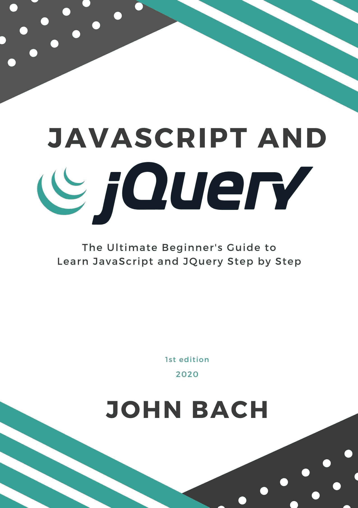

# JavaScript 与 JQuery





“编程不在于你所知道什么，而在于你能弄懂什么。” —— Chris Pine


# 第一章
- JQuery 基础
- $ 符号是什么？
- 访问元素
- 创建 jquery 对象的其他方法
- 你的选择器包含任何元素吗？
- 从选择中访问单个元素
- 创建新对象
- 处理选择集
- 标识检查
- 链式调用（Chaining）
- 结论

# 第二章
- 学习 jQuery 中的页面导航和编辑函数
- 遍历
- 过滤选择集
- 查找以选择器开头的元素
- 返回原始选择集
- 元素操作
- 编辑项目
- 添加或删除类
- 改变外观
- 修改表单值
- 更改其他属性
- 从元素获取信息
- 向页面添加元素
- 复制元素
- 删除元素
- 结论

# 第三章
- JQuery 事件：如何委托它们
- 在命名空间内限制事件
- 同时连接多个事件
- 为事件传递函数
- 事件对象
- 赞助器内部
- 防止默认行为
- 事件冒泡
- 事件委托
- 结论

# 第四章
- 使用 jQuery 移动页面
- 使用 jQuery 效果
- 使用 `.animate()` 自定义效果
- 移动管理

# 第五章
- jQuery 中的 AJAX 和延迟对象简介
- AJAX
- `.Ajax`
- AJAX 中的 A 意味着“异步”
- AJAX 中的 X 意味着 JSON！
- 快捷函数
- 提交数据和处理表单
- JqxHR
- JSONP
- 延迟对象
- `.Deferred`
- `.Pipe()`
- 处理可能异步的操作

# 第六章
- 如何使用 jQuery 创建可移动幻灯片
- 解释本课程中创建 JavaScript 幻灯片的步骤
- 现在让我们来看看 CSS 样式
- 最后，让我们来看看 jQuery 函数

# 第七章
- 每个设计师都应该知道的 10 个 jQuery 技巧
- 回到顶部按钮
- 检查已上传的照片
- 自动修复损坏的照片
- 悬停时切换变体
- 禁用输入框
- 停止下载链接
- 在淡入（Fade）和滑动（Slide）之间切换
- 折叠效果
- 根据帖子确定 div 元素的高度
- 根据奇偶元素列出不同的颜色

# 第八章
- 表头和静态列表格
- 使用 jQuery 使用 html 表格
- 使用 position: sticky 吗？
- 使用 jQuery 解决
- 我们想要实现什么？
- 入门 CSS
- 使用 JavaScript
- 步骤 1：复制 <thead> 元素
- 步骤 2：封装并复制表格
- 步骤 3：设置复制表格的内容
- 步骤 4：函数
- 步骤 5：连接一切


# JavaScript 基础及初学者常见错误

（你可以跳过此部分）

JQuery 是基于 JavaScript 构建的，而 JavaScript 本身丰富且强大。本课程涵盖了 JavaScript 的基础以及初学者常犯的一些错误。本课程对于编程世界的新手非常有益，对于以前没有学习过 JavaScript 特有方面的其他语言的程序员也有帮助。

这是一个简单的 JavaScript 程序，用于向网页添加一条消息：

```javascript
// 创建一个标签来问候某人

// 我基于变量 'greet' 创建
var greet = function (person, message) {
  var greeting = 'Hello,' + person + '!';
  log (greeting + '' + message);
};

// 使用该函数通过名字和问候消息来问候 Jory
greet ('Jory', 'Welcome to JavaScript');

// 使用该函数通过名字和不同的消息来问候 Rebecca
greet ('Rebecca', 'Thanks for joining us');
```

注意：在上例中，我们使用了 `log` 函数。它仅在本系列示例中提供的辅助函数，在 JavaScript 中并不自动可用。`log` 可以在本系列的脚本编辑器中使用，但在字符串之外的脚本中，你需要使用 `console.log` 来替换它，然后文本结果将打印到你使用的浏览器末尾。

```javascript
// 创建一个问候某人的函数，
//并将该函数赋值给 `greet` 变量
var greet = function (person, message) {
  var greeting = 'Hello,' + person + '!';
  log (greeting + '' + message);
};

// 使用该函数问候 Jory，传入她的
// 名字和我们要使用的消息
greet ('Jory', 'Welcome to JavaScript');

// 使用该函数问候 Rebecca，传入她的
// 名字和一个不同的消息
greet ('Rebecca', 'Thanks for joining us');
```

上例显示了在控制台部分执行脚本的结果。你可以使用 `Clear` 按钮重置示例，然后点击 `Run` 尝试重新执行它。如果某些内容看起来难以理解，那是没关系的。在接下来的章节中，我们将介绍变量、函数以及 JavaScript 的其他基础组件。

## 关于注释

注释对于解释代码的作用非常有用，而且注释不会影响程序。有些程序员喜欢在程序中使用注释，而另一些人则只在某些部分晦懂时才写注释。JavaScript 允许两种类型的注释：单行和多行，第一种以 `//` 开始，第二种以 `/*` 开始并以 `*/` 结束。

```javascript
// 这是一个单行注释
var foo;

/*
这是一个多行注释
它可以跨越多行。
*/
```

你也可以在行内嵌入多行注释：

```javascript
function cornify (unicorns /* integer * /) {}
```

## JavaScript 的核心组件

### 变量

变量是存储稍后需要使用的值的方式。变量可以是多种类型，例如数字、对象，甚至是代码（存储在变量中）。使用 `var` 语句声明变量：

```javascript
var myName = 'Rebecca';
```

任何变量名都可以被选择，只要它不包含 "-"。你可以在每一句声明一个变量：

```javascript
var a = 1;
var b = 'two';
```

或者通过逗号在一个句中声明多个变量：

```javascript
var a = 1,
    b = 'two';
```

在给变量赋值后，可以使用该变量来访问存储的值：

```javascript
log (myName); // 打印 'Rebecaa'
```

变量是遵循“不要重复自己”（DRY）原则的必要组件。如果你想多次使用一个值，你可能想将其存储在变量中。我们将在文中详细讨论变量。

### 函数

函数是 JavaScript 软件的关键组件，因为它提供了在独立部分创建小函数的方法。例如，假设有一个函数结合两个数字：

```javascript
function (a, b) {
    return a + b;
}
```

该函数接收两个因子 `a` 和 `b`，将它们相加，然后返回和。上例的格式是正确的，但它没有任何作用，因为我们还没有调用这个函数。所以我们必须找到调用函数的方法，可以通过赋值：

```javascript
var addTwoNumbers = function (a, b) {
  return a + b;
}
```

我们在上例中做的是将一个函数表达式赋值给变量。我们现在可以使用变量名调用此函数：

```javascript
log (addTwoNumbers (1, 1)); // 打印 2
```

或者，我们可以使用函数声明来给函数命名：

```javascript
function addTwoNumbers (a, b) {
  return a + b;
}
```

两种方法都允许我们以相同的方式调用函数，但在采用最后一种方法时必须注意本文所解释的原因。结论：如果你不完全理解 JavaScript 中称为“变量提升”（hoisting）的特性，通过声明函数来命名可能会导致意外的结果。该特性的细节超出了范围，但我们将依靠将函数赋值给变量。

### 函数和变量作用域

使用 `var` 语句在函数内部定义的变量仅在该函数内部可用，这通常是理想的，除非打算让它们全局化（即在程序范围内可用）。但变量仅在函数内部意味着什么？尝试这个程序：

```javascript
Warning: Wrong script
var myFunction = function () {
  var foo = 'bar';
};

myFunction ();

log (typeof foo); // 打印 undefined!
```

如果我们在上例中尝试在函数外部使用 `foo` 的值（而不是仅仅检查它的类型），我们将告诉浏览器发生了错误，程序将停止执行使用 foo 的位置。

接下来的示例显示了两个不同的变量如何存在于同一个名称，只要它们位于彼此独立的领域中。在这个示例中，我们声明了变量 `foo` 并给其赋值为 `'qux'`，然后在函数中声明了另一个变量，我们也叫它 `foo`，并给它赋值为 `'bar'`。注意，即使我们在函数内部创建了 `foo` 变量，函数外的 `foo` 变量也不会改变。

```javascript
var foo = 'qux';
var myFunction = function () {
  var foo = 'bar';
};

log (foo); // 打印 'qux'

myFunction ();

log (foo); // 也打印 'qux'
```

变量的作用域是 JavaScript 的核心概念，可能会让初学者感到困惑。记住：

- 在大多数情况下，使用 `var` 声明变量
- 使用 `var` 语句在函数内部定义的变量无法从外部访问
- 没有 `var` 强制执行的变量总是全局的

注意，未使用 `var` 单词声明的变量通常是隐式的。在接下来的示例中，由于没有使用 `var` 单词，变量 `a` 在函数外部也可用（这在大多数情况下是不良的）。

```javascript
Warning: insecure script
function test () {
  a = 1;
}

test ();
```


```
log (a); // Print 1
```

## 对象 (Objects)

事实是，我们在 JavaScript 中处理的大部分内容都是对象，语言中只有 5 种类型的值不是对象：

- 字符串 (Strings)
- 布尔值 (Boolean: true / false)
- 准备 (preparation)
- undefined (undefined)
- null (null)

之前的值被称为原始类型（primitives），其中一些值甚至可以被像对象一样对待处理（我们稍后会解释这一点）。但什么是对象呢？让我们来看简单的对象：

```javascript
var person = {
  firstName: 'Boaz',
  lastName: 'Sender'
};
```

我们上面创建的对象有两个属性：`firstName` 和 `lastName`。我们以“对象字面量”的形式创建了该对象，即通过大括号 `{}` 括起一组键/值对。注意，用冒号（`:`）分隔键和值，用英文逗号（`,`）分隔每一对键值。注意最后一个键值对后面没有逗号，如果你不小心添加了它，在旧版浏览器中执行程序时会发生错误。

## 访问属性 (Access to properties)

我们将对象存储在一个名为 `person` 的变量中，这使得我们能够使用点符号法或括号表示法轻松地访问它的属性。

```javascript
var person = {
  firstName: 'Boaz',
  lastName: 'Sender'
};

log ('First name:' + person.firstName); // 点符号法
log ('Last name:' + person ['lastName']); // 括号表示法
```

你会注意到，当采用括号表示法时，我们使用字符串来获取我们想要的特殊名称。当采用另一种方法（即点符号法）时，我们直接使用相同的特殊名称而没有加引号。当我们想要访问一个名称存储在变量中的属性时，括号表示法非常有用：

```javascript
var person = {
  firstName: 'Boaz',
  lastName: 'Sender'
};

var prop = 'lastName';
log ('Last name:' + person [prop]);
```

创建对象后，我们可以修改它的属性：

```javascript
var person = {
  firstName: 'Boaz',
  lastName: 'Sender'
};

person.firstName = 'Ben';
person.lastName = 'Alman';

log ('First name:' + person.firstName);
log ('Last name:' + person.lastName);
```

JavaScript 的这一特性既是福赐也是诅咒，它意味着对象超级灵活，但也意味着对象没有“私有性”，因此任何脚本都可以为它可以访问的任何对象的任何属性分配新值；这就是为什么 jQuery 促使将变量与公领域隔离，除非你真的想让其他程序更改这些属性。

## 对象方法 (Object methods)

方法是对象中值为函数的属性，为了给 `person` 对象添加 `.greet()` 函数，如下：

```javascript
var person = {
  firstName: 'Boaz',
  lastName: 'Sender',
  greet: function (name) {
    log ('Hi,' + name);
  }
};

person.greet (person.firstName);
```

上一个示例中的函数 `.greet()` 接收文本 `name` 作为它的操作。在调用此函数时，我们简单地将特殊名称 `name` 的值发送给 `person` 对象。如果我们想要一个可以招呼任何人的高度灵活的任务，也许我们的写法是正确的。但大多数时候，我们希望任务只招呼对象中标识出的那个人。

### 它的含义 (Meaning of this)

在每个函数内部（以及每个函数之中）都有特殊的关键字：`this`，它代表调用函数时的上下文对象。

当我们调用 `person.greet()` 时，上下文是同一个 `person`。这意味着我们可以在 `.greet()` 函数内部直接使用 `this` 来访问 `person` 对象的属性。

注意：`this` 的含义对于 JavaScript 新开发者来说可能非常困惑。如果你不它的确切含义，可以放心，因为 jQuery 优化了它的使用方式，你不需要深入它的细节；然而，谈论对象及其函数时，如果不提到 `this` 这一点，是不完整的。如果你喜欢，可以自由跳转到本文的“jQuery 中的对象”部分，等觉得准备好完全理解它时再回到这里。

让我们尝试理解这如何在我们的任务中使用它：

```javascript
var person = {
  firstName: 'Boaz',
  lastName: 'Sender',
  greet: function () {
    log ('Hi,' + this.firstName);
  }
};

person.greet ();
```

目前还不怎么复杂……对吧？复杂性的根源在于 `this` 的含义会改变，正如我们所说的，取决于调用函数时的上下文！注意下文：

### 警告：错误的脚本 (Warning: Wrong script)

```javascript
var person = {
  firstName: 'Boaz',
  lastName: 'Sender',
  greet: function () {
    log ('Hi,' + this.firstName);
  }
};

var sayIt = person.greet; // 将方法存储在变量中
sayIt (); // 记录 'Hi, undefined' - 哎
```

当我们把 `.greet()` 函数存储在 `sayIt` 变量中并调用 `sayIt()` 时，上下文变成了全局对象 `window`，而不是 `person`。由于 `window` 没有它自己的名称 `firstName`，因此当我们尝试访问它时，结果是 `undefined`。

那么程序员应该做什么呢？首先：他应该小心 `this` 含义带来的意外后果，当在变量中存储对象的函数时。其次，他必须知道通过使用 `call()` 和 `apply()` 可以强制 `this` 指向他想要的对象：

```javascript
var person = {
  firstName: 'Boaz',
  lastName: 'Sender',
  greet: function () {
    log ('Hi,' + this.firstName);
  }
};

var sayIt = person.greet;
sayIt.call (person);
```

这两个函数 `.call()` 和 `.apply()` 允许将传递传递给调用的函数。假设招呼函数接受一些参数，那么可以使用 `.call()` 这样传递这些参数：

```javascript
var person = {
  firstName: 'Boaz',
  lastName: 'Sender',
  greet: function (greeting, punctuation) {
    log (greeting + ',' + this.firstName + punctuation);
  }
};

var sayIt = person.greet;
sayIt.call (person, 'Hello', '!! 1 !! 1');
```

同样可以使用 `.apply()` 完成，但使用它我们需要将参数传递到一个数组而不是直接传递：

```javascript
var person = {
  firstName: 'Boaz',
  lastName: 'Sender',
  greet: function (greeting, punctuation) {
    log (greeting + ',' + this.firstName + punctuation);
  }
};

var sayIt = person.greet;
sayIt.apply (person, ['Hello', '!! 1 !! 1']);
```

注意：有关 `.call()` 和 `.apply()` 的更多细节，请参见 Mozilla 开发者网络 `.call()` 和 `.apply()`，

## jQuery 中的对象 (Objects in jQuery)

我们还没有触及 JavaScript 对象的细节，但你现在已经了解了学习 jQuery 时与对象交互的基础，在 jQuery 中我们将使用对象一次性为页面上的元素设置多个 CSS 属性：

```javascript
$ (' main').css ({
  color: 'red',
  border: '1px solid blue'
});
```

## 更多细节 (more details)

Mozilla 开发者网络 JavaScript 指南扩展了对象原型、构造函数以及删除对象属性等主题。

## 数组 (Arrays)

数组是一种对象类型，用于存储一组相同类型相关元素（如文本字符串）的简单方法，尽管实际上并没有限制矩阵包含许多类型的元素。

使用字面量方法创建数组的首选方法：

```javascript
var myArray = ['a', 'b', 'c'];
```


注意：你偶尔会读到以以下方式创建数组的程序：`new Array('a', 'b', 'c')`，这在 JavaScript 开发者中是不可接受的，因为它与第一种方法不同，它具有第一种方法不具备的缺陷！例如：编写 `new Array(3)` 意味着创建一个包含三个未定义元素的数组，而不是创建一个包含数字 3 的数组（即而不是创建 `[3]`）。

数组的属性（有时称为数组的元素）可以使用与对象相同的方括号格式进行访问。每个元素都根据其在数组中的位置自动赋予名称。但要小心：数字从零开始。让我们来看一个包含 3 个元素的数组：

警告：不希望的风格

```javascript
var myArray = ['a', 'b', 'c'];
var firstItem = myArray ["0"]; // 访问第一个元素
```

在访问数组元素时，使用数字来定位数组中所需的元素更为简单，这被称为索引：

```javascript
var myArray = ['a', 'b', 'c'];
var firstItem = myArray [0];
var secondItem = myArray [1]; // 访问索引为 1 的项目
log (secondItem); // 记录 'b'
```

我们可以通过访问数组中的 `length` 属性来查看一组元素的数量：

```javascript
var myArray = ['a', 'b', 'c'];
var len = myArray.length;
log (len); // 记录 3
```

### For 循环：列出数组

由于我们知道如何确定数组的长度（其中元素的数量），并且它的第一个组件位于目录 0，因此我们可以使用 `for` 来列出数组的元素：

我们可以对数组进行很多操作，请参阅 Mozilla Developer Network 中的矩阵文档获取完整指南。

### 逻辑与验证

JavaScript 提供了 `if` 和 `else` 关键字以及三元运算符，允许在满足某些条件时执行某些命令。JavaScript 通过检查值或短语的“正确性”来确定条件是否满足。因为 JavaScript 是一种动态类型语言，我们可以使用任何值或值的组合，但验证特定值或短语为真或假的规则可能会导致一些困惑。

下面是 JavaScript 中简单条件 (`if`) 句的示例。该语句检查数字 1 的有效性，因为 1 是一个“真值”（truthy），所以括号 `{}` 中的脚本将在 `if` 语句后执行。

```javascript
if (1) {
  // 这将被执行
  log ('1 is truthy');
}
```

事实是，JavaScript 中的大多数值都是“真”的，该语言中只有五个值被认为是“假值”（falsy）：

- `undefined`（每个变量的初始值在未对其赋值时被赋予）
- `null`
- `NaN`（不是数字）
- `0`（数字零）
- `""`（空文本字符串）

当我们想要检查一个值是否存在“错误”时，我们使用参数 `!`：

```javascript
var a = '';
if (! a) {
  // 如果它是正确的，此命令将不会执行
  log ('a was falsy');
}
```

至于 `NaN` 的值，它有一个特殊情况。当在简单的条件语句中对其进行检查时，它是假的：

```javascript
var notANumber = 'four' - 'five';
if (! notANumber) {
  // 这将被执行
  log ('! notANumber was truthy');
}
```

当我们将 `NaN` 的值与假进行比较时，我们会得到一个“错误”值：

```javascript
var notANumber = 'four' - 'five';
if (notANumber == false) {
  // 此命令将不会执行
  log ('notANumber was falsy');
} else {
  // 这将被执行
  log ('notANumber was truthy');
}
```

重要的是，除了上述五个值外，所有其他值都被视为真，包括空数组、空白对象和所有非空字符串（包括文本字符串 '0'）以及除 0 之外的所有数字。

注意：可以在一行内不使用括号使用 `if` 和 `else` 编写条件句，但这种做法并不受推荐，因为它使得程序的阅读和维护变得更加困难；我们在这里提到它仅仅是因为它可能会重合。

### 逻辑运算符

逻辑运算符允许使用 `&&` 和 `||` 对双边进行求值：

```javascript
var propertyName = 1;
var bar = 0;
var baz = 2;
```

在 `&&` 的情况下，返回第一个值。在 `||` 的情况下，返回最后一个值。你可能会看到用于控制流的运算符：

```javascript
foo && bar // 返回 0
bar || baz // 返回 2
foo && baz // 返回 2
bar || foo // 返回 1
```

注意：`&&` 运算符是短路的的；如果第一个操作数为假，则第二个将不会被求值。`||` 运算符也是短路的；如果第一个操作数为真，则第二个将不会被求值。

### 三元运算符

通常，你想使用 `if` 和 `else` 根据条件的有效性来设置变量的值：

警告：不希望的风格

```javascript
var propertyName;
if (dim === 'width') {
  propertyName = 'clientWidth';
} else {
  propertyName = 'clientHeight';
}
```

然而，三元运算符允许以更短的方式实现目标：

```javascript
var propertyName = (dim === 'width') ? 'clientWidth' : 'clientHeight';
```

## JavaScript 错误

除了变量范围，JavaScript 中还有许多其他错误，我们将查看其中一些。

## 命名

JavaScript 中的常见名称以字母或特定符号开头，后跟跟字母、数字、`_` 或其他符号。名称不能以数字或减号 `-` 开头。只要遵循这些规则，这些名称都是有效的：

- `a`
- `a1`
- `foo_bar`
- `fooBaz`
- `$ fooBar`
- `_foo`
- `__foo__`

JavaScript 社区对 JavaScript 中的变量和属性开发了一些常见用法，但它们并不是强制性的，也不会影响程序的运行：

- 以 `_` 开头的名称引用私有值（我们将稍后解释）。
- 以大字母开头的名称通常是创建新对象的构造函数（我们将稍后解释）。
- 在使用 jQuery 的程序中，以 `$` 符号开头的名称引用 jQuery 对象。

## 关键字

JavaScript 保留了一些最好避免作为软件组件名称的：

`abstract`, `boolean`, `break`, `byte`, `case`, `char`, `class`, `const`, `continue`, `debugger`, `default`, `delete`, `do`, `double`, `else`, `enum`, `export`, `extends`, `false`, `final`, `finally`, `float`, `for`, `function`, `goto`, `if`, `implements`, `import`, `in`, `instanceof`, `int`, `interface`, `instance`, `long`, `native`, `new`, `null`, `package`, `private`, `protected`, `public`, `return`, `short`, `static`, `super`, `switch`, `synchronized`, `this`, `throw`, `throws`, `transient`, `true`, `try`, `typeof`, `var`, `volatile`, `void`, `while`, `with`。

如果要作为特定对象的名称，你应该用双引号将其括起来：

```javascript
var myObject = {
  'class': 'tasty'
};
```


在 JavaScript 中处理数字有时会得到意料之外的结果，这是由于 JavaScript 内部表示数字的方式导致的，例如：当两个小数相加时，结果是一个非常接近预期值的数字，但它并不完全相等：

```
log (0.0001 + 0.0002); // 0.00030000000000000003
```

在处理 jQuery 时你可能不会遇到这种情况，但当你处理像货币之类的小数时，这是一个你应该注意的重要问题。在执行需要完全准确的计算时，你必须在处理之前将值转换为整数，完成后后再转换回小数。

JavaScript 容忍不同的类型。当使用非数值进行计算时，JavaScript 不会报错，相反，它会以你可能意想不到的结果继续执行过程：

```javascript
log ('a' + 2); // 'a2'
log ('4' + 3); // '43'
log ('five' - '4'); // NaN (不是数字)
log (- '1'); // -1
log (1 + true); // 2
log (1 == true); // true
log (1 === true); // false
```

# 第一章

# jQuery 基础

jQuery 使得处理浏览器后的 HTML 页面内容变得简单，并提供了工具帮助你跟踪用户与页面交互、移动元素以及在不刷新页面的情况下与服务器通信。我们很快就会解释这些工具。让我们先从 jQuery 的基础开始，以及如何使用它的主要功能：访问页面上的特定元素并对其进行操作。

注意：本章假设你熟悉 HTML 基础和 CSS 选择标记。如果你不熟悉如何使用 CSS 选择标记访问页面的特定元素，在继续本章之前必须先学习这些。

## 这个符号是什么：$？

jQuery 库提供了 `jQuery` 函数，允许你使用 CSS 选择标记定义元素。

```javascript
var listItems = jQuery ('li');
```

如果你以前读过使用 jQuery 的软件，你一定熟悉这个：

```javascript
var listItems = $ ('li');
```

正如我们在上部分（JavaScript 基础）中讨论的，在 JavaScript 中几乎名称都是有效的，除非它们以数字开头或包含 "-" 符号。因此，最后一个示例中的名称 `$` 只是 `jQuery` 函数的简短名称，如果你查看 jQuery 的源码，你会在末尾附近看到：

```javascript
// 将 jQuery 暴露给全局对象
window.jQuery = window. $ = jQuery;
```

当你调用 `$()` 函数并向其传递参数时，你会得到一个新的 jQuery 对象。JavaScript 中的函数是其他对象，这意味着 `$`（当然也包括 `jQuery`）函数也有属性和方法。例如：你可以使用 `$.support` 特来查找当前浏览器支持哪些功能，可以使用 `$.ajax` 函数来发送 AJAX 请求。

注意：从现在起，我们将在系列中使用 `$` 代替 `jQuery` 以尽量缩短长度。请注意，如果你的页面包含多个一个库，名称 `$` 可能会被另一个库占用，从而导致 jQuery 无法工作。如果你遇到此类问题，请在加载其他库之前尝试使用 `jQuery.noConflict`。

### `$(document).ready()`

在用 jQuery 在页面上执行任何操作之前，我们需要确保页面已处于内容可以修改的状态。在 jQuery 中，可以通过将我们的程序封装在一个函数内，然后将此函数传递给 `$(document).ready()` 来完成。如下示例所示，我们传递的函数可以是匿名的（无名称）：

```javascript
$(document).ready (function () {
  console.log ('ready!');
});
```

这将在文档（页面）准备绪后调用我们传递给 `.ready()` 的函数。这里发生了什么？我们使用 `$(document)` 从页面上的文档创建一个 jQuery 对象，然后在该对象上调用函数 `.ready()`，并传递了我们想要执行的函数。

由于你会发现自己反复重写这段文字，jQuery 提供了一种简便方法，因为当向 `$()` 函数传递函数而不是 CSS 参数时，它执行不同的任务，并表现为 `$(document)` 函数的备用名称：

```javascript
$(function () {
  console.log ('ready!');
});
```

注意：从现在起，我们假设本系列中的文本都由 `$(document).ready(function () {...});` 包裹，为了简洁起见我们将省略该短语。

## 访问元素

使用 jQuery 最简单的方法是选择某些元素并对其进行某些操作。如果你理解 CSS 参数，你会发现访问某些元素是简单的：你只需要向 `$()` 传递适当的参数。

```javascript
$ ('#header'); // 指定标识为 'header' 的元素
$ ('li'); // 选择页面上所有的列表项
$ ('ul li'); // 选择无序列表中的所有列表项
$('.person'); // 选择所有类为 'person' 的元素
```

重要点是，任何选择都只包含在你做出选择时存在的选择器对应元素，这意味着如果你输入 `var anchors = $('a');` 然后稍后向页面添加 `<a>` 元素，`Anchors` 将不包含该新项。

## 创建 jQuery 对象的其他方法

除了向 `$()` 函数传递选择器外，可以通过其他方式创建 jQuery 对象：

```javascript
// 从 DOM 元素创建 jQuery 对象
$ (document.body.children [0]);

// 从 DOM 元素创建 jQuery 对象
$ ([window]);

// 选择 DOM 元素
var firstBodyChild = document.body.children [0];

// 创建选择中的元素
var paragraph = $ ('p');
```

## 选择是否包含元素？

有时你想在选择匹配一个或多个元素时执行某些命令，但 `$()` 函数始终返回 jQuery 对象，而该对象始终为真（truthy），所以你应该检查选择的内容以是否包含任何元素。

```javascript
if ($ ('nonexistent')) {
  // 错误！这里的命令将始终执行！
}

if ($ ('nonexistent').length> 0) {
  // 正确！这里的命令将不会执行
}
```

我们可以根据 0 是一个假值（falsy）来进一步简化这种检查：

```javascript
if ($ ('nonexistent').length) {
  // 只有当找到对象时，这里才会执行
}
```

## 从选择中访问项目

如果你需要处理选择中的原始 DOM 元素，你必须从 jQuery 对象访问该元素。例如，假设你想直接访问 `<input>` 对象的值属性，你需要操作原始 DOM 元素：

```javascript
var listItems = $ ('li');
var rawListItem = listItems [0]; // 或者 listItems.get (0)
var html = rawListItem.innerHTML;
```

注意你不能在原始 DOM 元素上调用 jQuery 函数。以下示例将不起：

```javascript
var listItems = $ ('li');
var rawListItem = listItems [0];
var html = rawListItem.html (); // 对象 <HTMLInputElement> 没有方法 'html'
```

如果你想处理选择中的单个元素并对其使用 jQuery 函数，你必须使用 `.eq()` 函数从它创建一个新的 jQuery 对象，并传递你想要的元素索引：

```javascript
var listItems = $ ('li');
var secondListItem = listItems.eq (1);
secondListItem.remove ();
```

## 创建新对象

`$` 函数有最后一个第三角色：创建新元素。如果你将 HTML 片段传递给 `$()`，它将在内存中创建一个新对象，这意味着除非你手动操作，否则该对象不会被添加到页面。

```javascript
$ ('<p>'); // 创建没有内容的 <p> 元素
$ ('<p> Hello! </p>'); // 创建带有文本的 <p> 元素
```


```javascript
$('p class = "greet"> Hello! </p>'); // 创建一个带有文本和类名的 <p> 元素
```

你也可以通过传递一个包含描述如何创建对象的对象来创建一个新对象：

```javascript
$('<p>', {
  html: 'Hello!',
  'class': 'greet'
});
```

注意，你必须用双引号将类名括起来，因为 `class` 是 JavaScript 中的保留字，如果不将其包含在标签内，在某些浏览器中会导致错误。关于可以在此对象中包含的各种属性的详情，请参阅 jQuery 文档。

在系列的下一部分中，我们将学习如何在页面上添加元素，该部分将解释跨页面切换以及修改其内容。

## 处理选择器

当你创建一个包含特定选择器的 jQuery 对象后，你通常想对它进行某些操作，在此之前，你必须熟悉 jQuery 处理对象的方法。

## 标识检查

我们可以使用 `.is()` 函数来判断它是否符合某些标准。使用该函数常用的方法是给它提供一个参数作为唯一参数，然后它将根据选择的结果返回 `true` 或 `false`：

```javascript
$('li').eq(0).is('.special'); // false
$('li').eq(1).is('.special'); // true
```

你也可以将 jQuery 对象传递给 `.is()` 函数，即使是原始 DOM 对象，或者如果需要，甚至传递一个函数来进行更复杂的测试。详情请参阅文档。

## 读取、写入和隐式叙述函数

进行选择后，有几个可以调用的函数。这些任务通常分为两类：获取器（getters）和设置器（setters）。第一类提供有关选择器的信息，第二类则以某种方式更改选择器。在大多数情况下，读取函数仅限于规格中的第一个元素（`.text()` 是该规则的例外之一）。

隐式叙述意味着当你对特定选择器调用写入函数时，jQuery 会自动传递选择中的所有元素。也就是说，当你想要对单个选择中的所有元素执行某些操作时，你不需要单独为选择中的每个元素调用函数，只需调用该特定函数即可，jQuery 就会理解它必须在规格中的所有元素上实现它。

假设我们要更改页面上所有菜单项的 HTML 文本，为此，我们必须使用 `.html()` 函数，它可以更改所有所选列表元素中的 HTML 文本。

```javascript
$('li').html('New HTML');
```

你也可以向 jQuery 的写入函数传递一个函数，返回值将被用作新值，此函数接收两个参数：对象在选择中的索引，以及你尝试更改的实体的旧值，如果你需要有关元素当前状态的信息来正确设置其新状态，这就会非常有用。

```javascript
$('li').html(function (index, oldHtml) {
  return oldHtml + '!!!'
});
```

尝试测试区域中的示例

## 显式迭代

有时，原始的 jQuery 函数无法准确地完成你想要实现的任务，这时你必须显式地遍历规格中的元素，这正是 `.each()` 函数允许的。在下面的示例中，我们使用它在菜单项开头添加一个 `<b>` 标签，元素直接包含：

```javascript
$('li').each(function (index, elem) {
  // this: 当前原始 DOM 元素
  // index: 当前对象在选择中的索引
  // elem: 当前原始 DOM 元素（类似于 this）
  $(elem).prepend('<b>' + index + ': </b>');
});
```

尝试测试区域示例

注意：你会发现，我们在传递给 `.each()` 的函数内部，可以通过两种方式获取原始 DOM 元素：第一种通过 `this`，第二种通过 `elem`。正如前面提到的，原始 DOM 元素在传递给 `.each()` 的函数内部是可用的两种方式：第一种通过 `this`，第二种通过 `elem`。正如前面提到的，原始 DOM 元素在传递给 `.each()` 的函数内部是可用的两种方式：第一种通过 `this`，第二种通过 `elem`。正如前面提到的，原始 DOM 元素在传递给 `.each()` 的函数内部是可用的两种方式：第一种通过 `this`，第二种通过 `elem`。正如前面提到的，原始 DOM 元素在传递给 `.each()` 的函数内部是可用的两种方式：首种通过 `this`，第二种通过 `elem`。正如前面提到的，原始 DOM 元素在传递给 `.each()` 的函数内部是可用的两种方式：第一种通过 `this`，第二种通过 `elem`。

此处由于原文存在处重复重复，，已已保持翻译逻辑翻译）

## 链式调用（Chaining）

jQuery 链式调用最实用的功能之一是它可以将方法连接在一起。这意味着我们不需要多次编写选择器，只需将它们组合起来：

```javascript
$('div').addClass('text').css('color', 'red').show();
```

在这种情况下，每个方法都会返回一个新的 jQuery 对象，因此下一个方法可以继续调用。

## 遍历（Traversal）

jQuery 允许我们遍历组成页面的 HTML 元素。我们首先创建一个初始选择器，然后从那里遍历 DOM。当我们遍历 DOM 时，我们会从初始选择器进行更改，添加或删除某些元素，有时甚至完全替换它。

## 过滤选择

你可以过滤现有的选择以包含符合特定标准的元素。例如，你可以通过以下方式进行过滤：

```javascript
var listItems = $('li');

// 选择行只包含 'special' 类的项目
var special = listItems.filter('.special');

// 选择行包含非 'special' 元素
var notSpecial = listItems.not('.special');

// 选择行只包含 span 的元素
var hasSpans = listItems.has('span');
```

注意的是，`.not()` 函数并不是 `.is()` 的反面，因为 `.is()` 返回的是布尔值（true 或 false），而 `.not()` 返回的是一个新的 jQuery 对象。

## 查找从选择开始的项

初始选择器可以作为创建额外选择的依据。如果你有一个包含单个菜单项的选择，并且你想处理它的“兄弟元素”或它包含的无序列表，你可以轻松地基于现有选择创建新的选择：


## 页面上的第一个菜单项

```javascript
var listItem = $ ('li') .first (); // 也可以 .last ()
```

// 选择菜单项的兄弟元素

```javascript
var siblings = listItem.siblings ();
```

// 选择菜单项的下一个兄弟

```javascript
var nextSibling = listItem.next (); // 也可以 .prev ()
```

// 选择菜单项的父元素

```javascript
var list = listItem.parent ();
```

// 选择直接来自列表的菜单项

```javascript
var listItems = list.children ();
```

// 选择列表中的所有菜单项，包括子项

```javascript
var allListItems = list.find ('li');
```

// 选择“module”菜单项的所有祖先

```javascript
var modules = listItem.parents ('.module');
```

// 选择距离菜单项最近的具有类“module”的祖先

```javascript
var module = listItem.closest ('.module'
);
```

你可以使用 `.add()` 函数向当前选择中添加内容，该函数接受分隔符、元素数组、HTML 文本或 jQuery 对象。

```javascript
var list = $ ('# my-unordered-list');
```

// 对列表执行某些操作，然后 ...

```javascript
var listAndListItems = list.add ('# my-unordered-list li'
);
```

## 返回原始选择

当你使用它从当前选择移动到其他选择时，JQuery 会保留对原始选择的引用，以防你想要返回原始选择。例如，假设你选择了一个无序列表，然后你想修改菜单项，然后再次返回处理无序列表，这时你可以使用 `.end()` 函数返回原始选择：

```javascript
$ ('# my-unordered-list')
.find ('li')
// 我们现在正在处理菜单项
.addClass ('special')
.end ()
// 我们现在回到了同一个列表
.addClass ('super-special');
```

`.end()` 函数可以让你轻松在一句话中进行许多调整，但这种方法并不会提高脚本的清晰度，它就像是在不喘气地讲故事。出于这个原因，我不建议你过度使用它。在大多数情况下，它会让脚本变得更难以阅读、维护和修订。

这里是解决同一个问题的更优方案：

```javascript
var list = $ (
'# my-unordered-list');
var listItems = list.find ('li');
listItems.addClass ('special');
list.addClass ('super-special');
```

如果你想将原始选择添加到当前选择中，JQuery 还提供了 `.addBack()` 函数。例如：

```javascript
$ ('li.special')
.siblings ()
// 我们现在正在处理上一个选择的兄弟元素
.removeClass ('important')
.addBack ()
// 现在我们同时处理原始菜单项及其兄弟元素
.addClass ('urgent');
```

你觉得困惑吗？`.addBack()` 函数在缺点上与 `.end()` 函数相似，因为两者（如果使用它们）都会增加脚本的复杂性。最好的解决方案是使用 `.add()` 函数将原始两个选择合并在一起：

```javascript
var specialListItems = $ (
'li.special');
var otherListItems = specialListItems.siblings ();
otherListItems.removeClass ('important');
specialListItems.add (otherListItems) .addClass ('urgent'
);
```

## 元素操作

jQuery 对象的操作功能允许比原生 DOM 功能提供的更简单的格式来更改页面 DOM。jQuery 中处理元素的函数返回你正在操作的 jQuery 对象，这意味着它可以链接在字符串中，或与其他 jQuery 函数合并，正如我们在前面的段落中讨论的那样。

## 编辑项

在 jQuery 中修改项有许多方法。下面，我们将查看完成最常见任务的方法。

## 添加或删除类

HTML 中的对象类对于 CSS 格式化的目标定位非常有用，也可以用于创建 jQuery 选择。例如，页面上的一个元素可以属于 `hidden` 类，该类在 CSS 中用于使该类元素的 `display` 属性对应于 `none` 值，然后可以在 jQuery 中删除或添加此类来更改对应元素的外观：

```javascript
$ (
li') .addClass ('hidden');
$ ('li') .eq (1) .removeClass ('hidden'
);
```

在试用区域尝试示例（请务必点击此示例及后续所有示例中的“Run with JS”按钮）

如果你的条件需要重复添加或删除项，你可以使用 `.toggleClass()` 函数，它会更改对象上类的状态：如果类不存在则添加，如果已存在则删除：

```javascript
$ ('li') .eq (1
) .toggleClass ('hidden');
```

## 改变外观

注意：使用类别并用 CSS 规则对其进行定位以更改元素的显示方式始终好主意，仅如上述使用 jQuery 添加或删除这些类别。在本节中，我们将学习如何直接在 jQuery 中更改元素的外观，但如果达到相同的结果，我们总是于第一种方法。

当你无法通过添加或删除类来实现目标时，jQuery 提供了 `.css()` 函数，它允许直接设置元素的外观，当你需要分配在应用程序运行时才能计算的数值时，这通常是必要的，例如在页面上放置项目的信息。不宜使用 `.css()` 函数来执行简单的格式化操作。

当无法通过添加或删除类来实现目标时，jQuery 提供了 `.css()` 函数，允许直接设置元素的外观。当你需要根据运行时计算分配数值时，这通常是必要的。例如，假设我们需要根据父元素的宽度来设置外观，可能会求助于 `.css()` 函数：

```javascript
var list = $ (
'# my-unordered-list');
var width = Math.floor (list.width () );
list.find ('li').each (function (index, elem) {
  var padding = width * index;
  $ (elem) .css ('padding-right', padding + 'px')
});
```

如果你需要一次设置多个属性，请向 `.css()` 函数传递一个对象而不是属性名和值。注意你必须将包含特殊符号放入引号：

```javascript
$ (
'li') .eq (1) .css ({
'font-size': '20px',
'padding-right': '20px'
});
```

## 修改值

jQuery 提供了 `.val()` 函数来修改 input 等元素的值。

你可以传递字符串来设置输入字段的内容：

```javascript
$ (
'input [type = "text"]') .val ('new value'
);
```

对于 select 元素，也可以使用 `.val()` 设置选中的选项：

```javascript
$ ('select') .val ('2'
);
```

对于复选框输入字段，你必须使用 `.prop()` 函数在元素上设置 属性：

```javascript
$ (
'input [type = "checkbox"]') .prop (
'checked', true
);
```

注意：`.prop()` 函数是在 jQuery 1.6 版本引入的；在此之前，`.attr()` 函数用于相同目的，并且在较新版本的 jQuery 中仍然有效，但如果是 checked，它只会调用 `.prop()`。如果你使用的是高于 1.6 的版本，我建议始终使用 `.prop()` 来设置 checked 属性和其他 DOM 元素属性。详情请参见文档。

## 更改其他属性

你可以使用 `.attr()` 函数更改元素的属性，例如，你可以更改链接地址（<a> 的标题）：

```javascript
$ ('a') .attr ('href',
'new title');
```

在为属性赋值时，你可以在函数的第二个参数的位置上传递一个函数，就像之前所有的写入函数一样，该函数接收两个因素：你正在操作元素的索引以及属性的当前值。该函数必须返回属性的新值：

```javascript
$ ('a') .attr (
'href', function (index, value) {
  return value + '? special = true';
});
```

你也可以通过 `.removeAttr()` 删除属性。

## 从元素获取信息


在上一部分（jQuery 基础）中，我们讨论了读取和写入函数的概念。所有可以用于更改元素的函数也可以用于从这些元素中读取信息。例如，我们上面描述的 `.val()` 函数既可以作为读取函数，也可以作为写入函数：

```javascript
var input = $ ('input [type = "text"]');
input.val ('new value');
input.val (); // 返回 'new value'
```

同样适用于 `.css()` 函数，因为你可以通过传递私有属性的名称而不传递值，来读取单个 CSS 属性的值：

```javascript
var listItemColor = $ ('li') .css ('color');
var listItemColor = $ ('li') .css ('color');
```

当使用读取处理函数时，它们仅对选择器中的第一个元素起，但 `.text()` 函数除外，如果没有向它传递任何参数，它会读取所有选中元素的文本内容。

## 向页面添加项目

无论你是选择一个现有元素还是创建一个新元素，你都可以将该元素添加到页面中。这可以通过两种方式实现：为要添加的元素（或元素组）调用跟踪函数，或者调用你想要添加的关联对象的跟踪函数。

例如，假设你想将列表中的一个项目从头部移动到尾部，有几种方法可以实现。

例如，你可以通过在菜单项本身上调用 `.appendTo()` 函数将项目添加到列表：

```javascript
var listItem = $ ('# my-unordered-list li') .first ();
listItem.appendTo ('# my-unordered-list');
```

你也可以通过在菜单上调用 `.append()` 来添加项目：

```javascript
var listItem = $ ('# my-unordered-list li') .first ();
$ ('# my-unordered-list') .append (listItem);
```

或者通过在要移动的项目上调用 `.insertAfter()` 来添加，将列表中的最后一个项目传递给函数：

```javascript
var listItems = $ ('# my-unordered-list li');
listItems.first (). insertAfter (listItems.last ());
```

或者通过在列表最后一个项目上调用 `.after()` 来添加，将列表中的第一个项目传递给函数：

```javascript
var listItems = $ ('# my-unordered-list li');
listItems.last (). after (listItems.first ());
```

还有许多其他添加项目的方法，因此你可以根据需要将它们添加到其他元素的周围、内部或外部。

向页面添加项目最高效的方法取决于你手中已有的元素。如果你之前为了其他目的选择了该无序列表，那么你可能想将该元素添加到上一个示例中的无序列表中；或者，如果你已经选择了列表中的所有项目，将第一个元素添加到最后一个项目之后可能会更简单。

当你选择合适的添加元素方法时，不仅要考虑该方法的易用性，还要考虑其日后维护的可能性。避免使用那些依赖于假设页面具有严格定义结构的方法，因为你可能会在以后更改这种结构。

## 复制项目

你可以使用 jQuery 中的 `.clone()` 函数创建一个元素或一组元素的副本，它会在内存中创建副本而不会包含在页面中，如果你需要，应该手动将其包含。。在添加复制的项目之前，你可以对它们进行编辑：

```javascript
var clones = $ ('li') .clone ();
clones.html (function (index, oldHtml) {
  return oldHtml + '!!!';
});
$ ('# my-unordered-list') .append (clones);
```

注意：jQuery 不阻止你复制带有标识符（ID）的元素，但你必须在将其插入文档之前，通过修改 `id` 属性来删除或更改复制元素中的标识符，因为页面上不应该有两个相同标识符的元素。

## 删除项目

从页面移除项目有三种方法：`.remove()`、`.detach()` 和 `.replaceWith()`，它们都有不同的用途。

当需要永久删除对象时，必须使用 `.remove()`，因为它会连同对象一起删除与其相关的事件处理器。`.remove()` 函数返回被删除项目的引用，但当你再次添加这些项目时，将没有事件绑定到它们上。

```javascript
$ ('# my-unordered-list li') .click (function () {
  alert ($ (this) .text ());
});
var removedListItem = $ ('# my-unordered-list li') .first (). remove ();
removedListItem.appendTo ('# my-unordered-list');
removedListItem.trigger ('click'); // 没有弹出消息！
```

`.detach()` 函数适用于临时从页面中移除项目。例如，如果你想使用 jQuery 对页面结构进行重大更改，从页面中删除项目可能是暂时的，分阶段删除并重新添加性能会更好。被删除的项目将保留关联的事件触发器，然后可以使用 `.appendTo()`或其他添加函数再次将其添加到页面。

```javascript
$ ('# my-unordered-list li') .click (function () {
  alert ($ (this) .text ());
});
var detachedListItem = $ ('# my-unordered-list li') .first (). detach ();
// 对菜单项进行一些操作
detachedListItem.appendTo ('# my-unordered-list');
detachedListItem.trigger ('click'); // 弹出！
```

最后，我们有 `.replaceWith()` 函数，它用元素或其他元素替换元素或 HTML 文本。被移除的项目会被返回，但所有相关的事件处理器都会删除。

```javascript
$ ('# my-unordered-list li') .click (function () {
  alert ($ (this) .text ());
});
var replacedListItem = $ ('# my-unordered-list li') .first ()
  .replaceWith ('<li>new!</li>');
// 示例结束
```

## 总结

在本章中，我们学习了移动元素、更改元素以及添加元素的不同方法。在下一章，我们将学习如何监听用户交互。

# 第三章：jQuery 事件以及如何委托它们

jQuery 使得响应网页的用户交互变得简单。这意味着当用户点击页面特定部分时执行命令，或者当鼠标指针悬停在某个项目上时。在下面的示例中，我们有一个在用户点击任何项目时执行的命令：

```javascript
$ ('li') .click (function (event) {
  console.log ('clicked', $ (this) .text ());
});
```

jQuery 为事件提供了多个快捷方式，每个函数都对应一个原始 DOM 事件：

| 原始事件名称 | 快捷函数 |
| --- | --- |
| click | `.click()` |
| keydown | `.keydown()` |
| keypress | `.keypress()` |
| keyup | `.keyup()` |
| mouseover | `.mouseover()` |
| mouseout | `.mouseout()` |
| mouseenter | `.mouseenter()` |
| mouseleave | `.mouseleave()` |
| scroll | `.scroll()` |
| focus | `.focus()` |
| blur | `.blur()` |
| resize | `.resize()` |

这些快捷方式使用了背后的 `.on()` 函数，你可以自己使用该函数以获得更大的灵活性。当你使用它时，将原始事件名称作为任务的第一个参数，并将接管事件的函数作为第二个参数：

```javascript
$ ('li') .on ('click', function (event) {
  console.log ('clicked', $ (this) .text ());
});
```

一旦你将事件的赞助者连接到元素，你也可以向 jQuery 触发此事件：

```javascript
$ ('li'). trigger ('click');
```

而且如果你想起的事件有一个快捷函数（如上表所示），你可以通过直接调用该快捷函数本身来挑起事件：

```javascript
$ ('li') .click ();
```


注意：当使用使用 `.trigger()` 触发事件时，你仅调用在 JavaScript 中生成的事件处理器，而不会触发事件的默认行为。例如，如果点击事件影响了链接（`<a>` 元素），浏览器将不会跳转到 `href` 属性中分配给它的链接（尽管你可以编写实现此目的的命令）。

在你将事件绑定到对象后，你可以使用 `.off()` 函数取消订阅，该函数会移除任何与此事件相关的线程（处理器）：

```javascript
$('li') .off ('click');
```

## 将事件限制在命名空间内

`.on()` 提供的优势之一是将事件限制在“命名空间（namespace）”。你可能会疑惑这是否有必要。例如，假设你想为一个元素关联某些事件，然后移除其中的一些线程，你可以像我们在上一个段中所做的那样

警告：不推荐这种软件风格

```javascript
$('li') .on ('click', function () {
  console.log ('a list item was clicked');
});

$('li') .on ('click', function () {
  registerClick ();
  doSomethingElse ();
});

$('li') .off ('click');
```

然而，这种方法将移除所有菜单项的所有点击线程，而这并不是我们想要的。如果你绑定了一个限制在命名空间的事件处理器，你可以精确地针对它：

```javascript
$('li') .on ('click.logging', function () {
  console.log ('a list item was clicked');
});

$('li') .on ('click.analytics', function () {
  registerClick ();
  doSomethingElse ();
});

$('li') .off ('click.logging');
```

这种方法不会影响与使用统计页面相关的点击事件，但会移除与日志相关的点击事件。

我们可以使用触发功能来触发特定事件：

```javascript
$('li') .trigger ('click.logging');
```

## 同时连接多个事件

`.on()` 提供的另一个功能是同时链接多个事件的能力。例如，假设你想在用户滚动页面或更改窗口大小时执行某个特定命令。该函数允许你将两个事件放在一个字符串字符串中并用空格分隔，随后跟上你想要处理这两个事件的函数：

```javascript
$('input [type = "text"]') .on ('focus blur', function () {
  console.log ('The user focused or blurred the input');
});

$(window) .on ('resize.foo scroll.bar', function () {
  console.log ('The window has been resized or scrolled!');
});
```

## 传递命名事件的函数

在我们之前的所有示例中，我们一直传递未知函数作为事件的触发器，但我们可以在传递之前先创建一个函数并将其存储在变量中，然后将此变量作为事件处理器。如果你想使用同一个函数来处理不同的事件或来自不同元素的事件，这将非常用：

```javascript
var handleClick = function () {
  console.log ('something was clicked');
};

$('li') .on ('click', handleClick);

$('h1') .on ('click', handleClick);
```

## 事件对象

每当事件触发时，处理事件的函数都会接收一个参数，即遵循所有浏览器约定标准的事件对象。该对象有很多有用的属性，包括：

```javascript
$(document) .on ('click', function (event) {
  console.log (event.type); // 事件类型，如："click"
  console.log (event.which); // 被按下的按钮或按键
  console.log (event.target); // 事件源自元素
  console.log (event.pageX); // 鼠标在 X 轴的位置
  console.log (event.pageY); // 鼠标在 Y 轴的位置
});
```

## 在回调内部

当你指定事件的运行函数时，该函数可以访问启动事件的原始 DOM 元素作为函数的上下文，如果你想使用 jQuery 来操作事件，请将其封装在 `$` 中：

```javascript
$('input') .on ('keydown', function (event) {
  // this: 触发事件的原始元素
  // event: 事件对象
  // 如果按下删除键，将背景颜色改为红色，否则改为绿色
  $(this) .css ('background', event.which === 8? 'red': 'green');
});
```

## 防止默认行为

有时你可能希望防止事件的默认行为，例如想使用 AJAX 点击链接，而不是启动全页重加载（这是默认行为）。许多开发者通过在事件回调中返回 `false` 来实现这一目标，但此有另一个副作用：它还会阻止事件的冒泡（我们稍后会解释），这可能会产生不理想的结果。防止事件默认行为正确的方法是在事件对象上调用 `.preventDefault()`：

```javascript
$('input') .on ('keydown', function (event) {
  // this: 触发事件的原始元素
  // event: 事件对象
  // 如果按下删除键，将背景颜色改为红色，否则改为绿色
  $(this) .css ('background', event.which === 8? 'red': 'green');
});
```

## 事件冒泡

考虑以下代码：

```javascript
$('a') .on ('click', function (event) {
  // 防止默认事件。
  event.preventDefault ();
  // 记录发生了什么。
  console.log ('I was just clicked!');
});
```

此文本链接在手中点击页面上的所有元素（你不应该这样做）。此文本链接在手中点击页面上的所有元素（你不应该这样做）。此文本链接在手中点击页面上的所有元素（你不应该这样做）。此文本链接在手中点击页面上的所有元素（你不应该这样做）。此文本链接在手中点击页面上的所有元素（你不应该这样做）。此文本链接在手中点击页面上的所有元素（你不应该这样做）。此文本链接在手中点击页面上的所有元素（你不应该这样做）。此文本链接在手中点击页面上的所有元素（你不应该这样做）。此文本链接在手中点击页面上的所有元素（你不应该这样做）。此文本链接在手中点击页面上的所有元素（你不应该这样做）。此文本链接在手中点击页面上的所有元素（你不应该这样做）。此文本链接在手中点击页面上的所有元素（你不应该这样做）。此文本链接在手中点击页面上的所有元素（你不应该这样做）。此文本链接在手中点击页面上的所有元素（你不应该这样做）。此文本链接在手中点击页面上的所有元素（你不应该这样做）。此文本链接在手中点击页面上的所有元素（你不应该这样做）。此文本链接在手中点击页面上的所有元素（你不应该这样做）。此文本链接在手中点击页面上的所有元素（你不应该这样做）。此文本链接在手中点击页面上的所有元素（你不应该这样做）。此文本链接在手中点击页面上的所有元素（你不应该这样做）。此文本链接在手中点击页面上的所有元素（你不应该这样做）。此文本链接在手中点击页面上的所有元素（你不应该这样做）。此文本链接在手中点击页面上的所有元素（你不应该这样做）。此文本链接在手中点击页面上的所有元素（你不应该这样做）。此文本链接在手中点击页面上的所有元素（你不应该这样做）。此文本链接在手中点击页面上的所有元素（你不应该这样做）。此文本链接在手中点击页面上的所有元素（你不应该这样做）。此文本链接在手中点击页面上的所有元素（你不应该这样做）。此文本链接在手中点击页面上的所有元素（你不应该这样做）。此文本链接在手中点击页面上的所有元素（你不应该这样做）。此文本链接在手中点击页面上的所有元素（你不应该这样做）。此文本链接在手中点击页面上的所有元素（你不应该这样做）。此文本链接在手中点击页面上的所有元素（你不应该这样做）。此文本链接在手中点击页面上的所有元素（你不应该这样做）。此文本链接在手中点击页面上的所有元素（你不应该这样做）。此文本链接在手中点击页面上的所有元素（你不应该这样做）。此文本链接在手中点击页面上的所有元素（你不应该这样做）。此文本链接在手中点击页面上的所有元素（你不应该这样做）。此文本链接在手中点击页面上的所有元素（你不应该这样做）。此文本链接在手中点击页面上的所有元素（你不应该这样做）。此文本链接在手中点击页面上的所有元素（你不应该这样做）。此文本链接在手中点击页面上的所有元素（你不应该这样做）。此文本链接在手中点击页面上的所有元素（你不应该这样做）。此文本链接在手中点击页面上的所有元素（你不应该这样做）。此文本链接在手中点击页面上的所有元素（你不应该这样做）。此文本链接在手中点击页面上的所有元素（你不应该这样做）。此文本链接在手中点击页面上的所有元素（你不应该这样做）。

## 事件委托

“事件冒泡”的概念允许我们实现“事件委托”的想法，即与高层元素关联事件，然后发现其中的任何子元素。例如，我们可以将事件绑定到无序列表，然后确定哪些元素触发了事件：

```javascript
$('# my-unordered-list') .on ('click', function (event) {
  console.log (event.target); // 记录触发事件的元素
});
```

当然，如果菜单项包含子项目，情况会变得复杂，因此 jQuery 提供了一个辅助函数，允许我们确定感兴趣的元素，同时将事件与高层元素关联：

```javascript
$('# my-unordered-list') .on ('click', 'li', function (event) {
  console.log (this); // 列出触发事件的菜单项
});
```

事件委托有两个好处：第一个是与决定为单个元素绑定事件相比，它允许链接更少的事件触发器，这显著提升了页面性能。第二个好处是允许我们将事件与父元素（例如示例中的无序列表）关联，并确保即使父元素的内容发生，事件也会被触发。

例如，此文本在事件委托到父元素后添加了新的菜单项，点击此元素将按预期方式触发事件，而无需绑定任何新事件：

```javascript
$('# my-unordered-list') .on ('click', 'li', function (event) {
  console.log (this); // 注册被点击的菜单项
});
```


```javascript
$ ('li> a new list item! </li>') .appendTo ('# my-unordered-list');
```

## 结

在这一部分，我们学习了监听用户与页面交互的不同方式，包括如何使用事件委托来提高将事件绑定到对象的效率。在下一节中，我们将学习如何使用 jQuery 的动态动效函数来移动元素。

# 第四章

# 使用 jQuery 移动页面

jQuery 让向页面添加动态动画效果变得非常简单，这些效果可以取决于初始设置或开发者指定的设置。你也可以从随机的 CSS 属性创建自定义动画。

关于动画的一个重要说明：在现代浏览器中，使用 CSS 而非 JavaScript 执行动画更高效，尤其是在移动设备上。这些移动完成的细节不在链调用的范围内，但如果你针对的是支持 CSS 过渡的浏览器和移动设备，你可能希望在配置较低的设备上将 `jQuery.fx.off` 设置为 `true`；这将使移动失效，并直接访问待移动元素到达其 `Final` 状态，而不应用运动。

## jQuery 包含的特效

常用的动画作为函数附加到 jQuery 中，你可以在任何 jQuery 对象上调用它们：

- `.Show()`：显示选中的项目。
- `.Hide()`：隐藏选中的项目。
- `.FadeIn()`：将选中的透明度移动到 100%。
- `.FadeOut()`：将选中的对象的亮度移动到 0%。
- `.SlideDown()`：通过垂直拖拽显示选中的元素。
- `.SlideUp()`：通过垂直滑动隐藏选中的元素。
- `.SlideToggle()`：根据选中的项目是隐藏还是可见，通过垂直滑动隐藏或显示选中的项目。

这些特效中的一个可以在创建后很容易应用到选择集：

```javascript
$ ('.hidden') .show ();
```

尝试实验字段中的示例（务必在此示例及后续所有示例中点击 Run with JS 按钮）

你也可以定义上述特效的持续时间，有两种定义方式，第一种：设置毫秒级的时间：

```javascript
$ ('.hidden') .show (300);
```

第二种是使用预定义的速度之一：

```javascript
$ ('.hidden') .show ('slow');
```

这些速度定义在 `jQuert.fx.speeds` 对象中，这意味着你可以修改它们来更改默认值，或者向其添加新速度：

```javascript
// 重置已定义的速度
jQuery.fx.speeds.fast = 50;

// 定义一个新速度
jQuery.fx.speeds.turtle = 3000;

// 因为我们更改了 'fast' 的值，这次移动将花费 50 毫秒
$ ('.hidden') .hide ('fast');

// 我们可以使用自己定义的速度，就像之前定义的那些一样
$ ('.other-hidden') .show ('turtle');
```

开发者通常希望在移动结束后立即执行某些操作，如果尝试在移动结束之前执行，可能会导致移动失真和中断，或者无意中遗漏移动瞬间移动的元素。如果你希望在特效结束后执行命令，可以向移动函数传递一个回调函数，此调用内部表示应用于移动的原始 DOM 元素，并且像事件处理程序的函数一样，它可以被 `$()` 函数包裹以作为对象使用。jQuery：

```javascript
$ ('p.old') .fadeOut (300, function () {
  $ (this) .remove ();
});
```

如果定义中不包含任何元素，则函数将不会被调用。如果你需要无论选择器中是否存在元素都调用该函数，可以创建一个处理这两种情况的函数：

```javascript
var oldElements = $ ('p.old');
var thingToAnimate = $ ('#nonexistent');

// 如果有显示的元素，此函数将作为 'show' 函数的备用调用；如果没有元素，我们直接调用它们。
var removeOldElements = function () {
  oldElements.remove ();
};

if (thingToAnimate.length) {
  // 我们的任务将在移动结束后调用
  thingToAnimate.show ('slow', removeOldElements);
} else {
  removeOldElements ();
}
```

## 使用 .animate () 自定义特效

如果与 jQuery 相关的移动不能满足你的需求，你可以使用 `.animate()` 函数根据多个 CSS 属性创建自定义移动（唯一的例外是：'color' 无法移动，但有一个插件允许这样做）。

`animate()` 函数接受最多三个参数：

- 一个指定要移动属性的对象
- 移动时间，单位为毫秒
- 一个在移动完成后将被调用的函数

移动的值可以通过编写要移动的最终值，或编写必须移动的量（移动两个位置之间的差）来确定：

```javascript
$ ('.funtimes') .animate ({
  left: '+ = 50', // 增加 50
  opacity: 0.25,
  fontSize: '12px'
  },
  300,
  function () {
    // 移动结束时执行
  }
);
```

注意：如果你想移动名称包含 "-" 的 CSS 属性，必须将名称转换为驼峰命名法（camelCase）。例如，font-size 变为 `fontSize`。

## 移动管理

jQuery 提供了两个管理函数：

- `.Stop()`：停止当前移动。
- `.Delay()`：延迟启动（毫秒）。

# 第五章

# 延迟对象

## AJAX

AJAX 是“异步 JavaScript 和 XML”的缩写，它是一种无需刷新页面即可从服务器检索数据的方法，基于名为 `XMLHttpRequest`（或 `XHR`）的对象向服务器发送请求并处理响应的数据。

jQuery 提供了多种方法的 `$ajax` 函数：一种是传递一个包含设置的对象，或者我们可以传递带设置的链接。让我们来看第一种方法：

```javascript
// 创建当 AJAX 请求成功时执行的回调函数
var updatePage = function (resp) {
  $ ('target'). html (resp [0] .name);
};

// 当失败时
var printError = function (req, status, err) {
  console.log ('something wrong', status, err);
};

// 创建描述请求的 Settings 对象
var ajaxOptions = {
  url: '/data/people.json',
  dataType: 'json',
  success: updatePage,
  error: printError
};

// 发送请求
$ .ajax (ajaxOptions);
```

当然，你可以直接将字面量对象传递给 `$ajax()` 函数并使用匿名成功错误函数，这种方法编写更容易，未来的维护也更容易：

```javascript
$ .ajax ({
  url: '/data/people.json',
  dataType: 'json',
  success: function (resp) {
    $ ('target'). html (resp [0] .name);
  },
  error: function (req, status, err) {
    console.log ('something wrong', status, err);
  }
});
```

正如我们所说，你可以通过第二种方式使用 `$ajax()` 函数，先传递链接，后传递 Settings 对象（不是强制的）。如果你希望使用初始任务设置，或者想对多个链接使用同一个设置对象，这将非常用：

```javascript
$ .ajax ('data/people.json', {
  type: 'GET',
  dataType: 'json',
  success: function (resp) {
    console.log (resp.people);
  },
  error: function (req, status, err) {
    console.log ('something wrong', status, err);
  }
});
```


在之前的示例中，该函数只需要链接，但添加 `Settings` 对象允许我们告诉 jQuery 我们发送什么类型的数据、使用什么种 HTTP 动词（`POST`、`GET` 等）、以及我们期望从服务器接收什么类型的数据，以及请求成功或失败时应该做什么……

请参阅 `$.ajax()` 文档以阅读可以添加到设置对象中的所有选项。

## AJAX 中的 A 意味着“异步”

AJAX 请求是异步执行的，这意味着 `$.ajax` 函数在请求结束之前就会结束，并且在成功回调函数被调用之前结束，这意味着 `return` 语句在请求响应到达之前就已经执行了。以下示例中的 `getSomeData` 函数将在数据被定义之前返回该值，这将导致错误：

警告：无效脚本

```javascript
var getSomeData = function () {
  var data;
  $.ajax ({
    url: '/data/people.json',
    dataType: 'json',
    success: function (resp) {
      data = resp.people;
    }
  });
  return data;
}
$('#target').html(getSomeData().people[0].name);
```

## AJAX 中的 X 意味着 JSON！

AJAX 术语于 2005 年引入，描述一种不需要重新加载整个页面即可从服务器检索数据的方法。当时，服务器发送的最常见数据格式是 XML，而今天，JSON 是大多数现代应用程序采用的格式。

基本上，JSON 是一个表示数据的字符串，看起来与普通的 JavaScript 对象非常相似，但它不能表示 JavaScript 对象可以表示的所有类型的数据。例如：JSON 无法表示 `Date` 对象或函数。这是一个 JSON 文本的示例，注意所有的属性名都包含在双引号中：

```json
{"people": [
  {
    "name": "Ben",
    "url": "http://benalman.com/",
    "bio": "I create groovy websites, useful jQuery plugins, and play a mean funk bass. I'm also Director of Pluginization at @bocoup."
  },
  {
    "name": "Rebecca",
    "url": "http://rmurphey.com",
    "bio": "Senior JS dev at Bocoup"
  },
  {
    "name": "Jory",
    "url": "http://joryburson.com",
    "bio": "super-enthusiastic about open web education @bocoup. lover of media, art, and fake mustaches."
  }
]}
```

记住，JSON 是对象的文本表示，这意味着在使用之前必须对文本字符串进行解释以将其转换为普通的 JavaScript 对象。当你处理来自服务器的 JSON 格式响应时，jQuery 会替你完成这一操作。但区分实际实体与它们在 JSON 中的表示方式是非常重要的。

注意：如果你想从 JavaScript 对象创建 JSON 文本字符串，或者在不使用 jQuery 的情况下解释 JSON 文本字符串以将其转换为 JavaScript 对象，现代浏览器提供了 `JSON.stringify()` 和 `JSON.parse()` 函数，并且可以使用 `json2.js` 库将这些属性添加到旧版浏览器中。JQuery 还提供了 `jQuery.parseJSON()` 函数，它对应于浏览器中的 `JSON.parse()` 函数，但它没有提供对应 `JSON.stringify()` 的函数。

## 短函数

如果我们只是想发送一个简单的请求，而不关心处理可能发生的任何错误，jQuery 提供了允许我们这么做的短函数。每个简写函数都接收一个链接和一个可选的设置对象，并且只有在请求成功时才会调用回调函数：

```javascript
$.get('/data/people.html', function (html) {
  $('#target').html(html);
});

$.post('/data/save', {name: 'Rebecca'}, function (resp) {
  console.log(resp);
});
```

## 提交数据和处理表单

我们可以通过请求发送数据来为设置对象中的数据赋值，或者将对象作为第二个参数传递给快捷函数。

这些数据将在 GET 请求中作为查询字符串添加到链接中，而在 POST 请求中将作为表单数据发送。jQuery 提供了一个实用的 `.serialize()` 函数，它可以接收表单并并转换为查询语法（如 `field1name = field1value & field2name = field2value ...`）：

```javascript
$('form').submit(function (event) {
  event.preventDefault();
  var form = $(this);
  $.ajax ({
    type: 'POST',
    url: '/data/save',
    data: form.serialize(),
    dataType: 'json',
    success: function (resp) {
      console.log(resp);
    }
  });
});
```

## JqXHR

`$.ajax()` 及其相关的快捷函数返回 `jqXHR`（jQuery XML HTTP Request 的缩写），它包含了许多实用函数。我们可以使用 `$.ajax()` 发送请求并保存 `jqXHR`：

```javascript
var req = $.ajax ({
  url: '/data/people',
  dataType: 'json'
});
```

我们可以使用 `$.ajax()` 发送请求并保存 `jqXHR`：

```javascript
var success = function (resp) {
  $('#target').append('people:' + resp.people.length);
};
var err = function (req, status) {
  $('#target').append('<p> something went wrong</p>');
};

req.then(success, err);

req.then(function () {
  $('#target').append('<p> it worked</p>');
});
```

## JSONP

许多初学者对发送到其他域的 XHR 请求失败感到惊讶。例如：某些开发者尝试从第三方 API 获取数据，结果对请求失败感到惊讶。

原因是出于安全考虑，浏览器不允许向其他域发送 XHR 请求，但某些 API 以 JSONP 格式（JSON Padding 的缩写）返回数据，这允许开发者绕过限制。

事实是，JSONP 并不是 AJAX 请求，因为它不使用浏览器提供的 XHR 请求，而是通过在网页中插入 `<script>` 标签工作的，该标签包含所需的数据，并由一个在调用时返回这些数据的函数包裹。细节现在并不重要，因为 jQuery 允许你通过在 `Settings` 对象中将 `dataType` 设置为 `'jsonp'` 来像 XHR 一样请求 JSONP。

```javascript
$.ajax ({
  url: '/data/search.jsonp',
  data: {q: 'a'},
  dataType: 'jsonp',
  success: function (resp) {
    $('#target').html('Results:' + resp.people.length);
  }
});
```

注意：接口通常提供一个选项来指定链接地址中包裹数据的函数。这通常是回调参数的名字，也是 jQuery 最初预期的，但你可以通过在传递给 `$.ajax()` 的设置对象中设置 `jsonp` 值来更改它。

你也可以使用简写的 `$.getJSON()` 函数发送 JSONP 请求，jQuery 可以通过链接中存在 `callback =?` 或类似的内容来区分它：

```javascript
$.getJSON('/data/search.jsonp?q=a&callback=?', function (resp) {
  $('#target').html('Results:' + resp.people.length);
});
```


` 标签中似乎不完整（在结尾的 HTML 示例 处截断了），我将根据你提供的逻辑和格式对已给出的部分进行了高质量翻译。

以下是翻译后的内容：

[content]

另一种跨资产资源共享（或 CORS）选项是允许跨资产请求。然而，旧版浏览器不支持此功能，它还需要在服务器端进行特殊配置，并修改 XHR 中的应用标头才能工作。

## 延迟对象 (Deferred objects)

我们识别出的 `jqXHR` 对象无非是所谓的“延迟对象”（deferred organisms）的一种特殊“变体”。jQuery 允许你自己创建延迟对象，用于方便处理异步命令。它提供了一种方法，在异步运行的过程成功或失败后对其进行响应，并避免了在它们之间编写交错的回调。

## $.Deferred

你可以使用 `$.Deferred()` 创建一个延迟对象。在接下来的示例中，我们在 `setTimeout` 内部实现了一个函数，然后“拒绝”（deny）我们的承诺以返回该函数产生的值。我们返回一个承诺（promise），这是一个可以附加回调函数的对象，但它不会影响延迟对象本身的结果。如果函数在执行期间出错，我们可以“拒绝”（reject）该承诺：

```javascript
function doSomethingLater (fn, time) {
  var dfd = $.Deferred ();
  setTimeout (function () {
    dfd.resolve (fn ());
  }, time || 0);
  return dfd.promise ();
}

var promise = doSomethingLater (function () {
  console.log ('这个函数将在 100ms 后调用');
}, 100);
```

## .then(), .done(), .fail(), and .always()

我们可以通过承诺将处理错误和成功的函数链接起来，就像在 `jqXHR` 对象中一样：

```javascript
function doSomethingLater (fn, time) {
  var dfd = $.Deferred ();
  setTimeout (function () {
    dfd.resolve (fn ());
  }, time || 0);
  return dfd.promise ();
}

var success = function (resp) {
  $ ('#target') .html ('成功了');
};

var err = function (req, status, err) {
  $ ('#target') .html ('失败了');
};

var dfd = doSomethingLater (function () {/*/* ... * /}, 100);

dfd.then (success, err);
```

## .pipe()

我们可以使用 `.pipe()` 函数通过修改并返回一个新的延迟对象，来承诺对遗失的值做出响应。

`.then()` 函数从 jQuery 1.8 版本开始工作，`.pipe()` 函数也可以工作。

```javascript
function doSomethingLater (fn, time) {
  var dfd = $.Deferred ();
  setTimeout (function () {
    dfd.resolve (fn ());
  }, time || 0);
  return dfd.promise ();
}

var dfd = doSomethingLater (function () {return 1;}, 100);

dfd
  .pipe (function (resp) {return resp + '' + resp;})
  .done (function (upperCaseResp) {
    $ ('#target') .html (upperCaseResp);
  });
```

## 处理可能是异步的操作

有时，我们的一项任务可能根据特定情况同步执行或不同步执行，例如：一个函数在第一次被调用时执行异步操作，然后存储该过程产生的值，以便在将来调用时直接返回。在这种情况下，我们可以使用 `$.when()` 来响应这两种情况：

```javascript
function maybeAsync (num) {
  var dfd = $.Deferred ();
  // 当 num === 1 时延迟处理
  if (num === 1) {
    setTimeout (function () {
      dfd.resolve (num);
    }, 100);
    return dfd.promise ();
  }
  // 立即结束，返回 num
  return num;
}

// 将异步完成并承诺返回 1
$ .when (maybeAsync (1)) .then (function (resp) {
  $ ('#target') .append ('<p>' + resp + '</p>');
});

// 将直接返回 0
$ .when (maybeAsync (0)) .then (function (resp) {
  $ ('#target') .append ('<p>' + resp + '</p>');
});
```

你也可以向 `$.when()` 传递多个参数，允许你将并发和异步操作组合在一起，并将它们的所有执行结果作为回调函数的参数获取：

```javascript
function maybeAsync (num) {
  var dfd = $.Deferred ();
  // 当 num === 1 时创建一个延迟承诺
  if (num === 1) {
    setTimeout (function () {
      dfd.resolve (num);
    }, 100);
    return dfd.promise ();
  }
  // 直接结束它，否则返回 num
  return num;
}

$ .when (maybeAsync (0), maybeAsync (1))
  .then (function (resp1, resp2) {
    var target = $ ('#target');
    target.append ('<p>' + resp1 + '</p>');
    target.append ('<p>' + resp2 + '</p>');
  });
```

当 `$.when()` 的参数是 `jqXHR` 对象时，我们得到一个数组：

```javascript
function maybeAsync (num) {
  var dfd = $.Deferred ();
  // 当 num === 1 时创建一个延迟承诺
  if (num === 1) {
    setTimeout (function () {
      dfd.resolve (num);
    }, 100);
    return dfd.promise ();
  }
  // 直接结束，否则返回 num
  return num;
}

$ .when (maybeAsync (0), maybeAsync (1))
  .then (function (resp1, resp2) {
    var target = $ ('#target');
    target.append ('<p>' + resp1 + '</p>');
    target.append ('<p>' + resp2 + '</p>');
  });
```

## 使用 jQuery 创建幻灯片

这是结构预览：

```html
<!DOCTYPE html>
<html lang="en">
<head>
  <meta charset="utf-8" />
  <title>启用切换幻灯片 | 教程</title>
  <meta name="description" content="切换幻灯片演示">
  <!-- 引入样式表 -->
  <link rel="stylesheet" href="css/style.css" type="text/css" />
  <!-- 引入库和其他 JS 文件 -->
  <script src="https://ajax.googleapis.com/ajax/libs/jquery/1.11.3/jquery.min.js"></script>
  <script src="js/scrollTo.js"></script>
  <script src="js/localscroll.js"></script>
  <script src="js/custom-scripts.js"></script>
</head>
<body>
  <div id="slideshow">
    <!-- 幻灯片图片列表 -->
    <ul>
      <li id="slide1"></li>
      <li id="slide2"></li>
      <li id="slide3"></li>
      <li id="slide4"></li>
      <li id="slide5"></li>
    </ul>
  </div>
  <div id="slideshow-nav">
    <!-- 幻灯片图片导航列表 -->
    <ul>
      <li><a href="#slide1">Slide 1</a></li>
      <li><a href="#slide2">Slide 2</a></li>
      <li><a href="#slide3">Slide 3</a></li>
      <li><a href="#slide4">Slide 4</a></li>
      <li><a href="#slide5">Slide 5</a></li>
    </ul>
  </div>
</body>
</html>
```


```html
<<ul>
  <li><a href="#slide5"> 第 5 张幻灯片 </a></li>
</ul>
</div></body>
</html>
```

通过仔细观察上面的代码，你会注意到用于你显示页面的 HTML 代码是以是以 `Doctype`、链接标题以及指向 CSS 样式文件的链接作为开头的。在这三者之后，你会发现为了准备和运行幻灯片，已经添加了之前提到的 `LocalScroll` 和 `ScrollTo`、jQuery 库以及 `script.js` 文件的链接。

负责创建幻灯片的 HTML 代码也分为两个部分：一个 `div` 标签被定义为 `slideshow`，另一个是 `slideshow-nav`。这里需要注意的是，标识为 `slideshow` 的 `div` 标签将包含一个包含相关图片的无序列表，而 `li` 标签包含与 `slideshow-nav` 链接兼容的标识符。

# 现在让我们来看 CSS 样式

`css / style.css`

```css
#slideshow {/ * 轮片容器 css * /
  width: 800px;
  height: 400px;
  overflow: hidden;
  margin: 50px auto 50px auto;
  box-shadow: 0px 0px 50px # 333;
  -moz-box-shadow: 0px 0px 50px # 333;
  -webkit-box-shadow: 0px 0px 50px # 333;
}

#slideshow ul {/ * 管理轮片滚动元素 css * /
  width: 4000px;
  list-style: none;
}

#slideshow ul li {
  float: left;
}
```

上面的 CSS 样式将把由 HTML 代码生成的简单外观转换为与目标幻灯片相似的页面。这是通过定义这些幻灯片的高度和宽度开始的，同时也指定了尺寸与照片幻灯片的尺寸完全相同。随着所有幻灯片并排浮动，可以将无序列表的总宽度定义为高达 4590px。`overflow` 特性也被用于防止多张图片完全显示在页面上。你在这里只需要将 `overflow` 特性设置为 `overflow: scroll`，此设置允许幻灯片在没有 JavaScript 的情况下也能显示。

使用 CSS3-box shadow 添加了一个好看的阴影，如下所示：

```css
#slideshow-nav {/ * 轮片导航容器 css * /
  width: 150px;
  margin: 0 auto 100px auto;
}

#slideshow-nav ul {
  list-style: none;
}

#slideshow-nav ul li {
  float: left;
}

#slideshow-nav ul li a {/ * 导航样式 css * /
  display: block;
  width: 20px;
  height: 20px;
  float: left;
  margin: 0 5px;
  background: #fff;
  text-indent: -9999px;
  border-radius: 50%;
  -webkit-border-radius: 50%;
  box-shadow: 0px 0px 30px # 000;
  -webkit-box-shadow: 0px 0px 30px # 000;
}

#slideshow-nav ul li a:hover, #slideshow-nav ul li a.active {
/ * 悬停和激活导航 css * /
  background: # 333;
}
```

通过这里的仔细预览，我们会注意到定义为 `slideshow-nav` 的 `div` 标签已经移动到幻灯片主部分的下方。我们也不希望幻灯片中出现多个在 JavaScript 功能启用时不起作用的按钮。你可以使用 `visibility: hidden` 默认隐藏这些按钮，从而在以后显示它们可能。你可能还会感兴趣的是，每个导航菜单的链接已经通过 CSS3 中 `border-radius` 的帮助转换成了圆形按钮，并通过为 `text-indent` 设置负值来使默认文本偏离屏幕。

到目前为止，幻灯片已经可以实实在在地地运行了，且不需要 JavaScript。只有一个导航栏允许用户在不同的图片之间来回移动。

# 最后，让我们来看 jQuery 函数

`js / custom-scripts.js`

```javascript
$(document).ready(function () {
  var slider = $("#slideshow");
  var slider_nav = $("#slideshow-nav");
  slider_nav.find("a [href = # slide1]").addClass("active");
  slider_nav.localScroll({
    target: '#slideshow',
    axis: 'x'
  });
  slider_nav.find("a").click(function () {
    slider_nav.find("a").removeClass("active");
    $(this).addClass("active");
  });
});
```

如果你看上面的代码，你会发现幻灯片的 CSS 样式已经从 `overflow: scroll` 变为 `overflow: hidden` 以移除滚动条。之后，导航按钮被设置为可见，并自动为第一个按钮添加了 `active` 类别。这两个扩展也已启用：除了对幻灯片应用 `LocalScroll` 功能外，还有 `LocalScroll` 和 `ScrollTo`。

# 第七章：10 个每个设计师应该了解的 jQuery 技巧


我们可能希望链接执行除跳转到页面或刷新页面以外的操作，而上面的代码正是通过禁用默认操作来实现此点的。例如，原因可能是为了触发另一个脚本。

## 在淡入淡出（Fade）和滑动（Slide）效果之间切换

```javascript
// 淡入淡出
$(". btn").click(function () {
  $(". element").fadeToggle("slow");
});

// 切换
$(". btn").click(function () {
  $(". element").slideToggle("slow");
});
```

淡入和滑动效果是 `jQuery` 中最常用的效果之一。当我们只希望在点击时显示某个对象时，`fadeIn` 和 `slideDown` 函数是完全合适的。但如果我们希望项目在第一次点击后出现，在第二次点击后消失，那么这段代码就能成功完成任务。

## 折叠效果

```javascript
// 关闭所有面板
$('#accordion').find('.content').hide();

// 折叠效果
$('#accordion').find('.accordion-header').click(function () {
  var next = $(this).next();
  next.slideToggle('fast');
  $('.content').not(next).slideUp('fast');
  return false;
});
```

除了此部分外，你只需要正确的 HTML 就能产生效果。首先我们关闭所有面板，然后当发生点击事件时，相关的头部相关内容会顺序滑动。这是一种快速获取折叠效果的简单方法。

## 根据帖子确定 div 元素的高度

```javascript
$('.div').css('min-height', $('.main-div').height());
```

此方法允许 `div` 无论内容如何都能被设置为相同的高度。在上一行代码中，设置了 `div` 元素的高度，使其高度至少等于 `main-div` 元素的高度。

## 根据奇偶元素列出不同颜色列表

```javascript
$('li: odd').css('background', '#E8E8E8');
```

这一行代码为列表中的每个元素提供了指定颜色的背景，让你能够通过在 CSS 文件中添加默认背景色（由列表中的偶数元素采用），来获得图表列表——例如斑马纹主体。这种方法不仅限于列表，还扩展到了表格、`divs` 等。

# 第八章

## 使用 jQuery 处理表头和静态列 HTML 表格

固定表头在网站中并不新鲜。与纸质不同，读者可以快速将视线移到屏幕顶部查看是哪一列，但屏幕尺寸使得阅读长表格变得困难。

固定表格表头正如其名，即使我们继续向下查看表格，它们也会保持固定在表格顶部。该命令有助于让列名始终触手可及，这样用户不需要每次查看都强制回到表格顶部，然后再回来。

有很多 `jQuery` 脚本和插件可以以有效且无错误的方式运行，但它们并不是所有可能问题的理想解决方案，在某些情况下，表格必须遵循结构化规则，而插件是无法计算的，例如允许在空间不足以显示表格时出现滚动条的表格。

本文将不是所有情况的理想解决方案，但它将是大多数常见问题的解决方案。

### 使用 position: sticky 解决 CSS 问题吗？

CSS 对这个问题有一个合适的解决方案，即使用 `position: sticky`。遗憾的是，该解决方案在 Chrome 中不支持（尽管它之前是支持的），但开发团队由于未知原因完全从中移除了该功能。由于我们无法放弃所有的 Chrome 用户，我们必须绕过这个问题。

### 使用 jQuery 解决

`JQuery` 的解决方案非常简单，但在开始使用之前，我们必须看看表格是如何正确构建的：

```html
<table>
    <thead>
      <tr>
        <th></th>
        <!-- 可能有更多列 -> -->
      </tr>
    </thead>
    <tbody>
      <tr>
        <td></td>
        <!-- 可能有更多列 -> -->
      </tr>
      <!-- 可能有更多行 -->
    </tbody>
    <tfoot> <!-- 这部分是可选的 -> -->
      <tr>
        <td></td>
      </tr>
    </tfoot>
</table>
```

### 我们试图实现什么？

我们将尝试让脚本支持大多数常见问题，这些是：

- 基础用法：表格表头是固定的。
- 水平和和垂直表格表头。
- 宽表格：

* 水平列：如果列太多导致无法在页面宽度内显示，我们将使用固定的侧边列。
* 垂直行：这是主要用途，在向下滚动表格时，上方头部是固定的。
* 两列均固定：我们同时固定列和行。

### 入门准备的 CSS

尽管我们将使用通过 JavaScript 的解决方案，但 CSS 对于执行该命令是必要的：

```css
.sticky-wrap {
    overflow-x: auto;
    position: relative;
    margin-bottom: 1.5em;
    width: 100%;
}

.sticky-wrap .sticky-thead,
.sticky-wrap .sticky-col,
.sticky-wrap .sticky-intersect {
    opacity: 0;
    position: absolute;
    top: 0;
    left: 0;
    transition: all .125s ease-in-out;
    z-index: 50;
    width: auto; /* 防止拉伸 */
}

.sticky-wrap .sticky-thead {
    box-shadow: 0 .25em 0em rgba(0,0,0,.125);
    z-index: 100;
    width: 100%; /* 防止拉伸 */
}

.sticky-wrap .sticky-intersect {
    opacity: 1;
    z-index: 150;
}

.sticky-wrap .sticky-intersect th {
    background-color: #666;
    color: #eee;
}
```

注意：将 `table` 标签的 CSS 移动到 `sticky-wrap` 非常重要。

```css
table {
    margin: 0 auto;
    width: 75%;
}
```

### 使用 JavaScript

将在每个表格上实现我们的函数。重要的是，我们将检查表格是否包含 `<thead>` 以及后者是否包含 `th`。如果不符合条件，我们的函数将忽略该表格。

```javascript
$(function () {
  // 在这里选择页面上所有的表格
  $('table').each(function () {
    if ($(this).find('thead').length > 0 && $(this).find('th').length > 0) {
      // 脚本其余部分在这里
    }
  });
});
```


```javascript
$stickyWrap = $(this) .parent ('. sticky-wrap');
```

## 第 3 步：设置复制表格的内容

我们现在要做的工作是从原表格中获取复制的内容，并将其放入将附加的新表格中：

- 新表格表头将接收来自复制的 `<thead>` 元素的所有内容。
- 合并列将接收来自 `<thead>` 中第一个 `<th>` 元素以及 `<tbody>` 中所有剩余 `<th>` 元素的内容。
- 将列与行合并（即列与行的公共单元格）将获取从顶部的列到表格右侧的内容（假设我们处理的是 RTL 从右到左的布局的页面）。

```javascript
// StickyHead 获取来自 <thead> 的内容
$stickyHead.append ($thead);

$stickyCol
    .append ($ col)
    .find ('thead th: gt (0)'). remove ()
    .end ()
    .find ('tbody td'). remove ();

// StickyIntersect 获取来自 <thead> 中 <th> 的内容
$stickyInsct.html ('<thead> <tr> <th>' + $t.find ('thead th: first-child'). html () + '</th> </tr> </thead>' );
```

## 第 4 步：函数

这是我们脚本中最重要的部分，我们将确定为了让脚本正常运行必须实现哪些函数：

- 用于确定复制表格表头中 `<th>` 元素宽度的函数，由于我们只是复制了 `<thead>` 元素，复制后的头部宽度将不是实际的头部宽度，因为我们没有添加 `<tbody>` 的宽度，因为不知道它是否会影响表头页面。
- 用于定位固定表头位置的函数，以便我们更新水平复制表头的维度，当我们开始在表格内传递进度条时，设置了 `position: absolute`。
- 用于定位静态侧边列并具有相同表头安装状态的函数。
- 用于计算剩余空间的函数，我们稍后会详细详细解释这个函数。

```javascript
// 函数 1: setWidths ()
// 目的：设置单独克隆元素的宽度
var setWidths = function () {
    $t
        .find ('thead th'). each (function (i) {
            $stickyHead.find ('th'). eq (i) .width ($ (this) .width ());
        })
        .end ()
        .find ('tr'). each (function (i) {
            $stickyCol.find ('tr'). eq (i) .height ($ (this) .height ());
        });
    // 设置固定表格表头的宽度
    $stickyHead.width ($t.width ());
    // 设置固定表格列的宽度
    $stickyCol.find ('th'). add ($stickyInsct.find ('th')). width ($t.find ('thead th'). width ())
},

// 函数 2: repositionStickyHead ()
// 目的：适当定位克隆的固定表头（始终存在）
repositionStickyHead = function () {
    // 返回计算出的偏移
    var allowance = calcAllowance ();
    // 检查父元素是否沿 y 轴溢出
    if ($t.height ()> $stickyWrap.height ()) {
        // 如果溢出
        // 根据包装器的 scrollTop () 定位固定表头
        if ($stickyWrap.scrollTop ()> 0) {
            // 当父元素的顶部超出可视范围时
            $stickyHead.add ($stickyInsct) .css ({
                opacity: 1,
                top: $stickyWrap.scrollTop ()
            });
        } else {
            // 当父元素的顶部在范围内时
            $stickyHead.add ($stickyInsct) .css ({
                opacity: 0,
                top: 0
            });
        }
    } else {
        // 如果溢出（基础布局）
        // 根据 scrollTop () 定位固定表头
        if ($w.scrollTop ()> $t.offset (). top && $w.scrollTop () <$t.offset (). top + $t.outerHeight () - allowance){// 当视口顶部在表格内，且我们设置了偏移
            // 动作：显示固定表头和交叉部分，并将 top 设置为右值
            $stickyHead.add ($stickInsct) .css ({
                opacity: 1,
                top: $w.scrollTop () - $t.offset (). top
            });
        } else {
            // 当视口顶部在表格上方或下方
            // 动作：隐藏固定表头和交叉部分
            $sticky.add ($stickInsct) .css ({
                opacity: 0,
                top: 0
            });
        }
    }
},

// 函数 3: repositionStickyCol ()
// 目的：适当定位克隆的固定列（如果存在）
repositionStickyCol = function () {
    if ($stickyWrap.scrollLeft ()> 0) {
        // 当包装器的左侧超出可视范围时
        // 显示固定列和交叉部分
        $stickyCol.add ($stickyInsct) .css ({
            opacity: 1,
            left: $stickyWrap.scrollLeft ()
        });
    } else {
        // 当包装器的左侧在范围内时
        // 等等，原始逻辑在这里意味着隐藏或重置逻辑
    }
},

// 函数 4: calcAllowance ()
// 目的：返回计算出的偏移
calcAllowance = function () {
    var a = 0;
    // 获取最后几行的和
    $t.find ('tbody tr: lt (3)'). each (function () {
        a += $(this) .height ();
    });
    // 安全设置（最后一行可能太高）
    if (a> $w.height () * 0.25) {
        a = $w.height () * 0.25;
    }
    // 添加固定表头的高度
    a += $sticky.height ();
    return a;
}
```
（注：原文在 `calcAllowance` 部分存在一些结构上的不一致和缺失定义；我根据上下文清理了逻辑并保持了变量名。）

现在我们将解释在第四个函数中所做的工作，我们不希望表头附加到表格底部，因此需要在底部留出空空间。

根据我的尝试，我发现当到达最后一行时不需要表头，因为我们的焦点已经转移到了内容。

$t.find ('tbody tr: lt (4)'). each (function () {
    allowance += $(this) .height ();
});

## 第 5 步：连接一切

定义完必要的函数后，剩下的是将事件处理器连接到 `$ window`。

- 当 DOM 准备就绪时，我们进行演示的计算。
- 当你持有所有信息时，我们重新计算尺寸，这一步很重要，因为你的表格可能包含在 DOM 之后加载的对象，如图像和网络字体。
- 当在主容器中滚动时，如果内容大于容器宽度，就会发生，此时我们需要重新定位主列。
- 当浏览器窗口最小化时，我们想要重新计算视图。
- 当浏览器中向下滚动时，我们想要更改表格表头。

我们刚刚说的内容可以总结为以下代码。注意，最小化和滚动事件通过添加 `throttle + debounce` 来控制。

```javascript
// # 1: DOM 准备就绪时
setWidths ();

// # 2: 我们在容器发生滚动事件时对其进行监控
$t.parent ('. sticky-wrap'). scroll ($. throttle (250, function () {
    repositionStickyHead ();
    repositionStickyCol ();
}));

// 现在我们将制作的内容连接到 $ (window) 元素
$w
// # 3: 当所有内容加载时
.load (setWidths)
// # 4: 当窗口最小化时
```


```
// 我们在这里使用了 throttle（节流），以确保事件触发频率不会超过一次（默认情况下，每个被最小化的部分都会触发事件，在这里我们等到缩放完成后再启动）

.resize ($. throttle (250, function () {
    setWidths ();
    repositionStickyHead ();
    repositionStickyCol ();
})

// # 5: 当窗口向下滚动时
// 我们使用了 throttle，防止函数被频繁启动
.scroll ($. throttle (250, repositionStickyHead);
```

我们已经走到这一步了！

## 辩论

我们知道没有什么是是完美的，因此我们将讨论一下其他比这种方法更具优势的方法，以及这种方法的优缺点，以及为什么我们没有使用这种方法。

## 使用 position: fixed

使用这种方法看起来很有吸引力，原因有两个：

1. 表格表头不需要计算，因为固定元素位于物理页面之外，并将保持在原位。
2. 我们避免了缓慢的计算，因为固定元素是在追随表格而不是与其粘合，这是因为我们在固定的周期内（通过 `throttle`）进行计算，因此固定元素看起来似乎没有响应，从而显得不正常。

但这种方法的问题在于，我们将元素从页面流中移除了。如果表格宽度超过了允许的宽度并有必要添加滚动条，表头将不会在水平轴上附加内容，因为它固定在页面上。这就是我们不允许使用大多数提供此类功能的 `jQuery` 插件的重要原因。我写这门课程正是为了解决这个问题。

## 使用 position: sticky

这个新功能非常适合这个问题，事实上，我开发它就是为了这个问题考虑的。问题是 Chrome 浏览器不支持它（以前支持，但后来被完全移除了），因此我们丢失了所有来自该浏览器的访问者。

