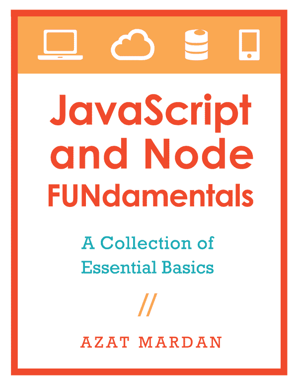
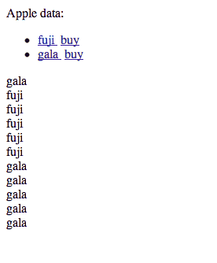
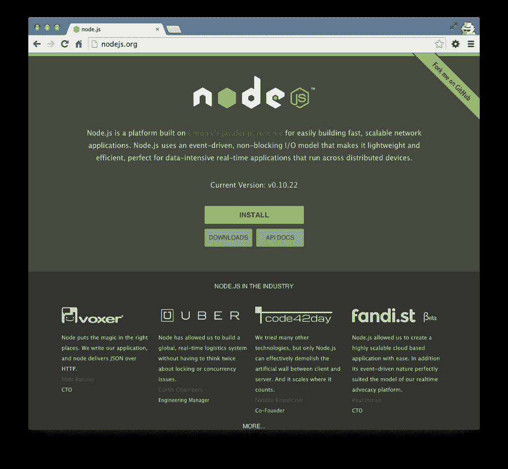
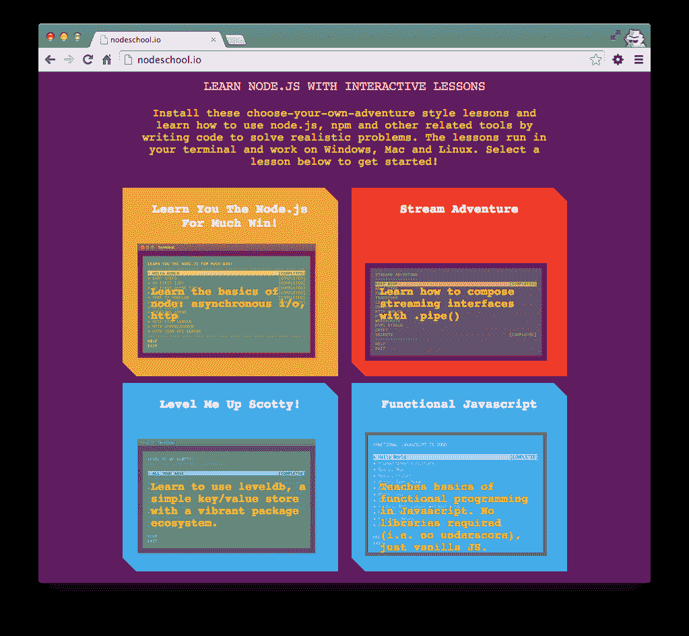
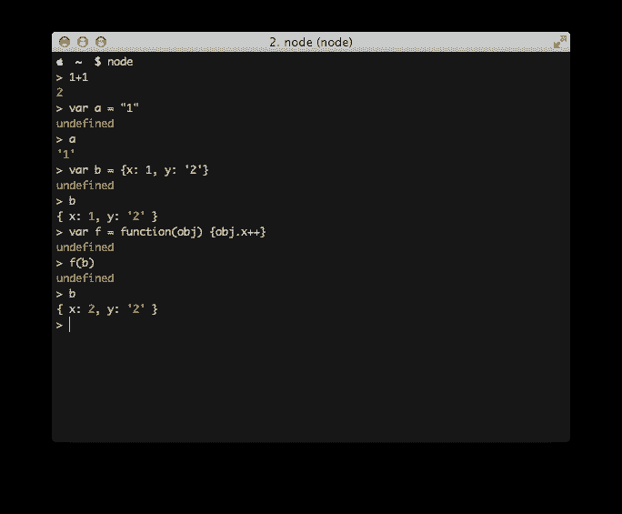
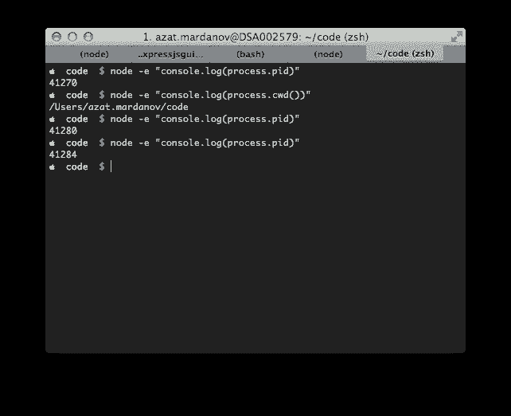

# JavaScript 和 Node 基础指南




本书可在 [`leanpub.com/jsfun`](http://leanpub.com/jsfun) 售卖

> 如果不好玩，那就不是 JavaScript。

# 1 JavaScript 基础：Web 强大且被误解的语言

## 1.1 表达能力

BASIC、Python、C 等编程语言具有枯燥的机器本质，这要求开发者编写与解决方案本身无直接关系的额外代码。想想 BASIC 中的行号或 Java 中的接口、类和模式。

相反，JavaScript 继承了纯数学、LISP 和 C# 的优秀特性，这带来了大量的[表达能力](http://en.wikipedia.org/wiki/Expressive_power)（以及乐趣！）。

在这篇文章中有关于表达能力的更多信息：[在指代编程语言时，“表达性”意味着什么？](http://stackoverflow.com/questions/638881/what-does-expressive-mean-when-referring-to-programming-languages)

Java 中经典的 Hello World 示例（记住，Java 之于 JavaScript 就像火腿之于仓鼠）：

```
public class HelloWorld {
    public static void main(String[] args) {
        System.out.println("Hello World");
    }
}
```

JavaScript 中相同的示例：

```
console.log('Hello World')
```

或者在 HTML 页面中：

```javascript
1 <script>
2 document.write('Hello World')
3 </script>
```

JavaScript 允许程序员专注于解决方案/问题，而不是在各种关卡和 API 文档中跳来跳去。

## 1.2 弱类型 (Loose Typing)

自动类型转换在大多数情况下都能良好工作。这是一个可以节省大量时间和精力的绝佳特性！它只有几种原始数据类型：

1. `String`

2. `Number`（包括整数和浮点数）

3. `Boolean`

4. `Undefined`

5. `Null`

其他所有内容都是对象，即可变的键值对集合。在 Stackoverflow 上阅读关于[什么是不可变性（immutable）意味着什么？](http://stackoverflow.com/questions/3200211/what-does-immutable-mean) 的文章。

此外，在 JavaScript 中，存在 `String`、`Number` 和 `Boolean` 对象，它们包含了为原始类型提供的辅助方法：

```javascript
1 'a' === new String('a') //false
```

但是

```javascript
1 'a' === new String('a').toString() //true
```

或者

```javascript
1 'a' == new String('a') //true
```

顺带一提，`==` 会执行自动类型转换，而 `===` 则不会。

## 1.3 对象字面量符号 (Object Literal Notation)

对象表示法非常易读且紧凑：

```javascript
1 var obj = {
2    color: "green",
3    type: "suv",
4    owner: {
5       ...
6    }
7 }
```

记得函数也是对象吗？

```javascript
1 var obj = function () {
2    this.color: "green",
3    this.type: "suv",
4    this.owner: {
5       ...
6    }
7 }
```

## 1.4 函数 (Functions)

函数是“一等公民”（first-class citizens），我们把它们视为变量，因为它们是对象！是的，函数甚至可以拥有属性/特征。

### 1.4.1 创建函数

```javascript
1 var f = function f () {
2    console.log('Hi');
3    return true;
4 }
```

或者

```javascript
1 function f () {
2   console.log('Hi');
3   return true;
4 }
```

带有属性的函数（记得函数只是可以调用的对象，即已初始化）：

```javascript
1 var f = function () {console.log('Boo');}
2 f.boo = 1;
3 f(); //输出 Boo
4 console.log(f.boo); //输出 1
```

**注意**：`return` 关键字是可选的。如果省略，函数在调用时将返回 `undefined`。

### 1.4.2 将函数作为参数传递

```javascript
1 var convertNum = function (num) {
2  return num + 10;
3 }
4 
5 var processNum = function (num, fn) {
6    return fn(num);
7 }
8 
9 processNum(10, convertNum);
```

### 1.4.3 调用与表达式 (Invocation vs. Expression)

函数定义：

```javascript
1 function f () {};
```

调用：

```javascript
1 f();
```

表达式（因为它可以解析为某些值，可以是数字、字符串、对象或布尔值）：

```javascript
1 function f() {return false;}
2 f();
```

语句：

```javascript
1 function f(a) {console.log(a);}
```

## 1.5 数组 (Arrays)

数组也是对象，继承了一些来自 [`Array.prototype`](https://developer.mozilla.org/en-US/docs/Web/JavaScript/Reference/Global_Objects/Array/prototype#Properties) 全局对象的特殊方法。尽管如此，JavaScript 数组并不是真正的数组。相反，它们是具有唯一整数键（通常从 0 开始）的对象。

```javascript
1 var arr = [];
2 var arr2 = [1, "Hi", {a:2}, function () {console.log('boo');}];
3 var arr3 = new Array();
4 var arr4 = new Array(1,"Hi", {a:2}, function () {console.log('boo');});
```

## 1.6 原型本质 (Prototypal Nature)

JavaScript 中没有“类”，因为对象直接继承自其他对象，这被称为原型继承：JS 中有几种继承模式：

* 经典继承 (Classical)

* 伪类继承 (Pseudo-classical)

* 函数继承 (Functional)

函数继承模式的示例：

```javascript
 1 var user = function (ops) {
 2   return { firstName: ops.name || 'John'
 3          , lastName: ops.name || 'Doe'
 4          , email: ops.email || 'test@test.com'
 5          , name: function() { return this.firstName + this.lastName}
 6          }
 7 }
 8 
9 var agency = function(ops) {
10   ops = ops || {}
11   var agency = user(ops)
12   agency.customers = ops.customers || 0
13   agency.isAgency = true
14   return agency
15 }
```

## 1.7 约定 (Conventions)

这些约定中（分号除外）大部分是风格上的，取决于个人偏好，且不影响执行。

### 1.7.1 分号

分号是可选的，有两种情况例外：

1. 在 for 循环构造中：`for (var i=0; i++; i<n)`

2. 当新行以括号开头时

### 1.7.2 驼峰命名法 (camelCase)

大部分约定是风格上的，取决于个人偏好，且不影响执行。

### 1.7.3 命名 (Naming)

大部分约定是风格上的，取决于个人偏好，且不影响执行。

### 1.7.4 逗号 (Comas)

大部分约定是风格上的，取决于个人偏好，且不影响执行。

### 1.7.5 缩进 (Indentation)

大部分约定是风格上的，取决于个人偏好，且不影响执行。

### 1.7.6 空格 (Spaces)

大部分约定是风格上的，取决于个人偏好，且不影响执行。

### 1.7.7 模块 (Modules)

大部分约定是风格上的，取决于个人偏好，且不影响执行。

* [CommonJS](http://www.commonjs.org/)

* [Require.js](https://requirejs.org/)

[立即执行函数表达式](https://en.wikipedia.org/wiki/Immediately-invoked_function)

## 1.9 立即执行函数表达式 (IIFEs)

```javascript
1 (function () {
2 yourModule = {
3 ...
4 };
5 }());
```

这段代码展示了一个私有属性示例：

```javascript
 1 (function () {
 2   window.boo = function() {
 3     var _a = 1;
 4     inc = function () {
 5       _a++;
 6       console.log(_a);
 7       return _a;
 8     };
 9     return {
10       increment: inc
11     };
12   }
13 }());
14 var b = window.boo();
15 b.increment();
```

现在尝试这个：

`this` 关键字

在 jQuery 中会发生变化！规则是在闭包中使用 `this` 之前将其重新赋值给局部作用域变量：

```javascript
1 var app = this
2 $('a').click(function(e){
3   console.log(this) //可能是事件或目标锚点元素
4   console.log(app) //这正是我们要的！
5   app.processData(e)
6  })
```

*如果不确定：console.log!*

## 1.11 陷阱 (Pitfalls)

JS 是程序员认为不应该学习的语言。像 `===` 与 `==`、全局作用域泄漏、DOM 等问题可能会以后导致问题。这就是为什么理解这种语言或使用像 CoffeeScript 这样可以解决大部分问题的工具很重要。

## 1.12 进一步学习

如果你喜欢这篇文章并想进一步探索 JavaScript，请查看这个非常棒的免费资源：[Eloquent JavaScript: 现代编程导论](http://eloquentjavascript.net/)。

# 2 CoffeeScript 基础：更好的 JavaScript

CoffeeScript 是一种构建在 JavaScript 之上的语言。CoffeeScript 具有一些额外的优势，并且它的代码会被编译成原生 JavaScript 进行执行。CoffeeScript 的优点包括：更好的语法、函数和类构造模式、自动插入 `var`、推导式等。

一旦我们看了一些示例，这些优点中的大部分将显而易见。这份快速语言参考可以帮助你开始学习 CoffeeScript：

*   分号、空格和括号

*   变量 (Vars)

*   条件

*   函数

*   类

*   数组

*   通散运算符 (Splats)

*   推导式 (Comprehensions)

### 2.1 分号、空格和括号

在 JavaScript 中，分号是冗余且可选的；而在 CoffeeScript 中，它们是被禁止的。

空格和缩进（通常为两个空格）是 CoffeeScript 语言的一部分。

函数调用的括号是可选的（除非没有参数）。对象字面量的大括号也是如此（也是可选的）。我们甚至可以在不使用大括号的情况下定义对象：

```
 1 a =
 2   x: 1
 3   y: -20
 4   z: () ->
 5     console.log a.x+a.y
 6 
 7 a.z()
 8 
 9 b = [
10   1,
11   2,
12     x: 10
13     y: 20
14 ]
```

翻译为以下 JavaScript：

```
 1 var a, b;
 2 
3 a = {
 4   x: 1,
 5   y: -20,
 6   z: function() {
 7     return console.log(a.x + a.y);
 8   }
 9 };
10 
11 a.z();
12 
13 b = [
14   1, 2, {
15     x: 10,
16     y: 20
17   }
18 ];
```

正如你可能注意到的，我们用于编写函数代码逻辑块大括号（即 `{}`）也被缩进取代了。不要忘记函数在 JavaScript 中仅仅是对象。:-)

### 2.2 变量

CoffeeScript 会自动为我们插入 `var` 关键字，并禁止手动使用 `var`。例如，`a`、`b` 和 `c` 变量声明将在 JavaScript 代码中带有 `var`：

```
1 a = 10
2 b = 'x'
3 c = [1,2,3]
```

JavaScript 代码：

```
1 var a, b, c;
 2 
3 a = 10;
 4 
5 b = 'x';
 6 
7 c = [1, 2, 3];
```

CoffeeScript 总是将 `var` 放在该特定变量首次出现的作用域顶部。作用域由函数或窗口定义。例如，匿名函数 `d` 将 `e` 作用域于其内部，因为 CoffeeScript 首次在函数内部看到了 `e`：

```
1 a = 10
2 b = 'x'
3 c = [1,2,3]
 4 
5 d = () ->
6   e = a
7   console.log e
8 d()
```

JavaScript 输出：

```
 1 var a, b, c, d;
 2 
3 a = 10;
 4 
5 b = 'x';
 6 
7 c = [1, 2, 3];
 8 
 9 d = function() {
10   var e;
11   e = a;
12   return console.log(e);
13 };
14 
15 d();
```

### 2.3 条件

CoffeeScript 中的条件对人类来说更具可读性（更像英语？）：

```
1 a = b = c = d = 1
2 if a is b or b isnt c and not c is d
3   console.log 'true'
4 else
5   console.log 'false'
```

```
1 var a, b, c, d;
 2 
3 a = b = c = d = 1;
 4 
5 if (a === b || b !== c && !c === d) {
6   console.log('true');
7 } else {
8   console.log('false');
9 }
```

所以 `is` 等于 `===`，`isnt` 等于 `!==`，`not` 等于 `!`，`and` 等于 `&&`，而 `or` 等于 `||`。

在 CoffeeScript 中可以实现一些花哨且可以说更易读的构造：

```
1 console.log a if a is not null
2 if a isnt null then console.log a
3 if not a is null then console.log a
4 unless a is null then console.log a
```

注意：`unless` 只是 `if not` 的简写形式。

### 2.4 函数

CoffeeScript 中的函数使用箭头 `()->` 和胖箭头 `()=>` 定义（稍后详细介绍）：

```
1 a = (x,y) -> console.log x+y
2 a(10,-5)
```

JavaScript 代码：

```
1 var a;
 2 
3 a = function(x, y) {
4   return console.log(x + y);
5 };
 6 
7 a(10, -5);
```

较长的表达式可以使用缩进跨多行显示，而默认值可以直接赋值在函数签名中（即 `(name=value)`）：

```
1 a = (x,y) -> console.log x+y
2 a(10,-5)
```

```
 1 var Compact, Suv, Vehicle, caddi, camry,
 2   __hasProp = {}.hasOwnProperty,
 3   __extends = function(child, parent) { for (var key in parent) { if (__hasProp.call(parent, key)) child[key] = parent[key]; } function ctor() { this.constructor = child; } ctor.prototype = parent.prototype; child.prototype = new ctor(); child.__super__ = parent.prototype; return child; };
 4 
 5 Vehicle = (function() {
 6   function Vehicle(name) {
 7     this.name = name;
 8   }
 9 
10   Vehicle.prototype.move = function(meters) {
11     return console.log(this.name + (" moved " + meters + " miles."));
12   };
13 
14   return Vehicle;
15 
16 })();
17 
18 Compact = (function(_super) {
19   __extends(Compact, _super);
20 
21   function Compact() {
22     return Compact.__super__.constructor.apply(this, arguments);
23   }
24 
25   Compact.prototype.move = function() {
26     console.log("Cruising...");
27     return Compact.__super__.move.call(this, 5);
28   };
29 
30   return Compact;
31 
32 })(Vehicle);
33 
34 Suv = (function(_super) {
35   __extends(Suv, _super);
36 
37   function Suv() {
38     return Suv.__super__.constructor.apply(this, arguments);
39   }
40 
41   Suv.prototype.move = function() {
42     console.log("Speeding...");
43     return Suv.__super__.move.call(this, 45);
44   };
45 
46   return Suv;
47 
48 })(Vehicle);
49 
50 camry = new Compact("Camry");
51 
52 caddi = new Suv("Cadillac");
53 
54 camry.move();
55 
56 caddi.move();
```

### 2.6 数组与切片

CoffeeScript 中的数组定义方式与原生 JavaScript 完全一样：`arr = [1, 2, 3]`。但在 CoffeeScript 中，我们可以对数组进行远更多的操作！例如，我们可以在定义数组时使用范围（在迭代器和列表推导式中非常常用），并使用切片（slice）：

```
1 arr = [1..10]
2 slicedArr = arr[2..4]
3 console.log arr, slicedArr
```

控制台输出：

```
1 [1, 2, 3, 4, 5, 6, 7, 8, 9, 10] [3, 4, 5]
```

```
1 var arr, slicedArr;
2 
3 arr = [1, 2, 3, 4, 5, 6, 7, 8, 9, 10];
4 
5 slicedArr = arr.slice(2, 5);
6 
7 console.log(arr, slicedArr);
```

冷知识：对于包含 20 个及以上元素的数组声明（例如范围为 `[0..20]` 及更大的范围），CoffeeScript 编译器将切换到 `for` 循环。

### 2.7 Splats（星号运算符）

Splats 是使用变数量参数和 `arguments` 对象（来自原生 JavaScript）的一种更好方式：

```
1 a = (x...) ->
2  sum = 0
3  x.forEach (item) -> sum += item
4  console.log sum
5 a(10,-5, 15)
```

```
 1 var a,
 2   __slice = [].slice;
 3 
 4 a = function() {
 5   var sum, x;
 6   x = 1 <= arguments.length ? __slice.call(arguments, 0) : [];
 7   sum = 0;
 8   x.forEach(function(item) {
 9     return sum += item;
10   });
11   return console.log(sum);
12 };
13 
14 a(10, -5, 15);
```

Splats 也适用于函数调用。例如，我们上一个示例中的 `sum` 函数需要将数组视为所有的 `arguments`，而不是仅仅第一个元素：

```
1 a = (x...) ->
2  sum = 0
3  x.forEach (item) -> sum += item
4  console.log sum
5 a [-5..50]...
```

输出是 `1260`。对应的 JavaScript 代码：

```
1 var a, _i, results,
2   __slice = [].slice;
3 
4 a = function() {
5   var sum, x;
6   x = 1 <= arguments.length ? __slice.call(arguments, 0) : [];
7   sum = 0;
8   x.forEach(function(item) {
9     return sum += item;
10   });
11   return console.log(sum);
12 };
```

### 2.8 列表推导式（Comprehensions）

列表推导式是 CoffeeScript 中非常强大的功能之一，允许我们用简洁的语法创建新数组。它们可以替代复杂的 `for` 循环、`map` 和 `filter` 操作。

例如，过滤一个数组中的偶数：

```
1 numbers = [1, 2, 3, 4, 5, 6, 7, 8, 9, 10]
2 evens = [n for n in numbers if n % 2 == 0]
```

或者对每个元素进行转换：

```
1 numbers = [1, 2, 3]
2 squared = [n * n for n in numbers]
```

列表推导式在处理数据转换时非常高效，能够显著提高代码的可读性。

# 3 Backbone.js 与 Underscore.js 视图与子视图

## 3.1 典型的 Backbone.js 应用结构

在 `Backbone.js` 中只有四个类：

* `Router`：`URL` 到方法的映射

* `View`：与浏览器和用户事件、HTML 输出（渲染）相关的方法

* `Collection`：模型列表，并带有如 `fetch()` 等额外的辅助方法

* `Model`：单个数据项，带有额外的辅助方法

一个典型的 `Backbone.js` 应用有一个主 `Router` 类。所有的路由（URL 路径）都从该类中定义。路由器可以创建并调用其他类的方法，例如 `Views`、`Collections` 和 `Models`。例如，对于路径 `/books`，我们将渲染书籍视图。

推荐的用法是 `Views` 通常只包含一个 `Collection` 或一个 `Model`。`Collection` 只是 `Models` 的列表。然而，这并不是固定不变的。`Backbone.js` 非常灵活，应该根据具体需求使用。例如，一个应用可以有一个拥有 `Views` 的 `Model`，而每个 `View` 又拥有 `collections`。

在我们的简洁示例中，我们将有一个拥有 `Views` 的主 `Router`。这些 `Views` 将拥有模型和集合。

## 3.2 从零开始设置 Backbone.js 应用

首先，我们将使用 `Backbone.js` 和模型-视图-控制器（MVC）架构构建一个典型的启动“Hello World”应用程序。我知道这在开始听起来可能有些过度设计，但随着学习的进行，我们将增加越来越多的复杂度，包括 `Models`、`Subviews` 和 `Collections`。项目的结构遵循“简单至上”原则：

* `index.html`：主文件以及所有的应用程序 JavaScript 代码

* `jquery.js`：`jQuery` 库

* `underscore.js`：`Underscore.js` 库

* `backbone.js`：`Backbone.js` 库

“Hello World”应用的完整源代码可以在 GitHub 的 [`github.com/azat-co/rpjs/backbone/hello-world`](https://github.com/azat-co/rpjs/tree/master/backbone/hello-world) 找到。

`jQuery` 和 `Underscore` 是 `Backbone.js` 的必要依赖。

## 3.3 Backbone.js 项目的依赖

为了构建我们的苹果数据库，我们需要下载以下库：

* [jQuery 1.9 开发源文件](http://code.jquery.com/jquery-1.9.0.js)

* [Underscore.js 开发源文件](http://underscorejs.org/underscore.js)

* [Backbone.js 开发源文件](http://backbonejs.org/backbone.js)

或者，你也可以从某些 CDN 引入这些库（例如 [Google 托管库](https://developers.google.com/speed/libraries/devguide)），但这样每次运行应用都需要连接网络。

在新创建的 `index.html` 文件中这样引入这些框架：

```
 1 <!DOCTYPE>
 2 <html>
 3 <head>
 4   <script src="jquery.js"></script>
 5   <script src="underscore.js"></script>
 6   <script src="backbone.js"></script>
 7 
 8   <script>
 9     //TODO 写一些酷的 JS 代码！
10   </script>
 11 
 12 </head>
 13 <body>
 14 </body>
 15 </html>
```

|  |  

### 注意事项

我们也可以在文件末尾的 `</body>` 标签之后直接放置 `<script>` 标签。这会改变脚本和 HTML 其他部分的加载顺序，并对大文件的性能产生影响。

一些开发者倾向于避开使用 `Backbone Router`（它是一个可选的类/组件），但我们总是发现 `Router` 带来了更多好处和清晰度。在某种程度上，它是你应用程序的起点，有助于理解基础以及所有部分（如视图、模型等）是如何组合在一起的。所以，让我们在 `<script>` 标签内部定义一个简单的 `Backbone.js` `Router`：

```
1   ...
2   var router = Backbone.Router.extend({
3   });
4   ...
```

|  |  

### 注意事项

目前，为了保持简单至上（KISS），我们将所有的 JavaScript 代码直接放入 `index.html` 文件中。这对于实际开发或生产代码不是一个好主意。我们稍后会重构。

然后在 `extend` 调用中设置一个特殊的 `routes` 属性：

```
1   var router = Backbone.Router.extend({
2     routes: {
3     }
4   });
```

`Backbone.js` 的 `routes` 属性需要遵循以下格式：`'path/:param': 'action'`，这将导致 `filename#path/param` URL 触发名为 `action` 的函数（定义在 `Router` 对象中）。目前，我们将添加单个的 `home` 路由：

```
1   var router = Backbone.Router.extend({
2     routes: {
3       '': 'home'
4     }
5   });
```

这很好，但现在我们需要在 `extend` 块中添加一个 `home` 方法：

```
1   var router = Backbone.Router.extend({
2     routes: {
3       '': 'home'
4     },
5     home: function(){
6       // TODO 逻辑
7     }
8   });
```

第一行将创建 `homeView` 对象并将其赋值给路由的 `homeView` 属性。第二行将调用 `homeView` 对象中的 `render()` 方法，触发渲染。

```html
 1 <!DOCTYPE>
 2 <html>
 3 <head>
 4   <script src="jquery.js"></script>
 5   <script src="underscore.js"></script>
 6   <script src="backbone.js"></script>
 7 
 8   <script>
 9 
10     var app;
11 
12     var router = Backbone.Router.extend({
13       routes: {
14         '': 'home'
15       },
16       initialize: function(){
17        //在对象实例化时执行
18        //执行的某些代码
19       },
20       home: function(){
21         this.homeView = new homeView;
22         this.homeView.render();
23       }
24     });
25 
26     var homeView = Backbone.View.extend({
27       el: 'body',
28       template: _.template('Hello World'),
29       render: function(){
30         this.$el.html(this.template({}));
31       }
32     });
33 
34     $(document).ready(function(){
35       app = new router;
36       Backbone.history.start();
37     })
38 
39   </script>
40 </head>
41 <body>
42   <div></div>
43 </body>
44 </html>
```

在浏览器中打开 `index.html` 检查它是否能正常工作，即页面上应该显示“Hello World”消息。

## 3.4 使用 Backbone.js Collections

Backbone Collections 是非常有用的类，开发者可以使用它们来存储任何属于相同类型的数据。换句话说，Collections 是模型（models）的集合或列表，它们（collections）拥有自己的自定义方法和逻辑，以及一些内置的 Backbone 方法。

Backbone Collections 示例的源代码位于 GitHub 的 [`rpjs/backbone/collections`](https://github.com/azat-co/rpjs/tree/master/backbone/collections) 下。

这个示例关于 Backbone Collections 的，它是基于之前的**从零构建 Backbone.js 应用**中的“Hello World”示例构建的，该示例可以在 [`rpjs/backbone/hello-world`](https://github.com/azat-co/rpjs/tree/master/backbone/hello-world) 下载。

我们应该添加一些数据以便于测试和填充我们的视图。为了做到，请在 `script` 标签之后、其他代码之前添加以下内容：

```
 1   var appleData = [
 2     {
 3       name: "fuji",
 4       url: "img/fuji.jpg"
 5     },
 6     {
 7       name: "gala",
 8       url: "img/gala.jpg"
 9     }
10   ];
```

从 GitHub 获取图片（见下图）：[`github.com/azat-co/rpjs/tree/master/backbone/collections/img`](https://github.com/azat-co/rpjs/tree/master/backbone/collections/img)，或者添加你自己的图片。


富士苹果插图


佳拉苹果插图

这是我们的苹果*数据库*。:-) 或者更准确地说，是我们的 REST API 端点替代方案，它为我们提供了苹果数据模型的名称和图像 URL。如果你需要真实的服务器，可以使用：

* [Parse.com](http://parse.com): 后端即服务提供商

* [Node.js and MongoDB REST API](http://webapplog.com/express-js-4-node-js-and-mongodb-rest-api-tutorial/): 使用 Node.js, Express.js 和 MongoDB 构建的免费 JSON API

|  |  

### 注意

此模拟数据集可以通过将后端的 REST API 端点分配给 Backbone.js Collections 和/或 Models 中的 `url` 属性，并对它们调用 `fetch()` 方法来轻松替换。

现在为了让用户体验（UX）更好一点，我们可以在 Backbone Route 的 `routes` 对象中添加新路由：

```
1   ...
2   routes: {
3     '': 'home',
4     'apples/:appleName': 'loadApple'
5   },
6   ...
```

这将允许用户访问 `index.html#apples/SOMENAME` 并期望看到一些关于苹果的信息。这些信息将由 Backbone Router 定义中的 `loadApple` 函数获取并渲染：

```
1   loadApple: function(appleName){
2     this.appleView.render(appleName);
3   }
```

你注意到一个 `appleName` 变量了吗？它与我们在 `route` 中使用的名称完全相同。这就是我们如何在 Backbone.js 中访问查询字符串参数（例如，`?param=value&q=search`）的方式。

现在我们需要重构一些代码来创建一个 Backbone Collection，用 `appleData` 变量中的数据填充它，并将集合传递给 `appleData` 变量。

```
1   var Apples = Backbone.Collection.extend({
2   });
```

|  |  

### 注意

当我们使用 `fetch()` 或 `reset()` 函数时，Backbone 会自动在集合内部创建模型。

苹果视图并不复杂，它只有两个属性：`template` 和 `render`。在模板中，我们想要显示 `figure`、`img` 和 `figcaption` 标签。Underscore 的模板引擎处理此任务非常方便：

```javascript
1   var appleView = Backbone.View.extend({
2     template: _.template(
3           '<figure>\
4              ">\
5              <figcaption><%= attributes.name %></figcaption>\
6            </figure>'),
```

为了让包含 HTML 标签的 JavaScript 字符串具有可读性，可以使用换行符（`\`），或者关闭字符串并使用加号（`+`）拼接。这是上面 `appleView` 使用后者的方法的示例：

```javascript
1   var appleView = Backbone.View.extend({
2     template: _.template(
3         '<figure>'+
4           +'">'+
5           +'<figcaption><%= attributes.name %></figcaption>'+
6         +'</figure>'),
```

注意 `<%=` 和 `%>` 符号，它们是打印 attributes 对象中 `url` 和 `name` 值的指令。

最后，我们将 `render` 函数添加到 `appleView` 类中。

```javascript
1   render: function(appleName){
2     var appleModel = this.collection.where({name:appleName})[0];
3     var appleHtml = this.template(appleModel);
4     $('body').html(appleHtml);
5   }
```

我们通过 `where()` 方法在集合中查找模型并使用 `[]` 选择第一个元素。现在，`render` 函数负责加载数据并渲染数据。稍后我们将重构该函数，将这两个功能分离到不同的方法中。

整个应用位于 [`rpjs/backbone/collections/index.html`](https://github.com/azat-co/rpjs/tree/master/backbone/collections) 文件夹，看起来如下：

```html
<!DOCTYPE html>
<html>
<head>
  <script src="jquery.js"></script>
  <script src="underscore.js"></script>
  <script src="backbone.js"></script>

  <script>
    var appleData = [
      {
        name: "fuji",
        url: "img/fuji.jpg"
      },
      {
        name: "gala",
        url: "img/gala.jpg"
      }
    ];
    var app;
    var router = Backbone.Router.extend({
      routes: {
        "": "home",
        "apples/:appleName": "loadApple"
      },
      initialize: function(){
        var apples = new Apples();
        apples.reset(appleData);
        this.homeView = new homeView({collection: apples});
        this.appleView = new appleView({collection: apples});
      },
      home: function(){
        this.homeView.render();
      },
      loadApple: function(appleName){
        this.appleView.render(appleName);
      }
    });

    var homeView = Backbone.View.extend({
      el: 'body',
      template: _.template('Apple data: <%= data %>'),
      render: function(){
        this.$el.html(this.template({
        data: JSON.stringify(this.collection.models)
        }));
      }
      //TODO subviews
    });

    var Apples = Backbone.Collection.extend({

    });
    var appleView = Backbone.View.extend({
      template: _.template('<figure>\
                  "/>\
                  <figcaption><%= attributes.name %></figcaption>\
                </figure>'),
      //TODO re-write with load apple and event binding
      render: function(appleName){
        var appleModel = this.collection.where({
          name:appleName
        })[0];
        var appleHtml = this.template(appleModel);
        $('body').html(appleHtml);
      }
    });
    $(document).ready(function(){
      app = new router;
      Backbone.history.start();
    })

  </script>
</head>
<body>
  <div></div>
</body>
</html>
```

在浏览器中打开 `collections/index.html` 文件。你将能够看到来自我们“数据库”的数据，即：`Apple data: [{"name":"fuji","url":"img/fuji.jpg"},{"name":"gala","url":"img/gala.jpg"}]`。

现在，让我们在浏览器中访问 `collections/index.html#apples/fuji` 或 `collections/index.html#apples/gala`。我们期望看到一张带有说明的图片。这是项的详细视图，在这个例子中是一个苹果。干得好！

## 3.5 使用 Backbone.js 和 jQuery 进行事件绑定

在现实生活中，获取数据并不是瞬间完成的，因此让我们重构代码来模拟这一过程。为了获得更好的 UI/UX，我们还需要向用户显示一个加载图标（也称为 spinner 或 ajax-loader，见下图），以通知他们信息正在加载。


Spinner GIF

我们在 Backbone 中拥有事件绑定是一件好事。事件绑定并不是 Backbone 特有的功能，因为它是 jQuery 的一部分。但如果没有 Backbone 的组织和代码结构（使用纯 jQuery 的情况下），事情往往会变得更加混乱。例如，我们必须将一个渲染 HTML 的函数作为回调传递给数据加载函数，以确保在有实际数据可供显示之前，不会执行渲染函数。

因此，当用户进入详细视图（`apples/:id`）时，我们只调用加载数据的函数。然后，通过适当的事件监听器，我们的视图将自动（这不是笔误）更新自己；当有新数据时（或在数据发生变化时，Backbone.js 支持多个甚至是自定义事件）。

让我们更改路由器中的代码：

```
...
    loadApple: function(appleName){
      this.appleView.loadApple(appleName);
    }
...
```

在到达 `appleView` 类之前，其他内容保持不变。我们需要添加一个构造函数或一个 `initialize` 方法，这是 Backbone.js 框架中的一个特殊单词/属性。每当我们创建一个对象的实例时，它都会被调用，例如 `var someObj = new SomeObject()`。我们还可以向 `initialize` 函数传递额外的参数，就像我们在视图中做的那样（我们传递了一个键为 `collection` 值为 `apples` Backbone 集合的对象）。关于 Backbone.js 构造函数的更多信息，请访问 [backbonejs.org/#View-constructor](http://backbonejs.org/#View-constructor)。

```
...
var appleView = Backbone.View.extend({
  initialize: function(){
    //TODO: 创建并设置模型（即一个苹果）
  },
...
```

太好了，我们有了 `initialize` 函数。现在我们需要创建一个代表单个苹果的模型，并在模型上设置适当的事件监听器。我们将使用两种事件：`change` 和一个名为 `spinner` 的自定义事件。为了做到，我们将使用 `on()` 函数，它接收这些属性：`on(event, actions, context)` —— 关于它的更多信息请参阅 [backbonejs.org/#Events-on](http://backbonejs.org/#Events-on)：

```
...
var appleView = Backbone.View.extend({
    this.model = new (Backbone.Model.extend({}));
    this.bind('change', this.render);
    this.bind('spinner',this.showSpinner);
},
...
```

上面的代码基本上归纳为两点：

1. 当模型变化时调用 `appleView` 的 `render()`。

2. 当触发 `spinner` 事件时调用 `appleView` 的 `showSpinner()`。

到目前为止一切顺利，对吧？但是 spinner，即 GIF 图标呢？我们在 `appleView` 中创建一个新属性：

```
...
  templateSpinner: '',
...
```

记得路由器中的 `loadApple` 调用吗？这是我们在 `appleView` 中实现该函数的方法：

```
...
loadApple:function(appleName){
    this.trigger('spinner');
    // 显示 spinner
    var view = this;
    // 我们在闭包内部访问它
    setTimeout(function(){
    // 模拟从远程服务器获取数据的真实延迟
      view.model.set(view.collection.where({
        name:appleName
      })[0].attributes);
    },1000);
},
...
```

第一行将触发 `spinner` 事件（我们仍然需要编写该函数）。

第二行是为了作用域问题（以便我们在闭包中使用 `appleView`）。

`setTimeout` 函数模拟了远程服务器响应的真实延迟。内部，我们通过使用 `model.set()` 函数和 `model.attributes` 属性（返回模型的属性）将选中模型的属性赋值给视图模型。

现在我们可以从 `render` 方法中移除多余的代码并实现 `showSpinner` 函数：

```
  render: function(appleName){
    var appleHtml = this.template(this.model);
    $('body').html(appleHtml);
  },
  showSpinner: function(){
    $('body').html(this.templateSpinner);
  }
  ...
```

全部！在浏览器中打开 `index.html#apples/gala` 或 `index.html#apples/fuji`，并在等待苹果图片加载时享受加载动画。

```html
<!DOCTYPE>
<html>
<head>
  <script src="jquery.js"></script>
  <script src="underscore.js"></script>
  <script src="backbone.js"></script>

  <script>
    var appleData = [
      {
        name: "fuji",
        url: "img/fuji.jpg"
      },
      {
        name: "gala",
        url: "img/gala.jpg"
      }
    ];
    var app;
    var router = Backbone.Router.extend({
      routes: {
        "": "home",
        "apples/:appleName": "loadApple"
      },
      initialize: function(){
        var apples = new Apples();
        apples.reset(appleData);
        this.homeView = new homeView({collection: apples});
        this.appleView = new appleView({collection: apples});
      },
      home: function(){
        this.homeView.render();
      },
      loadApple: function(appleName){
        this.appleView.loadApple(appleName);
      }
    });

    var homeView = Backbone.View.extend({
      el: 'body',
      template: _.template('Apple data: <%= data %>'),
      render: function(){
        this.$el.html(this.template({
          data: JSON.stringify(this.collection.models)
        }));
      }
      //TODO subviews
    });

    var Apples = Backbone.Collection.extend({

    });
    var appleView = Backbone.View.extend({
      initialize: function(){
        this.model = new (Backbone.Model.extend({}));
        this.model.on('change', this.render, this);
        this.on('spinner',this.showSpinner, this);
      },
      template: _.template('<figure>\
                "/>\
                <figcaption><%= attributes.name %></figcaption>\
                </figure>'),
      templateSpinner: '',

      loadApple:function(appleName){
        this.trigger('spinner');
        var view = this; //we'll need to access
        //that inside of a closure
        setTimeout(function(){ //simulates real time
        //lag when fetching data from the remote server
          view.model.set(view.collection.where({
            name:appleName
          })[0].attributes);
        },1000);
      },

      render: function(appleName){
        var appleHtml = this.template(this.model);
        $('body').html(appleHtml);
      },
      showSpinner: function(){
        $('body').html(this.templateSpinner);
      }

    });
    $(document).ready(function(){
      app = new router;
      Backbone.history.start();
    })

  </script>
</head>
<body>
  <a href="#apples/fuji">fuji</a>
  <div></div>
</body>
</html>
```

## 3.6 结合 Underscore.js 的 Backbone.js 视图子视图

此示例可以在 [`rpjs/backbone/subview`](https://github.com/azat-co/rpjs/tree/master/backbone/subview) 获取。

子视图（Subviews）是在另一个 Backbone View 内部创建并使用的 View。子视图概念是抽象（分离）UI 事件（例如点击）以及针对结构相似元素（例如苹果）模板的极佳方法。

子视图的用例可能是表格中的行、列表中的列表项、段落、新行等。

我们将重构主页以显示一个精美的苹果列表。每个列表项都将有一个苹果名称和一个带有 `onClick` 事件的“购买”链接。让我们先通过使用标准的 Backbone `extend()` 函数为单个苹果创建一个子视图：

```javascript
...
var appleItemView = Backbone.View.extend({
  tagName: 'li',
  template: _.template('')
           +'<a href="#apples/<%=name%>" target="_blank">'
           +'<%=name%>'
           +'</a>&nbsp;<a class="add-to-cart" href="#">buy</a>'),
  events: {
    'click .add-to-cart': 'addToCart'
  },
  render: function() {
    this.$el.html(this.template(this.model.attributes));
  },
  addToCart: function(){
    this.model.collection.trigger('addToCart', this.model);
  }
});
...
```

现在我们可以填充对象 `tagName`、`template`、`events`、`render` 和 `addToCart` 属性/方法。

```javascript
...
tagName: 'li',
...
```

`tagName` 自动允许 Backbone.js 创建带有指定标签名的 HTML 元素，在这种情况下是 `<li>` —— 列表项。这将是单个苹果的表示，即我们列表中的行。

```javascript
...
template: _.template('')
         +'<a href="#apples/<%=name%>" target="_blank">'
         +'<%=name%>'
         +'</a>&nbsp;<a class="add-to-cart" href="#">buy</a>'),
...
```

模板只是一个带有 Underscore.js 指令的字符串。它们被封装在 `<%` 和 `%>` 符号中。`<%=` 仅仅意味着打印值。相同的代码可以使用反斜杠转义编写：

```javascript
...
template: _.template('\
         <a href="#apples/<%=name%>" target="_blank">\
         <%=name%>\
         </a>&nbsp;<a class="add-to-cart" href="#">buy</a>\
         '),
...
```

每个 `<li>` 将有两个锚点元素（`<a>`），分别指向详细苹果视图的链接（`#apples/:appleName`）和一个“购买”按钮。现在我们将为“购买”按钮绑定事件监听器：

```javascript
...
events: {
  'click .add-to-cart': 'addToCart'
},
...
```

该语法遵循此规则：

```javascript
事件 + jQuery 元素选择器: 函数名
```

键和值（由冒号分隔的左右部分）都是字符串。例如：

```javascript
'click .add-to-cart': 'addToCart'
```

或者

```javascript
'click #load-more': 'loadMoreData'
```

要渲染列表中的每个项目，我们将对 `this.$el` 使用 jQuery 的 `html()` 函数，它是基于我们的 `tagName` 的 jQuery 元素：

```javascript
...
render: function() {
  this.$el.html(this.template(this.model.attributes));
},
...
```

`addToCart` 方法将使用 `trigger()` 通知集合该特定模型（苹果）供用户购买：

```javascript
...
addToCart: function(){
  this.model.collection.trigger('addToCart', this.model);
}
...
```

这是 `appleItemView` Backbone 类的完整代码：

```javascript
...
var appleItemView = Backbone.View.extend({
  tagName: 'li',
  template: _.template('')
           +'<a href="#apples/<%=name%>" target="_blank">'
           +'<%=name%>'
           +'</a>&nbsp;<a class="add-to-cart" href="#">buy</a>'),
  events: {
    'click .add-to-cart': 'addToCart'
  },
  render: function() {
    this.$el.html(this.template(this.model.attributes));
  },
  addToCart: function(){
    this.model.collection.trigger('addToCart', this.model);
  }
});
...
```

轻而易举！但是那个应该渲染我们所有项目（苹果）并为 `<li>` 元素提供 `<ul>` 容器的主视图呢？我们需要修改并增强我们的 `homeView`。

首先，我们可以为 `homeView` 添加可被 jQuery 选择器识别的字符串类型额外属性：

```javascript
...
el: 'body',
listEl: '.apples-list',
cartEl: '.cart-box',
...
```

我们可以在模板中使用上述属性，或者直接在 `homeView` 中硬编码（我们稍后会重构代码）：

```javascript
...
template: _.template('Apple data: \
  <ul class="apples-list">
  </ul>\
  <div class="cart-box"></div>'),
...
```

`initialize` 函数将在 `homeView` 创建（`new homeView()`）时被调用 —— 在其中我们渲染模板（使用我们现在最喜欢的 `html()` 函数），并为集合（一组苹果模型）附加事件监听器：

```javascript
...
initialize: function() {
  this.$el.html(this.template);
  this.collection.on('addToCart', this.showCart, this);
},
...
```

绑定事件的语法在上一节中介绍过。本质上，它是调用了 `homeView` 的 `showCart()` 函数。在这个函数中，我们将 `appleName` 添加到购物车中（同时带有一个换行符，`<br/>` 元素）：

```
1   ...
2     showCart: function(appleModel) {
3       $(this.cartEl).append(appleModel.attributes.name+'<br/>');
4     },
5   ...
```

最后，是我们期待已久的 `render()` 方法，在该方法中，我们遍历集合中的每个模型（每个苹果），为每个苹果创建一个 `appleItemView`，为每个苹果创建一个 `<li>` 元素，并将该元素添加到 `view.listEl` —— 即 DOM 中类名为 `apples-list` 的 `<ul>` 元素中：

```
 1   ...
 2   render: function(){
 3     view = this;
 4     //这样我们可以在闭包内部使用 view
 5     this.collection.each(function(apple){
 6       var appleSubView = new appleItemView({model:apple});
 7       //创建一个带有 model apple 的子视图
 8       appleSubView.render();
 9       //编译模板和单个苹果数据
10       $(view.listEl).append(appleSubView.$el);
11       //将来自单个
12       //苹果的 jQuery 对象附加到 apples-list DOM 元素中
13     });
14   }
15   ...
```

让我们确保在 `homeView` Backbone View 中没有漏掉任何内容：

```
 1   ...
 2   var homeView = Backbone.View.extend({
 3     el: 'body',
 4     listEl: '.apples-list',
 5     cartEl: '.cart-box',
 6     template: _.template('Apple data: \
 7       <ul class="apples-list">\
 8       </ul>\
 9       <div class="cart-box"></div>'),
10     initialize: function() {
11       this.$el.html(this.template);
12       this.collection.on('addToCart', this.showCart, this);
13     },
14     showCart: function(appleModel) {
15       $(this.cartEl).append(appleModel.attributes.name+'<br/>');
16     },
17     render: function(){
18       view = this; //这样我们可以在闭包内部使用 view
19       this.collection.each(function(apple){
20         var appleSubView = new appleItemView({model:apple});
21         //创建一个带有 model apple 的子视图
22         appleSubView.render();
23         //编译模板和单个苹果数据
24         $(view.listEl).append(appleSubView.$el);
25         //将来自单个苹果
26         //的 jQuery 对象附加到 apples-list DOM 元素中
27       });
28     }
29   });
30   ...
```

你可以点击购买，购物车就会装入你选择的苹果。查看单个苹果不再需要在浏览器的 URL 地址栏中输入它的名称了。我们可以点击该名称，它会打开一个带有详细视图的新窗口。



由子视图渲染的苹果列表。

通过使用子视图，我们复用了所有项目（苹果）的模板，并为它们每一个附加了特定的事件。这些事件足够智能，可以将模型信息传递给其他对象：视图和集合。

以防万一，这里是子视图示例的完整代码，也可以在 [`rpjs/backbone/subview/index.html`](https://github.com/azat-co/rpjs/blob/master/backbone/subview/index.html) 获取：

```html
 1 <!DOCTYPE>
 2 <html>
 3 <head>
 4   <script src="jquery.js"></script>
 5   <script src="underscore.js"></script>
 6   <script src="backbone.js"></script>
 7 
 8   <script>
 9    var appleData = [
10       {
11         name: "fuji",
12         url: "img/fuji.jpg"
13       },
14       {
15         name: "gala",
16         url: "img/gala.jpg"
17       }
18     ];
19     var app;
20     var router = Backbone.Router.extend({
21       routes: {
22         "": "home",
23         "apples/:appleName": "loadApple"
24       },
25       initialize: function(){
26         var apples = new Apples();
27         apples.reset(appleData);
28         this.homeView = new homeView({collection: apples});
29         this.appleView = new appleView({collection: apples});
30       },
31       home: function(){
32         this.homeView.render();
33       },
34       loadApple: function(appleName){
35         this.appleView.loadApple(appleName);
36       }
37     });
38 
39     var appleItemView = Backbone.View.extend({
40       tagName: 'li',
41       template: _.template('\
42              <a href="#apples/<%=name%>" target="_blank">\
43             <%=name%>\
44             &nbsp;<a class="add-to-cart" href="#">buy</a>\
45       '),
46 
47       events: {
48         'click .add-to-cart': 'addToCart'
49       },
50       render: function() {
51         this.$el.html(this.template(this.model.attributes));
52       },
53       addToCart: function(){
54         this.model.collection.trigger('addToCart', this.model);
55       }
56     });
57 
58     var homeView = Backbone.View.extend({
59       el: 'body',
60       listEl: '.apples-list',
61       cartEl: '.cart-box',
62       template: _.template('Apple data: \
63         <ul class="apples-list">\
64         </ul>\
65         <div class="cart-box"></div>'),
66       initialize: function() {
67         this.$el.html(this.template);
68         this.collection.on('addToCart', this.showCart, this);
69       },
70       showCart: function(appleModel) {
71         $(this.cartEl).append(appleModel.attributes.name+'<br/>');
72       },
73       render: function(){
74         view = this; //这样我们可以在闭包内部使用 view
75         this.collection.each(function(apple){
76           var appleSubView = new appleItemView({model:apple});
77           //创建一个带有 model apple 的子视图
78           appleSubView.render();
79           //编译模板和单个苹果数据
80           $(view.listEl).append(appleSubView.$el);
81           //将来自单个苹果
82           //的 jQuery 对象附加到 apples-list DOM 元素中
83         });
84       }
85     });
86 
87     var Apples = Backbone.Collection.extend({
88     });
89 
90     var appleView = Backbone.View.extend({
91       initialize: function(){
92         this.model = new (Backbone.Model.extend({}));
93         this.model.on('change', this.render, this);
94         this.on('spinner',this.showSpinner, this);
95       },
96       template: _.template('<figure>\
97                 "/>\
98                 <figcaption><%= attributes.name %></figcaption>\
99               </figure>'),
100       templateSpinner: '',
101       loadApple:function(appleName){
102         this.trigger('spinner');
103         var view = this;
104         //我们需要在闭包内部访问它
105         setTimeout(function(){
106         //模拟从远程服务器
107         //获取数据时的实时延迟
108           view.model.set(view.collection.where({
109             name:appleName
110           })[0].attributes);
111         },1000);
112       },
113       render: function(appleName){
114         var appleHtml = this.template(this.model);
115         $('body').html(appleHtml);
116       },
117       showSpinner: function(){
118         $('body').html(this.templateSpinner);
119       }
120     });
121 
122     $(document).ready(function(){
123       app = new router;
124       Backbone.history.start();
125     })
126 
127   </script>
128 </head>
129 <body>
130   <div></div>
131 </body>
132 </html>
```

指向单个项目的链接，例如 `collections/index.html#apples/fuji`，也应该可以通过在浏览器地址栏中输入它来独立工作。

## 3.7 Super Simple Backbone Starter Kit

为了启动你的 Backbone.js 开发，可以考虑使用 [Azat](https://github.com/azat-co) 提供的 [Super Simple Backbone Starter Kit](https://github.com/azat-co/super-simple-backbone-starter-kit)，或者类似的项目：

*   [Backbone Boilerplate](http://backboneboilerplate.com/)
*   [使用 Backbone.js 和 Twitter Bootstrap 的示例应用](http://coenraets.org/blog/2012/02/sample-app-with-backbone-js-and-twitter-bootstrap/)
*   更多 [Backbone.js 教程](https://github.com/documentcloud/backbone/wiki/Tutorials%2C-blog-posts-and-example-sites)

## 3.8 结论

本章前面提到的著名的 [Addy’s](https://github.com/addyosmani) [TodoMVC](http://todomvc.com/) 资源包含了许多浏览器 JavaScript MV* 框架，并带有教程和示例。我经常被问到“你觉得 X 或 Y 怎么样？”关键在于不要在选择前端框架时陷入“分析瘫痪”。通过 `Backbone.js` 学习基础知识，因为它并不臃肿和复杂，但在优秀的人手中却被广泛使用且功能强大。然后，选择几个更新、更亮眼的库（例如 `React.js`、`Angular.js`），看看它们如何适应当前项目的特定目标。

# 4 Node.js 基础：服务器端的 JavaScript

Node.js 是一个极其高效且可扩展的非阻塞 I/O 平台，构建在 Google Chrome V8 引擎及其 ECMAScript 之上。这意味着大多数前端 JavaScript（另一种 ECMAScript 实现）对象、函数和方法在 Node.js 中都是可用的。如果你需要复习 JS 特有的基础，请参考 [JavaScript 基础](http://webapplog.com/js-fundamentals/)。



开发者可以从其[网站](http://nodejs.org) 安装 Node.js，并遵循此 Node.js 核心概念概述。关于更详细的 Node.js 指南，请查看 [JS 快速原型：敏捷 JavaScript 开发](http://rpjs.co) 和 [Node School](http://nodeschool.io)。



### 4.1 Node.js 中的读取-评估-打印循环（又名 Console）

与许多其他编程语言和平台一样，Node.js 拥有一个通过 `$ node` 命令打开的读取-评估-打印循环工具。提示符会变为 `>`，我们可以像 Chrome 开发者控制台一样执行 JavaScript。Node.js 和浏览器在 ECMAScript 实现上存在细微差异（例如 `{}+{}`），但在大多数情况下，结果是相似的。



正如你所看到的，我们可以在控制台中写一整天 JavaScript，但有时我们需要保存脚本以便稍后运行。

### 4.2 启动 Node.js 脚本

要从文件启动 Node.js 脚本，只需运行 `$ node filename`，例如 `$ node program.js`。如果只需要一组快速执行的语句，可以使用 `-e` 选项来运行内联的 JavaScript/Node.js，例如 `$ node -e "console.log(new Date());"`。

### 4.3 Node.js 进程信息

每个正在运行的 Node.js 脚本本质上都是一个进程。例如，`ps aux | grep 'node'` 将输出机器上运行的所有 Node.js 程序。方便的是，开发者可以通过 `process` 对象在代码中访问进程信息，例如 `node -e "console.log(process.pid)"`：



使用 pid 和 cwd 的 Node.js 进程示例。

### 4.4 访问 Node.js 中的全局作用域

如你从 [JS 基础](http://webapplog.com/)所示，浏览器 JavaScript 默认将所有内容放入全局作用域。在 Douglas Crockford 著名的《JavaScript：好的部分》中，这被认为是 JavaScript 的缺点之一。Node.js 的设计不同，所有内容默认都是局部的。在我们需要访问全局变量时，有一个 `global` 对象。同样，当我们需要导出某些内容时，应该显式地进行。

### 4.5 导出和导入模块

浏览器 JavaScript 的另一个缺点是无法包含模块。脚本本应使用一种不同的语言（HTML）连接在一起，但缺乏依赖关系管理。[CommonJS](http://www.commonjs.org/) 和 [RequireJS](http://requirejs.org/) 通过类似 AJAX 的方法解决了这个问题。Node.js 借用了 CommonJS 概念的许多特性。

在 Node.js 中导出一个对象，使用 `exports.name = object;`，例如：

```
 1 var messages = {
 2   find: function(req, res, next) {
 3   ...
 4   },
 5   add: function(req, res, next) {
 6   ...
 7   },
 8   format: 'title | date | author'
 9 }
10 exports.messages = messages;
```

而在导入上述脚本的文件中（假设路径和文件名为 `route/messages.js`）：

```
1 var messages = require('./routes/messages.js');
```

```javascript
1 var fs = require('fs');
2 fs.writeFile('message.txt', 'Hello World!', function (err) {
3   if (err) throw err;
4   console.log('Writing is done.');
5 });
```

### 4.10 Node.js 中的数据流处理

数据流（Streaming data）是一个术语，意味着应用程序在接收数据的同时对其进行处理。这对于大型数据集（如视频或数据库迁移）非常有用。

这里是一个使用流并输出二进制文件内容的简单示例：

```javascript
1 var fs = require('fs');
2 fs.createReadStream('./data/customers.csv').pipe(process.stdout);
```

默认情况下，`Node.js` 对 `streams` 使用缓冲区（`buffers`）。

为了获得更沉浸式的训练，请查看 [stream-adventure](http://npmjs.org/stream-adventure) 和 [Stream Handbook](https://github.com/substack/stream-handbook)。

### 4.11 使用 NPM 安装 Node.js 模块

`NPM` 随 `Node.js` 平台一起提供，允许进行无缝的 `Node.js` 包管理。`npm install` 的工作方式与 `Git` 相似，之处在于[它会遍历工作树以寻找当前项目](https://npmjs.org/doc/files/npm-folders.html)。作为入门，请记住我们需要 `package.json` 文件或 `node_modules` 文件夹，以便通过 `$ npm install name` 在本地安装模块，例如 `$ npm install superagent`；在 `program.js` 中：`var superagent = require('superagent');`。

`NPM` 的最大优点在于它将所有依赖项保留在本地，因此如果模块 `A` 使用模块 `B` `v1.3`，而模块 `C` 使用模块 `B` `v2.0`（与 `v1.3` 相比有破坏性更改），那么 `A` 和 `C` 将拥有各自不同版本 `B` 的本地副本。这证明是一种更优的策略，与默认使用全局安装的 `Ruby` 等平台不同。

当项目要在其他应用程序使用的模块时，最佳实践是不将 `node_modules` 文件夹包含在 `Git` 仓库中。然而，对于可部署的应用程序，建议包含 `node_modules`。这可以防止因意外更新依赖导致的损坏。

注意：`NPM` 的创建者喜欢称之为 `npm`（[小写](http://npmjs.org/doc/misc/npm-faq.html#Is-it-npm-or-NPM-or-Npm)）。

### 4.12 使用 HTTP Node.js 模块创建 Hello World 服务器

尽管 `Node.js` 可用于各种任务，但它主要以构建 Web 而闻名。由于其异步性质以及如 `net` 和 `http` 等内置模块，`Node.js` 在网络领域非常出色。

这是一个典型的 Hello World 示例，我们创建一个服务器对象，定义请求处理程序（带有 `req` 和 `res` 参数的函数），向接收者传回一些数据并启动整个过程。

```javascript
1 var http = require('http');
2 http.createServer(function (req, res) {
3   res.writeHead(200, {'Content-Type': 'text/plain'});
4   res.end('Hello World\n');
5 }).listen(1337, '127.0.0.1');
6 console.log('Server running at http://127.0.0.1:1337/');
```

`req` 和 `res` 参数分别拥有有关给定 `HTTP` 请求和响应的所有信息。此外，`req` 和 `res` 可以作为流使用（请看上一节）。

### 4.13 调试 Node.js 程序

最好的调试器是 `console.log()`，但有时我们需要查看调用栈并在异步代码中更好地定位。要做到这一点，请在你的代码中放置 `debugger` 语句，并使用 `$ node debug program.js` 来启动[调试过程](http://nodejs.org/api/debugger.html)。对于更友好的界面，请下载 [node inspector](https://github.com/node-inspector/node-inspector)。

### 4.14 驯服 Node.js 中的回调

[回调](https://github.com/maxogden/art-of-node#callbacks) 能够让 `Node.js` 代码异步化，但来自 `Java` 或 `PHP` 且不熟悉 `JavaScript` 的程序员在看到描述[回调地狱](http://callbackhell.com/) 的 Node.js 代码时，可能会惊讶：

```javascript
 1 fs.readdir(source, function(err, files) {
 2   if (err) {
 3     console.log('Error finding files: ' + err)
 4   } else {
 5     files.forEach(function(filename, fileIndex) {
 6       console.log(filename)
 7       gm(source + filename).size(function(err, values) {
 8         if (err) {
 9           console.log('Error identifying file size: ' + err)
10         } else {
11           console.log(filename + ' : ' + values)
12           aspect = (values.width / values.height)
13           widths.forEach(function(width, widthIndex) {
14             height = Math.round(width / aspect)
15             console.log('resizing ' + filename + ' ' + height)
16             })
17             })
18           }
19         }
20       })
21     }
22   }
23 }
```

# 5 Express.js 基础：Node.js 的 Web 框架

## 5.1 Express.js 简介

Express.js 是一个基于 Node.js 的轻量级 Web 应用框架。它提供了一组强大的功能，用于构建单页、多页和混合 Web 应用。Express.js 是 Node.js 生态系统中最流行的框架之一。

## 5.2 安装 Express.js

使用 `npm` 安装 Express.js：

```
$ npm install express
```

## 5.3 创建 Express.js 应用

一个基本的 Express.js 应用：

```javascript
1 var express = require('express');
2 var app = express();
3 
4 app.get('/', function(req, res){
5   res.send('Hello World');
6 });
7 
8 app.listen(3000);
```

第一个路由基本上处理所有指向首页的请求，例如 `http://localhost:3000/`；后者处理指向 `/users` 的请求，例如 `http://localhost:3000/users`。这两个路由在处理 URL 时均不区分大小写，并且处理末尾斜线的方式相同。

请求处理程序本身（在此例中为 `index.js`）非常直观：HTTP 请求中的所有内容都在 `req` 中，并将结果写入响应 `res` 中：

```
1 exports.list = function(req, res){
2   res.send("respond with a resource");
3 };
```

### 5.4 中间件作为 Express.js 的核心

路由上面的每一行都是中间件：

```
1 app.use(express.favicon());
2 app.use(express.logger('dev'));
3 app.use(express.bodyParser());
4 app.use(express.methodOverride());
5 app.use(app.router);
6 app.use(express.static(path.join(__dirname, 'public')));
```

中间件是透传函数，当请求通过每个中间件时，会向请求中添加有用的内容，例如 `req.body` 或 `req.cookie`。更多关于中间件的编写请查看 [Express.js 简介：参数、错误处理和其他中间件](http://webapplog.com/intro-to-express-js-parameters-error-handling-and-other-middleware/)。

### 5.5 Express.js 应用的配置

以下是我们在典型的 Express.js 应用中定义配置的方式：

```
1 app.set('port', process.env.PORT || 3000);
2 app.set('views', __dirname + '/views');
3 app.set('view engine', 'jade');
```

普通的设置涉及一个名称（例如 `views`）和一个值（例如模板/视图所在文件夹的路径）。定义特定设置有多种方法，例如用于布尔标志的 `app.enable`。

### 5.6 Jade 是适用于 Express.js/Node.js 的 Haml

Jade 模板引擎在利用空格和缩进方面与 Ruby on Rails 的 Haml 相似，例如 `layout.jade`：

```
1 doctype 5
2 html
3   head
4     title= title
5     link(rel='stylesheet', href='/stylesheets/style.css')
6   body
7     block content
```

除此之外，还可以在 Jade 模板内部利用完整的 JavaScript 代码。

### 5.7 关于 Express.js 框架的总结

如你所见，使用 Express.js 创建 MVC Web 应用是轻而易举的。该框架对于 REST API 同样出色。如果你感兴趣，请访问 [教程：使用 Mongo 和 Express.js 构建 Node.js 和 MongoDB JSON REST API 服务器](http://webapplog.com/tutorial-node-js-and-mongodb-json-rest-api-server-with-mongoskin-and-express-js/) 和 [Express.js 简介：使用 Monk 和 MongoDB 构建简单 REST API 应用](http://webapplog.com/intro-to-express-js-simple-rest-api-app-with-monk-and-mongodb/)。

如果你想了解其他中间件和配置，请查看 [Express.js API 文档](http://expressjs.com/api.html)、[Connect 文档](http://www.senchalabs.org/connect/)，当然还有我们的书籍——[Express.js Guide](http://expressjsguide.com)。对于那些已经熟悉 Express.js 基础的人，我推荐阅读 [ExpressWorks](http://webapplog.com/expressworks)。

### 5.8 更新

如果你想了解其他中间件和配置，请查看 [Express.js API 文档](http://expressjs.com/api.html)、[Connect 文档](http://www.senchalabs.org/connect/)，当然还有我们的书籍——[Express.js Guide](http://expressjsguide.com)。

# 6 关于作者

Azat Mardan 是一位拥有 12 年经验的软件工程师。Azat Mardan 拥有信息科学学士和硕士学位。

在空余时间，他会在他的博客 [webapplog.com](http://webapplog.com) 上编写关于 Node.js、Express、Jade、Stylus、Redis、Backbone 等文章。他的博客在 [webapplog.com 在“express.js tutorial”搜索结果中](http://expressjsguide.com) 排名第一。他在 [General Assembly](http://generalas.com) 教授技术。

此前，Azat 曾在 [Storify](http://storify.com) 担任 CTO。他是 [500 Startups](http://500.com) 的常客，并曾在 [Hack Reactor](http://hackreactor.com) 当导师。

### 6.1 错误反馈

请通过下方“联系我们”章节列出的其他通信方式帮助我们改进这本书。

### 6.2 联系我们

让我们在互联网上做朋友吧！

*   在 Twitter 上向 Azat 提问 Node.js 问题：[@azat_co](https://twitter.com/azat_co)
*   在 Twitter 上关注 Azat：[azat.co](https://azat.co)
*   在 GitHub 上关注 Azat：[github.com/azat-co](https://github.com/azat-co)

**其他联系方式**

*   直接发送邮件给 Azat：`hi@azat.co`
*   Google 群组：`rpjs@googlegroups.com` 和 [`groups.google.com/forum/#!forum/rpjs`](https://groups.google.com/forum/#!forum/rpjs)
*   博客：[webapplog.com](http://webapplog.com)
*   [HackHall](http://hackhall.com)：面向黑客、时髦人士和海盗的社区

