# JavaScript 与开放数据 (计算机工程)

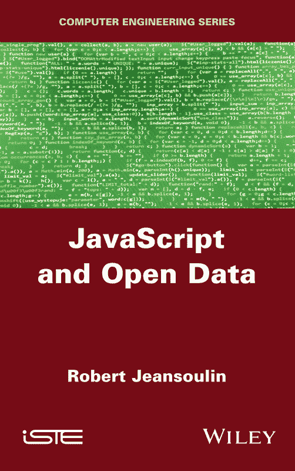


# 表目录

## 1. 引言

1. 表 I.1. JavaScript 版本的历史

## 2. 1 变量：声明、定义与类型

1. 表 1.1. 使用 `var` 声明的变量的作用域和值（四种情况）
2. 表 1.2. 使用 `let` 或 `const` 声明的变量的作用域和值
3. 表 1.3. `var` 与 `let` 或 `const` 的不同行为

## 3. 2 控制：布尔值、分支与循环

1. 表 2.1. Error 对象的不同变体

## 4. 3 数据：数字与字符串

1. 表 3.1. 数值表达式求值的示例
2. 表 3.2. 作为 Math 对象属性的数学常数
3. 表 3.3. 作为 Math 对象方法的常用数学函数
4. 表 3.4. 转换方法 `parseInt` 和 `parseFloat`
5. 表 3.5. 对象 `string` 原型的方法
6. 表 3.6. `RegExp.prototype` 的方法

## 5. 4 对象与原型

1. 表 4.1. 对象字面量表示法的简写语法 (ES6)
2. 表 4.2. Object 最常用的静态方法
3. 表 4.3. 委托给任何对象的 `Object.prototype` 方法
4. 表 4.4. JSON 的静态方法

## 6. 5 数组

1. 表 5.1. Array 对象的静态方法
2. 表 5.2. `Array.prototype` 的“变器”方法
3. 表 5.3. `Array.prototype` 的“访问器”方法
4. 表 5.4. `Array.prototype` 的“迭代”方法

## 7. 6 函数

1. 表 6.1. 修改内容或容器
2. 表 6.2. 消除 `var` 的系列练习
3. 表 6.3. 函数的一些属性¹

## 8. 7 从符号到模式

1. 表 7.1. 留用字的用途
2. 表 7.2. 在函数中绑定代词的几种方法
3. 表 7.3. JavaScript 中使用的标点符号（冒号=多态）

## 9. 8 网页中的 JavaScript

1. 表 8.1. 编写 HTML5 网页的总体建议
2. 表 8.2. 主浏览器的布局引擎和脚本引擎

## 10. 9 图形与多媒体工具

1. 表 9.1. 生成器函数的行为（示例）
2. 表 9.2. 对生成器函数连续调用 `next` 的结果
3. 表 9.3. 会话和持久本地存储对象的方法

## 11. 10 AJAX 技术（异步）

1. 表 10.1. 回调与 promise 机制的对比
2. 表 10.2. 回调嵌套与 promise 链的对比
3. 表 10.3. 读取 JSON 和 JSONP 数据的对比
4. 表 10.4. 与 worker 对话的示例

## 12. 11 时序数据

1. 表 11.1. 来自 Quandl.com 目录的数据示例

## 13. 12 关系数据

1. 表 12.1. 选举应用使用的数据源列表
2. 表 12.2. 应用程序 promise 版本的六个步骤

# 图插目录

## 1. 引言

1. 图 I.1. 程序员对最常用计算机语言的贡献
2. 图 I.2. JavaScript 需要宿主环境

## 2. 1 变量：声明、定义与类型

1. 图 1.1. 解释机制的两个阶段

## 3. 4 对象与原型

1. 图 4.1. 对象字面量表示法的简写语法
2. 图 4.2. Object 最常用的静态方法
3. 图 4.3. 委托给任何对象的 `Object.prototype` 方法
4. 图 4.4. JSON 的静态方法
5. 图 4.5. 对象 `string` 原型的方法
6. 图 4.6. `RegExp.prototype` 的方法

## 4. 6 函数

1. 图 6.1. 修改内容或容器
2. 图 6.2. 消除 `var` 的系列练习
3. 图 6.3. 函数的一些属性¹
4. 图 6.4. 作用域链

## 5. 8 网页中的 JavaScript

1. 图 8.1. 编写 HTML5 网页的总体建议
2. 图 8.2. 主浏览器的布局引擎和脚本引擎

## 6. 9 图形与多媒体工具

1. 图 9.1. 生成器函数的行为（示例）
2. 图 9.2. 对生成器函数连续调用 `next` 的结果
3. 图 9.3. 会话和持久本地存储对象的方法

## 7. 10 AJAX 技术（异步）

1. 图 10.1. 回调与 promise 机制的对比
2. 图 10.2. 回调嵌套与 promise 链的对比
3. 图 10.3. 读取 JSON 和 JSONP 数据的对比
4. 图 10.4. 与 worker 对话的示例

## 8. 11 时序数据

1. 图 11.1. 来自 Quandl.com 目录的数据示例

## 9. 12 关系数据

1. 图 12.1. 选举应用使用的数据源列表
2. 图 12.2. 应用程序 promise 版本的六个步骤

# 指南

1. 封面
2. 目录
3. 开始阅读

# 页码

1. C1
2. ii
3. iii
4. iv
5. v
6. xiii
7. xiv
8. xv
9. xvi
10. xvii
11. xviii
12. xix
13. xx
14. xxi
15. 1
16. 3
17. 4
18. 5
19. 6
20. 7
21. 8
22. 9
23. 10
24. 11
25. 12
26. 13
27. 14
28. 15
29. 16
30. 17
31. 19
32. 20
33. 21
34. 22
35. 23
36. 24
37. 25
38. 26
39. 27
40. 28
41. 29
42. 30
43. 31
44. 32
45. 33
46. 34
47. 35
48. 36
49. 37
50. 38
51. 39
52. 40
53. 41
54. 42
55. 43
56. 44
57. 45
58. 46
59. 47
60. 48
61. 49
62. 50
63. 51
64. 52
65. 53
66. 54
67. 55
68. 56
69. 57
70. 58
71. 59
72. 60
73. 61
74. 62
75. 63
76. 64
77. 65
78. 66
79. 67
80. 68
81. 69
82. 71
83. 72
84. 73
85. 74
86. 75
87. 76
88. 77
89. 78
90. 79
91. 80
92. 81
93. 82
94. 83
95. 84
96. 85
97. 87
98. 88
99. 89
100. 90
101. 91
102. 92
103. 93
104. 94
105. 95
106. 96
107. 97
108. 98
109. 99
110. 100
111. 101
112. 102
113. 103
114. 104
115. 105
116. 106
117. 107
118. 108
119. 109
120. 110
121. 111
122. 112
123. 113
124. 114
125. 115
126. 117
127. 118
128. 119
129. 120
130. 121
131. 122
132. 123
133. 124
134. 125
135. 126
136. 127
137. 128
138. 129
139. 130
140. 131
141. 133
142. 135
143. 136
144. 137
145. 138
146. 139
147. 140
148. 141
149. 142
150. 143
151. 144
152. 145
153. 146
154. 147
155. 148
156. 149
157. 150
158. 151
159. 152
160. 153
161. 154
162. 155
163. 156
164. 157
165. 158
166. 159
167. 160
168. 161
169. 162
170. 163
171. 164
172. 165
173. 166
174. 167
175. 168
176. 169
177. 170
178. 171
179. 172
180. 173
181. 174
182. 175
183. 176
184. 177
185. 178
186. 179
187. 180
188. 181
189. 182
190. 183
191. 184
192. 185
193. 186
194. 187
195. 189
196. 190
197. 191
198. 192
199. 193
200. 194
201. 195

除了《1988 年版权、设计与专利法》允许的用于研究或私人学习、批评或评论的任何公平交易外，本出版物在获得出版者书面许可的情况下方可以任何形式或通过任何手段复制、存储或传输，或者根据 CLA 发布的条款和许可进行机械复制。有关这些条款之外的复制查询，请发送至以下地址出版者：

ISTE Ltd

27-37 St George’s Road

London SW19 4EU

UK

[www.iste.co.uk](http://www.iste.co.uk)

John Wiley & Sons, Inc.

111 River Street

Hoboken, NJ 07030

USA

[www.wiley.com](http://www.wiley.com)

© ISTE Ltd 2018

Robert Jeansoulin 已根据《1988 年版权、设计与专利法》主张其作为本作品作者的身份认同权。

美国国会图书馆控制号：2018937244

英国图书馆书目数据

英国图书馆可提供此书的 CIP 记录

ISBN 978-1-78630-204-5

# 引言

## I.1. 动机

两个主要事实构成了编写本书的动机：

- 对 JavaScript 语言的广泛兴趣：它是地球上最使用的语言。它每天运行数亿次：哪一个网页不使用它？

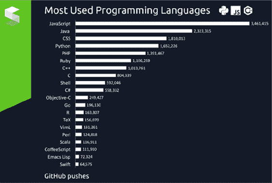

图 I.1. 程序员对最常用计算机语言的贡献

这种使用确保了代码的定期维护，并在 25 多年中带来了性能的持续提升。近年来，JavaScript 标准的几项创新说服所有浏览器供应商采纳它们。图 I.1：这部分介绍了语言的基础：变量、指令、测试、字符串处理、数组、对象和函数。它还详细介绍了 JavaScript 的特定方面、它在对象语言世界中的独特性，以及它如何能够回答我们在书中强调的大多数数据处理任务。我们以一些通过“模式”编程的示例作为结束。

- 第二部分：这部分介绍了“网页生态系统”中的 JavaScript，该系统由 HTTP 协议、HTML 代码、CSS 规则和作为脚本语言的 JavaScript 组成。与 HTML DOM（文档对象模型）元素和事件的交互允许在“客户端”动态地丰富页面。

- 第三部分：这部分致力于：

    - 异步数据
    - 图形化表示
    - 变形应用程序

## I.3. JavaScript 的历史

我们如何解释 JavaScript 的长寿性？我们可以注意到几个非常不同的时期：

- 初始成功，1997–1999：对丰富交互式和动态网页兴趣的证明（动态 HTML，称为 DHTML）。
- 停滞十年，1999–2009：不同浏览器开发的不同版本，在服务器端开发 JavaScript 的尝试失败。jQuery 的设计和开发是生存反应：提供了一个访问 JavaScript 的单一入口（“编写一次，随处运行”）。
- 复兴，2009：Ajax 技术的发布、V8 快速编译、“离线”Node.js 的设计、JSON 对象的发布，所有这些创新唤醒了 JavaScript 的规范化。
- JavaScript 作为通用语言，2015 年至今：ES5 然后 ES6 的广泛采用，使人们能够克服许多编码陷阱并获得性能提升，使得 JavaScript 引擎对于视频和动画也是可以的。

| 年份 | 名称/别名 | 描述 |
| :--- | :--- | :--- |
| 1998 | ECMAScript 2 | 仅编辑变更 |
| 1999 | ECMAScript 3/ES3 | 增加了正则表达式、`try/catch` 语句 |
| | *ECMAScript 4* | *(从未发布)* |
| 2009 | ECMAScript 5/ES5 | 增加了 JSON 支持、`Object.create` |
| 2015 | ECMAScript 6/ES6/ECMAScript2015 | 增加了 `let`、`const`、`Object.assign`、箭头语法、模板语法、展开和剩余参数语法。还有：类、模块 |
| 2016 | ECMAScript 7 | 增加了幂运算符 (`**`)、`Array#includes` |

**表 I.1.** *JavaScript 版本历史*

## I.4. 不使用 `var`、`for` 也不 `new` 来编写代码

JavaScript 是一种充满活力的语言，它适应了互联网新用途的演变（例如视频、社交网络、定向广告等）。自从 `Node.js` 和 `V8` 发布以来，越来越多的 Web 应用程序在客户端大量使用 JavaScript，甚至在服务器端也是如此。

### I.4.1. 注释

JavaScript 的基础没有改变，但有两个演变深刻地改变了如今的编码实践：

- 大多数用例已变得不同：网页上的交互式 HTML 已经是常便饭，通过 `Ajax` 请求处理来自互联网的数据源才是主流做法；
- “核心 ECMAScript”的最新创新（`ES5`、`ES6`）允许我们更好地利用原型方法和语言的函数式特性。

### I.4.2. 本书的刻意倾向

我们在 2018 年编写 JavaScript 代码的方式不再像 2015 年以前那样了。使用 `ES6` 让 JavaScript 发挥出它的特性而非缺点：

- JavaScript 对象是基于原型的。使用原型并避免使用 `new`；
- JavaScript 函数 = 一等对象：用函数式编写代码！避免使用 `for` 循环；
- 使用控制更好的变量声明！禁止使用 `var`。

你的代码将变得更短、更易读，并且调试要容易得多。

### I.4.3. 前提条件

大数据不应是“巨头们的专利”：任何拥有浏览器、互联网连接并进行过自学的人，都可以处理大数据。每个人都行？只要他们对以下基础概念至少接受过程度的培训：

- 互联网和世界维网（WWW）；
- 超文本标记语言（HTML）以及对层叠样式表（CSS）的最少知识；
- 任何浏览器的“开发者”工具（本书示例使用开源的 `Firefox` 进行检查）。

### I.4.4. 一些实用、简单且免费的编程工具

你的浏览器知道如何解释 JavaScript（它就是训练工具），而且大多数情况下不需要连接互联网：

- 浏览器的“草签板”（ScratchPad，使用 `Firefox` 检查）对于快速测试几行代码很有用：它会在注释中显示 `console.log` 结果和变量值。

此外，还有“在线工具”可以帮助我们：

- `W3Schools`：允许测试 HTML+JavaScript 代码，并提供方便的教程和大部分 API 参考；
- `JSBin` 和 `JSFiddle`：这些在开发者中很流行，提供类似的上下文，你可以在其中更方便地存档；
- `Thimble` (Mozilla)：如果你在团队中编程，它可以让你构建协作项目；
- `JSLint`：为你的 JavaScript 提供在线词法分析（见 `ESLint`）。

本书中的大多数代码“箱”都通过 `W3Schools` 测试过。

## I.5. 脚本语言的机制与特性

### I.5.1. JavaScript 在生态系统中被解释和运行

JavaScript 是一种脚本语言，它的解释和执行取决于脚本引擎，该引擎需要一个“宿主”，即提供基本对象、事件和资源的环境。

我们必须区分“核心 JavaScript”（语言共同的基础）和包含特定环境对象的嵌入 JavaScript（例如“客户端 JavaScript”）。

在“网页生态系统”中，环境是浏览器（`window` 对象）。我们可能还会发现浏览器提供的“工作线程”（workers），但它们独立于网页和 `Node.js` 模块系统，完全独立于任何浏览器。

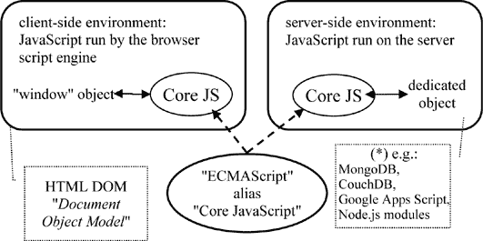

**图 I.2.** JavaScript 需要一个宿主环境

### I.5.2. JavaScript 引擎的作用是什么？

脚本引擎分析并运行宿主环境中的代码，该环境被称为“全局对象”（Global Object）。一旦引擎启动，就会执行两个连续任务：

- 词法分析（“词法时间”或“读取时间”）并生成机器字节码；
- 机器码的执行（“运行时”）。`V8` 引擎编译（`full-codegen`），然后实时优化（`crankshaft`）以提高性能。

从程序员的角度来看，这意味着：

- 首先解析词法声明，变量值初始化为 `undefined`，其类型为 `undefined`。尝试这些行代码：

```
let x; // 没有显式定义的声明（无赋值）
console.log( x );
console.log( typeof x );
```

- 赋值在运行时处理：变量的定义、类型化、表达式的求值等。任何出现在赋值符号 `=` 右侧的内容。

### I.5.3. 变量与指令：“命令式语言”的功能

词法分析列出变量及其“作用域”（它们在哪里是可知的）。运行时定义变量（赋予它们一个确定的值）并确定它们的类型：即值的类型。我们可以将其命名为“动态类型”，而非“弱类型”。值可以是：原始值（数字、字符串、布尔常量）、求值后的表达式、指向对象、数组、函数或正则表达式的引用。

指令可以是赋值、函数调用以及如循环之类的经典控制结构。

### I.5.4. 对象：“基于原型语言”的功能

对象可以是“内置的”（`Object`、`Function`、`Array`、`Date`、`Math`、`JSON` 等），也可以由“宿主生态系统”提供（如 `DOM` 元素），或者由构建。JavaScript 不区分“类”和“实例”的概念：只有对象，且任何对象都可以成为创建新对象的“原型”。我们可以将 JavaScript 对象的定义为“一组属性加上一个原型”。

### I.5.5. 函数作为“一等对象”：“函数式语言”的功能

函数和对象的行为相同，但只有函数可以被调用。对象支持的任何操作函数也可以支持：这使得构建“高阶函数”成为可能，并奠定了 JavaScript 的函数式基础：

```
const mult = function(f,g){return function(n){return f(n)*g(n);}},
     square = function(x) { return x * x; };
mult(square, square)(3);     // 81
```

## I.6. 结论

JavaScript 为 Web 而生，也正因为 Web，JavaScript 在 25 年后依然存在，这就是编写本书的动机。这门很小的语言，由一个人在两周内设计，事实证明具有惊人的活性。这种灵活性既是优点（允许其演进并兼容后续版本），也是缺点（因为它无法充分防止编程错误，导致错误难以检测和调试）。JavaScript 曾被其主要“大师”之一 Doug Crockford 称为“最被误解的语言”。

最近的规范化努力提供了避免大多数陷阱的新方法：我们可以在不使用 `var` 声明的情况下编写代码（避免许多“提升”陷阱），不使用 `for` 循环（避免索引问题），并且几乎不使用 `new` 运算符（为了更直接地使用原型）。

这本令人惊讶的书《如果海明威编写 JavaScript》（参见 [CRO 14]）展示了如何通过几种不同的方式渲染出完全无法辨认的 JavaScript 代码，尽管这些代码始终执行着相同的操作。

# 第 1 部分：核心 JavaScript

## 第 1 部分简介

本部分涉及 JavaScript 的基础知识，无论它运行在何种环境中。大多数时候，JavaScript 与浏览器相关，但它本身是一门语言。我们使用“核心 JavaScript”或“ECMAScript”来指代“纯 JavaScript”，这与嵌入 JavaScript 的环境所添加的内容相区别。

你不需要成为 JavaScript 专家，只要采用一些“良好实践”，就能快速编写出优秀的应用程序。不遵循良好实践的编码（即“反模式”）可能看起来是正确的，但实际上会在无意中出错，且错误难以发现。这就是为什么你会在整个章节中看到“建议”段落，它们提供了编码“模式”的方法。ES5 和 ES6 标准有助于这种类型的编码工作。

第 1 部分可以作为手册使用：直接跳转到涉及某个特定问题的章节，或者深入学习某个章节，例如语言中敏感问题（如原型、闭包）。以下是对这门神奇语言特性的快速浏览：

- 变量：声明、定义、类型（禁止使用所有 `var`）：在这里，我们强调“已声明”和“已定义”变量之间的细微区别，这值得特别关注。在本章中，将介绍“变量作用域”树结构的创建、隐式的“提升”（hoisting）以及全局变量的（危险的）隐式声明。ES6 版本提供了新的声明关键字，可以避免许多（静默的）错误原因。
- 控制：布尔值、测试和循环（用数组方法替换 `for` 循环）：在控制变量状态方面，JavaScript 看起来是传统的过程式的。但由于它们的“多态性”，某些运算符可能会产生意外的反应：它们根据类型（例如数字或字符串）反应并不相同，并且可以进行隐式（静默）类型转换。我们强调了这些陷阱，并提供了避免它们的建议。
- 数据：用作数字的字符、字符串和日期：需要适当的格式来表示定量数据（数字）或定性数据（名称、文本、日期）。可以使用任何 Unicode 字符，可以在数字、名称或日期中使用数字：我们详细介绍了一些与类型转换和值比较相关的问题，这些都是棘手点。
- 对象（将 `new` 限于内置或 API 对象）：需要构建特定对象将链接数据结构化为有意义的信息，并为其分配适当的方法。JavaScript 中的对象处理方式与大多数面向对象的语言大不同。我们关注 ES6 的创新，它提供了更好的工具以以“原型”的方式构建对象。
- 数组（弃用 `for` 循环）：为了处理时间序列或关系型数据，需要表格和矩阵。我们详细介绍了自 ES5 或 ES6 起添加到 JavaScript Array 对象的常用方法，这些方法使得避免循环，将其重写为“函数式”代码风格。
- 函数（尽可能进行函数式编程）：函数在 JavaScript 中是“一等对象”。这可能是这门语言最重要的部分，也是它高效且长寿的关键原因。

# 1. 变量：声明、定义和类型

变量用于直接接收值，或通过组合了值、运算符或函数调用结果的评估表达式接收值：值被存储在内部，变量引用该存储空间，并获取其值和类型。

值有两种类型：

- 原始值：字面量表示法的数字或字符串，“内置”值，如 `true`、`false`、`NaN`、`Infinity`、`null`、`undefined` 等；
- 对象，包括函数和数组，它们是“容器”，因此它们的值是容器的地址。

注意。容器的内容可以修改，而地址保持不变（这对于理解下方的 `const` 声明非常重要）。

要获取变量的值，它必须在词法阶段被识别：这意味着它被“声明”。通常，JavaScript 代码以声明指令开头，例如：

```javascript
var tableauCandidats = [];
var n = 0; // … …
```

我们将展示为什么写以下代码是非常优的：

```javascript
const tableauCandidats = [];
let n = 0; // … …
```

让我们回顾 JavaScript 解释的两个步骤（简化）：

- 词法时间（Lexical-time）：处理代码的词法分析。声明的函数和变量名记录在树结构中（词法树）。声明被移动到代码块的开头：这被称为“提升”（hoisting）。函数先提升，因为它们定义了结构的节点，然后将变量附加到适当的节点上。
- 运行时（Run-time）：脚本引擎再次读取指令并在树结构的帮助下逐个执行。表达式（赋值指令的右侧）被求值，并将带有关联类型（动态类型）的值赋值变量（左侧）。

让我们详细说明这种双重机制：变量的声明、词法时间的初始化为 `undefined` 以及运行时的变量定义。

## 1.1 函数和变量的声明

为了更好地理解 JavaScript 中的声明机制，我们必须首先学习变量的“作用域”是什么：函数声明决定了作用域的概念。

### 1.1.1 不同的声明关键字

#### 1.1.1.1 函数声明

关键字位于指令行的开头；语法如下：

```javascript
function name (list, of, parameters) { block_of_code }
```

在词法时间，名称作为新节点存储在词法树中。参数列表以及块内声明的所有变量都被添加到该节点中。新声明的函数开启新的子节点：这是一个递归过程（深度优先分析）。我们将在第 6 章中详细介绍此。

因此，每个函数决定了一个“函数作用域”。在词法分析开始时，引擎使用一个“根节点”，命名为“全局作用域”。

注意：

1. 不出现在词法树中的变量（即从未声明）不能被赋值给另一个变量；对其进行求值是不可能的：会触发 `ReferenceError`。
2. 尝试为未声明的变量分配（可评估的）值，例如在 `x` 不在词法树的情况下 `x = 1`，并不是错误。因此，变量被添加到全局作用域。这是一种糟糕的做法，一种“反模式”（参见案例 f4）。

#### 1.1.1.2 `var` 声明

在 2015 年之前，声明变量的唯一方法是使用旧声明关键字，它可以以以下格式之一使用：

```javascript
var x;                              // 简单声明
var x = [[val]];                    // 声明带定义
var x = [[val]], y = [[val]], z;    // 多重声明
```

声明在函数作用域或全局作用域的提升。变量如果没有显式定义值，将接收值 `undefined`。该值与引用一起提升。

注意。如果 JavaScript 嵌入在浏览器中，“全局作用域”就是 `window` 对象：

```javascript
var a; // 等同于 'window.a'（作为 window 的属性 a）
function f(){var a;} // 这个 'a' 与 'window.a' 不同
```

#### 1.1.1.3 `let` 声明

`let` 关键字的作用类似于 `var`，而且它还将变量的作用范围限制在块上下文中：例如，条件语句块、函数块或全局作用域。

还有另一个区别：变量不会被“提升”，因此在词法作用域的存在（整个块）与引用的存在（声明行）之间存在一个间隙。这意味着在间隙期间，任何获取该引用的尝试都会触发错误：

```
{ /* new block */
   console.log(x);
// ReferenceError: can't access lexical declaration x before initialization
 let x = 4;
}
```

还有一个额外的限制：禁止在同一个块中重复声明相同的名称：

```
let x = 1; let x = 2;   // SyntaxError: redeclaration of let x
let x = 1; x = 2;       // 允许重新赋值
```

这些限制为防止词法作用域被无意修改提供了更好的保护。

#### 1.1.1.4 `const` 声明

在此情况下，该关键字的行为类似于 `let`，但额外有两个额外的限制：

- 声明和定义必须在同一条语句中完成，并且禁止任何重复声明：

    ```
    const Euler; // SyntaxError: missing = in const declaration
    ```

- 禁止重新赋值：

    ```
    const Pi = 3.14; // Pi 的值只能被定义一次
    Pi = 3.1; // TypeError: invalid assignment to const 'PI'
    ```

- 禁止使用相同或不同的关键字进行重复声明：

    ```
    const pi = 3; let pi = 3; // SyntaxError: redeclaration of const
    function y(){}
    let y; // SyntaxError: redeclaration of function y
    ```

关于 `const` 的说明：已经定义的变量不能被重新定义，这意味着如果该值是一个对象，你将始终使用同一个对象作为容器，但可以根据需要频繁修改它的属性。

因此，强烈建议对对象、数组和函数表达式使用 `const`。

关于这三个关键字的说明：`var` 最为“松散”，因此最容易出错；`const` 限制最严格，因此在词法阶段就能检测出大量的代码不一致性：

建议优先使用 `const`，除非你知道该变量会被临时使用并且很快就会发生变化。例如索引、累加值、布尔控制等。

### 1.1.2. 词法作用域以及根据声明模式定义变量：`var`、`let`、`const`

让我们展示一些示例来说明 ES6 之前和之后情况的区别，共分为四种情况。在以下所有情况下，我们假设变量 `x` 未在全局作用域的任何地方被声明。

#### 1.1.2.1. ES6 之前的情况

这里有四个函数，对应四种情况。在表 1.1 和 1.2 中，我们在函数内部或外部、以及声明指令之前和之后获取 `x` 的类型和值。`var` 的使用说明了它是“松散”且具有风险的。

| ES6 之前。在函数作用域（内或外）中变量的四种情况 |
| --- |

```
 // f1: 'x' 没有声明，也没有定义
function f1() { /* 函数内未出现 x */ }
        // f2: 声明了 'x' 但没有定义
function f2() { /* 局部前 */ var x;      /* 局部后 */ }
        // f3: 在同一条语句中声明并定义
function f3() { /* 局部前 */ var x = 1;  /* 局部后 */ }
        // f4: 在声明的情况下给 'x' 赋值
function f4() { /* 局部前 */ x = 1;      /* 局部后 */ }
```

| f1 局部 | `{ type: undefined}, val -> ReferenceError: x is not defined` |
| 全局调用前 | `{ type: undefined}, val -> ReferenceError: x is not defined` |
| 全局调用后 | `{ type: undefined}, val -> ReferenceError: x is not defined` |
| f2 局部，`var` 之前 | `{ type: undefined, val: undefined};` |
| `var` 之后 | `{ type: undefined, val: undefined };` |
| 全局之后 | `{ type: undefined}, val -> ReferenceError: x is not defined` |
| f3 局部，`var` 之前 | `{ type: undefined, val: undefined },` |
| `var` 之后 | `{ type: number, val: 1 };` |
| 全局之后 | `{ type: undefined}, val -> ReferenceError: x is not defined` |
| f4 局部，`=` 之前 | `{ type: undefined}, val -> ReferenceError: x is not defined` |
| `=` 之后 | `{ type: number, val: 1 };` |
| 全局之后 | `{ type: number, val: 1 }; // !!! 注意 !!!` |

**表 1.1.** 变量的词法作用域和值（四种情况），使用 `var` 声明

注释：

- [f1]: 任何获取变量的尝试总是导致类型为 `undefined`（`typeof` 运算符永远报错）和一个“引用错误”。
- [f2]: 内部，外部；
- [f3]: 类型和值均为 `undefined`；
- [f4]: 最危险的情况。

#### 1.1.2.2. ES6 之后的情况

现在，让我们在所有使用 `var` 的地方使用 `let` 或 `const`。在没有使用 `var` 的地方没有区别。

| ES6 之后。在函数作用域（内或外）中变量的不同情况 |
| --- |

```
function f5() { /* 局部前 */ let x;      /* 局部后 */ }
function f6() { /* 局部前 */ let x = 1;  /* 局部后 */ }
function f7() { /* 局部前 */ const x = "Man"; /* 局部后 */ }
 /* f8 将与 f4 完全相同
```

| f5 局部 | `{ type: undefined} -> ReferenceError: can't access lexical declaration before initialization` |
| `var` 之后 | `{ type: undefined, val: undefined};` |
| f6 局部 | `{ type: undefined} -> ReferenceError: can't access lexical declaration before initialization` |
| `var` 之后 | `{ type: number, val: 1 };` |
| f7 局部 | `{ type: undefined} -> ReferenceError: can't access lexical declaration before initialization` |
| `var` 之后 | `{ type: string, val: "Man" };` |
| 所有情况：全局 | `{ type: undefined} -> ReferenceError: x is not defined` |

- `var` 是最宽松的，因此也是风险最大的：无意的重声明是导致静默错误的常见原因。在这一点上，由于历史原因存在该关键字；你必须在代码中禁止它。
- `let` 应在你打算重用同一个变量名的情况下使用：例如增加数字、修改字符串或布尔常量。对于容器（对象、数组、函数）的引用，请使用 `const`（参阅后续章节）。对于不应该改变的字符串或数字，也请使用 `const`。
- 缺失声明：当一个变量第一次出现在赋值指令的左侧且没有声明关键字时，会进行隐式声明。这是一种编程设计错误，但不会给 JavaScript 带来问题。请参阅下一小节“隐式添加”。

图 1.1 显示了在使用推荐的关键字 `const` 和 `let` 定义 `x` 和 `y`，且在 `z` 之前忘记了关键字时，脚本解释的机制。

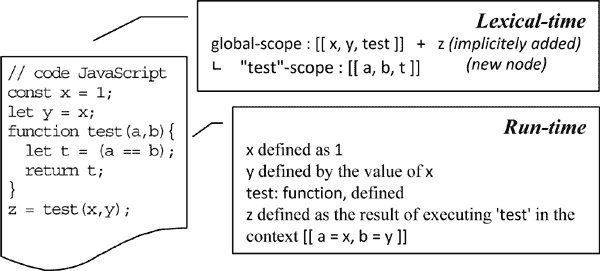

**图 1.1。** 解释机制的两个阶段

注 1.– 如果忘记声明变量，使用 `const` 的优势是：

```javascript
const Pi = 3.14;       // 全局：无法重定义
function calcul(x){
    Pi = 3.1416;       // 运行时一个新的全局变量
    return 2*Pi * x;
 }
 calcul(2); //TypeError: invalid assignment to const
```

注 2.– 如果因为必须修改变量而无法用 `const` 声明，可以将该变量作为对象的属性嵌入（参阅第 4 章）并用 `const` 声明该对象：你将受益于注 1：

```javascript
const xObj = { x = 3 }; // 全局：无法重定义
function calcul(x){
    xObj.x = x; // 你修改属性 xObj，但
    xObj = x; // 在运行时会引发错误
 }
 calcul(2); //TypeError: invalid assignment to const
```

### 1.1.4.1 “全局作用域”（在运行时）中的变量隐式添加

我们已经看到，如果变量不在词法树中，指令 `x = [[val]]` 可能导致全局作用域中的隐式声明。

该指令在词法阶段被忽略，且不会进行“提升”，但在运行时，有效赋值指令左侧的名称 `x` 在词法树中未找到：因此 `x` 被添加到全局作用域中。

请注意，`x = x+1` 指令在求值右侧时会抛出 `ReferenceError: x is not defined`，这是不可能的。

### 1.1.4.2 总结

禁止 `var` 的原因如下：

**表 1.3. `var` 与 `let` 或 `const` 的不同行为**

| Var | Let |
| :--- | :--- |
| **可以重声明：YES** <br><br> `var k = 10;`<br>`var k = "dix"; // 允许` | **重声明：NO** <br><br> `let k = "dix";`<br>`let k = 10; // 错误！` |
| **限制于块：NO** <br><br> `// i 在赋值 undefined 之前存在`<br>`for( var i = 0; i < 5; i++ ) { /* i 在循环中有效 */ }`<br>`// i 在赋值为 5 之后存在` | **限制于块：YES** <br><br> `// 错误！尝试提前使用 i`<br>`for( let i = 0; i < 5; i++ ) { /* i 在循环中有效 */ }`<br>`// 如果在赋值后使用 i 则会错误！` |
| **提升：YES** <br><br> `// n 被提升为 undefined`<br>`console.log( n ); // undefined`<br>`var n = 12; // = 12` | **提升：NO** <br><br> `// n 不存在`<br>`console.log( n ); // 错误！`<br>`let n = 12; // 语句丢弃` |

### 1.1.5 变量和函数的命名：最佳实践

1. 不要使用“保留字”（参阅第 7 章）。例如 `class` 是保留字。
2. 永远不要在两个声明中使用相同的名称。使用 `const` 和 `let` 只能防止你这样做，但多个函数声明不会失败：最后一个声明将胜出，这可能会对代码的其他地方造成破坏，且难以调试。
3. 使用良好的命名规范来提高代码的可读性：
    - 避免无意义的名称，但短代码块中的临时、缓冲区变量除外（通常少于 10 行代码）；
    - 使用“驼峰命名法”（camelCase）：它拆分了单词，同时避免了可能被误解的空格（“camel case”）或连划线（“camel-case”）；
    - 对于不应该改变的字符串或数字，也请使用 `const`；
    - 对于容器（对象、数组、函数）的引用，请使用 `const`（参阅后续章节）。
4. 限制 `var` 变量的数量，尽可能使用 `const`。

- 对象是命名值、值对的集合：`{name:value}`。

JavaScript 中有六种类型：

- 用于未定义变量的类型：`"undefined"`（值 `undefined`）
- 类型：`boolean`（可能的值：`true` 或 `false`）
- 类型：`number`（例如 `42`、`3.14159`、`0x0F`、`Infinity`、`NaN`）
- 类型：`string`（例如 `"JavaScript"` 或空字符串 `""`）
- 类型：`function` `const f = function(){};` // `typeof`: `"function"`
- 类型：`object`，适用于非函数对象，包括 `null`。

```
const obj = {"nom": "X", "age": 23}; // typeof obj -> object
```

JavaScript 中有很多内置对象，它们的类型均为 `"object"`：`Object`、`Array`、`String`、`Number`、`Boolean`、`Date`、`RegExp`、`Error`、`Math`、`JSON`。例外是 `Function` 对象，其类型为 `"function"`。此外存在 `null` 对象，它允许显式初始化一个未知（且为空）的变量，并可能以后对其进行赋值。

注意。存在 `Number` 和 `String` 对象，它们唯一的作用是“绑定”对应的类型 `"number"` 和 `"string"`，以便为这些值提供适当的方法。出于类似的原因，还存在 `Array`、`Function` 和 `Object`。

你应该避免创建此类对象，特别是对于原始值，而应该使用我们将在各相应章节中学习的字面量表示法。

### 1.2.3 如何使用类型 `"undefined"` 和值 `undefined`

永远不要显式地将值 `undefined` 赋值给定义变量，尽管这是允许的。不使用 `undefined` 以及结合之前的建议的原因是：

1. 用 `const` 声明的变量不能是 `undefined`；
2. 用 `let` 声明并带有赋值的变量不是 `undefined`。

因此，具有 `undefined` 值的变量来自于“隐式声明”，通过以下检查更容易确定：

```javascript
if(typeof x === 'undefined'){ alert("declaration is missing"); }.
```

在声明时无法定义变量的情况下，我们使用：

```javascript
let x = null;
```

# 2 控制：布尔值、分支与循环

## 2.1 真值和布尔运算符

控制是一个由条件指令语法定义的*布尔上下文*：

- 分支：`if(exp. in boolean context) {evaluated true} else {evaluated false};`
- 循环：`while (exp in boolean context) {repeat block of code}.`

意不意外的是，有两个布尔值：`true` 和 `false`。更具体的是，在*布尔上下文*中，类型为 `string` 或 `number` 的值会被强制转换为布尔值，而 `undefined` 和 `null` 值被求值为 `false`。

### 2.1.1 布尔运算符：`!`（非）、`&&`（与）、`||`（或）

通过允许在经典布尔逻辑中构建逻辑表达式，我们得到：

```javascript
let p = true, q = false;
console.log( typeof p);      // -> boolean
console.log( p || q);              // -> 逻辑或 -> true
console.log( !p || q);       // -> 逻辑蕴含: p => q () -> false
```

注意。从左到右求值，内部括号优先，短路规则。

```javascript
let bool1 = true, bool2 = false;
let p = bool1 || bool2; // bool2 不求值：p 已经是 'true'
let q = bool2 && bool1; // bool1 不求值；q 已经是 'false'
```

### 2.1.2 关系运算符：`>`、`<`、`>=`、`<=`

对于数字，关系是 ℜ（实数）中的序关系；对于字符串，它是 Unicode 序关系，其中数字 `[0-9]` 优先于字母。

```javascript
let x = 4; console.log(x>3); console.log(x>'3'); // 'true' 'true'
console.log('b' > 'a'); console.log('b' > '3'); // 'true' 'true'
// 警告！数字类似于字符，因此：
console.log('20'>'2'); console.log('20'>'3'); // 'true' 'false' !
```

警告。读取外部数据源（例如 JSON 文件）时，数字可以被转换为数字或字符串。你应该检查实际是如何执行的：这是常见的错误原因之一（见第 3 部分）。

### 2.1.3 比较运算符：`==`、`!=`（简单）或 `===`、`!==`（严格）

存在两个版本的比较运算符。

#### 2.1.3.1 简单相等 (`==`)，对应简单不相等 (`!=`)

首先检查操作数的类型：

- 如果不同，则进行先前的类型转换；
- 如果操作数的值相等（分别对应不相等），则结果为 `true`。

#### 2.1.3.2 严格相等 (`===`)，对应严格不相等 (`!==`)

首先检查操作数的类型：

- 如果不同，结果为 `false`（对应 `true`）；
- 否则，结果为 `true`。

根据构造，严格相等可以返回 `false`。示例下：

```javascript
let x = 4; console.log(x == 4); // true
console.log(x === 4); // true
console.log(x == 5); // false
console.log(x === 5); // false
```

## 2.2 条件语句：分支、循环

### 2.2.1 条件指令：`if … else`

后续示例：

```javascript
let a = 0;
if (a > 0) {
    console.log("positive");
} else {
    console.log("negative");
}
```

### 2.2.2 三元运算符

相同的示例可以用三元运算符编写：

```javascript
let a = 0;
let str = (a > 0) ? "positive" : "negative";
```

### 2.2.3 `switch` 指令

如果你需要在一个变量可能的值之间进行选择，一种方便且易读的方法是 `switch`。注意示例中 `break` 的存在与否如何影响结果：

```javascript
let a = 'w', b = 0, c = 0;
switch (a) {
    case 'y':
        c++; break; // 退出 switch
    case 'w':
        b++; c++;
        // 没有 break：继续执行下一条指令 b++;
    case 'x':
        b++; break; // 退出 switch
    default: // 始终为 switch 加上 default，即使为空
        b = false; // 在最后指令后 break 是没用的
}
console.log(a +' => '+ b +', '+ c); // -> w => 2, 1
```

*警告！在 `switch` 中缺少 `break` 是一种坏习惯，因为修改一个 `case` 可能会无意中修改前面的 `case`，而且追踪此类错误相当困难。务必使用 `break`。*

### 2.2.4 经典迭代循环：`for`

通用语法由示例提供：

```javascript
for (let i = 0; i < 4; i++) { /* i -> 连续 0 … 3 */ }
```

一个常见的问题是遗漏声明索引：它会变成全局变量并可以在任何地方修改：

```javascript
for ( i = 0; i < 4; i++) { /* i -> 连续 0 … 3 */ }
```

使用 `let` 来声明索引，或者更好的做法是避免使用循环。

### 2.2.5. 条件循环：指令 `while` 和 `do..while`

`while` 的语法：

```
while ( test ) { /* 如果 test 为 'true' 则持续运行代码，直到不再为 */
 }
```

以及 `do..while` 的语法：

```
do { /* 代码执行一次，然后只要 test 为 'true' 就持续执行 */
 } while ( test )
```

区别在于 `do` 至少执行一次代码。

注意。– 在第 4 章中，我们将学习 `for..in` 指令，尽管它的名称相似，但它与 `for` 循环非常不同，因为它是对象属性的简单枚举器（没有测试，没有索引）。

### 2.2.6. 在布尔上下文中值 `undefined` 和 `null` 的隐式转换

`undefined` 值是未定义变量的特征。类型 `"undefined"` 适用于从未定义过的变量和从未声明过的变量。

我们可以对其中任何一个进行操作以构建适当的测试：

```
if (typeof foo === 'undefined') {
   // 如果 'foo' 未定义或 不存在（未声明），则运行
   // 不抛出错误：始终继续。
}
if (foo === undefined) {
   // 如果 'foo' 未定义则运行。如果未声明则抛出 ReferenceError
}
if (foo === null) {
   // 如果 'foo' 被定义为 'null' 且类型为 'object' 则运行
   // 如果未声明则抛出 ReferenceError
}
if(!foo) {
   // 涵盖情况：undefined, null, 0, NaN, "", false
   // 如果未声明则抛出 ReferenceError
}
```

注意。– 在“数值上下文中”（参见第 3 章），值 `undefined` 和 `null` 的隐式转换分别不同的结果，分别为 `NaN` 和 `0`：

```
let a; let x = a+2;              // x -> NaN
let a = null; let x = a+2;       // x -> 2
```

在这种特定情况下，产生错误可能比让代码带有错误的数值继续静默运行要好。

如果你需要初始化一个未知类型且未知值的变量，请使用 `null`。

### 2.2.7. 短路评估：不确定定义的提示

运算符 `&&` 和 `||` 按照短路规则求值：下一个操作数的评估取决于上一个操作数评估后的测试状态。这可以帮助在以下情况下缩短代码：

- 在获取对象的某个属性之前检查该对象是否不为 `null`：

    ```
    let name = ob && ob.getName(); // 避免错误
    // 如果 ob 为 'null'，则不会调用 ob.getName()
    ```

- 使用有效值或默认值初始化变量：

    ```
    let name = str || "default name";
    // 如果 str 为 ""（空字符串），则改用 "default name" 
    ```

### 2.2.8. 异常处理

我们遇到过几种情况，在词法时间或运行时，由于变量或函数的不存在，无法进行控制，例如当一个变量从未被声明过时。这类错误 `ReferenceError`、`SyntaxError` 等被称为“异常”。

`typeof` 运算符始终有效，但它的用途有限。有一种更好的方法来处理异常，并允许代码干净地终止。

指令是 `try..catch..finally`。我们还可以使用 `throw` 指令发送自己的异常并结合这两个指令。这里是一个示例：

```
let done = false, someData = "";
 openDataBase();        // 例如：打开数据流
 try {
     let result = process(someData);
     if (!result) {    // 抛出异常
                throw new Error("unlucky!");
        }
 } catch (e) {         // 捕获任何抛出的异常
        console.log(e.name + ": " + e.message);
 } finally {           // [可选] 指令始终运行
        done = true;
        closeDataBase();   // 在所有情况下关闭数据流
 }
```

任何对象都可以与 `throw` 使用，但我们更应该使用内置的 `Error` 或其变体。如果在词法分析期间、执行期间或运行时从内置方法发生错误，则会抛出 `Error` 对象。

| 变体 | 描述 |
| :--- | :--- |
| `EvalError` | 求值期间的错误（例如隐式转换） |
| `InternalError` | 引擎抛出的错误（例如“递归过多”） |
| `RangeError` | 数字超出其有效范围时的错误 |
| `ReferenceError` | 从无效引用搜索变量 |
| `SyntaxError` | 词法分析期间的语法错误 |
| `TypeError` | 变量类型错误时的错误 |
| `URIError` | 传递给 `encodeURI()` / `decode` 的参数错误 |

**表 2.1.** `Error` 对象的不同变体

外部 API 可能会抛出更多错误，例如来自页面的 HTMLDOM `DOMError`，或通过 Ajax 请求。

注意：如何判断一个值是否为数字？值 `NaN` 的类型为 `"number"`，因此，仅检查变量是否真的不同于任何数字是不够的：

```
let t = "", x = 12/0; x = 2*x / x;
if(typeof x !== "number"){t = x +" is not a number";}
else {t = x +" is ok";}
                         // NaN 是可以的（误导性的答案！）
```

内置方法 `isNaN()` 对于任何不是数字的值都返回 `true`，包括 `NaN`。

```
 if(isNaN(x)){t = x +" is really not a number";}
 else {t = x +" is really ok";}
                        // NaN 真的不是数字
```

### 3.1.2. 算术运算符

- 经典的 4 算术运算符：`+`、`-`、`*`、`/`

    ```
    let x = (20 +5) * 4 / 100; // -> 1
    ```

这看起来很经典，但使用运算符 `+`，如果一个操作数是“字符串”（见下文），从左到右的评估将发生改变（相对于括号）。

- 取模运算符：`%`

    ```
    let x = 20 % 3; // -> 2
    ```

- 幂运算符：`**`（自 2016 年起，任何数字都可以作为指数）

    ```
    let x = 2 ** (1/2); // ->: 1.4142135623730951
    ```

    警告。–注意括号（建议：显式化）。

    ```
     2 ** 3 ** 2         // 512:
     2 ** (3 ** 2)       // 512
     (2 ** 3) ** 2       // 64
     (-2) ** 2           // 4
     -2 ** 2             // 语法错误
     -(2 ** 2)           // -4
    ```

- 增/减运算符（一元）：`++`、`--`

    - 后缀用法

        ```
        let x = 3, y = x++; // y = 3, x = 4
        ```

    - 前缀用法

        ```
        let a = 2, b = ++a; // a = 3, b = 3
        let x = 0, y = x++, z = ++x;          // y=?, z=?, x=
        ```

- 组合数值和赋值运算符：`+=`、`-=`、`*=`、`/=`、`%=`

    ```
     x += 5;       // 等同于 x = x + 5;
    ```

- 一元运算符 `+`、`-`

除了保持（`+`）或反转（`-`）变量的符号外，一元运算符在必要时会进行隐式类型转换（见下文）。

```
let x = 3,
      y = +x,         // -> 3, 看起来没用，
                          // 但告知引擎 typeof y === "number"
      z = -x;         // -> -3
```

警告。– `+` 的多态性。加运算符 `+` 在类型为 `string` 时也是字符串拼接运算符。一旦发现字符串，表达式的剩余部分将转换为字符串，这会改变后续 `+` 运算符的行为。

```
 console.log("3" + 4 + 5);                // "345"
          console.log(3 + 4 + "5");                // "75"
          console.log(3 + 4 + 5);                  // 12
          console.log( 248 + "" );          // 将数字转换为 字符串
          console.log(true/2 + "false"); // 练习！自己尝试
```

### 3.1.3. 使用 Math 对象的方法进行数学运算

`Math` 对象是一个内置对象，包含了几个属性和方法，方便使用数学常数和常用的数学函数。

| 属性 | 描述 | 值 |
| :--- | :--- | :--- |
| `Math.E` | 数字 *e* | 2.718281828459045 |
| `Math.LN10` | 10 的自然对数 | 2.302585092994046 |
| `Math.LN2` | 2 的自然对数 | 0.693147180559453 |
| `Math.LOG10` | e 的底数为 10 的对数 | 0.434294481903258 |
| `Math.LOG2` | e 的底数为 2 的对数 | 1.442695040889634 |
| `Math.PI` | pi | 3.141592653589793 |
| `Math.SQRT12` | 数字 | 0.707106781165476 |
| `Math.SQRT2` | 数字 | 1.4142135623730951 |

**表 3.2.** 作为 Math 对象属性的数学常数

| 方法 | 描述 |
| :--- | :--- |
| `Math.abs()` | 数值的绝对值 |
| `Math.sign()` | 符号 |
| `Math.min()` | 最小值 |
| `Math.max()` | 最大值 |
| `Math.floor()` | 向下取整 |
| `Math.ceil()` | 向上取整 |
| `Math.round()` | 四舍五入 |
| `Math.trunc()` | 向零取整 |
| `Math.sqrt()` | 平方根 |
| `Math.cbrt()` | 立方根 |
| `Math.hypot()` | 斜边 |
| `Math.pow()` | 幂 |
| `Math.cos()` | 余弦 |
| `Math.sin()` | 正弦 |
| `Math.tan()` | 正切 |
| `Math.acos()` | 反余弦 |
| `Math.asin()` | 反正弦 |
| `Math.atan()` | 反正切 |
| `Math.atan2()` | 坐标反正切 |
| `Math.cosh()` | 双曲余弦 |
| `Math.sinh()` | 双曲正弦 |
| `Math.tanh()` | 双曲正切 |
| `Math.acosh()` | 反双曲余弦 |
| `Math.asinh()` | 反双曲正弦 |
| `Math.atanh()` | 反双曲正切 |
| `Math.exp()` | 指数 |
| `Math.expm1()` | e^x - 1 |
| `Math.log()` | 自然对数 |
| `Math.log10()` | 底数为 10 的对数 |
| `Math.log2()` | 底数为 2 的对数 |
| `Math.log1p()` | ln(1+x) |
| `Math.random()` | 随机数 |

**表 3.3.** 作为 Math 对象方法的常用数学函数

### 3.2. 处理字符字符串

### 3.2.1. 字符串的字面量

字符串字面量表示使用三种类型的引号：

- 双引号：`"Candidate";`
- 单引号：`'500px';`
- 或反引号（又称模板引号）：`` `the value of x is ${x}` ``

单引号或双引号的作用相同。当我们在字面量编写的字符串中使用引号时，组合使用非常有用，例如：

```
 "Candidate 'Jean' in Department '2A'"
```

如有需要，内部引号可以进行转义：

```
 "Candidate 'Jean, dit \"Jeannot\"' in Department 2A'"
```

- 关联类型为 `"string"`

    ```
     console.log( typeof "Candidat");       // -> string
     console.log( typeof "");               // -> string
    ```

### 3.2.2. 由 ES6 引入的反引号语法，或模板语法

这种新语法的引入使得合并字符串和表达式的值成为可能，这些表达式会在整个字符串求值过程中进行求值。`template` 部分的语法为 `${..}`，并将触发其求值：

```javascript
const cssClassConteneur = "container";
let n = 0; // some index
let htm = `<div class="${cssClassConteneur+n++}"></div>`;
// <div class="container0"></div>, and n = 1
```

### 3.2.3. 连接运算符

相同的符号 `+` 用于数字加法和字符串拼接。这是一个“多态问题”，由脚本引擎在确定哪种上下文处于关键位置时解决：即布尔上下文（仅限在控制语句中）、数值上下文或字符串上下文。

### 3.2.4. 在数值或字符串上下文中通过运算符 `+` 解决多态问题

- 假设我们不在控制语句中（分支或循环指令中的测试）。
- 切换到*字符串上下文*：

    如果 `+` 符号用作两个操作数之间的二元运算符，且其中一个是字符串，则它被解释为“拼接”运算符：

    ```javascript
    let str = "Candidat"; console.log(str + 1);              // -> Candidat1
                             console.log(str + 1+1);         // -> Candidat11
                             console.log(str + (1+1));       // -> Candidat2
                             console.log (str+ 1-1);         // -> NaN
             // 注意！– 符号对字符串无效，
            // 求值返回类型为数字的 NaN！
    ```

- 切换到*数值上下文*：

    如果 `+` 符号位于第一个位置作为一元运算符使用，它会将下一个变量转换为有效数字或 `NaN`（也是数字）。与一元 `-` 符号的行为相同：

    ```javascript
     console.log (+1+str);    // -> 1Candidat
                console.log (+"1"+2);    // -> 3
                console.log (-"1"+2);    // -> 1
                console.log (+"a"+2);    // -> NaN
    ```

练习.- 注意不会导致意想不到的结果（由以下两行解释）：

```javascript
 (typeof 4 ==="number") + "two".length + typeof 4;// // 4number
 (typeof 4 ==="number") +""+ "two".length +""+ typeof 4;
                                              // true3number
```

### 3.2.5. 关系和相等运算符的行为

- 在两个数字之间，它返回预期的 `true` 或 `false` 值。
- 在 `number` 和 `string` 之间，比较始终返回 `false`：

    ```javascript
     let str = "abc", n = 2;
         console.log(n > str ); // false ) 两种情况都返回 false
         console.log(n < str ); // false ) 不兼容的类型
    ```

- 在两个字符串之间，比较遵循 Unicode 顺序：

    数字 `[0-9]` 低于所有字母：

    ```javascript
     let n = 10, m = 2, str = "abc";
     console.log(n > m);              // true (数字比较)
     console.log(n+str > str+n );     // false <- Unicode 规则
     console.log(n+str < str+n );     // true <- Unicode 规则
     console.log(n+str > m+str );     // false <- 下方的 Unicode 规则为 false
    // 警告：'10abc' > '2abc' 为 false
    // 因为 "2" 大于 "10" 中的 "1"
    ```

警告.-相等和严格相等运算符之间的区别：`==`、`===`（对应不相等：`!=`、`!==`）

```javascript
 console.log(0x0f == "15");           // true     <=相同的求值
 console.log(0x0f === "15");          // false    <=不同类型
```

这确实很麻烦，但在实际使用中我们必须面对它。

### 3.2.6. 示例应用程序中字符串相关问题的各个方面

列举法国“省”（départements）的示例说明了许多在面向数据的 JavaScript 使用中值得提及的问题。该示例是第 3 部分中提到的应用程序之一。

每个省都有名称和代码，但由于各种历史原因，名称的字母顺序并不完全遵循代码的数字顺序：

`"Ain": 1`、`"Aisne": 2`、等…… `"Savoie (Haute)": 74`、`"Paris": 75`（1968 年前名为 `"Seine"`）、等…… `"Val-d'Oise": 95`，再加上海外省，它们的代码以 `Z` 开头：`"Guadeloupe":"ZA"`、等。

另一个问题源于 1976 年将“科西卡”（Corse）省分为“高科西卡”（Haute-Corse）和“南科西卡”（Corse-du-Sud），代码为 `"2A"` 和 `"2B"`。“科西卡”的代码 `"20"` 不再使用。所有这些异常情况都阻碍了直接的顺序处理。

```javascript
const str1 = "JavaScript", str2 = " Javascript ";
let s1 = str1.toLowerCase().trim();      // "javascript"
let s2 = str2.toLowerCase().trim();      // "javascript"
console.log( str1 === str2 );   // false
console.log( s1 === s2 );       // true
```

某些自然语言使用带有重音符号的字符，在某些情况下，我们可能决定忽略这些符号。字符串方法 `localeCompare` 允许我们精确定义需要考虑或不考虑的因素：它可以用于数字（小数点与逗号）、日期（若干种实际格式）以及带有重音符号的字符串：

```javascript
let strl = "abé", str2 = "àBe";
const compareOpts = {"usage":"search", "sensitivity":"base"}
let n = strl.localeCompare(str2, "fr", compareOpts);
// n = 0 表示相等 [, l 较大, -l 较小]
```

`localeCompare(str2 [,locale,opts])` 中的可选参数指定了语言（此处为 `"fr"`）以及预处理时应用的规则集：

- `"usage":"search"`：如果只需要判断相等性，则加快比较速度，不进行排序，否则默认值是：`"sort"`；
- `"sensitivity":"base"`：意味着忽略重音符号和大小写：a=A, a=à, a≠b，否则默认值为 `"variant"`（即 a≠A, a≠à, a≠b）。

`localeCompare` 方法同时解决了小写和重音问题。更具体的差异可以通过在使用适当的正则表达式结合时使用 `replace` 方法来解决。

### 3.3.2. 处理部分比较

部分比较允许我们处理一组情况。例如，我们可以通过仅检查字符串的第一个字符是否为 `"Z"`，或者是否为 `"2"` 后面跟着一个字母，来对海外省或科西岛（Corsica）进行重新分组：

```javascript
const corse_hte = "2A", corse_sud = "2B", guadeloupe = "ZA";
let str = guadeloupe; console.log(str.charAt(0) === "Z" ); // true
str = corse_sud; console.log(str.charAt(0) === "2" &&
str.charAt(1) >= "A"); // true: [0-9]<[A-Z]<[a-z]
```

### 3.3.3. 字符串处理方法

| 方法 | 说明 | 返回 |
| :--- | :--- | :--- |
| `str.charAt()` | 返回索引为 `(n)` 的字符 | 字符串 |
| `str.charCodeAt()` | 返回该字符的 UTF-16 编码 | 数字 |
| `str.codePointAt()` | 返回该字符的 Unicode 点 | 数字 |
| `str.concat()` | 将 `str` 与第二个 `(str2)` 连接 | 字符串 |
| `str.endsWith()` `str.startsWith()` `str.includes()` | 检查字符串是否以 `(str2)` 结尾……以……开头……或包含 | 布尔值 |
| `str.indexOf()` `str.lastIndexOf()` | 第一个字符 = `(str*)` 的索引，或 -1 …… 或最后一个 | 数字 |
| `str.localeCompare()` | 根据本地规则进行比较 | (–1,0,1) |
| `str.match()` | 见 RegExp | 数组 |
| `str.normalize()` | Unicode 标准一化 | 字符串 |
| `str.repeat()` | 重复 `(n)` 并连接 | 字符串 |
| `str.replace()` | 见 RegExp | 字符串 |
| `str.search()` | 返回 `(pattern)` 的索引或 -1 | 数字 |
| `str.slice()` `str.substr()` `str.substring()` | 返回 `(start, end)` 之间的切片 优先使用 `slice` | 字符串 |
| `str.split()` | 根据 `(separator)` 拆分为字符串数组 | 数组 |
| `str.toLocaleLowerCase()` `str.toLocaleUpperCase()` `str.toLowerCase()` `str.toUpperCase()` | 返回修改后的字符串 | 字符串 |
| `str.trim()` | 返回一个没有周围空格的字符串 | 字符串 |

**表 3.5. string 对象的原型方法**

内置 `String` 对象设计用于支持一系列方法，这些方法将在关联对象 `String.prototype` 的帮助下被委托给任何字符串。这种委托机制将在稍后详细介绍。表 3.5 提供了 `String.prototype` 对象的方法列表。

让我们详细介绍列出的一些方法。

#### 3.3.3.1. `slice(start, end)`

索引 `(start,end)` 被一致处理，如果 start ≥ end 则返回空字符串，并允许使用负值从尾部计数。

```javascript
let str = 'The morning is upon us.'; // str.length : 23.
str.slice(1, 8);      // -> 'he morn'
str.slice(8, -2);     // -> 'ing is u'
str.slice(12);        // -> 'is upon us.' (直到末尾)
str.slice(30);        // -> '' (…超过了 23)
str.slice(-3);        // -> 'us.' (直到末尾)
str.slice(0, -2);     // -> 'The morning is upon u'
```

注意.– `slice`、`substr`、`substring` 方法是相似的。

#### 3.3.3.2. `concat(second)`

`concat` 方法将字符串与第二个字符串连接。

#### 3.3.3.3. `split(separator)`

`split` 方法根据分隔符将字符串拆分为字符串数组。

#### 3.3.3.4. 正则表达式

正则表达式是描述字符串的“模式”，与 `match`、`replace`、`search` 方法结合使用。

正则表达式可以写为：

- 字面量符号：`const patt = /http/;`
- 使用构造函数：`const patt = new RegExp("http",flg);`（其中 `flg` 是可选的，可以是 `"gm"` 意味着全局和多行）

任何对象 `patt` 继承自 `RegExp.prototype`。

| 方法 | 说明 | 返回 |
| :--- | :--- | :--- |
| `patt.test()` | 检查字符串中的模式 | 布尔值 |
| `patt.exec()` | 取决于 | 数组 |

直接作为方法使用，例如：

```javascript
const patt = /\d/g; // 模式 '\d', 修饰符 g
const str = "la date du 14 juillet";
let tab, msg = str;
while ((tab = patt.exec(str)) !== null) {
        msg += 'match ' + tab[0] + ', at index: ' + tab.index +"<br>";
 }
console.log( msg + str.replace(patt, "#"));
```

### 3.3.5. 求值与用途

#### 有用模式的示例

```javascript
const pattHexa = /[0-9a-fA-F]+/               // 十六进制整数
const pattIPad = /(\d{1,3}\.){3}\d{1,3}/      //简单的 IP 地址
```

拆解十六进制模式：

- `0–9`：寻找数字；
- `a–f`：寻找 a 到 f 之间的字母，`A–F` 亦然；
- 方括号：寻找上述类型之一的字符；
- 末尾的 `+` 意味着任意次数，至少一次；
- 例如：`pattHexa.test("2Abd"); // -> true.`

拆解 IP 地址模式：

- `(\d{1,3}\.){3}`：寻找 1 到 3 个数字后跟一个点，重复 3 次。
- `\d{1,3}`：为最后一个段寻找 1 到 3 个数字。

- 寻找一组 1–3 位数字：使用 `(\d)` 匹配一个数字，并使用在最小值和最大值之间的重复因子 `{1,3}`。这得到了：`(\d){1,3}`，或者简单用 `\d{1,3}`，因为 `\d` 是一个原始符号，不需要括号；
- 寻找三个这样的组，后面跟着一个点，然后再加一个不带点的组：让我们加上点号：`(\d{1,3}\.)`，这里需要括号，然后再次使用重复因子 `{3}`，即只重复三次，再加上第四个也是最后一个组：`(\d{1,3}\.){3}\d{1,3}`

注意。点号是“任意”字符的符号，因此我们必须对其进行“转义”：`\.` 以确保我们寻找的是真正的点，而不是任意字符。

### 3.3.7. 正则表达式的通用语法

#### 3.3.7.1. “模式”（pattern）

它由斜杠 `/ … /` 界定，后面可以跟一个修饰符，修饰符是一个或多个字母，其中：`g` 表示全局（字符串中模式的每次出现），`i` 表示不区分大小写，`m` 表示多行模式。

#### 3.3.7.2. 字符

我们期望逐个匹配的字符可以是任何字符，但下面列出的七个除外，这七个必须被“转义”（加上反斜杠），此外，取决于上下文，还有括号和方括号：

```
?      .      $      +     *     /      \            (..)     [..]
\?     \.     \$     \+    \*    \/     \\           \(..\)   \[..\]
```

#### 3.3.7.3. 替代符号的类

与其逐个检查符号，我们可以在由方括号 `[..]` 界定的替代符号类中检查符号。例如：

```
[abc] 意味着 a、b 或 c
[a-zA-Z] 意味着 a 到 z 之间或 A 到 Z 之间的任何字符
```

- 我们可以对一些常用的类使用快捷方式：

```
\d    代替     [0-9],
\w    代替      [a-zA-Z0-9_]
\s    代替      [ \t\r\n\v\f]   空格、制表符、换行符……
```

- 我们可以使用 `[^..]` 取反一个组；
- 我们用对应的大写字母取反快捷方式：`\D` 取反 `\d`；
- 我们可以通过括号 `(..)` 形成子模式，并将其编号为 1 到 9 以供后续使用，或者使用 `?` 标记避免编号：`(?:..)`；
- 我们可以接受重复的子模式，恰好 *n* 次，至少最小次数，或在最小和最大次数之间：`(..){n}`, `(..){min,}`, `(..){min,max}`
- 更多更多功能可以在互联网上的文档中查找到……

### 3.3.8. 结合 RegExp 和 `String.prototype` 方法

#### 3.3.8.1. `String.prototype.replace()`

例如，多目标重格式化。例如，我们想准备一个字符串，稍后为 HTML 显示或简单文本显示进行格式化。这可以通过使用预定义的自定义标记（这里是：`§§§`）轻松实现，告知何时必须重格式化。然后，可以应用不同的格式：

```
const str = "sub-paragraph 1§§§sub-paragraph 2§§§sub-paragraph 3";
let htm = "<p>" + str.replace(/§§§/g, "<br>") + "</p>";
let txt = str.replace(/§§§/g, "\n") + "\n";
```

#### 3.3.8.2. `String.prototype.match()`, `String.prototype.search()`

这两个方法非常直观（参见第 7 章中使用符号的元编程）。

# 4. 对象与原型

JavaScript 与大多数常见的“面向对象编程”（OOP）语言有所不同，后者是“基于类的”，而 JavaScript 是“基于原型的”。这种独特性让习惯于其他 OOP 语言的人感到困惑，有时被认为是相对于像 Java 这样更“受控”的语言的弱点，而 JavaScript 只是基于误解“继承”了后者的名字。

## 4.1. 引言

本章的结构如下：

- 关于“概念”与“具名实体”概念的介绍有助于理解“基于类的”和“基于原型的”OOP 之间的区别；
- 第 4.2 节：本节详细介绍了 JavaScript 中“对象字面量”的语法和用法，它通过 JSON 格式广受欢迎，广泛用于互联网数据交换；
- 第 4.3 节：本节处理内置对象 `Object` 和 `Object.prototype` 的方法，它们如何通过委托提供继承的概念，以及对象之间如何关联；
- 第 4.4 节：在分析了原型的作用后，我们详细介绍了创建对象的三种方法：
    - 字面量：这包括运算符 `{..}`、函数 `Object` 和 `Function` 的作用，以阐明 JavaScript 继承机制中“原型”的作用；
    - 原型：这包括创新的方法 `Object.create` 和 `Object.assign`；
    - 经典：这包括 `new` 运算符和构造函数。

如果不谈论函数，我们很难谈论对象，甚至包括数组。因此，第 5 章–第 7 章是交织的。但“对象”可能是最基础的概念，我们从这里开始，即使某些工具会在稍后定义。

## 4.2. 对象：概念与具名实体

对象是我们触及的东西（桌上的玻璃杯），或者是我们可以通过某些特征来描述的东西（天空中的云）。这两种观点可能和语言一样古老（参见柏拉图的“洞穴寓言”，“普遍问题”）。计算机语言面临同样的问题：

- 我们是否应该创建一个通用的表示（“类”）来创建“实例”？
- 我们是否应该使用一个特定的对象来表示所有对象？

一个比喻可能有助于识别问题：让我们大胆引用法律领域：专门使用法例（任何案例都是*后验*的）与专门使用民法典（任何案例都还原为条款）。

我们建议重新表述：

*通用概念*，是对相似对象的*先验*表示，由以下组成：

- 一个抽象结构（可能是树形结构），具名容器；
- 一个创建实例的运算符；
- 在创建后修改、增强对象的能力。

*具名实体*，通过显式表示表示：

- 一个具有明确内容的具名容器结构；
- 指向相似对象集合的引用。

让我们先学习 JavaScript 如何回答具名实体概念。

## 4.3. JavaScript 中的对象字面量表示

JavaScript 对象仅仅是具名值的容器。以下是表示此类集合的语法。

### 4.3.1. “对象字面量”的语法

`typeof` 运算符对每个符合以下语法的表示都回答 `"object"`：

- 容器由花括号 `{ …}` 界定：

```
{} 是空对象
```

- 内部集合由逗号分隔的“属性”组成；
- 属性是一个对，`property_name`: `"value"`：

```
{ "key_1" : "value_1", "key_2" : "value_2", … }
```

- 键可以使用或不带“引号”；
- 一个值必须符合任何变量值的要求：原始值、字面量：数字、字符串、另一个对象（包括数组和函数）或复杂的表达式。对象字面量可以嵌套（见下文）。

这种表示法非常简单，但可能存在一些陷阱：这里有几个警告，可以帮助你避免编写误导解释器的代码。

### 4.3.2. 关于编写 JavaScript 对象表示法的重要警告

#### 4.3.2.1 属性名

可以使用任何 Unicode 字符，以及任何单词（包括“保留字”）。然而，我们建议遵循这些最佳实践：

- 以字母开头（或者可能是美元符号 `$` 或下划线 `_`）；
- 尽量不要使用保留字；
- 尽量使用引号，因为它们在 JSON 格式中是强制性的。

符合最佳实践的有效属性名示例：

```
 { "firstName": "Jean", "name2": "O", "_salaire_€": 20e3, … }
```

#### 4.3.2.2 属性的类型和值

属性的类型是其值的类型（同变量）：

- `string`：（同变量）引擎存储，字符串本身和地址（引用）成为属性的值。

```
 "first": "Jean", //字符串 "Jean" 的地址
```

- `number or boolean`：原始值必须不带引号编写，除非它们是字符串且可能需要转换：

```
 "age": 22,     // 类型为 number
       "age": "22",   // 类型为 string: 需要时转换
```

- `object`（包括数组）：任何 `typeof` 为 `"object"` 的值都是有效的：

```
 "circonscription": { "dept": "Gironde", "numero": 2 }
 "affiliation": [ "party_1", "party_2" ]
```

这些字面量被存储，它们的引用成为值。

- `function`：任何函数表达式，然后称为“方法”：

```
 "fullName": function(){return this.first +" "+ this.last;}
```

方法不被 JSON 格式接受，仅能作为字符串存在：

```
 "fullName": "function(){return this.first +' '+ this.last;}"
```

### 4.3.3. 对象字面量的第一次使用：定义对象类型变量

在变量定义语句右侧的对象字面量会被存储，并将地址分配给（左侧）变量。示例：

```
 const candidatN = {
          "first": "Jean", "last": "Dupont",
          "age": 22,
          "circonscription": {
                "dept": "Gironde", "numero": 2
          },
          "fullName": function(){return this.first+" "+this.last;}
 };
```

当引擎遇到大括号 `{}` 时，对象就会被创建：内置函数 `Object` 会被隐式调用。`this` 关键字将在稍后进行解释。

### 4.3.4. 对象字面量的第二次使用：JSON 格式中的数据表示

对象字面量仅仅是一个字符字符串，我们可以将其存档在纯文本文件中。对文件的进一步读取将提供一个字符串，该字符串可以直接作为目标代码（用 JavaScript 或可能的其他编程语言编写）中对象的字面量：关于 AJAX 的章节详细介绍了这种导入机制。

这种使用纯文本文件进行对象表示的观点是由 Douglas Crockford 在 2001 年提出的，即“JavaScript 对象表示法”（JSON）。从那时起，它作为互联网上的一种交换格式被大量使用。为了方便与这些“JSON 文件”交互，JavaScript 增加了一个 JSON 对象，它包含两个静态方法：

- `JSON.parse()` 将字符串解释为字面量并返回对象。
- `JSON.stringify()` 将对象转换为字符串，只保留“可枚举属性”，并进行一些编辑（见下文）。

```
const candidatN = {
       "first": "Jean", "last": "Dupont", "age": undefined,
       "circ": {
               dept: "Gironde", num: 2
           },
       "fullN" : function(){return this.first +" "+ this.last;}
};
JSON.stringify(candidatN);
//打印结果：
{"first":"Jean","last":"Dupont","circ":{"dept":"Gironde","num":2}}
```

注意.– 空格或换行符会被移除，添加引号（`dept, num`），并且会忽略方法，以及值为 `undefined` 的属性。

### 4.3.5. 访问对象的单个属性

有两种表示法来指示对象的某个特定属性：

- 点表示法：`candidatN.first`；注意：属性名不带引号；
- 括号表示法：`candidatN["first"]`；注意：属性名带引号。

```
let dN = candidatN.circo.dept;
    dN = candidatN["circo"]["dept"];
```

点表示法更简单，但不能用于所有情况，特别是当属性名通过变量给出时。例如：

```
function f(prop){
      candidatN[prop]; // 如果 prop 存在于 candidatN 中则正常
      candidatN.prop; // undefined : "prop"
}
```

| `obj.propertyIsEnumerable` | 测试属性 `p` 是否为“可枚举的” | 布尔 |
| `obj.toString` `obj.toLocaleString` | 提供对象的字符串化版本（遵循区域规则） | 字符串 |

**表 4.3.** `Object.prototype` 的方法，委托给任何对象

此外，这里值得记住对象 `JSON` 的两个（静态）方法。

| 方法 | 描述 | 返回值 |
| --- | --- | --- |
| `JSON.parse()` | 将有效的 JSON 符号转换为对象 | 对象 |
| `JSON.stringify()` | 将对象转换为 JSON 字符串表示法 | 字符串 |

**表 4.4.** JSON 的静态方法

### 4.4.2. 创建一个对象并指定其属性

以下是两个最常用方法的语法：

`Object.assign( target, source [, source2, …] )` 允许通过另一个对象 `source`（或多个对象）的属性来“增强”对象 `target`。返回被增强的 `target`。

`Object.create( proto [, descriptor1, descriptor2, …] )` 从对象 `proto` 创建一个对象，该对象被用新对象的原型。（可选的描述符允许添加带有特定控制属性的单个属性。）

这两个方法 `Object.defineProperty( obj, prop, descriptor )` 和 `Object.defineProperties( obj, objectWithDescibedProps )` 也利用了下文描述的“描述符”属性。

### 4.4.3. “描述符”属性的语法和用法

在后续描述的方法中，描述（Descriptors）是通过 ES5 添加到 JavaScript 中的，以便更好地控制每个属性的权限（例如读/写）。所有描述符都拥有：

- `configurable`：描述符本身可以被修改，属性可以被删除（`delete`）（默认：`false`）；
- `enumerable`：属性是可枚举的（默认：`false`）。

然后是两种情况（互斥的）：“数据描述符”，具有：

- `value`：属性的值（默认：`undefined`）；
- `writable`：属性可以被修改（默认：`false`）；

而“访问器描述符”则具有：

- `get`：返回属性值的函数（def.：`undefined`）；
- `set`：参数变为该值的函数（def.：`undefined`）。

使用“数据描述符”：

```
{ "property name" : {     "value": value,
                          "enumerable": boolean,
                          "configurable": boolean,
                          "writable": boolean }
}
```

默认情况下，所有三个布尔值都初始化为 `false`。

警告.– 对于通过字面量创建的对象，只考虑（键，值）对，且默认情况下所有三个布尔值都初始化为 `true`。

`Object.freeze( obj )` 方法防止对对象进行任何修改，而 `const` 不能做到。

方法 `Object.getPrototypeOf(obj)`、`obj.isPrototypeOf(obj2)`、`obj.hasOwnProperty(p)`、`obj.propertyIsEnumerable(p)` 和 `Object.getOwnPropertyNames(obj)` 可以添加 `Object.getOwnPropertyNames` 和类似的方法，它们允许列出原本不可见的属性（在本文中无用）。

### 4.4.4. 列出对象的属性，分析字面量

#### 4.4.4.1 使用 `for..in` 指令

JavaScript 中存在一种属性枚举指令：`for..in`

```
const candidatN = {"first": "Jean", "last": "Dupont", … …};
for (let prop in candidatN) {console.log(prop);}
for (let prop in candidatN) {console.log(candidatN[prop]);}
// 这些指令行连续显示：
    "first", "last", "age", "circonscrition"
    "Jean", "Dupont", 22, [Object()]
```

注意 1.– `for..in` 看起来像一个循环，但它是一个*枚举器*：它列出了对象的可枚举属性，无论是自有属性还是通过原型委托的属性。要区分自有/委托属性，请使用 `obj.hasOwnProperty(prop)`。

注意 2.– `for..in` 不是递归的，对于嵌套对象，你必须编写递归代码。

#### 4.4.4.2 使用 Object 的静态方法

`Object.keys(obj)`、`Object.values(obj)`、`Object.entries(obj)` 返回一个包含 `obj` 可枚举属性的数组，其顺序与 `for..in` 相同，但限于每个属性：`keys` 返回名称，`values` 返回值，`entries` 返回值对。让我们比较一下：

```
for (let p in candidatN) {
if(candidatN.hasOwnProperty(p)){console.log(candidatN[p]);}
}
// 等于：
Object.values(candidatN).forEach(function(v){console.log( v );});
```

#### 4.4.4.3 JSON 对象的方法（带有可选函数）

JSON 方法接受第二个可选参数：一个带有两个参数（键，值）的函数。

例如，使用 `JSON.stringify` 时我们无法直接“字符串化”一个方法，但我们可以将其代码作为纯文本获取：

```
function stringifyTheMethods(k, v) {
return (typeof v === "function") ? v.toString() : v;
}
```

## 4.5. “原型方法”的基础

JavaScript 考虑了“命名实体”的概念：

- 对象字面量提供了创建对象的方法；
- JSON 符号使得存档和复用此类对象成为可能（跨语言）。

*问题：*

- JavaScript 考虑了通用概念吗？
- 通过什么方式？

许多 OOP 语言使用一种名为“类”的软件特性来表示*通用概念*，以及一个构建该类*实例*的机制，实例即*命名实体*。在 JavaScript 中没有类，也没有实例：那么，我们怎么办？

注意.– Netscape 的目标是拥有一种类似于 Java 的脚本语言。Brendan Eich 为了在极短的时间内完成合同，选择了“原型方法”，即在每个对象中添加一个指向另一个对象的链接，称为“原型”。这一简单的选择一直引发了许多误解，特别是由于 `new` 运算符。

### 4.5.1. JavaScript 对象的底层关系：“拥有原型”

每个 JavaScript 对象并不是属于某个“类”，而是拥有指向特定对象的链接：它的“原型”。尽管它是对象的一个属性，但这个链接无法直接访问（不是标准的一部分）。我们将这个链接命名为：`[[prototype]]`。

图 4.1 展示了这种关系的底层能力和局限性。

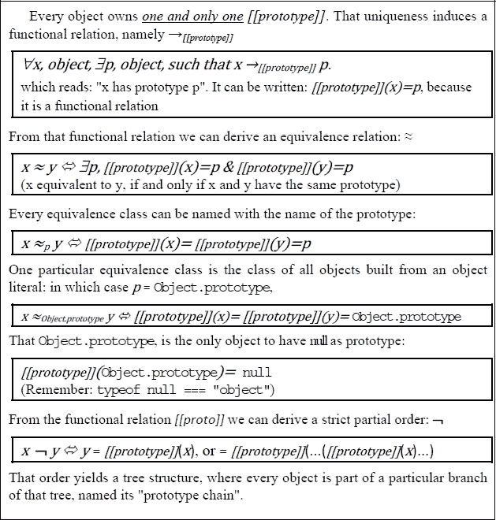

**图 4.1.** 原型背后的数学：双重关系和树形结构

到目前为止，我们知道如何通过字面量构建对象。现在问题是：

如何创建一个以给定对象为原型的对象？

自 ES6 以来，有一个简单的答案：得益 `Object.create` 方法，我们可以选取一个对象并将其作为新对象的原型：

```
const proto = {/* any object，例如一个字面量对象 */};
const newob = Object.create(proto); // newob.[[prototype]] = proto
```

严格偏序及其相关的树形结构决定了每个对象的“原型链”。为了简单起见，我们可以说任何 JavaScript 对象都是构建的：

- 要么通过字面量构建，其 `[[prototype]]` 是 `Object.prototype`：

  ```
  { … } ¬ Object.prototype ¬ null
  ```

- 或者通过 `Object.create(proto)` 构建，其 `[[prototype]]` 是 `proto`：

  ```
  x ¬ proto ¬ … ¬ Object.prototype ¬ null
  ```

整个树形结构由原型节点组成（终端叶子除外），其根是 `Object.prototype`（我们可以忽略 `null`）。所有既不是根又叶子的节点，都可以由具有相关“等价类”特征的原型进行标记。

我们可以说这些等价类就是我们在上一节中寻找的“泛义概念”，同时，任何此类泛义概念也是一个“命名实体”，因为原型是一个对象（记住与“法学”的相似性）。

### 4.5.2. 原型的作用和继承机制

给定一个对象 (`p`)，它本身就是一个命名实体，并且可以充当其他对象 (`x`) 的泛义概念：`x ¬ p`。

`Object.create(p)` 方法允许我们创建一个原型为 `p` 的 `x`，而 `Object.getPrototypeOf(x)` 允许我们检查原型是否为 `p`：

```
const p = { oprint(){return 'I am p the prototype';} };
const x = Object.create(p);
if(Object.getPrototypeOf(x) === p){console.log(x.oprint());}
// " I am p the prototype " (测试通过)
```

让我们使用 `x` 作为原型创建一个新对象：

```
const y = Object.create(x);
if(Object.getPrototypeOf(y) === x){console.log(y.oprint());}
// " I am p the prototype " (测试也通过)
```

对象 `x` 和 `y` 继从 `p` 继承了方法 `oprint`。这种关系是传递的，原型链如下：

```
y ¬ x ¬ p ¬ Object.prototype
```

继承同样具有传递性：充当原型的对象会自动将其方法和属性委托给它所标记的等价类成员。

这种“通过委托实现的继承”工作原理如下：

当在对象 `x` 上“调用”某个属性时（例如通过点符号表示法 `x.oprint`），会在 `x` 自身的属性中搜索该属性。如果未找到，则会对原型链中直到 `Object.prototype` 的每个成员执行相同的搜索。找到的第一个匹配项即为该值，否则值为 `undefined`。

#### 4.5.2.1. 结论

使用对象表示法 `{…}` 我们可以创建原型为 `Object.prototype` 的对象。

通过 `Object.create(p)` 方法，我们可以创建原型为对象 `p` 的对象，因此 `p` 变成了一个自身不知情的原型。

原型链也是一条继承链：充当原型的对象的属性被委托给链中上方所有的对象。

通过委托实现的继承是动态的：对某个原型对象方法的任何修改都会自动修改链中包含该原型的任何对象所使用的方法。

注意.– 相比之下，如果一个方法由对象本身拥有，则该方法是“静态”的。

JavaScript 非常宽容；使用这种灵活性有时是不明智的：以下是一些建议：

建议 1.– 对象是容器，其内容可以修改，但不要修改盒子：使用 `const x = Object.create(p);` 或 `const x = {..};` 来声明并创建对象。

建议 2.– 它的原型链是对象的标记；一旦创建就不要修改该链，且不要使用 `Object.setPrototypeOf(x)`。

接下来将描述三种对象构建方法：使用操作符 `{..}` 的*字面量*法、使用 `Object.create` 的*原型*法以及使用操作符 `new` 的*经典*法。

### 4.5.3. 对象构建：“字面量法”

使用操作符 `{..}` 的字面量法是：

```
{ … } ¬ Object.prototype ¬ null
```

### 4.5.4. 对象构建：“原型法”

内置对象 `Object` 是一个函数，因此它拥有一个 `Object.prototype`，指向任何原型链的根，其 `[[prototype]]` 为 `null`。

`Object.create(p)` 方法允许我们创建一个原型为 `p` 的 `x`，而 `Object.getPrototypeOf(x)` 允许我们检查原型是否为 `p`：

```javascript
const p = { oprint(){return 'I am p the prototype';} };
const x = Object.create(p);
if(Object.getPrototypeOf(x) === p){console.log(x.oprint());}
// " I am p the prototype " (测试通过)
```

让我们使用 `x` 作为原型创建一个新对象：

```javascript
const y = Object.create(x);
if(Object.getPrototypeOf(y) === x){console.log(y.oprint());}
// " I am p the prototype " (测试也通过)
```

对象 `x` 和 `y` 继从 `p` 继承了方法 `oprint`。这种关系是传递的，原型链如下：

```
y ¬ x ¬ p ¬ Object.prototype
```

继承同样具有传递性：充当原型的对象会自动将其方法和属性委托给它所标记的等价类成员。

这种“通过委托实现的继承”工作原理如下：

当在对象 `x` 上“调用”某个属性时（例如通过点符号表示法 `x.oprint`），会在 `x` 自身的属性中搜索该属性。如果未找到，则会对原型链中直到 `Object.prototype` 的每个成员执行相同的搜索。找到的第一个匹配项即为该值，否则值为 `undefined`。

### 4.5.5. 对象构建：“assign/create”模式

```javascript
function Candidat(){} // 提供 Candidat.prototype
Candidat.prototype.full = function(){return this.first+" "+this.last;};
const x = Object.assign(        // 第 3 行
            Object.create(Candidat.prototype),
            {last: "Dupont", first: "Jean"} );
console.log(x.full());                      //-> Jean Dupont
if(Object.getPrototypeOf(x) === Candidat.prototype) // true
       console.log(x.constructor.name);      //-> Candidat
```

它调用了一个函数，该函数被称为“构造函数”。良好的做法是将其名称的首字母大写：

```javascript
function Candidat(last){this.last = last;}       // 第 1 行
const x = new Candidat("Dupont");                // 第 2 行
```

第 1 行：创建了两个对象：`Candidat` 和 `Candidat.prototype`。

警告。属性 `Candidat.[[prototype]]` 是 `Function.prototype`，因为 `Candidat` 是一个函数，它继承了函数的方法：例如 `call`。

第 2 行，`new Candidat` 的作用如下：

- 创建一个新对象 `x`，将其赋值给函数内部的代词 `this`。否则，`this = window`（或全局对象）；
- 隐式地返回 `this`（除非编写了显式的 `return` 语句：但要尽量避免这样做！）；
- 更新 `x.[[prototype]] = Candidat.prototype`，这使得 `x` 通过委托实现继承；
- 更新 `x.constructor = Candidat`。

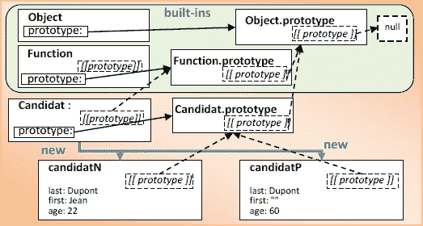

**图 4.4.** 构造函数创建的对象结构图。

构造函数的作用非常有限：对象 `Candidat.prototype` 才是真正触发委托继承的那个。整个*经典*操作是复杂的，尽管它对程序员来说是透明的。

## 4.6. 比较“原型型”和“经典”方法

让我们探讨 Douglas Crockford 的观点，他提倡引入 `Object.create`。

他使用 `new` 算符模拟了该方法：

```javascript
Object.create = function (proto) {
   function F() {}                // 创建一个原型属性
   F.prototype = proto;           // 使 proto 成为该原型
   return new F();         // 创建一个以 proto 为原型的对象
};
```

### 4.6.1. 在 JavaScript 中模拟类层次结构

类层次结构基于“是一个...”（Is-a）关系，例如，“一个候选人是一个人”（加上一些特定属性）。让我们来比较一下这两种方法。

#### 4.6.1.1. 经典模拟：类“Person”和子类“Candidate”

```javascript
function Person (last, first) {                        // 第 1 行
    this.last = last || "?";
    this.first = first || "";
}
function Candidate (last, first, dN) {                 // 第 2 行
     Person.call(this, last, first); // 使用 this 使用 Person 的代码
     this.dN = dN || "somewhere";
}
Candidate.prototype = new Person();                    // 第 3 行
Candidate.prototype.constructor = Candidate;           // 第 4 行
Person.prototype.fullName = function(){                // 第 5 行
        return this.first+" "+this.last;
};
Candidate.prototype.fullName = function(){            // 第 6 行
       return Person.prototype.fullName.call(this)+", "+this.dN;
};
const c1 = new Person("D", "Jean");
const c2 = new Candidate("D", "Creuse");
```

让我们注释这段代码的逻辑：

- 第 1 行和第 2 行，函数 `Person` 和 `Candidate` 创建了原型并进行了一些初始化；
- 第 2 行：`Candidate` 通过 (`this`) “复用”了 `Person` 的代码，即执行 `new Candidate()` 时创建的对象。这是 `Person.call` 的工作。
- 第 3 行：将 `Candidate` 链接到 Person 的原型链：

```
c2 ¬ Candidate.prototype ¬ Person.prototype
```

- 第 4 行：更新属性 `constructor`，该属性在第 3 行被初始化为 `Person`；
- 第 5 行：向 `Person.prototype` 添加方法 `fullName`；
- 第 6 行：在 `Candidate.prototype` 中复用代码 `Person.fullName`。

继承在第 3-4 行控制。最后，对于 `c1`、`c2`，让我们打印 `c.constructor.name`、`JSON.stringify(c)` 和 `c.fullName()`：

```
name                            fullName()
Person{"last":"D"}               Jean D
Candidate{"last":"D","dN":"Creuse"} D, Creuse
```

#### 4.6.1.2. 原型型模拟：类“Person”和子类“Candidate”

```javascript
function Person(){}                                 // 第 1 行
function Candidate(){}                              // 第 2 行
Person.prototype.fullName = function(){             // 第 3 行
    return this.first+" "+this.last;
};
Candidate.prototype = Object.assign(                // 第 4 行
                 Object.create(Person.prototype),
                 { fullName(){
    return Person.prototype.fullName.call(this)+", "+this.dN;
}});
Candidate.prototype.constructor = Candidate;         // 第 5 行
const p1 = Object.assign(                            // 第 6 行
                 Object.create(Person.prototype),
                 { last:"D", first:"Jean", dN:"Creuse"});
const p2 = Object.assign(                            // 第 7 行
                  Object.create(Candidate.prototype),
                  { last:"D", first:"Jean", dN:"Creuse"});
```

让我们注释并比较：

- 第 1 行和第 2 行，函数 `Person` 和 `Candidate` 仅仅创建了原型；
- 第 3 行：向 `Person.prototype` 添加 `fullName`（相当于经典方法的第 5 行）；
- 第 4 行：`assign/create` 模式修改了 `Candidate.prototype`，它从 `Person.prototype` 继承并更新了 `fullName`；
- 第 5 行：更新 `Candidate.prototype.constructor`；
- 第 6 行：相当于经典方法的第 5 行。

图 4.5 和 4.6 展示了两种方法的相似性。

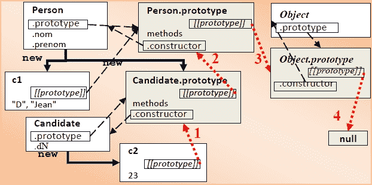

**图 4.5.** 经典方法的子类继承。

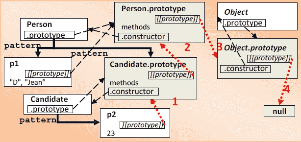

**图 4.6.** 原型方法的子类继承。

在图 4.5 和 4.6 中，虚线代表以下对象的原型链：

```
c2/p2 ¬ Candidate.prototype ¬ Person.prototype ¬ null.
```

在原型方法中，`pattern` 替换了 `new`，且不需要对 `Person` 进行初始化。

### 4.6.2. 总结我们目前所学的

#### 4.6.2.1. 属性

- 每个对象拥有两种类型的属性：“自有”的，或从原型链“继承”的；
- 在自有属性中某些是不可枚举的：`[[prototype]]` 是隐藏的，这保护了它。保留链接即保留了委托机制；
- `constructor` 属性指向提供 `f.prototype` 的函数（如果 `f = Object`）。等价类的所有对象共享。

#### 4.6.2.2. 值

- 属性的值是一个引用：删除属性后，垃圾回收器将检查是否需要清理值。

#### 4.6.2.3. 方法

- 方法通常由指向相同原型的对象共享：你必须将它们添加到该原型中。

在构造函数中定义的方法是“静态”的，在其原型中定义的方法是“委托”的。例如：

```javascript
function Candidate(last, first){    // 构造函数中
   this.last = last; this.first = first;
   this.full = function(){return this.first+" "+this.last};
}
const c1 = new Candidate("Dupont"), c2 = new Candidate("Durand");
(c1.full === c2.full);             // false: 不共享
```

对于每个 `new` 指令，`full` 方法都是不同的。你可能会得到数百个！

```javascript
function Candidate(last, first){
     this.last = last; this.first = first;
}                        // 原型中定义
Candidate.prototype.full = function(){return this.first+" "+this.last;};
// true: 共享
```

单一的 `full` 方法是被委托的：在自有属性中未找到，从原型中获取。数百个对象的唯一版本！

#### 4.6.2.4. 继承种类（委托、拼接）

为对象提供属性的方法有两种：

- *委托 (delegation)*：如果所引属性存在原型链中，则继承是动态的。（参见：`Object.create`）；
- *拼接 (concatenation)*：如果所引属性是从另一个对象拷贝的，它将变成静态的，可以在需要时进行更新（参见：`Object.assign`）。

#### 4.6.2.5. JavaScript 中的多继承

一个对象只继承一个原型（*委托*）。拼接使得在所引对象（用于拷贝的来源）保持不变的情况下，实现多个静态继承成为可能。当我们拼接意图作为常量的方法或特定值时，就会出现这种情况。其中一种解决方案是“冻结”这些所引对象（`Object.freeze`），从而保护它们免受后续修改的影响。

#### 4.6.2.6. 关于 JavaScript 中“类”概念的结论

JavaScript 中既没有“类 (class)”，也没有“实例 (instance)”，但我们了解到由“具有原型”关系诱出的“等价类”提供了一个*通用概念*，并且我们可以对其命名（`constructor.name`）。如果你对该类感到满意，该类中的任何成员都可以被称为“*实例*”。

# 5. 数组 (Arrays)

对于数据科学家来说，处理表格数据的数组是一项反复的任务。如果使用 JavaScript，基准是能够完成我们通常在电子表格和基本宏操作中执行的工作。网上可以自由访问成千上万条表格数据：大多数国家的公共数据、来自国际机构的数据或免费访问的私有数据。在第 3 部分中，将讨论几个应用（例如 2017 年法国议会选举）。

JavaScript 提供了几个能够表示表格数据的内置对象，我们可以通过索引访问它们：当然有 `Array`，`TypedArray`、`Map`、`Set`、`String` 是其他“可迭代对象 (Iterables)”。它们共享许多特征，例如 `length` 属性，但被称为“类数组 (array-like)”。函数的参数列表和选定的 HTML DOM 元素列表也是“类数组”对象。

本章专门介绍 `Array` 对象。

一个“*数组 (array)*”是一个有序值的集合，我们可以通过数字索引访问它。该索引从 0 开始而不是 1（基于零的索引）。

数组没有特定的类型：运算符 `typeof` 返回 `"object"`，但静态方法 `Array.isArray(tab)` 可以检查其参数是否为数组，因此 `tab` 继承了所有 `Array.prototype` 的方法。

## 5.1. 处理数组：创建及对其元素的访问

### 5.1.1. 使用数组字面量符号创建数组

“数组字面量”的语法使用方括号来界定元素列表，这些元素可以是原始值、变量名、对象和函数，并用逗号隔分隔：

```
 [elem1, elem2, …] // 任意数量的元素，包括零
```

示例：

```
const tm = ["un", 2]; // 两个值：一个字符串，一个数字
const ts = ["Jean","Bob"], tabn = [12,24]; // 同质数组
const t2d = [ ts, tabn];          // 一个包含两个数组的数组
const te = [];                  // 空数组：tab.length = 0
const tu = ["a",,"c"]; // 语法正确，但要避免使用！
```

警告。– 在输入时，不要在删除元素的同时留下它的逗号：上面的数组 `tu` 具有：`tu.length = 3` 且 `tu[1] = undefined`。

这里是数组的一些最佳实践：

- 使用 `const` 声明数组，元素及其数量可以修改，但这将其名称的使用限制在该数组上，一劳永逸；
- 使用字面量符号，而不是 `new Array()`，这可以避免歧义：

```
const tm = new Array("two"); // 等于：tm = ["two"];
  const tn = new Array(2); // 等于：tn = [undefined, undefined];
```

### 5.1.2. 检查变量是否为数组

运算符 `typeof` 并不区分数组和对象：

```
 const t = [a, b, c]; console.log( typeof t ); // "object"
```

相反，使用静态方法：

```
 console.log( Array.isArray(t) ); // true
```

### 5.1.3. `length` 属性，索引计数

`length` 是可读写的，且索引从 0 开始而不是 1：

```
 console.log( [a, b, c].length );        // -> 3
  const t = ["one", 2]; console.log( t[1]); // -> 2
```

属性 `length` 会被永久更新，返回最后一个元素的索引加一。在数组中添加或删除元素会立即修改 `length`。反之，修改 `length` 会推导出在末尾添加或删除元素。

此功能可用于某些操作：

- *清空数组：只需将 length 设置为零*

```
 const t1 = []; console.log(t1.length); // -> 0 (t1 为空)
  const t2 = ["one", "two", "three"];         // t2.length = 3
      t2.length = 0; // 现在 t2 为空
```

“垃圾回收”将处理之前分配给 `t2` 的内存。

- *初始化数组为指定数量的元素*

```
const t = []; t.length = N; // [undefined, undefined,… N 次]
```

注意。– 数组是一个对象，具有使用数字作为属性名的特定能力，这对于普通对象是禁止的：

```
const obj = {"p1":1, "p2":"two"};
  console.log(obj["p2"]);     // two
  console.log(obj[1]); // undefined (无此类属性)
```

注意。– 我们可以像对待对象一样给数组添加私有属性。例如：

```
const t1 = [], t2 = [[], []];
  // 让我们添加属性 'dimension'，然后打印值：
        t1.dimension = 1;       t2.dimension = 2;
  console.log( t1["length"] +", "+ t1["dimension"] );  //-> 0, 1
  console.log( t2["length"] +", "+ t2["dimension"] );  //-> 2
```

### 5.1.4. 访问数组中的单个值：索引

在 `Array.prototype` 部分中，我们将学习通常不处理元素，而是处理整个数组。索引从零开始。

```
const t = [2, 4];	
  n = 1; console.log( t[n] ); // 4
  n = 6; console.log( t[n] ); // undefined
  n = -6; console.log( t[n] ); // undefined
```

值 `undefined` 可能源于以下情况之一：

- 索引越界 `[0, t.length-1]`
- 索引正确但实际值为 `undefined`。

注意。– 索引是“属性名”：索引类型为 `number`，但在访问元素时会被求值为 `string`，即数组的“属性”：

```
 ( tab[1] === tab["1"] ); // true
```

注意。– 空值：某些方法忽略它们，而 for 循环会遍历它们：例如 `const tu = ["a",,"c"];` 中的 `tu[1]`。建议：避免空值。

## 5.2. Array 和 `Array.prototype` 方法

处理数组的最佳方法是使用 `Array.prototype` 方法，并在需要时使用 Array 对象的静态方法。

| 方法 | 说明 | 返回值 |
| --- | --- | --- |
| `Array.of()` | 使用参数初始化数组 | 数组 |
| `Array.from()` | 从*可迭代对象*创建数组 | 数组 |
| `Array.isArray()` | 检查参数是否为“数组” | 布尔 |

**表 5.1.** Array 对象的静态方法

这些静态方法必须从内置对象 `Array` 调用。示例：`Array.isArray(["a","b"]); // true`。

有关 `Array.from` 的用法请参见 5.2.5 节。

相比之下，`Array.prototype` 的方法被委托给每个数组。例如：`[].push("a"); // ["a"]`

`Array.prototype` 方法分为三类：“修改器”、“访问器”和“迭代器”。我们使用 `[].method` 符号来识别它们。

### 5.2.1. “修改器”家族

九个修改调用其方法的数组的方法；数组长度可能会变化。某些方法在初始化阶段非常有用：

- 逐元素增量插入（`push`、`unshift`）；
- 复制一组值（`fill`、`copyWithin`）；
- 逐个移除元素（`pop`、`shift`）；
- 替换一段值（`splice`）。

| 方法 | 描述 | 返回值 |
| --- | --- | --- |
| `a.copyWithin` | 根据 `(target, start, end)` 移动数组的片段 | `tab` |
| `a.fill` | 根据 `(val, start, end)` 复制相同的值 | `tab` |
| `a.pop` `a.shift` | 移除最后一个（相应为第一个）值，并减小长度 | `value` |
| `a.push` `a.unshift` | 在末尾（相应为开头）添加值，并增加长度 | `length` |
| `a.reverse` | 反转数组 | `tab` |
| `a.sort` | 字母顺序排序或根据比较器（`function`）排序 | `tab` |
| `a.splice` | 根据 `(start, count, [values list])` 修改片段，修改 `length` | `tab` |

**表 5.2.** `Array.prototype` 的“变器”方法

#### 方法 `fill`、`push`、`unshift`

- 创建一个包含 `N` 个相同值的数组，例如全为 0：

    ```javascript
    const t = []; t.length = N;    t.fill(0); // [0, 0, … N]
    ```

- 用某些请求的结果提供的值填充数组：

    ```javascript
    let x; const t = []; // 从空数组开始
    do{
      x = Math.random() * (10 - 1) + 1; // [1,10] 中的数据
      if(x > 5){t.push(x.toFixed(1));} // 如果 > 5 则保留
    } while (x > 5); // 如果 ≤ 5 则停止
    if(t.length > 0){t.unshift("random > 5");} // 如果 t 不为空，则设置 t[0]
    ```

#### 方法 `splice`

这使得通过修改一个元素或片段来“修订”数组成为可能。例如，要更新一个全名包含给定姓氏的对象的名：

- 第 1 行：设置原始数组；
- 第 2 行：使用 `findIndex` 选取包含“Dent”的元素：得到 `k`；
- 第 3 行：使用 `splice` 替换索引 `[k]` 处的值。

```javascript
const t = ["Jean Bon", "Ange Leau", "P. Dent", "Paul Tron"]; //1
let k = t.findIndex(x=>x.includes("Dent")); //（见下文） //2
t.splice(k, 1, "Redon Dent"); // 替换 t[k] 的值 //3
```

#### 方法 `reverse` 和 `sort`

这些方法修改元素的顺序：`reverse` 显而易见，而 `sort` 更复杂。

```javascript
const t = ["Jean Bon", "Ange Leau", "P. Dent", "Paul Tron"];
t.sort(); // ["Ange Leau", "Jean Bon", "P. Dent", "Paul Tron"]
```

- 不带参数时，`sort` 进行基于 Unicode 的字母顺序排序；
- 以函数 `compare` 作为参数时，根据 `compare` 函数对每个元素的逐个结果进行排序：

    ```javascript
    function compare(a, b) {
       if (a < b [根据某种排序标准]) {return -1;}
       if (a > b [根据相同的排序标准]) {return 1;}
       return 0; // 因为 a = b
    }
    ```

函数 `compare` 用于 `quickSort` 算法。该数组被划分为若干片段，每个片段都有一个基准值（值 `a`）。在（升序）排序的某个时刻，对于每个在 `a` 之前的元素（值 `b`），如果 `compare(a,b) > 0`，则移动该元素，否则留在原处。如果 `a` 在 `b` 之前，则发生对称的操作：

示例 1.– 通过数字进行排序（升序，忽略 `Infinity, NaN`）

```javascript
function compareNumbers(a,b) {return a - b;}
[1, 4, 2, 11, 3].sort(compareNumbers); // [1,2,3,4,11] (num)
[1, 4, 2, 11, 3].sort(); // [1,11,2,3,4] (alpha!)
```

示例 2.– 通过“名 姓”字符串中的姓氏进行排序。

```javascript
function compareLastNames(a,b){
     let al = a.split(" ")[1], // a 中的第二个单词
         bl = b.split(" ")[1]; // b 中的第二个单词
     if (al < bl)            return -1;
     else if (al == bl)      return 0;
     else                    return 1;
}
const t = ["Jean Bon","Ange Leau","P. Dent","Paul Tron"]; t.sort(compareLastNames);
// ["Jean Bon","P. Dent","Ange Leau","Paul Tron"]
```

### 5.2.2. “访问器”家族

七个方法不会修改数组，而是产生数组的表示。

| 方法 | 描述 | 返回值 |
| --- | --- | --- |
| `a.concat` | 将数组与参数合并 | Array |
| `a.lastIndexOf` | 最后一次出现的索引 | Number |
| `a.indexOf` | 第一次出现的索引 | Number |
| `a.slice` | 将片段 `(start,end)` 复制到新数组 | Array |
| `a.join` | 使用分隔符创建字符串 | String |
| `a.toLocaleString` | 格式化 | String |

**表 5.3.** `Array.prototype` 的“访问器”方法

### 5.2.3. “迭代”家族

这些方法返回新数组或迭代器。

| 方法 | 描述 | 返回值 |
| --- | --- | --- |
| `a.entries` | 返回 `[key,value]` 数组 | *Iterator* |
| `a.keys` | `[key]` 数组 | *Iterator* |
| `a.values` | `[value]` 数组 | *Iterator* |
| `a.every` | 检查是否所有元素都符合 `(function)` | Boolean |
| `a.filter` | 由 `(function)` 选的元素数组 | Array |
| `a.find` | 第一个符合 `(function)` 的值 | value |
| `a.findIndex` | 第一个符合 `(function)` 的值的索引 | Number |
| `a.forEach` | 处理每个元素 | Undefined |
| `a.map` | 根据 `(function)` 创建新数组 | Array |
| `a.reduce` | 根据 `(function)` 累加值 | Any |
| `a.reduceRight` | 从数组末尾累加值 | Any |
| `a.some` | 检查是否有一个元素符合 `(function)` | Boolean |

**表 5.4.** `Array.prototype` 的“迭代”方法

### 5.2.4. 遍历数组的元素

处理数组的重要建议如下：使用 `Array.prototype` 方法，而不是循环：这样更容易且更不容易出错。

- *迭代* 循环：`for(let i = 0; i < t.length; i++)` 或 `while..`；
- *枚举* 循环：`for(let prop in t)`；

枚举循环不受上述备注的影响。迭代循环使用索引和数组长度：我们已经指出过。

### 5.2.5. 使用 Array 方法无需循环

自 ES6 起，所有基础创建和处理数组的操作都可用。

#### 5.2.5.1. `Array.from`

它将迭代器转换为常规数组。例如：

```javascript
const args = Array.from(arguments); // 在函数内部
const t2 = Array.from({length:3},function(){return 1}); // [1,1,1]
const t3 = Array.from({length:3},function(v,i){return i*i});
const t4 = Array.from("hello"); // ["h", "e", "l", "l", "o"]
const rd = Array.from({length:n},
                     function(x){return Math.random() * 10;});
```

- `args`：见第 6.3 节 (第 6 章)；
- `t2`：与“fill”示例相同（但只需一条指令）；
- `t3`：第一个参数 `{length:3}` 是一个*迭代器*，它允许 `from` 迭代函数（参数 #2）三次执行 `i*i`：结果为 `[0, 1, 4];`
- `t4`：将字符串转换为数组；
- `rd`：一组 `n` 个 0 到 9 之间的随机数。

#### 5.2.5.2. `tab.forEach`

它为数组 `tab` 的每个元素执行该函数。例如，在计算值的同时，将某些数据保存到另一个数组中：

```
 let rc = "figures ", rl = " and letters "; const tabc = [];
  ["a","b", 1, 2].forEach(function(v, i){
    if(typeof v === 'string') rl += (i===0?"" : ", ") + v; else tabc.push(v);
  });
  rc +tabc.toString()+ rl; // figures 1,2 and letters a, b
```

#### 5.2.5.3. `tab.map`

该方法对数组 `[]` 中的每个元素执行一次函数，类似于 `forEach`，但会将返回的值保存到一个新数组中。例如：

```
 const tabl = ["a","b", 1, 2].map(function(v, i){
     return (typeof v === 'string'? v : v.toString());
  }); // tabl 将仅包含字符串
```

#### 5.2.5.4. `tab.every`, `tab.some`

该方法会对数组中的元素执行函数直到某个元素。与大多数数组方法不同，这些方法可以在数组结束之前停止运行：

- `some`：只要有一个元素符合条件就立即停止；
- `every`：只要有一个元素不符合条件就立即停止

```
     function isEven(elt, index, array) {return (elt % 2 == 0);}
      [2,4,5,8,6,2,3,12,4,8,9,1].every(isEven);
                              // -> false (停止在 '5' )
      [2,4,5,8,6,2,3,12,4,8,9,1].some(isEven) ;
                             // -> true (停止在第一个 '2' )
```

#### 5.2.5.5. `tab.find`, `tab.findIndex`

该方法一旦找到参数就会停止，并返回该值或索引。

```
 function isPrime(v, i) {
     let f = 2;
     while (f <= Math.sqrt(v))
         {if (v % f++ < 1){return false;}}
     return v > 1;
}
[4, 5, 8, 12].findIndex(isPrime); //-> 1 (并停止)
```

#### 5.2.5.6. `filter`

该方法将符合函数的元素筛选并放入新数组中。它类似于 SQL 命令 `Select_From_Where`：

```
 const upTo10 = Array.from({length:10},
        function(v,i){return i+1}); // [1,2,3,4,5,6,7,8,9,10]
  const primes = upTo10.filter(isPrime); // [2,3,5,7]
```

#### 5.2.5.7. `reduce`

该方法类似于 SQL 命令 `GroupBy`，将结果聚合到累加器上：

```
 function multAcc(acc, v){return acc *= v;}
  const factorial = upTo10.reduce(multAcc); // 3628800 (!)
```

得益于 `+` 的多态性，我们可以将结果聚合到字符串中：

```
 function tPrim(acc,  v){return acc +` (${v})`;}
  const ini = "First primes: ";
  const str = upTo10.filter(isPrime).reduce(tPrim,ini);
              // First primes: (2) (3) (5) (7)
```

在这里 `reduce` 使用了第二个参数来初始化累加器：

```
 ["c1","c2"].reduce(function(s,x){return s+`<li>${x}</li>`}, "<p>")+"</p>";
  // <p><li>c1</li><li>c2</li></p>
```

我们将使用此特性创建显示在网页上的文本（参见第 3 部分）。示例中使用了另一个特性：方法的链式调用。

### 5.2.6. 方法链式调用

这是 JavaScript 提供的一种“函数式”能力：链式调用意味着第一个方法的结果是一个接受下一个方法的对象。例如（上文），`filter` 的结果是一个数组，我们可以在单个指令中对该数组调用 `reduce` 方法（为了更好的可读性跨越三行）：

```
 Array.from({length:10}, function(v,i){return i+1})
         .filter(isPrime)
         .reduce(tPrim,ini);
```

借助“箭头函数语法”，你甚至可以写：

```
 Array.from({length:10},(v,i)=>i+1)
         .filter(isPrime) .reduce((s,p) =>s+` (${p}) `,ini);
```

### 5.2.7. 数组与箭头函数语法

箭头语法可以用于任何地方的函数表达式，特别是在数组方法的语境中，它可以提高代码的可读性，例如：

```
 const f = function(x,i){do_something_with_x_and_i; return value;}
  let out = tab.reduce(function(acc,x,i){return acc + f(x,i);},ini);
```

在箭头语法中，等价于：

```
 const f = (x,i)=>{do_something_with_x_and_i; return value;}
  let out = tab.reduce((acc,x,i) => acc + f(x,i),ini);
```

示例.– 从 2D 数组中提取单列：

```
 let n = 1; // warning：将引用第二列!
  const col2 = tab2d.map(x => x[n] || null);
         // col2 = [2, 4, 6]
```

注意.– 快捷方式 `x[n] || null` 是为了在单元 `n` 不存在时避免 `undefined`。

示例.– 展平 2D 数组：

```
 const tab1d = tab2d.reduce((acc,x) => acc.concat(x), []);
  // tab1d = [1, 2, 3, 4, 5, 6]
```

注意.– `acc` 初始化为空数组 `[]`，`tab2d` 的每一行都会连接到其中。

示例.– 为 2D 数组提供元数据：

数组是一个对象，具有特定的特征（数字作为属性名），像对象一样，我们可以在 `.length` 之外添加属性；我们可以设置 `.title` 来命名，设置 `.dimension` 来告知维度，或者设置 `.schemata`（一个数组）来命名 2D 数组的列等。

```
 const t1 = [1, 2], t2 = [3, 4], t3 = [5, 6];
  const tab2d = [t1, t2, t3];
  tab2d.dimension = 2;
  tab2d.schemata = ["date", "amount"];
  tab2d.columnsOk = tab2d.every(x=>x.length === tab2d[0].length);
```

### 5.3.1. 提出“增强 `Array.prototype`”的框架

存在稳定且安全的框架为数组提供了额外方法，尽管这些方法在它们的“命名空间”中被“屏蔽”。例如，统计工具或类似 LINQ 的查询（微软语言集成查询），你可以在 GitHub 上找到它们：

- jStat: [`github.com/jstat/jstat`](https://github.com/jstat/jstat)；
- jslinq: [`github.com/maurobussini/jslinq`](https://github.com/maurobussini/jslinq)。

# 6 函数

函数是一个独立的代码块（指令列表），可以从代码的其他部分进行调用。这需要一种机制来存储调用行、共享变量、传递参数和返回值。

在 JavaScript 中，函数是一个“一等对象”，这意味着函数可以：

- 被赋值给变量；
- 作为其他函数的参数；
- 作为值返回；
- 像其他所有对象一样，拥有属性、方法和原型。

为了阐说明这一概念，我们展示了一个“原型图”，如第 5 章所示，它展示了 `Object` 和 `Function` 有多复杂：

```
 Object.constructor =             		  Function
 Object [[prototype]] ===                         Function.prototype
 Object.prototype.constructor =           	  Object
 Object.prototype [[prototype]] ===               null                  // 独立
 Function.constructor =                      	  Function              // 自身
 Function [[prototype]] ===                       Function.prototype
 Function.prototype.constructor =                 Function
 Function.prototype [[prototype]] ===             Object.prototype
```

本章介绍了“作用域”和“执行上下文”的概念，这些有助于理解“函数闭包”和“IIFE”（立即调用函数表达式）的机制。

下面的图总结了将详细介绍的内容，以及何时使用自由变量和绑定变量的概念。

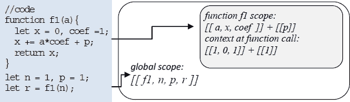

## 6.1. JavaScript 函数的通用语法

函数可以通过两种方式设置相同的语法：通过声明或通过表达式。

```
function name([parameter1[, parameter2[, parameter3 …]]])
 {    /* 要执行的代码 */
[return value;] // 可选，默认值：return undefined;
 }
```

### 6.1.1. 名称

函数的名称不能是保留字，也不得与在相同“作用域”内声明的同名冲突（见下文）。如果未提供名称（仅在函数表达式中可能），该函数被称为“匿名”函数；如果提供了名称，该名称在函数内部已知并可以用于递归调用。

### 6.1.2. 参数

参数与函数一起声明；参数在函数被调用时传递。

### 6.1.3. 返回

函数始终有一个返回值：可以是指令 `return (expression);` 求值的表达式，或者是对象（使用 `new` 时），或者是默认的 `undefined`。

### 6.1.4. 函数代码和作用域

函数的名称位于 `scope`。在块内部未声明的变量将向上查找到 `global scope`（全局作用域）。函数的名称在函数内部已知，并可以用于递归调用。

### 6.1.5. 创建函数

构建函数有两种方法：声明或表达式。

- **函数声明**

```
function add(a,b){ let c = a+b; return c; }
```

在此情况下，函数的名称是强制性的。由于“提升”，声明的函数被分组在包含它们的代码块的头部。这些函数的代码块反过来可能包含函数声明，此时“提升”会再次适用，依此类推（见第 6 节）。

- **函数表达式**

```
const add = function(a,b){let c = a+b; return c;}; // 情况 1
```

函数表达式（右侧）被赋值给变量（左侧），该变量成为该函数的名称，其类型为 `function`。使用 `const` 声明接收函数表达式的变量。

注意.– 终止指令的分号。

函数表达式还出现在另外两种情况中：

- 定义对象的方法（情况 2），

```
 const person = {
       nom: "Dupont", prenom: "Jean",
       affiche(){return this.prenom +" "+ this.nom;}     // 情况 2
       };
```

- 定义另一个函数的参数值（情况 3）：

```
 ["Jo","Bob","Ron"].forEach(function(x){emailTo(x);});  // 情况 3
```

对于函数表达式，函数的名称是可选的，自 ES6 起，变量的名称（情况 1）或方法的键（情况 2）被赋予函数名称。只有在情况 3 中，作为参数使用的未命名函数仍然真正的匿名的。但即使如此，你也可以始终使用显式名称。

## 6.2. 使用运算符 `()` 调用函数

操作符 `(parentheses)` 也称为“分组运算符”或“优先级运算符”，用于算术表达式、逻辑表达式或正则表达式中。它告诉引擎先处理括号内的部分，从而为括号运算符所分组的内容建立一个优先级。

### 6.2.1. 函数语境下“括号运算符”的三个方面

- **参数分隔符**

  它被用于函数声明语法中，跟在函数名之后，或者在匿名函数表达式中。

```javascript
function test ( p1, p2 ) { … }
function Candidate ( first, last ) { … }
[1,2].forEach(function ( x, i ) { … });
```

- **参数分隔符**

  它被用于在指令中调用的已声明函数，无论是作为直接调用，还是通过运算符 `new` 调用。在两种情况下，实参数列表（可能为空）将与预期的参数列表进行匹配。

```javascript
test ( "hello" );          // 匹配 p1, p2 undefined
const c = new Candidate ( "Jean", "Dupont" ); // 匹配 …
```

- **立即调用，参见 section 6.7 (“IIFE”)**

  当用于包裹整个函数语法时，其作用是告诉引擎先处理该函数，即执行其代码。这需要强制性的第二对括号，括号内包含参数（可以为空）。

```javascript
( function (x,i){ … } ) ( "hello",12 );
// "hello" 匹配 x, 12 匹配 i
```

让我们详细说明“参数分隔符”情况的三个步骤：

- **参数匹配参数：**

  JavaScript 允许数量不同：相同位置的项目进行匹配，多余的参数设置为 `undefined`，多余的参数被忽略。

- **函数执行：**

  函数名提供了代码的访问权限，该代码将使用匹配的参数，以及调用指令提供的“执行上下文”中的变量值执行（见下文）。

- **返回。始终有一个返回值：**

  可以是指令 `return (expression);` 求值的表达式，或者是对象（使用 `new` 时），或者是默认的 `undefined`。

**警告.– 执行上下文。** 这对于脚本引擎来说是明确的，但对你来说可能不是，因为上下文是动态的。请参见 sections 6.5.1.1 (scope)、6.5.4 (`boundThis`) 和 6.6 (`closure`) 以对这个（有时）困难的问题进行全面评估。

**警告.– 返回值。** 尽管我们不建议使用 `new`，但有时它是必要的（例如使用现有代码等）。因此，我们建议在代码中没有显式 `return` 的时候添加一条 `return this;` 语句。

### 6.3. 选择函数声明还是函数表达式

让我们比较三个示例。

- **使用函数声明：**

```javascript
let x = add(4, 3); // 'return' 的值赋值给 x
function add(a, b) { let c = a+b; return c; }
console.log(x); // -> 7 好!
```

函数 `add` 在 `x` 之前被提升。

- **使用变量和匿名函数表达式：**

```javascript
let x = add(4,3);
const add = function (a, b) { let c =a+b; return c; };
// ReferenceError: can't access lexical declaration 'add' before initialization
```

函数 `add` 没有被提升，且定义在 `x` 之后。

- **使用变量和命名函数表达式：**

```javascript
const add = function adding(a, b) { let c =a+b; return c; };
let x = adding(4,3);
// ReferenceError: adding is not defined
```

名称 `adding` 仅在函数内部可见 → *注意！*

- **差异：**

  - “提升”只对函数声明有效；
  - 函数表达式成为变量的值：在函数外部只知道该变量名。在函数内部，要使用的名称是 `adding`，尽管 `add` 和 `adding` 都是可知的（但 `add` 指向 `adding`）。

这些差异仅涉及名称的作用域，对执行没有影响。因此，在函数声明和函数表达式之间进行选择仅仅是编码风格问题。

### 6.4. 参数

参数与函数一起声明；参数在函数被调用时传递。

### 6.4.1. 参数按值传递

函数可能会在其代码块中修改对应于参数的值，但函数外部对应的变量不受影响：改变的是匹配参数的值，而不是变量的值。

**警告.– 传递给参数的对象本身不会被修改，但其属性可能会被函数修改、甚至删除，并且可能被添加新属性。对于数组也是如此。内容变化的容器仍然是原来的未改变的容器。**

| 代码 | `x.first` 的值 |
| :--- | :--- |
| (之前) | inside |

**表 6.1. 更改内容**

### 6.4.2. 内部对象 `arguments`

每个函数都可以访问一个内部对象 `arguments`，它是调用时接收到的值列表。这是一个我们可以处理的 `Iterable`。

**示例.– 列出实际参数，即使是预期的：**

```javascript
function f(){           // 无参数
   Array.from(arguments).forEach( a=>{console.log(a)});
}
f("1", 2, "hello"); // -> string
```

### 6.5. 作用域：全局作用域、函数作用域和块作用域

这是 JavaScript 的另一个基本方面，理解它是编写正确、健壮代码的关键。

### 6.5.1. 词汇：词法作用域和“命名空间”

每个变量或函数都必须声明并命名：

- 变量：使用 `var`、`let` 或 `const` 后跟一个名称；
- 函数：使用关键字 `function` 后跟一个名称，或者间接地通过将函数表达式赋值给如上述声明的变量。

#### 6.5.1.1. 作用域

变量或函数的作用域是其名称词法上已知且不会引发 `ReferenceError` 异常的指令集。这组指令（我们可以与作用域关联）可以通过以下两种方式通过 `{大括号}` 来界定：

- “函数作用域”：函数代码块内部；
- “块作用域”：由 `let` 或 `const` 声明的变量词法上绑定到现有的块，如条件分支或循环或显式的 `{大括号界定块}`；
- 否则：变量是全局的，全局作用域没有界定。

#### 6.5.1.2. 命名空间

“命名空间”这一术语可以通过转喻与“作用域”联系起来。事实上，一个“命名空间”是一个对象，其自身的属性和方法是作用域的内容（可能有一些私添加）。一个示例是在 JavaScript 运行在网页生态系统中时，将“window 命名空间”与全局作用域联系起来。在这种情况下，全局变量 `a` 正是属性 `window.a`。

参见第 7 章，创建“命名空间”的设计模式。

#### 6.5.1.3. 按作用域拆分变量和函数

此示例的代码仅为了学习而编写：为了创建多个作用域（参见图 6.1）

```javascript
function f1(b){
   const coef = 4;
   if(b >8 && b < 10){let str = "(before extra time) "; a += str;}
   return a + coef * b;
 }
function f2(){
   let y = 3;
   fff = function f3(y){
     const z = 3, str = ". You have played "+(z-y)+" times";
     if(y > 0){ y--; f3(y);}
     return str;
   };
   return fff(y);
 }
 let a = "Your score is: ",
     b = 12,
     str = "Result. "+ f1(b) + f2();console.log( str );
```

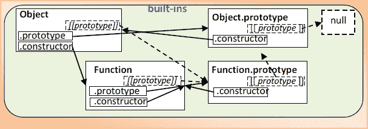

**图 6.1.** “Object”与“Function”内置对象的交织关系

#### 6.5.1.4. 解释：自由变量与绑定变量

在数学中，“自由变量”和“绑定变量”的概念是为了告诉我们是否可以在复合命题中重用它们。在目前的讨论中，当一个作用域提供了在其内部声明的变量列表时，这就是它的 `[[bound variables]]` 列表。如果存在更多变量但未列出，那么它们就是“自由”的。我们必须寻找另一个它们被“绑定”的作用域：首先在调用指令的作用域中，然后一直向上查找，直到找到该作用域，该作用域可以是“全局作用域”。最后，如果完全没有找到，搜索将产生 `ReferenceError`（引用错误）异常。

让我们逐作用域拆解我们的示例：

- 全局作用域 = `[[f1, f2, a, b, str]]`：两个函数和三个变量；
- 函数作用域 `f1` = `[[b, coef]]`：一个局部变量，一个参数；

警告。调用 `f1(b)` 使用全局变量 `b`，其值作为参数传递，并成为参数 `b` 的值，虽然名字相同，但这个 `b` 是 `f1` 局部的。它们是不同的变量：如果 `f1` 修改 `b`，全局的 `b` 将保持不变！

- `f1` 内部块作用域 = `[[str]]` + *全局* `[[a]]`

变量 `str` 是块局部的（用 `let` 声明）。块中使用的变量 `a` 不是局部的，也不是函数 `f1` 局部的。我们在全局作用域中找到了 `a` 并使用了它。我们必须遍历整个作用域链来找到正确的变量。

- 函数作用域 `f2` = `[[y, fff]]`：两个局部变量，无参数；
- 函数作用域 `fff` = `[[f3, y, z, str]]`

由 `fff` 引用的函数不是匿名的，而是名为 `f3`（内部名称）。`f2` 未知这个名称，因为函数表达式被赋值给 `fff`，而 `fff` 是唯一绑定到 `f2` 的名称。有一个参数 `y`，由于已经解释的原因，它是 `fff` 局部的，与 `f2` 的 `y` 完全无关。还有两个变量被局部绑定，`z` 和 `str`；这个名称已经在不同的作用域中使用过，这不会导致任何问题。

#### 6.5.1.5. “作用域链”

读取词法树有助于为每个变量或函数设置作用域链。在运行时，变量要么是绑定的（我们可以获取它的值），要么是“自由”的（我们必须遍历作用域链来获取它的值）。例如：函数 `f1` 中 `if` 块中的 `a` 绑定到全局作用域。

作用域链是向上的：某一层可以访问其绑定变量以及上层级的变量，但无法访问较低级。

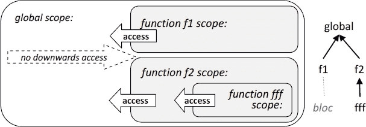

**图 6.2.** 作用域链是向上的

修改的传播是向下的：在某某层级修改变量可能只影响较低层。例如：绑定到全局作用域的变量 `a` 在 `f1` 中带来了它的值，但在函数 `fff` 中修改 `str` 对全局变量 `str` 没有影响。

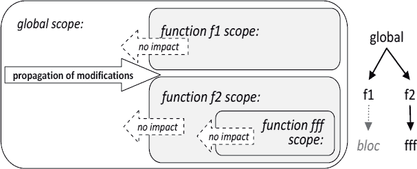

**图 6.3.** 值的修改向下传播

### 6.5.2. 总结与警告

在同一作用域内：

- 所有的 `function` 声明在词法时间内提升到其作用域；
- 所有的 `let` 和 `const` 声明在“词法上”是其作用域的一部分，但在初始化之前不能被引用（`ReferenceError`）；
- 同名不能在同一作用域内重复声明（`SyntaxError`）。

警告。上述第 2 和第 3 点不适用于 `var` 声明，你必须记住对于 `var` 声明：(a) 变量在函数或全局作用域内被提升，而不是块内；(b) 内部函数先被提升；(c) 名称重声明会被静默接受，但稍后可能会出现惊喜：

```javascript
var g = 0;
function g(){}
console.log(typeof g); // "string" (g: 不是函数!)
```

| `[[FormalParameters]]` | 函数被调用时与“参数（arguments）”对象匹配的参数列表 |
| `[[BoundThis]]` | 指向调用对象的代词 `this` 的值 |
| `[[Scope]]` | “作用域链”。与“闭包（closures）”配合使用 |
| `[[Construct]]` | 由 `new` 调用时使用，用于构建“原型（prototype）” |

**表 6.3.** 函数的一些属性^(1)

在不涉及细节的情况下，了解以下内容可能有所帮助：脚本引擎在函数被调用时，必须能够访问变量的作用域链（以区分自由变量和绑定变量）、参数的值、代词 `this` 的值以及调用上下文。全局对象拥有一个隐藏属性，即对象 `[[Stack]]`，它实现了调用链并提供了调用上下文：例如，如果 `f` 调用了 `g`，应该从 `g` 回到哪里等。

## 6.6. 函数“闭包”

我们可以在 JavaScript 中嵌套函数并以这种方式进行通信：

- 内部函数可以通过调用函数传递给内部函数的参数来接收值；
- 内部函数可以访问调用函数的绑定变量和自由变量，并递归向上访问全局变量；
- 调用函数无法访问内部函数的绑定变量，只能通过 `return` 语句接收值。

由于函数是一等对象，函数可以被 `return` 语句返回。这被称为“函数闭包”，意味着你将函数的代码连同它在闭包创建和发送时自由变量状态的副本封装在一起（这是一种“冻结的值”）。

引用 Kyle Simpson 的话：

“闭包是指函数即使在在其词法作用域之外被调用时，仍然能够记住并访问其词法作用域” ([`github.com/getify/You-Dont-Know-JS`](https://github.com/getify/You-Dont-Know-JS))。

让我们通过一系列示例来学习这种机制，此外，这些示例还可以用作编程“设计模式”。

### 6.6.1. 在给定上下文中保存自由变量的值

目标是保存一个上下文（至少一个变量），并在之后访问它，同时确保它在这一间隔内没有被修改。

计数器的示例：

```javascript
let i = 0, nom = "A";       // 初始化一个全局变量
function inc(){i++; return "nom"+i;}   // 递增
```

这个函数增加了 `i`，但其他指令也可能这样做：让我们通过闭包来保护 `i`：

```javascript
function countFab(nom) {     // 如果我们给计数器命名
  let i = 0;    // 在闭包创建时初始化一次
  return function () { i++; return nom+":"+i; }
}
const counterA = countFab("A");  // 计数器 "A" (i=0)
counterA();                           // A:1
counterA();                           // A:2
```

同一个闭包可以创建多个独立的计数器：

```javascript
const counterB = countFab("B");        // 计数器 "B" (及其自己的 i)
counterA(); counterB();               // A:3, B:1
counterA(); counterB();               // A:4, B:2
```

经常有人问的问题是：如何从普通函数编写闭包？答案是图 6.5 中提供的算法。

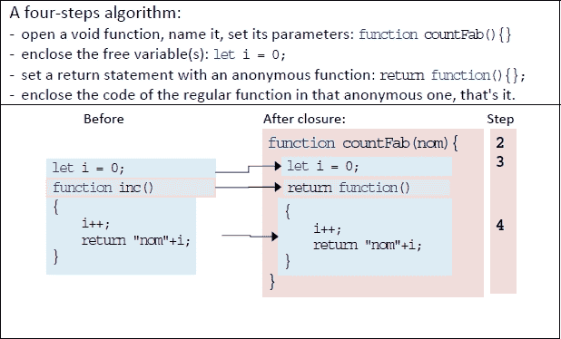

**图 6.4.** 构建闭包的 4 步算法

闭包返回目标普通函数：现在你必须在一个给定的变量中保存一个：`const counterA = countFab("A");`

注意.- 全局变量 `i` 刚刚消失了；它被“封装”了。

### 6.6.2. 创建一个与数据数组关联的函数列表

示例.- 根据语言列表（en, fr, cn …）构建一个函数列表。

这个示例将会被彻底研究，因为它是作用域和执行上下文混淆时所引发问题的典型类型。我们把 `var` 声明放在最前面，以展示在 ES6 之前编写 JavaScript 代码是多么棘手。

我们需要一个辅助函数 `print` 来显示一些中间值，以便清楚地理解发生了什么：`print(s)` 应该打印 `s +`（一个结果列表）。

```javascript
function print(s){
    return lgs.reduce((acc,x,i)=>acc+` cas${i}:${fns[i]()}`,s);
}
const lgs = ["fr","en","cn"],     // 一系列语言列表
      fns = [];     // 要填充函数的数组
```

每个 `fns[i]` 必须产生一个标记使用了哪种语言的字符串：

```javascript
fns[i] = function(){ return "L["+ i +":"+ lgs[i] +"]"; };
```

调用 `print("expected:")` 的预期结果是：

`// expected: cas0:L[0:fr] cas1:L[1:en] cas2:L[2:cn]`

#### 6.6.2.1. 第一次尝试：使用 for 循环（以及旧式的 `var` 声明）

```javascript
 for (var i = 0; i < lgs.length; i++) {
    fns[i] = function() { return "L[" + i +":"+ lgs[i] +"]";};
}
print("Var:"); // Var: cas0:L[3:undefined] cas1:L[3:undefined] cas2:L[3:undefined]
```

#### 6.6.2.2. 第二次尝试：使用 IIFE 来保存 `i` 的值

```javascript
const fns = [];
for (var i = 0; i < lgs.length; i++) {
    fns[i] = (function(k) {
        return function() { return "L[" + k +":"+ lgs[k] +"]";};
    })(i);
}
print("IIFE:"); // IIFE: cas0:L[0:fr] cas1:L[1:en] cas2:L[2:cn]
```

#### 6.6.2.3. 第三次尝试：在循环中使用 `let` 声明

```javascript
const fns = [];
for (let i = 0; i < lgs.length; i++) { // let i
         fns[i] = function() { return "L[" + i +":"+ lgs[i] +"]";};
}
print("Let:"); // Let: cas0:L[0:fr] cas1:L[1:en] cas2:L[2:cn]
```

#### 6.6.2.4. 第四次尝试：移除循环，使用 `Array.prototype.map`

```javascript
const fns = lgs.map( function(x,i) {
        return function(){return "L[" + i +":"+ x +"]";};
});
print("Map:"); // Map: cas0:L[0:fr] cas1:L[1:en] cas2:L[2:cn]
```

#### 6.6.2.5. 第五尝试：为了好玩，箭头版本，更短的版本

```javascript
const fns = lgs.map((x,i) => ()=>`L[${i}:${x}]`);
```

### 6.6.3. “柯里化”：将函数拆分为单参数函数

给定一个有两个参数的函数 `f(a,b)`，我们知道如何通过闭包保存一个参数（就像我们处理自由变量那样），并将第二个参数传递给新的单参数函数。

示例.- 根据给定的语言，向给定的名字说“你好”或“bonjour”。

```javascript
function salute(lg, last) { // regular version
    let str = (lg==='fr')?"Bonjour ":"Hello ";
    return str + last;
 }
salute("en", "Peter"); //-> Hello Peter
salute("fr", "Pierre"); //-> Bonjour Pierre
```

一个闭包记住了选定的语言：

```javascript
function saluteIn(lg) {// closure version
     let name = (lg==='fr')?"Bonjour ":"Hello ";
     return function(nom){ return name + nom; }
 }
const hello = saluteIn("en"); // 记得 "en"
const bonjour = saluteIn("fr"); // 记得 "fr"
hello("Peter"); // -> Hello Peter
bonjour("Pierre"); // -> Bonjour Pierre
```

单参数函数 `saluteIn` 允许我们创建两个记忆不同状态的新函数。如果这些函数有多个参数，可以应用相同的机制，直到我们得到一系列只有一个参数的函数。这种全局操作被称为“柯里化”（currying），以 Haskell Curry（`函数式编程`）命名。

JavaScript 展示了它的函数式的一面：

```javascript
saluteIn("fr")("Pierre");    //-> Bonjour Pierre
saluteIn("en")("Peter");    // -> Hello Peter
```

柯里化的常用示例是这个（相加几个数字）：

- 三个参数的普通版本：

    ```javascript
    function regulAdd(a, b, c){return a+b+c;}
    ```

- 柯里化版本：

    ```javascript
    function curryAdd(a){return function(b){return function(c){return a+b+c;}}};
    ```

- 箭头函数版本：

    ```javascript
    const curryarrowAdd = a=> b=> c=> a+b+c;
    ```

- 验证：

    ```javascript
    curryAdd("a")("b")("c") === regulAdd("a", "b", "c"); // abc===abc
    ```

### 6.6.4. 从函数数组组合函数

对于好奇的人、感官的爱好者或仅仅是为了好玩的人：这里我们从函数式编程开始（一个来自 Eric Elliott 的示例）。以下语句使用了两个 ES6 创新：“箭头函数”和“展开运算符”，但除了这些“省略性”的语法元素外，重要的方面是 JavaScript 的纯函数式使用：

```javascript
const pipe = (...fs) => x => fs.reduce((y, f) => f(y), x);
```

解释：

“箭头”语法由三部分组成：（参数列表）、箭头和代码块。示例：

```javascript
const f = function(x,y,z){return x+y+z;}   // 普通语法
const f = (x,y,z) => x+y+z;               // "箭头"语法
```

“剩余”（rest）语法从列表创建一个数组，例如：

```javascript
function f(...list) {return "array size "+list.length;}
f(1,3,5,7); //-> array size = 4 [仅在运行时已知]
```

现在，我们可以开始分析神秘的函数 `pipe`：

- 最内层：`fs.reduce((y,f)=> f(y), x);`
- 翻译：`fs.reduce(function(y,f){return f(y);},x);`
- 部分：`x => fs.reduce((y,f)=> f(y), x);`
- 翻译：`function(x){return fs.reduce(function(y,f){return f(y);}, x);};`
- `fs` 是一个函数数组，`x` 是一个函数，`reduce` 方法执行如下：
- 步骤 1：`y= x, f= f1`，结果为：`y= f1(x);`
- 步骤 2：`y= f1(x), f= f2`，结果为：`y= f2(f1(x)), ….`

这是 JavaScript 的函数魔法：每个函数由上一次组合的结果组成。应用于列表 `(...fs)` 的约束是这些函数必须是“可组合的”。

这里是 `pipe` 版本：

```javascript
const toLower = s => s.toLowerCase(), // 可组合版本
       httpize = s => `http://${s}.uno`,
       toEverybody = pipe(toLower, httpize, encodeURIComponent);
toEverybody("HelloWorld");
```

等价的显式组合是：

```javascript
encodeURIComponent( httpize( toLower("HelloWorld") ));
```

两个版本的结果都是：

```text
HelloWorld → helloworld → http://helloworld.uno →
http%3A%2F%2Fhelloworld.uno
```

`pipe` 版本的意义在于函数列表可以在运行时动态确定。

## 6.7. 立即执行函数：IIFE

让我们再次回到示例，对闭包进行声明后调用：

```javascript
function saluteIn(lg) {
     let str = (lg==='fr')?"Bonjour ":"Hello ";
     return function(nom) { return str + nom; }
 }
const hello = saluteIn("en");    // 记得 "en"
```

IIFE 机制通过将这些匿名化，为这两个指令合并为一个提供了一个优雅的解决方案：

```javascript
const hello = (function(lg) {
     let str = (lg==='fr')?"Bonjour ":"Hello ";
     return function(nom) { return str + nom; }
 })("en");
```

### 6.8.1 `Function.prototype.call()` 和 `.apply()`，以及代词 `this`

在之前的示例中，目标函数是 `slice`，要绑定 `this` 的对象始终是第一个参数，紧接着是目标函数的常规参数（顺序和数量相同！）：对于该 `slice` 的用法，没有额外的参数。结果：这种绑定允许 `nodeList` 被传递给函数 `slice`。

`call` 和 `apply` 方法不会修改函数，它们只是绑定了代词 `this`。区别在于参数（第一个参数之后）的传递方式：是作为一个列表传递，还是作为一个数组传递：

```javascript
function f(arg1, arg2, arg3){…}
f.call(scope, arg1, arg2, arg3)      // 独立参数列表
f.apply(scope, [arg1, arg2, arg3])   // 单个参数数组
```

### 6.8.2 `Function.prototype.bind()`

`bind` 方法不会*调用*函数，而是返回一个函数，该函数可以作为参数传递，并且其 `this` 被绑定到给定的对象（我们称之为 `scope`）。这是一种“传递”对象的间接方式，尽管我们无法将其作为参数传递，例如在使用“回调”函数时（在处理 HTML DOM 元素时非常有用）：

```javascript
function toggNav(evt) { } // 用于“DOM 事件”的回调
nav.addEventListener('click', toggNav);
```

此类回调函数的某些参数（`evt`）受到 HTML DOM 接口的限制（参见第二部分）。如何给 `toggNav` 传递一个给定的对象？

```javascript
nav.addEventListener('click', toggleNav(scope)); // 不！！
```

常见的“新手”错误：它传递不是函数，而是返回的结果。

一种方法是写一个匿名函数，带有 API 参数，并使用自由变量（但你知道，自由变量是有风险的）：

```javascript
nav.addEventListener('click', function(evt){toggNav(scope);});
```

下一个解决方案使用 `bind`，创建了一个 `this` 绑定到 `scope` 的函数，同时为 `toggNav` 保留了 API 需要的参数（`evt`）：

```javascript
nav.addEventListener('click', toggNav.bind(scope, evt));
```

警告.–绑定的函数包含目标代码，代词 `this` 被一次性地永久修改。为了不忘记，你应该写成：

```javascript
const boundToggNav = toggNav.bind(scope, evt);
nav.addEventListener('click', boundToggNav);
```

## 6.9 内置函数

JavaScript 提供了一些顶层预定义函数：

- `isFinite` 和 `isNaN`（参见第 3 章 “numbers”）；
- `parseInt`, `parseFloat`（同上）；
- `eval`（建议不要使用）；
- `encodeURI`, `decodeURI`, `encodeURIComponent`, `decodeURIComponent`（URI 格式辅助工具）；
- `Number` 和 `String`，当不使用运算符 `new` 调用时，对于对象 `Date` 可能很有用，例如：

```javascript
let d = new Date ("December 17, 1995 03:24:00")
console.log ( Number(d) )          // 819167040000
     // 自 01 January, 1970 UTC 以来的毫秒，之前为负
String(new Date(0));              // Thu Jan 01 1970 01:00:00 GMT+01
String(new Date(819167040000));   // Sun Dec 17 1995 03:24:00 GMT+01
```

## 6.10 闭包和 IIFE 备忘页

编写计数器的三种方法：(1) 从全局上下文中增加自由变量，(2) 在闭包中保存一个绑定变量并增加该内部变量，以及 (3) (2) 的 IIFE 版本。

- 使用全局变量：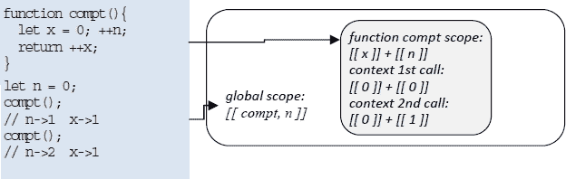
- 使用闭包（无全局变量）：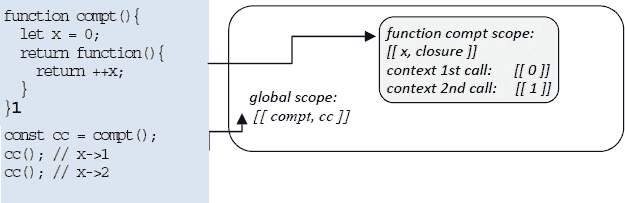
- 使用闭包（无全局变量）：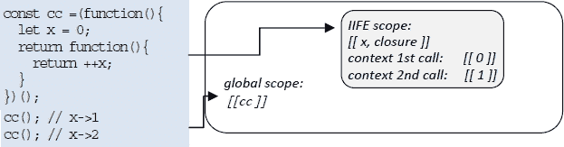

解释：

1. 一种方法是写一个匿名函数，带有 API 参数，并使用自由变量（但你知道，自由变量是有风险的）；
2. 下一个解决方案使用 `bind`，创建了一个 `this` 绑定到 `scope` 的函数，同时为 `toggNav` 保留了 API 需要的参数（`evt`）；
3. IIFE 版本 (2)。

# 7 符号和模式

歧义在计算机中不存在，但“errare humanum est”。关键字、标点符号和代词经常被误用。本章旨在：

## 7.1 保留字

下表包含了 38 个单词，另有 10 个留供未来使用：

```
debugger, enum, export, implements, interface, package, private, protected, public
```

| **关键字** | **用途** |
| :--- | :--- |
| `const`, `let`, `var`, `typeof` | 声明。类型运算符 |
| `break`, `case`, `continue`, `default`, `do`, `else`, `false`, `for`, `if`, `switch`, `true`, `while` | 条件指令、分支或循环语法。不建议在循环中使用 `continue`，鼓励在 switch 使用 `break` |
| `delete`, `in`, `instanceof`, `new`, `null`, `this` `class`, `extends`, `static`, `super` | 与对象相关的运算符 ES6 中的 `class` 语法：本文中忽略。 |
| `arguments`, `function`, `return`, `this`, `yield` | 函数语法，或生成器函数 |
| `try`, `catch`, `finally`, `throw` | 异常处理 |
| `eval`, `with` | 强烈建议不要使用 |
| `void` | 将表达式求值为 undefined |
| `yield` | 与生成器函数一起 |
| `await` | 本文中忽略 |

**表 7.1.** 保留字的用法

这些单词是“被保留”的，不能用于变量、函数和参数，但可以作为属性键，尽管对它们禁止使用点符号：

```javascript
let const = 3;                  // 非法
const object = {const: 3};      // 非法
const object = {"const": 3};    // 正确
object["const"] = 4;      // 正确
```

除了保留字，避免使用内置对象的名称、方法或全局对象的属性名称是明智的：

```
Object, Function, Array, Boolean, Number, String, Symbol, RegExp, Date, Math, JSON, parseInt, parseFloat, isNaN, …
```

此外，在 ES5 之前有 16 个“保留”字，避免使用它们也是明智之举：

```
abstract, boolean, byte, char, double, final, float, goto, int, long, native, short, synchronized, throws, transient, volatile
```

## 7.2. 代词 `this`

在面向对象的编程中，任何指令都处于某个对象的上下文中：全局对象或某个特定对象。代词 `this` 的作用是告诉在全局/函数作用域内，指令正在处理这些对象中的哪一个。在 JavaScript 的起源，引入代词 `this` 是为了确定当前处理哪个 HTML DOM 对象，默认情况下，它指向 `window`，即 HTML 全局对象。

随着 JavaScript 用途的增加，这种初始选择变成了一种“缺陷”。对 `this` 进行训练以避免错误至关重要。

### 7.2.1. 链接代词 `this` 的多种方式

为了简单起见，我们不提到 `"use strict"` 模式，在该模式下，大致如果没有以某种方式定义，它就是 `undefined`。

#### 7.2.1.1. 第一分支：全局作用域对比（局部）函数作用域

- 在全局作用域中，`this` 指向全局对象，

```
// 在浏览器环境中：
console.log(this === window); // true
// 在 Node.js 中，每个模块都有自己的全局对象：
console.log(this === global); // true
```

- 在函数作用域内，回答的问题是：函数是如何被调用的？

#### 7.2.1.2. 使用运算符 `()` 调用函数

```
const f = function () {return this;};
f();                    // 默认返回 [object Window]
```

#### 7.2.1.3. 作为对象方法调用的函数

```
const obj = {};
obj.myMethod = function () {return this;};
obj.myMethod();        // 返回 [object obj]
```

#### 7.2.1.4. 作为“回调”调用的函数（DOM 事件、AJAX 请求等）

```
const nav = document.querySelector('nav'); // <nav>标签
const toggNav = function (){ console.log(this);};
nav.addEventListener('click',toggNav);     // this = <nav>元素
const xhr = new XMLHttpRequest();
xhr.addEventListener("load",jsonCallback); // this = "xhr"元素
```

#### 7.2.1.5. 使用“箭头语法”编写的函数

在“箭头函数”内部，`this` 保留其闭包词法上下文 `this` 的值。

#### 7.2.1.6. 通过运算符 `new` 作为“构造函数”调用

参见第 7.3 节：“new 运算符”。

#### 7.2.1.7. 多次调用：内部函数重新定义 `this`

警告。内部函数可能会根据函数调用的方式改变 `this` 的值。

这里有一个常见的问题：内部函数是 `window` 对象的方法：

```
const nav = document.querySelector('.nav'); // <nav class="nav">
const toggNav = function () {
    console.log(this);       // <nav>元素
    setTimeout(function () { // 回调
        console.log(this);   // [object Window] 注意！
                           }, 1000);
 };
nav.addEventListener('click', toggNav, false);
```

传递上下文值的一种解决方案：将 `this` 复制给 `that`（常用名称）：

```
let that = this;
setTimeout(function () { console.log(that); // <nav> 正确！
                        }, 1000);
```

一个更简单的（ES6）解决方案是使用箭头语法：

```
setTimeout( () => { console.log(this);      // <nav> 正确！
                        }, 1000);
```

### 7.2.2. 如何明确绑定代词？

有几种方法。我们在上一个示例中看到了两种：中间变量 (`that`) 或箭头语法，但我们不能在每种情况下都使用它们。这里有一些更通用的方法。

| “绑定模式” | 指令 | 结果 |
| :--- | :--- | :--- |
| 无绑定 | `function sum(z) { return this.x + this.y + z; } sum(3);` | `NaN` |
| 作为对象属性 | `const context = {x: 1, y: 2}; context.sum = sum; context.sum(3);` | `6` |
| 使用 `call` | `sum.call( context, 3 );` | `6` |
| 使用 `apply` | `sum.apply( context, [3] );` | `6` |
| 使用 `bind` 预绑定 | `const s = sum.bind(context); s(3) ;` | `6` |

**表 7.2.** 在函数中绑定代词的几种方式

## 7.3. 运算符：`new`

如所述，我们建议重新训练 `new` 的使用。

## 7.4. 标点符号

大多数标点符号在 JavaScript 中都有作用：

| 符号 | 用途 |
| :--- | :--- |
| `" "` `' '` `` ` `` | 三种引号 |
| `;` | 结束指令 |
| `,` | 列表分隔符 |
| `.` | 访问对象的属性语法 |
| `:` | 键值对语法 |
| `?` | 三元运算符语法 |
| `!` | 一元布尔运算符 |
| `!=` `!==` `==` `===` | 比较运算符 |
| `>` `<` `>=` `<=` | 关系运算符 |
| `+` | 算术运算符或拼接 |
| `-` `*` `/` `%` `**` | 算术运算符 |
| `+` `-` | 一元运算符 |
| `++` `--` | 一元运算符 |
| `||` `&&` | 布尔运算符 |
| `>>` `>>>` `<<` `^` `|` `&` `~` | 位运算运算符 |
| `=` | 赋值运算符 |
| `{ }` | 对象字面量或代码块语法 |
| `[ ]` | 访问对象的属性语法 |
| `( )` | 分组运算符或优先级运算符 |
| `…` | 对象或数组的语法 |
| `=>` | “箭头函数”的 ES6 语法 |
| `//` `/* */` | 注释：仅限行尾 / 注释：可能跨多行（警告：注释不能嵌套） |

**表 7.3.** JavaScript 中使用的标点符号（列 P=多态）

## 7.5 JavaScript 常用设计模式

在软件开发中，“*设计模式*（design pattern）”是一种被公认为最佳实践的代码模式，用于解决特定的概念问题，并可以在多种情况下重复复用。

我们已经遇到过此类模式：在闭包中保存自由变量、根据给定的原型和属性构建一个原型对象等。相比之下，一种依赖于自由上下文（全局变量等）且不易重复复用的模式被称为“*反模式*（anti-pattern）”，即使它在特定的语境中可以正常工作。

更简单形式的模式有时被称为“惯用法（idioms）”，更复杂的模式在文献中被分类为：

- “创建型模式”：原型方法在第 4 章中是一种创建型模式；
- “结构型模式”：除了创建，“命名空间（namespacing）”和“装饰器（decorator）”模块是结构型模式；
- “行为型模式”：“观察者（observer）”及其“发布/订阅（publish/subscribe）”变体是行为型模式。

### 7.5.1 编程惯用法

#### 7.5.1.1 使用逻辑快捷进行默认初始化

在*布尔上下文*中评估表达式（例如条件指令）会强制将变量转换为布尔值而非其自身的类型。这导致了一些默认初始化惯用法的定义：

```
const localObjet = objet || {"nom":"default object"};
let localNum = num !== 0? (num || numDefaut) : 0;
let localStr = str !== ""? (str || strDefaut) : "";
let localProp = "prop" in objet? prop : propDefaut;
```

取决于 `false` 对于各种值或类型的多态性：

```
 0, NaN, "", null, undefined → false (布尔)
```

#### 7.5.1.2 使用闭包进行封装

一种常见的情况：我们需要在函数代码块内部一个外部控制变量，例如：

```javascript
let once = true;               // 外部控制变量
function printOnce(str){
        if (once) {once = false; return str;}
    // 隐式 else = return undefined
 }
```

解决方案：围绕变量和代码块构建一个闭包，然后将内部代码作为函数表达式返回：

```javascript
function printOnce() {
   let once = true;
   return function(str){
        if (once) {once = false; return str;}
   };
 }
const printOneTime = printOnce();
console.log(printOneTime("Hello"));   // -> Hello
console.log(printOneTime("Hello"));   // -> undefined
```

#### 7.5.1.3 显示对象的属性：“Map/Entries 组合”

使用内置对象 `Map` (ES6)，这是一个具有 `size` 属性以及 `set` 和 `get` 方法的“*迭代器（Iterable）*”，结合 `Object.entries`：

```javascript
const can = { nom: 'Good', prenom: 'Morning' };
const canMapped = new Map(Object.entries(can)); // 惯用法
canMapped.get('nom');  // -> 'Good'
canMapped.size;        // -> 2
```

将 `Map` 结合 `Array.from` 用于时间序列数据数组：

```javascript
const timeData = [['d1', 'v1'], ['d2', 'v2']];
const timeMap = new Map(timeData);
timeMap.get('d1'); // 返回 "v1"
timeMap.forEach(function(v,d){console.log(`date ${d}, v= ${v}`);});
const dates = Array.from(timeMap.keys());  // ["d1", "d2"]
const valus = Array.from(timeMap.values());     // ["v1", "v2"]
```

### 7.5.2 创建型模式：“赋值/创建组合”

我们已经学习了可以将一次通过委托继承（共享）和多次通过拼接继承（重复）结合。

```javascript
const obj = Object.assign(
        target [=Object.create(proto)], // 提供原型
        source1,          // 一个属性源
        source2           // 另一个源
 );
```

对象 `obj` 接收源的属性并以 `proto` 为原型。这种模式可以被用于满足多种需求。

#### 7.5.2.1 读取 JSON 对象并赋予其原型

数据通常通过 JSON 格式的文本文件在互联网上交换，这对 JavaScript 来说是一个优势：赋值/创建组合可以很容易适应这种用例：`Object.assign` “混合”了解析 JSON 对象的克隆以及由 `Object.create` 独立提供的原型。

```javascript
const base = {
   // JSON 数据
};
const proto = {
   // 原型方法
};
const nu = Object.assign(
   Object.create(proto),
   base
 );
```

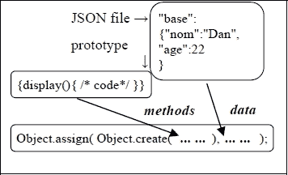

对象 `nu` 通过委托继承 `proto` 的方法，同时复制了它们。这种模式可以被用于满足多种需求。

如果它已经存在，我们将其作为 IIFE 的参数；否则我们使用一个空对象。“扩展”操作集中在一个单一指令中，即 IIFE，该指令修改了对象 `window.webpage`（如果 `webpage` 被冻结，则修改其副本）。

```javascript
// webpage (命名空间名称) 可以在本地修改，且不会
// 在函数上下文之外被覆盖
 (function(webpage) {
     // 新的公共方法和属性
     webpage.foobar = "foobar";
     webpage.sayHello = function() {alert("hello world");};
     // 检查全局作用范围内是否存在 'webpage'
     // 如果不存在，给 window.namespace 赋值一个对象字面量
})(window.webpage = window.webpage || {});
// 如果“冻”或“密封”，先拷贝 webpagePlus = webpage
```

### 7.5.4. 另一种结构模式：装饰器模式 (Decorator pattern)

在某种程度上与扩展相似，“装饰器”为对象引入新方法：将它们与旧方法包装在一起，组合成一个新的原型。因此，装饰器模式也称为“包装器模式 (wrapper pattern)”。

事实上，装饰器实现的是通过委托实现继承（第一个原型是通用装饰器）和通过拼接继承（第二个原型是实际装饰器，你可以构建多个）的混合。

#### 7.5.4.1. 代码

```javascript
 // 辅助函数：protoChainOf(), methodCalls()
function list(q,i){
   return `${protoChainOf(q, '=', 0)}\n methods:
 ${methodCalls(q)}`;
 }
function User(){return 'User only';}
function Age(){return 'Age only';}
function UserAge(){return "Mixin";}
User.prototype.full = function(){return this.first+" "+this.last;};
Age.prototype.year = function(){return 2017 - this.age;};
let z1= Object.assign(Object.create(User.prototype), Age.prototype),
     z2= Object.assign(Object.create(z1), {constructor:UserAge});
const last= 'Bel', first= 'Jo', age= 28, qqs= [];
qqs.push( Object.assign(Object.create(z1), {first,age}) );
qqs.push( Object.assign(Object.create(z2), {first},{age}) );
         // 方法的动态修改
Age.prototype.year = function(){return 2018 - this.age;};
User.prototype.full = function(){return "M. "+this.last;};
console.log( qqs.reduce(function(s,q,i){return s+list(q,i);},""));
```

#### 7.5.4.2. 日志

| User only, 原型链= |
| | `{last:Bel, first:Jo, age:28}` (1)-> User [year] (2)-> User [full] (3)-> Object [] |
| | methods: year:1989, full:M. Bel |
| Mixin, 原型链= |
| | `{last:Bel, first:Jo, age:28}` (1)-> UserAge [] (2)-> User [year] (3)-> User [full] (4) -> Object [] |
| | methods: year:1989, full:M. Bel |

#### 7.5.4.3. 注释

原型链被正确地增加，方法被委托传递。但是，如果后续发生变化，只有 `User.prototype` 中的方法会被传递（参见：“M.”），而 `Age.prototype` 中的方法不会：函数 `year` 是一个副本，而不是对 `Age.prototype` 中 `year` 方法的引用。

“装饰”生效了，但这种形式的多重继承仍然是静态的：没有自动更新。下一个模式可能是解决此问题的方案。

### 7.5.5. 行为模式：观察者模式或发布/订阅模式 (publish/subscribe)

该模式能够与扮演“观察者”角色的模块建立单向通信。当收到通知时，`observer` 根据从“可观察者”收到的信号做出反应。每个 `observable` 维护其 `observers` 列表。这是“推”的方法，被称为“订阅者/发布者”模式。在“拉”的方法中，是由 `observer` 维护可观察者列表，并负责询问每个 `observable` 以获取任何变化。

#### 7.5.5.1. 代码：“推”的方法：代码位于可观察者端

```javascript
const Observable = function() { this.observers = []; }
Observable.prototype = {
   subscribe(callback) {        // 添加到列表
     let yet = this.observers.some(c => c === callback);
     if(!yet) this.observers.push(callback);
   },
   unsubscribe(callback) {               // 从列表中移除
     let i = this.observers.indexOf(callback);
     if(i>-1) this.observers.splice(i, 1);
   },
   publish(str) {                // 通知列表
     this.observers.forEach(c => {c(this.title+" "+str);});
   }
 };
const Observer = function(n) {        // 闭包：创建观察者
   const name = n;
   return function(str){console.log(name+":"+str);}
 };
const obs = new Observable();
obs.title = "MyUpdate";
const obs1 = Observer("Observer1");
const obs2 = Observer("Observer2");
obs.subscribe(obs1);
obs.subscribe(obs2);
obs.publish("First");
obs.unsubscribe(obs1);
obs.publish("Second");
```

现代应用程序采用了 CSS2.1，并外加了一些 CSS3 模块（例如 flex）。从 JavaScript 的视角来看，学习的基础是元素选择。本节将通过一个短章节来回顾这些特性。

- JavaScript 处理动态修改和交换

现代应用程序采用了 `ES6`。假设目标应用是面向数据的数据，那么花时间去兼容老旧的遗留系统是毫无意义的。学习的基础是作用域、原型以及作为一等对象的函数的概念。我们将学习这如何帮助正确地链接核心部分以及 `window` 对象的各种 `APIs`。我们将学习如何用图形展示数据：绘图和动画。

- HTTP 处理提供内容的外部请求

面向数据的数据应用程序使用通过特定 API 提供的数据存储库，并使用由内容分发网络（CDN）提供的外部脚本。学习的基础是如何发送请求以及如何管理响应。我们将学习 `AJAX` 技术以及如何在异步语境下处理 `JSON` 文件。

标准化的进展是巨大的，所有 2015 年之后的浏览器都符合本书推荐的标准。

# 8 网页中的 JavaScript

## 8.1 网页生态系统：HTML 序列

### 8.1.1 结构与语义/布局与呈现

HTML5 被称为“语义化的”。这（简而言之）意味着什么？

- 当阅读一份活动报告时，我们期望有标题（以及：作者、日期等）、引言、几个章节、结论、目录等。
- 当阅读报纸时，我们期望有页眉（标题、日期）、头和几个段落，常见的栏目：政治、世界、文化等。
- 在电子商务网站上，我们期望有产品描述、公司描述、在线订单工具等。

这些期望是非常普遍且合逻辑的：这就是*语义化*！HTML5 语义标签旨在帮助搜索引擎识别网页上的内容：`<header>`、`<nav>`、`<main>`、`<sections>`、`<detail>`、`<figure>` 等。


旧标签被保留，新的建议做法可能会增加语义性：例如，`<title>`标签应该符合其语境，``标签应该包含描述（属性`alt="…"`）等。

### 8.1.2 HTML5 标签回顾

以下是尽管并非都是强制性的，但我们建议使用来描述你的网页生态系统上下文的标签。

```html
<!DOCTYPE html>
<html lang="fr">
  <head>
   <title>Basic web page</title>
   <meta charset="utf-8">
   <link rel="stylesheet" href="style.css">
  </head>
  <body>
   <script id="code.js"> /* JavaScript code */ </script>
  </body>
</html>
```

#### 8.1.2.1 DOCTYPE

它告知浏览器后续的内容：在上面的例子中，它是一个 HTML 文档（默认的 HTML5）。它也可能是另一种类型的文档，需要文档类型声明（DTD）来请求使用哪个引擎，例如 SVG：

```xml
<!DOCTYPE svg PUBLIC "-//W3C//DTD SVG 1.1 Tiny//EN"
     "http://www.w3.org/Graphics/SVG/1.1/DTD/svg11-tiny.dtd">
<svg> <!- SVG code -> </svg>
```

在`DOCTYPE`之后，`<html>`通常被分为`<head>`和`<body>`两部分。

#### 8.1.2.2 `<head>`

`<head>`包含：

- 一个`<title>`标签，标准中强制性的；可以由浏览器显示；
- 几个`<meta>`标签：

```html
<meta charset="utf-8"> 是强制性的：给出“charset”编码
<meta name="viewport" ..> 指定了视口的使用：是推荐的
```

- 更多可能的`<meta>`标签（可选）：

```html
<meta name = " keywords " content = "…">
<meta name = " author " content = "…">
```

- 一个或多个`<link>`标签用于收集 CSS 样式表：

```html
<link rel = "stylesheet" href = "./style.css" >
```

#### 8.1.2.3 `<body>`

`<body>`可能包含：

- 由“内容标签”提供的显示内容，它们是一对标签（开启–闭合）。例如，`<div></div>`创建了一个`div`节点加上一个‘文本’节点，在接收到内容（例如来自 JavaScript 代码）之前是空的；
- “空标签”，它们创建包含用于布局引擎指令的节点，例如`<br>`标签（换行）或向 HTTP 守护进程发送的指令，请求与正常布局流并行进行请求；
- 相应节点的内容不是由标签提供的，而是由某些外部异步操作提供的。例如，``标签：其属性用于指定请求；如果请求成功，将稍后显示（见第 8.5 节中的事件循环）。
- 一些注释`<!-- with this syntax -->`。

以下是主要的空标签列表：

```
 <meta>, <link>, <base> 位于 <head> 内部
 <input>, <area>, 与 <map> 关联
 <source>, <track> 与 <picture>, <video>, <audio> 关联
  实际上可以写成：<picture><source></picture>
 <hr>, <br>, <wbr> 不同的换行
 <colgroup> 当属性 span 存在时
```

最后，`<body>`包含了我们最关心的：`<script>`标签。

#### 8.1.2.4 `<script>`标签

通常情况下，脚本负责填充`<body>`内部的标签。为这些标签提供初始内容是明智的，使它们快速可见，即使它们很快就会被修改：

```html
 <header>Web Data with JavaScript</header>
 <main>curriculum 2018</main>
 <footer>contact: IUT UPEM - Marne-la-Vallee</footer>
 <script id="code.js">…code…</script>
```

优点：页面永远不会是空的，脚本的解释可能需要几秒钟，并且会“阻塞”后续的命令。因此，通常将脚本标签放在`<body>`的末尾更好。

建议：`id="code.js"`属性是一个简单的标识。如果代码在文本文件`code.js`中，只需替换`id=par src="code.js`。

| `DOCTYPE`（强制性）告诉浏览器我们使用 HTML5； | `<html lang='..'>`可选但用的属性`lang`； | `<meta charset='..'>`告诉使用什么编码（强制性）； | `<meta viewport='..'>`简化视口处理（桌面 vs 移动端） | `<title>`在 HTML5 中强制性； | `<link>`(s)指向 CSS 样式表，或你可以通过以下方式“预取”JSON 文件：`<link rel="prefetch" href="/dataFile.json">` | `<body>`带有几个标签用于快速显示最小内容。 | `<script id='..'>`或`<script src='..'>`(s) - 紧在关闭`</body>`之前 |

**表 8.1.** 编写 HTML5 页面的总体建议

## 8.2 构建网页 DOM：布局引擎

布局引擎通过相关的 CSS 规则（如果有，见下文）处理每个内容标签并显示内容。因此，CSS 规则必须准备就绪，最好放在`<head>`部分。

通过空标签，布局引擎可以修改正常流（例如`<br>`引起垂直偏移），或准备 HTTP 请求的预期结果（例如``的`alt`属性将被显示，并为图片的到来留出空间）。此类请求是异步的、非阻塞的。

注意.-避免注定消失的插件（Flash, Silverlight, Applets）。

一旦完全浏览，整套标签将产生一个树结构，称为文档对象模型(DOM)。一旦 DOM 完全构建，就会触发`DOMContentLoaded`事件。

DOM 不是 JavaScript 的一部分，但 API 允许 JavaScript 与 DOM 交互，这将在本章中详细介绍。

### 8.2.1 布局引擎构建的 DOM 树：通过 CSS 选择节点

HTML DOM 是棵树：一个根节点，随后是子节点，递归直到终端节点、空标签或文本节点。布局引擎在以“深度优先”模式逐步解析 HTML 文档的同时构建这棵树。

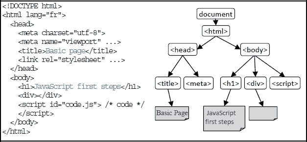

**图 8.1。** 由布局引擎构建的 HTML 代码（左侧）和关联的 DOM（右侧）

对于每个可显示节点（图 8.1 中的灰色部分），布局引擎使用一条渲染规则：可能来自 CSS 或浏览器定义的默认值。这种选择决策探索了从最通用到最具体的各种可能性，因此有了“级联”（级联样式表）一说术语。

### 8.2.2 CSS 规则与 JavaScript 选择方法的关系

DOM 元素与 CSS 规则之间的关系通过 CSS 选择器建立：JavaScript 也可以建立类似的关系。JavaScript 还可以处理与特定 DOM 元素关联的 CSS 规则。

#### 8.2.2.1 CSS 选择器语法

```
selector {style_attribute: value, [style_attr: value, …]}
```

`selector = tag_name`（`div`），或者：`.class_name`（`.menuItem`），或者：`#identifier`（`#Bob18`），加上可选的修饰符：

```
 – selector[attribute]          ex.: input[focus]
 – selector:pseudo_class        ex.: h1:hover, p:lang(fr), li:first-child
 – selector::pseudo-element     ex.: p::first-letter, li::after{content:'..'}
```

注意.– CSS 选择器语法与作为 DOM API 方法参数使用的语法完全一致：`elt.querySelector(sel)`和`elt.querySelectorAll(sel)`。

#### 8.2.2.2 CSS 级联

最高且最近的优先级胜出：

- 浏览器默认：字体、文本颜色、块级模式、外边距等；
- 正常样式（以及用户 < 作者），重要样式（以及作者 < 用户）；
- 并且，如果优先级仍然相同，则有一个消歧公式：

```
     100*(#id) + 10*(.class, [attribut], :pseudo-class) + (tag, ::pseudo-elt)
```

外观规则（颜色、字体、边框等）很容易学习和处理。定位（相对、绝对）要困难得多：它取决于元素本身以及流当前的状态。建议学习 CSS3 的 css-flexbox^(4) 模块（水平和垂直定位）。

## 8.3 网页动态行为：脚本引擎

在浏览器中加载页面时，会创建多个对象并存储在名为“浏览器对象模型”（BOM）的树结构中。在这个结构中，`window.document`属性指向 DOM。

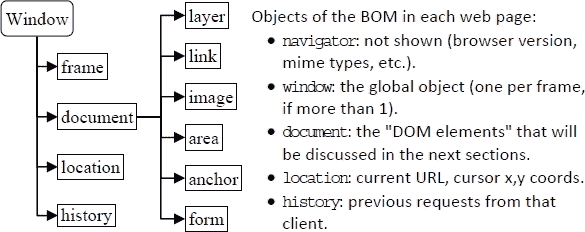

**图 8.2.** 浏览器对象模型和 Window 对象

当布局引擎遇到标签`<script>`时，它会触发脚本引擎，该引擎加载（如果是外部文件）代码并开始词法分析。该分析是在全局对象 = 即 HTML API 提供的`window`对象的范围内进行的。这是一个同步操作，意味着 HTML 解析将暂停，直到脚本引擎完成它的工作：将`<script>`放在`</body>`标签之前是值得的。

| 浏览器 | 布局引擎 HTML + CSS | 脚本引擎 (JavaScript) |
| :--- | :--- | :--- |
| Firefox | Gecko | SpiderMonkey |
| Chrome | Blink | V8^(5) |
| Internet Explorer | Trident | Chakra |
| Safari | WebKit | Nitro |
| Opera | Blink | V8 |

**表 8.2.** 主要浏览器的布局引擎和脚本引擎

当 JavaScript 启动时，与 DOM 的通信是如何工作的？

上下文标识

全局对象`window`提供了许多属性和方法，例如`window.document`和`window.alert`（仅举）。此外，JavaScript 代码中的所有全局变量和函数都会嵌入到“window 命名空间”中，并成为`window`的显式属性：

```
因此:            相当于:
   const x = "un";       window.x = "un";
   function f(){}        window.f = function(){};
```

全局对象的名称可以省略，因此我们可以移除`window`前缀，但我们应该始终记住这对符号`this`有影响（参见第 7.2 节）。

需要注意的是，`window`对象挤满了许多来自浏览器、DOM、AJAX 对象、内置 JavaScript 对象、额外库……加上我们所有的全局对象！

这不仅是代码可读性、可追踪性和可重用性问题，还是性能问题。事实上，每当变量不是局部的，就必须在全局对象中搜索。因此，将代码封装在一个用于封装整个应用的函数内部可以提供一些性能收益。这种函数被称为“局部函数”，例如，它可以与`window.onload`事件或等效事件关联。

与 DOM 对话

确保文档已就绪：`window`对象可以通过`load`或`domcontentloaded`事件告诉我们这一点。第 8.5 节详细说明了这一点，但简而言之，让我们使用一些简单的（反正该事件只会发生一次）：

```
 /* 之前：任何不依赖于东西的代码 */
window.onload = function(){      // "处理器"/"回调"
      /* 之后：任何依赖 DOM 的代码 */
      /* 确保文档已就绪 */
};
```

## 8.4 DOM API

### 8.4.1 DOM 接口 1：选择元素

- CSS 选择器语法提供了与 CSS 本身相同的可能性。例如，`elt.querySelectorAll( "div [lang=de]" )`；
- 无论如何，必须学习 CSS 选择器（一石二鸟！）；此外 – 可选，你可以移除对所谓的唯一标识符`id="idv"`的风险使用，并将其替换为更健壮的方法。

### 8.4.2 DOM 接口 2：读取/写入/创建元素

#### 8.4.2.1 读取或写入简单内容（数据）

与内容标签对应的所选元素有两个属性，均适用于两种操作：

- `elt.innerHTML`：`<tag>`和`</tag>`之间所有的 HTML 内容；
- `elt.textContent`：元素内部文本节点的内容；适用于简单值，不经过格式化（一个数字或字符串）。

#### 8.4.2.2 读取和写入属性

使用方法`elt.getAttribute`或`elt.setAttribute`：它们也适用于内容标签和空标签（例如``）。

#### 8.4.2.3 创建新元素：“懒懒”方法

目标元素是一个内容标签，我们可以考虑第一种方法，称为“懒懒方法”，它易于编码且适用于快速原型设计。

当 HTML 代码简单或来自外部来源（例如 HTML 片段）且我们不需要先对其解析时，可以使用它。只需编写该代码：布局引擎会自动解析标签并将嵌套元素创建到目标。例如：

```javascript
let selec = ".slogan";      // 用于 class="slogan" 的选择器
const devise = "JavaScript for everybody";
document.querySelector(selec).innerHTML =
        `maxim of the day: <b>${devise}</b>`;
const text = getTextFromSome(…);   // HTML 代码
document.querySelector("aside").innerHTML = text;
```

#### 8.4.2.4 创建新元素：构造方法

这种方法更完整、更健壮。分为四个步骤：

- b1. 创建新元素：`document.createElement("tag");`
- b2. 设置内容和属性；
- b3. 为事件绑定处理器；
- b4. 将此新元素添加到目标。

让我们详细说明这些步骤：

```javascript
let nuElt = document.createElement("div"); // b1.
nuElt.setAttribute("class", "maxim");
nuElt.innerHTML = "maxim of the day";      // b2.
function handlerIdee(e){ alert("eureka" + e.target.innerHTML) }
nuElt.addEventListener("mouseOver", handlerIdee); // b3.
document.querySelector("article").appendChild(nuElt); // b4.
```

这种方法有三个优势：

- 这三个步骤可以单独使用：例如，递归地嵌套标签列表；
- 可以在将元素添加到现有目标之前附加处理器；
- 它对 DOM 产生影响，例如：

```javascript
const helt = document.createElement("header");
helt.setAttribute("class", …);
helt.addEventListener(event, function (){ … });
window.onload = function(){
    document.querySelector(selector).appendChild(helt);
```

顺序很重要：如果事件在设置处理器之前触发，它将被简单忽略（太晚了）。

### 8.4.3 HTML DOM 文档和元素的方法

以下表格按功能列出了一系列实用的属性和方法。

存在更多方法用于处理 DOM 导航（`nextChild`、`nextSibling`等）或处理文本（聚焦、滚动等）。读者可以在互联网上找到文档。

HTML DOM 元素属性选择

| 属性 | 描述 |
| :--- | :--- |
| `elt.innerHTML, textContent` | 返回或重新定义 elt 的内容或文本节点 |
| `elt.id, .title` | 返回或重新定义 elt 的 'id' 或 'title' 属性 |
| `elt.nodeName, nodeType, nodeValue` | 返回节点的名称、类型、值 |
| `elt.offsetHeight, offsetWidth…` | 返回 elt 的高度、宽度……包括边框） |
| `elt.parentElement` | 返回 elt 的父节点 |
| `elt.classList` | 返回 elt 的类名 |
| `elt.style` | 设置或返回 elt 的样式属性值 |

HTML DOM 元素方法选择

| 方法 | 描述 |
| :--- | :--- |
| `elt.addEventListener(), .removeEventListener()` | 为元素添加事件处理器；移除特定的处理器 |
| `elt.appendChild(), .insertBefore(), .removeChild()` | 向 elt 添加子节点（作为“最后一个子节点”或在给定子节点之前），或移除节点 |
| `elt.click()` | 模拟在元素上的鼠标点击 |
| `elt.querySelector(), .querySelectorAll()` | 返回第一个或完整的……集合 |
| `elt.getElementsByClassName(), .getElementsByTagName()` | 返回内部节点的集合 |
| `elt.getAttribute(), .setAttribute(), .removeAttribute()` | 返回特定属性的值；移除它 |

HTML DOM 文档属性和方法选择

| 属性/方法 | 描述 |
| :--- | :--- |
| `document.getElementById()` | 通过 id 查找元素 |
| `document.createElement()` | 创建 HTML 元素 |
| `document.createElementNS()` | 在特定命名空间创建 HTML 元素 |
| `document.head` | 返回 `<head>` |
| `document.images` | 返回所有 `` |

## 8.5 客户端 JavaScript 事件

网页生态系统中存在几类事件：从 DOM 元素、文档或`window`触发的事件；由与网页交互的对象触发的事件，HTTP 请求：`XMLHttpRequest`。

### 8.5.1 事件循环

每个浏览器窗口只运行一个进程：事件循环，它按顺序逐个执行任务。

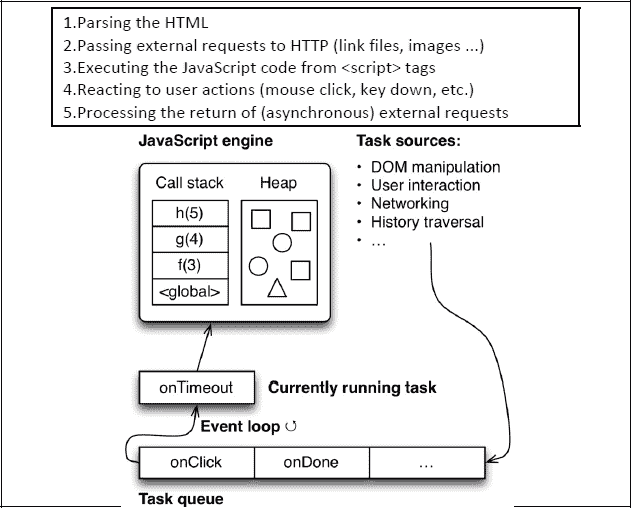

**图 8.3 浏览器事件循环 (6)**

多个进程可以并发运行，并向该循环插入新任务：`window.requestAnimationFrame`、`window.setTimeOut`等。

### 8.5.2 处理 DOM 事件

DOM 事件处理按以下方式进行：

- 每个 DOM 或 BOM 元素（窗口）可以支持多种事件：“click”、“load”、“input”、“mouseover”……，取决于其类型；
- 事件被封装在一个对象中，该对象拥有通用属性（见下文），以及特定属性，例如“点击”的像素坐标；
- 事件必须在至少一个元素上附加处理器才能产生效果；
- 事件可以传播（例如到父节点）；
- JavaScript 可以为每个元素附加一个或多个处理器。

事件处理器是旨在在事件触发后调用的函数：该函数被称为回调，因为它的执行等待事件发生（或永远不发生）。一个代表事件的对象`e`被传递给该函数。该对象拥有以下属性：

- `e.type`提供事件名称：“click”、“load”、“error”……
- `e.timeStamp`提供事件的创建时间（毫秒）；
- `e.target`用于区分元素（如果所有元素都附加了处理器）。有时我们必须区分事件发生的元素和附加处理器的元素，取决于传播机制（7)：“捕获”或“冒泡”。

这是一个示例。

```javascript
function theHandler(e){ // 事件捕获时执行的代码
   const elt = e.target; // elt: 已捕获事件
 }
const elt = [[element]]; //任意支持 "click" 的 DOM 元素
const hnd = elt.addEventListener("click", theHandler, false);
```

让我们解释一下示例：

- `handler`正在异步监听一个事件。指令`hnd = elt.addEventListener(type, handler [,capture])`告诉元素`elt`在每当捕获到类型`type`事件时运行`handler`：`addEventListener`将处理器绑定到`elt-type`组合上。
- 该方法返回的监听器`listener`被存储在变量`hnd`中，稍可以使用`removeEventListener(hnd)`将其移除。可选参数`capture`默认值为`false`，这意味着只有最内层元素的处理器会被激活；如果为`true`，则父元素的任何处理器都会被激活（“冒泡”）。

建议。最佳实践是使用`addEventListener`。

给出该建议有两个原因：

- 你可以为同一个元素-事件对附加多个`handlers`，而不会发生覆盖，然后可以单独识别并移除它们。
- 事件处理语法对于 DOM 事件和其他事件是统一的，并且更符合核心 JavaScript 规范而非 DOM API。

这是创建 DOM 元素并在创建时添加事件处理器的“构造法”的优势之一，即使在 DOM 文档准备就绪之前也可以（只有最后一步`appendChild`需要就绪）。在请求多个资源并同时请求 DOM 准备就绪的情况下，在将元素添加到 DOM 之前将`handlers`分配给这些元素是非常重要的。一个典型的例子是在访问视频并访问 DOM 的同时添加该视频：

- 视频的`handler`（监听视频加载事件）必须在将视频元素添加到 DOM 之前添加到视频元素中，因为加载视频的速度可能比执行用于向已创建的 DOM 元素添加监听器的 JavaScript 代码要快，在 particular 情况下，视频加载事件就会丢失（监听得太晚了）。

你永远不知道哪个事件会先结束：构造法是唯一的解决方案。

## 8.6. 与 DOM 交互：链接元素/事件

### 8.6.1. 等待 DOM 就绪

让我们比较两种“DOM 就绪”方法：

```javascript
function domReadyHandler(e){/* 依赖 DOM 的代码 */}
const start = window.addEventListener("DOMContentLoaded",
                                         domReadyHandler);      // 1
```

以及

```javascript
window.onDOMContentLoaded = domReadyHandler;                   // 2
```

处理器`domReadyHandler`包含了所有的`querySelector`调用以及后续的、实际上会修改页面内容的 DOM 交互。DOM 指令（如创建和设置新元素）应该更早地执行：因此建议使用构造法。

方法 1 是最佳实践，然而这种“旧式”替代方案方法 2 可能是可以接受的，因为事件只被处理一次，且移除或覆盖没有影响。

`window`对象同时支持`load`和`DOMContentLoaded`事件。后者在 HTML 文档加载后立即发生，无需等待图像等内容。`load`事件在网页完全加载时发生。你可以选择最符合你需的事件（例如，需要图片或 SVG 时）。

### 8.6.2. 示例：构建 HTML 列表

为了构建菜单或数据列表，我们必须填充`<li>`节点或带有内部`<tr>`和`<td>`的`<table>`节点，自 ES6 以来，这种操作变得简单得多。

- 懒惰法：

```javascript
function htmUlList(){ // 无参数（接受任意数量）
   function makeLi(acc, x){ return acc + `<li>${x}</li>`; }
   return Array.from(arguments).reduce( makeLi, "<u>") + "</u>";
 }
document.querySelector("nav").innerHTML = htmUList("A", "B", "C");
// <<ul><li>A</li><li>B</li><li>C</li></ul>
```

不确定数量的参数传递给`htmUList`，然后从`arguments`类数组变量读取，转换为数组并由`reduce`处理。然后将结果写入`<nav>`元素中。

- 构造法（每个列表项一个处理器）：

```javascript
function clickList(e){alert(e.type+" "+e.target.textContent);}
function htmUList(){
   function makeLi(x){
         const el = document.createElement("li");
          el.textContent = x;
          el.addEventListener("click",clickList);
          return div.appendChild(el);
       }
   const div = document.createElement("ul");
       Array.from(arguments).forEach(makeLi);
       return div; // div 已填充了 <li>s
     }
document.querySelector("nav")
   .appendChild( htmUList("A","B","C") );
```

使用构造法，每个`<li>`元素都可以单独接收一个处理器。在那个示例中如此。

### 8.6.3. 使用事件：修改属性

#### 8.6.3.1. 通过属性盖章元素

一个处理器可以设置`name`和`value`。例如：

```javascript
// 获取段落
function stampParagraph(e){
     e.target.setAttribute("ok",true); // 点击时给 <p> 打标记
 }
document.querySelectorAll("p").forEach(function(x){
     x.addEventListener( "click", stampParagraph );
 });
// 某处：
document.querySelectorAll("p").forEach(function(x){
   if(x.getAttribute("ok")) console.log(x.textContent+" 已标记");
 });
```

#### 8.6.3.2. 样式的动态处理

作为某些事件的响应修改 DOM 元素的样式、位置或大小是数据动画、计算结果可视化等重要任务。

我们可以根据请求修改每个特性：例如`elt.style.display="none";`指令将直接从布局引擎中隐藏元素。但对于更复杂的操作，预备几条 CSS 规则然后在适当的时间选择规则可能更好。这可以通过`ClassList`对象及其创建、替换或切换单个类的方法来实现。

### 8.6.4. 分发事件，创建 CustomEvent

有一个方法允许代码从元素触发事件，例如模拟对按钮的“点击”：

```javascript
const elo = document.querySelector("button");
elo.addEventListener('click', eventHandler); // 监听 "click"
elo.dispatchEvent(new Event("click")); // -> eventHandler();
```

我们可以定义带有自定义信息的自定义事件：

```javascript
const elt = document.createElement("div");   // 事件发布者
const evt = new CustomEvent('build', { detail: new Date() });
                       // event.detail: 传递额外数据
elt.addEventListener('build',eventHandler); // 监听事件
elt.dispatchEvent(evt);    // 分发事件
function eventHandler(e) {
console.log( e.detail );   // Thu Oct 19 2017 17:58:00
 }
```

# 9 绘制与多媒体

本章介绍了 JavaScript 可用于直接绘制（`SVG`或`canvas`）或多媒体显示（图像和视频）的 HTML5 工具。显示外部资源需要发送异步请求，如第 8 章所示，通过回调函数来处理其返回值。

## 9.1. 在网页上绘制

首先，我们需要一个用于绘制的表面。共有三种方法，分别对应以下三个元素：

- `iframe`：它打开一个新的窗口并放置在目标窗口的矩形区域内，尽管实际上它是来自不同 HTTP 请求的另一个窗口，拥有独立的`window`对象，因此是不同的`window.document`、具有独立全局空间的 JavaScript 引擎等。这是 AJAX 技术之前之前老的方法。我们在书中忽略了它。
- `svg`：SVG 是一种像 HTML 一样的标记语言，可以使用特定的布局引擎运行。我们可以像显示`html`页面一样显示`svg`页面。此外，SVG 与 HTML 共享许多特性：(a)类似于 DOM 的文档模型，并且可以“嵌入”为 DOM 的分支，以便 HTML 布局引擎能够处理它；(b) CSS 格式的样式规则，可以包含在同一个样式表中。在第 3 部分中，我们展示了一个使用`svg`的地图应用。
- `canvas`：这一个普通的 HTML5 元素，类似于`div`，其附带了一个“图形上下文”，这是一个具有特定图形方法的对象。

### 9.1.1. `figure`和`canvas`元素

在 HTML5 语义标签中，`figure`标签用于封装图形特征，如`img`、`video`或`canvas`，并带有`figcaption`标签作为标题或图例。我们建议使用：

```html
 <figure
   … 或 <video>, 或 <canvas>, …
  <figcaption>图形元素的图例</figcaption>
 </figure>
```

`canvas`元素在网页上提供了一个矩形表面，它可以与“图形上下文”关联，JavaScript 可以访问该图形上下文的属性和方法。出于兼容性考虑，最好为`canvas`元素赋予初始大小（宽度、高度）以及一些默认文本，如果稍后 JavaScript 代码运行正常，这些内容将被覆盖。

这里是一个简单的示例：

```javascript
 <canvas class="graf1" width="480" height="320">"graf 1"</canvas>
 <script>
const canvas = document.querySelector('.graf1');
const ctx = canvas.getContext('2d');
ctx.fillRect(x,y, w,h);      // canvas API 的一种方法
</script>
```

### 9.1.2. 2D 曲线图

#### 9.1.2.1. 使用 canvas 方法直接绘制

这段代码展示了如何将数组`coo[]`绘制成 y = coo(x) 的图。

```javascript
function drawCurve(ctx, coo, lColor, lWidth, axix) {
   let min = coo.reduce(function(a, x) {return Math.min(a, x)});
   let max = coo.reduce(function(a, x) {return Math.max(a, x)});
   const offsetX = 20, offsetY = 20; // offset= X, Y 轴留出的空间
   let basX = offsetX, basY = ctx.canvas.height - offsetY;
   if (min < 0) {
         basY /= 2; max = Math.max(Math.abs(min), Math.abs(max))
     }
   const incX = (ctx.canvas.width - basX) / coo.length,
         incY = basY / max;
   ctx.save();                       // 第 11 行: 开始绘制
   ctx.beginPath();
   ctx.strokeStyle = lColor; ctx.lineWidth = lWidth;
   ctx.moveTo(basX, basY - coo[0] * incY);
   coo.forEach(function(y, x) {      // y: 值, x: 索引
     ctx.lineTo(basX + x * incX, basY - y * incY); ctx.stroke()
   });
   ctx.closePath();
   ctx.restore();                            // 第 19 行: 结束绘制
   if(coox){ drawAxis(ctx.canvas, axix);}
 }
```

前 10 行正在准备必要的参数，用于将`coo[]`值转换为 canvas 坐标空间中的值（视口变换）：`basX, basY, incX, incY`。`drawAxis`函数未详述：它对我们的目的来说不是必要的，绘制主曲线就足够。第 11 到 19 行实现了该绘图：`save`和`restore`方法保留了当前上下文；`beginPath`和`closePath`告诉绘图这是一个闭合的“路径”（多边形）；而避免使用循环的`forEach`则通过调用`lineTo`和`stroke`实现了该绘图。路径以线条（`stroke`，配合`strokeStyle`）绘制；它也可以被绘制为填充（`fill`）。

了解`canvas`机制以及如何从 JavaScript 进行交互是值得的：这就是为什么上面详细介绍了`drawCurve`函数的原因。在实践中，有从轻量库到完整框架的各种解决方案。

#### 9.1.2.2. 使用 canvas 方法绘制

[注：原文中除标题外，此节为空白。]

## 9.2. 使用 SVG 绘制

```html
 <style>
   svg {position:absolute; left:10px; top:10px; width:480px; height:340px}
   .p0 {stroke:black; stroke-width:0.1; fill:white}
   .r0 {fill:blue} .euro {fill:yellow} .memberstate {fill:green}
 </style>
 <body>
   <svg xmlns="http://www.w3.org/2000/svg" viewBox="0 0 230 192.5">
    <g class="maing" transform="translate(-9,-9)">
     <rect class="r0" x="10" y="10.1486" width="228.023" height="189.851">
     <g class="pays memberstate" id="Monaco">
       <path class="p0" d="M83.6619 151.193c-0.2476,0.0627 -0.5932,0.1566 -
 0.9258,0.2615l0 0 0.0691 -0.4229c0.2099,-0.203 0.4828,-0.1426 0.7337,-0.1075
 0.0318,0.0044 0.0933,0.259 0.123,0.2689l0 0z" />
     </g>
    </g>
    <!-- <g> more countries </g> -->
   </svg>
 </body>
```

布局引擎在分析`<svg>`元素时，会获知要处理哪种类型的 SVG（`xmlns`属性）。然后，引擎可以翻译`<svg>`内部元素并将它们添加到自己的 DOM 中。

这些元素可以通过 CSS 和 JavaScript 访问（使用相同的选择器），并具有额外的功能：例如，CSS 中的`stroke`或`fill`属性，以及“SVG Element”对象的一系列方法，例如`r.isPointInFill(pt)`确定点`pt`是否在多边形`r`内部。

可用的标签包括`<rect>`、`<circle>`、`<ellipse>`、`<polygon>`、`<text>`、`<marker>`等，以及下文描述的`<path>`和`<g>`允许用户将多个标签组合在一起并可能对所有标签应用相同操作：CSS 样式或几何变换。

`<path>`标签表示两个位置之间的一组简单图形：线段、圆弧、二次曲线片段或贝塞尔曲线片段。

此示例是摩纳哥的边界线（一个相当短的`<path>`），它是三个贝塞尔曲线片段的连续（为了方便阅读，字母使用了加粗字体）：

```
 <path d="M83.66 151.2c-0.247,0.063 -0.59,0.16 -0.93,0.26 0 0.069 -
 0.423c0.21,-0.203 0.483,-0.142 0.734,-0.1075 0.032,0.0044 0.0933,0.259
 0.123,0.269 0z">
```

第一个字母`M`(moveTo)设置图形的起始位置，然后字母`c`(curveTo)使用三个或更多控制点从该位置绘制出贝塞尔曲线，然后再次直到字母`z`，该字母信号路径闭合，回到起始位置。

此示例是第 3 部分（欧洲国家）中使用的 SVG 文件的片段：初始矩形填充为蓝色（海洋背景），然后国家填充为白色并带有黑色色的轮廓（它们的边界）。

有一个专门的框架用于在 JavaScript 中处理 SVG：SNAP。Snap.svg 是一个在 Apache 2 许可证下的开源库。它提供了几项功能，使 SVG 中的动画变得更加简单。

## 9.3. 图形动画中的时间处理

### 9.3.1. 方法 setTimeout, setInterval, requestAnimationFrame

在等待答案（时间不长）或监控演变（速度不快）时，处理实际经过的时间是有用的。`window`对象提供了两个方法，允许在特定时间或特定间隔执行函数：

- `window.setTimeout(func, x)`在给定的`x`毫秒后运行`func`；
- `window.setInterval(func, x)`每隔`x`毫秒重复运行`func`。

这两个方法都返回一个对象`reqId`，其效果可以分别通过`window.clearTimeout(reqId)`或`clearInterval(reqId)`取消。

对于图形数据动画，应该优先使用`window`对象的以下方法：

```
 – window.requestAnimationFrame(callback, x)
```

该方法不是依赖于时间（大致良好），而是请求图形调度器队列中的下一个可用帧。回调函数更新数据，然后通常再次请求下一帧，这将刷新屏幕上的绘制内容。返回的值`reqId`可以在其他地方通过`cancelAnimationFrame(reqId)`使用，如果需要取消刷新的话。例如：

```html
 <p style="width:0; height:0; background-color:red"></p>
 <script>
let start = null, mover = null;
let maxDuration = 2000; // 1px/frame = 60 帧/s 时相当于 12px
function step(timestamp) {
   function update(elt) {
     let wdth = parseInt(elt.style.width);
     elt.innerHTML ="<p>"+(100*wdth/6).toFixed(0)+"</b>"
     elt.style.width = elt.style.height = (wdth+1)+'px';
     return (timestamp - start); // approx 100*wdth/6 (1/60s)
   }
   if (!mover)
       {start = timestamp; mover = document.querySelector('p');}
   /* 更新给定元素的内容 */
   if (!mover)
       {start = timestamp; mover = document.querySelector('p');}
   /* 更新给定元素的内容 */
   if (!mover)
       {start = timestamp; mover = document.querySelector('p');}
   /* 更新给定元素的内容 */
   if (!mover)
       {start = timestamp; mover = document.querySelector('p');}
   /* 更新给定元素的内容 */
   if (!mover)
       {start = timestamp; mover = document.querySelector('p');}
   /* 更新给定元素的内容 */
   if (!mover)
       {start = timestamp; mover = document.querySelector('p');}
   /* 更新给定元素的内容 */
   if (!mover)
       {start = timestamp; mover = document.querySelector('p');}
```

## 9.3.2. 性能考虑，生成器函数

### 9.3.2.1. 提高每一帧的性能。

### 9.3.2. 性能考虑，生成器函数

生成器函数的语法根据我们的需要扩展了这系列函数。

#### 9.3.2.2. 在动画中使用“生成器函数”

```javascript
const acts = ["motion","beam","beam1","beam2"];
function* animGenerator(arr) {
   const act ()=>console.log(`anim: ${arr.shift()}`);
   let x = arr.length, y, z, t;
   act(); y = yield (2 * (x + 1));
   act(); z = yield (x + y/3);
   act(); t = yield (x+y+z);
   act(); return (t + 1);
}
const gen = animGenerator(acts);
let nextanim, delay;
do{
   nextanim = gen.next();      //第一次 delay=null
   delay = nextanim.value;
   console.log( "delay= "+ delay + ", actions left: "+ acts.length);
 }while(!nextanim.done)
```

**解释。**

生成器函数能够产生四个不同的输出；它包含了三个`yield`指令和一个`return`。它的内部函数`act`消耗了作为参数参数中的一个元素，并将每次`next`调用打印到控制台上。

生成的函数`gen`将数组参数的大小存储在变量`x`中，该变量将被多次使用。对于每个`gen.next`，`yield(exp)`终止一段代码并返回对象`{done:false, value:exp}`。`return`返回`{done:true, value:exp}`：

**表 9.1. 生成器函数的行为（示例）**

| 调用 | 操作 | 结果 |
| :--- | :--- | :--- |
| next#1 | x= 5 (初始关闭), `y = 2*(5+1),` | x + 1 = 6 |
| next#2 | x= 5, y = 12, | x+ y/3 = 9 |
| next#3 | x= 5, y = 12, z=9, | x + y + z = 26 |
| return | x= 5, y = 12, z=9, t= 26 | 27 |

```json
{done:true, value:27}.
```

注意：在没有返回指令的情况下，下一次`next`将返回`{done:true}`。后续的调用不会产生任何影响，并且始终返回`{done:true}`。

我们使用该机制来生成一系列开始或结束的模拟动画：它比在组可能的选择中每次进行检查更加明确。以下是我们的示例的输出：

表 9.2. 对生成器函数连续调用`next`的序列结果

| 在每次`gen.next()`内部 | 之后 |
| :--- | :--- |
| `"anim: motion"` | `"delay= 6, actions left: 4"` |
| `"anim: beam"` | `"delay= 9, actions left: 3"` |
| `"anim: backbeam1"` | `"delay= 26, actions left: 2"` |
| `"anim: beam"` | `"delay= 27, actions left: 1"` |
| | `"animGenerator is done"` |

## 9.4. 客户端会话之间的数据持久化

### 9.4.1. Http cookies

“Http cookie”机制由 Netscape 在 1995 年引入，这也是 JavaScript 出出的年份。它允许用户链接服务器以存储与同一客户端连续请求相关的少量数据。每个“cookie”都是一个小型信息块，格式为`name=value;expires=expDate;`，最大大小为 4 kb，并存储在最多 300 个 cookie 的文件中。

我们可以通过`window.document.cookie`访问该文件。

这是一个使用“cookie”的示例，摘自`w3schools`教程。

```
function setCookie(cname,cval,exdays) {
   const d = new Date();
   d.setTime(d.getTime() + (exdays*24*60*60*1000));
   const expires = "expires=" + d.toGMTString();
   document.cookie = cname + "=" + cval + ";" + expires +
 ";path=/";
 }
function getCookie(cname) {        // 返回 "username"
   const na = cname + "=",
         va = decodeURIComponent(document.cookie).split(na);
   return (va[1].split(";"))[0] || "";
 }
function checkCookie() {
   let user = getCookie("username");
   if (user !== "") { alert("Welcome again " + user);}
   else {
     user = prompt("Please enter your name:","");
     if (user) { setCookie("username", user, 30);}
   }
 }
```

虽然这不是一种复杂的技术，但它仍然在使用中，每天运行数十亿次。今天的“drill, baby, drill”演变成了：“track, baby, track”。

### 9.4.2. Local storages

为了进一步改进这种持久化，HTML5 引入了`window.localStorage`对象，其 API 提供了对‘sessionStorage’或永久‘localStorage’的访问。这些附加到域名的对象允许我们存储和更新比 cookie 大多的的数据集。

示例。计数按钮上的“点击”。将此代码放在处理程序中：

```
if(typeof Storage !== "undefined") { // 支持 Storage 对象
     if (localStorage.clickcount) {
       localStorage.clickcount = Number(localStorage.clickcount)+1;
     } else {localStorage.clickcount = 1;}
     // console.log( localStorage.clickcount + " time(s)." );
 }
```

表 9.3. 会话和永久本地存储对象的方法

| 对象 | 用途 |
| :--- | :--- |
| `window.localStorage` | 在浏览器中保存键/值对：无过期日期 |
| `window.sessionStorage` | 在浏览器中保存键/值对：仅限一个会话 |

| 属性 / 方法 | 说明 |
| :--- | :--- |
| `length` | 存储在存储对象中的“数据项”数量 |
| `key(n)` | 存储中第 n 个键的 |
| `getItem(keyname)` | ‘keyname’ 键的值 |
| `setItem(keyname,val)` | 添加或修改一对 (keyname,val) |
| `removeItem(keyname)` | 移除 ‘keyname’ 键 |
| `clear()` | 清除存储（腾出空间！） |

LocalStorage 在大小 (10 MB) 和许多属性上的性能都比 cookies 好。然而，缺乏过期日期可能会是一个问题。它强制用户注意可能的内存拥堵，并自己清理垃圾。

## 9.5. 关于“JavaScript 框架”（jQuery, D3, 等）的说明

许多库被设计为 JavaScript 增加功能。有些是以“模块模式”构建的：所有内容都封装在模块的“命名空间”中，它们通常被称为“框架”。原型是“jQuery”。

### 9.5.1. 关于 jQuery 的几句话

jQuery 是一个开源的多平台库，可以追溯到 2006 年。优点：“写得少，做得多”。目的：简化 HTML 元素。缺点：它需要额外的学习。在应用程序中隔离这些代码有时是明智的。

### 9.5.2. 建议

使用 JavaScript 的力量，所有的力量，并且尽可能只使用 JavaScript。

#### 9.5.1.1. 演进示例 1：AJAX 请求

jQuery 中典型的 AJAX 请求：

```
 $.ajax({
       url: url, type: 'GET', dataType: json,
       success: function(data) { /* code */ },
       error: function(error) { /* code */ }
 });
```

使用`Fetch`的 JavaScript 等效实现：

```
fetch(url, { method:'GET', mode:'cors' })
       .then(function(res){return res.json()})
       .then(function(data) { /* code */ })
       .catch(function(error) { /* code */ });
```

#### 9.5.1.2. 演进示例 2：修改 DOM 元素

D3 框架提出了类似于 jQuery 的服务：

```
d3.selectAll("p")
 .style("color", "white");
```

JavaScript 的等效实现是：

```
Array.from(document.querySelectorAll("p"))
 .forEach(function(p){ p.style.setProperty("color", "white");});
```

# 10 AJAX 技术（异步）

本章处理同步和异步处理。

在 Web 生态系统中编程，也就是说在互联网语境下，意味着通信速度和交换的数据量会影响处理过程。响应时间可能会变化，而无响应可能会阻塞进程。JavaScript 在“单线程”中运行，因此任何单个阻塞操作都可能阻塞整个应用程序：我们需要另一种机制来创建请求并将返回（“回调”）回调到先述描述的事件循环中。

## 10.1 客户端-服务器数据交换的架构

在网页中动态添加元素可以追溯到 1996 年的`<iframe>`。1998 年，微软通过 ActiveX 控件引入了更通用的解决方案，，随后在 Internet Explorer 中以对象`XMLHttpRequest`的形式出现。2005 年，该对象被 ECMA 标准化，并以 Asynchronous Javascript And XML (AJAX) 的名称流行。

客户端脚本程序可以发送 HTTP 请求，然后继续其活动而不被阻塞。

除了能够修改网页的部分内容而避免完全重新加载（包括许多未更改的元素）之外，AJAX 还允许访问各种格式的文件（主要是 XML），这些文件由 Web 服务器或称为 Web Apps 的小型远程应用程序提供。

### 10.1.1 XMLHttpRequest 对象

这个`window`对象在 JavaScript 中是可选，正如其名所示，它可以请求 XML 数据；任何文本数据、HTML、JSON、SVG、纯文本；以及二进制数据（此处未涵盖），使用异步的 HTTP`GET`、`POST`等请求（同步模式并不十分有趣）。

### 10.1.2 使用 XMLHttpRequest：几个步骤

一个请求包含四个步骤：(1) 创建`XMLHttpRequest`对象；(2) 在给定的 URL 上以指定的模式（`GET`或`POST`）打开它；(3) 为每个`load`和`error`事件关联回调函数；以及 (4) 发送请求，可能带有`data`选项。

我们通常使用`helper`函数来执行这些步骤，根据请求模式或预期的响应类型，可能有多种形式。

#### 10.1.2.1 变体“helperGetXML”（GET 模式并期望 XML 格式）

```javascript
function callback(error, result) {
   if (error) { throw new Error(error); }
   return processed_result;
 }
function helperGetXML(url, callback, data) { // 用于文本,
XML, HTML
   const xhr = new XMLHttpRequest();
   xhr.addEventListener("error", function() {
         callback("Http error: " + xhr.statusText);
   };
   xhr.addEventListener("load", function() {
     if (xhr.status < 400) { callback(null, xhr.responseText); }
 }
     else {callback("Ajax error: " + xhr.statusText);}
   };
   xhr.open("GET", url, true); // true = 异步（默认）
   xhr.setRequestHeader("Content-Type",
 "text/plain;charset=utf-8");
   xhr.send(data || null);
 }
```

#### 10.1.2.2 变体“helperGetJSON”（GET 模式，期望 JSON 格式）

代码大部分相同，只有一些额外的规范：

- 在 'open' 之前添加指令：

```javascript
xhr.overrideMimeType("application/json");
```

- 在“onload 回调”内部，使用`JSON.parse`方法：

```javascript
if (xhr.status < 400) {callback(null, JSON.parse(xhr.response));}
```

让我们在示例中使用它：

```javascript
const data = "param1=val1&param2=val2";    // 可选数据
function callbackJson(res, err) { /* 处理 JSON 对象 */ }
helperGetJSON(url, callbackJson, data)
```

### 10.2 关于 HTTP 的备注

- 有四种请求模式：`GET`、`POST`、`PUT`、`DELETE`。对于访问数据而不修改，`GET`模式是本书目标应用程序的解决方案。
- 在不同的可能的响应状态中，我们可能只会遇到两种：表示成功的`200 « OK »`和表示所有错误码大于或等于 400 的`404 « Page not found »`。

### 10.3 “Promises” 与异步编程

“Promise”是一个表示异步操作返回（成功或失败）的对象：它既是一个容器，用于告知操作状态，又是一个事件发射器，通知请求的终止。我们在该对象上挂载“回调”，而不是将它们传递给函数。

使用`then()`被称为“异步函数调用”，它返回一个新的“Promise”，而该 Promise 反过来可以被“then-ify”（Promise 链式调用）。

| 方法：“callback” | 方法：“Promise” |
| :--- | :--- |
| ```javascript
function success(res){
   console.log("Success: "+res);
 }
function failure(err){
   console.log("Failure: "+err);
 }
doSomething( success, failure);
``` | ```javascript
function success(res){
   console.log("Success: "+res);
 }
function failure(err){
   console.log("Failure: "+err);
 }
doSomething()
  .then( success, failure);
``` |

**表 10.1. 比较回调和 promise 机制**

### 10.3.1 示例：将 XMLHttpRequest Promise 化

我们可以通过简单的封装将`helperGetJSON`转换为一个 Promise：

```javascript
function helperGetJson(url, data) {
   return new Promise( // helperGetJSON 的匿名版本
     function (resolve, reject) {
       const xhr = new XMLHttpRequest();
       xhr.addEventListener("load", function() {
         if(this.status===200){resolve(JSON.parse(this.response));}
         else {reject(new Error('Too bad: '+this.statusText));}
       };
       xhr.addEventListener("error", function() {
         reject(new Error('Ajax Error: '+this.statusText));
       };
       xhr.overrideMimeType('application/json');
       xhr.open('GET', url);
       xhr.send(data?data:null);
   });
 }
```

让我们在示例中使用它：

```javascript
const data = "param1=val1&param2=val2";    // 可选数据
function callbackJson(res, err) { /* 处理 JSON 对象 */ }
helperGetJSON(url, callbackJson, data)
```

出于安全考虑，通过 AJAX 访问远程服务器受到严格限制。“同源策略”（SOP）限制了对相同域内文件的访问，这意味着一个本地文件，例如`../data/file.json`。

该策略规定，对于给定源的文档（网页），我们无法执行来自另一个源的脚本，并尝试修改以下内容：

- `window.document`：任何属性，且对`anchors`、`cookie`、`forms`、`lastModified`、`length`、`links`、`referrer`、`title`没有读取权限；
- `image`：`lowsrc`、`src`；
- `location:`全部，除`x`和`y`。

存在一些绕过 SOP 限制的方法：

- `<iframe>`：这是一种老旧且保护性很强的技术。一旦文档加载到`<iframe>`中，几乎无法从浏览器的另一个元素访问它；
- “代理”服务器：这必须部署在与文件相同的域中，并且必须经过编程以复制数据，然后由这些数据为 Web 服务。
- 第三种变通方法是带填充的 JavaScript 对象符号（JSONP）。

## 10.4. 交换格式：JSON

在 20 世纪 90 年，将 HTML 通用为“可扩展标记语言”（XML，1997）的标准化努力旨在创建一种通用的互联网语言：XML 作为 HTML 的超集，是通用数据交换格式的显而候选者。

JavaScript 对象字面量仅仅是文本，可以存储为纯文本文件。使用它至少可以为 JavaScript 程序提供数据（即为网页提供数据）非常有吸引力。Douglas Crockford 在 2001 年规定了一种数据格式，命名为“JavaScript Object Notation”，并以其缩写“JSON”而闻名。

活性和更高的简洁性是 JSON 优于 XML 的优势。JSON 对象被添加到 JavaScript 中，方便了进导出转换，如今，大多数语言都提供相同的服务。

### 10.4.1. JSON 的一个非常实的应用：从表格转换数据

我们都使用某些电子表格软件（无论是独立的还是云端的），我们都熟悉这种名为“逗号分隔值”（CSV）的简单数据格式。

JSON 是 CSV 的一种有趣的替代方案：两种格式都可以被大多数语言读取；CSV 显然紧凑得多（行越多，优势越明显），但 JSON 是一种人类可读的格式，且 JSON 可以可以直接嵌入 JavaScript 代码中：它是一个对象字面量。直接嵌入，无需转换！

让我们通过一个简单的示例进行比较。这里是表格：

| | A | B | C | D | E | F | G | H |
|---|---|---|---|---|---|---|---|---|
| 1 | nom | prenom | age | dept | Numero | partii | parti2 | parti3 |
| 2 | Dupont | Jean | 22 | Gironde | 2 | A | | |

以及对应的 CSV 格式：

```
nom, prenom, age, dept, numero, parti1, parti2, parti3
Jean, Dupont, 22, Gironde, 2, A, ,
```

除非有许多空单元格（如`parti2`和`parti3`），否则无法更简单、更紧凑了：CSV 必须提供与第一行项目数量相同的分隔位置。另一个缺点是，紧凑性迫使我们记住第一行，即每个单元格的语义模式。

这种格式非常适合关系型数据库系统，因为它们的工作方式正是这样：一个模式加上表格化的原始数据。

#### 10.4.1.1. 对应的 JSON 格式

从第一行开始，我们构建一个属性名列表（键）；然后逐行通过从列表中选取键来构建对象字面量，并按相同顺序从每行的每个分隔值中选取值，但“空值”会被直接忽略。因此，第 2 行变为：

```
{"nom": "Dupont", "prenom": "Jean", "Age": 22, "dept": "Gironde", "numero": 2, "parti1": "A"}
```

当然，它比 CSV 的第 2 行要长得多：

```
Dupont, Jean, 22, Gironde, 2, A, ,
```

但 JSON 格式带来了其他优势：

- 语义：每一行都直接可见（键）；
- 空单元格：它们的缺失意味着`undefined`，例如`l1.parti2 = undefined`。

可以很容易推导出更丰富的结构：

- 属性`dept`和`numero`可以封装在一个新的对象中，称为`circo`，该对象可以被该选区（地区）的所有候选人共享：

```
{"nom": "Dupont", "prenom": "Jean", "Age": 22,
  "circo": {"dept": "Gironde", "numero": 2},
  "parti1": "A"}
```

- 数量属性（例如`parti1`）可以组组成数组；该数组的大小将给出所属的数量（不需要计算非空值）：

```
{"nom": "Dupont", "prenom": "Jean", "Age": 22,
  "circo": {"dept": "Gironde", "numero": 2},
  "affiliations": ["A"]}
```

持久可用的语义和丰富的结构是 JSON 格式的两个优势，代价是更大的内存占用。考虑到世界上使用的 JSON 文件数量，这些优势无疑非常重要。

### 10.4.2. 将电子表格数据导出为 JSON 格式

在下文中，我们将详细介绍如何使用宏规则直接从电子表格导出 JSON 数据。

这涉及几个步骤，可以将其编码为电子表格规则（宏）。

给定一个电子表格（例如`datafile.xls`）：

- 考虑数据在工作表`F1`中；
- 使用工作表 ‘F2’（或其他）并在单元格`A1`中写入：

```
{ "jsondata": [
```

这是对象字面量的开头，包含一个属性`jsondata`（或任何名称），它打开了一个数组字面量`[`。

其中`m` = [`A, C, G, H]`，是我们示例中可能为空单元格；`i`如上。

以下是第 2 行的完整公式：

```
 = CONCATENATE("{ ";
  "\"";'F1'!A$1; "\":\""; 'F1'!A2; "\"";
  ", \""; 'F1'!B$1; "\":\""; 'F1'!B2; "\"";
IF('F1'!C2="";""; CONCATENATE(",\""; 'F1'!C$1; "\":\""; 'F1'!C2; "\""));
  ", \""; 'F1'!D$1; "\":\""; 'F1'!D2; "\"";
  ", \""; 'F1'!E$1; "\":\""; 'F1'!E2; "\"";
  ", \""; 'F1'!F$1; "\":\""; 'F1'!F2; "\"";
IF('F1'!G2="";""; CONCATENATE(",\""; 'F1'!G$1; "\":\"";  'F1'!G2; "\""));
IF('F1'!H2="";""; CONCATENATE(",\""; 'F1'!H$1; "\":\"";  'F1'!H2; "\""));
 " },")
```

此外，我们也可以直接在公式中“冻结”列名，公式变为：

```
 = CONCATENATE("{ ";
  "\"nom\":\""; 'F1'!A2; "\"";
  ", \"prenom\":\""; 'F1'!B2; "\"";
IF('F1'!C2=""; ""; CONCATENATE(", \"age\":\""; 'F1'!C2; "\""));
  ", \"dept\":\""; 'F1'!D2; "\"";
  ", \"numero\":\""; 'F1'!E2; "\"";
  ", \"parti1\":\""; 'F1'!F2; "\"";
IF('F1'!G2=""; ""; CONCATENATE(", \"parti2\":\""; 'F1'!G2; "\""));
IF('F1'!H2=""; ""; CONCATENATE(", \"parti3\":\""; 'F1'!H2; "\""));"
 },")
```

如果没有拼写错误，我们应该看到预期的字面量：

```
 {"nom": "Dupont", "prenom": "Jean", "age": 22, "dept": "Gironde", "numero": 2, "parti1": "A"}
```

最后，为了创建一个嵌套对象（例如“circo”）或将属性分组为数组，我们必须安排必要的组件。我们建议此作为一个练习；尝试从：

```
 {"nom": "Dupont", "prenom": "Jean", "age": "numero": 2, "parti1": "A"} 22, "dept": "Gironde",
```

变为：

```
 {"nom": "Dupont","prenom": "Jean",     "age" "Gironde", "num": 2}, "affiliation": ["A"]}: 22, "circo": {"dep": "Gironde", "num": 2}, "affiliation": ["A"]}
```

### 10.4.3 JSON 与 JavaScript 对象表示之间的差异

它们存在一些细微的差异，我们需要注意。

- JSON 仅接受以下语法：`"property":"string"`或`"property":number`。数字字面量外，必须使用双引号；
- JSON 接受的值有字符串、数字、数组、对象（符合 JSON 标准）、`true`、`false`、`null`（没有`undefined`）；
- JSON 不接受方法（methods）；
- 某些 JavaScript 对象（如`Date`）会被`JSON.stringify()`转换为字符串；
- JSON 禁止注释。它不是一种语言，而是一种格式：没有引擎可以处理注释。注意不要在 JSON 文件中插入注释。

结论是，JSON 比 JavaScript 对象表示法更严格。以下是一些建议。

不要直接写入 JSON 文件，请遵循这些指令：写下对象字面量，将其赋值给一个变量，然后对该变量进行字符串化：

```
const candidat = {
       nom : "Dupont",
       prenom: 'Jean dit "Jeannot"', age : 22,
       fullName: function(){return this.prenom+" "+this.nom;}
 };
console.log(JSON.stringify(candidat) );
    // -> {"nom":"Dupont","prenom":"Jean dit \"Jeannot\"","age":22}
```

`JSON.stringify`函数为我们完成了工作：移除方法、添加双引号、可能转义引号（注意`\"Jeannot\"`）、移除`undefined`属性（如果有）、移除空格、制表符和换行符。

我们可以直接复制`datafile.json`的文本并粘贴到赋值指令的右侧：

```
 const jsonText = PASTE HERE;
```

不要忘记分号。

通常情况下，我们通过 AJAX 请求获取文本，在这种情况下，我们必须在回调函数中使用`JSON.parse`：`let obj = JSON. parse(response);`，或者在使用`Fetch`时使用`response.json()`。

注意——读取 JSON 格式可能会向控制台发送警告信息，由于存在制表符、换行符等导致格式错误。为了避免此类警告，可以使用正则表达式并通过添加转义字符来修改输入流：

```
function escapeSpecialChars(str) {
       return str.replace(/\n/g, "\\n")
              .replace(/\r/g, "\\r")
              .replace(/\t/g, "\\t")
              .replace(/\f/g, "\\f");
 }
```

最后，我们永远无法完全防止 JSON 数据解析中的错误，值得使用`try.. catch`来处理这些错误：

```
function parse(str){
     try {return JSON.parse(str);}
     catch(e){throw new Error("error in JSON parsing");}
 }
```

### 10.5 带填充的 JavaScript 对象表示 (JSONP)

这并不是一种新格式；它只是将 JSON 格式“填充”在一个信封中。信封是调用函数`f`的语法：`f();`。JSON 表示法直接作为参数位于括号之间：仅仅是对象字面量表示。在一个可能使用多个函数读取多个 JSONP 数据的应用程序中，根据我们处理的数据来选择`f`的名称是明智的。例如：

```
readJSONP()
```

### 10.6 并行的 JavaScript：“工作线程”(worker)

客户端 JavaScript 是单线程的（每个窗口一个线程）。自从 HTML5 引入“web workers”以来，我们可以在后台另一个独立于用户界面的线程上运行脚本（或几个脚本）。

下面是 DOM 事件与 worker 之间对话的示例。

```javascript
const first = document.querySelector('#number1'),
       second = document.querySelector('#number2'),
       result = document.querySelector('.result');
const myW = new Worker("worker.js"); //外部脚本
first.onchange = function() { // 值改变了
       myW.postMessage([first.value,second.value]); // [message]
       console.log('to worker'); // 8
 };
second.onchange = function() {
       myW.postMessage([first.value,second.value]);
       console.log('to worker'); // 12
 };
myW.onmessage = function(e) {
       result.textContent = e.data;
       console.log('from worker'); // 16
};
```

外部文件`worker.js`中的代码是：

```
onmessage = function(e) {
   console.log('from main'); // 2
   let workerResult = 'Result: ' + (e.data[0] * e.data[1]);
   console.log('to main '+ workerResult); // 4
   postMessage(workerResult);
 };
```

请注意，worker 可以访问`window`对象的某些资源，因为它可以使用`console`。但 worker 无法访问 DOM。

以下是两个进程之间的对话：

| DOM 上的文本 | `console`上的文本 | 线程：行 |
| :--- | :--- | :--- |
| `to worker` | | `Main:8` |
| | `from main` | `worker.js:2` |
| | `to main` | `worker.js:4` |
| `from worker` | | `Main:16` |
| `to worker` | | `Main:12` |
| | `from main` | `worker.js:2` |
| | `to main` | `worker.js:4` |
| `from worker` | | `Main:16` |

**表 10.4.** 与 worker 对话的示例

# 第三部分：应用

## 第三部分引言

让我们来谈谈“大数据”：指的不是“大爆炸”（Big Bang）或“老大哥”（Big Brother）传说，而是一个巨大的数据池，我们可以从两个维度来研究它：

- 我们可以考虑“大”（Big）维度，当数十亿数据涉及特定主题时，我们可以通过分布式统计处理或深度学习进行处理。
- 我们可以考虑“数据”（Data）维度，意味着我们可以收集关于几乎任何事物的信息片段，而不受性能问题的限制。

我们的方法更多地关注第二个维度，特别是那些提供可以通过 API、JSONP 甚至纯文本文件（如 CSV 数据）或松散结构数据（如 RSS 馈送）访问的数据服务器。

处理此类数据需要不同的技能：

- 访问多个资源：监控 AJAX 请求和响应；
- 聚合数据、连接数据（类似于 SQL 的`GroupBy`和`Join`）；
- 显示图表、绘制曲线、制作动画；
- 将数据映射到地图源上、地图数据交互。

第一个应用处理时间序列数据。我们将实践 AJAX 技术、数组方法、canvas 图形工具和动画工具。

第二个应用处理关系型或层次结构模式下的多个表格数据源。我们将介绍一种类似于`GroupBy`和`Join`的操作；我们将面对字符串比较问题，并利用 JavaScript 的原型背景来实现 JSON 数据的无缝集成。性能可能是此类应用程序中的一个问题，我们将讨论 JavaScript“承诺”（promises）。

下一个应用领域是制图，我们将探索两种主要的模式：基于 SVG 和基于 canvas 的 API。

最后，我们将展示三个使用 JSONP 使用数据服务的示例：访问电子表格、图像目录和 RSS 馈送。

# 11：时序数据

### 11.1. 通过 AJAX JSON 文件

此示例是许多提供时序数据的网站的典型代表，这些数据通常以 CSV 和 JSON 格式提供。

[Quandl.com](http://Quandl.com)是一个基本上销售金融数据的数据仓库。它还提供对经济和人口统计数据的免费访问，大部分来自公共来源，如世界银行、欧洲中央银行（ECB）、Euronext 和法国国家统计局（INSEE），或来自大学，如耶鲁大学经济系和巴黎经济学院。

#### 11.1.1. Quandl API 简要介绍

目录`https://www.quandl.com/api/v3/datasets/`允许以下命令直接访问 JSON 格式的数据：

```
GET
https://www.quandl.com/api/v3/datasets/{db_code}/{data_code}.json
```

| db_code | data_code |
| --- | --- |
| **PSE** (巴黎经济学院) | USA_1010120401 (前 0.5-0.1% 收入份额 - 美国，不含资本收益) |
| **INSEE** | 63_001686811_A (法国本土 60 岁以上人口) |

**表 11.1.** 来自 [Quandl.com](http://Quandl.com) 目录的数据示例

JSON 数据结构如示例所示已归一化（节选）：

```
{
  "dataset": {
    "name":"World Top Incomes - Top 0.5-0.1% income share - United States",
    "description":"Units=%. Fractiles: total income excl. capital gains",
    "column_names": [ "Date", "Value" ],
    "frequency": "annual",
    "start_date": "1913-12-31",
    "end_date": "2015-12-31",
    "data": [ [ "2015-12-31", 6.29 ], … ]
  }
}
```

#### 11.1.2. 使用承诺处理示例

在了解了结构和 URL 的组件后，我们能够编写一个`callback`函数并用正确的参数（`url`且`data`）调用`helperGetJson`函数（在第 10 章中介绍）。

```javascript
 const db = "PSE/", ds = "USA_1010120401";
  const key = "a_key_provided_by_quandl"; //无 key：限制 50 次请求。
  const url = "https://www.quandl.com/api/v3/datasets/"+db+ds+
  ".json?api_key="+key;
  fetch(url)                            // 返回第一个 promise
    .then(res => res.json())     // 返回第二个 promise
    .then(processQuandl)       // 完成最终处理
    .catch(function(err){console.log('Fetch Error:-S', err);});
```

首先，我们构建引用我们要处理的特定数据库 (PSE) 和数据集的 URL。`api_key`可以省略，但这种情况下有 50 次请求限制。

然后我们使用`fetch`获取数据并返回第一个承诺，将其转换为第二个承诺。

```javascript
function putEvents(table, datab) {
            // 根据总统所属党着色
    let Dgd = "linear-gradient(to bottom,#99ccff 64%,#0000ff 100%)";
    let Rgd = "linear-gradient(to bottom,#ff99cc 66%,#ff0000 100%)";
    let date0 = parseInt(table[0][0].substring(0,4));
    table.forEach(function(tp, p, tab){
      // 显示一个跨越总统任期的彩色 <div>
      div.addEventListener("mouseover",function(e)    {
        // 将数据编码到弹出窗中
      });
}
```

借助一些用于元素元素着色的 CSS 规则，我们在这里展示了图形化输出。

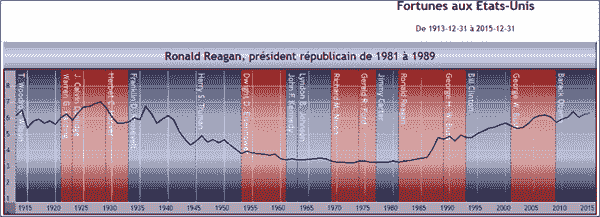

**图 11.1** 来自 Json 文件的时间序列数据图及叠加层

这种应用不需要深入理解 JavaScript 的所有方面。在学生贡献和最少设备的情况下，中学教师也可以完成。

练习.–

使用与第二个示例相同的代码（法国同一世纪内 60 岁以上人员的人口统计数据）。不要显示原始数据，而是显示年度百分比变化：`rev[i] -> (rev[i] - rev[i-1])/rev[i-1]`（第一个值`rev[0]`无法计算）。

然后，对于每个重要变化，找到 60 年前发生了什么；这既简单又令人印象深刻。

## 11.2. 使用开源图表库

我们已经提到了一些图形工具^(1)，这些工具建议以不同的经典形式处理图形数据：折线图、饼图、甘特图等。

一旦我们学习了基本机制，操作此类库的功能就会变得更容易。此后我们将详细介绍如何使用`dygraph.js`库来实现：

- 针对相同横轴绘制多个时间序列数据数据图；
- 让时间序列数据随时间产生动画效果。

### 11.2.1. 在相同时间轴上绘制多个数据序列

这是一个实现不同步骤的典型示例：

- 从源中提取数据；
- 将 CSV 转换为 JSON。在此示例中，自 2017 年起运行的 ECB SDMX 2.1 RESTful Web 服务提供了一个访问 ECB 统计数据仓库的 API；
- 反转数组（时间升序）；
- 将日期转换为 JavaScript 对象（`goodDate`）；
- 设置标签并格式化轴；

以下是代码（不再重复 Ajax 请求）：

```javascript
const ecbTGB = {
    "name":"Euro TARGET balance (selected countries)",
    "dataSource": "http://sdw.ecb.europa.eu/browse.do?node=bbn4859",
    "Unit": "[Millions of Euro]",
    "Participants": ["ECB","BE","DE","ES","FR","IT","NL"],
    "data": [
    ["2017Aug",-212940,-22095,852511,-384426,9278,-414164,107511],
    […], … ]
}
const dygrafTable = ecbTGB.data.reverse(); // 最新右
function goodDate(x){
      let xx = x[0], y = parseInt(xx);
      x[0] = new Date( xx.split(y)[1]+" 1 "+y );
      return x;
}
dygrafTable = dataTable.map(goodDate);
const dygrafDiv = document.querySelector(".plot");
let title = ecbTGB.name, width = 480, height = 200;
let labels = ['Date'].concat(source.Participants);
let axes = {x:{pixelsPerLabel: 30,
              axisLabelFormatter(x){return x.getFullYear();}
             };
const g = new Dygraph(
      dygrafDiv ,      // 在何处绘制
      dygrafTable,     // 数据（或 CSV 文件的 URL
      {title, width, height, labels, axes}
  );
```

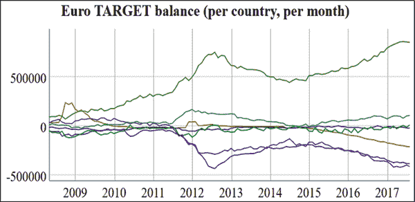

**图 11.2.** 多个时间序列数据（多个国家）

### 11.2.2. 动态绘制：模拟时间演变

图仅在一个帧内显示在屏幕上。我们可能想通过使用尽可能多的帧来控制该显示，以模拟演变，例如以每年 1 秒的速度：

- 首先，我们只绘制第一个日期（2008），如上一个示例所示；
- 我们创建一个添加下一个日期（push）的函数，并调用`Dygraph`对象的`updateOptions`方法（它强制刷新帧）；
- 我们调用`window.setInterval`，它每`ms`毫秒重复一次；
- 在达到最大尺寸时停止（`clearInterval`）。

除了 Dygraph 特有的`updateOptions`之外，该逻辑适用于任何类似的动画（控制图表的速度）。以下是代码：

```javascript
const dynamicTable = Array.from([dygrafTable[0]]); // = 2008
const maxlen = dygrafTable.length; // 停止测试
function dynamicDraw(){
     dynamicTable.push(dygrafTable[dynamicTable.length]);
     if(dynamicTable.length === maxlen)
         clearInterval(window.intervalId);
     g.updateOptions( {'file':dynamicTable} );
}
let ms = 500; // 每 500 ms
window.intervalId = setInterval(dynamicDraw, ms);
```

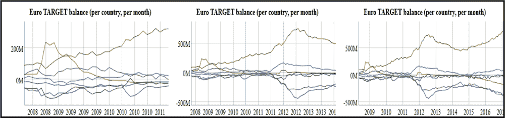

**图 11.3.** 连续绘制，2 秒后（2011）、4 秒后（2014）和 6 秒后（2017）

在示例中，纵轴的间距适应到目前读取的数值范围。我们可以注意到在 2010 年左右（2.5 秒后）发生了重要的刻度变化：间距`[-150M,200M]`变为`[-500M,500M]`。

# 12 关系数据

在本章中，我们考虑最简单且最流行的关系数据和表格数据。存在数以亿计的表格数据，来自 Excel 或或其他软件。此外，来自 RDBMS（关系数据库管理系统）的数据也可以很容易地导出为表格数据，例如“逗号分隔值”（CSV）格式，或者正如我们已经学过的，以 JSON 文件格式存在。

让我们详细介绍一下可以使用简单浏览器完成的两个重要操作：数据聚合和数据连接。

## 12.1. 聚合表格 JSON 数据

表格数据的关系性质与层次结构结构并不契合，层次结构结构引入了所谓的“维度”，例如，行政划分的空间维度，或生物科学分类的分类分类学维度。

这在数据库管理系统中是众为人知的，数据仓库经常使用连接和聚合器从关系表示转换为相同数据集的层次结构表示。在浏览器端，我们面临着类似的问题，必须在来自多个 JSON 文件的数据之间实现类似于`Sql Left Join`或`Sql GroupBy`的操作。我们通过以下示例的 JavaScript 代码来描述这些处理：选举数据的分析。

### 12.1.1. 选举数据：行政划分、政治划分

行政划分是一个广为人知的问题。在法国，有五个级别：市镇（communes）、选区（circonscriptions）、省（departement）、大区（region）和法国。

包含关系是传递的，这很容易处理，但在市镇和选区之间不存在：少数大型市镇被划分到几个选区，单独或与其他市镇共同划分。

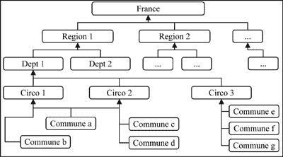

**图 12.1.** 选举应用的“空间维度”划分

同样，政治亲和力可能导致候选人声明多个“标签”。“所属”维度包含两个级别：标签和小组。

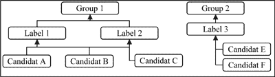

**图 12.2.** 选举应用的“所属维度”划分

划分的非功能性是某些问题的来源。例如，按省（或更高级别）聚合投票可能会导致总数少于总和，如果我们按“第一个标签”聚合（某些缺失），或者如果按“小组”聚合则会导致总数更多（某些重复）。这两个维度的交叉位于级别：`Candidat`︎`Circonscription`。

因此，两个基本对象如下：

- “候选人”（Candidat），决定一个唯一的选区（因此是一个省），并拥有一个政治标签列表；
- “选区”（Circonscription），维护其候选人列表，分布在各市镇的投票必须在此进行聚合。

还有其他对象如下：

- `departement`（省）：由一个或多个`circonscriptions`（选区）组成的列表：按政派标签累计票数有时会产生问题（参见后文）；
- 地区和全法国：存在相同的计数问题；
- `groups`（团体）：在投票声明之前和选举当天观察到的数据。

数据来源涉及 2017 年法国国民议会（“législatives”立法选举）成员选举。

| 关于候选人、选区和投票结果的可用数据 |
| :--- |
| **候选人声明：政治和财务隶属** |
| [`www.interieur.gouv.fr/Elections/Elections-legislatives-2017/Declaration-de-rattachement-a-un-parti-ou-groupement-politique`](https://www.interieur.gouv.fr/Elections/Elections-legislatives-2017/Declaration-de-rattachement-a-un-parti-ou-groupement-politique) |
| [`www.interieur.gouv.fr/Elections/Elections-legislatives-2017/Elections-legislatives-le-financement-public-des-partis-politiques2`](https://www.interieur.gouv.fr/Elections/Elections-legislatives-2017/Elections-legislatives-le-financement-public-des-partis-politiques2) |
| **按市（commune）划分的结果** |
| [`www.data.gouv.fr/fr/datasets/elections-legislatives-des-11-et-18-juin-2017-resultats-du-2nd-tour-par-communes`](https://www.data.gouv.fr/fr/datasets/elections-legislatives-des-11-et-18-juin-2017-resultats-du-2nd-tour-par-communes) |
| **市级 INSEE 数据** |
| [`public.opendatasoft.com/explore/dataset/correspondance-code-insee-code-postal/api/`](https://public.opendatasoft.com/explore/dataset/correspondance-code-insee-code-postal/api/)? |

**表 12.1.** 选举应用程序中使用的数据源列表

#### 12.1.1.1. 访问 JSON 格式的数据

让我们从数据量最大的数据集开始，然后是结果和声明：

- R-data：第一轮选举（“élections législatives 2017”）的结果，并由电子表格转换为此 JSON 格式的结果：

```json
 { data: [
   {dn:#Dept, dl:NomD, c:NumCirco, cn:#Commune, cl:NomC,
    i:Registered, v:Voting, b:WhiteVotes, n:NullVotes,
    can:[{s:Sex, n:Lastnama, p:Fist, g:Label, v:Votes}, …]},
   {…}
 ]}
```

这是一行示例数据：

```json
 {"dn":1, "dl":"Ain", "c":1, "cn":16, "cl":"Arbigny", "i":317, "v":157, "b":10, "n":1,"can":[{"s":"M", "n":"MALLET", "p":"Laurent", "g":"MDM", "v":12},{"s":"M", "n":"NOM2", "p":"Prénom2", "g":"ET2", "v":21}, … ]},
```

- D-data：候选人在注册截止日期之前（选举日前约 2 周）填写的表格数据。一些迟期参选未列出，某些候选人在选举当天未提供选票。几位候选人填写了两或三个不同的隶属关系。

以下是处理前后的示例行，处理将单个字符串拆分为有意义的对象：

```
 {"Ain*1e_circo*M*MALLET Laurent 15/06/1972 MODEM"}
 {dep:"Ain",c:1,s:"M",n:"MALLET",p:"Laurent",dob:"15/06/1972",g:"MODEM"}
```

#### 12.1.2. 按空间维度聚合数据：按选区划分的票数

在关系型数据库中，此操作可以通过“SQL 方式”、使用聚合器`sum`和操作符`GroupBy`来完成：

```sql
SELECT SUM(votes), Candidat
FROM Communes
WHERE Departement = "D" AND Circonscription = "C"
GROUP BY Candidat;
```

以下是聚合每个`departement`下每个`circonscription`的每个`commune`数据的 JavaScript 代码，结果是一个按`departement`索引的数组：

```javascript
function processRdata(json){
// @json: {'data':[line1, line2, …]}
// line = {dn, dl, c, cn, cl, i, v, b, n, can:[{s,n,p,g,v},…]}
   const dept = []; // 将在每次 makeNewDepartement 时更新
   let curDep = null, curCir = null;
   function processRline(line, i){ // 处理每一行的代码
     let ldn = line.dn.toString(), lci = line.c;
     if(curDep && curDep.num === ldn){ // 省已存在且匹配
       if(lci === curDep.circos.length){ curCir.update(line);
       }else{
         curCir = makeNewCircon(line); // 省内新选区
         curDep.addCirco(curCir);
       }
     }else{
       curDep = makeNewDepartement(line,dept); // 新省
       curCir = makeNewCircon(line); // 新选区
       curDep.addCirco(curCir); // 添加到省
     }
   }
   json.data.forEach(processRline); // 遍历行
   return dept;
 }
```

注意.– 该代码假设数据按选区和省顺序列出，而不是随机的。它通过当前编号`curCir`或`curDep`简化了测试。

```javascript
function makeNewDepartement(line,dept){
   // ... 实现
}
function makeNewCircon(line){
   // ... 实现
}
// 在 processRline 内部：
curCir.update(line);
// 同样在 processRline 内部：
curDep.addCirco(curCir);
```

#### 12.1.3. 按隶属维度聚合数据：按候选人划分的标签

为了获取候选人的多个隶属关系（至少一个），我们需要某种自连接，并使用连接聚合器，类似于：

```sql
SELECT DISTINCT d1.Candidat, CONCAT(d1.Parti, d2.Parti)
FROM Depots AS d1
WHERE d1.Departement = "D" AND d1.Circonscription = "C"
    LEFT OUTER JOIN Depots AS d2
                ON d1.Departement = "D" AND d1.Circonscription = "C"
                        AND d2.Candidat = d1.Candidat
GOUP BY Candidat
HAVING d1.Parti <> d2.Parti
```

JavaScript 代码比`processRdata`复杂一些：

```javascript
function processDdata(json){
// @json: {'data':[line1, line2, …]}
// line = {string} to be transformed in {dep, c, s, n, p, dob, g}
   const declared = [], multiaff = [];
   let curCan = null;
   const processDline = function (line, i){/*see below*/};
   json.data.forEach(processDline);
   return {declared, multiaff};
 }
```

它返回一个包含两个数组的对象：所有“声明”（declared）候选人的完整列表，以及填写了多个属性（affiliation）的候选人列表。每行函数的代码如下：

```javascript
function processDline(line, i){
   let can = makeCandidatFromD(line); // 处理，见下文
   if(!can.dob){return false;} // circo 中尚无声明
   if(curCan){
     if(curCan.isSame(can)){ // 分组 -> 聚合政党
       curCan.aggregate(can); // 预期后续是相同的名称
       if(!multiple.some(x => x.isSame(curCan))){
             multiple.push(curCan); // 如果不是重复，则保留
       }
       return false; // 继续分组
     }else { // 否则：这是一个新候选人
       declared.push(curCan); // 存储上一个聚合的候选人
     }
   } // 现在设置或重置 curCan
   curCan =
Object.assign(Object.create(canProto),can,{partis:[can.g]});
   return this;
 }
```

注意——该代码假设同一个候选人的多次声明是连续的（事实确实如此），这便于将它们合并为单个的数组条目。`assign/create`模式再次用于`canProto`和`can`的直接拷贝。在`assign`方法调用中直接添加了另一个属性`partis`。

函数`makeCandidatFromD`使用了在第 3 章中描述的功能：

```javascript
function makeCandidatFromD(original){
   const spl = original.split("*"); // 分隔符 * > 数组 2+项
   const foundDate = str => str.match(/ \d\d.\d\d.\d\d\d\d /);
   let dep = spl[0], c = parseInt(spl[1]);     // 例: "1e_circo" -> 1
   if(spl.length>3){
     const ok = foundDate(spl[3]);
     if(ok){          // ok = 找到了日期
       const newx = spl[3].split(ok); // 在日期前后分割
       const name = newx[0];
       const spn = name.split(" ");
       const s = spl[2];
       const n = spn.reduce((n,s,i) => n + (s.toUpperCase()===s?
                                             (i>0?" ":"")+s:"") );
       const p = unAccentize(name.slice(n.length+1, name.length));
       const dob = ok[0].substring(1, 11); // 分隔符是日期
       const g = unAccentize(newx[1]);
         return {dep, c, s, n, p, dob, g};
     }
   }
   return {dep, c}; // 只是一个虚拟候选人（应该有一个）
 }
```

## 12.2. 合并数据：多个 JSON 文件

合并多个信息源是数据科学家（data scientist）的一项基础操作。为了连接（join），要求两个源至少有一个共同点以允许关联。困难之处在于如何确定这样一个“键”（key），以及该键如何是“可连接的”。我们所说的“可连接的”是指：我们需要键之间存在精确的数值相等，还是属于同一个等价类，或者是某种更模糊的关联（允许可能存在多次关联）？

我们不会讨论复杂的 AI 算法，而仅仅讨论字符串处理：例如，为了接受“*Général de Gaule*”以及“*general de Gaulle*”。

### 12.2.1. 原型方法带来的灵活性优势

当我们在处理连接时可以预期的灵活性可以利用`assign/create`模式的灵活性。一个原型可以被多个对象共享，这些对象仅拥有公共属性的子集。根据实际使用的源数量，处理过程的多态性是原型方法的另一个优势，而无需预先知道有多少个可用源。

这里有一个使用 D 数据（声明）的示例，允许我们构建一个具有属性`{sex, lastname, first, dob, aff: [p1,p2..]}`的候选人（candidat）；以及使用 R 数据（官方结果），它允许我们构建一个真正的候选人，其属性为：`{sex, lastname, first, party, votes}`。

原型方法只关心已有的属性，我们可以为基于 R 的候选人和基于 D 的候选人提供相同的原型，只要设置了足够的属性。例如，测试`if(can.dob && !can.v)`告诉我们关于`can`的状态：如果为真，意味着`can`已从 D 数据初始化，并且还没有用额外的 R 数据进行更新。

### 12.2.2. 在选举应用中编写连接逻辑

要连接的基础对象是候选人（candidat），但数据是分层级的：从省（departement）到选区（circonscription），最后到候选人。因此，我们需要对这三个级别都进行连接性测试。以下是每个原型中`isSame`方法的代码：

- 省（departement）：它在 R 数据或 D 数据中的编码不同，已处理的省份名称为`this.nom`，而尚未处理的名称（在`dat`中）可以是`dat.dep`或`dat.dl`，取决于第二个源。这里是使用下文详细的`acceptString`函数实现的补丁：

```javascript
Departement.prototype.isSame = function(dat){ // 补丁
   const str = ("dep" in dat)? dat.dep: (("dl" in dat)?dat.dl:dat);
   return acceptString(this.nom, str);
 };
```

- 选区（circonscription）：只需检查数字（编码相同）

```javascript
Circonscription.prototype.isSame = function(dat){return this.c === dat.c;};
```

- 候选人（candidat）：

```javascript
Candidat.prototype.isSame = function(dat){
   return acceptString(this.n,dat.n);
 };
```

`acceptString`函数比较两个字符串，并忽略大小写、带音符号与非带音符号，接受“Côte-d’Or”为“Cote d'Or”。以下是连接（R 数据用 D 数据更新）的代码：

```javascript
function join(dept,decla){
//@dept: 由 R 构建的省列表
//@decla: 由 D 构建的候选人列表
   let lenR = dept.length, lenD = declares.length,
       curNDep = 0, curNCir = 0;
   const joinRdata = function(can){ // 将 D 数据合并到 R 数据
     // @can = 一个基于 D 的候选人
     let dep = dept[curNDep], cir;
     while(!dep.isSame(can)){ // 查找省
       curNDep++; dep = dept[curNDep];
     }
     if(dep) cir = dep.circos[curNCir];
     else throw new Error("join: no Dept for "+can.dep+""+can.c);
     while(cir && !cir.isSame(can)){
       curNCir++; cir = dep.circos[curNCir];
     }
     if(cir) cir.crossUpdate(can);
     else throw new Error("join: no Circo for "+can.dep+""+can.c);
   };
   if(lenD > 0){declares.forEach(joinRdata);}
   return {dept:dept, declares:decla};
 }
```

这里是`crossUpdate`方法（选区和候选人）的代码：

```javascript
Circonscription.prototype.crossUpdate = function(dat){
   let dd = this.can.find(function(x){return x.isSame(dat);});
   if(dd){dd.crossUpdate(dat);}
   else{disparus.push(dat);} // 如果我们跟踪它们
 };
Candidat.prototype.crossUpdate = function(dat){ 用 D 更新 R
   this.partis = this.partis.concat(dat.partis);
   this.dob = dat.dob;
   return this;
 };
```

这里是一个简单的示例：统计法国的投票总数：

```
let totvot = depts.reduce(     //@depts: computed from joinDtoR
    function(tot, d){
      return tot + d.circos.reduce(
        function(count, c){ return count + c.v;}, 0);
    },
    0)
 );
```

或者使用箭头函数的版本：

```
let totvot = depts
   .reduce((tv,d) => tv + d.circos.reduce((t,c) => t + c.v, 0),0);
printLog("Nb total de votants "+ totvot );
```

我们再次注意到，`Array.prototype`方法非常方便。

### 12.3.1. 分析隶属关系

政派隶属关系并不是常见政党的名称，而是愿意共享财务贡献管理的团体。在选举当天，当局（法国内政部`Ministère de l’Interieur`）会为候选人提供自己的标签。有许多“未决定”候选人，标签为`DIV`（“多样化”），有时是`DVG`或`DVD`，意味着倾向于左翼或右翼。

为了更好地了解这些隶属团体是什么，我们来看一个例子：

```
const text = "CAISSE CLAIRE";
const crit = function(p){return p.includes(text);};
let gp = [];                 // 预期: 一个候选人数组
depts.forEach(function(d){           // 省份 d
   d.circos.forEach(function(c){      // 选区 c
     gp = gp.concat(c.can.filter(
         function(x){         // 候选人 x
                      return x.partis.some(crit);
                }            //对 x.partis 应用 crit
     ));                     // 过滤候选人然后合并
   });                       // 按选区
 });                         // 按省份
```

箭头语法更具可读性：

```
depts.forEach(function(d){
   d.circos.forEach(function(c){
     gp = gp.concat(c.can.filter((x)=> x.partis.some(crit)));
   });
 });
```

结果是每个`departement`的每个`circonscription`中隶属于给定团体的`candidat`列表的合并。例如，“CAISSE CLAIRE”有 105 名候选人，其中 76 人被当局标记为`DIV`，15 人为`DVG`（倾向左翼），6 人为`DVD`（倾向右翼），7 人为`ECO`（生态主义），1 人为`REG`（地区主义）。他们非常多样化，在范围内获得了 50,972 票。

## 12.4. Promise 的作用

R-data 选举结果非常庞大：Mega 有 30 个，D-data 只有 50 万个。使用`promises`的意义在于允许对每个文件进行异步处理，在处理连接之前然后再进行后处理。我们知道如何在 JSON 文件上使用`Fetch`，并且学习了如何编写将任何函数转换为 promise 的闭包。

考虑这个仅关于第二步的示例（D-data 处理）：

```
function step2(url,dept,json){      // 同步版本
   let decla = processDdata(json)
   if (decla.length > 0) {resolve(decla,dept);}
   else reject(url); // 在 url 上的错误消息
 }
function step2Promise(url,dept,json){    // "promise" 版本
   return new Promise(function(resolve, reject) {
     let decla = processDdata(json);
     if (decla.length > 0) {resolve(decla,dept);}
     else throw new Error("failure with "+url); // 或者: reject()
   });
 }
```

整个处理链可能看起来下面的代码：函数`resolve`是下一次`then`用的第一个参数。处理错误可以使用第二个参数（可选函数）。

```javascript
// 计算“Gantt 图”所需的数据列表
let taskID, taskName, start, end, duration, donePercent, after;
const rows = [     // 6 个步骤
    ['D', 'declarations', new Date(), null, 300, 0, ''],
    ['E', 'decGroupBy', null, null, 737), 0, 'D'],
    ['R', 'resultats', null, null, 338, 0, ''],
    ['S', 'resGroupBy', null, null, 1290, 0, 'R'],
    ['J', 'Join(res,dec)', null, null, 1116, 100, 'S, E'],
    ['A', 'Analyse', null, null, 2221, 100, 'J'] ];
// 使用 gantt 扩展包加载 API，然后设置回调函数
const googleDiv = document.querySelector("#chart_div");
google.charts.load('current', {'packages':['gantt']});
google.charts.setOnLoadCallback(drawChart);
const msPerD = (days)=> parseInt(days* 24* 60* 60* 1000);
const getTyp = (v)=> v===null||v instanceof Date?'date':typeof v;
function prepareColumns(data, row){
   let o= {taskID,taskName, start,end,duration, donePercent,after};
   const prow = Object.keys(o);
   if(prow.length !== row.length) throw new Error("wrong size");
   prow.forEach((p,i)=>{data.addColumn(getTyp(row[i]),p);});
 }
function drawChart() {
     const data = new google.visualization.DataTable();
     prepareColumns(data, rows[0]);
     data.addRows(rows);
     const chart = new google.visualization.Gantt(googleDiv);
     chart.draw(data, opts); // opts = {width, height, styles …}
 }
```

最后，这是甘特图的图表。段段长度与每个任务的持续时间成正比。

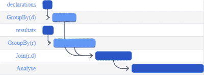

**图 12.3.** 选举应用中六个步骤的甘特图

# 13 地图数据

## 13.1 地图应用：使用地图库

正如我们之前描述的那样，地图应用的复杂程度高于简单的图形绘图。我们不会尝试自己编写它的代码，即使对于大多数库（无论是开源还是专有），它们只是在`<canvas>`上进行绘制。有多种方法可以绘制线条、多边形或像素矩阵，用于计算拓扑关系（如共享顶点、包含或相互交叉），以及用于计算距离、在不同地图投影之间转换地理坐标等。

我们并不打算详细阐述这些众多功能中的任何一个。我们仅仅展示一个开源库的基本用法，它足够完整以示例所有最实用的功能，其方式与 Google、Bing 和 Yahoo 等专有库类似。该库是`OpenLayers`，代码采用`2-Clause BSD`协议许可，社区非常活跃（2006–2017）：在编写本书时，最新版本是`v4.6.5`（2018 年 3 月 18 日）。

这些要求包括该库、基础样式以及一个将供库使用的简单`<div>`元素（或`<canvas>`）：

```html
 <link rel="stylesheet" href=
"https://cdnjs.cloudflare.com/ajax/libs/openlayers/4.6.4/ol.css">
 <body>
 <div id="olmap" class="olmap"></div>
 <script src=
 "https://cdnjs.cloudflare.com/ajax/libs/openlayers/4.6.4/ol.js">
 </script>
```

在这个应用中，我们使用了来自四个源的数据：

- 法国大学、工程学院、管理学院、美术学院等列表，以及大型法国研究机构，如`CNRS`、`Inra`、`Inria`、`Inserm`以及一些私立实验室。它们的地理坐标是从它们的 Wikipedia 页面提取的（它们都有对应的页面）；
- 魁北省大学列表、魁北克的`CEGEPS`以及几个实验室。坐标也是从 Wikipedia 提取的（参见第 13.3 节）；
- 魁北克和法国高等教育机构或实验室之间的合作伙伴关系列表。此类合作伙伴关系可以从大学提供的列表、`Federation des CEGEPS`的列表以及由法魁官方合作伙伴关系资助的联合项目列表（Samuel de Champlain 计划、`CFQCU`等）中提取；
- `openlayers`使用的地图源。

对于每所大学，我们希望计算一个标记，根据其合作伙伴的数量来代表其活跃度。这个标记是一个圆，即矢量数据源中的一个几何特征，由中心点和半径定义。在下面的代码中，对象`univMark = new ol.Feature({geometry, name, properties})`就是该特征，它使用`ol.geom.Circle()`几何形状初始化，并带有一个标识符`name`以及一些额外的`properties: {id,np,content}`，这些属性可以用于弹出覆盖层。

以下是创建这些圆的示例代码：

```
const fill = new ol.style.Fill({color:'rgba(255,0,0,0.4)'}),
const stroke = new ol.style.Stroke({color:'rgb(0,0,0,1), width:1})
function makeMarker(x, y, np, content, id, fill, stroke) {
   let rad = np * 150 + 2500; // @np: number of partners
   let cen = ol.proj.fromLonLat([y, x]); // @x, @y: point
   const univMark = new ol.Feature({
     "geometry": new ol.geom.Circle(cen, rad, 'XY'),
     "name": id,
     "properties": {id, np, content}
   });
   univMark.setId(id);
   univMark.setStyle(new ol.style.Style({fill, stroke}));
   sourceUnivs.addFeature(univMark);
   return univMark;
 }
```

每个标记都被推入一个数组，我们使用该数组中的索引作为其`id`（在上面的多处使用），我们可以将其唯一地与其所属的机构关联起来。我们为每个标记附加了一个样式（`stroke`和`fill`）。在这种情况下，样式是常量，但它也可以是计算出的（例如变化的颜色）。变量`content`在其他处定义。

在图 13.1 中，标记是根据每个机构的完整合作伙伴列表创建的。允许用户根据一个或多个过滤器进行选择是很有意思的。每次选择后，我们从清除之前的标记开始，然后计算新的标记：一些大学被过滤掉，半径根据过滤后的合作伙伴重新计算。

最后，地图必须被“刷新”。这里是代码：

```
const newMarkers = [];       // 从空开始
// partnerships: 通过 JSON 读取设置
// selectedUnivs: 来自选择表单的处理程序
clearMarkers(newMarkers); newMarkers.length = 0;
selectedUnivs.forEach(function(u) { // 重置标记
   let np = u.parts.length;
   let content = makePopupToDisplay(u.parts, partnerships);
   newMarkers.push( makeMarker(u.x, u.y, np, content, u.u) );
 }
layerUnivs.setMap(map); // 刷新地图
```

### 13.1.3 交互与选择特征

以下是使用左侧表单选择合作伙伴的结果：仅选择了工程或生物学中的主要主题。下一张地图显示了关键词图像上的选择（并在右侧显示主题）。

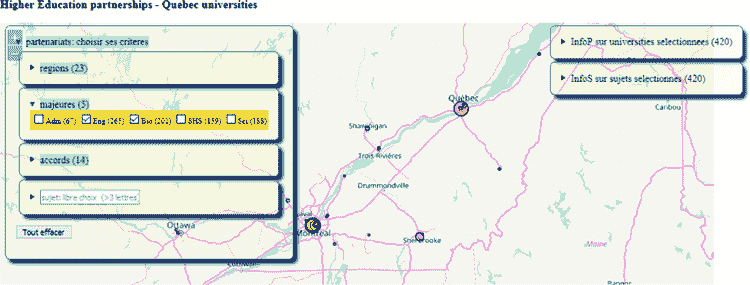

**图 13.2。** 按主要科学领域选择的合作伙伴

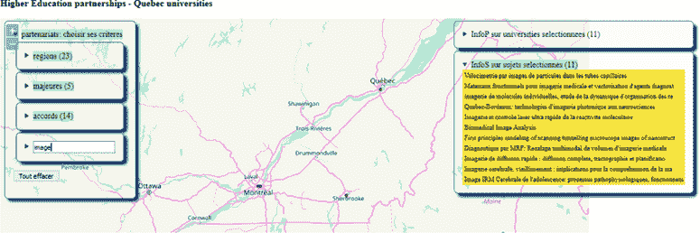

**图 13.3。** 按关键词和相关主题选择的合作伙伴

## 13.2 基于 SVG 的地图绘制

我们学习了一些 SVG 语言的基础知识，它们可以是：

- 独立的：SVG 文档可以直接在网页中渲染；
- 嵌入的：SVG 代码可以插入到 HTML 文档中，提供相关的 DTD 声明（`xmlns`属性），从而从 DOM 访问和 CSS 规则机制中受益。

该应用已用于第 2 部分。

### 13.2.1 应用描述

互联网上有许多 SVG 数据，特别是按国家、地区或大陆划分的地理地图。一旦选择，可以通过简单的 AJAX 请求以纯文本模式读取数据文件。

我们使用来自 WikiMedia commons 的欧洲大陆和地中海沿岸国家边界 SVG 文件。它的大小有几 MB，对于文本数据来说体积很大，最初旨在作为字符串进行处理。因此，我们首先使用了预处理，通过地降低坐标精度和用于表示边界的总点数。我们可以很容易在网上找到这样的“svg 优化器”：结果是一个 340 kB 的文件。

该文件中的主要元素是`<path>`元素，带有两个属性：

- 标识符：`id=number`（假设是唯一的）；
- 路径描述符：`d= "M83.6619 151.193c-0.2476,0.0627 …z"`，通常以`M`开头并`z`结尾，表示符合所选视口的多边形。

每个国家由一个`<path>`（最简单的情况）或多个`<path>`表示，封装在一个图形组`<g id=num></g>`中，有时还有嵌套组。英国属于最复杂的一类（本土、北爱尔兰、吉布罗直岩和一个用于岛屿的嵌套组）。每个组都可以被单独选择。争议领土（如克里米亚或戈兰高地）也以同样的方式表示。

第二个源是一个包含每个国家信息的 JSON 文件：

```
 {
   "countries": [
     {
       "name": "Germany",
       "capitale": "Berlin",
       "EUmember": "1958",
       "money": "euro",
       "Shengen": "Shengen", "population": "81.5",
       "gdp": "3874.5"
     },
     {}
 ]}
```

目标有两个：

- 显示地图，因此是将 SVG 数据嵌入 HTML 中；
- 访问每个单独的元素（path 或 g），修改它们的 CSS 规则，并使用屏幕坐标作为与图形元素关联的国家信息的选择器。因此，两个源之间的连接必须建立双向链接。

### 13.2.2 通过直接复制嵌入整个 SVG 文档

在第 8 章中，我们描述了如何使用 JavaScript 使用“懒方法”构建 HTML 元素。我们可以对 SVG 文档进行类似的操作。这非常简单，非常适合我们这些懒人（我经常使用它）：

```
 <div class="svgExt"><!-- 这里：SVG 代码 --></div>
 <script>
// const textSVG = … 在文件请求的回调中。document.querySelector(".svgExt").innerHTML = textSVG;
 </script>
```

整个 SVG 文本，从`<svg>`到`</svg>`被复制到`<div>`中；例如，如果文件被限制为摩纳哥，我们得到：

```
 <div class="svgExt">
 <svg xmlns="http://www.w3.org/2000/svg" viewBox="0 0 230 192.5">
   <g class="maing" transform="translate(-9,-9)">
     <rect x="10" y="10.15" width="228.02" height="189.85">
     <g class="pays memberstate" id="mc">
       <path class="p0" d="M83.6619 151.193c-0.2476,0.0627 -0.5932,0.1566 -0.9258,0.2615l0 0 0.0691 -0.4229c0.2099,-0.203 ... />
     </g>
   </g>
 </svg></</div>
```

### 13.2.3 逐元素嵌入 SVG 代码

这是第二种构造性方法，即从文件读取 SVG 文档、解析并逐个将元素添加到 HTML DOM 中。我们需要使用特殊的`createElement`方法：

```
const NSuri = "http://www.w3.org/2000/svg"; // svg2000 命名空间
const svg = document.createElementNS(NSuri, 'svg');
        // document.createElement('svg') 不起作用
```

svg200 中的每个 SVG 元素都有命名空间规范：`<g>`、`<rect>`、`<path>`等。构造方法编写不易，但需要更多时间。然而，我们可以控制每一步，并添加可能需要的任何处理器。

一旦完成嵌入（无论通过何种方法），HTML 布局引擎都会使用 CSS 规则处理显示：它使用蓝色`<rect>`填充海洋，因为`rect {fill:"light blue"}`；为每个国家绘制白色背景和黑色边框，因为`path {stroke:"black"; fill:"white"}`等。

### 13.2.4 关联关系数据与 SVG 数据

为代表国家的`<g>`组选择的标识符是标准的`a_code`，即该国家的互联网域名代码。因此，我们需要将该代码与 JSON 数据文件中使用的国家名称相结合。我们为此特定目的使用了一个新的 JSON 文件，其中包含键值对：

```
 {"a_code":"de", "name":"Germany"
 {"a_code":"mc", "name":"Monaco"}
```

`a_code`是为`<g>`元素的`id`属性所选择的值：

```
<g id="mc"><path class="pays" d=" … " /></g>
```

我们已经知道如何处理这种多次连接。

### 13.2.5. 处理合并后的信息

这是一个简单的示例：让我们选择使用欧元作为货币的国家。国家名称与`acode`结合，而该`acode`提供了访问正确`<g>`组。给定这些`<g>`列表，我们可以“标记”它们，例如通过添加一个额外的类名：“euro”。然后，我们可以检索它们并访问所有相关的`<path>`元素，并更改它们样式的一个属性，例如`fill`颜色。

```
Array.from(document.querySeletorAll("g.euro")) // select <g>
 .forEach(function(g){
     Array.from(g.querySelectorAll("path")) // select <path> in g
     .forEach(function(p){p.path.style.fill = 'yellow';});// color
 });
```

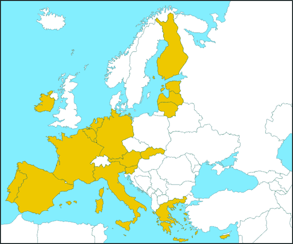

**图 13.4. 关系数据与 SVG 地图数据之间的连接**

### 13.3. 从维基百科页面获取坐标

这是一个非常实用的功能，我们可以轻松实现：获取附加在维基百科词条目上的坐标。

我们可以通过 Wikipedia API 直接访问数据：

```
 https://en.wikipedia.org/w/api.php?data
```

随后在数据字段中跟上相应的参数：

```
action=query         操作类型（action type）；
prop=coordinates     要选择的属性（the property to select）；
format=json          输出格式（the output format）；
titles= …            要浏览的页面名称（name(s) of the page(s)）。
```

例如：

```
https://en.wikipedia.org/w/api.php?action=query&prop=coordinates&format=json&titles=McGill_University
```

结果是：

```
 {"query":{
    "normalized":[{"from":"McGill_University","to":"McGill_University"}],
    "pages":{ "7954643":{
       "pageid":7954643, "ns":0,
       "title":"McGill University",
       "coordinates":[{"lat":45.504166,"lon":-73.574722,"globe":"earth"}]
      }}
 }}
```

然后我们可以解析结果，并将机构的坐标与关于该机构的额外信息相结合。

练习题。使用`Fetch`和你目前所学到的知识，绘制几个欧洲国家的首都是（半径与人口规模成正比）。

可以在同一个请求中对多个页面进行分组（管道符号`|`）：

```
https://en.wikipedia.org/w/api.php?action=query&prop=coordinates&format=json&titles=McGill_University|Universite_Laval
```

# 14. 通过 JSONP 服务的数据

我们知道 JSON 到 JSONP 的“填充（padding）”是为了避免同源策略（SOP）规则的一种变通方法。JSONP 在 2005 年底进行了实验（Bob Ippolito），目的是让对象字面量（JSON 格式）在脚本引擎被`<script>`标签触发时，能够被视为有效的 JavaScript 代码读取。这项技术被 Google、Adobe 和 Yahoo 等一些主要参与使用，但也引发了对“脚本注入”风险的担忧：换句话说，数据中可能隐藏某些恶意代码。

最终，JSONP 技术的未来似乎与这些巨头的（商业）决策有关，但 API 现在是可用的，并且在任何实施 SOP 限制的地方都有意义。以下是该技术的三个示例。

## 14.1. 通过 Yahoo Query Language 服务 RSS 馈

Yahoo 提出了一种请求服务，其语法模仿 SQL 命令行：它被称为 Yahoo Query Language（YQL）。例如，一个 YQL 请求能够查询并返回来自 RSS 馈源的数据。

这个示例由两个脚本组成。第一个脚本定义了函数`rssReturn`，它将用作 JSONP 中的回调器（callback wrapper）：它读取部分 RSS 数据（如标题、链接和描述），并格式化为一个可打印的答案。第二个脚本是向 Yahoo 服务器发送的 JSONP HTTP 请求，带有 YQL 语法：`q=select*..`、`format=json`和`callback=rssReturn`。

## 14.2. 通过 GoogleSpreadSheet API 服务电子表格数据

接下来是来自`GoogleSpreadSheet` API 的方法，它们实际上会读取数据，并在被`prefix()`填充之前准备好 JSON 内容。

```
 function doGet(e){return handle(e)}
  function doPost(e){return handle(e)}
  function handle(e) {
    const lock = LockService.getDocumentLock(),   // 锁访问
      a1Head = (e &&e.parameter.a1Head) || "President!A2:J2",
      a1Data = (e &&e.parameter.a1Data) || "President!A3:J53",
      prefix = (e &&e.parameters.prefix) || "callbackFromGS",
      json = {"head": undefined, "data": undefined};
    Logger.log(a1Head +" and "+ a1Data); // 简单的服务器测试
    try {
      const sps = SpreadsheetApp.getActiveSpreadsheet();
      json.head = sps.getRange(a1Head).getValues()[0];
      json.data = sps.getRange(a1Data).getValues();
  }
  catch(e){ json.head = "failure"; json.data = e; }
  finally { // test: Logger.log(JSON.stringify(json));
    return ContentService
     .createTextOutput(prefix + ‘(' + JSON.stringify(json) + ')')
     .setMimeType(ContentService.MimeType.JAVASCRIPT);
    lock.releaseLock();
  }
}
```

## 14.3. 通过 Flickr API 服务图像及其元数据

在这个应用程序中，与前两个应用有些相似，我们将使用一种不同的编码方法来发送 JSONP 请求：第一个`<script>`标签将由第二个`<script>`标签插入 DOM 中。

```
 const kw = "unicorns";    // 你可以任意命名
  const url = "https://api.flickr.com/services/feeds/";
  const photos = "photos_public.gne/?";
  const data = "tags=XX&format=json&jsoncallback=jsonpFlickr";
  // 构建服务的完整 URI
  const urlfull = url+photos+data.replace(/XX/,kw);
  window.onload = function(){callWebService(urlfull);}
  // 回调函数
  function jsonpFlickr( res ){
    const niv = (x)=>
     Object.values(x).reduce((s,x)=>s+ '${x}, ',"<div>")+"</div>";
    let htm = res.items.reduce((s,x,i)=>
     s+ '<h5>n${i}</h5>${niv(x)}',"<h2>Flickr and JsonP</h2>");
  document.querySelector(".flickrDiv").innerHTML = htm;
  }
  // 服务调用：基于行构建的 JSONP 调用
  function callWebService(url) {
  const script = document.createElement('script'); script.src = url;
  document.body.appendChild(script); // 触发脚本
}
```

`callWebService()`的最后一行将`<script>`写入 DOM，这会自动触发 JSONP 请求。我们可以确定在 DOM 准备就绪请求就会发送。

[图 14.3] 显示了请求的结果。

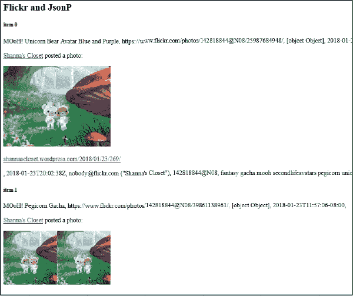

**[图 14.3]。** 截图：Flickr 网站上的 JSONP 请求

# 参考文献

## 引言，通用阅读

1. [BRZ 17] BRZUSTOWICZ M., *Data Science with Java*: *Practical Methods for Scientists and Engineers*, O’Reilly Media, Sebastopol, CA, 2017.
2. [CRO 14] CROLL A., *If Hemingway Wrote JavaScript*, No Starch Press, San Francisco, 2014.
3. [DSC 15] DSC, “每个人都应该知道的免费大数据源”, 可访问：[`www.datasciencecentral.com/profiles/blogs/the-free-big-data-sources-every-one-should-know`](http://www.datasciencecentral.com/profiles/blogs/the-free-big-data-sources-every-one-should-know), 2015.
4. [ICS 16] ICSU, “大数据世界的开放数据”, 可访问：[`www.icsu.org/publications/open-data-in-a-big-data-world`](https://www.icsu.org/publications/open-data-in-a-big-data-world), 2016.
5. [NIC 89] NICAR, “档案”, 可访问：[`ire.org/nicar/`](http://ire.org/nicar/), 1989.
6. [NUS 06] NUSPHERE, “核心 JavaScript 参考”, 可访问：[`www.nusphere.com/kb/jscoreref/index.html`](http://www.nusphere.com/kb/jscoreref/index.html), 2006.
7. [VAN 16] VANDERPLAS J., *Python Data Science Handbook: Essential Tools for Working with Data*, O’Reilly Media, Sebastopol, CA, 2016.

## 核心 JavaScript

1. [BYN 12] BYNENS M., “JavaScript 属性”, 可访问：[`mathiasbynens.be/notes/javascript-properties`](https://mathiasbynens.be/notes/javascript-properties), 2012.
2. [COG 11] COGLAN J., “从 Haskell 到 JavaScript 的翻译”, 可访问：[`blog.jcoglan.com/2011/03/05/translation-from-haskell-to-javascript-of-selected-portions-of-the-best-introduction-to-monads-ive-ever-read/`](https://blog.jcoglan.com/2011/03/05/translation-from-haskell-to-javascript-of-selected-portions-of-the-best-introduction-to-monads-ive-ever-read/), 2011.
3. [CRO 08] CROCKFORD D., *JavaScript: The Good Parts*, O’Reilly Media, Sebastopol.
4. [CRO 10a] CROLL A., “Curry: 加 up”, 可访问：[`blog.jcoglan.com/2011/03/05/translation-from-haskell-to-javascript-of-selected-portions-of-the-best-introduction-to-monads-ive-ever-read/`](https://blog.jcoglan.com/2011/03/05/translation-from-haskell-to-javascript-of-selected-portions-of-the-best-introduction-to-monads-ive-ever-read/), 2010.
5. [CRO 10b] CROLL A., “函数声明 vs.”, 可访问：[`blog.jcoglan.com/2011/03/05/translation-from-haskell-to-javascript-of-selected-portions-of-the-best-introduction-to-monads-ive-ever-read/`](https://blog.jcoglan.com/2011/03/05/translation-from-haskell-to-javascript-of-selected-portions-of-the-best-introduction-to-monads-ive-ever-read/), 2010.


接下来是来自 `GoogleSpreadSheet` API 的方法，它们实际上会读取数据，并在被 `prefix()` 填充之前准备好 JSON 内容。

```
 function doGet(e){return handle(e)}
  function doPost(e){return handle(e)}
  function handle(e) {
    const lock = LockService.getDocumentLock(),   // 锁访问
      a1Head = (e &&e.parameter.a1Head) || "President!A2:J2",
      a1Data = (e &&e.parameter.a1Data) || "President!A3:J53",
      prefix = (e &&e.parameters.prefix) || "callbackFromGS",
      json = {"head": undefined, "data": undefined};
    Logger.log(a1Head +" and "+ a1Data); // 简单的服务器测试
    try {
      const sps = SpreadsheetApp.getActiveSpreadsheet();
      json.head = sps.getRange(a1Head).getValues()[0];
      json.data = sps.getRange(a1Data).getValues();
  }
  catch(e){ json.head = "failure"; json.data = e; }
  finally { // test: Logger.log(JSON.stringify(json));
    return ContentService
     .createTextOutput(prefix + ‘(' + JSON.stringify(json) + ')')
     .setMimeType(ContentService.MimeType.JAVASCRIPT);
    lock.releaseLock();
  }
}
```

## 14.3. 通过 Flickr API 服务图像及其元数据

在这个应用程序中，与前两个应用有些相似，我们将使用一种不同的编码方法来发送 JSONP 请求：第一个 `<script>` 标签会将第二个 `<script>` 标签插入 DOM 中。

另一个区别是 Flickr 既是图像库服务也是 JSONP 服务，因此同一个 URL 托管了这两个服务。

应用程序代码如下。结果的呈现处于非常原始的层面：

```
 const kw = "unicorns";    // 你可以任意命名
  const url = "https://api.flickr.com/services/feeds/";
  const photos = "photos_public.gne/?";
  const data = "tags=XX&format=json&jsoncallback=jsonpFlickr";
  // 构建服务的完整 URI
  const urlfull = url+photos+data.replace(/XX/,kw);
  window.onload = function(){callWebService(urlfull);}
  // 回调函数
  function jsonpFlickr( res ){
    const niv = (x)=>
     Object.values(x).reduce((s,x)=>s+ '${x}, ',"<div>")+"</div>";
    let htm = res.items.reduce((s,x,i)=>
     s+ '<h5>n${i}</h5>${niv(x)}","<h2>Flickr and JsonP</h2>");
  document.querySelector(".flickrDiv").innerHTML = htm;
  }
  // 服务调用：基于行构建的 JSONP 调用
  function callWebService(url) {
  const script = document.createElement('script'); script.src = url;
  document.body.appendChild(script); // 触发脚本
}
```

`callWebService()` 的最后一行将 `<script>` 写入 DOM，这会自动触发 JSONP 请求。我们可以确定在 DOM 准备就绪请求就会发送。

[图 14.3] 显示了请求的结果。


**[图 14.3]。** *截图：Flickr 网站上的 JSONP 请求*

# 参考文献

## 引言，通用阅读

1. [BRZ 17] BRZUSTOWICZ M., *Data Science with Java*: *Practical Methods for Scientists and Engineers*, O’Reilly Media, Sebastopol, CA, 2017.

2. [CRO 14] CROLL A., *If Hemingway Wrote JavaScript*, No Starch Press, San Francisco, 2014.

3. [DSC 15] DSC, “每个人都应该知道的免费大数据源”, 可访问：[`www.datasciencecentral.com/profiles/blogs/the-free-big-data-sources-every-one-should-know`](http://www.datasciencecentral.com/profiles/blogs/the-free-big-data-sources-every-one-should-know), 2015.

4. [ICS 16] ICSU, “大数据世界的开放数据”, 可访问：[`www.icsu.org/publications/open-data-in-a-big-data-world`](https://www.icsu.org/publications/open-data-in-a-big-data-world), 2016.

5. [NIC 89] NICAR, “档案”, 可访问：[`ire.org/nicar/`](http://ire.org/nicar/), 1989.

6. [NUS 06] NUSPHERE, “核心 JavaScript 参考”, 可访问：[`www.nusphere.com/kb/jscoreref/index.html`](http://www.nusphere.com/kb/jscoreref/index.html), 2006.

7. [VAN 16] VANDERPLAS J., *Python Data Science Handbook: Essential Tools for Working with Data*, O’Reilly Media, Sebastopol, CA, 2016.

## 核心 JavaScript

1. [BYN 12] BYNENS M., “JavaScript 属性”, 可访问：[`mathiasbynens.be/notes/javascript-properties`](https://mathiasbynens.be/notes/javascript-properties), 2012.

2. [COG 11] COGLAN J., “从 Haskell 到 JavaScript 的翻译”, 可访问：[`blog.jcoglan.com/2011/03/05/translation-from-haskell-to-javascript-of-selected-portions-of-the-best-introduction-to-monads-ive-ever-read/`](https://blog.jcoglan.com/2011/03/05/translation-from-haskell-to-javascript-of-selected-portions-of-the-best-introduction-to-monads-ive-ever-read/), 2011.

3. [CRO 08] CROCKFORD D., *JavaScript: The Good Parts*, O’Reilly Media, Sebastopol.

4. [CRO 10a] CROLL A., “Curry: up”, 可访问：[`blog.jcoglan.com/2011/03/05/translation-from-haskell-to-javascript-of-selected-portions-of-the-best-introduction-to-monads-ive-ever-read/`](https://blog.jcoglan.com/2011/03/05/translation-from-haskell-to-javascript-of-selected-portions-of-the-best-introduction-to-monads-ive-ever-read/), 2010.

5. [CRO 10b] CROLL A., “函数声明 vs.”, 可访问：[`blog.jcoglan.com/2011/03/05/translation-from-haskell-to-javascript-of-selected-portions-of-the-best-introduction-to-monads-ive-ever-read/`](https://blog.jcoglan.com/2011/03/05/translation-from-haskell-to-javascript-of-selected-portions-of-the-best-introduction-to-monads-ive-ever-read/), 2010.

6. [CRO 10c] CROLL A., “JavaScript 中的函数声明与函数表达式”, 可访问：[`blog.jcoglan.com/2011/03/05/translation-from-haskell-to-javascript-of-selected-portions-of-the-best-introduction-to-monads-ive-ever-read/`](https://blog.jcoglan.com/2011/03/05/translation-from-haskell-to-javascript-of-selected-portions-of-the-best-introduction-to-monads-ive-ever-read/), 2010.

7. [CRO 10d] CROLL A., “JavaScript 中的原型继承”, 可访问：[`blog.jcoglan.com/2011/03/05/translation-from-haskell-to-javascript-of-selected-portions-of-the-best-introduction-to-monads-ive-ever-read/`](https://blog.jcoglan.com/2011/03/05/translation-from-haskell-to-javascript-of-selected-portions-of-the-best-introduction-to-monads-ive-ever-read/), 2010.

8. [CRO 10e] CROLL A., “JavaScript 中的闭包”, 可访问：[`blog.jcoglan.com/2011/03/05/translation-from-haskell-to-javascript-of-selected-portions-of-the-best-introduction-to-monads-ive-ever-read/`](https://blog.jcoglan.com/2011/03/05/translation-from-haskell-to-javascript-of-selected-portions-of-the-best-introduction-to-monads-ive-ever-read/), 2010.

9. [CRO 10f] CROLL A., “JavaScript 中的 `this` 关键字”, 可访问：[`blog.jcoglan.com/2011/03/05/translation-from-haskell-to-javascript-of-selected-portions-of-the-best-introduction-to-monads-ive-ever-read/`](https://blog.jcoglan.com/2011/03/05/translation-from-haskell-to-javascript-of-selected-portions-of-the-best-introduction-to-monads-ive-ever-read/), 2010.

10. [CRO 10g] CROLL A., “JavaScript 中的 `new` 关键字”, 可访问：[`blog.jcoglan.com/2011/03/05/translation-from-haskell-to-javascript-of-selected-portions-of-the-best-introduction-to-monads-ive-ever-read/`](https://blog.jcoglan.com/2011/03/05/translation-from-haskell-to-javascript-of-selected-portions-of-the-best-introduction-to-monads-ive-ever-read/), 2010.

11. [CRO 10h] CROLL A., “JavaScript 中的 `call` 和 `apply`”, 可访问：[`blog.jcoglan.com/2011/03/05/translation-from-haskell-to-javascript-of-selected-portions-of-the-best-introduction-to-monads-ive-ever-read/`](https://blog.jcoglan.com/2011/03/05/translation-from-haskell-to-javascript-of-selected-portions-of-the-best-introduction-to-monads-ive-ever-read/), 2010.

12. [CRO 10i] CROLL A., “JavaScript 中的 `bind`”, 可访问：[`blog.jcoglan.com/2011/03/05/translation-from-haskell-to-javascript-of-selected-portions-of-the-best-introduction-to-monads-ive-ever-read/`](https://blog.jcoglan.com/2011/03/05/translation-from-haskell-to-javascript-of-selected-portions-of-the-best-introduction-to-monads-ive-ever-read/), 2010.

13. [CRO 10j] CROLL A., “JavaScript 中的 `Object.create`”, 可访问：[`blog.jcoglan.com/2011/03/05/translation-from-haskell-to-javascript-of-selected-portions-of-the-best-introduction-to-monads-ive-ever-read/`](https://blog.jcoglan.com/2011/03/05/translation-from-haskell-to-javascript-of-selected-portions-of-the-best-introduction-to-monads-ive-ever-read/), 2010.

14. [CRO 10k] CROLL A., “JavaScript 中的 `Object.defineProperty`”, 可访问：[`blog.jcoglan.com/2011/03/05/translation-from-haskell-to-javascript-of-selected-portions-of-the-best-introduction-to-monads-ive-ever-read/`](https://blog.jcoglan.com/2011/03/05/translation-from-haskell-to-javascript-of-selected-portions-of-the-best-introduction-to-monads-ive-ever-read/), 2010.

15. [CRO 10l] CROLL A., “JavaScript 中的 `Object.defineProperties`”, 可访问：[`blog.jcoglan.com/2011/03/05/translation-from-haskell-to-javascript-of-selected-portions-of-the-best-introduction-to-monads-ive-ever-read/`](https://blog.jcoglan.com/2011/03/05/translation-from-haskell-to-javascript-of-selected-portions-of-the-best-introduction-to-monads-ive-ever-read/), 2010.

16. [CRO 10m] CROLL A., “JavaScript 中的 `Object.getOwnPropertyDescriptor`”, 可访问：[`blog.jcoglan.com/2011/03/05/translation-from-haskell-to-javascript-of-selected-portions-of-the-best-introduction-to-monads-ive-ever-read/`](https://blog.jcoglan.com/2011/03/05/translation-from-haskell-to-javascript-of-selected-portions-of-the-best-introduction-to-monads-ive-ever-read/), 2010.

17. [SIT 16] SITEPOINT, “Internet Explorer 之后的原生 JavaScript 开发”, 可访问：[`www.sitepoint.com/native-javascript-development-after-internet-explorer`](http://www.sitepoint.com/native-javascript-development-after-internet-explorer), 2016.

18. [SOS 10] SOSHNIKOV D., “深入理解 ECMAScript”, 可访问：[`dmitrysoshnikov.com/ecmascript/chapter-7.2-oop-ecmascript-implementation`](http://dmitrysoshnikov.com/ecmascript/chapter-7.2-oop-ecmascript-implementation), 2010.

19. [TRU 13] TRUYERS K., “JavaScript 命名空间与模块”, 可访问：[`www.kenneth-truyers.net/2013/04/27/javascript-namespaces-and-modules/`](https://www.kenneth-truyers.net/2013/04/27/javascript-namespaces-and-modules/), 2013 年 4 月.

20. [ZIM 12] ZIMMERMAN J., “JavaScript 设计模式：观察者”, 可访问：[`www.joezimjs.com/javascript/javascript-design-patterns-observer/`](https://www.joezimjs.com/javascript/javascript-design-patterns-observer/), 2012.

## JavaScript, Web

1. [HTT 10] HTTP ARCHIVE, “HTTP Archive 记录了 Web 的构建方式”, 可访问：[`httparchive.org`](http://httparchive.org), 2010.

2. [JEN 14] JENKOV J., “SVG 教程”, 可访问：[`tutorials.jenkov.com/svg/index.html`](http://tutorials.jenkov.com/svg/index.html), 2014.

3. [MIH 17] MIHALIJA M., “更快地构建 DOM”, 可访问：[`hacks.mozilla.org/2017/09/building-the-dom-faster-speculative-parsing-async-defer-preload/`](https://hacks.mozilla.org/2017/09/building-the-dom-faster-speculative-parsing-async-defer-preload/), 2017.

4. [MON 17] MONGODB, “在 Node.js 中使用 MongoDB”, 可访问：[`www.mongodb.com/blog/the-modern-application-stack-part-2-using-nodejs`](https://www.mongodb.com/blog/the-modern-application-stack-part-2-using-nodejs), 2017.

5. [PIL 10] PILGRIM M., “应用程序本地存储的过去、现在与未来”, `HTML5 Up and Running`, O’Reilly Media, Sebastopol, CA, 可访问：[`diveintohtml5.info/storage.html`](http://diveintohtml5.info/storage.html), 2010.

6. [SIM 14] SIMPSON K., “ES6 生成器基础”, 可访问：[`davidwalsh.name/es6-generators/`](https://davidwalsh.name/es6-generators/), 2014.

7. [SIM 18] SIMPLEMAPS, `simplemaps`, 可访问：[`simplemaps.com`](http://simplemaps.com), 2018.

8. [SOU 14] SOUEAN S., “理解 SVG 坐标系与变换”, 可访问：[`www.sarasidan.com/blog/svg-systems/`](https://www.sarasidan.com/blog/svg-systems/), 2014.

9. [TUT 18] TUTORIAL POINT, “Node.js 教程”, 可访问：[`www.tutorialspoint.com/nodejs/index.htm`](https://www.tutorialspoint.com/nodejs/index.htm), 2018.

## 扩展阅读

1. [AGU 16] AGUAGA J., “2016 年学习 JavaScript 的感受”, 可访问：[`hackernoon.com/how-it-feels-to-learn-javascript-in-2016-d3a71dd57f`](https://hackernoon.com/how-it-feels-to-learn-javascript-in-2016-d3a71dd57f), 2016.

2. [BER 14] BERNHART G., “JavaScript 的诞生与死亡”, PyCon’2014, 加拿大蒙特利尔, 可访问：[`www.destroyallsoftware.com/talks/the-birth-death-of-javascript`](https://www.destroyallsoftware.com/talks/the-birth-death-of-javascript), 2014.

3. [BLO 14] BLOOM Z., SCHWARTZ F.S., “你不需要 jQuery”, 可访问：[`younotneedjquery.com`](http://younotneedjquery.com), 2014.

4. [JOH 16] JOHNSON P., “JavaScript 比 Java 和 C++ 好的七个理由”, 可访问：[`www.youtube.com/watch?v=H0qNUqoJQ`](https://www.youtube.com/watch?v=H0qNUqoJQ), 2016.

# 索引

### 2D 图形

### A

- AJAX

- 动画

- 反模式

- 数组索引

- 箭头函数语法

- 分配/创建模式

- 异步性

### B, C

- 布尔上下文

- 内置函数

- 闭包

- 构造函数

- CSV

### D, E, F

- 设计模式

- DOM (文档对象模型)

    - 事件

- 可枚举属性

- 执行上下文

- Fetch

- 一等公民对象

- 框架 (jQuery, d3)

- 函数

    - 声明

    - 表达式

    - 调用

    - 作用域

### G, H, I

- 生成器函数

- HTML5

- 继承

    - 通过拼接

    - 通过委托

- 迭代

### J, L

- JSON

    - 方法

- JSONP

- 布局引擎

- 本地存储

### O, P

- 对象字面量

- 多态

- promise

- 代词 `this`

- 原型

- 标点符号

### Q, R, S

- `querySelector`

- 保留关键字

- 可缩放矢量图形 (SVG)

- 作用域

- 电子表格转 JSON

- 静态方法

### U, V, W

- Unicode

- `var`

- 变量

    - 定义

    - 作用域

- Web Worker


### 2018

ANDRO Mathieu, *数字图书馆与众包* *(数字工具与应用系列 – 第 5 卷)*

ARNALDI Bruno, GUITTON Pascal, MOREAU Guillaume, *虚拟现实与增强现实：事实与真相*

HOMAYOUNI S. Mahdi, FONTES Dalila B.M.M., *海运运筹元启发* *(元启发算法系列 – 第 1 卷)*

SEDKAOUI Soraya, *数据分析与大数据*

SZONIECKY Samuel, *生态系统知识：信息与通信的建模与分析方法* *(数字工具与应用系列 – 第 6 卷)*

### 2017

BENMAMMAR Badr, *Java 并发、实时与分布式编程*

HÉLIODORE Frédéric, NAKIB Amir, ISMAIL Boussaad, OUCHRAA Salma, SCHMITT Laurent, *智能电网的元启发算法* *(元启发算法系列 – 第 10 卷)*

MA Haiping, SIMON Dan, *基于生物地理优化的演化计算* *(元启发算法系列 – 第 8 卷)*

PÉTROWSKI Alain, BEN-HAMIDA Sana, *演化算法* *(元启发算法系列 – 第 9 卷)*

PAI G Vijayalakshmi, *投资组合优化的元启发算法* *(元启发算法系列 – 第 11 卷)*

### 2016

BLUM Christian, FESTA Paola, *生物信息学字符串问题的元启发算法* *(元启发算法系列 – 第 6 卷)*

DEROUSSI Laurent, *物流问题的元启发算法* *(元启发算法系列 – 第 4 卷)*

DHAENS Clarisse and JOURDAN Laetitia, *大数据的元启发算法* *(元启发算法系列 – 第 5 卷)*

LABADIE Nacima, PRINS Christian, PRODHON Caroline, *车辆路径问题的元启发算法* *(元启发算法系列 – 第 3 卷)*

LEROY Laure, *立体视觉中的减轻疲劳*

LUTTON Evelyne, PERROT Nathalie, TONDA Albert, *食品科学演化算法* *(元启发算法系列 – 第 7 卷)*

MAGOULÈS Frédéric, ZHAO Hai-Xiang, *建筑能源分析中的数据挖掘与机器学习*

RIGO Michel, *高级图论与组合数学*

### 2015

BARBIER Franck, RECOUSSINE Jean-Luc, *基于 BLU AGE 方法的 COBOL 软件现代化*

CHEN Ken, *计算机网络性能仿真评估与分析*

CLERC Maurice, *优化中的引导随机* *(元启发算法系列 – 第 1 卷)*

DURAND Nicolas, GIANAZZA David, GOTTELAND Jean-Baptiste, ALLIOT Jean-Marc, *空中管理的元启发算法* *(元启发算法系列 – 第 2 卷)*

MAGOULÈS Frédéric, ROUX François-Xavier, HOUZEAUX Guillaume, *并行科学计算*

MUNEESAWANG Paisarn, YAMMEN Suchart, *硬盘行业的视觉检测技术*

### 2014

BOULANGER Jean-Louis, *工业复杂系统的形式化方法*

BOULANGER Jean-Louis, *复杂系统的形式化方法：B 方法的实现*

GARDI Frédéric, BENOIST Thierry, DARLAY Julien, ESTELLON Bertrand, MEGEL Romain, *基于局部搜索的数学规划求解器*

KRICHEN Saoussen, CHAOUACHI Jouhaina, *图相关优化与决策支持系统*

LARRIEU Nicolas, VARET Antoine, *航空电子系统软件快速原型：复杂系统认证的面向模型的方法*

OUSSALAH Mourad Chabane, *软件架构 1*

OUSSALAH Mourad Chabane, *软件架构 2*

PASCHOS Vangelis Th, *组合优化 – 三卷本系列，第 2 版*

- *组合优化概念 – 第 1 卷，`2^(nd)` Edition*

- *问题与新方法 – 第 2 卷，`2^(nd)` Edition*

- *组合优化的应用 – 第 3 卷，`2^(nd)` Edition*

QUESNEL Flavien, *大规模虚拟化基础设施调度：走向协同管理*

RIGO Michel, *形式语言、自动机与计数系统 1：组合数学绪论*

RIGO Michel, *形式语言、自动机与计数系统 2：可识别性和可判定性的应用*

SAINT-DIZIER Patrick, *音乐修辞：基础与标注方案*

TOUATI Sid, DE DINECHIN Benoit, *高级后端优化*

### 2013

ANDRÉ Etienne, SOULAT Romain, *逆向法：实时嵌入式系统的参数化验证*

BOULANGER Jean-Louis, *软件设备的安全管理*

DELAHAYE Daniel, PUECHMOREL Stéphane, *空气流量建模与优化*

FRANCOPOULO Gil, *LMF — 词标记框架*

GHÉDIRA Khaled, *约束满足问题*

ROCHANGE Christine, UHRIG Sascha, SAINRAT Pascal, *时间可预测架构*

WAHBI Mohamed, *分布式约束满足问题的算法与排序启发式*

ZELM Martin *et al*., *企业互操作性*

### 2012

ARBOLEDA Hugo, ROYER Jean-Claude, *模型驱动与软件产品线工程*

BLANCHET Gérard, DUPOUY Bertrand, *计算机体系结构*

BOULANGER Jean-Louis, *形式方法的工业应用：形式验证*

BOULANGER Jean-Louis, *形式方法：从模型到代码的工业化*

CALVARY Gaëlle, DELOT Thierry, SÈDES Florence, TIGLI Jean-Yves, *计算机科学与环境智能*

MAHOUT Vincent, *汇编语言编程：ARM Cortex-M3 2.0：组织、创新与领域*

MARLET Renaud, *程序专门化*

SOTO Maria, SEVAUX Marc, ROSSI André, LAURENT Johann, *嵌入式系统中的内存分配问题：优化方法*

### 2011

BICHOT Charles-Edmond, SIARRY Patrick, *图划分*

BOULANGER Jean-Louis, *软件静态分析：抽象解释*

CAFERRA Ricardo, *计算机科学与人工智能逻辑*

HOMES Bernard, *软件测试基础*

KORDON Fabrice, HADDAD Serge, PAUTET Laurent, PETRUCCI Laure, *分布式系统：设计与算法*

KORDON Fabrice, HADDAD Serge, PAUTET Laurent, PETRUCCI Laure, *分布式系统中的模型与分析*

LORCA Xavier, *基于树的图划分约束*

TRUCHET Charlotte, ASSAYAG Gerard, *音乐约束编程*

VICAT-BLANC PRIMET Pascale *et al*., *计算网络：从集群到云计算*

### 2010

AUDIBERT Pierre, *信息学与计算机科学数学*

BABAU Jean-Philippe *et al*., *2009 年分布式实时嵌入式系统模型驱动工程*

BOULANGER Jean-Louis, *体系结构安全*

MONMARCHE Nicolas *et al*., *人工蚂蚁*

PANETTO Hervé, BOUDJLIDA Nacer, *2010 年企业软件与应用互操作性*

SIGAUD Olivier *et al*., *人工智能中的马尔可夫决策过程*

SOLNON Christine, *蚁群优化与约束编程*

AUBRUN Christophe, SIMON Daniel, SONG Ye-Qiong *et al*., *可靠网络系统的协同设计方法*

### 2009

FOURNIER Jean-Claude, *图论及其应用*

GUEDON Jeanpierre, *Mojette 变换 / 理论与应用*

JARD Claude, ROUX Olivier, *嵌入式系统通信/软件与设计*

LECOUTRE Christophe, *约束网络 / 针对技术与算法的简化*

### 2008

BANÂTRE Michel, MARRÓN Pedro José, OLLERO Hannibal, WOLITZ Adam, *协作嵌入式系统与无线传感器网络*

MERZ Stephan, NAVET Nicolas, *实时系统的建模与验证*

PASCHOS Vangelis Th, *组合优化与理论计算机科学：接口与展望*

WALDNER Jean-Baptiste, *纳米计算机与群智能*

### 2007

BENHAMOU Frédéric, JUSSIEN Narendra, O’SULLIVAN Barry, *约束编程的趋势*

JUSSIEN Narendra, *数独从 A 到 Z*

### 2006

BABAU Jean-Philippe *et al*., *从 MDD 概念到实验与插图 – DRES 2006*

HABRIAS Henri, FRAPPIER Marc, *软件规范方法*

MURAT Cecile, PASCHOS Vangelis Th, *图上的概率组合优化*

PANETTO Hervé, BOUDJLIDA Nacer, *2006 企业软件与应用互操作性 / IFAC-IFIP I-ESA’s2006*

### 2005

GÉRARD Sébastien *et al*., *分布式实时嵌入式系统模型驱动工程*

PANETTO Hervé, *2005 企业软件与应用互操作性*

# WILEY 用户许可协议

访问 `www.wiley.com/go/eula` 以获取 Wiley 电子书用户许可协议。
