# JavaScript 与 TensorFlow 基础：零基础学者指南

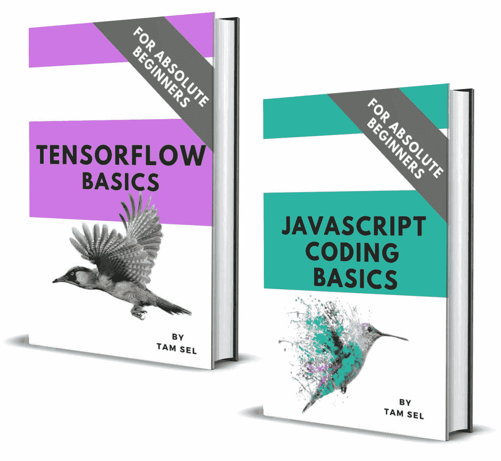

# JavaScript

本 JavaScript 教程让初学者和专家都能轻松学习 JavaScript。

学习 JavaScript，你只需要对计算机有基本的了解。

## JavaScript 示例

```html
<!DOCTYPE html>
<html>
<body>
  <h2>欢迎来到 JavaScript</h2>
  <script>
    document.write("Hello Friends");
  </script>
</body>
</html>
```

可以通过在代码中添加 JavaScript 语句来实现 JavaScript。

`<script>...</script>`。

```html
<!DOCTYPE html>
<html>
<body>
  <script type="text/javascript">
    document.write("Hello World");
  </script>
</body>
</html>
```

### JavaScript 代码可以在 JavaScript 中的 3 个地方编写

1. 在 HTML 的 `<body>`...`</body>` 标签之间。
2. 在 HTML 的 `<head>`...`</head>` 标签之间。
3. 在 `.js` 文件中（外部 JavaScript）。

### 示例（在 body 标签之间编写代码）

在下面的示例中，`body` 标签包含了 JavaScript 代码。

```html
<!DOCTYPE html>
<html>
<body>
  <script type="text/javascript">
    alert("Hello world");
  </script>
</body>
</html>
```

### 示例 2（在 head 标签之间编写代码）

我们将在下面的示例中创建函数 `msg()`。在 JavaScript 中，你必须在函数名后编写函数体来构造函数。要调用一个方法，我们必须先创建一个事件。在这个案例中，我们使用 `onclick` 事件来调用 `msg()` 函数。

```html
<!DOCTYPE html>
<html>
<head>
  <script type="text/javascript">
    function msg() {
      alert("world");
    }
  </script>
</head>
<body>
  <p>欢迎来到 JavaScript</p>
  <input type="button" value="click" onclick="msg()">
</body>
</html>
```

### 外部文件

我们可以构建一个可以在 HTML 文件中使用的 JavaScript 文件。由于单个 JavaScript 文件可以在多个 HTML 页面中使用，因此它允许代码复用。这提高了网页的效率。该文件必须具有 `.js` 扩展名。

```html
<!DOCTYPE html>
<html>
<head>
  <script type="text/javascript" src="message.js"></script>
</head>
<body>
  <p>Hello</p>
  <input type="button" value="click" onclick="msg()">
</body>
</html>
```

# JavaScript 注释

JavaScript 中的注释用于描述代码。它用于添加代码相关的内容，例如警告或建议，以便最终用户能够理解。

## JavaScript 注释的类型

JavaScript 注释有两种类型：

1. 单行注释
2. 多行注释

### 单行注释

双斜杠 `//` 用于表示单行注释。程序运行时，双斜杠 `//` 与行尾之间的任何文本都会被忽略。

例如：在语句之前添加注释。

```html
<!DOCTYPE html>
<html>
<body>
  <script>
    // 单行注释
    document.write("hello world");
  </script>
</body>
</html>
```

例如：在语句之后添加注释。

```html
<!DOCTYPE html>
<html>
<body>
  <script>
    var a = 10;
    var b = 20;
    var c = a + b; // 相加 a 和 b 的值
    document.write(c); //打印 10 和 20 的和
  </script>
</body>
</html>
```

### 输出

30

## 多行注释

单行和多行注释也可以用于多行注释。跨越多行的注释以 `/*` 开始，以 `*/` 结束。JavaScript 将忽略它们之间的文本。

### `/* 在此处编写注释 */`

```html
<!DOCTYPE html>
<html>
<body>
  <script>
    /* 这是多行注释。它不会被显示 */
    document.write ("Example of JavaScript multi line comment");
  </script>
</body>
</html>
```

# JavaScript 变量

值（`name="Ram"`）和表达式（`Sum=x+y`）存储在变量中。

在使用变量之前，我们必须先声明它。要声明变量，我们如下使用关键字 `var`：

```javascript
var name;
```

变量有两种类型：

1. 局部变量
2. 全局变量

局部变量 – 它在函数或块中声明。

```javascript
<script>
function abc() {
  var x = 10; // 局部变量
}
</script>
```

全局变量 - 它具有全局作用域，意味着它可以在 JavaScript 代码的任何地方指定。在函数外部声明变量。

```html
<!DOCTYPE html>
<html>
<body>
  <script>
    var data = 200; // 全局变量
    function a() {
      document.write(data);
    }
    function b() {
      document.write(data);
    }
    a(); // 调用 JavaScript 函数
    b();
  </script>
</body>
</html>
```

### 在函数内部声明全局变量

我们需要使用 `window` 对象在函数内部声明 JavaScript 全局变量。

```javascript
<script>
function a() {
  window.value = 50; // 通过 window 对象声明全局变量
}
</script>
```

现在，它可以在任何函数内部声明，并在任何函数内部进行访问。

```html
<!DOCTYPE html>
<html>
<body>
  <script>
    function a() {
      window.value = 90;
    }
    function b() {
      alert(window.value);// 从其他函数访问全局变量
    }
    a();
    b();
  </script>
</body>
</html>
```

由于 JavaScript 是一种动态类型语言，我们不需要定义变量的类型，因为 JavaScript 引擎会动态地使用它。在这种情况下，数据类型使用 `var` 定义。它可以存储任何类型的值，包括数字、字符串和对象。

### 示例

```javascript
var a=Ram ; //String
var b=20 ; //Number
var x = {FirstName:'Ram', lastName:'Doe'} ; //Object
```

### JavaScript 原始数据类型

JavaScript 中有 5 种原始数据类型。

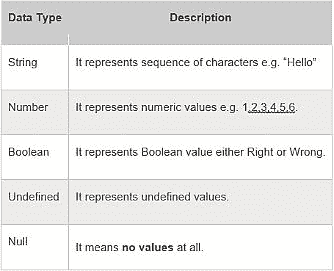

## JavaScript 非原始数据类型

有 3 种非原始数据类型：

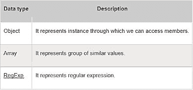

运算符是 JavaScript 中的符号，用于对操作数执行操作。通俗地说，`3+2` 等于 `5`。这里的操作数是 `3` 和 `2`，运算符是 `+`。

以下是 JavaScript 中使用的运算符：

1. 算术运算符。
2. 比较（关系）运算符。
3. 位运算运算符。
4. 逻辑运算符。
5. 赋值运算符。
6. 特殊运算符。

## 算术运算符

我们在算术运算符中对操作数进行算术运算。

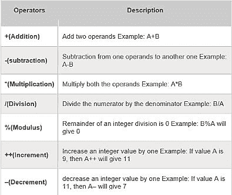

## 比较运算符

在比较运算符中，会比较两个操作数 `A` 和 `B`。

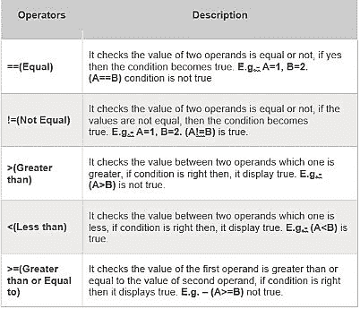

## 赋值运算符

JavaScript 支持以下赋值运算符。

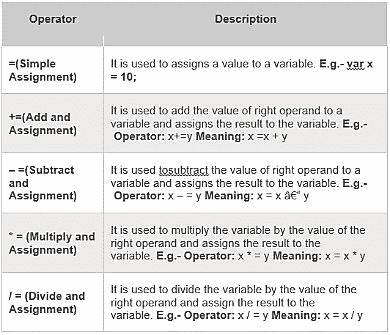

### 位运算运算符

JavaScript 以下位运算运算符：

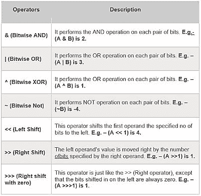

## 逻辑运算符

布尔值常用于逻辑运算符。

逻辑运算符如下：

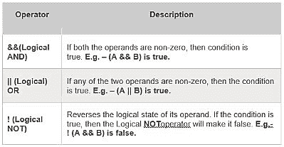

# JavaScript If Else

JavaScript 中的条件语句用于根据条件执行各种任务。在 JavaScript 中，有三种语句：

1. `if` 语句。
2. `if else` 语句。
3. `if else if` 语句。

## if 语句

如果条件为或假，在 JavaScript 中使用 `if` 语句执行代码。

```javascript
if (condition) {
  //要评估的内容
}
```

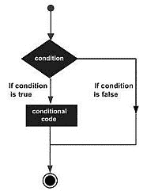

### 示例

```html
<!DOCTYPE html>
<html>
<body>
<script>
var x=50 ;
if(x>30) {
  document.write("value of x is greater than 30")
}
</script>
</body>
</html>
```

### 输出

Value of x is greater than 30

## if else 语句

如果任一条件为真或为假，则使用 `if else` 语句。

### 语法

```javascript
if(condition)
{
  //一组语句
}
else
{
  //一组语句
}
```

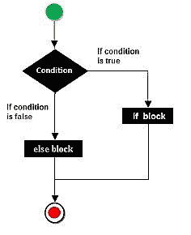

### 示例

```html
<!DOCTYPE html>
<html>
<body>
<script>
var x=20 ;
if(x%2==0) {
  document.write("x is even number")
}
else {
  document.write("a is odd number")
}
</script>
</body>
</html>
```

### 输出

X is even number

## If else if

它只是通过几个表达式来检查表达式是否有效。`if else if` 是 `if else` 语句的高级版本。

### 语法

```javascript
if (condition1)
{
  // 如果 condition1 为真则执行的语句
}
else if (condition2)
{
  // 如果 condition2 为真则执行的语句
}
else if (condition3)
{
  // 如果 condition3 为真则执行的语句
}
else
{
  // 如果条件不成立则执行的语句
}
```

### 示例

```html
<!DOCTYPE html>
<html>
<body>
<script>
var x=50 ;
if (x==10) {
  document.write("x is equal to 10")
}
else if(x==50) {
  document.write("x is equal to 50")
}
else if(x==30) {
  document.write("x is equal to 30")
}
else {
  document.write("x is not equal to 10, 50 or 30")
}
</script>
</body>
</html>
```

### 输出

x is equal to 50

# Switch 语句

在 JavaScript 中，`switch` 语句用于在不同条件下执行单个代码。它与 `else if` 语句相同。

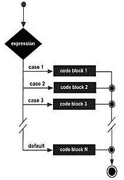

### 语法

```javascript
switch (expression)
{
  case 1: statements; break;
  case 2: statements; break;
  case n: statements; break;
  default: statements;
}
```

### 示例

```html
<!DOCTYPE html>
<html>
<body>
<script>
var grade='B' ;
var result ;
switch(grade) {
  case 'A': result="A Grade"; break;
  case 'B': result="B Grade"; break;
  case 'C': result="C Grade"; break;
  default: result="No Grade";
}
document.write(result)
</script>
</body>
</html>
```

### 输出

B Grade

# JavaScript 函数

在 `<script>...</script>` 标签内部构建新函数是 JavaScript 的一项功能。`function` 关键字用于在 JavaScript 中声明函数。为了复用文件，我们多次调用函数。

## JavaScript 函数的优点

1. 代码复用性：我们多次使用同一功能来节省时间和代码。
2. 减少编码：由于此功能，我们的软件被压缩了。

### 语法

```javascript
function functionName(参数或省略)
{
  语句
}
```

### 示例

```html
<!DOCTYPE html>
<html>
<body>
<script>
function msg() {
  alert("Hello! world")
}
</script>
<input type="button" onclick="msg()" value="click here"/>
</body>
</html>
```

### 输出

Hello world!

## 带参数的函数

通过传递参数调用函数。

```html
<!DOCTYPE html>
<html>
<body>
<script>
function cube(number ) {
  alert(number * number * number)
}
</script>
<form>
<input type="button" value="click " onclick="cube(3)"/>
</form>
</body>
</html>
```

### 输出

27

### 示例

```html
<!DOCTYPE html>
<html>
<body>
<script>
function getname() {
  name=prompt("Enter the Name")
  alert("Welcome Mr/Mrs " + name)
}
</script>
<form>
<input type="button" value="Click " onclick="getname()"/>
</form>
</body>
</html>
```

## 带返回值的函数

调用返回值的函数并在程序中使用。

```html
<!DOCTYPE html>
<html>
<body>
<script>
function getInfo() {
  return "Hello Raj! How are you?"
}
</script>
<script>
document.write(getInfo()) ;
</script>
</body>
</html>
```

### 输出

Hello Raj! How are you?

## `Function()` 构造函数

函数语句不仅用于定义新函数；还可以使用 `Function()` 构造函数和 `new` 运算符动态定义函数。

### 语法

```javascript
<script>
var variablename = new Function(Arg1 , Arg2... , "Function Body ")
</script>
```

### 示例

```html
<!DOCTYPE html>
<html>
<head>
<script>
  var func = new Function("a", "b", "return a+b;");
  function secondFunction() {
    var result;
    result = func(50,50);
    document.write(result);
  }
</script>
</head>
<body>
  <p>点击按钮调用函数</p>
  <form>
    <input type="button" onclick="secondFunction()" value="调用函数">
  </form>
  <p>在函数内部使用不同的参数并尝试一下吧...</p>
</body>
</html>
```

## 函数字面量 (Function Literals)

函数字面量的定义（描述函数的另一种方式）在 JavaScript 1.2 中引入。它是一个描述无名函数的表达式。

函数字面量的语法与函数语句相似，区别在于它被用作表达式而不是语句，并且不需要函数名。

### 语法

```html
<script>
  var variablename = function (Argument List) {
    Function Body
  };
</script>
```

### 示例

```html
<!DOCTYPE html>
<html>
<head>
<script>
  var func = function(a,b) { return a+ b } ;
  function secondFunction() {
    var result;
    result = func(10,20);
    document.write(result);
  }
</script>
</head>
<body>
  <p>点击按钮调用函数</p>
  <form>
    <input type="button" onclick="secondFunction()" value="调用函数">
  </form>
  <p>在函数内部使用不同的参数并尝试一下吧...</p>
</body>
</html>
```

# JavaScript 对象 (Javascript Object)

对象是一个状态和行为的实体。JavaScript 是一种关注于对象的脚本语言。虽然 JavaScript 是基于模板而非基于类的，但它允许我们直接构建对象。

### 语法

```javascript
objectName.objectProperty = propertyValue;
```

要在文本上写入某些内容，我们使用文档属性上的 `write()` 方法。

```javascript
document.write("Hello world")
```

### 示例

```html
<!DOCTYPE html>
<html>
<head>
<title>用户定义对象</title>
<script type="text/javascript">
  var book = new Object(); // 创建对象
  book.subject = "5 points someone"; // 给对象赋值属性
  book.author = "ChetanBhagat";
</script>
</head>
<body>
  <script type="text/javascript">
    document.write("Book Name is: " + book.subject);
    document.write("Book Author is: " + book.author);
  </script>
</body>
</html>
```

```
Book Name: 5 points someone
Book Author: Chetan Bhagat
```

### 对象的方法 (Methods of Object)

```html
<!DOCTYPE html>
<html>
<head>
<title>用户定义对象</title>
<script type="text/javascript">//定义一个将作为方法的函数
function addPrice(amount) {
  this.price = amount;
}
function book(title, author) {
  this.title = title;
  this.author = author;
  this.addPrice = addPrice; // 将方法赋值为属性。
}
</script>
</head>
<body>
  <script type="text/javascript">
    var myBook = book("Points Someone", "ChetanBhagat");
    myBook.addPrice(150);
    document.write("Book Title is: " + myBook.title);
    document.write("Book Author is: " + myBook.author);
    document.write("Book Price is: " + myBook.price);
  </script>
</body>
</html>
```

```
Book Title: Points Someone
Book Author: ChetanBhagat
Book is: 150
```

# JavaScript 数组 (Javascript array)

数组用于在单个单元或内存位置描述一组元素。进入数组的任何元素都将以从零的唯一索引存储在数组中。我们可以借助索引来存储数据。在 JavaScript 中，我们必须使用 `new` 关键字来声明数组。我们使用 `new Array(n)` 生成一个数组。序列中的槽数由 `n` 表示。

### 语法

```javascript
myarray = new array(n);
```

注意：如果在 JavaScript 中生成数组时不指定大小，则数组对象的大小为零。

### 示例

```html
<!DOCTYPE html>
<html>
<body>
  <script>
    var i;
    var emp = new Array();
    emp[0] = "Ajay";
    emp[1] = "Abhay";
    emp[2] = "Arun";
    emp[3] = "Shipra";
    for (i=0 ; i<emp.length ; i++ ) {
      document.write(emp[i] + "<br>");
    }
  </script>
</body>
</html>
```

```
Ajay
Abhay
Arun
Shipra
```

### 示例 2

```html
<!DOCTYPE html>
<html>
<head>
<script type="text/javascript">
function array( ) {
  num = new Array(5)
  num[0] = 10;
  num[1] = 20;
  num[2] = 30;
  num[3] = 40;
  num[4] = 50;
  sum = 0;
  for (i=0 ; i<num.length ; i++) {
    sum = sum + num[i];
  }
  alert(sum);
}
</script>
</head>
<body>
  <input type="button" onclick="array()" value="这里">
</body>
</html>
```

### 数组中的函数 (FUNCTIONS IN ARRAY)

(Image010.jpg)

# JavaScript 字符串 (Javascript String)

`String` 对象用于字符串交互。它是存储和处理文本的工具。在 JavaScript 中，有两种创建字符串：

1. 字符串字面量。
2. 使用 `new` 关键字。字符串字面量通过双引号形成。

### 语法

```javascript
var stringname="string";
```

### 示例

```html
<!DOCTYPE html>
<html>
<body>
  <script>
    var str="Hello Literal";
    document.write(str);
  </script>
</body>
</html>
```

```
Hello Literal
```

### 使用 new 关键字

### 语法

```javascript
var stringname=new String("new")
```

### 输出 (OUTPUT)

```html
<!DOCTYPE html>
<html>
<body>
  <script>
    var stringname=new String("Hello String");
    document.write(stringname);
  </script>
</body>
</html>
```

```
Hello String
```

## 字符串属性 (String properties)

字符串属性列表及其描述：

1. `constructor`。
2. `length`。
3. `prototype`。

`constructor`– 该方法返回字符串函数的引用。

### 语法

```javascript
string.constructor
```

`length` - 返回字符串中的字符数。

### 语法

```javascript
string.length
```

`prototype` - 它允许应用应用于属性和方法（数字、布尔、字符串和数据等）。

### 语法

```javascript
object.prototype.name = value
```

## 方法 (METHODS)

(Image00011.jpg)

### `charAt()`

它是从给定索引获取字符的方法。

```html
<!DOCTYPE html>
<html>
<body>
  <script>
    var str = new String ("Hello ");
    document.writeln("str.charAt(0) is: " + str.charAt(0));
    document.writeln("<br/>str.charAt(1) is: " + str.charAt(1));
  </script>
</body>
</html>
```

```javascript
document.writeln("<br />str.charAt(2) is: " + str.charAt(2)) ;
document.writeln("<br />str.charAt(3) is: " + str.charAt(3)) ;
document.writeln("<br />str.charAt(4) is: " + str.charAt(4)) ;
</script>
</body>
</html>
```

## `concat(str)`

该方法在相加两个或多个字符串后，返回一个新字符串。

```html
<!DOCTYPE html>
<html>
<body>
<script>
    var x="Hello";
    var y="World";
    var z=x+y;
    document.write(z) ;
</script>
</body>
</html>
```

## `indexOf(str)`

字符串的索引。`indexOf(str)` 过程返回给定字符串的索引位置。

```html
<!DOCTYPE html>
<html>
<body>
<script>
    var x="Tutorial provide by tutorialandexample";
    var y=x.indexOf("by");
    document.write(y) ;
</script>
</body>
</html>
```

## `lastindexOf(str)`

字符串 `lastIndexOf(str)` 方法返回字符串的最后一个索引位置。

```html
<!DOCTYPE html>
<html>
<body>
<script>
    var x="Tutorial provide by tutorialandExamole";
    var y=x.lastIndexOf("by");
    document.write(n) ;
</script>
</body>
</html>
```

## `match()`

```html
<!DOCTYPE html>
<html>
<body>
<script>
    var str ="To more detail, see Chapter 2.5.4.1";
    var re= /(chapter \d+(\.\d)*)/i;
    var find= str.match ( re );
    document.write(find ) ;
</script>
</body>
</html>
```

## `toLowerCase()`

它返回给定字符串的小写版本。

```html
<!DOCTYPE html>
<html>
<body>
<script>
    var x="HELLO WORLD";
    var y=x.toLowerCase();
    document.write(y) ;
</script>
</body>
</html>
```

## `toUpperCase()`

返回提供的大写字母字符串。

```html
<!DOCTYPE html>
<html>
<body>
<script>
    var x="hello world";
    var y=x.toUpperCase();
    document.write(y) ;
</script>
</body>
</html>
```

## `valueOf()`

它返回字符串对象的原始值。

```html
<!DOCTYPE html>
<html>
<body>
<script>
    var str= new String("Hello world");
    document.write(str.valueOf ( )) ;
</script>
</body>
</html>
```

# JavaScript Date

Date 对象是 JavaScript 语言中内置的一种数据类型。新的 `Date` 对象用于构建数据对象 ()。时间中的单个时刻由 JavaScript Date 实例表示。创建 JavaScript 日对象的唯一方法是使用 JavaScript 作为构造函数。

### 语法

`Date()` 构造函数可以使用以下语法生成 `Date` 对象。

```javascript
new Date();
new Date(value);
new Date(dateString);
new Date(year, month, day, hours, minutes, seconds, milliseconds);
```

注意：括号中的参数始终是可选的。

### 描述

#### year
年份由整数表示。对于 2000 年到 2099 年，值范围从 0 到 99 的映射。

#### Month
从 0（一月）开始到 11 结束，此整数值表示月份。

#### Date
这是一个可选参数。月份的天数由整数值表示。

#### Hours
这是一个可选参数。一天的小时由整数值表示。

#### Minutes
这是一个可选参数。时间的分钟部分由整数值表示。

#### Seconds
这是一个可选参数。秒由整数值表示。

#### Milliseconds
这是一个可选参数。时间的毫秒段由整数值表示。

### Date 示例

```html
<!DOCTYPE html>
<html>
<body>
<script>
    var date=new Date();
    var day=date.getDate();
    var month=date.getMonth()+1;
    var year=date.getFullYear();
    document.write("<br>"+day+"/"+month+"/"+year) ;
</script>
</body>
</html>
```

#### 当前时间 - 示例

```html
<!DOCTYPE html>
<html>
<body>
<script>
    var today=new Date();
    var h=today.getHours();
    var m=today.getMinutes();
    var s=today.getSeconds();
    document.getElementById('txt').innerHTML=h+":"+m+":"+s ;
</script>
</body>
</html>
```

# JavaScript Math

`Math` 是一个内置对象，具有用于数学函数和常量的属性和方法。它允许你对数字执行数学运算。

### 语法

1. `var pi_val=Math.PI;`
2. `var sin_val=Math.sin ( 3 );`

### 示例

### `Math.pow()`

`Math.pow(x,y)` 返回 `x` 的 `y` 次方：

```html
<!DOCTYPE html>
<html>
<body>
<h2>Math.pow()</h2>
<p>Math.pow(x,y ) 返回 `x` 的 `y` 次方的值：</p>
<p id="demo"></p>
<script>
    document.getElementById("demo").innerHTML=Math.pow(6,2) ;
</script>
</body>
</html>
```

### `Math.sqrt()`

`Math.sqrt(x)` 返回 `x` 的平方根：

```html
<!DOCTYPE html>
<html>
<body>
<h2>Math.sqrt()</h2>
<p>Math.sqrt(x ) 返回 `x` 的平方根：</p>
<p id="demo"></p>
<script>
    document.getElementById("demo").innerHTML=Math.sqrt(81) ;
</script>
</body>
</html>
```

### `Math.ceil()`

`Math.ceil(x)` 返回 `x` 向上取整到最近整数的值：

```html
<!DOCTYPE html>
<html>
<body>
<h2>Math.ceil()</h2>
<p>Math.ceil( ) 将数字向上取整到其最近的整数：</p>
<p id="demo"></p>
<script>
    document.getElementById("demo").innerHTML=Math.ceil(6.8) ;
</script>
</body>
</html>
```

# JavaScript Number

`Number` 对象是一个包装器对象，允许你操作数值值。`Number()` 构造函数用于构建数字对象。它可以是整数，也可以是浮点数。

### 语法

```javascript
var n=new Number(value);
```

### 示例

```html
<!DOCTYPE html>
<html>
<body>
<script>
    var x=100;//整数值
    var y=100.7;//浮点值
    var z=12e5;//指数值，输出: 1200000
    var n=new Number(20);//通过数字对象生成的整数值
    document.write(x+" "+y+" "+z+" "+n) ;
</script>
</body>
</html>
```

### 输出

100 100.7 1200000 20

本书的设计旨在使我们能够以一种简单高效的方式在 `TensorFlow` 上轻松实现深度学习项目。

它是一个用 `Python` 编程语言编写的免费开源软件库。

`TensorFlow` 是一个基于 `Python` 的框架。因此，需要对 `Python` 有基础的了解。

如果我们对基础数学和人工智能概念有良好的理解，就能轻松地理解 `TensorFlow`。

# TensorFlow 简史

`TensorFlow` 是一个常用的机器学习和深度学习平台。它是由 Google Brain 团队开发的，是一个免费的开源库，并于 2015 年 11 月 9 日发布。它完全用 `Python` 编写，并使用其进行数值计算和数据流，使得机器学习变得更加快速和简单。

`TensorFlow` 可用于训练和运行各种任务的深度神经网络，包括图像识别、手写数字分类、循环神经网络、词嵌入、自然语言处理、视频检测等。`TensorFlow` 可运行在多种 `CPUs`、`GPUs` 以及移动操作系统上。

`TensorFlow` 这个词由两个单词组成，即 `Tensor`（张量）和 `Flow`（流）。

1. `Tensor` 是一个多维数组
2. `Flow` 是用于描述系统中数据流的术语。

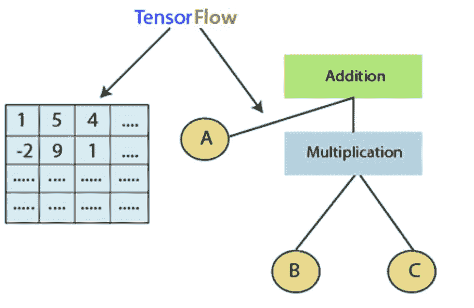

## TensorFlow 的历史

多年前，在面对大量数据时，深度学习开始优于所有其他机器学习算法。

Google 已经意识到深度神经网络可以用于改进其服务：
- 搜索引擎 Google
- Gmail（电子邮件）
- 相册

他们创建了 `TensorFlow` 系统，以便研究人员和开发者能够在 AI 模型上进行协作。

一旦被接受并扩展，它就可以被大量人员使用。

它首次发布于 2015 年，第一个稳定版本计划于 2017 年发布。

它是一个符合 Apache 开源许可的开源框架。

我们无需向 Google 支付任何费用，即可免费使用、更改和重新组织更新版本。

## TensorFlow 的组件

### 张量 (Tensor)

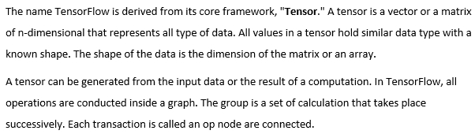

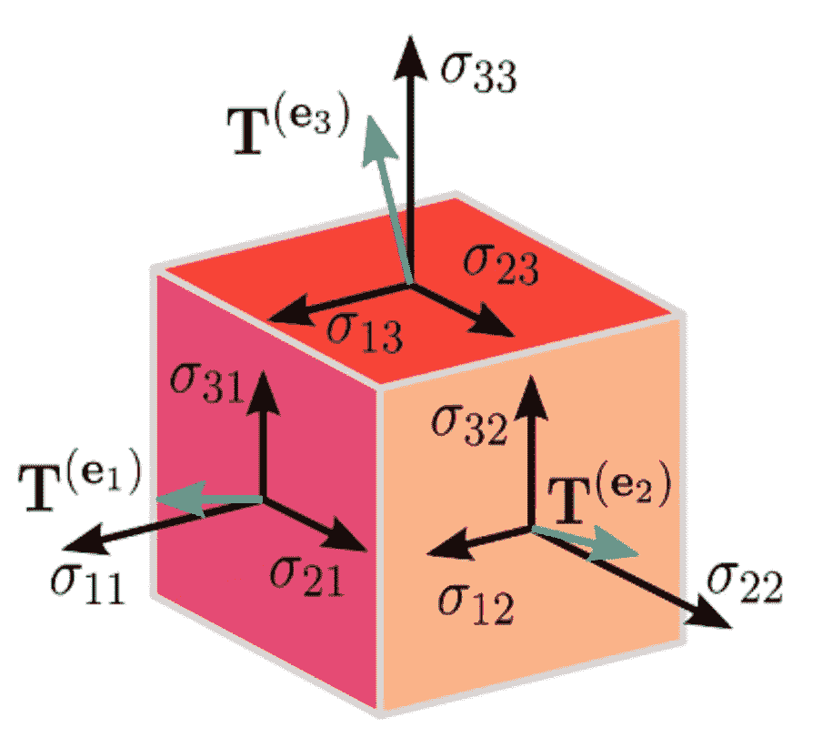

### 图 (Graphs)

`TensorFlow` 使用图结构。图编译并汇总了准备期间执行的所有计算。

### 优势

- 它现在与多个 `CPUs` 或 `GPUs` 以及手机操作系统兼容。
- 图的可移植性使得保存计算结果以备后用成为可能。由于图可以在未来执行，因此可以被保存。
- 图的整个计算通过通过链接张量来实现。

考虑以下公式：`a=(b+c)*(c+2)`

这些函数可以分解为以下组件：
`d=b+c`
`e=c+2`
`a=d*e`

现在，我们可以在下方以图的形式表示这些操作：

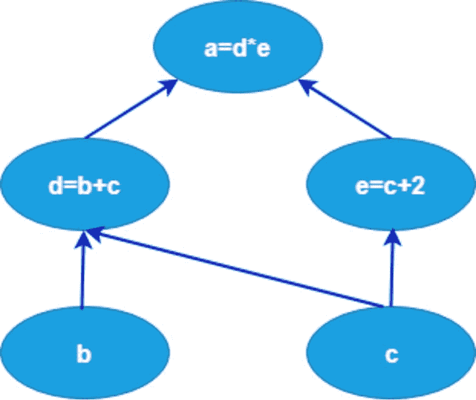

### 会话 (Session)

图的程序可以通过会话执行。我们需要打开一个会话，以便向图中输入张量的值。

要生成输出，我们必须在会话中运行算子。

## 为什么 TensorFlow 如此流行？

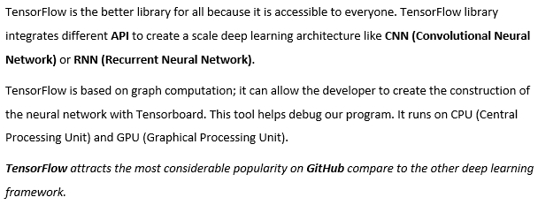

### TensorFlow 的用例/应用

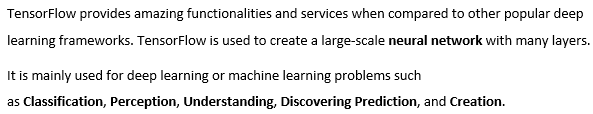

### 1. 语音/声音识别

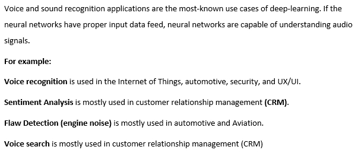

### 2. 图像识别

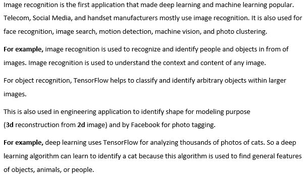

### 3. 时间序列

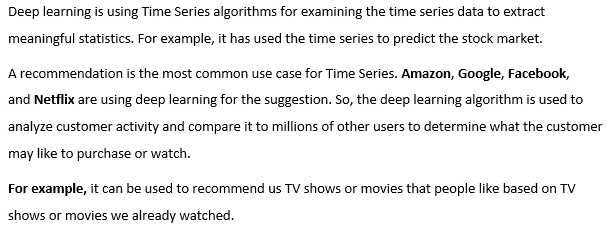

### 4. 视频检测

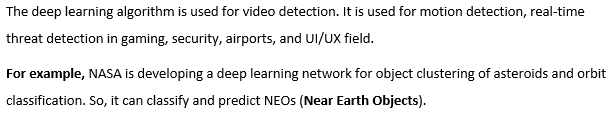

### 5. 基于文本的应用

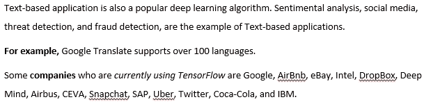

## TensorFlow 的特性

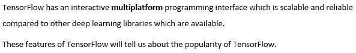

### 1. 响应式构造

我们可以看到图的每个部分，这在 `Numpy` 或 `SciKit` 中是不可能的。要构建一个深度学习应用，您需要两三样东西：一种编程语言和两个或三个组件。

### 2. 灵活

根据其操作性，它是最重要的 `TensorFlow` 特性之一。它是模块化的，我们希望它的某些部分能够独立运行。

### 3. 易于训练

在分布式计算中，在 `CPU` 和 `GPU` 上训练都非常简单。

### 4. 并行神经网络训练

`TensorFlow` 通过允许我们同时训练多个神经网络和 `GPUs` 为流水线增加了价值，使得模型在大规模系统上非常强大。

### 5. 大型社区

它由 Google 创建，已经有一支大型软件工程师团队致力于持续改进稳定性。

### 6. 开源

机器学习库最棒的部分是它是开源的，这意味着任何可以访问互联网的人都可以使用它。结果是，人们可以利用该库来创建各种实用的物品。它还演变成了另一种 DIY 文化，为初学者以及那些在使用过程中遇到困难的人们提供了一个庞大的平台。

### 7. 特征列 (Feature Columns)

`TensorFlow` 中的特征列可以被认为是原始数据和估计器之间的中间节点，桥起了输入数据与我们的模型。特征列的实现如底部的特征列所示。

### 8. 统计分布的可用性

该库包含了多种分布函数，如 `Bernoulli`（伯尔努利）、`Beta`、`Chi2`（卡方）、`Uniform`（均匀分布）和 `Gamma`（伽马分布），这些都是至关重要的。

### 9. 特性层

`TensorFlow` 包含了分层操作，用于在概率方法中使用，如批量归一化、卷积层和丢层。

### 10. 可视化

通过 `TensorBoard` 我们可以检查模型。

### 11. 事件日志器

在 `TensorBoard` 的帮助下，我们在 `UNIX` 上跟踪性能。

## 通过 pip 安装 TensorFlow

我们可以通过两种方式在系统中安装 `TensorFlow`：
1. 通过 `pip`（Python 包）
2. 通过 `Anaconda` (`conda`)

## 1. 通过 pip

首先，我们必须使用 `pip` 在系统中安装并配置 `Anaconda`。

`TensorFlow` 在运行时必须满足以下要求：
- 在 `Windows` 上，`TensorFlow` 只支持 64 位的 `Python 3.5` 或 `3.6`。
- 当我们下载 `Python 3.5` 时，包含了 `pip3` 软件包管理器。（这是我们在 `Windows` 上安装 `TensorFlow` 所需的软件。）

步骤 1：`Python` 可以从下面的链接下载。
[`www.python.org/downloads/release/python-352/`](https://www.python.org/downloads/release/python-352/)

之后，

步骤 2：我们将带到一个新页面，需要在那里选择 `x86-64` 和 `amd64` 安装程序来安装 `Python`。这里使用的是 `Windows x86-64` 可执行安装程序。

## 什么是 pip？

`pip` 是一个用于安装和管理用 `Python` 或其他语言编写的软件包的系统。`Pip` 是一个 `Python` 包管理器，允许你下载、浏览、安装、卸载和管理第三方 `Python` 包。（`pip3` 是我们刚刚下载的 `Python 3.5` 的最新版本）

## 安装我们的 TensorFlow

在下载了最新版本的 `Python` 后，我们现在可以完成安装。

步骤 1：启动终端安装 `TensorFlow`。确保 `cmd` 以管理员身份运行。
打开开始菜单，在搜索框中输入 `cmd`，然后右键点击它并选择“以管理员身份运行”。

步骤 2：之后，我们在命令行提示符中输入命令以完成 `Windows` 上 `Tensorflow` 的安装。

输入此命令：

```

C:\pip3 install -upgrade tensorflow

```

TensorFlow 现在已成功安装在我们的系统中。

在这里测试我们的 TensorFlow，我们尝试证明我们的新 TensorFlow 运行结果符合预期。

TensorFlow 现在运行正常。

否则，如果我们在运行软件时遇到任何困难，我们必须安装 `Microsoft Visual C++ 2015`。设置完成后，TensorFlow 将在我们的框架中运行。

我们可以点击下面的链接获取 `Microsoft Visual C++ 2015`：[https://www.microsoft.com/en-us/download/confirmation.aspx?id=53587]

# 通过 conda 安装 TensorFlow

在之前的《TensorFlow Book》中，我们学习了如何使用 `pip` 构建 TensorFlow。在本书中，我们将学习如何使用 `Conda` 构建 TensorFlow。为了搭建平台，我们需要 `anaconda Navigator`。

以下是需要采取的步骤：

首先，访问 Anaconda 官方网站并通过下面的链接下载 Anaconda：[https://www.anaconda.com/distribution/]

然后，我们需要从 Python 2.7 更新中获取 Anaconda。

它将成功下载到我们的系统中。然后，我们需要在机器上设置 Anaconda。

接着，为了设置 TensorFlow 和库，我们必须运行提供的命令。

1. `Conda create -n tensorflow pip python` 是第一步。
2. 我们现在正在下载并安装 TensorFlow 运行所需的组件。
3. 接下来，我们必须确定 TensorFlow 在我们的框架中可以运行。

# TensorFlow 架构

TensorFlow 运行时是一个可以在任何平台上运行的库。设备架构使得这种规模的组合具有通用性。

TensorFlow 编程原理如计算图、操作和会话对我们来说是通用的。

要理解 TensorFlow 架构，必须先理解一些词汇。

`TensorFlow Servable`、`servable Streams`、`TensorFlow Models`、`Loaders`、`Sources`、`Manager` 和 `Core` 是用到的一些术语。

术语及其在 TensorFlow 架构中的定义如下。

为了读取和调整 TensorFlow TensorFlow 代码，TensorFlow 架构就已经足够了。

## 1. TensorFlow Servable

在 TensorFlow 中，这些是中心未完成单元。

客户端用于执行计算的工制品被称为 servables（服务单元）。

servable 的大小可以不同。单个 servable 可以是从查找表到模型元组中的单个接口模型的任何。

任何类型和接口都应该是 servable，从而允许通用性和潜在的增强，例如：

* 流式结果
* 异步操作模式。
* 实验性 API

## 2. Servable Versions

在一个服务器实例的生命周期内，TensorFlow 服务器可以处理一个或多个版本的 servable。

它允许随着时间的推移加载新的算法配置、权重和其他数据。

它们也可以同时加载多个版本的 servable。

它们通常允许同时加载多个版本的 servable，从而允许增量式发布和实验。

## 3. Servable Streams

任何 servable 的版本按照版本号递增的顺序在此序列中排序。

## 4. TensorFlow Models

在在一个或多个 servable 中，一个 serving（服务）代表一个模型。使用一个或多个算法来查找机器学习模型中的嵌入表。

servable 也可以用于表示模型的一部分；例如，一个广泛的查找表可以用多个实例表示。

## 5. TensorFlow Loaders

servable 的生命周期由 loaders（加载器）控制。loader API 提供了一种独立于学习算法、数据或产品用例的流行基础设施。

## 6. TensorFlow 架构中的 Sources

简单来说，Sources 是寻找并提供 servable 的模块。

在任何给定时间，每个引用都提供零或多个 servable 流。

一个 source 为每个 servable 的每个 servable 流提供一个 loader 实例。

每个 source 还有一个或多个服务的流。

一个 source 为每个 servable 流提供一个 loader 实例，并使其可以被加载。

## 7. TensorFlow Managers

TensorFlow managers 控制 Servable 的整个生命周期，包括：

* 加载 Servables
* 服务 Servables
* 卸载 Servables

manager 监控 sources 并跟踪所有版本。

Manager 会尽力满足需求，但它有拒绝加载预期版本（Aspired version）的能力。

“unload”（卸载）也可以被 managers 推后。例如，根据确保始终至少加载一个版本的策略，manager 可能会等待到新版本完成加载后再进行卸载。

例如，`GetServableHandle()` 允许客户端访问已加载的 servable 实例。

## 8. TensorFlow Core

这负责 servable 的以下元素：

* 生命周期
* 指标
* TensorFlow 使用不透明的工制品来服务满足核心抽象的 servables 和 loaders。

## 9. Servable 的生命

TensorFlow 技术架构：

* Sources 为 Servable Versions 构建 loaders，然后作为预期版本（Aspired versions）提交给 Manager，在它们那里将被加载并为客户端请求服务。
* Loader 持有元数据并负责加载 servable。
* 为了通知 Manager 预期版本，source 使用回调函数。
* Manager 使用当前版本策略来决定下一步行动。
* 如果 Manager 决定 Loader 可以加载新版本，客户端将向 Manager 请求 servable，要么直接指定版本，要么请求当前版本。
* 对于 servable，Manager 返回一个句柄（handle）。

## 10. TensorFlow Loaders

其中一种算法后端是 TensorFlow。

例如，为了加载、访问和卸载新形式的机器学习模型 servable 实例，我们将引入一个新的 loader。

## 11. TensorFlow 架构中的 Batcher

在存在硬件加速器和 GPU 的情况下，将 TensorFlow 请求批处理到单个应用程序中将大大降低执行推理的成本。

TensorFlow serving 中的批处理系统允许客户端将他们请求之外的特定类型假设轻松进行批处理。

此外，建议算法系统能够更快地处理数据。

# TensorFlow 的优点与缺点

Google 创建并开发了 TensorFlow，这是一个开源的机器学习概念。

它以非常高级且抽象的方式组织了低级数值编程。

并支持库，使得我们的软件可以在不修改的情况下在标准 CPU 上运行。

Linux、macOS、Windows 和 Android 是支持的平台。

Google Cloud Machine Learning Engine 也可以不使用传统的计算平台运行 TensorFlow 模型。

技术越先进，就越有用，但包括这个机器学习库在内的一切都有缺点。

在将 TensorFlow 与 Torch、SciKit、Theano 和 Neon 等其他库相比时，该库没有让我们利用的某些功能是缺失的。

不言而喻，这个库是由 Google 开发和修改的，自最初发布以来它已经走了很远。

## TensorFlow 的优点

### 1) 图

TensorFlow 的数值图可视化更为优越。与 Torch 和 Theano 等内置库相比。

### 2) 库管理

它有 Google 的支持。它具有性能良好、更新快和定期发布新功能的优势。

### 3) 调试

它允许我们执行图的子部分，由于可以引入和检索离散数据，因此它具有优势。

### 4) 可扩展性

库被挂载在硬件单元上，这是一个连接到计算机的复杂单元系统。

### 5) 流线化

TensorFlow 设计用于与各种后端应用程序（GPU、ASIC 等）协作，并具有高度的并行性。

### 6)

它使用了一种新颖的方法，帮助我们跟踪许多指标并控制我们模型的训练进度。

### 7)

TensorFlow 背后有一个强大的社区支持。

### 8)

它的效率极高，与行业顶尖水平相当。

## TensorFlow 的缺点

### 1) 缺少符号循环

当涉及到变长度序列时，该功能尤为重要。遗憾的是，TensorFlow 缺乏此类功能；不过，有限折叠（finite folding）是最佳选择。

### 2) 不支持 Windows

许多用户倾向于在 Windows 环境下工作而非 Linux，而 TensorFlow 无法满足他们的需求。不过，如果你是 Windows 用户，也可以使用 `conda` 或 Python 包管理器 (`pip`）安装它。

### 3) 基准测试

与竞争对手相比，TensorFlow 在速度和可用性方面都稍逊一筹。

### 4) 不支持 Nvidia GPU 且仅支持一种语言

目前，仅支持 NVIDIA GPU，且 Python 是唯一支持的完整语言，这是一个缺点，因为越来越多的其他深度学习语言以及各种框架正在不断出现。

### 5) 计算速度

虽然 TF 在这一领域处于落后，但由于我们关注的是生产环境而非结果，它仍然是最佳选择。

### 6) 不支持 OpenCL。

### 7) 它要求在高等微积分和线性代数方面有坚实的基础，并对机器学习有透彻的理解。

### 8) TensorFlow 有一种独特的布局，使得定位和调试错误变得困难。

### 9) 对超底层内容没有要求。

### 10) 它是一门入门级课程，但学习曲线陡峭。

# TensorFlow Playground

TensorFlow Playground 是一个用 `d3.js` 语言（JavaScript）编写的软件应用程序。

它也是在无需进行任何数学的情况下学习神经网络（NN）的最佳应用。

我们可以在网页浏览器中构建神经网络并立即看到结果。

它根据 Apache 2.0 许可证发布，该许可证于 2004 年 1 月发布（[`www.apache.org/licenses/`](http://www.apache.org/licenses/)）。

它由 Daniel Smilkov 和 Shan Carter 创建，是之前几项工作的延续。

Fernanda Viegas、Martin Wattenberg 以及 Big Picture 和 Google Brain 团队提供了输入和指导。

TensorFlow Playground 是一个允许用户使用 TensorFlow 机器学习库评估 AI 算法的网络应用程序。

TensorFlow Playground 不需要熟悉高级数学或为深度学习及其他机器学习应用编写神经网络代码。

在 Playground 中，神经网络操作是交互式且可视化的。

该开源库是出于教学需求而创建的。

现在访问 [`playground.tensorflow.org`](http://playground.tensorflow.org/)。

Epoch（迭代）、学习率（Learning rate）、激活（Activation）、正则化率（Regularization rate）和问题形式（Problem form）列在网站顶部，并在下方进行了详细定义。

每对训练集进行一次训练，Epoch 数就会增加，如下所示。

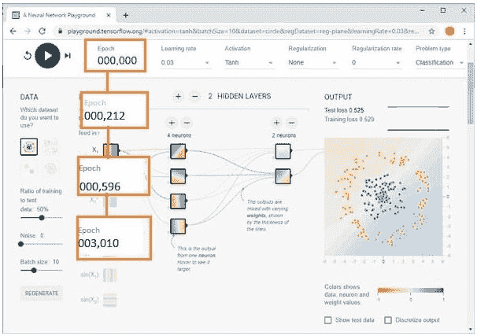

由于学习率定义了我们学习的速度，我们必须选择合适的学习率。

节点或数据集的输出由其激活函数定义。

根据输入，典型的计算机芯片电路可能是激活函数的数字网络，这些函数可以“开启”（1）或“关闭”（0）。

### 软输出激活函数

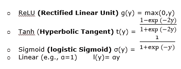

通过使用正则化可以避免过拟合。

正则化在 TensorFlow 中以两种方式实现：L1 和 L2。

正则化可以通过增加或减少强连接或弱连接的权重来锐化模式分类。

### L1 正则化

* L1 适用于稀疏特征空间，在这些空间中必须从大量特征中选择少数几个。
* L1 可以进行选择并为选定的项目分配较大的权重值，从而使未选定项目的权重较低（或为零）。

### L2 正则化

* 对于相关输入，L2 能够
* 权重值将由 L2 以与相关水平相同的水平进行调节。

Dropout 也是一种正则化技术。

较高的正则化率会限制权重的范围。

为问题类型选择以下提到的两种问题类型之一：
* 分类（Classification）
* 回归（Regression）

根据我们在此指定的数据集，我们需要确定我们正在尝试解决什么类型的问题。

使用我们在下面描述的数据集进行求解。

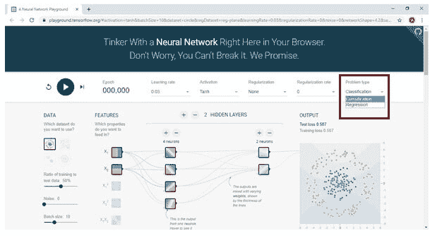

## 神经网络模型/ 感知器

神经网络模型也称为感知器，是由被称为神经元的简单组件组成的网络，它们接收反馈并根据信息改变其内部状态。

并且，根据数据和激活情况，产生性能（0 和 1）。在最开放的神经网络——浅层神经网络中，我们只有一个输入和一个输出，最多有一层隐藏层。

### Playground 中颜色的含义

在可视化方面，使用了橙色和蓝色。

橙色和蓝色有多种用法，事实上，橙色代表负值，蓝色代表正值。

神经元的权重染了隐藏层。

实际权重是蓝色，负权重是橙色。

根据输入，输出层的点被染成橙或蓝色。

### 用例

为什么可以增加隐藏层神经元的数量？

在隐藏层中，我们可以从单个神经元开始（浅层神经网络）。让我们使用 `X1` 和 `X2` 的 `Circle` 数据集、`0.03` 学习率和 `ReLU`。

点击 `run` 按钮等待数百个 Epoch 完成，然后按下 `pause` 按钮。

100 个 Epoch 后，我们将使用 `add` 按钮向隐藏层添加四个神经元并再次运行。

背景描绘了一个位置。

### 为什么在分类问题中使用非线性激活函数？

由于我们的输出标签介于 0 和 1 之间，而线性激活函数可以提供从 - 到 + 之间的任何数字，因此我们在神经网络中使用非线性激活函数。

结果是，模型将在未来的某点收敛。

# TensorFlow 基础

Google Brain 团队创建了 TensorFlow，一个机器学习系统。它的名字来源于 Tensor（张量）结构。张量用于 TensorFlow 中的任何计算。

张量是表示不同类型数据的 n 维向量或矩阵。TensorFlow 的值描述了具有已知形状的数据。

矩阵或数组的维度是数据的形状。

### 张量的表示

TensorFlow 中的张量是 n 维特征向量集（类似于数组）。例如，如果我们有一个从 1 到 6 的 2x3 矩阵，我们可以写道：

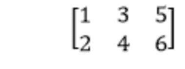

TensorFlow 将此矩阵表示为：

```

[[1, 3, 5],

[2, 4, 6]]

```

如果我们创建一个从 1 到 8 的三维矩阵，我们将得到：

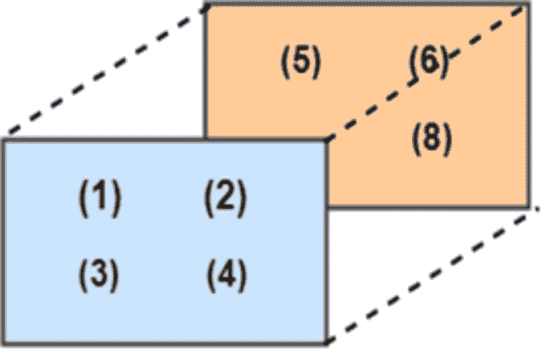

TensorFlow 将此矩阵表示为：

```

[[[1, 2], [3, 4]], [[5, 6], [7, 8]]]

```

3. `[[5, 6]]`
4. `[[7, 8]]`

注意：张量可以由标量或超过三个维度的形式定义。只是很难预测如此大的尺寸。

# 张量的类型

在 TensorFlow 中，所有的计算都通过一个或多个张量（Tensors）进行。张量是一个具有以下三个属性的实体：

* 唯一的标签（名称）
* 维度（形状）
* 数据类型（dtype）

每个 TensorFlow 操作都需要对张量进行操作。我们可以创建四种类型的张量：

* `tf.Variable`
* `tf.constant`
* `tf.placeholder`
* `tf.SparseTensor`

我们将在本书书中学习如何创建 `tf.variable` 和 `tf.constant`。

确保在 TensorFlow 中激活了 `conda` 环境。`hello-tf` 是我们给这个环境的名字。

对于 Windows 用户：

```bash
activate hello-tf
```

对于 macOS 用户：

```bash
source activate hello-tf
```

完成这些操作后，我们就可以导入 tensorflow 了。

```python
# 导入 tf
import tensorflow as tf
```

# 创建 n 维张量

我们首先开始创建一个标量，它是一个一维张量。

我们可以使用 `tf.constant` 来创建一个张量 `()`。

```python
tf.constant(value, dtype, name = "")
```

参数

* `Value`：用于定义张量的 n 维 `Value`。它是可选的。
* `dtype`：定义数据类型：
    * `tf.string`: 字符串变量
    * `tf.float32`: 浮点数变量
    * `tf.int16`: 整数变量
* `"name"`：张量的名称。可选。默认值为 `Const_1:0`。

要创建一个 0 维的张量，请运行以下代码。

## rank 0

默认名称

```python
r1=tf.constant (1, tf.int18)
print (r1)
```

输出：
`Tensor ("Const: 0", shape= (), dtype=int18`

## 命名为 my_scalar

```python
r2 = tf.constant(1, tf.int18, name = "my_scalar")
print(r2)
```

输出：
`Tensor ("my_scalar:0", shape=( ), dtype=int18`

每个张量都会显示其名称。每个张量对象都是使用唯一的标签（名称）、维度（形状）和数据类型（dtype）创建的。

要更改数据类型，我们可以用小数值或字符串定义张量。

## 小数数据

```python
q1_decimal = tf.constant(1.12345, tf.float32)
print(q1_decimal)
```

# 字符串数据

```python
q1_string = tf.constant("LearnTensorflow", tf.string)
print(q1_string)
```

输出：
`Tensor("Const_1:0", shape=(), dtype=float32)`
`Tensor("Const_2:0", shape=(), dtype=string)`

1 维张量可以如下所示创建：

## 秩 1_ 向量

```python
q1_vector = tf.constant([1,3,6], tf.int18)
print(q1_vector)

q2_boolean = tf.constant([True, True, False], tf.bool)
print(q2_boolean)
```

输出：
`Tensor ("Const_5:0", shape=(4), dtype=int18)`
`Tensor("Const_4:0", shape=(4), dtype=bool)`

我们可以看到这种形式只由一列组成。

要创建一个二维数组，我们必须在每一行之后关闭括号。

示例：

## 秩 2

```python
q2_matrix = tf.constant([ [1, 2], [3, 4]], tf.int18)
print(q2_matrix)
```

输出：
`Tensor("Const_6:0", shape=(2, 2), dtype=int18)`

该矩阵有两行两列，填充了数字 1, 2, 3 和 4。

三维矩阵通过添加另一层括号来生成。

## 秩 3

```python
q3_matrix = tf.constant([[[1, 2],[3, 4],[5, 6]]], tf.int18)
print(q3_matrix)
```

输出：
`Tensor("Const_6:0", shape=(1, 3, 2), dtype=int8)`

该矩阵类似于下面的插图。

# 张量的形状

当我们打印张量时，TensorFlow 会推测其形状。然而，我们可以获取形状（shape）属性。下面，我们创建一个数值范围从 10 到 15 的矩阵，并检查 `m_shape` 的形状。

```python
m_shape=tf.constant([[1,10],[13,12],[15,14]])
m_shape=shape
```

输出：
`TensorShape ([Dimension(2),Dimension(3)])`

矩阵中有两行三列。

TensorFlow 是一系列实用的命令，用于创建具有 0 或 1 值的向量或矩阵。例如，如果我们想创建一个形状为 10 且值为 10 的 1-D 张量……（注：原文此处逻辑似乎略有混乱，此处按字翻译）。

```python
m_shape=tf.constant([[1,10],[13,12],[15,14]])
m_shape=shape
```

输出：
`TensorShape ([Dimension(2),Dimension(3)])`

矩阵中有两行三列。

TensorFlow 是一系列用于创建具有 0 或 1 值的向量或矩阵的有用命令集合。例如，如果我们想创建一个特定形状为 10 且值为 10 的 1-D 张量。

注意：这两个对象必须具有相同的形状。两个张量的相法是可能的。

# 乘法

```python
tensor_multiply=tf.multiply(tensor_x, tensor_y)
print(tensor_multiply)
```

Output:
Tensor("Mul:0", shape=(3,4), dtype=int23)

## 变量

目前仅开发了常量张量。

我们使用变量类来处理通常具有不同值的数据。它代表一个具有变化值的节点。

我们使用 `tf.get_variable()` 方法来生成值。

```python
tf.get_variable(name = "", values, dtype, initializer)
```

**参数**
- `name = ""`: 变量名称
- `values`: 张量的维度
- `dtype`: 数据类型。可选
- `initializer`: 如何初始化张量。可选

如果指定了 `initializer`，则没有需要包含 `"values"`，因为 `"initializer"` 的形状会被使用。

例如，该代码生成了一个包含两个随机生成值的二维变量。TensorFlow 可能会返回一个随机值。该变量被称为 "var"。

### 创建变量

### 创建 2 个随机值

```python
var = tf.get_variable("var", [1, 2])
print(var.shape)
```

Output:
(1, 2)

在第二个示例中，我们可以构造一个有一行两列的变量。为了确定变量的维度，我们需要使用 `[1,2]`。

张量的初始值为 0。我们使用初始值在训练模型时计算特征的权重。我们从零开始。

```python
var_init_1 = tf.get_variable("var_init_2", [1, 2], dtype=tf.int23, initializer=tf.zeros_initializer)
print(var_init_1.shape)
```

Output:
(2, 1)

常量张量的值可以传递给向量。使用 `tf.constant` 公式来构建常量张量。该张量用于设置变量。

变量的前几个值是 10, 20, 30, 40 和 50。最新的张量具有 2x2 的形式。

### 创建任意 2x2 矩阵

```python
tensor_const = tf.constant([[10, 30], [20, 40]])
# 初始化张量的第一个值等于 tensor_const
var_init_2 = tf.get_variable("var_init_2", dtype=tf.int23, initializer=tensor_const)
print(var_init_2.shape)
```

Output:
(2, 2)

## 占位符

为了初始化数据并在张量内进行，使用了占位符。我们必须使用 feed dict 来包含占位符。占位符只会在 session 中填充一次。在下一个示例中，使用 `tf.placeholder` 方法构建占位符。我们将在 session 中学习如何用真实数据填充占位符。

语法如下：

```python
tf.placeholder(dtype, shape=None, name=None)
```

**参数：**
- `dtype`: 数据类型
- `shape`: 占位符的维度。可选。默认是数据的形状。
- `name`: 占位符的名称。可选

```python
data_placeholder_a = tf.placeholder(tf.float32, name="data_placeholder_a")
print(data_placeholder_a)
```

Output:
Tensor("data_placeholder_a:0", dtype=float32)

### TensorFlow 通过 3 个组件工作：

- 图 (Graph)
- 张量 (Tensor)
- 会话 (Session)

| 组件 |  |
| :--- | :--- |
| Graph | 在 TensorFlow 中，图至关重要。在图中，执行所有的数学操作 (ops)。图可以被视为一个项目，其中每个过程几乎完成。这些操作由节点表示，节点可以生成或产生张量。 |
| Tensor | 张量是从一个操作到下一个操作的数据表示。我们已经看到如何设置张量。可以改变的变量初始值是常量和变量之间的区别。 |
| Session | 图上的程序将由 session 执行。我们需要打开一个 session 将图通信到值。为了生成输出，我们必须在 session 中运行算子。 |

### Session

图和 session 是独立的实体。我们可以运行一个 session 并保存结果以供以后计算使用。在下面的示例中，我们将：

- 创建两个张量
- 创建一个操作
- 打开一个 session
- 打印结果

步骤-1) 我们创建两个张量 x 和 y

**运行并评估一个 session**

```python
x = tf.constant([2])
y = tf.constant([2])
```

步骤-2) 我们通过乘以 x 和 y 创建算子

**创建算子**

```python
multiply = tf.multiply(x,y)
```

步骤-3) 我们开始一个会议。两个计算将在 session 期间进行。完成后，我们需要结束 session。

**创建一个 session 来运行给定代码**

```python
sess = tf.Session()
result_1 = sess.run(multiply)
print(result_1)
sess.close()
```

Output:
[8]

## 代码解释


`x` 和 `y` 的乘积产生结果 "8"。另一个是在块内构建 session。这样做的好处是它可以结束 session。

```python
with tf.Session() as sess:
    result_2 = multiply.eval()
    print(result_2)
```

Output:
[8]

为了在 session 的范围内执行过程，我们可以使用 `eval()` 过程。它与 `run()` 函数相同。它提高了代码的可靠性。我们可以启动一个 session 并查看你已经开发的张量中的值。

### 检查之前创建的张量

```python
sess = tf.Session()
print(sess.run(r1))
print(sess.run(r2_matrix))
print(sess.run(r3_matrix))
```

Output:
1
[[1 2]
 [3 4]]
[[[1 2]
 [3 4]
 [5 6]]]

即使我们构建了张量，变量设计上也是空的。这是因为我们需要使用 `tf.global_variables_initializer()` 来初始化它们。这是常量和变量之间的区别。

该图表并不显示操作的结果；它仅有助于可视化化操作之间的连接关系。

### 示例

假设我们需要测试以下函数：

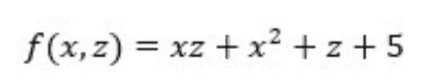

为了运行服务，TensorFlow 会生成一个图。图的内容如下：

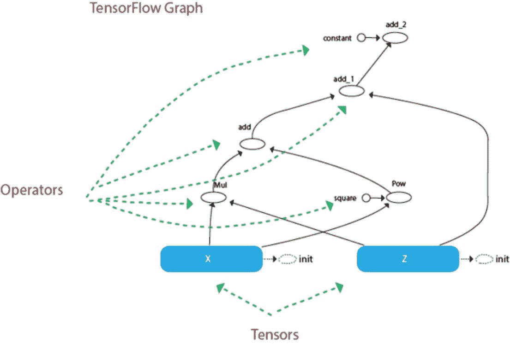

可以看到张量到达最终终地的方向。

例如，我们可以看到操作 `add` 从未被执行过，图表解释了原因：

* 计算和：
* 将 1) 相加
* 将加到 2)
* 将 3) 加到

```python
x = tf.get_variable("x", dtype=tf.int32, initializer=tf.constant([5]))
```

```python
z = tf.get_variable("z", dtype=tf.int32, initializer=tf.constant([6]))
```

```python
c = tf.constant([5], name ="constant")
square = tf.constant([2], name ="square")
```

```python
f = tf.multiply(x, y) + tf.pow(x, square) + y + c
```

## 代码解释

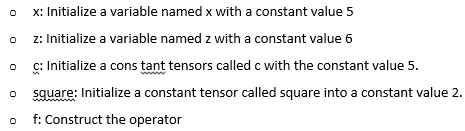

在这种情况下，我们选择了变量 `fixed` 的值。我们还构建了 `C`，这是一个常量张量，它是函数 `f` 中的一个常量参数。

它的常量值为 `5`。

该张量中名为 `constant` 的参数在图中可见。

在算子 `tf.pow` 中，我们也可以为指数强度 `( )` 创建一个常量张量。

它并不是需要的。我们这样做是为了在图中看到张量的名称。它是一个 `square`，形状是一个圆圈。

我们可以从图中看到张量发生了什么，以及它是如何返回值为 `66` 的。

以下代码评估了会话的特性。

```python
init = tf.global_variables_initializer()
with tf.Session() as sess:
    init.run() #初始化 x and y
    function_result = f.eval()
    print (function_result)
```

输出：

`[66]`

## 创建 TensorFlow 流水线的步骤

在示例中，我们手动为 `X1` 和 `X2` 添加了两个值。现在我们来看看到如何将数据导入 TensorFlow。

### 步骤 1) 创建数据

让我们开始 `numpy` 库生成两个 `ra` 值。

```python
import numpy as np
x_input = np.random.sample((1,2))
print(x_input)
```

输出：

`[[0.8835775 0.23766977]]`

### 步骤 2: 创建占位符

我们使用名称 `X` 作为占位符。张量的形状必须具体定义。如果数组中只加载了两个值，形状写为 `[1,2]`。

```python
# 使用占位符
x = tf.placeholder(tf.float23, shape=[1,2], name = 'X')
```

### 步骤 3) 定义数据集

随后，我们指定填充占位符 `x` 值的数据集。我们必须采用该过程。

`tf.data.Dataset.from_tensor_slices`

```python
dataset = tf.data.Dataset.from_tensor_slices(x)
```

### 步骤 4) 创建流水线

在第四阶段，我们将加载数据从中流过的流水线。创建一个名为 `make_initializable_iterator` 的迭代器。

它被称为迭代器。

然后，使用 `get_next`，我们必须调用迭代器来馈送下一批数据。这一步被称为 `get_next`。

在我们的案例中，只有一组两个值的数据。

```python
iterator = dataset.make_initializable_iterator()
get_next = iteraror.get_next()
```

### 步骤 5) 执行操作

最后一步与之前的示例相同。我们创建一个会话并运行迭代器过程。

由 `numpy` 提供的值被馈送到 `feed_dict` 中。这两个值将包含在占位符 `x` 中。然后，为了打印响应，我们运行 `get_next`。

```python
with tf.Session() as sess:
    # 将占位符馈入数据。
    sess.run(iterator.initializer, feed_dict={ x: x_input })
    print(sess.run(get_next))
```

输入向量与向量对应元素的乘积之和被用于衡量单向量感知机，每个权重都会增加向量相应部分的值。

输出中显示的值是激活函数的输入。

让我们看看如何使用 TensorFlow 实现一个用于图像分类查询的单层感知机。“逻辑回归”的表示是描绘单层感知机的最佳示例。

现在，我们必须完成以下逻辑回归的训练步骤：

* 在每次训练开始时，权重被用随机值初始化。
* 通过预期性能与实际性能之间的差异，确定训练集每个方面的误差。根据测得的误差调整权重。
* 重复此过程，直到总迭代次数小于指定的限制，且整个训练训练集的故障率小于指定的限制。

# 单层感知机完整代码

```python
# Import the MINST dataset
from tensorflow.examples.Books.mnist import input_data
mnist = input_data.read_data_("/tmp/data/", one_hot=True)

import tensorflow as tf
import matplotlib.pyplot as plt

# Parameters
learning_rate = 0.01
training_epochs = 25
batch_size = 100
display_step = 1

# tf Graph Input
x = tf.placeholder("float", [none, 784]) # MNIST data image of shape 28*28 = 784
y = tf.placeholder("float", [none, 10]) # 0-9 digits recognition => 10 classes

# Create model
# Set model weights
W = tf.Variable(tf.zeros([784, 10]))
b = tf.Variable(tf.zeros([10]))

# Constructing the model
activation=tf.nn.softmax(tf.matmul(x, W)+b) # Softmax function

# Minimizing error using cross entropy
cross_entropy = y*tf.log(activation)
cost = tf.reduce_mean(-tf.reduce_sum(cross_entropy, reduction_indice=1))
optimizer = tf.train.GradientDescentOptimizer(learning_rate).minimize(cost)

#Plot settings
avg_set = []
epoch_set = []

# Initializing the variables where init = tf.initialize_all_variables()

# Launching the graph
with tf.Session() as sess:
    sess.run(init)

    # Training of the cycle in the dataset
    for epoch in range(training_epochs):
        avg_cost = 0.
        total_batch = int(mnist.train.num_example/batch_size)

        # Creating loops at all the batches in the code
        for i in range(total_batch):
            batch_xs, batch_ys = mnist.train.next_batch(batch_size)
            # Fitting the training by the batch data
            sess.run(optimizer, feed_dict={x: batch_xs, y: batch_ys})
            # Compute all the average of loss
            avg_cost += sess.run(cost, feed_dict={x: batch_xs, y: batch_ys}) # total

        # Display the logs at each epoch steps
        if epoch % display_step == 0:
            print("Epoch:", '%0d' % (epoch+1), "cost=", "{:.9f}".format(avg_cost))
            avg_set.append(avg_cost)
        epoch_set.append(epoch+1)

    print("Training finished")

    plt.plot(epoch_set, avg_set, 'o', label='Logistics Training')
    plt.ylabel('cost')
    plt.xlabel('epoch')
    plt.legend()
    plt.show()

# Test the model
correct_prediction = tf.equal(tf.argmax(activation, 1), tf.argmax(y, 1))

# Calculating the accuracy of dataset
accuracy = tf.reduce_mean(tf.cast(correct_prediction, "float"))
print("Model accuracy:", accuracy.eval({x: mnist.test.images, y: mnist.test.labels}))
```

# TensorFlow - 多层感知机

最复杂的人工网络架构是多层感知机。它主要由几层感知机组成。TensorFlow 是一个常用的深度学习系统，本笔记本将向你展示如何使用它创建一个神经网络。我们必须使用 `Numpy` 从头构建一个多层感知机，以完全理解什么是多层感知机。

以下是多层感知机学习的可视化表示：


* 对于监督学习使用了 MLP 网络。反向传播算法是 MLP 网络的流行学习算法。
* 称为多层感知机 (MLP) 的前馈人工神经网络从一组输入产生一组输出。
* MLP 由几层输入节点描述，这些节点在输入层和输出层之间以有向图的形式连接。
* MLP 使用反向传播（Backpropagation）来训练网络。
* MLP 是深度学习的形式。
* 现在我们正专注于使用 MLP 来解决图像分类问题。

```python
# Import MNIST data
from tensorflow.examples.Books.mnist import input_data
mnist = input_data.read_data_sets("/tmp/data/", one_hot=True)

import tensorflow as tf
import matplotlib.pyplot as plt

# Parameters
learning_rate = 0.001
training_epochs = 20
batch_size = 100
display_step = 1

# Network Parameters
n_hidden_1 = 256 # 1st layer num features
n_hidden_2 = 256 # 2nd layer num features
n_input = 784 # MNIST data input (img shape: 28*28)
n_classes = 10 # MNIST total classes (0-9)

# tf Graph input
x = tf.placeholder("float", [None, n_input])
y = tf.placeholder("float", [None, n_classes])

# weights layer 1
h = tf.Variable(tf.random_normal([n_input, n_hidden_1])) # bias layer 1
bias_layer_1 = tf.Variable(tf.random_normal([n_hidden_1]))
# layer 1
layer_1 = tf.nn.sigmoid(tf.add(tf.matmul(x, h), bias_layer_1))

# weights layer 2
w = tf.Variable(tf.random_normal([n_hidden_1, n_hidden_2])) # bias layer 2
bias_layer_2 = tf.Variable(tf.random_normal([n_hidden_2]))
# layer 2
layer_2 = tf.nn.sigmoid(tf.add(tf.matmul(layer_1, w), bias_layer_2))

# weights output layer
output = tf.Variable(tf.random_normal([n_hidden_2, n_classes])) # bias output layer
bias_output = tf.Variable(tf.random_normal([n_classes]))
# output layer
output_layer = tf.matmul(layer_2, output) + bias_output

# cost function
cost = tf.reduce_mean(tf.nn.sigmoid_cross_entropy_with_logits(logits=output_layer, labels=y))

# optimizer
optimizer = tf.train.AdamOptimizer(learning_rate=learning_rate).minimize(cost)

# Initializing the variables
init = tf.global_variables_initializer()

# Launch the graph
with tf.Session() as sess:
    sess.run(init)

    # Training cycle
    for epoch in range(training_epochs):
        avg_cost = 0.
        total_batch = int(mnist.train.num_examples/batch_size)

        # Loop over all batches
        for i in range(total_batch):
            batch_xs, batch_ys = mnist.train.next_batch(batch_size)
            # Fit training using batch data
            sess.run(optimizer, feed_dict={x: batch_xs, y: batch_ys})
            # Compute average loss
            avg_cost += sess.run(cost, feed_dict={x: batch_xs, y: batch_ys})

        # Display the logs at each epoch step
        if epoch % display_step == 0:
            print("Epoch:", '%0d' % (epoch+1), "cost=", "{:.9f}".format(avg_cost))
```

```python
avg_cost += sess.run(cost, feed_dict={x: batch_xs, y: batch_ys}) / total_batch
```

# 显示每个 epoch 的日志

```python
if epoch % display_step == 0:
    print
    "Epoch:", '%04d' % (epoch + 1), "cost=", "{:.9f}".format(avg_cost)
avg_set.append(avg_cost)
epoch_set.append(epoch + 1)
print
    "Training phase finished"

plt.plot(epoch_set, avg_set, 'o', label ='MLP Training phase')
plt.ylabel('cost')
plt.xlabel('epoch')
plt.legend()
plt.show()
```

# 测试模型

```python
correct_prediction = tf.equal(tf.argmax(output_layer, 1), tf.argmax(y, 1))

# 计算准确率
accuracy = tf.reduce_mean(tf.cast(correct_prediction, "float"))
print
    "Model Accuracy:", accuracy.eval({x: mnist.test.images, y: mnist.test.labels})
```

## 创建交互会话

当使用 TensorFlow 运行代码时，我们有两个简单的选项：

• 构建图和会话[完成设置后运行会话以测试张量并运行操作]。
• 编写我们的代码并立即运行。

对于第一部分，我们将使用更适合 Jupyter notebook 环境的交互式会话。

```python
sess = tf.InteractiveSession()
```

## 创建占位符

在使用 TensorFlow 时，最好在分配变量之前构建占位符。在本节中，我们将为输入 ("Xs") 和输出 ("Os") ("Ys") 创建占位符。

分配给输入图像的“空间”由占位符 `X.` 表示。

* 一个 28 宽 x 28 高的矩阵在每个输入周围分布了 784 个像素。
* `'shape'` 语句指定了张量的维度。

# 机器学习与深度学习

## 什么是机器学习？

机器学习是人工智能（AI）的一个分支，它赋予计算机自主学习和发展的能力。

Arthur Samuel 在 1959 年首次启动了这一领域。

主要目标是让机器自主学习，不需要人工干预，并此此改变其行为。

从历史上，许多问题对人类来说很简单，但对网络来说很困难。

机器学习（特别是深度学习）实际上是解决其中许多问题的最佳方法。

医学诊断、图像处理、估计、分类和回归只是少数几个例子。

## 机器学习的特征

* 机器学习利用数据来在任何数据集中寻找模式。
* 它是一项基于数据的技术。
* 它通过学习过去的数据来自动增强这些数据。
* 机器学习和数据挖掘的相似之处在于，它们都处理海量数据。

## 机器学习的需求

机器学习的需求非常大，而且需求只会不断增加。

作为人类，我们有很多短板，例如无法手动访问海量数据，这使得使用计算机系统变得必要。

而机器学习可以为此提供帮助。

得益于它的用例，机器学习可以很容易被理解。

机器学习目前用于自动驾驶汽车、网络欺诈检测、人脸识别和 Facebook 朋友推荐。

世界上最著名的企业（如亚马逊和 Netflix）已经开发了机器学习模型，这些模型根据大量数据评估用户兴趣并正确地建议产品。

## 机器学习的类型

世界上最著名的企业（如亚马逊和 Netflix）已经开发了机器学习模型，这些模型根据大量数据评估用户兴趣并正确地建议产品。

### 监督学习

在监督学习中，模型由导师引导。它有两种类型：

* 分类：监督学习是一种对对象分类的方法。
* 回归：监督学习是一种预测输出的方法。

### 无监督学习

在无监督学习中，数据既没有被分类也没有标记。它有两种类型：

* 聚类：无监督学习是一种识别相似性的技术。
* 关联：无监督学习是一种发现关联的工具。

### 半监督学习

半监督学习位于监督和无监督学习之间。它使用少量的标记数据和大量的未标记数据。

### 强化学习

智能体（agent）与环境通信并确定最佳结果的能力被称为强化学习。它基于试错过程。

#### 强化学习的组件

* 决策/智能体学习
* 环境 - 智能体交互的对象
* 动作 - 智能体执行

## 深度学习

在人工智能中，深度学习是机器学习的一个分支。学习有三种类型：监督、半监督和无监督。

深度学习是机器学习的一种形式，它训练计算机完成人类自然完成的事情。

一个 `perceptron`（感知器）是一个只有一层的神经网络。它是一个带有二分类器的监督学习系统。`perceptron` 是人工神经网络中生物神经元的一种基础模型。

人工神经元中也存在输入和输出。

## 感知器模型的数学表示

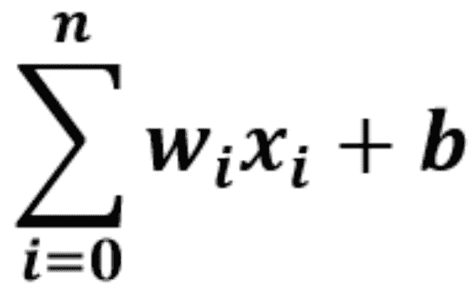

大脑中的神经元之间相互传递信息，神经网络中的节点也进行同样的操作。数学函数由节点表示。

生物神经元的结构和作用被用于创建神经网络。

神经网络的输入和输出使其产生改变或理解。

由于其学习和发展的特性，人工神经网络的结构会受到流过系统信息的影响。

可以使用多个感知器来创建一个神经网络。它有三层，即这三层：

- `Input layer`：输入层表示数据的真实值。
- `Hidden layer`：输入层和输出层之间是隐藏层，三或更多层构成了深度网络。
- `Output layer`：它是输出的最终估计。

## 人工神经网络的类型

神经网络的工作方式与人类神经系统相同。神经网络有各种形状和大小。这些网络的实现基于一组必须用于确定性能的参数和数学运算。

### 前馈神经网络（人工神经元）

最纯类型的 ANN 是 `FNN`，它只允许数据和输入向一个方向流动。前馈神经网络的命名是因为数据只向一个方向流动：前向。数据通过输入节点进入系统，并通过输出节点退出。节点之间不是以循环方式连接的。不需要隐藏层。`FNN` 无需多个层。它甚至可能只有单层。

它具有一个由分类激活特征生成的前传播波。`Backpropagation`（反向传播）用于所有其他形式的神经网络，但不用于 `FNN`。在 `FNN` 中，产品的输入和权重相加，结果反馈给输出。人脸识别和计算机视觉是 `FNN` 使用的技术之一。

### 径基函数神经网络

`RBFNN` 计算两点之间的距离并认为其处于良好状态。RBF 神经网络由两层组成。特征在内部层中与径基函数结合。特征产生一个被考虑的输出。除了欧几里距离量外，还可能使用其他方法。

### 径基函数

- 描述了一个接收器 `t`。
- 接收器被对角图表包围。
- `RBF` 中经常使用高斯函数。因此，可以描述径向距离。`r=||X-t||`。

`Redial Function=Φ(r) = exp (- r 2 /2σ 2 )`，其中 `σ > 0`

这种神经网络被用于电力恢复方法中。近年来，电力系统的规模和复杂性不断增加。

所有这些因素增加了大规模停电的可能性。在停电后，必须尽快、安全地恢复电力。

### 多层感知器

三层或更多层构成了多层感知器。这种网络用于分类无法线性分离的数据。

该网络是一个全连接网络，这意味着每个节点都连接到其上方层的所有其他节点。在多层感知器中使用了 `Nonlinear Activation Function`（非线性激活函数）。

输入层和输出层都有在定向图中链接的节点。

这是一种采用 `backpropagation`（反向传播）训练网络的深度学习方法。

它被用于许多语音识别和机器翻译软件。

### 卷积神经网络

卷积神经网络在图像分类和识别中起着至关重要的作用，或者我们可以认为它是这些领域的关键。

`CNNs` 通常用于人脸识别、目标检测等领域。在神经元中，可见可学习的权重和偏置，类似于 `FNN`。

`CNN` 将图像作为输入，并将其分类和处理为许多类别之一，例如狗、猫、狮子、老虎等。

众所周知，计算机将图像解释为像素，这取决于图像的分辨率。

根据图像分辨率，它将看到 `h * w * d`，其中 `h = 高`，`w = 宽`，`d = 维度`。

例如，一张 RGB 图像是一个 `6 * 6 * 3` 矩阵数组，而灰度图像是一个 `4 * 4 * 3` 模式数组。

`CNN` 中的每个输入图像都将经过一系列卷积层、池化层、全连接层和过滤器（也称为内核）。

要识别具有 0 到 1 之间概率值的对象，请使用 `Soft-max` 函数。

### 循环神经网络

循环神经网络神经网络是一个基于预测的系统。

在这种神经网络中，特定层的输出被保存并反馈到输入中。

它有助于预测该层的结果。

循环神经网络的第一层创建方式与 `FNN` 的第一层相同，而循环神经网络阶段从随后的层开始。

所有输入和输出之间都是相互独立的，但在某些情况下，必须预测句子的下一个单词。

然后将由句子之前的名称决定。

`RNN` 的 `Hidden State`（隐藏状态）函数是它最为人知且关键的特征。关于序列的知识由 `Hidden State` 记忆。

### 模块神经网络

模块神经网络中的多个网络是功能独立的。

`MNN` 中的作用被分为多个任务并由多个系统执行。

网络在计算过程中不相互交互。

所有接口共同工作以实现所需的结果。

平面和开放网络的效率低于组合网络。中间提取每个系统的输出并进行处理以创建最终输出。

### 序列序列网络

两个循环神经网络组成该系统。输入由 `encoder` 处理，输出由 `decoder` 处理。对于相同或不同的参数，可以使用 `encoder` 和 `decoder`。

聊天机器人、机器翻译和问答系统都使用序列序列模型。

在神经网络中，需要算法的支持。生物神经元具有自我意识和功能能力，但人工神经元如何以相同的方式运行呢？这要求我们对人工神经网络进行训练。有几种算法被用于此目的，每种算法都有独特的方式运行。

在准备人工神经网络（ANN）时，我们使用了五种不同的算法：

- 梯度下降 (Gradient Descent)
- 牛顿法 (Newton's Method)
- 共轭梯度法 (Conjugate Gradient)
- 拟牛顿法 (Quasi Newton's)
- 莱文伯格马奎特法 (Levenberg Marquardt)

### 梯度下降

最陡下降法是梯度下降算法的另一个名称。它是依赖梯度向量信息的的最简单算法。一阶方法就是 GD 算法。

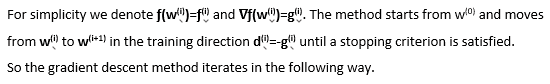

```

w (i+1) = w (i) - g (i) n (i)

```

### 牛顿法

二阶算法是牛顿过程。它利用了海森矩阵（Hessian matrix）。其主要目标是利用损失函数的二阶导数来寻找更好的训练方向。

牛顿法的迭代如下：

```

w (i+1) = w (i) - H (i)-1 . g (i) For i = 0, 1.....

```

在这里，`H (i)-1 .g (i)` 被称为牛顿步长。参数的偏移可能会趋向于极限值而不是最小值。

使用牛顿法训练神经网络的描如图如图所示。通过确定训练路径和合理的训练速度，可以改进参数。

### 共轭梯度法

在梯度下降和牛顿过程之间，使用了共轭梯度法。

共轭梯度法避免了牛顿过程对知识的要求，例如评估、海森矩阵求逆以及存储。

CG 算法在共轭方向而非梯度下降方向进行搜索，从而导致更快的收敛。从海森矩阵的角度来看，训练是在共轭方向上进行的。通过计算共轭训练路径并在方向上选择可接受的训练率来改进参数。

### 拟牛顿法

从计算角度来说，牛顿法是非常耗时的。评估海森矩阵需要许多操作。

拟牛顿法的创建是为了解决这一缺陷。变分矩阵过程是它的另一个名称。

该算法不是直接计算海森矩阵的逆，而是在每次迭代中构建它的近似值。近似值是通过损失函数的一阶导信息计算的。

### 莱文伯格马奎特法

阻尼最小二乘法也称为莱文伯格马奎特法。该算法是针对损失函数设计的。该算法不计算海森矩阵，而是使用雅可比矩阵（Jacobian matrix）和梯度向量。

莱文伯格马奎特的第一步是确定损失、梯度和海森近似值，之后修改阻尼参数。

## 人工神经网络：优点与缺点

### ANN 的优点

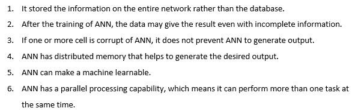

### ANN 的缺点

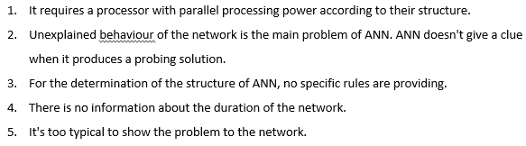

# TensorFlow 线性回归

线性回归是一种基于监督学习的机器学习算法。它执行回归分析。基于自变量，回归模型对目标预测值。它通常用于确定变量之间的关系。线性模型（例如假设输入变量（`x`）与单个输出变量之间存在线性关系的模型）被称为线性回归（`y`）。输入变量的线性组合可以衡量 `x` 中的 `y`。线性回归是一种广泛使用的统计技术，用于从连续数据集中学习函数。例如，假设我们给定了一些 `x` 和对应的数据点，我们需要知道它们之间的关系，这被称为假设（hypothesis）。在线性回归中，假设是一条直线，这意味着 `h (x) = wx + b`，其中 `w` 表示权重向量，`b` 表示偏置（bias）。模型的权重和偏置被称为参数。我们必须从数据集中估计 `w` 和 `b` 的值，使得生成的假设至少产生代价函数所描述的较小 `j` 值。


其中 `m` 表示数据点的数量。均方误差（Mean Squared Error）是该代价函数的名称。我们将使用名为梯度下降的常用优化器来优化参数，使 `j` 的值尽可能小。以下是梯度下降的伪代码：

```

Repeat until Convergence {

  w = w - ?J/?w

  b = b - ?J/?b

}

```

## 线性回归的实现

在 Tensorflow 中，我们将从导入所需的库开始。对于计算，我们将使用 Numpy 配合 Tensorflow；对于绘图，我们将使用 Matplotlib。

首先，我们必须导入以下内容：

```python
import matplotlib.pyplot as plt
import numpy as np
import tensorflow as tf
```

我们必须为 Tensorflow 和 Numpy 确定固定种子以预测随机数。

```python
tf.set_random_seed(101)
np.random.seed(101)
```

我们现在必须创建一些随机数据来训练线性回归。

```python
# 生成随机线性数据
# 将有 50 个数据点，范围从 0 到 50。
x = np.linspace(0, 50, 50)
y = np.linspace(0, 50, 50)

# 为随机线性数据添加噪声
x += np.random.uniform(-4, 4, 50)
y += np.random.uniform(-4, 4, 50)

n = len(x) # 数据点数量
```

让我们看看训练结果。

### 训练数据点图

```python
plt.scatter(x, y)
plt.xlabel('x')
plt.xlabel('y')
plt.title("Training Data")
plt.show()
```

我们将开始识别占位符（placeholders）`x` 和 `y`，它们将在训练阶段用于将训练示例 `x` 和 `y` 馈给优化器。

```python
X = tf.placeholder("float")
Y = tf.placeholder("float")
```

我们现在可以为偏置和权重声明两个可训练的 TensorFlow 变量，并使用方法随机初始化它们：

```python
np.random.randn()
W = tf.Variable(np.random.randn(), name="W")
B = tf.Variable(np.random.randn(), name="b")
```

现在指定模型的超参数、学习率和训练轮数（Epochs）。

```python
learning_rate = ..01
training_epochs = 1000
```

我们现在可以构建假设、代价函数和优化器。由于梯度下降优化器已集成到 TensorFlow 中，我们不会手动实现它。随后将初始化过程中的变量。

```python
# 函数假设
y_pred = tf.add(tf.multiply(X, W), b)

# 均方误差函数
cost = tf.reduce_sum(tf.pow(y_pred-Y, 2)) / (2 * n)

# 梯度下降优化器
optimizer = tf.train.GradientDescentOptimizer(learning_rate).minimize(cost)

# 全局变量初始化
init = tf.global_variables_initializer()
```

现在我们在 Session 中开始训练过程。

```python
# 启动 Tensorflow Session
with tf.Session() as sess:
  # 初始化变量
  sess.run(init)

  # 遍历所有轮次
  for epoch in range(training_epochs):
    # 根据馈字典将每个数据点馈入优化器
    for (_x, _y) in zip(x, y):
      sess.run(optimizer, feed_dict={X: _x, Y: _y})

    # 在这里，我们每 50 轮显示一次结果
    if (epoch + 1) % 50 == 0:
      # 计算每轮的代价
      c = sess.run(cost, feed_dict={X: x, Y: y})
```

```python
print("Epoch", (epoch + 1), ": cost =", c, "W =", sess.run(W), "b=", sess.run(b))
```

### # 存储 Session 外部使用的必要值

```python
training_cost = sess.run (cost, feed_dict ={X: x, Y: y})
weight = sess.run(W)
bias = sess.run(b)
```

输出如下：

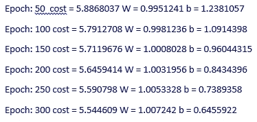
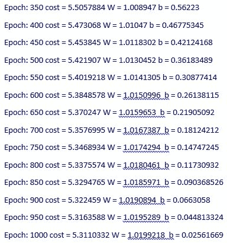

现在，查看结果。

### # 计算预测值

```python
predictions = weight * x + bias
print ("Training cost =", training_cost, "Weight =", weight, "bias =", bias, '\n')
```

输出

Training cost= 5.3110332 Weight= 1.0199214 bias=0.02561663

值得注意的是，在这种情况下，`weight` 和 `bias` 都是标量。这是因为我们在训练结果中只查看了一个因变量。如果我们的训练数据集有 `m` 个因变量，`weight` 将是一个一维向量，而 `Bias` 将是一个标量。

最后，我们将对结果进行绘图：

### # 绘制下方结果

```python
plt.plot(x, y, 'ro', label ='original data')
plt.plot(x, predictions, label ='Fited line')
plt.title('Linear Regression Result')
plt.legend()
plt.show()
```
