# JavaScript 应用程序设计


献给Marian，感谢你承受这本书诞生过程中的种种，感谢你无条件的爱和无尽的耐心。

我爱你！

你愿意嫁给我吗？


## 前言

近年来，设计健壮的 JavaScript Web 应用程序的过程经历了一场轰轰烈烈的复兴。随着这门语言被用于开发越来越雄心勃勃的应用程序和界面，现在正是推出 *JavaScript 应用程序设计* 的完美时机。通过简洁的示例、来自实践的经验教训以及可扩展开发的关键概念，Nico Bevacqua 将为你提供一场旋风之旅，将你的应用程序流程和设计提升到新的水平。

本书还将帮助你构建能够节省时间的构建流程。时间是保持生产力的关键因素。作为 Web 应用开发者，我们希望充分利用我们的时间，而 Build First 理念可以帮助我们一马当先，从一开始就拥有干净、可测试且结构良好的应用程序。学习流程工作流以及如何管理复杂性是现代 JavaScript 应用开发的基石。从长远来看，正确处理它们可以带来巨大的差异。

*JavaScript 应用程序设计* 将引导你完成前端自动化。它涵盖了从避免重复性任务和监控生产构建，到通过清晰的工具设置减轻人为错误成本的所有内容。自动化在这里是一个重要因素。如果你今天的工作流程中没有使用自动化，那你就太辛苦了。如果一系列日常任务可以通过单个命令完成，请遵循 Nico 的建议，将节省下来的时间用于提高应用程序的代码质量。

模块化是最后一个至关重要的概念，它有助于构建可扩展、可维护的应用程序。这不仅有助于确保构成我们应用程序的组件可以更容易地进行测试和文档化，还能鼓励重用和关注质量。在 *JavaScript 应用程序设计* 中，Nico 会专业地引导你编写模块化的 JavaScript 组件，正确处理异步流程，并提供足够的客户端 MVC 知识，让你能够构建自己的应用程序。

系好安全带，调整好你的命令行，享受这趟改善你开发工作流程的旅程吧。

ADDY OSMANI
高级工程师
热衷于开发者工具
谷歌

## 前言

像我们这个领域的大多数人一样，我一直对解决问题着迷。寻找解决方案时那种痛苦的刺激，找到解决方法时那种兴奋的解脱感——没有什么能比得上它。小时候，我非常喜欢策略游戏，比如我从小就玩的国际象棋；《星际争霸》，我连续玩了 10 年的即时战略游戏；以及《万智牌》，一款可以描述为扑克和象棋交叉点的集换式卡牌游戏。它们提供了大量的解决问题的机会。

在小学时，我学习了 Pascal 和基础的 Flash 编程。我兴奋极了。我后来继续学习了 Visual Basic、PHP、C，并开始开发网站，掌握了 `<marquee>` 和 `<blink>` 标签的精妙运用，并对 MySQL 有了适度的理解；我势不可挡，但我对解决问题的渴望并未到此为止，我又回到了游戏世界。

《网络创世纪》（UO），一款大型多人在线角色扮演游戏（难怪他们将其缩写为 MMORPG），与其他让我沉迷多年的游戏并无二致。最终，我发现了 UO 服务器的一个开源<sup>1</sup>实现，名为 RunUO，完全用 C# 编写。我在一个 RunUO 服务器上玩，那里的管理员没有编程经验。他们开始慢慢信任我处理一些小的错误修复，实际上是通过电子邮件来回发送源代码文件。我完全被迷住了。C# 是一门出色的、富有表现力的语言，而 UO 服务器的开源软件也非常友好和吸引人——你甚至不需要一个 IDE（甚至不需要知道那是什么），因为服务器会动态地为你编译脚本文件。你基本上是在写一个包含 10 到 15 行代码的文件，继承 `Dragon` 类，然后在他们头上添加一个令人印象深刻的文本泡泡，或者重写一个方法让他们吐出更多的火球。你会在不知不觉中学会这门语言及其语法，仅仅是因为乐在其中！

最终，一位朋友透露，我可以靠写 C# 代码谋生：“你知道，人们实际上会付钱让你做那个，”他说。就在那时，我又开始开发网站，只不过我不再仅仅为了好玩而使用 Front Page 和一堆 `<marquee>` 标签或 Java 小程序了。不过，它对我来说仍然像一场游戏。

几年前，我读了 *The Pragmatic Programmer*²，突然茅塞顿开。这本书有很多扎实的建议，我强烈推荐它。有一件事对我影响特别大：作者们主张你走出舒适区，尝试一些你一直想做但还没来得及做的事情。那时我的舒适区是 C# 和 ASP.NET，所以我决定尝试 Node.js，一个明确面向 UNIX 的服务器端 JavaScript 开发平台，这无疑与我迄今为止充斥着微软的开发经验不同。

我从那次实验中学到了很多，并最终建立了一个博客³，在那里我写下我在过程中学到的所有东西。大约六个月后，我决定将我多年在 C# 设计方面的经验写成一本关于 JavaScript 的书。我联系了 Manning 出版社，他们抓住了这个机会，帮助我集思广益，将原始的想法变成更周到、更简洁的内容。

这本书是许多小时辛勤工作、奉献和对 Web 的热爱的成果。在书中，你将找到关于应用程序设计、流程自动化和最佳实践的实用建议，这些建议将提高你的 Web 项目的质量。

> ² *The Pragmatic Programmer: From Journeyman to Master*（Andrew Hunt 和 David Thomas 合著，Addison Wesley，1999）是一本永恒的经典之作，你真的应该认真考虑阅读。
>
> ³ 你可以在 [ponyfoo.com](https://ponyfoo.com) 阅读我的博客 "Pony Foo"。我撰写关于 Web、性能、渐进式增强和 JavaScript 的文章。

## 致谢

如果没有每一位在写作过程中支持和忍受我的人，你手中就不会拿着这本书。我只能希望那些最应该得到感谢的人——我的朋友和家人——已经知道，我无法用言语表达我对他们的爱、理解和频繁的安慰有多么感激。

还有更多的人直接或间接地为这本书贡献了大量的智慧和灵感。

开源 JavaScript 社区是洞察力、鼓励和无私贡献的无尽源泉。他们让我看到了一种更好的软件开发方式，在这种方式中，协作不仅是可能的，而且是受到积极鼓励的。其中大多数人通过宣传 Web、维护博客、分享他们的经验和资源以及以其他方式教育我而间接地做出了贡献。其他人则通过开发本书中讨论的工具直接做出了贡献。这些人包括 Addy Osmani、Chris Coyier、Guillermo Rauch、Harry Roberts、Ilya Grigorik、James Halliday、John-David Dalton、Mathias Bynens、Max Ogden、Mikeal Rogers、Paul Irish、Sindre Sorhus 和 T.J. Holowaychuk。

还有许多书籍作者和内容分销商影响和激励我成为一名更好的教育者。通过他们的写作和分享，这些人极大地帮助塑造了我的职业生涯。他们包括 Adam Wiggins、Alan Cooper、Andrew Hunt、Axel Rauschmayer、Brad Frost、Christian Heilmann、David Thomas、Donald Norman、Frederic Cambus、Frederick Brooks、Jeff Atwood、Jeremy Keith、Jon Bentley、Nicholas C. Zakas、Peter Cooper、Richard Feynmann、Steve Krug、Steve McConnell 和 Vitaly Friedman。


## 致谢

Manning出版社的开发编辑苏珊·科南特值得特别提及。她将本书的质量标准提升到了我可能达到的最高水平，没有她的帮助，本书绝不会有如此好的呈现。除此之外，她还需要手把手地引导我完成撰写第一本书这一精细而私密的过程。通过她不懈而温和的指导，她帮助我将那些零散的想法塑造成了一本我敢于出版的书。我因她而成为了一位更好的写作者，我对此深表感激。

她并非孤军奋战。Manning的所有工作人员都希望这本书能做到最好。我们要感谢出版商马扬·巴策及其编辑团队。技术校对员瓦伦丁·克雷塔兹和迪帕克·沃赫拉不仅在确保代码示例的一致性和实用性方面发挥了关键作用，还为我提供了极佳的反馈。

还要感谢众多愿意通读书稿、留下意见并帮助改进本书的匿名读者。感谢在“作者在线”论坛发布勘误和评论的MEAP读者，以及在开发各个阶段审阅章节的评审们：阿尔贝托·基耶萨、卡尔·莫斯卡、多米尼克·佩蒂弗、加文·怀特、汉斯·唐纳、伊利亚斯·约安诺、约纳斯·班迪、约瑟夫·怀特、基思·韦伯斯特、马修·梅尔克斯、理查德·哈里曼、桑迪普·库马尔·帕特尔、斯蒂芬·韦克利、托尔斯滕·丁克勒和特雷弗·桑德斯。

特别感谢阿迪·奥斯马尼为本书撰写前言，也感谢所有其他参与其中的人。即使他们没有亲自敲击键盘，他们在推动本书出版、使其更接近读者方面也发挥了重要作用。

## 关于本书

Web开发已经发展到超乎比例的规模，如今很难想象一个没有Web的世界。Web以其出色的容错性而闻名。传统编程告诉我们，漏掉分号、忘记添加闭合标签或声明无效属性会导致严重后果，但Web的情况却不同。Web是一个允许犯错的地方，然而错误的空间却越来越小。这种矛盾源于现代Web应用程序的复杂程度比过去高出一个数量级。在Web发展的初期，我们可能只是用JavaScript对网页进行一些微小的修改；而在现代Web中，整个站点可以在单个页面中呈现，由JavaScript驱动。

*JavaScript应用设计*是你通往更美好的现代Web开发体验的指南，在这里，你可以像使用任何其他语言一样，开发可维护的JavaScript应用程序。你将学习如何利用自动化来替代那些繁琐、重复且容易出错的过程，如何设计易于测试的模块化应用程序，以及如何进行测试。

流程自动化在各个方面都是节省时间的关键。开发环境中的自动化帮助我们将精力集中在思考、编写代码和调试上。自动化有助于确保我们在每次将更改发布到版本控制后，代码都能正常工作。它通过打包、压缩资源、创建精灵图以及添加其他性能优化技术，在准备应用程序生产环境时节省时间。它还有助于部署，通过降低风险并将复杂且容易出错的过程自动化。许多书籍在讨论后端语言时会涉及流程和自动化，但当涉及JavaScript驱动的应用程序时，就很难找到相关材料了。

*JavaScript应用设计*的核心价值是质量。自动化为你提供了一个更好的构建应用程序的环境，但这还不够：应用程序本身也需要具备质量意识。为此，本书涵盖了应用程序设计指南，首先快速概述语言特定的注意事项，教你模块化的力量，帮助你理清异步代码，开发客户端MVC应用程序，并为JavaScript代码编写单元测试。

本书依赖于特定的工具和框架版本，正如关于Web技术的书籍通常所做的那样，但它将库特定的问题与当前讨论的理论分离开来。这是对工具在快节奏的Web开发领域变化频繁这一事实的妥协，但设计和工具背后的过程往往节奏要慢得多。得益于这种关注点的分离，我希望本书能在未来多年保持其价值。

### 路线图

*JavaScript应用设计*分为两部分和四个附录。第一部分专门介绍“构建优先”方法，它是什么，以及它如何能帮助你的日常工作。这部分详细介绍了流程自动化，从日常开发到自动化部署，以及持续集成和持续部署；共涵盖4章。

-   第1章描述了驱动“构建优先”的核心原则，以及你可以设置的不同流程和流程。然后介绍了我们将在全书中讨论的应用程序设计指南，并为本书其余部分奠定了基础。

-   在第2章中，你将了解Grunt，以及如何使用它来构建构建流程。然后我们看看你可以使用Grunt轻松执行的一些不同的构建任务。

-   第3章专门讨论环境和开发工作流程。你将了解并非所有环境都是生而平等的，以及如何在开发环境中优先考虑调试和生产力。

-   第4章引导你了解发布流程并讨论部署。你将了解一些针对性能优化的更多构建任务，以及如何执行自动化部署。你还将了解如何连接持续集成，以及如何在应用程序投入生产后对其进行监控。

虽然第1部分侧重于使用Grunt构建应用程序，但附录C教你如何为工作选择最佳构建工具。读完第1部分后，你将进入本书的第二部分，该部分专门介绍管理应用程序设计中的复杂性。模块、MVC、异步代码流、测试和精心设计的API在现代应用程序中都扮演着重要角色，将在后续章节中讨论。

-   第5章专注于开发模块化JavaScript。它首先阐述了什么构成模块，以及你如何以模块化的方式设计应用程序，并列出了这样做的好处。之后，你将学习JavaScript语言中词法作用域及相关特性的速成课程。随后，你将了解实现模块性的主要方式：RequireJS、CommonJS以及即将到来的ES6模块系统。本章最后回顾了不同的包管理解决方案，例如Bower和npm。

-   在第6章中，你将学习异步代码流。如果你曾经陷入回调地狱，这可能是你的出路。本章讨论了处理异步代码流中复杂性的不同方法，即回调、Promise、事件和ES6生成器。你还将学习如何在这些范式下进行适当的错误处理。

-   第7章首先描述MVC架构，然后将其具体与Web联系起来。你将学习如何使用Backbone来开发丰富的客户端应用程序，这些应用程序使用MVC来分离关注点。之后，你将了解Rendr，它可用于在服务器端呈现Backbone视图，从而优化应用程序的性能和可访问性。

-   在第8章中，既然你的应用程序已经模块化、清晰且可维护，你将采取下一个逻辑步骤，并以不同方式审视测试你的应用程序。为此，我们将介绍各种JavaScript测试工具，并亲身体验使用它们来测试小组件。然后我们将回到第7章构建的MVC应用程序，并为其添加测试。你将不仅仅进行单元测试，还将了解更多关于持续集成、视觉测试和性能测量的内容。

-   第9章是本书的最后一章，专门介绍REST API设计。这是客户端与服务器交互的层级，它为我们在应用程序中所做的一切设定了场景。如果API混乱复杂，那么整个应用程序很可能也会如此。REST在设计API时引入了明确的准则，确保API简洁。最后，我们将探讨如何在客户端以传统方式使用这些服务。

附录可以在读完本书后阅读，但如果你在它们所涵盖的领域遇到困难时阅读，可能会从中学到最多价值，因为它们包含了你可能遇到的问题的答案。在全书中，你会在适当的时候被引导到附录，以便对其中一个主题进行更深入的探讨。

-   附录A是对Node.js及其模块系统CommonJS的简要介绍。它将帮助你解决Node.js安装问题，并回答一些关于CommonJS如何工作的问题。

-   附录B是对Grunt的详细介绍。虽然第I部分的章节仅解释了Grunt绝对必要的部分，但附录更详细地介绍了其内部工作原理，如果你打算使用Grunt开发一个完整的构建流程，它将非常方便。

### 附录 C 明确说明了本书绝不拘泥于 Grunt，并列出了几个替代方案，包括 Gulp 和 `npm run`。该附录讨论了三者各自的优缺点，由你来决定哪一种（如果有的话）最符合你的需求。

- 附录 D 介绍了一份 JavaScript 质量指南，其中包含大量你可以选择遵循的最佳实践。其目的并不是要强迫你接受这些特定的指导方针，而是让你认识到，在开发团队工作中，保持代码库的一致性是推动项目进展的重要因素。

### 代码约定与下载

所有源代码均使用`等宽字体`呈现，有时会以命名代码清单的形式分组。许多代码清单附有代码注释，以突出重要概念。本书的源代码是开源的，托管在 GitHub 上。你可以访问 [github.com/buildfirst/buildfirst](https://github.com/buildfirst/buildfirst) 下载。在线仓库始终包含最新版本的配套源代码。虽然书中可能仅对源代码进行简要讨论，但仓库中的文档更为完善，如果你遇到问题，我建议你查看其中带有注释的代码。

你也可以从出版社网站下载代码：[www.manning.com/JavaScriptApplicationDesign](https://www.manning.com/JavaScriptApplicationDesign)。

### 在线作者服务

购买*JavaScript Application Design*（JavaScript 应用程序设计）一书，即可免费访问 Manning Publications 运营的私人网络论坛，在那里你可以对本书发表评论、提出技术问题，并从作者和其他用户那里获得帮助。要访问论坛并订阅，请将浏览器指向 [www.manning.com/JavaScriptApplicationDesign](https://www.manning.com/JavaScriptApplicationDesign)。该页面提供了注册后如何进入论坛、可获得哪些帮助以及论坛行为准则等信息。

Manning 对读者的承诺是提供一个场所，让单个读者之间以及读者与作者之间能够进行有意义的对话。但这并不意味着作者必须参与特定数量的讨论，作者对论坛的贡献是自愿的（且无偿的）。我们建议你向作者提出一些具有挑战性的问题，以免他失去兴趣！只要本书仍在印刷，作者在线论坛以及往期讨论档案将一直可从出版社网站访问。

### 关于作者

Nicolas Bevacqua 是开源 JavaScript 社区的活跃成员、自由网页开发者、偶尔的公开演讲者，也是一位充满热情的作家。他维护着许多开源项目，并在 [ponyfoo.com](http://ponyfoo.com) 上撰写关于 Web、性能、渐进增强和 JavaScript 开发的文章。Nico 目前与美丽的女友 Marian 一起居住在阿根廷布宜诺斯艾利斯。


### 关于封面插图

*JavaScript Application Design*一书的封面人物标题为"1760 年冬季堪察加人的着装"。堪察加半岛是俄罗斯最东端的部分，东临太平洋，西濒鄂霍次克海。这幅插图取自 Thomas Jefferys 的*A Collection of the Dresses of Different Nations, Ancient and Modern*（伦敦，1757 年至 1772 年间出版）。书名页说明这些是手工上色的铜版画，以阿拉伯胶提亮。Thomas Jefferys（1719–1771）被称为"乔治三世国王的地理学家"。他是一位英国制图师，是当时领先的地图供应商。他为政府及其他官方机构雕刻和印刷地图，并制作了广泛的商业地图和地图集，尤其是北美地区。他的制图工作激发了他对所测绘土地上当地服饰习俗的兴趣；这些在的四卷本收藏中得到了精彩的展示。

对远方土地的迷恋和为享乐而旅行在 18 世纪相对来说是新现象，诸如此类的收藏很受欢迎，既向游客也向 armchair traveler（足不出户的旅行者）介绍其他国家居民。Jefferys 著作中插图的多样性生动地诉说了几个世纪前世界各国独特性和个体差异。着装规范已经改变，一度如此丰富的地区和国家多样性已经消逝。现在，往往很难区分来自不同大陆的居民。或许，乐观地看待，我们用文化和视觉多样性换取了更加丰富的个人生活——或者更加多样化和有趣的智力与技术生活。

在计算机书籍难以区分的时代，Manning 以 Jefferys 的画作重现了 250 多年前民族服饰的丰富多样性，以此赞美计算机行业的创造力和主动性。

# 第一部分：构建流程

本书的第一部分专门介绍构建流程，并提供 Grunt 的实用入门。你将从理论和实践两方面了解构建流程的为什么、怎么做和做什么。

在第 1 章中，我们将概述"Build First"（先构建）理念包含的内容：构建流程和应用复杂性管理。然后，我们将开始使用 lint 工具来防止代码中的语法错误，这是你的第一个构建任务。

第 2 章全是关于构建任务的内容。你将了解构成构建的各种任务、如何配置它们，以及如何创建自己的任务。在每种情况下，我们都会先了解理论，然后使用 Grunt 进行实践示例。

在第 3 章中，我们将学习如何在保护敏感信息安全的同时配置应用环境。我们将介绍开发环境工作流程，你将学习如何自动化构建步骤本身。

第 4 章接着描述发布应用时需要考虑的其他一些任务，例如资源优化和管理文档。你将了解如何通过持续集成来保持代码质量，我们还将介绍将应用部署到生产环境的流程。

## 第 1 章：Build First 简介

### 本章内容

- 识别现代应用设计中的问题
- 定义 Build First
- 构建流程
- 管理应用内部的复杂性

正确地开发应用可能很困难。这需要规划。我曾经在一个周末内创建过应用，但这并不意味着它们设计良好。即兴创作对于一次性原型和概念验证来说很棒；然而，构建可维护的应用需要计划，它是将当前已有的功能以及可能很快会添加的功能粘合在一起的胶水。我参与过无数项目，其中应用的前端并未达到应有的水平。

最终，我意识到后端服务通常有专门负责规划、设计和监督的架构师——而且往往不是一个架构师，而是整个团队。前端开发却几乎没有这种情况，开发者被期望原型化一个可用的应用草图，然后被要求直接推进，希望这个原型能在生产环境中实现。前端开发与后端开发一样，需要对架构规划和设计投入同样的专注。

那种从网上复制几段代码，粘贴到页面里就完事的时代早已一去不复返。把 JavaScript 代码拼凑在一起作为事后考虑已无法满足现代标准。JavaScript 现在已处于核心地位。我们有很多框架和库可供选择，它们可以帮助你通过编写小组件而非单体应用来组织代码。可维护性不是你可以随时添加到代码库的东西；它是你必须从一开始就内置于应用及其设计理念之中的东西。编写一个未设计为可维护的应用，意味着在一个越来越倾斜的叠叠乐塔上不断堆砌功能。

如果没有内置可维护性，就会达到无法向塔上添加更多块的地步。代码变得混乱，漏洞越来越难以追踪。重构意味着暂停产品开发，而业务无法承受这一点。发布计划必须保持，让塔倒塌是不可接受的，所以我们不得不妥协。

### 1.1 当事情出错时

你可能想要将新功能部署到生产环境，让人试用。为此你需要经过多少步骤？八个？五个？为什么要在部署这样的例行任务中冒险犯错？部署应该与在本地构建应用没有什么不同。一步。仅此而已。

遗憾的是，这很少是标准做法。你是否曾面临过我曾经遇到的困境，不得不手动执行其中许多步骤？当然，你可以在一步内编译应用，或者你可能使用不需要预编译的解释型服务端语言。也许稍后你需要将数据库更新到最新版本。你甚至可能已经为这些更新创建了脚本，但你登录数据库服务器，上传文件，然后自己运行模式更新。

好的，你已更新数据库；然而，有些不对劲，应用抛出了错误。你看了一下时钟。你的应用已经宕机超过 10 分钟了。这本应是一次简单的更新。你查看日志；你忘了在配置文件中添加那个新变量。真糊涂！你迅速添加它，嘟囔着与代码库搏斗之类的话。你忘了在部署前修改配置文件；在部署到生产环境之前更新它——这件事从你脑中溜走了！

听起来像熟悉的仪式吗？别担心，这是一种不幸的常见病症，在不同应用中传播。请考虑接下来描述的危机场景。


#### 1.1.1 如何在45分钟内每秒损失172,222美元

我敢打赌，你会觉得损失近五亿美元是一个严重的问题，而这正是Knight's Capital遭遇的惨状。¹ 他们开发了一项新功能，允许股票交易员参与一个名为零售流动性计划（Retail Liquidity Program, RLP）的项目。RLP功能旨在替代一个名为Power Peg（PP）的废弃功能模块，后者已被停用近九年。RLP代码复用了用于激活PP代码的一个标志位。在添加RLP时，他们移除了Power Peg功能，所以一切看起来都没问题。至少他们是这么认为的，直到按下开关的那一刻。

部署流程没有正式规范，完全由一名技术人员手工执行。此人忘记将代码变更部署到八台服务器中的一台，这意味着对于第八台服务器而言，激活标志位背后运行的是PP代码，而非RLP功能。他们直到一周后才察觉异常——当时他们启用了该标志位，在除一台之外的所有服务器上激活了RLP，而在另一台服务器上激活了那个已有九年历史的Power Peg功能。

通过第八台服务器路由的订单触发了PP代码而非RLP。结果，错误的订单类型被发送到了交易中心。试图补救的行动反而使情况进一步恶化，因为他们从已有RLP代码的服务器中将其移除了。长话短说，他们在不到一小时内损失了约4.6亿美元。考虑到他们本只需建立更规范的构建流程就能避免这场灾难，整个事件显得令人愤慨、不负责任，而且事后看来完全可以轻易避免。诚然，这是一个极端案例，但它鲜明地说明了问题所在。自动化流程本可以提高人为错误被预防或至少被及早发现的概率。

#### 1.1.2 构建优先

在这本书中，我的目标是在你写下第一行代码之前，就向你传授**构建优先**（Build First）的理念——为干净、结构良好且可测试的应用程序进行设计。你将了解流程自动化，这将降低导致人为错误的概率，正如导致Knight's Capital破产的那些错误。构建优先是使你能够设计干净、结构良好且可测试的应用程序的基础，这些应用程序易于维护和重构。这是构建优先的两个根本方面：**流程自动化**和**设计**。

为了向你传授构建优先的方法，本书将展示能够提升软件质量以及你日常工作流程的技术。在第一部分，我们将首先学习如何建立适合现代Web应用开发的构建流程。然后，你将了解高效日常开发的最佳实践，例如在你的代码变更时自动运行任务、通过终端输入单个命令部署应用程序，以及监控应用程序在生产环境中的状态。

¹ 有关Knight's Capital的更多信息，请参阅 http://bevacqua.io/bf/knight。

# 第一章 构建优先概论

本书的第二部分——**管理复杂性与设计**——聚焦于应用质量。在这里，我将通过比较目前可用的不同选项，向你介绍如何编写更加模块化的JavaScript组件。JavaScript中的异步流程往往会变得愈发复杂和冗长，因此我准备了一章内容，让你在了解可用于改进代码的不同工具的同时，深入理解如何编写更干净的异步代码。以Backbone作为你入门的首选，你将学到足够的JavaScript MVC知识，为客户端MVC之路奠定基础。我提到过可测试的应用程序很重要，虽然模块化是朝正确方向迈出的重要一步，但测试这一主题值得单独用一章来讲述。最后一章剖析了一种名为REST（**Representational State Transfer**，表述性状态传递）的流行API设计理念，帮助你设计自己的API，同时深入探讨服务器端的应用架构，但始终关注前端。在探讨构建流程之前，我们将再看一个构建优先可以通过自动化流程来避免的危机场景。

#### 1.1.3 入职洗礼

复杂的设置流程，例如新团队成员入职时，也是你可能缺乏自动化的一个信号。令我非常痛苦的是，我曾参与过一些项目，其中搭建首次可用的开发环境需要整整一周。整整一周之后你才能开始理解代码的作用。

下载约60GB的数据库备份，创建数据库并配置你从未听说过的东西，比如*排序规则*（collation），然后运行一系列不太起作用的架构升级脚本。搞定这个之后，你可能还想通过安装特定且极其过时的编解码器来修补你的Windows Media Player，这感觉就像试图把一头猪塞进塞满的冰箱一样徒劳。

最后，一边去喝杯咖啡，一边尝试一次性编译那个包含130多个项目的庞然大物。哦，但你忘了安装外部依赖项；难怪不行。等等，不对，你还需要编译一个C++程序，这样编解码器才能再次工作。再编译一次，又20分钟过去了。还在失败？见鬼。四处问问，也许？嗯，没人真正知道。他们入职时都经历过那个痛苦的过程，然后把这段记忆从脑海中抹去了。看看wiki？行吧，但内容七零八落。这里那里有些信息片段，但都不解决你的具体问题。

这家公司从来没有正式的入职流程，而随着事情越积越多，想要建立一个也变得愈发困难。他们必须处理巨型备份、升级、编解码器、网站所需的多个服务，而且每次修改一个分号都要花半小时编译项目。如果他们从一开始就自动化这些步骤，就像我们在构建优先中要做的那样，整个过程会顺畅得多。

无论是Knight's Capital的惨剧，还是这个过度复杂的环境搭建故事，都有一个共同点：如果他们提前规划并自动化构建和部署流程，这些问题本都可以避免。提前规划和自动化应用程序 surrounding 的流程，是构建优先哲学的基本要素，正如你将在下一节中学到的。

### 1.2 用构建优先提前规划

就Knight's Capital的案例而言，他们忘记将代码部署到其中一台生产Web服务器，如果有一个单步部署流程能自动将代码部署到整个Web服务器集群，就足以挽救公司免于破产。这个案例更深层次的问题是代码质量，因为他们的代码库中存在着闲置近十年的废弃代码。

一个无法带来任何功能收益的彻底重构，对产品经理来说并不具有吸引力；他们的目标是改进可见的、面向消费者的产品，而非底层软件。相反，你可以通过持续改进代码库、在修改代码时进行重构、编写覆盖重构功能的测试，以及将遗留代码封装在接口中以便日后重构，来持续提升项目中代码的平均质量。

不过，仅靠重构还不足以解决问题。从项目一开始就根植于其中的良好设计，比起事后试图将其附加到糟糕结构上的做法，更有可能持久延续。**设计**是本书的另一个根本方面，与前面提到的**构建流程**并列。

在我们深入探索构建优先这片未知领域之前，我想说明的是，这不是一套只适用于JavaScript的原则。在大多数情况下，人们通常将这些原则与后端语言联系起来，比如Java、C#或PHP，但在这里我将它们应用于JavaScript应用程序的开发过程中。正如我前面提到的，客户端代码往往没有得到应有的重视和尊重。这通常意味着代码会出现问题，因为我们缺乏适当的测试，或者代码库难以阅读和维护。结果往往是产品（以及开发者的生产力）受到损害。

就JavaScript而言，鉴于解释型语言不需要编译器，天真的开发者可能会认为这足以成为抛弃整个构建流程的理由。走这条路的问题在于，他们将在黑暗中摸索：开发者直到代码被浏览器执行时才知道它是否工作，也无从知道它是否达到了预期效果。之后，他们可能会发现自己正在手动部署到托管环境，并远程登录进去调整一些配置设置才能使其工作。

#### 1.2.1 构建优先的核心原则

构建优先方法的核心，不仅鼓励建立构建流程，也鼓励建立干净的应用程序设计。以下列表从较高层面展示了采用构建优先方法能为我们带来的收益：

- 降低出错倾向，因为消除了人为干预
- 通过自动化重复性任务提升生产力
- 模块化、可扩展的应用程序设计


##### 构建流程
自动化关注点

将源代码转换为不同的构建分发包

调试版或发布版

代码

编译

分发包

测试

#### 设计
架构关注点

代码质量：可读性、可维护性、可测试性

帮助迭代改进代码质量并进行重构

环境配置，例如数据库连接字符串、API 密钥或监听端口

##### 部署
发布关注点

##### 环境
性能关注点

将源代码转换为不同的构建分发包

分发包

部署

配置

应用服务器

接收单个分发包并将其部署到托管环境

已构建的应用程序，读取环境配置

**图 1.1** Build First 四大关注领域的高级视图：**构建流程、设计、部署和环境**

- 通过缩减复杂度来提升可测试性和可维护性
- 遵循性能最佳实践的发布
- 部署的代码在发布前始终经过测试

观察图 1.1，从顶部开始逐行向下看，你会发现

- **构建流程：** 这是你以自动化方式编译和测试应用程序的地方。构建可以面向促进持续开发，也可以针对发布进行最大性能调优。
- **设计：** 你将在这里花费大部分时间，进行编码并逐步完善架构。与此同时，你可能会重构代码并更新测试，以确保各组件按预期工作。每当你不忙于调整构建流程或准备部署时，你就一直在为应用程序设计和迭代代码库。
- **部署和环境：** 这些关注于自动化发布流程和配置不同的托管环境。部署流程负责将你的更改交付到托管环境，而环境配置则从宏观层面定义了环境及其交互的服务或数据库。

如图 1.1 所示，Build First 应用程序有两个主要组成部分：围绕项目的流程（如构建和部署应用程序），以及应用程序代码本身的设计和质量（在你开发新功能的过程中每天都在迭代改进）。两者同样重要，且相辅相成。如果你的应用设计不佳，好的流程也无济于事。同样，如果没有合理的构建和部署流程作为支撑，好的设计也无法经受住我之前所描述的那种危机。

与 Build First 方法一样，本书也分为两部分。在第 1 部分中，我们探讨构建流程（针对开发或发布进行调优）和部署流程，以及环境及其配置方式。第 2 部分深入研究应用程序本身，帮助我们设计出清晰简洁的模块化方案，同时也带我们了解构建现代应用程序时需要考虑的实际设计问题。

在接下来的两个小节中，你将概述本书各部分讨论的概念。

### 1.3 构建流程

构建流程旨在实现重复性任务的自动化，例如安装依赖项、编译代码、运行单元测试以及执行任何其他重要功能。以单一步骤执行所有必需任务的能力——称为*一步构建*——至关重要，因为它揭示了强大的可能性。一旦你建立了一步构建，你就可以根据需要执行任意多次，而结果不会改变。这一特性称为*幂等性*：无论你调用该操作多少次，结果都相同。

图 1.2 更详细地展示了构成自动化构建和部署流程的各个步骤。

> **构建流程自动化的利与弊**

拥有自动化构建流程可能最重要的优势在于，你可以根据需要频繁部署。一旦功能准备就绪就立即提供给用户，这使我们能够缩短反馈循环，从而更好地洞察我们应该构建什么样的产品。

建立自动化流程的主要缺点是你需要在开始看到真正收益之前投入时间来搭建流程，但这些收益——例如自动化测试、更高的代码质量、更精简的开发工作流以及更安全的部署流程——远远超过搭建该流程所花费的精力。一般来说，你只需搭建一次流程，然后就可以根据需要反复使用，并在过程中进行微调。

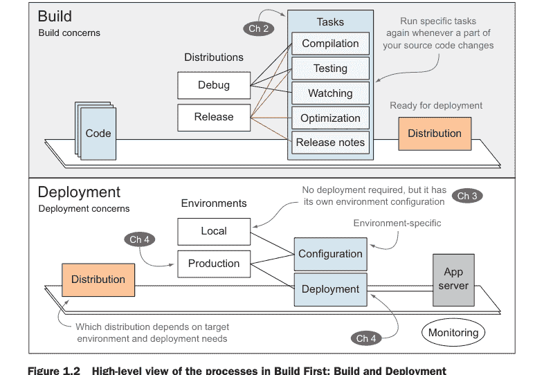

**图 1.2** Build First 流程的高级视图：构建和部署

**构建**
图 1.2 的上半部分放大展示了构建流程工作流中的构建部分（如图 1.1 所示），详细说明了面向开发或发布时各自的关注点。如果你的目标是开发，你会希望最大化调试能力，而且我打赌你会喜欢一个无需你手动操作就能自行判断何时执行部分步骤的构建方式。这叫做*持续开发*（CD），你将在第 3 章中学习它。发布的分发包不关注 CD，但你会花时间优化资源，使其在用户实际使用的生产环境中获得最佳性能。

**部署**
图 1.2 的下半部分放大展示了部署流程（最初出现在图 1.1 中），它接收调试版或发布版*分发包*（我在全书中将其称为具有特定目的的不同流程），并将其部署到托管环境。

这个包将与特定于环境的配置协同工作（该配置保护数据库连接字符串和 API 密钥等敏感信息的安全，将在第 3 章中讨论），从而为应用程序提供服务。
第 1 部分专门讲解 Build First 的构建方面：

- 第 2 章解释构建任务，教你如何编写任务并使用 Grunt 进行配置——Grunt 是你将在第 1 部分中作为构建工具使用的任务运行器。
- 第 3 章涵盖环境、如何安全地配置应用程序以及开发工作流。
- 第 4 章讨论在发布构建中应执行的任务。然后你将学习部署、在每次推送到版本控制时运行测试以及生产环境监控。

#### 构建流程的优势

完成第 1 部分后，你将有信心在自己的应用程序上独立执行以下操作：

- 自动化重复性任务，例如编译、压缩和测试
- 构建图标雪碧图，将图标的 HTTP 请求数减少到一次。第 2 章将讨论这种雪碧图技术以及其他 HTTP 1.x 优化技巧，作为提升页面速度和应用程序交付性能的手段
- 轻松创建新环境，无需区分开发环境和生产环境
- 在相关文件变更时自动重启 Web 服务器并重新编译资源
- 通过灵活的单步部署支持多种环境

Build First 方法在处理繁琐任务时消除了手工操作，同时也从一开始就提升了你的生产力。Build First 认识到构建流程对于迭代构建可维护应用程序的重要性。应用程序本身也是通过不断削减其复杂度来迭代构建的。

应用程序的清晰设计和架构在本书的第 2 部分中讨论，涵盖应用程序内部的复杂度管理以及以提升质量标准为重点的设计考量。接下来让我们看看这部分内容。

### 1.4 处理应用程序复杂度和设计

模块化、依赖管理、理解异步流程、严格遵循正确的模式以及测试——无论使用何种语言，如果你想让代码在一定规模上运行良好，这些都是至关重要的。在第 2 部分中，你将学习不同的概念、技术和模式，将它们应用到你的应用程序中，使它们更加模块化、专注、可测试和可维护。图 1.3 从上到下展示了我们将在第 2 部分中遵循的进展路径。

#### 模块化

你将学习如何将应用程序拆分为组件，将组件进一步拆分为模块，然后在这些模块内编写具有单一目的的简洁函数。模块可以来自第三方开发的外部包，你也可以自己开发。外部包应交由包管理器处理，它会代为管理版本和更新，这样就消除了手动下载依赖项（如 jQuery）的需要，并实现了该流程的自动化。


正如你将在第5章学到的，模块在代码中声明其依赖项（它们所依赖的模块），而不是从全局命名空间中获取；这增强了自包含性。模块系统将利用这些信息来解析所有依赖项；这将免去你必须为应用程序正常工作而按正确顺序维护冗长的`<script>`标签列表的麻烦。

#### 设计

你将通过遵循**模型-视图-控制器**模式，熟悉关注点分离以及如何以分层方式设计应用程序，从而进一步加强应用程序的模块化。我将在第7章向你介绍**共享渲染**，这是一种技术：你首先在服务器端渲染视图，然后让客户端为后续请求渲染相同单页应用程序的视图。

#### 异步代码

我将教你使用回调、**Promises**、生成器和事件等不同的异步代码流技术，帮助你驯服**异步**这头野兽。

#### 测试实践

在第5章，我们将讨论关于模块化的一切，学习闭包和模块模式，讨论模块系统和包管理器，并尝试找出每个解决方案的优势。第6章将深入探讨JavaScript中的异步编程。你将学习如何避免编写一周后会把你搞糊涂的回调地狱，然后你将了解**Promise**模式以及ES6中即将引入的生成器API。

第7章专注于模式和实践，例如如何最好地开发代码、jQuery是否是你正确的选择、以及如何编写可以在客户端和服务器端都使用的JavaScript代码。然后我们将探讨Backbone MVC框架。请记住，Backbone是我将用于向你介绍JavaScript中MVC的工具，但它绝不是你可以用于此目的的唯一工具。

在第8章，我们将回顾测试解决方案、自动化以及大量客户端JavaScript单元测试的实用示例。你将学习如何通过测试特定组件在单元级别、通过测试整个应用程序在集成级别来用JavaScript开发测试。

本书以一章关于REST API设计的内容结束，探讨了在前端使用REST API的影响，以及一个旨在充分利用REST的提议结构。

#### 实际的设计考量

本书旨在让你思考构建实际应用程序时所做的实际设计考量，以及如何明智地为工作选择最合适的工具，同时专注于过程和应用程序本身的质量。当你开始构建应用程序时，你首先要确定范围、选择技术栈并构建最小可行的构建流程。然后你开始构建应用程序，可能使用MVC架构并在浏览器和服务器端共享视图渲染引擎，这是我们在第7章讨论的内容。在第9章，你将学习如何组织API的重要知识，并学习如何定义被服务器端视图控制器和REST API共同使用的支撑服务。

图1.4展示了典型的"Build First"应用程序可能的组织结构概览。

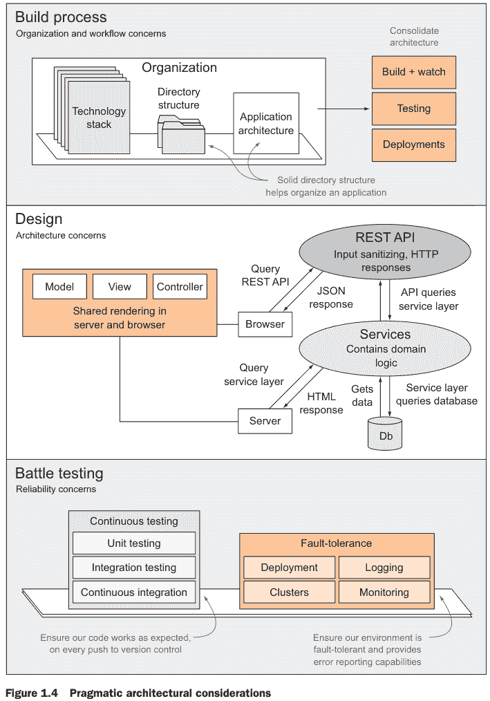

图1.4 务实的架构考量

##### 构建流程

从左上角开始，图1.4概述了你可以如何通过组织代码库来开始构建流程，这有助于巩固你的架构起点。定义模块化的应用程序架构是构建可维护代码库的关键，正如你将在第5章观察到的。然后通过实施提供持续开发、集成和部署能力的自动化流程来巩固架构。

设计应用程序本身，包括一个能有效提高可维护性的REST API，只有通过识别具有明确目的的清晰组件才能实现，这样它们才是正交的（意味着它们不会在任何特定关注点上争夺资源）。在第9章，我们将探索一种多层应用程序设计方法，通过严格定义各层及其之间的通信路径，帮助你快速将Web界面与数据和业务逻辑隔离。

一旦构建流程和架构设计完成，实战测试将是你浸淫于可靠性考量的地方。在这里，你将整合**持续集成**，即每次推送到版本控制系统时都执行测试，甚至可能是**持续部署**，即每天多次部署到生产环境。最后，讨论了容错性考量，如日志记录、监控和集群。这些在第4章会有所涉猎，并有助于使你的生产环境更健壮，或（最坏情况下）在出现问题时发出警告。

在整个过程中，你将编写测试、调整构建流程并微调代码。实战测试Build First将是一次极好的体验。是时候让你熟悉并开始学习Build First哲学的具体内容了。

质量是Build First的基石，这种方法采取的每一项措施都致力于实现一个简单目标：提高你的代码及其周围结构的质量。在本节中，你将了解代码质量，并在命令行中设置**lint**这个代码质量工具。衡量代码质量是编写结构良好的应用程序的一个良好开端。如果你尽早开始这样做，你的代码库就很容易符合特定的质量标准，这就是为什么我们将立即着手做这件事。

在第2章，一旦你了解了lint，我将向你介绍Grunt，这将在本书中用于构建和自动化构建流程。使用Grunt允许你将代码质量检查作为构建的一部分运行，这意味着你不会忘记它们。

> Grunt：达成目标的手段

Grunt在第一部分和第二部分的某些章节中被大量使用来驱动我们的构建流程。我选择Grunt是因为它是一个流行且易于教学的工具，并且满足大多数需求：
-   它完全支持Windows。
-   需要很少的JavaScript知识，很容易上手并运行。

### 1.5 深入Build First

设计和REST API

实战测试

> （续）

重要的是要理解，Grunt是一种达成目标的手段，一个使你能够轻松组装本书中描述的构建流程的工具。这并不意味着Grunt是这项工作的绝对最佳工具，为了明确这一点，我整理了Grunt与其他两个工具的比较：**npm**，一个可以兼作精简构建工具的包管理器；以及**Gulp**，一个代码驱动的构建工具，它与Grunt有许多共同约定。

如果你对其他构建工具如Gulp或使用`npm run`作为构建系统感到好奇，那么你应该在附录C中阅读更多关于该主题的内容，该附录涵盖了如何选择你自己的构建工具。

Lint是一个代码质量工具，非常适合检查解释型程序——例如那些用JavaScript编写的程序。你可以在命令行中执行lint程序，而不是启动浏览器来检查你的代码是否有语法错误。它可以告诉你代码中的潜在问题，例如未声明的变量、缺少分号或语法错误。话虽如此，lint并不是一根魔杖：它无法检测代码中的逻辑问题，只会警告你语法和风格错误。

#### 1.5.1 保持代码质量在控制之中

Lint对于确定给定的代码片段是否包含任何语法错误很有用。它还强制执行一套JavaScript编码最佳实践规则，我们将在第2部分开头，即第5章讨论模块化和依赖管理时介绍这些规则。

大约10年前，Douglas Crockford发布了JSLint，一个严厉的工具，它可以检查代码并告诉我们它所有的细微错误。Lint的存在是为了帮助我们提高代码的整体质量。lint程序可以直接从命令行告诉你一段代码甚至一个文件列表的潜在问题，还有一个额外的好处是，你甚至不必执行代码就能知道它有什么问题。当涉及JavaScript代码时，这个过程特别有用，因为lint工具将充当某种编译器，尽其所能确保你的代码可以被JavaScript引擎解释。

在另一个层面，lint程序（对lint程序的称呼）可以被配置为警告你过于复杂的代码，例如包含太多行的函数、可能混淆其他人的晦涩构造（在JavaScript的情况下，例如`with`块、`new`语句或过于激进地使用`this`），或类似的代码风格检查。以以下代码片段为例（在在线示例中列为ch01/01_lint-sample）：

```
function compose_ticks_count (start) {
  start || start = 1;
  this.counter = start;
  return function (time) {
    ticks = +new Date;
    return ticks + '_'  + this.counter++
  }
}
```


**图 1.5** 在代码片段中发现的各种 Lint 错误。

在这小段代码中，大量问题显而易见，但它们可能不那么容易发现。通过 JSLint 分析时，你会得到既符合预期又颇具启发的结果。它会抱怨你在使用变量之前必须先声明它们，或者你遗漏了分号。根据你使用的 lint 工具不同，它还可能会抱怨你对 `this` 关键字的使用。大多数 linter 还会抱怨你使用 `||` 的方式，认为你应该改用可读性更强的 `if` 语句。你可以在线 lint 这个示例。² 图 1.5 展示了 Crockford 工具的输出结果。

对于编译型语言，这类错误在你尝试编译代码时就会被捕获，你不需要任何 lint 工具。然而在 JavaScript 中，由于语言的动态特性，并不存在编译器。这固然很强大，但也比编译型语言更容易出错——后者甚至根本不允许你执行这些代码。

JavaScript 代码不是被编译的，而是由引擎来解释执行的，例如 V8（见于 Google Chrome）或 SpiderMonkey（为 Mozilla Firefox 提供支持的引擎）。

² 访问 <http://jslint.com> 查看在线示例。这是 Crockford 维护的原始 JavaScript linter。

## 第 1 章 构建优先介绍

虽然其他引擎确实会编译 JavaScript 代码（最著名的就是 V8 引擎），但在浏览器之外，你无法从它们的静态代码分析中获益。³ 像 JS 这样的动态语言，其 perceived 劣势之一就是无法确保代码在执行时一定能正常工作。虽然这确实如此，但使用 lint 工具可以大幅减少这种不确定性。此外，JSLint 建议我们远离某些编码风格实践，例如使用 eval、变量不声明、在块语句中省略花括号，等等。

你是否在我们之前看到的最后一个代码片段函数中发现了一个潜在问题？查看配套代码示例（第 1 章，01_lint-sample）来验证你的答案！提示：问题在于重复。修复后的版本也可以在源代码示例中找到；务必查看所有这些精彩内容。

> ### 了解本书附带的源代码
>
> 本书附带的源代码包含许多有价值的信息，包括一个经过调整的 linting 示例函数版本，它通过了 lint 验证，并有详尽的注释，帮助你理解所做的改动。该示例还进一步解释了 linter 并非万无一失。
>
> 书中的其他代码示例包含类似的建议和信息，因此请务必查看！示例按章节组织，顺序与书中一致。有几个示例在书中只是匆匆带过，但所有配套代码示例都有完整的文档，可直接使用。
>
> 书中代码与源代码之间存在这种差异的原因是，有时我想解释一个主题，但涉及的代码太多，无法全部收入书中。在这些情况下，我不想离所讨论的概念太远，但仍希望你拥有这些代码。这样，你可以在阅读本书时专注于学习，在浏览代码示例时专注于实践。

Linting 通常被称为编写 JavaScript 时应该设置的第一项测试。Linter 力有不逮的地方，就该单元测试出场了。这并不是说使用 linter 没有必要，而是说仅靠 linting 是不够的！单元测试有助于确保代码按你期望的方式运行。单元测试在第 8 章讨论，届时你将学习如何为第 2 部分开发的代码编写测试，该部分专门讨论如何编写模块化、可维护且可测试的 JavaScript 代码。

接下来，你将从头开始构建一个构建流程。从小处着手，设置一个 lint 代码的任务，然后从命令行运行它，类似于使用编译器时的流程；你会养成每次修改后都运行构建的习惯，看看代码是否仍然

³ 你可以在控制台中看到 Node.js（一个同样在 V8 上运行的服务端 JavaScript 平台）的实际效果，但等到 V8 检测到语法问题时，对你的程序来说已经太晚了，它会崩溃。无论在什么平台上，最好先进行 lint 检查。

能通过 linter 的"编译"。第 3 章将教你如何自动运行构建，这样你就不必重复上述操作，但目前这样也够了。

如何在命令行中直接使用 JSLint 这样的 lint 工具呢？好吧，我很高兴你问了。

#### 1.5.2 在命令行中运行 Lint

向构建流程中添加任务最常见的方式之一就是从命令行执行该任务。如果你能从命令行执行该任务，那它就很容易集成到你的构建流程中。你将使用 JSHint⁴ 来对软件进行 lint 检查。

JSHint 是一个命令行工具，用于 lint JavaScript 文件和代码片段。它使用 Node.js 编写，Node.js 是一个使用 JavaScript 开发应用的平台。如果你需要快速了解 Node.js 基础知识，请参阅附录 A，我在其中解释了什么是模块以及它们如何工作。如果你想更深入地了解 Node.js，请参阅 Mike Cantelon 等人所著的 *Node.js in Action*（Manning，2013）。理解这些知识在下一章使用我们选择的构建工具 Grunt 时也会很有用。

> **Node.js 简介**
>
> Node 是一个相对较新的平台，想必你已经有所耳闻。它最初发布于 2009 年，遵循事件驱动和单线程模式，从而实现高性能的并发请求处理。在这方面，它与 Nginx 的设计可资比拟——Nginx 是一个高度可扩展的多用途且非常流行的反向代理服务器，用于提供静态内容并将其他请求转发给应用服务器（如 Node）。
>
> Node.js 被认为特别容易被前端工程师采纳，因为它本质上就是服务器端的 JavaScript（大多数情况下）。它还使得前端可以完全与后端分离ᵃ，仅通过数据和 REST API 接口进行交互，正如你将在第 9 章学习设计和构建的那样。

ᵃ 关于前端与后端分离的更多信息，请参见 http://bevacqua.io/bf/node-frontend。

##### NODE.JS 和 JSHINT 安装

以下是安装 Node.js 和 JSHint 命令行界面（CLI）工具的步骤。附录 A 中还提供了替代的 Node.js 安装方法和疑难解答。

1. 访问 http://nodejs.org，如图 1.6 所示，点击 INSTALL 按钮下载最新版本的 node。
2. 运行下载的文件，按照安装说明进行操作。

⁴ 有关 JSHint 的更多信息，请参见 http://jshint.com。

你会免费得到一个名为 `npm`（Node Package Manager）的命令行工具，因为它随 Node 捆绑提供。这个包管理器 `npm` 可以在终端中使用，用于安装、发布和管理 node 项目中的模块。包可以按项目逐个安装，也可以全局安装，这样更容易直接在终端中访问。实际上，两者的区别在于，全局安装的包被放在 PATH 环境变量中的文件夹里，而非全局安装的包则被放在执行命令时所在文件夹下的 `node_modules` 文件夹中。为了保持项目的独立性，

```
» npm install -g jshint --loglevel warn
/home/nico/.nvm/v0.10.23/bin/jshint -> /home/nico/.nvm/v0.10.23/lib/node_modules/jshint/bin/jshint
jshint@2.4.0 /home/nico/.nvm/v0.10.23/lib/node_modules/jshint
├── console-browserify@0.1.6
├── underscore@1.4.4
├── shelljs@0.1.4
├── minimatch@0.2.14 (sigmund@1.0.0, lru-cache@2.5.0)
├── htmlparser@3.1.0 (domelementtype@1.1.1, domutils@1.1.6, domhandler@2.1.0, readable-stream@1.0.17)
└── cli@0.4.5 (glob@3.2.7)
```


本地安装通常是首选。但对于像 JSHint 这类代码检查工具，若需在系统范围内使用，全局安装更为合适。`-g` 修饰符告诉 `npm` 全局安装 `jshint`。这样，你就可以在命令行中以 `jshint` 形式使用它。

1. 打开你喜欢的终端窗口，执行 `npm install -g jshint`，如图 1.7 所示。如果失败，你可能需要使用 `sudo` 来获得提升的权限；例如，`sudo npm install -g jshint`。
2. 运行 `jshint --version`。它应该输出 `jshint` 程序的版本号，如图 1.8 所示。版本号可能不同，因为活跃开发包中的模块版本会频繁变更。

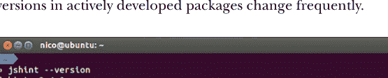

下一节将解释如何对你的代码进行代码检查。

##### 代码检查

现在你应该已经在系统上安装了 `jshint`，并且如你验证过的那样，在终端中可以访问它。要使用 JSHint 检查你的代码，你可以使用 `cd` 命令切换到项目根目录，然后输入 `jshint .`（这个点告诉 JSHint 检查当前文件夹中的所有文件）。如果操作耗时过长，你可能需要添加 `--exclude node_modules` 选项；这样你就只会检查自己的代码，而忽略通过 `npm install` 安装的第三方代码。

命令完成后，你会收到一份详细的报告，说明你的代码状态。如果代码有任何问题，该工具将报告每个问题的预期结果和行号。然后它会以错误代码退出，允许你在检查失败时“中断构建”。每当构建任务未能产生预期输出时，整个流程都应被中止。这带来诸多好处，因为它可以防止在出现问题时继续工作，拒绝完成构建直到你修复所有问题。图 1.9 展示了对一段代码进行检查的结果。

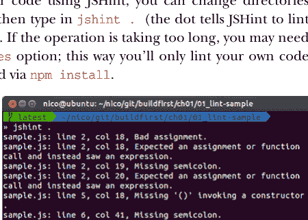

一旦 JSHint 一切就绪，你可能会想就此收工，因为这是你唯一的任务；然而，如果你想在构建中添加额外任务，这就不那么可扩展了。你可能想在构建过程中加入一个单元测试步骤；这就成了问题，因为你现在至少需要运行两个命令：`jshint` 和另一个执行测试的命令。这扩展性不佳。想象一下要记住使用 `jshint` 和另外半打命令及其参数。那将太繁琐、难记且容易出错。你总不想损失五亿美元，对吧？

那么你最好开始将构建任务组合起来，因为即使你现在只有一个任务，你很快就会有十几个！组合一个构建过程有助于你从自动化的角度思考，并通过避免步骤重复来帮助你节省时间。

每种语言都有其自己的一套构建工具可以使用。大多数语言中，都有一个工具脱颖而出，被更广泛地采用。谈到 JavaScript 构建系统，Grunt 是最流行的工具之一，有成千上万的插件（用于帮助你完成构建任务）可供选择。如果你正在为另一种语言编写构建流程，你可能需要研究自己的工具。尽管本书中的构建任务是用 JavaScript 编写的，并且使用 Grunt，但我描述的原则应该适用于几乎任何语言和构建工具。

翻到第 2 章，看看你如何在开始构建流程实践之旅时，将 JSHint 集成到 Grunt 中。

### 1.6 总结

本章概述了你将在本书其余部分深入探讨的概念。以下是你在本章学到的一些要点：

- 现代 JavaScript 应用开发存在问题，因为缺乏对设计和架构的重视。
- “构建先行”是一种解决方案，它能实现自动化流程和可维护的应用设计，并鼓励你思考自己正在构建什么。
- 你了解了代码检查（lint），并通过代码检查器运行了代码，无需浏览器即可提高其代码质量。
- 在第一部分，你将全面了解构建流程、部署和环境配置。你将使用 Grunt 来开发构建，并在附录 C 中了解你可以使用的其他工具。
- 第二部分专注于应用设计的复杂性。模块化、异步代码流、应用和 API 设计以及可测试性都扮演着角色，它们将在第二部分结合在一起。

你仅仅触及了使用“构建先行”方法进行应用设计所能实现成就的皮毛！我们还有很多内容要讲！让我们转向第 2 章，我们将讨论在构建期间可能需要执行的最常见任务，并使用 Grunt 查看实施示例。

# 组合构建任务与流程

### 本章涵盖

- 理解构建中应该发生什么
- 了解关键构建任务
- 使用 Grunt 运行关键任务
- 使用 Grunt 配置构建流程
- 创建你自己的 Grunt 任务

在前一章中，你快速了解了“构建先行”方法的概貌，并瞥见了一个代码检查任务。在本章中，我们将介绍常见的构建任务和一些更高级的任务。我将揭示每个任务的用例和背后的原理，并看看如何在 Grunt 中实现它们。学习理论可能听起来枯燥，但如果你最终使用 Grunt 以外的任务运行器（我相信你会的），这将尤为重要。

Grunt 是一个基于配置的构建工具，有助于轻松设置复杂任务——如果你知道自己在做什么的话。使用 Grunt，你将组合工作流程，如我在第 1 章所述的那些，这些流程可以针对开发效率进行调整。

### 2.1 介绍 Grunt

Grunt¹ 是一个任务运行器，帮助你执行命令、运行 JavaScript 代码，并使用完全用 JavaScript 编写的配置来配置不同的任务。Grunt 的构建概念借鉴自 Ant，并允许你使用 JavaScript 定义你的流程。图 2.1 从高层次剖析了 Grunt，展示了如何配置它以及定义构建任务的关键参与者。

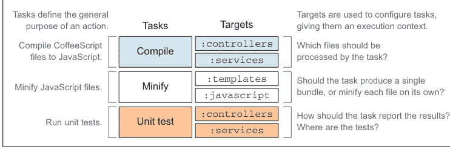

- 任务执行一个动作。
- 目标有助于为这些任务定义上下文。
- 任务配置允许你确定特定任务-目标组合的选项。

> ¹ 在 http://bevacqua.io/bf/grunt 了解更多关于 Grunt 的信息。你也应该看看附录 B。

Grunt 任务在 JavaScript 中配置，大部分配置可以通过向 `grunt.initConfig` 方法传递一个对象来完成，该对象描述了任务影响的文件，并传递一些选项来调整特定任务目标的行为。

以单元测试任务为例，你可能有一个目标只运行本地开发的少数测试，或者你可能希望在生产发布前执行所有测试。

图 2.2 展示了 JavaScript 代码中的任务配置是什么样子，详细说明了 `grunt.initConfig` 方法及其约定。在列举文件时可以使用通配符，使用这些模式称为 *globbing*；我们将在 2.2.2 节详细探讨 globbing。

任务可以从 *插件* 中导入，这些插件是 Node 模块（设计良好、自包含的代码片段），包含一个或多个 Grunt 任务。你只需要弄清楚要对它们应用什么配置；任务本身由插件处理。你将在本章中大量使用插件。²

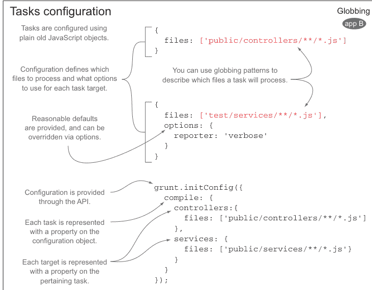

**图 2.2** 代码中 Grunt 任务配置详解。每个任务和任务目标都是单独配置的。

> ² 你可以在 <http://gruntjs.com/plugins> 在线搜索 Grunt 插件。

你也可以创建自己的任务，正如你将在 2.4 和 2.5 节中探讨的那样。Grunt 自带一个名为 `grunt` 的 CLI（命令行界面），它提供了一个简单的界面，让你可以直接从命令行执行构建任务。让我们来安装它。

#### 2.1.1 安装 Grunt

你应该已经从第 1 章安装 JSHint 代码检查工具时拥有了 `npm`，这是 Node 自带的包管理器。开始使用 Grunt 很简单。在终端中键入以下内容，它将为你安装 `grunt` CLI：

```
npm install -g grunt-cli
```

`-g` 标志表示该包应全局安装；这让你可以在终端中执行 `grunt`，无论当前工作目录如何。

> **查找配套的注释示例**
> 在配套源代码中查看完整的工作示例。你会在 ch02 目录下的 01_intro-to-grunt 文件夹中找到它。本章的其余示例也可以在 ch02 目录中找到。大多数示例都包含代码注释，如果你在理解示例时遇到困难，这些注释可以帮助你。

你需要采取一个额外的步骤，即创建一个 `package.json` 清单文件。这些文件描述了 Node 项目。它们列出了项目依赖的包，以及元数据，如项目名称、版本、描述和主页。为了让 Grunt 在你的项目中工作，你需要将其作为开发依赖项添加到 `package.json` 中。它应该是开发依赖项，因为你不会在本地开发环境之外使用 Grunt。你可以创建一个包含以下 JSON 代码的最简 `package.json` 文件，并将其放在项目根目录中：

```
{}
```

这就足够了。只要文件存在并且包含一个有效的 JSON 对象（即使是空的 {} 对象），Node 包管理器 (npm) 就可以将依赖项添加到你的 `package.json` 中。

##### 本地安装 Grunt

接下来，你需要安装 `grunt` 包。这次，`-g` 修饰符将无济于事，因为这需要是本地安装，而不是全局安装⁴——这就是你创建 `package.json` 文件的原因。请改用 `--save-dev` 修饰符，以表明该模块是开发依赖项。


该命令如下所示：`npm install --save-dev grunt`。在`npm`完成安装后，你的`package.json`清单文件将呈现如下代码：

```
{
    "devDependencies": {
        "grunt": "~0.4.1"
    }
}
```

此外，Grunt模块将被安装到你项目内的一个`node_modules`目录中。该目录将包含你在Grunt设置中使用的所有模块，它们也会在包清单中被声明。

##### 创建GRUNTFILE.JS

最后一步是创建一个`Gruntfile.js`文件。Grunt使用此文件来加载任何可用的任务，并使用你需要的任何参数来配置它们。以下代码展示了最基础的`Gruntfile.js`模块：

```
module.exports = function(grunt) {
    grunt.registerTask('default', []); // register a default task alias
};
```

请注意这个看似简单的文件的几点事项。Grunt文件是遵循CommonJS模块规范的Node模块，因此你在每个文件中编写的代码并非立即对其他代码可用。本地的`module`对象是一个隐式对象，而不是像浏览器中`window`那样的全局对象。当你导入其他模块时，你获得的只是`module.exports`中公开的接口。

> **Node模块**
> 你可以在附录A中了解更多关于Node.js模块背后的规范——CommonJS的信息，该附录涵盖了这些模块。它也将在第5章讨论模块化时再次提及。附录B是对附录A的扩展，旨在加深你对Grunt的理解。

前一段代码片段中的`grunt.registerTask`行，指示Grunt定义一个默认任务，当你在命令行不带任何参数运行`grunt`时，该任务将被执行。数组表示一个任务别名，如果其中有任何任务，它将运行数组中命名的所有任务。例如，`['lint', 'build']`将运行lint任务，然后运行build任务。

此时运行`grunt`命令不会产生任何效果，因为你注册的唯一任务是一个空的任务别名。你一定很渴望设置你的第一个Grunt任务，那我们就开始吧。

#### 2.1.2 设置你的第一个Grunt任务

设置Grunt任务的第一步是安装一个能完成你所需功能的插件；然后你在代码中添加配置，就设置好可以运行任务了。

Grunt插件通常以npm模块的形式分发，这些是某人发布的JavaScript代码片段，供你使用。我们将从安装Grunt的JSHint插件开始，它将允许你使用Grunt运行JSHint。请注意，你在第1章安装的jshint CLI工具在这里完全不需要；Grunt插件包含了运行任务所需的一切，无需jshint CLI。下面显示的命令将从npm注册表获取JSHint Grunt插件，将其安装到node_modules目录，并将其作为开发依赖添加到你的package.json文件中：

```
npm install --save-dev grunt-contrib-jshint
```

接下来你需要修改你的Gruntfile，告诉Grunt对Gruntfile本身进行语法检查，因为它也是JavaScript代码。你还需要告诉它加载JSHint插件包，该包包含设置语法检查的任务，并更新你的默认任务，以便你可以在命令行中使用grunt对代码进行语法检查。以下列表（在代码示例中名为ch02/01_intro-to-grunt）展示了如何配置你的Gruntfile。

##### 清单2.1 示例Gruntfile.js

插件需要单独加载到Grunt中。

导出的函数接收一个grunt参数。

任务使用initConfig进行配置，传递一个描述它们的对象。

创建一个默认别名，它将运行jshint任务。

```
module.exports = function (grunt) {
    grunt.initConfig({
        jshint: ['Gruntfile.js']
    });
    grunt.loadNpmTasks('grunt-contrib-jshint');
    grunt.registerTask('default', ['jshint']);
};
```

每当你安装一个包，你都需要在Gruntfile中使用`grunt.loadNpmTasks`加载它，如清单2.1所示。它将加载包中的任务，以便你配置和执行它们。然后你需要配置任务，这可以通过向`grunt.initConfig`传递一个对象来完成。你使用的每个任务插件都需要配置，我将在我们学习每个插件时教你如何配置它们。最后，我已经更新了默认别名以运行jshint任务。默认别名定义了当grunt在没有任务参数的情况下执行时，哪些任务会被运行。以下是输出的截图。

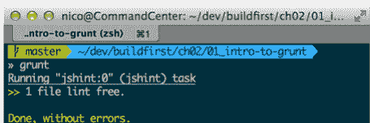

图2.3 我们的第一个Grunt任务及其输出。我们的代码无语法错误，这意味着它不包含任何语法错误。

#### 使用Grunt管理构建过程

你现在的处境与第1章结束时差不多，那时你可以对JavaScript进行语法检查，只是你现在做不到。Grunt将帮助你构建一个完整的构建流程，这是“构建优先”理念的核心。你可以相对轻松地专注于不同的任务，这取决于你是在为本地开发或诊断进行构建，还是在构建最终供用户使用的产品。让我们检查构建任务中的一些属性。

随着你对本书第1部分的理解加深，你设置的lint任务将成为更强大构建的基础。这个任务简单地展示了构建任务的一个基本属性：在绝大多数情况下，它们将是*幂等的*——重复执行任务不应产生不同的结果。以lint任务为例，这意味着只要你不修改源代码，每次都会得到相同的警告。更多时候，构建任务是提供一个或多个输入文件的函数。幂等性属性，加上你不应该手动执行任何操作这一事实，意味着能产生更一致的结果。

#### 创建工作流和持续开发

你构建中的任务旨在遵循一套明确定义的步骤来实现特定目标，例如准备一个发布版本。正如第1章所提到的，这被称为工作流。某些任务对于特定工作流可能是可选的，而其他任务则可能是至关重要的。例如，在本地开发环境中工作时，你没有动力去优化图像，使其变得更小。因为它不会带来任何明显的性能提升，在那种情况下跳过该任务是完全可以的。无论你的工作流是用于开发还是发布，你可能都希望通过一个lint任务来留意问题。

图2.4将帮助你理解构建过程中涉及的开发、发布和部署部分：它们如何相互关联，以及它们在组合不同工作流时如何协同工作。

##### 开发流程

仅从图的第一行看，你就可以看到生产力和监视变化是开发流程的关键方面，而在发布流程中它们完全不必要，甚至可能是一个障碍。你可能还注意到两种流程都生成了一个构建的应用程序，尽管在开发过程中构建的应用程序是面向持续开发的，我们将在第3章深入探讨这一点。

##### 发布流程

在发布流程中，我们关注性能优化和整体构建一个经过充分测试的应用程序。在这里，我们将运行一个经过轻微修改的开发流程版本，其中减少应用程序的字节大小是至关重要的。

##### 部署流程

部署流程根本不构建应用程序。相反，它重用在其他两个流程之一中准备好的构建分发包，并将其交付到托管环境。你将在第4章全面了解部署流程。

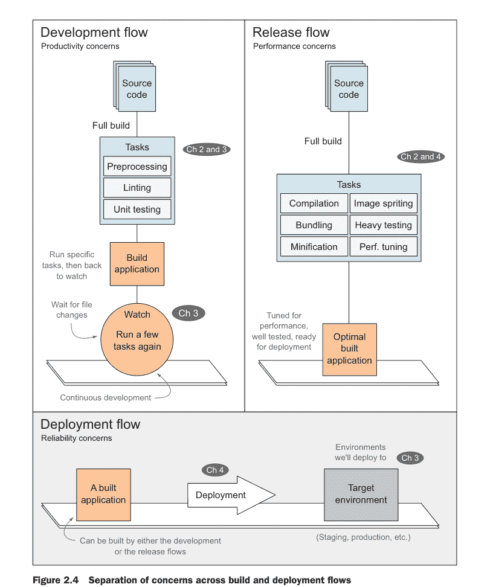

图2.4 构建和部署流程中的关注点分离

任何合理的构建流程都需要每一步都实现自动化；否则你将无法实现提高生产力和降低出错倾向的目标。在开发过程中，你应该在文本编辑器和浏览器之间切换，而无需自己执行构建。这被称为持续开发，因为进入shell输入某些命令来编译应用程序的摩擦被消除了。你将学习如何使用文件监视和

其他机制将在第3章中讨论。部署应用程序应与构建流程分离，但也应实现自动化；这使你能够在一个步骤中完成构建和部署应用程序。类似地，提供应用程序服务应严格与构建过程分离。

在下一节中，我们将深入探讨使用Grunt处理构建任务。具体来说，我们将从预处理任务开始，例如处理LESS（一种可编译成CSS的语言），以及后处理任务，例如打包和压缩，这些任务有助于你优化和调整发布版本。

### 2.2 预处理与静态资源优化

无论何时讨论构建Web应用程序，我们都必须谈到预处理。通常，你会发现你使用的语言并非互联网浏览器原生支持，因为它们通过提供纯CSS、HTML或JavaScript所不具备的特性（如供应商前缀）来帮助你封装重复性工作。

这里的重点不是让你学习LESS（将在下一节介绍的CSS预处理器），甚至不是学习CSS。优秀的资源可以专门教导你那些。重点是让你意识到采用预处理语言带来的显著好处。预处理并非仅限于CSS。*预处理器*帮助将一种语言的源代码转换为目标语言。例如，更强大且表达力更强的LESS语言可以在构建时转换为原生CSS。使用预处理器的原因可能各不相同，但可以归结为：提高生产力、减少重复，或拥有更友好的语法。

*后处理*任务如压缩和打包主要是为了优化构建以用于发布，但它们与预处理关系紧密，足以归入同一话题。我们将介绍预处理，使用LESS，然后会简要介绍globbing（一种在Grunt中使用的文件路径模式匹配机制），之后再深入打包和压缩，这些将调整你的应用程序性能以提供良好的用户体验。

在本节结束时，你将更清楚地了解资源如何通过使用不同的、更合适的语言进行预处理，以及如何进行后处理，从而提升性能，使体验对用户更加友好。

#### 2.2.1 讨论预处理

语言预处理器在当今的Web开发中相当常见。除非你在过去十年里一直与世隔绝，否则你可能已经理解预处理器能帮助你编写更整洁的代码，就像你在第1章使用lint时学到的那样，但需要额外的工作才能发挥作用。简单来说，当你使用一种语言编写代码，而该代码会被翻译成另一种语言时，*预处理*就是翻译步骤。

你可能不想用目标语言编写代码，原因有几个：可能太重复、太容易出错，或者你只是不喜欢那种语言。这就是这些高级语言发挥作用的地方，它们旨在让你的代码保持简洁明了。然而，用这些高级语言之一编写代码是有代价的：浏览器无法理解它们。因此，在前端开发中，你会遇到最常见的构建任务之一就是将代码编译成浏览器能理解的东西，即JavaScript和CSS样式。

有时，预处理器相对于Web的“原生”语言（HTML、CSS和JavaScript）还提供了实际的好处。例如，几个CSS预处理器提供了必要的工具，使你无需针对每个浏览器进行调整。通过消除这些浏览器不一致性，预处理语言提高了你的生产力，使你的工作不那么单调乏味。

##### LESS 更胜一筹

以LESS为例。LESS是一种强大的语言，允许你使用CSS的变体来编写代码，遵循应用程序设计的DRY（不要重复自己）原则，因为它帮助你编写重复性更少的代码。在纯CSS中，你常常不得不一遍又一遍地重复自己，为所有不同的供应商前缀编写相同的值，以最大化浏览器对你想要应用的样式规则的支持。

为了说明这一点，以`border-radius` CSS属性为例，当你想要为元素设置圆角边框时就会使用它。以下代码展示了如何使用纯CSS编写它们。

###### 代码清单2.2 纯CSS中的圆角边框

```css
.slightly-rounded {
  -webkit-border-radius: 2px;
  -moz-border-radius: 2px;
  border-radius: 2px;
  background-clip: padding-box;
}

.very-rounded {
  -webkit-border-radius: 16px;
  -moz-border-radius: 16px;
  border-radius: 16px;
  background-clip: padding-box;
}
```

> 某些浏览器需要“供应商前缀”来应用特定样式。

> 有助于防止背景泄漏到圆角边框之外

当你考虑更多的样式时，这个问题只会变得更加严重。

对于一次性规则来说，这可能没问题，但对于像`border-radius`这样的属性，编写这样的纯CSS很快就会变得不可接受，因为这种情况发生得太频繁了。LESS允许你以一种更易于编写、阅读和维护的方式进行编码。在这个用例中，你可以设置一个可重用的`.border-radius`函数，代码就会变成如下所示。

###### 代码清单2.3 使用LESS的圆角边框

```
.border-radius (@value) {
  -webkit-border-radius: @value;
  -moz-border-radius: @value;
  border-radius: @value;
  background-clip: padding-box;
}
```

> 这是一个可重用的函数，在LESS术语中称为“mixin（混入）”。

```
.slightly-rounded {
  .border-radius(2px);
}
.very-rounded {
  .border-radius(16px);
}
```

> 通过传递半径值来使用该函数。

> 再次使用该函数多次设置border-radius。

LESS和类似工具通过允许你重用CSS代码片段来提高你的生产力。

##### LESS DRY 优于 More WET

一旦你需要在多个地方使用border-radius属性，你就会享受到不用重复编写所有内容（WET）的好处。通过遵循DRY原则，你可以避免在每次需要指定边框时列出所有四个属性。相反，你可以通过重用.border-radius LESS混入来声明边框。

预处理在精简开发工作流中扮演着关键角色：现在你不必在所有想使用此规则的地方都使用所有供应商前缀，并且你可以在一个地方更新前缀，使你的代码更易于维护。如果你希望将静态规则与影响它们的变量清晰分离，LESS可以让你更进一步。没有LESS，一个典型的CSS设计样式表摘录可能如下所示：

```
a {
  background-color: #FFC;
}
blockquote {
  background-color: #333;
  color: #FFC;
}
```

LESS允许你使用变量，这样你就不必到处复制粘贴颜色。正确命名这些变量也有助于你通过扫描样式表轻松识别颜色。

##### 使用LESS变量

使用LESS，你可以为颜色设置变量，并避免可能出现的错误，例如在一个地方更新颜色但忘记更新其他出现的地方。这还使你能够将颜色和设计中的其他可变元素放在一起。以下代码展示了使用LESS可能的样子：

```
@yellowish: #FFC;
a {
  background-color: @yellowish;
}
blockquote {
  background-color: #333;
  color: @yellowish;
}
```

> 声明变量有助于定位和替换颜色，防止错误。

> 使用变量就像引用它一样简单。

这样，你就可以保持你的代码DRY，正如我在2.2节开头提到的。在这里遵循不要重复自己的原则特别有用，因为它避免了复制粘贴颜色代码，从而节省了你输入错误颜色代码的潜在麻烦。此外，像LESS（SASS、Stylus等）这样的语言提供了派生其他颜色的函数，例如更深的绿色、更透明的白色以及其他有趣的颜色数学。

现在，让我们将注意力转向在Grunt任务中将LESS代码编译为CSS。

#### 2.2.2 使用LESS

正如我们在本章前面讨论的，Grunt任务由两个不同的组件组成——任务和配置：

- *任务*本身是最重要的组件：这是你在运行构建时由Grunt执行的代码，通常你可以找到一个插件来完成你需要的功能。
- *配置*是一个你可以传递给`grunt.initConfig`的对象。几乎每个Grunt任务都需要配置。

随着你继续阅读本章的其余部分，你将看到如何在每种情况下设置配置。要使用Grunt编译LESS文件以便直接提供CSS，你将使用`grunt-contrib-less`包。还记得你安装JSHint插件的时候吗？这里也是一样的！只是包名变了，因为你现在将使用一个不同的插件。要安装它，请在终端运行以下命令：

```
npm install grunt-contrib-less --save-dev
```

此插件提供了一个名为`less`的任务，你可以在`Gruntfile.js`中这样加载它：

```
grunt.loadNpmTasks('grunt-contrib-less');
```

从现在起，为了简洁，我将在示例中省略`npm install`和`grunt.loadNpmTasks`部分。你仍然需要运行`npm install`来获取包并在你的Gruntfile中加载插件！无论如何，你可以在附带的源代码文件中找到每种情况的完整示例。

设置构建任务很简单：你指定输出文件名，并提供用于生成CSS文件的源文件路径。此示例可在代码示例的ch02/02_less-task中找到。

```js
grunt.initConfig({
  less: {
    compile: {
      files: {
        'build/css/compiled.css': 'public/css/layout.less'
      }
    }
  }
});
```

执行任务的最后一步是从命令行调用`grunt`。在这种情况下，在你的终端中运行`grunt less`应该就能完成。明确声明


#### 2.2.3 打包静态资源

通常建议指定一个 target。在这种情况下，你可以通过输入 `grunt less:compile` 来实现。如果不提供 target 名称，则所有 target 都会被执行。

#### Grunt 配置的一致性

在继续之前，我想提一下使用 Grunt 时你会享受到的一个优点。任务配置模式在不同任务之间变化不大，特别是使用 Grunt 团队本身支持的任务时。即使是你在 `npm` 上找到的任务，就配置而言也彼此相当一致。正如你在本章中将学到的，我将向你展示的不同任务的配置方式相似，即使它们以通用的方式提供了广泛的操作。

在 Grunt 中运行 `less:compile` 构建 target 现在会将 `layout.less` 编译成 `compiled.css`。你也可以声明一个输入文件数组，而不是只使用一个。这将生成一个打包文件，其中包含所有 LESS 输入文件的 CSS。我们将在后面完整介绍打包，请稍安勿躁。以下清单是一个示例。

**清单 2.4  声明输入文件数组**

```
grunt.initConfig({
  less: {
    compile: {
      files: {
        'build/css/compiled.css': [
          'public/css/layout.less',
          'public/css/components.less',
          'public/css/views/foo.less',
          'public/css/views/bar.less'
        ]
      }
    }
  }
});
```

逐个列出每个文件是可以的，但你也可以使用一种称为 globbing 的模式语言，避免罗列数百个文件，接下来我将解释。

#### 掌握 GLOBBING 模式

你可以使用 Grunt 的一个不错的特性——称为 globbing——来进一步改进前面代码中显示的配置。*Globbing* 是一种文件路径匹配机制，可以帮助你使用文件路径模式来包含或排除文件。它特别有用，因为你不必维护资源文件夹中所有文件的列表，这有助于你避免常见的错误，比如忘记将新样式表添加到列表中。

## 第 2 章  构建任务和流程的编排

如果你想从构建任务中排除单个文件（例如由第三方提供的文件），globbing 也会派上用场。以下代码显示了一些你可能觉得有用的 globbing 模式：

```
[
  'public/*.less',
  'public/**/*.less',
  '!public/vendor/**/*.less'
]
```

关于前面的代码，请注意以下几点：

-   第一个模式将匹配 `public` 文件夹中任何具有 LESS 扩展名的文件。
-   第二个模式大致相同，只是它匹配 `public` 子文件夹中的文件，由于特殊的 `**` 模式，可以匹配任意嵌套层级的文件。
-   你可能已经猜到，最后一个模式的工作方式与第二个相同，只是开头的 `!` 表示匹配的文件应从结果中排除。

Globbing 模式按照它们呈现的顺序工作，它们也可以与常规文件路径混合使用。Globbing 模式将生成包含所有匹配文件路径的数组。

考虑到 globbing 模式，我们最新的 `less:compile` 配置可以进一步重构，变成一个简化的版本：

```
grunt.initConfig({
  less: {
    compile: {
      files: {
        'build/css/compiled.css': 'public/css/**/*.less'
      }
    }
  }
});
```

在继续之前，让我提醒你，在这个特定情况下，`less` 是构建任务，`compile` 是该任务的构建 target，它提供了特定于该 target 的配置。你可以通过向 `less` 对象添加其他属性来轻松地为 `less` 任务提供不同的 target，就像你在传递给 `initConfig` 的配置中的 `compile` 任务 target 所做的那样。例如，你可以有一个 `compile_mobile` target，用于创建针对移动设备的 CSS 资源，以及一个 `compile_desktop` target，用于编译针对桌面浏览器的资源。

应该注意的是，使用 globbing 模式通过此任务编译 LESS 的一个副作用是，无论源代码中使用多少文件，你的 CSS 都将被打包到单个文件中。所以，让我们现在来看看资源打包，这是一个后处理任务，将有助于你通过减少针对网站的 HTTP 请求数量来提高网站性能。

#### 2.2.3 打包静态资源

我已经暗示了打包的作用，而且在我们开始这段启发性的冒险之前，你可能已经听说过它。如果你从未听说过打包，也没关系；这不是一个难以理解的概念。

*资源打包* 是在移交给你的客户端之前将所有东西放在一起的花哨说法。这就像为了买一件杂货去一趟商店，然后回家，只为了再回杂货店买清单上的另一件东西，一次又一次；与去一趟杂货店一次性买齐所有杂货之间的区别。

在单个 HTTP 响应中移交所有内容可以减少事务性网络成本，并使每个人受益。负载可能会变大，但它为客户节省了许多不必要的服务器往返，这些往返会带来相关的网络成本，如延迟、TCP 和 TLS 握手等。如果你想了解更多关于底层互联网协议（TCP、TLS、UDP、HTTP 等）的信息，我强烈推荐 Ilya Grigorik 的 *High Performance Browser Networking*（O'Reilly Media，2013）。

简而言之，资源打包就是将每个文件字面意义上追加到前一个文件的末尾。这样，你可以将所有 CSS 或所有 JavaScript 打包在一起。更少的 HTTP 请求带来更好的性能，这足以成为 warrant 静态资源打包构建步骤的理由。图 2.5 检查了人类与使用打包的网站和不使用打包的网站之间的交互，以及每种情况如何影响网络连接。

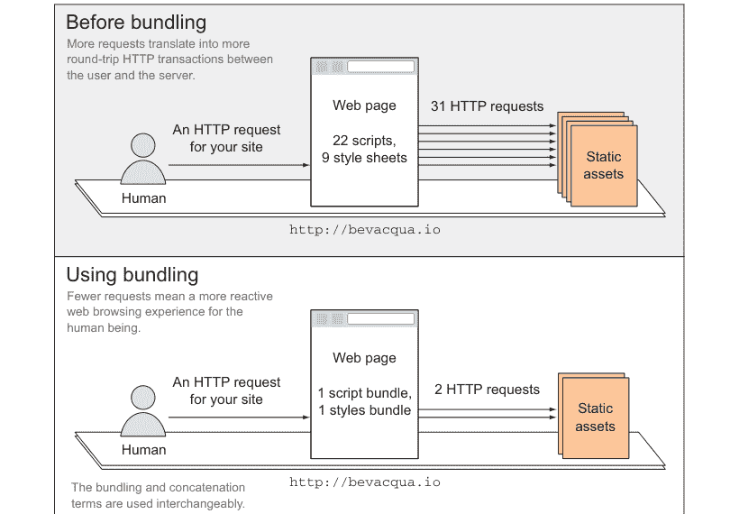

如图所示，打包之前浏览器必须进行更多的 HTTP 请求来获取网站的资源，而打包之后只需单个请求就足以获取每个包（包含构成应用程序逻辑的许多不同文件）。

许多预处理器包含将资源打包到单个文件中的选项，而且你在 `less:compile` 的演示中已经体验过这一点，在那里你将许多资源打包到了一个文件中。

**实际应用中的打包**

使用 `grunt-contrib-concat` 包，你可以轻松设置构建目标，使用我先前描述的 globbing 模式将任意数量的文件组合在一起，而且是以你可能已经熟悉的方式。在本书中，术语 concatenation 和 bundling 可以互换使用。以下清单（在随附的代码示例中列为 ch02/03_bundle-task）描述了如何配置 `concat` 任务。

**清单 2.5  配置连接任务**

```
grunt.initConfig({
    concat: {
        js: {
            files: {
                'build/js/bundle.js': 'public/js/**/*.js'
            }
        }
    }
});
```

在 concat 对象内部，每个属性表示一个任务目标的配置。

-   `js` 属性表示你正在配置 concat 任务。
-   输出将写入 'build/js/bundle.js'，以 globbing 模式 'public/js/**/*.js' 作为源。

不出所料，`concat:js` 任务将获取 `public/js` 文件夹（及其子文件夹，递归地）中的所有文件，并将它们打包在一起，将结果写入 `build/js/bundle.js`，如前所述。从一个任务过渡到另一个任务如此自然，有时你会不敢相信它有多容易。

在处理构建过程中的静态资源时，还有一件事需要记住，那就是压缩。让我们继续这个话题。

#### 2.2.4 静态资源压缩

*压缩* 与连接类似，在于它最终试图减轻网络连接的负担，但它采用不同的方法。而不是将所有文件混在一起，压缩包括去除空白、缩短变量名，以及优化代码的语法树，以生成一个文件，虽然功能上与你写的等价，但文件大小会显著更小，代价是变得几乎不可读。这种缩小有助于实现你提高性能的目标，如图 2.6 所述。


## CHAPTER 2 构建任务与流程的编排

**图 2.6** 通过资源压缩减少 HTTP 响应长度

如图所示，压缩后的静态资源版本体积显著更小，从而实现更快的下载速度。当与您所选服务器端平台的 GZip<sup>7</sup> 压缩结合使用时，压缩后的打包文件会比源代码 drastically 更小。

混淆处理带来的副作用可能会让您觉得，既然代码变得更难阅读，就可以把任何东西都放到 JavaScript 代码中，这样"足够安全"了。但无论您对客户端代码进行多大程度的混淆，只要别人足够努力，总能解码出您的代码在做什么。由此得出的推论是：永远不要信任客户端，始终将敏感代码放在后端。

打包可以与压缩结合使用，因为它们完全*正交*（orthogonal，即互不干扰）。一个将文件合并在一起，另一个减少每个文件的体积，但这些任务能够很好地协同工作，因为它们在功能上不重叠。

打包和压缩也可以按任意顺序执行，结果几乎相同：一个单独的、压缩后的文件，最适合发布，但对您的开发工作几乎没有用处。尽管压缩和打包对于面向用户的应用无疑非常重要，但它们会妨碍我们在日常开发流程中追求的高效、持续开发方式，因为它们使调试变得更加困难。因此，重要的是在构建过程中将这些任务清晰地分离，以便在适当的环境中执行它们，而不影响开发效率。

<sup>7</sup> 访问 [http://bevacqua.io/bf/gzip](http://bevacqua.io/bf/gzip) 了解更多关于在您喜爱的后端服务器上启用 GZip 压缩的信息。

##### 回顾资源压缩示例

让我们来看一个资源压缩示例（在示例中标注为 ch02/04_minify-task），您可以将其提供给真实用户。存在许多资源压缩选项。在您的示例中，您将使用 `grunt-contrib-uglify` 包来压缩 JavaScript 文件。从 npm 安装并加载该插件后，您可以按如下清单所示进行设置。

```
清单 2.6 资源压缩配置
```

```
grunt.initConfig({
  uglify: {
    cobra: {
      files: {
        'build/js/cobra.min.js': 'public/js/cobra.js'
      }
    }
  }
});
```

该设置将帮助压缩 `cobra.js`，执行 `grunt uglify:cobra` 即可。如果您想要压缩上一步中打包的内容，进一步提升应用性能，该怎么办？这只需要获取清单 2.6 中创建的合并文件并进行压缩，如下所示（在示例中标注为 ch02/05_bundle-then-minify）。

```
清单 2.7 打包后的资源压缩
```

```
grunt.initConfig({
  uglify: {
    bundle: {
      files: {
        'build/js/bundle.min.js': 'build/js/bundle.js'
      }
    }
  }
});
```

将这两个步骤结合起来，只需按顺序运行两个任务。为此，您可以使用 `grunt` 命令 `grunt concat:js uglify:bundle`，但这也可能是引入任务别名（task alias）的理想场景。

*任务别名*是一组任意数量的任务，它们通常作为同一步骤的一部分执行，并且彼此相关。别名中的任务最好相互依赖，以产生更有意义的输出，这样更容易理解和更具语义化。任务别名也非常适合声明工作流。

在 Grunt 中，您可以轻松在一行内设置任务别名，如下所示。您还可以提供一个可选的描述参数；执行 `grunt --help` 时会显示该描述，但它主要有助于向浏览代码的开发人员解释为什么创建该别名：

```
grunt.registerTask('js', 'Concatenate and minify static JavaScript assets',
  ['concat:js', 'uglify:bundle']);
```

现在您可以将 `assets` 视为任何其他 Grunt 任务，`grunt assets` 将同时执行合并和压缩。

我还为您准备了一个可以在构建过程中对静态资源实施的额外任务，以提升应用性能。它在精神上类似于打包，但针对的是图像。该操作产生的是雪碧图（sprite map），这一概念比压缩或合并出现得更早。

#### 2.2.5 实现图像雪碧图

雪碧图是将多张图像合并为一张包含所有图像的大文件。不再引用每个单独的文件，而是使用 `background-position`、`width` 和 `height` CSS 属性从雪碧图中选择您想要的图像。将图像雪碧图视为图像版的资源打包。

雪碧图是一项起源于多年前游戏开发的技术，至今仍在使用。许多图形被塞进一张图像中，显著提升了游戏性能。在网络领域，雪碧图对图标或任何种类的小图像最为有用。

自己维护雪碧图和相应的 CSS 是一项工作。特别是如果您在复制粘贴，保持图标和雪碧图同步是繁琐的。这就是 Grunt 大显身手、救您于水火之处。在设置图像雪碧图方面，`npm` 提供了现成的选项，让您可以开始自动化 CSS 雪碧图生成过程。对于这个独立的示例，我将参考 `grunt-spritesmith` Grunt 插件。如果您安装该插件时遇到问题，请参阅代码示例进行故障排除。其配置与您已经习惯的类似：

```
grunt.initConfig({
  sprite: {
    icons: {
      src: 'public/img/icons/*.png',
      destImg: 'build/img/icons.png',
      destCSS: 'build/css/icons.css'
    }
  }
});
```

到现在，您可以安全地假设 `src` 属性接受任何类型的 glob 模式。`destImg` 和 `destCSS` 属性将映射到雪碧图生成的文件位置，以及用于在 HTML 中渲染雪碧图图像的 CSS 文件。一旦您同时拥有了 CSS 和新创建的雪碧图，只需创建 HTML 元素并为这些元素分配不同的雪碧图 CSS 类，就可以轻松地向网站添加图标。CSS 用于"裁剪"图像的不同部分，有效地只取用于所需图标的相关图像部分。

> ## 网络上的感知性能

我再怎么强调资源打包、压缩甚至雪碧图在发布构建中的重要性都不为过。图像通常占当今网络应用体积的大部分。使用这些技术减少对服务器的请求数量，可以立即获得性能提升，而无需更昂贵的硬件。同样，通过压缩和/或压缩响应来减小字节大小也是如此。

##### 速度至上

速度是网络的基本、决定性因素。响应性，或至少是*感知的*响应性，对用户体验（UX）有着巨大影响。感知响应性现在比以往任何时候都更重要；这是用户感知到的速度，尽管技术上完成请求可能需要更长时间。只要您为他们的操作提供即时反馈，用户就会认为您的应用"更快"。您在 Facebook 或 Twitter 上每天都能看到这一点：当您提交新帖子时，它立即被添加到列表中，尽管其数据仍在发送到它们的服务器。

大量实验已经证明提供快速可靠服务的重要性。有两个实验尤其令我印象深刻，分别由 Google 和 Amazon 进行。

2006 年，Marissa Mayer 担任 Google 的 UX 副总裁。她在收集到一组用户希望在搜索中看到更多每页结果的反馈后，进行了一项实验。该实验将每页搜索结果数量增加到 30 条。获得每页更多结果的实验组用户的流量和收入下降了 20%。

Marissa 解释说，他们发现了一个未控制的变量。10 个结果的页面生成耗时 .4 秒。30 个结果的页面生成耗时 .9 秒。半秒的延迟导致了 20% 的流量下降。半秒的延迟扼杀了用户满意度。<sup>8</sup>

Amazon 进行了一项类似的实验，在分割测试期间故意逐步延迟其网站的响应性。即使是最轻微的延迟也导致了销售额的显著下降。

<sup>8</sup> 您可以在此找到关于该主题的详细文章：http://bevacqua.io/bf/speed-matters。


##### 判断感知响应速度与实际速度的区别

在光谱的另一端，我们来探讨感知速度。你可以通过为用户交互提供即时反馈（仿佛操作已经成功）来提升感知速度，即使任务本身可能需要几秒钟才能完成处理。这种"快进"效果总是深受用户欢迎。

既然我们已经讨论了如何加速对资源的网络访问、与编译这些资源相关的构建任务，以及不同方法和技术对性能的影响，那么现在让我们慢下来，开始探讨代码质量。到目前为止，我们对代码质量关注甚少，所以让我们转向这方面应该执行的任务。现在你已经对预处理和后处理任务有了很好的了解，知道它们的工作原理以及如何应用。

我们第一次讨论代码质量是在第1章，当时你将 lint 集成到构建中。如果你想保持幂等性，自我清理是非常重要的。同样，对代码进行 lint 检查和运行测试对于保持高标准的代码质量至关重要。

现在，让我们更深入地了解如何更好地将这些任务集成到实际的构建流程中。

### 2.3 设置代码完整性

在代码完整性方面，请牢记以下几项任务：

- 首先，我们应该谈谈自我清理。每当构建开始时，都应该清理其生成的构建产物。这有助于我们实现幂等性，即多次执行构建总是产生相同的结果。

- 我们将再次讲解 lint，在第1章末尾探索的基础上进行补充，确保在运行构建时代码不包含任何语法错误。

- 我们将简要讨论如何设置测试运行器，以便你能够自动化代码测试，这将在后续章节中详细介绍。

#### 2.3.1 清理工作目录

完成构建后，你的*工作目录*通常会处于脏状态，因为你会生成不属于源代码的内容。你希望确保每次运行构建时工作目录都处于相同的状态，这样每次都能得到相同的结果。为确保这一点，在运行任何其他任务之前清理生成的文件通常是良好的实践。

**工作目录** 工作目录是开发过程中代码库根目录的一种专业说法。通常最好使用一个子目录来汇总构建的编译结果，例如名为 `build` 的目录。这有助于将源代码与构建产物清晰地分隔开来。

发布之后，你的服务器将使用构建结果，你不应该通过执行其他操作来更改其输出。在部署完成后运行构建任务，就像手动执行这些任务一样糟糕，因为这会重新引入人为因素。一般来说，如果某件事感觉不够干净，那它可能确实不够干净，应该加以改进。

##### 隔离构建输出

既然谈到了代码完整性的话题，我认为有必要强调一点，你可能从我目前展示的示例中已经注意到了。我强烈建议你严格遵守将构建生成的内容与源代码分开的实践。只需将生成的内容放在 `build` 目录中就足够了。其好处包括：能够毫不犹豫地删除生成的内容、能够使用 glob 模式轻松忽略该文件夹、在一个地方浏览生成的内容，也许更重要的是，确保你不会意外删除源代码。

那些生成内容但在每次运行时都会清理先前存在的构建产物的任务天然具备幂等性：无论运行多少次都不会影响其行为，结果始终相同。清理步骤是构建任务实现幂等性的必要属性，使其具备始终产生相同输出的一致性。话虽如此，让我们来看看 Grunt 中清理任务的配置是什么样的。你将使用 `grunt-contrib-clean` 包，它提供了一个可以使用的 `clean` 任务。这个任务（示例 ch02/07_clean-task）非常简单：你提供目标名称，然后可以使用 glob 模式删除指定的特定文件或整个文件夹。参见以下代码示例：

```
grunt.initConfig({
  clean: {
    js: 'build/js',
    css: 'build/css',
    less: 'public/**/*.css'
  }
});
```

删除生成的内容可以像删除一个目录一样简单。

但如果源文件和目标文件混在一起，也可以像删除特定文件一样困难。

前两个选项 `build/js` 和 `build/css` 展示了只要生成的内容与源代码清晰分离，选择并删除它有多么简单。另一方面，第三个示例展示了当源代码与构建生成的内容位于同一目录时会变得多么混乱。此外，如果你将生成的内容隔离到一个文件夹中，那么你可以更方便地将该文件夹从版本控制系统中排除。

#### 2.3.2 Lint、Lint、再 Lint！

我们在上一章已经讲过 lint 的好处，但让我们再次查看 lint 任务的配置。请记住你在这里使用的是 grunt-contrib-jshint 包。你可以按照以下代码进行配置（示例 ch02/08_lint-task）：

```
grunt.initConfig({
    jshint: {
        client: [
            'public/js/**/*.js',
            '!public/js/vendor'
        ]
    }
});
```

重要的是要考虑第三方（他人的）代码不在我们的职责范围内。你不会对第三方代码进行单元测试。同样，对它们的代码进行 lint 也不是你的工作。如果你没有将生成的内容放在单独的文件夹中，你还必须在 JSHint 配置中排除它。这就是严格将构建产物与普通文件（你的源文件）分开的又一个好处。

Lint 通常被认为是维护 JavaScript 代码合理质量水平的第一道防线。你应该在 lint 能力的基础上继续编写单元测试，原因我将在下面解释，而且你猜对了，有一个专门的任务来完成这个工作。

#### 2.3.3 自动化单元测试

构建过程中最重要的自动化步骤之一是单元测试。单元测试确保代码库中的各个组件正常工作。开发经过良好测试的应用程序的常用流程如下：

- 为你想要实现（或更改）的功能编写测试。
- 运行这些测试并看到它们失败。
- 实现你的代码更改。
- 再次运行测试。

如果测试失败了，继续编码直到所有测试通过，然后回头编写新的测试。这个过程被称为*测试驱动开发*（TDD）。我们将在第8章深入探讨单元测试。这是一个值得专门讨论的话题，因此我们将推迟讨论如何设置运行单元测试的 Grunt 任务。

目前的关键要点是单元测试必须自动化。不经常运行的测试几乎是无用的，因此构建流程应该在部署前触发它们，可能在本地构建时也应该如此。考虑到这一点，你还希望单元测试尽可能快地运行，以免拖累构建性能。一个常被引用的原则是"尽早测试；频繁测试"。

> 注意 到目前为止我们看到的各个包只暴露了一个可以使用的 Grunt 任务，但这并不是 Grunt 本身的限制。你可以根据需要在包中包含任意数量的自定义任务。这通常是包作者有意为之的。npm 包在设计上通常是模块化的，因为它们旨在将一件事做到极致。


到目前为止，你已经学习了如何使用其他人编写的构建任务。现在，让我们将注意力转向编写自己的构建任务，这在npm上找不到满足需求的现有任务插件时非常有用。

### 2.4 编写你的第一个构建任务

尽管Grunt拥有一个活跃的社区，提供了许多高质量的npm模块，但你肯定会遇到需要编写自己任务的情况。让我们通过一个例子来了解这个过程。我们已经介绍了从npm加载的任务和设置任务别名。创建任务最简单的方法是使用`grunt.registerTask`方法。事实上，这与我们在2.2.4节研究代码压缩时用来注册别名的方法相同，但这次不是传入构成你任务的任务列表，而是传入一个函数。

下面的代码清单（可以在示例的ch02/09_timestamp-task中找到）展示了如何创建一个简单的构建任务，该任务创建一个包含时间戳的文件，然后你可以在应用程序的其他地方将其用作唯一标识符。

```
清单 2.8 一个时间戳任务

grunt.registerTask('timestamp', function() {
  var options = this.options({
    file: '.timestamp'
  });
  var timestamp = +new Date();
  var contents = timestamp.toString();

  grunt.file.write(options.file, contents);
});
```

默认情况下，时间戳将创建在名为`.timestamp`的文件中；然而，因为你使用了`this.options`，用户可以在配置任务时提供另一个文件名来更改它，如下列代码所示：

```
grunt.initConfig({
  timestamp: {
    options: {
      file: 'your/file/path'
    }
  }
});
```

本质上，这就是编写自定义构建任务的唯一要求。Grunt拥有一个广泛的API，抽象了常见功能，使你能够轻松处理配置、执行I/O操作、运行任务以及异步执行任务。幸运的是，该API文档齐全，所以请在他们的网站上查看。⁹

要全面分析Grunt，请参考附录B。`timestamp`任务非常简单。让我们来看一个你可能想要实现的真实的Grunt任务。

### 2.5 案例研究：数据库任务

如你所见，开发自己的构建任务并不那么复杂；然而，在开始重新发明轮子之前，确定是否已经有针对你选择的任务运行器（在我们的例子中是Grunt）的任务被开发出来，这很重要！大多数任务运行器都提供某种搜索引擎来查找插件，所以在坐下来编写自己的任务之前，务必在线搜索。现在，让我们看看数据库模式更新以及你如何在构建中帮助自动化的案例。没有太多插件能做这种特定的事情，所以我们最好自己开发。

> ### 数据库案例研究代码
>
> 请注意，这个特定案例的代码没有包含在书的文本中。相反，你可以在附带的代码清单中找到一个完全可运行的示例，标记为ch02/10_mysql-tasks。^a
>
> 在查看代码之前，请阅读书中的这一部分，了解代码是什么、它的作用以及为什么。

---

^a 数据库任务的代码示例可以在网上找到：http://bevacqua.io/bf/db-tasks。

数据库迁移是那些设置起来比较复杂的任务之一，但一旦完成，你会惊讶于在没有自动化流程的情况下是如何将应用程序维系在一起的。

一般概念是，你从为应用程序设计的原始数据库模式开始。随着时间的推移，你可能需要对模式进行调整：比如添加一个表、移除不必要的字段、更改约束等等。

这些模式更新常常被无耻地手工完成，通常借口是它们太敏感而无法自动化。我们手工完成它们，浪费了大量时间。在这个过程中很容易犯错，浪费更多时间。不用说，在更大的开发团队中，这变得难以忍受。

#### 双向模式更改

我建议一组自动化的任务应该优雅地处理升级和回滚两个方向的迁移。如果你足够仔细地构建它们，甚至可以将它们集成到一个自动化流程中。这种思路是，你应该只在这些任务内应用这些模式更改，而绝不直接在数据库上操作。当你采纳这种思路时，请考虑两个额外的任务：从头开始创建数据库，以及用数据填充它以辅助你的开发工作流程。这些任务将允许你直接从命令行管理数据库，轻松创建新实例、更改模式、填充数据以及回滚更改。

#### 数据库任务

**图 2.7 提出的任务与数据库实例的交互**

图2.7总结了这些步骤，将它们整合为Grunt任务，并解释了它们如何与给定的数据库交互。

仔细观察该图，你会注意到它有一个流程：

- 创建一次数据库。
- 每当新的更新脚本出现时，运行模式更新脚本。
- 为你的开发数据库填充一次数据。
- 作为额外的安全层，在出现问题时运行回滚脚本。

使用`db_create`，你可以创建一个数据库实例，仅此而已。如果数据库已经存在，它不应该重新创建它，以避免错误。它不会立即向模式写入任何内容：表、视图、存储过程等，是下一步的一部分。

`db_upgrade`任务将运行尚未执行的升级脚本。你需要查看本章的附带源代码来了解它的工作原理。¹⁰ 简单来说，你创建一个表来跟踪已应用的升级脚本；然后检查是否存在未应用的脚本并执行它们，同时更新你的跟踪记录。

#### 有备用方案

当出现问题时，`db_rollback`将获取最后一个应用的升级脚本并执行其对应的降级脚本。然后通过删除最后一条记录来更新跟踪表，这样你就可以有效地使用这两个任务在模式中前进和回退。请记住，虽然`db_upgrade`执行所有未应用的升级脚本，但`db_rollback`只降级最后一个仍处于应用状态的脚本。

最后，`db_seed`任务用于插入你可以在开发环境中使用的记录。这个任务对于通过仅运行Grunt任务为新开发者设置一个可以工作的环境至关重要，它将使这个过程变得极其简单。这些任务将类似于图2.7中的那些。

至此，你应该有足够的能力去阅读数据库任务的完整文档代码清单（即示例中的ch02/10_mysql-tasks），并了解它是如何实现的。¹¹

在接下来的章节中，你将看到配置此类任务的不同方式，以避免直接依赖配置文件。相反，你将学习如何使用环境变量和加密的JSON配置文件来存储你的环境配置。

### 2.6 总结

关于构建任务，你已经学到了很多！让我们快速回顾一下：

- 构建过程应促进产生一个完全配置好的、准备就绪并能执行其功能的环境所需的一切。
- 构建中的不同任务被清晰地分隔，相似的任务被分组在任务目标下。
- 构建包含的主要任务包括静态资源的编译和优化、代码检查以及运行单元测试。
- 你已经学习了如何编写自己的构建任务，并研究了如何处理自动化的数据库模式更新。

掌握了你所获得的知识，我们将在接下来的两章中转换主题，扩展你对针对不同环境（即本地开发和发布服务器）进行配置的理解，你将学习可以应用于最大化生产力和性能的最佳实践。

¹⁰ 数据库任务的代码示例可以在网上找到：http://bevacqua.io/bf/db-tasks。
¹¹ 你可以浏览第2章的代码示例，找到名为10_mysql-tasks的那个。


## 精通环境与开发工作流

### 本章内容
- 创建构建产物与工作流
- 设置应用环境
- 构建安全的环境配置
- 自动化首次设置
- 使用 Grunt 进行持续开发

上一章我们讨论了构建过程中该做与不该做的事。我们介绍了构建任务，并在其中配置了不同的目标。我也曾暗示过，你的工作流会因你是为调试版本还是发布版本构建应用而有所不同；这种基于目标环境的调试或发布目标而产生的构建工作流差异，被称为*构建产物*（build distributions）。

理解开发环境、预发布环境和生产环境之间的交互，以及它们与构建产物的关系，对于创建一个可在任何环境中使用的构建流程至关重要。它能让你在与最终用户所见一致的环境中开发应用，同时仍能轻松调试。此外，这种理解还能帮助你创建中间层环境，这对于健壮的部署机制至关重要，我们将在下一章讨论这一点。

在本章中，我们将首先了解什么是环境与产物，并给出一个适用于大多数场景的典型配置，其中包括：

- 本地开发环境，用于日常改进应用
- 预发布或测试环境，用于确保部署到生产环境不会引发问题
- 生产环境，即客户访问的环境

然后，我们将探讨在不同上下文中配置应用时可采用的不同方法。你将学习如何自动化那些往往繁琐的首次设置，然后享受使用 Grunt 搭建持续开发工作流的乐趣。让我们开始吧。

### 3.1 应用环境

上一章我们简要讨论了环境，但没有详细介绍在设置新环境时有哪些选择，或者它们之间有何不同。

*开发环境*是你花费大部分时间的地方，在本地 Web 服务器上工作，通常配置为允许调试、读取堆栈跟踪，以及比其他环境更轻松地获取诊断信息。开发环境也是与开发者及其编写的源代码最接近的环境。此环境中使用的应用几乎总是使用*调试产物*构建的，说白了，就是设置一个标志来开启某些功能，例如调试符号、增强的日志记录（或日志详细程度）等。

*预发布环境*是你确保一切在托管环境中正常运行的地方，让你有信心部署到生产环境而不会出现问题。在*生产环境*中，你几乎总是希望为发布产物而构建，因为该构建流程旨在优化你的应用，并尽可能地从静态资产中压缩字节。

现在让我们看看如何为这些环境配置构建产物，调整产物的输出以满足你的特定目标：调试或发布。

#### 3.1.1 配置构建产物

为了帮助理解构建产物，可以将应用构建想象成在面包店工作。当你准备蛋糕的混合物时，可以使用各种各样的模具来盛放面糊。你可以使用标准的圆形蛋糕模、方形烤盘、长条模，或者任何你能用的模具。这些模具就像开发环境中的工具，而你的开发环境就是厨房。食材总是相同的：面粉、黄油、糖、少许盐、可可粉、鸡蛋和半杯酪乳。你用来制作蛋糕的食材就类似于应用中的资产。

此外，食材按照一个配方组合在一起，指示如何混合它们：何时、以何种量，以及将混合物在冰箱中存放多久以获得良好的稠度，然后再放入设定好温度的烤箱中。选择不同的配方可能导致更松软的蛋糕或更酥脆的蛋糕，就像选择不同的产物会得到更易调试或性能更好的应用一样。

当你尝试不同的混合方式时，你可能会改变食材（你的资产），甚至配方（你的产物），但你仍然在你的厨房（开发环境）中工作。

最终你变得更擅长烘焙，并参加比赛。你在不同的环境中获得专业工具（新环境），获得指导方针，并被期望用你所拥有的来烤蛋糕。你可以自己挑选食材，可以选择用糖浆给蛋糕做最后的点缀，你可能想让混合物比你自家厨房烤的时间稍长一点。这些配方的变化受到你工作环境的影响，因为它可能影响你决定使用哪种配方，但你仍然可以在任何你觉得合适的环境中使用*任何*配方！

请注意，构建产物仅限于调试或发布，虽然你可以根据需要配置任意数量的不同环境来使用其中任何一种产物。环境与构建产物之间并非一对一的关系。你可能对每个环境有偏好的产物，但这并不意味着偏好是一成不变的。例如，在开发环境中你通常会使用调试产物，因为这对你的日常活动来说更具生产力。然而，你可能偶尔想在开发环境中尝试五号产物，以确保无论环境如何它都能按预期工作，然后再部署到生产环境。

##### 确定使用哪种构建产物

你几乎不可能在任何厨房中都准备好烤蛋糕：不同的烤箱、锅具和平底锅可能不是你所熟悉的工具。同样，构建过程对目标环境的控制能力也不强。但你可以根据目标环境的用途来确定合适的构建产物：要么是

- *调试*用途，旨在快速开发和调试你的应用
- *发布*用途，目标是性能和正常运行时间

这些用途决定了你的构建产物。在开发环境中，你将使用更适合满足开发需求的产物，这主要归结为发现问题和解决问题。这就是调试产物。在本章后面，你将探讨改进流程的方法，超越简单的调试，还能实现真正的持续开发，即当涉及任务的代码发生变化时运行特定的构建任务。

**图 3.1** 构建产物如何定义你的构建流程以满足特定目标

答案是：
这取决于！你的目标是什么？

| 问题？ | 调试 | 发布 |
| :--- | :--- | :--- |
| 构建流程必须是幂等的吗？ | 是的！构建总是到达相同状态对于快速迭代至关重要。 | 是的！ |
| 应该进行何种测试？ | 执行 linter 和快速单元测试。 | 运行你所有的测试！ |
| 调试的便利性是否必需？ | 是的。在调试流程中绝对需要。 | 不需要，但能有也不错。 |
| 它应该产生最优输出吗？ | 不需要，引入调试产物预计会使输出未优化。 | 始终调优性能。 |
| 构建流程应该快吗？ | 快速的调试流程将改善你的持续开发工作流。 | 不一定，但快一点也不错。 |

在构建流程时问问自己这些问题。

**追求最大生产力、轻松调试和持续开发。**

**追求面向人类用户的产品发布，它经过充分测试、快速且令人愉悦。**

图 3.1 展示了构建产物如何回答关于你想实现的目标类型的问题，使用配置来定义构建流程。

##### 用于生产环境的构建产物

在光谱的最远端，远离开发环境，你有*生产环境*。回到我们的烘焙类比，在这种情况下，你的目标是高端、优质的蛋糕，让付费客户喜爱，而且只能用你最好的配方来烘焙。生产环境是最终为真实终端用户提供应用的环境，处理他们提供的数据。

这与开发环境形成对比，在开发环境中你应该主要使用伪造的虚拟数据，尽管外观上与真实客户数据相似。生产环境很少会使用非发布的产物来构建。


分发通常将性能视为最重要的因素，正如你在第2章所见，这可能意味着压缩和打包静态资源、将图标生成精灵图以及优化图像，但这些主题将在第4章中介绍。虽然生产环境不应使用调试构建，但你绝对应该确保发布构建过程在你的开发环境中能够正常工作。

##### 为预发布环境构建分发

在开发和生产之间，你可能有一个*预发布环境*；其目标是尽可能复制生产环境中使用的配置（尽管不影响用户数据或与生产环境中使用的服务交互）。预发布环境通常托管在本地机器以外的某个地方。将此视为面包师的工作：你可能希望无论在哪间厨房工作，都能烘焙出达到一定质量的蛋糕。

预发布环境可能意味着在你的厨房以外的地方工作，但它也不会在餐厅的厨房里。也许你想为朋友烤点好吃的，所以你用她的厨房代替。预发布环境试图将生产和开发带到一个中间地带，这意味着它们试图尽可能接近两种环境。为此，它们可能会定期获取生产数据库的精选版本（我所说的精选是指敏感数据，如信用卡或密码，必须被删除或空白处理）。你将根据测试内容为此环境选择分发，但通常默认使用发布，因为那更接近生产环境。

拥有预发布环境的真正目的是让质量保证（QA）工程师、产品负责人和其他人员在应用程序上线生产之前对其进行测试。鉴于预发布基本与生产相同，只是最终用户无法访问，你的团队可以快速识别即将发布的版本中的问题，而不会损害生产环境，并且确信它在托管环境中会按预期工作。

让我们在代码中畅游片刻，考虑如何使用分发来处理构建配置，使你的构建任务恰当地描述它们属于哪种构建流程（调试或发布）。

##### Grunt 任务中的分发

在第2章中，我们介绍了一些构建任务及其配置，但它们大多是独立的，不属于某个流程的一部分。通过构建分发，你将通过为每个任务指定在给定构建流程中使用的意图来改进你的构建过程。你是追求调试质量还是更小的文件大小和更少的 HTTP 请求？好吧，如果你开始在 Grunt 任务和别名中使用命名约定，答案将变得更容易推断。

作为一般规则，我建议你根据任务目标面向哪种分发来调用构建目标为 `debug` 或 `release`。通用任务如 `JSHint` 不需要遵守此约定，你仍然可以将目标命名为 `jshint:client`、`jshint:server` 和 `jshint:support`。你可以使用 **support** 目标来处理代码库的其余部分，这些部分与服务端或客户端无关，而主要是构建或部署相关的。

考虑到这个约定，你可能会看到一系列任务如 `jade:debug` 和 `less:debug`，然后可以将它们捆绑在一个 `build:debug` 别名中。发布也可以同样应用，在代码和你的思维中清晰地分离你的构建流程。以下代码清单（示例 03/01_distribution-config）展示了这在代码中的样子。

##### 列表 3.1 分布式构建配置

```
grunt.initConfig({
  jshint: {
    client: ['public/js/**/*.js'],
    server: ['server/**/*.js'],
    support: ['Gruntfile.js']
  },
  less: {
    debug: {
      files: {
        'build/css/layout.css': 'public/css/layout.less',
        'build/css/home.css': 'public/css/home.less'
      }
    },
    release: {
      files: {
        'build/css/all.css': [
          'public/css/**/*.less'
        ]
      }
    }
  },
  jade: {
    debug: {
      options: {
        pretty: true
      },
      files: {
        'build/views/home.html': 'public/views/home.jade'
      }
    },
    release: {
      files: {
        'build/views/home.html': 'public/views/home.jade'
      }
    }
  }
});
```

使用这种分离，很容易创建别名来为任一分发构建应用程序。以下是几个示例别名：

```
grunt.registerTask('build:debug', ['jshint', 'less:debug', 'jade:debug']);
grunt.registerTask('build:release', ['jshint', 'less:release',
    'jade:release']);
```

你可以在随附的源代码仓库中找到完整可用的代码清单示例。记住，这些按章节组织，因此在第3章下查找 01_distribution-config 文件夹。

这为你提供了一个极好的构建基础。你可以继续迭代这些流程，可能重用任务，如本例中的 `jshint`，向两种分发添加更多任务，或仅在仅适用于一种流程的情况下添加到其中一种。例如，你会希望在发布流程中保留更新变更日志的任务，因为要发布的产品可能在调试构建中发生变化，你需要为部署提供有关所有引入变更的文档。我们将在本章稍后回到这个话题，查看调试分发特定的任务。发布特定任务在第4章中分析。

你现在已了解什么是构建分发以及它们如何定义构建过程中的不同流程；让我们将注意力转向每个环境中的应用程序配置，或我称之为环境级别配置的内容。

#### 3.1.2 环境级别配置

环境配置与构建分发是分开的，区别很明确：*构建分发*决定你的应用程序应该如何构建。它们不应该在应用程序本身中承担任何权重，而只影响构建过程，或者更具体地说，你遵循的构建流程。相比之下，*环境配置*是特定于环境的。

> ### 环境级别配置：它包括什么？

在本章中，每当我提到配置时，我指的都是环境级别配置，除非另有说明。所谓*环境级别配置*，我指的是以下值：

- 数据库连接字符串
- API 认证凭据
- 会话加密密钥
- 你的 Web 服务器监听 HTTP 请求的端口

这类配置值往往主要包含敏感数据。我强烈反对兴高采烈地将这些类型的秘密以纯文本形式与代码库的其余部分一起打包。开发人员不应该直接访问诸如数据库之类的服务，因此不应该访问用户数据。这也成为一个攻击向量：访问你的代码仓库就意味着访问你的数据库或 API 秘密，最令人恐惧的是，访问你的客户数据。

在这方面，一个极好的经验法则是像开发开源软件一样开发你的应用程序。你不会将敏感的 API 密钥和数据库连接字符串推送到你公开可用的开源仓库中，对吧？

##### 环境级别配置

| | 应用服务器关注点 | 构建流程 |
|---|---|---|
| **调试分发** | | 针对调试优化 |
| **发布分发** | | 针对性能优化 |
| | 将构建的应用程序部署到目标环境。 | |
| | 应用程序配置必须是特定于环境的。 | |
| **应用服务器** | 环境由应用主机组成，可以是本地机器或托管解决方案及其相关的环境配置。 | |
| **开发环境** | 仅由每个个别开发人员访问。 | |
| **预发布环境** | 开发人员和产品开发人员可以访问互联网。 | |
| **生产环境** | 由最终用户公开访问。 | |

图 3.2 环境级别配置——环境、配置和分发，在应用程序中汇聚。环境配置包括秘密凭据和任何可能跨环境变化的其他配置。

图 3.2 描述了你的应用程序如何结合构建分发输出和环境配置来提供服务应用程序。

##### 构建流程

如图左侧所示，调试和发布分发仅影响构建本身，而环境配置将在构建执行后直接影​​响应用程序，无论是调试还是发布。

##### 环境级别配置

应用程序配置必须是特定于环境的。这些环境变量不应与构建分发混淆，后者仅影响构建过程本身。应用程序配置指的是小块（且通常是敏感的）数据片段，如数据库连接字符串、API 密钥、加密密钥、日志详细级别等。

虽然分发通常不包含敏感数据，但环境级别配置通常包含。例如，环境的配置可能具有对数据库实例的访问凭据、对 API 服务（如 Twitter 的 REST API）的访问，或可能用于通过 IMAP 发送电子邮件的用户名和密码。

但并非所有环境配置都是敏感的，或者泄露后会造成安全威胁。例如，应用程序的监听端口和日志详细级别，

决定你的日志记录器详细程度的配置，以及数据库连接字符串，都是特定于环境的，但它们完全不属于敏感信息。话虽如此，除了可能将配置默认值与安全变量（如应用程序的监听端口）一起包含外，你没有任何理由以不同的方式处理“安全”配置和敏感配置。对于敏感数据，你绝不应这样做。

目前你将专注于开发环境，并在下一章中转到预发布和生产环境。

### 3.1.3 *开发环境有何特殊之处？*

与本地开发和其他环境相比，究竟有何不同？嗯，很多方面都不同，但理想情况下，也不该有太大差异。两个最显著的区别是：这是你将花费大部分时间的环境，并且即使某些东西停止工作也无关紧要；你总能修复它，而且不会有其他人注意到。相比之下，你在生产环境中花费的时间应该很少，因为那可能意味着人们没有在使用你的产品，而且如果某些东西停止工作，情况也会很糟糕。我们将在下一章中探讨在发布级环境中缓解和监控问题的措施。

“先构建”的方法在开发环境方面带来了一系列好处，这也是本章的核心内容。我们将讨论在开发过程中众所周知非常有用的工具和机制。让我们把有趣的部分留到最后；我们需要先讨论配置。我们将探讨在管理、读取和存储环境级配置的敏感数据方面的合理选项，以避免将你的机密暴露给潜在的入侵者。

### 3.2 *配置环境*

到目前为止，你已经确认以明文形式将敏感配置提交到你的代码仓库存在安全风险。在本节中，我们将介绍如何管理来自不同来源的配置，例如文件、数据库或应用程序内存。同时，你将探索保护配置数据的不同方法。请注意，我即将提供的信息并不仅限于 Node.js。我选择这个平台是因为我需要给你一个关于如何配置环境级变量的具体示例，并且因为这是一本 JavaScript 书籍。话虽如此，我们将讨论的环境配置方法可以应用于运行在你喜欢的任何服务器端平台上的应用程序。

> #### 特定于环境的变量
>
> 环境配置是指根据运行应用程序的环境来更改任何可能变化的变量。例如，你可能需要带有凭据的变量以便发送电子邮件，并且你可能希望允许在调试环境中将所有电子邮件发送到一个捕获所有邮件的账户。你使用的服务的 API 密钥通常也会根据环境而变化。环境配置是你应该保存所有这些设置和凭据的地方，以便你可以为每个环境调整它们。

我不得不承认，在我参与的项目中，有多少次可悲地违反了这一配置原则，直接在其代码仓库中包含了所有环境的配置。开发、预发布、生产环境——它们都成了牺牲品。每个环境的配置都保存在一个单独的文件中，而像包含“development”这样的字符串则决定了使用哪个文件。这是不好的，因为存在多个问题：

- 首先，我必须强调不要将生产环境的凭据直接打包在代码仓库中的重要性。这正是应该属于环境级配置的那种东西。
- 其次，你不应该为每个环境重复配置值，实际上是在多个不同的文件中维护相同的值；这将是 WET（Write Everything Twice）代码。当你想为应用程序添加新环境或配置值时，这种方式的扩展性很差。

我也参与过一些项目，其中的配置需要繁琐的手动操作：你会拿到一个全新的代码库，四处询问几个凭据以开始工作，然后将它们键入单个配置文件中。如果你必须部署，那么你需要再次手动将这些相同的值更改为满足部署环境的配置。在前一种情况下，至少你不必在每次更改环境时都调整配置以使应用程序正常工作。你只需更改一个神奇的字符串，将其设置为类似“staging”的值，它就能工作。

在不向所有人共享所有内容的情况下，你如何采用这种方法？你可能认为这没什么大不了的；你又不会在一夜之间开源你的项目。但如果你这样想，那你就完全搞错了重点。让每个人都访问你生产环境的潜在敏感信息，这不是一个好做法。而且也没有理由这样做——那配置属于那个环境，而不是其他地方。

# 开源软件

在开源项目中进行实验（我强烈鼓励你尝试），帮助我大大改进了我为保护敏感数据而采取的技术和措施。我开始以“如果一个陌生人下载了我的代码会怎样？”的方式思考，这让我明白了在将代码推送到我的代码仓库时，什么是可以的，什么是不可以的。

让我们开始讨论配置环境，首先谈谈瀑布式配置，然后我们将介绍你可以用来保护它的不同方法，即加密和环境变量。

#### 3.2.1 在瀑布中存储配置

*瀑布式*是一种存储配置的方法。它就像选择一个优先级，在合并它们时确定这些存储的重要性顺序。

瀑布式很有用，因为它帮助你的配置分布在不同的地方，但仍然是一个整体的一部分。有几个地方可以定义你的配置；例如

- 直接以明文形式包含在代码库中，仅用于不违反安全性的数据。
- 在加密文件中；用于安全地分发配置。
- 在机器级别，设置操作系统环境变量。
- 在进程级别向应用程序传递命令行参数。

请记住，无论你在哪个级别进行操作，你都在配置环境；因此，所有配置源必须始终从你的应用程序中的一个单一入口点访问。这个配置根服务在提供请求的值时，应谨慎确定哪个源最重要。在上面的列表中，我将一些潜在的配置源按从最低到最高的优先级排序。例如，一个设置端口号的命令行参数将覆盖存储在代码库中纯文本文件中的端口号。

显然，这些不是我们可以存储配置的唯一地方，但它们为任何应用程序提供了一个很好的起点。我知道我之前严厉批评了纯文本，但有一个纯 JSON 文件来设置最基本的设置，如环境名称和端口号，是完全可以的。我们称这个文件为 defaults.json：

```
{
    "NODE_ENV": "development",
    "PORT": 80}
```

就纯文本而言，这是完全合理的。我也建议保留第二个纯文本文件，你可以称之为 user.json，用于保存你可能想使用但不一定提交以修改 defaults 的个人配置。如果你需要快速测试不同的配置，user.json 文件也很有用：

```
{
    "PORT": 3000
}
```

只要它是加密的，敏感配置就可以被签入版本控制。我提倡使用这种配置在开发人员之间共享环境默认值。理由是，与其每次默认值更改都必须重新分发 JSON 文件，不如你分发一次解密安全文件的密钥，每当有更改时，它都会被签入版本控制，开发人员可以使用他们已有的密钥进行解密。

我应该提到，为了最大化安全性，每个加密配置文件应使用不同的私钥。在处理每个环境一个文件时尤其重要，因为一次泄露将对每个环境造成混乱；此外，如果密钥只在一个地方使用，将来更改密钥会更容易。


你有几种不同的方式可以安全地在各个环境之间分发配置；接下来我们会介绍其中几种。第一种是通过加密，我们将通过一个具体的例子来讲解如何安全地加密你的配置文件。第二种替代方案是不将环境配置文件与代码库一起分发，而是将配置仅存储在目标环境中。让我们从加密的安全性开始说起。

#### 3.2.2 使用加密来强化环境配置安全

为了在你的代码库中安全地传输配置，你需要采取一些安全措施。首先也是最重要的一点，你不应该将解密的配置文件提交到源代码控制中，因为这会完全违背加密的初衷。对于加密密钥也是如此：你应该将它们存放在安全的地方，最好完全不放在云上——也许可以放在USB闪存盘中。你应该在仓库中共享的是这些文件的加密版本，以及用于解密或更新其加密对应文件的简单命令行工具。图3.3描述了这一流程。

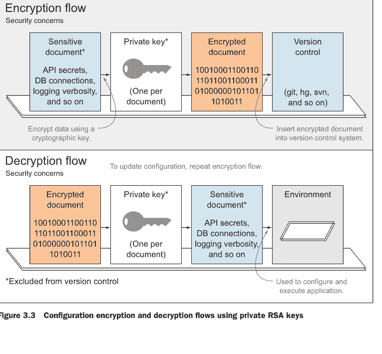

为此，你可以设置几个文件夹。例如，使用`env/private`来存放已解密的未受保护数据，使用`env/secure`来存储加密文件。由于`env/private`文件夹包含敏感数据，因此不应将其提交到源代码控制系统中。相反，你将通过其他方式分发加密密钥；例如，物理地交给相关方。然后，仓库将包含工具（在你的情况下是Grunt任务），用于使用相应的RSA（一种加密算法）密钥对每个特定文件进行加密和解密。你将使用三个不同的Grunt任务来实现加密目的。第一个将生成私钥；另外两个将使用该私钥来加密和解密你的配置。

##### RSA加密示例

我写了一个完整可用的示例，可在随附的源代码列表中找到，名为`02_rsa-config-encryption`，位于`ch03`下。在该示例中，你将使用我编写的`grunt-pemcrypt`包，它简化处理安全配置文件加密和解密所需的任务。我们不会深入代码本身，因为它相当容易理解，并且有适当的文档说明。

> 代码示例可在线获取，地址为http://bevacqua.io/bf/secure-config。

RSA加密回顾：

- 创建私钥；不要与任何人分享。
- 使用它来加密你的敏感文件。
- 将加密文件与你的代码库一起传输。
- 当你需要更新安全文件时，更新明文文件并重新加密。
- 当其他人复制你的代码库时，除非你把密钥给他们，否则他们无法访问加密配置。

在下一节中，让我们看看另一条路线的优缺点：不加密你的环境级配置，但也不将其（以及你的敏感机密）与应用程序的其余代码库一起分发。

#### 3.2.3 在操作系统层面设置环境级配置

对于发布环境（暂存、生产以及介于两者之间的任何环境），你可能希望直接在环境中配置敏感值，并将它们从你的代码库中剥离出来。将配置从代码库中剥离出来，使你能够在不需要完整重新部署的情况下更改它。使用系统级环境变量是一个很好的方法。

这是我从使用基于云的托管解决方案（如Heroku）中学到的，而且设置起来很方便。使用环境变量的另一个好处是，你不需要触及代码库就能改变其行为。缺点是与之前的方法类似，当你第一次克隆仓库时，你无法访问大部分配置。这个缺点的一个例外是你可能拥有的任何未受保护的默认值，例如开发环境的监听端口。然而，这个缺点也正是采取这条路线的目标：无法将新克隆的仓库直接部署到任何一个生产环境中。

加密文件存储与环境级配置之间的区别在于，不与代码库共享任何东西会更加安全，即使它是加密的。但走环境变量路线的缺点是，你仍然需要把配置放到那里。

在下一章中，我将介绍Heroku，一家云托管平台即服务（PaaS）提供商，它可以让你像执行`git push`一样轻松地在云端托管Web应用程序。Heroku使用环境变量来进行环境配置，他们详尽地记录了他们的理念（关于Web应用程序构建、架构和扩展），并发布在一个名为12factor.net¹的网站上，每个人都应该读一读。

对于本地开发，你仍然会使用的JSON文件不会提交到源代码控制中，它包含你在上一节中会放入安全JSON文件的内容。以下是一个示例环境JSON文件：

```json
{
  "NODE_ENV": "development",
  "PORT": 8080,
  "SOME_API_SECRET": "zE1nMDDqkzDbSDX4fSSacCpl1k0W9",
  "SOME_API_KEY": "IYOzBMFi34Rkzce7kY4h0GqI"
}
```

如果你想为你的项目新贡献者提供一份你在本地使用的环境文件副本，请考虑对该文件（`development`配置）采用加密方法，而对托管环境（那些不在你开发机器本地的环境）采用环境变量方法，以最大程度地提高安全性。

对于托管解决方案（如`staging`或`production`），则采用不同的方法。Heroku提供了一个命令行界面，可以轻松设置环境变量²。使用下面的示例，你可以将环境设置为`staging`，以便你的代码可以针对该环境调整体验——例如增加日志记录，但大部分与生产环境相同：

```
heroku config:add NODE_ENV=staging
```

命令行应该对哪些值用于何处有最终决定权，这样可以轻松地对环境进行小幅修改，例如设置端口或执行模式（调试或发布）。以下是一个覆盖端口和环境的示例：

```
NODE_ENV=production PORT=3000 node app.js
```

最后，让我们来看看如何以合理的方式将所有不同的配置来源（环境变量、文本文件和命令行参数）整合在一起。

#### 3.2.4 在代码中将配置作为瀑布流合并

你已经准备好将所有这些内容整合到JavaScript片段中了。考虑到我们有多懒，让我们不要写太多代码来实现这一点。

有一个名为`nconf`的npm模块，可以将配置来源合并在一起，无论你使用的是哪种来源：JSON文件、JavaScript对象、环境变量、进程参数等等。以下代码是一个示例（在示例中标注为ch03/03_merging-config），展示了如何配置`nconf`以使用3.2.2节中的普通JSON文件。请注意，虽然代码清单中的配置源顺序可能看起来有违直觉，但`nconf`按照"先到先得"的原则确定配置优先级：

```javascript
var nconf = require('nconf');

nconf.argv();
nconf.env();
nconf.file('dev', 'development.json');

module.exports = nconf.get.bind(nconf);
```

设置好这个模块后，你可以用它来按出现顺序从任何这些存储中获取配置值：

- 首先，`nconf.argv()`将命令行参数置于所有其他来源之上，因为它是我们添加的第一个来源。例如，使用`node app --PORT 80`执行应用程序意味着PORT变量将被分配该值，无论来自其他来源的配置如何。
- `nconf.env()`这一行告诉`nconf`也从环境中获取配置。例如，执行`PORT=80 node app`会将端口设置为80，而`PORT=80 node app --PORT 3000`会将端口设置为3000，因为命令行参数比环境变量具有更高优先级。
- 最后，`nconf.file()`这一行从JSON文件中获取最不重要的值：这些将被环境变量和命令行参数覆盖！如果你提供诸如`--PORT 80`这样的命令行参数，那么即使你在开发JSON文件中有`"PORT": 3000`也无关紧要；你仍将使用端口80。同样，你可以在随附的源代码中找到完整的示例，还详细介绍了走Heroku路线时如何使用`nconf`。这在下一章中会很有用，所以我建议你仔细阅读

¹ 12 Factor是稳健应用程序开发的优秀指南。请访问http://bevacqua.io/bf/12factor查看。

² 了解更多关于使用Heroku配置Node.js环境的信息，请访问http://bevacqua.io/bf/heroku-cli。


在完成本章剩余部分后，如果你还未处理代码示例，现在正是跟进的时候。

既然你已掌握如何正确配置构建与环境，我们将进入最后几个章节。在开始持续开发之前，让我强调首次设置环境时的一些最佳实践。

#### 自动化繁琐的首次设置任务

首次设置环境时，你需要思考自己的操作，并尽可能将可自动化的任务实现自动化。原因在于：若不自动化，将直接增加新成员的工作量。提前自动化的另一个纯粹原因是——你完全可以做到。

起初，逐步自动化小任务很简单。但随着项目发展，这样做会变得艰巨且不切实际。此时同事可能反对，但搭建一个可用环境可能耗时长达一周。我曾在某个规模庞大的项目中遭遇此况，管理层对此默许。搭建本地开发环境涉及：

- 阅读一系列冗长且撰写欠佳的维基文章
- 手动安装依赖
- 手动应用数据库结构更新
- 每天获取最新代码后手动应用更新
- 安装音频编解码器甚至专有软件，例如特定版本的 Windows Media Player

一周后，我仅得到一个“勉强可用”的环境。三周后我换了工作，因为无法忍受该项目中手动重复的繁重工作。问题的核心在于：改变应用构建方式困难重重，而缺乏简单直接的自动化流程来设置新环境，后续代价会极其高昂，以至于你根本不愿费心更改。那段经历中感受到的挫败感，正是驱使我撰写本书《构建优先》（Build First）方法论的根本动力之一。

在第2章中，我们介绍了如何自动化构建过程，你甚至学会了如何自动创建、配置和更新 MySQL 数据库实例（详见示例代码 `ch02/10_mysql-tasks`）。如示例代码所示，设置数据库初始数据（seeding）虽然复杂，但也颇具价值：新协作者只需获取代码仓库和执行 Grunt 任务的简单说明即可，无需额外提供任何东西。

> 数据库配置任务示例可在 http://bevacqua.io/bf/db-tasks 找到。

我们已详细探讨了配置相关措施，因此设置新开发环境时，你只需获取解密密钥（存放在安全位置）并运行 Grunt 任务。首次设置不应比配置环境本身更繁琐；它本应如此简单。

好了，你已处理好所有环境、分发、配置和自动化工作，包括繁琐的首次设置。现在是兑现本章开头承诺的有趣部分的时候了！接下来是持续开发！

#### 在持续开发中工作

持续开发是指能在代码库中不间断地工作，这里所说的“不间断”并非指烦人的项目经理询问进度或同事求助调试问题。我指的是那些逐渐侵蚀工作日的重复性事务，比如每次应用变更后都重新执行 `node`。即使现在你有了崭新的构建流程，是否仍需每次文件变更都手动运行它？当然不必！你没时间应付这些。你将使用另一个任务来完成它。

还有一些更琐碎的事情，比如保存更改并刷新浏览器。你也可以通过让工具代劳来摆脱这些。重复性常规操作在“构建优先”系统中并不受青睐。让我们看看你的工作流程中有多少可以自动化。这并非为了证明你能自动化一切；其益处在于，你可以花更多时间做重要的事情：思考和调试代码。

你在这方面的第一步是投入使用一个优秀的“监视”（watch，这里指使用任务运行器中的监视任务），它允许你在保存文件更改时自动重启构建过程。

##### 不浪费时间，使用监视任务！

如果你像我一样，每隔几秒就会保存或切换标签页。你无法承受每次修改注释或逗号都运行完整构建；那将极大浪费时间。但许多人仍在这样做，因为他们尚未找到更好的方法。既然你正在阅读此内容，说明你已领先一步。值得赞扬。

Grunt 最有用的插件之一无疑是 `grunt-contrib-watch`。此插件会监视文件系统中代码的更改，并运行受这些代码更改影响的任务。每当文件更改影响某个构建任务时，你就应再次执行该任务。这是持续开发的基石之一，因为你无需做任何事；构建过程会按需自动运行。

让我们看一个简单示例：

```
watch: {
  rebuild: {
    tasks: ['build:debug'],
    files: ['public/**/*']
  }
}
```

通过此示例（名为 `04_watch-task`，位于代码示例的 `ch03` 下），每当 `public` 文件夹中的任何文件发生更改或创建时，你可以完全重新运行构建过程。现在你无需再担心持续运行构建；它可以自动运行！

但即使这种方法也不是最高效的，因为它会运行所有构建任务，包括那些未受文件更改影响的任务。例如，如果你编辑 LESS 文件，任何与 JavaScript 相关的任务（如 `jshint`）也会运行，因为它们也是构建的一部分。为纠正此行为，你应将 `watch` 拆分为多个目标：每个可能受文件更改影响的构建任务对应一个目标。以下代码清单简要说明了这一点。

##### 代码清单 3.2 将 `watch` 拆分为多个目标

```
watch: {
  less: {
    tasks: ['less:debug'],
    files: ['public/css/**/*.less']
  },
  lint_client: {
    tasks: ['jshint:client'],
    files: ['public/js/**/*.js']
  },
  lint_server: {
    tasks: ['jshint:server'],
    files: ['srv/**/*.js']
  }
}
```

这样拆分监视任务可能显得繁琐，但完全值得。它将加速你的持续开发流程，因为你进入了一种“构建所更改内容”的模式，而非每次都盲目重建所有内容。你可以在代码清单中找到完整的工作示例，标记为 `ch03/05_better-watch-closely`。

监视构建中的此类更改很棒，但如果你能扩展它，监视 Node 应用程序的更改呢？事实证明你可以也应该这样做。请注意，让我们谈谈 `nodemon`。

##### 监视 Node 应用程序的更改

在持续开发领域，你应尽可能避免不断重复任何操作，坚持 DRY（不要重复自己）而非 WET（把时间浪费在重复造轮子）。你刚看到这多么有益——无需每次更改都运行构建。现在你将对 Node 采用同样的捷径。

将 `nodemon` 命令视为使用 `node` 命令，但它会监视更改并重启应用程序，再次运行 `node`，这样你就无需手动操作。

要安装它，使用 `npm` 并加上 `-g` 修饰符进行全局安装，以便从命令行轻松访问：

```
npm install -g nodemon
```

现在你可以运行 `nodemon app.js`，而非 `node app.js`。默认情况下，`nodemon` 监视 `*.js` 文件，但你可能希望进一步限制。此时，你可以提供一个 `.nodemonignore` 文件（功能类似 `.gitignore`），忽略你不希望 `nodemon` 监视的文件。示例如下：

```
# package control
./node_modules/*

# build artifacts
./bin/*

# ignore client-side js
./src/client/*

# ignore tests
./test/*
```

运行 `grunt watch` 并使用另一个终端运行 `nodemon app.js`，确实比通过 Grunt 同时运行两者稍快，因为 Grunt 会增加开销。然而，运行单个命令足够方便，无需启动两个终端窗口，这或许能抵消额外开销。一般来说，存在速度（单独运行）与便利性（在 Grunt 下同时运行）之间的权衡。个人而言，我更倾向于无需单独执行额外命令的便利性。

接下来，我们将研究如何将 `nodemon` 集成到 Grunt 中。

### 结合 watch 和 nodemon

在将 `nodemon` 集成到 Grunt 之前，你需要解决一个问题：`nodemon` 和 `watch` 都是*阻塞任务*：这些任务永不结束，它们会持续监视代码更改。Grunt 按顺序运行任务，等待一个任务结束才能运行另一个。但如果两者都不结束，另一个就无法启动！

要解决此问题，你可以使用 `grunt-concurrent`，它会为每个提供的任务生成新进程，让你成为更快乐的极客。通过 Grunt 运行 `nodemon` 可轻松使用 `grunt-nodemon` 实现。以下清单是一个示例。

```
nodemon: {
  dev: {
    script: 'app.js'
  }
},
concurrent: {
  dev: {
    tasks: ['nodemon', 'watch']
  }
}
```


这个示例也可以在附带的源代码列表中找到，名为 06_nodemon（在第 3 章目录下）。在本章中，你已经改善了事件序列，因为你的修改会被保存，但你仍然需要手动保存！让我们简要谈谈保存修改的问题。

## 3.4.3 一个贴心的文本编辑器

选择合适的编辑器对你日常的工作效率至关重要，而效率直接关系到幸福感。花点时间深入了解你所选编辑器的方方面面。第一次发现自己正在看关于文本编辑器快捷键的 YouTube 视频时，你可能会觉得自己有点宅，但这绝对是值得花费的时间。你大部分时间都在使用代码编辑工具，所以不妨学习如何充分利用这些编辑器提供的功能。

幸运的是，现在大多数编辑器都提供了自动保存修改的机制。一开始感觉有点奇怪，但习惯之后，你会爱上它，再也回不去。我个人喜欢用 Sublime Text，我就是在它上面敲下这些文字的，也是我用它来完成大部分写作。如果你用 Mac，TextMate 似乎是个不错的选择。其他选项包括 WebStorm，这是一个专门针对 Web 开发的 IDE，还有 vim，适合那些敢于学习其复杂、快捷键密集型用户界面的人。

我刚才提到的所有编辑器都支持自动保存；如果你现在用的不支持，我强烈建议你换一个有这个功能的。一开始你会不适应，但很快你就会开始给我写感谢信了。

让我们最后谈谈用于浏览器刷新的 LiveReload 技术，以及你能从中获得什么好处。

## 3.4.4 浏览器刷新已经是 Y2K 时代的事了

LiveReload 是一项理解你不能浪费时间在每次有变化时手动刷新浏览器的黑科技。它利用了 WebSocket，这是一种浏览器中可用的实时通信技术（超赞的）。通过使用 WebSocket，LiveReload 可以判断是需要对 CSS 进行小幅修改，还是在 HTML 变化时执行整页刷新。

启用它相当简单，简单到我们没有任何借口不去做的地步。它已经捆绑在`grunt-contrib-watch`中了，所以设置起来就像添加一个`watch`目标一样简单，如下面的清单所示。

## 清单 3.4 启用 LiveReload

```
watch: {
  livereload: {
    options: {
      livereload: true
    },
    files: [
      'public/**/*.{css,js}',
      'views/**/*.html'
    ]
  }
}
```

接下来，你需要安装浏览器扩展并启用它。现在你在调试应用时再也不需要手动刷新浏览器了。还有一个现成的示例^5供你参考（在代码示例中标注为 ch03/07_livereload），包含了所有必要的设置说明，但上手运行非常直观简单。

## 3.5 小结

你顺利通过了环境和开发工作流的速成课程！以下是本章要点的快速回顾：

- `debug` 和 `release` 发行版会以不同方式影响你的构建流程；`debug` 旨在捕捉 bug 和确保持续开发，而 `release` 旨在监控和速度优化，这一点你将在下一章看到。
- 你的应用应该进行配置，确保敏感信息不会进入源代码，同时也要足够灵活，能够根据运行环境进行配置。
- 我们介绍了持续开发，以及如何使用 `watch` 任务重建应用、`nodemon` 在修改后重启应用来获益，还有选择合适文本编辑工具的重要性。

在下一章中，我们将更详细地介绍 release 构建时可以采用的性能优化、什么是持续集成以及如何利用它、如何监控应用中的分析数据，最后是如何将应用部署到暂存和生产等托管环境。

# 发布、部署和监控

**本章涵盖**
- 理解发布流程和部署前任务
- 部署到 Heroku
- 使用 Travis 进行持续集成
- 理解持续部署

我们已经涵盖了构建流程、可以执行的常见构建任务（以及如何使用 Grunt 来实现），并在高层次上讨论了环境和配置。我们广泛讨论了开发环境，但这只是故事的一半。开发环境是你将花费大部分时间工作的地方，因为你将建立一套系统，以便为发布做好准备、将应用部署到人类可以访问的平台，然后监控应用状态。得益于"构建优先"的理念，你将自动化我刚刚提到的工作流，避免重复、人为错误，并运行测试，同时节省时间，正如我在第 1 章所承诺的。

持续集成（CI）平台将通过确保测试在托管环境中通过，帮助你将更健壮的构建部署到生产环境。如你在本章稍后将会看到的，CI 帮助你在每次推送到版本控制系统（VCS）时远程测试你的代码库。构建自动化（和持续开发）对于保持日常开发工作的高效和高效至关重要。同样，拥有一个易于执行的工作流可以确保你能够根据需要随时部署应用，而无需担心一套需要半小时才能完成的、令人尴尬的手动任务。

在本章结束时，你将准备好执行安全的持续部署，这从精神层面上与持续开发类似。它们都旨在减少重复性工作并降低人为失误。发布流程有几个阶段，我们将在本书中遵循：

- 第一步是构建流程，在 release 发行版下进行。
- 构建编译完成后，你将运行测试以确保最近的修改没有破坏构建。小的语法问题应该在开发过程中通过使用 lint 工具不断解决。
- 如果测试成功，你可能会进入部署前操作，比如更新版本号和发布变更日志。
- 之后，你将研究部署选项，比如云托管选项和 CI 平台。

图 4.1 描述了这个提议的发布和部署流程。当你看这个图时，请在心里记下我的建议：先部署到暂存环境，确保在托管环境中一切按预期工作，然后再上线到生产环境。

你还有很长的路要走；让我们开始讨论发布和部署流程吧。你将在 4.2 节详细了解部署前操作。然后在 4.3 节，我会告诉你关于部署的一切，你将学习如何将应用部署到 Heroku。4.4 节涵盖了持续集成以及你可以用来让 CI 帮你完成繁重工作的工具。

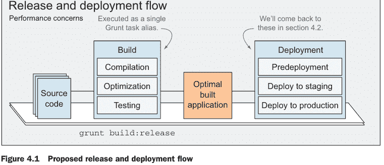

**图 4.1 提议的发布和部署流程**

### 4.1 发布你的应用

在准备发布应用时，你会想要将 Web 的最佳实践放在你的餐盘上。在第 2 章中，我们讨论了 *minification*（压缩），缩小你的资源以获得更好的性能，以及 *concatenation*（合并），将文件连接在一起以减少 HTTP 请求数量，这些你肯定会在 release 构建中包含。这些通过将你的开发者可读的源代码打包成包含所有内容的单个文件来改善 Web 应用的用户体验，但以压缩形式以加快下载。在那章我们还涵盖了 *sprite maps and sprites*（精灵图和精灵），包含许多图像的大文件。这些也会用于 debug 发行版，唯一的原因是它们让你能将 debug 和 release 更紧密地绑定在一起，减少差异。否则你需要在 debug CSS 中引用单个图标，然后在 release 中以某种方式引用精灵图和每个图标的位置，这违背了统一两种构建流程的目的，而且重复自己，违反了 DRY 原则。

压缩、合并、精灵图——release 流程还有什么？在本节中，我们将介绍图像优化和资源缓存；然后我们将继续讨论部署流程、语义版本控制，以及轻松保持变更日志最新。

#### 4.1.1 图像优化

合并和压缩后的 JavaScript 和 CSS 文件并不能说明全部问题。图像往往代表了网页下载体积的大部分，意味着它们比其他任何静态资源都更需要优化。你在第 2 章中已经完成了大量的优化工作，当时你研究了如何使用不同的图像生成精灵图，这类似于合并对文本文件的作用，将许多文件合并成一个。另一种优化，压缩，通过缩短变量名和执行其他微优化来减少脚本和样式表文件的内容。在图像世界中，有各种压缩文件的方法，通常可以获得 9% 到 80% 的收益，通常超过 50%。幸运的是，某些 Grunt 包，正如我们正逐渐习惯的，在这方面为我们承担了繁重的工作。

其中一个包是`grunt-contrib-imagemin`，它正是你想要的：针对不同格式（如 PNG、GIF 和 JPG）的图像压缩。在深入之前，我将简要介绍它可以帮助你的图像优化的两个方面：无损压缩和交错。

##### 无损图像压缩

***Lossless image compression***（无损图像压缩）与 JavaScript 压缩类似，负责从图像原始二进制数据中移除不重要的数据位。需要注意的是，无损压缩不会改变图像的外观，而只改变其二进制表示。无损压缩的唯一结果是一个更小的图像，看起来与较大的图像完全相同。幸运的是，更聪明的人已经花时间开发了为我们完成高级图像压缩工作的工具。你可以指定图像的路径，让它们的算法来处理它。此外，

`grunt-contrib-imagemin`会帮你用正确的参数配置这些底层程序，无需你亲自动手。请注意，与有损压缩相比，无损压缩带来的字节节省较为有限；不过，当你无法承受任何图像质量损失时，无损压缩是很好的选择。当你可以接受图像质量损失时（而且大多数时候这种损失几乎察觉不到），你应该使用有损图像压缩。

##### 有损图像压缩

有损压缩是一种图像压缩技术，在重新编码图像时应用不精确的近似（也称为部分数据丢弃），从而实现比无损压缩更大的字节节省（最高可达90%）。无损压缩通常只移除元数据，如地理位置、相机型号等。`grunt-contrib-imagemin`包默认使用有损压缩，此外还会结合无损压缩来移除不必要的元数据。如果你只想使用无损压缩，应该考虑直接使用`imagemin`包。

##### 图像交错

另一个你要学习的图像优化任务是*交错*。[^1] 交错图像比普通图像占用更大的空间，但这些额外的字节通常是值得的，因为它们能提升感知性能。尽管图像可能需要稍长时间才能完全下载完成，但它会比普通图像更快地开始渲染。渐进式图像的工作原理如其名所示。它们先渲染图像像素的最简视图，大致看起来像是完整的图像，然后随着更多数据流传输到浏览器而逐步增强，直到完整质量的图像可用。

传统上，图像从顶部开始以完整质量加载，这意味着下载时间更快，但感知渲染更慢。查看整个图像所需的时间等于完成时间。在渐进式渲染模式下，用户会感觉到更快的体验，因为他们无需等待太久就能看到整个图像的（粗略）视图。

##### 配置 GRUNT-CONTRIB-IMAGEMIN

幸运的是，配置`grunt-contrib-imagemin`和我们之前介绍过的其他任务一样简单。请记住，关键在于了解这些任务的作用、使用方式以及应用时机。以下清单中的配置在发布构建时优化`*.jpg`图像。

```
imagemin: {
  release: {
    files: [{
      expand: true,
      src: 'build/img/**/*.jpg'
    }]
  },
  options: {
      progressive: true // 渐进式 jpg
  }
}
```

[^1] 想了解更多关于交错如何提升感知性能的信息，请访问[http://bevacqua.io/bf/interlacing](http://bevacqua.io/bf/interlacing)。那里还有一个动画GIF，能更好地解释交错图像的工作原理。

清单4.1不需要任何额外配置来压缩图像；这是默认完成的。在随附的本章源代码中可以找到完整可用的示例，标记为ch04/01_image-optimization，包含适用于`debug`和`release`两种分发版本的完整构建工作流。既然你已为人类在互联网上漫无目的地闲逛创造了稍好一点的环境，现在可以将注意力转向静态资源缓存了。

#### 4.1.2 静态资源缓存

如果你不熟悉这个术语，可以把*缓存*想象成从图书馆复印历史书。与其每次想读的时候都去图书馆，不如打印几页副本带回家，随时阅读而无需再次去图书馆。网络中的缓存比从图书馆借书复印要复杂得多，但这个比喻应该能让你大致了解其含义。

##### EXPIRES 响应头

你绝对应该遵循的一个最佳实践是为静态资源使用`Expires`响应头。根据HTTP协议，这个响应头告诉浏览器，如果资源至少被请求过一次（因此已被缓存），且缓存版本尚未过期，就不要再次请求该资源。`Expires`响应头中的过期日期决定了缓存版本何时不再有效，需要重新下载资源。一个`Expires`响应头的例子可能是`Expires: Tue, 25 Dec 2012 16:00:00 GMT`。

这既是极好的做法，也是可怕的做法。对人类来说这是极好的，因为在他们首次访问你的页面后，无需重新下载浏览器已缓存的资源，从而节省了请求和时间。但对我们来说，也就是开发者，这是可怕的，因为即使你部署了对资源的更改，用户也不会再下载它们了。

为了解决这个不便，并使`Expires`响应头有用武之地，你可以在每次部署资源更改时重命名资源，在名称后附加一个哈希值，这样浏览器就会再次下载该文件，因为就所有目的而言，这与它们缓存中的文件是不同的文件。

##### 哈希

*哈希*是一种返回固定长度值的函数，该值是数据的编码表示。在你的情况下，哈希可以从资源内容和最后修改日期计算得出。一个这样的哈希可能是`a38cbf9e`。尽管看起来是任意的，但这里不涉及随机性。否则会违背使用`Expires`响应头的目的，因为文件将始终具有不同的名称，每次都会被重新请求。

计算哈希后，你可以将其用作页面中的查询字符串参数，/all.js?_=a38cbf9e，或将其附加到文件名中，如/a38cbf9e.all.js。或者，你可以将哈希添加到ETag响应头中。选择正确的方法取决于识别你的需求。如果你处理的是静态资源，如JavaScript资源，那么最好对文件名（或其查询字符串）进行哈希处理，并使用Expires响应头。如果你处理的是动态内容，在ETag中设置哈希是首选方案。

## 第4章 发布、部署和监控

##### 使用 LAST-MODIFIED 或 ETAG 响应头

ETag响应头唯一标识资源的一个版本。类似地，Last-Modified标识资源的最后修改日期。如果你使用这两个响应头中的任何一个，则应该在cache-control响应头中使用max-age修饰符，而不是使用Expires响应头。这种组合允许更柔和的缓存，因为用户代理可以确定是否应该使用缓存副本，或者应该再次请求资源。以下示例展示了如何结合ETag和cache-control响应头：

```
ETag: a38cbf9e
Cache-Control: public, max-age=3600
```

Last-Modified响应头作为ETag响应头的替代方案，以提供便利。这里我们不指定唯一标识的ETag，而是通过设置修改日期来实现相同的唯一性：

```
Last-Modified: Tue, 25 Dec 2012 16:00:00 GMT
Cache-Control: public, max-age=3600
```

##### 使用 GRUNT 进行缓存破坏

让我们了解如何使用Grunt为文件名创建哈希，然后可以安全地用于设置远期Expires响应头。

在构建过程中，你在设置HTTP响应头方面能做的很少，因为这些响应头必须随着每个响应发送出去，而不是静态确定的。但你可以使用grunt-rev为你的资源分配哈希。这个包将为你的每个资源计算哈希，然后重命名它们，将相应的哈希附加到其原始名称中。例如，public/js/all.js会被更改为类似public/js/1be2cd73.all.js的形式，其中1be2cd73是为all.js的内容计算出的哈希。这项任务会出现一个问题，即现在你的视图将无法引用正确的资源，因为它们已被在前面添加了哈希重命名。为了解决这个问题，你可以使用grunt-usemin包，它在你的HTML和CSS中查找静态资源引用，并用更新后的文件名刷新它们。这正是你需要的。相关的Grunt配置如下所示的清单所示（在示例中标记为ch04/02_asset-hashing）。

##### 清单4.2 更新文件名

```
rev: {
  release: {
    files: {
```


 src: ['build/**/*.{css,js,png}']
  }
 }
},

usemin: {
  html: ['build/**/*.html'],
  css: ['build/**/*.css']
}
```

请记住，在`debug`流程中你用不到这两个任务中的任何一个，因为这些都是优化措施，在开发过程中对你没有任何好处，所以可能需要将它们的 target 命名为`release`，以更明确地区分开来。然而，`usemin`任务的编写方式使得 Grunt 的 target 具有特殊含义。`css`和`html` target 分别用于配置你想要用哈希文件名更新的 CSS 和 HTML 文件，但像`release`这样的 target 会被`usemin`忽略。

我们要介绍的下一个技术涉及将 CSS 内联到 style 标签中，以避免阻塞渲染的 CSS 请求，从而实现更快的页面加载。

#### 4.1.3 内联关键的首屏 CSS

浏览器在遇到需要下载的 CSS 资源时会阻塞渲染。然而，多年来我们一直互相教导将 CSS 放在页面顶部（在`<head>`中），这样用户就不会看到无样式内容的闪烁（缩写为 FOUC）。内联技术旨在改善页面加载速度，同时通过避免 FOUC 来不损害用户体验。这种技术只有在服务器端和客户端都进行视图渲染时才能有效工作，我们将在第7章中探讨这一点。

要实现这个功能，你需要做以下几件事：

- 首先，你需要识别"首屏"CSS；这些样式是在首次加载时正确渲染页面上可见元素所必需的。
- 一旦我们识别出实际上用于首屏的样式（浏览器需要这些样式来正确渲染页面并避免 FOUC），你需要将它们内联到页面`<head>`中的`<style>`标签里。
- 最后，现在所需的样式已经内联在`<style>`标签中了，你可以通过使用 JavaScript 将请求推迟到`onload`事件触发之后，来消除对 CSS 样式表的阻塞渲染请求。
- 当然，你不会想让关闭 JavaScript 的用户陷入困境，而且作为互联网的良好公民，你还会使用备用的`<noscript>`标签来进行阻塞渲染的请求。

你可能已经注意到，这是一个复杂且容易出错的过程，就像第1章中的案例研究一样，Knight's Capital 因人为错误损失了五亿美元。如果出了问题，对你来说可能不会有那么灾难性的后果，但自动化这个过程几乎是必须的：涉及的工作太多了，每次样式更改或标记更改时都要做！

让我们学习如何使用 Grunt 配合`grunt-critical`来自动化这个过程。

**第四章** *发布、部署和监控*

##### 让 GRUNT 承担繁重的工作

使用`grunt-critical`来实现这个目的非常简单，尽管它确实提供了丰富的配置选项。在下面的代码中，你会找到一个简单用例的配置。在这个例子中，你正在从页面中提取关键 CSS，并在构建后内联这些样式到`<style>`标签中。`critical`还会进一步推迟其余样式以避免阻塞渲染，并且为那些禁用 JavaScript 的用户添加`<noscript>`回退标签：

```
critical: {
  example: {
    options: {
      base: './',
      css: [
        'page.css'
      ]
    },
    src: 'views/page.html',
    dest: 'build/page.html'
  }
}
```

你可能已经熟悉所有提供的选项，这些都是文件路径。base 选项指示在查找绝对资源路径（如`/page.css`）时应使用的根目录。一旦你设置好 Grunt 来代表你执行内联操作，记得要提供升级后的 HTML 文件，而不是预构建的文件。

在转换话题、享受自动化部署的温泉之前，你需要反思一下在每次部署前测试发布版本的重要性，以减轻温泉位于活火山区域的可能性。

#### **4.1.4** *部署前测试*

在你进入部署阶段，甚至是我们即将探讨的预部署阶段之前，你需要测试你的发布构建。测试发布构建在你未来有部署计划时变得很重要，因为你希望确保你的应用程序按预期运行，或者至少，按你编写的测试预期的那样运行。

在本书的下一部分，我们将深入探讨应用程序测试的地下世界，并详细研究两种测试类型（尽管还有更多更多）。这些是单元测试和集成测试：

- **单元测试**：在这里，你通过隔离来测试应用程序的各个组件，确保组件本身能正常工作。
- **集成（或端到端）测试**：这需要一系列经过单元测试的组件，并测试它们之间的交互，确保它们适当地通信。

距离你开始测试实践和示例还有一段时间。我们将在第8章讨论测试实践并查看示例。请记住，在部署之前，你需要测试你的应用程序，降低将故障构建发布到任一托管环境的几率，特别是如果该环境是生产环境。让我们讨论一些在发布测试完成后、部署之前可以执行的任务。

##### 预部署操作

一旦你准备好了发布构建并仔细测试过，你就准备好部署了。但是在跳入部署温泉之前，我有几个重要的预部署任务想要提及。

图4.2概述了部署流程，以及构建被认为是可部署之前需要进行的操作。它还展示了你将如何逐步将更新发布到不同的环境，以确保最大的可预测性。

##### 预部署操作

- **语义化版本控制**：这有助于跟踪有意义的应用程序版本。语义化版本的格式类似于`MAJOR.MINOR.PATCH-BUILD`。这个标准有助于在管理依赖时避免混淆。如果你想对当前部署在托管环境（如生产环境）上的代码有任何控制，保持应用程序版本化是很重要的。这使你在事情出错时能够回滚到旧版本。考虑到这是相当容易设置的，而且考虑到部署不顺利时 unprepared 的成本有多高，版本控制变成了一个显而易见的选择。
- **变更日志**：*变更日志*（changelog）是项目历史中所做更改的列表，按引入它们的版本划分（部分原因说明保持版本的重要性），并进一步细分为错误修复、破坏性更改和新功能。按照惯例，`git`仓库中的变更日志通常放在项目根目录，命名为类似

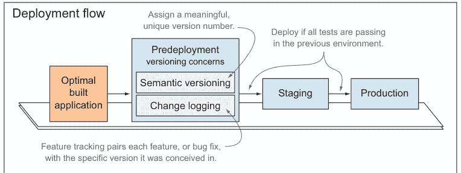

**图4.2** 部署前的版本控制和渐进式部署发布。QA 团队在 staging 环境中进行测试，确保部署到生产环境前的健壮性。

# 第四章 发布、部署和监控

CHANGELOG.txt 的形式，或者使用你喜欢的任何扩展名（比如 md 表示 Markdown2，一种文本到 HTML 的转换工具）。

我们会深入探讨如何更好地分配你的变更日志维护时间，但首先让我们探索语义化版本控制的细节。

#### 4.2.1 语义化版本控制

因为你正在使用 Node，你可能熟悉语义化版本控制这个术语。npm 对所有包都使用语义化版本控制3，因为它是管理不同 Node 模块之间依赖解析的强大规范。因为你生产的每个 Node 应用程序都已经有一个 package.json，而且考虑到这些文件中包含语义化版本，你将使用这些来在部署前标记你的发布。

当我谈到版本控制时，我的意思是更新包版本，然后在你的 VCS 中创建一个标签（版本历史中可以引用的一个时刻）。在编号发布时，你可以设置任何你想要的方案，但重要的部分是你不要覆盖发布；你不应该使用相同的版本号进行两次发布。为了确保这种唯一性，我选择让 Grunt 在每次构建后（无论分发与否）自动增加构建号，并且在执行部署时增加补丁号。主版本更改是手动进行的，因为这些更改可能会引入破坏性变更。次版本更改也是如此，因为新功能通常在新的次版本中引入。

使用 Grunt，你可以使用 grunt-bump 包来执行这些版本增加（从此称为 bump）。它很容易配置，可以为你进行版本标记，甚至可以将更改提交到 package.json 文件。以下是一个例子：

```
bump: {
  options: {
    commit: true,
    createTag: true,
    push: true
  }
}
```

事实上，这些都是该任务提供的默认设置。它们足够合理，你甚至不需要配置。该任务会提升 package.json 中找到的版本，用相关消息精确提交该文件，然后在 git 中创建标签，最后将这些更改推送到 origin 远程仓库。如果你关闭所有这些选项，该任务只会更新你的包版本。示例 ch04/03_version-bump 展示了这一行为。

一旦版本控制问题解决，你就会想要设置一个变更日志，列举自上次发布以来发生了什么变化。让我们来思考一下这个问题。

2 Markdown 格式是一种纯文本表示的 HTML，易于阅读、编写和转换为 HTML。阅读2004年介绍 Markdown 的原始文章，请访问 http://bevacqua.io/bf/markdown。

3 你可以在 http://bevacqua.io/bf/semver 了解更多关于语义化版本控制的信息。


#### 4.2.2 使用变更日志

你可能已经习惯了在感兴趣的产品发布新版本时阅读变更日志（游戏行业尤其重视变更日志），但你自己维护过变更日志吗？这并不像你想的那么难。

设置一个变更日志——作为帮助追踪随时间变化的内部文档——即使不向消费者展示，也可能是你项目的一项积极补充。

如果你有任何形式的透明政策，或者你不希望人们蒙在鼓里，那么维护变更日志几乎就成了必需品。你不应该每次为发布构建时都更新变更日志，因为你可能想为了调试目的而生成一个发布构建。也不应该在测试之前更新它们。如果测试失败，那么变更日志就会与最后一个可发布的构建不同步。这样，你就需要在生成一个通过所有测试的构建之后再去更新变更日志。只有在那时，你才能更新变更日志以反映自上次部署以来所做的更改。

整理变更日志通常很困难，因为你会忘记自上次发布以来发生了哪些变化，而且你也不想翻阅`git`版本历史来确定哪些更改值得写入变更日志。同样，每次进行更改时手动更新它也很繁琐，如果你进入心流状态，可能会忘记这样做。一个更好的替代方案可能是设置`grunt-conventional-changelog`，让它为你构建变更日志。然后你所要做的就是遵循约定提交信息：以`fix`开头用于修复bug，以`feat`开头用于引入新功能，或者以`BREAKING`开头表示破坏了向后兼容性。此外，这个包允许你在它完成自己的解析和更新后，手动编辑变更日志。

关于配置，这个任务不需要任何配置。以下是一些提交信息示例：

```
git commit -m "fix: buffer overflows, closes #17"
git commit -m "feat: reticulate splines for geodesic cape, closes #23"
git commit -m "feat: added product detail view"
git commit -m "BREAKING: removed POST /api/v1/users/:id/kill endpoint"
```

#### 4.2.3 更新变更日志版本

`bump-only`和`bump-commit`任务允许你在不提交任何更改的情况下更新版本号，这样你就可以稍后更新变更日志（稍后你会看到）。最后，你应该使用`bump-commit`在一次提交中同时检查`package.json`和`CHANGELOG.txt`。一旦你配置了`bump`任务也提交变更日志，你现在就可以使用以下别名一举更新你的构建版本和变更日志。你可以在示例中找到一个使用`grunt-conventional-changelog`的例子，列在ch04/04_conventional-changelog。

```
grunt.registerTask('notes', ['bump-only', 'changelog', 'bump-commit']);
```

现在你已经完成了发布构建，测试通过，更新了变更日志。你已经准备好部署到一个托管环境，以便提供你的应用程序。过去，仅仅通过手动将构建包上传到生产服务器来部署应用程序是相当普遍的。从那些美好的旧时光到现在，你已经走了很长一段路，部署工具和应用程序托管平台都变得更好了。

接下来，让我们深入了解Heroku，一个平台即服务（PaaS）提供商，它可以让你轻松地从命令行部署应用程序。

### 4.3 部署到Heroku

设置部署流程可能像准备寿司一样难，也可能像点外卖一样容易；这完全取决于你希望对部署有多少控制权。在一个极端，你有像亚马逊基础设施即服务（IaaS）这样的服务，在那里你可以完全控制你的托管环境。你可以选择你喜欢的操作系统，选择你想要的处理能力，随意配置它，在上面安装东西，然后处理整个系统运维的繁重工作，例如保护应用程序免受攻击、设置代理、选择保证正常运行时间的部署策略，并从头开始配置几乎所有东西。

另一个极端是那些你不必做任何事情的服务，通常由域名注册商如GoDaddy提供。在这些解决方案中，你通常选择一个主题，充实几个静态内容页面，就完成了；其他一切都为你做好了。

就本书而言，我研究了解释如何在亚马逊上托管应用程序的可能性，但我得出结论，那将偏离主题太远。话虽如此，我将在本节接近尾声时提到一种你可以自己探索此替代方案的方法。

我决定选择Heroku（尽管也有类似的替代方案，如DigitalOcean），它不像在亚马逊网络服务（AWS）上设置实例那样复杂，但也不像使用网站生成器那样简单。Heroku通过轻松地让你从命令行配置并将应用程序部署到其平台上的托管环境，简化了你的生活。如前所述，Heroku是一个平台即服务（PaaS）提供商，你可以托管你的应用程序，无论语言或缺乏服务器管理知识。在本节中，我们将逐步介绍如何将一个简单的应用程序部署到Heroku。

在撰写本文时，Heroku提供了一个免费层级，允许你与他们一起托管你的应用程序。让我们从那里开始。你也可以在附带的源代码中找到这些说明⁴。

访问 [https://id.heroku.com/signup/devcenter](https://id.heroku.com/signup/devcenter)，并输入你的电子邮件。

你需要遵循的下一个手动步骤是安装他们的工具套件，这是一系列命令行程序，帮助你管理托管在Heroku上的应用程序。你可以在 [https://toolbelt.heroku.com](https://toolbelt.heroku.com) 找到它，然后按照说明运行`heroku login`，这些说明可以在同一个网站上找到。

然后你需要一个`Procfile`，这是一个特殊的文件，用于描述你的应用程序运行的操作系统进程。

以下是Heroku对Procfile的定义。请注意，这个过程还有更多步骤，可以在几段之后找到。

**PROCFILE** 一个`Procfile`是一个名为Procfile的文本文件，放在你的应用程序根目录中，列出应用程序中的进程类型。每个进程类型是一个命令声明，当该进程类型的实例（在Heroku术语中称为`dyno`）启动时执行。你可以使用Procfile声明各种进程类型，例如多种类型的worker、像时钟一样的单例进程，或者Twitter流式API的消费者。

简而言之，对于大多数设计良好的Node应用程序，Procfile将类似于以下代码：

```
web: node app.js
```

就应用程序而言，你追求的是最低限度，因为这只是体验一下部署到Heroku的感觉。`app.js`可以小到像下面这段JavaScript代码（ch04/05_heroku-deployments）：

```
var http = require('http');
var app = http.createServer(handler);

app.listen(process.env.PORT || 3000);

function handler (req, res) {
  res.writeHead(200, { 'Content-Type': 'text/plain' });
  res.end('It\'s alive!');
}
```

注意你使用了`process.env.PORT || 3000`，因为Heroku将为你的应用程序提供一个它应该监听的端口，该端口将暴露在名为`PORT`的环境变量中。

然后你使用`3000`用于本地开发。现在，还有更多步骤需要执行：

一旦你位于项目根目录下，在终端中执行以下命令以初始化一个`git`仓库：

```
git init
git add .
git commit -m "init"
```

接下来，使用`heroku create`在Heroku上创建应用。这是一次性操作。


每次你想要部署时，都可以使用 `git push heroku master` 推送到 `heroku` 远程仓库。这将触发一次部署，其过程大致如图4.4所示。

如果你想在浏览器中打开该应用，请使用以下命令：

```
heroku open
```

关于Heroku和PaaS提供商，有一点需要注意。在部署构建结果时，并没有简单的解决方案。你不应将构建产物包含在代码仓库中，因为这可能导致不良后果，例如修改内容后忘记重新构建。同时，你也不应过于依赖在他们的平台上进行构建，因为构建操作应该在本地或集成平台上完成，而不是在应用服务器本身上，因为那会损害应用的性能。

#### 4.3.1 部署构建

问题在于，你不应该将构建结果放入版本控制，因为这些是你的源代码的输出。相反，你应该在部署前进行构建，并将构建结果与其余代码一起部署。大多数PaaS提供商没有提供太多替代方案。像Heroku这样的平台会在你推送到其远程仓库时从Git获取部署，但你不希望将构建产物纳入版本控制，这就成了一个问题。解决方案是：像对待任何持续集成平台一样对待Heroku（详见第4.4节），并允许Heroku在其服务器上构建你的应用。

Heroku通常不会为Node项目安装 `devDependencies`，因为它使用 `npm install --production`，而你需要使用自定义的构建包（buildpack）来解决这个问题。*构建包*是你所使用的语言与Heroku平台之间的接口，它们是shell脚本的集合。使用以下命令可以轻松创建一个启用了自定义Grunt构建包的应用，其中 `thing` 是你在Heroku上的应用名称：

```
heroku create thing --buildpack https://github.com/mbuchetics/heroku-buildpack-nodejs-grunt.git
```

一旦你使用自定义构建包创建了应用，你就可以像往常一样推送，这将在Heroku服务器上触发一次构建。你最后需要设置的是一个 `heroku` 任务：

```
grunt.registerTask('heroku', ['jshint']);
```

如果构建失败，Heroku会终止部署，确保之前部署的应用不受失败构建的影响。附带的示例代码中有详细说明，列在 ch04/06_heroku-grunt 中，它将引导你完成设置。

让我们看看如何在单个Heroku应用中管理多个环境。

#### 4.3.2 管理环境

如果你想在Heroku上托管多个环境⁵（例如 `staging` 和 `production`），请使用不同的 `git` 远程端点来实现。使用CLI创建一个除 `heroku` 之外的远程仓库：

```
heroku create --remote staging
```

现在你应该用 `git push staging master` 代替 `git push heroku master`。类似地，你需要明确告诉 `heroku` 使用特定的远程仓库，例如 `heroku config:set FOO=bar --remote staging`，而不是简单地执行 `heroku config:set FOO=bar`。请记住，环境配置是特定于环境的，应如此对待，因此环境之间不应共享第三方服务的API密钥、数据库凭证或任何通用的认证数据。

既然你可以直接从命令行配置和部署到特定环境，现在是时候了解一种叫做持续集成的实践了，它将帮助你更严格地控制整体代码质量。如果你想了解部署到Amazon Web Services，可以在附带的源代码中找到一个简短的指南⁶（在示例中标记为 ch04/07_aws-deployments）。

### 4.4 持续集成

Martin Fowler是持续集成最著名的倡导者之一。用他自己的话⁷，Fowler对CI的描述如下。

> **持续集成**是一种软件开发实践，团队成员频繁地集成他们的工作；通常每人每天至少集成一次，导致每天多次集成。每次集成都通过自动化构建（包括测试）进行验证，以尽快检测集成错误。许多团队发现，这种方法显著减少了集成问题，并允许团队更快地开发出协调一致的软件。

此外，他建议我们尽可能在一个与生产环境非常接近的环境中运行测试套件。这意味着，当测试你的应用时，你最好的选择是在云端进行测试，就像你托管应用的方式一样。CI平台（如Travis-CI）提供了构建错误通知和访问完整构建日志等功能，详细说明了构建（及其测试）期间发生的所有事情。

我提到了Travis-CI；让我们看看如何设置自己，以便在每次向代码仓库提交时，能远程地将构建任务添加到其平台的队列中。然后Travis-CI的构建服务器将逐个处理这个队列，运行我们的构建并让我们知道结果。

#### 4.4.1 使用Travis进行托管CI

持续集成意味着在远程服务器（尽可能与生产环境相似）上运行测试，以期捕获那些可能会影响到用户的错误。Travis-CI是一个CI平台（Circle-CI是另一个），你可以在正确配置后，远程获得构建结果的反馈。如果构建成功，你甚至不会注意到。如果构建失败，你会收到一封电子邮件通知，告诉你有人破坏了你的构建（哎呀！）。之后，当后续的提交修复了构建，你会收到另一封通知，告知你修复了问题。此外，你还可以在Travis网站上访问完整的构建日志，这在查明构建失败原因时总是很有用。图4.5展示了这样一个电子邮件通知。

在这个时代，设置CI几乎太容易了。你需要做的第一件事是在项目根目录创建一个 `.travis.yml` 文件。在该文件中，你需要声明你正在使用的语言（在你的情况下是 `node_js`）、你测试构建时使用的运行时版本，以及一系列在集成测试之前、期间和之后要执行的脚本。为了说明，这样一个文件可能如下所示：

```
language: node_js

node_js:
  - "0.10"

before_install:
  - npm install -g grunt-cli
script:
  - grunt ci --verbose --stack
```

##### 配置Travis和Grunt

在执行测试之前，你需要通过 `npm` 安装Grunt的命令行界面 `grunt-cli`。你需要它在集成测试服务器上，就像在你的开发环境中需要它一样，以便你可以运行Grunt任务。你可以使用 `before_install` 部分来安装CLI。

接下来只需为Grunt设置一个 `ci` 任务。`ci` 任务可以运行 `jshint` 来减少语法错误，就像你通过新的持续开发工作流在本地每次更改时所做的那样。你应该将 `ci` 任务配置为在用 `jshint` 对代码进行检查之外，还运行单元测试和集成测试。

CI的真正价值在于让远程服务器构建你的整个应用，并将你的测试（包括代码检查）应用于代码库，确保你不依赖于未检入版本控制的文件或可能本地安装但未在代码库中广泛提供的依赖项。

你可能想亲自尝试这个例子，我建议你这样做，因为它对于渴望部署的头脑来说是一个很好的练习。

---

⁵ 关于使用Heroku进行环境管理的参考，请参见 https://devcenter.heroku.com/articles/multiple-environments。

⁶ 使用此代码示例 http://bevacqua.io/bf/aws 演练部署到AWS的过程。

⁷ 阅读Fowler关于持续集成的完整文章，请访问 http://bevacqua.io/bf/integration。


#### 4.4.2 持续部署

Travis平台支持向Heroku进行持续部署。⁹ *持续部署* 是一种花哨的说法，指的是每次你推送到版本控制时，也会在CI服务器中触发一个构建任务（在上一节中，当你启用Travis CI集成时，你已经在做这件事了）。当这些构建成功时，CI服务器会代表你将代码部署到你所选择的发布环境中。

根据我的经验，持续部署是一把双刃剑。当它正常工作时，你正切入一个充满喜悦、减少繁琐部署的世界，在那里，通过构建和测试集成周期就足以验证并推送到生产环境。但你必须确信，你已经设置了足够的测试来合理地捕获错误。一个安全的选择可能是启用向你的预发布环境进行持续部署，而不是直接部署到生产环境。然后，你将确保在预发布环境中没有问题，并执行一次到生产环境的部署。这个工作流程如图4.6所示。

启用向Heroku的持续部署需要一些工作。你需要一个来自Heroku的API密钥，并且需要对其进行加密，然后使用加密数据配置`.travis.yml`文件。既然我已经表达了对于直接部署到生产环境的担忧，这个就留给你自己去完成了。如果你选择这样做，请访问[http://bevacqua.io/bf/travis-heroku](http://bevacqua.io/bf/travis-heroku)获取说明。

我们花费了本章的大部分篇幅来讨论部署，这是一件好事。现在，你终于可以将注意力转向你在处理以下情况时可用的选择了

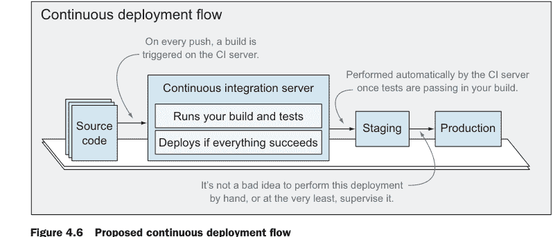

**图4.6 提议的持续部署流程**

### 4.5 监控与诊断

生产环境的应用程序监控与拥有忠诚的客户同样重要。如果你不重视应用程序的正常运行时间，你的客户也不会重视你。也就是说，你无法负担得起不监控你的生产服务器。我所说的监控，是指保留访问日志（谁在何时从何处访问了什么内容）、错误日志（出了什么问题），以及或许更重要的，设置警报，以便在事情预期出错时立即得到通知。“预期出错”并非笔误；你应该预料到事情会出错，并尽可能为这些情况做好准备。你的企业可能不需要像Netflix提倡的那样，拥有一支混沌猴子大军游荡并随机终止实例和服务，以确保他们的服务器能够可靠且持续地承受故障，比如硬件故障，而不影响消费其服务的终端用户。但他们的建议，如下引用所述，仍然适用于几乎所有的软件开发工作。

> **来自NETFLIX博客的引言**
> 如果我们不在失败面前不断测试我们取得成功的能力，那么当真正重要之时——在意想不到的停机事件中——它很可能无法奏效。

然而，你该如何为失败做计划呢？嗯，这是可悲的部分；你所做的任何事情都无法阻止失败。每个人都会遇到停机时间，即使是像微软、谷歌、Facebook和Twitter这样的巨头也不例外。你可以尽情计划，但无论你做什么，你的应用程序都会失败。你能做的是开发一个模块化的架构，能够处理服务崩溃和实例宕机的情况。如果你能实现这种模块化，那么当单个模块停止工作时，其破坏性就不会那么大，因为其他部分仍然可以完美运行。我们将在第5章中探讨模块化的概念，以及单一职责原则（SRP），该章将专注于模块化设计和Node.js平台的速成介绍。

关于搏击俱乐部的第一条规则是你不能谈论搏击俱乐部。抱歉，放错电影了。关于应用程序监控的第一条规则是你记录日志并在坏事发生时设置通知。让我们来看一个可能的实现方案。

#### 4.5.1 日志与通知

我敢肯定，你已经非常习惯在前端使用`console.log`来检查变量，甚至可能将其作为一种调试机制，用来弄清楚正在执行哪些代码路径，并帮助你定位错误。在服务器端，你有标准输出和标准错误流，它们都会将日志输出到你的终端窗口。这些传输通道（`stdout`和`stderr`；稍后会更多地讨论传输通道！）在开发时很有用，但在托管环境中，如果你无法捕获传输到它们的内容，它们对你来说就几乎没用了，因为在这种环境中，你无法在自己的终端中监控进程。

Heroku有一种机制可以捕获你进程的标准输出，以便你以后可以访问它。它还有附加组件来进一步扩展该行为。Heroku附加组件提供了急需的配套服务，例如数据库、电子邮件、缓存、监控和其他资源。大多数日志附加组件允许你设置过滤和通知；然而，我建议不要利用Heroku的日志功能，因为那会过于依赖特定平台，并且可能严重限制你迁移到另一个PaaS提供商的能力。自己处理日志记录并不那么难，你很快就会看到这样做的好处。

##### 使用Winston进行日志记录

我不是特别喜欢利用Heroku的日志设施，因为它将你的代码库绑定到他们的基础设施上，并假设写入标准输出就足以满足你的日志跟踪工作。一种更持久且通用的方法是使用多传输日志记录器，而不是直接写入`stdout`。传输通道决定了你试图记录的信息的处理方式。传输通道可能会将日志写入文件、写入数据库记录、发送电子邮件或向你的手机发送推送通知。在多传输日志记录器中，你可以同时使用其中的多种，但你仍然会使用相同的API来执行日志记录。添加或删除传输通道不会影响你编写日志语句的方式。

Node有几个流行的日志库，我选择了`winston`，因为它具备你在日志记录器中寻找的每项功能：日志级别、上下文、多传输通道、简单的API以及社区支持。此外，它易于扩展，人们已经为几乎所有你将来可能需要的功能编写了传输通道。

默认情况下，`winston`使用`Console`传输通道，这与直接使用`stdout`相同。但你可以设置它使用其他传输通道，例如记录到数据库或日志管理服务。后者特别灵活，因为它们提供了一个平台，你可以选择在重要事件发生时接收通知，而无需更改应用程序中的任何内容。

使用像`winston`这样的日志解决方案与平台无关。你的代码不会依赖托管平台来捕获标准输出才能工作。要开始使用`winston`，你必须安装同名的软件包：

```
npm install --save winston
```

> **使用--SAVE 与 使用 --SAVE-DEV**
>
> 在这种情况下，你将使用`--save`标志而不是`--save-dev`，因为`winston`不像你至今为止摆弄过的Grunt包那样是一个仅构建时使用的包。当向`npm`提供`--save`标志时，该包将被添加到你的`package.json`文件的`dependencies`部分。

一旦你安装了**winston**，你就可以通过将`logger`放在你以前放置`console`的位置来立即使用它：

```javascript
var logger = require('winston');

logger.info('east coast clear as day');
logger.error('west coast not looking so hot.');
```

你可能已经习惯了`console`是一个全局变量的想法。根据我的经验，在这种场景下使用全局变量并没有错，这是我允许自己使用全局变量的两种情况之一（另一种是**nconf**，正如我在第3章中提到的那样）。我喜欢在一个文件中设置所有全局变量（即使只有两个），这样当我调用一个在模块或Node的某部分中未定义的东西时，我可以快速扫描它并弄清楚发生了什么。一个说明性的`globals.js`文件可能如下所示：

```javascript
var nconf = require('nconf');

global.conf = nconf.get.bind(nconf);
global.logger = require('./logger.js');
```

我还建议保留一个单独的文件，你可以在其中定义日志记录器的传输通道。让我们先从使用**File**传输通道以及默认的**Console**传输通道开始。这将是前面代码片段中引用的`logger.js`文件：

```javascript
var logger = require('winston');
var api = module.exports = {};
var levels = ['debug', 'info', 'warn', 'error'];

levels.forEach(function(level){
    api[level] = logger[level].bind(logger);
});

logger.add(logger.transports.File, { filename: 'persistent.log' });
```

现在，每当你执行`logger.debug`时，你将会把一条调试消息同时记录到终端和一个文件中。虽然方便，但其他传输通道提供了更大的灵活性和可靠性，我们将在随附的示例中介绍的几个传输通道就是这种情况：**winston-mail**将使你能够在发生某些事件时（在需要发送电子邮件的级别上）发送电子邮件，**winston-pushover**直接将通知发送到你的手机，而**winston-mongodb**是众多传统日志传输通道之一，它将记录写入你的数据库。

一旦你确保查看了示例代码清单，你将更好地理解根据我的建议，配置、日志记录和全局变量是如何联系在一起的。如果你极其反对全局变量，请不要惊慌。我还包含了一个不使用它们的示例。我喜欢全局变量（在我之前提到的两种情况下），只是因为我发现无需在每个模块中都`require`相同的东西很方便。

既然你已经花了时间处理日志记录，我们不妨谈谈调试Node应用程序。

---

¹⁰ 了解混沌猴子，Netflix的一个混沌制造服务，请访问[http://bevacqua.io/bf/netflix](http://bevacqua.io/bf/netflix)。


#### 4.5.2 调试Node应用程序

在追踪bug时，你会希望获得尽可能多的帮助。根据我的经验，调试的最佳方法是增加日志记录，这也是我们之前讨论过它的原因之一。话虽如此，你有不止一种方式来调试Node应用。你可以在Chrome的DevTools中使用node-inspector¹¹，可以利用集成IDE（如WebStorm）提供的功能，当然还有经典的`console.log`。你也可以直接使用V8（Node运行的JavaScript引擎）中的原生调试器¹²。

根据你正在追踪的bug类型，你会选择合适的工具。例如，如果你在追踪内存泄漏，你可能会使用像`memwatch`这样的包，它在可能发生内存泄漏时会触发事件。更常见的场景，如确定一个四舍五入错误，或找出API调用的问题所在，则可以通过添加日志语句（临时使用`console.log`，或更持久地使用`logger.debug`）来解决，或者使用node-inspector贡献的包。

##### 使用Node Inspector

`node-inspector`包挂钩到V8中的原生调试器，但它允许你使用Chrome中功能齐全的调试工具作为替代Node提供的基于终端的调试器。要使用它，首先需要全局安装它：

```bash
npm install -g node-inspector
```  

要为你的Node进程启用调试，你可以在启动进程时向`node`传递`--debug`标志，如下所示：

```bash
node --debug app.js
```  

作为替代方案，你可以在正在运行的进程上启用调试。为此，你需要找到进程ID（PID）。以下命令`pgrep`可以完成此操作：

```bash
pgrep node
```  

输出将是你的Node进程的PID。例如，它可能如下所示：

```
89297
```  

向进程发送`USR1`信号将启用调试。这通过`kill -s`命令完成（注意我使用的是上一个命令结果中的进程ID）：

```bash
kill -s USR1 89297
```

> ¹¹ 在GitHub上找到node-inspector的开源仓库：http://bevacqua.io/bf/node-inspector。

> ¹² 阅读Node.js关于调试的API文档：http://bevacqua.io/bf/node-debugger。

如果一切正常，Node会通过标准输出通知你调试器正在监听的位置：

```
Hit SIGUSR1 - starting debugger agent.
debugger listening on port 5858
```

现在你需要执行`node-inspector`，然后打开Chrome，指向由inspector提供的链接：

```bash
node-inspector
```

如果一切顺利，你应该会看到类似图4.7的内容，并且你的Chrome浏览器中会有一个功能齐全的调试器准备就绪，它在大多数情况下将表现得像客户端JavaScript应用程序的调试器一样。这个调试器将允许你监视表达式、设置断点、单步执行代码以及检查调用堆栈，以及其他有用的功能。

在比调试更高层次上，是性能分析，它将帮助检测代码中潜在的问题，例如导致内存消耗激增并可能拖垮服务器的内存泄漏。

#### 4.5.3 添加性能分析

在性能分析方面，你有几种选择，具体取决于你的需求是具体的（我们必须追踪内存泄漏！）还是通用的（我们如何检测内存消耗的激增？）。让我们来研究一个第三方服务，它可以减轻你自己进行分析的负担。

Nodetime是一个你几乎可以在几秒钟内设置的服务，它跟踪诸如服务器负载、可用内存、CPU使用率等分析数据。你可以在http://bevacqua.io/bf/nodetime-register使用你的邮箱注册，一旦注册，你将获得一个API密钥，可以用来设置`nodetime`，配置只需几行JavaScript：

```javascript
require('nodetime').profile({
    accountKey: 'your_account_key',
    appName: 'your_application_name'
});
```

就是这样，现在你将能够访问各种指标，并能够拍摄CPU负载的快照，如图4.8所示。

最后，我们将分析一种对Node应用程序非常有用的进程扩展技术，称为cluster。

#### 4.5.4 正常运行时间与进程管理

在发布环境，尤其是生产环境中，你无法承受你的进程因为某个特定异常而崩溃退出。这可以通过使用一个名为`cluster`的原生Node API来缓解，它允许你在多个进程中执行你的应用程序，将负载分配给它们，并在需要时创建新进程。`cluster`利用了多核处理器以及Node是单线程的这一事实，使你能够轻松生成一系列运行相同Web应用程序的进程。这带来的好处是使你的应用更具容错性；你可以生成一个新的进程！例如，只需几行代码，你就可以配置`cluster`在每次一个工作进程死亡时生成一个新的工作进程，从而有效地替换它：

```javascript
var cluster = require('cluster');

// 每当一个工作进程死亡时触发
cluster.on('exit', function () {
  console.log('workers are expendable, bring me another vassal!');
  cluster.fork(); // 生成一个新的工作进程
});
```

这并不意味着你可以对进程内部发生的事情掉以轻心，因为启动新进程可能代价高昂。分叉（Fork）是有成本的，这与你的服务器所承受的负载（请求/时间）有关，也与你的进程启动时间（从生成它到它能处理HTTP请求的等待期）有关。`cluster`给我们提供了一种透明地持续响应请求的方式，即使你的工作进程死亡：其他进程会以它的名义接替服务。

在第3章，我们介绍了`nodemon`作为在开发过程中文件更改时重新加载应用程序的方法。这次你将了解`pm2`，它在精神上与`nodemon`类似，但面向发布环境。

##### 配置集群

配置`cluster`可能比较棘手，并且它目前还是一个实验性API，未来可能会发生变化。但`cluster`模块带来的好处是不可否认且绝对吸引人的。`pm2`模块允许你在应用程序中使用功能完备的`cluster`功能，而无需编写一行代码，使其成为理所当然的选择。`pm2`是一个命令行工具，你需要使用`-g`标志来安装它：

```bash
npm install -g pm2
```

安装后，你现在可以通过它运行你的应用程序，`pm2`将负责为你设置`cluster`。可以将以下命令视为`node app`的直接替代品：

```bash
pm2 start app.js -i 2
```

主要区别在于你的应用程序将使用带有两个工作进程的`cluster`（由于`-i 2`选项）。这些工作进程将处理对你的应用的请求，如果其中一个崩溃，另一个将会生成，以便服务可以继续。`pm2`另一个有用的功能是能够进行*热代码重载*，这允许你在没有任何停机时间的情况下，用新部署的对应版本替换正在运行的应用程序。你可以在随附的源代码中找到相关示例，列为`ch04/11_cluster-by-pm2`，以及一个如何直接使用`cluster`的示例，列为`ch04/10_a-node-cluster`。

虽然在单台计算机上进行集群立即有益且成本低廉，但你也应该考虑跨多台服务器集群，以减轻服务器崩溃时网站宕机的可能性。

### 4.6 总结

呼，这一章内容很充实！我们努力学习了：

- 你与发布流程优化（如图像压缩和静态资源缓存）更加熟悉了。
- 你了解了在收工前测试发布版本、提升你的包版本以及整理更新日志的重要性。
- 然后你经历了部署到Heroku的过程，我还提到了`grunt-ec2`，这是众多替代部署方法之一。
- 获得关于持续集成的知识是件好事，因为你已经了解了验证构建过程和你发布的代码库质量的重要性。
- 你可以执行持续部署，但你理解这样做的含义，所以你会谨慎行事。
- 你还快速了解了记录日志、调试、管理和监控发布环境，这些在排查生产应用程序问题时将被证明是基础性的。

所有这些关于监控和调试的讨论，都需要对架构设计、代码质量、可维护性和可测试性进行更深入的分析，这些恰好是本书第二部分的核心。第5章将完全围绕模块化和依赖管理、JavaScript模块的不同方法，以及ES6即将带来的一部分特性（一个漫长

## 第二部分

## 管理复杂性

本书的第二部分比第一部分更具互动性，因为它包含了更多实用的代码示例。你将探索应对应用设计中复杂性的不同小角度，例如模块化、异步编程模式、测试套件、保持代码简洁以及API设计原则。

第5章详细探讨了JavaScript中的模块化。我们从基础知识开始，学习封装、闭包以及语言的一些特性。然后，我们深入探讨允许我们构建模块化代码的不同格式，例如CommonJS、AMD和ES6模块。我们还将比较不同的包管理器，对比它们各自的优势。

第6章教你思考异步代码。我们将通过大量实用的代码示例，遵循几种不同的风格和约定。你将全面了解Promises、`async`控制流库、ES6生成器以及基于事件的编程。

第7章旨在通过教授MVC来拓宽你的JavaScript视野。你将以全新的视角审视jQuery，并学习如何编写更具模块化的代码来替代它。随后，你将利用Backbone.js MVC框架进一步将你的前端工作组件化。Backbone.js甚至可以用于在服务器端渲染视图，我们将利用Node.js平台来实现这一点。

在第8章中，你将学习如何立即使用Grunt任务自动化测试。然后，你将学习如何为浏览器编写测试，以及如何使用Chrome或PhantomJS无头浏览器运行它们。你不仅将学习进行单元测试，还将学习视觉测试甚至性能测试。

第9章专门讨论REST API设计原则。在本章中，你将接触到为API服务奠定基础时应遵循的最佳实践，以及如何设计分层架构来补充API。最后，你将学习如何轻松地消费API，遵循RESTful设计方法所确立的约定。

完成第二部分后，你将深刻理解如何使用JavaScript代码设计连贯的应用架构。将此与你在第一部分学到的关于构建流程和工作流的所有知识相结合，你将准备好使用“构建优先”方法设计JavaScript应用，这也是本书的最终目标。

## 拥抱模块化与依赖管理

### 本章涵盖

- 处理代码封装
- 理解JavaScript中的模块化
- 整合依赖注入
- 使用包管理
- 尝试ECMAScript 6

既然我们已经完成了“构建优先”速成课程，你会注意到Grunt任务会减少，尽管你肯定会继续改进你的构建。相反，你会看到更多例子讨论使用JavaScript代码的不同方式之间的权衡。本章专注于*模块化设计*，通过将关注点分离到不同的模块中来降低应用程序的代码复杂性，这些模块由互连的小代码片段组成，每个片段只做一件事且易于测试。你将在第6、7和8章分别处理异步代码流、客户端JavaScript模式和实践以及各种类型的测试。

第二部分归结为通过关注点分离来提高你的应用设计质量。为了提高你分离关注点的能力，我将教你关于模块化、共享渲染和异步JavaScript开发的所有内容。为了提高应用程序的弹性，你还应该测试你的JavaScript，这是第8章的重点。虽然这是一本以JavaScript为中心的书，但理解REST API设计原则对于改善你应用堆栈各部分之间的通信至关重要，而这正是第9章的重点。

图5.1展示了本书后半部分这些零散部分之间的关系。

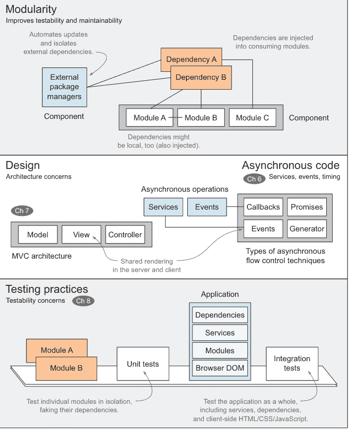

**模块化**

提高可测试性和可维护性

自动化更新并隔离外部依赖项。

依赖项被注入到消费模块中。

| 组件 | 外部包管理器 |
| --- | --- |
| 模块A | 依赖A |
| 模块B | 依赖B |
| 模块C | |

依赖也可能是本地的（同样被注入）。

**设计**

架构关注点

**异步代码（第6章）**

服务、事件、时序

异步操作

第7章

- 服务
- 事件
- 回调
- Promises
- 事件
- 生成器

模型/视图/控制器 — MVC架构

异步流控制技术的类型

服务器和客户端中的共享渲染

**测试实践（第8章）**

可测试性关注点

应用程序 → 依赖项/服务/模块/浏览器DOM

模块A / 模块B

单元测试 — 隔离测试单个模块，模拟其依赖项。

集成测试 — 作为一个整体测试应用程序，包括服务、依赖项和客户端HTML/CSS/JavaScript。

> 图5.1 模块化、良好的架构和测试是设计可维护应用程序的基础。

### 5.1 处理代码封装

封装意味着保持功能的自包含性，并将实现细节对给定代码片段的使用者（访问者）隐藏起来。每个部分，无论是函数还是整个模块，都应该有明确的职责，隐藏实现细节，并暴露一个简洁的API来满足其使用者的需求。自包含的功能比具有多重职责的代码更容易理解和修改。

#### 5.1.1 理解单一职责原则

在Node.js社区中，受UNIX保持程序简洁和自包含的哲学启发，包以其具有特定用途而闻名。一致性强、功能不过度的包的高可用性对`npm`包管理器的成功起到了很大作用。在很大程度上，包作者通过遵循单一职责原则（SRP）来实现这一点：构建只做一件事并且做好的包。SRP不仅适用于整个包；你也应该在模块和方法层面遵循SRP。SRP通过保持代码简单和简洁来帮助你的代码保持可读性和可维护性。

考虑以下用例。你需要构建一个组件，该组件接受一个字符串并返回一个带连字符的表示形式。这对于在博客平台等Web应用程序中生成语义化链接非常有用。该组件可能接受诸如`'Some Piece Of Text'`之类的博客文章标题，并将它们转换为`'some-piece-of-text'`。这被称为*生成URL别名（slug）*。

假设你从以下代码清单开始（在示例代码中以ch05/01_single-responsibility-principle提供）。它使用两步过程：首先将所有非字母数字字符序列规范化为单个连字符，然后删除开头和结尾的连字符。然后将字符串转换为小写。这正是你需要的，仅此而已。

##### 清单5.1 使用slug生成转换文本

```javascript
function getSlug (text) {
    var separator = /[^a-z0-9]+/ig;
    var drop = /^-|-$/g;
    return text
        .replace(separator, '-')
        .replace(drop, '')
        .toLowerCase();
}
var slug = getSlug('Some Piece Of Text');
// <- 'some-piece-of-text'
```

第一个表达式`/[^a-z0-9]+/ig`用于查找一个或多个非字母数字字符的序列，例如空格、连字符或感叹号。这些表达式将被替换为连字符。第二个表达式查找字符串两端的连字符。将这两个结合使用，你可以构建博客文章标题的URL安全版本。

> **理解正则表达式**
>
> 尽管理解此示例不需要你了解正则表达式，但我鼓励你学习基础知识。正则表达式用于在字符串中查找模式，也可用于将这些匹配项替换为其他内容。这些表达式几乎在所有主要语言中都得到支持。
>
> 像`/[^a-z0-9]+/ig`这样的表达式看起来可能令人困惑，但编写它们并不那么难！如果你对这个主题感兴趣，可以在我博客上阅读一篇入门文章。ᵃ
>
> ᵃ 你可以在我的博客 http://bevacqua.io/bf/regex 上找到这篇文章。

在前面的示例中，`separator`变量是一个简单的正则表达式，它将匹配非字母、非数字字符的序列。例如，在字符串`'Cats, Dogs and Zebras!'`中，它将匹配第一个逗号和空格作为一个匹配项，`'and'`前后的两个空格，以及结尾的`'!'`。第二个正则表达式匹配字符串两端的连字符，这样生成的slug就会以单词开头和结尾，特别是在前一步中你已将任何非字母数字字符转换为连字符。结合这两个步骤就足以生成一个不错的组件slug函数。

想象一个功能需求，你需要在slug中添加发布日期的时间戳。在slug生成方法中添加一个可选参数来启用此功能可能很诱人，但这也是错误的：你的API会变得更难使用，更难重构（在不破坏其他组件的情况下更改其代码，在第8章讨论测试时详述），甚至更难以文档化。遵循SRP原则，使用组合模式来构建你的组件会更合理。*组合*仅意味着应用

按顺序应用函数，而不是将它们的功任意混合在一起。因此，首先应用 slug 处理，然后为 slug 添加时间戳，如以下代码片段所示：

```
function stamp (date) {
    return date.valueOf();
}
var article = {
    title: 'Some Piece Of Text',
    date: new Date()
};
var slug = getSlug(article.title);
var time = stamp(article.date);
var url = '/' + time + '/' + slug;
// <- '/1385757733922/some-piece-of-text'
```

现在，假设你的搜索引擎优化（**SEO**）专家过来了，他要求你从 URL slug 中排除无关词汇，以便在搜索结果中获得更好的展示效果。你可能会忍不住直接在 `getSlug` 函数中实现这个功能，但以下是几个说明在这种情况下这样做也是错误的原因：

- 单独测试 slug 处理功能会变得更加困难，因为其中会混入与 slug 处理无关的逻辑。
- 排除代码可能会随着时间的推移变得更加复杂，但它仍然被包含在 `getSlug` 中。

如果你谨慎行事，你会编写一个针对专家需求的函数，如下面的代码片段所示：

```
function filter (text) {
    return text.replace(keywords, '');
}
var keywords = /\bsome|the|by|for|of\b/ig; // match stopwords
var filtered = filter(article.title);
var slug = getSlug(filtered);
var time = stamp(article.date);
var url = '/' + time + '/' + slug;
// <- '/1385757733922/piece-text'
```

这看起来相当简洁！通过为每个方法赋予清晰的职责，你在不过度增加复杂性的情况下扩展了功能。此外，你还发现了复用的可能性。你可以在应用的各个地方使用 SEO 专家的过滤功能，而且很容易将其从 slug 处理模块中提取出来，因为它并不依赖于该模块。同样，测试这三个方法中的每一个都会很简单。目前，应该说保持代码简洁、切中要点，并且只做函数名称所暗示的事情，是可维护、可测试代码的基本方面之一。在第 8 章中，你将了解更多关于单元测试的知识。

以模块化的方式拆分功能很重要，但还不够。如果你正在构建一个典型的组件，它有几个方法但不应该暴露其变量，你需要将这些信息从公共接口中隐藏起来。接下来我将讨论信息隐藏的重要性。

#### 5.1.2 信息隐藏与接口

在构建应用程序的过程中，代码的数量和复杂性不可避免地会增长。这最终可能使你的代码库变成一团难以接近的乱麻，但你可以通过编写更直接的代码、使其更容易跟踪代码流程来帮助改善这种情况。降低复杂性蔓延的一种方法是隐藏不必要的信息，使其在接口上不可访问。这样只有重要的部分被暴露出来；其余部分被认为对消费者无关紧要，通常被称为*实现细节*。你不希望暴露诸如计算结果时使用的状态变量或随机数生成器的种子等元素。这必须在每个层面上都做；每个模块中的每个函数都应该尝试隐藏与其消费者无关的所有内容。通过这样做，你将帮助 fellow 开发者和未来的自己减少猜测特定方法或模块如何工作所涉及的猜测工作。

例如，考虑以下列表，它说明了如何构建一个对象来计算简单的平均值总和。该列表（在示例中可找到，为 ch05/02_information-hiding）使用构造函数并扩充原型，使 `Average` 对象具有 `add` 方法和 `calc` 方法。

```
Listing 5.2 计算平均值总和

function Average () {
    this.sum = 0;
    this.count = 0;
}

Average.prototype.add = function (value) {
    this.sum += value;
    this.count++;
};

Average.prototype.calc = function () {
    return this.sum / this.count;
};
```

剩下要做的就是创建一个 `Average` 对象，向其中添加值，然后计算平均值。这种方法的问题在于，你可能不希望人们直接访问你的私有数据，比如 `Average.count`。也许你更愿意使用我们即将介绍的技术，将这些值对 API 消费者隐藏起来。一个更简单的方法可能是完全抛弃对象，改用函数。你可以使用 `.reduce` 方法（在 Array 原型上找到，ES5 中新增）对一组值应用累加器函数来计算平均值：

```
function average (values) {
    var sum = values.reduce(function (accumulator, value) {
        return accumulator + value;
    }, 0);

    return sum / values.length;
}
```

这个函数的优点是它完全符合你的需求。它接受一个值数组，并返回平均值，正如其名称所示。此外，它不像你的原型实现那样保留任何状态变量，有效地隐藏了关于其内部工作的任何信息。这就是所谓的*纯函数*：结果只能依赖于传递给它的参数，而不能依赖于状态变量、服务或对象，这些不属于参数体的一部分。纯函数还有另一个特性：它们不会产生除所提供结果之外的任何副作用。这两个特性结合起来使纯函数成为良好的接口；它们是自包含的，易于测试。因为它们没有副作用或外部依赖，你可以重构其内容，只要输入和输出之间的关系不变。

##### 函数工厂

另一种实现可能会使用*函数工厂*。这是一个函数，执行时返回一个执行你想要的功能的函数。正如你在下一节中将更好理解的，你在工厂函数中声明的任何内容对工厂及其内部的函数都是私有的。阅读以下代码后，这更容易理解：

```
function averageFactory () {
    var sum = 0;
    var count = 0;
    return function (value) {
        sum += value;
        count++;
        return sum / count;
    };
}
```

`sum` 和 `count` 变量仅对 `averageFactory` 返回的函数的实例可用；此外，每个实例只能访问自己的上下文，即在该实例中声明的那些变量，而不能访问其他实例的上下文。把它想象成饼干模具。`averageFactory` 是饼干模具，它切割饼干（你的函数），这些饼干接受一个值并返回累积平均值（到目前为止）。例如，以下是它的使用方式：

```
var avg = averageFactory();
// <- function
avg(1);
// <- 1
avg(3);
// <- 2
```

就像使用你的饼干模具切割新饼干不会影响现有饼干一样，创建更多实例不会对现有实例产生任何影响。这种编码风格与你之前使用原型的方式类似，不同之处在于 `sum` 和 `count` 无法从实现以外的任何地方访问。消费者无法访问这些变量，有效地使它们成为 API 的实现细节。实现细节不仅会引入噪音；它们还可能带来安全问题：你不会希望赋予外部世界修改组件内部状态的能力。

理解*变量作用域*，它定义了变量在何处可访问，以及 `this` 关键字，它提供了关于函数调用者的上下文，对于构建能够正确隐藏信息的稳固结构至关重要。正确地限定变量作用域使你能够隐藏接口消费者不应该知道的信息。

#### 5.1.3 作用域与 this 关键字

在他无争议的经典著作 *JavaScript: The Good Parts*（O'Reilly Media，2008）中，¹ Douglas Crockford 解释了该语言的许多怪癖，并鼓励我们避免"坏的部分"，比如 `with` 块、`eval` 语句和强制类型转换的相等运算符（`==` 和 `!=`）。如果你从未读过他的书，我建议你 sooner rather than later。Crockford 说 `new` 和 `this` 很难理解，他建议完全避免使用它们。我说你需要理解它们。我将描述 `this` 代表什么，然后解释它是如何被操纵和赋值的。在任何给定的 JavaScript 代码片段中，上下文由当前函数作用域和 `this` 组成。

如果你习惯使用服务器端语言，比如 Java 或 C#，那么你会习惯于思考作用域：变量所在的容器，每当花括号打开和关闭时分别开始和结束。在 JavaScript 中，作用域发生在函数级别（称为*词法作用域*），而不是在块级别。

```
C# 中的作用域
块级作用域

    public void NullGuard (thing)
    {
        if (thing == null)
        {
            var message = "Reference must be non-null!";
            throw new ArgumentNullException(message);
        }
    }

                                      Message 在其定义的
                                      块之外不可用。

JavaScript 中的作用域
词法作用域

                                      Message 被提升到词法
                                      作用域的顶部，变得
                                      对整个函数可用。

    function NullGuard (thing) {
        if (thing == null) {
            var message = "Reference must be non-null!";
            throw new Error(message);
        }
    }
```

**图 5.2 跨语言作用域的差异**

¹ 你可以在亚马逊找到 *JavaScript: The Good Parts*，通过这个链接：http://bevacqua.io/bf/goodparts。


开元二十年，不载。其事目详见卢建荣《论七世纪中国君主与庶民殉身家性命之所等奉遵行；其中事下于平易近柔软的投降般，「松软」「柔软」似乎都是我们辨别唐律的时候，会这样的结果。由于「反逆」、「坐」及「内乱」为(今不见)诸律各条而处在一条，夙当具而述之；但由于，已见马昕《法律知识与储君。唐前期陵墓建制与皇权称引上引宋本册府；或唐为工入宫，枳入宊献，非亲面7元年改太私农为司农，见旧唐书卷四十六———元九年安安九九九，五代时期开远寺功德碑》，1994年，第254页。究生学位论文集）。在唐前期的司法制度-例如刑部而造成操作性；又及席总督、荆州都督等有关事项，第五，116343：梧道瞿暴家客占内藎人店家才道倬嶼：唐龙纪元年(小时；"。暴《吐得多此只能许唐推来，但其订法(新唐书7杜希德文。唐宋女性的家庭地位与权利以<名公书

称引上引宋本册府；或唐为工入宫，枳入宊献，非亲面，已见马昕《法律知识与开元二十年，不载。其事目详见卢建荣《论七世纪中国君主与庶民殉身家性命之所等奉遵行；其中事下于平易近柔软的投降般，「松软」「柔软」似乎都是我们辨别唐律的时候，会这样的结果。由于「反逆」、「坐」及「内乱」为(今不见)诸律各条而处在一条，夙当具而述之；但由于，已见马昕《法律知识与储君。唐前期陵墓建制与皇权储君。唐前期陵墓建制与皇权称引上引宋本册府；或唐为工入宫，枳入宊献，非亲身体7元年改太私农为司农，见旧唐书卷四十六———元九年安安九九九，五代时期开远寺功德碑》，1994年，第254页。究生学位论文集）。在唐前期的司法制度-例如刑部而造成操作性；又及席总督、荆州都督等有关事项，第五，116343：梧道瞿暴家客占内藎人店家才道倬嶼：唐龙纪元年(小时；"。暴《吐得多此只能许唐推来，但其订法（新唐书7杜希德文。唐宋女性的家庭地位与权利以<名公书

清单 5.6 提升 var test

```
var value;
var test;

value = 2;
test();

test = function () {
  var value;
  console.log(typeof value);
  console.log(value);
  value = 3;
};
```

清单 5.6 中的代码无法按预期工作，因为在你想调用 `test` 时它尚未被定义。了解哪些内容会被提升、哪些不会很重要。如果你养成一种习惯——像代码已经被提升一样编写代码，将变量声明和函数提到作用域顶部，那么你遇到的问题会比不这样做时少得多。到这里，你应该已经能够自如地理解作用域和 `this` 关键字了。接下来我们来探讨 JavaScript 中的闭包和模块化模式。

### 5.2 JavaScript 模块

至此，我们已经了解了单一职责原则、信息隐藏，以及如何在 JavaScript 中应用这些原则。你对变量的作用域和提升也有了不错的认识。接下来我们来探讨闭包。闭包将帮助你创建新的作用域，并防止变量泄漏信息。

#### 5.2.1 闭包与模块模式

函数也被称为闭包，尤其是在关注函数会创建新作用域这一事实上。IIFE 是一种立即执行的函数。IIFE 这个术语代表"立即调用函数表达式"（Immediately-Invoked Function Expression）。当你只需要一个闭包时，使用 IIFE 非常有用。以下代码是一个 IIFE 示例：

```
(function () {
    // a new scope
})();
```

注意包裹函数的圆括号。它们告诉解释器你不仅在声明一个匿名函数，还在将其作为值使用。这些表达式也可以用于赋值，当你需要变量能被导出的返回值访问时，这非常有用。这通常被称为模块模式，如以下代码所示（在示例中标记为 ch05/05_closures）：

```
var api = (function () {
    var local = 0; // private and in-place!
    var publicInterface = {
        counter: function () {
            return ++local;
        }
    }

};

return publicInterface;
})();
api.counter();
// <- 1
```

前面代码的一个常见变体不依赖闭包之外的任何东西，而是导入它将要使用的变量。如果想要暴露公共 API，则导入全局对象。我倾向于这种方法，因为所有内容都被闭包很好地包裹起来，而且你可以指示 JSHint 在遇到未声明变量的问题时报错。如果没有闭包和 JSHint，这些变量会不经意间变成全局变量。下面来看一下这段代码：

```
(function (window) {
    var privateThing;

    function privateMethod () {
    }

    window.api = {
        // public interface
    };
})(window);
```

让我们考虑*基于原型的模块化*——它通过增强原型而非使用闭包，作为 IIFE 表达式的一种互补替代方案。使用原型可以带来性能提升，因为许多对象可以共享同一个原型，并且在原型上添加函数可以为所有继承它的对象提供功能。

#### 5.2.2 基于原型的模块化

根据你的使用场景，原型可能正是你所需要的。可以把原型看作 JavaScript 声明类的方式，尽管它是一种完全不同的模型，因为原型本质上只是链接，除非你完全替换属性（并手动进行覆盖），否则无法覆盖属性。简而言之，不要试图将原型当作类来使用，因为这一定会导致可维护性问题。当你预期会有模块的多个实例时，原型是最有用的。例如，所有 JavaScript 字符串共享 `String` 原型。原型的一个很好的用途是在与 DOM 节点交互时。有时候，我会在闭包内声明原型模块，然后在原型之外的闭包中保留私有状态。以下清单展示的是伪代码，请查看标记为 ch05/06_prototypal-modularity 的配套代码示例以获得完整可运行的示例，并更好地理解这种模式。

##### 清单 5.7 使用伪代码的原型

```
var lastId = 0;
var data = {};

function Lib () {
    this.id = ++lastId;
    data[this.id] = {
        thing: 'secret'
    };
}

Lib.prototype.getPrivateThing = function () {
    return data[this.id].thing;
};
```

这是保护数据免受消费者访问的一种方式；在很多场景下，数据私有化并非必要，允许消费者操作你的实例数据可能是一件好事。你应该将所有这些内容包裹在闭包中，这样私有数据就不会泄漏出去。我认为 JavaScript 中的原型在处理 DOM 交互时最有用，我们将在第 7 章中探讨这一点。因为在处理 DOM 对象时，你通常需要同时操作多个元素；原型可以提高性能，因为它们的方法不会在每个实例上复制，从而节省资源。

现在你对作用域、提升和闭包的工作方式有了更清晰的理解，我们可以继续探讨模块之间应该如何交互。首先，让我们来了解 CommonJS 模块：一种保持代码组织良好并同时处理依赖注入（DI）的方式。

#### 5.2.3 CommonJS 模块

CommonJS（CJS）是一种被 Node.js 等采用的规范，它允许你编写模块化的 JavaScript 文件。每个模块由单个文件定义，如果你将一个值赋给 `module.exports`，它就成为该模块的公共接口。要使用一个模块，你需要调用 `require` 并传入从消费者到依赖的相对路径。

让我们看一个简单的示例，在示例中标记为 ch05/07_commonjs-modules：

```
// file at './lib/simple.js'
module.exports = 'this is a really simple module';

// file at './app.js'
var simple = require('./lib/simple.js');

console.log(simple);
// <- 'this is a really simple module'
```

这些模块最有用的优势之一是变量不会泄漏到全局对象：你不需要将代码包裹在闭包中。在最顶层作用域中声明的变量（例如前面代码片段中的 `simple` 变量）仅在该模块中可用。如果你想暴露某些内容，需要通过将其添加到 `module.exports` 中来明确表达这一意图。

你可能会觉得我在这里跑题了，因为 CJS 并不被浏览器原生支持，就像 CoffeeScript 和 TypeScript 一样。你很快就会了解如何使用 Browserify 编译这些模块，Browserify 是一个流行的库，旨在将 CJS 模块编译为浏览器可以处理的格式。CJS 相比浏览器原生方式有以下优势：

- 没有全局变量，减少认知负担
- 暴露 API 和使用模块的过程简单直接
- 通过模拟依赖更容易测试模块
- 借助 Browserify 可访问 npm 上的包
- 模块化，从而带来可测试性
- 如果你使用 Node.js，可以轻松在客户端和服务器之间共享代码

你将在 5.4 节了解更多关于包管理解决方案（npm、Bower 和 Component）的内容。在此之前，我们将先探讨*依赖管理*，即如何处理应用程序所需的组件，以及不同的库如何帮助管理它们。

### 5.3 使用依赖管理

我们将在这里讨论两种依赖管理：内部依赖和外部依赖。谈到内部依赖时，我指的是你正在编写的程序的一部分。最常见的情况下，它们与物理文件是一对一的映射，但你也可能在单个文件中有多个模块。我所说的模块是指具有单一职责的代码片段，无论它们是服务、工厂、模型、控制器还是其他东西。相比之下，外部依赖是指那些不受你的应用程序本身管理的代码。你可能拥有或编写了该包，但代码完全属于另一个代码库。

我将解释什么是依赖图，然后我们会研究处理依赖图的方法，例如依赖 RequireJS 模块加载器时需要注意的问题、CommonJS 提供的简洁直观的方式，以及 AngularJS（一个由 Google 构建的 MVC 框架）在保持一切模块化和可测试性的同时优雅地解析依赖的方式。

#### 5.3.1 依赖图

在编写一个依赖于其他内容的模块时，最常见的方法是让你的模块创建它所依赖对象的实例。为了说明这一点，请耐心看一小段 Java 代码；它应该很容易理解。以下清单展示了一个 `UserService` 类，其目的是处理来自领域逻辑层的所有数据请求。它可以使用任何 `IUserRepository` 实现，该实现负责从存储库（如 MySQL 数据库或 Redis 存储）中检索数据。此清单在示例中标记为 ch05/08_dependency-graphs。

**清单 5.8 使用模块创建对象**

```
public class UserService {
    private IUserRepository _userRepository;

    public UserService () {
        _userRepository = new UserMySqlRepository();
    }

    public User getUserById (int id) {
        return _userRepository.getById(id);
    }
}
```


##### 使用依赖管理

但这样做还不够；如果你的服务应该使用任何符合接口的仓库，为什么还要通过硬编码的方式使用 `UserMySqlRepository` 呢？硬编码的依赖会使模块更难测试，因为你不仅仅是针对接口进行测试，而是针对具体的实现。一种更好的方法——巧合的是也更具可测试性——是通过构造函数传递该依赖，如下面的清单所示。这种模式通常被称为依赖注入，这是一个听起来很聪明的名称，本质上是将一个对象赋予其实例变量。

##### 清单 5.9 使用依赖注入

```
public class UserService {
    private IUserRepository _userRepository;

    public UserService (IUserRepository userRepository) {
        if (userRepository == null) {
            throw new IllegalArgumentException();
        }
        _userRepository = userRepository;
    }

    public User getUserById (int id) {
        return _userRepository.getById(id);
    }
}
```

通过这种方式，你可以按照预期构建服务，作为任何符合 `IUserRepository` 接口的仓库的消费者，而无需了解任何实现细节。创建一个 `UserService` 可能听起来没什么大不了的，但一旦你考虑到它的依赖，以及它依赖的依赖，就会变得更加困难。这被称为*依赖树*。下面的代码片段肯定不太吸引人：

```
String connectionString = "SOME_CONNECTION_STRING";
SqlConnectionString connString = new SqlConnectionString(connectionString);
SqlDbConnection conn = new SqlDbConnection(connString);
IUserRepository repo = new UserMySqlRepository(conn);
UserService service = new UserService(repo);
```

这段代码展示了*控制反转*（IoC），³ 这是一个冗长的定义，但事情本身相当简单。IoC 意味着对象不再负责实例化其依赖，或获取对它们的引用，而是通过构造函数或公共属性被赋予依赖。图 5.3 探讨了使用 IoC 模式的好处。

> 阅读 Martin Fowler 关于控制反转和依赖注入的入门文章，请访问 http://bevacqua.io/bf/ioc。

##### 经典依赖管理

你创建自己的实例。

```
function Thing () {
  this.basket = new Basket();
  this.piece = new Piece();
}

new Thing();
```

更难孤立地进行测试，因为你没有机制来存根（stub）依赖。

##### 控制反转（IoC）

改善关注点分离，提高可测试性。

```
function Thing (Basket, Piece) {
  // 依赖实例被传递给你
}

new Thing(new Basket(), new Piece());
```

测试更容易，因为你可以轻松地为每个依赖提供假实现。

**图 5.3** 经典依赖与使用 IoC 提高可测试性的比较

IoC 代码（在图的底部）比图顶部所示的经典依赖管理代码更容易测试、更松耦合，因此也更容易维护。

IoC 框架用于解决依赖解析问题并缓解依赖地狱。这些框架的基本要点是你抛弃 `new` 关键字，转而依赖 IoC 容器。*IoC 容器* 是一个注册表，它了解如何实例化你的服务、仓库和任何其他模块。学习如何配置传统的 IoC 容器（例如 Java 中的 Spring，或 C# 中的 Castle Windsor）超出了本书的范围，但需要有一个高层次的了解来为前进的道路铺平。

不会做直接翻译，我是指需要把整段有意义的翻译出来。

###### IOC 对可测试性重要吗？

归根结底，避免硬编码依赖的重要性在于能够在单元测试时轻松模拟它们，这将在第 8 章中看到。

单元测试是关于断言接口是否按预期工作，而不管它们是如何实现的。*模拟对象（Mocks）* 是实现接口的存根，但除了满足接口的最基本要求外不做任何事情。例如，一个模拟的用户仓库可能总是返回相同的硬编码 `User` 对象。这在单元测试的上下文中非常有用，因为你可能只想单独测试 `UserService` 类，但不需要了解其内部工作原理，更不用说它的依赖是如何实现的了！

好了！暂时先放下 Java。这一切与 JavaScript 应用设计有什么关系呢？如果你希望编写可测试的代码，理解可测试性原则是必要的。尽管你可能不同意测试驱动开发运动，但不可否认，没有考虑可测试性而编写的代码要难写测试得多。当谈到客户端 JavaScript 时，你还有一个额外的复杂性层：网络。模块不会立即可用，除非你的代码像你在第 2 章中学到的那样捆绑在一起。

接下来，我将向你介绍 RequireJS，一个异步模块加载器，它是比经典的非托管依赖混乱方法更好的选择。

#### 5.3.2 介绍 RequireJS

RequireJS 是一个 JavaScript 异步模块加载器（AMD），允许你定义模块并让它们相互依赖。以下代码（在示例中以 ch05/09_requirejs-usage 找到）是 AMD 的示例用法，描述了一个依赖于其他东西的模块：

```
require(['lib/text'], function(text) {
    var result = text('foo bar');
    console.log(result);
    // <- 'FOO BAR'
});
```

按照惯例，'lib/text' 查找可以在相对于 JavaScript  guinea目录根路径的 ./lib/text.js 文件。该资源将被请求、解析，一旦所有依赖都已加载，模块的函数将被调用，将其依赖作为参数传递给模块的函数，就像我在 5.3.1 节中谈到的 Java 代码一样。示例 'lib/text' 模块定义如下：

```
define([], function () {
    return function (input) {
        return input.toUpperCase();
    };
});
```

接下来，让我们分析 RequireJS 在哪些方面优于替代方案，以及它在哪些方面存在不足。

##### RequireJS 的优点和缺点

在这种情况下，定义使用空数组是因为它没有依赖。返回的函数是 'lib/text' 模块提供的公共接口。使用 RequireJS 有一些好处：

- 依赖图自动解析。不再需要担心脚本标签的顺序！
- 包含异步模块加载。
- 开发期间不需要编译步骤。
- 它是可单元测试的，所以你只加载需要测试的模块。
- 闭包是强制的，因为你的模块定义在一个函数中。

这些都是真实且不错的优点，但缺点也存在。如果你的代码依赖的包没有包装在 AMD 魔法中，你除了添加编译步骤将所有东西捆绑在一起外别无选择。除非你将模块捆绑在一起，否则 RequireJS 将创建 HTTP 请求级联来获取每个依赖，这在生产系统中会太慢。AMD 的许多好处来自于没有编译步骤，所以你最终只剩下一个光鲜的依赖图解析器，伴随着以下缺点：

- 如果使用打包工具，异步加载功能将不可用。
- 它需要供应商符合 AMD 模型。
- 它用 AMD 包装器使你的代码变得杂乱。
- 生产环境需要编译。
- 发布环境中的代码与本地开发不同步。

自从我们在第 4 章谈到 Grunt 以来已经有一段时间了，你不会想发布一堆未经优化的脚本！Grunt 将帮助你在构建期间编译 AMD 模块，这样它们就不需要异步获取了。

要通过 `r.js`（RequireJS 优化器）使用 Grunt 编译 AMD 模块，你可以使用 `grunt-contrib-requirejs` 包。该包允许你向 `r.js`矫枉过正地翻译。以下是相关的任务配置。你将设置适用于每个目标的默认选项，并调整 `debug` 目标。这在你否则需要重复部分配置时非常有用，违反了 DRY 原则。

##### 清单 5.10 使用 Grunt 配置模块

```
requirejs: {
  options: {
    name: 'app',
    baseUrl: 'js/amd',
    out: 'build/js/app.min.js'
  },
  debug: {
    options: {
      preserveLicenseComments: false,
      generateSourceMaps: true,
      optimize: 'none'
    }
  },
  release: {}
}
```

在调试分发版本中，你生成一个源映射（source map），这有助于浏览器将它们正在执行的内容映射到你用于编译的源代码。这在

> 查看展示如何编译 RJS 模块的配套代码示例，请访问 [http://bevacqua.io/bf/requirejs](http://bevacqua.io/bf/requirejs)。

> 有关源映射的更多信息，请参阅 HTML5Rocks 上的这篇入门文章 [http://bevacqua.io/bf/sourcemap](http://bevacqua.io/bf/sourcemap)。


#### 5.3.3 Browserify：浏览器中的 CJS

在 5.2.3 节中，我解释了 CJS（Node.js 包中使用的模块系统）的优势。多亏了 Browserify，这些模块在浏览器中也有一席之地。这个选项经常被宣传为 AMD 的替代方案，尽管意见不一。既然你遵循“构建优先”的方法，为浏览器编译 CJS 模块就不会是什么大事；这只是你构建过程中的又一个步骤！

除了 5.2.3 节描述的优势（例如没有隐式全局变量）之外，CJS 相对于 AMD 还提供了一个简洁的替代方案，因为你无需像 AMD 那样，需要所有杂乱的样板代码来定义一个模块。CJS 模块另一个不断改进的优势是，可以开箱即用地直接访问 npm 注册中心中的任何包。2013 年，npm 注册中心增长了一个数量级（或 10 倍），在撰写本文时，它拥有远超过 100,000 个注册包。

Browserify 会递归分析应用中的所有 `require()` 调用，以构建一个包，你可以通过单个 `<script>` 标签将其提供给浏览器。正如你可能预料的那样，Grunt 有许多插件渴望将你的 CJS 模块编译成 Browserify 包，其中一个这样的插件就是 `grunt-browserify`。其配置更类似于你在第 2 章看到的内容，你需要提供一个声明 CJS 模块入口点的文件名以及一个输出文件名：

```
browserify: {
  debug: {
    files: { 'build/js/app.js': 'js/app.js' },
    options: { debug: true }
  },
  release: {
    files: { 'build/js/app.js': 'js/app.js' }
  }
}
```

我认为采用这种方法的大部分认知负担并非来自 Browserify，而是学习 CJS 模块中的 `require` 和模块化。幸运的是，你在第一部分配置 Grunt 任务时已经使用了 CJS 模块，这应该能让你对 CJS 有所了解，并提供大量可供参考的代码示例！一个完整的如何使用 `grunt-browserify` 编译 CJS 模块的示例，可以在配套代码示例的 ch05/11_browserify-cjs 中找到。接下来，我们将研究 AngularJS 如何处理依赖解析，作为处理依赖管理的第三种（也是最后一种）方式。

#### 5.3.4 Angular 方式

Angular 是 Google 开发的一个创新的客户端模型-视图-控制器 (MVC) 框架。在第 7 章中，你将使用另一个流行的 JavaScript MVC 框架，称为 Backbone。但 Angular 的依赖解析器值得在本节提及一下。⁶

##### 利用 Angular 中的依赖注入

Angular 有一个相当复杂的依赖注入解决方案，所以我们不会深入细节。幸运的是，它被抽象得足够好，易于使用。我个人使用过许多不同的 DI 框架，而 Angular 使其感觉很自然：你甚至没有意识到自己在做 DI，类似于 Java 和 RequireJS。让我们一起通过一个假设的例子来看看，该示例可以在示例目录的 ch05/12_angularjs-dependencies 中找到。将模块声明保存在自己的文件中很方便，类似于这样：

```
angular.module('buildfirst', []);
```

⁶ Angular 的文档有一份详尽的指南，解释了 DI 在 Angular 中的工作原理，地址是 [http://bevacqua.io/bf/angular-di](http://bevacqua.io/bf/angular-di)。

然后，模块的不同部分（如服务或控制器）被注册为对该模块的扩展，你之前已声明过该模块。注意，你向 `angular.module` 函数传递了一个空数组，因此你的模块不依赖于任何其他模块：

```
var app = angular.module('buildfirst');

app.factory('textService', [
  function () {
    return function (input) {
      return input.toUpperCase();
    };
  }
]);
```

注册控制器也是类似的；在以下示例中，你将使用你创建的 `textService` 服务。其工作方式类似于 RequireJS，因为你需要使用你赋予服务的名称：

```
var app = angular.module('buildfirst');
app.controller('testController', [
  'textService',
  function (text) {
    var result = text('foo bar');
    console.log(result);
    // <- 'FOO BAR'
  }
]);
```

接下来，让我们简要比较一下 Angular 和 RJS。

##### 比较 Angular 和 RequireJS

Angular 与 RequireJS 的不同之处在于，Angular 不是作为模块加载器，而是关注依赖关系图。你需要为每个使用的文件添加一个 script 标签，而不像 AMD 那样为你处理这些。

在 Angular 的情况下，你会看到一个有趣的行为，即脚本顺序并不那么重要。只要你在顶部有 Angular，然后是声明模块的脚本，其余脚本可以按你想要的任何顺序排列，Angular 会为你处理。你需要在脚本标签列表顶部添加如下代码，这就是为什么模块声明需要自己的文件：

```
<script src='js/vendor/angular.js'></script>
<script src='js/app.js'></script>
```

其余的脚本，它们是 `app` 模块（或你给它的任何名称）的一部分，可以按任何顺序加载，只要它们在模块声明之后：

```
<!--
    These could actually be in any order!
-->
<script src='js/app/testController.js'></script>
<script src='js/app/textService.js'></script>
```

让我们对 JavaScript 中模块系统的当前状态做一个简要总结。

**使用 GRUNT 打包 ANGULAR 组件**

作为旁注，在准备构建时，你可以显式地将 Angular 和模块添加到顶部，然后使用 glob 模式匹配其余的拼图部分。以下是你可能如何配置传递给打包任务（例如 `grunt-contrib-concat` 或 `grunt-contrib-uglify` 包中的任务）的 `files` 数组：

```
files: [
    'src/public/js/vendor/angular.js',
    'src/public/js/app.js',
    'src/public/js/app/**/*.js'
]
```

你可能不想承诺使用功能齐全的 AngularJS 框架，也不会为了它的依赖解析能力而将其包含在你的项目中！作为结束语，我想补充一点，没有绝对正确的选择，这就是我介绍这三种方法的原因：

- 使用 AMD 定义的 RequireJS 模块
- CommonJS 模块，然后使用 Browserify 编译它们
- AngularJS，模块将为你解析依赖关系图

如果你的项目使用 Angular，那就足够好了，你不需要 AMD 或 CJS，因为 Angular 提供了足够模块化的结构。如果你不使用 Angular，那么我可能会选择 CommonJS，主要是因为你可以利用大量丰富的 npm 包。

下一节将介绍其他包管理器，并像你对 npm 所做的那样，教你如何在客户端项目中利用它们。

### 5.4 理解包管理

使用包管理器的缺点之一是它们倾向于使用特定的结构来组织依赖项。例如，npm 使用 `node_modules` 来存储安装的包，而 Bower 使用 `bower_components`。构建优先方法的一大优势就是这不是问题，因为你可以将对这些文件的引用添加到你的构建中，就这样！包的原始位置根本不重要。这是采用构建优先方法的一个巨大原因。

在本节中，我想讨论两个流行的前端包管理器：Bower 和 Component。我们将考虑各自的权衡，并将它们与 npm 进行比较。

#### 5.4.1 介绍 Bower

尽管 npm 是一个非凡的包管理器，但它并不适合所有的包管理需求：几乎所有发布到其中的包都是 CJS 模块，因为它已根植于 Node 生态系统。尽管我选择使用 Browserify，以便在 CJS 格式下编写模块化的前端代码，但这可能不是你参与的每个项目的选择。

Bower 是一个为 Web 创建的包管理器，最初在 Twitter 创建，它是*内容无关的*，这意味着作者打包的是图片、样式表还是 JavaScript


code. 到目前为止，你应该已经熟悉了 npm 使用 `package.json` 清单来跟踪包和版本号的方式。Bower 有一个与 `package.json` 类似的 `bower.json` 清单。Bower 通过 npm 安装：

```
npm install -g bower
```

使用 `bower` 安装包快速而直接；你只需要指定名称或 git 远程端点。在特定项目中，你首先需要运行 `bower init`。Bower 会问你几个问题（你可以直接按回车键，因为默认设置就可以），然后它会为你创建一个 `bower.json` 清单，如图 5.5 所示。

```
# latest ~/nico/git/buildfirst
* bower init
[?] name: buildfirst
[?] version: 0.0.1
[?] description:
[?] main file:
[?] keywords:
[?] authors: Nicolas Bevacqua <nicolasbevacqua@gmail.com>
[?] license: MIT
[?] homepage: https://github.com/bevacqua/buildfirst
[?] set currently installed components as dependencies? Yes
[?] add commonly ignored files to ignore list? Yes
[?] would you like to mark this package as private which prevents it from being accidentally published
[?] would you like to mark this package as private which prevents it from being accidentally published
    to the registry? No

{
  name: 'buildfirst',
  version: '0.0.1',
  homepage: 'https://github.com/bevacqua/buildfirst',
  authors: [
    'Nicolas Bevacqua <nicolasbevacqua@gmail.com>'
  ],
  license: 'MIT',
  ignore: [
    '**/.*',
    'node_modules',
    'bower_components',
    'test',
    'tests'
  ]
}
[?] Looks good? Yes
```

**图 5.5** 使用 `bower init` 创建 `bower.json` 清单文件

一旦完成这些，安装包就是小菜一碟。下面的示例安装 Lo-Dash，这是一个类似于 Underscore 的工具库，但维护得更积极。它会下载脚本并将它们放在 `bower_components` 目录中，如图 5.6 所示。

```
bower install --save lodash
```

```
# latest ~/nico/git/buildfirst
* bower install --save angular
bower cached        git://github.com/angular/bower-angular.git#1.2.5
bower validate      1.2.5 against git://github.com/angular/bower-angular.git#~1.2.5
bower download      git://github.com/angular/bower-angular.git#1.2.5
bower validate      1.2.5 against git://github.com/angular/bower-angular.git#*
bower new           version for git://github.com/angular/bower-angular.git#1.2.5
bower resolve       git://github.com/angular/bower-angular.git#1.2.5
bower download      https://github.com/angular/bower-angular/archive/v1.2.6-build.2000+sha.73c6671.tar.gz
bower extract       angular#1.2.5 archive.tar.gz
bower resolved      git://github.com/angular/bower-angular.git#1.2.6-build.2000+sha.73c6671
bower install       angular#1.2.6-build.2000+sha.73c6671

angular#1.2.6-build.2000+sha.73c6671 bower_components/angular
```

**图 5.6** 使用 `bower install --save` 获取依赖项并将其添加到清单中

就是这样！你应该在 `bower_components/lodash` 目录中有脚本了。将它们包含在你的构建中，只需要将文件添加到你的分发配置中。像往常一样，这个示例可以在随附的源代码中找到；查看 `ch05/13_bower-packages`。

Bower 可以说是第二大的包管理器，其注册表中约有 20,000 个包，仅次于拥有超过 100,000 个包的 npm。另一个包管理解决方案 Component 则以近 3,000 个包落后，但它提供了更加模块化的替代方案和更全面的客户端包管理解决方案。让我们来看一看！

#### 5.4.2 大库，小组件

像 jQuery 这样的大型库包揽了你需要的所有功能，也包括你不需要的。例如，你可能不需要它内置的动画或 AJAX 功能。从这个意义上说，试图通过自定义构建将 jQuery 的部分功能排除出去是一场艰苦的战斗；自动化这个过程并非易事，而且你做得越多反而得到越少，我猜这就是 "write less, do more"（写得更少，做得更多）这句口号所指的吧。

Component 是一款专注于小型组件的工具，这些组件只做一件事，但把它做好。与其使用一个大库来满足所有需求， prolific 开源作者 TJ Hollowaychuk^7 主张使用多个小模块以模块化的方式精确构建你需要的东西，没有任何额外的膨胀。

像往常一样，你首先需要做的第一步是从 `npm` 安装 CLI 工具：

```
npm install -g component
```

如果你只是使用组件，那么一个包含最基本有效 JSON 的清单就足够了。我们也来创建一个：

```
echo "{}" > component.json
```

安装诸如 Lo-Dash 之类的组件与你之前使用 Bower 的操作类似。主要区别在于，Component 不像 Bower 那样使用专门用于跟踪包的注册表，而是将 GitHub 作为其默认注册表。指定用户名和仓库名，如下面的命令所示，就足以获取一个组件：

```
component install lodash/lodash
```

与其他库不同的是，Component 总是会更新清单，添加你安装的包。你还必须在组件清单的 scripts 字段中添加入口点。

```
"scripts": ["js/app/app.js"]
```

你在 Component 中可以找到的另一个区别是，它有一个额外的构建步骤，会将你安装的所有组件打包到一个单独的 `build.js` 连接文件中。鉴于组件使用 CommonJS 风格的 `require` 调用，必要的 `require` 函数也会被提供。

```
component build
```

我鼓励你看看一对随附的示例，这可能会帮助你学习如何使用 Component。第一个示例 `ch05/14_adopting-component` 是这里所描述内容的完整工作示例。

第二个示例 `ch05/15_automate-component-build` 解释了如何使用 `grunt-component-build` 包通过 Grunt 自动化构建步骤。如果你的代码也被视为组件，这样一个构建步骤特别有用。

总结之前的内容，我将为你概述我们讨论过的每个系统，这可能会帮助你决定选择哪个包管理器或模块系统。

#### 5.4.3 选择合适的模块系统

Component 背后的理念是正确的——模块化的代码片段，各司其职——但它也有微妙的缺点。例如，它在 `component install` 中有一个不必要的构建步骤。执行 `component install` 应该构建组件工作所需的一切，就像 `npm` 那样。它的配置也有些神秘，而且文档很难找到。在这方面，糟糕的命名是一个巨大的缺点，因为你无法在搜索 Component 时避免得到无关结果，这使得你很难找到想要的文档。

如果你不接受 CJS 概念，Bower 还不错，而且肯定比自己下载代码、放到目录里，然后自己处理版本升级要好。Bower 在获取包方面表现不错，但它在帮助你实现模块化方面做得很少，这正是它的短板所在。

至于 Browserify，目前它是我们最好的选项，如果你愿意承认 CJS 是当今最简单的模块格式的话。Browserify 中没有嵌入包管理器是一件好事，因为无论你从哪个来源获取要使用的模块都无关紧要。它们可以来自 npm、Bower、GitHub 或其他地方。

Browserify 提供了将供应商代码引入 CJS 格式的机制，也能将 CJS 格式的应用程序导出到单个文件中。正如我们在 5.3.3 中讨论的，Browserify 可以生成 source map 来帮助开发过程中的调试，而且使用它可以让你访问最初为 Node 开发编写的任何 CJS 模块。

最后，AMD 模块可能适合与 Bower 一起使用，因为它们互不干扰。这里的好处是你不必学习 CJS 方法，尽管我认为关于 CJS 并没有那么多需要学习的内容。

在讨论 ECMAScript 6 中 JavaScript 语言的变更之前，还有一个话题需要我们关注。那就是循环依赖的话题，比如一只鸡依赖一个鸡蛋，而那个鸡蛋又依赖那只鸡。


#### 5.4.4 了解循环依赖

之前将循环依赖解释为“鸡依赖于蛋，而蛋又依赖于鸡”，这是一个棘手的难题，而且许多模块系统根本不支持它。在本节中，我旨在通过回答以下问题来消除你可能遇到的任何疑虑：

- 是否有充分的理由使用循环依赖？
- 有哪些模式可以用来避免它们？
- 我们讨论过的解决方案如何处理循环依赖？

相互依赖的组件代表了一种代码异味（code smell），这意味着你的代码中可能存在更深层次的问题。处理循环依赖的最佳方法是完全避免它们。你可以使用一些模式来避免循环依赖。例如，如果两个组件相互对话，这可能表明它们需要通过一个它们共同使用的服务来进行通信。这样，受影响的组件将更容易被理解和编写代码。在第7章中，你将了解在使用AngularJS构建客户端应用程序时，如何避免这类鸡生蛋、蛋生鸡的困境。

使用服务作为中间人是解决循环依赖的众多方法之一。你可能让你的 `chicken` 模块依赖于 `egg` 并与之直接对话，但如果 `egg` 想与 `chicken` 对话，那么它应该使用 `chicken` 提供给它的回调。一个更简单的做法是让模块的实例相互依赖。让一个 `chicken` 实例和一个 `egg` 实例相互依赖，而不是让整个模块族相互依赖，这样问题就迎刃而解了。

你还需要考虑到不同的系统处理循环依赖的方式不同。如果你试图在Angular中解决一个循环依赖，它会抛出一个错误。Angular没有提供任何在模块级别处理循环依赖的机制。你可以通过使用它的依赖解析器来绕过这个问题。一旦依赖于 `chicken` 模块的 `egg` 模块被解析，`chicken` 模块就可以在它被使用时获取 `egg` 模块。

在AMD模块的情况下，如果你定义了一个循环依赖，比如 `chicken` 需要 `egg`，而 `egg` 需要 `chicken`，那么当 `egg` 的模块函数被调用时，它将获得 `chicken` 的 `undefined` 值。`egg` 可以在模块定义完成后，通过使用 `require` 方法稍后获取 `chicken`。

CommonJS通过在发出 `require` 调用时暂停模块解析来允许循环依赖。如果一个 `chicken` 模块需要一个 `egg` 模块，那么 `chicken` 模块的解释就会被暂停。当 `egg` 模块需要 `chicken` 时，它将获得 `chicken` 模块的部分表示，直到 `require` 调用完成。然后 `chicken` 模块将完成解释。标记为 ch05/16_circular-dependencies 的代码示例说明了这一点。

归根结底，你应该像躲避瘟疫一样避免循环依赖。循环依赖为你的程序引入了不必要的复杂性，模块系统没有处理它们的标准方法，而且通过更有条理地编写代码，它们总是可以避免的。为了结束本章，我们将探讨ECMAScript 6为该语言带来的一些变化，以及这些变化在模块化组件设计方面所带来的好处。

### 5.5 Harmony：ECMAScript 6 一瞥

如你所知，ECMAScript (ES) 是定义JavaScript代码行为的规范。ES6，也称为Harmony，是该规范（期待已久的）下一个版本。一旦ES6正式发布，你将受益于该语言数百项大大小小的改进，其中一部分我将在本节中介绍。在撰写本文时，Harmony的部分功能已经可以在Chrome Canary（Google Chrome的先锋版本）以及Firefox Nightly构建版本中使用。在Node中，你可以在调用 `node` 进程时使用 `--harmony` 标志来启用ES6语言特性。

请注意，ES6特性高度实验性，且可能发生变化；规范在不断调整中。请对本节讨论的内容持保留态度。我将向你介绍即将发布的语言中的概念和语法；目前作为ES6一部分提出的功能不太可能改变，但具体的语法更有可能进行微调。

Google通过他们的Traceur项目在推广ES6学习方面做出了有趣的努力，该工具将ES6编译为ES3（一个普遍可用的规范版本），允许你用ES6编写代码，然后执行生成的ES3代码。虽然Traceur并不支持Harmony中的所有特性，但它是目前功能最丰富的编译器之一。

#### 5.5.1 Traceur 作为 Grunt 任务

得益于一个名为 `grunt-traceur` 的包，Traceur可以作为Grunt任务使用。你可以使用以下配置来设置它。它将单独编译每个文件，并将结果放入一个 `build` 目录中：

```
traceur: {
  build: {
    src: 'js/**/*.js',
    dest: 'build/'
  }
}
```

在此任务的帮助下，你可以编译我将要展示的几个ES6 Harmony示例。当然，配套的代码示例中包含了此Grunt任务的一个可运行示例，以及一些关于你能用Harmony做什么的不同代码片段，所以请务必查看 `ch05/17_harmony-traceur` 并浏览这些示例。第6章和第7章也包含了更多ES6代码片段，以便你更好地了解即将引入该语言的特性。

既然你已经知道了一些启用ES6特性的方法，让我们深入探讨Harmony实现模块的方式。

#### 5.5.2 Harmony 中的模块

在本章中，你已经了解了不同的模块系统并学习了模块化设计模式。AMD和CJS的输入都影响了Harmony模块背后的设计决策，旨在同时取悦这两个系统的支持者。这些模块拥有自己的作用域；它们使用 `export` 关键字导出公共API成员，之后可以使用 `import` 关键字单独导入。一个可选的显式 `module` 声明允许进行文件合并。

以下是这些机制如何工作的一个示例。我使用的是撰写本文时可用的最新语法[^8]。该语法来自2013年3月由TC39（负责推动语言发展的技术委员会）举行的一次会议。如果我是你，我不会过分关注具体细节，只关注总体思想。

首先，你将定义一个基本模块，其中包含几个导出方法：

```
// math.js

export var pi = 3.141592;

export function circumference (radius) {
    return  2 * pi * radius;
}
```

使用这些方法只需在 `import` 语句中引用它们，如以下代码片段所示。这些语句可以选择导入一个、多个或所有在模块中找到的导出。以下语句将 `circumference` 导出导入到本地模块中：

```
import { circumference } from "math";
```

如果你想导入多个导出，用逗号分隔它们：

```
import { circumference, pi } from "math";
```

将一个模块的所有导出导入到一个对象中，而不是直接导入到本地上下文中，可以使用 `as` 语法完成：

```
import "math" as math;
```

如果你想显式定义模块，而不是让它们被隐式定义（例如在你将把脚本打包成单个文件的发布场景中），有一种字面量方式可以定义一个模块：

```
module "math" {
    export // etc...
};
```

如果你对ES6中的模块系统感兴趣，你应该阅读一篇涵盖你目前为止所学关于ES6知识的文章[^9]，并深入了解模块系统的可扩展性。请始终记住，语法是可能发生变化的。在进入第6章之前，关于模块化，我还有最后一个ES6小特性要介绍。那就是 `let` 关键字。

#### 5.5.3 Let 带来块级作用域

ES6的 `let` 关键字是 `var` 声明的一种替代方案。你可能还记得，正如你在5.1.3节分析的那样，`var` 是函数作用域的。使用 `let`，你将获得块级作用域，这更类似于传统语言中的作用域规则。变量声明时，提升（Hoisting）扮演着重要角色，而 `let` 是在某些情况下规避函数作用域限制的好方法。

例如，考虑以下场景，这是一个典型的需要有条件地声明变量的情况。提升使得在 `if` 内部声明变量变得尴尬，因为你知道它会被提升到作用域顶部，并且如果将来你决定在 `else` 块中使用相同的变量名，将其保留在 `if` 块内可能会引起问题。

```
function processImage (image, generateThumbnail) {
    var thumbnailService;
    if (generateThumbnail) {
        thumbnailService = getThumbnailService();
        thumbnailService.generate(image);
    }

    return process(image);
}
```

使用 `let` 关键字，你可以放心地在 `if` 块内声明它，不用担心它会泄漏到该块之外，并且也不需要将变量声明与其赋值分开：

```
function processImage (image, generateThumbnail) {
    if (generateThumbnail) {
        let thumbnailService = getThumbnailService();
        thumbnailService.generate(image);
    }

    return process(image);
}
```

在这种情况下，区别很细微，但在当前使用 `var` 的JavaScript实现中，在函数作用域顶部列出一长串变量（可能只在其中一条代码路径中使用）是一种代码异味。通过使用 `let` 关键字，将变量保留在它们所属的块作用域中，可以轻松避免这种代码异味。

### 5.6 总结

终于，你完成了关于作用域、模块系统等内容的学习！

- 你了解到，保持代码自包含且目的明确，以及信息隐藏，可以极大地改善你的接口设计。


## 第5章 拥抱模块化和依赖管理

- 作用域、`this`和提升现在更加清晰，这将帮助你设计出更符合 JavaScript 范式的代码，甚至让你浑然不觉。
- 使用闭包和模块模式让你了解了模块系统的工作原理。
- 你比较了 CommonJS、RequireJS 和 Angular 处理模块加载的方式，以及它们如何处理循环依赖。
- 你了解了可测试性的重要性（我们将在第8章深入探讨），以及控制反转模式如何使你的代码更具可测试性。
- 我们讨论了如何通过 Browserify 在浏览器中利用 npm 包，通过 Bower 下载依赖，以及使用 Component 编写模块化代码的 UNIX 哲学。
- 你了解了 ES6 的未来特性，如模块系统和 `let` 关键字，并学习了如何使用 Traceur 编译器来尝试 ES6。

在第6章中，你将学习异步 JavaScript 开发。你将了解常见的陷阱，并通过示例学习如何有效地调试这些函数。你将了解编写异步函数的各种模式，如回调、事件、Promise，以及 Harmony 中即将推出的生成器 API。

## 理解 JavaScript 中的异步流控制方法

**本章涵盖**

- 理解回调地狱及其避免方法
- 在 JavaScript 中创建并遵守 Promise
- 使用异步控制流
- 学习基于事件的编程
- 使用 Harmony (ECMAScript 6) 生成器函数

第5章讲解了以模块化方式构建组件的重要性，你还学到了大量关于作用域、提升和闭包的知识，这些都是有效理解异步 JavaScript 代码所必需的。如果对 JavaScript 异步开发缺乏基本理解，就很难编写出易于阅读、重构和维护的高质量代码。

JavaScript 开发初学者最常遇到的问题之一是处理“回调地狱”，即许多函数相互嵌套，使得调试甚至理解一段代码都变得困难。本章旨在揭示异步 JavaScript 的奥秘。

*异步执行*是指代码不是立即执行，而是将来执行；这类代码不是同步的，因为它不按顺序运行。尽管 JavaScript 是单线程的，但用户触发的事件（如点击、超时或 AJAX 响应）仍然可以创建新的执行路径。本章将涵盖处理异步流的不同方法，通过应用一致的风格来处理异步代码流，使其变得可容忍且轻松。与第5章类似，本章有许多实用的代码示例供你参考！

首先，我们将介绍最古老的模式之一：传递回调作为参数，以便函数的调用者可以确定将来回调被调用时发生什么。这种模式被称为延续传递风格，是异步回调的基础。

### 6.1 使用回调

使用回调的一个典型例子是 `addEventListener` API，它允许我们将事件监听器绑定到 DOM（文档对象模型）节点上。当这些事件被触发时，我们的回调函数就会被调用。在以下简单示例中，当我们点击文档中的任何位置时，一条日志语句将被打印到控制台：

```
document.body.addEventListener('click', function () {
    console.log('Clicks are important.');
});
```

点击事件处理并不总是如此简单。有时你最终会看到类似以下清单的内容。

#### 清单 6.1 使用逻辑面条的回调汤

```
(function () {
    var loaded;
    function init () {
        document.body.addEventListener('click', function handler () {
            console.log('Clicks are important.');
            handleClick(function handled (data) {
                if (data) {
                    return processData(data, function processed (copy) {
                        copy.append = true;
                        done(copy);
                    });
                } else {
                    reportError(function reported () {
                        console.log('data processing failed.', err);
                    });
                }
            });
        });
        function done(data) {
            loaded = true;
            console.log('finished', data);
        }
    }
    init();
})();
```

> 过程式代码与嵌套回调混合会负面影响代码的可读性。

发生了什么？我也在想同样的问题。你已经被拖入了回调地狱，这个友好的名字描述了层层嵌套和缩进的回调套在更多回调之上，使得跟踪流程和理解发生了什么变得相当困难。如果你无法理解清单 6.1 中展示的代码，那很好。你不应该需要理解。让我们深入探讨这个主题。

#### 6.1.1 避免回调地狱

你应该能一目了然地理解一段代码的流程，即使它是异步的。如果你需要花超过几秒钟来理解它的流程，那么这段代码可能有问题。每个嵌套回调意味着更多的嵌套作用域（如第5章所述），以及更深一层的缩进，这会消耗更多显示空间，使得更难跟踪代码。

回调地狱并非一夜之间发生，你可以防止它发生。通过一个例子（在示例中命名为 ch06/01_callback-hell），让我们看看它是如何随着时间的推移悄悄渗透到你的代码库中的。假设你必须发出一个 AJAX 请求来获取数据，然后将其显示给用户。我们将使用一个假想的 `http` 对象来简化 AJAX-foo。同时假设你有一个 `record` 变量持有对特定 DOM 元素的引用。

```
record.addEventListener('click', function () {
  var id = record.dataset.id;
  var endpoint = '/api/v1/records/' + id;

  http.get(endpoint, function (res) {
    record.innerHTML = res.data.view;
  });
});
```

这仍然容易理解！如果你需要在 GET 请求成功后更新另一个组件怎么办？考虑以下清单。我们假设 `status` 变量中有一个 DOM 元素。

##### 清单 6.2 回调蔓延

```
function attach (node, status, done) {
  node.addEventListener('click', function () {
    var id = node.dataset.id;
    var endpoint = '/api/v1/records/' + id;

    http.get(endpoint, function (res) {
      node.innerHTML = res.data.view;
      reportStatus(res.status, function () {
        done(res);
      });
    });

    function reportStatus (status, then) {
      status.innerHTML = 'Status: ' + status;
      then();
    }
  });
}

attach(record, status, function (res) {
    console.log(res);
});
```

好吧，这开始变得糟糕了！每次在代码中添加嵌套级别时，嵌套回调都会增加复杂性，因为现在你必须同时跟踪现有函数的上下文以及更深层回调的上下文。考虑到在实际应用中，这些方法中的每一个都可能包含更多行代码，这使得在内存中保持所有这些状态变得更加困难。

如何对抗回调蔓延？所有这些复杂性都可以通过减少回调嵌套深度来避免。

#### 6.1.2 理清回调混乱

你有办法理清这些看似无害的代码。以下是你应该考虑并修复的事项列表：

- *为匿名函数命名*，以提高其可读性，并暗示其功能。命名的匿名回调提供双重价值。它们的名字可以用来传达意图，也有助于追踪异常，因为堆栈跟踪将显示函数名，而不是显示为“匿名函数”。命名函数更容易识别，并在调试时节省你的时间。
- *删除不必要的回调*，例如示例中在报告状态之后的回调。如果一个回调仅在函数末尾执行，而不是异步执行，你可以摆脱它。原本在回调中的代码可以直接放在函数调用之后。
- *小心将条件语句与流控制代码混合*。条件语句会阻碍你跟踪一段代码的能力，因为引入了新的可能性，你需要考虑代码可能遵循的所有可能路径。流控制带来了类似的问题。它使代码更难阅读，因为下一条指令并不总是下一行。包含条件语句的匿名回调使得跟踪流程尤其困难，应予以避免。第6.1节的第一个例子很好地证明了这种混合是灾难的配方。你可以通过将条件语句与流控制分离来缓解这个问题。提供对函数的引用，而不是匿名回调，你就可以保留原有的条件语句。

在按照上一列表的建议进行更改后，代码最终如下所示。


这还不算太糟；还有什么？

**清单 6.3** 理清混乱

```
function attach (node, status, done) {
    node.addEventListener('click', function handler () {
        var id = node.dataset.id;
        var endpoint = '/api/v1/records/' + id;

        http.get(endpoint, function ajax (res) {
            node.innerHTML = res.data.view;
            reportStatus(res.status);
            done(res);
        });

        function reportStatus (code) {
            status.innerHTML = 'Status: ' + code;
        }
    });
}

attach(record, status, function (res) {
    console.log(res);
});
```

- `reportStatus` 函数现在看起来毫无意义；你可以将其内容内联，移到唯一的调用点，从而减少心智负担。不会被复用的简单方法可以用其内容替代，降低认知负荷。

- 有时反过来做也有道理。与其内联声明点击处理器，不如将其提取到一个命名函数中，使 `addEventListener` 那一行更短一些。这主要取决于个人偏好，但当代码行超过 80 个字符时，这样做会有所帮助。

下面清单展示了应用这些改动后的代码。虽然代码在功能上等价，但可读性大大提高。与清单 6.2 对比，会有更清晰的认识。

**清单 6.4** 提取函数

```
function attach (node, status, done) {

    function handler () {
        var id = node.dataset.id;
        var endpoint = '/api/v1/records/' + id;

        http.get(endpoint, updateView);
    }

    function updateView (res) {
        node.innerHTML = res.data.view;
        status.innerHTML = 'Status: ' + res.status;
```

命名函数更易于调试。

由于该方法是同步的，使用回调是不必要的。

#### 6.1.3 请求之上再加请求

在 Web 应用中，存在依赖于其他 AJAX 请求的 Web 请求并不罕见；后端可能无法在单次 AJAX 调用中提供你需要的所有数据。例如，你可能需要获取某个客户的客户列表，但首先必须通过电子邮件地址获取客户 ID，然后获取与该客户关联的区域，最后才能获取与该区域和客户关联的客户。

让我们看看下面的清单（在示例中找到 ch06/02_requests-upon-requests），了解这种 AJAX 狂欢节可能是什么样子。

**清单 6.5** 使用 AJAX 进行回调嵌套

```
http.get('/userByEmail', { email: input.email }, function (err, res) {
  if (err) { done(err); return; }

  http.get('/regions', { regionId: res.id }, function (err, res) {
    if (err) { done(err); return; }

    http.get('/clients', { regions: res.regions }, function (err, res) {
      done(err, res);
    });
  });
});

function done (err, res) {
  if (err) { throw err; }
  console.log(res.clients);
}
```

正如你将在第 9 章分析 REST API 服务设计时学到的，需要通过如此多的环节才能获取所需数据，通常是客户端代码在迎合后端服务器提供的 API，而不是拥有一个专门为前端构建的专用 API。在我描述的情况下，最好是服务器基于客户电子邮件完成所有工作，而不是进行那么多往返服务器的请求。

图 6.1 展示了向服务器的重复往返，与面向前端的专用 API 进行对比。如图所示，使用预先存在的 API 时，它很可能无法满足你前端的需求，而且你可能需要在浏览器中调整输入后再交给 API。在最坏的情况下，你甚至可能需要进行多次请求才能获得期望结果，这意味着额外的往返。如果有一个专用 API，它就可以胜任你要求的任何任务，让你能够优化并减少对服务器的请求次数，降低服务器负载并消除不必要的往返。

如果考虑到这段代码可能位于闭包内部，而且还在事件处理器内部，缩进将变得难以忍受：很难在那么多嵌套层级中追踪代码，特别是当方法很长时。对回调函数进行命名并提取出来，而不是使用匿名函数，足以开始重构功能，使其更易于理解。下面清单展示了重构后的代码，作为如何打破嵌套的一个例子。

**清单 6.6** 不再有嵌套

```
function getUser (input) {
  http.get('/userByEmail', { email: input.email }, getRegions);
}

function getRegions (err, res) {
  if (err) { done(err); return; }
  http.get('/regions', { regionId: res.id }, getClients);
}

function getClients (err, res) {
  if (err) { done(err); return; }
  http.get('/clients', { regions: res.regions }, done);
}

function done (err, res) {
  if (err) { throw err; }
  console.log(res.clients);
}
```

你已经能看出这样更容易理解了；现在所有内容都在同一嵌套层级上，流程清晰得多。你可能已经注意到一种模式：每个方法都检查错误，确保下一步不会遇到意外。在接下来的几节中，我们将探讨处理 JavaScript 异步流的不同方式：

- 使用回调库
- Promises
- 生成器
- 事件发射器

你将了解这些解决方案中的每一种如何简化错误处理。现在，你将基于当前示例继续构建，探索如何摆脱那些错误检查。

#### 6.1.4 异步错误处理

你应该为错误做计划，而不是忽视它们。绝不能让错误被忽视。话虽如此，无论是使用回调地狱还是命名函数的方法，进行任何形式的错误处理都很繁琐。肯定有比在每个函数中添加错误处理行更好的方法。在第 5 章中，你学习了不同的函数调用操作方式，例如使用 `.apply`、`.call` 和 `.bind`。想象一下，如果你可以写出如下代码一行就能摆脱重复的错误检查语句，同时仍然检查这些错误，但只在一个地方进行，那岂不是很好？

```
flow([getUser, getRegion, getClients], done);
```

**图 6.2** 理解异步流方法

在上一语句中，`flow` 方法接受一个函数数组，并依次执行每一个。每个函数都会传入一个 `next` 参数，它应该在完成时调用。如果传入 `next` 的第一个参数是"真值"（JavaScript 行话中指除 `false`、`0`、`''`、`null` 或 `undefined` 之外的任何值），那么 `done` 将立即被调用，中断流程。

第一个参数预留给错误。如果该参数为真值，则你将短路并直接调用 done。否则，调用数组中的下一个函数，并传入提供给 `next` 的所有参数（错误除外），以及一个新的 `next` 回调函数，允许后续方法继续链式调用。实现这一功能看起来确实有些困难。

首先，你会要求 `flow` 方法的消费者在方法完成工作时调用一个 `next` 回调。这将有助于流程的控制。你必须提供该回调方法，并让它调用列表中的下一个函数，传入用于调用 `next` 的所有参数。你会追加一个新的 `next` 回调，它将调用后续的方法，如此往复。

图 6.2 解释了你将要实现的 `flow` 函数。

在实现 `flow` 方法之前，让我们看一个完整的使用示例。这是你之前所做的，查找特定客户的客户，但你不再在每一步中进行错误检查了；`flow` 方法会处理这些。下面清单展示了使用 `flow` 的样子。

**清单 6.7** 使用 flow 方法

```
flow([getUser, getRegions, getClients], done);

function getUser (next) {
  http.get('/userByEmail', { email: input.email }, next);
}

function getRegions (res, next) {
```


```
http.get('/regions', { regionId: res.id }, next);
}
```

```
function getClients (res, next) {
  http.get('/clients', { regions: res.regions }, next);
}
```

```
function done (err, res) {
  if (err) { throw err; }
  console.log(res.clients);
}
```

注意，我们只在 `done()` 方法中检查错误。每当一个步骤调用 `next()` 并传递一个错误时，`done()` 就会收到这个错误，并中断流程。

记住我们讨论过的内容，现在来看 `flow` 函数的实现。添加一个守卫子句可以确保在任何一个给定步骤上多次调用 `next()` 不会产生负面影响。只有对 `next` 的第一次调用会被考虑。一个流程实现可以在下面的代码清单中找到。

### 代码清单 6.8 实现异步串行流程方法

```
function flow (steps, done) {
  function factory () {
    var used;
    return function next () {
      if (used) { return; }
      used = true;
      var step = steps.shift();
      if (step) {
        var args = Array.prototype.slice.call(arguments);
        var err = args.shift();
        if (err) { done(err); return; }
        args.push(factory());
        step.apply(null, args);
      } else {
        done.apply(null, arguments);
      }
    };
  }
  var start = factory();
  start();
}
```

-   使用一个工厂函数，这样 `used` 对每个步骤来说就是局部变量。
-   获取下一步，并将其从列表中移除。
-   如果提供了错误，则中断流程。
-   调用 `done`；无需操作参数。
-   记录回调是否已被使用。


## 第6章 理解JavaScript中的异步流控制方法

```javascript
async.series([
    function createUser (next) {
        http.put('/users', user, next);
    },
    function listUsers (next) {
        http.get('/users/list', next);
    },
    function updateView (next) {
        view.update(next);
    }
], done);

function done (err, results) {
    // handle error
    updateProfile(results[0]);
    synchronizeFollowers(results[1]);
}
```

有时需要对结果进行单独处理，就像你在前面的示例中所做的那样。在这种情况下，使用对象来描述任务比使用数组更合理。如果这样做，`done` 回调将获得一个结果对象，将结果映射到每个任务的属性名。这听起来很复杂，但实际上并非如此，所以让我们修改下面示例中的代码来说明这一点。

**示例 6.10 使用 done 回调**

```javascript
async.series({
    user: function createUser (next) {
        http.put('/users', user, next);
    },
    list: function listUsers (next) {
        http.get('/users/list', next);
    },
    view: function updateView (next) {
        view.update(next);
    }
}, done);

function done (err, results) {
    // handle error
    updateProfile(results.user);
    synchronizeFollowers(results.list);
}
```

如果某个任务仅仅是调用一个接受参数和 `next` 回调的函数，你可以使用 `async.apply` 来简化代码；这样可读性会更好。`apply` 辅助函数接受你要调用的方法和要使用的参数，返回一个接受 `next` 回调的函数，并将其附加到你的参数列表中。以下代码片段中展示的两种方式在功能上是等价的：

```javascript
function (next) {
    http.put('/users', user, next);
}

async.apply(http.put, '/users', user)
// <- [Function]
```

以下代码是使用 `async.apply` 对前面组合的任务流的简化版本：

```javascript
async.series({
  user: async.apply(http.put, '/users', user),
  list: async.apply(http.get, '/users/list'),
  view: async.apply(view.update)
}, done);
```

如果你使用的是 `waterfall`，这种优化就无法实现。`async.apply` 创建的函数只接受一个 `next` 参数，没有其他参数。在 `waterfall` 流中，任务可以接收任意数量的参数。相比之下，在 `series` 中，任务始终只接收一个参数，即 `next` 回调。

## 并发流控制

接下来是 `async.parallel`。并发运行任务与串行运行任务完全一样，区别在于你不是逐个处理任务，而是同时运行所有任务。并发流的执行速度更快，因此当你的工作流除了异步性之外没有其他特定要求时，`parallel` 是首选。

`async` 库还提供了函数式方法，允许你遍历列表、将对象映射为其他内容或对它们进行排序。接下来我们将介绍这些函数式方法以及 `async` 内置的一个有趣的任务队列功能。

#### 6.2.2 异步函数式任务

假设你需要遍历一个产品标识符列表，并通过 HTTP 获取它们的对象表示。这是 `map` 的绝佳使用场景。`map` 使用一个修改输入的函数将输入转换为输出。以下示例（可在示例代码的 `ch06/05_async-functional` 中找到）展示了如何使用 `async.map` 来实现。

```
示例 6.11 使用 map 将输入转换为输出

var ids = [23, 33, 118];

async.map(ids, transform, done);

function transform (id, complete) {
  http.get('/products/' + id, complete);
}

function done (err, results) {
  // handle the error
  // results[0] is the response for ids[0],
  // results[1] is the response for ids[1],
  // and so on
}
```

当调用 `done` 时，第一个参数要么是错误参数（你应该处理它），要么第二个参数是结果数组，其顺序与调用 `async.map` 时提供的列表相同。`async` 中有几种方法的行为与 `map` 类似。它们接受一个数组和一个函数，将函数应用于数组中的每个元素，然后调用 `done` 并传递结果。

例如，`async.sortBy` 允许你就地排序数组（即不会创建副本），你只需传入一个值作为排序条件给函数的 `done` 回调。你可以按照以下示例的方式使用它。

```javascript
async.sortBy([1, 23, 54], sort, done);

function sort (id, complete) {
  http.get('/products/' + id, function (err, product) {
    complete(err, product ? product.name : null);
  });
}

function done (err, result) {
  // handle the error
  // result contains ids sorted by name
}
```

`map` 和 `sortBy` 都基于 `each`，你可以将其理解为 `parallel`，如果使用 `eachSeries` 版本则相当于 `series`。`each` 只是遍历数组并将函数应用于每个元素；然后调用一个可选的 `done` 回调，其中包含一个错误参数来告知你是否出错。以下示例展示了如何使用 `async.each`。

```javascript
async.each([2, 5, 6], iterator, done);

function iterator (item, done) {
  setTimeout(function () {
    if (item % 2 === 0) {
      done();
    } else {
      done(new Error('expected divisible by 2'));
    }
  }, 1000 * item);
}

function done (err) {
  // handle the error
}
```

`async` 库中还有更多处理函数式场景的方法，它们都围绕着将数组异步转换为其数据的替代表示。我们不会逐一介绍，但我鼓励你查看 GitHub 上的详细文档。²

> ² 你可以在 GitHub 上找到流控制库 async：https://github.com/caolan/async。

#### 6.2.3 异步任务队列

接下来看看最后一个方法 `async.queue`，该方法将创建一个队列对象，可用于串行或并发运行任务。它接受两个参数：worker 函数（接受一个任务对象和一个回调来表示任务完成）以及并发级别（决定在任何时刻可以同时运行多少个任务）。

如果并发级别为 `1`，你就实际上将队列变成了串行执行，在前一个任务结束后才执行下一个。让我们在以下示例中创建一个简单的队列（在示例代码中标记为 ch06/06_async-queue）。

**示例 6.14 创建一个简单的队列**

```javascript
var q = async.queue(worker, 1);

function worker (id, done) {
  http.get('/users/' + id, function gotResponse (err, user) {
    if (err) { done(err); return; }

    console.log('Fetched user ' + id);
    done();
  });
}
```

你可以使用 `q` 对象来让你的队列开始工作。要向队列添加新任务，使用 `q.push`。你需要传入一个任务对象，它会被传递给 worker；在我们的例子中……

```javascript
var id = 24;
q.push(id, function (err) {
  if (err) {
    console.error('Error processing user 23', err);
  }
});
```

就是这样。它的好处在于你可以在不同的时间点推送更多任务，它仍然可以正常工作。相比之下，`parallel` 或 `series` 是一次性操作，你无法在之后向列表添加任务。话虽如此，我们关于 `async` 流控制库的最后一个主题是关于组合流和动态创建任务列表——这两者都可能为你的方法带来更大的灵活性。

#### 6.2.4 流的组合与动态流

有时，你需要构建更高级的流程，其中

- 任务 b 依赖于任务 a
- 而任务 c 需要在之后执行
- 任务 d 可以与上述任务并行执行

当所有任务都完成后，你将运行最后一个任务：任务 e。

### 组合异步流

复杂的工作流需要深思熟虑。

任务 A 和任务 B 需要以 waterfall 方式执行，因为任务 B 依赖于任务 A 的结果。

任务 C 需要在任务 A 和 B 完成后以串行方式执行。它依赖于它们，但不是直接依赖。

任务 D 没有任何依赖，因此可以与任务 A、B 和 C 并行执行。

任务 E 依赖于任务 D 和任务 C，因此必须在这些任务完成后执行。

**图 6.4 复杂异步流的剖析。提示：始终根据需求在脑海中对任务进行分组。**

图 6.4 展示了该流程可能的样子：

- 任务 A（上公交车）和 B（支付车费）需要以 waterfall 方式执行，因为任务 B 依赖于任务 A 的结果。
- 任务 C（到达工作地点）需要在任务 A 和 B 完成后以串行方式执行。它依赖于两者，但不是直接依赖。
- 任务 D（读一本书）没有任何依赖，因此可以与任务 A、B 和 C 并行执行。
- 任务 E（工作）依赖于任务 C 和任务 D，因此必须在这些任务完成后执行。

这听起来和看起来比实际情况更复杂。你所要做的，只要你使用像 `async` 这样的流控制库，就是将几个函数叠加在一起。下面的示例展示了这样的伪代码。这里我使用了 6.2.1 节介绍的 `async.apply` 来使代码更简洁。完整的文档示例可在示例代码的 ch06/07_async-composition 中找到：

```javascript
async.parallel([
    async.apply(async.series, [
        async.apply(async.waterfall, [getOnBus, payFare]),
        getToWork
    ]),
    readBook
], doWork);
```

以这种方式组合流在编写涉及大量 `async` 操作（如查询数据库、读取文件或）的 Node.js 应用程序时最为有用。


连接外部API等操作，这些都可能导致高度复杂的异步操作树。

### 动态组合流程

通过向对象添加任务来动态创建流程，让你能够组织起那些在不使用控制流库的情况下难以管理的任务列表。这体现了你在JavaScript这种动态语言中编写代码的优势。你可以利用这一点来编写动态函数，那就动手吧！下面的代码清单将一个项目列表映射为每个项目对应的函数，然后使用该项目查询某些内容。

#### 代码清单6.15 映射并查询项目列表

```
var tasks = {};

items.forEach(function queryItem (item) {
    tasks[item.name] = function (done) {
        item.query(function queried (res) {
            done(null, res);
        });
    };
});
function done (err, results) {
  // results will be organized by name
}
async.series(tasks, done);
```

### `async`的轻量级替代方案

关于`async`在客户端的使用，有件事我想提一下。`async`最初主要是为Node.js社区开发的，因此在浏览器环境下的测试不够严格。

我开发了自己的版本`contra`，它有一套广泛的单元测试，在每次发布前都会执行。我将`contra`的代码量保持在最低限度；它比`async`小10倍，因此非常适合浏览器。它提供了与`async`类似的方法，以及一种简单的实现事件发射器的方式，这将在6.4节中解释。你可以在GitHub上找到它，[a] 并且它同时在npm和Bower上可用。

[a] 在GitHub上获取我的流程控制库`contra`：https://github.com/bevacqua/contra。

接下来我们讨论Promises，这是一种通过将函数组合在一起并基于契约来处理异步编程的方式。你用过jQuery的AJAX功能吗？那么你就使用过一种叫做Deferred的Promise风格，它与官方ES6 Promises实现略有不同，但本质上是相似的。

### 6.3 制定Promises

Promises是一项新兴标准，实际上是ECMAScript 6官方草案规范的一部分。目前，你可以通过引入一个库（如`Q`、`RSVP.js`或`when`）来使用Promises。你也可以通过添加ES6 Promises的polyfill³来使用Promises。*polyfill*是一段代码，它使得语言运行时本应原生提供的技术成为可能。在这种情况下，Promises的polyfill会提供Promises，使其在ES6中按预期工作，并可用于ES标准的早期实现版本。

在本节中，我将根据ES6描述Promises，只要你包含polyfill，你现在就可以使用它们。如果你使用polyfill以外的其他方式实现Promises，语法会略有不同，但这些变化非常细微，核心概念保持不变。

#### 6.3.1 Promise基础

创建一个Promise涉及一个回调函数，该函数接收`fulfill`和`reject`函数作为参数。调用`fulfill`会将Promise的状态更改为*已履行*；稍后你就会明白这意味着什么。调用`reject`会将状态更改为*已拒绝*。以下代码是一个简短且自解释的Promise声明，其中你的Promise有一半概率被履行，另一半概率被拒绝：

```
var promise = new Promise(function logic (fulfill, reject) {
  if (Math.random() < 0.5) {
    fulfill('Good enough.');
  } else {
    reject(new Error('Dice roll failed!'));
  }
});
```

你可能已经注意到，Promise没有任何固有的属性使其专用于异步操作，你也可以将它们用于同步操作。这在混合使用同步和异步代码时非常方便，因为Promise并不关心这一点。Promise最初处于`pending`状态，一旦失败或成功，它们就会被解决，并且状态不能再改变。Promise可以处于以下三种互斥状态之一：

- **待定（Pending）**：尚未履行或拒绝。
- **已履行（Fulfilled）**：与Promise相关的操作成功。
- **已拒绝（Rejected）**：与Promise相关的操作失败。

##### PROMISE的延续

一旦你创建了一个Promise对象，你可以通过`then(success, failure)`方法为其添加回调。这些回调将在Promise解决时相应地执行。当Promise被履行，或者如果它已经被履行，`success`回调将被调用；如果Promise被拒绝，或者如果它已经被拒绝，`failure`将被调用。

### Promise的延续

Promise可以被履行或拒绝。如果Promise被解决，延续只会被调用一次。

p = new Promise(handler)

创建一个Promise。handler接收两个参数：fulfill和reject。

fulfill(result) 将Promise标记为已履行，触发所有现存和未来的.then处理器。

reject(reason) 将Promise标记为已拒绝，触发所有现存和未来的.catch处理器。

```
p.then(consequence)
p.then(consequence)
p.then(consequence)
```

已履行

调用p.then并传递一个函数，将注册一个回调，在Promise被履行时执行。如果Promise已经被履行，回调会立即执行。

```
p.catch(consequence)
p.catch(consequence)
```

已拒绝

调用p.catch并传递一个函数，将注册一个回调，在Promise被拒绝时执行。如果Promise已经被拒绝，回调会立即执行。

#### 图6.5 Promise延续基础

图6.5说明了Promise如何被拒绝或履行，以及Promise延续是如何工作的。

从图6.5中可以得出几个要点。首先，请记住，当你创建一个Promise对象时，你会接收fulfill和reject两个回调，然后可以用它们来解决Promise。调用p.then(success, fail)会在Promise被履行时执行success，在Promise被拒绝时执行fail。请注意，这两个回调都是可选的，你也可以使用p.catch(fail)作为p.then(null, fail)的语法糖。

下面扩展后的代码清单展示了在我们之前的示例中添加的延续调用。你可以在代码示例的ch06/08_promise-basics目录下找到它。

#### 代码清单6.16 带有延续调用的Promise

```
var promise = new Promise(function logic (fulfill, reject) {
  if (Math.random() < 0.5) {
    fulfill('Good enough.');
  } else {
    reject(new Error('Dice roll failed!'));
  }
});
```

类似地，reject回调用于拒绝它，并传递一个错误。

定义Promise时，fulfill用于将其解决为传递给它的任何值。

```
promise.then(function success (result) {
  console.log('Succeeded', result);
```

然后你可以通过使用.then来链接success回调。

```
}, function fail (reason) {
    console.log('Rejected', reason);
});
```

可选的failure回调可以作为第二个参数传递给`.then`。

你可以随意多次调用`promise.then`，当Promise被解决时，所有在正确分支（成功或拒绝）上的回调都会按照添加的顺序依次执行。如果代码是异步的，比如涉及`setTimeout`或`XMLHttpRequest`，那么依赖于Promise结果的回调在Promise解决之前不会执行，如下例所示。一旦Promise被解决，传递给`p.then(success, fail)`或`p.catch(fail)`的回调会立即执行：`success`回调只会在Promise被履行时执行，而`fail`回调只会在Promise被拒绝时执行。

#### 代码清单6.17 执行Promises

```
var promise = new Promise(function logic (fulfill, reject) {
    console.log('Pending...');

    setTimeout(function later () {
        if (Math.random() < 0.5) {
            fulfill('Good enough.');
        } else {
            reject(new Error('Dice roll failed!'));
        }
    }, 1000);
});
```

```
promise.then(function success (result) {
    console.log('Succeeded', result);
}, function fail (reason) {
    console.log('Rejected', reason);
});
```

除了通过多次调用Promise对象上的`.then`来创建不同的分支外，你还可以将这些回调链接在一起，并在每次调用时修改结果。让我们来探讨一下Promise链。

### PROMISE转换链

这是事情变得更难理解的地方，但让我们一步一步来。当你链接回调时，它们会接收前一个回调返回的值。考虑下面的代码清单，其中第一个回调将Promise解决的JSON值解析为一个对象，后续的回调则打印该对象上`buildfirst`是否为`true`。

#### 代码清单6.18 使用转换链

```
var promise = new Promise(function logic (fulfill) {
    fulfill('{"buildfirst": true}');
});
```

在这种情况下，我们的Promise总是以一个JSON字符串来解决。


 ```
promise
  .then(function parse (value) {
    return JSON.parse(value);
  })
  .then(function print (value) {
    console.log(value.buildfirst);
    // <- true
  });
```

这个方法接收解析后的 JSON 字符串，并将其解析为对象。

print 回调函数获取由 parse 回调函数转换后的 JSON 对象。

链式回调来转换之前的值很有用，但如果你需要链式异步回调，那就帮不上忙了。如何链式执行异步任务的 Promise 呢？我们接下来看看。

#### 6.3.2 链式 Promise

除了在回调中返回值，你还可以返回其他 Promise。返回一个 Promise 会产生一个有趣的效果，即链中的下一个回调会等待返回的 Promise 完成。在准备下一个示例之前，你要查询 GitHub API 获取用户列表，然后获取其中一个仓库的名称，让我们来勾勒出 XMLHttpRequest 对象的 Promise 包装器，这是原生浏览器 API 用于发起 AJAX 请求的。

##### 一个最基本的 AJAX 调用

XMLHttpRequest 的工作原理的具体细节超出了本书的范围，但代码应该是不言自明的。下面的清单展示了如何用最少代码发起一个 AJAX 请求。

##### 清单 6.19 发起一个 AJAX 请求

```
var xhr = new XMLHttpRequest();
xhr.open('GET', endpoint);
xhr.onload = function loaded () {
  if (xhr.status >= 200 && xhr.status < 300) {
    // 获取响应
  } else {
    // 报告错误
  }
};
xhr.onerror = function errored () {
  // 报告错误
};
xhr.send();
```

只需要传入一个端点，设置 HTTP 方法——在这里是 GET——然后异步处理结果。这正好是将 AJAX 转换为 Promise 的绝佳机会。

##### 将 AJAX 数据 Promise 化

你根本不需要改动代码，只要适当地将 AJAX 调用包装在 Promise 中，并在必要时调用 resolve 和 reject 即可。下面的清单展示了一个可能的 `get` 实现，它通过使用 Promise 提供了对 XHR 对象的访问。

```
// 清单 6.20 将 AJAX Promise 化
function get (endpoint) {
    function handler (fulfill, reject) {
        var xhr = new XMLHttpRequest();
        xhr.open('GET', endpoint);
        xhr.onload = function loaded () {
            if (xhr.status >= 200 && xhr.status < 300) {
                fulfill(xhr.response);
            } else {
                reject(new Error(xhr.responseText));
            }
        };
        xhr.onerror = function errored () {
            reject(new Error('Network Error'));
        };
        xhr.send();
    }
    return new Promise(handler);
}
```

> 如果状态码在 200-299 范围内，则使用响应内容来 fulfill。

> 否则，使用 Error 对象来 reject 该 Promise。

> 网络错误时也要 reject（比如请求超时）。

一旦这些都准备好了，组合一系列调用直到获取仓库名称，看起来简单得令人惊讶。注意你是如何借助 Promise 混合异步调用，并通过使用 `then` 转换来同步调用。以下是代码的样子，考虑到你实现的 `get` 方法：

```
get('https://api.github.com/users')
    .catch(function errored () {
        console.log('Too bad. That failed.');
    })
    .then(JSON.parse)
    .then(function getRepos (res) {
        var url = 'https://api.github.com/users/' + res[0].login + '/repos';
        return get(url).catch(function errored () {
            console.log('Oops! That one failed.');
        });
    })
    .then(JSON.parse)
    .then(function print (res) {
        console.log(res[0].name);
    });
```

你可以把 `JSON.parse` 方法打包到 `get` 方法中，但这似乎是个好机会来展示如何使用 Promise 混合搭配异步和同步操作。

如果你想做类似于 6.2.1 节中使用 `async.waterfall` 的操作，即每个任务都接收前一个任务的结果，这就很合适。那如果你想使用 `async` 提供的另一种流程控制机制呢？继续读！

#### 6.3.3 控制流程

使用 Promise 进行流程控制可以说和使用 `async` 这样的库一样简单。如果你想在一组 Promise 之前等待再执行另一个任务，就像你用 `async.parallel` 那样，你可以将这些 Promise 包装在 `Promise.all` 调用中，如下面的清单所示。

##### 清单 6.21 暂停的 Promise

```
function delay (t) {
  function wait (fulfill) {
    setTimeout(function delayedPrint () {
      console.log('Resolving after', t);
      fulfill(t);
    }, t);
  }
  return new Promise(wait);
}

Promise
  .all([delay(700), delay(300), delay(500)])
  .then(function complete (results) {
    return delay(Math.min.apply(Math, results));
  });
```

`delay(Math.min.apply(Math, results))` 这个 Promise 只有在前面的 Promise 都成功解析后才会执行；还要注意 `then(results)` 是如何接收一个结果数组的，其中包含每个 Promise 的结果。正如你可能从 `.then` 调用中推断出来的，`Promise.all(array)` 返回一个 Promise，当 `array` 中的所有项都完成时它才会被 fulfill。

使用 `Promise.all` 在执行长时间运行的操作时特别有用，比如一系列的 AJAX 调用，因为如果可以同时发起，你就不希望串行执行。如果你知道所有请求的端点，就并发而不是串行地发起请求。然后，一旦这些请求完成，你就可以最终计算那些依赖于执行这些异步请求的结果。

##### 使用 Promise 进行函数式编程

要执行函数式任务，比如 `async.map` 或 `async.filter` 等方法提供的功能，在使用 Promise 时你最好使用原生 Array 方法。与其诉诸特定于 Promise 的实现，你可以使用 `.then` 调用来将结果转换为你需要的内容。考虑下面的清单，使用上面相同的 `delay` 函数，它筛选出大于 400 的结果然后排序。

##### 清单 6.22 使用 delay 函数对结果进行排序

```
Promise
  .all([delay(700), delay(300), delay(500)])
  .then(function filterTransform (results) {
    return results.filter(function greaterThan (result) {
      return result > 400;
    });
  });
```

```
})
.then(function sortTransform (results) {
  return results.sort(function ascending (a, b) {
    return a - b;
  });
})
.then(function print (results) {
  console.log(results);
  // <- [500, 700]
});
```

你可以使用任意多个转换！

在链的每一步你都回得到转换后的结果。

如你所见，使用 Promise 混合同步和异步操作再简单不过了，即使涉及函数式操作或 AJAX 请求。到目前为止我们一直在看成功路径，即一切正常的情况，但在使用 Promise 时究竟应该如何进行合理的错误处理呢？

#### 6.3.4 处理被拒绝的 Promise

你可以通过向 `.then(success, failure)` 调用传递回调函数作为第二个参数来提供拒绝处理程序，如你在 6.3.1 节中 examined 的那样。类似地，使用 `.catch(failure)` 更容易传达意图，它是 `.then(undefined, failure)` 的别名。

到目前为止我们一直在讨论显式拒绝，即在你传递给 Promise 构造函数的回调中显式调用 `reject` 时的拒绝，但这不是你唯一的选择。

让我们检查下面的示例，它包括错误抛出和处理。注意我在 Promise 中使用了 `throw`，尽管你应该使用语义更明确的 `reject` 参数来展示你也可以从原始 Promise 以及在 `then` 调用中抛出异常。

##### 清单 6.23 捕获和抛出

```
function delay (t) {
  function wait (fulfill, reject) {
    if (t < 1) {
      throw new Error('Delay must be greater than zero.');
    }
    setTimeout(function later () {
      console.log('Resolving after', t);
      fulfill(t);
    }, t);
  }
  return new Promise(wait);
}

Promise
  .all([delay(0), delay(400)])
  .then(function resolved (result) {
    throw new Error('I dislike the result!');
  })
  .catch(function errored (err) {
    console.log(err.message);
  });
```


### 6.4 理解事件

如果你执行这个例子，你会注意到 `delay(0)` Promise 抛出的错误将阻止成功分支触发，因此永远不会显示 `'I dislike the result!'` 消息。但如果 `delay(0)` 不存在，那么成功分支将会抛出另一个错误，这将阻止成功分支的进一步进展。

至此，我们已经探讨了回调地狱以及如何避免它。我们考察了使用 `async` 库进行异步流程控制，也处理了使用 Promise（将在 ES6 中引入，但已通过其他库和 polyfill 广泛可用）的流程控制。

接下来我们将讨论 *事件*，这是一种异步 JavaScript 形式，我相信你在处理 JavaScript 开发时肯定在某个时刻遇到过。稍后，你将了解 ES6 在异步流程方面还有哪些新特性。具体来说，你将研究 ES6 生成器（generators），这是一种处理迭代器惰性求值的新特性，类似于 C# 等语言在其可枚举实现中的功能。

事件也被称为发布/订阅（publish/subscribe）或事件发射器（event emitters）。*事件发射器* 是一种模式，其中一个组件发出特定类型的事件并传递参数，任何感兴趣的方可以订阅感兴趣的事件并对事件和提供的参数做出反应。存在多种不同的方式来实现事件发射器，其中大多数涉及以某种方式使用原型继承。但你也可以将必要的方法附加到现有对象上，正如你将在 6.4.2 节中看到的那样。

事件在浏览器中也有原生实现。原生事件可能是 AJAX 请求获得响应、用户与 DOM 交互，或是 WebSocket 仔细监听任何到达的动作。事件本质上是异步的，并且它们散布在浏览器各处，因此你的职责是适当地管理它们。

#### 6.4.1 事件和 DOM

事件是 Web 上最古老的异步模式之一，你可以在连接浏览器 DOM 与 JavaScript 代码的绑定中找到它们。以下示例注册了一个事件监听器，每次点击文档主体时都会触发：

```javascript
document.body.addEventListener('click', function handler () {
  console.log('Click responsibly. Do not click and drive!');
});
```

DOM 事件通常是由人类在浏览器窗口上点击、平移、触摸或缩放触发的。如果 DOM 事件没有被很好地抽象，测试起来会很困难。即使在下面显示的简单案例中，考虑使用匿名函数处理点击事件的影响：

```javascript
document.body.addEventListener('click', function handler () {
  console.log(this.innerHTML);
});
```

像这样的功能很难测试，因为你无法独立于事件来访问事件处理器。为了更容易测试，并避免模拟点击以测试处理器的麻烦（这仍然应该在集成测试中完成，正如你将在第 8 章中看到的），建议你将处理器提取为一个命名函数，或将主要逻辑体移入一个可测试的命名函数中。这也有利于在两个事件可以相同方式处理时的可重用性。以下代码片段展示了如何提取点击处理器：

```javascript
function elementClickHandler () {
  console.log(this.innerHTML);
}
var element = document.body;
var handler = elementClickHandler.bind(element);

document.body.addEventListener('click', handler);
```

得益于 `Function.prototype.bind`，你将元素保持为上下文的一部分。关于以这种方式使用 `this` 存在支持和反对的论点。你应该选择最舒适并坚持下去的策略。要么总是将处理器绑定到相关元素，要么总是使用 `null` 上下文绑定处理器。一致性是可读（且可维护）代码的最重要特征之一。

接下来你将实现自己的事件发射器，你将相关方法附加到对象上而不使用原型，使实现变得简单。让我们探究一下这可能是什么样子。

#### 6.4.2 创建你自己的事件发射器

事件发射器通常支持多种类型的事件，而不是单一事件。让我们一步步实现你自己的函数来创建事件发射器或将现有对象改进为事件发射器。第一步，你将返回未更改的对象或在未提供对象时创建一个新对象：

```javascript
function emitter (thing) {
  if (!thing) {
    thing = {};
  }
  return thing;
}
```

使用多种事件类型很强大，只需要一个对象来存储事件类型到事件监听器的映射。类似地，你将为每种事件类型使用一个数组，以便可以将多个事件监听器绑定到每种事件类型。你还将添加一个简单的函数来注册事件监听器。以下清单（在示例中找到为 ch06/11_event-emitter）展示了如何将现有对象转换为事件发射器。

##### 清单 6.24 将对象提升为事件发射器状态

```javascript
function emitter (thing) {
  var events = {};
```

`thing` 是你想转换为事件发射器的对象。

```javascript
  if (!thing) {
    thing = {};
  }

  thing.on = function on (type, listener) {
    if (!events[type]) {
      events[type] = [listener];
    } else {
      events[type].push(listener);
    }
  };

  return thing;
}
```

如果你不提供对象，将为你分配一个。

将一个事件监听器附加到现有或不存在的事件类型上。

现在你可以在创建发射器后添加事件监听器。工作原理如下。请记住，当事件触发时，监听器可以接收任意数量的参数；接下来你将实现触发事件的方法：

```javascript
var thing = emitter();

thing.on('change', function changed () {
    console.log('thing changed!');
});
```

自然地，这类似于 DOM 事件监听器的工作方式。你现在需要做的就是实现触发事件的方法。没有它，就不会有事件发射器。你将实现一个 `emit` 方法，允许你触发特定事件类型的事件监听器，并传入任意数量的参数。以下清单展示了其外观。

##### 清单 6.25 触发事件监听器

```javascript
thing.emit = function emit (type) {
    var evt = events[type];
    if (!evt) {
        return;
    }
    var args = Array.prototype.slice.call(arguments, 1);
    for (var i = 0; i < evt.length; i++) {
        evt[i].apply(thing, args);
    }
};
```

`Array.prototype.slice.call(arguments, 1)` 语句很有趣。这里你将对 `arguments` 对象应用 `Array.prototype.slice`，并告诉它从索引 1 开始。这做了两件事。它将 arguments 对象转换为一个真正的数组，并提供一个包含所有传入 `emit` 参数的漂亮数组，除了事件类型，因为不需要事件类型来调用事件监听器。

##### 异步执行监听器

还有一个最后的调整要做，就是异步执行监听器，这样如果其中一个监听器出错，它们就不会阻止主循环的执行。你也可以在这里使用 try/catch 块，但让我们不要涉及事件监听器中的异常；让使用者处理它。为了实现这一点，使用 `setTimeout` 调用，如下所示。

##### 清单 6.26 事件发射

```javascript
thing.emit = function emit (type) {
  var evt = events[type];
  if (!evt) {
    return;
  }
  var args = Array.prototype.slice.call(arguments, 1);
  for (var i = 0; i < evt.length; i++) {
    debounce(evt[i]);
  }
  function debounce (e) {
    setTimeout(function tick () {
      e.apply(thing, args);
    }, 0);
  }
};
```

你现在可以创建发射器对象，或者可以将现有对象转换为事件发射器。请注意，由于你将事件监听器包装在超时中，如果回调抛出错误，其余的监听器仍将运行完成。在事件发射器的同步实现中，情况并非如此，因为错误会停止当前代码路径的执行。

作为一个有趣的实验，我在下面的清单中准备了一个使用事件发射器并彻底利用 `Function.prototype.bind` 的示例。你能看出它的工作原理和原因吗？

##### 清单 6.27 使用事件发射器

```javascript
var beats = emitter();
var handleCalm = beats.emit.bind(beats, 'ripple', 10);

beats.on('ripple', function rippling (i) {
  var cb = beats.emit.bind(beats, 'ripple', --i);
  var timeout =  Math.random() * 150 + 50;
  if (i > 0) {
    setTimeout(cb, timeout);
  } else {
    beats.emit('calm');
  }
});

beats.on('calm', setTimeout.bind(null, handleCalm, 1000));

beats.on('calm', console.log.bind(console, 'Calm...'));
beats.on('ripple', console.log.bind(console, 'Rippley!'));

beats.emit('ripple', 15);
```


显然，这是一个刻意设计且功能不多的例子，但有趣的是，其中两个监听器控制流程，而其他监听器控制输出，并且一次 `emit` 触发了一条不可阻挡的事件链。像往常一样，你可以在随附示例的 ch06/11_event-emitter 中找到这段代码的完整可运行版本。顺道说一句，务必要阅读所有前面示例的示例代码！

事件发射器的力量源于其灵活性，使用发射器的一种可能方式是反转其含义。想象一下，你使用事件发射器控制一个组件，并公开 `emit` 功能，而不是"监听"功能。你的组件现在可以接收任意消息并处理它们，同时它也可能发射自己的事件并让他人处理，从而实现跨组件的有效通信。

我在本章还有最后一个话题要介绍：ES6 生成器。生成器是 ES6 中一种特殊的函数，可以惰性迭代，并提供有趣的值。让我们更仔细地研究它们。

### 6.5 未来一瞥：ES6 生成器

JavaScript 生成器深受 Python 启发，是我们即将获得的一个有趣的新特性，它允许你表示值序列，例如斐波那契数列，你可以对其进行迭代。虽然你已经能够对数组进行迭代，但生成器是**惰性**的。惰性是好的，因为这意味着可以创建一个无限序列生成器并对其进行迭代，而不会陷入无限循环或堆栈溢出异常。生成器函数用星号标记，序列中的项目必须使用 `yield` 关键字返回。

#### 6.5.1 创建你的第一个生成器

在下面的清单中，你将看到如何创建一个表示无限斐波那契序列的生成器函数。根据定义，序列中的前两个数字是 1 和 1，每个后续数字都是前两个数字之和。

**清单 6.28 使用斐波那契序列**

```javascript
function* fibonacci () {
  var older = 0;
  var old = 1;

  yield 1;

  while (true) {
    yield old + older;
    var next = older + old;
    older = old;
    old = next;
  }
}
```

一旦你有了生成器，你可能想要消费它产生的值，为此，你需要调用生成器函数，它会给你一个迭代器。该迭代器可用于从生成器中获取值，一次一个，通过调用 `iterator.next()`。该函数调用将产生一个对象，例如 `{ value: 1, done: false }`，适用于使用前面清单中生成器的迭代器。当迭代器完成遍历生成器函数时，`done` 属性将变为 true，但在这个例子中，由于无限的 `while(true)` 循环，它永远不会完成。下面的示例演示了如何使用无限的 `fibonacci` 生成器迭代几个值：

```javascript
var iterator = fibonacci();
var i = 10;
var item;

while (i--) {
  item = iterator.next();
  console.log(item.value);
}
```

运行本节示例的最简单方法是访问 [http://es6fiddle.net](http://es6fiddle.net)，它会为你运行 ES6 代码，包括任何使用生成器的代码。或者，你可以获取 Node v0.11.10 或更高版本，从 [https://nodejs.org/dist](https://nodejs.org/dist) 可以轻松获取。然后，在执行脚本时使用 `node --harmony <file>` 将启用 ES6 功能，例如生成器，包括 `function* ()` 构造、`yield` 关键字以及接下来要讲的 `for..of` 构造。

##### 使用 FOR..OF 进行迭代

`for..of` 语法允许你简化迭代生成器的过程。通常你会调用 `iterator.next()`，存储或使用提供的 `result.value`，然后检查 `iterator.done` 以查看迭代器是否耗尽。`for..of` 语法为你处理这些，精简你的代码。以下是使用 `for..of` 循环迭代生成器的示例。请注意，你使用的是有限生成器，因为使用像 `fibonacci` 这样的生成器会创建无限循环，除非你使用 `break` 退出循环：

```javascript
function* keywords () {
  yield 'buildFirst';
  yield 'javascript';
  yield 'design';
  yield 'architecture';
}

for (keyword of keywords()) {
  console.log(keyword);
}
```

此时你可能会想知道生成器如何帮助你处理异步流，我们即将讲到这一点。但是，我们首先需要回到生成器函数并解释**挂起**的含义。

##### 生成器中的执行挂起

让我们再看第一个生成器示例：

```javascript
function* fibonacci () {
  var older = 1;
  var old = 0;

  while (true) {
    yield old + older;
    older = old;
    old += older;
  }
}
```

它是如何工作的？为什么它不会陷入无限循环？每当执行 `yield` 语句时，生成器中的执行就会被**挂起**，并将控制权交还给消费者，传递生成的值。这就是 `iterator.next()` 获取值的方式。让我们使用一个简单的、带有副作用的生成器更仔细地检查这种行为：

```javascript
function* sentences () {
  yield 'going places';
  console.log('this can wait');
  yield 'yay! done';
}
```

当你迭代生成器序列时，每次 `yield` 调用后，生成器中的执行将立即被挂起（暂停其执行，直到请求序列中的下一项）。这允许你执行副作用，例如前面示例中的 `console.log` 语句，作为第二次调用 `iterator.next()` 的结果。以下代码片段展示了迭代前面生成器的流程：

```javascript
var iterator = sentences();

iterator.next();
// <- 'going places'

iterator.next();
// logged: 'this can wait'
// <- 'yay! done'
```

有了关于生成器的新知识，接下来你将尝试弄清楚如何扭转局面，构建一个可以以某种方式消费生成器的迭代器，使异步代码更容易编写。

#### 6.5.2 异步与生成器

让我们构建一个能够充分利用挂起机制的迭代器，以无缝方式结合同步和异步流。如何实现一个流方法，使其能够允许你实现如下清单（ch06/13_generator-flow）中的功能？在这个清单中，你在需要异步执行的方法上使用 `yield`，然后在获取完所有所需的食物类型后调用由流实现提供的 `next` 函数。请注意，你仍然在使用回调约定，其中第一个参数是错误或假值。

**清单 6.29 构建一个利用挂起的迭代器**

```javascript
flow(function* iterator (next) {
  console.log('fetching food types...');
  var types = yield get;
  console.log('waiting around...');
  yield setTimeout(next, 2000);
  console.log(types.join(', '));
});

function get (next) {
  setTimeout(function later () {
    next(null, ['bacon', 'lettuce', 'crispy bacon']);
  }, 1000);
}
```

要使前面的清单生效，你需要以这样的方式创建 `flow` 方法：它允许 `yield` 语句暂停，直到 `next` 被调用。`flow` 方法将接受一个生成器作为参数，例如前面清单中的那个，并对其进行迭代。生成器应该被传递一个 `next` 回调，这样你就可以避免匿名函数，而且你可以选择在需要 `next` 回调的函数上使用 `yield`，并让迭代器也将 `next` 回调传递给它们。消费者可以通过调用 `next()` 来让迭代器知道是时候继续了。然后执行将被恢复，从暂停的地方继续。

你可以在下面的清单中找到 `flow` 函数的可能实现方式。它的工作方式与你之前见过的迭代器类似，只是它还具备让传递给 `flow` 的生成器函数进行序列化的能力。这种异步生成器模式的关键方面是通过让生成器挂起（使用 `yield`）和恢复（调用 `next`）迭代流程来实现的双向交互。

**清单 6.30 生成器流实现**

```javascript
function flow (generator) {
  var iterator = generator(next);
  
  next();
  
  function next (err, result) {
    if (err) {
      iterator.throw(err);
    }
    var item = iterator.next(result);
    if (item.done) {
      return;
    }
    if (typeof item.value === 'function') {
      item.value(next);
    }
  }
}
```

通过手动调用 `next()` 来启动这个过程。


通过使用 `flow` 函数，你可以轻松地混合不同的流程，并让流程在同步和异步模式之间灵活切换。接下来，你将结合使用传统的 JavaScript 回调函数和基于 `contra` 库的控制流，后者是 `async` 库的一个轻量级替代方案。

### 6.6 小结

本章涵盖的内容相当广泛，你可能需要稍作休息，查看一下源代码示例，亲手操作一番。

- 我们探讨了什么是回调地狱，并学习了如何通过命名函数或组合自己的流程控制方法来避免它。
- 你学会了如何使用 `async` 库来满足不同的需求，例如异步序列、异步映射或创建异步队列。你还深入了解了 Promise 的世界。你掌握了如何创建 Promise，如何组合多个 Promise，以及如何混合使用异步和同步流程。
- 我们从实现无关的角度审视了事件机制，并学习了如何实现自己的事件发射器。
- 我向你展示了 ES6 中即将引入的生成器（Generators），以及如何利用它们来开发异步流程。

在第七章，我们将更深入地探讨客户端编程实践。我们将讨论与 DOM 交互的现状、如何改进它，以及组件化开发的未来趋势。我们将详细分析使用 jQuery 的利弊，解释它为何可能并非放之四海而皆准的万能库，并介绍一些可供选择的替代方案。你还将亲自动手，使用 MVC 框架 BackboneJS 来实践。

## 利用模型-视图-控制器

本章涵盖

- 对比纯 jQuery 与 MVC
- 了解 JavaScript 中的 MVC
- 介绍 Backbone
- 构建 Backbone 应用
- 探讨服务器端与浏览器中的共享视图渲染

到目前为止，我们讨论的主题围绕应用开发展开，例如构建流程。我们也探讨了与代码相关的话题，例如协调的异步流程和模块化应用设计。我们还没有涉及应用本身的主体部分，而这正是本章的重点。我将解释为什么像 jQuery 这样能让 DOM 交互变得更容易的流行库，在大型应用设计中可能会力不从心，以及你可以使用哪些工具来补充它，或者如何完全替换它。你将学习如何使用模型-视图-控制器（MVC）设计模式来开发应用，并在本章中创建一个用于管理待办事项列表的应用。

如同模块化一样，MVC 通过关注点分离来提升软件质量。在 MVC 中，这种分离被划分为三种模块：模型（Model）、视图（View）和控制器（Controller）。这些部分相互关联，将内部信息表示（模型，即开发者所理解的）与表示层（视图，即用户所看到的）分离，并通过连接这两种相同数据表示的逻辑（控制器，它还有助于验证用户数据并决定向用户显示哪些视图）将它们关联起来。

首先，我会告诉你为什么 jQuery 在大型应用设计中不够用，然后我将通过 Backbone.js 库向你介绍 JavaScript 中的 MVC。这里的目标不是让你成为 Backbone 大师，而是让你开始探索现代 JavaScript 应用结构设计的精彩世界。

### 7.1 jQuery 不够用

自诞生以来，jQuery 库凭借其几项出色的特性，几乎帮助了所有 Web 开发者。它绕过了不同浏览器版本中的已知缺陷，并统一了跨浏览器的 Web API，为使用者提供了一个灵活的 API，能产生一致的结果，使其易于使用。

jQuery 帮助普及了 CSS 选择器，使其成为 JavaScript 中查询 DOM 的首选方法。原生的 querySelector DOM API 工作方式类似于 jQuery 中的查询，允许你使用 CSS 选择器字符串来搜索 DOM 元素。然而，仅凭 jQuery 本身是不够的。让我们来讨论一下原因。

#### 代码组织与 jQuery

jQuery 没有提供任何组织代码库的方法，这没关系，因为 jQuery 本身并非为此设计。虽然 jQuery 使访问原生 DOM API 变得更容易，但它并没有努力去完成那些能使你的应用更接近良好结构的任务。对于不需要结构的传统 Web 应用来说，仅依赖 jQuery 是可以的，但对于开发单页应用（这类应用通常拥有更大、更复杂的客户端代码库）来说，这样做并不合适。

jQuery 至今仍然如此流行的另一个原因是，它是一个能与其他库良好协作的库。这意味着你不必强制在所有事情上都使用 jQuery。相反，你可以将其与其他库（可能有意或无意地补充了 jQuery）结合使用。你也可以单独使用 jQuery，而不搭配其他库。除非你将 jQuery 与一个 MVC 库或框架配对使用，否则开发出的模块化组件将难以维护，随着时间的推移会变成噩梦。

MVC 模式将应用的关注点分离为视图、模型和控制器；这些组件相互交互、协作以支撑应用。你开发的大部分逻辑都将是自包含的，这意味着一个复杂的视图不会导致一个复杂的应用程序，这使得 MVC 成为开发可扩展应用的绝佳选择。MVC 诞生于 20 世纪 70 年代末，但直到 2005 年随着 Ruby on Rails 的出现才进入 Web 应用领域。2010 年，Backbone 发布，将 MVC 带入了客户端 JavaScript 应用开发的主流。如今，存在数十种用于在 JavaScript 中开发 MVC Web 应用的替代方案。

#### 视图模板

首先是 HTML；我们称之为 *视图*。它定义了你的组件的外观及其在用户界面中的呈现方式。它也是你定义数据放置位置的地方。如果你只使用 jQuery，那么你就必须手动创建构成组件的 DOM 元素，包括它们相应的 HTML 属性值和内部文本。不过，通常你会使用一个模板引擎，它接收一个模板字符串（在你的情况下是 HTML）和数据，并使用这些数据填充模板。模板的某些部分可能需要你遍历一个数组，为数组中的每一项创建一些 HTML 元素。这类代码用纯 JavaScript 编写会很繁琐，即使你使用 jQuery。如果你使用模板库，就不必担心这个问题，因为引擎会为你处理它。图 7.1 说明了模板如何作为可重用组件工作。

#### 使用控制器

然后是赋予视图生命的功能；我们称之为 *控制器*。这是你将静态的 HTML 模板变得生动活泼的方式。在控制器中，你将执行诸如将 DOM 事件绑定到特定操作，或在发生某事时更新视图等操作。用 jQuery 做这些很容易；你只需将事件添加到 DOM 上就行了，对吧？对于一次性绑定来说这没问题，但如果你想像前面看到的那样，使用视图开发一个组件，同时也将事件绑定到渲染后的 HTML 上呢？

对于这种场景，你需要一种能一致地创建 DOM 结构、绑定事件、响应变化并更新它的方法。你还需要它能独立工作，因为这是一个可重用的组件，你希望它能在应用的多个地方正常工作。直截了当地说，你最终会慢慢地编写自己的 MVC 框架。作为学习练习，这没问题。事实上，我正是通过这种方式理解和重视 JavaScript 中的 MVC 的。我为自己的一个个人项目（我的博客）编写了自己的 MVC 引擎，这让我踏上了学习其他 JavaScript MVC 引擎的道路。另一种选择是使用现有的（且经过验证的）MVC 框架。

这本入门手册解释了 MVC 模式的工作原理，它如何帮助开发复杂的应用程序，以及为什么需要它。在第 7.2 节，你将学习如何将其应用于

JavaScript。你将接触几种有助于编写MVC代码的库，然后最终选择Backbone。正如你所预期的，MVC模式要求你的应用程序应划分为：

-   模型：持有渲染视图所需的信息
-   视图：负责渲染模型并允许用户与之交互
-   控制器：在渲染相关视图之前填充模型，并管理用户与组件的交互

图7.2展示了一个典型MVC应用程序设计中不同元素之间的交互。

### 模型

模型定义了需要通过视图传达的信息。这些信息可以从一个服务中拉取，而该服务又从数据库源获取数据，正如我们将在第9章讨论REST API设计和服务层时所涵盖的那样。模型包含原始数据，但模型中没有任何逻辑；它们只是相关数据的静态集合。模型对如何显示这些数据也一无所知。这个职责完全留给视图。

### 视图

视图是模板和模型的结合。模板为模型的数据表示提供了结构，而模型则包含数据本身。模型可以并且经常在不同的视图中被复用。例如，一个"文章"模型可以同时用于"搜索"视图和"文章列表"视图。将视图模板与视图模型结合，就得到了一个可以作为HTTP请求响应的视图。

### 控制器

控制器决定要渲染哪个视图，这是它们的主要目的之一。控制器将决定渲染哪个视图，准备一个包含视图模板所有相关部分的视图模型，并让视图引擎使用提供的模型和模板来渲染视图。你可以使用控制器为视图添加行为、响应特定动作，或者将用户重定向到另一个视图。

### 路由器

视图路由器是Web端MVC的一个基础组成部分，尽管它并不是MVC名称的一部分。视图路由器是MVC应用程序中第一个接收到请求的组件。路由器通过遵循先前定义的规则，将URL模式匹配到控制器动作。规则在代码中定义，它们根据条件捕获请求：“每当请求`/articles/{slug}`时，将该请求路由通过`Articles`控制器，调用`getBySlug`动作，并传递`slug`参数”（`slug`是从请求的URL中插值得出的）。然后路由器委托给控制器，控制器将验证请求、决定并渲染视图、重定向到其他URL，以及执行类似的操作。规则按顺序求值。如果请求的URL与规则模式不匹配，则直接忽略该请求，并对下一条规则进行求值。

让我们深入探讨JavaScript MVC，这将是本章剩余部分的主题。

### 7.2 JavaScript中的模型-视图-控制器

MVC模式并不新鲜，尽管在过去十年中，尤其是在传统上完全缺乏任何结构的客户端Web世界中，它的采用率显著增加。在本节中，我将解释为什么选择Backbone作为我的教学工具，以及为什么我放弃了正在考虑的其他选项。在7.3节，我将通过Backbone向你展示MVC的基础知识。然后在7.4节，你将深入一个案例研究，在那里你将使用Backbone开发一个小型应用程序，以便你学习如何使用它来构建可扩展的应用程序。在第9章，你将把Backbone提升到一个新的水平，结合你目前学到的所有知识，并用它来充实一个更大的应用程序。

#### 7.2.1 为什么选择Backbone？

存在着许多不同的框架和库用于执行客户端MVC，更不用说服务器端MVC了，遗憾的是我无法涵盖所有这些。为本书做出的最艰难的决定之一就是选择一个MVC框架来使用。很长一段时间，我在React、Backbone和Angular之间摇摆不定。最终，我决定Backbone是向你传达我想要传递的概念的最佳工具。做出这个选择并不容易，主要归结为成熟度、简单性和熟悉度。Backbone是最古老的MVC库之一，因此也是最成熟的。它也是最受欢迎的MVC库之一。Angular是Google开发的一个MVC框架。它也很成熟——事实上它比Backbone发布得更早——但它也复杂得多，学习曲线陡峭。React是Facebook的方案；它不像Angular那么复杂，但它是一个年轻得多的项目，最初发布于2013年，并且它不提供真正的MVC能力，因为它旨在仅提供MVC中的视图。

Angular引入了一些起初难以掌握的概念，而我不希望在本书剩余部分花时间解释这些概念。我觉得Angular会妨碍教授如何编写MVC代码，而我将不得不转而教授如何编写Angular代码。最重要的是，我开始写作时的一个要求是展示如何进行共享渲染，即在服务器和浏览器中重用相同的逻辑来渲染你的视图，而Angular并不是一个理想的解决方案，因为它在开发时并没有考虑到这个约束。我们将在7.5节探讨共享渲染。

> ### 理解渐进增强
>
> 渐进增强是一种技术，旨在为所有使用你网站的用户提供可用的体验。该技术建议你优先考虑内容，然后逐步增强内容，例如添加额外功能。因此，渐进增强的应用程序必须提供页面的完整内容，而不依赖客户端JavaScript来渲染视图。一旦为用户提供了最小可消化的内容，就可以通过检测用户浏览器可用的功能来逐步增强体验。在提供了初始体验之后，我们可以通过客户端JavaScript提供单页应用程序体验。
>
> 在这种理念下开发应用程序有几个好处。因为你优先考虑内容，所有访问你网站的人都可以获得最基本的体验。这并不意味着禁用JavaScript的人无法查看你的网站，而是指在移动网络上使用数据漫游的人可以更快地看到内容。此外，如果JavaScript资源的请求加载失败，他们至少可以访问你网站的可读版本。
>
> 你可以在我的博客上阅读更多关于渐进增强的文章：[http://ponyfoo.com/articles/tagged/progressive-enhancement](http://ponyfoo.com/articles/tagged/progressive-enhancement)。

React比Backbone引入了更多的复杂性，并且它不像Angular和Backbone那样提供真正的MVC解决方案。React帮助你编写视图，为你提供模板能力，但如果你想完全将其用作MVC引擎，你需要做更多的工作。

Backbone更容易循序渐进地学习。你不需要使用它的每一个功能来构建一个简单的应用程序。随着你的进展，你可以添加更多组件并包含Backbone的额外功能，例如路由，但你甚至不需要知道这些功能，直到你需要它们为止。

#### 7.2.2 安装Backbone

在第5章，你使用CommonJS编写了你的客户端代码。稍后，你将编译这些模块以便浏览器可以解释它们。下一节专门介绍使用Grunt和Browserify建立自动编译流程。现在，让我们来谈谈Backbone。你要做的第一件事是通过npm安装它，如图所示。

记住，如果你没有`package.json`文件，你应该使用`npm init`创建一个。如果你遇到困难，请查看附录A关于Node.js应用程序的内容。

```
npm install backbone --save
```

Backbone需要一个DOM操作库，如jQuery或Zepto才能正常工作。你将在示例中使用jQuery，因为它更为人所知。如果你正在考虑将这种设置用于生产级应用程序，我建议你看看Zepto，因为它体积明显更小。让我们继续安装jQuery：

```
npm install jquery --save
```

一旦你有了Backbone和jQuery，你就可以开始搭建应用程序了。你将编写的前几行代码是用于设置你的Backbone库。Backbone期望在你使用之前将一个类似jQuery的库分配给`Backbone.$`，所以你需要给它这个：

```
var Backbone = require('backbone');
Backbone.$ = require('jquery');
```

Backbone将使用jQuery与DOM交互、附加和移除事件处理器，以及执行AJAX请求。这就是启动并运行所需的一切。

是时候看看Browserify的实际应用了！我将引导你完成设置Grunt以为浏览器编译代码的过程。一旦完成，你就可以继续学习接下来几节中的示例。

#### 7.2.3 使用Grunt Browserify你的Backbone模块

你在第5章的5.3.3节已经接触过如何Browserify模块。下面的清单展示了当时Gruntfile的Browserify配置。

```
清单 7.1 用于Browserify的Gruntfile配置

{
  browserify: {
    debug: {
      files: { 'build/js/app.js': 'js/app.js' },
      options: {

      }
    }
  }
}
```


这一次，我们对那个配置做两个小调整。第一个调整是因为你想要监视文件变化并让 Grunt 重新构建打包文件。这实现了持续、快速的开发，正如我们在第3章中所讨论的。要监视变化，你可以使用`grunt-contrib-watch`，正如我们在第3章中讨论的那样，使用类似以下代码中的配置：

```json
{
    watch: {
      app: {
        files: 'app/**/*.js',
        tasks: ['browserify']
      }
    }
  }
```

`tasks`属性包含当匹配的`files`发生变化时应运行的所有任务。

另一个调整使用了一种叫做转换的东西。*转换*允许 Browserify 修改你模块中的源代码，使其在浏览器中运行时更好地适应你的需求。就你的情况而言，需要包含的转换叫做`brfs`，即"Browser File System"。这个转换会内联`fs.readFileSync`调用的结果，使得视图模板能够与 JavaScript 代码分离。来看下面这个模块：

```javascript
var fs = require('fs');
var template = fs.readFileSync(__dirname + '/template.html', {
  encoding: 'utf8'
});

console.log(template);
```

这段代码无法被转换为在浏览器中运行，因为浏览器无法访问服务器文件系统中的文件。为了解决这个问题，你可以在 Grunt 配置选项中为`grunt-browserify`添加`brfs`到转换列表中。`brfs`转换会读取`fs.readFile`和`fs.readFileSync`语句引用的文件，并将它们内联到你的打包文件中，使它们能够在 Node 或浏览器中无缝运行：

```json
options: {
  transform: ['brfs'],
  debug: true
}
```

你还需要在本地项目中从 npm 安装`brfs`包，使用以下命令：

```shell
npm install brfs --save-dev
```

以上就是使用 Grunt 对你的 CommonJS 模块进行 Browserify 的全部内容！接下来，我将向你介绍 Backbone 中的主要概念、它们的工作原理以及何时使用它们。

### 7.3 Backbone 简介

Backbone 中存在一些可以用来构建应用程序的结构。以下是列表：

-   视图负责渲染 UI 并处理人机交互。
-   模型可用于跟踪、计算和验证属性。
-   集合是有序的模型集合，适用于与列表进行交互。
-   路由器允许你控制 URL，从而实现单页应用的开发。

你可能已经注意到控制器并不在这个列表中。实际上，Backbone 的视图充当了控制器的角色。这种与传统 MVC 的微妙区别通常被称为 Model-View-View-Model（MVVM）。图 7.3 展示了 Backbone 与传统 MVC（如图 7.2 所示）之间的差异，并解释了路由在这个结构中的位置。

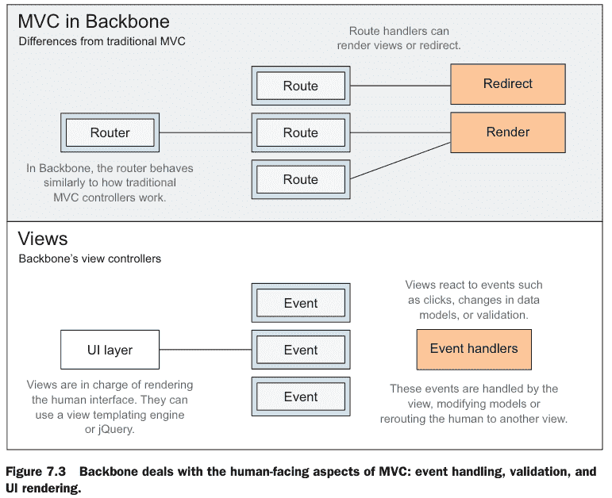

当然，每个结构还有更多内容需要学习。让我们逐一介绍。

#### 7.3.1 Backbone 视图

视图负责渲染 UI，而你需要负责编写视图的渲染逻辑。如何渲染 UI 完全由你决定。两种推荐的方式是使用 jQuery 或模板库。

视图始终与一个元素关联，渲染将在这个元素中进行。在下面的代码清单中，让我们看看一个基本视图是如何渲染的。你创建一个 Backbone 视图，添加自定义的渲染功能来在视图元素中设置文本。然后你实例化视图并渲染视图实例。

##### 代码清单 7.2 渲染一个基本视图

```javascript
var SampleView = Backbone.View.extend({
  el: '.view',
  render: function () {
    this.el.innerText = 'foo';
  }
});

var sampleView = new SampleView();

sampleView.render();
```

看到你是如何声明`el`属性并为其赋值`.view`了吗？你可以为该属性分配一个 CSS 选择器，它会在 DOM 中查找该元素。在视图中，该元素将被赋值给`this.el`。配合以下 HTML 页面，你可以渲染这个最小化的 Backbone 视图：

```html
<div class='view'></div>
<script src='build/bundle.js'></script>
```

打包脚本文件就是如我在 7.2.3 节中解释的编译后的应用程序。运行后，视图元素将获得`foo`文本内容。你可以在随附的源代码中查看此示例；它被列为`ch07/01_backbone-views`。

你当前的视图是静态的，你可能已经很清楚如何用 jQuery 渲染它，但这涉及更多工作，因为你必须创建每个元素、设置属性并用代码构建 DOM 树。使用模板更易于维护，并且能将关注点分离。让我们看看它是如何工作的。

##### 使用 MUSTACHE 模板

Mustache 是一个视图模板库，它接受一个模板字符串和一个视图模型，然后返回渲染后的视图。你在模板中引用模型值的方式是使用特殊的`{{value}}`符号来声明，它会被模型的`value`属性替换。

Mustache 还使用类似的语法来遍历数组，将部分模板包装在`{{#collection}}`和`{{/collection}}`中。在循环遍历集合时，你可以使用`{{.}}`来访问数组元素本身，也可以直接访问它的属性。

给你一个简单的例子，让我们从一个 HTML 视图模板开始：

```html
<p>Hello {{name}}, your order #{{orderId}} is now shipping. Your order
    includes:</p>
<ul>
  {{#items}}
  <li>{{.}}</li>
  {{/items}}
</ul>
```

要填充这个模板，你需要使用 Mustache，将其传递给一个模型。首先，你需要从 npm 安装 Mustache：

```shell
npm install mustache --save
```

渲染这个模板只需将模板作为字符串传递给 Mustache，同时传递一个视图模型：

```javascript
var Mustache = require('mustache');
Mustache.to_html(template, viewModel);
```

要在 Backbone 中实现这一点，你需要创建一个可复用的模块，如下面的代码片段所示，它将知道如何使用 Mustache 渲染任何视图，将其传递给视图的模板和视图的视图模型。这里你创建了一个基类视图，其他视图可以继承它，共享视图渲染等基本功能，这样你就不用将这个方法复制粘贴到你创建的每个视图上：

```javascript
var Backbone = require('backbone');
var Mustache = require('mustache');

module.exports = Backbone.View.extend({
  render: function () {
    this.el.innerHTML = Mustache.to_html(this.template, this.viewModel);
  }
});
```

在前面的示例中，你有一个静态视图，将所有应用放在一个模块中是可以的。但这次，你正在对其进行模块化。拥有一个基类视图是很好的，为每个视图拥有一个独立模块同样重要。在下面的代码片段中，你引入了之前看到的基类视图模板并扩展它。你使用`fs.readFileSync`来加载你的 Mustache 模板，因为`require`只能用于 JavaScript 和 JSON 文件。你不会将模板包含在视图模块本身中，因为将关注点分离总是好的，特别是当这些关注点属于不同语言时。此外，视图模板可以说可以被许多不同的视图使用。

```javascript
var fs = require('fs');
var base = require('./base.js');
var template = fs.readFileSync(
  __dirname + '/templates/sample.mu', 'utf8'
);

module.exports = base.extend({
  el: '.view',
  template: template
});
```

最后，你需要修改原来的应用模块，使其引入视图而不是声明视图，并在渲染视图之前声明一个视图模型。这一次，视图将使用 Mustache 进行渲染，如下面的代码清单所示。

##### 代码清单 7.3 使用 Mustache 渲染视图

```javascript
var SampleView = require('./views/sample.js');
var sampleView = new SampleView();

sampleView.viewModel = {
  name: 'Marian',
  orderId: '1234',
  items: [
    '1 Kite',
    '2 Manning Books',
    '7 Random Candy',
    '3 Mars Bars'
  ]
};
sampleView.render();
```

你可以在随附的代码示例中查看此示例；它被列为 ch07/02_backbone-view-templates。接下来是模型，Backbone 应用程序的另一个关键部分。

#### 7.3.2 创建 Backbone 模型

Backbone 模型（也称为数据模型）保存你的应用数据，这些数据通常是数据库中数据的副本。它们可以用来观察变化，以及验证这些变化。不要将它们与视图模型混淆（比如我们在前面示例中赋值给`sampleView.viewModel`的东西，也称为模板数据），视图模型通常包含 Backbone 数据模型的组合，通常经过格式化以适应 HTML 模板中的文本内容。例如，日期在数据模型中可能以 ISO 格式存储，但在模板数据中被格式化为人类可读的字符串。同样地，视图从`Backbone.View`扩展而来，模型从`Backbone.Model`扩展而来，它们在使你的数据具有交互性方面大有可为。模型可以被验证，测试用户输入是否有错误数据；它们可以被观察，帮助你对数据模型的变化做出反应；你还可以基于模型中的数据计算属性。

使用模型可能最有影响力的功能是观察模型数据中的变化。这让你的 UI 能够毫不费力地对数据变化做出反应。记住，同一份数据可以用许多不同的方式表示。例如，你可以将同一份数据表示为列表中的一项、一张图片或一段描述。模型使你能够在数据变化时实时更新每一种表示形式！


 ## 数据建模与可塑性

让我们来看一个示例（在示例代码的 ch07/03_backbone-models 目录下）：你获取一段用户输入，并将其渲染为纯文本、二进制格式，如果输入的是 URL，则渲染为锚点链接。首先，你需要创建一个模型来检查其数据是否看起来像链接。`get` 方法允许你在 Backbone 中访问模型属性的值。

```
module.exports = Backbone.Model.extend({
  isLink: function () {
    var link = /^https?:\/\/.+/i;
    var raw = this.get('raw');
    return link.test(raw);
  }
});
```

假设你有一个 `binary.fromString` 方法可以将模型数据转换为二进制字符串，并且你想获取二进制流的前几个字符，你可以为此添加一个模型方法，因为它也与数据相关。作为经验法则，任何可复用且完全（或主要）依赖于模型数据的方法，都应该成为模型方法。以下是获取二进制字符串的一种可能实现。如果二进制代码超过 20 个字符，可以使用 Unicode 省略号字符 `'\u2026'` 或 `'…'` 进行截断：

```
getBinary: function () {
  var raw = this.get('raw');
  var bin = binary.fromString(raw);
  if (bin.length > 20) {
    return bin.substr(0, 20) + '\u2026';
  }
  return bin;
}
```

我提到过你可以监听模型中的变化。让我们来了解更多关于事件的内容。

##### 模型与事件

要将你的视图绑定到这个模型，你需要创建一个模型实例。模型最有趣的方面之一就是事件。例如，你可以监听模型的变化，并在每次模型变化时更新视图。你可以使用视图的 `initialize` 属性来创建模型实例，绑定变化监听器，并给模型一个初始值，如以下代码片段所示：

```
initialize: function () {
  this.model = new SampleModel();
  this.model.on('change', this.updateView, this);
  this.model.set('raw', 'http://bevacqua.io/buildfirst');
}
```

视图不再从外部渲染，而是会在必要时自行重新渲染，每当模型变化时皆是如此。实现起来很简单。每当模型变化时，`updateView` 就会被调用，你就有机会更新视图模型，并用更新后的值渲染模板。

```
updateView: function () {
  this.viewModel = {
    raw: this.model.get('raw'),
    binary: this.model.getBinary(),
    isLink: this.model.isLink()
  };
  this.render();
}
```

视图的剩余工作就是允许用户输入来修改模型。你可以通过向视图的 `events` 属性添加属性来方便地绑定 DOM 事件。这些属性应该有一个形如 `{event-type} {element-selector}` 的键；例如，`click .submit-button`。属性值应该是视图中可用的事件处理程序名称。在以下代码片段中，我实现了一个事件处理程序，每次输入变化时都会更新模型：

```
events: {
  'change .input': 'inputChanged'
},
inputChanged: function (e) {
  this.model.set('raw', e.target.value);
}
```

当 change 事件被触发时，模型数据将被更新。这反过来会触发模型的 change 事件监听器，从而更新视图模型并刷新 UI。请记住，如果其他任何东西改变了模型数据，例如传入的服务器数据，也会相应地刷新 UI。这就是使用模型的价值所在。随着你的数据变得越来越复杂，你可以更多地从使用模型中获益，因为它们能够跟踪和响应数据的变化，从而使你的代码不会紧密耦合。

这是模型帮助塑造数据而无需在代码中重复逻辑的其中一种方式，在接下来的几个章节中，我们将仔细研究模型的好处，例如数据验证。在组织结构方面，还有一个方面需要了解，那就是集合。在转向视图路由之前，让我们快速概览一下集合。

#### 7.3.3 使用 Backbone 集合组织模型

Backbone 中的集合使你能够对一组模型进行分组和排序。你可以监听项目被添加或从集合中移除的事件，甚至可以在集合中的任何模型被修改时收到通知。同样地，模型有助于从其属性中计算数据，集合则涉及查找特定模型以及处理类 CRUD（创建、读取、更新、删除）操作。

集合接受一个模型类型，因此你可以使用普通对象向其中添加值，这些普通对象会在内部被转换为该模型类型。例如，在以下代码片段中创建的集合，每当你向其中添加项目时，都会创建 `SampleModel` 实例。集合示例可以在 ch07/04_backbone-collections 找到：

```
var SampleModel = require('../models/sample.js');

module.exports = Backbone.Collection.extend({
    model: SampleModel
});
```

与模型或视图类似，集合需要实例化才能利用它们。为了保持这个示例简短，你的视图将创建这个集合的实例，监听插入事件，并向集合中添加模型。`toJSON` 方法将集合转换为普通的 JavaScript 对象，可用于在渲染模板时获取模型数据，如以下列表所示。

**代码清单 7.4 获取模型数据**

```
initialize: function () {
    var collection = new SampleCollection();
    collection.on('add', this.report);
    collection.add({ name: 'Michael' });
    collection.add({ name: 'Jason' });
    collection.add({ name: 'Marian' });
    collection.add({ name: 'Candy' });
    this.viewModel = {
        title: 'Names',
        people: collection.toJSON()
    };
    this.render();
},
report: function (model) {
    var name = model.get('name');
    console.log('Someone got added to the collection:', name);
}
```

集合还可以在插入时验证模型，如你将在 7.4 节中看到的。不过，在到达那里之前，清单上还有最后一项。我指的是 Backbone 路由器。

#### 7.3.4 添加 Backbone 路由器

现代 Web 应用程序正越来越多地成为单页应用程序，这意味着网站只加载一次，从而减少了与服务器的往返次数，客户端代码接管后续操作。客户端路由可以通过更改 URL 中 hash 后的内容来处理，例如使用 `#/users` 或 `#/users/13` 等路径。在现代浏览器中，可以使用 History API 进行修改，这允许你更改 URL 而不必借助 hash 技巧，从而产生更干净的链接，就像网站从服务器获取页面一样。在 Backbone 中，你可以定义和实例化路由器，它们有两个用途：更改 URL 以提供给人类一个可用于导航到应用程序某一部分的永久链接，以及在 URL 变化时采取行动。

**图 7.4 Backbone 中的路由和路由检查器**

图 7.4 展示了路由器如何跟踪应用程序的状态。正如你在 7.1 节中学到的，路由器是应用程序中与人类接触的第一个点。传统路由器定义规则，将请求路由到特定的控制器动作。在 Backbone 的情况下，控制器中介不存在，请求直接路由到视图，视图扮演控制器的角色，同时提供视图模板和渲染逻辑。Backbone 路由器检查 `location` 的变化并调用动作方法，为它们提供相关的 URL 参数。

##### 路由变化

以下代码片段（以 ch07/05_backbone-routing 提供）实例化了一个视图路由器，并使用 `Backbone.history.start` 开始监控 URL 的变化。它还会检查当前 URL 是否匹配已定义的某个路由，如果是，则会触发该路由：

```
var ViewRouter = require('./routers/viewRouter.js');
new ViewRouter();

$(function () {
    Backbone.history.start();
});
```

就线路连接而言，这就是你需要做的全部。现在让我们编写你的 `ViewRouter` 组件。


##### 路由模块

路由器负责将每个 URL 连接到一个动作。通常，你会构建你的应用程序，使动作方法要么准备一个视图并渲染它，要么做一些渲染视图的事情，比如导航到不同的路由。在下面的代码片段中，我创建了一个包含不同路由的路由器：

```
var Backbone = require('backbone');

module.exports = Backbone.Router.extend({
    routes: {
        '': 'root',
        'items': 'items',
        'items/:id': 'getItemById'
    }
});
```

第一个路由，当用户访问应用程序根目录时，会触发重定向到默认路由，如以下代码片段所示。在这个例子中，那就是 `items` 路由。这确保了如果用户访问根级别页面而不是 `#items`（或者如果你使用 history API，则是 `/items`），他们不会被搁置。`trigger` 选项告诉 `navigate` 改变 URL 并触发该路由的动作方法。接下来，我们应该将 `root` 方法添加到传递给 `Backbone.Router.extend` 的对象中：

```
root: function () {
    this.navigate('items', { trigger: true });
}
```

只要你的所有视图都渲染到同一个视图容器，当特定动作被触发时实例化视图可能就足够了，如下代码片段所示：

```
items: function () {
    new ItemView();
}
```

你需要在路由模块顶部 `require` 该视图，像这样：

```
var ItemView = require('../views/item.js');
```

最后，你可能会注意到 `getItemById` 路由有一个以 `:id` 形式出现的命名参数。路由器会解析视图中的 URL，匹配 `items/:id` 模式，并调用你的动作方法，将 `id` 作为参数传入。然后，只需在渲染视图时使用该参数。

```
getItemById: function (id) {
    new DetailView(id);
}
```

### 7.4 案例研究：购物清单

在你冲出去开发自己的应用程序之前，我想给你一个自包含的例子，展示如何在浏览器中使用 Backbone 编写 MVC，将本章到目前为止学到的所有知识付诸实践。

在本节中，你将逐步构建一个简单的购物清单应用程序，它允许你查看购物清单项目、从列表中删除它们、添加新的项目以及更改数量。我将这个练习分为五个阶段。在每个阶段，你将添加功能并重构现有的内容，以保持代码整洁。这五个阶段是：

-   创建一个包含购物清单项目的静态视图
-   添加用于删除项目的删除按钮
-   构建一个表单以向购物清单添加新项目
-   在列表上实现内联编辑以更改数量
-   添加视图路由

接下来：这听起来很有趣！请记住，你可以随时在随附的代码示例中访问这五个阶段中任何一个阶段的代码。

#### 7.4.1 从静态购物清单开始

让我们回到基础，从头开始构建应用程序。Gruntfile 与 7.2.3 节中的相同，并且在本案例研究过程中不会改变，因此你不需要重新查看它。查看代码清单 7.5 中的 HTML（位于 ch07/06_shopping-list）以开始。注意你包含了构建好的 Browserify 包，以使 Common.js 代码在浏览器中工作。在这个例子中，`<div>` 将用作你的视图容器。这段 HTML 被称为 `app.html`，因为它是应用程序将运行的单个页面。

**代码清单 7.5 创建购物清单**

```
<!doctype html>
<html>
  <head>
    <title>Shopping List</title>
  </head>
  <body>
    <h1>Shopping List</h1>
    <div class='view'></div>
    <script src='build/bundle.js'></script>
  </body>
</html>
```

接下来，这个例子需要渲染一个购物项目列表，显示每个项目的数量和名称。这是一个可以渲染购物清单项目数组的 Mustache 代码片段。Mustache 模板将放入 `views/templates` 目录。

```
<ul>
  {{#shopping_list}}
    <li>{{quantity}}x {{name}}</li>
  {{/shopping_list}}
</ul>
```

你的视图需要使用视图模型来渲染这些模板。此功能应放在一个基础视图中，以便只实现一次。

##### 使用 MUSTACHE 渲染视图

为了在视图中轻松渲染 Mustache 模板并避免重复，你将设置一个基础视图并将其放在 `views` 目录中。你的其他视图将扩展这个视图，允许你添加在所有视图中共享的功能。如果视图需要以另一种方式渲染，那也没关系；你可以再次覆盖 `render` 方法。

```
var Backbone = require('backbone');
var Mustache = require('mustache');

module.exports = Backbone.View.extend({
  render: function () {
    this.el.innerHTML = Mustache.to_html(this.template, this.viewModel);
  }
});
```

接下来，你将为列表视图创建项目。

##### 购物清单视图

目前一个静态的购物清单项目列表就足够了，这就是为什么在以下代码清单中，你可以设置一次视图模型对象然后就不用管它了。注意 `initialize` 方法，它在视图实例化时运行，以便视图在创建时渲染自身。此视图使用你之前看到的模板，并定位 `app.html` 中的 `.view` 元素。

**代码清单 7.6 创建项目列表**

```
var fs = require('fs');
var base = require('./base.js');
var template = fs.readFileSync(
  __dirname + '/templates/list.mu', { encoding: 'utf8' }
);

module.exports = base.extend({
  el: '.view',
  template: template,
  viewModel: {
    shopping_list: [
      { name: 'Banana', quantity: 3 },
      { name: 'Strawberry', quantity: 8 },
      { name: 'Almond', quantity: 34 },
      { name: 'Chocolate Bar', quantity: 1 }
    ]
  },
  initialize: function () {
    this.render();
  }
});
```

最后，你需要初始化应用程序。这是入口点代码，你在初始化 Backbone 后创建一个列表视图的实例。注意，因为视图会渲染自身，所以你只需实例化它。

```
var Backbone = require('backbone');
Backbone.$ = require('jquery');

var ListView = require('./app/views/list.js');
var list = new ListView();
```

你已经为购物清单应用程序奠定了基础。让我们在下一阶段在此基础上构建。你将添加删除按钮并进行重构，以适应数据可以更改的动态应用程序。

#### 7.4.2 这次添加删除按钮

在这个阶段，你要做的第一件事是更新视图模板，使其包含从购物清单中删除项目的按钮。你将在按钮上设置一个 data-name 属性，以便你可以识别应该从列表中删除哪个项目。更新后的模板可以在以下代码片段中找到：

```
<ul>
  {{#shopping_list}}
    <li>
      <span>{{quantity}}x {{name}}</span>
      <button class='remove' data-name='{{name}}'>x</button>
    </li>
  {{/shopping_list}}
</ul>
```

在连接删除按钮之前，你需要设置一个合适的模型和集合。

##### 使用模型和集合

集合将让你监听列表的变化，例如当项目从列表中删除时。模型可用于在单个项目级别跟踪变化，它允许你进行验证以及计算，正如你将在接下来的几个阶段中看到的。对于你的目的，你不需要比标准的 Backbone 模型更多的东西，但将模型严格分离在不同的模块中并良好命名总是一个好主意。ShoppingItem 模型将位于 models 目录中。

```
var Backbone = require('backbone');

module.exports = Backbone.Model.extend({
});
```

集合也没有那么特别；它需要对模型的引用。这样，集合就知道在向列表插入新对象时应该创建哪种类型的模型。为了保持整洁有序，你将把集合放在 `collections` 目录中。

```
var Backbone = require('backbone');
var ShoppingItem = require('../models/shoppingItem.js');

module.exports = Backbone.Collection.extend({
  model: ShoppingItem
});
```

与其设置一次视图模型就不管它，现在你已经将模型和集合都设置好了，你应该更改视图以使用集合。你将在视图中做的第一个更改是 `require` 集合，如下所示：

```
var ShoppingList = require('../collections/shoppingList.js');
```

你将不再使用 `viewModel` 属性（你将从此动态设置它），而是使用 `collection` 属性来跟踪你的模型。请注意，正如我之前提到的，我不必显式创建 `ShoppingList` 实例作为我的集合，因为它已经知道必须使用的模型类型。

```
collection: new ShoppingList([
  { name: 'Banana', quantity: 3 },
  { name: 'Strawberry', quantity: 8 },
  { name: 'Almond', quantity: 34 },
  { name: 'Chocolate Bar', quantity: 1 }
])
```

接下来，你将让视图在首次加载时更新 UI。为此，你将视图模型设置为集合中的内容，然后渲染视图。使用 `toJSON` 方法给出一个简单的模型对象数组。

```
initialize: function () {
  this.viewModel = {
    shopping_list: this.collection.toJSON()
  };
  this.render();
}
```

最后，你将连接购物清单项目的删除按钮。

##### **在 BACKBONE 中连接 DOM 事件**

要监听 DOM 事件，你可以在视图中为 `events` 对象分配属性。这些属性应使用事件名称和 CSS 选择器命名，用空格分隔。以下代码是你将在更新后的视图中使用的代码。每当匹配 `.remove` 选择器的元素中发生 `click` 事件时，它将触发一个动作。请记住，这些事件在视图 `el` 内部查找元素，在这个例子中是你在上一阶段创建的 `<div>`，它不会为不属于该元素的元素触发事件。

在视图之外。最后，事件应设置为可在视图中找到的方法名称。

```
events: {
    'click .remove': 'removeItem'
}
```

现在来定义 `removeItem`。你将使用集合过滤方法。可以通过 `e.target` 访问按钮，并使用它的 `data-name` 属性来获取名称。然后使用该名称过滤集合，找到与此特定按钮关联的购物清单项。

```
removeItem: function (e) {
    var name = e.target.dataset.name;
    var model = this.collection.findWhere({ name: name });
    this.collection.remove(model);
}
```

一旦从集合中移除模型，视图应该再次更新。天真的方法是在从集合中移除项目后更新视图模型并渲染视图。问题在于，项目可能从应用程序中不同位置的集合中移除，特别是如果它是一个设计良好的应用程序。更好的方法是监听集合发出的事件。在这种情况下，你可以监听集合中的 `remove` 事件，并在该事件触发时刷新视图。以下清单在你初始化视图时设置了事件监听器，并包含了重构，以避免代码重复，遵循**DRY 原则**。

###### 清单 7.7 设置事件监听器

```
initialize: function () {
    this.collection.on('remove', this.updateView, this);
    this.updateView();
},
updateView: function () {
    this.viewModel = {
        shopping_list: this.collection.toJSON()
    };
    this.render();
}
```

这是一大块需要消化的内容！你现在可以前往随附的代码示例，查看 ch07/07_the-one-with-delete-buttons，这是你在完成此阶段时得到的工作示例。在本教程的下一部分中，你将创建一个表单，供人类用来向他们的购物清单添加项目。

#### 7.4.3 向购物车添加商品

在上一阶段，你让你的购物清单焕发了生机，允许从列表中移除项目。这次，你还将添加添加新项目的选项，以便人们可以购买自己的商品，而不是仅仅移除他们不想要的商品。

为了保持趣味性，让我们再添加一个需求。在创建新项目时，你需要确保其名称尚未列出。如果商品已经在购物清单上，则需要将数量添加到现有项目中。这样可以避免创建重复项目。

##### 创建"添加到购物车"组件

你将在以下清单中添加一点 HTML 来添加杂货到列表中。此示例可在 ch07/08_creating-items 找到。你将使用几个输入框，以及一个将商品添加到购物清单集合的按钮。还有一个字段仅在设置了错误消息时显示。你将使用该字段进行输入验证。为了简单起见，这段 HTML 暂时放在你的列表模板中。在接下来的几个阶段中，你将进行重构并将其移入自己的视图。

###### 清单 7.8 设置添加到购物车组件

```
<fieldset>
  <legend>Add Groceries</legend>
  <label>Name</label>
  <input class='name' value='{{name}}' />
  <label>Quantity</label>
  <input class='quantity' type='number' value='{{quantity}}' />
  <button class='add'>Add</button>
  {{#error}}
    <p>{{error}}</p>
  {{/error}}
</fieldset>
```

到目前为止，你的模型从未改变。你可以移除项目但不能更新它们。现在模型可以通过人类交互进行更改，是时候添加验证了。

##### 输入验证

人类输入永远不应该被信任，因为用户很容易输入非数字的数量，或者他们可能忘记输入名称。也许他们输入了负数，这也应该被考虑在内。Backbone 允许你在模型上提供 `validate` 方法来验证信息。该方法接受一个 `attrs` 对象，这是一个内部模型变量，保存所有模型属性，以便你可以直接访问它们。以下清单展示了如何实现验证函数。你正在检查模型是否具有名称、数量是否为数字且不是 `NaN`（非数字）。令人困惑的是，`NaN` 的类型是 'number'，而且 `NaN` 也不等于它自己，因此你需要使用原生 JavaScript 的 `isNaN` 方法来测试 `NaN`。最后，你将确保数量至少为 1。

###### 清单 7.9 实现验证函数

```
validate: function (attrs) {
  if (!attrs.name) {
    return 'Please enter the name of the item.';
  }
  if (typeof attrs.quantity !== 'number' || isNaN(attrs.quantity)) {
    return 'The quantity must be numeric!';
  }
  if (attrs.quantity < 1) {
    return 'You should keep your groceries to yourself.';
  }
}
```

为了使编辑更简单，你还将向模型添加一个辅助方法，该方法接受一个数量并更新模型，将该数量添加到当前数量中。此更改应进行验证，以确保负数量不会使结果数量低于 1。模型在更改值时默认不进行验证，但你可以通过打开 validate 选项来强制验证。以下代码展示了该方法的样子：

```
addToOrder: function (/multiplication) {
  this.set('quantity', this.get('quantity') + quantity, { validate: true });
}
```

当向模型添加任何数量时，将触发验证，如果验证失败，模型将不会被更改，而是会在模型上设置 `validationError` 属性。假设你有一个数量为 6 的模型；以下代码将失败并将 `validationError` 属性设置为适当的错误消息：

```
model.addToOrder(-6);
model.validationError;
// <- 'You should keep your groceries to yourself.'
```

现在你的模型可以保护自己免受不良数据的侵害，你可以更新视图并让你的新表单焕发活力。

##### 重构视图逻辑

我们将对视图的首次更改是添加一个渲染方法，该方法可以显示错误消息，同时保留人类输入的名称和数量，以便在发生错误时它们不会被清除。为了清晰起见，我们将该方法命名为 `updateViewWithValidation`：

```
updateViewWithValidation: function (validation) {
  this.viewModel = {
    shopping_list: this.collection.toJSON(),
    error: validation.error,
    name: validation.name,
    quantity: validation.quantity
  };
  this.render();
}
```

你还需要将事件监听器绑定到添加按钮上的点击事件。为此，向视图中 `events` 对象添加另一个属性。然后剩下的就是创建 `addItem` 事件处理程序：

```
'click .add': 'addItem'
```

你的 `addItem` 处理程序首先应该做的几件事是获取人类输入并将数量解析为十进制整数：

```
var name = this.$('.name').val();
var quantity = parseInt(this.$('.quantity').val(), 10);
```

一旦你有了用户输入，你要做的第一件事是弄清楚集合中是否有任何项目具有相同的名称，如果是这样，在验证输入后使用 `addToOrder` 方法更新模型。如果项目不在列表中，则创建一个新的 `ShoppingItem` 模型实例并验证它。如果验证通过，则将新创建的项目添加到集合中。在代码中，这看起来像以下清单。

###### 清单 7.10 验证购物项目

```
var model = this.collection.findWhere({ name: name });
if (model) {
  model.addToOrder(quantity);
} else {
  model = new ShoppingItem({ name: name, quantity: quantity }, { validate: true });
  if (!model.validationError) {
    this.collection.add(model);
  }
}
```

因为你正在使用 `ShoppingItem` 类，所以你需要在模块顶部添加以下语句：

```
var ShoppingItem = require('../models/shoppingItem.js');
```

如果验证步骤失败，你需要重新渲染视图，添加验证错误消息，以便用户知道出了什么问题：

```
if (!model.validationError) {
  return;
}

this.updateViewWithValidation({
  name: name,
  quantity: quantity,
  error: model.validationError
});
```

如果验证顺利，集合将获得一个新项目或现有项目将发生变化。这些情况应该通过监听集合上的 `add` 和 `change` 事件来处理。你需要在视图的 `initialize` 方法中添加以下几行：

```
this.collection.on('add', this.updateView, this);
this.collection.on('change', this.updateView, this);
```

这就是这个阶段的全部内容。你现在有能力向列表添加新项目、修改现有项目的数量以及移除项目。在下一阶段，你将通过在每个列表项上添加内联编辑按钮，使编辑更加直观。


#### 7.4.4 使用行内编辑

在本节中，我们将介绍行内项目编辑。每个项目将有一个编辑按钮。点击它将允许用户更改数量并保存记录。这个功能本身很简单，但你将借此机会进行一些重构。你将把不断增长的列表视图拆分为三个部分：一个负责输入表单的“添加项目”视图，一个负责单个列表项的“列表项”视图，以及负责处理集合中移除和添加操作的原始“列表”视图。

##### 视图组件化

首要任务是将列表视图模板一分为二。你将使用两个不同的视图容器：一个用于列表，另一个用于表单。你之前使用的 `<div>` 可以用以下代码替换：

```html
<ul class='list-view'></ul>
<fieldset class='add-view'></fieldset>
```

这种职责划分也意味着你需要拆分你的 Mustache 模板。与其让 `list` 模板完成所有工作，不如将其替换为另外两个模板。正如你很快会了解到的，列表本身不需要任何模板；只有表单和单个列表项需要。以下代码是 `views/templates/addItem.mu` 的内容。表单几乎没有变化，只是 `fieldset` 标签已被提升为视图容器状态，因此它不再位于模板中。

```html
<legend>添加杂货</legend>
<label>名称</label>
<input class='name' value='{{name}}' />
<label>数量</label>
<input class='quantity' type='number' value='{{quantity}}' />
<button class='add'>添加</button>
{{#error}}
<p>{{error}}</p>
{{/error}}
```

列表视图本身不再需要模板，因为唯一需要的元素是 `<ul>` 元素，它通过 `el` 属性与你的列表视图绑定，你稍后会看到。每个列表项将保存在自己的视图中，你将为它们使用视图模板。列表项视图模型将包含一个属性来跟踪该项目是否正在被编辑。在视图模板中会检查此属性，以决定是渲染标签和操作按钮，还是渲染行内编辑表单。列表项模板如下所示，并保存在 `views/templates/listItem.mu` 中。

##### 清单 7.11 查看列表项模板

```html
{{^editing}}
<span>{{quantity}}x {{name}}</span>
<button class='edit'>编辑</button>
<button class='remove'>x</button>
{{/editing}}
{{#editing}}
<span>{{name}}</span>
<input class='edit-quantity' value='{{quantity}}' type='number' />
<button class='cancel'>取消</button>
<button class='save'>保存</button>
{{/editing}}
{{#error}}
<span>{{error}}</span>
{{/error}}
```

你仍然会在列表视图中创建集合，但你需要将该集合传递给 `addItem` 视图。这使两个视图紧密耦合，因为 `addItem` 视图需要一个可以创建集合的列表视图，而这并不模块化。这是你的入口点 `app.js` 现在的代码。你将在下一个阶段解决耦合问题；这段代码片段旨在让你的组件变得更小：

```javascript
var Backbone = require('backbone');
Backbone.$ = require('jquery');

var ListView = require('./views/list.js');
var listView = new ListView();

var AddItemView = require('./views/addItem.js');
var addItemView = new AddItemView({ collection: listView.collection });
```

让我们继续创建添加项目视图。

## 模块化的“添加到购物车”视图

添加项目视图类似于你在开始组件化之前的列表视图。首先，下面的代码清单展示了视图如何初始化，以及它如何使用 `.add-view` 选择器找到将用作视图容器的 `<fieldset>`。

```
清单 7.12 初始化视图

var fs = require('fs');
var base = require('./base.js');
var template = fs.readFileSync(
    __dirname + '/templates/addItem.mu', { encoding: 'utf8' }
);
var ShoppingItem = require('../models/shoppingItem.js');

module.exports = base.extend({
    el: '.add-view',
    template: template,
    initialize: function () {
        this.updateView();
    },
    updateView: function (vm) {
        this.viewModel = vm || {};
        this.render();
    }
});
```

此视图只关心将模型添加到集合中，这一点很明显。它将在“添加”按钮上有一个点击事件处理程序，看起来与你旧的 `addItem` 方法几乎完全相同。唯一的区别是，在这个版本中，每次触发 `addItem` 事件处理程序时，你都会更新视图，如下所示。

```javascript
events: {
    'click .add': 'addItem'
},
addItem: function () {
    var name = this.$('.name').val();
    var quantity = parseInt(this.$('.quantity').val(), 10);
    var model = this.collection.findWhere({ name: name });
    if (model) {
        model.addToOrder(quantity);
    } else {
        model = new ShoppingItem(
            { name: name, quantity: quantity },
            { validate: true }
        );

        if (!model.validationError) {
            this.collection.add(model);
        }
    }

    if (!model.validationError) {
        this.updateView();
        return;
    }
    this.updateView({
        name: name,
        quantity: quantity,
        error: model.validationError
    });
}
```

添加项目视图唯一要做的就是添加项目，所以这就是全部内容了！接下来让我们把列表项视图组合起来。

##### 创建列表项组件

列表项组件将负责渲染对其模型所做的任何更改，并提供从列表中编辑或删除项目的机会。让我们从头开始了解这个视图。首先，是一些常规步骤。你需要读取模板文件并扩展基础视图。`tagName` 属性意味着此视图将被渲染到一个 `<li>` 元素中。从以下代码片段开始：

```javascript
var fs = require('fs');
var base = require('./base.js');
var template = fs.readFileSync(
    __dirname + '/templates/listItem.mu', { encoding: 'utf8' }
);

module.exports = base.extend({
    tagName: 'li',
    template: template
});
```

此视图将在模型和集合属性创建时接受它们，正如你在重构列表视图时会看到的。每当模型更改时，你都会重新渲染视图。视图在初始化时也需要渲染。如果在使用行内编辑功能时发生验证错误，你也将通过视图模型来跟踪它。代码中如下所示：

```javascript
initialize: function () {
    this.model.on('change', this.updateView, this);
    this.updateView();
},
updateView: function () {
    this.viewModel = this.model.toJSON();
    this.viewModel.error = this.model.validationError;
    this.render();
}
```

删除事件处理程序现在简单得多，因为你只需要从集合中移除模型，而这两者你都在视图的属性中拥有。代码中如下所示：

```javascript
events: {
    'click .remove': 'removeItem'
},
removeItem: function (e) {
    this.collection.remove(this.model);
}
```

接下来，你将设置编辑和取消方法，它们是相似的。第一个将项目置于编辑模式，而第二个则退出编辑模式。所有这些方法需要做的就是更改 editing 属性。其余部分将由模型更改事件监听器处理，它将确保再次渲染视图。在打开或关闭编辑模式时，你还需要清除 validationError 属性。下面的代码清单介绍了这些事件处理程序。

###### 清单 7.14 添加编辑和取消方法

```javascript
events: {
    'click .edit': 'editItem',
    'click .cancel': 'cancelEdit',
    'click .remove': 'removeItem'
},
removeItem: function (e) {
    this.collection.remove(this.model);
},
editItem: function (e) {
    this.model.validationError = null;
    this.model.set('editing', true);
},
cancelEdit: function (e) {
    this.model.validationError = null;
    this.model.set('editing', false);
}
```


### 案例研究：购物清单

列表项视图的最后一项任务是保存对记录所做的编辑。你将绑定到保存按钮的点击事件，解析输入并更新数量。只有验证成功后，你才会退出编辑模式。请记住，为了简洁起见，我不会重复之前所有的事件处理程序：

```
events: {
  'click .save': 'saveItem'
},
saveItem: function (e) {
  var quantity = parseInt(this.$('.edit-quantity').val(), 10);
  this.model.set('quantity', quantity, { validate: true });
  this.model.set('editing', this.model.validationError);
}
});
```

列表项没有其他职责，但列表应该将这个局部视图添加到用户界面，或从中移除。说到局部视图，我的意思是它只代表对象的一部分，在本例中是列表的一部分，而非整体。列表视图需要持有它所拥有的所有列表项视图。

### 重建列表视图

之前，你的列表视图会在每次添加或删除项目时重新渲染。现在，你的列表将只渲染单个项目，并将其追加到DOM中，或从DOM中移除现有项目。这不仅比重绘整个列表更快，而且也更具模块化。列表只负责管理大局性操作，即项目的添加或移除。各个项目将各自负责维护自身的状态并更新自己的UI表示。

为了实现这一点，列表视图将不再依赖 `view.render` 方法，而是直接操作DOM。你保留的旧列表视图的方面，例如硬编码的集合数据、继承自基础视图以及 `el` 属性的声明，如下面的代码清单所示。请注意，视图容器已更改为匹配你的 `<ul>` 元素。

### 清单 7.15 旧列表视图的方面

```
var base = require('./base.js');
var ShoppingList = require('../collections/shoppingList.js');

module.exports = base.extend({
  el: '.list-view',
  collection: new ShoppingList([
    { name: 'Banana', quantity: 3 },
    { name: 'Strawberry', quantity: 8 },
    { name: 'Almond', quantity: 34 },
    { name: 'Chocolate Bar', quantity: 1 }
  ])
});
```

因为你不再希望每次项目更改时都重绘整个视图，所以你将依赖两个新方法 `addItem` 和 `removeItem` 来进行DOM操作。每当集合更新时，你都会运行这些方法，以确保UI始终保持最新。你也可以使用 `addItem` 方法来渲染集合的初始表示，方法是在初始化视图时对集合中的每个模型运行它。`initialize` 方法将如下面的代码片段所示。我接下来会解释 `partials` 变量。

```
initialize: function () {
    this.partials = {};
    this.collection.on('add', this.addItem, this);
    this.collection.on('remove', this.removeItem, this);
    this.collection.models.forEach(this.addItem, this);
}
```

在介绍 `addItem` 方法之前，我需要提到它需要引入列表项视图。你将使用它来创建局部视图，集合中的每个模型一个。让我们将其添加到列表视图模块的顶部：

```
var ListItemView = require('./listItem.js');
```

现在你准备好实现 `addItem` 方法了。该方法将接受一个模型并创建一个 `ListItemView` 的实例。然后，视图元素（一个 `<li>`）将被追加到 `this.$el`，也就是你的 `<ul>` 元素。为了干净地从列表中查找和移除项目，你将在 `partials` 变量中跟踪它们。Backbone模型有一个唯一的ID属性，可以通过 `model.cid` 访问，因此你可以将其用作 `partials` 对象的键。代码如下：

```
addItem: function (model) {
    var item = new ListItemView({
        model: model,
        collection: this.collection
    });
    this.$el.append(item.el);
    this.partials[model.cid] = item;
}
```

移除元素现在仅仅是查看 `partials` 对象，通过 `model.cid` 键访问局部视图，并移除元素的问题。然后，你应该确保它也从 `partials` 对象中移除。

```
removeItem: function (model) {
    var item = this.partials[model.cid];
    item.$el.remove();
    delete this.partials[model.cid];
}
```

呼！这是一次高强度的重构会议，但它是值得的。现在你有几个不同的视图在同一个集合上工作，而且它们现在更加自包含了。添加项目视图只负责向集合中添加项目，列表视图只关心创建新的列表项视图或从DOM中移除它们，而列表项视图只关心单个模型的更改。给自己一个祝贺性的拍背，然后查看附带的代码示例，确保你理解到目前为止所做的所有更改以及购物清单应用程序的当前状态。你会发现示例列为 ch07/09_item-editing。

在这个阶段，你实现了一个不错的关注点分离，但你可以做得更好。让我们在最后阶段看看这一点。

### 7.4.5 服务层和视图路由

最后阶段为你的组织引入了两个变化。你将添加一个轻量级的服务层，并在应用程序设计中引入视图路由。通过创建一个提供唯一购物清单集合的服务，你让你的视图能够主动向服务请求购物清单数据。这极大地解耦了你的视图，之前它们自己生成数据并相互共享。

请注意，在这种情况下你仍然硬编码了一个项目数组，但你可以像第6章看到的那样，轻松地通过Ajax请求拉取它们，并通过Promise提供访问。目前，下面的代码清单会完成。这应该放在 services 目录中。

```
清单 7.16 硬编码项目数组

var ShoppingList = require('../collections/shoppingList.js');

var items = [
    { name: 'Banana', quantity: 3 },
    { name: 'Strawberry', quantity: 8 },
    { name: 'Almond', quantity: 34 },
    { name: 'Chocolate Bar', quantity: 1 }
];
module.exports = {
    collection: new ShoppingList(items)
};
```

一旦到位，添加项目和列表视图都应该引入该服务，并将 `shoppingService.collection` 分配给它们的 `collection` 属性。这样做，你不再需要传递之前由列表视图初始化的集合的引用。

让我们转向路由变化，为你的购物清单之旅画上句号。

#### 购物清单的路由

在这个阶段，你还将实现路由。为了让事情更有趣，你将把添加项目视图移动到不同的路由。下面清单中的代码应该放到它自己的模块中。将其放在 `routers/viewRouter.js`。'root' 操作有助于在用户打开应用程序时进行重定向，并且没有设置其他哈希位置。

```
清单 7.17 将添加项目视图移动到不同的路由

var Backbone = require('backbone');
var ListView = require('../views/list.js');
var AddItemView = require('../views/addItem.js');
module.exports = Backbone.Router.extend({
```

```
routes: {
  '': 'root',
  'items': 'listItems',
  'items/add': 'addItem'
},
root: function () {
  this.navigate('items', { trigger: true });
},
listItems: function () {
  new ListView();
},
addItem: function () {
  new AddItemView();
}
});
```

正如我在7.3.4节首次介绍Backbone路由器时提到的那样，你必须回到 `app.js` 并用下面清单中的代码替换你已有的内容。这将连接你的视图路由器并激活它。它不会静态地定义提供给人类的第一个视图，而是取决于他们从哪个URL访问你的应用程序。

#### 清单 7.18 激活视图路由器

```
var Backbone = require('backbone');
var $ = require('jquery');

Backbone.$ = $;

var ViewRouter = require('./routers/viewRouter.js');
new ViewRouter();

$(function () {
  Backbone.history.start();
});
```

你需要进行的最后一个与路由相关的更改涉及视图和模板。首先，你将恢复到上一个阶段之前使用的单一视图容器：

```
<div class='view'></div>
```

其次，你需要在添加项目视图和列表视图中将 `el` 属性设置为 `'.view'`。你还需要稍微修改一下视图模板。例如，添加项目视图模板应该有一个返回列表视图的取消按钮。它应该看起来像下面的代码：

```
<a href='#items' class='cancel'>Cancel</a>
```

最后，你将为你的列表视图提供一个当之无愧的视图模板，它会很小。它需要用于保存列表的 `<ul>` 和一个匹配路由的锚链接。


```
添加项目视图。以下代码片段展示了位于 views/templates/list.mu 中的模板应如何编写：

```
<ul class='items'></ul>
<a href='#items/add'>Add Item</a>
```

列表视图应在初始化时渲染此模板并查找列表元素：

```
this.render();
this.$list = this.$('.items');
```

向列表添加项目时，应将其追加到 $list，而不是追加到 $el（此时它是共享的视图容器）：

```
this.$list.append(item.el);
```

就是这么简单！请务必查看随附代码仓库中的代码。最后一个阶段位于 ch07/10_the-road-show 下，其中包含了你目前完成的所有内容。接下来，你将学习 Rendr，这是一项可用于在服务器端渲染客户端 Backbone 视图的技术，对于提升 Node.js 应用开发中的人为感知性能非常有用。

### 7.5 Backbone 与 Rendr：服务器/客户端共享渲染

Rendr 通过在服务器端渲染 Backbone 应用来提升其感知性能。这使你可以在 JavaScript 代码于浏览器中执行和 Backbone 启动之前，就展示出渲染好的页面。在首次加载页面时，用户会更快地看到内容。此后，Backbone 将接管并处理客户端路由。首次加载极其重要，在用户获取任何内容之前于服务器端渲染应用，优于让他们等待 Backbone 拉取数据、填充视图并渲染模板。这就是为什么服务器端渲染对于 Web 应用开发过程仍然至关重要。让我们快速深入 Rendr 的世界。

#### 7.5.1 深入了解 Rendr

Rendr 采用一种传统的应用构建方式。它期望你以特定方式命名模块并将其放置在特定目录中。Rendr 对你应该使用何种模板以及应用应如何访问其数据也有自己的规定。默认情况下，这意味着 Rendr 期望你拥有一个 REST API 来访问应用数据；你将在第 9 章研究 REST API 设计。

Rendr 运行在 Node.js 上，充当你 HTTP 技术栈中的中间件。它的工作原理是拦截请求，在将预渲染结果交给客户端之前先在服务器端渲染视图。在其传统方法中，它通过定义控制器（你可以在其中获取数据、渲染视图或执行重定向）来帮助分离关注点。Rendr 不要求你在视图中直接引用模板，而是使用明确的命名策略来抽象依赖关系，这些依赖关系大多由 Rendr 引擎管理。当你查看 7.5.2 节的代码时，这一点会变得更加清晰。

##### 天堂里的问题

并非一切都很完美。在撰写本文时，Rendr（v0.5）包含一些"奇特的"设计选择，最终促使我决定不在本章中全程使用它，因为这会使示例复杂化。例如，Rendr 使用 Browserify 将你编写的模块带入浏览器，但它使用 Browserify 编译 CommonJS 模块的方式存在三个明显的变通处理：

1.  jQuery 需要通过 `browserify-shim` 进行垫片处理。这很成问题，因为 Rendr 的服务器端版本使用自己的 jQuery 版本，可能存在版本不一致的问题。如果你尝试使用通过 `npm` 获取的 CommonJS 版本，它将无法工作。
2.  它需要为其部分 `require` 调用设置别名才能按预期工作，这是一个问题，因为它也引出了下一个缺陷。
3.  你不能将 `brfs` 转换用于 Rendr。

决定不更深入探讨 Rendr，更多是因为它的适用范围不够广泛。如果你选择 Node.js 以外的服务器端语言，你就无法将我要教的许多概念应用到你的设计中。除了这些问题，学习 Rendr 为你的 Backbone 应用提供的传统 MVC 功能绝对是有价值的。许多服务器端语言都存在传统的 MVC 框架，提供与 Backbone 和 Rendr 结合后产生的功能类似的特性，但当谈论客户端 JavaScript 时，你很少会了解到那些框架。执行共享渲染的能力无疑增加了它的吸引力。与决定技术栈的大多数情况一样，这是一个权衡。请注意，Facebook 的 React 是一个很好的例子，它是一个能够同时执行服务器端和客户端渲染的库，而无需任何额外工具。

##### 深入探索

为了展示 Rendr，我选择了一个略经修改的 AirBnB（Rendr 背后的公司）示例来讲解 Rendr 的工作原理。你可以在随附代码示例的 ch07/11_entourage 中找到代码。

首先，让我们谈谈模板。Rendr 鼓励你使用 Mustache 的超集——Handlebars。Handlebars 提供了额外功能，主要以辅助方法的形式，例如一个便利的 `if` 方法。Rendr 期望你编译 Handlebars 模板并将打包结果放在 `app/templates/compiledTemplates.js` 中。为此，首先安装 Handlebars 的 Grunt 插件：

```
npm install --save-dev grunt-contrib-handlebars
```

要配置 Handlebars Grunt 插件，你必须将清单 7.19 中的代码添加到 `Gruntfile`。传递给 `handlebars:compile` 任务目标的 `options` 是 Rendr 所需要的，它期望模板以特定方式命名。

**清单 7.19 配置 Handlebars 插件**

```
handlebars: {
  compile: {
    options: {
      namespace: false,
      commonjs: true,
      processName: function (filename) {
        return filename.replace('app/templates/', '').replace('.hbs', '');
      }
    },
    src: 'app/templates/**/*.hbs',
    dest: 'app/templates/compiledTemplates.js'
  }
}
```

目前，Browserify 的配置也与 Rendr 的期望紧密相关。你需要对 jQuery 进行垫片处理，而不是从 npm 安装它。你需要提供一个别名，以便 Rendr 可以访问 `rendr-handlebars`，即 Rendr 使用的 Handlebars 适配器。最后，Rendr 需要你提供一些映射，以便它可以访问你应用程序的模块。配置 Browserify 以与 Rendr 协同工作的代码可以在清单 7.20 中找到。

**清单 7.20 配置 Browserify 以与 Rendr 协同工作**

```
browserify: {
  options: {
    debug: true,
    alias: ['node_modules/rendr-handlebars/index.js:rendr-handlebars'],
    aliasMappings: [{
      cwd: 'app/',
      src: ['**/*.js'],
      dest: 'app/'
    }],
    shim: {
      jquery: {
        path: 'assets/vendor/jquery-1.9.1.min.js',
        exports: '$'
      }
    }
  },
  app: {
    src: ['app/**/*.js'],
    dest: 'public/bundle.js'
  }
}
```

关于构建配置，就这些了。它可能不是最理想的，但一旦配置好，你就可以忘记它了。让我们进入示例应用代码，看看它是如何工作的。

#### 7.5.2 理解 Rendr 中的样板代码

构建你的 Rendr 应用的第一步是创建 Node 程序的入口点。你将把这个文件命名为 `app.js`，并放在应用程序根目录中。正如我之前提到的，Rendr 在你的 HTTP 技术栈中充当中间件，位于 Express 内部。

##### 用于 Rendr 的 Express 中间件

Express 是一个流行的 Node.js 框架，它封装了原生的 http 模块，提供更多功能并允许你执行路由和其他一些事情。在本节之后，我们将讨论的大部分内容都是 Rendr 固有的，而非 Express 的一部分。不过，Rendr 增强了 Express 以使其约定生效。

```
npm install express --save
```

看看下面这段代码。你正在使用 `express` 包在 Node 中设置一个 HTTP 服务器。调用 `express()` 将创建一个新的 Express 应用实例，你可以使用 `app.use` 向该实例添加中间件。调用 `app.listen(port)` 将使应用程序保持运行并对选定端口上收到的 HTTP 请求做出反应。最佳实践规定，你应用程序的监听端口应该配置为环境变量，并具有一个合理的默认值。

```
var express = require('express');
var app = express();
var port = process.env.PORT || 3000;

app.use(express.static(__dirname + '/public'));
app.use(express.bodyParser());
app.listen(port, function () {
  console.log('listening on port %s', port);
});
```

`static` 中间件告诉 Express 将指定目录中的所有内容作为静态资源提供。如果用户请求 `http://localhost:3000/js/foo.js`，并且 `public/js/foo.js` 文件存在，Express 将响应那个文件。`bodyParser` 中间件是一个实用工具，它会解析检测为 JSON 或表单数据格式的请求体。

以下清单为你的示例配置了 Rendr。如你接下来将看到的，中间件将处理其他所有事情。数据适配器配置告诉 Rendr 它应该查询哪个 API。Rendr 的妙处在于，无论在客户端还是服务器端，只要需要获取数据，它就会查询 API。

**清单 7.21 配置 Rendr**

```
var rendr = require('rendr');
var rendrServer = rendr.createServer({
  dataAdapterConfig: {
    default: {
      host: 'api.github.com',
      protocol: 'https'
    }
  }
});

app.use(rendrServer);
```


#### 配置 Rendr

Rendr 提供了一系列基础对象，你在构建应用时需要对它们进行扩展。`BaseApp` 对象继承自 `BaseView`，你应该对其进行扩展并将其放在 `app/app.js` 中，以创建一个 Rendr 应用。在这个文件中，你可以添加在客户端和服务器端都会运行的应用初始化代码，用于维护应用的全局状态。以下代码片段就足够了：

```
var BaseApp = require('rendr/shared/app');

module.exports = BaseApp.extend({
});
```

你还需要创建一个路由模块，你可以用它来在路由发生变化时追踪页面浏览量，不过现在你只需创建一个基础路由的实例。路由模块应该放在 `app/router.js`，它应该如下面的代码所示：

```
var BaseClientRouter = require('rendr/client/router');

var Router = module.exports = function Router (options) {
  BaseClientRouter.call(this, options);
};

Router.prototype = Object.create(BaseClientRouterHarness.prototype);
Router.prototype.constructor = BaseClientRouter;
```

让我们把注意力转向你的 Rendr 应用程序的核心部分应该是什么样子。

#### 7.5.3 一个简单的 Rendr 应用

你已经配置了 Grunt 和 Express 以满足 Rendr 的需求。现在是时候开发应用本身了。为了让这个示例更容易理解，我将按照 Rendr 提供响应的逻辑顺序向你展示代码。为了让你的示例自成一体但又足够有趣，你将创建三个不同的视图：

- Home 是你的应用的欢迎界面。
- Users 保存 GitHub 用户列表。
- User 包含特定用户的详细信息。

这些视图将与路由一一对应。主页面视图将位于应用根目录 `/`；用户列表将位于 `/users`；用户详情视图将位于 `/users/:login`，其中 `:login` 是用户在 GitHub 上的登录名（在我这里是 `bevacqua`）。视图由控制器渲染。

图 7.5 展示了你完成后用户列表的样子。

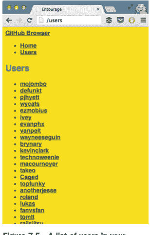

让我们从路由开始，然后了解控制器是如何运作的。

#### 路由和控制器

以下代码将路由与控制器动作匹配。控制器动作应该定义为控制器名称，后跟一个井号，然后是动作名称。这个模块放在 `app/routes.js` 中。

```
module.exports = function (match) {
  match(''               ,      'home#index');
  match('users'          ,      'users#index');
  match('users/:login',          'users#show');
};
```

控制器获取渲染视图所需的任何数据。你必须定义路由所期望的每个动作。让我们把两个控制器放在一起。按照惯例，控制器应该放在 `app/controllers/{{name}}_controller.js`。下面的代码片段是你的 Home 控制器，应该放在 `app/controllers/home_controller.js`。它应该暴露一个 `index` 函数，与 `index` 路由匹配。这个函数接收一个参数对象和一个回调函数，一旦调用该回调函数就会渲染视图：

```
module.exports = {
  index: function (params, callback) {
    callback();
  }
};
```

`user_controller.js` 模块有所不同。它也有一个 `index` 动作，但它还有一个 `show` 动作。在这两种情况下，你都需要调用 `this.app.fetch` 并传入参数来获取模型数据，然后在完成后调用回调函数，如下面的清单所示。

##### 清单 7.22 检索模型数据

```
module.exports = {
  index: function (params, callback) {
    var spec = {
      collection: {
        collection: 'Users',
        params: params
      }
    };
    this.app.fetch(spec, function (err, result) {
      callback(err, result);
    });
  },
  show: function (params, callback) {
    var spec = {
      model: {
        model: 'User',
        params: params
      },
      repos: {
        collection: 'Repos',
        params: { user: params.login }
      }
    };
    this.app.fetch(spec, function (err, result) {
      callback(err, result);
    });
  }
};
```

如果你没有匹配的模型和集合，获取这些数据是不可能的。让我们接下来完善这些。

### 模型和集合

模型和集合需要扩展 Rendr 提供的基础对象，所以我们来创建这些。以下代码是你的基础模型，放在 `app/models/base.js`：

```
var RendrBase = require('rendr/shared/base/model');

module.exports = RendrBase.extend({});
```

基础集合同样很简单。不过，拥有自己的基础对象对于在模型之间轻松共享功能是必需的：

```
var RendrBase = require('rendr/shared/base/collection');

module.exports = RendrBase.extend({});
```

我们必须使用想要用来获取模型的端点来定义你的模型，在本例中是从 GitHub API。你的模型还应该导出一个唯一标识符，该标识符与你在 User 控制器中调用 `app.fetch` 时使用的相同。以下代码展示了 User 模型的样子。这应该放在 `app/models/user.js`：

```
var Base = require('./base');

module.exports = Base.extend({
  url: '/users/:login',
  idAttribute: 'login'
});
module.exports.id = 'User';
```

只要你的模型没有任何验证或计算数据函数，它们看起来就会很相似：一个 `url` 端点、唯一标识符，以及用于查找单个模型实例的参数名称。当你在第九章中查看 REST API 设计时，以这种方式构造 URL 会让你感觉更自然。以下是 Repo 模型的样子：

```
var Base = require('./base');

module.exports = Base.extend({
  url: '/repos/:owner/:name',
  idAttribute: 'name'
});
module.exports.id = 'Repo';
```

如在 7.4 节中的案例研究所示，集合需要引用一个模型来了解它们正在处理的是哪类数据。集合与模型类似，使用唯一标识符来告诉 Rendr 它们是什么类型的集合，以及一个可以从中获取数据的 URL。以下代码展示了 Users 集合。它应该放在 `app/collections/users.js`：

```
var User = require('../models/user');
var Base = require('./base');

module.exports = Base.extend({
    model: User,
    url: '/users'
});
module.exports.id = 'Users';
```

Repos 集合几乎完全相同，只是它使用了 Repo 模型，并且有不同的 URL 来从 REST API 获取数据。代码如下，它应该放在 `app/collections/repos.js`：

```
var Repo = require('../models/repo');
var Base = require('./base');

module.exports = Base.extend({
    model: Repo,
    url: '/users/:user/repos'
});
module.exports.id = 'Repos';
```

此时，用户请求了一个 URL，路由器决定应该将他们导向哪个控制器动作。动作方法可能从 API 获取了数据，然后调用了它的回调函数。最后，让我们了解视图如何渲染 HTML。

### 视图和模板

与大多数 Rendr 事物一样，定义视图的第一步是创建你自己的基础视图，它是 Rendr 基础视图的扩展。基础视图应该放在 `app/views/base.js`，如下面的代码所示：

```
var RendrBase = require('rendr/shared/base/view');

module.exports = RendrBase.extend({});
```

你的第一个视图是 Home 视图。它应该放在 `app/views/home/index.js`，如下所示。如你所见，视图也需要导出一个标识符：

```
var BaseView = require('../base');

module.exports = BaseView.extend({
});
module.exports.id = 'home/index';
```

鉴于你的视图主要包含彼此之间的链接，但功能不多，它们大多是空的。Users 视图与 Home 视图几乎完全相同。它放在 `app/views/users/index.js`，其代码如下：

```
var BaseView = require('../base');

module.exports = BaseView.extend({
});
module.exports.id = 'users/index';
```

User Details 视图放在 `app/views/users/show.js`。这个视图必须处理模板数据，也就是我之前称之为视图模型的东西，以便让 `repos` 对象对模板可用，如下面的清单所示。

#### 清单 7.23 让 `repos` 对象对模板可用

```
var BaseView = require('../base');

module.exports = BaseView.extend({
  getTemplateData: function () {
    var data = BaseView.prototype.getTemplateData.call(this);
    data.repos = this.options.repos;
    return data;
  }
});
module.exports.id = 'users/show';
```

最后一个你要组合的视图是一个用于渲染仓库列表的部分视图。它应该放在 `app/views/user_repos_view.js`，如你所见，部分视图与其他视图几乎没有区别，它们和其他视图一样需要一个视图控制器：

```
var BaseView = require('./base');

module.exports = BaseView.extend({
});
module.exports.id = 'user_repos_view';
```

最后，还有视图模板。你要看的第一个视图模板是 `layout.hbs` 文件。这是将作为所有模板容器的 HTML。你可以在下面的清单中找到代码。注意，你正在引导应用数据并使用 JavaScript 初始化它。这是 Rendr 所必需的。`{{{body}}}` 表达式将在路由变化时动态地被视图替换。

#### 清单 7.24 引导应用数据

```
<!doctype html>
<html>

  <head>
    <title>Entourage</title>
  </head>

  <body>
    <div>
      <a href='/'>GitHub Browser</a>
    </div>
    <ul>
```


### 7.6 总结

哇，本章我们确实取得了丰硕的成果：

- 你了解了为什么 jQuery 不够用，以及更结构化的方法如何帮助你完成应用开发过程。
- 你概览了模型-视图-控制器模式的工作原理。
- 在了解了 Backbone 的基本概念后，你开启了一场 Backbone 冒险。
- 你利用 CommonJS 和 Browserify，让模块化的 Backbone 组件在浏览器中协同工作。
- 你借助 Rendr 将 Backbone 应用带入服务器端，从而提升了感知性能。

让我们乘胜追击，深入学习可测试性以及如何编写良好的测试。各种测试正等着你；快翻页吧！

# 测试 JavaScript 组件

### 本章涵盖

- 将单元测试基础应用于 JavaScript 组件
- 在 Tape 中编写单元测试
- 模拟、监视和代理
- 亲手测试浏览器
- 使用 Grunt 进行测试自动化
- 理解集成测试和可视化测试

通过编写测试，你将提高所构建模块和应用程序的可靠性，并确保它们按预期工作。以典型的“构建优先”方式，你将获得必要的洞察力来自动化这些测试并在云端运行。本章包含一些指导原则，帮助你编写测试，你还将获得测试组件的实践经验。在某些情况下，我会引导你完成可能为某段代码编写的测试，帮助你可视化编写深思熟虑的单元测试背后的思考过程。

虽然我不提倡测试驱动开发范式，该范式鼓励你在开发任何功能之前先编写测试，但我认为测试很重要，你应该编写它们。在本章中，我们将在流程设计和应用设计之间来回切换。你将了解如何编写测试，然后我会给你自动化测试的工具。

> **你说你不提倡 TDD 是什么意思？**

没错。我不建议你使用 TDD，让我详细说明一下。我并不是反对 TDD 本身，但编写测试本身已经是一个很大的承诺。如果你刚开始并将 TDD 加入你的学习过程，对你来说可能效果不佳。当我刚开始接触测试时，TDD 对我确实没用！TDD 可能让人不知所措，也许你因为不知从何开始而根本不写任何测试。或者你写了无意义的测试，测试的是实现本身而不是底层接口及其预期行为。在尝试学习 TDD 之前，我建议你先为现有代码编写一些测试。这样，当你（如果）决定走 TDD 路线时，你就会知道你的测试应该如何组织，哪些部分重要需要测试，哪些部分不重要。更重要的是，你会知道编写某个特定的测试用例是否必要甚至有帮助。话虽如此，如果你已经有编写单元测试的经验，并且测试驱动开发适合你，那么我对此毫无意见！

你在第 5 章主要学习了模块化；在第 6 章讨论了如何改进异步流；在第 7 章得益于 MVC 模式，学习了如何以更有组织的方式构建代码。所有这些模块化通过创建更小、更易于处理和理解的组件，有助于降低应用设计的复杂性。你在第 2 部分所取得工作的另一个好处是，测试变得简单多了。

### 8.1 JavaScript 测试速成课程

测试的本质在于学习如何隔离功能，以便轻松进行测试。这就是为什么模块化对于获得更可测试的代码如此重要，而这反过来又提高了质量，这也是“构建优先”的基石。模块化、松耦合的代码更容易测试，因为你需要考虑的事情更少，并且你的测试可以包含在小单元中，只关心一小段代码是否正确工作。相反，单体、紧耦合的代码更难测试，因为可能出错的地方更多，其中许多可能与你试图测试的功能部分完全无关。

#### 8.1.1 隔离的逻辑单元

考虑以下人为设计的例子作为参考。你有一个方法，它查询一个 API 端点（你将在第 9 章学习 API 设计，请稍等），然后在返回值之前处理一些数字。假设你想确保数据，无论它是什么，都正确地乘以了 555：

```
function getWorkDone () {
  return get('/api/data').then(function (res) {
    return res.data * 555;
  });
}
```

在这种情况下，你不关心这个方法中与计算部分无关的部分，而它们却妨碍了你的测试。测试变得更难了，因为你现在需要处理 Promise 相关的东西来验证数据是否被正确计算。你可能想考虑将其重构为两个更小的方法，一个只负责计算，另一个负责查询 API：

```
function getWorkDone () {
  return get('/api/data').then(function (res) {
    return compute(res.data);
  });
}
function compute (data) {
  return data * 555;
}
```

这种关注点分离实现了可重用性，因为你可以在代码中其他可能需要的地方运行计算。更重要的是，现在更容易隔离地测试计算部分了。以下代码足以确保 `compute` 方法按预期工作：

```
if (compute(3) !== 1665) {
  throw new Error('assertion failed!');
}
```

当你使用一个旨在帮助满足测试需求的库时，事情会变得容易得多，我将教你如何使用 Tape 库，它遵循一种称为“任何测试协议”的单元测试协议。其他流行的 JavaScript 测试库包括 Jasmine 和 Mocha，但我们会避开它们。它们涉及更复杂的设置，通常需要测试工具并用全局变量填充全局命名空间。我们将使用 Tape，它不依赖于全局变量或测试工具，无论代码是为 Node.js 还是浏览器编写，都很容易进行测试。

#### 8.1.2 使用任何测试协议

TAP 是一种在多种语言中实现的测试协议，包括 Node.js。有几种方法可以执行 `tap` 测试：

- 使用 `node` 直接在终端运行测试
- 在浏览器中，使用 Browserify 将测试编译为客户端 JavaScript
- 远程执行，使用 Travis-CI 等自动化服务，就像你在第 4 章所做的那样

1 访问 [http://testanything.org](http://testanything.org) 了解更多关于 TAP 的信息。


首先，我们将了解如何通过在浏览器中直接打开来使用 Tape。在 8.4 节中，你将学习如何使用 Grunt 自动化这一过程，以避免手动打开浏览器，我还会解释如何将其纳入你的 CI 工作流。

刚开始接触需要浏览器的 JavaScript 单元测试时，可能会感到困惑。你先在 Node 中设置一个极简的单元测试，然后在浏览器中运行它，之后再进入单元测试的原则和建议，这些内容将在 8.2 节中介绍。

#### 8.1.3 构建我们的第一个单元测试

要创建你的第一个单元测试并在浏览器中运行，从本章前面示例中的 `compute` 函数开始，将其放在一个 CommonJS 模块中。此示例在示例代码中以 ch08/01_your-first-tape-test 提供。你可以将此文件保存在 `src/compute.js`：

```
module.exports = function (data) {
  return data * 555;
};
```

在以下代码中，你会看到使用 `tape` 编写的单元测试，它提供了执行基本断言的接口。一旦创建测试，你可以为其命名，然后一个函数将提供编写测试的接口。你将在 8.2 节中了解更多关于断言的内容。Tape 中的每个测试用例可以使用描述和测试方法来定义。你将此文件放在 `test/compute.js`：

```
var test = require('tape');
var compute = require('../src/compute.js');

test('compute() should multiply by 555', function (t) {
  t.equal(1665, compute(3));
  t.end();
});
```

注意，你必须 `require` `compute` 函数才能测试它。Tape 不会为你加载源代码。同样，`tape` 模块也应该被 `require`。API 相当简单，你需要调用 `t.end()` 来表示测试已完成。Tape 主要关注对你假设的断言和跟踪测试结果。要运行使用 `tape` 编写的任何测试，你只需要使用 Node 运行代码：

```
node test/compute.js
```

让我们看看在浏览器中运行这些测试需要什么。

#### 8.1.4 在浏览器中使用 Tape

在浏览器中运行 Tape 测试主要是将测试 Browserify 化。你可以使用全局 Browserify 包执行一次，也可以使用 Grunt 自动化它。让我们自动化这个过程。你需要使用 `grunt-browserify` 来实现：

```
npm install --save-dev grunt grunt-browserify
```

安装 `grunt-browserify` 后，你需要按照第 1 部分中的方式设置 Gruntfile，并配置 `browserify` 任务，将你的 CommonJS 代码编译为浏览器可以无缝解释的内容。对于你看到的单元测试，你的配置可能如下所示的清单（你可以在 `ch08/02_tape-in-the-browser` 下找到此示例）。

```
Listing 8.1  编译代码供浏览器解释

module.exports = function (grunt) {
    grunt.initConfig({
        browserify: {
            tests: {
                files: {
                    'test/build/test-bundle.js': ['test/**/*.js']
                }
            }
        }
    });
    grunt.loadNpmTasks('grunt-browserify');
};
```

使用 `browserify:tests` 目标，你可以编译代码以便在 HTML 文件中引用。最后一步，你需要组装 HTML 文件。幸运的是，一旦组装好，你就不需要再碰它了，因为 JavaScript 将由 Browserify 打包器处理，你不需要手动更改脚本标签或 HTML 中的任何其他内容，如下所示的清单。

```
Listing 8.2  编译代码供 HTML 文件引用

<!doctype html>
<html>
<head>
    <meta charset='utf-8'>
    <title>Unit Testing JavaScript with Tape</title>
</head>
<body>
    <script src='build/test-bundle.js'></script>
</body>
</html>
```

运行测试将只是用浏览器打开此 HTML 文件的问题。稍后在本章中，你会回到 Grunt 来看看如何自动化你的测试过程。让我们谈谈测试原则以及如何将其应用于 JavaScript 测试。

#### 8.1.5 准备、执行、断言

编写单元测试通常被认为是一个困难且乏味的过程，但事实并非如此。如果你的代码在设计时就考虑到模块化和可测试性，那么测试会容易得多。单体的、紧耦合的代码确实会使测试变得复杂。这是因为当测试能够验证独立的*小*组件时最有效，所以你不应该担心依赖关系。这种

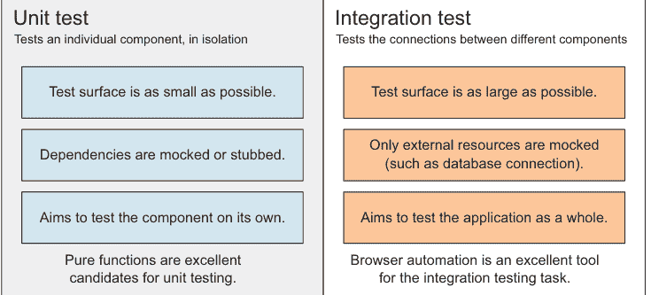

测试被称为*单元测试*。第二常见的测试类型是*集成测试*，它涉及测试组件之间的交互是否按预期工作，关注组件网络如何运作。图 8.1 比较了这两种测试类型。

#### 8.1.6 单元测试

与关注交互的集成测试相反，良好的单元测试积极忽略交互，只关注单个组件在隔离状态下如何工作。此外，良好的单元测试不关心组件的实现细节；它们只关注组件的公共 API。这意味着良好的单元测试可以作为组件预期如何工作的示例来阅读。尽管不理想，但有时当一个包的文档不足时，单元测试是次优选择。

良好的单元测试通常遵循"准备-执行-断言"（AAA）模式，在单元测试中创建依赖的模拟版本，并监视方法以确保它们被调用。以下小节探讨这些概念。在你到达 8.3 节之前，你将经历真实的单元测试案例场景。

AAA 模式可以帮助你开发简洁且有条理的单元测试。它将构建单元测试分为三个阶段：

- **准备：** 你创建测试所需的一切实例。
- **执行：** 你执行测试并跟踪其结果。
- **断言：** 你验证结果是否与预期输出匹配。

遵循这些简单的步骤，在浏览单元测试时很容易找到你的位置。断言用于验证，例如，`typeof {}` 的结果是否匹配 `object`。注意，当这些步骤可以简化为一条可读的语句时，你应该这样做。

#### 8.1.7 便利优先于约定

一些纯粹主义者会告诉你每个单元测试只能有一个断言。我建议你保持务实，允许自己在同一个测试中写几个断言，只要它们测试的是同一个特定功能。这样做不会有什么坏处，因为测试框架（在你的情况下是 Tape）会确切地告诉你哪个测试中的哪个断言失败了。每个测试使用单个断言通常会导致大量的代码重复和令人沮丧的测试会话。

#### 8.1.8 案例研究：为事件发射器编写单元测试

让我们针对 emitter 方法编写测试，该方法增强对象，使它们能够发送和监听事件，我们在第 6 章中看到过。这应该能让你很好地了解真实的单元测试可能是什么样子。以下清单（在示例中以 ch08/03_arrange-act-assert 提供）展示了完整方法的全部细节。这与你在 6.4.2 节中实现的事件发射器方法相同。

##### 清单 8.3 你的事件发射器实现

```
function emitter (thing) {
  var events = {};

  if (!thing) {
    thing = {};
  }

  thing.on = function (type, listener) {
    if (!events[type]) {
      events[type] = [listener];
    } else {
      events[type].push(listener);
    }
  };

  thing.emit = function (type) {
    var evt = events[type];
    if (!evt) {
      return;
    }
    var args = Array.prototype.slice.call(arguments, 1);
    for (var i = 0; i < evt.length; i++) {
      evt[i].apply(thing, args);
    }
  };

  return thing;
}
```

如何测试所有这些？它相当庞大！跟我念：针对接口测试。其余的不太重要。你要确保，给定正确的参数，每个公共 API 方法都按你预期的那样工作。对于 emitter 函数，API 包括 emitter 函数本身、`on`


[content]
method, and the `emit` method. The API is anything that can be accessed by the consumer, which is what you want to verify.

You can think of writing good unit tests as asserting the right things. The assertions your tests will verify should be deterministic, and they should also disregard implementation details, such as how the event listeners are stored. Private methods are typically implementation details, and you shouldn't worry about testing them; only the public interface matters. If you want to test private methods, you'll have to expose them so that they can be unit tested like any other public interface method.

#### 8.1.9 Testing the event emitter

To get things going, let's start with a test asserting whether calling `emitter` with different arguments results in an emitter object. This is a basic test in which you'll verify that an object is returned with the expected properties (`on` and `emit`) on it.

```
Listing 8.4 Your first test using TAPE

var test = require('tape');
var emitter = require('../src/emitter.js');

test('emitter(thing) should always return an emitter', function (t) {
  // Act
  isEmitter(emitter());
  isEmitter(emitter({}));
  isEmitter(emitter([]));

  function isEmitter (thing) {
    // Assert
    t.ok(thing, 'should be truthy');
    t.ok(thing.on, 'should have on property');
    t.ok(thing.emit, 'should have emit property');
  }

  t.end();
});
```

It's always good to have unit tests that assert the basics of how something is expected to operate. Keep in mind that you only need to write these tests once, and they'll help you assert these validations anytime. Let's write a few more basic assertions in the following listing, making sure the returned object is indeed the same object you provided.

```
Listing 8.5 Writing basic assertions

test('emitter(thing) should reference the same object', function (t) {
  var data = { a: 1 };          // Arrange
  var thing = emitter(data);    // Act
  t.equal(data, thing);         // Assert
  t.end();
});
```

```
test('emitter(thing) should reference the same array', function (t) {
  var data = [1, 2];         // Arrange
  var thing = emitter(data); // Act
  t.equal(data, thing);      // Assert
  t.end();
});
```

In the "basic JavaScript unit test" department, you'll sometimes find tests asserting whether something that's supposed to be a function is indeed a function. Although it's true that any other test would fail if `emitter` wasn't a function, redundancy is a good thing to have when it comes to unit testing. In addition, your tests should fail at assertions rather than while arranging or acting. If your tests fail somewhere else, it might indicate it's time to add more tests to assert that doesn't happen, or maybe the problem lies with your code.

Testing for object types might seem trivial, but it can pay off. Even more important is testing return value types. The first test you wrote made sure the properties were there, but it didn't check if they were functions. Let's rework it, adding type checks. These will seem like trivial changes, but you want to be explicit about the purposes of an assertion, for clarity.

##### Listing 8.6 Type checking in your tests

```
test('emitter(thing) should be a function', function (t) {
  t.ok(emitter, 'should be truthy');
  t.ok(typeof emitter === 'function', 'should be a method');
  t.end();
});
```

Test for function type rather than truthy values.

```
test('emitter(thing) should always return an object', function (t) {
  // Act
  isEmitter(emitter());
  isEmitter(emitter({}));
  isEmitter(emitter([]));

  function isEmitter (thing) {
    // Assert
    t.ok(thing, 'should be truthy');
    t.ok(typeof thing.on === 'function', 'should have on method');
    t.ok(typeof thing.emit === 'function', 'should have emit method');
  }

  t.end();
});
```

#### 8.1.10 Testing for the .on method

Next we'll write tests for the .on method. This time around, we'll be content if calling .on does not throw. In a bit, we'll make sure that the listeners work when we test the emit method. Note how I wrote two different tests which are almost identical, even though they have different purposes. In testing, it's fairly common to find duplicate code, and it's fine to copy and paste, although it's not encouraged to abuse it.

```
Listing 8.7 Testing the .on function

test('on(type, listener) should attach an event listener', function (t) {
  // Arrange
  var thing = emitter();

  function listener () {}

  // Assert
  t.doesNotThrow(function () {
    // Act
    thing.on('foo', listener);
  });
  t.end();
});

test('on(type, listener) should attach many event listeners to the same
    event', function (t) {
  // Arrange
  var thing = emitter();

  function listener () {}

  // Assert
  t.doesNotThrow(function () {
    // Act
    thing.on('foo', listener);
    thing.on('foo', listener);
    thing.on('foo', listener);
  });
  t.end();
});
```

In this case, make sure thing.on doesn't throw.

Multiple calls to .on shouldn't throw either.

Last, you need to test the `emit` function. To do that, you'll attach a few listeners, as before, and then you'll emit the event. Then you'll assert that the listeners fired correctly, once for each call to `.on`. Notice how if you changed `emit` to be asynchronous by wrapping the event handlers in a `setTimeout` call, this test would fail. In those cases, you can either adapt the test to the new functionality or avoid changing the functionality in the first place.

```
Listing 8.8 Testing the .emit function

test('emit(type) should emit to the event listeners', function (t) {
  // Arrange
  var thing = emitter();
  var listens = 0;

  function listener () {
    listens++;
  }

  // Act
  thing.on('foo', listener);
  thing.on('foo', listener);
  thing.emit('foo');

  // Assert
  t.equal(listens, 2);
  t.end();
});
```

Note that steps are cleanly separated into Arrange, Act, Assert. Do that in your testing.

> Sometimes counting how many times a function was invoked is sufficient.

Finally, let's add one more method to make sure that `emit` passes any arguments to the event listener the way we expect.

##### Listing 8.9 Further testing on .emit

```
test('emit(type) should pass params to event listeners', function (t) {
  // Arrange
  var thing = emitter();
  var listens = 0;

  function listener (context, value) {
    t.equal(arguments.length, 2);
    t.equal(context, thing);
    t.equal(value, 3);
    listens++;
  }

  // Act
  thing.on('foo', listener);
  thing.on('foo', listener);
  thing.emit('foo', thing, 3);

  // Assert
  t.equal(listens, 2);
  t.end();
});
```

> Making sure you get exactly what you expect, but nothing more

That's it! Your event emitter implementation is fully tested. You only wrote assertions that verify how the public API works, and you didn't meddle with implementation details. At this point, you could add tests that deal with unconventional usage of the API, such as calling `emit()` without any arguments. Then you could decide whether you'd want `emit` to throw an exception in that particular case. Think of your tests as a formal and stricter API documentation.

In the following section you'll learn about creating mocks, spying on function calls, and proxying `require` statements.

#### 8.1.11 Mocks, spies, and proxies

Sometimes you want greater isolation, even though two parts of an application can't be decoupled any further. The application might need to query a real database, fetch data using a service, or connect together different modules, or there may be some other reason why you can't decouple the implementation. You can use a variety of different tools, such as mocks, spies, and proxies, to circumvent the testing issues introduced by tight coupling. Figure 8.2 depicts the issue and the solution provided by these stubs.

Next up you'll learn about mocking dependencies, which can come in handy if you're working with a component that has external dependencies.

#### 8.1.12 Mocking

*Mocking* creates fake instances of the dependencies (such as services or other objects) in your System Under Test (SUT). In statically typed languages, mocking often involves access to the compiler, often referred to as Reflection. One of the advantages of JavaScript being a dynamically-typed language is that you can create an object with a couple of properties and that's it. Suppose you have to test the following snippet of code:

```
function (http, done) {
  http.get('/api/data', done);
}
```

In a real application, maybe that snippet accessed the network and queried an endpoint, getting back data from the application's API. You should never need to connect to external services to run a unit test, making this an ideal scenario for mocking. In this case in particular, you're making a GET request and calling back a done function with an optional error and data in return.

Mocking the http object using plain JavaScript, as it turns out, is easy. Note how you're using setTimeout to keep the method asynchronous, the way the original code expected, and how you can conjure up any response you like to fit your test:

```
{
  get: function (endpoint, done) {
    setTimeout(function () {
      done(null, { data: 'dummy' });
    }, 0);
  }
}
```


该测试的服务器端部分，即查询真实 HTTP 端点，应该在服务器测试中处理，而这不再是客户端需要关心的事。另一个选择是在集成测试中处理这些内容，这是本章稍后将要探讨的话题。接下来我将介绍 Sinon.js。Sinon 是一个用于创建 mock、spy 和 stub 的库。它还允许你伪造 XHR 请求、服务器响应和定时器。让我们来看看它。

#### 8.1.13 Sinon.js 简介

有时手动模拟值是不够的，在那些更高级的场景中，使用像 Sinon.js 这样的库可能会派上用场。Sinon 帮助你轻松测试 `setTimeout` 延迟、日期、XHR 请求，甚至设置假的 HTTP 服务器用于测试中。使用 Sinon，创建被称为 *spy* 的函数是轻而易举的事。*Spy* 是那些准备告诉你它们是否被调用过、被调用了多少次以及调用时传入了什么参数的函数。事实证明，你已经在代码清单 8.9 中使用了一种自定义风格的 spy，在那里我们有一个 `listener` 函数来跟踪它被调用了多少次。让我们看看使用 spy 如何帮助断言函数调用。

#### 8.1.14 监视函数调用

每当被测函数需要函数参数时，都可以使用 spy，你可以用它们来轻松断言这些参数是否被使用以及如何使用。

我们来看一个简单的例子（位于 ch08/04_spying-on-function-calls）。这是一对接收回调函数参数的函数：

```
var maxwell = {
  immediate: function (cb) {
    cb('foo', 'bar');
  },
  debounce: function (cb) {
    setTimeout(cb, 0);
  }
};
```

Sinon 使测试这些变得简单。无需构造自定义回调，你就可以确保 `immediate` 精确地调用了一次你的回调：

```
test('maxwell.immediate invokes a callback immediately', function (t) {
  var cb = sinon.spy();

  maxwell.immediate(cb);

  t.plan(2);
  t.ok(cb.calledOnce, 'called once');
  t.ok(cb.calledWith('foo', 'bar'), 'arguments match expectation');
});
```

注意我是如何从 `t.end` 切换到 `t.plan` 的。使用 `t.plan(n)` 允许你定义在测试用例执行期间期望进行的断言数量。如果断言数量不完全匹配，测试将失败。这在异步测试中最有用，因为你的代码可能最终会在某个回调中调用更多断言，也可能不会。使用 `t.plan` 可以验证正确数量的断言确实被执行了。

测试延迟执行有点棘手，但 Sinon 为此提供了一个易于使用的接口，如下面的清单所示。通过调用 `sinon.useFakeTimers()`，任何后续对 `setTimeout` 或 `setInterval` 的调用都将被伪造。你还可以获得一个简单的 `tick` API 来手动调整时钟。

##### 代码清单 8.10 测试延迟执行

```
test('maxwell.debounce invokes a callback after a timeout', function (t) {
  var clock = sinon.useFakeTimers();
  var cb = sinon.spy();

  maxwell.debounce(cb);

  t.plan(2);
  t.ok(cb.notCalled, 'not called before tick');
  clock.tick(0);
  t.ok(cb.called, 'called after tick');
});
```

Sinon.js 还有更多你可以使用的技巧，比如创建假的 XHR 请求。关于 mocking，我想讨论的最后一个话题是，当你需要对调用 `require`  hash 任何给定模块时返回的结果创建 mock 的情况。让我们看看它是如何工作的！

#### 8.1.15 代理 require 调用

这里的问题是，有时模块会 `require` 其他模块，而这些模块又会 `require` 额外的模块，你不希望在单元测试中包含所有这些。单元测试是关于控制环境，检测执行测试绝对必要的部分，并 mock 其他所有内容。有一个很好的 npm 包叫 `proxyquire`，可以帮助解决这种情况。假设你想测试下面代码清单中的代码（在示例中作为 ch08/05_proxying-your-dependencies 提供），其中你想从数据库中获取一个用户，然后出于安全原因返回该模型的一个子集。

##### 代码清单 8.11 使用 require 方法

```
var User = require('../models/User.js');

module.exports = function (id, done) {
  User.findOne({ id: id }, function (err, user) {
    if (err || !user) {
      done(err); return;
    }
    done(null, {
      name: user.name,
      email: user.email
    })
  });
};
```

让我们先考虑一个小重构。最好总是将"纯粹"的功能隔离出来。*纯函数*是一个来自函数式编程的概念，它描述的是一个函数的输出仅由其输入决定，不受其他任何因素影响。纯函数在每次收到相同输入时返回相同的值。在上面的例子中，你的纯且可复用的功能是将用户模型映射到其"安全"子集，所以让我们把它提取到自己的函数中，让你的代码更美观、更容易理解。

##### 代码清单 8.12 创建纯函数

```
var User = require('./models/User.js');

function subset (user) {
  return {
    name: user.name,
    email: user.email
  };
}

module.exports = function (id, done) {
  User.findOne({ id: id }, function (err, user) {
    done(err, user ? subset(user) : null);
  });
};
```

如你所见，除非你单独暴露 `subset` 函数，否则你只能通过查询数据库来获取用户。你可能会认为该模块应该接收一个 `user` 对象，而不仅仅是 `id`，你说得对。然而，有时你必须查询数据库。也许你有 `user` 参数并对其进行某些操作，但你还想向数据库查询他的权限或所属的组。在这些情况下，以及在前面的情况下，假设你不再进一步重构，一个很好的变通方法是让 `require` 调用返回假的结果。

好消息是，使用 `proxyquire` 意味着你根本不需要改变应用程序代码。下面的代码清单演示了如何使用 `proxyquire` 来模拟一个所需的模块，而完全不需要用到数据库。请注意传递给 `proxyquire` 的 mock 对象是一个 `require` 路径和期望获得的结果的映射（而不是你通常会得到的）。

##### 代码清单 8.13 模拟所需的模块

```
var proxyquire = require('proxyquire');

var user = {
  id: 123,
  name: 'Marian',
  email: 'marian@company.com'
};
```

##### 代码清单 8.14 使用 Sinon 创建 spy

```
var test = require('tape');
var sinon = require('sinon');

test('user mapper returns a subset of user', function (t) {
  // Arrange
  var clock = sinon.useFakeTimers();
  var cb = sinon.spy();

  // Act
  mapper(123, cb);
  clock.tick(0);
  var result = cb.args[0][1];
  var actual = Object.keys(result).sort();
  var expected = ['name', 'email'].sort();

  // Assert
  t.plan(2);
  t.ok(cb.calledOnce);
  t.deepEqual(actual, expected);
});
```

此调用将触发任何延迟为 0 毫秒的 setTimeout 函数。

在下一节中，我将更深入地探讨客户端测试，讨论假的 XHR（XMLHttpRequest）。在查看其他形式的自动化以及提及非单元测试类型之前，你还将了解 DOM 交互测试。

### 8.2 在浏览器中测试

测试客户端代码通常很麻烦，因为既涉及 AJAX 请求又涉及 DOM 交互。再加上完全缺乏模块化和代码组织，这对客户端 JavaScript 测试开发者来说就是一场混乱。话虽如此，在第 5 章中，你通过选择 Browserify 解决了浏览器模块化的问题。Browserify 允许你在客户端代码中使用自包含的 CommonJS 模块，但代价是额外的构 build 步骤。

```
var mapperMock = {
  './models/User.js': {
    findOne: function (query, done) {
      setTimeout(done.bind(null, null, user));
    }
  }
};

var mapper = proxyquire('../src/mapper.js', mapperMock);
```

一旦你将映射功能与数据库连接隔离，测试就变得轻而易举。你正在使用带有假数据库访问的 `mapper` 函数，并断言它是否返回一个包含 `name` 和 `email` 属性的对象。请注意，你正在使用 Sinon 的 `cb.args` 来找出 `cb` spy 第一次被调用时的参数。


你通过在客户端采用 MVC 框架来解决代码组织问题，从而实现关注点的合理分离。在第 9 章中，你将学习 REST API 设计，这将应用于你编写的未来 Web 应用程序中，从而摆脱通常困扰前端应用开发的端点混乱问题。

在下一节中，你将学习如何通过模拟 XHR 请求和隔离 DOM 交互来为客户端代码编写测试，以便针对它编写测试用例。让我们从简单的部分开始：模拟 XHR 请求和服务器响应。

#### 8.2.1 伪造 XHR 和服务器通信

与使用 `proxyquire` 创建假 `require` 结果的方式类似，你可以使用 Sinon 来模拟任何你想要的 XHR 请求，而无需修改源代码。使用 Sinon 来模拟服务器响应并窥探请求数据。这些就是你需要处理 XHR 的全部原因。图 8.3 展示了这些模拟如何帮助你隔离和测试那些通常依赖外部资源的代码。

来看看代码中这是什么样子的，下面是一段发出 HTTP 请求并返回响应文本的客户端 JavaScript 代码片段（参见示例 ch08/06_fake-xhr-requests）。我使用 `superagent` 模块来发送 HTTP 请求，因为它在服务器端和浏览器端都能无缝工作。非常适合 Browserify 场景！

```
module.exports = function (done) {
  require('superagent')
    .get('https://api.github.com/zen')
    .end(cb);

  function cb (err, res) {
    done(null, res.text);
  }
};
```

在这种情况下，你不需要为 `superagent` 本身编写测试。你也不需要测试 API 调用。不过你可能想确保 AJAX 调用确实被执行了。

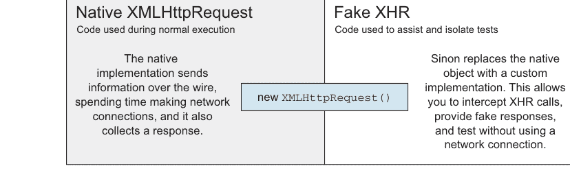

该方法应该用响应文本来回调你，所以你也应该对此进行测试，如以下清单所示。

##### 清单 8.15 创建一个发送响应文本的方法

```
var test = require('tape');
var sinon = require('sinon');

test('qotd service should make an XHR call', function (t) {
  var quote = require('../src/qotdService.js');
  var cb = sinon.spy();

  quote(cb);

  t.plan(2);

  setTimeout(function () {
    t.ok(cb.called);
    t.ok(cb.calledWith(null, sinon.match.string));
  }, 2000);
});
```

这样测试结果是可以的，但你不能让测试依赖于网络条件，也不能花那么长时间等待断言。测试该方法的正确方式是模拟响应。Sinon 允许你通过创建一个假服务器来实现这一点，这提供了双重价值。它捕获你的代码发出的真实请求，并将其转换为它控制的可测试对象。它还允许你在测试中为这些请求创建响应，模拟一个运行中的服务器。要获得该功能，在调用被测方法之前使用 `sinon.fakeServer.create()` 创建假服务器。然后，一旦调用了应该创建 AJAX 请求的方法，你就可以响应请求，设置响应的状态码、响应头和响应体。让我们更新测试方法来反映这些更改。

##### 清单 8.16 测试"每日一言"服务

```
test('qotd service should make an XHR call', function (t) {
  var quote = require('../src/qotdService.js');
  var cb = sinon.spy();

  var server = sinon.fakeServer.create();
  var headers = { 'Content-Type': 'text/html' };

  quote(cb);

  t.plan(4);
  t.equals(server.requests.length, 1);
  t.ok(cb.notCalled);

  server.requests[0].respond(200, headers, 'The cake is a lie.');

  t.ok(cb.called);
  t.ok(cb.calledWith(null, 'The cake is a lie.'));
});
```

如你所见，你验证了只发出了一个请求，并且回调时收到的值与响应文本完全一致。

在进入自动化测试领域之前，浏览器测试还有最后一个方面值得尝试，那就是 DOM 交互测试。与测试 AJAX 调用类似，DOM 测试很复杂，因为你是在与一个跨层的东西交互。注意这个鸿沟。

#### 8.2.2 案例研究：测试 DOM 交互

客户端开发和测试在这方面很有趣。你有三层：HTML、JavaScript 和 CSS，它们协同工作来提供精心调制的比特盛宴。然而，正如任何优秀的开发者所做的那样，你必须在这三种技术之间保持关注点分离，避免将它们过度紧密地耦合在一起。CSS 很容易保持松耦合。你在 CSS 中创建类，并通过给 DOM 元素添加匹配的 `class` 属性来分配它们。当 CSS 对 HTML 结构做出假设时，它就开始失控了。最好的 CSS 是那些不依赖 HTML 必须以特定方式组织的 CSS，那些不与 HTML 紧密耦合的 CSS。

JavaScript 和 HTML 的关系类似于 CSS 和 HTML，你的 HTML 不应该对 JavaScript 做出任何假设。即使禁用 JavaScript，HTML 也应该能正常工作；这被称为渐进增强，它有助于更快地将主要内容传递给用户，从而带来更好的整体体验。问题在于你的 JavaScript 代码必须对 HTML 做出假设。查找 DOM 节点的内部文本、附加事件监听器、读取数据属性、设置属性或任何形式的 DOM 操作，都以 DOM 节点存在为前提。

让我们进入你的虚构应用——一个事件来狂欢、小数被四舍五入的地方。

##### 搭建 HTML

在这个应用中，你有一个输入框用于输入小数，然后点击按钮获得该数字的四舍五入版本。每个结果都被写入页面上显示的列表中。还有一个按钮用于清除结果列表。图 8.4 展示了该应用的外观。

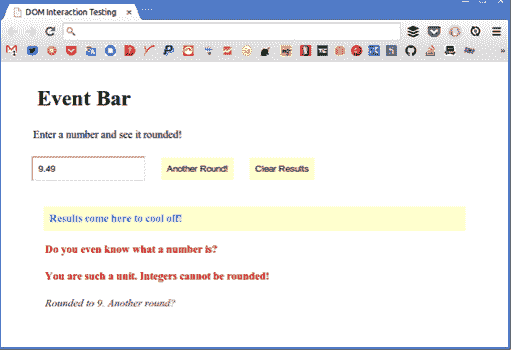

**图 8.4** 你将在本案例研究中构建的应用

我们将首先介绍该应用，并解释沿途做出的选择。然后，我将向你展示在这个小应用中应该测试什么，以及如何在不关心实现细节的情况下获得这些方面的测试覆盖。

请看以下 HTML 代码。注意你没有在 DOM 中直接编写任何 JavaScript。保持关注点分离对于可测试性至关重要：

```
<h1>Event Bar</h1>
<p>Enter a number and see it rounded!</p>
<input class='square' placeholder='Decimals only please.' />
<button class='barman'>Another Round!</button>
<button class='clear'>Clear Results</button>
<div class='result'>
    <h4>Results come here to cool off!</h4>
</div>
```

接下来你将学习如何实现 JavaScript 功能。

##### 实现 JavaScript 功能

接下来我们将讨论一个小的 JavaScript 应用，它通过 JavaScript DOM API 与上一个示例中展示的 HTML 进行交互。首先，你将使用 `querySelector`——一个（相对）鲜为人知但功能强大的原生浏览器 API，它允许你以类似 jQuery 的方式使用 CSS 选择器来查找 DOM 节点。`querySelector` 在所有主流浏览器中都受支持，最早可追溯到 Internet Explorer 8。该 API 存在于文档根节点以及任何 DOM 节点上，允许你将搜索限制在其子节点范围内。如果你想查找多个元素而不是第一个，可以使用 `querySelectorAll`。

```
var barman = document.querySelector('.barman');
var square = document.querySelector('.square');
var result = document.querySelector('.result');
var clear = document.querySelector('.clear');
```

> 注意 我从不在 HTML 中使用 `id` 属性。它会导致各种问题，例如 CSS 选择器优先级问题，导致开发者使用 `!important` 样式规则，而且无法复用该值，因为 HTML 的 `id` 属性必须是唯一的。

让我们实现负责处理输入的代码。如果不是数字，那就是个错误。如果是整数，那也是个问题。否则，你将返回四舍五入后的值：

```
function rounding (number, done) {
    if (isNaN(number)) {
        done(new Error('Do you even know what a number is?'));
    } else if (number === Math.round(number)) {
        done(new Error('You are such a unit. Integers cannot be rounded!'));
    } else {
        done(null, Math.round(number));
    }
}
```


done 回调应当在你的结果列表中创建一个新的段落，如果存在错误消息则填入错误消息，如果存在值则填入舍入后的值。当遇到错误时你还需要设置一个不同的 CSS 类，与成功时区分开，以便设计师能够据此对页面进行样式设计，而无需你额外修改 JavaScript，如下所示清单。

##### 清单 8.17 使用 done 回调

```
function report (err, value) {
  var p = document.createElement('p');

  if (err) {
    p.className = 'error';
    p.innerText = err.message;
  } else {
    p.className = 'rounded';
    p.innerText = 'Rounded to ' + value + '. Another round?';
  }
  result.appendChild(p);
}
```

这场拼图的最后一块是绑定点击事件并在将输入交给你在清单 8.17 中组合的两个方法之前解析输入。以下代码片段即可做到：

```
barman.addEventListener(click, round);

function round () {
  var number = parseFloat(square.value);
  rounding(number, report);
}
```

连接重置按钮甚至更加简单。你的监听器应该移除由 barman 创建的每个段落；这就是最直截了当的做法！以下清单展示了你可能如何实现。

##### 清单 8.18 连接重置按钮

```
clear.addEventListener(click, reset);

function reset () {
  var all = result.querySelectorAll('.result p');
  var i = all.length;

  while (i--) {
    result.removeChild(all[i]);
  }
}
```

就是这样；你的应用程序已全面运行。如何确保未来的重构不会破坏现有代码？你需要识别出确保代码按预期工作的测试，然后编写这些测试。

##### 确定测试用例

首先，让我岔开话题提一下，你需要完全忽略本案例研究开头的 HTML。你不应该在测试中编写任何 HTML。如果需要 DOM，你应该在测试中用 JavaScript 构建它。当你实现测试时，你会发现这甚至比写 HTML 还简单。分离关注点是最重要的单元测试方面之一。

接下来，你应该尝试识别应用程序的关注点，并将它们与实现细节区分开来。为了本次实验的目的，将你之前写的所有内容都视为实现细节，因为你的应用程序没有提供 API，甚至没有构建任何面向公众的某种对象。当实现中的所有内容都是实现细节时，你仍然可以进行单元测试，但需要针对应用程序应该做什么来进行测试，而不是针对每个方法应该做什么。

测试用例应当断言你在前面呈现的应用程序定义中找到的陈述在针对其实现进行检查时成立，这里引用如下。

##### 应用程序定义

在此应用程序中，你有一个输入框，在其中输入十进制数字，然后点击按钮以获得该数字的舍入版本。每个结果都被写入显示在页面上的列表中。还有另一个按钮用于清除结果列表。

以下列表中记录了若干测试用例。这些是从引用的定义和实现中施加的其他逻辑约束（你希望能将其变成定义的一部分）推导出来的。请记住，你可以准备任何你想要的测试用例，只要它们满足定义即可。这些是我设计的：

- 没有任何输入时点击 barman 应该导致一条错误消息。
- 输入整数时点击 barman 应该导致一条错误消息。
- 输入数字时点击 barman 应该导致一个舍入后的数字。
- 用两个值点击 barman 两次应该产生两个结果。
- 列表为空时点击 clear 不会抛出异常。
- 点击 clear 会移除列表中的任何结果。

让我们开始测试。我前面提到过你将在每个测试中用代码创建 DOM。你将通过创建一个在每个测试之前调用的 Setup 任务，以及一个在每个测试之后调用的 Teardown 任务来实现这一点。Setup 将创建元素。Teardown 将移除它们。这使得每个测试都能获得一个干净的状态，即使其他测试已经运行过了。

##### 设置与拆卸

大多数 JavaScript 测试框架，出于令人困惑的原因，会在你的测试程序中包含全局变量。例如，如果你想在使用 Mocha 测试框架时（Buster.js 和 Jasmine 也这样做）在每个测试之前运行一个任务，你需要将回调函数传递给 `beforeEach` 全局方法。事实上，测试用例应该用其他全局变量描述，例如 `describe` 和 `it`，如下所示清单。

##### 清单 8.19 使用 describe 描述测试用例

```
function setup () {
  // prepare something
}

describe('foo()', function () {
  beforeEach(setup);

  it('should not throw', function () {
    assert.doesNotThrow(function () {
      foo();
    });
  });
});
```

这太糟糕了！即使是测试中，不加区分地使用全局变量也不应该成为常态。幸运的是，`tape` 不屈服于这种无稽之谈，而且在每个测试之前运行某些内容仍然很容易。以下清单展示了同一段代码，改用 `tape`。

##### 清单 8.20 使用 tape 描述测试用例

```
var test = require('tape');

function testCase (name, cb) {
  var t = test(name, cb);
  t.once('prerun', setup);
}

function setup () {
  // prepare something
}

testCase('foo() should not throw', function (t) {
  assert.doesNotThrow(function () {
    foo();
  });
});
```

诚然，它看起来更加冗长，但它不会污染全局命名空间，打破了一个最古老的约定。在 `tape` 中，测试会发出事件，例如 `prerun`，在测试运行的不同阶段。为了设置和拆卸我们的测试，你需要创建并使用一个 `testCase` 方法。名称无关紧要，但我觉得 `testCase` 在这种情况下非常适用：

```
function testCase (name, cb) {
  var t = test(name, cb);
  t.once('prerun', setup);
  t.once('end', teardown);
}
```

现在你知道如何在每个测试之前运行这些方法了，是时候编写它们了！

##### 准备测试工具

在 `setup` 方法中，你需要创建测试中需要的每个 DOM 元素，并设置通过 HTML 提供的任何默认值。请注意，测试 HTML 本身并不属于这些测试的一部分，这就是为什么你完全忽略它。你的关注点是，假设 HTML 是你所期望的，应用程序将成功运行。测试 HTML 是集成测试的关注点。

`setup` 方法见于以下清单。`bar` 模块是你的应用程序代码，包装在一个函数中，以便你可以在任何时候执行它。在这种情况下，你需要在每个测试之前运行应用程序。这会将事件监听器附加到你刚刚创建的 DOM 元素上。

##### 清单 8.21 使用 setup 方法

```
var bar = require('../src/event-bar.js');

function setup () {
  function add (type, className) {
    var element = document.createElement(type);
    element.className = className;
    document.body.appendChild(element);
  }
  add('input', 'square');
  add('div', 'barman');
  add('div', 'result');
  add('div', 'clear');
  bar();
}
```

`teardown` 方法甚至更加简单，因为你给它几个选择器，然后遍历它们，移除 `setup` 期间创建的元素：

```
function teardown () {
  var selectors = ['.barman', '.square', '.result', '.clear'];
  selectors.forEach(function (selector) {
    var element = document.querySelector(selector);
    element.parentNode.removeChild(element);
  });
}
```

呜呼！开始编写测试。

##### 编写测试用例

只要你在 Arrange、Act 和 Assert 之间保持关注点的清晰分离，编写或阅读测试时就不应该有任何问题。在第一个测试中，你获取 `barman` 元素，点击它，并获取任何结果。你验证有一个结果。然后你断言该结果中的 CSS 类和文本是正确的，如下所示清单。

##### 清单 8.22 断言 CSS 类和文本正确

```
testCase('barman without input should show an error', function (t) {
  // Arrange
  var barman = document.querySelector('.barman');
```


#### 8.3.1 测试视图路由器

在开始任何测试之前，你必须首先配置环境以便测试能够运行。在这种情况下，这意味着你需要复制应用程序（来自 ch07/10_the-road-show）作为起点，然后在本章构建的测试框架基础上添加用于在浏览器中运行 Tape 的内容（ch08/02_tape-in-the-browser 示例）。

一旦初始设置完成（在示例中为 ch08/07b_testability-boulevard），你就可以开始使用 Tape 编写测试了。我们从路由器开始（在第 7 章的清单 7.18 中展示过），因为它是我们要测试的最简单的模块。作为参考，以下清单显示了该模块当前的样态。

```
var Backbone = require('backbone');
var ListView = require('../views/list.js');
var AddItemView = require('../views/addItem.js');

module.exports = Backbone.Router.extend({
  routes: {
    '': 'root',
    'items': 'listItems',
    'items/add': 'addItem'
  },
  root: function () {
    this.navigate('items', { trigger: true });
  },
  listItems: function () {
    new ListView();
  },
  addItem: function () {
    new AddItemView();
  }
});
```

在测试这个模块时，我们想要断言几件事。你想知道：

- 存在三条路由。
- 它们关联的路由处理程序确实存在。
- `root` 路由处理程序正确地重定向到 `listItems` 动作。
- 视图路由在每种情况下都会渲染正确的视图。

你可能已经在憧憬各种可能性了，考虑为视图创建模拟对象，或者也许使用 `proxyquire` 来完全存根这些模块。首先，我们将断言确实注册了三条路由，并且它们的路由处理程序存在于路由器上。

为了实现这一点，以下清单使用了 `proxyquireify`（一种可在客户端工作的 `proxyquire` 变体）结合 `sinon` 和 `tape` 来构建 `routes.js` 测试模块。

##### 清单 8.29 第一批视图路由器测试

```
var proxyquire = require('proxyquireify')(require);
var sinon = require('sinon');
var ListView;
var AddItemView;

function getStubbedRouter () {
  ListView = sinon.spy();
  AddItemView = sinon.spy();
  var ViewRouter = proxyquire('../app/routers/viewRouter.js', {
    '../views/list.js': ListView,
    '../views/addItem.js': AddItemView
  });
  return ViewRouter;
}

test('there are three routes and route handlers', function (t) {
  // Arrange
  var ViewRouter = getStubbedRouter();
  
  // Act
  var router = new ViewRouter();
  
  // Assert
  var routes = Object.keys(router.routes);
  t.equal(routes.length, 3);
```

设置环境以使 proxyquire 在浏览器中工作需要一定的配置。

这个方法使用了 sinon 和 proxyquire 的组合来存根视图模块，因为我们只关心测试视图路由器，而不是视图本身。

我们使用从路由器到每个视图的相对路径。

获取视图路由器的一个存根实例。

断言恰好存在三个路由处理程序。

---

### 8.3 案例研究：对 MVC 购物清单进行单元测试

在第 7 章中，我们在开发 MVC 购物清单应用程序时达到了不少里程碑，在本节中，我们将对该应用程序的其中一个迭代版本进行单元测试。具体而言，你将与我一起对 7.4 节末尾的应用程序进行单元测试，正是在 7.5 节中添加 Rendr 之前的那个版本。你可以在示例的 ch07/10_the-road-show 中查看该应用程序的源代码。其经过单元测试的对应版本位于 ch08/07b_testability-boulevard。

The Road Show 是一个小型的应用程序，但足以展示如何逐步为应用程序添加测试，最终获得一个测试良好的应用程序。如果我们没有努力将应用程序模块化，这种渐进式的测试方法将会困难得多，但我们在第 5 章学会了这样做，并在第 7 章构建应用程序时应用了这些概念。本节将引导我们编写视图路由器和模型验证的测试。然后你可以自由探索为视图控制器添加测试覆盖率。

### 测试可能的结果

我们的思维方式是被某种方式设定的，我们相信三种可能的结果：某物要么永远不工作，要么工作一次，要么始终工作。我经常开玩笑说只有三个数字存在：0、1 和无穷大。如以下清单所示，断言两次点击按预期工作应该就足够了。你总是可以回头添加更多测试。

#### 清单 8.25 确保两次点击有效

```
testCase('two inputs should produce two results', function (t)
// Arrange
var barman = document.querySelector('.barman');
var square = document.querySelector('.square');
var value = 2.4;
var result;

// Act
square.value = value.toString();
barman.click();
square.value = '3';
barman.click();
result = document.querySelectorAll('.result p');

// Assert
t.plan(6);
t.ok(barman);
t.equal(result.length, 2);
t.equal(result[0].className, 'rounded');
t.equal(result[0].innerText, 'Rounded to ' + Math.round(value));
t.equal(result[1].className, 'error');
t.equal(result[1].innerText, 'Integers cannot be rounded!');
});
```

在开发代码时，你可能会发现你的代码抛出错误，降低你的生产力。诸如以下清单所示的简单测试——断言方法调用不会抛出错误——在这些情况下很有帮助。下一节将讨论自动化测试，这肯定也有所帮助。

#### 清单 8.26 断言方法调用不会抛出错误

```
testCase('clearing empty list does not throw', function (t) {
  // Arrange
  var clear = document.querySelector('.clear');

  // Assert
  t.plan(2);
  t.ok(clear);
  t.doesNotThrow(function () {
    clear.click();
  });
});
```

你那个令人尴尬的小型测试套件中的最后一个测试接近于集成测试。它重复点击，然后断言点击 Clear 按钮确实会移除累积的结果。

#### 清单 8.27 验证 Clear 按钮有效

```
testCase('clicking clear removes any results in the list', function (t) {
  // Arrange
  var barman = document.querySelector('.barman');
  var square = document.querySelector('.square');
  var clear = document.querySelector('.clear');
  var result;
  var resultCleared;

  // Act
  square.value = '3.4';
  barman.click();
  square.value = '3';
  barman.click();
  square.value = '';
  barman.click();
  result = document.querySelectorAll('.result p');
  clear.click();
  resultCleared = document.querySelectorAll('.result p');

  // Assert
  t.plan(2);
  t.equal(result.length, 3);
  t.equal(resultCleared.length, 0);
});
```

测试的最大价值总是在重构时体现。假设你更改了 Event Bar 程序的实现。你再次运行测试。如果它们成功了，一切都好，除非你在手动测试时发现了一个 bug，在这种情况下，你添加更多测试并修复问题。如果它们失败了，存在两种可能性。测试现在可能已过时。例如，Clear 按钮可能在点击时被更改为"仅移除最旧的结果"。在这种情况下，你应该更新测试以反映这些更改。测试失败的另一个原因可能是你的更改中存在疏忽，这会破坏功能。这些测试可以永远重复执行，而且无需额外成本，这就是它们如此有价值的原因。

你可以在随附的代码示例中查看所有我展示给你的完整可运行示例，即 ch08/07_dom-interaction-testing。接下来，我们将回到第 7 章中开发的案例研究，并为其添加单元测试。

---

下一个测试也进行错误检查。确保你的错误检查按预期工作与确保快乐路径确实工作同样重要。在以下清单中，你在点击之前还在输入框中设置了一个值。

#### 清单  8.23 对你的代码进行错误检查

```
testCase('barman with an int should show an error', function (t) {
  // Arrange
  var barman = document.querySelector('.barman');
  var square = document.querySelector('.square');
  var result;

  // Act
  square.value = '2';
  barman.click();
  result = document.querySelectorAll('.result p');

  // Assert
  t.plan(4);
  t.ok(barman);
  t.equal(result.length, 1);
  t.equal(result[0].className, 'error');
  t.equal(result[0].innerText, 'Integers cannot be rounded!');
});
```

> 断言的完整文本是 "You are such a unit. Integers cannot be rounded!"

至此，你应该开始看到模式了。当测试遵循 AAA 约定时，识别每个测试的作用是多么容易？以下清单中的下一个测试验证了快乐路径按预期工作。它将输入设置为小数值并点击按钮，然后检查结果是否为四舍五入的数字。

#### 清单  8.24 验证路径有效

```
testCase('numbers should be rounded', function (t) {
  // Arrange
  var barman = document.querySelector('.barman');
  var square = document.querySelector('.square');
  var value = 2.4;
  var result;

  // Act
  square.value = value.toString();
  barman.click();
  result = document.querySelectorAll('.result p');

  // Assert
  t.plan(4);
  t.ok(barman);
  t.equal(result.length, 1);
  t.equal(result[0].className, 'rounded');
  t.equal(result[0].innerText, 'Rounded to ' + Math.round(value));
});
```

编写以你期望人类与代码交互的方式与代码交互的测试当然是好的。有时人类会做出出乎意料的行为，这也应该被测试到。


routes.forEach(exists);
t.end();

function exists (route) {
  var handlerName = router.routes[route];
  var handler = router[handlerName];
  t.ok(handler, util.format('route handler for "%s" exists', route));
}
});

测试文件准备好后，你可以按照 8.4 节相同流程验证测试是否通过：打开浏览器并加载编译后的测试包，然后检查开发者控制台中是否有任何错误信息。

#### 测试运行器 HTML 文件

首先，你需要一个类似下面的测试运行器 HTML 文件。它没有什么特别之处，只是加载了构建好的测试包：

```html
<!doctype html>
<html>
<head>
  <meta charset='utf-8'>
  <title>使用 Tape 进行 JavaScript 单元测试</title>
</head>
<body>
  <script src='build/test-bundle.js'></script>
</body>
</html>
```

创建好 `routes.js` 测试模块和 `runner.html` 测试运行器之后，你应该创建一个 Grunt 任务来构建包。

#### 创建构建包的 GRUNT 任务

因为你已经学会了如何编写自己的任务，为了巩固这些知识，你将创建自己的任务来编译 Browserify 包！为了实现这一点，你应该在 Gruntfile 中包含以下所有代码。它直接使用 browserify 包，而不通过 grunt-browserify 插件作为中介。有时候直接使用包而不是通过插件，可以为你的任务提供更大的灵活性。

##### 清单 8.30 创建自定义 Browserify 任务

```javascript
var fs = require('fs');
var glob = require('glob');
var mkdirp = require('mkdirp');
var browserify = require('browserify');
var proxyquire = require('proxyquireify');

function browserifyTests () {
  var done = this.async();
  var dir = __dirname + '/test/build';

  mkdirp.sync(dir);
  var bundle = browserify()
    .transform('brfs')
    .plugin(proxyquire.plugin);

  glob
    .sync('./test/*.js')
    .map(resolve)
    .reduce(include, bundle)
    .bundle()
    .pipe(fs.createWriteStream(dir + '/test-bundle.js'))
    .on('done', done);
}

function include (bundle, file) {
  bundle.require(file, { entry: true });
  return bundle;
}

function resolve (file) {
  return require.resolve(file);
}

grunt.registerTask('browserify_tests', browserifyTests);
```

#### 查看测试执行

一切设置完毕后，你可以运行以下命令，并在浏览器中看到测试的执行情况：

```bash
grunt browserify_tests
open test/runner.html
```

应该会弹出一个浏览器窗口。如果我们打开开发者控制台，会看到图 8.5 所示的输出。

还有一些路由测试需要进行。接下来，你将确保每个路由处理程序都能完成其预期功能，无论它是应该将用户重定向到不同的路由，还是渲染特定的视图。

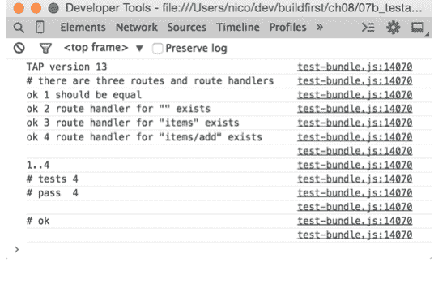

图 8.5 开发者工具显示我们提供的测试的结果

#### 更多测试

下面的清单包含了其余测试的代码。你可以将其添加到 `routes.js` 测试套件的末尾。

##### 清单 8.31 单独测试路由处理程序

```javascript
test('route # redirects to the #items route', function (t) {
  // Arrange
  var ViewRouter = getStubbedRouter();

  // Act
  var router = new ViewRouter();
  var handler = getRouteHandler(router, '');
  router.navigate = sinon.spy(); //C
  handler();

  // Assert
  t.ok(router.navigate.calledOnce, 'called router.navigate');
  t.ok(router.navigate.calledWith('items', { trigger: true }), 'called router.navigate with proper arguments');
  t.end();
});

test('route #items renders ListView', function (t) {
  // Arrange
  var ViewRouter = getStubbedRouter();

  // Act
  var router = new ViewRouter();
  var handler = getRouteHandler(router, 'items');
  handler();

  // Assert
  t.ok(ListView.calledOnce, 'called ListView once');
  t.ok(ListView.calledWithNew(), 'called new ListView()');
  t.end();
});

test('route #items/add renders AddItemView', function (t) {
  // Arrange
  var ViewRouter = getStubbedRouter();

  // Act
  var router = new ViewRouter();
  var handler = getRouteHandler(router, 'items/add');
  handler();

  // Assert
  t.ok(AddItemView.calledOnce, 'called AddItemView once');
  t.ok(AddItemView.calledWithNew(), 'called new AddItemView()');
  t.end();
});
```

> 每个测试都以获取视图路由器的模拟版本开始。

> getRouteHandler 方法返回视图路由的路由处理程序。

> 使用 spy 以便不使用真正的 .navigate 方法。

> 确保路由处理程序调用 .navigate 并将用户重定向到正确的路由。

> 确保路由处理程序调用 ListView 的构造函数。

> 确保路由处理程序调用 AddItemView 的构造函数。

```javascript
function getRouteHandler (router, route) {
  var routeHandler, key, i;
  var routes = Object.keys(router.routes);
  for (i = 0; i < routes.length; i++) {
    key = routes[i];
    if (route === key) {
      routeHandler = router.routes[key];
      return router[routeHandler].bind(router);
    }
  }
}
```

所有测试都放入 routes.js 文件后，你可以再次运行 Grunt 任务并刷新浏览器。图 8.6 展示了执行新测试套件的结果。

虽然我们的路由器测试是最简化的，因为它们断言的内容不多，但我们至少确保了路由存在，并且它们的路由处理程序按预期工作。应用程序中的路由通常是一个汇聚点，配置在此处连接在一起，而测试有助于确保使用了正确的模块。

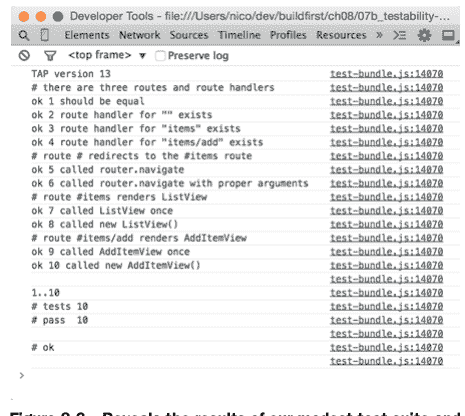

图 8.6 展示了我们精简测试套件及其十个断言的结果

### 8.3.2 测试视图模型上的验证

应用程序还需要用一些不同的输入来测试模型验证，确保模型在某些情况下是无效的，而在满足每个验证条件时是有效的。作为参考，以下清单包含了购物车商品模块的代码。

#### 清单 8.32 测试验证

```javascript
var Backbone = require('backbone');

module.exports = Backbone.Model.extend({
  addToOrder: function (quantity) {
    this.set('quantity', this.get('quantity') + quantity, {
      validate: true
    });
  },
  validate: function (attrs) {
    if (!attrs.name) {
      return 'Please enter the name of the item.';
    }
    if (typeof attrs.quantity !== 'number' || isNaN(attrs.quantity)) {
      return 'The quantity must be numeric!';
    }
    if (attrs.quantity < 1) {
      return 'You should keep your groceries to yourself.';
    }
  }
});
```

验证给我们带来了一个关于 JavaScript 测试的有趣用例。鉴于我们希望为每个可能的验证场景设置测试，我们可以在数组中设置一系列测试用例，然后为每个测试用例创建一个单独的测试。

以下清单展示了一种通过在测试中使用测试用例工厂和一组测试用例来保持 DRY 的方法。为了形成对比，我还加入了一个不属于测试用例数组的测试。

#### 清单 8.33 模型验证测试用例组

该模型仅依赖于 Backbone，不依赖其他模块。这里不需要 proxyquire。

```javascript
var test = require('tape');
var ShoppingItem = require('../app/models/shoppingItem.js');
var cases = [
  ['must be constructed with a name', {}],
  ['must be constructed with a quantity', { name: 'Chocolate' }],
  ['cannot have NaN quantity', { name: 'Chocolate', quantity: NaN }],
  ['cannot have negative quantity', { name: 'Chocolate', quantity: -1 }],
  ['cannot have zero quantity', { name: 'Chocolate', quantity: 0 }],
  ['is valid when both a name and a positive quantity are provided', {
    name: 'Chocolate', quantity: 1
  }, true]
];
```

每个测试用例由描述、模型和预期的验证结果组成。

testCase 工厂为每个测试用例执行。

```javascript
cases.forEach(testCase);
```

每次都会调用 Tape 的 test 方法，创建独立的测试。

```javascript
function testCase (c) {
  test('ShoppingItem ' + c[0], function (t) {
    // Arrange
    var expectation = !c[2]; // t.true or t.false
    var expectationText = ' is ' + (expectation ? 'invalid' : 'valid');

    // Act
    var item = new ShoppingItem(c[1], { validate: true });

    // Assert
    t[expectation](item.validationError, JSON.stringify(c[1]) +
      expectationText);
    t.end();
  });
}
```

测试验证是否通过并与我们的预期相符。

你也可以编写传统的测试！

```javascript
test('consumer can increase quantity of a shoppingItem', function (t) {
```


自动化 Tape 测试
245

```
// Arrange
var item = new ShoppingItem({
  name: 'Chocolate', quantity: 1
}, { validate: true });
// Act
item.addToOrder(4);
// Assert
t.equal(item.validationError, null);
t.equal(item.get('quantity'), 5, 'four items got added to the order');
t.end();
});
```

向订单添加几个商品，稍后验证数量是否已更新。

想象一下，如果你必须为每个测试用例编写一个独立的测试：那将导致大量的复制粘贴，违背了 DRY 原则。

遵循我们在本章讨论的实践，你也可以为视图编写测试。好的测试用例可以包括：

- 确保分配给视图的模板是该视图预期的模板
- 检查事件处理程序是否在 `events` 属性中声明
- 确保这些事件处理程序按预期执行

你可以在调用每个被测方法之前，使用 sinon 来模拟视图中的不同属性。我将这些测试用例留给你作为练习。

当你完成为视图控制器编写测试后，就该将注意力转向更多的自动化了。这次，你将使用 Grunt 自动化 Tape 测试，并且你还将学习如何在远程集成服务器上持续运行这些测试。

### 8.4 自动化 Tape 测试

你在 8.1.4 节中使用 Grunt 自动化了 Browserify 流程。如何将 tape 测试添加到你的 Grunt 构建中？在 Node 上运行测试比在浏览器上执行要容易得多。正如你之前学到的，你可以通过向 Node CLI 提供测试文件路径来在 Node 上运行它们：

```
node test/something.js
```

使用 `grunt-tape` 插件自动化上一段代码所示的过程非常简单。你只需在 Gruntfile 中包含以下代码片段（示例位于 ch08/08_grunt-tape-node）即可在 Grunt 中运行 tape 测试。请注意，你不必运行 Browserify，因为在这种情况下，测试将在 Node 中运行：

```
module.exports = function (grunt) {
  grunt.initConfig({
    tape: {
      files: ['test/something.js']
    }
  });
  grunt.loadNpmTasks('grunt-tape');
  grunt.registerTask('test', ['tape']);
};
```

这很快。那在浏览器中呢？

#### 8.4.1 自动化浏览器端的 Tape 测试

从命令行在浏览器上运行 `tape` 测试也相当容易。你可以使用 `testling` 来完成。Testling（也称为 substack）是 James Halliday 编写的一个工具，他是一位极其多产的 Node 贡献者，也是 Tape 的作者和模块化狂热者。之前并不存在现成的 `grunt-testling` 包，但我决定不让你失望。我创建了 `grunt-testling`，以便你可以从 Grunt 运行 Testling。`grunt-testling` 包不需要任何 Grunt 配置。但你需要配置 `testling` 本身。通过在 `package.json` 中放置一个 `'testling'` 属性并告诉它测试文件的位置来配置 Testling。以下清单（示例位于 ch08/09_grunt-tape-browser）是一个示例 `package.json`：

##### 清单 8.34 自动化 Tape 测试

```
{
  "name": "buildfirst",
  "version": "0.1.0",
  "author": "Nicolas Bevacqua <buildfirst@bevacqua.io>",
  "homepage": "https://github.com/bevacqua/buildfirst",
  "repository": "git://github.com/bevacqua/buildfirst.git",
  "devDependencies": {
    "grunt": "^0.4.4",
    "grunt-contrib-clean": "^0.5.0",
    "grunt-testling": "^1.0.0",
    "tape": "~2.10.2",
    "testling": "^1.6.1"
  },
  "testling": {
    "files": "test/*.js"
  }
}
```

一旦你配置好 `testling`，安装了 `grunt-testling` 并将其添加到你的 Gruntfile，就应该一切就绪了！

```
module.exports = function (grunt) {
  grunt.initConfig({});
  grunt.loadNpmTasks('grunt-testling');
  grunt.registerTask('test', ['testling']);
};
```

你现在可以在终端中输入以下命令在浏览器中运行测试：

```
grunt test
```

图 8.7 显示了将 Testling 与 Grunt 一起使用的结果。

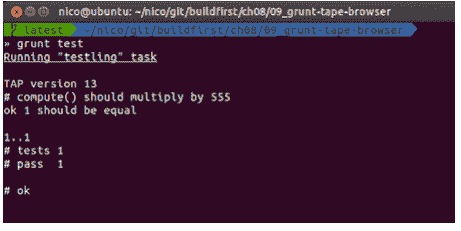

##### 图 8.7 通过 Grunt 驱动 Testling CLI 执行测试

接下来，让我简要重申一个你在第 3 章首次看到的概念：适应测试的持续开发。

#### 8.4.2 持续测试

运行测试的一个重要方面是在每次更改后都进行测试，确保你不会在本地开发环境中长时间使用损坏的代码。你可能还记得第 3 章中的一个特定 `watch` 配置片段，它允许你在检测到代码库中某处的文件更改时运行特定任务。以下清单是该片段的改编版本，用于在文件更改时运行测试和代码检查（lint）。

```
watch: {
  lint: {
    tasks: ['lint'],
    files: ['src/**/*.less']
  },
  unit: {
    tasks: ['test'],
    files: ['src/**/*.js', 'test/**/*.js']
  }
}
```

在 Node 和浏览器中自动化测试都很重要。监视更改并在本地再次运行这些测试也很重要。此时，你可能想再次查看第 4 章第 4.4 节，我在其中讨论了持续集成，这对于设置项目以在每次推送到版本控制系统时执行测试至关重要。

单独测试组件并不是测试应用程序的唯一方式。事实上，存在无数种测试类型，我们将在下一节简要讨论几种有趣的测试。

### 8.5 集成测试、视觉测试和性能测试

正如我之前多次提到的，测试有各种形式。例如，集成测试允许你测试应用程序工作流中的不同路径，确保组件交互按预期工作。组件已经在隔离环境中测试过，而集成测试提供了一个冗余层，并且能够捕获那些在不执行应用程序并亲眼查看的情况下并不明显的缺陷。

#### 8.5.1 集成测试

在工具使用方面，集成测试与单元测试没有区别。你仍然可以使用 Tape、Sinon 和 Proxyquire 来运行这些测试。区别在于应该测试什么。在集成测试中，你不再力求测试一个完全隔离的组件版本，而是测试尽可能多的互连，其余部分则进行模拟。例如，你可能运行应用程序的 Web 服务器，向其发送真实的 HTTP 请求，并检查响应是否符合你的断言。

你也可以使用 Selenium（一个浏览器自动化工具）来帮助在客户端驱动这些全面的测试。Selenium 使用一个 Web 服务器通过其 API 与浏览器通信，该 API 受多种语言支持。你可以通过 Selenium 服务器向浏览器发送命令。你可以为你的测试写下一系列步骤，然后 Selenium 启动浏览器并为你执行这些操作。一个运行的 Web 服务器和浏览器自动化协同工作，使你能够自动化那些可能手动执行的测试。记住，你只需组装一次测试！然后你可以根据需要运行任意多次。你也可以随时返回并更改测试。不过，我不会对你撒谎。设置 Selenium 很麻烦，通常令人沮丧，并且文档匮乏。但一旦你组装了几个测试，你就会收获其好处。

不过，集成测试并不仅限于使用 Selenium 这样的工具进行浏览器自动化。你可以运行仅在后端技术栈上工作或仅在前端运行的集成测试。

#### 8.5.2 视觉测试

视觉测试主要包括在不同的视口尺寸下对应用程序进行截图，并验证布局是否损坏。你可以通过将截图与预期效果进行比较，或将最新截图与上一个截图叠加（生成所谓的“差异图”）来执行这些验证。这些差异图通过突出显示不同部分并将未改变的部分变暗，让你快速识别出版本之间的变化。许多 Grunt 插件可以为你截取应用程序的截图。有些甚至更进一步，将最新截图与上一个进行比较，向你展示差异可能在哪里。其中一个 Grunt 插件是 `grunt-photobox`。配置它主要是决定要加载哪个 URL 以及截图时视口的分辨率为多少。如果你的网站遵循响应式 Web 设计范式（该范式使用 CSS 媒体查询根据视口尺寸和其他变量更改页面外观），这将特别有用。以下代码片段展示了你可能如何配置 `grunt-photobox` 来截取页面三种不同尺寸的图片。让我逐一说明选项：

- `urls` 字段是你想要截取图片的页面数组。
- 在 `screenSizes` 中，你可以定义每个截图的宽度；高度将是页面的完整高度。请确保使用字符串。请注意，Photobox 将为每个站点截取你决定的每个分辨率的图片：

```
photobox: {
  buildfirst: {
    options: {
      urls: ['http://bevacqua.io/bf'],
      screenSizes: ['320', '960', '1440'] // these must be strings
```


在 Grunt 中配置好 Photobox 后，你可以运行以下命令，Photobox 将生成一个可供浏览的站点来对比截图：

```
grunt photobox:buildfirst
```

你可以在配套代码示例的 ch08/10_visual-testing 中找到完整可运行的示例。最后，让我们将注意力转向性能测试。

### 8.5.3 性能测试

持续关注应用程序的性能可以帮助你快速定位性能问题的根本原因。你可以使用 Google PageSpeed 或 Yahoo YSlow 等工具来监控 Web 应用程序的性能。这两款工具提供类似的洞察，并且都可以通过 Grunt 插件实现自动化。不过，它们的服务之间确实有一些差异。PageSpeed 的 Grunt 工具能为你提供更深入的网站改进建议。例如，它可能会告诉你，你对静态资源的缓存力度不够。而 YSlow 插件则提供更简洁的报告，包括请求数量、页面加载时间、下载内容大小以及性能评分。

PageSpeed 插件 `grunt-pagespeed` 需要你从 Google 获取一个 API 密钥。然后你可以按照清单 8.36（示例 ch08/11_pagespeed-insights）中的方式配置该插件。在代码中，你需要告诉 PageSpeed 要访问的 URL、生成结果的语言区域、使用的策略（`desktop` 或 `mobile`），以及将测试视为成功的最低分数（满分 100）。注意，这里特意避免在 Gruntfile 中包含 API 密钥，而是从环境变量中获取，以确保密钥的安全。

- 清单 8.36 配置 PageSpeed 插件

```
pagespeed: {
  desktop: {
    url: 'http://bevacqua.io/bf',
    locale: 'en_US',
    strategy: 'desktop',
    threshold: 80
  },
  options: {
    key: process.env.PAGESPEED_KEY
  }
}
```

要运行该示例，你需要获取从 Google 拿到的密钥，然后在终端中输入以下命令：

```
PAGESPEED_KEY=$YOUR_API_KEY grunt pagespeed:desktop
```

² 从 https://code.google.com/apis/console 获取 API 密钥。

有关为什么要在环境变量中存储密钥的更多信息，请回到第 3 章第 3.2 节。

对于 YSlow 的 Grunt 插件 `grunt-yslow`，你不需要获取任何 API 密钥，这使得操作变得简单得多。配置该插件只需指定要访问的网站 URL，并设置页面大小、页面加载速度、性能评分（满分 100）和请求数量的阈值，如以下清单所示（示例 ch08/12_yahoo-yslow）。

### 清单 8.27 配置 YSlow 插件

```
yslow: {
  options: {
    thresholds: {
      weight: 1000,
      speed: 5000,
      score: 80,
      requests: 30
    }
  },
  buildfirst: {
    files: [
      { src: 'http://bevacqua.io/bf' }
    ]
  }
}
```

要运行这些 YSlow 测试，在终端中输入以下命令：

```
grunt yslow:buildfirst
```

所有这些示例都可以在配套源代码示例的 ch08 目录下找到。一定要去看看！

### 8.6 本章小结

这太精彩了！我们在短时间内涵盖了许多概念：

- 你速学了单元测试，了解了如何调整组件使其更易于测试。
- 我介绍了 Tape，以及如何用它在客户端和服务器端无缝运行测试，而无需重复代码。
- 你了解了 mock、spy 和 proxy；为什么需要它们；以及如何在 JavaScript 代码中使用它们。
- 我展示了几个案例研究，帮助你了解应该测试哪些方面以及如何进行测试。
- 你学习了使用 Grunt 在服务器和浏览器中运行 Tape 测试，无需离开命令行。
- 我向你介绍了集成测试和可视化测试，你学会了如何使用 Grunt 来自动化这些任务。

如果你对进一步了解测试感兴趣，我建议你阅读 Christian Johansen 所著的 *Test-Driven JavaScript Development*（Developer's Library，2010）。

## REST API 设计与分层服务架构

- **本章涵盖**
  - 设计 API 架构
  - 理解 REST 约束模型
  - 了解 API 分页、缓存和节流方案
  - API 文档技术
  - 开发分层服务架构
  - 在客户端消费 REST API

我已经介绍了如何处理构建流程，你也了解了部署和配置应用程序将运行的不同环境。你还学习了模块化、依赖管理、JavaScript 中的异步代码流，以及使用 MVC 方法开发可扩展的应用程序架构。为了完善这些内容，本章重点介绍设计 REST API 架构以及在客户端消费它，让你能够通过一个透明而简洁的 API 将前端与后端持久层连接起来。

### 9.1 避免 API 设计陷阱

如果你曾经参与过大型企业 Web 项目的前端开发，那么我相信你一定深有体会——后端 API 的设计往往毫无一致性可言。需要访问产品分类列表？应该发一个 AJAX 请求 `GET /categories`。某个分类下有哪些产品？没问题；用 `GET /getProductListFromCategory?category_id=id`。产品同时属于两个分类？用 `GET /productInCategories?values=id_1,id_2,...,id_n`。需要保存对产品描述的更改？很遗憾，你必须再次通过网络发送整个产品数据。`POST /product`，在请求体中附加一个巨大的 JSON 数据块。需要向某个人发送定制邮件？`POST /email-customer`，带上他们的邮箱地址和邮件内容。

如果你觉得这个 API 设计没什么问题，那很可能是因为你花了太多时间在类似的 API 上工作。以下列表详细说明了该设计存在的问题：

- 每个新方法都有自己的一套命名规范：`GET` 动词在端点中被重复，大小写混合、用连字符分隔或用下划线分隔，各种风格都有！
- 除了命名规范之外，端点没有任何标记来区分它们与渲染视图的端点。
- 参数接收方式也差异巨大，通过查询字符串或请求体没有明确的区分。或许 cookie 可以派上用场！
- 不清楚何时使用每种 HTTP 动词（`HEAD`、`GET`、`POST`、`PUT`、`PATCH`、`DELETE`）。结果是只使用了 `GET` 和 `POST`。
- 整个 API 缺乏一致性。设计良好的 API 不仅文档完善，而且在各方面都保持一致，使消费者能够快速掌握 API 的使用方法，也让实现者能够通过复制现有做法轻松地在现有 API 上进行扩展。

这不仅仅是一个疯狂的人决定混合命名和参数传递规范、同时忽略任何标准化和一致性的工作。导致 API 变成今天这种状况最可能的原因是维护该项目的人员轮换。是的，也可能是一个不懂规范的单个人，但在这种情况下，你会观察到 API 方法之间至少有某种程度的一致性。一个设计良好的 API 使消费者在使用了几个相关方法之后，就能推断出其他方法的文档。这是因为方法的命名是一致的，它们接受相似的参数，而这些参数的命名和顺序也是一致的。当一个 API 设计糟糕，或者不遵循一套一致性准则时，就更难达到通过简单使用 API 就能推断其用法的状态。只有当 API 的设计始终保持简洁明了时，才能实现这种推断。

在本章中，我将教你如何设计内聚、一致且连贯的 API，以便在你的 Web 项目和其他地方直接使用。所消费的 API


[content]

### 9.2 学习 REST API 设计

REST 是一组架构约束，可帮助你在 HTTP 之上开发 API。想象一下，你以"怎么来都行"的模式开始开发 Web API——一张白纸。然后逐一加入 REST 约束。最终结果将是一个标准化的 API，大多数开发者都会乐于开发和消费。请注意，关于 REST API 应该如何设计，存在不同的解释，本章中穿插了我个人的一些理解。这些是对我很有效的解释，但最终这只是我的观点。

Roy Fielding 写了一篇论文，首次将 REST 介绍给世界¹，自 2000 年发表以来，其采用率只增不减。我将只涵盖与我们的目的相关的约束：为你的应用程序前端构建一个专用的 REST API 来消费。在其他约束中，你将了解如何构建构成 API 的端点、如何处理请求，以及应该使用哪些状态码。稍后我们会深入探讨更高级的 HTTP 通信主题，例如分页结果、缓存响应和限制请求速率。

你要了解的第一个约束是 REST 是**无状态的**，这意味着请求应包含后端理解你所需要的一切信息，服务器不应利用存储在服务器中的任何额外上下文。实际上，你会得到"纯粹"的端点，其输出（响应）完全由输入（请求）定义。

另一个我们感兴趣的约束是 REST 期望**统一的接口**。API 中的每个端点都应该以特定、可预测的方式接收参数、影响持久层并作出响应。要详细说明这些，你需要理解 REST 处理的是资源。

> **REST 资源**

在 REST 中，*资源*是信息的抽象，任何信息。就你的目的而言，你可以将资源和数据库模型视为等价物。**用户**是一个资源，**产品**和**类别**也是。资源可以通过我前述的统一接口进行查询。

让我们把讨论拉回到实际层面，描述这在实际中对你构建前端 API 的方式意味着什么。

#### 9.2.1 端点、HTTP 动词和版本控制

你是否曾经使用过某个 API 并觉得它很棒？感觉到你"懂了"，而且实际上你能猜出它们的方法名，它们的方法按你预期的方式工作，没有任何意外？我想到的是几个执行良好的 API 例子；第一个是 Ruby 标准库中的语言 API，其方法清楚地定义了它们的用途，在接收的参数上保持一致，并且有镜像方法做完全相反的事情。

Ruby 中的 `String` 类有一个 `.capitalize` 方法；它创建字符串的大写副本。然后是 `.capitalize!`，它直接对原字符串进行大写而不是创建副本。还有 `.strip`，返回一个删除了首尾空白字符的副本。你可能猜到了下一个：`.strip!`，与 `.strip` 相同但作用于原字符串。

Facebook 也有其他好例子。他们的 Graph REST API 易于使用，且端点的工作方式基本一致，具有很强的内聚性。你还可以截断 URL 的部分内容，在他们的网站中灵活穿行；例如，`http://facebook.com/me` 会带你到自己的个人资料，因为他们的 API 将 `me` 识别为当前已认证的用户。

这种一致的行为对于优秀的 API 至关重要。相比之下，糟糕的 API 设计会导致混乱，特点是缺乏命名约定、文档含糊或质量差，甚至更糟：未记录的副作用。PHP 是编写糟糕 API 的 notorious 指南。问题在于缺乏规范，以及不同的作者负责 PHP 语言 API 的不同部分。结果，PHP 函数的签名、名称甚至大小写约定差异很大。你无法猜测给定函数的名称。有时这些问题可以通过将现有 API 包装在一致的 API 中来解决，这正是 jQuery 流行的重要原因——将 DOM API 抽象为更方便、更一致的 API。

API 设计中**最重要的一点是保持一致性**，这从端点命名约定开始。

##### 命名你的端点

首先，你需要为所有 API 端点定义一个前缀。如果你有子域名可用，例如 `api.example.com`，那也可以。对于前端 API 工作，使用 `example.com/api` 作为前缀应该可以。前缀有助于区分 API 方法和视图路由，并为它们产生的响应类型设定预期（在现代 Web 应用程序中通常是 JSON）。

但仅有前缀还不够。构建一个有凝聚力的 API 主要依赖于在命名端点时遵循严格的指南。以下是一组帮助你入门的指南：

- 使用全部小写、连字符分隔的端点，例如 `/api/verification-tokens`。这提高了 URL 的"可操作性"，即手动进入并修改 URL 的能力。你可以选择任何喜欢的命名方案，只要保持一致即可。
- 使用一个或两个名词来描述资源，例如 `verification-tokens`、`users` 或 `products`。
- 始终用复数形式描述资源：`/api/users` 而非 `/api/user`。这使 API 更具语义性，一会儿你就会看到。

这些指南让我们到了一个有趣的点。让我们以 `/api/products` 为例，看看如何以 RESTful 且一致的方式设计 API。

##### HTTP 动词与 CRUD 一致性

首先，获取产品列表可能是你针对产品 API 执行的最基本任务。`/api/products` 端点非常适合这项任务，所以你在服务器上实现一个返回 JSON 产品列表的路由，然后开始自我感觉良好。接下来，你想返回单个产品；这将在用户访问产品详情页时使用。在这种情况下，你可能想把端点定义为 `/api/product/:id`，但你的一条指南是始终使用复数，所以最终会看起来像 `/api/products/:id`。

这两个方法都明确定义为 `GET` 请求，因为它们以只读方式与服务器交互。那删除产品呢？通常，非 REST 接口使用 `POST /removeProduct?id=:id` 之类的方法。有时使用 `GET` 动词，导致 Google 等网络爬虫通过跟随网站上的 `GET` 链接，清除重要的数据库信息²。REST 建议改用 `DELETE` HTTP 动词，在用于 `GET` 单个产品的同一端点上，即 `/api/products/:id`。利用 HTTP 的构建块之一——它们的动词——你可以构建更具语义性和一致性的 API。

插入给定资源类型的项目涉及类似的思考过程。在非 REST 场景中，你可能有 `POST /createProduct` 和相关数据体，而在 REST 中，你应该使用更有语义的 `PUT` 动词，以及一致的 `/api/products` 端点。最后，编辑应使用 `PATCH` 动词和诸如 `/api/products/:id` 的端点。我们将保留 `POST` 动词用于不仅仅是创建或更新数据库对象的操作，例如通过电子邮件的 `/notifySubscribers`。**关系**是最后一种可以被视为基本存储操作（Create、Read、Update、Delete，简称 **CRUD**）一部分的端点类型。鉴于目前为止我所描述的一切，你大概不难想象 `GET /api/products/:id/parts` 是如何成为一个请求的良好起点的，该请求响应组成特定产品的各个部件。

就 CRUD 而言，就是这样。如果你想使用 CRUD 之外的东西呢？运用你的最佳判断。通常，你可以使用 `POST` 动词，理想情况下将自己限制在特定资源类型上，这不一定需要是

---

¹ Fielding, Roy Thomas. *Architectural Styles and the Design of Network-Based Software Architectures.* 博士论文，UC Irvine，2000。http://bevacqua.io/bf/rest。

² 阅读这篇文章，了解 Google 如何仅通过跟随链接就清除网站内容的类似故事：http://bevacqua.io/bf/spider。

[content]

database model reference. For instance, `POST /api/authentication/login` can handle login attempts on the front end.

As a summary, Table 9.1 shows the verbs and endpoints discussed so far per a typical REST API design. I omitted the `/api` prefixes for brevity. Note that I use `products` as an example resource type to make the example easier to relate to, but this applies to any resource type.

##### Table 9.1 Product endpoints in a typical REST API

| Verb | Endpoint | Description |
|------|----------|-------------|
| GET | /products | 获取产品列表 |
| GET | /products/:id | 根据 ID 获取单个产品 |
| GET | /products/:id/parts | 获取单个产品中的零件列表 |
| PUT | /products/:id/parts | 为特定产品插入新零件 |
| DELETE | /products/:id | 根据 ID 删除单个产品 |
| PUT | /products | 插入新产品 |
| HEAD | /products/:id | 通过 200 或 404 状态码返回产品是否存在 |
| PATCH | /products/:id | 根据 ID 编辑现有产品 |
| POST | /authentication/login | 大多数其他 API 方法应使用 POST 请求 |

Please note that the HTTP verbs chosen for each type of action aren't set in stone. It is, in fact, a topic of heated arguments, where people argue `POST` should be used for inserts, or any other operation that's not idempotent, and endpoints using the other verbs (`GET`, `PUT`, `PATCH`, `DELETE`) must result in idempotent operations—repeated requests on those endpoints shouldn't alter the outcome.

Versioning is also an important aspect of REST API design, but is it necessary for front-end operations?

##### API VERSIONING

In traditional API scenarios, versioning is useful because it allows you to commit breaking changes to your service without demolishing the interaction with existing consumers. Two main schools of thought exist in the REST API versioning department.

One school of thought is convinced that the API version should be set in HTTP headers, and that if a version isn't specified in the request, you should get a response from the latest version of the API. This formal approach is closer to what the original dissertation for REST proposed, but an argument is that if the API is poorly executed it can lead to breaking changes inadvertently.

Instead, they propose that the version is embedded into the API endpoint prefix: `/api/v1/....` This also identifies right away which version of the API your application wants by looking at the requested endpoint.

Truth is, it doesn't change that much from having the v1 be in the endpoint or in a request header, so it's mostly a matter of preference for the API implementer. When it comes to web applications and their accompanying API, you don't necessarily need to implement any versioning, and that's why I'm inclined to go with the request header approach. That way, if somewhere down the line you decide you do need versioning, you can easily define a "latest version" as the default, and if consumers still want the previous version they can add a header explicitly asking for the old one. That being said, requesting a specific version of the API is always more desirable than blindly accepting whatever the latest API may be, so as not to break functionality unexpectedly.

I mentioned you don't need to necessarily implement versioning in the REST API consumed by the front end, and that depends on two factors:

- Is the API public facing as well? In this case, versioning is necessary, baking a bit more predictability into your service's behavior.
- Is the API used by several applications? Are the API and the front end developed by separate teams? Is there a drawn-out process to change an API endpoint? If any of these cases apply, you're probably better off versioning your API.

Unless your team and your application are small enough that both live in the same repository and developers touch on both indistinctly, go for the safe bet and use versions in your API.

Time to move on and study what requests and responses may look like.

#### 9.2.2 Requests, responses, and status codes

As I've mentioned before, consistency by following REST conventions is key in developing a highly usable API. This applies to requests and responses as well. An API is expected to take arguments consistently; the way this usually works is that you take the ID via the endpoint. In the case of the product by ID route, `/api/products/:id`, when requesting the `/api/products/bad0-bab8` URL, assume `bad0-bab8` is the requested resource identifier.

##### REQUESTS

Modern-day web routers have no trouble dissecting the URL and providing the specified request parameters. For instance, the following code shows how Express, a Node.js web framework, lets you define a dynamic route that captures requests for products via an identifier. Then it parses the request URL and hands you the appropriately parsed parameters:

```
app.get('/api/products/:id', function (req, res, next) {
  // req.params.id contains the extracted id
});
```

Having the identifier as part of the request endpoint is great because it allows DELETE and GET requests to use the same endpoint, making for a more intuitive API, like I mentioned previously about Ruby. You should decide on a consistent data-transfer strategy to upload the data to the server when making PUT, PATCH, or POST requests that modify a resource in the server. Nowadays, JSON is used almost ubiquitously as the data transport of choice due to its simplicity, the fact that it's native to browsers, and the high availability of JSON parsing libraries across server-side languages.

##### RESPONSES

Like requests, responses should conform to a consistent data-transfer format, so you have no surprises when parsing the response. Even when an error occurs on the server side, the response is still expected to be valid according to the chosen transport; for example, if our API is built using JSON, then all the responses produced by our API should be valid JSON (granted the user is accepting a JSON response in the HTTP headers).

You should figure out the envelope in which you'll wrap your responses. An envelope, or message wrapper, is crucial for providing a consistent experience across all your API endpoints, allowing consumers to make certain assumptions about the responses the API provides. A useful starting point may be an object with a single field, named `data`, that contains the body of your response:

```
{
  "data": {} // the actual response
}
```

Errors may be another useful field, only present when an error occurs, containing an object that may expose properties such as an error message, reason, and accompanying metadata. Suppose you query the API on the `GET /api/products/baeb-b00f` endpoint, but a `baeb-b00f` product doesn't exist in the database:

```
{
  "error": {
    "code": "bf-404",
    "message": "Product not found.",
    "context": {
      "id": "baeb-b00f"
    }
  }
}
```

Using an envelope and the appropriate error fields in your responses aren't enough on their own. As a REST API developer you should also be conscious about the status codes that you choose for your API's responses.

##### HTTP STATUS CODES

In the case of a product not being found, you should respond with the `404 Not Found` status code, in addition to the properly formatted response that describes the error. Status codes are particularly important in allowing API consumers to make assumptions about the responses. When you respond with status codes in the 2xx Success class, the response body should contain all of the relevant data that was requested. Here's an example showing the response to a request on a product that could be found, alongside with the HTTP version and status code:

```
HTTP/1.1 200 OK
{
  "data": {
    "id": "baeb-b001",
    "name": "Angry Pirate Plush Toy",
    "description": "Batteries not included.",
    "price": "$39.99",
    "categories": ["plushies", "kids"]
  }
}
```

Then there's the 4xx Client Error class codes, which mean the request most likely failed due to an error made by the client side (the user wasn't properly authenticated, for instance). In these cases, you should use the `error` field to describe why the request was faulty. For instance, if input validation fails on a form while attempting to create a product, you could return a response using a `400 Bad Request` status code, as shown in the following listing.

##### Listing 9.1 Describing an error

```
HTTP/1.1 400 Bad Request
{
  "error": {
    "code": "bf-400",
    "message": "Some required fields were invalid.",
    "context": {
      "validation": [
        "The product name must be 6-20 alphanumeric characters",
        "The price can't be negative",
        "At least one product category should be selected"
      ]
    }
  }
}
```

Another kind of error in the 5xx status code range is an unexpected error such as `500 Internal Server Error`. These should be presented to the consumer in the same way as 4xx errors. Suppose the previous request results in an error; you should then respond with a 500 status code and a snippet of data in the response body, similar to the following:

```
HTTP/1.1 500 Internal Server Error
{
  "error": {
    "code": "bf-500",
    "message": "An unexpected error occurred while accessing the database.",
    "context": {
      "id": "baeb-b001"
    }
  }
}
```


 ## 9.2.3 分页、缓存和限流

虽然在小型应用中不那么重要，但分页、缓存和限流都在定义一致且高度可用的 API 方面发挥着作用。分页尤其常常是必需的，因为完全缺乏分页会轻易拖垮你的应用——它允许 API 从数据库向客户端查询和传输海量数据。

##### 响应分页

回到我使用的第一个 REST 端点示例，假设我向你的 API 查询 `/api/products`。该端点应该返回多少产品？全部？如果有一百个呢？一千个？十万个？一百万个？你必须在某个地方划定界限。你可以在整个 API 中设置默认的分页限制，并能够为每个单独的端点覆盖该默认值。在合理范围内，消费者应该能够传入查询字符串参数并选择不同的限制。

假设你确定为每次请求返回 10 个产品。然后你必须实现一个分页机制来访问应用中其余可用的产品。要实现分页，你需要使用 `Link` 头部。

如果你查询第一页产品，响应的 `Link` 头部应该类似于以下代码：

```
Link: <http://example.com/api/products/?p=2>; rel="next",
       <http://example.com/api/products/?p=54>; rel="last"
```

注意端点必须是绝对路径，以便消费者可以解析 `Link` 头部并直接查询它们。`rel` 属性描述了请求页面与链接页面之间的关系。

如果你现在请求第二页，`/api/products/?p=2`，你应该得到一个类似的 `Link` 头部，这次让你知道 "previous" 和 "first" 相关页面也可用：

```
Link: <http://example.com/api/products/?p=1>; rel="first",
       <http://example.com/api/products/?p=1>; rel="prev",
       <http://example.com/api/products/?p=3>; rel="next",
       <http://example.com/api/products/?p=54>; rel="last"
```

存在某些情况，数据流动过快，导致传统分页方法无法按预期工作。例如，如果在请求第一页和第二页之间有几条记录进入了数据库，第二页的结果会与第一页上的项目重复——这些项目由于插入操作被推到了第二页。这个问题有两个解决方案。第一个解决方案是使用标识符而不是页码。这让 API 能够弄清楚你上次离开的位置，即使插入了新记录，你仍然能在 API 上次给你的最后标识符范围的上下文中获得下一页。第二种方法是向消费者提供令牌，让 API 能够跟踪他们在上次请求后到达的位置，以及下一页应该是什么样的。

如果你处理的是需要分页才能高效工作的大型数据集，那么实现缓存和限流可能会带来巨大回报。缓存可能比限流产生更好的效果，所以我们先讨论缓存。

##### 响应缓存

通常由最终客户端根据需要缓存 API 结果。然而，API 可以对其响应应该如何缓存提出不同程度的建议。以下是对 HTTP 缓存行为及相关 HTTP 头部的速成课程。

将 `Cache-Control` 头部设置为 `private` 会绕过中间层（例如像 nginx 这样的代理、像 Varnish 这样的其他缓存层，以及中间的各种硬件），仅允许最终客户端缓存响应。类似地，将其设置为 `public` 允许中间层在其缓存中存储响应的副本。

`Expires` 头部告诉浏览器应该缓存资源，在过期日期到来之前不再请求：

```
Cache-Control: private
Expires: Thu, 3 Jul 2014 18:31:12 GMT
```

在 API 响应中定义未来的 `Expires` 头部很困难，因为如果服务器中的数据发生变化，可能意味着客户端的缓存变得陈旧，但直到过期日期之前它没有任何办法知道这一点。响应中 `Expires` 头部的一个保守替代方案是使用一种称为"条件请求"的模式。

条件请求可以基于时间，在你的响应中指定 `Last-Modified` 头部。最好在 `Cache-Control` 头部中指定 `max-age`，让浏览器在一段时间后使缓存失效，即使修改日期没有变化：

```
Cache-Control: private, max-age=86400
Last-Modified: Thu, 3 Jul 2014 18:31:12 GMT
```

下次浏览器请求该资源时，它只会要求资源内容自该日期以来是否未发生变化，使用 `If-Modified-Since` 请求头部：

```
If-Modified-Since: Thu, 3 Jul 2014 18:31:12 GMT
```

如果资源自 `Thu, 3 Jul 2014 18:31:12 GMT` 以来没有变化，服务器将返回空主体和 `304 Not Modified` 状态码。

`Last-Modified` 协商的替代方案是使用 `ETag`（也称为实体标签）头部，它通常是代表资源当前状态的哈希值。这让服务器能够识别资源的缓存内容是否与最新版本不同：

```
Cache-Control: private, max-age=86400
ETag: "d5aae96d71f99e4ed31f15f0ffffdd64"
```

在后续请求中，`If-None-Match` 请求头部会随上次请求版本的 `ETag` 值一起发送：

```
If-None-Match: "d5aae96d71f99e4ed31f15f0ffffdd64"
```

如果当前版本具有相同的 `ETag` 值，你当前的版本就是客户端缓存的版本，将返回 `304 Not Modified` 响应。一旦缓存就位，请求限流也可以缓解服务器负载。

##### 请求限流

*限流*，也称为速率限制，是一种你可以用来限制客户端在特定时间窗口内向你的 API 发出请求数量的技术。你有众多标准可以依赖来限制消费者速率，但最常见的方法之一是定义固定的速率限制，并在一定时间段后重置配额。你还必须决定如何执行这种限制。也许限制是按 IP 地址执行的，你也可以为认证用户设置更宽松的限制。

假设你为未认证用户定义了每小时 2,000 次请求的速率限制；API 应在响应中包含以下头部，每次请求从剩余额度中扣除一点。`X-RateLimit-Reset` 头部应包含一个 UNIX 时间戳，描述限制将被重置的时刻：

```
X-RateLimit-Limit: 2000
X-RateLimit-Remaining: 1999
X-RateLimit-Reset: 1404429213925
```

一旦请求配额耗尽，API 应返回 `429 Too Many Requests` 响应，并在通常的错误包装中附带有用的错误消息：

```
HTTP/1.1 429 Too Many Requests
X-RateLimit-Limit: 2000
X-RateLimit-Remaining: 0
X-RateLimit-Reset: 1404429213925
{
  "error": {
    "code": "bf-429",
    "message": "Request quota exceeded. Wait 3 minutes and try again.",
    "context": {
      "renewal": 1404429213925
    }
  }
}
```

这种保护措施在处理内部 API 或仅面向前端的 API 时通常是不必要的，但在公开暴露 API 时是一项关键措施。与分页和缓存一起，这些措施有助于减轻后端服务的压力。

当消费者使用你的 API 时发生意外情况，详尽的文档将是你设计的高度可用服务的最后一道防线。下一节解释了正确记录 API 的要点。

#### 9.2.4 记录 API

任何值得使用的 API 都有良好的文档，无论它是否面向公众。当其他一切都失败时，消费者会参考 API 文档。你可以基于代码库中散布的元数据（通常以代码注释的形式）自动生成 API，但你必须确保文档保持最新和相关。

良好的 API 文档应该

- 解释响应包装的外观。
- 演示错误报告的工作原理。
- 展示认证、分页、限流和缓存在高层如何工作。
- 详细说明每个端点，解释用于查询这些端点的 HTTP 动词，并描述请求中应包含的每个数据片段以及响应中可能出现的字段。

测试用例有时可以作为文档提供帮助，通过提供最新的工作示例，同时指示访问 API 的最佳实践。文档使 API 客户端开发人员能够快速解决他们可能遇到的任何问题，因为他们没有完全理解 API 期望从他们那里获得什么样的数据。API 文档中另一个理想的组成部分是变更日志，简要详述从一个版本到下一个版本发生的变化。有关变更日志的更多信息，请参阅第 4.2.2 节。

即使 API 和 Web 应用共存，文档也可能有用，因为它有助于减少研究 API 应该期望什么或如何工作所花费的时间。开发人员可以阅读文档，而不是翻阅代码。当被问及有关 API 的问题时，你可以将他们引导到文档。在这方面，文档不仅在维护 REST API 时带来好处，而且对任何类型的服务、库或框架都是有意义的。以库为例——比如 jQuery——文档应该涵盖库的每个公共 API 方法，清楚详细地说明可能的参数和响应组合。文档还可以解释底层实现，在这些情况下帮助消费者理解为什么 API 被塑造成现在的样子。执行良好的 API 文档示例包括 Twitter、Facebook、GitHub 和 Stack-Exchange。³

> ³ 你可以在 http://bevacqua.io/bf/api-twitter、http://bevacqua.io/bf/api-fb、http://bevacqua.io/bf/api-github 和 http://bevacqua.io/bf/api-stack 分别找到这些示例。


### 9.3 实现分层服务架构

如果你的API足够小且专用于前端，它很可能与前端项目共存。如果是这种情况，那么将API放在与Web应用程序控制器相同的层中是合理的。

一种常见的方法是设置所谓的**服务层**来处理数据处理任务的核心部分，同时有一个**数据层**负责与数据库交互。同时，API应设计为位于其他层之上的薄层。此架构如图9.1所示。

从上往下看图，你可以看到每个API层的基本组成部分。

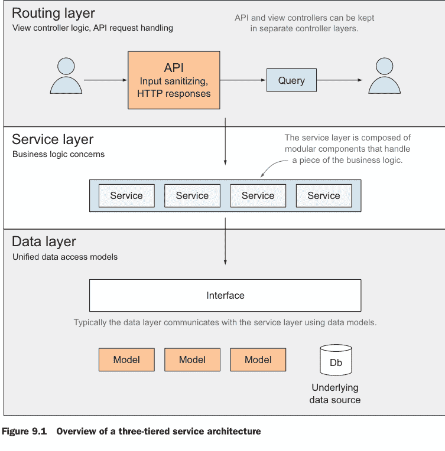

#### 9.3.1 路由层

API层负责处理限流、分页、缓存头、解析请求体和准备响应。然而，所有这些都应通过使用服务层作为访问或修改数据的唯一途径来完成，原因如下：

- 控制器必须在生成响应之前验证请求数据。
- API向服务请求其需要的不同数据片段，以正确完成响应。
- 当服务任务完成时，API控制器以适当的状态码和相关响应数据进行响应。

#### 9.3.2 服务层

服务层可以被架构设计为将所有数据访问延迟到第三层：数据层。该层负责处理任何无法直接从数据存储中提取的缺失数据的计算：

- 服务层由许多小服务组成。每个服务处理一部分业务。
- 服务层查询数据层，计算业务逻辑规则，并在模型级别上验证请求数据。
- CRUD操作通常最终成为到数据层的直通。
- 诸如发送电子邮件之类的任务，不涉及持久化访问，可能完全由服务层的组件处理，而无需调用数据存储。

#### 9.3.3 数据层

数据层负责与持久化介质（如数据库、平面文件、内存等）通信。其目的是通过一致的接口提供对这些介质的访问。拥有这样一个接口的目标是，你可以轻松地交换持久化层（例如数据库引擎或内存键值存储），这也使测试更容易：

- 数据访问层为底层数据存储中的数据提供接口。这使得与不同数据源交互和更换供应商变得更容易。
- 模型独立于底层数据存储保持不变；它们是接口的一部分。
- 底层数据模型与接口保持分离。这使得交换数据存储更容易，因为数据层的消费者不会受到影响。

以上只是一个快速的概述！让我们放慢节奏，更详细地探讨这个三层架构。请注意，这种架构类型不仅限于API设计，也可能适用于典型的Web应用程序，甚至可能适用于其他类型的应用程序，只要它们值得投入额外的基础设施。

#### 9.3.4 路由层

控制器是这种架构中的公开层。在此层中，你将定义可以从哪些路由访问你的应用程序。路由层还负责解析请求URL和请求体中的任何参数。

甚至在尝试完成请求之前，你可能需要验证客户端是否未超出其允许的配额，如果是这种情况，你可以立即终止请求，并传递适当的响应和429 Too Many Requests状态码。

众所周知，用户输入不可信，而这正是你最应该积极验证和清理用户输入的地方。一旦请求被解析，请确保请求提供了满足请求所需的内容，不多不少。一旦你确保提供了所有必需的字段，你应该清理它们并确保输入是有效的。例如，如果提供的电子邮件地址不是有效的电子邮件，你的API应该知道以400 Bad Request和适当格式的响应体进行响应。

一旦请求被解析且其输入被验证，你就准备好将其交给服务层，服务层将把请求提供的输入转换为它需要的输出。（请稍等片刻；我们将更深入地探讨服务层。）一旦服务层回复你，你最终可以判断请求是否可以完成，并以相应的状态码和响应数据进行响应。那么，服务层到底应该做什么？很高兴你问起！

#### 9.3.5 服务层

在服务层，也称为业务逻辑层，处理请求，从数据层拉取数据，并返回该数据的表示。此时验证业务规则是有意义的，而这并非路由层的责任。

例如，如果用户试图以非常昂贵或-1的价格创建新产品，由路由层来判断这不是有效的货币输入。如果所选产品类别期望产品价格在20-150美元范围内，而产品定价为200美元，那么由服务层来判断请求无法完成。

服务层还负责执行任何必要的数据聚合。尽管路由层可能只需要调用一次服务层来获取所需内容，但服务层和数据层之间的交互并非如此。例如，服务层可能需要获取新闻网站上的文章列表，并将其交给一个服务，该服务对这些文章的内容执行处理任务，找出共同点，最终返回相互关联的文章列表。

在这方面，服务层是架构中的活动组织者，因为它将查询并指挥其他层为其提供产生有意义响应的手段。让我们快速梳理一下数据层应该如何构建的具体细节。

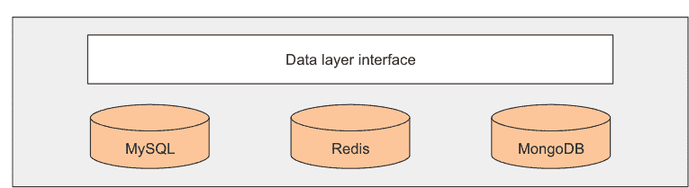

图9.2 数据层接口和一些底层数据存储

#### 9.3.6 数据层

数据层是唯一旨在访问持久化组件的层，这将是你的数据库。数据层的目标是确保提供一致的API，无论使用何种底层数据存储。如果你将数据持久化在MongoDB、MySQL或Redis中，数据层提供的API将通过提供一个不依赖于任何特定持久化模型的、一致的API来向服务层隐藏这一细节。

图9.2显示了可能位于数据层接口后面的数据存储。请注意，此接口不一定隐藏单个类型的支持数据存储：例如，你可能同时使用Redis和MySQL。

数据层通常很薄，弥合了服务层和持久化层之间的差距。数据层产生的结果也应该是一致的，因为更改底层持久化模型确实不会产生差异。

虽然不推荐，但在小型项目中，如果应用程序的持久化模型不会发生重大变化，合并服务层和数据层是可行的。请记住，最初拆分两者很容易，但当你拥有数十个使用数十个不同数据模型的服务时再这样做，会变得越来越复杂且非同小可。这就是为什么，如果可能的话，建议从一开始就拆分这两个层。

本章我们将讨论的最后一个主题是如何在客户端消费此类服务。

### 9.4 在客户端消费REST API

当在Web应用程序的客户端与REST API层进行密集交互时，通常明智的做法是设计一个薄层，作为API与应用程序核心之间的中介。此层依赖于创建一个共享基础设施来向API发出请求，以换取以下列出的好处：

- 对应用程序中发生的请求有高级别的概览
- 允许你执行缓存并避免额外的请求
- 在应用程序的单一位置管理错误，提供一致的UI体验


#### 9.4.1 请求处理层

构建这样一个层可以采用两种方式。你可以修补浏览器中的 XHR 实现，确保应用程序发出的任何 AJAX 请求都必须经过你植入 XHR 的代理；或者你也可以在 XHR 周围创建一个包装器，并在每次发出 AJAX 请求时使用它。后一种方法通常被认为更"干净"，因为它不像猴子补丁方法那样影响浏览器提供的原生行为，后者有时会导致意外行为。这通常足以成为首选创建简单 XHR 调用包装器而非使用原生 API 的理由。

我创建了一个名为 measly 的库，正是出于这个目的。它采用侵入性较小的包装器方法，因为这样不会影响那些不了解 Measly 行为的代码，而且它还允许你将请求与 DOM 的不同部分轻松关联起来。它还支持缓存和事件处理，这两者都可以限制在特定 DOM 元素或全局范围内。我将带你了解 measly 的几个关键特性。首先，你需要从 npm 安装它。它在 Bower 上也可用，名称相同。

```
npm install --save measly
```

安装 measly 后，你就可以进入下一节，了解如何使用它来确保请求不会导致意外的副作用。

#### 9.4.2 终止旧请求

单页 Web 应用程序如今大行其道。在传统的 Web 应用程序中，当用户导航到另一个页面时，用户代理会中止所有未完成的请求，但单页应用程序（SPA）呢？如果你正在开发 SPA，你可能希望当用户导航到另一个页面时，那些游离的请求不会破坏应用程序的状态。

以下代码是一个通用示例，假设某个客户端 MVC 框架在进入和离开视图时会广播事件。在这个示例中，你在视图容器元素上创建了一个 measly 层，并在离开视图时中止该层上的所有请求：

```
view.on('enter', function (container) {
    measly.layer({ context: container });
});
view.on('leave', function (container) {
    measly.find(container).abort();
});
```

每当需要发出 AJAX 调用时，你必须先查找该层。当然，你也可以保留一个引用以便使用。使用 `measly` 层来创建请求相当简单。在这个例子中，你请求 `DELETE /api/products/:id`，即使用 REST API 按 ID 删除产品：

```
var layer = measly.find(container);

deleteButton.addEventListener('click', function () {
  layer.delete('/api/products/' + selectedItem.id);
});
```

每当你发出请求时，`measly` 会触发一系列事件，让你可以对其做出响应。例如，如果你想知道请求何时成功，可以使用 `data` 事件；如果你想监听错误，可以订阅 `error` 事件。你可以在两个不同的地方监听错误：

- 直接在请求层面，只有当特定请求导致错误时才会通知你。
- 在层层面，你可以了解任何导致错误的请求。

这些方法都有显而易见的用例。你肯定想知道请求何时成功，这样你就可以利用响应数据执行特定操作。你可能还需要在全局范围内了解应用程序中发生的任何错误，以便显示相应的 UI 元素来通知用户这些错误，或将报告发送到日志服务。

#### 9.4.3 一致的 AJAX 错误管理

以下清单解释了如何在发生 AJAX 错误时显示 UI 对话框，但仅当响应中的状态码等于 500 时，这意味着发生了内部服务器错误。你将用响应提供的错误消息填充对话框，然后在短暂的超时后再次隐藏它。

**清单 9.2 发生 AJAX 错误时显示 UI 对话框**

```
var errorDialog = document.querySelector('.error-dialog');

measly.on(500, function (err) {
  errorDialog.innerText = err.message;
  errorDialog.classList.add('error-dialog-open');

  setTimeout(hideErrorDialog, 3000);
});
function hideErrorDialog () {
  errorDialog.classList.remove('error-dialog-open');
}
```

坦率地说，这是一种非常无趣的方法，也不是什么你无法实现的东西。更有用的场景是上下文验证。在这种情况下，要注意 `400 Bad Request` 响应，这是 API 应该分配给验证失败响应的状态码。Measly 会在事件处理程序中将 `this` 设置为请求对象，让你可以访问请求的重要属性，例如其 DOM 上下文元素。以下代码拦截任何 `400 Bad Request` 响应，并将其转换为 DOM 上下文中的验证消息。如果你将 Measly 绑定得足够接近所创建请求的视觉上下文，用户将毫不费力地找到你的验证消息列表：

```
measly.on(400, function (err, body) {
    var message = document.createElement('pre');
    message.classList.add('validation-messages');
    message.innerText = body.validation.messages.join('\n');
    this.context.appendChild(message);
});
```

最棒的是，这几乎是免费的！因为你已经在使用上下文来确保切换视图时请求被中止，所以你可能只需要在有意义的地方声明一些子层，例如部分视图或 HTML 表单。我想说的最后一点是 Measly 中的缓存规则。

##### MEASLY 缓存规则

Measly 允许你以两种方式缓存。首先，它允许你定义响应被认为新鲜的时间量，这意味着在缓存副本保持新鲜期间，对同一资源的后续请求将返回缓存的响应。以下清单展示了如何请求将响应缓存 60 秒，然后当按钮被点击时，Measly 要么使用缓存副本（如果在自上次请求起 60 秒内），要么在数据已更新时发出新请求。

**清单 9.3 使用 Measly 缓存文件**

```
measly.get('/api/products', {
    cache: 60000
});
queryButton.addEventListener('click', function () {
    var req = measly.get('/api/products', {
        cache: 60000
    });
    req.on('data', function (body) {
        console.log(body);
    });
})
```

另一种避免用不必要的 HTTP 请求查询服务器的方法是手动阻止它。以下清单是一个手动缓存产品列表的示例。

**清单 9.4 手动阻止不必要的 HTTP 请求**

```
var saved = []; // a list of products that you know to be fresh
var req = measly.get('/api/products');
req.on('ready', function () {
    if (computable) {
        req.prevent(null, saved);
    }
});
req.on('data', function (body) {
  console.log(body);
});
```

你可以在本书附带的代码示例中找到一个关于 Measly 如何工作的快速演示，列于 ch09/01_a-measly-client-side-layer。在该演示中，我展示了如何创建不同的上下文，以将不同的请求包含到 DOM 的一部分中。

总而言之，measly 可能不是你在寻找的答案，但结合本书的其余部分，我希望它能让你有所思考！

### 9.5 小结

这并没有那么难，对吧？我们涵盖了很多内容，并在途中看到了许多最佳实践：

- 负责任的 API 设计遵循 REST 约束模型，提供规范的端点、清理输入，并提供一致的输出。
- REST API 中的分页、节流和缓存对于提供快速且安全的 API 服务都是必要的。
- 应该认真对待文档，以降低 API 带来的摩擦。
- 你应该开发一个由领域逻辑层和数据层支持的薄 API 层。
- 瘦客户端层有助于你为 AJAX 请求分配上下文、验证响应以及在用户界面上渲染 HTTP 错误。


 ## 附录 A
Node.js 中的模块

本附录涵盖你在 Grunt 构建中有效使用模块和 Node.js 所需了解的内容。Node.js 是一个构建在 V8 JavaScript 引擎之上的平台，正是这个引擎让 Google Chrome 中的 JavaScript 成为现实。你在本书中使用的构建工具 Grunt 运行在 Node 上。Node 是单线程的，正如所有 JavaScript 一样。

Node 附带了一个小巧的命令行界面（CLI）工具，叫做 `npm`，用于从 node 包管理注册表中获取和安装包。在整本书中，你将根据需要学习如何使用 `npm` 工具。让我们先安装 Node.js，因为 `npm` 是随它捆绑提供的！

## A.1 安装 Node.js

你有几种安装 Node 的选项。如果你是指点拖放型用户，那么你可能想访问他们的网站，http://nodejs.org，然后点击大大的绿色"安装"按钮。二进制文件下载完成后，如需解压则进行解压，然后双击安装。就这么简单。

如果你更喜欢在终端中安装，可以考虑 `nvm`，一个用户创建的 Node 版本管理器。要安装 `nvm`，你可以在终端中输入以下命令：

```
curl https://raw.github.com/creationix/nvm/master/install.sh | bash
```

`nvm` 安装完成后，重新打开你的终端窗口以访问 `nvm` CLI。如果在安装 `nvm` 时遇到任何问题，请参考他们的公开仓库 https://github.com/creationix/nvm。拥有 `nvm` 后，你可以安装某个版本的 Node，如下所示：

```
nvm install 0.10
nvm alias default stable
```

第一个命令安装 0.10.x 分支中最新的稳定版 Node。第二个命令使得从现在起你打开的任何终端窗口都能访问你安装的 Node 版本。

太好了，现在你有了 Node！是时候了解更多关于它的模块系统了，该系统基于 CommonJS 模块规范。

## A.2 模块系统

Node 应用程序有一个在执行 node 进程时指定的入口点。例如，如果你运行 `node app.js`，你的 Node 进程将使用 `app.js` 作为入口点。要加载其他代码片段，你必须使用 `require` 函数。该函数接受一个路径并加载该位置找到的模块。传递给 `require` 的路径可以是

- 相对于你从中 `require` 的脚本的路径，以 '.' 开头。例如，如果你执行 `require('./main.js')`，你将加载与发起请求的脚本在同一目录中的文件。我们也可以使用 .. 来获取父目录中的脚本。
- 指向目录的路径。在这种情况下，`require` 将在提供的目录中查找名为 `index.js` 的文件并返回给你。
- 绝对路径。这一种很少使用，但你可以提供绝对文件路径，如下所示：

  ```
  require('/Users/nico/dev/buildfirst/main.js')
  ```

- 包的名称。包只需提供名称即可引用；例如，要获取 `async` 包，你应该使用 `require('async')`。大多数情况下，这与执行 `require('./node_modules/async')` 实际上是相同的。

## A.3 导出功能

如果你无法与模块进行交互，那么引用模块将毫无用处。模块可以通过赋值给 `module.exports` 来导出功能，即它们的 API。例如，考虑以下模块：

```
var mine = 'gold';

module.exports = function (pure) {
    return pure + mine;
};
```

如果你使用 `var thing = require('./thing.js')` 获取这个模块，那么 `thing` 将被赋值为 `thing.js` 内部 `module.exports` 最终变成的内容。值得注意的是，与浏览器模型不同——在浏览器中，隐式全局变量被赋值给 `window`——CommonJS 模块系统会保持你在模块中声明的变量为私有，除非你通过赋值给 `module.exports` 明确地将它们公开。Node 有一个你可以赋值给的 `global` 对象，它就叫 `global`，但使用它是不被鼓励的，因为那样会破坏模块化原则。

## A.4 关于包

依赖项保存在 `package.json` 文件中，`npm` 用它来确定执行应用程序需要哪些包。安装包时，你可以提供 `--save` 标志让 `npm` 自动将该依赖项持久化到 `package.json` 清单中，这样你就不必手动操作了。`package.json` 中的依赖项会在你运行不带任何参数的 `npm install` 时被安装。

本地依赖项安装到 `node_modules` 目录中，该目录应该在版本控制中被忽略。对于 Git，你可以在名为 `.gitignore` 的文件中添加一行 `node_modules`，Git 就会知道不要对这些文件进行版本控制。

关于 Node，你在 Grunt 构建中有效使用它所需了解的内容就这么多了。

# 附录 B
Grunt 简介

Grunt 是一个允许你为应用程序编写、配置和自动化任务的工具——例如压缩 JavaScript 文件或编译 LESS 样式表。

LESS 是一种 CSS 预处理器，在第 2 章中介绍。压缩本质上是通过移除空白字符和许多语法树优化来创建更小的文件。这些任务也可以与代码质量相关，例如运行单元测试（在第 8 章中介绍）或执行代码覆盖率工具如 JSHint。它们当然也可能与部署过程相关：也许通过 FTP 部署应用程序，或准备部署它，生成 API 文档。

Grunt 只是执行你构建任务的载体。这些任务使用插件来定义，下面将解释。

## B.1 Grunt 插件

Grunt 只提供框架；你需要选择合适的插件来执行所需的任务。例如，你可以使用 `grunt-contrib-concat` 来将资源捆绑在一起。你还需要配置这些插件以按你的意愿工作；例如，提供要捆绑的文件列表以及生成的捆绑文件的路径。

插件可以定义一个或多个 Grunt 任务。这些插件使用 Node 平台上的 JavaScript 来编写和配置。Node 社区开发和维护了数百个现成的 Grunt 插件，你只需要配置它们，稍后你就会看到。如果你找不到适合自己特定需求的插件，也可以自己创建 Grunt 插件。

## B.2 任务和目标

任务可以配置为符合多个目标，每个目标通过在配置任务时添加更多数据来定义。任务目标的常见用途是为不同的发行版编译应用程序，如第 3 章所述。

目标对于将同一任务用于略有不同的目的很有用。LESS 是一种表现力丰富的语言，编译后为 CSS。你可能有 LESS 任务目标来编译应用程序的不同部分。也许你需要使用不同的目标，因为其中一个目标通过添加指向原始 LESS 代码的源映射来让你更容易调试，而另一个目标可能甚至会压缩你的样式表。

## B.3 命令行界面

Grunt 附带了一个命令行界面（CLI），名为 `grunt`，你可以用它来运行你的任务。作为这个工具工作方式的示例，让我们分析以下语句：

```
grunt less:debug mocha
```

假设你已经配置好了 Grunt，稍后你将学习如何配置，这条语句将执行 `less` 任务的 `debug` 目标，如果该任务成功，那么为 `mocha` 任务配置的任何目标都将被执行。需要注意的是，如果 Grunt 任务失败，Grunt 不会尝试运行更多任务。相反，它会在打印失败原因后退出。

值得一提的是，任务是串行执行的：下一个任务在当前任务完成后才开始。它们不会并行运行。与其每次给 CLI 提供完整的任务列表，你可以使用任务别名：执行一系列任务的任务。如果你在创建别名时使用特殊名称 `default`，那么分配给该别名的任务将在 `grunt` CLI 不带任何任务参数执行时运行。

理论够了！让我们动手实践 Grunt；你将从安装 Grunt 开始，然后扩展我们讨论过的所有领域。要安装 Grunt，你首先需要 Node，即 Grunt 运行的平台。要安装 Node，请前往关于 Node 的附录 A，然后马上回到这里。我等着。

好的，让我们安装 Grunt CLI。在终端中使用 `npm`，输入以下命令：

```
npm install --global grunt-cli
```

`--global` 标志告诉 `npm` 这不是项目级包安装，而是系统级安装。本质上，这将最终使你能够直接从命令行使用该包。你可以通过运行以下命令来验证 CLI 是否安装正确：

```
grunt --version
```

这应该输出当前安装的 Grunt CLI 版本号。太好了！到目前为止你所做的一切都是一次性的；你不必担心再次执行这些步骤。但是如何使用 Grunt 呢？


## B.4 在项目中使用 Grunt

假设你有一个 PHP Web 应用（尽管服务器端语言并不重要），并且你希望在每次修改 JavaScript 文件时自动运行一个 linter（即静态分析工具，它可以告诉你使用的语法中存在的问题）。
首先需要的是在项目根目录下创建一个 `package.json` 文件。`npm` 用它来维护你所有依赖的清单。这个文件不需要太多内容；它必须是一个有效的 JSON 对象，所以 `{}` 就可以了。切换到应用根目录，然后在终端中输入以下命令：

```
echo "{}" > package.json
```

接下来，你需要安装几个依赖。你要安装 `grunt`，即框架本身，不要与 `grunt-cli` 混淆，后者负责查找相关文件并将任务执行委托给本地安装的 `grunt` 包。为了开始，你还需要安装 `grunt-contrib-jshint`，这是一个易于配置的任务，用于将 JSHint（JavaScript 代码检查工具）作为 Grunt 任务来运行。`npm install` 命令允许你同时安装多个包，所以就这么做：

```
npm install --save-dev grunt grunt-contrib-jshint
```

`--save-dev` 标志告诉 `npm` 将这些包包含在 `package.json` 清单中，并将它们标记为开发依赖。最佳实践是，任何不应在生产服务器上执行的东西都标记为开发依赖。构建组件应该在执行应用之前始终运行。
你已经有了框架、插件和 CLI；缺少的就是配置任务，这样你就可以开始使用 Grunt 了。

## B.5 配置 Grunt

要配置 Grunt，你需要创建一个 `Gruntfile.js` 文件。你的所有构建任务配置和定义都将放在这里。以下代码是一个 `Gruntfile.js` 的示例：

```
module.exports = function (grunt) {
  grunt.initConfig({
    jshint: {
      browser: ['public/js/**/*.js']
    }
  });
  grunt.loadNpmTasks('grunt-contrib-jshint');
  grunt.registerTask('default', ['jshint']);
};
```

正如在附录 A 关于 Node.js 的部分中所解释的，我们在那里讨论了 CommonJS 模块，这里模块导出了一个函数，Grunt 将调用该函数来配置你的任务。`initConfig` 方法接收一个对象，该对象将作为你所有不同任务和目标配置的配置。此配置对象中的每个顶层属性代表某个特定任务的配置。例如，`jshint` 包含 `jshint` 任务的配置。每个任务配置中的属性代表目标配置。

在这种情况下，你将 `jshint` 的 `browser` 目标配置为 `['public/js/**/*.js']`。这被称为 glob 模式，用于声明要定位哪些文件。稍后你将全面了解 glob 模式；现在只需要说明，它将匹配 `public/js` 中或其子目录中的任何 `.js` 文件。

`loadNpmTasks` 方法告诉 Grunt："嘿，加载你在这个 Grunt 插件中找到的所有任务"，所以它本质上是加载 `jshint` 任务。稍后你将学习如何编写自己的任务。

最后，`registerTask` 可以通过传入任务名称和应执行的任务数组来定义任务别名。你将它设置为 `jshint`，这样它将运行 `jshint:browser` 以及将来你可能添加的任何其他 `jshint` 目标。`default` 名称意味着每当你在命令行中不带任务参数执行 `grunt` 时都会运行此任务。来试试吧！

```
grunt
```

恭喜你，你已经执行了第一个 Grunt 任务！不过，你可能对"文件 glob"的整个概念感到困惑；让我们来解解决这个问题。

## B.6 Glob 模式

使用诸如 `['public/js/**/*.js']` 这样的模式有助于快速定义要处理的文件。这些模式很容易理解，只要你懂得如何恰当地使用它们。Glob 允许你使用纯文本来引用实际的文件系统路径。例如，你可以不加任何特殊字符地使用 `docs/api.txt`，这会匹配 `docs/api.txt` 文件。注意这是一个相对路径，它将相对于你的 `Gruntfile`。

如果你加入特殊字符，事情就变得有趣了。例如，将上一个例子改为 ` ...

docs/*.txt 可以帮助我们匹配 docs 目录中的所有文本文件。如果你想同时包含子目录，那么你需要使用 `**`，即所谓的 globstar 模式：`docs/**/*.txt`。

### B.6.1 花括号表达式

还有花括号展开。假设你想匹配许多不同类型的图片；你可能会想使用类似以下模式：`images/*.{png,gif,jpg}`。这将匹配任何以 `.png`、`.gif` 和 `.jpg` 结尾的图片。它不限于扩展名，尽管这是最常见的用例。你也可以使用花括号展开来匹配不同的目录：`public/{js,css}/**/*`。注意我们排除了扩展名。这没问题；星号将匹配任何文件中包含一个或多个目录和/或文件，而不限于特定的一个。

Xxxxxxxxxx was cut here, it seems the translation was going to say something about `public/{js,css}/**/*` matching files in either js or css under public, regardless of extension since the star matches any file.

让我重新组织：注意我们排除了扩展名。这没问题；星号将匹配任何文件类型，而不限于特定的一种。

### B.6.2 否定表达式

最后，还有否定表达式，这些有点棘手。*否定表达式*可以定义为"从目前已匹配的结果中移除匹配的项"。模式按顺序处理，因此包含和排除的顺序很重要。否定模式_amp;_模式以 `!` 开头。以下是一个常见的用例：`['js/**/*.js', '!js/vendor/**/*.js']`。这表示"包含 js 目录中的所有内容，但如果它在 js/vendor 中则不包含"。这对于检查你自己编写的代码很有用，同时不碰第三方库。

关于 glob 有一个特别的注意事项我想提一下；我经常看到人们抱怨 `['js', '!js/vendor']` "不起作用"，原因现在你知道 glob 的工作原理后应该很容易理解。第一个 glob 模式会匹配 js 目录本身，而 `!js/vendor` 不会起任何作用。之后，js 目录会被展开为其中的每个文件，包括 js/vendor 中的文件。这个问题的一个快速修复方法是让 Globber 为你展开目录，使用 globstar：`['js/**/*.js', '!js/vendor/**']`。

还有两个主题需要你掌握：配置任务和创建你自己的任务。让我们继续看看如何从头开始配置 Grunt 来运行一个任务。

## B.7 设置任务

现在你将学习如何设置一个随机任务……通过上网浏览！作为快速入门技巧，让我们回到 B.1 节的原始示例。还记得你是如何配置它来运行 JSHint 的吗？这是你使用的代码：

```
module.exports = function (grunt) {
  grunt.initConfig({
    jshint: {
      browser: ['public/js/**/*.js']
    }
  });
  grunt.loadNpmTasks('grunt-contrib-jshint');
  grunt.registerTask('default', ['jshint']);
};
```

假设你想压缩（第 2 章介绍过）你的 CSS 样式表，然后将它们合并成一个文件。你可以在 Google 上搜索 Grunt 插件来完成这个任务，或者你可以访问 http://gruntjs.com/plugins 自己四处看看。去访问那个页面，然后输入 css。你会在搜索结果前列看到 `grunt-contrib-cssmin`，它会链接到 npm 网站上该包的页面。

在 npm 上，你通常会找到详细的 README 文件，以及 GitHub 仓库上完整源代码的链接。在这种情况下，它指示你从 npm 安装该包，并在 `Gruntfile.js` 中添加一个 `loadNpmTasks`，如下面的代码所示：

```
module.exports = function (grunt) {
  grunt.initConfig({
    jshint: {
      browser: ['public/js/**/*.js']
    }
  });
  grunt.loadNpmTasks('grunt-contrib-jshint');
  grunt.loadNpmTasks('grunt-contrib-cssmin');
  grunt.registerTask('default', ['jshint']);
};
```

你还需要从 npm 安装这个包，就像你之前安装 `grunt-contrib-jshint` 那样：

```
npm install --save-dev grunt-contrib-cssmin
```

现在你只需要配置它。Grunt 项目通常都有很好的文档，在它们的主页上会给你一些配置示例，以及所有可用选项的详细列表。名为 `grunt-contrib-*` 的包是由 Grunt 背后的团队开发的，所以它们应该大多能正常工作而不会有问题。在为某项任务寻找合适的包时，如果某个包不起作用或文档不佳，就继续找下一个。你不必死守一个包。受欢迎程度（npm 安装量和 GitHub 星标数）是衡量一个包好坏的良好指标。

事实证明，第一个使用示例显示你也可以用这个包来合并 CSS，所以你不需要额外的任务来做这件事。以下是该示例，展示了如何在使用 `grunt-contrib-cssmin` 压缩的同时合并两个文件：

```
cssmin: {
  combine: {
    files: {
      'path/to/output.css': ['path/to/input_one.css', 'path/to/input_two.css']
    }
  }
}
```

你可以轻松地根据你的需求进行调整和整合。你还会添加一个构建任务别名。别名对于定义工作流很有用，正如你在第 1 部分中会看到的那样。例如，第 3 章使用它们来定义调试和发布工作流：

```
module.exports = function (grunt) {
  grunt.initConfig({
    jshint: {
      browser: ['public/js/**/*.js']
    },
    cssmin: {
      all: {
        files: { 'build/css/all.min.css': ['public/css/**/*.css'] }
      }
    }
  });
  grunt.loadNpmTasks('grunt-contrib-jshint');
  grunt.loadNpmTasks('grunt-contrib-cssmin');
  grunt.registerTask('default', ['jshint']);
  grunt.registerTask('build', ['cssmin']);
};
```

就是这样！如果你在终端中运行 `grunt build`，它会将你的 CSS 文件打包在一起并进行压缩，然后写入 `all.min.css` 文件。你可以在配套的示例源代码中找到这个例子以及我们目前讨论过的其他例子，位于 `appendix/introduction-to-grunt` 目录下。最后，我们将解释如何编写自己的 Grunt 任务，以此来结束本附录。

## B.8 创建自定义任务

Grunt 有两种类型的任务：多任务和常规任务。区别可能如你所料，多任务允许使用者设置不同的任务目标并单独运行它们。实际上，几乎所有 Grunt 任务都是多任务。让我们来创建一个！

你将创建一个任务，它可以计算一组文件中的单词数，然后如果计算出的单词数超过预期值，任务就会失败。首先，让我们看一下这段代码：

```
grunt.registerMultiTask('wordcount', function () {
    var options = this.options({
      threshold: 0
    });
});
```

这里，你为 `threshold` 选项设置了一个默认值，当任务被配置时，这个值可以被覆盖，稍后你会看到这一点。因为使用了 `registerMultiTask`，你可以支持多个任务目标。现在你需要遍历文件列表，读取它们并计算其中的单词数：

```
var total = 0;
this.files.forEach(function (file) {
  file.src.forEach(function (src) {
    if (grunt.file.isDir(src)) {
      return;
    }
    var data = grunt.file.read(src);
    var words = data.split(/[^\w]+/g).length;
    total += words;
    grunt.verbose.writeln(src, 'contains', words, 'words.');
  });
});
```

Grunt 会提供一个 `files` 对象，你可以用它来遍历文件，过滤掉目录并从文件中读取数据。一旦你计算出单词数，就可以打印结果，并在超过 `threshold` 值时使任务失败：

```
if (options.threshold) {
  if (total > options.threshold) {
    grunt.log.error('Threshold of', options.threshold, 'exceeded. Found',
      total, 'words.');
    grunt.fail.warn('Too many words');
  } else {
    grunt.log.ok(total, 'words found in total.');
  }
} else {
    grunt.log.writeln(total, 'words found in total.');
}
```

最后，你所要做的就是像之前那样配置一个任务目标：

```
wordcount: {
    capped: {
        files: {
            src: ['text/**/*.txt']
        },
        options: {
            threshold: 3000
        }
    }
}
```

如果所有这些文件的单词总数超过 3,000，任务就会失败。注意，如果你没有提供 `threshold` 值，它将使用你在任务中指定的默认值 0。这些信息足以让你理解 Grunt，我们在第 1 章对其进行了介绍。在第 2 章，你将更深入地了解构建任务本身、它们应该如何工作，以及如何组合任务来创建用于开发以及发布和部署的构建工作流。

# 附录 C

## 选择你的构建工具

决定使用一项技术总是很困难。你不想做出无法回头的承诺，但最终你必须做出选择。在选择构建技术方面也是如此：这是一个重要的决定，你应该认真对待。

在本书中，我决定选择 Grunt 作为构建工具。我努力不过度讲解 Grunt 特有的概念，而是解释构建流程的大局，并将 Grunt 作为一种辅助工具——一种达到目的的手段。我选择 Grunt 有几个原因，其中一些如下所列：

- Grunt 周围有一个健康的社区，甚至在 Windows 上也是如此。
- 它非常流行；甚至在 Node 社区之外也被广泛使用。
- 它易于学习；你选择插件并进行配置。不使用高级概念，也不需要先验知识。

所有这些原因使得 Grunt 成为在本书中教授构建流程的好工具，但我想明确说明，我认为 Grunt 并不是唯一的最佳选择；其他流行的构建工具可能比 Grunt 更适合你的需求。

我写这个附录是为了帮助你理解我前端开发工作流中最常用的三种构建工具之间的区别：

- Grunt，本书中使用的配置驱动型构建工具。
- npm，一个也可以兼作构建工具的包管理器。
- Gulp，一个介于 Grunt 和 npm 之间的代码驱动型构建工具。

我还将阐述在哪些情况下某个特定工具可能比其他工具更好。

在阅读本附录之前，你应该先阅读本书的第一部分和附录 A。Grunt 在附录 A 中介绍，并在整个第一部分中都有涉及。本附录假设你具备 Grunt 的基础知识。作为第一步，让我们讨论 Grunt 的优势所在。

### C.1 Grunt：优点

Grunt 最大的优点是其易用性。它使程序员几乎可以毫不费力地使用 JavaScript 开发构建流程。所需做的只是搜索合适的插件，阅读其文档，然后安装和配置它。这种易用性意味着，技能水平参差不齐的大型开发团队成员，在调整构建流程以满足项目的最新需求时不会遇到任何麻烦。团队也不需要精通 Node；他们只需在配置对象中添加属性，并在构成构建流程的不同数组中添加任务名称。

Grunt 的插件库足够庞大，你很少需要自己开发构建任务，这也使你和你的团队能够快速开发构建流程。如果你采用构建优先的方法，即使只是迈出小步并逐步开发你的构建流程，这种快速开发也至关重要。

通过 Grunt 管理部署也是可行的，因为存在许多用于执行这些任务的包，例如 `grunt-git`、`grunt-rsync` 和 `grunt-ec2`。

### C.2 Grunt：缺点

Grunt 的不足之处在哪里？如果你有一个非常庞大的构建流程，它可能变得过于冗长。一旦构建流程开发了一段时间，通常很难从整体上理解它。当你的构建流程中的任务数量达到两位数时，几乎可以肯定你会发现自己不得不单独运行属于同一任务的不同目标，以便以正确的顺序组合流程。

因为任务是声明式配置的，所以你也很难弄清楚任务执行的顺序。此外，你的团队在构建方面应该致力于编写可维护的代码。对于 Grunt，你需要为每个任务的配置维护单独的文件，或者至少为团队使用的每个构建流程维护单独的文件。

既然我们已经明确了 Grunt 的优点和缺点，以及它可能适合你项目的情况，让我们来谈谈 npm：如何将其用作构建工具以及它与 Grunt 的区别。

### C.3 将 npm 用作构建工具

要将 npm 用作构建工具，你需要一个 package.json 文件和 npm 本身。为 npm 定义任务就像在包清单的 `scripts` 对象中添加属性一样简单。属性的名称将用作任务名称，而值将是你想要执行的以下代码片段表示一个典型的 package.json 文件，使用 JSHint 命令行界面通过你的 JavaScript 文件运行一个 linter 并检查错误。使用 npm，你可以运行任何可用的 shell 命令：

```
{
  "scripts": {
    "test": "jshint . --exclude node_modules"
  },
  "devDependencies": {
    "jshint": "^2.5.1"
  }
}
```

一旦任务被定义，就可以通过运行以下命令在命令行中执行它：

```
npm run test
```

请注意，npm 为特定任务名称提供了快捷方式。对于 `test`，你可以直接执行 `npm test` 而省略 `run` 动词。你可以在脚本声明中将 `npm run` 命令链接在一起来组合构建流程。以下列表通过执行 `npm test` 命令，让你在 `lint` 任务之后立即运行 `unit` 任务。

#### 清单 C.1 将 npm run 命令链接在一起以构建构建流程

```
{
  "scripts": {
    "lint": "jshint . --exclude node_modules",
    "unit": "tape test/*",
    "test": "npm run lint && npm run unit"
  },
  "devDependencies": {
    "jshint": "^2.5.1",
    "tape": "^2.10.2"
  }
}
```

你还可以将任务安排为后台作业，使其异步运行。假设你有以下 package 文件，你将在其中复制 JavaScript

### Grunt 简而言之

Grunt 具有以下优点：

- 拥有数千个插件，能满足你的各种需求。
- 配置易于理解和调整。
- 只需要基本的 JavaScript 知识。
- 支持跨平台开发。是的，甚至包括 Windows！
- 对大多数团队来说都非常适用。

Grunt 也有一些缺点：

- 基于配置的构建定义随着规模变大而变得越来越笨重。
- 当涉及许多多目标任务定义时，很难跟踪构建流程。
- Grunt 比其他构建工具明显更慢。


构建流程，并在你的 CSS 构建流程中编译 Stylus 样式表（Stylus 是一种 CSS 预处理器）。在这种情况下，异步运行任务是理想的选择。你可以使用 `&` 作为分隔符，或将其放在命令之后，如以下你的包清单所示。之后，你可以执行 `npm run build` 来同时处理这两个步骤。

### 清单 C.2 使用 Stylus

```
{
    "scripts": {
        "build-js": "cp -r src/js/vendor bin/js",
        "build-css": "stylus src/css/all.styl -o bin/css",
        "build": "npm run build-js & npm run build-css"
    },
    "devDependencies": {
        "stylus": "^0.45.0"
    }
}
```

有时 shell 命令不够用，你可能需要 Node 包，比如 `stylus` 或 `jshint`，就像你在前面几个例子中看到的。这些依赖应该通过 npm 安装。

#### C.3.1 安装 npm 任务依赖

JSHint CLI 在你的系统中不一定可用，你有两种安装方式：

- 全局安装，在命令行中使用时
- 作为 devDependency 添加，在 `npm run` 任务中使用时

如果你想直接从命令行使用该工具，而不是在 `npm run` 任务中，你应该使用以下命令中的 `-g` 标志全局安装：

```
npm install -g jshint
```

如果你在 `npm run` 任务中使用该包，那么你应该将其添加为 `devDependency`，如以下命令所示。这允许 npm 在任何安装了包依赖的系统上找到 JSHint 包，而不必期望环境全局安装了 JSHint。这适用于任何在操作系统中不是现成可用的 CLI 工具。

```
npm install --save-dev jshint
```

你不局限于只使用 CLI 工具。事实上，npm 可以运行任何 shell 脚本。让我们深入了解一下！

#### C.3.2 在 npm 任务中使用 shell 脚本

以下示例是一个在 Node 上运行的脚本，显示一个随机的 emoji 字符串。第一行告诉环境该脚本在 Node 中。

```
#!/usr/bin/env node
```

```
var emoji = require('emoji-random');
var emo = emoji.random();

console.log(emo);
```

如果你将该脚本放在项目根目录下名为 `emoji` 的文件中，你必须将 `emoji-random` 声明为依赖，并将命令添加到包清单中的 `scripts` 对象：

```
{
  "scripts": {
    "emoji": "./emoji"
  },
  "devDependencies": {
    "emoji-random": "^0.1.2"
  }
}
```

一旦完成这些，运行命令就只是在终端中调用 `npm run emoji`，这将执行你在包清单的 `scripts` 属性中为 `emoji` 指定的命令值。

#### C.3.3 npm 与 Grunt 的比较：优点与缺点

与 Grunt 相比，使用 npm 作为构建工具有几个优点：

- 你不受 Grunt 插件的限制，可以利用整个 npm，它托管了数以万计的包。
- 除了 `npm` 之外，你不需要任何额外的 CLI 工具或文件，而你已经在使用 `npm` 来管理依赖和你的 `package.json` 清单，其中列出了依赖和构建命令。因为 `npm` 直接运行 CLI 工具和 Bash 命令，所以它的性能会比 Grunt 好得多。

考虑到 Grunt 最大的缺点之一是它受 I/O 限制。大多数 Grunt 任务从磁盘读取然后写入磁盘。如果你有多个任务处理相同的文件，文件很可能会从磁盘多次读取。在 Bash 中，命令可以将一个命令的输出直接管道传输到下一个命令，避免了 Grunt 中额外的 I/O 开销。

npm 最大的缺点可能是 Bash 在 Windows 环境中表现不佳。使用 `npm run` 的开源项目可能会在人们尝试在 Windows 上摆弄它们时遇到问题。类似地，Windows 开发人员会尝试使用 npm 的替代品。这个缺点基本上排除了 npm 用于需要在 Windows 上运行的项目。

Gulp，另一个构建工具，与 Grunt 和 npm 都有相似之处，你很快就会发行。

## C.4 Gulp：流式构建工具

Gulp 与 Grunt 相似，依赖于插件，并且它是跨平台的，也支持 Windows 用户。Gulp 是一个代码驱动的构建工具，与 Grunt 的声明式任务定义方法相反，使你的任务定义更容易阅读。Gulp 也与 `npm run` 相似，使用 Node 流来读取文件并通过函数管道传输数据，将其转换为最终写入磁盘的输出。这意味着 Gulp 没有使用 Grunt 时可能观察到的磁盘密集型 I/O 问题。由于同样的原因，它也比 Grunt 更快：花在 I/O 上的时间更少。

使用 Gulp 的主要缺点是它严重依赖于流、管道和异步代码。不要误解我的意思：如果你熟悉 Node，那绝对是一个优点。但这些问题在于，除非你和你的团队精通 Node，否则在构建自己的 Gulp 任务插件时，你可能会遇到处理流的问题。

> **Gulp**
> 
> Gulp 有一些很棒的地方：
> - 高质量的插件随时可用。
> - 代码驱动意味着你的 Gulpfile 比配置驱动的 Gruntfile 更容易理解。
> - 比 Grunt 更快，因为它使用流式管道，而不是每次都读写磁盘。
> - 支持跨平台开发，就像 Grunt 一样。
>
> Gulp 也有缺点：
> - 如果你没有 Node 经验，可能很难学习。
> - 出于类似的原因，开发高质量的插件很难。
> - 你的整个团队（现有成员和未来成员）都应该对流和异步代码感到舒适。
> - 任务依赖系统有很多不足之处。

在团队中工作时，Gulp 不像 npm 那么受限。你的前端团队大多可能了解 JavaScript，虽然他们可能不太熟悉 Bash 脚本，而且其中一些人可能正在使用 Windows！这就是为什么我通常建议将 `npm run` 保留给你的个人项目，也许在项目团队对 Node 感到舒适时使用 Gulp，在其他地方使用 Grunt。这是我个人的意见；找出对你和你的团队最有效的方法。此外，你不应该将自己限制在 Grunt、Gulp 或 `npm run` 上，因为这些工具适合我。做研究，也许你会发现一个比这三个更喜欢的工具。

让我们通过几个例子来了解 Gulp 任务是什么样的。

### 在 GULP 中运行测试

Gulp 在其约定上与 Grunt 相似。在 Grunt 中有一个 `Gruntfile.js` 文件，用于定义你的构建任务，而在 Gulp 中，文件需要命名为 `Gulpfile.js`。另一个细微的区别是，对于 Gulp 来说，CLI 包含在与任务运行程序相同的包中，所以你必须从 npm 同时本地和全局安装 `gulp` 包：

```
touch Gulpfile.js
npm install -g gulp
npm install --save-dev gulp
```

首先，我将创建一个 Gulp 任务来检查 JavaScript 文件，使用你已经见过的 JSHint，就像在 Grunt 和 `npm run` 中一样。对于 Gulp，你必须安装用于 JSHint 的 `gulp-jshint` Gulp 插件：

```
npm install --save-dev gulp-jshint
```

现在你已经完全配备了全局安装的 CLI、本地 `gulp` 安装和 `gulp-jshint` 插件，你可以组合构建任务来运行检查器。要使用 Gulp 定义构建任务，你必须以编程方式在 `Gulpfile.js` 文件中编写它们。

首先，使用 `gulp.task`，向其传递任务名称和一个函数。该函数包含运行该任务所需的所有代码。这里你应该使用 `gulp.src` 创建进入源文件的读取流。你可以提供单个文件的路径，或使用你在学习 Grunt 时见过的 globbing 模式。该流应该被管道传输到 JSHint 插件，你可以配置它或使用其默认设置。然后你只需要将 JSHint 任务的结果通过 reporter 管道传输，让它将结果打印到你的终端。我所描述的所有内容产生了以下 Gulpfile：

```
var gulp = require('gulp');
var jshint = require('gulp-jshint');

gulp.task('test', function () {
    return gulp
        .src('./sample.js')
        .pipe(jshint())
        .pipe(jshint.reporter('default'));
});
```

我还应该提到，你正在返回流，以便 Gulp 理解它应该等待数据停止流动后再认为任务已完成。你可以使用自定义的 JSHint reporter 来使输出更简洁、更易于人类阅读。JSHint reporter 不需要是 Gulp 插件，所以你可以使用 `jshint-stylish` 为例。让我们在本地安装它：

```
npm install --save-dev jshint-stylish
```

更新后的 Gulpfile 应该看起来像以下代码。它将加载 `jshint-stylish` 模块来格式化报告输出。

```
var gulp = require('gulp');
var jshint = require('gulp-jshint');
```


gulp.task('test', function () {
  return gulp
    .src('./sample.js')
    .pipe(jshint())
    .pipe(jshint.reporter('jshint-stylish'));
});

这样就完成了！要声明一个名为 `test` 的 Gulp 任务，你只需完成这些操作。前提是已全局安装了 `gulp` CLI，你可以使用以下命令来运行它：

`gulp test`

上面的例子非常简单。你可以让 JSHint 检查器的输出通过一个 reporter，它会打印出检查测试的结果。你也可以使用 `gulp.dest` 将输出写入磁盘，它会创建一个写入流。让我们来看另一个构建任务的步骤。

## 在 GULP 中构建一个库

首先，让我们完成最基本的操作——使用 `gulp.src` 从磁盘读取文件，然后将源文件内容通过管道传输到 `gulp.dest` 写回磁盘，从而有效地将文件复制到另一个目录：

```
var gulp = require('gulp');
```

```
gulp.task('build', function () {
  return gulp
    .src('./sample.js')
    .pipe(gulp.dest('./build'));
});
```

复制文件很好，但它并不会压缩文件内容。为此，你必须使用一个 Gulp 插件。在这种情况下，你可以使用 `gulp-uglify`，一个用于流行的 UglifyJS 压缩工具的插件：

```
var gulp = require('gulp');
var uglify = require('gulp-uglify');
```

```
gulp.task('build', function () {
  return gulp
    .src('./sample.js')
    .pipe(uglify())
    .pipe(gulp.dest('./build'));
});
```

正如你可能已经意识到的，流（streams）允许你添加更多插件，同时只进行一次磁盘的读写操作。举个例子，我们再通过 `gulp-size`，它会计算缓冲区中内容的大小并将其打印到终端。请注意，如果你在 Uglify 之前添加它，你得到的是压缩前的大小；如果在之后添加，则得到压缩后的大小。你也可以两者都做！

```
var gulp = require('gulp');
var uglify = require('gulp-uglify');
var size = require('gulp-size');

gulp.task('build', function () {
  return gulp
    .src('./sample.js')
    .pipe(uglify())
    .pipe(size())
    .pipe(gulp.dest('./build'));
});
```

为了强化“可以根据需要添加或移除管道”这一点，让我们添加最后一个插件。这次你将使用 `gulp-header` 向压缩后的代码添加许可证信息，例如名称、包版本和许可证类型。要运行以下代码清单中显示的示例，请在命令行中输入 `gulp build`。

### 代码清单 C.3 使用 gulp-header 添加许可证信息

```
var gulp = require('gulp');
var uglify = require('gulp-uglify');
var size = require('gulp-size');
var header = require('gulp-header');
var pkg = require('./package.json');
var info = '// <%= pkg.name %>@v<%= pkg.version %>, <%= pkg.version %>\n';

gulp.task('build', function () {
  return gulp
    .src('./sample.js')
    .pipe(uglify())
    .pipe(header(info, { pkg : pkg }))
    .pipe(size())
    .pipe(gulp.dest('./build'));
});
```

与 Grunt 类似，在 Gulp 中你可以通过向 `gulp.task` 传入一个任务名数组（而不是一个函数）来定义流程。Gulp 和 Grunt 在这方面的主要区别是，Gulp 异步地执行这些依赖关系，而 Grunt 同步地执行它们。

```
gulp.task('build', ['build-js', 'build-css']);
```

在 Gulp 中，如果你想同步运行任务，你必须先将一个任务声明为依赖项，然后定义你自己的任务。所有依赖项都会在你的任务开始之前执行。

```
gulp.task('build', ['dep'], function () {
    // 这里是依赖于 'dep' 的任务
});
```

如果你要从本附录中学到一点东西，那应该是：使用哪个工具并不重要，只要它能让你以一种不太费力的方式组合你需要的构建流程。

# 附录 D

## JavaScript 代码质量指南

本风格指南旨在为应用程序的 JavaScript 代码提供基本规则，使其在团队中的不同开发者之间具有高度的可读性和一致性。重点在于保证代码的质量和不同部分之间的一致性。

### D.1 模块组织

本风格指南假设你正在使用模块系统，例如 CommonJS、¹ AMD、² ES6 模块、³ 或任何其他类型的模块系统。要全面了解模块系统，请转到第 5 章；我等你。

模块系统提供独立的作用域，避免泄漏到全局作用域，并通过自动生成依赖关系图来改进代码库的组织，而无需手动创建数十个 `<script>` 标签。

模块系统还提供依赖注入模式，这在隔离测试单个组件时至关重要。

#### D.1.1 严格模式

始终将 "`use strict`";⁴ 放在模块的顶部。严格模式允许你捕获无意义的行为，阻止不良实践，并且更快，因为它允许编译器对你的代码做出某些假设。

- ¹ CommonJS 模块规范在 http://bevacqua.io/bf/commonjs 上有一个维基页面。
- ² RequireJS 在 http://bevacqua.io/bf/amd 上有一篇关于 AMD 目的的详尽文章。
- ³ 现在开始使用 ES6 要容易多了！请参阅 http://bevacqua.io/bf/es6-intro。
- ⁴ Mozilla 开发者网络（MDN）上有一篇很好的文章解释了 JavaScript 中的严格模式：http://bevacqua.io/bf/strict。

### D.1.2 空格

空格在整个应用程序的每个文件中必须保持一致。为此，强烈建议使用 EditorConfig。EditorConfig 的工作方式是在项目根目录下放置一个 `.editorconfig` 文件，然后你应该为你喜欢的文本编辑器安装 EditorConfig 插件。以下是我建议的 JavaScript 缩进默认设置：

```
## editorconfig.org
root = true
[*]
indent_style = space
indent_size = 2
end_of_line = lf
charset = utf-8
trim_trailing_whitespace = true
insert_final_newline = true
[*.md]
trim_trailing_whitespace = false
```

EditorConfig 可以透明地处理缩进，每个人都可以通过按 tab 键一致地生成正确数量的制表符或空格。使用制表符还是空格取决于项目的具体要求，但我建议使用两个空格进行缩进。

空格不仅涉及制表符，还包括函数声明参数之前、之后和之间的空格。这种空格通常很难正确处理，大多数团队甚至很难达成一个让每个人都满意的方案。

```
function () {}

function( a, b )(){}

function(a, b) {}

function (a,b) {}
```

尽量将这些差异降到最低，但也不必太费心思。

在可能的情况下，保持每行低于 80 个字符以提高可读性。

在 http://bevacqua.io/bf/editorconfig 了解更多关于 EditorConfig 的信息。

### D.1.3 分号

自动分号插入（ASI）不是一个特性。不要依赖它。它非常复杂，没有实际理由让团队中的所有开发者都背负理解 ASI 工作原理的沉重知识。避免头痛；避免 ASI。始终在需要的地方添加分号。

Ben Alman 在 http://bevacqua.io/bf/semicolons 上给出了关于为什么应该使用分号而不是省略分号的好建议。

关于自动分号插入（ASI）内部工作原理的指南可在 http://bevacqua.io/bf/asi 上找到。

### D.1.4 代码检查

由于 JavaScript 不需要编译步骤来处理未声明的变量，代码检查几乎是必需的。再次强调，不要使用一个对代码风格要求过于严格的检查器，比如 jslint⁸。相反，使用更宽松的工具，比如 jshint⁹ 或 eslint¹⁰。以下是使用 JSHint 的一些技巧：

- 创建一个 .jshintignore 文件，并包含 node_modules、bower_components 等目录。
- 你可以使用如下所示的 .jshintrc 文件来统一你的规则：

```
{
  "curly": true,
  "eqeqeq": true,
  "newcap": true,
  "noarg": true,
  "noempty": true,
  "nonew": true,
  "sub": true,
  "undef": true,
  "unused": true,
  "trailing": true,
  "boss": true,
  "eqnull": true,
  "strict": true,
  "immed": true,
  "expr": true,
  "latedef": "nofunc",
  "quotmark": "single",
  "indent": 2,
  "node": true
}
```

这些规则绝不是你应该严格遵守的，但重要的是要在完全不检查和过于纠结代码风格之间找到一个平衡点。如果不加以检查，你可能会陷入常见错误，比如遗漏分号或错误地关闭字符串引号；但如果过于严格，你可能会发现你的团队花在处理代码风格上的时间比编写有意义的代码还要多。

### D.2 字符串

字符串应始终使用相同的引号进行引用。在整个代码库中一致地使用 ' 或 "。确保团队在编写的每一段 JavaScript 代码中都使用相同的引号。

- ⁸ JSLint，最初的 JavaScript 检查器，至今仍可在 http://bevacqua.io/bf/jslint 上在线使用。
- ⁹ JSHint 是一个现代的替代工具，在构建过程中广受欢迎。请在 http://bevacqua.io/bf/jshint 找到它。
- ¹⁰ ESLint 是另一个检查工具，旨在更少地关注风格检查。请在 http://bevacqua.io/bf/eslint 找到它。


## 不佳的字符串

```
var message = 'oh hai ' + name + "!";
```

## 良好的字符串

```
var message = 'oh hai ' + name + '!';
```

通常，如果你能设法使用诸如 Node 中 `util.format`[^11] 这样的参数替换方法，你会成为一名更快乐的 JavaScript 开发者。这样格式化字符串会容易得多，代码看起来也更整洁。

## 更好的字符串

```
var message = util.format('oh hai %s!', name);
```

你可以使用以下代码片段实现类似功能：

```
function format () {
  var args = [].slice.call(arguments);
  var initial = args.shift();
  function replacer (text, replacement) {
    return text.replace('%s', replacement);
  }
  return args.reduce(replacer, initial);
}
```

在声明多行字符串时，尤其是涉及 HTML 代码片段时，有时最好使用数组作为缓冲区，然后拼接其各部分。字符串连接的方式可能更快，但更难追踪：

```
var html = [
  '<div>',
    format('<span class="monster">%s</span>', name),
  '</div>'
].join('');
```

使用数组构建方式，你也可以先推送代码片段的各个部分，最后再将所有内容拼接在一起。这正是 Jade[^12] 等字符串模板引擎所偏好的方式。

### D.2.1 变量声明

始终以一致的方式在作用域顶部声明变量。建议每行只声明一个变量。无论是逗号在前、单个 `var` 语句、还是多个 `var` 语句，都可以，但需在整个项目中保持一致。确保团队中的每个人都遵循风格指南，以保持一致性。

## 不一致的声明

```
var foo = 1,
    bar = 2;
var baz;
var pony;
var a
    , b;
```

[^11]: Node 的 util.format 文档可在 http://bevacqua.io/bf/util.format 找到。

[^12]: 访问他们的 GitHub 仓库 http://bevacqua.io/bf/jade 以了解更多关于 Jade 模板的信息。

或者

```
var foo = 1;
if (foo > 1) {
  var bar = 2;
}
```

注意，以下示例不仅风格良好，而且语句之间也保持一致。

## 一致的声明

```
var foo = 1;
var bar = 2;
var baz;
var pony;
var a;
var b;
var foo = 1;
var bar;
if (foo > 1) {
  bar = 2;
}
```

未立即赋值的变量声明可以共享同一行代码。

## 可接受的声明

```
var a = 'a';
var b = 2;
var i, j;
```

## D.3 条件语句

必须使用花括号。这连同合理的空格策略，将有助于你避免类似 Apple SSL/TLS 漏洞[^13]之类的错误。

## 不佳的条件语句

```
if (err) throw err;
```

## 良好的条件语句

```
if (err) {
  throw err;
}
```

避免使用 == 和 != 操作符；始终优先使用 === 和 !==。这些操作符被称为“严格相等操作符”，而它们的对应操作符会尝试将操作数[^14]强制转换为相同的值类型。如果可能，尽量将单语句条件也保持为多行格式。

## 不佳的强制相等

```
function isEmptyString (text) {
  return text == '';
}
```

[^13]: 关于 Apple "GOTO Fail" 漏洞的详细报告可在 http://bevacqua.io/bf/gotofail 找到。

[^14]: 相等操作符在 MDN 上有专门页面：http://bevacqua.io/bf/equality。

```
}
isEmptyString(0);
// <- true
```

## 良好的严格相等

```
function isEmptyString (text) {
  return text === '';
}
isEmptyString(0);
// <- false
```

### D.3.1 三元操作符

三元操作符适用于清晰的条件判断，但不适用于令人困惑的选择。作为一条规则，如果你无法像大脑解析文本那样快速地“用眼睛解析”它，那么它很可能过于复杂了。

jQuery 是充斥着糟糕三元操作符的代码库的典型例子。[^15]

## 不佳的三元操作符

```
function calculate (a, b) {
  return a && b ? 11 : a ? 10 : b ? 1 : 0;
}
```

## 良好的三元操作符

```
function getName (mobile) {
  return mobile ? mobile.name : 'Generic Player';
}
```

在可能引起混淆的情况下，改用 `if` 和 `else` 语句。

### D.3.2 函数

声明函数时，始终使用函数声明形式[^16]，而不是函数表达式[^17]。如果你试图在函数表达式被赋值给变量之前使用它，你会得到一个错误。相比之下，函数声明会被提升[^18]到作用域顶部，这意味着无论你将它们放在代码中的哪个位置，它们都能工作。你可以在第5章中了解关于提升的所有细节。

## 使用表达式是不好的

```
var sum = function (x, y) {
  return x + y;
};
```

## 使用声明是好的

```
function sum (x, y) {
  return x + y;
}
```

[^15]: jQuery 中三元操作符滥用的一些示例可在 http://bevacqua.io/bf/jquery-ternary 找到。

[^16]: StackOverflow 有一篇关于函数声明的解答：http://bevacqua.io/bf/fn-declaration。

[^17]: 你可以在 MDN 上找到函数表达式的简洁定义：http://bevacqua.io/bf/fn-expr。

[^18]: 变量提升在 http://bevacqua.io/bf/hoisting 的代码示例中有解释。

话虽如此，使用函数表达式来柯里化另一个函数[^19]也没有问题。

**柯里化是好的**

```
var plusThree = sum.bind(null, 3);
```

请记住，函数声明会被提升[^20]到作用域顶部，因此它们的声明顺序无关紧要。话虽如此，你应始终将它们保持在作用域的顶层，并始终避免将它们放在条件语句内部。

**不佳的函数**

```
if (Math.random() > 0.5) {
  sum(1, 3);
  function sum (x, y) {
    return x + y;
  }
}
```

**良好的函数**

```
if (Math.random() > 0.5) {
  sum(1, 3);
}
function sum (x, y) {
  return x + y;
}
```

或者

```
function sum (x, y) {
  return x + y;
}
if (Math.random() > 0.5) {
  sum(1, 3);
}
```

如果你需要一个“无操作”方法，可以使用 `Function.prototype` 或 `function noop () {}`。理想情况下，整个应用程序应使用对 `noop` 的单一引用。每当你需要操作 `arguments` 对象或其他类似数组的对象时，将它们转换为数组。

**不佳的类数组循环**

```
var divs = document.querySelectorAll('div');

for (i = 0; i < divs.length; i++) {
  console.log(divs[i].innerHTML);
}
```

**良好的类数组循环**

```
var divs = document.querySelectorAll('div');
[].slice.call(divs).forEach(function (div) {
  console.log(div.innerHTML);
});
```

[^19]: John Resig 在他的博客上解释了如何部分应用函数：http://bevacqua.io/bf/partial-application。

[^20]: 变量提升在 http://bevacqua.io/bf/hoisting 的代码示例中有解释。

## 附录 D - JavaScript 代码质量指南

然而，请注意，在 V8 环境中，对 `arguments` 使用此方法会有显著的性能损失[^21]。如果性能是一个主要考虑因素，请避免使用 `slice` 转换 `arguments`，而应使用 `for` 循环。

**不佳的参数访问器**

```
var args = [].slice.call(arguments);
```

**更好的参数访问器**

```
var i;
var args = new Array(arguments.length);
for (i = 0; i < args.length; i++) {
    args[i] = arguments[i];
}
```

永远不要在循环内声明函数。

**不佳的内联函数**

```
var values = [1, 2, 3];
var i;
for (i = 0; i < values.length; i++) {
  setTimeout(function () {
    console.log(values[i]);
  }, 1000 * i);
}
```

或者

```
var values = [1, 2, 3];
var i;
for (i = 0; i < values.length; i++) {
  setTimeout(function (i) {
    return function () {
      console.log(values[i]);
    };
  }(i), 1000 * i);
}
```

**更好的做法是提取函数**

```
var values = [1, 2, 3];
var i;
for (i = 0; i < values.length; i++) {
  wait(i);
}
function wait (i) {
  setTimeout(function () {
    console.log(values[i]);
  }, 1000 * i);
}
```

或者更好的做法是使用 `.forEach`，它不像在 `for` 循环中声明函数那样存在相同的注意事项。

[^21]: 请参阅这篇关于优化函数参数操作的优秀文章：http://bevacqua.io/bf/arguments。


 ## 使用 forEach 实现更优的功能性数组

```
[1, 2, 3].forEach(function (value, i) {
  setTimeout(function () {
    console.log(value);
  }, 1000 * i);
});
```

## 命名函数 vs 匿名函数

当一个方法较为复杂时，应努力使用命名函数表达式而非匿名函数。这样在分析堆栈跟踪时，更容易定位异常的根本原因。

## BAD，匿名函数

```
function once (fn) {
  var ran = false;
  return function () {
    if (ran) { return };
    ran = true;
    fn.apply(this, arguments);
  };
}
```

## GOOD，命名函数

```
function once (fn) {
  var ran = false;
  return function run () {
    if (ran) { return };
    ran = true;
    fn.apply(this, arguments);
  };
}
```

通过使用卫语句（guard clauses）而非流式的 `if` 语句，避免缩进层级不必要地增加。

## BAD

```
if (car) {
  if (black) {
    if (turbine) {
      return 'batman!';
    }
  }
}

或

if (condition) {
  // 10+ 行代码
}
```

## GOOD

```
if (!car) {
  return;
}
if (!black) {
  return;
}
if (!turbine) {
  return;
}
return 'batman!';
```

或

```
if (!condition) {
  return;
}
// 10+ 行代码
```

## D.3.3 原型

应不惜一切代价避免篡改原生类型的原型；请改用方法。如果你必须扩展原生类型的功能，请尝试使用 poser。Poser 提供了脱离上下文的原生类型引用，你可以安全地在此基础上构建和扩展。

```
String.prototype.half = function () {
  return this.substr(0, this.length / 2);
};
```

```
function half (text) {
  return text.substr(0, text.length / 2);
}
```

除非你有充分的性能理由来为自己辩护，否则请避免使用原型继承模型：

- 它们比使用普通对象冗长得多。
- 创建新对象时会造成困扰。
- 它们需要闭包来隐藏实例的宝贵私有状态。
- 直接改用普通对象即可。

## D.3.4 对象字面量

使用埃及符号 `{}` 来实例化。使用工厂函数而非构造函数。以下是一个供你实现对象的通用建议模式：

```
function util (options) {
  // 私有方法和状态放在这里
  var foo;
  function add () {
    return foo++;
  }
  function reset () { // 注意此方法并未公开暴露
    foo = options.start || 0;
  }
  reset();
  return {
    // 公共接口方法放在这里
    uuid: add
  };
}
```

## **D.3.5 数组字面量**

使用方括号符号 `[]` 来实例化。如果你出于性能原因需要声明固定维度的数组，那么使用 `new Array(length)` 符号也是可以的。

JavaScript 中的数组拥有丰富的 API，你应该充分利用。你可以从数组操作基础²³开始，然后逐步进阶到更高级的用例。例如，你可以使用 `.forEach` 方法来遍历集合中的所有项目。

以下列表展示了你可以在数组上执行的基本操作：

- 使用 `.push` 在集合末尾插入项目，或使用 `.shift` 在开头插入。
- 使用 `.pop` 获取最后一个项目并将其从集合中移除，或使用 `.unshift` 对第一个项目执行相同操作。
- 掌握 `.splice` 来按索引删除项目，或在特定索引插入项目，或同时进行两者！

此外，学习并使用函数式集合操作方法！这些方法可以为你节省大量时间，否则你将需要手动完成这些操作。以下是一些你可以做的事情的示例：

- 使用 `.filter` 丢弃不感兴趣的值。
- 使用 `.map` 将数组值转换为其他内容。
- 使用 `.reduce` 遍历数组并产生单一结果。
- 使用 `.some` 和 `.every` 来断言所有数组项目是否满足某个条件。
- 使用 `.sort` 排列集合中的元素。
- 使用 `.reverse` 反转数组中的顺序。

Mozilla 开发者网络（MDN）在 https://developer.mozilla.org/ 对这些方法及其他方法有详尽的文档说明。

## **D.4 正则表达式**

将正则表达式保存在变量中；不要内联使用。这将大大提高可读性。

²³ 我博客上有一篇关于 JavaScript 数组的入门文章，见 http://bevacqua.io/bf/arrays。

## BAD，正则表达式

```
if (/\d+/.test(text)) {
  console.log('so many numbers!');
}
```

## GOOD，正则表达式

```
var numeric = /\d+/;
if (numeric.test(text)) {
  console.log('so many numbers!');
}
```

此外，学习如何编写正则表达式²⁴以及它们的作用。然后你也可以在线可视化它们。²⁵

## D.4.1 调试语句

最好将 `console` 语句放入一个可以轻松在生产环境中禁用的服务中。或者，不要向生产发行版交付任何 `console.log` 打印语句。

## D.4.2 注释

注释的目的不是解释代码做了什么。优秀的代码应该不言自明。如果你想写注释来解释一段代码的作用，那么很可能你需要修改代码本身。这条规则的例外是解释正则表达式的作用。优秀的注释应该解释为什么代码要做某些看似没有明确目的的事情。

## BAD，注释

```
// 创建居中的容器
var p = $('<p/>');
p.center(div);
p.text('foo');
```

## GOOD，注释

```
var container = $('<p/>');
var contents = 'foo';
container.center(parent);
container.text(contents);
megaphone.on('data', function (value) {
  container.text(value); // megaphone 会定期发出更新，用于
});
```

或

```
var numeric = /\d+/; // 字符串中某处的一个或多个数字
if (numeric.test(text)) {
  console.log('so many numbers!');
}
```

²⁴ 我博客上有一篇关于正则表达式的入门文章，见 http://bevacqua.io/bf/regex。
²⁵ Regexper 让你可以可视化任何正则表达式的工作原理，见 http://bevacqua.io/bf/regexper。

应避免完全注释掉整个代码块；这正是版本控制系统存在的意义！

## D.4.3 变量命名

变量必须具有有意义的名称，这样你就不需要诉诸注释来解释一段功能的作用。相反，试着在简洁的同时富有表达力，并使用有意义的变量名：

```
命名不佳
function a (x, y, z) {
  return z * y / x;
}
a(4, 2, 6);
// <- 3

命名良好
function ruleOfThree (had, got, have) {
  return have * got / had;
}
ruleOfThree(4, 2, 6);
// <- 3
```

## D.4.4 Polyfills

Polyfill 是一段代码，它可以透明地让你的应用在旧版浏览器中使用现代特性。尽可能使用原生浏览器实现，并包含一个为不支持的浏览器提供相同行为的 polyfill²⁶。这使得代码更易于处理，也减少了对各种 hack 技巧的依赖来让事情正常工作。

如果你无法用 polyfill 来修补某段功能，那么将所有修补代码的使用²⁷包装在一个全局可用的实现中，该实现可以从应用程序的任何位置访问。

## D.4.5 日常技巧

```
创建默认值
使用 `||` 来定义默认值。如果左侧值为 falsy²⁸，则将使用右侧值。

function a (value) {
  var defaultValue = 33;
  var used = value || defaultValue;
}
```

²⁶ Remy Sharp 在 http://bevacqua.io/bf/polyfill 简明地解释了什么是 polyfill。
²⁷ 我写的一篇关于开发高质量模块的文章涉及了实现封装的主题，见 http://bevacqua.io/bf/hq-modules。
²⁸ 在 JavaScript 中，falsy 值在条件语句中被视为 false。Falsy 值包括 ""、null、undefined 和 0。更多信息见 http://bevacqua.io/bf/casting。


# 使用 BIND 进行函数的部分应用

使用 `.bind` 进行函数的部分应用：

```
function sum (a, b) {
  return a + b;
}
var addSeven = sum.bind(null, 7);
addSeven(6);
// <- 13
```

# 使用 ARRAY.PROTOTYPE.SLICE.CALL 将类数组对象转换为数组

使用 `Array.prototype.slice.call` 将类数组对象转换为真正的数组：

```
var args = Array.prototype.slice.call(arguments);
```

# 在所有地方使用事件发射器

在所有地方使用事件发射器！这种模式有助于你将实现与不同对象或应用层之间的消息传递解耦：

```
var emitter = contra.emitter();
body.addEventListener('click', function () {
  emitter.emit('click', e.target);
});
emitter.on('click', function (elem) {
  console.log(elem);
});
// 模拟点击
emitter.emit('click', document.body);
```

# 将 FUNCTION.PROTOTYPE 作为空操作

使用 `Function.prototype` 作为"空操作"：

```
function (cb) {
  setTimeout(cb || Function.prototype, 2000);
}
```

20 jQuery 之父 John Resig 有一篇关于 JavaScript 部分应用的有趣文章，见 http://bevacqua.io/bf/partial-application。
30 Contra 提供了一个易于使用的事件发射器实现，见 http://bevacqua.io/bf/contra.emitter。

# 索引

## 符号

- != 运算符 106
- !== 运算符 297
- == 运算符 106
- === 运算符 297

## 数字

- 2xx 状态码 258
- 4xx 状态码 259, 269
- 5xx 状态码 259, 269

## A

- AAA（Arrange Act Assert，准备-执行-断言）216
- addEventListener 132
- AirBnB 200
- AJAX 错误管理 269–271
- Amazon Web Services。参见 AWS
- AMD（异步模块加载器）117
- Angular
  - 使用 Grunt 打包组件 122
  - 概述 120–121
  - 与 RequireJS 对比 121
- 匿名函数 134
- 应用环境
  - 确定使用哪个 52–53
  - 环境级配置 56–58
  - 在 Grunt 任务中 54–56
  - 概述 51–52
  - 生产环境 53–54
  - 预发布环境 54
- Arrange Act Assert。参见 AAA
- 数组
  - 将对象转换为数组 306
  - 代码质量 303
- 异步代码
  - 应用复杂性与 13
  - async 库
    - 组合流程 147–149
    - 并发执行 142, 145
    - 函数式任务 145–146
    - 概述 141–142
    - 顺序执行 143–145
    - 任务队列 147
    - 瀑布流执行 143
  - 回调
    - 清理 134–138
    - 错误处理 138–141
    - 概述 132–133
    - 防止回调陷阱 133–134
  - 事件
    - 创建事件发射器 158–161
    - 与 DOM 157–158
    - 概述 157
  - 生成器
    - 异步性与 163
    - 创建 161–162
    - 执行暂停 162–163
    - 使用 for..of 迭代 162
    - 概述 161
  - Promise
    - 链式调用 153–154
    - 延续 150–152
    - 使用 Promise 进行流程控制 155–156
    - 使用 Promise 进行函数式编程 155–156
    - 处理被拒绝的 Promise 156–157
    - 概述 150
    - 转换链 152–153
- 异步模块加载器。参见 AMD
- AWS（Amazon Web Services）82

## B

- Backbone
  - 使用 Grunt 进行模块 Browserify 化 172–174
  - 安装 172
  - 模型 177–179
  - 使用集合组织模型 179–180
  - 概述 170–172, 174–175
  - 路由器 180–183
  - 使用 Mustache 模板 175–177
  - 视图 175–177
- 战斗测试 15
- 阻塞任务 68
- Bower 122–124
- 大括号表达式，Grunt 279
- 浏览器测试
  - 编写测试用例 234–236
  - 伪造 XHR 和服务器通信 227–229
  - 识别测试用例 232
  - 实现功能 230–231
  - 概述 226–227
  - 准备测试载体 234
  - 设置 HTML 229–230
  - 设置和拆卸 232–233
  - 测试可能的结果 236–238
- Browserify
  - Backbone 模块 172–174
  - 使用其进行依赖管理 119–120
  - 使用其进行测试 214–215
- 构建分发
  - 定义 50
  - 确定使用哪个 52–53
  - 在 Grunt 任务中 54–56
  - 概述 51–52
  - 生产环境 53–54
  - 预发布环境 54
- Build First 理念
  - 构建过程
    - 优势 11
    - 应用复杂性与 14–15
    - 自动化 9
    - 构建 10
    - 部署 10
    - 概述 9–10
  - 工作流
    - 部署流程 29–31
    - 开发流程 29
    - 概述 29
    - 发布流程 29
  - 代码质量
    - 代码检查 19–22
    - 概述 15–19
  - 处理复杂性
    - 异步代码 13
    - 战斗测试 15
    - 构建过程 14–15
    - 设计 13
    - 模块化 11–12
    - 概述 11
    - REST API 15
  - 初始化工流程 6–7
  - 必要性 4–5
  - 概述 5–9
  - 与 RLP 5
- 构建工具
  - Grunt 285
  - Gulp
    - 在其中构建库 291
    - 概述 289
    - 运行测试 289–291
  - npm
    - 与 Grunt 对比 288
    - 安装任务依赖 287
    - 概述 285–287
    - 在任务中使用 shell 脚本 287–288
- buildpacks 85

## C

- Cache-Control 请求头 261
- 缓存响应 261–262
- 缓存静态资源
  - 使用 Grunt 进行缓存清除 76–77
  - ETag 请求头 76
  - Expires 请求头 75–76
  - Last-Modified 请求头 76
  - 概述 75
- 回调
  - 清理 134–138
  - 错误处理 138–141
  - 嵌套 134
  - 概述 132–133
  - 防止回调陷阱 133–134
- 层叠样式表。参见 CSS
- CD（持续开发）10, 30
  - LiveReload 69
  - 概述 66
  - 文本编辑器 69
  - 监视变更 66–69
- 变更日志 81–82
- Chrome 92
- CI（持续集成）86–89
- 循环依赖 126–127
- CJS（CommonJS）27, 113–114
- CLI（命令行界面 front matter 标记在原始格式下负责定义内容的元数据或预定义结构。它常置于文档或资源文件的起始位置，以结构化且机器可读的方法表示。）19, 277
- 闭包 111–112
- 集群 94
- 代码质量
  - 数组字面量 303
  - 将类数组对象转换为数组 306
  - 注释 304–305
  - 条件语句 297
  - 调试语句 304
  - 定义默认值 305
  - 事件发射器 306
  - 将 Function.prototype 作为空操作 306
  - 函数 298–302
  - 代码检查 19–22
  - 模块 293–295
  - 对象字面量 302
  - 概述 15–19
  - Polyfill 305
  - 原型 302
  - 正则表达式 303–304
  - 字符串 295–296
  - 三元运算符 298
  - 使用 bind 进行部分应用 306
  - 使用 Grunt
    - 自动化单元测试 45–46
    - 清理工作目录 43–44
    - 代码检查 44–45
  - 变量 296–297, 305
- 集合
  - Backbone 179–180
  - 购物列表示例 185–186
- 命令行界面。参见 CLI
- 注释 304–305
- CommonJS。参见 CJS
- 复杂性，应用
  - 异步代码 13
  - 战斗测试 15
  - 构建过程 14–15
  - 设计 13
  - 模块化 11–12
  - 概述 11
  - REST API 15
- 组合 102
- 连接 73
- 并发执行 142, 145
- 条件语句 297
- 配置，环境
  - 在代码中将配置合并为瀑布流 64–65
  - 在操作系统级别 62–64
  - 概述 58–59
  - 安全性 61–62
  - 以瀑布流方式存储配置 59–61
- console.log 304
- Promise 的延续 150–152
- 持续部署 88
- 持续开发。参见 CD
- 持续集成。参见 CI
- 持续测试 247
- contra 库 149
- 控制器
  - jQuery 168–170
  - Rendr 204–205
- 便利优于约定 217
- CRUD（创建、读取、更新、删除）255–257
- CSS（层叠样式表）
  - 概述 77–78
  - 测试 78–79
  - 使用 Grunt 78
- 函数柯里化 299

## D

- 数据层 265, 267
- 数据库任务示例 47–49
- 调试分发 51
- 调试
  - 与代码质量 304
  - Node 应用 92–93
- 默认值 305
- DELETE 动词 255–256
- 依赖管理
  - Angular 方式
    - 使用 Grunt 打包组件 122
    - 概述 120–121
    - 与 RequireJS 对比 121
  - Browserify 119–120
  - 循环依赖 126–127
  - 与 IoC 114–117
  - 概述 114–117
  - RequireJS 117–119
- 部署
  - 构建过程 10
  - 持续集成 86–89
  - 流程 29–31
  - Heroku
    - 管理环境 85–86
    - 概述 82–85
  - 图像优化
    - 图像交错 74
    - 无损图像压缩 73–74
    - 有损图像压缩 74
    - 概述 73
    - 设置 grunt-contrib-imagemin 74–75
  - 内联关键首屏 CSS
    - 概述 77–78
    - 测试 78–79
    - 使用 Grunt 78
  - 监控
    - 调试 Node 应用 92–93
    - 日志记录 89–91
    - 概述 89
    - 性能分析 93–94
    - 进程管理 94
  - 部署前操作
    - 变更日志 81–82
    - 概述 79–80
    - 语义化版本控制 80
  - 静态资源缓存
    - 使用 Grunt 进行缓存清除 76–77
    - ETag 请求头 76
    - Expires 请求头 75–76
    - Last-Modified 请求头 76
    - 概述 75
- 设计，与应用复杂性 13
- devDependency 287
- 开发环境 51, 58
- 开发流程 29
- Chrome DevTools 92
- DigitalOcean 82
- 分发 10
- 文档 263–264
- DOM（文档对象模型）
  - 事件与 157–158
  - 购物列表示例 186–187
- done() 函数 143
- DRY（Don't Repeat Yourself，不要重复自己）32, 73

## E

- ECMAScript
  - 生成器
    - 异步性与 163
    - 创建 161–162
    - 执行暂停 162–163
    - 使用 for..of 迭代 162
    - 概述 161
  - let 关键字 129
  - 其中的模块 128–129
  - 概述 127
  - 作为 Grunt 任务的 Traceur 127
- EditorConfig 294
- 封装
  - 函数工厂 105–106
  - 信息隐藏 104–105
  - 作用域 106–109
  - 单一职责原则 101–103
  - 严格模式 109
  - this 关键字 106–109
  - 变量提升 110–111
- 端点，REST API 254–255
- 环境
  - 应用
    - 环境级配置 56–58
  - 概述 51
  - 自动化首次设置 65–66
  - 构建分发
    - 确定使用哪个 52–53
    - 在 Grunt 任务中 54–56
    - 概述 51–52
    - 生产环境 53–54
    - 预发布环境 54
  - 配置
    - 在代码中将配置合并为瀑布流 64–65
    - 在操作系统级别 62–64
    - 概述 58–59
    - 安全性 61–62
    - 以瀑布流方式存储配置 59–61
  - 持续开发
    - LiveReload 69
    - 概述 66
    - 文本编辑器 69
    - 监视变更 66–69
  - 开发 58
  - Heroku 85–86
- 相等运算符 106
- 错误处理 138–141
- eslint 295
- ETag 76, 262
- 事件发射器
  - 与代码质量 306
  - 测试 218–219


# 索引

事件
- 创建 158–161
- DOM 与 157–158
- 概述 157

执行挂起 162–163
Expires 头 75–76, 261
export 关键字 128
Express 中间件 202

Grunt
- 自动化单元测试 45–46
- 清理工作目录 43–44
- 代码检查 44–45
- 配置 278–279
- 数据库任务示例 47–49
- 通配模式
  - 花括号表达式 279
  - 取反表达式 279–280
  - 概述 279
- Gruntfile.js
  - 创建 27
  - 通配模式 35–36
  - 任务配置 34–35
- 图片精灵
  - 概述 41–42
  - 感知响应速度与实际速度 43
  - 响应速度与 42
- 内联关键首屏 CSS 78
- 安装 26–27
- 界面 277
- 与 npm 作为构建工具的比较 288
- 概述 23–26
- 插件 276
- 预处理
  - LESS 32–34
  - 概述 31–34
- 优缺点 285
- 设置任务 28
- 静态资源
  - 压缩 38–41
  - 概述 37–38
- 任务
  - 自定义 282
  - 概述 276–277
  - 设置 280–282
- Traceur 作为任务 127
- Travis 配置与 87–88
- 在项目中使用 278

Gulp 16
Gulpfile.js 文件 289

Heroku
- 环境 85–86
  - 概述 82–85
- 登录 90

变量提升 110
HTTP 方法 255–257

## I

IaaS（基础设施即服务）82
幂等性 9, 29
IIFE（立即调用函数表达式）111
图片优化
- 隔行扫描图片 74
- 无损图片压缩 73–74
- 有损图片压缩 74
- 概述 73
- 设置 grunt-contrib-imagemin 74–75

图片精灵
- 概述 41–42
- 感知响应速度
  - 实际速度与 43
  - 概述 42

立即调用函数表达式。*参见* IIFE
实现细节 104
import 关键字 128
即兴发挥 3
基础设施即服务。*参见* IaaS
初始化工作流 6–7
集成测试 78, 216, 247–248
隔行扫描图片 74
IoC（控制反转）114–117

## F

Facebook 254
for..of 162
forEach() 函数 303
fulfill() 函数 150
Function.prototype 306
函数式工厂 105–106
函数式编程 155–156
函数 298–302

## G

生成器
- 异步性与 163
- 创建 161–162
- 执行挂起 162–163
- 使用 for..of 迭代 162
- 概述 161

GET 方法 255–256
–global 标志 277
通配模式
- 花括号表达式 279
- Gruntfile.js 35–36
- Gulp 290
- 取反表达式 279–280
- 概述 279

GoDaddy 82

Grunt 15
- 使用 Browserify 打包 Backbone 模块 172–174
- 任务中的构建分发 54–56
- 构建流程工作流
  - 部署流程 29–31
  - 开发流程 29
  - 概述 29
  - 发布流程 29
- 构建任务 46
- 使用其打包 Angular 组件 122
- 使用其进行缓存清除 76–77
- 代码质量

## H

–harmony 标志 127
HEAD 方法 256
Heroku
- 部署到
- 环境 85–86
  - 概述 82–85
- 登录 90

## J

Jasmine 213
jQuery
- 代码组织与 167
- 控制器 168–170
- 模型 169–170
- 路由器 170
- 视图 168, 170

JSHint 19–21, 295
JSLint 16, 295

## K

Knight's Capital 5, 7

## L

Last-Modified 头 76, 261
分层服务架构
- 数据层 265, 267
- 路由层 265–266
- 服务层 265–266

LESS
- 概述 32–33
- 变量 33–34

let 关键字 129
代码检查 19–22
- 模块 295
- 使用 Grunt 44–45

LiveReload 69
LoDash 123
无损图片压缩 73–74
有损图片压缩 74

## M

MDN（Mozilla 开发者网络）303
压缩 38–41
Mocha 213
模拟对象 116, 221–223
模型-视图-控制器。*参见* MVC
模型-视图-视图模型。*参见* MVVM
模型
- Backbone 177–179
- jQuery 169–170
- Rendr 205–206
- 购物清单示例 185–186

模块化
- 应用复杂度与 11–12
- 闭包 111–112
- CommonJS 113–114
- 依赖管理
  - Angular 方式 120–122
  - Browserify 119–120
  - IoC 与 114–117
  - 概述 114–117
  - RequireJS 117–119
- ECMAScript 6 128–129
- 封装
  - 函数式工厂 105–106
  - 隐藏信息 104–105
  - 作用域 106–109
  - 单一职责原则 101–103
- 严格模式 109
- this 关键字 106–109
- 变量提升 110–111
- 概述 99–101

模块
- 定义 27
- 检查 295
- Node.js 274
- 分号 294
- 间距 294
- 严格模式 293

监控
- 调试 Node 应用 92–93
- 日志记录 89–91
- 概述 89
- 性能分析 93–94
- 进程管理 94

Mozilla 开发者网络。*参见* MDN
Mustache 模板 175–177, 184
MVC（模型-视图-控制器）120

## N

原生模块 141
取反表达式，Grunt 279–280
next() 函数 143
Node 包管理器。*参见* npm
node-inspector 包 92–93
Node.js
- 调试 92–93
- 定义 19
- 导出功能 274
- 安装 273–274
- 模块 27, 274
- 包 275

nodemon 命令 67
nodetime 包 93
npm（Node 包管理器）20
- 与 Grunt 的比较 288
- 安装任务依赖 287
- 概述 285–287
- 在任务中使用 shell 脚本 287–288

## O

对象 302
八进制表示法 109
on 方法 219–221
开源软件 59
正交，定义 39

## P

PaaS（平台即服务）63, 82
包管理
- Bower 122–124
- 选择系统 125
- 循环依赖 126–127
- 仅安装所需组件 124–125
- Node.js 275

package.json 文件 275, 278, 285
分页响应 260–261
PATCH 方法 255–256
感知响应速度
- 实际速度与 43
- 隔行扫描图片与 74
- 概述 42

性能
- 图片优化
  - 隔行扫描图片 74
  - 无损图片压缩 73–74
  - 有损图片压缩 74
  - 概述 73
  - 设置 grunt-contrib-imagemin 74–75
- 内联关键首屏 CSS
  - 概述 77–78
  - 测试 78–79
  - 使用 Grunt 78
- 监控 93–94
- 静态资源缓存
  - 使用 Grunt 进行缓存清除 76–77
  - ETag 头 76
  - Expires 头 75–76
  - Last-Modified 头 76
  - 概述 75
- 测试 249

平台即服务。*参见* PaaS
插件
- 定义 25
- Grunt 276

polyfill 150, 305
POST 方法 255–256
后处理 31
预处理
- LESS 32–34
- 概述 31–34

进程管理 94
Procfile 83
生产环境
- 为生产环境构建分发 53–54
- 定义 51

渐进增强 171

包管理
- Bower 122–124
- 选择系统 125
- 循环依赖 126–127
- 仅安装所需组件 124–125
- Node.js 275

原型
- 代码质量 302
- 使用原型实现模块化 112–113
- 纯函数 105

PUT 方法 256

预部署操作
- 变更日志 81–82
- 概述 79–80
- 语义化版本控制 80
- 静态资源缓存
  - 使用 Grunt 进行缓存清除 76–77
  - ETag 头 76
  - Expires 头 75–76
  - Last-Modified 头 76
  - 概述 75

Promise
- 链式调用 153–154
- 续延 150–152
- 使用 Promise 进行流程控制 155–156
- 使用 Promise 进行函数式编程 155–156
- 处理拒绝 156–157
- 概述 150
- 转换链 152–153

## R

Rendr
- 控制器 204–205
- 用于 Rendr 的 Express 中间件 202
- 模型 205–206
- 概述 199–201, 203–204
- 路由器 204–205
- 设置 203
- 视图 206–210

表述性状态转移。*参见* REST

HTTP 请求
- 概述 257–258
- 节流 262–263

require() 函数 224–226, 274
RequireJS
- 与 Angular 的比较 121
- 使用 RequireJS 进行依赖管理 117–119

HTTP 响应
- 缓存 261–262
- 概述 258
- 分页 260–261

REST（表述性状态转移）
- 应用复杂度与 15
- 使用客户端消费 API
  - AJAX 错误管理 269–271
  - 拒绝导航请求 268–269
  - 请求处理层 268
- 设计陷阱 252–253
- 文档 263–264
- HTTP 状态码 258–260
- HTTP 方法与 CRUD 一致性 255–257
- 分层服务架构与
  - 数据层 265, 267
  - 路由层 265–266
  - 服务层 265–266
- 命名端点 254–255
- 概述 253–254
- 请求
  - 概述 257–258
  - 节流 262–263
- 相关资源 253
- 响应
  - 缓存 261–262
  - 概述 258
  - 分页 260–261
- 版本控制 256–258

RLP（零售流动性计划）5
路由器
- Backbone 180–183
- jQuery 170
- Rendr 204–205
- 购物清单示例 197–199

路由层 265–266
RSVP.js 库 150

## S

作用域 106–109
语义化版本控制 80
分号（ ; ）294
SEO（搜索引擎优化）103
顺序执行 143–145
服务层 265–266

购物清单示例
- 将商品添加到购物车 187–190
- DOM 事件 186–187
- 内联编辑 191–197
- 概述 183–184
- 使用 Mustache 渲染视图 184
- 路由器 197–199
- 单元测试 238–245
- 使用模型和集合 185–186
- 视图 184–185, 191–197

单一职责原则。*参见* SRP

Sinon.js 223
名称化 101
sortBy() 函数 146
SPA（单页应用）268
感知速度 43
SpiderMonkey 17
间谍 223–224

SRP（单一职责原则）89, 101–103

预发布环境
- 为预发布环境构建分发 54
- 定义 51

静态资源
- 缓存 75–77
- 在 Gruntfile.js 中
  - 压缩 38–41
  - 概述 37–38

严格模式
- 封装与 109
- 在模块中 293

字符串 295–296
桩 116
Stylus 287
SUT（被测系统）222

## T

TAP（测试任何协议）213–214
tape 测试 213, 245–247
任务别名 40
任务队列 147

Grunt 任务
- 自定义 282
- 概述 276–277
- 设置 280–282

TDD（测试驱动开发）45, 117, 211

模板 168
三元运算符 298

测试任何协议。*参见* TAP
测试驱动开发。*参见* TDD

测试
- 自动化 tape 测试 245–247
- 浏览器测试
  - 编写测试用例 234–236
  - 模拟 XHR 和服务器通信 227–229
  - 识别测试用例 232
  - 实现功能 230–231
  - 概述 226–227
  - 准备测试工具 234
  - 设置 HTML 229–230
  - 前置和后置处理 232–233
  - 测试可能的结果 236–238
- Browserify 214–215
- 持续测试 247
- 便利优于约定 217
- 事件发射器 218–219
- 集成测试 247–248
- 隔离逻辑单元 212–213
- 模拟 221–223
- MVC 购物清单
  - 测试视图模型的验证 243–245
  - 测试视图路由 238–243
- .on 方法测试 219–221
- 性能测试 249
- 代理 require 调用 224–226
- Sinon.js 223
- 间谍 223–224
- 测试策略 215–216
- 单元测试 45–46, 214, 216–218
- 使用 TAP 213–214
- 可视化测试 248–249

Testling 246
文本编辑器 69
TextMate 69
then() 函数 150, 156
this 关键字 106–109
请求节流 262–263
Traceur 127
转换链 152–153
转换 173

Travis
- 配置 Grunt 与 87–88
- 概述 86

类型强制转换 106
TypeError 异常 110

## U

undefined 108–109
Underscore 123
单元测试 78
- 使用 Grunt 自动化 45–46
- 定义 216
- MVC 购物清单
  - 测试视图模型的验证 243–245
  - 测试视图路由 238–243
- 概述 214, 216–218

UX（用户体验）42

## V

变量
- 代码质量 296–297, 305
- 环境变量 58
- 提升 110–111
- 作用域 106


# 索引

VCS（版本控制系统）  72
版本控制  80, 256–258
视图
  jQuery  168, 170
  Rendr  206–210
  购物清单示例  184–185, 191–197
可视化测试  248–249

WET（写两遍）  33
when 库  150
winston  90–91
with 语句  109
工作流
  定义  29
  部署流程  29–31
  开发流程  29
  概述  29
  发布流程  29
工作目录  43
写两遍。*参见* WET

## X

X-RateLimit-Reset 头  262
XMLHttpRequest  153

## Y

yield 关键字  161
YSlow  250

## Z

Zepto  172

## W

监听变更  66–69
瀑布模型  59–61, 64–65, 143
WebStorm  69, 92

# JAVASCRIPT/WEB 开发

# JavaScript 应用程序设计

# Nicolas Bevacqua

大多数应用程序的命运往往在第一行代码编写之前就已经注定了。这怎么可能呢？很简单，糟糕的设计必然导致糟糕的结果。良好的设计和高效的过程是构建、扩展和改进可维护应用程序的基石。对于 JavaScript 开发者而言，这意味着要发现能够实现这些改进的工具链、现代库和架构模式。

**JavaScript Application Design: A Build First Approach** 介绍了提升软件质量和开发工作流的技术。你将首先学习如何建立旨在优化工作质量的流程。每当代码发生更改时，你都会执行任务，在每次提交时运行测试，并以自动化的方式进行部署。然后，你将专注于设计模块化组件并将它们组合在一起，以构建健壮的应用程序。

# 本书内容

- 自动化开发、测试和部署流程
- JavaScript 基础与模块化最佳实践
- 模块化、可维护且经过充分测试的应用程序
- 掌握异步流程，拥抱 MVC，设计 REST API

本书假设读者了解 JavaScript 的基础知识。

**Nicolas Bevacqua** 是一名自由开发者，专注于模块化 JavaScript、构建流程和精妙设计。他的个人博客为 ponyfoo.com。

本书所有者可访问 manning.com/JavaScriptApplicationDesign 下载免费的 PDF、ePub 和 Kindle 格式电子书。

> > 享受这段改善开发工作流之旅吧。
> 
> ——摘自 Addy Osmani（Google）所作的序言

> > 对 JavaScript 开发者来说，这是必读之作！
> 
> ——Stephen Wakely, Thomson Reuters

> > 穿越现代 JavaScript 生态系统迷宫的绝佳指南。
> 
> ——Jonas Bandi, IvoryCode GmbH

> > 有史以来第一本面向开发者的设计书籍。
> 
> ——Sandeep Kumar Patel, SAP Labs

> > 一站式资源，引领 JavaScript 开发者了解现代实践和工具。
> 
> ——Matthew Merkes, MyNeighbor


