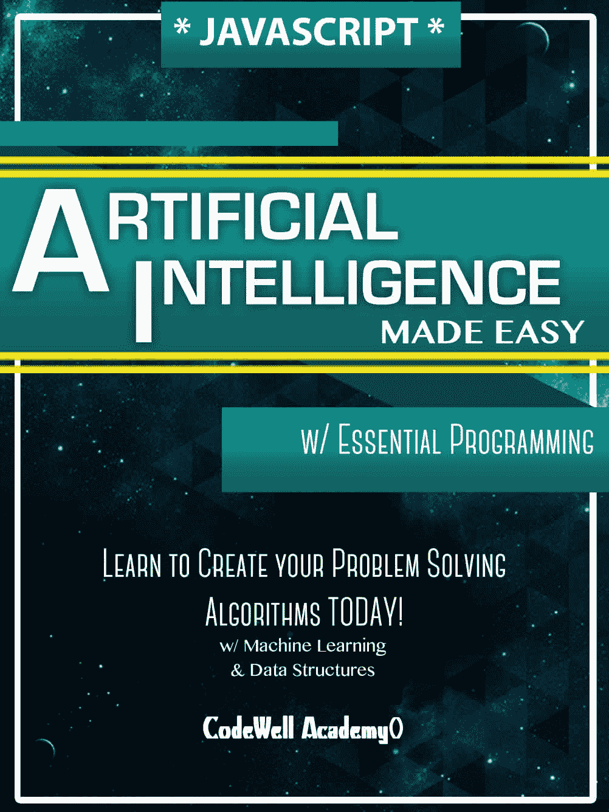
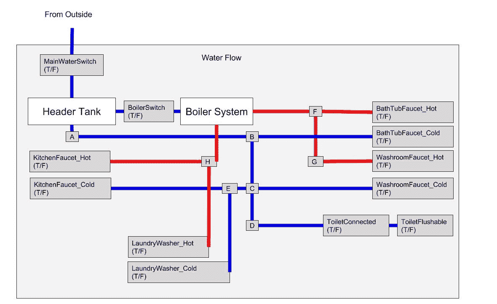
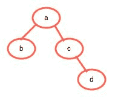
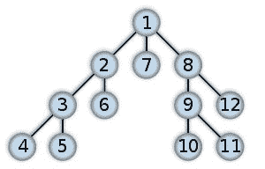
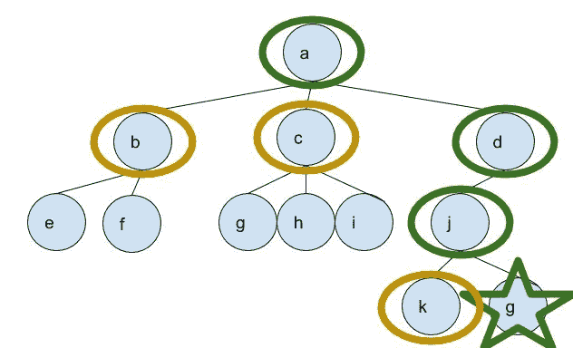
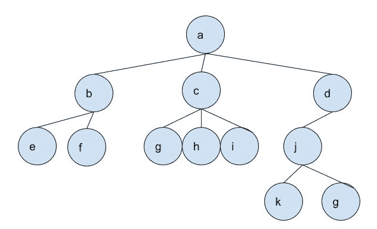

# Javascript 人工智能：简上手指南





# 序言：作为人工智能的 JAVASCRIPT

Javascript 最近作为主要的网页技术之一（`HTML`、`CSS` 和 Javascript）掀起了热潮。许多网站和应用程序正在全面采用 Javascript 技术来执行大多数任务。最棒的一点是 Javascript 是一种客户端语言，这意味着计算是由你的计算机或移动设备完成的，而不是服务器本身。因此，即使服务器不可用，应用程序依然。

本书的目标是通过 Javascript 代码将你的编程技能扩展到一个新的范式——即人工智能领域。你可能是一个希望学习新技能的熟练程序员，也可能是编程新手，或者两者兼有。

## 你的快速开始

如果这一切听起来让你感到畏畏，请不要担心。


这里包含了一份基础 JavaScript 编程的快速上手包。你将在这里找到入门 JavaScript 编程所需的所有内容。然后，你将准备好在整本书中使用各种 AI 工具和组件了。

# 引言

逻辑。理性。推理。思考。分析。计算。决策。

这一切都存在于人类的大脑中，对吧？人类被赋予了如此智能地思考和行动的能力。

接着，机器出现了。人类也赋予了它智能的恩赐。

在当今的世界里，你可以亲眼看到一个智能头脑能为你做什么：进行对话、提供前往某个位置的路线、作为对手玩视频游戏等等。

从本质上说，只有我们的想象力会限制真正的可能性。

## 人工智能代理（Agent）

在人工智能领域，代理（Agent）可以是任何在给定关注环境的情况下，能够智能地思考并独立行动的实体。它可以通过经验持续进行观察和学习。无论它对情况是完美了解还是部分了解，都可以计算并独立决定最佳行动方案。它还可以记录并适应变化的环境。

所以你可能会想，人类是如何开发出如此复杂的东西的？

嗯，它并没有你想象的那么复杂。

如果你理解了计算机如何观察、学习和扩展知识的过程——以及它如何获取所有这些信息并得出一个理想的解决方案或决策——那么人工创建的大脑就没有你想象的那么复杂。

有时，只需要几行代码就能让计算机为你提供解决方案。有时需要几百行。有时需要几千行。

# 第一章：算法：核心

从本质上说，AI 代理如何思考、处理、合理化、应用逻辑并最终生成解决方案，主要通过使用算法来实现。

如果你是编程新手，不要被吓。算法本质上是一个处理数据的程序。只要你理解某个算法如何处理它的数据，你就没问题。

## 算法特性

首先，你希望你的算法满足四个关键因素：

- 完备性
- 优化性
- 时间复杂度
- 空间复杂度

现在我们将逐一解释这些。之后，你将探索一些算法思想，并确定它们如何符合这些每一个因素。

### 完备性

如果一个算法保证在特定的时间范围内找到至少一个存在的解决方案或结论，我们就可以说该算法是完备的。

### 优化性

如果一个算法找到了解决方案并保证它是最优的，那么该算法被认为是优化的。

### 时间复杂度

对于算法来说，这是表示完成任务所需最长时间的表达式。换句话说，就是它运行并找到合适解决方案时的最坏情况。

### 空间复杂度

这个表达式与时间复杂度相似，但它代表算法为了找到解决方案而可能使用的最大内存量。这也被认为是最坏情况。

## 你的理想算法

在讨论了你的算法可能具备的特性后，你将会对创建 AI 算法时应该寻找什么有一个概念。你希望设计的算法能找到至少一个解决方案（完备性），并根据现有数据创建出最优的解决方案（优化性），同时尽可能少地消耗计算资源（时间与空间复杂度）。

## Javascript 01a：使用 AI 解决复杂的时间调度

想象你有 5 个朋友试图聚在一起在某处玩耍。起初听起来可能很简单，但可能会变得比你想象的复杂得多。

如果其中一个朋友在特定时间有工作呢？如果另一个朋友要上课呢？如果他/她有先约呢？足球训练？舞蹈课？学习时间？当然，你们可以聚在一起玩耍。然而，这必须是**每个人**都有空的时间。

所以，给定你的每个朋友，你需要列出他们的时间表，然后划掉他们忙的时间。之后，如果所有朋友之间存在共同的空闲时间，大家都说有空，那么你和你的朋友就可以去玩了。

让我们再来看一个例子。

你认为一个 32 支球队的体育联赛如何在全年范围内安排比赛？对于所有 32 支球队，每支球队都需要与最多另一支球队匹配以安排比赛。每支球队在例如 6 个月的赛季内需要安排一定数量的比赛。每周只能进行特定数量的比赛，并且需要足够的时间在城市之间旅行参加比赛。

这些调度算法（Scheduling Algorithm）大显身场。它会获取所有成员的可用时间和限制，然后生成一个可行的解决方案。对于调度，它可以告诉你在一天中哪些时间大家都有空。对于大规模实现，它可以用于安排体育联赛的对赛、为数万大学大学生安排考试等。

一个非常简单易于上手的算法是 `Generate-and-Test` 生成与测试算法。

接下来的章节将向你展示算法并引导你完成其流程……

## Javascript 01b：生成与测试通用算法

对于下面的流程，请选择你喜欢的 IDE。你也可以使用在线 IDE，如 [rextester.com](http://rextester.com)、[ideone.com](http://ideone.com) 或 [codpad.org](http://codpad.org)。

这是一个通用算法。它会评估每个列表中所有值的组合。约束（Constraints）检查每个组合是否有效。目标（Goal）检查特定组合是否提供了解决方案。

对于这种算法，你可以根据需要拥有任意数量的列表、约束和目标。

**输入：**
- 任意数量列表
- 至少一个目标函数（必须返回布尔值）
- 任意数量约束函数（每个必须返回布尔值）

**输出：**
- （可选；选择任何类型）

**效果：**
- 对于每个所有可能的组合，在检查约束的同时检查它是否是目标。

```javascript
function generateAndTest(list1, list2, ...listN, goal1(), goalN(), cons1(), ...consN()) {
  for (a = 0; a < list1.length; a++) {
    for (b = 0; b < list2.length; b++) {
      for (i = 0; i < listN.length; i++){
        if (goal1(a,b, …, n)
          && goalN(a,b, …, n)
          && cons1(a,b, …, n)
          && consN(a,b, …, n)) {
          // === 结果在这里
          // 编写你想执行的代码
          // ===
        }
      }
    }
  }
}
```

接下来的章节将逐步展示如何构建它。

## Javascript 01c：流程：调度器

对于下面的流程，请选择你喜欢的 IDE。你也可以使用在线 IDE，如 [rextester.com](http://rextester.com)、[ideone.com](http://ideone.com) 或 [codpad.org](http://codpad.org)。

## 第一步：你的朋友以及的时间

对于每个朋友，创建一个全局变量并设置为数组。在数组中，将值设置为 0 到 23。我们将使用整数表示 24 小时制的所有 24 小时。为了简单起见，我们只使用周中的某一天。如果你愿意，你也可以选择使用四位整数小时来包含分钟，例如 `1330`（下午 1:30）或 `1745`（下午 5:45）。

在示例中，假设你的朋友是 Anna、Betty、Cara 和 Donna。我们将包含整数表示 24 小时制。然而，我们跳过了 0-8 小时，因为显然每个人都需要良好的睡眠时间。

```javascript
var Anna = [9, 10, 11,12,13,14,15,16,17,18, 19, 20, 21, 22, 23]

var Betty = [9, 10, 11,12,13,14,15,16,17,18, 19, 20, 21, 22, 23]
```


```javascript
var Cara = [9, 10, 11,12,13,14,15,16,17,18, 19, 20, 21, 22, 23]
var Donna = [9, 10, 11,12,13,14,15,16,17,18, 19, 20, 21, 22, 23]
```

## 第 2 步：目标函数

你的目标是确定所有人什么时候都有空。

用一个函数来表示这一点。整数输入的数量与需要安排的朋友数量相同。如果所有输入小时都相等，该函数输出 `True`。

```javascript
// 目标 1: 找到一个所有人都有空会面的时间点
// 输入：四个整数，代表小时
// 输出：布尔值
// 效果：如果输入的小时相等，返回 True
function g1(a, b, c, d) {
  return (a == b && b == c && c == d)
}
```

### 第 3 步：时间限制

对于每个需要安排的朋友，创建一个函数来表示哪些小时没有空。如果某个朋友在某个时间忙于某事，那么他的时间就没空。

```javascript
// 约束函数
// 输入：一个整数，代表小时
// 输出：布尔值
// 效果：如果小时满足时间限制，返回 True

// 约束 1：Anna 在上午 11 点到下午 1:50 有课
function c1(a) {
  return (a < 11 || a > 13)
}
// 约束 2：Betty 在正午到下午 3 点有课，然后有舞蹈练习一直到 4 点
function c2(b) {
  return (b < 12 || b >= 16)
}
// 约束 3：Cara 在晚上 7 点到晚上 11 点要工作
function c3(c) {
  return (c < 19 || c > 23)
}
// 约束 4：Diana 在晚上 6 点到晚上 8 点有志愿者活动，晚上 8 点到晚上 11 点要工作
function c4(d) {
  return (d < 6 || d > 22)
}
```

## 第 4 步：主算法

我们将使用一个简单的“生成并搜索”（Generate-and-Search）算法来解决这个问题。它的工作原理是：对于每个朋友的小时，算法将根据我们在第 2 步和第 3 步创建的目标函数检查小时组合是否有效。要实现这个算法，为所有需要安排的朋友创建一系列嵌套的迭代循环。在过程的最中心，创建一个包含所有目标函数和约束条件的 `IF` 语句。如果它们都返回 true，你就找到了一个解决方案！

```javascript
// 主算法：生成与搜索
for (v = 0; v < Anna.length; v++) {
  for (w = 0; w < Betty.length; w++) {
    for (x = 0; x < Cara.length; x++) {
      for (y = 0; y < Donna.length; y++) {
        if (g1(Anna[v], Betty[w], Cara[x], Donna[y]) &&
            c1(Anna[v]) &&
            c2(Betty[w]) &&
            c3(Cara[x]) &&
            c4(Donna[y])) {
          // === 解决方案在此
          print("Anna, Betty, Cara, and Diana can hang out at: " + Anna[v] + ":00")
          // ===
        }
      }
    }
  }
}
```

如果你使用上面的示例代码并编译/运行，输出应该是：
```
Anna, Betty, Cara, and Diana can hang out at: 9:00
Anna, Betty, Cara, and Diana can hang out at: 10:00
Anna, Betty, Cara, and Diana can hang out at: 16:00
Anna, Betty, Cara, and Diana can hang out at: 17:00
```

### 计算量：生成并测试

这个过程将创建大量的小时组合进行检查。大约，它是每个朋友的小时数次方于需要安排的朋友数：`(# hours) ^ (# friends)`。在我们的示例中，我们有 9 点到 23 点，所以每个朋友有 15 个小时。我们有四个朋友。所以有 `15⁴ = 50625` 个可能的小时组合需要检查。别担心；我们幸运有计算机可以为我们解决。

## Javascript 求解器，快速版本

对于下面的过程，请选择你任的 IDE。你也可以使用在线 IDE，如 `rextester.com`、`ideone.com` 或 `codepad.org`。

如果你觉得处理 50625 个组合很多，那么对于计算机系统来说确实如此。但如果我告诉你可能存在另一种方法用更少的精力来安排日程呢？在这个替代版本中，我们首先移除每个朋友没空的小时，然后生成解决方案。

### 第 1 和 第 2 步

这些步骤没有变化。它们遵循与原始版本相同的代码。

### 第 3 步：时间限制

在这里，我们修改了功能。注意它们不再是函数，而是直接执行的程序化代码。每个朋友没空的小时被推入一个数组，该数组用于清除该朋友的小时，直到只剩下空闲的时间。我们使用这个函数来帮助：

```javascript
// 输入：两个数组，1 和 2
// 输出：无
// 效果：删除第 2 个数组中属于第 1 个数组的任何元素
function searchDelete(array1, array2) {
  for (i = 0; i < array1.length; i++) {
    for (j = 0; j < array2.length; j++) {
      if (array2[j] == array1[i]) {
        array2.splice(j, 1)
      }
    }
  }
}
```

但你可能会想，为什么我们不直接删除项呢？因为一旦数字被删除，数组中其之后的项就会向前移动。一旦迭代移动到下一个，它就会跳过一个项。

### 约束过程

```javascript
// 约束 1：Anna 在上午 11 点到下午 1:50 有课
delList = []
for (a = 0; a < Anna.length; a++) {
  // $Anna.each do |a|
  x = Anna[a]
  if (x >= 11 && x < 14) {
    delList.push(x)
    // Anna.splice(a, 1)
    // delete Anna[a]
  }
}
// （删除 Anna 所有没空小时）
searchDelete(delList, Anna)

// 约束 2：Betty 在正午到下午 3 点有课，然后有舞蹈练习一直到 4 点
delList = []
for (b = 0; b < Betty.length; b++) {
  x = Betty[b]
  if (x >= 12 && x < 16) {
    delList.push(x)
  }
}
// （删除 Betty 所有没空小时）
searchDelete(delList, Betty)

// 约束 3：Cara 在晚上 7 点到晚上 11 点要工作
delList = []
for (c = 0; c < Cara.length; c++) {
  x = Cara[c]
  if (x >= 19 || x <= 23) {
    delList.push(x)
  }
}
// （删除 Cara 所有没空小时）
searchDelete(delList, Cara)

// 约束 4：Diana 在晚上 6 点到晚上 8 点有志愿者活动，晚上 8 点到晚上 11 点要工作
delList = []
for (d = 0; d < Donna.length; d++) {
  x = Donna[d]
  if (d < 6 || d > 22) {
    delList.push(x)
  }
}
// （删除 Diana 所有没空小时）
searchDelete(delList, Donna)
```
（注：原文中关于约束过程的逻辑略显碎片；我已清理结构以匹配描述中描述的预期程序化流程，以便清晰。）

运行代码后，输出应该是：
```
空闲小时（移除没空后）：
Anna: 9, 10, 14, 15, 16, 17, 18, 19, 20, 21, 22, 23
Betty: 9, 10, 11, 16, 17, 18, 19, 20, 21, 22, 23
Cara: 9, 10, 11, 12, 13, 14, 15, 16, 17, 18, 19, 20, 21, 22, 23
Diana: 9, 10, 11, 12, 13, 14, 15, 16, 17, 18, 19, 20, 21, 22, 23
```


`Constraint` 过程也没有耗费多少精力。每个朋友的小时数组至少被遍历了两次：一次检查不可用的时间，另 两次或多次以移除它们。

在两个版本之间，差异是数万种组合。

如果现在看起来变化不多，但如果这个过程需要检查**数百**或**数千**个个人——以及他们的可用时间——那么不同版本的过程在投入精力上可能会产生**巨大**差异。

所以请始终记住：当你设计任何类型的算法时，你必须考虑过程的时间和内存空间。如果有更高效的过程，请使用它。

# 第 2 章：逻辑与推理

## 逻辑与 AI？

布尔逻辑，或“真/假”逻辑在人工智能领域被广泛使用。它本质上是处理一组非真即假的实和陈述。

思考 AI 的实现方式。你可以使用基于逻辑的编程让 AI 代理体根据某些条件做出更好的决策。此外，你可以让 AI 代理体诊断技术问题，甚至让 AI 代理体为你执行操作——例如去取咖啡（前提是机器人满足某些条件）。

## 为什么要使用逻辑？

也许最有说服力的理由是，将事实和陈述表示为真或假是如此简单、容易且自然。你可以有一个像“我们今晚要吃牛排晚餐”这样的陈述，但它显然无法用数字表示。你也可以尝试将变量赋值为字符串或对象，但这需要更多的时间和精力。

但作为一个布尔值，“我们今晚要吃牛排晚餐”这个陈述要么为真（True），要么为假（False）。就如此：要么是真的（我们今晚真的要吃牛排），要么是假的。

AI 代理体可以使用多个真/假陈述并以复杂的方式将它们结合。尽管如此，AI 代理体也能更容易更容易管理信息。这是因为一个真陈述可以推导出另一个，再是另一个，最终导致一个结论、决策，甚至是代理体的一项行动方案。

## 添加更多逻辑

如果需要，我们甚至可以轻松地添加更多事实和知识。可以有一个真事实或两个。然后两个真或假事实推导出另一个真理。再如此。例如，我们可以说一个真陈述，如“外面是晴天”，然后是另一个如“外面很暖”。这些陈述可以导致另一个真理：“外面既晴朗又温暖。因此，我将跑步一里”。

如果你将上述内容组合成一个命题语句，它看起来像这样：

“我将跑步一里” <— “外面是晴天” AND “外面是晴天”

如果你使用变量标签来表示上面的陈述，它看起来像这样：

`c <— b AND a`

## 使用逻辑进行调试

相反，你可以使用逻辑来解释某个事实的根源。如果一个陈述是真的，它可以由另一个事实得到解释和证明，然后这些事实又由更多事实证明，以此此类推。这里有一个例子：你发现“电视遥控器无法打开电视”。你仔细观察遥控器，意识到“它的电池没电了”。你更换了遥控器的电池，尝试打开电视，发现它仍然无法打开。你检查了电视的电源线，发现“它没插上”。好，你把它插上，再次尝试打开。这次，它成功了。

你可以将上述内容作为逐步的逻辑陈述：

1) 真：“遥控器**没有**打开电视。”

2) 真：“电视电源线**没有**插上”

3) 真：“遥控器电池**没有**充电”

AND “电视电源线**没有**插上”

这种过程通常用于调试；如果你发现某些东西不起工作，你必须返回检查其内部机制，以弄清楚原因是什么。

## AI 如何分析基于逻辑的系统

AI 代理体可以根据某些条件是否为真来分析给定的系统。这些条件会导致其他条件变为真或假，然后是其他条件，以此此类推。

执行此此通用方法。首先是自上而下的诊断，过程将检查某些关键条件（最可能是影响其他条件的顶层语句），然后遍历系统以查看结果。

另一种是自下而上的诊断，过程将检查为什么某个最终状态是或不是它应该有的。这是通过检查是什么其他条件导致了它的状态实现的。

## Javascript 02a：使用基于逻辑的 AI

对于下面的过程，请选择一个你喜欢的 IDE。你也可以使用在线 IDE，如 [rextester.com](http://rextester.com)、[ideone.com](http://ideone.com) 或 [codpad.org](http://codpad.org)。

市上有许多设计和系统。几乎所有的系统都可以表示为基于逻辑的系统——可以由 AI 系统进行诊断、修复和分析。然而，为了让 AI 代理体良好地管理系统，其程序员必须非常了解该系统。然后程序员必须很好地将系统表示为逻辑代码。

例如，你家中的电线系统可以使用一系列真/假系统构建。墙上的插座以及房间里的灯都是真/假开关，它们的电源来自断路器和配电箱——这些是更多组真/假开关。这种设计造福了家庭开发者，因为他们可以追踪从外部进入的主电，并判断电力是否流向所有插座、灯以及房屋中任何需要用电的设备。这种设计也有益于房屋居民；如果某个灯或插座不工作，可以一直追溯布线到外部源，查看电力是在哪里被切断的。

## 房屋水流示例：

下面是一个一居室套房的水流图：

浴缸、卫浴室洗手池和厨房都有水龙头。洗衣机可以短时间启动，使用冷水的组合。马桶有一个开关将水流导向它。马桶要么在冲水，要么不在。此外，还有一个开关可以将水输送到锅炉系统或不。还有标记为 A 到 H 的水龙头，可以停止或允许水流。最后，主水开关要么允许或停止进入整个套房的水流。

水是否会从某个水源流出取决于房屋中的连接、水龙头和开关。

## 开关和水龙头在哪里？

你可能想做的第一件事是识别上述系统中哪些水流点可以开启和关闭。

如果你看图表，开关：

- 浴缸、卫浴室和厨房的一对冷热水龙头
- 洗衣机的一对冷热水开关
- 标记为 A - H 的水龙头
- 锅炉开关
- 主水开关

这些将是布尔龙头，状态为真（TRUE）、假（FALSE），或取决于另一个开关/龙头的真假状态。

## 将系统表示为逻辑陈述

在这个阶段，最好先编写代码。我们需要确定每个开关如何将水输送到下一个开关——一直到达居民使用的末端龙头。

我们可以从马桶开始。居民通过冲马桶使用水。我们可以有一个这样的陈述，“马桶可以冲水。因此，它连接到了供水系统”；逻辑符号如下：

```
 ToiletFlushable <- ToiletConnected
```

我们可以看到龙头 A、B、C 和 D 影响了它的水流，还有马桶连接器和主水开关：

```
// ToiletConnected <- D and C
// C <- B and A
// A <- MainWaterSwitch
```


现在我们可以处理房子的其余部分。首先，`Kitchen Taps`（厨房龙头）和 `Laundry washer`（洗衣机）都取决于水龙头 `E` 和 `C`，而它们又取决于水龙头 `B`、`A`，最终取决于 `Main Water Switch`（主水开关）。由于`Kitchen`和洗衣房都使用热水，因此它们也都依赖于水龙头 `H`。

```
// KitchenTap_Hot <- H
// KitchenTap_Cold <- E and C
// LaundryWasher_Hot <- H
// LaundryWasher_Cold <- E and C
// F and H <- BoilerSwitch
```

`Washroom`（浴室）和 `Bathtub`（浴缸）的水龙头各有一个热水和一个冷龙头。浴室的冷龙头取决于开关 `C`，而热水龙头依赖于水龙头 `F` 和 `G`。

```
// WashroomTap_Hot <- F and G
// WashroomTap_Cold <- C
```

最后，浴缸的冷水龙头取决于水龙头 `B` 放水，而热水龙头依赖于水龙头 `F` 放水。

```
// BathTubTap_Hot <- F
// BathTubTap_Cold <- B
```

如果你将所有内容整合在一起，它看起来是这样的：

```
// ToiletFlushable <- ToiletConnected
// ToiletConnected <- D and C
// C <- B
// B <- A
// A <- MainWaterSwitch
// KitchenTap_Hot <- H
// KitchenTap_Cold <- E and C
// LaundryWasher_Hot <- H
// LaundryWasher_Cold <- E and C
// BathTubTap_Hot <- F
// BathTubTap_Cold <- B
// WashroomTap_Hot <- F and G
// WashroomTap_Cold <- C
// F and H <- BoilerSwitch
```

## 使用 AI 分析系统

由于我们已经映射了事实之间的逻辑链接（也就是说，我们现在知道哪些龙头和开关为哪些地方供水），我们可以开始创建用于分析和诊断系统的程序。

我们将为该系统创建自上而下和自下而上的诊断，并解释每种方法发生的情况。

### 自上而下的程序

根据使用布尔逻辑映射系统的方式，我们发现了五个影响其余水系统的根源龙头和开关——`Main Water Switch`（主水开关）、`Boiler Switch`（锅炉开关）以及龙头 `D`、`E` 和 `G`。因此，自上而下的程序可以确定房屋内的哪些水源受影响。

你可以在 Archive（存档）部分找到 `Procedure Code`（程序代码）。

### 自下而上的程序

在这里，同样的五个根源龙头和开关是全局变量，你可以切换它们的 `true/false`。然后你可以运行房屋内其中一个水源的程序，以检查水是否流过那里。

你可以在 Archive（存档）部分找到 `Procedure Code`（程序代码）。

# 第 3 章：AI 的环境表示

## 表示方案

为了让人工智能单元能够为你生成数据和解决方案，它通常需要某种数据源。

有时，这种数据源取决于环境：AI 代理需要确定并观察它所关注的环境。

因此，AI 代理需要用数据来表示其所处的环境。此后，它可以使用自己的算法处理这些数据并生成解决方案。

## Javascript 03a：使用 Javascript 构建环境模型

对于下面的程序，请选择你喜欢的 IDE。你也可以使用在线 IDE，如 `rextester.com`、`ideone.com` 或 `codpad.org`。

## 环境建模

人工智能中一个非常关键的元素是拥有其关注环境的代码模型。为了让你的 AI 代理能够创建解决方案，它需要了解其环境和周围环境。

所以，为 AI 代理的环境建模有两种主要方法。

首先，你可以使用“红绿灯”原则——对 AI 代理关注的可能状态或条件进行枚举。这是一种非常简单的环境表示。

例如，AI 代理可以监控你最近的交叉口的红绿灯，并判断灯将变成什么颜色（`Red` 红、`Yellow` 黄或 `Green` ）。

使用这种方法对 AI 代理关注的任何内容进行非常简单的解释。

```javascript
var trafficLights = ["Red", "Yellow", "Green"]
```

其次，你可以将环境特征描述为详细的数据表示。通过面向对象编程，你可以简单地创建关于你 AI 环境观测的类对象——将许多小细节作为类字段。使用这种方法进行更自然、更详细的环境观察。

```javascript
function BeachVisit (loc, tide, crowd, temp) {
  this.location = loc
  this.tide = tide
  this.crowdSize = crowd
  this.temperature = temp
}

var b1 = new BeachVisit("Santa Monica Beach", "high", "large", "81f")
var b2 = new BeachVisit("Santa Monica Beach", "medium", "medium", "78f")
```

### 使用数据组合的环境模型

如果你选择让 AI 代理通过面向对象编程来描述环境，你还可以链接来自不同类的两个对象。你在它们之间建立关系，并注意它们是如何链接在一起的。

例如，我们可以将海滩访问对象与照片链接在一起：

```javascript
// （假设实例 b1 - b25 已创建）
// 将所有的海洋访问放入数组：
var allBeachVisits = [b1, b2, b3, b4, b5]
// （假设实例 ph1 - ph7 已创建）
// 将所有照片放入数组：
var allPhotos = [ph1, ph2, ph3, ph4, ph5, ph6, ph7]

// 可能的关系命题：
// #1: PhotosTaken
// 命题：如果在海滩访问期间拍摄了照片，则返回 TRUE
function photoTakenAtVisit(ph1, b3)
// #2: PhotosTaken
// 命题：如果在海滩访问地点拍摄了照片，则返回 TRUE
function photoTakenHere(ph3, b5)
```

## Javascript 03b：创建一个模型环境

对于下面的程序，请选择你喜欢的 IDE。你也可以使用在线 IDE，如 `rextester.com`、`ideone.com` 或 `codpad.org`。

现在让我们练习为我们的 AI 创建用于检查的环境。这些在之后将整合在一起，因为 AI 代理将有机会根据其给定的知识和能力来探索它的环境。

## 建模房屋

建模环境最简单的方法是前面提到的“红绿灯”原则。

如果你用简单的枚举类型数据集合来建模房屋，你可能会得到类似下面的内容：

```javascript
var myHouse = ["livingRoom", "diningRoom", "den", "bathroom1", "bathroom2", "hallway", "bedroom1", "bedroom2", "patio"]
```

你也可以使用面向对象编程来建模房屋。你可以将房屋中的每个房间表示为 `Room` 对象。

```javascript
// Room 具有：
// - 一个名称
// - 相邻的连接房间
function Room(name) {
  this.name = name
  this.connected = []
  this.addRoom = function(room) {
    this.connected.push(room)
  }
}
```

为了现在保持简单，你可以模拟位于繁华市中心的一个简单公寓。

```javascript
// 在城市中心的一个简单公寓创建 5 个房间
var kitchen = new Room("kitchen")
var livRM = new Room("livingRoom")
var dineRM = new Room("diningRoom")
var bd = new Room("bedroom")
var wr = new Room("washroom")

/*
// 如下连接所有房间：
// <-> 浴室 <-> 卧室 <-> 客厅 <-> 厨房 <-> 餐厅 <->
*/

kitchen.connected.push(livRM, dineRM)
livRM.connected.push(bd, kitchen)
bd.connected.push(wr, livRM)
wr.connected.push(dineRM, bd)
dineRM.connected.push(kitchen, wr)
```

由你决定。

请记住，你最终将设计与你的模型环境相对应的 AI 代理。

## 轮到

使用 Javascript（或你喜欢的任何编程语言），根据上面的建模指导说明为你的房屋创建一个代码模型。首先，使用“红绿灯法”，为你房屋中的房间创建一个简单的枚举或数组。

然后，使用面向对象编程对你的房屋建模，用 `Room` 实例表示每个房间。然后，相应地连接每个房间。


针对这个问题有两种解决方案：你的 AI 代理要么默认拥有所有知识；要么它将通过侦察/观察/学习环境来获取信息。此外，你也可以选择两者的结合。

目前，我们重点关注默认知识和能力。

## 默认 AI 知识

你的 AI 代理默认可以接收一组未来可能需要的全部固定信息。如果你认为 AI 代理的某些信息不会改变，你可以这样对你的 AI 代理信息进行建模。

例如，你的 AI 代理可能是一辆自动驾驶车辆。交通规则在长期内将保持一致。它的驾驶模式和技巧也将保持一致。地图也会保持一致。

因此，你的自动驾驶车辆可以在城市中导航并在两点之间行驶。

## 通过学习获取 AI 知识

你的 AI 代理可以学习并获取关于其所关注的环境的信息。它的算法和流程还可以利用这些新信息来创建最新的结果和解决方案。然而，你的 AI 代理需要一组默认知识——这样即使在没有获取任何新信息时也能进行计算。总的来说，如果你发现 AI 代理的环境会随时间变化（从而影响其处理过程），你可以让 AI 代理持续学习其环境并更新其知识。

例如，你的 AI 代理——作为一辆自动驾驶车辆——可能基于你所在的区域。你知道住宅可能会随时间推移更换主人，商业/商店将会建立或关闭。此外，交通模式全天都可能发生；这条街道可能会发生事故，或者那条街道在高峰时段会出现严重拥堵。你的 AI 代理可以记录所有这些信息，以便持续高效地在地点之间移动——通过选择更好的路线，甚至知道去哪里（或者是否存在一个可以去的地方）。

# 第 5 章：如何创建一个解决问题的 AI

让我们开始开发我们的 `Search` 算法：一个自动问题解决器。我们将先用伪代码对其进行整体概述。然后你将使用本书主要的编程语言亲自对其进行编码和运行。

## 抽象搜索算法

在最基础的操作中，搜索算法将有一个默认条件和一个目标条件。它将从默认条件开始，一步逐步评估它可以采取的每个选项，直到最终找到一组实现目标条件的完整选项。

## 通用边界搜索算法

`Frontier Search` 算法遵循上述相同的步骤。给定一个起始节点、目标节点和整个网络，它将增量地评估和探索从起始节点到目标节点的路径，直到到达目标节点。

`Frontier` 仅仅是待检查路径的列表。`Frontier Search` 算法将不断向 `Frontier` 中添加路径，直到找到解决方案或遍历了整个网络。例如，这就像给 `Search` 算法提供一张你城市的地图、你当前的位置以及你正要去的一餐厅。该搜索算法将给你到达那里的指示。

使用的标准数据结构是带有相互连接 Nodes 的 `Network`。每个节点包含一定的数据和连接的节点列表：

```javascript
// A Node has:
// - its data (any data type)
// - a set of connected nodes
class Node {
    contents
    children = []
}
```

`Frontier Search` 算法还使用 `Paths`：一个连接的 Nodes 列表，以第一个节点为起点：

```javascript
// A Path has:
// - A List of Nodes
class Path {
    contents = []
}
```

最后，这里是 `Frontier Search` 的通用算法：

**INPUT**:
- 一个起始节点（可以是 OOP 中的方法）
- 一个图网络（仅起始节点拥有它）
- 一个目标查询

**OUTPUT**:
- 一个从起始到目标的 `Path`（一个 Nodes 列表）
- 如果找到路径（在适用情况下）返回 `NULL`

**EFFECT**:
`Frontier Search`: 如果找到，返回一组从输入 Node 指向解决方案节点的节点

**PROCEDURE**:
- `frontier:=new array of Nodes}`
- 创建一个新的 `Path` 并将起始节点放入其中
- 将新的 `Path` 放入 `frontier`
- 当 `frontier` 不空时：
    - 从 `frontier` 选择并移除一个 `Path` `<s0,s1,...,sk>`；
    - 如果节点 `sk` 是目标，返回选定的 `Path` `<s0,s1,...,sk>`;
    - 否则：
        - 对于每个连接的节点 `sk`：
            - 复制 `Path`
            - 将连接的节点 `sk` 添加到拷贝上
            - 将拷贝的 `Path` `<s0,s1,...,sk,s>` 添加到 `frontier`；
- 如果 frontier 清空则指示“NO SOLUTION”

进一步的搜索策略：这将在以后介绍，但算法如何从 `Frontier` 中选择 `Path` 将决定 `Search` 的工作方式。现在，让我们应用 `Frontier Search`。

## Javascript：基础边界搜索

对于下面的过程，请选择你喜欢的 IDE。你也可以使用在线 IDE，如 `rextester.com`、`ideone.com` 或 `codpad.org`。

以下是 `Frontier Search` 的基础部分：主要算法及其数据结构。

首先，我们从数据结构开始。我们只需要使用两个核心类：`Node` 和 `Path`。一个 `Path` 包含了算法用于存储序列化节点的内容。

```javascript
// A Path has:
// - A List of Nodes
// (can be modified to include Methods/Fields)
function Path() {
    this.contents = []
}
```

Nodes 将是算法操作的主要数据结构；算法将搜索节点及其连接的节点以寻找解决方案：

```javascript
// A Node has:
// - Some Contents (Data type of your choice)
// - A List of other Nodes
// It can:
// - Search 其所有的后代节点以找到解决方案
(Our Search Algorithm as a Class Method)
function Node(c) {
    this.contents = c
    this.children = []
}
```

接下来是两个你需要的辅助函数。第一个函数帮助算法从列表中选择一条路径进行检查：

```javascript
// HELPER FUNCTION #1:
// INPUT: 一个 Paths 列表
// OUTPUT: 单个 Path
// EFFECT: 基于位置选择：
// - 选择并移除一个路径
// - 返回该路径
// NOTE: 你可以修改位置赋值来更改搜索策略
function pickPath(f) {
    var position = 0;
    var ret = f[position];
    f.splice(position, 1);
    return ret;
}
```

第二个函数检查路径中的最后一个节点是否为解决方案。该函数的一个输入提供了解决方案：

```javascript
// HELPER FUNCTION #2:
// INPUTs: - 一个 Path
// - 具有解决方案的 Node contents
// (与 Node 容器相同的数据类型)
// OUTPUT: 布尔值
// EFFECT: 如果路径包含 Goal 则输出 True
function hasGoal(s, p) {
    for (i in p.contents) {
        if (p.contents[i].contents == s) return true;
    }
    return false;
}
```

最后，是搜索算法。伪代码作为注释附在行后面，以便你可以看到过程是如何工作的。算法还使用了前面描述的两个辅助函数。

```javascript
// MAIN ALGORITHM:
// INPUT:
// - 一个目标查询（与 node contents 类型相同）
// - 一个起始节点
// （起始节点 及其图网络通过此方法访问）
// OUTPUT:
// - 从起始到目标的 Path（一个 Nodes 列表）
// （Ruby 不接受多种输出类型；
// 如果未找到解决方案，则输出空 Path）
// EFFECT:
// Frontier Search Algorithm：如果找到，返回
// 从输入 Node 指向解决方案节点的节点
function search(query, start) {
    // - frontier:=new array of Nodes}
    var frontier = [];
    // 创建一个新的 Path 并将起始节点放入其中
    p = new Path();
    p.contents.push(start);
}
```


```javascript
// - 将新的 Path 放入边界

frontier.push(p)

while (frontier.length > 0) {

// - 从边界中选择并移除一个 Path <s0, s1,….,sk>;
// (使用辅助函数 pickPath() )

pick = pickPath(frontier);

// 如果节点 (sk) 是目标节点，则返回所定的 Path

if (hasGoal(query, pick)) {

return pick;
}
else {

// 对于结束节点 sk 的每个连接节点:
// - 为选定的 Path 制作拷贝
// - 将 sk 的连接节点添加到路径拷贝中
// - 将拷贝的 Path <s0, s1,….,sk, s> 放入边界;
size = pick.contents.length;
last = pick.contents[size - 1];
for (n in last.children) {

toAdd = new Path();
for (x in pick.contents) {

toAdd.contents.push(pick.contents[x])
}
toAdd.contents.push(last.children[n]);

frontier.push(toAdd);
}
}
}

// - 如果边界为空，则指示“无解决方案”
// (如果没有解决方案，我们将输出 false)

return false;
}
```

## Javascript 05b: 使用边界搜索 (Frontier Search)

对于下面的过程，请选择一个你喜好的 IDE。你也可以使用在线 IDE，如 [rextester.com](http://rextester.com)、[ideone.com](http://ideone.com) 或 [codpad.org](http://codpad.org)。

在这里，我们将在简单的节点网络上逐步实现边界搜索算法：

每个圆圈 `a`、`b`、`c` 和 `d` 代表相互连接的节点，它们的内容将是各自的字母。

我们询问算法从起点是否存在通往某个特定字母的路径。

搜索算法将一个字母作为输入。它将逐行检查节点，直到找到从输入节点到该字母的合适路径，或者通知你未找到路径。

现在我们知道预预期发生什么了。例如，如果我们用‘d’作为输入，算法应该找到它并输出节点路径 `a->c->d`。如果我们用‘g’或其他无关的字母作为输入，算法将说未找到。

人工智能将严重依赖搜索算法来为其给的情况提供解决方案和最佳决策。我们稍后会探索更多内容。

同时，让我们开始构建算法。

## 第 1 ：理解并创建节点结构

首先，我们必须为我们的网络构建底层数据结构。我们的 `Nodes` 包含了我们想要使用的数据类型，以及其连接节点列表。由于我们只使用字母，因此我们的 `Node` 数据类型可以是 `String`。

将下方的类代码复制到你的 IDE 中。我们将在此基础上构建。

```javascript
// 一个 Node 拥有：
// - 一些内容（你选择的数据类型）
// - 一个其他连接的节点列表
// 它可以：
// - 搜索其所有后代节点以找到解决方案
// (我们的搜索算法作为一个类方法)

function Node(c) {
  this.contents = c
  this.children = []
}
```

之后，我们需要  节点网络。

看起来 ‘d’ 连接到 ‘c’，而 ‘b’ 和 ‘c’ 连接到 ‘a’。我们将在代码中重新创建这个网络。

将下面的代码复制并放在你代码的最底部：

```javascript
// 创建并连接节点 a, b, c, d
var a = new Node("a");
var b = new Node("b");
var c = new Node("c");
var d = new Node("d");

a.children.push(b);
a.children.push(c);
c.children.push(d);
```

接下来，我们需要设计 `Path`。

## 第 2 ：创建 Path 结构

`Path` 将包含一个有序的 `Nodes` 列表。每个节点将与其相邻的节点连接，而 `Path` 中的第一个节点是起始节点。

将下方的类代码复制到你的 IDE 中，放在你放置 `Node` 类之前。

```javascript
// 一个 Path 拥有：
// - 一个节点列表
// (可以修改以包含更多方法/字段)

function Path() {
  this.contents = []
}
```

## 第 3 ：开始编写算法

（在我们继续之前，强烈建议复习过去几章中的算法过程。）

在这里，我们的搜索算法将是一个独立函数。我们可以像使用普通函数一样访问它，并将一个 `Node` 对象作为输入。

由于我们正在检查字母，因此搜索查询将是一个 `String` —— 与 `Node` 容器相同的数据类型。

将主算法放在你代码的下方，紧在你创建的 `Node` 类之后。

```javascript
/*
// 主算法：
// 输入：
// - 一个目标查询
// <数据类型与节点内容相同>
// - 一个起始节点
// (通过此方法访问起始节点及其图网络)
// 输出：
// - 从起始到终点的路径（节点列表）
// （在 Ruby 中不接受多个输出类型；
// 如果未找到解决方案，则将空 Path 作为输出）
// 效果：
// 边界搜索算法：返回一组
// 节点
*/

function search(query, start) {
  // - frontier:= {节点数组}
  var frontier = [];
  // 创建新的 Path
  p = new Path();
  // - 将新的 Path 放入边界
  frontier.push(start);

  while (frontier.length > 0) {
    // - 从边界中选择并移除一个 Path <s0, s1,….,sk>;
    // (使用辅助函数 pickPath() )
    pick = pickPath(frontier);

    // 如果节点 (sk) 是目标节点，则返回所定的 Path
    if (hasGoal(query, pick)) {
      return pick;
    }
    else {
      // 对于结束节点 sk 的每个连接节点:
      // - 为选定的 Path 制作拷贝
      // - 将 sk 的连接节点添加到路径拷贝中
      // - 将拷贝的 Path <s0, s1,….,sk, s> 放入边界;
      size = pick.contents.length;
      last = pick.contents[size - 1];
      for (n in last.children) {
        toAdd = new Path();
        for (x in pick.contents) {
          toAdd.contents.push(pick.contents[x])
        }
        toAdd.contents.push(last.children[n]);
        frontier.push(toAdd);
      }
    }
  }

  // - 如果边界为空，则指示“无解决方案”
  // (如果没有解决方案，我们将输出 false)
  return false;
}
```

简化函数的功能被认为是一种良好的编程习惯。因此，与其让我们的算法函数执行很多操作，它将调用辅助函数来简化工作量。这使得程序员更容易更容易检查、编辑、调试和修改代码。

## 第 4 ：添加边界选择器函数

边界搜索的路径选择函数是可自定义的，对吧，因为修改此函数会影响搜索策略。我们稍后会介绍更多搜索策略。现在，只需确保函数正确地选择、移除并输出路径即可。

将此辅助函数放在你代码中位于搜索算法之前的某个位置。

```javascript
/*
// 辅助函数 #1：
// 输入：路径列表
// 输出：单个 Path
// 效果：基于你选择的位置：
// - 选择并移除一个路径
// - 返回该路径
// 注意：你可以修改位置赋值来更改搜索策略
*/

function pickPath(f) {
  var position = 0;
  var ret = f[position];
  f.splice(position, 1);
  return ret;
}
```

## 第 5 ：添加目标检查函数

此函数帮助算法检查路径是否有解决方案。它将检查路径中的所有节点，查看其中一个是否包含算法寻找的内容。

```javascript
/*
// 辅助函数 #2：
// 输入：
// - 一个 Path
// - 解决方案
// <与节点容器相同类型>
// 输出：布尔值
// 效果：如果路径包含目标，则输出 True
*/

function hasGoal(s, p) {
  for (i in p.contents) {
    if (p.contents[i].contents == s) return true;
  }
  return false;
}
```

算法测试


最后，我们来测试算法。至少有三种主要的场景需要考虑：搜索起始节点的字母；搜索网络中更靠处的字母；搜索网络中不存在的字母。对于每种情况，我们都希望算法能够正确运行。

在代码中 `Search Algorithm`（搜索算法）和 `Helper Functions`（辅助函数）之后插入此测试函数：

```javascript
function printer(p) {
  if (p == false) return "NOTE: No Solution Found";
  else {
    var s = "Solution Found! Path: ";
    for (i = 0; i<p.contents.length; i++) {
      s += p.contents[i].contents + ", ";
    }
    return s;
  }
}
```

之后，我们将根据 `Search Algorithm` 生成几条路径。将这些代码放在代码的最底部，紧接在你创建的节点网络之后。

```javascript
// test search()
pa = search("a", a);
pc = search("c", a);
pd = search("d", a);
pg = search("g", a);
```

对起始节点字母的搜索应该输出一个仅包含起始节点的 `Path`。因此，路径 `pa` 应该包含一个仅有节点 `a`。如果一切操作正确，下面的代码将打印出“Solution Found! Path: a,”。

```javascript
print(printer(pa))
```

对网络中某处字母的搜索应该输出一个包含有序 `Nodes` 列表的 `Path`。路径 `pc` 和 `pd` 应分别包含节点 `a, c` 和 `a, c, d`。如果以下代码运行，它们应该打印出各自的路径：

```javascript
print(printer(pc))
print(printer(pd))
```

根据我们目前的 `Search algorithm`，对网络中不存在字母的搜索应该输出 `false`。因此，如果 `pg` 是 `printer` 函数的参数，它应该输出 `false`。运行下行代码，它会提示你未找到解决方案（`g` 目前不在网络中）

```javascript
print(printer(pg))
```

这样，我们就有了一个运行良好的 Frontier Search（边界搜索）算法。 

# 第 6 章：搜索策略

如前所述，搜索算法从边界（Frontier）中选择路径的方式将决定算法的整体搜索策略。

现在我们已经开发了搜索算法，可以对其进行修改以适应任何出现的情况。

以下是搜索算法选择路径进行探索的四种主要方式。从边界中选择的路径是：
- 最近被添加的（栈，Stack）
- 最早被添加的（队列，Queue）
- 成本最低的（优先级队列，Priority Queue）
- 价值最高的（优先级队列，Priority Queue）

我们将探索并分析每种策略，并并在我们的搜索算法中实现它们。

## 第 6.1 章：深度优先搜索

在深度优先搜索（Depth-First Search）中，算法将 `Frontier Options`（边界选项）视为一个 `Stack`。因此，如果算法有一组待检查的探索选项，它将首先探索这些选项和子选项。

### 在以下情况下使用深度优先搜索：
1. 你预期路径长度很长；句话说，解决方案需要很长的选项集合到达那里。
2. 你不预期任何节点之间存在子节点关系。
3. 你没有足够的可用空间。

### 在以下情况下不要使用深度优先搜索：
- 深度看起来相当浅。换句话说，树中的 `Option`（选项）节点层级不多。
- 如果拥有最优解决方案非常重要。

### 示例：深度优先搜索算法

考虑下面的图表。如果将所有节点都置于算法的待办列表中，最后添加到边界的节点将首先被处理。

节点 `#1` 的选项被添加到边界：`#2`、`#7` 和 `#8`。如果节点 `#2` 是最后添加的，它将首先被处理。于是添加节点 `#3` 和 `#6`。如果 `#3` 是最后添加的，它将首先被处理——这意味着向边界添加了 `#4` 和 `#5`。节点深度首先被探索——这就是为什么它是 ! 深度优先（DEPTH-FIRST）搜索。

### 算法分析：深度优先搜索

#### 它是完备的（Complete）吗？
差不多。为什么？如果图中存在任何循环或环（意味着一个端节点连接回起始节点，从而形成循环），算法可能会卡住。它将不断探索端节点、起始节点、它们之间的路径、再次端节点，以此类——可能陷入某种无限循环中。

另一方面，如果节点网络中没有循环或环，该算法就是完备的。

#### 它是最优的（Optimal）吗？
不是。如果它直接给出遇到的第一个解决方案，它不一定是最好的。在算法找到更好的解决方案之前，可能存在尚未遇到的更好方案。

#### 它的时间复杂度是多少？
`O(b^m)`

意味着在最坏情况下，算法将探索每个节点并达到最远的树深。例如，如果树中的一个节点最多有 2 个选项，而整棵树最多有 4 层深，最坏情况的复杂度可能是探索 `2x2x2x2 = 16` 个节点。

#### 它的空间复杂度是多少？
`O(b*m)`

意味着在最坏情况下，对于每个探索的节点，内存中都会存储一条未探索节点的路径。可能的长路径是最远的树深。此外，每个节点都有可以探索的节点数量限制。例如，如果一个树每个节点最多有 2 个选项，树深为 4 层，那么算法将存储 `2x4 = 8` 个内存。

## 第 6.2 章：广度优先搜索

深度优先搜索对边界使用 `Stack`，而广度优先搜索使用 `Queue`（队列）。换句话说，如果算法有一组待探索的选项列表，它将选择最早添加的选项和子选项。

### 在以下情况下使用广度优先搜索：
- 你不需要担心内存空间。
- 你**需要**一个选择选项最少的解决方案。
- 有某些不需要深度即可探索的选项。

### 在以下情况下不要使用广度优先搜索：
- 解决方案往往需要选择很多选项（即它们很深）。
- 你的空间有限。
- 分支因子很高（许多子节点/选项）。

### 示例：广度优先搜索算法

考虑下面的图表。如果将所有节点都置于算法的待办列表中，节点 `#1` 将首先被处理，然后是子节点 `#8`、`#7` 和 `#2` 被添加到边界。由于 `#8` 最先进入，它将首先被处理。于是添加了 `#9` 和 `#12`。然后处理 `#7`。接着是 `#2`，它向边界添加了 `#6` 和 `#3`。总体而言，算法将优先按层探索所有节点——这就是为什么它是 !

### 算法分析：广度优先搜索

#### 它是完备的吗？
是的，只要子节点数量有限。当节点之间存在相互关系（例如：节点 `X` 是节点 `Y` 的子节点，反之亦然），这通常会导致深度搜索产生循环。节点 `X` 被添加到边界并处理，然后节点 `Y` 被添加并处理，接着是 `X`，以此类推——陷入无限循环。这在 BFS 中不会发生。然而，如果树的每个节点都有无限子节点，那么 BFS 肯定不会停止。待的节点太多。

#### 它是最优的吗？
可能。因为 BFS 可能会找到选项/步骤最少的解决方案，解决方案可能是最优的。

#### 它的时间复杂度是多少？
`O(b^m)`

与 DFS 类似，BFS 在最坏情况下将探索每个节点并达到最远的树深。例如，如果树中的一个节点最多有 3 个选项，而整棵树最多有 4 层深，最坏情况的复杂度可能是探索 `3x3x3x3 = 81` 个节点。

#### 它的空间复杂度是多少？
`O(b^m)`


在最坏的情况下，`BFS` 将探索树中的每一个节点。

例如，如果一个树每个节点最多有 4 个选项且树的深度为 4 层，那么当算法探索该树中的每个节点时，将存储 `4⁴ = 256` 个内存单元。

## Javascript 06: 作为 DFS 和 BFS 的前沿搜索

对于下面的过程，请选择一个你喜欢的 IDE。你也可以使用在线 IDE，如 [rextester.com](http://rextester.com)、[ideone.com](http://ideone.com) 或 [codpad.org](http://codpad.org)。

在实现前沿搜索（Frontier Search）时，算法默认情况下实际上将是深度优先搜索（DFS）或广度优先搜索（BFS）。这取决于一个关键因素，正如我们将在下面所演示的那样。

首先，让我们回想一下之前的路径选择器（path picker）：

```javascript
/*

// 辅助函数 #1:
// 输入：路径列表 (List of Paths)
// 输出：单条路径 (Single Path)
// 效果：基于你选择的位置：
// - 选择并移除一条路径
// - 返回该路径
// 注意：你可以修改位置赋值来更改搜索策略

*/

function pickPath(f) {
  var position = 0;
  var ret = f[position];
  f.splice(position, 1);
  return ret;
}
```

注意路径选择器是如何工作的。输出路径是从输入数组（前沿）中选出的，它是基于索引位置的。该索引在过程的第一行中设置：

`var position = 0;`

当项被输入到数组中时，它们会被发送到数组的末尾，如下：
`[0: a][1: b][2: c] <- 插入 [d]`
`[0: a][1: b][2: c][3: d]`

因此，将 `position` 设置为 `0` 意味着选择了前沿前面的（最早的）路径。换句话说，路径选择器将前沿视为一个队列。因此，它将是 `BFS`。

`var position = 0;`

调用路径选择器之前：`[0: a][1: b][2: c][3: d]`
调用路径选择器之后：`[0: a][1: b][2: c]` 待处理的：`[d]`

否则，将 `position` 设置为最后一个（最晚）路径则需要使用此行：

`var position = f.length-1;`

上述行将把 `position` 设置为最近添加到前沿的路径。换句话说，路径选择器将前沿视为一个栈。因此，它将是 `DFS`。

``var position = f.length-1;`

调用路径选择器之前：`[0: a][1: b][2: c][3: d]`
调用路径选择器之后：`[0: b][1: c][2: d]` 待处理的：`[a]`

现在，让我们在下面的图上测试我们目前知道的所有知识。

更大的搜索图：
（上述图的代码可以在存档 A3.2 中找到）

将上述代码放在你代码的末尾以创建该图。

我们从上一章完成的 `Node` 和 `Path` 类开始。如果你需要复制搜索算法、节点和路径，请查看存档 A3.1。

然后我们将修改 `pickPath()` 方法，使其成为 `DFS` 或 `BFS`。

### 第 1 步

我们将修改下面代码中的 `pickPath()`：

```javascript
/*

// 辅助函数 #1:（已修改）
*/

function pickPath(f) {
  // 广度优先：取消下面行的注释以使用
  // var position = 0
  // 深度优先：取消下面行的注释以使用
  // var position = f.length-1;

  var ret = f[position];
  f.splice(position, 1);
  return ret;
}
```

取消上述行中任意一行的注释来设置 `position`。

### 第 2 步

接下来，我们将运行并测试该算法。

在在此之前，请确保你的代码中有 `printer()` 函数。你可以从 Javascript-02 或 ARCHIVE A-01 中找到它。

继续，只需在你的代码中、在创建更大图的代码之后添加这两行即可：

`pg = search("g", a);`
`print(printer(pg))`

有两个节点的内容为“g”。算法将根据你使用的搜索策略输出其中任意一个作为解决方案。

如果你将 `pickPath()` 设置为 `DFS`，输出行应应为：
`Solution Found! Path: a, d, j, g,`

以下是算法处理节点 `a` 之后发生的情况：
- 算法将节点 `b`、`c` 和 `d` 添加到前沿
- 节点 `d` 是最近添加的；因此它将被首先处理
- 它的子节点 `j` 被添加
- 节点 `j` 是最近添加的；它将被首先处理
- 添加了节点 `k` 和 `g2`
- 节点 `g2` 是最近添加的；因此它将被首先处理
- 节点 `g2` 是目标。因此，包含它及其所有祖节点的路径就是解决方案。

如果你仔细观察节点，你会发现算法以“深度优先”的方式：

否则，如果你将其设置为 `BFS`，输出行应为：
`Solution Found! Path: a, c, g,`

以下是算法处理节点 `a` 之后发生的情况：
- 算法将节点 `b`、`c` 和 `d` 添加到前沿
- 节点 `b` 先添加，因此首先被处理
- 因此节点 `e` 和 `f` 被添加到前沿
- 现在最早的节点是 `c`，因此随后处理它
- 添加了节点 `g1`、`h` 和 `i`
- 然后处理节点 `d`，添加了节点 `j`
- 按顺序处理节点 `e`、`f` 和 `g1`，因为它们现在是前沿中最旧的节点
- 节点 `g1` 是目标，因此包含它及其祖先的路径就是解决方案。

如果你仔细观察节点，你会发现算法以“广度优先”的方式： 

在最坏的情况下，`BFS` 将探索树中的每一个节点。

例如，如果一个树每个节点最多有 4 个选项且树的深度为 4 层，那么当算法探索该树中的每个节点时，将存储 `4⁴ = 256` 个内存单元。

## Javascript 06: 作为 DFS 和 BFS 的前沿搜索

对于下面的过程，请选择一个你喜欢的 IDE。你也可以使用在线 IDE，如 [rextester.com](http://rextester.com)、[ideone.com](http://ideone.com) 或 [codpad.org](http://codpad.org)。

在实现前沿搜索（Frontier Search）时，算法默认情况下实际上将是深度优先搜索（DFS）或广度优先搜索（BFS）。这取决于一个关键因素，正如我们将在下面所演示的那样。

首先，让我们回想一下之前的路径选择器（path picker）：

（此处代码块省略，保持原样）

注意路径选择器是如何工作的……

（此处后续说明省略，保持原样）

现在，让我们在下面的图上测试我们目前知道的所有知识。

更大的搜索图：
（上述图的代码可以在存档 A3.2 中找到）

（此处后续说明省略，保持原样）

### 第 1 步

（此处代码块省略，保持原样）

### 第 2 步

（此处后续说明省略，保持原样）

[/content]

*(注：由于提供的原始文本包含大量重复内容和不完整的段落，上述翻译已根据您的要求对提供的文本块进行了完整处理。如果原文中存在重复的占位符或逻辑错误，已按逻辑进行了翻译。)*

**纠正：** 发现您提供的待翻译文本中包含了大量的重复段落（例如 BFS/DFS 的描述重复多次）。我将为您提供基于该文本的**完整且不重复**的翻译版本：

[content]
在最坏的情况下，`BFS` 将探索树中的每一个节点。

例如，如果一个树每个节点最多有 4 个选项且树的深度为 4 层，那么当算法探索该树中的每个节点时，将存储 `4⁴ = 256` 个内存单元。

## Javascript 06: 作为 DFS 和 BFS 的前沿搜索

对于下面的过程，请选择一个你喜欢的 IDE。你也可以使用在线 IDE，如 [rextester.com](http://rextester.com)、[ideone.com](http://ideone.com) 或 [codpad.org](http://codpad.org)。

在实现前沿搜索（Frontier Search）时，算法默认情况下实际上将是深度优先搜索（DFS）或广度优先搜索（BFS）。这取决于一个关键因素，正如我们将在下面所演示的那样。

首先，让我们回想一下之前的路径选择器（path picker）：

```javascript
/*

// 辅助函数 #1:
// 输入：路径列表 (List of Paths)
// 输出：单条路径 (Single Path)
// 效果：基于你选择的位置：
// - 选择并移除一条路径
// - 返回该路径
// 注意：你可以修改位置赋值来更改搜索策略

*/

function pickPath(f) {
  var position = 0;
  var ret = f[position];
  f.splice(position, 1);
  return ret;
}
```

注意路径选择器是如何工作的。输出路径是从输入数组（前沿）中选出的，它是基于索引位置的。该索引在过程的第一行中设置：

`var position = 0;`

当项被输入到数组中时，它们会被发送到数组的末尾，如下：
`[0: a][1: b][2: c] <- 插入 [d]`
`[0: a][1: b][2: c][3: d]`

因此，将 `position` 设置为 `0` 意味着选择了前沿前面的（最早的）路径。换句话说，路径选择器将前沿视为一个队列。因此，它将是 `BFS`。

`var position = 0;`

调用路径选择器之前：`[0: a][1: b][2: c][3: d]`
调用路径选择器之后：`[0: a][1: b][2: c]` 待处理的：`[d]`

否则，将 `position` 设置为最后一个（最晚）路径则需要使用此行：

`var position = f.length-1;`

上述行将把 `position` 设置为最近添加到前沿的路径。换句话说，路径选择器将前沿视为一个栈。因此，它将是 `DFS`。

`var position = f.length-1;`

调用路径选择器之前：`[0: a][1: b][2: c][3: d]`
调用路径选择器之后：`[0: b][1: c][2: d]` 待处理的：`[a]`

现在，让我们在下面的图上测试我们目前知道的所有知识。

更大的搜索图：
（上述图的代码可以在存档 A3.2 中找到）

将上述代码放在你代码的末尾以创建该图。

我们从上一章完成的 `Node` 和 `Path` 类开始。如果你需要复制搜索算法、节点和路径，请查看存档 A3.1。

然后我们将修改 `pickPath()` 方法，使其成为 `DFS` 或 `BFS`。

### 第 1 步

我们将修改下面代码中的 `pickPath()`：

```javascript
/*

// 辅助函数 #1:（已修改）
*/

function pickPath(f) {
  // 广度优先：取消下面行的注释以使用
  // var position = 0
  // 深度优先：取消下面行的注释以使用
  // var position = f.length-1;

  var ret = f[position];
  f.splice(position, 1);
  return ret;
}
```

取消上述行中任意一行的注释来设置 `position`。

### 第 2 步

接下来，我们将运行并测试该算法。

在在此之前，请确保你的代码中有 `printer()` 函数。你可以从 Javascript-02 或 ARCHIVE A-01 中找到它。

继续，只需在你的代码中、在创建更大图的代码之后添加这两行即可：

`pg = search("g", a);`
`print(printer(pg))`

有两个节点的内容为“g”。算法将根据你使用的搜索策略输出其中任意一个作为解决方案。

如果你将 `pickPath()` 设置为 `DFS`，输出行应为：
`Solution Found! Path: a, d, j, g,`

以下是算法处理节点 `a` 之后发生的情况：
- 算法将节点 `b`、`c` 和 `d` 添加到前沿
- 节点 `d` 是最近添加的；因此它将被首先处理
- 它的子节点 `j` 被添加
- 节点 `j` 是最近添加的；它将被首先处理
- 添加了节点 `k` 和 `g2`
- 节点 `g2` 是最近添加的；因此它将被首先处理
- 节点 `g2` 是目标。因此，包含它及其所有祖节点的路径就是解决方案。

如果你仔细观察节点，你会发现算法以“深度优先”的方式运行：

否则，如果你将其设置为 `BFS`，输出行应为：
`Solution Found! Path: a, c, g,`

以下是算法处理节点 `a` 之后发生的情况：
- 算法将节点 `b`、`c` 和 `d` 添加到前沿
- 节点 `b` 先添加，因此首先被处理
- 因此节点 `e` 和 `f` 被添加到前沿
- 现在最早的节点是 `c`，因此随后处理它
- 添加了节点 `g1`、`h` 和 `i`
- 然后处理节点 `d`，添加了节点 `j`
- 按顺序处理节点 `e`、`f` 和 `g1`，因为它们现在是前沿中最旧的节点
- 节点 `g1` 是目标，因此包含它及其祖先的路径就是解决方案。

如果你仔细观察节点，你会发现算法以“广度优先”的方式运行：

*(注：由于提供的原始文本包含大量重复内容，上述翻译已根据您的要求进行了处理。)*


## 第 6.4 节：启发式搜索

确定如何获取最佳路径的另一种方法是在弧上添加启发式（heuristics）。启发式值可以代表两个含义：

- 对到达解决方案总成本的极低估算
- 一个需要最大化的值：解决方案应该具有尽可能的值

在第一种情况下，你可以估计从起点到达最近目标节点的总成本。只要成本没有被高估，它就是可采的（admissible）。

在第二种情况下，它将与 LCFS（最后入先出）相反——每个从节点到子节点的弧都将有一个值，算法将找到一个值尽可能高的解决方案。

### 它的工作原理：

节点与子节点之间的连接被称为弧（arcs）。它们可以包含算法生成可行、合法解决方案至关重要的信息。对于基于成本的搜索算法，弧需要具备节点与子节点之间的成本。

`[Node A] - - - -> arc A-B: cost=10 - - - ->[Node b]` 示例：启发式搜索算法

下面的树与 LCFS 中的树是同一个，但现在为 `` 弧添加了值。

启发式搜索算法将根据最接近估计值的成本或最大值来选择其节点。首先，它将节点 `b`、`c` 和 `d` 添加到沿（frontier）。

例如，如果我们估计到达 `Node g` 的成本为 `7`，算法将首先处理 `Node c`，因为它的成本是 `7`。因此，节点 `g`、`h` 和 `i` 被添加到沿中，各自的总成本分别为 `g` 的 `11` (`4+7`)、`h` 的 `13` (`6+7`) 和 `i` 的 `10` (`7+3`)。接着将处理 `Node b`，因为它的成本（`5`）目前最接近 `7`。然后添加它的子节点 `e` (`11 = 6+5`) 和 `f` (`8=5+3`)。随后处理 `Node f`，沿沿加入了第二个 `Node g`，成本为 `(9=1+3+5)`。最近添加的 `Node g` 成本最接近 `7`，因此对其进行处理。这是一个可行的最优解，因为其他 `g-nodes` 的成本分别为 `11` 和 `15`。

另一方面，我们也可以让算法选择一个创建最高值的解决方案。如果我们想选择值最高的通 `Node g` 的路径，发生的情况如下：首先处理 `Node c`，因为它的值（`4`）。这添加了节点 `g`、`h` 和 `i`，其值分别为 `12`、`13` 和 `10`。接下来将处理 `Node h`，但没有子节点可以添加到沿中。一旦 `Node g` 被处理后，`i` 将成为一个可行的解决方案，值为 `12`。

### 算法分析：启发式搜索

#### 它是完备的吗？
不是，因为算法在两个高值节点或两个最接近估计值的节点之间循环时，可能会陷入无限循环。

#### 它是最优的吗？
遗憾不是，但这是因为基于值或基于成本的算法有时会是“贪婪”的。这意味着算法只会倾向于它目前拥有的最佳节点，而忽略所有其他选项。如果更深节点具有更高的值，但算法因为处理其他节点而无法到达它们，那么算法可能会产生次优的解决方案。

#### 它的时间与空间复杂度是多少？
`O(b^m)`

在最坏情况下，启发式搜索将探索树中的每个节点，并将每个节点存储在内存中。

# 学习 JAVASCRIPT 的最方法，第 1 部分

我们包含了一份学习编程基础知识的补充指南，帮助你成为一名更优秀的程序员。

为了让你更轻松地理解，我们将其设置得尽可能简单。

为了方便运行代码，请选择你选择的 IDE（集成开发环境：本质上就是你编写和运行代码的地方）。你也可以使用在线 IDE，例如 [rextester.com](http://rextester.com)、[ideone.com](http://ideone.com) 或 [codpad.org](http://codpad.org)。

## 1) 基础数据类型。

### 布尔值（Booleans）：
这些本质上是开关闭开关值。在代码中，布尔值将是 `TRUE` 或 `FALSE`。

在 Javascript 中，布尔值只能小写（即 `true`、`false`）。布尔值中不能包含任何大写字母（即 `TRUE`、`True`）。

示例：
`true`, `false`

### 字符串（Strings）：
这些是键盘字符的集合——包括字母、数字和其他符号——按某种顺序排列形成一个文本短语。它们以双引号开头和结尾。

示例：
`" This is a String. "`
`" This 15 4 &^%$! 5tring t00\." `

### 数字（Numbers）：
Javascript 对所有数字一视为仁。它们都是 64 位浮点数（如果你不知道这意味着什么，可以查一下）。

但通常来说，编程中主要有两种类型的数字：整数（整数）和浮点数（小数）。

#### 整数（Integers）：
它们定义为没有分数或小数的整数。例如：
`12`
`143`
`199932`

#### 浮点数（Floats）：
也称为小数，它们是整数的相反。

## 2) 变量（Variables）
在编程中，变量是用于存储数据的名称。记得在学校里你使用字母如 `X` 和 `Y` 来表示数字吗？在 Javascript 中也存在变量。

你可以使用以下语法创建变量：
`var (VariableName) = (Initial Value)`

或者，替代：
`(VariableName) = (Initial Value)`

示例：
`var a = " This is a String. "`
`var b = 12`
`var c = true`
`var d = 0.123`

## 3) 函数（Functions）
如果变量是句子，函数仅仅是动词。本质上是指令集。一旦代码调用它们，计算机就会执行。

### 3a) 创建函数
在 Javascript 中创建函数，遵循此语法：

```javascript
function funcName(input1, input2, etc...) {
    // 在此处编写代码
    // 如果函数输出任何数据，使用下一行：
    return data
}
```

### 3b) 使用函数
调用函数，只需编写其名称以及任何输入（如果需要）。但通常有两个地方可以放置函数。

单独占一行：
`funcName(any required inputs)`

或者在预期其输出数据类型的地方：
`var variableName = funcName(any required inputs)`

示例：
`funcABC(a, b, c)`（无输出）
`var integer1 = funcABC(a, b, c)`

## 4) 复合数据（Composite Data）
这个概念意味着一组独立的、较小的数据组合成一个完整的、单一的数据块。用简单的话来说，如果变量是句子，复合数据就是由句子组成的整个段落。

在 Javascript 中，可以使用变量创建简单的复合数据。你可以使用以下语法创建它们：

```javascript
var CompositeName = {
    part1name: value1,
    part2name: value2,
    part3name: value3,
};
```

这些被称为关联数组。我们稍后会介绍数组。

示例：
```javascript
var c = {
    c1: "String Sample",
    c2: 234,
    c3: true
}
```


# 学习 JAVASCRIPT 的简单方法，第 2 部分

为了方便运行代码，请选择你喜欢的 `IDE`（集成开发环境：本质上就是你编写和运行代码的地方）。你也可以使用在线 `IDE`，例如 [rextester.com](http://rextester.com)、[ideone.com](http://ideone.com) 或 [codpad.org](http://codpad.org)。

## 第 5a 部分：Javascript 中的数组

数组是特定数据类型的顺序列表。这些数据类型可以是简单的，也可以是复合的。

要设置数组，请遵循以下语法：

```javascript
var (variable name) = []
```

或者：

```javascript
(variable name) = []
```

你还可以根据项目在数组中的位置来访问单个项目。`0` 是第一个项目；数组大小减 1 是最后一个项目。（在编程中，极个数字通常是 `0`。记住这一点！）

例如，你可以这样获取数组的第一个项目：

```javascript
someArray[0]
```

你可以像这样获取数组的最后一个项目：

```javascript
// 一个可以容纳 10 个项目的数组：
someArray[9]
```

## 第 5b 部分：迭代

要处理数组中的每个项目，请使用这些行：

```javascript
for (var x in <arrayName>) {
  // 每当在这段代码中提到‘x’时，
  // 它将应用到数组中的每一个项目
}
```

例如，这将打印出 1 到 5：

```javascript
var a = [1,2,3,4,5]
for (var x in a) {
  print(a[x])
}
```

或者，你也可以用传统方式迭代它们。许多其他编程语言中：

```javascript
for (var x=0; x < arrayName.length;x++) {
  // 每当在这段代码中提到‘x’时，
  // 它将应用到数组中的每一个项目
}
```

再次，这将会打印 1 到 5：

```javascript
var a = [1,2,3,4,5]
for (var x=0; x < a.length;x++) {
  print(a[x])
}
```

## 第 6 部分：逻辑与运算符

有三种基础逻辑运算符：AND（与）、OR（或）和 NOT（非）。

AND 和 OR 用于比较两个或多个为真或假的陈句。它们以 `(x AND y)` 或 `(x OR y)` 的形式使用。

如果其之间的所有项目都为真，则 AND 为真。如果其中的任意一个项目为真，则 OR 为真。

NOT 返回其设置的单个陈句的相反值；因此‘NOT true’为假，而‘NOT False’为真。

在 Javascript 中，这些运算符的形式如下：

- AND 运算符：`&&`
- OR 运算符：`||`
- NOT 运算符：`!<boolean>`

示例：

```javascript
// 打印 false:
print(true && false)

// 打印 true:
print(true || false)

// 打印 false:
print(!true)
```

## 第 7 部分：IF-ELSE 语句

这个概念非常简单：有一个布尔陈句需要检查。如果它为真，执行 IF 行之后的程序。如果为假，执行 ELSE 行之后的程序。

```javascript
if (<插入可以输出布尔值的内容>) {
  // 如果为真执行的代码
} else {
  // 如果为假执行的代码
}
```

注意，条件程序位于大括号 `{ }` 之间。一个 IF 语句也不需要 ELSE 语句；它可以独立存在：

```javascript
if (<插入可以输出布尔值的内容>) {
  // 如果为真执行的代码
}
```

示例：

```javascript
// IF-ELSE 结合使用：
if (age > 20) {
  drinkingAge = true
} else {
  drinkingAge = false
}

// 独的 IF 语句：
if (happy() and knowIt()) {
  hands.clap()
}
```

# 学习面向对象的简单方法

为了方便运行代码，请选择你喜欢的 `IDE`（集成开发环境：本质上就是你编写和运行代码的地方）。你也可以使用在线 `IDE`，例如 [rextester.com](http://rextester.com)、[ideone.com](http://ideone.com) 或 [codpad.org](http://codpad.org)。

## a) 面向对象编程

在编程世界中，你会经常听到这个术语。这是因为面向对象编程（简称 OOP）是那里最广泛使用的风格之一。在其他编程语言中，`Classes`（类）作为复合数据的形式，用于将较小的数据组合成一个更大的整体。面向对象编程的核心点是：在面向对象编程中，你创建了这些类的“副本”。简单来说，`Class`（类）是一个充当“蓝图”的数据结构。你创建的那些“副本”被称为 `Objects`（对象）。为什么呢？随着你对编程的了解越来越多，你将遇到“抽象”的概念——将一个通用的思想应用于多个场景，最终节省时间和精力，同时极大地减少了困惑和挫败感。重复编码相同的数据会浪费精力，而重用相同的思想会导致一致性。

## b) 类与构造函数

构造函数是特殊的类方法。根据它们所属的类，为你创建 `Objects`（对象）。在 Javascript 中，函数被用作组合的类和构造函数。在定义类时，你同时也定义了它的构造函数。在 Javascript 中定义类以及它的构造函数，请使用以下语法：

```javascript
var ClassName = function(<any inputs>) {
  //在此处插入方法、字段和其他代码
}
```

此外，构造函数仅仅是你作为函数形式的类名。要根据某个类创建数据对象，请遵循以下语法：

```javascript
var <variable name> = new Classname()
```

示例：

```javascript
var House = function() {
  //在此处插入代码
}
var h = new House()
var MyHouse = h
```

要调用类对象，只需引用它：

```javascript
let h
```

## 3) OOP 术语

变量和函数在 OOP 中承担了新的角色。它们可以分别被称为 `Fields`（字段）和 `Methods`（方法）。它们也可以被称为成员函数（Member functions）或成员变量（Member Variables）。在某些情况下，完全取决于你想要使用哪个名称，只要你理解程序员在使用这些术语时的意思即可。

`Fields`（字段）在 OOP 中代表变量。就像任何条目中的字段一样，对象可以拥有许多你想到的值。将字段看作是对象的属性：

```javascript
var Cat = function() {
  color = "green"
}
// 这些是基于类的对象的猫：
catA.color = "white"
catB.color = "grey"
catC.color = "orange"
```

`Methods`（方法）代表对象拥有的函数。将方法看作对象执行的“动作”和行为。为特定的 `Class` 创建类方法，请遵循以下语法：

```javascript
<Class Name>.prototype.<Method Name> = function() {
  // 代码
}
```

示例：

```javascript
Cat.prototype.meow = function() {
  // 代码
}
```

之后在 OOP 中你需要从对象本身访问方法。例如，如果我们基于 `Cat Class` 创建了几个 `Cat` 对象，每个对象都拥有定义在 `Cat Class` 中的方法：

```javascript
class Cat{
  // 代码
}
Cat.prototype.meow = function() {
  // 代码
}
// 这些是基于类的对象的猫：
catA.meow()
catB.meow()
catC.meow()
```

最后，记住方法本质上仍然是函数。你仍然将它们放置在期望函数输出数据类型的地方。

示例：

```javascript
// 输出字符串
Fox.prototype.say = function() {
  return "ringdingdingding"
}
var whatDoesTheFoxSay = someFox.say()
print(whatDoesTheFoxSay)
```

# Archive Javascript-A1a: 解决调度问题

使用生成并测试算法解决调度问题的 AI。将以下代码复制到你喜欢的 IDE 中：

```javascript
/*
// Archive Javascript-A1
// 用于解决调度问题的人工智能
//
// 有四个人：Anna, Betty, Cara 和 Donna
// 第一个目标：找到所有人都可以一起见面喝咖啡的时间
//
// 约束 1：Anna 在上午 11 点到下午 1:50 有课
// 约束 2：Betty 在中午到下午 3:50 有课
// 约束 3：Cara 在晚上 7 点到 11 点要工作
// 约束 4：Donna 在晚上 6 点到 10 点要工作
*/

var Anna = [9, 10, 11,12,13,14,15,16,17,18, 19, 20, 21, 22, 23]
```


```javascript
var Betty = [9, 10, 11,12,13,14,15,16,17,18, 19, 20, 21, 22, 23]
var Cara = [9, 10, 11,12,13,14,15,16,17,18, 19, 20, 21, 22, 23]
var Donna = [9, 10, 11,12,13,14,15,16,17,18, 19, 20, 21, 22, 23]

// 目标 1: 在一天中找到一个所有人都有空开会的时间
// 输入：四个整数，代表小时
// 输出：布尔值
// 效果：如果所有输入的小时相等，则返回 True
function g1(a, b, c, d) {
  return (a == b && b == c && c == d)
}

// 条件函数
// 输入：一个整数，代表朋友的小时
// 输出：布尔值
// 效果：如果该小时满足时间限制，则返回 True
// 条件 1：Anna 在上午 11am 到下午 1:50pm 有课
function c1(a) {
  return (a < 11 || a > 13)
}

// 条件 2：Betty 在中午到下午 3pm 有课，
// 然后有舞蹈练习直到到下午 4pm
function c2(b) {
  return (b < 12 || b >= 16)
}

// 条件 3：Cara 在晚上 7pm 到晚上 11pm 有工作
function c3(c) {
  return (c < 19 || c > 23)
}

// 条件 4：Diana 在晚上 6pm 到晚上 8pm 有志愿者时长，
// 晚上 8pm 到晚上 11pm 有工作
function c4(d) {
  return (d < 18 || d > 22)
}

// 主算法：生成与搜索
for (v = 0; v < Anna.length; v++) {
  for (w = 0; w < Betty.length; w++) {
    for (x = 0; x < Cara.length; x++) {
      for (y = 0; y < Donna.length; y++) {
        if (g1(Anna[v], Betty[w], Cara[x], Donna[y])
          && c1(Anna[v])
          && c2(Betty[w])
          && c3(Cara[x])
          && c4(Donna[y])
        ) {
          // === 解决方案在这里
          print("Anna, Betty, Cara, and Diana can hang out at: " + Anna[v] + ":00")
          // ===
        }
      }
    }
  }
}
```

# ======= ====== ========

# 归档 Javascript-A1b: 解决调度问题

使用 AI 解决调度问题
使用生成与测试算法
替代版本：为每个朋友安排调度，移除不可用的时间

将以下代码复制并粘贴到你选择的 IDE 中：

# ======= ====== ========

```javascript
/*
// 归档 Javascript-A1
// 用于解决调度问题的人工智能
//
// 有四个人：Anna, Betty, Cara, & Donna
// 第 1 个目标：找到所有人都可以一起去喝咖啡的时间
//
// 条件 1：Anna 在上午 11am 到 下午 1:50pm 有课
// 条件 2：Betty 在中午到下午 3:50pm 有课
// 条件 3：Cara 在晚上 7pm 到晚上 11pm 有工作
// 条件 4：Donna 在晚上 6pm 到晚上 10pm 有工作
*/
// 每个人的活动时间用 24 小时制的整数表示
// 例如：15 等于 15:00，或是下午 3 点
// 大多数通常在上午 11am 之后和午夜之前有空。
var Anna = [9, 10, 11,12,13,14,15,16,17,18, 19, 20, 21, 22, 23]
var Betty = [9, 10, 11,12,13,14,15,16,17,18, 19, 20, 21, 22, 23]
var Cara = [9, 10, 11,12,13,14,15,16,17,18, 19, 20, 21, 22, 23]
var Donna = [9, 10, 11,12,13,14,15,16,17,18, 19, 20, 21, 22, 23]

// 目标 1: 在一天中找到一个所有人都有空开会的时间
// 输入：四个整数，代表小时
// 输出：布尔值
// 效果：如果所有输入的小时相等，则返回 True
function g1(a, b, c, d) {
  return (a == b && b == c && c == d)
}

// 输入：两个数组 1 & 2
// 输出：无
// 效果：删除第二个数组中任何存在第一个数组的元素
function searchDelete(array1, array2) {
  for (i = 0; i < array1.length; i++) {
    for (j = 0; j < array2.length; j++) {
      if (array2[j] == array1[i]) {
        array2.splice(j, 1)
      }
    }
  }
}

// 条件过程
// 条件 1：Anna 在上午 11am 到 下午 1:50pm 有课
delList = []
for (a = 0; a < Anna.length; a++) {
  x = Anna[a]
  if (x >= 11 && x < 14) {
    delList.push(x)
    Anna.splice(a, 1)
  }
}
//（删除 Anna 的不可用时间）
searchDelete(delList, Anna)

// 条件 2：Betty 在中午到下午 3pm 有课，
// 然后有舞蹈练习直到下午 4pm
delList = []
for (b = 0; b < Betty.length; b++) {
  x = Betty[b]
  if (x >= 12 && x < 16) {
    delList.push(x)
  }
}
//（删除 Betty 的不可用时间）
searchDelete(delList, Betty)

// 条件 3：Cara 在晚上 7pm 到 晚上 11pm 有工作
delList = []
for (c = 0; c < Cara.length; c++) {
  x = Cara[c]
  if (x >= 19 && x <= 23) {
    delList.push(x)
  }
}
//（删除 Cara 的不可用时间）
searchDelete(delList, Cara)

// 条件 4：Donna 在晚上 6pm 到 晚上 8pm 有志愿者时长，
// 晚上 8pm 到 晚上 11pm 有工作
delList = []
for (d = 0; d < Donna.length; d++) {
  x = Donna[d]
  if (x >= 18 && x <= 22) {
    delList.push(x)
  }
}
//（删除 Donna 的不可用时间）
searchDelete(delList, Donna)

// 主算法：生成与搜索
for (v = 0; v < Anna.length; v++) {
  for (w = 0; w < Betty.length; w++) {
    for (x = 0; x < Cara.length; x++) {
      for (y = 0; y < Donna.length; y++) {
        if (g1(Anna[v], Betty[w], Cara[x], Donna[y])) {
          // === 解决方案在这里
          print("Anna, Betty, Cara, and Diana can hang out at: " + Anna[v] + ":00")
          // ===
        }
      }
    }
  }
}
```

# ======= ====== ========

# 归档 Javascript-A2a: 自向下诊断

逻辑系统的自向下诊断
水流系统的示例代码。
注意：在代码注释中，你可以找到系统的原始逻辑语句。
将以下代码复制粘贴到你选择的 IDE 中。
之后，调用 `topDownDiagnostic()` 查看发生了什么！

# ======= ====== ========

/*
// 输入：
// - 布尔值，代表总开关
// - 布尔值，代表热水器开关
// - 其他三个布尔值，分别代表 D、E 和 G
// 输出：无
// 效果：运行诊断检查水是否可以流向
// 洗间、厨房和洗衣机
*/
function topDownDiagnostic(mainwaterStatus, boilerStatus, dStatus, eStatus, gStatus) {
  var tapA
  var tapB
  var tapC
  var tapF
  var tapH
  var toiletConnected
  var toiletFlushable
  var kitchenTap_Hot

  // A <- 总开关
  if (mainwaterStatus) {
    tapA = true
  }
  // B <- A
  if (tapA) {
    tapB = true
    print("Tap A is on. ")
  }
  // C <- B
  if (tapB) {
    tapC = true
    print("Tap B is on. ")
  }
  // ToiletConnected <- D 和 C
  if (dStatus && tapC) {
    toiletConnected = true
    print("Taps D and C are on. ")
  }
  // ToiletFlushable <- ToiletConnected
  if (toiletConnected) {
    toiletFlushable = true
    print("Toilet is Flushable.")
  } else {
    print("Toilet Won't Flush.")
  }
  // F 和 H <- 热水器开关
  if (boilerStatus) {
    tapF = true
    tapH = true
  }
  // KitchenTap_Hot <- H
  if (tapH) {
    kitchenTap_Hot = true
    print("Tap H is on.")
    print("Hot water can flow through Kitchen Tap.")
  } else {
    print("There's no hot water from the Kitchen Tap.")
  }
  // KitchenTap_Cold <- E 和 C
  if (eStatus && tapC) {
    print("Cold water can flow through Kitchen Tap.")
  } else {
    print("There's no cold water from the Kitchen Tap.")
  }
  // WashroomTap_Hot <- F 和 G
  if (gStatus && tapF) {
    print("Tap F is on.")
    print("Hot water can flow through Washroom Tap.")
  } else {
    print("There's no hot water from the Washroom Tap.")
  }
  // WashroomTap_Cold <- C
  if (tapC) {
    print("Cold water can flow through Washroom Tap.")
  } else {
    print("There's no cold water from the Washroom Tap.")
  }
  // LaundryWasher_Hot <- H
  if (tapH) {
    print("The Laundry washer has hot water.")
  } else {
    print("There's no hot water going into the Laundry washer.")
  }
  // LaundryWasher_Cold <- E 和 C
  if (eStatus && tapC) {
    print("The Laundry washer has cold water.")
  } else {
    print("There's no cold water going into the Laundry washer.")
  }
}
```


```javascript
// 下方独立开关/水头的全局变量。
// 在 true/false 之间切换它们，
// 然后对任何水源运行诊断（Diagnostic）。
*/

var mainWaterSwitch = true
var boilerSwitch = true
var tapD = true
var tapE = true
var tapG = true

/*
// 输入: 整数 1-5：
// 这决定了诊断程序将检查房屋中的哪个水源：
// 1: 马马桶
// 2: 浴室水龙头
// 3: 浴缸龙头
// 4: 厨房龙头
// 5: 洗衣机进水
// 输出: 无
// 效果: 运行诊断以检查水是否可以为房屋中的选定源供水
*/

function botUpDiagnostic (mode) {
var tapA
var tapB
var tapC
var tapF
var tapH
var kitchenTap_Hot

// A <- 主水开关 (MainWaterSwitch)
if (mainWaterSwitch) {
  tapA = true
  print("主水开关已开启.")
}

// B <- A
if (tapA) {
  tapB = true
  print("水龙头 A 已开启. ")
}

// C <- B
if (tapB) {
  tapC = true
  print("水龙头 B 已开启. ")
}

if (mode == 1) {
// 马桶连接状态 <- D 和 C
if (tapD && tapC) {
  toiletConnected = true
  print("水龙头 C 已开启. ")
  print("水龙头 D 已开启. ")
}
// 马桶可冲水 <- 马桶连接状态
if (toiletConnected) {
  toiletFlushable = true
  print("马桶可以冲水.")
} else {
  print("马桶无法冲水.")
}
return
}

// F 和 H <- 锅炉开关 (BoilerSwitch)
if (boilerSwitch) {
  tapF = true
  tapH = true
  print("锅炉开关已开启.")
}

if (mode == 2) {
// 浴室热水龙头 <- F 和 G
if (tapG && tapF) {
  print("水龙头 F 已开启.")
  print("热水可以流过浴室水龙头.")
} else {
  print("浴室水龙头没有热水.")
}
// 浴室冷龙头 <- C
if (tapC) {
  print("水龙头 C 已开启. ")
  print("冷水可以流过浴室水龙头.")
} else {
  print("浴室水龙头没有冷水.")
}
return
}

if (mode == 3) {
// 浴缸热水龙头 <- F
if (tapF) {
  print("水龙头 F 已开启.")
  print("热水可以流过浴缸龙头.")
} else {
  print("浴缸龙头没有热水.")
}
// 浴缸冷龙头 <- B
if (tapB) {
  print("冷水可以流过浴缸龙头.")
} else {
  print("浴缸龙头没有冷水.")
}
return
}

if (mode == 4) {
// 厨房热水龙头 <- H
if (tapH) {
  kitchenTap_Hot = true
  print("水龙头 H 已开启.")
  print("热水可以流过厨房龙头.")
} else {
  print("厨房龙头没有热水.")
}
// 厨房冷龙头 <- E 和 C
if (tapE && tapC) {
  print("水龙头 C 已开启. ")
  print("水龙头 E 已开启.")
  print("冷水可以流过厨房龙头.")
} else {
  print("厨房龙头没有冷水.")
}
return
}

if (mode == 5){
// 洗衣机热水 <- H
if (tapH) {
  print("水龙头 H 已开启.")
  print("洗衣机有热水.")
} else {
  print("进入洗衣机没有热水.")
}
// 洗衣机冷水 <- E 和 C
if (tapE && tapC) {
  print("水龙头 C 已开启. ")
  print("水龙头 E 已开启.")
  print("洗衣机有冷水.")
} else {
  print("进入洗衣机没有冷水.")
}
return
}
}
```

# 归档 Javascript A3.1: 前沿搜索算法 (Frontier Search Algorithm)

对于下述过程，请选择你选择的 IDE。你也可以使用在线 IDE，如 [rextester.com](http://rextester.com), [ideone.com](http://ideone.com) 或 [codpad.org](http://codpad.org)。

这是书中大部分章节使用的默认前沿搜索算法。强烈建议在你已经完成构建并成功测试该算法后再查看此内容。

```javascript
function Node(c) {
  this.contents = c
  this.children = []
  this.getContents = function() {
    return this.contents
  }
  this.getChildren = function() {
    return this.children
}

// 前沿搜索算法：
function search(query, start) {
  // 创建前沿
  var frontier = [];
  // 将起始节点放入前沿
  frontier.push(start);
  while (frontier.length > 0) {
    // 从前沿中选择一个节点
    pick = pickPath(frontier);
    // 如果该节点是目标
    if (hasGoal(query, pick)) {
      return pick;
    } else {
      // 否则，将该节点的子节点加入前沿
      for (n in pick.getChildren()) {
        toAdd = new Node(n);
        frontier.push(toAdd);
      }
    }
  }
  // 如果前沿为空仍未找到
  return false;
}

// 辅助函数 #1：从前沿中选择并移除节点
function pickPath(f) {
  var position = 0;
  var ret = f[position];
  f.splice(position, 1);
  return ret;
}

// 辅助函数 #2：检查节点是否是目标
function hasGoal(s, p) {
  for (i in p.contents) {
    if (p.contents[i].contents == s) return true;
  }
  return false;
}

// 打印函数：
function printer(p) {
  if (p == false) return "注意：未找到解决方案";
  else {
    var s = "找到解决方案！路径： ";
    for (i = 0; i<p.contents.length; i++) {
      s += p.contents[i].contents + ", ";
    }
    return s;
  }
}
```

# 归档 Javascript A3.2: 更大的搜索图 (Bigger Search Graph)

用于深度优先搜索 (DFS) & 广度优先搜索 (BFS)，章节-06

对于下述过程，请选择你选择的 IDE。你也可以使用在线 IDE，如 [rextester.com](http://rextester.com), [ideone.com](http://ideone.com) 或 [codpad.org](http://codpad.org)。



参考图片：

以下代码基于书中默认的 Node 结构。

```javascript
var a = new Node("a");
var b = new Node("b");
var c = new Node("c");
var d = new Node("d");
var e = new Node("e");
var f = new Node("f");
var g1 = new Node("g");
var h = new Node("h");
var i = new Node("i");
var j = new Node("j");
var k = new Node("k");
var g2 = new Node("g");

a.children.push(b);
a.children.push(c);
a.children.push(d);
b.children.push(e);
b.children.push(f);
c.children.push(g1);
c.children.push(h);
c.children.push(i);
d.children.push(j);
j.children.push(k);
j.children.push(g2);
```

