# JavaScript：从初学者到精通 JavaScript 编程

## 第 1 章

### JavaScript 语言简介

欢迎 JavaScript 世界，由 Brendan Eich 于 1995 年发明，它至今仍然是全球最常用的脚本语言。它是一种高级的、解释型的、跨平台且开源的编程语言。在系列教程中，我们将通过实际示例来学习 JavaScript。在开始之前，让我们先回顾一些基础知识。

JavaScript 是一种面向对象（OOP）的脚本语言，主要用于 Web 编程。它负责让网页具有交互性；简单来说，“它告诉网页执行什么操作”。就像 HTML 定义网页的内容、CSS 定义布局一样，JavaScript 负责让该网页正常工作。JavaScript 程序是指令集，在编码时按照它们编写的顺序执行，我们应该注意逻辑顺序。不要将 Java 和 JavaScript 混淆，它们在设计方面技术上是两种不同的语言，但它们的标准库和语法是相似的。

现在，让我们学习如何在你的计算机上安装这种神奇的语言并编写我们的第一个 JavaScript 程序。

## 第 2 章

### 开发 IDE 搭建

在整个教程中，我们将使用 eclipse 作为开发 IDE 来实际演示 JavaScript 程序示例。以下是安装 eclipse 和为 JavaScript 配置开发环境的步骤。

请遵循以下步骤：

1. 从下方链接下载 eclipse。选择最新稳定版本的 eclipse，并确保如果你的机器是 64 位的，则选择 64 位的 eclipse。在本教程中使用 eclipse MARS.1 版本。

`https://eclipse.org/downloads`

2. 点击 `eclipse.exe` 打开 eclipse，它会要求你选择一个本地目录作为工作空间（workspace），如下方所示。

3. 在任何可用驱动器上选择或创建一个目录并点击 OK 按钮启动 eclipse。

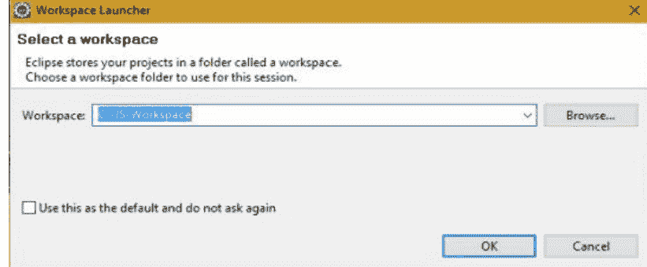

4. 在 eclipse 中，导航至 `File -> New -> Static Web Project`（静态 Web 项目）。点击下方所示的链接。

5. 它将打开一个对话框，要求你输入项目名称。请输入项目名称并点击下方所示的 ‘Finish’ 按钮。

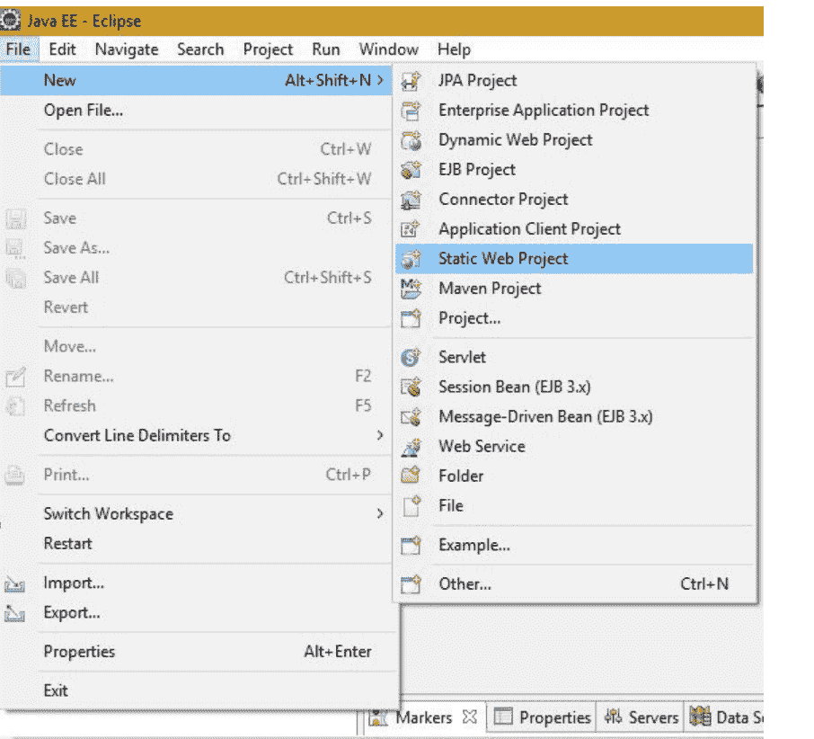

#### 静态 Web 项目 (Static Web Project)

仅为简单内容（HTML 文件）创建 Web 项目。

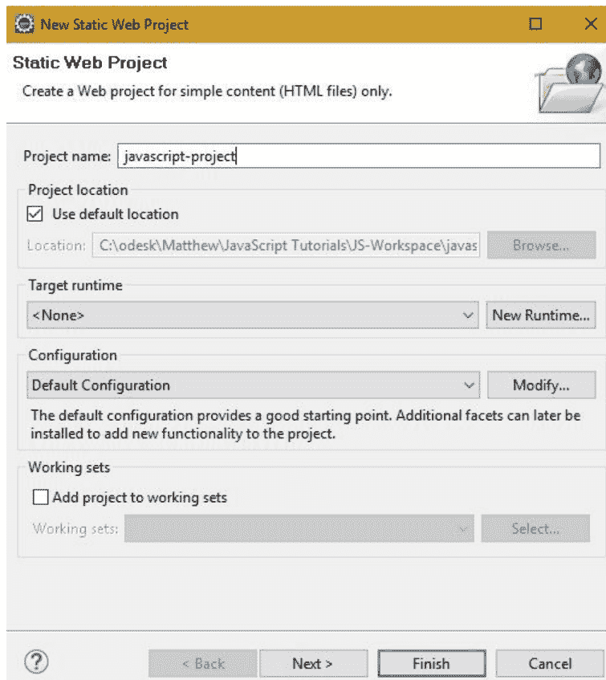

6. 在 Eclipse 的左侧（项目管理器），展开项目目录并右键点击 `WebContent` 文件夹。要在当前项目中添加文件，请导航至 `New -> HTML File`，如下所示。

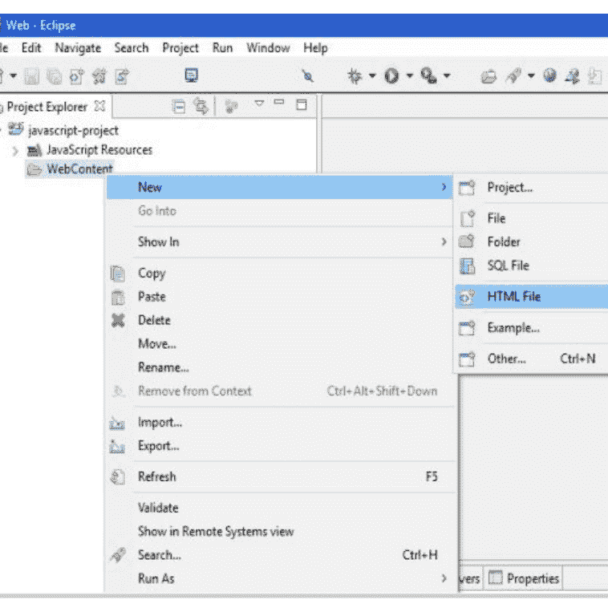

7. 它将打开一个对话框，要求你输入文件名。输入文件名并点击下方所示的 ‘Finish’ 按钮。

到此时，你已经完成了 JavaScript 的开发设置。在下一章中，我们将使用该设置开发我们的第一个 JavaScript 程序。

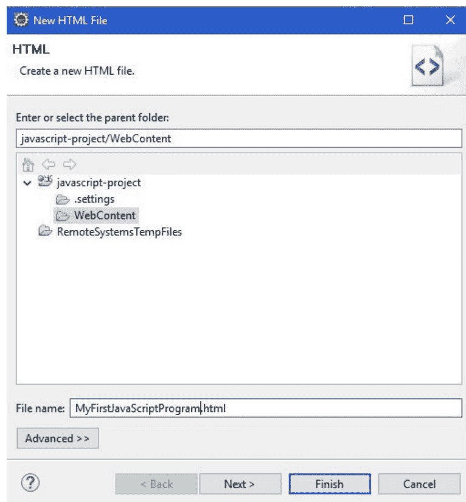

## 第 3 章

### 我的第一个 JavaScript 程序

JavaScript 是一种脚本语言，可以注入网页的任何位置的 `<script>...</script>` 标签中，但通常建议放置在 `<head>...</head>` 区域。

在解析网页上的标记文本（HTML）时，当浏览器程序遇到 `<script>` 标签时，它开始解释这些标签（直到 `</script>`）之间的文本。`script` 标签接受以下两个属性：

`Language` 属性指定我们使用的脚本语言类型。其值为 JavaScript 语言的 `"javascript"`。在 HTML 的最新版本中，该属性已弃用。

`Type` 属性指示正在使用的脚本语言类型，其值将设置为 JavaScript 语言的 `"text/javascript"`。

### 我的第一个 JavaScript 程序

在上一章中，我们创建了一个 html 文件 (`MyJavaScriptProgram.html`)。让我们使用它编写我们的第一个 JavaScript 程序，如下所示。

```html
<!DOCTYPE html>
<html>
<head>
<meta charset="ISO-8859-1">
<title>My First JavaScript Program</title>
</head>
<body>
<script language="javascript" type="text/javascript">
document.write("Welcome to JavaScript First Program");
</script>
</body>
</html>
```

### JavaScript 代码 `<body>...</body>` 标签的解释

在这里，我们将 JavaScript 代码注入到 HTML 的 `<body>...</body>` 标签之间。在 JavaScript 代码（script）中，我们首先声明了之前讨论过的两个属性，然后通过 `document` 对象的帮助，在网页上写下 “Welcome to JavaScript First Program” 的消息。

### 输出

当我们执行上面的 HTML 程序时，将得到如下输出。

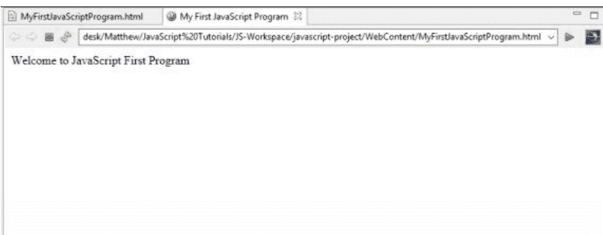

### 空格与换行

我们可以在 JavaScript 程序中自由地使用空格、制表符和换行，因为浏览器解析器在解析 JavaScript 代码时会忽略这些内容。此外，我们可以自由地格式化和缩进我们的 JavaScript 程序，使脚本非常易于维护、阅读和理解。

通常，所有的 JavaScript 语句都以分号结束。但当每个 JavaScript 语句单独放在一行上时，这些分号是可选的。在每个 JavaScript 语句的末尾使用分号被认为是一种良好的编程习惯。

### 大小写敏感

JavaScript 语言是一种大小写敏感的语言。这意味着关键字、变量、函数名、标识符等应该保持一致的字母大小写。例如，从 JavaScript 语言的角度来看，标识符 `learn` 和 `LEARN` 是不同的。

### JavaScript 中的注释

以下是 JavaScript 语言中支持的注释样式。

- 单行注释声明为 `//`（双斜杠）。

- 多行注释声明为 `/* 位于多行上的 JavaScript 语句 */`。它也适用于单行注释。

- 它还能识别 HTML 注释（起始序列）`<!--`。JavaScript 将其视为单行注释，就像处理 `//` 注释一样。

- HTML 的结束序列 `-->` 不被 JavaScript 识别，因此，它应该写成 `-->`。

以下是一个涵盖各种 JavaScript 注释的示例。

```html
<!DOCTYPE html>
<html>
<head>
<meta charset="ISO-8859-1">
<title>JavaScript Comments</title>
</head>
<body>
<script type="text/javascript">
<!-- 起始序列单行注释 --
  HTML 注释的结束序列-->

// 这是一个单行注释。

/*
 * 这是 JavaScript 中的一个多行注释
*/
</script>
</body>
</html>
```

### 输出

当我们执行上述 HTML 程序时，输出将是以下内容（空白），因为 JavaScript 解释器忽略了所有注释。

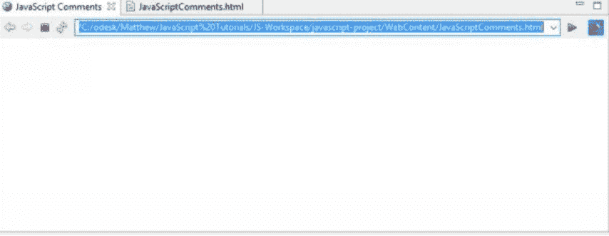

### JavaScript 语法

与任何其他编程语言一样，JavaScript 语法有一套特定的构建规则。

### JavaScript 程序

JavaScript 程序是一系列由浏览器程序解析并执行的指令。这些系列程序指令被称为“语句”。

JavaScript 是一种基于面向对象的编程语言。

JavaScript 语句通常用分号隔开，但在语句末尾放置分号是可选的。

```html
<!DOCTYPE html>
<html>
<head>
<meta charset="ISO-8859-1">
  <title>JavaScript Syntax</title>
  <script type="text/javascript">
    var a = 101;
    var b = 300;
    var sum = a + b;
  </script>
</head>
<body>
  <script type="text/javascript">
    document.write("sum of a + b = "+sum);
  </script>
</body>
</html>
```

### 输出

当我们执行上述 HTML 程序时，输出将是以下内容。

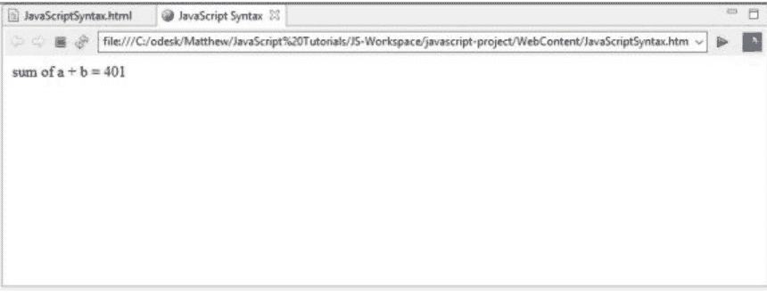

### JavaScript 中的语句

JavaScript 编程语言中的语句由以下部分组成：

- 值

- 运算符

- 表达式

- 关键字，以及

- 注释。

### JavaScript 中的值

以下是 JavaScript 中的两种值：

- 固定值，以及

- 变量值。

字面量是固定值，而变量值被称为变量。

### JavaScript 中的字面量

以下是在 JavaScript 中编写字面量或固定值的规则。

- 数字可以带小数也可以不带小数。

- 字符串是写在单引号或双引号内的文本。

### JavaScript 中的变量

以下是用于在 JavaScript 中存储数据值的变量值编写规则。

JavaScript 语言使用 `var` 关键字来声明变量。

变量的值通过等号赋值。

### JavaScript 中的运算符

以下是 JavaScript 中使用的运算符。

赋值运算符 `=` 用于赋值。

算术运算符 `+ - * /` 用于加、减、乘、除运算。

### JavaScript 中的表达式

JavaScript 表达式是由表达式组合而成的，并可以计算出一个值。一个表达式可以包含值、运算符和变量。以下是一个关于 JavaScript 表达式的示例：

```html
<!DOCTYPE html>
<html>
<head>
<meta charset="ISO-8859-1">
<title>JavaScript Expressions</title>
</head>
<body>
<script type="text/javascript">
var a = 101;
var b = 300;
var sum = a + b;
document.write("sum of a + b = " + sum);
</script>
</body>
</html>
```

当执行上述 HTML 程序时，输出将是：

`sum of a + b = 401`

如浏览器所示。


选择“设置”（Settings），然后点击页面底部的*显示高级设置*（Show advanced settings）。


在“隐私”部分，点击下方所示的“内容设置”（Content settings）按钮。

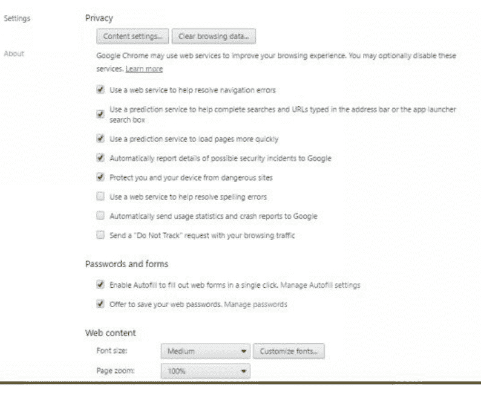

在内容设置 “Javascript” 部分，“不允许任何网站运行 JavaScript”或“允许所有网站运行 JavaScript（推荐）”分别禁用或启用 Chrome 浏览器的 JavaScript 支持。内容设置页面所示。

### 在 Opera 中启用或禁用 JavaScript 支持

以下是在 Opera 中启用或禁用 JavaScript 支持的步骤。

- 打开 Opera 浏览器，从菜单中进入工具（Tools）->首选项（Preferences）。

- 然后，从对话框中选择“高级”（Advanced）选项。

- 接下来，从列出的项目中选择“内容”（Content）。

- 从那里，勾选“启用 JavaScript”复选框。

- 最后，点击 OK 按钮启用 Opera 浏览器的 JavaScript 支持。

同样，要禁用 Opera 浏览器的 JavaScript 支持，我们不勾选“启用 JavaScript”复选框并点击 OK 按钮。

### 对不支持 JavaScript 浏览器的警告

当我们使用 JavaScript 执行非常重要的操作时，可以使用 `<noscript>` 标签向用户显示警告消息。我们可以紧接脚本块之后添加一个 `noscript` 块，如下所示。

```html
<!DOCTYPE html>
<html>
<head>
<meta charset="ISO-8859-1">
<title>No Script tag</title>
</head>
<body>
<script type="text/javascript">
document.write("JavaScript Support is enabled on your browser!");
</script>
<noscript>
请在您的浏览器上启用 JavaScript 支持。
</noscript>
</body>
</html>
```

如果上述任何浏览器不支持 JavaScript 或 JavaScript 支持被禁用，则屏幕上将显示 `<noscript></noscript>` 标签之间的消息。

## 第 6 章

### JavaScript 的位置

HTML 文档中 JavaScript 代码的放置非常灵活，可以以以下方式放置。

**在 `<head>...</head>` 部分中的 JavaScript** —— 这是在 HTML 文档的 head 部分包含 JavaScript 代码的首选方式。我们可以将 JavaScript 代码或函数放置在 head 部分，并如下所示在网页元素事件上访问这些函数。

```html
<!DOCTYPE html>
<html>
<head>
<meta charset="ISO-8859-1">
  <title>JS in head section</title>
  <script type="text/javascript">
    function showAlert(){
      alert("This is an alert from Head section!");
    }
  </script>
</head>
<body>
  <input type="button" onclick="showAlert();" value="Call JavaScript"/>
</body>
</html>
```

### 输出

当我们执行上述 HTML 程序时，将产生如下输出。在输出中，当我们点击网页上的按钮时，会看到消息为 “This is an alert from Head section” 的警报框。

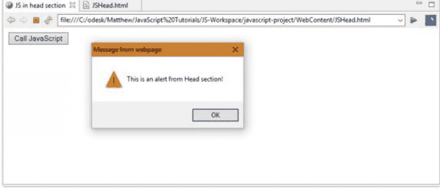

**在 `<body>...` 部分中的 JavaScript** —— 我们也可以将 JavaScript 代码放置在 HTML 代码的 body 部分，但这种方法并不是首选的，因为我们在 body 部分调用的 JavaScript 函数通常被倾向于定义在 HTML 文档的 head 部分。

```html
<!DOCTYPE html>
<html>
<head>
<meta charset="ISO-8859-1">
<title>JS</title>
</head>
<body>
<script type="text/javascript">
document.write("Welcome to JavaScript!");
</script>
</body>
</html>
```

### 输出

当我们执行上述 HTML 程序时，将产生如下输出。在输出中，我们可以看到通过 JavaScript 写在 HTML 页面 body 部分的文本 “Welcome to JavaScript!”。


**在 `<body>...` 部分和 `<head>...</head>` 中的 JavaScript** —— 我们也可以将 JavaScript 代码放置在 HTML 代码的 body 部分，但这种方法并不是首选的，因为我们在 body 部分调用的 JavaScript 函数通常被倾向于定义在 HTML 文档的 head 部分。

```html
<!DOCTYPE html>
<html>
<head>
<meta charset="ISO-8859-1">
<title>JS in head section</title>
  <script type="text/javascript">
    function showAlert(){
      alert("This is an alert from Head section!");
    }
  </script>
</head>
<body>
  <input type="button" onclick="showAlert();" value="Call JavaScript"/>
</body>
</html>
```

```html
<!DOCTYPE html>
<html>
<head>
<meta charset="ISO-8859-1">
<title>JavaScript Variables</title>
<script type="text/javascript">
  var name = "Appy";
  var age = 21;
  var salary = 10000, expenses = 12000;
  alert ("Name: "+name+" Age: "+age+"\nSalary: "+salary+" Expenses: "+expenses);
</script>
</head>
<body>
</body>
</html>
```

### JavaScript 代码说明

将值存储在变量中被称为变量初始化。我们可以在变量创建的任何时候或需要该变量的时候进行变量初始化。

例如，我们在上面的代码中创建了四个变量，并为每个变量赋值了值。例如 `name = "Appy"`，`salary = 10000` 等。

### 输出

当我们执行上述 HTML 程序时，输出将是如下所示。在输出中，我们通过 alert 显示赋值给数据容器的值。


需要注意的是，`var` 关键字仅用于声明或初始化，在 HTML 文档中任何变量名的生命周期仅使用一次。我们不应该多次声明同一个变量。在 JavaScript 中，变量可以持有任何数据类型的任何值。与其他类型语言（例如 C++、JAVA 等）不同，我们不需要在变量声明期间告诉 JavaScript 编译器变量将持有什么类型的值。此外，变量的值类型可以在程序执行过程中更改，JavaScript 解析器会自动处理这一点。

### JavaScript 中的变量作用域

变量的作用域定义为定义它的程序区域。JavaScript 变量可以具有两种作用域：

- 全局变量作用域 – 是全局作用域，意味着它可以在 JavaScript 代码的任何地方定义并在当前 HTML 文档中处处可见。

- 局部变量作用域 – 局部变量仅在定义它的函数内部可见。函数参数始终是函数的局部的。

需要注意的是，在函数体内，如果定义了同名的局部和全局变量，则局部变量的优先级始终高于全局变量。让我们通过以下示例很好地理解这个概念。

```html
<!DOCTYPE html>
<html>
<head>
<meta charset="ISO-8859-1">
<title>Variable Scope</title>
</head>
<script type="text/javascript">
var demoVar = "global scope"; // 一个全局变量
function checkVariableScope() {
var demoVar = "local scope"; // 一个局部变量
document.write(demoVar);
}
</script>
<body onload = checkVariableScope();>
</body>
</html>
```

### 输出

当我们执行上述 HTML 程序时，输出将如下所示。在输出中，我们可以观察到值为 “local scope”，因为如果定义了相同的名称，局部变量的优先级高于全局变量。

### JavaScript 中的变量名

在 JavaScript 语言中命名变量时必须遵守以下规则：

- 变量名不能是保留关键字。这些关键字在本章的最后一节提到。例如 `finally`、`goto` 等变量名是无效的。

- JavaScript 语言中的变量名不能以数字（0-9）开头。然而，它们可以字母或下划线字符开头。例如 `10name` 是无效的变量，但 `_10name` 是有效的名称。

- JavaScript 中的变量名是区分大小写的。例如 `Address` 和 `address` 在 JavaScript 语言中被视为两个不同的变量名。

### JavaScript 保留字

以下是 JavaScript 语言中所有保留字的列表。这些保留字不能用作 JavaScript 变量、循环标签、函数或任何对象名称。

| abstract | debugger | final | instanceof | public |
|---|---|---|---|---|
| boolean | default | finally | int | return |
| break | delete | float | interface | short |
| byte | do | for | long | static |
| case | double | function | native | super |
| catch | else | goto | new | switch |
| char | enum | if | null | switch |
| class | export | import | private | throw |
| const | continue | extends | protected | throws |

## 第 8 章：JavaScript 运算符

当我们加或减值时，例如 `+` 和 `-`，被称为算术运算符。以下是 JavaScript 语言支持的算术运算符：

| 序号 | 算术运算符 | 描述 |
|---|---|---|
| 1. | `+` (加法) | 用于相加两个操作数。 |
| 2. | `-` (减法) | 用于从第一个操作数中减去第二个操作数。 |
| 3. | `*` (乘法) | 用于乘两个操作数。 |
| 4. | `/` (除法) | 用于用除数除被除数。 |
| 5. | `%` (取模) | 输出除法余数。 |
| 6. | `++` (自增) | 增加整数值。 |
| 7. | `--` (自减) | 减少整数值。 |

### 比较运算符

以下是 JavaScript 语言支持的比较运算符：

| 序号 | 比较运算符 | 描述 |
|---|---|---|
| 1. | `==` (等于) | 用于检查值是否相等。 |
| 2. | `!=` (不等于) | 用于检查值是否不相等。 |
| 3. | `>` (大于) | 用于检查左操作数是否大于右操作数。 |
| 4. | `<` (小于) | 用于检查左操作数是否小于右操作数。 |
| 5. | `>=` (大于或等于) | 用于检查左操作数是否大于等于右操作数。 |
| 6. | `<=` (小于或等于) | 用于检查左操作数是否小于等于右操作数。 |

### 逻辑（或关系）运算符

以下是 JavaScript 语言支持的逻辑或关系运算符：

| 序号 | 逻辑运算符 | 描述 |
|---|---|---|
| 1. | `&&` (逻辑与) | 如果两个操作数都不为零，则该运算符为真。 |
| 2. | `||` (逻辑或) | 如果两个操作数中有一个不为零，则该运算符为真。 |
| 3. | `!` (逻辑非) | 该运算符反转其操作数的逻辑状态。如果条件为真，则逻辑非将变为假，反之亦然。 |

### 赋值运算符

以下是 JavaScript 语言支持的赋值运算符：

| 序号 | 赋值运算符 | 描述 | 示例 |
|---|---|---|---|
| 1. | `=` (简单赋值) | 将右侧操作数的值赋值给左侧操作数。 | 例如 `Z = X - Y` 将 `X - Y` 的值赋值给变量 `Z`。 |
| 2. | `+=` (加赋值) | 将右侧操作数加到左侧操作数上，并将结果赋值给左侧操作数。 | 例如 `Z += X` 等同于 `Z = Z + X` |
| 3. | `-=` (减赋值) | 从左侧操作数中减去右侧操作数，并将结果赋值给左侧操作数。 | 例如 `Z -= X` 等同于 `Z = Z - X` |
| 4. | `*=` (乘赋值) | 右侧操作数乘以左侧操作数，并将结果赋值给左侧操作数。 | 例如 `Z *= X` 等同于 `Z = Z * X` |
| 5. | `/=` (除法并赋值) | 此运算符用于将左操作数除以右操作数，并将结果赋值给 `Z`。 | 示例：`Z /= X` |
| 6. | `%=` (取模并赋值) | 此运算符用于对两个等效的操作数进行取模，并将结果赋值给左操作数。 | 示例：`Z %= X` 等同于 `Z = Z % X` |

### 条件运算符（或三元运算符）

以下是 JavaScript 语言支持的条件运算符或三元运算符。

| 序号 | 条件运算符 | 描述 | 示例 |
|---|---|---|---|
| 1. | `? :` (条件运算符) | 如果条件为真？那么取值 X ： 否则取值 Y。 | 示例：`(X > Y) ? "yes" : "No"` |

### 位运算符

以下是 JavaScript 语言支持的位运算符。

| 序号 | 位运算符 | 描述 | 示例 |
|---|---|---|---|
| 1. | `&` (位与) | 此运算符用于对每个整数参数的每一位执行布尔与（AND）操作。 | 示例：`(X & Y)` 结果为 2。 |
| 2. | `|` (位或) | 此运算符用于对每个整数参数的每一位执行布尔或（OR）操作。 | 示例：`(X | Y)` 结果为 3。 |
| 3. | `^` (位异或) | 此运算符用于对每个整数参数的每一位执行布尔异或（XOR）操作。异或意味着两个操作数中有一个为真，但不能都为真。 | 示例：`(X ^ Y)` 结果为 1。 |
| 4. | `~` (位反) | 位反是一个一元运算符，通过反转操作数中的所有位来操作。 | 示例：`(~B)` 结果为 -4。 |
| 5. | `<<` (左移) | 此运算符将其第一个操作数的所有位向左移动第二个操作数指定的位数。新位用零填充。将一个值左移一位等同于将其乘以 2，左移两位等同于乘以 4，依此类推。 | 示例：`(X << 1)` 结果为 4。 |
| 6. | `>>` (右移) | 在二进制右移运算符中，左操作数的值向右移动右操作数指定的位数。 | 示例：`(X >> 1)` |
| 7. | `>>>` (零符号右移) | 此运算符与 `>>` 运算符相同，不同之处左侧移入的位始终为零。 | 示例：`(X >>> 1)` |

## 第 9 章

### JavaScript 决策

在编写程序时，我们大多数时候面临必须做决策的情况。决策是对程序执行过程中可能出现的情况进行预测，并需要根据这些条件指定某些操作。

在决策结构中，有一个条件，它可以是单个表达式，也可以是多个表达式。该条件在求值时会产生 TRUE（真）或 FALSE（假）的结果。根据结果，我们需要确定采取什么操作以及执行哪些语句。请参考下图以清晰地理解。

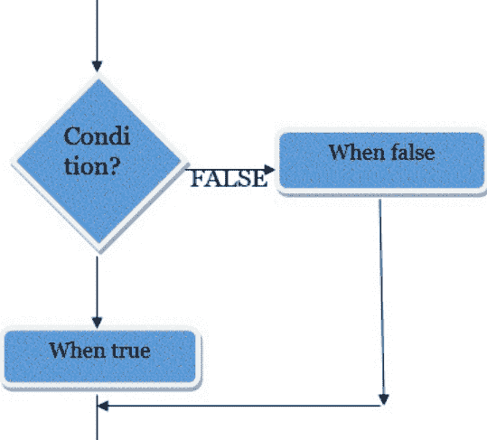

与其他任何编程语言一样，JavaScript 语言支持条件语句，用于根据不同的条件执行不同的操作。以下是 JavaScript 语言支持的条件语句。

- `if` 语句。

- `if...else` 语句

- `if...else if...` 语句。

- `Switch case` 语句

让我们通过 JavaScript 程序来学习这些语句。

**`if` 语句** — `if` 语句是一种基础控制语句，允许 JavaScript 代码根据所需的条件做出决策并执行语句。以下是其语法。

### 语法与示例

```html
<!DOCTYPE html>
<html>
<head>
<meta charset="ISO-8859-1">
<title>基础 IF 语句</title>
</head>
<body>
<script type="text/javascript">
var salary = 10000;
var expenses = 12000;
if (expenses > salary) {
document.write("<b>请开始增加收入或减少开支！</b>");
}
</script>
<p>我们处于 body 部分内部...</p>
</body>
</html>
```

### 输出

当我们执行上述 HTML 程序时，将输出以下内容。由于 `if` 语句中的条件为真，因此它将在 HTML 页面上写入指定的文本。

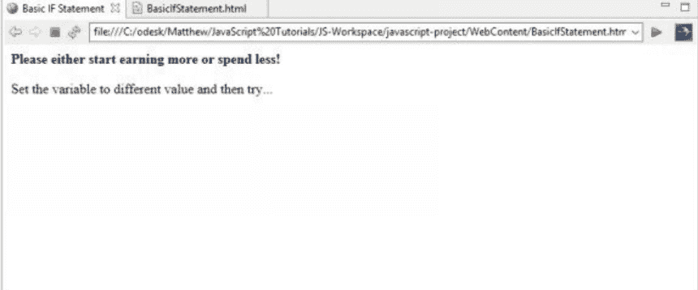

**`if...else` 语句** – `if...else` 语句是控制语句的另一种形式，允许 JavaScript 代码以更受控的方式执行语句。以下是语法和示例。

### 语法与示例

```html
<!DOCTYPE html>
<html>
<head>
<meta charset="ISO-8859-1">
<title>If Else 语句</title>
</head>
<body>
  <script type="text/javascript">
    var salary = 12000;
    var expenses = 10000;
    if (expenses > salary){
      document.write("<b>请开始增加收入或减少开支！</b>");
    }
    else {
      document.write("<b>你有足够的钱花！</b>");
    }
  </script>
  <p>我们处于 body 部分内部...</p>
</body>
</html>
```

### 输出

当我们执行上述 HTML 程序时，将输出以下内容。由于 `if` 语句中的条件为假，因此它将在 HTML 页面上写入指定的文本。

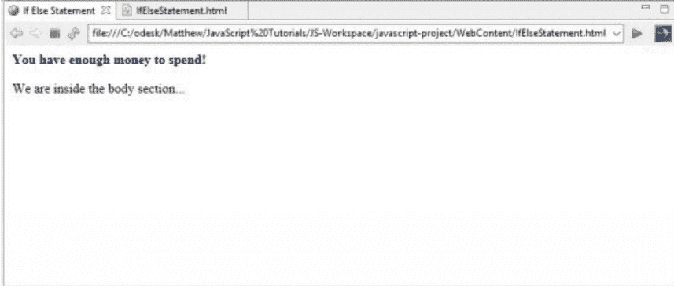

**`if...else if` 语句** — `if...else if` 语句是 `if...else` 的另一种高级形式，允许 JavaScript 代码根据多个条件做出决策。以下是语法和示例。

### 语法与示例

```html
<!DOCTYPE html>
<html>
<head>
<meta charset="ISO-8859-1">
<title>If Else If 语句</title>
</head>
<body>
<script type="text/javascript">
var salary = 10000;
var expenses = 12000;
if (expenses > salary) {
document.write("<b>请开始增加收入或减少开支！</b>");
}
else if (salary > 15000) {
document.write("<b>你有足够的钱花！</b>");
}
else {
document.write("<b>请开始增加收入或减少开支！</b>");
}
</script>
<p>我们处于 body 部分内部...</p>
</body>
</html>
```

### 输出

当我们执行上述 HTML 程序时，将输出以下内容。由于 `if` 语句中的条件为真，因此它将在 HTML 页面上写入指定的文本。

### Switch case 语句

从 JavaScript 1.2 版本开始，它开始支持 `switch` 语句，处理方式类似于重复的 `if` 语句。`switch` 语句根据表达式的值给出不同的语句。JavaScript 解释器检查每个 `case` 以匹配表达式的值，直到找到匹配为止。如果没有找到匹配，则使用 `default` 条件。

此外，`case` 语句末尾有一个 `break` 语句。如果在这里没有 `break`，解释器将继续执行后续所有的 `case`。

以下是 `switch` 语句的语法和示例。

```html
<!DOCTYPE html>
<html>
<head>
<meta charset="ISO-8859-1">
<title>Switch Case 语句</title>
</head>
<body>
<script type="text/javascript">
 var expensecode='X';
document.write("进入 switch 块<br />");
switch(expensecode)
{
 case 'X': document.write("<b>请开始增加收入或减少开支！</b>");
 break;

 case 'Y': document.write("<b>你有足够的钱花！</b>");
 break;

 case 'Z': document.write("<b>虽然你有足够的钱，但你需要加倍小心！</b>");
break;
default: document.write("未找到匹配项!<br />");
}
document.write("<br>退出 switch 块<br />");
</script>
<p>我们处于 body 部分内部...</p>
</body>
</html>
```

### 输出

当我们执行上述 HTML 程序时，将输出以下内容。程序在 HTML 页面上写入了与 `case` 字符 (`'X'`) 匹配的文本。

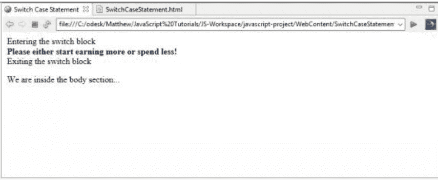

## 第 10 章

### JavaScript 循环

当任何程序执行时，它都是按顺序运行的。序列中第一个出现的语句首先执行，然后是下一条，依此类推，直到程序的最后一条语句。很多时候，需要在程序中多次运行同一块代码，这时就需要一种被称为“循环”的控制结构。

循环使得代码块中的一个语句或一组语句在条件为真时执行多次，并在条件变为假时退出循环。下图展示了这种循环。

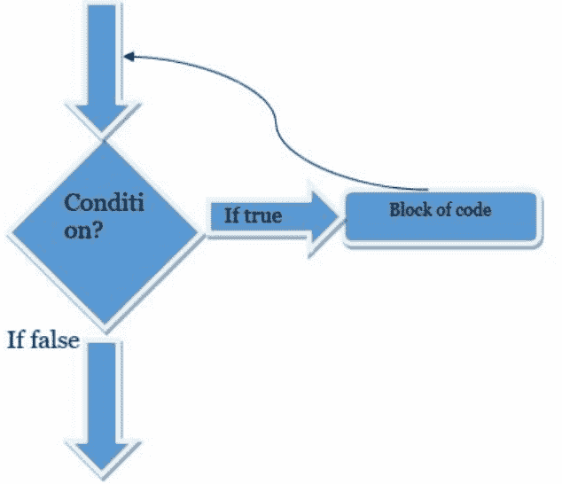

与任何其他编程语言一样，JavaScript 支持循环以及以下类型的循环和循环控制语句。

- `While` 循环

- `Do...while` 循环

- `For` 循环

- `for...in` 循环

### 循环控制语句

#### While 语句

`While` 循环是 JavaScript 语言中最基础的循环。只要表达式保持为真，该循环就会重复执行语句或代码块。一旦表达式为假，循环就会终止。以下是 `while` 语句的语法和示例。

```html
<!DOCTYPE html>
<html>
<head>
<meta charset="ISO-8859-1">
<title>While Loop</title>
</head>
<body>
<script type="text/javascript">
var counter = 0;
document.write("Entering while Loop!");
while (counter < 5) {
document.write("Current Counter is : " + counter + "<br />");
counter++;
}
document.write("Exiting while Loop!");
</script>
<p>We are inside body section...</p>
</body>
</html>
```

### 输出

当我们执行上面的 HTML 程序时，输出将如下所示。计数器会在 HTML 页面上写入 5 次，因为其条件保持了 5 次为真。

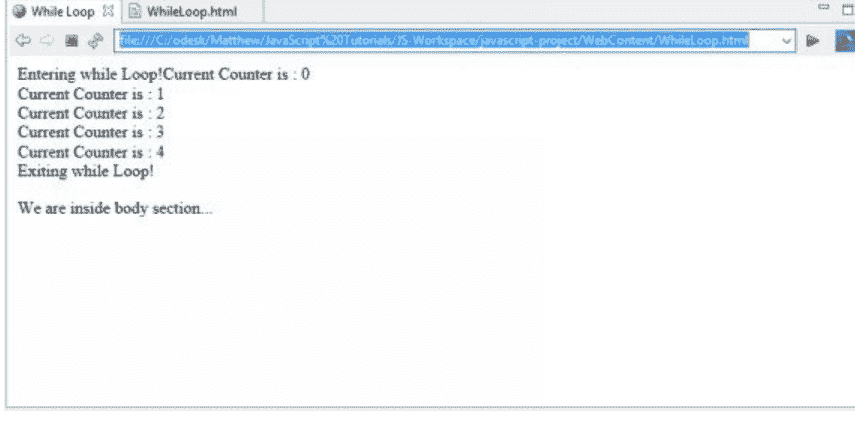

#### Do...while 循环语句

`Do...while` 循环与 `while` 循环相似，不同在于 `do...while` 循环的条件检查发生在循环末尾。这意味着即使条件为假，循环内部的代码块也将至少执行一次。以下是 `do...while` 语句的语法和示例。

```html
<!DOCTYPE html>
<html>
<head>
<meta charset="ISO-8859-1">
<title>Do While Loop</title>
</head>
<body>
<script type="text/javascript">
var counter = 0;
document.write("Entering while Loop!");
do {
document.write("Current Counter is : " + counter + "<br/>");
counter++;
}
while (counter < 5)
document.write("Exiting while Loop!");

</script>
<p>We are inside body section...</p>
</body>
</html>
```

### 输出

当我们执行上面的 HTML 程序时，输出将如下所示。计数器会在 HTML 页面上写入 5 次，因为包括第一次没有检查条件外，其条件保持了 5 次为真。

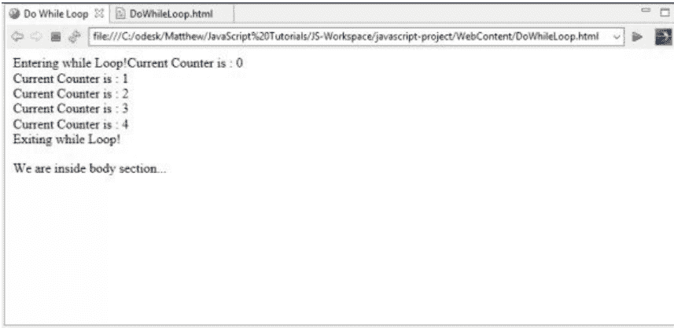

#### For 循环语句

`for` 循环是 JavaScript 编程中非常重要且常用的循环语句。该命令包含以下三个重要部分：

- **循环初始化（Loop initialization）** —— 这是我们将计数器值初始化为起始值。该语句在循环开始之前执行。

- **测试语句（Test statement）** —— 它包含实际条件，该条件会被求值为真或假。如果该条件为真，将执行循环内部的代码块；否则，如果为假，控制将退出循环。

- **迭代语句（Iteration statement）** —— 这是我们增加或减少在第一个语句中初始化计数器值的地方。

循环的好处是，我们可以将这三个语句部分放在同一行，并用分号隔开。以下是语法和示例。

```html
<!DOCTYPE html>
<html>
<head>
<meta charset="ISO-8859-1">
<title>For Loop</title>
</head>
<body>
<script type="text/javascript">
document.write("Entering while Loop!");
for(counter = 0;counter < 5; counter++) {
document.write("Current Counter is : " + counter + "<br />");
}
document.write("Exiting while Loop!");
</script>
<p>We are inside body section...</p>
</body>
</html>
```

### 输出

当我们执行上面的 HTML 程序时，输出将如下所示。计数器会在 HTML 页面上写入 5 次，因为它在计数器值达到 5 之前条件保持了 5 次。

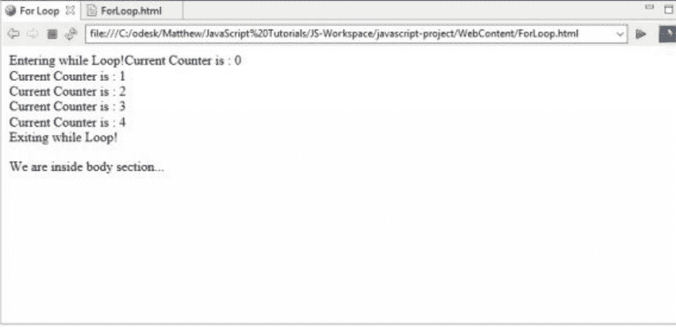

#### for...in 循环语句

`for...in` 循环用于遍历对象的属性的特殊情况。`for...in` 循环的语法和示例。

```html
<!DOCTYPE html>
<html>
<head>
<meta charset="ISO-8859-1">
<title>For In Loop</title>
</head>
<body>
<script type="text/javascript">
var prop;
document.write("Object properties:<br />");
for (prop in navigator) {
  document.write(prop + ": " + navigator[prop] + "<br />");
}
</script>
<p>We are inside body section...</p>
</body>
</html>
```

### 输出

当我们执行上面的 HTML 程序时，输出将如下所示。在输出中，我们可以看到 `navigator` 的所有属性。

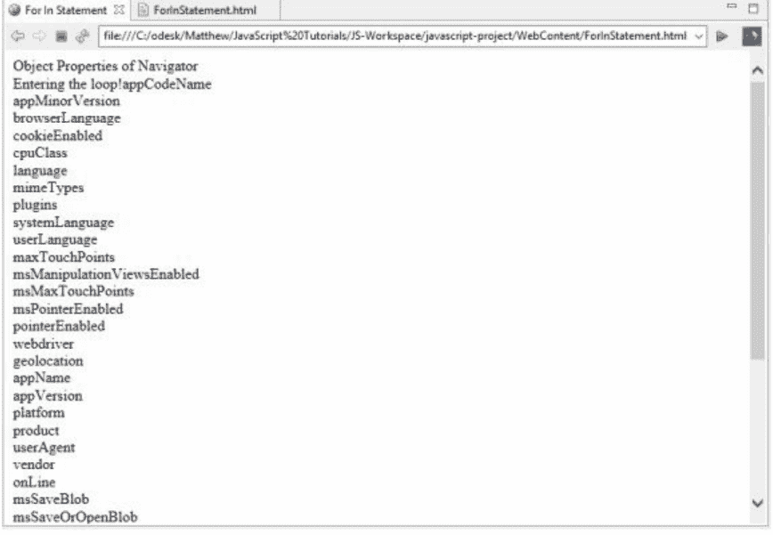

### 循环总结

| 循环类型 | 描述 |
|---|---|
| `while` 循环 | `While` 循环类型在条件为真时重复语句或一组语句。 |
| `for` 循环 | `For` 循环类型多次执行语句。 |
| 嵌套循环 | 循环中的循环。在 JavaScript 中，我们可以在 `for` 循环中使用 `while` 循环。 |

### 循环控制语句

JavaScript 中的循环控制语句用于改变执行顺序。当执行离开作用域时，在该作用域中创建的所有对象都会被销毁。JavaScript 语言支持以下循环控制语句。

| 控制语句 | 描述 |
|---|---|
| `break` | `break` 语句终止循环并将执行转移到其后面的语句。 |
| `continue` | `continue` 语句用于跳过循环体的剩余部分并立即重新测试条件。 |

让我们通过以下示例更好地理解这些循环语句。

```html
<!DOCTYPE html>
<html>
<head>
<meta charset="ISO-8859-1">
<title>Loop Control Statement</title>
</head>
<body>
<script type="text/javascript">
    var counter = 0;
    document.write("Entering while Loop!<br>");

    while (counter < 5){
      if (counter == 3){
        counter++;
        continue;
      }
      if (counter == 4){
        break;
      }
      document.write("Current Counter is : " + counter + "<br />");
      counter++;
    }
    document.write("Exiting while Loop!");
  </script>
  <p>We are inside body section...</p>
</body>
</html>
```

### 输出

当我们执行上面的 HTML 程序时，输出将如下所示。在输出中，我们可以看到计数器值打印了 3 次（0、1 和 2），然后循环退出了。这是因为当计数器值变为 3 时，我们执行了 `continue` 循环控制语句，它将计数器增加到 4 并跳过了文档写入部分重新检查条件。当计数器值变为 4 时，我们执行了 `break` 循环控制语句，它最终将退出当前循环并再次跳过下方的文档写入语句。

## 第 11 章

### JavaScript 函数

函数可以定义为一段代码，该代码组织良好且可以多次重用，用于在需要高度模块化和可重用性的程序中执行许多操作。它消除了反复编写相同代码段的需求，并帮助程序员编写模块化代码。通过函数的概念，程序员可以将一个大程序拆分为许多较小且易于管理的函数，从而最终减少冗余。

与任何其他编程语言一样，JavaScript 语言也支持使用函数来编写模块化代码所需的特性。从这些教程开始，我们一直在使用像 `alert()` 和 `write()` 这样的函数，这让我们对函数的操作有了一点提示。这些函数是 JavaScript 的内置函数。在 JavaScript 语言中，我们可以像在本章将要学习的其他任何编程语言一样编写自己的函数。

### 函数定义

函数可以在代码的任何地方使用，我们只需要定义它们一次。在 JavaScript 中，我们通过使用 `function` 关键字来定义函数，后面跟着一个唯一的函数名、一个参数列表（可以是空的）以及用大括号括起来的语句块。以下是 JavaScript 函数的语法和示例。

```html
<!DOCTYPE html>
<html>
<head>
<meta charset="ISO-8859-1">
<title>Function Definition</title>
<script type="text/javascript">
function sayHelloToJavaScript() {
    alert("Welcome to the world of JavaScript!");
}
</script>
</head>
<body>
</body>
</html>
```

### 调用函数

我们可以在脚本的后续或 HTML 网页元素上调用 JavaScript 函数，我们只需要像下面的代码所示编写该函数的名称。

```html
<!DOCTYPE html>
<html>
<head>
<meta charset="ISO-8859-1">
<title>Function Definition</title>
<script type="text/javascript">
function sayHelloToJavaScript() {
    alert("Welcome to the world of JavaScript!");
}
</script>
</head>
<body>
<input type="button" onclick="sayHelloToJavaScript();" value="Call JavaScript"/>
</body>
</html>
```

### 输出

当我们执行上述 HTML 程序时，输出将如下所示。在这里，我们在按钮的点击事件上调用 JavaScript 函数，显示一个警报，其消息是从定义 JavaScript 函数的 HTML head 部分获取的。

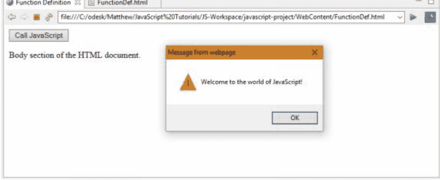

### 函数参数

到目前为止，我们使用的是没有输入参数的函数。在 JavaScript 函数中，可以在调用时传递不同的参数。传递的参数值可以在函数内部，我们可以对这些参数进行操作。函数可以接受从零到多个参数。函数中的多个参数之间用逗号分隔。以下是参数化函数的语法和示例。

```html
<!DOCTYPE html>
<html>
<head>
<meta charset="ISO-8859-1">
<title>Parameterized Function</title>
<script type="text/javascript">
function sayHelloToJavaScript(message,entity,lang) {
  alert(message+" to the "+entity+" world of "+lang+"!");
}
</script>
</head>
<body>
  <input type="button" onclick="sayHelloToJavaScript('Welcome','World','JavaScript');" value="Call JavaScript"/>
  <p>Body section of the HTML document.</p>
</body>
</html>
```

### 输出

当我们执行上述 HTML 程序时，输出将如下所示。在这里，我们在按钮的点击事件上调用参数化的 JavaScript 函数，显示一个警报，其消息是从定义 JavaScript 函数的 HTML head 部分获取的。


### return 语句

函数可以返回一个值，`return` 语句是可选的。`return` 语句用于我们想要函数返回一个值时。通过以下示例演示 `return` 的用法。

```html
<!DOCTYPE html>
<html>
<head>
<meta charset="ISO-8859-1">
<title>Return Function</title>
<script type="text/javascript">
function concatString(message,entity) {
  var str = message+entity;
  return str;
}
function writeDoc(message,entity) {
  concatStr = concatString(message,entity);
  document.write(concatStr);
}
</script>
</head>
<body>
<input type="button" onclick="writeDoc('Welcome to the ','World!');" value="Call JavaScript">
</body>
</html>
```

### 输出

当我们执行上述 HTML 程序时，输出将如下所示。在这里，我们在按钮的点击事件上调用 JavaScript 函数，显示一个警报，其消息是从定义 JavaScript 函数的 HTML head 部分获取的。


## 第 12 章

### JavaScript 事件

JavaScript 事件是 JavaScript 与文档交互的手段。例如，当我们加载页面时，这就是一个事件。同样，当我们点击按钮时，这也是一个事件。程序员可以使用这些事件来触发并执行 JavaScript 响应。

以下是一些示例：

#### onclick 事件类型

这是最常用的事件类型，在我们点击按钮时触发 JavaScript 代码。我们可以在此事件类型上编写验证。以下示例演示了该事件。

```html
<!DOCTYPE html>
<html>
<head>
<meta charset="ISO-8859-1">
<title>On Click Events</title>
<script type="text/javascript">
function showAlert() {
  alert("This is an alert!");
}
</script>
</head>
<body>
  <input type="button" onclick="showAlert();" value="Call JavaScript"/>
</body>
</html>
```

### 输出

当我们执行上述 HTML 程序时，输出将如下所示。我们在按钮的点击事件上调用 JavaScript 函数 `showAlert`，显示一个警报框消息。


#### onsubmit 事件类型

这是在我们提交 HTML 表单时生效的事件类型。我们也可以在此事件类型上编写表单验证。在以下示例中，我们演示了 `onSubmit` 事件是如何触发的。在提交表单数据到 Web 服务器之前，我们可以调用 `validate()` 函数。只有当 `validate()` 函数返回 `true` 时，表单才会提交，否则完全不会提交。

```html
<!DOCTYPE html>
<html>
<head>
<meta charset="ISO-8859-1">
<title>On Submit Events</title>
<script type="text/javascript">
function validation() {
if(document.form1.textbox1.value != "") {
  alert('Validation Passed');
  return true;
}
else{
  alert('Text Box field cannot be empty!');
  return false;
}
}
</script>
</head>
<body>
<form name="form1" method="GET" action="onClickEvent.html" onsubmit="return validation()">
<input type="text" name="textbox1"/>
<input type="submit" value="Submit" />
</form>
</body>
</html>
```

### 输出

当我们执行上面的 HTML 程序时，将输出以下内容。在这里，我们正在验证文本框元素不能为空；如果不在其中输入任何值并点击提交按钮，它将向表单提交返回 `false` 并显示警报消息 “Text Box field cannot be empty!”（文本框不能为空！）。

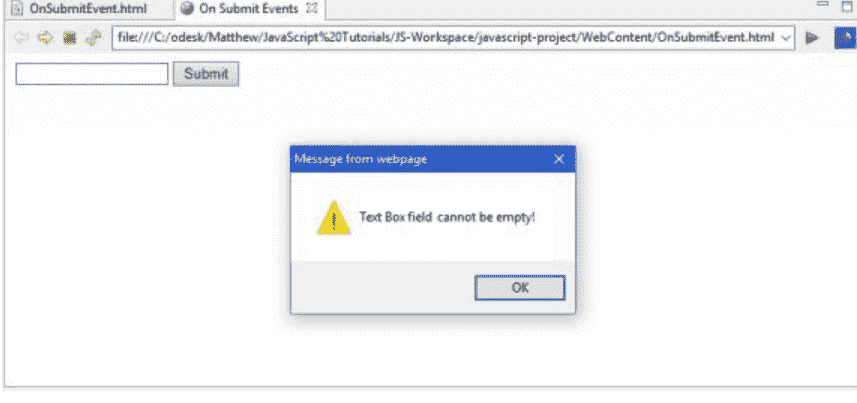

#### onmouseover 和 mouseout 事件类型

这两种是常用的鼠标事件类型，可以帮助我们使用图像或文本创建精美的效果。当鼠标悬停在 HTML 页面上的任何网页元素上，会触发 `onmouseover` 事件；当我们将鼠标移出该网页元素时，会触发 `mouseout` 事件。下面的示例演示了这些事件。

```html
<!DOCTYPE html>
<html>
<head>
<meta charset="ISO-8859-1">
<title>Mouse Over and Out</title>
<script type="text/javascript">
function hoverMouse() {
alert("Doing the Mouse Over");

}

function hoverMouseOut() {
  alert("Taking the Mouse Out");
}
</script>
</head>
<body>
  <div onmouseover="hoverMouse();" onmouseout="hoverMouseOut();">
    <h1> Bring your Mouse here to see the change </h1>
  </div>
</body>
</html>
```

### 输出

当我们执行上面的 HTML 程序时，将输出以下内容。在这里，当鼠标悬停在标题区域上时，可以看到警报消息被调用。同样地，当鼠标移出该区域时，我们会看到另一个警报，表示鼠标移出了标题区域。

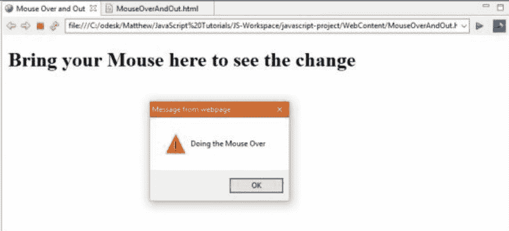

### HTML 5 中存在的标准事件

以下是标准的 HTML 5 事件属性。所有这些属性的值都是脚本，表示在触发事件时要调用并执行的 JavaScript 函数。

| 事件属性 | 值 | 描述 |
| --- | --- | --- |
| `Offline` | script | 当文档离线时触发此属性。 |
| `Onabort` | script | 在取消事件时触发此属性。 |
| `Onafterprint` | script | 在文档打印后触发此属性。 |
| `onbeforeonload` | script | 在文档加载之前触发此属性。 |
| `Onbeforeprint` | script | 在文档打印之前触发此属性。 |
| `Onblur` | script | 当窗口失去焦点时触发此属性。 |
| `Oncanplay` | script | 当媒体可以开始播放但可能由于缓冲而必须停止时触发此属性。 |
| `oncanplaythrough` | script | 当媒体可以播放到结束而无需因缓冲而停止时触发此属性。 |
| `Onchange` | script | 当元素发生变化时触发此属性。 |
| `Onclick` | script | 在鼠标点击时触发此属性。 |
| `oncontextmenu` | script | 当触发右键菜单时触发此属性。 |
| `Ondblclick` | script | 在鼠标双击时触发此属性。 |
| `Ondrag` | script | 当元素正在被拖动时触发此属性。 |
| `Ondragend` | script | 在拖拽操作结束时触发此属性。 |
| `Ondragenter` | script | 当元素被拖动到有效的放置目标时触发此属性。 |
| `Ondragleave` | script | 当元素正在被拖过有效的放置目标上方时触发此属性。 |
| `Ondragover` | script | 在拖拽操作开始时触发此属性。 |
| `Ondragstart` | script | 在拖拽操作开始时触发此属性。 |
| `Ondrop` | script | 当被拖动的元素被释放时触发此属性。 |
| `Ondurationchange` | script | 当媒体长度改变时触发此属性。 |
| `Onemptied` | script | 当媒体资源元素突然变空时触发此属性。 |
| `Onended` | script | 当媒体播放结束时触发此属性。 |
| `Onerror` | script | 当发生错误时触发此属性。 |
| `Onfocus` | script | 当窗口获得焦点时触发此属性。 |
| `Onformchange` | script | 当表单发生变化时触发此属性。 |
| `Onforminput` | script | 当表单获取用户输入时触发此属性。 |
| `Onhaschange` | script | 当文档发生变化时触发此属性。 |
| `Oninput` | script | 当元素获取用户输入时触发此属性。 |
| `Oninvalid` | script | 当元素无效时触发此属性。 |
| `Onkeydown` | script | 当按下按键时触发此属性。 |
| `Onkeypress` | script | 当按下按键时触发此属性。 |
| `Onkeyup` | script | 当松开按键时触发此属性。 |
| `onload` | script | 当文档加载时触发此属性。 |
| `Onloadeddata` | script | 当媒体数据加载时触发此属性。 |
| `onloadedmetadata` | script | 当媒体元素的时长和其他媒体数据加载完成时触发此属性。 |
| `Onloadstart` | script | 当浏览器开始加载媒体数据时触发此属性。 |
| `Onmessage` | script | 当消息触发时触发此属性。 |
| `onmousedown` | script | 当按下鼠标按钮时触发此属性。 |
| `onmousemove` | script | 当鼠标移动时触发此属性。 |
| `Onmouseout` | script | 当鼠标移出元素时触发此属性。 |
| `Onmouseover` | script | 当鼠标悬停在元素上时触发此属性。 |
| `onmouseup` | script | 当释放鼠标键时触发此属性。 |
| `onmousewheel` | script | 当旋转滚轮时触发此属性。 |
| `Onoffline` | script | 当文档离线时触发此属性。 |
| `Ononline` | script | 当文档上线时触发此属性。 |
| `Onpagehide` | script | 当窗口隐藏时触发此属性。 |
| `Onpageshow` | script | 当窗口显示时触发此属性。 |
| `Onpause` | script | 当媒体被暂停时触发此属性。 |
| `Onplay` | script | 当媒体准备开始播放时触发此属性。 |
| `Onplaying` | script | 当媒体开始播放时触发此属性。 |
| `Onpopstate` | script | 当窗口历史改变时触发此属性。 |
| `onprogress` | script | 当浏览器正在获取媒体数据时触发此属性。 |
| `onratechange` | script | 当媒体播放速率改变时触发此属性。 |
| `onreadystatechange` | script | 当就绪状态改变时触发此属性。 |
| `Onredo` | script | 当文档执行重做时触发此属性。 |
| `Onresize` | script | 当窗口调整大小时触发此属性。 |
| `Onscroll` | script | 当元素的滚动条被滚动时触发此属性。 |
| `Onseeked` | script | 当媒体元素的寻找属性不再为真且寻道结束时触发此属性。 |
| `Onseeking` | script | 当媒体元素的寻找属性为真且寻道开始时触发此属性。 |
| `Onselect` | script | 当元素被选中时触发此属性。 |
| `Onstalled` | script | 在获取媒体数据出现错误时触发此属性。 |
| `Onstorage` | script | 当文档加载时触发此属性。 |
| `Onsubmit` | script | 当表单提交时触发此属性。 |
| `Onsuspend` | script | 当浏览器一直在获取媒体数据但在获取整个媒体文件之前停止时触发此属性。 |
| `Ontimeupdate` | script | 当媒体改变播放位置时触发此属性。 |
| `Onundo` | script | 当文档执行撤销时触发此属性。 |
| `Onunload` | script | 当用户离开文档时触发此属性。 |
| `Onvolumechange` | script | 当媒体改变音量或音量设为静音时触发此属性。 |
| `Onwaiting` | script | 当媒体停止播放但预计将恢复时触发此属性。 |

## 第 13 章

### JavaScript 对话框

对话框在 JavaScript 中用于通过 `alert` 弹出警告、或者请求用户确认，或者接受用户的输入。为了支持这些功能，JavaScript 有以下三种类型的对话框：

- 警告对话框 (Alert Dialogue Box)

- 确认对话框 (Confirmation Dialogue Box)

- 提示对话框 (Prompt Dialogue Box)

### 警告对话框

当我们想在对话框中向用户显示警告消息时，我们就使用警告对话框。例如，当我们使用 `onSubmit` 事件验证表单时，我们不接受用户的任何输入，只需要显示警告消息，在这种情况下，我们使用警告框来显示此类警告消息。警告框只有一个 “OK” 按钮可以点击并继续。

```html
<!DOCTYPE html>
<html>
<head>
<meta charset="ISO-8859-1">
<title>On Submit Events</title>
<script type="text/javascript">
function validation() {
  if(document.form1.textbox1.value != "") {
    alert('Validation Passed');
    return false;
  }
  else{
    alert('Text Box field cannot be empty!');
    return false;
  }
}
</script>
</head>
<body>
<form name="form1" method="GET" action="onClickEvent.html" onsubmit="return validation()">
<input type="text" name="textbox1" />
<input type="submit" value="Submit" />
</form>
</body>
</html>
```

### 输出

当我们执行上述 HTML 程序时，将得到如下输出。在这里，我们看到了一个警告对话框。

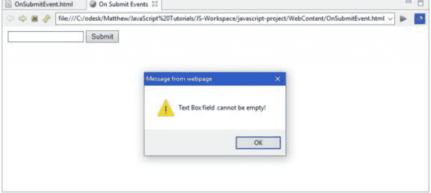

### 确认对话框

在 JavaScript 语言中，当我们对任何选项获取用户的意见时，就会使用确认对话框。它显示一个包含两个按钮的对话框：OK 按钮和取消按钮。

当用户点击 OK 按钮时，窗口方法 `confirm()` 将返回一个 `true` 值。否则，如果用户点击取消按钮，那么 `confirm()` 方法将返回一个 `false` 值。以下是确认对话框的一个示例。

```html
<!DOCTYPE html>
<html>
<head>
<meta charset="ISO-8859-1">
<title>Confirm Box</title>
<script type="text/javascript">
  function showAlert() {
    confirm("This is an confirm dialogue box example!");
  }
</script>
</head>
<body>
<p>Confirm box demo example.</p>
<input type="button" onclick="showAlert();" value="Call JavaScript">
</body>
</html>
```

### 输出

当我们执行上述 HTML 程序时，将得到如下输出。在这里，我们看到了一个确认对话框。

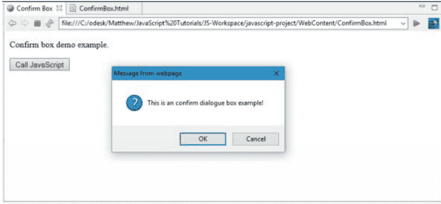

### 提示对话框

在 JavaScript 语言中，当我们想要弹出一个接受用户输入的文本框时，就会使用提示对话框。因此，它允许系统与用户进行交互。用户需要在字段中输入所需的数据，然后点击 OK 按钮。

此类对话框通过使用名为 `prompt()` 的方法显示。它接受以下两个参数：

- 我们想在文本框中显示的标签。

- 显示在文本框中的默认字符串。

提示对话框有以下两个按钮：

- OK 按钮。

- 取消按钮。

当用户点击 OK 按钮时，窗口方法 `prompt()` 将返回用户在文本框中输入的值。否则，如果用户点击取消按钮，那么窗口方法 `prompt()` 将返回一个 `null` 值。

以下是提示对话框的一个示例。

```html
<!DOCTYPE html>
<html>
<head>
<meta charset="ISO-8859-1">
<title>Prompt Box</title>
<script type="text/javascript">
function showAlert(){
  prompt("This is an prompt dialogue box example!");
}
</script>
</head>
<body>
<p>Prompt dialogue box demo example.</p>
<input type="button" onclick="showAlert();" value="Call JavaScript"/>
</body>
</html>
```

### 输出

当我们执行上述 HTML 程序时，将得到如下输出。在这里，我们看到了一个提示对话框。


## 第 14 章

### JavaScript void 关键字

在 JavaScript 语言中，`void` 关键字可以作为一元运算符使用，出现在其单个操作数之前，该操作数可以是任何类型。该一元运算符指定一个不需要返回值的表达式。

以下是 `void` 关键字的语法和示例。

```html
<!DOCTYPE html>
<html>
<head>
<meta charset="ISO-8859-1">
<title>Void Example</title>
</head>
<body>
<p>Click here</p>
<a href="javascript:void(alert('Hello'))">Click</a>
</body>
</html>
```

### 输出

当我们执行上述 HTML 程序时，将得到如下输出。在这里，我们看到了一个警告框。

## 第 15 章

### JavaScript 对象

JavaScript 语言是一种基于面向对象 (OOP) 的语言，提供了以下能力：

- **封装 (Encapsulation)** —— 这种概念允许我们将数据和方法整合在一起存储在对象中。

- **聚合 (Aggregation)** —— 这种概念允许我们将一个对象存储在另一个对象内部。

- **继承 (Inheritance)** —— 这种概念允许类继承或重用另一个类（父类）的属性和方法。

- **多态 (Polymorphism)** —— 这种概念允许程序员编写具有相同名称但执行方式不同的函数/方法。称为方法重载。

- **对象 (Objects)** —— 对象由属性组成。属性可以是函数，也可以是属性。

### JavaScript 对象属性

JavaScript 中的对象属性可以是任何原始数据类型（数字、字符串和布尔值），可以是任何抽象数据类型（如对象）。对象属性是对象方法内部使用的变量。它们也可以作为全局可见变量，因此可以在整个页面中使用。以下是语法和示例。

```html
<!DOCTYPE html>
<html>
<head>
<meta charset="ISO-8859-1">
<title>Objects Example</title>
<script type="text/javascript">
objectName.objectProperty = propertyValue;
var str = document.title;
</script>
</head>
<body>
</body>
</html>
```

在这里，我们将 `propertyValue` 变量的值赋值给对象属性 `objectProperty`。该对象通过名称 `objectName` 进行引用。

在上述示例的下一条语句中，我们使用 `document` 对象的 `title` 属性将文档标题的值存储到变量 `str` 中。

### JavaScript 对象方法

对象方法是对象执行操作或所需执行的函数。在 JavaScript 中，函数与方法的区别在于：函数是一个独立的语句单元，而方法是附加到对象上的，可以通过 `this` 关键字进行引用。

方法可以用于在 HTML 页面上显示对象内容。它们可以对对象属性和传递给对象方法的输入参数执行复杂的数学运算。例如，在教程期间，我们使用了 `document` 对象的 `write` 方法，我们将字符串或文本作为参数传递以写在 HTML 页面上。

```html
<!DOCTYPE html>
<html>
<head>
  <meta charset="ISO-8859-1">
  <title>Object Method Example</title>
  <script type="text/javascript">
  document.write("Welcome to JavaScript Programming!");
  </script>
</head>
<body>
</body>
</html>
```

### JavaScript 中的用户定义对象

在 JavaScript 语言中，所有用户定义的对象以及内置对象都派生于一个名为 `Object` 的对象（类似于 JAVA 语言）。

### JavaScript 中的 new 运算符

`new` 运算符用于创建对象实例。为了在 JavaScript 中创建对象，语句中包含 `new` 运算符，其后跟着构造方法，如下所示。在这里，构造方法为 `Object()`、`Array()` 和 `Date()`。这些构造方法是 JavaScript 的内置函数。

```html
<!DOCTYPE html>
<html>
<head>
<meta charset="ISO-8859-1">
<title>The New Operator</title>
<script type="text/javascript">
var student = new Object();
var languages = new Array("JavaScript", "Pascal", "Python");
var day = new Date("August 24, 1989");
alert(day);
</script>
</head>
<body>

</body>
</html>
```

### 输出

当我们执行上述 HTML 程序时，将得到如下输出。在这里，我们在警告对话框上显示 `Date` 对象的属性。

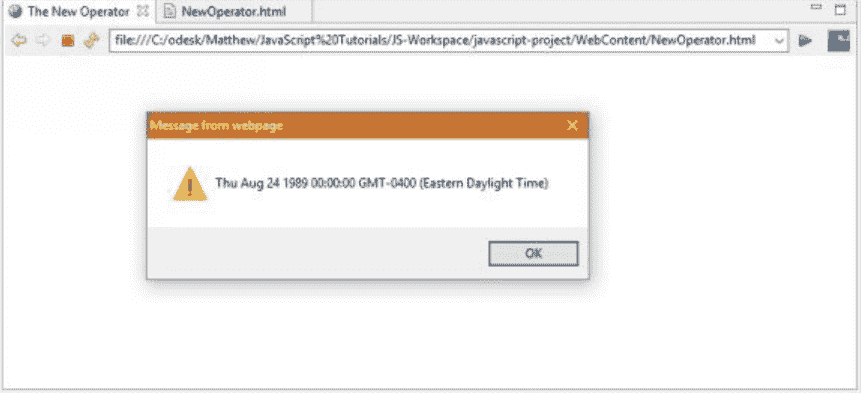

### `Object()` 构造函数

如前所述，构造函数是一个用于创建和初始化 JavaScript 对象的函数。一种名为 `Object()` 的特殊构造函数用于在 JavaScript 中构建对象。`Object()` 构造函数返回的值被赋值给名为对象引用变量的变量。以下示例演示了如何在 JavaScript 中创建一个对象。

```html
<!DOCTYPE html>
<html>
<head>
<meta charset="ISO-8859-1">
<title>Object Creation</title>
<script type="text/javascript">
var student = new Object();
student.name = "Appy";
student.age = "21";
student.course = "JavaScript";
function showDetails() {
 alert("Name: "+student.name + " Age: "+student.age+" Course: "+student.course);
}
</script>
</head>
<body>
<input type="button" onclick="showDetails();" value="Get Student details!" />
</body>
</html>
```

需要注意的是，对象属性变量没有使用 `var` 关键字定义。

### 输出

当我们执行上述 HTML 程序时，将得到如下输出。

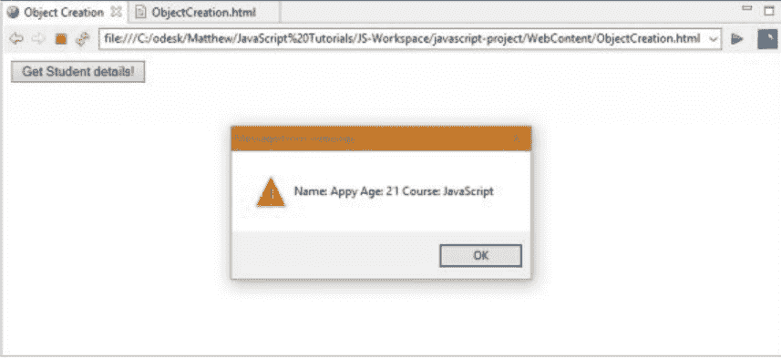

### 在 JavaScript 中为对象定义方法

在上一个示例中，我们演示了如何使用构造函数创建对象并分配属性。在接下来的示例中，我们将演示如何在 JavaScript 中为对象定义方法。

```html
<!DOCTYPE html>
<html>
<head>
<meta charset="ISO-8859-1">
<title>Object Methods</title>
<script type="text/javascript">
function student(name, course) {
this.name = name;
this.course = course;
}
</script>
</head>
<body>
<script type="text/javascript">
var record = new student("Appy", "JavaScript");
alert("name is : " + record.name + "Course is " + record.course );
</script>
</body>
</html>
```

当我们执行上述 HTML 程序时，将得到如下输出。在这里，我们在对象的同时添加了一个函数。

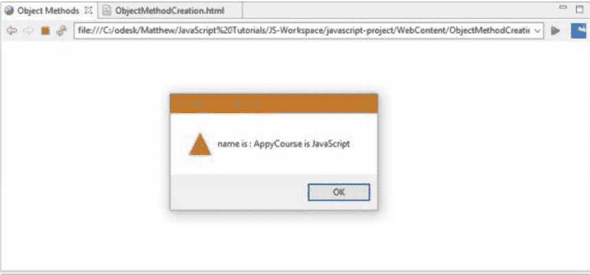

### JavaScript 中的 ‘with’ 关键字

在 JavaScript 中，`with` 关键字用作简写，用于引用对象的属性或方法。

在这里，作为 `with` 参数指定的对象在随后的代码块期间成为默认对象。在这种情况下，无需指定对象名称即可使用该对象的属性和方法。以下是语法和示例。

```html
<!DOCTYPE html>
<html>
<head>
<meta charset="ISO-8859-1">
<title>With Keyword</title>
<script type="text/javascript">
// 一个可以作为方法的函数

function addAge(years) {
  with(this) {
    age = years;
  }
}

function student(name, course) {
  this.name = name;
  this.course = course;
  this.age = 0;
  this.addAge = addAge; // 方法的属性
}
</script>
</head>
<body>
<script type="text/javascript">
var record = new student("Appy", "JavaScript");
record.addAge(21);
alert("name is : " + record.name + "Course is " + record.course );
</script>
</body>
</html>
```

### 输出

当我们执行上述 HTML 程序时，将得到如下输出。在这里我们在警告对话框上显示 `Date` 对象的属性。


