# JavaScript 从入门到精通编程指南

## 第 1 章 JavaScript 编程语言简介

欢迎来到 JavaScript 的世界。JavaScript 由 Brendan Eich 于 1995 年发明，至今仍是最常用的脚本语言。它是一种高级的、解释型的、跨平台的开源编程语言。在本系列教程中，我们将通过实际示例来学习 JavaScript。在深入学习之前，让我们先了解一些基础知识。

JavaScript 是一种面向对象的脚本语言，主要用于 Web 编程。它负责使网页具有交互性；简单来说，它"告诉网页该做什么"。就像 HTML 定义网页的内容，CSS 定义网页的布局一样，JavaScript 让网页能够正常运作。JavaScript 程序是由一系列指令组成的，这些指令按照编写顺序依次执行，因此在编码时，我们应注意逻辑顺序。不要将 Java 和 JavaScript 混淆，它们在设计上是两种完全不同的语言，但它们的标准库和语法是相同的。

现在，让我们学习如何在计算机上安装这门令人惊叹的语言，并编写我们的第一个 JavaScript 程序。

## 第 2 章 开发环境 IDE 搭建

在本教程中，我们将使用 Eclipse 作为开发 IDE 来实际讲解 JavaScript 程序示例。以下是安装 Eclipse 并搭建 JavaScript 开发环境的步骤。

请按照以下步骤操作：

1. 从以下链接下载 Eclipse。选择最新的稳定版本，并确保如果你的机器是 64 位的，则选择 64 位的 Eclipse。本教程中使用的是 Eclipse MARS.1 版本。

   `https://eclipse.org/downloads`

2. 点击 `eclipse.exe` 打开 Eclipse，系统会要求你选择一个本地目录作为工作空间，如下图所示。

3. 选择或创建一个目录于任意可用磁盘上，然后点击"确定"按钮启动 Eclipse。

4. 在 Eclipse 中导航至 `File -> New -> Static Web Project`。如下图所示点击相应链接。

5. 将弹出一个对话框，要求你输入项目名称。请输入项目名称并点击"Finish"按钮，如下图所示。

6. 在 Eclipse 左侧（项目资源管理器）中，展开项目目录，右键点击"WebContent"文件夹。要在当前项目中添加 HTML 文件，请导航至 `New -> HTML File`，如下图所示。

7. 将弹出一个对话框，要求你输入文件名。请输入文件名并点击"Finish"按钮，如下图所示。这将在当前静态 Web 项目中添加一个 HTML 文件。

至此，你已成功完成了 JavaScript 编程的开发环境搭建。在下一章中，我们将使用此环境开发我们的第一个 JavaScript 程序。

## 第 3 章 我的第一个 JavaScript 程序

JavaScript 是一种脚本语言，可以注入到网页中 `<script>...</script>` HTML 标签之间的任何位置，但通常建议将其放置在 `<head>...</head>` 标签内的 head 部分。

在解析网页上的标记文本（HTML）时，当浏览器程序遇到 `<script>` 标签时，它会开始将这些标签之间的所有文本（直到 `</script>`）解释为脚本。script 标签接受以下两个属性。

- **Language**：该属性指定我们使用的脚本语言类型。对于 JavaScript 语言，其值为 "javascript"。在最新版本的 HTML 中，该属性已被淘汰。

- **Type**：该属性指示所使用的脚本语言类型，对于 JavaScript 语言，其值设置为 "text/javascript"。

### 我的第一个 JavaScript 程序

在上一章中，我们创建了一个 HTML 文件（`MyFirstJavaScriptProgram.html`）。让我们使用这个文件来编写我们的第一个 JavaScript 程序，如下所示。

```html
<!DOCTYPE html>
<html>
<head>
<meta charset="ISO-8859-1">
<title>My First JavaScript Program</title>
</head>
<body>
<script language="javascript" type="text/javascript">
    document.write("Welcome to JavaScript First Program");
</script>
</body>
</html>
```

### JavaScript 代码解析

在这里，我们将 JavaScript 代码注入到 HTML 的 `<body>...</body>` 标签之间。在 JavaScript 代码/脚本中，我们首先声明了前面讨论的两个属性，然后借助 `document` 对象在网页上输出消息 "Welcome to JavaScript First Program"。

### 输出结果

当我们执行上述 HTML 程序时，输出结果如下。

### 空白与换行

我们可以在 JavaScript 程序中自由使用空格、制表符和换行符，因为浏览器解析程序在解析 JavaScript 代码时会忽略这些空白字符。同时，我们可以自由地格式化和缩进 JavaScript 程序，使其整洁有序，从而使脚本更易于维护、阅读和理解。

### 可选分号

通常，所有的 JavaScript 语句都以分号结尾。但是，当每个 JavaScript 语句单独放在一行时，这些分号是可选的。在每个 JavaScript 语句末尾使用分号被认为是一种良好的编程实践。

### 区分大小写

JavaScript 语言是一种区分大小写的语言。这意味着关键字、变量、函数名、标识符等在使用时应保持字母大小写的一致性。例如，标识符 `learn` 和 `LEARN` 在 JavaScript 语言看来是不同的。

### JavaScript 中的注释

以下是 JavaScript 语言支持的注释风格。

- 单行注释使用 `//`（双斜杠）声明。

- 多行注释使用 `/* JavaScript 多行语句 */` 声明。它也适用于单行注释。

- JavaScript 也识别 HTML 注释（开始序列）`<!--`。JavaScript 将其视为单行注释，就像处理 `//` 注释一样。

- HTML 的结束序列 `-->` 不被 JavaScript 识别，因此，应写为 `//-->`。

以下是涵盖各种 JavaScript 注释的示例。

```html
<!DOCTYPE html>
<html>
<head>
<meta charset="ISO-8859-1">
<title>JavaScript Comments</title>
</head>
<body>
 <script type="text/javascript">
  <!-- 开始序列单行注释。
        结束序列 HTML 注释//-->

  // 这是单行注释。

  /*
  * 这是 JavaScript 中的多行注释
  */
 </script>
</body>
</html>
```

### 输出

当我们执行上述 HTML 程序时，输出如下（空白），因为 JavaScript 解释器已忽略所有注释。

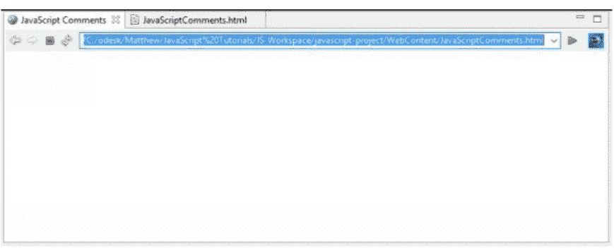

## 第 4 章 JavaScript 语法

与任何其他编程语言一样，JavaScript 语法有一套特定的构建规则。

### JavaScript 中的程序

JavaScript 程序是一系列由浏览器程序解析和执行的指令。这些程序指令序列称为语句。

- JavaScript 是一种基于对象的编程语言。

- JavaScript 语句通常用分号分隔，但在语句末尾放置分号是可选的。

```html
<!DOCTYPE html>
<html>
<head>
<meta charset="ISO-8859-1">
<title>JavaScript Syntax</title>
<script type="text/javascript">
    var a = 101;
    var b = 300;
    var sum = a + b;
</script>
</head>
<body>
<script type="text/javascript">
    document.write("sum of a + b = "+sum);
</script>
</body>
</html>
```

### 输出

当我们执行上述 HTML 程序时，输出如下。

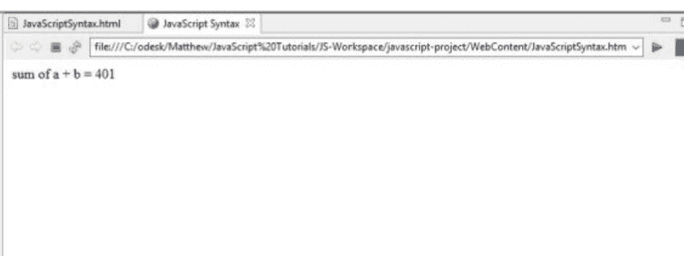

### JavaScript 中的语句

JavaScript 编程语言中的语句由以下部分组成。

- 值

- 运算符

- 表达式

- 关键字，以及

- 注释。

### JavaScript 中的值

JavaScript 中有以下两种类型的值。

- 固定值，以及

- 变量值。

字面量是固定值，变量值称为变量。

### JavaScript 中的字面量

以下是 JavaScript 中书写字面量或固定值的规则。

- 数字可以带或不带小数点定义。

- 字符串是写在单引号或双引号内的文本。

### JavaScript 中的变量

以下是 JavaScript 中用于存储数据值的变量值书写规则。

- JavaScript 语言使用 `var` 关键字来声明变量。

- 变量的值通过等号赋值。

### JavaScript 中的运算符

以下是 JavaScript 语言中使用的运算符。

- 赋值运算符（`=`）用于给变量赋值。

- 算术运算符（`+ - * /`）用于算术运算，如加法、减法、乘法和除法。

### JavaScript 中的表达式

JavaScript 语言中的任何表达式都是值、变量和运算符的组合。这些一起进行计算。这种计算称为求值。

表达式也可以包含变量值，如数字和字符串。例如，`"Java" + "Script"` 将连接为 `"JavaScript"`。

让我们通过以下示例来理解这一点。

```html
<!DOCTYPE html>
<html>
<head>
<meta charset="ISO-8859-1">
<title>JS Expressions</title>

<script type="text/javascript">

    var a = 101; //变量、赋值运算符和数字字面量。

    var b = 300;

    var addition = a + b;

    var str1 = "Java"; //变量、赋值运算符和字符串字面量。

    var str2 = "Script";

    var str3 = str1 + str2;

</script>

</head>

<body>

<script type="text/javascript">

    document.write("Addition of a + b = "+addition);

    document.write("<br>Concat of str1 + str2 = "+str3);

</script>

</body>

</html>
```

### 输出

当我们执行上述 HTML 程序时，输出如下。输出显示了加法和连接操作。

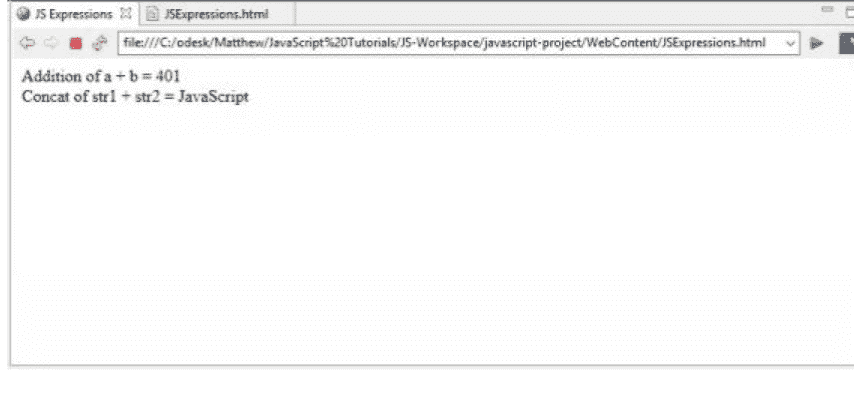

### JavaScript 中的关键字

JavaScript 语言中的关键字用于标识需要执行的操作。`var` 关键字指示浏览器创建一个新变量作为 JavaScript 标识符。在 JavaScript 语言中，标识符用于命名变量（以及关键字、函数和标签）。

在 JavaScript 语言中，第一个字符必须是字母、下划线（`_`）或美元符号（`$`）。后续字符可以是字母、数字、下划线或美元符号。

### 驼峰命名法与 JavaScript

将多个单词组合成一个变量名有以下三种方式。

- 连字符：例如，`first-address`、`second-address`、`visa-passport`、`city-name` 等。

- 下划线：例如，`first_address`、`second_address`、`visa_passport`、`city_name` 等。

- 驼峰命名法：例如，`FirstAddress`、`SecondAddress`、`VisaPassport`、`InterName` 等。在 JavaScript 编程语言中，驼峰命名法通常以小写字母开头，例如，`firstAddress`、`secondAddress`、`visaPassport`、`cityName` 等。

### JavaScript 中的字符集

JavaScript 语言使用 Unicode 字符集，它涵盖了所有字符、标点符号和符号。

## 第 5 章 JavaScript 的启用和禁用

Internet Explorer、Mozilla Firefox、Google Chrome、Opera 等 Web 浏览器都内置了对 JavaScript 的支持。我们可以手动启用或禁用浏览器对 JavaScript 的支持。在本章中，我们将讨论在这些浏览器中启用和禁用 JavaScript 支持的操作步骤。

### 在 Internet Explorer 中启用 JavaScript 支持

以下是在 Internet Explorer 中打开或启用 JavaScript 支持的步骤。

- 从菜单栏导航到 `工具 → Internet 选项`。

- 在对话框中，选择安全选项卡。

- 点击自定义级别按钮。

- 向下滚动菜单并找到脚本选项。

- 选择在 Active 脚本标题下启用单选按钮。

- 最后，点击确定按钮以在 IE 浏览器中启用 JavaScript 支持。

### 在 Internet Explorer 中禁用 JavaScript 支持

要关闭或禁用 Internet Explorer 中的 JavaScript 支持，请按照上述步骤操作，并选择在 Active 脚本标题下禁用单选按钮。

### 在 Mozilla Firefox 中启用 JavaScript 支持

以下是在 Mozilla Firefox 中打开或启用 JavaScript 支持的步骤。

- 打开一个新标签页，在地址栏中输入 `about:config`。

- 在那里，我们会找到以下警告对话框，选择并点击"我会小心的，我保证！"按钮，如下所示。

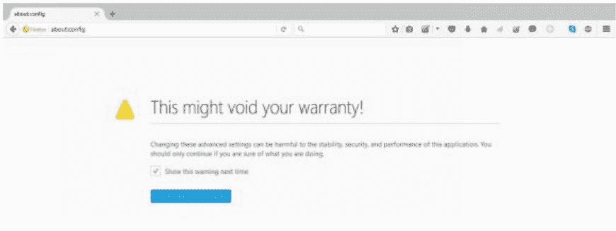

- 在这里，我们将看到浏览器中的配置选项列表。在搜索栏中，输入 `javascript.enabled`，如下所示。

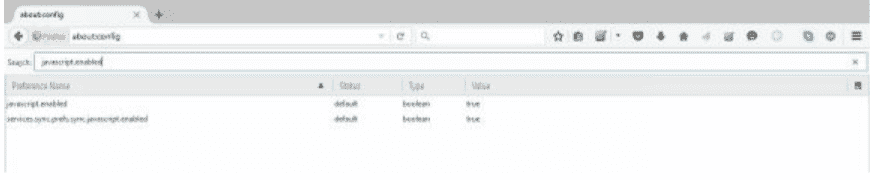

- 在这里，我们可以通过右键单击该选项的值选择切换来启用或禁用 javascript。

- 点击切换后，如果 `javascript.enabled` 为 true，则它将变为 false。这将禁用 Mozilla Firefox Web 浏览器对 JavaScript 的支持。

### 在 Mozilla Firefox 中禁用 JavaScript 支持

以下是在 Mozilla Firefox 中关闭或禁用 JavaScript 支持的步骤。如果 javascript 已禁用，则按照前面解释的类似步骤，在点击切换后可以启用它。

### 在 Google Chrome 中启用或禁用 JavaScript 支持

以下是在 Google Chrome 中启用或禁用 JavaScript 支持的步骤。

点击 Chrome 菜单，该菜单位于 Chrome 的右上角。

### 在 Opera 中启用或禁用 JavaScript 支持

以下是在 Opera 中启用或禁用 JavaScript 支持的步骤。

1. 打开 Opera 浏览器，从菜单中依次选择 `工具 → 首选项`。

2. 然后，在对话框中选择高级选项。

3. 接着，从列出的选项中选择"内容"。

4. 在那里，选中启用 JavaScript 复选框。

5. 最后，点击"确定"按钮以在 Opera 浏览器中启用 JavaScript 支持。

同样，要禁用 Opera 浏览器中的 JavaScript 支持，我们不应勾选启用 JavaScript 复选框，然后点击"确定"按钮。

### 不支持 JavaScript 的浏览器的警告

当我们必须使用 JavaScript 执行非常重要的操作时，可以使用 `<noscript>` 标签向用户显示警告信息。我们可以在 script 代码块之后立即添加一个 noscript 代码块，如下所示。

```html
<!DOCTYPE html>
<html>
<head>
<meta charset="ISO-8859-1">
<title>No Script tag</title>
</head>
<body>
  <script type="text/javascript">
  document.write("JavaScript Support is enabled on your browser!")
  </script>
  <noscript>
        Please enable JavaScript support on your browser.
  </noscript>
</body>
</html>
```

如果上述任何浏览器不支持 JavaScript 或 JavaScript 支持被禁用，则 `<noscript></noscript>` 标签之间的消息将显示在屏幕上。

## 第 6 章 JavaScript 的放置位置

JavaScript 代码在 HTML 文档中的放置非常灵活，可以通过以下方式放置。

### 在 `<head>...</head>` 部分中的 JavaScript

这是在 HTML 文档的 head 部分中包含 JavaScript 代码的最常用方式。我们可以将 JavaScript 代码或函数放在 head 部分中，并且可以在网页元素的事件中访问这些函数，如下所示。

```html
<!DOCTYPE html>
<html>
<head>
<meta charset="ISO-8859-1">
<title>JS in head section</title>
  <script type="text/javascript">
      function showAlert(){
          alert ("This is an alert from Head section!");
      }
  </script>
</head>
<body>
  <input type="button" onclick="showAlert();" value="Call JavaScript"/>
</body>
</html>
```

### 输出

当我们执行上述 HTML 程序时，将得到以下输出。在输出中，我们可以看到当点击网页上的按钮时，会弹出一条消息为"这是来自 head 部分的警报"的警报框。

### 在 `<body>...</body>` 部分中的 JavaScript

我们也可以将 JavaScript 代码放在 HTML 代码的 body 部分中，但这种方法并不推荐，因为我们从 body 部分调用 JavaScript 函数，而这些函数最好在 HTML 文档的 head 部分中定义。

```html
<!DOCTYPE html>
<html>
<head>
<meta charset="ISO-8859-1">
<title>JS Body</title>
</head>
<body>
<script type="text/javascript">
document.write("Welcome to JavaScript Tutorials!")
</script>
<p>Body section of the HTML document.</p>
</body>
</html>
```

### 输出

当我们执行上述 HTML 程序时，将得到以下输出。在输出中，我们可以看到通过 JavaScript 写入 HTML 页面的文本"Welcome to JavaScript Tutorials!"，该文本位于 body 部分中。

### 在 `<body>...</body>` 和 `<head>...</head>` 部分中的 JavaScript

在这种方法中，JavaScript 代码同时放在 HTML 文档的 head 和 body 部分中，如下例所示。

```html
<!DOCTYPE html>
<html>
<head>
<meta charset="ISO-8859-1">
<title>JS Head and Body</title>
  <script type="text/javascript">
      function showAlert(){
         alert("This is an alert from Head section!");
      }
  </script>
</head>
<body>
<script type="text/javascript">
	document.write("Welcome to JavaScript Tutorials!")
</script>
<p>Body section of the HTML document.</p>
<input type="button" onclick="showAlert();" value="Call JavaScript"/>
</body>
</html>
```

### 输出

当我们执行上述 HTML 程序时，将得到以下输出。在输出中，我们可以看到通过 JavaScript 写入 HTML 页面的文本"Welcome to JavaScript Tutorials!"，该文本位于 body 部分中。同时，当我们点击按钮时，将显示一条警报消息"This is an alert from Head section"。这是在按钮的点击事件上调用的 JavaScript 函数，该函数定义在 HTML 文档的 head 部分中。

### 将 JavaScript 放在外部文件中并在 `<head>...</head>` 部分中引入

这是一种最佳做法，将所有 JavaScript 代码放在一个外部文件中，文件扩展名为 `jscode.js`，然后在 HTML 文档的 head 部分中引入该文件。该文件中包含的所有函数都可以在 HTML 文档 body 部分中定义的各种网页元素事件上被调用。在下面的示例中，我们在位于 js 目录下的单独文件 `demo.js` 中声明了函数 `showAlert()`。

```javascript
function showAlert(){
    alert("This is an alert from Head section!");
}
```

我们在 HTML 文档的 head 部分中引入这个外部 JavaScript 文件，如下所示。

```html
<!DOCTYPE html>
<html>
<head>
<meta charset="ISO-8859-1">
<title>JS External File</title>
<script type="text/javascript" src="js/demo.js"></script>
</head>
<body>
    <input type="button" onclick="showAlert();" value="Call JavaScript" />
</body>
</html>
```

### 输出

当我们执行上述 HTML 程序时，将得到以下输出。在输出中，我们可以看到一条消息为"这是来自 head 部分的警报"的警报框，这是在按钮的点击事件上调用的 JavaScript 函数，该函数定义在外部 `demo.js` 文件中并被引入到 HTML 文档的 head 部分。这与将 JavaScript 函数代码直接放在 HTML 文档的 head 部分中效果相同。

## 第 7 章 JavaScript 变量

### JavaScript 中的数据类型

支持对数据类型集合进行操作是每种编程语言的特性。这些是在任何编程语言中被定义和操作的实际值。与任何其他编程语言一样，JavaScript 语言允许我们使用以下三种基本数据类型。

- 数字，例如 1、23、10.50、23.8990 等。

- 字符串或文本数据，例如"JavaScript"、"This is my language"等。

- 布尔值，它始终只能是 true 或 false。

除了这三种基本数据类型之外，JavaScript 语言还定义了以下两种简单数据类型。每种数据类型只定义一个值。

- Null。

- Undefined。

此外，JavaScript 语言还支持一种称为对象的复合数据类型。JavaScript 对象将在本教程后面详细介绍。

需要注意的是，JavaScript 语言不区分整数值和浮点值。JavaScript 将所有数字都视为浮点值。JavaScript 使用 IEEE 754 标准定义的 64 位浮点格式来表示数字。

### JavaScript 中的变量

如前所述，JavaScript 语言使用变量作为数据容器，我们可以将数据放入这些容器中，然后通过简单地命名容器来引用这些数据。我们使用 `var` 关键字声明 JavaScript 变量，如下所示。

```html
<!DOCTYPE html>
<html>
<head>
<meta charset="ISO-8859-1">
<title>JavaScript 变量</title>
  <script type="text/javascript">
      var name = "Appy";
      var age = 21;
      var salary = 10000, expenses = 12000;
      alert("Name: "+name+" Age: "+age+"\nSalary: "+ salary +" Expenses: "+expenses)
  </script>
</head>
<body>

</body>
</html>
```

### JavaScript 代码解释

将值存储在变量中称为变量初始化。我们可以在变量创建过程中的任何时间点，或在需要使用该变量时进行变量初始化。

例如，我们在上述代码中创建了四个变量，并为每个变量赋了值。例如，`name = "Appy"`、`salary = 10000` 等。

### 输出

当我们执行上述 HTML 程序时，将得到以下输出。在输出中，我们通过一个警告框显示分配给数据容器的值。

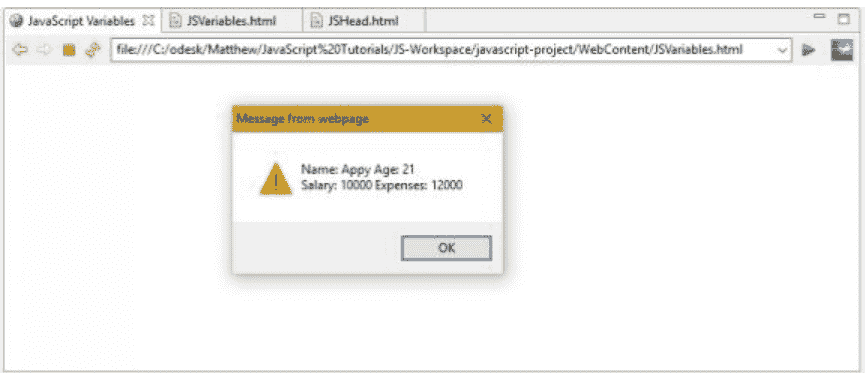

需要注意的是，`var` 关键字仅用于声明或初始化变量，且在 HTML 文档的生命周期内，对于任何变量名只能使用一次。我们不应重复声明相同的变量。在 JavaScript 中，由于它是一种无类型语言，变量可以持有任何数据类型（数字、字符串等）的值。与其他有类型语言（例如 C、C++、JAVA 等）不同，我们在声明变量时无需告诉 JavaScript 编译器变量将持有何种类型的值。此外，变量的值类型可以在程序执行过程中改变，JavaScript 解析器会自动处理这一点。

### JavaScript 中的变量作用域

变量的作用域定义为该变量被定义的程序区域。JavaScript 变量可以具有以下两种作用域。

- 全局变量作用域：是一个全局作用域，意味着它可以在 JavaScript 代码中的任何地方定义，并且在当前 HTML 文档中随处可见。

- 局部变量作用域：是一个局部变量，仅在其定义的函数内部可见。函数参数始终是函数的局部变量。

需要注意的是，在函数体内，如果同时定义了同名的局部变量和全局变量，那么局部变量总是优先于全局变量。让我们通过以下示例来最好地理解这个概念。

```html
<!DOCTYPE html>
<html>
<head>
<meta charset="ISO-8859-1">
<title>变量作用域</title>
</head>

<script type = "text/javascript">
var demoVar = "global scope"; // 一个全局变量

function checkVariableScope() {
    var demoVar = "local scope"; // 一个局部变量
    document.write(demoVar);
}
</script>

<body onload = checkVariableScope();>

</body>
</html>
```

### 输出

当我们执行上述 HTML 程序时，将得到以下输出。在输出中，我们可以观察到值显示为 "local scope"，因为如果定义了同名的变量，局部变量优先于全局变量。

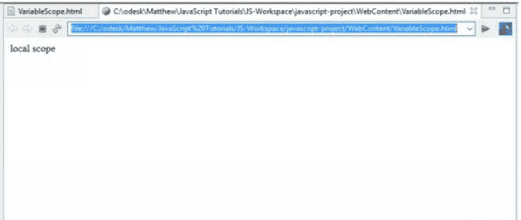

### JavaScript 中的变量名

在 JavaScript 语言中命名变量时应遵守以下规则。

- 不得使用保留关键字作为变量名。这些关键字在本章的最后一节中列出。例如，`finally`、`goto` 等变量名是无效的。

- JavaScript 语言中的变量名绝不能以数字（0-9）开头。但是，它们可以以字母或下划线字符开头。例如，`10name` 是一个无效的变量名，而 `_10name` 是一个有效的变量名。

- JavaScript 中的变量名区分大小写。例如，`Address` 和 `address` 在 JavaScript 语言中被视为两个不同的变量名。

### JavaScript 中的保留字

以下是 JavaScript 语言中所有保留字的列表。这些保留字不能用作 JavaScript 变量、循环标签、函数或任何对象名。

| abstract | debugger | final | instanceof | public |
| --- | --- | --- | --- | --- |
| boolean | default | finally | int | return |
| break | delete | float | interface | short |
| byte | do | for | long | static |
| case | double | function | native | super |
| catch | else | goto | new | switch |
| char | enum | if | null | synchronized |
| class | export | implements | package | this |
| const | extends | import | private | throw |
| continue | false | in | protected | throws |

## 第 8 章 JavaScript 运算符

当我们对两个值进行加法或减法运算时，例如将 5 与 6 相加（即 `5 + 6`），其中 `+` 被称为运算符，而 `(5 + 6)` 被称为表达式。JavaScript 语言支持以下类型的运算符。

### 算术运算符

以下是 JavaScript 语言支持的算术运算符。

| 序号 | 算术运算符 | 描述 | 示例 |
|-------|---------------------|-------------|---------|
| 1. | `+` (加法) | 用于将两个操作数相加。 | `X + Y` |
| 2. | `-` (减法) | 用于从第一个操作数中减去第二个操作数。 | `X - Y` |
| 3. | `*` (乘法) | 用于将两个操作数相乘。 | `X * Y` |
| 4. | `/` (除法) | 用于将两个操作数相除，即分子除以分母。 | `X / Y` |
| 5. | `%` (取模) | 此运算符输出整数除法的余数。 | `X % Y` |
| 6. | `++` (自增) | 将整数值增加 1。 | `X++` |
| 7. | `--` (自减) | 将整数值减少 1。 | `X--` |

### 比较运算符

以下是 JavaScript 语言支持的比较运算符。

| 序号 | 比较运算符 | 描述 | 示例 |
| --- | --- | --- | --- |
| 1 | `==` (等于) | 此运算符用于检查两个操作数的值是否相等，如果两个值相等，则条件为真。 | 例如：`(X == Y)` 为假。 |
| 2 | `!=` (不等于) | 此运算符用于检查两个操作数的值是否不相等，如果不相等，则条件为真。 | 例如：`(X != Y)` 为真。 |
| 3 | `>` (大于) | 此运算符用于检查左操作数的值是否大于右操作数的值，如果是，则条件为真。 | 例如：`(X > Y)` 为假。 |
| 4 | `<` (小于) | 此运算符用于检查左操作数的值是否小于右操作数的值，如果是，则条件为真。 | 例如：`(X < Y)` 为真。 |
| 5 | `>=` (大于或等于) | 此运算符用于检查左操作数的值是否大于或等于右操作数的值，如果是，则条件为真。 | 例如：`(X >= Y)` 为假。 |
| 6 | `<=` (小于或等于) | 此运算符用于检查左操作数的值是否小于或等于右操作数的值，如果是，则条件为真。 | 例如：`(X <= Y)` 为真。 |

### 逻辑（或关系）运算符

以下是 JavaScript 语言支持的逻辑或关系运算符。

| 序号 | 逻辑运算符 | 描述 | 示例 |
| --- | --- | --- | --- |
| 1 | `&&` (逻辑与) | 如果两个操作数都非零，则此运算符使条件为真。 | 例如：`(X && Y)` 为真。 |
| 2 | `\|\|` (逻辑或) | 如果两个操作数中任何一个非零，则此运算符使条件为真。 | 例如：`(X \|\| Y)` 为真。 |
| 3 | `!` (逻辑非) | 此运算符反转其操作数的逻辑状态。如果条件为真，则逻辑非运算符会将其变为假，反之亦然。 | 例如：`!(X && Y)` 为假。 |

### 赋值运算符

以下是 JavaScript 语言支持的赋值运算符。

| 序号 | 赋值运算符 | 描述 | 示例 |
| --- | --- | --- | --- |
| 1. | `=` (简单赋值) | 此运算符用于将右侧操作数的值赋给左侧操作数。 | 例如：`Z = X - Y` 将把 `X - Y` 的值赋给 `Z` 变量。 |
| 2. | `+=` (加法赋值) | 此运算符用于将右侧操作数加到左侧操作数上，并将结果赋给左侧操作数。 | 例如：`Z += X` 等价于 `Z = Z + X` |
| 3. | `-=` (减法赋值) | 此运算符用于从左侧操作数中减去右侧操作数，并将结果赋给左侧操作数。 | 例如：`Z -= X` 等价于 `Z = Z - X` |
| 4. | `*=` (乘法赋值) | 此运算符用于将左侧操作数乘以右侧操作数，并将结果赋给左侧操作数。 | 例如：`Z *= X` 等价于 `Z = Z * X` |
| 5. | `/=` (除法赋值) | 此运算符用于将左操作数除以右操作数，并将结果赋给左操作数。 | 例如：`Z /= X` 等效于 `Z = Z / X` |
| 6. | `%=` (取模赋值) | 此运算符用于对两个操作数取模，并将结果赋给左操作数。 | 例如：`Z %= X` 等效于 `Z = Z % X` |

### 条件（或三元）运算符

以下是 JavaScript 语言支持的条件或三元运算符。

| 序号 | 条件运算符 | 描述 | 示例 |
|-------|---------------------|-------------|---------|
| 1. | `? :` (条件运算符) | 如果条件为真？则取值 X : 否则取值 Y。 | 例如：`(X > Y) ? "yes" : "No"` |

### 位运算符

以下是 JavaScript 语言支持的位运算符。

| 序号 | 位运算符 | 描述 | 示例 |
| :--- | :--- | :--- | :--- |
| 1. | `&` (按位与) | 此运算符用于对其整型参数的每一位执行布尔与运算。 | 例如：`(X & Y)` 的结果为 2。 |
| 2. | `\|` (按位或) | 此运算符用于对其整型参数的每一位执行布尔或运算。 | 例如：`(X \| Y)` 的结果为 3。 |
| 3. | `^` (按位异或) | 此运算符用于对其整型参数的每一位执行布尔异或运算。异或意味着两个操作数中只有一个为真，但不是同时为真。 | 例如：`(X ^ Y)` 的结果为 1。 |
| 4. | `~` (按位非) | 按位非是一元运算符，通过反转操作数中的所有位来操作。 | 例如：`(~B)` 的结果为 -4。 |
| 5. | `<<` (左移) | 此运算符用于将其第一个操作数的所有位向左移动第二个操作数指定的位数。 | 例如：`(X << 1)` 的结果为 4。 |
| 6. | `>>` (右移) | 在二进制右移运算符中，左操作数的值向右移动右操作数指定的位数。 | 例如：`(X >> 1)` 的结果为 1。 |
| 7. | `>>>` (零填充右移) | 此运算符类似于 `>>` 运算符，但左边移入的位始终为零。 | 例如：`(X >>> 1)` 的结果为 1。 |

将一个值左移一位等同于乘以 2，左移两位等同于乘以 4，依此类推。

## 第 9 章 JavaScript 决策

在编写程序时，我们大多数时候会面临需要做出决策的情况。决策是对程序执行过程中可能出现的条件的预判，并且需要根据这些条件指定一些操作。

在决策结构中，存在一个条件，该条件可以是单个表达式或多个表达式。当这个条件被求值时，会产生 TRUE（真）或 FALSE（假）作为结果。根据这个结果，我们需要确定采取哪个操作以及执行哪些语句。请参考下图以更清楚地理解。

与其他任何编程语言一样，JavaScript 语言支持条件语句，用于根据不同的条件执行不同的操作。以下是 JavaScript 语言支持的条件语句。

- `if` 语句。
- `if…else` 语句
- `if…else if…` 语句。
- `switch case` 语句

让我们通过一个 JavaScript 程序来理解这些语句。

### if 语句

`if` 语句是一个基本的控制语句，它允许 JavaScript 代码根据所需条件做出决策并执行语句。以下是其语法。

#### 语法与示例

```html
<!DOCTYPE html>

<html>

<head>

<meta charset="ISO-8859-1">

<title>Basic IF Statement</title>

</head>

<body>

<script type="text/javascript">

var salary = 10000;

var expenses = 12000;

if( expenses > salary ){

document.write("<b>Please either start earning more or spend less!</b>");

}

</script>

<p>We are inside the body section…</p>

</body>

</html>
```

#### 输出

当我们执行上面的 HTML 程序时，将产生以下输出。由于 `if` 语句中的条件为真，因此它将在 HTML 页面上写入给定的文本。

### if…else 语句

`if…else` 语句是控制语句的另一种形式，它允许 JavaScript 代码以更受控的方式执行语句。以下是其语法和示例。

#### 语法与示例

```html
<!DOCTYPE html>

<html>

<head>

<meta charset="ISO-8859-1">

<title>If Else Statement</title>

</head>

<body>

<script type="text/javascript">

var salary = 12000;

var expenses = 10000;

if( expenses > salary ){

document.write("<b>Please either start earning more or spend less!</b>");

}

else {

document.write("<b>You have enough money to spend!</b>");

}

</script>

<p>We are inside the body section...</p>

</body>

</html>
```

#### 输出

当我们执行上面的 HTML 程序时，将产生以下输出。由于 `if` 语句中的条件为假，因此它进入了 else 代码块，并在 HTML 页面上写入了给定的文本。

### if...else if... 语句

`if...else if...` 语句是 `if...else` 的另一种高级形式，它允许 JavaScript 代码在定义的多个条件中做出正确的决策。它有一系列 if 语句，其中每个 if 都是上一个语句的 else 子句的一部分。这些语句基于为真的条件执行，如果发现没有一个条件为真，则 else 代码块中的代码将被执行。以下是其语法和示例。

#### 语法与示例

```html
<!DOCTYPE html>

<html>

<head>

<meta charset="ISO-8859-1">

<title>If Else If Statement</title>

</head>

<body>

<script type="text/javascript">

var salary = 12000;

var expenses = 10000;

if( expenses > salary ){

document.write("<b>Please either start earning more or spend less!</b>");

}

else if (salary > 13000){

document.write("<b>You have enough money to spend!</b>");

}

else {

document.write("<b>Although you have enough money but you need to be careful!</b>");

}

</script>

<p>We are inside the body section...</p>

</body>

</html>
```

#### 输出

当我们执行上面的 HTML 程序时，将产生以下输出。由于 `if` 语句中的条件为假，因此它进入了 else if 代码块，其中另一个条件恰好也为假。因此，它在 HTML 页面上写入了存在于最后一个 else 代码块中的给定文本。

### Switch Case 语句

从 JavaScript 1.2 版本开始，它开始支持 switch 语句，该语句处理的情况与重复的 `if…else if` 语句实现的情况完全相同。

switch 语句用于给出一个表达式，该表达式根据表达式的值来求值几个不同的语句。JavaScript 解释器会检查每个 case 与表达式返回值的匹配情况，直到找到匹配项。如果未找到匹配项，则使用默认条件。

此外，在 case 代码语句的末尾有一个 `break` 语句。如果此处未声明 break，则解释器将继续执行每个后续 case 中的所有语句。

以下是 switch case 语句的语法和示例。

```html
<!DOCTYPE html>

<html>

<head>

<meta charset="ISO-8859-1">

<title>Switch Case Statement</title>

</head>

<body>

<script type="text/javascript">

var expensecode='X';

document.write("Entering the switch block<br />");

switch (expensecode)

{

case 'X': document.write("<b>Please either start earning more or spend less!</b>");

break;

case 'Y': document.write("<b>You have enough money to spend!</b>");

break;

case 'Z': document.write("<b>Although you have enough money but you need to be careful!</b>");

break;

default: document.write("<b>Sorry! You are in deep trouble!</b>");

}

</script>

<p>We are inside the body section...</p>

</body>

</html>
```

#### 输出

当我们执行上面的 HTML 程序时，输出将如下所示。程序已在 HTML 页面上写入了与其 case 字符（`'X'`）匹配的文本。

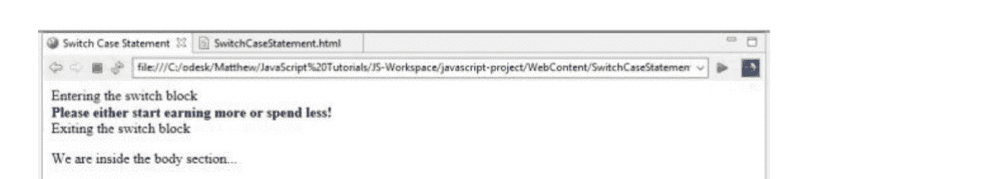

## 第 10 章 JavaScript 循环

当任何程序被执行时，它是按顺序运行的。序列中首先出现的语句最先被执行，然后是下一条语句，依此类推，直到程序的最后一条语句。很多时候，在程序中需要多次运行同一段代码块，这就产生了一种叫做循环的控制结构的需求。

循环会在条件为真时，使代码块中的一条或多条语句重复执行，并在条件变为假时退出循环。下面的图示说明了这种循环。

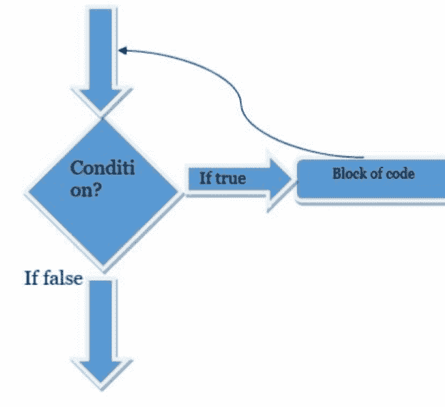

与其他编程语言一样，JavaScript 支持循环，并提供以下类型的循环和循环控制语句。

- While 循环
- Do…while 循环
- For 循环
- for...in 循环
- 循环控制语句

### While 循环语句

While 循环是 JavaScript 语言中最基本的循环。此循环会重复执行一条语句或一段代码块，只要表达式保持为真。一旦表达式为假，循环就会终止。以下是 while 循环语句的语法和示例。

```html
<!DOCTYPE html>

<html>

<head>

<meta charset="ISO-8859-1">

<title>While Loop</title>

</head>

<body>

  <script type="text/javascript">

    var counter = 0;

    document.write("Entering while Loop!");

    while (counter < 5){

      document.write("Current Counter is : " + counter + "<br />");

      counter++;

    }

    document.write("Exiting while Loop!");

  </script>

  <p>We are inside body section…</p>

</body>

</html>
```

#### 输出

当我们执行上面的 HTML 程序时，输出将如下所示。计数器将在 HTML 页面上写入 5 次，因为它的条件保持为真 5 次。

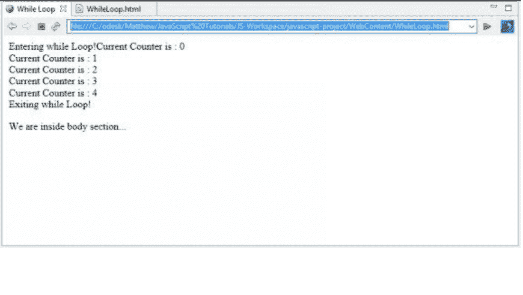

### Do...while 循环语句

`do...while` 循环与 while 循环类似，不同之处在于 `do...while` 循环的条件检查发生在循环的末尾。这意味着即使条件为假，循环内部的代码块也至少会被执行一次。以下是 `do...while` 循环语句的语法和示例。

```html
<!DOCTYPE html>

<html>

<head>

<meta charset="ISO-8859-1">

<title>Do While Loop</title>

</head>

<body>

<script type="text/javascript">

var counter = 0;

document.write("Entering while Loop!");

do {

    document.write("Current Counter is : " + counter + "<br />");

    counter++;

}

while (counter < 5)

document.write("Exiting while Loop!");

</script>

<p>We are inside body section...</p>

</body>

</html>
```

#### 输出

当我们执行上面的 HTML 程序时，输出将如下所示。计数器将在 HTML 页面上写入 5 次，因为它的条件保持为真 5 次，包括第一次不检查条件的情况。

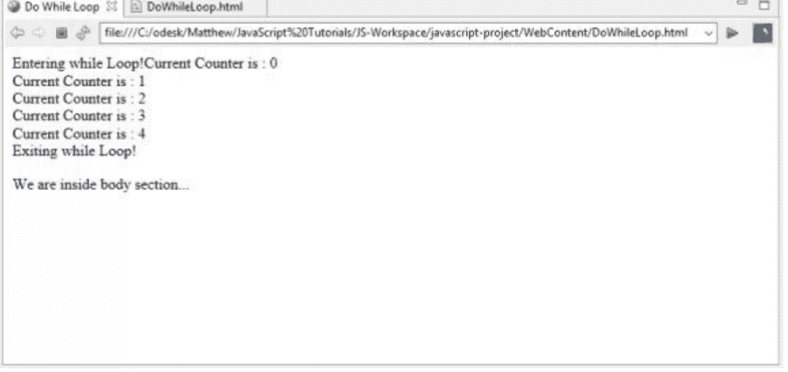

### For 循环语句

`for` 循环是 JavaScript 编程中非常重要且最常用的循环语句。该语句包含以下三个重要部分。

**循环初始化**：这是我们将计数器值初始化为起始初始值的地方。此语句在循环开始之前执行。

**测试语句**：它包含实际的条件，该条件会被求值为真或假。如果该条件求值为真，则循环内部的代码块将被执行；否则，如果为假，则控制权将退出循环。

**迭代语句**：这是我们增加或减少第一条语句中初始化的计数器值的地方。

for 循环的优点在于，我们可以将所有这三个语句部分放在一行中，用分号分隔。以下是语法和示例。

```html
<!DOCTYPE html>

<html>

<head>

<meta charset="ISO-8859-1">

<title>For Loop</title>

</head>

<body>

 <script type="text/javascript">

 document.write("Entering while Loop!");

 for(counter = 0;counter < 5; counter++){

 document.write("Current Counter is : " + counter + "<br />");

 }

 document.write("Exiting while Loop!");

 </script>

 <p>We are inside body section...</p>

</body>

</html>
```

#### 输出

当我们执行上面的 HTML 程序时，输出将如下所示。计数器将在 HTML 页面上写入 5 次，因为它的条件保持为真 5 次，直到计数器值变为 5 并退出循环。

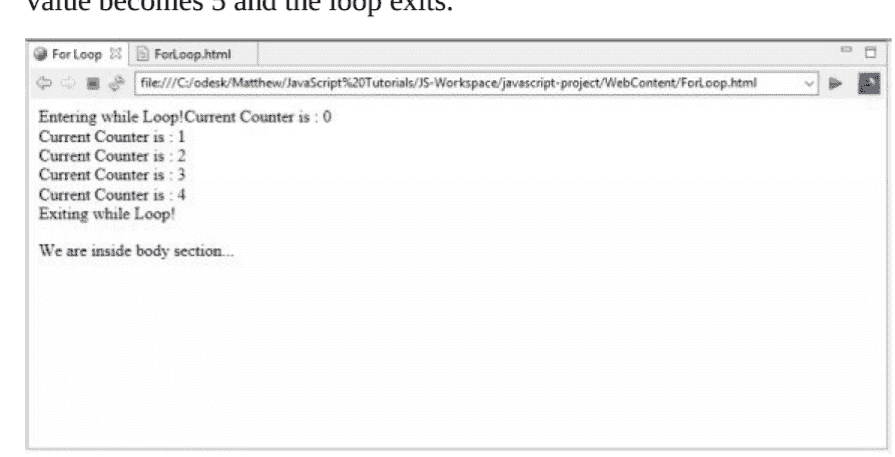

### For...in 循环语句

`for...in` 循环仅用于需要遍历对象属性的特殊场合。以下是 `for...in` 循环的语法和示例。

```html
<!DOCTYPE html>

<html>

<head>

<meta charset="ISO-8859-1">

<title>For In Statement</title>

</head>

<body>

<script type="text/javascript">

var prop;

document.write("Object Properties of Navigator <br /> ");

document.write("Entering the loop!");

for (prop in navigator) {

document.write(prop);

document.write("<br />");

}

document.write("Exiting the loop!");

</script>

<p>We are in the body section...</p>

</body>

</html>
```

#### 输出

当我们执行上面的 HTML 程序时，输出将如下所示。在输出中，我们遍历了 `navigator` 对象并显示了 Web 浏览器 navigator 对象的所有属性。

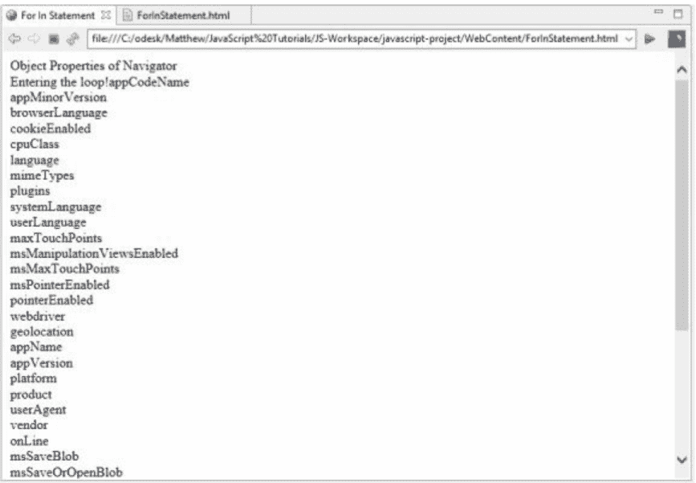

### JavaScript 循环总结

| 循环类型 | 描述 |
|---|---|
| while 循环 | While 循环类型，在给定条件为真时重复执行一条或一组语句。它每次执行循环体时都会检查条件，并在条件变为假时退出循环。 |
| for 循环 | For 循环类型多次执行一系列语句，并简化了管理循环变量的代码。 |
| 嵌套循环 | 它是一个循环内部的另一个循环。在 JavaScript 中，我们可以在另一个 while 或 for 循环中使用 while 循环，也可以在另一个 while 或 for 循环中使用 for 循环。 |

### 循环控制语句

JavaScript 语言中的循环控制语句用于改变正常的执行顺序。当这样的执行离开一个作用域时，在该作用域中创建的所有自动对象都会被销毁或移除。

在 JavaScript 语言中，支持以下循环控制语句。

| 控制语句 | 描述 |
|---|---|
| break 语句 | JavaScript 中的 break 语句用于终止循环语句，并将执行转移到循环结束后的下一条语句。 |
| continue 语句 | JavaScript 中的 continue 语句用于使循环跳过当前循环体的剩余部分，并在重新迭代循环体之前立即重新测试其条件。 |

让我们通过以下示例更好地理解这些循环控制语句。

```html
<!DOCTYPE html>

<html>

<head>

<meta charset="ISO-8859-1">

<title>Loop Control Statement</title>

</head>

<body>

  <script type="text/javascript">

    var counter = 0;

    document.write("Entering while Loop!<br>");

    while (counter < 5){

      if (counter == 3){

        counter++;

        continue;

      }

      if (counter == 4){

        break;

      }

      document.write("Current Counter is : " + counter + "<br />");

      counter++;

    }

    document.write("Exiting while Loop!");

  </script>

  <p>We are inside body section...</p>

</body>

</html>
```

#### 输出

当我们执行上述 HTML 程序时，输出结果如下。在输出中，我们可以看到计数器的值被打印了 3 次（0、1 和 2），然后循环退出了。这是因为当计数器的值变为 3 时，我们执行了 continue 循环控制语句，它将计数器递增到 4，跳过了文档写入部分，并重新检查条件。当计数器的值变为 4 时，我们执行了 break 循环控制语句，这将最终退出当前循环，再次跳过文档写入语句。

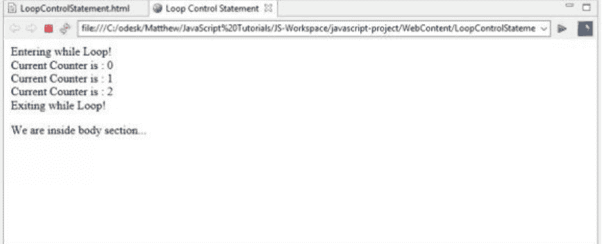

## 第 11 章 JavaScript 函数

函数可以被定义为一段组织良好、可多次重复使用的代码块，用于执行程序中需要高度模块化和可复用性的多种操作。它消除了反复编写相同代码的需要，帮助程序员编写模块化的代码。借助函数的概念，程序员可以将一个大程序拆分为多个小而易于管理的函数，从而最终减少冗余。

与任何其他编程语言一样，JavaScript 语言也支持通过使用函数来编写模块化代码的必要功能。从本教程开始以来，我们一直在使用 `alert()` 和 `write()` 等函数，这让我们对函数的操作有了一定的了解。这些函数是 JavaScript 的内置函数。在 JavaScript 语言中，我们可以像其他任何编程语言一样编写自己的函数，我们将在本章中学习这些内容。

### 函数定义

函数可以在代码中的任何位置使用，只需定义一次即可。在 JavaScript 中，我们使用 `function` 关键字来定义函数，后面跟着一个唯一的函数名、一个参数列表（可以为空）以及一个用花括号包围的语句块。以下是 JavaScript 函数的语法和示例。

```html
<!DOCTYPE html>

<html>

<head>

<meta charset="ISO-8859-1">

<title>Function Definition</title>

<script type="text/javascript">

function sayHelloToJavaScript() {

    alert("Welcome to the world of JavaScript!");

}

</script>

</head>

<body>

</body>

</html>
```

### 调用函数

我们可以在脚本的后续部分或在 HTML 网页元素的事件上调用 JavaScript 函数，只需编写该函数的名称即可，如下方代码所示。

```html
<!DOCTYPE html>

<html>

<head>

<meta charset="ISO-8859-1">

<title>Function Definition</title>

<script type="text/javascript">

function sayHelloToJavaScript() {

    alert("Welcome to the world of JavaScript!");

}

</script>

</head>

<body>

</body>

</html>
```

#### 输出

当我们执行上述 HTML 程序时，输出结果如下。这里，我们在按钮的点击事件上调用了 JavaScript 函数，该函数显示一个提示框，其中的消息来自 HTML 的 head 部分，即 JavaScript 函数定义的位置。

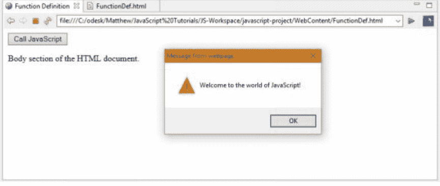

### 函数参数

到目前为止，我们使用的函数都没有输入参数。在 JavaScript 函数中，我们可以在调用时传递不同的参数。传递的参数值可以在函数内部使用，我们可以对这些参数进行操作。一个函数可以接受零个到多个参数。函数中的多个参数用逗号分隔。以下是参数化函数的语法和示例。

```html
<!DOCTYPE html>

<html>

<head>

<meta charset="ISO-8859-1">

<title>Parameterized Function</title>

<script type="text/javascript">

function sayHelloToJavaScript(message, entity, lang) {

    alert(message + " to the " + entity + " world of " + lang + "!");

}

</script>

</head>

<body>

    <input type="button" onclick="sayHelloToJavaScript('Welcome', 'World', 'JavaScript');" value="Call JavaScript"/>

    <p>Body section of the HTML document.</p>

</body>

</html>
```

#### 输出

当我们执行上述 HTML 程序时，输出结果如下。这里，我们在按钮的点击事件上调用了参数化的 JavaScript 函数，该函数显示一个提示框，其中的消息来自 HTML 的 head 部分，即 JavaScript 函数定义的位置。这里，我们向函数传递了三个参数，并在提示消息中显示它们。

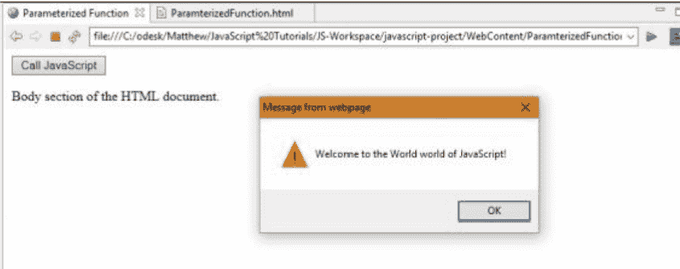

### return 语句

JavaScript 函数可以返回一个值，而 return 语句是可选的。当我们想从函数中返回一个值时，可以使用 return 语句。它应该是 JavaScript 函数中的最后一条语句。让我们通过以下示例来理解 return 函数的用法。

```html
<!DOCTYPE html>

<html>

<head>

<meta charset="ISO-8859-1">

<title>Return Function</title>

<script type="text/javascript">

function concatString(message, entity, lang) {

    var str = message + entity + lang;

    return str;

}

function writeToDoc(message, entity, lang) {

    concatStr = concatString(message, entity, lang);

    document.write(concatStr);

}

</script>

</head>

<body>

<input type="button" onclick="writeToDoc('Welcome to the', 'World of', 'JavaScript!');" value="Call JavaScript"/>

<p>Body section of the HTML document.</p>

</body>

</html>
```

#### 输出

当我们执行上述 HTML 程序时，输出结果如下。这里，我们在按钮的点击事件上调用了 JavaScript 函数，该函数在 HTML 页面上显示消息，消息来自 HTML 的 head 部分，即 JavaScript 函数定义的位置。这里，我们向 `writeToDoc` 函数传递了三个字符串作为参数，该函数调用了 `concatString` 函数，后者返回拼接后的字符串并写入文档。

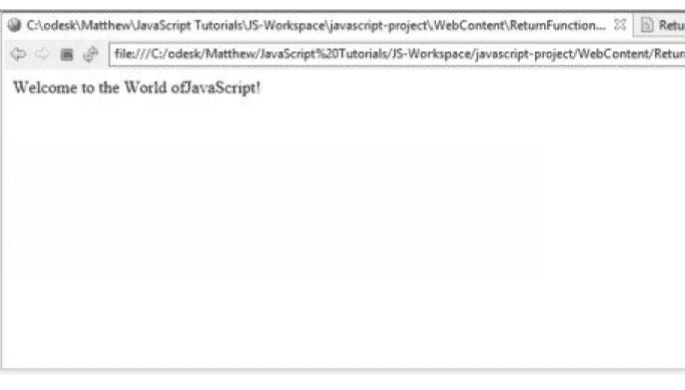

## 第 12 章 JavaScript 事件

JavaScript 事件是 JavaScript 与 HTML 文档进行交互的方式。当 HTML 页面上的任何值被用户或浏览器操作时，这些事件就会被触发。例如，当我们加载一个 HTML 页面时，这就是一个事件。同样，当我们点击页面上的按钮时，这也是一个事件。我们还可以想到其他事件的例子，如按下任意键、通过按钮提交表单、更改窗口大小等。

程序员可以使用这些 JavaScript 事件来触发和执行 JavaScript 编写的响应代码。这些响应包括在按钮点击时关闭窗口、向用户显示提示消息、验证表单数据等。

JavaScript 事件是文档对象模型（DOM）第 3 级的一部分。所有 HTML 网页元素都包含一组能够触发 JavaScript 函数代码的事件。

以下是几个示例，用于理解事件与调用 JavaScript 函数代码之间的关系。

### onclick 事件类型

这是最常用的事件类型，当我们在 HTML 页面或网页元素上用鼠标左键点击按钮时，它会触发 JavaScript 代码。我们可以针对此事件类型设置验证等操作。以下示例演示了此事件。

```html
<!DOCTYPE html>

<html>

<head>

<meta charset="ISO-8859-1">

<title>On Click Events</title>

<script type="text/javascript">

function showAlert() {

    alert("This is an alert on onclick event!");

}

</script>

</head>

<body>

    <input type="button" onclick="showAlert();" value="Call JavaScript" />

</body>

</html>
```

#### 输出

当我们执行上述 HTML 程序时，输出结果如下。我们通过按钮的 onclick 事件调用了 JavaScript 函数 `showAlert`，该函数在提示对话框上显示一条消息。

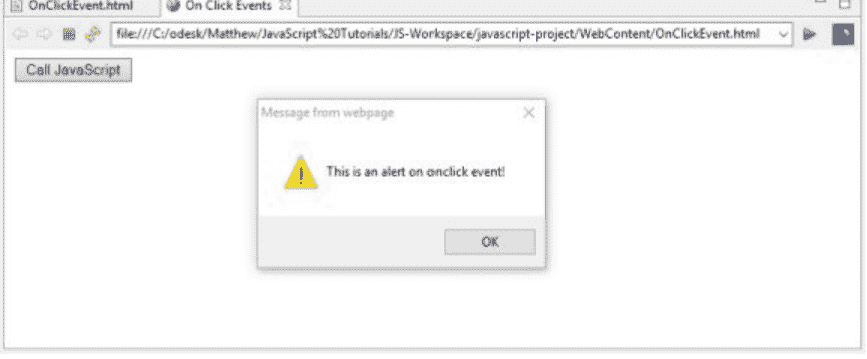

### onsubmit 事件类型

这是一个在我们提交 HTML 表单时发挥作用的事件类型。我们也可以针对此事件类型设置表单验证。

在以下示例中，我们演示了 onsubmit 事件是如何被触发的。我们在将表单数据提交到 Web 服务器之前，你会调用一个 `validate()` 函数。只有当 `validate()` 函数返回 true 时，表单才会被提交，否则将完全不会被提交。

```html
<!DOCTYPE html>

<html>

<head>

<meta charset="ISO-8859-1">

<title>On Submit Events</title>

<script type="text/javascript">

function validation() {

    if(document.form1.textbox1.value != ''){

        alert('Validation Passed');

        return true;

    }

    else{

        alert('Text Box field cannot be empty!');

        return false;

    }

}

</script>

</head>

<body>

<form name="form1" method="GET" action="onClickEvent.html" onsubmit="return validation()">

    <input type="text" name="textbox1"/>

    <input type="submit" value="Submit" />

</form>

</body>

</html>
```

#### 输出

当我们执行上述 HTML 程序时，将会得到以下输出。在此示例中，我们验证文本框元素不能为空，如果未在其中输入任何值就点击提交按钮，则会返回 false 以阻止表单提交，并显示警告消息 "Text Box field cannot be empty!"

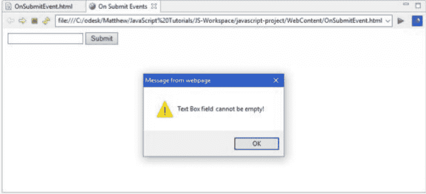

### onmouseover 和 onmouseout 事件类型

这是两个常用的鼠标事件类型，帮助我们为图像或文本创建漂亮的效果。当我们把鼠标移到 HTML 页面的任何 Web 元素上时，onmouseover 事件会被触发；当我们把鼠标从该 Web 元素上移开时，onmouseout 事件会被触发。以下示例演示了这些事件。

```html
<!DOCTYPE html>

<html>

<head>

<meta charset="ISO-8859-1">

<title>Mouse Over and Out</title>

<script type="text/javascript">

function hoverMouse() {

    alert("Doing the Mouse Over");

}

function hoverMouseOut() {

    alert("Taking the Mouse Out");

}

</script>

</head>

<body>

<div onmouseover="hoverMouse();" onmouseout="hoverMouseOut();">

    <h1>Bring your Mouse here to see the change</h1>

</div>

</body>

</html>
```

#### 输出

当我们执行上述 HTML 程序时，将会得到以下输出。在此示例中，当我们把鼠标移到标题区域上方时，可以看到警报消息被触发。同样，当我们将鼠标移出该区域时，会看到另一个关于鼠标已离开标题区域的警报。

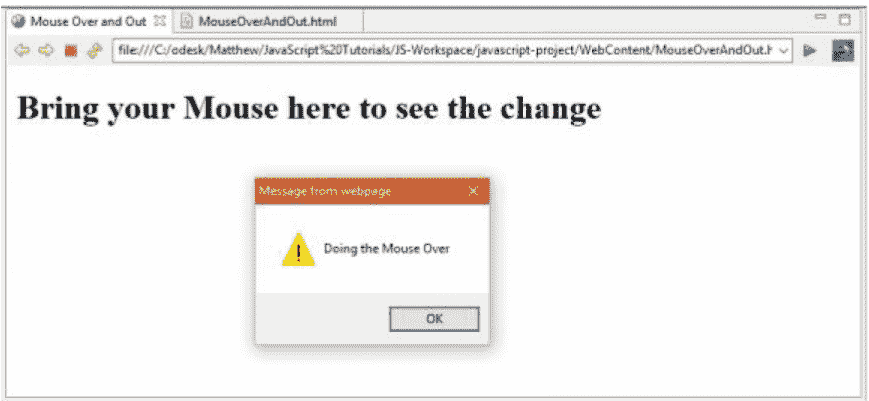

### HTML5 中的标准事件

以下是标准的 HTML5 事件属性。所有这些属性的值都是 script，表示要在触发事件时被调用和执行的 JavaScript 函数。

| 事件属性 | 值 | 描述 |
| --- | --- | --- |
| offline | script | 当文档进入离线状态时触发此属性。 |
| onabort | script | 在发生中止事件时触发此属性。 |
| onafterprint | script | 在文档打印完成后触发此属性。 |
| onbeforeonload | script | 在文档加载之前触发此属性。 |
| onbeforeprint | script | 在文档打印之前触发此属性。 |
| onblur | script | 当窗口失去焦点时触发此属性。 |
| oncanplay | script | 当媒体可以开始播放但可能需要停下来缓冲时触发此属性。 |
| oncanplaythrough | script | 当媒体可以不经过缓冲而播放到结束时触发此属性。 |
| onchange | script | 当元素发生变化时触发此属性。 |
| onclick | script | 在鼠标点击时触发此属性。 |
| oncontextmenu | script | 当上下文菜单被触发时触发此属性。 |
| ondblclick | script | 在鼠标双击时触发此属性。 |
| ondrag | script | 当元素被拖动时触发此属性。 |
| ondragend | script | 在拖拽操作结束时触发此属性。 |
| ondragenter | script | 当元素被拖到有效的放置目标上时触发此属性。 |
| ondragleave | script | 当元素被拖过有效的放置目标时触发此属性。 |
| ondragover | script | 在拖拽操作开始时触发此属性。 |
| ondragstart | script | 在拖拽操作开始时触发此属性。 |
| ondrop | script | 当被拖拽的元素被放下时触发此属性。 |
| ondurationchange | script | 当媒体的长度发生变化时触发此属性。 |
| onemptied | script | 当媒体资源元素突然变为空时触发此属性。 |
| onended | script | 当媒体到达结尾时触发此属性。 |
| onerror | script | 当发生错误时触发此属性。 |
| onfocus | script | 当窗口获得焦点时触发此属性。 |
| onformchange | script | 当表单发生变化时触发此属性。 |
| onforminput | script | 当表单获得用户输入时触发此属性。 |
| onhaschange | script | 当文档发生变化时触发此属性。 |
| oninput | script | 当元素获得用户输入时触发此属性。 |
| oninvalid | script | 当元素无效时触发此属性。 |
| onkeydown | script | 当按下按键时触发此属性。 |
| onkeypress | script | 当按下按键时触发此属性。 |
| onkeyup | script | 当释放按键时触发此属性。 |
| onload | script | 当文档加载时触发此属性。 |
| onloadeddata | script | 当媒体数据加载完成时触发此属性。 |
| onloadedmetadata | script | 当媒体元素的时长和其他媒体数据加载完成时触发此属性。 |
| onloadstart | script | 当浏览器开始加载媒体数据时触发此属性。 |
| onmessage | script | 当消息被触发时触发此属性。 |
| onmousedown | script | 当鼠标按钮被按下时触发此属性。 |
| onmousemove | script | 当鼠标指针移动时触发此属性。 |
| onmouseout | script | 当鼠标指针移出元素时触发此属性。 |
| onmouseover | script | 当鼠标指针移到元素上方时触发此属性。 |
| onmouseup | script | 当鼠标按钮被释放时触发此属性。 |
| onmousewheel | script | 当鼠标滚轮 DW 旋转时触发此属性。 |
| onoffline | script | 当文档进入离线状态时触发此属性。 |
| ononline | script | 当文档进入在线状态时触发此属性。 |
| onpagehide | script | 当窗口被隐藏时触发此属性。 |
| onpageshow | script | 当窗口变为可见时触发此属性。 |
| onpause | script | 当媒体数据暂停时触发此属性。 |
| onplay | script | 当媒体数据即将开始播放时触发此属性。 |
| onplaying | script | 当媒体数据已经开始播放时触发此属性。 |
| onpopstate | script | 当窗口的历史记录发生变化时触发此属性。 |
| onprogress | script | 当浏览器正在获取媒体数据时触发此属性。 |
| onratechange | script | 当媒体数据的播放速率发生变化时触发此属性。 |
| onreadystatechange | script | 当就绪状态发生变化时触发此属性。 |
| onredo | script | 当文档执行重做操作时触发此属性。 |
| onresize | script | 当窗口被调整大小时触发此属性。 |
| onscroll | script | 当元素的滚动条被滚动时触发此属性。 |
| onseeked | script | 当媒体元素的 seeking 属性不再为 true 且查找已结束时触发此属性。 |
| onseeking | script | 当媒体元素的 seeking 属性为 true 且查找已开始时触发此属性。 |
| onselect | script | 当元素被选中时触发此属性。 |
| onstalled | script | 当获取媒体数据出现错误时触发此属性。 |
| onstorage | script | 当文档加载完成时触发此属性。 |
| onsubmit | script | 当表单被提交时触发此属性。 |
| onsuspend | script | 当浏览器正在获取媒体数据，但在整个媒体文件获取完成之前停止时触发此属性。 |
| ontimeupdate | script | 当媒体改变播放位置时触发此属性。 |
| onundo | script | 当文档执行撤销操作时触发此属性。 |
| onunload | script | 当用户离开文档时触发此属性。 |
| onvolumechange | script | 当媒体改变音量时触发此属性，音量被设置为"静音"时同样会触发。 |
| onwaiting | script | 当媒体已停止播放但预期会恢复播放时触发此属性。 |

### 清晨锻炼的好处

清晨锻炼可以对你的整体健康产生深远的影响。它不仅能促进新陈代谢，还有助于建立一种有纪律的日常习惯，从而有益于身心健康。

- 提升全天的精力水平
- 改善注意力和思维清晰度
- 促进更好的睡眠模式
- 有助于体重管理

> "照顾好你的身体。这是你唯一居住的地方。" — 吉姆·罗恩

| 时间 | 活动 | 时长 |
| :--- | :--- | :--- |
| 上午 6:00 | 热身 | 10 分钟 |
| 上午 6:10 | 有氧运动 | 30 分钟 |
| 上午 6:40 | 放松 | 10 分钟 |

坚持是关键。通过坚持清晨锻炼的习惯，你就是在为未来的自己投资。

## 第 13 章 JavaScript 对话框

对话框在 JavaScript 中用于通过 alert 发出警告，或者请求确认，亦或接受用户输入。为了支持这些功能，JavaScript 有以下三种类型的对话框。

- 警告对话框
- 确认对话框
- 提示对话框

### 警告对话框

当我们想在对话框中向用户显示警告消息时，我们使用警告对话框。例如，当我们使用 onsubmit 事件验证表单时，我们不接受用户的任何输入，只需要显示一条警告消息，在这种情况下我们使用警告框来显示此类警告消息。警告框只有一个"确定"按钮可以点击并继续。

```html
<!DOCTYPE html>

<html>

<head>

<meta charset="ISO-8859-1">

<title>On Submit Events</title>

<script type="text/javascript">

function validation() {

    if(document.form1.textbox1.value != ""){ 

        alert('Validation Passed');

        return false;

    }

    else{

        alert('Text Box field cannot be empty!');

        return false;

    }

}

</script>

</head>

<body>

<form name="form1" method="GET" action="onClickEvent.html" onsubmit="return validation()">

<input type="text" name="textbox1"/>

<input type="submit" value="Submit" />

</form>

</body>

</html>
```

#### 输出

当我们执行上述 HTML 程序时，输出结果如下。这里我们可以看到一个警告对话框。

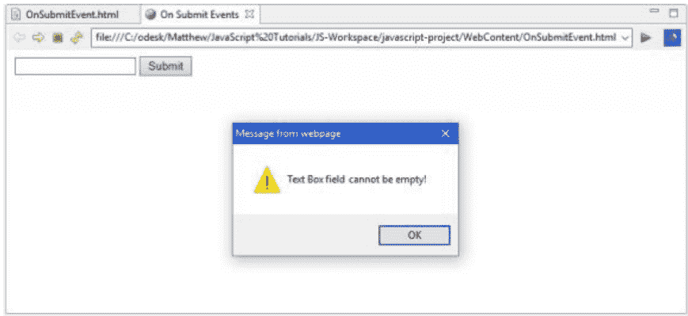

### 确认对话框

在 JavaScript 语言中，当我们需要就某个选项征求用户意见时，会使用确认对话框。它显示一个包含两个按钮的对话框：确定按钮和取消按钮。

当用户点击确定按钮时，窗口方法 `confirm()` 将返回一个 true 值。否则，如果用户点击取消按钮，则 `confirm()` 方法将返回一个 false 值。以下是确认对话框的示例。

```html
<!DOCTYPE html>

<html>

<head>

<meta charset="ISO-8859-1">

<title>Confirm Box</title>

  <script type="text/javascript">

      function showAlert(){

            confirm ("This is an confirm dialogue box example!");

      }

  </script>

</head>

<body>

  <p>Confirm box demo example.</p>

  <input type="button" onclick="showAlert();" value="Call JavaScript"/>

</body>

</html>
```

#### 输出

当我们执行上述 HTML 程序时，输出结果如下。这里我们可以看到一个确认对话框。

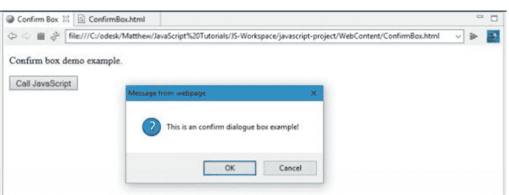

### 提示对话框

在 JavaScript 语言中，当我们想要弹出一个接受用户输入的文本框时，会使用提示对话框。因此，它允许系统与用户进行交互。用户需要在字段中输入所需数据，然后点击确定按钮。

此类对话框通过使用名为 `prompt()` 的方法来显示。它接受以下两个参数。

- 我们想要在文本框中显示的标签。
- 显示在文本框中的默认字符串。

提示对话框有以下两个按钮。

- 确定按钮。
- 取消按钮。

当用户点击确定按钮时，窗口方法 `prompt()` 将返回用户在文本框中输入的值。否则，如果用户点击取消按钮，则窗口方法 `prompt()` 将返回一个 null 值。

以下是提示对话框的示例。

```html
<!DOCTYPE html>

<html>

<head>

<meta charset="ISO-8859-1">

<title>Prompt Box</title>

  <script type="text/javascript">

        function showAlert(){

                prompt ("This is an prompt dialogue box example!");

        }

  </script>

</head>

<body>

  <p>Prompt dialogue box demo example.</p>

  <input type="button" onclick="showAlert();" value="Call JavaScript"/>

</body>

</html>
```

#### 输出

当我们执行上述 HTML 程序时，输出结果如下。这里我们可以看到一个提示对话框。

提示对话框演示示例。

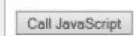

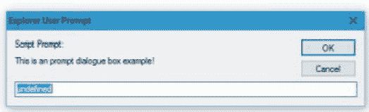

## 第 14 章 JavaScript void 关键字

在 JavaScript 语言中，void 关键字可以用作一元运算符，它出现在其唯一操作数之前，操作数可以是任何类型。此一元运算符指定一个需要被求值但不返回任何值的表达式。

以下是 void 关键字的语法和示例。

```html
<!DOCTYPE html>

<html>

<head>

<meta charset="ISO-8859-1">

<title>Void Keyword Example 1</title>

</head>

<body>

	<p>Click here to invoke an alert!</p>

	<a href="javascript:void(alert('Here is the Void Keyword demo'))">Click Here!</a>

</body>

</html>
```

#### 输出

当我们执行上述 HTML 程序时，输出结果如下。这里我们可以看到，点击响应式超链接（"Click Here!"）后弹出了一个警告对话框。另一方面，如果 void 参数为空，如第二个超链接（"No response link!"）的情况，我们不会看到任何响应，因为表达式"0"在 JavaScript 中没有任何作用。当"0"被求值时，它不会重新加载到当前文档中。

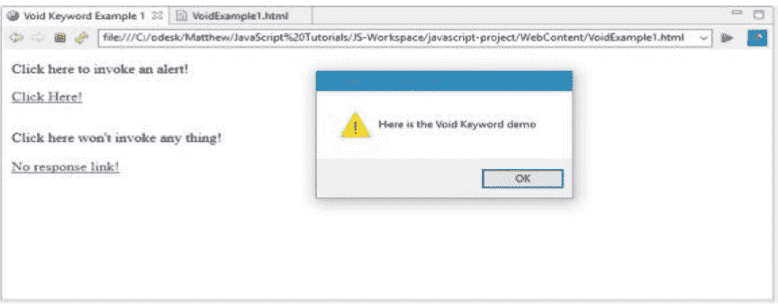

另外，JavaScript 中的 void 关键字也用于生成 undefined 值，如下例所示。

```html
<!DOCTYPE html>

<html>

<head>

<meta charset="ISO-8859-1">

<title>Void Example 2</title>

  <script type="text/javascript">

  function getVoidDemo(){

  var x,y,z;

  x = void ( y = 50, z = 700 );

  document.write('x = ' + x + ' y = ' + y +' z = ' + z );

  }

  </script>

</head>

<body>

    <p>Click to get the Result...</p>

    <form>

        <input type="button" value="Get Result"

               onclick="getVoidDemo();" />

    </form>

</body>

</html>
```

#### 输出

当我们执行上述 HTML 程序时，输出结果如下。这里变量 `x` 的值为 undefined，而变量 `y` 和 `z` 的值分别为 `50` 和 `700`。

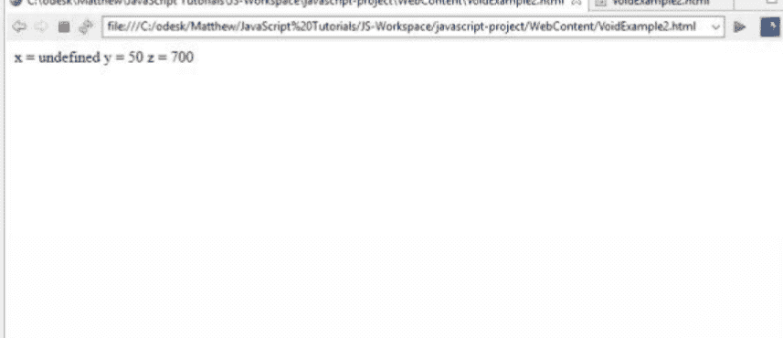

## 第 15 章 JavaScript 对象

JavaScript 语言是一种基于面向对象编程（OOP）的语言，它为程序员提供了 OOP 语言的以下能力。

**封装（Encapsulation）**：是一种概念，通过它我们可以将所有相关信息（包括数据和方法）一起存储在一个对象中。

**聚合（Aggregation）**：是一种概念，它使得在一个对象内部存储另一个对象成为可能。

**继承（Inheritance）**：是一种概念，它使得一个类能够继承或重用另一个类（或多个类）的属性和方法。这也被称为父类。

**多态（Polymorphism）**：是一种概念，它使得程序员可以编写一个函数/方法，以相同的名称定义，但在不同的情况下执行不同的任务。也被称为方法重载。

**对象**：由属性组成。属性可以是函数或属性。函数被认为是对象的方法。

### JavaScript 中的对象属性

JavaScript 中的对象属性可以是三种原始数据类型（Number、String 和 Boolean）中的任意一种，也可以是抽象数据类型（例如对象）中的任意一种。对象属性是在对象方法中内部使用的变量。它们也可以作为全局可见的变量使用，因此可以在整个页面中使用。以下是语法和示例。

```html
<!DOCTYPE html>

<html>

<head>

<meta charset="ISO-8859-1">

<title>Objects Example</title>

<script type="text/javascript">

  objectName.objectProperty = propertyValue;

  var str = document.title;

</script>

</head>

<body>

</body>

</html>
```

在这里，我们将 `propertyValue` 变量的值赋给对象属性 `objectProperty`。该对象通过名称 `objectName` 来引用。

在上一个示例的下一个语句中，我们使用 `document` 对象的 `title` 属性将文档标题的值存储到 `str` 变量中。

### JavaScript 中的对象方法

对象方法是函数，通过它们，对象可以执行操作或必需的执行。在 JavaScript 中，函数与方法的区别如下：函数是一个独立的语句单元，而方法是附加到对象的，可以通过 `this` 关键字引用。

方法可以用于在 HTML 页面上显示对象内容。它们可以对对象属性和传递给对象方法的输入参数执行复杂的数学运算。例如，在本教程中，我们使用了 `document` 对象的 `write()` 方法，其中我们将字符串或文本作为参数传递给该方法，以便写入 HTML 页面。

```html
<!DOCTYPE html>

<html>

<head>

<meta charset="ISO-8859-1">

<title>Object Method Example</title>

<script type="text/javascript">

  document.write("Welcome to JavaScript Programming!");

</script>

</head>

<body>

</body>

</html>
```

### JavaScript 中的用户自定义对象方法

在 JavaScript 语言中，所有用户定义的对象方法以及内置对象方法都扩展自一个称为 Object 的对象（类似于 JAVA 语言）。

### JavaScript 中的 new 运算符

`new` 运算符用于创建对象实例。为了在 JavaScript 中创建对象，语句中包含 `new` 运算符，其后跟构造方法，如下所示。这里，构造方法是 `Object()`、`Array()` 和 `Date()`。这些构造函数是内置的 JavaScript 函数。

```html
<!DOCTYPE html>

<html>

<head>

<meta charset="ISO-8859-1">

<title>The New Operator</title>

<script type="text/javascript">

  var student = new Object();

  var languages = new Array("JavaScript", "Pascal", "Python");

  var day = new Date("August 24, 1989");

  alert (day);

</script>

</head>

<body>

</body>

</html>
```

#### 输出

当我们执行上述 HTML 程序时，结果如下。这里，我们在警报对话框中显示 Date 对象的属性。

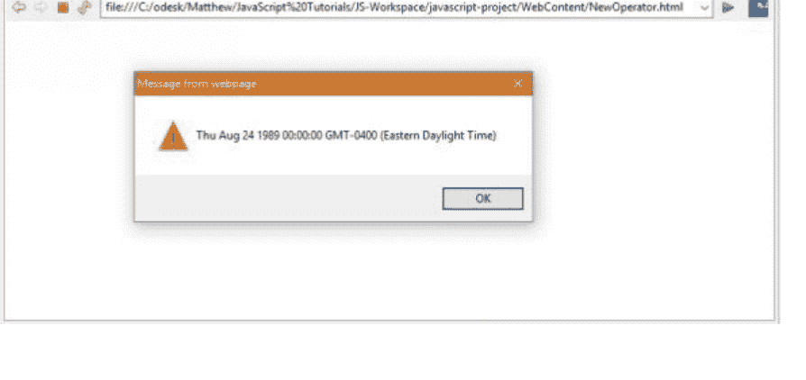

### Object() 构造方法

如前所述，构造方法是一个创建和初始化 JavaScript 对象的函数。一个特殊的构造方法 `Object()` 用于在 JavaScript 中构建对象方法。`Object()` 构造方法返回的值被赋给一个称为对象引用变量的变量。以下示例演示了在 JavaScript 中创建对象的方法。

```html
<!DOCTYPE html>

<html>

<head>

<meta charset="ISO-8859-1">

<title>Object Creation</title>

<script type="text/javascript">

  var student = new Object();

  student.name = "Appy";

  student.age = "21";

  student.course = "JavaScript";

  function showDetails(){

        alert ("Name: "+student.name+ " Age: "+student.age+" Course: "+student.course);

  }

</script>

</head>

<body>

  <input type="button" onclick="showDetails();" value="Get Student Details!" />

</body>

</html>
```

需要注意的是，对象属性变量没有用 `var` 关键字定义。

#### 输出

当我们执行上述 HTML 程序时，结果如下。

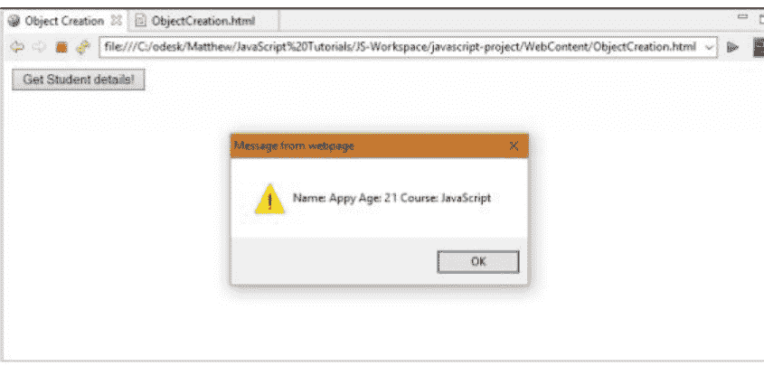

### 在 JavaScript 中为对象方法定义方法

在最后一个示例中，我们演示了如何使用构造方法创建对象方法并分配属性。在下面的示例中，我们将演示一个在 JavaScript 中为对象方法定义方法的示例。

```html
<!DOCTYPE html>

<html>

<head>

<meta charset="ISO-8859-1">

<title>Object Methods</title>

<script type="text/javascript">

   function student(name, course){

      this.name = name;

      this.course  = course;

   }

</script>
```

```javascript
var record = new student("Appy", "JavaScript");

alert("name is : " + record.name + "Course is "+ record.course);
```

#### 输出

当我们执行上述 HTML 程序时，结果如下。这里，我们为该对象方法添加了一个函数。

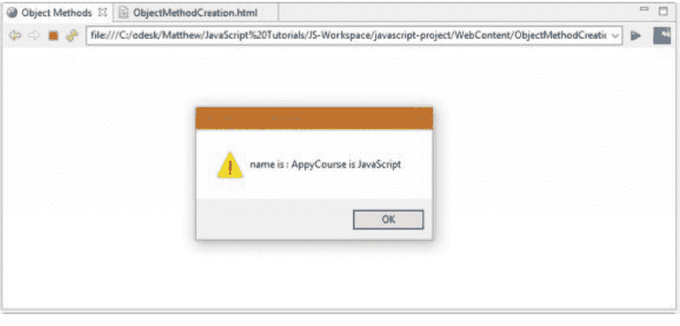

### JavaScript 中的 with 关键字

在 JavaScript 中，`with` 关键字用作引用对象属性或方法的简写。

这里，作为参数传递给 with 的对象方法在随后的代码块期间成为默认对象。在这种情况下，可以访问对象方法的属性和方法，而无需命名该对象方法。以下是语法和示例。

```html
<!DOCTYPE html>

<html>

<head>

<meta charset="ISO-8859-1">

<title>With Keyword</title>

<script type="text/javascript">

// A function that will work as a method

function addAge(years){

    with(this){

        age = years;

    }

}

function student(name, course){

    this.name = name;

    this.course = course;

    this.age = 0;

    this.addAge = addAge; // Property that is a method.

}

</script>

</head>

<body>

<script type="text/javascript">

var record = new student("Appy", "JavaScript");

record.addAge(21);

alert("Name is : " + record.name + "\nCourse is : " + record.course +

      "\nAge is : " + record.age);

</script>

</body>

</html>
```

#### 输出

当我们执行上述 HTML 程序时，结果如下。这里，我们使用 `with` 关键字通过将方法作为属性来添加年龄。

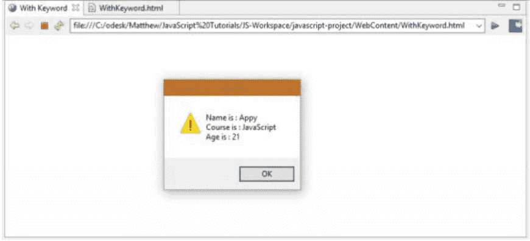

### JavaScript 中的内置对象方法

JavaScript 语言有许多内置或原生对象方法。这些原生对象方法可以在程序中的任何地方访问，并且它们在任何类型操作系统上运行的任何类型浏览器中都能以相同的方式工作。以下是重要的 JavaScript 原生对象方法。

- JavaScript Array 对象。
- JavaScript Boolean 对象。
- JavaScript Date 对象。
- JavaScript Math 对象。
- JavaScript Number 对象。
- JavaScript RegExp 对象。
- JavaScript String 对象。

### 结论

再次感谢您下载本书！

我希望这本书能够帮助您学习 JavaScript。

下一步是将这些实践应用到您的工作中。

祝您好运，谢谢！

## Python 编程概览

### 第 1 章 Python 编程语言简介

你知道像 YouTube 和 Dropbox 这样的网站在其源代码中使用了 Python 吗？Python 是一门内容丰富且易于理解和应用的语言。使用 Python 几乎可以开发任何东西。除 Windows 外，大多数操作系统（Mac、Linux、UNIX 等）默认都安装了 Python。它是一门开源的免费语言。在这本电子书里，我们将学习这门出色的编程语言，并通过各种实例来应用它。Python 中没有类型声明的方法、参数、函数或变量（不像其他语言），这使得其代码简洁明了。如前所述，这门语言可用于方方面面，无论是构建网站、游戏还是搜索引擎。使用 Python 的主要优势在于你不必显式运行编译器，它像 Perl 或 Shell 一样是一门纯粹的解释型语言。

Python 源文件使用的文件扩展名为 `.py`，并且它是一门大小写敏感的语言，因此 `P` 和 `p` 会被视为两个不同的变量。此外，Python 会自动判断变量的类型，例如，如果你设置 `x=4` 和 `y='Python'`，它会将 `x` 视为整数，将 `y` 视为字符串。我们将在后续章节中详细学习所有这些基础知识。在继续之前，有一些重要的要点需要记住：

1. 赋值使用 `=`，比较使用 `==`。例如，`x=4`，`y=8`，`x==y`
2. `print` 用于打印结果。
3. 所有数学运算如 `+`、`-`、`*`、`/`、`%` 都用于数字。
4. 当给变量赋值时，变量就被创建了。例如，`a=5` 会创建一个名为 `a` 的变量，其整数值为 5。无需事先定义它。
5. `+` 也可以用来连接两个字符串。例如，`z="Hi"`，`z=z+"Python"`
6. 逻辑运算使用 `and`、`or`、`not`，而不是符号。

有三种基本数据类型：整数（数字默认类型）、浮点数（`a=3.125`）和字符串。字符串可以通过 `""`（双引号）或单引号（`''`）来定义。我们将在接下来的章节中通过具体的示例来了解所有数据类型。

下面来看看在 Windows 操作系统上安装 Python 的分步指南。如前所述，如果你使用的是 UNIX 或 Linux 或 Mac 等其他操作系统，Python 应该已经安装好并可以使用了。在 Linux 上你需要使用 `%python` 来获取详细信息，按 `CTRL + D` 退出。在 UNIX 上运行则使用 `%python filename.py`。Python 以三个"大于号"符号（`>>>`）作为提示符。

[点击此处在 Amazon 上查看 Python 编程的其余内容。](http://amzn.to/2auRjNy)

或访问：[http://amzn.to/2auRjNy](http://amzn.to/2auRjNy)
