# JavaScript 编程初学者指南

Nick Goddard

# 第 1 章

## JavaScript语言简介

欢迎来到 JavaScript 世界，它由 Brendan Eich 于 1995 年发明，至今仍然是全球范围内最常用的脚本语言。它是一种高级、解释型、跨平台且开源的编程语言。在系列教程中，我们将通过实际示例来学习 JavaScript。在开始之前，让我们先回顾一些基础知识。

JavaScript 是一种面向对象（OOP）的脚本语言，主要用于 Web 编程。它负责让网页具有交互性；简单来说，“它告诉网页执行什么操作”。就像 HTML 定义网页的内容、CSS 定义布局一样，JavaScript 让该网页正常工作。JavaScript 程序是按照编写的顺序执行的指令集，因此在编写代码时，我们应该注意逻辑顺序。不要将 Java 和 JavaScript 混淆，它们在设计上技术上是不同的语言，但它们的标准库和语法是相同的。

现在，让我们学习如何在你的计算机上安装这种神奇的语言，并编写我们的第一个 JavaScript 程序。

# 第 2 章

## 开发环境 IDE 设置

在整个教程中，我们将使用 eclipse 作为开发 IDE，通过实际演示解释 JavaScript 程序示例。以下是安装 eclipse 并设置 JavaScript 开发环境的步骤。

请遵循以下步骤：

1. 下载 eclipse 并为 JavaScript 设置开发环境。请按照以下步骤操作：

   从下方链接下载 eclipse。选择最新的稳定版本，并确保你的机器是 64 位的。

2. 点击 `eclipse.exe` 打开 eclipse。

3. 以以下方式 New New -> Web Project：

   选择下方链接：

   `https://www.eclipse.org/downloads`

4. 会弹出一个对话框，要求你输入项目名称。

   点击 Finish。

5. 一个 Static Web Project（静态 Web 项目）。

6. 在 eclipse 左侧的资源资源管理器（Project Explorer）中，展开项目目录，右键点击 `WebContent` 文件夹。

7. 弹出对话框，输入项目名称，点击 HTML 文件。

   在当前项目中添加一个文件。

8. 如下所示。

9. 在此处，你已经成功完成了 JavaScript 的编程设置。在下一章，我们将使用该设置。

# 第 3 章

## 我的 JavaScript 程序

在上一章中，我们创建了一个 html 文件（`MyJavaScriptProgram.html`）。让我们使用它来编写第一个 JavaScript 程序，如下所示。

```html
<!DOCTYPE html>
<html>
<head>
<meta charset="ISO-8859-1">
<title>My JavaScript Program</title>
</head>
<body>
<script language="javascript" type="text/javascript">
document.write("Welcome to JavaScript First Program");
</script>
</body>
</html>
```

## 对 `<body> ... </body>` 代码的解释

在这里，我们将 JavaScript 代码注入到 HTML 的 `<body> ... </body>` 标签之间。在 JavaScript 代码/脚本中，我们首先声明了之前讨论过的两个属性，然后通过 `document` 对象在网页上写了“Welcome to JavaScript First Program”。

### 输出

当我们执行上述 HTML 程序时，将得到以下输出。

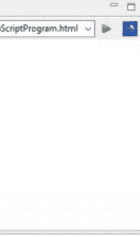

### 空格与换行

我们可以在 JavaScript 程序中自由使用空格、制表符和换行，因为浏览器解析器在解析 JavaScript 代码时会忽略这些内容。此外，我们还可以整齐地格式化和缩进 JavaScript 程序，使脚本非常易于维护、阅读和理解。

### 可选的分号

通常，所有的 JavaScript 语句都以分号结束。当每个 JavaScript 语句都单独放在一行上时，这些分号是可选的。在每个 JavaScript 语句末尾使用分号被认为是一种良好的编程习惯。

## 大写敏感

JavaScript 语言是一种大小写敏感的语言。这意味着关键字、变量、函数名、标识符等在使用时保持字母的大小写一致。例如，从 JavaScript 语言的角度来看，标识符 `learn` 和 `LEARN` 是不同的。

## JavaScript 中的注释

以下是 JavaScript 语言支持的注释样式。

- 单行注释声明为 `//`（双斜杠）。

- 多行注释声明为 `/* 多行上的 JavaScript 语句 */`。它也适用于单行注释。

- 它还能识别 HTML 注释（起始序列）`<!--`。JavaScript 像处理 `//` 注释一样将其视为单行注释。

- HTML 的结束序列 `-->` 不被 JavaScript 识别，因此它应该写成 `//->`。

以下是一个涵盖各种 JavaScript 注释的示例。

```html
<!DOCTYPE html>
<html>
<head>
  <meta charset="ISO-8859-1">
  <title>JavaScript Comments</title>
</head>
<body>
  <script type="text/javascript">
  <!-- 起始序列单行注释。
  HTML 注释结束序列--*/

  // 这是一个单行注释。

  /*
  * 这是 JavaScript 中的多行注释
  */
  </script>
</body>
</html>
```

### 输出

当我们执行上述 HTML 程序时，输出将是以下内容（空白），因为 JavaScript 解释器忽略了所有注释。

## JavaScript 语法

与任何其他编程语言一样，JavaScript 语法有一套特定的规则来构建它们。

### JavaScript 程序

JavaScript 程序是一系列由浏览器程序解析并执行的指令。这些系列程序指令被称为语句。

JavaScript 是一种基于对象的编程语言。

JavaScript 语句之间通常用分号隔开，但在语句末尾放置分号是可选的。

```html
<!DOCTYPE html>
<html>
<head>
<meta charset="ISO-8859-1">
<title>JavaScript Syntax</title>
<script type="text/javascript">
  var a = 101;
  var b = 300;
  var sum = a + b;
</script>
</head>
<body>
<script type="text/javascript">
  document.write("sum of a + b = "+sum);
</script>
</body>
</html>
```

### 输出

当我们执行上述 HTML 程序时，输出将是以下内容。

### JavaScript 中的语句

JavaScript 编程语言中的语句由以下组成：

- 值

- 运算符

- 表达式

- 关键字，以及

- 注释。

### JavaScript 中的值

以下是 JavaScript 中的两种值。

- 固定值，以及

- 变量值。

字面量是固定值，变量值被称为变量。

### JavaScript 中的字面量

以下是在 JavaScript 中编写字面量或固定值的规则。

- 数字可以带或不带小数定义。

- 字符串是写在单引号或双引号内的文本。

### JavaScript 中的变量

以下是用于在 JavaScript 中存储数据值的变量值编写规则。

JavaScript 语言使用 `var` 关键字来声明变量。

变量的值通过等号赋值。

### JavaScript 中的运算符

以下是 JavaScript 语言中使用的运算符。

赋值运算符（`=`）用于给变量赋值值。

算术运算符（`+ - * /`）用于算术运算，如加法、减法、乘法和除法。

### JavaScript 中的表达式

JavaScript 语言中的任何表达式都是值、变量和运算符的组合。它们共同进行计算。这种计算被称为求值。

表达式可能还包含变量值，如数字和字符串。例如，`"Java" + "Script"` 将拼接为 `"JavaScript"`。

让我们通过以下示例来理解这一点。

```html
<!DOCTYPE html>
<html>
<head>
<meta charset="ISO-8859-1">
<title>JS 表达式</title>
<script type="text/javascript">
  var a = 101; //变量、赋值运算符和数字字面量。
  var b = 300;
  var addition = a + b;
  var str1 = "Java"; //变量、赋值运算符和字符串字面量。
  var str2 = "Script";
  var str3 = str1 + str2;
</script>
</head>
<body>
<script type="text/javascript">
  document.write("Addition of b = "+addition);
  document.write("<br>Concat of str1 + str2 = "+str3);
</script>
</body>
</html>
```

### 输出

当我们执行上述 HTML 程序时，输出将是以下内容。输出显示了加法结果。

## JavaScript 中的关键字

JavaScript 中的关键字用于标识需要执行的操作和标签。

## 驼峰命名法与 JavaScript

将多个单词合并为一个有以下三种方式：

- 连字符：例如 `first-address`、`second-address`、`visa-passport`。

- 下划线：例如 `first_address`、`second_address`、`visa_passport`。

- 驼峰命名法：例如 `FirstAddress`、`SecondAddress`、`VisaPassport`。在 JavaScript 中，驼峰命名法通常以小字母开头。

## JavaScript 中的字符集

JavaScript 语言使用 Unicode 字符集，它涵盖所有字符、标点和符号。

### 启用与禁用

如 Internet Explorer、Mozilla Firefox、Google Chrome 等浏览器内置了 JavaScript 支持。我们可以手动启用或禁用。在本章中我们将讨论在这些浏览器中启用禁用 JavaScript 的过程。

### 在 Internet Explorer 中启用 JavaScript

以下是在 Internet Explorer 中启用 JavaScript 的步骤：

- 从菜单导航到 Internet 设置。

- 在对话框中，选择安全选项卡。

- 点击自定义级别按钮。

- 向下滚动菜单并找到脚本选项。

- 在活动（Active）下选择启用单选按钮。

- 最后，点击确定按钮启用 JavaScript 支持。

### 在 Internet Explorer 中禁用 JavaScript

要关闭或禁用 Internet Explorer 中的 JavaScript 支持，请按照上述步骤操作并在活动下选择禁用单选按钮。

### 在 Mozilla Firefox 中启用 JavaScript

以下是在 Mozilla Firefox 中启用 JavaScript 的步骤：

- 打开新标签页并在地址栏中输入 `about:config`。

在那里我们将看到警告对话框，选择并点击“I’ll be careful, I promise!”按钮，如下所示。

在这里我们将观察浏览器的配置选项列表。在搜索框中，输入 `javascript.enabled` 如下所示。

在这里，我们可以通过右键点击开关的值找到启用或禁用 JavaScript 的选项。

点击开关后，如果 `javascript.enabled` 为 `true`，它将转换为 `false`。这将禁用 Mozilla Firefox 浏览器的 JavaScript 支持。

### 在 Mozilla Firefox 中禁用 JavaScript

以下是关闭或禁用 Mozilla Firefox 中 JavaScript 支持的步骤。如果 JavaScript 已禁用，可以按照之前的类似步骤点击开关来启用。

### 在 Google Chrome 中启用或禁用 JavaScript 支持

以下是在 Google Chrome 中启用或禁用 JavaScript 支持的步骤：

点击 Chrome 右上角的 Chrome 菜单，如浏览器所示。

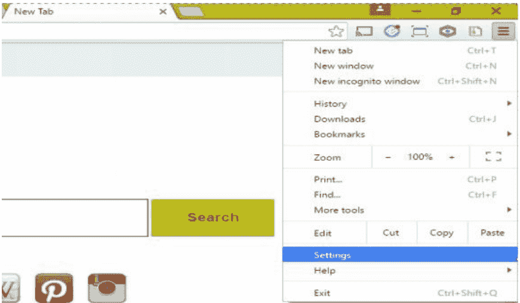

选择“设置”（Settings），然后点击页面底部的“显示高级设置”（Show advanced settings）。

在“隐私”（Privacy）部分，点击下方所示的“内容设置”（Content settings）按钮。

在内容设置的“Javascript”部分，选择“不允许任何网站运行 JavaScript”或“允许所有网站运行 JavaScript（推荐）”，分别禁用或启用 Chrome 浏览器上的 JavaScript 支持。内容设置页面所示。

### 在 Opera 中启用或禁用 JavaScript 支持

以下是在 Opera 中启用或禁用 JavaScript 支持的步骤。

- 打开 Opera 浏览器，并从菜单中进入“工具-偏选项”（Tools Preferences）。

- 然后，在对话框中选择“高级”（Advanced）选项。

- 接下来，从列表中选择“内容”（Content）。

- 从那里，勾选“启用 JavaScript”（Enable JavaScript）复选框。

- 最后，点击 OK 按钮启用 Opera 浏览器的 JavaScript 支持。

同样，要禁用 Opera 浏览器的 JavaScript 支持，我们不勾选“启用 JavaScript”复选框并点击 OK 按钮。

## 非 JavaScript 浏览器的警告

当我们必须使用 JavaScript 执行非常重要的操作时，可以使用 `<noscript>` 标签向用户显示警告消息。我们可以像下面所示在脚本块之后立即添加一个 `noscript` 块。

```html
<!DOCTYPE html>
<html>
<head>
<meta charset="ISO-8859-1">
<title>No Script tag</title>
</head>
<body>
<script type="text/javascript">
document.write("JavaScript Support is enabled on your browser!");
</script>
<noscript>
Please enable JavaScript support on your browser.
</noscript>
</body>
</html>
```

如果上述任何浏览器不支持 JavaScript 或 JavaScript 支持被禁用，则 `<noscript></noscript>` 标签之间的消息将显示在屏幕上。

# 第 6 章

## JavaScript 的放置

JavaScript 代码在 HTML 文档中的放置非常灵活，可以通过以下方式放置。

**在 `<head>...</head>` 区域中放置 JavaScript** —— 这是在 HTML 文档头部部分包含 JavaScript 代码的最优选方式。我们可以将 JavaScript 代码或函数放置在头部部分，并在网页元素事件上访问这些函数，如下所示。

```html
<!DOCTYPE html>
<html>
<head>
<meta charset="ISO-8859-1">
<title>JS in head section</title>
<script type="text/javascript">
function showAlert(){
  alert("This is an alert from Head section!");
}
</script>
</head>
<body>
<input type="button" onclick="showAlert();" value="Call JavaScript"/>
</body>
</html>
```

### 输出

当我们执行上述 HTML 程序时，输出将是如下所示。在输出中，当我们点击网页上的按钮时，可以看到一个带有消息“This is an alert from Head section”的警报框。

**在 `<body>...</body>` 区域中放置 JavaScript** —— 也可以将 JavaScript 代码放置在 HTML 代码的 body 部分，但这种方法并不是优选的，因为我们在 body 部分调用的 JavaScript 函数通常优选地定义在 HTML 文档的 head 部分。

```html
<!DOCTYPE html>
<html>
<head>
  <meta charset="ISO-8859-1">
  <title>JS Body</title>
</head>
<body>
  <script type="text/javascript">
document.write("Welcome to JavaScript Tutorials!")
</script>
<p>Body section of the HTML document.</p>
</body>
</html>
```

### 输出

当我们执行上述 HTML 程序时，输出将是如下所示。在输出中，我们可以看到通过 JavaScript 在 HTML 页面上编写的文本“Welcome to JavaScript Tutorials!”，该文本位于其 body 部分。

**在 `<body>...</body>` 和 `<head>...</head>` 区域中放置 JavaScript** —— 在这种方法中，JavaScript 代码放置在 HTML 文档的头部和身体部分，如下例所示。

```html
<!DOCTYPE html>
<html>
<head>
<meta charset="ISO-8859-1">
<title>JS Head and Body</title>
<script type="text/javascript">
function showAlert(){
alert("This is an alert from Head section!");
}
</script>
</head>
<body>
<script type="text/javascript">
document.write("Welcome to JavaScript Tutorials!")
</script>
<p>Body section of the HTML document.</p>
<input type="button" onclick="showAlert();" value="Call JavaScript"/>
</body>
</html>
```

### 输出

当我们执行上述 HTML 程序时，输出将是如下所示。在输出中，我们可以看到通过 JavaScript 在 HTML 页面上编写的文本“Welcome to JavaScript Tutorials!”，位于其 body 部分。

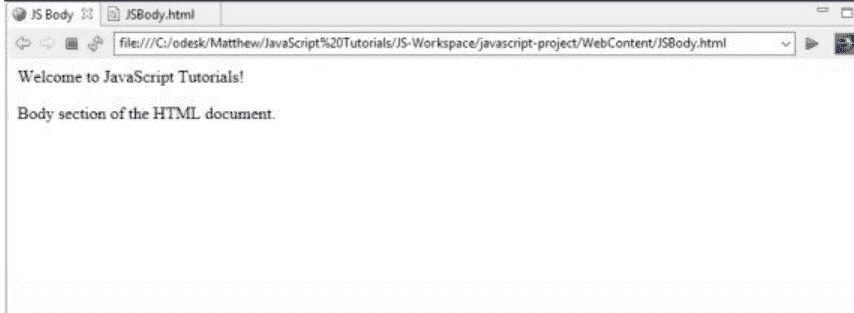

# 第 7 章

## JavaScript 变量

```html
<!DOCTYPE html>
<html>
<head>
<meta charset="ISO-8859-1">
<title>JavaScript Variables</title>
<script type="text/javascript">
  var name = "Appy";
  var age = 21;
  var salary = 10000, expenses = 12000;
  alert ("Name: "+name+" Age: "+age+"\nSalary: "+salary+" Expenses: "+expenses);
</script>
</head>
<body>
</body>
</html>
```

## JavaScript 代码说明

在变量中存储一个值被称为变量初始化。我们可以在变量创建期间的任何时间点或在需要该变量时进行变量初始化。

例如，我们在上面的代码中创建了四个变量，并为这些变量每一个赋值了值。例如 `name = "Appy"`，`salary = 10000` 等。

### 输出

当我们执行上述 HTML 程序时，输出将是以下内容。在输出中，我们通过 `alert` 显示赋值给数据容器的值。

需要注意的是 `var` 关键字仅用于声明或初始化，在 HTML 文档中任何变量名仅使用一次。我们不应该重复声明同一个变量。在 JavaScript 中，由于它是一种无类型语言，变量可以持有任何数据类型的值。与其他类型语言（如 C++、JAVA 等）不同，我们不需要在变量声明期间告诉 JavaScript 编译器变量将持有什么类型的值。此外，变量的值可以在程序执行期间更改，JavaScript 解析器会自动处理。

## JavaScript 中的作用域

变量的作用域定义为其定义的程序区域。JavaScript 变量可以具有两种作用域：

- 全局变量作用域 – 是全局作用域，意味着它可以在 JavaScript 代码的任何地方定义并在当前 HTML 文档处处可见。

- 局部变量作用域 – 是局部变量，它只在定义的函数内部可见。函数参数始终是函数的局部的。

需要注意的是，在函数体内，如果定义了同名的局部变量和全局变量，局部变量始终优先于全局变量。让我们通过以下示例最好地理解这个概念。

```html
<!DOCTYPE html>
<html>
<head>
<meta charset="ISO-8859-1">
<title>Variable Scope</title>
<script type="text/javascript"> // 一个全局变量
var demoVar = "global scope"; 
function checkVariableScope() {
var demoVar = "local scope"; // 一个局部变量
document.write(demoVar);
}
</script>
</head>
<body onload = checkVariableScope();>
</body>
</html>
```

### 输出

当我们执行上述 HTML 程序时，输出将是以下内容。在输出中，我们可以观察到值为“local scope”，因为如果两个变量具有相同的名称，局部变量将优先于全局变量。

## JavaScript 中的变量名

在 JavaScript 语言中命名变量时应遵守规则：

- 变量名不能是保留关键字。这些关键字在本章的最后一节提到。例如 `finally`、`goto` 等变量名是无效的。

- JavaScript 语言中的变量名不能以数字（0-9）开头。然而，它们可以字母或下划线字符开头。例如 `10name` 是无效的变量，但 `_10name` 是有效名称。

- JavaScript 中的变量名对大小写敏感。例如，`Address` 和 `address` 在 JavaScript 语言中被视为两个不同的变量。

## JavaScript保留字

以下是 JavaScript 语言中所有保留字的列表。这些保留字不能用作 JavaScript 变量、循环标签、函数或任何对象名称。

| abstract | debugger | final | instanceof | public |
| --- | --- | --- | --- | --- |
| boolean | default | finally | int | return |
| break | delete | float | interface | short |
| byte | do | for | long | static |
| case | double | function | native | super |
| catch | else | goto | new | switch |
| char | enum | if | null | synchronized |
| class | export | implements | package | this |
| const | extends | import | private | throw |
| continue | false | in | protected | throws |

# 第 8 章

## JavaScript 运算符

当我们相加或相减两个值时，例如将 5 加 6（即 `5 + 6`），这里 `+` 被称为运算符，而 `(5 + 6)` 被称为表达式。JavaScript 语言支持以下类型的运算符。

### 算术运算符

以下是 JavaScript 语言支持的算术运算符。

| 序号 | 算术运算符 | 说明 | 示例 |
| --- | --- | --- | --- |
| 1. | `+` (加法) | 用于两个操作数相加。 | `X + Y` |
| 2. | `-` (减法) | 用于从第一个操作数减去第二个操作数。 | `X - Y` |
| 3. | `*` (乘法) | 用于乘以两个操作数。 | `X * Y` |
| 4. | `/` (除法) | 用于除两个操作数。 | `X / Y` |
| 5. | `%` (取模) | 输出除法的余数。 | `X % Y` |
| 6. | `++` (自增) | 整数增加1。 | `X++` |
| 7. | `--` (自减) | 整数减少1。 | `X--` |

### 比较运算符

以下是 JavaScript 支持的比较运算符。

| 序号 | 比较运算符 | 说明 | 示例 |
| --- | --- | --- | --- |
| 1. | `==` (等于) | 用于检查两个操作数是否相等。如果两个值相等，则条件为真。 | `X == Y` |
| 2. | `!=` (不等于) | 用于检查两个操作数是否相等。如果两个值不等，则条件为真。 | `X != Y` |
| 3. | `>` (大于) | 检查第一个操作数是否大于第二个操作数。 | `X > Y` |
| 4. | `<` (小于) | 检查第一个操作数是否小于第二个操作数。 | `X < Y` |
| 5. | `>=` (大于等于) | 检查第一个操作数是否大于等于第二个操作数。 | `X >= Y` |
| 6. | `<=` (小于等于) | 检查第一个操作数是否小于等于第二个操作数。 | `X <= Y` |

### 逻辑（关系）运算符

以下是 JavaScript 支持的逻辑或关系运算符。

| 序号 | 逻辑运算符 | 说明 | 示例 |
| --- | --- | --- | --- |
| 1 | `&&` (逻辑与) | 如果两个操作数都非零，则此运算符使条件为真。 | `X && Y` |
| 2 | `||` (逻辑或) | 如果两个操作数中的任意一个非零，则此运算符使条件为真。 | `X || Y` |
| 3 | `!` (逻辑非) | 此运算符反转操作数的状态。如果条件为真，则逻辑非运算符将其变为假，反之亦然。 | `!X` |

### 赋值运算符

以下是 JavaScript 支持的赋值运算符。

| 序号 | 赋值运算符 | 说明 | 示例 |
| --- | --- | --- | --- |
| 1. | `=` (简单赋值) | 用于将右侧操作数的值赋值给左侧操作数。 | 例如 `Z = X - Y` 将 `X - Y` 的值赋值给变量 `Z`。 |
| 2. | `+=` (加赋值) | 用于将右侧操作数加到左侧操作数并将结果赋值给左侧操作数。 | 例如 `Z += X` 等于 `Z = Z + X` |
| 3. | `-=` (减赋值) | 用于从左侧操作数减去右侧操作数并将结果赋值给左侧操作数。 | 例如 `Z -= X` 等于 `Z = Z - X` |
| 4. | `*=` (乘赋值) | 用于将右侧操作数乘以左侧操作数并将结果赋值给左侧操作数。 | 例如 `Z *= X` 等于 `Z = Z * X` |
| 5. | `/=` (除法赋值) | 该运算符用于将左操作数除以右操作数，并将结果赋值给左操作数。 | 例：`Z /= X` 等于 `Z = Z / X` |
| 6. | `%=` (取模赋值) | 该运算符用于两个操作数取模，并将结果赋值给左操作数。 | 例：`Z %= X` 等于 `Z = Z % X` |

### 条件（或三元）运算符

以下是 JavaScript 语言支持的条件运算符或三元运算符。

| 序号 | 运算符 | 描述 | 示例 |
|---|---|---|---|
| 1. | `? :` (条件) | 如果条件为真？返回值 X：否则返回值 Y。 | 例：`(X > Y) ? "yes" : "No"` |

### 位运算符

以下是 JavaScript 语言支持的位运算符。

| 序号 | 位运算符 | 描述 | 示例 |
|---|---|---|---|
| 1. | `&` (位与) | 该运算符用于对其整数参数的每一位执行布尔与操作。 | 例：`(X & Y)` 为 2。 |
| 2. | `|` (位或) | 该运算符用于对其整数参数的每一位执行布尔或操作。 | 例：`(X | Y)` 为 3。 |
| 3. | `^` (位异或) | 该运算符用于对其整数参数的每一位执行布尔异或操作。异或意味着两个操作数中有一个为真，但不能都为真。 | 例：`(X ^ Y)` |
| 4. | `~` (位取反) | 位取反是一个一元运算符，通过反转操作数的所有位来操作。 | 例：`(~B)` 为 -4。 |
| 5. | `<<` (左移) | 该运算符将其第一个操作数的所有位向左移动第二个操作数指定的位数。新位用零填充。将一个值左移一位等同于乘以 2，左移两位等同于乘以 4，依此类推。 | 例：`(X << Y)` 为 4。 |
| 6. | `>>` (右移) | 在二进制右移运算符中，左操作数的值按右操作数指定的位数右移。 | 例：`(X >> 1)` 为 1。 |
| 7. | `>>>` (逻辑右移) | 该运算符与 `>>` 运算符类似，但左侧移入位始终为零。 | 例：`(X >>> 1)` 为 1。 |

# 第 9 章

## JavaScript 决策

在编写程序时，我们大多数时候面临必须做决策的情况。决策是对程序执行过程中可能出现的情况进行预判，并需要根据这些条件指定某些操作。

在决策结构中，有一个条件，可以是单个表达式或多个表达式。该条件在求值时会产生 `TRUE`（真）或 `FALSE`（假）的结果。根据结果，我们需要确定采取什么行动以及执行哪些语句。请参考下图以清晰理解。

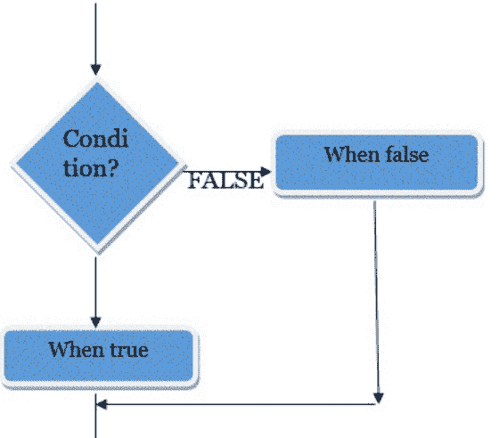

与其他任何编程语言一样，JavaScript 语言支持条件语句，用于根据不同的条件执行不同的操作。以下是 JavaScript 语言支持的条件语句。

- `if` 语句

- `if...else` 语句

- `if...else if...` 语句

- `switch case` 语句

让我们通过 JavaScript 程序来理解这些语句。

### if 语句

`if` 语句是一种基础控制语句，允许 JavaScript 代码根据所需的条件做出决策并执行语句。以下是其语法。

#### 语法与示例

```html
<!DOCTYPE html>
<html>
<head>
<meta charset="ISO-8859-1">
<title>基础 IF 语句</title>
</head>
<body>
<script type="text/javascript">
var salary = 10000;
var expenses = 12000;
if (expenses > salary) {
document.write("<b>请开始增加收入或减少开支！</b>");
}
</script>
<p>我们处于 body 部分...</p>
</body>
</html>
```

#### 输出

当我们执行上述 HTML 程序时，输出将是如下内容。由于 `if` 语句中的条件为真，因此它会在 HTML 页面上写入指定的文本。

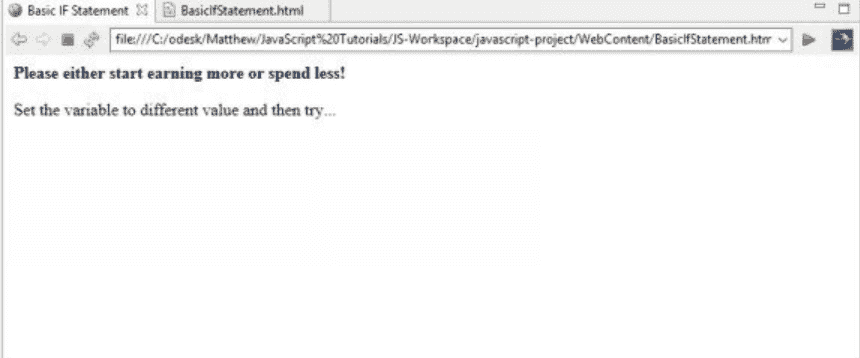

### if...else 语句

`if...else` 语句是控制语句的另一种形式，允许 JavaScript 代码以控制的方式执行语句。以下是语法和示例。

#### 语法与示例

```html
<!DOCTYPE html>
<html>
<head>
<meta charset="ISO-8859-1">
<title>If Else 语句</title>
</head>
<body>
<script type="text/javascript">
var salary = 12000;
var expenses = 10000;
if (expenses > salary) {
document.write("<b>请开始增加收入或减少开支！</b>");
}
else {
document.write("<b>你有足够的钱花了！</b>");
}
</script>
</body>
</html>
```

#### 输出

当我们执行上述 HTML 程序时，输出将如下。由于 `if` 语句中的条件为假，它进入了 `else` 块并写入了文本。

### if...else if 语句

`else if` 语句是另一种形式，允许 JavaScript 代码根据一系列条件做出决策。以下是语法和示例。

```html
<!DOCTYPE html>
<html>
<head>
<meta charset="ISO-8859-1">
<title>If Else If 语句</title>
</head>
<body>
<script type="text/javascript">
var salary = 10000;
var expenses = 12000;
if (expenses > salary) {
document.write("<b>请开始增加收入或减少开支！</b>");
}
else if (expenses > 10000) {
document.write("<b>你有足够的钱花了！</b>");
}
else {
  document.write("<b>你需要小心！</b>");
}
</script>
<p>我们处于 body 部分...</p>
</body>
</html>
```

#### 输出

当我们执行上述 HTML 程序时，输出将如下。由于 `if` 语句中的条件为假，它进入了 `else if` 块，那里的条件恰好为真。它处理了与 `if...else` 语句相同的情况。

### switch case 语句

从 JavaScript 1.2 版本开始，它支持 `switch` 语句。`switch` 语句用于根据表达式的值提供多个不同的语句。JavaScript 解释器会将每个 `case` 与表达式返回值对比，直到找到匹配项。如果没有找到匹配项，则使用 `default` 条件。

此外，在 `case` 语句末尾有 `break` 语句。如果在这里没有声明，解释器将继续执行后续所有的 `case`。

以下是 `switch case` 语句的语法示例。

```html
<!DOCTYPE html>
<html>
<head>
<meta charset="ISO-8859-1">
<title>Switch Case 语句</title>
</head>
<body>
<script type="text/javascript">
  var expensecode='X';
document.write("进入 switch 块<br />");
switch(expensecode) {
  case 'X': document.write("<b>请开始增加收入或减少开支！</b>");
  break;
  case 'Y': document.write("<b>你有足够的钱花了！</b>");
  break;
  case 'Z': document.write("<b>虽然你有足够的钱但你需要小心！</b>");
  break;
default: document.write("未找到匹配项!<br/>");
}
document.write("<br>退出 switch 块<br/>");
</script>
<p>我们处于 body 部分...</p>
</body>
</html>
```

#### 输出

当我们执行上述 HTML 程序时，输出将如下。程序在 HTML 页面上写入了 `case` 字符（`'X'`）匹配的文本。

# 第 10 章

## JavaScript 循环

当任何程序执行时，它都是按顺序执行的。序列中第一个出现的语句首先执行，然后是下一条，依此类推，直到程序的最后一条语句。很多时候，程序中需要多次运行同一块代码，这时就产生了被称为“循环”的控制结构的需求。

循环使代码块中的一个语句或一组语句在条件为真时执行多次，并在条件变为假时退出循环。下面的图展示了这种循环。

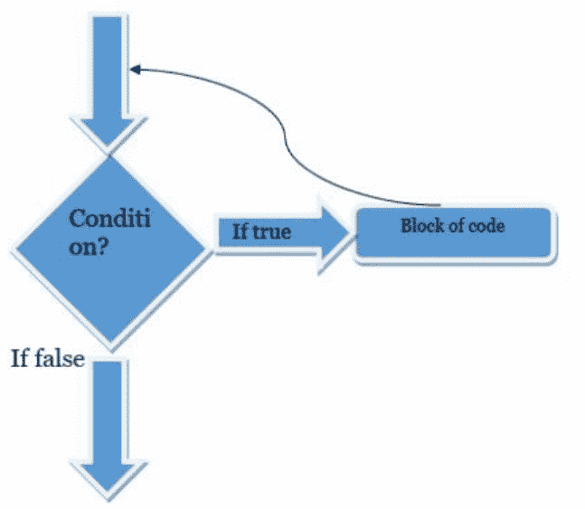

与其他任何编程语言一样，JavaScript 也支持循环，以及以下类型的循环和循环控制语句。

- `while` 循环

- `do...while` 循环

- `for` 循环

- `for...in` 循环

### while 语句

`while` 循环是 JavaScript 语言中最基础的循环。这种循环只要表达式保持为真，它就会重复执行一个语句或代码块。一旦表达式为假，循环就会终止。以下是 `while` 语句的语法和示例。

```html
<!DOCTYPE html>
<html>
<head>
<meta charset="ISO-8859-1">
<title>While Loop</title>
</head>
<body>
<script type="text/javascript">
var counter = 0;
document.write("Entering while Loop!");
while (counter < 5) {
document.write("Current Counter is : " + counter + "<br />");
counter++;
}
document.write("Exiting while Loop!");
</script>
<p>We are inside body section...</p>
</body>
</html>
```

#### 输出

当我们执行上述 HTML 程序时，输出将如下所示。计数器将在 HTML 页面上写入 5 次，因为它保持了 5 次的条件为真。

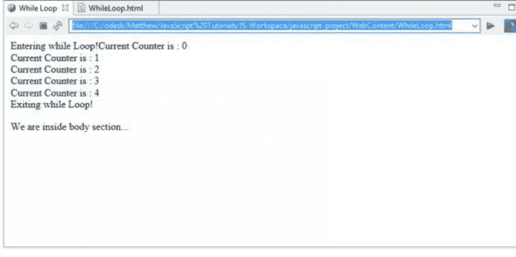

### do...while 循环语句

`do...while` 循环与 `while` 循环相似，区别在于 `do...while` 循环中的条件检查发生在循环的结束处。这意味着循环内部的代码块将始终至少执行一次，即使条件为假。以下是 `do...while` 语句的语法和示例。

```html
<!DOCTYPE html>
<html>
<head>
<meta charset="ISO-8859-1">
<title>Do While Loop</title>
</head>
<body>
<script type="text/javascript">
var counter = 0;
document.write("Entering while Loop!");
do {
document.write("Current Counter is : " + counter + "<br/>");
counter++;
}
while (counter < 5)
document.write("Exiting while Loop!");
</script>
<p>We are inside body section...</p>
</body>
</html>
```

#### 输出

当我们执行上述 HTML 程序时，输出将如下所示。计数器将在 HTML 页面上写入 5 次，因为包括第一次没有检查条件外，它保持了 5 次的条件为真。

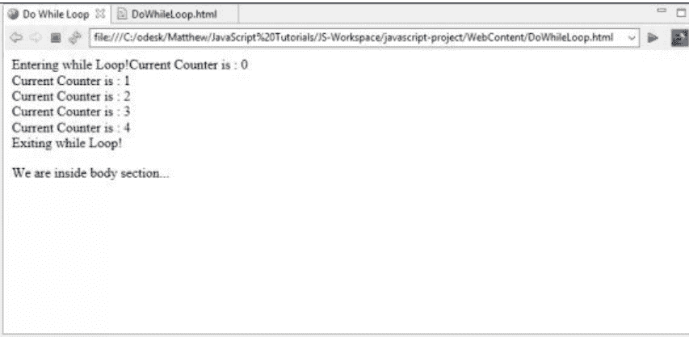

### for 循环语句

`for` 循环是 JavaScript 编程中非常重要且常用的循环语句。该命令包含以下三个重要部分。

- 循环初始化 —— 在这里我们初始化计数器值为起始值。该语句在循环开始之前执行。

- 测试语句 —— 它包含实际条件，并被评估为真或假。如果该条件评估为真，则将执行循环内部的代码块；否则，如果为假，控制将退出循环。

- 迭代语句 —— 这是我们增加或减少在第一个语句中初始化的计数器值的地方。

循环的好处在于我们可以将这三个语句部分放在同一行中，并用分号隔开。以下是语法和示例。

```html
<!DOCTYPE html>
<html>
<head>
<meta charset="ISO-8859-1">
<title>For Loop</title>
</head>
<body>
<script type="text/javascript">
document.write("Entering while Loop!");
for(counter = 0;counter < 5; counter++) {
document.write("Current Counter is : " + counter + "<br />");
}
document.write("Exiting while Loop!");
</script>
<p>We are inside body section...</p>
</body>
</html>
```

#### 输出

当我们执行上述 HTML 程序时，输出将如下所示。计数器将在 HTML 页面上写入 5 次，因为在计数器值变为 5 循环退出之前，它保持了 5 次的条件为真。

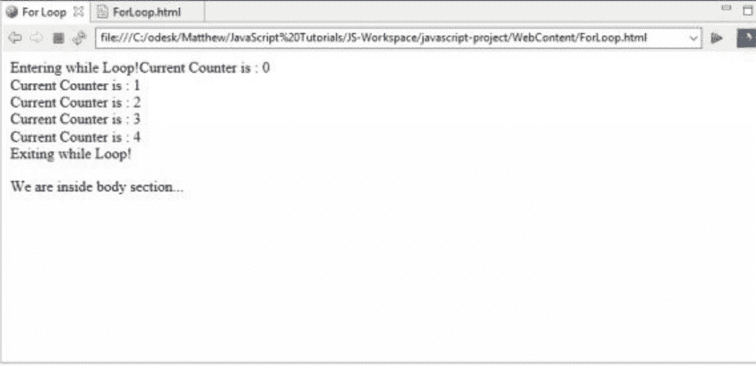

### for...in 循环语句

`for...in` 循环仅用于需要遍历对象属性的特殊情况。以下是 `for...in` 循环的语法和示例。

```html
<!DOCTYPE html>
<html>
<head>
<meta charset="ISO-8859-1">
<title>For In</title>
</head>
<body>
<script type="text/javascript">
document.write("Entering while Loop!");
for (prop in object) {
document.write(prop + "<br />");
}
document.write("Exiting while Loop!");
</script>
<p>We are inside body section...</p>
</body>
</html>
```

#### 输出

当我们执行上述 HTML 程序时，输出将如下所示。计数器将在 HTML 页面上写入 5 次，因为它保持了条件为真。

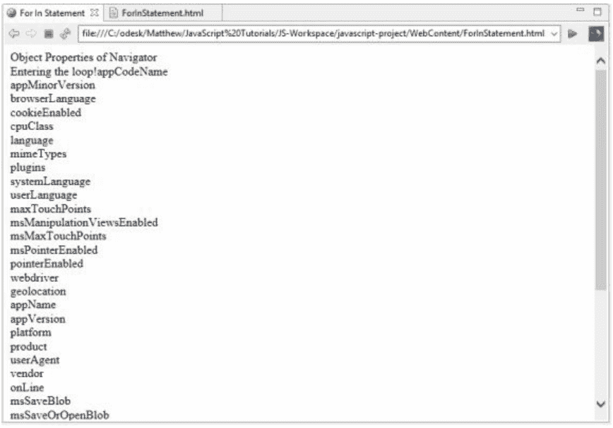

### 循环总结

| 循环类型 | 描述 |
| :--- | :--- |
| `while` 循环 | `while` 循环是 JavaScript 语言中最基础的循环。这种循环只要表达式保持为真，它就会重复执行一个语句或代码块。一旦表达式为假，循环就会终止。 |
| `do...while` 循环 | `do...while` 循环与 `while` 循环相似，区别在于 `do...while` 循环中的条件检查发生在循环的结束处。这意味着循环内部的代码块将始终至少执行一次，即使条件为假。 |
| `for` 循环 | `for` 循环是 JavaScript 编程中非常重要且常用的循环语句。该命令包含以下三个重要部分：循环初始化、测试语句和迭代语句。 |
| `for...in` 循环 | `for...in` 循环仅用于需要遍历对象属性的特殊情况。 |

### 循环控制语句

| 控制语句 | 描述 |
| :--- | :--- |
| `break` | `break` 语句用于立即退出循环。 |
| `continue` | `continue` 语句用于跳过当前迭代的剩余部分并进入下一次迭代。 |

```html
<!DOCTYPE html>
<html>
<head>
<meta charset="ISO-8859-1">
<title>Loop Control</title>
</head>
<body>
<script type="text/javascript">
var counter = 0;
document.write("Entering while Loop!");
while (counter < 5) {
  if (counter == 3) {
    counter++;
    continue;
  }
  if (counter == 4) {
    counter++;
    break;
  }
  document.write("Current Counter is : " + counter + "<br />");
  counter++;
}
document.write("Exiting while Loop!");
</script>
<p>We are inside body section...</p>
</body>
</html>
```

# 第 11 章

## JavaScript 函数

函数可以定义为一段组织良好且可重复使用的代码块，用于执行程序中需要高度模块化和可重用性的操作。它消除了重复编写相同代码的需求，并帮助程序员编写模块化代码。通过函数概念，程序员可以将一个大程序拆分成许多易于管理的函数。

与其他任何编程语言一样，JavaScript 语言也支持编写模块化代码所需的功能。从本教程开始，我们就使用了函数 `alert()` 和 `write()`，这让我们对函数的操作有了初步了解。这些是内置的 JavaScript 函数。在 JavaScript 语言中，我们可以像学习的其他任何编程语言一样编写自己的函数。

### 函数定义

函数可以在代码的任何地方使用，但我们只需要定义它们一次。

```html
<!DOCTYPE html>
<html>
<head>
<meta charset="ISO-8859-1">
<title>Function Definition</title>
<script type="text/javascript">
function sayHelloToJavaScript() {
  alert("Welcome to the world of JavaScript!");
}
</script>
</head>
<body>
</body>
</html>
```

### 调用函数

我们可以在脚本的后半部分，或在 HTML 网页元素的事件中调用 JavaScript 函数，我们只需要像下面的代码所示编写该函数的名称即可。

```html
<!DOCTYPE html>
<html>
<head>
<meta charset="ISO-8859-1">
<title>Function Definition</title>
<script type="text/javascript">
function sayHelloToJavaScript() {
  alert("Welcome to the world of JavaScript!");
}
</script>
</head>
<body>
<input type="button" onclick="sayHelloToJavaScript();" value="Call JavaScript"/>
</body>
</html>
```

#### 输出

当我们执行上述 HTML 程序时，将得到如下输出。在这里，我们在按钮的点击事件上调用了 JavaScript 函数，显示出一个警报消息，该消息是从定义 JavaScript 函数的 HTML 头部获取的。

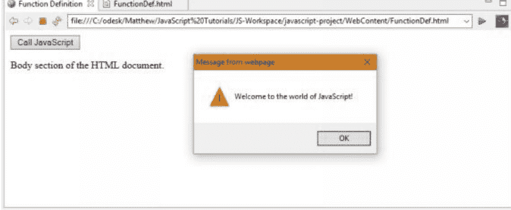

### 函数参数

到目前为止，我们使用的函数是不带输入参数的。在 JavaScript 函数中，我们可以在调用时传递不同的参数。所传参数的值可以在函数内部使用，我们可以对这些参数进行操作。一个函数可以接受零个到多个参数。函数中的多个参数用逗号分隔。以下是参数化函数的语法和示例。

```html
<!DOCTYPE html>
<html>
<head>
<meta charset="ISO-8859-1">
<title>Parameterized Function</title>
<script type="text/javascript">
function sayHelloToJavaScript(message,entity,lang) {
  alert(message+" to the "+entity+" world of "+lang+"!");
}
</script>
</head>
<body>
  <input type="button" onclick="sayHelloToJavaScript('Welcome','World','JavaScript');" value="Call JavaScript"/>
  <p>Body section of the HTML document.</p>
</body>
</html>
```

#### 输出

当我们执行上述 HTML 程序时，将得到如下输出。在这里，我们在按钮的点击事件上调用了参数化的 JavaScript 函数，显示出一个带有消息的警报，该消息是从定义 JavaScript 函数的 HTML 头部获取的。在这里，我们在函数中传递了三个参数来显示该警报消息。

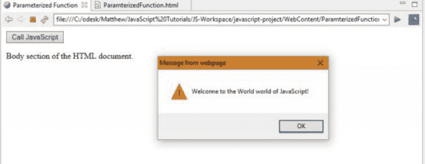

### 返回语句 (return)

JavaScript 函数可以返回一个值，这个 `return` 语句是可选的。当我们想要从函数返回值时，就会使用 `return` 语句。它应该是 JavaScript 函数中的最后一个语句。让我们通过下面的示例来理解 `return` 函数的用法。

```html
<!DOCTYPE html>
<html>
<head>
<meta charset="ISO-8859-1">
<title>Return Function</title>
<script type="text/javascript">
function concatString(message,entity,lang) {
  var str = message+entity+lang;
  return str;
}
function writeToDoc(message,entity,lang){
  concatStr = concatString(message,entity,lang);
  document.write(concatStr);
}
</script>
</head>
<body>
<input type="button" onclick="writeToDoc('Welcome to the ','World of','JavaScript!');" value="Call JavaScript"/>
<p>Body section of the HTML document.</p>
</body>
</html>
```

#### 输出

当我们执行上述 HTML 程序时，将得到如下输出。在这里，我们在按钮的点击事件上调用了 JavaScript 函数，在 HTML 页面上显示消息，该消息是从定义 JavaScript 函数的 HTML 头部获取的。在这里，我们在 `writeToDoc` 函数中传递了三个字符串作为参数，它调用了 `concatString` 函数，该函数返回了写入文档的拼接字符串。

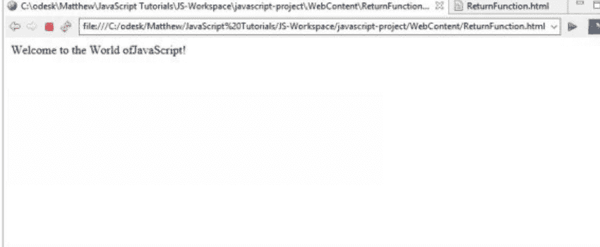

# 第 12 章

## JavaScript 事件

JavaScript 事件是 JavaScript 与 HTML 文档交互的手段。当用户或浏览器对 HTML 页面上的任何值进行操作时，这些事件就会被触发。例如，当我们加载一个 HTML 页面时，这就是一个事件。同样，当我们点击页面上的按钮时，它也是一个事件。我们可以将其他事件示例设为：按下任意键、通过按钮提交表单、更改窗口大小等。

程序员可以使用这些 JavaScript 事件来触发并执行 JavaScript 代码的响应。这些响应包括点击按钮时关闭窗口、向用户显示警报消息、验证表单数据等。

JavaScript 事件是文档对象模型 (DOM) 3 级的一部分。所有的 HTML 网页元素都包含一组能够触发 JavaScript 函数代码的事件。

以下是理解事件与调用 JavaScript 函数代码之间关系的少数示例。

### onclick 事件类型

这是最常用的事件类型。当我们点击 HTML 页面上的任何网页元素时，它是触发 JavaScript 代码最常用的事件类型。下面的示例演示了这一点。

```html
<!DOCTYPE html>
<html>
<head>
<meta charset="ISO-8859-1">
<title>On Click</title>
<script type="text/javascript">
function showAlert() {
  alert("This is an alert!");
}
</script>
</head>
<body>
<input type="button" onclick="showAlert();" value="Call JavaScript"/>
</body>
</html>
```

#### 输出

当我们执行上述 HTML 程序时，将得到如下输出。在这里，我们在按钮的点击事件上调用了 JavaScript 函数，显示出一个警报消息。

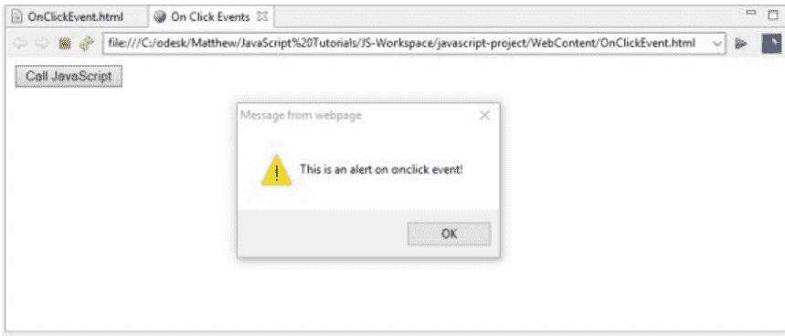

### onmouseover 和 mouseout 事件类型

这些是流行的鼠标事件类型，可以帮助为图像或文本创建视觉效果。当鼠标悬停在 HTML 页面上的任何网页元素上时，会触发 `mouseover` 事件；当鼠标移出该网页元素时，会触发 `mouseout` 事件。下面的示例演示了这些事件。

```html
<!DOCTYPE html>
<html>
<head>
<meta charset="ISO-8859-1">
<title>Mouse Over and Out</title>
<script type="text/javascript">
function hoverMouse() {
  alert("Doing the Mouse Over");
}
function hoverMouseOut() {
  alert("Taking the Mouse Out");
}
</script>
</head>
<body>
<div onmouseover="hoverMouse();" onmouseout="hoverMouseOut();">
  <h1> Bring your Mouse here to see the change</h1>
</div>
</body>
</html>
```

#### 输出

当我们执行上述 HTML 程序时，将得到如下输出。在这里，当鼠标悬停在标题 `div` 区域时，可以看到警报消息被调用。同样，当鼠标移出该区域时，我们会看到另一个关于鼠标移出标题区域的警报。

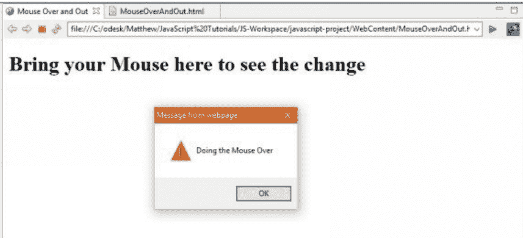

## HTML 5 中的标准事件

以下是标准的 HTML 5 事件属性。所有这些属性的值都是脚本，表示在触发事件时要被调用和执行的 JavaScript 函数。

| 事件属性 | 值 | 描述 |
| --- | --- | --- |
| `offline` | script | 当文档离线状态时，触发此属性。 |
| `onabort` | script | 当发生中止事件时，触发此属性。 |
| `onafterprint` | script | 在文档打印后，触发此属性。 |
| `onbeforeonload` | script | 在文档加载之前，触发此属性。 |
| `onbeforeprint` | script | 在文档打印之前，触发此属性。 |
| `onblur` | script | 当窗口失去焦点时，触发此属性。 |
| `oncanplay` | script | 当媒体可以开始播放，但可能需要因缓冲而停止时，触发此属性。 |
| `oncanplaythrough` | script | 当媒体可以播放到结束而无需缓冲停止时，触发此属性。 |
| `onchange` | script | 当元素发生变化时，触发此属性。 |
| `onclick` | script | 当点击鼠标时，触发此属性。 |
| `oncontextmenu` | script | 当触发上下文菜单时，触发此属性。 |
| `ondblclick` | script | 当鼠标双击时，触发此属性。 |
| `ondrag` | script | 当元素被拖动时，触发此属性。 |
| `ondragend` | script | 在拖动操作结束时，触发此属性。 |
| `ondragenter` | script | 当元素被拖到有效的放置目标时，触发此属性。 |
| `ondragleave` | script | 当元素正被拖过有效的放置目标时，触发此属性。 |
| `ondragover` | script | 在拖动操作开始时，触发此属性。 |
| `ondragstart` | script | 在拖动操作开始时，触发此属性。 |
| `ondrop` | script | 当被拖动的元素被释放时，触发此属性。 |
| `ondurationchange` | script | 当媒体长度改变时，触发此属性。 |
| `onemptied` | script | 当媒体资源元素突然变空时，触发此属性。 |
| `onended` | script | 当媒体播放结束时，触发此属性。 |
| `onerror` | script | 当发生错误时，触发此属性。 |
| `onfocus` | script | 当窗口获得焦点时，触发此属性。 |
| `onformchange` | script | 当表单改变时，触发此属性。 |
| `onforminput` | script | 当表单获取用户输入时，触发此属性。 |
| `onhaschange` | script | 当文档改变时，触发此属性。 |
| `oninput` | script | 当元素获取用户输入时，触发此属性。 |
| `oninvalid` | script | 当元素无效时，触发此属性。 |
| `onkeydown` | script | 当按下键时，触发此属性。 |
| `onkeypress` | script | 当按下键时，触发此属性。 |
| `onkeyup` | script | 当释放键时，触发此属性。 |
| `onload` | script | 当文档加载时，触发此属性。 |
| `onloadeddata` | script | 当媒体数据加载时，触发此属性。 |
| `onloadedmetadata` | script | 当媒体元素的持续时间和其他媒体数据加载时，触发此属性。 |
| `onloadstart` | script | 当浏览器开始加载媒体数据时，触发此属性。 |
| `onmessage` | script | 当消息被触发时，触发此属性。 |
| `onmousedown` | script | 当按下鼠标键时，触发此属性。 |
| `onmousemove` | script | 当鼠标指针移动时，触发此属性。 |
| `onmouseout` | script | 当鼠标指针移出元素时，触发此属性。 |
| `onmouseover` | script | 当鼠标指针移过元素上时，触发此属性。 |
| `onmouseup` | script | 当释放鼠标键时，触发此属性。 |
| `onmousewheel` | script | 当旋转鼠标轮时，触发此属性。 |
| `ononline` | script | 当文档上线时，触发此属性。 |
| `onpagehide` | script | 当窗口隐藏时，触发此属性。 |
| `onpageshow` | script | 当窗口变得可见时，触发此属性。 |
| `onpause` | script | 当媒体数据暂停时，触发此属性。 |
| `onplay` | script | 当媒体数据即将开始播放时，触发此属性。 |
| `onplaying` | script | 当媒体数据开始播放时，触发此属性。 |
| `onpopstate` | script | 当窗口历史记录改变时，触发此属性。 |
| `onprogress` | script | 当浏览器正在获取媒体数据时，触发此属性。 |
| `onratechange` | script | 当媒体数据的播放速率改变时，触发此属性。 |
| `onreadystatechange` | script | 当就绪状态改变时，触发此属性。 |
| `onredo` | script | 当文档执行重做时，触发此属性。 |
| `onresize` | script | 当窗口调整大小时，触发此属性。 |
| `onscroll` | script | 当元素的滚动条正在被滚动时，触发此属性。 |
| `onseeked` | script | 当媒体元素的寻求属性不再为真且寻求结束时，触发此属性。 |
| `onseeking` | script | 当媒体元素的寻求属性为真且寻求已开始时，触发此属性。 |
| `onselect` | script | 当元素被选中时，触发此属性。 |
| `onstalled` | script | 当媒体数据发生错误时，触发此属性。 |
| `onstorage` | script | 当文档加载时，触发此属性。 |
| `onsubmit` | script | 当表单提交时，触发此属性。 |
| `onsuspend` | script | 当浏览器一直在获取媒体数据但在文件获取之前停止时，触发此属性。 |
| `ontimeupdate` | script | 当媒体改变位置时，触发此属性。 |
| `onundo` | script | 当文档执行撤销时，触发此属性。 |
| `onunload` | script | 当用户离开文档时，触发此属性。 |
| `onvolumechange` | script | 当音量改变或当音量设置为“静音”时，触发此属性。 |
| `onwaiting` | script | 当媒体停止播放但预期恢复时，触发此属性。 |

# 第 13 章

## 对话框

对话框用于 JavaScript 通过 `alert` 弹出警告、请求确认或接受用户输入。为了支持这些功能，JavaScript 有以下三种类型的对话框：

- 警告对话框 (Alert Box)

- 确认对话框 (Confirmation Box)

- 提示对话框 (Prompt Box)

### 警告对话框

当我们想在对话框中向用户显示警告消息时，我们使用警告对话框。例如，当我们使用 `onSubmit` 事件验证表单时，我们不接受任何输入，只需要显示警告消息，在这种情况下我们使用警告框来显示此类警告消息。警告框仅有一个“确定”按钮可以点击并继续。

```html
<!DOCTYPE html>
<html>
<head>
<meta charset="ISO-8859-1">
<title>提交事件</title>
<script type="text/javascript">
function validation() {
if(document.form1.textbox1.value != "") {
    alert('验证通过');
    return false;
}
else{
    alert("文本框不能为空!");
    return false;
}
}
</script>
</head>
<body>
<form name="form1" method="GET" action="onEvent.html" onsubmit="return validation()">
  <input type="text" name="textbox1" />
  <input type="submit" value="提交" />
</form>
</body>
</html>
```

#### 输出

当我们运行上面的 HTML 程序时，将得到如下输出。在这里，我们看到了一个警告对话框。

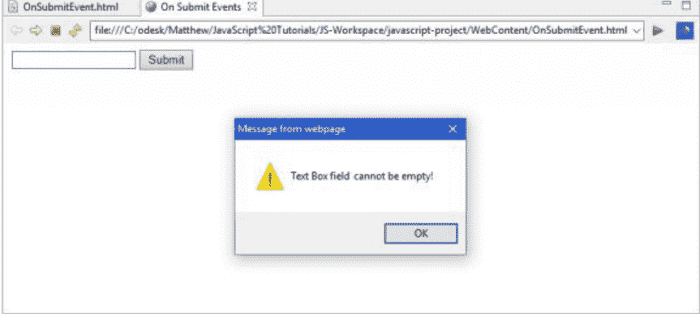

### 确认对话框 (Confirmation Dialog Box)

在 JavaScript 语言中，当我们需要对任何选项获取用户的意见时，就会使用确认对话框。它会显示一个包含两个按钮的对话框：OK 按钮和取消按钮。

当用户点击 OK 按钮时，窗口方法 `confirm()` 将返回一个 `true` 值。相反，如果用户点击取消按钮，则 `confirm()` 方法将返回一个 `false` 值。以下是一个关于确认对话框的示例。

```html
<!DOCTYPE html>
<html>
<head>
<meta charset="ISO-8859-1">
<title>Confirm Box</title>
<script type="text/javascript">
function showAlert() {
  confirm("This is an confirm dialogue box example!");
}
</script>
</head>
<body>
<p>Confirm box demo example.</p>
<input type="button" onclick="showAlert();" value="Call JavaScript">
</body>
</html>
```

#### 输出

当我们执行上述 HTML 程序时，输出将如下所示。在这里，我们看到了一个确认对话框。

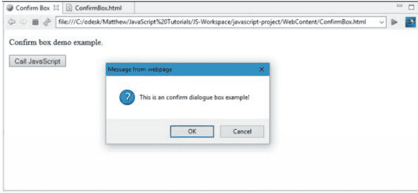

### 提示对话框 (Prompt Dialog Box)

在 JavaScript 中，提示对话框接受用户输入。因此，它允许系统与用户进行交互。用户被要求在字段中输入所需的数据，然后点击 OK 按钮。

此类对话框通过使用名为 `prompt()` 的方法显示。它接受以下两个参数：

- 我们想要在文本框中显示的标签（label）。

- 显示在文本框中的默认字符串。

提示对话框有两个按钮：

- OK 按钮。

- 取消按钮。

当用户点击 OK 按钮时，窗口方法 `prompt()` 将返回用户在文本框中输入的值。相反，如果用户点击取消按钮，则窗口方法 `prompt()` 将返回一个 `null` 值。

以下是一个关于提示对话框的示例。

```html
<!DOCTYPE html>
<html>
<head>
<meta charset="ISO-8859-1">
<title>Prompt Box</title>
<script type="text/javascript">
function showAlert() {
  prompt("This is an prompt dialogue box example!");
}
</script>
</head>
<body>
<p>Prompt dialogue box demo example.</p>
<input type="button" onclick="showAlert();" value="Call JavaScript"/>
</body>
</html>
```

#### 输出

当我们执行上述 HTML 程序时，输出将如下所示。在这里，我们看到了一个提示对话框。


# 第 14 章

## JavaScript void 关键字

在 JavaScript 语言中，`void` 关键字可以用作一元运算符，出现在其单个操作数之前，且该操作数可以是任何类型。这个一元运算符指定了一个需要求值但不返回任何值的表达式。

以下是 `void` 关键字的语法和示例。

```html
<!DOCTYPE html>
<html>
<head>
<meta charset="ISO-8859-1">
<title>Void Keyword Example 1</title>
</head>
<body>
<p>Click here to invoke an alert!</p>
<a href="javascript:void(alert('Here is the Void Keyword demo'))">Click Here!</a>
</body>
</html>
```

#### 输出

当我们执行上述 HTML 程序时，输出将如下所示。在这里，我们看到了点击响应式超链接（“Click Here!”）时弹出的警告对话框。另一方面，如果 `void` 参数为空，则第二个超链接（“No response link!”）将没有响应，因为表达式 `"0"` 在 JavaScript 中没有效果。当 `"0"` 被求值时，它不会加载回当前文档中。


此外，JavaScript 中的 `void` 关键字也用于生成以下内容：

```html
<!DOCTYPE html>
<html>
<head>
<meta charset="ISO-8859-1">
<title>Void Example 2</title>
<script type="text/javascript">
function voidDemo() {
  var x,y,z;
  document.write('x = ' + x + ' y = ' + y + ' z = ' + z);
}
</script>
</head>
<body>
<p>Click to get...</p>
<input type="button" value="Result" onclick="voidDemo()"/>
</body>
</html>
```

#### 输出

当我们执行上述 HTML 程序时，输出将如下所示。在这里我们看到对象的值分别为 `'50'` 和 `'700'`。


# 第 15 章

## JavaScript 对象 (Objects)

JavaScript 语言是一种基于面向对象编程 (OOP) 的语言，提供了以下能力：

- 封装（Encapsulation）——将数据和方法结合的概念。

- 聚合（Aggregation）——将一个对象存储另一个对象内部的概念。

- 继承（Inheritance）——复用类的概念。

- 多态（Polymorphism）——以不同方式启用相同名称的概念，也称为方法重载。

对象由属性组成。

### JavaScript 对象属性 (Object Properties)

JavaScript 对象属性可以是任何原始数据类型（Number、String 和 Boolean），或任何抽象数据类型（如对象）。它们是贯穿页面的变量。以下是语法和示例。

```html
<!DOCTYPE html>
<html>
<head>
<meta charset="ISO-8859-1">
<title>Objects Example</title>
<script type="text/javascript">
objectName.objectProperty = propertyValue;
var str = document.title;
</script>
</head>
<body>
</body>
</html>
```

在这里我们将变量 `pValue` 赋值给对象属性 `objectProperty`。该对象名为 `objectName`。在上述示例的下一个语句中，我们使用 `document` 的 `title` 属性将标题存储到变量 `str` 中。

### JavaScript 对象方法 (Object Methods)

对象方法是对象进行操作或执行所需的函数。在 JavaScript 中，函数与方法的区别在于：函数是一个独立的语句单元，而方法附加于对象，并通过 `this` 关键字引用。

方法可以用于在 HTML 页面上显示对象内容。它们可以对对象属性和传递给方法的输入参数执行复杂的数学运算。例如，在教程中，我们使用了 `document` 对象的 `write` 方法，我们将字符串或文本作为参数传递到 HTML 页面上。

```html
<!DOCTYPE html>
<html>
<head>
<meta charset="ISO-8859-1">
<title>Object Method Example</title>
<script type="text/javascript">
document.write("Welcome to JavaScript Programming!");
</script>
</head>
<body>
</body>
</html>
```

### JavaScript 自定义对象 (User-Defined Objects)

在 JavaScript 语言中，所有的自定义对象以及内置对象都扩展自名为 `Object` 的对象（类似于 Java 语言）。

### JavaScript 中的 new 运算符

`new` 运算符用于创建对象的实例。为了在 JavaScript 中创建对象，语句包含 `new` 运算符，后面紧跟着构造方法，如下所示。在这里，构造方法是 `Object()`、`Array()` 和 `Date()`。这些构造函数是内置的 JavaScript 函数。

```html
<!DOCTYPE html>
<html>
<head>
<meta charset="ISO-8859-1">
<title>The New Operator</title>
<script type="text/javascript">
  var student = new Object();
  var languages = new Array("JavaScript", "Pascal", "Python");
  var day = new Date("August 24, 1989");

  alert(day);
</script>
</head>
<body>
</body>
</html>
```

#### 输出

当我们执行上述 HTML 程序时，输出将是如所示的结果。在这里，我们将在警报对话框中显示 `Date` 对象的属性。

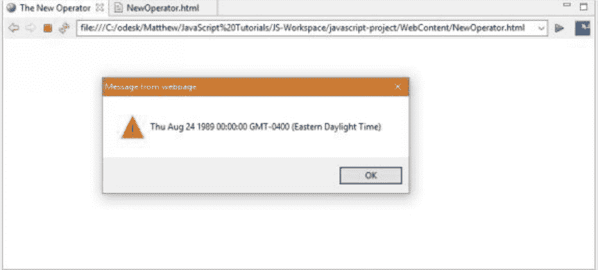

### `Object()` 构造函数

如前讨论的，构造函数是一个用于创建和初始化 JavaScript 对象的函数。一种名为 `Object()` 的特殊构造函数用于在 JavaScript 中构建对象。`Object()` 构造函数返回的值被赋值给名为对象引用变量的变量。以下示例演示了如何在 JavaScript 中创建一个 `Object`。

```html
<!DOCTYPE html>
<html>
<head>
<meta charset="ISO-8859-1">
<title>Object Creation</title>
<script type="text/javascript">
var student = new Object();
student.name = "Appy";
student.age = "21";
student.course = "JavaScript";
function showDetails() { alert("Name: "+student.name+ " Age: "+student.age+" Course: "+student.course);
}
</script>
</head>
<body>
<input type="button" onclick="showDetails();" value="Get Student details!" />
</body>
</html>
```

需要注意的是，对象的属性变量并不是用 `var` 关键字定义的。

#### 输出

当我们执行上述 HTML 程序时，输出将是如所示的结果。

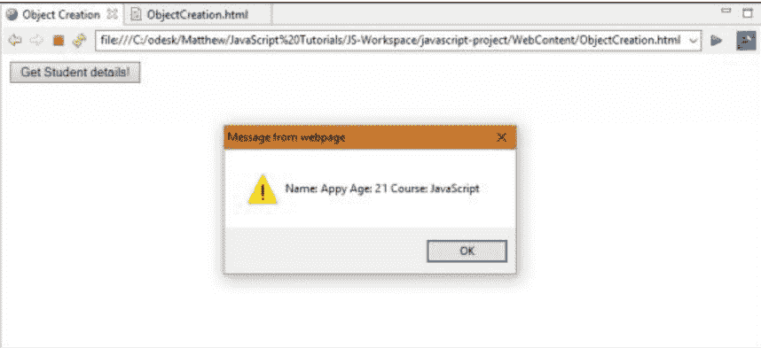

### 在 JavaScript 中为对象定义方法

在上一个示例中，我们演示了如何使用创建对象并分配属性的构造函数。在接下来的示例中，我们将演示一个在 JavaScript 中为对象定义方法的示例。

```html
<!DOCTYPE html>
<html>
<head>
<meta charset="ISO-8859-1">
<title>Object Methods</title>
<script type="text/javascript">
function student(name, course) {
this.name = name;
this.course = course;
}
</script>
</head>
<body>
<script type="text/javascript">
  var record = new student("Appy", "JavaScript");
  alert("name is : " + record.name + "Course is " + record.course );
</script>
</body>
</html>
```

#### 输出

当我们执行上述 HTML 程序时，输出将是如所示的结果。在这里，我们向对象添加了一个函数。

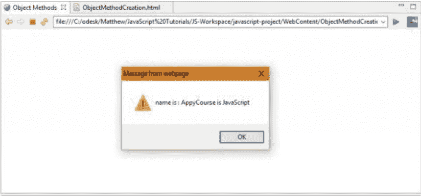

### JavaScript 中的 `with` 关键字

在 JavaScript 中，`with` 关键字用作简写，用于引用对象的属性或方法。

在这里，作为 `with` 参数指定的对象在后续代码块期间将成为默认对象。在这种情况下，可以使用对象的属性和方法而无需命名对象。以下是其语法和示例。

```html
<!DOCTYPE html>
<html>
<head>
<meta charset="ISO-8859-1">
<title>With Keyword</title>
<script type="text/javascript">
// 一个将作为方法工作的函数
function addAge(years){
  with(this){
    age = years;
  }
}

function student(name, course){
  this.name = name;
  this.course = course;
  this.age = 0;
  this.addAge = addAge; // 属性是一个方法的属性。
}
</script>
</head>
<body>
<script type="text/javascript">
var record = new student("Appy", "JavaScript");
record.addAge(21);
alert("Name is : " + record.name + 
"Course is : " + record.course +
"\nAge is : " + record.age);
</script>
</body>
</html>
```

#### 输出

当我们执行上述 HTML 程序时，输出将是如所示的结果。在这里，我们使用了 `with` 关键字通过将方法赋值为属性来后续添加年龄。

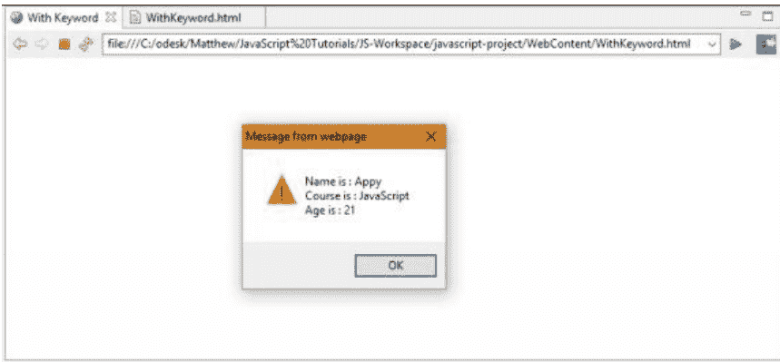

### JavaScript 中的原生对象

JavaScript 语言有许多内置或原生对象。这些原生对象可以在程序的任何地方访问，并且在运行于任何操作系统的任何浏览器上以相同的方式工作。以下是重要的 JavaScript 原生对象。

- JavaScript Array Object。

- JavaScript Boolean Object。

- JavaScript Date Object。

- JavaScript Math Object。

- JavaScript Number Object。

- JavaScript RegExp Object。

- JavaScript String Object。

## 结论

再次感谢下载这本书！

希望这本书能够帮助你学习 JavaScript。

下一步是将这些实践付诸实际。

感谢你并祝你好运！

# Python 编程预览

## 第一章

## Python 编程语言简介

你知道 YouTube 和 Dropbox 等网站在源代码中使用了 Python 吗？Python 是一门庞大且易于理解和应用的语言。你可以使用 Python 开发几乎任何东西。除了 Windows 之外的大多数操作系统（Mac, Linux, UNIX 等）默认安装了 Python。它是一门开源免费的语言。在本电子书中，我们将学习这门很棒语言并将其应用到各种示例中。Python 中没有方法、参数、函数或变量的类型声明（像其他语言那样），这使得它的代码简洁简单。如前所述，这种语言可以用于任何地方，无论你想构建网站、游戏还是搜索引擎。使用 Python 的主要优势在于你不需要运行编译器，它是一门像 Perl 或 Shell 一样的纯解释型语言。

Python 文件使用的扩展名是 `.py`，它是区分大小写的语言，因此“P”和“p”被视为不同的变量。此外，Python 会自动识别变量类型，例如，如果你输入 `x=4` 和 `y='Python'`，它会将它们视为整数和字符串。我们将在后续章节中详细学习这些基础知识。在继续之前，需要记住以下几点：

1. 赋值时使用 `=`，比较时也使用 `==`。例如：`x=4, y=8`

2. 使用 `print` 打印结果。

3. 数字可以使用所有的数学运算符号如 `+`、`-`、`*`、`/`

4. 变量在赋值时被创建。例如：`a=5` 会创建一个名为 `a` 的变量，其值为 5。不需要提前定义。

5. `+` 也可以用于拼接两个字符串。例如：`z="Hi", z= z+"Python"`

6. 逻辑运算使用 `and`、`or`、`not` 代替符号。

有三种基本数据类型：整数（数字默认）、浮点数（`a=3.125`）和字符串。字符串可以使用双引号 `"` 或单引号 `'` 来定义。我们将在接下来的章节中通过具体的示例查看所有数据类型。让我们看看在 Windows 操作系统上安装 Python 的分步指南。如前所述，如果你在使用 UNIX、Linux 或 Mac 等其他操作系统，Python 应该已经安装并随时可以使用。你在 Linux 上需要使用 `%python` 获取详细信息，按 `CTRL + D` 退出。在 UNIX 上运行使用 `%python filename.py`。Python 提示符显示为三个“大于”符号（`>>>`）。

[点击此处在 Amazon 上查看 Python 编程的其余内容。](http://amzn.to/2auRjNy)
