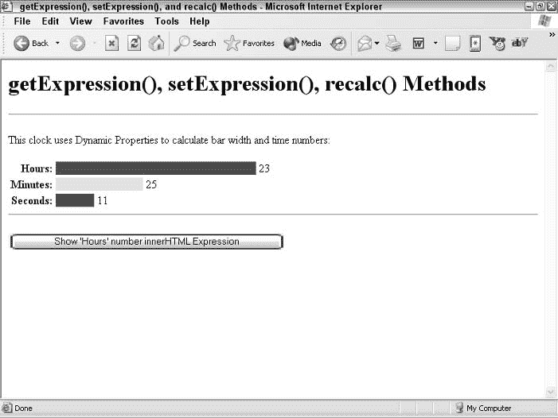
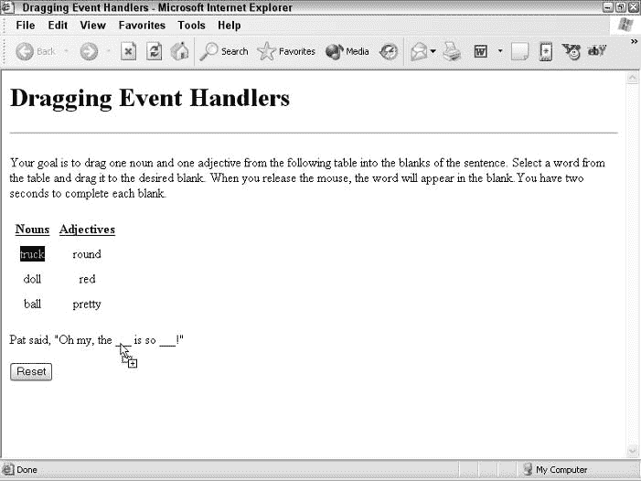
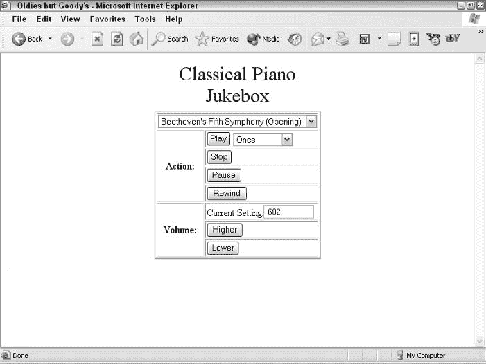
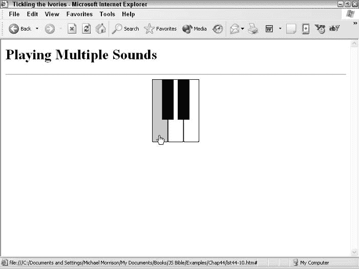
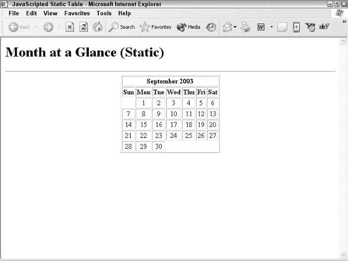
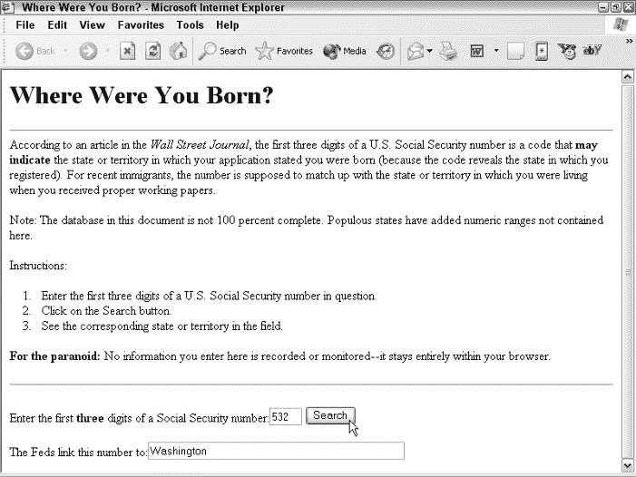
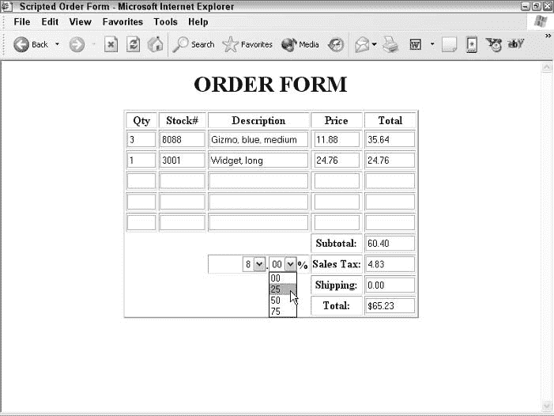

# JavaScript 圣经（第 5 版）

```javascript
function functionToHex(dec) {
  var hexChars = "0123456789ABCDEF";
  if (dec > 255) {
    var result = "";
    result += functionToHex(dec % 16);
    dec = Math.floor(dec/16);
  }
  result += hexChars[dec % 16];
  return result;
}
```

通过 Evaluator 这一独家交互式工作台，精通 JavaScript 和 DOM 概念，利用具有创意效果和即时交互性的网站，吸引你的目标受众，优化你的脚本，以便在最新的浏览器版本上进行有效的展示。

## 对 Danny Goodman 的 *JavaScript™ 圣经* 的赞誉

“*JavaScript™ 圣经*是 JavaScript 编程的权威资源。我离这本书从未超过三英尺。”

*— Steve Reich, PageCoders 执行官*

“这本书是任何 Web 开发人员或程序员的必读品。”

*— Thoma Lile, Kanis Technologies, Inc. 总裁*

“一本卓越的书。我会向任何对学习开发高级 Web 网站感兴趣的人推荐这本书。Goodman 先生在组织此书和编写方面做得非常出色，即使是初级程序员也能读懂。”

*— Jason Hensley, NetVoice, Inc. 网络服务总监*

“Goodman 总是擅长提供清晰、简洁的技术书籍！”

*— Dwayne King, White Horse 首席技术官*

“*JavaScript™ 圣经*非常值这笔票钱！”

*— Yen C.Y. Leong, Moo Mooltimedia（SmartTransact Group 成员）IT 总监*

“任何互联网开发者的必读书。”

*— Uri Fremder, TopTier Software 高级顾问*

“我喜欢这本书！我经常使用它，它总是能带来惊喜。这是我唯一的 JavaScript 书！”

*— Jason Badger, Web 开发人员*

“无论你是专业人士还是新手，这都是一本非常棒的书。”

*— Brant Mutch, Wells Fargo Card Services, Inc. Web 开发者*

“在读了你的书 [*JavaScript™ 圣经*] 之前，我从未想过会教编程。它太简单用了——编程基础部分让我找回了一切！感谢你写出如此棒的书，并打破了我的 TechNet Training 编程瓶颈期！”

“Danny Goodman 非常擅长引导读者进入主题。*JavaScript™ 圣经*包含了我们可能需要的一切。”

*— Philip Gurdon*

“一本卓越的书，无论读者处于什么水平，都能建立起稳实的基础。一本既幽默又具有教育意义的书。”

*— Dave Vane*

“我每天都在使用这本书，离开它我将不知所措。”

*— Mike Warner, Oak Place Productions 创始人*

“*JavaScript™ 圣经*是我见过的最好的 JavaScript 资源（我见过很多了）。”

*— Robert J. Mirro, RJM Consulting 独立顾问*

## 关于作者

**Danny Goodman** 是多本广受好评和畅销书籍的作者，包括《Complete HyperCard Handbook》、《Danny Goodman’s AppleScript Handbook》、《Dynamic HTML: The Definitive Reference》以及《JavaScript & DHTML Cookbook》。计算机脚本语言的著名权威和专家教师。他的写作风格和教学方法持续获得全球读者的赞誉。为了对现实编程挑战保持敏感，Goodman 经常从旧金山的家中作为咨询程序员和设计师提供服务。

**Michael Morrison** 是作家、开发者、玩具发明者，有多本涵盖 Java、Web 脚本、游戏开发、ActiveX 和口袋电脑等主题的书。Michael 著名的著作包括《Faster Smarter HTML and XML》、《Teach Yourself XML in 24 Hours》以及《The Complete Idiot’s Guide to Java 2》。Michael 还是 Stalefish Labs (www.stalefishlabs.com) 的创始人，这是一家经营传统游戏和玩具的娱乐公司。

## 前言

作为 JavaScript 的创造者，我想谈谈 JavaScript 的过去历程、未来将向何方发展，以及你手中的这本书将如何帮助你充分利用这种语言。

JavaScript 的诞生源于让 HTML 作者能够直接在文档中编写脚本的愿望。这在现在看来似乎显而易见，但在 1995 年的春天，这是一个新颖的想法，而且与当时的常识（认为 HTML 仅应描述静态文档结构）以及当时的“下一个大趋势”（Java applets，当时被炒作为活跃和扩展 Web 页面的唯一途径）都大相径庭。一旦我克服了这些争议，JavaScript 迅速沿着以下思路形成了雏型：

- “轻量级 Java”语法。虽然在一位朋友借给我由叫 Goodman 的人编写的*《HyperCard 完全手册》*后，HyperTalk 的那种“自然语言”语法在我记忆中依然很新颖，但“下一个大趋势”的影响更为重大，特别是考虑到另一个目标：为 Java applets 编写脚本。如果脚本语言类似于 Java，那么那些从 JavaScript 跳跃到 Java 的程序员就会欢迎语法上的相似之处。但如果坚持像 Java 那样使用类和类型声明，或者在行尾结束的情况下每个语句后都加分号，那是不可能的——因为对大多数人来说，编写脚本是为了快速、毫不费力地编写简短的代码片段。

- HTML 元素的事件。按钮应该有 `onClick` 事件处理器。文档从窗口中加载和卸载，因此窗口应该有 `onLoad` 和 `onUnload` 处理器。用户和脚本提交表单：因此有了 `onSubmit` 处理器。尽管最初没有像 HyperCard 消息那样灵活（后者的处理程序启发了 `onEvent` 命名规范），但 JavaScript 事件让 HTML 作者能够从远程服务器控制用户交互，并对用户手势和浏览器操作做出快速响应。随着 W3C DOM 2 事件处理建议的采用，现代浏览器中的 JavaScript 对事件拥有了完全灵活的控制权。

- 无类的对象。Self 编程语言证明了基于原型的继承的概念。对于 JavaScript，我希望每个对象只有一个原型（为了简单和高效），该原型默认基于使用 `new` 算符调用的函数（为了与 Java 保持一致）。为了区分构造函数、方法和普通函数，所有函数都会接收将其命名的对象作为被调用的属性。虽然原型直到 Navigator 3 才出现，但它们在版本 2 中就已经预演，即将带引号的文本视为一个对象（强对象原型，用户可以在其上附加方法）。

- 生成 HTML。将 JavaScript 嵌入 HTML 中产生了一个念头：让脚本“说” HTML，就像输出的文本和标记被加载来代替脚本一样。这种可能性超越了自动生成当前或最后修改日期，而是扩展到计算整个表格树，其中所有重复的结构都在脚本循环中汇总，而要制表的各种变化内容则以极简的方式从构成目录或小型数据库的 JavaScript 对象获取。

起初，我认为 JavaScript 最常会被用于验证 HTML 表单的输入。但不久后，我惊讶地看到许多 Web 设计师如何通过脚本生成的 HTML 和 JavaScript 对象设计出引人入胜的应用程序。从用户的演示和反馈可以很清楚，Web 设计师寻求仅用几张图片、HTML 和 JavaScript 快速高效地构建大型应用程序。最终，他们要求浏览器支持现在被称为“动态 HTML”（一个有趣的链接：http://www.javascript-games.org/）。

随着大批 Web 作者拥抱 JavaScript 的创作能力，他们反过来证明了脚本环境优于传统应用程序开发的关键优势。不仅 HTML 和 JavaScript 语言相对易于使用，而且开发不需要像大型传统应用程序那样具备为了点亮所有像素和处理所有事件所需的编程专业知识。

JavaScript 如今在 Web 上的主导地位证明了我们早期对 HTML 作者脚本语言价值的信念。通过保持低“点亮像素”的门槛，带图片的 HTML 让数以百万的人成为了 Web 设计师。通过保持低“事件处理”的门槛，JavaScript 帮助了这些设计师中的数千成为了程序员。也许 Web 开发与应用程序开发融合的终极例子就是 Mozilla 浏览器，其中所有的用户界面甚至一些自定义小部件和模块化组件都是完全使用 JavaScript、层叠样式表 (CSS)、基于 XML 的自定义标记语言和图像实现的。

JavaScript 也是一种通用语言，在 HTML 和 XML 之外也有用。它被嵌入到服务器、制作工具、浏览器插件和其他各种浏览器（用于 3D 图形世界等）。它的国际标准 ECMA-262 (ISO 16262) 已经进展到第三版。但与 Perl 甚至 Java 等语言相比，它仍然相对年轻。ECMA 技术委员会正在推进该语言第四版的工作，支持可选类型、类和版本控制机制（参见提交给 ECMA 技术委员会的“JS2”提案，文档记录于 http://www.mozilla.org/js/language/js20/）。

对于我很清楚，如果没有一个富有创造力、忠诚且耐心的开发者社区，JavaScript 将无法生存；我向他们每一个人表示巨大的感谢。那些接受了 Navigator 2 测试版，并通过电子邮件和网络新闻传播关键变解决方案和功能要求的开发者是这门语言的教父们。开发者的支持和反馈让 JavaScript 持续成为今天这种多元、活泼且成功的语言。

你手中的这本书汇编了数千个……（注：原文内容截断）

*Brendan Eich*

Mozilla 组织 (http://www.mozilla.org/)

## 前言

在过去的20多年里，我一直在编写我希望别人已经写过的书，以帮助人们学习新技术。我的目标是帮助你避免我和其他人在几代可脚本浏览器中经历过的同样的挫败和苦恼。

虽然此书的早期版本关注于当时主流的 Netscape Navigator，但浏览器份额的摇摆目前倾向于 Windows 平台上的 Internet Explorer。但更重要的趋势是 Web 开发者社区对浏览器遵循日益增长的行业标准的需求。当互联网主流浏览器没有完全支持现有标准，而是提供私有替代方案时，潜在的冲突产生了。一本自称“圣经”的书的职责，不仅在两者差异时同时呈现标准和私有细节，还要教你如何编写融合两者的脚本，以便它们能在尽可能多的浏览器上运行。赋予你设计和编写良好脚本的能力是我的热情，无论使用什么浏览器。确实，我倾向于行业标准，但并非排除必要的私有功能。

### 本版本的结构与特点

与《JavaScript 圣经》之前的第四版和黄金版一样，本版包含的信息远超打印并装订成本书的内容。完整内容可以在 CD-ROM 上的电子版（Adobe Acrobat 格式）中找到。这个新版本的结构使得打印部分能够完整地提供最常用的信息。因此，在之前的版本中被转移到 CD-ROM 的大量完整代码列表现在可以在打印页面中轻松获取。你用于学习 JavaScript 基础和频繁参考的内容在打印版中触手可及，而包含高级内容的章节位于 CD-ROM 的可搜索电子版中。

- 动态 HTML、数据验证、插件和安全

- 九个完整的 JavaScript 真实世界应用

## 序言

在典型的过程化程序中，程序员需要对屏幕上显示的所有内容以及后台发生的所有事件负责。当程序首次运行时，会有大量的代码用于设置视觉环境。也许屏幕上包含几个文本输入框或可点击的按钮。为了确定用户点击了哪个按钮，程序会检查点击的坐标，并将这些坐标与屏幕上所有按钮的坐标列表进行比较。随后，程序执行将分支并执行为在该空间点击操作而预留的指令。

面向对象的编程几乎是该过程的相反。按钮被视为一个对象——某种实实在在的东西。对象具有属性，例如它的标签、大小、对齐方式等。对象还可能包含一个脚本。同时，系统软件和浏览器协同工作，可以根据用户的操作向对象发送消息，以触发脚本。例如，如果用户点击了文本输入框，系统/浏览器会告诉该字段有人点击了那里（即已将焦点置于该字段），让该字段承担决定如何处理的任务。这就是脚本派上用场的地方。脚本连接到字段，并包含了该字段在用户激活它后执行的指令。另一组指令可能控制当用户输入内容并按 Tab 键或点击字段外部时发生什么，从而改变字段的内容。

你编写的一些脚本在构造上看起来可能是过程化的：它们包含了一系列按顺序执行的简单指令列表。但在处理来自表单元素的数据时，这些指令会与 JavaScript 基于对象的特性共同工作。表单是一个对象；每个单选按钮或文本字段也是对象。脚本作用于这些对象的属性以完成某些工作。

从过程化编程向面向对象编程的转变可能是你面临的最困难的挑战。几年前当我第一次接触面向对象编程时，起初并没有理解。但当这个概念开通时（得益于一次漫长而深思的散步），我脑中点亮了许多灯泡，以至于我觉得自己可能在黑暗中发光。从那时起，面向对象似乎是编程的唯一合理方式。

### 如果你以前用过 C 语言

通过借鉴 Java 的语法（而 Java 又是源自 C 和 C++），JavaScript 与 C 共享许多语法特征。熟悉 C 的程序员会感到如鱼得水。运算符符号、条件结构和重复循环非常遵循 C 的传统。你对 JavaScript 中数据类型的关注会比在 C 中少得多。在 JavaScript 中，变量不受限于任何特定的数据类型。

由于你对 JavaScript 的大部分语法非常熟悉，你将能够专注于文档对象模型（DOM）概念，这些概念对你来说可能是完全全新的。为了在 JavaScript 中施展你的专业知识，你仍然需要扎实的 HTML 基础。

### 如果你以前用过 Java 语言

尽管名称相似，这两种语言仅共享浅层方面：循环和条件构造、类 C 的“点”对象引用、用于分组语句的圆括号、几个关键字以及其他少数几个属性。然而，变量声明却非常不同，因为 JavaScript 是一种弱类型语言。变量在一条语句中可以包含整数值，在下一条语句中可以包含字符串（尽管我并不是说这是良好的风格）。

Java 称为方法（methods），JavaScript 称为方法（当与预定义对象关联时）或函数（对于脚本编写者定义的动作）。JavaScript 的方法和函数可以返回任何类型的值，而无需提前声明数据类型。

在编写 JavaScript 时，Java 中需要抑制的最重要方面可能是关于类、继承、实例化和消息传递的面向对象概念。在编写脚本时，这些方面根本不是问题。然而，JavaScript 的设计者知道你会有一些难以改掉的习惯。例如，尽管 JavaScript 不需要在每行语句末尾加分号，但如果你在 JavaScript 源码中输入分号，JavaScript 解释器也不会报错。

### 如果你以前写过脚本（或宏）

在其他创作工具中编写脚本或在生产力程序中编写宏的经验有助于理解 JavaScript 的许多概念。也许最重要的概念是：几个语句组合起来对某些数据执行特定任务。例如，你可以在 Microsoft Excel 中编写一个宏，对来自另一台计算机的公司财务报告的每日数据进行数据转换。该宏构建在“宏”菜单中，每当新一组数据到达时，你通过选择该菜单项来运行它。

某些现代编程环境（如 Visual Basic）在某些方面与脚本环境相似。它们为程序员提供了一个界面构建器，该构建器完成了显示用户将交互的屏幕对象的大部分工作。程序员的工作大部分是编写小段代码，这些代码在用户与这些对象交互时执行。你用 JavaScript 进行的大量脚本完全符合这种模式。事实上，这些环境在另一个方面与可脚本的浏览器环境相似：它们提供了一组有限的预定义对象，这些对象具有固定的属性和行为。这种可预测性使得学习整个环境和规划应用程序更容易实现。

## 格式与命名规范

书中的脚本列表和单词采用等宽字体显示，以将它们与正文区分开。由于页面宽度的限制，脚本行有时可能会发生不自然的折行。在这种情况下，脚本的剩余部分将出现在下一行，并与左边距对齐，就像在开启了自动换行的文本编辑器中一样。

本版 HTML 和代码列表的格式与之前的版本相比发生了根本性变化。为了强调 Web 开发者社区向最新标准的趋势，本版的 HTML 示例遵循 XHTML 编码规范，这些规范规定标签和属性名全小写，并使用不作为容器的自闭标签（例如用 `<br />` 替 HTML 的 `<br>`）。另一个普遍的风格改变是在 JavaScript 语句末尾显式包含分号。在语言中，分号仍然是可选的，但我改变了自己的个人编码风格，正如书中所示。

一旦你到达本书的第三部分，可能没读过一页就会读到需要特定浏览器的对象模型或语言特性。为了在文中更容易识别需要特定浏览器的情况，大多数浏览器引用由一个缩写和一个版本号组成。例如，WinIE5 表示 Windows 上的 Internet Explorer 5；NN6 表示任何操作系统上的 Netscape Navigator 6；Moz 代表 Mozilla 基金管理的较新浏览器；Safari 是 Apple 为 MacOS 开发的浏览器。如果某个特性在特定浏览器版本引入并在后续版本中支持，则在数字后加加号 (+)。例如，标记为 WinIE5.5+ 的特性表示至少需要 Windows Internet Explorer 5.5，但在未来的 WinIE 版本中也可用。有时，某些特性或突出显示适用于某个浏览器。例如，标记为 NN4 的特性仅适用于 Netscape Navigator 4.x。减号（如 WinIE-）表示该浏览器不支持讨论的内容。

书中偶尔会出现注意、提示和警告图标，以标记重要点。

### 致谢

将这个 1750 页的版本更新到目前的顶尖水平是一项单凭一位作者无法及时完成的任务。当我忙于更新教程，并根据最新浏览器验证术语和列表时，我很幸运地得到了 Michael Morrison 不厌倦的帮助——他本身就是一位顶尖的作者——他细致地修剪了过时的内容，对数万行代码进行了现代化改造，将前一个版本如迷宫般的结构恢复为线性，并以惊人的速度让项目保持在正轨。

David Wall 作为长期的《JavaScript 圣经》帮助者，非常感谢他也为这项工作贡献了时间和专业知识。非常感谢 Wiley 出版公司辛勤工作的同事们：Debra Williams Cauley、Mary Beth Wakefield、Angela Smith。最重要的是，我想感谢本书早期版本的许多读者，他们对这项持续努力的投入。我希望这里有足够的空间逐名感谢许多发送过电子邮件说明和建议的人：你们的反馈非常受欢迎，并深受感谢。

## 第 5 章：脚本与 HTML 文档

## 第 7 章：编程基础，第二部分

## 第 9 章：表单与表单元素

## 第 12 章：图像与动态 HTML

## 第 22 章：按钮对象

## 第 57 章：数据转换

### 数据类型转换

### 练习题

### 决策与循环

### 控制结构

### 窗口属性与方法

### `location` 对象

### `Form` 对象

### Button（按钮）对象

### 表单的提交与验证

### 框架：父级与子级

### 框架脚本技巧

### 控制多个框架——导航栏

### `javascript:` 伪 URL

### JavaScript 版本

### `Image` 与 `img` 对象

### 为什么要用“事件”？

- IE4+ `event` 对象

- NN6+/Moz/Safari `event` 对象

- If-else 决策 (If-Else Decisions)

## 第五部分：附录

附录 B：JavaScript 关键字

附录 D：JavaScript 和 DOM 互联网资源

附录 E：CD-ROM 中的内容

索引

最终用户许可协议

## 在 CD-ROM 中

第 44 章：Java Applets 和插件

第 47 章：跨浏览器 HTML

第 48 章：交互性问题

第 49 章：表格

依赖数据库访问或频繁更改内容的网站包含了服务器端编程，这种编程为浏览器生成 HTML 输出和/或处理网站访问者在页面上填写的表单。即使是简单的登录或搜索表单的提交，最终也会触发某些服务器进程，将结果发送到你的浏览器。服务器编程有许多形式，你可能在浏览 Web 开发网站时熟悉这些名称。PHP、ASP、.Net、JSP 和 Coldfusion 是最流行的语言之一。相关的编程语言包括 Perl、Python、Java、C++、C#、Visual Basic，甚至某些环境下的服务器端 JavaScript。

- 分发小型的类数据库信息集合，并为这些数据提供友好的界面

- 在提交到服务器之前在客户端对数据进行预处理

- 在客户端计算机上启动应用程序

- 捕获来自服务器的实时数据流以便重传

Netscape 的控制权现在已落入微软手中。Netscape 品牌本身由于公司交易正在逐渐消亡；但这种精神在亲民的开源 Mozilla 运动中延续。尽管今天浏览器的最新版本之间存在相当的编写共同点，但新功能的实现不均，为希望在所有浏览器上部署的作者带来了最大的问题。尝试定义共同公约数可能是编写工作中最艰巨的部分。

### 将语言与对象分离

尽管早期的 JavaScript 作者最初将客户端脚本视为一个允许对页面元素进行编程的环境，但随着浏览器的成熟，情况发生了变化。今天，JavaScript 核心语言的规范与你在文档中编写的元素（例如表单中的按钮和字段）的规范之间存在着明确的区别。

在某种程度上，这种分离是件好事。这意味着对于基础编程概念和语法存在一个规范，它可以成为任何数量其他环境中的编程语言。你可以将核心语言视为基础布线。一旦你了解了电线的工作原理，你就可以将它们连接到各种电气设备。同样，今天的 JavaScript 被用于将 HTML 文档中的元素连接在一起。未来，操作系统可以使用核心语言让用户能够将需要自动交换信息的桌面应用程序连接在一起。

在今天的 JavaScript 布线末端是页面上的元素。在编程术语中，这些项目被称为*文档对象*（document objects）。通过将文档对象的规范与连接它们的布线分离，你可以使用其他类型的布线（其他语言）来连接它们。这就像设计可以与任何线缆工作的电话，包括一种尚未发明的线缆。今天，设备可以使用铜线或光纤电缆工作。在 Internet Explorer 中可以很好地看到这种分离，它的文档对象集可以使用 JavaScript 或 VBScript 进行脚本编写。它们是相同的对象，只是布线方式不同。

核心语言与文档对象的分离使得每个概念都能有自己的标准工作和开发速度。但即使对每个因素都有推荐的标准，每个浏览器制造商也可以自由扩展这些标准。此外，作者可能不得不花费更多精力来设计一个可以在多个浏览器上运行的页面或脚本，除非脚本遵循共同公约数（或使用某些其他分支技术让每个浏览器以自己的方式运行）。

### 核心语言标准

跟踪 JavaScript 语言版本需要一堂简短的历史。JavaScript 的第一个版本（在 Netscape Navigator 2 中）是 1.0 版本，尽管该编号并不是语言使用的一部分。JavaScript 就是 JavaScript。当 Navigator 3 发布时，版本号变成了一个问题。与该 Navigator 版本关联的 JavaScript 版本是 JavaScript 1.1。Navigator 4 的首次出现通过 JavaScript 1.2 将语言版本又提高了一个台阶。

微软的脚本工作为脚本初学者带来了困惑。包含脚本的第一个 Internet Explorer 版本是 Internet Explorer 3。Internet Explorer 3 的发布时间与 Navigator 3 大约是巧合。但脚本编写者很快发现，微软的脚本工作落后了一代。微软没有获得 JavaScript 名称的许可。因此，该公司将其语言命名为 JScript。尽管如此，对于 Internet Explorer，允许你命名标签内脚本语言的 HTML 标签属性可以是 JScript 或 JavaScript。Internet Explorer 3 可以理解为 Navigator 2 编写的 JavaScript 脚本。

在 Navigator 3 和 Internet Explorer 3 统治地位的期间，脚本初学者经常感到困惑，因为他们认为脚本语言应该是相同的。遗憾脚本编写者的是，JavaScript 1.1 中的某些语言特性在 Internet Explorer 3 的旧版本 JavaScript 中是不可用的。微软通过升级提供 IE JavaScript 语法的 .dll 文件改进了 IE3 中的 JavaScript。然而，很难知道任何访问者的 IE3 中安装了哪一个 .dll。这种情况在 Internet Explorer 4 中变得平滑了。它的核心语言基本上达到了与 Navigator 4 早期版本相同的 JavaScript 1.2 水平。微软仍然正式将该语言称为 JScript。当你将脚本加载到 Internet Explorer 4 时，Navigator 4 中几乎所有新语言特性都能被理解。

在所有这些对 JavaScript 版本的争夺发生时，Netscape、微软和其他相关方会面以建立一个核心语言标准。该标准机构是一个总部位于瑞士的组织，最初称为欧洲计算机制造商协会，现在简单地称为 ECMA（通常读作 ECK-ma）。1997 年中期，达成并发布了第一个正式语言规范（ECMA-262）。由于 JavaScript 名称的许可问题，该机构为该语言创建了一个新名称：ECMAScript。

这第一个版本的 ECMAScript 只有细微且深奥的差异，本质上与 Navigator 3 中的 JavaScript 1.1 相同。Navigator 4 和 Internet Explorer 4 都正式支持 ECMAScript 标准。此外，正如商业与标准机构接触时经常发生的情况一样，两个浏览器都离开了 ECMAScript 标准。幸运的是，这种扩展核心语言的共同公约数很广泛，减轻了作者在这方面的头疼。

JavaScript 版本 1.3 在 Netscape Navigator 4.06 到 4.7x 中实现。这个语言版本也是 IE 5、5.5 和 6 中支持的版本。JavaScript 1.5 中包含了一些新的语言特性，这些特性是在基于 Mozilla 的浏览器（包括 Navigator 6 及更高版本）中实现的。

在实践中，今天使用的许多浏览器都支持 Mozilla 浏览器除少数领先功能之外的所有功能，因此 JavaScript 版本号大多是无关的。旧浏览器的其他兼容性问题可能会在核心语言问题之前阻碍你。现在是时候忘记为最旧浏览器的缺陷编写复杂的变通方法了。

## 文档对象模型

如果流行浏览器在核心 JavaScript 语言兼容性方面彼此接近，那么在涉及文档对象时，事实完全相反。Internet Explorer 3 基于其文档对象模型。

尝试将样式表和表格混合。但 IE4 也并不好善之辈，尤其是当比较 Windows 和 Macintosh 版本的浏览器（由两个不同的团队开发）中渲染的样式表分配结果时。

CSS Level 2 为标准增加了更多样式功能，而 IE6、基于 Mozilla 的浏览器以及 Safari 支持了很大一部分 Level 2 特性（尽管支持程度并不均衡）。样式化内容的渲染在不同浏览器之间变得更加和谐，这在很大程度上归功于关于样式如何渲染的准则。然而，由于对标准的解释不同，复杂的布局仍然需要不时进行细致的调整。

在 IE4+、Mozilla 和 Safari 中，JavaScript 在样式表中起着重要作用，因为这些浏览器的对象模型允许对页面上任何内容相关的样式进行动态修改。样式表信息是对象模型的一部分，因此可以从 JavaScript 进行访问和修改。

### 动态 HTML

Netscape 和微软 Level 4 浏览器在内部机制方面最大的改进可能是围绕着一个名为*动态 HTML (DHTML)* 的概念的。DHTML 的最终目标是允许文档中的脚本响应用户操作来控制内容、内容位置和内容外观。为了这一目标，W3C 组织开发了另一个标准，用于 HTML 元素在页面上的精确定位，作为 CSS 标准工作的扩展。CSS-Positioning 建议后来合并到了 CSS 标准中，现在两者都成为 CSS Level 2 的一部分。通过定位，你可以定义元素在页面上出现的确切位置、该项目是否可见，以及它在所有可能覆盖它的项目中处于什么堆叠顺序。

IE4+ 遵循定位标准语法，并使可定位的项目受脚本控制。Navigator 4 在概念上遵循了该标准，但它实现了一种替代方法，涉及一种全新的、并最终未获得许可的层（layers）标签。在 Navigator 4 中，此类可定位的项目也是可以脚本的，尽管许多脚本语法与 Internet Explorer 4 使用的语法有所不同。对于 DHTML 作者来说，幸运的是 Mozilla 通过对 CSS 标准的遵循，在语法上与 IE4+ 中使用的 DHTML 样式属性更加一致。由于微软在 IE6 中转变为对 CSS 某些测量系统的更准确的解释，IE 的实现仍然存在许多问题。在 IE6 中可以开启新系统，以与 Mozilla 和 Safari 浏览器中实现的 CSS 标准保持同步。跨浏览器 DHTML 脚本编写可能具有挑战性，但如果你理解遵循共同公约数所带来的局限性，这无疑是可能的。

### 开发脚本策略

代表最新一代的浏览器包含了各种标准和专有扩展。即使你尝试针对当今浏览器的共同公约数编写脚本，你的代码可能也不会考虑到 JavaScript 核心语言和浏览器文档对象模型的早期版本。

如今作者面临的真正挑战是确定脚本页面的目标受众。你将在第 13 章中学到相关技术，使你能够根据用户的浏览器能力将用户重定向到你网站的不同路径。在第 14 章中，你将发现根据你需要支持的对象模型版本和特定功能，可以采取的替代方案。每一代新浏览器不仅带来了你可能渴望在页面中使用的新颖且令人兴奋的功能，还增加了访问公共页面的受众碎片化程度。随着浏览器的每次升级，越少的现有用户愿意下载几兆字节的浏览器仅仅为了获得最新最强大的浏览器版本。对于许多先驱来说——无疑对于大多数非技术用户来说——升级浏览器的紧迫性正在缩小，除非该浏览器是通过新计算机或操作系统升级获得的。

在脚本化浏览器的历史阶段，我主张我们应该假设 Web 浪者配备了一个配备至少支持简单 W3C DOM 和 DHTML 能力的浏览器。这显然并非 100% 的情况如此，因此你也有义务以加法或增值的方式应用脚本。我的意思是，你的页面应该向最“笨”的浏览器传递其主要信息；但拥有最新脚本化浏览器的访问将获得更愉快的体验——更好的交互性、更快的性能和更具吸引力的展示。你不仅在为顶尖技术做贡献，还在延续浏览器中执行脚本的原始愿景。

## 你的第一个 JavaScript

### 脚本

在本章中，你将在计算机上设置一个高效的脚本编写和预览环境，然后编写一个简单的脚本，你可以在你兼容 JavaScript 的浏览器中看到其结果。

由于各种个人计算操作系统行为方式的差异，我将介绍两个流行变体的环境细节：Windows（95 到 XP）和 MacOS X。在大多数情况下，无论你使用哪种操作系统平台（包括 Linux 或 UNIX），你的 JavaScript 编写体验都是相同的。

尽管根据浏览器和操作系统的不同，字体设计可能会有细微差异，但信息保持不变。书中大多数浏览器输出的插图都是使用 Windows XP 版本的 Internet Explorer 6 制作。如果你运行另一个浏览器或版本，如果每个像素都不与书中的插图完全匹配，请不要担心。

### 软件工具

学习 JavaScript 的最好方法是在文本编辑器中输入 HTML 和脚本。你对编辑器的选择取决于你自己，但我将为下一节提供一些指南。

### 选择浏览器

学习 JavaScript 所需要的另一个组件是浏览器。你不需要连接到互联网即可测试脚本。你使用的浏览器品牌和版本由你决定。因为书中的教程章节教授的是 W3C DOM，你应该使用较新的浏览器。以下任何一种都能完成教程：

- Internet Explorer 5 或更高版本（Windows 或 Macintosh）

- 任何基于 Mozilla 的浏览器（包括 Netscape 7 及更高版本）

- Apple Safari

本书第三、第四部分的许多示例列表展示了仅适用于特定浏览器和版本的语言或文档模型（DOM）功能。检查该语言或 DOM 功能的兼容性列表，以确保使用正确的浏览器。

### 设置你的创作环境

为了让测试脚本的工作更容易，请确保你的计算机有足够的内存让文本编辑器和浏览器同时运行。你需要在编辑器和浏览器之间快速切换，以便实验和修复可能进入代码的错误。典型的工作流包括以下步骤：

1. 在编辑器的源文档中输入 HTML 和脚本代码。

2. 将最新版本保存到磁盘。

3. 切换到浏览器。

4. 执行以下操作：如果是新文档，通过浏览器的打开菜单打开文件。如果文档已加载，在浏览器中重新加载文件。步骤 2 到 4 是你经常遵循的关键步骤。我将这三个步骤称为“保存-切换-重加载”序列。

### Windows

你不需要将编辑器或浏览器窗口最大化（全屏）来利用它们。事实上，如果你调整大小，可能会发现它们操作起来更容易。调整每个窗口的大小和位置，以便两个窗口都尽可能大，同时仍能让你点击到另一个窗口的一小部分。或者，你可以让任务栏可见，这样就可以点击所需程序的按钮切换到它的窗口。一个显示分辨率超过 800 × 600 像素的显示器无疑有助于为窗口和任务栏提供更多的屏幕空间。

在实践中，Windows 的 `Alt+Tab` 任务切换键盘快捷键让前面概述的“保存-切换-重新加载”步骤变得轻而易举。如果你运行 Windows 并同时使用与 Windows 兼容的文本编辑器（该编辑器极可能具有 `Ctrl+S` 文件保存快捷键），你可以完全用左手在键盘上完成保存-切换-重新加载序列：`Ctrl+S`（保存源文件）；`Alt+Tab`（切换到浏览器）；`Ctrl+R`（重新加载已保存的源文件）。

只要通过 `Alt+Tab` 任务切换在浏览器和文本编辑器之间切换，任何程序都只需一个 `Alt+Tab` 即可到达。

### MacOS X

在 MacOS X 中，你可以通过 Dock 栏或更方便的输入 `Command-Tab` 在文本编辑器和浏览器应用程序之间切换。只要你严格留在这两个应用程序中，另一个程序就只有一个 `Command-Tab` 的距离。

通过这种设置，保存-切换-重新加载序列是一件简单的事：

1. 按 `Command-S`（保存源文件）。

2. 按 `Command-Tab`（切换到浏览器）。

3. 按 `Command-R`（重新加载已保存的源文件）。

要返回编辑源文件，请再次按 `Command-Tab`。

### 重新加载问题

在大多数情况下，简单的页面刷新就足够让你立即测试修改后的脚本版本。但有时，当你重新加载时，浏览器的缓存（按默认设置）可能会保留之前页面的部分属性，即使你已经更改了源代码。要执行更彻底的重新加载，在点击浏览器的加载/刷新按钮时按住 `Shift` 键。或者你可以在设置区域关闭浏览器的缓存，但该设置可能会影响你在常规浏览网页时浏览器的整体性能。

### 你的第一个脚本将做什么

为了简单起见，你在下一节中看到的脚本是在浏览器加载 HTML 页面时自动运行的类型。虽然在这里进行的所有脚本和浏览工作都是离线完成，但如果你将源文件放在服务器上并有人通过 Web 访问它，页面的行为是相同的。

页面中由普通 HTML 定义的部分仅包含一个 `<h1>` 级标题，其下方有一条水平线。如果某人没有配备 JavaScript 功能的浏览器，他或她看到的只有标题和水平线（除非该人使用的是非常过时的浏览器，在这种情况下某些脚本单词会出现在页面中）。

规则下方，脚本显示了纯正文，结合了静态文本和有关你用于加载文档的浏览器信息。脚本向浏览器写入了一流 HTML 信息，其中一个标签应用了样式表，将部分信息渲染为**粗体**。尽管两行代码正在向页面写入信息，但结果被渲染为单行——就像所有文本在 HTML 中硬编码时一样。

### 输入你的第一个脚本

是时候开始创建你的第一个 JavaScript 脚本了。启动你的文本编辑器和浏览器。如果你的浏览器提示拨打互联网服务提供商（ISP）或开始自动拨号，请取消或退出拨号操作。如果浏览器的停止按钮处于激活，点击它以停止它可能尝试进行的任何网络搜索。你可能会收到对话框消息或页面，指示浏览器主页的 URL（通常是浏览器发布者的主页——除非你更改了设置）不可用。没关系。你需要让浏览器打开，但不需要连接到你的 ISP。如果你通过办公室或学校的局域网、电缆调制解调器或 DSL 自动连接到互联网，那也可以。不过，你现在不需要网络连接。接下来，按照以下步骤输入并预览你的第一个 JavaScript 脚本：

1. 激活你的文本编辑器并创建一个新的空白文档。

2. 在窗口中输入脚本，与列表 3-1 所示完全一致。

列表 3-1：`script.html` 的源代码

```html
<html>
<head>
  <title>My First Script</title>
  <style type="text/css">
    .highlight {font-weight: bold}
  </style>
</head>
<body>
  <h1>Let’s Script...</h1>
  <hr>
  <script type="text/javascript">
    <!-- hide from old browsers
    document.write("This browser is version " + navigator.version);
    document.write(" of <span class='highlight'>" + navigator.appName + "</span>");
  </script>
</body>
</html>
```

3. 将文件保存为 `script.html`。

4. 切换到浏览器。

5. 在浏览器中打开该文件。

每当你要求一个对象（在本例中为文档）为你执行某项任务时，任务名称后面总是跟着一组括号。在某些情况下——例如 `write()` 任务——JavaScript 需要知道它应该对哪些信息进行操作。这些信息（称为*参数*）存放在任务名称后的括号内。因此，如果你想向文档中写入第一任美国总统的名字，执行该操作的命令是 `document.write("George Washington");`。

脚本写入的文本开头于某些静态文本（“This browser is version”），并在其基础上增加了经过评估的文本（浏览器版本）。写入操作继续后续静态文本，其中包含一个 HTML 标签（“ of <span class='highlight'>”）、更多的评估文本（浏览器应用程序的名称），以及一个 HTML 结束标签和句子的句号（"</span>.”）。JavaScript 使用加号 (`+`) 将文本组件连接（*concatenate*）成一个较大的、单一的文本字符串，以便由文档写入。JavaScript 还是加号都对单词和空格一无所知，因此脚本负责确保将正确的空格作为参数的一部分传递。因此，请注意，在第一个 `document.write()` 参数的“version”一词之后存在额外的空格，而在第二个 `document.write()` 参数中，“of”的两侧存在额外的空格。

为了给你的参数获取浏览器版本和名称信息，你需要调用 JavaScript 从 `navigator` 对象中提取相应的属性。你通过将属性名附加到对象名称（在本例中为 `navigator`）之后，并用点分隔这两个名称来提取属性。如果你在阅读时正在寻找一些英语单词来脑海中分配给这种方案，请从右侧开始，并将右侧项称为左侧的属性“of”：`navigator` 对象的 `appVersion` 属性。这种点语法看起来非常像 `document.write()` 任务，但属性名后面没有括号。无论在任何情况下，脚本中对属性的引用都会告诉 JavaScript 解释器在调用处插入该属性的值。对于你的第一次脚本尝试，JavaScript 会将有关浏览器的内部信息作为文本字符串的一部分写入文档中。

最后，请注意每个 JavaScript 语句末尾的分号字符。末尾的分号是完全可选的。遗漏它们不会产生任何影响。如果你打算研究其他编程语言（例如 Java 或 C++），你会发现那些分号是必须的。本书中的程序列表使用了分号。

如果你在第一次尝试将此文档加载到浏览器时遇到错误，请返回文本编辑器，并将脚本部分的行与代码列表 3-1 进行比对，结合解释仔细检查每一行。可能某个字符位置不对，或者在应该用大写字母的地方使用了小写字母，或者漏掉了引号或括号。进行必要的修复，切换到你的浏览器并点击“重新加载”。

要查看 `script1.html` 中的脚本有多大的动态，请返回文本编辑器并将“browser”一词替换为“client software”。保存、切换并重新加载，查看脚本如何更改文档中的文本。可以把 `document.write()` 语句中的引号文本替换为其他文本。或者，通过更多的 `document.write()` 语句添加更多文本。`document.write()` 的参数是 HTML 文本，因此你甚至可以写入“`<br>`”来实现换行。务必始终保存、切换并重新加载以查看你的手工成果。

## JavaScript 教程

### 第 4 章：浏览器与文档对象

### 第 5 章：脚本与 HTML 文档

### 第 6 章：编程基础，第一部分

### 第 7 章：编程基础，第二部分

### 第 8 章：窗口与文档对象

### 第 9 章：表单与表单元素

### 第 10 章：字符串、数学与日期

### 第 11 章：脚本框架与多窗口

### 第 12 章：图像与动态 HTML

## 浏览器与文档对象

本章是九个教程章节中的第一个，这些章节专为对 HTML 概念具有基本基础的 Web 作者定制。特别是，你应该已经熟悉常见的 HTML 标签及其属性，以及层级样式表（CSS）的基础知识。在本章中，你将看到 JavaScript 的几个实际应用，并开始看到支持 JavaScript 的浏览器如何将熟悉的 HTML 元素转换为你的脚本控制的对象。

本教程教授了适用于现代浏览器的概念和术语，特别关注与标准的兼容性，旨在使你能够处理今天和未来的浏览器。你应该结合以下任何浏览器来学习本教程：Internet Explorer 5 或更高版本（Windows 或 Macintosh）、任何基于 Mozilla 的浏览器，或 Apple 的 Safari。

### 脚本主导一切

如果你用 HTML 编写过网页，你已经熟悉 HTML 标签如何影响内容在浏览器中查看时的渲染方式。当页面加载时，浏览器会将标签识别为指令。浏览器从上到下读取它们，元素便出现在屏幕上。

假设其中一个元素是文本字段。如果用户漏掉了某个符号就点击了“提交”按钮，你如何确保表单包含有效的电子邮件地址呢？一种方法是使用通用网关接口（CGI）程序。这种提交前的验证是 JavaScript 为 HTML 增加智能的实用方法之一。看着这个示例，你可能会意识到脚本必须知道文本字段中输入了什么；脚本还需要知道如何让提交继续，或者将其中止，直到在字段中输入有效的电子邮件地址为止。

### JavaScript 实战

通过在你的 HTML 文档中添加 JavaScript 代码行，你可以按照应用程序所需的任何方式控制屏幕对象。为了让你对使用 JavaScript 创建的应用程序范围直观，我在 CD-ROM 上展示了几个应用程序（位于第 4 到第 5 章的 Listings 文件夹中）。我强烈建议按照接下来的几页描述，打开这些应用程序并进行操作。

### 交互式用户界面

HTML 超链接表现良好，但它们不一定是向大型网站或文档展示目录的最具吸引力的方式。通过一些 JavaScript，你可以创建一个交互式的、可展开的目录，列出大量材料的层级结构。就像操作系统管理窗口中的文本列表（或*树视图*）一样，可展开的目录允许用户尽可能多或尽可能少地查看，同时显示整个数据集的概览。

点击灰色小图标可以展开下方的项目。终点项目有一个橙色和黑色的小图标。大纲中的项目可以是指向其他页面的链接，也可以是描述性信息。正如 HTML 预期的，你也可以对每个条目保持同样的字体控制。

### 小规模数据查找

Web 上的常见应用是让服务器程序呈现一个页面，访问者通过该页面访问服务器上的大型数据库。大型数据集最好留在服务器上，因为那里是搜索引擎和数据库技术大显身手的地方。但如果你的页面是作为小规模数据集查找的*前端*，你可以考虑将该数据集嵌入到文档中（隐藏显示），并让 JavaScript 充当用户与数据之间的中介。

我在社会安全号码前缀查询系统中正是这样做。我将一个包含约 55 个条目的打印表格转换为 JavaScript 列表，仅占用几百字节空间。当访问者在字段中输入其社会安全号码的三位数字前缀并点击搜索按钮时，后台脚本会将该数字与表格中的 55 左右的范围进行比较。当脚本找到匹配项时，它会在第二个字段中显示相应的注册州。

如果该应用存储在服务器上，数据存储在服务器数据库中，那么每次点击搜索按钮都意味着几秒钟的延迟，因为服务器需要处理请求、从数据库获取数据，并根据结果重新构建页面发送给用户。相反，构建成 JavaScript 应用，一旦页面首次下载完成，脚本即可瞬间完成所有查找。

### 表单验证

我已经用过数据输入表单验证作为 JavaScript 适用场景的例子。事实上，社会安全号码查询页中的数据输入字段已经包含了脚本，用于检查输入数字的有效性。正如执行此任务的服务器程序必须验证输入的内容是三位数字一样，JavaScript 程序也必须验证输入的值。如果输入中出现错误——例如手指滑击到了字母键——访问者将收到该问题的提示，并被引导尝试其他输入内容。验证脚本甚至会为访问者预选输入字段中的文本，这样输入新值时就会替换旧值。

### 交互式数据

JavaScript 为将静态信息转换为交互式信息提供了可能。一个用于计算电子元件（称为*电阻器*）数值的图形计算器，该元件唯一的标记是彩色条。页面下半部分由七个垂直切片的图像紧凑排列组成。四个切片显示色带，而其余三个切片包含电阻器的末端和色带组之间的间隙。当访问者从顶部的弹出列表中选择一种颜色时，相关的图像切片会变为所选颜色，并计算且显示电阻值。

再次，一旦页面加载完成，响应时间是瞬时的。相反，基于服务器的计算器版本在切换颜色之间将需要几秒钟。此外，JavaScript 提供了在主页面加载时将所有可能的图像预加载到浏览器缓存中的功能。因此，只需下载页面所有图像的略微额外延迟，访问者在选择新颜色时就不会产生进一步延迟。该应用不仅非常实用（对于其目标受众而言），而且玩起来非常有趣。

### 多框架

虽然框架（frames）是 HTML 的领域，但在加入一些 JavaScript 支持后，它们会突然变得更加强大。决策助手（Decision Helper）应用将这一理念推向了极致。

决策助手是一个功能应用程序，包含了四个输入屏幕和一个显示根据输入屏幕进行的某些复杂计算结果的屏幕。结果以数字和条形图的形式显示。

三个框架之间的交互需要 JavaScript。例如，假设用户点击了左上角框架中的其中一个方向箭头。不仅右上角的框架会变为另一个文档，底部框架中的说明文档也会平移到与输入屏幕内容平行的锚点。右上角框架文档后的脚本使用了各种技术，在用户浏览一系列输入页面时保留输入信息。这些技术与您在构建在线产品目录和购物车时可能使用的技术是相同的——从各个目录页面累积客户的选择，然后将它们汇总到结账订单表单中。

当然，你可以使用服务器上的 CGI 程序来构建此应用。但所需的高水平交互和计算将使这个现在快速的应用变成用户与服务器之间如冰川般缓慢的信息交换。

### 动态 HTML

从 Netscape 和微软的第 4 版浏览器开始，你可以在客户端脚本的帮助下修改页面上越来越多的内容。例如，脚本控制地图碎块的拖拽。点击某个州时，高亮颜色会变化；指令面板从屏幕边缘飞入；当把州放置在正确位置时，另一个项目将会出现。使用脚本即时修改 HTML 内容通常被称为*动态 HTML (DHTML)*。JavaScript 成为用户与屏幕上可定位元素之间的关键连接。即使是服务器上的程序也无法帮助此应用，因为你需要即时的程序化控制来响应用户的动作和元素变化。

### 何时使用 JavaScript

先前的示例展示了 JavaScript 的广泛应用，但远未穷尽其可能性。面对 Web 应用任务时，我寻求客户端 JavaScript 来帮助完成以下工作：

- **数据输入验证**：如果表单字段需要在服务器上进行处理，我会让客户端脚本预验证用户输入。

- **无服务器 CGI**：我用这个术语来描述那些如果没有 JavaScript，将会在服务器上编写为 CGI 的过程，由于程序与用户之间所需的交互，会导致性能低下的。这包括小规模数据集查找、图像修改以及根据用户输入在其他框架和窗口中生成 HTML。

- **动态 HTML 交互**：利用 DHTML 的能力在页面上精确定位元素是一回事，这不需要脚本。但如果你打算让内容在页面上“动起来”，脚本可以让这一切发生。

- **CGI 原型**：有时你可能希望将 CGI 程序作为应用程序的核心，因为可以减少不同浏览器品牌和版本之间的潜在兼容问题。在客户端 JavaScript 中创建 CGI 的原型可能更容易。在将应用实现为 CGI 之前，利用此机会完善用户界面。

- **减轻服务器负载**：如果你有一个流量巨大的网站，将频繁使用的 CGI 过程转换为客户端 JavaScript 脚本可能会有益。完成后，服务器就可以为其他访问者服务了。这不仅减轻了服务器负载，用户对嵌入应用程序的响应也会更快。

- **为死页面注入生命**：HTML 本身是非常“扁平”的。添加一段闪烁的文字并没有太大帮助；动画 GIF 图像往往会分散用户的注意力，而不是对你网站的用户体验做出贡献。但如果你能构思出一些为你的页面增加互动活力的方法，它可能会吸引用户，并鼓励他们向朋友推荐或反复访问。

- **创建“会思考的网页”**：如果你让想象力飞翔，你可能会开发出新的、有趣的方法来让你的页面看起来很“智能”。例如，在“智能‘更新’标记”应用程序中，你会看到 HTML 页面如何在（在没有服务器 CGI 或数据库的情况下）“记住”访问者上次访问页面的时间。然后，任何自上次访问以来已更新的项目——无论你对页面进行了多少次更新——都会为该访问者标记出来。这种细微的、会思考的网页最能体现 JavaScript 的强大。

## 文档对象模型

在真正开始编写脚本之前，你应该对你将编写脚本的对象类型有一个良好的了解。可脚本的浏览器承担了创建软件对象的工作，这些对象通常代表你在浏览器窗口中看到的 HTML 页面中的可见对象。

显而易见的对象包括表单控件（文本框和按钮）和图像。然而，可能还有其他查看页面并不明显的对象，但当你考虑到用于生成页面内容的 HTML 标签时，它们就完全合理了——例如段落对象或帧集（frameset）中的帧。

为了帮助脚本控制这些对象——并帮助作者在页面上可能几十个对象的混乱中找到某种条理——浏览器制造商定义了*文档对象模型（DOM）*。模型就像是页面上对象组织的原型或计划。由于不同代际和不同品牌浏览器的 DOM 缺乏兼容性，浏览器 DOM 的演变给脚本编写者造成了许多困惑和忧虑。

幸运的是，DOM 世界正围绕着由世界维网联盟（W3C）发布的正式规范趋于稳定。如今的现代浏览器继续支持早期 DOM 的某些“老方法”，因为 Web 上大量的现有脚本代码依赖于这些传统的继续工作（你将在第 9 章中看到其中一些）。但由于今天使用的绝大多数浏览器都支持基本的 W3C DOM 语法和术语，脚本编写者应该尽可能追求标准的兼容。

### HTML 结构与 DOM

HTML 标记中的一个重要趋势是仅应用标记来定义文档的结构以及文档中每部分内容的上下文。仅使用 HTML 标签来影响文本块外观的日子正在结束。现在不再接受将一行文本封装在例如 `<h1>` 标签中，只因为你希望这行文本以浏览器自动应用于此类标签标记文本的字体大小和粗细显示。`<h1>` 元素在文档结构中具有特殊的上下文：一级标题。在当今的 HTML 世界中，如果你想显示具有特定样式的独立文本，该文本可能位于简单的段落（`<p>`）标签中；而该段落的精确外观将受到级联样式表（CSS）规则的控制。目前的做法甚至不赞于使用 `<b>` 和 `<i>` 标签为一段文本分配粗体和斜体样式。相反，应该将文本包裹在上下文标签中（例如表示强调的 `<em>` 元素），并定义你希望应用于文档中任何强调文本的 CSS 样式。

对你的 HTML 标记应用严格的结构设计，结果是得到一个根据元素相互嵌套而具有良好*层级结构*的文档。例如，一个空的 HTML 文档具有以下最小元素：

```html
<html>
  <head></head>
  <body></body>
</html>
```

`html` 元素包含两个嵌套元素：`head` 和 `body`。元素的层级结构可以像公司组织图一样绘制出来。不过，为了接下来的术语课程，将图表视化为家族树会更方便——尽管与大多数真实的家族树不同，每个产生后代的点都是单亲。在空的 HTML 文档中，`html` 元素是子元素 `head` 和 `body` 的父元素。`html` 元素又是 `document` 的孩子。

### 浏览器窗口中的 DOM

正如名称所示，正式的文档对象模型主要关注 HTML 文档及其嵌套在其中的内容。但从实践角度来看，脚本编写者经常需要控制包含文档的环境：窗口。`window` 对象是浏览器脚本处理的层级结构的顶端。现代浏览器中对象模型的基本结构（给定一个空的 HTML 文档）如下：

| window |
| :--- |
| document |
| navigator |
| screen |
| history |
| location |

| document |
| :--- |
| html |
| head |
| body |

并不重要的是记住模型。但为了让你对这些顶层对象之间的关系有一个感觉，以下描述了它们的作用：

- **`window` 对象**：层级结构的最顶端是窗口。它代表浏览器窗口的内容区域。在多帧环境中，每个帧都是窗口。由于所有操作都发生在窗口内部，窗口包含了文档。

- **`navigator` 对象**：这是脚本访问浏览器（品牌和版本）的主要途径。该对象是只读的，保护浏览器不受恶意脚本的影响。

- **`screen` 对象**：另一个只读对象，让脚本了解运行浏览器的物理环境。例如，该对象显示了显示器的像素宽高。

- **`history` 对象**：虽然浏览器维护内部历史（如后退按钮下的列表），但脚本对此无法访问。最多，该对象协助脚本模拟点击后退或前进按钮。

- **`location` 对象**：该对象是向当前窗口或帧加载不同页面的主要途径。关于窗口的 URL 信息在受控的情况下可用，脚本无法跟踪其他站点。

- **`document` 对象**：加载到窗口的每个 HTML 文档都变成一个文档对象。文档对象包含你可能编写的内容。除了每个 HTML 文档中都有 `html`、`head` 和 `body` 元素对象外，文档层级结构的精确构造取决于你放入文档的内容。

## 文档加载时

编程语言（如 JavaScript）是你对程序如何工作的心理图像与计算机真实内部机制之间方便的中间介。在机器内部，程序列表的每一个字都会影响位（计算机二进制宇宙中著名的 1 和 0）从一个 RAM 存储槽到另一个的存储和移动。语言和对象模型位于计算机内部（在 JavaScript 和 DOM 的情况下，是在浏览器的区域内），以便程序员更容易可视化程序是如何工作的。

### 简单的文档

当此页面加载时，浏览器会在内存中维护一份由文档中 HTML 标签生成的对象映射。此时，只存在三个对象：一个对应最外层的 `html` 元素及其两个嵌套元素。

### 添加段落元素

现在，我修改了 HTML 文件以包含一个空的段落元素并重新加载文档。尽管段落中没有任何内容，但 `<p>` 标签足以让浏览器创建该 `p` 元素对象。请注意，在当前映射的对象层次结构中，`p` 元素对象包含 `body` 元素对象。换句话说，`p` 元素对象是 `body` 元素对象的子。对象的层次结构与 HTML 标签的包含层次结构相匹配。

```html
<html>
<head></head>
<body>
  <p></p>
</body>
</html>
```

### 添加段落文本

我再次修改并重新加载了 HTML 文件，这次在元素的开始标签和结束标签之间插入了段落文本。在标签之间的一段文本是 DOM 中的一种特殊对象，称为*文本节点*（text node）。文本节点总有一个元素作为其容器。将官方的家谱比喻应用于这种结构，文本节点是其父元素 `p` 元素的子。我们现在拥有了文档对象树的一个分支，它跨越了几代：`document` -> `html` -> `body` -> `p` -> text node。

```html
<html>
<head></head>
<body>
  <p>This is the one and only paragraph.</p>
</body>
</html>
```

### 创建新元素

我对文件进行的最后一次修改是将段落文本的一部分封装在 `<em>` 标签中，以表示对所包含的文本进行强调。这次插入对 `p` 元素对象的层次结构产生了巨大影响。`p` 元素从拥有单个（文本节点）子变为拥有三个子节点：两个文本节点之间夹着一个元素。在 W3C DOM 中，文本节点不能有任何子节点，因此不能包含元素对象。现在位于 `em` 元素内部的这部分文本节点不再是 `p` 元素的子，而是 `em` 元素的子。该文本节点现在是 `p` 元素对象的孙节点。

现在你已经了解了对象是如何响应 HTML 标签在内存中创建的，下一步是弄清楚脚本如何与这些对象进行通信。毕竟，脚本很大程度上是关于控制这些对象的。

```html
<html>
<head></head>
<body>
  <p>This is the <em>one and only</em> paragraph.</p>
</body>
</html>
```

### 对象引用

文档加载到浏览器后，其所有对象都安全地存储在内存中，并遵循浏览器文档对象模型指定的包含层次结构。若要让脚本控制其中一个对象，必须有一种方法与对象进行通信并获取关于它的信息，例如：“嘿，文本字段先生，用户输入了什么？”为了让你的脚本“与”对象“说话”，你需要一种引用该对象的方法。这正是脚本中的*对象引用*（object reference）为浏览器所做的。

### 对象命名

创建脚本引用对象的最大帮助是为 HTML 中的每个可脚本对象分配一个名称。在 W3C DOM（以及当前的 HTML 规范）中，为元素分配名称的方法是通过 `id` 属性。该属性是可选的，但如果你计划使用脚本访问页面中的元素，直接在 HTML 代码中为该元素的 `id` 属性分配名称是最方便的。以下是添加到典型标签的 `id` 属性示例：

```html
<p id="firstParagraph">

<div class="draggable" id="puzzlePiece">
```

### 父元素与子元素

仔细观察 `p` 元素及其内容，你可以看到该元素有三个*子*节点。第一个和最后一个是文本节点类型，而中间是一个元素节点。当一个元素包含多个子节点时，子节点的顺序完全依赖于 HTML 源代码的顺序。因此，`p` 元素的第一个子节点是包含文本“This is the ”的文本节点。在 `em` 元素的情况下，单个子文本节点是该元素的唯一后代。

元素节点的子节点并不总是文本节点，分支也并不总是结束于文本节点。`html` 元素有两个子节点，都是元素节点；`body` 元素有一个子节点，即 `p` 元素。尽管 `head` 元素节点似乎位于分支的末端，但它仍然是一个元素节点，因为它能够包含其他节点（例如 `title` 元素）。HTML 中的标签表示一个元素节点，无论它是否具有任何子节点。相比之下，文本节点永远不会包含另一个节点——它是那种死胡同的叶子节点。

注意，子节点始终被包含在一个元素节点中。该容器是其子元素或子元素的*父*节点。例如，从 `em` 元素节点的角度来看，它既有一个子元素（文本节点），有一个父元素（`p` 元素节点）。大量的 W3C DOM 术语（你将在第 14 章中遇到）涉及辅助脚本从文档层次结构中的任何点开始，并在必要时获取相关节点的引用。例如，如果一个动态 HTML 脚本想要修改 `em` 元素内部的文本，它通常会通过 `document.getElementById()` 命令从对 `em` 元素的引用（假设 `em` 元素已分配了 ID），然后修改元素的子节点。

如果你在想的话，节点树顶部的 `document` 对象本身也是一个节点。它在树中的位置是特殊的，简单地称为*文档节点*。每个文档都包含一个文档节点，该节点成为脚本编写者访问文档其他节点的网关。引用元素的语法——`document.getElementById()`——以对 `document` 对象的引用开头，并非巧合。

### 什么定义了一个对象？

当 HTML 标签在源代码中定义一个对象时，浏览器会在页面加载时为该对象在内存中创建一个槽。但对象内部的结构比内存中存储的简单数字要复杂得多。对象的目的是表示某些“事物”。在浏览器及其文档对象模型中，最常见的对象是那些对应于元素的，例如文本输入表单字段、表格元素或整个 HTML 文档。在精简的 DOM 世界之外，对象还可以表示抽象实体，例如日历程序的预约条目或绘图程序中的图形形状层。你的浏览器脚本同时处理 DOM 对象和你自己设计的抽象对象，这是很常见的。

每种类型的 DOM 对象在某些方面都是独特的，即使两个或多个对象在浏览器中看起来完全相同。对象的三个非常重要的方面定义了它是什么、长什么样、如何行为以及脚本如何控制它。这三个方面是属性、方法和事件处理器。它们在你未来的 DOM 脚本编写工作中起着如此关键的作用，因此附录 A 中的“对象快速参考表”总结了各种浏览器版本中实现的对象模型中每个对象的属性、方法和事件处理器。

### 属性

你手里的任何物理对象都有一组定义它的特征。例如，一个硬币有形状、直径、厚度、颜色、重量、每一面的浮雕图像，以及许多其他与例如羽毛区分开来的属性。这些特征中的每一个都被称为*属性*。每个属性都附带有某种值（即使该值为空或空）。例如，硬币的形状属性可能是“圆形”——在这种情况下，这是一个文本值。相比之下，面值属性最可能是一个数值。

你可能不知道，但如果你为可脚本的浏览器编写了 HTML，你可以在不写任何一行 JavaScript 的情况下设置对象属性。标签属性是设置 HTML 元素对象初始属性的最常见方法。例如，以下 HTML 标签定义了一个输入元素对象，分配了四个属性值：

```html
<input type="button" id="clicker" name="clicker" value="Hit Me...">
```

在 JavaScript 术语中，`type` 属性持有单词“button”，`id` 和 `name` 属性持有相同的单词“clicker”，而 `value` 属性是按钮标签上显示的文本“Hit Me...”。事实上，按钮输入元素拥有的属性比这些多，但你不需要为每个对象设置每个属性。大多数属性都有默认值，如果 HTML 或稍后通过脚本没有设置特殊值，这些值会被分配。

某些属性的内容在文档加载和用户与页面交互后可能会发生变化。考虑以下文本输入标签：

```html
<input type="text" id="entry" name="entry">
```

### 方法

如果说属性是对象的形容词，那么方法就是动词。*方法*完全关于与对象相关的动作。它们是某种命令，但调用方法必须包含对它的引用——通过方法名后的括号对。

某些方法需要多个一个参数。如果是的话，多个参数之间用逗号隔开。例如，版本 4 及更高浏览器支持 `window` 对象，Internet Explorer 支持一对方法——如下例所示：

```javascript
document.getElementById("orderForm").submit()
document.getElementById("entry").focus()
```

在 W3C DOM 出现之前，微软创建了它自己的通过 `id` 属性引用元素对象的方法。在仅为 Internet Explorer 4 或更高版本编写的现有代码中，你会发现许多此类语法的实例。该语法使用一种称为 `document.all` 的结构。虽然有几种不同的使用这种结构的方法，但最常用的方法是继续点表示法以包含元素的 ID：

```javascript
document.all.myParagraph
```

你也可以完全省略引用的前部分，直接引用元素的 ID：

```javascript
myParagraph
```

将窗口移动到屏幕上的特定坐标点。坐标点由两个数字定义，这两个数字表示窗口左上角距离屏幕左边缘和顶部边缘的像素数。要将浏览器窗口移动到距离左侧 50 像素、顶部 100 像素的位置，所使用的方法为：

```javascript
window.moveTo(50,100)
```

随着你深入学习 JavaScript 的细节以及你可以编写脚本的文档对象，请务留关注为每个对象定义的范围。这些方法揭示了该对象在脚本控制下能够做什么。

### 事件处理器

DOM 对象的最后一个特性是*事件处理器*。*事件*是发生在文档中的动作，通常是用户活动的结果。触发事件的常见用户活动示例包括点击按钮或在文本字段中输入字符。某些事件，例如将文档加载到浏览器窗口的行为，或在图像加载时遇到网络错误，并不那么显而易见。

文档中的几乎每个 DOM 对象都会接收各种类型的事件——为了方便起见，这些事件被汇总在附录 A 的“对象快速参考”中。决定对象是否对事件做出响应的，是你输入对象的 HTML 定义中的额外属性。该属性由事件名称、一个等号（就像任何 HTML 属性一样）以及关于当特定事件触发时执行操作的指令组成。列表 4-1 显示了一个非常简单的文档，它显示了一个定义了一个事件处理器的单个按钮。

列表 4-1：带事件处理器的简单按钮

```html
<html>
<body>
  <form>
    <input type="button" value="Click Me" onclick="window.alert ('Ouch!')">
  </form>
</body>
</html>
```

该表单定义在很大程度上看起来像是一个标准的输入元素。但请注意最后一个属性 `onclick="window.alert('Ouch!')"`。正如你在第 22 章的完整描述中看到的，按钮输入对象会对鼠标点击做出反应。当用户点击按钮时，浏览器向按钮发送一个点击事件。在这个按钮的定义中，该属性说明每当按钮接收到该事件时，它应该调用窗口对象的方法 `alert()`。`alert()` 方法显示一个简单的对话框，其内容是作为参数传递给方法的任何文本。与 HTML 属性的大多数参数一样，等号右侧的属性设置放在引号内。如果需要额外的引号（例如与事件处理器一起传递的文本所示），则这些内部引号可以使用单引号。实际上，JavaScript 并不区分单引号或双引号，但要求每对引号的类型必须相同。因此，你可以这样写属性：

```html
onclick='alert("Ouch!")'
```

### 练习题

**1.** 以下哪些应用程序非常适合客户端 JavaScript？为什么适用或为什么不适用？

- **a.** 音乐点唱播放机

- **b.** 网站访问计数器

- **c.** 聊天室

- **d.** 图形华氏度转摄氏度温度计算器

- **e.** 以上所有

- **f.** 以上都不是

**2.** 下列哪些对象名称在 JavaScript 中是有效的？对于每一个无效的名称，请解释原因。

- **a.** `lastName`

- **b.** `company_name`

- **c.** `1stLineAddress`

- **d.** `zip code`

- **e.** `today's_date`

**3.** 参考图 4-12 的图表，画出浏览器为以下 HTML 在内存中创建的对象模型包含层级结构。使用 W3C DOM 语法编写指向第二个段元素的脚本引用。

```html
<html>
<head>
  <title>Search Form</title>
</head>
<body>
  <p id="logoPar"></p>
  <p id="formPar">
    <form name="searchForm" action="cgi-bin/search.pl" method="POST">
      Search for: <input type="text" name="searchText" />
      <input type="submit" value="Search" />
    </form>
  </p>
</body>
</html>
```

**4.** 描述文本节点和元素节点共同拥有的至少两个特性；描述区分文本节点与元素节点的至少两个特性。

**5.** 为一个名为“Hi”的按钮输入元素编写 HTML 标签，该元素的可见标签为“Howdy”，且其 `onclick` 事件处理器显示一个显示“Hello to you, too!”的警报对话框。

## 脚本与 HTML 文档

在本章的教程中，你将看到脚本是如何嵌入 HTML 文档的，以及一个脚本语句由什么组成。你还将看到脚本语句如何在文档加载时或响应用户操作时运行。最后，你将发现脚本错误信息隐藏何处。

### 脚本在文档中的位置

第 4 章没有详细介绍脚本的样式或你如何将它们添加到 HTML 文档中。这正是本节继续讲述故事的地方。

### `<script>` 标签

为了帮助浏览器识别 HTML 文档中的代码行属于脚本，你用 `<script>` 标签包裹代码行。`<script>` 标签用于将 JavaScript 直接嵌入 HTML 中或链接到外部脚本文件。

`<script>` 标签可以放在 HTML 文档的 `<head>` 或 `<body>` 中。当放在 `<head>` 中时，脚本会在文档其他部分之前执行。当放在 `<body>` 中时，会在解析器到达该点时执行。

`<script>` 标签可以有几个属性：

- `type`: 指定脚本的 MIME 类型（例如，`"text/javascript"`）。

- `src`: 指定外部脚本文件的 URL。

- `async`: 表示脚本应在下载后立即异步执行。

- `defer`: 表示脚本应在文档完全解析后执行。

内部脚本示例：

```html
<script type="text/javascript">
  console.log("Hello, World!");
</script>
```

外部脚本示例：

```html
<script type="text/javascript" src="script.js"></script>
```

### 标签位置

在本节中，我们将探索 `<script>` 标签可以放在 HTML 文档中的不同位置。我们还将讨论如何处理脚本错误。

另一方面，如果你需要一个脚本在页面加载时运行，以便脚本在页面中生成内容，则脚本应放在文档的 `<body>` 部分，如列表 5-2 所示。如果你检查第 3 章中你第一个脚本的代码列表，你会发现 `<script>` 标签位于 `body` 中，因为脚本需要在页面加载时获取有关浏览器的信息并将结果写入页面。

列表 5-2：Body 中的脚本

```html
<html>
<head>
<title>一个文档</title>
</head>
<body>
<script type="text/javascript">
//在此处编写脚本语句(语句)
...
</script>
</body>
</html>
```

此外，知道你可以在文档中放置无限数量的 `<script>` 标签集也是很有用的。例如，列表 5-3 显示了文档的 Head 和 Body 部分都包含脚本。可能此文档需要 Body 脚本在页面加载时创建某些动态内容，但该文档还包含一个需要在稍后运行脚本的按钮。该脚本存储在 Head 部分。

列表 5-3：Head 和 Body 中的脚本

```html
<html>
<head>
<title>一个文档</title>
<script type="text/javascript">
//在此处编写脚本语句(语句)
...
</script>
</head>
<body>
<script type="text/javascript">
//在此处编写脚本语句(语句)
...
</script>
</body>
</html>
```

你也不限于在 Head 或 Body 中只使用一组 `<script>` 标签集。你可以根据需要在文档中包含任意数量的 `<script>` 标签集。例如，在列表 5-4 中，有两个 `<script>` 标签集位于 Body 部分，它们之间隔有其他 HTML 内容。

列表 5-4：Body 中的两个脚本

```html
<html>
<head>
<title>一个文档</title>
</head>
<body>
<script type="text/javascript">
//在此处编写脚本语句(语句)
...
</script>
<more html>
<script type="text/javascript">
//在此处编写脚本语句(语句)
...
</script>
</body>
</html>
```

### 处理非 JavaScript 浏览器

只有包含 JavaScript 的浏览器才知道将 `<script>...</script>` 标签对之间的代码行解释为脚本语句，而不是用于在浏览器中显示的 HTML 文本。这意味着，不支持 JavaScript 的浏览器或手机中的简易版浏览器不仅会忽略这些标签，还会将 JavaScript 代码视为页面内容。其结果对页面来说可能是灾难性的。

你可以通过一种“小技巧”来降低非 JavaScript 浏览器显示脚本行的风险。这个小技巧是将脚本行封装在 HTML 注释符号之间，如列表 5-5 所示。大多数不支持脚本的浏览器会完全忽略 `<!--` 和 `-->` 注释标签之间的内容，而支持脚本的浏览器在当这些注释符号出现在 `<script>` 标签集内部时，会忽略它们。

列表 5-5：向大多数旧版浏览器隐藏脚本

```javascript
<script type="text/javascript">
<!--
//在此处编写脚本语句(语句)
...
// -->
</script>
```

在结束脚本标签之前的这个奇特结构需要简要解释。两个正斜杠是 JavaScript 注释符号。这个符号是必要的，因为否则 JavaScript 会尝试解释 HTML 结束符号（`-->`）的组成部分。因此，正斜杠告诉 JavaScript 完全跳过该行；不支持脚本的浏览器简单地将这些斜杠字符视为待忽略的 HTML 注释的一部分。

尽管这种技术通常被称为*隐藏脚本*（hiding scripts），但它并没有完全隐藏脚本。所有的客户端 JavaScript 脚本都是 HTML 文档的一部分，并像所有其他 HTML 一样下载到浏览器。此外，你可以将其视为文档源代码的一部分。不要被欺骗，认为你可以完全从窥探的眼光中隐藏掉你的脚本。

### JavaScript 语句

几乎每一行位于 `<script>... </script>` 标签对之间的代码都是一条 JavaScript *语句*（statement）。为了符合经验丰富的程序员的习惯，JavaScript 接受在每个语句的末尾加上分号（这在计算机相当于句末的句号）。对于初学者来说，幸运的是这个分号是可选的：语句末尾的回车就足以让 JavaScript 知道语句已结束。未来可能会要求使用分号，因此现在养成分号的习惯是一个好主意。

语句在脚本中必须是有目的的。因此，每条语句都对脚本执行“某些事情”。语句执行的操作类型包括：

- 定义或初始化变量

- 给属性或变量赋值

- 修改属性或变量的值

- 调用对象的方法

- 调用函数例程

- 做出决策

如果你还不清楚所有这些含义，不要担心——在教程结束时你就会明白。我想强调的点是，每条语句对你编写的脚本都有贡献。唯一不执行任何操作的语句是*注释*（comment）。一对正斜杠（它们之间没有空格）是脚本中包含注释最常见的方式。它们通常用通俗的语言解释语句的作用。

### 脚本语句何时执行

现在你已经知道了脚本在文档中的位置，是时候看看它们何时运行了。根据你要求脚本执行的任务，你有四种脚本运行的时间选择：

- 文档加载时

- 文档加载后立即

- 响应用户操作

- 被其他脚本调用

决定因素是语句在文档中的位置。

当文档加载时立即执行。你在第 3 章中的第一个脚本（重现于列表 5-6）在文档加载时运行。对于此应用程序，必须由脚本检查 `navigator` 的某些属性并将这些属性值包含在文档中。因此，将脚本标签放在 Body。我将页面加载时运行的语句称为*立即语句*（immediate statements）。

列表 5-6：带有立即脚本的 HTML 页面

```html
<html>
<head>
<title>我的第一个脚本</title>
<style type="text/css">
.highlight {font-weight: bold}
</style>
</head>
<body>
<h1>我的脚本...</h1>
<hr>
<script type="text/javascript">
<!-- 向旧版浏览器隐藏
document.write("此浏览器版本为 " + navigator.appVersion);
document.write(" 的 <span='highlight'>" + navigator.appName + "</span>.");
// 隐藏结束 -->
</script>
</body>
</html>
```

### 延迟脚本

脚本语句的其他三种运行方式被归类在我称为*延迟脚本*（deferred scripts）。为了演示这些脚本情况，我必须简要介绍一个在第 7 章深入讨论的概念：函数（function）。*函数*定义了一块在加载到浏览器后的某个时间被召唤运行的脚本语句。函数在 `<script>` 标签内部清晰可见，因为每个函数定义都以单词 `function` 开始，后面跟着函数名（和括号）。一旦函数加载到浏览器（通常在 Head 部分以便尽早加载），它就会随时准备好被调用运行。

函数被调用运行的时间之一是页面加载后立即。`window` 对象有一个名为 `onload` 的事件处理器。与大多数响应用户操作（例如点击按钮）的事件处理器不同，`onload` 事件处理器会在页面所有组件（包括图像、Java Applet 和嵌入多媒体）加载到浏览器的瞬间触发。`onload` 事件处理器放在 `<body>` 标签中，如列表 5-7 所示。

列表 5-7：从 `onload` 事件处理器运行脚本

```html
<html>

<head>
<title>An onload script</title>
<script type="text/javascript">
<!--
function done() {
alert("The page has finished loading.");
}
// -->
</script>
</head>

<body onload="done()">
Here is some body text.
</body>
</html>
```

不要担心列表 5-7 中的大括号或其他奇特之处，这些内容在此时可能会让你产生困扰。相反，请关注文档的结构和执行流。整个页面在加载时不会运行任何脚本语句，尽管页面在内存中加载了 `done()` 函数，以便能够随时准备好运行。文档加载后，浏览器会触发 `onload` 事件处理器，导致 `done()` 函数运行。然后用户就会看到警报对话框。

让脚本在响应用户操作时执行，与之前在文档加载后紧接着运行延迟脚本的示例非常相似。通常，会在 Head 部分定义一个脚本函数，并在例如表单元素中的事件处理器中调用该函数运行。列表 5-8 包含一个在用户点击按钮时运行的脚本。

列表 5-8：从用户操作运行脚本

```html
<html>

<head>
<title>An onclick script</title>
<script type="text/javascript">
<!--
function alertUser() {
alert("Ouch!");
}
// -->
</script>
</head>

<body>
Here is some body text.
<form>
<input type="text" name="entry">
<input type="button" name="oneButton" value="Press Me!"
onclick="alertUser()">
</form>
</body>
</html>
```

并不是每个对象都必须在 HTML 中为其定义事件处理器，如列表 5-8 所示——只有那些需要脚本的对象才需要。在用户点击按钮之前，列表 5-8 中没有任何脚本语句执行。`alertUser()` 函数在页面加载时被定义，只要页面在浏览器中保持加载状态，它就会等待运行。如果它从未被调用运行，也没有任何损害。

脚本语句运行的最后一种场景也涉及函数。在这种情况下，函数由另一个脚本语句调用运行。在看到它是如何运作的之前，先阅读下一节（第 6 章）会有帮助。因此，我将这个示例留到教程的后部分。

### 查看脚本错误

在浏览器中 JavaScript 的早期，脚本错误会在非常明显的对话框中显示。这些对话框对于想要调试脚本的编写人员来说非常有帮助。然而，如果一个漏洞出现在提供给非技术用户的页面上，错误警报对话框不仅会干扰操作，而且令人恐惧。为了防止此类对话框打扰毫无防备的用户，浏览器制造商试图减少错误在浏览器窗口中的视觉影响。遗憾脚本编写人员的是，由于错误并不明显，往往很容易忽略脚本包含错误的事实。最近版本的浏览器有不同的方法让编写人员看到错误。

在 IE5+ 中，你可以设置偏好使脚本不生成错误对话框（前往工具 ➪ Internet 选项 ➪ 高级 ➪ 浏览，并找到“显示有关脚本错误的通知”的复选框项）。即使关闭了错误对话框，错误指示也会微妙地显示在浏览器窗口状态栏的左侧。状态栏中会出现警报图标和消息（“Error on page.”）。如果双击图标，就会出现错误对话框。务必点击“显示详细信息”按钮展开对话框。除非你开启脚本错误对话框并让它们不断出现，否则你必须训练自己在页面加载和每个脚本运行后监控状态栏。

对于基于 Mozilla 的浏览器，选择工具 ➪ Web 开发 ➪ JavaScript 控制台。JavaScript 控制台窗口（与 Java 控制台独立的窗口）将打开并显示错误消息详情。如果你喜欢，可以一直保持此窗口打开。除非清除窗口，否则后续的错误消息将附加到窗口底部。

Safari 1.0 会记录脚本错误，但如何读取并不明显。你必须在终端应用程序中输入以下命令来启用 Safari 的调试菜单：

```bash
defaults write com.apple.Safari IncludeDebugMenu 1
```

然后，每次启动 Safari 时，在调试菜单中选择“Log JavaScript Exceptions”项。打开 MacOS X 控制台窗口，JavaScript 错误消息将出现在其他控制台日志消息中。运气的话，未来的版本将对开发者更友好。

理解错误消息并对其采取措施是一个非常大的课题。

### 脚本编写与编程

你可能会认为脚本编写比编程更容易。“脚本编写”这个词听起来就比“编程”容易。在很多方面，这是事实的。我最喜欢的类比之一是从零开始飞机的爱好者与组装模型套件的人之间的区别。套件构建者利用预制零件将其组装成所需的形状；而零制造者则根据图纸切割木头和金属。飞机完成后，你可能无法分辨哪个是零造的哪个是买来的。

然而，在 DOM 之外，“真正的编程”进入了世界。这是因为脚本（和程序）使用的不仅仅是对象。正如我在本节早期提到的，每个 JavaScript 语句都在做某些事，而“某些事”涉及数据。数据是与对象或其他由脚本随处传递的信息。

数据有多种形式。在 JavaScript 中，数据的常见形式是：数字；文本（称为*字符串*）；对象（对象模型以及你可以创建的其他）；以及真和假（称为*布尔值*）。每种编程或脚本语言都决定了每种数据的结构和限制。对于 JavaScript 初学者来说，处理数据所需的知识宇宙比 Java 等语言要小。同时，你在 JavaScript 中学的数据知识立即适用于未来的学习。

由于本质上脚本编写就是编程，你需要具备基础编程概念才能认为自己是一个良好的编写人员。在接下来的两节中，我将搁置大部分 DOM 的讨论，专注于对 JavaScript 有益的编程原则。

### 练习

1. 写出一个完整的脚本标记，其唯一语句为 `document.write("Hello, world.");`

2. 构建一个 HTML 文档并包含上一个问题的答案，使页面在加载时执行脚本。在浏览器中打开文档以测试结果。

3. 在上一个答案的脚本中添加注释，解释该脚本的作用。

4. 创建一个 HTML 文档，页面加载后立即显示警报对话框，并在点击表单按钮时显示另一个警报对话框。

5. 仔细研究列表 5-9 中的文档。在不输入和加载文档的情况下，预测：

- a. 页面看起来是什么样的

- b. 用户如何与页面交互

- c. 脚本做了什么

然后按照所示内容在文本编辑器中输入该列表（注意所有的大小写和标点符号）。**不要在上方函数状态的 "=" 之后输入回车；让行像在后的列表那样自动换行。** 在属性名/值对之间使用回车是可以的，如第一个 `<input>` 标签所示。将文档保存为 HTML 文件，并在浏览器中加载该文件以查看你表现得如何。

列表 5-9：此页面是如何工作的？

```html
<html>

<head>

<title>文本对象值</title>

<script type="text/javascript">
<!--

function upperMe() {

document.getElementById("output").value =
document.getElementById("input").value.toUpperCase();

}

// -->
</script>

</head>

<body>

输入小写字母以转换为大写：<br>
<form name="converter">

<input type="text" name="input" id="input"
value="sample" onchange="upperMe()" /><br />
<input type="text" name="output" id="output" value="" />
</form>

</body>
</html>
```

## 编程基础，第一部分

当你开始学习适用于几乎你遇到的每种脚本和编程语言的编程基础时，本教程将暂时脱离 HTML 和文档。在这里，你将开始学习变量、表达式、数据类型和运算符——如果你没有写过程序，这些术语听起来可能令人生畏。别担心。通过一些练习，你将对这些术语和概念感到非常自如。

### 这是什么语言？

你正在学习的语言叫做 JavaScript。但这种语言也有你可能听过的其他名字。JScript 是微软对该语言的命名。通过去掉“ava”，公司无需从其商标所有者太阳微系统公司（Sun Microsystems）处获得“Java”名称的许可。

现在一个名为 ECMA（读作 ECK-ma）的标准机构管理着该语言的规范（无论你如何称呼它）。提供该语言所有细节的文档被称为 *ECMA-262*（它是 ECMA 发布的第 262 个标准）。JavaScript 和 JScript 均兼容 ECMA-262。一些早期的浏览器版本与 ECMA-262 有非常细微的偏差（后者的发布时间晚于最早的浏览器）。最严重的差异记录在本书第四部分的语言参考手册中。

### 处理信息

除极少数例外外，你写的每条 JavaScript 语句都会对一组信息进行处理——*数据*。数据可以是 JavaScript 语句显示在屏幕上的文本信息，也可以是表单中单选按钮的开启/关闭设置。编程中的每一条单独信息也被称为*值*（value）。在编程之外，“*值*”术语通常意味着某种数字；但在编程世界中，这个术语并没有那么严格。一个字母字符串是一个值。数字是一个值。复选框的设置（是否被勾选）是一个值。

在 JavaScript 中，一个值可以是几种类型之一。表 6-1 列出了 JavaScript 的正式数据类型，以及你经常会看到的值的示例。

表 6-1：JavaScript 值（数据）类型

| 类型 | 示例 | 描述 |
| :--- | :--- | :--- |
| String | `"Howdy"` | 引号内的字符序列 |
| Number | `4.5` | 不在引号内的任何数字 |
| Boolean | `true` | 逻辑真或假 |
| Null | `null` | 完全没有任何内容，但仍然是一个值 |
| Object | | 由属性和方法定义的软件“实体”（数组也是对象） |
| Function | | 函数定义 |

包含这几种数据类型的语言简化了编程任务，特别是那些涉及其他语言视为不兼容数字类型的任务（整数与实数或浮点值）。在本书后面关于语法和对象部分的定义中，我特别提到了占位符中接受的值类型。当需要字符串时，一组引号内的任何文本即可。

然而，你会遇到某些情况，值类型可能会阻碍脚本的顺利执行。例如，如果用户在表单的文本输入字段中输入数字，浏览器会将该数字存储为字符串值类型。如果脚本要对该数字进行某些运算，你必须在将该值应用于任何数学运算之前将字符串转换为数字。你将在本节后面看到这些示例。

### 变量

在厨房里按照食谱做菜与在程序中处理某些数据相比有一个优势。在厨房里，你遵循食谱步骤并处理真实的物品：胡萝卜、牛奶或三文鱼鱼片。相反，计算机遵循指令列表来处理数据。即使数据代表的是看起来真实的东西（例如输入表单输入字段的文本），一旦该值进入程序，你就无法再次伸出手去它了。

事实上，程序处理的数据仅仅是你计算机内存中位（开启和关闭状态）的集合。更具体地说，增强型 Web 页面中的数据占据了计算机内存的部分。

### 创建变量

你有几种方法来创建变量。使用 `var` 关键字，后跟你想要给它起的名字。因此，*声明*一个新变量的 JavaScript 语句是：

```javascript
var myAge;
```

要给变量赋值，请使用赋值运算符之一。最常用的是等号。如果我想在声明变量的同时给它赋值（这种组合过程被称为*初始化变量*），我在同一个 `var` 语句中使用该运算符：

```javascript
var myAge = 45;
```

另一方面，如果我先在一个语句中声明变量，稍后再给它赋值，语句序列为：

```javascript
var myAge;
myAge = 45;
```

`var` 关键字仅用于声明或初始化。一个 JavaScript 变量可以持有任何类型的值。与其他许多语言不同，你不需要在声明变量时告诉 JavaScript 它将持有什么类型的值。事实上，变量的值类型在程序执行期间可能会发生变化。

### 变量名

仔细选择分配给变量的名称。你经常会发现使用模糊变量名的脚本，例如单个字母。除了某些使用字母是常见做法的情况（例如第 7 章中重复循环中使用 `i` 作为计数变量），我建议使用能够真实描述变量内容的名称。

许多限制有助于养成命名的良好习惯。首先，你不能将任何保留关键字作为变量名。这包括当前语言使用的所有关键字，以及所有为未来 JavaScript 版本保留的其他关键字。然而，JavaScript 的设计者无法预测语言可能需要的每个关键字。通过使用当前出现在保留关键字列表（见附录 B）中的单字，你始终面临未来冲突的风险。

更复杂的是变量名不能包含空格字符。因此，单单词变量名是可以的。如果你的描述确实需要多个单词，你可以使用两种约定之一将多个单词组合为一个词。一种约定是在单词之间放置下划线；另一种是组合词以小写字母开头，并将名称中后续每个单词的首字母大写——我将其称为 *interCap 格式*。以下示例都是有效的变量名：

```javascript
my_age
myAge
```

我更倾向于第二个版本。我发现编写 JavaScript 代码时这种写法更容易输入，以后阅读起来也更容易。事实上，考虑到未来可能与新的单单词关键字产生冲突，使用多单词组合作为变量名是一个好主意。多单词组合出现在保留字列表中的概率较低。

变量名还有其他重要的限制。避免使用下划线以外的所有标点符号。此外，变量名的第一个字符不能是数字。如果这些限制听起来很熟悉，是因为它们与第 4 章中描述的 HTML 元素标识符是完全相同的。

### 表达式与求值

与值和变量密切相关的概念是*表达式求值*（expression evaluation）——这可能是学习如何编写计算机最重要的概念。

我们在日常语言中使用表达式。还记得《比弗利山民一家族》（The Beverly Hillbillies）的主题曲吗？

*有一天，他正对着食物射击*

*原油从地面上冒出了泡泡的油油*

*那就是石油。黑金。德克萨斯茶。*

在歌曲结束时，你发现了四个完全不同的引用（“原油”、“石油”、“黑金”和“德克萨斯茶”）。它们的意思都是石油。它们都是石油的*表达式*。说其中任何一个，别人就知道你的意思。在我们脑海中，我们*求值*这些表达式，得到一个结果：石油。

在编程中，变量始终求值为其内容或值。例如，在给变量赋值后，如：

```javascript
var myAge = 45;
```

在任何语句中使用该变量时，它的值（45）都会自动应用到该语句调用的任何操作中。因此，如果你比我小 15 岁，我可以根据 `myAge` 的求值给代表你年龄的变量赋值：

```javascript
var yourAge = myAge - 15;
```

当脚本下次使用该变量时，`yourAge` 求值为 30。如果 `myAge` 的值在脚本后期发生变化，该变化与 `yourAge` 变量没有联系，因为在使用 `myAge` 赋值给 `yourAge` 时，它的求值是 45。

### `script.htm` 中的表达式

你当时可能没有意识到，但你在第 3 章的第一个脚本中已经看到表达式求值有多好用了。记得第二个 `document.write()` 语句：

```javascript
document.write(" of " + navigator.appName + ".");
```

`document.write()` 方法（记住，JavaScript 使用 *method* 方法一词表示 *command* 命令）在括号中需要一个参数：显示在 Web 页面上的文本字符串。这里的参数由一个连接三个不同字符串的表达式组成：

- `" of "`

- `navigator.appName`

- `"."`

### 测试 JavaScript 求值

你可以借助 Evaluator Jr. 来开始尝试 JavaScript 求值表达式的方法，这是一个你可以在附带 CD-ROM 上找到的 HTML 页面。（我将在第 13 章介绍高级版本）。在顶部的文本框中输入任何 JavaScript 表达式，然后按 Enter/Return 或点击 Evaluate 按钮。

Evaluator Jr. 为你预定义了 26 个变量（小写 `a` 到 `z`）。因此，你可以在这里给变量赋值、测试比较运算符，甚至进行数学计算。使用本章之前的年龄变量示例，将以下每个语句输入上方文本框，并观察每个表达式在 Results 字段中的求值情况。务必注意你输入时的大小写敏感性。在 Evaluator 中，末尾的分号是可选的。

```javascript
a = 45;
a;
b = a - 15;
b;
a - b;
a > b;
```

要重新开始，点击 Reload 按钮。

加号（`+`）是 JavaScript 连接字符串的写法之一。在 JavaScript 显示这一行之前，它必须执行一些快速求值。第一次求值是 `navigator.appName` 属性的值。该属性求值为你浏览器名称的字符串。当该表达式被安全地求值为字符串后，JavaScript 就可以在最后的求值中完成连接三个字符串的工作。求值后的字符串表达式最终出现在 Web 页面上。

### 表达式与变量

作为表达式求值灵活性的另一个演示，本节向你展示了通往 `document.write()` 方法的略有不同的路径。我不是直接将那些字符串作为 `document.write()` 方法的直接参数，而是将字符串收集到一个变量中，然后将该变量应用于 `document.write()` 方法。该序列看起来如下，我同时声明了一个新变量并给它赋值：

```javascript
var textToWrite = " of " + navigator.appName + ".";
document.write(textToWrite);
```

这种方法之所以有效，是因为变量 `textToWrite` 求值为组合字符串。`document.write()` 方法接受该字符串值并执行显示工作。当你阅读脚本或尝试调试 bug 时，特别注意每个表达式（变量、语句、对象属性）是如何求值的。我保证，当你学习 JavaScript（或任何语言）时，你最终会为此抓头。

### 数据类型转换

`parseFloat()` 函数如果可以，则返回整数；否则它返回浮点数，如下：

```javascript
parseFloat("42") // result = 42
parseFloat("42.33") // result = 42.33
```

带有包含混合数据类型的表达式。尽管如此，在代码中显式地执行数据类型转换仍然是一个良好的习惯，以防止任何潜在的歧义。将数字转换为字符串简单的方法是利用 JavaScript 在加法运算中对字符串的倾向。通过向数字添加一个空字符串，你可以将数字转换为其字符串形式：

```javascript
("" + 2500) // 结果 = "2500"
("" + 2500).length // 结果 = 4
```

在第二个示例中，你可以看到表达式求值的威力。括号强制将数字转换为字符串。*string*（字符串）是一个带有属性的 JavaScript 对象。其中一个属性就是 `length`（长度属性），它的求值结果是字符串中字符的数量。因此，字符串 `"2500"` 的长度是 4。注意，长度值是一个数字，而不是字符串。

## 运算符

你将在表达式中使用大量的*运算符*。在此之前，你使用等号 (`=`) 作为赋值运算符来为变量赋值。在之前关于字符串的示例中，你使用了加号符号 (`+`) 来连接两个字符串。运算符通常对两个值执行某种计算（操作）或比较（运算符两侧的数值称为*操作数*），以得到第三个值。在本节中，我将简要描述两类运算符——算术运算符和比较运算符。第 32 章涵盖了更多运算符，但一旦你理解了这里的基础，其他的就会更容易掌握。

### 算术运算符

在“算术”运算符的语境下讨论文本字符串可能看起来很奇怪，但你已经见过当一个或多个操作数为字符串时，加号 (`+`) 运算符的特殊情况。加号运算符指示 JavaScript *concatenate*（读作 kon-KAT-en-eight，即拼接）并将两个字符串连接到你放置运算符的精确位置。字符串拼接运算符并不知道单词和空格，因此程序员必须确保要连接的任何两个字符串在字符串本身中包含正确的单词间距——即使这意味着需要添加一个空格：

```javascript
firstName = "John";
lastName = "Doe";
fullName = firstName + " " + lastName;
```

JavaScript 在算术加法中也使用相同的加号运算符。当两个操作数都是数字时，JavaScript 知道将该表达式处理为算术加法，而不是字符串拼接。标准的加、减、乘、除数学运算符 (`+`, `-`, `*`, `/`) 是内置于 JavaScript 的。

### 比较运算符

另一类运算符帮助你在脚本中比较值——例如，判断两个值是否相同。这类比较返回布尔（Boolean）类型的值——`true`（真）或 `false`（假）。表 6-2 列出了比较运算符。测试两个项目是否相同的运算符由一对等号组成，用以区别于单等号赋值运算符。

表 6-2：JavaScript 比较运算符

| 符号 | 描述 |
| :--- | :--- |
| `==` | 等于 |
| `!=` | 不等于 |
| `>` | 大于 |
| `>=` | 大于等于 |
| `<` | 小于 |
| `<=` | 小于等于 |

比较运算符发挥最大作用的地方是在构建在运行期间做出决策的脚本时。厨师在厨房里经常这样做：如果酱汁太稀，就加一点面粉。你将在下一章中看到比较运算符的应用。

### 练习题

**1.** 下列哪些是有效的变量声明或初始化？解释为什么每一项有效或无效。如果某项无效，你如何修复它使其变得有效？

**a.** `my_name = "Cindy";`

**b.** `var how many = 25;`

**c.** `var zipCode = document.getElementById("zip").value`

**d.** `var 1address = document.("address1").value;`

**2.** 假设以下语句按顺序快速执行，每个语句都依赖于前一个语句的结果。对于序列中的每个语句，写下在 JavaScript 执行该语句后 `someVal` 表达式的求值结果。

```javascript
var someVal = 2;
someVal = someVal + 2;
someVal = someVal * 10;
someVal = someVal + "20";
someVal = "Robert";
```

**3.** 写出两个将字符串转换为数字的 JavaScript 函数。你如何给函数提供一个需要转换为数字的字符串？

**4.** 输入并加载列表 6-1 所示的 HTML 页面和脚本。在前两个字段中输入三位数字并点击 Add 按钮。检查代码并解释脚本中的错误所在。你如何修复脚本以便在输出字段中显示正确的和？

列表 6-1：这个页面哪里有问题？

```html
<html>
<head>
<title>求法器</title>
<script type="text/javascript">
<!--
function addIt() {
var value1 = document.getElementById("inputA").value;
var value2 = document.getElementById("inputB").value;
document.getElementById("output").value = value1 + value2;
}
// -->
</script>
</head>
<body>
<form name="adder">
<input type="text" name="inputA" id="inputA" value="0" size="4" /><br />
<input type="text" name="inputB" id="inputB" value="0" size="4" />
<input type="button" value="Add" onclick="addIt()">
<p>____________</p>
<input type="text" name="output" id="output" size="6" />
</form>
</body>
</html>
```

**5.** 在编程语境下，*concatenate* 是什么意思？

## 编程基础，第二部分

在这个示例中，`myAge` 内部的数据类型必须是数字，这样正确的比较（通过 `<` 比较运算符）才能产生结果。对于所有 `myAge` 小于 18 的情况，大括号内的嵌套语句都会运行并向用户显示警告。用户关闭警告对话框后，脚本将继续执行整个 `if` 结构之后的任何语句。

### `if...else` 结构

并不是所有的程序决策都像 `if` 结构所示的那么简单。与其说为给定条件指定一个绕路，不如说你希望程序根据该条件遵循两个分支之一。这是一个细微但重要的区别。在普通的 `if` 结构中，当条件求值为假（`false`）时，不执行任何特殊处理。但如果处理必须遵循两个特殊路径之一，你就需要 `if...else` 结构。`if...else` 结构的正式语法定义如下：

```javascript
if (condition) {
    statement[s] if true
} else {
  statement[s] if false
}
```

你关于 `if` 结构条件的所有知识都适用于这里。唯一的区别是 `else` 关键字，它为条件求值为假时提供了一条执行可以遵循的备用路径。

例如，下面的 `if...else` 结构决定了给定年份 2 月有多少天。为了简化演示，条件简单地测试了年份是否能被 4 整除。（对该值的真实测试包括对世纪末日期的特殊处理，但我现在忽略了这一点。）`%` 运算符符号被称为*取模运算符*（在第 3 章中有更详细的介绍）。使用该运算符的操作的结果是两个值相除的余数。如果余数为 0，则第一个值可以被第二个值整除。

```javascript
var febDays;
var theYear = 2004;

if (theYear % 4 == 0) {
    febDays = 29;
} else {
    febDays = 28;
}
```

从这个示例中看到的关键点是，在 `if...else` 结构结束时，`febDays` 变量被设置为 28 或 29。没有其他可能的值。对于能被 4 整除的年份，运行第一个嵌套语句。对于所有其他情况，运行第二个语句。处理将从 `if...else` 结构之后的下一个语句开始。

### 关于重复循环（Repeat Loops）

现实生活中的循环通常意味着重复一系列步骤，直到满足某些条件，从而让你能够跳出该循环。在本章早些时候的情况就是这样，当你从一筐西红柿中寻找最接近你理想西红柿的那一个时。在拥挤的社区中绕街行驶直到出现停车位，也可以说是同样的。

*重复循环*（repeat loop）让脚本循环执行语句序列，直到满足某些条件。例如，一个 JavaScript 数据验证程序可能会检查你输入到表单文本字段的每一个字符，以确保每个字符都是数字。或者，如果你有一组存储在列表中的数据，循环可以检查输入的值是否在那个列表中。一旦满足该条件，脚本就可以跳出循环，并继续执行循环结构之后的语句。

JavaScript 中最常用的循环结构被称为 `for` 循环。它的名称来源于起始该结构的关键字。`for` 循环是一个强大的设备，因为你可以设置它来跟踪循环自身重复的次数。`for` 循环的正式语法如下：

```javascript
for ([initial expression]; [condition]; [update expression]) {
    statement[s] inside loop
}
```

方括号意味着该项是可选的。然而，在你更好地了解 `for` 循环之前，我建议你在设计循环时利用括号内的所有三个项目。*初始表达式*（initial expression）部分通常设置计数变量的起始值。*条件*（condition）——你在 `if` 结构中看到的相同条件——定义了强制循环停止运行的条件。最后，*更新表达式*（update expression）是一个状态语句，在结构内部的所有嵌套语句运行完毕后每次执行一次。

一种常见的实现初始化计数变量 `i`，在每次循环时将 `i` 的值加 1，并重复循环直到 `i` 的值超过某个最大值，如下：

```javascript
for (var i = startValue; i <= maxValue; i++) {
    statement[s] inside loop
}
```

占位符 `startValue` 和 `maxValue` 代表任何数值，包括显式数字或持有数字的变量。在更新表达式中是一个你还没有见过的运算符。`++` 运算符在每次循环结束执行更新表达式时给 `i` 的值加 1。如果 `startValue` 是 1，则第一次循环时 `i` 的值为 1，第二次是 2，以此类推。因此，如果 `maxValue` 是 10，循环将重复 10 次（换句话说，只要 `i` 小于等于 10）。通常情况下，循环内部的状态语句在执行时使用计数变量的值。在本节稍后，我将展示该变量如何在循环内部的语句中起关键作用。同时，你将看到如何提前跳出循环以及为什么你可能需要这样做。

## 函数

在第 5 章，你看到了事件处理程序如何通过调用名称来调用函数。*函数*是一组延迟动作的定义。函数由事件处理程序调用。如果你以前写过程序，你可以看到 JavaScript 与其他语言子程序之间的相似之处。与那些区分过程（执行动作）和函数（执行动作并返回结果）的语言不同，只有当函数返回结果时，调用语句才会将函数调用视为任何表达式——稍后会展示一些示例。

JavaScript 中存在这种分类。函数能够向调用它的语句返回值，但这不是强制要求的。函数的正式语法如下：

```javascript
function functionName ([parameter1][,parameterN]) {
    statement[s]
}
```

为函数命名与为元素和变量命名的限制相同。你应该设计一个简洁描述函数功能的名称。我倾向于使用以动词开头的、采用驼峰命名法的多单词名称，因为函数是动作项，即使它们只是获取或设置一个值。在你开始创建函数时，另一个要注意的习惯是保持每个函数的范围尽可能窄。可以生成长达数百行的函数。这样的函数通常难以维护和调试。你可以将长函数分成更小、更集中的片段。

## 函数参数

在第 5 章，你看到了事件处理程序如何通过调用名称来调用函数。任何函数的调用（包括来自另一个 JavaScript 语句的调用）方式都是：函数名称后面跟着一组括号。你还可以定义函数，使其从调用语句接收参数值。列表 7-1 显示了一个简单的文档，其中有一个按钮，其 `onclick` 事件处理程序在调用函数的同时向函数传递文本数据。事件处理程序调用中的文本字符串位于*嵌套字符串*中——即在整个事件处理属性所需的双引号内部的一组单引号。

列表 7-1：从事件处理程序调用函数

```html
<html>
<head>
<script type="text/javascript">
function showMsg(msg) {
    alert("按钮发送了: " + msg);
}
</script>
</head>
<body>
<form>
<input type="button" value="点击我"
onclick="showMsg('按钮已被点击！')">
</form>
</body>
</html>
```

参数（也称为*参数*）提供了一种通过函数调用将值从一个语句传递到另一个语句的机制。如果函数定义中没有参数，则函数定义和函数调用都只有空括号（如第 5 章列表 5-8 所示）。

当函数接收到参数时，它会将传入的值赋值给函数定义括号中指定的变量名。考虑以下脚本段：

```javascript
function sayHiToFirst(a, b, c) {
  alert("Say hello, " + a);
}

sayHiToFirst("Gracie", "George", "Harry");
sayHiToFirst("Larry", "Moe", "Curly");
```

在脚本中定义函数后，下一个语句调用了该函数，并了三个字符串作为参数。函数定义会自动将这些字符串赋值给变量 `a`、`b` 和 `c`。因此，在函数内部的 `alert()` 语句执行之前，`a` 的值为“Gracie”，`b` 的值为“George”，`c` 的值为“Harry”。在 `alert()` 语句中，只使用了 `a` 的值，显示的内容为：

```
Say hello, Gracie
```

当用户关闭第一个 alert 框时，会发生下一次函数调用。这一次，传递给函数的值不同，并赋值给 `a`、`b` 和 `c`。alert 框显示：

```
Say hello, Larry
```

与你在脚本中定义的变量不同，函数参数不使用 `var` 关键字来初始化。每当函数被调用时，它们都会自动初始化。

## 变量作用域

提到变量，是时候区分在函数外部定义的和在函数内部定义的了。在函数外部定义的变量称为*全局变量*；在函数内部使用 `var` 关键字定义的变量称为*局部变量*。

全局变量在 JavaScript 中的含义与大多数其他语言中的略有不同。对于 JavaScript 脚本来说，全局变量的“全局”范围是指在浏览器窗口或框架中加载的当前文档。因此，当你将一个变量初始化为全局变量时，意味着页面上的所有脚本语句（包括函数内部的语句）都可以访问该变量的值。语句可以在页面的任何地方检索和修改全局变量。在编程术语中，这种变量被称为具有*全局作用域*，因为页面上的所有内容都能“看到”它。

必须记住，页面一旦卸载，该页面中定义的所有全局变量都会从内存中永久消失。如果你需要一个值从一个页面持续到另一个页面，必须使用其他技术来存储该值（例如，如第 16 章所述，在框架设置文档中作为全局变量；或者如第 18 章所述，在 cookie 中）。虽然初始化全局变量时 `var` 关键字通常是可选的，但我强烈建议对所有变量初始化都使用它，以防未来 JavaScript 语言的变化。

与全局变量相反，局部变量定义在函数内部。你已经看到参数变量如何在函数内部定义（不使用 `var` 关键字初始化）。但你也可以使用 `var` 关键字定义其他变量（局部变量是绝对要求的，否则它们会被识别为全局变量）。局部变量的作用域仅限于函数语句内部。函数外的其他函数或语句无法访问局部变量。

*局部作用域*允许在文档内重用变量名。对于大多数变量，我强烈建议不要这样做，因为会导致混乱和难以追踪的错误。同时，重用某些类型的变量名是方便的，例如 `for` 循环计数器。这些是安全的，因为每当 `for` 循环开始时，它们都会用初始值重新初始化。然而，你不能在嵌套循环中不指定不同的循环计数变量而将一个 `for` 循环嵌套另一个内部。

为了演示全局和局部变量的结构和行为——并向你展示为什么你不应该在文档内重用大多数变量名——列表 7-2 定义了两个全局两个局部变量。我故意使用了不规范，初始化了一个与全局变量同名的局部变量。

列表 7-2：全局和局部变量作用域演示

```html
<html>
<head>
  <script type="text/javascript">
    var aBoy = "Charlie Brown"; // 全局
    var hisDog = "Snoopy"; // 全局
    function demo() {
      // 使用不当的设计来演示
      var hisDog = "Gromit"; // hisDog 的局部版本
      var output = hisDog + " does not belong to " + aBoy + ".<br>";
      document.write(output);
    }
  </script>
</head>
<body>
  <script type="text/javascript">
    demo(); // 在文档加载时运行
    document.write(hisDog + " belongs to " + aBoy + ".");
  </script>
</body>
</html>
```

当页面加载时，Head 部分的脚本初始化两个全局变量（`aBoy` 和 `hisDog`）并在内存中定义了 `demo()` 函数。在 Body 中，另一个脚本开始调用该函数。在函数内部，初始化了一个与其中一个全局变量同名的局部变量——`hisDog`。在 JavaScript 中，这种局部初始化会覆盖函数内部所有语句的全局变量值。（但请注意，如果局部初始化时省略了 `var` 关键字，该语句会将全局版本的值重新赋值为“Gromit”。）

在函数完成任务后，Body 中的下一个语句将内容写入页面。当整个页面加载完成后，它包含以下文本行：

```
Gromit does not belong to Charlie Brown.
Snoopy belongs to Charlie Brown.
```

## 关于大括号

尽管你可能在编写时很少甚至从不使用大括号 (`{ }`)，但在 JavaScript（以及许多其他语言）中用法用法用法。大括号包括了属于在一起的语句块。虽然它们可以帮助阅读脚本的人类了解发生的情况，但大括号也帮助浏览器确定哪些语句属于在一起。你必须成对使用大括号。

你最常用大括号的地方是函数定义和控制结构。在列表 7-2 的函数定义中，大括号包括了组成函数定义的四个语句（包括注释行）。右括号让浏览器知道接下来的任何语句都是函数外的语句。

大括号的物理位置并不关键（我提供的代码中的缩进风格也是如此）。以下函数定义在可脚本浏览器中的处理完全相同：

```javascript
function sayHiToFirst(a, b, c) {
  alert("Say hello, " + a);
}

function sayHiToFirst(a, b, c)
{
  alert("Say hello, " + a);
}

function sayHiToFirst(a, b, c) {alert("Say hello, " + a);}
```

在本书中我使用第一个示例所示的样式，因为发现这会让复杂的脚本更容易阅读——特别是具有许多嵌套控制结构的脚本。

## 数组

JavaScript 数组是你拥的最实用数据构造之一。你可以将基本数组的结构想象成单列电子表格。该列的每行存储独特的数据，并且每行都有编号。分配给行的数字遵循严格的数值顺序，从零作为第一行开始（程序员倾向于从零开始计数）。这个行号被称为*索引*。要访问一个数组中的项需要知道数组的名称和对应行的索引。因为索引值从零开始，所以数组的项总数（由数组的 `length` 属性决定）始终比数组的最大索引值大一。更高级的数组概念允许你创建等同于多列的数组（在第 30 章中描述）。对于本教程来说，我将保持使用单列基础数组。

JavaScript 数组内部的数据元素可以是任何数据类型，包括对象。而且，与许多其他编程语言不同的是，同一个 JavaScript 数组的不同行可以包含不同的数据类型。

### 创建数组

数组存储在变量中，因此当你创建一个数组时，你会将新数组对象赋值给变量。（是的，数组是对象，但它们属于 JavaScript 核心语言，而不是文档对象模型。）在调用生成数组的 JavaScript 函数之前，使用特殊的关键字——`new`——可以为数组在内存中创建空间。`Array()` 函数的一个可选参数允许你在创建时指定最终将有多少个数据元素（行）占据该数组。JavaScript 对此非常宽容，因为你可以随时更改数组的大小。因此，如果在生成新数组时省略了参数，你的脚本不会产生任何影响。

为了演示数组创建的过程，我创建了一个数组，包含 50 个州的名称加上哥伦比亚特区（总共 51 个）。第一个任务是创建该数组并将其赋值给任意名称的变量，以帮助我记住这组数据是关于什么的：

```javascript
var USStates = new Array(51);
```

此时，`USStates` 数组正位于内存中，像一张 51 行但没有数据的表格。为了填充这些行，我必须为每一行分配数据。访问数组的每一行需要一种特殊的方式来指示索引值：在数组名称后使用方括号。`USStates` 数组的第一行访问方式为：

```javascript
USStates[0]
```

要将字母表中第一个州的字符串名称赋值给该行，我使用简单的赋值运算符：

```javascript
USStates[0] = "Alabama";
```

为了填充剩余的行，我为每行包含一条语句：

```javascript
USStates[1] = "Alaska";
USStates[2] = "Arizona";
USStates[3] = "Arkansas";
...
USStates[50] = "Wyoming";
```

因此，如果你想在文档中包含一个信息表，以便脚本可以在不访问服务器的情况下查找信息，你可以以数组创建序列的形式将数据包含在文档中。当语句在文档加载时运行时，当文档加载到浏览器结束时，数据集合数组就已经构建完成并准备就绪。尽管文档中用于此类数据收集的语句看起来可能很多，但典型的数组集合必须下载的数据量小到不足以严重影响页面加载——即使对于 28.8 Kbps 的拨号用户也是如此。在第 30 章中，你还会看到一些创建数组的快捷语法，可以减少源代码的字符数。

### 访问数组数据

数组索引是访问数组元素的键。数组名称和方括号中的索引会求出该数组位置的内容。例如，在 `USStates` 数组构建之后，脚本可以使用以下语句显示一个包含阿拉斯加名称的警告框：

```javascript
alert("The largest state is " + USStates[1] + ".");
```

正如你能够从索引数组元素中检索数据一样，你也可以通过给数组中的任何索引元素重新赋值新值来更改该元素。

### 并行数组

现在我向你展示为什么数字索引方法在 JavaScript 中运行良好。为了帮助演示，我生成了另一个与 `USStates` 数组并行的数组。这个新数组也是 51 个元素长，它包含了 `USStates` 中对应行所在州加入联邦的年份。该数组的构造如下：

```javascript
var stateEntered = new Array(51);
stateEntered[0] = 1819;
stateEntered[1] = 1959;
stateEntered[2] = 1912;
stateEntered[3] = 1836;
...
stateEntered[50] = 1890;
```

那么，在浏览器内存中有两个数据表，你可以将其可视化为如图 7-1 所示的模型。我可以构建更多与这些并行的数组，用于存放邮政缩写和首都等项目。重要的点是，这些表中的第 0 个元素都适用于 `USStates` 数组中的第一个州——阿拉巴马州。

| | USStates | stateEntered |
| :--- | :--- | :--- |
| [0] | `"Alabama"` | 1819 |
| [1] | `"Alaska"` | 1959 |
| [2] | `"Arizona"` | 1912 |
| [3] | `"Arkansas"` | 1836 |
| ... | ... | ... |
| [50] | `"Wyoming"` | 1890 |

如果 Web 页面包含这些表，脚本将需要遍历条目以找到匹配的州。对于演示，我假设用户始终输入有效的州名。函数如下：

```javascript
function getStateDate() {
    var selectedState = document.getElementById("entry").value;
    for (var i = 0; i < USStates.length; i++) {
        if (USStates[i] == selectedState) {
            break;
        }
    }
    alert("That state entered the Union in " + stateEntered[i] + ".");
}
```

在函数的第一条语句中，我获取文本框的值并将其赋值给变量 `selectedState`。这主要是为了方便，因为我可以在脚本后面使用更短的变量名。实际上，该值的使用在循环内部，所以脚本的效率略高，因为浏览器不需要每次都评估那个长引用。

找到了。当 `for` 循环结束时，计数器 `i` 的值固定在 `USStates` 数组中包含输入状态的行。我需要这个索引值在另一个数组中找到对应的项。尽管计数变量 `i` 是在 `for` 循环中初始化的，但在初始化后的所有语句中，它仍然是“活跃”并处于函数的作用范围内。这就是为什么我可以在最后一条 alert 消息显示结果的语句中使用它来提取 `stateEntered` 数组行的值。

这种对 `for` 循环和数组索引的应用在 JavaScript 中非常常见。仔细研究代码，确保你理解它是如何工作的。这种遍历数组的方法不仅适用于你在代码中创建的数组，也适用于浏览器为文档对象模型（DOM）生成的数组。

### 数组中的文档对象

如果你查看附录 A 中“快速参考”的文档对象部分，你会发现某些对象的属性列在它们后面列了方括号。这些确实与你刚刚在数组索引中看到的方括号是同一种括号。这是因为当文档加载时，浏览器会在文档中创建同类对象的数组。例如，如果你的页面包含两个 `<form>` 标签组，那么文档中就会出现两个表单。浏览器为该文档维护一个表单对象数组。对这些表单的引用为：

```javascript
document.forms[0]
document.forms[1]
```

对象的索引值根据对象的加载顺序分配。对于表单对象，顺序由文档中 `<form>` 标签的顺序决定。这种索引数组语法是在对象引用中引用表单的另一种方式。如果你愿意，仍然可以使用表单的标识符——我强烈建议尽可能使用对象名称，因为即使你更改了 HTML 中对象的物理顺序，使用名称的引用无需修改仍可工作。但如果你的页面只包含一个表单，你可以交替使用这些引用类型，如下所示表单元素数组长度属性的等效引用示例（`elements` 数组包含表单中所有的表单控件）：

```javascript
document.getElementById("entryForm").elements.length
document.forms[0].elements.length
```

在本书的各个示例中，你可以看到我经常使用数组类型的引用指向简单文档中的简单表单。但在我的生产页面中，我几乎总是使用命名引用。

### 练习题

**1.** 结合你新学到的函数、事件处理器和控制结构的知识，使用本章的脚本片段完成那个包含所有州及其加入联邦年份查找表的页面。如果你没有关于日期的参考书，请为每个条目使用从 1800 年开始的不同年份。在页面中，为州创建一个文本输入字段，并创建一个触发数组查找的按钮。

**2.** 检查以下函数定义。你能发现该定义中存在任何问题吗？如果有，该如何修复这些问题？

```javascript
function format(ohmage) {
  var result;
  if (ohmage >= 1e6) {
    ohmage = ohmage / 1e6;
    result = ohmage + " Mohms";
  } else {
    if (ohmage >= 1e3) {
      ohmage = ohmage / 1e3;
      result = ohmage + " Kohms";
    } else {
      result = ohmage + " ohms";
    }
  }
  alert(result);
}
```

**3.** 为在杂货店寻找成熟西红柿的场景设计自己的语法，并使用该对象和属性语法编写一个 `for` 循环。

**4.** 修改列表 7-2，使其在函数内部不再重用 `hisDog` 变量。

**5.** 给定下表关于太阳系几颗行星的数据，创建一个 Web 页面允许用户输入行星名称并在点击按钮时，让距离和直径出现在 alert 框中，或（作为加分题）出现在页面的独立字段中。

| 行星 | 太阳的距离 | 直径 |
| :--- | :--- | :--- |
| 水星 | 3600 万英里 | 3,100 英里 |
| 金星 | 6700 万英里 | 7,700 英里 |
| 地球 | 9300 万英里 | 7,920 英里 |
| 火星 | 14100 万英里 | 4,200 英里 |

## Window 和 Document 对象

现在你接触了编程基础，演示如何在文档中编写脚本变得变得了。从本课开始，教程将回到文档对象模型，深入探讨你将放在许多文档中的每个对象。

### 顶层对象

作为复习，请学习图 8-1 中顶层对象的层级结构。本章重点关注你在脚本中经常遇到的此级别的对象：`window`、`location`、`navigator` 和 `document`。目标不仅是让你掌握基础知识以编写简单的任务，还为了在本书的第三部分中对每个对象及其属性、方法和事件处理器进行深入检查做准备。在本教程中，我只引入了对象的基础属性、方法和事件处理器——你可以在第三部分找到更多内容。书后部分的示例假设你已经掌握了章节涵盖的编程基础。

| window |
| :--- |
| document |
| navigator |
| screen |
| history |
| location |

### `window` 对象

在对象层级的最顶端是 `window` 对象。该对象占据对象链的顶部，是因为它是浏览器中显示的所有内容的主容器。只要浏览器窗口打开——即使没有加载文档——`window` 对象就会在内存中被定义。

除了存放文档的窗口内容部分，窗口的影响范围还包括窗口的尺寸以及周围的所有“东西”。显示滚动条、工具栏、状态栏以及（非苹果系统的）菜单栏的区域被称为窗口的*外框（chrome）*。并不是每个浏览器都对主窗口的外框拥有完全脚本控制，但你可以轻松地脚本创建你所需的窗口，并包含希望在子窗口中显示的外框元素。

关于框架（frames）的讨论将在第 11 章进行，但我现在可以肯定地说，每个框架也被视为窗口对象。如果你仔细考虑，这是合理的，因为每个框架都可以包含不同的文档。当脚本在其中一个文档运行时，它会将持有该文档的框架视为视图中的窗口对象。

正如你在本章中所学到的，`window` 对象是文档对象模型附加方法的方便位置，用于显示模态对话框和调整浏览器底部状态栏显示的文本。窗口对象方法允许你创建一个出现在屏幕上的独立窗口。当你查看为 `window` 对象定义的属性、方法和事件处理器（参见第 16 章）时，应该很清楚它们为什么附加到窗口对象上——可视化它们的作用范围以及浏览器窗口的作用范围。

### 访问窗口属性和方法

你可以通过多种方式编写窗口对象属性和方法的脚本引用，这更多取决于喜好和风格，而不是特定的语法要求。组合此类引用最逻辑且常用的方法是在引用中包含 `window` 对象：

```javascript
window.propertyName
window.methodName([parameters])
```

当脚本中的引用指向托管文档的窗口时，窗口对象也有一个同义词。该同义词是 `self`。此时引用语法变为：

```javascript
self.propertyName
self.methodName([parameters])
```

你可以交替使用这些初始引用对象名称，但我倾向于将 `self` 留给涉及多个框架和窗口的更复杂的脚本。`self` 别名（moniker）能更清晰地表示持有脚本文档的当前窗口。它让脚本更具可读性——无论对我自己还是对其他人来说都是如此。

在第 4 章中，我提到过，因为当脚本运行时窗口对象总是“存在”的，所以你在对该窗口内部的任何对象进行引用时，可以省略它。因此，以下语法模型假设了当前窗口的属性和方法：

```javascript
propertyName
methodName([parameters])
```

事实上，正如你稍后将看到的，如果省略窗口引用，某些方法可能会变得更容易理解。无论采用哪种方式，这些方法的运行都是正常的。

### 创建窗口

脚本本身不会创建主浏览器窗口。用户通过启动浏览器或从浏览器菜单中打开 URL 或文件（如果窗口尚未打开）来完成操作。但一旦主窗口打开（且该窗口包含一个脚本需要打开子窗口的文档），脚本就可以生成任意数量的子窗口。

生成新窗口的方法是 `window.open()`。该方法包含三个参数，用于定义窗口特性，例如要加载的文档 URL、用于 HTML 标签中 `target` 属性引用的名称，以及物理外观（尺寸和外框结构）。我在这里不会详细介绍参数的细节（这些在第 16 章中会有深入介绍），但我想向你介绍一个与 `window.open()` 方法相关的重要概念。

考虑以下语句，它打开一个特定大小的窗口，并加载来自当前页面同一服务器目录的 HTML 文档：

```javascript
var subWindow = window.open("define.html","def","height=200,width=300");
```

此语句需要注意的重要点是它是一个赋值语句。某些内容被赋值给变量 `subWindow`。它是什么？事实证明当 `window.open()` 方法运行时，它不仅会根据参数设置的规格打开该新窗口，还会求值为对该新窗口的引用。在编程术语中，该方法被称为*返回一个值*——在这种情况下，是一个真实的对象引用。方法返回的值被赋值给该变量。

你的脚本现在可以使用该变量作为对第二个窗口的有效引用。如果你需要访问它的某个属性或方法，你必须将该引用作为完整引用的一部分。例如，要从主窗口中的脚本关闭子窗口，请使用该引用调用子窗口的 `close()` 方法：

```javascript
subWindow.close();
```

如果你在主窗口脚本中执行 `window.close()`、`self.close()` 或直接 `close()`，该方法会关闭主窗口（在与用户确认后），而不是子窗口。因此，要处理另一个窗口，你必须包含对该窗口的引用作为完整引用的一部分。这会对你的代码产生影响，因为你可能希望持有子窗口引用的变量在主文档加载到浏览器期间一直有效。为了实现这一点，该变量必须被初始化为全局变量，而不是在函数内部（尽管你可以在函数内部设置它的值）。这样一来，其中一个函数可以打开窗口，而另一个函数可以关闭它。

代码清单 8-1 是一个页面，它包含一个用于打开空白新窗口的按钮，以及一个从主窗口关闭该窗口的按钮。要查看此演示，请将你的主浏览器窗口缩小到全屏以下。然后当新窗口生成时，重新调整窗口位置，以便当主窗口在前时你可以看到那个较小的新窗口。（如果窗口“丢失”在另一个窗口后面，请使用浏览器的窗口菜单选择隐藏的窗口。）代码清单 8-1 的关键点是 `newWindow` 变量被定义为全局变量，以便 `makeNewWindow()` 和 `closeNewWindow()` 函数都能访问它。当声明一个变量而不进行赋值时，它的初始值为 `null`。在条件判断中，`null` 值被解释为同于 `false`，而任何非零值的存在在条件中等同于 `true`。因此，在 `closeNewWindow()` 函数中，条件测试会在调用子窗口的 `close()` 方法之前检查窗口是否已创建。

然后，为了清理，该函数将 `newWindow` 变量设置为 `null`，这样再次点击关闭按钮时，就不会尝试关闭一个不存在的窗口。

代码清单 8-1：窗口对象的引用

```html
<html>
<head>
<title>窗口打开器和关闭器</title>
<script type="text/javascript">
var newWindow
function makeNewWindow() {
  newWindow = window.open("","","height=300,width=300");
}
function closeNewWindow() {
  if (newWindow) {
    newWindow.close();
    newWindow = null;
  }
}
</script>
</head>
<body>
<form>
  <input type="button" value="Create New Window" onclick="makeNewWindow()">
  <input type="button" value="Close New Window" onclick="closeNewWindow()">
</form>
</body>
</html>
```

## 窗口属性和方法

本节描述的一个属性和方法对用户交互有直接影响。它们适用于所有可脚本的浏览器。你可以在第三部分找到每个属性和方法的广泛代码示例。

### `window.status` 属性

浏览器窗口底部的状态栏在将鼠标指针悬停在链接上时通常会显示链接的 URL。在文档加载、Applet 初始化期间，该区域也会出现消息。然而，你可以使用 JavaScript 在对用户有利时刻在状态栏中显示自己的消息。例如，与其显示链接的 URL，不如显示链接目标页面的更友好的自然语言描述（或者两者结合以兼顾新手和专家）。

你可以随时为 `window.status` 属性分配其他文本。为了在光标悬停在链接上时更改状态栏文本，通过链接的 `onmouseover` 事件处理器触发该操作。由于设置 `window.status` 属性非常简单，脚本语句通常作为内联脚本在事件处理器中运行。这对于短脚本非常方便，因为你不需要指定单独函数或向页面添加 `<script>` 标签。你只需将脚本语句添加到 `<a>` 标签中：

```html
<a href="http://www.microsoft.com" onmouseover="window.status='Visit the Microsoft Home page (microsoft.com)'">Microsoft</a>
```

仔细观察赋值给 `onmouseover` 事件处理器的语句：

```javascript
window.status='Visit the Microsoft Home page (microsoft.com)'
```

整个语句被双引号包围。为了将赋值给 `window.status` 属性的字符串嵌套在双引号脚本内部，你使用单引号包围字符串。当你设置状态栏时，只需少量脚本就能获得巨大的回报。缺点是，通过编写该属性可以创建那些糟糕的状态栏滚动广告。真讨厌！

### `window.alert()` 方法

到目前为止，在教程中我已经多次使用了 `alert()` 方法。该窗口方法会生成一个对话框，显示你作为参数传递的任何文本。单个 OK 按钮（其标签无法更改）允许用户关闭警告。

此对话框以及另外两个 JavaScript 对话框（下文描述）的外观自第一批可脚本浏览器以来已经发生了变化。在旧版本的浏览器中，浏览器会插入清晰的字样，表明该对话框是“JavaScript 警告”。不同的浏览器显示不同的标题栏，其内容无法通过脚本更改。你只能更改其他消息内容。

这三种对话框方法都是在不直接引用窗口对象的情况下使用窗口对象方法的极佳案例。尽管 `alert()` 方法在技术上是一个窗口对象的方法，但对话框与生成它的窗口之间并没有特殊关系。在生产环境脚本中，我通常使用快捷引用：

```javascript
alert("This is a JavaScript alert dialog.");
```

### `window.confirm()` 方法

第二种风格的对话框显示两个按钮（在大多数平台的大多数版本为“取消”和“确定”），被称为确认对话框。更重要的是，它是返回结果的方法之一：用户点击“确定”时返回 `true`，点击“取消”时返回 `false`。你可以使用此对话框及其返回值作为让用户对脚本执行流程做出决策的方式。

由于该方法始终返回一个布尔值，你可以将整个方法的求值结果作为 `if` 或 `if...else` 结构中的条件语句。例如，在以下代码段中，用户被询问是否重新启动应用程序。这样做会导致网站的默认页面加载到浏览器。

```javascript
if (confirm("Are you sure you want to start over?")) {
  location.href = "index.html";
}
```

### `window.prompt()` 方法

窗口对象的最后一个对话框是提示对话框，它显示你设置的消息，并提供一个文本字段供用户输入响应。两个按钮“取消”和“确定”允许使用户以两种相反的预期关闭对话框：取消整个操作或接受在对话框中输入的输入。

`window.prompt()` 方法有两个参数。第一个是显示给用户的消息，第二个是显示在文本框中的默认值。你可以通过包含字符串作为默认答案。如果你不想显示任何默认值，可以传递空字符串。`window.prompt()` 方法在用户点击按钮时返回一个值。如下：

```javascript
var answer = prompt("What is your name?", "");
if (answer) {
  alert("Hello, " + answer + "!");
}
```

### `onload` 事件

窗口对象对几种系统事件做出反应，但你可能最常用的是页面完全加载完成后触发的事件。它会等待图像、Java 应用程序和文件下载完成。由于网络连接慢或服务器延迟，脚本在页面加载期间访问元素可能会出错。使用 `onload` 事件的优点是能够确保所有文档对象已加载。`onload` 事件处理程序放置在 `<body>` 标签内。

### `location` 对象

`location` 对象代表加载到窗口的 URL。这与 `document` 对象（后文将讨论）不同，因为 `document` 代表的是实际内容。URL 的组成部分包括协议（例如 `http:`）和主机名（例如 `www.example.com`）。你可以作为 `location` 对象的属性访问所有这些项目。尽管如此，脚本主要对一个属性感兴趣：`href` 属性，它定义了完整的 URL。

设置 `location.href` 属性是脚本导航到的主要方式：

```javascript
location.href = "http://www.example.com";
```

### `navigator` 对象

尽管名称让人联想到 Netscape Navigator，但 `navigator` 对象在所有可脚本浏览器中都有实现。所有浏览器还实现了一些属性，显示每次页面请求时发送的相同信息。因此，`navigator.userAgent` 返回一个关于浏览器和操作系统的详细字符串。例如，在 Windows XP 上运行 Internet Explorer 6 的脚本接收到的 `userAgent` 为：

```
Mozilla/4.0 (compatible; MSIE 6.0; Windows NT 5.1; Q31246)
```

在 Macintosh 上运行 Mozilla 1.4 的相同脚本显示以下详情：

```
Mozilla/5.0 (Macintosh; U; PPC Mac OS X Mach-O; en-US; rv:1.4)
```

你在第 3 章的脚本中已经使用了两个 `navigator` 属性（`appVersion` 和 `appName`）。请参阅光盘中的第 38 章获取有关该对象及其属性返回值的更多详细信息。它曾被广泛用于根据不同的浏览器版本进行脚本执行分支。第 14 章描述了更现代的浏览器检测方法。

### `document` 对象

`document` 对象持有页面的实际内容。`document` 对象的属性和方法通常影响占据窗口的文档的外观。所有兼容 W3C DOM 的浏览器（以及 IE4）在文档加载后允许脚本访问页面内容。然而，正如你在第 3 章的脚本中所看到的，`document.write()` 方法允许脚本在页面加载时动态创建内容。许多 `document` 对象属性是文档中其他对象的数组，提供了引用这些对象的额外方式（除了 `document.getElementById()` 方法之外）。

### `document.forms[]` 属性

`document` 对象包含一个属性 `document.forms`，这非常方便，该属性的值是文档中所有表单元素对象的数组。正如你在第 7 章讨论数组时所记得的，数组方括号内的索引数字指向数组中的一个元素。要查看当前文档中有多少表单对象，请使用：

```javascript
document.forms.length
```

例如，要访问文档中的第一个表单，引用方式为：

```javascript
document.forms[0]
```

为了进一步方便，所有支持脚本的浏览器都允许你通过两种方式之一通过其名称（即分配给 `<form>` 标签 `name` 属性的标识符）更直接地引用表单。第一种方法是通过数组语法，将表单名称作为数组的字符串索引值：

```javascript
document.forms["formName"]
```

你将在后续的章节中看到，脚本有时只有表单的字符串名称可以操作。要派生该名称指向的表单对象的有效引用，请使用数组的这种字符串索引形式。

第二种更短的名称引用表单对象的方法是将名称作为 `document` 对象的属性附加，如下：

```javascript
document.formName
```

这两种方法都能到达同一个对象。在本书后续与表单相关的示例脚本中，你将看到许多快捷方法的实例（包括在下一章处理表单控件时）。尽管这种语法可以追溯到最早支持脚本的浏览器，但在最现代的版本中仍然有效。

### `document.images[]` 属性

正如文档在数组属性中跟踪表单一样，`document` 对象也维护一个通过 `` 标签插入文档的图像集合（数组）。通过 `document.images` 数组引用的图像，可以通过 `img` 元素名称的数字索引或字符串索引来访问。与表单一样，`name` 属性值就是你用于字符串索引的标识符。

`document.images` 属性的存在表明浏览器支持图像切换。因此，你可以利用该属性是否存在作为控制器，在尝试对图像执行任何脚本操作之前，确保浏览器支持将图像作为对象处理。要这样做，请用 `if` 结构包裹处理图像的语句，以验证该属性是否存在，如下：

```javascript
if (document.images) {
    // 处理 img 对象的语句
}
```

旧版浏览器会跳过嵌套的语句，防止它们向用户显示错误信息。

### `document.write()` 方法

`document.write()` 方法既用于立即执行脚本（在页面加载时创建内容），也用于延迟执行脚本（在相同或不同窗口中创建新内容）。该方法需要一个字符串参数，即要写入窗口或框架的 HTML 内容。此类字符串参数可以是变量或任何评估为字符串的表达式。通常，写入的内容包含 HTML 标签。

请记住，页面加载后，浏览器的*输出流*（output stream）会自动关闭。之后，向当前页面发布的任何 `document.write()` 方法都会打开一个新的流，并立即擦除当前页面（以及原始文档中的任何变量或其他值）。因此，如果你想用脚本生成的 HTML 替换当前页面，你需要将该 HTML 累积在一个变量中，并仅通过一次 `document.write()` 方法执行写入。你不需要显式地清除文档并打开新的数据流；一次 `document.write()` 调用即可完成所有。

关于 `document.write()` 方法的最后一条建议涉及它的伴侣方法 `document.close()`。当你的脚本完成向窗口（无论是同一个窗口还是另一个窗口）写入内容时，必须关闭输出流。在延迟脚本的最后一个 `document.write()` 方法之后，请确保包含一个 `document.close()` 方法。失败可能会导致图像和表单无法显示。此外，稍后调用的任何 `document.write()` 方法只会追加到页面，而不是清除现有内容重新写入。为了演示 `document.write()` 方法，我展示了同一个程序的两个版本。一个写入到包含脚本的同一个文档中；另一个写入到独立的窗口中。在新的文本编辑器中输入每个文档，以 `.html` 文件扩展名保存它们，并在浏览器中打开它们。

列表 8-2 创建了一个按钮，它为文档组装新的 HTML 内容，包括用于新文档标题的 HTML 标签和 `<body>` 标签的颜色属性。列表中的一个你可能不熟悉的运算符是 `+=`。它将右侧的字符串附加到左侧变量中存储的任何字符串上。该运算符是跨越多个独立语句累积长字符串的方便方法。使用收集在 `newContent` 变量中的内容，一条 `document.write()` 语句将整个新内容推送到同一文档中，彻底抹除列表 8-2 内容的所有痕迹。然而，需要 `document.close()` 语句来正确关闭输出流。当你加载此文档并点击按钮时，注意浏览器标题栏中的文档标题会随之改变。当你点击返回原始页面并再次尝试按钮时，注意动态写入的页面加载速度甚至比重新加载原始文档快得多。

列表 8-2：在当前窗口使用 `document.write()`

```html
<html>
<head>
<title>写入到同一份文档</title>
<script type="text/javascript">
function reWrite() {
    //为新窗口组装内容
    var newContent = "<html><head><title>新文档</title></head>";
    newContent += "<body bgcolor='aqua'><h1>此文档是新的。</h1>";
    newContent += "点击后退按钮查看原始文档。</body></html>";
    document.write(newContent);
    document.close(); // 关闭流
}
</script>
</head>
<body>
<form>
<input type="button" value="替换内容" onclick="reWrite()">
</form>
</body>
</html>
```

在列表 8-3 中，情况变得复杂一些，因为脚本生成了一个写入了整个文档的子窗口。为了在两个函数之间保留对窗口的引用，`newWindow` 变量被声明为全局变量。页面一加载，`onload` 事件处理程序就会调用 `makeWindow()` 函数。该函数生成一个空白子窗口。我在 `window.open()` 方法的第三参数中添加了一个属性，指示子窗口的状态栏出现。页面上的按钮调用 `subWrite()` 方法。它执行的第一项任务是检查子窗口的 `closed` 属性。该属性（在较新的浏览器中存在）在引用窗口关闭时返回 `true`。如果是这种情况（用户手动关闭了窗口），该函数将再次调用 `makeWindow()` 函数来重新打开窗口。

窗口打开后，新内容被组装为字符串变量。与列表 8-2 一样，内容一次性写入（尽管对于独立窗口这并非必要），随后是 `close()` 方法。但请注意一个重要的区别：`write()` 和 `close()` 方法都显式指定了子窗口。

列表 8-3：在另一个窗口使用 `document.write()`

```html
<html>
<head>
<title>写入到子窗口</title>
<script type="text/javascript">
var newWindow;
function makeNewWindow() {
    newWindow = window.open("","status,height=200,width=300");
}
function subWrite() {
    //如果有人关闭了它，则新建窗口
    if (newWindow.closed) {
        makeNewWindow();
    }
    //将子窗口置于顶层
    newWindow.focus();
    //为新窗口组装内容
    var newContent = "<html><head><title>新文档</title></head>";
    newContent += "<body bgcolor='coral'><h1>此文档是完全崭新的。</h1>";
    newContent += "</body></html>";
    // 写入新窗口文档
    newWindow.document.write(newContent);
    newWindow.document.close(); // 关闭布局流
}
</script>
</head>
<body onload="makeNewWindow()">
<form>
<input type="button" value="Write to Subwindow" onclick="subWrite()">
</form>
</body>
</html>
```

### `document.createElement()` 和 `document.createTextNode()` 方法

`document.write()` 方法仅在页面首次加载到浏览器时对 Web 页面的部分内容有效。该方法的任何后续调用都会擦除页面并写入一个新页面。但如果你想向已加载的页面添加或修改内容，你需要调用 W3C DOM 兼容浏览器的动态 HTML 功能。

你的目标将是添加、删除或替换文档节点层次结构中的部分。大多数元素对象都具有执行这些操作的方法（更深入的讨论请参见第 14 节）。但如果你需要添加内容，则必须创建新的元素或文本节点。`document` 对象拥有实现这些操作的方法。

`document.createElement()` 方法允许你在浏览器内存中创建一个全新的元素对象。要指定你想要创建的精确元素，请将元素的标签名作为字符串参数传递给该方法：

```javascript
var newElem = document.createElement("p");
```

你可能还想给元素添加一些属性值，可以通过给新创建对象的属性赋值来实现，甚至可以在元素成为文档的一部分之前进行。

正如你在第 4 章的对象层次结构图示所示，元素对象通常在其开始标签和结束标签之间需要文本内容。W3C DOM 创建此类文本的方法是通过 `document.createTextNode()` 方法生成一个全新的文本节点，并向该节点填充所需的文本。例如：

```javascript
var newText = document.createTextNode("Greetings to all.");
```

创建元素或文本节点的行为本身不会影响文档节点树。你必须调用各种插入或替换方法之一（参见第 14 节），将新的文本节点放置到元素中，并将元素放入文档中。你将在最后一个教程章节（第 12 节）中学习如何做到这一点。

### `document.getElementById()` 方法

你在第 4 章学习引用元素对象的语法时遇到过 `document.getElementById()` 方法。这个 W3C DOM 方法是你将经常使用的方法之一。请牢记这个有些绕口的名字。务必遵守这个至关重要的方法的大小写。

该方法的唯一参数是一个包含你想要引用的元素 ID 的字符串。该方法返回一个值，你通常将其保存在变量中，供后续脚本语句使用：

```javascript
var oneTable = document.getElementById("salesResults");
```

在赋值语句之后，该变量代表该元素对象，允许你获取和设置其属性，或调用属于该类型对象的任何方法。

对象层次结构中在文档层之后的下一个逻辑步骤是表单（form）。这将是你将在下一节中学习的内容。

### 练习

**1.** 下列引用哪些是有效的哪些是无效的？解释无效引用的错误之处。

- **a.** `window.document.form[0]`

- **b.** `self.entryForm.submit()`

- **c.** `document.forms[2].name`

- **d.** `document.getElementByID("firstParagraph")`

- **e.** `newWindow.document.write("Howdy")`

**2.** 编写一条 JavaScript 语句，在状态栏中显示一条欢迎访问你 Web 页面的消息。

**3.** 编写一条 JavaScript 语句，在页面加载时执行，将问题 2 中的相同消息作为页面上的 `<h1>` 级标题显示在文档中。

**4.** 创建一个页面，在页面加载时（通过对话框）提示用户输入姓名，然后在页面正文中通过姓名欢迎用户。

**5.** 创建一个包含你任意内容的页面，但该页面在加载后会自动显示对话框，向用户显示当前页面的 URL。

## 表单和表单元素

Web 页面与用户之间的大多数交互发生在表单内部。每个浏览器的交互式 HTML 内容所在地：文本字段、按钮、复选框、选项列表等。

正如前面的章节所述，你可以使用现代的 `document.getElementById()` 方法来引用任何元素，包括表单和表单控件。但本章重点介绍一种较旧但同样有效的引用表单和控件的方法。熟悉这种广泛使用的语法是非常重要的，以便你理解按照原始（且完全向后兼容）表单语法编写的现有 JavaScript 源代码——所谓的 DOM Level 0 语法。

### `form` 对象

### 表单控件作为对象

嵌套在 `<form>` 标签内部的三种 HTML 元素在所有浏览器文档对象模型（DOM）中都变成了可脚本的对象。大多数对象的存在归功于页面源代码中的 `<input>` 标签。只有为 `<input>` 标签的 `type` 属性赋值决定了该元素是文本框、密码输入框、隐藏字段、按钮、复选框还是单选按钮。另外两种表单控件 `textarea` 和 `select` 它们有自己的标签。

要使用 DOM Level 0 语法将特定的表单控件引用为对象，你需要构建一个从 `document` 开始，通过 `form`，最后到达 `control` 的层级结构。你已经看到了有许多方法可以仅引用表单部分——其中所有这些方法对于构建表单控件引用都是有效的。但如果你仅使用分配给表单和表单控件元素的标识符（即不使用任何相关的元素数组），则语法如下：

```javascript
document.formName.controlName
```

例如，考虑以下简单表单：

```html
<form name="searchForm" action="cgi-bin/search.pl">
<input type="text" name="entry">
<input type="submit" name="sender" value="Search">
</form>
```

以下对文本输入控件的引用都是有效的：

```javascript
document.searchForm.entry
document.searchForm.elements[0]
document.forms["searchForm"].elements["entry"]
document.forms["searchForm"].entry
```

虽然表单控件有几个共同属性，但某些属性是特定控件类型或相关类型所有的。例如，只有 `select` 对象提供一个显示列表中哪一项当前被选中的属性。但复选框和单选按钮都有一个指示控件当前是否被设置为“on”的属性。同样，所有与文本相关的控件在读取和修改其内容方面的操作方式相同。

良好掌握表单控件对象的脚本特性对于你成功 JavaScript 至关重要。在接下来的章节中，你将遇到最重要的表单控件对象，并看到脚本如何与它们交互。

## 文本相关对象

四个文本相关的 HTML 表单元素——`text`、`password` 和 `hidden` 类型的 `input` 元素，加上 `textarea` 元素——都是文档对象层次结构中的元素。除了隐藏对象外，所有对象都会在页面上显示，允许用户输入信息。这些对象还显示在使用页面过程中发生变化的文本信息（尽管支持现代动态 HTML 的浏览器也允许通过脚本更改文档中的其他正文文本）。

为了让这些表单控件对象在页面中可脚本化，你不需要对普通的 HTML 标签进行任何特殊处理——分配 `name` 属性除外。如果你的脚本将获取或设置属性或调用它们的方法，我强烈建议为每个文本相关的表单控件元素分配唯一的名称。此外，如果表单实际上提交到服务器程序，则必须分配 `name` 属性以便服务器接收元素的数据。

对于此类类中的可见对象，事件处理器会由许多用户操作触发，例如赋予字段焦点（在字段中获取文本插入光标）以及更改文本（输入新文本并离开字段）。你的大多数文本字段操作都是由文本更改（`onchange` 事件处理器）触发的。在现代浏览器中，事件处理器还会响应单个按键击产生。

毫无疑问，文本相关元素最常用的单个属性是 `value` 属性。该属性代表文本元素的当前内容。脚本可以随时检索和设置其内容。`value` 属性的内容始终是一个字符串。如果文本字段用于为某些数学运算输入值，则可能需要将其转换为数字（见第 6 章）。

为了演示文本字段的 `value` 属性如何读取和写入，列表 9-1 提供了一个带有单输入字段的完整 HTML 页面。它的 `onchange` 事件处理器调用 `upperMe()` 函数，该函数将文本转换为大写。在 `upperMe()` 函数中，第一条语句将文本对象引用赋值给更方便的变量：`field`。函数的第二语句中发生了很多操作。赋值语句的右侧执行了几个关键任务。对象的 `value` 属性的引用（`field.value`）评估为当时文本字段中的任何内容。然后将该字符串交给 JavaScript 的字符串函数之一 `toUpperCase()`，它将值转换为大写。右侧语句的评估结果随后赋值给第二个变量：`upperCaseVersion`。文本框中还没有发生变化。变化发生在第三条语句，将文本框的 `value` 属性赋值为 `upperCaseVersion` 变量所持有的任何内容。对第二语句的需求更多是为了学习目的，这样你可以更慢地观察这个过程。在实践中，你可以将步骤二和第三的操作合并为一个功能强大的语句：

```javascript
field.value = field.value.toUpperCase();
```

### 文本对象行为

许多脚本人员寻求 JavaScript 来解决认为表单中文本相关对象的缺陷或行为异常。我想在你的脚本编写早期就指出这些问题，以免它们在以后困扰你。

首先，只有最新的浏览器才允许脚本可靠地更改文本对象内容的字体、字体大小、字体样式和文本对齐。

列表 9-1：获取和设置文本对象值

```html
<html>
<head>
<title>Text Object value</title>
<script type="text/javascript">
function upperMe() {
var field = document.forms[0];
var upperCaseVersion = field.value.toUpperCase();
field.value = upperCaseVersion;
}
</script>
</head>
<body>
<form onsubmit="return false">
<input type="text" name="entry" value="sample" onchange="upperMe()">
</form>
</body>
</html>
```

列表 9-2：Checkbox 对象的 `checked` 属性

```html
<html>
<head>
<title>Checkbox Inspector</title>
<script type="text/javascript">
function inspectBox() {
  if (document.forms[0].checkThis.checked) {
    alert("The box is checked.");
  } else {
    alert("The box is not checked at the moment.");
  }
}
</script>
</head>
<body>
<form>
  <input type="checkbox" name="checkThis">Check here<br>
  <input type="button" value="Inspect Box" onclick="inspectBox()">
</form>
</body>
</html>
```

复选框通常用作偏好设置设置器，而不是操作触发器。虽然复选框对象有一个 `onclick` 事件处理器，但点击复选框不应执行任何剧烈的操作，例如跳转到另一个页面。

## 单选对象 (Radio Object)

为一组单选对象编写脚本需要更多的工作。为了让浏览器管理相关按钮组的亮亮和取消高亮，你必须为组中的每个按钮分配相同的 `name`。你可以在表单中拥有多个组，但同一组的每个成员必须共享相同的 `name`。

为表单元素分配相同的 `name` 会强制浏览器以与每个元素具有唯一 `name` 时不同的方式管理元素。相反，浏览器会维护一个具有相同名称对象的数组列表。分配给组的名称成为数组的名称。某些属性适用于整个组；而其他属性则适用于组内的单个按钮，必须通过数组索引引用进行访问。例如，你可以通过读取组的 `length` 属性来确定某组中有多少个按钮：

```javascript
document.forms[0].groupName.length
```

如果你想知道某个特定按钮当前处于高亮状态——通过使用与复选框相同的 `checked` 属性——你必须单独访问按钮元素：

```javascript
document.forms[0].groupName[0].checked
```

列表 9-3 展示了单选按钮对象的几个方面，包括如何遍历按钮组以找到哪一个被选中，以及如何使用 `value` 属性和相应的属性来执行有意义的工作。

页面包含三个单选按钮和一个普通按钮。每个单选按钮的 `value` 属性包含“三剑士”（Three Stooges）其中之一的全名。当用户点击按钮时，`onclick` 事件处理器调用 `fullName()` 函数。在该函数中，第一条语句创建了表单的快捷引用。接下来，一个 `for` 循环遍历三剑士单选按钮组中的所有按钮。一个 `if` 结构检查每个按钮的 `checked` 属性。当按钮被高亮时，`break` 语句退出 `for` 循环，并将 `i` 循环计数器的值留在循环中断时的数字。随后，告警对话框使用第 `i` 个按钮的 `value` 属性引用，以便在告警框中显示全名。

列表 9-3：一组单选对象的脚本

```html
<html>
<head>
<title>Extracting Highlighted Radio Button</title>
<script type="text/javascript">
function fullName() {
  var form = document.forms[0];
  for (var i = 0; i < form.stooges.length; i++) {
    if (form.stooges[i].checked) {
      break;
    }
  }
  alert("You chose " + form.stooges[i].value + ".");
}
</script>
</head>
<body>
<form>
  <p>Select your favorite Stooge:
    <input type="radio" name="stooges" value="Moe Howard" checked>Moe
    <input type="radio" name="stooges" value="Larry Fine">Larry
    <input type="radio" name="stooges" value="Curly Howard">Curly<br>
    <input type="button" name="Viewer" value="View Full Name..." onclick="fullName()"></p>
</form>
</body>
</html>
```

## `select` 对象

编写最复杂的表单控件是 `select` 元素对象。正如 DOM Level 0 表单对象层级图，`select` 对象实际上是一个复合对象：一个包含 `option` 对象数组的对象。此外，你可以在 HTML 中建立此对象，将其显示为弹出列表或滚动列表——后者可以配置为接受用户的多选。为了在此阶段保持简单性，本节关注将其部署为仅允许单次选择的弹出列表。

某些属性属于整个 `select` 对象；其他属性属于 `select` 对象内部的单个 `option`。如果你的目标是确定用户选择了哪项，并且希望代码能在最广泛的浏览器中运行，你必须同时使用 `select` 和 `option` 对象的属性。

`select` 对象本身最重要的属性是 `selectedIndex`，访问方式如下：

```javascript
document.form[0].selectName.selectedIndex
```

该值是当前选中项目的索引数字。与 JavaScript 中大多数索引计数方案一样，第一个项目（列表顶部的项目）索引为零。`selectedIndex` 值对于让你能够访问被选中 `option` 的属性至关重要。`option` 的两个重要属性是 `text` 和 `value`，访问方式如下：

```javascript
document.forms[0].selectName.options[n].text
document.forms[0].selectName.options[n].value
```

`text` 属性是屏幕上显示的字符串。但在 `select` 对象内部，`value` 属性是表单提交的值。`select` 对象的 `value` 属性是选中项目的值。`select` 对象的 `selectedIndex` 属性是选中项目的索引。

## 将表单数据和元素传递给函数

在本节之前的所有示例中，当事件处理器调用一个处理表单元素的函数时，表单或表单控件在函数中被显式引用。但存在非常有价值的快捷方式可以将表单或表单控件的信息直接传递给函数。JavaScript 有了一个关键字——`this`——它始终指向包含该关键字的脚本的对象。因此，在文本字段的 `onchange` 事件处理器中，你可以通过将 `this` 关键字作为参数插入函数，将文本对象的引用传递给函数：

```html
<input type="text" name="entry" onchange="upperMe(this)">
```

在接收端，函数定义了一个参数变量，将该引用转换为函数其余部分可以使用变量。你分配给函数参数变量的名称完全是随机，但给它一个能表达引用含义的名称是有帮助的。重要的是，这个引用是返回对象的“实时”连接。因此，脚本中的语句可以任意获取和设置对象的属性值。

对于其他函数，你可能希望接收整个表单的引用，而不仅仅是调用函数的对象。如果函数需要访问同一表单的其他元素，这确实如此。由于每个表单控件对象都包含一个指向所在表单的属性，你可以使用 `this` 关键字来引用当前控件，并加上 `form` 属性作为 `this.form`，例如：

```html
<input type="button" value="Click Here" onclick="inspect(this.form)">
```

函数定义应该准备一个参数变量，用于分配表单对象的引用。同样，由你决定变量名。我倾向于使用变量名 `form`，以此提醒我所引用的是什么种的对象。

```javascript
function inspect(form) {
    statement[s]
}
```

列表 9-5 展示了在两个独立的操作中同时传递单个表单元素和整个表单。此页面假定它连接到一个比披士歌曲数据库。当你点击“Process Data”（处理数据）按钮时，它会传递表单对象，`processData()` 函数使用该对象在 `for` 循环中访问单选按钮组。使用传递的表单对象的额外引用可以提取所选单选按钮和文本框的 `value` 属性。

文本框有自己的事件处理器，它仅将文本框传递给 `verifySong()` 函数。注意在函数内部访问歌曲字段 `value` 属性的引用是有多短。

列表 9-5：向函数传递表单对象和表单元素

```html
<html>
<head>
<title>Beatle Picker</title>
<script type="text/javascript">
function processData(form) {
  for (var i = 0; i < form.Beatles.length; i++) {
    if (form.Beatles[i].checked) {
      break
    }
  }
  // 将值赋值给变量以便方便
  var beatle = form.Beatles[i].value
  var song = form.song.value
  alert("Checking whether " + song + " features " + beatle + "...")
}
function verifySong(entry) {
  var song = entry.value
  alert("Checking whether " + song + " is a Beatles tune...")
}
</script>
</head>
<body>
<form onsubmit="return false">
<p>Choose your favorite Beatle:
<input type="radio" name="Beatles" value="John Lennon" checked>John
<input type="radio" name="Beatles" value="Paul McCartney">Paul
<input type="radio" name="Beatles" value="George Harrison">George
<input type="radio" name="Beatles" value="Ringo Starr">Ringo</p>
<p>Enter the name of your favorite Beatles song:<br>
<input type="text" name="song" value = "Eleanor Rigby" onchange="verifySong(this)">
<input type="button" name="process" value="Process Request..." onclick="processData(this.form)"></p>
</form>
</body>
</html>
```

了解在向函数传递表单和表单元素对象时 `this` 关键字用法。这种技术不仅节省了你代码中的输入工作，还确保了对这些对象引用的准确性。

## 提交表单与预验证

提交表单的脚本等价方法是表单对象的 `submit()` 方法。在语句中，你只需要表单和该方法的引用：

```javascript
document.forms[0].submit();
```

在考虑让脚本静默向带有 `mailto:` 协议的 URL 提交表单之前，请忘记它。因为这种方案可能会在访问者不知情的情况下暴露他们的电子邮件地址，作为安全措施，`mailto:` 提交会被阻止，或者向用户显示。

在提交表单之前，你可能希望对表单中的数据或其他脚本中的数据进行最后的时刻验证（例如，根据用户的选择更改表单的 `action` 属性）。你可以在表单的 `onsubmit` 事件处理器调用的函数中执行。特定的验证程序超出了本教程的范围（但在 CD-ROM 的第 43 章中有详细说明），但我想向你展示 `onsubmit` 事件处理器是如何工作的。

如果验证显示某些错误数据或空字段，你可以让验证函数的结果取消提交。要控制提交，`onsubmit` 事件处理器必须评估为返回 `true`（允许继续提交）或返回 `false`（取消提交）。起初这有点棘手，因为不仅仅是让事件处理器调用的函数返回 `true` 或 `false`。`return` 关键字必须是最终评估的一部分。

列表 9-6 显示了一个带有简单验证程序的页面，该程序确保在允许继续提交之前所有字段都有内容。（示例表单没有 `action` 属性，所以此示例表单不会发送到服务器。）注意 `onsubmit` 事件处理器（它将表单对象的引用作为参数传递——在这种情况下 `this` 关键字指向表单对象，因为其标签持有该事件处理器）在函数名之前包含了 `return` 关键字。当函数返回其 `true` 或 `false` 值时，事件处理器将评估为所需的 `return true` 或 `return false`。

列表 9-6：提交前的最后一刻

```html
<html>
<head>
<title>Validator</title>
<script type="text/javascript">
function checkForm(form) {
  for (var i = 0; i < form.elements.length; i++) {
    if (form.elements[i].value == "") {
      alert("Fill out.");
      return false;
    }
  }
  return true;
}
</script>
</head>
<body>
<form onsubmit="return checkForm(this)">
Please enter all information:<br>
First Name: <input type="text" name="firstName"><br>
Last Name: <input type="text" name="lastName"><br>
Rank: <input type="text" name="rank"><br>
Serial Number: <input type="text" name="serialNumber"><br>
<input type="submit">
</form>
</body>
</html>
```

`submit()` 方法和 `onsubmit` 事件处理器之间的异常行为是，`submit()` 方法不会触发 `onsubmit` 事件。如果你从脚本调用 `submit()` 方法，`onsubmit` 处理器不会触发。但如果用户点击提交按钮，`onsubmit` 事件就会触发。

### 练习

1. 对于其他函数，你可能希望接收整个表单的引用，而不仅仅是调用函数的对象。如果函数需要访问同一表单的其他元素，这确实如此。由于每个表单控件对象都包含一个指向所在表单的属性，你可以使用 `this` 关键字来引用当前控件，并加上 `form` 属性作为 `this.form`，例如 `<input type="button" value="Click Here" onclick="inspect(this.form)">`。

2. 列表 9-5 展示了在两个独立的操作中同时传递单个表单元素和整个表单。此页面假定它连接到一个比披士歌曲数据库。当你点击“Process Data”按钮时，它会传递表单对象，`processData()` 函数使用该对象在 `for` 循环中访问单选按钮组。使用传递的表单对象的额外引用可以提取所选单选按钮和文本框的 `value` 属性。

3. 文本框有自己的事件处理器，它仅将文本框传递给 `verifySong()` 函数。注意在函数内部访问歌曲字段 `value` 属性的引用有多短。

4. 了解在向函数传递表单和表单元素对象时 `this` 关键字用法。这种技术不仅节省了你代码中的输入工作，还确保了对这些对象引用的准确性。

5. 提交表单的脚本等价方法是表单对象的 `submit()` 方法。在语句中，你只需要表单和该方法的引用：`document.forms[0].submit();`

6. 在考虑让脚本静默向带有 `mailto:` 协议的 URL 提交表单之前，请忘记它。因为这种方案可能会在访问者不知情的情况下暴露他们的电子邮件地址，作为安全措施，`mailto:` 提交会被阻止，或者向用户显示。

7. 在提交表单之前，你可能希望对表单中的数据或其他脚本中的数据进行最后的时刻验证（例如，根据用户的选择更改表单的 `action` 属性）。你可以在表单的 `onsubmit` 事件处理器调用的函数中执行。

8. 如果验证显示某些错误数据或空字段，你可以让验证函数的结果取消提交。要控制提交，`onsubmit` 事件处理器必须评估为返回 `true`（允许继续提交）或返回 `false`（取消提交）。

9. 列表 9-6 显示了一个带有简单验证程序的页面，该程序确保在允许继续提交之前所有字段都有内容。（示例表单没有 `action` 属性，所以此示例表单不会发送到服务器。）注意 `onsubmit` 事件处理器（将表单对象的引用作为参数传递——在这种情况下 `this` 关键字指向表单对象，因为其标签持有该事件处理器）在函数名之前包含了 `return` 关键字。

10. `submit()` 方法和 `onsubmit` 事件处理器之间的异常行为是，`submit()` 方法不会触发 `onsubmit` 事件。如果你从脚本调用 `submit()` 方法，`onsubmit` 处理器不会触发。但如果用户点击提交按钮，`onsubmit` 事件就会触发。

## 字符串、数学与日期

这种情况在事件处理程序中经常发生。在下面的示例中，`alert()` 方法需要一个带引号的字符串作为参数，但整个方法调用也必须放在引号内：

```html
onclick="alert('Hello, all')"
```

JavaScript 对字符串可以包含的字符数量没有实际限制。然而，大多数旧版浏览器对脚本语句的长度限制为 255 个字符。当脚本包含一个将作为页面脚本内容的长字符串时，有时会超过这个限制。你需要使用稍后将述的技术将此类行划分为较小的块。

你有两种方法可以给变量分配字符串值。最简单的方法是基本的赋值语句：

```javascript
var myString = "Howdy";
```

除了某些极少数的情况，这种方法工作得非常完美。从 Navigator 3 和 Internet Explorer 4 开始，你还可以使用更正式的语法来创建字符串对象，该语法涉及 `new` 关键字和构造函数（即它“构造”了一个新对象）：

```javascript
var myString = new String("Howdy");
```

无论你使用哪种方式用字符串初始化变量，接收赋值的变量都可以响应所有的 String 对象方法。

## 合并字符串

将两个字符串合并为一个字符串被称为字符串的*连接*（concatenating），这是你在第 6 章学过的术语。字符串连接需要两种 JavaScript 运算符之一。即使在第 3 章的第一个脚本中，你也看到了加法运算符 (`+`) 如何将多个字符串链接在一起，产生动态写入加载的 Web 页面的文本：

```javascript
document.write(" of <span class='highlight'>" + navigator.appName + "</span>.");
```

尽管该运算符很有用，但另一个运算符对脚本更加友好。当你在一个变量中组装长字符串时，这个运算符很有帮助。字符串可能非常长或繁琐，以至于你需要将构建过程分为多个语句。这些部分可以是*字符串字面量*（引号内的字符串）或变量值的组合。处理此事的笨拙方法（在 JavaScript 中完全可行）是使用加法运算符向现有块追加更多文本：

```javascript
var msg = "Four score";
msg = msg + " and seven";
msg = msg + " years ago,";
```

但另一个被称为*值累加运算符*（add-by-value operator）的运算符提供了一个方便的快捷方式。该运算符的符号是加号和等号的组合 (`+=`)。这个运算符意味着“将我右侧的内容追加到我左侧内容的末尾”。因此，之前的序列被缩短如下：

```javascript
var msg = "Four score";
msg += " and seven";
msg += " years ago,";
```

如果有需要，你也可以组合这些运算符：

```javascript
var msg = "Four score";
msg += " and seven" + " years ago";
```

在累积要写入当前文档或另一个窗口的 HTML 文本时，我经常使用值累加运算符。

## 字符串方法

在所有核心 JavaScript 对象中，String 对象关联的方法最为多样。许多方法旨在帮助脚本提取字符串的片段。另一组方法较少使用且现在已由 CSS 取代而废弃，它们使用几种样式导向的标签之一包裹字符串（这是字体大小、样式等标签的脚本等价物）。

要使用字符串方法，被处理的字符串将成为引用的一部分，随后跟着方法名。所有方法都返回某种类型的值。大多数情况下，返回的值是方法调用中所引用的字符串对象的转换版本——原始字符串仍然保持完好。要获取修改后的版本，你需要将方法的结果赋值给变量：

```javascript
var result = string.methodName();
```

接下来的章节将向你介绍所有浏览器品牌和版本常用的几种重要字符串方法。

### 更改字符串大小

两种方法可以将字符串转换为全大写或全小写：

```javascript
var result = string.toUpperCase();
var result = string.toLowerCase();
```

意不意外的是，如果你想让它们起，必须遵守方法名中每个字母的大小写。当你的脚本需要比较可能具有不同大小写的字符串时（例如，查找表中的字符串与用户输入的字符串进行比较），这些方法就非常有用。因为这些方法不会更改附加到表达式上的原始字符串，你只需比较方法的求值结果即可：

```javascript
var foundMatch = false;
if (stringA.toUpperCase() == stringB.toUpperCase()) {
    foundMatch = true;
}
```

### 字符串搜索

你可以使用 `string.indexOf()` 方法确定一个字符串是否包含另一个字符串。即使在 JavaScript 自身的对象数据中，这可能是有用信息。例如，`navigator.userAgent` 属性揭示了关于加载页面的器的很多信息。脚本可以检查该属性的值是否存在“Win”，以判断用户是否使用了 Windows 操作系统。这个短字符串可能埋在长字符串的某个地方，脚本只需要知道短字符串是否出现在较长的字符串中——无论它在何处。

`string.indexOf()` 方法返回一个数字，表示较大字符串中短字符串开始处的字符索引值（从 0 开始）。该方法的关键点在于，如果没有发生匹配，返回值为 -1。要确定短字符串是否存在，你只需要测试返回值是否为 -1。之前的序列被缩短如下：

```javascript
var isWindows = false;
if (navigator.userAgent.indexOf("Win") != -1) {
    isWindows = true;
}
```

`if` 构造体条件中的运算符 (`!=`) 是不等运算符。你可以将其读取为“不等于”。

### 提取字符和子字符串的副本

要从字符串的已知位置提取单个字符，请使用 `charAt()` 方法。该方法的参数是要提取的字符的索引数字（从 0 开始）。当我说*提取*时，我的意思不是删除，而是获取字符的快照。原始字符串不会被修改。

例如，考虑主窗口中的一个脚本，它可以检查另一个显示图像窗口中的变量 `stringA`。当窗口有一个建筑地图时，`stringA` 包含“Building C”。字母始终位于字符串的第十个字符位置（在零索引的世界中为数字 9），因此脚本可以检查另一个窗口中的那个字符：

```javascript
var stringA = "Building C";
var bldgLetter = stringA.charAt(9);
// result: bldgLetter = "C"
```

另一个方法——`string.substring()`——允许你提取连续的字符序列，只要你知道想要获取副本的子字符串的起始和结束位置。重要的是，结束位置值处的字符不是提取的一部分。所有适用的字符（但不包括该字符）都是提取的一部分。用于提取的字符串出现在方法名的左侧。两个参数指定了起始和结束位置的索引值（从 0 开始）：

```javascript
var stringA = "banana daiquiri";
var excerpt = stringA.substring(2,6);
// result: excerpt = "nana"
```

与某些脚本语言相比，JavaScript 中的字符串处理相当繁琐。完全不存在单词、句子或段落等高级概念。因此，有时需要通过字符串方法进行一些脚本来实现看似简单的目标。然而，当你组装利用深度嵌套构造的表达式时，你可以对对表达式求值的知识进行测试。例如，以下片段需要创建一个新字符串，由较大字符串除第一个单词以外的所有内容。假设字符串的第一个单词可以是任何长度，第二个语句利用 `string.indexOf()` 方法查找第一个空格字符，并将该值加 1，作为外部的起始索引值 `string.substring()` 方法。对于第二个参数，字符串的 `length` 属性提供了结束字符的索引值依据（比实际需要的字符多一个）。

```javascript
var stringA = "The United States of America";
var excerpt = stringA.substring(stringA.indexOf(" ") + 1, stringA.length);
// result: excerpt = "United States of America"
```

创建像这种这样的语句并不是你可能愿意一遍又一遍做的事情，因此在第 27 章中，我将向你展示如何创建一个字符串函数库，你可以在所有需要字符串处理功能的脚本中重用它。更强大的字符串匹配功能已经通过正则表达式内置构建在当今的浏览器中（参阅 CD 光盘上的第 27 章和第 42 章）。

### Math 对象

JavaScript 为数学计算提供了丰富的设施——远超大多数没有计算机科学和数学背景的脚本编写者在一生中使用的量。但每种真正的程序语言都需要这些能力，以适应那些能够在屏幕上制作出精美窗口的聪明程序员。

Math 对象包含了所有这些能力。该对象与 JavaScript 中大多数其他对象不同，你不需要生成该对象的副本来使用。相反，你的脚本是直接对单个 Math 对象进行操作，但这对你的脚本没有任何任何影响。程序员将这种固定对象称为*静态对象（static object）*。该 Math 对象（首字母 M 大写）是对属性或方法引用的一部分。Math 对象的属性是常量值，例如 pi 和二的平方根：

```javascript
var piValue = Math.PI;
var rootOfTwo = Math.SQRT2;
```

Math 对象的方法涵盖了广泛的三角函数以及作用于脚本中已定义数值的其他函数。例如，你可以找到两个数字中哪一个更大：

```javascript
var larger = Math.max(value1, value2);
```

或者，你可以计算一个数字的 10 次方：

```javascript
var result = Math.pow(value1, 10);
```

也许更常见是将值四舍五入到最近整数的方法：

```javascript
var result = Math.round(value1);
```

Math 对象的另一个常见需求是随机数。`Math.random()` 方法返回一个 0 到 1 之间的浮点数。如果你设计一个像扑牌游戏那脚本，你需要 1 到 52 之间的随机整数；例如，范围是 1 到 6。要生成 0 到任意值之间的随机整数，使用以下公式：

```javascript
newValue = Math.floor(Math.random() * (n + 1))
```

其中 `n` 是数字。要生成 1 到任何更高数字之间的随机数，使用此公式：

```javascript
newValue = Math.floor(Math.random() * n) + 1;
```

要查看此，请在 Evaluator Jr. 的文本框中输入上述语句并反复点击 Evaluate 按钮。除了 IE5+ 和基于 Mozilla 的浏览器外，JavaScript 没有提供的帮助是指定数字格式方案的方法。浮点数学可以在小数点右侧显示十几个数字。此外，结果可能会受到每个操作系统平台特定浮点错误的影响，尤其是在早期版本中。对于其他浏览器，你必须通过自己的脚本执行任何数字格式化——例如美元和分。第 28 章提供了一个示例。

### Date 对象

在 JavaScript 中，处理简单任务之外的日期可能是困难的。很多困难源于日期和时间在内部是根据*格林威治时间（GMT）*计算的——前提是访问者的内部时钟和控制面板设置准确。由于这种复杂性，最好留到第 29 章，本教程的这部分仅涉及 JavaScript Date 对象的各种知识。

可脚本的浏览器包含一个全局 Date 对象（实际上，每个窗口一个 Date 对象），它始终存在，准备随时被调用。Date 对象是那些静态对象之一。当你想要处理日期时（例如显示今天的日期），你需要调用 Date 对象构造函数函数，以获取一个与特定时间和日期绑定的 Date 对象实例。例如，当你不带任何参数调用构造函数函数时，如下所示：

```javascript
var today = new Date();
```

Date 对象会对 PC 的内部时钟拍摄快照，并返回该瞬间的日期对象。注意静态 Date 对象与包含实际日期的 Date 对象实例之间的区别。变量 `today` 包含的不是一个滴答作响的时钟，而是一个你可以根据脚本需要进行检查、拆解和重新组装的值。

在内部，Date 对象实例的值是从 1970 年 1 月 1 日凌晨 0 点（格林威治时区——这是所有时间转换的世界标准参考点）开始的毫秒数。这就是 Date 对象同时包含日期和时间信息的原因。你也可以通过将该信息作为参数传递给 Date 对象构造函数，获取过去或未来特定日期的 Date 对象快照：

```javascript
var someDate = new Date("Month dd, yyyy hh:mm:ss");
var someDate = new Date("Month dd, yyyy");
var someDate = new Date(yy,mm,dd,hh,mm,ss);
var someDate = new Date(yy,mm,dd);
var someDate = new Date(GMT milliseconds from);
```

列表 10-1：Date 对象计算

```html
<html>
<head>
<title>日期计算</title>
<script type="text/javascript">
function nextWeek() {
  var todayInMS = today.getTime();
  var nextWeekInMS = todayInMS + (60 * 60 * 24 * 7 * 1000);
  return new Date(nextWeekInMS);
}
</script>
</head>
<body>
今天是：
<script type="text/javascript">
var today = new Date();
document.write(today);
</script>
<br>
下周将是：
<script type="text/javascript">
document.write(nextWeek());
</script>
</body>
</html>
```

在 `body` 部分，第一个脚本在页面加载时运行，将一个全局变量（`today`）设置为当前日期和时间。该字符串等效值被写入页面。在第二个 `body` 脚本中，`document.write()` 方法调用 `nextWeek()` 函数以获取一个显示值。该函数利用 `today` 全局变量，将其毫秒值复制到新变量中：`todayInMS`。为了获取七天后的日期，下一条语句将七天的毫秒数（60 秒 × 60 分钟 × 24 小时 × 7 天 × 1000 毫秒）加到今天的毫秒值上。脚本现在需要根据总毫秒数计算出一个新的 `Date` 对象。这需要将毫秒数作为参数调用 `Date` 构造函数。返回的值是一个 `Date` 对象，它会自动转换为字符串版本并写入页面。

要为 `Date` 对象添加或减去时间间隔，你可以使用一种不需要毫秒转换的快捷方法。通过组合日期对象的 `set` 方法和 `get` 方法，你可以让 `Date` 对象自己处理细节。例如，在列表 10-1 中，你可以完全删除该函数，并让第二个 `body` 脚本中的以下两个语句获得所需的结果：

```javascript
today.setDate(today.getDate() + 7);
document.write(today);
```

因为 JavaScript 在内部以毫秒跟踪日期和时间，所以最终会出现准确的日期，即使新日期进入了下个月。JavaScript 会自动处理计算每月有多少天以及闰年等问题。如果你在页面中编写日期脚本，还有许多其他特性和复杂的行为等待着你。然而，正如后面的章节所示，这些结果可能是值得付出的。

### 练习题

**1.** 创建一个 Web 页面，包含一个用于输入用户电子邮件地址的表单字段和一个提交（Submit）按钮。包含一个提交前的验证程序，在允许提交表单之前，验证文本字段是否包含所有电子邮件地址中都存在的 `@` 符号。

**2.** 给定字符串“Internet Explorer”，在此处填充 `string.substring()` 方法参数的空白处，以产生每个方法调用后右侧所示的结果：

```javascript
var myString = "Internet Explorer";
myString.substring(___,___) // 结果 = "Int"
myString.substring(___,___) // 结果 = "plorer"
myString.substring(___,___) // 结果 = "net Exp"
```

**3.** 完善后续列表中函数的剩余部分，使其遍历输入字段中的每一个字符，并统计字母“e”在字段中出现的次数。（提示：缺失的是一个 `for` 重复循环。）

```html
<html>
<head>
<title>幸运之轮</title>
<script type="text/javascript">
function countE(form) {
  var count = 0;
  var inputString = form.mainstring.value.toLowerCase();
  *缺失代码*
  var msg = "The string has " + count;
  msg += " instances of the letter e.";
  alert(msg);
}
</script>
</head>
<body>
<form>
输入任何字符串：<input type="text" name="mainstring" size="30"><br>
<input type="button" value="Count the Es" onclick="countE(this.form)">
</form>
</body>
</html>
```

**4.** 创建一个具有两个字段和一个按钮的页面。该按钮应触发一个函数，生成两个 1 到 6 之间的随机数，并将每个数字放置在其中一个字段中。（考虑将此页面用作棋游游戏中掷两对骰子的替代品。）

**5.** 创建一个页面，显示今天与下个圣诞节之间的天数。

## 脚本框架与多窗口

JavaScript 对某些客户端应用吸引人的方面之一是，它允许在一个框架（frame）或窗口中的用户操作影响其他框架和窗口发生。在教程的本节中，你把你现有的对象引用知识扩展到多个框架和窗口的领域。

### 框架：父级与子级

你在先前的顶层层次图（例如图 4-1）中已经看到 `window` 对象位于图表的最顶端。`window` 对象还有几个同义词，在特殊情况下代表 `window` 对象。例如，在第 8 章中，你学到当引用指向包含脚本文档的同一个窗口时，`self` 与 `window` 同义。在本节中，你将学习另外三个指向表现为窗口的对象的引用的角色：`frame`、`top` 和 `parent`。

将普通的 HTML 文档加载到浏览器中会在浏览器中创建一个模型，该模型从 `window` 开始。`window` 对象还有几个同义词，在特殊情况下代表 `window` 对象。例如，在第 8 章中，你学到当引用指向包含脚本文档的同一个窗口时，`self` 与 `window` 同义。在本节中，你将学习另外三个指向表现为窗口的对象的引用的角色：`frame`、`top` 和 `parent`。

```javascript
window.frames[n].ObjFuncVarName
window.frames["frameName"].ObjFuncVarName
window.frameName.ObjFuncVarName
```

帧的数值索引值是基于 `<frame>` 标签在 framesetting 文档中出现的顺序。然而，如果你为每个帧分配易于识别的名称并在引用中使用帧的名称，会让你的工作变得更轻松。

### 从子级到父级的引用

在父级（位于 Head 部分）中放置脚本是一种常见的做法，多个子帧或帧中的多个文档会将其作为一种脚本库使用，这并不罕见。通过在 frameset 中加载这些脚本，这些脚本在 frameset 可见期间只会加载一次。如果随着时间的推移，来自同一服务器的其他文档加载到帧中，它们可以利用父级的脚本，而无需在浏览器中加载自己的副本。

从子帧的角度来看，层级结构中的上一层被称为父级（parent）。因此，从子帧到父级项的引用就是：

```javascript
parent.ObjFuncVarName
```

如果访问父级中访问的项是一个返回值的函数，那么返回的值将毫不犹豫地跨越父子边界传递子帧。


当父窗口也是当前加载到浏览器的对象层次结构的最顶端时，你可以可选地将其称为`top window`（顶级窗口），例如：

`top.ObjFuncVarName`

如果由于某些原因，你的网页显示在其他网站的 frameset 中，那么使用 top 引用可能是危险的。你的顶层窗口并不是主 frameset 的顶层窗口。因此，我建议尽可能使用 parent 引用（除非你想移除你网站中某个不想要的帧）。

## 从子级到子级的引用

当涉及到让一个子窗口与其一个兄弟窗口通信时，浏览器需要更多的帮助。任何窗口或帧的属性之一都是它的父级（对于单窗口而言，其值为 null）。引用必须使用 parent 属性来跳出当前帧，到达两个子帧共同的点——在这种情况下是父级。一旦引用到达父级水平，引用的其余部分就可以像从父级开始一样继续。因此，从一个子帧到它的某个兄弟帧，你可以使用以下任何引用格式：

- `parent.frames[n].ObjFuncVarName`
- `parent.frames["frameName"].ObjFuncVarName`
- `parent.frameName.ObjFuncVarName`

从另一个兄弟帧回第一个帧的引用看起来相同，但引用的 `frames[]` 数组索引或 `frameName` 部分有所不同。当然，HTML 中存在更复杂的帧层次结构。尽管如此，对象模型和引用方案为你能想象到的最深嵌套且错综复杂的帧布局提供了解决方案——遵循你刚刚学到的相同原则。

## 帧脚本技巧

帧脚本初学者犯的第一个错误之一是在页面加载时编写调用其他帧的即时脚本语句。这里存在的问题在于，你不能依赖文档的加载顺序来遵循 frameset 源代码的顺序。你唯一确定的是父文档首先*开始*加载。无论 `<frame>` 标签的顺序如何，子帧可以在任何时间开始加载。此外，帧的加载时间取决于文档中的其他元素，例如图像或 Java applet。

幸运的是，你可以使用某种技术在 frameset 中的所有文档完全加载后启动脚本。就好像文档的 `onload` 事件处理程序在文档完全加载时触发一样，父级的 `onload` 事件处理程序在其子帧的 `onload` 事件处理程序触发后触发。因此，你可以在 `<frameset>` 标签中指定 `onload` 事件处理程序。该处理程序可能会调用 framesetting 文档中的函数，然后该函数就可以自由访问整个对象层次结构中所有帧的对象、函数或变量。

特别注意，作为窗口对象类型的帧引用与指向帧元素对象（element object）的引用是完全分开的。元素对象是文档节点树中的 DOM 元素节点之一（见第 4 章）。该节点的属性和方法与赋予窗口类型对象的属性和方法有所不同。这可能是一个难以掌握的区别，但它非常重要。你引用帧的方式（作为窗口对象或元素节点）决定了你的脚本可用的属性和方法集合。请参阅第 15 章获取有关元素节点脚本的更详细介绍。

如果你从帧元素对象的引用开始，你仍然可以到达加载到该帧的文档对象的引用。但语法取决于浏览器。IE4+ 和 Safari 允许你使用与窗口相同的文档引用；基于 Mozilla 的浏览器更紧密地遵循 W3C DOM 标准，使用帧元素的 `contentDocument` 属性。为了兼容这两种语法，你可以如下构建引用：

```javascript
var docObj;
var frameObj = document.getElementById("myFrame");
if (frameObj.contentDocument) {
  docObj = frameObj.contentDocument;
} else {
  docObj = frameObj.document;
}
```

## 关于 iframe 元素

`iframe` 元素在 IE4+、基于 Mozilla 的浏览器和 Safari（等）中作为脚本对象支持。它通常被用于从另一个服务器获取并加载 HTML。

## 控制帧 — 导航栏

如果你喜欢帧来组织页面，你可能会想要控制多个帧。在这里我们使用一个名为 Decision Helper 的应用程序来演示这种控制。正如你将看到的，它们是对你所知帧的扩展。为了方便讨论，我移除了两个箭头。

首先查看 Body 部分的 HTML 部分。那里几乎所有内容都是定义客户端映射的标准内容。坐标定义了映射图中每个箭头周围的矩形。这些区域的 `href` 属性指向 Head 部分定义的 JavaScript 函数（`javascript:` 伪 URL 将下一章介绍）。

在定义 Decision Helper 应用的 frameset 中，为每个帧分配了名称。右上方帧名为 `entryForms`；底部帧名为 `instructions`。

列表 11-1: 图形化栏

```html
<html>
<head>
<title>导航栏</title>
<script type="text/javascript">
<!-- start
function goNext() {
  var currOffset = parseInt(parent.currTitle);
  if (currOffset < 5) {
    currOffset += 1;
    parent.entryForms.location.href = "dh" + currOffset + ".htm";
    parent.instructions.location.hash = "help" + currOffset;
  } else {
    alert("这是最后一个表单.");
  }
}

function goPrev() {
  var currOffset = parseInt(parent.currTitle);
  if (currOffset > 1) {
    currOffset -= 1;
    parent.entryForms.location.href = "dh" + currOffset + ".htm";
    parent.instructions.location.hash = "help" + currOffset;
  } else {
    alert("这是第一个表单.");
  }
}
// end -->
</script>
</head>
<body bgColor="white">
<map name="navigation">
<area shape="rect" coords="25,80,66,116" href="javascript:goNext()">
<area shape="rect" coords="24,125,67,161" href="javascript:goPrev()">
</map>

</body>
</html>
```

由于从右上角框架在页面之间跳转需要知道当前那里加载了哪一个页面，我在父文档以及加载到该框架的每个文档中都编写了一些其他脚本。父文档中定义了一个名为 `currTitle` 的全局变量。它的值是一个整数，表示当前加载的是序列（1 到 5 页）中的哪一个页面。五个文档（命名为 `dh1.htm`、`dh2.htm`、`dh3.htm`、`dh4.htm` 和 `dh5.htm`）中的每一个 `onload` 事件处理器都会将自己的页码赋值给该父级全局变量。这种安排允许 frameset 中的所有框架能够轻松地共享该值。

当用户点击向右箭头移动到下一页时，会调用 `goNext()` 函数。第一条语句从父窗口获取 `currTitle` 值并将其赋值给局部变量 `currOffset`。一个 `if...else` 结构测试当前页码是否小于五。如果是，则使用值加运算符将局部变量加 1，以便我在接下来的两条语句中使用该值。

在接下来的两条语句中，我调整了两个右侧框架的内容。使用父级引用访问这两个框架，我将右上角框架的 `location.href` 属性设置为下一个文件的名称（通过将数字与文件名的周围部分连接起来来实现）。第二条语句将 `location.hash` 属性（它包含要导航到的锚点）设置为指令框架中相应的锚点（锚点名称为 `help1`、`help2`、`help3`、`help4` 和 `help5`）。

点击向左箭头会反转该过程，从当前页码减去 1（使用值减运算符）并相应地更改相同的框架。

列表 11-1 显示的示例是 JavaScript 编写导航框架的许多方法之一。无论你使用哪种方法，frameset 中的框架之间都会发生大量的交互。

## 多窗口的引用

在第 8 章中，你看到了如何创建一个新窗口，并通过 `window.open()` 方法返回的窗口对象引用与其进行通信。在本节中，我将向你展示其中一个子窗口如何与创建子窗口的窗口或框架中的对象、函数和变量通信。

每个窗口对象都有一个名为 `opener` 的属性。该属性包含指向持有脚本的窗口或框架的引用，该脚本的 `window.open()` 语句生成了子窗口。对于主浏览器窗口及其中的框架，此值为 `null`。由于 `opener` 属性是一个有效的窗口引用，你可以用它开始对原始窗口中的项进行引用——就像子框架中的脚本使用 `parent` 来访问父文档中的项一样。然而，父子术语并不适用于子窗口。

列表 11-2 和 11-3 包含了在单独窗口中共同工作的文档。列表 11-2 显示了一个按钮，点击后会打开一个较小的窗口并将列表 11-3 加载到其中。主窗口文档还包含一个文本字段，当你向子窗口中相应的字段输入文本时，该字段就会被填充。

在主窗口文档中，`newWindow()` 函数生成新窗口。由于文档中没有其他语句需要对刚刚打开的新窗口进行引用，因此该语句没有将其返回值赋值给任何变量。如果你不需要函数或方法的返回值，这在 JavaScript 中是可以接受的做法。

### 列表 11-2：主窗口文档

```html
<html>
<head>
<title>Main Document</title>
<script type="text/javascript">
function newWindow() {
  window.open("subwind.htm","sub","height=200,width=200");
}
</script>
</head>
<body>
<form>
<input type="button" value="New Window" onclick="newWindow()">
<br>
Text incoming from subwindow:
<input type="text" name="entry">
</form>
</body>
</html>
```

子窗口文档中的所有操作都在文本字段的 `onchange` 事件处理器中完成。它将子窗口字段自身的值赋值给 `opener` 窗口文档中字段的值。记住，每个窗口和框架的内容都属于一个文档。因此，即使你的引用目标是特定的窗口或框架，引用也必须继续帮助浏览器找到终点，这通常是文档的某个元素。

### 列表 11-3：子窗口文档

```html
<html>
<head>
<title>A SubDocument</title>
</head>
<body>
<form onsubmit="return false">
Enter text to be copied to the main window:
<input type="text"
onchange="opener.document.forms[0].entry.value = this.value">
</form>
</body>
</html>
```

在让你探索书中其他地方细节之前，还有最后一节课。我用最后一个教程章节向你展示一些你的 Web 页面可以做的有趣事情，例如当用户鼠标滑过图片上方时更改图像。

## 练习

在回答前三个问题之前，学习以下结构：

```html
<frameset rows="85%,15%">
  <frameset cols="20%,80%">
    <frame name="mechanics" src="history01M.html">
    <frame name="description" src="history01D.html">
  </frameset>
  <frameset cols="100%">
    <frame name="navigation" src="navigator.html">
  </frameset>
</frameset>
```

- **1.** 加载到 description 的每个文档都有一个 `onload` 事件处理器来存储变量 `currCourse`。
- **2.** 画出描述窗口层级关系的图。
- **3.** 当导航仍在加载时，突然出现 JavaScript 错误消息说 `window.document.selector is undefined`。你认为发生了什么？如何解决它？
- **4.** 主窗口中一个子框架的脚本使用 `window.open()` 生成了第二个窗口。第二个窗口中的脚本如何访问 frameset 的位置对象（URL）？

这种图片切换背后的脚本非常简单。它仅涉及为图像对象的 `src` 属性分配一个新 URL。页面上图片的大小由页面加载时 `` 标签中设置的 `height` 和 `width` 属性控制。常见的图片悬停切换（image rollovers）在每个切换状态下使用相同尺寸的图片。

## 预缓存图片（Precaching images）

从 Web 服务器下载图片需要额外时间，直到图片存储在浏览器缓存中。如果你设计的页面使图片响应用户操作而发生变化，你通常希望获得用户在其他程序中习惯的快速响应。让用户等待几秒钟图片切换会严重降低页面的趣味性。

JavaScript 的出现解决了这个问题，它允许脚本在不显示图片的情况下将图片加载到浏览器的内存缓存中，这种技术被称为`预缓存图片`。最有效的策略是在页面初始加载时，将图片预加载到浏览器的图像缓存中。与等待响应鼠标动作来下载图片相比，用户对于主页面加载时多出的这几秒并不那么不耐烦。

预缓存图片需要在内存中构建一个图像对象。在内存中创建的图像对象在某些方面与你通过 `` 标签创建的文档图像对象不同。仅内存中的对象由脚本创建，你会在页面上完全看不到它们。但它们在文档代码中的存在会强制浏览器在页面加载时加载图片。对象模型提供了一个 `Image` 对象构造函数，按如下方式创建内存类型的图像对象：

`var myImage = new Image(width, height);`

构造函数的参数是图片的像素宽度和高度。这些维度应与 `` 标签的 `width` 和 `height` 属性匹配。一旦图像对象在内存中存在，你就可以为该图像对象的 `src` 属性分配文件名或 URL：

`myImage.src = "someArt.gif";`

当浏览器遇到为图像对象的 `src` 属性分配 URL 的语句时，浏览器会获取并加载该图片到图像缓存中。用户看到的只是状态栏中显示一些额外的加载信息，就好像页面上有另一张图片一样。当整个页面加载完成，所有通过这种方式生成的图片都已收纳在图像缓存中。然后你可以将缓存图片的 `src` 属性或实际图片的 URL 赋值给使用 `` 标签创建的文档图像的 `src` 属性：

`document.images[0].src = myImage.src;`

文档中图片的更改是瞬间完成的。

列表 12-1 是一个简单的页面示例，其中包含一个 `` 标签和一个 `select` 列表，后者允许你用四张预缓存图片中的任何一张替换文档中的图片（包括为标签指定的原始图片）。如果你手动输入此列表——我强烈建议你这样做——你可以从第 12 章列表目录的附带 CD 光盘中获取这四个图片文件的副本（不过你仍然必须手动输入 HTML 和代码）。

列表 12-1：预缓存图片

```html
<html>
<head>
<title>Image Object</title>
<script type="text/javascript">
// 初始化空数组
var imageLibrary = new Array();
// 预缓存四张图片
imageLibrary["image1"] = new Image(120,90);
imageLibrary["image1"].src = "desk1.gif";
imageLibrary["image2"] = new Image(120,90);
imageLibrary["image2"].src = "desk2.gif";
imageLibrary["image3"] = new Image(120,90);
imageLibrary["image3"].src = "desk3.gif";
imageLibrary["image4"] = new Image(120,90);
imageLibrary["image4"].src = "desk4.gif";
// 从选择列表中加载选中的图片
function loadCached(list) {
var img = list.options[list.selectedIndex].value;
document.thumbnail.src = imageLibrary[img].src;
}
</script>
</head>
<body>
<h2>Image Object</h2>

<form>
<select name="cached" onchange="loadCached(this)">
<option value="image1">Bands
<option value="image2">Clips
<option value="image3">Lamp
<option value="image4">Erasers
</select>
</form>
</body>
</html>
```

页面加载时，会立即执行几条语句。这些语句创建了一个空数组，并填充了四个新的内存图像对象。每个图像对象的 `src` 属性都分配了一个文件名。这些图片在页面加载时被加载到图像缓存中。在文档的 Body 部分，一个 `` 标签在页面上占据一席之地，并加载其中一张图片作为起始图片。

`select` 元素列出了图片的易读名称，同时内部存储了已预缓存到内存中的图像对象的名称。当用户从列表中进行选择时，`loadCached()` 函数会提取所选项目的值——该值是图片在 `imageLibrary` 数组中的字符串索引。所选图像对象的 `src` 属性被赋值给页面上可见图像对象的 `src` 属性，预缓存的图片会瞬间出现。

## 创建图片悬停切换（image rollovers）

为页面增加一些伪兴奋感的一种常用技术，是当用户光标悬停在按钮上方时切换按钮图片。图片变化的程度在很大程度上取决于个人口味。效果可以是微妙的——原始图片边缘的轻微高亮或发光——也可以是剧烈的——颜色的彻底改变。无论你采取何种方法，脚本逻辑都是相同的。

当一组这类图形按钮同时出现时，我倾向于将内存图像对象组织成数组，并创建便于操作数组的命名和编号方案。列表 12-2 显示了控制点唱播放机的四个按钮的此类安排。列表中的代码限于应用程序的图片切换部分。这是教程中最复杂、最长的列表，因此在执行过程中需要进行一些解释。

列表 12-2：图片悬停切换

```html
<html>
<head>
<title>Jukebox/Image Rollovers</title>
<script type="text/javascript">
// 只有能够处理图像对象的浏览器才应该执行预缓存图片的语句。
// 因此，整个序列嵌套在一个 if 结构中，用于测试 document.images 数组是否存在。
// 在旧版浏览器中，该条件会被求值为 "undefined"，if 会将其视为假。
if (document.images) {
  // 预缓存开始
  // ...
}
</script>
</head>
<body>
<center>
<form>
点唱机控制按钮<br>
<a href="javascript:playIt()"
onmouseover="imageOn('play'); return setMsg('播放选定的曲目')"
onmouseout="imageOff('play'); return setMsg('')">

</a>
<a href="javascript:stopIt()"
onmouseover="imageOn('stop'); return setMsg('停止播放中的曲目')"
onmouseout="imageOff('stop'); return setMsg('')">

</a>
<a href="javascript:pauseIt()"
onmouseover="imageOn('pause'); return setMsg('暂停播放中的曲目')"
onmouseout="imageOff('pause'); return setMsg('')">

</a>
<a href="javascript:rewindIt()"
onmouseover="imageOn('rewind'); return setMsg('回到开头')"
onmouseout="imageOff('rewind'); return setMsg('')">

</a>
</form>
</center>
</body>
</html>
```

我将文档中的每个图像都包裹在一个链接中，因为链接对象具有所需的事件处理程序，可以响应鼠标悬停在该区域上的事件，以兼容旧的 NN3。

每个链接的 `onmouseover` 事件处理器都会调用 `imageOn()` 函数，并传递要交换的图像对象的名称。由于 `onmouseover` 和 `onmouseout` 事件处理程序在旧版浏览器中都需要一个 `return true` 语句才能工作，我将第二个函数调用（设置 `setMsg()`）与 `return true` 的要求结合在一起。`setMsg()` 函数始终返回 `true`，并且在调用 `setMsg()` 函数之前与 `return` 关键字结合。这只是为了减少这些事件处理程序中代码量的小技巧。

如果你正在手动输入此列表以尝试运行，请确保将每个整个 `<a>` 标签及其属性保持在连续的一行内；或者在任何事件处理程序名称*之前*插入回车符。

你可以在图 12-1 中看到这个长脚本的运行。当用户鼠标悬停在其中一个图像上方时，它会通过交换整个图像来从浅色变为深色。你可以访问 CD-ROM 上的图像文件，我鼓励你输入这段长列表并亲自体验魔法。

## `javascript:` 伪 URL（Pseudo-URL）

在本章及之前的章节中，你已经见过几处将所谓的 `javascript:` 伪 URL 应用于 `<a>` 和 `<area>` 标签的 `href` 属性的情况。这种技术最多也应该谨慎使用，特别是对于可能被不支持脚本浏览器的用户访问的公共网站（对于这些用户来说，链接将是非用的）。

该技术的实现是为了补充作为超链接的对象的 `onclick` 事件处理器。特别是在脚本开发的早期，当图像等元素没有自己的事件处理程序时，包裹在这些非活动元素外的超链接元素允许用户看起来是在直接与图像等元素进行交互。当预期的操作是调用脚本函数（而不是像通常超链接那样导航到另一个 URL）时，语言设计者发明了 `javascript:` 协议，用于赋值给超链接元素的 `href` 属性（而不是让所需的属性留空）。

当支持脚本的浏览器遇到 `href` 指向 `javascript:` 伪 URL 的 `href` 属性时，当用户点击该元素时，浏览器会执行冒号后面的脚本内容。例如，在列表 12-2 的末尾，所有的四个 `<a>` 标签都指向 `javascript:` 伪 URL，这些伪 URL 将会调用页面上的脚本函数，例如：

`<a href="javascript:playIt()" ... >`

请注意，除非使用鼠标事件处理程序覆盖状态栏文本（如列表 12-2 所示），否则伪 URL 会显示在状态栏中供用户查看（也许可能会被吓到）。但重要的是，请记住此 URL 仅用于赋值给 `href` 属性，不要将其与事件处理器一起使用。

## 流行的动态 HTML 技术

由于今天支持脚本的浏览器统一允许脚本访问文档的每个元素，并在任何内容变化时自动重排页面内容，你的应用程序中可以实现更高程度的动态。动态 HTML（DHTML）是一个非常深的主题，具有许多特定浏览器的特性。在本教程的最后一个章节中，我们将学习在所有 W3C DOM 兼容浏览器中有效的技术。我将重点关注用于 DHTML 最常用的两个任务：更改元素样式和修改内容。

### 修改样式表设置

在页面上渲染的每个元素（甚至是某些未渲染的元素）都有一个名为 `style` 的属性。该属性允许脚本访问当前浏览器为该元素支持的所有级联样式表（CSS）属性。属性值与 CSS 规范中使用的相同——通常与 HTML 属性编写的语法不同。例如，如果你想设置 ID 为 `FranklinQuote` 的元素的文本颜色，语法为：

`document.getElementById("FranklinQuote").style.color = ...`

## 练习

**1.** 解释文档图像对象（document image object）与内存图像对象类型之间的区别。

**2.** 编写必要的 JavaScript 语句，用于预缓存名为 `jane.jpg` 的图像文件，该文件稍后将用于替换以下 HTML 定义的图像：

``

**3.** 结合第 2 题编写的代码，编写一条 JavaScript 语句，用内存图像替换文档图像。

**4.** 向后兼容的文档图像对象没有鼠标事件的事件处理器。你如何触发用于鼠标悬停（rollovers）切换图像所需的脚本？

**5.** 假设表格（table）元素包含一个空的表格单元格（td）元素，其 ID 为 `forwardLink`。使用 W3C DOM 节点创建技术，编写一系列脚本语句，在表格单元格中创建并插入以下超链接：

`<a href="page4.html">Next Page</a>`

---

# 文档对象参考：第三部分

## 本部分内容

| 章节 | 标题 |
| :--- | :--- |
| 第 13 章 | JavaScript 基础 |
| 第 14 章 | 文档对象模型基础 |
| 第 15 章 | 通用 HTML 元素对象 |
| 第 16 章 | 窗口与帧对象 |
| 第 17 章 | 位置与历史对象 |
| 第 18 章 | 文档与 Body 对象 |
| 第 19 章 | 链接与锚点对象 |
| 第 20 章 | 图像、区域与地图对象 |
| 第 21 章 | 表单及相关对象 |
| 第 22 章 | 按钮对象 |
| 第 23 章 | 相关的表单对象 |
| 第 24 章 | Select、Option 和 File 对象 |
| 第 25 章 | 事件对象 |
| 第 26 章 | 样式表与样式对象 |

---

# 第 13 章：JavaScript 基础

## 本章节内容

- 如何将语言与文档对象模型分离
- 脚本在文档中的位置
- JavaScript 语言版本
- 针对资深编程人员的语言亮点

当在 Web 浏览器环境中讨论 JavaScript 时，有时很难区分作为脚本语言的 JavaScript 与你用该语言控制的对象。尽管如此，在考虑由 JavaScript 增强的页面时，将语言与对象模型分离到足够程度，对于有助于你做出重要的设计决策。如果你将来将 JavaScript 用于其他对象模型（例如服务器端编程），你可能会发现这种分离的价值。语言的所有基础都是相同的，仅区别在于对象。

本章详细阐述了整个教程（第二部分）中提出的关于 JavaScript 核心语言的许多基本主题，特别是它们如何与部署脚本有关——因为你的页面访问者可能使用各种浏览器。在此过程中，你将获得对语言本身的额外见解。你可以在第四部分找到关于 JavaScript 核心语言语法的详细信息。

## JavaScript 版本

JavaScript 语言有自己的编号体系，该体系完全独立于分配给浏览器的版本号。该语言的创建者 Netscape 在历史上对该编号体系具有最大的影响力。

逻辑上很自然，第一个版本是 JavaScript 1.0。这是 Navigator 2 和 Internet Explorer 3 首个版本中实现的版本。随着语言随后续浏览器版本的演进，JavaScript 版本号以小步增长。Internet Explorer 6 和基于 Mozilla 的浏览器支持 JavaScript 1.5。

每一代 JavaScript 都会采用额外的语言特性。例如，在 JavaScript 1.0 中，数组尚未完全开发，导致脚本数组无法跟踪数组中项的数量。JavaScript 1.1 通过提供一个用于生成数组的构造函数以及任何生成数组的固有的 `length` 属性，填补了这一空白。

浏览器中实现的 JavaScript 版本并不总是该浏览器可用核心语言特性的良好预测。例如，虽然 JavaScript 1.2（由 Netscape 在 NN4 中实现）包含了对正则表达式的广泛支持，但并非所有特性都出现在微软在 IE4 中对应的 JScript 实现中。同样，微软在 IE5 的 JScript 中实现了 `try-catch` 错误处理，但 Netscape 直到基于 Mozilla 的 NN6 JavaScript 1.5 实现中才包含该特性。因此，与核心语言在同代浏览器之间的高兼容性（这与对象模型实现之间的巨大差异不同）相比，在确定你可以使用哪些语言特性时，语言版本号远没有浏览器版本重要。

## 核心语言标准 — ECMAScript

尽管 Netscape 首先开发了 JavaScript 语言，但微软在 Internet Explorer 3 中引入了该语言。微软不想从其商标所有者（太阳系统公司）处获得“Java”名称，这就是为什么该语言在 IE 环境中被称为 JScript。除了某些极罕见的例外和新引入特性的速度外，这两种语言本质上是相同的。对于同代的语言，不同品牌浏览器之间的核心语言兼容性异常之高（不像对象模型实现之间的巨大差异）。

正如第 2 章提到的，标准化的工作一直在创建行业范围内的建议，以便让开发人员的工作更轻松。通过名为 ECMA 的标准组织，已同意发布该语言的正式标准。该语言的第一份规范被标准组命名为 ECMAScript，大致与 Navigator 3 中的 JavaScript 1.1 相同。标准定义了如何处理各种数据类型、操作符如何工作、特定语法的样貌以及其他语言特性。较新版本（称为版本 3）对核心语言增加了许多增强（版本 2 是修复了错误的版本 1）。

如果你是编程语言的学生，你会发现这个文档非常引人入胜；如果你只是想为你的页面编写脚本，你可能会发现这些细节令人头疼。Netscape 和微软都承诺使其浏览器符合 ECMA 标准。ECMAScript 标准的绝大部分出现在 Navigator 3 之后以及 Internet Explorer 4 之后。而且，随着新功能被添加到 ECMA 标准中，它们往往也会进入新的浏览器。ECMAScript 的最新版本是版本 3，它由 JavaScript 1.5 (Moz1) 和 IE6 中的 JScript 支持。ECMAScript 第 4 版正在制定中，相应的由 Mozilla Foundation 和微软分别实现的 JavaScript (2.0) 和 JScript。你可以在 `http://www.ecma-international.org/` 查看当前版本的 ECMA。

## 在 HTML 文档中嵌入脚本

支持脚本的浏览器提供了多种在 HTML 文档中包含脚本或脚本元素的方法。并非所有方法在所有版本的浏览器都可用，但从 Navigator 3 和某些 Internet Explorer 3 版本开始，你就有了足够的灵活性。考虑到绝大多数计算机用户现在使用至少 4 版本的浏览器，可以假设 Web 用户中存在核心的脚本支持。这一规则的例外包括在浏览器中专门关闭了脚本的用户、某些安装了禁用脚本浏览器的组织，以及需要特殊浏览器的残障用户。

## `<script>` 标签

在 HTML 文档中包含脚本语句最简单且兼容性最好的方法是在 `<script>...</script>` 标签对内部，它通过 `type` 属性指定脚本语言。你可以在文档中包含任意数量的此类标签对。例如，你可以在 Head 部分定义一些函数，以便供 Body 部分内 HTML 标签中的事件处理程序调用。另一个标签对可以位于 Body 内部，用于在页面加载时编写页面部分内容。在标签对的起始和结束标签之间，只放置脚本语句和注释。不要在标签内部放置任何 HTML 标签，除非它们是 `document.write()` 语句中字符串参数的一部分，该语句用于为页面创建内容。

每个打开的 `<script>` 标签都应该指定 `type` 属性。由于 `<script>` 标签是一个通用标签，表示包含的语句应被解释为可执行的脚本而非可渲染的 HTML，因此该标签的设计旨在适应浏览器已知的任何脚本语言。

### 指定语言版本

从 IE5 和 Moz1 开始，浏览器开始支持 `<script>` 标签的 `type` 属性。该属性接受作为 MIME 类型的脚本类型。例如，JavaScript 的 MIME 类型指定为 `type="text/javascript"`。因此，JavaScript 的 `<script>` 块编码如下：

`<script type="text/javascript">...</script>`

从 HTML 4 开始，`<script>` 标签要求使用 `type` 属性。更早版本的 HTML（以及更早的浏览器）识别 `language="JavaScript"` 属性设置而非 `type`。`language` 属性允许脚本编写人员针对特定最低版本的 JavaScript 进行编写，或者在 Internet Explorer 的情况下针对 VBScript 等其他语言。例如，Navigator 3 内置的 JavaScript 解释器知道该语言的 JavaScript 1.1 版本；Navigator 4 和 Internet Explorer 4 支持 JavaScript 1.2 版本。

对于原始 JavaScript 之后的版本，你可以在语言名称后附加版本号（不留任何空格）来指定语言版本，如下：

`<script language="JavaScript1.1">...</script>`

`<script language="JavaScript1.2">...</script>`

注意的是，`language` 属性在 HTML 4 中已被废弃，`type` 属性是指定 `<script>` 标签脚本语言的推荐方法。然而，只有 IE5+ 和与 W3C DOM 兼容的浏览器才能识别此属性，且这种方法不考虑 JavaScript 版本。为了兼顾向后兼容性和前瞻性，你可以在 `<script>` 标签中同时指定 `language` 和 `type` 属性，因为旧版浏览器会忽略 `type` 属性。以下是你可能这样做的示例：

`<script type="text/javascript" language="JavaScript 1.2">...</script>`

### `<script for>` 标签

IE4+ 浏览器提供了 `<script>` 标签的变体，将 `<script>` 标签的语句绑定到该对象生成的特定对象和事件。除了语言规范外，标签属性还必须包含 `for` 和 `event` 属性（不属于 HTML 4.0 规范）。分配给 `for` 属性的值是对目标对象的引用。大多数情况下，这仅仅是分配给对象 `id` 属性的标识符（IE4+ 允许你通过 `document.all.objectID` 或直接通过 `objectID` 引用对象）。`event` 属性是你希望脚本响应的事件处理程序名称。例如，如果你设计了一个脚本，在 ID 为 `myParagraph` 的段落中发生 `mousedown` 事件时执行某些操作，则脚本语句被封装在以下标签对中：

`<script for="myParagraph" event="onmousedown" type="text/javascript">...</script>`

标签对内部语句仅在事件触发时执行。不需要任何函数定义。

这种将对象的事件绑定到脚本的方法意味着元素标签中没有定义事件处理程序。因此，它保证了当事件发生时，只有 IE4 或更高版本可以执行脚本。但标签和属性为每个对象的脚本都包含了大量的源码开销，因此这种技术不应用于需要被多个对象调用的脚本语句。

此外注意，如果由非 IE 或预 IE4 浏览器加载页面，你无法使用这种标签变体。在这些浏览器中，脚本语句会在页面加载时执行，这无疑会导致脚本错误。

### 向旧版浏览器隐藏脚本语句

在过去几年中，不支持脚本语言的旧版 Web 浏览器用户已大幅减少。然而，新设备（如手机和口袋型计算机）通常采用没有内置 JavaScript 解释器的紧凑型浏览器。

不支持脚本的浏览器不知道 `<script>` 标签。通常情况下，浏览器会忽略它们不理解的标签。当标签只是一行 HTML 时，这没有问题，但 `<script>` 标签会引发文档中的任意数量脚本语句行。旧版和紧凑型浏览器并不知道预期闭合的 `</script>` 标签。因此，它们的倾向是渲染在开启 `<script>` 标签后遇到的任何行。不幸的是，这使得脚本代码直接置于文档中——无疑会让任何在页面上看到此类乱码的人感到困惑。

然而，你可以采用一种技巧欺骗大多数不支持脚本的浏览器忽略脚本语句：将脚本语句（在 `<script>` 标签内部）包裹在注释标记中。HTML 注释以 `<!--` 开始，并以 `-->` 结束。这是隐藏脚本的有效方法。使用以下格式：

`<script type="text/javascript"><!-- ... --></script>`

如果你担心他人“盗取”你的脚本，最好的保护是在源码中包含版权声明。减少他人获取脚本的另一种方法是使用混淆器，它是一种让代码变得极难阅读的特殊程序。代码运行正常，但非常难以修改。你可以在代码上线前使用混淆器，并保留原始版本。一种可用多年的混淆器是 `Scrambler` (`http://www.quadhead/`)。

## 脚本库 (.js 文件)

如果你编写大量脚本或为复杂的应用程序编写大量页面，你一定会开发出适用于多个页面的函数技术。与其在所有页面中重复代码（并在引入新功能或修复漏洞时面临所有副本的噩梦），你可以创建可重用的库文件并将其链接到你的页面。

这样的外部脚本文件只包含 JavaScript 代码——没有 `<script>` 标签，没有 HTML。你创建的脚本文件必须是文本文件，但文件名必须以双字符扩展名 `.js` 结尾。要指示浏览器在 HTML 文件的特定位置加载外部文件，你需要在 `<script>` 标签中添加 `src` 属性，如下：

`<script type="text/javascript" src="hotscript.js"></script>`

此类标签应该放在文档顶部，以便在任何其他内部 `<script>` 标签之前加载。如果你加载了多个外部库，请在文档顶部包含一系列此类标签对。你可以在同一文档中指定外部库的 `<script>` 标签对与内部脚本混合。

在 `src` 属性中引用源文件取决于它的物理位置以及你的 HTML 编码风格。在前面的示例中，假设 `.js` 文件与包含该标签的 HTML 文件位于同一目录中。但如果你想引用绝对 URL，文件的协议应为 `http://`（就像 HTML 文件一样）：

`<script type="text/javascript" src="http://www.cool.com/hotscript.js"></script>`

在你的文档中使用脚本库时，一个非常重要的前提条件是，你的 Web 服务器软件必须知道如何将带有 `.js` 扩展的文件映射到 `application/x-javascript` 的 MIME 类型。如果你计划以此方式部署 JavaScript，请务必先在你的 Web 服务器上测试示例文件，并安排进行任何必要的服务器配置调整。

当用户查看链接了外部脚本库的页面源码时，尽管浏览器将加载的脚本视为当前文档的一部分，但 `.js` 文件中的代码不会显示在窗口中。然而，`.js` 文件的名称或 URL 是清晰可见的（显示方式与你在源代码中编写完全相同）。任何人都可以在浏览器中关闭 JavaScript 并打开该文件（使用 `http://` 协议）来查看 `.js` 文件的源代码。换句话之，外部 JavaScript 源文件并不比直接嵌入 HTML 文件中的 JavaScript 更容易隐藏。

## 浏览器版本检测

毫无疑问，许多客户端脚本编写者面临的最大挑战是如何编写一个能够兼容各种浏览器版本和品牌的应用程序，每种版本都带有其自身的特性和 Bug。如果一个内部网开发者确切知道公司已经统一使用了某种特定品牌和版本的浏览器，那么他就是幸运的。但这种情况非常罕见，尤其是考虑到*外网*（*extranet*）的概念——即向公司供应商和客户开放的私有企业网络和应用程序。

自从最初的脚本浏览器（NN2）必须与大量不支持脚本的浏览器一起工作以来，我一直在处理这个问题，并确定了应用程序开发者可以遵循的几条路径。除非你决定对使用你网站的浏览器要求实施专制，否则你必须在期望的功能上做出妥协，或者在你的网站中为两种或更多类的浏览器提供多种路径。在本节中，我将提供关于如何在碎片化的浏览器世界中进行开发的几种思路。

虽然桌面 Web 浏览器对 JavaScript 的支持在某种程度上已经稳定，但手机和手持 Web 浏览器的普及使问题变得复杂；目前为止，很少紧凑型 Web 浏览器支持 JavaScript。

### JavaScript 是否开启？

通常，应用程序必须做出的第一个决定是访问网站的客户端是否启用了 JavaScript。不支持 JavaScript 的浏览器分为两类：a) 在偏好中关闭了 JavaScript 的支持 JavaScript 的浏览器；以及 b) 没有内置 JavaScript 解释器的浏览器。

### 使用 `<noscript>` 标签

除了 NN2 的某些早期版本外，所有支持 JavaScript 的浏览器都有一个关闭 JavaScript 的偏好设置（以及一个针对 Java 的独立设置）。你可能应该知道，尽管大多数浏览器默认开启了 JavaScript，但许多机构级部署会在向客户端机器上安装浏览器时将其关闭。这种 MIS（管理信息系统）部署决策背后的原因各异，包括对被错误关联到 JavaScript 的 Java 安全违规的担忧、某些浏览器版本上真实的 JavaScript 安全问题，以及某些防火墙试图从传入的 HTML 流中过滤 JavaScript 行的事。

所有支持 JavaScript 的浏览器都包含一组 `<noscript>...</noscript>` 标签，以平衡 `<script>...</script>` 标签组。如果这些浏览器之一关闭了 JavaScript，`<script>` 标签会被忽略，但 `<noscript>` 标签会被观察。与 `<noframes>` 标签一样，你可以使用 `<noscript>` 标签组的主体显示 HTML，让用户知道 JavaScript 已关闭，因此除非他们开启 JavaScript，否则无法获得页面的完整功能。

列表 13-1 显示了一个使用这些标签的骨架 HTML 页面。

列表 13-1：使用 `<noscript>` 标签

```html
<html>
<head>
<title>某些文档</title>
<script type="text/javascript">
// 脚本语句
</script>
</head>
<body>
<noscript><b>您的浏览器已禁用 JavaScript。</b><br />
如果您开启了 JavaScript，您将在本网站上获得更愉快的体验。
<hr /></noscript>
<h2>您的文档正文。</h2>
</body>
</html>
```

你可以在 `<noscript>` 标签组内显示任何标准 HTML。图标图像是一种色彩鲜艳的方式，可以吸引用户注意页面顶部的特殊提示。如果你的文档设计为在文档的一个或多个地方动态创建内容，你可能需要在多个 `<script>` 标签组之后包含一个 `<noscript>` 标签组，让用户知道他们错过了什么。不要包含你用于向旧浏览器隐藏 JavaScript 语句的 HTML 注释标签。这些标签出现在 `<noscript>` 标签内部会阻止 HTML 渲染。

### 其他不支持脚本的浏览器

在此时，我必须指出，脚本编写的新手经常想知道在 JavaScript 禁用时应该写什么。由于脚本编写者非常乐于应对所有情况，因此需要花些时间意识到不支持脚本的浏览器无法执行此类脚本。

另一个愿望是在浏览器启用时让 JavaScript 替换内容。只有在 IE4+ 和兼容 W3C 的浏览器中，脚本才能将普通 HTML 替换为脚本内容。如果你开发了必须与旧浏览器兼容的内容，请记住文档中出现的所有 HTML 内容看起来只能是增量的。

你可以使用这种增量脚本在显示不同链接和（带有警告的）针对支持和不支持浏览器的正文时创建特殊效果。列表 13-2 显示了一个使用 HTML 注释符号欺骗不支持脚本的浏览器显示 Netscape 网站链接和两行文本的文档。

列表 13-2：为支持和不支持脚本的浏览器渲染不同内容

```html
<html>
<head>
<title></title>
</head>
<body bgcolor="#FFFFFF">
<a href="http://www.microsoft.com">
<script type="text/javascript">
<!--
document.writeln("<a href='http://www.dannyg.com/'>")
//-->
</script> 在哪里？</a>
<hr />
<script type="text/javascript">
<!--
document.write("来自脚本的问候！<font color='#FFFFFF'>")
//-->
</script>如果您能看到这个，说明 JavaScript 不可用。
<script type="text/javascript">
<!--
document.write("</font>")
//-->
</script><br />
这里之后还有一些内容。
</body>
</html>
```

## 针对不同浏览器的脚本

适应不同的客户端浏览器有许多解决方案，因为特定的兼容性需求可能仅仅是让链接导航到一个经过脚本化的页面。启用脚本的浏览器，无论是为不同的浏览器类设置应用程序的独立区域，还是介于两者之间的任何程度的设置。规划兼容性的第一步是确定你对不同访客类别的目标。

### 确定目标

一旦规划好应用程序，你就必须查看实现细节，以确定应用程序最先进部分需要什么种浏览器。例如，如果设计要求在鼠标悬停时切换图像，那么该功能需要 NN3+ 和 IE4+，这在今天是一个相对可靠的假设。在实现动态 HTML（DHTML）功能时，你可能有三种不同的方式来实现各种技巧（如可移动元素或可更改的内容），因为文档对象模型对 NN4、IE4+ 以及在 Moz1+、IE5+、Safari 和其他现代浏览器中实现的 W3C DOM 需要不同的脚本（有时是 HTML）。

在理想情况下，你对访客所使用的浏览器类型了如指掌。例如，如果你想实现某些 DHTML 功能，但 NN4 的使用量仅占访问量的一小部分且在不断减少，你可能只需为 IE4+ 和 W3C DOM 进行设计即可。你可能希望忘记过去，专门为兼容 W3C DOM 的浏览器设计你的 DHTML。如果你的 Web 托管服务维护了网站访客活动日志，你可以研究访问列表中列出的浏览器，以查看你的访客使用的是哪些浏览器。

在确定了最佳体验的最小公约数后，你必须决定以何种优雅的方式为浏览器不符合公约数的访客降低应用程序的功能。例如，如果你计划了一个需要 W3C DOM 兼容浏览器才能实现所有特效的页面或网站，你可以提供一条逃生路径，使用简单格式的内容，从 Lynx 到 IE4 和 NN4 的每个浏览器都可以查看。你甚至可以为手持设备用户提供第三种选择，即具有有限或没有脚本功能、专为受限用户界面设计的方案。

创建一个具有多种路径查看相同内容的应用程序或网站起初听起来可能不错，但不要忘记随着网站的演进，会有大量的维护工作在等着。你是否有时间、预算和意愿来保持所有路径的更新？尽管新网站的设计者可能有出于良好的意图，但根据我的经验，随着维护任务复杂性的增加，网站得到妥善维护的可能性会迅速降低。

### 实现分支索引页

如果你决定为你的应用程序或内容提供两条或更多路径，你可以引导访客进入各自路径的一个起点就是网站的默认页。有许多技术可以将访客重定向到网站适当的感知起始点。

一种应该避免的设计是将导航路径的决策交给访客。提供描述浏览器要求的按钮或链接对于那些 HTML 和浏览器发烧友的用户可能有效，但今天在网上冲浪的普通消费者可能不知道他们的浏览器支持什么种水平的 HTML，或者它们是否启用了 JavaScript。索引页的设计者有责任尽可能地自动化导航任务。

*分支索引页*几乎没有内容。它本身并不是网站的“首页”，而是通往整个 Web 网站的网关。它的工作是将用户重定向到看起来像网站主页的地方。列表 13-3 显示了这样的分支索引页的样子。

列表 13-3：分支索引页

```html
<html>
<head>
<title>GiantCo 在线版</title>
<script type="text/javascript">
<!--
window.location = "home1.html"
//-->
</script>
<meta http-equiv="REFRESH" content="0; URL=http://www.giantco.com/home2.html">
</head>
<body>
<center>
<a href="home2.html"></a>
</center>
</body>
</html>
```

注意，唯一可见的内容是一个被标准链接包围的图像。`<body>` 标签不包含背景颜色或装饰。Head 中包含一个单一脚本语句。Head 中还有一个 `<meta>` 标签，用于为某些用户自动化导航。为了查看各种浏览器如何响应此页面，以下是三种不同类别的浏览器处理列表 13-3 的方式：

- **启用了 JavaScript 的浏览器。** 尽管整个页面可能会瞬间加载（最多只是闪烁一下公司 Logo），浏览器会执行将 `home1.html` 加载到窗口中的脚本语句。同时，图像会被预加载到浏览器的内存缓存中。此图像应该在 `home1.html` 中重用，以免将下载时间浪费在一次性图像上。如果你的页面需要特定的浏览器品牌或最低版本号，这里就是过滤掉不符合标准浏览器（可能包括安装特定插件）的地方。使用 `navigator` 对象（光盘上的第 38 章）编写一个*浏览器嗅探脚本*，允许仅符合你设计最低要求的浏览器导航到脚本化的首页。所有其他浏览器将退化到下一种执行可能性。

- **禁用了 JavaScript 或缺少 JavaScript 的现代浏览器。** 许多现代浏览器识别 `<meta>` 标签的特殊格式，即在指定的秒数后将 URL 加载到当前窗口。在列表 13-3 中，该间隔为零秒。只有当浏览器忽略 `<script>` 标签时，`<meta>` 标签才会执行。因此，任何禁用了 JavaScript 的可脚本浏览器或任何知道 `<meta>` 标签但没有脚本功能的浏览器都会遵循 `<meta>` 标签的刷新命令。如果你使用此标签，请务必注意 `content` 属性值复杂的格式。分号和子属性 `url` 紧随秒数之后。你的非脚本首页版本需要该子属性有一个完整的 URL。重要的是，整个 `content` 属性值都在一对引号内。

- **旧版图形化浏览器、紧凑型 PDA 浏览器和 Lynx。** 最后一类包括功能有限的图形化浏览器，以及故意精简的浏览器。Lynx 设计用于在纯文本的 VT-100 终端屏幕上运行；手机、个人数字助理（PDA）和手持电脑拥有针对慢速连接优化的浏览器。

当你确切知道所有浏览器如何实现某个对象时，对象检测的效果最好。在 `document.images` 的情况下，跨浏览器的实现是相同的，因此这是一个非常安全的分支条件。情况并非总是如此，你应该在深思熟虑后使用此功能。例如，IE4 引入了一个名为 `document.all` 的文档对象数组，它被频繁用于构建 HTML 元素对象的引用。然而，NN4 并没有实现该数组，而是拥有一个名为 `layers` 的文档级数组对象，该对象在 IE4 中并未实现。遗憾的是，许多脚本编写人员将这些数组的存在作为判断版本的依据。他们会设置全局变量，如果 `document.all` 存在则表示最小版本为 IE4，而如果 `document.layers` 存在则表示为 NN4。这是最危险的，因为无从知道未来的浏览器版本是否会采用另一个其他品牌的对象，或消除某个语言特性。例如，Opera 在其原生设置下支持 `document.all` 数组。但如果你期望该浏览器支持 IE4 器的每一个细节，脚本将会到处崩溃。

这就是为什么我建议将对象检测用于对象可用性分支，而不是浏览器版本嗅探，正如之前针对图像的示例所示。此外，最安全的方法是在所有主流浏览器品牌（以及 W3C DOM 建议）都采用了该对象后才进行对象检测，这样无论你的页面在未来何时加载，其行为都是可预测的。对象检测的技术包括测试对象方法的可用性。对对象方法的引用会返回一个值，因此这种引用可以使用于条件语句。例如，下面的代码段演示了函数如何接收包含元素 ID 字符串的参数，并将该字符串转换为三个不同文档模型的有效对象引用：

```javascript
function myFunc(elemID) {
  var obj;
  if (document.getElementById) {
    obj = document.getElementById(elemID);
  } else if (document.all) {
    obj = document.all(elemID);
  } else if (document.layers) {
    obj = document.layers[elemID];
  }
  if (obj) {
    // 对对象执行的语句
  }
}
```

通过这种对象检测方案，哪个浏览器品牌、操作系统和版本支持将元素 ID 转换为对象引用的特定方法已不再重要。无论浏览器支持三个文档对象属性或方法中的哪一个（如果浏览器支持多个，则使用第一个），都使用该属性或方法来完成转换。如果浏览器不支持其中任何一个，则不执行后续语句。

如果你的脚本想要检查对象的属性或方法是否存在，如果该对象不是所有浏览器的对象模型的一部分，你可能还需要先检查该对象是否存在。在条件表达式中引用不存在对象的属性会产生脚本错误。为了避免该错误，你可以借助 `&&` 运算符的帮助进行级联条件测试。下面的片段测试了 `document.body` 对象和 `document.body.style` 属性是否存在：

```javascript
if (document.body && document.body.style) {
  // 对 body 样式属性执行的语句
}
```

如果 `document.body` 的测试失败，JavaScript 将跳过第二个测试。

使用条件表达式测试对象属性存在的一个潜在“陷阱”是：即使属性存在，但如果其值为 0 或空字符串，条件测试也会报告该属性不存在。为了解决这个潜在问题，条件表达式可以检查值的数值类型，以确保该属性确实存在。对象不存在的属性报告的数据类型为 `undefined`。使用 `typeof` 运算符（见第 32 章）来测试有效属性：

```javascript
if (document.body && typeof document.body.scroll != "undefined") {
  // 对 body 的 scroll 属性执行的语句
}
```

对象检测是未来的趋势，我衷心建议设计你的脚本来利用它，而不是根据特定的浏览器名称字符串和版本号进行分支。可脚本化的特性正逐渐进入嵌入在各种非传统计算设备中的浏览器。这些浏览器可能不会使用我们今天所知的相同名称和编号系统，但此类浏览器可能能够解释你的脚本。通过测试浏览器功能，你的脚本在未来可能需要更少的维护。你可以在 CD 光盘的第 47 章和第 56 章看到更多对象检测的应用。

## 为兼容性设计

浏览器的每个新主版本都会为页面作者带来兼容性问题。这与其说是旧脚本在新版本中崩溃（编写良好的脚本很少在新版本中崩溃，除了从 NN4 跳到 Mozilla 新浏览器引擎的少数例外外），不如说问题集中在吸引设计者的新特性上，当设计师忘记照顾尚未升级到最新浏览器的用户时。

图 13-1：评估器（The Evaluator）。

首先，如果你在浏览器中开启了代码库原则（CD 盘中的第 46 章）并勾选了使用代码库安全复选框（仅限 NN4+），你可以尝试一些 Netscape/Mozilla 安全功能。其次，页面预装了几个 HTML 元素，你可以使用它们来探索 DOM 属性和方法。与旧版本一样，系统初始化了 26 个单字母全局变量（a 到 z），准备好由你赋值以进行扩展评估序列。

你应当将随附 CD 盘中的 `evaluator.html` 文件复制到本地硬盘，并在你所有的测试浏览器中为它设置书签。可以随时在页面底部添加你自己的元素以探索其他对象。我在 CD 盘的第 45 章中描述了一个可以嵌入到你的项目中作为调试工具的“评估器”版本，在那里你可以学习更多关于“评估器”的内置功能。

### 参考章节中的兼容性评分

自从 Navigator 2 以来，可脚本的浏览器版本激增，预先了解特定的语言或对象模型对象、属性、方法或事件处理器是否受你所设计的最低共同标准支持至关重要。因此，从本书的参考部分的第 15 章开始，我包含了频繁的兼容性评分，如下例所示：

兼容性：WinIE5+, MacIE5+, NN4+, Moz1.01+, Safari1+

浏览器版本号后的加号表示该语言特性在指定的版本中首次实现，并在后续版本中持续支持。减号表示该功能在某个浏览器中不受支持。测试兼容性的浏览器包括 Windows 和 Macintosh 上的 Internet Explorer、Netscape Navigator、Mozilla（包括所有基于 Mozilla 引擎的浏览器）以及 Apple 的 Safari。我还建议你打印附录 A 中的《JavaScript 与浏览器对象快速参考》，它位于随附 CD 盘中，采用 Adobe Acrobat 格式。该快速参考清晰地显示了每个语言项目的属性、方法和事件处理器，以及支持它们的浏览器版本。你应该认为打印输出是有价值的资源。

## 资深开发者的语言基础

在本节中，资深开发者可以阅读关于 JavaScript 语言的重点，这些对于经验有限的人来说可能并不完全。那么，这里是关于 JavaScript 语言核心问题的简要介绍：

- **JavaScript 是一门脚本语言。** 该语言旨在在现有的*主机环境*（例如 Web 浏览器）中使用。脚本在宿主机环境中执行。宿主机环境控制着内容，出于安全和隐私原因，Web 浏览器通常不允许通过 JavaScript 直接访问宿主机系统或其他程序。这一规则的例外是，现代浏览器允许通过信任机制（如 Netscape）或受信任控制（如 Microsoft）进行深层次访问。

- **JavaScript 是基于对象的。** 虽然 JavaScript 在语法上与 Java 语言有许多相似之处，但它不像 Java 那样深度面向对象。核心语言包含了几个静态对象，由此生成工作对象。对象通过调用构造函数加上 `new` 运算符创建。例如，以下表达式生成一个 String 对象并返回该对象的引用：

`new String("Hello");`

表 13-1 列出了脚本接触的内置对象。

#### 表 13-1：JavaScript 内置对象

| 对象 | 注释 |
| :--- | :--- |
| Array | ¹定义在 ECMA Level 1，最早在 NN3 和 IE3 中 |
| Boolean | |
| Date | |
| Error | ²定义在 ECMA Level 3；在 Moz1 中实现 |
| EvalError | ² |
| Function | ¹定义在 ECMA Level 3；在 NN4 和 IE6 中完全实现 |
| Math | |
| Number | ¹ |
| Object | ¹ |
| RangeError | ² |
| ReferenceError | ² |
| RegExp | ³定义在 ECMA Level 3 |
| String | ¹ |
| SyntaxError | ² |
| TypeError | ² |
| URIError | ² |

- **JavaScript 是弱类型的。** 变量、数组和函数返回值没有定义为任何特定的数据类型。事实上，变量在随后的脚本语句中可以不同的类型（显然这不是良好的做法）。同样，内置数据类型的范围是有意限制的：
- Boolean（true 或 false）
- Null
- Number（双精度 64 位格式）
- Object（包括 Array）
- String
- Undefined

- **主机环境定义全局作用域。** Web 浏览器传统上为脚本语句定义上下文。当文档卸载时，该文档定义的所有全局变量都会被销毁。

- **JavaScript 变量具有全局或局部作用域。** 全局变量通常在函数内部初始化（使用 `var` 运算符）。只有函数内部的语句可以访问该局部变量。

- **脚本有时访问 JavaScript 静态属性和方法。** 某些对象鼓励直接访问它们的属性或方法。例如，Math 对象的所有属性都作为常量使用（例如 `Math.PI`）。

- **你可以随心所欲为工作对象添加属性或方法。** 向对象添加属性只需为其赋值一个任何类型的值。例如，要为名为 `myText` 的字符串对象添加 `author`，使用：

`myText.author = "Jane";`

`function doSpecial(arg1) { // statements }`
`// 将函数引用赋值给方法名 myObj.handleSpecial = doSpecial;`
`// 调用方法 myObj.handleSpecial(argValue);`

在函数定义内部，`this` 关键字指向拥有方法的对象。

- **JavaScript 对象采用原型继承。** 所有的构造函数创建的工作对象，其属性和方法继承原型定义的属性和方法。从 NN3 和 IE 的后期版本开始，脚本可以添加和删除与静态对象原型相关的自定义属性和方法，以便新的工作对象继承当前状态。脚本可以自由覆盖原型值或为原型方法分配不同的函数，而不影响静态对象原型。但如果当前工作对象没有修改继承的属性或方法，对静态对象原型的任何更改都会反映在工作对象中（机制是：对象属性的引用会沿着原型链向上查找，直到找到与属性名匹配的项目）。

- **JavaScript 包含了大量的运算符。** 你可以在其他语言中找到熟悉的大多数运算符。

- **JavaScript 提供了典型的控制结构。** 所有版本的 JavaScript 都提供了 `if`、`if-else`、`for` 和 `while` 结构。JavaScript 1.2（NN4+ 和 IE4+）增加了 `do-while` 和 `switch` 结构。迭代结构提供了 `break` 和 `continue` 语句来修改控制结构的执行。

- **JavaScript 函数可能返回也可能不返回值。** 只有一种 JavaScript 函数。只有当函数包含 `return` 关键字后跟要返回的值时，才会返回值。返回值可以是任何数据类型。

- **JavaScript 函数不能重载。** JavaScript 函数接受零或多个参数，无论为函数定义了多少个参数变量。所有参数都会自动分配给 `arguments` 数组，这是函数对象的一个属性。

- **行终止符通常被视为语句分隔符。** 除极少数构造外，JavaScript 解析器每当遇到一个或多个行终止符（例如回车符或换行符）时，都会自动插入分号语句分隔符。在源代码同一物理行上的两个语句之间，需要一个分号分隔符。此外，字符串字面量的源代码中不能包含回车符（但转义的换行字符 `\n` 可以是字符串的一部分）。

## 迈向对象模型

核心语言只是你在编写 Web 脚本时涉及内容的一小部分。你工作的大部分是理解几代浏览器实现的文档对象模型的各种细节。这正是下一章将继续讲述“基础”故事的地方。

---

# 第 14 章：文档对象模型基础

## 本章内容

- 对象模型与浏览器版本的对比
- 私有模型扩展
- W3C DOM 的结构
- 在单个文档中混合对象模型

毫无疑问，客户端 Web 脚本编写者面临的最大挑战，是在可脚本浏览器的简史上一直竞争我们关注的系列有时令人困惑的文档对象模型。Netscape 在 Navigator 2 中通过第一个对象模型开启了先河。等到 4 版浏览器出现时，原始对象模型不仅获得了一些实用的跨浏览器特性，还拥有一系列只有 Navigator 或 Internet Explorer 才有的特性。对象模型正在发生分化，为那些需要脚本在尽可能多的浏览器上运行的页面作者带来了无尽的烦恼。一线曙机从世界维网联盟（W3C）的标准过程中出现，其形式为文档对象模型（DOM）建议书。DOM 引入了原始对象模型的大部分内容，以及处理文档中每个对象的新方法。本章的目标是让你对每个对象模型都有一个视角，并帮助你在 Web 应用程序中选择你想要支持的模型。但在进入这些具体细节之前，让我们先来看看对象模型在设计脚本应用程序中的作用。

## 对象模型层级

在第二部分的教程章节中，你已经接触了可脚本浏览器中文档对象层级后的基本思想。在其他面向对象的环境中，对象层级的作用比在支持 JavaScript 的浏览器中要大得多。（在 JavaScript 中，你不需要担心类、继承和实例等相关术语。）尽管如此，你不能忽略层级概念，因为你的大部分代码都依赖于你能够根据对象在层级中的位置来编写引用。

将这些对象称为“JavaScript 对象”并不完全准确。它们实际上是浏览器文档对象：你恰好使用 JavaScript 语言让它们活跃起来。微软 Internet Explorer 的一些脚本编写者使用 VBScript 语言来编写相同的文档对象。从技术上讲，JavaScript 对象适用于独立于文档的数据类型和其他核心语言对象。你越能在脑海中将文档对象和核心语言对象分开，就能越快地处理浏览器的品牌兼容性问题。

### 层级作为路线图

对于程序员来说，文档对象层级的主要作用是为脚本提供一种方法，在浏览器窗口包含的所有对象中引用特定的对象。层级就像路线图，脚本可以使用它来精确知道要处理哪个对象。

想象这样一个场景：你和朋友 Tony 在一个高中的教室里。下午的阳光透过房间西侧的窗户照射进来，教室变得闷热。你对 Tony 说：“能请你打开窗户好吗？”并指向房间里的某扇窗。在编程术语中，你向一个对象发布了命令（无论 Tony 是否认同这种比较）。这种人类交互与你在编程中能做的任何事情都有许多优势。首先，通过在说话前与 Tony 交流，他知道自己是命令的预期接收者。其次，你的肢体语言随该命令传递了一些参数，微妙地指向了特定墙上的某扇特定窗户。

相反，如果你在校长办公室使用公共广播系统，并广播了同样的命令：“能请你打开窗户好吗？”，没有人知道你的意思。在不指向特定对象的情况下发布命令是浪费时间，因为每个对象都会在想：“那肯定不是针对我的。”为了实现与你的一对一命令相同的目标，广播命令必须类似于：“请 312 室的 Tony Jeffries 打开西侧墙中间的窗户好吗？”

让我们把最后一个命令转换为 JavaScript 的*点语法*（*dot syntax*）形式（见第 4 章）。回教程，对对象的引用从最全局的视角开始，缩小到最具体的视角。从校长办公室的角度来看，目标对象的位置层级是：

`room312.Jeffries.Tony`

你也可以说目标对象的位置层级是 `room312.Jeffries.Tony`。

### 文档对象是如何诞生的

浏览器为你创建的大多数对象是在 HTML 文档加载到浏览器时建立的。你用于创建链接、锚点和输入元素的相同 HTML 代码会告诉增强了 JavaScript 的浏览器在内存中创建这些对象。无论你的脚本是否调用它们执行，这些对象都在那里。

| 层级 | 对象 |
| :--- | :--- |
| | window |
| | frame, self, top, parent |
| | history, document, location |
| | text, radio button, select |
| | textarea, checkbox, reset, option |
| | link, form, anchor |
| | password, submit |

定义这些对象的 HTML 代码中唯一的可见区别是一个或多个专门为 JavaScript 设计的可选属性。总而言之，这些属性指定了你希望用户界面元素对什么事件做出反应，以及当用户采取该操作时 JavaScript 应该执行什么。通过依赖文档的 HTML 代码来执行对象，你可以花费更多时间来研究如何使用这些对象进行操作，或者让它们为你工作。

请记住，对象是按照它们的加载顺序创建的。如果你创建一个多帧环境（multiframe environment），一个帧中的脚本在两个帧都加载之前无法与另一个帧的对象进行通信。这让许多创建多帧和多窗口网站的脚本编写者感到困惑（详见第 16 节）。

## 对象属性

属性通常定义了对象的特定当前设置。该设置可能反映对象的可见属性，例如复选框的状态（已勾选或未选中）；它也可能包含不那么明显的信息，例如提交的表单的操作和方法。

文档对象的大部分初始属性是通过生成对象的 HTML 标签的属性赋值的。因此，属性可以是一个单词（例如名称）或一个数字（例如尺寸）。属性也可以是一个数组，例如文档包含的图像数组。如果 HTML 未包含所有属性，浏览器通常会为该属性和相应的 JavaScript 属性填充默认值。

在脚本语句中使用时，属性名是区分大小写的。因此，如果你看到属性名列为 `bgColor`，你必须在脚本语句中使用具有该精确的小写和大写字母组合的名称。但当你通过 HTML 属性设置属性的初始值时，属性名称（与所有 HTML 属性一样）是不区分大小写的。因此，`<BODY BGCOLOR="white">` 和 `<body bgcolor="white">` 都设置了相同的 `bgColor` 属性值。尽管如果对标签和属性名称使用小写字母以外的任何字符，XHTML 将无法通过，但大多数浏览器对标记继续不区分大小写，无论你为页面的 DOCTYPE 指定 HTML 还是 XHTML 版本。属性名的大小写不受标记属性名大小写的影响。

每个属性都决定自己的读/写状态。某些属性是只读的，而你可以通过为它们分配新值来动态更改其他属性。例如，要在文本框对象中放入一些新文本，你为对象的 `value` 属性分配一个字符串：

`document.forms[0].phone.value = "555-1212";`

一旦文档中包含的对象存在（即其 HTML 已加载到文档中），你也可以向该对象添加一个或多个自定义属性。如果你希望与对象关联某些额外数据以便以后检索，这将非常有帮助。要添加此类属性，只需在赋值的同一语句中指定它即可：

`document.forms[0].phone.delimiter = "-";`

你设置的任何属性只要文档留在窗口中加载且脚本没有覆盖该对象，就会一直存在。然而，请注意，重新加载通常会破坏自定义属性。

## 对象方法

对象的方法是脚本可以给该对象的命令。某些方法返回值，但这并不是方法的先决条件。此外，并不是每个对象都有定义的方法。在大多数情况下，从脚本调用方法会导致某些操作的发生。结果可能是显而易见的（例如调整窗口大小），或者是更微妙的（例如在内存中对数组）。

所有方法后面都有括号，并且它们始终出现在对象引用的末尾。当方法接受或需要参数时，参数值放在括号内（多个参数之间用逗号分隔）。

虽然对象的方法由对象模型预定义，但你也可以为已存在的对象分配一个或多个额外方法（即在它的 HTML 加载到文档之后）。要实现这一点，文档中的脚本（或文档可访问的另一个窗口或帧中的脚本）必须定义一个 JavaScript 函数，然后将该函数赋值给对象的新属性名。在以下利用版本 4 或更高版本浏览器功能的示例中，`fullScreen()` 函数调用了一个窗口对象方法并调整了两个窗口对象属性。通过将函数引用分配给新的 `window.maximize` 属性，我为窗口对象定义了一个 `maximize()` 方法。因此，按钮的事件处理器可以直接调用该方法。

```javascript
// 定义函数
function fullScreen() {
  this.moveTo(0,0);
  this.outerWidth = screen.availWidth;
  this.outerHeight = screen.availHeight;
}
// 将函数赋值给自定义属性
window.maximize = fullScreen;
```

```html
<!-- 调用自定义方法 -->
<input type="button" value="Maximize Window" onclick="window.maximize()" />
```

### 给经验丰富的面向对象程序员的提示

尽管基本的对象模型层级结构看起来具有类/子类关系，但真正的面向对象环境的许多传统方面并不适用于该模型。原始 JavaScript 文档对象层级结构是一个*包含层级*，而不是*继承层级*。没有对象继承链中更高层对象的属性或方法。也不存在从对象到对象的任何自动消息传递。

## 事件处理器

*事件处理器*指定了对象如何响应由用户操作（例如点击）或浏览器操作（例如文档加载完成）触发的事件。追溯早期的浏览器，事件处理器是在 HTML 标签内部作为额外属性定义的。它们包含了属性名称，随后跟着一个等号（作为赋值运算符）以及一个包含在事件发生时要执行的脚本或函数的字符串。

### 作为方法的事件处理器

考虑一个唯一事件处理器为 `onclick` 的按钮对象。这意味着只要按钮接收到点击事件，按钮就会触发分配给该事件处理器的 JavaScript 表达式或函数：

`<input type="button" value="clicker" onclick="doIt()" />`

通常，该点击事件是点击按钮的结果。在 NN3+ 和 IE4+ 中，你也可以通过脚本像调用对象的方法一样调用它来触发事件处理器：

`document.formName.clicker.onclick();`

这种脚本操作不会将物理焦点带到字段。然而，字段自身的 `focus()` 方法可以在脚本控制下实现这一点。

### 作为属性的事件处理器

虽然事件处理器通常定义在对象的 HTML 标签中，但在 NN3+ 和 IE4+ 中，你也有权像分配或更改对象的属性一样，分配或更改事件处理器。事件处理器属性的值看起来像一个函数定义。例如，给定以下 HTML 定义：

`<input type="text" name="entry" onfocus="doIt()" />`

对象的 `onfocus`（全小写）属性的值为：

```javascript
function onfocus() {
  doIt();
}
```

然而，你可以通过向属性分配函数引用，为事件处理程序分配一个完全不同的函数。这种引用不包含函数定义中的括号。（在较后章节的第 33 章中，当你将函数分配给对象属性时，你会再次看到这种用法。）

使用你刚刚看到的那个相同的文本字段定义，你可以为事件处理程序分配一个不同的函数，因为根据文档其他地方的用户输入，你希望该字段在接收焦点时表现得不同。如果你定义了如下所示函数：

```javascript
function doSomethingElse() {
  statements
}
```

你就可以使用此赋值语句将函数分配给该字段：

```javascript
document.formName.entry.onfocus = doSomethingElse;
```

由于新的函数引用是用 JavaScript 编写的，你必须遵守函数名称的大小写。虽然 NN4 接受事件处理程序名称的混合大小写版本（interCap），但在所有浏览器中，最好的做法是坚持全小写的事件处理程序属性名称。

但请注意，与几个不会视觉上呈现的可设置对象属性一样，你对事件处理程序属性的任何更改在文档重新加载后都会消失。因此，我建议不要进行此类更改，除非它是像方法一样同时也调用事件处理程序的脚本的一部分：任何时间上的间隔都会留给用户无意或刻意刷新页面的机会。

如果你的脚本动态创建新的元素对象，你可以通过事件处理程序属性为这些对象分配事件处理程序。例如，以下代码使用 W3C DOM 语法创建一个按钮输入元素，并分配一个 `onclick` 事件处理程序，该程序调用在脚本其他处定义的函数：

```javascript
var newElem = document.createElement("input");
newElem.type = "button";
newElem.value = "Click Here";
newElem.onclick = doIt;
document.forms[0].appendChild(newElem);
```

由于每个事件处理程序既作为属性又作为方法，因此在接下来的章节中，我不会把这些属性和方法作为每个对象定义的一部分。你可以放心，此功能适用于从 Navigator 3 和 Internet Explorer 4 开始的每个带有事件处理程序的 JavaScript 对象。

## 对象模型大杂烩

对从 NN2、IE3 到 IE6 和 Moz1 的可脚本浏览器的整个演进进行调查揭示了六个（是的，六个！）不同的文档对象模型族。即使你的工作只是为某一个当前的浏览器版本开发内容，你可能会惊讶地发现，来自多个文档对象模型的家族成员占据了你的创作空间。

研究对象模型的演变对于脚本初学者来说非常有价值。在当前的浏览器中，学习最新的对象模型技巧太容易了，结果却发现你英雄般的脚本努力在访问你页面的早期浏览器上变得毫无用处。因此，请看看这六种主要的对象模型类型以及它们是如何产生的。

表 14-1 列出了对象模型族（按发布时间顺序排列）以及支持它们的浏览器版本。在本章的后半部分将提供你可以遵循的指南，帮助你选择最适合你用户“胃口”的对象模型。

表 14-1：对象模型族

| 模型 | 浏览器支持 |
| :--- | :--- |
| 基础对象模型 (Basic Object Model) | NN2, NN3, IE3/J1, IE3/J2, NN4, IE4, IE5, IE5.5, IE6, Moz1, Safari1 |
| 基础加图像模型 (Basic Plus Images) | NN3, IE3.01 (仅限 Mac), NN4, IE4, IE5, IE5.5, IE6, Moz1, Safari1 |
| NN4 扩展 (NN4 Extensions) | NN4 |
| IE4 扩展 (IE4 Extensions) | IE4, IE5, IE5.5, IE6 (所有版本的某些功能需要 Win32 OS) |
| IE5 扩展 (IE5 Extensions) | IE5, IE5.5, IE6 (所有版本的某些功能需要 Win32 OS) |
| W3C DOM (I 和 II) | IE5 (部分), IE5.5 (部分), IE6 (部分), Moz1 (大部分), Safari 1 (部分) |

### 基础对象模型

第一个可脚本浏览器 Netscape Navigator 2 实现了一个非常基础的文档对象模型。图 14-1 提供了暴露给脚本对象的视觉指南。分级结构从 window 开始，向内部深入 document、forms 和表单控件元素。document 是屏幕上大部分不可变的页面。只有本质上是交互式的元素——链接和文本字段、按钮等表元素——被视为具有属性、方法和事件处理程序的对象。

对表单控件的高度强调开启了许多可能性，这在当时是激进的想法。因为脚本可以检查表单控件的值，表单可以在客户端进行预验证。如果页面包含一个执行某些计算的脚本，数据输入和计算结果将通过可编辑的文本字段显示。

存在于文档之外的其他对象——window、history 和 location 对象提供了对加载页面的浏览器简单而实用的属性的可脚本访问。环境的最全局视图是 navigator 对象，它包含了关于浏览器品牌和版本的属性。

当 Internet Explorer 3 出现时，Navigator 2 的短命生命接近结束。尽管 NN3 已经广泛可用，IE3 实现了来自 NN2 的基础对象模型（加上 NN3 的 window 对象）。尽管版本差异，NN2 和 IE3 在文档对象模型方面是一致的。在历史的一个短暂时刻，微软和 Netscape 之间的文档对象模型几乎完全和谐，尽管是在非常简单的层次。

### 基础加图像模型

在 IE3 发布后不久，Netscape 发布了基于原始版本构建的新对象模型的 Navigator 3。现有对象的许多新增为脚本编写者提供了更多力量。你可以在脚本检测的屏幕对象属性（例如，用户显示器屏幕的大小）的上下文中移动和调整浏览器窗口。两个代表对象模型新思维的概念是增强的事件模型和层对象。

### 事件捕获

Navigator 4 为库添加了许多新事件。键盘事件和更多的鼠标事件（`onmousedown` 和 `onmouseup`）允许脚本响应表单控件元素和链接的更多用户操作。所有这些事件的工作方式与之前的对象模型相同，通过这些可以实现鼠标悬停效果来活跃页面。当更多的脚本编写人员研究为页面添加 JavaScript 的可能性时，由于为 NN3 实现的图像切换在 IE3 中无法工作，挫败感随然而生。尽管你可以轻松解决 IE3 缺少 image 对象的问题（见第 12 章），但这种“酷”功能的缺失让许多人感到失望。如果他们考虑到世界上已安装的 NN2 基础，他们在那里也会感到失望。为了让事情更加复杂，IE 3.01（IE3/Mac 的第二个版本）实现了可脚本的 image 对象。

尽管存在兼容性问题的预兆，Navigator 3 中实现的对象模型最终成为了未来对象模型的基准参考。除了少数异常，为此对象模型编写的代码可以在从 NN3 到两个品牌最新版本的浏览器上运行。异常主要涉及非 Windows 版本 IE+ 的 Java applet 对象支持。

## Navigator 4 扩展

向世界发布的下一个浏览器是 Netscape Navigator 4。对现有对象的许多新增将权力交给了脚本编写者。

对于相同的事件处理器，在仅有的一处（即窗口或文档对象级别）捕获该事件可能更方便，而不是为所有元素分配相同的事件处理器。Navigator 4 的默认行为允许事件到达目标对象，就像在早期的浏览器中一样。但你也可以在窗口、文档或层（layer）对象中开启*事件捕获*。一旦被捕获，事件就可以在上层进行处理，在传递到其原始目标之前进行预处理，或者完全重定向到另一个对象。

无论你是否捕获事件，Navigator 4 事件模型都会为每个事件生成一个事件对象（小写“e”，以区别于静态的 Event 对象）。该对象包含属性，这些属性可以揭示更多关于特定事件的信息，例如键盘事件中按下的键盘字符，或者点击事件在页面上的位置。任何事件处理器都可以检查事件对象的属性，以获取更多事件信息并相应地处理事件。

### 层 (Layers)

NN4 对象模型中最激进的扩展可能是一个反映完全全新的 HTML 元素——层元素（layer element）的新对象。*层*是一个容器，能够容载自己的 HTML 文档，但它存在于主文档前方的一个平面上。你可以在脚本控制下移动、调整大小和隐藏层。这个新元素首次允许 HTML 页面中的元素重叠。

为了在文档对象层次结构中适应层对象，Netscape 定义了一种嵌套层次结构，使得层被文档包含。结果是，文档对象获得了一个属性（`document.layers`），它是文档中层对象的数组。该数组仅暴露当前文档对象中的第一层层。对主文档中层的引用以以下任意一种方式开头：

- `document.layerName`
- `document.layers[n]`
- `document.layers[layerName]`

每个层都有自己的文档对象，因为如果需要，每个层都可以加载一个外部 HTML 文档。因此，如果脚本需要访问（例如）层内部的某个表单控制元素，引用将开始于：

`document.layerName.document.forms[0]....`

如果一个层又包含了另一个层，引用会变得更长：

`document.outerLayerName.document.innerLayerName.document.forms[0]...`

作为一种可定位元素，层对象具有许多属性和方法，允许脚本移动、隐藏、显示并更改其堆叠顺序。

对于 Netscape 来说，W3C 未同意将 `<layer>` 标签成为 HTML 4.0 规范的一部分。因此它是一个孤立元素，仅存在于 Navigator 4 中（在 Moz1 或更高版本中未实现）。层对象的脚本及其嵌套引用也是如此。然而，Navigator 4 确实实现了部分 HTML 4.0 和 CSS 规范用于可定位元素，因为你可以在 NN4 中为 div 和 span 元素分配层级样式表（带有位置和相关属性）。Navigator 将定位的 div 或 span 元素视为脚本用途层对象的近等物。但这意味着，即使你可以让 HTML 在不同浏览器中运行相同（由于 NN4 和 IE4 中定位 div 元素的渲染特性偶尔不同，这并不总是能保证），NN4 的脚本也必须遵循层的语法，这与 IE4 的 CSS 语法不同。

## Internet Explorer 4+ 扩展

微软通过发布 IE4 开辟了重要的新领域，它在 NN4 发布几个月后推出。主要改进在于对所有 HTML 元素的暴露、对 CSS 的脚本支持以及新的事件模型。其他一些新增仅在 Windows 32 位操作系统平台上可用。

### HTML 元素对象

对象模型世界最大的变化是每个 HTML 元素都变成了一个可脚本的对象，同时仍然支持原始的对象模型。微软发明了 `document.all` 数组（也称为*集合*）。该数组包含对文档中每个元素的引用，无论元素的嵌套情况如何。如果你为元素的 `id` 属性分配一个标识符（名称），你可以通过以下语法引用该元素：

`document.all.elementID`

在大多数情况下，你也可以丢弃引用中的 `document.all.` 部分，仅从元素 ID 开始。

每个元素对象都有一套完全新的属性和方法，为脚本编写人员提供了对文档内容以前所未过的控制水平。表 14-2 显示了 IE4 中所有 HTML 元素对象共有的属性和方法（括号随后的属性为数组）。

表 14-2：IE4 HTML 元素共同特性

| 属性 | 方法 |
| :--- | :--- |
| all[] | click() |
| children[] | contains() |
| className | getAttribute() |
| document | insertAdjacentHTML() |
| filters[] | insertAdjacentText() |
| id | removeAttribute() |
| innerHTML | scrollIntoView() |
| innerText | setAttribute() |
| isTextEdit | |
| lang | |
| language | |
| offsetHeight | |
| offsetLeft | |
| offsetParent | |
| offsetTop | |
| offsetWidth | |
| outerHTML | |
| outerText | |
| parentElement | |
| parentTextEdit | |
| sourceIndex | |
| style | |
| tagName | |
| title | |

你可以在第 15 章中找到表 14-2 列出的所有项目的详细信息。但几组属性值得特别提及。四个属性（`innerHTML`、`innerText`、`outerHTML` 和 `outerText`）提供了对内容的读写访问。

当光标到达点击位置时，页面已经重排，从而导致链接移动到页面的其他位置。

对于使用 32 位 Windows 操作系统系统的 Internet Explorer 用户，IE4 在对象模型中包含了一些额外功能，可以增强演示效果。*过滤器（Filters）*是样式表的附加物，可以为正文文本提供各种视觉效果。例如，你可以简单地通过对文本应用过滤器样式来添加阴影或发光效果，或者通过将每个幻灯片的内容放置在定位的 div 元素中，创建一个等同于幻灯片演示的效果。虽然过滤器遵循 CSS 语法，但它们并不是 W3C 规范的一部分。

## 事件冒泡 (Event bubbling)

正如 Netscape 为 NN4 发明了事件模型一样，微软也为 IE4 发明了一个。对于跨浏览器脚本编写者来说，遗憾的是这两种事件模型非常不同。IE 事件不是从层级向下流到目标元素，而是从目标元素开始，除非另有说明，否则会通过元素包含层向上“冒泡”，最终到达窗口对象。在沿途的任何对象上，如果需要，事件处理器都可以对该事件执行额外的处理。因此，如果你想让单个事件处理器处理页面的所有点击事件，请将事件处理器分配给 body 或窗口对象，以便事件到达这些对象（前提是事件冒泡没有被包含层级中的某个其他对象取消）。

IE 还有一个事件对象（window 对象的属性），它包含了有关事件的详细信息，例如键盘事件中按下的键盘按键，以及鼠标事件的位置。这些属性的名称与 NN4 的事件对象属性完全不同。

尽管 NN4 和 IE4 的事件模型看起来不兼容，甚至完全相反，但你仍然可以让一组脚本处理两个浏览器的事件（示例请参阅光盘上的第 25 章和第 56 章）。事实上，这两种事件模型在本文稍后部分描述的 W3C DOM Level 2 规范中被设计为协同工作。

## 脚本的事件绑定 (Event binding of scripts)

IE4 引入了通过 `<script>` 标签将事件绑定到对象的额外方法，该标签具有两个额外的非 W3C 属性：`for` 和 `event`（请参阅第 13 章“`<script for>` 标签”节中的语法示例）。赋值给 `for` 属性的值是脚本旨在针对元素对象的 ID；`event` 属性的值是事件处理器的名称（例如 `onclick`），标签内的脚本语句通过该名称被触发。

标签内部是直接的脚本语句，但当浏览器看到这些特殊属性时，执行会被推迟，直到为指定对象触发事件。一旦事件在对象上触发，标签内部的脚本语句就会执行。这种特殊形式的脚本标签取代了通过其他手段分配给事件处理器的函数定义。这种技术似乎是最终在 IE5/Windows 中成为 DHTML 行为（behaviors）的“预演”（见下节）。

只有当你在 IE4+ 中运行页面时，才能使用这种绑定方法。所有其他浏览器（包括 IE3）都会忽略特殊属性，并将标签内的语句视为页面加载时执行的语句。

## Internet Explorer 5+ 扩展 (Internet Explorer 5+ Extensions)

随着 IE5 的发布，微软在 IE4 推出的专有对象模型基础上构建了更多内容。虽然对象的范围基本保持不变，但对象的属性、方法和事件处理器的数量大幅增加。其中一些添加是为了满足 W3C DOM 的某些规范（在下一节讨论），偶尔会导致与 IE4 产生一些不兼容。但微软还推进了仅针对 Windows 用户的努力，这些并不一定成为行业标准：DHTML 行为和 HTML 应用程序。

*DHTML 行为*是一段脚本——保存为外部文件——它定义了你可以应用到任何类型元素的某些操作（通常是一个或多个样式属性的更改）。其目标创建一个可重用的组件，你可以将其加载到任何其元素需要该行为的文档中。该行为文件被称为 *HTML 组件（HTML component）*，具有 `.htc` 扩展名。组件是 XML 文档，其 XML 标签为分配给该行为的任何元素指定事件和事件处理程序。`.htc` 文档中的脚本语句像普通的可脚本 HTML 文档一样写在 `<script>` 标签集内部。作为 DHTML 行为的示例，你可以定义一种行为，每当光标滚动过元素时，将元素的文本变为红色，当光标移出时恢复黑色。当你将行为分配给文档中的元素（通过类似 CSS 的规则语法）时，该元素会获取该行为并相应地对用户做出响应。你可以将相同的行为应用于文档中你喜欢的任何元素。（微软已将行为提交给 W3C，以便可能纳入 CSS Level 3 中。）你可以在第 15 章关于 `addBehavior()` 方法的描述中看到 DHTML 行为示例，并在光盘上的第 47 章阅读扩展讨论。

*HTML 应用程序（HTAs）*是包含名为 `hta:application` 的 XML 特性的 HTML 文件。你可以从 IE5 下载 HTA 以查看它的行为如何像普通页面一样。在许多方面，你应该意识到 W3C DOM 并没有指定所有的 IE4 特有功能。尽管 NN4 和 IE4 的事件模型看起来不兼容，甚至完全相反，你仍然可以让一组脚本处理两个浏览器的事件（示例请参阅光盘上的第 25 章和第 56 章）。事实上，这两种事件模型在本文稍后部分描述的 W3C DOM Level 2 规范中被设计为协同工作。

## W3C DOM

尽管 NN4 和 IE4 的事件模型看起来不兼容，甚至完全相反，你仍然可以让一组脚本处理两个浏览器的事件（示例请参阅光盘上的第 25 章和第 56 章）。事实上，这两种事件模型在本文稍后部分描述的 W3C DOM Level 2 规范中被设计为协同工作。

与大多数 W3C 规范一样，一个版本是不够的。DOM 工作组的任务太大，无法一次性完成。因此，DOM 是一个不断演变的规范。规范发布的时间表与浏览器的发布很少重合。因此，任何给定的浏览器版本包含最新的 W3C 版本是非常常见的。

第一个正式规范 DOM Level 1 在 NN4 和 IE4 发布后才发布。Level 1 的 HTML 部分包含了 DOM Level 0。这本质上是 Navigator 3 中实现的对象模型（见图 14-1）加上图像对象。Level 1 中最显著的缺失是事件模型（它忽略了 NN2 和 IE3 实现的简单事件模型）。

DOM Level 2 构建在 Level 1 的工作之上。除了对 Level 1 的核心和 HTML 部分进行若干增强外，Level 2 还以独立模块的形式增加了关于事件模型、检查文档层级的方法、XML 命名空间、文本范围、样式表和样式属性的新章节。Level 3 的工作正在进行中，但大部分尚未进入浏览器。

### 保持不变的内容

通过将 DOM Level 0 采用为 HTML 部分的起点，W3C 提供了一种让现有脚本代码能够在 W3C DOM 兼容浏览器中运行的方法。你在原始对象模型中从文档对象（见图 14-1）开始看到的每个对象加上图像对象都在 Level 0 中。几乎相同的对象属性和方法也是可用的。

更重要的是，当你考虑到 W3C DOM 中引用其他元素的更改（将在下一节讨论）时，我们很幸引用表单、表单控件元素和图像的旧方法仍然有效。如果工作小组是从零开始计划的，文档对象不太可能会赋予由表单、链接和图像组成的数组的属性。

你在现有代码中可能遇到的唯一潜在问题与以前属于文档对象的一少数属性有关。在新的 DOM 中，文档对象的四个样式相关属性（`alinkColor`、`bgColor`、`linkColor` 和 `vLink`）变为了 body 对象（通过 `document.body` 引用）的属性。此外，这三个链接颜色属性在此过程中获得了新名称（`aLink`、`link`、`vLink`）。然而，目前 IE6 和 Moz1 似乎仍然保持着与旧版文档对象颜色属性的向后兼容。

此外，请注意，DOM 规范仅涉及文档及其内容。window、navigator 和 screen 等对象不属于 Level 2 之前的 DOM 规范。脚本编写人员在这些领域的兼容性仍然受制于浏览器厂商，但 window 对象（或其等效物）可能会被添加到 W3C DOM Level 3 中。

### 哪些不可用

如前所述，W3C DOM 并不是现有浏览器规范的简单重述。IE 和 NN 对象模型的许多便利功能没有出现在 W3C DOM 中。如果你在 IE4+ 或 NN4 中开发动态 HTML 内容，你必须学习如何在没有这些便利功能的情况下生存。

Navigator 4 对 `<layer>` 标签的实验在 W3C 过程中并没有取得成功。因此，该标签以及围绕它的脚本约定在 W3C DOM 中都不存在。令某些脚本编写人员轻松的是，`document.layerName` 引用场景（嵌套层时更为复杂）完全从对象模型中消失了。定位元素被视为普通元素，它具有某些特殊的样式表属性，使你能够将其移动到页面的任何位置，在其他定位元素之间堆叠，并将其隐藏。

在 W3C DOM 缺失的流行的 IE4+ 特性中，包括 HTML 元素的 `document.all` 集合以及四个方便动态内容的元素属性：`innerHTML`、`innerText`、`outerHTML` 和 `outerText`。新的 W3C 方法提供了一种获取文档中所有元素数组的方法，但要生成 HTML 内容来替换现有内容或插入文档，则需要一系列繁琐的语句（参见本章后面的“新 DOM 概念”章节）。然而，Mozilla 在基于 Mozilla 的浏览器（Moz1+）中为 HTML 元素对象实现了 `innerHTML` 属性。

### “新的”HTML 实践

在 IE4+ 和 W3C DOM 中利用动态 HTML 的可能性依赖于某些对长期 HTML 作者来说可能是新的 HTML 实践。这些实践的核心（由 HTML 4.0 规范提倡）是确保所有内容都在某种 HTML 容器内。因此，不要使用 `<p>` 标签作为运行文本块之间的分隔符，而是用一组 `<p>...</p>` 标签包裹运行文本的每个段落。你不这样做，浏览器会将每个 `<p>` 标签视为段落的开始，并在下一个 `<p>` 标签或其他块级元素之前结束段落元素。

虽然最近的浏览器继续接受省略某些结束标签（例如 `td`、`tr` 和 `li` 元素），但最好养成提供这些结束标签的习惯。出于某种原因，它们可以帮助你可视化元素的影响范围真正从哪里开始和结束。

任何想要编写的元素——无论是改变其内容还是样式——都应该为元素的 `id` 属性分配一个标识符。如果你将表单内容提交到服务器，表单控件元素仍然需要 `name` 属性。但你可以自由地为控件的 `id` 属性分配不同的标识符。脚本可以使用 `id` 或 `document.formReference.elementName` 引用来访问控制对象。标识符本质上与你分配给表单和表单输入元素 `name` 属性的值相同。遵循 `name` 属性值的相同规则，`id` 标识符必须是一个单词（没有空格），不能以数字开头（以避免与 JavaScript 冲突），并且应避免下划线以外的标点符号。虽然在某些周围元素（如 body）的范围内可以通过数字索引访问元素，但在内容构建期间这是一种危险的做法。唯一标识符使脚本引用对象变得容易得多，不受内容顺序更改的影响。

### 新 DOM 概念

随着 W3C DOM 的出现，带来了一些除非你广泛工作过树级结构术语，否则对你来说可能是完全全新的概念。对你的脚本影响最大的概念是引用元素和节点的新方法。

### 元素引用

DOM Level 0 中对对象的脚本引用在 W3C DOM 中为了向后兼容而被保留。因此，一个 `name` 属性被赋值为值 `userName` 的表单输入元素的访问方式像以前一直一样：

```javascript
document.forms[0].userName
```

或者

```javascript
document.formName.userName
```

但由于文档的所有元素都暴露给文档对象，你可以使用新的文档对象方法访问任何元素。文档对象方法是 `document.getElementById()`，它接收你想要获取元素的 ID。在 IE5+、Moz1、Safari 等中，文档对象方法是：

`document.getElementById("myParagraph")`

W3C DOM（通过 Level 2）定义了 12 种不同类型的节点，其中 7 种在 HTML 文档中有直接应用。这 7 种节点出现在表 14-3 中（其余适用于 XML）。12 种类型中，最常见的是 document、element 和 text 类型。所有 W3C DOM 浏览器（包括 IE5+、Moz1、Safari 等）都实现了三种常见的节点类型，而 Moz1 实现了所有类型。

根据 W3C 术语，每个容器、独立元素（如 `br` 元素）或文本块被称为*node*（节点）——DOM 的基本区块。当一个节点持有另一个节点时，它们具有父子关系，因此一个节点可以有零或多个孩子。然而，嵌套在家族树中的第三代节点数量不会影响与父节点相关的子数量。因此，在 14-1 中，`html` 节点有两个孩子 `head` 和 `body`，它们是共享相同父节点的*siblings*（兄弟节点）。`body` 元素有一个孩子 `p`，尽管该元素有三个孩子（两个文本节点和一个 `em` 元素）。

如果你为 14-1 中的文档画一个层次树图，它应该像图 14-3 所示。

如果文档源代码在 `<html>` 标签上方包含文档定义（在 doctype 元素中），浏览器会将 doctype 节点视为 HTML 元素的兄弟节点。在这种情况下，根节点包含两个子节点。

列表 14-1：简单的 HTML

```html
<html>
<head>
<title>Simple Page</title>
</head>
<body>
<p id="paragraph1">This is the <em id="emphasis1">only</em> paragraph on the page.</p>
</body>
</html>
```

W3C DOM（通过 Level 2）定义了 12 种不同类型的节点，其中 7 种在 HTML 文档中有直接应用。这 7 种节点出现在表 14-3 中（其余适用于 XML）。12 种类型中，最常见的是 document、element 和 text 类型。所有 W3C DOM 浏览器（包括 IE5+、Moz1、Safari 等）都实现了三种常见的节点类型，而 Moz1 实现了所有类型。

图 14-3：列表 14-1 中文档节点的树图。

表 14-3：W3C DOM HTML 相关节点类型

| 类型 | 节点 | nodeName | nodeValue | 说明 | IE5+ | Moz1 | Safari1 |
| :--- | :--- | :--- | :--- | :--- | :--- | :--- | :--- |
| Element | 1 | *标签名* | null | 任何 HTML 或 XML 标签元素 | 是 | 是 | 是 |
| Attribute | 2 | *属性* | *属性* | 元素中的键值对属性 | 否¹ | 是 | 是 |
| Text | 3 | #text | *文本* | 元素包含的文本片段 | 是 | 是 | 是 |
| Comment | 8 | #comment | *注释* | HTML 文本注释 | 否¹ | 是 | 否 |
| Document | 9 | #document | null | 根文档对象 | 否¹ | 是 | 是 |
| DocumentType | 10 | DOCTYPE | null | DTD 规范 | 否 | 是 | 否 |
| Fragment | 11 | #document-fragment | null | 文档之外的一个或多个节点的序列 | 否¹ | 是 | 是 |

```
document
+--<html>
+--<head>
| +--<title>
| +--"A Simple Page"
+--<body>
+--<p ID="paragraph1">
| +--"This is the "
+--<em ID="emphasis1">
| +--"one and only"
+----"paragraph on the page."
```

将表 14-3 中的节点类型应用于图 14-3 中的节点图，你可以看到该简单页面由一个文档节点、六个元素节点和四个文本节点组成。

### 节点属性

节点有许多属性，其中大多数是对与当前节点相关的其他节点的引用。表 14-4 列出了 DOM Level 2 中所有节点类型共享的所有属性。

表 14-4：节点对象属性 (W3C DOM Level 2)

| 属性 | 值 | IE5Win+ | IE5Mac+ | Moz1 | Safari1 |
| :--- | :--- | :--- | :--- | :--- | :--- |
| nodeName | String | 是 | 是 | 是 | 是 |
| nodeValue | String | 是 | 是 | 是 | 是 |
| nodeType | Integer | 部分 | 是 | 是 | 是 |
| parentNode | Object | 是 | 是 | 是 | 是 |
| childNodes | Array | 是 | 是 | 是 | 是 |
| firstChild | Object | 是 | 是 | 是 | 是 |
| lastChild | Object | 是 | 是 | 是 | 是 |
| previousSibling | Object | 是 | 是 | 是 | 是 |
| nextSibling | Object | 是 | 是 | 是 | 是 |
| attributes | NodeMap | 否 | 是 | 是 | 是 |
| ownerDocument | Object | 否 | 是 | 是 | 是 |
| namespaceURI | String | 否 | 否 | 是 | 是 |
| prefix | String | 否 | 否 | 是 | 是 |
| localName | String | 否 | 否 | 是 | 是 |

在 15 章关于所有 HTML 元素对象共有的属性列表中，你可以找到表 14-4 中显示的所有属性在 IE5+ 或 Moz1 中也得到了实现。这是因为 HTML 元素作为节点的一种类型，继承了原型节点的所有属性。

为了帮助你理解关键属性的含义，表 14-5 显示了列表 14-1 所示简单页面中几个节点的属性值。对于每个节点列，在图 14-3 中找到该节点，然后遵循该节点的属性值列表，将这些值与图 14-3 中的实际节点结构进行比较。

表 14-5：简单 HTML 文档的选节点属性

| 属性 | document | html | p | “one and only” |
| :--- | :--- | :--- | :--- | :--- |
| nodeType | 9 | 1 | 1 | 3 |
| nodeName | #document | html | p | #text |
| nodeValue | null | null | null | “one and only” |
| parentNode | null | document | body | em |
| previousSibling | null | null | null | null |
| nextSibling | null | null | null | null |
| childNodes | html | head | “This is the “ | (无) |
| body | em | “paragraph on the page.” | | |
| firstChild | html | head | “This is the “ | null |
| lastChild | html | body | “paragraph on the page.” | |

`nodeType` 属性是一个整数，有助于脚本遍历节点。HTML 文档中的大多数内容是类型 1（HTML 元素）或类型 3（文本节点），最外层的容器文档的类型为 9。节点的 `nodeName` 属性是节点的标签名（HTML 元素）或表 14-3 所示的常量值。此外，令某些人惊讶的是，除了文本节点外，`nodeValue` 属性均为 null。换句话说，对于 HTML 元素，W3C DOM 不暴露容器的 HTML 字符串。你可能不会使用节点所有的关系属性，因为访问特定节点的方法存在重叠。`parentNode` 属性很重要，因为它指向当前节点。虽然 `firstChild` 和 `lastChild` 属性直接指向容器内部的第一个和最后一个节点，但大多数脚本使用 `childNodes` 数组来遍历节点。如果没有子节点，`childNodes` 的长度为零。

### 节点方法

修改 W3C DOM 世界中节点内容的操作主要涉及为 Node 定义的方法。表 14-6 显示了这些方法在支持 W3C DOM 的浏览器中的支持情况。

表 14-6：节点对象方法 (W3C DOM Level 2)

| 方法 | 说明 | IE5+ | Moz1 | Safari1 |
| :--- | :--- | :--- | :--- | :--- |
| appendChild(*new*) | 将子节点添加到当前节点的末尾 | 是 | 是 | 是 |
| cloneNode(*deep*) | 获取当前节点的副本（可选包含子节点） | 是 | 是 | 是 |
| removeChild(*old*) | 删除一个节点 | 是 | 是 | 是 |
| replaceChild(*new*, *old*) | 用新节点替换旧节点 | 是 | 是 | 是 |
| getSupport(*feature*, *version*) | 确定节点是否支持特定功能 | 否 | 是 | 是 |
| hasChildNodes() | 确定节点是否有子节点（布尔值） | 是 | 是 | 是 |
| insertBefore(*new*, *ref*) | 在另一个节点之前插入新节点 | 是 | 是 | 是 |

### 面向对象的 W3C DOM

如果你熟悉面向对象（OO）编程概念，你会欣赏 W3C 定义 DOM 的方式中的面向倾向。Node 对象包含了基于 Node 的对象的属性集（参见表 14-4）和方法（参见 14-6）。大多数继承 Node 行为的对象都有它们自己的属性或方法来定义特定行为。下图显示了（W3C DOM 术语）从 Node 根对象的继承树。大多数项目定义在核心 DOM 中，而粗体项目来自 HTML 部分。

W3C DOM 节点对象继承树。

```
Node
+--Document
| +--HTMLDocument
+--CharacterData
| +--Text
| | +--CDATASection
| +--Comment
+--Attr
+--Element
| +--HTMLElement
| +--（每个 HTML 元素）
+--DocumentType
+--DocumentFragment
+--Notation
+--Entity
+--Entity Reference
+--ProcessingInstruction
```

修改内容的重要方法是 `appendChild()`、`insertBefore()`、`removeChild()` 和 `replaceChild()`。然而，注意所有这些方法都假设操作视角是从受影响节点的父节点出发。例如，要删除一个元素（使用 `removeChild()`），你不是在被删除的元素上调用该方法，而是在它的父元素上调用。这为创建一个实用函数库留了可能，从而无需过多了解元素的精确层级。一个让脚本看起来删除了元素的简单函数实际上是从其父元素执行的：

```javascript
function removeElement(elemID) {
  var elem = document.getElementById(elemID);
  elem.parentNode.removeChild(elem);
}
```

如果这看起来为了达到与将 IE4+ 对象的 `outerHTML` 属性设置为空相同的结果而绕了远路，那么你是对的。虽然这种复杂性对于 XML 来说合理的，但遗憾的是 W3C 工作组似乎并没有考虑到 HTML 脚本编写者的利益。然而，一切并非没有希望，正如你在本章后面部分所看到的。

### 生成新节点内容

关于 W3C DOM 节点结构的最后一点关注于脚本编写者生成想要在页面添加或替换的内容时所采用的复杂方式。对于仅文本的更改（例如表格单元格内部的文本），执行该任务有简单和硬方法。对于 HTML 更改，只有硬方法（稍后将讨论方便的替代方案）。让我们先看硬方法，然后学习文本更改的简单方法。

要在 DOM 中生成新节点，你需要查看为核心 DOM 文档对象定义的各种方法（这些方法被 HTML 文档对象继承）。每种节点类型都定义了节点创建方法。对于 HTML 文档来说，两个重要的方法是 `createElement()` 和 `createTextNode()`。前者根据你传递的任何标签名（字符串）生成元素；后者根据你传递的任何文本生成文本节点。

当你第一次创建一个新元素时，它仅存在于浏览器内存中，而不是文档层级结构的一部分。此外，`createElement()` 方法的结果是一个除标签名外为空元素的引用。例如，要创建一个新的 `p` 元素，使用：

```javascript
var newElem = document.createElement("p");
```

新元素没有 ID、属性或任何内容。要为该元素分配某些属性，可以使用 `setAttribute()` 方法（每个元素对象都具有的方法）或为对象的相应属性赋值。例如，要为新元素分配一个标识符，可以使用以下任一方法：

`newElem.setAttribute("id", "newP");`

或

`newElem.id = "newP";`

这两种方法都是完全合法的。尽管该元素现在有了 ID，但它尚未成为文档的一部分，因此你无法通过 `document.getElementById()` 方法获取它。

要向你接下来生成的段落添加一些内容，你首先需要生成一个文本节点作为一个独立的对象：

`var newText = document.createTextNode("This is the second paragraph.");`

再次强调，这个节点只是停留在内存中，等待你将其作为其他节点的节点应用。为了让这段文本成为新段落的内容，你可以将该节点作为仍在内存中的段落元素的子节点添加：

`newElem.appendChild(newText);`

如果你能够检查代表新段落元素的 HTML，它看起来如下：

`<p id="newP">This is the second paragraph.</p>`

新段落元素已准备好插入文档中。使用列表 14-1 所示的文档，你可以将其作为 `body` 元素的子节点：

`document.body.appendChild(newElem);`

最后，新元素成为了文档包含层次结构的一部分。你现在可以像引用文档中的任何其他元素一样引用它。

## 替换节点内容

上一节所示的段落的添加需要对原始段落中的部分文本进行更改（第一个段落不再是页面上的“唯一”段落）。如前所述，你可以通过 `replaceChild()` 方法或通过为文本节点的 `nodeValue` 属性分配新文本来执行文本更改。

让我们看看每种方法如何工作将第一个段落中 `em` 元素的文本从“one and only”更改为“first”。

要使用 `replaceChild()`，脚本必须先生成带有新文本的有效文本节点：

`var newText = document.createTextNode("first");`

下一步是使用 `replaceChild()` 方法。但请记住，该方法的视角是被替换子节点的父节点。这里的子节点是 `em` 内部的文本节点，因此你必须在 `em` 元素上调用 `replaceChild()` 方法。此外，`replaceChild()` 方法需要两个参数：第一个是新节点；第二个是对要替换节点的引用。由于使用 `getElementById` 方法会导致脚本语句变得很长，因此一个中间步骤获取了 `em` 元素内部文本节点的引用：

`var oldChild = document.getElementById("emphasis1").childNodes[0];`

现在脚本已准备好在 `em` 元素上调用 `replaceChild()` 方法，将旧文本节点交换为新节点：

`document.getElementById("emphasis1").replaceChild(newText, oldChild);`

如果你想在旧节点完全消失之前捕获它，请注意 `replaceChild()` 方法返回被替换节点的引用（此时该节点仅于内存中，不属于文档节点层次结构）。你可以将该方法语句赋值给变量，并在需要时其他地方使用该旧节点。

这看起来可能是一条很长的路；确实如此，特别是当你生成的 HTML 很复杂时。幸运的是，你可以采用更简单的方法来替换文本节点。这只需要指向被替换文本节点的引用。你可以为该节点的 `nodeValue` 属性分配它的新字符串值：

`document.getElementById("emphasis1").childNodes[0].nodeValue = "first";`

当元素的内容完全是文本时（例如，已经包含一个文本节点的表格单元格），这是使用 W3C DOM 语法即时交换文本的最简方法。这不适用于本章早些创建第二个段落文本的情况，因为文本节点尚不存在。必须通过 `createTextNode()` 方法显式地创建它。

还要记住，文本节点没有任何与其关联的固有样式。包含它的 HTML 元素的样式控制文本的样式。如果你不仅想更改文本节点的文本还想更改它的外观，你必须修改文本节点父元素的样式属性。执行此类内容交换和样式更改的浏览器会自动重流页面以适应内容大小的变化。

总结一下，列表 14-2 是对列表 14-1 所示原始文档进行修改的活动版本。新版本包含一个按钮和一个脚本，用以实现整个关于节点讨论中描述的更改。刷新页面重新开始。

列表 14-2：添加/替换 DOM 内容

```html
<html>
<head>
  <title>A Simple Page</title>
  <script type="text/javascript">
    function modify() {
      var newElem = document.createElement("p");
      newElem.id = "newP";
      var newText = document.createTextNode("This is the second paragraph.");
      newElem.appendChild(newText);
      document.body.appendChild(newElem);
      document.getElementById("emphasis1").childNodes[0].nodeValue = "first";
    }
  </script>
</head>
<body>
  <button onclick="modify()">Add/Replace Text</button>
  <p id="paragraph1">This is the <em id="emphasis1">one and only</em> paragraph on the page.</p>
</body>
</html>
```

## 静态 W3C DOM 对象

Mozilla DOM（但遗憾 IE5+）遵循关于原型继承的核心 JavaScript 概念。当页面加载到 Mozilla 时，浏览器根据每个原型创建 HTML 对象。例如，如果你使用评估器查看 `myP` 段落对象是什么类型的对象（在顶部文本框中输入 `document.getElementById("myP")` 并点击 Evaluate 按钮），它报告该对象基于 `HTMLElement` 对象。页面上的每个 `p` 元素实例都从 `HTMLElement` 继承其默认属性和方法（后者继承自 `HTMLElement`、`Element` 和 `Node` 对象——这些对象在 JavaScript 绑定附录中有详细说明）。

你可以使用脚本向这些静态对象的原型添加属性。要这样做，你需要使用添加到 Mozilla 的新功能。两个新方法——`__defineGetter()` 和 `__defineSetter()`——允许你为对象的自定义属性分配函数。

```javascript
object.prototype.__defineSetter__("propName", function([param1,...[,paramN]]) {
  // statements
  return returnValue;
})
```

列表 14-3 中的示例演示了如何为当前文档中的每个 HTML 元素对象添加一个只读属性。该属性名为 `childNodeDetail`，它返回一个对象；该对象有两个属性，一个用于获取元素子节点的数量，另一个用于文本子节点的数量。注意，函数定义中的 `this` 关键字是指向计算该属性的对象的引用。由于函数在每次脚本语句读取该属性时运行，因此页面加载后对内容进行的任何脚本化更改都会反映在返回的属性值中。

列表 14-3：为所有 HTML 元素对象添加只读的原型属性

```html
<script type="text/javascript">
if (HTMLElement) {
  HTMLElement.prototype.__defineGetter__("childNodeDetail", function() {
    var result = {elementNodes:0, textNodes:0 }
    for (var i = 0; i < this.childNodes.length; i++) {
      switch (this.childNodes[i].nodeType) {
        case 1:
          result.elementNodes++;
          break;
        case 3:
          result.textNodes++;
          break;
      }
    }
    return result;
  })
}
</script>
```

要访问该属性，像使用对象的任何其他属性一样使用它。例如：

`var BodyNodeDetail = document.body.childNodeDetail;`

此示例中的返回值是一个对象，因此你使用标准的 JavaScript 语法来访问其中一个属性值：

`var BodyElemNodesCount = document.body.childNodeDetail.elementNodes;`

## 双向事件模型

尽管 NN4（下冒泡）和 IE4（冒泡）的事件模型看似相互冲突，但 W3C DOM 事件模型（在 Level 2 中定义）成功地同时采用了这两种事件传播模型。这让脚本编写者可以选择事件在事件传播路径上的哪个位置被处理。为了防止与现有的事件模型术语冲突，W3C 模型为事件的属性和方法发明了许多新术语。某些代码在针对多个对象模型的页面中可能需要 W3C DOM 特定的处理。

W3C 事件模型还引入了一个名为*事件监听器*（event listener）的新概念。事件监听器本质上是一种指令对象响应特定类型事件的机制——非常类似于 HTML 标签的事件处理程序属性响应事件的方式。但 DOM 建议指出，它更倾向于使用更面向脚本的方式来分配事件监听器：即文档层次结构中每个节点都可用的 `addEventListener()` 方法。通过此方法，你可以告诉浏览器是强制让事件在层级结构中向上冒泡（如果你使用 HTML 属性类型的事件处理器时也会生效的默认行为），还是在更高级别被捕获。

由事件监听器调用的函数接收单个参数，该参数由事件对象组成，该对象的属性包含了事件的上下文详细信息（如鼠标点击的位置、键盘按键的字符代码，或对目标对象的引用）。例如，如果表单包含一个按钮，其作用是调用计算函数，W3C DOM 倾向于使用以下方式分配事件处理程序：

`document.getElementById("calcButton").addEventListener("click", doCalc, false);`

`addEventListener()` 方法接受三个参数。第一个参数是要监听的事件的字符串；第二个参数是当事件触发时要调用的函数引用；第三个参数是布尔值。当你将此布尔值设置为 `true` 时，每当此事件被向该目标时，就会开启事件捕获。函数随后从作为参数传递的事件对象中获取其线索：

```javascript
function doCalc(evt) {
  // 获取输入按钮表单的快捷引用
  var form = evt.target.form;
  var results = 0;
  // 执行计算的其它语句 //
  form.result.value = results;
}
```

要修改事件监听器，你使用 `removeEventListener()` 方法移除旧的监听器，然后使用不同参数的 `addEventListener()` 来分配新的监听器。

防止事件执行其默认操作在 W3C 事件模型中与 IE 也是不同的过程。在 IE4（以及 NN3 和 NN4）中，你可以通过允许事件处理器评估并返回 `false` 来取消默认操作。虽然这在 IE5+ 中仍然有效，但微软包含了 `window.event` 对象的另一个属性，名为 `returnValue`。在事件处理器调用的函数中的任何位置，将该属性设置为 `false` 也会在事件执行其正常工作之前将其杀死。但 W3C 事件模型使用事件对象的方法 `preventDefault()` 来阻止事件执行其正常任务。你可以在事件触发时执行的函数中的任何位置调用此方法。

关于事件的详细信息包含在事件对象中，该对象必须传递给事件处理器函数，在函数中可以读取详细信息。如果你通过 W3C DOM `addEventListener()` 方法或事件处理器属性分配事件处理程序，事件对象将作为唯一参数自动传递给事件处理器函数。包含一个参数变量来“捕获”传入的参数：

```javascript
function swap(evt) {
  // 此处有用于处理的语句
}
```

但如果你通过标签分配事件，则必须在调用中显式传递事件对象：

`<a href="http://www.example.com" onmouseover="swap(evt)">`

不幸的是，Windows 版 IE5 和 Macintosh 版 IE5 都没有实现本章及第 25 章描述的 W3C DOM。

## 混合对象模型

使用的浏览器越多，你就越想尽可能让工作生效。你必须在支持尽可能多的浏览器与你打算实现的 DHTML 数量之间取得平衡。此外，需求可能会随时间轻易改变。例如，使用 NN4 的观众比例会随时间减少，而可以使用脚本的浏览器基础会增加。如果使用 NN4 的访问者目前并不显著，你大不必担心为该浏览器实现 DHTML 功能。

对于任何特定的应用程序或网站，开发一种应用脚本功能的策略是重要的。但请注意，一种策略无法适用于所有情况。主要的考虑因素是访问网站的浏览器范围（公共网站有很多；严格控制的内网可能只有一个）以及 DHTML 的数量。

在本节的剩余部分中，你将看到满足开发者要求的三种场景和策略。尽管它们被标记为三个不同的级别，但你可能从每个级别应用具体的技术来建立你自己的策略。

### 保守方法

在第一种场景中，内容需要通过表单与用户进行适度的数据输入交互，以及图像翻转。支持的浏览器涵盖了整个非脚本和脚本浏览器范围，使用一个版本的页面为所有访问者服务。如果表单从用户处收集信息并提交给服务器 CGI，将数据存储在数据库中或根据用户提供的标准进行搜索，则显而易见的输入模式是通过传统的表单控件。脚本浏览器可以在提交前进行验证，以加速修正格式错误的字段。附加到文本字段的事件处理器（`onchange` 事件处理器）以及表单本身的 `onsubmit` 事件处理器可以在客户端进行验证。非脚本浏览器会忽略这些事件处理器，表单将按常提交，依靠服务器端对输入数据的验证（以及当出现错误或缺失字段数据时由此产生的这种缓慢的往复处理）。

对于图像翻转，链接包裹图像元素。链接的 `onmouseover` 和 `onmouseout` 事件处理器触发切换图像的函数。通过将事件处理器函数中的语句封装在 `if` 结构中测试 `document.images` 数组是否存在，未实现图像对象的第一代脚本浏览器将执行任何操作：

```javascript
function imageOn(imgName) {
  if (document.images) {
    document.images[imgName].src = onImages[imgName].src;
  }
}
```

对于 `Head` 中的脚本语句也是如此，这些语句用于在页面加载时预缓存可以切换的图像：

```javascript
if (document.images) {
  var onImages = new Array();
  onImages["home"] = new Image(50,30);
  onImages["home"].src = "images/homeOn.gif";
  ...
}
```

这种场景还可以通过在 `body` 中嵌入脚本，使用 `document.write()` 在页面加载时生成内容，从而为支持脚本的浏览器用户在页面上提供额外内容。例如，页面可以开始显示一个与时间敏感的问候语（如“早上好”、“下午好”等），而不支持脚本的浏览器用户会在 `<noscript>` 标签对内部看到标准的问候语。

### 折中方案

第二种场景包含了使用样式表的页面。目标仍然是让相同的 HTML 页面支持所有浏览器用户，同时也为现代浏览器用户提供更佳的体验。在浏览器支持的情况下，对象的样式会根据用户操作发生改变（例如，链接在鼠标悬停时会以特殊的字体颜色和背景高亮显示）。页面上的设计元素之一是表格中的一个表单。当用户在某些文本框中输入值时，计算结果会出现在表格底部，理想情况下作为表格单元格内的普通内容显示（否则显示在另一个文本框中）。

这种场景要求在几处进行浏览器版本分支处理，以适应浏览器对特性的处理的差异，并避免在旧版脚本浏览器和非脚本浏览器中均出现问题。你可以（也应该）通过对象检测来执行部分（并非全部）分支，正如你稍后将看到的。表 14-7 重点介绍了该场景的主要功能需求，并描述了每个功能对浏览器的支持情况。

#### 表 14-7：典型“折中方案”场景的功能与支持

| 功能 | 支持情况与方法 |
| :--- | :--- |
| 动态样式 | IE4+ 和 W3C DOM 浏览器通过任何 HTML 元素对象的 `style` 属性支持。 |
| 表单计算 | 除非需要对输入进行正则表达式解析，否则应可以在所有脚本浏览器中运行，无需任何分支。 |
| 动态内容 | IE4+ 和 W3C DOM 浏览器支持在单元格内动态 HTML 内容，但 MS 和 W3C 对象模型需要不同的方法来更改单元格内容。（或者你可以使用单元格非标准但方便的 `innerHTML` 属性。）对于较旧的脚本浏览器，单元格应包含一个显示结果的文本框；对于非脚本浏览器，单元格应包含一个按钮，将表单提交到服务器 CGI 以处理计算并返回一个带有结果的新页面。 |

### 动态样式

对于动态样式，IE4+ 和 W3C 对象模型都通过任何 HTML 元素的 `style` 属性提供了访问样式表设置的方法。这简化了问题，因为你可以将对样式属性的修改封装在 `if` 子句中，该子句会检查指定对象是否存在 `style` 属性：

```javascript
function hilite(elem) {
  if (elem.style) {
    elem.style.fontWeight = "bold";
  }
}
```

如果触发更改的事件处理器可以定位到受影响的元素（例如，包裹某些文本的 `span` 元素的 `onmouseover` 事件处理器），那么在同样不支持 `style` 属性的浏览器中，该事件就不会触发。（幸运的是，实现 `style` 属性的浏览器也将所有元素暴露给对象模型。）

为了补偿 IE4+ 模型和 W3C 模型之间对象引用的差异，你可以将对象作为参数传递给事件处理器函数：

```html
<span onmouseover="hilite(this)" onmouseout="revert(this)" onclick="go('...')">...</span>
```

这种技术消除了使用浏览器版本检测的需求，因为事件处理器调用的函数不需要构建特定 DOM 对象的引用来调整样式。

### 分支变量

如果到目前你仍然更倾向于使用浏览器版本检测而非对象检测，你可以通过为 IE4+ 和 W3C 对象模型建立分支，为这种“折中方案”场景应用版本检测。在页面脚本其他地方充当标志的全局变量仍然是主要机制。对于此场景，你可以按照如下方式初始化两个全局变量：

```javascript
function getIEVersion() {
  var ua = navigator.userAgent;
  var IEoffset = ua.indexOf("MSIE ");
  return parseFloat(ua.substring(IEoffset+5, ua.indexOf(";", IEoffset)));
}
var isIE4 = ((navigator.appName.indexOf("Microsoft") == 0 && parseInt(getIEVersion()) >= 4));
var isW3C = (document.documentElement) ? true : false;
```

注意 `getIEVersion()` 函数是如何从 `navigator.userAgent` 属性深处提取精确的 IE 版本的。全局变量都是布尔值。虽然每个变量本身都传达了价值的信息，但在必要时，两者结合可以揭示更多关于浏览器环境的信息。图 14-4 显示了在条件句中使用 AND (`&&`) 运算符处理这两个值的真值表。例如，如果你需要一个仅在 IE4 中运行的分支，`if` 子句为：

`if (isIE4 && !isW3C) {...}`

IE5+ 中 MS 和 W3C 对象模型之间的重叠意味着你需要在脚本运行时为每个分支确定使用哪种模型。这决定了出现嵌套 `if` 条件时的顺序。如果你先捕获 W3C 版本，那么...

#### 14-4：在条件句中使用 AND (`&&`) 运算符的真值表

| isIE4 | isW3C | isIE4 && !isW3C |
| :--- | :--- | :--- |
| true | true | false |
| true | false | true |
| false | true | false |
| false | false | false |

在三个模型中，NN4 的 DOM 是在 HTML 级别最难处理的一个。虽然你的内容设计在所有支持 DHTML 的浏览器中使用带定位的 `div` 和 `span` 元素时可能看起来是一样的，但 NN4 中的外观往往是不可接受的。到那时，你可能必须在 `Body` 中使用脚本来动态生成 HTML，为 NN4 指定 `<layer>` 标签，并为其他浏览器指定带定位的 `<div>` 元素。

尽管 IE4+ 可以使用相同的微软对象模型，但并非所有的 DHTML 代码在两代浏览器的渲染效果都相同。微软对某些样式属性的渲染方式进行了一些调整，以便 IE5.*x* 能够更好地符合 CSS 建议；而当指定一个指向 HTML 4.0 或更高版本以及 XHTML 的 DTD URL 的完整 DOCTYPE 元素时，IE6 完全符合 CSS Level 1 标准。

### 使用脚本库

只要你计划使用脚本为页面动态生成 HTML，就可以考虑为页面想要支持的每个对象模型创建独立的、外部的 `.js` 库。每个库中的脚本都包含了用于 HTML 累积的代码（在主页面中使用 `document.write()` 使用）以及处理用户交互的代码。假设只有支持 DHTML 的浏览器才会访问页面，则只需要在文档开始处进行分支处理，以加载特定于对象模型的库：

```javascript
var isIE4 = ((navigator.appName.indexOf("Microsoft") == 0 &&
parseInt(navigator.appVersion) == 4));
var isW3C = (document.documentElement) ? true : false;
if (isW3C) {
  // 对于 IE5+ 优先使用 W3C 模型
  document.write("<script type='text/javascript' src='page3_W3C.js'><\/script>");
} else if (isIE4) {
  document.write("<script type='text/javascript' src='page3_IE4.js'><\/script>");
} else {
  document.write("<script type='text/javascript' src='page3_generic.js'><\/script>");
}
```

每个写入 `<script>` 标签的语句都包含一个某些浏览器（尤其是 NN4）上必需的变通方法，以便使用 `document.write()` 向页面写入脚本标签。

一旦为页面指定了这些库，页面稍后任何地方的脚本语句都可以调用每个库中定义的函数，以在针对当前浏览器优化的对象模型 HTML 中生成特定的元素或一组元素。当然，没有必要为每个对象模型专门准备一个库。你可能会发现，将所有代码保持在一个库中，并针对浏览器版本设置许多内部分支，这样在编写和维护上会更方便。库中的分支可以使用在主 HTML 页面脚本中定义的版本嗅探全局变量。更好的是，库可以通过对象检测来实现完全的自给自足。

### 处理事件

得益于 W3C DOM 的事件模型实现了与 IE4+ 类似的事件冒泡方案，你可以将该事件传播模型应用到 IE4+ 和 W3C DOM 浏览器。然而，在细节上存在差异。IE 的方法没有将事件对象作为参数传递给事件处理程序调用的函数。相反，IE 事件对象是 `window` 对象的一个属性。

因此，你的函数必须查找传递的参数，并在 IE 中用 `window.event` 对象替代它：

```javascript
function calculate(evt) {
  evt = (evt) ? evt : window.event;
  // 更多处理事件的语句 //
}
```

需要额外的分支来检查事件的许多细节。例如，IE 将接收事件的对象称为 `srcElement`，而 W3C DOM 将其称为 `target`。

取消事件的默认行为（例如，如果客户端验证失败，则阻止表单提交）在不同模型之间也存在差异（尽管使用“旧式”的让 HTML 类型事件处理程序评估并返回 `false` 的方法仍然有效）。你可以在第 25 章中找到更多事件对象的细节。

### 标准兼容性模式（DOCTYPE 切换）

微软和 Netscape/Mozilla 都发现，随着时间的推移，他们实现 CSS 特性的方式最终与后来发布的标准有所不同（通常在工作组成员经过大量争论之后）。为了补偿这些差异并实现与标准兼容的彻底断裂，主要的浏览器制造商决定让由页面作者选择的 `<!DOCTYPE>` 头部元素细节来决定文档是设计为遵循旧方式（有时被称为“怪异模式”）还是标准兼容方式。这种策略非正式被称为 DOCTYPE 切换，在 WinIE6、MacIE5 和所有基于 Mozilla 的浏览器中实现。

虽然两种模式之间的大部分差异很小，但 WinIE6 中的两种模式之间存在某些显著差异，特别是当样式或动态 HTML 脚本依赖于带有边框、外边距和内边距设计的元素时。微软最初的盒模型测量元素维度的方式与标准不同。

为了将受影响的浏览器置于标准兼容模式，你应该在每个文档的顶部包含一个 `<!DOCTYPE>` 元素，并指定以下任何内容：

- `<!DOCTYPE PUBLIC "-//W3C//DTD HTML 4.0 Transitional//EN" "http://www.w3.org/TR/loose">`
- `<!DOCTYPE PUBLIC "-//W3C//DTD HTML 4.0 Frameset//EN" "http://www.w3.org/TR/frameset">`
- `<!DOCTYPE PUBLIC "-//W3C//DTD HTML 4.0 Strict//EN" "http://www.w3.org/TR/strict">`
- `<!DOCTYPE PUBLIC "-//W3C//DTD XHTML 1.0 Transitional//EN" "http://www.w3.org/TR/transitional">`
- `<!DOCTYPE PUBLIC "-//W3C//DTD XHTML 1.0 Frameset//EN" "http://www.w3.org/TR/xhtml1">`
- `<!DOCTYPE PUBLIC "-//W3C//DTD XHTML 1.0 Strict//EN" "http://www.w3.org/TR/xhtml">`
- `<!DOCTYPE PUBLIC "-//W3C//DTD XHTML 1.1//EN" "http://www.w3.org/TR/xhtml1">`

然而，请注意，旧版本的 IE（如 IE5 或 IE5.5）不识别标准兼容模式，无论设置如何都会使用旧的怪异模式。但使用标准兼容模式更有可能让你的内容和样式表在浏览器中呈现相似的效果。

### 接下来的路线

这两章概述了使用页面的设计者必须面对的核心语言和对象模型问题。这里的目标是激发你自己的思考，在平衡生成“酷”页面和为观众服务之间如何选择。从现在开始，困难的选择由你决定。

为了帮助你选择最符合要求的对象、属性、方法和事件处理程序，第三部分的其余章节以及整个第四部分提供了文档对象模型和 JavaScript 语言特性的深入参考。仔细观察每个语言术语的兼容性评分，以帮助判断哪些功能最适合你的观众。大多数示例列表都是完整的 HTML 页面，你可以在各种浏览器中加载以查看它们的工作原理。许多其他示例邀请你通过 Evaluator Sr.（见第 13 章）探索工作原理。玩转这些文件，进行修改以构建你自己的应用程序或扩展你在浏览器环境中的 JavaScript 工作知识。

保持耐心。坚持。回报将会到来。

---

# 第 15 章：通用 HTML 元素对象

## 本章内容

- 操作 HTML 元素对象
- 常用属性和方法
- 所有元素对象的事件处理程序

在 Internet Explorer 4+ 以及基于 Mozilla 的浏览器（包括 Netscape 6 和 7）中实现的对象模型规范包含了一系列可脚本对象，这些对象代表了我们通常所说的“通用”HTML 元素。通用元素可以分为两类。一类，例如 `<b>` 和 `<strike>` 元素，定义了应用于所包含文本序列的字体样式。随着越来越多的页面设计师使用样式表，这些元素（以及代表它们的对象）的需求正在减少。第二类元素则在其起始和结束标签内为内容分配上下文。上下文元素的示例包括 `<h1>`、`<blockquote>` 和无处不在的 `<p>` 元素。虽然浏览器在默认情况下有时会以一致的视觉方式渲染上下文元素（例如，`<h1>` 标签的大字号、加粗字体），但特定的渲染效果并不是这些标签的意图目的。没有正式的标准规定 `<em>` 元素内的文本必须是斜体：这种样式仅仅是从浏览器非常早期起就已成为惯例。

所有这些通用元素都共享了大量的可脚本属性、方法和事件处理程序。这种共享不仅发生在通用元素之间，也发生在几乎每一个可渲染元素之间——即使它具有额外的、特定元素的属性、方法和/或事件处理程序，我会在本参考的其他章节中详细介绍这些内容。我没有在参考书中为每个对象重复描述这些共享属性、方法和事件处理程序的细节，而是只在本章中详细描述它们（除非在其他处描述的对象中与该项目相关的特殊行为、错误或技巧）。在随后的参考章节中，每个对象的描述都包含一个该对象的属性、方法和事件处理程序列表，但我不会反复列出共享项目（这会很难找到某个特定元素的唯一项目）。相反，对于与通用 HTML 元素对象共同的项目，你会看到一个指向本章的指针。

## 通用对象

表 15-1 列出了我在参考书中被视为“通用”的所有对象。所有这些对象都共享后续章节中描述的属性、方法和事件处理程序，没有在书中其他地方需要额外介绍的特殊项目。

#### 表 15-1：通用 HTML 元素对象

| 格式对象 | 上下文对象 | 属性 | 方法 | 事件处理程序 |
| :--- | :--- | :--- | :--- | :--- |
| `<b>` | `<acronym>` | accessKey | addBehavior() | onactivate |
| `<big>` | `<address>` | all[] | addEventListener() | onbeforecopy |
| `<i>` | `<center>` | attributes[] | appendChild() | onbeforecut |
| `<code>` | `<cite>` | behaviorUrns[] | applyElement() | onbeforedeactivate |
| `<nobr>` | `<dfn>` | canHaveChildren | attachEvent() | onbeforeeditfocus |
| `<del>` | `<rt>` | canHaveHTML | blur() | onbeforepaste |
| `<ruby>` | `<div>` | childNodes[] | clearAttributes() | onblur |
| `<s>` | `<em>` | children | click() | onclick |
| `<small>` | `<ins>` | className | cloneNode() | oncontextmenu |
| `<strike>` | `<s>` | clientHeight | componentFromPoint() | oncontrolselect |
| `<kbd>` | `<sub>` | clientLeft | contains() | oncopy |
| `<ul>` | `<sup>` | clientTop | detachEvent() | oncut |
| `<p>` | `<p>` | clientWidth | dispatchEvent() | ondblclick |
| `<tt>` | `<plaintext>` | contentEditable | fireEvent() | ondeactivate |
| `<u>` | `<pre>` | currentStyle | focus() | ondrag |
| `<wbr>` | | dataFld | getAdjacentText() | ondragend |
| `<samp>` | | dataFormatAs | getAttribute() | onenter |
| `<span>` | | dataSrc | getAttributeNode() | ondragleave |
| `<strong>` | | dir | getAttributeNodeNS() | ondragover |
| `<var>` | | disabled | getAttributeNS() | ondragstart |
| `<xmp>` | | document | getBoundingClientRect() | ondrop |
| | | filters[] | getClientRects() | onfilterchange |
| | | firstChild | getElementsByTagName() | onfocus |
| | | height | getElementsByTagNameNS() | onhelp |
| | | hideFocus | getExpression() | onkeydown |
| | | id | hasAttribute() | onkeypress |
| | | innerHTML | hasAttributeNS() | onkeyup |
| | | innerText | hasAttributes() | onlosecapture |
| | | isContentEditable | hasChildNodes() | onmousedown |
| | | isDisabled | insertAdjacentElement() | onmouseenter |
| | | isMultiLine | insertAdjacentHTML() | onmouseleave |
| | | isTextEdit | insertAdjacentText() | onmousemove |
| | | lang | insertBefore() | onmouseout |
| | | language | item() | onmouseover |
| | | lastChild | isSupported() | onmouseup |
| | | length | mergeAttributes() | onpaste |
| | | localName | normalize() | onpropertychange |
| | | namespaceURI | releaseCapture() | onreadystatechange |
| | | nextSibling | removeAttribute() | onresize |
| | | nodeName | removeAttributeNode() | onresizestart |
| | | nodeType | removeAttributeNS() | onselectstart |
| | | nodeValue | removeBehavior() | |
| | | offsetHeight | removeChild() | |
| | | offsetLeft | removeEventListener() | |
| | | offsetParent | removeExpression() | |
| | | offsetTop | removeNode() | |
| | | offsetWidth | replaceAdjacentText() | |
| | | outerHTML | replaceChild() | |
| | | outerText | replaceNode() | |
| | | ownerDocument | scrollIntoView() | |
| | | parentElement | setActive() | |
| | | parentNode | setAttribute() | |
| | | parentTextEdit | setAttributeNode() | |
| | | previousSibling | setAttributeNS() | |
| | | readyState | setCapture() | |
| | | recordNumber | setExpression() | |
| | | runtimeStyle | swapNode() | |
| | | scope | scrollTop() | |
| | | tagName | scrollWidth() | |
| | | scrollLeft | | |
| | | tabIndex | | |
| | | title | | |
| | | style | | |

## `all[]`

**值：** 嵌套元素对象的数组。只读

**兼容性：** WinIE4+, MacIE4+, NN-, Moz-, Safari-

`all` 属性是当前对象范围内每个 HTML 元素和（在 IE5+ 中）XML 标签的集合（数组）。此数组中的项按照源代码顺序出现，且数组不忽略项之间的包含关系。对于 HTML 元素容器，源代码顺序取决于元素起始标签的位置——不计入结束标签。但对于 XML 标签，结束标签作为数组中的独立条目出现。

每个 `document.all` 集合都包含 `html`、`head`、`title` 和 `body` 元素对象，即使实际 HTML 源代码省略了这些标签。对象模型为每个加载到窗口或帧中的文档创建了这些对象。虽然 `document.all` 引用是最常用的用法，但 `all` 属性适用于任何容器元素。例如，`document.forms[0].all` 暴露了页面第一个表单中定义的所有元素。

你可以通过字符串形式（以及索引整数）的标识符访问任何通过 `id` 属性分配了该标识符的元素。与其使用性能消耗较大的 `eval()` 函数将字符串转换为对象引用，不如使用 `name` 的字符串值作为数组索引值：

`var paragraph = document.all["myP"];`

Internet Explorer 允许你使用方括号或括号处理单个集合索引值。因此，以下两个示例的评估结果相同：

`var paragraph = document.all["myP"];`

`var paragraph = document.all("myP");`

在 `all` 集合中多个元素具有相同 ID 的罕见情况下，字符串索引值的语法返回仅包含这些同名元素的集合。但你可以使用第二个参数（括号内）来指定初始集合的整数，从而单独提取出该命名元素的特定实例：

`var secondRadio = document.all("group0",1);`

作为更具可读性的替代方案，你可以使用 `item()` 方法（在本章稍后描述）来访问集合中的相同类型项：

`var secondRadio = document.all.item("group0",1);`

另见 `tags()` 方法（在本章稍后部分），作为从 `all` 集合中提取与特定标签名匹配元素集的方法。

尽管少数非 IE 浏览器支持 `all` 集合，但未来兼容性的更好选择是第 18 章描述的 `document.getElementById()` 方法。

示例

使用评估器（第 13 章）对 `all` 集合进行实验。在下方文本框中依次输入以下语句，并查看每个文本区域中的结果。

`document.all`

`myTable.all`

`myP.all`

如果你在集合中遇到带编号的元素，可以探索该元素以查看与其关联的标签。例如，如果 `document.all` 集合的节点之一显示 `document.all.8=[object]`，在最顶部的文本框中输入以下语句：

`document.all[8].tagName`

**相关项目：** `item()`, `tags()`, `document.getElementById()` 方法。

## `attributes[]`

**值：** 属性对象引用的数组。只读

**兼容性：** WinIE5+, MacIE5+, NN6+, Moz1+, Safari1+

`attributes` 属性由为元素指定的属性数组组成。在 IE5+ 中，`attributes` 数组包含当前对象范围内每个 HTML 元素和（在 IE5+ 中）XML 标签的条目。此数组中的项按照源代码顺序出现，且数组不忽略项之间的包含关系。对于 HTML 元素容器，源代码顺序取决于元素起始标签的位置——结束标签是标签的一部分。

## `canHaveChildren`

**值：** 布尔。只读

**兼容性：** WinIE5+, MacIE5+, NN-, Moz-, Safari-

`canHaveChildren` 属性指示对象是否可以包含子元素。大多数可以包含 HTML 内容的元素返回 `true`。因此，元素（包括通常不包含子元素的元素如 `hr` 和 `input`）都会受到颜色变化的影响。但如果你重置页面并点击最大的按钮，只有那些可以包含嵌套元素的元素才会接收颜色变化。

列表 15-2：读取 `canHaveChildren` 属性

```html
<html>
<head>
<title>canHaveChildren 属性</title>
<script type="text/javascript">
function colorAll() {
  var elems = document.getElementsByTagName("*");
  for (var i = 0; i < elems.length; i++) {
    elems[i].style.color = "red";
  }
}

function colorChildBearing() {
  var elems = document.getElementsByTagName("*");
  for (var i = 0; i < elems.length; i++) {
    if (elems[i].canHaveChildren) {
      elems[i].style.color = "red";
    }
  }
}
</script>
</head>
<body>
<h1>canHaveChildren 属性实验室</h1>
<hr />
<form name="input">
<input type="button" value="所有元素染色" onclick="colorAll()" /><br />
<input type="button" value="重置" onclick="history.go(0)" /><br />
<input type="button" value="仅对可包含元素的元素染色" onclick="colorChildBearing()" />
</form>
<br />
<hr />
<form name="output">
<input type="checkbox" checked="checked" />您的基础选择框 <input type="text" name="access2" value="Some textbox text." />
</form>
<table id="myTable" cellpadding="10" border="2">
<tr>
<th>数量</th>
<th>描述</th>
<th>价格</th>
</tr>
<tbody>
<tr>
<td width="100">4</td>
<td>主组件</td>
<td>$14.96</td>
</tr>
<tr>
<td>10</td>
<td>辅助组件</td>
<td>$114.96</td>
</tr>
</tbody>
</table>
</body>
</html>
```

**相关项目：** `childNodes`, `firstChild`, `lastChild`, `parentElement`, `parentNode` 属性；`appendChild()`, `hasChildNodes()`, `removeChild()` 方法。

## `canHaveHTML`

**值：** 布尔。只读

**兼容性：** WinIE5.5+, MacIE-, NN-, Moz-, Safari-

虽然大多数 HTML 元素都是 HTML 内容的容器，但并非如此。`canHaveHTML` 属性允许脚本查找特定对象是否可以接受 HTML 内容，例如通过对象方法进行插入或替换。例如，`p` 元素的值为 `true`。`br` 元素的值为 `false`。

示例

使用评估器（第 13 章）对 `canHaveHTML` 属性进行实验。在顶部文本框输入以下语句并观察结果：

`document.getElementById("input").canHaveHTML`

`document.getElementById("myP").canHaveHTML`

第一条语句返回 `false`，因为 `input` 元素（在此情况下为顶部文本框）不能包含嵌套 HTML。但 `myP` 元素是一个 `p` 元素，乐意接受 HTML 内容。

**相关项目：** `appendChild()`, `insertAdjacentHTML()`, `insertBefore()` 方法。

## `childNodes[]`

**值：** 节点对象数组。只读

**兼容性：** WinIE5+, MacIE5+, NN6+, Moz1+, Safari1+

`childNodes` 属性由当前对象包含节点对象数组组成。注意，子节点包括元素对象和文本节点。因此，取决于当前对象的内容，`childNodes` 和子元素集合的数量可能会不同。

如果你在 `for` 循环中使用 `childNodes` 数组来遍历一系列 HTML（或 XML）元素，请注意浏览器可能会将源代码中的空白字符（元素之间的空行，甚至是元素之间简单的换行符）视为文本节点。这个潜在问题会影响 MacIE5 和 Moz1。如果存在，这些额外的文本节点主要出现在块元素周围。

通过 `childNodes` 数组的大多数循环活动旨在检查、计数或修改集合中的元素节点。如果这是你脚本的目标，请测试由 `elementObject.childNodes` 数组返回的每个节点，并在处理该节点之前验证 `nodeType` 属性是否为 1（元素）。否则，请跳过该节点。此类循环的骨架结构如下：

```javascript
for (var i = 0; i < myElem.childNodes.length; i++) {
  if (myElem.childNodes[i].nodeType == 1) {
    /*处理元素节点 i 的语句*/
  }
}
```

这些“幻影”文本节点的存在也会影响本章节后提到的 `firstChild` 和 `lastChild` 属性引用的节点。

示例

列表 15-3 包含一个示例，展示了如何编写一个函数来“遍历”给定节点的子节点。列表中所示的 `walkChildNodes()` 函数积累并返回给定节点的子节点。

列表 15-3：收集子节点

```javascript
function walkChildNodes(objRef, n) {
  var obj;
  if (objRef) {
    if (typeof objRef == "string") {
      obj = document.getElementById(objRef);
    } else {
      obj = objRef;
    }
  } else {
    obj = (objRef.parentElement) ? objRef.parentElement : document.body;
  }
  var output = "";
  var indent = "";
  if (n) {
    output += "Child Nodes of " + obj.tagName + "\n";
    output += "=====================\n";
  }
  var group = obj.childNodes;
  for (i = 0; i < group.length; i++) {
    output += indent;
    switch (group[i].nodeType) {
      case 1:
        output += "<" + group[i].tagName + (group[i].id ? " ID=" + group[i].id : "") + ">\n";
        break;
      case 3:
        output += "[Text: " + group[i].nodeValue]\n";
        break;
      case 8:
        output += "[Comment]\n";
        break;
      default:
        output += "[Node = " + group[i].nodeType + "]\n";
    }
    if (group.length > 0) {
      indent += "  ";
    }
  }
  return output;
}
```

该列表中所示的 `walkChildNodes()` 函数积累并返回给定节点的子节点。该函数展示了所有子节点的层级结构，帮助你识别源代码中的实际文本。

## `children[]`

**值：** 元素对象数组。只读

**兼容性：** WinIE4+, MacIE4+, NN-, Moz-, Safari-

`children` 属性与 `childNodes` 类似，但它仅返回元素节点，不包括文本节点。这在你想遍历子元素而不必处理文本节点时非常有用。

列表 15-4: 收集子元素

```javascript
function walkChildren(objRef, n) {
  var obj;
  if (objRef) {
    if (typeof objRef == "string") {
      obj = document.getElementById(objRef);
    } else {
      obj = objRef;
    }
  } else {
    obj = document.body.parentElement;
  }
  var output = "";
  var indent = "";
  var i, group;
  if (n) {
    for (i = 0; i < n; i++) {
      indent += "+---";
    }
  } else {
    n = 0;
    output += "Children of <" + obj.tagName;
    output += ">\n=====================\n";
  }
  group = obj.children;
  for (i = 0; i < group.length; i++) {
    output += indent + "<" + group[i].tagName;
    output += (group[i].id) ? " ID=" + group[i].id : "";
    output += (group[i].name) ? " NAME=" + group[i].name : "";
    output += ">\n";
    if (group[i].children.length > 0) {
      output += walkChildren(group[i], n+1);
    }
  }
  return output;
}
```

**相关项目：** `canHaveChildren`, `firstChild`, `lastChild`, `parentElement` 属性；`appendChild()`, `removeChild()`, `replaceChild()` 方法。

## `className`

**值：** 字符串。读/写

**兼容性：** WinIE4+, MacIE4+, NN6+, Moz1+, Safari1+

*类名*是一个分配给元素 `class` 属性的标识符。要将 CSS 规则与文档中的多个元素关联起来，请为这些元素的 `class` 属性分配相同的标识符，并使用该标识符（以点为前缀）作为 CSS 规则的选择器。元素的 `className` 属性允许在脚本控制下对该元素应用不同的 CSS 规则。列表 15-5 显示了此类脚本的示例。

示例

在列表 15-5 中，通过交替将元素的 `className` 属性设置为现有的样式表类选择器名称和空字符串，元素的样式就会在“开启”和“关闭”之间切换。当您将 `className` 设置为空字符串时，`h1` 元素的默认行为将控制第一个标题的显示。点击按钮将强制使样式表规则覆盖第一个 `h1` 元素的默认行为。

列表 15-5: 使用 `className` 属性

```html
<html>
<head>
  <title>className Property</title>
  <style type="text/css">
    .special {font-size:16pt; color:red}
  </style>
  <script type="text/javascript">
    function toggleSpecialStyle(elemID) {
      var elem = (document.all) ? document.all(elemID) : document.getElementById(elemID);
      if (elem.className == "") {
        elem.className = "special";
      } else {
        elem.className = "";
      }
    }
  </script>
</head>
<body>
  <h1>className Property Lab</h1>
  <hr />
  <form name="input">
    <input type="button" value="Toggle Class Name" onclick="toggleSpecialStyle('head1')" />
  </form>
  <br />
  <h1 id="head1">第一条</h1>
  <p>国会不得制定任何确立宗教或禁止自由宗教的法律；亦不得剥夺言论或新闻自由；或剥夺人民和平集会并向政府提出诉求以寻求补偿的权利。</p>
  <h1>第二条</h1>
  <p>一个有良好秩序的民兵，对于自由国家的安全是必要的，人民持有和携带武器的权利不得侵犯。</p>
</body>
</html>
```

您还可以创建具有不同类选择器标识符的多个样式规则版本，并根据意愿将它们应用于给元素。

**相关项目：** `rule`，样式表对象（第 26 章）；`id` 属性。

## `clientHeight` / `clientWidth`

**值：** 整数。只读

**兼容性：** WinIE4+, MacIE4+, NN7, Moz1+, Safari1+

这两个属性在很大程度上显示了包含高度和宽度设置的样式规则的元素内部内容的像素高度和宽度。理论上，这些测量值没有考虑到您通过样式表添加到元素的任何边距（margins）、边框（borders）或内边距（padding）。但在实践中，边距、边框和内边距会影响这些值。`clientHeight` 属性允许您发现（例如）段落在哪里结束。然后 `clientHeight` 属性计算出图像应该的位置。

列表 15-6: 使用 `clientHeight` 和 `clientWidth` 属性

```html
<html>
<head>
  <title>clientHeight and clientWidth Properties</title>
  <script type="text/javascript">
    function showLogo() {
      var paragraphW = document.getElementById("myDIV").clientWidth;
      var paragraphH = document.getElementById("myDIV").clientHeight;
      // 修正 Windows/Mac 差异
      var paragraphTop = (document.getElementById("myDIV").clientTop) ?
        document.getElementById("myDIV").clientTop :
        document.getElementById("myDIV").offsetTop;
      var logoW = document.getElementById("logo").style.width;
      // 水平居中段落
      document.getElementById("logo").style.left =
        (paragraphW-logoW) / 2;
      // 将图像置于段落下方
      document.getElementById("logo").style.top =
        paragraphTop + paragraphH;
      document.getElementById("logo").style.visibility = "visible";
    }
  </script>
</head>
<body>
  <button onclick="showLogo()">定位并显示 Logo 图</button>
  <div id="logo" style="position:absolute; width:120px; visibility:hidden">
    
  </div>
  <div id="myDIV" style="width:200px">
    <p>Lorem ipsum dolor sit amet, consectetaur adipisicing elit, sed do eiusmod tempor incididunt ut labore et dolore magna aliqua. Ut enim ad minim veniam, quis nostrud exercitation ullamco nisi ut aliquip ex ea commodo consequat. Duis aute irure dolor in reprehenderit in voluptate velit esse dolore eu fugiat nulla pariatur. Excepteur sint occaecat cupidatat non proident.</p>
  </div>
</body>
</html>
```

为了帮助 logo 的垂直定位，div 对象的 `offsetTop` 属性提供了 div 相对于其外部容器（body）起始的位置。遗憾的是，MacIE 使用 `clientTop` 属性来获取所需的尺寸。该测量值（赋值给变量 `paragraphTop`）加上 div 的 `clientHeight`，提供了图像的顶部坐标。

**相关项目：** `offsetHeight`, `offsetWidth` 属性。

## `clientLeft` / `clientTop`

**值：** 整数。只读

**兼容性：** WinIE4+, MacIE4+, NN-, Moz-, Safari-

`clientLeft` 和 `clientTop` 属性的用途和名称充其量说也是令人困惑的。

与应用于元素内容的 `clientHeight` 和 `clientWidth` 属性不同，`clientLeft` 和 `clientTop` 属性返回的信息本质上并没有比元素边框的厚度更多——前提是元素已定位。如果你没有指定边框或未对元素进行定位，这些值为 0（尽管 `document.body` 对象在没有显式设置的情况下，每个方向可能会显示几个像素）。如果你正尝试读取元素的左侧和顶部坐标位置，在 WinIE 中，`offsetLeft` 和 `offsetTop` 属性更有价值；然而，如列表 15-6 所示，`clientTop` 属性在 MacIE 中返回一个适当的值。在 IE5+ 中几乎所有元素都有 `clientLeft` 和 `clientTop` 属性；在 IE4 中，这些属性仅适用于 `body`、`button`、`caption`、`embed`、`fieldset`、`legend`、`marquee` 和 `textarea` 对象。

**相关项目：** `offsetLeft`, `offsetTop` 属性。

## `contentEditable`

**值：** 布尔值。读/写

**兼容性：** WinIE5.5+, MacIE-, NN-, Moz-, Safari-

IE5.5 引入了页面上可编辑 HTML 内容的概念。元素标签可以包含一个 `contenteditable` 属性，其值通过元素的 `contentEditable` 属性回显。该属性的默认值为 `inherit`（继承），这意味着该属性继承了从 HTML 容器层级向外到 `body` 过程中该属性拥有的任何设置。如果你将 `contentEditable` 属性设置为 `true`，则该元素以及所有设置为 `inherit` 值的嵌套元素都将变为可编辑的；相反，设置为 `false` 则会关闭编辑内容的选项。

示例

列表 15-7 展示了如何使用 `contentEditable` 属性允许对文本进行编辑。当你点击新加载页面的按钮时，`toggleEdit()` 函数通过被编辑的 `div` 的 `isContentEditable` 属性捕捉当前可编辑状态的反面。在下一条语句中，你通过将新值赋值给 `div` 的 `contentEditable` 属性来开启该元素的编辑功能。为了增强效果，将 `div` 的文本变为红色，以提供关于页面上哪些内容可编辑的额外反馈。你还可以将按钮标签切换为指示下次点击时将调用操作的文字。

列表 15-7：使用 `contentEditable` 属性

```html
<html>
<head>
<style type="text/css">
.normal {color: black}
.editing {color: red}
</style>
<script type="text/javascript">
function toggleEdit() {
  var newState = !editableText.isContentEditable;
  editableText.contentEditable = newState;
  editableText.className = (newState) ? "editing" : "normal";
  editBtn.innerText = (newState) ? "Disable Editing" : "Enable Editing";
}
</script>
<title></title>
</head>
<body>
<h1>Editing Contents</h1>
<hr />
<p>开启编辑以修改以下文本：</p>
<div id="editableText">
  Edit this text on the fly....
</div>
<p><button id="editBtn" onclick="toggleEdit()" onfocus="this.blur()">Enable Editing</button></p>
</body>
</html>
```

**相关项目：** `isContentEditable` 属性。

## `currentStyle`

**值：** 样式对象。只读

**兼容性：** WinIE5+, MacIE5+, NN-, Moz-, Safari-

每个元素都有应用到它的样式属性，即使这些属性是浏览器的默认设置。由于元素的样式对象仅反映那些通过 CSS 语句显式设置的相应属性，因此你无法使用元素对象的 `style` 属性来查看应用于元素的默认样式设置。这就是 `currentStyle` 属性的用场。

该属性返回一个只读的样式对象，包含适用于元素的每个可能的样式属性的值。如果通过 CSS 语句或脚本调整显式设置了某个样式属性，该属性的当前读取值在此处可用。因此，脚本可以查询任何属性以确定其是否应该更改以满足某些脚本设计目标。例如，如果你用 `<em>` 标签包裹某些文本，浏览器默认会将该文本转换为斜体字体。此设置不会反映在元素的样式对象（`fontStyle` 属性）中，因为斜体设置不是通过 CSS 设置的；相比之下，元素对象的 `currentStyle.fontStyle` 属性揭示了元素真实的 `fontStyle` 属性为斜体。

示例

要更改样式属性设置，请通过元素的 `style` 对象访问它。使用《评估器》（第 13 章）比较元素的 `currentStyle` 对象和 `style` 对象的属性。例如，未修改的《评估器》副本包含一个 ID 为 `myEM` 的 `em` 元素。将 `document.getElementById("myEM").style` 输入到属性列表文本框中并按回车。注意大多数属性值都是空的。现在将 `document.getElementById("myEM").currentStyle` 输入到属性列表文本框并按回车。每个属性都有与之关联的值。

**相关项目：** `runtimeStyle`, `style` 对象（第 26 章）；用于 W3C DOM 浏览器的 `window.getComputedStyle()`（第 16 章）。

## `dataFld` / `dataFormatAs` / `dataSrc`

**值：** 字符串。读/写

**兼容性：** WinIE5+, MacIE-, NN-, Moz-, Safari-

数据绑定是一个强大的工具，即使你不是数据库专家也可以使用。表格 15-3 列出了 TDC 可用参数。只有 `DataURL` 参数是必需的；其他如 `FieldDelim`、`UseHeader`、`RowDelim` 和 `EscapeChar` 可能取决于数据的性质。

表格 15-3：表格控制参数

| 参数 | 说明 |
| :--- | :--- |
| CharSet | 数据源字符集。 |
| DataURL | 数据源文件的 URL（相对或绝对）。 |
| EscapeChar | 用于“转义”数据部分分隔符的字符。默认为空。常用值为 "\\"。 |
| FieldDelim | 记录内字段之间的分隔符。默认是逗号 (,)。对于制表符，使用值 &#09;。 |
| Language | 数据的 ISO 语言。默认是 en-us。 |
| TextQualifier | 包围字段的可选字符。默认为空。 |
| RowDelim | 记录之间的分隔符。默认是换行符 (NL)。 |
| UseHeader | 如果数据的第一行包含字段名称，则设为 true。默认是 false。 |

赋给 object 元素 `id` 属性的值是你的脚本在页面和数据完全加载后与数据进行通信的标识符。因此，你在页面中加载的唯一命名的 TDC 数量可以与你想要访问的数据源文件数量相同。

数据到 HTML 元素的初始绑定通常发生在你为元素的 `datasrc` 和 `datafld` 属性赋值时。`datasrc` 属性指向 `dso` 标识符（匹配 object 元素的 `id` 属性，前面加一个井号），而 `datafld` 属性指向应提取数据的字段名称。

当你对表格等交互式元素使用数据绑定时，多条记录将会在表格的连续行中显示（稍后将详细介绍此内容）。

如果你想让同一个 HTML 元素（表格外）更改其显示的数据，请调整 `dataSrc` 和 `dataFld` 属性。这些属性适用于一组可以与外部数据关联的 HTML 元素：`a`、`applet`、`body`、`button`、`div`、`frame`、`iframe`、`img`、`input`（大多数类型）、`label`、`marquee`、`object`、`param`、`select`、`span` 和 `textarea` 对象。

在某些情况下，你的数据源可能会存储 HTML 格式的文本块以便在元素内部渲染。除非另有说明，否则浏览器会将数据源字段渲染为纯文本——即使内容包含 HTML 格式标签。但如果你希望在渲染期间观察到 HTML，可以将 `dataFormatAs` 属性（或更有可能的标签的 `dataformatas` 属性）设置为 HTML。默认值是 text。

示例

代码列表 15-8 是一个简单的文档，它关联了两个 TDC 对象。外部文件是《美国权利法案》文档的不同格式。一个文件是传统的制表符分隔数据文件，仅包含两条记录。第一条记录是制表符分隔的字段名序列（命名为 `Article1`、`Article2` 等）；第二条记录是用 HTML 定义的制表符分隔的文章内容序列：

`<h1>ARTICLE I</h1><p>Congress shall make...</p>`

第二个文件是原始文本文件，包含了完整的《权利法案》，没有附带任何 HTML 格式。

当加载代码列表 15-8 时，只有《权利法案》的第一条出现在蓝色边框的框内。按钮允许你导航到系列中的上一个和下一篇文章。由于数据源是传统的制表符分隔文件，`nextField()` 和 `prevField()` 函数计算下一个源字段的名称并将新值赋给 `dataFld` 属性。在页面加载后，所有数据已在浏览器中，因此循环记录的速度与浏览器重流页面以适应新内容一样快。

代码列表 15-8：将数据绑定到页面

```html
<html>
<head>
<title>数据绑定</title>
<style type="text/css">
#display {width:500px; border:10px ridge blue; padding:20px}
.hiddenControl {display:none}
</style>
<script type="text/javascript">
function nextField() {
  var elem = document.getElementById("display");
  var fieldName = elem.dataFld;
  var currFieldNum = parseInt(fieldName.substring(7, fieldName.length),10);
  currFieldNum = (currFieldNum == 10) ? 1 : ++currFieldNum;
  elem.dataFld = "Article" + currFieldNum;
}

function prevField() {
  var elem = document.getElementById("display");
  var fieldName = elem.dataFld;
  var currFieldNum = parseInt(fieldName.substring(7, fieldName.length),10);
  currFieldNum = (currFieldNum == 1) ? 10 : --currFieldNum;
  elem.dataFld = "Article" + currFieldNum;
}

function toggleComplete() {
  if (document.getElementById("buttonWrapper").className == "") {
    document.getElementById("display").dataSrc = "#rights_raw";
    document.getElementById("display").dataFld = "column1";
    document.getElementById("display").dataFormatAs = "text";
    document.getElementById("buttonWrapper").className = "hiddenControl";
  } else {
    document.getElementById("display").dataSrc = "#rights_html";
    document.getElementById("display").dataFld = "Article1";
    document.getElementById("display").dataFormatAs = "HTML";
    document.getElementById("buttonWrapper").className = "";
  }
}
</script>
</head>
<body>
<h1>U.S. Bill of Rights</h1>
<form>
<input type="button" value="Toggle Complete/Individual" onclick="toggleComplete()" /> <span id="buttonWrapper" class=""><input type="button" value="Prev" onclick="prevField()" /> <input type="button" value="Next" onclick="nextField()" /></span>
</form>
<div id="display" datasrc="#rights_html" datafld="Article1" dataformatas="HTML">
</div>
<object id="rights_html" classid="clsid:00000201-0000-0000-C000-000000046">
</object>
</body>
</html>
```

另一个示例演示了脚本可以使用的功能。代码列表 15-9 显示了来自制表符分隔文件的表格。数据文件有八列数据，每个列标题被视为字段名称：`Year`、`Film`、`Best Director`、`Best Director Film`、`Best Actress`、`Best Actress Film`、`Actor` 和 `Best Actor Film`。对于页面设计，每条记录显示五个字段：`Year`、`Film`、`Director`、`Actress` 和 `Actor`。注意列表中表格及其内容的 HTML 是如何绑定到数据源内部的。此示例的“动态”部分体现在你可以在数据加载到浏览器后无需再次访问源即可进行排序和过滤。TDC 对象具有 `Sort` 和 `Filter` 属性，允许你对浏览器中的数据进行操作。最简单的排序类型指示根据哪个字段（或通过分号分隔的字段名列表）对整个数据集进行排序。排序字段名前带有加号（表示升序）或减号（表示降序）符号。设置数据对象的 `Sort` 属性后，调用其 `Reset()` 方法告诉对象应用新属性。绑定表格中的数据会立即重绘以反映任何变化。

同样，你可以告诉数据集合显示符合特定标准的记录。在 15-9 中，两个选择列表和一对单选按钮为 `Filter` 属性的设置提供了界面。例如，你可以过滤输出，仅显示最佳影片与获奖最佳女主角为同一部电影的记录。简单的过滤表达式基于字段名：

`dataObj.Filter = "Best Picture" = "Best Actress Film";`

代码列表 15-9：对绑定数据排序

```html
<html>
<head>
<title>数据绑定 - 排序</title>
<script type="text/javascript">
function sortByYear(type) {
  oscars.Sort = (type == "normal") ? "-Year" : "+Year";
  oscars.Reset();
}

function filterInCommon(form) {
  var filterExpr1 = form.filter1.options[form.filter1.selectedIndex].value;
  var filterExpr2 = form.filter2.options[form.filter2.selectedIndex].value;
  var operator = (form.operator[0].checked) ? "=" : "<>";
  var filterExpr = filterExpr1 + operator + filterExpr2;
  oscars.Filter = filterExpr;
  oscars.Reset();
}
</script>
</head>
<body>
<h1>1978-1997年奥斯卡奖</h1>
<form>
<p>按年份排序列表 <a href="javascript:sortByYear('normal')">从新到旧</a> 或 <a href="javascript:sortByYear('reverse')">从旧到新</a>。</p>
<p>过滤记录，筛选其 <select name="filter1" onchange="filterInCommon(this.form)">
<option value="Best Picture">最佳影片</option>
<option value="Best Director Film">最佳导演电影</option>
<option value="Best Actress Film">最佳女演员电影</option>
<option value="Best Actor Film">最佳男演员电影</option>
</select> <input type="radio" name="operator" checked="checked" onclick="filterInCommon(this.form)" />是 <input type="radio" name="operator" onclick="filterInCommon(this.form)" />不是
<select name="filter2" onchange="filterInCommon(this.form)">
<option value="Best Picture">最佳影片</option>
<option value="Best Director Film">最佳导演电影</option>
<option value="Best Actress Film">最佳女演员电影</option>
<option value="Best Actor Film">最佳男演员电影</option>
</select></p>
</form>
<table datasrc="#oscars" border="1" align="center">
<thead style="background-color:yellow; text-align:center">
<tr>
<td>年份</td>
<td>电影</td>
<td>导演</td>
<td>女演员</td>
<td>男演员</td>
</tr>
</thead>
<tr>
<td><div id="col1" datafld="Year"></div></td>
<td><div id="col2" datafld="Best Picture"></div></td>
<td><div id="col3" datafld="Best Director"></div></td>
<td><div id="col4" datafld="Best Actress"></div></td>
<td><div id="col5" datafld="Best Actor"></div></td>
</tr>
</table>
<object id="oscars" classid="clsid:333C7BC4-460F-11D0-BC04-0080C7055A83">
<param name="DataURL" value="Academy Awards.txt" />
<param name="UseHeader" value="True" />
<param name="FieldDelim" value="&#09;" />
</object>
</body>
</html>
```

**相关项目：** `recordNumber`, `table.dataPageSize` 属性。

## `dir`

**值：** `"ltr"` | `"rtl"`。读/写

**兼容性：** WinIE5+, MacIE5+, NN6+, Moz1+, Safari1+

`dir` 属性（基于几乎每个文本导向 HTML 元素的 `dir` 属性）控制元素的文本是从左到右渲染（默认）还是从右到左渲染。总的来说，此属性（以及 HTML 属性）仅在你需要覆盖 Unicode 标准定义的语言字符集的默认方向时，是必要的。

### 示例

在标准美版浏览器中更改此属性值只会使右边距成为每行新文本的起点（换句话说，字符不会以反向顺序渲染）。你可以在“评估器”（The Evaluator）中通过表达式求值字段输入以下语句进行实验：

`document.getElementById("myP").dir = "rtl"`

**相关项目：** `lang` 属性。

## `disabled`

**值：** 布尔。读/写

**兼容性：** WinIE4+, MacIE4+, NN6+, Moz1+, Safari1+

虽然某些元素在 IE4 和 IE5 中具有禁用属性，但该属性在 IE5.5+ 与每个 HTML 元素相关。W3C DOM 浏览器仅将该属性应用于表单控件和样式元素对象。禁用 HTML 元素（如表单元素）通常会赋予元素一个“暗淡”的外观，表示其未激活。禁用的元素不会接收任何事件。它也无法通过手动或脚本获取焦点（尽管 MacIE4 中的禁用文本字段会错误地获取焦点）。但用户仍然可以选择并复制禁用的正文元素。

如果你禁用了表单控件元素，该元素的数据将不会随表单其他元素一起提交到服务器。如果你需要保持表单控件“锁定”，但仍将其提交到服务器，请使用表单元素的 `onsubmit` 事件处理程序在表单提交之前启用该表单控件。

### 示例

使用“评估器”（第 13 章）对表单元素（IE4+ 和 W3C）以及普通 HTML 元素的 `disabled` 属性进行实验。

## `firstChild` / `lastChild`

**值：** 节点对象引用。只读

**兼容性：** WinIE5+, MacIE5+, NN6+, Moz1+, Safari1+

`firstChild` 和 `lastChild` 属性返回对当前元素第一个和最后一个子节点的引用。如果元素没有子节点，则返回 `null`。请注意，这些属性返回的是节点（包括文本节点），而不仅仅是元素节点。

列表 15-10：`firstChild` 和 `lastChild` 属性实验

```html
<html>
<head>
<title>firstChild 和 lastChild 属性实验</title>
<script type="text/javascript">
function makeNewLI(text) {
  var newLI = document.createElement("li");
  var newText = document.createTextNode(text);
  newLI.appendChild(newText);
  return newLI;
}

function prepend(form) {
  var newItem = makeNewLI(form.input.value);
  var firstLI = document.getElementById("myList").firstChild;
  document.getElementById("myList").insertBefore(newItem, firstLI);
}

function append(form) {
  var newItem = makeNewLI(form.input.value);
  document.getElementById("myList").appendChild(newItem);
}

function replaceFirst(form) {
  var newItem = makeNewLI(form.input.value);
  var firstLI = document.getElementById("myList").firstChild;
  document.getElementById("myList").replaceChild(newItem, firstLI);
}

function replaceLast(form) {
  var newItem = makeNewLI(form.input.value);
  var lastLI = document.getElementById("myList").lastChild;
  document.getElementById("myList").replaceChild(newItem, lastLI);
}
</script>
</head>
<body>
<h1>firstChild 和 lastChild 属性实验</h1>
<hr />
<form>
<label>输入某些文本以添加或替换 OL 元素：</label><br />
<input type="text" name="input" size="50" /><br />
<input type="button" value="在顶部插入" onclick="prepend(this.form)" /> <input type="button" value="在底部追加" onclick="append(this.form)" /><br />
<input type="button" value="替换第一项" onclick="replaceFirst(this.form)" /> <input type="button" value="替换最后一项" onclick="replaceLast(this.form)" />
</form>
<ol id="myList">
<li>初始项目 1</li>
<li>初始项目 2</li>
<li>初始项目 3</li>
<li>初始项目 4</li>
</ol>
</body>
</html>
```

**相关项目：** `nextSibling`, `parentElement`, `parentNode`, `previousSibling` 属性。

## `height` / `width`

**值：** 整数或百分比字符串。读/写及只读

**兼容性：** WinIE4+, MacIE4+, NN4+, Moz1+, Safari1+

此处描述的 `height` 和 `width` 属性并非属于元素 `style`（样式）的同名属性。相反，这些属性反映了通常赋值给 `img`、`applet`、`table` 等元素的 `height` 和 `width` 属性的值。因此，这些属性是直接从对象访问（例如 IE4+ 中的 `document.getElementById("myTable").width`），而不是通过 `style` 对象（例如 `document.getElementById("myTable").style`）。

这些属性的值可以是整数值（数字）或百分比字符串。如果你需要对元素进行某些数学运算，请使用 `offsetHeight` 和 `offsetWidth` 属性。这些属性返回元素的高度和宽度，包括内边距（padding）和边框（borders），但不包括外边距（margins）。这些属性在大多数现代浏览器中是只读的。可以使用 CSS 属性或 HTML 属性设置元素的高度和宽度。如果你设置了元素的高度和宽度，浏览器将调整布局以适应新的尺寸。这是页面加载后修改页面部分内容的一种常用方法。

### 示例

以下示例演示了如何使用 `width` 属性：

`var width = parseInt(document.getElementById("myTable").width);`

**相关项目：** `className` 属性。

## `id`

**值：** 字符串。读/写

**兼容性：** WinIE4+, MacIE4+, NN6+, Moz1+, Safari1+

`id` 属性返回分配给 HTML 代码中元素的标识符。脚本无法修改现有元素的 ID，也不会为缺少 ID 的元素分配 ID。但如果脚本创建了一个新元素，可以通过 `id` 属性为其分配一个标识符。

### 示例

```javascript
var newElem = document.createElement("p");
newElem.id = "newP";
```

**相关项目：** `className` 属性。

## `innerHTML` / `innerText`

**值：** 字符串。读/写

**兼容性：** WinIE4+, MacIE4+, NN6+, Moz1+, Safari1+

Internet Explorer 暴露元素内容的方法之一是通过 `innerHTML` 和 `innerText` 属性。（Moz1+/NN6+ 仅提供 `innerHTML` 属性。）这些“内部”属性定义的所有内容由元素起始标签和结束标签包含的数据组成，但不包括标签本身（参见 `outerText` 和 `outerHTML` 属性）。设置这些内部属性是页面加载后修改页面部分内容的一种常用方法。

### 示例

使用以下语句分配内容：

```javascript
document.getElementById("myP").innerHTML = "Hello World";
```

**相关项目：** `outerHTML`, `outerText` 属性。


# 第 15 章 通用 HTML 元素对象

内容中的标签，文本将原样渲染。例如，考虑以下 HTML 源代码：

```html
<p id="paragraph1">“How <em>are</em> you?” he asked.</p>
```

段落对象的`innerHTML`属性（`document.getElementById("paragraph1").innerHTML`）的值为：

“How <em>are</em> you?” he asked.

浏览器会将你赋值给元素`innerHTML`属性的字符串中包含的任何 HTML 标签解释为标签。这意味着你可以通过为元素的`innerHTML`属性分配大量的 HTML 内容，来引入全新的嵌套元素（或在现代术语中称为子节点）。文档的对象模型会根据新插入的内容进行调整。

相比之下，`innerText`属性只识别元素容器的文本内容。在你刚刚看到的示例中，段落的`innerText`属性（`document.getElementById("paragraph1").innerText`）的值为：

“How are you?” he asked.

记住，如果你给元素的`innerText`属性赋值一个字符串，且该字符串包含 HTML 标签，这些标签及其尖括号将出现在渲染后的页面中，而不会被解释为活动标签。

不要通过修改`innerHTML`属性来调整`frameset`、`html`、`head`或`title`对象的 HTML。你可以通过`innerHTML`或创建/删除行、列和单元格的各种表格相关方法修改表格结构（参见光盘上的第 37 章）。通过设置单元格的`innerHTML`或`innerText`属性来修改其内容也是安全的。

当你插入的 HTML 包含`<script>`标签时，确保在起始标签中包含`defer`属性。对于包含函数定义的脚本也是如此，尽管你可能认为这些脚本是自动延迟的。

## 示例

列表 15-11 包含一个如何使用`innerHTML`和`innerText`属性来动态更改页面内容的示例。列表所生成的页面包含一个`h1`元素标签和一段文本。其目的是演示`innerHTML`和`innerText`属性在意图上的区别。两个文本框包含相同的文本和 HTML 标签组合，这些组合替换了段落标签（即`h1`标签）的内部内容。

如果你将第一个文本框的默认内容应用于`label1`对象的`innerHTML`属性，则第一个单词的斜体样式将渲染为该样式。此外，括号中的文本将通过周围`<span>`标签分配的小型样式规则进行渲染。但如果你将相同的内容应用于`label`对象的`innerText`属性，标签将按原样渲染。

将此作为一个实验室，在两个文本框中实验一些其他内容。观察在两个文本框的某些文本中插入`<br>`标签时会发生什么。

### 列表 15-11：使用 innerHTML 和 innerText 属性

```html
<html>
<head>
<title>innerHTML and innerText 属性</title>
<style type="text/css">
h1 {font-size:18pt; font-weight:bold; font-family:"Comic Sans MS", Arial, sans-serif}
.small {font-size:12pt; font-weight:400; color:gray}
</style>
<script type="text/javascript">
function setGroupLabelAsText(form) {
var content = form.textInput.value;
if (content) {
document.getElementById("label1").innerText = content;
}
}
function setGroupLabelAsHTML(form) {
var content = form.HTMLInput.value;
if (content) {
document.getElementById("label1").innerHTML = content;
}
}
</script>
</head>
<body>
<form>
<p><input type="text" name="HTMLInput" value="&lt;I&gt;First&lt;/I&gt; Article &lt;SPAN CLASS='small'&gt;(of ten)&lt;/span&gt;" size="50" /> <input type="button" value="Change Heading HTML" onclick="setGroupLabelAsHTML(this.form)" /></p>
<p><input type="text" name="textInput" value="&lt;I&gt;First&lt;/I&gt; Article &lt;SPAN CLASS='small'&gt;(of ten)&lt;/span&gt;" size="50" /> <input type="button" value="Change Heading Text" onclick="setGroupLabelAsText(this.form)" /></p>
</form>
<h1 id="label1">
ARTICLE I
</h1>
<p>Congress shall make no law respecting an establishment of religion, or prohibiting the free exercise thereof; or abridging the freedom of speech, or of the press; or the right of the people peaceably to assemble, and to petition the government for a redress of grievances.</p>
</body>
</html>
```

**相关项目：** `outerHTML`、`outerText`属性；`replaceNode()`方法。

## isContentEditable

**值：** 布尔值。

**只读**

**兼容性：** WinIE5.5+, MacIE-, NN-, Moz-, Safari-

`isContentEditable`属性返回一个布尔值，指示特定元素对象是否设置为可编辑（参见前文对`contentEditable`属性的讨论）。该属性很有用，因为如果父元素的`contentEditable`属性被设置为`true`，嵌套元素的`contentEditable`属性可能被设置为默认值`inherit`。但由于其父元素是可编辑的，嵌套元素的`isContentEditable`属性返回`true`。

### 示例

使用评估器（第 13 章）对`myP`和嵌套的`myEM`元素实验`contentEditable`和`isContentEditable`属性（刷新页面以从已知版本开始）。在顶部文本框中输入以下语句，检查`myEM`元素的当前设置：

```javascript
myEM.isContentEditable
```

此值为`false`，因为元素包含层级中的上方还没有元素被设置为可编辑。接下来，开启周围`myP`元素的编辑功能：

```javascript
myP.contentEditable = true
```

此时，整个`myP`元素都是可编辑的。通过在顶部文本框中输入以下语句来证明这一点：

```javascript
myEM.contentEditable
```

虽然`myEM`元素显示为可编辑，但其`contentEditable`属性没有发生变化：

```javascript
myEM.isContentEditable
```

此值保持为默认值。

**相关项目：** `contentEditable`属性。

## isDisabled

**值：** 布尔值。

**只读**

**兼容性：** WinIE5.5+, MacIE-, NN-, Moz-, Safari-

`isDisabled`属性返回一个布尔值，指示特定元素对象是否设置为禁用（参见前文对`disabled`属性的讨论）。该属性很有用，因为如果父元素的`disabled`属性被设置为`true`，嵌套元素的`disabled`属性可能被设置为默认值`inherit`。但由于其父元素是禁用的，嵌套元素的`isDisabled`属性返回`true`。

### 示例

使用评估器（第 13 章）对`myP`和嵌套的`myEM`元素实验`disabled`和`isDisabled`属性（刷新页面以从已知版本开始）。在顶部文本框中输入以下语句，检查`myEM`元素的当前设置：

```javascript
myEM.isDisabled
```

此值为`false`，因为元素包含层级中的上方还没有元素被设置为禁用。接下来，开启周围`myP`元素的编辑：

```javascript
myP.disabled = true
```

此时，整个`myP`元素被禁用。通过在顶部文本框中输入以下语句来证明这一点：

```javascript
myEM.disabled
```

虽然`myEM`元素显示为禁用，但其`disabled`属性没有发生变化：

```javascript
myEM.isDisabled
```

此值保持为默认值。

**相关项目：** `disabled`属性。

## isMultiLine

**值：** 布尔值。

**只读**

**兼容性：** WinIE5.5+, MacIE-, NN-, Moz-, Safari-

`isMultiLine`属性返回一个布尔值，指示特定元素对象能够占据超过一行文本。

### 示例

使用评估器（第 13 章）对`myP`和嵌套的`myEM`元素实验`isMultiLine`属性（刷新页面以从已知版本开始）。在顶部文本框中输入以下语句，检查`myEM`元素的当前设置：

```javascript
myEM.isMultiLine
```

此值为`false`，因为元素包含层级中的上方还没有元素被设置为多行。

## isTextEdit

**值：** 布尔值。

**只读**

**兼容性：** WinIE4+, MacIE4+, NN-, Moz-, Safari-

`isTextEdit`属性揭示了对象是否可以使用其内容创建一个 WinIE TextRange 对象。（参见第 35 章的`TextRange`对象）。

### 示例

良好的编码规范要求你的脚本在任何对象上调用`createTextRange()`方法之前检查此属性。典型的实现如下：

```javascript
if (document.getElementById("myObject").isTextEdit) {
var myRange = document.getElementById("myObject").createTextRange();
// 更多对 myRange 执行的语句
}
```

## lang

**值：** ISO 语言代码字符串。

**读/写**

**兼容性：** WinIE4+, MacIE4+, NN6+, Moz1+, Safari1+

`lang`属性用于在覆盖默认浏览器语言系统时，渲染元素文本内容时使用的书写语言系统。该属性的默认值为空字符串，除非在元素的标签中为相应的`lang`属性分配了值。通过脚本控制修改该属性的值在当前的浏览器实现中似乎没有产生任何影响。

### 示例

`lang`属性的值由包含有效 ISO 语言代码的字符串组成。这些代码至少包含一个主语言代码（例如，法语的“fr”）加上一个可选的区域指定符（例如，瑞士法语的“fr-ch”）。为元素分配瑞士德语值的代码如下：

```javascript
document.getElementById("specialSpan").lang = "de-ch";
```

## language

**值：** 字符串。

**读/写**

**兼容性：** WinIE4+, MacIE4+, NN-, Moz-, SafariIE4+

IE4+ 的架构允许多个脚本引擎与浏览器协作。基础版 Windows 浏览器包含了两个引擎：JScript（与 JavaScript 兼容）和 Visual Basic 脚本版（VBScript）。默认脚本引擎是 JScript。但如果你想在嵌入标签事件处理程序属性的语句中使用 VBScript 或其他脚本语言，你可以通过标签的`language`属性特意地指示浏览器将所需的脚本引擎应用于这些脚本语句。`language`属性提供了对该属性的脚本化访问。除非你打算修改事件处理程序的 HTML 代码并将其替换为 VBScript 语句（或随浏览器安装的任何其他非 JScript 兼容语言），否则你不需要修改此属性（或者说，你也不需要读取它）。

有效值包括 JScript, javascript, vbscript 和 vbs。第三方脚本引擎有它们自己的标识符来与此值配合使用。由于`language`属性也用于`<script>`标签，Internet Explorer 5 也会识别`language="xml"`。

**相关条目：** script 元素对象。

## lastChild

（参见 firstChild）

## length

**值：** 整数。

**只读和读/写**

**兼容性：** WinIE3+, MacIE3+, NN2+, Moz1+, Safari1+

`length`属性返回数组或对象集合中的项数。它最常见的应用是作为 for 循环中的边界条件。虽然数组和集合通常使用整数作为索引（始终从零开始），但`length`值是组中项目的实际数量。因此，为了遍历组中的所有项，条件表达式应该包含小于（`<`）符号，而不是小于等于（`<=`）符号，如下：

```javascript
for (var i = 0; i < someArray.length; i++) {...}
```

对于对数组进行递减（换句话说，从数组的最后一项开始到第一项），初始表达式必须将计数变量初始化为长度减一：

```javascript
for (var i = someArray.length - 1; i >= 0; i--) {...}
```

对于大多数数组和集合，`length`属性是只读的，完全由组中项的数量决定。但在较新版本的浏览器中，你可以为某些对象数组（area、options 和 select 对象）分配值，以便为数据分配创建占位符。详情请参见 area、select 和 option 元素对象的讨论。纯 JavaScript 数组也可以通过脚本修改其`length`属性值，以从数组末尾裁剪项或为额外的分配留出空间。更多关于 Array 对象的信息请参阅第 30 章。

### 示例

你可以尝试以下操作：

为了遍历组中的所有项，条件表达式应该包含小于（`<`）符号，而不是小于等于（`<=`）符号，如下：

```javascript
for (var i = 0; i < someArray.length; i++) {...}
```

- (all) `document.length`
- (All browsers) `document.length`
- (NN3+) `document.length`
- (NN4+) `document.length`
- (IE4+) `document.length`
- (IE5+) `document.length`
- (all) `document.length`
- (forms) `document.length`
- (images) `document.length`

**相关条目：** area, select, option。

## localName

## namespaceURI

## prefix

**值：** 字符串。

**只读**

**兼容性：** WinIE-, MacIE-, NN+, Moz1+, Safari1+

`localName`、`namespaceURI`和`prefix`这三个属性适用于 HTML 文档中的任何节点。例如，下面的 p 元素有两个子节点（em 和 span）：

```html
<p>MegaCorp is <em>the</em><span class="hot">hottest</span></p>
```

兄弟节点顺序完全由节点的源代码顺序决定。因此，在上面的示例中，em 节点没有`previousSibling`。同时，span 节点没有`nextSibling`（这意味着这些属性返回 null）。这些属性提供了遍历同层级所有节点的方法。

### 示例

以下函数为元素的所有子节点分配相同的类名：

```javascript
function setAllChildClasses(parentElem, className) {
  var childElem = parentElem.firstChild;
  while (childElem.nextSibling) {
    childElem.className = className;
    childElem = childElem.nextSibling;
  }
}
```

此示例不是实现相同结果的唯一方法。使用 for 循环遍历元素的 childNodes 集合是同样有效的方法。

**相关条目：** `firstChild`、`lastChild`、`childNodes`属性；`hasChildNodes()`、`insertAdjacentElement()`方法。

## nodeName

**值：** 字符串。

**只读**

**兼容性：** WinIE5+, MacIE5+, NN6+, Moz1+, Safari1+

`nodeName`属性是为了与正式 W3C DOM 标准指定的节点架构保持一致。该值与`tagName`属性一样，是标签名的全大写字符串（即使 HTML 源代码使用的是小写标签）。某些节点（例如元素的文本内容）没有标签。此类节点的`nodeName`属性是一个特殊值：`#text`。另一种节点是元素的属性。对于属性，`nodeName`是该属性的名称。更多关于 Node 对象属性的信息请参阅第 14 章。

### 示例

以下函数演示了在 IE5+ 文档中一种（并不高效的）为每个 p 元素分配新类的方法：

```javascript
function setAllPClasses(className) {
  for (var i = 0; i < document.all.length; i++) {
    if (document.all[i].nodeName == "P") {
      document.all[i].className = className;
    }
  }
}
```

一种更高效的方法是使用`getElementsByTagName()`方法获取所有`p`元素的集合，然后直接对它们进行迭代。

**相关项目：** `tagName`属性。

## nodeType

**值：** 整数型。

**只读**

**兼容性：** WinIE5+, MacIE5+, NN6+, Moz1+, Safari1+

W3C DOM 规范定义了一系列表示节点类别的常量值。每个节点都有一个用于标识其类型的值，但并非所有浏览器都支持在所有节点类型上以对象形式提供`nodeType`属性。表 15-4 列出了近期浏览器中实现的`nodeType`值；所有值均被视为 W3C DOM Level 2 规范的一部分。

### 表 15-4：nodeType 属性值

| 值 | 描述 | WinIE | MacIE | NN/Moz | Safari |
| :--- | :--- | :--- | :--- | :--- | :--- |
| 1 | 元素节点 (Element node) | 5 | 5 | NN6:1 | |
| 2 | 属性节点 (Attribute node) | 6 | 5 | NN6:1 | |
| 3 | 文本节点 (#text node) | 5 | 5 | NN6:1 | |
| 4 | CDATA 节节点 (CDATA section node) | - | - | - | - |
| 5 | 实体引用节点 (Entity reference node) | - | - | - | - |
| 6 | 实体节点 (Entity node) | - | - | - | - |
| 7 | 处理指令节点 (Processing instruction node) | - | - | - | - |
| 8 | 注释节点 (Comment node) | 6 | 5 | NN6:- | - |
| 9 | 文档节点 (Document node) | 5 | 5 | NN6:1 | |
| 10 | 文档类型节点 (Document type node) | - | - | NN6:1 | |
| 11 | 文档碎片节点 (Document fragment node) | 6 | 5 | NN6:1 | |
| 12 | 符号节点 (Notation node) | - | - | - | - |

`nodeType`值会自动分配给节点，无论该节点存在于文档的 HTML 源代码中，还是通过脚本动态生成的。例如，如果你通过脚本提供的任何方式创建一个新元素节点（例如，通过将封装在 HTML 标签中的字符串赋值给`innerHTML`属性，或显式调用`document.createElement()`方法），新元素的`nodeType`将变为 1。

基于 Mozilla 的浏览器和 Safari 进一步支持了 W3C DOM 规范，它们通过为每个`nodeType`值实现了一组`Node`对象的属性常量。表 15-5 列出了 DOM Level 2 规范中定义的完整常量集。用这些常量替换`nodeType`整数可以提高脚本的可读性。例如，相比于`if (myElem.nodeType == 1) {...}`，使用`if (myElem.nodeType == Node.ELEMENT_NODE) {...}`要更容易看出代码在执行什么。

### 表 15-5：W3C DOM nodeType 常量

| 引用 | nodeType 值 |
| :--- | :--- |
| `Node.ELEMENT_NODE` | 1 |
| `Node.ATTRIBUTE_NODE` | 2 |
| `Node.TEXT_NODE` | 3 |
| `Node.CDATA_SECTION_NODE` | 4 |
| `Node.ENTITY_REFERENCE_NODE` | 5 |
| `Node.ENTITY_NODE` | 6 |
| `Node.PROCESSING_INSTRUCTION_NODE` | 7 |
| `Node.COMMENT_NODE` | 8 |
| `Node.DOCUMENT_NODE` | 9 |
| `Node.DOCUMENT_TYPE_NODE` | 10 |
| `Node.DOCUMENT_FRAGMENT_NODE` | 11 |
| `Node.NOTATION_NODE` | 12 |

### 示例

你可以在评估器（The Evaluator）中尝试查看`nodeType`属性值。ID 为`myP`的`p`元素是一个很好的开始。`p`元素本身的`nodeType`为 1：

```javascript
document.getElementById("myP").nodeType
```

该元素有三个子节点：一个文本字符串（nodeName `#text`）；一个`em`元素（nodeName `em`）；以及元素内容的其余文本（nodeName `#text`）。如果你查看其中任何一个文本部分的`nodeType`，返回的值均为 3：

```javascript
document.getElementById("myP").childNodes[0].nodeType
```

**相关项目：** `nodeName`属性。

## nodeValue

**值：** 数字、字符串或 null。

**可读写**

**兼容性：** WinIE5+, MacIE5+, NN6+, Moz1+, Safari1+

对于文本节点，`nodeValue`属性由该节点的实际文本组成。此类节点不能包含任何进一步嵌套的元素，因此`nodeValue`属性提供了另一种读取和修改 Internet Explorer 中实现为元素`innerText`属性的方法（但在 W3C DOM 中，你必须引用元素的子文本节点来获取或设置其`nodeValue`值）。

在支持 W3C DOM 的浏览器所实现的节点类型中，只有文本类型和属性类型具有可读的值。元素的`nodeValue`返回`null`值。对于属性节点，`nodeValue`属性由赋值给该属性的值组成。根据 W3C DOM 标准，属性值应反映为字符串。然而，当值全为数字时，WinIE5 返回数字类型的值。即使你向此类`nodeValue`属性赋值了数字形式的字符串，它在内部也会被转换为数字类型。NN6 和 MacIE5 在所有情况下都将`nodeValue`值作为字符串返回（并将数字赋值转换为字符串）。

### 示例

你可以使用`nodeValue`属性执行实际任务。例如，可以使用`nodeValue`将`textarea`对象的宽度增加 10%。在进行数学运算和重新赋值之前，`nodeValue`会被转换为整数：

```javascript
function widenCols(textareaElem) {
  var colWidth = parseInt(textareaElem.attributes["cols"].nodeValue, 10);
  textareaElem.attributes["cols"].nodeValue = (colWidth * 10);
}
```

另一个示例，你可以替换元素的文本，假设该元素不包含嵌套元素：

```javascript
function replaceText(elem, newText) {
  if (elem.childNodes.length == 1 && elem.firstChild.nodeType == 3) {
    elem.firstChild.nodeValue = newText;
  }
}
```

该函数内置了一个最终验证，确保元素仅包含一个节点且它是文本类型。赋值语句的另一种版本在 IE 中使用`innerText`属性，具有相同的结果：

```javascript
elem.innerText = newText;
```

**相关项目：** `attributes`、`innerText`属性。

## offsetHeight

## offsetWidth

**值：** 整数型。

**只读**

**兼容性：** WinIE5+, MacIE5+, NN6+, Moz1+, Safari1+

`offsetHeight`和`offsetWidth`属性在 W3C DOM 兼容的浏览器中，由于包含了边框和填充（padding），在 IE 标准模式与兼容模式切换时会产生兼容性问题。尽管它们不属于 W3C DOM 规范，但由于 IE 发明了这些属性，它们可以测量元素的渲染高度和宽度。在 IE 兼容模式下，这些属性会包含边框和填充。

请注意，当存在边框和填充时，`offsetHeight`和`offsetWidth`属性会根据 doctype 模式产生变化。在 W3C 浏览器中，这些属性是包含边框的。在标准模式下，这些属性不包含元素的边框。

### 示例

```javascript
document.all.blockImg.height = document.all.span2.offsetHeight
document.all.blockImg.width = document.all.span2.offsetWidth
```

由于 span 元素的`offsetParent`属性是 body 元素，因此定位的 div 元素可以使用相同的定位上下文（无论如何，这是默认的上下文）来设置`pixelLeft`和`pixelTop`样式属性。（记住定位属性属于元素的 style 对象。）`offsetHeight`和`offsetWidth`属性可以读取 span 元素的尺寸（示例中没有需要考虑的边框、外边距或内边距），并将它们赋值给 blocker div 元素包含的图像尺寸。

此示例在某些实现中也具有一定的危险性。如果`span2`的文本换行到新行，新的`offsetHeight`值将足够的像素来容纳这两行。但`blockImg`和`blocker`元素是块级元素，渲染为简单的矩形。换句话说，blocker 元素不会变成两个独立的条带来覆盖跨越两行的`span2`部分。

**相关项目：** `clientLeft`、`clientTop`、`offsetParent`属性。

## offsetParent

**值：** 对象引用。

**只读**

**兼容性：** WinIE4+, MacIE4+, NN6+, Moz1+, Safari1+

`offsetParent`属性返回作为当前元素定位上下文的对象的引用。`offsetLeft`和`offsetTop`属性的值相对于`offsetParent`对象的左上角测量。

返回的对象通常（但并非总是）是下一个外层的块级容器。对于大多数文档元素，`offsetParent`对象是`document.body`对象（某些浏览器中的某些元素除外）。

例如，表格单元在不同的浏览器中具有不同的`offsetParent`元素：

| 浏览器 | `<td>` offsetParent |
| :--- | :--- |
| WinIE4 | tr |
| WinIE5+/NN7+/Moz1+ | table |
| MacIE | table |
| NN6 | body |

该属性在大多数浏览器的定位元素行为是可以预测的。例如，第一级定位元素的`offsetParent`元素是 body；嵌套定位元素（例如，另一个内部的绝对定位 div）的`offsetParent`是下一个外层容器（换句话说，内部元素的定位上下文）。

### 示例

你可以使用`offsetParent`属性来帮助定位嵌套元素在页面上的位置。列表 15-12 展示了脚本如何在 Windows 版 IE 中“向上”遍历`offsetParent`对象的层级，以组合页面上嵌套元素的位置。列表 15-12 练习的目标是将图像放在第二个表格单元格的左上角。整个表格在页面上居中。

`onload`事件处理器调用`setImagePosition()`函数。该函数首先设置一个布尔标志，以确定计算应该基于 client 还是 offset 属性集。WinIE4 和 MacIE5 依赖 client 属性，而 WinIE5+ 使用 offset 属性。然而，这些差异通过`while`循环被消除了。该循环从单元格的`offsetParent`开始遍历`offsetParent`层级，直到但不包括`document.body`对象。不包含 body 对象是因为它是图像的定位上下文。在 IE5 中，`while`循环只执行一次，因为在单元格和 body 之间只存在一个 table 元素；在 IE4 中，循环执行两次，以计算层级中的 tr 和 table 元素。最后，left 和 top 测量的累加值应用到 div 对象的样式定位属性，并使图像可见。

### 列表 15-12: 使用 offsetParent 属性

```html
<html>
<head>
<title>offsetParent Property</title>
<script type="text/javascript">
function setImagePosition(){
var x = 0;
var y = 0;
var offsetPointer = document.getElementById("myCell");
while (offsetPointer) {
x += offsetPointer.offsetLeft;
y += offsetPointer.offsetTop;
offsetPointer = offsetPointer.offsetParent;
}
// 修正 MacIE body 外边距因素
if (navigator.userAgent.indexOf("Mac") != -1 &&
typeof document.body.leftMargin != "undefined") {
x += document.body.leftMargin;
y += document.body.topMargin;
}
document.getElementById("myDIV").style.left = x + "px";
document.getElementById("myDIV").style.top = y + "px";
document.getElementById("myDIV").style.visibility = "visible";
}
</script>
</head>
<body onload="setImagePosition()">
<h1>The offsetParent Property</h1>
<hr />
<p>文档加载后，脚本将一个小图像放置在第二个表格单元格的左上角。</p>
<table border="1" align="center">
<tr>
<td>This is the first cell</td>
<td id="myCell">This is the second cell.</td>
</tr>
</table>

</body>
</html>
```

**相关项目：** `offsetLeft`、`offsetTop`、`offsetHeight`、`offsetWidth`属性。

## outerHTML

## outerText

**值：** 字符串。

**读/写**

**兼容性：** WinIE4+, MacIE4+, NN-, Moz-, Safari-

Internet Explorer 通过`outerHTML`和`outerText`属性暴露整个元素的一种方式。这两个属性的主要区别在于`outerHTML`包含元素的起始和结束标签，而`outerText`仅包含属于元素的渲染文本。例如，考虑以下 HTML 源码：

```html
<p id="paragraph1">How <em>are</em> you?” he asked.</p>
```

该`p`对象的`outerHTML`值（`document.all.paragraph1.outerHTML`）与源代码完全相同。浏览器解析赋值给元素的字符串中的任何 HTML 标签。这意味着你可以通过此属性删除（将属性置为空字符串）或替换整个标签。文档对象模型会根据你对 HTML 所做的任何调整进行调整。

相比之下，`outerText`属性只知道元素的文本内容。在前面的示例中，段落的`outerText`属性值（`document.all.paragraph1.outerText`）是：

“How are you?” he asked.

新 span 元素的 ID 允许附加在第二个按钮上的脚本处理该对象。但此第二个脚本将元素替换为原始文本（包括标签）。元素现在已消失，任何尝试更改`label1`对象的`outerHTML`或`outerText`属性的操作都会导致错误，因为文档中不再存在`label1`对象。

### 示例

列表 15-13 展示了如何在 IE 中使用`outerHTML`和`outerText`属性访问并修改 Web 页面内容。列表 15-13 生成的页面（仅限 WinIE4+）包含一个 h1 元素标签和一个段。目的是演示`outerHTML`和`outerText`属性在意图上的不同。两个文本框包含相同的文本和 HTML 标签组合，替换了创建段落标签的元素。

如果你将第一个文本框的默认内容应用于`label1`对象的`outerHTML`属性，则 h1 元素将被 span 元素替换，该 span 元素的类属性将获得文档早早定义的不同样式表。注意新 span 元素的 ID 与原始 h1 元素相同。这允许附加在第二个按钮上的脚本处理该对象。但此第二个脚本将元素替换为原始文本（包括标签）。使用此实验室在两个文本框中尝试其他内容。

### 列表 15-13: 使用 outerHTML 和 outerText 属性

```html
<html>
<head>
<title>outerHTML 和 outerText 属性</title>
<style type="text/css">
h1 {font-size:18pt; font-weight:bold; font-family:"Comic Sans MS", Arial, sans-serif}
.heading {font-size:20pt; font-weight:bold; font-family:"Arial Black", Arial, sans-serif}
</style>
<script type="text/javascript">
function setGroupLabelAsText(form) {
  var content = form.textInput.value;
  if (content) {
    document.getElementById("label1").outerText = content;
  }
}
function setGroupLabelAsHTML(form) {
  var content = form.HTMLInput.value;
  if (content) {
    document.getElementById("label1").outerHTML = content;
  }
}
</script>
</head>
<body>
<form>
  <p><input type="text" name="HTMLInput" value="&lt;SPAN ID='label1' CLASS='heading'&gt;Article the First&lt;/SPAN&gt;" size="55" /> <input type="button" value="Change Heading HTML" onclick="setGroupLabelAsHTML(this.form)" /></p>
  <p><input type="text" name="textInput" value="&lt;SPAN ID='label1' CLASS='heading'&gt;Article the First&lt;/SPAN&gt;" size="55" /> <input type="button" value="Change Heading Text" onclick="setGroupLabelAsText(this.form)" /></p>
</form>
<h1 id="label1">第一条修正案</h1>
<p>Congress shall make no law respecting an establishment of religion, or prohibiting the free exercise thereof; or abridging the freedom of speech, or of the press; or the right of the people peaceably to assemble, and to petition the government for a redress of grievances.</p>
</body>
</html>
```

**相关项目：** `innerHTML`、`innerText`属性；`replaceNode()`方法。

## ownerDocument

**值：** Document 对象的引用。

**只读**

**兼容性：** WinIE6+, MacIE5+, NN6+, Moz1+, Safari1+

`ownerDocument`属性属于 W3C DOM 中的任何元素或节点。该属性的值是对最终包含该元素或节点的文档节点的引用。如果脚本遇到某个元素或节点的引用（可能它是作为参数传递给函数的），该对象的`ownerDocument`属性提供了一种构建指向同一文档中其他对象的引用，或访问文档对象属性和方法的方法。IE 中此属性的私有版本简单的`document`。

### 示例

使用“评估器”（第 13 章）来探索`ownerDocument`属性。在顶部文本框中输入以下语句：

```javascript
document.body.childNodes[5].ownerDocument
```

结果是对文档对象的引用。你可以使用它来检查文档的属性，如下述你应该在顶部文本框中输入的语句所示：

```javascript
document.body.childNodes[5].ownerDocument.URL
```

这会返回拥有该子节点的文档的`document.URL`属性。

**相关项目：** `document`对象。

## parentElement

**值：** Element 对象的引用或 null。

**只读**

**兼容性：** WinIE4+, MacIE4+, NN-, Moz-, Safari-

`parentElement`属性返回从当前元素向外的下一个外层 HTML 元素的引用。元素之间的这种父子关系通常（但并非总是）与父子节点关系相同（参见本章稍后部分的`parentNode`属性）。区别在于，`parentElement`属性只处理反映为文档对象的 HTML 元素，而节点并不一定是 HTML 元素（例如，属性或文本块）。

`parentElement`和`offsetParent`属性之间也存在区别。后者返回的元素可能与给定元素相隔了许多代，但在定位上下文中是直接的父元素。例如，td 元素的`parentElement`属性最可能是其包含它的 tr 元素，但 td 元素的`offsetParent`属性是它的 table 元素。

脚本可以借助`parentElement`属性从一个元素向外“遍历”元素层级。父链的顶端是 html 元素。它的`parentElement`属性返回 null。

### 示例

你可以在评估器中实验`parentElement`属性。文档中包含一个名为`myP`的 p 元素。将左列中的每个语句输入到顶部的表达式评估文本框中并按回车查看结果。

| 表达式 | 结果 |
| :--- | :--- |
| `document.getElementById("myP").tagName` | p |
| `document.getElementById("myP").parentElement` | [object] |
| `document.getElementById("myP").parentElement.tagName` | body |
| `document.getElementById("myP").parentElement.parentElement` | [object] |
| `document.getElementById("myP").parentElement.parentElement.tagName` | html |
| `document.getElementById("myP").parentElement.parentElement.parentElement` | null |

**相关项目：** `offsetParent`、`parentNode`属性。

## parentNode

**值：** Node 对象的引用或 null。

**只读**

**兼容性：** WinIE5+, MacIE5+, NN6+, Moz1+, Safari1+

`parentNode`属性返回从当前元素向外的下一个外层节点的引用。元素之间的这种父子关系通常（但并非总是）与父子节点关系相同。区别在于，`parentElement`属性只处理反映为文档对象的 HTML 元素，而节点并不一定是 HTML 元素（例如，属性或文本块）。

`parentNode`和`offsetParent`属性之间也存在区别。后者返回的元素可能与给定元素相隔了许多代，但在定位上下文中是直接的父元素。例如，td 元素的`parentNode`属性最可能是其包含它的 tr 元素，但 td 元素的`offsetParent`属性是它的 table 元素。

脚本可以借助`parentNode`属性从一个元素向外“遍历”元素层级。父链的顶端是 html 元素。它的`parentNode`属性返回 null。

### 示例

你可以在评估器中实验`parentNode`属性。文档中包含一个名为`myP`的 p 元素。将左列中的每个语句输入到顶部的表达式评估文本框中并按回车查看结果。

| 表达式 | 结果 |
| :--- | :--- |
| `document.getElementById("myP").tagName` | p |
| `document.getElementById("myP").parentNode` | [object] |
| `document.getElementById("myP").parentNode.tagName` | body |
| `document.getElementById("myP").parentNode.parentNode` | [object] |
| `document.getElementById("myP").parentNode.parentNode.tagName` | html |
| `document.getElementById("myP").parentNode.parentNode.parentNode` | null |

**相关项目：** `offsetParent`、`parentElement`属性。

## parentTextEdit

**值：** Element 对象的引用或 null。

**只读**

**兼容性：** WinIE4+, MacIE4+, NN-, Moz-, Safari-

IE 对象模型中只有少数对象能够创建文本范围（参见第 35 章中的`TextRange`对象）。要找到生成文本范围的下一个外层容器，使用`parentTextEdit`属性。如果元素存在，则返回该元素的对象引用。否则（例如，`document.body.parentTextEdit`），值为 null。MacIE 总是返回 null，因为该浏览器不支持`TextRange`对象。

### 示例

列表 15-14 包含一个演示如何使用`parentTextEdit`属性创建文本范围的示例。列表 15-14 生成的页面包含一段拉丁文本和三个单选按钮，用于选择段落块的大小：一个字符、单词或句子。如果你点击大段落内的任何位置，`onclick`事件处理程序将调用`selectChunk()`函数。该函数首先检查哪个单选按钮被选中，以确定点击周围高亮（选择）多少段落内容。

在脚本利用`parentTextEdit`属性测试点击元素是否有具有创建文本范围能力的父元素后，它再次调用该属性来帮助创建文本范围。从那里，`TextRange`对象方法会将范围缩小到单个插入点，将该点移动到点击时光标所在的位置，扩展选择以包含所需的块，并选择该文本。

注意一个针对`TextRange`对象`expand()`方法异常的变通方法：如果你指定一个句子，IE 不会自动将`p`元素的开头视为句子的起始终点。在上一个元素的末尾添加一个伪装的（白色字体颜色）句号，以强制`TextRange`对象仅扩展到目标`p`元素第一个句的开头。

### 列表 15-14：使用 parentTextEdit 属性

```html
<html>
<head>
<title>parentTextEdit Property</title>
<style type="text/css">
p {cursor:hand}
</style>
<script type="text/javascript">
function selectChunk() {
var chunk, range;
for (var i = 0; i < document.forms[0].chunk.length; i++) {
if (document.forms[0].chunk[i].checked) {
chunk = document.forms[0].chunk[i].value;
break;
}
}
var x = window.event.clientX;
var y = window.event.clientY;
if (window.event.srcElement.parentTextEdit) {
range = window.event.srcElement.parentTextEdit.createTextRange();
range.collapse();
range.moveToPoint(x, y);
range.expand(chunk);
range.select();
}
}
</script>
</head>
<body bgcolor="white">
<form>
<p>点击段落中的任何位置时，选择段落的范围：<br />
<input type="radio" name="chunk" value="character" checked="checked" />字符 <input type="radio" name="chunk" value="word" />单词 <input type="radio" name="chunk" value="sentence" />句子 <font color="white">.</font></p>
</form>
<p onclick="selectChunk()">Lorem ipsum dolor sit amet, consectetaur adipisicingicing elit, sed do eiusmod tempor incididunt ut labore et dolore magna aliqua. Ut enim adminim veniam, quis nostrud exercitation ullamco laboris nisi aliquip ex ea commodo consequat. Duis aute irure dolor in reprehenderit involuptate velit esse cillum dolore eu nulla pariatur. Excepteur sint occaecat cupidatat non proident, sunt in culpa qui officia deserunt mollit anim id est laborum.</p>
</body>
</html>
```

**相关项目：** `isTextEdit`属性；`TextRange`对象（第 35 章）。

## previousSibling

（参见 nextSibling）

## readyState

**值：** String（OBJECT 对象为整数）。

**只读**

**兼容性：** WinIE4+, MacIE4+, NN-, Moz-, Safari-

脚本可以查询 IE 中的元素，以确定在其他语句作用于该对象或其数据之前，它是否加载了所有辅助数据（例如，外部图像文件或其他媒体文件）。`readyState`属性让您了解元素的加载状态。表 15-6 列出了可能的值及其含义。

### 表 15-6：readyState 属性值

| HTML Value | OBJECT 值 | 描述 |
| :--- | :--- | :--- |
| complete | 4 | 元素和数据已完全加载 |
| interactive | 3 | 数据可能未完全加载，但用户可以与元素交互 |
| loaded | 2 | 数据已加载，但对象可能正在启动中 |
| loading | 1 | 数据正在加载 |
| uninitialized | 0 | 对象尚未开始加载数据 |

对于大多数 HTML 元素，此属性始终返回`complete`。其他大多数状态由`img`、`embed`和`object`等元素使用，这些元素加载外部数据甚至会启动其他进程（如 ActiveX 控制）来工作。

一点警告：不要期望`readyState`属性能揭示对象是否已存在于文档（例如，`uninitialized`）。如果对象不存在，它就不可能具有`readyState`属性——结果是未定义对象的脚本错误。如果你想在每个元素及其数据完全加载后才运行脚本，请通过`body`元素的`onload`事件处理程序或对象的`onreadystatechange`事件处理程序来触发函数（并检查`readyState`属性是否为`complete`）。

### 示例

要见证标准 HTML 中除`complete`以外的`readyState`属性，你可以尝试在紧跟在``标签后的脚本中检查该属性：

```html

<script type="text/javascript">
alert(document.getElementById("myImg").readyState);
</script>
```

将此片段放入一个可以在慢网络上访问的文档中会有帮助。如果图像不在浏览缓存中，你可能会得到`uninitialized`或`loading`结果。前者意味着`img`对象存在，但它尚未开始从服务器接收图像数据。如果你重新加载页面，图像可能会从缓存中瞬间加载，`readyState`属性将报告`complete`。

**相关项目：** `onreadystatechange`事件处理程序。

## recordNumber

**值：** 整数或 null。

**只读**

**兼容性：** WinIE4+, MacIE4+, NN-, Moz-, Safari-

几乎每个对象都有`recordNumber`属性，但它仅适用于在 Internet Explorer 数据绑定中用于表示重复数据的元素。例如，如果你在表格中显示来自外部数据存储的 30 行，则表格中的`tr`元素在 HTML 中仅表示一次。然而，浏览器会重复表格行（及其单元格）以适应所有 30 行数据。如果你点击某一行，可以使用`recordNumber`来获取数据。

### 列表 15-15：使用 recordNumber 属性的数据绑定

```html
<html>
<head>
<title>Data Binding (recordNumber)</title>
<style type="text/css">
.filmTitle {font-style:italic}
</style>
<script type="text/javascript">
// 设置 recordset 指向行
function setRecNum(row) {
document.oscars.recordset.AbsolutePosition = row.recordNumber;
}
</script>
</head>
<body>
<p><b>Academy Awards 1978-1997</b>（点击表格提取数据）</p>
<p>在电影中获得卓越成就的奖项数据源。</p>
<table border="1" align="center">
<thead style="background-color:yellow; text-align:center">
<tr>
<td>年份</td>
<td>电影</td>
<td>导演</td>
<td>演员</td>
<td>演员</td>
</tr>
</thead>
<tr id="repeatableRow" onclick="setRecNum(this)">
<td id="col1"></td>
<td class="filmTitle" id="col2"></td>
<td id="col3"></td>
<td id="col4"></td>
<td id="col5"></td>
</tr>
</table>
<object id="oscars" classid="clsid:333C7BC4-460F-11D0-BC04-0080C705A83">
<param name="DataURL" value="Academy Awards.txt" />
<param name="UseHeader" value="True" />
<param name="FieldDelim" value="&#9;" />
</object>
</body>
</html>
```

**相关项目：** `dataFld`、`dataSrc`属性；table、tr 对象（光盘第 37 章）。

## runtimeStyle

**值：** style 对象。

**只读**

**兼容性：** WinIE5+, MacIE5+, NN-, Moz-, Safari-

你可以借助`runtimeStyle`属性确定样式属性的浏览器默认设置。该属性返回的样式对象包含了所有样式属性以及页面加载时的默认设置。此属性不会反映通过文档样式表或脚本分配元素的值。此属性返回的默认值与`currentStyle`属性返回的值不同。后者包含了关于未通过样式表显式赋值的数据，但这些值受到浏览器渲染引擎默认行为的影响。相比之下，`runtimeStyle`属性将未分配的样式值显示为空或零。

### 示例

要更改样式属性设置，请通过元素的 style 对象进行访问。使用《评估器》（第 13 章）来比较元素的`runtimeStyle`对象和`style`对象的属性。

例如，一个未修改的《评估器》副本包含一个 ID 为“myEM”的`em`元素。

分别将

```javascript
document.getElementById("myEM").style.color
```

和

```javascript
document.getElementById("myEM").runtimeStyle.color
```

输入到顶部的文本框中。初始状态，两个值都是空的。现在，通过上方的文本框为 style 属性分配一个颜色：

```javascript
document.getElementById("myEM").style.color = "red"
```

如果你现在在上方的框中输入之前的两个语句，你可以看到`style`对象反映了变化，而`runtimeStyle`对象仍然保留着它的原始（空）值。

**相关项目：** `currentStyle`属性；style 对象（第 26 章）。

## scopeName

**值：** 字符串。

**只读**

**兼容性：** WinIE5+, MacIE-, NN-, Moz-, Safari-

`scopeName`属性主要与嵌入文档的 XML 关联。

当你包含 XML 时，可以指定一个或多个 XML 命名空间（Namespace），用于定义自定义标签名的“所有者”，旨在防止文档中不同来源的相同自定义标签发生冲突。（有关 XML 对象的更多信息请参阅光盘中的 41 章。）

XML 命名空间被分配为围绕整个文档的`<html>`标签属性：

```html
<html xmlns:fred='http://www.someURL.com'>
```

之后，命名空间值位于所有链接到该命名空间的自定义标签之前：

```html
<fred:FIRST_Name id="fredFirstName"/>
```

要查找元素的命名空间“所有者”，可以读取该元素的`scopeName`属性。对于前面的示例，`scopeName`返回 fred。对于普通的 HTML 元素，返回的值始终是 HTML。`scopeName`属性仅在 Win32 和 UNIX 版本的 IE5+ 中可用。W3C DOM 中对应的属性是`localName`。

### 示例

如果你有一个包含 XML 和命名空间指定的示例文档，可以使用`document.write()`或`alert()`方法来查看`scopeName`属性的值。语法为：

```javascript
document.getElementById("elementID").scopeName
```

**相关项目：** `tagUrn`属性。

## scrollHeight

## scrollWidth

**值：** 整数。

**只读**

**兼容性：** WinIE4+, MacIE4+, NN7+, Moz1+, Safari1+

`scrollHeight`和`scrollWidth`属性包含对象的像素测量值，无论对象有多少部分在页面上可见。因此，如果浏览器窗口显示垂直滚动条，且`body`延伸到窗口可视区域的底部，`scrollHeight`会考虑`body`的整个高度，就像你向下滚动看到整个元素一样。对于大多数没有自带滚动条的元素，`scrollHeight`和`scrollWidth`属性的值与`clientHeight`和`clientWidth`属性相同。

### 示例

使用《评估器》（第 13 章）实验`textarea`对象的这两个属性，该对象显示评估结果和属性列表。开始，在底部的单行文本框中输入以下内容以列出`body`对象的属性：

```javascript
document.body
```

这显示了`body`对象的长属性列表。现在，在顶部的单行文本框中输入以下属性表达式，以查看输出`textarea`在持有几十行属性列表时的`scrollHeight`属性值：

```javascript
document.getElementById("output").scrollHeight
```

结果（可能是几百的某个数字）现在显示在输出`textarea`中。这意味着你可以垂直滚动输出元素的内容以显示该像素值。再次点击“Evaluate”（评估）按钮。结果（13 或 14）是仅包含上一个结果的`textarea`的`scrollHeight`属性的测量值。该内容的滚动高度仅为 13 或 14 像素，即`textarea`中字体的高度。

输出`textarea`的`scrollWidth`属性由元素`cols`属性分配的宽度固定（该宽度由浏览器计算，以确定页面上该区域的宽度）。

**相关项目：** `clientHeight`、`clientWidth`属性；`window.scroll()`方法。

## scrollLeft

## scrollTop

**值：** 整数。

**只读**

**兼容性：** WinIE4+, MacIE4+, NN7+, Moz1+, Safari1+

如果一个元素是可滚动的（换句话说，它有自己的滚动条），你可以通过`scrollLeft`和`scrollTop`属性找到元素在水平和垂直方向上的滚动情况。这些值是像素。对于不可滚动的元素，这些值始终为零——即使它们包含在可滚动元素内部。例如，如果你垂直滚动浏览器窗口（或多框架环境中的框架），`body`对象的`scrollTop`属性是对象顶部（现已超出视野）与元素第一行可见像素之间的像素距离。但文档中表格的`scrollTop`值保持为 0。

版本 7 之前的 Netscape 浏览器（Moz1）从窗口的角度来看待`body`元素的滚动。如果你想在这些浏览器中查找当前页面的滚动偏移量，请使用`scrollX`和`scrollY`。在 IE 中涉及鼠标事件的脚本需要考虑`body`的`scrollLeft`和`scrollTop`属性，以补偿页面的滚动。

### 示例

使用《评估器》（第 13 章）实验`textarea`对象的这两个属性，该对象显示评估结果和属性列表。开始，在底部的单行文本框中输入以下内容以列出`body`对象的属性：

```javascript
document.body
```

这显示了`body`对象的长属性列表。现在，在顶部的单行文本框中输入以下属性表达式，以查看输出`textarea`在持有几十行属性列表时的`scrollHeight`属性值：

```javascript
document.getElementById("output").scrollHeight
```

结果（可能是几百的某个数字）现在显示在输出`textarea`中。这意味着你可以垂直滚动输出元素的内容以显示该像素值。再次点击“Evaluate”（评估）按钮。结果（13 或 14）是仅包含上一个结果的`textarea`的`scrollHeight`属性的测量值。`textarea`中没有足够的内容进行滚动，因此`scrollTop`为零。输出`textarea`的`scrollWidth`属性由元素`cols`属性分配的宽度固定（该宽度由浏览器计算，以确定页面上该区域的宽度）。

**相关项目：** `clientHeight`、`clientWidth`属性；`window.scroll()`方法。

## sourceIndex

**值：** 整数。

**只读**

**兼容性：** WinIE4+, MacIE4+, NN-, Moz-, Safari-

`sourceIndex`属性返回对象在整个文档（即文档中所有元素的组）中的数字索引（从 0 开始）。

### 示例

虽然该属性的操作非常简单，但`document.all`属性暴露的元素顺序可能并非如此简单。为此，你可以使用《评估器》（第 13 章）在 IE4+ 中实验`sourceIndex`属性返回的值，查看`document.all`集合的索引如何遵循源代码。

开始，重新加载《评估器》。在顶部框中输入以下语句以设置一个预初始化的全局变量：

```javascript
a = 0
```

当你评估此表达式时，结果框中应该出现一个 0。接下来，在顶部框中输入以下语句：

```javascript
document.all[a].tagName + " [" + a++ + "]"
```

此语句中有很多加号，所以请确保输入正确。当你连续评估此语句（反复点击“Evaluate”按钮）时，全局变量 (a) 会递增，从而让你能够按照源代码顺序“遍历”元素。每个 HTML 标签的`sourceIndex`值以方括号的形式显示在结果框中。

```
html [0]
head [1]
title [2]
```

你可以继续操作直到没有更多元素，此时会出现一个错误消息，因为索引值超过了`document.all`数组中的元素数量。将你的发现与“评估器”（The Evaluator）的 HTML 源代码视图进行比较。

**相关项目：** `item()`方法。

## style

**值：** style 对象的引用。

**读/写**

**兼容性：** WinIE4+, MacIE4+, NN6+, Moz1+, Safari1+

`style`属性是元素样式表设置的门径。该属性的值是一个 style 对象，它的属性允许你读取和写入元素的样式表设置。虽然脚本通常不会整体地操作 style 对象，但在动态 HTML（DHTML）页面中，脚本通过获取或设置 style 对象的多个属性来影响动画、可见性以及元素的所有外观参数是非常常见的。请注意，通过此对象返回的 style 属性仅存在于那些通过元素的`style`属性或脚本显式设置的属性。

你会发现在不同版本的 IE 和 NN 中，style 对象的属性范围存在显著差异。关于 style 对象的更多详细信息，请参见第 26 章。

### 示例

对`style`属性的大部分操作都与 style 对象的属性有关，因此你可以使用“评估器”简单地探索在你运行的所有兼容 DHTML 的浏览器中可用的 style 对象属性列表。开始，在底部的单行文本框中输入以下语句来检查`document.body`对象的 style 属性：

```javascript
document.body.style
```

现在，检查作为“评估器”原始版本部分的`table`元素的 style 属性。在底部文本框中输入以下语句：

```javascript
document.getElementById("myTable").style
```

在这两种情况下，分配给 style 对象属性的默认值都是有限的。

**相关项目：** `currentStyle`、`runtimeStyle`属性；style 对象（第 26 章）。

## tabIndex

**值：** 整数。

**读/写**

**兼容性：** WinIE4+, MacIE4+, NN6+, Moz1+, Safari1+

`tabIndex`属性控制当前对象在制表序列的什么位置接收焦点。该属性显然只适用于可以接收焦点的元素。IE5+ 允许比大多数其他浏览器赋予更多元素焦点；但对于所有兼容此属性的浏览器，你可能想要控制焦点的主要元素（即表单输入元素）都已涵盖在内。

通常，浏览器默认将表单元素视为可聚焦元素。非表单元素除非你专门设置了它们的`tabIndex`属性（或`tabindex`标签属性），否则不会接收焦点。如果你将一个表单元素的`tabIndex`属性设置为 1，则该元素在制表顺序中排第一。同时，其余元素在连续按下 Tab 键时将按照源代码的制表顺序排列。如果你将两个元素都设置为（例如）1，则制表顺序将按照这两个元素的源代码顺序进行，然后从页面顶部开始，按源代码顺序继续处理其余元素。

在 Internet Explorer 中，你可以通过将`tabIndex`属性设置为 -1 来完全将一个元素从制表顺序中移除。用户仍然可以点击这些元素来更改表单元素的设置，但按 Tab 键会跳过该元素。

### 示例

列表 15-16 包含一个示例脚本，演示了如何通过`tabIndex`属性控制表单的制表顺序。此示例不仅演示了如何动态修改表单的制表行为，还演示了如何在 IE 中强制将表单元素完全排除在制表顺序之外。在该页面中，上方的表单（名为 lab）包含四个元素。由下方表单按钮调用的脚本控制着制表顺序。注意，所有下方表单元素的`tabindex`属性都被设置为 -1，这意味着这些控制按钮不在 IE 的制表顺序中。

当你加载页面时，lab 表单控制元素的默认制表顺序（默认设置为 0）会起作用。如果你开始按 Tab 键，最初的精确结果取决于你使用的浏览器。在 IE 中，首先选中的是 Address 字段；接着，制表序列将焦点赋给窗口（如果此页面在框架集合中，则为框架）；最后，制表到达 lab 表单。继续按 Tab 键，观察浏览器如何为每种类型的元素分配焦点。然而，在 NN6+ 中，你必须点击内容的任意处让 Tab 键开始对表单控件生效。

示例脚本借助一个`for`循环反转了制表顺序，该循环初始化了两个随着循环进行向相反方向运行的变量。这使得最后一个元素具有最低的`tabIndex`值。`skip2()`函数简单地将第二个文本框的`tabIndex`属性设置为 -1，将其从制表顺序中完全移除（仅限 IE）。然而，注意，你可以点击该字段并输入文本。（请参见本章前面的`disabled`属性以查看如何防止字段编辑）。NN6+ 未提供能够强制浏览器跳过表单控件的`tabIndex`属性设置。你应该禁用该控件。

### 列表 15-16：控制 tabIndex 属性

```html
<html>
<head>
<title>tabIndex Property</title>
<script type="text/javascript">
function invert() {
  var form = document.lab;
  for (var i = 0, j = form.elements.length; i < form.elements.length; i++, j--) {
    form.elements[i].tabIndex = j;
  }
}
function skip2() {
  if (navigator.userAgent.indexOf("MSIE") != -1) {
    document.lab.text2.tabIndex = -1;
  } else {
    document.lab.text2.tabIndex = 0;
  }
}
function resetTab() {
  var form = document.lab;
  for (var i = 0; i < form.elements.length; i++) {
    form.elements[i].tabIndex = 0;
  }
}
</script>
</head>
<body>
<h1>tabIndex Property</h1>
<form name="lab">
<input type="text" name="text1">
<input type="text" name="text2">
<input type="button" value="Invert" onclick="invert()">
<input type="button" value="Skip 2" onclick="skip2()">
<input type="button" value="Reset" onclick="resetTab()">
</form>
</body>
</html>
```

## title

**值：** 字符串。

**读/写**

**兼容性：** WinIE4+, MacIE4+, NN6+, Moz1+, Safari1+

`title`属性允许你读取或设置元素的工具提示文本。当用户将鼠标悬停在元素上时，浏览器会显示该文本。

### 示例

```javascript
count++;
setToolTip(elem);
```

```html
<html>
<body>
<h1>title 属性实验室</h1>
<hr />
<p id="myP" title="第一次!" onmouseover="incrementCount(this)">将鼠标悬停在此段落上几次。<br />
然后停在上方查看工具提示。
</p>
</body>
</html>
```

**相关项目：** `window.status`属性。

## uniqueID

**值：** 字符串（String）。

**只读**

**兼容性：** WinIE5+, MacIE-, NN-, Moz-, Safari-

你可以借助`uniqueID`属性让 WinIE5+ 浏览器为页面上动态生成的元素生成标识符（`id`属性）。你应该谨慎地使用此功能，因为它在任何给定时间生成的 ID 可能与元素在页面中下次创建时生成的 ID 不同。因此，当你的脚本需要未知元素具有`id`属性，但算法并不预期特定的标识符时，你应该使用`uniqueID`属性。

为了保证元素在内存中存在期间只被分配一个 ID，请通过该对象的`uniqueID`属性赋值，而不是通过其他对象。一旦你获取了对象的`uniqueID`属性，无论你再次访问该属性多少次，它的值都会保持不变。通常，你会将`uniqueID`属性返回的值赋值给对象的`id`属性以进行其他类型的处理。（例如，`getElementById()`方法的参数需要分配给对象`id`属性的值。）

### 示例

列表 15-18 展示了获取并应用浏览器生成的对象标识符的推荐语法。当你向文本框输入一些文本并点击按钮后，`addRow()`函数会向表格中添加一行。左侧列显示通过表格行对象的`uniqueID`属性生成的标识符。IE5+ 以“ms__id*n*”的格式生成标识符，其中 *n* 是从当前浏览器会话的零开始的整数。由于`addRow()`函数为行和每行中的单元格分配了`uniqueID`值，因此每一行的整数比前一个大三。无法保证未来的浏览器版本会遵循此格式，因此不要在你的脚本中依赖该格式或顺序。

### 列表 15-18：使用 uniqueID 属性

```html
<html>
<head>
<title>插入一行 WinIE5+ 表格</title>
<script type="text/javascript">
function addRow(item1) {
if (item1) {
var theTable = document.getElementById("myTable");
var newRow = theTable.insertRow(theTable.rows.length);
newRow.id = newRow.uniqueID;
var newCell;
newCell = newRow.insertCell(0);
newCell.id = newCell.uniqueID;
newCell.innerText = newRow.id;
newCell.bgColor = "yellow"
newCell = newRow.insertCell(1);
newCell.id = newCell.uniqueID;
newCell.innerText = item1;
}
}
</script>
</head>
<body>
<table id="myTable" border="1">
<tr>
<th>行 ID</th>
<th>数据</th>
</tr>
<tr id="firstDataRow">
<td>firstDataRow</td>
<td>Fred</td>
</tr>
<tr id="secondDataRow">
<td>secondDataRow</td>
<td>Jane</td>
</tr>
</table>
<hr />
<form>
输入要添加到表格的文本：<br />
<input type="text" name="input" size="25" /><br />
<input type='button' value='插入行'
onclick='addRow(this.form.input.value)' />
</form>
</body>
</html>
```

**相关项目：** `id`属性；`getElementById()`方法。

## 方法

### addBehavior("URL")

**返回值：** 整数 ID。

**兼容性：** WinIE5+, MacIE-, NN-, Moz-, Safari-

`addBehavior()`方法导入一个外部 Internet Explorer 行为并将其附加到当前对象，从而扩展该对象的属性和/或方法。详情见光盘第 48 章关于 IE 行为。`addBehavior()`方法的唯一参数是指向行为组件代码的 URL 指针。该组件可能位于外部文件（带有 .htc 扩展名）中，在这种情况下，参数可以是相对或绝对 URL。IE 还包含一个内置行为库，如下表所示：

| 行为 | 描述 |
| :--- | :--- |
| default | 为元素提供默认行为。 |
| dragbehavior | 为元素添加拖放功能。 |
| filebehavior | 添加从文件拖动到文件的功能。 |
| behaviorhtc | 添加 HTML 组件的功能。 |
| scrollbehavior | 为元素添加滚动功能。 |
| textbehavior | 添加文本编辑功能。 |

### 示例

```javascript
function turnOff() {
  document.getElementById("myP").removeBehavior(myPBehaviorID);
}
function setColor(select, color) {
  if (document.getElementById("myP").hotColor) {
    document.getElementById("myP").setHotColor(color);
  } else {
    alert("此功能不可用。请先开启行为.");
    select.selectedIndex = 0;
  }
}
function showBehaviorCount() {
  var num = document.getElementById("myP").behaviorUrns.length;
  var msg = "myP 元素有 " + num + " 个行为(s)。";
  if (num > 0) {
    msg += "名称(s): \r\n";
    for (var i = 0; i < num; i++) {
      msg += document.getElementById("myP").behaviorUrns[i] + "\r\n";
    }
  }
  alert(msg);
}
```

```html
<html>
<body>
<h1>addBehavior() 和 removeBehavior() 方法实验室</h1>
<hr />
<p id="myP">这是一个示例段落。开启行为后，当你在此段落的任何处按下鼠标时，它将变为你选择的颜色。</p>
<form>
  <input type="button" value="开启行为" onclick="turnOn()" />
  选择一个“热”颜色：<select name="colorChoice"
onchange="setColor(this, this.value)">
    <option value="red">红色</option>
    <option value="blue">蓝色</option>
    <option value="cyan">青色</option>
  </select>
  <br />
  <input type="button" value="关闭行为"
onclick="turnOff()" />
  <p><input type="button" value="计数 URN"
onclick="showBehaviorCount()" /></p>
</form>
</body>
</html>
```

要关闭行为，会调用`removeBehavior()`方法。注意，`removeBehavior()`方法与`myP`对象关联，且参数是早些添加的行为的 ID。如果你为一个对象关联了多个行为，你可以在不干扰其他行为的情况下移除其中一个，因为每个行为都有自己唯一的 ID。

**相关项目：** `readyState`属性；`removeBehavior()`方法；行为（光盘上的第 48 章）。

### addEventListener("eventType", listenerFunc, useCapture)

### removeEventListener("eventType", listenerFunc, useCapture)

**返回值：** 无。

**兼容性：** WinIE-, MacIE-, NN6+, Moz1+, Safari1+

W3C DOM 的事件机制同时适应事件冒泡和事件捕获（参见第 25 章）。虽然新机制支持通过 HTML 属性将事件绑定到元素的长期观念（例如旧的`onclick`事件处理程序），但它更鼓励通过在元素上注册事件监听器来绑定事件。（在支持 W3C 事件模型的浏览器中，绑定事件的其他方式——例如事件处理程序属性——会在内部转换为已注册的事件。）

要告诉 DOM 元素应该“监听”特定类型的事件，请在元素对象上使用`addEventListener()`方法。该方法需要三个参数。第一个是元素应该监听的事件类型的字符串版本。事件类型字符串不包含事件处理程序中常用的“on”前缀。相反，名称仅由事件本身组成，并且通常全小写（除了某些以 DOM 为前缀的特殊系统级事件外）。表 15-7 显示了 W3C DOM 规范识别的所有事件（包括一些尚未在浏览器中实现的新的 DOM 事件）。

### 表 15-7：W3C DOM 事件监听器类型

| 事件类型 |
| :--- |
| abort |
| error |
| blur |
| focus |
| change |
| load |
| click |
| mousedown |
| DOMActivate |
| mousemove |
| DOMAttrModified |
| mouseout |
| DOMCharacterDataModified |
| mouseover |
| DOMFocusIn |
| mouseup |
| DOMFocusOut |
| reset |
| DOMNodeInserted |
| resize |
| DOMNodeInsertedIntoDocument |
| scroll |
| DOMNodeRemoved |
| select |
| DOMNodeRemovedFromDocument |
| submit |
| DOMSubtreeModified |
| unload |

注意，DOM Level 2 中指定的事件类型比 IE4+ 中定义的广泛事件要少得多。此外，W3C 暂时推迟了键盘事件问题，直到 DOM Level 3。幸运的是，大多数兼容 W3C 的浏览器实现键盘事件的方式，很可能会作为 W3C DOM Level 3 的一部分出现。

`addEventListener()`方法的第二个参数是待调用的 JavaScript 函数的引用。这与将函数分配给对象的事件属性时的形式相同（例如，`objReference.onclick = someFunction`），并且不应是带引号的字符串。这种方法意味着你不能在函数调用中指定参数。因此，需要引用表单或表单控件元素的函数必须构建自己的引用（通过事件对象的属性来实现）。

默认情况下，W3C 事件模型会通过层级结构向上冒泡，直到目标对象。

### 示例

```html
<html>
<head>
<title>W3C 事件实验室</title>
<style type="text/css">
td {text-align:center}
</style>
</head>
<body id="myBODY">
<h1>W3C 事件实验室</h1>
<hr />
<p id="myP"><span id="mySPAN">嵌套在 P 元素内的 SPAN 元素可以设置为监听“点击”事件。</span></p>
<hr />
<form name="controls" id="controls">
  <p>检查点击事件特征：<input type="button" value="清除" onclick="clearTextArea()" /><br />
  <textarea name="output" cols="80" rows="6" wrap="virtual">
  </textarea></p>
</form>
<script type="text/javascript">
function addBubbleListener(elemID) {
  document.getElementById(elemID).addEventListener("click", reportEvent, false);
}
function addCaptureListener(elemID) {
  document.getElementById(elemID).addEventListener("click", reportEvent, true);
}
function removeBubbleListener(elemID) {
  document.getElementById(elemID).removeEventListener("click", reportEvent, false);
}
function removeCaptureListener(elemID) {
  document.getElementById(elemID).removeEventListener("click", reportEvent, true);
}
function reportEvent(evt) {
  var elem = (evt.target.nodeType == 3) ? evt.target.parentNode : evt.target;
  if (elem.id == "mySPAN") {
    var msg = "事件在 " + evt.currentTarget.tagName + " 元素处理（事件阶段 = " + evt.eventPhase + ").\n";
    document.controls.output.value += msg;
  }
}
function clearTextArea() {
  document.controls.output.value = "";
}
</script>
</body>
</html>
```

```html
<table>
  <tr>
    <td><input type="button" value="Add to P" onclick="addBubbleListener('myP')" /></td>
    <td><input type="button" value="Remove from P" onclick="removeBubbleListener('myP')" /></td>
  </tr>
  <tr style="background-color:#ff9999">
    <td rowspan="2">“捕获”型点击事件监听器：</td>
    <td><input type="button" value="Add to BODY" onclick="addCaptureListener('myBODY')" /></td>
    <td><input type="button" value="Remove from BODY" onclick="removeCaptureListener('myBODY')" /></td>
  </tr>
  <tr style="background-color:#ff9999">
    <td><input type="button" value="Add to P" onclick="addCaptureListener('myP')" /></td>
    <td><input type="button" value="Remove from P" onclick="removeCaptureListener('myP')" /></td>
  </tr>
</table>
```

**相关项目：** `attachEvent()`、`detachEvent()`、`dispatchEvent()`、`fireEvent()`、`removeEventListener()`方法。

### appendChild(elementObject)

**返回值：** Node 对象的引用。

**兼容性：** WinIE5+, MacIE5+, NN6+, Moz1+, Safari1+

`appendChild()`方法将一个元素或文本节点（由之前的代码定义）作为当前元素的最后一个子插入。除了向子节点序列的末尾添加新子元素这种显而易见的应用外，`appendChild()`方法在将元素应用、替换或插入到现有文档之前，构建元素对象及其内容也十分实用。`document.createElement()`方法根据你分配给该方法参数的任何标签名，生成一个该元素的引用。

`appendChild()`方法返回所添加节点对象的引用。该引用与作为方法参数传递的对象不同，因为返回的值代表该对象作为文档的一部分，而不是内存中的一个孤立对象。

### 示例

列表 15-21 包含一个示例，展示了如何结合使用`appendChild()`、`removeChild()`和`replaceChild()`方法来修改文档中的子元素。

由于许多 W3C DOM 浏览器将源代码的换行符视为文本节点（因此是其父元素的子节点），列表 15-21 中受影响元素的 HTML 显示时，元素之间没有换行符。

`append()`函数创建一个新的`li`元素，然后使用`appendChild()`方法将文本框中的文本作为该项目的显示文本。嵌套表达式`document.createTextNode(form.input.value)`评估为一个合法的节点，该节点被添加到新的`li`项目中。所有这一切都在新的`li`项目被添加到文档之前完成。在函数的最后一条语句中，`appendChild()`是从`ul`元素的视角被调用的——从而将`li`元素作为`ul`元素的子节点添加。

在`replace()`函数中调用`replaceChild()`方法利用了一些相同的代码。主要区别是`replaceChild()`方法需要第二个参数：要替换的子元素的引用。此演示替换了`ul`列表的最后一个子节点，因此该函数利用了所有元素的`lastChild`属性来获取该最终嵌套子节点的引用。该引用成为`replaceChild()`的第二个参数。

### 列表 15-21：各种子节点方法

```html
<html>
<head>
  <title>appendChild(), removeChild(), and replaceChild() 方法</title>
  <script type="text/javascript">
    function append(form) {
      if (form.input.value) {
        var newItem = document.createElement("LI");
        newItem.appendChild(document.createTextNode(form.input.value));
        document.getElementById("myUL").appendChild(newItem);
      }
    }
    function replace(form) {
      if (form.input.value) {
        var newItem = document.createElement("LI");
        var lastChild = document.getElementById("myUL").lastChild;
        newItem.appendChild(document.createTextNode(form.input.value));
        document.getElementById("myUL").replaceChild(newItem, lastChild);
      }
    }
    function restore() {
      var oneChild;
      var mainObj = document.getElementById("myUL");
      while (mainObj.childNodes.length > 2) {
        oneChild = mainObj.lastChild;
        mainObj.removeChild(oneChild);
      }
    }
  </script>
</head>
<body>
  <h1>子节点方法</h1>
  <hr />
  这是一个项目列表：
  <ul id="myUL">
    <li>第一个项目</li>
    <li>第二个项目</li>
  </ul>
  <form>
    输入一些文本在列表中添加/替换：<input type="text" name="input" size="30" /><br />
    <input type="button" value="Append to List" onclick="append(this.form)" />
    <input type="button" value="Replace Final Item" onclick="replace(this.form)" />
    <input type="button" value="Restore List" onclick="restore()" />
  </form>
</body>
</html>
```

在本情况下，在`span`元素内外部应用`em`元素的结果是相同的。但从 HTML 结果可以看出，每个元素对元素层次结构的影响完全不同。

**相关项目：** `insertBefore()`、`appendChild()`、`insertAdjacentElement()`方法。

### attachEvent("eventType", listenerFunc)

### detachEvent("eventType", listenerFunc)

**返回值：** 布尔值。

**兼容性：** WinIE5+, MacIE-, NN-, Moz-, Safari-

带有`attachEvent()`的版本如下：

```javascript
myObject.attachEvent("onmousedown", setHilite);
```

两个参数都是必须的。第一个参数是事件名称的字符串版本（不区分大小写）。第二个参数是当事件在该对象上触发时要调用的函数引用。函数引用是一个不加引号的、区分大小写的函数标识符，且不带任何括号（这意味着你不能在此次函数调用中传递参数）。

与事件属性绑定方法相比，使用`attachEvent()`有一个细微的优势。当你使用`attachEvent()`时，如果事件绑定成功，该方法将返回布尔值`true`。如果函数引用失败，IE 会触发脚本错误，因此不要依赖返回`false`值来捕获这类错误。此外，系统不会验证该对象是否识别了该事件名称。

如果你已使用`attachEvent()`将事件处理程序绑定到对象的事件，可以使用`detachEvent()`方法断开该绑定。参数与`attachEvent()`相同。`detachEvent()`方法无法解绑通过标签属性或事件属性设置建立的事件关联。

W3C DOM 事件模型提供了与这些 IE 特有方法类似的功能：`addEventListener()`和`removeEventListener()`。

### 示例

使用“评估器”（第 13 章）创建一个匿名函数，该函数将在页面上第一个段的`onmousedown`事件响应时被调用。首先，在上方文本框中将匿名函数赋值给全局变量`a`（在“评估器”中已初始化）：

```javascript
a = new Function("alert('Function created at " + (new Date()) + "')")
```

引号和括号很容易混淆，因此请仔细输入此表达式。当你成功输入表达式后，结果框将显示函数的文本。现在，通过在上方文本框中输入以下语句，将此函数赋值给`myP`元素的`onmousedown`事件：

```javascript
document.getElementById("myP").attachEvent("onmousedown", a)
```

成功时，结果框显示 true。如果你在第一段上按下鼠标，警报框将显示匿名函数创建时的日期时间（即`new Date()`表达式求值的时间）。

现在，通过在上方文本框中输入以下语句断开对象的事件关系：

```javascript
document.getElementById("myP").detachEvent("onmousedown", a)
```

**相关项目：** `addEventListener()`、`detachEvent()`、`dispatchEvent()`、`fireEvent()`、`removeEventListener()`方法；事件绑定（第 14 章）。

### blur()

### focus()

**返回值：** 无。

**兼容性：** WinIE3+, MacIE3+, NN2+, Moz1+, Safari1+

`blur()`方法移除元素的焦点，而`focus()`方法为元素赋予焦点。尽管`blur()`和`focus()`方法从最早的可脚本浏览器开始就已经存在，但并不是每个可聚焦对象从一开始就拥有这些方法。IE4 和 NN6 之前的浏览器将这些方法主要限于窗口对象和表单控件元素。

#### Windows

对于窗口对象，`blur()`方法（NN3+, IE4+）会将引用的窗口推到所有打开窗口的最后。如果打开了其他浏览器套窗口（例如电子邮件或新闻阅读器），接收`blur()`方法的窗口也会放在这些窗口之后。

在基于 Mozilla 的浏览器中，`window.blur()`方法不会调整当前窗口的堆叠顺序（因此列表 15-23 中的“置后”按钮在这些浏览器中不起作用）。但窗口中的脚本可以调用另一个窗口的`focus()`方法，将该窗口带到最前面（前提是两个窗口之间存在可脚本的链接，例如`window.opener`属性）。

一旦你在 Web 网站环境中为用户创建了另一个窗口，就必须注意窗口层的管理。由于浏览器窗口极易通过微小的鼠标点击被激活，用户可能会瞬间让一个小窗口消失在一个大窗口后面。大多数没有经验的用户不会去检查 Windows 任务栏或浏览器菜单栏（如果浏览器配备了这些功能）来查看小窗口是否仍然开启，然后激活它。如果该子窗口对你的网站设计至关重要，那么你应该在每个窗口中提供一个按钮或其他设备，使用户可以在窗口之间安全地切换。`window.focus()`方法会将引用的窗口带到所有窗口的最前面。

与其在页面上提供一个单独的按钮来将隐藏窗口移到前面，不如以这种方式构建你的窗口打开函数：如果窗口已经打开，函数会自动将该窗口带到前面（如列表 15-23 所示）。这减轻了访问者管理窗口的负担。

这种方法成功的关键在于确保你对目标窗口的引用是正确的。因此，如果子窗口需要将主窗口带回焦点，请准备好使用`window.opener`属性来引用主窗口。

#### 表单控件元素

`blur()`和`focus()`方法主要应用于文本类表单控件：文本输入、`select`和`textarea`元素。

就像相机镜头在失焦时会模糊一样，文本对象在失去焦点时也会“模糊”——当某人点击或按 Tab 键离开该字段时。在脚本控制下，`blur()`会取消字段中可能选中的任何内容，文本插入光标将离开字段。

### 列表 15-23：window.focus() 和 window.blur() 方法

```html
<html>
<head>
<title>Window Focus() and Blur()</title>
<script type="text/javascript">
var newWindow = null;
function makeNewWindow() {
if (!newWindow || newWindow.closed) {
newWindow = window.open("","","width=250,height=250");
setTimeout("fillWindow()",100);
} else {
newWindow.focus();
}
}
function fillWindow() {
var newContent = "<html><head><title>Another Sub Window</title></head>";
newContent += "<body bgColor='salmon'>";
newContent += "<h1>A Salmon-Colored Subwindow.</h1>";
newContent += "<form><input type='button' value='Bring Main to Front'
onclick='self.opener.focus()'>";
newContent += "<form><input type='button' value='Put Me in Back'
onclick='self.blur()'>";
newContent += "</form></body></html>";
newWindow.document.write(newContent);
newWindow.document.close();
}
</script>
</head>
<body>
<h1>Window focus() and blur() Methods</h1>
<hr />
<form>
<input type="button" name="newOne" value="Show New Window"
onclick="makeNewWindow()" />
</form>
</body>
</html>
```

列表 15-23 中`makeNewWindow()`函数成功的关键要素是第一个条件表达式。因为`newWindow`在页面加载时被初始化为`null`值，所以这是它第一次执行该函数时的值。但在你第一次打开子窗口后，`newWindow`会被赋值一个值（子窗口对象），即使用户关闭了窗口，该值仍然保持不变。因此，该值不会自动恢复为`null`。为了捕获用户已关闭窗口的可能性，条件表达式还会检查窗口是否关闭。如果是，则会生成一个新的子窗口，并将该新窗口的引用值重新赋值给`newWindow`变量。相反，如果窗口引用存在且窗口未关闭，则`focus()`方法会将该子窗口带到最前面。

你可以在第 25 章关于文本对象`select()`方法的描述中看到文本对象的`focus()`方法的用法。

**相关项目：** `window.open()`、`document.formObject.textObject.select()`方法。

### clearAttributes()

**返回值：** 无。

**兼容性：** WinIE5+, MacIE-, NN-, Moz-, Safari-

`clearAttributes()`方法移除元素中除`name`和`id`值以外的所有属性。因此，样式和事件处理器会被移除，在 HTML 源代码中分配或稍后通过脚本分配的自定义属性也会被移除。你需要知道，`clearAttributes()`方法不会更改元素属性集合的长度，因为该集合始终包含元素的所有可能属性。（参见本章较早关于元素的`attributes`属性。）

如果你希望为元素构建一套全新的属性，并倾向于从空白开始，那么这个方法非常有用。但请注意，除非你的脚本立即为元素分配新属性，否则在分配新属性之前，元素的外观将恢复到完全未修饰的形式。这意味着即使是经过定位的元素，也会回到它们在源代码中的顺序，直到你分配了新的定位样式为止。如果你只是想更改元素的一个或多个属性的值，使用`setAttribute()`方法或调整相应的属性会更快。

为了在 NN6+/Moz1+ 中实现类似于 IE5+ `clearAttributes()`的效果，你必须遍历元素的所有属性，并移除（通过`removeAttribute()`方法）名称除`id`和`name`以外的属性。

### 示例

使用“评估器”（第 13 章）在应用`clearAttributes()`之前之后检查元素的属性。首先，在上方文本框中输入以下语句，显示页面上表格元素的 HTML：

```javascript
myTable.outerHTML
```

注意与`<table>`标签关联的属性。查看渲染后的表格，看看`border`和`width`等属性如何影响表格的显示。现在，在顶部文本框中输入以下语句，从该元素中移除所有可移除的属性：

```javascript
myTable.clearAttributes()
```

首先，查看表格。边框消失了，表格的渲染宽度仅为显示内容所需，且没有单元格内边距。最后，再次查看表格的`outerHTML`中`clearAttributes()`方法的结果：

```javascript
myTable.outerHTML
```

源代码文件没有变化，但浏览器内存中的对象模型反映了你所做的更改。

**相关项目：** `attributes`属性；`getAttribute()`、`setAttribute()`、`removeAttribute()`、`mergeAttributes()`以及`setAttributeNode()`方法。

### click()

**返回值：** 无。

**兼容性：** WinIE4+, MacIE4+, NN2+, Moz1+, Safari+

`click()`方法允许脚本执行与点击元素相同的操作。在 NN4 和 IE 之前，在对象上调用的`click()`方法不会触发对象的`onclick`。对于早期的浏览器，你必须直接调用事件处理器。此外，如果元素是单选按钮或复选框，请直接处理状态，而不是期望浏览器来处理。

### 示例

使用“评估器”（第 13 章）对`click()`方法进行实验。页面底部包含了各种类型的按钮。例如，通过在顶部文本框中输入以下语句可以“点击”复选框：

```javascript
document.myForm.myCheckbox.click()
```

如果你使用的是较新的浏览器版本，每次执行该语句都会看到复选框在选中和未选中状态之间切换。

**相关项目：** `onclick`事件处理器。

### cloneNode(deepBoolean)

**返回值：** Node 对象引用。

**兼容性：** WinIE5+, MacIE+, NN+, Moz+, Safari+

`cloneNode()`方法创建当前对象的精确副本。一旦副本存在，它没有任何父节点或与任何元素的其他关系（当然，原始节点留在原地）。除非你显式地将节点插入页面的某处，否则副本也不会成为文档模型（节点树）的一部分。副本包含了所有元素属性，包括`id`属性。由于`cloneNode()`方法返回的是真实的 Node 对象，可以在非文档对象状态使用任何 Node 方法对其进行操作。

`cloneNode()`的布尔参数控制副本是否包含所有子节点（true）或仅包含节点本身（false）。例如，如果你单独克隆一个段落元素，副本仅包含元素（相当于标签对，包括起始标签中的属性），而不包含其内容。但包含子节点可以确保该段落内的所有内容都是副本的一部分。该参数在 IE5 中是可选的（默认为 false），但在其他 W3C 兼容浏览器中是必须的。

### 示例

使用“评估器”（第 13 章）克隆、重命名并附加评估器源代码中的一个元素。首先，克隆名为`myP`的段落元素及其所有内容。在顶部文本框中输入以下语句：

```javascript
a = document.getElementById("myP").cloneNode(true)
```

变量`a`现在持有原始节点的克隆，因此此时可以通过输入以下语句来更改其 id 属性：

```javascript
a.setAttribute("id", "Dolly")
```

如果你想查看克隆节点的属性，请在下方的文本框中输入`a`。你看到的属性精确列表取决于你使用的浏览器；无论哪种情况，你都应该找到 id 属性，其值现在是 Dolly。

最后一步，通过在最顶部的文本框中输入以下语句将此新命名的节点追加到 body 元素的末尾：

```javascript
document.body.appendChild(a)
```

你现在可以滚动到页面底部并看到内容的副本。但由于两个节点具有不同的 id 属性，它们不会混淆需要访问其中一个的脚本。

**相关项目：** Node 对象（第 14 章）；`appendChild()`、`removeChild()`、`removeNode()`、`replaceChild()`和`replaceNode()`方法。

### componentFromPoint(x, y)

**返回值：** 字符串。

**兼容性：** WinIE5+, MacIE-, NN-, Moz-, Safari-

`componentFromPoint()`方法有助于处理某些事件相关的任务。你可以用它进行某种碰撞检测（换句话说，确定事件是否发生在特定元素的内部或外部）。如果元素具有滚动条，该方法可以提供有关事件的额外信息，例如用户激活了滚动条的哪个精确部分。

该方法的一个关键方面是，你可以在任何想要作为参考点的元素上调用它。例如，如果你想知道在 ID 为`myTable`的元素中是否发生了`mouseup`（鼠标释放）事件，请如下方式调用该方法：

```javascript
var result = document.getElementById("myTable").componentFromPoint(event.clientX, event.clientY);
```

传递给方法的参数是 x 和 y 坐标。这些坐标不一定来自事件，但最可能的场景是将此方法与某种事件相关联。鼠标事件（`onclick`除外）效果最好。

方法返回的值是一个字符串，提供了坐标点相对于当前元素的详细信息。如果坐标点在元素的矩形内部，则返回值为空字符串。相反，如果点完全在元素外部，则返回值为字符串“outside”。对于滚动条部分，可能的返回值列表非常长（如表 15-8 所示）。

### 表 15-8：componentFromPoint() 的返回值

| 返回字符串 | 坐标点处的元素组件 |
| :--- | :--- |
| scrollbarDown | 滚动条向下箭头 |
| scrollbarHThumb | 水平条上的滚动条滑块 |
| scrollbarLeft | 滚动条向左箭头 |
| scrollbarPageDown | 滚动条向下区域 |
| scrollbarPageLeft | 滚动条向左区域 |
| scrollbarPageRight | 滚动条向右区域 |
| scrollbarPageUp | 滚动条向上区域 |
| scrollbarRight | 滚动条向右箭头 |
| scrollbarUp | 滚动条向上箭头 |
| scrollbarVThumb | 垂直条上的滚动条滑块 |
| handleBottom | 底部的调整大小手柄 |
| handleBottomLeft | 左下角的调整大小手柄 |
| handleBottomRight | 右下角的调整大小手柄 |
| handleLeft | 左侧的调整大小手柄 |
| handleRight | 右侧的调整大小手柄 |
| handleTop | 顶部的调整大小手柄 |
| handleTopLeft | 左上角的调整大小手柄 |
| handleTopRight | 右上角的调整大小手柄 |

然而，对于大多数碰撞或事件检测，你不必使用此方法。事件对象的`srcElement`属性返回接收事件的任何对象的引用。

### 示例

列表 15-24 展示了如何使用`componentFromPoint()`方法来确定鼠标事件发生的确切位置。如所示，该方法与一个`textarea`对象关联，该对象经过特殊尺寸设置以同时显示垂直和水平滚动条。当你点击`textarea`的各个区域以及页面的其他部分时，状态栏会通过`componentFromPoint()`方法显示有关事件位置的信息。

脚本结合使用了`event.srcElement`属性和`componentFromPoint()`方法，帮助你区分如何将每个方法分别用于不同类型的事件处理。`srcElement`属性最初被用作过滤器，以决定状态栏是否显示关于`textarea`元素事件细节的进一步处理。

body 元素中的`onmousedown`事件处理器触发了所有事件处理。IE 事件会层级冒泡（本页面中没有事件被取消），因此所有`mousedown`事件最终都会到达 body 元素。然后，`whereInWorld()`函数可以将来自任何元素的每个`mousedown`事件与文本区域地理位置进行比较。

### 列表 15-24：使用 componentFromPoint() 方法

```html
<html>
<head>
<title>componentFromPoint() 方法</title>
<script type="text/javascript">
function whereInWorld(elem) {
  var x = event.clientX;
  var y = event.clientY;
  var component = document.getElementById("myTextarea").componentFromPoint(x,y);
  if (window.event.srcElement == document.getElementById("myTextarea")) {
    if (component == "") {
      status = "mouseDown inside the element";
    } else {
      status = "mouseDown on " + component;
    }
  } else {
    status = "mouseDown outside the element";
  }
}
</script>
</head>
<body onmousedown="whereInWorld()">
<h1>componentFromPoint() 方法</h1>
<hr />
<p>Tracking the event relative to element.</p>
<textarea name="myTextarea" cols="20" rows="10"></textarea>
</body>
</html>
```

### dispatchEvent(eventObject)

**返回值：** 布尔值。

**兼容性：** WinIE-, MacIE-, NN6+, Moz1+, Safari1+

`dispatchEvent(eventObject)`方法允许脚本在任何支持该事件的对象上触发事件。这是 W3C 事件模型通过调用目标对象的`dispatchEvent()`方法并将新创建的对象作为唯一参数来向目标分发事件的方法。

解释`dispatchEvent()`方法返回的布尔值的含义并不简单。浏览器会根据该对象和事件类型生效的任何传播机制（无论是冒泡还是捕获）遵循分发的事件。如果触发此事件的任何事件监听器函数调用了`preventDefault()`方法，则`dispatchEvent()`方法返回`false`，表示事件没有触发对象的原生操作；否则，方法返回`true`。注意，此返回值并不指示传播类型或由于分发此事件而运行了多少事件监听器。

尽管 NN6 实现了`dispatchEvent()`方法，但浏览器尚未提供从零生成新事件的方法。而且如果你尝试通过`dispatchEvent()`方法将现有事件重定向到另一个对象，浏览器很容易崩溃。换句话说，基于 Mozilla 的浏览器是使用`dispatchEvent()`脚本的更好候选者。

### 列表 15-25：使用 dispatchEvent() 方法

```html
<html>
<head>
<title>dispatchEvent() 方法</title>
<style type="text/css">
#mySPAN {font-style:italic}
</style>
<script type="text/javascript">
function getEventProps(evt) {
  var msg = "";
  var elem = evt.target;
  msg += "event.target.nodeName: " + elem.nodeName + "\n";
  msg += "event.target.parentNode: " + elem.parentNode.id + "\n";
  msg += "event button: " + evt.button;
  return msg;
}
function bodyClick(evt) {
  var msg = "Click event processed in BODY\n\n";
  msg += getEventProps(evt);
  alert(msg);
  checkCancelBubble(evt);
}
function pClick(evt) {
  var msg = "Click event processed in P\n\n";
  msg += getEventProps(evt);
  alert(msg);
  checkCancelBubble(evt);
}
function spanClick(evt) {
  var msg = "Click event processed in SPAN\n\n";
  msg += getEventProps(evt);
  alert(msg);
  checkCancelBubble(evt);
}
function checkCancelBubble(evt) {
  if (document.controls.bubbleOn.checked) {
    evt.stopPropagation();
  }
}
function init() {
  document.body.onclick = bodyClick;
  document.getElementById("myP").onclick = pClick;
  document.getElementById("mySPAN").onclick = spanClick;
}
function doDispatch(objID, evt) {
  var newEvt = document.createEvent("MouseEvents");
  newEvt.initMouseEvent("click", true, true, window, 0, 0, 0,
  0, 0, false, false, false, false, 3, null);
  document.getElementById(objID).dispatchEvent(newEvt);
  evt.stopPropagation();
}
</script>
</head>
<body id="myBODY" onload="init()">
<h1>fireEvent() 方法</h1>
<hr />
<p id="myP">这是一个段落 <span id="mySPAN">(带有嵌套的 SPAN)</span>，它接收点击事件。</p>
<hr />
<p><b>控制面板</b></p>
<form name="controls">
  <p><input type="checkbox" name="bubbleOn"
  onclick="event.stopPropagation()" />取消事件冒泡。</p>
  <p><input type="button" value="Fire Click Event on BODY"
  onclick="doDispatch('myBODY', event)" /></p>
  <p><input type="button" value="Fire Click Event on myP"
  onclick="doDispatch('myP', event)" /></p>
  <p><input type="button" value="Fire Click Event on mySPAN"
  onclick="doDispatch('mySPAN', event)" /></p>
</form>
</body>
</html>
```

**相关项目：** `fireEvent()`方法。

### fireEvent("eventType"[, eventObjectRef])

**返回值：** 布尔值 (Boolean)。

**兼容性：** WinIE5.5+, MacIE-, NN-, Moz-, Safari-

虽然某些对象具有模拟物理事件的方法（例如，`click()`和`focus()`方法），但 WinIE5.5+ 通过允许脚本将任何有效事件引导到任何对象，泛化了这一机制。`fireEvent()`方法就是载体。

一个必需的参数是事件类型，格式为字符串。IE 事件类型的编码方式与事件处理器的属性名相同（例如，`onclick`、`onmouseover`等）。

第二个可选参数是现有事件对象的引用。该对象可以是某些用户或系统操作触发的事件（这意味着`fireEvent()`方法位于一个由事件处理器调用的函数中）。现有事件也可以由 IE5.5+ 的`document.createEventObject()`方法创建的对象。无论何种情况，提供现有事件对象的目的是设置由`fireEvent()`方法创建的事件对象的属性。事件类型由方法的第一个参数定义，但如果你有其他属性需要设置（例如，坐标或键盘键码），那么这些属性将从现有对象中获取。以下是一个序列示例，它创建了一个新的`mousedown`事件，向其属性中填充了一些值，然后在页面上的元素上触发该事件：

```javascript
var newEvent = document.createEventObject();
newEvent.clientX = 100;
newEvent.clientY = 30;
newEvent.cancelBubble = false;
newEvent.button = 1;
document.getElementById("element").fireEvent("mousedown", newEvent);
```

`fireEvent()`方法允许你通过程序触发事件。然而，确定`fireEvent()`的返回值是非常重要的，因为它返回一个布尔值，指示事件是否被处理器取消。如果你需要知道事件是否被元素成功处理，那么这个返回值将非常有用。

`fireEvent()`方法是一个用于模拟用户交互和自动化复杂任务的强大工具。应该谨慎使用它，因为如果使用不当，可能会导致意想不到的结果。

### 示例

```html
<html>
<body>
<h1>fireEvent() 方法</h1>
<hr />
<p id="myP">这是一个接收点击事件的段落 <span id="mySPAN">(包含一个嵌套的 SPAN)</span>。</p>
<hr />
<p><b>控制面板</b></p>
<form name="controls">
<p><input type="checkbox" name="bubbleOn" onclick="event.cancelBubble=true" />取消事件冒泡。</p>
<p><input type="button" value="Fire Click Event on BODY" onclick="doFire('myBODY')" /></p>
<p><input type="button" value="Fire Click Event on myP" onclick="doFire('myP')" /></p>
<p><input type="button" value="Fire Click Event on mySPAN" onclick="doFire('mySPAN')" /></p>
</form>
</body>
</html>
```

**相关项目：** `dispatchEvent()`方法。

### focus()

（参见 blur()）

### getAdjacentText("position")

**返回：** 字符串 (String)。

**兼容性：** WinIE5+, MacIE-, NN-, Moz-, Safari-

`getAdjacentText()`方法允许你提取元素对象的纯文本组件副本（换句话说，不包含任何 HTML 标签信息）。唯一参数是四个不区分大小写的字符串常量值之一，表示相对于当前对象，应该从何处提取文本。这些值如下：

| 参数值 | 描述 |
| :--- | :--- |
| beforeBegin | 标签之前的紧邻文本，回溯到上一个标签 |
| afterBegin | 从元素标签内部开始的文本，直到下一个标签（无论是嵌套元素还是元素的结束标签） |
| beforeEnd | 元素结束标签之前的紧邻文本，回溯到上一个标签（无论是嵌套元素还是元素的开始标签） |
| afterEnd | 元素结束标签之后紧邻的文本，向前直到下一个标签 |

如果当前对象没有嵌套元素，那么`afterBegin`和`beforeEnd`版本都将返回与对象的`innerText`属性相同的值。当当前对象直接嵌套在另一个元素内部时（例如`tr`元素内部的`td`元素），元素开始之前或结束之后都没有文本，因此这些值将作为空字符串返回。

从此方法返回的字符串相当于 W3C DOM 中文本片段节点（text fragment nodes）的值，但 IE5+ 仅将这些数据视为字符串数据类型而不是文本节点类型。四个版本的 W3C DOM 等效写法为：

```javascript
document.getElementById("objName").previousSibling.nodeValue
document.getElementById("objName").firstChild.nodeValue
document.getElementById("objName").lastChild.nodeValue
document.getElementById("objName").nextSibling.nodeValue
```

### 示例

使用“评估器”（第 13 章）检查该文档中`myP`和嵌套的`myEM`元素的四种相邻文本可能性。将以下每个语句输入上方的文本框中，并查看结果：

```javascript
document.getElementById("myP").getAdjacentText("beforeBegin")
document.getElementById("myP").getAdjacentText("afterBegin")
document.getElementById("myP").getAdjacentText("beforeEnd")
document.getElementById("myP").getAdjacentText("afterEnd")
```

第一条和最后一条语句返回空字符串，因为`myP`元素周围没有文本片段。`afterBegin`版本返回`myP`元素的文本片段，但不包含嵌套内部的`EM`元素。`beforeEnd`字符串从嵌套的`EM`元素结束后开始提取，并返回到`myP`结尾的所有文本。

现在，查看嵌套的`myEM`元素会发生什么：

```javascript
document.getElementById("myEM").getAdjacentText("beforeBegin")
document.getElementById("myEM").getAdjacentText("afterBegin")
document.getElementById("myEM").getAdjacentText("beforeEnd")
document.getElementById("myEM").getAdjacentText("afterEnd")
```

由于此元素没有嵌套元素，`afterBegin`和`beforeEnd`字符串是相同的——与元素的`innerText`属性值相同。

**相关项目：** `childNodes`、`data`、`firstChild`、`lastChild`、`nextSibling`、`nodeValue`以及`previousSibling`属性。

### getAttribute("attributeName"[, caseSensitivity])

**返回：** 参见正文。

**兼容性：** WinIE4+, MacIE4+, NN6+, Moz1+, Safari1+

`getAttribute()`方法返回分配给当前对象特定属性的值。你可以使用此方法作为获取对象属性的替代方案，特别是当脚本以字符串形式提供属性名称时（而不是对对象及其属性的完整引用）。因此，以下示例语句产生相同的数据：

```javascript
var mult = document.getElementById("mySelect").multiple;
var mult = document.getElementById("mySelect").getAttribute("multiple");
```

`getAttribute()`返回的值类型为字符串（包括分配为未引号数值的属性值）或布尔值（例如 select 元素对象的`multiple`属性）。

W3C DOM 2 标准建议使用`getAttribute()`和`setAttribute()`来读取和写入元素对象的属性值，而不是通过它们对应的属性来读取和写入这些值。虽然使用这些方法确实有助于 XML 元素的处理，但相同的标准通过定义各种 HTML 属性发送了冲突信号。当然，浏览器在未来将继续支持通过属性访问，因此不必仅此改变你的习惯。

### getAttributeNode("attributeName")

**返回值：** 属性节点对象。

**兼容性：** WinIE6+, MacIE5+, NN6+, Moz1+, Safari1+

属性对象继承了 Node 对象的所有属性。表 15-9 列出了属性对象的属性。

### 表 15-9：W3C DOM 兼容浏览器的属性对象属性

| 属性 |
| :--- |
| attributes |
| childNodes |
| firstChild |
| lastChild |
| name |
| nextSibling |
| nodeName |
| nodeType |
| nodeValue |
| ownerDocument |
| parentNode |
| previousSibling |
| specifiedValue |

以上都是为了解释 W3C DOM `getAttributeNode()`方法，该方法返回一个 W3C DOM 属性对象。该方法的唯一参数是属性名称的不区分大小写的字符串版本。然后你可以使用表 15-9 所示的任何属性来获取或设置属性值。当然，HTML 属性通常暴露为 HTML 元素的属性，因此直接读取或写入对象的属性通常更简单。

### 示例

使用“评估器”（第 13 章）在 NN6 中探索`getAttributeNode()`方法。Results `textarea`元素提供了几个可以检查的属性。由于该方法返回一个对象，请在底部文本框中输入以下语句，以便查看方法返回的属性节点对象的属性：

```javascript
document.getElementById("output").getAttributeNode("cols")
document.getElementById("output").getAttributeNode("rows")
document.getElementById("output").getAttributeNode("wrap")
document.getElementById("output").getAttributeNode("style")
```

所有（除最后一条外）语句都显示了每个属性节点对象的属性列表。然而，最后一条语句没有返回内容，因为该元素没有指定 style 属性。

**相关项目：** `attributes`属性；`getAttribute()`、`removeAttributeNode()`、`setAttributeNode()`方法。

### getAttributeNodeNS("namespaceURI", "localName")

**返回值：** 属性节点对象。

**兼容性：** WinIE-, MacIE-, NN6+, Moz1+, Safari-

此方法返回一个 W3C DOM 属性对象。方法的第一个参数是与文档中分配给标签的 URI 匹配的 URI 字符串。第二个参数是你正在获取的属性的本地名称（local name）部分。

**相关项目：** `attributes`、`namespaceURI`、`localName`属性；`getAttributeNode()`、`setAttributeNodeNS()`方法。

### getAttributeNS("namespaceURI", "localName")

**返回值：** 参见文本。

**兼容性：** WinIE-, MacIE-, NN6+, Moz1+, Safari-

当属性名称通过文档内的 XML 命名空间定义定义时，此方法返回赋值给当前对象特定属性的值。方法的第一个参数是 URI 字符串，与文档中早先定义的标签中分配给命名空间标签的 URI 匹配。第二个参数是你正在获取的值的属性的本地名称部分。

从`getAttributeNS()`返回的值类型为字符串（包括赋值为未加引号数值的属性值）或布尔值（例如 select 元素对象的 multiple 属性）。

**相关项目：** `attributes`、`namespaceURI`、`localName`属性；`getAttribute()`、`getAttributeNodeNS()`、`setAttributeNodeNS()`方法。

### getBoundingClientRect()

**返回值：** TextRectangle 对象。

**兼容性：** WinIE5+, MacIE-, NN-, Moz-, Safari-

IE5+ 为每个包含内容的元素分配一个矩形，描述该元素在页面上占据的空间。这个矩形被称为边界矩形（bounding rectangle），它在 WinIE5+ 对象模型中以 TextRectangle 对象表示（即使内容是图像或其他类型的对象）。TextRectangle 对象有四个属性（top, left, bottom, 和 right），它们是定义矩形的像素坐标。

`getBoundingClientRect()`方法返回一个描述当前对象边界矩形的 TextRectangle 对象。你可以像下面的示例一样访问对象边界矩形的单个测量值：

```javascript
var parTop = document.getElementById("myP").getBoundingClientRect().top;
```

对于由文本组成的元素（如段落），元素中每行文本的单个 TextRectangle 的尺寸会影响边界矩形的尺寸。例如，如果一个段落包含两行，且第二行只延伸到第一行宽度的一半，那么第二行的 TextRectangle 对象的宽度仅与第二行中实际文本一样宽。但由于第一行延伸到靠近右边距的地方，整个边界矩形的宽度由那个较宽的第一行 TextRectangle 决定。因此，元素的边界矩形的宽度与其最宽的一行等宽，高度等于段落中所有 TextRectangle 对象的高度之和。

另一个方法`getClientRects()`允许你获取元素的逐行 TextRectangle 对象集合。

### 示例

列表 15-27 同时采用了`getBoundingClientRect()`和`getClientRects()`方法，演示了它们之间的区别。一组元素被分组在一个名为`main`的`span`元素中。该组包含两个段落和一个无序列表。

两个控件允许你将底层高亮矩形的位置设置为你选择的任意行。一个复选框允许你设置高亮矩形仅与行等宽，还是整个 span 元素边界矩形的全宽。

所有代码位于`hilite()`函数中。`select`和复选框调用此函数。在函数早期，为`main`元素调用了`getClientRects()`方法，以捕获整个 span 的 TextRectangle 快照。每当用户从`select`中选择一个数字时，脚本都需要获取坐标。

```html
<html>
<body>
<script type="text/javascript">
function hilite() {
  var choice = document.forms[0].choice.value;
  var mainRects = document.getElementById("main").getClientRects();
  if (choice <= mainRects.length) {
    var hiliter = document.getElementById("hiliter");
    if (document.forms[0].fullWidth.checked) {
      var mainRect = document.getElementById("main").getBoundingClientRect();
      hiliter.style.left = mainRect.left + "px";
      hiliter.style.width = mainRect.width + "px";
    } else {
      hiliter.style.left = mainRects[choice - 1].left + "px";
      hiliter.style.width = mainRects[choice - 1].width + "px";
    }
    hiliter.style.top = mainRects[choice - 1].top + "px";
    hiliter.style.height = mainRects[choice - 1].height + "px";
    hiliter.style.visibility = "visible";
  } else {
    alert("The content does not have that many lines.");
    document.getElementById("hiliter").style.visibility = "hidden";
  }
}
</script>
<h1>getClientRects() 和 getBoundingClientRect() 方法</h1>
<hr />
<form>
选择要高亮的行: <select name="choice" onchange="hilite()">
<option value="1">1</option>
<option value="2">2</option>
<option value="3">3</option>
<option value="4">4</option>
<option value="5">5</option>
<option value="6">6</option>
<option value="7">7</option>
<option value="8">8</option>
<option value="9">9</option>
<option value="10">10</option>
<option value="11">11</option>
<option value="12">12</option>
<option value="13">13</option>
<option value="14">14</option>
<option value="15">15</option>
</select><br />
<input name="fullWidth" type="checkbox" onclick="hilite()" /> 全宽（边界矩形）
</form>
<span id="main">
<p>Lorem ipsum dolor sit amet, consectetaur adipisicing elit, sed do eiusmod tempor incididunt ut labore et dolore magna aliqua. Ut enim adminim veniam, quis nostrud exercitation ullamco:</p>
<ul>
<li>laboris</li>
<li>nisi</li>
<li>aliquip ex ea commodo</li>
</ul>
<p>Duis aute irure dolor in reprehenderit involuptate velit esse cillum dolore eu fugiat nulla pariatur. Excepteur sint occaecat cupidatat non proident, sunt in culpa qui officia deseruntmollit anim id est laborum Et harumd und lookum like Greek to me, dereud facilis est er expedit distinct.</p>
</span>
<div id="hiliter" style="position:absolute; background-color:yellow; z-index:-1; visibility:hidden">
</div>
</body>
</html>
```

由于 hiliter 元素的 z-index 样式属性设置为 -1，因此该元素始终出现在页面主要内容的下方。如果用户选择的行数超过了主元素的当前行数，hiliter 元素将被隐藏。

**相关项目：** `getClientRects()`方法；TextRectangle 对象（第 35 章）。

### getClientRects()

**返回：** TextRectangle 对象数组。

**兼容性：** WinIE5+, MacIE-, NN-, Moz-, Safari-

`getClientRects()`方法在被调用时，返回一个包含所有落在当前对象内的 TextRectangle 对象的数组。每个 TextRectangle 对象都有它们自己的 top、left、bottom 和 right 坐标属性。例如，你可以遍历此数组中的所有对象来计算每行的像素宽度。如果你想找到整个集合的总高度和/或最大宽度，可以使用`getBoundingClientRect()`方法作为快捷方式。

### 示例

请参阅列表 15-27，该列表演示了`getClientRects()`和`getBoundingClientRect()`之间的差异，并展示了如何结合使用这两个方法。

**相关项目：** `getBoundingClientRect()`方法；TextRectangle 对象（第 35 章）。

### getElementsByTagName("tagName")

**返回：** 元素对象数组。

**兼容性：** WinIE5+, MacIE5+, NN6+, Moz1+, Safari1+

`getElementsByTagName()`方法返回一个包含当前对象内包含的所有元素的数组，这些元素的标签与作为方法唯一参数提供的标签名相匹配。标签名参数必须是字符串形式，且不区分大小写。数组中返回的元素组仅包含位于当前对象包含范围内的元素。因此，如果你在文档中有两个表格对象，并在其中一个上调用`getElementsByTagName("td")`方法，则返回的表格单元格元素列表将限于当前表格对象内的单元格。当前元素不包含在返回的数组中。

该方法接受通配符 (`"*"`) 作为`getElementsByTagName()`方法的参数。生成的元素数组与 IE4+ 通过`document.all`集合返回的结果几乎相同。

### 示例

使用“评估器”（第 13 章）来实验`getElementsByTagName()`方法。将以下语句逐一输入上方的文本框并研究结果：

```javascript
document.body.getElementsByTagName("div")
document.body.getElementsByTagName("div").length
document.getElementById("myTable").getElementsByTagName("td").length
```

由于`getElementsByTagName()`方法返回一个对象数组，你可以使用这些返回值之一作为有效的元素引用：

```javascript
document.getElementsByTagName("form")[0].getElementsByTagName("input").length
```

**相关项目：** `getElementByTagNameNS()`、`getElementById()`、`tags()`方法。

### getElementsByTagNameNS("namespaceURI", "localName")

**返回：** 元素对象数组。

**兼容性：** WinIE5+, MacIE-, NN-, Moz-, Safari-

`getElementsByTagNameNS()`方法返回一个包含当前对象内包含的所有元素的数组，这些元素的标签与作为方法参数提供的命名空间 URI 和本地名称相匹配。

### hasChildNodes()

**返回值：** 布尔值。

**兼容性：** WinIE5+, MacIE5+, NN6+, Moz1+, Safari1+

`hasChildNodes()`方法返回一个布尔值，指示当前元素是否包含任何子节点。

### 示例

如果你想查看`em`元素内部文本片段节点的属性，请在下方文本框中输入以下内容：

```javascript
document.getElementById("myEM").childNodes[0]
```

你可以看到文本片段的`data`和`nodeValue`属性返回文本“all”。

**相关项目：** `childNodes`属性；`appendChild()`、`removeChild()`、`replaceChild()`方法。

### insertAdjacentElement("location", elementObject)

**返回值：** 对象（Object）。

**兼容性：** WinIE5+, MacIE-, NN-, Moz-, Safari-

`insertAdjacentElement()`方法将一个元素对象（来自各种来源）插入到相对于当前对象的特定位置。两个参数都是必须的。第一个参数必须是四个可能的插入位置之一（不区分大小写），如下表所示：

| 位置 | 描述 |
| :--- | :--- |
| beforeBegin | 在当前元素的开始标签之前 |
| afterBegin | 在开始标签之后，但在任何嵌套内容之前 |
| beforeEnd | 在结束标签之前，但在所有其他嵌套内容之后 |
| afterEnd | 在结束标签之后 |

这些位置是相对于当前对象的。当前元素的类型（块级元素或内联元素）对插入的元素的渲染方式有很大影响。例如，假设你创建了一个`b`元素（使用`document.createElement()`）并为其分配了一些内部文本。然后你使用`insertAdjacentElement()`尝试将此`b`元素插入到`p`元素中某些文本之前。由于`p`元素是块级元素，`beforeBegin`位置会将新的`b`元素置在`p`元素的开始标签之前。然而，这意味着粗体文本出现在`p`元素开始上方的一行文本中，因为`<p>`标签会在容器的左边界处开始一个新的块（除非样式表另有说明）。生成的 HTML 如下：

```html
<b>新元素。</b><p>原始段落元素。</p>
```

要让新的`b`元素成为`p`元素的一部分——但位于现有`p`元素内容之前——请使用`afterBegin`位置。生成的 HTML 如下：

```html
<p><b>新元素。</b>原始段落元素。</p>
```

为了完成四种位置类型的演示，以下是`beforeEnd`位置的结果：

```html
<p>原始段落元素。 <b>新元素。</b></p>
```

而这是`afterEnd`位置的结果：

```html
<p>原始段落元素。</p><b>新元素。</b>
```

要插入的对象是一个元素对象的引用。该对象引用可以来自任何评估为元素对象的表达式，或者更可能来自`document.createElement()`方法的结果。请记住，通过`document.createElement()`生成的对象初始没有内容，且所有属性值都设置为默认值。此外，该对象是通过引用传递给`insertAdjacentElement()`的，这意味着该对象只有一个实例。如果你尝试用两个语句在两个地方插入该对象，该对象将从第一个位置移动到第二个位置。如果你需要复制一个现有对象以使原始对象不被移动或不受此方法的扰动，请使用`cloneNode()`方法并指定`true`参数以捕获节点的所有嵌套内容。

### 示例

使用评估器（第 13 章）实验`insertAdjacentElement()`方法。实验的目标是在`myP`元素上方插入一个新的`h1`元素。所有操作都需要你在最顶部文本框中输入一系列语句。首先将新元素存储在全局变量`a`中：

```javascript
a = document.createElement("h1")
```

给新对象赋予一些文本：

```javascript
a.innerText = "New Header"
```

现在，将此元素插入到`myP`对象的开始之前：

```javascript
myP.insertAdjacentElement("beforeBegin", a)
```

注意，你没有为新元素分配`id`属性值。但由于元素是通过引用插入的，你可以通过更改存储在变量`a`中的对象来修改已插入的对象：

```javascript
a.style.color = "red"
```

插入的元素也是文档层次结构的一部分，因此你可以通过`myP.previousSibling`等层次结构引用访问它。

新插入元素的父级元素是`body`。因此，你可以通过在最顶部文本框中输入以下语句来检查渲染页面的 HTML 当前状态：

```javascript
document.body.innerHTML
```

如果你滚动过第一个表单，你可以找到你添加的带有样式属性的`h1`元素。

**相关项目：** `document.createElement()`、`applyElement()`方法。

### insertAdjacentHTML("location", "HTMLtext")

### insertAdjacentText("location", "text")

**返回值：** 无（Nothing）。

**兼容性：** WinIE4+, MacIE4+, NN-, Moz-, Safari-

这两个方法在相对于当前元素的位置插入 HTML 或纯文本。它们旨在用于页面加载后使用，而不是在页面加载时插入内容（在这种情况下，你可以在需要在页面上显示评估内容的地方使用`document.write()`）。

第一个参数必须是四个可能的插入位置之一（不区分大小写），如下表所示：

| 位置 | 描述 |
| :--- | :--- |
| beforeBegin | 在当前元素的开始标签之前 |
| afterBegin | 在开始标签之后，但在任何嵌套内容之前 |
| beforeEnd | 在结束标签之前，但在所有其他嵌套内容之后 |
| afterEnd | 在结束标签之后 |

这些位置与之前讨论的`insertAdjacentElement()`函数的结果相同。使用`insertAdjacentHTML()`还是`insertAdjacentText()`取决于内容的性质以及你希望浏览器对其进行处理。如果内容包含希望浏览器解释并渲染为页面代码部分的 HTML 标签，请使用`insertAdjacentHTML()`方法。所有标签将成为文档对象模型中的对象。但如果你只想显示某些文本（包括原始形式的 HTML 标签），请使用`insertAdjacentText()`。渲染引擎不会解释作为第二个参数传递的字符串中的任何标签。相反，这些标签将作为字符显示在页面上。`insertAdjacentHTML()`和`insertAdjacentElement()`的区别在于插入内容的性质。前者允许你以字符串形式积累 HTML，而后者要求创建元素对象。此外，本节中的两个方法适用于 IE4+（包括 Mac 版本），而`insertAdjacentElement()`需要较新的 WinIE5+。作为`insertAdjacentHTML`的第二个参数传递的 HTML 包含`<script>`标签，你需要在起始标签中设置`defer`属性。这可以防止脚本在插入时执行。

### 示例

使用评估器（第 13 章）实验这些方法。此示例演示了使用两种方法尝试在`myP`元素开头添加 HTML 的结果。

首先将 HTML 代码字符串赋值给全局变量`a`：

```javascript
a = "<b id='myB'>Important News!</b>"
```

由于此 HTML 要与`p`段落的开头在同一行，请为插入方法使用`afterBegin`参数：

```javascript
myP.insertAdjacentHTML("afterBegin", a)
```

注意，插入的 HTML 的感叹号后面没有空格。但为了证明插入的 HTML 确实是文档对象模型的一部分，现在可以在 ID 为`myB`的`b`元素之后插入空格文本：

```javascript
myB.insertAdjacentText("afterEnd", " ")
```

每次评估上述语句（通过反复点击 Evaluate 按钮或在顶部字段中按回车），都会添加一个额外的空格。

你还应该观察当使用`insertAdjacentText()`插入的字符串包含 HTML 标签时会发生什么。重新加载评估器（Evaluator），并在顶部字段中输入以下两个语句，依次评估每个：

```javascript
a = "<b id='myB'>Important News!</b>"
myP.insertAdjacentText("afterBegin", a)
```

HTML 不会被解析，而是以纯文本的形式显示。在执行这个最新的插入方法后，并没有名为`myB`的对象。

**相关项目：** `innerText`、`innerHTML`、`outerText`、`outerHTML`属性；`insertAdjacentElement()`、`replaceAdjacentText()`方法。

### insertBefore(newChildNodeObject, referenceChildNode)

**返回：** Node 对象。

**兼容性：** WinIE5+, MacIE5+, NN6+, Moz1+, Safari1+

`insertBefore()`方法是 W3C DOM 中向现有元素中插入新子节点的语法。两个参数的 Node 引用都必须是有效的 Node 对象（包括由`document.createElement()`生成的对象）。

该方法的行为有时看起来是反直觉的。如果你包含了第二个参数（指向当前元素的现有子节点的引用——在 IE 中可选），则新子节点将插入该现有节点之前。但如果你省略了第二个参数（或其值为 null），则新子节点将作为当前元素的最后一个元素——在这种情况下，该方法的作用与`appendChild()`方法相同。当你指定第二个参数时，该方法的真正威力就会出来；从父元素的角度来看，你可以将新子节点放入现有子节点中的任何位置。如果插入的节点已存在于文档树中，它将从其之前的位置被移除。

记住，`insertBefore()`方法是从父元素操作的。Internet Explorer 提供了额外的方法，如`insertAdjacentElement()`，从将要成为子元素的视角进行操作。

### 示例

列表 15-28 展示了`insertBefore()`方法如何根据第二个参数，在父元素 (`ol`) 内部的不同位置插入子元素 (`li`)。文本框允许你输入所选择的文本和/或 HTML，以插入到`ol`元素内的各个位置。如果你不指定位置，`insertBefore()`的第二个参数将作为 null 传递——这意味着新子节点被添加到现有子节点的末尾。

但请从选择列表中选择你想要插入新项目的地方。每个选择列表选项的值是`ol`元素前三个子节点之一的索引。

### 列表 15-28：使用 insertBefore() 方法

```html
<html>
<head>
<title>insertBefore() 方法</title>
<script type="text/javascript">
function doInsert(form) {
if (form.newText) {
var newChild = document.createElement("LI");
newChild.innerHTML = form.newText.value;
var choice =
form.itemIndex.options[form.itemIndex.selectedIndex].value;
var insertPoint = (isNaN(choice)) ?
null : document.getElementById("myUL").childNodes[choice];
document.getElementById("myUL").insertBefore(newChild,
insertPoint);
}
}
</script>
</head>
<body>
<h1>insertBefore() 方法</h1>
<hr />
<form onsubmit="return false">
<p>输入新列表项的文本或 HTML：<input type="text"
name="newText" size="40" value="" /></p>
<p>在哪个现有项目之前？<select name="itemIndex">
<option value="null">未指定</option>
<option value="0">1</option>
<option value="1">2</option>
<option value="2">3</option>
</select></p>
<input type="button" value="插入项目"
onclick="doInsert(this.form)" />
</form>
<ol id="myUL">
<li>原本的第一个项目</li>
<li>原本的第二个项目</li>
<li>原本的第三个项目</li>
</ol>
</body>
</html>
```

**相关项目：** `appendChild()`、`replaceChild()`、`removeChild()`、`insertAdjacentElement()`方法。

### isSupported("feature", "version")

**返回：** Boolean。

**兼容性：** WinIE-, MacIE-, NN6+, Moz1+, Safari1+

如果当前节点支持指定的 W3C DOM 模块和版本的必要部分，`isSupported()`方法返回 true；否则返回 false。第一个参数接受以下任何大小写敏感的 DOM 模块名称字符串：Core, XML, HTML, Views, StyleSheets, CSS, CSS2, Events, UIEvents, MouseEvents, MutationEvents, HTMLEvents, Range, Traversal。第二个参数接受 DOM 模块主版本和次要版本的字符串表示，例如代表 DOM Level 2 的“2.0”。

### 示例

使用评估器（第 13 章）来实验`isSupported()`方法。如果你有多个版本的 NN6 或更高版本以及 Mozilla，尝试以下内容（以及其他）以查看对各种模块的支持是如何演进的：

```javascript
document.body.isSupported("CSS", "2.0")
document.body.isSupported("CSS2", "2.0")
document.body.isSupported("Traversal", "2.0")
```

如果你可以访问 Safari，尝试相同的方法以查看基于 Mozilla 的浏览器的差异。

### item(index[, subIndex])

**返回：** Object。

**兼容性：** WinIE4+, MacIE4+, NN6+, Moz1+, Safari1+

`item()`方法适用于大多数集合对象。在 W3C DOM 术语中，这类对象被称为命名列表（用于节点和属性等对象）或 HTML 集合（用于表单元素等）。你可以使用一个单个数值参数（即所需对象的索引）来调用`item()`方法。如果你知道索引号，可以使用 JavaScript 语法代替。以下两个语句返回相同的对象：

```javascript
document.getElementById("myTable").childNodes.item(2)
document.getElementById("myTable").childNodes[2]
```

该方法还支持对象的 ID 字符串。（然而，属性和规则需要整数值。）此外，如果集合中有多个具有相同 ID 的对象（除非必要），第二个数值参数允许你选择所需的组（使用该子组内的零索引）。这显然不适用于关联 ID 的集合，如属性和规则。

### 示例

使用评估器（第 13 章）来实验`item()`方法。将以下语句输入到顶部文本框中并查看每个结果。

W3C 和 IE5：

```javascript
document.getElementById("myP").childNodes.length
document.getElementById("myP").childNodes.item(0).data
document.getElementById("myP").childNodes.item(1).nodeName
```

W3C、IE4 和 IE5：

```javascript
document.forms[1].elements.item(0).type
```

IE4 和 IE5：

```javascript
document.all.item("myP").outerHTML
myP.outerHTML
```

在最后两个示例中，两个语句返回相同的字符串。当你的脚本处理对象的名称字符串版本时，第一个示例很有用。如果你的脚本已经知道了对象引用，第二种方法更高效紧凑。

**相关项目：** 返回其他对象集合（数组）的对象元素属性。

### mergeAttributes(sourceObject)

**返回：** 无。

**兼容性：** WinIE5+, MacIE-, NN-, Moz-, Safari-

`mergeAttributes()`方法是新创建元素属性的方便方法，而无需逐个添加属性。一旦你有了一个可以作为其他元素原型的对象，这些属性（`id`属性除外）立即应用到新创建的元素上。

### 示例

列表 15-29 展示了在复制相同表单字段的同时为每个新字段分配唯一 ID 时`mergeAttributes()`的用法。为了让你在过程中看到结果，我显示了字段中每个输入字段的 HTML。

`doMerge()`函数首先生成两个新元素：一个`p`元素和一个`input`元素。由于这些新创建的元素没有关联属性，因此通过`uniqueID`属性为`input`元素分配唯一 ID。源代码中字段（field1）的属性被合并到新的`input`元素中。因此，除了`name`和`id`之外的所有属性都被复制到新元素中。`input`元素被插入`p`元素，`p`元素被添加到表单元素。最后，新元素的`outerHTML`显示在其字段中。注意，除了`name`和`id`属性外，所有属性都被复制了。这包括样式属性和事件处理器。为了证明事件处理器在新元素中有效，你可以在其中任何一个元素中添加一个空格并按 Tab 键触发`onchange`事件处理器，将内容更改为大写字母。

### 列表 15-29：使用 mergeAttributes() 方法

```html
<html>
<head>
<title>mergeAttributes() 方法</title>
<script type="text/javascript">
function doMerge(form) {
  var newPElem = document.createElement("p");
  var newInputElem = document.createElement("input");
  newInputElem.id = newInputElem.uniqueID;
  newInputElem.mergeAttributes(form.field1);
  newPElem.appendChild(newInputElem);
  form.appendChild(newPElem);
  newInputElem.value = newInputElem.outerHTML;
}
function upperMe(field) {
  field.value = field.value.toUpperCase();
}
</script>
</head>
<body
onload="document.expandable.field1.value = document.expandable.field1.outerHTML">
<h1>mergeAttributes() 方法</h1>
<hr />
<form name="expandable" onsubmit="return false">
<p><input type="button" value="Append Field 'Clone'" onclick="doMerge(this.form)" /></p>
<p><input type="text" name="field1" id="FIELD1" size="120" value=""
style="font-size:9pt" onchange="upperMe(this)" /></p>
</form>
</body>
</html>
```

**相关项目：** `clearAttributes()`、`cloneNode()`、`removeAttributes()`方法。

### normalize()

**返回值：** 无。

**兼容性：** WinIE-, MacIE-, NN6+, Moz1+, Safari-

在添加、插入、删除和替换元素的子节点的过程中，可以想象两个文本节点最终会相邻。虽然这通常对内容的渲染没有影响，但某些高度依赖文档节点层级来正确解释内容的 XML 中心应用程序可能不喜欢看到两个文本节点相邻。节点层级的“正确”形式是让单个文本节点由其他节点类型边界。`normalize()`方法遍历当前节点对象的子节点，并将相邻的文本节点合并为单个文本节点。此效果显然影响元素的子节点数量，但它清理了嵌套的节点层级。

### 示例

使用“评估器”（第 13 章）在基于 Mozilla 的浏览器中实验`normalize()`方法。以下序列在`myP`元素中添加一个相邻的文本节点。随后调用`normalize()`方法将移除相邻文本节点之间的划分。

首先确认`myP`元素的子节点数量：

```javascript
document.getElementById("myP").childNodes.length
```

元素中最初有三个节点。接下来，创建一个文本节点并将其作为`myP`元素的最后一个子节点添加：

```javascript
a = document.createTextNode("This means you!")
document.getElementById("myP").appendChild(a)
```

随着新文本现在在页面上渲染，子节点数量增加到四个：

```javascript
document.getElementById("myP").childNodes.length
```

你可以看到`myP`的最后一个子节点就是你刚刚创建的文本节点：

```javascript
document.getElementById("myP").lastChild.nodeValue
```

但通过在`myP`上调用`normalize()`，所有相邻的文本节点都积累成了单个节点：

```javascript
document.getElementById("myP").normalize()
```

你现在可以看到`myP`元素恢复为三个子节点，最后一个子节点是之前两个独立但相邻的文本节点的组合：

```javascript
document.getElementById("myP").childNodes.length
document.getElementById("myP").lastChild.nodeValue
```

**相关项目：** `document.createTextNode()`、`appendChild()`、`insertBefore()`、`removeChild()`、`replaceChild()`方法。

### releaseCapture()

### setCapture(containerBoolean)

**返回值：** 无。

**兼容性：** WinIE5+, MacIE-, NN-, Moz-, Safari-

你可以通过指令页面上的单个对象捕获所有鼠标事件（`onmousedown`、`onmouseup`、`onmousemove`、`onmouseout`、`onmouseover`、`onclick`和`ondblclick`）。

WinIE 特有的`setCapture()`方法。事件捕获的一个主要场景是当页面出现某些你希望捕获为下拉菜单或上下文菜单的项目时。因此，如果你设计包含点击和拖拽的应用程序，可以设置其中一个元素（或文档对象）来执行捕获。然而，对于弹出区域，在代码中将捕获机制分配给`div`更符合逻辑且更方便。

`setCapture()`方法有一个可选的布尔参数。该参数控制捕获对象内部子元素的鼠标事件是否受事件机制控制。默认值（`true`）意味着所有鼠标事件都去对象而不是目标。但如果你指定参数为`false`，那么发生在捕获子元素中的鼠标事件将直接接收事件。从那里开始，将发生正常的向上冒泡（见第 25 章）。例如，考虑一个包含控制整个文档的`onclick`处理器的`<body>`标签。如果你为某个`div`开启事件捕获，事件处理器将接收事件。

一旦对象被设置为捕获事件，你的其他代码必须定义哪些事件实际执行操作；并决定事件是否应该向上冒泡。只有当你的设计在元素包含层级更高的元素中包含鼠标事件处理器时，你才需要担心冒泡。在事件捕获开启期间，你可能不希望那些处理器触发；在这种情况下，你需要在捕获对象中取消这些事件的冒泡。

如果你的应用程序需要隐藏弹出区域并将事件处理恢复正常（例如在用户选择弹出菜单后），请结合隐藏容器使用`releaseCapture()`方法。因为事件捕获一次只能针对一个元素，你可以从容器或文档对象调用`releaseCapture()`方法来释放捕获。

当用户执行以下任何操作时，事件捕获（Event capture）将会自动取消：

- 将焦点赋予任何其他窗口
- 显示任何系统模态对话框（例如，警报窗口）
- 滚动页面
- 打开浏览器上下文菜单（通过右键点击）
- 使用制表键（Tab）将焦点移动到浏览器窗口中的地址栏

因此，你可能希望设置文档对象的`onlosecapture`事件处理器，用以隐藏你的脚本在配合事件捕获时显示的任何容器。

此外请注意，尽管鼠标事件可能会被捕获以防止鼠标访问页面的其余部分，但键盘事件并不会被捕获。因此，使用事件捕获机制来模拟模态窗口并不是万无一失的：用户可以使用 Tab 键切换到页面上的任何表单元素或链接，并按下空格键或回车键来激活该元素。

根据 W3C DOM 定义，事件捕获的运行方式与 WinIE 的事件捕获不同。在 W3C DOM 中，你可以指示浏览器用任何类型的事件捕获来替换正常的事件冒泡（event bubbling）行为。例如，你可以为`body`元素绑定一个事件监听器，使其在事件到达目标元素之前，看到所有针对`body`元素所包含元素的点击事件。（有关 W3C DOM 事件模型以及如何将其应用到跨浏览器应用程序中的更多信息，请参见第 14 章和第 25 章。）

### 示例

列表 15-30 展示了在 WinIE5+“快速且粗略”上下文菜单中使用`setCapture()`和`releaseCapture()`。上下文菜单的作用是为页面上的有序列表（ol）提供一组编号样式列表。每当用户在`ol`元素上方弹出上下文菜单时，自定义上下文菜单就会出现。在此过程中开启了事件捕获，以防止页面其他处的鼠标操作中断上下文菜单的选择。即使是设置为列表标题的链接，在上下文菜单可见时其点击也会被抑制。点击上下文菜单之外的任何地方都会隐藏菜单。点击菜单中的某项会更改`ol`对象的`listStyleType`属性并隐藏菜单。每当上下文菜单隐藏时，事件捕获会被关闭，这样点击页面（如链接）就能恢复正常工作。

对于这种设计，`onclick`、`onmouseover`和`onmouseout`事件处理器被分配给包含上下文菜单的`div`元素。为了触发上下文菜单的显示，`ol`元素有一个`oncontextmenu`事件处理器。该处理器调用了`showContextMenu()`函数。在该函数中，将事件捕获分配给上下文菜单`div`对象。在将`div`设置为可见之前，还将其定位在点击的位置。为了防止系统默认的上下文菜单也随之出现，将事件对象的`returnValue`属性设置为`false`。

现在页面上所有的鼠标事件都通过`contextMenu` `div`对象进行，让我们来检查一下由用户操作触发的不同类型事件会发生什么。当用户滚动鼠标时，会触发大量的`mouseover`和`mouseout`事件。分配给`div`的事件处理器会管理这些事件。但请注意，分配给`div`的那两个事件处理器（`highlight()`和`unhighlight()`）只有当事件的`srcElement`属性是`div`中的菜单项之一时，才会执行操作。由于页面没有为包含层级结构中的其他元素定义其他`onmouseover`或`onmouseout`事件处理器，因此你不需要取消这些事件的事件冒泡。

当用户点击鼠标按钮时，取决于是否启用了事件捕获，会发生不同的情况。如果没有事件捕获，点击事件将从发生的地方一直冒泡到`body`元素中的`onclick`事件处理器。（会显示一个警报对话框来告知事件何时到达`body`。）但当开启事件捕获时（上下文菜单正在显示），`handleClick()`事件处理器将接管，每当点击发生在上下文菜单项之一上时，就会应用所需的选择。对于此函数处理的所有点击事件，上下文菜单会被隐藏，且点击事件将被取消向更高层级冒泡（不会出现警报对话框）。无论用户是在上下文菜单中做出选择，还是点击页面的其他任何地方，这种情况都会发生。在后者的情况下，你只需要上下文菜单像真实的上下文菜单一样消失即可。为了增加额外保障，当用户执行上述列出的任何会取消捕获的操作时，`onlosecapture`事件处理器会隐藏上下文菜单。

### 列表 15-30：使用 setCapture() 和 releaseCapture()

```html
<html>
<head>
<title>setCapture() 和 releaseCapture()</title>
<style type="text/css">
#contextMenu {position:absolute; background-color:#cfcfcf;
border-style:solid; border-width:1px;
border-color:#EFEFEF #505050 #505050 #EFEFEF;
padding:3px 10px; font-size:8pt; font-family:Arial, Helvetica;
line-height:150%; visibility:hidden}
.menuItem {color:black}
.menuItemOn {color:white}
ol {list-style-position:inside; font-weight:bold; cursor:nw-resize}
li {font-weight:normal}
</style>
<script type="text/javascript">
function showContextMenu() {
contextMenu.setCapture();
contextMenu.style.pixelTop = event.clientY + document.body.scrollTop;
contextMenu.style.pixelLeft = event.clientX + document.body.scrollLeft;
contextMenu.style.visibility = "visible";
event.returnValue = false;
}
function revert() {
document.releaseCapture();
hideMenu();
}
function hideMenu() {
contextMenu.style.visibility = "hidden";
}
</script>
</head>
<body>
</body>
</html>
```

### removeAttribute("attributeName"[, caseSensitivity])

**返回值：** 布尔值。

**兼容性：** WinIE4+, MacIE4+, NN6+, Moz1+, Safari1+

`removeAttribute()`方法从元素中移除指定的属性。如果移除成功，方法返回`true`；否则返回`false`。

### removeAttributeNode(attributeNode)

**返回值：** 属性节点对象。

**兼容性：** WinIE6+, MacIE5+, NN6+, Moz1+, Safari1+

`removeAttributeNode()`方法从元素中移除指定的属性节点。该方法返回被移除的属性节点对象。

### 示例

使用评估器（第 13 章）测试页面上`p`元素的`setAttributeNode()`和`removeAttributeNode()`方法。任务是为`p`元素创建并添加`style`属性。首先创建一个新属性并将其临时存储在全局变量`a`中：

```javascript
a = document.createAttribute("style")
```

给该属性对象赋值：

```javascript
a.nodeValue = "color:red"
```

现在将新属性插入到`p`元素中：

```javascript
document.getElementById("myP").setAttributeNode(a)
```

段落的颜色会随着新添加的属性而发生变化。

由于 NN6 的 bug 导致该方法无法返回新插入的属性节点的引用，你可以手动获取此类引用：

```javascript
b = document.getElementById("myP").getAttributeNode("style")
```

最后，使用该新添加属性的引用将其从元素中移除：

```javascript
document.getElementById("myP").removeAttributeNode(b)
```

移除属性后，段落恢复到初始颜色。请参阅本章节稍后关于`setAttribute()`方法的示例，以了解如何使用`setAttribute()`执行相同的操作。

**相关项目：** `attributes`属性；`document.createAttribute()`、`getAttribute()`、`getAttributeNode()`、`setAttribute()`方法。

### removeAttributeNS("namespaceURI", "localName")

**返回值：** 无（Nothing）。

**兼容性：** WinIE-, MacIE-, NN6+, Moz1+, Safari-

此方法移除两个参数中指定的属性。方法的第一个参数是一个 URI 字符串，与文档中分配给标签的 URI 匹配。第二个参数是你要移除值的属性的本地名称（local name）部分。

**相关项目：** `attributes`、`namespaceURI`、`localName`属性；`removeAttribute()`、`getAttributeNS()`和`setAttributeNS()`方法。

### removeBehavior(ID)

**返回值：** 布尔值（Boolean）。

**兼容性：** WinIE5+, MacIE-, NN-, Moz-, Safari-

`removeBehavior()`方法从对象中分离行为（behavior）。它假设该行为是通过`addBehavior()`方法添加到对象上的。`addBehavior()`方法的返回值是该特定行为的唯一标识符。该标识符是`removeBehavior()`方法所需的参数。因此，你可以向对象添加两个行为，并根据需要仅移除其中一个。如果移除成功，`removeBehavior()`方法返回`true`；否则返回`false`。

### 示例

参见本章前面的列表 15-19a 和 15-19b，了解使用`addBehavior()`和`removeBehavior()`的示例。

**相关项目：** `addBehavior()`方法。

### removeChild(nodeObject)

**返回值：** 节点对象引用。

**兼容性：** WinIE5+, MacIE5+, NN6+, Moz1+, Safari1+

`removeChild()`方法从当前元素中擦除子元素。与子元素关联的内容在页面上将不再可见，且该对象不再是文档对象层次结构的一部分。

尽管听起来很有破坏性，但被删除对象的规范并不一定会消失在虚无中。`removeChild()`方法返回被移除节点的引用。通过将此值赋值给变量，你可以保留该对象规范，以便在会话稍后的时候进行插入。你可以自由地使用此值作为此类方法的参数，如`appendChild()`、`replaceChild()`、`swapNode()`和`insertBefore()`。

记住`removeChild()`是从父元素的角度调用的。如果你只是想移除一个元素，可以更直接地（仅限 WinIE5+）使用`removeNode()`方法来实现。

### 示例

你可以查看本章前面的列表 15-21 中`removeChild()`的示例。

**相关项目：** `appendChild()`、`replaceChild()`、`removeNode()`方法。

### removeEventListener()

（参见 addEventListener()）

### removeExpression("propertyName")

**返回值：** 布尔值（Boolean）。

**兼容性：** WinIE5+, MacIE-, NN-, Moz-, Safari-

如果你通过`setExpression()`方法为对象属性（包括对象的 style 对象）分配一个表达式，你就可以通过`removeExpression()`方法在脚本控制下移除它。唯一的参数是字符串形式的属性名。属性名是大小写敏感的。

如果移除成功，方法返回`true`；否则返回`false`。请注意，移除表达式不会更改当前分配给属性的值。换句话说，你可以使用`setExpression()`设置属性值，然后移除表达式，这样当文档重新计算表达式时就不会再进行进一步更改。然而，如果这是你的目标，可能直接通过脚本设置属性会更好。

### 示例

你可以在评估器（第 13 章）中尝试所有三个表达式方法。以下序列向页面上`myP`元素的样式表属性添加一个表达式，然后将其移除。

首先，在评估器底部的单行文本框中输入数字 24（但不要按回车键或点击列表属性按钮）。这是表达式中用于控制`myP`对象`fontSize`属性的值。接下来，通过在顶部的框中输入以下语句为`myP`对象的 style 对象分配一个表达式：

```javascript
myP.style.setExpression("fontSize=forms[0].inspector.value","JScript")
```

现在你可以在下方框中输入不同的字体大小，值将立即应用于`fontSize`属性。默认单位是`px`，但你也可以为值附加其他单位（如`pt`）以观察相同的值。在继续下一步之前，输入一个非 16 的值。最后，在顶部的框中输入以下语句以断开表达式：

```javascript
myP.style.removeExpression("fontSize")
```

注意，尽管你无法从下方框调整字体大小，但最近给它的值仍然作用于元素。为了证明这一点，在顶部的框中输入：

```javascript
myP.style.fontSize
```

**相关项目：** `document.recalc()`、`getExpression()`、`setExpression()`方法。

### removeNode(Flag)

**返回值：** 节点对象引用。

**兼容性：** WinIE5+, MacIE-, NN-, Moz-, Safari-

在 WinIE5+ 中，你可以使用`removeNode()`方法从元素结构中删除当前节点。唯一参数是一个布尔值，指示方法仅移除自身（不带子节点）或节点及其所有子节点（值为`true`）。在使用默认参数值`false`使用此方法时要小心：如果节点具有子节点（例如，你尝试移除表格但不移除其子节点），IE5 可能会崩溃。然而，通过传递`true`作为唯一参数，你可以安全地移除节点及其所有子节点。

该方法返回被移除节点的引用。此被移除的对象不再对文档对象模型可见。但返回的值包含了对象在移除之前存在的所有属性（包括`outerHTML`和显式设置的样式规则）。因此，你可以将此值作为参数将节点插入到文档的其他位置。

虽然 W3C DOM 没有`removeNode()`方法，但行为与`removeNode()`相似的跨浏览器方法是`removeChild()`方法。`removeChild()`方法的作用范围是用于`removeNode()`方法的对象的层次结构上一层。

### 示例

查看列表 15-21 中的`appendChild()`方法，以理解`removeChild()`和`removeNode()`的区别。在`restore()`函数中，你可以在 IE5+ 中将此语句：

```javascript
mainObj.removeChild(oneChild);
```

替换为

```javascript
oneChild.removeNode(true);
```

差异非常细微，但理解这一点很重要。请参阅本章节稍后的列表 15-31，`removeNode()`方法的另一个示例。

**相关项目：** Node 对象；`appendChild()`、`cloneChild()`、`removeItem()`、`replaceChild()`、`replaceNode()`方法。

### replaceAdjacentText("location", "text")

**返回值：** String。

**兼容性：** WinIE5+, MacIE-, NN-, Moz-, Safari-

`replaceAdjacentText()`方法允许你相对于当前对象的特定位置将一段文档文本替换为另一段。请注意，此方法仅适用于纯文本而不适用于 HTML 标签。返回值是被替换掉的文本字符串。

两个参数都是必须的。第一个参数必须是下表所示的四个可能的插入位置之一（不区分大小写）：

| 位置 | 描述 |
| :--- | :--- |
| beforeBegin | 在当前元素的开始标签之前 |
| afterBegin | 在开始标签之后，任何嵌套内容之前 |
| beforeEnd | 在结束标签之前，所有其他嵌套内容之后 |
| afterEnd | 在结束标签之后 |

在指定`beforeBegin`和`afterEnd`参数时，此方法最适用于行内元素（而非块级元素）。例如，如果你尝试在两个连续段落元素的第二个元素上`beforeBegin`使用`replaceAdjacentText()`，替换文本将插入到第一个段落的末尾。你可以将`replaceAdjacentText()`方法视为文本片段节点。该方法将文本片段节点（给定四个位置参数中的任一）替换为新文本。在`afterBegin`或`beforeEnd`位置替换简单元素的文本，等同于将该文本赋值给对象的`innerText`属性。

### 示例

使用评估器（第 13 章）来实验`replaceAdjacentText()`方法。将以下每个语句输入顶部的文本框，并观察实线下方`myP`元素（及其嵌套的`myEM`元素）中的结果：

```javascript
document.getElementById("myEM").replaceAdjacentText("afterBegin", "twenty")
```

注意`myEM`元素的新文本继承了该元素的行为。同时，方法返回被替换的所有文本并显示在 Results 框中：

```javascript
document.getElementById("myEM").replaceAdjacentText("beforeBegin", "We need ")
```

文本片段的所有字符（包括空格）都会被替换。因此，如果你要替换的片段带有空格，可能需要像这里这样提供一个末尾空格：

```javascript
document.getElementById("myP").replaceAdjacentText("beforeEnd", " good people.")
```

这是另一种替换`myEM`元素之后文本片段的方法，但它同样相对于周围的`myP`元素。如果你现在尝试在`myP`块级元素结束之后替换文本：

```javascript
document.getElementById("myP").replaceAdjacentText("afterEnd", "Hooray!")
```

文本片段将插入到`myP`元素标签集之后。该片段就作为一个无标记的文本节点直接悬浮在文档对象模型中。

**相关项目：** `innerText`、`outerText`属性；`getAdjacentText()`、`insertAdjacentHTML()`、`insertAdjacentText()`方法。

### replaceChild(newNodeObject, oldNodeObject)

**返回值：** Node 对象引用。

**兼容性：** WinIE5+, MacIE5+, NN6+, Moz1+, Safari1+

`replaceChild()`方法允许你用一个新的节点对象交换现有的子节点对象。`replaceChild()`方法的参数是节点对象引用，并且必须按照新对象在前、要替换的对象在后的顺序排列。旧对象必须是调用该方法的父元素的直接子节点，且新对象必须是文档包含层次结构内的“合法”子元素。该方法返回你用新对象替换的子对象的引用。此引用可以作为任何一个面向节点的插入或替换方法的参数。

记住，`replaceChild()`是从父元素的角度调用的。如果你只是简单地想更改一个元素，在 WinIE5+ 中可以使用`swapNode()`或`replaceNode()`方法更直接地完成。

### 示例

你可以在本章节较早之前的列表 15-21（针对`appendChild`属性）中看到`replaceChild()`的示例。

**相关项目：** `appendChild()`、`removeChild()`、`replaceNode()`、`swapNode()`方法。

### replaceNode(newNodeObject)

**返回值：** Node 对象引用。

**兼容性：** WinIE5+, MacIE-, NN-, Moz-, Safari-

`replaceNode()`方法与`replaceChild()`方法相关，但你是在想要替换的实际节点上调用此方法（而不是对象的父元素）。唯一参数是对一个有效节点对象的引用，你可以通过`document.createElement()`方法生成它，或从现有节点复制。该方法返回的值是你所替换的对象的引用。因此，你可以通过将结果存储在变量中供以后使用，保留被替换节点的副本。

如果你替换的节点包含其他节点，`replaceNode()`方法将从文档中移除原始节点的所有包含节点。因此，如果你想更改包装节点但想保留原始子元素，你的脚本必须捕获子元素并将它们放回新元素中。

### 示例

列表 15-31 演示了三个节点相关方法：`removeNode()`、`replaceNode()`和`swapNode()`。这些方法仅在 WinIE5+ 中有效。

### 列表 15-31：节点方法

```javascript
function replace() {
  var oldNode = document.getElementById("myUL");
  if (oldNode) {
    var newOL = document.createElement("OL");
    newOL.id = "myOL";
    var innards = oldNode.children;
    while (innards.length > 0) {
      newOL.appendChild(innards[0]);
    }
    oldNode.replaceNode(newOL);
  }
}
function restore() {
  var oldNode = document.getElementById("myOL");
  if (oldNode) {
    var newUL = document.createElement("UL");
    newUL.id = "myUL";
    var innards = oldNode.children;
    while (innards.length > 0) {
      newUL.appendChild(innards[0]);
    }
    oldNode.replaceNode(newUL);
  }
}
function swap() {
  if (document.getElementById("myUL")) {
    document.getElementById("myUL").firstChild.swapNode(
      document.getElementById("myUL").lastChild);
  }
  if (document.getElementById("myOL")) {
    document.getElementById("myOL").firstChild.swapNode(
      document.getElementById("myOL").lastChild);
  }
}
function remove() {
  if (document.getElementById("myUL")) {
    document.getElementById("myUL").lastChild.removeNode(true);
  }
  if (document.getElementById("myOL")) {
    document.getElementById("myOL").lastChild.removeNode(true);
  }
}
```

```html
<html>
<body>
<h1>节点方法 (Node Methods)</h1>
<hr />
以下是一个项目列表：
<ul id="myUL">
  <li>第一个项目</li>
  <li>第二个项目</li>
  <li>第三个项目</li>
  <li>第四个项目</li>
</ul>
<form>
  <input type="button" value="更改为 OL 列表"
  onclick="replace()" />&nbsp;&nbsp; <input type="button"
  value="恢复 LI 列表" onclick="restore()" />&nbsp;&nbsp; <input
  type="button" value="交换第一/最后一个" onclick="swap()" />&nbsp;&nbsp;
  <input type="button" value="移除最后一个" onclick="remove()" />
</form>
</body>
</html>
```

你可以使用 W3C DOM 以跨浏览器的方式实现与列表 15-31 所示相同的功能。在替代`removeNode()`和`replaceNode()`方法时，请使用`removeChild()`和`replaceChild()`方法来移动视点（以及对象引用），将视点移动到 ul 和 ol 对象的父级：`document.body`。此外，你还需要将`document.all`引用更改为`document.getElementById()`。

**相关项目：** `removeChild()`、`removeNode()`、`replaceChild()`、`swapNode()`方法。

### scrollIntoView(topAlignFlag)

**返回值：** 无。

**兼容性：** WinIE4+, MacIE4+, NN7+, Moz1+, Safari-

`scrollIntoView()`方法滚动页面（根据需要垂直和/或水平），使得当前对象在包含它的窗口或框架内可见。单个参数（布尔值）控制元素在可视空间内的位置。值为`true`（默认值）会使元素显示，使其顶部与窗口或框架的顶部对齐（前提是下方的文档足够长以允许此范围的滚动）。但值为`false`会导致元素的底部与可视区域的底部对齐。在大多数情况下，你希望使用前者，以便页面部分的开头位于可视区域的顶部。但如果你不想在跳转到新视图时让用户看到某个元素下方的内容，请使用`false`参数。

对于表单元素，除非你为元素指定了 ID 属性（`document.getElementById("elementID").scrollIntoView()`），否则必须使用典型的表单元素引用（`document.formName.elementName.scrollIntoView()`）。

### 示例

使用评估器（第 13 章）尝试`scrollIntoView()`方法。调整浏览器窗口的高度，直到你只能看到顶部的文本框和结果（Results）文本区域。在顶部的文本框中输入以下每个语句，并观察`myP`元素何时进入视野：

```javascript
myP.scrollIntoView()
myP.scrollIntoView(false)
```

扩展浏览器窗口的高度，直到你可以看到页面下方表格的一部分。如果你在顶部文本框中输入：

```javascript
myTable.scrollIntoView(false)
```

页面将滚动并将表格的底部带到窗口的底部。但如果你使用默认参数（`true`或空）：

```javascript
myTable.scrollIntoView()
```

页面将尽可能向下滚动，以使元素的顶部尽可能与窗口的顶部对齐。页面无法滚动超过其正常的滚动最大值（尽管如果该元素是定位元素，你可以使用动态定位将其放置在你想去的任何地方——包括“页面外”）。此外，如果你缩小窗口并尝试将表格的顶部滚动到窗口顶部，请注意表格元素包含一个标题（caption）元素，因此标题与窗口顶部对齐。

**相关项目：** `window.scroll()`、`window.scrollBy()`、`window.scrollTo()`方法。

### setActive()

**返回值：** 无。

**兼容性：** WinIE5.5+, MacIE-, NN-, Moz-, Safari-

`setActive()`方法允许脚本将元素对象指定为活动元素。然而，与`focus()`方法不同，窗口不会将活动元素滚动到视图。为该元素定义的任何`onFocus`处理器都会在`setActive()`被调用时触发。

### 示例

使用评估器（第 13 章）比较`setActive()`和`focus()`方法。调整页面大小，直到你能看到底部的示例，输入以下：

```javascript
document.forms[1].setActive()
```

现在回到顶部，输入以下：

```javascript
document.forms[1].focus()
```

这次复选框获得了焦点并且页面自动滚动到视图。

**相关项目：** `focus()`方法。

### setAttribute(attributeName, value[, caseSensitivity])

**返回值：** 无。

**兼容性：** WinIE4+, MacIE4+, NN7+, Moz1+, Safari-

`setAttribute()`方法为现有属性分配新值，或在对象的属性中插入全新的键值对。该方法是直接设置对象属性的替代语法。W3C DOM 2 标准建议使用`getAttribute()`和`setAttribute()`来读写元素值，而不是通过它们的属性进行读写。虽然对于 XML 元素建议使用这些方法，但相同的标准通过定义各种 HTML 属性发送了冲突信号。当然，浏览器在未来将继续支持通过属性访问，因此不必仅此改变你的习惯。

`setAttribute()`的前两个参数是必需的。第一个是属性名称。该方法的默认行为尊重属性的大小写。因此，如果你在默认模式下使用`setAttribute()`调整现有属性，第一个参数必须与对象模型知的属性大小写匹配。记住所有分配为内联代码属性的属性名称都会转换为小写字母。

分配给属性的值是第二个参数。为了跨浏览器兼容性，该值应该是字符串或布尔类型。

IE 提供了一个可选的第三参数来控制属性名称的大小写敏感性。默认值（`true`）对你的影响取决于你是使用`setAttribute()`分配新属性还是重新分配现有属性。在前者，第三参数为`true`意味着除非第一个参数与当前对象关联的属性大小写匹配，否则不会重新赋值。相反，将创建一个不同大小写序列的新属性。尝试管理新建属性的大小写充满了危险，特别是当你尝试重用不同大小写序列的名称时。强烈建议对`setAttribute()`和`getAttribute()`使用默认的大小写控制。

IE4+ 对`setAttribute()`方法产生的操作实施了一些限制。通过`setAttribute()`添加的任何属性都不会成为与元素关联的属性集合的一部分。虽然你可以通过`getAttribute()`提取此类新添加属性的值，但你无法从属性集合中访问该新属性。

因此，在如下所示创建一个新属性后：

```javascript
document.getElementById("myTable").setAttribute("currYear", (new Date()).getFullYear());
```

你可以通过以下两个语句之一访问该属性值：

```javascript
var tableYear = document.getElementById("myTable").getAttribute("currYear");
var tableYear = document.getElementById("myTable").currYear;
```

然而，你无法通过以下语句访问属性值：

```javascript
var tableYear = document.getElementById("myTable").attributes["currYear"];
```

请参阅在本章早期讨论`getAttributeNode()`和`removeAttributeNode()`方法时，提到的关于将属性视为节点对象的 W3C DOM 设置。

### 示例

使用“评估器”（第 13 章）对页面中的元素使用`setAttribute()`方法进行实验。对于 IE4，使用`document.all`符号；IE5+ 和 W3C 浏览器理解用于定位元素的 W3C 标准`getElementById()`方法。

设置属性可能会对页面布局产生直接影响（就像设置对象的属性一样）。在顶部文本框中输入以下示例语句以查看属性值。

IE4+：

```javascript
document.all.myTable.setAttribute("width", "80%")
document.all.myTable.setAttribute("border", "5")
```

IE5+/W3C：

```javascript
document.getElementById("myTable").setAttribute("width", "80%")
document.getElementById("myTable").setAttribute("border", "5")
```

**相关项目：** `attributes`属性；`document.createAttribute()`、`getAttribute()`、`getAttributeNode()`、`removeAttribute()`、`removeAttributeNode()`、`setAttributeNode()`方法。

### setAttributeNode()

（参见 removeAttributeNode()）

### setAttributeNodeNS(attributeNodeNS)

**返回值：** 属性对象。

**兼容性：** WinIE-, MacIE-, NN6+, Moz1+, Safari-

此方法在当前元素中插入或替换属性。唯一的参数是一个属性对象，返回值是对新插入的属性对象的引用。当调用该方法时，浏览器会在节点之间查找本地名称（local name）和命名空间 URI（namespace URI）的匹配。如果匹配，则节点将替换匹配的节点；否则，将插入节点。

**相关项目：** `attributes`、`namespaceURI`、`localName`属性；`removeAttributeNS()`、`getAttributeNS()`和`setAttributeNS()`方法。

### setAttributeNS("namespaceURI", "qualifiedName", "value")

**返回值：** 无。

**兼容性：** WinIE-, MacIE-, NN6+, Moz1+, Safari-

此方法根据三个参数指定，在当前元素中插入或替换属性。方法的第一个参数是一个 URI 字符串，与文档中分配给标签的 URI 匹配。第二个参数是你正在获取值的属性的本地名称部分。如果在这些参数中找到匹配，则将第三个参数中的值分配给现有属性；否则，该值将作为新属性插入。

**相关项目：** `attributes`、`namespaceURI`、`localName`属性；`removeAttributeNS()`、`getAttributeNS()`和`setAttributeNodeNS()`方法。

### setCapture(containerBoolean)

（参见 releaseCapture()）

### setExpression("propertyName", "expression", ["language"])

**返回值：** 无。

**兼容性：** WinIE5+, MacIE-, NN-, Moz-, Safari-

使用`setExpression()`方法将可执行表达式的结果赋值给元素对象属性的值。此方法可以同时为 HTML 元素对象和属于它们的样式对象赋值。

`setExpression()`方法是一种通过脚本方式向属性分配表达式的方法。但你也可以使用`expression()`语法直接将表达式分配给元素 HTML 标签中的样式表定义，如下例：

```html
<p style="width:expression(document.body.style.width * 0.75)">
```

`setExpression()`方法需要三个参数。第一个参数是你要分配表达式的属性名称（字符串形式）。属性名是区分大小写的。第二个参数是待评估表达式的字符串形式，用于为属性提供值。表达式可以引用全局变量或同一文档中其他对象的属性（只要该属性不是数组即可）。表达式还可能包含数学运算符。


# 动态属性与事件处理器

请密切关注表达式评估值的数据类型。该值必须是属性的有效数据类型。例如，主体背景图像的 URL 必须是字符串。但对于数值，你通常可以通用使用数字和字符串类型，因为值会被转换为属性对应的类型。即使对于评估为数字的表达式，也将表达式包含在引号内。在所有情况下可能并非必要，但如果你养成使用引号的习惯，在处理字符串或需要引号的复杂表达式时遇到的问题更少。

你不限于使用 JavaScript 作为表达式语言，因为你可以在可选的第三个参数中指定表达式的脚本语言。语言的可接受参数值为：

- JScript
- JavaScript
- VBScript

从任何意义上说，JScript 和 JavaScript 是相同的。JScript 是语言的默认值。

## `elementObject.setAttributeNS()`

使用 `setExpression()` 处理动态属性的原因之一是让属性始终对当前情况做出响应。例如，如果你设置了一个依赖于主体宽度的属性，那么当用户调整窗口大，你会希望重新计算。浏览器会自动响应许多事件并更新任何动态属性。特别是键盘事件会触发这种自动计算。但如果你的脚本自行执行操作（也就是说不是由事件触发的），那么你的脚本需要强制重新计算。`document.recalc()` 方法可以处理此，但你必须调用它来强制重新计算动态属性。

### 示例

列表 15-32 显示了 `setExpression()`、`recalc()` 和 `getExpression()` 方法如何在基于 DHTML 的时钟工作。图 15-1 显示了时钟。随着时间的推移，小时、分钟和秒的条形调整宽度以反映当前时间。同时，每个条形右侧 `span` 元素的 `innerHTML` 显示该条形的当前数值。

此示例中的动态计算值基于反复创建日期对象以从计算机时钟获取当前时间。从日期对象（存储在变量 `now` 中）获取小时、分钟和秒值。还涉及其他计算，以便这些时间组件之一的值转换为条形宽度的像素值。条形被分为 24（小时）和 60（分钟和秒）部分，因此这两种类型的比例不同。对于此应用程序中的 60 增量条形，每个增量设置为 5 像素（存储在 `shortWidth` 中）；24 增量的条形是 `shortWidth` 的 2.5 倍。

图 15-1：使用动态表达式创建的条形图钟。



当文档加载时，用于彩色条的三个 `span` 元素没有赋予宽度，这意味着它们假设默认宽度为零。但在页面加载后，`onload` 事件处理器会调用 `init()` 函数，该函数设置了每个条的宽度以及三个标签 `span` 元素的文本（`innerHTML`）的初始值。一旦设置了这些初始值，`init()` 函数就会调用 `updateClock()` 函数。

在 `updateClock()` 函数中，会为当前时刻创建一个新的日期对象。调用了 `document.recalc()` 方法，指示浏览器重新计算在 `init()` 函数中设置的表达式，并将新值赋予这些属性。为了让时钟“滴答运行”，设置了 `setTimeout()` 方法在一秒后调用同一个 `updateClock()` 函数。

要查看 `getExpression()` 方法的作用，你可以点击页面上的按钮。它仅会显示你使用 `setExpression()` 分配的某个属性的返回值。

列表 15-32：动态属性

```html
<html>
<head>
<title>getExpression(), setExpression(), and recalc() Methods</title>
<style type="text/css">
th {text-align:right}
span {vertical-align:bottom}
</style>
<script type="text/javascript">
var now = new Date();
var shortWidth = 5;
var multiple = 2.5;
function init() {
with (document.all) {
hoursBlock.style.setExpression("width","now.getHours() *
shortWidth * multiple","jscript");
hoursLabel.setExpression("innerHTML","now.getHours()","jscript");
minutesBlock.style.setExpression("width","now.getMinutes() *
shortWidth","jscript");
minutesLabel.setExpression("innerHTML","now.getMinutes()",
"jscript");
secondsBlock.style.setExpression("width","now.getSeconds() *
shortWidth","jscript");
secondsLabel.setExpression("innerHTML","now.getSeconds()",
"jscript");
}
updateClock();
}
function updateClock() {
now = new Date();
document.recalc();
setTimeout("updateClock()",1000);
}
function showExpr() {
alert("Expression for the 'Hours' innerHTML property is:\r\n" +
document.getElementById("hoursLabel").getExpression("innerHTML") +
".");
}
</script>
</head>
<body onload="init()">
<h1>getExpression(), setExpression(), recalc() Methods</h1>
<hr />
<p>这个时钟使用动态属性来计算条的宽度时间和数字：</p>
<table border="0">
<tr>
<th>Hours:</th>
<td><span id="hoursBlock" style="background-color:red"></span>
&nbsp;<span id="hoursLabel"></span></td>
</tr>
<tr>
<th>Minutes:</th>
<td><span id="minutesBlock" style="background-color:yellow"></span>
&nbsp;<span id="minutesLabel"></span></td>
</tr>
<tr>
<th>Seconds:</th>
<td><span id="secondsBlock" style="background-color:green"></span>
&nbsp;<span id="secondsLabel"></span></td>
</tr>
</table>
<hr />
<form>
<input type="button" value="Show 'Hours' number innerHTML Expression"
onclick="showExpr()" />
</form>
</body>
</html>
```

**相关项目：** `document.recalc()`、`removeExpression()`、`setExpression()` 方法。

## `swapNode(otherNodeObject)`

**返回：** Node 对象引用。

**兼容性：** WinIE5+, MacIE-, NN-, Moz-, Safari-

`swapNode()` 方法交换元素层级中两个节点的位置。在交换过程中，两个节点的内容会被完整地保留。单个参数必须是一个有效的节点对象（可能是通过 `document.createElement()` 创建的或从现有节点复制的）。返回值是调用 `swapNode()` 方法的对象的引用。

### 示例

参阅列表 15-31（`replaceNode()` 方法）以查看 `swapNode()` 方法实际运行的示例。

**相关项目：** `removeChild()`、`removeNode()`、`replaceChild()`、`replaceNode()` 方法。

## `tags(tagName)`

**返回：** 元素对象数组。

**兼容性：** WinIE4+, MacIE4+, NN-, Moz-, Safari-

`tags()` 方法不属于每个元素，但它是每个对象集合（如 `all`、`forms` 和 `elements`）的方法。该方法最好被视为对当前集合元素的一种过滤器。例如，要获取文档内部所有 `p` 元素的数组，请使用此表达式：

```
document.all.tags("P")
```

你必须传递一个参数字符串，由你想要从集合中提取的标签名组成。标签名是不区分大小写的。

返回值为当前集合中 `tags` 匹配的对象的引用数组。

### 示例

你可以使用 `onbeforecopy` 事件处理器在实际复制操作之前对信息进行处理。在列表 15-33 中，第二个段落元素的 `onbeforecopy` 事件处理器调用的函数会选择整个段落，以便用户选择段落中的任何字符并将整个段落复制到剪贴板。你可以将结果粘贴到文本区域以验证该操作。通过将段落选择分配给 `onbeforecopy` 事件处理器，页面会在用户做出菜单选择之前通知用户复制操作包含的内容。如果将操作推迟到 `oncopy` 事件处理器，则会在用户从菜单中选择“复制”之后进行选择。

列表 15-33：`onbeforecopy` 事件处理器

```html
<html>
<head>
<title>onbeforecopy Event Handler</title>
<script type="text/javascript">
function selectWhole() {
var obj = window.event.srcElement;
var range = document.body.createTextRange();
range.moveToElementText(obj);
range.select();
event.returnValue = false;
}
</script>
</head>
<body>
<h1>onbeforecopy Event Handler</h1>
<hr />
<p>在以下段落中选择一个或多个字符。然后通过编辑菜单或右键菜单执行复制命令。</p>
<p id="myP" onbeforecopy="selectWhole()">Lorem ipsum dolor sit amet,
consectetaur Sadicing elit, sed do eiusmod tempor incididunt ut
labore et dolore magna aliqua. Ut enim adminim veniam, quis nostrud
exercitation ullamco laboris nisi ut aliquip ex ea commodo
consequat.</p>
<form>
<p>在此粘贴结果：<br />
<textarea name="output" cols="60" rows="5">
</textarea></p>
</form>
</body>
</html>
```

**相关项目：** `onbeforecut`、`oncopy` 事件处理器。

## `onbeforecut`

**兼容性：** WinIE5+, MacIE-, NN-, Moz-, Safari-

当通过编辑菜单（包括 Ctrl+X 快捷键）或右键上下文菜单启动内容剪切时，`onbeforecut` 事件处理器会在实际剪切操作发生之前触发。如果用户通过编辑菜单或上下文菜单访问剪切命令，则 `onbeforecut` 在任何菜单显示之前触发。在实践中，即使你预计它只会触发一次，该事件也可能触发两次。`onbeforecut` 事件触发并不保证用户会完成剪切操作（例如，上下文菜单在用户做出选择之前可能已经关闭）。如果你向 HTML 元素添加 `onbeforecut` 事件处理器，上下文菜单通常会禁用“剪切”菜单项。但通过向此事件处理器分配 JavaScript 调用可以使“剪切”菜单项变得可用。

### 示例

你可以使用 `onbeforecut` 事件处理器在实际剪切操作之前对信息进行处理。你可以通过编辑列表 15-33 的副本，将 `onbeforecopy` 事件处理器更改为 `onbeforecut` 来尝试。注意，在原始形式中，当你选择第二个段落中的某些文本时，示例不会激活上下文菜单或编辑菜单中的“剪切”项。但通过向 `onbeforecut` 事件处理器分配函数，该菜单项变为激活状态，并且从调用的函数选中了整个段落。

**相关项目：** `onbeforecopy`、`oncut` 事件处理器。

## `onbeforedeactivate`

**兼容性：** WinIE5.5+, MacIE-, NN-, Moz-, Safari-

（参见 `onactivate` 事件处理器）

## `onbeforeeditfocus`

**兼容性：** WinIE5+, MacIE-, NN-, Moz-, Safari-

当你在页面上编辑元素（例如使用 Microsoft 的 DHTML 编辑 ActiveX 控制或 IE5.5+ 的可编辑页面内容功能时），`onbeforeeditfocus` 事件处理器会被触发。本讨论重点关注后期场景，因为它完全在客户端 JavaScript 的范围内。`onbeforeeditfocus` 事件在元素接收焦点之前触发。（除非你自己编写脚本，否则屏幕上可能没有编辑已开启的反馈）。每当用户点击元素时，事件都会触发，即使该元素刚刚在同一元素的其他地方接收了编辑焦点。

### 示例

使用 Evaluator（第 13 章）探索 WinIE5.5+ 中的 `onbeforeeditfocus`。在以下序列中，你为 `myP` 元素的 `onbeforeeditfocus` 事件处理器分配了一个匿名函数。当事件处理器触发时，该函数将元素的文本颜色变为红色：

```
myP.onbeforeeditfocus = new Function("myP.style.color='red'")
```

现在为 `myP` 元素开启内容编辑：

```
myP.contentEditable = true
```

如果你现在点击页面上的 `myP` 元素来编辑其内容，文本会在开始编辑之前变为红色。在为此类用户界面编写的页面中，你会包含一些关闭编辑并将颜色恢复为正常的控制。

**相关项目：** `document.designMode`、`contentEditable`、`isContentEditable` 属性。

## `onbeforepaste`

**兼容性：** WinIE5+, MacIE-, NN-, Moz-, Safari-

与 `onbeforecopy` 和 `onbeforecut` 类似，`onbeforepaste` 事件发生在用户获取焦点时，上下文菜单或菜单栏编辑菜单显示之前。

将内容输入到框中。这不是一种符合 Web 习惯的做法，我不鼓励这样做，因为有智能的方法可以确保在表单提交之前字段中有输入内容（参见光盘中的第 4 章）。列表 15-34 仅演示了 WinIE5 元素中 `tabindex` 属性对 `onblur` 和 `onfocus` 事件的影响。注意，当你按下 Tab 键时，只有第二个段落触发了事件，尽管三个段落都分配了事件处理程序。

列表 15-34：`onblur` 和 `onfocus` 事件处理器

```html
<html>
<head>
<title>onblur 和 onfocus 事件处理器</title>
<script type="text/javascript">
function showBlur() {
var id = event.srcElement.id;
alert("Element " + id + " has blurred.");
}
function showFocus() {
var id = event.srcElement.id;
alert("Element " + id + " has received focus.");
}
</script>
</head>
<body>
<h1 id="H1" tabindex="2">onblur 和 onfocus 事件处理器</h1>
<hr />
<p id="P1" onblur="showBlur()" onfocus="showFocus()">Lorem ipsum dolor
sit amet, consectetaur adipisicing elit, sed do eiusmod tempor
incididunt ut labore et dolore magna aliqua. Ut enim adminim veniam,
quis nostrud exercitation ullamco laboris nisi ut aliquip ex ea
commodo consequat.</p>
<p id="P2" tabindex="1" onblur="showBlur()" onfocus="showFocus()">Bis
nostrud exercitation ullam mmodo consequet. Duis aute involuptate
velit esse cillum dolore eu fugiat nulla pariatur. At vver eos et
accusam dignissum qui blandit est praesent luptatum delenit
aigueexcepteur sint occae.</p>
<p id="P3" onblur="showBlur()" onfocus="showFocus()">Unte af phen
neigpheings atoot Prexs eis phat eit sakem eit vory gast te Plok
peish ba useing phen roxas. Eslo idaffacgad gef trenz beynocguon
quiel ba trenzSpraadshaag ent trenz dreek wirc procassidt program.</p>
</body>
</html>
```

**相关项目：** `blur()`、`focus()` 方法；`ondeactivate`、`onbeforedeactivate`、`onfocus`、`onactivate` 事件处理器。

## `onclick`

**兼容性：** WinIE3+, MacIE3+, NN2+, Moz1+, Safari1+

`onclick` 事件在用户按下（使用主鼠标键）并当指针位于元素上时释放按钮时触发（按下和释放的动作必须在同一个元素的矩形区域内）。在 Windows 等操作系统中，该事件也会通过非鼠标点击的等效操作触发。例如，你可以使用键盘为某个可点击对象赋予焦点，然后按下空格键或 Enter 键执行与点击元素相同的操作。在 IE 中，如果元素对象支持 `click()` 方法，则在调用该方法时会触发 `onclick` 事件（注意这不适用于 Navigator 或其他浏览器）。

`onclick` 事件与其他鼠标事件密切相关。其他相关事件是 `onmousedown`、`onmouseup` 和 `ondblclick`。当用户在点击动作的按下阶段接触鼠标开关时，触发 `onmousedown` 事件。接着是 `onmouseup` 事件（接触断开时）。只有此时 `onclick` 事件才会触发——前提是 `onmousedown` 和 `onmouseup` 事件在同一个对象中触发。参见本章稍后关于 `onmousedown` 和 `onmouseup` 事件的讨论以获取示例。与 `ondblclick` 事件的交互非常简单：`onclick` 事件先触发（第一次点击后），随后触发 `ondblclick` 事件（第二次点击后）。请参见本章稍后关于 `ondblclick` 事件处理器的讨论，以了解更多关于这两个事件处理器之间交互的信息。

当与用户点击时具有内在动作的对象（即链接和区域）一起使用时，`onclick` 事件处理器执行所有操作——包括导航到通常分配给元素 `href` 属性的目标地。例如，为了兼容所有可脚本的浏览器，你可以将图像标签包裹在 `<a>` 链接标签中，使其变为可点击。这让该标签的 `onclick` 事件替代了早期 `` 标签缺失的 `onclick` 事件处理器。如果你在没有特殊保护的情况下分配了 `onclick` 事件处理器，该处理器将执行，元素的内在动作也将执行。因此，你需要阻止内在动作。要实现这一点，事件处理器必须评估为 `return false` 语句。你可以通过两种方式实现：第一种是在分配给事件处理器的脚本语句末尾添加 `return false` 语句：

```html
<a href="#" onclick="yourFunction(); return false"></a>
```

或者，你可以让事件处理器调用的函数提供 `return false` 语句的 false 部分，如下序列所示：

```javascript
function yourFunction() {
// [在此处执行某些操作]
return false;
}
```

```html
<a href="#" onclick="return yourFunction()"></a>
```

两种方法都是可以的。

如果你在使用 `onclick` 处理器时遇到困难（例如尝试找出使用了哪个鼠标按钮进行点击），可能是因为操作系统或默认浏览器行为干扰了你的脚本编写。尽可能使用 `onclick` 事件来捕获用户点击。但在紧急情况下，退而求助于 `onmousedown`。

`onclick` 事件处理器是最易于理解和使用的之一。列表 15-35 展示了它与 `ondblclick` 事件的交互，并展示了如何防止链接的内在动作。注意，如果你双击链接，`click` 事件首先触发，第一个消息立即被第二个消息替换。为了演示，我展示了两种取消链接内在动作兼容的方法。在实践中，请选择一种样式并坚持下去。

列表 15-35：使用 `onclick` 和 `ondblclick` 事件处理器

```html
<html>
<head>
<title>onclick 和 ondblclick 事件处理器</title>
<script type="text/javascript">
var timeout;
function clearOutput() {
document.getElementById("clickType").innerHTML = "";
}
function showClick() {
document.getElementById("clickType").innerHTML = "single";
clearTimeout(timeout);
timeout = setTimeout("clearOutput()", 3000);
}
function showDblClick() {
document.getElementById("clickType").innerHTML = "double";
clearTimeout(timeout);
timeout = setTimeout("clearOutput()", 3000);
}
</script>
</head>
<body>
<h1>onclick 和 ondblclick 事件处理器</h1>
<hr />
<a href="#" onclick="showClick();return false"
ondblclick="return showDblClick()">示例链接。</a>
(点击类型: <span id="clickType"></span>)
</body>
</html>
```

**相关项目：** `click()` 方法；`oncontextmenu`、`ondblclick`、`onmousedown`、`onmouseup` 事件处理器。

## `oncontextmenu`

**兼容性：** WinIE5+, MacIE-, NN7+, Moz1+, Safari-

当用户用鼠标辅助键（通常是右键）点击对象时，触发 `oncontextmenu` 事件。与辅助键一起触发的唯一点击相关事件是 `onmousedown` 和 `oncontextmenu`。

要阻止 `oncontextmenu` 事件内置的应用程序菜单显示，可以使用 WinIE5+ 提供的三种事件取消方法之一（正如前面在 `onclick` 事件处理器描述中描述的那样：两种评估事件处理器并返回 `false` 的变体；以及将 `event.returnValue` 属性赋值为 `false`）。为了阻止上下文菜单出现，从而在一定程度上限制用户下载图像副本或查看框架的源代码，这种需求并不罕见。但请注意，如果用户在 WinIE5+ 中关闭了活动脚本（Active Scripting），事件处理器将无法阻止上下文菜单出现。

此事件的另一种可能性是触发使用其他 DHTML 功能构建的自定义上下文菜单显示。在这种情况下，你必须禁用内置上下文菜单，以避免两个菜单同时显示。

### 示例

参见本章前面的列表 15-30，其中使用 `oncontextmenu` 事件处理器配合自定义上下文菜单的示例。

**相关项目：** `releaseCapture()`、`setCapture()` 方法。

## `oncontrolselect`

**兼容性：** WinIE5.5+, MacIE-, NN-, Moz-, Safari-

当页面处于编辑模式时，`oncontrolselect` 事件在用户对可编辑元素进行选择之前触发。需要注意的是，为了触发此事件的是被选中的元素本身，而不是元素内部的内容。

**相关项目：** `onresizeend`、`onresizestart` 事件处理器。

## `oncopy`

## `oncut`

**兼容性：** WinIE5+, MacIE4+, NN-, Moz-, Safari-

`oncopy` 和 `oncut` 事件在用户或脚本对当前对象发起复制或剪切编辑操作后立即触发。每个事件在之前都有其相关的“之前（before）”事件，该事件会在任何编辑或上下文菜单出现之前（或者如果通过快捷键启动，则在复制或剪切操作之前）触发。

使用这些事件处理器为通常不允许复制或剪切的元素提供编辑功能。在这种情况下，你需要通过将 `onbeforecopy` 或 `onbeforecut` 事件处理器的 `event.returnValue` 设置为 `false`，从而在上下文菜单或编辑菜单中启用复制或剪切菜单项。然后，你的 `oncopy` 或 `oncut` 事件处理器必须通过 `clipboardData` 对象的 `setData()` 方法手动将值存入剪贴板。如果你在 `oncopy` 或 `oncut` 事件处理器中使用 `setData()` 方法，还必须在处理器函数中将 `event.returnValue` 属性设置为 `false`，以避免默认的复制或剪切操作抹掉你的剪贴板内容。

由于你负责存储在剪贴板中的数据，你不限于直接复制数据。例如，你可能想要存储对象的 `src` 属性的值，以便用户将其粘贴到页面的其他地方。

在 `oncut` 事件处理器的情况下，你的脚本还负责从页面上剪切元素或选中的内容。要消除元素的所有内容，你可以将元素的 `innerHTML` 或 `innerText` 属性设置为空字符串。对于选择内容，使用 `selection.createRange()` 方法生成一个 `TextRange` 对象，你可以通过 `TextRange` 对象的方法对其内容进行操作。

### 示例

列表 15-36 显示了 `onbeforecut` 和 `oncut` 事件处理器的实际运行（以及 `onbeforepaste` 和 `onpaste`）。注意 `handleCut()` 函数不仅仅将选中的单词存入 `clipboardData` 对象，还从其来源的表格单元格元素中删除了选中的文本。如果你将 `onbeforecut` 和 `oncut` 处理器替换为 `onbeforecopy` 和 `oncopy`（并修改 `handleCut()` 使其不消除事件源元素的内部文本），该操作将适用于复制和粘贴，而不是剪切和粘贴。我在本章稍后的列表 15-45 中演示了这一点。

列表 15-36：脚本控制下的剪切与粘贴

```html
<html>
<head>
<title>onbeforecut and oncut Event Handlers</title>
<style type="text/css">
td{text-align:center}
th {text-decoration:underline}
.blanks {text-decoration:underline}
</style>
<script type="text/javascript">
function selectWhole() {
var obj = window.event.srcElement;
var range = document.body.createTextRange();
range.moveToElementText(obj);
range.select();
event.returnValue = false;
}
function handleCut() {
var rng = document.selection.createRange();
clipboardData.setData("Text",rng.text);
var elem = event.srcElement;
elem.innerText = "";
event.returnValue = false;
}
function handlePaste() {
var elem = window.event.srcElement;
if (elem.className == "blanks") {
elem.innerHTML = clipboardData.getData("Text");
}
event.returnValue = false;
}
function handleBeforePaste() {
var elem = window.event.srcElement;
if (elem.className == "blanks") {
event.returnValue = false;
}
}
</script>
</head>
<body>
<h1>onbeforecut and oncut Event Handlers</h1>
<hr>
<p>你的目标是匹配以下名词和形容词。从表格中选择一个并使用上下文菜单将其剪切。</p>
<table>
<tr><th>名词</th><th>形容词</th></tr>
<tr><td>truck</td><td>round</td></tr>
<tr><td>doll</td><td>red</td></tr>
<tr><td>ball</td><td>pretty</td></tr>
</table>
<p>Oh my, the is so!</p>
<button onclick="location.reload()">Reset</button>
</body>
</html>
```

**相关项目：** `onbeforecopy`、`onbeforecut`、`onbeforepaste`、`onpaste` 事件处理器。

## `ondblclick`

**兼容性：** WinIE4+, MacIE4+, NN4+, Moz1+, Safari1+

鼠标按下以选择该项目；你可以通过双击该项目来启动它。通常情况下，让一个元素在单击时执行某些任务，而在双击时执行不同的任务很少是一个良好的设计。对于现代浏览器所采用的序列，这实际上是不可行的（即使双击时，`onclick` 事件也会触发）。但让鼠标按下执行某些辅助操作并不罕见。你可以在大多数基于图标的文件系统中看到这一点：如果你点击一个文件，它会被高亮；你可以双击文件来启动它。

### 示例

参见列表 15-35（用于 `onclick` 事件处理器）以查看 `ondblclick` 事件的实际运行。

**相关项目：** `onclick`、`onmousedown`、`onmouseup` 事件处理器。

## `ondrag`、`ondragend`、`ondragstart`

**兼容性：** WinIE5+, MacIE-, NN-, Moz-, Safari-

`ondrag` 事件在 `ondragstart` 事件后触发，并在用户拖动屏幕上的选择或对象时重复触发。与仅在光标在屏幕上移动时触发的 `onmousemove` 事件不同，即使光标停止移动，事件也会持续触发。在 WinIE5+ 环境下，用户可以将对象拖到其他浏览器窗口或其他应用程序。当拖拽超出浏览器窗口时，事件仍触发。

由于事件无论拖拽对象下方是什么都会触发，你可以在游戏或训练环境中使用它，在这些环境中用户只有有限的时间完成拖拽操作（例如，匹配相似的物体）。如果浏览器支持下载光标，`ondrag` 事件可以循环切换一系列光标版本，以模拟动画光标。

理解用户拖拽操作期间拖拽相关事件的序列，如果脚本需要精细管理操作将非常有帮助（通常对于基本的拖放操作是不需要的）。请考虑图 15-2 所示的拖放操作。

图 15-2：典型的拖放操作。



可以将带有拖拽内容的表格单元格想象成电子表格单元格：“truck”是单元格 A1；“round”是 B1；“doll”是 A2；以此类推。在拖拽操作期间，许多对象都是各种拖放相关事件的目标。表 15-10 列出了事件序列和事件目标。

表 15-10：典型拖放操作期间的事件及其目标

| 事件 | 目标 | 讨论 |
| :--- | :--- | :--- |
| `ondragstart` | cell A1 | 拖放操作期间触发的第一个事件。 |
| `ondrag` | cell A1 | 在整个操作过程中在该目标上持续触发。然而，其他事件会穿插其中。 |
| `ondragenter` | cell A1 | 即使光标尚未离开单元格 A1，在源元素内发生第一次移动时，`ondragenter` 事件也会触发。 |
| `ondragover` | cell A1 | 在光标当前悬停的任何元素上持续触发。如果用户只是按住鼠标按钮并在拖拽过程中不移动光标，`ondrag` 和 `ondragover` 事件将持续交替触发。 |
| (重复) | cell A1 | 当光标留在单元格 A1 之上时，`ondrag` 和 `ondragover` 事件交替触发。 |
| `ondragenter` | table | 当光标触碰表格空间时，由边框和/或单元格内边距表示的表格元素接收 `ondragenter` 事件。 |
| `ondragleave` | cell A1 | 注意，`ondragleave` 事件在另一个元素上触发 `ondragenter` 事件后触发。 |
| `ondrag` | cell A1 | 仍在持续触发中。 |
| `ondragover` | table | 此事件的源元素转移到表格，因为此时光标“悬停”在表格上。如果光标不从此位置移动，`ondrag` (cell A1) 和 `ondragover` (table) 事件将继续循环触发。 |
| `ondragenter` | cell B1 | 拖拽正在从表格边框空间进行到单元格 B1。 |
| `ondragleave` | table | |
| `ondrag` | cell A1 | `ondrag` 事件继续在单元格 A1 对象上触发。 |
| `ondragover` | cell B1 | 光标现在位于单元格 B1 之上，因此该对象触发 `ondragover` 事件。触发多次（取决于计算机速度和用户的拖拽动作），并与之前的 `ondrag` 事件交替触发。 |
| [当光标从单元格 B1 再次通过表格边框到达 B2，然后是表格、单元格 B3 以及表格的最边缘时，情况类似。] | | |
| `ondragenter` | body | 拖拽离开了表格，在裸的 `body` 元素上自由悬浮。 |
| `ondragleave` | table | 是的，你刚刚离开了表格。 |
| `ondrag` | cell A1 | 仍然活跃并接收此事件。 |
| `ondragover` | body | 那是光标现在的位置。触发多次（取决于计算机速度和用户的拖拽动作），并与之前的 `ondrag` 事件交替触发。 |
| `ondragenter` | blank1 | 光标到达 ID 为 `blank1` 的 `span` 元素（空下划线所在的位置）。 |
| `ondragleave` | body | 为了留空刚刚离开了 `body`。 |
| `ondrag` | cell A1 | 仍在运行。 |
| `ondragover` | blank1 | 那是光标现在的位置。触发多次（取决于计算机速度和用户的拖拽动作），并与之前的 `ondrag` 事件交替触发。 |
| `ondrop` | blank1 | `span` 元素接收到释放的通知。 |
| `ondragend` | cell A1 | 源元素获得拖拽已完成的最终确认。即使拖拽没有成功（因为拖拽未在释放目标上结束），该事件也会触发。 |

在实践中，表 15-10 显示的某些事件可能不会触发。这在很大程度上取决于你拦截了多少需要在途中执行脚本的事件处理程序。另一个主要因素是用户执行拖放操作的物理速度（这与 CPU 处理速度相互作用）。最可能被跳过的事件类型是 `ondragenter` 和 `ondragleave` 事件，如果用户在对象的 `ondragover` 事件有机会触发之前就掠过了它，某些 `ondragover` 事件也会被跳过。尽管拖拽相关事件的可靠性存在不确定性，但你可以依靠几个重要的事件始终会触发。`ondragstart`、`ondrop`（如果在释放目标上方）和 `ondragend` 事件——以及一些中间的 `ondrag` 事件——在屏幕上的拖拽过程中一定会触发。除了 `ondrop` 之外，所有事件都将事件指向源元素，而 `ondrop` 在目标上触发。

### 示例

列表 15-37 显示了多个拖放相关事件处理程序的实际运行。页面类似于列表 15-36 中的示例，但页面背后的脚本完全不同。在这个示例中，鼓励用户从“名词（Nouns）”和“形容词（Adjectives）”列选择单个单词，并将它们拖到句子的空白处。为了增强演示，列表 15-37 展示了如何从拖放源向拖放目标传递相当于数组的数据。同时，用户有固定的时间（两秒）来完成每次拖放操作。

`ondragstart` 和 `ondrag` 事件处理程序位于 `<body>` 标签中，因为这些事件会从用户尝试拖拽的任何元素冒泡。这些事件处理程序调用的脚本过滤了事件，只有当表格内部的“热点”元素触发时，才会执行所需的操作。这种事件处理程序的方法避免了为每个表格单元格重复事件处理程序（或 IE `<script for=>` 标签）。

`ondragstart` 事件处理程序调用 `setupDrag()`。该函数取消了 `ondragstart` 事件，除非目标元素（即将拖拽的元素）是表格内部的 `td` 元素。为了让应用程序更智能地识别什么单词被拖到了哪个空白，它不仅传递了单词的文本，还传递了关于单词的额外信息。这让另一个事件处理程序能够验证名词是否拖到了第一个空白处，而形容词是否拖到了第二个空白处。为了完成这一工作，为 `td` 元素分配了类名，以区分名词列的单词和形容词列的单词。`setupDrag()` 函数生成了一个数组。

列表 15-37：拖拽事件处理器

```html
<html>
<head>
<title>拖拽事件处理器</title>
<style type="text/css">
td {text-align:center}
th {text-decoration:underline}
.blanks {text-decoration:underline}
</style>
<script type="text/javascript">
var timer = 0;
function setupDrag() {
var elem = event.srcElement;
if (elem.tagName == "TD") {
var passedData = elem.innerText + ":" + elem.className;
event.dataTransfer.setData("Text", passedData);
event.dataTransfer.effectAllowed = "copy";
} else {
event.returnValue = false;
}
}
function timeIt() {
if (event.srcElement.tagName == "TD") {
timer = setTimeout("alert('时间到！')", 2000);
}
}
function handleDrop() {
var elem = event.srcElement;
var passedData = event.dataTransfer.getData("Text");
var errMsg = "";
if (passedData) {
passedData = passedData.split(":");
if (elem.id == "blank1") {
if (passedData[1] == "noun") {
event.dataTransfer.dropEffect = "copy";
event.srcElement.innerText = passedData[0];
} else {
errMsg = "你不能将形容词放入名词占位符";
}
} else if (elem.id == "blank2") {
if (passedData[1] == "adjective") {
event.dataTransfer.dropEffect = "copy";
event.srcElement.innerText = passedData[0];
} else {
errMsg = "你不能将名词放入形容词占位符。";
}
}
if (errMsg) {
alert(errMsg);
}
}
}
function cancelDefault() {
if (event.srcElement.id.indexOf("blank") == 0) {
event.dataTransfer.dropEffect = "copy";
event.returnValue = false;
}
}
</script>
</head>
<body ondragstart="setupDrag()" ondrag="timeIt()">
<h1>拖拽事件处理器</h1>
<hr />
<p>你的目标是从下表格中拖入一个名词和一个形容词到句子的空白处。从表格中选择一个单词并将其拖动到指定的空白处。当你松开鼠标时，该单词将出现在空白处。你有两秒时间完成每个空白处。</p>
<table cellpadding="5">
<tr>
<th>名词</th>
<th>形容词</th>
</tr>
<tr>
<td class="noun">truck</td>
<td class="adjective">round</td>
</tr>
<tr>
<td class="noun">doll</td>
<td class="adjective">red</td>
</tr>
<tr>
<td class="noun">ball</td>
<td class="adjective">pretty</td>
</tr>
</table>
<p id="myP" ondragenter="cancelDefault()" ondragover="cancelDefault()" ondrop="handleDrop()">
Pat说：“噢天哪，这个<span id="blank1" class="blanks">&nbsp;&nbsp;&nbsp;&nbsp;&nbsp;</span>真是太<span id="blank2" class="blanks">&nbsp;&nbsp;&nbsp;&nbsp;&nbsp;</span>了！”
</p>
<button onclick="location.reload()">重置</button>
</body>
</html>
```

列表 15-37 未显示的另一个事件处理器是 `ondragend`。你可以使用此事件来显示每次成功拖拽操作的持续时间。由于该事件在拖放源元素上触发，你可以在 `<body>` 标签中实现它，并采用类似于 `ondragstart` 或 `ondrag` 事件处理器对 `<td>` 元素过滤事件的方式。

**相关项目：** `event.dataTransfer` 对象；`ondragenter`、`ondragleave`、`ondragover`、`ondrop` 事件处理器。

## `ondragenter`

## `ondragleave`

## `ondragover`

**兼容性：** WinIE5+, MacIE-, NN-, Moz-, Safari-

这些事件在拖拽操作期间触发。当光标进入页面上某个元素的矩形区域时，`ondragenter` 事件会在该元素上触发。紧接着，`ondragleave` 事件会在光标来源的元素上触发。虽然这在物理动作上似乎是顺序错乱的，但事件总是按此顺序触发的。取决于客户端计算机 CPU 的速度和用户拖拽动作的速度，这些事件中的一个可能不会触发——特别是当物理动作超过了计算机按时触发事件的能力时。

当被拖拽的光标位于某个元素上方时，`ondragover` 事件会持续触发。在从页面某一点拖动到另一点的过程中，`ondragover` 事件的目标会随着光标下方的元素而改变。如果没有其他与拖拽相关的事件在触发（拖拽操作期间鼠标按钮仍处于状态，但光标未移动），`ondrag` 和 `ondragover` 事件将持续触发，并在交替进行。

你应该将放置目标元素的 `ondragover` 事件处理器的事件 `returnValue` 属性设置为 `false`。有关拖拽相关事件序列的更多细节，请参见本章前面对 `ondrag` 事件处理器的讨论。

### 示例

列表 15-38 显示了 `ondragenter` 和 `ondragleave` 事件处理器的用法。简单的页面（通过状态栏）显示了进入页面某个元素的时间。当被拖拽的光标离开该元素时，`ondragleave` 事件处理器会隐藏状态栏消息。此页面没有定义放置目标。

列表 15-38：使用 `ondragenter` 和 `ondragleave`

```html
<html>
<head>
<title>ondragenter and ondragleave 处理器</title>
<script type="text/javascript">
function show() {
status = "进入于 " + new Date();
}
function clear() {
status = "";
}
</script>
</head>
<body>
<h1>ondragenter and ondragleave 处理器</h1>
<hr />
<p>你的目标是从下表中的一个名词和一个形容词拖入句子的空白处。从表格中选择一个单词并将其拖动到指定的空白处。当你松开鼠标时，该单词将出现在空白处。你有两秒时间完成每个空白处。</p>
<table cellpadding="5">
<tr>
<th>名词</th>
<th>形容词</th>
</tr>
<tr>
<td class="noun">truck</td>
<td class="adjective">round</td>
</tr>
<tr>
<td class="noun">doll</td>
<td class="adjective">red</td>
</tr>
<tr>
<td class="noun">ball</td>
<td class="adjective">pretty</td>
</tr>
</table>
<p id="myP" ondragenter="cancelDefault()" ondragover="cancelDefault()" ondrop="handleDrop()">
Pat说：“噢天哪，这个<span id="blank1" class="blanks">&nbsp;&nbsp;&nbsp;&nbsp;&nbsp;</span>真是太<span id="blank2" class="blanks">&nbsp;&nbsp;&nbsp;&nbsp;&nbsp;</span>了！”
</p>
<button onclick="location.reload()">重置</button>
</body>
</html>
```

**相关项目：** `event.dataTransfer` 对象；`ondrag`、`ondragend`、`ondragstart`、`ondrop` 事件处理器。

## `onfilterchange`

**兼容性：** WinIE4+, MacIE-, NN-, Safari-

当对象的过滤器切换到新状态或过渡完成时，`onfilterchange` 事件会被触发。只有支持过滤器和过渡的元素（主要是块元素和表单控件）会接收该事件。

`onfilterchange` 事件的常见用法是在过渡序列中触发下一个过渡。这可能包括无限循环过渡，即接收事件的对象在两种状态之间切换。如果你不想进入那种循环，请将不同的内容放置在各自的可定位元素中，并使用一个元素的 `onfilterchange` 事件来触发另一个元素的过渡。

### 示例

列表 15-39 展示了 `onfilterchange` 事件处理器如何在另一个过渡完成后触发第二个过渡效果。`onload` 事件处理器触发了第一个效果。尽管 `onfilterchange` 事件处理器在 IE4 和 IE5 中与大多数相同对象工作，但过滤器对象的过渡属性并没有以方便的形式反映。列表 15-39 中所示语法使用了 IE5.5+ 中找到的 ActiveX 过滤器控件（在第 30 章描述）。

列表 15-39：使用 `onfilterchange` 事件

```html
<html>
<head>
<title>onfilterchange 处理器</title>
<script type="text/javascript">
function init() {
image1.filters[0].apply();
image2.filters[0].apply();
start();
}
function start() {
image1.style.visibility = "hidden";
image1.filters[0].play();
}
function finish() {
if (image1.filters[0].status == 0) {
image2.style.visibility = "visible";
image2.filters[0].play();
}
}
</script>
</head>
<body onload="init()">
<h1>onfilterchange 事件处理器</h1>
<hr />
<p>第一个过渡（“circle-in”）的完成会触发第二个过渡（“circle-out”）。<button onclick="location.reload()">再次播放</button></p>
<div id="image1" style="visibility:visible; position:absolute; top:150px; left:150px;
filter:progID:DXImageTransform.Microsoft.Iris(irisstyle='CIRCLE', motion='in')" onfilterchange="finish()">

</div>
<div id="image2" style="visibility:hidden; position:absolute; top:150px; left:150px;
filter:progID:DXImageTransform.Microsoft.Iris(irisstyle='CIRCLE', motion='out')">

</div>
</body>
</html>
```

**相关项目：** `filter` 对象。

## `onfocus`

**兼容性：** WinIE3+, MacIE3+, NN2+, Moz1+, Safari1+

当元素获得焦点时，会触发 `onfocus` 事件，通常发生在另一个对象失去焦点之后。（失去焦点的元素在当前对象接收到 `onfocus` 事件之前，会先收到 `onblur` 事件。）例如，当用户通过键盘导航表单时，使用 Tab 键切换到该元素时，文本输入元素会触发 `onfocus` 事件。点击元素也会让该元素获得焦点，将浏览器设置为客户端桌面上的最前端应用程序也是如此。

随着后续几代支持脚本浏览器的出现，`onfocus` 事件的可用性已不断扩大。在早期版本中，`blur` 和 `focus` 很大程度上局限于 `select` 元素等面向文本的输入元素。从 NN3 和 IE4 开始，`window` 对象接收了 `onfocus` 事件处理器。IE4 还将事件处理器扩展到更多的表单元素，主要是在 Windows 操作系统上，因为该操作系统在按钮和链接等项目获得焦点时会有一个用户界面提示（虚线矩形）（这样用户可以通过按下键盘空格键对其操作）。对于 IE5+，`onfocus` 事件处理器几乎每个 HTML 元素都可用。然而，对于这些大多数元素，除非你为元素标签的 `tabindex` 属性分配值，否则你无法使用 `blur` 和 `focus`。例如，如果你在 `<p>` 标签内部分配 `tabindex="1"`，用户可以通过点击段落或连续按 Tab 键直到该项目按顺序获得焦点，从而为该段落获取焦点（在 Windows 中用虚线矩形高亮）。

WinIE5.5 增加了 `onactivate` 事件处理器，它会在 `onfocus` 事件处理器之前立即触发。你可以使用其中一种，但除非你希望临时阻止某个项目获取焦点，否则没有必要为同一个对象包含这两个事件处理器。要防止对象在 IE5.5+ 中获取焦点，请在同该对象的 `onactivate` 事件处理器中包含 `event.returnValue=false` 语句。在其他浏览器中，你通常可以通过将 `onfocus="this.blur()"` 作为此类元素表单控件的事件处理器来实现。然而，这并不是防止用户更改控件设置的万无一失。遗憾的是，除了禁用控件之外，很少有可靠的替代方案。

### 示例

请参见本章早些章节中的列表 15-34，获取 `onfocus` 和 `onblur` 事件处理器的示例。

**相关项目：** `onactivate`、`onblur`、`ondeactivate` 事件处理器。

## `onhelp`

**兼容性：** WinIE4+, MacIE4+, NN-, Moz-, Safari-

在 Windows 中，每当文档元素获得焦点且用户在 Windows PC 上按下 F1 功能键时，就会触发 `onhelp` 事件处理器。从 MacIE5 开始，该事件仅在窗口上触发（换句话说，在 `<body>` 标签中指定的事件处理器），并通过 Mac 键盘上的专用帮助键触发。浏览器的帮助菜单选项不会激活此事件。要防止浏览器的帮助窗口出现，事件处理器必须求值为返回 `false`（对于 IE4+）或将 `event.returnValue` 属性设置为 `false`（IE5+）。

由于 Windows 版本中的事件处理器可以与文档的单个元素关联，因此你可以创建一个上下文敏感的帮助系统。然而，如果焦点在浏览器窗口的地址栏中，你无法拦截该事件。相反，浏览器的帮助窗口将会出现。

### 示例

列表 15-40 是上下文敏感帮助系统的初级示例，它显示了针对不同文本字段所需的文本输入类型定制的帮助信息。当用户给任一文本字段焦点时，会出现一个小的图例，提醒用户按 F1 帮助键即可获得帮助。MacIE5 仅提供通用帮助。

列表 15-40：创建上下文敏感的帮助

```html
<html>
<head>
<title>onhelp 事件处理器</title>
<script type="text/javascript">
function showNameHelp() {
alert("输入您的姓和名。");
event.cancelBubble = true;
return false;
}
function showYOB() {
alert("输入四位数的年份。例如：1972");
event.cancelBubble = true;
return false;
}
function showGenericHelp() {
alert("所有字段都是必填的。");
event.cancelBubble = true;
return false;
}
function showLegend() {
document.getElementById("legend").style.visibility="visible";
}
function hideLegend() {
document.getElementById("legend").style.visibility="hidden";
}
function init() {
var msg = "";
if (navigator.userAgent.indexOf("Mac") != -1) {
msg = "按下 help 键获取帮助。";
} else if (navigator.userAgent.indexOf("Win") != -1) {
msg = "按下 F1 获取帮助。";
}
document.getElementById("legend").style.visibility="hidden";
document.getElementById("legend").innerHTML = msg;
}
</script>
</head>
<body onload="init()" onhelp="showGenericHelp()">
<h1>onhelp 事件处理器</h1>
<hr />
<p id="legend" style="visibility:hidden"></p>
<form>
姓名：<input type="text" name="name" onfocus="showLegend()" onblur="hideLegend()" onhelp="showNameHelp()" /><br />
出生年份：<input type="text" name="YOB" onfocus="showLegend()" onblur="hideLegend()" onhelp="showYOB()" />
</form>
</body>
</html>
```

**相关项目：** `window.showDialog()` 方法。

## `onkeydown`、`onkeypress`、`onkeyup`

**兼容性：** WinIE4+, MacIE4+, NN4+, Moz1+, Safari1+

当用户按下并释放键盘键时，这三个事件都会触发。当用户按下按键时，`onkeydown` 事件触发。紧随其后的是 `onkeypress` 事件。当用户释放按键时，会触发 `onkeyup` 事件。

在某些处理文本的场景中，字符的自动前进的序列至关重要。在 `onkeyup` 事件发生之前，字符已经添加到字段中，如下所示的简单示例：

```html
<html>
<head>
<script type="text/javascript">
function jumpNext(fromFld, toFld) {
if (fromFld.value.length == 2) {
document.forms[0].elements[toFld].focus();
document.forms[0].elements[toFld].select();
}
}
</script>
</head>
<body>
<form>
月份：<input name="month" type="text" size="3" value="" onkeyup="jumpNext(this,'day')" maxlength="2" />
日期：<input name="day" type="text" size="3" value="" onkeyup="jumpNext(this,'year')" maxlength="2" />
年份：<input name="year" type="text" size="3" value="" onkeyup="jumpNext(this,'month')" maxlength="2" />
</form>
</body>
</html>
```

这三个事件并不是在支持键盘事件的所有浏览器版本中都对所有按键生效。你可以依赖的所有按键是代表 ASCII 值的字母数字键。这包括空格键和回车键（Mac 为 Return），但排除了所有功能键、箭头键和其他导航键。修饰键（如 Shift、Ctrl (PC)、Alt (PC)、Command (Mac) 和 Option (Mac)）会根据浏览器和版本产生某些事件。然而，由其他键事件调用的函数始终可以检查这些修饰键的状态。

`onkeydown` 事件处理器仅从 Mozilla 1.4（以及 Netscape 7.1）开始在基于 Mozilla 的浏览器中有效。

### 常见的键盘事件任务

WinIE4+ 允许你修改用户编辑文本框时输入的字符。`onkeypress` 事件处理器可以修改事件的 `keyCode` 属性并允许事件继续（换句话说，不要返回 `false` 或将 `event.returnValue` 属性设置为 `false`）。下面的 IE 函数（由 `onkeypress` 事件处理器调用）可以确保输入文本字段的文本全为大写，即使你输入的是小写：

```javascript
function assureUpper() {
if (event.keyCode >= 97 && event.keyCode <= 122) {
event.keyCode = event.keyCode - 32;
}
}
```

这样做可能会让用户感到困惑（或沮丧），因此在实施此类计划之前仔细考虑。为了防止键盘按键变成文本框中的字符，`onkeypress` 事件处理器可以阻止事件的默认行为。例如，下面的 HTML 页面显示了如何检查文本字段的输入仅限数字：

```html
<html>
<head>
<title>Keyboard Capture</title>
<script type="text/javascript">
function checkIt(evt) {
var charCode = (evt.charCode) ? evt.charCode : ((
evt.which) ? evt.which : evt.keyCode);
if (charCode > 31 && (charCode < 48 || charCode > 57)) {
alert("Please make sure entries are numbers only.");
return false;
}
return true;
}
</script>
</head>
<body>
<form>
Enter any positive integer: <input type="text" name="numeric" onkeypress="return checkIt(event)">
</form>
</body>
</html>
```

每当用户输入非数字时，用户都会收到警告，且字符不会被添加到文本框的文本中。

键盘事件还允许你在用户在文本框按下 Enter（Mac 上的 Return）键时通过脚本提交表单。Enter/Return 键的 ASCII 值为 13。因此，你可以检查文本框中的每次按键，并在每当值 13 到达时提交表单，如下函数所示：

```javascript
function checkForEnter(evt) {
evt = (evt) ? evt : event;
var charCode = (evt.charCode) ? evt.charCode : ((
evt.which) ? evt.which : evt.keyCode);
if (charCode == 13) {
document.forms[0].submit();
return false;
}
return true;
}
```

通过将 `checkForEnter()` 函数分配给每个字段的 `onkeypress` 事件处理器，你突然为典型的 HTML 表单增加了一些额外功能。

在 Internet Explorer 中，你可以最有效地在 HTML 页面中拦截 Ctrl+键盘组合（仅限字母），前提是浏览器本身没有使用该组合。换句话说，你无法重定向浏览器用于自身控制的 Ctrl+键组合。Ctrl 组合的 `onkeypress` `keyCode` 值对于字母 A 到 Z 范围是 1 到 26（但浏览器使用的那些除外，在那种情况下不会触发键盘事件）。

### 示例

列表 15-41 是一个可以运行的实验室，你可以通过它更好地理解 IE5+ 和 W3C 浏览器中键盘事件代码和修饰键的工作方式。列表的实际代码并不如在使用它时观察页面重要。对于你按下的每一个键或键组合，页面都会显示 `onkeydown`、`onkeypress` 和 `onkeyup` 事件的 `keyCode` 值。如果你在执行按键时按住一个或多个修饰键，这三个事件都会高亮修饰键名称。注意，在 NN6+ 中运行时，`keyCode` 值并不是字符代码（此示例在 NN6+ 中未显示代码）。此外，你可能需要点击 NN6+ 页面，文档对象才能识别键盘事件。

观察键盘事件期间发生情况的最佳方法是按住一个键查看 `onkeydown` 和 `onkeypress` 事件的键码。然后松开键查看 `onkeyup` 事件的代码。例如，注意，如果你在不使用任何修饰键的情况下按下 A 键，`onkeydown` 事件键码为 65 (A)，但 IE 中的 `onkeypress` 键码（以及 NN6 中的 `charCode` 属性）为 97 (a)。如果你再次重复练习但按住 Shift 键，三个事件都会生成 65 (A) 键码（并且 Shift 修饰标签会被高亮）。松开 Shift 键会导致 `onkeyup` 事件显示 Shift 键的键码。

在另一个实验中，按下四个方向键中的任意一个。`onkeypress` 事件不会传递键码，因为这些键不会产生这些事件。它们确实会产生 `onkeydown` 和 `onkeyup` 事件。

列表 15-41：键盘事件处理器实验室

```html
<html>
<head>
<title>Keyboard Event Handler Lab</title>
<style type="text/css">
td {text-align:center}
</style>
<script type="text/javascript">
function init() {
document.onkeydown = showKeyDown;
document.onkeyup = showKeyUp;
document.onkeypress = showKeyPress;
}
function showKeyDown(evt) {
evt = (evt) ? evt : window.event;
document.getElementById("downKeyCode").innerHTML = evt.keyCode;
document.getElementById("downCharCode").innerHTML = evt.charCode;
document.getElementById("shiftDown").style.backgroundColor = (evt.shiftKey) ? "yellow" : "white";
document.getElementById("ctrlDown").style.backgroundColor = (evt.ctrlKey) ? "yellow" : "white";
document.getElementById("altDown").style.backgroundColor = (evt.altKey) ? "yellow" : "white";
}
function showKeyPress(evt) {
evt = (evt) ? evt : window.event;
document.getElementById("pressKeyCode").innerHTML = evt.keyCode;
document.getElementById("pressCharCode").innerHTML = evt.charCode;
document.getElementById("shift").style.backgroundColor = (evt.shiftKey) ? "yellow" : "white";
document.getElementById("ctrl").style.backgroundColor = (evt.ctrlKey) ? "yellow" : "white";
document.getElementById("alt").style.backgroundColor = (evt.altKey) ? "yellow" : "white";
}
function showKeyUp(evt) {
evt = (evt) ? evt : window.event;
document.getElementById("upKeyCode").innerHTML = evt.keyCode;
document.getElementById("upCharCode").innerHTML = evt.charCode;
document.getElementById("shiftUp").style.backgroundColor = (evt.shiftKey) ? "yellow" : "white";
document.getElementById("ctrlUp").style.backgroundColor = (evt.ctrlKey) ? "yellow" : "white";
document.getElementById("altUp").style.backgroundColor = (evt.altKey) ? "yellow" : "white";
}
</script>
</head>
<body onload="init()">
<h1>Keyboard Event Handler Lab</h1>
<hr />
<form>
<table border="2" cellpadding="2">
<tr>
<th></th>
<th>onKeyDown</th>
<th>onKeyPress</th>
<th>onKeyUp</th>
</tr>
<tr>
<th>Key Codes</th>
<td id="downKeyCode">0</td>
<td id="pressKeyCode">0</td>
<td id="upKeyCode">0</td>
</tr>
<tr>
<th>Char Codes (IE5; NN6)</th>
<td id="downCharCode">0</td>
<td id="pressCharCode">0</td>
<td id="upCharCode">0</td>
</tr>
<tr>
<th rowspan="3">Modifier Keys</th>
<td id="shiftDown">Shift</td>
<td id="shift">Shift</td>
<td id="shiftUp">Shift</td>
</tr>
<tr>
<td id="ctrlDown">Ctrl</td>
<td id="ctrl">Ctrl</td>
<td id="ctrlUp">Ctrl</td>
</tr>
<tr>
<td id="altDown">Alt</td>
<td id="alt">Alt</td>
<td id="altUp">Alt</td>
</tr>
</table>
</form>
</body>
</html>
```

## `onlosecapture`

**兼容性：** WinIE5+, MacIE-, NN-, Moz-, Safari-

当开启了事件捕获的对象不再拥有该捕获状态时，`onlosecapture` 事件处理器就会触发。当用户执行以下任何操作时，事件捕获将自动解除：

- 赋予任何其他窗口以焦点
- 显示任何系统模态对话框（例如警告窗口）
- 滚动页面
- 打开浏览器上下文菜单（右键点击）
- 切换标签页以给浏览器窗口中的地址栏赋予焦点

与 `onlosecapture` 事件处理器关联的函数应该执行由于对象不再捕获鼠标事件而对环境进行的任何清理工作。

### 示例

参阅本章节之前的列表 15-30，可以查看一个在显示上下文菜单的事件捕获场景中使用 `onlosecapture` 的示例。`onlosecapture` 事件处理器当用户执行任何导致菜单丢失鼠标捕获的操作时，它会隐藏该上下文菜单。

**相关项目：** `releaseCapture()`、`setCapture()` 方法。

## `onmousedown`

## `onmouseup`

**兼容性：** WinIE4+, MacIE4+, NN4+, Moz1+, Safari1+

`onmousedown` 事件处理器在用户按下鼠标的任何按钮时触发。`onmouseup` 事件处理器在用户释放鼠标按钮时触发，前提是接收事件的对象也接收了 `onmousedown` 事件。当用户在对象上方执行典型的鼠标按钮点击时，鼠标事件会按以下顺序发生：

`onmousedown`、`onmouseup`、`onclick`。但如果用户在对象上方按下鼠标并将光标移出该对象，则只会触发 `onmousedown` 事件。

这些事件允许作者和设计人员为作为操作或图标按钮的图像添加更多类似应用程序的行为。如果你注意到大多数按钮的工作方式，按钮的外观会在你按下鼠标按钮时发生变化，并在释放鼠标按钮时恢复其原始样式（或当你将光标拖出按钮时）。这些事件允许你模拟这种行为。

每个鼠标按钮动作创建的事件对象都有一个属性，可以显示用户按下了哪个鼠标按钮。NN4 的事件模型将该属性称为 `which`。IE4+ 和 NN6+/Moz1+ 称之为 `button` 属性（但按钮的值不同）。在 `onmousedown` 或 `onmouseup` 事件上测试鼠标按钮编号是最可靠的，而不是在 `onclick` 上。`onclick` 事件对象并不总是包含按钮信息。

### 示例

为了演示在图像上滚动、按下它、释放鼠标按钮并移开图像以响应更改按钮图像的可能场景，列表 15-42 提供了一对小型导航按钮（左箭头和右箭头按钮）。由于图像对象不是 NN2 或 IE3（其报告版本为 Navigator version 2）的文档对象模型的一部分，该页面设计为支持所有浏览器。只有那些支持预缓存图像和图像交换（并因此通过了存在的测试）的浏览器才能执行这些语句。对于具有图像对象的浏览器，图像会在页面加载时被预加载到浏览器缓存中，这样当用户第一次调用新版本的图像时，对用户的响应是即时的。

列表 15-42：使用 `onmousedown` 和 `onmouseup` 事件处理器

```html
<html>
<head>
<title>onmousedown and onmouseup Event Handlers</title>
<script type="text/javascript">
if (document.images) {
var RightNormImg = new Image(16,16);
var RightUpImg = new Image(16,16);
var RightDownImg = new Image(16,16);
var LeftNormImg = new Image(16,16);
var LeftUpImg = new Image(16,16);
var LeftDownImg = new Image(16,16);
RightNormImg.src = "RightNorm.gif";
RightUpImg.src = "RightUp.gif";
RightDownImg.src = "RightDown.gif";
LeftNormImg.src = "LeftNorm.gif";
LeftUpImg.src = "LeftUp.gif";
LeftDownImg.src = "LeftDown.gif";
}
function setImage(imgName, type) {
if (document.images) {
var imgFile = eval(imgName + type + "Img.src");
document.images[imgName].src = imgFile;
return false;
}
}
</script>
</head>
<body>
<h1>onmousedown and onmouseup Event Handlers</h1>
<hr />
<p>在按钮上滚动并点击按钮，查看链接事件处理器如何交换图像：</p>
<center>
<a href="javascript:void(0)"
onmouseover="return setImage('Left','Up')"
onmousedown="return setImage('Left','Down')"
onmouseup="return setImage('Left','Up')"
onmouseout="return setImage('Left','Norm')"></a> &nbsp;&nbsp; <a href="javascript:void(0)"
onmouseover="return setImage('Right','Up')"
onmousedown="return setImage('Right','Down')"
onmouseup="return setImage('Right','Up')"
onmouseout="return setImage('Right','Norm')"></a>
</center>
</body>
</html>
```

IE4+ 和 W3C 浏览器通过允许你直接将处理器分配给 `img` 对象来简化这种实现。将图像封装在链接内部是一种向后兼容的方法，允许旧浏览器对图像上的点击做出响应。

**相关项目：** `onclick` 事件处理器。

## `onmouseenter`

## `onmouseleave`

**兼容性：** WinIE5.5+, MacIE-, NN-, Safari-

IE5.5 引入了 `onmouseenter` 和 `onmouseleave` 事件处理器。这两个事件处理器分别就像 `onmouseover` 和 `onmouseout` 处理器一样。微软只是提供了另一种术语。旧事件和新事件在 IE5.5+ 中继续触发。旧事件在光标移动到对象上方和离开对象之前触发。如果你专门为 IE5.5+ 编写脚本，你应该使用新术语；否则，请继续使用旧版本。

### 示例

你可以通过 IE5.5 语法修改列表 15-43，将 `onmouseenter` 替换为 `onmouseover`，将 `onmouseleave` 替换为 `onmouseout`。效果相同。

**相关项目：** `onmouseover`、`onmouseout` 事件处理器。

## `onmousemove`

**兼容性：** WinIE4+, MacIE4+, NN4+, Moz1+, Safari1+

每当光标位于当前对象上方且鼠标移动（即使只有一个像素）时，`onmousemove` 事件处理器就会触发。你不需要按下鼠标按钮即可触发事件，尽管该事件常用于元素拖拽——特别是在 NN/Mozilla 中，那里提供了 `ondrag` 事件处理器。

在 NN4 中，你无法通过标签属性将 `onmousemove` 事件处理器分配给任何对象。但你可以使用 NN4 事件捕获机制来指示（通过脚本）窗口、文档或层对象捕获鼠标事件。这允许 NN4 脚本产生定位元素（层）拖拽。然而，在 IE4+ 和 W3C DOM 兼容浏览器中，你可以将 `onmousemove` 事件处理器分配给任何元素（尽管你可能只能对定位元素进行拖拽）。当设计一个鼓励在页面上拖拽多个项目的页面时，最常见的方法是将 `onmousemove` 事件处理器分配给文档对象并让所有此类事件冒泡到文档进行处理。

### 示例

参阅光盘上的第 39 章和第 56 章，获取使用鼠标事件控制页面元素拖拽的示例。

**相关项目：** `ondrag`、`onmousedown`、`onmouseup` 事件处理器。

## `onmouseout`

## `onmouseover`

**兼容性：** WinIE3+, MacIE3+, NN2+, Moz1+, Safari1+

当光标进入屏幕上对象的矩形区域时，会触发对象的 `onmouseover` 事件。当你将光标移到对象的矩形区域外部时，`onmouseout` 事件处理器就会触发。这些事件最常见的用途是在窗口的状态栏中显示关于对象的解释性文本，并实现图像切换（即所谓的鼠标悬停效果）。使用 `onmouseover` 事件处理器将状态更改为高亮版本；使用 `onmouseout` 事件处理器将图像或状态栏恢复到正常设置。

虽然这两个事件从开始以来就存在于可脚本浏览器的对象模型中，但在早期的浏览器中，大多数对象并不支持这些事件。IE4+ 和 W3C DOM 兼容浏览器为每个在屏幕上占据空间的元素都提供了这些事件的支持。IE5.5+ 包含了一对额外的事件处理器——`onmouseenter` 和 `onmouseleave`，它们与 `onmouseover` 和 `onmouseout` 事件重复，但使用了不同的术语。旧的事件处理器会在新版本之前触发。

如果事件与一个靠近框架或窗口边缘的元素关联，且用户将光标移到当前框架之外，`onmouseout` 事件处理器通常无法触发。

### 示例

列表 15-43 使用“美国效忠誓言”配合四个链接，演示了如何使用 `onmouseover` 和 `onmouseout` 事件处理器。注意，对于每个链接，处理器都会运行一个通用函数，该函数设置窗口的状态消息。该函数返回一个 `true` 值，事件处理器调用该函数时会进行求值，以复制设置状态栏所需的返回 `true` 语句。在其中一条状态消息中，我在括号中提供了一个 URL，以便让你评估你认为它对用户有多大的帮助。

列表 15-43：使用 `onmouseover` 和 `onmouseout` 事件处理器

```html
<html>
<head>
<title>onmouseover 和 onmouseout 事件处理器</title>
<script type="text/javascript">
function setStatus(msg) {
status = msg;
return true;
}
function emulate() {
alert("Not going there in this demo.");
}
</script>
</head>
<body>
<h1>onmouseover 和 onmouseout 事件处理器</h1>
<hr />
<h1>效忠誓言</h1>
<hr />
我誓<a href="javascript:emulate()"
onmouseover="return setStatus('View dictionary definition')"
onmouseout="return setStatus('')">效忠</a> 于 the <a
href="javascript:emulate()"
onmouseover="return setStatus('Learn about the U.S. flag (http://lcweb.loc.gov)')"
onmouseout="return setStatus('')">旗帜</a> of the <a
href="javascript:emulate()"
onmouseover="return setStatus('View info about the U.S. government')"
onmouseout="return setStatus('')">美国</a>，以及它所代表的共和国，一个<a
href="javascript:emulate()"
onmouseover="return setStatus('Read about the history of this phrase in the Pledge')"
onmouseout="return setStatus('')">在上帝庇佑下</a>，不可分割，自由与正义属于所有人。
</body>
</html>
```

**相关项目：** `onmouseenter`、`onmouseleave`、`onmousemove` 事件处理器。

## `onpaste`

**兼容性：** WinIE5+, MacIE-, NN-, Moz-, Safari-

当用户或脚本在当前对象上启动粘贴编辑操作后，`onpaste` 事件会立即触发。在该事件发生之前是 `onbeforepaste` 事件，它会在任何编辑操作或右键菜单出现之前（或者如果通过键盘快捷键启动，则在粘贴操作之前）触发。

使用此事件处理器为通常不允许粘贴的元素提供编辑功能。在这些情况下，你需要通过将 `onbeforepaste` 事件处理器的 `event.returnValue` 设置为 `false`，在右键菜单或编辑菜单中启用“粘贴”菜单项。然后你的 `onpaste` 事件处理器必须手动从剪贴板检索数据（通过 `clipboardData` 对象的 `getData()` 方法），并处理插入到当前对象中。

由于你负责剪贴板中存储什么数据，因此你不限于直接复制数据。例如，你可能希望存储图像对象的 `src` 属性值，以便将其粘贴到页面的其他地方。

### 示例

列表 15-44 演示了如何使用 `onbeforepaste` 和 `onpaste` 事件处理器（结合 `onbeforecopy` 和 `oncopy`），让脚本在用户复制和粘贴操作期间控制数据传输过程。一个表格包含要复制的单词（一列名词，一列形容词），然后将其粘贴到段落中的空白处。`onbeforecopy` 和 `oncopy` 事件处理器被分配给表格元素，因为来自 `td` 元素的事件会冒泡到表格容器，而且需要处理的 HTML 代码较少。

在段落内部，两个元素包含空白处。要在空白处粘贴文本，用户必须首先选择至少一个字符。参见列表 15-37（该列表提供了一个拖放版本）。`onbeforepaste` 事件在段落中（会冒泡到表格容器）触发，设置 `event.returnValue` 为 `false`，从而阻止右键菜单中“粘贴”项的出现。然后你的 `onpaste` 事件处理器必须手动从剪贴板检索数据并处理插入到当前对象中。

**相关项目：** `oncopy`、`oncut`、`onbeforepaste` 事件处理器。

## `onpropertychange`

**兼容性：** WinIE5+, MacIE-, NN-, Moz-, Safari-

`onpropertychange` 事件在 WinIE5+ 中每当脚本修改对象的属性时触发。通过 `setAttribute()` 方法更改属性也会触发此事件。

脚本可以检查属性更改的性质，因为 `event.propertyName` 包含刚刚更改的属性的名称（作为字符串）。在更改对象的样式的情况下，`event.propertyName` 值以 `style.` 开头，如 `style.backgroundcolor`。

你可以使用此事件处理器来本地化对对象属性更改的任何对象特定的后处理。而不是将后处理语句包含在进行更改的函数中（也许是为了修改多个对象的属性），你可以使该函数通用化。

### 示例

列表 15-45 显示了如何以编程方式响应对象的属性更改。该列表生成的页面包含四个单选按钮，用于更改段落的 `innerHTML` 和 `style.color` 属性。段落的 `onpropertychange` 事件处理器调用 `showChange()` 函数，该函数提取有关事件的信息并在窗口的状态栏中显示数据。注意当你修改样式表属性时，属性名称如何包含 `style.`。

**相关项目：** `setAttribute()` 方法。


## onmouseover 和 onmouseout

**兼容性：** WinIE3+, MacIE3+, NN2+, Moz1+, Safari1+

当光标进入屏幕上对象的矩形区域时，会触发对象的 `onmouseover` 事件。当你将光标移到对象的矩形区域外部时，`onmouseout` 事件处理器就会触发。这些事件最常见的用途是在窗口的状态栏中显示关于对象的解释性文本，并实现图像切换（即所谓的鼠标悬停效果）。使用 `onmouseover` 事件处理器将状态更改为高亮版本；使用 `onmouseout` 事件处理器将图像或状态栏恢复到正常设置。

虽然这两个事件从开始以来就存在于可脚本浏览器的对象模型中，但在早期的浏览器中，大多数对象并不支持这些事件。IE4+ 和 W3C DOM 兼容浏览器为每个在屏幕上占据元素的元素都提供了这些事件的支持。IE5.5+ 包含了一对额外的事件处理器——`onmouseenter` 和 `onmouseleave`，它们与 `onmouseover` 和 `onmouseout` 事件重复，但使用了不同的术语。旧的事件处理器会在新版本之前触发。

如果事件与一个靠近框架或窗口边缘的元素关联，且用户将光标移到当前框架之外，`onmouseout` 事件处理器通常无法触发。

### 示例

列表 15-43 使用“美国效忠誓言”配合四个链接，演示了如何使用 `onmouseover` 和 `onmouseout` 事件处理器。注意，对于每个链接，处理器都会运行一个通用函数，该函数设置窗口的状态消息。该函数返回一个 `true` 值，事件处理器调用该函数时会进行求值，以复制设置状态栏所需的返回 `true` 语句。在其中一条状态消息中，我在括号中提供了一个 URL，以便让你评估你认为它对用户有多大的帮助。

**列表 15-43：使用 `onmouseover` 和 `onmouseout` 事件处理器**

```html
<html>
<head>
<title>onmouseover 和 onmouseout 事件处理器</title>
<script type="text/javascript">
function setStatus(msg) {
    status = msg;
    return true;
}
// 所有链接 HREFs 的目标
function emulate() {
    alert("Not going there in this demo.");
}
</script>
</head>
<body>
<h1>onmouseover 和 onmouseout 事件处理器</h1>
<hr />
<h1>效忠誓言</h1>
<hr />
我誓<a href="javascript:emulate()"
onmouseover="return setStatus('View dictionary definition')"
onmouseout="return setStatus('')">效忠</a> 于 the <a
href="javascript:emulate()"
onmouseover="return setStatus('Learn about the U.S. flag (http://lcweb.loc.gov)')"
onmouseout="return setStatus('')">旗帜</a> of the <a
href="javascript:emulate()"
onmouseover="return setStatus('View info about the U.S. government')"
onmouseout="return setStatus('')">美国</a>，以及它所代表的共和国，一个<a
href="javascript:emulate()"
onmouseover="return setStatus('Read about the history of this phrase in the Pledge')"
onmouseout="return setStatus('')">在上帝庇佑下</a>，不可分割，自由与正义属于所有人。
</body>
</html>
```

**相关项目：** `onmouseenter`, `onmouseleave`, `onmousemove` 事件处理器。

## onpaste

**兼容性：** WinIE5+, MacIE-, NN-, Moz-, Safari-

当用户或脚本在当前对象上启动粘贴编辑操作后，`onpaste` 事件会立即触发。在该事件发生之前是 `onbeforepaste` 事件，它会在任何编辑操作或右键菜单出现之前（或者如果通过键盘快捷键启动，则在粘贴操作之前）触发。

使用此事件处理器为通常不允许粘贴的元素提供编辑功能。在这些情况下，你需要通过将 `onbeforepaste` 事件处理器的 `event.returnValue` 设置为 `false`，在右键菜单或编辑菜单中启用“粘贴”菜单项。然后你的 `onpaste` 事件处理器必须手动从剪贴板检索数据（通过 `clipboardData` 对象的 `getData()` 方法），并处理插入到当前对象中。

由于你负责剪贴板中存储什么数据，因此你不限于直接复制数据。例如，你可能希望存储图像对象的 `src` 属性值，以便将其粘贴到页面的其他地方。

### 示例

列表 15-44 演示了如何使用 `onbeforepaste` 和 `onpaste` 事件处理器（结合 `onbeforecopy` 和 `oncopy`），让脚本在用户复制和粘贴操作期间控制数据传输过程。一个表格包含要复制的单词（一列名词，一列形容词），然后将其粘贴到段落中的空白处。`onbeforecopy` 和 `oncopy` 事件处理器被分配给表格元素，因为来自 `td` 元素的事件会冒泡到表格容器，而且需要处理的 HTML 代码较少。

在段落内部，两个元素包含空白处。要在空白处粘贴文本，用户必须首先选择至少一个字符。参见列表 15-37（该列表提供了一个拖放版本）。`onbeforepaste` 事件在段落中（会冒泡到表格容器）触发，设置 `event.returnValue` 为 `false`，从而阻止右键菜单中“粘贴”项的出现。然后你的 `onpaste` 事件处理器必须手动从剪贴板检索数据并处理插入到当前对象中。

由于你负责剪贴板中存储什么数据，因此你不限于直接复制数据。例如，你可能希望存储图像对象的 `src` 属性值，以便将其粘贴到页面的其他地方。

## onpropertychange

**兼容性：** WinIE5+, MacIE-, NN-, Moz-, Safari-

当对象的属性发生变化时，`onpropertychange` 事件处理器就会触发。

**列表 15-45：使用 `onpropertychange` 事件处理器**

```html
<script type="text/javascript">
function normalText() {
  myP.innerText = "This is a sample paragraph.";
}
function shortText() {
  myP.innerText = "Short stuff.";
}
function normalColor() {
  myP.style.color = "black";
}
function hotColor() {
  myP.style.color = "red";
}
function showChange() {
  var objID = event.srcElement.id;
  var propName = event.propertyName;
  var newValue = eval(objID + "." + propName);
  status = "The " + propName + " property of the " + objID;
  status += " object has changed to \"" + newValue + "\";";
}
</script>
</head>
<body>
<h1>onpropertychange 事件处理器</h1>
<hr />
<p id="myP" onpropertychange="showChange()">This is a sample paragraph.</p>
<form>
  Text: <input type="radio" name="btn1" checked="checked" onclick="normalText()" />Normal <input type="radio" name="btn1" onclick="shortText()" />Short<br />
  Color: <input type="radio" name="btn2" checked="checked" onclick="normalColor()" />Black <input type="radio" name="btn2" onclick="hotColor()" />Red
</form>
</body>
</html>
```

**相关项目：** `style` 属性；`setAttribute()` 方法。

## onreadystatechange

**兼容性：** WinIE4+, MacIE4+, NN-, Moz-, Safari-

当对象的就绪状态（ready state）发生变化时，`onreadystatechange` 事件处理器就会触发。

有关这些状态的细节，请参见本章前面对 `readyState` 属性的讨论（注意 IE4 的局限性）。状态的变化并不保证对象实际上已经准备好让脚本语句访问其属性。在 `onreadystatechange` 事件处理器调用的任何脚本中，务必检查对象的 `readyState` 属性。

该事件会为能够加载数据的对象触发：`applet`、`document`、`frame`、`frameset`、`iframe`、`img`、`link`、`object`、`script` 和 `XML` 对象。除非与对象关联了微软 DHTML 行为，否则该事件不会为其他类型的对象触发。`onreadystatechange` 事件不会冒泡，你也无法取消它。

**相关项目：** `readyState` 属性。

## onresize

**兼容性：** WinIE4+, MacIE4+, NN4+, Moz1+, Safari1+

当对象响应各种用户操作或脚本操作而调整大小时，`onresize` 事件处理器就会触发。大多数元素都包含此事件处理器，前提是对象被分配了尺寸样式属性（例如高度、宽度或位置）。

在 IE4+ 和 NN6+/Moz1+ 中，`onresize` 事件不会冒泡。调整浏览器窗口或帧的大小不会导致窗口的 `onload` 事件处理器触发。

### 示例

如果你想捕获用户调整浏览器窗口（或帧）的大小，可以通过脚本为 `onresize` 事件处理器分配函数：

```javascript
window.onresize = handleResize;
```

或者通过 `body` 元素的 HTML 属性：

```html
<body onresize="handleResize()">
```

**相关项目：** `window.resize()` 方法。

## onresizeend 和 onresizestart

**兼容性：** WinIE5.5+, MacIE-, NN-, Moz-, Safari-

`onresizeend` 和 `onresizestart` 事件处理器仅在 Windows 编辑模式下的可调整大小对象上触发。

**相关项目：** `oncontrolselect` 事件处理器。

## onselectstart

**兼容性：** WinIE4+, MacIE4+, NN-, Moz-, Safari-

当用户开始在页面上选择内容时，`onselectstart` 事件处理器触发。所选内容可以是内联文本、图像或可编辑字段内的文本。如果用户选择了多个对象，事件将在受影响的第一个对象中触发。

### 示例

使用列表 15-46 中的页面查看当用户跨越多个元素选择时，`onselectstart` 事件处理器是如何工作的。当用户在页面任何地方开始选择时，接收事件的对象 ID 会出现在状态栏中。注意，在实际进行选择之前事件不会触发。当光标位于其他元素下时，`body` 元素会触发事件。

**列表 15-46：使用 `onselectstart` 事件处理器**

```html
<html>
<head>
  <title>onselectstart 事件处理器</title>
<style type="text/css">
td {text-align:center}
</style>
<script type="text/javascript">
function showObj() {
  var objID = event.srcElement.id;
  status = "Selection started with object: " + objID;
}
</script>
</head>
<body id="myBody" onselectstart="showObj()">
<h1 id="myH1">onselectstart 事件处理器</h1>
<hr id="myHR" />
<p id="myP">This is a sample paragraph.</p>
<table border="1">
  <tr>
    <th id="header1">列 A</th>
    <th id="header2">列 B</th>
    <th id="header3">列 C</th>
  </tr>
  <tr>
    <td id="cellA2">text</td>
    <td id="cellB2">text</td>
    <td id="cellC2">text</td>
  </tr>
  <tr>
    <td id="cellA3">text</td>
    <td id="cellB3">text</td>
    <td id="cellC3">text</td>
  </tr>
</table>
</body>
</html>
```

**相关项目：** 各种对象的 `onselect` 事件处理器。

## 窗口和帧对象

查看第 14 章中的基础对象模型图（见图 14-1）可以发现，窗口对象是你使用 JavaScript 编写的所有文档对象的最外层容器。所有的 HTML 和 JavaScript 活动都发生在窗口内部，该窗口可能是标准的 Windows、Mac 或应用程序窗口，带有滚动条、工具栏和其他“外壳”；帧也是一个窗口，尽管它没有许多滚动条。窗口对象是 JavaScript 引用对象的起点。IE4+、NN6+ 和 W3C 浏览器将 `frameset` 视为一种特殊的窗口对象，因此在本章中也会涉及。在所有与浏览器脚本相关的对象中，与窗口相关的对象拥有最多的特定术语。这需要一个相当长的章节来将讨论集中在一起。

### 窗口术语

当你首次学习对象模型时，窗口对象往往是困惑的来源。窗口对象的同义词有 `top`、`self`、`parent` 和 `frame`。更糟糕的是，这些术语也是窗口对象的属性。在某些情况下，窗口是自身的父，但如果你定义了一个包含两个帧的 `frameset`，那么在三个窗口对象中你只有一个。没多久，整个主题就会让你头疼。如果你在 Web 应用程序中不使用帧，这些头疼都不会出现。但如果帧是你设计的一部分，你应该了解帧如何影响对象模型。

### 帧

帧的应用已成为设计师之间的一个宗教问题：有些人迷信它；另一些人讨厌它。我相信有时使用帧是有充分理由的。例如，如果你有一个需要大量滚动才能阅读的文档，你可能希望保持一组始终可见的导航控件。通过将这些控件（无论是链接还是图像映射）放置在单独的帧中，这些控件无论主文档的滚动状态如何都能立即访问。

本章内容：

- 多个帧之间的脚本通信
- 创建和管理新窗口
- 控制浏览器窗口的大小、位置和外观
- `window`、`frame`、`frameset` 和 `iframe` 对象的细节

## 创建帧

无论你是否使用 JavaScript，在文档中定义帧的任务都是相同的。最简单的帧布局文档由用于设置 `frameset` 的标签组成如下：

```html
<html>
<head>
  <title>我的帧集</title>
</head>
<frameset>
  <frame name="Frame1" src="document1.html">
  <frame name="Frame2" src="document2.html">
</frameset>
</html>
```

前面的 HTML 文档（用户不可见）定义了整个浏览器窗口的 `frameset`。每个帧必须有一个 URL 引用（由 `src` 属性指定），以便文档加载到该帧中。为了脚本目的，使用 `name` 属性为每个帧命名将极大地简化帧内容的编写。

### 帧对象模型

成功帧脚本的关键可能在于理解：在任何时刻浏览器内存中的对象模型是由当前加载文档的 HTML 标签决定的。书中所有现成的对象模型图（例如图 16-1）都不会反映你的文档或文档集的精确对象模型。

对于单个无帧文档，对象模型仅从一个窗口对象开始，它包含一个文档，如图 16-1 所示。在这个简单结构中，窗口对象是引用任何加载对象的起点。因为窗口始终存在——为了加载文档它必须在那儿——因此文档中任何对象的引用都可以省略对当前窗口的引用。

在简单的双帧帧集模型（见图 16-2）中，浏览器将初始帧集文档的容器视为父窗口。该文档存在的唯一视觉证据是帧集文档的标题出现在浏览器窗口标题栏中。

`<frameset>` 标签内的每个 `<frame>` 标签都会创建一个另一个窗口对象，其中加载了一个文档。这些框架中的每一个随后都关联了一个文档对象。

从给定文档的角度来看，它有一个单一的窗口容器，就像图 16-1 所示的模型中一样。尽管父对象对用户不可见，但它仍然存在于内存中的对象模型中。父对象的存在通常使其成为变量数据的存储库，这些数据需要被多个子框架共享，或者必须在子框架内加载不同文档之间保持持久。

在更复杂的布局中，如图 16-3 所示，子框架本身可能会加载一个包含框架设置的文档。在这种情况下，父（parent）对象和顶层（top）对象之间的区别开始变得清晰。顶层窗口是图 16-3 中所有框架共有的窗口。正如你将看到的，当框架需要与其他框架（以及它们的文档）通信时，你必须通过它们共有的窗口对象来创建指向远端对象的引用。

### 引用框架

对象引用目的是帮助 JavaScript 在当前内存对象模型中定位所需的对象。引用是浏览器遵循的路线，以便它可以追踪（例如）特定文档中特定文本字段的值。因此，当你构建引用时，请考虑脚本出现在对象模型中的位置，以及引用如何帮助浏览器确定它应该去哪里寻找远端对象。在两代关系的场景下（如图 16-2 所示），可能存在三个跨代的引用：

- 父到子 (Parent-to-child)
- 子到父 (Child-to-parent)
- 子到子 (Child-to-child)

假设你需要访问相对级框架中的对象、函数或变量，以下是相应的引用结构：`frameName.objFuncVarName`、`parent.objFuncVarName`、`parent.frameName.objFuncVarName`。

规则是：每当引用必须指向另一个框架时，都以两个目标对象共有的窗口对象开始引用。为了在图 16-3 的复杂模型上演示该规则，如果左侧子框架的文档需要引用地图右下角的文档，则引用结构为：

`top.frameName.frameName.document. ...`

从顶层窗口对象开始向下经过两个框架，到达最终的文档。JavaScript 必须走这条路线，因此你的引用必须帮助它顺利完成。

### 顶层 (Top) 与父级 (parent)

在看到之前的对象模型和引用示例后，你可能会想，为什么不在所有跨框架引用中都使用 `top` 作为领先对象呢？从对象模型的角度来看，这样做没有问题：在两代场景中，父对象也是顶层窗口。然而，你无法保证你的框架设置文档始终是某人浏览器中的顶层窗口对象。考虑这样的情况：一个网站将其他网站加载到它的其中一个框架中。在那个瞬间，顶层窗口对象属于别人。如果你在仅针对你的父级窗口的引用中始终指定 `top`，你的引用将无法运行并可能导致用户出现脚本错误。因此，我的建议是，每当你指的是当前文档上方的一代时，在引用中使用 `parent`。

### 防止被框架 (Preventing framing)

你可以利用对 `top` 和 `parent` 引用的知识来防止你的页面显示在另一个网站的框架设置内部。你的顶层文档必须检查它是否被加载到它自己的顶层或父级窗口中。当文档位于它自己的顶层窗口时，指向当前窗口 `top` 属性的引用等于指向当前窗口的引用（这里使用 `self` 字在语法上似乎最合适）。如果这两个值不相等，你可以编写脚本让文档作为顶层文档重新加载。当你的文档必须是顶层文档至关重要时，请将列表 16-1 中的脚本包含在文档的 `Head` 部分：

**列表 16-1: 防止被“嵌入框架”**

```html
<script type="text/javascript">
if (top != self) {
  top.location = location;
}
</script>
```

你的文档可能会短暂地出现在另一个网站的框架设置内部，但随后屏幕会被清空，你的顶层文档将主宰浏览器窗口。

### 确保框架存在 (Ensuring framing)

当你围绕 `frameset` 设计 Web 应用程序时，你可能希望确保页面始终加载完整的框架设置。考虑这种可能性：访问者仅将你的一个框架添加到书签列表中。下次访问时，浏览器中只会出现被书签的页面，而没有可能包含导航的框架设置。脚本可以通过比较框架设置的 URL 来确保该页面始终加载完整的框架设置。

**列表 16-2: 强制加载框架设置**

```html
<script type="text/javascript">
var is4 = (navigator.appName == "Netscape" &&
parseInt(navigator.appVersion) == 4);
if (top.location.href == window.location.href) {
  if (is4) {
    if (window.innerWidth != 0) {
      top.location.href = "myFrameset.html";
    }
  }
} else {
  top.location.href = "myFrameset.html";
}
</script>
```

### 从框架切换到无框架

某些网站默认以框架加载，并为用户提供去掉框架的选项。只有 IE4+ 和 W3C 浏览器允许你在加载主窗口后对其进行修改。

### 继承与包含

具有对象环境经验的脚本编写者可能期望框架继承父对象中定义的属性、方法和变量。在可脚本的浏览器中并非如此。但是，当你调用父对象时仍然可以访问这些项目。例如，如果你想在框架中定义一个所有框架共享的延迟函数，框架中的脚本可以引用该函数：

`parent.myFunc()`

### 框架同步

某些脚本计划的一个棘手问题是，在框架设置文档中包含立即脚本是危险的。此类脚本往往依赖于框架设置文档所创建的框架的存在。但如果框架尚未创建且文档尚未加载，立即脚本可能会崩溃。

防止这种问题的一种方法是从框架设置的 `onload` 事件处理器触发所有此类脚本。理论上，此处理器会在所有文档成功加载到子框架后才会触发。遗憾的是，Windows 版 IE4+ 有一个糟糕的 Bug，即使加载被浏览器的停止按钮或按下 Esc 键中断，也会触发框架设置的 `onload` 事件处理器。同时，对于进入框架设置的文档中的 `onload` 事件处理器要小心。如果这些脚本之一依赖于另一个框架文档的存在（它的兄弟姐妹之一），你注定会失败。来自缓慢网络或服务器到慢速调制解调器的任何内容都可能干扰其他文档按理想顺序加载到框架中。解决这些问题的一种方法是在父文档中创建一个布尔变量，作为子框架成功加载的标记。当文档加载到框架中时，其 `onload` 事件处理器可以将该标记设置为 `true`，表示文档已加载。任何依赖于页面加载的脚本应在继续之前使用 `if` 结构来测试该标记的值。

尽管刚刚描述了严重的 WinIE4+ 漏洞，最好的方法是编写代码，让父窗口的 `onload` 事件处理器触发所有你希望在加载后运行的脚本。你还应该彻底测试页面，以检查如果有人调整窗口大小或点击重新加载，可能会产生任何残留影响。

### 空白框架

通常，你可能会发现在一个框架集（frameset）中创建一个框架是有用的，但在用户与其他框架中的各种控件或其他用户界面元素进行交互之前，不要在其中放入任何文档。大多数现代浏览器的一个内部 URL（`about:blank`）中有一个相当空白的文档。然而，无法保证此 URL 在所有浏览器上都可用。如果你需要一个空白框架，可以让你的框架设置文档直接通过框架的 `src` 属性向框架写入一个通用的 HTML 文档，如列表 16-3 中的主体代码所示。加载一个“空”HTML 文档不需要额外的事务。

**列表 16-3：创建一个空白框架**

```html
<html>
<head>
<script type="text/javascript">
<!--
function blank() {
return "<html>\n</html>";
}
//-->
</script>
</head>
<frameset>
<frame name="Frame1" src="someURL.html">
<frame name="Frame2" src="javascript:parent.blank()">
</frameset>
</html>
```

### 查看框架源代码

研究其他脚本编写的作品是学习 JavaScript（或任何编程语言）的重要学习工具。在大多数可编写脚本的浏览器中，你可以轻松查看任何框架的源代码，包括那些内容完全或部分由 JavaScript 生成的框架。点击所需的框架激活它（在某些浏览器版本中，框架内部可能会出现细微的边框，但如果边框没有出现，请不要慌）。然后从“查看”菜单（或右键菜单）选择“框架源代码”（或等效选项）。你还可以打印或保存选定的框架。

### 框架与框架元素对象

随着将每个 HTML 元素都暴露给脚本的对象的模型的扩展（IE4+ 和 W3C DOM 兼容浏览器），一个术语冲突随之而来。到本章为止，你读过的所有关于框架的内容都指的是原始对象模型，在原始模型中，框架只是另一种窗口，引用方式略有不同。即使在最新的浏览器中，这一点仍然成立。

但当对象模型也暴露 HTML 元素时，框架元素对象的概念与原始模型中的框架对象不同。框架元素对象代表一个对象，其属性由你在 `<frame>` 标签内部设置的属性主导。这提供了对设置的访问，例如框架边框和滚动性——这些属性没有暴露给原始框架对象。对框架和框架元素对象的引用也是不同的。你在本章早些时候已经看到过许多引用旧式框架的示例。但访问框架元素对象要么通过元素的 `id` 属性，要么通过包含它的框架集（frameset）元素的子节点节点关系（你不能使用 `parentNode` 属性从当前文档回退到封装文档的框架元素）。我更倾向的方法是给 `<frame>` 标签分配一个 `id` 属性，并通过位于框架集层级结构父级（或顶层）的文档对象来访问框架元素对象。因此，要从位于框架集内任何框架中运行的脚本访问框架元素对象的 `frameBorder` 属性，语法是：

`parent.document.all.frame1ID.frameBorder`

或者，对于 IE5+/NN6+/W3C：

`parent.document.getElementById("frame1ID").frameBorder`

当引用通过框架元素对象进行时，你仍然可以通过元素对象的 `contentWindow` 或 `contentDocument` 属性访问该框架中的文档对象（参见本章后部分的框架元素对象）。

## window 对象

| 属性 | 方法 | 事件处理器 |
| :--- | :--- | :--- |
| `appCore` | `alert()` | `onabort` |
| `clientInformation` | `attachEvent()` | `onafterprint` |
| `clipboardData` | `back()` | `onbeforeprint` |
| `closed` | `blur()` | `onbeforeunload` |
| `components[]` | `captureEvents()` | `onblur` |
| `controllers[]` | `clearInterval()` | `onchange` |
| `crypto` | `clearTimeout()` | `onclick` |
| `defaultStatus` | `close()` | `onclose` |
| `dialogArguments` | `confirm()` | `ondragdrop` |
| `dialogHeight` | `createPopup()` | `onerror` |
| `dialogLeft` | `detachEvent()` | `onfocus` |
| `dialogTop` | `execScript()` | `onhelp` |
| `dialogWidth` | `find()` | `onkeydown` |
| `directories` | `fireEvent()` | `onkeypress` |
| `document` | `focus()` | `onkeyup` |
| `event` | `forward()` | `onload` |
| `external` | `handleEvent()` | `onmousedown` |
| `frameElement` | `home()` | `onmousemove` |
| `frames[]` | `moveBy()` | `onmouseout` |
| `history` | `moveTo()` | `onmouseover` |
| `innerHeight` | `navigate()` | `onmouseup` |
| `innerWidth` | `open()` | `onmove` |
| `length` | `print()` | `onreset` |
| `loading` | `prompt()` | `onresize` |
| `location` | `releaseEvents()` | `onscroll` |
| `locationbar` | `resizeBy()` | `onselect` |
| `menubar` | `resizeTo()` | `onsubmit` |
| `name` | `routeEvent()` | `onunload` |
| `navigator` | `scroll()` | |
| `opener` | `stop()` | |
| `parent` | `isActive()` | |
| `personalbar` | `scrollTo()` | |
| `returnValue` | `setInterval()` | |
| `screenLeft` | `setTimeout()` | |
| `screenTop` | `showHelp()` | |
| `screenX` | `showModalDialog()` | |
| `screenY` | `sizeTo()` | |
| `scrollbars` | | |
| `self` | | |
| `top` | | |
| `toolbar` | | |

### 语法

创建窗口：

`var windowObject = open([parameters]);`

访问窗口属性或方法：

`window.property([parameters])`

`self.property([parameters])`

**兼容性：** IE3+, Mac3+, NN2+, Mozilla1+

### 关于此对象

窗口对象处于顶部的独特位置。这个位置赋予了窗口对象许多与其他对象不同的属性和行为。其独特特性之一是，由于一切都在窗口中进行，因此通常可以在引用中省略窗口对象。对于单框架窗口，这个概念足够简单。

一个需要避免的概念陷阱是，认为窗口对象的事件处理器或自定义属性赋值比执行这些赋值的文档寿命长。除了窗口的一些明显的物理属性外，每个加载到浏览器的新文档都会从干净的窗口属性和事件处理器开始。正如早期的语法定义所示，你并不总是需要在 JavaScript 代码中专门创建窗口。启动浏览器后，它通常会打开一个窗口。该窗口是一个有效的窗口对象，即使窗口是空白的。因此，当用户将你的页面加载到浏览器后，该文档的窗口对象会自动创建，供你的脚本随意访问。

当你的脚本生成新窗口时（使用 `window.open()` 方法），在所有浏览器中，窗口属性都变得更加灵活：你可以影响窗口的大小、工具栏或其他视图选项。较新的浏览器版本为新窗口提供了更多选项，包括窗口的位置以及窗口是否应该显示标题栏。

同样，如果某个选项理论上可以用来欺骗用户（例如，静默地隐藏一个监控另一个窗口活动的窗口），则需要经过签名的脚本和/或用户权限。

窗口对象也是脚本请求浏览器显示三种样式的对话框（简单的警报对话框、确定/取消确认对话框，或用于用户输入文本的提示框）所处的层级。尽管对话框对于你自己临时拼凑调试工具非常有帮助（参见 CD 光盘上的第 45 章），但对于浏览网站的访问者来说，它们可能会造成很大的干扰。由于大多数 JavaScript 对话框都是模态的（也就是说，在关闭对话框之前，你无法在浏览器中进行任何其他操作），请尽量少使用，或者根本不要使用。请记住，某些用户可能会在计算机上创建宏来无人看守地访问网站。如果这种对你网站的自动访问遇到了模态对话框，将被困在你的页面上，直到人工干预。

由 JavaScript 生成的所有对话框都会标识自己为由 JavaScript 生成。这主要是一项安全功能，防止欺骗性脚本创建系统或应用程序风格的对话框来诱导访问者输入私人信息。它还应该阻碍在网页设计中使用对话框。这是好事，因为对话框往往会让用户感到厌烦。

除了 IE 特有的模态和非模态对话框（参见 `window.showModalDialog()` 和 `window.showModeless()` 方法）外，JavaScript 对话框在让你填充基础之外的文本或图形元素方面并不特别灵活。事实上，你甚至无法更改对话框按钮文字或添加按钮。对于具备 DHTML 能力的浏览器，你可以使用定位的 `div` 或 `iframe` 元素以跨浏览器的方式模拟对话框行为。

对于 W3C DOM 而言，窗口超出了 DOM Level 2 之前的标准范围。标准在承认窗口方面最接近的方法是 `document.defaultView` 属性，在今天的浏览器（主要是 Mozilla）中，该属性的值为窗口对象。但正式的 DOM 标准没有为这个“视图”对象指定任何属性或方法。

### 属性

#### appCore

**值：** 参见正文。

**只读**

**兼容性：** WinIE-, MacIE-, NN6+, Moz1+, Safari-

NN6+/Mozilla 提供了对 `xpconnect` 软件包中许多服务的脚本化访问（“xp”代表“跨平台”）。这些服务允许脚本与 COM 对象以及 mozilla.org XUL（基于 XML 的用户界面语言）设施工作——这是一个冗长的主题，其范围远超本书的范畴。你可以在基于 Mozilla 的浏览器和脚本背景下开始探索这一主题：http://www.mozilla.org/scriptable/。

#### clientInformation

**值：** `navigator` 对象。

**只读**

**兼容性：** WinIE4+, MacIE4+, NN-, Moz-, Safari-

为了提供对浏览器级属性的脚本化访问，同时避免引用 Navigator 浏览器品牌，微软提供了 `clientInformation` 属性。其值与 `navigator` 对象相同——这是一个在 IE 中也可用的对象名称。在跨浏览器应用程序中使用 `navigator` 对象。（参见 CD 光盘上的第 38 章。）

**相关项目：** `navigator` 对象。

#### clipboardData

**值：** `Object`。

**可读/写**

**兼容性：** WinIE5+, MacIE-, NN-, Moz-, Safari-

使用 `clipboardData` 对象在脚本控制下进行剪切、复制和粘贴等操作传输的数据。该对象包含与传输操作相关的一个或多个数据类型的数据。仅当通过编辑菜单（或键盘等效操作）或脚本控制的上下文菜单进行编辑过程时才使用此属性——通常与编辑相关的事件处理程序配合使用。

处理 `clipboardData` 对象需要了解表 16-1 所示的三个方法。熟悉编辑相关的事件处理程序（剪切、复制和粘贴的“之前”和“之后”版本）也有帮助（参见第 15 章）。

**表 16-1：`window.clipboardData` 对象方法**

| 方法 | 返回 | 描述 |
| :--- | :--- | :--- |
| `clearData([format])` | 无 | 从剪贴板中删除数据。如果没有提供格式参数，则所有数据都将被清除。数据格式可以是以下字符串之一或多个：`Text`, `URL`, `File`, `HTML`, `Image`。 |
| `getData(format)` | 字符串 | 从剪贴板中检索指定格式的数据。格式是以下字符串之一：`Text`, `URL`, `File`, `HTML`, `Image`。获取数据时剪贴板不会被清空，这样数据可以在多次连续操作中被检索。 |
| `setData(format, data)` | 布尔 | 将字符串数据存储在剪贴板中。格式是以下字符串之一：`Text`, `URL`, `File`, `HTML`, `Image`。对于非文本数据格式，数据必须是指定内容路径或 URL 的字符串。如果传输到剪贴板成功，则返回 `true`。 |

**相关项目：** `navigator` 对象；编辑相关的事件处理程序 `onbeforecopy`、`oncut`、`onpaste`。

#### closed

**值：** 布尔。

**只读**

**兼容性：** WinIE4+, MacIE4+, NN-, Moz-, Safari-

访问子窗口项目之前需要知道窗口是否仍然打开。如果窗口被脚本或用户关闭，`closed` 属性将返回 `true`。每当你有一个可以在用户关闭窗口后触发的脚本语句时，在执行该语句之前测试 `closed` 属性。

**示例**

在列表 16-4 中，我创建了一个基本的窗口打开和关闭示例。脚本首先初始化全局变量 `newWind`，用于持有第二个窗口对象的引用。此值需要是全局的，以便其他函数可以引用窗口执行任务，例如关闭。

对于此示例，新窗口包含动态写入的 HTML 代码，而不是加载现有的 HTML 文件。因此，`window.open()` 方法的 URL 参数留为空字符串。接下来是一个短暂的延迟，允许 Internet Explorer（特别是版本 3 和 4）跟上打开窗口，以便可以写入内容。延迟（使用本章稍后描述的 `setTimeout()` 方法）调用 `finishNewWindow()` 函数，该函数使用全局 `newWind` 变量引用窗口进行写入。`document.close()` 方法关闭文档的写入——这是与窗口关闭不同的关闭。一个独立的函数 `closeWindow()` 负责关闭子窗口。

作为最后的测试，一个 `if` 条件检查两个条件：1) 窗口对象是否已初始化为非 `null` 的值（以防在创建新窗口之前点击了窗口关闭按钮）；2) 窗口的 `closed` 属性是否为 `null` 或 `false`。如果任一条件成立，则向第二个窗口发送 `close()` 方法。

**列表 16-4：在关闭窗口前进行检查**

```html
<html>
<head>
<title>window.closed 属性</title>
<script type="text/javascript">
// 为新窗口初始化全局变量
// 页面上的所有函数都可以访问它
var newWind;
// 创建新窗口并在其中放入一些内容
function newWindow() {
newWind = window.open("", "subwindow", "height=200,width=200");
setTimeout("finishNewWindow()", 100);
}
function finishNewWindow() {
var output = "";
output += "<html><body><h1>A Sub-window</h1>";
output += "<form><input type='button' value='Close Main Window'";
output += "onclick='window.opener.close()'></form></body></html>";
newWind.document.write(output);
newWind.document.close();
}
// 关闭子窗口，包括针对 IE3 的拙劣变通方案
function closeWindow() {
if (newWind && !newWind.closed) {
newWind.close();
}
}
</script>
</head>
<body>
<form>
<input type="button" value="Open Window" onclick="newWindow()" /><br />
<input type="button" value="Close it if Still Open" onclick="closeWindow()" />
</form>
</body>
</html>
```

为了完成窗口打开和关闭的示例，请注意子窗口包含一个按钮，其 `onclick` 事件处理程序会关闭主窗口。在现代浏览器中，用户会看到一个提示框，要求确认关闭主浏览器窗口。

**相关项目：** `window.open()`、`window.close()` 方法。

#### crypto 和 pkcs11

**值：** 对象引用。

**只读**

**兼容性：** WinIE-, MacIE-, NN6+, Moz1+, Safari-

`crypto` 和 `pkcs11` 属性返回与内部公钥加密机制相关的浏览器对象的引用。这些主题超出了本书的范围，但你可以在 http://www.mozilla.org/projects/security/ 了解更多关于 Netscape 在这方面的努力。

#### defaultStatus

**值：** 字符串。

**读/写**

**兼容性：** WinIE3+, MacIE3+, NN2+, Moz1+, Safari1+

当文档加载到窗口或框架后，状态栏的区域字段可以显示一个字符串，当鼠标指针未悬停在高于状态栏的对象（例如链接对象或图像映射）上时，该字符串是可见的。`window.defaultStatus` 属性通常为空字符串，但你可以随时设置此属性。当用户将鼠标移动到链接对象上方时，此属性的任何设置都将被临时覆盖（有关自定义此临时状态栏消息的信息，请参见 `window.status` 属性）。

设置 `window.defaultStatus` 属性最常见的时间是文档加载到窗口时。你可以将其作为从文档的 `Head` 或 `Body` 部分执行的立即脚本语句，或者作为文档 `onload` 事件处理程序的一部分。

**示例**

除非你计划在用户浏览你的 Web 页面时更改默认状态栏文本，否则设置该属性的最佳时间是文档加载时。在列表 16-5 中，注意我如何在 `onmouseout` 事件处理程序中读取此属性以重置状态栏。将 `status` 属性设置为空也会将状态栏重置为 `defaultStatus` 设置。

**列表 16-5：设置默认状态消息**

```html
<html>
<head>
<title>window.defaultStatus 属性</title>
<script type="text/javascript">
window.defaultStatus = "Welcome to my Web site.";
</script>
</head>
<body>
<a href="http://www.microsoft.com"
onmouseover="window.status = 'Visit Microsoft\'s Home page.';return true"
onmouseout="window.status = '';return true">Microsoft</a>
<p><a href="http://mozilla.org"
onmouseover="window.status = 'Visit Mozilla\'s Home page.';return true"
onmouseout="window.status = window.defaultStatus;return true">Mozilla</a></p>
</body>
</html>
```

如果需要在状态栏中显示单引号或双引号（如列表 16-5 中的第二个链接），请在赋值给这些属性的字符串中使用转义字符（`\'` 和 `\"`）。尽管 Safari 1.0 在页面加载时正确设置了值，但在页面空白区域周围移动光标会导致脚本设置的默认消息消失。

**相关项目：** `window.status` 属性。

#### dialogArguments

**值：** 变动。

**只读**

**兼容性：** WinIE4+, MacIE4+, NN-, Moz-, Safari-

`dialogArguments` 属性仅在由 IE 特有的 `showModalDialog()` 或 `showModelessDialog()` 方法生成的窗口中可用。这些方法允许将参数传递给对话框窗口。

#### dialogHeight 和 dialogWidth

**值：** 字符串。

**读/写**

**兼容性：** WinIE4+, MacIE4+, NN-, Moz-, Safari-

这些属性控制 IE 特有对话框窗口的尺寸。

#### directories

**值：** 对象引用。

**读/写**

**兼容性：** WinIE-, MacIE-, NN6+, Moz1+, Safari-

Navigator 4 将这些元素提升为由 `window` 对象包含的一等类对象。

Navigator 6 又增加了一个功能，称为目录栏（directories bar）——这是一个类似于框架的设备，可以从浏览器窗口的左边缘打开或隐藏。然而，NN6+/Mozilla 浏览器不再允许隐藏和显示浏览器窗口的滚动条。Chrome 对象只有一个属性：`visible`（可见性）。读取此布尔值（在没有签名脚本的情况下即可）可以检查访问者的浏览器窗口，查看当前参与状态的元素。

动态更改这些项的可见性会改变浏览器窗口内部尺寸和外部尺寸之间的关系。如果你必须精确调整窗口大小以显示内容，你应该在调整窗口大小之前调整界面元素（chrome elements）。在在你的页面访问者面前开始更改界面元素的可见性之前，请务必仔细考虑这一决定。经验用户已经根据自己的喜好对浏览器窗口的外观进行了精调。如果你破坏了这种外观，可能会惹怒你的访问者。幸运的是，你对界面元素可见性做的更改不会存储在用户的偏好设置中。但是，你所做的更改在页面卸载后依然存在。如果你更改了设置，请务必先保存初始设置，并使用 `onunload` 事件处理器来恢复它们。

Macintosh 菜单栏不是浏览器窗口界面（chrome）的一部分。因此，无法通过脚本调整其可见性。

**示例**

在列表 16-6 中，你可以通过开启或关闭任何界面元素来实验浏览器窗口的外观。要运行此脚本，你必须要么对脚本进行签名，要么开启代码库权限（参见光盘上的第 46 章）。还必须启用 Java 才能使用签名脚本语句。

当页面加载时，它会存储每个界面元素的当前状态。每个界面元素对应一个按钮，触发 `toggleBar()` 函数。该函数会反转作为参数传递给函数的界面对象的 `visible` 属性。最后，`Restore`（恢复）按钮将可见性恢复到原始设置。注意，`restore()` 函数也会由文档的 `onunload` 事件处理器调用。此外，如果你在 NN6+ 中加载此示例，在开启或关闭滚动条时会发生非致命脚本错误。

**列表 16-6：控制窗口界面**

```html
<html>
<head>
<title>Bars Bars Bars</title>
<script type="text/javascript">
// 页面加载时存储原始外部尺寸
var originalLocationbar = window.locationbar.visible;
var originalMenubar = window.menubar.visible;
var originalPersonalbar = window.personalbar.visible;
var originalScrollbars = window.scrollbars.visible;
var originalStatusbar = window.statusbar.visible;
var originalToolbar = window.toolbar.visible;
// 设置内部尺寸的通用函数
function toggleBar(bar) {
    netscape.security.PrivilegeManager.enablePrivilege("UniversalBrowserWrite");
    bar.visible = !bar.visible;
    netscape.security.PrivilegeManager.revertPrivilege("UniversalBrowserWrite");
}
// 恢复设置
function restore() {
    netscape.security.PrivilegeManager.enablePrivilege("UniversalBrowserWrite");
    window.locationbar.visible = originalLocationbar;
    window.menubar.visible = originalMenubar;
    window.personalbar.visible = originalPersonalbar;
    window.scrollbars.visible = originalScrollbars;
    window.statusbar.visible = originalStatusbar;
    window.toolbar.visible = originalToolbar;
    netscape.security.PrivilegeManager.revertPrivilege("UniversalBrowserWrite");
}
</script>
</head>
<body onunload="restore()">
<form>
<b>切换窗口工具栏</b><br />
<input type="button" value="Location Bar" onclick="toggleBar(window.locationbar)" /><br />
<input type="button" value="Menu Bar" onclick="toggleBar(window.menubar)" /><br />
<input type="button" value="Personal Bar" onclick="toggleBar(window.personalbar)" /><br />
<input type="button" value="Scrollbars" onclick="toggleBar(window.scrollbars)" /><br />
<input type="button" value="Status Bar" onclick="toggleBar(window.statusbar)" /><br />
<input type="button" value="Tool Bar" onclick="toggleBar(window.toolbar)" /><br />
<hr />
<input type="button" value="Restore Original Settings" onclick="restore()" /><br />
</form>
</body>
</html>
```

**相关项目：** `window.open()` 方法。

#### document

**值：** `Object`。

**只读**

**兼容性：** WinIE3+, MacIE3+, NN2+, Moz1+, Safari1+

我在这里列出 `document` 属性主要是为了完整性。每个窗口对象都包含一个唯一的 `document` 对象（尽管在 Navigator 4 中，窗口也可能包含层，每个层都有一个 `document` 对象，如光盘上第 39 章所述）。`document` 属性的值是 `document` 对象，它不是一个可显示的值。相反，你使用 `document` 属性来访问文档的属性和方法，例如表单及其元素。

**相关项目：** `document` 对象。

#### event

**值：** `Object`。

**读写**

**兼容性：** WinIE4+, MacIE4+, NN2+, Moz1+, Safari1+

Navigator 4+ 和 Safari+ 将事件对象视为窗口的一个属性。W3C DOM（以及此处的 Safari）将 `Event` 对象的实例作为参数传递给事件处理函数。与窗口对象的联系是重要的，因为所有涉及事件对象的动作都在事件处理函数中进行。与其将事件对象参数传递给下一个函数，函数可以直接访问事件对象（带不带窗口前缀）。关于所有浏览器中事件对象的完整细节，请参见第 25 章。

**相关项目：** `event` 对象。

#### external

**值：** `Object`。

**只读**

**兼容性：** WinIE4+, MacIE-, Safari-

`external` 属性仅在浏览器窗口是另一个应用程序的组件时有用。该属性提供了当前浏览器窗口与作为窗口宿主的应用程序之间的网关。当 WinIE4+ 作为操作系统的组件时，可以使用 `external` 属性访问许多影响外部的行为。对于普通的 Web 页面脚本编写人员来说，最有用的方法可能是 `AddDesktopComponent()`、`AddFavorite()` 和 `NavigateAndFind()`。前两种方法显示与用户从浏览器或桌面做出此类选择时相同的提示框，因此你无法在未经访问者同意的情况下将你的网站添加到桌面或收藏夹。表 16-2 描述了这三个方法的参数。

**表 16-2：常用的 `window.external` 对象方法**

| 方法 | 描述 |
| :--- | :--- |
| `AddDesktopComponent` | 将网站或图像添加到活动桌面（如果用户在 Windows 中开启了该功能）。`type` 参数可以是 `left`、`top`、`width`、`website` 或 `image`。尺寸参数（可选）均为整数值。 |
| `AddFavorite` | 将指定的 URL 添加到用户的收藏列表。可选的 `title` 字符串参数是 URL 在菜单中的显示方式（如果缺失，则在列表中显示 URL）。 |
| `NavigateAndFind` | 导航到第一个参数中的 URL 并在目标框架中打开页面（空字符串在当前框架中打开）。`findString` 参数是要在该页面上搜索的文本，并在页面加载时高亮。 |

**示例**

第一个示例询问用户是否可以将网站添加到活动桌面（Active Desktop）。如果未启用活动桌面，用户可以在此时被给予选择启用它。

```javascript
external.AddDesktopComponent("http://www.nytimes.com", "website", 200, 100, 400, 400);
```

在下一个示例中，用户被要求批准将一个 URL 添加到收藏夹列表（Favorites list）。用户可以按照正常程序将该项目存入列表中的文件夹中。

```javascript
external.AddFavorite("http://www.dannyg.com/update11.html", "JSBible 5 Support Center");
```

最后一个示例假设用户从项目选择列表中选择了一项。选择列表的 `onchange` 事件处理器会调用以下函数，导航到一个虚构页面，并在页面上定位所选运动队伍的列表。

```javascript
function locate(list) {
  var choice = list.options[list.selectedIndex].value;
  external.NavigateAndFind("http://www.collegesports.net/scores.html", choice, "scores");
}
```

#### frameElement

**值：** `frame` 或 `iframe` 对象引用。

**只读**

**兼容性：** WinIE5.5+, MacIE-, NN-, Moz-, Safari-

如果当前窗口是由 `<frame>` 或 `<iframe>` 标签产生的，则窗口的 `frameElement` 属性返回宿主元素的引用。正如在本章稍后关于元素对象的讨论中所明确的那样，对 `frame` 或 `iframe` 元素的引用可以访问反映 HTML 元素对象属性的属性。对于一个不属于框架集（frameset）的窗口，`frameElement` 属性返回 `null`。

当单个文档加载到多个框架集时，该属性的便利性显而易见。文档中的脚本仍然可以引用包含框架元素，即使该元素的 ID 从一个框架集变为另一个。也可以通过 `frameElement` 属性的 `parentElement` 属性访问框架集元素：

```javascript
var frameSetObj = self.frameElement.parentElement;
```

对框架元素的引用开启了调整框架大小的可能性。

**相关项目：** `frame`、`iframe` 对象。

#### frames

**值：** 数组（Array）。

**只读**

**兼容性：** WinIE3+, MacIE3+, NN2+, Moz1+, Safari1+

在多框架窗口中，顶部或父窗口包含任意数量的独立框架，每个框架都作为一个完整的窗口对象。`frames` 属性（注意作为属性名时使用了复数形式）在语句必须引用位于不同框架中的对象时起着作用。例如，如果一个框架中的按钮被编写为在另一个框架中加载文档，则该按钮的事件处理器必须能够精确地告诉 JavaScript 在何处显示新的 HTML 文档。`frames` 属性有助于完成该任务。

要使用 `frames` 属性从一个框架通信到另一个框架，它应该是以 `parent` 或 `top` 属性开始引用的一部分。这让 JavaScript 能够通过所有当前加载对象的层次结构进行正确的跳转，以到达目标对象。要查看窗口中当前激活了多少个框架，使用此表达式：

```javascript
parent.frames.length
```

此表达式返回一个表示父窗口定义了多少框架的数量。然而，如果环境中存在第三代框架，此值不会计算更深嵌套的框架。换句话说，如果存在多代框架，不存在单一属性可供你确定浏览器窗口中框架的总数。

浏览器在一个编号（索引）的数组中存储所有可见框架的信息，其中第一个框架（即在框架设置文档中定义的最顶层 `<frame>` 标签）为数字 0：

```javascript
parent.frames[0]
```

因此，如果窗口显示三个框架（其索引分别为 `frames[0]`、`frames[1]` 和 `frames[2]`），则检索第二个框架中的文档 `title` 属性的引用为：

```javascript
parent.frames[1].document.title
```

此引用是一张从父窗口开始延伸到第二个框架文档及其 `title` 属性的地图。除了父窗口中定义的框架数量和每个框架的名称（`top.frames[i].name`）之外，在达到 IE4 和 NN6/W3C 之前，无法通过脚本从框架对象中直接获取框架定义中的其他任何值（参见本章稍后的框架元素对象）。在这些浏览器中，单个框架元素对象具有多个揭示 `<frame>` 标签属性的属性。

然而，使用索引值进行框架引用并不总是最安全的策略，因为你的框架集设计可能会随时间改变，在这种情况下索引值也会发生变化。相反，你应该利用 `<frame>` 标签的 `name` 属性，并为每个框架分配一个唯一的、描述性的名称。你分配给 `name` 属性的值也是你用于链接 `target` 属性的名称，用以强制链接页面加载到包含链接之外的框架中。你可以使用框架的名称作为索引引用的替代方案。例如，在列表 16-7 中，两个框架被分配了不同的名称。要访问 `JustAKid2` 框架中文档的 `title`，完整的对象引用是：

```javascript
parent.JustAKid2.document.title
```

使用名称的极大优势在于，无论索引结构如何变化，名称始终能找到该框架。

**列表 16-7：框架设置文档**

```html
<html>
<head>
<title>window.frames</title>
</head>
<frameset cols="50%,50%">
  <frame name="JustAKid1" src="lst16-08.htm">
  <frame name="JustAKid2" src="lst16-08.htm">
</frameset>
</html>
```

从当前框架的角度来看，确定框架数量（`length`）的调用返回 0。但要在引用中添加 `parent` 属性，范围就会扩大，考虑到父窗口生成的所有框架。图 16-4 显示了加载 HTML 文档后的结果。

**列表 16-8：显示各种属性**

```html
<html>
<head>
<title>Window Revealer II</title>
<script type="text/javascript">
function gatherWindowData() {
  var msg = "";
  msg += "<p><b>从此框架的角度来看：</b><br />";
  msg += "window.frames.length: " + window.frames.length + "<br />";
  msg += "window.name: " + window.name + "</p>";
  msg += "<p><b>从框架设置文档的角度来看：</b><br />";
  msg += "parent.frames.length: " + parent.frames.length + "<br />";
  msg += "parent.frames[0].name: " + parent.frames[0].name + "</p>";
  return msg;
}
</script>
</head>
<body>
<script type="text/javascript">
  document.write(gatherWindowData());
</script>
</body>
</html>
```

#### history

**值：** 对象。

**只读**

**兼容性：** WinIE3+, MacIE3+, NN2+, Moz1+, Safari1+

参见第 17 章中对 `history` 对象的讨论。

#### innerHeight、innerWidth、outerHeight、outerWidth

**值：** 整数。

**可读/写**（见正文）

**兼容性：** WinIE-, MacIE-, NN4+, Moz1+, Safari1+

NN4+ 允许脚本通过设置属性调整任何窗口的高度和宽度，包括主浏览器窗口。当你的页面在浏览器窗口大小为特定高度和宽度时显示效果最好，这种调整可能会非常有帮助。与其依赖用户调整浏览器窗口以获得你页面的最佳视图效果，不如你规定窗口的大小（尽管用户始终可以手动调整主窗口）。而且，由于你可以通过 `navigator` 对象检查访问者的操作系统（参见 CD-ROM 上的第 38 章），你可以调整窗口大小，以适应不同平台上字体和表单元素渲染的差异。

支持的浏览器提供了两个不同的参考点来测量窗口的高度和宽度：内部（inner）和外部（outer）。两者都以像素为单位。内部测量是窗口活动文档区域的测量（有时被称为窗口的内容区域）。如果你的文档的最佳显示取决于文档显示区域具有特定像素的高度和/或宽度，则应该设置 `innerHeight` 和 `innerWidth` 属性。

相比之下，外部测量是整个窗口的外部边界的测量，包括窗口中显示的任何界面装饰（chrome）：滚动条、状态栏等。设置 `outerHeight` 和 `outerWidth` 通常是结合屏幕对象属性的读取来完成的（参见 CD-ROM 上的第 38 章）。外部属性最常见的用法可能是设置浏览器窗口以填充访问者显示器的可用屏幕区域。

修改窗口两个外部尺寸的更有效的方法是使用 `window.resizeTo()` 方法，该方法在 IE4+ 中也可用。该方法接受像素宽度和高度（作为整数值）作为参数，从而在一个语句中完成窗口大小调整。请注意，调整窗口大小不会调整窗口的位置。因此，仅仅因为你将窗口的外部尺寸设置为屏幕对象返回的可用空间，并不意味着窗口会突然填充显示器上的可用空间。必须应用 `window.moveTo()` 方法以确保窗口的左上角位于屏幕坐标 0,0。

尽管这些属性为页面作者提供了自由，但基于 Netscape 和 Mozilla 的浏览器对未经过加密签名的脚本内置了最小尺寸限制。你不能设置这些属性，使得窗口的外部高度和宽度每边小于 100 像素。此限制是为了防止未签名脚本设置一个很小或几乎不可见的窗口来监控其他窗口的活动。然而，对于签名脚本，在用户允许的情况下可以将窗口设得比 100 × 100 像素更小。IE4+ 保持了较小的最小尺寸，以防止窗口调整为零大小。

用户可能不喜欢你的脚本干扰他们的浏览器窗口大小和位置。NN7+/Moz1+/Safari 不允许脚本调整窗口大小。

**示例**

在列表 16-9 中，许多按钮让你看到 NN4 和 NN6 中设置 `innerHeight`、`innerWidth`、`outerHeight` 和 `outerWidth` 属性的结果。较后的浏览器和 Safari 忽略对这些属性的脚本调整。

**列表 16-9：设置窗口高宽**

```html
<head>
<title>窗口调整器</title>
<script type="text/javascript">
// 在页面加载时存储原始外部尺寸
var originalWidth = window.outerWidth;
var originalHeight = window.outerHeight;
// 设置内部尺寸的通用函数
function setInner(width, height) {
window.innerWidth = width;
window.innerHeight = height;
}
// 设置外部尺寸的通用函数
function setOuter(width, height) {
window.outerWidth = width;
window.outerHeight = height;
}
// 恢复窗口到原始尺寸
function restore() {
window.outerWidth = originalWidth;
window.outerHeight = originalHeight;
}
</script>
</head>
<body>
<form>
<b>设置内部尺寸</b><br />
<input type="button" value="600 Pixels Square" onclick="setInner(600,600)" /><br />
<input type="button" value="300 Pixels Square" onclick="setInner(300,300)" /><br />
<input type="button" value="Available Screen Space" onclick="setInner(screen.availWidth, screen.availHeight)" /><br />
<hr />
<b>设置外部尺寸</b><br />
<input type="button" value="600 Pixels Square" onclick="setOuter(600,600)" /><br />
<input type="button" value="300 Pixels Square" onclick="setOuter(300,300)" /><br />
<input type="button" value="Available Screen Space" onclick="setOuter(screen.availWidth, screen.availHeight)" /><br />
<hr />
<input type="button" value="Cinch up for Win95" onclick="setInner(273,304)" /><br />
<input type="button" value="Cinch up for Mac" onclick="setInner(273,304)" /><br />
<input type="button" value="Restore" onclick="restore()" /><br />
</form>
</body>
</html>
```

#### offscreenBuffering

**值：** 布尔值或字符串。

**读/写**

**兼容性：** WinIE4+, MacIE4+, NN-, Moz-, Safari-

IE4+ 默认在将页面渲染到视频屏幕之前，先在缓冲区（一段内存）中渲染页面。你可以通过修改 `window.offscreenBuffering` 属性来显式控制这一行为。

该属性的默认值为字符串 `auto`。你也可以给该属性赋值布尔值 `true` 或 `false` 以覆盖 IE 对此行为的正常自动处理。

**示例**

如果你想关闭整个页面的缓冲，请在脚本语句开头包含以下语句：

```javascript
window.offscreenBuffering = false;
```

#### onerror

**值：** 函数。

**读/写**

**兼容性：** WinIE4+, MacIE4+, NN3+, Moz1+, Safari

`onerror` 属性是本书规则的一个例外，该规则规定不要在对象引用章节中将事件处理程序描述为属性。这是因为 `onerror` 事件带入了一些特殊属性，通过脚本中设置事件处理程序属性来控制这些属性非常有用。

现代浏览器（IE5+, NN4+, 以及 W3C）的设计旨在防止用户在加载或与页面交互时遇到脚本错误，确保这些错误不会具有干扰性。尽管如此，即使是关于问题的细微提示（状态栏中的消息或图标），对于完全不知道 JavaScript 是什么的用户来说也可能令人困惑。JavaScript 允许在他人执行你页面上的脚本时，关闭脚本错误窗口或消息的显示。问题是：你应该关闭这些消息？

脚本错误通常意味着你的脚本出了问题。该错误可能是编码错误的结果，或者也可能是 JavaScript 的一个 bug（可能发生在你尚无法测试的浏览器平台版本上）。如果发生此类错误，脚本通常不会继续执行你预想的操作。在开发期间向自己隐藏脚本错误是愚蠢的，因为你永远不知道代码中是否潜伏着未发现的错误。对于那些可能认为页面正在正常运行的用户，关闭错误对话框同样是危险的，因为事实上，页面并没有在正常运行。某些数据值可能无法被正确地计算或显示。

尽管如此，我确实看到某些有限的情况下，你可能希望阻止此类对话框出现。例如，如果你确切知道某个特定平台的 bug 触发了错误消息，但并未损害脚本的执行，你可能希望防止发布到你网站的文件中出现该错误警告对话框。你应该在经过广泛测试后才这样做，以确保即使存在 bug 或错误，脚本最终也能正常运行。

IE 只对运行时错误触发 `onerror` 事件处理程序。这意味着如果你的脚本中存在语法错误导致浏览器在页面加载时触发错误，则 `onerror` 事件不会触发，你无法捕获到该错误消息。此外，如果用户安装了 IE 脚本调试器，你用于阻止浏览器错误消息显示的任何代码将无法作用。

当浏览器启动时，`window.onerror` 属性为 `undefined`。在此状态下，所有错误都通过标准的 JavaScript 错误窗口或消息报告。要关闭错误警报，将 `window.onerror` 属性设置为调用一个无所做的函数：

```javascript
function doNothing() { return true; }
window.onerror = doNothing;
```

要恢复错误消息，请重新加载页面。

然而，你也可以给 `window.onerror` 属性分配一个自定义函数。该函数将在你的脚本控制下以更友好的方式处理错误。每当错误消息开启时（默认行为），脚本错误（或 Java applet 或类异常）就会调用分配给 `onerror` 属性的函数，并传递三个参数：

- 错误消息
- 导致错误的文档 URL
- 错误行号

你本质上可以捕获所有错误并使用你自己的接口处理它们（或者完全不通知用户）。如果你不希望 JavaScript 脚本错误消息出现，该函数的最后一条语句必须是 `return true`。

如果你正在使用 LiveConnect 直接从脚本与 Java applet 通信，可以使用相同的方案来处理 Java 可能抛出的任何异常。Java 异常并不一定是错误类的错误：某些方法假设 Java 代码将捕获异常以处理特殊情况（例如，在由签名脚本对话框提示时对用户拒绝访问做出反应）。请参阅光盘中的第 44 章有关捕获特定 Java 异常的示例。另请参阅第 31 章为 W3C DOM 兼容浏览器引入的 JavaScript 异常处理。

**示例**

在列表 16-10 中，一个按钮触发了一个包含错误的脚本。我添加了一个错误处理函数来处理该错误，使其打开一个单独窗口并填充 `textarea` 表单元素（见图 16-5）。还提供了一个 `Submit`（提交）按钮，将 bug 信息邮寄到支持中心的邮箱地址——这是一个处理脚本中出现 bug 的示例。

**列表 16-10：控制脚本错误**

```html
<html>
<head>
<title>错误对话框控制</title>
<script type="text/javascript">
  // 带有无效变量的函数
  function goWrong() {
    var x = fred;
  }
  // 关闭错误对话框
  function errOff() {
    window.onerror = doNothing;
  }
  // 通过强制刷新开启错误对话框
  function errOn() {
    window.onerror = handleError;
  }
  // 分配默认处理程序
  window.onerror = handleError;
  // 当错误对话框关闭时
  function doNothing() { return true; }
  function handleError(msg, URL, lineNum) {
    var errWind = window.open("", "height=270,width=400");
    var wintxt = "<html><body><b>发生错误。请向技术支持报告。</b><form method='POST' action='mailto:support@example.com'><textarea name='errMsg' cols='45' rows='8'>Error: " + msg + "\nURL: " + URL + "\n";
    wintxt += "Line: " + lineNum + "\n";
    wintxt += "Client: " + navigator.userAgent + "\n";
    wintxt += "-------------------------\n";
    wintxt += "发生错误时你正在的操作：<br />";
    wintxt += "</textarea><input type='button' value='Send Report' onclick='self.close()'>";
    wintxt += "</form></body></html>";
    errWind.document.write(wintxt);
    errWind.close();
    return true;
  }
</script>
</head>
<body>
<form name="myform">
  <input type="button" value="产生错误" onclick="goWrong()" />
  <p>
    <input type="button" value="关闭对话框" onclick="errOff()" />
    <input type="button" value="开启对话框" onclick="errOn()" />
  </p>
</form>
</body>
</html>
```

#### opener

**值：** 窗口对象引用。

**读/写**

**兼容性：** WinIE3+, MacIE3+, NN3+, Moz1+, Safari1+

许多脚本编写者错误地认为，通过 `window.open()` 创建的新浏览器窗口与框架之间有类似的父子关系。事实并非如此。新浏览器窗口创建后，通过 `opener` 属性与来源窗口有着非常微弱的联系。`opener` 属性的目的是为新窗口提供指向原始窗口的有效引用。例如，原始窗口可能包含新窗口需要的某些变量值或通用函数。原始窗口可能还有表单元素，其设置可以通过新窗口的用户交互来完成。

由于 `opener` 的值是真实的窗口对象的引用，你可以以属性名开始引用。或者，你可以使用更完整的 `window.opener` 或 `self.opener` 引用。但该引用随后必须包含原始窗口的某个对象或属性，例如窗口方法或该窗口包含的某个引用。

如果子窗口打开了另一个子窗口，引用链仍然有效，只是路径更长。第三个窗口可以通过 `opener.opener....` 的引用到达主窗口。

良好的做法是在第三个窗口加载时，将 `opener.opener` 的值存储在全局变量中。这样，当用户关闭第二个窗口时，可以使用该变量开始引用到主窗口。

当生成新窗口的脚本位于框架内时，子窗口的 `opener` 属性指向该框架。因此，如果子窗口需要与主窗口的父级或主窗口中的另一个框架通信，你必须非常仔细地构建该远程对象的引用。例如，如果子窗口需要获取创建它的子窗口的兄弟框架中复选框的选中状态属性，引用应为：

`opener.parent.sisterFrameName.document.formName.checkboxName.checked`

确实是一段很长的路要走，但构建这样一个引用指南始终是从脚本所在位置到目的地一步一步地规划出路径。

**示例**

为了演示 `opener` 属性的重要性，请看新窗口如何根据主窗口中的设置来定义自己（参见列表 16-11）。`doNew()` 函数生成一个小的子窗口，并将列表 16-12 中的文件加载到窗口中。注意 `doNew()` 中的初始条件语句，以确保如果新窗口已经存在，则通过调用新窗口的 `focus()` 方法将其置于顶层。你可以在图 16-6 中看到结果。

**列表 16-11：主窗口文档的内容**

```html
<html>
<head>
<title>Master of all Windows</title>
<script type="text/javascript">
var myWind;
function doNew() {
    if (!myWind || myWind.closed) {
        myWind = window.open("lst16-12.htm", "subWindow", "height=200,width=350,resizable");
    } else {
        // bring existing subwindow to the front
        myWind.focus();
    }
}
</script>
</head>
<body>
<form name="input">
Select a color for a new window: <input type="radio" name="color" value="red" checked="checked" />Red <input type="radio" name="color" value="yellow" />Yellow <input type="radio" name="color" value="blue" />Blue <input type="button" name="storage" value="Make a Window" onclick="doNew()" />
<hr />
This field will be filled from an entry in another window: <input type="text" name="entry" size="25" />
</form>
</body>
</html>
```

**列表 16-12：`opener` 属性的引用**

```html
<html>
<head>
<title>New Window on the Block</title>
<script type="text/javascript">
function getColor() {
    // shorten the reference
    colorButtons = self.opener.document.forms[0].color;
    // see which radio button is checked
    for (var i = 0; i < colorButtons.length; i++) {
        if (colorButtons[i].checked) {
            return colorButtons[i].value;
        }
    }
    return "white";
}
</script>
<script type="text/javascript">
document.write("<body bgcolor='" + getColor() + "'>")
</script>
</head>
<body>
<h1>This is a new window.</h1>
<form>
<input type="button" value="Who's in the Main window?" onclick="alert(self.opener.document.title)" />
<p>Type text here for the main window: <input type="text" size="25" onchange="self.opener.document.forms[0].entry.value = this.value" /></p>
</form>
</body>
</html>
```

在 `getColor()` 函数中，对单选按钮数组的多次引用可能会非常长。为了简化引用，`getColor()` 函数首先将单选按钮数组赋值给一个我任意命名为 `colorButtons` 的变量。这个简写现在代表了冗长的引用，我通过遍历单选按钮来确定哪个按钮被选中并获取其 `value` 属性。

第二个窗口中的按钮简单地获取 `opener` 窗口文档的标题。即使在此期间主窗口加载了另一个文档，`opener` 引用仍然指向主窗口：然而，它的文档对象将会改变。

最后，第二个窗口包含一个文本输入对象。在其中输入你喜欢的任何文本，然后按 Tab 键或点击该字段。`onchange` 事件处理程序会更新 `opener` 文档中的字段（前提是该文档仍然加载）。

**相关项目：** `window.open()`、`window.focus()` 方法。

#### pageXOffset 和 pageYOffset

**值：** 整数。

**只读**

**兼容性：** WinIE-, MacIE-, NN4+, Moz1+, Safari1+

浏览器窗口内容（内部）区域的左上角是滚动文档的一个重要地理点。当文档滚动到最顶部并在窗口中左对齐（或当文档足够小可以填充浏览器窗口而不显示滚动条）时，文档的位置被称为 0,0，意味着距离顶部 0 像素，距离左侧 0 像素。如果你滚动文档，文档的其他坐标点将位于该左上角下方。该测量值称为页面偏移（page offset），`pageXOffset` 和 `pageYOffset` 属性允许你读取内部窗口左上角文档的像素值：`pageXOffset` 是水平偏移，`pageYOffset` 是垂直偏移。

如果你在页面中设计导航按钮来仔细控制窗口中显示内容的分页，这些测量值的意义就变得清晰了。例如，你可能有一个双框架页面，其中一个框架具有导航控制控件，而另一个显示主要内容。控制控件取代了滚动条（由于美观考虑，显示框架中被关闭了）。连接滚动按钮的脚本可以确定文档的 `pageYOffset` 值，然后使用 `window.scrollTo()` 方法将文档精确定位到查看的下一个位置。IE4+ 有相应的属性：`body.scrollLeft` 和 `body.scrollTop`（参见第 18 章）。

**示例**

列表 16-13 中的脚本是一种特殊的结构，它创建了一个 `frameset` 并为单个 HTML 文档中的每个框架创建了内容（详情请参见“框架对象”）。此示例的目的是（Safari 不可用）为你提供一个练习场，熟悉页面偏移以及这些属性的值与可滚动文档的关系。`frameset` 的左框架是两个字段，显示右框架的 `pageXOffset` 和 `pageYOffset` 属性。右框架的内容是一个固定宽度（800 像素）的表格。文档级别的鼠标点击事件（参见第 18 章）允许你点击表格或单元格边界来触发右框架中的 `showOffsets()` 函数。该函数是一个在左框架相应字段中显示页面偏移值的简单脚本。

**列表 16-13：查看 `pageXOffset` 和 `pageYOffset` 属性**

```html
<html>
<head>
<title>Master of all Windows</title>
<script type="text/javascript">
function leftFrame() {
var output = "<html><body>Page Offset Values</h3><hr/>";
output += "<form>PageXOffset:<input type='text' name='xOffset' size='4'/><br/>";
output += "PageYOffset:<input type='text' name='yOffset' size='4'/><br/>";
output += "</form></body></html>";
return output;
}
function rightFrame() {
var output = "<html><head><script type='text/javascript'>";
output += "function showOffsets() {\n";
output += "parent.readout.document.forms[0].xOffset.value = self.pageXOffset;\n";
output += "parent.readout.document.forms[0].yOffset.value = self.pageYOffset;\n";
output += "document.captureEvents(Event.CLICK);\n";
output += "document.onclick = showOffsets;\n";
output += "</script></head><body>Content Page</h3>\n";
output += "Scroll this frame and click on a table border to view page offset values.<br/>\n";
output += "<table border='5' width='800'>";
var oneRow = "<td>Cell 1</td><td>Cell 2</td><td>Cell 3</td><td>Cell 4</td><td>Cell 5</td>";
for (var i = 1; i <= 30; i++) {
output += "<tr><td>Row " + i + "</td>" + oneRow + "</tr>";
}
output += "</table></body></html>";
return output;
}
</script>
</head>
<frameset cols="30%,70%">
<frame name="readout" src="javascript:parent.leftFrame()" />
<frame name="display" src="javascript:parent.rightFrame()" />
</frameset>
</html>
```

为了理解偏移值的工作原理，请向水平方向微滚动窗口并注意 `pageXOffset` 值会增加；向下滚动时，`pageYOffset` 值也是如此。记住，这些值反映了当前位于窗口（框架）左上角的文档坐标。你可以在列表 18-20 中看到此示例的 IE4+ 版本。跨浏览器版本需要很少浏览器分支。

**相关项目：** `window.innerHeight`、`window.innerWidth`、`body.scrollLeft`、`body.scrollTop` 属性；`window.scrollBy()`、`window.scrollTo()` 方法。

#### parent

**值：** 窗口对象引用。

**只读**

**兼容性：** WinIE3+, MacIE3+, NN2+, Moz1+, Safari1+

`parent` 属性（以及本节后面的 `top` 属性）主要在文档作为多框架窗口的一部分时起作用。用户在框架中看到的 HTML 文档与指定整个窗口框架的文档是不同的。该文档虽然仍留在浏览器内存中（并在浏览器的位置字段中显示为 URL），否则对用户是不可见的（源代码除外）。

如果你的可见文档中的脚本需要引用框架窗口的对象或属性，你可以通过 `parent` 属性引用这些框架窗口项（但不要通过在前面加上窗口对象来扩展引用，例如 `window.parent.propertyName`，因为这在早期浏览器中会导致问题）。在某种程度上，`parent` 属性似乎违反了对象层次结构，因为从单个框架文档来说，该属性指向一个看似优先级更高的级。如果你没有指定 `parent` 属性，而是指定了这些框架文档之一的 `self` 属性，则对象引用仅指向框架，而不是最外层的框架窗口对象。

一种非传统但完全合法的使用 `parent` 对象的方法是存储临时变量的方法。因此，你可以为单个变量值甚至数据数组设置一个存放区域。这些值随后可以在加载到框架中的所有文档之间共享，包括框架内部文档更改时。

然而，当在父窗口中即时存储数据（即响应框架中的用户操作）时，在早期的浏览器中，如果用户调整窗口大小，变量可能会恢复到默认值（即由父窗口自身的脚本设置的值）。

子窗口也可以调用父窗口中定义的函数。该函数的引用方式为：

`parent.functionName([parameters])`

乍看之下，`parent` 和 `top` 属性似乎指向同一个框架设置窗口（framesetting window）对象。在一个由一个框架设置窗口及其直接子窗口组成的环境中，确实如此。但如果其中一个子窗口本身是另一个框架设置窗口，那么就会出现三代窗口。从“最年轻”的子窗口的视角来看（例如，由第二个 `frameset` 定义的窗口），`parent` 属性指向它的直接父窗口，而 `top` 属性则指向该链条中的第一个框架设置窗口。

另一方面，通过 `window.open()` 方法创建的新窗口与原始窗口没有父子关系。新窗口的 `top` 和 `parent` 指向该新窗口。你可以在本章前面的“框架（Frames）”部分阅读更多关于这些关系的信息。

**示例**

为了演示在多框架环境中各种窗口对象属性如何引用窗口层级，请使用你的浏览器加载列表 16-14 文档。它反过来将两个等大小框架的每一个设置为同一个文档：列表 16-15。该文档提取了几个窗口属性的值，以及两个不同窗口引用的 `document.title` 属性。

**列表 16-14：用于列表 16-15 的框架设置文档**

```html
<html>
<head>
  <title>The Parent Property Example</title>
  <script type="text/javascript">
    self.name = "Framesetter";
  </script>
</head>
<frameset cols="50%,50%" onload="self.name = ''">
  <frame name="JustAKid1" src="lst16-15.htm" />
  <frame name="JustAKid2" src="lst16-15.htm" />
</frameset>
</html>
```

**列表 16-15：显示各种与窗口相关的属性**

```html
<html>
<head>
  <title>Window Revealer II</title>
  <script type="text/javascript">
    function gatherWindowData() {
      var msg = "";
      msg = msg + "top name: " + top.name + "<br />";
      msg = msg + "parent name: " + parent.name + "<br />";
      msg = msg + "parent.document.title: " + parent.document.title + "<br />";
      msg = msg + "window name: " + window.name + "<br />";
      msg = msg + "self name: " + self.name + "<br />";
      msg = msg + "self.document.title: " + self.document.title;
      return msg;
    }
  </script>
</head>
<body>
  <script type="text/javascript">
    document.write(gatherWindowData());
  </script>
</body>
</html>
```

在两个框架中（参见图 16-7），对 `window` 和 `self` 对象名称的引用返回的是由 `frameset` 定义分配给框架的名称（左框架为 `JustAKid1`，右框架为 `JustAKid2`）。换句话说，从每个框架的视角来看，`window` 对象就是自己。对 `self.document.title` 的引用仅指向加载到该框架的文档。但对 `top` 和 `parent` 窗口（在本例中它们是同一个）的引用显示，这些对象属性是在框架之间共享的。

还有几个值得注意的细节。首先，框架设置窗口的名称是在列表 16-14 加载时设置的，而不是响应 `<frameset>` 标签中的 `onload` 事件处理程序。其原因为名称必须及时设置，以便框架中加载的文档能够获取该值。如果我等到 `frameset` 的 `onload` 事件处理程序，那么名称要在框架文档加载后才会设置。其次，当框架设置文档卸载时，我将父窗口的名称恢复为空字符串。这是为了防止后续页面对窗口名称产生混乱。

**相关项目：** `window.frames`、`window.self`、`window.top` 属性。

#### returnValue

**值：** 任意数据类型。

**读/写**

**兼容性：** WinIE4+, MacIE5+, NN-, Moz-, Safari-

脚本在加载到 IE 特有的模态对话框的文档中使用 `returnValue` 属性。模态对话框通过 `showModalDialog()` 生成。

#### screenX 和 screenY

**值：** 整数。

**读/写**

**兼容性：** WinIE4+, MacIE4+, NN4+, Moz1+, Safari1+

`screenX` 和 `screenY` 属性返回窗口左上角相对于屏幕左上角的水平和垂直位置。

**示例**

使用评估器（Evaluator，第 13 章）来实验 `screenX` 和 `screenY` 属性。

从浏览器窗口最大化开始（如果你使用的是 Windows）。在顶部的文本框中输入以下属性名称：

`window.screenY`

点击 Evaluate 按钮查看当前设置。取消窗口最大化并在屏幕上拖动它。每当你完成拖动时，再次点击 Evaluate 按钮查看当前值。对 `window.screenX` 执行相同操作。

**相关项目：** `window.moveTo()`、`window.moveBy()` 方法。

#### scrollMaxX 和 scrollMaxY

**值：** 整数。

**可读/可写**

**兼容性：** WinIE-, MacIE-, NN7.1+, Moz1.4+, Safari1-

NN7.1+/Mozilla1.4+ 的 `scrollMaxX` 和 `scrollMaxY` 属性允许你确定窗口的最大水平和垂直滚动范围。只有当窗口沿所需的轴显示滚动条时，才能进行滚动。值为像素整数。

**相关项目：** `scrollX`、`scrollY` 属性。

#### scrollX 和 scrollY

**值：** 整数。

**只读**

**兼容性：** WinIE-, MacIE-, NN6+, Moz1+, Safari1+

NN6+/Mozilla/Safari 的 `scrollX` 和 `scrollY` 属性允许你确定窗口的水平和垂直滚动。只有当窗口沿所需的轴显示滚动条时，才能进行滚动。值为像素整数。

尽管 IE DOM 没有为窗口提供类似的属性，但同样可以从 `body.scrollLeft` 和 `body.scrollTop` 属性中得出相同的信息。

**示例**

使用评估器（Evaluator，第 13 章）来实验 `scrollX` 和 `scrollY` 属性。

在顶部的文本框中输入以下属性：

`window.scrollY`

现在手动向下滚动页面，直到仍能看到 Evaluate 按钮。点击该按钮查看窗口沿 y 轴滚动了多远。

**相关项目：** `body.scrollLeft`、`body.scrollTop` 属性。

#### self

**值：** 窗口对象引用。

**只读**

**兼容性：** WinIE3+, MacIE3+, NN2+, Moz1+, Safari1+

正如窗口对象引用是可选的，当对象引用指向与包含引用的相同的窗口时，`self` 属性也是可选的。在一个看似不寻常的结构中，`self` 属性代表与窗口相同的对象。例如，为了获取单框架窗口中文档的标题，你可以使用以下三种构造中的一种：

```javascript
window.document.title
self.document.title
document.title
```

尽管 `self` 是窗口的属性，但你不应该在单框架窗口脚本中组合这些引用（例如，不要以 `window.self` 开始引用，众所周知这会导致许多脚本问题）。虽然指定 `self` 属性对于单框架窗口是可选的，但它可以帮助阅读你代码的人（以及对你自己而言）让对象引用变得非常清晰。在多框架窗口中，你需要特别注意此属性。

JavaScript 在处理指向语句所在窗口的引用方面非常智能。因此，你通常可以省略指向同一窗口文档元素引用中的 `self` 部分。但当你打算在多框架窗口中显示文档时，对对象的完整引用（包括 `self` 前缀）会让任何阅读或调试你代码的人更容易跟踪谁在对谁做了什么。你可以自由检索任何窗口的 `self` 属性。返回的值是一个窗口对象引用。

**示例**

列表 16-16 使用与列表 16-5 相同的操作，但用 `self` 属性替换了所有的窗口对象引用。此引用的应用完全可选的，但它可以很有帮助。

**列表 16-16：使用 `self`**

```html
<html>
<head>
<title>self Property</title>
</head>
<body>
</body>
</html>
```

#### status

**值：** 字符串。

**读/写**

**兼容性：** WinIE3+, MacIE3+, NN2+, Moz1+, Safari1+

`window.status` 属性允许你设置状态栏中显示的文本。当用户将鼠标移动到链接对象上方时，此属性的任何设置都将被临时覆盖（有关自定义此临时状态栏消息的信息，请参见 `window.defaultStatus` 属性）。

设置状态栏的最后一个示例（如列表 16-19 所示）也演示了如何在状态栏中创建一个简单的滚动横幅。

**列表 16-19：创建一个滚动横幅**

```html
<html>
<head>
<title>消息滚动器</title>
<script type="text/javascript">
var msg = "Welcome to my world...";
var delay = 150;
var timerId;
var maxCount = 0;
var currCount = 1;
function scrollMsg() {
  // 设置滚动运行的次数
  if (maxCount == 0) {
    maxCount = 3 * msg.length;
  }
  window.status = msg;
  // 跟踪滚动了多少字符
  currCount++;
  // 将 msg 的第一个字符移到 msg 的末尾
  msg = msg.substring(1, msg.length) + msg.substring(0, 1);
  // 测试是否达到了最大字符计数
  if (currCount >= maxCount) {
    timerId = 0; // 清零计时器
    window.status = ""; // 清空状态栏
    return; // 退出函数
  } else {
    // 递归调用此函数
    timerId = setTimeout("scrollMsg()", delay);
  }
}
</script>
</head>
<body onload="scrollMsg()">
</body>
</html>
```

由于状态栏是通过独立函数设置的（而不是通过 `mouseover` 事件处理器），你不需要为设置属性添加 `return true` 语句。`scrollMsg()` 函数使用了更高级的 JavaScript 概念，例如 `window.setTimeout()` 方法（在本章后面会介绍）和字符串方法（见第 27 章）。要加快文字在状态栏上滚动的速度，请减少 `delay` 的值。

许多网络用户（包括我在内）不喜欢这些在状态栏中无限运行的滚动器。鼠标悬停在链接上会干扰横幅显示。请谨慎使用滚动条，或将其设计为在文档加载后运行几次。

使用 `mouseover` 事件处理程序设置状态属性在 Navigator 的各种实现中经历了坎坷。设置状态栏的脚本总是与浏览器本身竞争，因为浏览器使用状态栏来报告加载进度。当页面上的“热”区域位于框架边缘时，许多 `mouseout` 事件无法触发，从而导致状态栏无法自动清空。在声明页面可以公共访问之前，请确保对任何此类实现进行测试。

**相关项目：** `window.defaultStatus` 属性；`mouseover`、`mouseout` 事件处理器；链接对象。

#### top

**值：** 窗口对象引用。

**只读**

**兼容性：** WinIE3+, MacIE3+, NN2+, Moz1+, Safari1+

窗口对象的 `top` 属性指向框架对象层次中的顶层窗口。对于单框架窗口，引用与窗口本身是同一个对象（包括 `self` 和 `parent` 属性），因此不要将 `window` 作为引用的一部分。在多框架窗口中，`top` 窗口是定义第一个框架的窗口（针对嵌套框架）。用户在多框架环境中实际上看不到顶层窗口，但浏览器将其作为一个对象存储在内存中。原因是顶层窗口拥有通往其他框架的路径（如果一个框架需要引用另一个框架中的对象），且其子框架可以调用它。这样的引用如下：

`top.functionName([parameters])`

关于 `top` 和 `parent` 属性区别的更多信息，请参阅本章开头关于框架脚本的深入讨论。另见 `parent` 属性示例，展示了 `top` 属性的值。

**相关项目：** `window.frames`、`window.self`、`window.parent` 属性。

#### window

**值：** 窗口对象。

**只读**

**兼容性：** WinIE3+, MacIE3+, NN2+, Moz1+, Safari1+

将 `window` 属性作为独立属性列出可能弊大于利。`window` 属性与窗口对象是同一个对象。你不需要使用以 `window.window` 开头的引用。虽然许多引用假设了窗口对象，但你可以将 `window` 作为该引用语句所在的相同窗口或框架中项目的引用。然而，你不应该将 `window` 作为层次结构中更高层项目（`top` 或 `parent`）引用的一部分。

### 方法

#### alert("message")

**返回值：** 无。

**兼容性：** WinIE3+, MacIE3+, NN2+, Moz1+, Safari1+

警报对话框是一个模态窗口，向用户显示消息并带有一个 OK 按钮来关闭对话框。只要警报对话框显示，其他应用程序就无法处于活动状态。

**列表 16-20：显示警报框**

```html
<html>
<head>
<title>window.alert()</title>
</head>
<body>
<script type="text/javascript">
alert("You are running " + navigator.appName + " browser.");
</script>
</body>
</html>
```

#### back()

**返回值：** 无。

**兼容性：** WinIE-, MacIE-, NN4+, Moz-, Safari-

`window.back()` 方法模拟了浏览器工具栏上“后退”按钮的操作。该操作将浏览器导航到会话历史中的前一个 URL。

**相关项目：** `window.forward()` 方法；`window.toolbar` 属性。

#### captureEvents(eventTypeList)

**返回值：** 无。

**兼容性：** WinIE-, MacIE-, NN4, Moz-, Safari-

NN6+ 和 W3C 浏览器都具有下流（trickle-down）和冒泡（bubble-up）事件模型的组合。NN6+ 中使用事件捕获的语法与 NN4 完全不同。关于 `window`、`document` 和 `layer` 对象的 `captureEvents()`、`releaseEvents()`、`handleEvent()` 和 `routeEvent()` 方法的讨论适用于 Navigator 4。如果你的 DHTML 页面设计不支持 NN4，可以跳过这些讨论。

`window.captureEvents()` 方法接受一个或多个事件类型作为参数。事件类型是 Navigator 4 `Event` 对象内部构建的常量值。对于你在 Navigator 4 文档对象中看到的每种事件处理器，都存在一个事件类型。其语法为事件对象名称（`Event`）以及全大写的事件名称。例如，如果你想让窗口拦截所有点击事件，该语句为：

```javascript
window.captureEvents(Event.CLICK);
```

对于多个事件，请将它们作为参数添加，并用管道符号 (`|`) 字符分隔：

```javascript
window.captureEvents(Event.MOUSEDOWN | Event.KEYPRESS);
```

当事件类型被窗口对象捕获后，必须有一个函数准备好处理该事件。例如，该函数可能会查找所有的 `Event.MOUSEDOWN` 事件，并检查是否是右键触发了事件，以及哪个表单元素（如果有）是预期的目标。其目标可能是为右键显示一个弹出菜单（作为一个单独的层）。如果点击来自左键，则事件将路由到其预期目标。

要将函数与窗口对象捕获的特定事件类型关联起来，请将函数分配给该事件。例如，要为窗口对象捕获的点击事件分配自定义的 `doClickEvent()` 函数，请使用以下语句：

```javascript
window.onclick = doClickEvent;
```

注意，函数名仅作为引用名称分配（不带引号或括号），不像标签内的事件处理器。函数本身与任何函数并无异，但它有一个额外的好处，即可以自动接收一个 `Event` 对象的实例作为参数。要关闭一个或多个事件类型的事件捕获，请使用 `window.releaseEvents()` 方法。

在 NN4 中在窗口、文档或层级上捕获事件并不总是按照你预期的方式工作。如果你的页面包含表格，情况尤其如此。例如，在 NN4 的 Windows 版本中，除非光标位于单元格边界，否则捕获鼠标事件没有效果。当一个可脚本对象为其定义了事件处理器（即使是空字符串）且该元素是事件的目标时（例如，你正准备向文本框输入内容），事件捕获工作最为可靠。对于所有其他元素，事件可能无法在文档或窗口级别被捕获。

**示例**

列表 16-21 中的页面是一个在窗口对象中捕获和释放点击事件的练习。每当窗口捕获点击事件时，`flash()` 函数就会运行。在该函数中，会对事件进行检查，只有当同时按住 Control 键且按钮名称以“button”开头时，文档背景颜色才会闪烁红色。对于所有点击事件（即指向页面上具有 `onclick` 事件处理器的对象的点击），将通过 `routeEvent()` 方法处理点击，以确保目标按钮执行它们自己的 `onclick` 事件处理器。

**列表 16-21：在窗口中捕获点击事件**

```html
<html>
<head>
  <title>窗口事件捕获</title>
  <script type="text/javascript">
    // 当窗口捕获点击事件时运行的函数
    function flash(e) {
      if (e.modifiers == Event.CONTROL_MASK &&
          e.target.name.indexOf("button") == 0) {
        document.bgColor = "red";
        setTimeout("document.bgColor = 'white'", 500);
      }
      // 让事件继续到达目标
      routeEvent(e);
    }
    // 捕获点击事件的默认设置
    window.captureEvents(Event.CLICK);
    // 将 flash() 函数分配给窗口捕获的点击事件
    window.onclick = flash;
  </script>
</head>
<body bgcolor="white">
  <form name="buttons">
    <b>开启或关闭窗口点击事件捕获（默认为“开启”）</b>
    <p>
      <input name="captureOn" type="button" value="Capture On" onclick="window.captureEvents(Event.CLICK)" />
      <input name="captureOff" type="button" value="Capture Off" onclick="window.releaseEvents(Event.CLICK)" />
    </p>
    <hr />
    <b>在按钮上按 Ctrl+点击以查看点击是否被窗口捕获（背景颜色将闪烁红色）：</b>
    <ul>
      <li><input name="button1" type="button" value="Informix" onclick="alert('You clicked on Informix')"></li>
      <li><input name="button2" type="button" value="Oracle" onclick="alert('You clicked on Oracle')"></li>
      <li><input name="button3" type="button" value="Sybase" onclick="alert('You clicked on Sybase')"></li>
    </ul>
  </form>
</body>
</html>
```

当你尝试此页面时，请也关闭窗口捕获。现在只有按钮的 `onclick` 处理器会执行，页面不会闪烁红色。

**相关项目：** `window.disableExternalCapture()`、`window.releaseEvents()` 方法。

#### clearInterval(intervalID)

**返回值：** 无。

**兼容性：** WinIE4+, MacIE4+, NN4+, Moz1+, Safari1+

`window.clearInterval()` 方法取消由 `window.setInterval()` 方法启动的定时器。参数是 `setInterval()` 方法返回的 ID 值。

**相关项目：** `window.setInterval()` 方法。

#### clearTimeout(timeoutID)

**返回值：** 无。

**兼容性：** WinIE3+, MacIE3+, NN2+, Moz1+, Safari1+

`window.clearTimeout()` 方法取消由 `window.setTimeout()` 方法启动的定时器。参数是 `setTimeout()` 方法返回的 ID 值。

**相关项目：** `window.setTimeout()` 方法。

#### close()

**返回值：** 无。

**兼容性：** WinIE3+, MacIE3+, NN2+, Moz1+, Safari1+

`window.close()` 方法关闭由 `window` 对象引用的浏览器窗口。你很可能会使用此方法来关闭从主文档窗口创建的子窗口。如果关闭窗口的调用来自新子窗口以外的窗口，则原始的窗口对象必须维护一个对子窗口对象的记录。你可以通过将 `window.open()` 方法返回的值存储在全局变量中来实现这一点，该变量稍后将对其他对象可用（例如，一个在函数内部没有初始化的变量）。相反，如果新子窗口内部的对象调用了 `window.close()` 方法，则 `window` 或 `self` 引用就足够了。

确保在对此方法的引用中包含一个 `window`。否则可能导致 JavaScript 将该语句视为 `document.close()` 方法，该方法具有不同的行为（见第 18 章）。只有 `window.close()` 方法可以通过脚本关闭窗口。当然，关闭窗口会强制窗口在从视图中消失之前触发一个 `onunload` 事件处理器；但一旦你启动了 `window.close()` 方法，你就无法阻止它完成任务。此外，尝试执行耗时过程（例如在正在关闭的窗口中提交表单）的 `onunload` 事件处理器可能无法完成，因为窗口可以在过程完成之前轻易关闭——这种行为没有解决办法（IE4+ 中的 `onbeforeunload` 事件处理器除外）。

说到关闭窗口，当子窗口尝试关闭主窗口（通过类似 `self.opener.close()` 的语句）而主窗口在它的会话历史中有一个多个条目时，存在一种特殊情况。为了防止脚本关闭它们未创建的窗口，现代浏览器会询问用户是否想让主窗口关闭（通过浏览器生成的对话框）。这种安全预防措施无法被覆盖，除非在 NN4+/Moz 中通过在用户授予控制浏览器的权限时使用签名脚本来实现（见 CD 光盘上的第 46 章）。

**示例**

请参阅列表 16-4（关于 `window.closed` 属性），它提供了一个在多个窗口中应用 `window.close()` 方法的跨平台示例。

**相关项目：** `window.open()`、`document.close()` 方法。

#### confirm("message")

**返回值：** 布尔值。

**兼容性：** WinIE3+, MacIE3+, NN2+, Moz1+, Safari1+

`confirm` 对话框在模态对话框中显示消息，并带有 OK 和取消按钮。这种对话框可以用于向用户提问，通常在脚本执行不可撤销的操作之前。在响应用户对表单元素进行交互时，询问用户是否继续典型的 Web 导航通常是对用户时间和注意力的破坏性浪费。但对于可能泄露用户身份或向服务器发送表单数据的操作，一个 JavaScript `confirm` 对话框可能非常有意义。用户还可能不小心点击按钮，因此你应该在操作执行前提供退出操作的途径。

由于此对话框返回一个布尔值（OK = `true`; 取消 = `false`），你可以将此方法用作比较表达式或赋值表达式。在比较表达式中，你将该方法嵌套在任何其他需要布尔值的语句中。例如：

```javascript
if (confirm("Are you sure?")) {
    alert("OK");
} else {
    alert("Not OK");
}
```

在这里，`confirm` 对话框的返回值为 `if...else` 结构提供了所需的布尔值类型（见第 31 章）。

此方法也可以出现在赋值表达式的右侧，例如：

```javascript
var adult = confirm("你是否证明你已满 18 岁？");
if (adult) {
    /*针对成年人的语句*/
} else {
    /*针对儿童的语句*/
}
```

你无法在 JavaScript `confirm` 对话框窗口中为两个按钮指定其他图标或标签。

列表 16-23 中的示例展示了如何使用 `confirm` 对话框在清除满有用户输入数据的表格之前询问用户的用户界面部分。标题栏中的行（如图 16-10 所示）或较早浏览器版本中的“JavaScript Confirm”图例无法从对话框中移除。

**列表 16-23：Confirm 对话框**

```html
<html>
<head>
<title>window.confirm()</title>
<script type="text/javascript">
function clearTable() {
    if (confirm("确定要清空表格吗？")) {
        alert("正在清空...");
    }
}
</script>
</head>
<body>
<form>
    <input type="button" value="重置" onclick="clearTable()" />
</form>
</body>
</html>
```

**相关项目：** `window.alert()`、`window.prompt()` 方法。

#### createPopup()

**返回值：** 弹出对象。

**兼容性：** WinIE5+, MacIE-, NN-, Safari-

`window.createPopup()` 方法创建一个 IE 特有的弹出对象。

#### execScript("exprList" [, language])

**返回值：** 无。

**兼容性：** WinIE4+, MacIE4+, NN-, Moz-

IE 特有的 `window.execScript()` 方法执行作为字符串参数的一个或多个语句。第一个参数是多个字符串（多个语句必须用分号隔开）。第二个可选参数是浏览器应该用于执行脚本的解释器。语言的接受值为 `JavaScript`、`JScript`、`VBS` 和 `VBScript`。默认值是 `JavaScript`，所以当你提供表达式时可以省略第二个参数。与 JavaScript 核心语言 `eval()` 函数（也执行语句）不同，`execScript()` 方法不返回值。尽管如此，该方法在当前窗口的全局变量空间内操作。例如，如果文档脚本声明了一个全局变量如下：

```javascript
var myVar;
```

`execScript()` 方法可以读取或写入该变量：

```javascript
window.execScript("myVar = 10; myVar += 5");
```

使用 The Evaluator (13) 来实验 `execScript()` 方法。Evaluator 预声明了 `a` 到 `z` 的全局变量。将以下每个语句输入到顶部文本框中并观察每个语句的结果。

`a`

第一次加载时，变量已声明但未赋值，因此它是未定义的。

`window.execScript("a = 5")`

该方法没有返回值，所以 Evaluator 内部的机制说该语句是未定义的。

`a`

变量现在是 5。

`window.execScript("b = a * 50")`

`b`

`b` 全局变量的值为 250。继续使用额外的语句进行探索。

#### find(["searchString" [, matchCaseBoolean [, searchUpBoolean]]])

**返回值：** 非对话搜索的布尔值。

**兼容性：** WinIE-, MacIE-, NN4+, Moz1+, Safari-

在 NN4 中引入的 `window.find()` 方法模拟了浏览器的查找对话框的功能，可以通过工具栏中的查找按钮访问。该方法在 NN6 中被禁用，但在 NN7/Moz1 中被重新激活。

如果你不指定任何参数，浏览器的“查找”对话框就会出现，就像用户点击了工具栏上的“查找”按钮一样。在没有参数的情况下，此函数不返回任何值。

你可以指定一个搜索字符串作为参数传递给函数。搜索基于简单的字符串匹配，与正则表达式类型的搜索完全没有关系（参见 CD-ROM 中的第 42 章）。如果搜索找到了匹配项，浏览器将滚动到该匹配单词并突出显示该词，就像使用浏览器自身的查找对话框一样。

该函数在找到匹配项后还会返回一个布尔值 `true`。如果在文档中未找到匹配项，或者在当前搜索方向上没有更多匹配项（默认方向是从上到下），则函数返回 `false`。

脚本查找操作的两个可选布尔参数允许你指定搜索是否区分大小写，以及搜索方向是否应从文档底部向上。这些选择与 NN4+ 查找对话框中出现的选项相同。默认行为是不区分大小写并从上到下搜索。

IE4+ 也有文本搜索功能，但其实现方式完全不同（使用第 35 节描述的 `TextRange` 对象）。视觉行为也有所不同，它不会在文本中突出显示并滚动到匹配字符串。

**示例**

简单调用 `window.find()` 方法的形式如下所示：

```javascript
var success = window.find("contract");
```

如果你希望搜索区分大小写，请至少添加两个可选参数之一：

```javascript
success = window.find(matchString, caseSensitive, backward);
```

由于此方法仅在 NN4 中有效，请参考 CD-ROM 中第 35 节关于 `TextRange` 和 `Range` 对象的讨论，以获取更现代的正文搜索实现。

**相关项目：** `TextRange`、`Range` 对象（第 35 章）。

#### forward()

**返回值：** 无。

**兼容性：** WinIE-, MacIE-, NN4+, Moz-, Safari-

`window.forward()` 方法模拟了浏览器工具栏上“前进”按钮的操作。该操作将浏览器导航到会话历史中的下一个 URL。

**相关项目：** `window.back()` 方法；`window.toolbar` 属性。

#### handleEvent(event)

**返回：** 无。

**兼容性：** WinIE-, MacIE-, NN4, Moz-, Safari-

当你在 NN4 窗口、文档或层对象中显式捕获事件时（通过调用该对象的 `captureEvents()` 方法），你可以控制事件在初始捕获后的去向。要让事件继续到达其原始目标（例如，用户点击的按钮），你使用 `routeEvent()` 方法。但如果你想将事件（或一类事件）重定向到文档其他处的特定事件处理程序，请使用 `handleEvent()` 方法。

每个关联了事件处理程序的 NN4 对象都拥有一个 `handleEvent()` 方法。因此，如果你在窗口中捕获点击事件，你可以将事件重定向到例如页面上的某个特定按钮或链接，因为那两个对象都清楚如何处理点击事件。考虑以下代码片段：

```javascript
<script type="text/javascript">
// 当窗口捕获到点击事件时运行的函数
function doClicks(evt) {
  // 将所有点击发送到文档中的第一个链接
  document.links[0].handleEvent(evt);
}
// 设置窗口捕获点击事件
window.captureEvents(Event.CLICK);
// 将 doClicks() 函数分配给窗口捕获的点击事件
window.onclick = doClicks;
</script>
```

窗口被设置为捕获所有点击事件，并在用户每次点击窗口中的可点击项目时调用 `doClicks()` 函数。在 `doClicks()` 函数中，有一条单一语句，指示文档中的第一个链接处理作为参数传递的点击事件。该链接必须定义了 `onclick` 事件处理程序，此操作才有意义。由于事件对象会自动传递，链接的事件处理程序可以检查事件属性（例如，点击位置），并可能在执行其链接任务之前修改链接的一些属性。前述示例实际上是在展示如何与链接对象一起使用 `handleEvent()`，而不是窗口对象。其他对象捕获通常发往窗口的事件的机会很少，但此方法是 NN4 中每个感知事件对象的组成部分。

W3C 事件模型捕获机制中对应的方法是 `dispatchEvent()`，而 IE5+ 的等效方法是 `fireEvent()`。

请参阅第 25 章获取有关事件对象的详细信息和深度示例。

**相关项目：** `window.captureEvents()`、`window.releaseEvents()`、`window.routeEvent()` 方法；事件对象。

#### home()

**返回：** 无。

**兼容性：** WinIE-, MacIE-, NN4+, Moz-, Safari-

类似于 Navigator 4 中引入的许多窗口方法，`window.home()` 方法提供了一种 NN 特有的脚本方式，用于复制工具栏按钮：主页按钮的操作。该操作将浏览器导航到浏览器偏好设置中设置的主页位置的 URL。你无法控制访问浏览器的默认主页。

**相关项目：** `window.back()`、`window.forward()` 方法；`window.toolbar` 属性。

#### moveBy(deltaX, deltaY) 和 moveTo(x, y)

**返回：** 无。

**兼容性：** WinIE4+, MacIE4+, NN4+, Moz1+, Safari1+

从第四版本浏览器开始，JavaScript 可以调整浏览器窗口在屏幕上的位置（基于 Mozilla 的浏览器中不再可用）。如果你尝试在 NN4 中调整窗口位置，使任何边缘超出屏幕，则窗口将留在屏幕边缘——除非你使用签名脚本。

x（水平）和 y（垂直）位置的坐标空间是整个屏幕，左上角代表 0,0。你通过 `moveBy()` 和 `moveTo()` 方法设置的点是屏幕的最左上角。因此，当你将窗口移动到 0,0 时，这会将窗口与屏幕的左上角对齐。然而，对于所有操作系统而言，这可能并不等同于真正的最大化窗口。

`moveTo()` 和 `moveBy()` 方法之间的区别在于，一个是绝对移动，另一个是相对于当前位置的相对移动。你为 `moveTo()` 指定的参数是希望窗口左上角出现在屏幕上的精确水平和垂直像素数。与此相反，`moveBy()` 的参数表示向任一方向调整窗口的多少距离。如果你想将窗口向右移动 25 像素，你仍然必须包含两个参数，但 y 值将为 0：

```javascript
window.moveBy(25, 0);
```

要向左移动，第一个参数必须是负数。

**示例**

列表 16-24 显示了若干个使用 `window.moveTo()` 和 `window.moveBy()` 方法的示例。该页面展示了四个按钮，每个按钮都执行不同类型的浏览器窗口移动。

**列表 16-24: 窗口体操**

```html
<html>
<head>
<title>Window Gymnastics</title>
<script type="text/javascript">
var isNav4 = ((navigator.appName == "Netscape") && (parseInt(navigator.appVersion) >= 4));
// 在 onload 中等待页面加载并在 IE 中稳定
function init() {
  // 填充缺失的 IE 属性
  if (!window.outerWidth) {
    window.outerWidth = document.body.clientWidth;
    window.outerHeight = document.body.clientHeight + 30;
  }
  // 填充缺失的 IE4 属性
  if (!screen.availWidth) {
    screen.availWidth = 640;
    screen.availHeight = 480;
  }
}
// 当窗口捕获到点击事件时运行的函数
function moveOffScreen() {
  // 针对 NN 安全性的分支
  if (isNav4) {
    netscape.security.PrivilegeManager.enablePrivilege("UniversalBrowserWrite");
  }
  var maxX = screen.width;
  var maxY = screen.height;
  window.moveTo(maxX+1, maxY+1);
  setTimeout("window.moveTo(0,0)", 500);
  if (isNav4) {
    netscape.security.PrivilegeManager.disablePrivilege("UniversalBrowserWrite");
  }
}
// 让窗口沿圆周运动
function revolve() {
  var winX = (screen.availWidth - window.outerWidth) / 2;
  var winY = 50;
  window.resizeTo(400,300);
  window.moveTo(winX, winY);
  for (var i = 1; i < 36; i++) {
    winX += Math.cos(i * (Math.PI/18)) * 5;
    winY += Math.sin(i * (Math.PI/18)) * 5;
    window.moveTo(winX, winY);
  }
}
// 让窗口沿水平之字形移动
function zigzag() {
  window.resizeTo(400,300);
  window.moveTo(0,80);
  var incrementX = 2;
  var incrementY = 2;
  var floor = screen.availHeight - window.outerHeight;
  var rightEdge = screen.availWidth - window.outerWidth;
  for (var i = 0; i < rightEdge; i += 2) {
    window.moveBy(incrementX, incrementY);
    if (i%60 == 0) {
      incrementY = -incrementY;
    }
  }
}
// 调整窗口大小占据所有可用屏幕空间
function maximize() {
  window.moveTo(0,0);
  window.resizeTo(screen.availWidth, screen.availHeight);
}
</script>
</head>
<body onload="init()">
  <form name="buttons">
    <b>窗口体操</b>
    <ul>
      <li><input name="offscreen" type="button" value="消失一秒" onclick="moveOffScreen()" /></li>
      <li><input name="circles" type="button" value="圆周运动" onclick="revolve()" /></li>
      <li><input name="bouncer" type="button" value="之字形" onclick="zigzag()" /></li>
      <li><input name="expander" type="button" value="最大化" onclick="maximize()" /></li>
    </ul>
  </form>
</body>
</html>
```

若要在 NN（Netscape Navigator，在 NN7 之前）中成功运行，第一个按钮要求你开启了“代码库主体（codebase principals）”（参阅 CD 光盘上的第 46 章），以利用通常需要签名脚本的功能。`moveOffScreen()` 函数会瞬间将窗口完全移出视线。注意脚本在决定移动窗口位置之前是如何确定屏幕尺寸的。在离开屏幕的行程之后，窗口将回到屏幕的左上角显示。

如果使用 Web 有时感觉像是在原地绕圈子，那么第二个函数 `revolve()` 应该会感觉非常合适。在缩小窗口尺寸并将其置于屏幕顶部中央后，脚本使用了一些数学计算将窗口定位在完美圆周的 36 个位置上（每隔 10 度增加一个）。这是展示如何根据数学计算来动态控制窗口位置的示例。IE 由于没有提供揭示浏览器窗口外部尺寸的属性，使得这项工作变得稍微复杂了一些。

为了演示 `moveBy()` 方法，第三个函数 `zigzag()` 使用 `for` 循环来递增坐标点，使窗口在整个屏幕上以锯齿形模式移动。x 坐标持续线性增加，直到窗口到达屏幕边缘（该边缘也是动态计算的，以适应任何尺寸的显示器）。y 坐标则随着该参数在屏幕上不同时间点改变方向而增加或减少。

在第四个函数中，你看到了一些（终于）实用的代码，演示了如何模拟最大化浏览器窗口以填充访问者显示器上的所有可用屏幕空间。

**相关项目：** `window.outerHeight`、`window.outerWidth` 属性；`window.resizeBy()`、`window.resizeTo()` 方法。

#### navigate("URL")

**返回值：** 无。

**兼容性：** WinIE3+, MacIE3+, NN-, Moz-, Safari-

`window.navigate()` 方法是一个 IE 特有的方法，允许你在窗口或框架中加载一个新文档。该方法的作用与将 URL 赋值给 `location.href` 属性相同——该属性在所有可脚本的浏览器中都是可用的。如果你的观众完全基于 IE，那么此方法是安全的。否则，我建议 `location.href` 属性是最佳导航方法。

**示例**

将任何有效的 URL 作为方法的参数传递给该方法，如：

```javascript
window.navigate("http://www.google.com");
```

**相关项目：** `location` 对象。

#### open("URL", "Name" [, windowFeatures] [, replaceFlag])

**返回值：** 代表新创建窗口的对象；如果方法失败则返回 `null`。

**兼容性：** WinIE3+, MacIE3+, NN+, Moz+, Safari+

通过 `window.open()` 方法，脚本为 Web 设计师提供了关于新窗口外观的海量选项。此外，在不需要签名脚本的浏览器中，大部分控制功能都可以工作。本节涵盖了 `window.open()` 方法的这些方面。

**设置新窗口特性**

可选的 `windowFeatures` 参数是一个字符串，由逗号分隔的表达式列表组成（类似于 HTML 属性）。**重要：** 为了最好的浏览器兼容性，请不要在逗号后添加空格。如果你省略第三个参数，所有浏览器中新创建窗口的布尔值都默认为 `yes`。脚本创建的新窗口位置是随机的，除非你使用 NN4+ 和 IE4+ 中提供的窗口定位属性。

**表 16-3：`window.open()` 方法可通过脚本控制的属性**

| 属性 | 浏览器 | 描述 |
| :--- | :--- | :--- |
| `alwaysLowered` | NN4+ | （布尔值）始终位于浏览器窗口下方 |
| `alwaysRaised` | NN4+ | （布尔值）始终位于浏览器窗口前方 |
| `channelMode` | IE4+ | （布尔值）带剧院模式（默认为 `no`） |
| `copyhistory` | NN2+, IE3+ | （布尔值）复制新窗口的历史 |
| `dependent` | NN4+ | （布尔值）如果打开器关闭，则子窗口关闭 |
| `directories` | NN2+, IE3+ | （布尔值）行中的“新建浏览器”和其他按钮 |
| `fullscreen` | IE4+ | （布尔值）无标题栏或菜单（默认为 `no`） |
| `height` | NN2+, IE3+ | （整数）内容区域高度（像素） |
| `hotkeys` | NN4+ | （布尔值）如果为 `true`，则禁用快捷键（退出和安全信息），当菜单栏关闭时 |
| `innerHeight` | NN4+ | （整数）内容区域高度；与 `height` 属性相同 |
| `innerWidth` | NN4+ | （整数）内容区域宽度；与 `width` 属性相同 |
| `left` | NN6+, IE4+ | （整数）屏幕上左上角的水平位置 |
| `location` | NN2+, IE3+ | （布尔值）显示 URL 的字段 |
| `menubar` | NN2+, IE3+ | （布尔值）窗口顶部的菜单栏 |
| `outerHeight` | NN4+ | （整数）可见高度 |
| `outerWidth` | NN4+ | （整数）窗口宽度 |
| `resizable` | NN2+, IE3+ | （布尔值）允许通过拖动调整大小的界面元素 |
| `screenX` | NN4+ | （整数）屏幕左上角的水平位置 |
| `screenY` | NN4+ | （整数）屏幕左上角的垂直位置 |
| `scrollbars` | NN2+, IE3+ | （布尔值）如果文档大于窗口，则显示滚动条 |
| `status` | NN2+, IE3+ | （布尔值）窗口底部的状态栏 |
| `titlebar` | NN4+ | （布尔值）标题栏和其他边框元素 |
| `toolbar` | NN2+, IE3+ | （布尔值）行中的“后退”、“前进”和其他按钮 |
| `top` | NN6+, IE4+ | （整数）屏幕左上角的垂直位置 |
| `width` | NN2+, IE3+ | （整数）内容区域宽度（像素） |
| `z-lock` | NN4+ | （布尔值）窗口层固定在浏览器窗口下方 |

布尔值的处理方式与你预想的略有不同。`true` 的值可以是 `yes`、`1` 或特征名称本身；对于 `false`，使用值 `no` 或 `0`。如果你省略任何布尔属性，它们将被渲染为 `false`。因此，如果你想创建一个只显示工具栏和状态栏且可调整大小的新窗口，方法看起来如下：

```javascript
window.open("newURL", "NewWindow", "toolbar,status,resizable");
```

未指定高度和宽度的窗口将设置为浏览器从“文件”菜单的“新建浏览器”命令创建的窗口的默认尺寸。换句话说，新窗口不会自动继承调用 `window.open()` 方法的窗口尺寸。通过脚本创建的新窗口位置是随机的，除非你使用 NN4+ 和 IE4+ 中提供的窗口定位属性。注意每个浏览器的位置属性都不同（NN 使用 `screenX` 和 `screenY`；IE 使用 `left` 和 `top`）。你可以将两组属性包含在一个参数字符串中，因为浏览器会忽略它不识别的属性。

通过窗口的 `onload` 和 `onunload` 事件处理器调用 `window.open()` 导致了意外弹出广告窗口的严重滥用。包含“弹出窗口拦截器”（如基于 Mozilla 的浏览器）的浏览器阻止这些处理器调用方法。随着越来越多的浏览器和用户使用弹出窗口拦截器，你不应该考虑向网页冲浪者发送弹出广告。

**仅 Netscape 的签名脚本**

许多 NN 特有的属性被认为具有安全风险，因此在识别之前需要签名脚本和用户的许可。如果用户未授予权限，安全参数将被忽略。

由于操作系统平台管理应用程序窗口的方式，这些属性中的一些在不同平台上具有不同的行为。例如，`alwaysLowered`、`alwaysRaised` 和 `z-locked` 样式可以位于浏览器窗口下方的层级。

在 Windows 平台上，Navigator 有它自己的窗口；然而在 Mac 上，这些窗口被限制在 Navigator 占据的层级中。区别在于，Windows 允许多个应用程序的窗口相互交错，而 Mac 则将每个应用程序的窗口保持在连续的层中。

要将签名脚本应用于通过安全窗口功能打开一个新窗口，你必须像处理其他签名脚本时一样，启用 `UniversalBrowserWrite` 权限（参见光盘上的第 46 章）。以下是一个生成具有 `alwaysRaised` 样式窗口的代码片段：

```javascript
<script type="text/javaScript" archive="myJar.jar" id="1">
function newRaisedWindow() {
  netscape.security.PrivilegeManager.enablePrivilege("UniversalBrowserWrite");
  var newWindow = window.open("", "", "height=100,width=300,alwaysRaised=yes");
  netscape.security.PrivilegeManager.disablePrivilege("UniversalBrowserWrite");
  var newContent = "<html><body><b>On top of spaghetti!</b>";
  newContent += "<form><center><input type='button' value='OK'";
  newContent += "onclick='self.close()'></center></form></body></html>";
  newWindow.document.write(newContent);
  newWindow.document.close();
}
</script>
```

借助列表 16-25 中脚本的帮助，你可以通过任何属性组合来实验新窗口的外观和行为。本页面提供了一个所有 NN 特有的新窗口布尔属性的表格，并根据你的选择创建一个 300 × 300 像素的新窗口。本页面假设如果你正在使用 NN4，则已经为签名脚本开启了代码库主体（参见光盘上的第 46 章）。

在关闭标题栏和热键时要加小心。关闭标题栏后，内容似乎悬浮在空间中，因为没有显示任何边框。如果热键仍然开启，你可以使用 `Ctrl+W` 来关闭这个无框窗口（Mac 除外，在 Mac 上，关闭标题栏后热键将始终被禁用）。这就是你如何通过将窗口调整为屏幕尺寸并将窗口选项设置为 `titlebar=no,hotkeys=no,alwaysRaised=yes` 来将计算机变成自助机。

**列表 16-25：新窗口实验室**

```html
<html>
<head>
<title>window.open() Options</title>
<script type="text/javascript">
var isNav4 = (navigator.appName == "Netscape" && navigator.appVersion.charAt(0) >= 4) ? true : false;
function makeNewWind(form) {
  if (isNav4) {
    netscape.security.PrivilegeManager.enablePrivilege("UniversalBrowserWrite");
  }
  var attr = "width=300,height=300";
  for (var i = 0; i < form.elements.length; i++) {
    if (form.elements[i].type == "checkbox") {
      attr += "," + form.elements[i].name + "=";
      attr += (form.elements[i].checked) ? "yes" : "no";
    }
  }
  var newWind = window.open("bofright.htm", "subwindow", attr);
  if (isNav4) {
    netscape.security.PrivilegeManager.revertPrivilege("CanvasAccess");
  }
}
</script>
</head>
<body>
<b>Select new window options:</b>
<form>
<table border="2">
<tr>
<td colspan="2" bgcolor="yellow" align="middle">All Browsers Features:</td>
</tr>
<tr>
<td><input type="checkbox" name="toolbar" />toolbar</td>
<td><input type="checkbox" name="location" />location</td>
</tr>
<tr>
<td><input type="checkbox" name="directories" />directories</td>
<td><input type="checkbox" name="status" />status</td>
</tr>
<tr>
<td><input type="checkbox" name="menubar" />menubar</td>
<td><input type="checkbox" name="scrollbars" />scrollbars</td>
</tr>
<tr>
<td><input type="checkbox" name="resizable" />resizable</td>
<td><input type="checkbox" name="copyhistory" />copyhistory</td>
</tr>
<tr>
<td colspan="2" bgcolor="yellow" align="middle">Communicator Features:</td>
</tr>
<tr>
<td><input type="checkbox" name="alwaysLowered" />alwaysLowered</td>
<td><input type="checkbox" name="alwaysRaised" />alwaysRaised</td>
</tr>
<tr>
<td><input type="checkbox" name="dependent" />dependent</td>
<td><input type="checkbox" name="hotkeys" checked="checked" />hotkeys</td>
</tr>
<tr>
<td><input type="checkbox" name="titlebar" checked="checked" />titlebar</td>
<td><input type="checkbox" name="z-lock" />z-lock</td>
</tr>
<tr>
<td colspan="2" align="middle"><input type="button" value="Open Window" onclick="makeNewWind(this)" /></td>
</tr>
</table>
</form>
<br />
</body>
</html>
```

**指定窗口名称**

在使用 `window.open()` 时，第二个参数是名称，用于脚本访问该窗口。不要将其与窗口的标题混淆，`window.open()` 返回的是一个对象实体。在脚本中，你需要知道的是 `window.open()` 返回的值。

**将内容加载到新窗口**

脚本通常填充以下两种类型的信息：

- 已存在的 HTML 文档
- 动态生成的 HTML 页面

要创建一个 HTML 文档，请向 `window.open()` 方法提供 URL。如果要在页面加载新窗口时遇到困难，请将第一个参数设置为空字符串，然后使用脚本来写入内容。例如，为了动态生成的 HTML 页面，请将 `window.open()` 方法的第一个参数设置为空字符串。

为了让脚本能够访问子窗口，请将 `window.open()` 方法的结果赋值给全局变量。在向新窗口写入内容之前，检查该变量是否为空（例如，窗口可能因为内存问题未能打开）。如果一切正常，你可以使用该变量来写入新窗口，例如：

```javascript
var newWindow;
function createNewWindow() {
  newWindow = window.open("", "");
  if (newWindow != null) {
    newWindow.document.write("<html><head><title>Hi!</title></head>");
  }
}
```

当子窗口需要与源窗口进行通信时（通过 `close()` 方法），你需要确保子窗口具有 `opener` 属性。请参见本章节之前关于 `window.opener` 属性的讨论。

在相同的窗口名称（第二个参数）上多次调用 `window.open()` 方法在 Netscape 浏览器中不会创建该窗口的副本（但在 Internet Explorer 中会）。JavaScript 防止你创建同名的窗口。此外请注意，`window.open()` 方法不会将已存在的窗口带到窗口层的前面：使用 `focus()` 方法。

**Internet Explorer 的特殊性**

在 IE 中创建子窗口有时会因为浏览器的行为而变得复杂。最常见的问题发生在你尝试使用 `document.write()` 向新创建的窗口写入时。IE（包括某些最新版本）在执行 `document.write()` 语句之前没有完成窗口的打开。这会导致脚本错误，因为子窗口的引用尚未生效。为了解决这个问题，你应该将 HTML 组装和 `document.write()` 放在一个独立的函数中，并在窗口创建后通过 `setTimeout()` 调用。你可以在列表 16-26 中看到示例。另一个影响 IE 的问题是，当尝试访问子窗口时偶尔会出现安全警告（“拒绝访问”）。如果包含访问子窗口脚本的页面是从 HTTP 服务器提供的，而不是从本地硬盘访问，该问题就会消失。

**列表 16-26：创建新窗口**

```html
<html>
<head>
<title>window.open()</title>
<script type="text/javascript">
var newWindow;
function makeNewWindow() {
    if (!newWindow || newWindow.closed) {
        newWindow = window.open("", "", "height=200,width=300");
        setTimeout("writeToWindow()", 50);
    } else {
        // 窗口已打开；将其置于顶层
        newWindow.focus();
    }
}
function writeToWindow() {
    // 为新窗口构建内容
    var newContent = "<html><head><title>子窗口</title></head>";
    newContent += "<body><h1>这个窗口是全新的。</h1>";
    newContent += "</body></html>";
    // 将 HTML 写入新窗口文档
    newWindow.document.write(newContent);
    newWindow.document.close(); // 关闭布局流
}
</script>
</head>
<body>
<form>
    <input type="button" name="newOne" value="Create New Window" onclick="makeNewWindow()" />
</form>
</body>
</html>
```

**相关项目：** `window.close()`、`window.blur()`、`window.focus()` 方法；`window.closed` 属性。

#### print()

**返回值：** 无。

**兼容性：** WinIE5+, MacIE5+, NN4+, Moz1+, Safari-

`print()` 方法提供了一种通过脚本将窗口或框架集（frameset）中的帧发送到打印机的方法。所有情况下，都会出现打印对话框，允许用户在手动打印时进行典型的打印选择。这防止了异常的 `print()` 命令在未经用户许可的情况下占用打印机。

`print()` 方法的精确行为随不同浏览器（更不用说操作系统）处理打印的方式而有所不同。在 NN4+（Windows 操作系统除外）中，当为框架设置（父）文档调用它时，可以通过一个 `print()` 命令打印框架集中的所有帧。然而，Windows 版 NN4 不会一次性打印整个框架集。你可以编写一个脚本遍历所有帧，并设置延迟打印它们，以便让内容发送到打印队列中：

```javascript
function printFrames(n) {
    parent.frames[n++].print();
    if (n < parent.frames.length) {
        setTimeout("printFrames(" + n + ")", 5000);
    }
}
```

调用此函数 `printFrames(0)`，函数将完成其余工作。

在 IE5+ 中，打印对话框允许用户选择只打印一个帧或打印所有帧。当你只想打印某个特定帧时，请确保为该帧调用了 `print()` 方法。浏览器默认只打印该帧。

WinIE5 引入了一些特定的打印的事件处理器，这些处理器可以由脚本打印触发，也可以由手动打印触发。事件在用户接受打印对话框后开始触发。可以使用 `onbeforeprint` 事件处理器来显示某些可能在视图中隐藏但在打印件中应显示的内容。在内容发送到打印队列后，`onafterprint` 事件可以恢复页面。

**示例**

列表 16-27 是一个框架集，它将列表 16-28 加载到顶部帧，并将《权利法案》的副本加载到底部帧。

**列表 16-27：打印示例框架集**

```html
<html>
<head>
    <title>window.print() 方法</title>
</head>
<frameset rows="50%,50%">
    <frame name="controls" src="lst16-28.htm" />
    <frame name="content" src="billofrights.htm" />
</frameset>
</html>
```

**列表 16-28：打印控件**

```html
<html>
<head>
<title>打印控件</title>
<script type="text/javascript">
function printFrame(frameName) {
    parent.frames[frameName].print();
}
</script>
</head>
<body>
<form>
    <input type="button" value="打印顶部帧" onclick="printFrame('controls')" />
    <input type="button" value="打印底部帧" onclick="printFrame('content')" />
</form>
</body>
</html>
```

**相关项目：** `window.onbeforeprint`、`window.onafterprint` 事件处理器。

#### prompt("message" [, defaultReply])

**返回值：** 字符串。

**兼容性：** WinIE3+, MacIE3+, NN2+, Moz1+, Safari1+

`prompt` 对话框在模态对话框中显示消息，并带有一个文本输入字段和 OK/取消按钮。该对话框用于向用户请求文本输入。第二个可选参数是文本输入字段中显示的默认值。如果用户点击 OK，则返回输入字段中的字符串；如果用户点击取消，则返回 `null`。

**相关项目：** `window.alert()`、`window.confirm()` 方法。

#### releaseEvents(eventTypeList)

**返回值：** 无。

**兼容性：** WinIE-, MacIE-, NN4, Moz-, Safari-

`window.releaseEvents()` 方法关闭由 `window.captureEvents()` 方法启动的事件捕获。参数与 `captureEvents()` 方法相同。

**相关项目：** `window.captureEvents()` 方法。

#### resizeBy(deltaX, deltaY) 和 resizeTo(width, height)

**返回值：** 无。

**兼容性：** WinIE4+, MacIE4+, NN4+, Moz1+, Safari1+

`window.resizeBy()` 和 `window.resizeTo()` 方法允许你调整浏览器窗口的大小。`resizeTo()` 方法接受窗口内容区域的绝对宽度和高度（以像素为单位）。`resizeBy()` 方法接受相对于当前尺寸的增量。

**相关项目：** `window.innerHeight`、`window.innerWidth`、`window.outerHeight`、`window.outerWidth` 属性。

#### routeEvent(event)

**返回值：** 无。

**兼容性：** WinIE-, MacIE-, NN4, Moz-, Safari-

`window.routeEvent()` 方法将捕获的事件路由到其原始目标。

**相关项目：** `window.captureEvents()`、`window.handleEvent()` 方法。

#### scroll(x, y) 和 scrollTo(x, y)

**返回值：** 无。

**兼容性：** WinIE4+, MacIE4+, NN3+, Moz1+, Safari1+

`window.scroll()` 和 `window.scrollTo()` 方法将窗口滚动到指定的坐标。

#### scrollBy(deltaX, deltaY)

**返回值：** 无。

**兼容性：** WinIE4+, MacIE4+, NN4+, Moz1+, Safari1+

`window.scrollBy()` 方法将窗口滚动指定的增量。

#### setInterval("expression", msecDelay)

**返回值：** 定时器 ID。

**兼容性：** WinIE4+, MacIE4+, NN4+, Moz1+, Safari1+

`window.setInterval()` 方法以指定的毫秒间隔重复执行表达式。该方法返回一个定时器 ID，可用于 `window.clearInterval()` 方法。

#### setTimeout("expression", msecDelay)

**返回值：** 定时器 ID。

**兼容性：** WinIE3+, MacIE3+, NN2+, Moz1+, Safari1+

`window.setTimeout()` 方法在指定的毫秒延迟后执行表达式一次。该方法返回一个定时器 ID，可用于 `window.clearTimeout()` 方法。

#### showHelp("URL")

**返回值：** 无。

**兼容性：** WinIE4+, MacIE4+, NN-, Moz-, Safari-

`window.showHelp()` 方法显示一个帮助窗口。

#### showModalDialog("URL" [, arguments] [, features])

**返回值：** 任意数据类型。

**兼容性：** WinIE4+, MacIE4+, NN-, Moz-, Safari-

`window.showModalDialog()` 方法创建一个模态对话框窗口。

#### showModelessDialog("URL" [, arguments] [, features])

**返回值：** 窗口对象引用。

**兼容性：** WinIE5+, MacIE-, NN-, Moz-, Safari-

`window.showModelessDialog()` 方法创建一个非模态对话框窗口。

#### sizeToContent()

**返回值：** 无。

**兼容性：** WinIE-, MacIE-, NN6+, Moz1+, Safari-

`window.sizeToContent()` 方法调整窗口大小以适应其内容。

#### stop()

**返回值：** 无。

**兼容性：** WinIE-, MacIE-, NN4+, Moz1+, Safari1+

`window.stop()` 方法停止当前文档的加载。


## 第 16 章 ✦窗口与框架对象

顶部控制面板中的两个按钮（见列表 16-28）允许你打印整个框架集（在支持的浏览器和操作系统中）或仅打印底部帧。要打印整个框架集，引用指向父窗口；要打印底部帧，引用指向`parent.display`帧。

### 列表 16-28：打印控制

```html
<html>
<head>
    <title>Print()</title>
</head>
<body>
    <form>
        <input type="button" name="printWhole" value="Print Entire Frameset"
        onclick="parent.print()" />
        <p><input type="button" name="printFrame"
        value="Print Bottom Frame Only"
        onclick="parent.display.print()" /></p>
    </form>
</body>
</html>
```

### `windowObject.print()`

如果你对打印输出的某些方面不满意，请怪浏览器的打印引擎，而不是 JavaScript。`print()`方法仅仅调用了浏览器的常规打印程序。

**相关项目：** `window.back()`, `window.forward()`, `window.home()`, `window.find()`方法。

### `prompt("message", "defaultReply")`

**返回值：** 用户输入的文本字符串或`null`。

**兼容性：** WinIE3+, MacIE3+, NN2+, Moz1+, Safari1+

JavaScript可以显示的第三种对话框包括来自脚本作者的消息、一个用户输入字段以及两个按钮（确定和取消，或者在Mac版Navigator 2和3中为是和否）。脚本编写者可以提供一个预先写的答案，以便面对提示对话框的用户点击确定（或按回车键）来接受该答案，而无需进一步输入。

此方法不会阻止事件到达其预定目标。事实上，通过从更高层的对象释放捕获（capture），释放出的事件将不再打扰这些对象。`releaseEvents()`方法的参数是一个或多个事件类型。每个事件类型都是一个独立的实体，因此如果你的窗口在某一点捕获了某些事件类型，你可以释放这些类型中的或全部。例如，如果页面加载并捕获了三种类型的事件，如`window.capture(Event.CLICK | Event.KEYPRESS | Event.CHANGE);`所示，你之后可以关闭点击事件以外的所有窗口捕获。

在NN6+/W3C浏览器中，基于W3C事件模型实现了一种改进的机制（移除事件监听器）。欲需更多信息，请参阅第14章和第25章。

从4版本浏览器开始，脚本可以动态控制当前窗口的大小（在基于Mozilla的浏览器中不再可用）。虽然你可以设置窗口的内（在NN4中）外（outer）宽度和高度属性，但`resizeBy()`和`resizeTo()`方法允许你在一个语句中调整这两个测量值。在两种情况下，所有调整都会影响窗口的右下角：要移动左上角，请使用`window.moveBy()`或`window.moveTo()`方法。

每个调整方法都需要不同类型的参数。`resizeBy()`方法沿两个轴按特定数量的像素调整窗口。因此，它并不预先关心窗口的具体尺寸——只关心每个轴改变了多少。例如，要将当前窗口的大小水平方向增加100像素、垂直方向增加50像素，语句为`window.resizeBy(100, 50);`两个参数都是必须的，但如果你只想调整一个方向的大小，请将另一个设置为零。你也可以通过对其中一个或两个参数使用负值来缩小窗口。

你可能会发现对`resizeTo()`方法有更大的需求，特别是当你知道在特定平台上，窗口需要调整到特定的宽度和高度，以最好适应该平台对表单元素的显示时。`resizeTo()`方法的参数是窗口外尺寸的实际像素宽度和高度——这与NN4的`window.outerWidth`和`window.outerHeight`属性相同。

要调整窗口使其占据所有屏幕区域（Windows任务栏和Macintosh菜单条除外），使用计算可用屏幕空间的对象属性：

```
window.resizeBy(screen.availWidth, screen.availHeight);
```

然而，此操作在Windows中与最大化窗口并不相同。要实现该效果，你必须将窗口移动到坐标-4, -4，并为`resizeBy()`的两个参数加上8：

```
window.moveTo(-4,-4);
window.resizeTo(screen.availWidth + 8, screen.availHeight + 8);
```

这隐藏了窗口自身的4像素宽的边框，就像操作系统触发的最大化时一样。有关更多特定操作系统的细节，请参阅`screen`对象的讨论（见光盘上的第38章）。

在某些平台上，尺寸应用于内宽度和高度，而不是外尺寸。如果需要特定的外尺寸，请使用NN特有的`window.outerHeight`和`window.outerWidth`属性。

Navigator 4对窗口的最大和最小尺寸实施了一些安全限制。对于这两种方法，除非页面使用签名脚本（见光盘上的第46章），否则你受限于屏幕的可视区域和可见的最小值。在签名脚本和用户许可的情况下，例如，你可以调整窗口超出可用屏幕边界。

### 示例

你可以尝试对列表16-30中的页面使用调整方法。表单的两个部分允许你为每种方法输入值。`window.resize()`的部分允许你输入重复次数，以便更好地看到这些值的影响。输入零和负值以查看它们如何影响该方法。还要测试不同浏览器的限制。

### 列表 16-30：窗口调整大小方法

```html
<html>
<head>
<title>Window Resize Methods</title>
<script type="text/javascript">
function doResizeBy(form) {
  var x = parseInt(form.resizeByX.value);
  var y = parseInt(form.resizeByY.value);
  var count = parseInt(form.count.value);
  for (var i = 0; i < count; i++) {
    window.resizeBy(x, y);
  }
}
function doResizeTo(form) {
  var x = parseInt(form.resizeToX.value);
  var y = parseInt(form.resizeToY.value);
  window.resizeTo(x, y);
}
</script>
</head>
<body>
<form>
<b>输入x和y的增量，以及窗口应调整大小的次数：</b><br />
水平: <input type="text" name="resizeByX" /> 垂直: <input type="text" name="resizeByY" /> 多少: <input type="text" name="count" /> <input type="button" value="ResizeBy" onclick="doResizeBy(this)" />
<hr />
<b>输入当前窗口的期望宽度和高度：</b><br />
宽度: <input type="text" name="resizeToX" /> 高度: <input type="text" name="resizeToY" /> <input type="button" value="ResizeTo" onclick="doResizeTo(this)" />
</form>
</body>
</html>
```

如果你在窗口、文档或层对象上开启NN4特有的事件捕获（通过各自的`captureEvents()`方法），分配给这些事件的处理程序将捕获这些事件，阻止它们到达目标。对于某些页面设计，这种是故意的，因为它允许高层对象处理所有类型的事件。但如果你的目标是在事件到达目的地之前对其进行某些预处理，你需要一种方法将事件沿其路径传递。这就是`routeEvent()`方法的作用。

可能更常见的在窗口（或类似级别）上捕获事件的原因是为了寻找特殊情况，例如有人Ctrl+点击某个元素。在这种情况下，即使窗口事件处理程序接收所有点击事件，只有当`event.modifiers`属性指示Ctrl键也被按下且`event.target`属性显示被点击的项目是链接而非按钮时，它才会进行进一步处理。所有其他点击实例都会按其路径到达目的地。事件对象知道它要去哪里，因此你的`routeEvent()`方法不需要担心这一点。

`routeEvent()`方法的参数是传递给处理高层事件的函数的事件对象，如下：

```
function flashRed(evt) {
[过滤特定事件以使背景颜色变红]
routeEvent(evt);
}
```

事件对象`evt`进入函数时，在未被修改的情况下传递给被点击的对象。

在W3C DOM事件模型中（由NN6+/Moz1+/Safari1+实现），捕获的事件在包含链上部的事件处理程序完成工作后，将继续到达目标。

`window.routeEvent()`方法在`window.captureEvents()`的示例中使用，列表16-21。

**相关项目：** `window.captureEvents()`, `window.releaseEvents()`, `window.handleEvent()`方法；事件对象（第25章）。

### `scroll(horizontalCoord, verticalCoord)`

**返回值：** 无。

**兼容性：** WinIE4+, MacIE4+, NN3+, Moz1+, Safari1+

`window.scroll()`方法在NN3中引入，此后的所有可脚本化浏览器都实现了该方法。但在此期间，该方法已被`window.scrollTo()`方法取代，后者与其他许多窗口方法的语法一致。仅在使用NN3时才使用`window.scroll()`方法；对于NN4+和IE4+的用户，请使用`window.scrollTo()`方法。

`window.scroll()`方法接受两个参数，代表要置于窗口或框架左上角的文档水平(x)和垂直(y)坐标。你必须意识到窗口和文档具有两个相似但相互独立的坐标体系。从窗口的角度来看，（内容区域的）左上角像素是0,0点。所有文档也有一个0,0点：即文档的最左上角。窗口的0,0点不会移动，但文档的0,0点可以通过手动或脚本滚动进行移动。尽管`scroll()`是一个窗口方法，但它的行为似乎更像是一个文档方法，因为文档似乎是在窗口内重新定位了自己。

相反，你也可以认为是窗口在移动，以便将它的0,0点带到文档指定的坐标处。

尽管你可以设置超出文档最大尺寸的值或负值，但结果在不同平台上有所不同。目前，`window.scroll()`方法的最佳用法是：当你想要用户处于文档的基准位置时，通过`window.scroll(0,0)`将滚动条调整到文档的最顶端。

对于文本密集的文档，若进行垂直滚动，HTML锚点（anchor）目前可能是更好的替代方案（尽管它不会调整水平滚动）。

### 示例

为了演示`scroll()`方法，代码列表16-31定义了一个框架集，其中顶部框架包含一个文档（参见代码列表16-32），底部框架包含一个控制面板（参见代码列表16-33）。控制面板框架中的一系列按钮和文本字段控制文档的滚动。我选择了一个任意的大型GIF图像用于示例。为了看到某些水平滚动值的结果，你可能需要缩小浏览器窗口的宽度，直到顶部框架出现水平滚动条。

### 代码列表 16-31：用于`scroll()`演示的框架集

```html
<html>
<head>
<title>window.scroll() Method</title>
</head>
<frameset rows="50%,50%">
  <frame src="lst16-32.htm" name="display" />
  <frame src="lst16-33.htm" name="control" />
</frameset>
</html>
```

### 代码列表 16-32：需要滚动的图像

```html
<html>
<head>
<title>Arch</title>
</head>
<body>
  <h1>一画胜于千言...</h1>
  <hr />
  <center>
    <table border="3">
      <caption align="bottom">一座壮丽的拱</caption>
      <tr>
        <td>
          
        </td>
      </tr>
    </table>
  </center>
</body>
</html>
```

### 代码列表 16-33：调整上方框架滚动的控制项

```html
<html>
<head>
<title>Scroll Controller</title>
<script type="text/javascript">
  function scroll(x,y) {
    parent.frames[0].scroll(x,y);
  }
  function customScroll(form) {
    parent.frames[0].scroll(parseInt(form.x.value), parseInt(form.y.value));
  }
</script>
</head>
<body>
  <h2>Scroll Controller</h2>
  <hr />
  <form name="fixed">
    点击上方框架的滚动坐标：
    <p>
      <input type="button" value="0,0" onclick="scroll(0,0)" />
      <input type="button" value="0,100" onclick="scroll(0,100)" />
      <input type="button" value="100,0" onclick="scroll(100,0)" />
    </p>
    <p>
      <input type="button" value="-100,100" onclick="scroll(-100,100)" />
      <input type="button" value="20,200" onclick="scroll(20,200)" />
      <input type="button" value="1000,3000" onclick="scroll(1000,3000)" />
    </p>
    <hr />
    <form name="custom">
      输入水平 <input type="text" name="x" size="4" />
      输入垂直 <input type="text" name="y" size="4" />
      <input type="button" value="scroll" onclick="customScroll(this)" />
    </form>
  </form>
</body>
</html>
```

### 列表 16-35: ScrollBy控制器

```html
<html>
<head>
<title>ScrollBy Controller</title>
<script type="text/javascript">
function page(direction) {
var pixFrame = parent.display;
var deltaY = (pixFrame.innerHeight) ?
pixFrame.innerHeight : pixFrame.document.body.scrollHeight;
if (direction == "up") {
deltaY = -deltaY;
}
parent.display.scrollBy(0, deltaY);
}
function customScroll(form) {
parent.display.scrollBy(parseInt(form.x.value),
parseInt(form.y.value));
}
</script>
</head>
<body>
<b>ScrollBy Controller</b>
<form name="custom">
输入水平增量 <input type="text" name="x" value="0"
size="4" /> 和垂直增量 <input type="text" name="y" value="0"
size="4" /> 值。<br />
然后 <input type="button" value="click to scrollBy()"
onclick="customScroll(this.form)" />
<hr />
<input type="button" value="PageDown" onclick="page('down')" /> <input
type="button" value="PageUp" onclick="page('up')" />
</form>
</body>
</html>
```

**相关条目：** `window.pageXOffset`, `window.pageYOffset`属性；`window.scroll()`方法。

### `setInterval("expr", msecDelay [, language])`

### `setInterval(funcRef, msecDelay [, funcarg1, ..., funcargn])`

**返回值：** 间隔ID整数型。

**兼容性：** WinIE4+, MacIE4+, NN4+, Moz1+, Safari1+

理解`setInterval()`和`setTimeout()`方法之间的区别非常重要。在`setInterval()`方法成为JavaScript的一部分之前，作者们通过`setTimeout()`模拟这种行为，但该任务通常需要对脚本进行一些重构。

当你的脚本需要在调用该函数或表达式之间有固定的时间延迟，重复调用该函数或执行某些表达式时，请使用`setInterval()`。这种延迟与某些语言中的等待状态完全不同：在延迟生效期间，其他处理不会停止。典型应用包括在受控速度下让对象在页面上移动以制作动画（而不是让JavaScript解释器以取决于CPU的速度让对象穿过其路径）。在自助机（kiosk）应用中，你可以使用`setInterval()`来推进在其他框架或层中显示的“幻灯片”，可能每10秒更改一次视图。时钟显示和倒计时计时器也是该方法的适用用法（尽管你在书中会看到使用旧式的`setTimeout()`方式来执行定时器和时钟函数的示例）。

相比之下，`setTimeout()`最适用于那些需要在未来执行某一次函数或表达式的情况——即使那个未来只在一秒或两秒之后。请参阅本章节后面关于`setTimeout()`方法的讨论以获取此应用程序的细节。

虽然`setInterval()`方法在所有浏览器中的主要功能相同，但NN和IE根据你使用该方法参数的方式提供了一些额外的可能性。对于对该方法的简单调用，所有支持该方法的浏览器都使用相同的参数。首先，我介绍所有浏览器共有的参数。

`setInterval()`方法的第一个参数是间隔结束后运行的函数或表达式的名称。此项必须是一个带引号的字符串。如果参数是一个函数，则在函数括号内不允许函数参数，除非参数是字面量字符串（请参见下一节“传递函数参数”）。

该方法的第二个参数是JavaScript用作函数或表达式调用之间间隔的毫秒数（每秒1,000毫秒）。尽管测量单位极小，但不要依赖间隔的100%准确。各种其他内部处理延迟可能会稍微偏离计时。

与`setTimeout()`一样，`setInterval()`返回一个整数值，作为间隔过程的ID。该ID值允许你使用`clearInterval()`方法关闭该过程。该方法将ID值作为唯一参数。这种机制允许设置多个运行的间隔过程，同时让你的脚本随时在不中断其他过程的情况下停止单个过程。

IE4+使用可选的第三个参数来指定第一个参数中调用的语句或函数的脚本语言。只要你专门使用JavaScript（与JScript相同）编写脚本，就没有需要包含此参数。

### 传递函数参数

NN4+提供了一种机制，可以轻松将求值的参数传递给由`setInterval()`调用的函数。要使用此机制，`setInterval()`的第一个参数不能是字符串，而是对函数的引用（不带尾随括号）。第二个参数仍然是延迟时间。但从第三个参数开始，你可以包含作为逗号分隔列表的求值函数参数：

```
intervalID = setInterval(cycleAnimation, 500, "figure1");
```

函数定义以与任何函数相同的形式接收这些参数：

```
function cycleAnimation(elemID) {...}
```

为了兼容更广泛的浏览器，你也可以通过匿名函数对`setInterval()`使用去字符串参数。例如，如果你需要向`setInterval`内部的函数传递变量，可以这样做：

```javascript
intervalID = setInterval(function() {
    // 代码
}, 500, variable);
```

注意，`setInterval`的第三个参数是作为匿名函数的第一个参数传递的。这是一种不使用全局变量传递回调参数的方法。

### 清除间隔

要停止间隔，必须使用`clearInterval()`函数。该函数接受`setInterval`返回的ID作为其参数。

```javascript
var intervalID = setInterval(myFunction, 1000);
// ... 之后停止间隔
clearInterval(intervalID);
```

```html
<form>
<input onclick="startScroll()" /> <input type="button" value="Stop Scrolling" onclick="stopScroll()" />
<p><input type="button" value="Shorter Time Interval" onclick="reduceInterval()" /> <input type="button" value="Longer Time Interval" onclick="increaseInterval()" /></p>
<p><input type="button" value="Bigger Scroll Jumps" onclick="increaseJump()" /> <input type="button" value="Smaller Scroll Jumps" onclick="reduceJump()" /></p>
<p><input type="button" value="Change Direction" onclick="swapDirection()" /></p>
</form>
</body>
</html>
```

`setInterval()`方法在`startScroll()`函数内部被调用。该函数最初会让页面按一个`scrollJump`间隔“动”一下，这样`autoScroll()`中用于页面是否完全滚动到顶部的测试就不会在页面开始滚动之前就停止。同样注意，该函数还会检查间隔ID是否存在。如果存在，则在设置新ID之前将其清除。这在示例页的设计中至关重要，因为重复点击“开始滚动”按钮会在浏览器内部触发多个间隔定时器。只有最近的一个ID会被存储在`intervalID`中，这导致无法清除旧的定时器。但这个小插曲确保了只有一个间隔定时器在运行。全局变量之一的`scrollSpeed`用于填充`setInterval()`的延迟参数。要动态更改此值，脚本必须停止当前的间隔进程，更改`scrollSpeed`的值，并启动新进程。

该应用程序的强重复性性质通过`setInterval()`方法得到了很好的处理。

**相关项目：** `window.clearInterval()`，`window.setTimeout()`方法。

### `setTimeout("expr", msecDelay [, language])`

### `setTimeout(functionRef, msecDelay [, funcarg1, ..., funcargn])`

**返回值：** 用于配合`window.clearTimeout()`方法的ID值。

**兼容性：** WinIE3+, MacIE3+, NN2+, Moz1+, Safari1+

该方法的名称可能会具有误导性，特别是如果你做过其他涉及超时的编程。在JavaScript中，*超时*（timeout）是在指定的表达式求值之前的一段时间（以毫秒计）。超时不是等待或脚本延迟，而是告诉JavaScript在所需的时间内推迟执行语句或函数的方法。在包含`setTimeout()`的语句之后的后续语句会立即执行。

假设你设计了一个Web页面，允许用户在时间限制内与各种按钮或字段进行交互（这是一个运行在独立自助机上的Web页面）。你可以开启窗口的超时功能，这样如果例如在两分钟（120,000毫秒）后，用户没有对文档下方的特定按钮或字段进行任何交互，窗口将返回文档顶部或跳转到帮助屏幕。为了让窗口在用户在规定时间内完成导航后关闭超时，你需要让用户交互的任何按钮调用`setTimeout()`方法的另一端——`clearTimeout()`方法——来取消当前定时器。（`clearTimeout()`方法在本章的前面已介绍过。）多个定时器可以并发运行，并且它们之间完全独立。

虽然`setTimeout()`方法的主要功能在所有浏览器中都是相同的，但NN和IE根据你使用方法参数的方式，提供了一些额外的可能性。对于该方法的简单调用，在支持该方法的浏览器中，相同的参数都是有效的。我首先介绍所有浏览器都共有的参数。

`window.setTimeout()`方法的第一个参数的表达式是一个带引号的字符串，它可以包含对任何函数或方法的调用，也可以包含一个独立的JavaScript语句。该表达式在时间限制到期后求值。

理解这种超时并不会停止脚本执行是非常重要的。事实上，如果你在脚本中间使用`setTimeout()`方法，脚本中的后续语句会立即执行；在延迟时间之后，`setTimeout()`方法中的表达式将执行。因此，我发现在脚本中设计超时的最佳方法是将其作为函数的最后一个语句：让所有其他语句执行，然后让`setTimeout()`方法看起来像是挂起了进一步的执行，直到定时器鸣响。然而实际上，虽然超时处于“挂起”状态，但并没有阻止用户执行其他任务。而且在超时定时器计时运行时，你无法调整它的时间。相反，应该清除超时并启动一个新的超时。

如果你需要在函数内部使用`setTimeout()`作为延迟，请将函数拆分为两个部分，使用`setTimeout()`方法作为两个函数之间的桥梁。你可以在代码列表16-26中看到此示例，其中IE需要一点延迟来完成新窗口的打开，然后才能为其写入内容。如果没有这种所需的延迟，HTML的组装和写入将在打开新窗口的同一个函数中完成。

`setTimeout()`方法调用其所属的函数本身的情况并不罕见。例如，如果你写了一个Java Applet来为页面执行一些额外工作，并且……

### 示例

当你加载列表16-38中的页面时，它触发`updateTime()`函数，该函数在状态栏中以hh:mm格式显示时间。与其让秒数逐个增加（这可能会让阅读页面的人分心），该函数在显示的最后一个字符在星号和空白之间切换，像视觉上的“心跳”。

### 代码列表 16-38：显示当前时间

```html
<html>
<head>
<title>状态栏</title>
<script type="text/javascript">
var flasher = false;
// 计算当前时间，确定闪烁状态，
//并将时间插入状态
function updateTime() {
var now = new Date();
var theHour = now.getHours();
var theMin = now.getMinutes();
var theTime = "" + ((theHour > 12) ? theHour - 12 : theHour);
theTime += ((theMin < 10) ? ":0" : ":") + theMin;
theTime += (theHour >= 12) ? " pm" : " am";
theTime += ((flasher) ? " " : "*");
flasher = !flasher;
window.status = theTime;
// 每秒递归调用此函数以持续
timerID = setTimeout("updateTime()",1000);
}
</script>
</head>
<body onload="updateTime()">
</body>
</html>
```

在这个函数中，`setTimeout()`方法的工作如下：一旦当前时间（包括闪烁状态）出现在状态栏中，函数将在等待大约一秒（1000毫秒）后再次调用自身。你不需要在此应用程序中清除`timerID`值，因为JavaScript每隔1000毫秒就会为你处理。

一个逻辑上的问题是，此应用程序应该使用`setInterval()`而不是`setTimeout()`。这是一个任何者都可以胜任的情况。在这里使用`setInterval()`需要将间隔进程在`updateTime()`函数外部启动，因为你只需要一个运行并反复调用`updateTime()`的进程。这样实现会更简洁，而不是像列表16-38那样产生大量的超时进程。另一方面，该程序在NN4或IE4之前的浏览器中无法运行，正如列表16-38那样。为了演示传递参数，你可以修改`updateTime()`函数，将其调用的次数添加到状态栏的显示中。为了让其工作，函数必须有一个参数变量，以便在每次被`setTimeout()`的表达式调用时都能捕获到一个新值。对于所有浏览器，函数将修改如下（未更改的内容由省略号表示）：

```javascript
function updateTime(i) {
  ...
  window.status = theTime + " (" + i + ")";
  // 在下次调用此函数时传递更新后的计数值
  timerID = setTimeout("updateTime(" + i + 1 + ")", 1000);
}
```

如果你在NN4+中运行此代码（这很可能），你可以使用它更方便的参数传递方式：

```javascript
timerID = setTimeout(updateTime, 1000, i + 1);
```

无论哪种情况，都必须修改`onload`事件处理程序以带初始参数启动：

```
onload = "updateTime(0)";
```

**相关项目：** `window.clearTimeout()`, `window.setInterval()`, `window.clearInterval()`方法。

### `showHelp("URL",["contextID"])`

**返回值：** 无。

**兼容性：** WinIE4+, MacIE-, NN-, Moz-, Safari-

IE特有的`showHelp()`方法允许脚本打开一个带有特定.hlp文件的Winhelp窗口。该方法专门用于Win32操作系统。

如果你的Winhelp文件在各个地方指定了上下文标识符，你可以将ID作为可选的第二个参数传递。这允许`showHelp()`的调用导航到.hlp文件的特定区域，并适用于页面上的特定元素。

有关构建Winhelp文件的详情，请参见Microsoft Visual Studio开发环境。

### `showModalDialog("URL"[, arguments][, features])`

### `showModelessDialog("URL"[, arguments][, features])`

**返回值：** `returnValue`（模态）或window对象（非模态）。

**兼容性：** WinIE4+, MacIE4+, NN-, Moz-, Safari-

IE4+提供了打开模态对话框窗口的方法，该窗口始终显示在主浏览器窗口之前，同时用户无法访问主窗口。在WinIE5中，微软添加了非模态对话框类型，它也显示在前面，但允许用户访问主窗口可见的任何内容。你可以通过提供第一个参数的URL，将任何喜欢的HTML页面或图像加载到对话框窗口中。可选参数允许你向对话框传递数据，并让你对窗口的外观具有相当大的控制力。遗憾的是，Navigator不支持这些类型的对话框窗口。最好的情况下，你可以模拟模态和非模态对话框窗口，但这项工作不适合初学者。

这两种方法生成的窗口都是（几乎）完整的窗口对象，带有一些对于这些窗口用途有用的额外属性。可能最重要的属性是`window.dialogArgument`属性。该属性允许脚本读取通过`showModalDialog()`和`showModelessDialog()`的第二个参数传递给窗口的数据。传递的数据可以是任何有效的JavaScript数据类型，包括对象和数组。

显示模态对话框对脚本产生某些影响。特别是，只要模态对话框保持可见，主窗口中的脚本执行就会在调用`showModalDialog()`方法的语句处停止。在此期间，脚本可以在对话框窗口中自由运行。用户一旦关闭对话框，执行就会在主窗口中恢复。另一方面，调用非模态对话框不会停止进程处理，因为主页面或对话框窗口中的脚本被允许与另一个窗口进行“实时”通信。

### 获取对话框数据

要从模态对话框窗口向主窗口的脚本发送数据，对话框窗口中的脚本可以将`window.returnValue`属性设置为任何JavaScript值。正是这个值被赋值给接收`showModalDialog()`方法返回值的变量，如下例所示：

```javascript
var specifications = window.showModalDialog("preferences.html");
```

返回数据的组成和内容完全由你的脚本控制。没有数据会自动为你返回。

由于非模态对话框与你的活动主页面窗口共存，因此返回数据并不像模态对话框那样简单直接。`showModelessDialog()`方法的第二个参数承担着一项特殊任务，该任务与向对话框传递参数并不完全相同。相反，如果你在主窗口的脚本中定义了一个全局变量或函数，请将该变量或函数的引用作为第二个参数传递给显示非模态对话框。非模态对话框中的脚本可以指向该引用，作为在对话框关闭之前（或用户点击某些内容，例如“应用”按钮）时将数据传回主窗口的方法。这种机制甚至允许将数据传回给主窗口中的函数。例如，假设主窗口定义了如下函数：

```javascript
function receivePrefsDialogData(a, b, c) {
  // 处理输入值的语句 //
}
```

那么在打开窗口时传递此函数的引用：

```javascript
dlog = showModelessDialog("prefs.html", receivePrefsDialogData);
```

对话框窗口文档中的脚本语句可以获取该引用，以便其他语句可以使用它，例如用于“应用”按钮的`onclick`事件处理程序的函数：

```javascript
var returnFunc = window.dialogArguments;
...
function apply(form) {
  returnFunc(form.color.value, form.style.value);
}
```

虽然这种方法似乎阻塞了获取数据的方法，但你可以在打开对话框时引用窗口并直接设置值：

```javascript
dlog = showModelessDialog("prefs.html", receivePrefsDialogData);
```

请注意，使用任一方法打开的对话框窗口`opener`属性是未定义的。

### 对话框特性

两种方法都提供了一个可选的第三个属性，允许指定窗口特性。省略该属性将所有特性设置为默认值。所有列出的布尔值仅接受以下值：yes, no。

| 特性 | 类型 | 默认 | 描述 |
| :--- | :--- | :--- | :--- |
| center | Boolean | yes | 是否居中对话框（被`dialogLeft`和`dialogTop`覆盖）。 |
| dialogHeight | Length | varies | 对话框高度。IE4默认单位为em；IE5+为px。 |
| dialogLeft | Integer | varies | 对话框距离屏幕左边的像素偏移。 |
| dialogTop | Integer | varies | 对话框距离屏幕顶部的像素偏移。 |
| dialogWidth | Length | varies | 对话框宽度。IE4默认单位为em；IE5+为px。 |
| edge | String | raised \| sunken | 边缘样式。 |
| help | Boolean | yes | 在标题栏显示帮助图标。 |
| resizable | Boolean | no | 对话框可调整大小（仅IE5+）。 |
| status | Boolean | varies | 在窗口底部显示状态栏（仅IE5+）。不可信对话框为yes，受信任对话框为no。 |

这些特性的CSS类型语法允许你通过分号分隔每对特性将多个特性组合在一起。例如：

```javascript
var dData = showModalDialog("prefs.html", defaultData, "dialogHeight:300px; dialogWidth:460px; help:no");
```

虽然没有显式列为窗口特性之一，但如果内容超过分配或可用的尺寸，通常会显示滚动条。如果你不希望出现滚动条，可以让你的对话框文档脚本在页面打开时将`document.body.scroll`属性设置为`false`。

### 对话框注意事项

需要注意的潜在用户问题是，通常对话框窗口在加载对话框HTML文件之前不会打开。因此，如果加载复杂文档存在较大延迟，用户看不到任何表示正在操作的指示。你可能尝试设置光标样式表属性并在对话框文档加载时恢复它。

我将对话框窗口称为（几乎）窗口对象的原因之一是，某些正常行为在IE4中不可用。例如，如果你将框架加载到对话框中，框架内文档中的脚本无法引用父文档来访问变量或父窗口方法。因此，IE4模态对话框框架中的按钮无法通过调用`parent.close()`来关闭对话框。这一异常在IE5+中得到了修复。

### 示例

为了演示两种风格的对话框，我为模态（modal）和非模态（modeless）对话框实现了相同的功能（设置某些会话视觉偏好）。这种策略向你展示了如何在主页面与两种类型的对话框窗口之间传递数据。

第一个示例演示了如何使用模态对话框。在此过程中，数据被传递到对话框窗口并返回了值。列表16-39是主页的HTML和脚本。按钮的`onclick`事件处理程序调用了一个打开模态对话框的函数。对话框的文档（参见列表16-40）包含几个表单元素，用于输入用户名并为主页选择几种颜色样式。来自对话框的数据被整理成一个数组发送回主窗口。当对话框关闭时，该数组最初被赋值给局部变量`prefs`。如果用户取消了对话框，返回值为空字符串，因此`getPrefsData()`中的后续代码不再执行。但当用户点击OK时，数组会返回。数组的每个项目都会读取并赋值给其相应的表单值或样式属性。这些值也保存在全局的`currPrefs`数组中。这使得在下次打开对话框时，可以将设置发送到模态对话框（作为`showModalDialog()`的第二个参数）。

### 列表 16-39：用于`showModalDialog()`的主页

```html
<html>
<head>
  <title>window.setModalDialog() 方法</title>
  <script type="text/javascript">
  var currPrefs = new Array();
  function getPrefsData() {
      var prefs = showModalDialog("lst16-40.htm", currPrefs, "dialogWidth:400px; dialogHeight:300px");
      if (prefs) {
        if (prefs["name"]) {
          document.all.firstName.innerText = prefs["name"];
          currPrefs["name"] = prefs["name"];
        }
        if (prefs["bgColor"]) {
          document.body.style.backgroundColor = prefs["bgColor"];
          currPrefs["bgColor"] = prefs["bgColor"];
        }
        if (prefs["textColor"]) {
          document.body.style.color = prefs["textColor"];
          currPrefs["textColor"] = prefs["textColor"];
        }
        if (prefs["h1Size"]) {
          document.all.welcomeHeader.style.fontSize = prefs["h1Size"];
          currPrefs["h1Size"] = prefs["h1Size"];
        }
      }
  }
  function init() {
    document.all.firstName.innerText = "friend";
  }
  </script>
</head>
<body bgcolor="#EEEEEE" style="margin:20px" onload="init()">
  <h1>window.setModalDialog() 方法</h1>
  <hr />
  <h2 id="welcomeHeader">欢迎, <span id="firstName">&nbsp;</span>!</h2>
  <hr />
  <p>使用此按钮设置此页的样式偏好：<button id="prefsButton" onclick="getPrefsData()">偏好</button></p>
</body>
</html>
```

列表16-40所示的对话框文档负责读取输入的数据（并据此设置表单元素），并组装表单数据以返回给主窗口脚本。注意，当你加载示例时，对话框文档的`title`元素会出现在对话框窗口的标题栏中。

当页面加载到对话框窗口时，`init()`函数检查`window.dialogArguments`属性。如果它有任何数据，这些数据将用于预设表单元素，以镜像主页的当前设置。一个实用函数`setSelected()`会预选`select`元素的选项以匹配当前设置。

页面底部的按钮被显式定位在窗口的右下角。每个按钮都会调用一个函数来执行关闭对话框所需的操作。在OK按钮的情况下，`handleOK()`函数将`window.returnValue`属性设置为从`getFormData()`函数返回的数据。后一个函数读取表单元素的值，并使用表单元素的名称作为数组索引将它们封装在数组中。这有助于将所有内容清晰地传回主窗口脚本，该脚本使用索引名称，因此不依赖于对话框窗口中表单元素的精确顺序。

### 列表 16-40：模态对话框的文档

```html
<html>
<head>
  <title>用户偏好</title>
  <script type="text/javascript">
  // 关闭对话框
  function closeme() {
    window.close();
  }
  // 点击 OK 
  function handleOK() {
    window.returnValue = getFormData();
  }
  // 点击取消
  function handleCancel() {
    window.returnValue = "";
  }
  // 将元素键值对转换为数组
  function getFormData() {
    var form = document.prefs;
    var returnedData = new Array();
    for (var i = 0; i < form.elements.length; i++) {
      if (form.elements[i].type == "text") {
        returnedData[form.elements[i].name] = form.elements[i].value;
      } else if (form.elements[i].type == "select") {
        returnedData[form.elements[i].name] = form.elements[i].value;
      } else if (form.elements[i].type == "checkbox") {
        returnedData[form.elements[i].name] = form.elements[i].checked;
      }
    }
    return returnedData;
  }
  // 通过传递的数据初始化
  function init() {
    var args = window.dialogArguments;
    if (args) {
      document.all.name.value = args["name"];
      setSelected(document.all.bgColor, args["bgColor"]);
      setSelected(document.all.textColor, args["textColor"]);
      setSelected(document.all.h1Size, args["h1Size"]);
    }
  }
  // 设置 SELECT 元素
  function setSelected(select, value) {
    for (var i = 0; i < select.options.length; i++) {
      if (select.options[i].value == value) {
        select.selectedIndex = i;
        break;
      }
    }
  }
  // 文本框中的回车键
  function checkEnter() {
    if (window.event.keyCode == 13) {
      handleOK();
    }
  }
  </script>
</head>
<body bgcolor="#EEEEEE" onload="init()">
  <h2>偏好</h2>
  <hr />
  <form name="prefs" onsubmit="return false">
    <table>
      <tr>
        <td>输入你的名字：<input name="name" type="text" value="" size="20" onkeydown="checkEnter()" /></td>
      </tr>
      <tr>
        <td>选择背景颜色：<select name="bgColor">
          <option value="beige">米色</option>
          <option value="antiquewhite">古白色</option>
          <option value="goldenrod">金菊</option>
          <option value="lime">荧绿</option>
          <option value="powderblue">粉蓝</option>
          <option value="slategray">石灰</option>
        </select></td>
      </tr>
      <tr>
        <td>选择文本颜色：<select name="textColor">
          <option value="black">黑色</option>
          <option value="white">白色</option>
          <option value="navy">海军蓝</option>
          <option value="darkorange">深橙色</option>
          <option value="seagreen">海绿</option>
          <option value="teal">青色</option>
        </select></td>
      </tr>
      <tr>
        <td>选择“欢迎”标题字号：<select name="h1Size">
          <option value="12">12</option>
          <option value="14">14</option>
          <option value="18">18</option>
          <option value="24">24</option>
          <option value="32">32</option>
          <option value="48">48</option>
        </select></td>
      </tr>
    </table>
  </form>
  <div style="position:absolute; left:200px; top:220px">
    <button style="width:80px" onclick="handleOK()">OK</button>&nbsp;&nbsp; <button style="width:80px" onclick="handleCancel()">取消</button>
  </div>
</body>
</html>
```

对话框窗口的最后一个便利功能是文本框中的`onkeypress`事件处理器。它所调用的函数会查找Enter键。如果在文本框获得焦点时按下该键，则会调用相同的`handleOK()`函数，就像用户点击了OK按钮一样。这一特性使得对话框的行为就像OK按钮是自动默认的一样，正如“真实”的对话框一样。

你应该观察到为了将模态（modal）方法转换为无模态（modeless）方法而进行的若干重要结构变化。列表16-41显示了为了用于无模态对话框而修改的主窗口。另一个全局变量`prefsDlog`被初始化，用于最终存储`showModelessWindow()`方法返回的无模态窗口引用。该变量用于调用无模态对话框内部的`init()`函数，同时也作为生成对话框时`if`结构中的条件。之所以这样做，是为了防止创建多个对话框实例（因为当无模态窗口显示时，按钮仍然有效）。只要`prefsDlog`中有值且对话框窗口未关闭（获取对话框窗口的`window.closed`属性），对话框就不会再次创建。

`showModelessDialog()`方法的第二个参数是主窗口中更新主文档的函数引用。正如你即将看到的，该函数会在用户点击OK或Apply按钮时从对话框中被调用。

### 列表 16-41：用于`showModelessDialog()`的主页面

```html
<html>
<head>
<title>window.setModelessDialog() Method</title>
<script type="text/javascript">
var currPrefs = new Array();
var prefsDlog;
function getPrefsData() {
  if (!prefsDlog || prefsDlog.closed) {
    prefsDlog = showModelessDialog("lst16-42.htm", setPrefs,
    "dialogWidth:400px; dialogHeight:300px");
    prefsDlog.init(currPrefs);
  }
}
function setPrefs(prefs) {
  if (prefs["bgColor"]) {
    document.body.style.backgroundColor = prefs["bgColor"];
    currPrefs["bgColor"] = prefs["bgColor"];
  }
  if (prefs["textColor"]) {
    document.body.style.color = prefs["textColor"];
    currPrefs["textColor"] = prefs["textColor"];
  }
  if (prefs["h1Size"]) {
    document.all.welcomeHeader.style.fontSize = prefs["h1Size"];
    currPrefs["h1Size"] = prefs["h1Size"];
  }
  if (prefs["name"]) {
    document.all.firstName.innerText = prefs["name"];
    currPrefs["name"] = prefs["name"];
  }
}
function init() {
  document.all.firstName.innerText = "friend";
}
</script>
</head>
<body bgcolor="#EEEEEE" style="margin:20px" onload="init()">
<h1>window.setModelessDialog() Method</h1>
<hr />
<h2 id="welcomeHeader">Welcome, <span id="firstName">&nbsp;</span>!</h2>
<hr />
<p>Use this button to set style preferences for this page: <button
id="prefsButton" onclick="getPrefsData()">Preferences</button></p>
</body>
</html>
```

用于无模态版本的对话框窗口文档（参见列表16-42）的变化相当有限。屏幕底部添加了一个新按钮作为Apply按钮。正如你在微软产品中看到的许多对话框窗口一样，Apply按钮允许将对话框中的当前设置应用于当前文档，而无需关闭对话框。这种方法使得实验设置变得更加容易。

Apply按钮调用`handleApply()`函数，其工作方式与`handleOK()`相同，只是不会关闭对话框。但这两个函数向主窗口通信的方式与模态对话框不同。主窗口的处理函数作为`showModelessDialog()`的第二个参数传递，并作为对话框窗口脚本中的`window.dialogArguments`属性可用。该函数引用被赋值给两个函数中的局部变量，并调用远程函数，同时将`getFormData()`函数的结果作为参数值传回主窗口。

### 列表 16-42：无模态对话框的文档

```html
<html>
<head>
<title>User Preferences</title>
<script type="text/javascript">
// Close the dialog
function closeme() {
  window.close();
}
// Handle click of OK button
function handleOK() {
  var returnFunc = window.dialogArguments;
  returnFunc(getFormData());
  closeme();
}
// Handle click of Apply button
function handleApply() {
  var returnFunc = window.dialogArguments;
  returnFunc(getFormData());
}
// Handle click of Cancel
function handleCancel() {
  window.returnValue = "";
}
// Generic function converts form name-value pairs into an array
function getFormData() {
  var form = document.prefs;
  var returnedData = new Array();
  for (var i = 0; i < form.length; i++) {
    if (form[i].type == "text") {
      returnedData[form[i].name] = form[i].value;
    } else if (form[i].type == "select") {
      returnedData[form[i].name] = form[i].selectedIndex;
    } else if (form[i].type == "radio") {
      returnedData[form[i].name] = form[i].value;
    } else if (form[i].type == "checkbox") {
      returnedData[form[i].name] = form[i].value;
    }
  }
  return returnedData;
}
// Initialize by passed data
function init(currPrefs) {
  var form = document.prefs;
  if (currPrefs["name"]) {
    form.name.value = currPrefs["name"];
  }
  if (currPrefs["bgColor"]) {
    setSelected(form.bgColor, currPrefs["bgColor"]);
  }
  if (currPrefs["textColor"]) {
    setSelected(form.textColor, currPrefs["textColor"]);
  }
  if (currPrefs["h1Size"]) {
    setSelected(form.h1Size, currPrefs["h1Size"]);
  }
}
// Utility function to set SELECT element to value
function setSelected(select, value) {
  for (var i = 0; i < select.options.length; i++) {
    if (select.options[i].value == value) {
      select.selectedIndex = i;
      break;
    }
  }
}
// Utility function to accept press of Enter key in text field
function checkEnter() {
  if (window.event.keyCode == 13) {
    handleOK();
  }
}
</script>
</head>
<body bgcolor="#EEEEEE" onload="init()">
<h2>Site Preferences</h2>
<hr />
<form name="prefs" onsubmit="return false">
<table>
  <tr>
    <td>Enter name:<input name="name" type="text"
    value="" size="20" onkeydown="checkEnter()" /></td>
  </tr>
  <tr>
    <td>Select a background color: <select name="bgColor">
      <option value="beige">Beige</option>
      <option value="antiquhite">Antique White</option>
      <option value="goldenrod">Goldenrod</option>
      <option value="lime">Lime</option>
      <option value="powderblue">Powder Blue</option>
      <option value="slategray">Slate Gray</option>
    </select></td>
  </tr>
  <tr>
    <td>Select a text color: <select name="textColor">
      <option value="black">Black</option>
      <option value="white">White</option>
      <option value="navy">Navy Blue</option>
      <option value="darkorange">Dark Orange</option>
      <option value="seagreen">Sea Green</option>
      <option value="teal">Teal</option>
    </select></td>
  </tr>
  <tr>
    <td>Select “Welcome” heading point size: <select
    name="h1Size">
      <option value="12">12</option>
      <option value="14">14</option>
      <option value="18">18</option>
      <option value="24">24</option>
      <option value="32">32</option>
      <option value="48">48</option>
    </select></td>
  </tr>
</table>
</form>
<div style="position:absolute; left:120px; top:220px">
  <button style="width:80px" onclick="handleOK()">OK</button>&nbsp;&nbsp;
  <button style="width:80px" onclick="handleCancel()">Cancel</button>
</div>
</body>
</html>
```

在处理这些窗口时，你可能面临的最大设计挑战是在模态（modal）和非模态（modeless）对话框样式之间做出选择。有些设计师坚持认为模态化在图形用户界面中没有立足之地；另一些人则认为，在进行任何进一步处理之前，你需要让用户集中于某个非常特定的任务上。这正是模态对话框大有用武的地方。

**相关项目：** `window.open()`方法。

### `sizeToContent()`

**返回值：** 无。

**兼容性：** WinIE-, MacIE-, NN6+, Moz1+, Safari-

NN6+的`window.sizeToContent()`方法在确保窗口（尤其是子窗口）的尺寸适用于窗口内容的最佳显示方面，是一项非常有用的辅助。但你必须对该方法保持谨慎，否则它带来的害可能大于利。

调用`sizeToContent()`方法会调整窗口大小，使所有内容都可见。关于操作系统特定渲染差异的顾虑已成为过去。自然地，你应该只对内容至多占用空间小于运行你代码的最小视频显示器（通常为640 × 480像素，但对于用于手持计算机的未来浏览器版本可能小得多）的窗口执行此操作。

然而，如果你在包含调整大小脚本的窗口上多次调用该方法，可能会给用户带来麻烦。这会导致窗口扩展到可能超过用户视频显示器像素大小。连续调用无法再次将窗口尺寸收缩到内容大小。但是，当调整大小脚本语句位于主窗口时，在子窗口上进行多次调用是安全的。

### 示例

在NN6中使用The Evaluator（第13章）来尝试`sizeToContent()`方法。假设你正在运行CD-ROM上`Chap13`目录下的The Evaluator（或原样复制到硬盘的目录），你可以使用目录中的其他一个文件之一打开一个子窗口，然后调整该子窗口的大小。在顶部的文本框中输入以下语句：

```
a = window.open("lst13-02.htm","")
a.sizeToContent()
```

调整大小后的子窗口处于浏览器窗口的最小建议宽度，且高度足够显示文档中的少部分内容。

**相关项目：** `window.resizeTo()`方法。

### `stop()`

**返回值：** 无。

**兼容性：** WinIE-, MacIE-, NN4+, Moz-, Safari-

Navigator特有的`stop()`方法提供了点击工具栏中“停止”按钮的脚本等效操作。该方法的可用性允许你在页面上创建自己的工具栏并隐藏该工具栏（在带有签名脚本的主窗口或子窗口中）。

例如，如果你在页面中有一个表示“停止”按钮的图像，你可以用一个链接包裹它，其动作是停止加载，如下：

```
<a href="javascript: void stop()"></a>
```

脚本无法停止自身的文档加载，但它可以停止另一个框架或窗口的加载。同样，如果当前文档作为独立操作动态加载新图像或多媒体MIME类型文件，`stop()`方法可以停止该过程。尽管`stop()`方法是一个窗口方法，但它没有绑定到任何特定的窗口或框架：停止就意味着停止。

**相关项目：** `window.back()`, `window.find()`, `window.forward()`, `window.home()`, `window.print()`方法。

## 事件处理器

### `onafterprint`

### `onbeforeprint`

**兼容性：** WinIE5+, MacIE-, NN-, Moz-, Safari-

这些事件处理器中的每一个在用户点击IE打印对话框中的“确定”按钮后触发。这既适用于手动调用（通过菜单和浏览器快捷按钮）的打印，也适用于`window.print()`方法。

尽管打印通常所见即所得（WYSIWYG），但可以想象你可能希望文档的打印版本比当前显示的内容多一些或少一些。例如，你可能有一个特殊的版权声明，希望每次发送到打印机时都打印在页面末尾。在这种情况下，当页面加载时，可以将该元素的`display`属性设置为`none`。在文档发送到打印机之前，脚本需要调整该样式将元素显示为`block`；打印后，让你的脚本将设置还原为`none`。

在用户点击打印框中的“确定”按钮后，`onbeforeprint`事件会触发。一旦页面发送到打印机或打印程序，`onafterprint`事件就会触发。

### 示例

以下脚本假设页面包含一个`div`元素，其样式表在页面加载时包含`display:none`。在`Head`的某处，设置了打印相关的事件处理器：

```
function showPrint() {
  document.all.printCopyright.style.display = "block";
}
function hidePrint() {
  document.all.printCopyright.style.display = "none";
}
window.onbeforeprint = showPrint;
window.onafterprint = hidePrint;
```

### `onbeforeunload`

**兼容性：** WinIE4+, MacIE5+, NN-, Moz-, Safari-

任何通常强制当前页面卸载或替换的用户或脚本操作都会触发`onbeforeunload`事件。与`onload`事件处理器相比，`onbeforeunload`在允许复杂脚本在实际卸载之前完成方面表现得好一点。此外，你可以为事件处理器中的`event.returnValue`属性分配一个字符串值。如果用户同意留下，页面将保留。

### 示例

以下页面显示了`onbeforeunload`如何在用户离开时进行确认。

```html
<html>
<head>
<title>onbeforeunload</title>
<script>
function confirmExit() {
  if (!confirm("你确定要离开此页面吗？")) {
    event.returnValue = "no";
  }
}
window.onbeforeunload = confirmExit;
</script>
</head>
<body>
<h1>离开测试</h1>
<p>点击返回按钮或关闭标签将触发提示。</p>
</body>
</html>
```

**相关项目：** `onload`事件处理器。

### `ondrop`

**兼容性：** WinIE-, MacIE-, NN4+, Moz-, Safari-

随着桌面与浏览器之间日益紧密的集成，当用户拖放项目到窗口时，`ondrop`事件会触发。该事件是使用NN4事件对象的`data`属性的特性。该属性包含URL。`target`属性仅显示窗口对象，但你可以访问事件对象的`screenX`和`screenY`属性来获取鼠标释放的位置。

### 示例

你可以在`<html><body>`标签上添加`ondrop`事件处理器，以处理拖入到窗口的信息。

```html
<html>
<head>
<title>Drop Event</title>
<script>
function handleDrop(e) {
  alert("你释放了文件: " + e.data);
}
</script>
</head>
<body ondrop="handleDrop(event)">
<p>将文件拖入此区域</p>
</body>
</html>
```

当用户拖放项目到窗口时，`ondragdrop`事件会触发。为了获得此列表的全部优势，必须启用代码权限。

### 列表 16-44: 分析dragdrop事件

```html
<html>
<head>
<title>DragDrop Event</title>
<script type="text/javascript">
function reportDrag(e) {
  var msg = "你释放了文件:\n";
  netscape.security.PrivilegeManager.enablePrivilege("UniversalBrowserRead");
  msg += e.data;
  netscape.security.PrivilegeManager.disablePrivilege("UniversalBrowserRead");
  msg += "\n落在窗口的屏幕位置 (";
  msg += e.screenX + "," + e.screenY + ").";
  alert(msg);
  return false;
}
</script>
</head>
<body ondrop="return reportDrag(event)">
<b>将文件拖入此窗口</b>
</body>
</html>
```

为了防止浏览器的内置帮助窗口出现，事件处理器必须返回`false`(IE4+)或将`event.returnValue`属性设置为`false`(IE5+)。

### 示例

以下脚本片段可以嵌入列表16-44中仅限IE5+的无模式对话框代码中，在对话框内提供上下文相关的帮助。这里仅显示了两个表单元素的帮助，但在实际应用中，你需要为其余元素添加消息。

```javascript
function showHelp() {
  switch (event.srcElement.name) {
    case "bgColor" :
      alert("Choose a color for the main window’s background.");
      break;
    case "name" :
      alert("Enter your first name for a friendly greeting.");
      break;
    default :
      alert("Make preference settings for the main page styles.");
  }
  event.returnValue = false;
}
window.onhelp = showHelp
```

由于此页的帮助重点是表单元素，`switch`结构的案例是基于表单元素的`name`属性。对于其他类型的页面，`id`属性可能更合适。

**相关项目：** 事件对象（第25章）；`switch`结构（第31章）。

### `onload`

**兼容性：** WinIE3+, MacIE3+, NN2+, Moz1+, Safari1+

`onload`事件处理器在文档加载过程结束时在当前窗口触发（在所有文本和图像元素从源文件服务器传输到浏览器之后，并在所有插件和Java applet已加载并开始运行之后）。此时，浏览器的内存中包含了文档中浏览器可能知道的所有对象和脚本组件。

`onload`处理器是单帧文档的`<body>`标签的属性，或者是多帧文档顶层窗口的`<frameset>`标签的属性。当处理器是`<frameset>`标签的属性时，事件仅在框架定义的所有帧完全加载后才会触发。

使用以下两种场景之一向文档插入`onload`处理器：

```html
<html>
<head>
</head>
<body [*other attributes*] onload="*statementOrFunction*">
  [*body content*]
</body>
</html>
```

```html
<html>
<head>
</head>
<frameset [*other attributes*] onload="*statementOrFunction*">
  <frame>*frame specifications*</frame>
</frameset>
</html>
```

当作为框架定义的一部分时，此处理器具有特殊能力：在框架中所有子帧的`onload`事件处理器触发之前，该处理器不会触发。因此，如果某些初始化脚本依赖于其他帧中存在的组件，请从框架的`onload`事件处理器中触发它们。这为编写JavaScript提供了一个很好的通用的经验法则：在文档加载期间执行的脚本应该对生成文档及其对象的进程做出贡献。要对这些对象执行后续操作，请设计额外的函数并由该窗口的`onload`事件处理器调用。

适用于`onload`事件处理器的操作类型是那些可以快速运行且无需用户干预的操作。用户不应该因为等待大量的加载后活动完成才能与你的页面交互而受到惩罚。在任何时候都不应该将模态对话框作为`onload`处理器的一部分。那些在自己的机器上设计宏来无人值访问网站的用户可能会卡在一个自动显示警报、确认或提示对话框的页面上。另一方面，设置`window.defaultStatus`属性等操作是`onload`事件处理器的完美候选者，将页面中元素对象的属性初始化事件处理器也是如此。

配备弹出窗口拦截器的浏览器会忽略`onload`事件处理器函数中的所有`window.open()`方法调用。

**相关项目：** `onload`事件处理器；`window.defaultStatus`属性。

### `onmove`

**兼容性：** WinIE-, MacIE-, NN4, Moz-, Safari-

如果用户在屏幕上拖动NN4窗口，该操作会触发窗口对象的移动事件。当你为事件分配一个函数（例如`window.onmove = handleMoves`）时，该函数将接收一个事件对象，其`screenX`和`screenY`属性将显示移动后窗口左上角（相对于整个屏幕）的坐标点。

**相关项目：** 事件对象（第25章）。

### `onresize`

**兼容性：** WinIE4+, MacIE4+, NN4+, Moz1+, Safari-

如果用户调整窗口大小，该操作会导致窗口对象的`onresize`事件处理器触发。当你为事件分配一个函数（例如`window.onresize = handleResizes`）时，NN事件对象传递宽度和高度属性，这些属性显示整个窗口的外部宽度和高度。窗口调整大小不应重新加载文档导致`onload`事件处理器触发（尽管某些早期Navigator版本确实会触发额外的事件）。

调整Navigator 4浏览器窗口的大小，特别是当该窗口包含定位元素（如`div`或`layer`元素）时，不仅会对内容产生严重问题，还会对页面中的脚本产生影响。内容可能会变得混乱，脚本可能会消失。你唯一的希望是使用`onresize`事件处理器重新加载页面并回到已知点。关于处理此问题的某些想法，请参阅http://developer.netscape.com/viewsource/goodman的文章。

在窗口中。此调整大小事件可能会使任何“重新加载策略”变成无限循环。为了防止这种情况，你必须检查`innerWidth`和`innerHeight`属性以查看窗口是否发生了变化（当滚动条出现时，属性值不会改变）。以下是NN4中的脚本示例：

```javascript
var Nav4 = (navigator.appName == "Netscape" && parseInt(navigator.appVersion) == 4);
if (Nav4) {
  var loadWidth = window.innerWidth;
  var loadHeight = window.innerHeight;
}
function restore() {
  if (loadWidth != window.innerWidth || loadHeight != window.innerHeight) {
    history.go(0);
  }
}
if (Nav4)
window.onresize = restore;
```

此问题在NN6+或基于Mozilla的浏览器中不会发生。

**相关项目：** 事件对象（第25章）。

### `onunload`

**兼容性：** WinIE3+, MacIE3+, NN2+, Moz1+, Safari1+

卸载事件在文档清除之前到达当前窗口。窗口清除的最常见方式是HTML文档加载到其中，或者脚本开始为窗口或框架动态编写新的HTML。将`onunload`事件处理器的范围限制在不会抑制文档之间转换的快速操作上。你在HTML文档中与`onload`相同的位置指定`onunload`事件处理器：作为单帧窗口的`<body>`标签属性，或作为多帧窗口的`<frameset>`标签属性。`onload`和`onunload`事件处理器可以出现在同一个`<body>`或`<frameset>`标签中而不会引起问题。`onunload`事件处理器只是安全地存储在浏览器的内存中，等待文档准备好清除窗口时卸载事件到达并处理。

让我传递一个关于`onunload`事件处理器的警告。尽管事件在文档消失之前触发，但不要让事件处理器负担耗时任务的任务，例如生成新对象或提交表单。文档可能在函数完成之前就消失了，导致函数寻找已不存在的对象和值。最佳防御是将你的`onunload`事件处理器的处理量降到最低。

配备弹出窗口拦截器的浏览器会忽略`onunload`事件处理器函数中的所有`window.open()`方法调用。

**相关项目：** `onload`事件处理器。

## frame元素对象

有关HTML元素的属性、方法和事件处理程序，请参阅第15章。

### 语法

从frameset访问frame元素对象的属性或方法：

```
(IE4+) document.all.frameID.property | method([parameters])
(IE5+/W3C) document.getElementById("frameID").property | method([parameters])
```

从frame文档访问frame元素对象的方法的属性：

```
(IE4+) parent.document.all.frameID.property | method([parameters])
(IE5+/W3C) parent.document.getElementById("frameID").property | method([parameters])
```

**兼容性：** WinIE4+, MacIE4+, NN6+, Moz1+, Safari1+

### 关于此对象

正如本章开头部分所述，frame元素对象与文档层级中充当窗口对象的frame对象是不同的。只有当所有HTML元素在对象模型中公开时（例如在IE4+, NN6+, Mozilla和Safari中），脚本才能使用frame元素对象。

由于frame元素对象是一个HTML元素，它共享所有HTML元素的属性、方法和事件处理程序，如第15章所述。总的来说，你访问frame元素对象是为了设置或修改`<frame>`标签中的属性值。如果是这样，通过给标签的`id`属性分配一个标识符，你可以简化问题。如果你的脚本通过原始对象模型（`parent.frameName`引用）引用帧，则你的标签仍然需要一个`name`属性。虽然没有规定禁止对`name`和`id`属性使用相同的标识符，但为了防止与识别这两种属性的浏览器引用发生潜在冲突，使用不同的名称是最好的。

要修改frame的尺寸，必须访问定义frameset `cols`和`rows`属性的frameset元素对象。这些属性可以在IE4+和兼容W3C DOM的浏览器中动态修改。

### 属性

#### `allowTransparency`

**值：** 布尔值。读/写

**兼容性：** WinIE6+, MacIE6+, NN-, Moz-, Safari-

`allowTransparency`属性指示frame的背景是否为透明。此属性主要适用于`iframe`对象，因为framesets没有背景颜色或图像可以穿过透明帧进行显示。

#### `borderColor`

**值：** 十进制三元组或颜色名称字符串。读/写

**兼容性：** WinIE4+, MacIE4+, NN-, Moz-, Safari-

如果frame显示边框（由frame元素的`frameborder`属性或frameset元素的`border`属性决定），它可以设置一个与其它帧不同的颜色。初始颜色（如果与frameset的其他帧不同）通常由`<frame>`标签的`bordercolor`属性设置。之后，脚本可以根据需要修改设置。

修改单个frame的边框有时存在风险，这取决于你的颜色组合。在实践中，不同的浏览器在协商冲突或定义单个frame边框延伸边框空间的范围时似乎遵循不同的规则。单个frame边框的颜色更改并不总是能渲染。请尽可能在多种浏览器和操作系统变体上验证你的设计，以测试你的组合。

### 示例

尽管在更改单个frame边框颜色时可能会遇到问题，但如果脚本位于framesetting文档内部，W3C DOM语法如下：

```
document.getElementById("contentsFrame").borderColor = "red";
```

IE专用版本为：

```
document.all["contentsFrame"].borderColor = "red";
```

这些示例假设frame名称以字符串形式传递给脚本函数。如果脚本在frameset的帧中执行，请在前面的语句中添加对`parent`的引用。

**相关项目：** `frame.frameBorder`, `frameset.frameBorder`属性。

#### `contentDocument`

**值：** document对象引用。只读

**兼容性：** WinIE6+, MacIE6+, NN6+, Moz1+, Safari1+

frame元素对象的`contentDocument`属性只是指向该帧包含的文档的引用。此属性桥接了frame元素对象与frame对象之间的差异。这两个对象都包含同一个文档对象，但从脚本的角度来看，引用通常使用frame对象来访问帧内部的文档，而frame元素用于访问等同于frame标签属性的属性。但如果你的脚本发现它拥有frame元素对象的引用，你可以使用`contentDocument`属性获取内容的有效引用，从而获取帧的任何其他内容。

### 示例

framesetting文档脚本可能会使用frame元素的ID来读取或调整其中一个元素属性，然后需要通过其文档对象对页面内容执行某些操作。你可以通过语句获取文档对象的引用，例如：

```
var doc = document.getElementById("contentsFrame").contentDocument;
var doc = document.getElementById("Frame3").contentDocument;
```

然后你的脚本可以，例如：

```
var doc = document.getElementById("Frame3").contentDocument;
```

**相关项目：** `contentWindow`。

#### `contentWindow`

**值：** document对象引用。只读

**兼容性：** WinIE5+, MacIE5+, NN7+, Moz1+, Safari1+

frame元素的`contentWindow`属性是该帧生成的窗口的引用。此属性提供了对窗口的访问，可以用于访问帧内部文档。

### 示例

你可以通过语句获取文档对象的引用，例如：

```
var win = document.getElementById("Frame3").contentWindow;
```

#### `frameBorder`

**值：** yes | no | 1 | 0。读/写

**兼容性：** WinIE4+, MacIE4+, NN6+, Moz1+, Safari1+

`frameBorder`属性提供了对frame元素`frameborder`设置的访问。IE4+支持在页面加载后修改此属性。`frameBorder`的值是替代布尔值的字符串。`yes`或`1`表示开启边框；`no`或`0`关闭边框。

### 示例

`frameBorder`的默认值为`yes`。W3C兼容版本如下：

```
function toggleFrame(frameID) {
  var theFrame = document.getElementById(frameID);
  if (theFrame.frameBorder == "yes") {
    theFrame.frameBorder = "no";
  } else {
    theFrame.frameBorder = "yes";
  }
}
```

#### `height`

#### `width`

**值：** 整数。只读

**兼容性：** WinIE4+, MacIE4+, NN-, Moz-, Safari-

IE4+允许检索frame元素对象的高度和宽度。这些值与`document.body.clientHeight`和`document.body.clientWidth`不一定相同，因为frame尺寸包含了滚动条等界面元素。这些值是只读的。如果你需要修改frame的尺寸，请通过frameset元素对象的`rows`和`cols`属性进行。读取frame高和宽的整数值比解析`rows`和`cols`字符串属性容易得多。

### 示例

下面的片段假设有一个定义了两个帧的frameset。这些语句位于framesetting文档中。它们获取左帧的当前宽度并将该帧的宽度增加10%。此处显示的语法用于W3C DOM，但可以很容易适配IE专用术语。

```
var frameWidth = document.getElementById("leftFrame").width;
document.getElementById("mainFrameset").cols = (Math.round(frameWidth * 1.1)) + ",*";
```

注意现有帧宽度的数值值首先增加了10%，然后连接到分配给frameset `cols`属性的剩余部分。逗号后的星号表示浏览器应该计算剩余宽度并将其分配给右侧帧。

**相关项目：** frameset对象。

#### `longDesc`

**值：** URL字符串。读/写

**兼容性：** WinIE6+, MacIE5+, NN+, Moz1+, Safari1+

`longDesc`属性是`<frame>`标签`longdesc`属性的脚本等价物。此HTML 4.0属性旨在为浏览器提供包含元素详细描述的文档URL。未来的浏览器可以使用此功能为视觉障碍网站访问者提供有关帧的信息。

#### `marginHeight`

#### `marginWidth`

**值：** 整数。读/写

**兼容性：** WinIE6+, MacIE5+, NN6+, Moz1+, Safari1+

浏览器倾向于通过在内容与帧边缘之间添加边距，来自动在帧内插入内容。这些值由`marginHeight`（顶部和底部边缘）和`marginWidth`（左侧和右侧边缘）属性表示。虽然属性不是只读的，但在帧集（frameset）加载后更改值不会改变文档在帧中的显示。如果你需要更改帧内文档的边距，请调整`document.body.style`的`margin`属性。

此外请注意，尽管这些属性的默认值为空（这意味着当为`<frame>`标签未设置`marginheight`或`marginwidth`属性时），但页面是内置边距的。这些边距的精确像素值随操作系统而异。

**相关项目：** style对象（第26章）。

#### `name`

**值：** 字符串。读/写

**兼容性：** WinIE4+, MacIE4+, NN6+, Moz1+, Safari1+

`name`属性是与帧关联的标识符，用于帧引用。脚本可以通过`name`引用帧（例如`top.frames["myFrame"]`），该属性通常通过`name`属性赋值。

#### `noResize`

**值：** 布尔值。读/写

**兼容性：** WinIE6+, MacIE5+, NN6+, Moz1+, Safari1+

Web设计师通常会固定帧集，使用户无法调整帧的大小（通过拖动帧之间的任何分割线边框）。`noResize`属性允许你在页面加载后读取并调整帧的这种行为。例如，在页面与用户交互的某些部分，你可能在特定模式下允许用户手动修改帧的大小。或者你可能给予用户一次调整帧的机会。当`onresize`事件处理程序触发时，脚本会将帧元素的`noResize`属性设置为`false`。如果你关闭了帧的调整功能，则该帧的所有边缘都将变为不可调整，无论相邻帧的`noResize`值设置如何。关闭调整功能不会影响脚本通过帧集元素对象的`cols`或`rows`属性更改帧大小。

### 示例

以下语句关闭了帧调整大小的能力：

```
parent.document.getElementById("myFrame1").noResize = true;
```

由于属性名的否定性质，逻辑上可能很难保持清晰（将`noResize`设置为`true`意味着关闭了调整功能）。请密切你的布尔值。

**相关项目：** `frameset.cols`, `frameset.rows`属性。

#### `scrolling`

**值：** 字符串形式的yes | no | 1 | 0。读/写

**兼容性：** WinIE6+, MacIE5+, NN6+, Moz1+, Safari1+

`scrolling`属性允许脚本在帧集中的单个帧内开启或关闭滚动条。默认情况下，滚动是开启的，除非被`<frame>`标签的`scroll`属性覆盖。

`scrolling`属性的值是替代布尔值的字符串。值`yes`或`1`表示滚动条可见（前提是内容多于不通过滚动即可查看的内容）；`no`或`0`隐藏帧中的滚动条。IE4+还识别（并设置为默认）`auto`值。

尽管此属性是可读写的，但通过脚本更改其值不会改变WinIE5.5+、Mozilla浏览器或Safari中帧的显示效果。

### 示例

列表16-45产生了一个由八个帧组成的帧集。帧的内容由帧集内部的脚本（通过`fillFrame()`函数）生成。每个帧的`Body`中的事件处理程序（`onclick`）调用`toggleFrameScroll()`函数。显示了引用帧元素对象的两种方法，其中仅限IE的版本被注释掉。

在`toggleFrameScroll()`函数中，`if`条件检查属性是否被设置为`no`以外的值。这允许当属性设置为`auto`（第一次）或`yes`（由函数设置）时，条件求值为`true`。请注意，滚动条不会从IE5.5+、NN6+、Moz或Safari中的帧中消失。

### 列表 16-45：控制`frame.scrolling`属性

```html
<html>
<head>
  <title>frame.scrolling Property</title>
  <script type="text/javascript">
    function toggleFrameScroll(frameID) {
      // IE5+/W3C version
      var theFrame = document.getElementById(frameID);
      // IE4+ version
      // var theFrame = document.all[frameID];
      if (theFrame.scrolling != "no") {
        theFrame.scrolling = "no";
      } else {
        theFrame.scrolling = "yes";
      }
    }
    // generate content for each frame
    function fillFrame(frameID) {
      var page = "<html><body onclick='parent.toggleFrameScroll(\"" + frameID + "\")')><span style='font-size:24pt'>";
      page += "<p>This frame has the ID of:</p><p>" + frameID + ".</p>";
      page += "</span></body></html>";
      return page;
    }
  </script>
</head>
<frameset id="outerFrameset" cols="50%,50%">
  <frame id="frame1">
  <frameset id="innerFrameset" rows="25%,25%">
    <frame id="frame2">
    <frame id="frame3">
  </frameset>
</frameset>
</html>
```

#### `src`

**值：** URL字符串。读/写

**兼容性：** WinIE6+, MacIE5+, NN6+, Moz1+, Safari1+

帧元素的`src`属性提供了在帧内导航到页面的另一种方式（意味着除了为帧分配新URL之外）。但为了兼容旧浏览器，请继续使用`location.href`。记住`src`属性属于帧元素，而不是它代表的窗口对象。

### 示例

为了获得最佳结果，为`src`属性使用完整的URL，如下所示：

```
parent.document.getElementById("mainFrame").src = "http://www.dang.com";
```

相对URL和`javascript:`大多数也能有效。

**相关项目：** `location.href`属性。

## frameset元素对象

有关HTML元素属性、方法和事件处理程序，请参阅第15章。

### 语法

从帧集访问帧集对象的属性或方法：

```
(IE4+) document.all.frameset.property | method([parameters])
(IE5+/W3C) document.getElementById(frameset).property | method([parameters])
```

**兼容性：** WinIE4+, MacIE4+, NN6+, Moz1+, Safari1+

### 关于此对象

frameset元素是通过`<frameset>`标签生成的脚本访问的等效对象。该元素与对象模型中的父（窗口类型）对象不同。

当帧集相互嵌套时，容器和包含的帧之间存在父子关系。例如，考虑以下嵌套帧集结构：

```html
<frameset id="outerFrameset" cols="30%,70%">
  <frame id="frame1">
  <frameset id="innerFrameset" rows="50%,50%">
    <frame id="frame2">
    <frame id="frame3">
  </frameset>
</frameset>
```

在位于任何帧的文档中编写脚本时，对帧集窗口和帧的引用比HTML表示的要扁平。任何帧中的脚本通过`parent`引用帧集窗口；任何帧中的脚本通过`parent.frameName`引用另一个帧。换句话说，文档中定义的帧集的窗口对象都是兄弟关系，并共享同一个父。

从W3C节点术语的角度来看上述结构时，情况并非如此。父子关系由HTML元素的嵌套决定，无论浏览器生成了什么种窗口。因此，`frame2`只有一个兄弟节点`frame3`。这两个节点都共享一个父元素`innerFrameset`。`innerFrameset`和`frame1`都是`outerFrameset`的子元素。如果你的脚本正处于`frame2`的引用，并且你想更改`outerFrameset`的`cols`属性，你必须遍历两代节点：

```javascript
frame2Ref.parentNode.parentNode.cols = "40%,60%";
```

在实践中，可能更令人困惑的是，属于某个帧的脚本必须使用窗口对象术语，从当前窗口对象跳转到生成该文档帧窗口的frameset。换句话说，没有办法直接从文档跳转到定义该文档所在帧的frame元素对象。文档的脚本通过`parent.document`引用访问其frameset的节点层级结构。但该引用指向包含整个frameset结构的文档对象。幸运的是，W3C DOM提供了`getElementById()`方法来提取嵌套在文档中的任何节点的引用。因此，帧内部的文档可以访问帧元素对象，就像它是典型文档中的任何其他元素一样（而它确实是这样）：

```javascript
parent.document.getElementById("frame2")
```

不需要对包含的frameset元素对象的引用。或者，为了从其中一个帧窗口内的脚本更改该列宽，语句将是：

```javascript
parent.document.getElementById("outerFrame").cols = "40%,60%";
```

相同的语法同样可以访问内部的frameset。

### 属性

#### `border`

**值：** 整数。读/写

**兼容性：** WinIE4+, MacIE4+, NN-, Moz-, Safari1+

frameset元素对象的`border`属性允许你读取frameset中帧之间边框的厚度（像素）。如果你不在frameset标签中指定`border`属性，该属性将为空，而不是反映默认应用的实际边框厚度。

### 示例

尽管该属性是可读写的，但更改值不会改变你在浏览器中看到的边框厚度。如果你需要找到边框厚度，来自其中一个帧文档的脚本引用如下：

```javascript
var thickness = parent.document.all.outerFrameset.border;
```

**相关项目：** `frameset.frameBorder`属性。

#### `borderColor`

**值：** 十进制三元组或颜色名称字符串。读/写

**兼容性：** WinIE4+, MacIE4+, NN-, Moz-, Safari-

`borderColor`属性允许你读取分配给frameset标签`borderColor`属性的颜色值。尽管该属性是可读写的，但通过脚本更改颜色不会改变浏览器窗口渲染的边框颜色。当读取属性值时，设置为颜色名称属性值将返回十六进制三元组。

### 示例

要获取frameset中的当前颜色设置，来自其中一个帧文档的脚本引用如下：

```javascript
var borderColor = parent.document.all.outerFrameset.borderColor;
```

**相关项目：** `frame.borderColor`, `frameset.frameBorder`属性。

#### `cols`

#### `rows`

**值：** 字符串。读/写

**兼容性：** WinIE4+, MacIE4+, NN6+, Moz1+, Safari1+

frameset元素对象的`cols`和`rows`属性允许你在frameset加载后读取并修改帧的大小。这两个属性在W3C DOM中定义。这两个属性的值均为字符串，可能包含百分比符号或星号。因此，如果你正尝试逐渐增加或减少帧列或行的大小，必须在对它们进行任何数学运算之前解析字符串以获取必要的原始值（或者在IE4+中，使用帧元素对象的`height`和`width`属性来以像素为测量当前帧的大小）。

调整这两个属性可以让你完全修改frameset。这包括在frameset网格中添加或删除列或行。因为frameset结构的更改可能会通过更改与父窗口关联的帧数组的大小，或通过卸载包含所需数据的文档来影响脚本，请务必在frameset的两种状态下测试你的脚本。如果你想从frameset视图中移除一个帧，更安全的方法是将frameset中该特定行或列的大小指定为零。当然，大小为零仍会留下一个1像素的帧，但如果没有开启边框且该1像素的帧与其他帧共享相同的背景色，它本质上是不可见的。这种技术的另一个积极副产品是你可以恢复其他帧，使其文档状态与隐藏时完全相同。

当在单个文档中定义了嵌套的framesets时，请确保引用了所需的frameset元素对象。一个对象可能指定列，而另一个（嵌套的）对象指定网格的行。为每个frameset元素分配一个唯一的ID，以便引用能够可靠地指向正确的对象。

### 示例

列表16-46到16-48显示了frameset的HTML以及三个文档中的两个。

frameset列表（见16-46）显示了一个三帧设置。左侧列被分为两行。右侧列（见16-47）是一个简单的帧。最后一个文档（见16-48）是它的一个版本。用户点击热点隐藏帧，脚本将原始属性复制到全局变量中。这允许设计人员修改frameset的HTML，而无需深入脚本来硬编码恢复的大小。

### 列表 16-46：显示/隐藏帧的frameset

```html
<html>
<head>
<title>Hide/Show Frame</title>
</head>
<frameset cols="20%,80%">
  <frame name="left" src="left.html">
  <frame name="right" src="right.html">
</frameset>
</html>
```

### 列表 16-47：目录帧

```html
<html>
<head>
<title>Table of Contents</title>
</head>
<frameset cols="150%,80%">
  <frame name="left" src="table_of_contents.html">
  <frame name="right" src="page_1.html">
</frameset>
</html>
```

### 列表 16-48：控制面板帧

```html
<html>
<head>
<title>Control Panel</title>
</head>
<body bgcolor="#EEEEEE">
  <h3>Table of Contents</h3>
  <hr />
  <ul style="font-size:10pt">
    <li><a href="table_of_contents.html#article1" target="contentFrame">Article I</a></li>
    <li><a href="table_of_contents.html#article2" target="contentFrame">Article II</a></li>
    <li><a href="table_of_contents.html#article3" target="contentFrame">Article III</a></li>
    <li><a href="table_of_contents.html#article4" target="contentFrame">Article IV</a></li>
    <li><a href="table_of_contents.html#article5" target="contentFrame">Article V</a></li>
    <li><a href="table_of_contents.html#article6" target="contentFrame">Article VI</a></li>
    <li><a href="table_of_contents.html#article7" target="contentFrame">Article VII</a></li>
    <li><a href="table_of_contents.html#article8" target="contentFrame">Article VIII</a></li>
    <li><a href="table_of_contents.html#article9" target="contentFrame">Article IX</a></li>
    <li><a href="table_of_contents.html#article10" target="contentFrame">Article X</a></li>
  </ul>
</body>
</html>
```

```javascript
var origCols;
function toggleTOC(elem) {
  if (origCols) {
    parent.document.getElementById("outerFrame").cols = origCols;
    origCols = null;
  } else {
    origCols = parent.document.getElementById("outerFrame").cols;
    parent.document.getElementById("outerFrame").cols = "0%";
  }
}
```

#### `frameBorder`

**值:** 字符串类型的yes | no | 1 | 0。读/写

**兼容性:** WinIE4+, MacIE4+, NN-, Moz-, Safari-

`frameBorder`属性提供了对frameset元素对象的`frameborder`属性设置的脚本化访问。IE4+对在页面加载后修改此属性的响应并不良好。

`frameBorder`属性的值是替代布尔值的字符串。值`yes`或`1`表示边框（应当被）开启；`no`或`0`则关闭边框。

### 示例

`frameBorder`属性的默认值为`yes`。你可以使用此设置来创建一个切换脚本（遗憾的是，这在IE中并不会改变外观）。兼容IE4+的版本如下：

```javascript
function toggleFrameScroll(framesetID) {
  var theFrameset = document.all(framesetID);
  if (theFrameset.frameBorder == "yes") {
    theFrameset.frameBorder = "no";
  } else {
    theFrameset.frameBorder = "yes";
  }
}
```

**相关项目:** `frame.frameBorder`属性。

#### `frameSpacing`

**值:** 整数。读/写

**兼容性:** WinIE4+, MacIE4+, NN-, Moz-, Safari-

frameset元素对象的`frameSpacing`属性允许你读取frameset中帧之间的间距（以像素为单位）。如果你不在frameset标签中指定`framespacing`属性，该属性将为空，而不是反映默认应用的边框厚度（通常为2）。

### 示例

尽管该属性在IE4+中是可读写的，但更改其值不会改变你在浏览器中看到的帧间距厚度。如果你需要查找标签属性设置的间距，来自其中一个帧文档的脚本引用如下所示：

```javascript
var spacing = parent.document.all.outerFrameset.frameSpacing;
```

**相关项目:** `frameset.border`属性。

## iframe元素对象

对于HTML元素属性、方法和事件处理器，请参阅第15章。

### 语法

从包含文档访问iframe元素对象的属性或方法：

```
(IE4+) document.all.iframeID.property | method([parameters])
(IE4+/NN6) window.frames["iframeName"].property | method([parameters])
(IE5+/W3C) document.getElementById("iframeID").property | method([parameters])
```

从iframe元素内部的文档访问iframe元素的方法的属性：

```
(IE4+) parent.document.all.iframeID.property | method([parameters])
(IE5+/W3C) parent.document.getElementById("iframeID").property | method([parameters])
```

**兼容性:** WinIE4+, MacIE4+, NN6+, Moz1+, Safari1+

### 关于此对象

iframe元素允许将来自独立的HTML内容加载到另一个文档的主体中。在某些方面，NN4层元素是iframe概念的先驱，但与层不同，iframe元素本身并不是可定位的。它可以像任何其他HTML元素一样，通过向与iframe关联的样式表分配定位属性。在没有显式定位的情况下，iframe元素按照元素的正常源代码顺序出现在文档的主体中。与frameset的帧不同，你可以将iframe任意放置在任何文档的中间。如果帧在脚本控制下改变大小，周围的内容会移开或收缩。

iframe与其他HTML元素的真正区别在于它能够加载并显示外部HTML文件，并在脚本的帮助下，将不同的页面加载到iframe中，而不干扰主文档的其他内容。加载到iframe中的页面也可以包含脚本以及你可能想放入HTML文档的任何其他功能（包括Windows版IE中的XML）。

iframe元素拥有一组丰富的属性，允许HTML作者控制帧的外观、尺寸（高度和宽度）以及在某种程度上的行为。其中大部分属性都可以作为iframe元素对象的属性被脚本访问。

重要的是，要记住iframe元素在许多方面类似于帧元素，特别是当涉及窗口类关系时。如果你在主窗口的文档中放置一个iframe元素，该元素将作为帧出现在主窗口的对象模型中，并可以通过常见的帧术语访问：

```
window.frames[i]
window.frames[frameName]
```

在该iframe帧对象内部包含一个文档及其所有内容。所有对iframe内部文档对象的引用必须通过iframe帧的“门户”。

相反，位于iframe内部文档中的脚本可以通过`parent`引用与主文档通信。当然，你不能使用`parent`引用用另一个HTML文档替换主窗口的内容。

### 属性

#### `align`

**值:** 字符串。读/写

**兼容性:** WinIE4+, MacIE4+, NN6+, Moz1+, Safari1+

`align`属性控制元素相对于文档的对齐方式。两个可能的值（`left`和`right`）决定iframe的位置。

| 值 | 描述 |
| :--- | :--- |
| baseline | 帧与延伸的虚线对齐。 |
| bottom | 帧与基线对齐。 |
| left | 帧与左边缘对齐。 |
| middle | 帧与垂直中心线对齐。 |
| right | 帧与右边缘对齐。 |
| top | 帧与文档顶部对齐。 |

当脚本更改`align`属性的值时，页面内容会自动重流以适应新的对齐方式。

### 示例

iframe的默认对齐设置为`baseline`。脚本可以如下方式将iframe与右边缘对齐：

```javascript
document.getElementById("iframe1").align = "right";
```

**相关项目:** `iframe.hspace`, `iframe.vspace`属性。

#### `allowTransparency`

**值:** 布尔。读/写

**兼容性:** WinIE4+, Mac1+, Safari-

`allowTransparency`属性指示帧背景是否透明。通过将此属性设置为`true`，你可以允许背景颜色或图像透过透明帧显示。

#### `contentDocument`

**值:** 文档对象引用。只读

**兼容性:** WinIE-, MacIE-, NN6+, Moz1+, Safari1+

iframe元素的`contentDocument`属性仅仅是该帧包含的文档的引用。如果你的脚本发现了一个iframe元素的引用，你可以使用`contentDocument`属性获取文档的有效引用，从而获取帧的任何其他内容。

### 示例

文档脚本可能在使用iframe元素的ID来读取或调整某个元素的属性；然后需要通过其文档对象对内容执行某些操作。你可以通过如下语句获取文档的引用：

```javascript
var doc = document.getElementById("Frame3").contentDocument;
// 然后你的脚本可以，例如进入文档中的表单：
var val = doc.mainForm.entry.value;
```

**相关项目:** `contentWindow`属性；文档对象。

#### `contentWindow`

**值:** 文档对象引用。只读

**兼容性:** WinIE5.5+, MacIE-, NN7+, Moz1+, Safari-

iframe元素对象的`contentWindow`属性作为帧生成的窗口对象的引用。然后可以使用此窗口对象作为访问文档对象和任何文档元素的手段。

**相关项目:** `contentDocument`属性；窗口对象。

#### `height`

#### `width`

**值:** 整数。读/写

**兼容性:** WinIE4+, MacIE4+, NN6+, Moz1+, Safari1+

`height`和`width`属性提供了对iframe对象高度和宽度的访问权限，并允许你更改帧的大小。这两个属性都以像素为单位。

#### `hspace`

#### `vspace`

**值:** 整数。读/写

**兼容性:** WinIE4+, MacIE4+, NN-, Moz-, Safari-

这些IE特有的属性允许在iframe元素周围设置外边距。通常情况下，`hspace`和`vspace`属性（以及它们的HTML属性）已被CSS margin（外边距）和padding（填充）取代。这些属性及其属性不被任何W3C标准（包括HTML 4.0）识别。

这些属性的值为整数，表示元素与周围内容之间的内边距像素数。`hspace`值为元素的左侧和右侧分配相同的像素数；`vspace`值则应用于顶部和底部边缘。在WinIE5+中，对这些值的脚本更改将不起作用。

**相关项目:** `style.padding`属性。

#### `longDesc`

**值:** URL字符串。读/写

**兼容性:** WinIE6+, MacIE5+, NN6+, Moz1+, Safari1+

`longDesc`属性是`<iframe>`标签`longdesc`属性的脚本等效属性。此HTML 4.0属性旨在为浏览器提供一个包含元素详细描述的文档URL。未来的浏览器可以使用此功能为视障障碍网站访问者提供有关帧的信息。

#### `marginHeight`

#### `marginWidth`

**值:** 整数。读/写

**兼容性:** WinIE4+, MacIE4+, NN6+, Moz1+, Safari1+

浏览器倾向于通过在内容与帧边缘之间添加外边距来自动在帧内插入内容。这些值由`marginHeight`（顶部和底部边缘）和`marginWidth`（左侧和右侧边缘）属性表示。虽然这些属性不是只读的，但在frameset加载后更改值不会改变帧内文档的显示效果。如果你需要更改帧内文档的页边距，请调整`document.body.style`的`margin`属性。

此外请注意，尽管这些属性的默认值是空的（即未为`<iframe>`标签设置`marginheight`或`marginwidth`属性时），但页边距是内置的。这些页边距的精确像素数随不同的操作系统而异。

**相关项目:** style对象（第26章）。

#### `name`

**值:** 字符串。读/写

**兼容性:** WinIE4+, MacIE4+, NN6+, Moz1+, Safari1+

`name`属性是与帧关联的标识符，用于帧引用。脚本通过`name`属性引用帧（例如`window.frames["myIframe"]`），该属性通常通过`name`属性分配。

#### `scrolling`

**值:** 字符串格式的yes | no | 1 | 0。读/写

**兼容性:** WinIE4+, MacIE4+, NN6+, Moz1+, Safari1+

`scrolling`属性允许脚本在iframe元素内部开启或关闭滚动条。默认开启滚动条，除非被`<iframe>`标签的`scroll`属性覆盖。`scrolling`属性的值是替代布尔值的字符串。值`yes`或`1`表示滚动条可见（只要内容多于无需滚动即可查看的内容）；`no`或`0`则隐藏帧中的滚动条。IE4+还识别（并设置为默认）`auto`值。

### 示例

以下`toggleIFrameScroll()`函数接受iframe元素的ID字符串作为参数，并在iframe内部的开启和关闭滚动条之间切换。`if`条件检查属性是否被设置为`"no"`以外的其他值。此测试允许当属性设置为`auto`（第一次）或`yes`（由函数设置）时，条件求值为真。

```javascript
function toggleFrameScroll(frameID) {
  // IE5 & NN6 版本
  var theFrame = document.getElementById(frameID);
  // IE4+ 版本
  // var theFrame = document.all[frameID]
  if (theFrame.scrolling != "no") {
    theFrame.scrolling = "no";
  } else {
    theFrame.scrolling = "yes";
  }
}
```

**相关项目:** `frame.scrolling`属性。

#### `src`

**值:** URL字符串。读/写

**兼容性:** WinIE4+, MacIE4+, NN6+, Moz1+, Safari1+

iframe元素对象的`src`属性提供了在内联帧内导航到不同页面的其他方法（除了为帧对象的`location.href`属性分配新URL）。请记住，`src`属性属于iframe元素对象，而不是它代表的窗口对象。因此，对`src`属性的引用必须通过元素的ID和/或节点层次进行。

### 示例

为了获得最佳效果，请使用完整的URL作为`src`属性的值，如下所示：

```
document.getElementById("myIframe").src = "http://www.dannyg.com";
```

相对URL和`javascript:`伪URL在大多数情况下也有效。

**相关项目:** `location.href`属性。

## popup对象

| 属性 | 方法 | 事件处理程序 |
| :--- | :--- | :--- |
| document | hide() | |
| isOpen | show() | |

### 语法

创建popup对象：

```
var popupObj = window.createPopup()
```

从创建popup的文档访问其属性或方法：

```
popupObj.property([parameters])
```

**兼容性:** WinIE5.5+, MacIE-, NN-, Safari-

### 关于此对象

popup对象是一个无外框的窗口，覆盖了生成popup的窗口。popup也会出现在任何对话框之前。与通过IE的`showDialog()`和`showModelDialog()`方法生成的对话框不同，你的脚本不仅创建窗口，还要向其填充内容，然后定义它在屏幕上的位置以及大小。

由于popup窗口没有外框（即标题栏、调整大小手等），你应该填充内容边框。

#### `document`

**值:** document对象。只读

**兼容性:** WinIE5.5+, MacIE-, NN-, Safari-

使用`document`属性作为访问popup内容网关。该属性最常见的应用是设置控制窗口内容的属性。例如，为了给popup添加边框（因为popup本身没有外框），创建窗口的脚本可以为`document`的`style`属性赋值：

注意，popup的`document`对象可能没有实现你熟悉的主对象的全部灵活性。例如，不允许向`document.URL`属性分配URL。

### 示例

使用评估器（第13章）对popup对象及其属性进行实验。将以下语句输入顶部文本框。第一语句创建一个popup窗口，其引用分配给全局变量`a`。接下来，为了方便，将popup文档的body引用保留在变量`b`中。后续语句使用这两个变量。

```
a = window.createPopup()
b = a.document.body
b.style.border = "solid 2px black"
b.style.padding = "5px"
b.innerHTML = "<P>这是 popup 窗口中的一些文字</P>"
a.show(200,100, 200, 50, document.body)
```

详情请见`show`方法的描述。

**相关项目:** document对象。

#### `isOpen`

**值:** 布尔值。只读

**兼容性:** WinIE5.5+, MacIE-, NN-, Safari-

当一个popup窗口可见时，其`isOpen`属性返回`true`；否则返回`false`。由于浏览器中的任何用户操作会导致popup自身隐藏，因此该属性仅对popup可视后独立运行的脚本语句有用。

### 示例

使用评估器（第13章）对`isOpen`属性进行实验。在顶部的文本框中输入以下语句。该序列从创建一个简单的弹窗开始，将其引用赋值给一个全局变量。注意，最后一条语句实际上是两条语句，设计目的是第二条语句在弹窗仍然打开时执行。

```javascript
a = window.createPopup();
a.document.body.innerHTML = "<p>Here is a popup window</p>";
a.show(200,100, 200, 50, document.body); alert("Popup is open:" + a.isOpen);
```

如果你随后点击主窗口以隐藏弹窗，如果你在顶部的文本框中单独输入以下语句，你将看到不同的结果：

```javascript
alert("Popup is open:" + a.isOpen);
```

**相关项目：** `popup.show()`方法。

### 方法

#### `hide()`

#### `show(left, top, width, height [, positioningElementRef])`

**返回值：** 无。

**兼容性：** WinIE5.5+, MacIE-, NN-, Moz-, Safari-

在使用`window.createPopup()`方法创建弹窗对象并填充内容后，你必须通过`show()`方法显式地显示窗口。如果由于用户点击主浏览器窗口的某处导致窗口隐藏，则必须再次调用`show()`方法（及其所有参数）。要让脚本隐藏窗口，请调用弹窗对象的`hide()`方法。

`show()`方法的前四个参数是必需的，定义了弹窗的像素位置和大小。默认情况下，`left`和`top`参数的坐标空间是视频显示器。因此，将`left`和`top`设置为零会将弹窗放在视频屏幕的左上角。但你也可以通过添加可选的第五参数来定义不同的坐标空间。该参数必须是页面上元素的引用。要将坐标空间限制在浏览器窗口的内容区域，请指定`document.body`对象作为定位引用。

### 示例

列表16-49展示了弹窗对象的`show()`和`hide()`方法。点击页面上的按钮会调用`selfTimer()`函数，该函数是此页的主程序。目标是创建一个在出现五秒后“自毁”的弹窗。在此过程中，弹窗中的消息会倒计时秒数。

弹窗的引用被保留为一个全局变量，称为`popup`。在弹窗对象创建后，`initContent()`函数通过为弹窗生成时自动创建文档body分配样式属性和一些`innerHTML`将内容存入弹窗中。定义了一个`span`元素，以便稍后另一个函数可以修改弹窗中该部分文本的内容。注意，给弹窗分配内容的前提是弹窗窗口已初始化（通过给`popup`变量赋值来实现），并且弹窗窗口未处于显示状态。尽管在任何其他情况下调用`initContent()`可能是不可能的，但验证所需的条件是良好的编程习惯。

回到`selfTimer()`，显示了`popup`对象。定义所需的大小需要经过一些尝试，以确保弹窗能够舒适地容纳`initContent()`函数中放入弹窗的文本。

当弹窗显示时，现在是调用`countDown()`函数的时机了。在函数执行任何操作之前，它会验证弹窗已初始化并且仍然可见。如果用户在计数器计数期间点击主窗口，这将`isOpen`属性的值更改为`false`，且`if`条件内的任何内容都不会执行。

此`countDown()`函数获取`span`的内部文本，并使用`parseInt()`仅提取整数（使用10进制，因为我们处理的是带有前导零的数字，这些数字可能被视为八进制值）。`if`构造条件将获取的整数减1。如果减小后的值为零，则时间到，弹窗被隐藏，且`popup`全局变量恢复为原始的`null`值。但如果值不为零，则`span`的内部文本被设置为减小后的值（带有一个前导零），并调用`setTimeout()`方法在一秒（1,000毫秒）后再次调用`countDown()`函数。

### 列表 16-49：隐藏和显示弹窗

```html
<html>
<head>
<title>popup Object</title>
<script type="text/javascript">
var popup;
function initContent() {
  if (popup && !popup.isOpen) {
    var popBody = popup.document.body;
    popBody.style.border = "solid 3px red";
    popBody.style.padding = "10px";
    popBody.style.fontSize = "24pt";
    popBody.style.textAlign = "center";
    var bodyText = "<P>This popup will self-destruct in ";
    bodyText += "<span id='counter'>0</span>";
    bodyText += " seconds...</P>";
    popBody.innerHTML = bodyText;
  }
}
function countDown() {
  if (popup && popup.isOpen) {
    var currCount = parseInt(popup.document.all.counter.innerText, 10);
    if (--currCount == 0) {
      popup.hide();
      popup = null;
    } else {
      popup.document.all.counter.innerText = "0" + currCount;
      setTimeout(countDown(), 1000);
    }
  }
}
function selfTimer() {
  popup = window.createPopup();
  initContent();
  popup.show(200,200,400,100,document.body);
  setTimeout(countDown(), 1000);
}
</script>
</head>
<body>
<form>
  <input type="button" value="Impossible Mission" onclick="selfTimer()" />
</form>
</body>
</html>
```

此处的`hide()`方法是由一个在弹窗显示期间运行的脚本调用的。因为如果用户点击主窗口，弹窗窗口会自动消失，因此`hide()`方法极不可能由于响应主窗口的用户操作而被自动调用。如果你想让弹窗中的脚本关闭弹窗，请使用`parentWindow.close()`。

**相关项目：** `popup.isOpen`属性，`window.createPopup()`方法。

## 第 17 章 ✦位置与历史对象

文档模型中的所有对象都是你在浏览器窗口内容区域看到的“实体”。每个浏览器窗口或框架都维护着关于你当前访问的页面以及你去过的地方的其他信息。窗口中看到的页面URL被称为位置（location），浏览器将这些信息存储在位置对象中。当你浏览网页时，浏览器会将过去的页面URL存储在历史（history）对象中。你可以通过允许跳转回之前访问页面的浏览器菜单手动查看该对象的内容。本章将重点介绍这两个几乎不可见但重要的对象。

这些对象不仅对你的浏览器很有用，对于窥探者也很有用，他们可能想编写脚本查看你在另一个框架中查看的URL，或者你最近几次鼠标点击中访问的其他网站URL。因此，浏览器内置的安全限制限制了对这些对象属性的访问（除非在NN4+中使用签名脚本）。对于旧版浏览器，这些属性无法从脚本获取。

## location对象

### 语法

将新文档加载到当前窗口：

```
[window.]location.href = "URL";
```

访问location对象的属性或方法：

```
[window.]location.property | method([parameters])
```

### 关于此对象

在原始文档对象层次结构中，location对象位于window风格对象正下方一层，它代表了任何当前打开的窗口或特定帧（frame）的URL信息。多帧窗口会在浏览器的Location（或地址）字段中显示父窗口的URL。每个帧（frame）也都有一个与其关联的location，尽管你可能在浏览器中没有看到对该帧URL的显式引用。要获取位于另一个帧中的文档的URL信息，对location对象的引用必须包含窗口帧（window frame）的引用。例如，如果你有一个由两个帧框的窗口，表17-1显示了构成Web呈现的所有帧的location对象的可能引用。

脚本无法更改浏览器Location/地址框中显示的URL。出于安全和隐私考虑，该文本框无法显示当前页URL或传输中URL以外的任何内容。

| 引用 | 说明 |
| :--- | :--- |
| location (or window.location) | 运行包含此引用的脚本语句的显示文档的帧的URL |
| parent.location | 定义`<frameset>`的父窗口的URL信息 |
| parent.frames[0].location | 第一个可见帧的URL信息 |
| parent.frames[1].location | 第二个可见帧的URL信息 |
| parent.otherFrameName.location | 同一frameset中另一个命名帧的URL信息 |

location对象的大多数属性都与面向网络的信息有关。这些信息涉及关于文档在网络上物理位置的各种数据，包括主机服务器、正在使用的协议和，以及URL的其他组件。给定的一个典型WWW页的完整URL，`window.location`对象为URL的各个部分分配了属性名，如下所示：

```
http://www.example.com:80/promos/newproducts.html#giantGizmo
```

| 属性 | 值 |
| :--- | :--- |
| protocol | "http:" |
| hostname | "www.example.com" |
| port | "80" |
| host | "www.example.com:80" |
| pathname | "/promos/newproducts.html" |
| hash | "#giantGizmo" |
| href | "http://www.example.com:80/promos/newproducts.html#giantGizmo" |

当脚本需要提取有关URL的信息时，`window.location`对象非常方便，可能是为了获取基准引用，以便构建获取其他文档的URL，以作为用户操作的结果。此对象可以消除Web作者的麻烦，他们在在一个机器上开发网站，然后将其上传到具有完全不同目录结构的服务器（可能在互联网服务提供商处）。通过编写脚本从当前文档的目录位置构建基准引用，你可以构建加载文档的完整URL。你不需要在文件于计算机之间或目录之间移动时，手动更改文档中的基准引用数据。要提取URL的段并将其放入所在的目录，请使用以下代码：

```
var baseRef = location.href.substring(0,location.href.lastIndexOf("/") + 1);
```

**安全警报：** 为了消除对互联网安全漏洞和隐私入侵的恐惧，可脚本浏览器防止你在一个帧中的脚本从域和服务器不属于你的其他帧中检索location对象属性（除非你在NN4+中使用签名脚本，或者用户已将IE浏览器设置为信任你的站点）。这种限制抑制了许多脚本编写者的良好设计，并为Web观察者和访问者提供了帮助。然而，如果你尝试此类属性访问，将收到一个“拒绝访问”（或类似）的安全警告对话框。

设置某些location属性的值是控制哪个文档被加载到窗口或帧中的优方法。虽然你可能期望在JavaScript某处找到一个包含纯语言“Go”或“Open”单词的方法（以模拟你在浏览器菜单栏中看到的内容），但你通过将`window.location.href`属性设置为该URL来“让你的浏览器指向”另一个URL，例如：

```
window.location.href = "http://www.dannyg.com/";
```

此类语句中的等赋值运算符(=)是一个强大的武器。事实上，将`location.href`对象设置为不同MIME类型的URL（例如各种音频和视频格式之一），会导致浏览器将这些文件加载到浏览器设置中指定的插件或辅助应用程序中。`location.assign()`方法最初设计供浏览器内部使用，但对脚本编写者可用（尽管我不建议使用它进行导航）。Internet Explorer的对象模型包含一个`window.navigate()`方法，它也将文档加载到窗口中，但你不能将其用于跨浏览器应用程序。

另外两种方法了location对象控制导航的能力。一种方法是点击“刷新”的脚本等操作；另一种方法允许你将当前文档在历史记录中的替换为脚本指定的下一个URL。

### 属性

#### `hash`

**值：** String。可读/写

**兼容性：** WinIE3+, Mac3+, NN2+, Moz1+, Safari1+

hash mark (#) 是一种指向锚点的URL约定。当你通过设置`hash`属性来导航到锚点时，你可能发现JavaScript并没有一个包含纯语言“Go”或“Open”单词的方法。通过设置location的`hash`属性来跳转到锚点是首选方法。列表17-1展示了如何使用锚点进行跳转。

### 列表 17-2: 用于属性选择器的frameset

```html
<html>
<head>
<title>window.location 属性</title>
</head>
<frameset cols="50%,50%" border="1" bordercolor="black">
<frame name="Frame1" src="lst17-04.htm" />
<frame name="Frame2" src="lst17-03.htm" />
</frameset>
</html>
```

### 列表 17-3: 属性选择器

```html
<html>
<head>
<title>属性选择器</title>
<script type="text/javascript">
var isNav = (typeof netscape != "undefined") ? true : false;
function fillLeftFrame() {
newURL = prompt("输入要在左侧帧中显示的文档 URL:","");
if (newURL != null && newURL != "") {
parent.frames[0].location = newURL;
}
}
function showLocationData(form) {
for (var i = 0; i <3; i++) {
if (form.whichFrame[i].checked) {
var windName = form.whichFrame[i].value;
break;
}
}
var theWind = "" + windName + ".location";
if (isNav) {
netscape.security.PrivilegeManager.enablePrivilege(
"UniversalBrowserRead");
}
var theObj = eval(theWind);
form.windName.value = windName;
form.windHash.value = theObj.hash;
form.windHost.value = theObj.host;
form.windHostname.value = theObj.hostname;
form.windHref.value = theObj.href;
form.windPath.value = theObj.pathname;
form.windPort.value = theObj.port;
form.windProtocol.value = theObj.protocol;
form.windSearch.value = theObj.search;
if (isNav) {
netscape.security.PrivilegeManager.disablePrivilege(
"UniversalBrowserRead");
}
}
</script>
</head>
<body>
点击“Open URL”按钮以输入 HTML 文档的位置，以便显示在在此窗口的左侧帧中。
<form>
<input type="button" name="opener" value="Open URL..."
onclick="fillLeftFrame()" />
<hr />
<center>
选择一个窗口/帧。然后点击“Show Location Properties”
按钮查看所需窗口的每个 window.location 属性值。
<p><input type="radio" name="whichFrame" value="parent"
checked="checked" /> 父窗口 <input type="radio"
name="whichFrame" value="parent.frames[0]" /> 左侧帧 <input
type="radio" name="whichFrame" value="parent.frames[1]" /> 此
帧</p>
<p><input type="button" name="getProperties"
value="Show Location Properties"
onclick="showLocationData(this.form)" /> <input type="reset"
value="Clear" /></p>
<table border="2">
<tr>
<td align="right">窗口 (Window):</td>
<td><input type="text" name="windName" size="30" /></td>
</tr>
<tr>
<td align="right">hash:</td>
<td><input type="text" name="windHash" size="30" /></td>
</tr>
<tr>
<td align="right">host:</td>
<td><input type="text" name="windHost" size="30" /></td>
</tr>
<tr>
<td align="right">hostname:</td>
<td><input type="text" name="windHostname" size="30" /></td>
</tr>
<tr>
<td align="right">href:</td>
<td><textarea name="windHref" rows="3" cols="30" wrap="soft">
</textarea></td>
</tr>
<tr>
<td align="right">pathname:</td>
<td><textarea name="windPath" rows="3" cols="30" wrap="soft">
</textarea></td>
</tr>
<tr>
<td align="right">port:</td>
<td><input type="text" name="windPort" size="30" /></td>
</tr>
<tr>
<td align="right">protocol:</td>
<td><input type="text" name="windProtocol" size="30" /></td>
</tr>
<tr>
<td align="right">search:</td>
<td><textarea name="windSearch" rows="3" cols="30"
wrap="soft"></textarea></td>
</tr>
</table>
</center>
</form>
</body>
</html>
```

### 列表 17-4: 用于列表 17-2 的占位符文档

```html
<html>
<head>
<title>占位符</title>
</head>
<body>
</body>
</html>
```

### 列表 17-5：提取当前文档的目录

```html
<html>
<head>
<title>提取 pathname</title>
<script type="text/javascript">
// 用于提取当前目录 URL 的通用函数
function getDirPath(URL) {
var result = unescape(URL.substring(0, (URL.lastIndexOf("/")) + 1));
return result;
}
// 处理按钮事件，将工作交给通用函数
function showDirPath(URL) {
alert(getDirPath(URL));
}
</script>
</head>
<body>
<form>
<input type="button" value="查看目录 URL"
onclick="showDirPath(window.location.href)" />
</form>
</body>
</html>
```

**相关项目：** `location.pathname`, `document.location`属性；String对象（第34章）。

#### `pathname`

**值：** String。可读/写

**兼容性：** WinIE3+, MacIE3+, NN2+, Moz1+, Safari1+

URL的`pathname`组件由相对于服务器根卷的目录结构组成。换句话说，根（http:连接中的服务器名称）不是`pathname`的一部分。如果URL的路径指向根目录下的一个文件，则`location.pathname`属性为单个斜杠（/）字符。任何其他`pathname`都以斜杠字符开头，表示嵌套在根目录下的目录。`location.pathname`属性的值还包含了文档名称。

请参阅本章前面的列表17-2到17-4，其中有一个多框架示例，你可以使用它来查看你选择的各种URL的`location.pathname`属性。

**相关项目：** `location.href`属性。

#### `port`

**值：** String。可读/写

**兼容性：** WinIE3+, MacIE3+, NN2+, Moz1+, Safari1+

如今，很少面向消费者的Web网站需要将端口号作为URL的一部分。你看到的端口大多出现在不常用的协议中、用于私有开发目的的网站URL中，或者在没有分配域名的网站URL中。你可以通过`location.port`属性获取该值。如果你从一个URL提取该值并用该组件构建另一个URL，请确保在服务器IP地址和端口号之间包含冒号分隔符。

如果你有包含端口号的URL，请使用列表17-2到17-4中的文档来实验`location.port`属性的输出。

**相关项目：** `location.host`属性。

#### `protocol`

**值：** String。可读/写

**兼容性：** WinIE3+, MacIE3+, NN2+, Moz1+, Safari1+

任何URL的第一个组件都是用于特定通信类型的协议。对于万维网页面，超文本传输协议（http）是标准。你在浏览器中可能会看到的其他常见协议包括安全超文本（https）、文件传输协议（ftp）、文件（file）和邮件（mailto）。`location.protocol`属性的值不仅包括协议的名称，还包括末尾的冒号分隔符。因此，对于典型的Web页面URL，`location.protocol`属性是：

```
http:
```

注意URL中协议之后的通常斜杠不是`location.protocol`值的一部分。在所有location对象属性中，只有完整的URL (`location.href`) 揭示了协议与其他组件之间的斜杠分隔符。

请参阅列表17-2到17-4，其中有一个多框架示例，你可以使用它查看你选择的各种URL的`location.protocol`属性。还可以尝试加载FTP站点以查看该类型URL的`location.protocol`值。

**相关项目：** `location.href`属性。

#### `search`

**值：** String。可读/写

**兼容性：** WinIE3+, MacIE3+, NN2+, Moz1+, Safari1+

可能你已经注意到，当你向任何WWW搜索服务查询你在关键字字段中输入的项目的匹配项时，浏览器的位置/地址字段中会出现一个长而晦涩的URL。URL以常规方式开始——带有协议、主机和`pathname`值。但在传统的URL之后是提交给搜索引擎（运行在服务器上的CGI程序）的搜索命令。你可以使用`location.search`属性检索或设置该末尾的搜索查询。

每个搜索引擎都根据获取用户详细信息的HTML表单设计有自己的查询提交公式。这些搜索查询以编码格式出现，看起来不像任何普通语言。如果你计划编写搜索查询脚本，在开始组装字符串赋值给window的`location.search`属性之前，务必完全理解搜索引擎的格式。

搜索数据的最常见格式是一系列名称/值对。用等号（=）分隔名称及其值。多个名称/值对之间用ampersands（&）分隔。你应该使用`escape()`函数将数据转换为URL友好的格式，特别是当内容包含空格时。

`location.search`属性也适用于URL文件名后的任何部分，包括发送到服务器上CGI程序的参数。

### 通过URL在页面间传递数据

在一个页面中保留某些数据以便另一个页面从中断处继续并不罕见。此方案中的任务包含两个部分。第一部分是在每个内容页面，脚本检查页面是否加载在框架集（frameset）中。如果没有框架集，则组合一个搜索字符串并添加到框架文档的URL中。框架文档有自己的短脚本来查找搜索字符串是否存在。如果字符串存在，脚本将提取搜索字符串数据并将其加载到特定页到框架的内容帧（content frame）中。

列表17-6是框架文档。`getSearchArray()`函数对于这个简单示例来说是多的，但你可以在其他实例中使用它将搜索字符串（传统格式为`name1=value1&name2=value2&etc.`）中的任意名称/值对转换为以名称为索引的数组（使得脚本更容易提取传递的特定数据）。版本分支是因为，为了方便，`getSearchArray()`函数使用了NN3或IE4之前的浏览器不存在的文本和数组方法。

### 列表 17-6：智能框架集

```html
<html>
<head>
<title>框架集示例</title>
<script type="text/javascript">
// 将 location.search 转换为按名称索引的值数组。
function getSearchAsArray() {
var results = new Array();
var input = unescape(location.search.substr(1));
if (input) {
  var srchArray = input.split("&");
  var tempArray = new Array();
  for (var i = 0; i < srchArray.length; i++) {
    tempArray = srchArray[i].split("=");
    results[tempArray[0]] = tempArray[1];
  }
}
return results;
}
function loadFrame() {
  if (location.search) {
    var srchArray = getSearchAsArray();
    if (srchArray["content"]) {
      self.content.location.href = srchArray["content"];
    }
  }
}
</script>
</head>
<frameset cols="250,*" onload="loadFrame()">
  <frame name="toc" src="lst17-07.htm" />
  <frame name="content" src="lst17-08.htm" />
</frameset>
</html>
```

列表17-7是目录框架的HTML代码。这里没有复杂的内容，但你可以看到这个简化的框架（frameset）是如何进行普通导航的。

### 列表 17-7：目录

```html
<html>
<head>
  <title>目录</title>
</head>
<body bgcolor="#EEEEEE">
  <h3>目录</h3>
  <hr />
  <ul>
    <li><a href="lst17-08.htm" target="content">第 1 页</a></li>
    <li><a href="lst17-08a.htm" target="content">第 2 页</a></li>
    <li><a href="lst17-08b.htm" target="content">第 3 页</a></li>
  </ul>
</body>
</html>
```

列表17-8显示了内容页中的一个。当页面加载时，会调用`checkFrameset()`函数。如果窗口不是在框架内加载的，脚本将导航到框架设置页面，并将当前内容的URL作为搜索字符串传递。请注意，对于支持`location.replace()`方法的浏览器，单独加载此页面不会记录在浏览历史记录中，如果用户点击“后退”按钮，将无法访问。

### 列表 17-8：内容页

```html
<html>
<head>
  <title>第 1 页</title>
  <script type="text/javascript">
    function checkFrameset() {
      var isNav4 = (navigator.appName == "Netscape" &&
        parseInt(navigator.appVersion) == 4);
      if (parent == window) {
        // 如果运行 NN4，则执行任何操作
        // 这样框架就可以被单独打印
        if (isNav4 && window.innerWidth == 0) {
          return;
        }
        // 使用 replace() 使当前页面不留在历史记录中
        location.replace("lst17-06.htm?content=" + escape(location.href));
      }
    }
    // 调用函数
    checkFrameset();
  </script>
</head>
<body>
  <h1>第 1 页</h1>
  <hr />
</body>
</html>
```

在实践中，我建议将`checkFrameset()`函数的代码及其调用放置在外部.js库中，并将该库链接到框架的每个内容文档中。这就是为什么该函数将通用的`location.href`属性赋值给搜索字符串——你可以在任何内容页上使用它。

列表17-6到17-8中的代码建立了一个包含两个框架的框架（frameset）。左框架中是一个目录，允许你在三个不同的页面之间导航，其中第一个页面最初显示在右框架中。这个示例的有趣之处在于，你可以在搜索属性的`content`参数中指定新页面，然后在框架内打开该页面。例如，以下URL将导致在右框架中打开`hello.htm`页面：

```
lst17-06.htm?content=hello.htm
```

在这个示例URL中，由于包含了`lst17-06.htm`文件，首先打开了框架页面，而`hello.htm`文件被指定为`content`参数的值。

**相关项目：** `location.href`属性。

### 方法

#### `assign("URL")`

**返回值：** 无。

**兼容性：** WinIE3+, MacIE3+, NN2+, Moz1+, Safari1+

在之前关于location对象的讨论中，我提到过通过给location对象或`location.href`属性分配一个新的URL来导航到另一个页面。`location.assign()`方法执行相同的操作。事实上，当你将location对象设置为一个URL时，JavaScript会静默地应用`assign()`方法。使用`assign()`方法没有特别的性能损失或收益，可能只是让你的代码对其他人更容易理解。

**相关项目：** `location.href`属性。

#### `reload(unconditionalGETBoolean)`

**返回值：** 无。

**兼容性：** WinIE4+, MacIE4+, NN2+, Moz1+, Safari1+

### 列表 17-9：硬刷新与软刷新

```html
<html>
<head>
  <title>刷新比较</title>
  <script type="text/javascript">
    function hardReload() {
      location.reload(true);
    }
    function softReload() {
      history.go(0);
    }
  </script>
</head>
<body>
  <form name="myForm">
    <input type="radio" name="rad1" value="1" />单 1<br />
    <input type="radio" name="rad1" value="2" />Radio 2<br />
    <input type="radio" name="rad1" value="3" />Radio 3
    <p><input type="text" name="entry" value="Original"/></p>
    <p><select name="theList">
      <option>红色</option>
      <option>绿色</option>
      <option>蓝色</option>
    </select></p>
    <hr />
    <input type="button" value="软刷新" onclick="softReload()" />
    <input type="button" value="硬刷新" onclick="hardReload()" />
  </form>
</body>
</html>
```

在浏览器中打开此示例并点击单选按钮。然后输入一些文本并在选择对象中做一个选择。点击软刷新/刷新按钮会调用一个方法，就像你点击了刷新按钮一样重新加载页面。它还保留了表元素的可见属性。硬刷新按钮调用`location.reload()`方法，该方法会将所有对象重置为默认设置。

**相关项目：** `history.go()`方法。

#### `replace("URL")`

**返回值：** 无。

**兼容性：** WinIE4+, MacIE4+, NN3+, Moz1+, Safari1+

在一个复杂的网站中，你可能有一些不希望出现在用户历史列表中的页面。例如，注册序列可能会引导用户进入一个或多个中间HTML文档，这些文档以后对用户可能没有意义。你特别不希望用户在点击“后退”按钮返回之前的URL时再次看到这些页面。`location.replace()`方法导航到另一个页面，但它不会让当前页面留在可以通过后退按钮访问的页面队列中。

虽然在用户查看该页面时，你无法阻止文档出现在历史列表中，但你可以指示浏览器将另一个文档加载到窗口中，并用新文档的条目替换当前的历史条目。这种技巧不会清空历史列表，而是在加载下一个URL之前从列表中移除当前项。从历史列表中移除项可以防止用户稍后通过点击“后退”按钮再次查看该页面。

列表17-10显示了如何使用`replace()`方法引导Web浏览器到一个新的URL。调用`location.replace()`方法导航到另一个URL的方式与给`location`赋值URL类似。区别在于，执行调用的文档在新文档加载后不会出现在历史列表中。请在点击列表17-10中的“替换我”之前之后，检查历史列表（浏览器中通常显示此类信息的地方）。

### 列表 17-10：调用`location.replace()`方法

```html
<html>
<head>
<title>location.replace() 方法</title>
<script type="text/javascript">
function doReplace() {
  location.replace("lst17-01.htm");
}
</script>
</head>
<body>
<form name="myForm">
<input type="button" value="替换我" onclick="doReplace()" />
</form>
</body>
</html>
```

**相关项目：** history对象。

## history对象

| 属性 | 方法 | 事件处理器 |
| :--- | :--- | :--- |
| current | back() | （无） |
| length | forward() | |
| next | go() | |
| previous | | |

### 语法

访问历史对象的属性或方法：

```
[window.]history.property | method([parameters])
```

### 关于此对象

当用户浏览网页时，浏览器会维护一个最近访问过的站点的URL列表。该列表在脚本化对象模型中由`history`对象表示。除非你使用签名脚本（在NN4+中——参见光盘上的第46章）且用户授予权限，否则脚本无法秘密地提取列表中维护的实际URL。在未签名的情况下，脚本可以有条地导航到历史中的每个URL（通过相对数字或一次后退一个URL），在这种情况下，用户会看到浏览器在自行导航，仿佛被灵魂附体了一样。良好的网络礼仪（Netiquette）规定，在没有用户明确许可的情况下，不要将用户引导到你的网站之外。

`history`对象及其`back()`或`go()`方法的一个应用是在你的HTML文档中提供等同于后退按钮的功能。该按钮触发一个脚本，检查历史列表中是否存在任何项，然后返回一页。你的文档不需要知道用户进入你页面时的URL是什么。

从NN4开始，“后退”和“前进”按钮的行为通过一对窗口方法可用：`window.back()`和`window.forward()`。历史对象方法并不限于引用中的某个帧。当`parent.frameName.history.back()`方法到达该帧的历史末尾时，对该方法的进一步调用将被忽略。

IE的历史机制并不限于frameset的特定帧。相反，`history.back()`和`history.forward()`方法模拟了点击工具栏按钮的物理动作。如果你想在frameset中确保跨浏览器（即使不是跨代）的行为，请将`history.back()`和`history.forward()`方法的引用指向父窗口。

你应该极度小心地使用`history`对象及其方法。你的设计必须足够聪明，能够“观察”用户在你的页面上的操作（例如，在使用这些方法导航之前检查当前URL）。否则，你将面临导航到意之外之处而困扰用户的风险。你的脚本还可能遇到麻烦，因为它无法检测当前文档在历史中“后退-前进”序列中的位置。

### 属性

#### `current`

**值：** 字符串。只读

**兼容性：** WinIE-, MacIE-, NN4+, Moz1+, Safari-

#### `next`

**值：** 字符串。只读

**兼容性：** WinIE-, MacIE-, NN4+, Moz1+, Safari-

#### `previous`

**值：** 字符串。只读

**兼容性：** WinIE-, MacIE-, NN4+, Moz1+, Safari-

为了知道在点击“后退”和“前进”按钮时去向哪里，浏览器维护了你访问过的URL列表。对于试图侵入你的隐私并查看你经常访问哪些网站和页面的人来说，这些信息非常有价值。这就是为什么暴露历史列表中实际URL的三个属性被限制在具有签名脚本的页面，且访问者已授予读取敏感浏览器数据的权限上（参见光盘上的第46章）。

通过签名脚本和权限，你可以查看任何帧或窗口中的整个历史条目数组。由于列表是一个数组，你可以通过索引值提取单独的项目。例如，如果数组有10个条目，你可以使用普通的数组索引方法查看第五项：

```javascript
var fifthEntry = window.history[4];
```

不存在可以直接揭示当前加载URL索引值的属性或方法，但你可以通过对比`history`对象的`current`、`next`和`previous`属性的值来进行合理的猜测。

我个人不喜欢未知实体在我上网时盯着我的背后。

#### `length`

**值：** 数字。只读

**兼容性：** WinIE-, MacIE-, NN4+, Moz1+, Safari-

### 列表 17-11：浏览器计数

```html
<html>
<head>
<title>历史对象</title>
<script type="text/javascript">
function showCount() {
  var histCount = window.history.length;
  if (histCount > 5) {
    alert("天呀，你太忙了。你目前已经访问了" + histCount + " 个页面.");
  } else {
    alert("本次会话你访问了" + histCount + " 个页面.");
  }
}
</script>
</head>
<body>
<form>
<input type="button" name="activity" value="我的活动" onclick="showCount()" />
</form>
</body>
</html>
```

**相关项目：** 无。

### 方法

#### `back()`

#### `forward()`

**返回值：** 无

**兼容性：** WinIE3+, MacIE3+, NN2+, Moz1+, Safari1+

在Navigator 4之前，`back()`方法的作用与点击Navigator中的后退按钮相同。但在Navigator 4中，`history.back()`方法变得特定窗口/帧。因此，如果你将连续的`back()`方法指向frameset内的帧，当它到达该帧加载的第一个文档时，该方法将被忽略。后退按钮（以及`window.back()`方法）会卸载frameset并继续在浏览器的全局历史中返回。

如果你故意将用户引导到你网站的死胡同，你应该确保HTML文档提供返回可识别位置的方法。由于你可以轻松创建一个没有工具栏或菜单栏的新窗口（非Macintosh浏览器），你可能会导致用户被困，因为他们没有办法从这样的窗口中导航出来。你文档中的按钮应该给用户提供返回上一个位置的方法。

除非在导航到上一个位置之前需要执行额外的处理，否则你可以直接将此方法作为按钮定义事件处理程序属性的参数。为了确保所有浏览器的兼容性，在`frameset`中使用时，请将此方法指向父文档。

相比`history.back()`操作更少被脚本化的是执行相反操作的方法：在浏览器的历史列表中向前移动。你可以放心地使用`history.forward()`方法的唯一情况，是在同一个脚本中平衡`history.back()`方法的使用——即你的脚本紧密跟踪脚本向任一方向移动了多少步。请极度谨慎地使用`history.forward()`方法，并且仅在对你的Web页面进行大量用户测试之后，以确保你已经涵盖了所有用户的可能性。关于NN4中为`history.back()`引入的差异的相同警告同样适用于`history.forward()`：前进进展仅限于给定窗口或框架的历史列表，而不是整个浏览器历史列表。

代码列表17-12和17-13提供了一个小工作坊，你可以在其中测试不同浏览器中各种后向和前向导航的行为。某些功能仅在NN4+中有效。

### 列表 17-12：导航实验室Frameset

```html
<html>
<head>
<title>Back and Forward</title>
</head>
<frameset cols="45%,55%">
<frame name="controller" src="lst17-13.htm" />
<frame name="display" src="lst17-01.htm" />
</frameset>
</html>
```

### 列表 17-13：导航实验室控制面板

```html
<html>
<head>
<title>Lab Controls</title>
</head>
<body>
<b>通过点击这些链接中的，将一系列文档加载到右侧框架中（记下你点击的顺序）：</b>
<p><a href="lst17-01.htm" target="display">Listing 17-1</a><br />
<a href="lst17-05.htm" target="display">Listing 17-5</a><br />
<a href="lst17-09.htm" target="display">Listing 17-9</a><br /></p>
<hr />
<form name="input">
<b>点击下面的各种按钮以查看此 frameset 中的结果：</b>
<ul>
<li><b>NN4+</b> 替换工具栏按钮 --
<tt>window.back()</tt> 和 <tt>window.forward()</tt>:<input
type="button" value="Back" onclick="window.back()" /><input
type="button" value="Forward" onclick="window.forward()" /></li>
<li><tt>history.back()</tt> 和 <tt>history.forward()</tt> 用于
右侧框架:<input type="button" value="Back"
onclick="parent.display.history.back()" /><input type="button"
value="Forward" onclick="parent.display.history.forward()" />
</li>
<li><tt>history.back()</tt> 用于此框架:<input type="button"
value="Back" onclick="history.back()" /></li>
<li><tt>history.back()</tt> 用于父级:<input type="button"
value="Back" onclick="parent.history.back()" /></li>
</ul>
</form>
</body>
</html>
```

**相关项目：** `history.go()`方法。

#### `go(relativeNumber | "URLOrTitleSubstring")`

**返回值：** 无。

**兼容性：** WinIE3+, MacIE3+, NN2+, Moz1+, Safari1+

使用`history.go()`方法在浏览器当前存储的历史列表中进行脚本化导航。然而，如果你选择使用URL作为参数，则该精确的URL必须已经存在于历史列表中。因此，不要将此方法视为将`window.location`对象设置为全新URL的替代方案。

为了在历史列表中向任一方向导航n步，请使用`history.go()`方法的`relativeNumber`参数。此数字是一个整数值，表示相对于当前位置使用列表中的哪一项。例如，如果当前URL位于列表顶部（即工具栏中的“前进”按钮变灰），你需要使用以下方法跳转到列表中向后退两个项目的URL：

```javascript
history.go(-2);
```


## 第 18 章 文档与 Body 对象

### 语法

访问文档对象的属性或方法：

`[window.]document.property | method([parameters])`

### 关于此对象

文档对象涵盖了浏览器窗口或窗口框架内容区域存在的所有内容（不包括工具栏、状态行等）。文档是内容和界面元素的结合，这些元素使得 Web 页面具有访问价值。在较新的浏览器中，HTML 元素被视为层级树的节点，文档对象即是根节点——所有其他节点都由此生长。

由于文档对象没有在 HTML 文档中通过标签或任何记法显式表示，JavaScript 和对象模型的原始设计者决定将文档对象作为访问许多设置的门户，这些设置在 HTML 中表示为属于 `body` 元素。该元素的标签包含了文档范围的属性，例如背景颜色（`bgcolor`）以及各种状态下的链接颜色（`alink`、`link` 和 `vlink`）。`body` 元素还作为表单、链接和锚点的 HTML 容器。

因此，文档对象承担了 `body` 元素的大部分角色。尽管如此，文档对象成为了绑定某些超出 `body` 元素的属性的最方便的地方，例如标题（`title`）。

### alinkColor / bgColor / fgColor / linkColor / vlinkColor

**值：** 十六进制三元组或颜色名称字符串。大部分为可读/写

**兼容性：** WinIE3+, MacIE3+, NN2+, Moz1+, Safari1+

这五个属性是同名 `<body>` 标签属性在脚本中的等效物。这五个设置都可以通过脚本读取，但更改某些或所有这些属性的能力因浏览器和客户端平台而异很大。表 18-1 汇总了哪些浏览器和平台可以设置哪些颜色属性；Mozilla 和 Safari 浏览器支持所有颜色属性。

**表 18-1：动态设置文档颜色（浏览器版本）**

| 颜色属性 | Internet Explorer (Windows) | Internet Explorer (Mac) | Internet Explorer (UNIX) | Navigator (Windows) | Navigator (Mac) | Navigator (UNIX) |
| :--- | :--- | :--- | :--- | :--- | :--- | :--- |
| `bgColor` | 全部 | 4+ | 4+ | 全部 | 全部 | 4+ |
| 其他所有 | 全部 | 6+ | 6+ | 6+ | 全部 | 全部 |

所有颜色属性的值可以是常见的 HTML 十六进制三元组值（例如 `#00FF00`）或任何 Netscape 颜色名称。Internet Explorer 能够识别这些自然语言颜色名称。但请注意，某些颜色仅在用户显示器设置为 16 位或 24 位颜色设置时才有效。

如果你专门为 IE4+ 和 NN6+ 编写脚本，你应该使用 `document.body` 对象来访问这些属性。

#### 示例

我随机选择了一些颜色值，填充到列表 18-1 中“丑陋颜色组”的三个设置中。较小的窗口显示了一个虚拟按钮，以便你可以看到它的显示与颜色设置的对比。注意，脚本通过重写整个窗口的 HTML 代码来设置小窗口的颜色。更改颜色后，脚本会在原始窗口的 `textarea` 中显示颜色值。尽管某些颜色是用颜色常量值设置的，但属性返回时是十六进制三元组值。

**列表 18-1：调整页面元素的颜色**

```html
<html>
<head>
<title>为我上色</title>
<script type="text/javascript">
// 可能会在加载时被浏览器弹出拦截拦截
var newWindow = window.open("", "", "height=150,width=300");

function defaultColors() {
  return "bgcolor='#c0c0c0' vlink='#551a8b' link='#0000ff'";
}

function uglyColors() {
  return "bgcolor='yellow' vlink='pink' link='lawngreen'";
}

function showColorValues() {
  var result = "";
  result += "bgColor: " + newWindow.document.bgColor + "\n";
  result += "vlinkColor: " + newWindow.document.vlinkColor + "\n";
  result += "linkColor: " + newWindow.document.linkColor + "\n";
  document.forms[0].results.value = result;
}

// 动态写入另一个窗口的内容
function drawPage(colorStyle) {
  // 绕过弹出拦截
  if (!newWindow || newWindow.closed) {
    newWindow = window.open("", "", "height=150,width=300");
  }
  var thePage = "";
  thePage += "<html><head><title>采样器</title></head><body>";
  if (colorStyle == "default") {
    thePage += defaultColors();
  } else {
    thePage += uglyColors();
  }
  thePage += ">你可以看到各种项目和颜色，<a ";
  thePage += "href='http://www.nowhere.com'>这是一个链接</a>，以及 <a href='http://home.netscape.com'>另一个链接</a>，你可以在线访问并查看它与标准链接有何不同.";
  thePage += "<form>";
  thePage += "<input type='button' name='sample' value='点击按钮'>";
  thePage += "</form></body>";
  newWindow.document.write(thePage);
  newWindow.document.close();
  showColorValues();
}

// 以下仅在 Windows Navigator 中正常工作
function setColors(colorStyle) {
  if (colorStyle == "default") {
    document.bgColor = "#c0c0c0";
  } else {
    document.bgColor = "yellow";
  }
}

var newWindow = window.open("", "", "height=150,width=300");
</script>
</head>
<body>
在小窗口中尝试文档的颜色方案。
<form>
<input type="button" name="default" value='默认颜色' onclick="drawPage('default')" /><input type="button" name="weird" value='丑陋颜色' onclick="drawPage('ugly')" />
<p><textarea name="results" rows="20" cols="30"></textarea></p>
</form>
</body>
</html>
```

### anchors[]

**值：** 数组。只读

**兼容性：** WinIE3+, MacIE3+, NN2+, Moz1+, Safari1+

`document.anchors` 属性定义了一个数组，包含文档中所有锚点对象。你可以通过检查 `length` 属性来获取数组中有多少元素。`document.anchors` 属性并不是经常需要的，但对于导航到特定锚点很有用。

### applets[]

**值：** 数组。只读

**兼容性：** WinIE3+, MacIE3+, NN2+, Moz1+, Safari1+

你通过 JavaScript 执行 Java applet 时的大部分工作都是通过 applet 内部定义的方法和变量完成的。虽然你可以根据 applet 在 `applets` 数组中的索引位置来引用 applet，但你更有可能使用 applet 对象的名称进行引用，以避免任何混淆。

#### 示例

`document.applets` 属性在浏览器为包含 applet 对象的文档构建对象模型时自动定义。你很少访问此属性，除非为了确定一个文档包含多少个 applet 对象。

**相关项目：** applet 对象。

### body

**值：** `body` 元素对象。读/写

**兼容性：** WinIE4+, MacIE4+, NN6+, Moz1+, Safari1+

在现代对象模型中，`document.body` 属性是指向 `body` 元素对象的快捷引用。该对象具有许多控制整个页面外观的关键属性。由于 `document` 对象是任何窗口或框架内所有引用的根，因此使用 `document.body` 属性来获取 `body` 属性比在 IE4+ 和 W3C 对象模型中通常用于访问 HTML 元素的较长引用更易用。

#### 示例

使用“评估器”（第 13 章）检查 `body` 元素对象的属性。首先，为了证明 `document.body` 与通过长引用返回的元素对象相同，请在 IE5+、NN6+ 或其他 W3C 浏览器的顶部文本框中输入以下语句：

`document.body == document.getElementsByTagName("body")[0]`

接下来，查看本章后部分 `body` 对象的属性列表，并将这些列表输入到顶部文本框以查看其结果。例如：

`document.body.bgColor`

`document.body.tagName`

**相关项目：** `body` 元素对象。

### charset

**值：** 字符串。读/写

**兼容性：** WinIE4+, MacIE4+, NN-, Moz-, Safari-

`charset` 属性显示了浏览器用于渲染当前文档的字符集（该属性的 NN6+/Moz1+ 版本称为 `characterSet`）。你可以在此处找到此属性的可能取值：

`ftp://ftp.isi.edu/in-notes/iana/assignments/character-sets`

每个浏览器和操作系统都有自己的默认字符集。值也可以通过 `<meta>` 标签进行设置。

#### 示例

使用“评估器”（第 13 章）实验 `charset` 属性。要查看应用到页面的默认设置，在顶部文本框中输入以下语句：

`document.charset`

如果你在 Windows 上运行 IE5+ 并输入以下语句，浏览器将对页面应用不同的字符集：

`document.charset = "iso-8859-2"`

如果你的 Windows 版本没有在系统中安装该字符集，浏览器可能会请求下载许可以下载并安装该字符集。

**相关项目：** `characterSet`、`defaultCharset` 属性。

### characterSet

**值：** 字符串。读/写

**兼容性：** WinIE-, MacIE-, NN6+, Moz1+, Safari-

`characterSet` 属性显示了浏览器用于渲染当前文档的字符集（该属性的 IE4+ 版本称为 `charset`）。你可以在此处找到此属性的可能取值：

`http://www.iana.org/assignments/character-sets`

每个浏览器和操作系统都有自己的默认字符集。值也可以通过 `<meta>` 标签进行设置。

#### 示例

使用“评估器”（第 13 章）在 NN6+/Moz1+ 中实验 `characterSet` 属性。要查看应用到页面的默认设置，在顶部文本框中输入以下语句：

`document.charset`

**相关项目：** `charset` 属性。

### compatMode

**值：** 字符串。只读

**兼容性：** WinIE6+, MacIE6+, NN7+, Moz1+, Safari-

`compatMode` 属性显示了由 `DOCTYPE` 元素的内容确定的文档的兼容模式。此属性的值可以是以下字符串常量之一：`BackCompat` 或 `CSS1Compat`。`compatMode` 属性的默认设置为 `BackCompat`。

#### 示例

你可能会发现检查文档的兼容模式是有用的，以便执行针对其中一种模式的特定处理。以下是你如何分支以执行向后兼容文档处理的示例：

```javascript
if (document.compatMode == "BackCompat") {
    // 执行向后兼容处理
}
```

**相关项目：** 标准兼容模式（第 13 章）。

### cookie

**值：** 字符串。读/写

**兼容性：** WinIE3+, MacIE3+, NN2+, Moz1+, Safari1+

Web 浏览器的 cookie 机制允许你以相当安全的方式在客户端计算机上存储少量信息。换句话说，当你在加载不同的 HTML 文档或从一个会话移动到另一个会话时，需要某些信息在客户端持久，cookie 机制解决了这个问题。cookie 通常用于存储你输入到受密码保护的 Web 网站的用户名和密码。第一次将这些信息输入到 CGI 生成的表单时，CGI 程序会将信息写回你硬盘上的 cookie 中（通常在加密后）。cookie 机制不会在你下次访问该站点时打扰你输入密码，它会搜索 cookie 数据并提取用户名和密码进行自动验证。

cookie 的其他应用包括存储用户偏好和有关用户之前访问的信息。偏好设置可能包括字体和用户之前访问的信息。

### JavaScript 访问

通过 JavaScript 对 cookie 进行脚本化访问仅限于设置 cookie（带有若干可选参数）和获取 cookie 数据（但无法带任何参数）。

原始对象模型将 cookie 定义为文档的属性，但这种描述略带误导性。如果你使用默认路径设置 cookie（即最初设置 cookie 的脚本的文档当前目录），则同一服务器目录下的所有文档都对该 cookie 具有读取和写入权限。这种安排的用处是，如果你有一个包含多个文档的脚本程序，那么从同一目录提供的所有文档都可以共享 cookie 数据。然而，NN 和 IE 对任何域名都设置了 20 个命名 cookie 条目（即一个名称/值对）的限制。如果你的 cookie 需求非常广泛，你需要想出拼接 cookie 数据的方法。

#### 保存 cookie

要将 cookie 数据写入 cookie 文件，你对 `document.cookie` 属性使用简单的 JavaScript 赋值运算符。但数据的格式对于实现成功至关重要。以下是为 cookie 赋值的语法结构（可选项目位于括号内；你提供的数据占位符使用斜体）：

`document.cookie = "cookieName=cookieData[; expires=timeInGMTString][; path=pathName][; domain=domainName][; secure]"`

##### 名称/数据

每个 cookie 必须有一个名称和一个字符串值（即使该值是一个空字符串）。这种名称/值对在 HTML 中相当常见，但在赋值语句中看起来很奇怪。例如，如果你想向名为 `userName` 的 cookie 保存字符串 `Fred`，JavaScript 语句是：

`document.cookie = "userName=Fred";`

如果浏览器在当前域内没有发现此命名的现有 cookie，它会自动为你创建 cookie 条目；如果命名的 cookie 已经存在，浏览器将用新数据替换旧数据。此时检索 `document.cookie` 属性将得到以下字符串：

`userName=Fred`

你可以省略所有其他 cookie 设置属性，在这种情况下，浏览器将使用默认值。对于临时 cookie（那些不需要持续到当前浏览器会话之外的 cookie），名称/值对通常就是你需要的。整个名称/值对必须是一个不包含分号、逗号或字符空格的字符串。为了处理单词之间的空格，使用 JavaScript 的 `escape()` 函数对值进行预处理，该函数会将空格 URL 编码为 `%20`（稍后检索 cookie 时务必使用 `unescape()` 处理值以恢复人类可读的空格）。

你不能将 JavaScript 数组或对象保存到 cookie 中。但在 `Array.join()` 方法的帮助下，你可以将数组转换为字符串；使用 `String.split()` 在之后读取 cookie 时重新创建数组。这两个方法在 NN3+/Moz1+、IE4+ 和 Safari1+ 中可用。

##### 过期时间 (Expires)

如果提供了过期日期，则必须以格林尼治标准时间（GMT）字符串的形式传递。根据今天的日期计算过期日期，请如下使用 JavaScript `Date` 对象：

```javascript
var exp = new Date();
var oneYearFromNow = exp.getTime() + (365 * 24 * 60 * 60 * 1000);
exp.setTime(oneYearFromNow);
```

然后将日期转换为接受的 GMT 字符串格式：

`document.cookie = "userName=Fred; expires=" + exp.toGMTString();`

在 cookie 文件中，过期日期和时间以数值（秒）的形式存储，但要设置它，你需要提供 GMT 格式的时间。你可以通过将命名的 cookie 的过期日期设置为早于当前时间和日期的日期，从而在 cookie 过期前删除它。最安全的过期参数是：

`expires=Thu, 01-Jan-70 00:00:01 GMT`

省略过期日期将向浏览器指示该 cookie 是临时的。浏览器永远不会将其写入 cookie 文件，并在下次退出浏览器时遗忘它。

##### 路径 (Path)

对于客户端 cookie，默认路径设置（当前目录）通常是最佳选择。当然，你也可以创建一个具有独立路径（和域名）的 cookie 副本，以便相同的数据可以供位于你网站其他区域（或 Web 上）的文档使用。

##### 域名 (Domain)

为了帮助将 cookie 数据与特定文档（或一组文档）同步，浏览器会将当前文档的域名与 cookie 文件中 cookie 条目的域值进行匹配。因此，如果你显示包含 `document.cookie` 属性中包含的所有 cookie 数据列表，你将从 cookie 文件获取所有域名参数与当前文档匹配的名称/值 cookie 对。

除非你预期的文档会在你域内的另一个服务器上复制，否则你通常可以在保存 cookie 时省略域名参数。默认行为会自动向 cookie 文件条目提供当前文档的域名。请注意，域名设置必须包含至少两个点，例如：

- `.mcom.com`
- `.hotwired.com`

或者，你可以写一个整个 URL。

#### 检索 cookie 数据

通过 JavaScript 的 cookie 数据包含在一个字符串中。尽管 cookie 文件存储了其他参数，但这些 cookie 是用分号分隔的。例如，`document.cookie` 字符串可能如下：

`userName=Fred; password=Nik`

换句话说，你不能将命名的 cookie 视为对象。相反，你必须解析整个字符串。当你知道处理的是一个 cookie（且以后不会添加更多）时，可以根据已知数据自定义提取。例如，对于长度为 7 个字符的 cookie，可以使用如下语句提取数据：

`var data = unescape(document.cookie.substring(7,document.cookie.length));`

`substring()` 方法的第一个参数包含了等号，用于区分名称和数据。

更好的方法是创建一个可以处理单个或多条目 cookie 的通用函数。这是我在某些页面中使用的一个：

```javascript
function getCookieData(labelName) {
  var labelLen = labelName.length;
  // 为了速度只读取 cookie 属性
  var cookieData = document.cookie;
  var cLen = cookieData.length;
  var i = 0;
  var cEnd;
  while (i < cLen) {
    var j = i + labelLen;
    if (cookieData.substring(i,j) == labelName) {
      cEnd = cookieData.indexOf(";",j);
      if (cEnd == -1) {
        cEnd = cLen;
      }
      return unescape(cookieData.substring(j+1, cEnd));
    }
    i++;
  }
  return "";
}
```

调用此函数会将所需 cookie 的标签作为参数传递。该函数解析整个 cookie 字符串，移除任何不匹配的条目（通过分号），直到找到 cookie 名称。

如果所有这些 cookie 代码仍然让你头疼，你可以转向由经验丰富的 JavaScript 程序员和网站设计师、hIdaho Design 的 Bill Dortch 设计的一组函数。他的 cookie 函数提供了通用的 cookie 访问，你可以将其用于所有 cookie 相关的页面。列表 18-3 显示了 Bill 的 cookie 函数，其中包含了针对某些旧版本 Netscape Navigator 中出现的日期计算 bug 的各种安全措施。

**列表 18-3：Bill Dortch 的 Cookie 函数**

```html
<html>
<head>
<title>Cookie 函数</title>
</head>
<body>
<script type="text/javascript">
//
// Cookie 函数 -- "活死 Cookie 之夜"版本 (1996年7月25日)
//
// 编写：Bill Dortch, hIdaho Design
// 以下函数已发布到公有领域。
//
// 此版本在删除 cookie 时采取了更激进的方法。
// 之前的版本将过期日期设置为当前时间
// 之前的一毫秒；然而，这种方法在
// Netscape 2.02 中不起作用（尽管在更早和
// 后的版本中有效），导致产生不会消失的
// "僵尸"cookie。DeleteCookie 现在将过期日期设置为最早的
// 可用日期（1970 年后的第一秒），并为了保险起见，
// 将 cookie 的值设为 null。
//
// 此外，此版本为 DeleteCookie 函数添加了可选的
// path 和 domain 参数。如果你在创建（设置）
// cookie 时指定了 path 和/或 domain，那么在删除它时
// 必须指定相同的 path/domain，否则删除不会发生。
//
// FixCookieDate 函数现在必须显式调用，以
// 修正 2.x Mac 日期 bug。此函数应该在创建
// Date 对象后、在将其（作为过期日期）传递
// 给 SetCookie 之前调用一次。由于 Mac 日期 bug
// 影响所有日期，而不仅仅是传递给 SetCookie
// 的日期，你可能想养成在创建新 Date 对象时
// 调用 FixCookieDate 的习惯：
//
// var theDate = new Date();
// FixCookieDate (theDate);
//
// 调用 FixCookieDate 对 Mac 以外的平台没有影响，
// 因此在调用它之前不需要确定用户的平台。
//
// 此版本还包含了几处细微的编码改进。
//
// 注意，可以为相同名称但不同（嵌套）路径
// 的 cookie 设置多个 cookie。例如：
//
// SetCookie ("color","red",null,"/outer");
// SetCookie ("color","blue",null,"/outer/inner");
//
// 然而，GetCookie 无法区分这些，并将返回
// 匹配给定名称的 cookie。因此，建议
// 你不要为不同路径的 cookie 使用相同的名称。（请记住，
// 总是有一个路径与 cookie 关联的；如果你没有显式指定，则
// 将使用设置该 cookie 的文档路径。）
//
// 修订历史：
//
// "丢掉你的 Cookie"版本 (1996年3月22日)
// - 添加了 FixCookieDate() 函数以修正 Mac 日期 bug
//
// "锦上添花"版本 (1996年1月21日)
// - 为 SetCookie 添加了 path, domain 和 secure 参数
// - 将自建的 encode/decode 函数替换为 Netscape 新的
// 的（当时的）escape 和 unescape 函数
//
// "免费 Cookie"版本 (1995年12月)
//
// 关于 cookie 参数的意义以及关于 cookie
// 的一般信息，请参阅官方 cookie 规范
// 地址为：
//
// http://www.netscape.com/newsref/std/cookie_spec.html
//
//******************************************************************
//
// 返回 cookie 解码后值的"内部"函数
//
function getCookieVal (offset) {
var endstr = document.cookie.indexOf (";", offset);
if (endstr == -1) {
endstr = document.cookie.length;
}
return unescape(document.cookie.substring(offset, endstr));
}
//
// 用于修正 2.x Mac 日期 bug 的函数。在将日期对象
// 传递给 SetCookie 之前调用此函数修复。
// 重要：此函数对任何给定的日期对象只能调用一次！
// 请参见本文末的示例。
//
function FixCookieDate (date) {
var base = new Date(0);
var skew = base.getTime(); // Unix 时间的起点 - 应该为 0
if (skew > 0) { // Mac 除外 - 领先于时代
date.setTime (date.getTime() - skew);
}
}
//
// 返回由"name"指定的 cookie 值的函数。
// name - 包含 cookie 名称的 String 对象。
// returns - 包含 cookie 值的 String 对象，如果
// cookie 不存在则返回 null。
//
function GetCookie (name) {
var arg = name + "=";
var alen = arg.length;
var clen = document.cookie.length;
var i = 0;
while (i < clen) {
var j = i + alen;
if (document.cookie.substring(i, j) == arg) {
return getCookieVal (j);
}
i = document.cookie.indexOf(" ", i) + 1;
if (i == 0) {
break;
}
}
return null;
}
//
// 创建或更新 cookie 的函数。
// name - 包含 cookie 名称的 String 对象。
// value - 包含值的 String 对象。可以包含字符。
// [expires] 包含过期时间的 Date 对象。
// 如果省略，则在当前会话期间过期。
// [path] - 指定 cookie 有效路径的 String 对象。
// 如果省略，则使用文档路径。
// [domain] - 指定 cookie 有效域名的 String 对象。
// 如果省略，则使用文档。
// [secure] - 布尔值 (true/false)，表示 cookie
// 是否需要安全通道（HTTPS）。
// 前两个参数是强制的。其他参数如果
// 提供，必须按照列出的顺序传递。为了省略
// 使用字段，可以使用 null 作为占位符。例如，你
// 可以这样做：
//
// SetCookie (name,value,expires,path,secure) {
document.cookie = name + "=" + escape (value) +
((expires) ? "; expires=" + expires.toGMTString() : "") +
((path) ? "; path=" + path : "") +
((domain) ? "; domain=" + domain : "") +
((secure) ? "; secure" : "");
}
//
// 示例
//
var expdate = new Date ();
FixCookieDate (expdate); // 修正 bug（仅调用一次）
expdate.setTime (expdate.getTime() + (24 * 60 * 60 * 1000)); // 24小时
SetCookie ("ccpath","http://www.hidaho.com/colorcenter/", expdate);
SetCookie ("ccname","hIdaho ColorCenter",expdate);
SetCookie ("tempvar","这是一个临时 cookie.");
SetCookie ("ubiquitous","这个 cookie 在该域处有效",null,"/");
SetCookie ("paranoid","这个 cookie 需要安全通信",expdate,"/",null,true);
SetCookie ("goner","这个 cookie 必须消失！");
document.write (document.cookie + "<br>");
DeleteCookie ("goner");
document.write (document.cookie + "<br>");
document.write ("ccpath = " + GetCookie("ccpath") + "<br>");
document.write ("ccname = " + GetCookie("ccname") + "<br>");
document.write ("tempvar = " + GetCookie("tempvar") + "<br>");
</script>
</body>
</html>
```

**列表 18-3（续）**

```javascript
// 删除 cookie 的函数（将过期日期设置为 epoch）。
// name - 包含 cookie 名称的 String 对象。
// path - 包含要删除路径的 String 对象。
// 必须与创建 cookie 时使用的路径相同，
// 如果在创建时未指定，则为 null。
// domain - 包含要删除域名的 String 对象。
// 必须与创建 cookie 时使用的域名相同，
// 如果在创建时未指定，则为 null。
//
function DeleteCookie (name,path,domain) {
if (GetCookie(name)) {
document.cookie = name + "=" +
((path) ? "; path=" + path : "") +
((domain) ? "; domain=" + domain : "") +
"; expires=Thu, 01-Jan-70 00:00:01 GMT";
}
}
```

#### 额外批次

你可能会设计一个对于给定域名需要超过 20 个 cookie 的网站。例如，在一个购物网站中，你永远不知道客户会将多少商品加载到购物车 cookie 中。

由于每个命名的 cookie 存储的是纯文本，你可以创建自己的基于文本的数据结构以便在每个 cookie 中存储多个信息。（每个键/值对的实际限制为 2000 个字符，任何域组合 cookie 最大为 4000 个字符。）技巧是确定一个不会被 cookie 中的任何数据使用的分隔符。例如，在《决策辅助》（光盘版第 55 章）中，我使用句号来分隔存储在 cookie 中的多个整数。

确定分隔符后，你必须编写函数来将这些“子 cookie”合并成单个 cookie 字符串，并在另一端提取它们。这需要多花精力，但为了在客户端拥有持久化数据的能力，这是非常值得的。

#### 示例

尝试列表 18-3 中的最后一组语句来创建、检索和删除 cookie。你也可以通过为 `document.cookie` 赋值一个键/值对字符串，然后检查 cookie 属性的值来测试评估器（The Evaluator）。

**相关项目：** String 对象方法（第 27 章）。

### defaultCharset

**值：** 字符串。读/写

**兼容性：** WinIE4+, MacIE4+, NN-, Moz-, Safari-

`defaultCharset` 属性显示了浏览器渲染当前文档时使用的字符集。你可以在此处查找该属性可能的值：

`http://www.iana.org/assignments/character-sets`

每个浏览器和操作系统都有自己的默认字符集。也可以通过 `<meta>` 标签设置值。`defaultCharset` 和 `charset` 属性之间的区别并不明确，特别是因为两者都是可读写的（尽管修改 `defaultCharset` 属性对页面没有视觉影响）。但是，如果你的脚本临时修改了 `charset` 属性，你可以使用 `defaultCharset` 属性返回原始字符集：

`document.charset = document.defaultCharset;`

#### 示例

使用评估器（第 13 章）测试 `defaultCharset` 属性。要查看应用于页面的默认设置，在顶部的文本框中输入以下语句：

`document.defaultCharset`

**相关项目：** `charset`、`characterSet` 属性。

### defaultView

**值：** `window` 或 `frame` 对象引用。只读

**兼容性：** WinIE-, MacIE-, NN6+, Moz1+, Safari-

`defaultView` 属性返回作为文档“查看器”的对象的引用。查看器负责渲染文档，在 NN6+ 中，`defaultView` 属性返回的对象是包含文档的 `window` 或 `frame` 对象。此 W3C DOM Level 2 属性提供了访问应用于任何 HTML 元素的计算 CSS 值的方法（通过 `document.defaultView.getComputedStyle()` 方法，或更简单的 `window.getComputedStyle()` 方法）。

**相关项目：** `window` 和 `frame` 属性；`window.getComputedStyle()` 方法。

### designMode

**值：** 字符串。读/写

**兼容性：** WinIE5+, MacIE-, NN7.1, Moz1.4+, Safari-

`designMode` 属性仅在将 WinIE5+ 技术作为另一个应用程序的组件时适用。该属性控制浏览器模块是否用于 HTML 编辑。在 IE5+ 浏览器的典型 HTML 页面内部修改该属性没有效果。但在 Mozilla 端，该属性可将 `iframe` 元素的文档对象转换为 HTML 可编辑文稿。访问 `http://www.mozilla.org/editor` 获取当前详情和示例。

### doctype

**值：** `DocumentType` 对象引用。只读

**兼容性：** WinIE-, MacIE5+, NN6+, Moz1+, Safari-

`doctype` 属性来自 W3C Core DOM，返回一个 `DocumentType` 对象——文档的 DTD 信息的表示。`DocumentType` 对象（如果在源代码中显式定义了）是根文档节点的第一个子节点（因此是 HTML 元素的兄弟节点）。

**表 18-2：NN6+/Moz1+ 中的 DocumentType 对象**

| 属性 | 值 |
| :--- | :--- |
| `entities` | `null` |
| `internalSubset` | (空) |
| `name` | `html` |
| `notations` | `null` |
| `publicId` | `//W3C//DTD XHTML 1.0 Transitional//EN` |
| `systemId` | `http://www.w3.org/TR/xhtml1/DTD/xhtml1-transitional.dtd` |

**相关项目：** Node 对象（第 14 章）。

### documentElement

**值：** HTML 或 XML 对象引用。只读

**兼容性：** WinIE5+, MacIE5+, NN6+, Moz1+, Safari1+

`documentElement` 属性返回包含当前文档所有内容的 HTML（或 XML）元素对象的引用。此属性的命名有点误导性，因为根文档节点不是元素，但它唯一的子节点是页面的 HTML（或 XML）元素。在最好，你可以将此属性认为为脚本提供了一个指向浏览器中当前加载页面的文档对象和文档节点的“元素界面”（element face）。

#### 示例

使用评估器（第 13 章）检查 `documentElement` 属性的行为。在 IE5+/W3C 中，输入以下内容：

`document.documentElement.tagName`

结果如预期为 `HTML`。

**相关项目：** `ownerDocument`（第 15 章）。

### domain

**值：** 字符串。读/写

**兼容性：** WinIE4+, MacIE4+, NN6+, Moz1+, Safari+

`domain` 属性返回提供文档的服务器名称。在某些情况下，你可以设置 `domain` 属性允许子域访问 cookie。

### expando

**值：** 布尔值。读/写

**兼容性：** WinIE4+, MacIE4+, NN-, Moz-, Safari-

微软将任何不是文档原生属性的自定义属性称为 expando 属性。默认情况下，最近的对象允许在不显式定义全局变量的情况下添加新属性。例如，如果你想维护一个函数被调用的独立计数器，可以在文档创建一个自定义属性并将其作为存储设施：

`document.counter = 0;`

IE4+ 允许文档对象接受自定义属性。`expando` 属性的默认值为 `true`，因此允许自定义属性。但这种宽容性的潜在缺点（特别是在构建阶段）是拼写错误的原生属性名会被文档接受。你可能不知道为什么当给 `document.Title` 属性赋值新字符串时，浏览器窗口标题栏不会变化（在 JavaScript 大写敏感的世界中，它与 `title` 不同）。

#### 示例

使用评估器（第 13 章）在 IE4+ 中测试 `document.expando` 属性。首先证明文档对象通常可以接受自定义属性。在顶部文本框输入以下语句：

`document.spooky = "Boo!"`

该属性现在已设置，直到页面刷新或卸载。现在使用以下语句冻结文档对象的属性：

`document.expando = false`

如果你尝试添加新属性，例如如下，你会收到错误：

`document.happy = "tra la"`

有趣的是，即使 `document.expando` 被关闭，第一个自定义属性仍然可以访问和修改。

**相关项目：** 自对象的 `prototype` 属性（第 33 章）。

### embeds[]

**值：** `embed` 对象数组。只读

**兼容性：** WinIE4+, MacIE4+, NN6+, Moz1+, Safari1+

`embeds` 属性是文档内 `<embed>` 元素的数组。

### fileCreatedDate / fileModifiedDate / fileSize

**值：** 字符串，整数（文件大小）。只读

**兼容性：** WinIE4+, MacIE4+, NN-, Moz-, Safari-

这三个 IE 特有的属性返回有关持有当前文档的文件信息。前两个属性（在 MacIE 中未实现）显示了当前文档文件创建和修改的日期。对于未修改的文件，其创建日期和修改日期是相同的。`fileSize` 属性显示了文件的字节数。

前两个属性返回的日期值在 IE4 和 IE5+ 之间的格式不同。前者提供了日期和日期的完整读取；后者采用类似于 `mm/dd/yyyy` 的格式。但请注意，这些值仅包含日期而不包含时间。无论何情况下，你都可以将这些值作为 `new Date()` 构造函数的参数使用。然后你可以对此类信息进行日期计算，例如计算今天与最近修改日期之间的天数。

并非所有服务器都可能提供关于文件的正确日期或大小信息，或者提供 IE 可以解释的格式。请在部署服务器上测试你的实现，以确保兼容性。此外，请注意，这些属性只能对加载到浏览器中的文件读取。JavaScript 本身无法获取位于服务器上但未加载到浏览器中的文件信息。

IE5.5+ 暴露了一个名为 `fileUpdatedDate` 的属性，但该属性不返回任何数据。该属性可能是预发布版本遗留的幻影属性。

#### 示例

列表 18-4 动态生成了若干段与文件创建、修改及其大小相关的内容。更重要的是，该列表演示了如何将文件日期属性返回的值转换为可以用于日期计算的真实日期对象。在列表 18-4 中，计算结果是创建日期与某查看文件日期之间的完整天数。注意，动态生成的内容是通过主体内容中仔细定位的 `span` 元素的 `innerText` 属性非常简单地添加的。

**列表 18-4：显示网页的文件信息**

```html
<html>
<head>
<title>fileCreatedDate and fileModifiedDate Properties</title>
<script type="text/javascript">
function fillInBlanks() {
    var created = document.fileCreatedDate;
    var modified = document.fileModifiedDate;
    document.getElementById("created").innerText = created;
    document.getElementById("modified").innerText = modified;
    var createdDate = new Date(created).getTime();
    var today = new Date().getTime();
    var diff = Math.floor((today - createdDate) / (1000*60*60*24));
    document.getElementById("diff").innerText = diff;
    document.getElementById("size").innerText = document.fileSize;
}
</script>
</head>
<body onload="fillInBlanks()">
<h1>fileCreatedDate and fileModifiedDate Properties</h1>
<hr />
<p>此文件 (<span id="size">&nbsp;</span> 字节) 创建于 <span id="created">&nbsp;</span>，最近修改于 <span id="modified">&nbsp;</span>。</p>
<p>自此文件创建以来已经 <span id="diff">&nbsp;</span> 天。</p>
</body>
</html>
```

**相关项目：** `lastModified` 属性。

### forms[]

**值：** 数组。只读

**兼容性：** WinIE3+, MacIE3+, NN2+, Moz1+, Safari1+

HTML 表单（定义在 `<form>...</form>` 标签对内部的任何内容）本身就是一个 JavaScript 对象。你可以根据其名称（通过表单的 `name` 属性分配）创建表单的有效引用。例如，如果文档包含以下表单定义：

```html
<form name="phoneData">
    input item definitions
</form>
```

你的脚本可以通过名称引用该表单对象：

`document.phoneData`

然而，文档对象还通过另一种方式跟踪其表单：作为表单对象的数组。`document.forms` 数组的第一个项是第一个加载的表单（它首先来自 HTML 代码的顶部）。如果你的文档定义了一个表单，`forms` 属性是一个长度为 1 的数组；如果文档中有三个独立的表单，该数组长度为 3。使用标准的数组表示法从 `document.forms` 数组中引用特定的表单。例如，文档中的第一个表单（`document.forms` 数组的“第零”项）引用方式为：

`document.forms[0]`

表单对象的任何属性或方法都可以通过在引用后附加所需的属性名或方法名来使用。例如，要从文档的第二个表单中检索名为 `homePhone` 的输入文本字段的值，你使用的引用是：

`document.forms[1].homePhone.value`

使用 `document.forms` 属性来指定表单对象或元素而不是实际表单名称的优势处是，你可能能够生成一个通用的脚本库，这些脚本知道如何遍历文档中所有可用的表单，并寻找具有某些特殊元素和属性的表单。以下脚本片段（第 31 章中有更详细描述的重复循环的一部分）使用循环计数变量 `i` 来帮助脚本检查所有可用的表单：

```javascript
for (var i = 0; i < document.forms.length; i++) {
    // ... logic ...
}
```

### frames[]

**值：** 数组。只读

**兼容性：** WinIE4+, MacIE4+, NN-, Moz-, Safari-

参见列表 16-7 和 16-8，了解在窗口对象中使用 `frames` 属性的示例。如果将 `window` 的引用替换为 `document`，这些列表可以在 IE4+ 中运行。

**相关项目：** `window.frames` 属性。

### height / width

**值：** 整数。只读

**兼容性：** WinIE-, MacIE-, NN4+, Moz1+, Safari1+

`height` 和 `width` 属性提供了当前窗口（或帧）内内容的像素尺寸。如果文档的内容小于浏览器内容区域的大小，这些属性返回的维度包含了窗口内容区域右侧和/或底部的空白区域。但如果内容超出了内容区域的可视图边缘，维度将包含不可见的内容。IE4+ 中对应的测量值是 `document.body.scrollHeight` 和 `document.body.scrollWidth` 属性。

#### 示例

使用评估器（第 13 章）检查该文档的 `height` 和 `width` 属性。在顶部文本框中输入以下语句并点击 Evaluate 按钮：

`"height=" + document.height + "; width=" + document.width`

调整窗口大小，直到你在浏览器窗口中同时看到垂直和水平滚动条，再次点击 Evaluate 按钮。如果其中一个或两个数字变小，则结果框中的值是文档占据空间的精确尺寸。但如果你将窗口扩大到远超滚动条所需的范围，值将延伸到窗口内容区域每个维度的像素数。

**相关项目：** `document.body.scrollHeight`、`document.body.scrollWidth` 属性。

### ids[]

**值：** 数组。只读

**兼容性：** WinIE-, MacIE-, NN4, Moz-, Safari-

NN4 特有的 `ids` 属性用于浏览器的备用、基于 JavaScript 的样式表语法。JavaScript 样式表的部署极其罕见。在某些方面，`document.ids` 属性的行为类似于 IE4+ 的 `document.all` 属性，但 `document.ids` 不能在常规脚本中用于访问元素对象。

**相关项目：** `tags` 属性。

### images[]

**值：** 数组。只读

**兼容性：** WinIE4+, MacIE3+, NN3+, Moz1+, Safari1+

从 NN3 和 IE4 开始，图像被视为一等对象，因此文档维护一个包含页面上定义的所有图像标签的数组是很自然的（就像处理链接和锚点一样）。将图像作为对象的意义在于，你可以动态修改它们的内容（与图像矩形区域关联源文件）。你可以在第 20 章找到有关图像对象的详细信息。

使用图像数组引用来确定特定图像，以便检索任何图像属性，或为其 `src` 属性分配新图像文件。图像数组的索引从 0 开始计数：文档中的第一个图像引用为 `document.images[0]`。和任何数组对象一样，你可以通过检查 `length` 属性来确定数组包含多少个图像。例如：

`var imageCount = document.images.length;`

图像也可以有名称，因此如果你愿意，可以通过其名称引用图像对象，如：

`var imageLoaded = document.imageName.complete;`

或者：

`var imageLoaded = document.images[imageName].complete;`

`document.images` 数组是了解浏览器是否支持切换图像的有用指南。任何将 `img` 元素视为对象的浏览器都会在页面形成一个 `document.images` 数组。如果页面中没有定义图像，数组仍然存在，但其长度为零。然而，数组的存在是图像对象兼容性的线索。因为 `document.images` 数组在存在时对应数组对象，该表达式可以作为条件表达式用于跳转到涉及切换的语句：

```javascript
if (document.images) {
  // 在此处进行切换或预缓存
}
```

没有此属性的早期浏览器会将 `document.images` 评估为 `undefined`，因此该条件被视为假值。

#### 示例

当浏览器为包含图像对象的文档构建对象模型时，`document.images` 属性会被自动定义。请参阅第 20 章关于 Image 对象的讨论以获取参考示例。

**相关项目：** Image 对象（第 20 章）。

### implementation

**值：** 对象。只读

**兼容性：** WinIE6+, MacIE5+, NN6+, Moz1+, Safari1+

W3C DOM 将 `document.implementation` 属性定义为一种路径，让脚本发现当前环境实现了哪些 DOM 特性（即 DOM 标准的模块）。虽然该属性返回的对象（`DOMImplementation` 对象）没有属性，但它有一个方法 `hasFeature()`，允许脚本发现（例如）环境是否支持 HTML 还是仅支持 XML。`hasFeature()` 方法的第一个参数是字符串形式的特性。第二个参数是版本号的字符串形式。该方法返回一个布尔值。

W3C DOM 规范中名为“合规性（Conformance）”的部分规定了模块名称（标准还允许通过 `hasFeature()` 方法测试浏览器特定的特性）。模块名称包括 `HTML`、`XML`、`MouseEvents` 等字符串。

#### 示例

使用评估器（第 13 章）实验 `document.implementation.hasFeature()` 方法。在顶部字段中依次输入以下语句并检查结果：

`document.implementation.hasFeature("HTML","1.0")`

`document.implementation.hasFeature("HTML","2.0")`

`document.implementation.hasFeature("HTML","3.0")`

`document.implementation.hasFeature("CSS","2.0")`

`document.implementation.hasFeature("CSS2","2.0")`

可以尝试其他值。

### lastModified

**值：** 日期字符串。只读

**兼容性：** WinIE3+, MacIE3+, NN2+, Moz1+, Safari1+

每个磁盘文件维护一个修改时间戳，大多数（并非所有）服务器都配置为向浏览器暴露此信息。通过读取 `document.lastModified` 属性可以获取这些信息。如果你的服务器向客户端提供了这些信息，可以使用该属性的值为读者展示这些信息。脚本会自动为你更新该值，而不是每次修改首页都要手动编写 HTML 行。

如果返回给你的值显示为 1969 年日期，这意味着你位于 GMT（格林尼治标准时间，1970 年 1 月 1 日 GMT 西侧的若干时区）之外，且服务器在提供文件时没有提供正确的数据。有时服务器配置可以解决这个问题，但并非总是如此。

返回的值不是日期对象（见第 29 章），而是由文档文件系统记录的包含时间和日期的字符串。字符串的格式随浏览器和版本而异。然而，你通常可以将日期字符串转换为 JavaScript 日期对象，并使用日期对象的方法提取选定元素重新编译为可读格式。列表 18-6 显示了一个示例。

#### 示例

使用列表 18-6 实验 `document.lastModified` 属性。但如果文件位于某些服务器或本地硬盘上，请做好应对读数不准确的准备。但如果将相同的文件放在 UNIX 或 Windows Web 服务器上，通过网络访问时日期将是正确的。

**列表 18-6：在页面上添加时间戳**

```html
<html>
<head>
<title>Time Stamper</title>
</head>
<body>
<center>
<h1>GiantCo Home Page</h1>
</center>
<script type="text/javascript">
update = new Date(document.lastModified);
theMonth = update.getMonth() + 1;
theDate = update.getDate();
theYear = update.getFullYear();
document.writeln("<I>Last updated:" + theMonth + "/" + theDate + "/" +
theYear + "</I>");
</script>
<hr />
</body>
</html>
```

正如在第 29 章关于 Date 对象的讨论中详细阐述的那样，你应该意识到日期格式在不同国家之间存在很大差异。这些格式中的某些格式对日期元素的顺序不同。当你硬编码日期格式时，它可能会采用一种让你的页面其他用户不熟悉的格式。

**相关项目：** Date 对象（第 29 章）。

### layers[]

**值：** 数组。只读

**兼容性：** WinIE-, MacIE-, NN4, Moz-, Safari-

layer 对象是 NN4 将定位元素暴露给对象模型的方法。因此，`document.layers` 属性是文档中定位元素的数组。但由于 NN4 实现定位元素的方式是非标准的，并不是每一个定位元素都表示在 `document.layers` 数组中。更深层嵌套的定位元素必须通过层的层级结构来引用。

Layer 对象和 `document.layers` 属性在 NN4 中被遗弃了，随着 NN4 安装用户群的缩小，它们重要性也随之降低。剩余的讨论仅包含那些必须在 NN4 中支持定位元素的 Web 作者。在 NN6+ 中，layer 由任何其样式表定义中包含 `position` 属性的 HTML 元素表示。可以通过 `document.getElementById()` 方法或第 14 章中描述的快捷方式对此类元素进行引用。

Netscape layer 是一个内容的容器，可以在页面上进行精确的定位。可以使用 NN4 特有的 `<layer>` 标签或 W3C 标准样式表定位语法来定义层。每个层包含一个文档对象——它是该层显示内容的真实持有者。层可以相互嵌套，但对 `document.layers` 的引用仅揭示文档中定义的第一层层。考虑以下 HTML 骨架：

```html
<html>
<body>
<layer name="Europe">
<layer name="Germany"></layer>
<layer name="Netherlands"></layer>
</layer>
</body>
</html>
```

从主文档的角度来看，有一个层（Europe）。因此，`document.layers` 数组的长度为 1。但 Europe 层有一个文档，其中嵌套了另外两个层。对这些嵌套层数组的引用是：

`document.layers[1].document.layers`

或者：

`document.Europe.document.layers`

此嵌套数组的长度为二：即 Germany 和 Netherlands 层。不存在任何属性可以揭示文档中所有嵌套数组的集合，但你可以创建一个 `for` 循环来遍历所有嵌套层（如列表 18-7 所示）。

#### 示例

列表 18-7 仅针对 NN4 演示了如何使用 `document.layers` 属性遍历文档中的整个嵌套层集合。通过递归调用 `crawlLayers()` 函数，脚本构建了一个与对象本身相同层级的缩进层列表，并在 alert 对话框中显示结果。在你加载此文档后（脚本由 `onLoad` 事件处理程序触发），将 alert 对话框的内容与文档中的 `<layer>` 标签结构进行比较。

**列表 18-7：在 NN4 中遍历嵌套层**

```html
<html>
<head>
<title></title>
<script type="text/javascript">
var output = "";
function crawlLayers(layerArray, indent) {
for (var i = 0; i < layerArray.length; i++) {
output += indent + layerArray[i].name + "\n";
if (layerArray[i].document.layers.length) {
var newLayerArray = layerArray[i].document.layers;
crawlLayers(newLayerArray, indent + " ");
}
}
return output;
}
function revealLayers() {
alert(crawlLayers(document.layers, ""));
}
</script>
</head>
<body onload="revealLayers()">
<layer name="Europe">
<layer name="Germany">
</layer>
<layer name="Netherlands">
<layer name="Amsterdam"></layer>
<layer name="Rotterdam"></layer>
</layer>
<layer name="France">
</layer>
<layer name="Africa">
</layer>
<layer name="South Africa">
</layer>
<layer name="Ivory Coast">
</layer>
</layer>
</body>
</html>
```

### location

**值：** 字符串。可写

**兼容性：** WinIE-, MacIE-, NN4, Moz-, Safari-

`document.location` 属性返回当前文档的 URL。该属性与 `window.location` 属性密切相关。

### media

**值：** 字符串。可读/写

**兼容性：** WinIE5.5+, MacIE-, NN-, Moz-, Safari-

`document.media` 属性表示内容格式化的输出介质。从 IE6 开始，该属性实际上返回空字符串，但其意图似乎是提供一种使用脚本设置等于 CSS2 `@media` 规则的方法（由于 `@` 符号，它是所谓的“at”规则之一）。此样式表规则允许浏览器为渲染页面的每种输出设备分配单独样式（例如，打印机与屏幕可能使用不同的字体）。但在实践中，此属性在 WinIE5.5 和 WinIE6 中是不可修改的。

**相关项目：** 无。

### mimeType

**值：** 字符串。只读

**兼容性：** WinIE5+, MacIE-, NN-, Moz-, Safari-

尽管该属性在 WinIE5+ 中是可用的，但严格来说，它的值并不是 MIME 类型，或者至少不是传统的 MIME 格式。此外，WinIE5 和 WinIE6 之间的结果是不一致的。也许该属性在 XML 文档环境而非 HTML 文档环境更有用。无论如何，该属性绝不会暴露当前浏览器中支持的 MIME 类型。

### nameProp

**值：** 字符串。只读

**兼容性：** WinIE6+, MacIE-, NN-, Moz-, Safari-

`nameProp` 属性返回一个包含文档标题的字符串，与 `document.title` 相同。如果文档没有标题，`nameProp` 包含空字符串。

**相关项目：** `title` 属性。

### namespaces[]

**值：** 命名空间对象数组。只读

**兼容性：** WinIE5.5+, MacIE-, NN-, Moz-, Safari-

命名空间对象可以动态导入基于 XML 的元素。该属性返回当前文档中定义的所有命名空间的数组。

**相关项目：** 无。

### parentWindow

**值：** 窗口对象引用。只读

**兼容性：** WinIE4+, MacIE4+, NN-, Moz-, Safari-

`document.parentWindow` 属性返回指向包含当前文档的窗口的引用。该值与任何指向当前窗口的引用相同。

#### 示例

为了证明父窗口，在第 13 章中输入以下语句：

`parentWindow == self`

只有当处于同一个窗口时，该表达式为真。

**相关项目：** `window` 对象。

### plugins[]

**值：** 数组。只读

**兼容性：** WinIE4+, MacIE4+, NN-, Moz-, Safari-

`document.plugins` 属性返回来自 `embeds` 对象的数组。该属性已被 `document.embeds` 属性废弃。

**相关项目：** `document.embeds` 属性。

### protocol

**值：** 字符串。只读

**兼容性：** WinIE4+, MacIE4+, NN-, Moz-, Safari-

IE 特有的 `document.protocol` 属性返回用于访问文档的协议明文版本（例如，从 Web 服务器访问文档时，该属性返回 `http:`）。

#### 示例

在第 13 章中，通过 `location` 属性来测试该属性，它会显示 HTML 协议。

**相关项目：** `location` 属性。

### referrer

**值：** 字符串。只读

**兼容性：** WinIE3+, MacIE3+, NN+, Safari-

当一个文档链接到另一个文档时，`document.referrer` 包含该链接的 URL。只有当通过链接访问时，该属性才有值。任何其他导航方式（通过历史记录、书签或手动输入 URL）都会将此属性设置为空字符串。

#### 示例

为了证明 `referrer`，需要两个文档（见列表 18-11）。在列表 18-11 中，它简单包含指向链接的一行文本。在列表 18-12 中，脚本验证用户来自哪个文档。如果脚本知道来自 18-12，它会显示与用户体验相关的消息。

**列表 18-11：Referrer 示例页面**

```html
<html>
<head>
<title>document.referrer 属性 1</title>
</head>
<body>
<h1><a href="lst18-12.htm">访问我的姊妹文档</a></h1>
</body>
</html>
```

**列表 18-12：通过链接访问页面时确定 referrer**

```html
<html>
<head>
<title>document.referrer 属性 2</title>
</head>
<body>
<h1>
<script type="text/javascript">
alert(document.referrer.length + " : " + document.referrer);
if(document.referrer.length > 0 &&
document.referrer.indexOf("lst18-11.htm") != -1) {
document.write("兄弟文档你好？");
} else {
document.write("你好，感谢光临。");
}
</script>
</h1>
</body>
</html>
```

**相关项目：** link 对象。

### scripts[]

**值：** 数组。只读

**兼容性：** WinIE4+, MacIE4+, NN-, Moz-, Safari-

IE 特有的 `document.scripts` 属性返回当前文档中所有脚本元素对象的数组。你可以引用单个脚本元素对象来读取它与所有 HTML 元素对象共享的属性（见第 15 章），以及脚本特有的属性（如 `defer`、`src` 和 `htmlFor`）。任何脚本元素对象的实际脚本都可以通过 `innerText` 或 `text` 属性进行访问。

虽然 `document.scripts` 数组是只读的，但单个脚本元素对象的许多属性是可以修改的。添加或删除脚本元素会影响 `document.scripts` 数组。别忘了，如果你的脚本需要访问特定的 `script` 元素对象，你可以为它分配一个 `id` 属性并直接引用该元素。

此属性是 IE 特有的便利属性，与 W3C 浏览器表达式 `document.getElementsByTagName("script")` 相同，后者返回一个相同对象的数组。

#### 示例

你可以在 The Evaluator（第13章）中对 `document.scripts` 数组进行实验。例如，如果你在顶部文本框中输入以下语句，你可以看到 The Evaluator 页面中只有一个 `script` 元素对象：

`document.scripts.length`

如果你想查看该孤立 `script` 元素对象的所有属性，请在底部文本框中输入以下语句：

`document.scripts[0]`

属性中包括 `innerText` 和 `text`。如果你给其中任何一个属性赋值空字符串，脚本将从对象模型中清除，但不会从浏览器中删除。脚本消失是因为在脚本加载后，它们被缓存在对象模型之外。因此，如果你在顶部框中输入以下语句：

`document.scripts[0].text = ""`

脚本内容已从对象模型中消失，但后续点击 Evaluate 和 List Properties 按钮（这些按钮会调用 `script` 元素对象的函数）仍然有效。

**相关项目：** `script` 元素对象（光盘上的第36章）。

### security

**值：** 字符串。只读

**兼容性：** WinIE5.5+, MacIE-, NN-, Moz-, Safari-

如果当前文档关联了安全证书，`security` 属性会显示有关该安全证书的信息。

### selection

**值：** 对象。只读

**兼容性：** WinIE4+, MacIE4+, NN-, Moz-, Safari-

`document.selection` 属性返回一个选择对象，其内容在浏览器窗口中表示为正文文本选择。该选择可以由用户显式执行（通过点击并拖动某些文本），也可以在脚本控制下通过 WinIE 的 `TextRange` 对象创建（见第35章）。由于对选择的脚本操作（例如查找选中文本的下一个实例）是通过 `TextRange` 对象执行的，因此使用 `document.selection.createRange()` 方法将选择转换为 `TextRange` 对象是常见做法。更多细节请见第35章中的选择对象。

注意，你不能通过用户界面元素（如按钮）编写脚本与文本选择进行交互。点击按钮会使按钮获得焦点并取消选择。使用其他事件（例如 `document.onmouseup`）来触发对选择的操作。

#### 示例

查看第15章中的列表 15-30 和 15-39，以查看 `document.selection` 属性在脚本控制的复制和粘贴中的实际应用（仅限 WinIE）。

**相关项目：** selection、`TextRange` 对象。

### styleSheets[]

**值：** 数组。只读

**兼容性：** WinIE4+, MacIE4+, NN6+, Moz1+, Safari1+

`document.styleSheets` 数组由文档中所有 `style` 元素对象的引用组成。此数组不包括通过标签内部的 `style` 属性分配给元素或通过 `link` 元素链接的样式表。有关 `styleSheet` 对象的细节，请见第26章。

**相关项目：** `styleSheet` 对象（第26章）。

### tags[]

**值：** 数组。只读

**兼容性：** WinIE-, MacIE-, NN4, Moz-, Safari-

NN4 特有的 `tags` 属性用于浏览器的替代 JavaScript 样式表语法。部署 JavaScript 样式表极其罕见。在某些方面，`document.tags` 属性的行为类似于 W3C DOM `document.getElementsByTagName()` 方法，但 `document.tags` 无法用于普通脚本访问元素对象。

**相关项目：** `ids` 属性。

### title

**值：** 字符串。只读且读写

**兼容性：** WinIE3+, MacIE3+, NN2+, Moz1+, Safari1+

文档的标题是 HTML 文档 `Head` 部分 `<title>...</title>` 标签对之间显示的文本。标题通常出现在浏览器窗口标题栏中，以单帧形式呈现。只有最顶层框架设置（framesetting）文档的标题会作为多帧窗口的标题。尽管如此，框架内单个文档的标题属性仍可以通过脚本访问。例如，如果有两个框架（UpperFrame 和 LowerFrame），占据 LowerFrame 框架的文档脚本可以引用另一个框架文档的标题属性，如下：

`parent.UpperFrame.document.title`

该属性在 IE4 和 NN6+ 之前的浏览器中是只读的，但并非所有浏览器允许脚本更改浏览器标题栏中显示的文本。

`document.title` 属性是原始文档对象模型的遗留。现代浏览器中的 HTML 元素对 `title` 属性有完全不同的应用（见第15章）。在现代浏览器（IE4+/NN6+）中，你应该直接通过 `title` 元素对象处理文档标题。

**相关项目：** `history` 对象。

### URL

**值：** 字符串。只读

**兼容性：** WinIE3+, MacIE3+, NN2+, Moz1+, Safari1+

`document.URL` 属性返回当前文档的完整 URL。该属性与 `location.href` 属性相同。

**相关项目：** `location` 属性。

### URLUnencoded

**值：** 字符串。只读

**兼容性：** WinIE5.5+, MacIE-, NN-, Moz-, Safari-

`document.URLUnencoded` 属性返回当前文档的 URL，但不会对 URL 中的字符进行编码。

**相关项目：** `document.URL` 属性。

## 方法

### clear()

**返回值：** 无。

**兼容性：** WinIE3+, MacIE3+, NN2+, Moz1+, Safari1+

在实践中，`document.clear()` 方法从未实现过它预期的功能（在早期的浏览器中经常导致浏览器崩溃）。我不建议使用 `document.clear()`，包括在准备使用 `document.write()` 生成新页面内容时使用。`document.write()` 方法在添加新内容之前会清除窗口中的原始文档。如果你确实想清空窗口或框架，请使用 `document.write()` 写入空白的 HTML 文档，或者从服务器加载一个空白的 HTML 文档。

**相关项目：** `document.close()`、`document.write()`、`document.writeln()` 方法。

### close()

**返回值：** 无。

**兼容性：** WinIE3+, MacIE3+, NN2+, Moz1+, Safari1+

每当通过 `document.open()` 方法或任一文档写入方法（这些也会打开布局流）向窗口打开布局流时，你必须在文档写入后关闭该流。这会导致状态栏中出现 Layout:Complete 和 Done 消息（尽管在某些平台上，状态消息中可能会遇到一些 bug）。关闭文档的步骤对于准备窗口进行下一轮由脚本组装的 HTML 填充非常重要。如果你不关闭文档，后续的写入将追加到文档的底部。

为窗口指定的某些或全部数据在调用 `document.close()` 方法之前将无法正常显示，特别是当图像正作为文档流的一部分正在进行绘制时。一种常见的症状是文档部分瞬时出现又消失。如果你看到这种行为，请检查在最后一个 `document.write()` 方法之后是否漏掉了 `document.close()` 方法。

#### 示例

在尝试 `document.close()` 方法之前，请确保你已经理解了本章后面描述的 `document.write()` 方法。之后，为该方法的示例单独创建三个包含 `document.close()` 的文档（在不同的目录或文件夹中创建代码节录 18-16 到 18-18）。在 `takePulse()` 函数列表中，注释掉 `document.close()` 语句，如下所示：

```javascript
msg += "<p>Make it a great day!</body></html>";
parent.frames[1].document.write(msg);
//parent.frames[1].document.close();
```

现在在你的浏览器中尝试这些页面。你会发现每次点击上方按钮都会向底部框架末尾追加文本，而不会先移除之前的文本。这是因为之前的布局流从未被关闭。文档认为你仍在向其写入。此外，由于没有正确关闭流，最后一行文本可能不会出现在最近写入的一批内容中。

**相关项目：** `document.open()`、`document.clear()`、`document.write()`、`document.writeln()` 方法。

### createAttribute("attributeName")

**返回值：** 属性对象引用。

**兼容性：** WinIE6+, MacIE5+, NN6+, Moz1+, Safari1+

`document.createAttribute()` 方法生成一个属性节点对象（在 W3C DOM 术语中正式称为 Attr 对象），并返回新创建对象的引用。调用该方法仅分配属性名称，因此需要由你的脚本为对象的 `nodeValue` 属性赋值，然后通过该元素的 `setAttributeNode()` 方法（在第 15 章中描述）将新属性插入到现有元素中。以下序列生成了一个成为表格（`table`）元素属性的属性：

```javascript
var newAttr = document.createAttribute("width");
newAttr.nodeValue = "80%";
document.getElementById("myTable").setAttributeNode(newAttr);
```

属性并不总是必须是 HTML 标准已属性，因为该方法也适用于具有自定义属性的 XML 元素。

#### 示例

要创建一个属性并检查其属性，请在 Evaluator（第 13 章）顶部文本框中输入以下文本：

```javascript
a = document.createAttribute("author")
```

现在将 `a` 输入底部的文本框中以检查 Attr 对象的属性。

**相关项目：** `setAttributeNode()` 方法（第 15 章）。

### createComment("commentText")

**返回值：** 注释对象引用。

**兼容性：** WinIE6+, MacIE5+, NN6+, Moz1+, Safari1+

`document.createComment()` 方法创建一个注释节点的实例。创建后，该节点存储于内存中，可以通过任何节点方法（如 `appendChild()` 或 `insertBefore()`）插入到文档中。

**相关项目：** `appendChild()` 和 `insertBefore()` 方法。

### createDocumentFragment()

**返回值：** 文档片段引用。

**兼容性：** WinIE6+, MacIE5+, NN6+, Moz1+, Safari1+

`document.createDocumentFragment()` 方法创建一个空片段节点的实例。该节点充当容器，可用于在内存中组装节点。在创建并组装好节点后，可以将片段插入到文档中。因此，文档片段的典型用法模式是：首先创建一个空片段（通过 `createDocumentFragment()` 方法），随意填充新创建的节点，然后使用文档的相应节点方法将其作为源进行插入。片段封装随后消失。

### createElement("tagName")

**返回值：** 元素对象引用。

**兼容性：** WinIE4+, MacIE4+, NN6+, Moz1+, Safari1+

`document.createElement()` 方法根据你作为参数传递的任何 HTML（或 XML）标签名生成元素对象。以这种方式创建的对象正式不是当前文档树的一部分，因为它还没有被放入文档中。但该方法是你开始组装最终插入文档的元素对象的方法。

返回值是该对象的引用。该对象的属性包含了浏览器对象模型为该元素定义的所有属性（均设置为默认值）。你的脚本随后可以通过此引用处理该对象并设置其属性。通常你会在对象插入文档之前这样做，特别是因为在元素插入文档之前，某些只读属性是可以修改的。

在对象插入文档后，原始引用（例如，用于存储 `createElement()` 方法返回值的全局变量）仍然指向该对象，即使它已经在文档中并向用户显示。为了演示这种效果，请考虑以下创建包含文本节点的简单段落元素的语句：

```javascript
var newText = document.createTextNode("Four score and seven years ago...");
var newElem = document.createElement("p");
newElem.id = "newestP";
newElem.appendChild(newText);
document.body.appendChild(newElem);
```

此时，新段落在文档中可见。但你现在可以通过处理文档对象模型中的元素或持有所创建对象引用的变量，来修改（例如）段落的样式：

```javascript
newElem.style.fontSize = "20pt";
```

或者：

```javascript
document.getElementById("newestP").style.fontSize = "20pt";
```

这两个引用是密不可分地连接在一起的，并且始终指向完全相同的对象。

因此，如果你想使用脚本生成一系列相似的元素（例如，一组 `li` 元素），你可以使用 `createElement()` 创建第一个元素，并设置这些项目共有的所有属性。然后使用 `cloneNode()` 创建一个新副本，你可以将其视为一个独立的元素（并可能为每个元素分配唯一的 ID）。

在 W3C DOM 环境中编写脚本时，你可能需要频繁地依赖 `document.createElement()` 为页面或其部分内容生成新内容（除非你更倾向于使用方便的 `innerHTML` 属性以 HTML 字符串的形式添加内容）。在严格的 W3C DOM 环境中，创建新元素并不是组装 HTML 字符串的问题，而是创建真正的元素（以及文本节点）对象。

你可以使用此方法在支持的浏览器中生成任何 HTML 元素，但 IE4 除外，它限制你使用 `area`、`img` 和 `option` 元素。

#### 示例

第 15 章包含了许多将 `document.createElement()` 方法与添加或替换文档内容的方法结合使用的示例。请参见列表 15-10、15-21、15-22、15-28、15-29 和 15-31。

**相关项目：** `document.createTextNode()` 方法。

### createEvent("eventType")

**返回：** 事件对象引用。

**兼容性：** WinIE-, MacIE-, NN6+, Moz1+, Safari1+

`document.createEvent()` 方法创建一个指定事件类别的 W3C DOM 事件对象实例。在创建时，必须将该通用事件初始化为特定的事件类型，并为该事件设置任何其他相关属性。在成功初始化事件后，你可以通过调用 `dispatchEvent()` 方法来触发它。

NN6+/Moz 识别的事件类型包括 `KeyEvents`、`MouseEvents`、`MutationEvents` 和 `UIEvents`。初始化每种事件类型的类型都需要在关联的 `initEvent()` 方法中为其提供其特有的一系列参数。更多详情请参见第 25 章。

#### 示例

以下示例展示了如何创建一个事件、将其初始化为特定事件类型并将其发送给给定元素：

```javascript
var evt = document.createEvent("MouseEvents");
evt.initEvent("mouseup", true, true);
document.getElementById("myButton").dispatchEvent(evt);
```

**相关项目：** `createEventObject()` 方法；W3C DOM 事件对象（第 25 章）。

### createEventObject([eventObject])

**返回：** 事件对象。

**兼容性：** WinIE5.5+, MacIE-, NN-, Moz-, Safari-

IE 特有的 `createEventObject()` 方法创建一个事件对象，然后该对象可以作为参数传递给任何元素对象的 `fireEvent()` 方法。通过此事件创建的事件对象与用户或系统操作创建的事件对象无异。

一个可选参数允许你基于现有的事件对象创建新事件。换句话说，新创建的事件对象的属性会获取作为参数传递的事件对象的所有属性，从而允许你修改你选择的属性。

如果你没有向该方法提供任何参数，则必须手动填充基本属性。关于事件对象属性的更多信息，请参见第 25 章。

#### 示例

请参见第 15 章中 `fireEvent()` 方法的讨论，获取在元素上创建触发事件时遵循的顺序示例。

**相关项目：** `createEvent()` 方法；`fireEvent()` 方法（第 15 章）；事件对象（第 25 章）。

### createRange()

**返回：** Range 对象引用。

**兼容性：** WinIE-, MacIE-, NN6+, Moz1+, Safari-

`document.createRange()` 方法创建一个空的 W3C DOM Range 对象，其范围的边界点折叠到渲染后的正文第一个字符之前。

**相关项目：** Range 对象。

### createStyleSheet(["URL"[, index]])

**返回：** `styleSheet` 对象引用。

**兼容性：** WinIE4+, MacIE4+, NN-, Moz-, Safari-

IE 特有的 `createStyleSheet()` 方法创建一个 `styleSheet` 对象，该类型的对象包含了 `style` 元素对象以及通过 `link` 元素导入文档的样式表。因此，即使在页面加载后，你也可以动态加载外部样式表。

与其他进入 W3C DOM 使用的“创建”方法不同，`createStyleSheet()` 方法不仅创建样式表，还会立即将对象插入到 DOM 模型中。因此，属于（或分配给）该对象的任何样式表规则都会立即在页面上生效。如果你想创建一个样式表并延迟其部署，你应该使用 `createElement()` 方法和元素对象组装技术。

如果在 WinIE 中没有向方法指定任何参数，将创建一个空的 `styleSheet` 对象。假设你将使用 `styleSheet` 对象的方法（如 `addRule()`）向样式表添加详细信息。要链接外部样式表文件，将文件的 URL 分配给方法的第一个参数。新导入的样式表将添加到 `document.styleSheets` 数组的末尾。可选的第二个参数允许你指定新链接的样式表插入到样式表元素序列中的位置。任何给定选择器的样式表规则将被样式表序列后出现的相同选择器的样式表覆盖。

#### 示例

列表 18-13 展示了如何添加内部和外部样式表。

```html
<!DOCTYPE html>
<html>
<head>
<title>document.createStyleSheet</title>
<script type="text/javascript">
function addStyle1() {
  var newSS = document.createStyleSheet();
  newSS.addRule("h2", "color:red");
}
function addStyle2() {
  document.createStyleSheet("myStyles.css");
}
</script>
</head>
<body>
<h1>document.createStyleSheet</h1>
<hr>
<form>
  <input type="button" value="Add Internal" onclick="addStyle1()">
  <input type="button" value="Add External" onclick="addStyle2()">
</form>
<h2>Section 1</h2>
<p>Lorem ipsum dolor sit amet.</p>
<h2>Section 2</h2>
<p>Duis aute irure dolor.</p>
</body>
</html>
```

### createTextNode("text")

**返回值：** 文本节点对象引用。

**兼容性：** WinIE5+, MacIE5+, NN6+, Moz1+, Safari1+

`document.createTextNode()` 方法创建一个文本节点对象的实例。创建后，该节点存储于内存中，可以通过任何节点方法（如 `appendChild()` 或 `insertBefore()`）插入到文档中。

#### 示例

以下语句创建了一个文本节点，并将其插入到文档中 ID 为 `myP` 的段落元素末尾：

```javascript
var a = document.createTextNode("Hello");
document.getElementById("myP").appendChild(a);
```

“Hello”一词出现在页面下方简单段落的末尾。现在，你可以通过包含该节点的 `p` 元素的引用来修改该节点的文本，也可以通过新创建节点的全局变量引用来修改：

`document.getElementById("myP").lastChild.nodeValue = "Howdy"`

或者：

`a.nodeValue = "Howdy"`

**相关项目：** `document.createElement()` 方法。

### createTreeWalker(rootNode, whatToShow, filterFunction, entityRefExpansion)

**返回值：** TreeWalker 对象引用。

**兼容性：** WinIE-, MacIE-, NN7+, Moz1.4+, Safari-

`document.createTreeWalker()` 方法创建一个 TreeWalker 对象的实例，该实例可用于遍历文档树。方法的第一个参数指定文档中的一个节点，它将作为树的根节点。第二个参数是一个整数常量，用于指定几个内置过滤器之一，以选择要包含在树中的节点。以下是该参数可能的接受取值：

- `NodeFilter.SHOW_ALL`
- `NodeFilter.SHOW_ATTRIBUTE`
- `NodeFilter.SHOW_CDATA_SECTION`
- `NodeFilter.SHOW_COMMENT`
- `NodeFilter.SHOW_DOCUMENT`
- `NodeFilter.SHOW_DOCUMENT_FRAGMENT`
- `NodeFilter.SHOW_DOCUMENT_TYPE`
- `NodeFilter.SHOW_ELEMENT`
- `NodeFilter.SHOW_ENTITY`
- `NodeFilter.SHOW_ENTITY_REFERENCE`
- `NodeFilter.SHOW_NOTATION`
- `NodeFilter.SHOW_PROCESSING_INSTRUCTION`
- `NodeFilter.SHOW_TEXT`

`createTreeWalker()` 方法的第三个参数是过滤函数的引用，该函数可以比 `whatToShow` 参数进一步过滤节点。此函数必须接受单个节点，并根据以下常量之一返回一个整数值：`NodeFilter.FILTER_ACCEPT`、`NodeFilter.FILTER_REJECT` 或 `NodeFilter.FILTER_SKIP`。

其设计理念是，你编写该函数来对每个节点进行测试，并返回一个指示性值，让节点迭代器知道是否将该节点包含在树中。你的函数不会遍历节点。TreeWalker 对象机制会根据需要重复调用该函数，以查找你想要用作过滤器的任何特征。

该方法的最后一个参数是一个布尔值，用于决定实体引用节点的内容应被视为层次级节点。此参数主要适用于 XML 文档。

**相关项目：** TreeWalker 对象。

### elementFromPoint(x, y)

**返回值：** Element 对象引用。

**兼容性：** WinIE4+, MacIE4+, NN-, Moz-, Safari-

IE 特有的 `elementFromPoint()` 方法返回占据指定整数坐标参数点的元素对象引用。坐标平面是文档的平面，其左上角位于点 0,0。该坐标平面对于需要计算定位对象或鼠标事件之间碰撞检测的交互设计非常有帮助。

当多个对象占据同一个点时（例如一个元素位于另一个元素上方），将返回 z-index 值最高的元素。当定位元素位于普通的 `body` 级元素之上，它总是胜。如果多个重叠的定位元素具有相同的 z-index 值（或默认），则对于它们共有的坐标，将返回源代码顺序中靠后的元素。

#### 示例

代码列表 18-14 是一个包含许多不同类型元素的文档，每个元素都分配了一个 ID 属性。`document` 对象的 `onmouseover` 事件处理器会在事件触发时调用一个函数，以查找光标悬停在哪个元素上。注意，事件坐标是 `event.clientX` 和 `event.clientY`，它们使用与页面相同的平面作为参考点。当你将鼠标滑过每个元素时，它的 ID 就会出现在页面上。某些元素（如 `br` 和 `tr`）在文档中不占用空间，因此你无法让它们的 ID 显示。在典型的浏览器屏幕尺寸下，一个定位元素位于段落元素之上，因此你可以看到 `elementFromPoint()` 方法如何处理重叠元素。如果你滚动页面，事件坐标和页面元素的坐标将保持同步。

**代码列表 18-14：跟踪鼠标滑过元素时的轨迹**

```html
<html>
<head>
  <title>document.elementFromPoint() 方法</title>
  <script type="text/javascript">
    function showElemUnderneath() {
      var elem = document.elementFromPoint(event.clientX, event.clientY);
      document.getElementById("mySpan").innerText = elem.id;
    }
    document.onmouseover = showElemUnderneath;
  </script>
</head>
<body id="myBody">
  <h1 id="header">document.elementFromPoint() 方法</h1>
  <hr id="myHR" />
  <p id="instructions">在页面上移动鼠标。鼠标指针的坐标目前位于一个元素之上<br id="myBR" />，其 ID 为："<span id="mySpan" style="font-weight:bold"></span>"。</p>
  <form id="myForm">
    <input id="myButton" type="button" value="Sample Button" onclick="" />
  </form>
  <table border="1" id="myTable">
    <tr id="tr1">
      <td id="td_A1">单元格 A1</td>
      <td id="td_B1">单元格 B1</td>
    </tr>
    <tr id="tr2">
      <td id="td_A2">单元格 A2</td>
      <td id="td_B2">单元格 B2</td>
    </tr>
  </table>
  <h2 id="sec1">Section1</h2>
  <p>Lorem ipsum dolor sit amet, consectetur adipiscing elit. Sed do eiusmod tempor incididunt ut labore et dolore magna aliqua. Ut enim ad minim veniam, quis nostrud exercitation ullamco laboris nisi ut aliquip ex ea commodo consequat. Duis aute irure dolor in reprehenderit in voluptate velit esse cillum dolore eu nulla pariatur. Excepteur sint occaecat cupidatat non proident, sunt in culpa qui officia deserunt mollit anim id est laborum.</p>
  <h2 id="sec2">Section2</h2>
  <p>Duis aute irure dolor in reprehenderit in voluptate velit esse cillum dolore eu nulla pariatur. Excepteur sint occaecat cupidatat non proident, sunt in culpa qui officia deserunt mollit anim id est laborum.</p>
  <div id="myDIV" style="position:absolute; top:0; left:0">Here is</div>
</body>
</html>
```

**相关项目：** `event.clientX`、`event.clientY`、`elementFromPoint()`。

### execCommand("commandName", userInterface, value)

**返回值：** 布尔值。

**兼容性：** WinIE4+, MacIE-, NN7.1, Moz1.4, Safari-

大多数命令作用于 Range 范围。在第 3 章中，这些命令作用于 Range 选择。由于 `execCommand` 的许多命令是浏览器的实现，因此不建议使用。

Mozilla 1.4 包含一项允许脚本将 `iframe` 元素的文档对象转换为 HTML 可编辑文档的功能。脚本支持的一部分包含了 `document.execCommand()` 方法。访问 `http://www.mozilla.org/editor` 获取当前详情和示例。

#### 示例

你可以在第 35 章中找到许多关于 `TextRange` 对象的 `execCommand()` 方法示例。但如果你愿意，也可以在 The Evaluator（第 13 章）中尝试特定文档的命令。在顶部的文本框中尝试以下每个语句，并点击 Evaluate 按钮：

```javascript
document.execCommand("Refresh")
document.execCommand("SelectAll")
document.execCommand("Unselect")
```

所有方法在 Results 框中均返回 `true`。

由于在 The Evaluator 中评估语句的任何方式都会强制在评估之前使主体选择变为取消状态，因此你无法通过这种方式对选择相关的命令进行实验。

**相关项目：** `queryCommandEnabled()`、`queryCommandIndeterminate()`、`queryCommandState()`、`queryCommandSupported()`、`queryCommandText()`、`queryCommandValue()` 方法。

### getElementById("elementID")

**返回：** 元素对象引用。

**兼容性：** WinIE5+, MacIE5+, NN6+, Moz1+, Safari1+

`document.getElementById()` 方法是 W3C DOM 语法，用于获取文档中任何通过 `id` 属性分配了唯一标识符的元素的引用。如果文档包含多个具有相同 ID 的实例，该方法将返回源代码顺序中该 ID 的第一个元素的引用。由于此方法是编写用于在脚本控制下修改的对象引用的重要途径，你可以看到为元素分配唯一 ID 是多么重要。

这个方法的名称对于脚本编写者来说非常绕口（a finger twister），特别是与 IE4+ 的习惯（即让任何元素的引用直接以对象的 ID 开始）相比。然而，`getElementById()` 方法是为兼容 W3C DOM 的浏览器获取元素引用的跨浏览器方法。当你输入此方法时，请确保使用小写的“d”作为方法名的最后一个字符。

与另一些以元素为中心的方法（例如 `getElementsByTagName()`）不同，这些方法可以在文档中的任何元素上调用，而 `getElementById()` 方法专门与文档对象一起工作。

#### 示例

你可以在本书的各个地方找到此方法的许多用法示例，但你可以通过 The Evaluator（第 13 章）中的实验来更深入地观察它的工作原理。The Evaluator 中的许多元素都被分配了 ID，因此你可以使用该方法检查对象及其属性。在 The Evaluator 的顶部和底部文本字段中均输入以下语句。顶部字段的结果是对象的引用；底部字段的结果是特定对象的属性列表。

```javascript
document.getElementById("myP")
document.getElementById("myEM")
document.getElementById("myTitle")
document.getElementById("myScript")
```

**相关项目：** `getElementsByTagName()` 方法（第 15 章）。

### getElementsByName("elementName")

**返回：** 数组。

**兼容性：** WinIE5+, MacIE5+, NN6+, Moz1+, Safari1+

`document.getElementsByName()` 方法返回一个对象引用的数组，这些对象的 `name` 属性被赋值为作为方法属性传递的元素名称。

尽管 NN6+/Moz1+ 即使对于默认没有属性的元素也能识别 `name` 属性，但 IE5+ 则不会。因此，为了最大的跨浏览器兼容性，仅使用此方法定位默认定义了 `name` 属性的元素，例如表单控件元素。如果元素不存在于文档中，该方法返回一个长度为零的数组。

大多数情况下，对元素使用 ID 并通过 `getElementById()` 方法查找单个对象的引用是最好的。但某些元素，特别是类型为 `radio` 的输入元素，使用 `name` 属性将元素分组。在这种情况下，调用 `getElementsByName()` 会返回所有共享名称的元素的数组——这可能便于编写检查单选按钮组 `checked` 属性的 `for` 循环。因此，与其使用旧式的（尽管完全向后兼容）通过包含表单对象的方法：

```javascript
var buttonGroup = document.forms[0].radioGroupName;
```

你可以更直接地：

```javascript
var buttonGroup = document.getElementsByName(radioGroupName);
```

在后一种情况下，你的操作独立于包含表单对象的索引号或名称。当然，这假设组名在页面的其他地方没有被共享。

#### 示例

使用 The Evaluator（第 13 章）测试 `getElementsByName()` 方法。页面上半部分的所有表单元素都与其相关的名称。在顶部文本字段中输入以下语句并观察结果：

```javascript
document.getElementsByName("output")
document.getElementsByName("speed").length
document.getElementsByName("speed")[0].value
```

你也可以通过在底部字段输入以下表达式来探索文本字段的所有属性：

```javascript
document.getElementsByName("speed")[0]
```

**相关项目：** `document.getElementById()`、`getElementsByTagName()` 方法。

### getSelection()

**返回：** 字符串。

**兼容性：** WinIE-, MacIE-, NN4+, Moz-, Safari-

许多浏览器用户并不知道他们可以在文档中选择并复制文本。尽管如此，NN4+ 提供了一种捕捉用户选择内容的方法。`document.getSelection()` 方法返回所选文本的字符串。如果没有选择任何内容，结果为空字符串。返回的值仅包含可见文本。

**相关项目：** `document.selection` 属性。

### handleEvent(event)

**返回：** 无。

**兼容性：** WinIE-, MacIE-, NN4+, Moz-, Safari-

当你在 `window`、`document` 或 `layer` 对象中显式捕获 NN4 事件（通过调用该对象的 `captureEvents()` 方法）时，你可以控制事件在初始捕获后的去向。要让事件继续到达其原始目标（例如用户点击的按钮），你使用 `routeEvent()` 方法。但如果你想将事件（或事件类）重定向到文档其他处的特定处理程序，请使用 `handleEvent()` 方法。

参见第 16 章中关于窗口对象的 `handleEvent()` 方法的讨论。所有对象的 `handleEvent()` 方法的行为都是相同的。

**相关项目：** `document.captureEvents()`、`document.releaseEvents()`、`document.routeEvent()` 方法。

### open(["mimeType"][,"replace"])

**返回：** 无。

**兼容性：** WinIE3+, MacIE3+, NN2+, Moz1+, Safari1+

打开文档与打开窗口不同。在窗口的情况下，你正在屏幕和浏览器内存中创建一个新对象。另一方面，打开文档是告诉浏览器准备好在 `document.open()` 方法引用的指定的命名或隐含的窗口中接受某些数据。（例如，`parent.frames[1].document.open()` 可能指向框架集中的另一个框架，而 `document.open()` 则隐含当前窗口或框架。）因此，可能会误解，因为它与从 Web 服务器或硬盘加载文档无关。相反，此方法是通过 `document.write()` 或 `document.writeln()` 方法向窗口发送数据的序曲。

`document.open()` 方法仅仅是打开了管道的阀门；其他方法则像流一样将数据向下传送到管道，而 `document.close()` 方法在页面数据完全发送后立即关闭该阀门。

`document.open()` 方法是可选的，因为如果尝试向已关闭的文档写入内容，`document.write()` 方法会自动清除旧文档并为新文档打开数据流。无论你是否使用 `document.open()` 方法，都请务必在完成所有写入操作后使用 `document.close()` 方法。

`document.open()` 方法的一个可选参数允许你指定发送到窗口的数据性质。MIME（多用途互联网邮件扩展）类型是一项用于在互联网上传输和表示多媒体数据的规范（最初用于邮件传输，但现在适用于所有互联网数据交换）。你已经在浏览器偏好设置的辅助应用程序列表中见过 MIME 描述。一对用斜杠（`/`）分隔的数据类型名称对代表一个 MIME 类型（例如 `text/html` 和 `image/gif`）。

当你将 MIME 类型作为参数传递给 `document.open()` 方法时，你是在指示浏览器它即将接收的数据类型，以便它知道如何渲染这些数据。大多数浏览器接受的常用值为：

- `text/html`
- `text/plain`
- `image/gif`
- `image/jpeg`
- `image/xbm`

如果你省略了该参数，JavaScript 会假设是最流行的类型 `text/html`——即你通常在向窗口写入之前在脚本中组装的数据类型。`text/html` 类型包含了 HTML 引用的任何图像。指定任何图像类型都意味着你拥有想要在新文档中显示的图像的原始二进制表示形式——这虽然可行，但并不常见。

另一种可能性是将 `write()` 方法的输出重定向到插件。对于 `mimeType` 参数，请指定插件的 MIME 类型（例如 Shockwave 的 `application/x-director`）。同样，你写入插件的数据必须是它已知如何处理的格式。同样的机制也适用于将数据直接写入辅助应用程序。IE 仅接受 `text/html` MIME 类型参数。

NN4+/Moz1+ 和 IE5+ 包含了该方法的第二个可选参数：`replace`。该参数对 `document.open()` 方法的作用等于 `replace()` 方法对 `location` 对象的作用。对于 `document.open()`，这意味着你正准备写入的新文档将替换窗口或帧中之前的文档，且不会被记录在该窗口或帧的历史记录中。

#### 示例

在本章稍后关于 `document.write()` 方法的讨论中，你可以看到 `document.open()` 方法在为另一个帧动态创建内容的方案示例。

**相关项目：** `document.close()`、`document.clear()`、`document.write()`、`document.writeln()` 方法。

### queryCommandEnabled("commandName") / queryCommandIndeterminate("commandName") / queryCommandState("commandName") / queryCommandSupported("commandName") / queryCommandText("commandName") / queryCommandValue("commandName")

**返回值：** 多值。

**兼容性：** WinIE4+, MacIE-, NN7.1, Moz1.4, Safari-

这六个方法在 IE 环境下为 `document` 和 `TextRange` 对象的 `execCommand()` 方法提供了进一步支持。如果你选择使用 `execCommand()` 方法对文本选择进行某些更改，可以使用其中的一些查询方法来确保浏览器支持所需的命令并获取任何返回值。表 18-4 总结了每个方法的用途和返回值。

**表 18-4：IE 查询命令**

| queryCommand | 返回值 | 描述 |
| :--- | :--- | :--- |
| `Enabled` | 布尔 | 显示文档或 `TextRange` 对象是否处于可以调用的状态。 |
| `Indeterminate` | 布尔 | 显示命令是否处于中间状态。 |
| `CommandState` | 布尔 \| `null` | 显示命令已完成 (`true`)、仍在运行 (`false`) 或处于中间状态 (`null`)。 |
| `Supported` | 布尔 | 显示当前浏览器是否支持该命令。 |
| `Text` | 字符串 | 返回命令返回的任何文本。 |
| `Value` | 其他 | 返回命令返回的（任何）值。 |

由于 `execCommand()` 方法在页面加载期间无法调用，因此任何与页面加载冲突的调用都应该在调用命令之前通过 `queryCommandEnabled()` 进行检查。验证浏览器支持所需的命令（特别是对于 IE4 之后引入的命令）也是一个好主意。因此，你可能希望使用以下结构封装任何命令调用：

```javascript
if (document.queryCommandEnabled(commandName) && document.queryCommandSupported(commandName)) {
    ...
}
```

当使用命令读取选择信息时，使用 `queryCommandText()` 或 `queryCommandValue()` 方法来获取这些信息（记住 `execCommand()` 方法本身无论如何都返回一个布尔值）。

#### 示例

参见 `TextRange` 对象下这些方法的示例。

**相关项目：** `TextRange` 对象（第35章）；`execCommand()` 方法。

### recalc([allFlag])

**返回值：** 无。

**兼容性：** WinIE5+, MacIE-, NN-, Safari-

IE5 引入了动态属性的概念。通过元素的 `setExpression()` 方法，可以在属性与动态属性（如窗口大小或可拖元素的位置）之间建立依赖。一旦建立了这些依赖，`document.recalc()` 方法会导致这些依赖重新计算——通常响应用户操作，如调整窗口大小或拖动元素。可选参数是一个布尔值。默认值 `false` 意味着仅对浏览器检测到自上次计算以来发生变化的表达式执行重新计算。如果你指定 `true`，则无论表达式是否发生变化都会重新计算。

Mozilla1.4 包含一项允许脚本将 `iframe` 的文档转换为可编辑 HTML 文档的功能。脚本包含了 `execCommand()` 和相关方法。访问 `http://www.mozilla.org/editor` 获取详情和示例。

#### 示例

你可以在列表 15-32 的 `setExpression()` 方法看到 `recalc()` 的示例。在该示例中，依赖关系位于当前时间和元素属性之间。

**相关项目：** `getExpression()`、`removeExpression()`、`setExpression()` 方法（第15章）。

### releaseEvents(eventTypeList)

**返回值：** 无。

**兼容性：** WinIE-, MacIE-, NN4+, Moz-, Safari-

如果你的 NN4 脚本对文档对象（或窗口或层）事件捕获，可以使用 `releaseEvents()` 方法将其关闭。该方法不会阻止事件到达目标。事实上，通过从高级对象释放捕获，释放的事件不再会在这些对象处停止。

参见第16章关于窗口对象的 `releaseEvents()` 方法的讨论。所有对象的 `releaseEvents()` 方法行为相同。

**相关项目：** `document.captureEvents()`、`routeEvent()` 方法。

### routeEvent(event)

**返回值：** 无。

**兼容性：** WinIE-, MacIE-, NN4+, Moz-, Safari-

如果你在窗口、文档或层对象上开启 NN4 事件捕获（通过各自的 `captureEvents()` 方法），你分配给这些事件的事件处理器将真正捕获这些事件，阻止它们到达预定目标。对于某些页面设计，这种捕获是有意的，因为它允许高级对象处理所有特定类型的事件。但如果你的目标是在事件到达目的地之前对其进行某些预处理，你需要一种方法让该事件沿着其常规路径传递，这就是 `routeEvent()` 方法的作用。

参见第16章关于窗口对象的 `routeEvent()` 方法的讨论。所有对象的 `routeEvent()` 方法行为相同。

**相关项目：** `document.captureEvents()`、`document.releaseEvents()` 方法。

### write("string1"[, "string2"[, ... [, "stringn"]]]) / writeln("string1"[, "string2"[, ... [, "stringn"]]])

**返回值：** 成功时返回布尔值 `true`。

**兼容性：** WinIE3+, MacIE3+, NN2+, Moz1+, Safari1+

这两个方法都将文本发送到文档以便在其窗口中显示。这两个方法之间的唯一区别是 `document.writeln()` 在向文档发送的字符串末尾附加了一个回车换行符。这个换行符在通过浏览器源代码窗口查看时很有帮助。对于通过这些方法生成的 HTML 新行，你仍然必须写入 `<br>` 来插入换行。

使用 `parent.frameName.document.open()` 方法可以关闭该帧中的当前文档。在下一步中，通过 `parent.frameName.document.write()` 方法将整个字符串注入到另一个帧中。最后，通过 `parent.frameName.document.close()` 方法确保总数据流已写入窗口。这样的帧看起来就像它是由服务器上的源文档创建的一样，而不是在内存中动态生成的。该窗口或帧的文档对象作为一个标准的文档对象，都是一个完全平等的公民。因此，你甚至可以将脚本作为这些临时 HTML 页面之 HTML 规范的一部分。

当一个 HTML 文档（包含一个将通过 `write()` 或 `writeln()` 方法写入内容的脚本）完全加载后，页面的输入数据流会自动关闭。如果你此时尝试应用一系列 `document.write()` 语句，那么第一个 `document.write()` 方法将完全移除原始文档的所有痕迹。这包括了它所有的对象和脚本变量值。因此，如果你尝试用一系列 `document.write()` 语句组装一个新页面，在执行第二个 `document.write()` 语句之前，原始页面的脚本和变量就会消失。为了解决这个潜在问题，请将新屏幕的内容组装成一个字符串变量，然后将该变量作为参数传递给单个 `document.write()` 语句。此外，请确保在脚本的下一行包含一个 `document.close()` 语句。

在脚本中通过 `document.write()` 方法组装 HTML 通常需要连接字符串值和嵌套字符串的技巧。许多 JavaScript String 对象的快捷方法有助于使用 HTML 标签对文本进行格式化（详情请见第 27 章）。

如果你正在向不同的帧或窗口写入内容，你可以随心使用多个 `document.write()` 语句。你的脚本是通过多个 `document.write()` 方法发送许多小字符串，还是组装一个较大的字符串通过一个 `document.write()` 方法发送，这部分取决于具体情况，部分取决于你自己的脚本风格。

从性能的角度来看，一种相当标准的做法是在内存中完成更多的预处理工作，并尽可能减少 I/O（输入/输出）调用。另一方面，在组装较长字符串时，字符串拼接更容易产生难以追踪的错误。我个人的倾向是组装较长的字符串，但你应该使用最让你感到舒适的系统。

你可能会看到另一种向这些方法传递参数的冷门方法。与其用加号（`+`）运算符连接字符串值，你也可以通过逗号分隔它们将字符串值组合在一起。例如，以下两个语句产生相同的结果：

`document.write("Today is " + new Date());`

`document.write("Today is ",new Date());`

这两种形式没有优劣之分，请使用更符合你现有编程风格的一种。

动态生成脚本需要一个额外的技巧，特别是在 NN 中。问题的根源在于，如果你尝试编写代码，例如 `document.write("<script></script>")`，浏览器会将结束脚本标签解释为正在执行写入的脚本的结束。你必须通过将结束标签拆分成几个组件来欺骗浏览器。转义斜杠也有帮助。例如，如果你想为每一类浏览器加载不同的 `.js` 文件，代码看起来如下：

```javascript
// 变量 'browserVer' 是特定浏览器的字符串
// 'page' 是你的脚本正在积累的 HTML
// 用于 document.write()
page += "<script type='text/javascript' src='" + browserVer + ".js'><" + "\/script>";
```

使用 `document.open()`、`document.write()` 和 `document.close()` 方法在文档中显示图像需要一些额外的小步骤。首先，你通过 `document.write()` 写入的任何 URL 赋值必须是完整的（而非相对）URL 引用。或者，你可以为动态生成的页面写入 `<base>` 标签，使其 `href` 属性值与写入页面的文件匹配。

另一个图像技巧是确保为每个图像（无论是脚本生成的还是其他的）指定 `height` 和 `width` 属性。所有平台的文档渲染性能都得到了提高，因为这些值有助于浏览器在细节加载之前布局元素。除了下文的 `document.write()` 示例（参见列表 18-16 至 18-18）外，你还可以在光盘中第 48 至 57 章的许多应用程序中找到使用此方法组装图像和柱状图的完整实现。由于你可以将任何有效的 HTML 组装成字符串写入窗口或帧，自定义的、动态生成的文档可以像你想象的最复杂的 HTML 文档一样复杂。

#### 示例

列表 18-16 至 18-18 中的示例演示了使用 `document.write()` 或 `document.writeln()` 方法写入另一个帧的几个重要点。首先，你可以向帧写入任何 HTML 代码，浏览器接受它的方式就像源代码来自某处的一个 HTML 文件一样。在示例中，我组装了一个完整的 HTML 文档，包括为了完整性而加入的基础标签。

**列表 18-16：用于文档写入示例的帧集**

```html
<html>
<head>
<title>Writing to the doc</title>
</head>
<frameset rows="50%,50%">
<frame name="Frame1" src="18-17.htm" />
<frame name="Frame2" src="18-18.htm" />
</frameset>
</html>
```

**列表 18-17：用于文档写入的输入示例**

```html
<html>
<head>
<title>Document Writing</title>
</head>
<body>
<script type="text/javascript">
function takePulse(form) {
  var msg = "<html><head><title>On the fly " + form.value + "</title></head>";
  msg += "<body bgcolor='salmon'><h1>Day " + form.value + "</h1><hr>";
  for (var i = 0; i < form.length; i++) {
    if (form[i].checked) {
      msg += form[i].value;
    }
  }
  msg += "</body></html>";
  parent.Frame2.write(msg);
  parent.Frame2.close();
}
function getTitle() {
  alert("Frame title is: " + parent.Frame2.title);
}
</script>
<body>
<form>
Enter the name:<input type="text" name="yourName">
<p>How are you?<input type="radio" name="how" value="Good"> Good<input type="radio" name="how" value="Swell"> Swell</p>
<p><input type="button" value="Write Below" onclick="takePulse(this)"></p>
<hr><input type="button" value="Check" onclick="getTitle()">
</form>
</body>
</html>
```

**列表 18-18：占位符页面**

```html
<html>
<head>
<title>Placeholder</title>
</head>
<body>
<script type="text/javascript">
if (document.body == "") {
  document.write("<html><head><title>Placeholder</title></head></body></html>");
}
</script>
</body>
</html>
```

## 事件处理器

### onstop

**兼容性：** WinIE5+, MacIE-, NN-, Moz-, Safari-

当用户点击浏览器的停止按钮时，`onstop` 事件处理器在 `document` 对象上触发。列表 18-19 提供了一个故意无限循环脚本的简单示例。如果你在 IE5+ 的浏览器中加载此页面，可以点击“停止计数（Halt Counter）”按钮来停止循环。停止计数按钮以及 `onstop` 事件处理器调用的是同一个函数。

**列表 18-19：使用 onstop 事件处理器停止脚本**

```html
<html>
<head>
<title>onStop Event Handler</title>
<script type="text/javascript">
var counter = 0;
var timerID;
function startCounter() {
document.forms[0].display.value = ++counter;
//clearTimeout(timerID)
timerID = setTimeout("startCounter()", 10);
}
function haltCounter() {
clearTimeout(timerID);
counter = 0;
}
document.onstop = haltCounter;
</script>
</head>
<body>
<h1>onStop Event Handler</h1>
<hr />
<p>点击浏览器的停止按钮（在 IE 中）来停止脚本计数器。</p>
<form>
<p><input type="text" name="display" /></p>
<input type="button" value="Start Counter" onclick="startCounter()" />
<input type="button" value="Halt Counter" onclick="haltCounter()" />
</form>
</body>
</html>
```

**相关项目：** 重复循环（第 3 章）。

## body Element 对象

**兼容性：** WinIE4+, MacIE4+, NN6+, Moz+, Safari+

关于 HTML 元素的属性、方法和事件处理器，请参阅第 15 章。

### 关于此对象

在显示 HTML 元素对象的模型中，`body` 元素是访问者在页面上看到的内容的主要容器。`body` 包含了所有渲染后的 HTML。层次结构中的这个特殊位置赋予了 `body` 对象一些功能，特别是当表示这种特殊关系时，IE 和 W3C 对象模型都提供了指向 `body` 元素的相同快捷引用：`document.body`。作为一个一类 HTML 元素对象（如第 15 章中涵盖的长长属性、方法和事件处理器列表所示），你也可以使用其他语法来访问 `body` 元素。

你一定熟悉几个控制全局外观的 `body` 元素属性，例如链接颜色（三种状态）和背景（颜色或图像）。但 IE、NN/Mozilla（以及 W3C）对 `body` 元素在脚本中的作用有一些不同的看法。许多 NN/Mozilla 认为属于 `window` 范围的方法和属性（例如滚动、窗口内部尺寸等），被 IE 交给了 `body` 元素。因此，当 NN/Mozilla 滚动窗口（以及其中包含的任何内容）时，IE 滚动的是 `body`（在所在的任何窗口内部）。由于 `body` 元素填充了浏览器或框架的整个可视区域，该可视矩形在 IE 中是由 `body` 的 `scrollHeight` 和 `scrollWidth` 决定的，而 NN4+ 则具有 `window.innerHeight` 和 `window.innerWidth` 属性。指出这一点很重要，因为当你编写针对全局 `body` 因素的脚本时，你可能需要根据目标浏览器来查找 `body` 对象的属性和方法。

在页面加载时引用 `document.body` 时要小心。在页面完全加载之前，该对象可能不存在。如果你需要通过脚本设置一些初始属性，请在位于 `<body>` 标签的 `onload` 处理器中进行。在 `<head>` 内部直接脚本中尝试设置 `body` 元素属性可能会导致关于找不到对象的错误消息。

### 属性

#### alink / bgColor / link / text / vLink

**值：** 十进制三元组或颜色名称。读/写

**兼容性：** WinIE4+, MacIE4+, NN6+, Moz+, Safari+

`alink`、`link` 和 `vLink` 属性是 `aLinkColor`、`linkColor` 和 `vlinkColor` 的新版本。`bgColor` 与旧的 `document.bgColor` 属性相同，而 `text` 属性是 `document.fgColor` 属性的新版本。这些新属性是 `body` 元素 HTML 属性的脚本等效属性——属性名称比旧属性更符合 HTML。通过伪类选择器（作为 `body` 元素的样式属性）设置的链接颜色必须通过 `body` 对象的 `style` 属性访问。随着时间的推移，由于样式表变得越来越普遍，这些属性可能会被弃用。

#### 示例

你可以通过使用新的属性名称来修改列表 18-2，使其供 IE4+ 和 NN6+/Moz+/W3C 使用。将所有对 `document` 属性的引用替换为相应的 `document.body` 等项。例如，函数将重写如下：

```javascript
function showColorValues() {
var result = "";
result += "bgColor: " + document.body.bgColor + "\n";
result += "vLink: " + document.body.vLink + "\n";
result += "link: " + document.body.link + "\n";
document.forms[0].results.value = result;
}
```

**相关项目：** `aLinkColor`、`bgColor`、`fgColor`、`linkColor`、`vlinkColor` 属性。

#### background

**值：** URL 字符串。读/写

**兼容性：** WinIE4+, MacIE4+, NN6+, Moz+, Safari+

`background` 属性允许你设置或获取分配给 `body` 元素的背景图像（如果有）的 URL。如果这两个属性或属性都设置了，`body` 元素的背景图像将覆盖在背景颜色上。要移除文档背景中的图像，将 `document.body.background` 属性设置为空字符串。

#### 示例

如果你有一个名为 `images/logoBG.gif` 的背景文件，脚本可以通过以下语句设置背景：

`document.body.background = "images/logoBG.gif";`

清除背景图像：

`document.body.background = "";`

如果之前设置了背景颜色，在图像消失后该颜色将变得可见。

**相关项目：** `bgColor`、`bgProperties` 属性。

#### bgProperties

**值：** 字符串常量。读/写

**兼容性：** WinIE4+, MacIE4+, NN-, Moz-, Safari-

IE 特有的 `bgProperties` 属性是调整用户在滚动文档时背景图像应保持固定还是随文档滚动的替代方法。此行为的初始设置应通过 `background-attachment` CSS 属性完成，并通过 `body` 元素的 `style.backgroundAttachment` 属性在脚本控制下进行修改。无论你如何引用此属性，唯一允许的值是字符串常量 `scroll`（默认）或 `fixed`。

#### 示例

以下两个语句都更改了 IE4+ 中背景图像滚动的默认行为：

`document.body.bgProperties = "fixed";`

或：

`document.body.style.backgroundAttachment = "fixed";`

使用样式表版本的额外益处是它在 NN6+ 中也有效。

**相关项目：** `body.background` 属性。

#### bottomMargin / leftMargin / rightMargin / topMargin

**值：** 整数。读/写

**兼容性：** WinIE4+, MacIE4+, NN-, Moz-, Safari-

四个 IE 特有的边距属性是设置 `body` 元素对应的四个边距样式表属性（`body.style.marginBottom` 等）的替代方案。样式表边距代表元素内容边缘与其下一个最外层容器之间的空白。对于 `body` 元素，该容器是一个不可见的文档容器。在这四个属性中，如果内容没有填充窗口或框架的垂直空间，只有底部边距（`bottomMargin`）可能会引起困惑。边距值不会自动增加以适应额外的空白空间。IE4+ 的不同版本和操作系统实现为这些属性提供了多种默认整数值。但请注意，除非在 IE 专有的同名 `body` 元素属性中显式设置，否则这些属性并不一定会返回这些值。因此，尽管默认的 `body` 有可见的边距，否则该属性不会返回该默认值（除 MacIE 除外，在 MacIE 中确定内联元素的位置可能需要考虑左右顶部边距）。

#### 示例

以下两个语句都更改了 IE4+ 中默认的左边距：

`document.body.leftMargin = 30;`

或：

`document.body.style.marginLeft = 30;`

**相关项目：** `style` 对象。

#### noWrap

**值：** 布尔值。读/写

**兼容性：** WinIE4+, MacIE4+, NN-, Moz-, Safari-

`noWrap` 属性控制 `body` 元素中的文本是否自动换行。当设置为 `true` 时，文本不会换行，直到 HTML 包含换行符（或段落结束）。如果文本继续延伸到窗口的右边缘，窗口（或框架）将获得一个水平滚动条（当然，如果框架被设置为不可滚动则除外）。

总的来说，如果没有必要，用户不喜欢在任何方向上滚动。除非你有特殊需求需要保持单行完整，否则让默认行为主导一切吧。

#### 示例

要更改默认的换行行为，对应的语句为：

`document.body.noWrap = true;`

**相关项目：** 无。

#### scroll

**值：** 常量字符串。读/写

**兼容性：** WinIE4+, MacIE4+, NN-, Moz-, Safari-

IE 特有的 `scroll` 属性允许脚本访问 `body` 元素的 IE 特有滚动属性。默认情况下，即使内容的高度不需要滚动条，IE `body` 元素也会显示垂直滚动条；水平滚动条仅在内容被强制比窗口或框架宽时才会出现。你可以通过将 `scroll` 属性设置为 `no` 或通过脚本更改它，来确保隐藏两个滚动条。此属性的可能值为常量字符串 `yes` 和 `no`。

除了框架属性和 NN4+ 签名脚本外，其他浏览器没有提供在脚本控制下关闭滚动条的功能。你可以创建一个新窗口（通过 `window.open()` 方法）并指定隐藏其滚动条。

#### 示例

要更改默认的滚动条外观，对应的语句为：

`document.body.scroll = "no";`

**相关项目：** `window.scrollbars` 属性；`window.open()` 方法。

#### scrollLeft / scrollTop

**值：** 整数。读/写

**兼容性：** WinIE4+, MacIE4+, NN-, Moz-, Safari-

`scrollLeft` 和 `scrollTop` 属性返回文档在窗口中滚动的像素距离。

#### 示例

代码列表 18-20 是针对 IE4+（以及 NN7+/Moz1+）版本的、用于 `pageOffset` 和 `pageYOffset` 属性的 NN 示例（参见列表 16-13）。这两个示例中，除了获取文档在窗口中滚动距离值的语法外，其他所有内容都是相同的。

**列表 18-20：确定滚动值**

```html
<html>
<head>
<title>Master of all Windows</title>
<script type="text/javascript">
function leftFrame() {
  var output = "<html><body><h3>Body Scroll Values<\/h3><hr />\n";
  output += "<form>body.scrollLeft:<input type='text' name='xOffset'
  size=4 /><br />\n";
  output += "body.scrollTop:<input type='text' name='yOffset'
  size=4 /><br />\n";
  output += "<\/form><\/body><\/html>";
  return output;
}
function rightFrame() {
  var output = "<html><head><script type='text/javascript'>\n";
  output += "function showOffsets() {\n";
  output += "parent.readout.document.forms[0].xOffset.value =
  document.body.scrollLeft\n";
  output += "parent.readout.document.forms[0].yOffset.value =
  document.body.scrollTop\n}\n";
  output += "document.onclick = showOffsets\n";
  output += "<\/script><\/head><body><h3>Content Page<\/h3>\n";
  output += "Scroll this frame and click on a table border to view page
  offset values.<br /><hr />\n";
  output += "<table border=5 width=800>";
  var oneRow = "<td>Cell 1<\/td><td>Cell 2<\/td><td>Cell 3<\/td><td>Cell
  4<\/td><td>Cell 5<\/td>";
  for (var i = 1; i <= 30; i++) {
    output += "<tr><td><b>Row " + i + "<\/b><\/td>" + oneRow +
    "<\/tr>";
  }
  output += "<\/table><\/body><\/html>";
  return output;
}
</script>
</head>
<frameset cols="30%,70%">
<frame name="readout" src="javascript:parent.leftFrame()" />
<frame name="display" src="javascript:parent.rightFrame()" />
</frameset>
</html>
```

**相关项目：** `window.pageXOffset`、`window.pageYOffset` 属性。

### 方法

#### createControlRange()

**返回值：** 数组。

**兼容性：** WinIE5+, MacIE-, NN-, Moz-, Safari-

该方法在 WinIE5+ 浏览器中创建一个控制范围。控制范围用于基于控制的选择，而不是通过文本范围实现的文本选择。该方法仅适用于编辑模式下的文档。在普通的文档视图模式下，`createControlRange()` 方法返回空数组。

#### createTextRange()

**返回值：** 对象。

**兼容性：** WinIE4+, MacIE-, NN-, Moz-, Safari-

该方法在 WinIE4+ 浏览器中创建一个 `TextRange` 对象。`TextRange` 对象用于文本选择和相关操作。

### 事件处理器

#### onscroll

**兼容性：** WinIE4+, MacIE4+, NN-, Moz-, Safari-

当通过手动滚动文档（通过滚动条或导航键盘键）以及通过 `doScroll()` 方法、`scrollIntoView()` 方法或调整 `body` 元素对象的 `scrollTop` 和/或 `scrollLeft` 属性进行滚动时，`onscroll` 事件处理程序会在 `body` 元素上触发。对于手动滚动和通过 `doScroll()` 滚动，事件似乎会连续触发两次。此外，即使 `body` 元素正在处理 `onscroll` 事件处理程序，`event.srcElement` 属性也为空。

#### 示例

列表 18-21 是一个高度人工化的演示，展示了某些页面设计中可能有用工具。考虑一个占据窗口或框架的文档，但你不希望它被滚动，即使是使用在 Wintel PC 上流行的新型鼠标滚轮不小心滚动。如果内容的滚动会破坏内容的外观或价值，那么你希望确保页面始终回到顶部。列表 18-21 中的 `onscroll` 事件处理程序正是这样做的。注意，该事件处理程序是在页面加载后被设置为 `document.body` 对象的属性。虽然事件处理程序也可以设置为 `<body>` 标签的属性，但将其赋值为属性需要页面先加载。在此之前，`document.body` 对象在该页面的对象模型中尚未正式存在。

**列表 18-21：防止页面滚动**

```html
<html>
<head>
<title>onscroll 事件处理程序</title>
<script type="text/javascript">
function zipBack() {
  window.scroll(0,0);
}
function init() {
  document.body.onscroll = zipBack;
}
</script>
</head>
<body onload="init()">
<h1>onscroll 事件处理程序</h1>
<hr />
如果你尝试滚动此页面，它将始终回到顶部。
<p><iframe frameborder="0" scrolling="no" height="1000"
src="bofright.htm"></iframe></p>
</body>
</html>
```

**相关项目：** `body.scrollTop`、`body.scrollLeft` 属性；`scrollIntoView()`、`body.doScroll()` 方法。

## TreeWalker 对象

| 属性 | 方法 | 事件处理程序 |
| :--- | :--- | :--- |
| `currentNode` | `firstChild()` | (无) |
| `expandEntityReference` | `lastChild()` | |
| `filter` | `nextNode()` | |
| `root` | `nextSibling()` | |
| `whatToShow` | `parentNode()` | |
| | `previousNode()`、`previousSibling()` | |

### 语法

创建一个 TreeWalker 对象：

`var treewalk = document.createTreeWalker(document, whatToShow, filterFunction, entityRefExpansion);`

访问 TreeWalker 对象的属性和方法：

`TreeWalker.property | method([parameters])`

### 关于此对象

TreeWalker 对象充当容器，用于存储符合 `document.createTreeWalker()` 方法定义标准的节点列表，该方法用于创建此对象。TreeWalker 对象包含的节点列表遵循其引用的文档相同的层级结构。TreeWalker 对象提供了一种根据其固有的树形结构来遍历此节点列表的方法。

你可以将 TreeWalker 对象看作某种迭代器对象，因为它的主要目的是提供一种在列表中步进节点的方法。然而，在这种情况下，列表是一个层级树，而不是线性列表。TreeWalker 对象在节点列表中维护着一个指针，该指针始终指向“当前节点”。每当你使用 TreeWalker 对象遍历列表时，导航总是相对于指针的。例如，通过调用 `previousNode()` 或 `nextNode()` 方法引用上一个或下一个节点取决于节点指针在树中的当前位置。

使用 `document.createTreeWalker()` 方法为特定文档创建一个 TreeWalker 对象。此方法需要一个用户函数，作为被选择为树一部分的节点的过滤器。该函数的引用是方法调用的第三个参数。该用户函数的返回值可以是三个常量值之一，这些值指示当前节点的状态：`NodeFilter.FILTER_ACCEPT`、`NodeFilter.FILTER_REJECT` 或 `NodeFilter.FILTER_SKIP`。`NodeFilter.FILTER_REJECT` 和 `NodeFilter.FILTER_SKIP` 的区别在于，被跳过的节点的后代可能仍然符合树的一部分的标准，而被拒绝（rejected）的节点及其后代则被完全排除。以下是一个你可以用于创建 TreeWalker 对象的用户函数示例：

```javascript
function ratingAttrFilter(node) {
  if (node.hasAttribute("rating")) {
    return NodeFilter.FILTER_ACCEPT;
  }
  return NodeFilter.FILTER_REJECT;
}
```

在示例函数中，只有包含名为 `rating` 属性的节点允许通过过滤器，这意味着这些节点会被添加到列表（树）中。在使用此函数后，你调用 `document.createTreeWalker()` 方法来创建 TreeWalker 对象：

`var myTreeWalker = document.createTreeWalker(document, NodeFilter.SHOW_ELEMENT, ratingAttrFilter, false);`

### 属性

#### currentNode

**值：** 节点引用。可读/写

**兼容性：** WinIE-, MacIE-, NN7+

`currentNode` 属性返回当前节点的引用，它位于树的位置。虽然你可以使用 `currentNode` 属性访问当前节点，你也可以用它设置当前节点。

#### 示例

`myTreeWalker.currentNode = document.getElementById("info");`

**相关项目：** `root`。

#### expandEntityReference / filter / root / whatToShow

**值：** 文本。只读

**兼容性：** WinIE-, MacIE-, NN7+

这些属性反映了创建 TreeWalker 对象时传递给 `document.createTreeWalker()` 方法的参数值。

**相关项目：** `document.createTreeWalker()` 方法。

### 方法

| 方法 | 返回 | 兼容性 |
| :--- | :--- | :--- |
| `firstChild()` | 节点引用 | WinIE-, MacIE-, NN7+, Safari- |
| `lastChild()` | 节点引用 | WinIE-, MacIE-, NN7+, Safari- |
| `nextSibling()` | 节点引用 | WinIE-, MacIE-, NN7+, Safari- |
| `parentNode()` | 节点引用 | WinIE-, MacIE-, NN7+, Safari- |
| `previousNode()` | 节点引用 | WinIE-, MacIE-, NN7+, Safari- |
| `previousSibling()` | 节点引用 | WinIE-, MacIE-, NN7+, Safari- |

这些方法返回 TreeWalker 对象包含的树的节点引用。树中的节点之间存在父子关系，这些函数用于根据这种关系获取节点引用。每当你使用这些方法时，树中的节点指针都会移动到新节点。这意味着在调用其中一个方法后，你可以将新节点作为当前节点访问。

#### 示例

```javascript
if (myTreeWalker.parentNode()) {
  var parentTag = myTreeWalker.currentNode.tagName;
}
```

**相关项目：** `nextNode()`、`previousNode()` 方法。

#### nextNode() / previousNode()

**返回：** 节点引用。

**兼容性：** WinIE-, MacIE-, NN7+, Safari-

#### 示例

以下代码演示了节点过滤器函数以及一个你可以用于显示（可能出于调试目的，通过系列警报窗口）`body` 内部分配了 `id` 属性的所有元素的 ID。首先调用 `nextNode()` 方法将 TreeWalker 的节点指针移动到集合的第一个节点，然后（在 `do-while` 结构中）迭代获取通过节点过滤器测试的下一个节点。

```javascript
function idFilter(node) {
  if (node.hasAttribute("id")) {
    return NodeFilter.FILTER_ACCEPT;
  }
  return NodeFilter.FILTER_SKIP;
}
function showIds() {
  var tw =
    document.createTreeWalker(document.body, NodeFilter.SHOW_ELEMENT, idFilter,
    false);
  // 确保 TreeWalker 至少包含一个节点，如果是则跳转到它
  if (tw.nextNode()) {
    do {
      alert(tw.currentNode.id);
    } while (tw.nextNode());
  }
}
```

**相关项目：** `parentNode()` 方法。

## 第 19 章 链接与锚点对象

Web 基于这样一个理念：世界信息可以通过超链接（hyperlink）连接在一起——超链接是可点击的文本或图像块，它让好奇的读者导航到更进一步的解释或相关材料。在 JavaScript 中处理的所有文档对象中，链接是建立这种连接的那个。锚点还为文档内的特定位置提供了引导标记。

作为追溯到第一代可脚本浏览器的脚本对象，链接和锚点是相对简单的设备。但这种简单性掩盖了它们在整个 Web 体系中的重要性。在脚本控制下，链接可以比仅仅指向 Web 位置的系带要强大得多。

在现代浏览器（IE4+ 和 W3C 兼容浏览器）中，将链接和锚点视为相似但截然不同对象的观点开始淡化。“链接”一词与对象的关联，可能会由于新版浏览器对 `link` 元素的识别（参见光盘中的第 36 章）而产生混淆，该元素作为脚本对象具有完全不同的目的。取代锚点和链接对象位置的是一个代表由 `<a>` 标签创建的元素的 HTML 元素对象。作为一个元素对象，`<a>` 元素继承了现代对象模型中所有 HTML 元素对象的所有属性、方法和事件处理程序。为了开始这种过渡，本章将同时处理这三种对象。如果你开发的页面必须与早期可脚本浏览器兼容，请特别注意关于属性和事件处理程序兼容性的注释。

### 锚点、链接和 a 元素对象

对于 HTML 元素属性、方法和事件处理程序，请参见第 15 章。

| 属性 | 方法 | 事件处理程序 |
| :--- | :--- | :--- |
| `charset` | | |
| `coords` | | |
| `hash` | | |
| `host` | | |
| `hostname` | | |
| `href` | | |
| `hreflang` | | |
| `mimeType` | | |
| `name` | | |
| `nameProp` | | |
| `pathname` | | |
| `port` | | |
| `protocol` | | |
| `protocolLong` | | |
| `rel` | | |
| `rev` | | |
| `search` | | |
| `shape` | | |
| `target` | | |
| `text` | | |
| `type` | | |
| `urn` | | |
| `x` | | |
| `y` | | |

#### 语法

访问链接对象的属性：

`[window.]document.links[index].property`

访问元素对象的属性：

`[window.]document.all.elemID.property | method([parameters])`

`[window.]document.getElementById("elemID").property | method([parameters])`

**兼容性：** WinIE4+, MacIE4+, NN6+, Moz1+, Safari1+

#### 关于此对象

一点脚本历史可以帮助你理解链接和锚对象的来源，以及 `<a>` 元素对象是如何从它们演变而来的。

使用原始对象模型的术语，锚点和链接对象都通过 `<a>` 标签创建。链接与锚点的区别在于标签中是否存在 `href` 属性。如果没有 `href` 属性，该元素就是一个锚点对象，它（在第 4 版浏览器之前）没有与之关联的属性、事件或事件处理程序。即使在 NN4 中，锚点对象也获得了四个属性，其中除 `name` 之外的所有属性在 NN6+/Moz1+ 中都消失了。

相反，链接作为一个对象要活跃得多——这仅仅是因为包含了 `href` 属性，该属性通常指向要加载到窗口或框架的 URL。事实上，链接对象的大部分早期模型属性与早期的 `location` 对象相同——这些属性揭示了分配给 `href` 属性的 URL 信息。原始链接对象的另一个重要部分（特别是与锚点对象的区别）是链接可以响应事件。起初，事件处理程序仅限于 `onclick` 和 `onmouseover`。到 NN4，额外的鼠标事件和 `ondblclick` 事件加入了备件库。

当对象模型将 HTML 元素视为对象时，锚点和链接对象都被 `<a>` 元素对象所吸纳。尽管如此，原始对象中的一个重要特征仍然成立：所有表现为链接对象（由于存在 `href` 属性）的 `<a>` 元素对象都是 `document.links` 属性数组的成员。因此，如果你的脚本需要检查或修改所有链接，请使用 `document.links`。

### 属性

#### charset

**值：** 字符串。读/写

**兼容性：** WinIE6+, MacIE6+, NN6+, Moz1+, Safari1+

`charset` 属性代表 `<a>` 元素的 HTML 4.0 `charset` 属性。它告知浏览器 `href` 属性指向的文档所使用的字符集。该值是存储在 `http://www.iana.org/assignments/character-sets` 注册表中找到的字符集编码之一的字符串。

#### coords / shape

**值：** 字符串。读/写

**兼容性：** WinIE6+, MacIE6+, NN6+, Moz1+, Safari1+

HTML 4.0 为 `<a>` 元素提供了规范，当链接包含图像时可以适应不同的形状（矩形、圆形和多边形）和坐标。尽管在所有兼容 W3C DOM 的浏览器中 `<a>` 元素对象存在 `coords` 和 `shape` 属性，但 NN6 并不支持该功能的活跃支持。

#### hash / host / hostname / pathname / port / protocol / search

**值：** 字符串。读/写

**兼容性：** WinIE3+, MacIE3+, NN2+, Moz1+, Safari1+

这一组属性与 `location` 对象的同名属性相同（见第 17 章）。所有属性都是赋值给链接对象 `href` 属性的 URL 的组件。虽然这些属性都没有出现在 `<a>` 元素对象的 W3C DOM 规范中，但为了向后兼容，它们在现代浏览器中仍然存在。如果你想通过脚本更改链接的目标，请尝试修改对象 `href` 属性的值，而不是 URL 的各个组件。

**相关项目：** `location` 对象。

#### href

**值：** 字符串。读/写

**兼容性：** WinIE3+, MacIE3+, NN2+, Moz1+, Safari1+

`href` 属性（包含在 W3C DOM 中）是作为链接使用的 `<a>` 元素的目的地 URL。URL 可以是相对路径，也可以是绝对路径。

在兼容 W3C DOM 的浏览器中，即使从服务器加载的 HTML 中 `<a>` 元素没有 `href` 属性，你也可以通过给 `href` 属性赋值将锚点对象转换为链接对象。自然地，这种转换是临时的，它的持续时间仅到页面在浏览器中加载为止。当你为包裹文本的 `<a>` 元素 `href` 属性赋值时，该文本将呈现链接的外观（默认外观或你为链接指定的任何样式）。

**相关项目：** `location` 对象。

#### hreflang

**值：** 字符串。读/写

**兼容性：** WinIE6+, MacIE6+, NN6+, Moz1+, Safari1+

`hreflang` 属性告知浏览器（如果浏览器利用了它）`<a>` 元素 `href` 属性指向的内容所使用的书写语言。该属性的值必须是标准语言代码的形式（例如，美国英语使用 `en-us`）。

#### Methods

**值：** 字符串。读/写

**兼容性：** WinIE4+, MacIE4+, NN-, Moz-, Safari-

`Methods` 属性（注意大写字母 “M”）代表 `<a>` 元素的 HTML 4.0 `methods` 属性。该属性和属性的值作为对浏览器的建议说明，告知应使用何种 HTTP 方法来访问目标文档。这是一个罕见的情况，HTML 4.0 属性没有在 W3C DOM 中反映。无论如何，虽然 IE4+ 支持该属性，但 IE 浏览器对该信息没有进行特殊处理。

#### mimeType

**值：** 字符串。只读

**兼容性：** WinIE4+, MacIE-, NN-, Moz-, Safari-

此属性用于获取 `<a>` 元素链接的文档的 MIME 类型。HTML 4.0 和 W3C DOM 规范定义了 `type` 属性和 `type` 属性而不是 `mimeType`。该属性是只读的，因此无法控制目标文档的 MIME 类型。

**相关项目：** `a.type` 属性。

#### name

**值：** 字符串。读/写

**兼容性：** WinIE3+, MacIE3+, NN2+, Moz1+, Safari1+

虽然对于仅作为链接对象的 `<a>` 元素，`name` 属性是可选的，但对于锚点对象是要求的。此值通过 `name` 属性暴露给脚本。虽然你可能不需要通过脚本更改此值，但你可以使用此属性在重复循环中从 `document.links` 数组中识别链接对象。例如：

```javascript
for (var i = 0; i < document.links.length; i++) {
    if (document.links[i].name == "bottom") {
        // 处理名为 "bottom" 的链接的语句
    }
}
```

#### nameProp

**值：** 字符串。只读

**兼容性：** WinIE4+, MacIE4+, NN-, Moz-, Safari-

IE 特有的 `nameProp` 属性是一个便利属性，用于检索 URL 中最右侧斜杠字符右侧的 `href` 段。通常情况下，此值是 URL 中的文件名。在 Navigator 4 中，如果 URL 包含端口，则端口是 `nameProp` 的一部分。

#### protocolLong

**值：** 字符串。只读

**兼容性：** WinIE4+, MacIE-, NN-, Moz-, Safari-

IE 特有的 `protocolLong` 属性返回 `href` 的协议。在 IE4 中引入的 `protocolLong` 属性在现代浏览器中仍然存在。

#### rel / rev

**值：** 字符串。读/写

**兼容性：** WinIE4+, MacIE4+, NN6+, Moz1+, Safari1+

`rel` 和 `rev` 属性定义了与目的地的前向和后向关系。到目前为止，浏览器并未利用这一功能。然而，你可以在空格分隔的列表中组合多个值。接受的值如下：

- `alternate`
- `contents`
- `copyright`
- `help`
- `index`
- `next`
- `prev`
- `section`
- `subsection`

#### target

**值：** 字符串。读/写

**兼容性：** WinIE3+, MacIE3+, NN2+, Moz1+, Safari1+

链接对象的一个重要属性是 `target`。此值反映了提供 `target` 属性的窗口名称。你可以临时更改链接的 `target`。与其他大多数临时属性一样，该设置在刷新后不会保留。与其通过这种方式更改 `target`，不如让 `href` 属性调用 `javascript:functionName()` 来安全地强制 `target`。如果你以前进行过 HTML 编写，你会发现很难习惯依赖 `target` 属性。此外，如果你开发必须通过严格 DTD 的 XHTML 页面，将无法在 `<a>` 标签中包含 `target` 属性。相反，使用页面的 `onload` 处理程序或 `<a>` 元素的 `onclick` 处理程序来调用函数，将所需的值赋值给 `target`。

**相关项目：** `document.links` 属性。

#### text

**值：** 字符串。只读

**兼容性：** WinIE-, MacIE-, NN4, Moz-, Safari-

链接的起始标签 `<a>` 和结束标签 `</a>` 之间是文档区分颜色显示的文本（或图像）。Navigator 4 允许你通过 `link.text` 属性读取该文本。该属性是只读的。对于后续浏览器，请使用 IE4+ 和/或 W3C DOM 语法读取 `<a>` 元素的文本节点属性（`innerText`、`innerHTML` 或 `nodeValue`）。该属性在 4.02 之前的 Navigator 版本中尚未实现。

#### type

**值：** 字符串。读/写

**兼容性：** WinIE6+, MacIE6+, NN6+, Moz1+, Safari1+

`type` 属性代表 HTML 4.0 `type` 属性，它指定了元素 `href` 属性指向的目标文档内容的 MIME 类型。这主要是给浏览器的一个建议属性，例如根据链接另一端预期的内容类型显示不同的光标样式。到目前为止，浏览器并未利用这一功能。然而，你可以为属性分配 MIME 类型值（例如 `video/mpeg`），并让脚本读取这些值以便在页面加载后对链接文本进行样式更改。IE4+ 在 `mimeType` 属性中也实现了类似的属性。

**相关项目：** `a.mimeType` 属性。

#### urn

**值：** 字符串。读/写

**兼容性：** WinIE4+, MacIE4+, NN-, Moz-, Safari-

`urn` 属性代表 IE 特有的 URN 属性，允许作者使用 URN（统一资源名称）作为 `a` 元素的终点。（有关 URN 的信息，请参阅 `http://www.ietf.org/rfc/rfc2141.txt`。）此属性并不常用。

#### x / y

**值：** 整数。只读

**兼容性：** WinIE-, MacIE-, NN4, Moz-, Safari-

你的 Navigator 4 脚本可以通过 `link.x` 和 `link.y` 属性获取链接对象的 x 和 y 坐标（链接文本或图像占据的矩形区域左上角）。对于 IE4+ 和与 W3C DOM 兼容的浏览器，你可以通过 `a` 元素的 `offsetLeft` 和 `offsetTop` 属性获取典型链接的坐标。

## 第 20 章 图像、区域与地图对象

对于现代 Web 浏览器，图像和区域——即通过 `` 和 `<area>` 标签创建的项——是类对象，你可以对它们进行脚本以增强交互性。你可以用其他图像替换 `` 标签中显示的图像，例如在光标悬停在图标按钮上时显示其高亮状态。通过可脚本的客户端区域地图，页面可以更智能地响应用户对图像区域的点击。

为脚本编写人员提供的进一步优势是，他们可以在页面加载时将图像预加载到浏览器的图像缓存中。有了缓存图像，用户在发生首次切换时不会感到延迟。

### 图像和 img 元素对象

关于 HTML 元素属性、方法和事件处理程序，请参见第 15 章。

| 属性 | 方法 | 事件处理器 |
| :--- | :--- | :--- |
| `align` | | `onabort` |
| `alt` | | `onerror` |
| `border` | | `onload` |
| `complete` | | |
| `dynsrc` | | |
| `fileCreatedDate` | | |
| `fileModifiedDate` | | |
| `fileSize` | | |
| `fileUpdatedDate` | | |
| `height` | | |
| `href` | | |
| `hspace` | | |
| `isMap` | | |
| `loop` | | |
| `longDesc` | | |
| `lowsrc` | | |
| `mimeType` | | |
| `name` | | |
| `nameProp` | | |
| `naturalHeight` | | |
| `naturalWidth` | | |
| `protocol` | | |
| `src` | | |
| `start` | | |
| `useMap` | | |
| `vspace` | | |
| `width` | | |
| `x` | | |
| `y` | | |

#### 语法

创建一个 Image 对象：

`imageName = new Image([pixelWidth, pixelHeight]);`

访问 `img` 元素和图像对象的属性或方法：

`[window.]document.imageName.property | method([parameters])`

`[window.]document.images[index].property | method([parameters])`

`[window.]document.images["imageName"].property | method([parameters])`

`[window.]document.all.elemID.property | method([parameters])`

`[window.]document.getElementById("elemID").property | method([parameters])`

**兼容性：** WinIE4+, MacIE4+, NN3+, Moz1+, Safari1+

#### 关于此对象

在详细介绍作为对象的图像之前，理解静态 Image 对象实例与 `img` 元素对象之间的区别非常重要。前者仅存在于浏览器的内存中，不会向用户显示任何内容；后者是通过 ``（或非标准但被接受的 `<image>`）标签在页面上的元素。脚本使用 Image 对象为页面预缓存图像，但 Image 对象的适用属性、方法和事件处理程序显然少得多，因为它们既不在页面上可见，也不受标签属性的影响。

`img` 元素自早期以来一直存在于 HTML 词表中，但 Netscape Navigator 3 是第一个将它们与用于预缓存图像的辅助 Image 对象同等视为类对象的浏览器。所有的 IE4+ 版本都将 `img` 元素视为真正的文档对象。

将 `img` 元素视为对象的主要优势是，脚本可以更改页面上占据 `img` 对象空间的图像，即使在文档加载并显示了初始图像之后也是。这种可脚本性的关键在于图像的 `src` 属性。

在典型场景中，页面加载一个初始图像。该图像的标签指定了任何额外属性，例如高度和宽度（有助于加速页面渲染），并指定了图像是否使用客户端图像地图来增强其交互性。（参见本章后半部分的 `area` 对象）。随着用户在页面上停留时间的增加，图像可以发生变化（可能是响应用户操作或脚本中的某些定时事件），在相同空间内用新图像替换原始图像。在支持 `img` 元素对象的 IE4 和 NN6 之前的浏览器中，加载到浏览器的初始图像的高度和宽度决定了替换图像的空间。

### 属性

#### align

**值：** 字符串常量。读/写

**兼容性：** WinIE4+, MacIE4+, NN3+, Moz1+, Safari1+

`align` 属性定义了图像相对于周围文本的对齐方式。这取决于值（以及图像是否受 `float` 样式属性的影响）。这些值为字符串常量，如下：

| | |
| :--- | :--- |
| `absbottom` | `middle` |
| `absmiddle` | `right` |
| `baseline` | `texttop` |
| `bottom` | `top` |
| `left` | |

图像的默认对齐方式是底部（`bottom`）。Safari 1.0 仅响应左侧（`left`）和右侧（`right`）。元素对齐逐渐交给了样式表控制。

#### 示例

列表 20-1 允许你从不同的 `align` 属性值中进行选择，这些值会影响 HTML 内联嵌入某些其他文本的图像的布局。调整窗口大小，可以查看页面上文字换行的不同视角，以及它们对对齐选择的影响。并非所有浏览器都为每种选择提供独特的对齐方式，因此请在多个支持的浏览器中进行实验。

**列表 20-1：测试图像的 align 属性**

```html
<html>
<head>
<title>img align Property</title>
<script type="text/javascript">
function setAlignment(sel) {
document.getElementById("myIMG").align =
sel.options[sel.selectedIndex].value;
}
</script>
</head>
<body>
<h1>img align Property</h1>
<hr />
<form>
Choose the image alignment: <select onchange="setAlignment(this)">
<option value="absbottom">absbottom</option>
<option value="absmiddle">absmiddle</option>
<option value="baseline">baseline</option>
<option value="bottom" selected="selected">bottom</option>
<option value="left">left</option>
<option value="middle">middle</option>
<option value="right">right</option>
<option value="texttop">texttop</option>
<option value="top">top</option>
</select>
</form>
<hr />
<p>Lorem ipsum dolor sit amet, consectetaur adipisicing elit, sed do eiusmod tempor incididunt ut labore et dolore magna aliqua.  Ut enim adminim veniam, quis nostrud exercitation ullamco laboris nisi ut aliquip ex ea commodo consequat.</p>
</body>
</html>
```

**相关项目：** `text-align`、`float` 样式表属性。

#### alt

**值：** 字符串。读/写

**兼容性：** WinIE4+, MacIE4+, NN6+, Moz1+, Safari1+

`alt` 属性允许你在图像下载到客户端之前，设置或修改浏览器在图像矩形空间内（如果在标签中指定了高度和宽度）显示的文本。此外，如果浏览器禁用了图像（或无法显示图像），`alt` 文本帮助用户识别该空间内通常显示的内容。你甚至可以在页面加载后修改此 `alt` 文本。

#### 示例

使用《评估器》（第 13 章）为页面上 `document.myIMG` 图像的 `alt` 属性分配一个字符串。首先，为 `src` 属性分配一个不存在的图像以移除现有图像：

`document.myIMG.src = "fred.gif"`

滚动到图像处，你可以看到一个图像的留白。现在，为 `alt` 属性分配一个字符串：

`document.myIMG.alt = "Fred's face"`

字符串内部的单引号需要额外的反斜杠进行转义。滚动查看图像空间中新的 `alt` 文本。

**相关项目：** `title` 属性。

#### border

**值：** 整数。读/写

**兼容性：** WinIE4+, MacIE4+, NN3+, Moz1+, Safari1+

`border` 属性定义了图像周围边框的像素（pixels）厚度。记住，如果你将图像封装在 `<a>` 元素内部以利用鼠标事件（用于鼠标悬停等），请务必设置 `` 标签的 `border=0` 属性，以防止浏览器在图像周围生成通常链接类型的边框。尽管该属性的默认值为零，但用 `<a>` 元素围绕图像或将图像附加到客户端图像地图上会在图像周围产生一个边框。

#### 示例

可以随意对《评估器》（第 13 章）中的图像测试 `document.myIMG.border` 属性，通过为该属性分配不同的整数值来实现。

**相关项目：** `isMap`、`useMap` 属性。

#### complete

**值：** 布尔值。只读

**兼容性：** WinIE4+, NN4+, NN3+, Moz1+, Safari-

有时，你可能希望在允许另一个过程发生之前，确保图像尚未处于加载过程中。这种情况与等待图像加载后再触发其他过程不同（你可以通过图像对象的 `onload` 事件处理程序执行操作）。要验证 `img` 对象是否显示了已完成的图像，请检查 `complete` 属性的布尔值。要验证特定图像文件是否已加载，首先确定 `complete` 属性是否为真；然后将 `src` 属性与所需文件名进行比较。

即使只有指定的 `lowsrc` 图像完成加载，图像的 `complete` 属性也会切换为真。如果 `` 标签中同时指定了 `src` 和 `lowsrc`，不要仅依赖此属性来判断 `src` 图像是否加载。使用此属性的最佳方法之一是在条件语句中：

`if (document.myIMG.complete) { ... }`

`complete` 属性在 Navigator 4 和某些版本的 Internet Explorer 中不可靠。对于这些浏览器，在图像加载之前该值为假。在 WinIE5 中，状态栏会显示文件正在下载，尽管 `complete` 属性为真。停止按钮无效。WinIE5.5 可能甚至不加载文件，在页面上留空白。MacIE5 在静态和动态图像之间切换不会出现问题，但多次播放视频文件会导致元素显示空白区域。列表 20-3 展示了一个在固定图像和视频之间切换的简单示例。

**列表 20-3：切换静态和动态图像**

```html
<html>
<head>
<title>img dynsrc Property</title>
<script type="text/javascript">
var trainImg = new Image(160,120);
trainImg.src = "amtrak.jpg";
trainImg.dynsrc = "amtrak.mpg";
function setLoop() {
var selector = document.forms[0].looper;
document.getElementById("myIMG").loop =
selector.options[selector.selectedIndex].value;
}
function setImage(type) {
if (type == "jpg") {
document.getElementById("myIMG").dynsrc = "";
document.getElementById("myIMG").src = trainImg.src;
} else {
document.getElementById("myIMG").src = "";
document.getElementById("myIMG").start = "fileopen";
setLoop();
document.getElementById("myIMG").dynsrc = trainImg.dynsrc;
}
}
</script>
</head>
<body>

<form>
Choose the image: <select name="looper" onchange="setImage(this)">
<option value="jpg">jpg</option>
<option value="mpg">mpg</option>
</select>
</form>
<p><input type="text" name="result"></p>
</body>
</html>
```

**相关项目：** `dynsrc` 属性。


# 图像、区域与地图对象

## img dynsrc 属性

**相关项目：** `img.src`, `img.lowsrc`, `onload`。

**dynsrc**

**值：** URL 字符串。

读/写

**兼容性：** WinIE4+, MacIE4+, NN-, Moz-, Safari-

`dynsrc` 属性是一个视频源的 URL，在 IE 中你可以通过 `` 元素播放它。与图像对象的 `src` 属性不同，通过将视频源的 URL（例如 .avi 或 .mpg 文件）分配给 `dynsrc` 属性，可以将静态图像转换为视频播放器。

要在静态和视频源之间切换，只需清空相反的属性。列表 20-3 展示了一个在固定图像和视频图像之间切换的简单示例。此列表显示了上述描述的切换静态图像和视频源时关联的大多数 bug。

```html
<form>
选择图像类型：<input type="radio" name="imgGroup" checked="checked" onclick="setImage('jpg')" />静态 <input type="radio" name="imgGroup" onclick="setImage('mpg')" />视频

<p>加载后视频播放多少次：<select name="looper" onchange="setLoop()">
<option value="1" selected="selected">一次</option>
<option value="2">两次</option>
<option value="-1">连续播放</option>
</select></p>
</form>

<hr />


```

**相关项目：** `img.loop`, `img.start` 属性。

## fileCreatedDate / fileModifiedDate / fileUpdatedDate / fileSize

**值：** 字符串，整数 (`fileSize`)。

只读

**兼容性：** WinIE4+, MacIE5+, NN-, Moz-, Safari-

这四个 IE 特有的属性返回有关 `img` 元素中显示的文件的信息（无论是静态图像还是动态图像）。其中三个属性显示了当前图像文件创建、修改和更新的日期。对于未修改的文件，其创建日期和修改日期是相同的。图像的更新日期是图像文件最后上传到服务器的日期；`fileUpdatedDate` 属性仅在 WinIE5.5+ 和 MacIE5 上支持。`fileSize` 属性显示文件的字节数。

前两个属性返回的日期值在 IE4 和 IE5 之间的格式不同。前者提供星期和日期的完整读取；后者返回类似于 mm/dd/yyyy 的格式。但请注意，这些值只包含日期，而不包含时间。在任何情况下，你都可以将这些值作为 `new Date()` 构造函数的参数。这使你能够对此类信息进行日期计算，例如计算今天与最近修改日之间的天数。

并不是所有服务器都提供关于文件的正确日期或大小信息，或者提供了 IE 能够解释的格式。请在部署服务器上测试你的实现以确保兼容性。此外，请注意，对于在浏览器中加载的文件，这些属性可能是只读的。JavaScript 本身无法获取未在浏览器中加载的服务器文件信息。

所有这些文件相关属性在 Mac 版 IE 中都存在，但值为空。

### 示例

这些属性与 `document` 对象中同名的属性相似。你可以在代码列表 18-4 中看到这些属性的作用。复制该列表，并在修改从 `document` 对象到图像对象的引用之前提供一个图像，以查看这些属性是如何与 `img` 元素对象一起工作的。

**相关项目：** 无。

## height / width

**值：** 整数。

读/写（参见正文）

**兼容性：** WinIE4+, MacIE4+, NN3+, Moz1+, Safari1+

`height` 和 `width` 属性返回并（在较后的浏览器中）控制图像对象的像素高度和宽度。该属性在 NN3 和 NN4 中是只读的，但在所有支持 `img` 元素对象的较新浏览器中都是读/写的。

如果你调整图像的 `height` 属性，浏览器将按与原始相同的比例缩放图像。但在大多数浏览器版本中，调整 `width` 属性对 `height` 属性没有影响。缩放图像可能会导致图像出现的像素化，因此在修改图像大小时要极其小心。

### 示例

使用评估器（第 13 章）对 `height` 和 `width` 属性进行实验。在顶部文本框中输入以下两个语句开始获取默认值：

```
document.myIMG.height
document.myIMG.width
```

将图像高度从默认的 90 增加到 180：

```
document.myIMG.height = 180
```

当你向下滚动到图像时，你会发现图像已按比例缩放。接下来，放大宽度：

```
document.myIMG.width = 400
```

查看生成的图像。

**相关项目：** `hspace`, `vspace` 属性。

## href

（参见 `src` 属性）

## hspace / vspace

**值：** 整数。

读/写

**兼容性：** WinIE4+, MacIE4+, NN3+, Moz1+, Safari1+

`hspace` 和 `vspace` 属性控制图像周围透明边距的像素宽度。具体而言，`hspace` 控制图像左右两侧的边距；`vspace` 控制上下的边距。图像的默认边距为 0 像素。

### 示例

使用评估器（第 13 章）对 `hspace` 和 `vspace` 属性进行实验。在页面顶部文本框中输入以下两个语句开始获取默认值。现在分配 30 像素的水平边距：

```
document.myIMG.hspace = 30
```

图像已向右移动。

**相关项目：** `height`, `width`。

## isMap

**值：** 布尔值。

读/写

**兼容性：** WinIE4+, MacIE4+, NN3+, Moz1+, Safari1+

`isMap` 属性启用图像是否作为地图使用。当设置为 `false` 时，该图像不是客户端地图。

### 示例

使用评估器（第 13 章）对 `isMap` 属性进行实验。在顶部文本框中输入以下语句：

```
document.myIMG.isMap
```

**相关项目：** `useMap` 属性。

## longDesc

**值：** 字符串。

读/写

**兼容性：** WinIE4+, MacIE4+, NN3+, Moz1+, Safari1+

`longDesc` 属性旨在提供图像的详细描述。

**相关项目：** `alt`。

## loop

**值：** 整数。

读/写

**兼容性：** WinIE4+, MacIE5+, NN-, Safari-

`loop` 属性代表视频播放次数。默认值为 1；如果你将其设置为 -1，视频将连续播放。

### 示例

查看代码列表 20-3 中的 `dynsrc` 属性以查看 `loop` 的作用。

## lowsrc

**值：** URL 字符串。

读/写

**兼容性：** WinIE4+, MacIE4+, NN3+, Moz1+, Safari1+

`lowsrc` 属性允许你指定低分辨率的图像或其他快速加载的占位符，在主图像加载时作为替代。

## name

**值：** 标识符字符串。

读/写

**兼容性：** WinIE4+, MacIE4+, NN3+, Moz1+, Safari1+

在某些设计中，为 `img` 元素分配数字顺序排序的名称（例如 `img1`、`img2` 等）可能会很方便。与任何可脚本的标识符一样，名称不能以数字字符开头。你极少（甚至永远）不需要更改 `img` 元素对象的名称。

### 示例

你可以使用评估器（第 13 章）来检查该页面图像的 `name` 属性返回的值。在顶部文本框中输入以下语句：

```
document.myIMG.name
```

当然，这是多余的，因为 `name` 已经是该对象引用的一部分。

**相关项目：** `id` 属性。

## nameProp

**值：** 文件名字符串。

只读

**兼容性：** WinIE5+, MacIE-, NN-, Moz-, Safari-

与 `src` 属性不同（`src` 在 IE 中返回的是完整的 URL），IE 的 `nameProp` 属性仅返回不包含协议和路径的文件名。如果你的图像切换脚本需要读取当前分配给图像名（以确定下次显示哪张图像），`nameProp` 属性可以让你更容易获取实际文件名，而无需对 URL 进行大量的解析。

### 示例

你可以使用高级评估器（第 13 章）来比较 WinIE5+ 中 `src` 和 `nameProp` 属性的结果。在顶部文本框中分别输入以下每个语句：

```
document.myIMG.src
document.myIMG.nameProp
```

**相关项目：** `img.src` 属性。

## naturalHeight / naturalWidth

**值：** 整数。

只读

**兼容性：** WinIE-, MacIE-, NN6+, Moz1+, Safari-

`naturalHeight` 和 `naturalWidth` 属性以像素为单位返回未缩放的高度和宽度。当脚本代码或 `img` 元素属性缩放了图像而你想知道图像的原始尺寸时，这些属性非常有用。

### 示例

使用评估器（第 13 章）对 `naturalHeight` 和 `naturalWidth` 属性进行实验。在顶部文本框中输入以下语句开始获取默认值：

```
document.myIMG.width
```

将图像宽度从默认的 120 增加到 200：

```
document.myIMG.width = 200
```

如果你滚动到图像，你会发现图像已按比例缩放。现在你可以通过查看 `naturalWidth` 属性来找到原始图像的自然宽度：

```
document.myIMG.naturalWidth
```

评估器将显示 120 为自然图像宽度，尽管图像当前已缩放为 200。

**相关项目：** `img.height`, `img.width` 属性。

## protocol

**值：** 字符串。

只读

**兼容性：** WinIE4+, MacIE5+, NN-, Moz-, Safari-

IE 的 `protocol` 属性仅返回 `src` 属性的完整 URL 中的协议部分。这允许你的脚本（例如）查看图像是来自本地硬盘还是 Web 服务器。返回的值并不是实际的协议字符串；而是对它们的描述：超文本传输协议（HTTP）或文件协议（File）。

### 示例

你可以使用评估器（第 13 章）检查页面上图像的 `protocol` 属性。在顶部文本框中输入以下语句：

```
document.myIMG.protocol
```

**相关项目：** `img.src`, `img.nameProp` 属性。

## src

**值：** URL 字符串。

可读/写

**兼容性：** WinIE4+, MacIE4+, NN3+, Moz1+, Safari1+

`src` 属性是预缓存图像（存储在内存中的 `Image` 对象实例中）和执行图像切换（在 `img` 元素对象中）的入口。为内存中图像对象的 `src` 属性分配 URL 会导致浏览器将图像加载到浏览器缓存（前提用户已开启缓存）。为 `img` 元素对象的 `src` 属性分配 URL 会导致元素显示新图像。为了利用这种强大的组合，可以将可切换图像的备用版本预加载到内存中的图像对象中，然后将图像对象的 `src` 属性分配给目标 `img` 元素的 `src` 属性。

在 NN3 和 NN4（所有操作系统平台）以及 MacIE3 中，由 `img` 元素属性定义的图像大小（或，如果未指定，则由浏览器根据输入图像的大小计算）决定分配给该图像的矩形空间。尝试为该 `img` 元素对象分配不同大小的图像会导致图像重新缩放以适应矩形（通常会导致图像失真）。然而，在所有后续浏览器中，`img` 元素对象会调整自身大小以适应图像，页面内容会围绕新尺寸进行重流。

注意，当你读取 `src` 属性时，它返回的是包含协议和路径的图像文件的完整 URL。这通常会让文件名引导你的脚本在你选择的序列中将图像切换为另一张图像变得非常不便。某些其他机制（例如将当前文件名存储在全局变量中）可能更容易处理（并参见 WinIE5+ 的 `nameProp` 属性）。

### 示例

在以下示例中（参见列表 20-4），你看到图像已按比例缩放。现在你可以通过查看 `naturalWidth` 属性来找到原始图像的自然宽度：

```
document.myIMG.naturalWidth
```

评估器将显示 120 为自然图像宽度，尽管图像当前已缩放为 200。

**相关项目：** `img.lowsrc`, `img.nameProp` 属性。

## start

**值：** 字符串。

读/写

**兼容性：** WinIE4+, MacIE4+, NN-, Moz-, Safari-

`start` 属性与 IE4+ 中通过 `img` 元素查看视频片段配合工作。默认情况下，当图像文件打开时，片段开始播放（Macintosh 除外）。这遵循了 `start` 属性的默认设置：`"fileopen"`。另一个识别的值是 `"mouseover"`，它允许在用户将鼠标指针移动到图像上方之前阻止片段运行。

**相关项目：** `img.dynsrc`, `img.loop` 属性。

## useMap

**值：** 标识符字符串。

读/写

**兼容性：** WinIE4+, MacIE4+, NN6+, Moz1+, Safari1+

`useMap` 属性代表 `img` 元素的 `usemap` 属性，指向页面中分配给 `area` 元素的名称（参见列表 20-7）。该 `area` 元素包含有关客户端图像映射的细节（在本章稍后部分描述）。`useMap` 属性的值必须包含定义页面上内部 HTML 引用的井号（#）。如果你需要为同一个 `img` 元素在两个或多个图像映射之间切换（例如，你更换了图像或用户处于不同的模式），你可以定义多个具有不同名称的 `map` 元素。然后更改 `img` 对象的 `useMap` 属性值，以将不同的映射与图像关联。

**相关项目：** `isMap` 属性。

## vspace

（见 `hspace`）

## width

（见 `height`）

## x / y

**值：** 整数。

只读

**兼容性：** WinIE-, MacIE-, NN4, Moz-, Safari-

NN4 脚本可以通过 `x` 和 `y` 属性获取 `img` 元素的 x 和 y 坐标（图像占据的矩形空间左上角）。这些属性是只读的。在 NN6 中，它们被任何元素的 `offsetLeft` 和 `offsetTop` 属性所取代。

即使没有动态 HTML (Dynamic HTML)，你也可以使用这些属性的信息帮助将 NN4 文档滚动到精确位置（使用 `window.scrollTo()` 方法），作为你页面中的导航辅助。由于每个操作系统平台渲染页面的方式不同以及浏览器窗口的大小不同，你可以根据当前的客户端条件动态定位图像的位置（换句话说，滚动文档）。

### 示例

如果你想滚动文档，使链接位于窗口下方几个像素处，可以使用如下语句：

```
window.scrollTo(document.images[0].x, (document.images[0].y - 3));
```

**相关项目：** `img.offsetLeft`, `img.offsetTop`, `window.scrollTo()`

## 事件

### onabort / onerror

**兼容性：** WinIE4+, MacIE4+, NN+, Moz+, Safari+

`onabort` 事件在用户停止图像加载时触发。`onerror` 事件在图像加载失败时触发。

### onload

**兼容性：** WinIE3+, MacIE3+, NN+, Moz+, Safari+

`onload` 事件在发生以下情况之一时触发：

- `lowsrc` 图像加载完成；
- 设置了新的 `lowsrc` 文件；
- `lowsrc` 加载失败（网络错误）。

在实际操作中，即使主图像尚未加载，`onload` 处理器也会向文本框写入 "done"。你可以通过加载架构图来进行实验。该图像加载时间较长，因此 `lowsrc` 图像（在这种情况下）会先加载。

### 列表 20-5：图像事件处理器

```html
<html>
<head>
<title></title>
<script type="text/javascript">
function loadIt(theImage,form) {
    if (document.images) {
        form.result.value = "";
        document.images[0].lowsrc = "desk1.gif";
        document.images[0].src = theImage;
    }
}
function checkLoad(form) {
    if (document.images) {
        form.result.value = document.images[0].complete;
    }
}
function signal() {
    if(confirm("你已停止图像加载。你想再次尝试吗？")) {
        location.reload();
    }
}
</script>
</head>
<body>

<form>
  <input type="button" value="加载键盘" onclick="loadIt('cpu2.gif',this.form)" />
  <input type="button" value="加载架构图" onclick="loadIt('arch.gif',this.form)" />
  <p>
    <input type="button" value="加载完成了吗?" onclick="checkLoad(this.form)" />
    <input type="text" name="result" />
    <input type="hidden" />
  </p>
</form>
</body>
</html>
```

## area 元素对象

关于 HTML 元素的属性、方法和事件处理程序，请参阅第 15 章。

### 属性

- `alt`
- `coords`
- `hash`
- `host`
- `hostname`
- `href`
- `noHref`
- `pathname`
- `port`
- `protocol`
- `search`
- `shape`
- `target`

### 语法

访问 `area` 元素对象的属性：

```
(NN3+/IE4+) [window.]document.links[index].property
(IE4+) [window.]document.all.elemID.property | method([parameters])
(IE4+) [window.]document.all.MAPElemID.areas[index].property | method([parameters])
(IE5+/W3C) [window.]document.getElementById("MAPElemID").areas[index].property | method([parameters])
(IE5+/W3C) [window.]document.getElementById("elemID").property | method([parameters])
```

**兼容性：** WinIE4+, MacIE4+, NN3+, Moz1+, Safari1+

### 关于此对象

文档对象模型（DOM）将图像地图区域对象视为文档中链接（`a` 元素）对象之一（参阅第 19 章中的锚点对象）。想起来，这种处理方式完全合逻辑，因为点击地图区域通常会引导用户进入另一个文档或同一文档中的某个锚点位置——即一个超链接引用。

尽管链接和地图区域的 HTML 定义差异巨大，但这两类对象最早的可脚本化实现几乎具有完全相同的属性和事件处理程序。因此，若要了解这些项的细节，请参阅第 19 章关于链接对象的讨论。唯一的区别在于，在 NN3 和 NN4 中，地图区域对象并不具有完整的鼠标事件处理程序数组——在这些浏览器中，你只能依赖于 `onclick` (NN4+)、`onmouseover` 和 `onmouseout` 事件处理程序。

从 IE4、NN6 以及兼容 W3C 的浏览器开始，所有的 `area` 元素属性都可以作为脚本化属性被访问。此外，你可以通过 `map` 元素对象来更改客户端图像地图区域的构成。`map` 元素对象包含一个嵌套在内部的 `area` 元素数组。你可以从 `map` 元素内部删除、修改或添加 `area` 元素。

客户端图像地图的操作很有趣，自从 Netscape Navigator 2 引入该功能以来，HTML 参考资料中对其进行了详尽的记录。基本上，你根据形状和坐标在图像内定义任意数量的区域。许多图形工具可以帮助你捕获图像坐标，并输入 `<area>` 标签的 `coords` 属性中。

如果说存在一个让大多数 HTML 作者困惑的坑（gotcha），那就是 `` 和 `<map>` 标签之间复杂的链接。你必须为 `<map>` 分配一个名称；在 `` 标签中，`usemap` 属性需要一个井号 (#) 和地图名称。如果你忘记了井号，就无法在图像及其地图之间建立连接。

列表 20-6 包含一个客户端图像地图的示例，允许你可以在中东不同的地理特征之间导航。当你在航拍图像周围移动鼠标时，某些区域会导致鼠标指针变化，表示该区域关联有一个链接。点击某个区域会弹出一个警报框，显示你点击了哪个区域。

### 列表 20-6：一个简单的客户端图像地图

```html
<html>
<head>
  <title></title>
  <script type="text/javascript">
    function show(msg) {
      window.status = msg;
      return true;
    }
    function go(where) {
      alert("We're going to " + where + "!");
    }
    function clearIt() {
      window.status = "";
      return true;
    }
  </script>
</head>
<body>
  <h1>Sinai and Vicinity</h1>
  
  <map id="sinai" name="sinai">
    <area href="javascript:go('Cairo')" coords="12,152,26,161" shape="rect" onmouseover="return show('Cairo')" onmouseout="return clearIt()" />
    <area href="javascript:go('the Nile River')" coords="1,155,6,162,0,175,3,201,61,232,109,227,167,238,274,239,292,220,307,220,319,230,319,217,298,213,282,217,267,233,198,228,154,227,107,221,71,225,21,199,19,165,0,149" shape="poly" onmouseover="return show('Nile River')" onmouseout="return clearIt()" />
    <area href="javascript:go('Israel')" coords="95,69,201,91" shape="rect" onmouseover="return show('Israel')" onmouseout="return clearIt()" />
    <area href="javascript:go('Saudi Arabia')" coords="256,57,319,121" shape="rect" onmouseover="return show('Saudi Arabia')" onmouseout="return clearIt()" />
    <area href="javascript:go('the Mediterranean Sea')" coords="1,55,56,23" shape="rect" onmouseover="return show('the Mediterranean Sea')" onmouseout="return clearIt()" />
    <area href="javascript:go('the Mediterranean Sea')" coords="76,104,03" shape="rect" onmouseover="return show('the Mediterranean Sea')" onmouseout="return clearIt()" />
  </map>
</body>
</html>
```

### 属性

**alt**

**值：** String。

可读写

**兼容性：** WinIE4+, MacIE4+, NN6+, Moz1+, Safari1+

`alt` 属性代表 `area` 的替代文本。

**coords**

**值：** String。

可读写

**兼容性：** WinIE4+, MacIE4+, NN6+, Moz1+, Safari1+

`coords` 属性控制 `area` 的位置、大小，如下：

| 形状 | 坐标 | 示例 |
| :--- | :--- | :--- |
| circle | 中心点 x,y 和半径 | 30,20,10 |
| ellipse | 中心点 x,y 和长短轴 | 30,20... |
| polygon | 一系列 x,y 坐标 | 0,0,15,20... |
| rect | 左上角和右下角的坐标 | 10,20,60,40 |

**shape**

**值：** String。

可读写

**兼容性：** WinIE4+, MacIE4+, NN6+, Moz1+, Safari1+

`shape` 属性控制 `area` 的形状。

**name**

**值：** String。

可读写

**兼容性：** WinIE4+, MacIE4+, NN6+, Moz1+, Safari1+

`name` 属性用于 `map`。

**areas[]**

**值：** `area` 元素对象的数组。

可读写

**兼容性：** WinIE4+, MacIE4+, NN6+, Moz1+, Safari1+

使用 `areas` 数组遍历 `map` 元素内部所有的 `area` 元素。虽然 NN6 遵循 W3C DOM 的文档结构，但 IE4+ 提供了对嵌套在 `map` 内部的 `area` 元素的直接访问。如果你想重写 `map` 内部的 `area` 元素，可以将数组的 `length` 属性设置为零以清除旧元素。然后将 `area` 元素赋值给数组槽来构建该数组。

## map 对象

关于 HTML 元素的属性、方法和事件处理程序，请参阅第 15 章。

### 属性

- `areas[]`
- `name`

### 语法

访问 `map` 元素对象的属性：

```
(IE4+) [window.]document.all.elemID.property | method([parameters])
(IE5+/W3C) [window.]document.getElementById("elemID").property | method([parameters])
```

**兼容性：** WinIE4+, MacIE4+

### 关于此对象

`map` 元素对象是所有 `area` 元素的隐形容器，每个 `area` 元素定义了图像的“热点”。客户端图像地图将链接（和目标）关联到矩形、圆形或多边形区域。

到目前为止，`map` 元素最重要的属性是 `areas` 数组，其次程度较小的是 `name`。你不太可能更改 `map` 的名称（最好定义具有不同名称的 `map` 元素，并将所需的名称赋值给 `img` 元素的 `usemap` 属性）。但你可以使用 `areas` 数组来更改给定 `map` 的构成。

**areas[]**

**值：** `area` 元素对象的数组。

可读写

**兼容性：** WinIE4+, MacIE4+, NN6+, Moz1+, Safari1+

使用 `areas` 数组遍历 `map` 元素内部所有的 `area` 元素。虽然 NN6 严格遵循 W3C DOM 的文档结构，但 IE4+ 提供了对嵌套在 `map` 内部的 `area` 元素的直接访问。如果你想重写 `map` 内部的 `area` 元素，可以将数组的 `length` 属性设置为零以清除旧元素。然后将 `area` 元素赋值给数组槽来构建该数组。

列表 20-7 展示了如何使用脚本替换 `map` 元素内部的 `area` 元素。场景是页面加载了一张计算机键盘的图像。该图像链接到 `keyboardMap` 客户端图像地图，该地图指定了图像上三个热点的详细信息。如果你切换了该 `img` 元素中显示的图像，脚本会更改 `img` 元素的 `useMap` 属性，指向更符合第二个图像中台灯的 `map`。然而，页面上的另一个按钮会调用 `makeAreas()` 函数（在 MacIE5 中不起作用），该函数会创建四个新的 `area` 元素并（通过特定的 DOM 路径）将这些新的区域规范添加到图像中。在函数执行后，如果你在图像上方滚动鼠标，可以看到 URL 现在反映了新区域的链接。还要注意添加的第四个区域，其状态栏消息出现在图 20-2 中。

### 列表 20-7: 动态修改 area 元素

```html
<html>
<head>
<title>map 元素对象</title>
<script type="text/javascript">
// 动态生成 area 元素
function makeAreas() {
  document.getElementById("myIMG").src = "desk3.gif";
  var area1 = document.createElement("area");
  area1.href = "Script-Made-Shade.html";
  area1.shape = "polygon";
  area1.coords = "52,28,108,35,119,29,119,8,63,0,52,28";
  var area2 = document.createElement("area");
  area2.href = "Script-Made-Base.html";
  area2.shape = "rect";
  area2.coords = "75,65,117,87";
  var area3 = document.createElement("area");
  area3.href = "Script-Made-Chain.html";
  area3.shape = "polygon";
  area3.coords = "68,51,73,51,69,32,68,51";
  var area4 = document.createElement("area");
  area4.href = "Script-Made-Emptyness.html";
  area4.shape = "rect";
  area4.coords = "0,0,50,120";
  var mapObj = document.getElementById("lamp_map");
  while (mapObj.childNodes.length) {
    mapObj.removeChild(mapObj.firstChild);
  }
  mapObj.appendChild(area1);
  mapObj.appendChild(area2);
  mapObj.appendChild(area3);
  mapObj.appendChild(area4);
  document.getElementById("myIMG").style.display = "inline";
}
function changeToKeyboard() {
  document.getElementById("myIMG").src = "cpu2.gif";
  document.getElementById("myIMG").useMap = "#keyboardMap";
}
function changeToLamp() {
  document.getElementById("myIMG").src = "desk3.gif";
  document.getElementById("myIMG").useMap = "#lampMap";
}
</script>
</head>
<body>
<h1>map 元素对象</h1>
<hr />

<map id="keyboardMap" name="keyboardMap">
  <area href="AlpaKeys.htm" shape="rect" coords="0,0,26,42" />
  <area href="ArrowKeys.htm" shape="polygon" coords="48,89,57,77,69,82,77,70,89,78,84,89,48,89" />
  <area href="PageKeys.htm" shape="circle" coords="104,51,14" />
</map>
<map name="lampMap" id="lamp_map">
  <area href="Shade.htm" shape="polygon" coords="52,28,108,35,119,29,119,8,63,0,52,28" />
  <area href="Base.htm" shape="rect" coords="75,65,117,87" />
  <area href="Chain.htm" shape="polygon" coords="68,51,73,51,69,32,68,51" />
</map>
<form>
  <p><input type="button" value="加载灯具图像" onclick="changeToLamp()" /> <input type="button" value="动态写入地图" onclick="makeAreas()" /></p>
  <p><input type="button" value="加载键盘图像" onclick="changeToKeyboard()" /></p>
</form>
</body>
</html>
```

**相关项目：** `area` 元素对象。

# 表单及相关对象

在动态对象模型和自动页面重流出现之前，HTML 文档的大部分脚本发生在表单内部及周围。即使有了所有的 DHTML 功能，表单仍然是 HTML 文档的主要界面元素，因为它们允许用户在非常熟悉的界面元素（如按钮、列表等）中输入信息并做出选择。脚本表单和元素的挑战涉及到正确获取对象引用。当你开始指向表单元素的属性（它是表单的一部分、文档的一部分、窗口或框架的一部分）时，引用变得很长。兼容 W3C 的扩展对象模型包括对 HTML 4.0 规范表单相关元素的访问。一对元素 `fieldset` 和 `legend` 为表单控件提供了上下文和视觉包含。另一个元素 `label` 为通常出现在表单控件附近的标签提供了上下文。尽管通常不需要脚本这些对象，浏览器也为每个 HTML 元素提供了对它们的访问权限。

## 对象层次中的表单

再次查看底层对象模型中的 JavaScript 对象层次（参见图 14-1）。`form` 对象可以包含各种表单元素（有时称为*表单控件*），我在第 22 到 24 章中介绍了它们。然而，在本章中，我主要关注容器。兼容性方面的好消息是，许多客户端脚本在所有脚本浏览器中都可以工作。虽然你可以使用较新的方法处理表单及其元素（当你的观众仅使用新浏览器时），但熟悉“旧式”语法对你很有帮助。因此，新浏览器中定义表单对象的显著添加是其他 HTML 元素共享的特征。

## form 对象

| 属性 | 方法 | 事件处理器 |
| :--- | :--- | :--- |
| `acceptCharset` | `handleEvent()` | `onreset` |
| `action` | `reset()` | `onsubmit` |
| `autocomplete` | `submit()` | |
| `encoding` | | |
| `length` | | |
| `name` | | |
| `target` | | |

### 语法

访问表单对象的属性或方法：

```
(All) [window.]formName.property | method([parameters])
(All) [window.]forms[index].property | method([parameters])
(All) [window.]forms["formName"].property | method([parameters])
(IE4+) [window.]all.elemID.property | method([parameters])
(IE5+/W3C) [window.]document.getElementById("elemID").property | method([parameters])
```

**兼容性：** Win3+, Mac3+, Moz2+, Safari1+

### 关于此对象

表单及其元素是用户与 JavaScript 脚本之间常见的双向网关。表单控件元素提供了输入文本信息的唯一方式。表单控件还提供了某种标准化且可识别的界面元素，供用户从预设的选择中做出选择。这些选择有时会以复选框的形式出现，以一组互斥单选按钮的形式出现，或者作为列表的选择出现。

正如你在许多网站中看到的，表单是用户输入信息并发送到托管 Web 文件的服务器的途径。服务器如何处理这些信息取决于运行在服务器上的 CGI（通用网关接口）程序。如果你的网站运行在你直接控制的服务器上（即它是*内部的*或由服务*托管*的），你有自由设置各种数据收集或数据库搜索程序来与用户交互。但对于一些更面向用户的互联网服务提供商（ISP），你可能没有可用的 CGI 支持——或者至少只为服务的所有客户提供一组流行但不灵活的 CGI 程序。这种互联网服务很少提供自定义数据库或事务服务。

无论你的互联网服务器状态如何，你都可以在表单中找到许多脚本的用途。例如，与其使用数据交换（以及互联网带宽）收集原始用户输入并报告任何输入错误，增强 JavaScript 的文档可以对信息进行预处理，以确保使用后端数据库或其他程序最易处理的格式。所有的修正交互都在浏览器中进行，而没有额外的比特流通过网络。我把整个 43 章（在光盘上）用于这类表单数据验证技术。

你如何定义表单元素（独立于后续章节描述的界面元素）很大程度上取决于你计划如何使用表单控件的信息。如果你打算仅将表单用于 JavaScript（即没有到服务器的查询或提交），你不需要使用 `action`、`target` 和 `method` 属性。但如果你的 Web 页面将信息或查询传回服务器，你需要至少指定 `action` 和 `method` 属性。如果服务器返回的数据显示在调用窗口之外的窗口中，你还需要指定 `target` 属性；如果表单脚本以纯 ASCII 流以外的 MIME 类型构建发往服务器的数据，则需要指定 `enctype` 属性。

## 表单控件元素的引用

对于大多数客户端脚本，用户交互来自表单内部的元素；表单元素对象仅仅是各种控件元素的容器。如果你的脚本在提交或其他计算之前对用户输入进行任何数据验证检查，许多语句会将表单对象作为元素引用的一部分。

一个复杂的 HTML 文档可以有多个表单对象。每个 `<form>...</form>` 标签对定义一个表单。如果你在文档的每个表单中重复元素的名称，不会受到任何惩罚（除了阅读你脚本的人可能会产生困惑）。例如，如果三个表单每个都有组名为 `choice` 的单选按钮，每个按钮组的对象引用确保 JavaScript 不会混淆它们。这些按钮组第一个按钮的引用如下：

```
document.forms[0].choice[0]
document.forms[1].choice[0]
document.forms[2].choice[0]
```

然而，如果你为 `id` 属性分配了标识符，就不应在同一页面重复标识符。

## 将表单和元素传递给函数

当表单或表单元素包含文档其他处定义的函数的事件处理器时，可以使用快捷方法来简化函数执行期间处理对象的任务。事件处理器参数中的关键词 `this` 代表对包含事件处理程序属性的当前对象的引用。

例如，考虑列表 21-1 中的函数和表单定义。该列表的整个用户界面由表单元素组成，如图 21-1 所示。

### 列表 21-1：将表单对象作为参数传递

```html
<html>
<head>
  <title>Beatle Picker</title>
  <script type="text/javascript">
    function processData(form) {
      for (var i = 0; i < form.Beatles.length; i++) {
        if (form.Beatles[i].checked) {
          break;
        }
      }
      var chosenBeatle = form.Beatles[i].value;
      var chosenSong = form.song.value;
      alert("Looking to see if " + chosenSong + " was written by " + chosenBeatle + "...");
    }
    function checkSong(songTitle) {
      var enteredSong = songTitle.value;
      alert("Making sure that " + enteredSong + " was recorded by the Beatles.");
    }
  </script>
</head>
<body>
  <form name="Abbey Road">
    Choose your favorite Beatle: 
    <input type="radio" name="Beatles" value="John Lennon" checked="true" />John
    <input type="radio" name="Beatles" value="Paul McCartney" />Paul
    <input type="radio" name="Beatles" value="George Harrison" />George
    <input type="radio" name="Beatles" value="Ringo Starr" />Ringo
    <p>Enter the name of your favorite Beatles song:<br />
    <input type="text" name="song" value="Eleanor Rigby" onchange="checkSong(this)" /></p>
    <p><input type="button" name="process" value="Process Request..." onclick="processData(this.form)" /></p>
  </form>
</body>
</html>
```

`processData()` 函数需要读取和写入多个表单控件元素的属性，可以通过两种方式引用这些控件。一种方法是让 `onclick` 事件处理程序（位于文档底部按钮元素中）调用 `processData()` 函数且不传递任何参数。在函数内部，所有对对象的引用（如单选按钮或歌曲字段）都必须是完整的引用，例如：

```
document.forms[0].song.value
```

用于检索输入到歌曲字段中的值。

另一种更有效的方法是在调用函数时将表单对象的引用作为参数发送（如列表 21-1 所示）。通过指定 `this.form` 为参数，你告诉 JavaScript 发送它关于调用该函数所用表单的所有已知信息。这种方法之所以有效，是因为 `form` 是每个表单控件元素的属性；该属性是对包含该控件的表单的引用。因此，`this.form` 传递了控件的 `form` 属性的值。

在函数处，对表单对象的引用被赋值给变量名（在此处任意设置为 `form`），该变量出现在函数名后的括号中。我在这里使用参数变量名 `form` 是因为它代表了整个表单。但你可以使用任何喜欢的有效变量名。

对表单的引用包含了浏览器在文档中查找该表单所需的所有信息。因此，函数中的任何语句都可以使用参数值来代替更长、更繁琐的表单引用。因此，在这里我用 `form` 代替任何地址中的 `document.forms[0]`。要获取歌曲字段的值，引用为：

```
form.song.value
```

如果我将表单对象赋值给名为 `sylvester` 的参数变量，则引用将是：

```
sylvester.song.value
```

当函数参数是对象的引用时，函数中的语句可以检索或设置该对象的属性，还可以调用该对象的方法。

这种 `this` 参数传递风格的另一个版本是直接使用单词 `this` 作为参数。与 `this.form` 不同（后者传递的是连接到特定元素的整个表单的引用），这种方式只传递到那一个元素的引用。在列表 21-1 中，你可以为歌曲字段添加事件处理程序，以对输入进行某些验证（以确保输入出现在文档中其他地方创建的披头士歌曲数组中）。因此，你只想将字段对象发送到函数进行分析：

```
<input type="text" name="song" onchange="checkSong(this)" />
```

然后你必须创建一个函数来捕获此调用：

```javascript
function checkSong(songTitle) {
  var enteredSong = songTitle.value;
  alert("Making sure that " + enteredSong + " was recorded by the Beatles.");
}
```

在这个函数内部，你可以直接进入核心——字段元素的 `value` 属性——而无需长长的引用。

这种方法的另一种进一步扩展是只传递表单控件元素的单个属性。在上一个示例中，`checkSong()` 函数只需要字段的 `value` 属性，因此事件处理程序可以将 `this.value` 作为参数传递。由于这指的是事件处理程序所在的那个对象，`this.propertyName` 语法允许你提取并传递单个属性：

```
<input type="text" name="song" onchange="checkSong(this.value)" />
```

这种方法的一个用处是，事件处理程序不需要长引用即可工作：

```javascript
function checkSong(songTitle) {
  var enteredSong = songTitle;
  alert("Making sure that " + enteredSong + " was recorded by the Beatles.");
}
```

## 修改表单属性

除了 IE3（其表单对象属性是只读的）之外，所有可脚本的浏览器都将表单元素属性暴露为可修改的属性。因此，你可以通过脚本响应页面上的用户交互来更改（例如）表单的 `action`。例如，你可以根据表单复选框是否被选中，在你的服务器上调用两个不同的 CGI 程序。

更改表单元素对象属性的最佳机会是在由表单的 `onsubmit` 事件处理程序调用的函数中。修改是在实际提交之前的最后一刻执行的，没有留给用户引发的故障干扰的空间。

## 表单中的按钮

脚本初学者经常犯的一个常见错误是将所有可点击的按钮都定义为输入对象的 `submit` 类型（`<input type="submit">`）。提交（Submit）按钮正如其名——它会提交表单。如果你没有为 `<form>` 标签设置任何 `method` 或 `action` 属性，浏览器将为你插入它的默认值：`method=GET` 和 `action=pageURL`。当使用带有这些属性提交表单时，页面会重新加载并将所有字段值重置为初始值。

只有当你希望按钮实际提交表单时，才使用 Submit 按钮。如果你需要用于其他类型的按钮，请使用 button 样式（`<input type="button">`）。普通按钮可以调用执行某些内部操作的函数，然后调用表单元素对象的 `submit()` 方法以便在脚本控制下提交表单。

## 提交后的重定向

无疑，你曾向某个网站提交过表单，并看到从服务器返回的“感谢你”页面，以验证你的提交已被接受。对于提交操作，这是一个温暖且令人欣慰的反馈，尽管它并不逻辑。即使是提交到 `mailto:` URL，你想重新创建这种效果也不意外。遗憾的是，出现了一个阻碍。

针对这种情况的常识性方法是使用脚本执行提交（通过 `form.submit()` 方法），然后导航到另一个显示“感谢你”的页面。以下是一个由点击围绕美观图形化 Submit 按钮的链接触发的函数内部的此类场景：

```javascript
function doSubmit() {
  document.forms[0].submit();
  location.href = "thanks.html";
}
```

问题在于，当另一个语句在 `form.submit()` 方法之后立即执行时，提交会被取消。换句话说，脚本不会等待提交完成并向浏览器验证一切正常（尽管从提交期间的状态栏反馈来看，浏览器似乎知道如何跟踪该信息）。关键点在于，因为 JavaScript 不提供由成功提交触发的事件，因此没有万无一失的方法显示你自己的“感谢你”页面。

不要受到 `window.setTimeout()` 方法的诱惑，在 `form.submit()` 方法若干毫秒后更改位置。你无法预测每个访问者的网络和/或服务器有多快。如果提交在超时结束之前完成，提交仍会被取消——即使已经部分完成。

## 表单元素数组

从 NN2 和 IE4 开始，文档对象模型提供了一个对许多脚本编写者有利的功能。如果你创建一系列同名的对象，它们会自动变成一个对象数组。当你使用数组创建字段时这特别有用，通过为所有字段分配相同的名称，你可以通过索引进行循环。例如，以下代码显示了一个总计：

```javascript
function total(form) {
  var totalSum = 0;
  for (var i = 0; i < form.length; i++) {
    totalSum += form[i].value;
  }
}
```

## 属性

### acceptCharset

**值：** 字符串。

可读写

**兼容性：** WinIE5+, MacIE5+, NN6+, Moz1+, Safari1+

`acceptCharset` 属性代表 HTML 4.0 中表单元素的 `acceptcharset` 属性。该值为接收表单的服务器必须支持的一个或多个识别字符集列表。注册字符集名称列表，请参见 http://www.iana.org/assignments/character-sets。

**相关项目：** 无。

### action

**值：** URL 字符串。

可读写（见正文）。

**兼容性：** WinIE3+, MacIE3+, NN2+, Moz1+, Safari1+

`action` 属性（与 `method` 和 `target` 属性一起）主要用于页面与服务器端 CGI 脚本通信的 HTML 作者。此属性与分配给 `<form>` 标签 `action` 属性的值相同。该值通常是服务器上的一个 URL，用于发送查询或发布以提交。用户输入可能会影响你希望页面访问服务器的方式。例如，文档中的一个勾选框可能会设置表单的 `action` 属性，使得一个服务器上的 CGI 脚本处理所有输入，而未勾选则意味着表单数据进入不同的 CGI 脚本或完全不同服务器上的 CGI 脚本。或者，一个设置将 `action` 指向一个 `mailto:` 地址，而另一个设置将 `action` 属性设置为另一个 `mailto:` 地址。

尽管所有三个相关属性的规范指示你可以动态设置它们，但此类更改是瞬时的。软重加载会消除你对这些属性的任何设置，因此你应该只在提交表单的同一个脚本函数对这些属性进行更改（参见本章后部分的 `form.submit()`）。

**相关项目：** `form.method`, `form.target`, `form.encoding` 属性。

### autocomplete

**值：** String。

读/写

**兼容性：** WinIE5+, MacIE-, NN-, Moz-, Safari-

Microsoft 在 WinIE5 中为表单增加了一个功能，允许浏览器为填写表单控件提供提示，如果这些控件的名称映射到一组通过与 vCard XML 架构关联的某些附加属性定义的单行文本控件。有关实现此浏览器特性的详细信息，请参阅 http://msdn.microsoft.com/workshop/author/forms/autocomplete_ovr.asp。`autoComplete` 属性的值由你选择的两个字符串组成：`on` 或 `off`。在任何一种情况下，除非你在表单标签中设置了 `autocomplete` 属性，否则表单元素对象不会报告知道此属性。

**相关项目：** 无。

### elements[]

**值：** 表单控件元素的数组。

只读

**兼容性：** WinIE3+, MacIE3+, NN2+, Moz1+, Safari1+

`elements` 属性包含了为表单定义的所有用户界面元素：文本字段、按钮、单选按钮、复选框、选择列表等。`elements` 属性是当前表单内定义的所有表单控件项的数组。例如，如果表单定义了三个 `<input>` 项，该表单的 `elements` 属性就是一个包含三个条目的数组（按源代码顺序每个项对应一个）。每个条目都是该元素的有效引用；因此，要提取这些元素的属性或调用它们的方法，你的脚本必须在引用中深入挖掘。因此，如果表单的第一个元素是文本字段，而你想提取字段中显示的当前字符串（文本元素的 `value` 属性），引用看起来如下：

```
document.forms[0].elements[0].value
```

注意，此引用在途中调用了两个面向数组的属性：一个是 `document` 的 `forms` 属性，另一个表单的 `elements` 属性。

在实践中，我建议你通过名称来引用表单控件（以及表单）。这允许你在调整设计时灵活地移动控件，而无需担心控件的源代码顺序。当你需要遍历表单中的所有控件时，`elements` 数组会非常有用。如果你的脚本需要遍历表单的所有元素以寻找特定类型的元素，请使用每个表单对象的 `type` 属性（NN3+, IE4+, 以及 W3C）来识别它是什么种对象。`type` 属性由 `<input>` 标签的 `type` 属性使用的相同字符串组成。总体来说，我喜欢为每个表单控件元素生成有意义的名称并在脚本中使用这些名称。`elements` 数组对表单控件名称也有帮助。与其使用数字索引访问 `elements` 数组，可以使用控件元素的字符串名称。这样你可以创建一个处理任意数量表单控件元素的通用函数，并将控件的名称作为参数传递给函数。然后使用该参数作为 `elements` 数组的索引。例如：

```javascript
function putVal(controlName, val) {
  document.forms[0].elements[controlName].value = val;
}
```

如果你想修改表单内的控件数量，你应该使用你选择的方法。例如，在 IE4+ 和 W3C 浏览器中，你可以为一组新的表单控件组装 HTML 字符串，然后将该字符串赋值给表单元素的 `innerHTML` 属性。列表 21-2 展示了 `elements` 属性的实际用法。表单包含四个字段和一些夹在其中的元素（见图 21-2）。函数的第一部分遍历表单中的所有元素，以找出哪些是文本对象，哪些文本对象是空的。如果某个字段没有任何内容，提醒用户并使用相同的索引通过字段的 `focus()` 方法将焦点放在该字段。

### 列表 21-2：使用 form.elements 数组

```html
<head>
  <title>元素数组</title>
  <script type="text/javascript">
    function verifyIt() {
      var form = document.forms[0];
      for (i = 0; i < form.elements.length; i++) {
        if (form.elements[i].type == "text" &&
            form.elements[i].value == "") {
          alert("请填写所有字段.");
          form.elements[i].focus();
          break;
        }
        // 更多测试
      }
      // 更多语句
    }
  </script>
</head>
<body>
  <form>
    名字:<input type="text" name="firstName" />
    <p>姓氏:<input type="text" name="lastName" /></p>
    <p><input type="radio" name="gender" />男 <input type="radio" name="gender" />女</p>
    <p>地址:<input type="text" name="address" /></p>
    <p>城市:<input type="text" name="city" /></p>
    <p><input type="checkbox" name="retired" />我已退休</p>
  </form>
  <form>
    <input type="button" name="act" value="验证" onclick="verifyIt()" />
  </form>
</body>
</html>
```

**相关项目：** `text`, `button`

### encoding

**值：** MIME 类型。

读/写

**兼容性：** WinIE5+, MacIE-, NN-, Moz-, Safari-

你可以定义用于向服务器传递数据的格式。`enctype` 属性反映了表单的设置。提交和 CGI 的细节超出本书的范围。请咨询 HTML 文档以确定该属性的设置。如果表单没有显式定义该属性，默认值为 GET。

**相关项目：** `form.action`, `form.target`

### length

**值：** 整数。

只读

**兼容性：** WinIE3+, MacIE3+, NN2+, Moz1+, Safari1+

该属性提供表单内控件的数量。当你需要遍历表单内的所有控件时，`elements` 数组会非常有用。如果你的脚本需要遍历表单的所有元素以寻找特定类型的元素，请使用每个表单对象的 `type` 属性（NN3+, IE4+, 以及 W3C）来识别它是什么对象。

### method

**值：** String (GET 或 POST)。

读/写（见文本）

**兼容性：** WinIE3+, MacIE3+, NN2+, Moz1+, Safari1+

`method` 属性决定表单数据发送到服务器的方式。两个可能的值是 GET 和 POST。GET 方法将数据附加到 URL；POST 方法将数据作为单独的消息体发送。

### name

**值：** Identifier string。

读/写

**兼容性：** WinIE3+, Mac+, NN2+, Moz1+, Safari1+

通过 `name` 属性为表单命名是可选的，但当你的脚本需要引用表单或元素时，强烈建议这样做。该属性的值可以通过元素的属性获取。除非你检查另一个源文档以获取表单，否则你不需要读取此属性，例如：

```
var formName = parent.frame.document.forms[0];
```

**相关项目：** `form.target`, `form.encoding`

### target

**值：** Identifier string。

读/写（见文本）

**兼容性：** WinIE3+, MacIE3+, NN2+, Moz1+, Safari1+

每当 HTML 文档向服务器提交查询时，服务器通常返回一个 HTML 页面——无论是固定的响应，还是更有可能的基于用户输入的自定义页面。你在网站上执行搜索时经常会遇到这种情况。在多框架或多窗口环境中，你可能希望为用户保留此事务的表单部分，但将响应页面留在单独的框架或窗口中查看。`<form>` 定义的 `target` 属性的目的是让你指定服务器输出应该显示的位置。

`target` 属性的值是窗口或框架的名称。例如，如果你定义了一个包含三个框架的帧集并为它们命名为 `Frame1`、`Frame2` 和 `Frame3`，你需要提供这些名称之一（作为引号字符串）作为 `<form>` 定义中 `target` 属性的参数。浏览器还遵循四个可以在 `<form>` 定义中使用的特殊窗口名称：`_top`、`_parent`、`_self` 和 `_blank`。要将 `target` 设置为通过脚本打开的独立子窗口，请使用 `window.open()` 方法第二个参数中的窗口名称，而不是该方法返回的窗口对象引用。

如果你编写的代码通过严格的 XHTML 验证，你将无法为表单包含 `target` 属性。但你仍然可以使用脚本为该属性赋值，而不会干扰验证。

**相关项目：** `form.action`, `form.method`, `form.encoding` 属性。

## 方法

### handleEvent(event)

**返回值：** 无。

**兼容性：** WinIE-, MacIE-, NN4, Moz-, Safari-

请参阅第 16 章中关于 `window.handleEvent()` 方法的讨论，以获取此 NN4 特有方法的描述。

### reset()

**返回值：** 无。

**兼容性：** WinIE4+, MacIE4+, NN3+, Moz1+, Safari1+

一种常见的做法（特别是对于长表单）是提供一个按钮，使用户将所有表单元素恢复到默认设置。标准的重置按钮（在第 22 章中描述的单独对象类型）可以很好地完成此任务。但如果你想通过脚本控制来清除表单，必须通过调用表单的 `reset()` 方法来实现。很可能，这种调用是从表单外部发起的，也许来自某个函数或图形按钮。在这种情况下，请确保对 `reset()` 方法的引用包含你想要重置的表单的完整引用——即使页面只为它定义了一个表单。

在列表 21-3 中，我将重置表单的操作分配给链接对象的 `href` 属性（该对象附着于名为 `reset.jpg` 的图形上）。我使用 `javascript:` URL 直接调用表单的 `reset()` 方法（换句话说，不通过函数进行）。请注意，此示例中表单的 `action` 指向一个不存在的 URL。如果你点击提交图标，你将收到浏览器返回的“无法找到”错误。

### 列表 21-3：form.reset() 和 form.submit() 方法

```html
<html>
<head>
<title>注册表单</title>
</head>
<body>
<form name="entries" method="POST" action="http://www.u.edu/pub/cgi-bin/register">
输入您的名字：<input type="text" name="firstName" />
<p>输入您的姓氏：<input type="text" name="lastName" /></p>
<p>输入您的地址：<input type="text" name="address" /></p>
<p>输入您的城市：<input type="text" name="city" /></p>
<p><input type="radio" name="gender" checked="checked" />男 <input type="radio" name="gender" />女</p>
<p><input type="checkbox" name="retired" />我已退休</p>
</form>
<p><a href="javascript:document.forms[0].submit()"></a> <a href="javascript:document.forms[0].reset()"></a></p>
</body>
</html>
```

**相关项目：** `onreset` 事件处理程序；`reset` 对象。

### submit()

**返回值：** 无。

**兼容性：** WinIE3+, MacIE3+, NN2+, Moz1+, Safari1+

将表单数据发送到服务器 CGI 程序进行处理的最常见方法是让用户点击提交按钮。标准的 HTML 提交按钮设计用于根据 `<form>` 定义属性中列出的规范，从表单的所有命名元素中发送数据。但如果你想自动为用户提交表单数据到服务器，或者想使用图形按钮进行提交，你可以通过表单的 `submit()` 方法完成提交。

调用此方法与用户点击表单的提交按钮几乎相同（不同之处不会触发 `onsubmit` 事件处理程序）。因此，你可以在页面上放置一个作为图形提交按钮的图像。如果该图像被链接对象包围，你可以捕获对该图像的鼠标点击，并触发一个其内容包含对表单 `submit()` 方法调用的函数（参见列表 21-3）。

然而，在包含多个表单的 HTML 文档中，你必须通过名称或其在 `document.forms` 数组中的位置来引用正确的表单。在向服务器提交任何数据之前，务必确保你在脚本中指定的引用指向所需的表单。

作为对访问你网站的人的安全和隐私预防措施，JavaScript 会忽略所有关联表单 `action` 设置为 `mailto:` URL 的 `submit()` 方法。许多网页设计者都希望捕获访问者的秘密电子邮件地址。由于这种捕获可以被视为侵犯隐私，该功能自 NN2.0 起被禁用了。不过，你仍然可以使用显式的提交按钮对象从浏览器将表单通过邮件发送给你。（参见本章较早的“邮件发送表单”部分。）

由于 `form.submit()` 方法不会触发表单的 `onsubmit` 事件处理程序，你必须在以 `form.submit()` 语句结束的同一个脚本中执行任何提交前的处理和表单验证。你也不希望在脚本调用 `form.submit()` 方法后中断提交过程。插入在调用 `form.submit()` 之后的脚本——特别是那些导航到其他页面或尝试第二次提交的脚本——会导致问题。

**相关项目：** `onsubmit` 事件处理程序。

## 事件处理程序

### onreset

**兼容性：** WinIE4+, MacIE4+, NN3+, Moz1+, Safari1+

`onreset` 事件处理程序在用户点击重置按钮或脚本调用 `form.reset()` 方法时触发。你可以使用此事件来执行任何需要在表单重置前完成的操作。

### onsubmit

**兼容性：** WinIE3+, MacIE3+, NN2+, Moz1+, Safari1+

`onsubmit` 事件处理程序在用户点击提交按钮或脚本调用 `form.submit()` 方法时触发。你可以使用此事件来执行表单验证。如果验证失败，返回 `false` 可以阻止表单提交。

## fieldset 和 legend 元素对象

关于这些对象

`fieldset` 和 `legend` 元素相配合使用，为表单内的系列表单控件提供某些视觉上下文。实现 `fieldset` 元素的浏览器会在 `fieldset` 元素内部的表单控件占据的文档空间周围绘制一个矩形（尽管 MacIE5 将该空间转变为页面上的凹陷区域 —— 这是一个很棒的效果）。该矩形渲染 body 的完整宽度，除非其宽度由适当的样式表属性（例如 `width`）控制。在该矩形上会添加一个文本标签，该标签通过嵌套在 `fieldset` 内部的 `legend` 元素分配。（对于 MacIE5，`legend` 文本渲染在凹陷空间的内部。）如果页面布局已经提供了图形元素来将表单控件分组在一起，那么这种 HTML 控制的分组就是没必要的。

正确嵌套元素对于获得所需的浏览器渲染至关重要。一个典型的 HTML 序列如下：

```html
<form>
  <fieldset>
    <legend>图例文本</legend>
    <!-- 所有的表单控件及其标签都放在这里。 -->
  </fieldset>
</form>
```

你可以在一个表单中拥有多个 `fieldset` 元素。每个集合周围都会绘制一个矩形。这可以帮助将长表单组织成用户更容易理解的控件块 —— 然而，单个表单在提交到服务器时仍保持了其完整性。

`fieldset` 元素在样式表及其继承方面的表现与任何 HTML 容器并无二致。例如，如果你设置了 `fieldset` 元素的 `color` 样式属性，颜色将影响嵌套在其内部元素的文本；然而，浏览器绘制的边框颜色不受影响。为 `fieldset` 样式的 `border-color` 属性分配颜色只会为边框着色，而不会影响嵌套元素的文本内容。

注意，`legend` 元素的内容可以是任何 HTML。或者，你可以为 `legend` 元素分配一个独特的样式表规则。如果你的脚本需要修改 `legend` 的文本，可以通过 HTML 元素对象的 `innerText` (IE4+)、`innerHTML` (IE4+, NN6+, Moz1+, Safari1+) 或 `nodeValue` (IE5+, W3C) 属性来实现。

这对对象仅分配了两个元素特定的属性。第一个是 `legend` 对象的 `align` 属性。该属性匹配 HTML 4.0 建议中指定的元素 `align` 属性的功能（尽管该属性已弃用，改为使用样式表规则）。MacIE5+ 和 WinIE5.5+ 允许你动态调整此属性（通常在 `right` 和 `left` 之间选择），以更改 `legend` 在 `fieldset` 矩形顶部的位置。

由于这些元素是 `form` 元素的子元素，DOM Level 2 规范为这两个对象都提供只读 `form` 属性是合理的。该属性返回封装其中任意元素的 `form` 对象的引用。`fieldset` 和 `legend` 对象的 `form` 属性在 WinIE6、MacIE5 和 W3C 浏览器中实现。

## label 元素对象

关于 HTML 元素属性、方法和事件处理程序，请参阅第 15 章。

### 属性

- `form`
- `htmlFor`

### 语法

访问 `label` 元素对象的属性或方法：

```
(IE4+) [window.]document.all.elemID.property | method([parameters])
(IE5+/W3C) [window.]document.getElementById("elemID").property | method([parameters])
```

**兼容性：** WinIE4+, MacIE4+, NN6+, Moz1+, Safari1+

### 关于此对象

随着 HTML 4.0 规范推动为页面上的几乎每个内容提供面向上下文的标签，W3C HTML 工作组填补了通常悬在 `input`、`select` 和 `textarea` 表单控件之前或之后的文本空白。你使用这些文本块作为项目的标签，描述控件的用途。唯一带有标签属性的输入元素是 `button` 输入类型。但即使是新的 `button` 元素也取消了该属性。

`label` 元素允许你用上下文标签包裹控件的标签文本。此外，该元素的属性之一 —— `for` 允许你将标签与特定的表单控件元素关联。在 HTML 中，`for` 属性被分配为与标签关联的控件 ID。如果表单控件的标签包含在 `label` 元素的开始标签和结束标签之间，则 `label` 元素可以与表单控件关联。

乍一看，浏览器对 `label` 元素（从渲染角度来看）没有进行特殊处理。但对于某些类型的元素，特别是复选框和单选框输入元素，浏览器帮助用户恢复了一个至关重要的用户界面规范：点击标签等同于点击控件。对于文本元素，焦点事件会传递给与标签关联的文本输入元素。事实上，所有指向 `label` 的事件都会向上冒泡到与其关联的表单控件。下面的页面片段展示了 `fieldset`、`legend` 和 `label` 元素在一个包含单选按钮的表单中的外观：

```html
<form ...>
  <fieldset id="form1set1">
    <legend id="form1set1legend">选择所需的性能</legend>
    <input type="radio" name="speed" id="speed1" />
    <label for="speed1">最快（质量较低）</label><br />
    <input type="radio" name="speed" id="speed2" />
    <label for="speed2">较慢（最佳质量）</label>
  </fieldset>
</form>
```

即使如此，标签与其关联的表单控件在源代码中不必相邻。例如，你可以在表格行的一个单元格中放置标签，而在另一个单元格中放置控件（在同一行）。

### 属性

**htmlFor**

**值：** 元素引用。

读/写

**兼容性：** WinIE4+, MacIE4+, NN6+, Moz1+, Safari1+

`htmlFor` 属性是 `label` 元素 `for` 属性的脚本等价物。接受的值是表单控件（`input`、`textarea` 或 `select` 元素）的全引用。不太可能会修改现有 `label` 元素的此属性。但如果你的脚本正在创建一个新的 `label`（可能是表单），可以使用此属性将标签与表单控件关联。

# 按钮对象

本章专门介绍那些邀请用户通过点击鼠标启动操作的按钮：带有标签的标准样式按钮，以及单选按钮和复选框。对于这些 HTML 表单的主力，这些对象拥有有限的特定属性、方法和事件处理程序词汇。

我将 `button`、`submit` 和 `reset` 对象组合在一起有一个重要的原因：它们看起来相似，但用途完全不同。知道何时使用哪种按钮很重要，特别是区分 `button` 和 `submit` 对象。许多初学者会将两者搞混，导致脚本错误头疼。当你读完本章时，就不会再产生这种困惑了。

## 按钮元素对象以及按钮、提交和重置输入对象

关于 HTML 元素属性、方法和事件处理程序，请参阅第 15 章。

### 属性

- `form`
- `name`
- `type`
- `value`

### 方法

- `click()`

### 事件处理程序

- `onclick`
- `onmousedown`
- `onmouseup`

### 语法

访问按钮对象属性或方法：

```
(All) [window.]document.formName.buttonName.property | method([parameters])
(All) [window.]document.formName.elements[index].property | method([parameters])
(All) [window.]document.forms[index].buttonName.property | method([parameters])
(All) [window.]document.forms["formName"].buttonName.property | method([parameters])
(All) [window.]document.forms["formName"].elements[index].property | method([parameters])
(IE4+) [window.]document.all.elemID.property | method([parameters])
(IE5+/W3C) [window.]document.getElementById("elemID").property | method([parameters])
```

**兼容性：** WinIE4+, MacIE4+, NN6+, Moz1+, Safari1+

### 关于这些对象

按钮对象在页面上生成标准的、按钮样式的用户界面元素，具体取决于运行特定浏览器的操作系统。在早期，浏览器会调用操作系统来生成这些标准的界面元素。在较新的版本中，浏览器定义了自己的外观，尽管这种外观对于每个操作系统仍然经常不同。最近，按钮的外观可能受到浏览器制造商在其产品中加入的浏览器特定自定义的影响。尽管如此，任何计算机用户在浏览器在页面上生成按钮时都能认出它。

从 IE4 和 NN6 开始，你有两种方法将标准按钮放入页面。第一种是完全向后兼容的方法，使用嵌套在表单容器内的 `input` 元素。但一个新的 HTML 元素——`button` 元素提供了一种略不同的页面按钮指定方法，包括将按钮放在表单外的选项（可能是为了执行某些客户端脚本，独立于表单提交）。从 HTML 的角度来看，两者的区别在于按钮标签的指定方式。对于 `input` 元素，分配给 `value` 属性的字符串成为按钮的标签；但 `button` 元素是一个容器（意味着有结束标签），其内容成为按钮的标签。你仍然可以为 `value` 属性分配一个值，如果表单包含该按钮，该值将提交到服务器，而与标签文本无关。

请务必仔细考虑你分配给按钮的标签。因为按钮会启动某些操作，请确保标签中的动词能够清晰地定义点击它后会发生什么。此外，向精心设计操作系统和商业软件按钮的资深 UI 设计师学习：要简洁。如果你发现按钮标签超过了两个或三个单词，请重新设计你的页面，使用户能通过更短的标签清晰地理解任何按钮的用途。

浏览器会自动显示一个尺寸能够适应标签文本的按钮。但只有支持样式表的浏览器（IE4+ 和 W3C）允许你控制按钮的更多视觉方面，例如尺寸、标签字体和颜色。至于按钮在页面上的位置，按钮与所有内联元素一样，出现在它们在源代码中出现的位置。当然，你可以使用较新浏览器的元素定位功能（CD 光盘上的第 39 节）让按钮出现在你想让它的任何地方。但如果你的页面运行在多个操作系统和多代浏览器上，请注意按钮的外观（和尺寸）在所有屏幕上并不是完全相同的。请在尽可能多的平台上检查结果。

Windows 环境下的按钮遵循其正常行为，即它们通过高亮的按钮标签文本（通常带有一个虚线矩形）来指示焦点。运行在其他操作系统上的某些较新浏览器将这种高亮和选择作为用户选项。IE5 提供了额外的 `input` 元素功能，可以防止按钮接收此类可见焦点。

在所有浏览器版本上有效的唯一按钮对象事件处理器是响应用户点击按钮上方指针的事件处理器：即 `onclick` 事件处理器。几乎所有围绕按钮的操作都是通过此事件的。你很少需要通过此事件处理器提取属性值或调用 `click()` 方法。NN4 和 IE4 为按钮组件增加了点击事件：`mousedown` 和 `mouseup`；IE4+ 和 W3C 浏览器为按钮提供了丰富的用户触发事件。按钮对象的两种特殊变体是 *submit* 和 *reset* 按钮。追溯到 HTML 的早期版本，这两种按钮类型执行特殊操作。提交按钮会将数据发送到表单 `action` 属性列出的 URL。`method` 属性决定了发送数据的格式。

如果表单的 `action` 属性设置为 `mailto:` URL，你必须提供一个提交按钮来执行此操作。将表单的 `enctype` 属性设置为 `text/plain` 有助于数据以比标准的键值对更易读的形式到达。有关通过电子邮件提交表单的详细信息，请参阅第 21 节“电子邮件表单”。

提交按钮的伙伴是重置按钮。这种按钮也具有特殊功能。点击此类按钮会将表单内的所有元素恢复到默认值。这适用于文本对象、单选按钮组、复选框和选择列表。最常见的应用程序是清除用户输入的字段。

在 `<input>` 标签或 `<button>` 标签中区分这三种按钮类型的是 `type` 参数。对于不打算向服务器发送数据的按钮，请使用 `button` 样式（这是 `button` 元素的默认值）。将 `submit` 和 `reset` 留给它们的特殊功能。

如果你希望图像在所有可脚本的浏览器中都像按钮一样，请考虑为图像关联链接（参见第 19 节的链接对象讨论）或创建客户端映射（参见第 20 节的 `area` 对象讨论）。但对于 IE4+ 和 W3C 浏览器，可以使用 `type` 属性设置为 `image` 的 `input` 元素（在本章稍后讨论）。

脚本人员在使用这些按钮时犯的最严重错误是使用提交按钮来完成普通按钮的工作。由于这两个按钮看起来相似，它们经常被混淆。

### 属性

**name**

**值：** String

读/写

**兼容性：** WinIE4+, MacIE4+, NN6+, Moz1+, Safari1+

**type**

**值：** String

只读

**兼容性：** WinIE4+, MacIE4+, NN6+, Moz1+, Safari1+

**value**

**值：** String

读/写

**兼容性：** WinIE4+, MacIE4+, NN6+, Moz1+, Safari1+

**form**

**值：** Form object

只读

**兼容性：** WinIE4+, MacIE4+, NN6+, Moz1+, Safari1+

### 方法

**click()**

**返回：** 无。

**兼容性：** WinIE4+, MacIE4+, NN6+, Moz1+, Safari1+

按钮的 `click()` 方法通过脚本模拟点击该按钮的人类动作。遗憾的是，该方法在 IE4 和 NN4 之前的浏览器中非常不可靠。

**相关项目：** `onclick` 事件处理器。

### 事件处理器

**onclick**

**兼容性：** WinIE3+, MacIE3+, NN2+, Moz1+, Safari1+

几乎所有的按钮操作都是响应 `onclick` 事件处理器发生的。*点击*（click）被定义为当屏幕指针停留在按钮上时按下并释放鼠标按钮。只有在用户释放鼠标按钮后，事件才会传递给按钮。

对于提交（Submit）按钮，你可能应该省略 `onclick` 事件处理器，并让表单的 `onsubmit` 事件处理器在发送表单之前处理最后的数据输入验证。通过 `onsubmit` 事件处理器触发验证，你的脚本可以在出现问题时取消提交（请参阅第 21 章关于表单对象的讨论）。

列表 22-1 不仅演示了按钮的 `onclick` 事件处理器，还演示了你可能需要从处理多个按钮的通用函数提取特定按钮的名称（`name`）或值（`value`）属性。在这种情况下，每个按钮都将其自己的对象作为参数传递给 `displayTeam()` 函数。该函数然后在 `alert` 对话框中显示结果。现实应用可能会使用更复杂的 `if...else` 决策树，根据点击的按钮执行更复杂的操作（或者对于 IE4+ 和 W3C 浏览器，对 `btn.value` 表达式使用 `switch` 结构）。

### 列表 22-1：共享一个函数的三个按钮

```html
<head>
<title>Button Click</title>
<script type="text/javascript">
function displayTeam(btn) {
  if (btn.value == "Abbott") {
    alert("Abbott & Costello");
  }
  if (btn.value == "Rowan") {
    alert("Rowan & Martin");
  }
  if (btn.value == "Martin") {
    alert("Martin & Lewis");
  }
}
</script>
</head>
<body>
点击你喜爱的喜剧组合中的半部分：
<form>
  <input type="button" value="Abbott" onclick="displayTeam(this)" />
  <input type="button" value="Rowan" onclick="displayTeam(this)" />
  <input type="button" value="Martin" onclick="displayTeam(this)" />
</form>
</body>
</html>
```

**相关项目：** `button.onmousedown`, `button.onmouseup`, `form.onsubmit` 事件处理器。

**onmousedown / onmouseup**

**兼容性：** WinIE4+, MacIE4+, NN4+, Moz1+, Safari1+

较新的浏览器为点击事件的各个组件提供了事件处理器：`onmousedown` 和 `onmouseup` 事件处理器。这些事件会在 `onclick` 事件处理器之外额外触发。

操作系统提供的系统级按钮在被按下时会执行其外观变化。因此，捕获点击动作的组件并无法帮助你通过脚本更改按钮的外观。记住，用户在按钮仍处于按下时可以将光标移出按钮。当光标离开按钮区域时，按钮的外观会恢复未按下状态，但你通过 `onmousedown` 事件处理器设置的任何设置都不会通过 `onmouseup` 对应操作撤销，即使用户在其他地方释放了鼠标按钮。另一方面，如果你可以预缓存点击按下和释放的声音，你可以使用这些事件来响应鼠标按钮动作触发相应的声音。

**相关项目：** `button.onclick` 事件处理器。

## checkbox 复选框输入对象

关于 HTML 元素属性、方法和事件处理器，请参阅第 15 章。

### 属性

- `checked`
- `defaultChecked`
- `form`
- `name`
- `type`
- `value`

### 方法

- `click()`

### 事件处理器

- `onclick`

### 语法

访问复选框属性或方法：

```
(All) [window.]document.formName.boxName.property | method([parameters])
(All) [window.]document.formName.elements[index].property | method([parameters])
(All) [window.]document.forms[index].boxName.property | method([parameters])
(All) [window.]document.forms["formName"].boxName.property | method([parameters])
(All) [window.]document.forms["formName"].elements[index].property | method([parameters])
(IE4+) [window.]document.all.elemID.property | method([parameters])
(IE5+/W3C) [window.]document.getElementById("elemID").property | method([parameters])
```

**兼容性：** WinIE3+, MacIE3+, NN2+, Moz1+, Safari1+

### 关于此对象

复选框有非常特定的用途：切换“开启”和“关闭”设置。对于一组相互关联且互斥的选择，请使用一组单选按钮（radio buttons）。如果你的页面设计要求复选框在页面加载后被勾选，不要尝试用脚本实现此操作。在 `<input>` 标签中添加单个单词 `checked` 属性即可。

你可能需要一个实例，其中一个复选框会自动勾选同一表单中的另一个。为了完成此任务，为一个复选框创建一个 `onclick` 事件处理器，并编写与前述类似的语句将另一个复选框设置为 `true`。不过，不要过度使用此功能。

复选框简单的属性是显示（或允许你设置）它是否被勾选。勾选时为 `true`，未勾选为 `false`。要通过脚本勾选复选框，只需将 `true` 赋值给 `checked` 属性。从脚本设置 `checked` 不会触发复选框对象的点击事件。

### 属性

**checked**

**值：** 布尔值。

读/写

**兼容性：** WinIE3+, MacIE3+, NN2+, Moz1+, Safari1+

列表 22-2 中的简单示例将表单对象引用传递给 JavaScript 函数。该函数反过来读取表单复选框对象（`checkThis.checked`）的勾选值，并将其布尔值作为 `if...else` 结构的测试结果。

```html
<body>
<form>
  <input type="checkbox" name="checkThis" />在此勾选
  <p><input type="button" name="boxChecker" value="检查框" onclick="inspectBox(this.form)" /></p>
</form>
</body>
</html>
```

**相关项目：** `defaultChecked`, `value` 属性。

**defaultChecked**

**值：** 布尔值 (Boolean)。

只读

**兼容性：** WinIE3+, MacIE3+, NN2+, Moz1+, Safari1+

如果你在复选框的 `<input>` 定义中添加 `checked` 属性，则该对象的 `defaultChecked` 属性为 `true`；否则，该属性为 `false`。访问此属性允许你的脚本检查复选框，查看它们是否被调整（如果你的脚本没有设置属性，则假设是由用户调整的）。

列表 22-3 中的函数用于比较复选框的当前设置与其默认值。`if` 结构比较了框的当前状态与其默认状态。两者都是布尔值，因此可以相互比较。如果当前设置与默认设置不匹配，函数将继续处理当前设置不同于默认的情况。

### 列表 22-3：检查 defaultChecked 属性

```javascript
function compareBrowser(thisBox) {
  if (thisBox.checked != thisBox.defaultChecked) {
    // 关于使用不同一组 HTML 页面的语句
  }
}
```

**相关项目：** `checked`, `value` 属性。

**type**

**值：** 字符串 (checkbox)。

只读

**兼容性：** WinIE4+, MacIE4+, NN3+, Moz1+, Safari1+

使用 `type` 属性帮助你从一组未知的表单元素中识别出复选框对象。

**相关项目：** `form.elements` 属性。

**value**

**值：** 字符串 (String)。

可读写

**兼容性：** WinIE3+, MacIE3+, NN2+, Moz1+, Safari1+

复选框对象的 `value` 属性是你想要与关联的任何文本字符串。注意，复选框的 `value` 属性不是标签（就像普通按钮那样），而是与复选框关联的隐藏文本。例如，你附加到复选框上的标签措辞可能对你的脚本没有用。但如果你将这些有用的措辞放在复选框标签的 `value` 属性中，你就可以通过 `value` 属性提取该字符串。

当复选框对象的数据提交给 CGI 程序时，如果框被勾选，`value` 属性将作为键值对的一部分发送（如果框未勾选，则不发送关于复选框的任何内容）。如果你在定义中省略了 `value` 属性，该属性始终产生字符串 `on`，当框被勾选时，它会被提交给 CGI 程序。从 JavaScript 侧，不要将此字符串与复选框的 `on` 和 `off` 设置混淆：使用 `checked` 属性来确定复选框的状态。

列表 22-4 中骨架 HTML 页面的场景是一个带有复选框的表单，其选择决定了提交到服务器时遵循的两个操作之一。用户点击提交（Submit）按钮后，JavaScript 函数会检查复选框的 `checked` 属性。如果该属性为 `true`（按钮被勾选），脚本将整个表单的 `action` 属性设置为 `value` 属性的内容 —— 从而影响表单在服务器侧的去向。如果你在计算机上尝试此列表，你看到的结果将根据你使用的浏览器版本而大不同。对于大多数浏览器，你会看到某些指示（错误警报或其他屏幕标记），说明名为 `primaryURL` 或 `alternateURL` 的文件不存在。遗憾的是，WinIE5.5 不会显示无法打开的文件名。如果你有其他浏览器，请在其中尝试该示例。名称和错误信息来自此演示的提交过程。

### 列表 22-4：调整 CGI 提交操作

```html
<html>
<head>
  <title>复选框提交</title>
  <script type="text/javascript">
    function setAction(form) {
      if (form.checkThis.checked) {
        form.action = form.checkThis.value;
      } else {
        form.action = "file://primaryURL";
      }
      return true;
    }
  </script>
</head>
<body>
  <form method="POST" action="">
    <input type="checkbox" name="checkThis" value="file://alternateURL" />使用备用
    <p><input type="submit" name="boxChecker" onclick="return setAction(this.form)" /></p>
  </form>
</body>
</html>
```

**相关项目：** `checked` 属性。

### 方法

**click()**

**返回值：** 无 (Nothing)。

**兼容性：** WinIE3+, MacIE3+, NN2+, Moz1+, Safari1+

`click()` 方法的意图是通过脚本执行点击复选框的物理动作（但不触发 `onclick` 事件处理器）。然而，通过设置 `checked` 属性对你的脚本更有帮助，这样你就可以在任何时候确切地知道框的设置。

**相关项目：** `checked` 属性；`onclick` 事件处理器。

### 事件处理程序

**onclick**

**兼容性：** WinIE3+, MacIE3+, NN2+, Moz1+, Safari1+

由于用户经常点击复选框，使用 `onclick` 事件处理器来响应复选框的点击。列表 22-5 展示了如何使用 `onclick` 事件处理器来显示或隐藏页面上的其他元素。

### 列表 22-5：复选框和 onclick 事件处理器

```html
<html>
<head>
  <title>复选框事件处理器</title>
  <style type="text/css">
    #monGroup {visibility:hidden}
    #comGroup {visibility:hidden}
  </style>
  <script type="text/javascript">
    function toggle(chkbox, group) {
      var visSetting = (chkbox.checked) ? "visible" : "hidden";
      document.getElementById(group).style.visibility = visSetting;
    }
    function swap(radBtn, group) {
      var modemsVisSetting = (group == "modems") ? ((radBtn.checked) ? "" : "none") : "none";
      var netwksVisSetting = (group == "netwks") ? ((radBtn.checked) ? "" : "none") : "none";
      document.getElementById("modems").style.display = modemsVisSetting;
      document.getElementById("netwks").style.display = netwksVisSetting;
    }
  </script>
</head>
<body>
  <form>
    <h3>检查你电脑的所有配件：</h3>
    <table border="2" cellpadding="5">
      <tr>
        <td><input type="checkbox" name="monitor" onclick="toggle(this, 'monGroup')" />显示器</td>
        <td><span id="monGroup"><input type="radio" name="monitorType" />15" <input type="radio" name="monitorType" />17" <input type="radio" name="monitorType" />21" <input type="radio" name="monitorType" />&gt;21"</span></td>
      </tr>
      <tr>
        <td><input type="checkbox" name="comms" onclick="toggle(this, 'comGroup')" />复通信</td>
        <td>
          <span id="comGroup">
            <p><input type="radio" name="commType" onclick="swap(this, 'modems')" />调制解调器 <input type="radio" name="commType" onclick="swap(this, 'netwks')" />网络</p>
            <p>
              <span id="modems" style="display:none">
                <input type="radio" name="modemType" />&lt;56kbps <input type="radio" name="modemType" />56kbps <input type="radio" name="modemType" />ISDN (任何速度) <input type="radio" name="modemType" />电缆
              </span>
              <span id="netwks" style="display:none">
                <input type="radio" name="netwkType" />以太网 10Mbps (10-Base T) <input type="radio" name="netwkType" />以太网 100Mbps (10/100) <input type="radio" name="netwkType" />T1 或更高
              </span>
            </p>
          </span>
        </td>
      </tr>
    </table>
  </form>
</body>
</html>
```

**相关项目：** 复选框鼠标相关事件处理程序。

## radio 输入对象

### 属性

- `checked`
- `defaultChecked`
- `form`
- `length`
- `name`
- `type`
- `value`

### 方法

- `click()`

### 事件处理程序

- `onclick`

### 语法

访问 `radio` 对象的属性或方法：

```
(All) [window.]document.formName.buttonGroupName[index].property | method([parameters])
(All) [window.]document.formName.elements[index][index].property | method([parameters])
(All) [window.]document.forms[index].buttonGroupName[index].property | method([parameters])
(All) [window.]document.forms["formName"].buttonGroupName[index].property | method([parameters])
(All) [window.]document.forms["formName"].elements[index].property | method([parameters])
(IE4+) [window.]document.all.elemID[index].property | method([parameters])
(IE5+/W3C) [window.]document.getElementById("elemID")[index].property | method([parameters])
```

**兼容性：** WinIE3+, MacIE3+, NN2+, Moz1+, Safari1+

### 关于此对象

radio 按钮对象在 JavaScript 应用体内是一个特殊的存在。在所有其他表单控件元素中，一个对象对应屏幕上的一个视觉元素。但一个 radio 对象实际上由一组单选按钮组成。由于单选按钮的本质——在两个或多个选择中进行互斥选择——一组始终包含多个视觉元素。组中的所有按钮共享相同的名称——这就是浏览器知道如何将按钮分组在一起，并让点击某个按钮时取消组内任何其他已选按钮选择的原因。尽管如此，每个按钮都可以拥有独特的属性，例如其值（`value`）或选中属性（`checked`）。

使用 JavaScript 数组语法访问按钮组内单个按钮的信息。请查看下面定义按钮组的示例，了解如何引用每个按钮。此按钮组允许用户选择“三位小士”（Three Stooges）中他们喜欢的成员：

```html
<form>
  <b>选择你最喜欢的三位小士之一：</b><br />
  <input type="radio" name="stooges" value="Moe Howard" checked="checked" />Moe
  <input type="radio" name="stooges" value="Larry Fine" />Larry
  <input type="radio" name="stooges" value="Curly Howard" />Curly
  <input type="radio" name="stooges" value="Shemp Howard" />Shemp
</form>
```

当此组显示在页面上后，第一个单选按钮将为用户预先选中。radio 按钮对象只有一个属性（`length`）适用于组中的所有成员。然而，其他属性适用于组内的单个按钮。要访问任何按钮，请使用数组索引值作为组名的一部分。例如：

```
firstBtnValue = document.forms[0].stooges[0].value; // "Moe Howard"
secondBtnValue = document.forms[0].stooges[1].value; // "Larry Fine"
```

每当你访问 `checked`、`defaultChecked`、`type` 或 `value` 属性时，你必须根据它们在数组中的顺序（或者在 IE4+/W3C 中，每个按钮也可以有一个唯一的 ID）指向组中的某个特定按钮。组中按钮的顺序取决于单个按钮在 HTML 文档中定义的序列。换句话说，为了找出当前被选中的单选按钮，你的脚本必须遍历 radio 组中的所有单选按钮。此类示例将在后文该对象的讨论中出现。

为单选按钮提供 `value` 属性在你的脚本中非常重要。虽然按钮的文本标签定义在 `<input>` 标签之外，但 `value` 属性允许你在按钮的“口袋”中存储任何字符串。

### 列表 22-6: 在 radio 组中查找选中的按钮

```html
<html>
<head>
  <title>在 radio 组中查找选中的按钮</title>
  <script type="text/javascript">
    function getSelectedButton(buttonGroup){
      for (var i = 0; i < buttonGroup.length; i++) {
        if (buttonGroup[i].checked) {
          return i;
        }
      }
      return 0;
    }
    function fullName(form) {
      var i = getSelectedButton(form.stooges);
      alert("You chose " + form.stooges[i].value + ".");
    }
    function cycle(form) {
      // ... 逻辑实现
    }
  </script>
</head>
<body>
  <form>
    <b>选择你最喜欢的三位小士之一：</b><br />
    <input type="radio" name="stooges" value="Moe Howard" checked="checked" />Moe
    <input type="radio" name="stooges" value="Larry Fine" />Larry
    <input type="radio" name="stooges" value="Curly Howard" />Curly
    <input type="radio" name="stooges" value="Shemp Howard" />Shemp
    <p><input type="button" value="View Name" onclick="fullName(this.form)" /></p>
  </form>
</body>
</html>
```

### 列表 22-7: 单选按钮是否已更改？

```javascript
function groupChanged(form) {
  for (var i = 0; i < form.stooges.length; i++) {
    if (form.stooges[i].defaultChecked) {
      if (!form.stooges[i].checked) {
        alert("This radio group has been changed.");
      }
    }
  }
}
```

### 属性

**defaultChecked**

**值：** 布尔值。

只读

**兼容性：** WinIE3+, MacIE3+, NN2+, Moz1+, Safari1+

**length**

**值：** 整数。

只读

**兼容性：** WinIE3+, MacIE3+, NN2+, Moz1+, Safari1+

单选按钮组具有 *length* —— 即为该组定义的单个单选按钮的数量。尝试获取单个按钮的长度将产生空值。`length` 属性对于在重复循环中建立最大值范围非常有价值，该循环必须遍历该组内的每一个按钮。如果你通过指定 `length` 属性来填充该值（而不是硬编码该值），则循环结构将更易于维护——因为当你在构建页面期间更改了组中按钮的数量时，循环会自动适应这些变化。

**相关项目：** 无。

**name**

**值：** 标识符字符串。

只读

**兼容性：** WinIE3+, MacIE3+, NN2+, Moz1+, Safari1+

`name` 属性与整个单选按钮组关联，但可以从组中的单个按钮进行读取，例如：

```
btnGroupName = document.forms[0].groupName[2].name;
```

从这个意义上说，组中的每个单选按钮元素都继承组的名称。你的脚本很少需要提取按钮或组的 `name` 属性。通常你会将单选按钮组的名称硬编码到脚本中，以提取单个按钮的其他属性。获取一个已知名称的对象的 `name` 属性显然是冗余的。但理解 JavaScript 对象体系中单选按钮组名称的位置对于所有脚本编写人员来说都是重要的。

**相关项目：** `value` 属性。

**type**

**值：** 字符串 (radio)。

只读

**兼容性：** WinIE4+, MacIE4+, NN3+, Moz1+, Safari1+

使用 `type` 属性帮助从未知的表单元素组中识别单选对象。

**相关项目：** `form.elements` 属性。

**value**

**值：** 字符串。

可读写

**兼容性：** WinIE3+, MacIE3+, NN2+, Moz1+, Safari1+

正如本章早些对复选框对象描述的那样，`value` 属性包含了你在为单个单选按钮定义 `<input>` 时分配的任意信息。使用此属性是将单选按钮标签与你的脚本或服务器 CGI 程序感兴趣的详细或相关信息关联起来方便快捷方法。如果你愿意，`value` 属性可以包含与标签相同的文本。

**相关项目：** `name` 属性。

### 方法

**click()**

**返回值：** 无。

**兼容性：** WinIE3+, MacIE3+, NN2+, Moz1+, Safari1+

`click()` 方法的意图是通过脚本执行点击单选按钮的物理动作。然而，设置组中所有按钮的 `checked` 属性对你的脚本更有帮助，这样你就能随时准确地知道组的设置状态。

**相关项目：** `checked` 属性；`onclick` 事件处理器。

### 事件处理程序

**onclick**

**兼容性：** WinIE3+, MacIE3+, NN2+, Moz1+, Safari1+

单选按钮比 HTML 中提供的任何其他用户界面元素更旨在用于做出选择，供其他对象（如提交按钮或标准按钮）稍后进行操作。你可能会在 Windows 或 Mac 程序中看到此类情况：高亮单选按钮——最多——会激活或显示额外的相关设置（参见列表 22-5）。

我强烈建议你不要使用在点击任何单选按钮时执行重大操作的脚本处理程序。在最好的情况下，你可能想利用用户点击单选按钮的知识来调整全局变量或 `document.cookie` 设置，以影响后续处理。然而，请注意，如果你为组中的一个单选按钮编写了此类隐藏操作的脚本，你必须为同组中的其他按钮编写类似的动作。这样一来，如果用户将设置改回之前的状态，全局变量将重置为原来的状态。然而，JavaScript 运行通常足够快，以便在用户点击更具操作导向的按钮后通过批量操作进行此类调整。

每当用户点击列表 22-8 中的任一单选按钮时，他或她会将全局变量设置为 `true` 或 `false`，取决于该人是否是 Shemp 的爱好者。此操作独立于用户点击“查看全名”按钮时正在发生的动作。

`<body>` 定义中的 `onload` 事件处理器会触发一个函数，在页面清除之前为 Shemp 爱好者显示消息（在重新加载之前点击浏览器的刷新按钮离开当前页面）。在这里我使用由 `onload` 触发的初始化函数，以便当前的单选按钮选择在重新加载时设置全局值。

### 列表 22-8：单选按钮的 onclick 事件处理器

```html
<html>
<head>
<title>Radio Button onClick Handler</title>
<script type="text/javascript">
var ShempOPhile = false
function initValue() {
  ShempOPhile = document.forms[0].stooges[3].checked;
}
function fullName(form) {
  for (var i = 0; i < form.stooges.length; i++) {
    if (form.stooges[i].checked) {
      break;
    }
  }
  alert("You chose " + form.stooges[i].value + ".");
}
function setmp(setting) {
  ShempOPhile = setting;
}
function exitMsg() {
  if (ShempOPhile) {
    alert("You like?");
  }
}
</script>
</head>
<body onload="initValue()" onunload="exitMsg()">
<form>
<b>Select your favorite Stooge:</b>
<p><input type="radio" name="stooges" value="Howard" onclick="setmp(false)" />
<input type="radio" name="stooges" value="Larry" onclick="setmp(false)" />
<input type="radio" name="stooges" value="Curly" onclick="setmp(false)" />
<input type="radio" name="stooges" value="Shemp" onclick="setmp(true)" /></p>
<p><input type="button" value="View Name" onclick="fullName(this.form)" /></p>
</form>
</body>
</html>
```

## image Input 对象

对于元素属性、方法和事件处理器，请参阅第 15 章。

### 属性

- `complete`
- `src`
- `type`

### 语法

访问图像输入：

| 选择器 | 语法 |
| :--- | :--- |
| (全部) | `document.formName.imageName` |
| (全部) | `document.formName.elements[i]` |
| (全部) | `document.forms["formName"].imageName` |
| (全部) | `document.forms["formName"].elements[i]` |
| (IE4+) | `document.all.elemID` |
| (IE5+/W3C) | `document.getElementById("elemID")` |

### 属性

**complete**

**值：** 布尔值。

只读

**兼容性：** WinIE4+, MacIE4+, NN-, Moz-, Safari-

`complete` 属性的作用方式与 `img` 元素相同，如果图像加载完成则返回 `true`，否则返回 `false`。有趣的是，该对象没有 `onload` 事件处理器。

**相关项目：** `image.complete` 属性。

**src**

**值：** URL 字符串。

可读写

**兼容性：** WinIE4+, MacIE4+, NN6+, Moz1+, Safari1+

像 `img` 元素一样，图像输入元素的 `src` 属性控制在元素中显示的图像 URL。该属性可以用于表单控件中的图像切换，就像在普通 `img` 元素中那样。由于图像输入元素拥有所有必要的鼠标事件处理器（例如 `onmouseover`、`onmouseout`、`onmousedown`），你可以编写来实现悬停、点击或任何你认为适用于按钮和图像的用户界面技术。

尽管此元素在文档中加载了常规 Web 图像，但你对图像几乎没有控制权，而 `img` 元素提供了这种控制。请确保渲染结果符合预期。

将事件处理器从 `a` 元素移动到图像输入元素，并确保图像输入元素的名称与旧的 `img` 元素相同。旧版浏览器会将图像加载到图像输入元素中，但不会识别事件处理器。

**相关项目：** `image.src` 属性。

**type**

**值：** String (image)。

只读

**兼容性：** WinIE4+, MacIE4+, NN6+, Moz1+, Safari1+

使用 `type` 属性帮助从未知表单元素组中识别图像输入对象。

**相关项目：** `form.elements` 属性。

# 文本相关表单对象

表单的文档对象模型包含四个文本相关的用户界面对象——文本、密码和隐藏输入对象，以及 `textarea` 元素对象。这四个对象都用于文本数据的输入、显示或临时存储。虽然所有这些对象在页面加载时默认都可以包含文本，但脚本也可以修改这些对象的内容。重要的是，除了隐藏对象外，所有对象在软重新加载（例如点击刷新按钮）期间都会保留用户或脚本修改的内容；隐藏对象在所有重新加载时都会恢复为默认值。

隐藏对象与其他对象之间更明显的区别是，它的不可见性使其移出了用户事件和操作范围。因此，隐藏对象的脚本可能性要小得多。

文本和 `textarea` 对象数据在重新加载（以及窗口调整大小）期间的持久性使得这些对象成为离屏存储数据的理想目标，而这些数据可能会临时存储在 cookie 中。如果你创建一个没有尺寸的帧（例如，设置 `<frameset>` 标签的 `cols` 或 `rows` 值让所有可见帧占据 100% 的空间，并将剩余部分分配给隐藏帧），你可以在帧中填充作为购物车信息或其他数据持有器的字段。因此，如果用户禁用了 Cookie 或通常不对 Cookie 请求做出积极响应，你的应用程序仍然可以使用临时客户端存储。字段内容可能会在页面卸载后生存，但这种情况是否发生以及内容在离开页面后能持续多少次导航取决于访问者的缓存设置。如果用户退出或关闭浏览器窗口，字段项将丢失。

## 文本输入对象

有关 HTML 元素属性、方法和事件处理器，请参阅第 15 章。

### 属性

- `defaultValue`
- `form`
- `maxLength`
- `name`
- `readOnly`
- `size`
- `type`
- `value`

### 方法

- `select()`

### 事件处理器

- `onafterupdate`
- `onbeforeupdate`
- `onchange`
- `onerrorupdate`
- `onselect`

### 语法

访问文本输入对象的属性或方法：

```
(All) [window.]document.formName.fieldName.property | method([parameters])
(All) [window.]document.formName.elements[index].property | method([parameters])
(All) [window.]document.forms[index].fieldName.property | method([parameters])
(All) [window.]document.forms["formName"].fieldName.property | method([parameters])
(All) [window.]document.forms["formName"].elements[index].property | method([parameters])
(IE4+) [window.]document.all.elemID.property | method
(IE5+/W3C) [window.]document.getElementById("elemID").property | method([parameters])
```

**兼容性：** WinIE3+, MacIE3+, NN2+, Moz1+, Safari1+

### 关于此对象

文本输入对象是捕获用户输入的单行文本的主要媒介。默认情况下，浏览器使用等宽字体（通常是 Courier 或其派生字体）显示输入的文本，以便你可以根据用户可能输入字段的预期字符数来轻松指定字段的宽度（尺寸）。在达到 IE4+ 和 W3C 兼容浏览器之前，字体是固定大小且在字段中始终左对齐。在这些较后的浏览器中，样式表可以控制文本字段的字体特征。如果你的设计需要多行文本，请使用本章后面的 `textarea` 对象。在 W3C DOM 允许动态修改主体内容之前，常见的做法是使用文本对象显示脚本计算或其他处理的结果。此类字段可以单独存在于页面上，或作为表格的一部分。

同样在 W3C DOM 之前，这些字段无法被完全设置为写保护，因此用户可能会对更改事件的行为感到困惑。为了防止在用户每输入一个字符时向字段发送此事件，字段的任何更改只有在用户通过点击或按 Tab 键离开字段使其失去焦点*后*才被确定。此时，发送到字段的不是失去焦点（blur）事件，而是只有更改事件。每当用户点击或按 Tab 键进入字段时，该字段即具有焦点。页面上一次只能有一个文本对象具有焦点。相反的用户操作——点击或按 Tab 键离开字段——被称为 *blur*。

如果你不希望用户更改字段的内容，你有三种可能性，取决于你需要支持的浏览器时代：

- 强制字段失去焦点
- 禁用字段
- 设置字段的 `readOnly` 属性

向后兼容的策略是在字段中使用以下事件处理器：

```
onfocus="this.blur()"
```

从 IE4 和 NN6 开始，对象模型为表单控件提供了 `disabled` 属性。将该属性设置为 `true` 会让元素可见，但用户无法访问该控件。相同的浏览器提供了 `readOnly` 属性，它不会让字段变灰，但会阻止输入。

文本字段和事件焦点和模糊与其他可能的用户操作交互：选择和更改。*选择*发生在用户点击并拖过字段中的任何文本时；*更改*发生在用户修改字段内容并按 Tab 键离开时。

当你为字段设计事件处理器时，请注意用户与字段的交互可能会通过单个操作触发多个事件。例如，点击字段选择文本可能会同时触发焦点和选择事件。如果你在 `onfocus` 和 `onselect` 事件处理器中存在冲突的操作，你的脚本会对用户体验产生一些奇怪的影响。例如，显示警报对话框也会触发模糊事件，因此同时具有 `onselect` 处理器和 `onblur` 处理器的字段会产生糟糕的交互。

因此，请非常谨慎地在任何文本对象定义中指定事件处理器数量。如果可能，选择一种你想要用来触发某些代码执行的用户操作，并在页面上一致地部署。并不是所有字段都需要事件处理器——只有那些希望作为用户活动结果执行某些操作的字段才需要。许多学者也会对更改事件的行为感到困惑。为了防止在用户每输入一个字符时向字段发送此事件，字段的任何更改只有在用户通过点击或按 Tab 键离开字段使其失去焦点*后*才被确定。此时，发送到字段的不是模糊事件，而是只有更改事件，如果为字段定义了 `onchange` 事件处理器，则会触发它。这种必须点击或离开字段的额外负担可能会诱使你将任何 `onchange` 事件处理器的任务转移到一个独立的按钮上，用户必须点击该按钮来对字段内容执行操作。

从第 4 版本浏览器开始，文本字段也拥有针对键盘动作的事件处理器，即 `onkeydown`、`onkeypress` 和 `onkeyup`。通过这些事件处理器，你可以在字符到达文本字段之前拦截按键输入。因此，在用户输入字符时，你可以使用键盘事件来防止除数字以外的任何内容被输入到文本框。

要提取文本对象的当前内容，请调用属性 `document.formName.fieldName.value`。在获取字符串值后，你可以使用 JavaScript 的字符串对象方法根据脚本需要对该文本进行解析或其他处理。如果字段条目是数字，而你需要将该值传递给需要数字的方法，则必须借助 `parseInt()` 或 `parseFloat()` 全局函数的帮助将文本转换为数字。

### 文本框与回车键/Enter/Return

早期浏览器建立了一个延续至今的约定。当表单只包含一个文本框时，按下 Enter/Return 键的作用等于点击表单的提交（Submit）按钮。你在表单的单个搜索字段中输入值时可能经历过很多次。按下 Enter/Return 键，搜索请求就会发送到服务器。

反过来是，如果表单包含多个文本框，按下 Enter/Return 键不会对任何一个文本框执行提交操作（Mac 版 IE 和 Safari 是例外：无论有多少个文本框，它们都会提交）。但随着键盘事件的出现，你可以将此动作（或调用客户端脚本）编写到表单中你喜欢的任何文本框中。要让其在所有支持键盘事件的浏览器中正常工作，需要一个小的转换函数，从按键中提取特定的 DOM 所需代码。下面的列表显示了一个示例页面，演示了如何实现一个函数来检查文本字段的每个按键，并在按键为 Enter/Return 键时启动处理：

```html
<html>
<head>
<title>Enter/Return Event Trigger</title>
<script type="text/javascript">
// 用于 NN4, IE4+, NN6 的事件对象处理器
function isEnterKey(evt) {
  evt = (evt) ? evt : (window.event) ? window.event : "";
  var theKey;
  if (evt) {
    theKey = (evt.which) ? evt.which : evt.keyCode;
  }
  return (theKey == 13);
}
function processOnEnter(fld, evt) {
  if (isEnterKey(evt)) {
    alert("Ready to do some work with the form.");
    return false;
  }
  return true;
}
</script>
</head>
<body>
<h1>Enter/Return Event Trigger</h1>
<hr />
<form onsubmit="return false">
Field 1: <input type="text" name="field1" onkeydown="return processOnEnter(this, event)" />
Field 2: <input type="text" name="field2" onkeydown="return processOnEnter(this, event)" />
Field 3: <input type="text" name="field3" onkeydown="return processOnEnter(this, event)" />
</form>
</body>
</html>
```

注意，为了适应 NN4+ 和 W3C 模型，必须将事件对象的引用作为参数传递给处理函数。关于事件处理的更多细节，请参见第 2 章。

### 属性

**defaultValue**

**值：** 字符串。

只读

**兼容性：** WinIE3+, MacIE3+, NN2+, Moz1+, Safari1+

尽管你的用户和脚本可以通过给 `value` 属性赋值字符串来随意更改文本对象的内容，但你始终可以提取（并在必要时恢复）在 `<input>` 定义中分配给文本对象的字符串。`defaultValue` 属性产生 `value` 属性的参数。

列表 23-1 有一个带有单字段的简单表单，该字段在其标签中设置了默认值。函数（`resetField()`）将页面唯一字段的内容恢复为在 `<input>` 定义中分配给它的值。对于这样的单字段页面，定义一个 `type="reset"` 按钮或调用 `form.reset()` 效果相同，因为此类按钮会重新建立表单中所有元素的默认值。但如果你只想重置表单中的部分字段，请参考列表 23-1 中的示例按钮和函数。

### 列表 23-1：将文本对象重置为默认值

```html
<html>
<head>
<title>Text Object Default</title>
<script type="text/javascript">
function upperMe(field) {
  field.value = field.value.toUpperCase();
}
function resetField(form) {
  form.converter.value = form.converter.defaultValue;
}
</script>
</head>
<body>
<form onsubmit="return false">Enter text for: <input type="text" name="converter" onchange="upperMe(this)" />
<input type="button" value="Reset" onclick="resetField(this.form)" />
</form>
</body>
</html>
```

**相关项目：** `value` 属性。

**form**

**值：** 表单对象。

只读

**兼容性：** WinIE3+, MacIE3+, NN2+, Moz1+, Safari1+

**maxLength**

**值：** 整数。

可读写

**兼容性：** WinIE4+, MacIE4+, NN6+, Moz1+, Safari1+

`maxLength` 属性控制输入到字段的最大字符数。此值通常通过 `input` 元素的 `maxlength` 属性设置。使用第 13 章的评估器来实验它如何影响字段：

```
document.forms[0].input.maxLength = 3;
```

尝试输入此内容查看结果。以恢复默认值。

**相关项目：** `size` 属性。

**name**

**值：** 标识符字符串。

可读写

**兼容性：** WinIE3+, MacIE3+, NN2+, Moz1+, Safari1+

文本对象的名称出于两个原因很重要。首先，如果你的 HTML 页面向 CGI 脚本提交信息，输入设备会将文本对象的名称随数据一起传递，帮助服务器识别数据。其次，你可以在 JavaScript 代码中使用文本对象的引用。如果你为字段分配了独特且有意义的名称，这些名称将帮助你阅读和调试脚本。

尽可能地描述你的文本对象名称。从字段标签中借鉴可能帮助你将脚本引用映射到页面上的物理字段。与 JavaScript 对象名称一样，文本对象的名称必须以字母开头，后面跟随任意数量的字母或数字。除了安全的下划线外，避免使用符号。

尽管我建议对文档中定义的所有对象使用独特的名称，但你可以为一组相关的字段分配相同的名称——JavaScript 已经准备好提供帮助。在单个表单内，任何相同对象的重复名称都放置在该名称的索引数组中。例如，如果你定义了三个名为 `entry` 的字段，以下语句可以获取每个字段的 `value` 属性：

```
data = document.forms[0].entry[0].value;
data = document.forms[0].entry[1].value;
data = document.forms[0].entry[2].value;
```

这种构造在你遍历表单的所有相关字段以确定哪些是空的时很有用。在其他地方，你的脚本可能需要每个字段应该接收什么类型的信息，以便能够智能地处理数据。我不经常建议重用对象名称，但你应该了解对象模型如何处理它们，以防你需要这种构造。更多细节请参见第 21 章的“表单元素数组”。

你可以使用属性引用。因此，假设你的脚本不知道文档中第一个表单的第一个对象的名称，则语句为：

```
var objectName = document.forms[0].elements[0].name;
```

**相关项目：** `form.elements` 属性；所有其他表单元素的 `name` 属性。

**readOnly**

**值：** 布尔值（Boolean）。

读/写

**兼容性：** WinIE4+, MacIE4+, NN6+, Moz1+, Safari1+

为了在文本框中显示文本但防止用户修改它，较新的浏览器提供了 `readOnly` 属性（以及标签属性）。当设置为 `true` 时，该属性将阻止用户更改或删除文本框的内容。与禁用的文本框不同，只读文本框看起来和可编辑的文本框完全一样。

对于旧版浏览器，你可以通过在输入元素中包含以下事件处理器来部分模拟这种行为：

```
onfocus="this.blur()"
```

然而，事件处理程序的方法并非万无一失，因为手速快的用户可能在事件处理器完成任务之前更改字段。对于 NN4，你还可以捕获任何键盘事件，并防止它们向字段输入字符。

使用“评估器（第 13 章）”将底部的文本框设置为只读。首先在底部的文本框中输入任何想要的内容。然后在顶部的文本框中输入以下语句：

```
document.forms[0].inspector.readOnly = true;
```

虽然框中的现有文本是可以选择的（因此可以复制到剪贴板），但它不能被修改或删除。

**相关项目：** `disabled` 属性。

**size**

**值：** 整数（Integer）。

读/写

**兼容性：** WinIE4+, MacIE4+, NN6+, Moz1+, Safari1+

除非另有说明，否则文本框的渲染将根据元素样式指定的字体族和大小容纳大约 20 个字符。你可以通过 `size` 属性在脚本控制下调整（万一标签的 `size` 属性不够），其值以字符（而非像素）为单位。但请注意，浏览器并不总是能完全准确地估计显示数量字符所需的空间。如果你正在设置文本框的 `maxlength` 属性，将 `size` 设置大一两个字符通常是一个稳妥的做法。

通过向顶部的文本框输入以下语句，调整“评估器（第 13 章）”底部文本框的大小：

```
document.forms[0].inspector.size = 20;
document.forms[0].inspector.size = 400;
```

重新加载页面以恢复正常大小（或将值设置为 80）。

**相关项目：** `maxLength` 属性。

**type**

**值：** 字符串（String）（text）。

只读

**兼容性：** WinIE4+, MacIE4+, NN3+, Moz1+, Safari1+

使用 `type` 属性帮助你从未知的表单元素组中识别文本输入对象。

**相关项目：** `form.elements` 属性。

**value**

**值：** 字符串（String）。

读/写

**兼容性：** WinIE3+, MacIE3+, NN2+, Moz1+, Safari1+

文本对象的 `value` 属性是访问字段内容的双向门径。对对象 `value` 属性的引用返回字段中当前显示的字符串。请注意，所有来自文本对象的值都是字符串值。如果你的字段提示用户输入数字，你的脚本可能需要先将数据转换为“字符串形式的数字值”（"42" 而非纯数字 42），然后脚本才能对其执行数学运算。JavaScript 尝试尽可能自动地处理这种数据转换，并遵循相关的某些规则（参见第 27 章）。如果你看到显示某个值不是数字的错误消息（针对数学运算），该值仍然是字符串。

你的脚本可以通过给文本对象的 `value` 属性赋值字符串，从而将自己的文本放置在字段中显示给用户看。使用简单的赋值运算符。例如：

```
document.forms[0].ZIP.value = "90210";
```

JavaScript 在给文本对象赋值时对数据类型更加宽容。JavaScript 会在向文本对象显示的过程中尽力将值转换为字符串。即使是布尔值也会转换为它们的字符串等值 `true` 或 `false`。脚本可以毫无问题地将数值放入字段中。但请记住，如果脚本稍后从文本对象中检索这些值，它们将以字符串的形式返回。唯一不会被转换的值是对象。它们在文本框中通常显示为 `[object]`，或者在某些浏览器中显示为对象的更具描述性的标签。

在字段中存储数组需要特殊处理。你需要使用 `array.join()` 方法将数组转换为字符串。每个数组条目由你在 `array.join()` 方法中建立的字符分隔。稍后你可以使用 `string.split()` 方法将此被分隔的字符串转换为数组。

作为如何检索和为文本对象赋值的演示，列表 23-2 显示了如何触发 `onchange` 事件处理器中的操作。在字段中输入任何小写字母并点击离开字段。我将整个表单对象的引用作为参数传递给事件处理器。该函数提取值，将其转换为大写（使用字符串方法），并将其赋值回表单中的同一个字段。

### 列表 23-2：获取和设置文本对象的值

```html
<html>
<head>
<title>Text Object Value</title>
<script type="text/javascript">
function upperMe(form) {
  inputStr = form.converter.value;
  form.converter.value = inputStr.toUpperCase();
}
</script>
</head>
<body>
<form onsubmit="window.focus(); return false">
输入小写字母以转换为大写：<input type="text" name="converter" value="sample" onchange="upperMe(this.form)" />
</form>
</body>
</html>
```

列表 23-3 将包含在 `this` 引用中的对象传递给处理器。因为该文本对象包含对它的完整引用（虽然不可见，但是一样的），你可以访问此的字符串值。

### 列表 23-3：传递包含在 this 中的文本对象

```html
<html>
<head>
<title>Text Object Value</title>
<script type="text/javascript">
function upperMe(field) {
  field.value = field.value.toUpperCase();
}
</script>
</head>
<body>
<form onsubmit="window.focus(); return false">
输入小写字母以转换为大写：<input type="text" name="converter" value="sample" onchange="upperMe(this)" />
</form>
</body>
</html>
```

### 方法

**blur()**

**返回值：** 无。

**兼容性：** WinIE3+, MacIE3+, NN2+, Moz1+, Safari1+

字段。给字段设置焦点就像打开它进行编辑。设置包含文本的字段焦点不允许将光标放置在字段的任何位置。光标通常出现在文本的开头（但在 WinIE4+ 中，你可以使用 `TextRange` 对象将光标放置在你所在的任何位置，参见光盘中的第 35 章）。为了准备字段以删除现有文本，请同时使用 `focus()` 和 `select()` 方法。以下语句调用了名为 `vanishText` 的文本框的 `blur()` 方法：

```
document.forms[0].vanishText.blur();
```

**相关项目：** `focus()` 方法；`onblur` 事件处理器。

**focus()**

**返回值：** 无（Nothing）。

**兼容性：** WinIE3+, MacIE3+, NN2+, Moz1+, Safari1+

对于文本对象，拥有焦点意味着插入光标在该对象的字段中闪烁（在 Windows 环境下按钮含义不同）。给字段设置焦点就像打开它进行编辑。设置包含文本的字段焦点不允许将光标放置在字段的任何位置。光标通常出现在文本的开头（但在 WinIE4+ 中，你可以使用 `TextRange` 对象将光标放置在你所在的任何位置，参见光盘中的第 35 章）。

参见列表 23-4 以了解 `focus()` 方法与 `select()` 方法配合使用的示例。

**相关项目：** `select()` 方法；`onfocus` 事件处理程序。

**select()**

**返回值：** 无。

**兼容性：** WinIE3+, MacIE3+, NN2+, Moz1+, Safari1+

在脚本控制下选择字段意味着选择文本对象内的所有文本。一个典型的应用是：输入验证脚本检测到用户的操作出现错误。在通过 `window.alert()` 对话框向用户提示错误后，脚本通过选择问题字段的文本来完成任务。此操作不仅将用户的注意力吸引到需要关注的字段上（当验证代码正在检查多个字段时这一点尤为重要），而且保留了旧文本供用户检查可能存在的问题。文本被选中后，用户按的任何下一个键将删除之前的输入。

尝试通过点击按钮来选择文本对象的内容是有问题的。一个问题是，点击按钮会将文档焦点转移到按钮上，从而中断选择过程。为了更确保选择成功，脚本应按顺序调用该字段的 `focus()` 和 `select()` 方法。发布这两个方法没有任何性能损失，而且第二个方法提供的额外保障提供了与页面更一致的用户体验。

已知，某些版本的 WinIE 在弹出警报对话框后使用聚焦并选择文本字段的技术时，会表现出异常（即有 Bug）的行为。修复方法并不优雅，但有效：通过 `setTimeout()` 方法插入一个人工延迟，然后再调用一个用于聚焦和选择字段的独立函数。表现良好的浏览器会接受这种通融方案且没有任何性能损失。

通过脚本选择文本对象*不会*触发该对象的 `onselect` 事件处理程序，这与用户手动在字段中选择文本时触发的程序不同。因此，当用户调用 `select()` 方法时，不会执行事件处理程序脚本。

列表 23-4 中的点击“验证”（Verify）按钮会对文本框的内容进行验证，确保输入全部为数字。所有工作由 `checkNumeric()` 函数控制，该函数接收需要检查的字段引用作为参数。由于延迟调用 `doSelection()` 函数的配置方式特殊，因此从字段和表单的属性中提取了将成为表单有效引用各个部分。如果验证（在 `isNumber()` 函数中执行）失败，将在零毫秒的人工延迟后调用 `setSelection()` 方法。尽管这听起来很奇怪，但这种方法是 IE 从警报对话框的显示和关闭中恢复所需的全部。由于 `setTimeout()` 方法的第一个参数必须是字符串，示例通过表单和字段名称的字符串版本组成了 `setSelection()` 函数的字符串调用。`setSelection()` 函数所做的就是聚焦并选择作为参数传递的字段。此函数现在可以泛化，适用于更复杂表单中的多个文本框。

### 列表 23-4：选择字段

```html
<html>
<head>
<title>文本对象选择/聚焦</title>
<script type="text/javascript">
// 通用函数，用于检查怀疑的数字输入是否为数字
function isNumber(inputStr) {
  for (var i = 0; i < inputStr.length; i++) {
    var oneChar = inputStr.charAt(i);
    if (oneChar < "0" || oneChar > "9") {
      alert("Please make sure entries are numbers only.");
      return false;
    }
  }
  return true;
}
function checkNumeric(fld) {
  var inputStr = fld.value;
  var fldName = fld.name;
  var formName = fld.form.name;
  if (isNumber(inputStr)) {
    // 如果为真执行语句
  } else {
    setTimeout("doSelection(document." + formName + "." + fldName + ")", 0);
  }
}
function doSelection(fld) {
  fld.focus();
  fld.select();
}
</script>
</head>
<body>
<form name="entryForm" onsubmit="return false">
Enter any positive integer: <input type="text" name="numeric" />
<p><input type="button" value="Verify" onclick="checkNumeric(this.form.numeric)" /></p>
</form>
</body>
</html>
```

**相关项目：** `focus()` 方法；`onselect` 事件处理程序。

### 事件处理程序

**onafterupdate / onbeforeupdate / onerrorupdate**

**兼容性：** WinIE4+, MacIE-, NN-, Moz-, Safari-

如果你在文本元素上使用 WinIE 数据绑定，该元素在获取更新数据的过程中受三个可能的事件影响。`onbeforeupdate` 和 `onafterupdate` 事件分别在更新发生之前和之后触发。如果在从数据库检索数据时发生错误，将触发 `onerrorupdate` 事件。

三个事件都可用于建议目的。例如，`onafterupdate` 处理程序可以临时更改元素的字体特征以表示新数据的到达。或者 `onerrorupdate` 处理程序可能会用连字符填充字段，因为没有有效数据。这些事件仅适用于文本类型的输入元素（不是密码或隐藏元素）。

**相关项目：** `dataFld`, `dataSrc` 属性（第 15 章）。

**onblur / onfocus / onselect**

**兼容性：** WinIE3+, MacIE3+, NN2+, Moz1+, Safari1+

所有这些事件处理程序应只在您充分理解它们之间的相互关系后使用。由于某些事件的发生不会触发其他事件（例如，`onfocus` 发生在 `onselect` 之前），因此为这些事件编写的任何脚本应尽可能独立，以避免干扰或重叠。`onselect` 事件处理程序在 Windows 版本的 NN 到 4 中不起作用。特别要小心在响应 `onfocus` 事件处理程序时显示模态对话框（例如 `window.alert()` 对话框）。因为文本字段在警报框显示时会失去焦点，并在警报框关闭后重新获得焦点，你可能会陷入一个难以跳出的循环。如果你陷入了这种陷阱，请在不断关闭对话框的同时，反复尝试刷新页面的键盘快捷键（Ctrl+R）。

经常出现一个问题：数据输入验证是否应该由 `onblur` 或 `onchange` 事件处理程序触发。`onblur` 验证无法被欺骗，而 `onchange` 验证可以被欺骗（用户在标签出字段时没有更改输入内容）。我不喜欢 `onblur` 方式的原因是，它可能会给想要跳过某个字段稍后返回的用户造成挫败的体验（假设你的验证要求提交前需要在字段中输入数据）。正如第 4 章（光盘上）关于表单数据验证的讨论，我建议使用 `onchange` 事件处理程序来触发即时数据检查，然后在表单的 `onsubmit` 事件处理器调用的函数中进行另一个最后的检查。

为了演示这些事件处理程序之一，列表 23-5 显示了如何在用户激活表单的任何字段后使用窗口的状态栏作为提示消息区域。当用户切换或点击字段时，与该字段相关的提示消息将出现在状态栏中。在图 23-1 中，用户切换到了第二个文本框，导致状态栏消息显示了该字段的提示。

### 列表 23-5：onfocus 事件处理器

```html
<head>
<title>onfocus Event Handler</title>
<script type="text/javascript">
function prompt(msg) {
  window.status = "Please enter your " + msg + ".";
}
</script>
</head>
<body>
<form>
Enter your first name:<input type="text" name="firstName" onfocus="prompt('first name')" />
<p>Enter your last name:<input type="text" name="lastName" onfocus="prompt('last name')" /></p>
<p>Enter your address:<input type="text" name="address" onfocus="prompt('address')" /></p>
<p>Enter your city:<input type="text" name="city" onfocus="prompt('city')" /></p>
</form>
</body>
</html>
```

**onchange**

**兼容性：** WinIE3+, MacIE3+, NN2+, Moz1+, Safari1+

在所有文本对象的事件处理器中，你可能在表单中最频繁地使用 `onchange` 处理器（参见列表 23-6）。这个事件是我最喜欢的，用于触发用户刚刚在字段中输入的任何内容的验证。在提交整个表单之前仅尝试对所有输入进行批量模式数据验证，其潜在的风险是用户的心理注意力已经离开了某个特定字段的输入。当你立即验证输入时，用户已经在考虑相关的信息类别了。关于数据输入验证的更多信息，请参阅 CD-ROM 中的第 43 章。

在 NN4（仅）中，如果你对同一个文本字段标签同时定义了 `onchange` 和任何键盘事件处理器，则 `onchange` 事件处理器会被忽略。对于 IE4+、NN6+ 以及其他 W3C 浏览器并非如此，这些浏览器的所有事件都会触发。

### 列表 23-6：通过 onchange 事件处理器进行数据验证

```html
<head>
<title>Text Object Select/Focus</title>
<script type="text/javascript">
// 通用函数，用于检查怀疑的数字输入是否为数字
function isNumber(inputStr) {
  for (var i = 0; i < inputStr.length; i++) {
    var oneChar = inputStr.substring(i, i + 1);
    if (oneChar < "0" || oneChar > "9") {
      alert("Please make sure entries are numbers only.");
      return false;
    }
  }
  return true;
}
function checkIt(form) {
  inputStr = form.numeric.value;
  if (isNumber(inputStr)) {
    // 如果为真执行语句
  } else {
    form.numeric.focus();
    form.numeric.select();
  }
}
</script>
</head>
<body>
<form onsubmit="checkIt(this); return false">
Enter any positive integer: <input type="text" name="numeric" onchange="checkIt(this.form)" />
</form>
</body>
</html>
```

## 密码输入对象

### 属性

参见“文本输入对象”

### 方法

参见“文本输入对象”

### 事件处理器

参见“文本输入对象”

### 语法

参见“文本输入对象”

**兼容性：** WinIE3+, MacIE3+, NN2+, Moz1+, Safari1+

### 关于此对象

密码类型的字段看起来像文本对象，但当用户向字段中输入内容时，字段中只会显示星号或圆点（取决于你的操作系统）。安全起见，任何密码交换都应由服务器端程序（CGI、Java servlet 等）处理。

脚本可以像对待文本输入对象一样对待密码对象。这可能导致编写人员获取用户的网站密码并存储在客户端机器的 `document.cookie` 中。密码对象的 `value` 属性以明文返回，因此此类捕获的密码将以相同的方式存储在 cookie 文件中。由于客户端机器的 cookie 文件可以在本地计算机上查看（可能在午休时间被窥探），因此以明文存储密码是一个潜在的安全风险。相反，请为你的页面开发一个脚本加密算法，用于在 cookie 中读写密码。然而，大多数受密码保护的网站通常有一个服务器程序（例如 CGI）在将密码发送回 cookie 之前对其加密。

关于密码对象的属性、方法和事件处理器的行为，请参见文本对象的讨论。该对象的 `type` 属性返回 `password`。

## 隐藏输入对象

### 属性

参见“文本输入对象”

### 方法

参见“文本输入对象”

### 事件处理器

参见“文本输入对象”

### 语法

参见“文本输入对象”

**兼容性：** WinIE4+, MacIE4+, NN3+, Moz1+, Safari1+

### 关于此对象

隐藏对象是一个字符串持有者，其内容对用户是不可见的。尽管它具有许多属性、方法和事件处理器，但作为输入元素，它继承了表单中的许多功能。隐藏对象在表单中起着至关重要的作用，在提交时会将数据传递给服务器。

## textarea 元素

关于 `textarea` 元素的属性、方法和事件处理器，参见第 15 章。

### 属性

- `cols`
- `form`
- `name`
- `readOnly`
- `rows`
- `type`
- `wrap`

### 方法

- `createTextRange()`
- `select()`

### 事件处理器

- `onafterupdate`
- `onchange`
- `onerrorupdate`
- `onupdate`

### 语法

访问 `textarea` 属性或方法：

```
(All) [window.]formName.textareaName
(All) [window.]formName.elements[index]
(All) [window.]forms[index].textareaName
(All) [window.]forms["formName"].textareaName
(All) [window.]forms["formName"].elements[index]
(IE4+) [window.]all.elemID
(IE5+/W3C) [window.]document.getElementById("elemID")
```

**兼容性：** WinIE3+, MacIE3+, NN2+, Moz1+, Safari1+

### 关于此对象

文本对象的所有属性、方法和事件处理器都适用于 `textarea` 对象。它们的行为完全相同（当然 `type` 属性除外）。因此，关于这些项目的脚本详细信息，请参考之前文本对象的列表。接下来将讨论 `textarea` 对象特有的一些额外属性。

### textarea 内部的回车符

Netscape Navigator 支持的三类操作系统——Windows、Macintosh 和 UNIX——对于文本字符串中什么构成回车字符并没有达成共识。这种差异也延续到了这些平台上的 `textarea` 对象及其内容中。

当用户输入文本并使用键盘上的 Enter/Return 键时，字符串中会插入一个或多个不可见的字符。在 JavaScript 字面量字符串字符的术语中，回车是由换行符 (`\n`) 和回车符 (`\r`) 的某种组合组成的。下表列出了每个操作系统类别插入到字符串中的字符。

| 操作系统 | 字符字符串 |
| :--- | :--- |
| Windows | `\r\n` |
| Macintosh | `\r` |
| UNIX | `\n` |

如果你需要为了 CGI 或本地脚本的处理而移除 `textarea` 中的回车符，那么这个小知识就非常有价值。问题在于，你显然需要对每个回车符执行特定于平台的操作。对于那种必须保留回车位置，但服务器端数据库无法接受回车值的情况，我建议你使用 `string.escape()` 方法对字符串进行 URL 编码。回车符被转换为 `%0D`，换行符被转换为 `%0A`。当然，这些字符会占用数据库中额外的字符空间，因此在设计数据库时必须考虑到这些增加的内容。

至于向 `textarea` 写入回车符，情况就稍微简单一点。从 NN3 和 IE4 开始，如果你指定上表中的任何一种组合，所有平台都将自动将数据转换为操作系统原生的格式。因此，你可以在所有平台上将 `textarea` 对象的值设置为 `1\r\n2\r\n3`，这样在这些字段中将出现数字 1、2 和 3 的列列表。或者，如果你为了保存到数据库而对文本进行了 URL 编码，你可以在设置 `textarea` 值之前对该字符字符串进行反转义，这样无论访问者使用什么平台，回车符都能被正确渲染。当通过脚本再次读取这些值时，你可以看到回车符是以平台的形式存在的（见上表）。

### 属性

**cols**

**值：** 整数。

读/写

**兼容性：** WinIE4+, MacIE4+, NN6+, Moz1+, Safari1+

`textarea` 元素的显示尺寸由其 `cols` 和 `rows` 属性定义，在对象模型中分别由 `cols` 和 `rows` 属性表示。这些属性的值为整数。对于 `cols`，该数字代表 `textarea` 在不产生水平滚动的情况下可以显示的字符数；对于 `rows`，该数字是可以在不产生垂直滚动的情况下显示的文本行数。

**相关项目：** `wrap` 属性。

**wrap**

**值：** 字符串。

读/写

**兼容性：** WinIE4+, MacIE4+, NN-, Moz-, Safari-

`wrap` 属性代表 `wrap` 属性，令人惊讶的是，截至 HTML 4.01，它并不是一个 W3C 认可的属性。无论如何，IE4+ 允许你通过脚本调整该属性。允许的字符串值为 `soft`、`hard` 和 `off`。浏览器添加软回车（soft returns，IE 中的默认值）来对内容进行换行，但文本中并没有实际插入回车字符。设置为硬回车（hard returns）意味着文本中添加了回车字符（并将与该值一起提交给服务器 CGI）。当 `wrap` 设置为 `off` 时，文本将继续延伸 `textarea` 的右边缘，直到用户手动按下 Enter/Return 键。

**相关项目：** `cols` 属性。

### 方法

**createTextRange()**

**返回：** `TextRange` 对象。

**兼容性：** WinIE4+, MacIE-, NN-, Moz-, Safari-

`textarea` 的 `createTextRange()` 方法操作方式与 `document.createTextRange()` 方法相同，不同之处该范围由 `textarea` 元素内部的文本组成，而不是普通的正文内容。当你想让脚本控制用户在 `textarea` 元素内部文本插入指针的位置时，这个版本的 `TextRange` 对象非常有用。

请参阅第 5 章中 `TextRange.move()` 方法的示例，查看如何控制 `textarea` 元素内部的文本插入指针。

**相关项目：** `TextRange` 对象（光盘上的第 35 节）。

# Select、Option 和 FileUpload 对象

选择列表——无论是表单中的弹出菜单还是滚动列表——都是 HTML 页面中节省空间的表单元素。它们允许设计师在较小的空间内展示大量信息。同时，用户在操作自己操作系统的偏好设置框和应用程序窗口时，对这些界面元素非常熟悉。

然而，选择列表的脚本编写更为困难，特别是在旧版浏览器中，因为对象本身是复杂的实体。脚本会在嵌套在 `select` 元素内部的 `option` 元素中找到与表单控件相关的所有真实数据。正如你在本章中所看到的，从 `select` 对象及其 `option` 对象中提取信息所需的向后兼容引用可能会非常长。然而，这些努力是值得的。

本章涵盖的另一个对象 `fileUpload` 对象经常被误解为比其实际更强大。页面上的选择列表是许多作者的理想选择。

## Select 元素

### 关于此对象

`select` 对象可能是标准内置对象中最视觉上有趣的用户元素。在一种格式下，它们以弹出列表的形式出现在页面；在另一种格式下，它们以滚动列表的形式出现。弹出列表特别利用了页面空间。此外，只有选中的选项显示在页面上，减少了冗余文字。

### 访问 select 对象

对于元素的属性、方法和事件处理程序，请参见“Input 对象”。例如，你可以提取列表中当前选中选项的索引（index）——这是整个 `select` 对象的属性。然而，要获取选项的显示文本，你必须进一步定位以提取所有定义的选项中单个选项的文本属性。

### 语法

当你在表单内定义 `select` 对象时，`<select>...</select>` 标签对构造很容易出错。首先，大多数定义整个对象的属性（如 `name`、`size` 和事件处理程序）都是起始 `<select>` 标签的属性。在起始标签和结束 `</select>` 之间是每个选项的额外标签。以下对象定义创建一个包含颜色选择的选择列表：

```html
<form>
<select name="RGBColors" onchange="changeColor(this)">
  <option selected="selected">Red</option>
  <option>Green</option>
  <option>Blue</option>
</select>
</form>
```

HTML 文档中标签的缩进格式并不关键。我只是为了可读性而对选项行进行了缩进。

### 属性

- `length`
- `multiple`
- `name`
- `options`
- `selectedIndex`
- `size`
- `type`
- `value`

### 方法

- `add()`
- `item()`
- `remove()`

### 事件处理程序

- `onchange`

默认情况下，`select` 元素被渲染为弹出列表。要让它显示为滚动列表，请为 `size` 属性分配一个大于 1 的整数值，以指定在不滚动的情况下列表中应显示多少个选项（options）——即以行数为单位，列表框的高度应该有多大。由于 GUI 环境中的滚动条通常需要大量的空间来显示一组最小的可点击区域（包括滑动的“滑块”），你应该将列表框样式的大小设置为不少于 4。如果这导致列表框对于你的页面设计来说太高了，请考虑使用弹出菜单。


每个 GUI 平台呈现弹出菜单的方式上存在显著差异。由于每个浏览器有时依赖操作系统来显示其原生弹出菜单样式（而有时浏览器设计人员会走自己的路），因此操作系统和浏览器平台之间在给定弹出菜单的尺寸上存在巨大差异。在某个操作系统的标准窗口宽度内恰好恰当的内容，在另一个操作系统的不同浏览器的窗口中可能无法放得下。换句话说，你不能依赖任何`select`对象在页面上具有精确的尺寸（如果你正尝试将`select`对象与图像对齐的话）。

在列表框形式下，你可以设置`select`对象以接受多个非连续的选取。用户通常通过按住修饰键（取决于操作系统，为 Shift、Ctrl 或 Alt 键）同时点击额外的选项来完成此类选取。要为`select`对象开启此功能，请在定义中包含`multiple`属性常量。

对于列表中的每个条目，你的`<select>`标签定义必须包含一个`<option>`标签以及你希望在列表中显示的文本。如果你希望弹出列表在页面加载时显示默认选择，你必须在该条目的`<option>`标签上附加一个`selected`属性。如果没有此属性，默认项可能是空的或第一个条目，取决于浏览器。（我将在本章稍后关于`option`对象的讨论中详细介绍这一点。）

你还可以为每个选项的`value`属性分配一个字符串。与单选按钮一样，此值可以是列表中显示的文字以外的文本。本质上，你的脚本可以作用于该“隐藏”的值，而不是显示的文本，例如让一个直白语言的`select`列表实际上引用复杂的 URL。当用户提交`select`对象的表单时，此字符串值也是发送给 CGI 程序的值（作为名称-值对的一部分）。

`select`对象的某个行为方面可能会影响你的页面设计。`onchange`事件处理程序会在用户在弹出列表中做出新选择时立即触发。如果你倾向于将任何操作推迟到用户在表单中做出其他设置，请在`select`对象中省略`onchange`事件处理程序——但请务必创建一个按钮，允许用户启动由这些用户设置控制的动作。

### 修改 select 选项 (NN3+, IE4+)

脚本控制在修改`select`对象的内容和选取方面为你提供了相当大的灵活性。这些功能仅在 NN3+ 或 IE4+ 中可用（我将在本章稍后部分讨论 W3C 的方法）。这种灵活性中的一部分是相当直观的，例如通过更改`selectObj.options[i].text`属性来更改单个选项条目的显示。然而，当`select`对象中的选项数量发生变化时，情况就会变得复杂。你的选择包括：

- 移除单个选项（从而收起列表）
- 将现有列表减少到较少的选项数量
- 移除所有选项
- 向`select`对象添加新选项

要从列表中删除选项，请将特定选项设置为`null`。例如，如果列表包含五个项，而你想完全消除第三个项（将列表减少为四个项），执行该任务的语法（来自`select`对象引用）如下：

`selectObj.options[2] = null;`

在此语句之后，`selectObj.options.length`等于 4。

在另一种场景下，假设一个`select`对象有五个选项，你想将其替换为仅有三个选项的列表。你必须先硬编码`length`属性为 3：

`selectObj.options.length = 3;`

然后，为索引值 0 到 2 设置单独的文本和值属性。

也许你可能想通过完全删除原始列表（而不损坏`select`对象）来开始构建一个新的内容列表。要实现这一点，请将长度设置为 0：

`selectObj.options.length = 0;`

从这里开始，你必须创建新的选项（就像你想将列表从例如三个选项扩展到七个选项时一样）。创建新选项的机制涉及一个对象构造函数：`new Option()`。此构造函数接受最多四个参数，允许你指定等同于`<option>`标签属性的内容：

- 在选项中显示的文本
- 选项`value`属性的内容
- 该项是否为`defaultSelected`选项（布尔值）
- 该项是否被`selected`（布尔值）

你可以将这些项目中的任何（或无）作为构造函数的一部分，并返回其他语句设置它们的属性。我建议设置前两个参数（留空其他参数），然后单独设置`selected`属性。以下是一个示例，用于在`select`对象中创建一个新的第五条目，并同时设置其显示文本和值属性的语句：

`selectObj.options[4] = new Option("Yahoo", "http://www.yahoo.com");`

为了演示所有这些技术，你可以更改`select`对象的文本——首先通过调整相同数量选项的文本属性，然后通过创建一组全新的选项。单选按钮的`onclick`处理程序会触发可见的动作。

#### 列表 24-1：修改 select 选项

```html
<html>
<head>
<title>Changing Options</title>
<script type="text/javascript">
// flag for older browsers
var isNN6 = (navigator.appName == "Netscape" && parseInt(navigator.version) <= 4);

// initialize arrays
plainList = new Array(6);
hardList = new Array(6);
plainList[0] = "cyan";
hardList[0] = "#FFFF";
plainList[1] = "magenta";
hardList[1] = "#FF00";
plainList[2] = "yellow";
hardList[2] = "#FFFF00";

// language setting
function setLang(which) {
  var selectObj = document.forms[0].colors;
  // find out size
  var listLength = selectObj.length;
  // replace entries
  for (var i = 0; i < listLength; i++) {
    if (which == "plain") {
      selectObj.options[i].text = plainList[i];
    } else {
      selectObj.options[i].text = hardList[i];
    }
  }
}

// create options list
function setCount(choice) {
  var selectObj = document.forms[0].colors;
  // empty out
  selectObj.length = 0;
  // create new option for each entry
  for (var i = 0; i < choice; i++) {
    if (isNN6) {
      selectObj.options[i] = new Option(plainList[i], hardList[i]);
    } else {
      selectObj.options[i] = new Option(plainList[i], "");
    }
  }
}
</script>
</head>
<body>
<h1>Changing Options</h1>
<form>
Choose a palette size: <input type="radio" name="paletteSize" value="3" onclick="setCount(this)" checked> Three <input type="radio" name="paletteSize" value="6" onclick="setCount(this)"> Six
<p>Select a color: <select name="colors" onchange="setLang(this)">
<option selected>cyan</option>
<option>magenta</option>
<option>yellow</option>
</select></p>
</form>
</body>
</html>
```

图 24-1：单选按钮的选择会动态更改`select`对象的内容。

注意，这两个函数在设置好`select`对象后，针对 NN3 和 NN4 浏览器都调用了`history.go(0)`。此调用的目的是让这些早期的 Navigator 版本有机会重新调整`select`对象的大小，以适应列表的内容。当从六色纯语言列表切换到任何其他列表时，这里在尺寸上的差异尤为明显。如果不进行重新调整，某些较长的项目将无法阅读。相比之下，IE4+ 和 NN6+ 则会自动重绘页面以适应新大小的表单元素。

## 修改 select 选项 (IE4+)

Microsoft 为 IE4+ 提供了另一种修改`select`元素选项的方法，但该技术涉及`select`对象的`options`数组属性的两个私有方法。由于我在本节中涵盖了修改`select`元素的所有其他方法，因此在这里也涵盖了 IE 的处理方式。

这两个`options`数组方法是`add()`和`remove()`。`add()`方法接受一个必需参数和一个可选参数。必需参数是一个`option`元素对象的引用，该对象由你的脚本在另一个语句中创建（使用`document.createElement()`方法）。如果你省略`add()`的第二个参数，新的`option`元素将附加到当前的项目集合之后。但你也可以指定索引值作为第二个参数。该索引指向`options`数组中要插入新项的位置。

列表 24-2 显示了如何完全使用 IE 方法来修改列表 24-1 中的两个主函数（更改和新增部分以粗体显示）。该脚本假设只有 IE 浏览器会加载页面（换句话说，这里没有对浏览器进行过滤）。

在用一组选项替换另一组选项时，演示了两种方法。在第一种方法（`setLang()`函数）中，替换项的项目数量相同，因此现有选项的长度为`remove()`和`add()`方法提供了计数和索引值。但当项目数量可能会变化时（如`setCount()`函数所示），使用紧凑循环会在通过不带第二个参数的`add()`方法添加回之前移除所有项（项会被附加到列表）。列表 24-2 所示的方法与列表 24-1 相比没有特定的优势。

列表 24-2：修改 select 选项 (IE4+)

```javascript
// 更改语言集
function setLang(which) {
  var listObj = document.forms[0].colors;
  var newOpt;
  // 过滤掉旧版 IE 浏览器
  if (listObj.type) {
    // Determine是 3 个还是 6 个项目
    var listLength = listObj.length;
    // 保存选中的索引
    var currSelected = listObj.selectedIndex;
    // 逐个替换现有的项目
    for (var i = 0; i < listLength; i++) {
      newOpt = document.createElement("option");
      newOpt.text = (which == "plain") ? plainList[i] : hardList[i];
      listObj.options.remove(i);
      listObj.options.add(newOpt, i);
    }
    listObj.selectedIndex = currSelected;
  }
}

// 创建全新的选项列表
function setCount(choice) {
  var listObj = document.forms[0].colors;
  var newOpt;
  // 过滤掉旧浏览器
  if (listObj.type) {
    // 获取语言设置
    var lang = (document.forms[0].geekLevel[0].checked) ? "plain" : "hard";
    // 清空列表中的选项
    while (listObj.options.length) {
      listObj.options.remove(0);
    }
    // 为每个项目创建新的 option 对象
    for (var i = 0; i < choice.value; i++) {
      newOpt = document.createElement("option");
      newOpt.text = (lang == "plain") ? plainList[i] : hardList[i];
      listObj.options.add(newOpt);
    }
    listObj.options[0].selected = true;
  }
}
```

## 修改 select 选项 (W3C DOM)

在密切遵循 W3C DOM Level 2 标准的浏览器中还有另一种方法。例如，在 NN6+、Moz1+ 和 Safari1+ 中，你可以使用`select`对象的`add()`和`remove()`方法。它们的工作方式与 IE4+ 中`options`数组的同名方法非常相似，但这些是`select`元素本身的方法。两种语法之间的另一个主要区别是，`add()`方法不使用索引值作为第二个参数，而是使用新选项插入之前的`option`元素对象的引用。第二个参数是必需的，因此如果只想简单地将新项附加到当前列表末尾，请提供`null`作为参数。列表 24-3 显示了 W3C 兼容版本，并粗体高亮显示了 IE 和 W3C 版本之间的差异代码。

列表 24-3：修改 select 选项 (W3C)

```javascript
// 更改语言集
function setLang(which) {
  var listObj = document.forms[0].colors;
  var newOpt;
  // 过滤掉旧版浏览器
  if (listObj.type) {
    // Determine是 3 个还是 6 个项目
    var listLength = listObj.length;
    // 保存选中的索引
    var currSelected = listObj.selectedIndex;
    // 逐个替换现有的项目
    for (var i = 0; i < listLength; i++) {
      newOpt = document.createElement("option");
      newOpt.text = (which == "plain") ? plainList[i] : hardList[i];
      listObj.options.remove(i);
      listObj.options.add(newOpt, i);
    }
    listObj.selectedIndex = currSelected;
  }
}

// 创建全新的选项列表
function setCount(choice) {
  var listObj = document.forms[0].colors;
  var newOpt;
  // 过滤掉旧浏览器
  if (listObj.type) {
    // 获取语言设置
    var lang = (document.forms[0].geekLevel[0].checked) ? "plain" : "hard";
    // 清空列表中的选项
    while (listObj.options.length) {
      listObj.options.remove(0);
    }
    // 为每个项目创建新的 option 对象
    for (var i = 0; i < choice.value; i++) {
      newOpt = document.createElement("option");
      newOpt.text = (lang == "plain") ? plainList[i] : hardList[i];
      listObj.options.add(newOpt);
    }
    listObj.options[0].selected = true;
  }
}
```

与 IE 版本一样，W3C 版本相比原始方法没有特定的优势。选择适用于你页面浏览器的最现代版本。

## 属性

**length**

值：整数。

读/写（见文本）

兼容性：WinIE3+, MacIE3+, NN2+, Moz1+, Safari1+

和 JavaScript 数组一样，`options`数组有自己的长度。但与其引用`options`数组确定确定，`select`对象有自己的属性，可以用它查找列表中有多少项。该值是选项的数量。一个具有三个选择的`select`对象属性为 3。

在 NN3+ 和 IE4+ 中，你可以在文档加载后调小此值。这是减少列表选项数量的一种方法。将值设置为 0 会导致`select`对象为空但不消失。

参见列表 24-1，以说明你如何使用长度来帮助确定循环次数以搜索选中项。由于循环计数器`i`必须从 0 开始，计数持续到计数器小于实际长度值（计数从 1 开始）。

相关项目：`options`属性。

**multiple**

值：布尔。

读/写

兼容性：WinIE4+, MacIE4+, NN6+, Moz1+, Safari1+

`multiple`属性代表`select`元素的`multiple`属性设置。如果值为`true`，该元素允许用户进行多次选择（例如，在 Windows 中按 Ctrl+点击）。如果你想将弹出列表转换为多选列表，你还必须调整`size`属性以指导浏览器在列表中渲染指定数量的可见选择。

以下语句可以在`size`属性大于 1 的`select`元素在单选和多选之间切换：

`document.forms[0].mySelect.multiple = !document.forms[0].mySelect.multiple;`

相关项目：`size`属性。

**options[index]**

值：`option`元素对象的数组。

只读

兼容性：WinIE3+, MacIE3+, NN2+, Moz1+, Safari1+

你通常不会单独调用此属性。相反，它是整个`select`对象中对某个特定`option`属性（或在较后版本的浏览器中为方法）引用的一部分。换句话说，`options`属性是访问更特定属性的网关，例如分配给列表中单个`option`的值。

在较新的浏览器（IE4+ 和 W3C）中，你可以将单个`option`作为独立的 HTML 元素对象进行引用。这些引用不需要引用包含它的表单或`select`元素对象。然而，为了向后兼容，我建议你坚持使用通过`select`对象的长引用方式。

我在`select`对象的讨论中列出接下来的几个属性，是因为它们与所有浏览器都向后兼容，包括不将`option`元素视为独立对象的浏览器。请注意，此处显示的所有包含`options[index]`作为其引用部分的属性，在 IE4+ 和 W3C 浏览器中也是`option`元素对象的属性。

请参见列表 24-1 到 24-3，查看`options`数组如何引用`select`元素内部`option`信息的示例。

相关项目：所有`options[index].property`属性。

**options[index].defaultSelected**

值：布尔值。

只读

兼容性：WinIE3+, MacIE3+, NN2+, Moz1+, Safari1+

如果你的`select`对象定义包含一个带有`selected`属性的`option`，则该`option`的`defaultSelected`属性被设置为`true`。所有其他`option`的`defaultSelected`属性均为`false`。然而，如果你定义了一个允许多选（`size`属性大于 1）的`select`对象，你可以为多个`option`定义`selected`属性。当页面加载时，所有具有该属性的项都会为用户预选（即使是非连续的分组）。

以下语句在`select`列表的第一个`option`是默认选中项时，保留一个布尔值：

`var zeroIsDefault = document.forms[0].listName.options[0].defaultSelected;`

相关项目：`options[index].selected`属性。

**options[index].index**

值：整数。

只读

兼容性：WinIE3+, MacIE3+, NN6+, Moz1+, Safari1+

`select`对象中任何单个`option`的`index`值在你的脚本中可能是一个冗余值。因为你无法在不知道索引（在括号中作为`options[index]`数组引用的一部分）的情况下访问`option`，所以你几乎不需要提取索引值。该值仍然是该项的一个属性。

以下语句将名为`listName`的`select`元素的第一个`option`的`index`整数赋值给一个变量`itemIndex`。

`var itemIndex = document.forms[0].listName.options[0].index;`

相关项目：`options`属性。

**options[index].selected**

值：布尔值。

可读写

兼容性：WinIE3+, MacIE3+, NN2+, Moz1+, Safari1+

正如之前在对该对象的讨论中提到的，确定用户从列表中选择了哪个`option`，有比遍历所有`options`并检查`selected`属性更好的方法。当你设置列表框以启用多选时，该“规则”会出现一个例外。在这种情况下，`selectedIndex`属性仅返回选中的顶部项的整数。因此，你的脚本需要查看列表中每个`option`的`selected`属性的`true`或`false`值，并决定如何处理文本或值数据。

为了累积用户选择的所有项列表，列表 24-4 中的`seeList()`函数会系统地检查列表中每个项的`options[index].selected`属性。`selected`属性为`true`的每个项的文本会被追加。我添加了内联换行符`"\n"`和空格，以便`alert`对话框中的列表看起来美观且有缩进。如果你为每个`option`的`value`属性分配了其他值，脚本可以提取`options[index].value`属性来收集这些值。

列表 24-4：循环多选列表

```html
<html>
<head>
<title>配件列表</title>
<script type="text/javascript">
function seeList(form) {
  var result = "";
  for (var i = 0; i < form.accList.length; i++) {
    if (form.accList.options[i].selected) {
      result += "\n " + form.accList.options[i].text;
    }
  }
  alert("你选择了：" + result);
}
</script>
</head>
<body>
<form>
  <p>按住 Control/Command 并点击你使用的所有配件：<select name="accList" size="9" multiple="multiple">
    <option selected="selected">彩色显示器</option>
    <option>调制调器</option>
    <option>扫描仪</option>
    <option>激光打印机</option>
    <option>磁带备份</option>
    <option>MO 驱动器</option>
    <option>摄像机</option>
  </select></p>
  <input type="button" onclick="seeList(this.form)">
</form>
</body>
</html>
```

相关项目：`options[index].text`、`options[index].value`、`selectedIndex`。

**options[index].text**

值：字符串。

可读写

兼容性：WinIE3+, MacIE3+, NN2+, Moz1+, Safari1+

`option`的`text`属性是项在列表中显示的文本。如果你想使用该文本进行处理，请参见列表 24-5 中的方法。使用浏览器内置调色板设置颜色，必须使用单单词形式。这些单单词值存储在`value`属性中。函数随后读取`value`属性，将其赋值给当前文档的`bgColor`。

列表 24-5：使用 options[index].text

```html
<html>
<head>
<title>颜色更改 1</title>
<script type="text/javascript">
function seeList(form) {
  var newColor = form.colorsList.options[0].text;
  document.bgColor = newColor;
}
</script>
</head>
<body>
<form>
  <p>选择背景颜色：<select name="colorsList">
    <option selected="selected">灰色</option>
    <option>青绿色</option>
    <option>象牙色</option>
    <option>红色</option>
  </select></p>
  <input type="button" onclick="seeList(this.form)">
</form>
</body>
</html>
```

**options[index].value**

值：字符串。

可读写

兼容性：WinIE4+, MacIE4+, NN4+, Moz1+, Safari1+

从 IE4 和 W3C 浏览器开始，`select`元素本身有一个`value`属性，返回选中`option`的值。但为了向后兼容，请务必使用列表 24-6 所示的方法。如果你倾向于使用十六进制三元组的颜色规格，这些值将被赋值给`value`属性。

列表 24-6：使用 options[index].value

```html
<html>
<head>
<title>颜色更改 2</title>
<script type="text/javascript">
function seeList(form) {
  var newColor = form.colorsList.options[form.colorsList.selectedIndex].value;
  document.bgColor = newColor;
}
</script>
</head>
<body>
<form>
  <p>选择背景颜色：<select name="colorsList">
    <option selected="selected" value="cornflowerblue">矢尾蓝</option>
    <option value="darksalmon">深鲑色</option>
    <option value="lightgoldenrodyellow">浅金黄色</option>
    <option value="seagreen">海绿色</option>
  </select></p>
  <input type="button" onclick="seeList(this.form)">
</form>
</body>
</html>
```

### selectedIndex

值：整数 (Integer)。

读/写

兼容性：WinIE3+, MacIE3+, NN2+, Moz1+, Safari1+

当用户点击选择列表中的某个选项时，`selectedIndex`属性会变为对应于该项目且从 0 开始的数字。第一个项目的值为 0。对于需要提取选中项的值或文本进行后续处理的脚本来说，此信息非常有价值。

你可以使用此信息作为获取选中选项属性的快捷方式。若要检查`select`对象的`selected`属性，而不是在重复循环中遍历每个选项，可以使用该对象的`selectedIndex`属性为选中项的引用填充索引值。这种写法可能有点长，但从执行的角度来看，这种方法要高效得多。请注意，当`select`对象是多选样式时，`selectedIndex`属性值仅反映列表中选中的最顶部项目的索引。

要通过脚本选择特定项目，请为`select`元素对象的`selectedIndex`属性分配一个整数值，如列表 24-1 至 24-3 所示。

在列表 24-7 的`inspect()`函数中，注意`options`属性索引括号内的值是对对象`selectedIndex`属性的引用。由于此属性始终返回整数值，因此它满足了`options`属性对索引值的需求。因此，如果你在弹出菜单中选择“Green”，`form.colorsList.selectedIndex`返回值为 1；这简化了后续的引用为`form.colorsList.options[1].text`，其值等于“Green”。

列表 24-7：使用 selectedIndex 属性

```html
<html>
<head>
<title>Select 器</title>
<script type="text/javascript">
function inspect(form) {
  alert(form.colorsList.options[form.colorsList.selectedIndex].text);
}
</script>
</head>
<body>
<form>
<p><select name="colorsList">
  <option selected="selected">Red</option>
  <option value="Plants">Green</option>
  <option>Blue</option>
</select></p>
<p><input type="button" value="Show Selection" onclick="inspect(this.form)" /></p>
</form>
</body>
</html>
```

相关项目：`options`属性。

### size

值：整数 (Integer)。

读/写

兼容性：WinIE4+, MacIE4+, NN6+, Moz1+, Safari1+

`size`属性代表`select`元素对象的尺寸属性设置。你可以修改此属性的整数值，以更改列表中可见的选项数量，而无需滚动。

以下语句使用`size`属性将可见项目数量设置为 5：

`document.forms[0].mySelect.size = 5;`

相关项目：`multiple`属性。

### type

值：字符串 (String)。

只读

兼容性：WinIE4+, MacIE4+, NN3+, Moz1+, Safari1+

使用`type`属性帮助你从未知表单元素组中识别`select`对象。此属性返回的精确字符串取决于该`select`对象被定义为单选 (`select-one`) 还是多选 (`select-multiple`) 类型。

相关项目：`form.elements`属性。

### value

值：字符串 (String)。

读/写（见正文）

兼容性：WinIE4+, MacIE4+, NN6+, Moz1+, Safari1+

较新的浏览器（以及 W3C DOM）为`select`元素对象提供了`value`属性。此属性返回分配给当前选中选项元素的`value`属性（或属性）的字符串。如果你没有为属性或属性分配字符串，`value`属性将返回空字符串。对于这些代浏览器，可以使用此快捷引用访问`select`元素对象的`value`属性，而不是使用需要引用`selectedIndex`属性和元素对象`options`数组的长版本。

列表 24-6 中通过长方式访问所选值的`seeColor()`函数在较浏览器中可以通过以下结构进行简化：

```javascript
function seeColor(form) {
  document.bgColor = form.colorsList.value;
}
```

相关项目：`options[index].value`属性。

## 方法

**add(newOptionElementRef[, index])**

**add(newOptionElementRef, optionElementRef)**

**remove(index)**

- 返回值：无。
- 兼容性：WinIE5+, MacIE5+, NN6+, Moz1+, Safari1+

这些方法代表了 W3C 从选择列表中添加和移除选项元素的方法。每个`add()`方法的第一个参数是要添加到选择列表中的新选项元素对象。由于 IE 和其他 W3C 浏览器的差异，第二个参数有所不同。第一个`add()`版本是 IE 版本，允许你为新选项指定一个可选的索引位置；该选项将放置在索引位置之前，或者如果没有提供索引，则它会被追加到选择列表的末尾。W3C 方法由第二个`add()`方法表示，它需要一个选项对象引用作为第二个参数。该引用指向选择列表中已有的选项；新选项将添加到该选项之前，或者如果第二个参数传递`null`，则它会被追加到选择列表的末尾。

`remove()`方法需要要移除选项的索引，并从选择列表中移除该选项。

**options[index].add(elementRef[, index])**

**options[index].remove()**

- 返回值：无。
- 兼容性：WinIE4+, NN-, Safari-

这两个 IE 特有的方法属于`select`元素的`options`属性。请参考本章开头关于`select`元素的讨论，了解如何使用这些方法以及其他浏览器版本和模型的对应方法。

**item(index)**

**namedItem("optionID")**

- 返回值：元素引用。
- 兼容性：WinIE5+, MacIE5+, NN-, Safari-

`item()`和`namedItem()`方法是访问选项元素的 IE 特有方法。在某种程度上，它们提供了访问数组的快捷方式。

### onchange

兼容性：WinIE3+, MacIE3+, NN2+, Moz1+, Safari1+

当用户更改选择列表中的内容时，会触发`change`事件。这通常比使用独立的按钮更好，因为它对用户输入有即响应。在某些浏览器中，`change`事件仅在列表失去焦点时触发，但在另一些浏览器中，一旦选择了新选项就会触发。

如果你希望在用户从菜单做出选择时触发操作，仍然可以使用独立的按钮。

列表 24-8：从弹出菜单触发颜色更改

```html
<html>
<head>
<title>颜色更改器 2</title>
<script type="text/javascript">
function seeColor(list) {
  var newColor = (list.options[list.selectedIndex].value);
  if (newColor) {
    document.bgColor = newColor;
  }
}
</script>
</head>
<body onload="document.forms[0].reset()">
<form>
<p>选择背景颜色：<select name="colorsList" onchange="seeColor(this)">
  <option selected="selected" value=""></option>
  <option value="cornflowerblue">矢尾蓝</option>
  <option value="darksalmon">深鲑色</option>
  <option value="lightgoldenrodyellow">淡金黄色</option>
  <option value="seagreen">海绿色</option>
</select></p>
</form>
</body>
</html>
```

### option Element 对象

对于 HTML 元素属性、方法和事件处理器，请参阅第 15 章。

属性：`defaultSelected`、`form`†、`label`、`selected`、`text`、`value`

方法：无

事件处理器：无

†参见“文本输入对象”（第 23 章）。

#### 语法

访问`option`对象属性：

- (所有) `[window.]document.formName.selectName.options[index].property | method([parameters])`
- (所有) `[window.]document.formName.elements[index].options[index].property | method([parameters])`
- (所有) `[window.]document.forms[index].selectName.options[index].property | method([parameters])`
- (所有) `[window.]document.forms["formName"].selectName.options[index].property | method([parameters])`
- (所有) `[window.]document.forms["formName"].elements[index].options[index].property | method([parameters])`
- (IE4+) `[window.]document.all.elemID.property | method([parameters])`
- (IE5+/W3C) `[window.]document.getElementById("elemID").property | method([parameters])`
- (W3C) `[window.]document.forms[index].selectName.item(index).property | method([parameters])`
- (W3C) `[window.]document.forms["formName"].selectName.namedItem(elemID).property | method([parameters])`

兼容性：WinIE3+, MacIE3+, NN2+, Moz1+, Safari1+

#### 关于此对象

`option`元素嵌套在`select`元素内部。每个`option`代表`select`元素所呈现的选项列表中的项目。`option`元素对象的属性允许脚本检查特定`option`是否当前被选中或是默认选中。其他属性允许你获取或设置与`option`关联的隐藏值以及可见文本。有关`select`和`option`元素对象之间交互的更多细节，请参阅本章早期关于`select`对象的讨论，以及关于`select`对象的`options`属性返回的`options`数组的相关属性和讨论。

在`select`对象部分的属性描述中，我讨论了所有后兼容的`option`对象属性（`defaultSelected`、`selected`、`text`和`value`）。本节列出的唯一项是在较新浏览器中定义的`option`元素对象特有的项。

在 NN3+ 和 IE4+ 中，可以通过`Option`对象构造函数来创建一个新的`option`对象。语法如下：

`var newOption = new Option("text", "value");`

在这里，`text`是列表中项目显示的字符串，而`value`是分配给新`option`的`value`属性的字符串。在将此新`option`对象赋值给`select`对象`options`数组中的某个槽位之前，该新`option`对象不会添加到`select`对象中。你可以在列表 24-1 中看到这种修改选项方法的示例。

#### 属性

**label**

值：字符串（String）。

读/写

兼容性：WinIE6+, MacIE5+, NN6+, Moz1+, Safari1+

`label`属性对应于 HTML 4.01 `option`元素的`label`属性。该属性（和属性）允许你为`option`指定替代文本。在 MacIE5 中，分配给`label`属性或相应属性的任何字符串都会覆盖`option`元素开始和结束标签之间的文本显示。因此，你可以同时向属性和标签分配内容，但只有遵循 HTML 4.01 标准的浏览器显示分配给`label`的值。尽管`label`属性在 NN6 中已实现，但浏览器不会修改选项文本以反映属性设置。

以下语句修改了弹出列表中显示的选中的文本：

`document.forms[0].mySelect.options[3].label = "Widget9000";`

如果该`option`是当前选中的，弹出列表上的文本将变为新的`label`。

相关项目：`text`属性。

### optgroup Element 对象

对于 HTML 元素属性、方法和事件处理器，请参阅第 15 章。

属性：`form`†、`label`

方法：无

事件处理器：无

†参见“文本输入对象”（第 23 章）。

#### 语法

访问`optgroup`对象属性：

- (IE) `[window.]document.all.elemID.property | method([parameters])`
- (W3C) `[window.]document.getElementById("elemID").property | method([parameters])`

兼容性：WinIE6+, MacIE5+, NN6+, Safari1

#### 关于此对象

HTML 4.01 规范中的`optgroup`元素允许作者将选项分组为`select`列表中的子组。分配给`optgroup`元素的`label`在弹出列表中渲染为不可选中的项目。在 W3C 浏览器中，`optgroup`项目默认以粗体斜体显示，而嵌套在`optgroup`内部的所有`option`元素则具有普通字体特征。不识别此元素的浏览器会忽略它。

#### 属性

**label**

值：字符串（String）。

读/写

兼容性：WinIE6+, MacIE5+, NN6+, Moz1+, Safari1+

`label`属性对应于 HTML 4.01 `optgroup`元素的`label`属性。该属性（和属性）允许你为`select`元素中的`option`分组分配文本。MacIE5 存在一个 bug，阻止脚本向最后一个`optgroup`元素分配值。当该功能按预期工作时，列表 24-9 展示了脚本如何更改`option`分组标签的文本。注意，多个版本的 IE 不更改`optgroup`元素的`label`，而 NN6+ 仅对`select`元素中的文本进行部分更改。

列表 24-9：修改 optgroup 元素标签

```html
<html>
<head>
<title>颜色更改器 3</title>
<script type="text/javascript">
var regularLabels = ["Reds","Greens","Blues"];
var naturalLabels = ["Apples","Leaves","Sea"];

function setRegularLabels(list) {
  var optps = list.getElementsByTagName("optgroup");
  for (var i = 0; i < optps.length; i++) {
    optps[i].label = regularLabels[i];
  }
}

function setNaturalLabels(list) {
  var optps = list.getElementsByTagName("optgroup");
  for (var i = 0; i < optps.length; i++) {
    optps[i].label = naturalLabels[i];
  }
}

function seeColor(list) {
  var newColor = (list.options[list.selectedIndex].value);
  if (newColor) {
    document.bgColor = newColor;
  }
}
</script>
</head>
<body onload="document.forms[0].reset()">
<form>
<p>选择背景颜色：<select name="colorsList" onchange="seeColor(this)">
<optgroup id="optGrp1" label="Reds">
  <option value="#ff9999">浅红色</option>
  <option value="#ff3366">中红色</option>
  <option value="#ff0000">亮红色</option>
  <option value="#660000">深红色</option>
</optgroup>
<optgroup id="optGrp2" label="Greens">
  <option value="#ccff66">浅绿色</option>
  <option value="#99ff33">中绿色</option>
  <option value="#00ff00">亮绿色</option>
  <option value="#006600">深绿色</option>
</optgroup>
<optgroup id="optGrp3" label="Blues">
  <option value="#ccffff">浅蓝色</option>
  <option value="#66ccff">中蓝色</option>
  <option value="#0000ff">亮蓝色</option>
  <option value="#000066">深蓝色</option>
</optgroup>
</select></p>
<p><input type="radio" name="labels" checked="checked" onclick="setRegularLabels(this.form.colorsList)" />普通标签名称 <input type="radio" name="labels" onclick="setNaturalLabels(this.form.colorsList)" />自然标签名称</p>
</form>
</body>
</html>
```

### file Input Element 对象

关于 HTML 元素的属性、方法和事件处理器，请参阅第 15 章。

| 属性 | 方法 | 事件处理器 |
| :--- | :--- | :--- |
| `defaultValue`† | `select()`† | `onchange`† |
| `form`† | | |
| `name`† | | |
| `readOnly`† | | |
| `size`† | | |
| `type`† | | |
| `value`† | | |

†另见“Text Input Object”（第 23 章）。

#### 语法

访问文件输入元素对象的属性：

- (NN3+/IE4+) `[window.]document.formName.inputName.property | method([parameters])`
- (NN3+/IE4+) `[window.]document.formName.elements[index].property | method([parameters])`
- (NN3+/IE4+) `[window.]document.forms[index].inputName.property | method([parameters])`
- (NN3+/IE4+) `[window.]document.forms["formName"].inputName.property | method([parameters])`
- (NN3+/IE4+) `[window.]document.forms["formName"].elements[index].property | method([parameters])`
- (IE4+) `[window.]document.all.elemID.property | method([parameters])`
- (IE5+/W3C) `[window.]document.getElementById("elemID").property | method([parameters])`

兼容性：WinIE4+, MacIE4+, NN3+, Moz1+, Safari1+

#### 关于此对象

某些网站允许你从客户端上传文件到服务器，通常是通过使用表单形式的提交到服务器上的 CGI 程序。类型设置为`"file"`的输入元素（也称为`fileUpload`对象）仅仅是一个用户界面，允许用户指定想要上传其 PC 上的哪个文件。如果没有能够接收文件的服务器进程，该文件输入元素将不起任何作用。此外，你必须按照如下方式设置两个表单元素属性：

`method="POST"`

`enctype="multipart/form-data"`

此元素显示一个字段和一个“浏览”（Browse）按钮。浏览按钮会打开一个打开文件对话框（在本地操作系统的术语中），用户可以在其中选择文件。

在你做出选择后，文件名（或路径，取决于操作系统）将出现在文件输入元素的字段中。对象的`value`属性返回文件名。

在客户端，你不需要为此对象编写大量脚本。例如，`value`属性在早期的浏览器中是只读的；此外，表单无法在用户不知情或不同意的情况下秘密地向服务器上传文件。

列表 24-10 帮助你查看示例页面中文件输入元素的样子。

列表 24-10：file Input Element

```html
<html>
<head>
<title>FileUpload Object</title>
</head>
<body>
<form method="POST" action="yourCGIURL" enctype="multipart/form-data">
File to be uploaded: <input type="file" size="40" name="fileToGo" />
<p><input type="button" value="View Value" onclick="alert(this.form.fileToGo.value)" /></p>
</form>
</body>
</html>
```

在真实的生产环境中，`<form>`标签的`action`属性指定了提交按钮和指向你 CGI 处理程序的 URL。

### 事件对象

在 4 版本浏览器之前，用户和系统操作——事件——主要是通过定义在 HTML 标签内部属性中的事件处理器来捕获的。例如，当用户点击按钮时，`click`事件会触发标签中的`onclick`事件处理器。该处理器可以调用单独的函数或执行某些内联 JavaScript 脚本。尽管如此，事件本身是相当“笨”的：要么发生了事件，要么没有。当事件发生时（即点击鼠标按钮时指针的屏幕坐标）以及其他相关的事件细节（例如，是否同时按下了键盘修饰键）并不属于公式的一部分。直到 4 版本浏览器出现为止。

4 版本浏览器在保持与旧事件处理器机制完全后兼容的同时，引入了第一个事件模型，将事件转换为一等对象，这些对象的属性在事件发生时会自动携带大量关于事件的相关信息。这些属性完全暴露给脚本，允许页面对用户对页面及其元素的操作做出更智能的响应。

4 版本事件模型的另一个新方面是“事件传播”（event propagation）的概念。每当多个对象共享一个事件处理器显得合理时，可以让元素包含层次结构中更高处的对象处理该事件。由于被处理的事件携带了关于目标的信息以及其他“黄金信息点”，使得事件处理器函数在处理事件时可以变得很智能，而不需要通过事件处理器调用传递各种特定于目标的信息。

遗憾的是，这种新发现力量的快乐被对象模型不兼容的力量所抵消。某些网站允许你从客户端上传文件到服务器，通常是通过使用表单形式的提交到服务器上的 CGI 程序。

## 自身的事件对象

### 静态 Event 对象

到目前为止，讨论的都是事件对象（小写的“e”），它是事件的一个实例，包含了所有与该特定事件动作关联的属性。在 NN4 和 W3C DOM 事件模型中，还存在静态的`Event`对象（大写的“E”）。在 W3C DOM 事件模型中，`Event`对象还有额外的子类别。这些子类别在本文章的后后部分都会详细介绍，但在这里引入它们是为了对比事件（event）和`Event`对象的区别。正如你所看到的，前者是一个带有特定事件动作细节的瞬态对象；后者主要作为脚本可以使用的事件相关常值的持有者。静态`Event`对象对任何窗口（window）或帧（frame）内的脚本都是可用的。如果你想查看 NN4 和 NN6+ 中所有`Event`对象的属性列表，请参考*评估器*（第 13 章）：在底部的文本框中输入`Event`（同时也请查看 NN6+ 中的`KeyEvent`对象）。

静态`Event`对象也被证明是克隆事件对象的来源。因此，静态`Event`对象具有许多属性和方法，这些属性适用于（并被继承自）由事件动作创建的事件。这些关系在 W3C DOM 事件模型中更为重要，该模型基于 DOM 的面向对象倾向来实现事件模型。

### 事件传播

在 4 版本之前的浏览器中，事件是在对象上直接触发的。如果为该事件和该对象定义了事件处理器，则执行该处理器；如果没有事件处理器，事件就直接消失在虚空了。然而，较新的浏览器在发送事件时会经历一段更长的路程，导致它们通过文档对象模型（DOM）进行传播。正如你现在所知的，目前存在三种传播模型，分别对应今天使用的每种事件模型：NN4、IE4+ 以及在 NN6+/Moz1+/Safari1+ 中实现的 W3C DOM。从概念上讲，NN4 和 IE4+ 的传播模型是完全相反的——任何 NN4 事件都向目标内向（inward）传播，而 IE 事件则从目标开始向外（outward）传播。但 W3C DOM 模型成功地同时实现了这两种模型，尽管使用了所有新语法以避免与旧模型冲突。

这三个模型共同的核心概念是：每个事件都有一个目标（target）。对于用户发起的动作，这是显而易见的。如果你点击一个按钮或在文本框中输入内容，该按钮就是你的鼠标事件的目标；文本框就是你的键盘事件的目标。系统生成的事件则没那么显 obvious，例如页面加载完成后的`onload`事件。在所有事件模型中，该事件都在`window`对象上触发。区分事件传播模型的是事件如何到达其目标，以及在执行完与目标相关的事件处理器后，是否会发生什么（如果有的话）。

### NN4 专有的事件传播

尽管 NN4 的安装量已很大程度上让位于新浏览器，但它的传播模型引发了一些现代 W3C DOM 事件传播模型中仍然可见的概念。该模型被称为*事件捕获*（event capture）。

在 NN4 中，所有事件都从文档对象层次结构的顶部（从`window`对象开始）向下传播到目标对象。例如，如果你点击表单中的一个按钮，点击事件在到达按钮之前会经过`window`和`document`（以及如果可用的话，还有`layer`）对象（表单对象不属于传播路径）。这种传播是瞬间发生的，因此这种额外的路程并不会产生性能损耗。

通过`window`、`document`和`layer`对象的事件是一个格式完整的事件对象，包含了所有与该事件动作相关的属性。因此，如果事件在`window`级别被处理，事件对象的属性之一就是指向目标对象的引用，这样`window`级别上的事件处理器脚本就可以获取信息，例如按钮的名称，甚至获取其所包含表单的引用。

默认情况下，事件捕获是关闭的。

当开启文档级事件捕获（默认设置）时，所有的点击事件都会被文档的`onclick`事件处理器属性拦截，该函数会提示用户事件已被顶层文档捕获。由于所有按钮的点击事件都在那里捕获，即使是层中按钮的点击事件也会在顶部被捕获。但如果你关闭事件捕获，事件就会到达它们的预定目标。

如果你觉得`setDocCapture()`函数的逻辑似乎是反的，请记住，当`onmousedown`事件在复选框上触发时，它的状态与它要变为的状态是相反的。

在列表 25-2 中，我添加了一些代码（用粗体显示），这些代码允许在外部文档事件捕获关闭时层（layer）对象捕获点击事件。在`<layer>`标签内部，脚本设置了层来捕获点击事件。因此，如果你禁用了外部文档捕获，点击事件将直接发送到`main1`按钮和层事件捕获。层对象的事件捕获会防止事件到达层中的按钮，除非你同时禁用了文档和层的事件捕获。

列表 25-2：文档和层的事件捕获与释放

```html
<html>

<head>
<title></title>
<script type="text/javascript">
function setDocCapture(enable) {
if (!enable) {
document.captureEvents(Event.CLICK);
} else {
document.releaseEvents(Event.CLICK);
}
}
function setLayerCapture(enable) {
if (!enable) {
document.layer1.captureEvents(Event.CLICK);
} else {
document.layer1.releaseEvents(Event.CLICK);
}
}
function doMainClick(e) {
if (e.target.type == "button") {
alert("Captured in top document");
}
}
document.captureEvents(Event.CLICK);
document.onclick=doMainClick;
</script>
</head>
<body>
<b>Event.CLICK 的文档级和/或层级捕获</b>
<hr />
<form>
<input type="checkbox" onmousedown="setDocCapture(this.checked)"
checked="checked" />启用文档捕获
<input type="checkbox" onmousedown="setLayerCapture(this.checked)"
checked="checked" />启用层捕获
<hr />
<input type="button" value="Button 'main1'" name="main1"
onclick="alert('Event finally reached Button:' + this.name)" />
</form>
<layer id="layer1" left="200" top="150" bgcolor="coral">
<script type="text/javascript">
function doLayerClick(e) {
if (e.target.type == "button") {
alert("Captured in layer1");
}
}
layer1.captureEvents(Event.CLICK);
layer1.onclick=doLayerClick;
</script>
<form>
&nbsp;layer1<br />
<p><input type="button" value="Button 'layerButton1'"
name="layerButton1"
onclick="alert('Event finally reached Button:' + this.name)" />
</p>
<p><input type="button" value="Button 'layerButton2'"
name="layerButton2"
onclick="alert('Event finally reached Button:' + this.name)" />
</p>
</form>
</layer>
</body>
</html>
```

### 向其目标传递事件

如果你捕获了特定类型的事件，你的脚本可能需要在让事件到达其预定目标之前，对其进行一些有限的处理。例如，可能你希望在用户按住 Shift 键并点击某个元素时执行某些特殊操作。在这种情况下，在文档级别处理事件的函数会检查事件的`modifiers`属性，以确定在事件发生时是否按下了 Shift 键。如果没有按下 Shift 键，你希望事件继续流向用户点击的元素。

要让事件穿过对象层级到达其目标，你使用`routeEvent()`方法，并将当前函数中处理的事件对象作为参数传递。`routeEvent()`方法并不保证事件一定到达预定目的地，因为中间的另一个对象可能开启了该类型事件的事件捕获并会拦截事件。该对象也可以通过它自己的`routeEvent()`方法让事件穿过。

列表 25-3 通过在之前示例构建的文档基础上添加功能演示了事件路由。虽然可点击的按钮对象是相同的，但文档和层函数处理器被添加了额外的功能，用于处理向它们而来的事件。对于这些事件捕获对象的每一个，你都有额外的复选框设置，允许在每个层处理完事件后允许或禁止事件继续传递。

复选框的默认设置与列表 25-2 类似，其中文档和层对象都设置了（针对点击事件的）事件捕获。点击任何按钮都会导致文档对象的事件处理器处理，而没有其他处理器。但如果你随后开启允许事件继续的复选框，你会发现层按钮上的点击事件会导致文档和层对象的处理器函数都显示警告。如果你再次允许事件从层对象继续，点击按钮将显示第三个警告，表明事件已到达按钮。由于`main1`按钮不在层中，层对象的任何事件处理设置都不会影响它的行为。

列表 25-3：捕获、释放和路由

```html
<html>

<head>
<title></title>
<script type="text/javascript">
function setDocCapture(enable) {
if (!enable) {
document.captureEvents(Event.CLICK);
} else {
document.releaseEvents(Event.CLICK);
document.forms[0].setDocRoute.checked = false;
docRoute = false;
}
}
function setLayerCapture(enable) {
if (!enable) {
document.layer1.captureEvents(Event.CLICK);
} else {
document.layer1.releaseEvents(Event.CLICK);
document.forms[0].setLayerRoute.checked = false;
layerRoute = false;
}
}
var docRoute = false;
var layerRoute = false;
function setDocRoute(enable) {
docRoute = !enable;
}
function setLayerRoute(enable) {
layerRoute = !enable;
}
function doMainClick(e) {
if (e.target.type == "button") {
alert("Captured in top document");
if (docRoute) {
routeEvent(e);
}
}
}
document.captureEvents(Event.CLICK);
document.onclick=doMainClick;
</script>
</head>
<body>
<b>Event.CLICK 的捕获、释放和路由</b>
<hr />
<form>
<input type="checkbox" name="setDocCap" onmousedown="setDocCapture(this.checked)"
checked="checked" />启用文档捕获&nbsp;
<input type="checkbox" name="setDocRoute"
onmousedown="setDocRoute(this.checked)" />允许事件继续
<input type="checkbox" name="setLyrCap"
onmousedown="setLayerCapture(this.checked)"
checked="checked" />启用层捕获&nbsp;
<input type="checkbox" name="setLayerRoute"
onmousedown="setLayerRoute(this.checked)" />允许事件继续
<hr />
<input type="button" value="Button 'main1'" name="main1"
onclick="alert('Event finally reached Button:' + this.name)" />
</form>
<layer id="layer1" left="200" top="150" bgcolor="coral">
<script type="text/javascript">
function doLayerClick(e) {
if (e.target.type == "button") {
alert("Captured in layer1");
}
if (layerRoute) {
routeEvent(e);
}
}
layer1.captureEvents(Event.CLICK);
layer1.onclick=doLayerClick;
</script>
<form>
&nbsp;layer1<br />
<p><input type="button" value="Button 'layerButton1'"
name="layerButton1"
onclick="alert('Event finally reached Button:' + this.name)" />
</p>
<p><input type="button" value="Button 'layerButton2'"
name="layerButton2"
onclick="alert('Event finally reached Button:' + this.name)" />
</p>
</form>
</layer>
</body>
</html>
```

### 事件交通警察

最后一种场景是高层对象捕获事件并将将其重定向到层级中其他某处的特定对象。例如，你可以让一个文档级事件处理器函数，将所有`modifiers`属性指示按了 Alt 键的点击事件引导到一个帮助按钮对象，该对象的`onclick`事件处理器将显示帮助面板（可能显示一个原本隐藏的层）。

你可以通过`handleEvent()`方法将事件重定向到任何对象。此方法与本章描述的其他方法不同，因为此方法的对象的引用是该方法是处理事件的对象的引用（将事件对象作为参数传递，就像其他方法一样）。只要目标对象已经为该事件定义了事件处理器，它就会处理该事件，就像直接从系统接收到该事件一样（即使事件对象的`target`属性可能是完全不同的其他对象）。

为了演示这种事件重定向的工作原理，列表 25-4 包含了本章目前为止构建的文档的最终添加内容。该列表包含了一种机制，允许所有点击事件直接发送到层中的第二个按钮（`layerButton2`）。之前与文档和层事件捕获及路由的交互仍然完好如，尽管你无法同时进行事件路由和重定向。

查看事件重定向生效的最好方法是同时启用文档和层的事件捕获（默认设置）。当你点击`main1`按钮时，事件只到达文档层级的捕获处理器。但如果你随后开启了与文档级关联的“将事件发送到‘layerButton2’”复选框，点击`main1`按钮将同时到达文档级事件处理器和`layerButton2`，尽管`main1`按钮在文档对象的层级结构中并不靠近层按钮。点击其他复选框来研究事件捕获、路由和重定向的交互。

列表 25-4：重定向事件

```html
<head>
<title></title>
<script type="text/javascript">
function setDocCapture(enable) {
if (!enable) {
document.captureEvents(Event.CLICK);
} else {
document.releaseEvents(Event.CLICK);
document.forms[0].setDocRte.checked = false;
docRoute = false;
}
}

function setLayerCapture(enable) {
if (!enable) {
document.layer1.captureEvents(Event.CLICK);
} else {
document.layer1.releaseEvents(Event.CLICK);
document.forms[0].setLyrRte.checked = false;
layerRoute = false;
}
}

var docRoute = false;
var layerRoute = false;
function setDocRoute(enable) {
docRoute = !enable;
document.forms[0].setDocShortCircuit.checked = false;
docShortCircuit = false;
}

function setLayerRoute(enable) {
layerRoute = !enable;
document.forms[0].setLyrShortCircuit.checked = false;
layerShortCircuit = false;
}

var docShortCircuit = false;
var layerShortCircuit = false;
function setDocShortcut(enable) {
docShortCircuit = !enable;
if (docShortCircuit) {
document.forms[0].setDocRte.checked = false;
docRoute = false;
}
}
function setLayerShortcut(enable) {
layerShortCircuit = !enable;
if (layerShortCircuit) {
document.forms[0].setLyrRte.checked = false;
layerRoute = false;
}
}

function doMainClick(e) {
if (e.target.type == "button") {
alert("Captured in top document");
if (docRoute) {
routeEvent(e);
} else if (docShortCircuit) {
document.layer1.document.forms[0].layerButton2.handleEvent(e);
}
}
}

document.captureEvents(Event.CLICK);
document.onclick=doMainClick;
</script>
</head>

<body>
<b>Redirecting Event.CLICK</b>
<hr />
<form>
<input type="checkbox" name="setDocCap"
onmousedown="setDocCapture(this.checked)" checked="checked" />Enable
Document Capture <input type="checkbox" name="setDocRte"
onmousedown="setDocRoute(this.checked)" />And let event continue
<input type="checkbox" name="setDocShortCircuit"
onmousedown="setDocShortcut(this.checked)" />Send event to
'layerButton2'<br />
<input type="checkbox" name="setLyrCap"
onmousedown="setLayerCapture(this.checked)"
checked="checked" />Enable Layer Capture <input
type="checkbox" name="setLyrRte"
onmousedown="setLayerRoute(this.checked)" />And let event continue
<input type="checkbox" name="setLyrShortCircuit"
onmousedown="setLayerShortcut(this.checked)" />Send event to
'layerButton2'<br />
<hr />
<input type="button" value="Button 'main1'" name="main1"
onclick="alert('Event finally reached Button:' + this.name)" />
</form>
```

列表 25-4（续）

```html
<layer id="layer1" left="200" top="200" bgcolor="coral">
<script type="text/javascript">
function doLayerClick(e) {
if (e.target.type == "button") {
alert("Captured in layer1");
if (layerRoute) {
routeEvent(e);
} else if (layerShortCircuit) {
document.forms[0].layerButton2.handleEvent(e);
}
}
}
layer1.captureEvents(Event.CLICK)
layer1.onclick=doLayerClick
</script>
<form>
layer1<br />
<p><input type="button" value="Button 'layer1'"
name="layer1"
onclick="alert('Event finally reached Button:' + this.name)" /></p>
<p><input type="button" value="Button 'layer2'"
name="layer2"
onclick="alert('Event finally reached Button:' + this.name)" /></p>
</form>
</layer>
</body>
</html>
```

IE 的事件传播模型被称为*事件冒泡*，事件从目标对象通过 HTML 元素向上“冒泡”。区分旧文档对象捕获模型和更现代的 HTML 元素包含概念是非常重要的，后者也适用于 W3C DOM。演示事件冒泡效果的一种良好方法是在文档中填充许多事件处理器，以观察它们的触发顺序。列表 25-5 在表单内部、表单本身以及其他对象中定义了事件处理器，一直持续到窗口。

列表 25-5：事件冒泡

```html
<html onclick="alert('Event is now at the HTML element.')">
<head>
<title>Event Bubbles</title>
<script type="text/javascript">
function init() {
window.onclick = winEvent;
document.onclick = docEvent;
document.body.onclick = docBodyEvent;
}
function winEvent() {
alert("Event is now at the window level.");
}
function docEvent() {
alert("Event is now at the document level.");
}
function docBodyEvent() {
alert("Event is now at the BODY element.");
}
</script>
</head>
<body onload="init()">
<h1>Event Bubbles</h1>
<hr />
<form onclick="alert('Event is now at the FORM element.')">
<input type="button" value="Button 'main1'" name="main1"
onclick="alert('Event started at Button:' + this.name)" />
</form>
</body>
</html>
```

表 25-1：列表 25-5 的事件冒泡变体

| 事件处理器位置 | WinIE4+ | MacIE4+ | NN6+/Mozilla+/Safari |
| :--- | :--- | :--- | :--- |
| button | 是 | 是 | 是 |
| form | 是 | 是 | 是 |
| body | 是 | 是 | 是 |
| HTML | 是 | 否 | 是 |
| document | 是 | 是 | 是 |
| window | 否 | 否 | 是 |

尽管表 25-1 中存在差异，事件确实通过最容易想到的容器进行冒泡。在所示的所有浏览器类别中，作用范围最大的对象是文档对象。

### 防止 IE 事件冒泡

由于冒泡是默认发生的，某些时候你可能希望阻止事件向层级向上冒泡。例如，如果你在文档级有一个处理器负责处理一组相关按钮的点击事件，那么接收点击事件的任何对象都会允许这些事件冒泡到文档级，除非冒泡被取消。事件冒泡可能会与文档级事件处理器冲突。

IE 中的每个事件对象都有名为`cancelBubble`的属性。该属性的默认值为`false`，这意味着事件会冒泡到具有该事件处理器的下一个外层容器。但在执行事件处理器时，如果将该属性设置为`true`，则处理器的处理将完成其工作，但事件不再向上冒泡。因此，要阻止事件冒泡超过当前事件处理器，请在函数某处包含以下语句：

`event.cancelBubble = true;`

你可以通过修改列表 25-5 中的页面并在任何层级取消冒泡来证明这一点。例如，如果你更改表单元素的事件处理器以包含一个取消冒泡的语句，事件在 IE 中就不会继续到达表单（NN6+/Mozilla+ 的语法不同，稍后讨论）：

`<form onclick="alert('Event is now at the form element.'); event.cancelBubble=true">`

在事件几乎总是通过标签中的属性绑定到元素的时代，阻止元素默认操作的技术是确保事件处理器评估为返回`false`。例如，表单元素的`onsubmit`事件处理器就可以在客户端表单验证失败时阻止表单执行提交。

为了增强这种能力——特别是当事件通过其他手段（如对象元素属性）绑定时——IE 的事件对象包含一个`returnValue`属性。在事件处理器中为该属性分配`false`以阻止元素的默认操作：

`event.returnValue = false;`

这种在 IE 中阻止默认操作的方法通常比旧的`return false`技术更有效。

### 重定向事件

从 IE5.5 开始，你可以将事件重定向到另一个元素，但存在一些限制。使这一切可能的机制是所有 HTML 元素对象的`fireEvent()`方法（见第 15 章）。该方法与其说是重定向事件，不如说是触发了一个全新的事件。但你通过将旧事件对象的引用作为`fireEvent()`方法的可选第二个参数，可以将原始事件对象的大部分属性传递给新事件。

然而，该技术的一个主要限制是，目标元素的引用在传递给新事件的过程中丢失了。旧事件的`srcElement`属性将被重写为调用`fireEvent()`的目标对象。例如，考虑表单元素内部按钮的以下`onclick`事件处理器函数：

```javascript
function buttonEvent() {
  event.cancelBubble = true;
  document.body.fireEvent("onclick", event);
}
```

通过取消事件冒泡，事件将不会向上传播到嵌套的表单元素。相反，事件被显式地重定向到`body`元素，并将当前事件对象作为第二个参数传递。当`body`元素的事件处理程序函数运行时，它的事件对象包含了有关原始事件的信息，例如用于点击的鼠标按钮和坐标。但`event.srcElement`属性指向的是`document.body`对象。当事件从`body`元素向上冒泡时，`srcElement`属性继续指向`document.body`对象。你可以在列表 25-6 中看到针对 IE5.5+ 的这一用法。

列表 25-6：在 IE5.5+ 中取消和重定向事件

```html
<html onclick="revealEvent('HTML', event)">
<head>
  <title>事件取消与重定向</title>
  <script type="text/javascript">
    // 显示带有事件对象信息的警告
    function revealEvent(elem, evt) {
      var msg = "Event (from " + evt.srcElement.tagName + " at ";
      msg += event.clientX + "," + event.clientY + ") is now at the ";
      msg += elem + " element.";
      alert(msg);
    }
    function init() {
      document.onclick = docEvent;
      document.body.onclick = docBodEvent;
    }
    function docEvent() {
      revealEvent("document", event);
    }
    function docBodEvent() {
      revealEvent("BODY", event);
    }
    function buttonEvent(form) {
      revealEvent("BUTTON", event);
      // 如果勾选则取消取消 (IE4+)
      event.cancelBubble = form.bubbleCancelState.checked;
      // 如果勾选则重定向 (IE5.5+)
      if (form.redirect.checked) {
        document.body.fireEvent("onclick", event);
      }
    }
  </script>
</head>
<body onload="init()">
  <h1>事件取消与重定向</h1>
  <hr />
  <form onclick="revealEvent('FORM', event)">
    <p><button name="main1" onclick="buttonEvent(this.form)">按钮 'main1'</button></p>
    <input type="checkbox" name="bubbleCancelState" onclick="event.cancelBubble=true" /> 在 BUTTON 处取消冒泡<br />
    <input type="checkbox" name="redirect" onclick="event.cancelBubble=true" /> 将事件重定向到 BODY
  </form>
</body>
</html>
```

该列表是列表 25-5 的修改版本。主要的改进之处是在每个层级上都增强了事件处理程序，这样你就可以看到被视为事件`srcElement`的事件的标签名称，以及点击事件的坐标。当两个复选框都未勾选时，事件会从按钮向上冒泡，然后按钮元素在整个冒泡层级中一直被显示为原始目标。如果你勾选“取消冒泡”复选框，事件将停留在按钮元素处不再继续，因为那是关闭事件冒泡的地方。如果你接着勾选“将事件重定向到 body”复选框，原始事件在按钮层级被取消，但在`body`元素处触发了一个新事件。但注意，通过将旧事件对象作为第二个参数传递，旧事件的点击位置属性被应用到指向`body`的新事件。该事件随后继续从`body`向上冒泡。

顺便提一下，如果你取消勾选“取消冒泡”复选框但保留“重定向事件”勾选，你可以看到如何在按钮事件处理程序的结束处观察到重定向的，并且发生了一些特殊情况。当重定向事件向上冒泡时，浏览器会将原始事件置于一旁。一旦该事件处理分支完成，原始的冒泡传播就会在表单中继续。但请注意，事件对象仍然知道它的目标是按钮元素，且其他属性保持完好。这意味着在一段时间内，浏览器的内存中存在两个事件对象，但同一时间只有一个是“激活”的。当重定向事件在传播时，`window.event`对象仅引用该事件对象。

### 应用事件捕获

WinIE 5 及更高版本还提供了一种事件捕获机制，它可以覆盖所有其他事件传播。它主要设计用于临时捕获鼠标事件，其控制不是通过事件对象，而是通过所有 HTML 元素对象的`setCapture()`和`releaseCapture()`方法实现的（在第 15 章中描述）。

当你启用捕获模式时，所有的鼠标事件都会指向调用`setCapture()`方法的元素对象，无论事件的实际目标是什么。此操作有助于元素拖动等活动，使得可能在预期目标之外触发的鼠标事件（例如，当移动鼠标过快导致动画无法跟踪时）继续发送目标。当不再需要拖动模式时，调用`releaseCapture()`方法允许鼠标事件正常传播。

### W3C 事件传播

为了兼顾 NN4 的事件捕获和 IE 的事件冒泡的优点，W3C DOM 组成功构建了一套同时采用这两种传播系统的事件模型。换句话之，事件首先沿着层级向下到达目标；然后沿着反路径向上冒泡。事件冒泡默认开启的，就像 IE4+ 一样。要启用捕获，你必须对任何可见的 HTML 元素或节点使用`addEventListener()`方法（见第 15 章）。

列表 25-7 是一个简化示例，演示了针对按钮的点击事件如何既能捕获又能允许冒泡。大多数事件处理器都在`init()`函数内部赋值。借鉴列表 25-5 的代码，事件处理器赋值给`window`、`document`和`body`对象。这些被自动视为冒泡类型监听器。接下来，两个对象——`document`和`form`——被赋予了捕获类型监听器。`document`事件监听器调用的函数与冒泡处理程序相同（警告文本包含了一些星号，提醒你在两个阶段显示的都是同一个警告）。然而，对于`form`对象，捕获类型事件监听器指向一个函数，而冒泡类型的指向另一个。许多事件处理器会动态读取事件对象的`eventPhase`属性，以揭示在处理函数被调用时事件传播处于哪个阶段（尽管一个 bug 在事件捕获期间向`document`对象报告了错误的阶段）。

列表 25-7：NN6+ 事件捕获与冒泡

```html
<html>
<head>
  <title>W3C DOM 事件传播</title>
  <script type="text/javascript">
    function init() {
      // 使用旧语法赋值冒泡类型事件处理器
      window.onclick = winEvent;
      document.onclick = docEvent;
      document.body.onclick = docBodEvent;
      // 开启 document 和 form 对象的点击捕获
      document.addEventListener("click", docEvent, true);
      document.forms[0].addEventListener("click", formCaptureEvent, true);
      // 设置冒泡监听器
      document.forms[0].addEventListener("click", formBubbleEvent, false);
    }
    function winEvent(evt) {
      alert("Event is now at the window object level (" +
      getPhase(evt) + ").");
    }
    function docEvent(evt) {
      alert("Event is now at the document object level (" +
      getPhase(evt) + ").");
    }
  </script>
</head>
</html>
```

列表 25-7（续）

```javascript
function docBodEvent(evt) {
  alert("Event is now at the BODY level (" + getPhase(evt) + ").");
}

function formCaptureEvent(evt) {
  alert("This alert triggered by FORM only on CAPTURE.");
}

function formBubbleEvent(evt) {
  alert("This alert triggered by FORM only on BUBBLE.");
}

// 暴当前事件对象的事件阶段
function getPhase(evt) {
  switch (evt.eventPhase) {
    case 1:
      return "CAPTURING";
      break;
    case 2:
      return "AT TARGET";
      break;
    case 3:
      return "BUBBLING";
      break;
    default:
      return "";
  }
}
```

```html
</script>
</head>
<body onload="init()">
<h1>W3C DOM 事件传播</h1>
<hr />
<form>
<input type="button" value="Button 'main1'" name="main1"
onclick="alert('Event is now at the button object level (' +
getPhase(event) + ').')" />
</form>
</body>
</html>
```

如果你想在启用事件捕获后将其移除，请在最初添加事件监听器的同一个对象上使用`removeEventListener()`方法（参见第 15 章）。此外，由于多个事件监听器可以绑定到同一个对象上，请在使用`removeEventListener()`方法时指定的三个参数与应用于`addEventListener()`方法时使用的参数完全相同。

## 防止 W3C 事件冒泡或捕获

与 IE4+ 事件对象的`cancelBubble`属性相对应的是 W3C DOM 中的一个事件对象方法。防止在任何事件阶段阻止传播的方法是`stopPropagation()`方法。在事件监听器处理函数中的任何位置调用此方法。当前函数将执行完毕，但事件将不再继续传播。

列表 25-8 扩展了列表 25-7 的示例，包含了两个复选框，允许您可以在选择的捕获或冒泡阶段在表单元素处停止传播类型。

列表 25-8：防止冒泡和捕获

```html
<html>
<head>
<title>W3C DOM 事件传播</title>
<script type="text/javascript">
function init() {
  // 使用旧语法为冒泡类型的事件处理程序赋值
  window.onclick = winEvent;
  document.onclick = docEvent;
  document.body.onclick = docBodEvent;
  //为两个对象开启点击事件捕获
  document.addEventListener("click", docEvent, true);
  document.forms[0].addEventListener("click", formCaptureEvent, true);
  //设置冒泡事件监听器
  document.forms[0].addEventListener("click", formBubbleEvent, false);
}

function winEvent(evt) {
  if (evt.target.type == "button") {
    alert("Event is now at the window object level (" +
    getPhase(evt) + ").");
  }
}

function docEvent(evt) {
  if (evt.target.type == "button") {
    alert("Event is now at the document object level (" +
    getPhase(evt) + ").");
  }
}

function docBodEvent(evt) {
  if (evt.target.type == "button") {
    alert("Event is now at the BODY level (" + getPhase(evt) + ").");
  }
}

function formCaptureEvent(evt) {
  if (evt.target.type == "button") {
    alert("This alert triggered by FORM only on CAPTURE.");
    if (document.forms[0].stopAllProp.checked) {
      evt.stopPropagation();
    }
  }
}

function formBubbleEvent(evt) {
  if (evt.target.type == "button") {
    alert("This alert triggered by FORM only on BUBBLE.");
    if (document.forms[0].stopDuringBubble.checked) {
      evt.stopPropagation();
    }
  }
}
```

列表 25-8（续）

```javascript
// 暴当前事件对象的事件阶段
function getPhase(evt) {
  switch (evt.eventPhase) {
    case 1:
      return "CAPTURING";
      break;
    case 2:
      return "AT TARGET";
      break;
    case 3:
      return "BUBBLING";
      break;
    default:
      return "";
  }
}
```

```html
</script>
</head>
<body onload="init()">
<h1>W3C DOM 事件传播</h1>
<hr />
<form>
<input type="checkbox" name="stopAllProp" />在 FORM 处停止所有传播
<br />
<input type="checkbox" name="stopDuringBubble" />阻止冒泡越过 FORM
<hr />
<input type="button" value="Button 'main1'" name="main1"
onclick="alert('Event is now at the button object level (' +
getPhase(event) + ').')" />
</form>
</body>
</html>
```

除了 W3C DOM 的`stopPropagation()`方法外，NN6+、Moz1+ 和 Safari 也支持类似 IE 的`cancelBubble`属性以方便操作。

## 防止 W3C 默认操作

W3C DOM 中对应 IE `cancelBubble`属性的事件对象方法是`preventDefault()`。当你希望阻止元素的默认操作时，请在事件处理函数中调用此方法。

## 重定向 W3C 事件

W3C 传递事件对象的机制与 IE+ 类似，但在语法上有所不同。在 IE+ 模型中，NN6+、Moz1+ 和 Safari 使用`event`对象作为唯一参数，而 W3C（如列表 25-9 所示）则将其作为参数。

列表 25-9：取消和重定向 W3C 事件

```html
<html>
<head>
<title>取消和重定向事件</title>
<script type="text/javascript">
// 使用冒泡类型的事件处理程序赋值
function docEvent(evt) {
  var msg = "Event is now at the " + evt.target.tagName + " object level (" +
  getPhase(evt) + ").";
  alert(msg);
}

function docBodEvent(evt) {
  var msg = "Event is now at the BODY level (" + getPhase(evt) + ").";
  alert(msg);
}

function formCaptureEvent(evt) {
  if (evt.target.type == "button") {
    alert("This alert triggered by FORM only on CAPTURE.");
    if (document.forms[0].stopAllProp.checked) {
      evt.stopPropagation();
    }
  }
}

function formBubbleEvent(evt) {
  if (evt.target.type == "button") {
    alert("This alert triggered by FORM only on BUBBLE.");
    if (document.forms[0].stopDuringBubble.checked) {
      evt.preventDefault();
    }
  }
}

// 暴当前事件对象的事件阶段
function getPhase(evt) {
  switch (evt.eventPhase) {
    case 1:
      return "CAPTURING";
      break;
    case 2:
      return "AT TARGET";
      break;
    case 3:
      return "BUBBLING";
      break;
    default:
      return "";
  }
}

function winEvent(evt) {
  if (evt.target.type == "button") {
    alert("Event is now at the window object level (" +
    getPhase(evt) + ").");
  }
}

window.onclick = winEvent;
document.onclick = docEvent;
document.body.onclick = docBodEvent;
document.addEventListener("click", docEvent, true);
document.forms[0].addEventListener("click", formCaptureEvent, true);
document.forms[0].addEventListener("click", formBubbleEvent, false);
</script>
</head>

<body onload="init()">
<h1>取消和重定向事件</h1>
<hr />

<form>
<input type="checkbox" name="stopAllProp" />在 FORM 处停止所有传播
<br />
<input type="checkbox" name="stopDuringBubble" />阻止冒泡越过 FORM
<hr />
<input type="button" value="Button 'main1'" name="main1"
onclick="alert('Event is now at the button object level (' +
getPhase(event) + ').')" />
</form>

</body>
</html>
```

## 引用事件对象

虽然现在的浏览器可能有三种不同的事件模型，但脚本访问这些对象的方法分为两个阵营：IE 方式和 W3C (NN6+/Moz1+) 方式。我们先从简单的 IE 方式开始。

### IE+ 事件对象引用

在 IE+ 中，事件对象可以作为`window`对象的属性来访问：`window.event`

但正如你所知的，`window`部分是可选的，因此脚本可以将事件对象视为全局引用：`event`

因此，不需要任何特殊的准备或初始化。

### W3C 事件对象引用

W3C 模型的情况要复杂一些。某些情况下，你必须显式地将事件对象作为参数传递给处理函数，而在其他情况下，事件对象是作为参数传递的。这取决于处理函数是如何绑定的。使用原始将事件绑定到对象的方法——通过元素标签中的属性——你必须通过将`event`作为参数来指定事件对象，例如：`onclick="doSomething(event)"`

这是你在 W3C 模型中唯一看到显式引用`event`（小写）对象作为全局引用的情况。这种引用在任何其他上下文中不起作用——仅作为事件处理函数的参数。如果你有多个参数，`event`引用可以处于任何顺序，但我倾向于把它放在最后：`onclick="doSomething(this, event)"`

因此，绑定到元素的函数定义应该有一个参数变量来“捕获”事件对象参数：

`function doSomething(widget, evt) {...}`

指向响应触发事件的用户或系统操作而创建的对象的引用。这意味着你的函数应该在参数变量中“接收”传递的事件对象：

`function doSomething(evt) {...}`

请记住，事件对象包含指向作为事件目标的对象的引用。通过该引用，你可以访问该对象的任何属性，例如包含表单控件对象的表单对象。

你可以在代码段列表 25-9 中看到事件对象是如何作为参数传递的。对于所有通过引用分配的事件处理程序（包括分配给对象的事件处理程序属性和对`addEventListener()`方法调用的处理程序），函数都有一个参数变量，在函数内部语句中充当事件对象的引用。如果你需要从那里调用其他函数，可以根据需要将事件对象引用进一步传递。

只要由事件操作触发的执行链继续进行，事件对象就会保留其属性。

## event 对象的兼容性

尽管 W3C DOM 和 IE 事件对象到达事件处理程序的方式存在互不兼容之处，但你可以轻松地将该对象放入一个两种浏览器类型都能使用的变量中。例如，以下函数片段接收了 W3C DOM 事件对象，但也兼容了 IE 事件对象：

```javascript
function doSomething(evt) {
evt = (evt) ? evt : ((window.event) ? window.event : null);
if (evt) {
// 浏览器有事件需要处理
...
}
}
```

如果事件对象作为参数到达，它将继续作为`evt`可用；但如果没有，函数将确保`window.event`对象可用并将其分配给`evt`变量；最后，如果浏览器不识别事件对象，则`evt`变量被设置为`null`。只有当`evt`包含事件对象时，处理才会继续。

这部分很容易。疯狂之处在于细节：当三个事件对象模型之间的属性名称差异巨大时，如何读取事件对象的属性。

本章稍后的章节提供了所有三个事件对象模型的每个属性和方法的详细信息，但从比较的角度查看属性术语概述是有帮助的。表 25-2 列出了你可能想要从事件对象所需的常用信息位和操作，以及在三个事件对象模型使用的属性或方法名称。

表 25-2：常见的事件对象属性和方法

| 属性/操作 | NN4 | IE4+ | W3C DOM |
| :--- | :--- | :--- | :--- |
| 目标元素 | `target` | `srcElement` | `target` |
| 事件类型 | `type` | `type` | `type` |
| 元素内的 X 坐标 | n/a† | `offsetX` | n/a† |
| 元素内的 Y 坐标 | n/a† | `offsetY` | n/a† |
| 定位元素内的 X 坐标 | `layerX` | `x` | `layerX` |
| 定位元素内的 Y 坐标 | `layerY` | `y` | `layerY` |
| 页面上的 X 坐标 | `pageX` | n/a† | `pageX` |
| 页面上的 Y 坐标 | `pageY` | n/a† | `pageY` |
| 窗口内的 X 坐标 | n/a | `clientX` | `clientX` |
| 窗口内的 Y 坐标 | n/a | `clientY` | `clientY` |
| 屏幕上的 X 坐标 | `screenX` | `screenX` | `screenX` |
| 屏幕上的 Y 坐标 | `screenY` | `screenY` | `screenY` |
| 鼠标按钮 | `which` | `button` | `button` |
| 键盘键 | `which` | `keyCode` | `keyCode` |
| Shift 键按下 | `modifiers` | `shiftKey` | `shiftKey` |
| Alt 键按下 | `modifiers` | `altKey` | `altKey` |
| Ctrl 键按下 | `modifiers` | `ctrlKey` | `ctrlKey` |
| 上一个元素 | n/a | `fromElement` | `relatedTarget` |
| 下一个元素 | n/a | `toElement` | `relatedTarget` |
| 取消冒泡 | n/a | `cancelBubble` | `stopPropagation()` |
| 阻止默认操作 | `return false` | `returnValue` | `preventDefault()` |

† 值可以通过与其他属性的计算得出。

如你在表 25-2 所示，对于 IE4+ 和 NN6+/W3C 事件对象的属性有许多共同点。考虑到由于新浏览器的出现，NN4 用户的安装量已大幅减少，这是一个好消息。主要的不兼容之处在于如何引用作为事件预定目标的元素。这也可以在你的代码中进行分支，以实现引用该元素的通用变量。例如，可以在之前的函数片段中嵌入如下语句：

```javascript
var elem = (evt.target) ? evt.target : evt.srcElement;
```

每个事件模型都有其他模型不共享的额外属性。这些细节在本章的其余部分中介绍。

## 竞争的事件模型

尽管事件对象模型处理属性的方式有时大不相同，但要兼容各种浏览器进行事件操作并不困难。在本节中，你将看到两个检查重要事件属性的脚本。第一个脚本揭示了事件发生期间按下了哪些修饰键（如果有的话）；第二个脚本提取了鼠标按钮和键盘键的代码。两个脚本都适用于所有具有事件对象的浏览器，包括 NN4。如果你的受众不再使用 NN4，你可以消除支持它的代码分支。

### 跨平台修饰键检查

列表 25-10 展示了在事件触发时检查按下的修饰键（键）的分支技术。你可以在本章稍后的部分找到事件对象属性（如`modifiers`和`altKey`）的详细信息。要查看运行效果，请点击链接、在文本框中输入内容，并在按住任何组合的修饰键时点击按钮（在 Safari 1.0 中只有链接有效）。底部有一系列四个代表四个修饰键的复选框。当你点击或输入时，被按下的修饰键对应的复选框将变为选中状态。

列表 25-10：检查事件的修饰键

```html
<html>
<head>
<title>事件修饰符</title>
<script type="text/javascript">
function checkMods(evt) {
evt = (evt) ? evt : ((window.event) ? window.event : null);
if (evt) {
var elem = (evt.target) ? evt.target : evt.srcElement;
var form = document.output;
if (evt.modifiers) {
form.modifier[0].checked = evt.modifiers & Event.ALT_MASK;
form.modifier[1].checked = evt.modifiers & Event.CONTROL_MASK;
form.modifier[2].checked = evt.modifiers & Event.SHIFT_MASK;
form.modifier[3].checked = evt.modifiers & Event.META_MASK;
} else {
form.modifier[0].checked = evt.altKey;
form.modifier[1].checked = evt.ctrlKey;
form.modifier[2].checked = evt.shiftKey;
form.modifier[3].checked = false;
}
}
return false;
}
</script>
</head>
<body>
<h1>事件修饰符</h1>
<hr />
<p>按住一个或多个修饰键并点击<a href="javascript:void(0)" onmousedown="checkMods(event)">此链接</a>查看你按住了哪些键。</p>
<form name="output">
<p>输入大写和小写字母：<input type="text" size="40" onkeyup="checkMods(event)" /></p>
<p><input type="button" value="带修饰键点击此处" onclick="checkMods(event)" /></p>
<p><input type="checkbox" name="modifier" />Alt <input type="checkbox" name="modifier" />Control <input type="checkbox" name="modifier" />Shift <input type="checkbox" name="modifier" />Meta</p>
</form>
</body>
</html>
```

### 跨平台键捕获

为了在两种浏览器中演示键盘事件，列表 25-11 捕获了文本框中输入的键以及点击按钮时使用的鼠标键。与 10 类似，NN4 获取这些信息的方式与 IE4+ 以及 NN6+/W3C 非常不同。然而，在这个领域，NN6+ 也继续支持 NN4 语法，因此即使 NN4 语法在未来的 NN 版本中消失，浏览器也会毫不眨眼地遵循新路径。

列表 25-11：检查按下的键和鼠标按钮

```html
<html>
<head>
<title>按钮和键属性</title>
<script type="text/javascript">
function checkWhich(evt) {
evt = (evt) ? evt : ((window.event) ? window.event : null);
if (evt) {
var thingPressed = "";
var elem = (evt.target) ? evt.target : evt.srcElement;
if (elem.type == "textarea") {
thingPressed = (evt.charCode) ? evt.charCode :
((evt.which) ? evt.which : evt.keyCode);
} else if (elem.type == "button") {
thingPressed = (typeof evt.button != "undefined") ? evt.button :
((typeof evt.which != "undefined") ? evt.which : "n/a");
}
}
window.status = thingPressed;
}
return false;
}
</script>
</head>
<body>
<h1>按钮和键属性</h1>
(结果在状态栏显示)
<hr />
<form>
<p>用任意鼠标按钮按下此 <input type="button" value="按钮" onmousedown="checkWhich(event)" />（如果你有多个按钮的话）。</p>
</form>
</body>
</html>
```

输入包含大写和小写字母的文本：`<textarea cols="40" rows="4" onkeypress="checkWhich(event)" wrap="virtual"></textarea>`

键盘事件显示的代码等同于字符键的 ASCII 值。如果你需要其他按键的代码，`onkeydown`和`onkeyup`事件处理器提供了你在键盘上按下的任何按键的 Unicode 值。更多信息请参阅本章后面事件对象的`charCode`和`keyCode`属性列表。

## 事件类型

虽然 4 版本之前的浏览器没有可访问的事件对象，但现在是总结今天浏览器中被称为`type`属性的演变过程的好时机。

`type`属性揭示了生成事件对象的事件类型（事件处理器名称去掉“on”之后的部分）。IE4+ 和 NN6+/W3C 中的对象模型为几乎每个 HTML 元素提供了事件处理器，因此，你不仅可以为可点击按钮定义`onclick`事件处理器，还可以为`p`标签甚至任意的`span`元素定义。我们稍后会回到当前的浏览器。但首先，如果你必须编写在旧浏览器上运行的脚本，你需要知道这些浏览器中的哪些元素支持哪些事件处理器。这些知识将帮助你根据预期的访问页面的浏览器，确定在你的页面中实现的事件处理器的公约数。

### 旧版浏览器

早期的浏览器倾向于限制任何特定元素的事件处理器数量，仅限于对该元素类型合理的处理器。尽管如此，许多脚本编写人员希望在更多对象上拥有更多事件处理器。但在这种情况在 IE4+ 和 NN6+/W3C 之前，作者必须了解对象模型的局限性。表 25-3 显示了早期三代浏览器中对象可用的事件处理器。每一列代表引入该事件类型的版本。例如，`window`对象最初有四种事件类型，在 NN4 发布时增加了三个。相比之下，`area`对象首次在 NN3 中暴露为对象，该对象的第一种事件类型也列在此处。

表 25-3：早期时代的事件类型

| 对象 | NN2/IE3 | NN3 | NN4 |
| :--- | :--- | :--- | :--- |
| window | `blur`、`dragdrop`、`focus`、`move`、`load`、`resize`、`unload` | | |
| layer | | `blur`、`focus` | |
| | | `load`、`mouseout`、`mouseover`、`mouseup` | |
| link | `click`、`mouseout`、`dblclick`、`mouseover`、`mousedown`、`mouseup` | | |
| area | `mouseout`、`click`、`mouseover` | | |
| image | `abort`、`error`、`load` | | |
| Form | `submit`、`reset` | | |
| text, textarea, password | `blur`、`keydown`、`change`、`keypress`、`focus`、`keyup`、`select` | | |
| all buttons | `click`、`mousedown`、`mouseup`、`select` | `blur`、`change`、`focus` | |
| fileUpload | `blur`、`focus`、`select` | | |

除了 NN4 `layer`对象外，表 25-3 中显示的所有对象都延续到了较新的浏览器，因此你可以放心地使用这些事件处理器。再次请记住，在表 25-3 所列出的项中，只有 NN4 向脚本暴露了某种形式的事件对象。

## IE4+ 和 NN6+/W3C 中的事件类型

到此时，你应该至少浏览过第 15 章所示的为常用元素定义的事件处理器列表。这个事件类型列表非常庞大。大量的事件类型是 IE4、IE5 以及 IE5.5/6 特有的，在某些情况下，仅 Windows 版本特有。

然而，如果你同时为 IE4+ 和 NN6+/W3C 编写页面，你需要知道这些浏览器家族和代之间共有哪些事件类型。NN6+/Moz1+/Safari 的事件类型主要基于 W3C DOM Level 2 规范，尽管它们也包含了键盘事件，而键盘事件并不是 Level 2 规范正式的一部分。

表 25-4 列出了现代浏览器事件类型的公约数以及支持它们的对象。如你所见，这些许多事件类型和相应的对象可以追溯到最初。最大的变化是鼠标事件适用于任何可见元素。虽然没有 IE 事件列表那么长，但表 25-4 中的事件类型是你在所有浏览器中应该了解的基础集。

表 25-4：IE4+ 和 W3C DOM 共同用事件类型

| 事件类型 | 适用元素 |
| :--- | :--- |
| `abort` | `object` |
| `blur` | `window`、`button`、`text`、`password`、`label`、`select`、`textarea` |
| `change` | `text`、`password`、`textarea`、`select` |
| `click` | All elements |
| `error` | `window`、`frameset`、`object` |
| `focus` | `window`、`button`、`text`、`password`、`label`、`select`、`textarea` |
| `keydown` | `text`、`password`、`textarea` |
| `keypress` | `text`、`password`、`textarea` |
| `keyup` | `text`、`password`、`textarea` |
| `load` | `window`、`frameset`、`object` |
| `mousedown` | All elements |
| `mousemove` | All elements |
| `mouseout` | All elements |
| `mouseover` | All elements |
| `mouseup` | All elements |
| `reset` | `form` |
| `resize` | `window` |
| `scroll` | `window` |
| `select` | `text`、`password`、`textarea` |
| `submit` | `form` |
| `unload` | `window` |

| 属性 | 适用元素 |
| :--- | :--- |
| `data` | `layer` |
| `layerX` | `layer` |
| `layerY` | `layer` |
| `modifiers` | `layer` |
| `pageX` | `layer` |
| `pageY` | `layer` |
| `screenX` | `layer` |
| `screenY` | `layer` |
| `target` | `layer` |
| `type` | `layer` |

本质上仅是地理性的，其本身并不包含任何关于被点击对象的信息（这些信息由`eventObject.target`属性持有）。

这些鼠标坐标属性仅在发生特定事件时被设置。对于链接对象，点击和四个鼠标事件都会将这些值封装到事件对象中。然而，对于按钮，只有鼠标事件（`mousedown`和`mouseup`）会接收这些坐标。两种窗口事件类型（`move`和`resize`）中的每一种都使用这些属性对之一来传递涉及的用户操作结果。例如，当用户调整窗口大时，`resize`事件会将`eventObject.layerX`和`eventObject.layerY`属性填充为浏览器窗口的内部宽度和高度（即内容区域）（如果你愿意，也可以使用可选的`eventObject.width`和`eventObject.height`属性名）。当用户移动窗口时，`eventObject.screenX`和`eventObject.screenY`属性则包含整个浏览器应用程序窗口左上角的屏幕坐标。

## 示例

你可以通过列表 25-13 中的页面查看坐标系统及相关属性的效果。页面的一部分包含了一个层级（layer）、页面级（page）和屏幕级（screen）属性的三字段读数。提供了两个可点击对象，以便你可以看到不在任何层中的对象与位于层内的对象之间的区别。未受层限制的对象在事件对象属性中具有相同的层级和页面坐标。

额外的读数显示了调整窗口大小和移动窗口的事件对象坐标。如果你在 Windows 下最大化窗口，Navigator 浏览器的左上角实际上在视线之外，向上向左偏移四个像素。这就是为什么`screenX`和`screenY`值均为 -4。

列表 25-13: NN4 事件属性

```html
<head>
<title>X and Y Properties</title>
<script type="text/javascript">
function checkCoords(evt) {
var form = document.forms[0];
form.layerCoords.value = evt.layerX + "," + evt.layerY;
form.pageCoords.value = evt.pageX + "," + evt.pageY;
form.screenCoords.value = evt.screenX + "," + evt.screenY;
return false;
}
function checkSize(evt) {
document.forms[0].resizeCoords.value = evt.layerX + "," + evt.layerY;
}
function checkLoc(evt) {
document.forms[0].moveCoords.value = evt.screenX + "," + evt.screenY;
}
</script>
</head>
<body onresize="checkSize(event)" onmove="checkLoc(event)">
<h1>X and Y Event Properties (NN4)</h1>
<hr />
<p>点击按钮和层/图像以查看事件对象的值。</p>
<form name="output">
<table>
<tr>
<td colspan="2">Mouse Event Coordinates:</td>
</tr>
<tr>
<td align="right">layerX, layerY:</td>
<td><input type="text" name="layerCoords" size="10" />
</tr>
<tr>
<td align="right">pageX, pageY:</td>
<td><input type="text" name="pageCoords" size="10" />
</tr>
<tr>
<td align="right">screenX, screenY:</td>
<td><input type="text" name="screenCoords" size="10" />
</tr>
<tr>
<td align="right"><input type="button" value="Click Here" onmousedown="checkCoords(event)" />
</tr>
<tr>
<td colspan="2"><hr />
</tr>
<tr>
<td colspan="2">Window Resize Coordinates:</td>
</tr>
<tr>
<td align="right">layerX, layerY:</td>
<td><input type="text" name="resizeCoords" size="10" />
</tr>
<tr>
<td colspan="2"><hr />
</tr>
<tr>
<td colspan="2">Window Move Coordinates:</td>
</tr>
<tr>
<td align="right">screenX, screenY:</td>
<td><input type="text" name="moveCoords" size="10" />
</tr>
</table>
</form>
<layer name="display" bgcolor="coral" top="140" left="300" height="250" width="330">
<a href="javascript:void(0)" onclick="return checkCoords(event)"></a>
</layer>
</body>
</html>
```

相关：`window`和`layer`对象的`move`和`resize`方法。

### modifiers

值：常量

只读

兼容性：WinIE-, MacIE-, NN4+, Moz-, Safari

NN4 事件对象的`modifiers`属性指向点击或输入时可以按下的修饰键。修饰键包括 Alt（Mac 键盘上的 Option 键）、Ctrl、Shift 以及元键（例如 Mac 键盘上的 Command 键）。你可以使用此属性查找事件发生时是否按下了一个或多个修饰键。

这些键的值被设计为使得任何按键组合都会生成唯一的值。幸运的是，你不需要了解这些值，因为事件模型提供了一些纯语言常量（后台始终可用的`Event`对象属性），脚本可以应用于属性值。常量名由键名（全大写）后跟下划线和大写单词 MASK 组成。例如，如果单独或与其他修饰键按下 Alt 键，可以使用位与运算符 (`&`) 和`Event.ALT_MASK`常量来测试属性值中的 Alt 键：

```javascript
function handleMyEvent(evt) {
  if (evt.modifiers & Event.ALT_MASK) {
    // Alt 键处理语句
  }
}
```

并不是每个事件都有修饰键。你可以在按钮和链接的`mousedown`和`mouseup`事件中获取它们。按钮对象的`click`事件提供修饰键。文本对象的事件也包含这些修饰键。但注意，加速组合键（例如退出 Ctrl+Q）无法被 JavaScript 事件机制捕，因为它们被留给了浏览器自身的快捷键。

## 示例

参见本章前面的列表 25-10 使用`eventObject.which`属性的示例。

### target

值：对象引用

只读

兼容性：WinIE-, MacIE-, NN4+, Moz-, Safari

每个事件都有一个属性，包含被点击、输入或处理的对象的引用。通常，我们在本章前面描述的设置窗口或层级时会检查此属性。`target`属性让你更好地识别事件的目标。通过对`target`的引用，你的脚本可以提取/设置对象的属性。

### type

值：字符串

只读

兼容性：WinIE-, MacIE-, NN4+, Moz-, Safari

事件对象的类型是产生该事件的事件名称。名称与事件处理器的名称相同，没有“on”前缀。例如，如果按钮的`onclick`事件处理器是由用户的点击触发的，那么事件类型就是`click`（全小写）。如果你创建一个处理事件的多功能函数，可以提取`eventObject.type`属性来帮助函数决定如何处理当前事件。这听起来非常适合`switch`控制（见第31章）。

### which

值：整数

只读

兼容性：WinIE-, MacIE-, NN4+, Moz-, Safari

`which`属性的值取决于事件类型：鼠标事件的鼠标按钮指示器和键盘事件的字符键码。

对于鼠标相关的事件，`eventObject.which`属性包含 1（左/主）鼠标按钮或 3（右/次）鼠标按钮。大多数 Macintosh 计算机只有一个按钮鼠标，因此在设计依赖第二个按钮的页面时要小心。即使在 Windows 和其他平台上，你也必须对对象的`onmousedown`事件处理器进行编程，返回`false`，以便注册第二个按钮而不是出现浏览器弹出菜单。

键盘事件会为所按下的键生成 ISO-Latin 字符码。该值是 0 到 255 之间的整数。如果你的脚本需要查看实际输入的字符而不是键码，请使用`String.fromCharCode()`方法（见第27章）进行转换。如果你在从键盘事件获取字符码有困难，请尝试使用`onkeydown`和`onkeyup`事件而不是`onkeypress`。在任何情况下，功能键都不提供字符码。

## 示例

参见列表 25-10 使用`eventObject.which`属性的示例。

### IE4+ event Object

属性：`altKey`、`altLeft`、`behaviorCookie`、`behaviorPart`、`bookmarks`、`boundElements`、`button`、`cancelBubble`、`clientX`、`clientY`、`contentOverflow`、`ctrlKey`、`ctrlLeft`、`dataFld`、`dataTransfer`、`fromElement`、`keyCode`、`nextPage`、`offsetX`、`offsetY`、`propertyName`、`qualifier`、`reason`、`recordset`、`repeat`、`returnValue`、`saveType`、`screenX`、`screenY`、`shiftKey`、`shiftLeft`、`srcElement`、`srcFilter`、`srcUrn`、`toElement`、`type`、`wheelData`、`x`、`y`

方法：无

事件处理器：无

#### 语法

访问 IE4+ 事件对象的属性：

`[window.]event.property`

兼容性：WinIE4+, MacIE4+, NN-, Moz-, Safari-

#### 关于此对象

IE4+ 事件对象是`window`对象的属性。它的基本操作在本章前面已经介绍。

你可以借助“评估器”（见第 13 章）来了解一些事件对象。如果你在底部的文本框中输入`event`，你可以检查触发显示事件对象属性的函数的事件对象属性。如果你在文本框中按回车键，你会看到导致内部脚本运行的按键事件的属性；点击“属性列表”按钮查看在按钮上触发的点击事件的属性。在点击时按住某些修饰键，查看它们如何影响某些属性。

在查看事件对象的属性时，请特别注意每个属性的兼容性评分。随着 IE4+ 事件模型的演进，该对象的属性列表一直在不断增加。此外，大多数属性在这里被列为只读，它们在 IE4 中是只读的。但对于 IE5+，如果事件是通过方法人为创建的（例如 IE5.5+ 的`document.createEventObject()`方法），则这些属性也是可读/写的。由用户操作或系统动作创建的事件对象只有极少数属性可以动态修改（以防止你的脚本更改用户操作）。同样注意，正如兼容性评分所示，某些属性与 W3C DOM 事件对象相同。

#### 属性

**altKey**

**ctrlKey**

**shiftKey**

值：布尔值。

只读

兼容性：WinIE4+, MacIE4+, NN6+, Moz1+, Safari1+

当响应用户或系统操作创建事件对象时，这三个属性的设置取决于相应的键在当时是否被按住——例如，Shift-点击。如果键被按住，则属性被赋值为`true`；否则值为`false`。

通常情况下，你会使用由此属性组成的表达式作为条件语句。因为这些是布尔值，你可以在单个条件中组合多个属性。例如，如果你有一个函数分支只有在同时按住 Shift 和 Control 键发生事件发生时才执行，则条件如下：

```javascript
if (event.shiftKey && event.ctrlKey) {
    // 要执行的语句
}
```

相反，你可以采用更易于用户的方法，在用户按住三个修饰键任意一个时提供特殊处理：

```javascript
if (event.shiftKey || event.ctrlKey || event.altKey) {
    // 要执行的语句
}
```

这种方法的背后原理可能是为用户提供一些快捷操作，但又不强制他们记忆特定的修饰键组合。

#### 示例

参见列表 25-10，其中这三个属性的值被用于设置各种事件类型对应复选框的`checked`属性。

相关项目：`altLeft`、`ctrlLeft`、`shiftLeft`属性。

**altLeft**

**ctrlLeft**

**shiftLeft**

值：布尔值。

只读

兼容性：WinIE5.5+, MacIE-, NN-, Moz-, Safari-

某些版本的 Windows 在使用 IE5.5+ 时允许仅通过左 Alt、Ctrl 和 Shift 键修改事件。为了让这些修饰键被事件对象记录，焦点必须在文档（`body`）上，而不是任何表单控件。如果左键版本为`false`而普通版本为`true`，则你的脚本就知道在事件期间右侧键被按住。

相关项目：`altKey`、`ctrlKey`、`shiftKey`属性。

**behaviorCookie**

**behaviorPart**

值：整数。

只读

兼容性：WinIE6+, MacIE-, NN-, Moz-, Safari-

这两个属性与微软称为*渲染行为* (rendering behaviors) 的 Windows 技术有关。与第 15 章`addBehavior()`方法下讨论的行为不同，渲染行为是用 C++ 编写的，并为你的 Web 页面自定义绘制提供服务。更多详细信息，请参阅 http://msdn.microsoft.com/workshop/browser/editing/imprendbehav.asp “实现渲染行为”文档。

**bookmarks**

**boundElements**

**dataFld**

**qualifier**

**reason**

**recordset**

值：见文本。

只读

兼容性：WinIE6+, MacIE-, NN-, Moz-, Safari-

这组事件对象属性与 Windows 版 IE 中的数据绑定 (Data Binding) 绑定。表 25-5 事件对象属性：

表 25-5 事件对象属性

| 属性 | 值 | 兼容性 | 描述 |
| :--- | :--- | :--- | :--- |
| `altKey` | 布尔值 | WinIE4+, MacIE4+, NN6+, Moz1+, Safari1+ | 如果 Alt 键按住则为 `true` |
| `ctrlKey` | 布尔值 | WinIE4+, MacIE4+, NN6+, Moz1+, Safari1+ | 如果 Ctrl 键按住则为 `true` |
| `shiftKey` | 布尔值 | WinIE4+, MacIE4+, NN6+, Moz1+, Safari1+ | 如果 Shift 键按住则为 `true` |
| `altLeft` | 布尔值 | WinIE5.5+, MacIE-, NN-, Moz-, Safari- | 如果左 Alt 键按住则为 `true` |
| `ctrlLeft` | 布尔值 | WinIE5.5+, MacIE-, NN-, Moz-, Safari- | 如果左 Ctrl 键按住则为 `true` |
| `shiftLeft` | 布尔值 | WinIE5.5+, MacIE-, NN-, Moz-, Safari- | 如果左 Shift 键按住则为 `true` |
| `behaviorCookie` | 整数 | WinIE6+, MacIE-, NN-, Moz-, Safari- | 与渲染行为有关 |
| `behaviorPart` | 整数 | WinIE6+, MacIE-, NN-, Moz-, Safari- | 与渲染行为有关 |
| `bookmarks` | 见文本 | WinIE6+, MacIE-, NN-, Moz-, Safari- | 数据绑定部分 |
| `boundElements` | 见文本 | WinIE6+, MacIE-, NN-, Moz-, Safari- | 数据绑定部分 |
| `dataFld` | 见文本 | WinIE6+, MacIE-, NN-, Moz-, Safari- | 数据绑定部分 |
| `qualifier` | 字符串 | | | 数据绑定部分 |
| `reason` | 整数 | | | 数据绑定部分 |
| `recordset` | 见文本 | | | 数据绑定部分 |
| `button` | 整数 | WinIE4+ | 识别哪个鼠标按钮触发了事件 |

**clientX**

**clientY**

**offsetX**

**offsetY**

**screenX**

**screenY**

**x**

**y**

值：整数。

读/写

兼容性：WinIE4+, MacIE4+, NN6+, Moz1+, Safari1+

IE 事件对象提供了在多四个坐标空间中的事件坐标：元素本身、事件目标的父元素、浏览器窗口的可视区域以及整个视频屏幕。遗憾的是，正如本节所讨论的，对应这些坐标空间的某些属性可能会返回误导性的值。请注意，没有属性可以提供事件相对于整个页面的显式位置，以防用户滚动了窗口。

从最内层空间开始——即作为事件目标的元素空间——`offsetX`和`offsetY`属性应该提供目标元素内的像素坐标。例如，通过这种方式，你可以确定图像上的点击点，无论该图像是嵌入在`body`中还是浮动在定位的`div`中。Windows 版本的 IE6 版本在大多数情况下会产生正确的值。但对于某些`body`元素的子元素，垂直方向 (y) 值可能相对于可视窗口，而不是仅仅相对于元素本身。当你在处理列表 25-14 并点击页面顶部的`h1`或`p`元素时，可以看到这方面的例子。这个问题不会影响 MacIE，但 Mac 版本上还有另一个问题：如果页面偏离了其正常的原始位置，滚动值将从`clientX`和`clientY`值中减去。这是一个兼容性 Bug，如果你需要在可能滚动的页面中获取元素内部点击坐标，就必须考虑此错误。这种错误修正必须针对 Mac 进行，因为 Windows 端运行正常。

将范围扩展到事件目标的偏移父元素（offset parent），Windows 上的 IE5+ 中的`x`和`y`属性应该返回事件相对于目标偏移父元素（通过`offsetParent`属性找到的元素）的坐标。对于大多数非定位元素，这些值与`clientX`和`clientY`属性相同，因为稍后会讨论，偏移父元素相对于其父元素（`body`）的偏移量为零。注意关于`x`和`y`属性的一个重要警告：在 WinIE4 到 MacIE5 中，这些属性没有考虑`body`以外的任何父元素位置。即使在 WinIE5+ 中，该属性在某些情况下也可能给出错误读。总体而言，不应使用这两个属性。

下一组坐标`clientX`和`clientY`相对于浏览器窗口的可视文档区域。当文档滚动到顶部（或文档完全不滚动）时，这些坐标与整个页面的坐标相同。但由于页面可以在可视窗口“下方”滚动，如果页面发生滚动，页面上的坐标可能会改变。此外，在 Windows IE 中，你实际上可以注册位于`body`元素外最多 2 像素的鼠标事件，这听起来很奇怪，但是真的。因此，在 WinIE 中，如果你点击`body`的背景，事件会在`body`元素上触发，但`clientX/clientY`值将比`offsetX/offsetY`大 2 像素（在 MacIE 中它们是相等的）。尽管有这种细微差异，如果你尝试获取可能位于定位元素中的事件坐标，但要求这些坐标相对于整个可视窗口而非仅仅相对于定位上下文，你应该依赖`clientX`和`clientY`属性。

在事件坐标中考虑到页面的滚动通常是非常重要的。毕竟，除非你为用户生成固定大小的窗口，否则你不知道浏览器窗口将如何排列。如果你在寻找页面特定区域内的点击，就必须考虑页面滚动。可以从`document.body.scrollLeft`和`document.body.scrollTop`属性获取滚动因子。读取`clientX`和`clientY`属性时，务必加上相应的滚动属性以获取在页面上的位置：

```javascript
var coordX = event.clientX + document.body.scrollLeft;
var coordY = event.clientY + document.body.scrollTop;
```

在你的生产工作中请务必这样做。

最后，`screenX`和`screenY`属性返回事件在整个视频屏幕上的像素坐标。如果 IE 提供更多窗口尺寸属性，这些属性可能会更有用。无论如何，由于鼠标事件仅在光标位于浏览器窗口内容区域时才触发，不要期望获取该区域之外的任何屏幕值。

如果你觉得这些描述很困惑，你并不孤单。加入几个 Bug，它看起来可能像一团糟。但想想你可能如何在脚本中使用事件坐标。总的来说，你想知道两种类型的鼠标事件坐标：元素内部的和页面内的。对于前者使用`offsetX/offsetY`属性；对于后者使用`clientX/clientY`（加上滚动属性值）。

虽然坐标属性主要用于鼠标事件，但有一个小技巧可以让你判断用户是否通过标题栏中的最大化图标（在 Mac 上，这被称为缩放框）或屏幕右下角的调整大小手柄调整了窗口。对于调整大小事件（`resize` event），鼠标事件坐标记录在事件对象中。在最大化图标的情况下，`clientY`坐标是一个负值（客户端空间上方），且`clientX`坐标位于之前窗口宽度的 45 像素以内。

列表 25-14（续）

```html
<table>
  <tr>
    <td align="right">x, y:</td>
    <td><input type="text" name="xyCoords" size="10" /></td>
    <td align="right">...相对于：</td>
    <td><input type="text" name="parElem" size="10" /></td>
  </tr>
  <tr>
    <td align="right"><input type="button" value="点击此处" /></td>
  </tr>
  <tr>
    <td colspan="2"><hr /></td>
  </tr>
  <tr>
    <td colspan="2">窗口缩放坐标:</td>
  </tr>
  <tr>
    <td align="right">clientX, clientY:</td>
    <td><input type="text" name="resizeCoords" size="10" /></td>
  </tr>
</table>
</form>
<div id="display" style="position:relative; left:100">
  
</div>
</body>
</html>
```

请尝试在列表 25-14 加载的页面上完成以下任务，以帮助你理解不同坐标属性对之间的关系：

1. 点击“点击此处的”按钮标签上“i”字母上面的点。目标元素是按钮（`input`）元素，其`offsetParent`是一个表格单元格元素。`offsetY`值非常低，因为你靠近该元素自身坐标空间的顶部。然而，客户端坐标（以及`x`和`y`）是相对于窗口的可视区域的。如果你的浏览器窗口在 Windows 中是最大化的，`screenX`和`clientX`的值将是相同的；`screenY`和`clientY`之间的差异是内容区域上方所有窗口装饰的高度。在窗口未滚动的情况下，无论是否考虑滚动，客户端坐标都是相同的。

2. 记录下各种坐标值，然后稍微向下滚动页面（点击滚动条会触发事件），再次点击按钮上的圆点。`clientY`值会缩小，因为页面相对于可视区域向上移动了，导致距离区域顶部的测量值变小。Windows 版本在处理`offset`属性时表现是正确的，继续返回相对于元素自身坐标空间的值；遗憾的是，Mac 会从`offset`属性中减去滚动量。

3. 点击大图像。客户端属性在 Windows 和 Mac 上的表现均符合预期，屏幕属性也是如此。对于 Windows，`x`和`y`属性正确地返回了相对于`img`元素其`offsetParent`（即围绕它的`div`元素）的事件坐标。但注意，浏览器“认为”`div`是从图像左侧 10 像素处开始的（IE `clientX` 10）。在 WinIE5.5+ 中，你可以点击图像左侧这 10 像素透明区域来点击`div`元素。这种填充是自动插入的，并会影响`x`和`y`属性的坐标。图像内部更可靠的测量方法是`offset`属性。Mac 版本中也是如此，只要页面没有滚动；如果滚动了，就像步骤 2 中，滚动会影响上述值。

4. 点击标题下方的`hr`元素。可能需要尝试几次才能击中元素（当`hr`元素出现在`srcElement`框中时，说明你点中了）。这是为了强化客户端属性在元素内部提供坐标的方式（再次强调，Mac 页面滚动时除外）。点击该规则线的最左端，你最终找到了 0,0 坐标。

最后，如果你是 Windows 用户，这里有两个示例可以尝试一下，以观察坐标属性的一些意料之外的行为。

1. 在页面未滚动的情况下，点击页面右侧任意位置，远离任何文本，使`body`元素成为`srcElement`。因为`body`元素理论上填充了浏览器窗口的所有内容区域，除了屏幕坐标外的所有坐标对都应该是相同的。但`offset`属性比所有属性小 2 像素。总的来说，这种差异在你的工作中并不重要。

2. 点击标题下方的`hr`元素。可能需要尝试几次才能击中元素（当`hr`元素出现在`srcElement`框中时，说明你点中了）。这是为了强化客户端属性在元素内部提供坐标的方式（再次强调，Mac 页面滚动时除外）。点击规则线的最左端，你最终找到了 0,0 坐标。

### 捕捉源对象的任何数据并将其传输到最终目标

例如，如果你拖动一张图片，传输的信息可能仅仅是该图片的 URL——这些数据可以从事件的`srcElement.src`属性中提取（即该图片的`src`属性）。

在目标元素上，必须定义三个事件处理器：`ondragenter`、`ondragover`和`ondrop`。最常见的情况下，前两个事件处理器的作用仅仅是标记元素一个特定的`dropEffect`（该效果必须与拖放开始时在源处设置的`effectAllowed`集合匹配），并将`event.returnValue`设置为`false`，以便光标显示所需的光标形状。这些操作在`ondrop`事件处理器中也会执行，但该处理器也是处理目标元素上目标位置动作的处理器。此时，会调用`dataTransfer`对象的`getData()`方法来获取在拖放开始时通过`setData()`“存储”起来的数据。如果你还想确保数据不会被其他事件意外获取，可以调用`clearData()`方法从内存中移除该数据。

注意，这里讨论的拖放样式并不是那种你能看到源元素在屏幕上实际移动的类型（尽管你可以通过脚本来实现）。其意图是将拖放操作处理得像 Windows 一样，例如在 Windows 管理器窗口或桌面上。对于用户来说，可拖放组件被封装在光标中。这就是为什么`dataTransfer`对象的属性控制着落点处光标的外观，以此向用户传达即将发生投放时对应的动作类型。

## 示例

在`ondrag`事件处理器的节中，可以在列表 15-37（Listing 15-37）中找到一个`dataTransfer`属性作用的广泛示例。

相关项目：`ondragend`、`ondragenter`、`ondragleave`、`ondragover`、`ondragstart`、`ondrop`事件处理器。

### fromElement

### toElement

| 值 | 类型 | 兼容性 |
| :--- | :--- | :--- |
| Element 对象 | 只读 | WinIE4+, MacIE4+, NN-, Moz-, Safari- |

`fromElement`和`toElement`属性允许元素发现光标是从哪里滚入或滚出此处的。这些属性通过将`onmouseover`和`onmouseout`事件处理器的范围扩展到当前元素之外（通常是相邻元素），增强了它们的功能。

当元素上触发`onmouseover`事件时，光标在此之前必须位于某个其他元素上方。`fromElement`属性持有该元素的引用。相反，当触发`onmouseout`事件时，光标已经位于另一个元素上方。`toElement`属性持有该元素的引用。

## 示例

列表 25-15（Listing 25-15）提供了一个示例，说明`fromElement`和`toElement`属性如何显示光标在进入元素前后的动作轨迹。当你将光标移到中心框（一个表格单元格）时，它的`onmouseover`事件处理器会显示光标来源所在单元格的文本。

列表 25-15：使用 toElement 和 fromElement 属性

```html
<html>
<head>
<title>fromElement and toElement Properties</title>
<style type="text/css">
.direction {background-color:#00FFFF; width:100; height:50; text-align:center}
#main {background-color:#FF6666; text-align:center}
</style>
<script type="text/javascript">
function showArrival() {
var direction = (event.fromElement.innerText) ?
event.fromElement.innerText : "parts unknown";
status = "Arrived from: " + direction;
}
function showDeparture() {
var direction = (event.toElement.innerText) ?
event.toElement.innerText : "parts unknown";
status = "Departed to: " + direction;
}
</script>
</head>
<body>
<h1>fromElement and toElement Properties</h1>
<hr />
<p>将鼠标移至中心框，并在状态栏中查看到达信息。将鼠标移出中心框，并在状态栏中查看离开信息。</p>
<table cellspacing="0" cellpadding="5">
<tr>
<td></td>
<td class="direction">North</td>
<td></td>
</tr>
<tr>
<td class="direction">West</td>
<td id="main" onmouseover="showArrival()" onmouseout="showDeparture()">Roll</td>
<td class="direction">East</td>
</tr>
<tr>
<td></td>
<td class="direction">South</td>
<td></td>
</tr>
</table>
</body>
</html>
```

此代码是一个在浏览器中进行实验的良好示例，因为它也揭示了一个潜在的局限性。注册为`toElement`或`fromElement`的元素必须触发鼠标事件才能向浏览器注册自身。如果不是，序列中下一个注册的元素将是这些属性所识别的元素。例如，如果你将鼠标移入中心框，然后极快地将光标移到页面底部，可能会完全跳过南框。状态栏中出现的文本实际上是`body`元素的内部文本，它是捕获第一个鼠标事件并注册自身为中心表格单元格`toElement`的元素。

相关项目：`srcElement`属性。

### keyCode

| 值 | 类型 | 兼容性 |
| :--- | :--- | :--- |
| 整数 | 只读 | WinIE4+, MacIE4+, NN+, Moz+, Safari+ |

对于键盘事件，`keyCode`属性返回对应`onkeypress`事件的 Unicode 值（对于`onkeydown`和`onkeyup`事件则是按键代码）。对于`onkeypress`事件，`keyCode`属性更像是按键代码。例如，小写“a”返回 97，而大写“A”返回 65。

要获取用户按下的精确按键，请使用`onkeydown`或`onkeyup`事件处理器。重要的是，`onkeypress`事件的`keyCode`会随着 Shift 键的状态而变化。

## 示例

列表 25-16（Listing 25-16）提供了查看`keyCode`键值的额外区域。

```html
<html>
<head>
<title>keyCode Property</title>
<style type="text/css">
.td {text-align:center}
</style>
<script type="text/javascript">
function clearEm() {
for (var i = 1; i < document.forms[0].elements.length; i++) {
document.forms[0].elements[i].value = "";
}
}
function showCode(which) {
document.forms[0].elements[which].value = event.keyCode;
}
</script>
</head>
<body>
<h1>keyCode Property</h1>
<hr />
<form>
<p><textarea name="scratchpad" cols="40" rows="5" wrap="hard" onkeydown="clearEm(); showCode('down')" onkeyup="showCode('up')" onkeypress="showCode('press')"></textarea></p>
<table cellpadding="5">
<tr>
<th>Event</th>
<th>event.keyCode</th>
</tr>
<tr>
<td>onKeyDown:</td>
<td><input type="text" name="down" size="3" /></td>
</tr>
<tr>
<td>onKeyPress:</td>
<td><input type="text" name="press" size="3" /></td>
</tr>
<tr>
<td>onKeyUp:</td>
<td><input type="text" name="up" size="3" /></td>
</tr>
</table>
</form>
</body>
</html>
```

以下是可以在页面尝试的一些特定任务，以检查键码（如果你使用的不是英语和拉丁键盘设置的浏览器，结果可能会不同）：

1. 输入小写字母“a”。注意`onkeypress`事件处理器显示代码为 97，这是拉丁字母表中第一个小写字母的 Unicode（和 ASCII）值。但另外两个事件仅记录了按键代码：65。

2. 通过 Shift 键输入大写字母“A”。如果你仔细观察，你会发现 Shift 键本身在`onkeydown`和`onkeyup`事件中生成了代码 16。但字符键在三个事件中都显示值为 65。

3. 按并释放向下箭头键（确保光标仍在文本区域中闪烁，因为那是我们正在监控键盘事件的地方）。作为非字符键，它不会触发`onkeypress`事件。但它会触发其他事件，并将 40 分配给该键。

4. 尝试其他非字符键。某些键可能会产生对话框或菜单，但它们的键码仍会被记录。请注意，Macintosh 键盘上的所有按键并不都会在 MacIE 中注册。

相关项目：`onkeydown`、`onkeypress`、`onkeyup`事件处理器。

### nextPage

值：字符串。

只读

兼容性：WinIE5.5+, MacIE-, NN-, Moz-, Safari-

`nextPage`属性仅在你的 WinIE5.5+ 页面使用`TemplatePrinter`行为时有效。该属性的值为以下字符串之一：`left`、`right`或空字符串。有关针对 WinIE5.5+ 的`TemplatePrinter`行为的更多信息，请参阅 http://msdn.microsoft.com/workshop/browser/hosting/printpreview/reference/behaviors/TemplatePrinter.asp

### propertyName

值：字符串。

只读

兼容性：WinIE5+, MacIE-, NN-, Moz-, Safari-

`propertyName`属性仅在`onpropertychange`事件触发后填充。如果脚本修改了属性，会触发`onpropertychange`事件处理器，并且属性的字符串名称会被填充到`event.propertyName`属性中。如果该属性恰好是关联元素的样式对象的属性，则`propertyName`是完整的属性引用，例如`style.backgroundColor`。

#### 示例

参见关于`onpropertychange`事件处理器的章节中的代码列表 15-46，以查看该属性返回的值的示例。

相关项目：`onpropertychange`事件处理器（第 15 章）。

### repeat

值：布尔值。

只读

兼容性：WinIE5+, MacIE-, NN-, Moz-, Safari-

`repeat`属性仅为`onkeydown`事件揭示按键是否处于重复模式（由系统中的键盘控制面板设置决定）。通过此信息，你可以防止重复模式的自动触发导致浏览器识别出多个字符。如果用户可能存在身体障碍并可能偶尔无意中长按键键过，那么这个属性就会非常有用。在文本框或`textarea`的`onkeydown`事件处理器中，以下脚本片段可以防止即使系统进入重复模式时出现多个字符：

```javascript
if (event.repeat) {
    event.returnValue = false;
}
```

通过在重复模式下禁用默认操作，在重复模式消失（意味着按了另一个键）之前，不会有进一步的字符到达文本框。

相关项目：`onkeydown`事件处理器。

### returnValue

值：布尔值。

只读

兼容性：WinIE4+, MacIE4+, NN-, Moz-, Safari-

虽然 IE4+ 继续遵循防止事件处理器默认操作的原始方法（即让事件处理器的最后一条语句求值为返回`return false`），但 IE4+ 事件模型提供了一个属性，允许默认操作的取消完全在由事件处理器调用的函数内完成。默认情况下，事件对象的`returnValue`属性为`true`，这意味着元素会在脚本处理器完成其工作后处理该事件，就像脚本不存在一样。正常处理过程例如：显示输入的字符、在点击链接时导航到链接的`href` URL，或在点击提交按钮后提交表单。

但你并不总是希望默认操作发生。例如，考虑一个旨在只允许输入数字的文本框。`onkeypress`事件处理器可以调用函数来检查每个输入的字符。如果该字符不是数字，则它不应该到达文本框显示。以下验证函数可以从此类文本框的`onkeypress`事件处理器中调用：

```javascript
function checkIt() {
    var charCode = event.keyCode;
    if (charCode < 48 || charCode > 57) {
        alert("请确保输入全为数字.");
        event.returnValue = false;
    }
}
```

通过使用此事件处理器，错误的字符将不会出现在文本框中。注意，此属性不是函数`return`语句的替代品。如果你需要向调用语句返回值，可以在设置`event.returnValue`属性的同时额外使用`return`语句。

#### 示例

你可以在第 15 章和第 1 章中找到多个`returnValue`属性作用的示例。查看代码列表 15-30、15-33、15-36、15-37、15-38 和 15-45。此外，如果脚本专门运行在 IE4+ 上，第 15 章中的许多其他示例可以替代取消默认操作的`returnValue`属性。

相关项目：`return`语句（第 33 章）。

### saveType

值：字符串。

只读

兼容性：WinIE5.5+, MacIE-, NN-, Moz-, Safari-

`saveType`属性仅在`onsave`事件绑定到 WinIE DHTML 行为 (`.htc`) 时才被赋值。有关行为的更多信息，请参阅 http://msdn.microsoft.com/workshop/author/behaviors/overview.asp

相关项目：`addBehavior()`方法。

### srcElement

值：元素对象。

只读

兼容性：WinIE4+, MacIE4+, NN-, Moz-, Safari-

`srcElement`属性是对事件目标 HTML 对象的引用。由于事件可能会通过元素层级向上冒泡并在路径上的任何级别进行处理，因此拥有一个指向事件源元素的属性是令人放心的。当你获取了该元素的引用后，可以读取或写入该元素的任何属性。

#### 示例

作为`srcElement`属性能力的简化演示，代码列表 25-17 定义了两个事件处理器，其原理是`onmousedown`和`mouseup`事件将冒泡到这些元素，且事件处理器将找到目标元素。如果`className`是元素共享的类名，则该元素的样式表规则将被修改。由于`srcElement`，脚本不需要知道页面上的任何信息即可对元素进行特殊操作。

列表 25-17 使用 srcElement

```html
<html>
<head>
    <title>srcElement 属性</title>
    <style type="text/css">
        .bold {font-weight:bold}
        .ital {font-style:italic}
    </style>
    <script type="text/javascript">
        function highlight() {
            var elem = event.srcElement;
            if (elem.className == "bold") {
                document.styleSheets[0].rules[0].style.color = "red";
            } else {
                elem.style.color = "#FFCC00";
            }
        }
        function restore() {
            var elem = event.srcElement;
            if (elem.className == "bold") {
                document.styleSheets[0].rules[0].style.color = "";
            } else {
                elem.style.color = "";
            }
        }
    </script>
</head>
<body onmousedown="highlight()" onmouseup="restore()">
    <h1>srcElement 属性</h1>
    <hr />
    <p>一个事件处理器...</p>
    <ul>
        <li>可以</li>
        <li>覆盖</li>
        <li>许多</li>
        <li>对象</li>
    </ul>
    <p>Lorem ipsum dolor sit amet, consectetur adipisicing elit, sed do eiusmod tempor incididunt ut labore et dolore magna aliqua. Ut enim ad minim veniam, quis nostrud exercitation ullamco laboris nisi ut aliquip ex ea consequat.</p>
</body>
</html>
```

相关项目：`fromElement`、`toElement`属性。

### srcFilter

值：字符串。

只读

兼容性：WinIE4+, MacIE-, NN-, Moz-, Safari-

根据微软介绍，`srcFilter`属性应返回触发`onfilterchange`事件处理器的过滤器名称。虽然该属性存在于事件对象中，但至少在 IE6 中其值始终为`null`。

相关项目：`onfilterchange`事件处理器；`style.filter`对象。

### srcUrn

值：字符串。

只读

兼容性：WinIE5+, MacIE-, NN-, Moz-, Safari-

如果事件在绑定到元素的 WinIE 行为中触发，且该行为定义了 URN 标识符，则`srcUrn`属性返回 URN 标识符的字符串。有关行为的更多信息，请参阅 http://msdn.microsoft.com/workshop/author/behaviors/overview.asp

相关项目：`addBehavior()`方法。

### toElement

（见`fromElement`）

### type

值：字符串。

只读

兼容性：WinIE4+, MacIE4+, NN4+, Moz1+, Safari1+

你可以通过`type`属性确定是什么种事件触发创建了当前事件对象。该值是事件名称的字符串版本——仅是事件名称，不包含 IE 中通常与事件名关联的“on”前缀。当你指定一个事件处理函数来处理不同类型的事件时，该属性会很有帮助。例如，一个对象的`onmousedown`和`onclick`事件处理程序可以调用同一个函数。在函数内部，可以编写一个分支来判断`type`是`mousedown`还是`click`，并对每种事件类型进行不同的处理。这并不是为了鼓励这种事件处理函数的共享方式，而是为了在你的脚本构造发现该属性很有用时，能够意识到这种能力。

此属性及其值与 NN4 以及 W3C/NN6+ 事件模型完全兼容。

## 示例

使用“求值器”（第 13 章）查看`type`属性返回的值。在底部的文本框中输入对象名称并按 Enter/Return 键：

`event`

如有必要，滚动“结果”框以查看`type`属性，它应该显示`keypress`。现在点击“List Properties”按钮。`type`变为`click`。这些类型出现的原因是，这里显示的属性的事件对象是触发显示属性函数的事件。从文本框中，一个`onkeypress`事件处理程序触发了该过程；从按钮，一个`onclick`事件处理程序完成了这项工作。

相关项目：所有事件处理程序（第 15 章）。

## wheelData

值：整数。

只读

兼容性：WinIE5.5+, MacIE-, NN-, Moz-, Safari-

`wheelData`属性返回一个整数，指示在`onmousewheel`事件中鼠标滚轮滚动的方向。返回的值通常为 120 或 –120，正值表示鼠标滚轮向屏幕方向滚动，负值表示滚轮向相反方向滚动。

### NN6+/Moz/Safari 事件对象

属性：`altKey`、`bubbles`、`button`、`cancelBubble`、`cancelable`、`charCode`、`clientX`、`clientY`、`ctrlKey`、`currentTarget`、`detail`、`eventPhase`、`isChar`、`keyCode`、`layerX`、`layerY`、`metaKey`、`originalTarget`、`pageX`、`pageY`、`relatedTarget`、`screenX`、`screenY`、`shiftKey`、`target`、`timeStamp`、`type`、`view`

方法：`initEvent()`*、`initKeyEvent()`*、`initMouseEvent()`*、`initMutationEvent()`*、`initUIEvent()`*、`preventDefault()`、`stopPropagation()`

事件处理器：无

#### 语法

访问 NN6+ 事件对象的属性和方法：

`eventObject.property | method([parameters])`

兼容性：WinIE-, MacIE-, NN6+, Moz1+, Safari1+

#### 关于此对象

尽管它很大程度上基于 W3C DOM Level 2 定义的事件对象，但 NN6+/Moz 事件对象也继承了 NN4 事件对象的若干特征。某些属性主要是为了向后兼容性而继续保留的。但由于未来的 Mozilla 开发可能会放弃 NN4 DOM 和事件模型的特殊之处，你应该忽略这些项目（如下文所示）。尽可能向前瞻顾，并拥抱事件模型中的 W3C DOM 方面。例如，Safari 实现了许多 W3C DOM 事件模型，但排除了所有旧的 NN4。

尽管 NN6+ 事件模型提供了与 IE4+ 相同的冒泡传播模型，但事件模型之间引用事件对象的不兼容性仍然存在。在 W3C DOM（如 NN4）中，事件对象被显式作为参数传递给事件处理（或，事件监听器）函数。但在你函数内部将特定浏览器的事件对象赋值给变量后，IE4+ 和 W3C DOM 事件模型之间有几个重要属性具有相同的名称。如果微软在未来版本的 IE 中采用更多 W3C DOM 事件模型，兼容性状况应该有所改善。

本节讨论的事件对象是用户或系统事件动作产生的结果的事件实例。W3C DOM 包含一个额外的静态`Event`对象。静态`Event`的许多属性被事件实例继承，因此这些共享属性的详细介绍在本节中，因为这是你大部分时间编写脚本的事件对象。

在后续详细部分的许多代码片段中，你将看到以`evt`开头的引用。这假设语句位于函数内部，该函数已将传入的事件对象赋值给变量`evt`：

`function myFunction(evt) {...}`

如本章早期所示，在可行的情况下，你可以均衡 W3C DOM 和 IE4+ 事件对象的引用，因为脚本运行在相同（或相似）的事件对象属性上。

#### 属性

**altKey**

**ctrlKey**

**metaKey**

**shiftKey**

值：布尔。

只读

兼容性：WinIE4+, MacIE4+, NN6+, Moz1+, Safari1+

当响应用户或系统事件创建事件对象时，这些属性指示哪些按键被按下。在响应冒泡事件时，这些属性被设置为`true`或`false`。`metaKey`属性对应 Mac 的 Command 键，而 Windows 上的则是 Win 键。`altKey`属性对应 Alt 键，`shiftKey`属性对应 Shift 键。在冒泡事件时，这些属性根据按键是否被按下而设置。如果鼠标滚轮向屏幕方向滚动，则值为正值；如果滚轮向相反方向滚动，则值为负值。你可以使用这些属性来处理不同类型的事件。例如，一个对象的`onmousedown`和`onclick`事件处理程序可以调用同一个函数。在函数内部，可以编写一个分支来判断`type`是`mousedown`还是`click`，并对每种事件类型进行不同的处理。这并不是为了鼓励这种事件处理函数的共享方式，而是为了在你的脚本构造发现该属性很有用时，能够意识到这种能力。

如果一个事件是可取消的，那么可以通过脚本的帮助阻止其默认动作的发生。虽然大多数事件都是可取消的，但有些则不是。`cancelable`属性允许你查询特定的事件对象，以查看其事件类型是否可取消。该属性的值为布尔值（Boolean）。你可能想只对可取消的事件执行特殊操作，而对其他事件不进行特殊处理。对于这种分支，你可以在`if`条件语句中使用该属性：

```javascript
if (evt.cancelable) {
    // 对可取消事件进行特殊处理
}
```

然而，你不必为了防止事件的默认动作而进行分支。一个不可取消的事件并不介意你要求阻止默认动作。

相关项目：`preventDefault()`方法。

### cancelBubble

值：布尔值（Boolean）。

读/写

兼容性：WinIE4+, MacIE4+, NN6+, Moz1+, Safari1+

`cancelBubble`属性是一个罕见的实例，IE4+ 事件属性在 NN6+/Moz/Safari 中得到了实现，尽管该属性在 W3C DOM 中并未定义。该属性的操作方式与 IE4+ 中相同，它决定了当前事件对象是否会在文档的元素包含层级结构中向上冒泡。默认情况下，此属性为`false`，这意味着如果事件应该冒泡，它将自动执行泡。要阻止当前事件的冒泡，可以在事件处理程序函数内的任何地方将该属性设置为`true`。作为另一种替代方案，你可以直接在元素的事件处理器属性中取消冒泡，如下所示：

`onclick="doButtonClick(this); event.cancelBubble = true"`

取消事件冒泡仅对当前事件有效。下一个触发的事件将启用冒泡（前提是该事件本身支持冒泡）。

如果你尝试尽可能地将代码迁移到 W3C DOM，请使用`stopPropagation()`方法代替`cancelBubble`。然而，为了跨浏览器兼容性，`cancelBubble`是一个稳妥的选择。

#### 示例

请参阅列表 25-6 以查看 IE 环境下`cancelBubble`属性的用法。尽管列表包含某些适用于 WinIE5.5+ 的功能，但该冒泡取消演示一直可以追溯到 IE4。

相关项目：`stopPropagation()`方法。

### charCode, keyCode

值：整数（Integer）。

只读

兼容性：WinIE-, MacIE-, NN6+, Moz1+, Safari1+

W3C DOM 事件模型清晰地区分了附加到键盘字母数字键上的 Unicode 字符与附加到每个键盘键上的代码（无论其字符是什么）。要检查按键的字符，请在`onkeypress`事件上使用创建事件对象，然后查看事件对象的`charCode`属性。该属性返回“a”时返回 97，返回“A”时返回 65，因为它与按键动作相关的字符有关。对于`onkeydown`和`onkeyup`事件，此属性的值为零。

相比之下，`keyCode`属性仅在按下字母数字键时，才会在`onkeydown`和`onkeyup`事件中填充非零值（`onkeypress`会将该属性设为 0）；对于大多数其他非字符键，这三个事件都会填充`keyCode`属性。通过此属性，你可以查找非字符键，例如方向键、分页导航键和功能键。对于字符键，不区分大小写：拉丁键盘上的“A”键无论 Shift 键的状态如何，返回的值均为 65。然而，同时 Shift 键的按下会触发其自身的`onkeydown`和`onkeyup`事件，将`keyCode`值设置为 16。其他非字符键——方向键、分页导航、功能键及类似的键也有自己的代码。这变得非常详细，包括数字键盘键的特殊按键代码，这些代码与字母数字键盘顶部行中的对应数字不同。

Safari 1.0 不支持`charCode`属性。相反，`keyCode`属性返回字母数字键盘键的 ASCII 值——且对于任何键盘事件，都不会返回非字符键的值。

请务必查看第 15 章中关于键盘事件的详细章节，以获取如何在应用程序中应用`keyCode`属性的示例。

#### 示例

列表 25-18 提供了一个显示区域，让你在向`textarea`中输入内容时，查看所有三个键盘事件的`charCode`和`keyCode`属性。你之后可以将其作为创作工具，获取你可能不熟悉的键盘键的精确代码。

列表 25-18：显示 charCode 和 keyCode 属性值

```html
<html>
<head>
    <title>charCode and keyCode Properties</title>
    <style type="text/css">
        td {text-align:center}
    </style>
    <script type="text/javascript">
        function showCode(which, evt) {
            document.forms[0].elements[which + "Char"].value = evt.charCode;
            document.forms[0].elements[which + "Key"].value = evt.keyCode;
        }
        function clearEm() {
            for (var i = 1; i < document.forms[0].elements.length; i++) {
                document.forms[0].elements[i].value = "";
            }
        }
    </script>
</head>
<body>
    <h1>charCode and keyCode Properties</h1>
    <hr />
    <form>
        <textarea id="scratchpad" cols="40" rows="5" onkeydown="showCode('a', event)" onkeyup="showCode('a', event)" onkeypress="showCode('a', event)"></textarea>
        <table>
            <tr>
                <th>Event</th>
                <th>charCode</th>
                <th>keyCode</th>
            </tr>
            <tr>
                <td>KeyDown</td>
                <td><input type="text" name="aChar"></td>
                <td><input type="text" name="aKey"></td>
            </tr>
            <tr>
                <td>KeyPress</td>
                <td><input type="text" name="bChar"></td>
                <td><input type="text" name="bKey"></td>
            </tr>
            <tr>
                <td>KeyUp</td>
                <td><input type="text" name="cChar"></td>
                <td><input type="text" name="cKey"></td>
            </tr>
        </table>
    </form>
</body>
</html>
```

### clientX, clientY, layerX, layerY, pageX, pageY, screenX, screenY

值：整数（Integer）。

只读

兼容性：WinIE4+, MacIE4+, NN6+, Moz1+, Safari1+

W3C DOM 事件对象模型借用了 NN4 和 IE4+ 的坐标属性。如果你已经熟悉这些浏览器的坐标，那么这里没有新知识。

像 IE4+ 事件对象一样，W3C DOM 事件对象的`clientX`和`clientY`是窗口可视区域内的坐标。这些值相对于窗口，而不是文档。但与 IE4+ 不同，你不需要计算相对于文档的坐标，因为另一对 NN/Moz/Safari 属性`pageX`和`pageY`提供了这些信息。如果页面没有滚动，客户端和页面的坐标是相同的。因为通常相对于文档的事件坐标比相对于窗口更重要，因此`pageX`和`pageY`属性最常用。

另一组 NN/Moz/Safari 属性对`layerX`和`layerY`借用了已过时的 NN4 层方案的术语，但这些属性仍然很有价值。这些坐标是相对于接收事件的元素的定位上下文测量的。对于文档部分的普通非定位元素，该定位上下文是`body`元素。因此，对于这些元素，页面和层的值是相同的。但如果你创建一个定位元素，坐标空间是从该空间的左上角测量的。因此，如果你正在使用坐标来协助移动定位元素，你可以将范围限制在定位元素本身。

NN6+/Moz 库中缺失的某种坐标系是目标元素本身的（类似于 IE4+ 的`offsetX`和`offsetY`属性）。然而，在 NN/Moz 中可以通过页面坐标属性减去目标元素及其定位上下文的`offsetLeft`和`offsetTop`来计算这些值。例如，如果你想获取图像内部鼠标事件的坐标，事件处理器可以这样计算这些值：

相关项目：`onkeydown`、`onkeypress`、`onkeyup`

请记住，在大多数兼容 W3C DOM 的浏览器中，事件目标包括元素内部的节点。由于节点不具备元素的所有属性（例如，它们没有表示其在文档中位置的偏移属性 offset properties），你可能需要跳转到目标节点的父节点来获取元素对象，通过其偏移属性提供必要的页面地理位置信息。当然，这仅当你的脚本需要处理针对文本的鼠标事件时才有意义。

### 示例

你可以在列表 25-19 中看到坐标系以及相关的 NN6+/Moz 属性与页的效果。你可以查看四个测量系统的坐标值，以及一些计算后的值。文中提供了两个可点击对象，以便你看到不属于任何层的对象与位于层内部的对象之间的区别（尽管你看到的任何内容都是可点击的，包括文本节点）。图 25-1 显示了在定位层内部点击的结果。

其中一个计算字段将窗口滚动值应用到客户端坐标。但正如你将看到的，这些计算出的值与更方便的页面坐标是相同的。另一个计算字段显示了相对于目标元素矩形区域的坐标。注意代码，如果目标的`nodeType`指向文本节点，则使用该节点的父节点（一个元素）进行计算。

图 25-1：在定位元素内部点击的 NN6+/Moz 事件坐标。

列表 25-19: NN6+/Moz/Safari 事件坐标属性

```html
<html>
<head>
<title>X and Y Event Properties (NN6+)</title>
<script type="text/javascript">
function checkCoords(evt) {
  var form = document.forms["output"];
  var targText, targElem;
  if (evt.target.nodeType == 3) {
    targText = "[textnode] inside <" + evt.target.parentNode.tagName + ">";
    targElem = evt.target.parentNode;
  } else {
    targText = "<" + evt.target.tagName + ">";
    targElem = evt.target;
  }
  form.srcElemTag.value = targText;
  form.clientCoords.value = evt.clientX + "," + evt.clientY;
  form.clientScrollCoords.value = (evt.clientX + window.scrollX) + "," + (evt.clientY + window.scrollY);
  form.layerCoords.value = evt.layerX + "," + evt.layerY;
  form.pageCoords.value = evt.pageX + "," + evt.pageY;
  form.inElemCoords.value = (evt.pageX - targElem.offsetLeft - document.body.offsetLeft) + "," + (evt.pageY - targElem.offsetTop - document.body.offsetTop);
  form.screenCoords.value = evt.screenX + "," + evt.screenY;
  return false;
}
</script>
</head>
<body onmousedown="checkCoords(event)">
<h1>X and Y Event Properties (NN6+)</h1>
<hr />
<p>点击按钮和 div/图像区域以查看事件对象的坐标值。</p>
<form name="output">
<table>
<tr>
<td colspan="2">NN6 Mouse Event Coordinates:</td>
</tr>
<tr>
<td align="right">target:</td>
<td colspan="3"><input type="text" name="srcElemTag" size="25" /></td>
</tr>
<tr>
<td align="right">clientX, clientY:</td>
<td><input type="text" name="clientCoords" size="10" /></td>
<td align="right">...With scrolling:</td>
<td><input type="text" name="clientScrollCoords" size="10" /></td>
</tr>
<tr>
<td align="right">layerX, layerY:</td>
<td><input type="text" name="layerCoords" size="10" /></td>
</tr>
<tr>
<td align="right">pageX, pageY:</td>
<td><input type="text" name="pageCoords" size="10" /></td>
<td align="right">Within Element:</td>
<td><input type="text" name="inElemCoords" size="10" /></td>
</tr>
<tr>
<td align="right">screenX, screenY:</td>
<td><input type="text" name="screenCoords" size="10" /></td>
</tr>
<tr>
<td align="right"><input type="button" value="Click Here" />
</td>
</tr>
</table>
</form>
<div id="display" style="position:relative; left:100">

</body>
</html>
```

相关项目：`target`属性。

### currentTarget

值：元素对象引用。

只读

兼容性：WinIE-, MacIE-, NN6+, Safari+

当事件通过传播路径时，事件监听器可以在途中处理该事件。虽然事件知道目标是什么，但对于监听器来说，知道哪个元素的监听器正在处理事件也是用的。`currentTarget`属性提供了处理事件的元素引用。这允许一个监听器函数从不同层级处理事件，以适应不同的元素级。关于事件的一个有用信息是`eventPhase`属性，它可以帮助你的监听器确定事件是在捕获模式、冒泡模式还是目标处。该属性将在下一节中演示。

### 示例

列表 25-20 显示了`currentTarget`属性在传播过程中显示处理事件元素的威力。类似于列表 25-7 中的代码，此示例更加简单，因为它让事件对象的属性去显示处理该元素的身份。为各种模式分配了事件监听器。点击按钮后，传播链中的每个监听器按顺序触发。对话框显示哪个节点正在处理事件。正如列表 25-7，`eventPhase`属性用于显示每个节点处理事件时的传播模式。

列表 25-20：currentTarget 和 eventPhase 属性

```html
<html>
<head>
<title>currentTarget and eventPhase Properties</title>
<script type="text/javascript">
function init() {
  // 使用旧语法分配冒泡事件处理器
  document.onclick = processEvent;
  document.body.onclick = processEvent;
  // 为 document 和 form 开启点击捕获
  document.addEventListener("click", processEvent, true);
  document.forms[0].addEventListener("click", processEvent, true);
  // 为 form 设置冒泡事件监听器
  document.forms[0].addEventListener("click", processEvent, false);
}
function processEvent(evt) {
  var currargTag, msg;
  if (evt.currentTarget.nodeType == 1) {
    currargTag = "<" + evt.currentTarget.tagName + ">";
  } else {
    currargTag = evt.currentTarget.nodeName;
  }
  msg = "Event is now at the " + currargTag + " level ";
  msg += "(" + getPhase(evt) + ")";
  alert(msg);
}
// 显示对象的事件阶段
function getPhase(evt) {
  switch (evt.eventPhase) {
    case 1:
      return "CAPTURING";
    break;
    case 2:
      return "AT TARGET";
    break;
    case 3:
      return "BUBBLING";
    break;
    default:
      return "";
  }
}
</script>
</head>
<body onload="init()">
<h1>currentTarget and eventPhase Properties</h1>
<hr />
<form>
<input type="button" value="A Button" name="main" onclick="processEvent(event)" />
</form>
</body>
</html>
```

你也可以点击页面其他地方。例如，如果你点击按钮右侧，你点击的是表单元素。事件传播和处理会相应调整。同样，如果你点击标题文本，看到该事件的监听器只有`document`和`body`层级。

相关项目：`eventPhase`属性。

### detail

值：整数。

只读

兼容性：WinIE-, MacIE-, NN6+, Moz+, Safari+

`detail`属性包含在 W3C DOM 规范中作为一个额外属性，其用途由浏览器厂商决定。基于 Mozilla 的浏览器会在对象发生频繁点击事件时增加该值；Safari 似乎预留了这个属性。

相关项目：无。

### eventPhase

值：整数。

只读

兼容性：WinIE-, MacIE-, NN6+, Moz+, Safari+

事件在三种可能的事件阶段之一触发：事件捕获、目标处或冒泡。由于同一个事件监听器函数可能在多个阶段处理事件，它可以检查事件对象的`eventPhase`属性值，以查看函数被调用时事件处于哪个阶段。该属性的值为整数 1（捕获）、2（目标处）或 3（冒泡）。

### 示例

参见本章节之前的列表 25-20，了解如何使用`switch`结构根据当前事件对象的事件阶段来分支函数处理示例。

相关项目：`currentTarget`属性。

### isChar

值：布尔值。

只读

兼容性：WinIE-, MacIE-, NN6+, Moz+, Safari+

你可以从每个键盘事件判断按的键是否是字符键。但通常情况下，你已经通过用于捕获键盘动作的事件处理器过滤了字符键或非字符键：`onkeypress`用于字符键；`onkeydown`或`onkeyup`用于非字符键。注意`isChar`属性在 NN6 的第一个版本中返回的值不稳定（即使对于同一个键）。

### originalTarget

值：节点对象引用。

只读

兼容性：WinIE-, MacIE-, NN6+, Moz+, Safari+

`originalTarget`属性提供了作为事件真实第一个目标的节点对象引用。此信息通常与元素的内部构造有关，这使其在脚本编写中用处不大。

此外，在许多情况下，`originalTarget`属性的值与`target`属性相同。

### relatedTarget

值：Element 对象。

只读

兼容性：WinIE-, MacIE-, NN6+, Moz1+, Safari1+

`relatedTarget`属性允许元素发现光标是从哪里移入或移出的。该属性通过将`onmouseover`和`onmouseout`事件处理程序的范围扩展到当前元素之外（通常是相邻元素），增强了它们。这个 W3C DOM 属性的作用与 IE4+ 事件对象的`fromElement`和`toElement`属性相同。

当在元素上触发`onmouseover`事件时，光标之前必须位于另一个元素上。`relatedTarget`属性持有该元素的引用。

相反，当触发`onmouseout`事件时，光标已经位于其他元素上。`relatedTarget`属性持有该元素的引用。

### 示例

列表 25-21 提供了一个示例，展示了如何利用`relatedTarget`属性显示光标进入元素之前和之后的操作轨迹。当你将光标移动到中间框（一个表格单元格）时，其`onmouseover`事件处理程序会显示光标所在单元格的文本（表格单元格内文本节点的`nodeValue`）。如果光标是从某个角进入的（这很难实现），则会显示不同的消息。报告结果的两个函数使用了一些过滤，以确保只有当事件发生在元素上且`relatedTarget`元素不是嵌套文本节点时才处理该事件。因为在 W3C DOM 浏览器中，Safari 1.0 仅在同一行单元格之间的水平移动时报告值。

列表 25-21：使用 relatedTarget 属性

```html
<html>
<head>
<title>relatedTarget Properties</title>
<style type="text/css">
.direction {background-color:#00FFFF; width:100; height:50; text-align:center}
#main {background-color:#FF666; text-align:center}
</style>
<script type="text/javascript">
function showArrival(evt) {
if (evt.target.nodeType == 1) {
if (evt.relatedTarget != evt.target.firstChild) {
var direction = (evt.relatedTarget.firstChild) ?
evt.relatedTarget.firstChild.nodeValue : "parts unknown";
window.status = "Arrived from: " + direction;
}
}
}

function showDeparture(evt) {
if (evt.target.nodeType == 1) {
if (evt.relatedTarget != evt.target.firstChild) {
var direction = (evt.relatedTarget.firstChild) ?
evt.relatedTarget.firstChild.nodeValue : "parts unknown";
window.status = "Departed to: " + direction;
}
}
}
</script>
</head>
<body>
<h1>relatedTarget Properties</h1>
<hr />
<p>将鼠标移到中间框，并在状态栏中查看到达信息。将鼠标移出中间框，并在状态栏中查看离开信息。</p>
<table cellspacing="0" cellpadding="5">
<tr>
<td></td>
<td class="direction">North</td>
<td></td>
</tr>
<tr>
<td class="direction">West</td>
<td id="main" onmouseover="showArrival(event)" onmouseout="showDeparture(event)">Roll</td>
<td class="direction">East</td>
</tr>
<tr>
<td></td>
<td class="direction">South</td>
<td></td>
</tr>
</table>
</body>
</html>
```

相关项目：`target`属性。

### target

值：Element 对象引用。

只读

兼容性：WinIE-, MacIE-, NN6+, Moz1+, Safari1+

`target`属性是指向事件原始目标的 HTML 元素对象的引用。由于事件可能会通过元素包含层级向下流淌并向上冒泡，并在路径上的任何层级被处理，因此拥有一个指向事件源元素的属性是非常令人放心的。一旦你获取了该元素的引用，就可以读取或写入属于该元素的任何属性，或调用它的任何方法。

### 示例

作为`target`属性作用的简化演示，列表 25-22 为`body`元素定义了两个事件处理程序，每个程序调用一个单一函数。其思路是`onmousedown`和`onmouseup`事件将从无论目标是什么地方冒泡，事件处理程序函数将找到哪个元素是目标并修改该元素的颜色样式。

脚本中还增加了一个额外的亮点，即每个函数还会检查目标元素的`className`属性。如果`className`是加粗的——这是段落中三个`span`元素共享的类名——则会对该类的样式表规则进行修改，使所有项目共享相同的颜色。你的脚本还可以在过滤到达函数的对象方面做得更多工作，以便对某些对象或对象组执行特殊操作。

注意，脚本不需要了解页面对象的任何信息即可单独处理每个被点击的元素。这是因为`target`属性提供了操作目标元素所需的全部特殊性。

列表 25-22：使用 target 属性

```html
<html>
<head>
<title>target Property</title>
<style type="text/css">
.bold {font-weight:bold}
.ital {font:italic}
</style>
<script type="text/javascript">
function highlight(evt) {
if (evt.target.nodeType == 1) {
if (evt.relatedTarget != evt.target.firstChild) {
document.styleSheets[0].cssRules[0].style.color = "red";
}
}
}

function restore(evt) {
if (evt.target.nodeType == 1) {
if (evt.relatedTarget != evt.target.firstChild) {
document.styleSheets[0].cssRules[0].style.color = "black";
}
}
}
</script>
</head>
<body onmousedown="highlight(event)" onmouseup="restore(event)">
<h1>target Property</h1>
<hr />
<p>One event handler...</p>
<ul>
<li>Can</li>
<li>Cover</li>
<li>Many</li>
<li>Objects</li>
</ul>
<p>Lorem dolor sit amet, consecteta adipisicing elit, sed do tempor incididunt ut et dolore</p>
</body>
</html>
```

相关项目：`target`。

### timeStamp

值：整数。

只读

兼容性：WinIE-, MacIE-, NN6+, Moz1+, Safari1+

每个事件接收一个以毫秒计算的时间戳，其基准与`Date`对象相同。与`Date`对象一样，准确性完全取决于客户端计算机系统钟的精度。

虽然事件的精确时间可能在某些情况下才有价值，但事件之间的时间对于应用程序（例如计时练习或游戏）有用。你可以将最近事件的时间存储在全局变量中，并将当前时间戳与存储的值进行比较，以确定事件之间的持续时间。

### 示例

列表 25-23：使用 timeStamp 属性

```html
<html>
<head>
<title>timeStamp Property</title>
<script type="text/javascript">
var stamp;
function calcSpeed(evt) {
if (stamp) {
var gross = evt.timeStamp - stamp;
var wpm = Math.round(6000/gross);
document.getElementById("wpm").firstChild.nodeValue = wpm + " wpm.";
}
stamp = evt.timeStamp;
}
</script>
</head>
<body>
<h1>timeStamp 属性</h1>
<hr />
<p>开始打字，并在下方的区域查看您的即时打字速度：</p>
<p><textarea cols="60" rows="10" wrap="hard"
onkeypress="calcSpeed(event)"></textarea></p>
<p>打字速度：<span id="wpm">&#160;</span></p>
</body>
</html>
```

相关项目：`Date`对象（日期对象）。

### type

值：字符串（String）。

只读

兼容性：WinIE4+, MacIE4+, NN6+, Moz1+, Safari1+

你可以通过`type`属性来确定是哪种事件触发创建了当前事件对象。该值是事件名称的字符串版本——仅为事件名称，不包含 NN6+ 中通常与事件监听器名称关联的“on”前缀。当你指定一个事件处理程序函数来处理不同类型的事件时，此属性会很有帮助。例如，一个对象的`onmousedown`和`onclick`事件监听器可以调用同一个函数。在函数内部，编写一个分支来判断`type`是作为`mousedown`还是`click`，并对每种事件类型进行不同的处理。这并不是为了支持这种事件处理程序函数的共享，但如果你的脚本构造发现该属性很有用，请记住这种强大性。

此属性及其值与 NN4 和 IE4+ 事件模型完全兼容。Safari 1.0 中的键盘事件将它们的类型报告为`khtml_keydown`、`khtml_keypress`和`khtml_keyup`，使用了指向 Safari 所构建的渲染引擎名称的前缀。这可能是为了避免提交尚未完成的 W3C DOM Level 3 键盘规范。

相关项目：所有事件处理程序（第 15 章）。

### view

值：Window 对象（窗口对象）引用。

只读

兼容性：WinIE-, MacIE-, NN6+, Moz1+, Safari1+

W3C DOM Level 2 规范在承认浏览器窗口方面采用的方法被称为*抽象视图*（AbstractView 类）的抽象对象。该对象的唯一属性是对它所包含文档的引用——即你已经熟悉并喜爱的根文档节点。用户事件始终发生在这些视图之一的范围内，这反映在事件对象的`view`属性中。NN6+ 返回事件发生窗口对象（可能是一个帧/frame）的引用。此引用允许事件对象传递给其他帧中的脚本，这些脚本随后就可以访问目标元素窗口的文档对象。

相关项目：`window`对象（窗口对象）。

### 方法

**initEvent("eventType", bubblesFlag, cancelableFlag)**

**initKeyEvent("eventType", bubblesFlag, cancelableFlag, view, ctrlKeyFlag, altKeyFlag, shiftKeyFlag, metaKeyFlag, keyCode, charCode)**

**initMouseEvent("eventType", bubblesFlag, cancelableFlag, view, detailVal, screenX, screenY, clientX, clientY, ctrlKeyFlag, altKeyFlag, shiftKeyFlag, metaKeyFlag, buttonCode, relatedTargetNodeRef)**

**initMutationEvent("eventType", bubblesFlag, cancelableFlag, relatedNodeRef, prevValue, newValue, attrName, attrChangeCode)**

**initUIEvent("eventType", bubblesFlag, cancelableFlag, view, detailVal)**

返回值：无。

兼容性：WinIE-, MacIE-, NN6+, Moz1+, Safari1+

W3C DOM 事件对象初始化方法提供了一种手段，用于使用新创建的事件与该特定事件关联的完整属性值集进行初始化。每个初始化方法的参数取决于正在初始化的事件类型。然而，所有初始化方法都共享前三个参数：`eventType`、`bubblesFlag`和`cancelableFlag`。`eventType`参数是事件类型的字符串标识符，例如`"mousedown"`或`"keypress"`。`bubblesFlag`参数是一个布尔值，用于指定事件的默认传播行为是冒泡（`true`）还是不冒泡（`false`）。`cancelableFlag`参数也是一个布尔值，它的作用是指定是否可以通过调用`preventDefault()`方法阻止事件的默认操作（`true`）或不阻止（`false`）。

部分方法还包括`view`和`detailVal`参数，它们分别对应事件发生的窗口或帧，以及与事件关联的详细数据的整数代码。某些方法还指定了额外的参数，且这些参数对于被初始化的事件是唯一的。

如果你需要一个简单的事件，不必使用更详细的方法。例如，如果你想要一个简单的`mouseup`事件，可以使用`initEvent()`初始化一个通用事件，并将事件分发到目标元素，而无需填充`initMouseEvent()`方法中所有的坐标、按钮和其他参数：

```javascript
var evt = document.createEvent("MouseEvents");
evt.initEvent("mouseup", true, true);
document.getElementById("myButton").dispatchEvent(evt);
```

关于 W3C DOM 事件类型以及每个更复杂的初始化方法所需的预期值的更多细节，请访问 http://www.w3.org/TR/events-2#types。

相关项目：`event`对象（事件对象）。

**preventDefault()**

返回值：无。


## 兼容性

**兼容性：** WinIE-, MacIE-, NN6+, Moz1+, Safari1+

当你想阻止某些事件的默认行为时，可以使用`preventDefault()`方法。虽然许多事件是可以被阻止的，但并不是所有。例如，在处理表单提交时，你可能希望阻止浏览器自动刷新页面，以便使用 JavaScript 处理表单数据。在某些情况下，你可能也希望阻止某些键的默认行为，例如在按下某些快捷键时阻止浏览器打开菜单。

在`keypress`事件中，你可以使用`preventDefault()`来限制允许用户键的字符。例如，如果你想让输入框只输入数字，可以使用以下函数：

```javascript
checkIt(evt) {
  var charCode = evt.charCode;
  if (charCode < 48 || charCode > 57) {
    alert("只能输入数字");
    evt.preventDefault();
  }
}
```

**相关项目：** `eventObject`属性。

最后一条兼容性说明：尽管 NN4 实现了大量的 CSS，但它并没有将样式表（stylesheets）或样式规则暴露给对象模型。这在某种程度上与 NN4 页面的静态性质有关。由于修改样式可能会更改正文元素的物理布局，而且浏览器不会响应此类更改而重绘页面，因此修改已加载内容的样式简单是不可能的。然而，在 NN6+/Moz1+ 中，页面会重绘，所有与样式相关的内容都暴露给可脚本的对象模型。

## 理解对象名称

本章的第一要任务是澄清你将编写脚本的与样式表相关的对象看似重叠的术语。某些对象比其他对象更抽象，但它们都非常重要。涉及的对象包括：

- 样式元素对象（style element object）
- 样式表对象（`styleSheet` object，`styleSheets`数组的成员）
- 规则或`cssRule`对象（rule or `cssRule` object，`rules`或`cssRules`数组的成员）
- 样式对象（style object）

样式元素对象代表文档中`<style>`标签的对象。它的大多数属性都继承自第 15 章中详细介绍的基础 HTML 元素对象。总体而言，你不会通过样式元素对象读取或写入样式表属性。

样式表可以通过`<style>`标签嵌入文档中，也可以通过`<link>`标签链接进来。文档对象的一个属性`styleSheets`返回一个包含所有当前对文档“可见”的样式表对象（`styleSheet` objects）数组（集合），无论它们是否被禁用。该集合包含了`<style>`标签定义的或通过`<link>`标签链接的样式表。尽管例如`<style>`标签包含了组成样式表规则的代码行，但样式元素对象并不是访问单个规则的路径。样式表对象才是。通过样式表对象，你可以启用或禁用整个样式表，访问单个规则（通过`rules`或`cssRules`属性数组），并为该样式表添加或删除规则。

任何样式表的核心都是定义元素如何渲染的规则。在这一对象层面上，术语在 IE4 和 NN6 中发生了分叉。IE4+ 对象模型将每个样式表规则称为规则对象（rule object）；而 W3C DOM Level 2 模型（在 NN6+/Moz 中）将每个规则称为`cssRule`对象。MacIE5 和 Safari 都支持对同一对象的两种引用。尽管对象名称不兼容，这两个对象共享关键的属性名。组合规则的引用需要数组引用。例如，在各种浏览器中，文档中第一个样式表对象的第一条规则的引用如下：

`var oneRule = document.styleSheets[0].rules[0]; // IE4+, MacIE5, Safari`

`var oneRule = document.styleSheets[0].cssRules[0]; // MacIE5, NN6+/Moz, Safari`

这四个样式相关对象中的最后一个对象是样式对象（style object）。这个对象是宝库，实际的样式定义发生在这里。在较早的章节中，你已经见过无数修改元素一个或多个样式属性的示例。通常情况下，这种修改是通过 HTML 元素的`style`属性完成的。例如，你可以如下设置 ID 为“hot”的`span`元素的字体颜色：

`document.all.hot.style.color = "red"; // IE4+`

`document.getElementById("hot").style.color = "red"; // IE5+, W3C`

样式对象也是规则/`cssRule`对象的属性。因此，如果你需要修改受现有样式表规则影响的元素的样式，你通过不同的引用路径访问样式对象，但样式对象的处理方式与元素时完全一样：

`document.styleSheets[0].rules[0].style.color = "red"; // IE4+, MacIE5, Safari`

`document.styleSheets[0].cssRules[0].style.color = "red"; // MacIE5, NN6+/Moz, Safari`

许多脚本编写仅关注样式对象，并且与特定元素对象相关的样式对象。需要操作样式表对象（可能仅在脚本控制下启用和禁用之外）的情况非常罕见。

因此，如果你是第一次学习这些对象，请密切关注样式对象的细节，而不是其他相关对象。

## 导入的样式表

通过样式元素嵌入文档的样式表可以通过`@import`选择器导入额外的样式表：

```css
<style type="text/css">
@import url(externalStyle.css);
p {font-size:16pt}
</style>
```

在这个示例场景中，文档只看到一个样式表对象。但该对象内部嵌套了一个样式表——由外部文件定义的样式表。IE4+ 将这些导入的样式表之一称为导入对象（import object）。导入对象具有任何样式表对象的所有属性，但其`parentStyle`属性是对“拥有”`@import`规则的样式表的引用。事实上，`@import`语句甚至没有出现在 IE 样式表的`rules`集合中。因此，访问导入样式表的第一条规则的引用如下：

`document.styleSheets[0].imports[0].rules[0]`

W3C DOM 和 NN6+/Moz1+ 处理导入规则对象的方式与 IE 模型不同。

## style 元素对象

### 语法

访问 style 元素对象的属性和方法：

(IE4+) `document.all.objectID.property | method([parameters])`

(IE5+/W3C) `document.getElementById(objectID).property | method([parameters])`

**兼容性：** WinIE4+, MacIE4+, NN6+, Moz1+, Safari1+

### 关于此对象

style 元素属于 HTML 指令元素分类之一（参阅光盘中的第 36 章），因为它位于文档的 head 部分，并且页面上不会渲染任何自己的内容。但显而易见，其内容对其他元素的渲染具有巨大的控制作用。style 元素从所有 HTML 元素继承的大多数属性、方法和事件处理程序都是无关紧的。

一个例外是布尔值`disabled`属性。虽然有其他方法可以禁用样式表（`styleSheet`对象的`disabled`属性），但通过 style 元素对象来禁用或启用样式表可能会更容易。因为你可以给这个元素分配 ID 并显式地引用它，这样做可能比在文档的`styleSheets`集合中识别你想启用或禁用的`styleSheet`对象更方便。

### 属性

#### media

**值：** 字符串。

读/写

**兼容性：** WinIE4+, MacIE4+, NN6+, Moz1+, Safari1+

`media`属性代表 style 元素的`media`属性。该属性可以定义样式表控制的输出设备类型。HTML 4.0 规范对此属性有很高的目标，但顶，计算机浏览器仅限于以下值：`screen`（屏幕）、`print`（打印）和`all`（全部）。因此，你可以设计一套样式在计算机屏幕上查看页面时应用，设计另一套在打印时应用。

#### type

**值：** 字符串。

读/写

**兼容性：** WinIE4+, MacIE4+, NN6+, Moz1+, Safari1+

`type`属性代表 style 元素的`type`属性。对于层叠样式表（CSS），此属性始终设置为`text/css`。如果你的脚本为此属性分配了其他值，且浏览器不支持该样式表类型，则样式表将不再作为层叠样式表工作，其控制的任何样式将恢复为默认样式。

## styleSheet 对象

| 属性 | 方法 | 事件处理程序 |
| :--- | :--- | :--- |
| `cssRules` | `addImport()` | |
| `cssText` | `addRule()` | |
| `disabled` | `deleteRule()` | |
| `href` | `insertRule()` | |
| `id` | `removeRule()` | |
| `imports` | | |
| `media` | | |
| `ownerNode` | | |
| `ownerRule` | | |
| `owningElement` | | |
| `pages` | | |
| `parentStyleSheet` | | |
| `readOnly` | | |
| `rules` | | |
| `title` | | |
| `type` | | |

### 语法

访问`styleSheet`对象的属性和方法：

(IE4+/W3C) `document.styleSheets[index].property | method([parameters])`

**兼容性：** WinIE4+, MacIE4+, NN6+, Moz1+, Safari1+

### 关于此对象

如果说 style 元素对象是样式表的具体实例化，那么`styleSheet`对象就是它的抽象等价物。`styleSheet`对象的存在是因为通过`<style>`标签嵌入到当前文档中，或者通过`<link>`标签从外部文件链接进来。每个将样式表引入文档的元素都会创建一个独立的`styleSheet`对象。访问`styleSheet`对象通过`document.styleSheets`数组实现。如果文档不包含任何样式表定义，则该数组长度为 0。通过元素的`style`属性引入文档的样式不被视为`styleSheet`对象。

尽管 IE4+ 和 W3C DOM 浏览器都提供`styleSheet`对象——且该对象在两个浏览器家族中代表同一个“实体”——但属性和方法的集合在不同浏览器之间差异很大。在许多情况下，该对象提供相同的信息，但在两个家族中通过名称不同的属性来实现。有趣的是，在某些重要属性上，例如返回样式规则数组以及负责该样式表存在文档中的 HTML 元素引用的属性，MacIE5 和 Safari 同时提供了微软和 W3C 的术语。该对象的方法侧重于向样式表添加规则和删除规则。然而，在大多数情况下，你对`styleSheet`对象的使用将作为单个规则的引用 gateway（通过`rules`或`cssRules`数组）。

### 属性

#### cssRules

**值：** 规则对象数组。

只读

**兼容性：** WinIE-, MacIE5, NN6+, Moz1+, Safari1+

`cssRules`属性返回样式表规则对象的数组。严格来说，在 W3C DOM 术语中，这些对象被称为`cssRule`对象。此属性在 MacIE5 中实现，但在 IE6 的 Windows 版本中未实现。规则对象列表按照源代码顺序。对应的 WinIE4+ 属性是`rules`。

**示例**

使用“评估器”（第 13 章）查看 W3C DOM 浏览器或 MacIE5 中的`cssRules`属性。首先，在顶部文本框中输入以下语句，查看页面上第一个`styleSheet`对象中有多少规则：

`document.styleSheets[0].cssRules.length`

现在使用带有索引值的数组访问其中一个规则对象以查看它。输入以下语句：

`document.styleSheets[0].cssRules[1]`

#### cssText

**值：** 字符串。

读/写

**兼容性：** WinIE5, MacIE5, NN6+, Moz1+, Safari1+

#### imports

**值:** `styleSheet`对象的数组。

只读

**兼容性:** WinIE4+, MacIE4+, NN-, Moz-, Safari-

样式表可以包含一个或多个`@import`规则，用于将外部样式表文件导入到文档中。每个导入的`styleSheet`对象都被视为一个导入对象。`imports`属性是所有属于当前`styleSheet`对象的导入`styleSheet`对象的集合。导入的样式表不会被添加到`document.styleSheets`集合中，因此对导入的`styleSheet`对象的引用必须通过`document.styleSheets[i].imports[i]`数组进行。

导入对象本身也是一个`styleSheet`对象。所有适用于`styleSheet`对象的属性和方法也适用于导入对象。因此，如果你想在页面中加载另一个外部样式表，可以将新的 URL 赋值给导入的`styleSheet`对象的`href`属性：

`document.styleSheets[0].imports[0].href = "alternate.css";`

此类修改在 Windows 版的 IE 中有效，但在 Mac 版 IE 中无效。

**相关项目:** `styleSheet`对象。

#### media

**值:** 见文本。

读/写

**兼容性:** WinIE4+, MacIE4+, NN6+, Moz1+, Safari1+

层级样式表可以定义为应用于特定的输出媒体，例如视频显示器、打印机，以及未来的设备如语音合成器或盲文点发生器。样式表通过 style 或 link 元素的`media`属性获取此指令。该值在`styleSheet`对象的`media`属性中表示。

在 IE4+ 中，`media`属性的值是一个字符串，具有三个可能值之一：`screen`、`printer`、`all`。W3C DOM 和 NN6+ 更进了一步，允许为`media`属性分配可能的多个值。NN6+/Moz/Safari 的值是字符串媒体名称的数组（返回在一个名为`mediaList`的对象中）。

**相关项目:** 无。

#### ownerNode

**值:** 节点引用。

只读

**兼容性:** WinIE-, MacIE-, NN6+, Moz1+, Safari1+

`ownerNode`属性是对定义`styleSheet`对象的文档节点的引用。对于定义在 style 和 link 元素内部的`styleSheet`对象，`ownerNode`属性是对该元素的引用。IE4+ 中对应的属性是`owningElement`。奇怪的是，MacIE5 有一个额外的、命名错误的属性`owningNode`，其值等于`owningElement`属性的值。

**示例**

使用 Evaluator（第 13 章）配合 NN6+/Moz1+/Safari 来检查文档中第一个`styleSheet`对象的`ownerNode`。在顶部文本框中输入以下语句：

`document.styleSheets[0].ownerNode.tagName`

返回的值是 style 元素的标签名。

**相关项目:** `ownerRule`、`owningElement`属性。

#### ownerRule

**值:** `cssRule`对象。

只读

**兼容性:** WinIE-, MacIE-, NN6+, Moz1+, Safari1+

导入的样式表之所以存在是因为`ownerRule`。`ownerRule`应用于通过 link 元素导入的`styleSheet`对象的`@import`规则。`ownerRule`返回一个指向该`styleSheet`对象的`@import`规则的引用。对于大多数`styleSheet`对象（即未被导入的对象），该属性为`null`。请注意`ownerRule`和`styleSheet`属性之间的区别。

**相关项目:** `ownerNode`属性。

#### owningElement

**值:** Element 引用。

只读

**兼容性:** WinIE4+, MacIE4+, NN-, Safari-

`owningElement`属性是对定义`styleSheet`对象的文档节点的引用。对于定义在 style 和 link 元素内部的`styleSheet`对象，`owningElement`属性是对该元素的引用。IE4+ 中对应的属性是`owningElement`。奇怪的是，MacIE5 有一个额外的、命名错误的属性`owningNode`，其值等于`owningElement`属性的值。

**示例**

使用 Evaluator（第 13 章）配合 NN6+/Moz1+/Safari 来检查文档中第一个样式对象的`ownerNode`。在顶部文本框中输入以下语句：

`document.styleSheets[0].ownerNode.tagName`

返回的值是 style 元素的标签名。

**相关项目:** `ownerRule`、`owningElement`属性。

#### pages

**值:** rule 对象的数组。

只读

**兼容性:** WinIE4+, MacIE4+, NN-, Safari-

层级样式表可以定义为应用于特定的输出媒体，例如视频显示器、打印机，以及未来的设备如语音合成器或盲文点发生器。样式表通过 style 或 link 元素的`media`属性获取此指令。该值在`styleSheet`对象的`media`属性中表示。

在 IE4+ 中，`media`属性的值是一个字符串，具有三个可能值之一：`screen`、`printer`、`all`。W3C DOM 和 NN6+ 更进了一步，允许为`media`属性分配可能的多个值。NN6+/Moz/Safari 的值是字符串媒体名称的数组（返回在一个名为`mediaList`的对象中）。

**相关项目:** 无。

#### parentStyleSheet

**值:** `styleSheet`对象。

只读

**兼容性:** WinIE4+, MacIE4+, NN6+, Moz1+, Safari1+

`parentStyleSheet`属性是对包含当前`styleSheet`对象的父级`styleSheet`对象的引用。

#### readOnly

**值:** 布尔。

只读

**兼容性:** WinIE4+, MacIE4+, NN-, Moz-, Safari-

`readOnly`属性的名字有点误导性。它的布尔值让脚本知道样式表是通过 style 元素嵌入文档的，还是通过 link 元素或`@import`规则从外部文件引入的。通过 style 元素嵌入时，`readOnly`属性为`false`；对于页面外的样式，属性为`true`。但值为`true`并不意味着脚本无法修改，样式属性仍然可以即时修改，但这些更改不会反映在提供初始设置的外部文件中。

**相关项目:** `owningElement`属性。

#### rules

**值:** rule 对象的数组。

只读

**兼容性:** WinIE4+, MacIE4+, NN-, Moz-, Safari-

`rules`属性返回当前样式表中定义的所有规则对象（`@`规则除外）的数组。数组中规则对象的顺序基于在 style 元素或外部文件中定义规则的源代码顺序。

使用`rules`数组作为引用样式表内部单个规则的主要方式。如果你使用`for`循环遍历所有规则以寻找特定规则，你很可能是在寻找规则对象的`selectorText`属性的匹配项。这当然假设每个选择器在样式表中是唯一的。使用唯一的选择器是良好的习惯，但并没有限制阻止你在样式表中重用选择器名称，应用于相同选择器元素的附加样式信息。

NN6+/Moz 对应的属性名称是`cssRules`。MacIE5 和 Safari 均响应`rules`和`cssRules`属性。

**示例**

在 IE4+ 中配合评估器（第 13 章）检查页面中第一个`styleSheet`对象的`rules`属性。首先，在顶部文本框中输入以下语句，确定第一个`styleSheet`对象中有多少条规则：

`document.styleSheets[0].rules.length`

接下来，在底部文本框中输入以下语句，检查其中一条规则的属性：

`document.styleSheets[0].rules[1]`

你现在可以看到 IE4+ 为规则对象公开的所有属性。

**相关项目：** 规则对象（rule object）；`cssRules`属性。

#### title

**值：** 字符串（String）。

读/写

**兼容性：** WinIE4+, MacIE4+, NN6+, Moz1+, Safari1+

如果你为 style 元素或加载样式表的 link 元素的`title`属性分配一个值，该字符串值将传递到`styleSheet`对象的`title`属性。

你可以将该字符串值作为一种标识符，但它不能作为真正的标识符来作为`styleSheets`数组的索引。在可见的 HTML 元素中，`title`属性通常设置在元素悬停工具提示时显示的文本。但对于不可见的 style 和 link 元素，该属性对页面的渲染显示没有影响。因此，你可以使用此属性和相应的属性来传递任何所需的字符串值。

**相关项目：** 所有 HTML 元素的`title`属性。

#### type

**值：** 字符串（String）。

读/写

**兼容性：** WinIE4+, MacIE4+, NN6+, Moz1+, Safari1+

`styleSheet`对象的`type`属性获取嵌入样式表页面的 style 或 link 元素的`type`属性。除非你正在尝试某些新的样式表语言（假设浏览器甚至支持它），否则`type`属性的值为`text/css`。

**相关项目：** 无。

### 方法

#### addImport("URL"[, index])

**返回值：** 整数（Integer）。

**兼容性：** WinIE4+, MacIE4+, NN-, Moz-, Safari-

`addImport()`方法允许你向`styleSheet`对象添加一条`@import`规则。第一个必选参数是包含一个或多个样式表规则的外部 .css 文件的 URL。如果你省略了第二个参数，则`@import`规则将附加到`styleSheetObject.rules`规则列表的末尾。你可以指定一个整数作为索引，规定规则在`rules`集合中的插入位置。`styleSheet`对象中规则的顺序会影响重叠样式表规则的级联顺序（即应用于相同元素的多个规则）。

由该方法返回的值是一个整数，表示新规则在`styleSheet`的`rules`集合中的索引位置。如果你需要后续访问该新规则，可以保留`addImport()`方法的返回值，并将其作为`rules`集合的索引。

**相关项目：** `addRule()`方法。

#### addRule("selector", "styleSpec"[, index])

**返回值：** 整数。

**兼容性：** WinIE4+, MacIE4+, NN-, Moz-, Safari-

`addRule()`方法向当前`styleSheet`对象附加或插入样式表规则。前两个参数是每个规则的两个组件的字符串：选择器（selector）和样式规格（style specification）。允许任何有效的选择器，包括多个由空格分隔的选择器。对于样式规格，该字符串应包含由分号分隔的样式属性：值对的列表，但不需要包含普通样式表规则中包围规格的大括号。

如果你省略了最后一个参数，该规则将附加到样式表`rules`集合的末尾。或者，你可以指定一个整数索引值，表示新规则在`rules`集合中的存放位置。`styleSheet`对象中规则的顺序会影响重叠样式表规则的级联顺序（意味着应用于相同元素的多个规则）。

返回值不包含任何有意义的信息。

**相关项目：** `removeRule()`方法。

#### removeRule(index)

**返回值：** 无。

**兼容性：** WinIE4+, MacIE4+, NN-, Moz-, Safari-

要从`styleSheet`对象的`rules`集合中删除规则，请调用`removeRule()`方法。在此处需要小心，因为你必须拥有要删除规则的正确索引值。你的脚本可以使用`for`循环遍历`rules`集合，寻找`selectorText`属性的匹配项（假设你的选择器是唯一的）。匹配规则的索引随后可以作为参数传递给`removeRule()`。该方法返回值。

对于 NN6+，对应的方法被称为`insertRule()`和`deleteRule()`。

**示例**

在 IE4+ 中配合评估器（第 13 章）向页面的第一个`styleSheet`对象添加样式表规则。首先，通过在顶部文本框输入以下语句确保样式表已启用：

`document.styleSheets[0].disabled = false`

接下来，附加一个设置`textarea`元素颜色的样式：

`document.styleSheets[0].addRule("textarea", "color:red")`

在底部文本框中输入任何有效对象（如`document.body`），查看样式如何应用到页面上的`textarea`元素。

现在使用`rules`集合最后一项的索引来删除该样式：

`document.styleSheets[0].removeRule(document.styleSheets[0].rules.length - 1)`

#### insertRule("selector", "styleSpec")

**返回值：** 整数（Integer）。

**兼容性：** NN6+

`insertRule()`方法向当前`styleSheet`对象附加或插入样式表规则。前两个参数是每个规则的两个组件的字符串：选择器和样式规格。允许任何有效的选择器，包括多个由空格分隔的选择器。对于样式规格，该字符串应包含由分号分隔的样式属性：值对的列表，但不需要包含普通样式表规则中包围规格的大括号。

如果你省略了最后一个参数，规则将附加到样式表`rules`集合的末尾。或者，你可以指定一个整数索引值，规定规则在`rules`集合中的位置。`styleSheet`对象中规则的顺序会影响重叠样式表规则的级联顺序（意味着应用于相同元素的多个规则）。

返回值不包含任何有意义的信息。

#### deleteRule(index)

**返回值：** 无

**兼容性：** NN6+

`deleteRule()`方法从`styleSheet`对象的`rules`集合中删除指定索引的规则。在此处需要小心，因为你必须拥有要删除规则的正确索引。

## cssRule 和 rule 对象

### 属性

- `cssText`
- `parentStyleSheet`
- `readOnly`
- `selectorText`
- `style`
- `type`

### 语法

访问 rule 或`cssRule`属性：

(IE4+) `document.styleSheets[index].rules[index].property`

(MacIE5/W3C) `document.styleSheets[index].cssRules[index].property`

### 关于这些对象

rule 和`cssRule`对象是相同对象的不同对象模型名称。对于 IE4+，该对象被称为 rule（其集合被称为`rules`集合）；对于 NN6+/Moz/Safari（以及 MacIE5），该对象遵循 W3C 建议，将该对象称为`cssRule`（其集合被称为`cssRules`集合）。在本节的剩余部分中，它们将通称为规则对象。

规则对象包含两个主要组件。第一个是选择器文本（selector text），它决定了哪些元素受到样式规则的影响。第二个组件是样式定义，包含一组由分号分隔的属性：值对。在 IE4+ 和 NN6+/W3C 对象模型中，样式定义均被视为一个对象：样式对象，它具有许多代表浏览器可用样式属性的属性。属于规则对象的样式对象与每个 HTML 元素对象关联的样式对象完全相同。

### 属性

#### cssText

**值：** 字符串（String）。

读/写

**兼容性：** WinIE-, MacIE5, NN6+, Moz1+, Safari1+

`cssText`属性返回当前`cssRule`对象的完整文本。虽然从此属性返回的文本可以解析以定位特定字符串，但通过`cssRule`对象的`style`属性访问单个样式属性及其值会更简单、更可靠。Safari 1.0 返回一个空字符串。

**相关项目：** `style`属性。

#### parentStyleSheet

**值：** `styleSheet`对象。

只读

**兼容性：** WinIE-, MacIE5, NN6+, Moz1+, Safari1+

`parentStyleSheet`属性是对包含当前`cssRule`对象的`styleSheet`对象的引用。返回值是一个`styleSheet`对象的引用，脚本可以通过该对象读取和写入与整个样式表相关的属性。

**相关项目：** `parentRule`属性。

#### readOnly

**值：** 布尔值（Boolean）。

只读

**兼容性：** WinIE5+, MacIE5, NN-, Moz-, Safari-

`readOnly`属性名称有点误导性。它的布尔值让脚本知道当前规则的样式表是通过`style`元素嵌入文档的，还是通过`link`元素或`@import`规则从外部文件引入的。通过`style`元素嵌入时，`readOnly`属性为`false`；对于定义在页面外的样式表，该属性为`true`。但值为`true`并不意味着脚本不能修改样式属性。样式属性仍然可以动态修改，但当然，这些更改不会反映在初始设置所在的外部文件中。

**相关项目：** `styleSheet.readOnly`属性。

#### selectorText

**值：** 字符串（String）。

只读

**兼容性：** WinIE5+, MacIE5, NN6+, Moz1+, Safari1+

`selectorText`属性仅返回样式表规则中的选择器部分。该值是一个字符串，如果选择器包含多个由空格分隔的项，则`selectorText`的值将返回相同的空格分隔字符串。对于应用于类（以点开头）或 ID（以井号开头）的选择器，这些前导字符也会作为字符串的一部分返回。

如果你想更改规则的选择器，移除原始规则并替换一个新规则会更好。你可以始终保留原始规则的`style`属性，并将样式分配给新规则。

**示例**

使用“评估器”（第 13 章）检查页面中第一个`styleSheet`对象中规则的`selectorText`属性。在顶部的文本框中输入以下每个语句：

`document.styleSheets[0].rules[0].selectorText`

`document.styleSheets[0].rules[1].selectorText`

将这些值与页面中`style`元素的源代码视图进行比较。

**相关项目：** `style`属性。

#### style

**值：** 样式对象（style object）。

读/写

**兼容性：** WinIE5+, MacIE5, NN6+, Moz1+, Safari1+

规则（或`cssRule`）的`style`属性本身是一个对象，其属性由浏览器支持的 CSS 样式属性组成。修改`style`对象的属性需要相当长的引用路径，例如：

`document.styleSheets[0].rules[0].style.color = "red";`

你对规则样式属性的任何更改都会反映在由规则选择器指示的任何元素的渲染样式中。如果你只想更改单个元素的样式，请仅访问该元素的`style`属性。直接应用于元素的样式值将覆盖与元素关联的任何样式表样式值。

**示例**

使用“评估器”（第 13 章）修改页面中一个`styleSheet`规则的样式属性。此处显示的语法适用于 IE4+，但如果你愿意，可以在 NN6+、MacIE5 和 W3C 浏览器中用`cssRules`引用替换`rules`集合引用。

首先重新加载页面并确保样式表已启用。在顶部的文本框中输入以下语句：

`document.styleSheets[0].disabled = false`

第一条规则针对页面上的`myP`元素。更改规则的`font-size`样式：

`document.styleSheets[0].rules[0].style.fontSize = "20pt"`

查看本章稍后关于样式对象的讨论中的样式对象属性，并尽情尝试不同的样式属性。完成后，重新加载页面以恢复样式的默认状态。

**相关项目：** 样式对象。

#### type

**值：** 整数（Integer）。

只读

**兼容性：** WinIE-, MacIE-, NN6+, Moz1+, Safari1+

W3C DOM 定义了若干类样式表规则。为了让脚本更容易识别它正在处理的`cssRule`类型，`type`属性返回一个整数，其值与已知的其中一种`cssRule`类型相关联。虽然当前的浏览器中可能没有实现所有这些规则类型，但完整的 W3C DOM 列表如下：

| 类型 | 描述 |
| :--- | :--- |
| 0 | 未知类型 |
| 1 | 常规样式规则 |
| 2 | `@charset`规则 |
| 3 | `@import`规则 |
| 4 | `@media`规则 |
| 5 | `@font-face`规则 |
| 6 | `@page`规则 |

你处理的大多数样式表规则都是类型 1。要了解更多关于这些规则，请查阅 W3C 规范。

**相关项目：** 样式对象。

## 样式对象

| 类别 | 描述 |
| :--- | :--- |
| 文本与字体 | 字体规范、文本渲染、文本对齐 |
| 内联显示与布局 | 元素流、对齐和显示 |
| 定位 | “层”的显式定位 |
| 背景 | 背景图像和颜色 |
| 边框与边缘 | 元素周围的边框、内边距和外边距 |
| 列表 | `ul`和`ol`元素的详情 |
| 滚动条 | 滚动条颜色（仅限 IE5.5+） |
| 表格 | 表格元素和组件的详情 |
| 打印 | 打印页的分页和对齐 |
| 杂项 | 其他琐碎内容 |
| 语音 | 用于通过语音合成进行渲染 |

### 属性值

所有样式对象的属性值都是字符串。此外，许多样式属性组的值具有相同的格式。了解常用值的格式是有帮助的。

本章的目的不是教你关于样式表，而是向你展示如何通过脚本编写它们。因此，如果你在这里看到不熟悉的术语，请查阅在线或关于级联样式表（Cascading Style Sheets）的打印材料。

#### 长度

长度值的范围很大，但它们都定义了文档中的物理空间。由于内容可以显示在视频显示器上，也可以打印在纸上，因此任何长度值都应该包含一个单位和数量。一组单位（`px`、`em`、`ex`）被认为是相对单位，因为精确尺寸取决于样式表无法控制的因素（例如显示器的像素密度）或由具有更全局范围的元素设置的单位（例如，`p`元素的外边距`em`长度依赖于`body`元素的字体大小设置）。绝对单位（`in`、`cm`、`mm`、`pi`、`pt`）更适合打印输出。在脚本中，长度单位根据下表引用：

| 单位 | 脚本版本 | 示例 |
| :--- | :--- | :--- |
| 像素 | `px` | `14px` |
| em | `em` | `1.5em` |
| ex | `ex` | `1.5ex` |
| 英寸 | `in` | `3.0in` |
| 厘米 | `cm` | `4.0cm` |
| 毫米 | `mm` | `40mm` |
| 磅 | `pi` | `72pi` |
| 点 | `pt` | `14pt` |

长度值也可以以字符串形式的百分比表示。例如，段落的`lineHeight`样式可以通过以下语句设置为该段落所建立字体大小的 120%：

`document.getElementById("myP").style.lineHeight = "120%";`

样式继承——一个重要的 CSS 概念——通常对值为长度的样式属性产生重大影响。

#### 颜色

颜色值可以是三种类型之一：

- RGB 值（有几种不同的格式）
- 颜色名称的纯语言版本
- 系统用户界面项的纯语言名称

RGB 值可以用十六进制值表示。最常见的方法是使用井号字符后跟六个十六进制数字，如`#ff00ff`（字母可以是大写也可以是小写）。还有一种特殊的快捷方式，可以让你指定三个数字，假设它们将被扩展为成对的数字。例如，颜色`#f0f`会在内部被扩展为`#ff00ff`。

另一种 RGB 表达式是使用`rgb()`前缀和三个数字（从 0 到 255）或对应颜色红、绿、蓝分量的百分比。这里有两个例子：

`document.styleSheets[0].rules[0].style.color = "rgb(0, 255, 0)";`

`document.styleSheets[0].rules[0].style.color = "rgb(0%, 100%, 0%)";`

浏览器还响应最初由 Netscape 设计的一长纯语言颜色名称列表。你可以在此处查看带有示例色的列表：`http://developer.netscape.com/library/manuals/1998/htmlguide/colortab.htm`。这些颜色并非所有都是所谓的“网络安全色”（Web safe colors）的一部分。要查看网络安全色的演示，请访问`http://www.lynda.com/hexh.html`。

最后一类颜色值引用用户界面部分，其中许多由用户的视频显示控制面板决定。字符串值对应于可识别的 UI 组件（也称为系统颜色），如下：

- `activeborder`
- `highlight`
- `scrollbar`
- `activecaption`
- `highlighttext`
- `threeddarkshadow`
- `appworkspace`
- `inactiveborder`
- `threedface`
- `background`
- `inactivecaption`
- `threedhighlight`
- `buttonface`
- `inactivecaptiontext`
- `threedlightshadow`
- `buttonhighlight`
- `infobackground`
- `threedshadow`
- `buttonshadow`
- `infotext`
- `window`
- `buttontext`
- `menu`
- `windowframe`
- `captiontext`
- `menutext`
- `windowtext`
- `graytext`

使用这些颜色设置对于公共网站来说可能是风险的，因为你受限于用户所选择的颜色设置。对于严格控制系统安装和偏好的企业环境，这些值可以帮助为你的页面定义一种安全的颜色方案。

#### 矩形边缘

许多样式属性控制矩形边缘的外观（例如，块元素周围边框的厚度）。在大多数情况下，样式值可以应用于单个边或多个边的组合，取决于提供给属性的值数量。值的数量根据以下矩阵影响矩形的四条边：

| 值的数量 | 影响 |
| :--- | :--- |
| 1 | 四个边都设置为该值 |
| 2 | 顶部和底部设置为第一个值；左侧和右侧设置为第二个值 |
| 3 | 顶部设置为第一个值；左侧和右侧设置为第二个值；底部设置为第三个值 |
| 4 | 顶部、右侧、底部和左侧按顺序设置为各个值 |

例如，要设置元素的边框颜色使所有边都变为红色，语法是`elementRef.style.borderColor = "red"`；

将顶部和底部设置为红色但左侧和右侧设置为绿色，语法是`elementRef.style.borderColor = "red green"`；

接受这些多个值的属性涵盖了广泛的样式。值可以是颜色、长度，或从固定可能值列表中选择。

#### 组合值

另一类样式值包括作为几个相关属性快捷方式的属性。例如，`border`属性包含了`borderWidth`、`borderStyle`和`borderColor`属性。

### 文本与字体属性

#### fontSize

**兼容性：** WinIE4+, MacIE4+, NN6+, Moz1+, Safari1+

**控制：** 当前字体族字符的大小。

**值：** 长度（通常为`px`或`pt`值）；相对大小常量：`larger` | `smaller`；绝对大小常量：`xx-small` | `x-small` | `small` | `medium` | `large` | `x-large` | `xx-large`

**示例：** `elementRef.style.fontSize = "16px";` `elementRef.style.fontSize = "small";`

#### fontSizeAdjust

**兼容性：** WinIE-, MacIE5, NN6+, Moz1+, Safari-

**控制：** 备用字体族的纵宽比值，使其与主字体族保持相似的字符高度。

**值：** 数值（包括浮点数）或`none`

**示例：** `elementRef.style.fontSizeAdjust = "1.05";`

#### fontStretch

**兼容性：** WinIE-, MacIE5, NN6+, Moz1+, Safari-

**控制：** 字体字符的渲染宽度。

**值：** 常量`ultra-condensed` | `extra-condensed` | `condensed` | `semi-condensed` | `semi-expanded` | `expanded` | `extra-expanded` | `ultra-expanded`或`wider` | `narrower` | `inherit` | `normal`

**示例：** `elementRef.style.fontStretch = "expanded";`

#### fontStyle

**兼容性：** WinIE4+, MacIE4+, NN6+, Moz1+, Safari1+

**控制：** 字符的斜体样式。

**值：** 常量`normal` | `italic` | `oblique` | `inherit`

**示例：** `elementRef.style.fontStyle = "italic";`

#### fontVariant

**兼容性：** WinIE4+, MacIE4+, NN6+, Moz1+, Safari-

**控制：** 将字符渲染为小型大写字母。

**值：** 常量`normal` | `small-caps` | `inherit`

**示例：** `elementRef.style.fontVariant = "small-caps";`

#### fontWeight

**兼容性：** WinIE4+, MacIE4+, NN6+, Moz1+, Safari1+

**控制：** 以粗体或细体权重渲染字符。支持数字渐进的字体可以通过这些数字进行控制。正常 = 400；粗体 = 700。

**值：** 常量`bold` | `bolder` | `lighter` | `normal` | `100` | `200` | `300` | `400` | `500` | `600` | `700` | `800` | `inherit`

**示例：** `elementRef.style.fontWeight = "bold";`

#### letterSpacing

**兼容性：** WinIE4+, MacIE4+, NN6+, Moz1+, Safari1+

**控制：** 字符之间的间距。用于覆盖字体族自身的特性。

**值：** 长度（通常为`em`单位，相对于当前字体大小）；常量`normal` | `inherit`

**示例：** `elementRef.style.letterSpacing = "1.2em";`

#### lineBreak

**兼容性：** WinIE5+, MacIE-, NN-, Moz-, Safari-

**控制：** 针对日语文本内容的换行规则。

**值：** 常量`normal` | `strict`

**示例：** `elementRef.style.lineBreak = "strict";`

#### lineHeight

**兼容性：** WinIE4+, MacIE4+, NN6+, Moz1+, Safari1+

**控制：** 容纳一行文本字符的矩形空间的高度。

**值：** 长度（通常为`em`单位，相对于当前字体大小）；数值（继承行高的倍数）；百分比（相对于继承的行高）；常量`normal` | `inherit`

**示例：** `elementRef.style.lineHeight = "1.1";`

#### quotes

**兼容性：** WinIE-, MacIE5, NN6+, Moz1+, Safari-

**控制：** 用作引号符号的字符。

**值：** 由空格分隔的起始和结束引号符号成对；常量`none` | `inherit`

**示例：** `elementRef.style.quotes = "« »";`

#### rubyAlign

**兼容性：** WinIE5+, MacIE5, NN-, Moz-, Safari-

**控制：** ruby 元素（注音符号）内文本的对齐方式。

**值：** 常量`auto` | `left` | `center` | `right` | `distribute-letter` | `distribute-space` | `line-edge`

**示例：** `RUBYelementRef.style.rubyAlign = "distribute-letter";`

#### rubyOverhang

**兼容性：** WinIE5+, MacIE5, NN-, Moz-, Safari-

**控制：** ruby 元素内文本的溢出部分。

**值：** 常量`auto` | `whitespace` | `none`

**示例：** `RUBYelementRef.style.rubyOverhang = "whitespace";`

#### rubyPosition

**兼容性：** WinIE5+, MacIE5, NN-, Moz-, Safari-

**控制：** ruby 文本相对于 ruby 元素基础文本的位置。

**值：** 常量`above` | `inline`

**示例：** `RUBYelementRef.style.rubyPosition = "inline";`

#### textAlign

**兼容性：** WinIE4+, MacIE4+, NN6+, Moz1+, Safari1+

**控制：** 文本相对于其容器元素的水平对齐。

**值：** 常量`center` | `justify` | `left` | `right`

**示例：** `elementRef.style.textAlign = "center";`

#### textAlignLast

**兼容性：** WinIE5.5+, MacIE-, NN-, Moz-, Safari-

**控制：** 文本最后行的水平对齐。

**示例：** `elementRef.style.textAlignLast = "justify";`

#### textAutospace

**兼容性：** WinIE5+, MacIE-, NN-, Moz-, Safari-

**控制：** 日语文字与非日语文字之间的额外间距。

**值：** 常量`auto` | `alpha` | `numeric` | `inter-cluster` | `ideograph` | `ideograph-space`

**示例：** `elementRef.style.textAutospace = "alpha";`

#### textDecoration

**兼容性：** WinIE4+, MacIE4+, NN6+, Moz1+, Safari1+

**控制：** 文本的下划线、上划线或删除线的显示。

**值：** 常量`none` | `blink` | `line-through` | `underline`

**示例：** `elementRef.style.textDecoration = "underline";`

#### textDecorationBlink / textDecorationNone / textDecorationOverline / textDecorationUnderline

**兼容性：** WinIE4+, MacIE4+, NN-, Moz-, Safari-

**控制：** 允许在同一文本上应用多种装饰。

**值：** 布尔值（字符串）`true` | `false`

**示例：** `elementRef.style.textDecorationUnderline = true;`

#### textIndent

**兼容性：** WinIE4+, MacIE4+, NN6+, Moz1+, Safari1+

**控制：** 块元素第一行的缩进量。

**值：** 长度（负值）；百分比（相对于继承值）

**示例：** `elementRef.style.textIndent = "2.5em";`

#### textJustify

**兼容性：** WinIE5+, MacIE5, NN-, Moz-, Safari-

**控制：** 当`textAlign`设置为`justify`的元素的额外详细规格。

**值：** 常量`auto` | `distribute-all-lines` | `distribute-center-last` | `inter-cluster` | `inter-ideograph` | `inter-word` | `kashida` | `newspaper`

**示例：** `elementRef.style.textJustify = "distribute";`

#### textJustifyTrim

预留备用。

#### textKashidaSpace

预留备用。

#### textOverflow

**兼容性：** WinIE6+, MacIE-, NN-, Moz-, Safari-

**控制：** 是否在溢出行的末尾显示省略号（...）以指示有更多文本。

**值：** 常量`clip` | `ellipsis`

#### textShadow

**兼容性：** WinIE-, MacIE5, NN6+, Moz1+, Safari-

**控制：** 字符周围的阴影渲染。注意：此属性的样式属性在 MacIE5 或 NN6/7 中未实现，但该属性被列为有效。

**值：** 每个阴影规格由一个可选颜色和三个由空格分隔的长度值组成（水平偏移、垂直偏移、模糊半径）。多个阴影规格用逗号分隔。

#### textTransform

**兼容性：** WinIE4+, MacIE4+, NN6+, Moz1+, Safari1+

**控制：** 文本的大小写渲染（意味着不改变原始文本的大小写）。

**值：** 常量`none` | `capitalize` | `lowercase` | `uppercase`

**示例：** `elementRef.style.textTransform = "uppercase";`

#### textUnderlinePosition

**兼容性：** WinIE5.5+, MacIE-, NN-, Moz-, Safari-

**控制：** 下划线文本装饰显示在文本上方还是下方。似乎与`textDecorationUnderline`和`textDecorationOverline`冗余。

**值：** 常量`above` | `below`

**示例：** `elementRef.style.textUnderlinePosition = "above";`

#### unicodeBidi

**兼容性：** WinIE5+, MacIE5, NN6+, Moz1+, Safari1+

**控制：** 在双向文本中（例如英语和阿拉伯语），交替方向文本块嵌入在外部元素中的程度。

**值：** 常量`normal` | `embed` | `bidi-override`

**示例：** `elementRef.style.unicodeBidi = "embed";`

#### whiteSpace

**兼容性：** WinIE5.5+, MacIE5, NN6+, Moz1+, Safari1+

**控制：** 元素源代码中空白字符的处理。

**值：** 常量`normal` | `nowrap` | `pre`

**示例：** `elementRef.style.whiteSpace = "nowrap";`

#### wordBreak

**兼容性：** WinIE5+, MacIE-, NN-, Moz-, Safari-

**控制：** 单词换行特性，主要针对亚洲语言文本或包含亚洲语言和拉丁字母混合的文本。

**值：** 常量`normal` | `break-all` | `keep-all`

**示例：** `elementRef.style.wordBreak = "break-all";`

#### wordSpacing

**兼容性：** WinIE6+, MacIE4+, NN6+, Moz1+, Safari1+

**控制：** 单词之间的间距。

**值：** 长度（通常以`em`为单位）；常量`normal`

**示例：** `elementRef.style.wordSpacing = "1em";`

#### wordWrap

**兼容性：** WinIE5.5+, MacIE-, NN-, Moz-, Safari-

**控制：** 块级元素、显式尺寸内联元素或定位元素中文本的换行特性。

**值：** 常量`normal` | `break-word`

**示例：** `elementRef.style.wordWrap = "break-word";`

#### writingMode

**兼容性：** WinIE5.5+, MacIE-, NN-, Moz-, Safari-

**控制：** 内容流的方向（从左到右/从上到下，或从上到下/从右到左，如某些亚洲语言）。

**值：** 常量`lr-tb` | `tb-rl`

**示例：** `elementRef.style.writingMode = "tb-rl";`

### 内联显示与布局属性

#### clear

**兼容性：** WinIE4+, MacIE4+, NN6+, Moz1+, Safari1+

**控制：** 元素相对于相邻浮动元素的布局方向。

**值：** 常量`both` | `left` | `none` | `right`

**示例：** `elementRef.style.clear = "right";`

#### clip

**兼容性：** WinIE4+, MacIE4+, NN6+, Moz1+, Safari1+

**控制：** 元素的裁剪矩形（即用户查看元素内容的矩形位置）。

**值：** `rect(topLength, rightLength, bottomLength, leftLength)` | `auto`

**示例：** `elementRef.style.clip = "rect(10px, 300px, 200px, 0px)";`

#### clipBottom / clipLeft / clipRight / clipTop

**兼容性：** WinIE5+, MacIE-, NN-, Moz-, Safari-

**控制：** 元素裁剪矩形的各个边缘。这些属性是`currentStyle`对象的只读属性。

**值：** 长度 | `auto`

**示例：** `var leftEdge = elementRef.currentStyle.clipLeft;`

#### content

**兼容性：** WinIE-, MacIE5, NN6+, Moz1+, Safari-

**控制：** 除元素外额外渲染的内容，通常应用于`:before`或`:after`伪类。当浏览器中实现 CSS 计数器时，此功能将变得更加有用。它们将提供自动章节或段落编号。CSS 等效在 NN7/Moz1/Safari 中实现。

**值：** 查看`http://www.w3.org/TR/REC-CSS2/generate.html#propdef-content`。

#### counterIncrement

**兼容性：** WinIE-, MacIE5, NN6+, Moz1+, Safari-

**控制：** 通过`content`属性显示的计数跳跃。注意：CSS 属性在 MacIE5 或 NN6/7 中未实现。

**值：** 计数标识符和整数的对。

#### counterReset

**兼容性：** WinIE-, MacIE5, NN6+, Moz1+, Safari-

**控制：** 通过`content`属性重置内容的命名计数器。注意：CSS 属性在 MacIE5 或 NN6/7 中未实现，但该属性被列为样式对象的有效属性。

**值：** 计数标识符和整数的对。

#### cssFloat

**兼容性：** WinIE-, MacIE5, NN6+, Moz1+, Safari+

**控制：** 元素的水平对齐，允许其他内容环绕元素（通常是环绕图像）。对应`float`样式。参见下方的`styleFloat`属性。浮动（非定位）元素遵循一系列规则，详见`http://www.w3.org/TR/REC-CSS2/visuren.html#propdef-float`。

**值：** 常量`left` | `right` | `none`

**示例：** `elementRef.style.cssFloat = "right";`

#### cursor

**兼容性：** WinIE4+, MacIE4+, NN6+, Moz1+, Safari-

**控制：** 用于屏幕光标的系统生成光标库。CSS2 定义了可下载的光标，但此功能在 IE5.5 或 NN6/7 中未实现。只有当元素定义了`:hover`类时才能更改此样式属性。

**值：** 常量`auto` | `crosshair` | `default` | `e-resize` | `help` | `move` | `n-resize` | `ne-resize` | `nw-resize` | `pointer` | `s-resize` | `se-resize` | `sw-resize` | `text` | `w-resize` | `wait`。IE6 的新值为：`all-scroll` | `col-resize` | `no-drop` | `not-allowed` | `progress` | `row-resize` | `url` | `vertical-text`。基于 Mozilla 的浏览器包括：`alias` | `cell` | `context-menu` | `copy` | `count-down` | `count-up` | `count-up-down` | `grab` | `grabbing` | `spinning`。

**示例：** `elementRef.style.cursor = "hand";`

#### direction

**兼容性：** WinIE5+, MacIE5, NN6+, Moz1+, Safari-

**控制：** 内容流的方向（从左到右/从上到下，或从上到下/从右到左，如某些亚洲语言）。

**值：** 常量`ltr` | `rtl`

**示例：** `elementRef.style.direction = "rtl";`

#### display

**兼容性：** WinIE4+, MacIE4+, NN6+, Moz1+, Safari1+

**控制：** 元素是内联还是块级显示。特殊用途关联特定元素类型（例如列表、单元格等）。

**值：** 常量`block` | `inline` | `inline-table` | `list-item` | `none` | `run-in` | `table` | `table-caption` | `table-cell` | `table-column-group` | `table-footer` | `table-header-group` | `table-row` | `table-row-group`

#### filter

**兼容性：** WinIE4+, MacIE-, NN-, Moz-, Safari-

**控制：** 静态内容以及元素隐藏与显示之间转换的渲染效果。微软在 IE5.5 中重构了`filter`语法（使用 DXImageTransform 控制）。脚本转换需要若干步骤加载转换和动作后执行转换。使用`style.filter`读取或写入整个`filter`字符串；使用`elem.styles[i]`对象访问单个`filter`属性。参见本章后面 filter 对象的讨论。

**值：** 字符串格式的规范。

**示例：** `var filterSpec = elementRef.style.filter = "alpha(opacity=50) flipH()";`

#### layoutGrid

**兼容性：** WinIE5+, MacIE-, NN-, Moz-, Safari-

**控制：** 页面网格属性（主要针对亚洲语言页面）。

**值：** 组合值：`layoutGridMode` || `layoutGridType` || `layoutGridLine` || `layoutGridChar`。查看各个属性的数值格式。

**示例：** `elementRef.style.layoutGrid = "2em fixed";`

#### layoutGridChar

**兼容性：** WinIE5+, Moz+, Safari-

**控制：** 字符网格的大小（亚洲语言）。

**值：** 长度；百分比；常量`none` | `auto`

**示例：** `elementRef.style.layoutGridChar = "2em";`

#### layoutGridLine

**兼容性：** WinIE5+, NN6+, Moz+, Safari-

**控制：** 网格行高（亚洲语言）。

**值：** 长度；百分比；常量`none` | `auto`

**示例：** `elementRef.style.layoutGridLine = "110%";`

#### layoutGridMode

**兼容性：** WinIE5+, MacIE-, NN-, Moz-, Safari-

**控制：** 一维或二维网格（亚洲语言）。

**值：** 常量`both` | `none` | `line` | `char`

**示例：** `elementRef.style.layoutGridMode = "both";`

#### layoutGridType

**兼容性:** WinIE5+, MacIE-, NN-, Moz-, Safari-

**控制：** 文本内容的网格类型（适用于亚洲语言）。

**值:** 常量`loose` | `strict` | `fixed`

**示例:** `elementRef.style.layoutGridType = "strict";`

#### markerOffset

**兼容性:** WinIE-, MacIE-, NN6+, Moz1+, Safari-

**控制：** 标记框（显示类型为标记类型的内容）的边缘与块级元素外框之间的距离。注意：该 CSS 属性在 MacIE5 或 NN6/7 中未实现，但该属性被列为样式对象的有效属性。

**值:** 长度；常量`auto`

**示例:** `elementRef.style.markerOffset = "2em";`

#### marks

**兼容性:** WinIE-, MacIE5, NN6+, Moz1+, Safari-

**控制：** 在打印页面上渲染裁剪标记等类似内容。注意：该 CSS 属性在 MacIE5 或 NN6/7 中未实现，但该属性被列为样式对象的有效属性。

**值:** 常量`crop` || `cross` | `none`

**示例:** `elementRef.style.marks = "crop";`

#### maxHeight / maxWidth / minHeight / minWidth

**兼容性:** WinIE（见正文）, MacIE-, NN6+, Moz1+, Safari-

**控制：** 元素的最大或最小高度或宽度。IE6 仅支持`maxHeight`。

**值:** 长度；百分比；常量（仅限 max 属性）`none`

**示例:** `elementRef.style.maxWidth = "300px";`

#### overflow

**兼容性:** WinIE4+, MacIE4+, NN6+, Moz1+, Safari1+

**控制：** 当块级元素的原生区域超过其下一个外层矩形空间时，其内容的渲染方式。`hidden`（隐藏）会裁剪块级内容；`scroll`（滚动）会强制最外矩形显示滚动条，使用户可以在块级元素的内容周围滚动；`visible`（可见）会导致块级元素超出最外容器的矩形（实际上是“溢出”了容器）。

**值:** 常量`auto` | `hidden` | `scroll` | `visible`

**示例:** `elementRef.style.overflow = "scroll";`

#### overflowX / overflowY

**兼容性:** WinIE5+, MacIE-, NN-, Moz-, Safari-

**控制：** 当块级元素的原生区域超过其下一个外层矩形空间的宽度（`overflowX`）或高度（`overflowY`）时，其内容的渲染方式。`hidden`（隐藏）会裁剪块级内容；`scroll`（滚动）会强制最外矩形显示滚动条，使用户可以在块级元素的内容周围滚动；`visible`（可见）会导致块级元素超出最外容器的矩形（实际上是“溢出”了容器）。

**值:** 常量`auto` | `hidden` | `scroll` | `visible`

**示例:** `elementRef.style.overflowX = "scroll";`

#### styleFloat

**兼容性:** WinIE4+, MacIE4+, NN-, Moz-, Safari-

**控制：** 元素的水平对齐，允许其他内容环绕该元素（通常是文本环绕图像）。对应于 CSS `float`样式属性。见上文的`cssFloat`属性。浮动（非定位）元素的行为遵循一长系列规则，详见`http://www.w3.org/TR/REC-CSS2/visuren.html#propdef-float`。

**值:** 常量`left` | `right` | `none`

**示例:** `elementRef.style.styleFloat = "right";`

#### verticalAlign

**兼容性:** WinIE4+, MacIE4+, NN6+, Moz1+, Safari-

**控制：** 行内和表格单元格内容如何与周围内容进行垂直对齐。并非所有浏览器都支持所有的常量值。

**值:** 常量`baseline` | `bottom` | `middle` | `sub` | `super` | `text-bottom` | `text-top` | `top`；长度；百分比。

**示例:** `elementRef.style.verticalAlign = "baseline";`

#### visibility

**兼容性:** WinIE4+, MacIE4+, NN6+, Moz1+, Safari1+

**控制：** 元素是否显示在页面上。当元素隐藏时，其空间将保留为空白区域。要收紧周围内容，请参见`display`属性。此属性经常用于脚本控制下隐藏和显示定位元素。

**值:** 常量`collapse` | `hidden` | `visible`

**示例:** `elementRef.style.visibility = "hidden";`

#### width

**兼容性:** WinIE4+, MacIE4+, NN6+, Moz1+, Safari1+

**控制：** 块级元素的水平尺寸。在嵌套设置了宽度样式属性的元素时，早期浏览器会表现出意外的行为。

**值:** 长度；百分比；常量`auto`

**示例:** `elementRef.style.width = "200px";`

#### zoom

**兼容性:** WinIE5.5+, MacIE-, NN-, Moz-, Safari-

**控制：** 渲染元素的放大因子。

**值:** 常量`normal`；百分比（100% 为正常）；浮点数（缩放倍数，1.0 为正常）

**示例:** `elementRef.style.zoom = ".9";`

### 定位属性

#### bottom / right

**兼容性:** WinIE5+, MacIE+, NN6+, Moz1+, Safari1+

**控制：** 定位元素相对于其容器区域底部和右侧的偏移量。在实际操作中，通过`height`和`width`属性调整定位元素的大小。

**值:** 长度；百分比；常量`auto`

**示例:** `elementRef.style.bottom = "20px";`

#### left / top

**兼容性:** WinIE4+, MacIE4+, NN6+, Moz1+, Safari1+

**控制：** 定位元素相对于其容器区域左侧和顶部的偏移量。在实际操作中，通过样式属性调整定位元素的大小。绝对定位元素必须设置`top`和`left`样式属性以为元素提供位置坐标。

**值:** 长度；百分比；常量`auto`

**示例:** `elementRef.style.top = "250px";`

#### height / width

**兼容性:** WinIE4+, MacIE4+, NN6+, Moz1+, Safari1+

**控制：** 块级元素的高度和宽度。

**值:** 长度；百分比；常量`auto`

**示例:** `elementRef.style.height = "300px";`

#### pixelBottom / pixelHeight / pixelLeft / pixelRight / pixelTop / pixelWidth

**兼容性:** WinIE4+, MacIE4+, NN-, Moz-, Safari-

**控制：** 定位元素的整数像素值。由于这些属性的非像素版本返回包含单位的字符串（例如`30px`），这些属性允许您仅以像素单位进行操作。通过对非像素版本使用`parseInt()`可以实现跨平台。MacIE 不支持`pixelBottom`和`pixelRight`。

**值:** 整数

**示例:** `elementRef.style.pixelTop = elementRef.pixelTop + 20;`

#### posBottom / posHeight / posLeft / posRight / posTop / posWidth

**兼容性:** WinIE4+, MacIE4+, NN-, Moz-, Safari-

**控制：** 定位元素的以相应样式属性指定的单位的数值值。由于这些属性的非 pos 版本返回包含单位的字符串（例如`1.2em`），这些属性允许您以原始定义相同的单位进行数值操作。通过对非像素版本使用`parseFloat()`可以实现跨平台。

**值:** 整数

**示例:** `elementRef.style.posTop = elementRef.posTop + 0.5;`

#### position

**兼容性:** WinIE4+, MacIE4+, NN6+, Moz1+, Safari1+

**控制：** 应用于元素的定位类型。未显式定位的元素被称为 static（静态）。相对定位元素出现在正常的页面流位置，但可以相对于该位置进行显式定位。绝对定位元素必须设置`top`和`left`样式属性以为元素提供位置坐标。MacIE5 以及 NN6+/Moz/Safari 还允许使用固定定位元素，即使页面滚动，该元素也会留在浏览器窗口的指定位置（例如用于水印效果）。您无法使用脚本在定位和非定位样式设置之间切换。更多定位元素的信息请参阅光盘中的第 39 章。

**值:** 常量`absolute` | `fixed` | `relative` | `static`

**示例:** `elementRef.style.position = "absolute";`

#### zIndex

**兼容性：** WinIE4+, MacIE4+, NN6+, Moz1+, Safari1+

**控制：** 定位元素的前到后分层。具有相同`zIndex`值的多个项目按照源代码顺序进行分层（最早的元素位于底部）。值越高，元素离用户的眼睛就越近。

**值：** 整数；常量`auto`

**示例：** `elementRef.style.zIndex = "3";`

### 背景属性

#### background

**兼容性：** WinIE4+, MacIE4+, NN6+, Moz1+, Safari1+

**控制：** 元素的最多五个背景样式属性。

**值：** 组合值：`backgroundAttachment` || `backgroundColor` || `backgroundImage` || `backgroundPosition` || `backgroundRepeat`

**示例：** `elementRef.style.background = "scroll url(bricks.jpg) repeat-x";`

#### backgroundAttachment

**兼容性：** WinIE4+, MacIE4+, NN6+, Moz1+, Safari-

**控制：** 背景图像是固定还是随内容滚动。默认为`scroll`（滚动）。

**值：** 常量`fixed` | `scroll`

**示例：** `elementRef.style.backgroundAttachment = "fixed";`

#### backgroundColor

**兼容性：** WinIE4+, MacIE4+, NN6+, Moz1+, Safari1+

**控制：** 背景的实色不透明颜色，或完全透明。如果分配了背景图像，颜色将层在图像之后，因此图像的任何透明区域都会显示背景颜色。

**值：** 颜色值；常量`transparent`

**示例：** `elementRef.style.backgroundColor = "salmon";`

#### backgroundImage

**兼容性：** WinIE4+, MacIE4+, NN6+, Moz1+, Safari1+

**控制：** 用于元素背景的图像 URL（如果有的话）。

**值：** URL 值；常量`none`

**示例：** `elementRef.style.backgroundImage = "url(bricks.jpg)";`

#### backgroundPosition

**兼容性：** WinIE4+, MacIE4+, NN6+, Moz1+, Safari1+

**控制：** 背景图像的左上角位置。相对于左上角的任何偏移（默认值`0% 0%`）都允许背景颜色沿元素的左侧和顶部边缘显示。

**值：** 长度值；百分比；常量`left` | `center` | `right` || `top` | `center` | `bottom`。虽然接受单个值，但其行为可能不符合预期。提供空格分隔的数值对更为可靠。

**示例：** `elementRef.style.backgroundPosition = "left top";`

#### backgroundPositionX / backgroundPositionY

**兼容性：** WinIE4+, MacIE4+, NN-, Moz-, Safari-

**控制：** 背景图像的左侧（`backgroundPositionX`）和顶部（`backgroundPositionY`）位置。相对于左上角的任何偏移（默认值`0%`）都允许背景颜色沿元素的左侧和顶部边缘显示。

**值：** 长度值；百分比；常量`left` | `center` | `right`（针对`backgroundPositionX`）；常量`top` | `center` | `bottom`（针对`backgroundPositionY`）。

**示例：** `elementRef.style.backgroundPositionX = "5px";`

#### backgroundRepeat

**兼容性：** WinIE4+, MacIE4+, NN6+, Moz1+, Safari1+

**控制：** 背景图像的重复特性。如果你愿意，可以强制图像沿单个轴线重复。

**值：** 常量`repeat` | `repeat-x` | `repeat-y` | `no-repeat`

**示例：** `elementRef.style.backgroundRepeat = "repeat-y";`

### 边框和边缘属性

#### border

**兼容性：** WinIE4+, MacIE4+, NN6+, Moz1+, Safari1+

**控制：** 元素四条边最多三个边框特性（颜色、样式和宽度）。

**值：** 组合值`borderColor` || `borderStyle` || `borderWidth`

**示例：** `elementRef.style.border = "green groove 2px";`

#### borderBottom / borderLeft / borderRight / borderTop

**兼容性：** WinIE4+, MacIE4+, NN6+, Moz1+, Safari1+

**控制：** 元素单条边最多三个边框特性（颜色、样式和宽度）。

**值：** 组合值

（针对`borderBottom`）`borderBottomColor` || `borderBottomStyle` || `borderBottomWidth`

（针对`borderLeft`）`borderLeftColor` || `borderLeftStyle` || `borderLeftWidth`

（针对`borderRight`）`borderRightColor` || `borderRightStyle` || `borderRightWidth`

（针对`borderTop`）`borderTopColor` || `borderTopStyle` || `borderTopWidth`

**示例：** `elementRef.style.borderLeft = "#3300ff solid 2px";`

#### borderBottomColor / borderLeftColor / borderRightColor / borderTopColor

**兼容性：** WinIE4+, MacIE4+, NN6+, Moz1+, Safari1+

**控制：** 元素单条边框边的颜色。

**值：** 颜色值；常量`transparent`

**示例：** `elementRef.style.borderTopColor = "rgb(30%, 50%, 0%)";`

#### borderBottomStyle / borderLeftStyle / borderRightStyle / borderTopStyle

**兼容性：** WinIE4+, MacIE4+, NN6+, Moz1+, Safari1+

**控制：** 元素边框边的渲染样式。

**值：** 常量`none` | `dotted` | `dashed` | `solid` | `double` | `ridge` | `inset` | `outset`。IE5.5 之前的 IE 版本不支持`dotted`（点状）；MacIE 不支持`hidden`（隐藏）。

**示例：** `elementRef.style.borderRightStyle = "double";`

#### borderBottomWidth / borderLeftWidth / borderRightWidth / borderTopWidth

**兼容性：** WinIE4+, MacIE4+, NN6+, Moz1+, Safari1+

**控制：** 元素边框边的厚度。

**值：** 长度值；常量`thin` | `medium` | `thick`（精确度由浏览器决定）。

**示例：** `elementRef.style.borderBottomWidth = "5px";`

#### borderColor

**兼容性：** WinIE4+, MacIE4+, NN6+, Moz1+, Safari1+

**控制：** 边框边的渲染颜色。

**值：** 一到四个边的颜色值。

**示例：** `elementRef.style.borderColor = "black";`

#### borderStyle

**兼容性：** WinIE4+, MacIE4+, NN6+, Moz1+, Safari1+

**控制：** 元素边框边的渲染样式。

**值：** 常量`none` | `dotted` | `dashed` | `solid` | `double` | `ridge` | `inset` | `outset`。

**示例：** `elementRef.style.borderStyle = "solid";`

#### borderWidth

**兼容性：** WinIE4+, MacIE4+, NN6+, Moz1+, Safari1+

**控制：** 元素边框边的厚度。

**值：** 长度值

**示例：** `elementRef.style.borderWidth = "2px";`

#### margin

**兼容性：** WinIE4+, MacIE4+, NN6+, Moz1+, Safari1+

**控制：** 元素边框之外的区域。

**值：** 一到四边的长度值。

**示例：** `elementRef.style.margin = "10px 5px";`

#### padding

**兼容性：** WinIE4+, MacIE4+, NN6+, Moz1+, Safari1+

**控制：** 元素内容与边框之间的区域。

**值：** 一到四边的长度值。

**示例：** `elementRef.style.padding = "15px";`

#### paddingTop / paddingRight / paddingBottom / paddingLeft

**兼容性：** WinIE4+, MacIE4+, NN6+, Moz1+, Safari1+

**控制：** 元素单条边的内边距。

**值：** 长度值

**示例：** `elementRef.style.paddingTop = "10px";`

### 轮廓属性

#### outline

**兼容性：** WinIE-, MacIE5, NN6+, Moz1+, Safari1+

**控制：** 元素周围轮廓（outline）的最多三个特征（类似于边框，但不会移动内部内容的位置）。尽管这些属性反映在样式对象中，但该样式在上述浏览器中并未完全支持。不过，它在 Safari 1.0 中运行良好。

**值：** 组合值：`outlineColor` || `outlineStyle` || `outlineWidth`

**示例：** `elementRef.style.outline = "red groove 2px";`

#### outlineColor

**兼容性：** WinIE-, MacIE5, NN6+, Moz1+, Safari1+

**控制：** 轮廓四条边的颜色。尽管这些属性反映在样式对象中，但该样式在上述浏览器中并未完全支持。不过，它在 Safari 1.0 中运行良好。

**值：** 颜色值；常量`invert`

**示例：** `elementRef.style.outlineColor = "cornflowerblue";`

#### outlineStyle

**兼容性：** WinIE-, MacIE5, NN6+, Moz1+, Safari1+

**控制：** 元素轮廓四边的渲染样式。尽管这些属性反映在样式对象中，但该样式在上述浏览器中并未完全支持。不过，它在 Safari 1.0 中运行良好。

**值：** 常量`none` | `hidden` | `dotted` | `dashed` | `solid` | `double` | `groove` | `ridge` | `inset` | `outset`

**示例：** `elementRef.style.outlineStyle = "ridge";`

#### outlineWidth

**兼容性：** WinIE-, MacIE5, NN6+, Moz1+, Safari1+

**控制：** 元素轮廓四条边的厚度。尽管这些属性反映在样式对象中，但该样式在上述浏览器中并未完全支持。不过，它在 Safari 1.0 中运行良好。

**值：** 长度值或常量`thin` | `medium` | `thick`（精确尺寸取决于浏览器）

**示例：** `elementRef.style.outlineWidth = "4px";`

### 列表属性

#### listStyle

**兼容性：** WinIE4+, MacIE4+, NN6+, Moz1+, Safari1+

**控制：** 列表（`ol`或`ul`）呈现的最多三个特征。也适用于`dd`、`dt`和`li`元素。

**值：** 组合值`listStyleImage` || `listStylePosition` || `listStyleType`

**示例：** `elementRef.style.listStyle = "none inside lower-alpha";`

#### listStyleImage

**兼容性：** WinIE4+, MacIE4+, NN6+, Moz1+, Safari1+

**控制：** 用作列表项目标记的图像的 URL。

**值：** URL 值；常量`none`

**示例：** `elementRef.style.listStyleImage = "url(custombullet.jpg)";`

#### listStylePosition

**兼容性：** WinIE4+, MacIE4+, NN6+, Moz1+, Safari1+

**控制：** 标记应该格式化在内容的换行文本内部，还是悬在换行文本外部（默认）。

**值：** 常量`inside` | `outside`

**示例：** `elementRef.style.listStylePosition = "inside";`

#### listStyleType

**兼容性：** WinIE4+, MacIE4+, NN6+, Moz1+, Safari1+

**控制：** 列表项目项应使用哪种标准标记集。对单个`li`元素更改此属性会导致后续项目具有相同的样式。

**值：** 对于`ul`元素，常量`circle` | `disc` | `square`。对于`ol`元素，常量`decimal` | `decimal-leading-zero` | `lower-alpha` | `lower-greek` | `lower-latin` | `lower-roman` | `upper-alpha` | `upper-greek` | `upper-latin` | `upper-roman`，以及当操作系统支持时的非罗马数字格式（如 MacOS X 的 Mozilla）：`armenian` | `georgian` | `hebrew` | `cjk-ideographic` | `hiragana` | `hiragana-iroha` | `katakana` | `katakana-iroha`。

**示例：** `elementRef.style.listStyleType = "upper-roman";`

### 滚动条属性

#### scrollbar3dLightColor / scrollbarArrowColor / scrollbarBaseColor / scrollbarDarkShadowColor / scrollbarFaceColor / scrollbarHighlightColor / scrollbarShadowColor / scrollbarTrackColor

**兼容性：** WinIE5.5, Mac-, NN-, Moz-, Safari-

**控制：** 当滚动条用于`applet`、`body`、`div`、`embed`、`object`或`textarea`元素时，各个组件的颜色。要实验颜色如何影响各个组件，请访问`http://msdn.microsoft.com/samples/dhtml/refs/scrollbar.htm`。

**值：** 颜色值；常量`none`

**示例：** `elementRef.style.scrollbarColor = "hotpink";`

### 表格属性

#### borderCollapse

**兼容性：** WinIE5+, MacIE5, NN6+, Moz1+, Safari-

**控制：** 表格元素遵循 CSS2 分离边框模型还是合并边框模型。样式在 IE5 中未完全支持。

**值：** 常量`collapse` | `separate`

**示例：** `elementRef.style.borderCollapse = "separate";`

#### borderSpacing

**兼容性：** WinIE5+, MacIE5, NN6+, Moz1+

**控制：** 对于遵循分离模型的表格，单元格矩形之间的间距（类似于`table`的`cellspacing`属性）。

**值：** 一个长度值（水平和垂直）

**示例：** `elementRef.style.borderSpacing = "10px";`

#### captionSide

**兼容性：** WinIE5, NN6+, Moz1+, Safari1+

**控制：** 标题元素（`caption`）在表格内部的位置。样式在 IE5 中未实现，在 Safari 中部分实现。

**值：** 常量`top` | `right` | `bottom`

**示例：** `elementRef.style.captionSide = "bottom";`

#### emptyCells

**兼容性：** WinIE-, MacIE5, NN6+, Moz1+, Safari-

**控制：** 当单元格没有内容时单元格及其边框的渲染。默认行为是对空单元格渲染边框。

**值：** 常量`show` | `hide`

**示例：** `elementRef.style.emptyCells = "show";`

#### tableLayout

**兼容性：** WinIE5+, MacIE5, NN6+, Moz1+, Safari1+

**控制：** 表格是根据单元行的固定设置进行渲染，还是在确定行宽度后进行渲染。加载后修改此属性对表格没有影响。

**值：** 常量`auto` | `fixed`

**示例：** `elementRef.style.tableLayout = "auto";`

### 页面和打印属性

#### orphans / widows

**兼容性：** WinIE-, MacIE5, NN6+, Moz1+, Safari-

**控制：** 当发生分页时，段落在页面底部（孤行）或页面顶部（寡行）显示的最小行数。

**值：** 整数

**示例：** `elementRef.style.orphans = "4";`

#### page

**兼容性：** WinIE-, MacIE5, NN6+, Moz1+, Safari-

**控制：** 打印时当前元素应与哪个页面（在`@page`规则中定义）关联。

**值：** 分配现有`@page`规则的标识符

**示例：** `elementRef.style.page = "landscape";`

#### pageBreakAfter / pageBreakBefore

**兼容性：** WinIE4+, MacIE4+, NN6+, Moz1+, Safari-

**控制：** 打印时是否在当前元素之前或之后分页，以及分页类型。

**值：** 常量`auto` | `always` | `avoid` | `left` | `right`

**示例：** `elementRef.style.pageBreakBefore = "always";`

#### pageBreakInside

**兼容性：** WinIE-, MacIE5, NN6+, Moz1+, Safari-

**控制：** 是否允许在元素内部进行打印分页。

**值：** 常量`auto` | `avoid`

**示例：** `elementRef.style.pageBreakInside = "avoid";`

#### size

**兼容性:** WinIE-, MacIE-, NN6+, Moz1+, Safari-

**控制项:** 页面框的尺寸或方向（通过`page`属性与样式规则关联），用于确定打印页面。

**取值:** 一个长度值（宽度和高度值相同）或两个由空格分隔的（宽度和高度）长度值；常量`auto` | `portrait` | `landscape`

**示例:** `elementRef.style.size = "portrait";`

### 杂项属性

#### accelerator

**兼容性:** WinIE5+, MacIE-, NN-, Moz-, Safari-

**控制项:** 是否为元素定义了加速键。

**取值:** 布尔值

**示例:** `elementRef.style.accelerator = "true";`

#### behavior

**兼容性:** WinIE5+, MacIE-, NN-, Moz-, Safari-

**控制项:** 应用到当前元素的外部行为。

**取值:** 由空格分隔的 URL 值列表。URL 可以是文件位置、对象元素 ID 或内置（默认）行为之一。

**示例:** `elementRef.style.behavior = "url(#default#anchorClick)";`

#### cssText

**兼容性:** WinIE4+, MacIE4+, NN6+, Moz1+, Safari-

**控制项:** 实际的 CSS 规则文本（只读）。该属性由于浏览器对象模型的存在并不是 CSS 规范的一部分。没有对应的 CSS 属性。

**取值:** 字符串

**示例:** `var cssRuleText = elementRef.style.cssText;`

#### imeMode

**兼容性:** WinIE5+, MacIE-, NN-, Moz-, Safari-

**控制项:** 是否通过输入法编辑器（针对中文、日语或韩语等语言）向文本输入或`textarea`元素输入文本。

**取值:** 常量`auto` | `active` | `inactive` | `disabled`

**示例:** `elementRef.style.imeMode = "active";`

### 音频属性

尽管这些属性在 CSS2 规范中有所定义，且基于 Mozilla 的浏览器预留了占位符，但样式并未实现。为了完整起见，此处列出了脚本对应的属性。

#### azimuth

**兼容性:** WinIE-, MacIE-, NN6+, Moz1+, Safari-

**控制项:** 主要用于支持语音合成输出浏览器的各种样式。

**取值:** 有关音频样式表的详情请参阅`http://www.w3.org/TR/REC-CSS2/aural.html`

#### cue / cueAfter / cueBefore / elevation / pause / pauseAfter / pauseBefore / pitch / pitchRange / playDuring / richness / speak / speakHeader / speakNumeral / speakPunctuation / speechRate / stress / voiceFamily / volume

**兼容性:** WinIE-, MacIE-, NN6+, Moz1+, Safari-

**控制项:** 主要用于支持语音合成输出浏览器的各种样式。

**取值:** 有关音频样式表的详情请参阅`http://www.w3.org/TR/REC-CSS2/aural.html`

## filter 对象

### 语法

访问 filter 对象的属性和方法：

(IE4+) `document.all.objectID.filters[i].property | method([parameters])`

(IE5.5+) `document.all.objectID.filters[filterName].property | method([parameters])`

**兼容性:** WinIE4+, MacIE-, NN-, Moz-, Safari-

### 关于此对象

在本章前面的部分中，`style.filter`属性允许读取和写入赋值元素`style.filter`属性的字符串值。过滤器仅在 WinIE 中可用，尽管 MacIE5 会返回`style.filter`属性值。本节的目的不是教你如何使用过滤器，而是如何通过脚本控制它们。

多个过滤器仅仅是空格分隔的过滤器列表的一部分。某些过滤器类型具有额外的规范。例如，`glow()`过滤器具有三个属性，可以更清晰地定义元素应如何带有发光效果进行渲染。ID 为`glower`的元素的样式表规则如下：

`#glower {filter:glow(color=yellow, strength=5, enabled=true)}`

访问该元素的`currentStyle.filter`属性可获得字符串值：

`glow(color=yellow, strength=5, enabled=true)`

通过字符串解析尝试修改`glow()`过滤器的单个子属性在最好的情况下也是繁琐且危险的。例如，想象尝试将`glow`过滤器的`strength`属性增加 5。

### 读取和写入子属性

处理过滤器单个属性更整洁的方法是将过滤器视为属于受过滤器影响的元素的一个对象。每种类型的过滤器对象其属性都是你在样式表中设置的单个子属性。继续使用`glow()`过滤器示例，你可以如下仅访问过滤器的`color`属性：

`var currColor = document.all.glower.filters["glow"].color;`

要修改颜色，请为过滤器对象的属性分配新值：

`document.all.glower.filters["glow"].color = "green";`

要增加数值值（例如将`glow()`过滤器的`strength`属性增加 5），请使用如下结构（尽管可能很冗长）：

`document.all.glower.filters["glow"].strength = document.all.glower.filters["glow"].strength + 5;`

表 26-1 列出了在 IE4 中工作的过滤器类型及其属性。

| 过滤器名称 | 描述 | 属性 |
| :--- | :--- | :--- |
| `alpha` | 透明度 | 0 到 100 |
| `opacity` | 透明度 | 0 到 100 |
| `style` | 渐变 | `startX`（整数）, `startY`（整数） |
| `finish` | | `finishY`（整数） |

| 过滤器名称 | 描述 | 属性 |
| :--- | :--- | :--- |
| `blur` | 模拟运动 | 0 或 1, 方向（45, 90, 135, 180, 225, 270, 315） |
| `chroma` | 色度 | 强度 |
| `dropShadow` | 阴影 | 颜色, `offsetX`（像素）, `offsetY`（垂直像素） |
| `flipH` | 水平镜像图像 | 0 或 1 |
| `flipV` | 垂直镜像图像 | 0 或 1 |
| `glow` | 外边缘 | 颜色, 强度 |
| `gray` | 灰度、饱和度、亮度 | 0 或 1 |
| `invert` | 反转 | 0 或 1 |
| `light` | 光源 | 0 或 1 |
| `mask` | 叠加遮罩 | 颜色 |
| `shadow` | 轮廓 | 颜色 |
| `xRay` | 仅边缘 | 0 或 1 |
| `wave` | 波浪畸变 | 0 或 1, 频率（波数）, 相位, 强度 |

除了除非通过脚本修改否则应用于内容的静态过滤器外，IE 过滤器对象还提供了用于元素之间过渡的混合和显示。通过脚本隐藏或显示元素需要几行代码，包括对对象方法的调用。首先，表 26-2 显示了过渡的过渡语法。

| FilterName | 描述 | 属性 |
| :--- | :--- | :--- |
| `blendTrans` | 淡出旧元素，淡入新元素 | 持续时间（浮点秒） |
| `revealTrans` | 通过某种效果显示元素 | 持续时间（浮点秒），过渡（代码数字） |
| 0 | Box 内 | |
| 1 | Box 外 | |
| 2 | 圆形内 | |
| 3 | 圆形外 | |
| 4 | 向上滑动 | |
| 5 | 向下滑动 | |
| 6 | 向右滑动 | |
| 7 | 向左滑动 | |
| 8 | 垂直百叶窗 | |
| 9 | 水平百叶窗 | |
| 10 | 交叉棋格 | |
| 11 | 向下棋格 | |
| 12 | 随机消散 | |
| 13 | 垂直分割入 | |
| 14 | 垂直分割出 | |
| 15 | 水平分割入 | |
| 16 | 水平分割出 | |
| 17 | 条带向下移动 | |
| 18 | 条带向上移动 | |
| 19 | 条带向右移动 | |
| 20 | 条带向左移动 | |

filter 的`play()`方法。列表 26-1 显示了在点击图像后，两幅图像之间实现的棋盘式过渡效果。

列表 26-1：图像之间的显示过渡

```html
<head>
<title>IE4+过渡效果</title>
<style type="text/css">
img {filter:revealTrans(transition=10)}
</style>
<script type="text/javascript">
function doReveal() {
document.all.myIMG.filters["revealTrans"].apply();
if (document.all.myIMG.src.indexOf("desk1") != -1) {
document.all.myIMG.src = "desk3.gif";
} else {
document.all.myIMG.src = "desk1.gif";
}
document.all.myIMG.filters["revealTrans"].play();
}
</script>
</head>
<body>
<h1>IE4+ 过渡效果</h1>
<hr />
<p>点击图像以触发显示过渡。</p>

</body>
</html>
```

在列表 26-1 示例的基础上，列表 26-2 中的下一个示例演示了脚本如何修改过滤对象的属性，包括过渡过滤器。在过渡过滤器的`apply()`方法被调用之前，脚本会根据用户在选择列表中的选择来设置过渡类型。

列表 26-2：选择图像之间的显示过渡

```html
<head>
<title>IE4+ 过渡效果与选择</title>
<style type="text/css">
img {filter:revealTrans(transition=10)}
</style>
<script type="text/javascript">
function doReveal() {
document.all.myIMG.filters["revealTrans"].transition =
document.forms[0].transChoice.value;
document.all.myIMG.filters["revealTrans"].apply();
if (document.all.myIMG.src.indexOf("desk1") != -1) {
document.all.myIMG.src = "desk3.gif";
} else {
document.all.myIMG.src = "desk1.gif";
}
document.all.myIMG.filters["revealTrans"].play();
}
</script>
</head>
<body>
<h1>IE4+ 过渡效果与选择</h1>
<hr />
<form>
<p>选择所需的过渡类型：<select name="transChoice">
<option value="0">框内进入 (Box in)</option>
<option value="1">框外淡出 (Box out)</option>
<option value="2">圆形向内 (Circle in)</option>
<option value="3">圆形向外扩散 (Circle out)</option>
<option value="4">向上擦 (Wipe up)</option>
<option value="5">向下擦 (Wipe down)</option>
<option value="6">向右擦 (Wipe right)</option>
<option value="7">向左擦 (Wipe left)</option>
<option value="8">垂直百叶窗 (Vertical blinds)</option>
<option value="9">水平百叶窗 (Horizontal blinds)</option>
<option value="10">横跨棋盘 (Checkerboard across)</option>
<option value="11">向下棋盘 (Checkerboard down)</option>
<option value="12">随机溶解 (Random dissolve)</option>
<option value="13">垂直向内分裂 (Split vertical in)</option>
<option value="14">垂直向外分裂 (Split vertical out)</option>
<option value="15">水平向内分裂 (Split horizontal in)</option>
<option value="16">水平向外分裂 (Split horizontal out)</option>
<option value="17">左侧向下条纹 (Strips left down)</option>
<option value="18">左侧向上条纹 (Strips left up)</option>
<option value="19">右侧向下条纹 (Strips right down)</option>
<option value="20">右侧向上条纹 (Strips right up)</option>
<option value="21">水平随机条纹 (Random bars horizontally)</option>
<option value="22">垂直随机条纹 (Random bars vertically)</option>
<option value="23">随机效果 (Random effect)</option>
</select></p>
</form>
<p>点击图像以触发显示过渡。</p>

</body>
</html>
```

### WinIE5.5+ 过滤器语法变化

虽然 WinIE5.5+ 仍然支持原来的 IE4 方法，浏览器还实现了一个新的过滤器组件，微软强烈鼓励作者使用它（这一点从在其开发者网站上很难找到 IE4 语法的文档可以看出）。在实现这一新过滤器组件的过程中，许多过滤器的名称发生了变化，它们的各个属性也是如此。此外，在样式表里调用过滤器组件的方式也与原始组件大不相同。

样式表语法需要对新组件的引用以及过滤器名称。这里是旧方法：

`#glower {filter:glow(color=yellow, strength=5, enabled=true)}`

这里是新方法：

`#glower {filter:progid:DXImageTransform.Microsoft.Glow(color=yellow, strength=5, enabled=true)}`

不要忽略引用中额外的`progid:`指针。这个程序标识符成为你的脚本用于引用过滤器的过滤器名称的一部分：

`document.getElementById("glower").filters["DXImageTransform.Microsoft.Glow"].color = "green";`

虽然某些过滤器的名称和属性保持不变（除了前缀），但许多旧属性被新的过滤器取代，这有助于识别特定的效果。原来的`revealTrans()`过滤器现在被分为多个用于过渡效果的新过滤器。表 26-3 显示了 IE5.5+ 的语法。

在 IE5.5+ 中使用新语法会导致浏览器频繁崩溃（早期版本），特别是过渡过滤器。如果你实现了新语法，请务必测试你的页面。

| 过滤器名称 | 描述与属性 |
| :--- | :--- |
| `Alpha` | 透明度；`opacity`（0-100） |
| `Blacity` | 颜色；`opacity`（0-100） |
| `Blend` | 渐变形状；`startX`（像素）, `startY`（像素） |
| `Barn` | 过渡样式；`duration`（秒）, `motion`（in 或 out）, `percent`（0-100） |
| `Basic` | 翻转效果；`finishX`（整数）, `finishY`（整数） |
| `Chroma` | 色透明度 |
| `DropShadow` | 阴影；`color`, `offsetX`（水平像素）, `offsetY`（垂直像素） |
| `Fade` | 过渡；`duration`（秒）, `overlap`（0.0-1.0）, `percent`（0-100） |
| `Glow` | 外光；`color`, `strength`（1-255） |
| `Iris` | 缩放效果；`duration`（秒）, `irisStyle`（`CIRCLE`, `CROSS`, `DIAMOND`, `PLUS`, `SQUARE`, `STAR`）, `motion`（in 或 out）, `percent`（0-100） |
| `Light` | 光源（Ambient, Cone, Point 方法） |
| `Mask` | 罩；`color` |
| `MotionBlur` | 模拟模糊运动；`add`（0 或 1）, `direction`（角度）, `strength`（像素数） |
| `RandomDissolve` | 像素化溶解过渡；`duration`（秒）, `percent`（0-100） |
| `Checkerboard` | 棋盘效果；`bands`（0-100）, `direction`（up, down, right, left）, `duration`（秒）, `percent`（0-100） |
| `Invert` | 翻转效果；`opacity`（0-100） |
| `Mirror` | 翻转效果；`opacity`（0-100） |
| `Slide` | 过渡样式；`duration`（秒）, `percent`（0-100） |

| 过滤器名称 | 描述与属性 | 方法 |
| :--- | :--- | :--- |
| `RandomBars()` | 条形样式过渡。属性：`duration`（秒数浮点数）、`orientation`（水平或垂直）、`percent`（0 到 100）、`status` 0（停止）, 1（已应用）, 2（播放中） | `apply()`（冻结当前显示）、`play()`（播放过渡）、`stop()`（途中停止过渡） |
| `Shadow()` | 渲染为剪影。属性：`color`（颜色值）、`direction`（0, 45, 90, 135, 180, 225, 270, 315） | |
| `Stripes()` | 条纹样式过渡。属性：`duration`（秒数浮点数）、`motion`（入或出）、`percent`（0 到 100）、`status` 0（停止）, 1（已应用）, 2（播放中） | `apply()`（冻结当前显示）、`play()`（播放过渡）、`stop()`（途中停止过渡） |
| `Wave()` | 添加正弦波畸真。属性：`add`（1 或 0）、`freq`（波的数量整数）、`light`（强度 0 到 100）、`phase`（百分比偏移 0 到 100）、`strength`（强度 0 到 255） | |
| `xRay()` | 仅渲染边缘。属性：无 | |

有关关于在 Windows 版本的 IE 中部署过滤器的更多细节，请访问`http://msdn.microsoft.com/workshop/author/filter/filters.asp`。由于大多数实时示例需要 WinIE5.5+，请务必使用该版本以获得最佳体验。

## String 对象

### 语法

创建一个字符串对象：

`var myString = new String("characters")`

创建一个字符串值：

`var myString = "characters";`

访问静态 String 对象的属性和方法：

`String.property | method([parameters])`

访问字符串对象的属性和方法：

`stringObject.property | method([parameters])`

**兼容性:** WinIE3+, MacIE3+, NN2+, Moz1+, Safari1+

### 关于此对象

JavaScript 在字符串值和字符串对象之间划定了一条细微的界限。两者都允许你对内容使用相同的方法，因此在很大程度上，你不需要在每次想给变量分配字符串值时都（使用`new String()`构造函数）创建一个字符串对象。一个简单的赋值操作（`var myString = "fred"`）就足够创建一个字符串值，它在表面上行为非常像一个完整的字符串对象。

差异产生作用的地方在于你想利用真正的字符串对象的“对象性”时，我将在本章稍后关于`string.prototype`属性的讨论中进一步解释。在向 Java applet 传递字符串数据时，你可能还会遇到使用完整字符串对象的需求。如果你发现你的 applet 没有接收到 Java String 数据类型的字符串值，请在值传递给 applet 之前，通过 JavaScript 构造函数创建一个新的字符串对象。

字符串数据通常伴随着在脚本中对文本进行处理的需求。除了拼接字符串外，你有时还需要提取字符串段、删除字符串部分，并将字符串的某部分替换为其他文本。与许多纯语言脚本语言不同，JavaScript 在内置的字符串处理功能方面相当低级。这种特性意味着，除非你能利用 NN4+/IE4+ 的正则表达式功能或高级的数组技术，否则你必须利用 JavaScript 内置的非常基础的力量来构建自己的字符串处理程序。在本章稍后的部分，我提供了几个函数，你可以在自己的脚本中使用它们进行常见的字符串处理，且这种方式与旧浏览器完全兼容。

当你处理字符串值时，请将每个字符串值想象成一个具有属性和方法的对象，与其他 JavaScript 对象一样。JavaScript 最新版本为任何字符串值定义了几个属性和大量方法（对于静态 String 对象还有一个额外的属性，它始终存在于浏览器窗口的上下文中）。字符串方法的语法与任何其他对象方法相同：

`stringObject.method()`

起初看起来奇怪的是，此参考中的`stringObject`部分可以是任何求值为字符串的表达式，包括字符串字面量、包含字符串的变量、返回字符串的方法或函数，或其他对象的属性。因此，以下调用`toUpperCase()`方法的示例都是有效的：

`"george burns".toUpperCase()`

`yourName.toUpperCase() // yourName 是一个包含字符串的变量`

`window.prompt("Enter your name","").toUpperCase()`

`document.forms[0].entry.value.toUpperCase() // entry 是一个文本框对象`

一个需要记住的重要概念是，调用字符串方法不会改变引用部分的字符串对象。相反，方法返回一个值，该值可以作为参数用于另一个方法或函数调用，或赋值给变量值。因此，要将字符串变量的内容更改为方法的结果，你必须使用赋值运算符，例如：

`yourName = yourName.toUpperCase(); // 变量现在全大写`

### 属性

#### constructor

**值:** 函数引用。

可读/写

**兼容性:** WinIE4+, MacIE4+, NN4+, Moz1+, Safari1+

`constructor`属性是对用于创建当前对象的函数的引用。对于原生 JavaScript 字符串对象，构造函数是内置的`String()`构造函数。

当你使用`new String()`构造函数创建一个字符串对象时，构造函数返回的值类型为`object`（这意味着`typeof`运算符返回`object`）。因此，你可以使用对象值上的`constructor`属性来检查它是否为字符串对象：

```javascript
if (typeof someValue == "object" ) {
  if (someValue.constructor == String) {
    // 处理字符串对象的语句
  }
}
```

虽然该属性是可读/写的，并且你可以为`String.prototype`分配不同的构造函数，但 String 对象的原生行为通过新的构造函数持续存在。

**示例**

使用评估器（第 13 章）测试`constructor`属性的值。在顶部文本框中输入以下语句：

`a = new String("abcd")`

`a.constructor == String`

`a.constructor == Number`

**相关项目:** `prototype`属性。

#### length

**值:** 整数。

只读

**兼容性:** WinIE3+, MacIE3+, NN2+, Moz1+, Safari1+

字符串最常用的属性是`length`。`length`值代表字符串内字符的整数计数。对于此属性，你指定字符串中的一个索引值。

以下是一些示例：

`"Lincoln".length = 7`

`"Four score".length = 10`

`"One\ntwo".length = 7`

`"".length = 0`

#### prototype

（参见第 27 章中的`String.prototype`）

### 方法

#### charAt([index])

**返回值：** 字符串。

**兼容性：** WinIE3+, MacIE3+, NN2+, Moz1+, Safari1+

`charAt()`方法返回字符串中指定索引位置的字符。字符串第一个字符的索引值为 0。要获取字符串的最后一个字符，可以混合使用字符串方法：

```
myString.charAt(myString.length - 1)
```

如果你的脚本需要获取一段字符，请使用`string.substring()`方法。使用`string.substring()`从字符串内部提取单个字符是一个常见的错误，此时使用`string.charAt()`方法效率更高。

**示例**

在“评估器”（The Evaluator）顶部的文本框中输入以下每个语句：

`a = "banana daiquiri"`

`a.charAt(0)`

`a.charAt(5)`

`a.charAt(6)`

`a.charAt(20)`

每个`charAt()`方法的结果应对应为 b、a（“banana”中的第三个“a”）、一个空格字符和一个空字符串。

**相关项目：** `string.lastIndexOf()`、`string.indexOf()`、`string.substring()`方法。

#### charCodeAt([index])

**返回值：** 字符的整数代码。

**兼容性：** WinIE4+, MacIE4+, NN4+, Moz1+, Safari1+

将普通语言字符转换为其数值等值在计算机编程中有着悠久的历史。长期以来最常用的计数方案是 ASCII 标准，它涵盖了 128 个基础英语字母、数字和标点符号（编号 0 到 127）。总共 256 个字符的扩展版本根据操作系统的不同有所差异，包含了其他语言中的其他罗马字母，特别是带有变音符号和其他语音标记的元音。

为了将所有语言（包括象形语言和其他非罗马字母）带入计算机时代，名为 Unicode 的世界标准为数千个字符提供了空间。在 JavaScript 中，字符转换是字符串方法。接受的值取决于你正在使用的浏览器。NN4 仅支持 256 个 ISO-Latin-I 值；IE4+、NN6+ 和 W3C 浏览器支持 Unicode 系统。

执行这些转换的两个方法在语法上的工作方式完全不同。第一种`string.charCodeAt()`将单个字符串字符转换为其数值等值。被转换的字符串是方法名左侧的字符串——该字符串可以是字面量字符串或任何计算为字符串值的表达式。如果没有传递参数，默认转换的字符是字符串的第一个字符。然而，你也可以指定不同的字符作为字符串的索引值（第一个字符为 0），如下所示：

```
"abc".charCodeAt() // result = 97

"abc".charCodeAt(0) // result = 97

"abc".charCodeAt(1) // result = 98
```

如果字符串值为空字符串或索引值超过最后一个字符，则结果为`NaN`。

#### String.fromCharCode(num1, num2, ... numn)

**返回值：** 作为参数提供的代码数字拼接后的字符串值。

**兼容性：** WinIE4+, MacIE4+, NN4+, Moz1+, Safari1+

要将数值转换为字符，请使用`String.fromCharCode()`方法。注意，调用方法的对象是静态 String 对象，而不是字符串值。然后，你可以包含一个或多个用逗号分隔的整数作为参数。在转换过程中，方法将所有参数的字符合并为一个字符串，例如：

```
String.fromCharCode(97, 98, 99) // result "abc"
```

虽然最近的浏览器支持整个 Unicode 范围内的字符值，但除非计算机配备了指定语言的语言和字体支持，否则浏览器不会渲染 255 以上的字符。

**示例**

列表 27-2 在一页中提供了两种方法的示例。此外，由于其中一个演示依赖于自动捕获页面上的选中文本，脚本包含了代码以适应不同浏览器对选择事件的处理和对选中文本的捕获。

加载页面后，在页面上的任何地方选择正文部分。如果你从小写字母“a”开始选择，字符代码显示为 97。如果你未选择任何文本，结果为`NaN`。

尝试在页面底部的三个字段中输入数值值。低于 32 的值是 ASCII 控制字符，大多数字体将其表示为空心正方形。但尝试所有其他值看看你会得到什么。注意脚本将所有三个值作为一个组传递给`String.fromCharCode()`方法，结果是一个组合后的字符串。因此，图 27-1 显示了当你输入三个字母动物名称的大写 ASCII 值时会发生什么。

列表 27-2：字符转换

```html
<head>
<title>Character Codes</title>
<script type="text/javascript">
function showCharCode() {
    var theText = "";
    if (window.getSelection) {
        theText = window.getSelection().toString();
    } else if (document.getSelection) {
        theText = document.getSelection();
    } else if (document.selection && document.selection.createRange) {
        theText = document.selection.createRange().text;
    }

    if (theText) {
        document.forms[0].charCodeDisplay.value = theText.charCodeAt();
    } else {
        document.forms[0].charCodeDisplay.value = "";
    }
}

function showString(form) {
    form.result.value = String.fromCharCode(form.entry1, form.entry2, form.entry3);
}
</script>
</head>
<body>
<form>
<p>Character Code: <input type="text" name="charCodeDisplay"></p>
<p>Enter Codes: <input name="entry1"> <input name="entry2"> <input name="entry3"></p>
<input type="button" value="Show String" onclick="showString(this)">
Result: <input type="text" name="result"></p>
</form>
</body>
</html>
```

**相关项目：** 无。

#### concat(string)

**返回值：** 组合字符串。

**兼容性：** WinIE4+, MacIE4+, NN4+, Safari1+

JavaScript 的加赋值运算符（`+=`）提供了一种方便的字符串拼接方法。然而，浏览器包含一个执行相同任务的字符串方法。`concat()`方法将参数字符串附加到当前字符串的末尾，并返回组合后的字符串。

#### indexOf(searchString[, startIndex])

**返回值：** `string`中`searchString`开始的字符的索引值。

**兼容性：** WinIE3+, MacIE3+, NN2+, Moz1+, Safari1+

类似于某些语言的偏移字符串函数，JavaScript 的`indexOf()`方法允许脚本获取主字符串中搜索字符串开始的字符数字。你可以指定从主字符串的哪里开始搜索——但返回值始终相对于主字符串的第一个字符。与所有字符串方法一样，索引值从 0 开始。如果主字符串内没有匹配项，则返回 -1。因此，该方法是判断一个字符串是否包含另一个的方便方法，无论位置如何。

**示例**

在“评估器”顶部的文本框中输入以下每个语句（不包括`//`注释符号）（你可以替换第一个语句的`indexOf()`方法参数）。将你的结果与下面显示的结果进行比较。

`a = "bananas"`

`a.indexOf("b") // result = 0（第一个字母的索引为0）`

`a.indexOf("a") // result = 1`

`a.indexOf("a",1) // result = 1（从第二个字母开始）`

`a.indexOf("a",2) // result = 3（从第三个字母开始）`

`a.indexOf("a",4) // result = 5（从第五个字母开始）`

`a.indexOf("nan") // result = 2`

`a.indexOf("nas") // result = 4`

`a.indexOf("s") // result = 6`

`a.indexOf("z") // result = -1（字符串中没有"z"）`

**相关项目：** 加赋值运算符（`+=`）。

#### lastIndexOf(searchString[, startIndex])

**返回：** 字符串中`searchString`开始的最后一个字符的索引值。

**兼容性：** WinIE3+, MacIE3+, NN2+, Moz1+, Safari1+

`string.lastIndexOf()`方法与`string.indexOf()`方法密切相关。

唯一的区别是，该方法从字符串的末尾（`string.length - 1`）开始搜索匹配项，并向字符串向前移动。所有的索引值仍然从字符串开头从 0 开始计数。接下来的示例使用的值与`string.indexOf()`示例中的值相同，以便你比较结果。

在只找到一个搜索字符串实例的情况下，结果是相同的；但当存在多个搜索字符串实例时，结果会有很大差异——这就是需要此方法的原因。

**示例**

将以下每个语句（最多但不包括`//`注释符号）输入到 The Evaluator（评估器）顶部的文本框中（在第一个语句之后，你可以简单地替换每个`lastIndexOf()`方法的参数）。将你的结果与下方显示的结果进行比较。

`a = "bananas"`

`a.lastIndexOf("b") // = 0（第一个字母的索引为零）`

`a.lastIndexOf("a") // = 5`

`a.lastIndexOf("a",1) // = 1（从第二个字母向前查找）`

`a.lastIndexOf("a",2) // = 1（从第三个字母开始向前查找）`

`a.lastIndexOf("a",4) // = 3（从第五个字母开始）`

`a.lastIndexOf("nan") // = 2`

`a.lastIndexOf("nas") // = 4`

`a.lastIndexOf("s") // = 6`

`a.lastIndexOf("z") // = -1（字符串中没有"z"）`

**相关项目：** `string.lastIndexOf()`、`string.charAt()`、`string.substring()`方法。

#### localeCompare(string2)

**返回：** 整数。

**兼容性：** WinIE5.5+, MacIE-, NN6+, Moz1+, Safari1+

`localeCompare()`方法允许脚本比较两个字符串的累积 Unicode 值，并考虑浏览器的语言系统。此方法的需求仅影响某些语言系统（据说土耳其语是之一）。如果根据语言系统调整后的字符串相等，则返回值为零。如果调用该方法的字符串值（即点左侧的字符串）在排序上优于参数字符串，则返回负整数；否则，返回值为正整数。

该方法的 ECMA 标准将精确的正值或负值留给浏览器设计者。NN6+ 计算两个字符串的累积 Unicode 值，并将字符串参数的和减去字符串值的总和。另一方面，IE5.5+ 在字符串在口语上不相等时会返回 -1 或 1。

**相关项目：** `string.toLocaleLowerCase()`、`string.toLocaleUpperCase()`方法。

#### match(regExpression)

**返回：** 匹配字符串的数组。

**兼容性：** WinIE4+, MacIE4+, NN4+, Moz1+, Safari1+

`string.match()`方法依赖于第 4 版本浏览器引入 JavaScript 的 RegExp（正则表达式）对象。正在被检查的字符串值位于点左侧，而方法使用的正则表达式作为参数传递。该参数必须是一个正则表达式对象，根据生成这些对象的两种方式进行创建。

当至少找到一个匹配项时，此方法返回一个数组值；否则返回值为`null`。数组中的每个项目都是符合正则表达式规范的字符串段副本。你可以使用此方法来发现子字符串或字符序列在较大的字符串中出现的次数。寻找匹配项的偏移位置需要其他的字符串解析。

**示例**

为了帮助你理解`string.match()`方法，列表 27-3 提供了一个实验区域。有两个字段用于数据输入：第一个用于由方法检查的长字符串；第二个用于正则表达式。由于你可能还不熟悉正则表达式的语法，系统提供了一些默认值（请参阅 CD 光盘上的第 42 章）。一个复选框允许你指定在字符串中搜索匹配项时是否区分大小写。在你点击“Execute match()”按钮后，脚本会根据你的输入创建正则表达式对象，对大字符串执行`string.match()`方法，并向页面报告两种结果。主要结果是方法返回的数组的字符串版本；另一个是返回项的计数。

列表 27-3：正则表达式匹配工作坊

```html
<html>
<head>
<title>Regular Expression Match</title>
<script type="text/javascript">
function doMatch(form) {
var str = form.entry.value;
var delim = (form.caseSens.checked) ? "/g" : "/gi";
var regexp = eval("/" + form.regexp.value + delim);
var resultArray = str.match(regexp);
if (resultArray) {
form.result.value = resultArray.toString();
form.count.value = resultArray.length;
} else {
form.result.value = "<no matches>";
form.count.value = "";
}
}
</script>
</head>
<body>
<b>String Match with Regular Expressions</b><hr />
<form>
输入一个主字符串：<input type="text" name="entry" size="60" value="Many apples have meant to visit." /><br />
输入一个用于匹配的正则表达式：<input type="text" name="regexp" size="25" value="\w" /> <input type="checkbox" name="caseSens" />区分大小写<p><input type="button" value="Execute match()" onclick="doMatch(this.form)" /> <input type="reset" value="reset" /></p><p>结果：<input type="text" name="result" size="40" /><br />
计数：<input type="text" name="count" size="3" /><br /></p>
</form>
</body>
</html>
```

主字符串的默认值具有不寻常的大小写。大小写让你更清楚地看到某些匹配项是从哪里提取的。例如，默认正则表达式查找任何中间带有字母“a”的三字符字符串。在大小写的帮助下，你可以看到从主字符串中提取的每个“man”。下表列出了在主字符串尝试的一些正则表达式。

| RegExp | 描述 |
| :--- | :--- |
| `man` | 区分不区分大小写 |
| `man\b` | “man”位于单词末尾 |
| `\bman` | “man”位于单词开头 |
| `me*an` | “m”和“a”之间出现零个或多个“e”字母 |
| `.a.` | “a”被任何字符（包括空格）包围 |
| `\sa\s` | “a”两边都被空格包围 |
| `z` | 出现了“z”（默认字符串中没有） |

**相关项目：** RegExp 对象（CD 光盘上的第 42 章）。

#### replace(regExpression, replaceString)

**返回：** 修改后的字符串。

**兼容性：** WinIE4+, MacIE4+, NN4+, Moz1+, Safari1+

正则表达式通常用于执行搜索替换操作。JavaScript 的`string.replace()`方法提供了一个简单的框架，可以在任何字符串上执行这种操作。

搜索和替换需要三个组件。第一个是操作的目标主字符串。第二个是用于搜索的正则表达式。第三个是替换操作找到文本实例的字符串。对于`string.replace()`方法，主字符串是点左侧引用的字符串值或对象。这也可以是一个字面量字符串（即引号包围的文本）。用于搜索的正则表达式是第一个参数，而替换字符串是第二个参数。正则表达式的定义决定了替换主字符串中的第一个匹配项还是所有匹配项。如果你在表达式末尾添加`g`参数，那么一次调用`replace()`方法就会执行整个主字符串的全局搜索替换。

只要你如何生成正则表达式，就不需要专家来使用`string.replace()`方法执行简单的替换操作。但使用正则表达式可以让操作更强大。考虑哈姆莱特的这些独白：

To be, or not to be: that is the question:

Whether 'tis nobler in the mind to suffer

如果你想将两个“be”实例都替换为“exist”，在这种情况下你可以通过指定以下来实现：

`var regexp = /be/g;`

`soliloquy.replace(regexp, "exist");`

但你不能总是保证字母“b”和“e”会作为一个单词独立。如果主字符串包含单词“being”或“saber”会发生什么？上面的示例也会替换它们中的“be”字母。

正则表达式的帮助来自于为了更好地定义搜索内容的特殊字符。在例例中，搜索的是单词“be”。因此，正则表达式用单词边界（`\b`特殊字符）包围搜索文本，如下：

`var regexp = /\bbe\b/g;`

`soliloquy.replace(regexp, "exist");`

这种语法还考虑了前两个“be”单词后面是标点符号而不是空格，正如你可能预期的独立单词那样。关于正则表达式语法的更多信息，请参阅 CD 光盘上的第 42 章。

**示例**

列表 27-4 中的页面让你能够在友好的环境中练习`string.replace()`和`string.search()`方法以及正则表达式。源文本是《哈姆莱特》中的五行摘录。你可以输入用于搜索的正则表达式，也可以输入替换文本。注意，脚本完成了创建正则表达式对象的工作，以便你可以关注用于定义匹配字符串的其它特殊字符。所有替换活动都是全局性的，因为`g`参数会自动附加到你输入的任何表达式上。字段中的默认值会在你点击“Execute replace()”按钮后将缩写 'tis 替换为“it is”（见图 27-2）。

你可以修改该代码列表，使其实际上能够在 IE4+ 和 W3C 浏览器中替换 HTML 段落中的文本。步骤包括将段落封装在它自己的元素（例如`span`）中，并在该元素的`innerHTML`上调用`replace()`方法。将结果赋值给该元素的`innerHTML`属性即可完成任务。

列表 27-4：`string.replace()`和`string.search()`实验

```html
<html>
<head>
<title>正则表达式替换与搜索</title>
<script type="text/javascript">
var mainString = "To be, or not to be: that is the question:\n";
mainString += "Whether 'tis nobler in the mind to suffer\n";
mainString += "The slings and arrows of outrageous fortune,\n";
mainString += "Or to take arms against a sea of troubles,\n";
mainString += "And by opposing end them.";
function doReplace(form) {
var replaceStr = form.replaceEntry.value;
var delim = (form.caseSens.checked) ? "/g" : "/gi";
var regexp = eval("/" + form.regexp.value + delim);
form.result.value = mainString.replace(regexp, replaceStr);
}
function doSearch(form) {
var replaceStr = form.replaceEntry.value;
var delim = (form.caseSens.checked) ? "/g" : "/gi";
var regexp = eval("/" + form.regexp.value + delim);
form.result.value = mainString.search(regexp);
}
</script>
</head>
<body>
<b>使用正则表达式进行字符串替换与搜索</b>
<hr />
用于 string.replace() 和 string.search() 方法的文本：<br />
<b>To be, or not to be: that is the question:<br />
Whether 'tis nobler in the mind to suffer<br />
The slings and arrows of outrageous fortune,<br />
Or to take arms against a sea of troubles,<br />
And by opposing end them.</b>
<form>
输入用于匹配的正则表达式：<input type="text" name="regexp" size="25" value="\B't" /> <input type="checkbox" name="caseSens" />区分大小写<br />
输入用于替换匹配字符串的字符串：<input type="text" name="replaceEntry" size="30" value="it " />
<p><input type="button" value="执行替换()" onclick="doReplace(this.form)" /> <input type="reset" /> <input type="button" value="执行搜索()" onclick="doSearch(this.form)" /></p>
<p>结果：<br />
<textarea name="result" cols="60" rows="5" wrap="virtual"></textarea></p>
</form>
</body>
</html>
```

#### search(regExpression)

**返回值：** 偏移量整数型。

**兼容性：** WinIE4+, MacIE4+, NN4+, Moz1+, Safari1+

`string.search()`方法的结果可能会让你想起`string.indexOf()`方法。在两种情况下，返回的值都是匹配字符串在主字符串中首次出现的字符编号，如果没有发生匹配，则返回 -1。当然，巨大的区别是`string.search()`的匹配字符串是一个正则表达式。

**示例**

列表 27-4 针对`string.replace()`方法，也提供了一个用于`string.search()`方法的实验环境。

**相关项目：** `string.match()`方法；RegExp 对象。

#### slice(startIndex[, endIndex])

**返回值：** 字符串。

**兼容性：** WinIE4+, MacIE4+, NN4+, Moz1+, Safari1+

`string.slice()`方法与`string.substring()`方法相似，因为它们都允许你提取一个字符串的一部分，并创建一个新字符串作为结果（而不修改原始字符串）。

然而，`string.slice()`的一个非常有用的改进是，指定相对于主字符串末尾的索引值更加简单。

使用`string.substring()`提取一个在字符串末尾结束的子字符串需要复杂的技巧，如下：

`string.substring(4, (string.length-2))`

相反，你可以给`string.slice()`的第二个参数赋值一个负数，以表示相对于字符串末尾的偏移：

`string.slice(4, -2)`

第二个参数是可选的。如果你省略了第二个参数，返回的值是从起始偏移量到主字符串末尾的字符串。

**示例**

通过列表 27-5，你可以尝试`string.slice()`方法的多种参数组合（参见图 27-3）。提供了一个基础字符串（以及字符）。从不同的参数选项中进行选择并研究结果。

列表 27-5：切割字符串

```html
<html>
<head>
<title>字符串切割与切分，第一部分</title>
<script type="text/javascript">
var mainString = "Electroencephalograph";
function showResults() {
var form = document.forms[0];
var param1 = parseInt(form.param1.options[param1.selectedIndex].value);
var param2 = parseInt(form.param2.options[param2.selectedIndex].value);
form.result.value = mainString.slice(param1, param2);
}
</script>
</head>
<body onload="showResults()">
<b>字符串切割方法</b>
<hr />
用于 slice() 方法的文本：<br />
<font size="1">Electroencephalograph</font>
<form>
<table>
<tr>
<th>切割方法</th>
<th>参数</th>
<th>结果</th>
</tr>
<tr>
<td>slice()</td>
<td rowspan="3" valign="middle">
起始索引 (param1)<br />
<select name="param1">
<option value="0">0</option>
<option value="1">1</option>
<option value="2">2</option>
<option value="3">3</option>
<option value="4">4</option>
<option value="5">5</option>
<option value="10">10</option>
<option value="15">15</option>
<option value="20">20</option>
</select>
结束索引 (param2)<br />
<select name="param2">
<option value="none">无</option>
<option value="5">5</option>
<option value="10">10</option>
<option value="15">15</option>
<option value="20">20</option>
<option value="-2">-2</option>
<option value="-5">-5</option>
<option value="-10">-10</option>
</select>
</td>
<td>
<textarea name="result" cols="60" rows="5" wrap="virtual"></textarea>
</td>
</tr>
</table>
</form>
</body>
</html>
```

#### substr(startIndex[, length])

**返回值：** 字符串。

**兼容性：** WinIE4+, MacIE4+, NN4+, Moz1+, Safari1+

与所有需要索引值的字符串方法一样，`string.substr()`的第一个参数是基于 0 的。如果不指定第二个参数，返回的子字符串从索引点开始并延伸到字符串的末尾。第二个参数的值如果超过字符串的终点，意味着该方法将返回到字符串结尾的子字符串。尽管这个方法比它的对应方法更新，但在语言规范的第 3 版中它并不属于 ECMA 标准的一部分。但由于该方法被广泛使用，标准承认了它，以便其他脚本上下文可以实现与浏览器实践一致的该方法。

**示例**

列表 27-6 允许你尝试各种值以观察`string.substr()`方法是如何工作的。

列表 27-6：读取字符串的片段

```html
<html>
<head>
<title>字符串分割与处理，第二部分</title>
<script type="text/javascript">
var mainString = "Electroencephalograph";
function showResults() {
var form = document.forms[0];
var param1 = parseInt(
form.param1.options[form.param1.selectedIndex].value);
var param2 = parseInt(
form.param2.options[form.param2.selectedIndex].value);
if (!param2) {
form.result1.value = mainString.substr(param1);
} else {
form.result1.value = mainString.substr(param1, param2);
}
}
</script>
</head>
<body onload="showResults()">
<b>String substr() 方法</b>
<hr />
用于这些方法的文本：<br />
<font size="+1"><tt><b>Electroencephalograph<br />
----5----5----5----5-</b></tt></font>
<form>
<table>
<tr>
<th>字符串方法</th>
<th>方法参数</th>
<th>结果</th>
</tr>
<tr>
<td>string.substr()</td>
<td rowspan="3" valign="middle">
(&nbsp;<select name="param1" onchange="showResults()">
<option value="0">0</option>
<option value="1">1</option>
<option value="2">2</option>
<option value="3">3</option>
<option value="5">5</option>
</select>, <select name="param2" onchange="showResults()">
<option>(无)</option>
<option value="5">5</option>
<option value="10">10</option>
<option value="20">20</option>
</select>&nbsp;)
</td>
<td><input type="text" name="result1" size="25" /></td>
</tr>
</table>
</form>
</body>
</html>
```

**相关项目：** `string.substring()`方法。

#### substring(indexA, indexB)

**返回：** 位于索引值`indexA`和`indexB`之间的字符字符串。

**兼容性：** WinIE3+, MacIE3+, NN2+, Moz1+, Safari1+

`string.substring()`方法允许你的脚本从任何字符串中提取连续字符范围的副本。该方法的参数是用于提取片段的主字符串的起始和结束索引值（字符串对象的第一个字符索引值为 0）。需要注意的重要的一点是，片段包含到但不包含较高索引值所指的字符。

参数中哪个索引值比另一个大没有区别：该方法从最低值开始提取片段并一直持续（但不包含）最高值。如果两个索引值相同，则方法返回空字符串；如果你省略第二个参数，则假设终点为字符串结束。

**示例**

列表 27-7 允许你尝试各种值以观察`string.substring()`方法是如何工作的。

列表 27-7：读取字符串的片段

```html
<html>
<head>
<title>字符串分割与处理，第三部分</title>
<script type="text/javascript">
var mainString = "Electroencephalograph";
function showResults() {
var form = document.forms[0];
var param1 = parseInt(
form.param1.options[form.param1.selectedIndex].value);
var param2 = parseInt(
form.param2.options[form.param2.selectedIndex].value);
if (!param2) {
form.result1.value = mainString.substring(param1);
} else {
form.result1.value = mainString.substring(param1, param2);
}
}
</script>
</head>
<body onload="showResults()">
<b>String substring() 方法</b>
<hr />
用于这些方法的文本：<br />
<font size="+1"><tt><b>Electroencephalograph<br />
----5----5----5----5-</b></tt></font>
<form>
<table>
<tr>
<th>字符串方法</th>
<th>方法参数</th>
<th>结果</th>
</tr>
<tr>
<td>string.substring()</td>
<td rowspan="3" valign="middle">
(&nbsp;<select name="param1" onchange="showResults()">
<option value="0">0</option>
<option value="1">1</option>
<option value="2">2</option>
<option value="3">3</option>
<option value="5">5</option>
</select>, <select name="param2" onchange="showResults()">
<option>(无)</option>
<option value="5">5</option>
<option value="10">10</option>
<option value="20">20</option>
</select>&nbsp;)
</td>
<td><input type="text" name="result1" size="25" /></td>
</tr>
</table>
</form>
</body>
</html>
```

**相关项目：** `string.substring()`方法。

#### toLocaleLowerCase() / toLocaleUpperCase()

**返回值：** 字符串。

**兼容性：** WinIE5.5+, MacIE-, NN6+, Moz1+, Safari1+

`toLocaleLowerCase()`和`toLocaleUpperCase()`方法返回当前字符串的本地化小写或大写版本。对于大多数语言，这些方法与`toLowerCase()`和`toUpperCase()`相同。

#### toLowerCase() / toUpperCase()

**返回值：** 字符串。

**兼容性：** WinIE3+, MacIE3+, NN2+, Moz1+, Safari1+

`toLowerCase()`方法返回当前字符串的小写版本。`toUpperCase()`方法返回当前字符串的大写版本。

#### toString() / valueOf()

**返回值：** 字符串。

**兼容性：** WinIE3+, MacIE3+, NN2+, Moz1+, Safari1+

`toString()`和`valueOf()`方法都返回当前字符串的原始字符串值。

### 字符串实用函数

如何将各种字符串对象方法应用于字符串处理挑战并不是一件易事，尤其是当你需要与旧版支持脚本的浏览器保持后兼容时。我也发现很难预判你可能在脚本中处理字符串的所有可能方式。但为了帮助你入门，列表 27-8 包含了一个完全后兼容的字符串函数库，用于在字符串中插入、删除和替换文本块。如果你的读者使用能够包含外部 .js 库文件的浏览器，这将是为你的脚本提供这些函数的极佳方法。

列表 27-8：字符串处理程序

```javascript
// 提取 searchString 之前的字符串部分
function getFront(mainStr,searchStr) {
  var foundOffset = mainStr.indexOf(searchStr);
  if (foundOffset == -1) {
    return null;
  }
  return mainStr.substring(0,foundOffset);
}

// 提取 searchString 之后的字符串部分
function getEnd(mainStr,searchStr) {
  var foundOffset = mainStr.indexOf(searchStr);
  if (foundOffset == -1) {
    return null;
  }
  return mainStr.substring(foundOffset+searchStr.length,mainStr.length);
}

// 在 searchString 之前插入 insertString
function insertString(mainStr,searchStr,insertStr) {
  var front = getFront(mainStr,searchStr);
  var end = getEnd(mainStr,searchStr);
  if (front != null && end != null) {
    return front + insertStr + searchStr + end;
  }
  return null;
}

// 删除 deleteString
function deleteString(mainStr,deleteStr) {
  return replaceString(mainStr,deleteStr,"");
}

// 将 searchString 替换为 replaceStr
function replaceString(mainStr,searchStr,replaceStr) {
  var front = getFront(mainStr,searchStr);
  var end = getEnd(mainStr,searchStr);
  if (front != null && end != null) {
    return front + replaceStr + end;
  }
  return null;
}
```

前两个函数根据此套件中其他函数的需要，提取字符串的前部分或后缀。最后三个函数是这些字符串处理函数的核心。如果你计划在脚本中使用这些函数，请务必注意某些函数对其他函数的依赖关系。将所有五个函数作为一个整体包含，可以确保它们按照设计工作。

列表 27-8 的现代替代方案利用字符串方法和数组方法的组合，在一个单语句函数中执行全局替换操作：

```javascript
function replaceString(mainStr, searchStr, replaceStr) {
  return mainStr.split(searchStr).join(replaceStr);
}
```

更进一步，你可以创建一个自定义方法，供脚本中的所有字符串值或对象使用。只需让以下语句在页面加载时执行即可：

```javascript
String.prototype.replaceString = function(mainStr, searchStr, replaceStr) {
  return mainStr.split(searchStr).join(replaceStr);
}
```

然后在页面的其他脚本中调用此方法于任何字符串值上，例如：

```javascript
myString = myString.replaceString(" CD ", " MP3 ");
```

### 格式化方法

现在我们来看另一组字符串对象方法，当你使用 JavaScript 组装 HTML 代码时，它们有助于创建许多字符串显示特征的过程。以下是这些方法的列表：

- `string.anchor("anchorName")`
- `string.link(locationOrURL)`
- `string.blink()`
- `string.big()`
- `string.bold()`
- `string.small()`
- `string.fixed()`
- `string.strike()`
- `string.fontcolor(colorValue)`
- `string.sub()`
- `string.fontsize(integer1to7)`
- `string.sup()`
- `string.italics()`

首先检查不需要任何参数的方法。你可能会发现一个规律：所有这些方法都是具有“开启”或“关闭”设置的字体属性。要在 HTML 文档中开启这些属性，你需要将文本放在相应的标签对中，例如对于加粗文本使用`<b>...</b>`。这些方法获取字符串对象，附上这些标签，并返回生成的文本，该文本准备好放入你的脚本构建的任何 HTML 中。因此，表达式

`"Good morning!".bold()`

评估为

`<b>Good morning!</b>`

当然，没有任何阻止你通过嵌入真实的标签而不是调用字符串方法来构建你的 HTML。选择取决于你。字符串方法的一个优势是它们永远不会忘记标签对的结束标签。列表 27-9 显示在字符串变量中结合几个简单字符串方法的示例，该变量最终会在页面加载时写入页面。Internet Explorer 不支持`<blink>`标签，因此忽略了`string.blink()`方法。

列表 27-9：使用简单的字符串方法

```html
<html>
<head>
<title>HTML by JavaScript</title>
</head>
<body>
<script type="text/javascript">
  var page = "";
  page += "JavaScript can create HTML on the fly.<P>Numerous string object

methods facilitate creating text that is " +
  "boldfaced".bold() + ", " + "italicized".italics() +
  ", or even the terribly annoying ".blink() + ".";

  document.write(page);
</script>
</body>
</html>
```

## Math、Number 和 Boolean 对象

第 6 章教程中对数据类型和值的介绍仅触及 JavaScript 数字和布尔能力的浅层。在本章中，你将更深入地观察 JavaScript 处理数字和布尔数据的方式。

数学往往会让初学者感到畏惧；但正如你到目前为止在书中看到的，你不需要成为数学天才也能用 JavaScript 编程。本章描述的这些在你需要时它们会出现——如果你真的需要的话。所以，如果数学不是你的强项，不要为这里的术语感到恐慌。

关于本章描述的对象，需要记住的一个重要点是（与字符串值和字符串对象一样），数字和布尔值既是值也是对象。幸运对于脚本编写者来说，除非你进行非常复杂的编程，否则这种区别很少成为考虑因素。但对于那些实际上在我们使用的浏览器内部编写 JavaScript 解释器的人物来说，这些区别至关重要。

对于大多数脚本编写人员来说，关于数值数据类型、转换以及`Math`对象的信息是重要的。我在本章介绍其他关于数字和布尔对象的细节，主要是为了保持完整性，因为它们的直接功能在 Web 应用的日常脚本编写中几乎不会被用到。

### JavaScript 中的数字

更强大的编程语言有许多不同类型的数字，每种数字都与其在计算机中所占的内存有关。管理所有这些不同类型对某些人可能很有趣，但会阻碍快速脚本编写。JavaScript 的数字只有两种可能：它可以是一个整数，也可以是一个浮点值。

整数（integer）是巨大范围内的任何不带小数部分的整数。整数在表示中永远不包含小数点。JavaScript 中的浮点数（floating-point numbers）跨越相同的范围，但通过小数点和小部分值来表示。如果你是经验程序员，请参阅本章后面关于`Number`对象的讨论，查看 JavaScript 数字类型如何与你在其他编程环境中使用的数值数据类型对齐。

### 整数和浮点数

在计算机内部，微处理器处理整数值的数学运算比处理任何带有小数数值的数字要容易得多，因为后者需要微处理器执行额外工作，即使仅仅是加两个这样的浮点数。作为脚本编写者，我们不幸地承担了这些历史包袱，必须意识到某些计算中使用的数字类型。

JavaScript 生成的大多数内部值（如索引值和长度属性）由整数组成。浮点数通常作为数值相除的结果、特殊值（如 pi）以及人工输入的值（如美元和分）而发挥作用。幸运的是，如果你尝试在混合数值数据类型上执行数学运算，JavaScript 是宽容的。注意以下示例如何解析为相应的数据类型：

- `3 + 4 = 7` // 整数结果
- `3 + 4.1 = 7.1` // 浮点结果
- `3.9 + 4.1 = 8` // 整数结果

在三个示例中，也许只有最后一个结果是意料之外的。当两个浮点数产生一个整数时，结果会被渲染为整数。

在处理浮点数时，请注意并非所有浏览器版本返回的小数最后一位都完全相同。例如，下表显示了许多可脚本浏览器（均在 Windows 上）计算 8/9 的结果并转换为字符串显示的结果：

| Navigator | 8/9 的结果 |
| :--- | :--- |
| Navigator 2 | 0.88888888888888884 |
| Navigator 3 & 4 | .8888888888888888 |
| Navigator 6+/Mozilla 1+/Safari 1+ | 0.8888888888888888 |
| Internet Explorer 3 | 0.888888888888889 |
| Internet Explorer 4+ | 0.8888888888888888 |

显然，从这种显示来看，你不想在 JavaScript 浏览器中使用浮点数学来规划航天轨道。然而，对于日常数学，你需要意识到 PC 算术中积累的浮点误差。

在 Navigator 中，JavaScript 依赖操作系统的浮点数学来进行自身的数学运算。提供与 JavaScript 显示的小数位数精度的操作系统极其罕见。如你从上一个表中检测到的，Netscape 和 Microsoft 的现代浏览器在显示位数以及如何对该显示进行内部舍入方面达成了一致。这对数学有好处，但当你需要以特定格式显示数字时并没有特别帮助。

在遇到 IE5.5、NN6 和兼容 W3C 的浏览器之前，JavaScript 并不提供格式化浮点运算结果的内置功能。（对于较新的浏览器，请参见本章后面的`Number`对象格式化方法。）列表 28-1 展示了一个用于正值的通用格式化程序，以及一个针对负值的特定调用。

### 将字符串转换为数字

到目前为止讨论中缺失的是一种将表示为字符串的数字转换为 JavaScript 算术运算符可以处理的数字的方法。在你担心这个问题之前，请注意，大多数 JavaScript 运算符和数学方法都乐意接受数字的字符串表示，并毫无抱怨地处理它们。当你尝试使用`+`运算符进行加法运算时（它也是字符串拼接运算符），最经常会遇到数据类型不兼容的问题。还要知道，如果你对从表单文本框获取的值进行数学运算，这些对象的`value`属性都是字符串。因此，在许多情况下，你需要将这些值转换为数字类型以便进行数学运算。

转换为数字需要使用以下两个 JavaScript 函数之一：

- `parseInt(string [,radix])`
- `parseFloat(string [,radix])`

这些函数受到了 Java 语言的启发。解析（parsing）一词在编程中有许多隐含含义。其中一个含义与提取（extracting）相同。`parseInt()`函数返回从传递给它的字符串中提取出的任何整数值；`parseFloat()`函数返回从字符串中提取的浮点数。以下是一些示例及其结果的值：

`parseInt("42") // result = 42`

`parseInt("42.33") // result = 42`

`parseFloat("42.33") // result = 42.33`

`parseFloat("42") // result = 42`

`parseFloat("fred") // result = NaN`

由于`parseFloat()`函数也可以处理整数并返回整数值，因此你可能在需要处理两种类型数字的脚本中倾向于使用此函数，这取决于用户在文本字段中输入的字符串。

这两个函数的可选第二个参数允许你指定字符串所表示的数字的基数。这在你需要从一个以一个或多个零开头的字符串获取十进制数字时特别有用。通常，前导零表示八进制值。但如果你强制转换器识别该字符串值为十进制，它将按照你预期的方式进行转换：

`parseInt("010") // result = 8`

`parseInt("010",10) // result = 10`

`parseInt("F2") // result = NaN`

`parseInt("F2", 16) // result = 242`

在任何需要整数或浮点值的地方使用这些函数。例如：

`var result = 3 + parseInt("3"); // result = 6`

`var ageVal = parseInt(document.forms[0].age.value);`

后一种技术确保将该属性的字符串值转换为数字（尽管在对用户输入的值进行任何数学运算之前，你应该进行更多数据验证——参见光盘上的第 43 章）。

`parseInt()`和`parseFloat()`方法都从字符串的第一个字符开始工作，一直到没有更多数字或小数字符为止。这就是为什么你可以将它们用于字符串——例如由`navigator.appVersion`属性返回的字符串（例如`5.0 (Windows; en-US)`）来获取字符串开头的数字部分。如果字符串不是以接受的字符开头，这些方法将返回`NaN`（不是数字）。

### 将数字转换为字符串

如果你尝试将数值数据类型的值传递给第 27 章讨论的许多字符串方法，JavaScript 会报错。因此，在你例如计算一个数字由多少位数字组成之前，你应该先将任何数字转换为字符串。

有几种方法可以强制将任何数值转换为字符串。老式的方法是在数字前面加上一个空字符串和一个字符串拼接运算符。例如，假设一个名为`dollars`的变量包含整数值 2500。为了使用对象的`length`属性（在本章稍后的部分讨论）来查找该数字有几位，请使用这种构造结构：

`("" + dollars).length // result = 4`

括号强制 JavaScript 在尝试提取`length`属性之前计算拼接。

一种更优雅的方法是使用`toString()`方法。像调用任何对象的方法一样构造此类语句。例如，要将`dollars`变量值转换为字符串，请使用此语句：

`dollars.toString() // result = "2500"`

该方法在 NN3+ 和 IE4+ 中增加了一项功能：你可以为数字的字符串表示指定一个数字基数。这个基数被称为基数（radix），它作为参数添加到方法名之后。这里有一个创建一个数值并将其转换为十六进制等效字符串的示例：

`var x = 30;`

`var y = x.toString(16); // result = "1e"`

二进制结果使用参数 2，八进制使用参数 8。默认是基 10。注意不要将这些转换与真正的数值转换混淆。你不能将`toString()`方法的结果作为其他语句中的数值操作数。

最后，在 IE5.5+、NN6 和 W3C 浏览器中，Number 对象的三个额外方法——`toExponential()`、`toFixed()`和`toPrecision()`——返回根据规则格式化的数字字符串版本。

### 当数字不是数字时

在上一节的几个示例中，你可能注意到某些操作的结果是`NaN`。该值不是字符串，而是一个代表“不是数字”（Not a Number）的特殊值。例如，如果你尝试用`parseFloat()`将`"joe"`转换为整数，该函数无法完成操作。它会报告。

当你设计一个请求用户输入或从服务器检索数据的应用程序时，无法确保你需要的值是数值或可以转换为数字。JavaScript 提供了一个特殊的全局函数`isNaN()`，允许你测试值的“数字性”。如果该值不是数字，则函数返回`true`，否则则返回`false`。例如，你可以检查应该是数字的表单字段：

```javascript
var ageEntry = parseInt(document.forms[0].age.value);
if (isNaN(ageEntry)) {
    alert("请重新输入年龄。");
}
```

### Math 对象

当你需要执行比简单算术（在第 32 章详细介绍）更复杂的数学运算时，查看 Math 对象列表寻找解决方案。

#### 语法

访问 Math 对象属性和方法：

`Math.property`

`Math.method([parameter]. . . [,parameter])`

**兼容性：** WinIE3+, MacIE3+, NN2+, Moz1+, Safari1+

#### 关于此对象

除了典型的算术运算（例如`var result = 2 + 2`），JavaScript 还包含了更多的数学功能，如果你没有在真正的面向对象环境中编程，访问它们的方式可能会很奇怪。虽然大多数算术是现场进行的，但其余部分需要使用 JavaScript Math 对象（大写 M）。Math 对象带有了几个属性（类似于其他语言的常量）和许多方法（类似于其他语言的数学函数）。你在语句中使用 Math 对象的方式与使用任何 JavaScript 对象的方式相同：你创建一个以 Math 对象名称开头的引用，后面跟着点，然后是你需要的属性或方法的名称：

`Math.property | method([parameter]. . . [,parameter])`

#### 属性

JavaScript Math 对象属性代表了数学中许多有价值的值。表 28-1 向你展示了这些方法及其值，精确到 16 位小数。

| 属性 | 值 | 描述 |
| :--- | :--- | :--- |
| `Math.E` | 2.718281828459045091 | 欧拉常数 |
| `Math.LN2` | 0.6931471805599452862 | 2 的自然对数 |
| `Math.LN10` | 2.302585092994045901 | 10 的自然对数 |
| `Math.LOG2E` | 1.442695040888963387 | E 以 2 为底的对数 |
| `Math.LOG10E` | 0.4342944819032518167 | E 以 10 为底的对数 |
| `Math.PI` | 3.141592653589793116 | π |
| `Math.SQRT1_2` | 0.7071067811865475727 | 0.5 的平方根 |
| `Math.SQRT2` | 1.414213562373095145 | 2 的平方根 |

由于这些属性表达式返回的是它们的常量值，你可以在常规算术表达式中使用它们。例如，为了获取直径存储在变量`d`中的圆周长，可以使用此语句：

`circumference = d * Math.PI;`

脚本编写者在使用这些属性时，最常见的错误是忘记将`Math`对象名称大写，并且没有注意到属性名称的大小敏感性。

#### 方法

方法是 JavaScript Math 对象功能的其余部分。除了`Math.random()`方法外，所有的 Math 对象方法都接受一个或多个值作为参数。典型的三角方法对作为参数传递的单个值进行操作；其他方法则确定传递的数字中哪个最高或最低。`Math.random()`方法不接受参数，但返回一个 0 到 1 之间的随机浮点值（注意该方法在 Windows 或 Macintosh 版本的 Navigator 2 中不起）。表 28-2 列出了所有的 Math 对象方法及其语法和对返回值的描述。

| 方法语法 | 返回 |
| :--- | :--- |
| `Math.abs(val)` | `val`的绝对值 |
| `Math.acos(val)` | `val`的反余弦（弧度） |
| `Math.asin(val)` | `val`的反正弦（弧度） |
| `Math.atan(val)` | `val`的反正切（弧度） |
| `Math.atan2(val1, val2)` | 极坐标`x`和`y`的角度 |
| `Math.ceil(val)` | 大于或等于`val`的下一个整数 |
| `Math.cos(val)` | `val`的余弦 |
| `Math.exp(val)` | 欧拉常数的`val`次方 |
| `Math.floor(val)` | 小于或等于`val`的上一个整数 |
| `Math.log(val)` | `val`的自然对数（以 e 为底） |
| `Math.max(val1, val2)` | `val1`或`val2`中较大的 |
| `Math.min(val1, val2)` | `val1`或`val2`中较小的 |
| `Math.pow(val1, val2)` | `val1`的`val2`次方 |
| `Math.random()` | 0 到 1 之间的随机数 |
| `Math.round(val)` | 当`val` >= n.5 时为 N+1；否则为 N |
| `Math.sin(val)` | `val`的正弦（弧度） |
| `Math.sqrt(val)` | `val`的平方根 |
| `Math.tan(val)` | `val`的正切（弧度） |

HTML 并不是图形艺术家的梦想环境，因此使用三角函数为 HTML 生成的图表获取一系列值并不是一个热门的 JavaScript 前景。只有随着定位元素的出现，脚本者能够利用他们使用这些函数的知识来为飞行元素定义华丽的轨迹。对于没有受过编程训练的脚本者来说，数学通常是一个主要的障碍。但正如你目前所看到的，通过简单的算术和一点逻辑，你可以使用 JavaScript 完成很多事情——将繁重的数学工作留给那些热爱它的人。

#### 创建随机数

`Math.random()`方法返回一个 0 到 1 之间的浮点值。如果你设计了一个像卡牌游戏那脚本，你需要 1 到 52 之间的随机整数；对于骰子，每个骰子的范围是 1 到 6。要生成一个从 0 到任何最大值之间的随机整数，使用以下公式：

`Math.floor(Math.random() * n)`

这里，`n`是最大值。要生成不同范围之间的随机数，使用此公式：

`Math.floor(Math.random() * (n - m + 1)) + m`

这里，`m`是范围内最小可能的整数值，`n`等于范围的最大值。对于骰子游戏，每个骰子的公式是：

`newDieValue = Math.floor(Math.random() * 6)`

### Number 对象

#### 语法

创建 Number 对象：

`var val = new Number(value);`

访问 Number 对象的属性和方法：

`Number.property | method([parameters])`

`numberObject.property | method([parameters])`

**兼容性：** WinIE3+, MacIE3+, NN2+, Moz1+, Safari1+

#### 关于此对象

Number 对象是 JavaScript 中数字值的对象包装器。在大多数情况下，你可以直接使用数字值而不需要创建 Number 对象。Number 对象的属性和方法主要用于数字格式化。

#### 属性

##### MAX_VALUE / MIN_VALUE

**值：** 数字。

只读

**兼容性：** WinIE3+, MacIE3+, NN2+, Moz1+, Safari1+

首先处理的是定义数字范围的属性。最大的数字是`1.79E+308`；最小的数字是`2.22E-308`。任何超出允许数字范围的数字都等于常量`Number.POSITIVE_INFINITY`；小于最小值的数字则是`Number.NEGATIVE_INFINITY`。

##### NaN

**值：** 数字。

只读

**兼容性：** WinIE3+, MacIE3+, NN2+, Moz1+, Safari1+

`Number.NaN`属性代表“不是数字”的值。你最常见遇到`NaN`值是通过`parseInt()`和`parseFloat()`函数的结果，每当一个正在转换为数字的字符串中其第一个字符不是数字时。使用全局函数`isNaN()`来检查一个值是否为`NaN`值。

**示例**

请参阅第 34 章中关于`isNaN()`函数的讨论。

**相关项目：** `isNaN()`全局函数。

##### NEGATIVE_INFINITY / POSITIVE_INFINITY

**值：** 数字。

只读

**兼容性：** WinIE3+, MacIE3+, NN2+, Moz1+, Safari1+

`Number.NEGATIVE_INFINITY`和`Number.POSITIVE_INFINITY`属性代表 JavaScript 中数字的负无穷和正无穷值。

##### prototype

（参见第 27 章中的`String.prototype`）

#### 方法

##### toExponential(fractionDigits)

**返回值：** String。

**兼容性：** WinIE5.5+, Mac, NN+, Moz1+, Safari1+

`toExponential()`方法强制数字以科学计数法显示，即使该数字处于 JavaScript 正常使用标准记法的范围内。该参数是一个整数，指定小数点右侧应返回多少位数字。小数点右侧的所有数字都会被返回，即使它们是零。例如，如果一个变量包含数值 345，对该值应用`toExponential(3)`将得到`3.450e+2`，这是 JavaScript 中表示 3.45 × 10² 的科学计数法。

##### toFixed(fractionDigits)

**返回值：** String。

**兼容性：** WinIE5.5+, Mac, NN+, Moz1+, Safari1+

当你想要以小数点右侧特定位数格式化数字时，请使用`toFixed()`方法。这是你应该使用的方法，例如，用于以美元和美分为显示财务计算结果。该方法的参数是一个整数，表示小数点右侧要显示的位数。如果被格式化的数字小数点右侧的数字多于参数指定的位数，该方法将对最右侧可见的数字进行舍入——但仅相对于下一个未舍入数字的值。例如，数值 123.455 在小数点右侧保留两位时会被四舍五入到 123.46。但如果起始值为 123.4549，该方法会忽略 9，并发现 5 右侧的 4 应该舍入；因此，结果为 123.45。不要将`toFixed()`方法视为精确的数字舍入器；然而，它在大多数情况下表现是令人满意的。

##### toPrecision(precisionDigits)

**返回值：** String。

**兼容性：** WinIE5.5+, Mac, NN+, Moz1+, Safari1+

`toPrecision()`方法允许你定义显示数字时的总位数（包括小数点左侧和右侧的数字）。换句话说，你定义了数字的精度。列表演示了多个参数值代表不同精度的结果：

```javascript
var num = 123.45
num.toPrecision(1) // result = 1e+2
num.toPrecision(2) // result = 1.2e+2
num.toPrecision(3) // result = 123
num.toPrecision(4) // result = 123.5
num.toPrecision(5) // result = 123.45
num.toPrecision(6) // result = 123.450
```

注意，`toPrecision()`发生的舍入情况与`toFixed()`相同。

**示例**

你可以使用评估器（第 13 章）使用各种参数值对这三个方法都进行实验。在调用任何方法之前，请确保为评估器中的一个内置全局变量（a 到 z）分配一个数值。

```javascript
a = 10/3
a.toFixed(4)
"$" + a.toFixed(2)
```

这些方法均不适用于数字字面量（例如，`123.toExponential(2)`是不起作用的）。

**相关项目：** `Math`对象。

##### toLocaleString()

**返回值：** String。

**兼容性：** WinIE5.5+, Mac, NN6+, Moz1+, Safari1+

`number.toLocaleString()`方法返回当前数字的字符串版本，其格式可能根据浏览器的本地化设置而异。根据 ECMA 第 3 版标准，浏览器在确定`toLocaleString()`方法应如何返回符合客户端系统或浏览器语言的字符串值方面具有一定的空间。

**相关项目：** `number.toFixed()`、`number.toString()`

##### toString([radix])

**返回值：** String。

**兼容性：** IE+, NN+, Moz+, Safari+

`number.toString()`方法返回当前数字的字符串版本。默认基数参数`radix`（10）在原始数字不是该类型时将值转换为 10 进制表示。或者你也可以指定其他基数（例如，2 表示二进制，16 表示十六进制），将原始数字转换为字符串而不是数字，以便进一步计算。

**示例**

使用评估器（第 13 章）实验`toString()`方法。将数字 12 分配给变量`a`，查看该数字如何转换为各种字符串：

```javascript
a = 12
a.toString()     // 十进制
a.toString(2)    // 二进制
a.toString(16)   // 十六进制
```

**相关项目：** `toLocaleString()`。

##### valueOf()

**返回值：** 数字。

**兼容性：** IE+, NN+, Moz+, Safari+

`number.valueOf()`方法返回当前 Number 对象的原始数字值。

### Boolean 对象

#### 语法

创建 Boolean 对象：

```javascript
var val = new Boolean(true);
```

**兼容性：** IE+, NN+, Safari+

#### 关于此对象

你在 JavaScript 中经常处理值，特别是作为条件测试的结果。正如字符串受益于其属性和方法一样，Boolean 值也是如此。只有当你在文本框中显示“true”或“false”值时，你才可能需要考虑 Boolean 对象。构造函数的参数包括字符串格式的值（0 表示 false，任何其他整数表示 true）。关于 Boolean 对象的属性和方法，请参阅第 27 章中的 String 对象。


从在任何给定时刻太阳所处的时区角度来看，东部的所有时区已经度过了正午，因此对它们来说一天中的时间更晚了——每个时区推后一小时（少数几个偏移为几分钟的时区除外）。这就是为什么当美国电视网点同步向东部和中部时区广播时，节目的公布节目时间表通常是“东部 10 点，中部 9 点”。

许多跨国企业必须协调遥远活动的时间安排。这样做并考虑到众多的时区差异（更不用说季节性的国家性差异，如夏令时）那将是一场噩梦。为了帮助大家，人们设计了一个标准参考点：穿过英国格林尼治天文台（Greenwich，读音为 GREN-itch）的时区。这个时区被称为格林尼治标准时间，简称 GMT。“平均（mean）”一词源于地球正对侧（通过太平洋）是国际日期变更线，另一个世界标准，它决定了地球上下一个日历日的第一个实例出现在何处。因此，GMT 位于一整天完整循环的中间，或平均位置。就在几年前，GMT 被赋予另一个不基于地球上任何一种语言的缩写。该缩写是 UTC（按字母读音：yu-tee-see），其英文版本为协调世界时间（Coordinated Universal Time）。每当你看到 UTC，在实际操作中它与 GMT 是等同的。

如果你的个人电脑系统时钟设置正确，机器将以 GMT 时间运行。但由于你在适当的控制面板中设置了本地时区，所有文件时间戳和时钟显示都是你的本地时间。机器知道你的本地时间与 GMT 之间的偏移时间。对于夏令时，你可能需要检查偏好设置，以便相应调整偏移；在 Windows 95 及更高版本中，操作系统知道何时发生切换，并在更改偏移是否可以时提示你。无论如何，如果你带着笔记本电脑跨越时区旅行，你应该更改电脑的时区设置，而不是时钟。

JavaScript 对日期和时间的内部处理非常类似于 PC 时钟（你的程序依赖于它）。你在脚本中生成的日期值在内部以 GMT 时间存储；然而，几乎所有的显示和提取出的值都是访问者的本地时间（而不是网站服务器）。请记住，日期值由于你的脚本生成了该值，是在访问者的机器上创建的——你并没有从服务器向客户端发送“活的”日期对象。在你处理 JavaScript 日期时间时，这个概念可能是最难的。

每当你为公共 Web 页面编写 JavaScript 时间日期时，你必须考虑到这种观点。这种观点要求知道访问者的电脑设置决定了 GMT 和本地时间之间转换的准确性。你还需要通过将你的 PC 时钟改为世界其他地区的时间来做一些测试，并假装你暂时位于这些地点，这并不总是容易的。这让我想起了访问澳大利亚的。。当时我正准备睡觉，打开了电视。来自纽约的节目是我刚刚在悉尼结束的同一天的早晨。是的，这些时区问题确实会让你头疼。

## 日期对象 (Date Object)

与 JavaScript 和文档对象中的其他几个对象一样，存在每个窗口（或帧）中的单个静态的 `Date` 对象与包含特定日期和时间的日期对象之间存在区别。静态的 `Date` 对象（大写“D”）仅用于少数情况：主要用于创建日期实例，并调用 `Date` 对象为了某些转换而提供的几个方法。

然而，你大部分的日期时间工作都是与 `Date` 对象的实例进行的。这些实例被泛称为日期对象（小写“d”）。每个日期对象都是时间中某个精确毫秒的快照，无论是你生成该对象的那个瞬间，还是过去或未来的某个特定时间。如果你需要一个持续运行的闹钟，你的脚本将反复创建新的日期对象来捕获电脑时钟的快照，提取出小时、分钟和秒，然后以你喜欢的方式显示这些值（例如，数字读数、图形图表等）。大而言之，是日期对象的方法读取或修改了单个组件（例如月份或小时）。

尽管名字如此，但每个日期对象都包含关于日期和时间的信息。因此，即使你只关心对象的日期部分，时间数据也随时待命。正如你稍后将学的，时间元素可能会在某些操作中让你措手不不及。

### 创建日期对象 (Creating a date object)

要求 JavaScript 为你的脚本创建一个对象的语句使用了特殊关键字 `new`。生成新日期对象的基本语法如下：

```javascript
var dateObjectName = new Date([parameters]);
```

日期对象求值为一个对象类型，而不是某些字符串或数值。由于日期对象的引用安全地储存在变量中，你可以使用已经熟悉的点符号语法来访问所有日期相关的方法：

```javascript
var result = dateObjectName.method();
```

通过变量（如 `result`），你的脚本对日期对象的数据执行计算或显示（某些方法从对象中提取日期和时间片段）。如果你接着想向日期对象中放入一些新值（例如为日期对象增加一年），你可以通过允许你设置值的方法将新值分配给对象：`dateObjectName.method(newValue);`

这个示例看起来不像典型的 JavaScript 赋值语句（后者有等号运算符）。但这个语句是：`dateObjectName.method(newValue);`

## Date 方法

`Date` 对象的大部分方法用于读取日期和时间信息的片段，以及更改对象中存储的日期和时间。这两类方法很容易识别，因为它们都以“get”或“set”单词开头。表 29-1 列出了静态 `Date` 对象以及通过继承获得的 `Date` 对象实例的所有方法。这个列表令人印象深刻——有些人会认为它们是令人生畏的——但其中存在一些你应该轻易观察到的模式。

大多数方法处理日期和时间值的单个组件：年、月、日等。每块“get”和“set”方法还包含两组方法：一组用于对象中存储的日期的本地日期和时间转换；另一组则用于对象中存储的实际 UTC 日期。在看到这些模式后，该列表应该变得更容易管理。除非另有说明，否则方法自第一代脚本浏览器以来就是 `Date` 对象的一部分，因此在新的浏览器中也受到支持。

表 29-1：Date 对象方法

| 方法 | 取值范围 | 说明 |
| :--- | :--- | :--- |
| `dateObj.getFullYear()` | 1970-... | 指定年份 (NN4+, IE3+) |
| `dateObj.getYear()` | 70-... | （见正文） |
| `dateObj.getMonth()` | 0-11 | 年内的月份（一月 = 0） |
| `dateObj.getDate()` | 1-31 | 月内的日期 |
| `dateObj.getDay()` | 0-6 | 星期几（星期日 = 0） |
| `dateObj.getHours()` | 0-23 | 24 小时制中的小时 |
| `dateObj.getMinutes()` | 0-59 | 指定小时的分钟 |
| `dateObj.getSeconds()` | 0-59 | 指定分钟内的秒 |
| `dateObj.getTime()` | 0-... | 自 1970/1/1 00:00:00 GMT 以来的毫秒数 |
| `dateObj.getMilliseconds()` | 0-999 | 自上一个整秒以来的毫秒数 (NN4+, IE3+) |
| `dateObj.getUTCFullYear()` | 1970-... | 指定 UTC 年 (NN4+, IE3+) |
| `dateObj.getUTCMonth()` | 0-11 | 年内的 UTC 月（一月 = 0） (NN4+, IE3+) |
| `dateObj.getUTCDate()` | 1-31 | 月内的 UTC 日期 (NN4+, IE3+) |
| `dateObj.getUTCDay()` | 0-6 | UTC 星期几（星期日 = 0） (NN4+, IE3+) |
| `dateObj.getUTCHours()` | 0-23 | 24 小时制中的 UTC 小时 (NN4+, IE3+) |
| `dateObj.getUTCMinutes()` | 0-59 | 指定小时的 UTC 分钟 (NN4+, IE3+) |
| `dateObj.getUTCSeconds()` | 0-59 | 指定分钟内的 UTC 秒 (NN4+, IE3+) |
| `dateObj.getUTCMilliseconds()` | 0-999 | 自上一个整秒以来的 UTC 毫秒数 (NN4+, IE3+) |
| `dateObj.setYear(val)` | 1970-... | 安全起见：始终指定四位年份 |
| `dateObj.setFullYear(val)` | 1970-... | 指定年份 (NN4+, IE3+) |
| `dateObj.setMonth(val)` | 0-11 | 年内的月份（一月 = 0） |

表 29-1（续）

| 方法 | 取值范围 | 说明 |
| :--- | :--- | :--- |
| `dateObj.setDate(val)` | 1-31 | 月内的日期 |
| `dateObj.setDay(val)` | 0-6 | 星期几（星期日 = 0） |
| `dateObj.setHours(val)` | 0-23 | 24 小时制中的小时 |
| `dateObj.setMinutes(val)` | 0-59 | 指定小时的分钟 |
| `dateObj.setSeconds(val)` | 0-59 | 指定分钟内的秒 |
| `dateObj.setMilliseconds(val)` | 0-999 | 自上一个整秒以来的毫秒数 (NN4+, IE3+) |
| `dateObj.setTime(val)` | 0-... | 自 1970/1/1 00:00:00 GMT 以来的毫秒数 |
| `dateObj.setUTCFullYear(val)` | 1970-... | 指定 UTC 年 (NN4+, IE3+) |
| `dateObj.setUTCMonth(val)` | 0-11 | 年内的 UTC 月（一月 = 0） (NN4+, IE3+) |
| `dateObj.setUTCDate(val)` | 1-31 | 月内的 UTC 日期 (NN4+, IE3+) |
| `dateObj.setUTCDay(val)` | 0-6 | UTC 星期几（星期日 = 0） (NN4+, IE3+) |
| `dateObj.setUTCHours(val)` | 0-23 | 24 小时制中的 UTC 小时 (NN4+, IE3+) |
| `dateObj.setUTCMinutes(val)` | 0-59 | 指定小时的 UTC 分钟 (NN4+, IE3+) |
| `dateObj.setUTCSeconds(val)` | 0-59 | 指定分钟内的 UTC 秒 (NN4+, IE3+) |
| `dateObj.setUTCMilliseconds(val)` | 0-999 | 自上一个整秒以来的 UTC 毫秒数 (NN4+, IE3+) |

## 适应时区

理解 `dateObj.getTimezoneOffset()` 方法既涉及你操作系统的时间控制面板设置，以及一种国际公认的（至少在计算机领域是如此）表示日期和时间的格式。如果你忽略了控制面板中关于设置本地时区的设置，那么你从此属性获得的值对于大多数日期和时间可能是不准确的。例如，在北美东部，东部标准时间比格林尼治标准时间（GMT）早五个小时。由于 `getTimezoneOffset()` 方法产生的是 GMT 与 PC 时区之间的分钟差值，因此东部标准时间的五小时差异被呈现为 300 分钟的值。在 Windows 平台上，该值会自动发生变化，以反映用户所在地区夏令时的变化（如果适用）。位于 GMT 东侧（朝日界线）的偏移量表示为负值。

### 字符串形式的日期

当你生成一个日期对象时，如果你尝试在页面或警报框中显示该日期，JavaScript 会自动对该对象应用 `toString()` 方法。该字符串的格式随浏览器和操作系统的平台而异。例如，在 Windows XP 上的 IE6 中，字符串的格式如下：

```
Mon Jan 5 14:11:49 CDT 2004
```

但在 Windows XP 上的 NN7 中，字符串是：

```
Mon Jan 05 2004 14:11:49 GMT-0500 (Central Standard Time)
```

其他浏览器会返回它们自己的字符串变体。关键点在于不要依赖此字符串的特定格式和字符位置来获取日期组成部分。使用日期对象的方法来读取日期对象的组成部分。

然而，JavaScript 提供了两个方法可以以更恒定的字符串格式返回日期对象。其中一个 `dateObj.toGMTString()` 在数据传递到你用于存储提取数据的变量的过程中，将日期和时间转换为 GMT 等效值。此类数据看起来如下：

```
Mon, 05 Jan 2004 19:11:49 GMT
```

如果你不熟悉 GMT 的工作原理以及这种转换如何导致意料之外的日期，请在测试你的应用程序时要格外小心。加利州冬季的周五晚上八点是 GMT 时间的周六凌晨四点。

如果时区转换让你感到头疼，你可以使用第二个字符串方法 `Obj.toLocaleString()`。在北美 Windows 用户的 NN7 中，返回的值如下：

```
Monday, January 05, 2004 14:11:49
```

从 IE5.5 和 NN6 开始，你还可以让 JavaScript 将日期对象转换为仅包含日期或时间部分的、且格式精美的版本。用于此目的最佳方法对是 `toLocaleDateString()` 和 `toLocaleTimeString()`，因为这些方法会根据用户操作系统和浏览器的本地化设置，返回对用户来说最有意义的值。

### 针对旧版浏览器的友好日期格式

如果你没有底气只为 IE5.5+/NN6+/W3C 编写代码，你可以创建自己的格式化函数来为广泛的浏览器提供服务。代码列表 29-1 展示了从日期对象创建此类字符串的一种方法（采用与 IE4+ 和 NN4+ 兼容的格式）。

代码列表 29-1：创建一个友好的日期字符串

```html
<html>
<head>
<title>Date String Maker</title>
<script type="text/javascript">
monthNames = ["January", "February", "March", "April", "May", "June",
"July",
"August", "September", "October", "November", "December"];
dayNames = ["Sunday", "Monday", "Tuesday", "Wednesday", "Thursday",
"Friday", "Saturday"];
function customDateString(oneDate) {
  var theDay = dayNames[oneDate.getDay()];
  var theMonth = monthNames[oneDate.getMonth()];
  var theYear = oneDate.getFullYear();
  return theDay + ", " + theMonth + " " + oneDate.getDate() +
  ", " + theYear;
}
</script>
</head>
<body>
<h1>
Welcome!
</h1>
<script type="text/javascript">
document.write(customDateString(new Date()))
</script>
<hr />
</body>
</html>
```

假设用户已正确设置了 PC 的时钟（这是一个很大的假设），出现在起始标题下方的日期是当前日期——这使得文档看起来就像是今天更新的一样。这种方法的缺点（与较新的 `toLocaleDateString()` 方法相比）是，国际用户被强制以你设计的格式查看日期，而这可能与他们的本地习惯不同。

### 更多转换

代码列表 29-1 显示的最后两个方法是静态 `Date` 对象的方法。这些工具方法将日期从字符串或数值形式转换为这些日期的毫秒值。这些操作的主要受益者是 `dateObj.setTime()` 方法，它需要日期的毫秒数作为参数。你使用此方法可以将一个完全不同的日期丢入现有的日期对象中。

`Date.parse()` 接受作为参数的类似于在本节中看到的类似的日期字符串，包括国际认可的版本。另一方面，`Date.UTC()` 需要一个由逗号分隔的数值列表（按正确顺序为：`yy,mm,dd,hh,mm,ss`），位于 GMT 区域。`Date.UTC()` 方法提供了一种向后兼容的方式来硬编码这些值。

列表 29-3（续接）

```javascript
var oneHour = oneMinute * 60;

var oneDay = oneHour * 24;

var today = new Date();

var nextXmas = new Date();

nextXmas.setMonth(11);

nextXmas.setDate(25);

if (today.getMonth() == 11 && today.getDate() > 25) {
  nextXmas.setFullYear(nextXmas.getFullYear() + 1);
}

var diff = nextXmas.getTime() - today.getTime();

diff = Math.floor(diff/oneDay);

return diff;

}
```

计算特定事件前剩余时间的第二种变体考虑了时区。为了演示演示，页面应该显示一个到 2008 年北京夏季奥运火炬点燃时刻的倒计时器。该事件发生的时区可能与查看者的时区不同，因此倒计时器必须相应计算时间差。

列表 29-4 显示了一个简化版本，它仅在文本字段中显示跳动的计时器。当然，输出可以通过许多方式进行自定义，取决于你想要在页面上使用的动态 HTML 数量。此演示的点燃时间设置为 2008 年 8 月 8 日 GMT 时间 11:00（日期是准确的，但官员可能会设置一个更接近实际事件的时间）。

由于此应用程序是作为一个实时跳动的钟实现的，代码开始时设置一些只需要计算一次的全局变量，以便被重复调用的函数可以执行最少的计算工作（以提高效率）。`Date.UTC()` 方法提供标准时间的目标日期和时间。`getTimeUntil()` 函数接受一个毫秒值（由 `targetDate` 变量提供），并计算目标日期与客户端 PC 钟实际内部毫秒值之间的差值。

`getCountDown()` 函数的核心是从现在到目标日期之间的总毫秒差中剥离出整天、小时、分钟和秒。注意，每个部分都从总数中减去，以便从剩余的毫秒中计算下一个较小的部分。

此页面的额外亮点是显示实际事件的本地日期时间。

列表 29-4：夏季奥运倒计时

```html
<html>
<head>
<title>夏季奥运倒计时</title>
<script type="text/javascript">
// 全局变量 -- 只计算一次
// 设置目标日期为 2008 年 8 月 8 日 1100GMT
var targetDate = Date.UTC(2008, 7, 8, 11, 0, 0, 0);
var oneMinute = 60 * 1000;
var oneHour = oneMinute * 60;
var oneDay = oneHour * 24;

function getTimeUntil(targetMS) {
  var today = new Date();
  var diff = targetMS - today.valueOf();
  return Math.floor(diff);
}

function getCountDown() {
  var ms = getTimeUntil(targetDate);
  var output = "";
  var days, hrs, mins, secs;
  if (ms >= 0) {
    days = Math.floor(ms/oneDay);
    ms -= oneDay * days;
    hrs = Math.floor(ms/oneHour);
    ms -= oneHour * hrs;
    mins = Math.floor(ms/oneMinute);
    ms -= oneMinute * mins;
    secs = Math.floor(ms/1000);
    output += days + " Days, " + hrs + " Hours, " +
    mins + " Minutes, " + secs + " Seconds";
  } else {
    output += "The time has passed.";
  }
  return output;
}

function updateCountDown() {
  document.forms[0].timer.value = getCountDown();
  setTimeout("updateCountDown()", 1000);
}
</script>
</head>
<body onload="updateCountDown()">
<h1>北京奥运火炬点燃倒计时</h1>
<p>
<script type="text/javascript">
document.write("(" + (new Date(targetDate)).toLocaleString());
document.write(" in your time zone.)");
</script>
</p>
<form>
  <input type="text" name="timer" size="60" />
</form>
<hr />
</body>
</html>
```

## 早期浏览器的日期 Bug 和异常

每一代新浏览器都提高了脚本日期对象的稳定性和可靠性。遗憾的是，Navigator 2 在许多平台上有足够的 Bug 和崩溃问题，导致无法在该浏览器上编写复杂的世界时间应用。Macintosh 版本也有导致日期错误的 Bug。

## 表单日期验证

由于此应用程序是作为一个实时跳动的钟实现的，代码开始时设置一些只需要计算一次的全局变量，以便被重复调用的函数可以执行最少的计算工作（以提高效率）。`Date.UTC()` 方法提供标准时间的目标日期和时间。`getTimeUntil()` 函数接受一个毫秒值（由 `targetDate` 变量提供），并计算目标日期与客户端 PC 钟实际内部毫秒值之间的差值。

`getCountDown()` 函数是从是从到目标日期之间的总毫秒差中剥离出整天、小时、分钟和秒。注意，每个部分都从总数中减去，以便从剩余的毫秒中计算下一个较小的部分。

此页面的额外亮点是显示实际事件的本地日期时间。

列表 29-5（续）

```javascript
if (isEmpty(input)) {
    alert("Be sure to enter a date value.");
    select(field);
    return false;
} else {
    input = parseInt(field.value, 10);
    if (isNaN(input)) {
        alert("Entries must be numbers only.");
        select(field);
        return false;
    } else {
        var monthField = document.birthdate.month;
        if (!validateMonth(monthField, true))
            return false;
        var monthVal = parseInt(monthField.value, 10);
        var monthMax = new Array(31,31,29,31,30,31,30,31,31,30,31,30,31);
        var top = monthMax[monthVal];
        if (!inRange(input,1,top)) {
            alert("Enter a number between 1 and " + top + ".");
            select(field);
            return false;
        }
    }
}
calcDate();
return true;
}

function validateYear(field) {
    var input = field.value;
    if (isEmpty(input)) {
        alert("Be sure to enter a year value.");
        select(field);
        return false;
    } else {
        input = parseInt(field.value, 10);
        if (isNaN(input)) {
            alert("Entries must be numbers only.");
            select(field);
            return false;
        } else {
            if (!inRange(input,1900,2005)) {
                alert("Enter a number between 1900 and 2005.");
                select(field);
                return false;
            }
        }
    }
calcDate();
return true;
}

function select(field) {
    field.focus();
    field.select();
}
```

```javascript
function calcDate() {
    var mm = parseInt(document.birthdate.month.value, 10);
    var dd = parseInt(document.birthdate.date.value, 10);
    var yy = parseInt(document.birthdate.year.value, 10);
    document.birthdate.fullDate.value = mm + "/" + dd + "/" + yy;
}

function checkForm(form) {
    if (validateMonth(form.month)) {
        if (validateDate(form.date)) {
            if (validateYear(form.year)) {
                return true;
            }
        }
    }
    return false;
}
```

页面显示了三个输入字段，以及一个在提交给 CGI 程序的表单中通常隐藏的字段。在服务器端，CGI 程序仅对带有完整日期的隐藏字段做出响应，该日期格式适用于输入到（例如）Informix 数据库中。

并不是每个日期输入验证都必须以这种方式进行划分。例如，内网应用程序在用户输入数据的方式上可能更加严格。因此，你可以设置一个用于日期输入的单个字段，但此类验证所需的解析过程与列表 29-5 所示的完全不同。请参阅光盘上的第 43 章，获取此类单字段日期验证例程的示例。

## Array 对象

数组是 JavaScript 提供的存储和操作有序数据集的唯一数据结构。但与某些其他编程语言不同，JavaScript 数组对于存储在数组每个单元或条目中的数据类型非常宽容。这允许（例如）创建数组的数组，提供根据你的应用程序所需数据类型定制的多维数组等效功能。

如果你过去没有做过很多编程，数组的概念可能像是一个高级话题。但如果你忽略了它们的功能，在实现许多种任务时，会让自己的工作变得更加艰难。每当我处理一个脚本时，我的首要想法之一就是应用程序控制的数据，以及将它们作为数组处理是否会为创建文档和处理与用户的交互提供一些捷径。

我希望在本章结束时，你不仅熟悉 JavaScript 数组的属性和方法，而且将开始寻找让数组为你工作的方法。

### 结构化数据

在编程中，数组（array）被定义为有序的数据集合。你最好将数组可视化为一张表格，而不是电子表格。在 JavaScript 中，数组对于存储的每个数据类型是非常宽容的。这允许（例如）创建数组的数组，提供根据你的应用程序所需数据类型定制的多维数组等效功能。

### 创建空数组

完整的数组对象在 NN3 和 IE4 中首次实现。在早期浏览器中可以模拟某些数组特性，但由于这些第一代浏览器已从用户计算机中大部分消失，本章重点关注现代数组及其强大的功能。

要创建一个新数组，使用静态 `Array` 对象的构造方法。例如：

```javascript
var myArray = new Array();
```

数组对象自动具有一个 `length` 属性（空数组为 0）。

如果你希望预设数组（例如，预加载空值项），可以作为构造函数的参数指定一个初始大小。例如，以下是创建一个存储 500 张光盘集合的新数组的方法：

```javascript
var myCDCollection = new Array(500);
```

与许多其他编程语言不同，预设 JavaScript 数组不会给你带来任何特殊优势，因为你随时可以为数组中的任何槽位赋值：`length` 属性会随之调整。例如，如果你为 `myCDCollection[700]` 赋值，数组对象将向上调整长度以满足该位置（计数从 0 开始）：

```javascript
myCDCollection[700] = "Gloria Estefan/Destiny";
collectionSize = myCDCollection.length; // 结果为 701
```

真正的数组对象还具有许多方法和添加原型属性的能力，将在章稍后介绍。

## 填充数组

向数组中输入数据就像创建一系列赋值语句一样简单，每个数组元素对应一个赋值语句。列表 30-1 生成了一个包含太阳系九大行星列表的数组。

列表 30-1：生成并填充新数组

```javascript
solarSys = new Array(9);

solarSys[0] = "Mercury";
solarSys[1] = "Venus";
solarSys[2] = "Earth";
solarSys[3] = "Mars";
solarSys[4] = "Jupiter";
solarSys[5] = "Saturn";
solarSys[6] = "Uranus";
solarSys[7] = "Neptune";
solarSys[8] = "Pluto";
```

这种填充单个数组的方法在编写代码时显得有些繁琐，但在数组设置好之后，访问信息集合就像访问任何数组引用一样简单：

```javascript
onePlanet = solarSys[4]; // 结果 = "Jupiter"
```

如果你知道数据将按照所需的顺序排列（如之前的 `solarSys` 数组），则有一种更紧凑的创建数组的方法。与其编写一系列赋值语句（如列表 30-1 所示），不如通过将逗号分隔的参数提供给 `Array()` 构造函数来创建一个密集数组（dense array）：

```javascript
solarSys = new Array("Mercury","Venus","Earth","Mars","Jupiter","Saturn",
"Uranus","Neptune","Pluto");
```

“密集数组”一词意味着数据被封装在数组中，没有间隙，从索引位置 0 开始。

列表 30-1 中的示例展示了你可以称之为垂直数据集合。每个数据点包含与其它数据点相同类型的数据——行星名称——且数据点按照行星从太阳的相对顺序出现。

### JavaScript 数组创建的增强

NN4+/IE4+ 版本的 JavaScript 提供了另一种创建密集数组的方法，并修复了旧方法中的一个 bug。一种新的、更简单的创建密集数组的方法不需要 `Array` 对象构造函数。相反，JavaScript 1.2（及更高版本）接受所谓的字面量表示（literal notation）来生成数组。为了演示差异，以下语句是适用于 NN3 的常规密集数组构造函数：

```javascript
solarSys = new Array("Mercury","Venus","Earth","Mars","Jupiter","Saturn",
"Uranus","Neptune","Pluto");
```

虽然 JavaScript 1.2+ 完全接受上述语法，它也接受新的字面量表示：

```javascript
solarSys = ["Mercury","Venus","Earth","Mars","Jupiter","Saturn",
"Uranus","Neptune","Pluto"];
```

方括号代表对 `Array` 构造函数的调用。除非你的读者仍在使用非常老的浏览器，否则你应该使用这种精简的数组创建方法。

bug 的修复与脚本人员仅输入数值 1 作为参数（`new Array(1)`）的处理有关。在 NN3 和 IE4 中，JavaScript 会错误地创建一个长度为 1 的数组，但该元素是 `undefined`。对于 NN4 以及之后的所有浏览器（IE5+, NN6+, W3C），相同的语句创建一个元素数组并将值放在该元素中。

## 删除数组项

你可以始终将数组项的值设为 `null` 或空字符串，以抹除以前占据该空间的任何数据。但在 4 时代浏览器的 `delete` 操作符出现之前，你无法完全删除该元素。

删除数组元素会从可访问索引列表中删除该索引，但不会减少数组的长度，如下所示：

```javascript
myArray.length // 5
delete myArray[2]
myArray.length // 5
```

删除数组项的过程不会释放该项占据的内存。JavaScript 解释器的垃圾回收机制（脚本人员之外）应该处理这种活动。较新的浏览器提供了 `splice()` 方法，允许你从数组中删除项——从而调整数组的长度。请参见本章节的 `delete` 操作符。

### 并行数组

使用数组来存储数据是常见的，这样脚本就可以在数组中查找某个特定的值。另一种方法是使用并行数组来包含数据。考虑以下三个数组：

```javascript
var regionalOffices = new Array("New York","Chicago","Houston","Portland");
var regionalManagers = new Array("Shirley Smith","Todd Gaston","Leslie Jones","Harold Zoot");
var regionalQuotas = new Array(300000,250000,350000,225000);
```

这种查找方式是由于 `select` 元素的选项与并行数组匹配。

列表 30-2 中的查找操作是由 `getData()` 函数执行的。由于 `select` 元素的选项与并行数组匹配，`select` 元素的 `selectedIndex` 属性使得获取数据变得方便。

另一方面，如果要查找的内容是用户在文本框中输入的，你必须遍历数组之一来获取匹配索引。列表 30-3 是 30-2 的变体，但不是使用 `select` 元素，而是让用户输入区域名称。假设用户总是总是正确拼写（这是一个荒谬的假设），列表 30-3 中的 `getData()` 版本执行的操作更接近你可能认为“查找”应该做的事情：在数组中查找匹配项，并从并行数组显示相应的结果。

列表 30-2：简单的并行数组查找

```html
<html>
<head>
<title>并行数组查找</title>
<script type="text/javascript">
// 数据
var regionalOffices = new Array("New York","Chicago","Houston","Portland");
var regionalManagers = new Array("Shirley Smith","Todd Gaston","Leslie Jones","Harold Zoot");
var regionalQuotas = new Array(300000,250000,350000,225000);

// 执行并行数组查找
function getData(form) {
var i = form.offices.selectedIndex;
form.manager.value = regionalManagers[i];
form.quota.value = regionalQuotas[i];
}
</script>
</head>
<body onload="getData(document.officeData)">
<h1>并行数组查找</h1>
<hr />
<form name="officeData">
<p>选择一个区域：<select name="offices"
onchange="getData(this.form)">
<option>New York</option>
<option>Chicago</option>
<option>Houston</option>
<option>Portland</option>
</select></p>
<p>经理是：<input type="text" name="manager" size="35" />
<br />办公室配额是：<input type="text" name="quota"
size="8" /></p>
</form>
</body>
</html>
```

如果要查找的内容是用户在文本框中输入的，你必须遍历数组之一来获取匹配索引。列表 30-3 是 30-2 的变体，但不是使用 `select` 元素，而是让用户输入区域名称。假设用户总是总是正确拼写（这是一个荒谬的假设），列表 30-3 中的 `getData()` 版本执行的操作更接近你可能认为“查找”应该做的事情：在数组中查找匹配项，并从并行数组显示相应的结果。`for` 循环遍历 `regionalOffices` 数组中的项。一个 `if` 条件比较输入和每个数组项的全大写版本。如果有匹配，`for` 循环中断，此时 `i` 的值仍指向匹配的索引值。在 `for` 循环之外，另一个 `if` 条件确保索引值没有达到数组的长度，这意味着没有找到匹配项。

列表 30-3：循环数组查找

```html
<html>
<head>
<title>并行数组查找 II</title>
<script type="text/javascript">
// 数据
var regionalOffices = new Array("New York", "Chicago", "Houston",
"Portland");
var regionalManagers = new Array("Shirley Smith", "Todd Gaston",
"Leslie Jones", "Harold Zoot");
var regOfficeQuotas = new Array(300000, 250000, 350000, 225000);

// 对并行数组进行查找
function getData(form) {
// 复制文本框内容的副本
var inputText = form.officeInp.value;
// 遍历 regionalOffices 数组的所有条目
for (var i = 0; i < regionalOffices.length; i++) {
// 将输入文本的大写版本与 regionalOffices 的其中一个项进行比较
if (inputText.toUpperCase() == regionalOffices[i].toUpperCase()) {
// 如果相同，则跳出 for 循环
break;
}
}
// 确保计数器 i 没有超过最大索引值
if (i < regionalOffices.length) {
// 显示并行数组中对应的条目
form.manager.value = regionalManagers[i];
form.quota.value = regOfficeQuotas[i];
} else { // 循环结束但没有匹配项
// 清空之前的值
form.manager.value = "";
form.quota.value = "";
// 提示用户
alert("未找到 " + inputText + " 的匹配项。");
}
}
</script>
</head>
<body>
<h1>并行数组查找 II</h1>
<hr />
<form name="officeData">
<p>输入区域办公室：<input type="text" name="officeInp"
size="35" /> <input type="button" value="搜索"
onclick="getData(this.form)" /></p>
<p>经理是：<input type="text" name="manager"
size="35" /><br />
办公室配额是：<input type="text" name="quota"
size="8" /></p>
</form>
</body>
</html>
```

## 多维数组

并行数组的另一种替代方案是模拟多维数组。虽然 JavaScript 数组确实是一维的，但你可以创建一个包含其他数组或对象的一维数组。一种逻辑上的方法是创建一个由自定义对象的数组，因为对象可以方便地对对象属性命名，使得对多维数组数据的引用更具读性（自定义对象将在第 33 章中详细讨论）。

使用并行数组示例中的相同数据，以下语句为每个“数据记录”定义了一个对象构造函数。然后，将新对象分配给主数组中的四个项之一。

```javascript
// 自定义对象构造函数
function officeRecord(city, manager, quota) {
this.city = city;
this.manager = manager;
this.quota = quota;
}

// 创建新主数组
var regionalOffices = new Array();
// 用对象填充主数组条目
regionalOffices[0] = new officeRecord("New York", "Shirley Smith", 300000);
regionalOffices[1] = new officeRecord("Chicago", "Todd Gaston", 250000);
regionalOffices[2] = new officeRecord("Houston", "Leslie Jones", 350000);
regionalOffices[3] = new officeRecord("Portland", "Harold Zoot", 225000);
```

对象构造函数（`officeRecord()`）将传入的参数值赋值给对象的属性。因此，要访问数组中的一个数据点，你同时使用数组表示法来获取数组中的目标项，并使用该项对应对象的属性名：

```javascript
var eastOfficeManager = regionalOffices[0].manager;
```

你也可以为这种数组分配字符串索引值，例如：

```javascript
regionalOffices["east"] = new officeRecord("New York", "Shirley Smith", 300000);
```

并通过相同的索引访问数据：

```javascript
var eastOfficeManager = regionalOffices["east"].manager;
```

但如果你更习惯传统的多维数组（根据你在其他编程语言中的经验），你也可以用较少的代码实现上述的数组数组形式：

```javascript
// 创建新主数组
var regionalOffices = new Array();
// 用数组填充主数组条目
regionalOffices[0] = new Array("New York", "Shirley Smith", 300000);
regionalOffices[1] = new Array("Chicago", "Todd Gaston", 250000);
regionalOffices[2] = new Array("Houston", "Leslie Jones", 350000);
regionalOffices[3] = new Array("Portland", "Harold Zoot", 225000);
```

或者，使用字面量表示法实现极端不可读的简洁写法：

```javascript
// 创建新主数组
var regionalOffices = [
  ["New York", "Shirley Smith", 300000],
  ["Chicago", "Todd Gaston", 250000],
  ["Houston", "Leslie Jones", 350000],
  ["Portland", "Harold Zoot", 225000]
];
```

要访问数组数组中的单个数据点，需要双重索引，例如：

```javascript
var eastOfficeManager = regionalOffices[0][1];
```

第一个索引是 `regionalOffices`，第二个索引是 `[1]`。

## 数组属性

### constructor

（参见第 27 章的字符串）

### length

值：整数。

读/写

兼容性：WinIE4+, MacIE4+, NN3+, Safari+

数组对象的 `length` 属性反映数组中的条目数量。项可以是任何 JavaScript 类型，包括空。如果数组中有 10 个项且剩余为空，数组的长度为 10。注意数组索引从 0 开始，因此最后一个项的索引比长度少 1。这种特性使得可以使用自动计数器向数组添加新项：

```javascript
myArray[myArray.length] = valueOfAppendedItem;
```

因此，通用函数不需要知道将哪个索引值应用到额外的项。

### prototype

值：变量或函数。

读/写

兼容性：WinIE4+, MacIE4+, NN3+, Safari+

在 JavaScript 内部，数组对象具有方法定义和 `length` 属性——所有数组对象共有的。`prototype` 属性允许脚本为当前加载文档的所有数组分配额外的属性或方法。然而，你可以为任何单个对象覆盖此原型。

#### 示例

为了演示原型属性如何工作，列表 30-4 为从静态 `Array` 对象生成的所有数组创建一个属性。随着脚本生成新数组（就像日期对象是日期对象的实例一样），属性会自动成为这些数组的一部分。在其中数组 `c` 中，你覆盖了原型属性的值。通过更改该对象的值，你不会更改 `Array` 对象的原型值。因此，之后创建的另一个数组 `d` 仍然获得原始的属性值。

列表 30-4：添加原型属性

```html
<head>
<title>
数组原型
</title>
<script type="text/javascript">
// 为所有 Array 对象添加原型
Array.prototype.sponsor = "DG";
a = new Array(5);
b = new Array(5);
c = new Array(5);
// 为一个实例覆盖原型
c.sponsor = "JS";
// 这一个将获取原始原型
d = new Array(5);
</script>
</head>
```

通过以下方式让数组使用哈表：

```javascript
for (var i = 0; i < regionalOffices.length; i++) {
  regionalOffices[i].city = i;
}
```

以哈表方式获取办公室的经理：

```javascript
var HoustonMgr = regionalOffices[2];
```

列表 30-4（续接）

```html
<h2>
<script type="text/javascript">
document.write("Array a is brought to you by: " + a.sponsor +
"<br />");
document.write("Array b is brought to you by: " + b.sponsor +
"<br />");
document.write("Array c is brought to you by: " + c.sponsor +
"<br />");
document.write("Array d is brought to you by: " + d.sponsor +
"<br />");
</script>
</h2>
</body>
</html>
```

你可以为原型分配属性和函数。要分配一个函数，请像平时在 JavaScript 中那样定义该函数。然后通过名称将该函数分配给原型：

```javascript
function newFunc(param1) {
    // statements
}
Array.prototype.newMethod = newFunc; // 在此引用中省略括号
```

当你需要调用该函数时（它本质上已经变成了 `Array` 对象的一个新临时方法），像调用任何对象方法一样调用它即可。因此，如果已创建一个名为 `CDCollection` 的数组，并为该数组附加了一个原型方法 `showCoverImage()`，那么调用数组中第十项方法的调用将为：

```javascript
CDCollection.showCoverImage(9);
```

其中函数的参数使用索引值来可能检索图像，该图像的 URL 是分配给数组第 10 个元素的属性。

## 数组对象方法

在数组中存储信息后，JavaScript 提供了几种方法来帮助你管理这些数据。这些方法都属于你创建的数组对象，它们随着时间的推移而演变，因此请仔细观察所需方法适用于哪些浏览器版本。

### array.concat(array2)

返回：数组对象。

兼容性：WinIE4+, MacIE4+, NN4+, Moz1+, Safari1+

`array.concat()` 方法允许你将两个数组对象合并成一个新的第三个数组对象。合并数组的操作不会改变两个原始数组的内容或行为。要合并数组，你引用方法点号左侧的第一个数组对象；第二个数组的引用是该方法的参数。例如：

```javascript
var array1 = new Array(1,2,3);
var array2 = new Array("a","b","c");
var array3 = array1.concat(array2);
// 结果: 值为 1,2,3,"a","b","c" 的数组
```

如果数组元素是字符串或数值（而不是字符串或数字对象），则这些值将从原始数组复制到新数组中。这些项与原始数组的所有连接将终止。但如果原始数组元素是对任何类型对象的引用，JavaScript 将将原始数组条目的引用复制到新数组中。因此，如果你对任一数组的条目进行更改，更改将发生在对象上，两个数组条目都会反映对该对象的更改。

#### 示例

列表 30-5 有点复杂，但它演示了数组如何使用 `array.concat()` 方法进行合并，以及源数组中的值和对象如何根据其数据类型进行或不进行传播。页面如图 30-1 所示。

加载页面后，你会看到三个数组的读取输出。第一个数组由所有字符串值组成；第二个数组有两个字符串值和一个指向页面表单对象的引用（HTML 中一个名为“original”的文本框）。在该页面的初始化例程中，不仅创建了两个源数组，还使用 `array.concat()` 方法将它们合并，结果显示在第三个框中。为了分列显示这些数组的内容，我使用了 `array.join()` 方法，该方法在此情况下以换行符分隔并将数组的元素组合成字符串——从而为我们提供了数据的列数据。

两组字段和按钮让你实验值和对象引用在合并数组之间建立链接的方式。在第一组中，如果你输入一个要分配给 `arrayThree[0]` 的新值，该新值将替换合并数组中的字符串值。因为普通值不维护回原始数组的链接，所以只有合并数组中的条目发生了变化。调用 `showArrays()` 证明只有第三个数组受该更改的影响。

图 30-1：对象引用在合并数组中保持“活跃”。

对于此演示，对象的对象关系更为复杂。第二组第一个文本框的引用已被分配给 `arrayTwo` 的第三个条目。合并后，相同的引用现在位于合并数组的最后一个条目中。如果你为 `arrayThree` 最后一个槽位中对象的属性输入一个新值，该更改将一直追溯到原始对象——下组中的第一个文本框。因此，`arrayThree[5]` 的文本因为所有项都指向同一个对象，产生了相同的结果。数组的显示没有改变，因为 `arrayTwo[2]` 指向同一个对象。

```html
<!DOCTYPE html>
<html>
<head>
<title>Array Concation</title>
<script type="text/javascript">
// 全局变量
var arrayOne, arrayTwo, arrayThree, textObj;

function initialize() {
    // ... (初始化逻辑)
}

function showArrays() {
    // ... (显示数组的逻辑)
}

function update1(form) {
    // ... (更新 1 的逻辑)
}

function update2(form) {
    // ... (更新 2 的逻辑)
}
</script>
</head>
<body onload="initialize()">
<form>
<table>
    <tr>
        <th>arrayOne</th>
        <th>arrayTwo</th>
        <th>arrayThree</th>
    </tr>
    <tr>
        <td><textarea name="array1" cols="25" rows="6"></textarea></td>
        <td><textarea name="array2" cols="25" rows="6"></textarea></td>
        <td><textarea name="array3" cols="25" rows="6"></textarea></td>
    </tr>
</table>
<b>为 arrayThree[0] 输入一个新值：</b><input type="text" name="source1" value="Jerry" />
<input type="button" value="Change arrayThree[0]" onclick="update1(form)" /><br />
arrayOne[0] 是：<input type="text" name="result1" /><br />
arrayThree[0] 是：<input type="text" name="result2" /><br />
<hr />
分配给 arrayTwo[2] 的 textObj：<input type="text" name="original" onfocus="this.blur()" /><br />
<b>为 arrayThree[5] 输入一个新值：</b><input type="text" name="source2" value="Phoebe" />
<input type="button" value="Change arrayThree[5].value" onclick="update2(form)" /><br />
arrayTwo[2].value 是：<input type="text" name="result3" /><br />
arrayThree[5].value 是：<input type="text" name="result4" />
<p><input type="button" value="Reset" onclick="location.reload()" /></p>
</form>
</body>
</html>
```

等一下，此方法的唯一参数是一个一个或多个字符的字符串，你希望它作为条目之间的分隔符。例如，如果你希望在文本版本的数组项之间使用逗号，语句是：

```javascript
var arrayText = myArray.join(",");
```

调用此方法不会以任何方式更改原始数组。因此，你需要将此方法的结果赋值给另一个变量或表单元素的 `value` 属性。

相关项目：`array.join()` 方法。

### array.join(separatorString)

返回：由 `separatorString` 值分隔的数组项字符串。

兼容性：WinIE4+, MacIE4+, NN3+, Moz1+, Safari1+

#### 示例

列表 30-6 中的脚本将行星名称的数组转换为文本字符串。该页面为您提供了一个字段，供您输入选择的分隔符字符串，并在文本区域中显示结果。

列表 30-6：使用 Array.join() 方法

```html
<html>
<head>
<title>Array.join()</title>
<script type="text/javascript">
solarSys = new Array(9);
solarSys[0] = "Mercury";
solarSys[1] = "Venus";
solarSys[2] = "Earth";
solarSys[3] = "Mars";
solarSys[4] = "Jupiter";
solarSys[5] = "Saturn";
solarSys[6] = "Uranus";
solarSys[7] = "Neptune";
solarSys[8] = "Pluto";
// 将数组元素转换为字符串

function convert(form) {
var delimiter = form.delim.value;
form.output.value = unescape(solarSys.join(delimiter));
}
</script>
</head>
<body>
<h2>将数组转换为字符串</h2>
此文档包含一个我们太阳系的行星数组。
<hr />
<form>
输入一个字符串作为条目之间的分隔符：<input
type="text" name="delim" value="," size="5" />
<p><input type="button" value="显示为字符串"
onclick="convert(this.form)" /> <input type="reset" /> <textarea
name="output" rows="4" cols="40" wrap="virtual"></textarea></p>
</form>
</body>
</html>
```

注意，该方法对参数的解析是非常字面上的。如果您想包含非字母数字的字符（例如换行符或制表符），请使用 URL 编码字符（回车符为 `%0D`；制表符为 `%09`）而不是内联字符串字面量。在列表 30-7 中，`array.join()` 方法的结果经过 `unescape()` 函数处理，以便在文本区域中显示它们。

相关项目：`string.split()` 方法。

### array.pop()

### array.push(valueOrObject)

### array.shift()

### array.unshift(valueOrObject)

返回：一个数组元素值。

兼容性：WinIE5.5+, MacIE-, NN4+, Moz1+, Safari1+

栈（stack）的概念对经验丰富的程序员来说十分，尤其是那些了解 CPU 级别汇编语言内部机制的程序员。即使你以前从未编写过栈，你在现实生活中也多次遇到过这个概念。经典的比喻是食堂里的弹簧托盘堆。如果一个接一个地创建这个堆，那么每个托盘都会被推入托盘栈中。当顾客来时，最顶部的托盘（最后一个推入栈的托盘）被弹出。最后放入栈的是第一个被取走的。

在 NN4+、IE5.5+ 和 W3C 浏览器中的 JavaScript 允许将数组转换为这些弹簧栈之一。但不同，不是将托盘放在堆上，您可以在栈的任一端放置任何类型的数据，取决于您使用哪种方法进行堆栈操作。同样，您可以从任一端提取项目。

也许对此最熟悉的术语是 push（推送）和 pop（弹出）。当您向数组 `push()` 一个值时，该值将作为数组的最后一个条目被追加。当您调用 `array.pop()` 方法时，数组中的最后一个项从栈中移除并返回，数组的长度减一。在接下来的语句序列中，观察作为栈使用的数组值发生了什么：

```javascript
var source = new Array("Homer","Marge","Bart","Lisa","Maggie");
var stack = new Array();
// stack = <empty>
stack.push(source[0]);
// stack = "Homer"
stack.push(source[2]);
// stack = "Homer","Bart"
var Simpson1 = stack.pop();
// stack = "Homer" ; Simpson1 = "Bart"
var Simpson2 = stack.pop();
// stack = <empty> ; Simpson2 = "Homer"
```

虽然 `push()` 和 `pop()` 在数组的末尾工作，但另一对方法在开头工作。它们的名字没有 `push()` 和 `pop()` 那么生动。要在数组的开头插入一个值，请使用 `array.unshift()` 方法；获取第一个元素并将其从数组中移除，使用 `array.shift()`。当然，您不需要成对地使用这些方法。如果您向数组的末端 `push()` 一系列值，可以毫无异议地从前端将它们 `shift()` 掉。这完全取决于您需要如何处理数据。

相关项目：`array.concat()`，`array.slice()` 方法。

### array.reverse()

返回：与原始顺序相反的条目数组。

兼容性：WinIE4+, MacIE4+, NN3+, Moz1+, Safari1+

偶尔，您可能会发现反序处理一个数据数组更方便。尽管您可以重复循环来对索引值进行倒序计数，但 CGI 程序可能反序处理数据。您可以反转数组的内容，JavaScript 允许您反转数组。请记住，`reverse()` 方法修改原始数组，而不是返回它的副本。列表 30-7 是一个增强的反转版本，列表 30-6 示例。显示反转数组的文本字符串。

```html
<html>
<head>
<title>Array.reverse()</title>
<script type="text/javascript">
solarSys = new Array(9);
solarSys[0] = "Mercury";
solarSys[1] = "Venus";
solarSys[2] = "Earth";
solarSys[3] = "Mars";
solarSys[4] = "Jupiter";
solarSys[5] = "Saturn";
solarSys[6] = "Uranus";
solarSys[7] = "Neptune";
solarSys[8] = "Pluto";
// 将数组元素转换为字符串

function reverse(form) {
var delimiter = form.delim.value;
form.output.value = unescape(solarSys.join(delimiter));
}
</script>
</head>
<body>
<h2>反转数组顺序</h2>
此文档包含一个我们太阳系的行星数组。
<hr />
<form>
输入一个字符串作为条目之间的分隔符：<input
type="text" name="delim" value="," size="5" />
<p><input type="button" value="显示为字符串"
onclick="convert(this.form)" /> <input type="reset" /> <textarea
name="output" rows="4" cols="40" wrap="virtual"></textarea></p>
</form>
</body>
</html>
```

注意 `solarSys.reverse()` 方法本身不返回值（意味着没有捕获返回值），因为方法修改了 `solarSys` 数组。然后您通过 `join()` 方法对反转后的数组进行显示。

相关项目：`array.sort()` 方法。

### array.slice([endIndex])

返回：数组。

兼容性：WinIE4+, MacIE4+, NN4+, Moz1+, Safari1+

类似于字符串方法，`array.slice()` 允许您从数组中提取一系列连续的项目。提取的部分变成一个全新的数组。原始数组中的值与使用 `concat()` 方法创建的数组相同。

需要一个参数——提取的起始索引。如果您不指定第二个参数，提取将持续到数组的末尾；否则，提取将到但不包含提供的第二个索引值。

例如，从行星名称数组中提取地球的邻居如下：

```javascript
var solarSys = new Array("Mercury","Venus","Earth","Mars","Jupiter","Saturn","Uranus","Neptune","Pluto");
var nearby = solarSys.slice(1,4);
// 结果：包含 "Venus","Earth","Mars" 的新数组
```

相关项目：`array.splice()`，`string.slice()` 方法。

### array.sort([compareFunction])

返回：由 `compareFunction` 算法决定的顺序数组。

兼容性：WinIE4+, MacIE4+, NN3+, Moz1+, Safari1+

JavaScript 排序既强大又对于没有接触过这种排序方法的人来说有点复杂。其目的显然是让您的脚本根据几乎任何您可以与条目相关的标准对数组中的条目进行排序。对于字符串组成的条目，标准可以是字母顺序或长度；对于数值条目，标准可以是数值顺序。

首先看看您通过 `array.sort()` 方法本身（例如，不调用比较函数）可以进行什么样的排序。当没有指定参数时，JavaScript 会拍摄数组内容的快照并将项转换为字符串。从那里，它对值进行字符串排序。字符的 ASCII 值支配排序，这意味着数字是根据它们的字符串值排序，而不是它们的数值值。这一事实对于您的数组包含数值数据来说具有很强的影响。

表 30-1：比较函数的返回值

| 返回值范围 | 含义 |
| :--- | :--- |
| < 0 | 值 b 应该在 a 之后排序 |
| 0 | a 和 b 的顺序不应改变 |
| > 0 | 值 a 应该在 b 之后排序 |

考虑以下示例：

```javascript
myArray = new Array(12, 5, 200, 80);

function compare(a,b) {
  return a - b;
}

myArray.sort(compare);
```

该数组包含四个数值。若要按数值顺序对项目进行排序，你需要定义一个比较函数（可以任意命名为 `compare()`），该函数由 `sort()` 方法调用。注意，与调用其他函数不同，`sort()` 方法的参数使用的是函数的引用，因此不带括号。

当调用 `compare()` 函数时，JavaScript 会连续地向函数发送两个参数，直到每个元素都与其他元素比较过比较。每当调用一次 `compare()`，JavaScript 都会将数组中的两个值赋值给参数变量（`a` 和 `b`）。在前面的示例中，返回值是 `a` 和 `b` 之间的差。如果 `a` 大于 `b`，则正值返回给 `sort()` 方法，告诉它将 `a` 排在 `b` 之后（即位置 `a` 的索引值高于 `b`）。因此，`b` 最终位于 `myArray[0]`，而 `a` 位于索引较大的位置。相反，如果 `a` 小于 `b`，返回的负值告诉 `sort()` 将 `a` 放在比 `b` 更小的索引位置。

比较函数内部的可以非常复杂，只要与数组值相关的数据可以比较即可。例如，除了像刚才显示的数值比较外，你可以进行字符串比较。以下函数根据每个数组字符串项的最后一个字符按字母顺序排序：

```javascript
function compare(a,b) {
  // 数组字符串的最后一个字符
  var aComp = a.charAt(a.length - 1);
  var bComp = b.charAt(b.length - 1);
  if (aComp < bComp)
    return -1;
  if (aComp > bComp)
    return 1;
  return 0;
}
```

首先，此函数从传递给它的两个值中提取出最后一个字符。然后，由于字符串不能像数字那样进行加减，你必须比较两个字符的 ASCII 值，并将相应的值返回给 `sort()` 方法，让它知道如何处理当前正在检查的两个值。

当数组项恰好是对象时，你甚至可以根据对象的属性进行排序。如果你记住 `sort` 函数的 `a` 和 `b` 参数是对两个数组项的引用，那么类推，你可以引用这些对象的属性。例如，如果一个数组包含定义了员工信息的对象，那么这些对象的其中一个属性可以是字符串格式的员工年龄。然后你就可以通过下面的比较函数，根据对象 `age` 属性的数值等值对数组进行排序：

```javascript
function compare(a,b) {
  return parseInt(a.age) - parseInt(b.age);
}
```

数组排序与你在其他脚本语言中可能的排序程序不同，它不是稳定排序。不稳定意味着在同一个数组上执行的后续排序操作不是累积的。此外，请记住排序会改变原始数组的顺序。如果你不想破坏原始数组，请在排序之前创建它的副本，或者通过重新加载文档来恢复数组的原始顺序。如果数组元素为 `null`，该方法会将此类元素排序在排序数组的末尾。

JavaScript 数组排序是非常强大的功能。数组排序之所以常见，原因是因为在加载包含 IE XML 数据岛的页面时，经常花时间将数据制作为对象数组的 JavaScript 拷贝（见光盘第 57 章）。将 XML 转换为 JavaScript 数组使得数据排序工作比在 XML 元素上拼凑你自己的排序程序要容易且快速得多。

#### 示例

你可以参考列表 30-8 查看对字符串值数组排序的几个示例（见图 30-2）。四个按钮调用不同的排序程序，其中三个调用了比较函数。该列表根据行星名称的最后一个字符以及行星名称的长度对行星数组按字母顺序（正序和反序）排序。每个比较函数演示了排序期间发送的数据的不同比较方法。

列表 30-8：Array.sort() 的可能性

```html
<html>
<head>
<title>Array.sort()</title>
<script type="text/javascript">
  solarSys = new Array(9);
  solarSys[0] = "Mercury";
  solarSys[1] = "Venus";
  solarSys[2] = "Earth";
  solarSys[3] = "Mars";
  solarSys[4] = "Jupiter";
  solarSys[5] = "Saturn";
  solarSys[6] = "Uranus";
  solarSys[7] = "Neptune";
  solarSys[8] = "Pluto";
  // 比较函数
  function compare1(a,b) {
    // 字母反序
    if (a > b)
      return -1;
    if (b > a)
      return 1;
    return 0;
  }
  function compare2(a,b) {
    // 数组字符串的最后一个字符
    var aComp = a.charAt(a.length - 1);
    var bComp = b.charAt(b.length - 1);
    if (aComp < bComp)
      return -1;
    if (aComp > bComp)
      return 1;
    return 0;
  }
  function compare3(a,b) {
    // 行星名称长度
    return parseInt(a.age) - parseInt(b.age);
  }
  function sortIt(form,compFunc) {
    // 分隔符
    var delimiter = ", ";
    if (compFunc == null) {
      solarSys.sort();
    } else {
      solarSys.sort(compFunc);
    }
    form.output.value = unescape(solarSys.join(delimiter));
  }
</script>
</head>
<body onload="document.forms[0].output.value = unescape(solarSys)">
<h2>排序数组</h2>
<hr />
<p>此文档包含一个行星数组。点击按钮对数组排序：</p>
<form>
<input type="button" value="字母 A-Z" onclick="sortIt(this,compare1)" />
<input type="button" value="字母 Z-A" onclick="sortIt(this,compare2)" />
<input type="button" value="名称长度" onclick="sortIt(this,compare3)" />
<input type="button" value="恢复原始" onclick="self.reload()" />
<input type="text" name="output" size="60" />
</form>
</body>
</html>
```

## 排序数组元素

相关项目：`array.reverse()`

正如我在光盘第 42 章所示，许多正则表达式方法生成数组作为其结果（例如字符串中匹配值的数组）。这些特殊数组拥有一组有助于分析的自定义属性。除此之外，这些正则表达式数组的行为与其他数组一样。

图 30-2：根据最后一个字符对行星数组进行排序。

如果你需要从数组中间删除项，`array.splice()` 方法简化了原本需要从原始数组选取项来组装新数组的任务。两个必需参数中的第一个是零索引整数，指向当前数组中要删除的第一个项。第二个参数是另一个整数，指示从数组中删除多少连续项。删除数组项会影响数组长度，被删除的项由 `splice()` 方法返回。

你还可以使用 `splice()` 方法替换数组项。从第三参数开始的可选参数允许提供要插入到数组中替换被删除项的数据元素。每个添加的项可以是 JavaScript 数据类型，且新项的数量不需要等于被删除项的数量。

#### 示例

使用评估器（第 13 章）实验 `splice()` 方法。首先创建一个包含数字序列的数组：

```javascript
a = new Array(1,2,3,4,5)
```

### array.splice(startIndex, deleteCount[, item1[, item2[, ...itemN]]])

返回值：Array。

兼容性：WinIE5.5+, MacIE-, NN4+, Moz1+, Safari1+

接下来，移除中间的三个项目，并用一个字符串项替换它们：

```javascript
a.splice(1, 3, "two/three/four")
```

“结果”框显示了该方法返回的三个项数组的字符串版本。要查看数组的当前内容，请在顶部文本框中输入 `a`。

要将原始数字放回数组，将字符串项替换为三个数值项：

```javascript
a.splice(1, 1, 2, 3, 4)
```

该方法返回单个字符串，现在 `a` 数组又包含了五个项。

相关条目：`array.slice()` 方法。

### array.toLocaleString()

返回值：String。

兼容性：WinIE5.5+, MacIE-, NN6+, Moz1+, Safari1+

### array.toString()

返回值：String。

兼容性：WinIE4+, MacIE4+, NN3+, Moz1+, Safari1+

`array.toLocaleString()` 和较旧但兼容性更好的 `array.toString()` 是以字符串形式检索数组内容的方法。每当你尝试在文本框中显示数组时，浏览器都会自行使用 `toString()` 方法，在这种情况下，数组项用逗号分隔。

`toLocaleString()` 的精确字符串转换取决于特定的浏览器实现。IE 和 NN 在某些细节上的差异并不令人意外奇，即使是在美国英语版的操作系统和浏览器中也是如此。例如，如果数组包含整数值，IE5.5+ 中的 `toLocaleString()` 方法返回的数字用逗号和空格分隔，并保留小数点后两位的格式（类似于美元和分）。而另一方面，NN6+ 仅返回整数，但这些整数同样用逗号和空格分隔。

如果你需要将数组转换为字符串，以便将数组数据传递给其他地方（例如，作为提交到服务器的隐藏文本框数据，或传递到另一个页面的搜索字符串数据），请使用 `array.join()` 方法。`Array.join()` 让你对项分隔符有更可靠、更灵活的控制，并且无论本地化设置如何，都能确保相同的结果。

相关条目：`array.join()` 方法。

## 控制结构与异常处理

你早晨起床，处理一天的事务，晚上关灯。这与程序从启动到结束所做的并没有太大。但在过程中，你和程序都迈了许多微小的步骤，并非所有步骤都是沿着直线推进“处理”的。有时，你必须通过决策或重复任务直到整个工作完成来控制发生的情况。控制结构是 JavaScript 中使这些任务成为可能的机制。

JavaScript 控制结构遵循许多编程语言的相同路线，特别是 Navigator 4 和 Internet Explorer 4 中增加的功能。基本的决策和循环构造满足了几乎所有编程任务的需求。

另一个重要的程序控制机制——错误（或异常）处理——在 ECMA-262 语言标准的第 3 版中正式解决。异常处理的概念被添加到 IE5.5 和 NN6 引入的 JavaScript 版本中，但它对许多其他环境的程序员来说为人知的。在代码中采用异常处理技术可以极大增强对错误用户输入或网络故障引起的处理错误的恢复能力。

### If 和 If...Else 决策

兼容性：WinIE3+, MacIE3+, NN2+, Moz1+, Safari1+

JavaScript 程序经常需要根据变量或对象属性的当前值做出决策。此类决策一次只有两种可能的结果。决定程序在这些决策点所走路径的因素是某个语句的真假。例如，当你晚上进入家里的房间时，测试的语句类似于“没有灯太黑看不清了”。如果该语句为真，你就开灯；如果该语句为假，你就继续你的主要任务。

这种简单决策的 JavaScript 语法始终以关键字 `if` 开始，后面跟着待测试的条件，然后是当条件产生真结果时执行的语句。JavaScript 不使用 “then” 关键字（正如某些其他语言那样）；该关键字通过括号和花括号包裹此构造的各个组件的方式隐含地表示。正式语法为：

```javascript
if (condition) {
    statementsIfTrue
}
```

这种构造意味着如果条件为真，程序执行将绕道执行大括号内部的语句。无论发生什么，程序都会继续执行右大括号（`}`）之后的语句。如果家庭导航是脚本语言的一部分，代码看起来像这样：

```javascript
if (tooDark == true) {
    feel for light switch
    turn on light switch
}
```

```javascript
} else {
    howMany = 28;
}
```

这里有一个执行路径必须遵循两种可能路径之一的情况，将天数赋值给 `howMany` 变量。如果我没有使用 `else` 部分，如下：

```javascript
var howMany = 0;
var theYear = 2002;
if (theYear % 4 == 0) {
    howMany = 29;
}
howMany = 28;
```

那么该变量将始终设置为 28，偶尔在短暂地设置为 29 之后。在这种情况下，`else` 结构是至关重要的。

### 嵌套 if...else 语句

设计一个复杂的决策过程需要对脚本必须处理的决策逻辑，以及在任何给定条件下必须执行的语句，进行极其细微的关注。

随着 NN4+/IE4+ 中 `switch` 结构的出现（在本章稍后部分将描述），许多复杂结构的需求消失了，但可能仍某些时候，你必须通过一系列嵌套的 `if...else` 结构来构建复杂的决策行为。如果没有一个感知 JavaScript 的文本编辑器来帮助保持所有内容的正确缩进和正确结束（使用右大括号），你就必须非常仔细地监控编写过程。此外，当发生错误时，JavaScript 提供的错误信息（参见光盘上的第 45 章）可能不会直接指向问题行，而仅指向困难区域。

在 1.2 版本之前，记住关于 JavaScript 中嵌套 `if...else` 语句的另一个重要点是，该语言没有提供让脚本执行跳出结构嵌套部分的机制。由于由于原因，你必须极其小心地构建复杂的组合，以确保对于每组条件只执行预期的语句。当然，还需要进行大量的测试（参见光盘上的第 45 章）。

为了演示一组深度嵌套的 `if...else` 结构，列表 31-1 展示了一个解决复杂问题的简单用户界面。单个文本对象要求用户输入三个字母之一——A、B 或 C。该字段背后的脚本会针对以下条件中的每种情况处理不同的消息：

- 用户没有输入任何值。
- 用户输入了 A。
- 用户输入了 B。
- 用户输入了 C。
- 用户输入了完全不同的内容。

列表 31-1：深度嵌套的 if...else 结构

```html
<html>
<head>
<title></title>
<script type="text/javascript">
function testLetter(form){
    inpVal = form.entry.value; // 赋值给更短的变量名
    if (inpVal != "") { // 如果不为空则进入...
        if (inpVal == "A") { // 是 "A" 吗？
            alert("Thanks for the A.");
        } else if (inpVal == "B") { // 不是。是 "B" 吗？
            alert("Thanks for the B.");
        } else if (inpVal == "C") { // 不是。是 "C" 吗？
            alert("Thanks for the C.");
        } else { // 不是。以上都不是
            alert("Sorry, wrong letter or case.");
        }
    } else { // 值为空，所以跳过了上方的所有其他内容
        alert("You did not enter anything.");
    }
}
</script>
</head>
<body>
<form onsubmit="return false">
Please enter A, B, or C: <input type="text" name="entry"
onchange="testLetter(this.form)" />
</form>
</body>
</html>
```

每个条件仅执行适用于该特定条件的语句，即使可能需要多次查询才能确定输入的内容是什么。你不需要跳出嵌套结构，因为当找到真值响应时，相关的语句就会执行，并且执行路径中不会发生其他语句的运行。

即使你理解了如何构建一个令人头皮发麻的嵌套结构（例如列表 31-1 中的那一个），最困难的部分是确保每个左大括号都有对应的右大括号。我确保这种配对的技术是在输入左大括号后立即输入右大括号。我通常是先输入左大括号，按两次回车键（一次是为下一个语句留出空行，一次是为接收右大括号的行留位）；如果需要，调整到与包含左大括号的行相同的缩进；然后输入右大括号。稍后，如果我必须插入缩进的内容，只需向下推我之前输入的右大括号。如果我在整个过程中都保持这种方法，那么在我完成后，右大括号将出现在预期的缩进位置，即使这些大括号最终位于它们原始位置的几十行之下。

JavaScript 并不要求 `if` 结构的缩进以及在真值条件下执行的语句的进一步缩进。然而，你在这里看到的是大多数 JavaScript 脚本编写者遵循的惯例。当你在文本编辑器中编写代码时，可以使用 Tab 键产生每层缩进；某些开发者倾向于使用编辑器中的设置，将 Tab 键转换为空格，这保证了缩进的一致性。浏览器在加载 HTML 文档时忽略这些制表符（和空格）。

### 条件表达式

兼容性：Win3+, Mac3+, NN2+, Moz1+, Safari1+

当我向你展示 JavaScript 中的决策结构时，现在是引入一种特殊表达式的好好机，它可以替代 `if...else` 结构，用于根据条件的结果赋值两个值之一。条件表达式的正式定义如下：

```javascript
variable = (condition) ? val1 : val2;
```

此表达式意味着如果条件的布尔结果为真，JavaScript 将 `val1` 赋值给变量；否则赋值 `val2`。与其他条件表达式实例一样，它也必须写在括号内。问号是关键，冒号也是。

条件表达式虽然并不直观或易读，但非常紧凑。对比赋值的 `if...else` 版本：

```javascript
var collectorStatus;
if (CDCount > 500) {
    collectorStatus = "fanatic";
} else {
    collectorStatus = "normal";
}
```

与条件表达式版本：

```javascript
var collectorStatus = (CDCount > 500) ? "fanatic" : "normal";
```

后者大量的大量的代码（尽管内部处理与 `else` 结构相同）。当然，如果你的决策路径包含比设置变量值更多的语句，那么 `if...else` 或 `switch` 结构更为理想。然而，如果你需要执行非常二元的操作（例如在脚本中设置真/假标志），这种快捷方法是一个值得记忆的。

### 重复（for）循环

兼容性：Win3+, Mac3+, NN2+, Moz1+, Safari1+

正如你在其他章节的众多示例所示，遍历数组中的每个元素或遍历表单元素的每个项目对于许多脚本都是至关重要的。最典型的操作可能是检查许多相似项的属性以寻找特定值，例如确定组中的哪个单选按钮被选中。允许这些重复遍历的一个 JavaScript 结构是 `for` 循环，以起始该结构的关键字命名。另外两个结构，`while` 循环和 `do-while` 循环将在后续章节中介绍。

JavaScript `for` 循环允许脚本重复任意次数一系列语句，并包含一个可选的循环计数器，该计数器可以在语句执行中使用。以下是正式语法定义：

```javascript
for ( [initial expression]; [condition]; [update expression]) {
statements
}
```

括号内的三个语句（`for` 语句的参数）在 `for` 循环的执行方式起着关键作用。

`for` 循环中的初始化表达式在 `for` 循环开始运行第一次时执行一次。初始化表达式常见的应用是为循环计数器变量分配名称和起始值。因此，看到一个既声明变量名又为其分配了初始值（通常为 0 或 1）的 `var` 语句并不罕见。一个例子是 `var i = 0;`。

你可以使用任何变量名，但惯用用法是字母 `i`，它是 index（索引）的缩写。如果你更喜欢 `counter` 或另一个能让你想起该变量含义的词，那也可以。无论如何，关于该语句需要记住的一点是，它在 `for` 循环开始时执行一次。

第二个语句是条件，这与你在本章前面的部分 `if` 结构中看到的条件语句完全相同。当在表达式中建立了循环计数器变量时，条件语句通常定义了在循环停止之前计数器应该达到多大的值。因此，这里常见的语句是将循环计数器变量与某个固定值进行比较——循环计数器是否小于允许的最大值？如果条件开始时为假（false），则不执行循环体。但如果循环确实执行，那么每当执行回到循环顶部时，JavaScript 都会重新评估条件以确定表达式的当前结果。如果循环计数器每次循环都增加，计数器值最终将超过条件语句中的值，导致条件语句产生布尔值 `false`。一旦发生这种情况，执行程序就会完全跳出 `for` 循环。

最后一个语句是更新表达式，它在每次循环执行结束时执行——即在 `for` 结构内部嵌套的所有语句运行之后。同样，循环计数器变量在这里也可以是一个因素。如果你想让计数器值在下次循环时增加 1（称为值递增），你可以使用实现该操作的 JavaScript 运算符：附加在变量名后的 `++` 运算符。你在本书书中已经见过的那些 `for` 循环中出现所有 `i++` 符号的原因就在于。你并不限于每次加 1。你可以按任何需要的倍数进行递增，甚至通过递减值（`i--`）让循环计数器回回。

现在，利用这些知识来完善正式的语法定义，使其考虑到典型的循环计数器变量 `i` 及其常用的用法：

```javascript
// 增循环计数器
for (var i = minValue; i <= maxValue; i++) {
  statements
}

// 递减循环计数器
for (var i = maxValue; i >= minValue; i--) {
  statements
}
```

在上面的格式中，变量 `i` 在开始时初始化为等于 `minValue` 的值。变量 `i` 立即与 `maxValue` 进行比较。如果 `i` 小于或等于 `maxValue`，处理继续进入循环体。在循环结束时，执行更新表达式。在上面的示例中，`i` 的值增加了 1。因此，如果 `i` 初始化为 0，那么在第一次循环时，`i` 变量在循环中第一次执行语句期间保持该 0 值。下一次循环时，该变量的值变为 1。

正如你可能在正式语法定义中注意到的，`for` 语句的每个参数都是可选的。例如，循环内部执行的语句可能会根据处理过程中操作的数据来控制循环计数器的值。因此，`for` 的更新语句可能会干扰循环的预期运行。但我建议在你感到完全熟悉它们在 `for` 循环中的作用之前，请使用所有三个参数。例如，如果你省略了条件语句，并且没有编写让循环自动退出的方法，你的脚本可能会陷入无限循环——这对你的用户没有好处。

#### 让循环计数器派上用场

尽管外观看起来简单，但 `i` 循环计数器（或你想给它命名的任何名称）可以是在 `repeat` 循环内部处理数据的强大工具。例如，查看一个经典 JavaScript 函数的版本，它在创建数组的同时将条目初始化为值 0：

```javascript
// 初始化一个具有 n 个条目的数组
function MakeArray(n) {
  this.length = n;
  for (var i = 1; i <= n; i++) {
    this[i] = 0;
  }
  return this;
}
```

循环计数器 `i` 被初始化为值 1，因为你想创建一个包含空条目（值为 0）的数组，且从索引值为 1 的条目开始（上一行将零索引条目分配给了 `length` 属性）。在条件语句中，只要计数器的值小于或等于正在创建的条目数（`n`），循环就会执行。每次循环结束后，计数器加 1。在循环内部执行的嵌套语句中，你使用 `i` 变量的值来代替赋值语句的索引值：

```javascript
this[i] = 0;
```

循环第一次执行时，值表达式的结果为：

```javascript
this[1] = 0;
```

下一次，表达式的结果为：

```javascript
this[2] = 0;
```

以此此类推，直到所有条目都被创建并填充了 0。

回想目录 30-2 中的 HTML 页面，其中用户从选择列表中选择一个区域办公室（触发脚本查找该地区的经理姓名和销售配额）。由于区域办公室的名称存储在数组中，可以修改页面，让脚本从数组填充 `select` 元素的选项。这样，如果区域办公室的对齐方式发生变化，只需对数组进行一处修改，而不需要修改 HTML。作为提醒，这里是页面加载时创建的 `regionalOffices` 数组的定义：

```javascript
var regionalOffices = new Array("New York", "Chicago", "Houston", "Portland");
```

HTML 内部的脚本可以如下所示动态生成 `select` 列表：

```html
<script type="text/javascript">
var elem = ""; // 开始组装页面的部分
elem += "<p>Select a regional office: ";
elem += "<select name='offices' onchange='getData(this.form)'>"; // 从数组构建列表
for (var i = 0; i < regionalOffices.length; i++) {
  if (i == 0) {
    elem += "<option selected='selected'>";
  }
  elem += "<option>" + regionalOffices[i] + "</option>";
}
elem += "</select></p>";
document.write(elem);
</script>
```

使用 `for` 循环来查找选中了哪个按钮，然后使用该项的索引值——在 `for` 循环跳出循环后——向用户发送警报。列表 31-2 显示了相关函数。

列表 31-2：跳出 for 循环

```javascript
function fullName(form) {
  for (var i = 0; i < form.stooges.length; i++) {
    if (form.stooges[i].checked) {
      break;
    }
  }
  alert("You chose " + form.stooges[i].value + "*");
}
```

在这种情况下，跳出 `for` 循环不仅仅是为了效率；循环计数器的值（在 `break` 处处冻结）被用于在 `for` 循环之外调用不同的属性。从第 4 版浏览器开始，`break` 语句在与控制结构的新标签（label）功能配合下，获得了额外的能力。该主题将在本章稍后部分进行介绍。

### 使用 continue 控制循环流量

`for` 循环的另一种可能性是你可能希望针对某一个特定条件跳过嵌套语句的执行。换句话说，当循环欢快地周复运行、为循环计数器的每个值执行语句时，该循环计数器的值中可能存在某个值，你不希望这些语句被执行。为了完成此任务，嵌套语句需要包含一个 `if` 结构来测试要跳过的值是否存在。当遇到该值时，`continue` 命令告诉 JavaScript 立即跳过主体的剩余部分，执行更新语句，并返回到循环的顶部（同时也跳过 `for` 循环参数中的条件语句部分）。

为了说明这种结构，你创建了一个人工示例，当计数器变量为迷信者认为不吉利的数字 13 时跳过执行：

```javascript
for (var i = 0; i <= 20; i++) {
  if (i == 13) {
    continue;
  }
  statements
}
```

在这个示例中，循环的 `statements` 部分会对 `i` 除 13 以外的所有值进行执行。`continue` 语句强制执行跳转到循环结构中的 `i++` 部分，在下一次循环时增加 `i` 的值。在嵌套 `for` 循环的情况下，`continue` 语句影响 `if` 结构所在的直接作用域内的 `for` 循环。`continue` 语句在第 4 版浏览器中通过控制结构的标签功能得到了增强，该内容在本章稍后部分介绍。

### while 循环

兼容性：WinIE3+, MacIE3+, NN2+, Moz1+, Safari1+

`for` 循环并不是你在 JavaScript 中可以构造的唯一重复循环。另一种名为 `while` 语句的语句以略有不同的格式设置循环。`while` 重复循环并不提供一种修改循环计数器的机制，而是假设你的脚本语句将达到一个强制退出重复循环的条件。

`while` 循环的基本语法为：

```javascript
while (condition) {
  statements
}
```

`condition` 表达式与你在 `if` 结构以及 `for` 循环的中间参数中看到的类型相同。如果你的代码在到达此循环之前存在某个条件（求值为真），则引入这种循环。然后循环会执行某些操作，反复影响该条件，直到该条件变为假。此时，循环退出，脚本执行继续执行闭括号之后的语句。如果 `while` 循环内部的语句没有影响 `condition` 中被测试的值，你的脚本将永远不会退出，并陷入死循环。

许多循环可以使用 `for` 循环或 `while` 循环来实现。事实上，列表 31-3 显示了列表 31-2 中 `for` 循环的 `while` 版本。

列表 31-3：列表 31-2 的 while 循环版本

```javascript
function fullName(form) {
  var i = 0;
  while (!form.stooges[i].checked) {
    i++;
  }
  alert("You chose " + form.stooges[i].value + "*");
}
```

你可能会注意到的一点是，如果 `while` 循环的条件取决于循环计数器的值，脚本编写人员负责在 `while` 结构之前初始化计数器，并在 `while` 循环内部管理其值。

如果你需要，`break` 和 `continue` 控制语句在 `while` 循环中的工作方式与 `for` 循环中相同。但由于两种循环样式处理循环计数器和条件的方式不同，因此在对两类循环应用 `break` 和 `continue` 语句时，要格外小心（进行大量测试）。

对于脚本中使用哪种类型的循环构造，并没有硬性规定。我通常只在以下情况下使用 `while` 循环：我想要循环的数据或对象在循环之前已经是我脚本的一部分。换句话说，得益于脚本之前的语句，任何条件或循环计数（如果需要）的值已经初始化。但如果我需要遍历对象的属性或数组的条目以提取某些数据供脚本以后使用，我更倾向于使用 `for` 循环。

另一个风格上的点，特别是对于 `for` 循环，是脚本编写人员应该在哪里声明变量 `i`。某些程序员倾向于在脚本或函数的起始语句中声明（或如果已知初始值则进行初始化）所有变量。这就是为什么你经常会在脚本的这些位置看到很多 `var` 语句。例如，如果你在一个函数中只有一个 `for` 循环，那么在初始位置声明并初始化 `i` 循环计数器是没有问题的。但如果你的函数使用了多个复用 `i` 变量的循环（即这些循环之间是完全独立的），那么你可以在函数开始处声明 `i` 变量，并在每个 `for` 构造中为它赋一个新的值。

### do-while 循环

兼容性：WinIE4+, MacIE4+, NN4+, Moz1+, Safari1+

JavaScript 为你带来了另一种循环构造，称为 `do-while` 循环。该构造的形式语法如下：

```javascript
do {
  statements
} while (condition)
```

一个重要的区别区分了 `do-while` 循环和 `while` 循环。在 `do-while` 循环中，在测试条件之前至少执行一次；而在 `while` 循环中，如果初始条件为假，语句可能永远不会执行。

当你确定循环语句可以至少运行时，请使用 `do-while` 循环。如果条件可能不满足，请使用 `while` 循环。在许多情况下，这两种构造可以互换，但只有 `while` 循环兼容所有可脚本浏览器。

### 遍历属性 (for-in)

兼容性：WinIE3+, MacIE3+, NN2+, Moz1+, Safari1+

JavaScript 包含了 `for` 循环的一种变体，称为 `for-in` 循环，它具有提取浏览器内存中任何对象属性名称值的特殊能力。语法如下：

```javascript
for (var in object) {
  statements
}
```

`object` 参数不是对象的字符串名称，而是对象本身的引用。如果你提供未引号字符串作为对象名称，JavaScript 将交付对象引用。使用 `var` 变量，你可以创建一个脚本来提取并显示给定对象的属性范围。

列表 31-4 显示了一个包含实用函数的页面，你可以在设计 JavaScript 增强页面的编写和调试阶段将其插入 HTML 文档中。在示例中，检查当前的 `window` 对象并将其属性呈现在页面上（注意 Safari 1.0 不暴露 `window` 对象属性）。

列表 31-4：属性检查器函数

```html
<html>
<head>
<title></title>
<script type="text/javascript">
function showProps(obj,objName) {
```

```javascript
var result = "";
for (var i in obj) {
    result += objName + "." + i + " = " + obj[i] + "<br />";
}
return result;
}
</script>
</head>
<body>
<b>这里当前窗口的属性：</b>
<p>
<script type="text/javascript">
document.write(showProps(window, "window"));
</script>
</p>
</body>
</html>
```

为了调试起见，你可以稍微修改该函数，将结果显示在告警对话框中。将 `<br>` HTML 标签替换为 `\n` 回车符，以便在告警对话框中获得整洁的显示。你可以在脚本的任何地方调用此函数，同时传递对象引用和字符串，以帮助你在结果出现在告警对话框后识别该对象。如果你觉得 `showProps()` 函数看起来眼，那是因为它与“评估器”（The Evaluator）的属性检查例程（参见第 13 章）非常相似。

在 CD-ROM 的第 45 章中，你可以看到如何将“评估器”的功能嵌入到正在构建的页面中，以便在调试脚本时查看属性值。

## The with 语句

兼容性：WinIE3+, MacIE3+, NN2+, Moz1+, Safari1+

`with` 语句允许你在执行任意语句之前，告知 JavaScript 你的脚本将精确与哪个对象对话，这样你就不需要使用完整的正式地址来访问同一对象的属性或调用其方法。`with` 语句的正式语法定义如下：

```javascript
with (object) {
    statements
}
```

对象引用是对当前位于浏览器内存中的任何有效对象的引用。这种示例出现在第 28 章关于 `Math` 对象的讨论中。通过在 `with` 结构内部包含多个 `Math` 相关的语句，你的脚本可以调用这些属性和方法，而无需在对这些属性和方法的每次引用中包含该对象。

`with` 结构的优势是它可以让高度依赖于对象的语句更易阅读和理解。考虑这个需要多次调用同一对象（但属性不同）的函数长版本：

```javascript
function seeColor(form) {
    newColor = (form.colorsList.options[form.colorsList.selectedIndex].text);
    return newColor;
}
```

使用 `with` 结构，你可以缩短长语句：

```javascript
function seeColor(form) {
    with (form.colorsList) {
        newColor = (options[selectedIndex].text);
    }
    return newColor;
}
```

当 JavaScript 在 `with` 语句内部遇到未知的标识符时，它会尝试根据作为参数指定的对象和该未知标识符构建一个引用。然而，你不能嵌套相互构建的 `with` 语句。例如，在前面的示例中，你不能在 `with (form)` 语句内部嵌套一个 `with (colorsList)` 语句，并期望 JavaScript 根据这两个对象名称创建对 `options` 的引用。

尽管 `with` 语句看起来很聪明，但请注意它会在你的脚本中引入一些固有的性能开销（因为 JavaScript 解释器必须人工生成引用）。偶尔使用这种结构时可能察觉不到性能下降，但如果它用在必须多次迭代的循环内部，处理速度几乎会受到负面影响。

## 标记语句

兼容性：WinIE4+, MacIE4+, NN4+, Moz1+, Safari1+

当脚本寻找的最终条件在嵌套深处满足时，构建多个嵌套循环有时会很困难。问题在于，`break` 或 `continue` 语句本身的作用范围仅限于最近的循环层级。因此，即使你跳出了内部循环，外部循环仍继续执行。如果你只是想在条件满足后退出函数，那么一个简单的 `return` 语句的作用与其他某些语言的退出命令相同。但如果你还需要在条件满足后在该函数内进行某些后续处理，你就需要 NN4+/IE4+/W3C 的功能，该功能允许你为 JavaScript 语句块分配标记。这样你的 `break` 和 `continue` 语句就可以改变其作用范围，应用于包含该语句之外的标记块。

label（标记）是任何标识符（即以字母开头且不包含空格或下划线以外的奇特标点的名称），其后在逻辑执行语句块（如 `if...then` 或循环结构）之前紧跟一个冒号。正式语法如下所示：

```javascript
labelID:
statements
```

为了让 `break` 或 `continue` 语句应用于标记组，标记将作为一种参数添加到每个语句中，如下所示：

```javascript
break labelID;
continue labelID;
```

为了演示这在合适的情况下有多大价值，列表 31-5 包含了两个相同嵌套循环结构的版本。每个版本的目标都是遍历两个不同的索引变量，直到这两个值都等于循环外部设置的目标值。当这些目标被满足时，整个嵌套循环结构应该中断，并在之后继续后续处理。为了帮助你直观地观察循环执行期间发生的处理，脚本会将中间结果和最终结果输出到 `textarea` 中。

在没有标记的版本中，当目标满足时，只会发出的简单的 `break` 语句。这会在该点跳出内部循环，但外部循环会继续下一次迭代。

当整个结构结束时，已经进行了很多无效的处理。而且，计数变量的值等于目标值。但在标记版本中，内部循环按预期跳出了外部循环。通过修改列表 31-5 中的 `break` 语句进行实验。然后仔细分析这两个结果。

列表 31-5：标记语句

```html
<html>
<head>
<title>跳出嵌套循环</title>
<script type="text/javascript">
var targetA = 2;
var targetB = 2;
var range = 5;
function run1() {
    var out = document.forms[0].output;
    out.value = "Running WITHOUT break\n";
    for (var i = 0; i <= range; i++) {
        out.value += "Outer loop #" + i + "\n";
        for (var j = 0; j <= range; j++) {
            out.value += "Inner loop #" + j + "\n";
            if (i == targetA && j == targetB) {
                out.value += "BREAKING INNER LOOP\n";
                break;
            }
        }
    }
    out.value += "After looping, " + i + ", j = " + j + "\n";
}
function run2() {
    var out = document.forms[0].output;
    out.value = "Running WITH break\n";
outerLoop:
    for (var i = 0; i <= range; i++) {
        out.value += "Outer loop #" + i + "\n";
        innerLoop:
        for (var j = 0; j <= range; j++) {
            out.value += "Inner loop #" + j + "\n";
            if (i == targetA && j == targetB) {
                out.value += "BREAKING OUTER LOOP\n";
                break outerLoop;
            }
        }
    }
    out.value += "After looping, " + i + ", j = " + j + "\n";
}
</script>
</head>
<body>
<h1>Breaking Out of Nested Loops</h1>
<hr />
<p>在结果字段中查看这些按钮的轨迹：</p>
<form>
<p><input type="button" value="Execute break" onclick="run1()" /></p>
<p><input type="button" value="Execute break" onclick="run2()" /></p>
<p>Results:</p>
<textarea name="output" rows="43" cols="60"></textarea>
</form>
</body>
</html>
```

为了演示一个有效的 `switch` 语句的语法，列表 31-6 提供了该控制结构更大规模应用的骨架。该页面包含两个不同产品类别的独立数组。每个产品的名称和价格分别存储在各自的数组中。

选择列表显示产品名称。当用户选择一个产品后，脚本会在相应的数组中查找产品名称并显示价格。

该应用程序背后的技巧在于分配给 `select` 列表中每个产品的值。虽然显示的文本是产品名称，但每个 `<option>` 标签的 `value` 属性是该产品的数组类别。该值是用于决定遵循哪个分支的表达式。

同样请注意，我为整个 `switch` 结构分配了一个标签（label）。其目的是为了在匹配到项时，让每个 `case` 中深度嵌套的重复循环（通过带标签的 `break` 语句）完全退出 `switch` 结构。你可以通过添加额外的匹配的 `case` 语句，将此示例扩展到任意数量的产品类别数组。

列表 31-6：运行中的 switch 结构

```html
<html>
<head>
<title>Switch Statement and Labeled Break</title>
<script type="text/javascript">
// 构建两个产品数组，模拟两个数据库表
function product(name, price) {
  this.name = name;
  this.price = price;
}
var ICs = new Array();
ICs[0] = new product("Septium 900MHz","$149");
ICs[1] = new product("Septium Pro 1.0GHz","$249");
ICs[2] = new product("Octium BFD 750MHz","$329");
var snacks = new Array();
snacks[0] = new product("Rays Potato Chips","$1.79");
snacks[1] = new product("Cheezey-ettes","$1.59");
snacks[2] = new product("Tortilla Flats","$2.29");
// 在与产品相关的"表"中查找
function getPrice(selector) {
  var chipName = selector.options[selector.selectedIndex].text;
  var outField = document.forms[0].cost;
  master:
  switch(selector.options[selector.selectedIndex].value) {
    case "ICs":
      for (var i = 0; i < ICs.length; i++) {
        if (ICs[i].name == chipName) {
          outField.value = ICs[i].price;
          break master;
        }
      }
      break;
    case "snacks":
      for (var i = 0; i < snacks.length; i++) {
        if (snacks[i].name == chipName) {
          outField.value = snacks[i].price;
          break master;
        }
      }
      break;
    default:
      outField.value = "Not Found";
  }
}
</script>
</head>
<body>
<b>使用 switch 语句进行分支选择</b>
<hr />
在芯片价格表中选择一个芯片进行查找：
<form>
芯片：<select name="chips" onchange="getPrice(this)">
<option></option>
<option value="ICs">Septium 900MHz</option>
<option value="ICs">Septium Pro 1.0GHz</option>
<option value="ICs">Octium BFD 750MHz</option>
<option value="snacks">Rays Potato Chips</option>
<option value="snacks">Cheezey-ettes</option>
<option value="snacks">Tortilla Flats</option>
<option>Poker Chipset</option>
</select>&nbsp; 价格：<input type="text" name="cost" size="10" />
</form>
</body>
</html>
```

## 异常处理

异常处理这一主题对于 JavaScript 来说相对较新。它在 ECMA-262 第 3 版中被正式化，官方机制的部分已在 IE5 中实现，在 IE6 和 NN6 中有更完整的实现，当然还有 Mozilla 和 Safari 中。

### 异常与错误

如果你编写过任何脚本，你一定知道 JavaScript 错误，无论它们是来自代码中的语法错误，还是所谓的运行时（runtime）错误——即在脚本处理信息时发生的错误。理想情况下，程序应该感知错误何时发生，并尽可能优雅地处理它。这种自愈能力可以防止数据丢失（在 Web 应用程序中通常不是大问题），并防止用户看到丑陋的错误信息。第 16 章涵盖了 `onerror` 事件处理器（以及 `window.onerror` 属性），这些是让脚本获得运行时错误控制水平的早期尝试。这种事件驱动机制在全局级别运行（即在 `window` 对象中），并处理整个页面中发生的每一个错误。这个事件处理器最终主要用作防止向用户显示任何错误信息的最后防线，这与程序员认为的异常处理相比还有很长的距离。

在英语中，“exception”（异常）一词的意思可以是指不寻常或异常的情况。这个定义似乎与“error”（错误）一词很遥远，后者通常意味着错误。然而，在编程领域，这两个词往往交替使用，其区别取决于观点。

考虑一个显示产品名称和价格的简单表格。

| 产品名称 | 价格 |
| :--- | :--- |
| Septium 900MHz | $149 |
| Septium Pro 1.0GHz | $249 |
| Octium BFD 750MHz | $329 |
| Rays Potato Chips | $1.79 |
| Cheezey-ettes | $1.59 |
| Tortilla Flats | $2.29 |

但如果用户在框中输入字母呢？再次，乘法的结果是 `NaN`（不是数字）。如果你是一个未经训练的用户，可能不知道 `NaN` 是什么，但你的计算机经验告诉你发生了错误。

### 异常机制

JavaScript（或任何编程环境）的新手起初可能很难建立这一切的心理模型。理解页面如何加载和创建对象模型，以及事件处理器（W3C 中的监听器）如何导致脚本函数运行是足够的。但后台似乎有很多操作在进行。例如，每个事件自动生成的事件对象在事件处理器函数运行时似乎停留在某处，以便它们检索事件的细节。当函数处理完毕后，事件对象就消失了，甚至连猫微笑的痕迹都没有留下。神秘莫。

具备异常处理能力的浏览器在后台有更多此类“内容”运行，以便在你需要时使用。因为你确实查看过至少一个脚本错误的细节，你已经看到了内置的异常机制。当脚本错误发生时，浏览器会在内存中创建一个对象，其属性包含错误的细节。具体的细节（在本章稍后描述）在不同品牌之间不同，但你在错误读取中看到的是处理异常的默认方式。随着浏览器的成熟，其制造商尽力减少脚本错误的干扰。例如，在 NN4+ 中，错误出现在独立的 JavaScript 控制台窗口中（在 NN4 中需要在位置字段中输入 `javascript:` 来调用；或者在 NN6+ 和 Mozilla 中通过工具菜单直接打开）。在 Windows 版 IE4+ 中，状态栏再次出现，因为左下角的图标变成了警报图标：双击图标将显示更多错误信息。MacIE 用户可以完全关闭脚本错误警告。Safari 1.0 不透露任何脚本错误（请参考光盘上的第 45 章以启用此功能）。

然而，真正的异常处理远不止显示错误信息。它还提供了一种统一的方式，让脚本能够防止意外情况发生。理想情况下，这种机制可以确保所有运行时错误都通过相同的机制处理，以帮助简化异常处理的脚本编写。该机制的设计初衷还包括让你有意识地使用它，让你自己的代码以统一的方式生成错误，以便脚本的其他部分能够静静且智能地处理这些错误。换句话说，你可以将异常处理机制作为一种“后备通道”，用于在脚本的一个部分与另一个部分之间进行通信。

JavaScript 异常处理机制围绕两组程序执行语句构建。第一组由 `try-catch-finally` 语句三元组组成；第二组是单条 `throw` 语句。

## 使用 try-catch-finally 结构

`try-catch-finally` 相关语句组的目的是提供一个受控的环境，让可能遇到运行时错误的脚本语句可以在其中运行，这样一旦发生异常，你的脚本就可以对异常采取行动，而不会惊动浏览器的其他错误机制。这三个语句中的每一个都按照以下语法位于代码块之前：

```javascript
try {
  要执行的语句
}
catch (errorInfo) {
  如果 try 块发生异常则执行的语句
}
finally {
  无论是否发生异常都执行的语句 [可选]
}
```

每个 `try` 块必须与同一嵌套层级的 `catch` 和/或 `finally` 块配对，且之间不能有其他语句。例如，函数可以在内部包含一个单层的 `try-catch` 结构，如下：

```javascript
function myFunc() {
  try {
    语句
  }
  catch (e) {
    语句
  }
}
```

但如果另一个嵌套深嵌套一层的 `try` 块，那么在更深层也必须存在平衡的 `catch` 或 `finally` 块：

```javascript
function myFunc() {
  try {
    语句
    try {
      语句
    }
    catch (e) {
      语句
    }
  }
  catch (e) {
    语句
  }
}
```

`try` 块内部的语句包含了你认为可能由于用户输入错误、某些页面组件加载失败或类似错误而产生运行时错误的语句。`catch` 块的存在可以防止错误出现在浏览器的常规脚本错误报告系统中（例如，NN6+ 和 Mozilla 的 JavaScript 控制台）。

关于这种类型的异常处理，需要了解的重要术语是 throw（抛出）。惯例是，当某个操作或方法调用触发异常时，被称为“抛出一个异常”。例如，如果脚本语句尝试调用字符串对象的方法，但该对象不存在该方法（可能是你拼写错了方法名），JavaScript 就会抛出一个异常。异常关联有与之关联的名称——这个名称有时（但并非总是）会揭示关于异常的重要信息。在上述的拼写错误方法示例中，该异常的名称是 `TypeError`（这进一步证明了“异常”和“错误”是如何交织在一起的）。

JavaScript 语言（在 IE5+/NN6+/W3C 中）并不是唯一可以抛出异常的实体。W3C DOM 也为 DOM 对象定义了各种异常。例如，根据第2级规范，`appendChild()` 方法（见第15章）可以抛出（或在 W3C 术语中称为 raise）三种异常之一：

| 异常名称 | 抛出时机 |
| :--- | :--- |
| HIERARCHY_REQUEST_ERR | 如果当前节点类型不允许添加 `newChild` 类型的子节点，或者要添加的节点是该节点的祖先之一 |
| WRONG_DOCUMENT_ERR | 如果 `newChild` 是从创建当前节点的不同文档创建的 |
| NO_MODIFICATION_ALLOWED_ERR | 如果当前节点是只读的 |

由于 `appendChild()` 方法能够抛出异常，调用该方法的 JavaScript 语句理想情况下应该位于 `try` 块内部。如果抛出异常，脚本执行将立即跳转到与 `try` 块相关的 `catch` 或 `finally` 块。执行将不会返回 `try` 块。

`catch` 块具有特殊行为。它的格式在某种程度上类似于函数，因为 `catch` 关键字后面跟着一对括号和一个任意变量，该变量被赋值为错误对象的引用，当异常发生时，浏览器会填充该对象的属性。该错误对象的属性之一就是错误的名称。因此，`catch` 块内部的代码可以检查错误的名称，并可能包含一些分支代码来处理捕获到的各种不同错误。

为了查看这种结构在代码中可能如何，请看一个假设的通用函数，其任务是创建一个新元素并将其附加到其他节点上。要创建的元素类型和父节点的引用都作为参数传递。为了防止通过传递不当参数值对该函数的潜在误用，它包含了额外的错误处理，以处理来自两个 DOM 方法（`createElement()` 和 `appendChild()`）的所有可能的异常。这样的函数如列表 31-7。

列表 31-7：一个假设的 try-catch 例程

```javascript
// 通用添加器
function attachToEnd(theNode, newTag) {
  try {
    var newElem = document.createElement(newTag);
    theNode.appendChild(newElem);
  }
  catch (e) {
    switch (e.name) {
      case "INVALID_CHARACTER_ERR" :
        处理 createElement() 错误的语句
        break;
      case "HIERARCHY_REQUEST_ERR" :
        处理 appendChild() 错误的语句
        break;
      case "WRONG_DOCUMENT_ERR" :
        处理 appendChild() 错误的语句
        break;
      case "NO_MODIFICATION_ALLOWED_ERR" :
        处理 appendChild() 错误的语句
        break;
      default:
        处理任何其他错误的语句
    }
    return false;
  }
  return true;
}
```

列表 31-7 中的单 `catch` 块仅在 `try` 块中的语句抛出异常时才会执行。异常可能不仅是 `catch` 块中命名的四个特定异常，还可能是 `try` 块内部发生的语法或其他错误。这就是为什么你有一个处理意外错误的最后手段。作为脚本编写人员，你的工作不仅要预测错误，还要为异常的处理提供整洁的方式，无论是通过措辞合理的警告框还是某些自我修复。例如，在 `createElement()` 的无效字符错误情况下，你的脚本可能会挽救传递给 `attachToEnd()` 函数的数据，并重新调用该方法，传递原样的 `theNode` 值和修复后的 `newTag` 值。如果你的修复成功，`try` 块将无错误执行并继续，用户完全不知道回避了一个棘手的问题。`finally` 块包含在 `try` 块之后始终执行的代码，无论 `try` 块是否成功未抛出错误。与 `catch` 块不同，`finally` 块不接收错误对象作为参数，因此它对 `try` 块内部发生了什么并不了解。如果你在 `try` 块之后包含 `catch` 和 `finally` 块，执行路径取决于是否抛出异常。如果没有抛出异常，`finally` 块将在 `try` 块最后一个语句运行后执行。但如果 `try` 块抛出异常，程序执行首先运行 `catch` 块。在 `catch` 块中的所有处理完成后，`finally` 块将执行。在允许程序员完全控制资源（如内存分配）的开发环境中，可以使用 `finally` 块删除 `try` 块中生成的临时项，无论 `try` 块是否发生异常。目前，JavaScript 较少这种维护，但你应该了解 `try-catch-finally` 上下文中 `finally` 块的程序执行可能性。

### 真实场景中的异常

列表 31-7 显示的示例有些理想化。该列表假设浏览器会按照正式规范的定义，尽职地报告每一个 W3C DOM 异常。遗憾的是，在 IE6 和 NN7 等浏览器中，情况并非如此（目前）。这两个浏览器在实际 DOM 异常与异常发生时通过错误对象报告的内容之间，都实现了额外的错误命名约定和层。

如果你认为这些差异使得跨浏览器异常处理变得困难，那么你是正确的。即使是简单的错误，在两个主流浏览器品牌和 W3C DOM 规范中的报告方式也不同。在浏览器在异常报告方面表现出更高的一性之前，对于那些有幸为特定浏览器平台（如 Windows 上的 IE6 或 NN7）编写代码的脚本人员来说，开发道路将是最畅的。

尽管如此，异常处理的一个方面仍然可以在 IE5+ 和 NN6+/W3C 中使用。你可以利用 `try-catch` 结构来抛出自己的异常——这种做法在高级编程环境中非常常见。

### 抛出异常

尚未涵盖的最后一个异常处理关键字——`throw`——使得利用异常处理机制来实现进程管理（例如数据输入验证）成为可能。在 `try` 块内部任何位置，你都可以手动抛出一个异常，该异常会被相关的 `catch` 块捕获。特定异常的细节由你决定。

`throw` 语句的语法如下：

```javascript
throw value;
```

你抛出的可以是任何类型，但良好的做法建议该值是一个错误对象（在本章稍后会详细描述）。你抛出的任何值都会赋值给 `catch` 块的参数。看以下两个示例。在第一个示例中，值是一个字符串消息；在第二个中，值是一个错误对象。

列表 31-8 提供了一个输入 1 到 5 之间数字的文本框。点击按钮会在数组中查找相应的字母，并在第二个文本框中显示该字母。查找脚本有两个简单的数据验证程序，以确保输入的是数字且在所需的范围之内。这里的错误检查是由脚本手动完成的。如果发生任何一个错误条件，`throw` 语句将强制执行跳转到 `catch` 块。`catch` 块将传入的字符串参数赋值给变量 `e`。这里的设计假设传递的消息是用于警示框的文本。不仅一个 `catch` 块处理了两种错误条件（可能还有以后添加的任何其他条件），而且 `catch` 块在函数相同的变量作用范围内运行，因此如果发生错误，它可以使用输入文本框的引用来聚焦并选中输入文本。

列表 31-8：抛出字符串异常

```html
<html>
<head>
<title>抛出字符串异常</title>
<script type="text/javascript">
var letters = new Array("A","B","C","D","E");
function getLetter(fld) {
  try {
    var inp = parseInt(fld.value, 10);
    if (isNaN(inp)) {
      throw "Entry was not a number.";
    }
    if (inp < 1 || inp > 5) {
      throw "Enter only 1 through 5.";
    }
    fld.form.output.value = letters[inp - 1];
  }
  catch (e) {
    alert(e);
    fld.form.output.value = "";
    fld.focus();
    fld.select();
  }
}
</script>
</head>
<body>
<h1>抛出字符串异常</h1>
<hr />
<form>
Enter a number from 1 to 5: <input type="text" name="input" size="5" /> <input type="button" value="Get Letter" onclick="getLetter(this.form.input)" /> Matching Letter is:<input type="text" name="output" size="5" />
</form>
</body>
</html>
```

列表 31-8 的缺陷在于，如果从 `try` 块内部抛出了其他类型的异常，传递给 `catch` 块的值将是一个错误对象，而不是字符串。显示给用户的警示框将毫无意义。因此，在你的 `throw-catch` 结构中保持统一并传递错误对象会更好。

列表 31-9 是列表 31-8 的更新版本，演示了如何创建一个通过 `throw` 语句到达 `catch` 块的错误对象。

列表 31-9：抛出错误对象异常

```html
<html>
<head>
<title>抛出错误对象异常</title>
<script type="text/javascript">
var letters = new Array("A","B","C","D","E");
function getErrorObj(msg) {
  var err = new Error(msg);
  return err;
}
function getLetter(fld) {
  try {
    var inp = parseInt(fld.value, 10);
    if (isNaN(inp)) {
      throw getErrorObj("Entry was not a number.");
    }
    if (inp < 1 || inp > 5) {
      throw getErrorObj("Enter only 1 through 5.");
    }
    fld.form.output.value = letters[inp - 1];
  }
  catch (e) {
    alert(e.message);
    fld.form.output.value = "";
    fld.focus();
    fld.select();
  }
}
</script>
</head>
<body>
<h1>抛出错误对象异常</h1>
<hr />
<form>
Enter a number from 1 to 5: <input type="text" name="input" size="5" /> <input type="button" value="Get Letter" onclick="getLetter(this.form.input)" /> Matching Letter is:<input type="text" name="output" size="5" />
</form>
</body>
</html>
```

列表 31-10：自定义对象异常

```html
<html>
<head>
<title>抛出自定义对象异常</title>
<script type="text/javascript">
var letters = new Array("A","B","C","D","E");
function getErrorObj(msg) {
  var err = new Error(msg);
  return err;
}
function getLetter(fld) {
  try {
    var inp = parseInt(fld.value, 10);
    if (isNaN(inp)) {
      throw getErrorObj("Entry was not a number.");
    }
    if (inp < 1 || inp > 5) {
      throw getErrorObj("Enter only 1 through 5.");
    }
    fld.form.output.value = letters[inp - 1];
  }
  catch (e) {
    switch (e.name) {
      case "MY_ERROR":
        alert(e.message);
        fld.form.output.value = "";
        fld.focus();
        fld.select();
        break;
      default:
        alert("Reload the page and try again.");
    }
  }
}
</script>
</head>
<body>
<h1>抛出自定义对象异常</h1>
<hr />
<form>
Enter a number from 1 to 5: <input type="text" name="input" size="5" /> <input type="button" value="Get Letter" onclick="getLetter(this.form.input)" /> Matching Letter is:<input type="text" name="output" size="5" />
</form>
</body>
</html>
```

这可能会模拟页面加载故障。如果你输入允许的值之一，则会出现重载提示，而不是错误对象的实际错误消息：`letter is undefined`。

你的用户会感谢你的。

关于这个主题，现在剩下的就是错误对象的细节。

## 错误对象

属性

方法

`Error.prototype`

- `errorObject.toString()`
- `errorObject.constructor`
- `errorObject.description`
- `errorObject.filename`
- `errorObject.lineNumber`
- `errorObject.message`
- `errorObject.name`
- `errorObject.number`

### 语法

创建错误对象：

```javascript
var myError = new Error("message");
var myError = Error("message");
```

访问静态 `Error` 对象属性：

```javascript
Error.property
```

访问错误对象的属性和方法：

```javascript
errorObject.property | method([parameters])
```

兼容性：WinIE5+, MacIE-, NN6+, Moz1+, Safari1+

### 关于此对象

每当抛出异常或你调用创建错误对象的构造函数格式时，都会创建一个错误对象实例。错误对象实例的属性包含有关错误性质的信息，以便 `catch` 块可以检查错误并相应地处理错误。

IE5 在 ECMA-262 正式错误对象之前就已经实现了错误对象，而 IE5 版本最终拥有自己的一套不属于 ECMA 标准的属性。这些专有属性仍然 IE5.5+ 的一部分，它也包含了 ECMA 属性。另一方面，NN6 从 ECMA 属性开始，并添加了它两个自己的专有属性。浏览器在自己的脚本错误报告中使用这些额外属性。对于跨浏览器开发者来说，遗憾的结论是，所有浏览器之间没有共同的属性来支持错误对象。然而，IE5.5+ 和 NN6+ 之间有两个共同点（`name` 和 `message`）。

正如本章早些提到的，每当你使用 `throw` 语句进行自定义错误控制时，都鼓励你创建一个错误对象。请参见围绕列表 31-9 关于处理 IE 中缺失属性的讨论。

### 属性

#### constructor

（参见第 27 章中的 `string.constructor`）

#### description

值：String。
读/写
兼容性：WinIE5+, MacIE-, NN-, Moz-, Safari-

`description` 属性包含一个描述性字符串，提供了有关错误的某些程度的细节。对于浏览器抛出的错误，`description` 是出现在 IE 脚本错误对话框中的相同文本。尽管此属性继续被支持，但首选使用 `message` 属性。

相关项目：`message` 属性。

#### fileName

#### lineNumber

值：String。
读/写
兼容性：WinIE-, MacIE-, NN6+, Moz-, Safari-

NN6 浏览器使用错误对象的 `fileName` 和 `lineNumber` 属性来处理其内部的脚本错误——这些值将作为 JavaScript 控制台中列出的错误消息的一部分出现。`fileName` 是导致错误的文档的 URL；`lineNumber` 是抛出异常的语句的源代码行号。这些属性同样也暴露给 JavaScript，以便如果这些信息对你的应用程序有意义，你的错误处理就可以可以使用这些信息。

请参见第 16 章中关于 `window.error` 属性的讨论，获取有关如何使用这些信息从用户报告 bug 的更多想法。

相关项目：`window.error` 属性。

#### message

值：String。
读/写
兼容性：WinIE5.5+, MacIE-, NN6+, Moz1+, Safari1+

`message` 属性包含一个描述性字符串，提供了有关错误的某些程度的细节。对于浏览器抛出的错误，`message` 是出现在 IE 脚本错误对话框和 NN6+ JavaScript 控制台中的相同文本。总来说，这些消息对脚本编写人员比对用户更有意义。遗憾的是，对于给定错误的消息措辞没有标准。因此，在 `catch` 块中使用消息内容作为分支处理特定类型错误的手段，充其量是危险的。如果你是为单一浏览器平台开发，使用这种方法可以应付，但你无法保证特定异常的消息文本在未来的浏览器版本中不会发生变化。

对于你的代码显式抛出的错误，如果你打算向用户显示此类消息，可以使用用户友好语言。请查看列表 31-8 到 31-10 以此用法的示例。

#### name

值：String。
读/写
兼容性：WinIE5.5+, MacIE-, NN6+, Moz1+, Safari1+

`name` 属性通常包含一个标识已抛出错误类型的单词。最通用的错误（以及通过 `new Error()` 构造函数创建的错误）名称为 `Error`。但 JavaScript 错误有多种：`EvalError`，`RangeError`，`ReferenceError`，`SyntaxError`，`TypeError` 和 `URIError`。这些错误类型中的某些并不一定暴露给脚本编写人员（它们主要用于 JavaScript 引擎的内部运行），但某些浏览器确实暴露了它们。

遗憾的是，对于给定错误的消息措辞存在一些差异。因此，在 `catch` 块中使用消息内容作为分支处理特定类型错误的手段，充其量是危险的。

相关项目：`description` 属性。

#### number

值：String。
读/写
兼容性：WinIE5.5+, MacIE-, NN6+, Moz1+, Safari1+

表 32-1（续）

| 类型 | 作用 |
| :--- | :--- |
| 赋值 (Assignment) | 将右侧操作数表达式的值存入左侧变量名中，有时会根据运算符符号进行细微修改 |
| 布尔 (Boolean) | 对一个或两个布尔操作数执行布尔算术运算 |
| 位运算 (Bitwise) | 对两个操作数的二进制（二进制）表示执行算术运算或列移操作 |
| 对象 (Object) | 帮助脚本在调用对象及其属性或方法之前，检查特定对象的继承和能力 |
| 杂项 (Miscellaneous) | 少数具有特殊行为的运算符 |

任何包含运算符的表达式都会求值为某种类型的值。有时运算符会改变其中一个操作数的值；另一些时候结果是一个新值。即使是这个简单的表达式

```javascript
5 + 5
```

也显示了由加法运算符连接的两个整数操作数。该表达式求值为 10。运算符是 JavaScript 在其评估脚本中每个表达式的无止境驱动中所遵循的指令。

对表面上看起来非常不同的两个操作数进行等价比较并不稀奇。JavaScript 并不在乎操作数看起来如何——只取决于它们如何求值。事实上，两个看起来非常不同的值在求值时可能是相等的。因此，比较两个值相等性的表达式，例如

```javascript
fred == 25
```

如果变量 `fred` 在之前的语句中已经存储了数字 25，则该表达式实际上求值为 `true`。

### 比较运算符

兼容性：WinIE3+, MacIE3+, NN2+, Moz1+, Safari1+

当你在 JavaScript 中比较两个值时，结果都是布尔值 `true` 或 `false`。你有一系列广泛的比较运算符供选择，取决于你想对两个操作数应用什么种类型的测试。表 32-2 列出了所有的比较运算符。

表 32-2：JavaScript 比较运算符

| 语法 | 名称 | 操作数类型 | 结果 |
| :--- | :--- | :--- | :--- |
| `==` | 等于 | 所有 | 布尔 |
| `!=` | 不等于 | 所有 | 布尔 |
| `===` | 严格等于 | 所有 | 布尔 (IE4+, NN4+, W3C) |
| `!==` | 严格不等于 | 所有 | 布尔 (IE4+, NN4+, W3C) |
| `>` | 大于 | 所有 | 布尔 |

| 语法 | 名称 | 操作数类型 | 结果 |
| :--- | :--- | :--- | :--- |
| `>=` | 大于或等于 | 所有 | 布尔 |
| `<` | 小于 | 所有 | 布尔 |
| `<=` | 小于等于 | 所有 | 布尔 |

对于数值，结果与你在高中代数课上预期的相同。以下是一些示例，包括一些一些可能并不显而易见的。

```javascript
10 == 10 // true
10 == 10.0 // true
9 != 10 // true
9 > 10 // false
9.99 <= 9.98 // false
```

字符串也可以在所有层面上进行比较：

```javascript
"Fred" == "Fred" // true
"Fred" == "fred" // false
"Fred" > "fred" // false
"Fran" < "Fred" // true
```

计算字符串比较时，JavaScript 将字符串的每个字符转换为其 ASCII 值。从左侧运算符的第一个字母开始，每个字母都与右侧运算符对应的字母进行比较。由于大写字母的 ASCII 值小于对应的小写字母，因此大写字母求值结果小于其小写形式。JavaScript 非常重视大小写敏感。

比较的值也可以来自对象属性，或从事件处理程序或其他函数传递给函数的值。数据输入验证中常用的一种字符串比较是检查字符串是否包含内容：

```javascript
form.entry.value != "" // 如果字段中有内容则为 true
```

### 异构数据类型的等价性

在 JavaScript 1.2 之前的所有版本中，当你的脚本尝试比较由数字和实数组成的字符串值（例如，`"123" == 123` 或 `"123" != 123`）时，JavaScript 预判你想进行同类比较（apples to apples）。在内部，它执行了一些数据类型转换，这些转换不会影响原始值的数据类型（例如，如果值在变量中）。但整个情况更为复杂，因为还需要处理对象等其他数据类型。因此，在 JavaScript 1.2 之前，比较规则如表 32-3 所示。

表 32-3：JavaScript 1.0 和 1.1 的等价比较

| 操作数 A | 操作数 B | 内部比较处理 |
| :--- | :--- | :--- |
| 对象引用 | 对象引用 | 比较对象的引用值 |
| 任意数据类型 | Null | 将非空转换为对象类型并与 null 比较 |
| 对象引用 | 字符串 | 将对象转换为字符串并比较字符串 |
| 字符串 | 数字 | 将字符串转换为数字并比较数字 |

表 32-3 中等价比较的逻辑需要编写者深思熟虑，因为你必须非常意识到数据类型为了等价求值可能会或可能不会转换的特定方式（尽管值本身没有被转换）。在这种情况下，在比较需要时提供适当的转换是最好的。

数字的四个算术运算符是直观的。加运算符也可以用于字符串以连接它们，例如 `"Howdy " + "Doody"` // 结果为 `"Howdy Doody"`。记住，字符串拼接本身在单词之间不会插入空格。

模运算对于那些你想知道一个数是否能整除另一个数的情况很有用。你在第 31 章中使用它来确定某一年是否为闰年。模运算的结果是两个值除法的余数：当余数为 0 时，其中一个能整除另一个。这里是一些能被四整除的年份示例：

```javascript
2002 % 4 // 结果为 2
2003 % 4 // 结果为 3
2004 % 4 // 结果为 0（中了！闰年！）
```

因此，我在 `if...else` 结构的条件语句使用了这个模运算符：

```javascript
var howMany = 0;
today = new Date();
var theYear = today.getYear();
if (theYear % 4 == 0) {
howMany = 29;
} else {
howMany = 28;
}
```

某些其他语言提供了一种运算符，可以得到除法运算的整数部分解：整除，或 `div`。虽然 JavaScript 没有专门用于此行为的显式运算符，但如果你知道你的操作数始终是正数，就可以可靠地重新创建它。结合除法运算符使用 `Math.floor()` 或 `Math.ceil()` 方法，例如：

```javascript
Math.floor(4/3); // 结果 = 1
```

在此示例中，`Math.floor()` 仅适用于大于或等于 0 的值；`Math.ceil()` 适用于小于 0 的值。

递增运算符（`++`）是一个一元运算符（只有一个操作数），并根据符号所在的操作数一侧显示出两种不同的行为。增（`++`）和减（`--`）运算符都可以配合赋值运算符使用，我将在下来的文中介绍这些运算符。

正如其名称所示，递增运算符将其操作数的值增加 1。但在赋值语句中，你必须密切注意该增加发生的精确时。赋值语句将右操作数的值存入左侧变量中。如果 `++` 运算符位于右操作数之前（前缀），则在将值赋给变量之前增加操作数；如果 `++` 运算符位于右操作数之后（后置），则在增加操作数值之前将操作数的旧值发送给变量。按照此顺序来感受这两种行为：

```javascript
var a = 10; // 初始化 a 为 10
var z = 0; // 初始化 z 为 0
z = a; // a = 10，所以 z = 10
z = ++a; // a 在赋值前变为 11，所以 a = 11，z 变为 11
z = a++; // 赋值前 a 仍然是 11，所以 z = 11；然后 a 变为 12
z = a++; // 赋值前 a 仍然是 12，所以 z = 12；然后 a 变为 13
```

减运算符的行为相同，只是操作数的值减少了 1。递增和减运算符常用于 `for` 和 `while` 循环中的计数器。简单的 `++` 或 `--` 符号比通过加 1 来重新赋值更紧凑（例如 `z = z + 1` 或 `z += 1`）。因为这些是一元运算符，你可以在不使用赋值语句的情况下使用递减运算符来调整循环内计数变量的值：

```javascript
function doNothing() {
  var i = 1;
  while (i < 20) {
    ++i;
  }
  alert(i); // 在 i = 20 时跳出
}
```

最后一对复合运算符也是一元运算符（对一个操作数操作）。正运算符和取反运算符都可以作为 `Number()` 全局函数的快捷方式，将由数字字符组成的字符串操作数转换为数字数据类型。字符串操作数不会改变，但操作返回一个数字类型的值，如下序列所示：

```javascript
var a = "123";
var b = +a; // b 现在是 123
typeof a; // 结果: string
typeof b; // 结果: number
```

否定运算符（`-val`）具有额外的功能。通过在任何数值前面放置一个减号（符号与值之间没有空格），你指示 JavaScript 将一个正值评估为其对应的负值，反之亦然。该运算符不会改变操作数的值，但表达式返回修改后的值。以下示例提供了一系列演示语句：

```javascript
var x = 2;
var y = 8;
var z = -x; // z 等于 -2，但 x 仍然等于 2
z = -(x + y); // z 等于 -10，但 x 仍然等于 2 y 等于8
z = -x + y; // z 等于 6，但 x 仍然等于 2 y 等于8
```

要取反布尔值，请参见布尔运算符讨论中的 Not（`!`）运算符。

## 赋值运算符

兼容性：WinIE3+, MacIE3+, NN2+, Moz1+, Safari1+

赋值语句是你 JavaScript 脚本中最常见的语句之一。当你将一个值或表达式的结果复制到变量以便对该值进行进一步处理时，这些语句随处可见。

你给变量赋值有很多原因，尽管你可能在整个脚本中多次使用原始值或表达式。以下是你应该给变量赋值的原因示例：

- 变量名通常更短
- 变量名可以更具描述性
- 你可能需要保留原始值供脚本后续使用
- 原始值是一个不可更改的属性
- 在脚本中多次调用相同的方法不是高效的

脚本编写的新手经常忽略最后一个原因。例如，如果脚本正在向新文档写入 HTML，那么在调用 `document.write()` 方法将文本发送到文档之前，先将页面的大块字符串组装到一个变量中会更高效。这种方法比直接使用多个 `document.writeln()` 方法语句逐行发送一条 HTML 要高效得多。表 32-5 显示了 JavaScript 中赋值运算符的范围。

表 32-5：JavaScript 赋值运算符

| 语法 | 名称 | 示例 | 含义 |
| :--- | :--- | :--- | :--- |
| `=` | 等于 | `x = y` | y |
| `+=` | 加法赋值 | `x += y` | y |
| `-=` | 减法赋值 | `x -= y` | y |
| `*=` | 乘赋值 | `x *= y` | y |
| `/=` | 除法赋值 | `x /= y` | y |
| `%=` | 取模赋值 | `x %= y` | y |
| `<<=` | 左移赋值 | `x <<= y` | y |
| `>>=` | 右移赋值 | `x >>= y` | y |
| `>>>=` | 无符号右移赋值 | `x >>>= y` | y |
| `&=` | 按位与赋值 | `x &= y` | y |
| `|=` | 按位或赋值 | `x |= y` | y |
| `^=` | 按位异或赋值 | `x ^= y` | y |

### 复合运算符

正如在上组（参见本章后文的“位运算符”）中清楚演示的那样，除了等号以外的赋值运算符可以在你的打字中节省一些字符，特别是当你有一系列需要合并的值时。你已经见过许多次使用加法赋值运算符（`+=`）来处理字符串产生神奇效果的实例。看此清单 30-3 的变体，其中你可以使用 JavaScript 创建选择元素的 HTML 内容：

脚本段以普通的赋值运算符开始初始化 `elem` 变量为空字符串。在随后的许多行中，你使用加法赋值运算符将额外的字符串值附加到 `elem` 变量上。如果没有加法赋值运算符，你被迫为每一行代码使用普通的赋值运算符将新的字符串数据连接到现有的字符串数据。在这种情况下，前几行代码看起来像：

```javascript
// 开始组装页面的部分和表单
elem += "<p>选择区域办公室：";
elem += "<select name='offices' onchange='getData(this.form)'>"; // 从数组名称构建列表
for (var i = 0; i < regionalOffices.length; i++) {
  elem += "<option"; // 标签
  if (i == 0) { // 选中列表中的第一项
    elem += " selected='selected'";
  }
  elem += ">" + regionalOffices[i];
}
elem += "</select></p>"; // 关闭选择项目
document.write(elem); // 将元素写入页面
```

由于大量的编程涉及逻辑，逻辑世界的算术扮演重要角色绝非偶然。你已经见过许多次程序根据语句或表达式是否为布尔 `true` 或 `false` 值。

## 布尔运算符

兼容性：WinIE4+, MacIE4+, NN3+, Moz1+, Safari1+

你还没有充分看到的是如何组合多个布尔值和表达式——这是复杂度略高于平均水平的脚本可能需要具备的特性。

在 JavaScript 全局需要的各种条件表达式（例如在 `if` 结构中），程序必须测试的条件可能比诸如一个变量值是否大于某个固定值，或者某个字段是否为空要复杂得多。以验证文本字段输入为例，检查输入内容是否包含你的脚本可能想要的所有数字。如果没有某种神奇的 JavaScript 函数来告诉你字符串是否完全由数字组成，你就必须逐个字符地拆分输入内容，并检查每个字符是否在 0 到 9 的范围内。但这种检查实际上包含两个测试：你可以测试任何 ASCII 值小于 0 或大于 9 的字符；或者，你可以测试该字符是否大于等于 0 且小于等于 9。你需要的是这两个测试的最终评估结果。

### 布尔数学

这就是布尔数学大显身手的地方。只需两个值——`true` 和 `false`——你就可以组合一组产生布尔结果的表达式，然后让布尔算术确定最终结果是 `true` 还是 `false`。

但你不能像加减数字那样加减布尔值。相反，你使用可以使用可用的三种 JavaScript 布尔运算符之一。表 32-6 显示了这三个运算符符号。如果你不熟悉表中的字符，“或”（Or）运算符的符号是通过输入 `Shift-反斜杠` 创建的。

表 32-6：JavaScript 布尔运算符

| 语法 | 名称 | 操作数 | 结果 |
| :--- | :--- | :--- | :--- |
| `&&` | 与 (And) | 布尔 | 布尔 |
| `||` | 或 (Or) | 布尔 | 布尔 |
| `!` | 非 (Not) | 单个布尔 | 布尔 |

如果你不习惯使用布尔运算符配合布尔操作数会变得很复杂，所以我让你从最简单的布尔运算符开始：非（Not）。这个运算符只需要一个操作数。非运算符位于任何布尔值之前，将其翻转为相反的值（从 `true` 变为 `false`，或从 `false` 变为 `true`）。例如：

```javascript
!true // result = false
!(10 > 5) // result = false
!(10 < 5) // result = true
!(document.title == "Flintstones") // result = true
```

如所示，将非表达式的操作数放在括号内始终是一个好主意。这强制 JavaScript 在用非运算符翻转它之前求值括号内的表达式。

与（`&&`）运算符连接两个布尔值，根据两个值的结果得到一个 `true` 或 `false` 值。这引入了所谓的真值表（truth table）的概念，它可以帮助你可视化操作数每个值的所有可能的结果。表 32-7 是“与”运算符的真值表。

表 32-7：与运算符的真值表

| 左操作数 | 与运算符 | 右操作数 | 结果 |
| :--- | :--- | :--- | :--- |
| True | `&&` | True | True |
| True | `&&` | False | False |
| False | `&&` | True | False |
| False | `&&` | False | False |

只有一种条件产生 `true` 结果：两个操作数都必须求值为 `true`。`true` 或 `false` 值位于运算符的哪侧并不重要。以下是每种可能的示例：

```javascript
5 > 1 && 50 > 10 // result = true
5 > 1 && 50 < 10 // result = false
5 < 1 && 50 > 10 // result = false
5 < 1 && 50 < 10 // result = false
```

相比之下，或（`||`）运算符对结果为 `true` 的判断更为宽松。这是因为如果其中一个（或两个）操作数为 `true`，操作就会返回 `true`。“或”运算符的真值表如表 32-8 所示。

表 32-8：或运算符的真值表

| 左操作数 | 或运算符 | 右操作数 | 结果 |
| :--- | :--- | :--- | :--- |
| True | `||` | True | True |
| True | `||` | False | True |
| False | `||` | True | True |
| False | `||` | False | False |

因此，如果运算符的任侧存在 `true` 值，结果就是 `true`。取之前的示例并将“与”运算符替换为“或”运算符，你可以看到“或”运算符对结果的影响：

```javascript
5 > 1 || 50 > 10 // result = true
5 > 1 || 50 < 10 // result = true
5 < 1 || 50 > 10 // result = true
5 < 1 || 50 < 10 // result = false
```

只有当两个操作数都为 `false` 时，“或”运算符返回 `false`。

### 布尔运算符的应用

第一次将布尔运算符应用于 JavaScript 需要一些时间，并在纸上画一些草图来帮助你理解表达式的逻辑。之前我提到过使用布尔运算符来检查字符是否落在数据输入验证的 ASCII 值范围内。列表 32-1 是在 CD-ROM 的第 43 章中详细讨论的函数。该函数接受任何字符串，并检查字符串的每个字符的 ASCII 值是否小于 0 或大于 9——这意味着输入字符串不是数字。

列表 32-1：是数字？

```javascript
function isNumber(inputStr) {
  for (var i = 0; i < inputStr.length; i++) {
    var oneChar = inputStr.substring(i, i + 1);
    if (oneChar < "0" || oneChar > "9") {
      alert("请确保输入的是数字.");
      return false;
    }
  }
  return true;
}
```

列表 32-2：数字在范围内？

```javascript
function inRange(inputStr) {
  num = parseInt(inputStr);
  if (num < 0 || num > 9) {
    alert("抱歉，你输入的数字不在我们的数据库中。");
    return false;
  }
  return true;
}
```

当调用此函数时，值已转换为二进制表示（32 位）。对于前三个位位运算，一个操作数的每个位与另一个操作数的对应位进行比较。每个位的计算结果取决于运算符：

- 位与 (Bitwise And)：如果两个位都为 1，则为 1。
- 位或 (Bitwise Or)：如果其中一个位为 1，则为 1。
- 位异或 (Bitwise Exclusive Or)：如果仅有一个位为 1，则为 1。
- 位非 (Bitwise Not)：这是一个一元运算符，翻转单个操作数中的每一个位。

位移运算符作用于单个操作数。第二个操作数指定了二进制位按照运算符符号移动的位数。

#### 示例

例如，左移（`<<`）运算符具有以下效果：

对于脚本编写来说，位运算是一个高级主题。除非你正在处理外部 CGI 或 Java Applet 的连接，否则你可能不会位运算符。关注特定数据类型（如长整数）的资深程序员在这个领域非常自如，因此我仅提供 JavaScript 能力的说明。表 32-9 列出了 JavaScript 位运算符。

表 32-9：JavaScript 的位运算符

| 运算符 | 名称 | 左操作数 | 右操作数 |
| :--- | :--- | :--- | :--- |
| `&` | 位与 | 整数值 | 整数值 |
| `|` | 位或 | 整数值 | 整数值 |
| `^` | 位异或 | 整数值 | 整数值 |
| `~` | 位非 | (无) | 整数值 |
| `<<` | 左移 | 整数值 | 移位数 |
| `>>` | 右移 | 整数值 | 移位数 |
| `>>>` | 零填充右移 | 整数值 | 移位数 |

数值操作数可以出现在 JavaScript 语言的三种进制（十进制、八或十六进制）中。只要运算符有了操作数，值就会转换为二进制表示（32 位）。对于前三个位运算，一个操作数的每个位与另一个操作数的对应位进行比较。每个位的计算结果取决于运算符：

```javascript
4 << 2 //  = 16
```

这种位移的原因是十进制 4 的二进制表示为 00000100（至少是八位）。左移运算符指示 JavaScript 将所有数字向左移动两位，得到二进制结果 00010000，这转换为十进制格式为 16。如果你对实验这些运算符感兴趣，可以使用“求值器”（第 13 章）来亲自评估示例表达式。关于 C 和 C++ 编程的高级书籍也会有所帮助。

## 对象运算符

下一组运算符涉及对象（包括原生 JavaScript、DOM 和自定义对象）以及数据类型。其中大多数是在比早期的 JavaScript 浏览器之后实现的，因此每个运算符都有自己的兼容性评分。

### delete

兼容性：WinIE4+, MacIE4+, NN4+, Moz1+, Safari1+

数组对象不包含从集合中移除元素的方法，自定义对象也不提供移除属性的方法。你始终可以通过将值设置为空字符串或 `null` 来清空数组项或属性中的数据，但数组元素或属性仍然保留在对象中。使用 `delete` 运算符，你可以完全移除元素或属性。

删除数组项时有一个你应该记住的特殊行为。如果你的数组使用数字索引，删除指定的索引将把该索引值从整个数组中移除，但不会收缩数组（这会更改被删除项之后的项的索引值）。

#### 示例

例如，考虑以下简单的稠密数组：

```javascript
var oceans = new Array("Atlantic", "Pacific", "Indian","Arctic");
```

这种数组会自动为其条目分配数字索引，以便后续在构造中（例如 `for` 循环）中使用：

```javascript
for (var i = 0; i < oceans.length; i++) {
  if (oceans[i] == form.destination.value) {
    statements
  }
}
```

如果你接着执行语句：

```javascript
delete oceans[2];
```

数组将发生显著变化。首先，第三个元素从数组中移除。注意，数组的长度并没有改变。尽管如此，索引值 (2) 从数组中被移除，因此从结构上看数组看起来如下：

```javascript
oceans[0] = "Atlantic";
oceans[1] = "Pacific";
oceans[3] = "Arctic";
```

如果你尝试在此集合中引用 `oceans[2]`，结果将是 `undefined`。

`delete` 运算符在具有命名索引的数组上效果最好。你的脚本将对剩余条目及其值具有更多控制权，因为它们不依赖于缺失的数字索引序列。

JavaScript 未提供的这种删除操作的一个方面是对内存利用率的绝对控制。所有的垃圾回收都由 JavaScript 解释器引擎管理，它尝试识别占用内存的项何时不再需要，此时，未使用的浏览器应用程序内存可能会被回收。但你无法强制浏览器执行其垃圾回收任务。

### in

兼容性：WinIE5.5+, MacIE-, NN6+, Moz1+, Safari1+

`in` 运算符允许脚本语句检查对象查看其是否具有命名属性或方法。运算符左侧的操作数是对属性或方法的字符串引用（仅为方法名，不带括号）；运算符右侧的操作数是被检查的对象。如果对象知道该属性或方法，则表达式返回 `true`。因此，你可以在用于条件条件的表达式中使用 `in` 运算符。

#### 示例

你可以在“求值器”（第 13 章）中尝试此运算符。例如，为了证明 `document` 对象实现了 `write()` 方法，你在“求值器”顶部文本框中输入的表达式是：

```javascript
"write" in document
```

但比较 IE5.5+ 和现代 W3C 浏览器对 W3C DOM `document.defaultView` 属性的实现：

```javascript
"defaultView" in document
```

在 NN6+, Mozilla 和 Safari 中，结果为 `true`，而在 IE5.5 和 IE6 中，结果为 `false`。在条件表达式中使用此运算符可以让你在处理分支代码时实现远超简单的对象检测。例如，如果你打算在脚本中使用 `document.defaultView`，你可以在引用它之前确保该属性被支持（假设你的用户都使用支持 `in` 运算符的浏览器）。

### instanceof

兼容性：WinIE5+, MacIE-, NN6+, Moz1+, Safari1+

`instanceof` 运算符允许脚本测试一个对象是否是特定 JavaScript 原生对象或 DOM 对象的实例。运算符左侧的操作数是待测试的值；操作数右侧的值是对根类的引用，该值值是由该根类构造的。

对于原生 JavaScript 类，运算符右侧的对象引用类型包括此类静态对象：`Date`、`String`、`Number`、`Boolean`、`Object`、`Array` 和 `RegExp`。你有时需要注意原生 JavaScript 类有时会是其他原生类的子类，这意味着一个值可能是两个不同静态对象的实例。

#### 示例

例如，考虑以下序列（你可以在“求值器”中跟进操作）：

```javascript
for (var i=0, j=0; i < someLength; i++, j+=10) {
    ...
}
```


## 运算符优先级

当你开始处理包含多个运算符的复杂表达式时（例如列表 32-2），知道 JavaScript 求值这些表达式的顺序至关重要。JavaScript 对不同类型的运算符分配了不同的优先级或权重，以在求值复杂表达式的方式上实现统一。

在以下表达式中

```javascript
10 + 4 * 5 // 结果 = 30
```

JavaScript 使用其优先级方案在加法之前执行乘法——无论运算符出现在语句的什么位置。换句话说，JavaScript 先将 4 乘以 5，然后将结果加 10 得到 30 的结果。这可能不是你希望该表达式求值的方式。也许你的意图是先加 10 和 4，然后将该和乘以 5。要实现这一点，你必须覆盖 JavaScript 的自然运算符优先级。要做到这一点，你必须使用括号括起优先级较低的运算符。以下语句显示了如何调整之前的表达式使其行为不同：

```javascript
(10 + 4) * 5 // 结果 = 70
```

这一对括号产生了巨大的影响。当你处理包含多个运算符的复杂表达式时，知道 JavaScript 求值这些表达式的顺序是至关重要的。为了在构造复杂表达式时有帮助，对运算符优先级有疑问，请参考表 32-10。

这种优先级方案旨在帮助你避免在同一个表达式中遇到同一优先级的运算符。当这种情况发生时（例如加法和减法时），JavaScript 从左到右求值表达式。

一个相关的事实涉及用于条件语句的串联布尔表达式（参见列表 32-2）。JavaScript 遵循所谓的*短路求值*。随着嵌套表达式从左到右求值，整个条件的命运有时在所有表达式求值之前就可以确定。每当 JavaScript 遇到与运算符，如果左操作值为假，整个表达式即为假，JavaScript 不会去求值右操作数。对于或运算符，如果左操作值为真，JavaScript 将短路该表达式为真。如果你没有对脚本进行足够的测试，此功能可能会困扰你：如果右操作数存在语法错误或其他错误，而你未能通过强制右操作数求值的方式进行测试，你可能不知道代码中存在 bug。这时，你页面的用户会很快发现这个 bug。做好测试以防患于未然。

请注意，所有的数学运算和字符串拼接都是在任何比较运算符之前进行的。这使得所有作为比较操作数的表达式在进行比较之前已经完全求值。

对于复杂表达式，关键在于分离单个表达式并在可能的情况下单独测试它们。

表 32-10：JavaScript 运算符优先级

| 优先级 | 运算符 | 说明 |
| :--- | :--- | :--- |
| 1 | `()` | 括号 |
| 2 | `[]` | 数组索引 |
| | `function()` | 函数调用 |
| | `!` | 布尔取反 |
| | `~` | 按位取反 |
| | `-` | 否定 |
| | `++` | 递增 |
| | `--` | 递减 |
| | `new` | 实例化 |
| | `typeof` | |
| | `delete` | 删除对象项 |
| 3 | `*` | 乘法 |
| | `/` | 除法 |
| | `%` | 取模 |
| 4 | `+` | 加法 |
| | `-` | 减法 |
| 5 | `<<` | 左移 |
| | `>>` | 右移 |
| 6 | `<` | 比较运算符 |
| | `>` | |
| | `<=` | |
| | `>=` | |
| 7 | `==` | 相等 |
| | `!=` | |
| 8 | `&` | 按位与 |
| 9 | `^` | 按位异或 |
| 10 | `|` | 按位或 |
| 11 | `&&` | 布尔与 |
| 12 | `||` | 布尔或 |
| 13 | `?` | 条件表达式 |
| 14 | `=` | 赋值运算符 |
| | `+=` | |
| | `-=` | |
| | `*=` | |
| | `/=` | |
| | `%=` | |
| | `<<=` | |
| | `>>=` | |
| | `&=` | |
| | `^=` | |
| | `|=` | |
| 15 | `,` | 逗号（参数分隔符） |

## 函数与自定义对象

到此时，你已经看到了几十个 JavaScript 函数的运行，可能已经对它们的工作原理有了相当好的了解。本章将提供函数对象的规范，并探讨在 JavaScript 代码中创建对象的有趣前景。（这包括具有属性和方法的对象，就像那些“大家伙”一样。）

### 函数对象

| 属性 (Properties) | 方法 (Methods) | 事件处理器 (Event Handlers) |
| :--- | :--- | :--- |
| `arguments` | `apply()` | |
| `arity` | `call()` | |
| `caller` | `toString()` | |
| `constructor` | `valueOf()` | |
| `length` | | |
| `prototype` | | |

#### 语法

创建一个函数对象：

```javascript
function functionName([arg1,...[,argN]]) {
  statement(s)
}
```

```javascript
var funcName = new Function(["argName1",...[,"argNameN"], "statement1;...[;statementN]"]);
```

```javascript
object.eventHandlerName = function([arg1,...[,argN]]) {
  statement(s)
};
```

访问函数对象的属性和方法：

`functionObject.property | method([parameters])`

**兼容性:** WinIE3+, MacIE3+, NN2+, Moz1+, Safari1+

### 关于这种对象

JavaScript 将其他语言可能称为过程、子程序和函数的内容整合在了一种结构中：*自定义函数*。函数可以返回一个值（如果使用 `return` 关键字进行了编程），但不必返回任何值。除了在文档加载时执行的 JavaScript 代码外，所有的延迟处理都在函数中进行。

虽然你可以创建数百行的函数，但我建议你将较长的过程拆分为较短的函数。这样做的原因包括：较小的代码块更容易编写和调试；构建块有助于可视化整个脚本；你可以让函数对其他脚本具有通用性和可重用性；以及脚本的其他部分或其他打开的框架可以使用这些函数。

学习编写良好的、可重用的函数需要时间和经验。但你越早理解这一概念的重要性，就越能发现在 Web 上其他人的脚本中寻找良好的示例。

### 创建函数

在脚本中定义函数的标准方法是遵循一个简单的模式，然后填充细节。函数的正式语法定义如下：

```javascript
function functionName([arg1] ... [, argN]) {
  statement(s)
}
```

分配函数名称的任务有助于你确定函数活动的精确范围。如果你发现无法将计划为函数执行的任务简化为一个到三个单词的简单名称（然后该名称被浓缩为一段连续的字符序列作为 `functionName`），也许你要求函数执行的事情太多了。一个更好的主意可能是将工作拆分为两个或多个函数。当你开始设计函数时，要留意那些可以从你正在写的函数中调用的函数。如果你发现自己正在从函数的一个部分向另一个部分复制粘贴代码行，因为你在函数的不同位置执行了相同的操作，那么可能是时候将该段提取出来单独成为一个函数了。

你还可以使用 `new Function()` 构造器创建所谓的*匿名函数*。实际上，你按照如下方式为这个“匿名”函数分配名称：

```javascript
var funcName = new Function(["argName1",...[,"argNameN"], "statement1;...[;statementN]"]);
```

这种构建函数的另一种方法在脚本需要在文档加载后创建函数时特别有用。函数的所有组件都包含在此定义中。每个参数名称都以字符串值提供，用逗号隔开。最后的参数字符串由每次调用函数时都会执行的语句组成。用分号分隔每个 JavaScript 语句，并将整个语句序列包含在引号内，如下：

```javascript
var willItFit = new Function("width","height",
  "var sx = screen.availWidth; var sy = screen.availHeight; return (sx >= width && sy >= height)");
```

`willItFit()` 函数接收两个参数；函数体定义两个局部变量（`sx` 和 `sy`），如果传入参数小于局部变量，则返回布尔值 `true`。在传统形式下，该函数的定义如下：

```javascript
function willItFit(width, height) {
  var sx = screen.availWidth;
  var sy = screen.availHeight;
  return (sx >= width && sy >= height);
}
```

一旦该函数于浏览器内存中，你就可以像任何其他函数一样调用它：

```javascript
if (willItFit(400,500)) {
  /* 加图像的语句 */
}
```

最后一种函数创建格式适用于 NN4+, IE4+, 以及 W3C DOM 浏览器。这种高级技术被称为*lambda 表达式*，为创建匿名函数的引用提供了快捷方式（真正的匿名，因为函数没有名称）。

### 嵌套函数

在 NN4+, IE4+, 以及 W3C DOM 浏览器中，这种高级技术被称为*lambda 表达式*，为创建匿名函数的引用提供了快捷方式（真正的匿名，因为函数没有名称）。

### 函数属性

#### arguments

**值：** 参数数组。

只读

**兼容性：** WinIE4+, MacIE4+, NN3+, Moz1+, Safari1+

当一个函数被调用时，它会自动创建一个 `arguments` 属性。该属性是一个数组，包含所有传递给函数的参数值，无论函数定义了多少个参数变量。你可以通过 `functionName.arguments` 或函数内部的 `arguments` 来访问它。

#### arity

**值：** 整数。

只读

**兼容性：** WinIE-, MacIE-, NN4+, Moz-, Safari-

`arity` 属性返回函数定义中声明的参数数量。该属性已被 `length` 属性取代。

#### caller

**值：** 函数对象引用。

只读

**兼容性：** WinIE4+, MacIE4+, NN3+, Moz1+, Safari-

当一个函数调用另一个函数时，两者之间建立了一个链，主要是为了让返回值知道该去向哪里。因此，被另一个函数调用的函数保持对调用它的函数的引用。这种信息会自动存储在函数对象中，并作为 `caller` 属性。这种关系让我想起子窗口的 `opener` 属性，它指向负责创建子窗口的窗口或框架。该值仅在被调用函数根据另一个函数的请求运行期间有效；当函数未在运行时，其 `caller` 属性为 `null`。

`caller` 属性的值是一个函数对象的引用，因此你可以检查它的 `arguments` 和 `caller` 属性（以防它被另一个函数调用）。因此，函数可以回溯调用函数，以查看传递了它哪些值。

如果当前函数是从另一个函数（包括事件处理程序）调用的，`functionName.caller` 属性会显示整个函数定义的内容。如果函数的调用来自源于函数内部的普通 JavaScript 语句，则 `functionName.caller` 属性为 `null`。

示例

为了帮助你掌握这两个属性产生的结果，请学习列表 33-1。

列表 33-1：函数的 `arguments` 和 `caller` 属性

```html
<html>
<head>
<title></title>
<script type="text/javascript">
function hansel(x,y) {
  var args = hansel.arguments;
  document.write("<p>hansel.caller is " + hansel.caller + "<br />");
  document.write("hansel.arguments.length is " + hansel.arguments.length + "<br />");
  for (var i = 0; i < args.length; i++) {
    document.write("argument " + i + " is " + args[i] + "<br />");
  }
  document.write("</p>");
}

function gretel(x,y,z) {
  today = new Date();
  thisYear = today.getFullYear();
  hansel(x,y,z,thisYear);
}
</script>
</head>
<body>
<script type="text/javascript">
hansel(1, "two", 3);
gretel(4, "five", 6, "seven");
</script>
</body>
</html>
```

当你加载此页面时，浏览器窗口中会出现以下结果（尽管 Safari 的 `caller` 属性值显示为 `undefined`）：

```
hansel.caller is null
hansel.arguments.length is 3
argument 0 is 1
argument 1 is two
argument 2 is 3
hansel.caller is function gretel(x, y, z) { today = new Date(); thisYear = today.getFullYear(); hansel(x, y, z, thisYear); }
hansel.arguments.length is 4
argument 0 is 4
argument 1 is five
argument 2 is 6
argument 3 is 2004 (或当前的年份)
```

当文档加载时，`hansel()` 函数直接在 `body` 脚本中被调用。它传递了三个参数，尽管 `hansel()` 函数只定义了两个。`hansel.arguments` 属性同样捕获了所有三个参数。主体脚本接着调用了 `gretel()` 函数，该函数再次调用了 `hansel()`。但当 `gretel()` 进行调用时，它传递了四个参数。`gretel()` 函数只捕获了调用语句发送的四个参数中的三个。它还从自己的计算中插入另一个值作为额外参数发送给 `hansel()`。`hansel.caller` 属性显示了 `gretel()` 函数的全部内容，而 `hansel.arguments` 则获取了四个参数，包括由 `gretel()` 函数引入的年份值。

#### constructor

参见第 27 章中的 `string.constructor`。

#### length

**值：** 整数。

只读

**兼容性：** WinIE4+, MacIE4+, NN4+, Moz1+, Safari1+

正如函数的 `arguments` 属性证明的，JavaScript 在匹配传递给函数的参数数量与函数定义的参数变量数量方面非常宽容。但脚本可以检查函数对象的 `length` 属性，以精确查看为函数定义了多少个参数变量。该属性的引用以代表对象的函数开头。例如，考虑以下函数定义外壳：

```javascript
function identify(name, rank, serialNum) {
  ...
}
```

函数外部任何地方的脚本都可以通过引用读取参数数量：

```javascript
identify.length
```

在上述示例中 `length` 属性的值为 3。`length` 属性是只读属性。

#### prototype

参见第 27 章中的 `Array.prototype`。

### 函数方法

#### apply()

#### call()

**返回值：** 无。

**兼容性：** WinIE5+, MacIE+, NN4+, Moz1+

在不需要传递参数时，通过此机制调用函数的方法是通过 `call()` 方法。对于 `apply()` 方法，其第二个参数是传递给当前函数的值的数组。值的顺序必须与为函数定义的参数变量顺序匹配。相反，`call()` 方法允许你以逗号分隔的列表传递单个参数。你的选择取决于参数在脚本中的传递方式。如果它们已经是数组形式，则使用 `apply()` 方法；否则使用 `call()` 方法。在不需要传递参数时，ECMA 推荐通过此机制调用函数的方法是通过 `call()` 方法。

#### toString()

#### valueOf()

**返回值：** 字符串。

**兼容性：** WinIE4+, MacIE4+, NN4+, Moz1+, Safari

脚本很少调用函数对象的 `toString()` 和 `valueOf()` 方法。它们在内部允许调试脚本显示函数定义的字符串版本。例如，当你将评估器（参见第 13 章）中定义的函数名称输入顶部文本框时，JavaScript 会自动将函数转换为字符串，以便将其“值”显示在结果框中。使用这些方法或解析它们返回的文本几乎没有实际应用。

## 调用函数

在脚本通过名称或引用调用函数之前，函数并不会执行任何工作。脚本通过四种途径调用函数（即让函数执行某些操作）：文档对象事件处理器；JavaScript 语句；指向 `javascript:` URL 的 `href` 属性；以及函数对象中较新的 `call()` 和 `apply()` 方法。本书尚未详细讨论的其中一种方法是 `javascript:` URL（某些人称之为伪 URL）。

一些 HTML 标签具有 `href` 属性，这些属性通常指向互联网 URL，用于导航到另一个页面或加载需要辅助程序或插件的 MIME 文件。这些 HTML 标签通常是可点击对象的标签，例如链接和客户端图像映射区域。

支持 JavaScript 的浏览器有一个特殊的内置 URL 伪协议——`javascript:`——这种协议允许 `href` 属性指向一个 JavaScript 函数或方法，而不是指向网络上的 URL。例如，使用 `javascript:` URL 通过单个链接更改两个框架的内容是一种常见做法。由于 `href` 属性被设计为仅指向单一 URL，如果没有一种方便的方法将多框架导航交到你手中，你将无能为力。通过编写一个设置两个框架的 `location.href` 属性的函数来实现多框架导航；从 `href` 属性调用该函数。下面的示例显示了脚本的内容：

```javascript
function loadPages() {
  parent.frames[1].location.href = "page2.html";
  parent.frames[2].location.href = "instrux2.html";
}
```

```html
<a href="javascript:loadPages()">下一步</a>
```

这类函数调用可以包含参数，并且函数可以执行你想要的任何操作。需要注意的一个潜在副作用发生在函数返回结果时（可能该函数也从其他期望返回值的脚本位置被调用）。由于 `href` 属性将目标窗口设置为该属性求值的结果，因此返回值会被赋值给目标窗口——这可能不是你想要的。

为了防止将返回值赋值给 `href` 属性，请在函数调用前加上 `void` 运算符：

```html
<a href="javascript:void loadPages()">
```

如果你不想让 `href` 属性执行任何操作（即让 `onclick` 事件处理器处理所有工作），请在运算符后分配一个空函数：

```html
<a href="javascript:void (0)">
```

许多其他语言的资深程序员将此运算符视为指示函数或过程不返回任何值的方法。该运算符在此处具有精确的功能，但处于一个非传统的位置。

## 变量作用域：全局变量和局部变量

变量在 JavaScript 中可以有两个作用域。正如你预期的那样，在脚本主流程中（不在函数内部）初始化的任何变量都是*全局变量*，这意味着同一文档脚本中的任何语句都可以通过名称访问它。然而，你也可以在函数内部（在 `var` 语句中）初始化变量，使得该变量名仅适用于该函数内部的语句。通过将变量的作用域限制在单个函数中，你可以在多个函数中重用相同的变量名，从而使变量在每个函数中携带非常不同的信息。列表 33-2 展示了各种可能性。

列表 33-2：变量作用域工作台页面

```html
<html>
<head>
  <title>变量作用域试验</title>
  <script type="text/javascript">
    var headGlobal = "Gumby";
    function doNothing() {
      var headLocal = "Pokey";
      return headLocal;
    }
  </script>
</head>
<body>
  <script type="text/javascript">
    // 两个全局变量
    var aBoy = "Charlie Brown";
    var hisDog = "Snoopy";
    function testValues() {
      var hisDog = "Gromit"; // 初始化 "hisDog" 的局部版本
      var page = "";
      page += "headGlobal is: " + headGlobal + "<br />";
      // page += "headLocal is: " + headLocal + "<br />" // 不运行：
      // ...headLocal 未定义
      page += "headLocal value returned from head function is: " + doNothing() + "<br />";
      page += "aBoy is: " + aBoy + "<br />"; // 获取了全局变量
      page += "local version of hisDog is: " + hisDog + "<br />"; // “看到”了
      // ...仅局部版本
      document.write(page);
    }
    testValues();
    document.write("global version of hisDog is intact: " + hisDog);
  </script>
</body>
</html>
```

在此页面中，你定义了许多变量——一些是全局的，另一些是局部的——分布文档的 Head 和 Body 部分。加载此页面时，它运行 `testValues()` 函数，该函数考虑了所有变量名的当前值。脚本随后进行了另一次在函数中被掩盖的值提取。页面的结果如下：

```
headGlobal is: Gumby
headLocal value returned from head function is: Pokey
aBoy is: Charlie Brown
local version of hisDog is: Gromit
global version of hisDog is: Snoopy
```

在多框架或多窗口环境中，你的脚本也可以访问当前加载到浏览器的任何其他文档的全局变量。有关此类层级访问的详细信息，请参阅第 16 章。

变量作用域规则同样适用于 NN4+、IE4+ 和 W3C 浏览器中的嵌套函数。在外部函数中定义的任何变量（包括参数变量）对所有嵌套在内部的函数可见。但如果你在嵌套函数内部定义了一个新的局部变量，该变量对外部函数不可用。相反，你可以从嵌套函数返回一个值，给外部函数中调用该嵌套函数的语句。

### 参数变量

当函数以参数的形式接收数据时，请记住这些值可能是数据的副本（对于普通数据值而言），也可能是对真实对象的引用（例如表单对象）。在后者的
情况下，当函数接收对象作为参数时，你可以在函数内部更改该对象的可修改的属性，如下例所示：

```javascript
function validateCountry(form) {
  if (form.country.value == "") {
    form.country.value = "USA";
  }
}
```

因此，每当你将对象引用作为函数参数传递时，请意识到你在其“传递”形式下对对象所做的更改会影响真实对象。

从风格上来说，如果我的函数需要从传递的数据中提取属性或方法结果（例如对象属性或字符串子串），我喜欢在函数的开头完成这些操作。我会为函数稍后使用的每部分数据初始化尽可能需要的变量。这项任务使我能够为这些数据块分配有意义的名字，而不是依赖函数工作部分中可能很长的引用（例如，使用变量 `inputStr` 而不是 `form.entry.value`）。

### 函数中的递归

函数可以调用自己——这一过程被称为*递归*。程序递归的经典示例是计算阶乘（值 4 的阶乘为 4 * 3 * 2 * 1），如列表 33-3 所示。

在该函数的第三行中，该语句调用了自身，并传递了一个比 `n` 小一个值的作为参数。随着该函数的执行，并不断深入调用自身，JavaScript 会监控中间值并对嵌套表达式进行最终评估。请务必仔细测试任何递归函数。特别要确保递归是有限的：即它可以递归的次数存在一个限制。在列表 33-3 中，该限制是 `n` 的初始值。如果不注意这个限制，可能会导致递归超过浏览器内存的限制，甚至导致崩溃。

列表 33-3：利用递归的 JavaScript 函数

```javascript
function factorial(n) {
  if (n > 0) {
    return n * (factorial(n-1));
  } else {
    return 1;
  }
}
```

### 将函数转换为库

当你开始为脚本编写函数时，请寻找让函数具有通用性的方法（编写以便你可以在其他实例中重用该函数，无论页面的对象结构如何）。最有可能此类处理的候选是执行特定类型验证检查的函数（参阅 CD-ROM 中第 43 章的示例）、数据转换或迭代数学问题。

要使函数具有通用性，不要让它按特定对象的名称进行任何引用。对象的名称通常会随文档而变化。相反，编写函数使其接受一个命名的对象作为参数。例如，如果你写了一个接受文本对象作为参数的函数，该函数可以提取该对象的数据或调用其方法，而无需了解其所属表单或名称的任何信息。再次查看，例如列表 33-4 中的 `factorial()` 函数——现在它是作为整个文档的一部分。

列表 33-4：调用通用函数

```html
<html>
<head>
<title>变量作用域测试</title>
<script type="text/javascript">
function factorial(n) {
  if (n > 0) {
    return n * (factorial(n - 1));
  } else {
    return 1;
  }
}
</script>
</head>
<body>
<form>
输入一个值: <input type="text" name="input" value="0" />
<p><input type="button" value="Calc Factorial"
onclick="this.form.output.value = factorial(this.form.input.value)" /></p>
<p>结果: <input type="text" name="output" /></p>
</form>
</body>
</html>
```

该函数被设计为通用的，仅接受输入值 (`n`) 作为参数。在表单中，按钮的 `onClick` 事件处理器仅将表单中一个字段的输入值发送给 `factorial()` 函数。返回的值被赋值给表单的输出字段。`factorial()` 函数完全不知道此文档中的表单、字段或按钮。如果我在另一个脚本中需要这个函数，可以将其复制并粘贴到该脚本中，并知道它经过了预测试。任何通用函数都是我
个人脚本库的一部分——我可以从中借用——并为我未来的脚本任务节省时间。

你不能总是使函数通用化。在你的脚本的某处，你必须对自定义对象进行引用。但如果你发现经常编写执行相同操作的函数，请查看如何通用代码并将结果放入你的函数库。你还应该考虑将这些可重用的函数放在外部 `.js` 文件中。关于这种在多个文档之间共享函数的方便方法，请参见第 13 章。

## 自定义对象

在本书之前，你已经看到浏览器对象模型如何方便地组织关于浏览器的信息。从你为止所做的脚本来看可能并不明显，JavaScript 允许你在内存中创建自己的对象——具有属性和方法的对象。这些对象不是页面上的用户界面元素，而是包含数据和脚本函数（作为方法）的对象。你记得，数组是有序的数据集合。对象通常包含不同类型的数据。它不需要有序的数据集合，尽管你的脚本可以使用类似于数组的构造。此外，你可以附加任何数量的自定义函数作为方法。你完全控制对象的结构、数据和行为。

### 示例——行星对象

基于对第 30 章创建的行星数据的熟悉，本章向你展示了当数据以对象的形式构造时使用它是有多方便。本节扩展示例的目标是展示太阳系九行星的弹出列表，并显示所选行星的数据。从用户界面角度来看（以及为了更多地接触多框架环境），结果数据显示双窗口中的独立帧中。这意味着你的对象方法动态构建 HTML 并将其插入帧中。如果你针对 IE4+、NN6+ 和 W3C 浏览器实现此应用程序，你可以使用相同的数据重建每个用户选择的显示数据。然而，所示示例完全向兼容所有可脚本浏览器。在本章中，我们不再构建数组来存储数据，而是构建对象——每个行星一个对象。你的对象设计五个属性和一个方法。每个行星的属性是：名称、直径、距离太阳的距离、年长度和天长度。为这些对象分配更多智能，你赋予了它们每个在窗口下方帧中显示数据的能力。你可以方便地定义一个函数，它知道如何处理任何行星对象，而不是必须定义九个独立的函数。

列表 33-5 显示了创建用于行星探索的框架集的文档源代码；列表 33-6 显示了面向对象的行星文档的整个 HTML 页面，该页面位于顶部帧中。

列表 33-5：行星探索框架集

```html
<html>
<head>
<script type="text/javascript">
function blank() {
  return "<html><body></body></html>";
}
</script>
</head>
<frameset rows="50%,50%"
  onload="Frame1.doDisplay(Frame1.document.forms[0].planetsList)">
  <frame name="Frame1" src="lst33-06.htm" />
  <frame name="Frame2" src="javascript:parent.blank()" />
</frameset>
</html>
```

列表 33-5 中需要指出的一点是，由于在上框架文档加载之前，下框架还没有被填充，因此你需要为第二个框架的 `src` 属性分配某种类型的 URL。与其添加一个空白 HTML 文档带来的额外事务和文件负担，在这里你使用 `javascript:` URL 来调用函数。在此例中，我希望将函数返回的值（一个空白 HTML 页面）反映到目标框架中（这里没有使用 `void` 操作符）。这种方法是在 frameset 中创建空白框架的最高效的方法。

列表 33-6：面向对象的行星数据展示

```html
<html>
<head>
  <title>我们的太阳系</title>
  <script type="text/javascript">
  // 方法定义
  function showPlanet() {
    var result = "<html><body><center><table border='2'>";
    result += "<caption align='top'>行星数据：<b>" + this.name + "</b></caption>";
    result += "<tr><td align='right'>直径：</td><td>" + this.diameter + "</td></tr>";
    result += "<tr><td align='right'>离太阳距离：</td><td>" + this.distance + "</td></tr>";
    result += "<tr><td align='right'>公转一周：</td><td>" + this.year + "</td></tr>";
    result += "<tr><td align='right'>自转一周（地球时间）：</td><td>" + this.day + "</td></tr>";
    result += "</table></center></body></html>";
    // 在窗口的第二个框架中显示结果
    parent.Frame2.document.write(result);
    parent.Frame2.document.close();
  }
  // 行星对象类型的定义；
  // 'new' 将创建一个新实例并将参数数据填充进对象
  function planet(name, diameter, distance, year, day) {
    this.name = name;
    this.diameter = diameter;
    this.distance = distance;
    this.year = year;
    this.day = day;
    this.showPlanet = showPlanet; // 将 showPlanet() 函数设为方法
    // ...行星对象
  }
  // 创建新的行星对象并存储在系列变量中
  var Mercury = new planet("Mercury","3100 miles", "36 million miles", "88 days", "59 days");
  var Venus = new planet("Venus", "7700 miles", "67 million miles", "225 days", "244 days");
  var Earth = new planet("Earth", "7920 miles", "93 million miles", "365.25 days","24 hours");
  var Mars = new planet("Mars", "4200 miles", "141 million miles", "687 days", "24 hours, 24 minutes");
  var Jupiter = new planet("Jupiter","88,640 miles","483 million miles", "11.9 years", "9 hours, 50 minutes");
  var Saturn = new planet("Saturn", "74,500 miles","886 million miles", "29.5 years", "10 hours, 39 minutes");
  var Uranus = new planet("Uranus", "32,000 miles", "1.782 billion miles","84 years", "23 hours");
  var Neptune = new planet("Neptune","31,000 miles", "2.793 billion miles","165 years", "15 hours, 48 minutes");
  var Pluto = new planet("Pluto", "1500 miles", "3.67 billion miles", "248 years", "6 days, 7 hours");
  // 从推按钮调用以执行行星对象方法
  function doDisplay(popup) {
    i = popup.selectedIndex;
    eval(popup.options[i].text + ".showPlanet()");
  }
  </script>
</head>
<body>
  <h1>日报</h1>
  <hr />
  <form>
    <p>选择一个行星以查看其行星数据：<select name='planetsList' onchange='doDisplay(this)'>
      <option>Mercury</option>
      <option>Venus</option>
      <option selected="selected">Earth</option>
      <option>Mars</option>
      <option>Jupiter</option>
      <option>Saturn</option>
      <option>Uranus</option>
      <option>Neptune</option>
      <option>Pluto</option>
    </select></p>
  </form>
</body>
</html>
```

水星（对象名称为水星行星对象），但当 `doDisplay()` 函数从弹出列表中提取名称以搜索特定对象的数据时，这在以后会很有用。

创建新对象的行为会在内存中（与当前文档关联）为该对象及其属性留出空间。在这个脚本中，你创建了九个对象空间，每个空间都有不同的属性集。注意，对应 `showPlanet()` 方法没有发送（或期望）参数。在这里省略该参数是可以的，因为对象定义中该方法的规范意味着脚本会将该方法附加到它创建的每一个对象的版本（实例）上。

最后一个函数定义 `doDisplay()` 在用户从上框架的行星列表中做出选择时被调用。该函数也会通过 frameset 的 `onload` 事件处理程序被调用，以便从默认选择的项目显示初始表格。如果 frameset 没有完全加载，从上框架的加载事件处理程序调用该函数可能会导致问题（例如另一个框架失败）。

`select` 列表中的 `onchange` 事件处理器会将该 `select` 元素的引用传递给 `doDisplay()` 函数。在该函数中，`select` 对象被赋值给名为 `popup` 的变量，以帮助你视觉化该对象就是弹出列表。第一条语句提取所选项的索引值。使用该索引值，脚本提取出文本。但事情变得有点复杂，因为你需要将该文本字符串作为变量名——行星的名称——并将其附加到 `showPlanet()` 方法的调用上。

为了将这些不同的数据类型整合在一起，使用 `eval()` 函数。在括号内，提取出行星名称的字符串，并拼接一个完成对对象 `showPlanet()` 方法引用的字符串。`eval()` 函数会评估该字符串，将其转换为有效方法调用。因此，如果用户从弹出列表中选择了木星（Jupiter），方法调用将变为 `Jupiter.showPlanet()`。

现在是时候回顾脚本顶部的 `showPlanet()` 函数/方法定义了。当该方法响应用户选择木星（Jupiter）时，该方法的作用域仅限于 Jupiter 对象。因此，`showPlanet()` 中所有 `this.propertyName` 的引用都指向 Jupiter。Jupiter 对象中 `this.name` 的唯一可能性就是赋值给 Jupiter 的 `name` 属性的值。该函数/方法中提取的其他属性也是如此。

## 创建对象数组

在列表 33-6 中，每个行星对象都被赋值给一个全局变量，其变量名称为行星的名称。如果你对自定义对象这个概念还很陌生，那么这个想法可能听起来并不糟糕，因为很容易视觉化每个变量代表一个对象。但是，如 `doDisplay()` 函数所示，通过名称访问对象需要使用 `eval()` 函数将字符串表示转换为有效的对象引用。虽然在这个简单的示例中这并不重要，但 `eval()` 函数在 JavaScript 中的效率并不特别高。如果你发现自己正在使用 `eval()` 函数，请寻找改进效率的方法，以便能够通过字符串引用对象。在此应用程序中实现这种精简化的方法是将对象放入数组中，其索引值即为行星名称。

要将列表 33-6 中的自定义对象赋值给数组，首先创建一个空数组，然后将每个对象构造函数调用的结果赋值给数组中的条目。修改后的代码部分如下（为了适应打印页面进行了格式调整）：

```javascript
// create array
var planets = new Array();
// populate array with new planet objects
planets["Mercury"] = new planet("Mercury","3100 miles", "36 million miles", "88 days", "59 days");
planets["Venus"] = new planet("Venus", "7700 miles", "67 million miles", "225 days", "244 days");
planets["Earth"] = new planet("Earth", "7920 miles", "93 million miles", "365.25 days","24 hours");
planets["Mars"] = new planet("Mars", "4200 miles", "141 million miles", "687 days", "24 hours, 24 minutes");
planets["Jupiter"] = new planet("Jupiter","88,640 miles","483 million miles", "11.9 years", "9 hours, 50 minutes");
planets["Saturn"] = new planet("Saturn", "74,500 miles","886 million miles", "29.5 years", "10 hours, 39 minutes");
planets["Uranus"] = new planet("Uranus", "32,000 miles", "1.782 billion miles","84 years", "23 hours");
planets["Neptune"] = new planet("Neptune","31,000 miles", "2.793 billion miles","165 years", "15 hours, 48 minutes");
planets["Pluto"] = new planet("Pluto", "1500 miles", "3.67 billion miles", "248 years", "6 days, 7 hours");
```

这种方法最大的优势在于修改后的 `doDisplay()` 函数中，它可以直接使用 `select` 元素的字符串值，而无需进行任何对象引用转换：

```javascript
// called from push button to invoke planet object method
function doDisplay(popup) {
  i = popup.selectedIndex;
  planets[popup.options[i].text].showPlanet();
}
```

这么多相似对象的存在要求它们被存储为数组。因为名称在此应用程序的选择中起着关键作用，所以命名的索引值效果最好；在其他情况下，你可能倾向于使用数字索引以便于遍历数组。

## 添加自定义方法

此时你正在接触高级主题，因此我将演示定义和使用自定义对象的威力。getter（访问器）的目的是在对象的原型上分配一个新属性，并定义属性返回的值应如何评估。setter（存器）也一样，但它还定义了赋值给属性的新值应如何将值应用到对象上。

定义是以匿名函数的形式编写，使得读取或写入对象的属性值时，这两种操作都可以包含复杂的处理。

getters（访问器）和 setters（存器）被赋值给对象的原型（`prototype`）属性，从而允许你自定义原生对象和 DOM 对象。JS 语法使用以下语法构建对象原型的 getter、setter 和方法：

```javascript
object.prototype.__defineGetter__("propName", function)
object.prototype.__defineSetter__("propName", function)
```

注意，方法名称前后的下划线实际上是成对的下划线字符（即，`__defineGetter__`）。选择双下划线是为了用作一种 ECMA 标准不会使用的语法，这样它就不会与该功能最终采用的语法发生冲突。

方法的第一个参数是定义 getter 或 setter 的属性名称。这可以是一个你想要覆盖的现有属性名。第二个参数可以是一个函数引用；但更有可能是一个直接定义的匿名函数。通过使用匿名函数，你可以利用定义该属性的对象的上下文。对于每个属性，请同时定义 getter 和 setter——即使该属性设计为只读或只写。

为了查看此机制如何工作，让我们使用第 14 章所示的 getter 和 setter 在 JS+ 中为 HTML 元素添加一个 `innerText` 属性。该属性是可读写的，因此为 getter 和 setter 都定义了函数。getter 的定义如下：

```javascript
HTMLElement.prototype.__defineGetter__("innerText", function () {
  var rng = document.createRange();
  rng.selectNode(this);
  return rng.toString();
})
```

被修改的对象是基础的 `HTMLElement` 对象——JS+ 用于创建页面每个 HTML 元素实例的字体。在执行上述语句后，页面上的每个 HTML 元素都继承了新的 `innerText` 属性。每当读取元素的 `innerText` 属性时，该 getter 中的匿名函数就会执行。因此，在创建文本范围对象后，范围被设置为当前元素节点。这是一个关于当前对象的上下文允许使用 `this` 关键字来引用对象本身的极佳示例。最后，返回所选范围的字符串版本。getter 函数必须包含一个 `return` 语句，且返回的值是所需的类型，这是至关重要的。还要注意函数的闭大括号和 getter 方法的括号。通过在每次读取属性时执行此函数，getter 总是返回对象的当前状态。如果元素的内容自页面加载以来发生了变化，你仍然可以确保获取当前的文本。相应的 setter 定义如下：

```javascript
HTMLElement.prototype.__defineSetter__("innerText", function (txt) {
  var newText = document.createTextNode(txt);
  this.appendChild(newText);
  return txt;
})
```

为了给对象的属性赋值，setter 函数要求一个参数接收赋值的值。该变量在函数定义的某处起作用。对于这个特定的 setter，当前对象（`this`）也操作了文本范围。当前元素的内容被删除，作为参数传递的文本被插入到元素中。为了完全模拟设置 `innerText` 属性的行为，虽然 setter 并不总是返回值，但这一个返回了，以便给 `innerText` 赋值的表达式求值为新文本。

如果你想创建一个只读属性，你仍然为该属性定义一个 setter，但分配一个空函数，例如：

```javascript
Node.prototype.__defineSetter__("all", function() {})
```

只写属性也应该有一个返回 `null` 或空字符串的 getter，例如：

```javascript
HTMLElement.prototype.__defineGetter__("outerHTML", function() {return ""})
```

因为这里展示的 getter 和 setter 语法是 JS 特有的，你必须将此类语句封装在浏览器检测语句内部。而且，再次强调，一旦 ECMA 采用这种语法，它将在未来的浏览器版本中发生变化。

## 使用自定义对象

使用自定义对象并没有什么魔力。这条路确实适合初学者，但我建议一旦你获得了一些经验，对自定义对象给予比随意的更多的关注。

## 面向对象的概念

正如书中多次提到的，JavaScript 是基于对象的，而不是面向对象的。JavaScript 并没有遵循 Java 等面向对象语言的类、子类和继承方案，而是使用所谓的*原型继承*。这种方案不仅适用于原生对象和 DOM 对象，也适用于自定义对象。

## 添加原型

自定义对象通常由构造函数定义，构造函数通常将初始值分配给对象的属性，如下例所示：

```javascript
function car(plate, model, color) {
  this.plate = plate;
  this.model = model;
  this.color = color;
}
var car1 = new car("AB 123", "Ford", "blue");
```

JS+, IE+, 和 W3C 浏览器还提供了一个方便的快捷方法，在未提供值的情况下为属性设置默认值（提供的值为 `null`、0 或空字符串）。或运算符（`||`）可以让属性赋值语句应用传递的值（如果存在的话），或者应用你硬编码在构造函数中的默认值。因此，你可以修改前面的函数来为属性提供默认值：

```javascript
function car(plate, model, color) {
  this.plate = plate || "missing";
  this.model = model || "unknown";
  this.color = color || "unknown";
}
var car1 = new car("AB 123", "Ford", "");
```

在运行上述语句后，`car1` 对象具有以下属性：

```javascript
car1.plate // value = "AB 123"
car1.model // value = "Ford"
car1.color // value = "unknown"
```

如果你随后向构造函数的原型属性中添加一个新属性，如下所示

```javascript
car.prototype.companyOwned = true;
```

你已经创建或即将创建的任何 `car` 对象都会自动继承新的 `companyOwned` 属性及其值。你仍然可以为任何单个 `car` 对象覆盖 `companyOwned` 属性的值。但如果你没有为 `car` 对象的实例覆盖该属性，那么 `companyOwned` 属性未被覆盖的 `car` 对象将自动继承对 `car.prototype.companyOwned` 值的任何更改。这与 JavaScript 查找原型属性值的方式有关。

## 原型继承

每当你的脚本尝试读取或写入对象的属性时，JavaScript 都会按照特定的顺序查找属性匹配。该顺序如下：

1. 如果属性已赋值给当前（本地）对象，则使用该值。
2. 如果没有本地值，检查对象构造函数的原型上的属性值。
3. 向上原型链继续查找，直到找到属性匹配（并已赋值值）或搜索到达原生 `Object` 对象。

因此，如果你更改了构造函数原型属性的值且没有在构造函数的实例中覆盖该属性，JavaScript 将返回构造函数原型的当前值。

## 嵌套对象与原型继承

当你开始嵌套对象，特别是当一个对象调用另一个对象的构造函数时，原型链会增加一个复杂性。让我们继续之前定义的 `car` 对象。在这种场景下，考虑该 `car` 对象类似于一个根对象，它与其他两个对象类型共享属性。其中一种对象类型是公司车队，它需要根 `car` 对象的属性（车牌、型号、颜色），但也添加了一些自己的属性。另一个共享 `car` 对象的对象代表停在公司车库中的汽车对象——该对象具有关于车辆停车的额外属性。

现在来看用于停车记录的构造函数，以及基础汽车对象的构造函数：

```javascript
function car(plate, model, color) {
  this.plate = plate || "missing";
  this.model = model || "unknown";
  this.color = color || "unknown";
}
function carInLot(plate, model, color, timeIn, spaceNum) {
  this.timeIn = timeIn;
  this.spaceNum = spaceNum;
  this.carInfo = car;
  this.carInfo(plate, model, color);
}
```

`carInLot` 构造函数不仅为其唯一的属性（`timeIn` 和 `spaceNum`）赋值，它还包含一个指向 `car` 构造函数的引用，并将其赋值给名为 `carInfo` 的属性。这种属性赋值仅仅是一个通道，允许将旨在用于 `car` 构造函数的属性值传递到 `carInLot` 构造函数内部。要创建一个 `carInLot` 对象，请使用如下语句：

```javascript
var car1 = new carInLot("AA 123", "Ford", "blue", "10:02AM", "31");
```

执行该语句后，`car1` 对象具有以下属性和值：

```javascript
car1.timeIn // value = "10:02AM"
car1.spaceNum // value = "31"
car1.carInfo // value = 指向 car 对象构造函数的引用
car1.plate // value = "AA 123"
car1.model // value = "Ford"
car1.color // value = "blue"
```

假设脚本中创建了五个 `carInLot` 对象（`car1` 到 `car5`）。如果你为 `car` 构造函数的原型分配了一个新属性，那么原型链就会发挥作用，例如：

```javascript
car.prototype.companyOwned = true;
```

尽管 `carInLot` 对象使用了 `car` 构造函数，但 `carInLot` 对象的实例并没有指向 `car` 对象的原型链。按照前面的代码所示，尽管你为 `car` 构造函数添加了 `companyOwned` 属性，但没有任何 `carInLot` 对象继承该属性（即使你在为 `car` 定义新的原型属性之后创建了新的 `carInLot` 对象）。要让 `carInLot` 实例继承 `prototype.companyOwned` 属性，你必须在创建 `carInLot` 实例之前，显式地将 `carInLot` 构造函数的原型连接到 `car` 构造函数：

```javascript
carInLot.prototype = new car();
```

那么，完整的序列如下：

```javascript
function car(plate, model, color) {
  this.plate = plate || "missing";
  this.model = model || "unknown";
  this.color = color || "unknown";
}
function carsInLot(plate, model, color, timeIn, spaceNum) {
  this.timeIn = timeIn;
  this.spaceNum = spaceNum;
  this.carInfo = car;
  this.carInfo(plate, model, color);
}
carsInLot.prototype = new car();
var car1 = new carsInLot("123ABC", "Ford","blue","10:02AM", "32");
car.prototype.companyOwned = true;
```

在这段代码运行后，`car1` 对象具有以下属性和值：

```javascript
car1.timeIn // value = "10:02AM"
car1.spaceNum // value = "31"
car1.carInfo // value = 指向 car 对象构造函数的引用
car1.plate // value = "AA 123"
car1.model // value = "Ford"
car1.color // value = "blue"
car1.companyOwned // value = true
```

NN4+ 在这个原型世界中提供了一个额外的专有语法。`__proto__` 属性（单词 "proto" 前后各双下划线）返回指向原型链上上一个对象的引用。例如，如果你在运行上述代码后检查 `car1.__proto__` 的属性，你会发现原型链上下一个对象的属性如下：

```javascript
car1.__proto__.plate // value = "AA 123"
car1.__proto__.model // value = "Ford"
car1.__proto__.color // value = "blue"
car1.__proto__.companyOwned // value = true
```

该属性在调试自定义对象和原型继承链挑战时可能很有帮助，但该属性并不是 ECMA 标准的一部分。因此，我不建议你在生产环境脚本中使用该属性。

## Object 对象

| 对象 | 属性 | 方法 |
| :--- | :--- | :--- |
| | `constructor` | `hasOwnProperty()` |
| | `prototype` | `isPrototypeOf()` |
| | | `propertyIsEnumerable()` |
| | | `toLocaleString()`, `toString()`, `valueOf()` |

### 语法

创建一个对象对象：

```javascript
function constructorName([arg1,...[,argN]]) {
  statement(s)
}
var objName = new constructorName(["argName1",...[,"argNameN"]);
var objName = new Object();
var objName = {propName1:propVal1[, propName2:propVal2[,...N]}
```

访问对象对象的属性和方法：

`objectReference.property | method([arguments])`

**兼容性:** (未指定)

### 关于此对象

尽管听起来像是事实，但 `Object` 对象是创建对象的基础。在 ECMA-262 语言规范的术语中，如果 `for-in` 循环（参见第 31 章）可以检查一个值，则该值是可枚举的。可枚举属性包括数组、字符串和几乎所有的类型。根据 ECMA 规范，此方法不应该沿着链向上工作。

## 全局函数

### decodeURI()

### decodeURIComponent()

### encodeURI()

### encodeURIComponent()

**返回值：** 字符串 (String)。

**兼容性：** WinIE5.5+, MacIE-, NN6+, Moz1+, Safari-

ECMA-262 第 3 版标准在 IE5.5+、NN6+ 和 Mozilla 中的实现提供了实用函数，这些函数执行字符串到有效 URI 字符串以及反之的转换比早期通过 `escape()` 和 `unescape()` 函数（在本章节稍后描述）实现的转换更为严谨。编码函数的目的是将任何字符串转换为可以作为统一资源标识符的版本，例如网页地址或对服务器 CGI 脚本的调用。虽然拉丁字母和数字在编码过程中保持不变，但你必须使用这些编码函数将某些符号和其他 Unicode 字符转换为互联网可以在各地传输的格式（字符数字的十六进制表示）。例如，空格字符必须编码为其十六进制版本：`%20`。

`encodeURI()` 和 `escape()` 函数（以及对应的 `decodeURI()` 和 `unescape()`）之间最大的区别可能是，更现代的版本不会对广泛范围内根据 [RFC2396](http://www.ietf.org/rfc/rfc2396.txt) 推荐语法完全接受的 URI 字符符号进行编码。因此，以下字符不会通过 `encodeURI()` 函数进行编码：

```
; / ? : @ & = + $ , - _ . ! ~ * ' ( ) #
```

仅对完整的 URI 使用 `encodeURI()` 和 `decodeURI()` 函数。适用的 URI 可以是相对的，也可以是绝对的，但这两个函数的特殊设计使得协议部分的符号（`://`）、搜索字符串（例如 `?` 和 `=`）以及目录级分隔符（`/`）不会被编码。`decodeURI()` 函数可以处理来自服务器作为页面位置的 URI，但请注意，某些服务器 CGI 将空格编码为加号（`+`），而 JavaScript 函数不会将其解码回空格。如果你的脚本需要解码的 URI 中包含代替空格的加号，你需要通过字符串替换方法运行解码后的 URI 以完成工作（在这里正则表达式会非常有用）。如果你正在解码由脚本编码的 URI 字符串，请仅对通过相应的编码函数编码的 URI 使用解码函数。不要尝试解码通过旧的 `escape()` 函数创建的 URI，因为转换过程遵循不同的规则。

URI 和 URI 组件之间的区别在于，*组件*是 URI 的单个部分，通常不包含分隔符字符。例如，如果你对完整的 URI 使用 `encodeURIComponent()` 函数，几乎所有的符号（除了点等内容）都会被编码为十六进制版本——包括目录分隔符。因此，你应该只对 URI 中非常细粒度的片段使用组件级转换函数。例如，如果你组装了一个带有键值对的搜索字符串，可以分别对键名和值使用 `encodeURIComponent()` 函数。但如果你对已经处于 `name=value` 格式的配对使用该函数，该函数会将等号编码为十六进制等效值。

### 示例

使用求值器（第 13 章）实验编码完整 URI 与编码组件，以及编码和转义 URI 字符串之间的差异。例如，比较以下三个语句的结果：

```javascript
escape("http://www.giantco.com/index.html?code=42")
encodeURI("http://www.giantco.com/index.html?code=42")
encodeURIComponent("http://www.giantco.com/index.html?code=42")
```

由于示例 URI 字符串本身是有效的，`encodeURI()` 版本没有做任何更改。进一步实验，将搜索字符串的值改为带有空格的字符串，看看每个函数是如何处理该字符的。

### escape()

### unescape()

**返回值：** 字符串 (String)。

**兼容性：** WinIE3+, MacIE3+, NN2+, Moz1+, Safari1+

如果你观察浏览器中 `Location` 字段的内容，偶尔可能会看到包含许多 `%` 符号和一些数字的 URL。你看到的格式是 *URL 编码*（更准确的说法是 *URI 编码*——统一资源标识符，而不是统一资源定位符）。这种格式允许即使是多个单词的字符串和非字母数字字符作为一个极低公分数字符集的连续字符串发送。这种编码将字符（例如空格）转换为以百分号开头的十六进制等效值。例如，空格字符（ASCII 值 32）的十六进制是 20，因此空格的编码版本是 `%20`。

所有字符（包括制表符和回车符）都可以以此方式编码并作为简单字符串发送，然后在接收端解码以重构。你还可以使用这种编码预处理必须在数据库中存储为字符字符串的多行文本。要将普通语言字符串转换为编码版本，使用 `escape()` 方法。此函数返回一个由编码版本组成的字符串。例如：

```javascript
var theCode = escape("Hello there");
```

### eval()

**返回值：** 对象 (Object)。

**兼容性：** WinIE3+, MacIE3+, NN2+, Moz1+, Safari1+

表达式评估，你现在可能已经意识到是脚本中需要掌握的重要概念。`eval()` 函数可以评估任何存储为字符串的语句或表达式。不过我不建议你依赖 `eval()` 函数，因为该函数的效率很低（从性能角度来看）。幸运的是，你可能不需要 `eval()` 函数即可从对象名称的字符串获取有效引用。例如，如果你的脚本遍历一组包含序列号的对象，可以使用对象名称作为数组索引，而不是使用 `eval()` 来组装引用。设置名为 `data0`、`data1` 等字段值的低效方法如下：

```javascript
function fillFields() {
  var theObj;
  for (var i = 0; i < 10; i++) {
    theObj = eval("document.forms[0].data" + i);
    theObj.value = i;
  }
}
```

更高效的方法是在对象的索引括号内执行字符串连接：

```javascript
function fillFields() {
  for (var i = 0; i < 10; i++) {
    document.forms[0].elements["data" + i].value = i;
  }
}
```

每当你准备使用 `eval()` 函数时，请寻找使用对象数组索引值的方法。W3C DOM 在 `document.getElementById()` 方法的帮助下变得更加简单，该方法接受字符串作为参数并返回命名对象的引用。

### isFinite()

**返回值：** 布尔值 (Boolean)。

**兼容性：** WinIE4+, MacIE4+, NN4+, Moz1+, Safari1+

你可能永远不需要 `isFinite()` 函数，但它的目的是告知数字是否超出了 JavaScript 可以处理的绝对最小值或最大值。如果数字超出该范围，函数返回 `false`。函数的参数必须是数字类型。

### isNaN()

**返回值：** 布尔值 (Boolean)。

**兼容性：** WinIE3+, MacIE3+, NN2+, Moz1+, Safari1+

对于计算依赖于来自文本字段或其他字符串源数据的情况，你经常需要检查该值是否为数字。如果该值不是数字，计算可能会导致脚本错误。

### 示例

在将值传递给操作之前，使用 `isNaN()` 函数来测试该值是否为数字。该函数最常用的用法是测试 `parseInt()` 或 `parseFloat()` 函数的结果。如果提交给这些函数转换的字符串无法转换为数字，则得到的结果为 `NaN`（一个表示“不是数字”的特殊符号）。

如果该值不是数字，`isNaN()` 函数返回 `true`。

使用此函数的方便方法是在不当数据造成破坏之前拦截它，如下：

```javascript
function calc(form) {
  var inputValue = parseInt(form.entry.value);
  if (isNaN(inputValue)) {
    alert("You must enter a number to continue.");
  } else {
    /* 计算语句 */
  }
}
```

脚本编写者在使用此函数时可能犯的最大错误是没有注意函数名中所有字母的大小写。末尾的大写字母“N”很容易被忽略。

### Number()

### parseFloat()

### parseInt()

**返回值：** 数字 (Number)。

**兼容性：** WinIE3+, MacIE3+, NN2+, Moz1+, Safari1+

这三个函数都将字符串值转换为数值。`parseInt()` 和 `parseFloat()` 函数兼容于所有浏览器的版本；`Number()` 函数是在 NN4 和 IE4 中引入的。

当你的脚本不关心值的精确度，并且倾向于让源字符串决定返回的值是浮点数还是整数时，请使用 `Number()` 函数。该函数接受一个参数——一个要转换为数字值的字符串。

`parseFloat()` 函数也让字符串源值决定返回的值是浮点数还是整数。如果源字符串在小数点右侧包含任何非零值，则结果为浮点数。但如果字符串值是例如“3.00”，那么返回的值将是一个整数值。

`parseInt()` 额外的可选参数允许你定义用于转换的进制。如果你不指定 `radix` 参数，JavaScript 会尝试为你处理；但这样做，JavaScript 可能会给你带来一些困难。主要问题出现在 `parseInt()` 的字符串参数以零开头时，文本框输入或数据库字段可能会出现这种情况。在 JavaScript 中，以零开头的数字被视为八进制（基 8）。因此，`parseInt("010")` 产生十进制值 8。

当你应用 `parseInt()` 函数时，如果你正在处理 10 进制数字，请务必指定进制 10。不过，你可以指定从 2 到 36 的任何进制值。例如，要将二进制字符串转换为十进制值，可以如下指定进制为 2：

```javascript
var n = parseInt("011",2);
// 结果: 3
```

同样，你可以通过指定进制为 16 将十六进制字符串转换为十进制值：

```javascript
var n = parseInt("4F",16);
// 结果: 79
```

### 示例

`parseInt()` 和 `parseFloat()` 都表现出一种非常有用的行为：如果作为参数传递的字符串至少以一个数字开头，后面跟着（例如）字母，这些函数将在字符串的数字部分工作并忽略其余部分。这就是为什么你可以在 `navigator.appVersion` 字符串上使用 `parseFloat()` 来提取报告的版本号，而无需解析字符串的其余部分。例如，Windows 版 NN6 报告的 `navigator.appVersion` 值为

```
5.0 (Windows; en-US)
```

你可以通过 `parseFloat()` 获取字符串的数字部分：

```javascript
var ver = parseFloat(navigator.appVersion);
```

由于结果是一个数字，你可以进行数值比较，例如检查版本号是否大于或等于 4。

### toString()

**返回值：** 字符串 (String)。

**兼容性：** WinIE4+, MacIE4+, NN4+, Moz1+, Safari1+

每个 JavaScript 核心语言对象和每个 DOM 文档对象都关联有一个 `toString()` 方法。该方法旨在以尽可能有利的方式渲染对象的内容。表 34-1 显示了在每个可转换的核心语言对象类型上应用 `toString()` 方法的结果。

表 34-1：对象类型的 `toString()` 方法结果

| 对象类型 | 结果 |
| :--- | :--- |
| String | 相同的字符串 |
| Number | 字符串等效值（但数字字量无法转换） |
| Boolean | `"true"` 或 `"false"` |
| Array | 逗号分隔的数组内容列表（逗号后无空格） |
| Function | 函数定义的反编译字符串版本 |

许多 DOM 对象可以转换为字符串。例如，`location` 对象返回其 URL。但当对象没有合适的内容作为字符串返回时，它通常会返回以下格式的字符串：

```
[object objectType]
```

### 示例

`toString()` 方法在所有浏览器版本中均可用。通过设置在 2 到 16 之间的可选 `radix` 参数，你可以将数字转换为不同进制的等效值。列表 34-1 计算并绘制了 0 到 20 之间的十进制、十六进制和二进制数的转换表。在这种情况下，每个值的源是每次 `for` 循环语句执行时计数器变量的值。

列表 34-1：带进制值使用 `toString()`

```html
<html>
<head>
  <title>数字转换表</title>
</head>
<body>
  <b>使用 toString() 转换为其他进制：</b>
  <hr />
  <table border="1">
    <tr>
      <th>十进制</th>
      <th>十六进制</th>
      <th>二进制</th>
    </tr>
    <script type="text/javascript">
      var content = "";
      for (var i = 0; i <= 20; i++) {
        content += "<tr>";
        content += "<td>" + i.toString(10) + "</td>";
        content += "<td>" + i.toString(16) + "</td>";
        content += "<td>" + i.toString(2) + "</td>";
        content += "</tr>";
      }
      document.write(content);
    </script>
  </table>
</body>
</html>
```

列表 34-2：创建 `toString()` 方法

```html
<html>
<head>
  <title>自定义 toString()</title>
</head>
<body>
<script type="text/javascript">
function customToString() {
  var dataArray = new Array();
  var count = 0;
  for (var i in this) {
    dataArray[count++] = this[i];
    if (count > 2) {
      break;
    }
  }
  return dataArray.join(",");
}
var book = {title:"The Aeneid", author:"Virgil", pageCount:543};
book.toString = customToString;
</script>
<b>用户定义的 toString() 结果：</b>
<hr />
<script type="text/javascript">
  document.write(book.toString());
</script>
</body>
</html>
```

当你运行列表 34-2 时，你可以看到自定义对象的 `toString()` 处理程序是如何提取对象所有元素的值。你可以自定义数据的标签和/或格式。

## 语句

### 注释

**兼容性：** WinIE3+, MacIE3+, NN2+, Moz1+, Safari1+

注释是 JavaScript 解释器（或服务器端编译器）忽略的语句。然而，这些语句允许作者对其脚本的工作方式留下注释。虽然丰富的注释对作者在脚本创建和维护期间有用，但客户端注释的完整内容会随文档一起下载。

页面中非操作内容的字节下载需要多花一点时间。尽管如此，我仍然建议编写大量的注释——特别是在创建脚本时。

JavaScript 提供了两种风格的注释。一种样式由两个正斜杠组成（斜杠之间没有空格）。JavaScript 会忽略同一行中这些正斜杠右侧的任何字符，即使它们出现在某行的中间。你可以根据需要堆叠多行这种单行注释来传达你的想法。我通常会在第二个斜杠和注释的开头之间留一个空格。以下是有效的单行注释格式示例：

```javascript
// 这是一行注释，通常是关于接下去要介绍的内容
var a = "Fred"; // 关于这一行的注释
// 如果注释跨越了多行，你可能想将注释中第一个单词的首字母大写。
//
// 而且，你也可以留一个完全空白的行，像上面那样。
```

对于较长的注释，使用另一种风格的注释将该部分括起来通常更方便。这种注释以正斜杠和星号（`/*`）开头，以星号和正斜杠（`*/`）结束。JavaScript 会忽略其间的所有语句——包括多行。如果你想为了调试而临时注释掉脚本的大部分，最简单的方法是用这些注释符号将该片段括起来。为了让这些注释块更容易找到，我通常会将这些符号单独放在一行，如下所示：

```javascript
/*
某些
被注释掉的
语句
*/
```

如果你正在开发相当复杂的文档，你可能会发现使用注释是帮助你组织脚本段落的一种方便方法，并使每个片段更易于查找。例如，你可以在每个函数上方定义一个注释块，并描述该函数的功能，如下例所示。

```javascript
/*-----------------------------------------------
calculate()
根据参数 blah, blah, blah 执行抵押贷款计算。由 blah
blah blah 调用。
-----------------------------------------------*/
function calculate(form) {
  statements
}
```

### const

**兼容性：** WinIE-, MacIE-, NN6+, Moz1+, Safari-

`const` 关键字初始化一个常量。与变量不同（变量的数据在页面加载期间可能会发生变化），常量的值一旦赋值就无法被修改。在许多编程语言中，用全大写字母定义常量标识符是常见做法，通常使用下划线字符分隔多个单词。这种风格有助于在程序后期更容易看到常量的应用。

### 示例

列表 34-3 显示了如何在 NN6+/Moz1+ 中使用常量。该页面传递了几个城市的温度数据。（这些数据在服务器上更新，并在用户请求页面时被处理成一个数据数组。）对于冰点以下的温度，温度将以独特的文本样式显示。由于冰点温度是一个恒定的参考点，因此被赋值为一个常量。

列表 34-3：使用 `const` 关键字

```html
<html>
<head>
<title>const(ant)</title>
<style type="text/css">
.cold {font-weight:bold; color:blue}
td {text-align:center}
</style>
<script type="text/javascript">
const FREEZING_F = 32;
var cities = ["London", "Moscow", "New York", "Tokyo", "Sydney"];
var tempsF = [33, 12, 20, 40, 75];
function showData() {
  var tableData = "";
  for (var i = 0; i < cities.length; i++) {
    tableData += "<tr><td>" + cities[i] + "</td><td ";
    tableData += (tempsF[i] < FREEZING_F) ? "class='cold'" : "";
    tableData += ">" + tempsF[i] + "</td></tr>";
  }
  document.getElementById("display").innerHTML = tableData;
}
</script>
</head>
<body onload="showData()">
<h1>The const keyword</h1>
<hr />
<table id="temps">
<tr>
<th>City</th>
<th>Temperature</th>
</tr>
<tbody id="display"></tbody>
</table>
</body>
</html>
```

`const` 关键字可能会在下一个版本的 ECMA-262 标准中被采用，并将成为未来浏览器 JavaScript 世界的一部分。

### var

**兼容性：** WinIE3+, MacIE3+, NN2+, Moz1+, Safari1+

在使用任何变量之前，你应该通过 `var` 语句对其进行声明（并可选地初始化一个值）。如果你省略了 `var` 关键字，该变量将被自动分配为当前文档内的全局变量。要使变量局部于函数，你必须在函数的大括号内部使用 `var` 关键字对变量进行声明或初始化。

如果你没有给变量赋值，它将求值为 `null`。由于 JavaScript 变量在其生命周期内不受限于一种变量类型，所以你不需要将变量初始化为空字符串或零，除非该初始值对你的脚本有帮助。例如，如果你将变量设为空字符串，你就可以使用运算符（`+=`）将字符串附加到文档中。

## WinIE 对象

**兼容性：** WinIE4+, MacIE4+, NN-, Safari-

微软对浏览器功能与操作系统之间的集成感到自豪。浏览器与操作系统之间的链接在 IE 访问 ActiveX 对象的设施中体现得最明显。微软为脚本编写者制作了此类对象。某些对象也作为向 JavaScript 暴露某些 Visual Basic Script（VBScript）功能的方式。由于这些对象更多地属于 Windows 领域，处理它们的细节和技巧最好留给其他场合。但以防你不熟悉这些设施，下面的讨论介绍了基础的 WinIE 对象。

这里提到的对象是 `ActiveXObject`、`Dictionary`、`Enumerator` 和 `VBArray` 对象。微软对这些对象的记录就像它们是原生脚本语言的一部分一样。但你可以确定，它们将保持 Internet Explorer 特有，如果不是仅限 Windows 版本。

### ActiveXObject

`ActiveXObject` 是一个通用对象，允许你的脚本打开并访问微软所谓的自动化对象。自动化对象是一个可能在客户端运行或从服务器提供的可执行程序。这包括本地应用程序，例如 Microsoft Office 软件套件中的应用程序、可执行 DLL（动态链接库）等。

使用 `ActiveXObject` 的构造函数根据以下语法获取对象的引用：

```javascript
var objRef = new ActiveXObject(appName.className[, remoteServerName]);
```

这种 JScript 语法等同于 VBScript 的 `CreateObject` 方法。你需要了解一些 Windows 编程来确定应用程序名称以及该应用程序的类或类型。例如，要获取 Excel 工作表的引用，请使用此构造函数：

```javascript
var mySheet = new ActiveXObject("Excel.Sheet");
```

遗憾的是，`ActiveXObject` 的属性无法通过典型的 JavaScript `for-in` 属性检查器进行枚举。

访问 `ActiveXObject`（尤其是客户端上的对象）涉及一些严肃的安全考虑。IE 客户端的典型安全设置阻止脚本访问客户端应用程序，至少在不询问用户是否可以这样做的情况下。虽然断言地认为你无法在用户不知情的情况下对客户端进行秘密检查或破坏是愚蠢的（黑客不时会发现漏洞），但这种情况极可能发生。在企业环境中，对所有客户端进行某种程度的访问是所期望的，客户端可能被配置为接受来自信任源的指令，以便与 ActiveX 对象协同工作。其底线是，除非你精通 Windows 编程，否则不要期望 `ActiveXObject` 变成某种让你能够侵入毫无防备的用户隐私或安全的魔法门户。

### Dictionary

虽然 `Dictionary` 对象对 VBScript 作者非常有帮助，但 JavaScript 已经原生提供了同等的功能。`Dictionary` 对象的行为非常像具有字符串索引值的 JavaScript 数组（类似于 Java 哈希表），尽管 `Dictionary` 中也接受数字索引值。在这个环境中，索引被称为 *keys*。VBScript 数组原生不具备这种功能，因此 `Dictionary` 对象为了方便补充了语言。然而，与 JavaScript 数组不同，你必须使用 `Dictionary` 对象的各种属性和方法来添加、访问或删除项。

你如下方式通过 `ActiveXObject` 创建 `Dictionary` 对象：

```javascript
var dict = new ActiveXObject("Scripting.Dictionary");
```

你必须为每个数组创建一个独立的 `Dictionary` 对象。表 34-2 列出了 `Dictionary` 对象的属性和方法。在你创建一个空白 `Dictionary` 对象后，通过 `Add()` 方法为每个条目进行填充。例如，以下语句创建了一个用于存储美国州首府的 `Dictionary` 对象：

```javascript
var stateCaps = new ActiveXObject("Scripting.Dictionary");
stateCaps.Add("Illinois", "Springfield");
```

然后你可以通过 `Key` 属性访问单个项目（得益于其 VBScript 背景，它看起来更像是一个 JavaScript 方法）。`Dictionary` 对象的一个便利之处是 `Keys()` 方法，它返回字典中所有键的数组——字符串索引的 JavaScript 数组可以使用这种结果。

表 34-2: `Dictionary` 对象属性和方法

| 属性 | 说明 |
| :--- | :--- |
| `Count` | 字典中条目的整数数量（只读） |
| `Item("key")` | 读取或写入名为 `key` 的条目的值 |
| `Key("key")` | 为条目分配一个新的键名 |
| **方法** | **说明** |
| `Add("key", value)` | 添加一个与唯一键名关联的值 |
| `Exists("key")` | 如果 `key` 存在于字典中则返回布尔值 `true` |
| `Items()` | 返回字典中值的 `VBArray` |
| `Keys()` | 返回字典中键的 `VBArray` |
| `Remove("key")` | 移除 `key` 及其值 |
| `RemoveAll()` | 移除所有条目 |

### Enumerator

`Enumerator` 对象为 JavaScript 提供了访问集合的能力，而这些集合通常不允许通过索引号或名称直接访问其项。在处理 DOM 集合（如 `document.all`）时，此对象并不是必要的，因为你可以使用 `item()` 方法获取集合中任何成员的引用。但如果你正在编写 ActiveX 对象，这些对象的某些方法或属性可能会返回无法通过此机制或 JavaScript `for-in` 属性检查技术访问的集合。相反，你必须将集合封装在 `Enumerator` 对象内部。

要将集合封装在 `Enumerator` 中，调用对象的构造函数并将集合作为参数传递：

```javascript
var myEnum = new Enumerator(someCollection);
```

此枚举器实例必须通过它的四个方法之一进行访问，以便将“指针”置于特定项目，然后提取该项目的副本。换句话说，你不是直接访问成员（即，不是通过项目号进入集合进行检索）。相反，你将指针移动到所需位置，然后读取项目值。正如你从表 34-3 的方法列表所示，此对象确实是为了遍历集合而设计的。指针控制限于将其置于集合的开头，并沿集合每次递一个位置：

```javascript
myEnum.moveFirst();
for (; !myEnum.atEnd(); myEnum.moveNext()) {
  val = myEnum.item();
  // 对 value 进行操作的其他语句
}
```

表 34-3: `Enumerator` 对象方法

| 方法 | 说明 |
| :--- | :--- |
| `atEnd()` | 如果指针在集合末尾则返回 `true` |
| `item()` | 返回当前指针位置的值 |
| `moveFirst()` | 将指针移动到集合中的第一个位置 |
| `moveNext()` | 将指针移动到集合中的下一个位置 |

### VBArray

`VBArray` 对象提供了 JavaScript 访问 Visual Basic *safe arrays* 的能力。此类数组是只读的，通常由 ActiveX 对象返回。此类数组可以组成多个维度。例如，以下代码创建了一个三维数组：

```html
<script type="text/vbscript">
Dim myArray(2, 1)
  myArray(0, 0) = "A"
  myArray(0, 1) = "a"
  myArray(1, 0) = "B"
  myArray(1, 1) = "b"
  myArray(2, 0) = "C"
  myArray(2, 1) = "c"
</script>
```

一旦你有了有效的 VB 数组，就可以将其转换为 JavaScript 数组：

```html
<script type="text/javascript">
var VBArray = new Enumerator(myArray);
</script>
```

当你使用 `toArray()` 方法且源数组具有多个维度时，来自第一“行”的值将简单追加到 JavaScript 数组中，而没有嵌套结构。

表 34-4: `VBArray` 对象方法

| 方法 | 说明 |
| :--- | :--- |
| `dimensions()` | 返回数组的维度数量 |
| `getItem(dim1, dim2,...)` | 返回由维度定义的值 |
| `ibound(dim)` | 返回维度的最小索引值 |
| `ubound(dim)` | 返回维度的最大索引值 |
| `toArray()` | 返回 JavaScript 版本的 `VBArray` |

## 正文文本对象

大量的 HTML 元素属于一类元素，其目的比第 15 章涵盖的上下文元素更具针对性。这一组包括一些广泛使用的元素，例如 `h1` 到 `h6` 标题元素，以及一些在最现代浏览器中可能缺乏完全支持而不被广泛使用的元素。在本章中，你发现了各种文本相关的对象，除了作为表单控件的那些（文本框等，在第 23 章中涵盖）。对于大部分，本章对象的属性、方法和事件处理程序都是第 15 章涵盖的通用部分。只有每个对象特有的项目才在本章中介绍（后续所有章节也将如此）。

在本章涵盖的元素对象之外，你还会遇到 IE4 首次引入的 `TextRange` 对象以及来自 W3C DOM 的相应的 `Range` 对象。该对象对于脚本编写者来说是非常强大的工具，因为它允许脚本与正文内容紧密工作——不是通过元素的 `innerText` 或 `nodeValue` 属性，而是通过用户在页面上看到的段落、列表等形式。`TextRange` 和 `Range` 对象本质上让你的脚本获得了对运行中的正文的光标控制权，用于如剪切、复制、粘贴以及从这些操作扩展出来的应用程序——例如搜索和替换。请记住，在本章中阅读的所有内容至少需要 IE4+ 和 NN6+/W3C 的动态对象模型；某些项目需要 IE5+。遗憾的是，IE `TextRange` 对象在 MacIE5 中没有实现。

### blockquote 和 q 元素对象

**兼容性：** WinIE4+, MacIE4+, NN6+, Moz1+, Safari1+

有关 HTML 元素属性、方法和事件处理器，请参阅第 15 章。

#### 语法

访问 `blockquote` 或 `q` 元素的属性或方法：

```javascript
(IE4+) [window.]document.all.elemID.property | method([parameters])
(IE5+/W3C) [window.]document.getElementById("elemID").property | method([parameters])
```

#### 关于这些对象

`blockquote` 元素是一个特殊用途的文本容器。浏览器通常会在正文中的另起一行开始其内容，并在左右页边距各缩进约 40 像素。内联引用可以封装在 `q` 元素内部，该元素不会强制被引用的材料从新行开始。

从对象的角度来看，唯一区分这两种对象与任何其他类型的上下文容器的属性是 `cite` 属性，它源于 HTML 4.0 的 `cite` 属性。该属性仅为引用提供一个 URL 引用，而不会作为加载外部文档的 `src` 或 `href` 属性。

| 属性 | 值 | 可读/写 | 兼容性 |
|---|---|---|---|
| `cite` | 字符串。 | 可读/写 | WinIE6, MacIE5+, NN6+, Moz1+, Safari1+ |

`cite` 属性可以包含一个 URL（字符串），指向 `blockquote` 或 `q` 元素中引用的来源。未来的浏览器可能会提供指向源文档的自动用户界面链接，但支持 `cite` 属性的浏览器都没有对此信息进行任何特殊处理。

### br 元素对象

**兼容性：** WinIE4+, MacIE4+, NN6+, Moz1+, Safari1+

有关 HTML 元素属性、方法和事件处理器，请参阅第 15 章。

#### 语法

访问 `br` 元素的属性或方法：

```javascript
(IE4+) [window.]document.all.elemID.property | method([parameters])
(IE5+/W3C) [window.]document.getElementById("elemID").property | method([parameters])
```

#### 关于此对象

`br` 元素为页面上的渲染内容强制执行回车和换行。该元素不提供一系列 `p` 元素之间那种垂直间距。只有一个属性（`clear`）将此元素与普通 HTML 元素和对象区分开来。

| 属性 | 值 | 可读/写 | 兼容性 |
|---|---|---|---|
| `clear` | 字符串。 | 可读/写 | WinIE4+, MacIE4+, NN6+, Moz1+, Safari1+ |

`clear` 属性定义了 `br` 元素之后元素中的任何文本如何绕过浮动元素（例如设置为沿右页边距浮动的图像）。虽然最近的浏览器暴露了此属性，但其基于的属性在 HTML 4.0 规范中已弃用，以鼓励对 `br` 元素使用 `clear` 样式表属性。

`clear` 属性的值可以是以下字符串之一：`all`、`left` 或 `right`。

**相关项目：** `clear` 样式表属性。

### font 元素对象

**兼容性：** WinIE4+, MacIE4+, NN6+, Moz1+, Safari1+

有关 HTML 元素属性、方法和事件处理器，请参阅第 15 章。

#### 语法

访问 `font` 元素的属性或方法：

```javascript
(IE4+) [window.]document.all.elemID.property | method([parameters])
(IE5+/W3C) [window.]document.getElementById("elemID").property | method([parameters])
```

#### 关于此对象

在标准实现并存的情况下，`font` 元素仅在同样支持层叠样式表（CSS）作为控制字体、颜色和大小优选方法的浏览器中才暴露为对象。这并不意味着你不应该在现代浏览器的页面中使用 `font` 元素——对于需要与旧浏览器向后兼容的单个页面，使用此元素可能是必要的。但对于想要使用脚本在页面加载后修改正文字体特征的脚本编写人员来说，这确实是一个难题。要遵循的良好原则是：当页面必须在所有浏览器中运行时，使用 `font` 元素（并对 `font` HTML 元素的属性进行脚本操作）；在仅运行于 IE4+ 和 NN6+/W3C 的页面上使用样式表（及其可脚本属性）。

#### 属性

##### color

**值：** 字符串。

可读/写

**兼容性：** WinIE4+, MacIE4+, NN6+, Moz1+, Safari1+

`font` 对象的文本颜色可以通过 `color` 属性控制。值可以是十六进制三元组（例如 `#FFCCFF`）或大多数浏览器识别的纯语言颜色名称。无论哪种情况，值都是区分大小写的字符串。

##### 示例

列表 35-1 包含一个页面，演示了三个 `font` 元素对象属性的变化：`color`、`face` 和 `size`。在此过程中，你可以看到经济地使用 `setAttribute()` 方法来完成所有属性更改。此页面在所有浏览器中都能成功加载，但选择列表仅在 IE4+ 和 NN6+/W3C 中对文本更改。

一个 `p` 元素包含一个嵌套的 `font` 元素，该元素包含了三个单词，其外观由选择列表控制。

```html
<!DOCTYPE html>
<html>
<head>
    <title>Font Properties</title>
    <script type="text/javascript">
    function setFontAttr(select) {
        var choice = select.options[select.selectedIndex].value;
        if (choice) {
            document.getElementById("myfont").setAttribute(select.name, choice);
        }
    }
    </script>
</head>
<body>
<h1>Font Object</h1>
<p>这看起来是一个简单的句子，但 <font id="myfont">THREE WORDS</font> 被 font 元素包含。</p>
<form>
选择文本颜色：<select name="color" onchange="setFontAttr(this)">
    <option></option>
    <option value="red">红色</option>
    <option value="green">绿色</option>
    <option value="blue">蓝色</option>
    <option value="#8072">十六进制三元组值</option>
</select><br />
选择字体：<select name="face" onchange="setFontAttr(this)">
    <option></option>
    <option value="Helvetica">Helvetica</option>
    <option value="Times">Times</option>
    <option value="Comic Sans MS, sans-serif">Comic Sans MS, sans-serif</option>
    <option value="Courier, monospace">Courier, monospace</option>
    <option value="Zapf Dingbats, serif">Zapf Dingbats, serif</option>
</select><br />
选择字体大小：<select name="size" onchange="setFontAttr(this)">
    <option></option>
    <option value="3">3（默认）</option>
    <option value="+1">增大 1</option>
    <option value="-1">减小 1</option>
    <option value="1">最小</option>
    <option value="7">最大</option>
</select>
</form>
</body>
</html>
```

**相关项目：** `color` 样式表属性。

##### face

**值：** 字符串。

可读/写

**兼容性：** WinIE4+, MacIE4+, NN6+, Moz1+, Safari1+

`font` 对象的字体可以通过 `face` 属性控制。正如 `face` 属性（以及对应的 `font-family` 样式表属性）一样，你可以在逗号分隔的字符串中指定多个字体名称。浏览器从左侧的字体开始，并在客户端系统中查找匹配。在客户端系统中找到的匹配字体将应用于 `font` 元素围绕的文本。

并且通常允许通用字体族（无衬线字体、衬线字体和等宽字体）最后出现；这样在没有安装你精美字体的系统中，你至少可以对字体外观进行一些控制。如果你知道 Windows 显示了你喜欢的某种字体，而 Macintosh 拥有与该字体对应但名称不同的字体，你可以在同一个属性值中指定这两个名称。浏览器会跳过客户端未安装的字体名称。

##### 示例

请参阅列表 35-1，获取用于设置 `font` 元素对象 `face` 属性的值的示例。虽然你会注意到页面上的大多数选项会有视觉可见的变化，但字体选择可能不会从一个选项变为另一个发生变化，因为这完全取决于你电脑上安装的字体。

**相关项目：** `font-family` 样式属性。

##### size

**值：** 字符串。

读/写

**兼容性：** WinIE4+, MacIE4+, NN6+, Moz1+, Safari1+

`font` 元素包含的文本大小可以通过 `size` 属性进行控制。与更推荐的 `font-size` 样式属性不同，`font` 元素对象（及其对应的 `SIZE` 属性）的 `size` 属性受到早期 HTML 实现所规定的相对字体大小的限制：从 1 到 7 的数字比例。

`size` 属性的值为字符串，尽管大多数时候它们是数字。你还可以通过在数字前加加或减号来指定相对于默认值的大小。例如，如果默认字体大小（由浏览器用户偏好设置）为 3，你可以通过将文本段封装在 `font` 元素内部并将其 `size` 属性设置为“+2”来增大该文本的大小。

若要使用单位（如像素或磅）进行更准确的字体设置，请使用 `font-size` 样式属性。

##### 示例

请参阅列表 35-1，获取用于设置 `font` 元素对象 `size` 属性的值的示例。注意，对 `size` 属性的增加或减少仅适用于分配给元素 `size` 属性的大小（如果未指定，则为默认值），而不适用于通过脚本调整的当前设置。

**相关项目：** `font-size` 样式属性。

### h1...h6 元素对象

**兼容性：** WinIE4+, MacIE4+, NN6+, Moz1+, Safari1+

关于 HTML 元素属性、方法和事件处理器，请参阅第 15 章。

#### 语法

访问 `h1` 到 `h6` 元素对象的属性或方法：

```javascript
(IE4+) [window.]document.all.elemID.property | method([parameters])
(IE5+/W3C) [window.]document.getElementById("elemID").property | method([parameters])
```

#### 关于这些对象

所谓的“标题”元素（由 `h1`、`h2`、`h3`、`h4`、`h5` 和 `h6` 表示）为格式化多达六种级别的标题和子标题提供了快捷方式。虽然你可以使用 `p` 元素和样式表来模拟这些标题的外观，但标题元素通常包含关于文档结构的重要上下文信息。凭借 IE5+ 和 NN6+/W3C 检查文档节点层次结构的能力，脚本可以通过查找 `nodeName` 属性属于 `h` 族的元素，从而为非常长的文档生成自己的目录或大纲。因此，继续将这些元素用于上下文目的是一个好主意，即使你打算通过样式表模板覆盖默认外观。

至于这六个对象的脚本化方面，它们本质上与通用上下文对象相同，只是增加了 `align` 属性。由于每个 `h` 元素都是块级元素，你可以使用样式表来设置它们的对齐方式，而不是相应的属性或属性。选择取决于你。

#### 属性

##### align

**值：** 字符串。

读/写

**兼容性：** WinIE4+, MacIE4+, NN6+, Moz1+, Safari1+

`align` 属性的字符串值控制标题元素是左对齐（`left`）、页面居中对齐（`center`）还是右对齐（`right`）。相应的 `align` 属性在 HTML 4.0 中已废弃，取而代之的是 `text-align` 样式属性。

**相关项目：** `text-align` 样式属性。

### hr 元素对象

**兼容性：** WinIE4+, MacIE4+, NN6+, Moz1+, Safari1+

关于 HTML 元素属性、方法和事件处理器，请参阅第 15 章。

#### 语法

访问 `hr` 元素对象的属性或方法：

```javascript
(IE4+) [window.]document.all.elemID.property | method([parameters])
(IE5+/W3C) [window.]document.getElementById("elemID").property | method([parameters])
```

#### 关于此对象

`hr` 元素根据该元素属性通常设置的大小、尺寸和对齐特征来绘制水平规则。样式表也可以指定其中许多设置，后者建议用于仅在支持 CSS 的页面中加载的页面。在 IE4+ 和 NN6+/W3C DOM 浏览器中，你的脚本可以通过元素对象属性或样式表属性直接修改 `hr` 元素的外观。若要通过脚本引用特定的 `hr` 元素，你必须为元素分配一个 `id` 属性——你可能不习惯观察这种做法。

#### 属性

##### align

**值：** 字符串。

读/写

**兼容性：** WinIE4+, MacIE4+, NN6+, Moz1+, Safari1+

`hr` 对象的水平对齐可以通过 `align` 属性进行控制。字符串值允许将其设置为与左边缘对齐（`left`）、页面中心对齐（`center`）或右边缘对齐（`right`）。默认情况下，元素居中。

##### 示例

列表 35-2 包含一个演示五个 `hr` 元素对象属性更改的页面：`align`、`color`、`noShade`、`size` 和 `width`。在此过程中，你可以看到对 `setAttribute()` 方法的经济使用，以完成所有属性更改。此页面在 IE4+ 和 NN6+/W3C DOM 浏览器中加载成功，你的脚本可以通过元素对象属性或样式表属性直接修改 `hr` 元素的外观。若要通过脚本引用特定的 `hr` 元素，你必须为元素分配一个 `id` 属性——你可能不习惯观察这种做法。

**相关项目：** `text-align` 样式属性。

##### color

**值：** 字符串。

读/写

**兼容性：** WinIE4+, MacIE4+, NN-, Moz-, Safari-

`hr` 对象的颜色可以通过 `color` 属性进行控制。值可以是十六进制三元组（例如，`#FFCCFF`），也可以是大多数浏览器识别的纯语言颜色名称。无论哪种情况，这些值都是区分大小写的字符串。如果你将颜色更改为默认值，规则的默认阴影（3D 效果）将会消失。我尚未找到可以让你在颜色设置为另一种颜色后将其恢复为浏览器默认色的魔术值。

##### 示例

参阅本章前面的列表 35-2，以获取用于设置 `hr` 元素对象 `color` 属性的值的示例。

**相关项目：** `color` 样式属性。

##### noShade

**值：** 布尔值。

读/写

**兼容性：** WinIE4+, MacIE4+, NN6+, Moz1+, Safari1+

默认的 `hr` 元素以某种名为 *shading* 的三维效果显示。你可以通过将 `noShade` 属性设置为 `true` 在脚本关闭阴影。但请注意，在 IE4+ 中，`noShade` 属性是一个单向过程：一旦移除阴影，你就无法将其恢复。此外，如果你为规则分配了不同的颜色，默认阴影将会丢失。

##### 示例

参阅本章前面的列表 35-2，以获取用于设置 `hr` 元素对象 `noShade` 属性值的示例。由于与设置此属性相关的 Bug 行为，在示例中调整该属性会导致意外的（通常是不希望的）后果。

**相关项目：** `color` 样式属性。

##### size

**值：** 整数。

读/写

**兼容性：** WinIE4+, MacIE4+, NN6+, Moz1+, Safari1+

`hr` 元素的大小是其垂直厚度，通过 `size` 属性控制。值是整数，代表规则占据的像素数。Safari 1.0 不通过此属性更改元素的渲染尺寸。

##### 示例

参阅本章前面的列表 35-2，以获取用于设置 `hr` 元素对象 `size` 属性值的示例。

##### width

**值：** 整数或字符串。

读/写

**兼容性：** WinIE4+, MacIE4+, NN6+, Moz1+, Safari1+

`hr` 元素的宽度通过 `width` 属性控制。默认情况下，元素占据其父容器（通常是 Body）的整个宽度。你可以将宽度指定为绝对像素值（整数）或父容器宽度的百分比。百分比值是包含末尾百分比字符（`%`）的字符串。

##### 示例

参阅本章前面的列表 35-2，以获取用于设置 `hr` 元素对象 `width` 属性值的示例。

**相关项目：** `width` 样式属性。

### label 元素对象

**兼容性：** WinIE4+, MacIE4+, NN6+, Moz1+, Safari1+

关于 HTML 元素属性、方法和事件处理程序，请参阅第 15 章。

#### 语法

访问 `label` 元素对象的属性或方法：

```javascript
(IE4+) [window.]document.all.elemID.property | method([parameters])
(IE5+/W3C) [window.]document.getElementById("elemID").property | method([parameters])
```

#### 关于此对象

`label` 元素允许你在这表单控件（文本字段、单选按钮、选择列表等）与用于在页面上标记控件的独立文本之间分配上下文关系。该元素并不控制控件与标签之间的渲染或物理关系——这由 HTML 源代码的顺序来完成。

如果脚本将导航页面内容的元素层级，且表单控件与其标签之间的关系对文档解析的结果至关重要，那么将表单控件标签封装在 `label` 元素内部将是非常重要的。

#### 属性

##### accessKey

**值：** 字符串。

读/写

**兼容性：** WinIE4+, MacIE5+, NN6+, Moz1+, Safari1+

对于大多数其他 HTML 元素对象，`accessKey` 属性的描述已在第 15 章的通用属性描述中涵盖。`label.accessKey` 属性的功能与 IE 对所有其他元素的实现相同。单字符字符串值是按键，与特定操作系统和浏览器的修饰键（例如 Windows 版 IE 中的 Ctrl）配合使用，将焦点带到与标签关联的表单控件。此值最好最初通过 `label` 元素的 `accesskey` 属性进行设置。

**相关项目：** 通用元素的 `accessKey` 属性。

##### form

**值：** 表单对象引用。

只读

**兼容性：** WinIE6+, MacIE5+, NN6+, Moz1+, Safari1+

`label` 元素对象的 `form` 属性返回包含与标签关联的表单控件的表单对象引用。该属性在节点解析脚本中非常有用，脚本想要从标签而不是表单控件的角度检索表单容器。`label` 元素对象返回的表单对象引用与任何表单控件对象的 `form` 属性返回的表单对象引用相同。

**相关项目：** `input` 元素对象的 `form` 属性。

##### htmlFor

**值：** 字符串。

读/写

**兼容性：** WinIE4+, MacIE4+, NN6+, Moz1+, Safari1+

`htmlFor` 属性是一个字符串，包含与标签关联的表单控件元素的 ID。此值通常通过 `label` 元素标签中的 `for` 属性设置。修改此属性不会更改标签的位置或渲染，但它会改变标签与控件之间的关系。

### marquee 元素对象

**兼容性：** WinIE4+, MacIE4+, NN7+, Moz1+, Safari

关于 HTML 元素属性、方法和事件处理程序，请参阅第 15 章。

| 属性 | 方法 | 事件处理程序 |
| :--- | :--- | :--- |
| `behavior` | `start()` | `onbounce` |
| `bgColor` | `stop()` | `onfinish` |
| `direction` | | `onstart` |
| `height` | | |
| `hspace` | | |
| `loop` | | |
| `scrollAmount` | | |
| `scrollDelay` | | |
| `trueSpeed` | | |
| `vspace` | | |
| `width` | | |

#### 语法

访问 `marquee` 元素对象的属性或方法：

```javascript
(IE4+) [window.]document.all.elemID.property | method([parameters])
(IE5+) [window.]document.getElementById("elemID").property | method([parameters])
```

#### 关于此对象

`marquee` 元素是一个微软专有的元素，在由宽度和高度属性指定的矩形内显示滚动文本。元素中的文本位于起始和结束标签之间。IE4+ 对象模型暴露了许多用于脚本控制的属性。NN7+/Moz 实现了部分脚本化。

#### 属性

##### behavior

**值：** 字符串。

读/写

`behavior` 属性控制滚动文本在滚动空间内的移动细节。此属性的值为三个字符串之一：`alternate`、`scroll` 和 `slide`。NN7 仅允许 `alternate`。设置为 `alternate` 时，滚动会在左右（或上下，取决于 `direction` 属性的设置）之间交替进行。`scroll` 值意味着文本完全移动并穿过空间后再次出现。`slide` 值导致文本进入视图直到最后一个字符可见。当 `slide` 值作为属性应用（而不是作为标签中的属性值）时，滚动会在文本到达边缘时停止。`marquee` 元素的默认行为等于 `scroll`。

##### 示例

列表 35-3 包含一个演示 `marquee` 元素属性更改的页面：`behavior`、`bgColor`、`direction`、`scrollAmount` 和 `scrollDelay`。NN7+/Moz 不对所有属性设置做出响应。请查看列表 35-1 的描述以了解属性设置脚本的详情。

列表 35-3: 控制 `marquee` 对象属性

```html
<html>
<head>
<title>marquee Object Properties</title>
<script type="text/javascript">
// 一个函数完成所有工作！
function setMARQUEEAttr(select) {
  var choice = select.options[select.selectedIndex].value;
  if (choice) {
    document.getElementById("myMARQUEE").setAttribute(select.name, choice);
  }
}
</script>
</head>
<body>
<h1>marquee 对象属性</h1>
<br />
<hr />
<marquee id="myMARQUEE" width="400" height="24">这是你将要控制的 marquee 元素对象。</marquee>
<form>
<input type="button" value="开始跑码" onclick="document.getElementById('myMARQUEE').start()" /> <input type="button" value="停止跑码" onclick="document.getElementById('myMARQUEE').stop()" /><br />
选择行为：<select name="behavior" onchange="setMARQUEEAttr(this)">
<option></option>
<option value="alternate">来回</option>
<option value="scroll">滚动</option>
<option value="slide">滑动</option>
</select><br />
选择背景颜色：<select name="bgColor" onchange="setMARQUEEAttr(this)">
<option></option>
<option value="red">红色</option>
<option value="green">绿色</option>
<option value="blue">蓝色</option>
<option value="#FA8072">某些十六进制三色值</option>
</select><br />
选择滚动方向：<select name="direction" onchange="setMARQUEEAttr(this)">
<option></option>
<option value="left">向左</option>
<option value="right">向右</option>
<option value="up">向上</option>
<option value="down">向下</option>
</select><br />
选择滚动量：<select name="scrollAmount" onchange="setMARQUEEAttr(this)">
<option></option>
<option value="4">4</option>
<option value="6">6 (默认)</option>
<option value="10">10</option>
</select><br />
选择滚动延迟：<select name="scrollDelay" onchange="setMARQUEEAttr(this)">
<option></option>
<option value="50">短</option>
<option value="85">普通</option>
<option value="125">长</option>
</select>
</form>
</body>
</html>
```

**相关项目：** `marquee` 对象的 `direction` 属性。

##### bgColor

**值：** 十六进制三色值或颜色名称字符串。

可读/写

**兼容性：** WinIE4+, MacIE4+, NN-, Moz-, Safari-

`bgColor` 属性决定 `marquee` 元素矩形区域的背景颜色。要设置文本颜色，可以使用 `font` 元素包裹 `marquee` 元素，或者向 `marquee` 元素应用颜色样式属性。所有颜色属性的值都可以是常用的 HTML 十六进制三色值（例如“#00FF00”），或者是任何 Netscape 颜色名称（列表可在 http://developer.netscape.com/docs/manuals/htmlguid/colortab.htm 找到）。

##### 示例

参阅本章早之前的列表 35-3，以获取如何将值应用于 `bgColor` 属性的示例。

##### direction

**值：** 字符串。

可读/写

**兼容性：** WinIE4+, MacIE4+, NN7+, Moz1+, Safari-

`direction` 属性允许你获取或设置滚动文本移动的水平或垂直方向。四个可能的字符串值为 `left`、`right`、`down`、`up`。NN7/Moz 仅支持左和右。默认值是 `left`。

##### 示例

参阅本章早之前的列表 35-3，以获取如何将值应用于 `direction` 属性的示例。

**相关项目：** `marquee` 对象的 `behavior` 属性。

##### height

##### width

**值：** 整数。

可读/写

**兼容性：** WinIE4+, MacIE4+, NN7+, Moz1+, Safari-

`height` 和 `width` 属性允许你获取或设置元素占据的矩形的像素大小。NN7/Moz 仅实现 `width`。你可以独立于其他属性调整每个属性，但与大多数 IE 对象的受属性启发的属性一样，如果元素标签中没有定义 `height` 或 `width` 属性，你无法使用这些属性来获取默认渲染的元素尺寸。

##### hspace

##### vspace

**值：** 整数。

可读/写

**兼容性：** WinIE4+, MacIE4+, NN-, Moz-, Safari-

`hspace` 和 `vspace` 属性允许你获取或设置 `marquee` 元素周围的空白边距量。对 `hspace` 属性的调整会影响元素的左右（水平）边距；`vspace` 则控制顶部和底部（垂直）边距。边距厚度与元素的高度和宽度无关。

##### loop

**值：** 整数。

可读/写

**兼容性：** WinIE4+, MacIE4+, NN-, Moz-, Safari-

`loop` 属性允许你发现 `marquee` 元素根据 `loop` 属性设置重复滚动次数。虽然此属性是只读的，但通过脚本修改它并不会停止 `marquee` 元素运行指定的次数。

##### scrollAmount

##### scrollDelay

**值：** 整数。

可读/写

**兼容性：** WinIE4+, MacIE4+, NN7+, Moz1+, Safari-

`scrollAmount` 和 `scrollDelay` 属性控制滚动文本的平滑度。每次重绘之间的像素数由 `scrollAmount` 控制。数值越小，重绘越频繁（默认值为 6）。相应地，`scrollDelay` 控制每次弹跳之间的毫秒时间。

##### 示例

参阅本章早之前的列表 35-3，以获取如何将值应用于 `scrollAmount` 的示例。

**相关项目：** `marquee` 对象的 `behavior` 属性。

##### trueSpeed

**值：** 布尔值。

可读/写

**兼容性：** WinIE4+, MacIE4+, NN-, Moz-, Safari-

`trueSpeed` 属性决定滚动速度是否快于 60。如果你想使用快于 60 的速度（意味着小于 60），请将 `trueSpeed` 属性设置为 `true`。

#### 方法

##### start()

##### stop()

**返回值：** 无

**兼容性：** WinIE4+, MacIE4+, NN7+, Moz1+, Safari-

脚本可以通过 `start()` 和 `stop()` 方法启动或停止 `marquee` 元素。这两个方法都不接受参数，你可以在页面加载后随地调用它们。请注意，`start()` 方法不会触发对象的 `onstart` 事件。

##### 示例

参阅本章早之前的列表 35-3，获取页面上独立按钮调用的 `start()` 和 `stop()` 方法示例。同时注意，如果你将行为设为 `slide`，停止并重启 `marquee` 不导致滚动从空白区域开始。

#### 事件处理程序

##### onbounce

**兼容性：** WinIE4+, MacIE4+, NN-, Moz-, Safari-

`onbounce` 事件处理程序仅在 `marquee` 元素的行为设置为 `alternate` 时触发。在那种往回的模式下，每当文本到达边界并准备开始返回路程时，`onbounce` 事件就会触发。如果你真的想烦扰用户，可以让 `onbounce` 事件处理程序在每次弹跳时播放声音（我在开玩笑——请不要这样做）。

**相关项目：** `marquee` 对象的 `behavior` 属性。

##### onfinish

**兼容性：** WinIE4+, MacIE4+, NN-, Moz-, Safari-

`onfinish` 事件处理程序仅在 `marquee` 元素的 `loop` 设置为 1 或更大的特定值时触发。在最后一个文本循环完成后，`onfinish` 事件就会触发。

**相关项目：** `marquee` 对象的 `loop` 属性。

##### onstart

**兼容性：** WinIE4+, MacIE4+, NN-, Moz-, Safari-

`onstart` 事件处理程序在 `marquee` 元素开始滚动时触发，但仅作为页面加载的结果。`start()` 方法不会触发此事件处理程序。

**相关项目：** `marquee` 对象的 `start()` 方法。

## Range 对象

**兼容性：** WinIE-, MacIE-, NN6+, Moz1+, Safari1+

| 属性 | 方法 |
| :--- | :--- |
| `collapsed` | `cloneContents()` |
| `commonAncestorContainer` | `cloneRange()` |
| `endContainer` | `collapse()` |
| `endOffset` | `compareBoundaryPoints()` |
| `startContainer` | `compareNode()` |
| `startOffset` | `comparePoint()` |
| | `createContextualFragment()` |
| | `deleteContents()` |
| | `detach()` |
| | `extractContents()` |
| | `insertNode()` |
| | `intersectsNode()` |
| | `isPointInRange()` |
| | `selectNode()` |
| | `selectNodeContents()` |
| | `setEnd()` |
| | `setEndAfter()` |
| | `setEndBefore()` |
| | `setStart()` |
| | `setStartAfter()` |
| | `setStartBefore()` |
| | `surroundContents()` |
| | `toString()` |

### 语法

创建一个 `Range` 对象：

```javascript
var rangeRef = document.createRange();
```

访问 `Range` 对象的属性或方法：

```javascript
(NN6+/Moz1+) rangeRef.property | method([parameters])
```

### 关于此对象

`Range` 对象是 W3C DOM（第 2 层）版本，对应于微软早些实现的 `TextRange` 对象。许多重要的差异（其中最显著的是其属性和方法词汇几乎完全不同）区分了这两个相似对象的行为和功能。尽管微软参与了 W3C DOM Level 2 工作组，但在关于 `Range` 对象的 DOM 章节中，并没有公司的任何成员被记名。由于截至 IE6 时代尚未实现 W3C 版本，尚不清楚 IE 最终是否以及何时实现 W3C 版本。在此期间，请参阅本章后部分的 WinIE `TextRange` 对象章节以获取这两个对象的比较。MacIE5 中没有实现 W3C DOM `Range` 或微软的 `TextRange` 对象。

W3C DOM `Range` 对象的目的是提供对不同内容“切片”（通常是文档内容的一部分）的钩子，这些内容并不一定限于文档的节点层次结构（树）。虽然 `Range` 对象可以用于访问和修改节点及元素，但它也可以跨越节点和元素的边界，包含文档内容的任意片段。范围中包含的内容有时被称为 *selection*，但这并不意味着文本在页面上被高亮（如用户选择那样）。相反，这里的“选择”术语指的是可以作为一个单元进行处理的文档内容片段，它独立于文档的节点树。一旦创建了范围，就可以通过多种方法让脚本在页面上检查、修改、删除、替换和插入内容。

范围对象（即静态 `Range` 对象的实例）有一个起始点和一个结束点，它们共同定义了范围的边界。这些点是根据容器内位置的偏移计数定义的。这些计数通常是文本节点内的字符位置（忽略任何 HTML 标签或属性字符），但当两个边界都在同一个节点的边缘时，偏移量也可能是包含起始点和结束点的容器内的节点计数。通过示例可以帮助澄清这些概念。

考虑以下简化的 HTML 文档：

```html
<html>
<body>
  <p>This paragraph has an <em>emphasized</em> segment.</p>
</body>
</html>
```

你可以从几个视角创建一个包含 `em` 元素内部文本的范围，每个视角都有其自己的偏移计数上下文：

1. 从 `em` 元素的唯一子节点（一个文本节点）来看。起始点的偏移量为 0，即第一个字符（小写字母“e”）之前的插入点位置；结束点偏移量为 10，即小写字母“d”之后的字符位置（从 0 开始计数）。
2. 从 `em` 元素来看。这里的视角是 `em` 元素内部的子文本节点。这里只存在一个节点，起始点的偏移量为 0，结束点的偏移量为 1。
3. 从 `p` 元素的子节点（两个文本节点和一个元素节点）来看。你可以将范围的起始点设置为 `p` 元素第一个子文本节点的最末尾（按字符计数）；然后你可以将结束点设置在 `p` 元素最后一个子文本节点的第一个字符之前。生成的范围包含了 `em` 元素内部的文本。
4. 从 `p` 元素来看。从 `p` 元素的视角来看，范围可以设置偏移量从 1 开始（嵌套在 `p` 元素内部的第二个节点），并以 2 结束（第三个节点的开始）。

尽管这些不同的视角提供了巨大的灵活性，但它们也让你更难想象如何使用这种力量。然而，W3C 的 `Range` 方法词汇有助于你确定使用哪种偏移测量值。

范围对象的起始点可能在一个元素中，结束点在另一个元素中。例如，考虑以下 HTML：

```html
<p>And now to introduce our <em><strong>very special</strong> guest:</p>
```

如果加粗显示的文本表示范围对象的内容，你可以看到该范围跨越元素边界的方式，这种方式使得很难使用 HTML 元素或节点对象的属性用其他文本替换该范围。W3C 规范为浏览器制造商提供了指南，说明如何处理跨节点边界的删除或插入 HTML 内容的结果。

`Range` 对象的一个重要方面是范围的大小可以是 0 或多个字符。当范围的起始点和结束点位于同一位置时，该范围就像一个插入指针。

### 操作范围

要创建范围，请使用 `document.createRange()` 方法并将该方法返回的赋值给变量：

```javascript
var rng = document.createRange();
```

在变量中存储活动范围后，你可以使用该对象的许多方法来调整起始点和结束点。对于边界的最细粒度调整，`setStart()`、`setEnd()`、`setStartBefore()` 和 `setEndAfter()` 方法允许你单独调整相对于引用节点和偏移值。

如果你需要选择一个插入点（例如向现有节点插入某些内容），可以将任一端点放置在你需要的位置，然后调用 `collapse()` 方法。一个参数决定折叠应该发生在范围的起始点还是结束点。

其他方法允许你的脚本直接处理范围的内容。你可以复制（`cloneContents()`）、删除（`deleteContents()`、`extractContents()`）、插入节点（`insertNode()`），甚至用一个新的父节点包围范围的内容（`surroundContents()`）。若干属性允许你的脚本检查有关范围的信息，例如偏移值、持有偏移量的容器、范围是否已折叠，以及指向包含起始点和结束点的外层节点的引用。

Mozilla 在 `Range` 对象上添加了一个私有方法（实际上它是构建在 `Range` 对象周围的对象的方法），称为 `createContextualFragment()`。该方法允许脚本从任意的 HTML 内容字符串创建有效的节点（类型为 `DocumentFragment`）——这是 W3C DOM（尚未）提供的功能。

使用 `Range` 对象可能有点繁琐，因为通常需要多个脚本语句来执行操作。处理范围通常需要三个基本步骤：

1. 创建文本范围。
2. 设置起始点和结束点。
3. 对范围进行操作。

评估器（第 13 章）会在支持该功能的浏览器中初始化 W3C DOM `Range` 对象。你可以通过全局变量 `rng` 访问该对象，以便在后续章节中使用示例。有关如何在脚本中应用 `Range` 对象的想法，请参见后续章节中描述单个属性和方法时随附的示例。

### 属性

#### collapsed

**值：** 布尔值。

只读

**兼容性：** WinIE-, MacIE-, NN6+, Moz+, Safari+

`collapsed` 属性报告范围的起始点和结束点是否设置在文档中的相同位置。如果值为 `true`，则范围的起始和结束容器相同，且偏移量也相同。你可以使用此属性在插入新节点之前验证范围是否位于插入指针处：

```javascript
if (rng.collapsed) {
    rng.insertNode(someNewNode);
}
```

##### 示例

使用 Evaluator 预定义的 `rng` 对象来实验 `collapsed` 属性。刷新页面并将范围设置为包含一个节点：

```javascript
rng.selectNode(document.body);
```

在文本框中输入 `.collapsed`。表达式返回 `false`，因为范围的端点并不相同。

**相关项目：** `endContainer`、`endOffset`、`startOffset` 属性；`Range.collapse()` 方法。

#### commonAncestorContainer

**值：** Node 对象引用。

只读

**兼容性：** WinIE-, MacIE-, NN6+, Moz+, Safari+

`commonAncestorContainer` 属性返回起始点和结束点共同拥有的文档树节点引用。范围的起始点在一个节点中而结束点在另一个节点中的情况并不常见。但包含它们的节点很可能包含了这两个节点，可能是 `document.body` 节点。W3C 规范也将该共同祖先称为范围的根节点（这个术语对你来说可能更有意义）。

##### 示例

使用 Evaluator 预定义的 `rng` 对象来实验 `commonAncestorContainer` 属性。刷新页面。现在，将起始点设置为 `myEM` 元素内容的开头，并将结束点设置为周围 `myP` 元素的末尾：

```javascript
rng.setStartBefore(document.getElementById("myEM").firstChild);
rng.setEndAfter(document.getElementById("myP").lastChild);
```

验证文本范围是否设置为包含从 `myEM` 节点到 `myP` 节点结束的内容（注意 Safari 1 在此处返回了错误的数据）：

```javascript
rng.toString();
```

同样验证两个端点容器是不同的节点：

```javascript
rng.startContainer.tagName;
rng.endContainer.tagName;
```

最后，查看哪个节点包含了这两个端点：

```javascript
rng.commonAncestorContainer.id;
```

结果是 `myP` 元素，它是 `myP` 和 `myEM` 节点共同拥有的。

**相关项目：** `endContainer`、`endOffset`、`startOffset` 属性；`Range` 对象所有的 "set" 和 "select" 方法。

#### endContainer

#### startContainer

**值：** Node 对象引用。

只读

**兼容性：** WinIE-, MacIE-, NN6+, Moz+, Safari+

`endContainer` 和 `startContainer` 属性分别返回包含范围结束点和起始点的文档树节点引用。请注意，对象模型会计算容器，而容器可能不是你用于设置范围起始和结束点的那个引用。例如，如果你使用 `selectNode()` 方法设置范围的起始和结束点以包含特定节点，那么端点的容器最可能是下一个更外层的节点。因此，如果你想将范围扩展到包含当前范围起始点的节点的起始，可以使用 `startContainer` 属性返回的值作为 `setStartBefore()` 方法的参数：

```javascript
rng.setStartBefore(rng.startContainer);
```

##### 示例

使用 Evaluator 预定义的 `rng` 对象来实验 `endContainer` 和 `startContainer` 属性。刷新页面并将范围设置为包含 `myEM` 元素：

```javascript
rng.selectNode(document.getElementById("myEM"));
```

检查选择中起始点和结束点的容器：

```javascript
rng.startContainer.id;
rng.endContainer.id;
```

范围包含了整个 `myEM` 元素，因此起始点和结束点都在元素之外。因此，起始和结束点的容器都是同样包裹 `myEM` 元素的 `myP` 元素。

**相关项目：** `commonAncestorContainer`、`endOffset`、`startOffset` 属性；`Range` 对象所有的 "set" 和 "select" 方法。

#### endOffset

#### startOffset

**值：** 整数。

只读

**兼容性：** WinIE-, MacIE-, NN6+, Moz+, Safari+

`endOffset` 和 `startOffset` 属性分别返回范围结束点和起始点位置的字符或节点数量计数。这些计数相对于作为边界位置容器的节点（参见本章前面的 `Range.endContainer` 和 `Range.startContainer` 属性）。

当边界位于节点边缘时（或者说“在节点之间”是更准确的说法），返回的整数是边界容器内节点的偏移量（从 0 开始）。但当边界位于文本节点中间时，返回的整数是该文本节点内字符位置的索引。由于每个边界都有自己的测量系统（节点与字符，相对于不同的容器），如果你不小心，这可能会引起困惑，因为端点返回的整数可能比起始点返回的要大。考虑以下嵌套元素：

```html
<p id="myP">This paragraph has <em>an</em> segment.</p>
```

接下来的脚本语句将范围的起始设置为第一个文本节点内的一个字符：

```javascript
var rng = document.createRange();
rng.setStart(document.getElementById("myP").firstChild, 18);
rng.setEnd(document.getElementById("myP").firstChild, 19);
```

这选中了 `has` 中的字符。

```javascript
console.log(rng.startOffset); // 18
console.log(rng.endOffset); // 19
```

**相关项目：** `endContainer`、`startContainer` 属性；`Range` 对象所有的 "set" 和 "select" 方法。

### 方法

#### cloneContents()

#### cloneRange()

**返回值：** `DocumentFragment` 引用；`Range` 对象引用。

**兼容性：** WinIE-, MacIE-, NN6+, Moz+, Safari+

`cloneContents()` 方法（适用于 NN7+）获取 `Range` 对象的快照并返回该快照的引用。该快照存储在内存中，但并不属于文档树。`cloneRange()` 方法（适用于 NN6+）对整个范围执行相同操作，并将范围存储在内存中。

一个范围的内容可能由多个节点组成，并且不被元素包裹，这就是为什么其类型是 `DocumentFragment`（正如 W3C DOM 的类型所示）。由于 `DocumentFragment` 节点是有效的节点，它可以作为需要节点方法的参数。因此，你可以克隆范围到文档中的其他地方。

相比之下，`cloneRange()` 方法处理 `Range` 对象。虽然你始终可以操作范围的内容，但 `cloneRange()` 方法返回一个 `Range` 引用，它作为内容的封装（就像范围持有文档内容时一样）。你可以使用 `cloneRange()` 方法获取一个范围的副本，以比较另一个范围的端点（通过 `compareBoundaryPoints()` 方法）。

##### 示例

使用 Evaluator 预定义的 `rng` 对象在 NN7+/Moz/Safari 中查看 `cloneContents()` 方法。首先刷新页面并将范围设置为 `myP` 段落元素：

```javascript
rng.selectNode(document.getElementById("myP"));
```

接下来，克隆原始范围并保存在变量 `b` 中：

```javascript
b = rng.cloneContents();
```

移动原始范围使其成为 body 末尾的插入点，首先将其扩展到整个 body，然后将其折叠到末尾：

```javascript
rng.selectNode(document.body);
rng.collapse(false);
```

现在，在 body 的末尾插入该副本：

```javascript
rng.insertNode(b);
```

如果你滚动到页面底部，在 NN7/Moz 中你可以看到文本的副本。Safari 1.0 在 `collapse()` 之后似乎错误计算了范围的边界点，导致调用 `insertNode()` 时产生 DOM 层次结构错误。但你也可以在任何元素节点上 `appendChild()` 或 `insertBefore()` 将克隆的范围放入文档树。

参见本章稍后 `compareBoundaryPoints()` 方法的描述以查看 `cloneRange()` 方法的示例。

**相关项目：** `compareBoundaryPoints()`、`extractContents()` 方法。

#### collapse()

**返回值：** 无。

**兼容性：** WinIE-, MacIE-, NN6+, Moz1+, Safari1+

使用 `collapse()` 方法将一个范围从当前大小缩小为字符之间的单个插入点。折叠一个范围变得比你最初想象的要重要得多，特别是在遍历正文或大段文本的函数中。例如，在一个典型的循环数词脚本中，你创建一个完全包含正文的文本范围。为了开始数词，你可以先将该范围折叠到范围最开始处的插入点。接下来，使用 `expand()` 方法将范围设置为文本的第一个单词（如果 `expand()` 方法返回 `true`，则增加计数器）。此时，文本范围扩展到第一个单词周围。你希望范围在当前范围的结束处折叠，这样对下一个单词的搜索就会从当前单词之后开始。再次使用 `collapse()`，但这次要对参数进行处理。

`collapse()` 方法的可选参数是一个布尔值，它引导范围折叠到当前范围的开始或结束处。默认行为等同于 `true`，这意味着除非另有指示，否则 `collapse()` 方法会将文本范围移动到当前范围之前的点。该方法在数词脚本的开头效果非常好，因为你希望文本范围折叠到文本的开头。但对于在范围内的后续移动，你希望折叠范围以使其位于当前范围之后。因此，你在 `collapse()` 方法中包含了一个 `false` 参数。

##### 示例

参见代码列表 35-11 和 15-14 以查看 `collapse()` 方法的用法（尽管使用的是 IE `TextRange` 对象）。

**相关项目：** `Range.setEnd()`、`Range.setStart()` 方法。

#### compareBoundaryPoints()

**返回值：** 整数 (-1, 0 或 1)。

**兼容性：** WinIE-, MacIE-, NN6+, Moz1+, Safari1+

生成多个范围对象并将它们分配给不同的变量并没有问题。你可以使用 `compareBoundaryPoints()` 方法比较两个范围的起点和终点的相对位置。一个范围是你用于调用 `compareBoundaryPoints()` 方法的对象，另一个范围是该方法的第二个参数。引用这两个范围的顺序会根据分配给第一个参数的值而影响结果。

第一个参数的值可以是静态 `Range` 对象属性的四个常量值之一：`Range.START_TO_START`、`Range.START_TO_END`、`Range.END_TO_START` 和 `Range.END_TO_END`。这些值指定了当前范围的哪个点与作为第二个参数传递的范围的哪个点进行比较。例如，考虑以下正文，其中定义了两个文本范围：

It was the **best of** *times*.

第一个文本范围（在本文的讨论中被分配给变量 `rng1`）用粗体显示，而第二个文本范围（`rng2`）用加粗斜体显示。换句话说，`rng2` 嵌套在 `rng1` 内部。我们可以使用 `Range.START_TO_START` 值作为 `compareBoundaryPoints()` 方法的第一个参数，比较 `rng1` 起点的位置与 `rng2` 起点的位置：

```javascript
var result = rng1.compareBoundaryPoints(Range.START_TO_START, rng2);
```

`compareBoundaryPoints()` 方法返回的值是三个值之一的整数。如果两个测试点的位置相同，则返回的值为 0。如果所谓“源”范围的起点在你调用该方法的范围之前，则返回值为 -1；在代码中相反的位置，返回值为 1。因此，根据上例的示例，由于 `rng1` 的起点在 `rng2` 的起点之前，该方法返回 -1。如果你更改语句在 `rng2` 上调用该方法，如下：

```javascript
var result = rng2.compareBoundaryPoints(Range.START_TO_START, rng1);
```

结果为 1。

在实践中，该方法对于判断两个范围是否相同、两个范围的某个边界点是否相同，或者一个范围是否在另一个范围的结束处开始非常有帮助。

##### 示例

由代码列表 35-4 渲染的页面允许你在 NN6+/Moz 中实验文本范围比较。底部段落包含一个 `span` 元素，在页面加载后（在 `init()` 函数中），其嵌套的文本节点被分配了一个 `Range` 对象。这个固定范围成为了一个坚固的参考点，供你在段落中选择文本时使用。

在你做出选择后，四个版本的 `compareBoundaryPoints()` 方法都会运行，将固定范围的起点和终点与你的选择进行比较。结果表的一列显示 `compareBoundaryPoints()` 方法返回的原始值，而第三列用通俗语言解释结果。

要查看此页面如何工作，从选择固定文本范围的第一个单词开始（小心从第一个红色字符拖动选择）。你可以看到两个范围的起始位置是相同的，因为返回值为 0。由于对 `compareBoundaryPoints()` 方法的所有调用都是针对固定文本范围的，所有比较都是从该范围的视角进行的。因此，表格中 `START_TO_END` 参数的第一行表示固定范围的起点在选择的终点之前，返回值为 -1。

其他选择包括：

- 起在固定范围之前且结束在范围内
- 起在固定范围内且结束在范围之外
- 起和结束恰好在固定范围的边界处
- 起和结束在固定范围之后

研究返回的值和通俗语言结果，看看它们如何与你的选择匹配。

代码列表 35-4: NN6+/Moz `compareBoundaryPoints()` 方法

```html
<html>
<head>
<title>TextRange.compareBoundaryPoints() Method</title>
<style type="text/css">
td {text-align:center}
.propName {font-family:Courier, monospace}
#fixedRangeElem {color:red; font-weight:bold}
</style>
<script type="text/javascript">
var fixedRange;
function setAndShowRangeData() {
  try {
    var selectedRange = window.getSelection();
    selectedRange = selectedRange.getRangeAt(0);
    var result1 = fixedRange.compareBoundaryPoints(Range.START_TO_END, selectedRange);
    var result2 = fixedRange.compareBoundaryPoints(Range.START_TO_START, selectedRange);
    var result3 = fixedRange.compareBoundaryPoints(Range.END_TO_START, selectedRange);
    var result4 = fixedRange.compareBoundaryPoints(Range.END_TO_END, selectedRange);
    document.getElementById("B1").innerHTML = result1;
    document.getElementById("compare1").innerHTML = getDescription(result1);
    document.getElementById("B2").innerHTML = result2;
    document.getElementById("compare2").innerHTML = getDescription(result2);
    document.getElementById("B3").innerHTML = result3;
    document.getElementById("compare3").innerHTML = getDescription(result3);
    document.getElementById("B4").innerHTML = result4;
    document.getElementById("compare4").innerHTML = getDescription(result4);
  }
  catch(err) {
    alert("Vital Range or Selection object services are not yet implemented in this browser.");
  }
}
function getDescription(comparisonValue) {
  switch (comparisonValue) {
    case -1:
      return "comes before";
      break;
    case 0:
      return "is the same as";
      break;
    case 1:
      return "comes after";
      break;
    default:
      return "vs.";
  }
}
function init() {
  fixedRange = document.createRange();
  fixedRange.selectNodeContents(document.getElementById("fixedRangeElem").firstChild);
  fixedRange.setEnd(fixedRange.endContainer, fixedRange.endContainer.nodeValue.length);
}
</script>
</head>
<body onload="init()">
</body>
</html>
```


# TextRange.compareBoundaryPoints() 方法

相对于固定文本范围（以红色显示），在段落中的不同位置选择文本。查看固定范围与选中范围相对于其起始和终点的关系。

| 属性 | 返回值 | 固定范围对比 选中范围 |
| --- | --- | --- |
| StartToEnd | | 固定的起始对比 选中范围的结束 |
| StartToStart | | 固定的起始对比 选中范围的起始 |
| EndToStart | | 固定的结束对比 选中范围的起始 |
| EndToEnd | | 固定的结束对比 选中范围的结束 |

Lorem ipsum dolor sit, consectetaur adipisicing elit, sed do eiusmod tempor incididunt ut labore et dolore aliqua. Ut enim adminim veniam, quis nostrud exercitation ullamco laboris nisi aliquip ex ea commodo consequat.

## compareNode(nodeReference*)

**返回：** 整数 (0, 1, 2 或 3)。

**兼容性：** WinIE-, MacIE-, NN6+, Moz1+, Safari1+

`compareNode()` 方法返回一个整数代码，指示指定节点相对于范围的相对位置。该节点作为唯一参数传递给方法，返回的值表示节点的相对位置。`compareNode()` 方法可能会返回以下四个常量，它们对应于 0–3 之间的整数值：`Range.NODE_BEFORE`、`Range.NODE_AFTER`、`Range.NODE_BEFORE_AND_AFTER`、`Range.NODE_INSIDE`。前两个值自言易懂，但第三个值（`Range.NODE_BEFORE_AND_AFTER`）表示节点在范围之前开始并在范围之后结束。另一方面，最后一个值（`Range.NODE_INSIDE`）表示该节点完全包含在范围之内。

**相关项目：** `comparePoint()` 方法。

## comparePoint(nodeReference, offset*)

**返回：** 整数 (-1, 0 或 1)。

**兼容性：** WinIE-, MacIE-, NN6+, Moz1+, Safari1+

`comparePoint()` 方法返回一个整数代码，指示指定节点在特定偏移量处相对于范围的相对位置。节点（作为对象引用）和其偏移量（元素节点数或文本节点字符的整数计数）作为参数传递给方法，返回的值表示节点的相对位置。该位置是相对于点（节点和偏移量）指定的，而不是相对于范围。节点的位置由整数值 -1、0 和 1 表示，其中 -1 表示该点在范围起始位置之前，0 表示该点位于范围之内，1 表示该点在范围结束位置之后。

**相关项目：** `compareNode()` 方法。

## createContextualFragment(text*)

**返回：** W3C 文档碎片节点。

**兼容性：** WinIE-, MacIE-, NN6+, Moz1+, Safari1+

`createContextualFragment()` 方法提供了一种方法，在 W3C DOM Level 2 节点层次结构的上下文中创建一个 HTML 文本字符串（根据需要包含或不包含 HTML 标签），用于插入或附加到现有的节点树中。在 NN6 浏览器的开发期间，该方法填补了一个空白，后来该空白由 Netscape 采用微软专有的 `innerHTML` 属性所填充。该方法避免了为每个段通过一系列 `document.createElement()` 和 `document.createTextNode()` 方法费力地组装复杂的 HTML 元素，以及在插入到实际可见文档之前组装节点树。`innerHTML` 属性的存在允许更简单地构建复杂结构。

### 示例：使用 createContextualFragment()

```javascript
var range = document.createRange();
var container = document.getElementById("content");
range.setStart(container, 5);
range.setEnd(container, 10);
var fragment = range.createContextualFragment("<strong>bold text</strong>");
range.insertNodeContents(fragment);
```

`createContextualFragment()` 方法提供了一种从 HTML 文本字符串创建碎片的方法。当你想向 DOM 插入一段包含 HTML 标签的内容时，这种方法特别有用。

## deleteContents()

**返回：** 无。

**兼容性：** WinIE-, MacIE-, NN6+, Moz1+, Safari1+

`deleteContents()` 方法从节点树中删除当前范围的所有内容。删除后，范围将折叠到一个插入点，周围的内容（如果有）将靠拢。

范围边界的某些对齐会强制浏览器对删除后如何处理范围内部的元素边界做出决定。简单的删除是指范围边界对称的情况。例如，考虑以下带有加粗范围的 HTML：

```
<p>一个包含 <em>强调</em> 元素内文本的段落。</p>
```

在删除此范围的内容后，`em` 元素内部的文本节点消失了，但 `em` 元素仍保留在文档树中（没有子节点）。同样，如果范围被定义为 `p` 元素的整个第二个子节点，如下：

```
<p>One paragraph with <em>emphasis</em> inside.</p>
```

那么删除范围内容将同时移除文本节点和 `em` 元素节点，从而为 `p` 元素留下一个单一、连续的文本节点作为子节点。

当范围边界不对称时，浏览器会在删除后尽力维护文档树的完整性。考虑以下 HTML 和范围：

```
<p>One paragraph with an <em>em</em>phasis inside.</p>
```

在删除此范围的内容后，该段的文档树看起来如下：

```
<p>One paragraph <em>phasis</em> inside.</p>
```

范围折叠到 `em` 标签之前的插入点。但请注意，`em` 元素依然存在并负责处理仍受其控制的文本。

出现边界和节点是可能的，因此在应用删除之前，请务必检查非对称边界的内容删除结果。

### 示例

使用 The Evaluator 预定义的 `rng` 对象来尝试删除一个文本节点和一个完整元素节点的内容。首先，调整文本范围以包含 `myEM` 元素内部的文本节点（将下文包裹的第三条语句作为一个连续的表达式输入）：

```javascript
rng.setStart(document.getElementById("myEM").firstChild, 0)
rng.setEnd(document.getElementById("myEM").lastChild,
document.getElementById("myEM").lastChild.length)
```

通过在底部文本框中输入 `a` 来验证范围的组成，并检查其属性。两个容器都是文本节点（它们恰好是同一个文本节点），偏移量通过字符位置来测量。

现在，删除范围的内容：

```javascript
rng.deleteContents()
```

斜体形式的单词“all”从树中消失了，但 `myEM` 元素仍然存在。为了证明这一点，在元素内部放入一些新文本：

```javascript
document.getElementById("myEM").innerHTML = "a band of "
```

`em` 元素的斜体样式应用于文本，这是符合预期的。

接下来，调整范围边界以包含 `myEM` 元素标签，如下：

```javascript
rng.selectNode(document.getElementById("myEM"))
```

通过在底部文本框中输入 `rng` 再次检查 `Range` 对象的属性。容器节点是包裹 `em` 元素的 `p` 元素；偏移值以节点为单位测量。删除范围的内容：

```javascript
rng.deleteContents()
```

不仅斜体文本消失了，`myEM` 元素也消失了。`myP` 元素现在有两个子节点：以前环绕 `em` 元素的两个文本节点。在 The Evaluator 的顶部文本框中输入以下内容可以证实这一事实：

```javascript
document.getElementById("myP").childNodes.length
document.getElementById("myP").childNodes[0].nodeValue
```

要将两个兄弟文本节点合并为一个，调用容器的 `normalize()` 方法：

```javascript
document.getElementById("myP").normalize()
```

再次检查子节点数量以验证结果。

**相关项目：** `Range.extractContents()` 方法。

## detach()

**返回值：** 无。

**兼容性：** WinIE-, MacIE-, NN6+, Moz1+, Safari1+

`detach()` 方法指示浏览器从对象模型中释放当前的范围对象。在此过程中，范围对象会被置空（null），使得尝试访问该对象将导致脚本错误。如果你愿意，仍然可以给同一个变量分配一个新的范围。当你完成对范围的操作时，不需要分离它，范围所占用的浏览器资源并不大。但“事后收拾好自己”是一个良好的习惯，特别是当脚本反复创建并管理一系列新范围时。

**相关项目：** `document.createRange()` 方法，`extractContents()`。

## extractContents()

**返回值：** `DocumentFragment` 节点引用。

**兼容性：** WinIE-, MacIE-, NN7+, Moz1+, Safari1+

`extractContents()` 方法删除范围的内容，并返回一个保存在浏览器内存中的文档碎片节点引用，但该节点不再是文档树的一部分。范围的内容可能由多个节点的部分组成，并且可能没有被元素节点所包裹；这就是为什么它的数据类型是 `DocumentFragment`（W3C DOM 节点类型之一）。由于 `DocumentFragment` 节点是一个有效节点，因此它可以用于其他需要节点作为参数的文档树方法。因此，你可以从文档的一个部分提取一个文本范围，并将其插入到文档的其他位置。

### 示例

使用 NN7+/Moz/Safari 中 The Evaluator 预定义的 `rng` 对象来查看 `extractContents()` 方法如何工作。首先，设置内置范围对象以包含 `myP` 段落元素的文本。

```javascript
rng.selectNode(document.getElementById("myP"))
```

接下来，提取原始范围的内容并将副本保存在变量 `b` 中：

```javascript
b = a.extractContents()
```

现在，将提取的片段插入到 `body` 的末尾：

```javascript
document.body.appendChild(b)
```

如果你滚动到页面底部，你会看到文本的副本。

**相关项目：** `cloneContents()`, `deleteContents()` 方法。

## insertNode(node)

**返回值：** 无。

**兼容性：** WinIE-, MacIE-, NN7+, Moz1+, Safari1+

`insertNode()` 方法在当前范围的起始点插入一个节点。被插入的节点可以是元素或文本片段节点，其来源可以是任何有效的节点创建机制，例如 `document.createTextNode()` 方法或任何节点提取方法。

### 示例

列表 35-5 展示了 `insertNode()` 方法以及来自选择对象（selection object）的一些附加项目。该示例甚至包含了一个针对文本范围脚本更改的原始撤销缓冲区。在由此列表生成的页面中，用户可以选择段落中的任何文本，并让脚本自动将文本转换为大写字母。将选择替换为其他文本的任务需要几个步骤，从选择开始，通过 `window.getSelection()` 方法获取选择。在确保选择包含某些文本（即选择未折叠）后，将选择保留为 `selectionObject`，这样选择就会从树中删除，此时 `myEM` 元素也消失了。`myP` 元素现在有两个子节点：以前环绕 `em` 元素的两个文本节点。

两端的容器节点都是该文本节点的父元素；偏移量值计算的是该父元素内的节点。

使用 `selectNodeContents()` 方法时，起始和结束容器节点是参数指定的完全相同的元素；偏移量值计算该元素内的节点。

如果你指定选择某个文本节点的内容，则该文本节点是起始和结束父节点，但范围在文本开头处折叠。

总的来说，你将元素节点作为这两种方法的参数，这允许你将范围设置为包含整个元素（通过 `selectNode()`）或仅包含元素的内容（通过 `selectNodeContents()`）。

### 示例

使用 The Evaluator 预定义的 `rng` 对象来观察 `selectNode()` 和 `selectNodeContents()` 方法的工作行为。首先，将范围对象的边界设置为包含 `myP` 元素节点：

```javascript
rng.selectNode(document.getElementById("myP"))
```

在底部的文本框中输入 `a` 以查看范围的属性。注意，由于范围选择了整个段落节点，范围的起点和终点的容器是页面的 `body` 元素（`myP` 元素的父元素）。

现在，更改范围使其仅包含 `myP` 元素的内容：

```javascript
rng.selectNodeContents(document.getElementById("myP"))
```

点击“列表属性”（List Properties）按钮查看范围的当前属性。范围边界点的容器是持有元素内容的 `p` 元素。

**相关项目：** `setEnd()`、`setEndAfter()`、`setEndBefore()`、`setStart()`、`setStartAfter()`、`setStartBefore()` 方法。

## setEnd(nodeReference, offset)

## setStart(nodeReference, offset)

**返回值：** 无。

**兼容性：** WinIE-, MacIE-, NN6+, Moz1+, Safari1+

你可以通过 `setStart()` 和 `setEnd()` 方法独立地调整文本范围的起点和终点。虽然没有 `selectNode()` 或 `selectNodeContents()` 方法那么方便，但这两个方法让你在范围边界的精确定位上获得了极高的细粒度。

这两种方法的第一个参数都是对节点的引用。该引用可以是元素节点，也可以是文本节点，但你这里的选择也会影响应用于第二个参数的整数偏移值的测量类型。当第一个参数是元素节点时，偏移量是以指定元素内部的子节点为单位递增的。但如果第一个参数是文本节点，偏移量是以文本节点内的字符为单位递增的。

当你使用这些方法调整范围的起点和终点时，对边界的对称性没有限制。一个边界可以相对于文本节点定义，而另一个可以相对于元素节点定义——反之亦然。

要将范围的终点设置为节点内的最后一个节点或字符（取决于 `offset` 参数的测量单位），可以使用被测量单元的 `length` 属性。例如，要将终点设置为元素内的最后一个节点（该元素内可能有多个嵌套的元素和文本节点），可以使用第一个参数来帮助：

```javascript
rng.setEnd(document.getElementById("myP"), document.getElementById("myP").childNodes.length);
```

这些表达式很长，因此你可能为引用创建一个快捷方式来简化参数值，如下版本所示，它将终点设置为 `p` 元素的最后一个文本节点之后：

```javascript
var nodeRef = document.getElementById("myP").lastChild;
rng.setEnd(nodeRef, nodeRef.nodeValue.length);
```

在之前两个使用 `length` 属性的示例中，这些属性值始终指向最后一个对象之后的节点或字符位置，因为这些对象的索引值是从零开始的。还要注意，如果你想将范围终点设置在节点的边缘，你有其他四个方法可选（`setEndAfter()`、`setEndBefore()`、`setStartAfter()` 和 `setStartBefore()`）。当终点需要设置在节点以外的位置时，最好使用 `setEnd()` 和 `setStart()` 方法。

### 示例

使用 The Evaluator 预定义的 `rng` 对象实验 `setStart()` 和 `setEnd()` 方法。对于第一个范围，将起点和终点设置为包含 `myP` 元素内的第二个节点（`myEM` 元素）：

```javascript
rng.setStart(document.getElementById("myP"), 1)
rng.setEnd(document.getElementById("myP"), 2)
```

范围包含的文本由单词“all”加上 `myEM` 包含的尾随空格组成。通过在顶部文本框中输入以下语句来证明这一点（Safari 1.0 返回错误值）：

```javascript
rng.toString()
```

如果你点击“all”单词右侧的结果框，你会发现结果包含了尾随空格。然而，如果你检查范围的属性（在底部文本框中输入 `a`），你会发现范围定义为在 `myEM` 元素之前开始，在其之后结束。接下来，将范围的起点调整为 `myP` 元素第一个文本节点内的字符位置：

```javascript
rng.setStart(document.getElementById("myP").firstChild, 1)
```

点击“列表属性”按钮查看范围的容器属性是文本节点，且 `startOffset` 测量的是字符位置。然而，属性没有变化。在顶部框中输入 `rng.toString()` 查看范围现在包含了。你可以通过将起点和终点设置为页面上的其他元素和文本节点继续实验。每次调整后，验证其所包含范围的属性。

## setEndAfter(nodeReference, offset)

## setEndBefore(nodeReference, offset)

## setStartAfter(nodeReference, offset)

## setStartBefore(nodeReference, offset)

**返回值：** 无。

**兼容性：** WinIE-, MacIE-, NN6+, Moz1+, Safari1+

你可以通过 `setStart()` 和 `setEnd()` 方法独立地调整文本范围的起点和终点。虽然没有 `selectNode()` 或 `selectNodeContents()` 方法那么方便，但这两个方法让你在范围边界的精确定位上获得了极高的细粒度。

这两种方法的第一个参数都是对节点的引用。该引用可以是元素节点，也可以是文本节点，但你这里的选择也会影响应用于第二个参数的整数偏移值的测量类型。当第一个参数是元素节点时，偏移量是以指定元素内部的子节点为单位递增的。但如果第一个参数是文本节点，偏移量是以文本节点内的字符为单位递增的。

当你使用这些方法调整范围的起点和终点时，对边界的对称性没有限制。一个边界可以相对于文本节点定义，而另一个可以相对于元素节点定义——反之亦然。

要将范围的终点设置为节点内的最后一个节点或字符（取决于 `offset` 参数的测量单位），可以使用被测量单元的 `length` 属性。例如，要将终点设置为元素内的最后一个节点（该元素内可能有多个嵌套的元素和文本节点），可以使用第一个参数来帮助：

```javascript
rng.setEnd(document.getElementById("myP"), document.getElementById("myP").childNodes.length);
```

这些表达式很长，因此你可能为引用创建一个快捷方式来简化参数值，如下版本所示，它将终点设置为 `p` 元素的最后一个文本节点之后：

```javascript
var nodeRef = document.getElementById("myP").lastChild;
rng.setEnd(nodeRef, nodeRef.nodeValue.length);
```

在之前两个使用 `length` 属性的示例中，这些属性值始终指向最后一个对象之后的节点或字符位置，因为这些对象的索引值是从零开始的。还要注意，如果你想将范围终点设置在节点的边缘，你有其他四个方法可选（`setEndAfter()`、`setEndBefore()`、`setStartAfter()` 和 `setStartBefore()`）。当终点需要设置在节点以外的位置时，最好使用 `setEnd()` 和 `setStart()` 方法。

### 示例

使用 The Evaluator 预定义的 `rng` 对象实验 `setStart()` 和 `setEnd()` 方法。对于第一个范围，将起点和终点设置为包含 `myP` 元素内的第二个节点（`myEM` 元素）：

```javascript
rng.setStart(document.getElementById("myP"), 1)
rng.setEnd(document.getElementById("myP"), 2)
```

范围包含的文本由单词“all”加上 `myEM` 包含的尾随空格组成。通过在顶部文本框中输入以下语句来证明这一点（Safari 1.0 返回错误值）：

```javascript
rng.toString()
```

如果你点击“all”单词右侧的结果框，你会发现结果包含了尾随空格。然而，如果你检查范围的属性（在底部文本框中输入 `a`），你会发现范围定义为在 `myEM` 元素之前开始，在其之后结束。接下来，将范围的起点调整为 `myP` 元素第一个文本节点内的字符位置：

```javascript
rng.setStart(document.getElementById("myP").firstChild, 1)
```

点击“列表属性”按钮查看范围的容器属性是文本节点，且 `startOffset` 测量的是字符位置。然而，属性没有变化。在顶部框中输入 `rng.toString()` 查看范围现在包含了。你可以通过将起点和终点设置为页面上的其他元素和文本节点继续实验。每次调整后，验证其所包含范围的属性。

## surroundContents(nodeReference)

**返回值：** 无。

**兼容性：** WinIE-, MacIE-, NN7+, Moz1+, Safari1+

`surroundContents()` 方法将当前范围包裹在一个新的父元素中。将新的父元素作为参数传递给该方法。在此过程中，文档树节点或元素没有被移除或替换，但当前范围变成了新节点的子节点；如果范围与现有节点重叠，则该节点与其原始父元素之间的关系变为孙子与祖父的关系。该方法的一种应用是将用户选择的文本包裹在一个 `span` 元素中，该元素的类名根据样式表选择器以特殊的字体样式或其他显示特征渲染内容。

当被用作新父元素的元素节点本身包含子节点时，这些节点在元素应用到其新位置之前会被丢弃。因此，为了获得最可预测的结果，使用无内容的元素节点作为 `surroundContents()` 方法的参数是最好的。

### 示例

列表 35-6 展示了 `surroundContents()` 方法如何将范围（range）封装在新元素内部。当页面加载时，全局变量 (`newSpan`) 存储了一个 `span` 元素，该元素被用作新周围父节点的原型。当你在这两个段落中的任意一个中选择文本时，选中文会被转换为范围。然后，`surroundContents()` 方法用 `newSpan` 元素包裹该范围。由于该 `span` 元素的类名为 `hilite`，该元素及其内容将获取为该类选择器定义的样式表属性。

NN7 和 Mozilla（至少通过 1.4 版本之后）在将此方法用于源自选择对象的范围，或者范围未与元素边界对齐时，表现出一个错误。在此错误修复之前，列表 35-6 将遵循其异常执行轨迹。

列表 35-6：使用 `Range.surroundContents()` 方法

```html
<html>
<head>
  <title>Range.surroundContents() 方法</title>
  <style type="text/css">
    .hilite {background-color:yellow; color:red; font-weight:bold}
  </style>
  <script type="text/javascript">
    var newSpan = document.createElement("span");
    newSpan.className = "hilite";
    function highlightSelection() {
      var sel, rng;
      try {
        sel = window.getSelection();
        if (!sel.isCollapsed) {
          rng = sel.getRangeAt(0);
          rng.surroundContents(newSpan.cloneNode(false));
        }
      }
      catch(err) {
        alert("此浏览器尚未实现 Vital Range 或 Selection 对象服务.");
      }
    }
  </script>
</head>
<body>
  <h1>Range.surroundContents() 方法</h1>
  <hr />
  <p onmouseup="highlightSelection()">这些段落包含你可以选择的文本。选择的内容被 span 元素包裹，这些元素共享一个样式表类选择器用于特殊的字体和显示特性。</p>
  <p onmouseup="highlightSelection()">Lorem ipsum dolor sit amet, consectetur adipisicing elit, sed do eiusmod tempor incididunt ut labore et dolore magna aliqua. Ut enim adminim veniam, quis nostrud exercitation ullamco laboris nisi ut aliquip ex ea commodo sequat.</p>
</body>
</html>
```

**相关项目：** `Range.insertNode()` 方法。

## toString()

**返回值：** String。

**兼容性：** WinIE-, MacIE-, NN6+, Moz1+, Safari1+

使用 `toString()` 方法获取当前文本范围包含的正文副本。从此方法返回的文本忽略文档树中存在的任何 HTML 标签或节点边界。你还可以使用此方法在用户选择转换为文本范围后获取用户选择的文本。Safari 1.0 经常返回范围之外的文本，尽管范围的属性值反映了正确的特征。

### 示例

使用 Evaluator 预定义的 `rng` 对象来查看 `toString()` 方法的结果。在顶部的文本框中输入以下序列语句：

```javascript
rng.selectNode(document.getElementById("myP"))
rng.toString()
```

如果你只在顶部文本框中输入 `rng`，你会看到范围的文本内容，但不要被误骗。Evaluator 的内部机制尝试评估输入到该文本字段的任何表达式。将范围对象赋值给文本框会强制内部应用 `toString()` 方法（就像在 Evaluator 中创建新对象实例时 `Date` 对象所做的那样）。

**相关项目：** `Selection.getRangeAt()`, `Range.extractContents()` 方法。

## selection 对象

**兼容性：** WinIE4+, MacIE-, NN6+, Moz1+, Safari-

| 属性 | 方法 | 事件处理器 |
| :--- | :--- | :--- |
| anchorNode | addRange() | |
| anchorOffset | clear() | |
| focusNode | collapse() | |
| focusOffset | collapseToEnd() | |
| isCollapsed | collapseToStart() | |
| rangeCount | containsNode() | |
| type | createRange() | |
| typeDetail | deleteFromDocument() | |
| | empty() | |
| | extend() | |
| | getRangeAt() | |
| | removeAllRanges() | |
| | removeRange() | |
| | selectAllChildren() | |
| | toString() | |

### 语法

- (IE4+) `[window.]document.selection.*property* | *method*()`
- (NN6+/Moz) `window.selection.*property* | *method*()`

### 关于此对象

selection 对象提供了脚本化访问由用户或脚本选择的任何正文或表单文本控件中文本的能力。一个或多个字符的选择对象在页面上始终高亮，且只有一个选择是激活的。

## type

**值：** String（字符串）。

只读

**兼容性：** WinIE4+, MacIE-, NN-, Moz-, Safari-

每当页面上存在选择内容时，`type` 属性返回 Text（文本）。否则，该属性返回 None。脚本可以使用此信息来判断页面上是否进行了选择：

```javascript
if (document.selection.type == "Text") {
    // 处理选择内容
    ...
}
```

微软指出，该属性有时会返回 Control（控件），但该术语与本书范围之外的编辑模式相关。

### 示例

列表 35-7 包含一个演示了 IE 选择对象（selection object）多个特性的页面。当你选中“Deselect”（取消）单选按钮并进行选择时，你可以在取消选择之前和之后看到 `selection.type` 属性的值（在状态栏中）。在选择消失后，`type` 属性返回 None。

列表 35-7：使用 `document.selection` 对象

```html
<html>
<head>
<title>selection Object</title>
<script type="text/javascript">
function processSelection() {
    if (document.choices.process[0].checked) {
        status = "Selection is type: " + document.selection.type;
        setTimeout("emptySelection()", 2000);
    } else if (document.choices.process[1].checked) {
        var rng = document.selection.createRange();
        document.selection.clear();
    }
}
function emptySelection() {
    document.selection.empty();
    status = "Selection is type: " + document.selection.type;
}
</script>
</head>
<body>
<h1>IE选择对象 (Object)</h1>
<hr />
<form name="choices">
<input type="radio" name="process" checked="checked" /> 两秒后取消选择<br />
<input type="radio" name="process" />删除已选文本。
</form>
<p onmouseup="processSelection()">Lorem ipsum dolor sit amet, consectetaur adipisicing elit, sed do eiusmod tempor incididunt ut labore et dolore magna aliqua. Ut enim adminim veniam, quis nostrud exercitation ullamco laboris nisi ut aliquip ex ea commodo consequat. Duis aute irure dolor in reprehenderit involuptate velit esse cillum dolore eu fugiat nulla pariatur.</p>
</body>
</html>
```

**相关项目：** `TextRange.select()` 方法。

## typeDetail

**值：** 参见文本。

只读

**兼容性：** WinIE5.5+, MacIE-, NN-, Moz-, Safari-

`typeDetail` 属性作为使用 IE 浏览器组件应用程序的占位符，在这种情况下，该属性可以作为提供额外选择类型信息的手段。

**相关项目：** `type` 属性。

## addRange(rangeRef)

**返回：** 无。

**兼容性：** WinIE-, MacIE-, NN6+, Moz1+, Safari-

`addRange()` 方法用于根据 `Range` 对象高亮页面上的选择内容。你可以通过重复调用 `addRange()` 方法向选择中添加多个范围。

**相关项目：** `removeRange()` 方法。

## clear()

**返回：** 无。

**兼容性：** WinIE4+, MacIE-, NN-, Moz-, Safari-

使用 `clear()` 方法从文档中删除当前选择内容。对用户而言，`clear()` 方法的效果与将 `TextRange.text` 属性设置为空字符串相同。区别在于，你可以在无需为选择生成文本范围的情况下使用 `clear()` 方法。在删除选择后，`selection.type` 属性返回 None。

### 示例

参见本章前面的列表 35-7，以查看 `selection.clear()` 方法的用法。

**相关项目：** `selection.empty()` 方法。

## collapse(nodeRef, offset)

**返回：** 无。

**兼容性：** WinIE-, MacIE-, NN6+, Moz1+, Safari-

`collapse()` 方法将当前选择折叠到由两个参数指定的的位置，参数由一个节点引用（`nodeRef`）和一个偏移量（`offset`）组成。`nodeRef` 参数是文档树中的文本或元素节点，折叠选择将移动到此处；而 `offset` 参数是目标节点内字符或节点的整数计数，折叠选择应移动到该位置。

**相关项目：** `collapseToEnd()` 和 `collapseToStart()` 方法。

## collapseToEnd()

## collapseToStart()

**返回：** 无。

**兼容性：** WinIE-, MacIE-, NN6+, Moz1+, Safari-

这些方法将当前选择折叠到选择的起始（`collapseToStart()`）或结束（`collapseToEnd()`）位置。折叠后，任何之前高亮的选择都将恢复正常显示，且选择仅包含一个范围。

**相关项目：** `collapse()` 方法。

## containsNode(nodeRef, entirelyFlag)

**返回：** 布尔值。

**兼容性：** WinIE-, MacIE-, NN6+, Moz1+, Safari-

`containsNode()` 方法返回一个布尔值，指示指定的节点是否包含在选择内容中。`nodeRef` 参数是你正在检查是否包含选择的节点，而 `entirelyFlag` 参数指定该节点必须被完整包含。

## createRange()

**返回：** `TextRange` 对象。

**兼容性：** WinIE4+, MacIE-, NN-, Moz-, Safari-

要在 IE 中为选择生成文本范围，请调用选择对象的 `createRange()` 方法。这两个方法的都是 `TextRange` 对象。

### 示例

参见本章前面的列表 35-7，以查看 `selection.clear()` 方法。

**相关项目：** `TextRange` 对象。

## deleteFromDocument()

**返回：** 无。

**兼容性：** WinIE-, MacIE-, NN6+, Moz1+, Safari-

`deleteFromDocument()` 方法从文档中删除当前选择内容。

**相关项目：** `removeRange()` 方法。

## empty()

**返回：** 无。

**兼容性：** WinIE4+, MacIE-, NN-, Moz-, Safari-

`empty()` 方法取消当前选择。取消后，`selection.type` 属性返回 None。`empty()` 方法的操作与通过 `execCommand()` 方法调用的 UnSelect 命令相同。如果选择是从 `TextRange` 对象创建，`empty()` 方法仅影响可见选择而不影响文本范围。

## extend(nodeRef, offset)

**返回：** 无。

**兼容性：** WinIE-, MacIE-, NN6+, Moz1+, Safari-

`extend()` 方法将选择边界扩展到指定的节点（`nodeRef`）和该节点内的偏移量（`offset`）。边界的起点（锚节点）不受此方法影响；只有边界的终点（焦点节点）会被更改。

## getRangeAt(rangeIndex)

**返回：** `Range` 对象。

**兼容性：** WinIE-, MacIE-, NN6+, Moz1+, Safari-

`getRangeAt()` 方法获取选择内指定零索引（`rangeIndex`）的范围。你可以使用 `rangeCount` 属性来确定选择中包含多少个范围。

**相关项目：** `rangeCount` 属性。

## removeAllRanges()

**返回：** 无。

**兼容性：** WinIE-, MacIE-, NN6+, Moz1+, Safari-

`removeAllRanges()` 方法通过从选择中移除所有范围来清除选择。调用此方法后，选择折叠且 `rangeCount` 属性变为 0；文档树不受影响。

**相关项目：** `removeRange()` 方法。

## removeRange(rangeRef)

**返回：** 无。

**兼容性：** WinIE-, MacIE-, NN6+, Moz1+, Safari-

`removeRange()` 方法从选择中移除指定的范围（`rangeRef`），但不从文档树中移除。

**相关项目：** `removeAllRanges()` 方法。

## selectAllChildren(elementNodeRef)

**返回：** 无。

**兼容性：** WinIE-, MacIE-, NN6+, Moz1+, Safari-

`selectAllChildren()` 方法强制选择包含指定的节点 (`elementNodeRef`) 及其所有子节点。在元素节点上调用此方法，会将锚点节点（anchor）和焦点节点（focus）设置为该节点。

## toString()

**返回：** 字符串。

**兼容性：** WinIE-, MacIE-, NN6+, Moz1+, Safari-

`toString()` 方法返回选择内容的字符串表示，即选择内容中除去标签和属性后的主体内容。

## Text 和 TextNode 对象

**兼容性：** WinIE5+, MacIE5+, NN6+, Moz1+, Safari1+

| 属性 | 方法 | 事件处理器 |
| :--- | :--- | :--- |
| attributes^† | appendChild()^† | |
| childNodes^† | appendData() | |
| data | cloneNode()^† | |
| firstChild^† | deleteData() | |
| lastChild^† | hasChildNodes()^† | |
| length† | insertBefore()^† | |
| localName^† | insertData() | |
| namespaceURI^† | normalize()^† | |
| nextSibling^† | removeChild()^† | |
| nodeName^† | replaceChild()^† | |
| nodeType^† | replaceData() | |
| nodeValue^† | splitText() | |
| ownerDocument^† | substringData() | |
| parentNode^† | | |
| prefix^† | previousSibling | |

†见第 15 章。

### 语法

访问 Text 和 TextNode 对象的属性或方法：

```javascript
(IE5+/W3C) [window.]document.getElementById("id").textNodeRef.property | method()
```

### 关于此对象

将 W3C DOM 的 Text 对象（如在 NN6+/Moz 中实现）与 IE5+ TextNode 对象放在一起讨论有点微妙棘手。从概念上讲，它们是同一种对象，因为它们都是文档树对象——文本节点——包含 HTML 元素的文本（详见第 14 章关于文本节点在文档对象层次中的作用）。通过脚本创建新的文本节点在两种对象模型中的实现方式相同：`document.createTextNode()`。让这两个对象的讨论变得复杂的原因在于，虽然 W3C DOM 版本源于严格的面向对象规范（其中文本节点是 `CharacterData` 对象的实例，而 `CharacterData` 是通用 `Node` 对象的实例），但 IE 对象模型并没有那么完整。例如，虽然 W3C DOM Text 对象继承了 `CharacterData` 和 `Node` 定义的所有属性和方法，但 IE TextNode 对象仅暴露了微软认为适当的属性和方法。

术语上的差异并不会影响我们称呼这些对象，因为它们的对象名称从未成为脚本的一部分。相反，脚本语句始终通过其他手段引用文本节点，例如通过元素对象的子节点相关属性，或者作为接收 `document.createTextNode()` 方法结果的变量。

尽管这两个对象共享许多属性以及一个方法，但 W3C DOM Text 对象包含几个名称中带有“data”字样的方法。这些属性和方法继承自 DOM 规范中的 `CharacterData` 对象。它们在本章关于对象方法的章节中被分组讨论。在所有情况下，请检查浏览器对此处描述的每个属性和方法的支持。

### 属性

#### data

**值：** 字符串。

读/写

**兼容性：** WinIE5+, MacIE5+, NN6+, Moz1+, Safari1+

`data` 属性包含组成文本节点的字符串。其值与文本节点的 `nodeValue` 属性相同。见第 15 章中对 `nodeValue` 属性的描述。

##### 示例

在文本替换脚本中使用的 `nodeValue` 属性示例（位于本书第 1 章）中，你可以用 `data` 属性替换 `nodeValue` 以达到相同的结果。

**相关条目：** 所有元素对象的 `nodeValue` 属性（第 15 章）。

### 方法

#### appendData("text")

#### deleteData(offset, count)

#### insertData(offset, "text")

#### replaceData(offset, count, "text")

#### substringData(offset, count)

**返回：** 见文本。

**兼容性：** WinIE6+, MacIE5+, NN6+, Moz1+, Safari1+

这五个 W3C DOM Text 对象方法提供了对文本节点内部文本的脚本化操作。修改节点数据的方法会自动更改 `data` 和 `nodeValue` 属性的值。

这些方法的用途大部分情况下是显而易见的。任何需要 `offset` 参数的方法都使用此整数值来指示从现有文本节点的何处开始删除、插入或替换。偏移量（Offsets）是从 0 开始的，这意味着要表示操作从第一个字符开始，请为参数指定 0。`count` 参数是另一个整数，但它表示要包含多少字符。例如，考虑一个包含以下数据的文本节点：

```
abcdefgh
```

该节点可以是页面上某个元素的节点，也可以是已创建并赋值给变量尚未插入页面的节点。要删除该文本节点的前三个字符，语句为：

```javascript
textNodeReference.deleteData(0,3)
```

这使得文本节点的内容变为：

```
defgh
```

对于 `replaceData()` 方法，替换原始文本块的文本长度不需要与 `count` 参数匹配。`count` 参数配合 `offset` 参数共同定义了哪些文本将被移除并被新文本替换。

`substringData()` 方法与 JavaScript 核心语言中的 `String.substr()` 方法类似，因为它们都需要参数来指示从字符串内何处开始读取以及读取多少字符。当分别从有效的文本节点对象调用时，通过文本节点的 `substringData()` 方法获得的结果与 `nodeValue.substr()` 方法的结果相同。

在本文讨论的所有五个方法中，只有 `substringData()` 返回值：一个字符串。

##### 示例

由列表 35-8 创建的页面是一个运行实验室，你可以用它在 NN6+/Moz/Safari 中实验这五个数据相关方法。调用这些方法的文本节点是 `p` 元素中的一个简单句子。每个方法都有自己的按钮，后面跟着两个或三个文本框，你可以在其中输入方法的值。不要被列表的长度吓到。每个方法的操作都局限于自己的函数且非常简单。

每个数据方法都会抛出各种异常。为了帮助处理错误，方法调用被封装在 try/catch 结构中。所有捕获的异常都路由到 `handleError()` 函数，在其中检查错误详情并向用户显示友好的提示信息。关于在 W3C DOM 浏览器中使用 try/catch 方法处理错误的细节，请参阅光盘第 39 章。

列表 35-8：文本对象数据方法

```html
<html>
<head>
<title>W3C 文本对象的数据方法</title>
<script type="text/javascript">
function doAppend(form) {
var node = document.getElementById("myP").firstChild;
var newString = form.appendStr.value;
try {
node.appendData(newString);
}
catch(err) {
handleError(err);
}
}
function doDelete(form) {
var node = document.getElementById("myP").firstChild;
var offset = form.deleteOffset.value;
var count = form.deleteCount.value;
try {
node.deleteData(offset, count);
}
catch(err) {
handleError(err);
}
}
function doInsert(form) {
var node = document.getElementById("myP").firstChild;
var offset = form.insertOffset.value;
var newString = form.insertStr.value;
try {
node.insertData(offset, newString);
}
catch(err) {
handleError(err);
}
}
function doReplace(form) {
var node = document.getElementById("myP").firstChild;
var offset = form.replaceOffset.value;
var count = form.replaceCount.value;
var newString = form.replaceStr.value;
try {
node.replaceData(offset, count, newString);
}
catch(err) {
handleError(err);
}
}
</script>
</html>
```

列表 35-8 *(续)*

```javascript
try {
  node.replaceData(offset, count, newString);
} catch(err) {
  handleError(err);
}
}

function showSubstring(form) {
  var node = document.getElementById("myP").firstChild;
  var offset = form.substrOffset.value;
  var count = form.substrCount.value;
  try {
    alert(node.substringData(offset, count));
  }
  catch(err) {
    handleError(err);
  }
}

// 这些方法的错误处理器
function handleError(err) {
  switch (err.name) {
    case "NS_ERROR_DOM_INDEX_SIZE_ERR":
      alert("偏移量数字超出了允许范围。");
      break;
    case "NS_ERROR_DOM_NOT_NUMBER_ERR":
      alert("确保每个数字输入都是有效的数字。");
      break;
    default:
      alert("请检查您的文本框输入内容。");
  }
}
</script>
</head>
<body>
<h1>W3C 文本对象的数据方法</h1>
<hr />
<p id="myP" style="font-weight:bold; text-align:center">
所以我自称为 Pip，并被大家称为 Pip。</p>
<form name="choices">
  <p><input type="button" onclick="doAppend(this.form)" value="appendData()" /> 字符串:<input type="text" name="appendStr" size="30" /></p>
  <p><input type="button" onclick="doDelete(this.form)" value="deleteData()" /> 偏移量:<input type="text" name="deleteOffset" size="3" /> 计数:<input type="text" name="deleteCount" size="3" /></p>
  <p><input type="button" onclick="doInsert(this.form)" value="insertData()" /> 偏移量:<input type="text" name="insertOffset" size="3" /> 字符串:<input type="text" name="insertStr" size="30" /></p>
  <p><input type="button" onclick="doReplace(this.form)" value="replaceData()" /> 偏移量:<input type="text" name="replaceOffset" size="3" /> 计数:<input type="text" name="replaceCount" size="3" /> 字符串:<input type="text" name="replaceStr" size="30" /></p>
  <p><input type="button" onclick="showSubstring(this.form)" value="substringData()" /> 偏移量:<input type="text" name="substrOffset" size="3" /> 计数:<input type="text" name="substrCount" size="3" /></p>
</form>
</body>
</html>
```

**相关项目：** 元素的 `appendChild()`, `removeChild()`, `replaceChild()` 方法（第 15 章）。

#### splitText(offset)

**返回：** Text 或 TextNode 对象。

**兼容性：** WinIE6+, MacIE5+, NN6+, Moz1+, Safari1+

`splitText()` 方法一次性可以完成多个操作。`offset` 参数是一个整数，表示文本节点中从 0 开始的索引位置，该位置将节点一分为两个节点。当你在当前文本节点上调用此方法后，当前节点将包含从节点开始到偏移位置的文本。该方法返回一个文本节点的引用，其数据从分割点之后的字符开始，一直延伸到原始节点的末尾。用户不会注意到渲染后的文本有任何变化：此方法仅影响文档的文本节点结构。使用此方法意味着，例如，一个仅由一个文本节点定义的 HTML 元素在调用 `splitText()` 方法后将拥有两个节点。相反的操作（将连续的文本节点对象合并为单个节点）通过 NN6+ 的 `normalize()` 方法完成（见第 15 章）。

##### 示例

使用 Evaluator（第 13 章）查看 `splitText()` 方法的实际运行情况。首先验证 `myEM` 元素是否仅包含一个子节点，且其 `nodeValue` 是否为字符串 "all"：

```javascript
document.getById("myEM").childNodes.length
document.getElementById("myEM").firstChild.nodeValue
```

接下来，在第一个字符之后将文本节点分成两部分：

```javascript
document.getElementById("myEM").firstChild.splitText(1)
```

现在元素内部有两个文本节点：

```javascript
document.getElementById("myEM").childNodes.length
```

每个文本节点包含原始文本的相应部分：

```javascript
document.getElementById("myEM").firstChild.nodeValue
document.getElementById("myEM").lastChild.nodeValue
```

如果你在使用 NN6+/Moz/Safari，现在将文本节点重新合并：

```javascript
document.getElementById("myEM").normalize()
document.getElementById("myEM").childNodes.length
```

在执行这些语句期间，渲染后的文本从未发生变化。

**相关项目：** `normalize()` 方法（第 15 章）。

## TextRange 对象

**兼容性：** WinIE4+, MacIE-, NN-, Moz-, Safari-

| 属性 | 方法 | 事件处理器 |
| :--- | :--- | :--- |
| boundingHeight | collapse() | |
| boundingLeft | compareEnd() | |
| boundingTop | duplicate() | |
| boundingWidth | execCommand() | |
| offsetLeft | expand() | |
| offsetTop | findText() | |
| offsetStart | getClientRect() | |
| offsetRight | getClientRect() | |
| offsetBottom | isEqual() | |
| inRange | move() | |
| inEnd | moveEnd() | |
| inStart | moveStart() | |
| moveToElement | moveToText() | |
| moveToPoint | moveTo() | |
| parentElement | pasteHTML() | |
| queryCommandEnabled | queryCommand() | |
| queryCommandState | queryCommand() | |
| queryCommandSupported | queryCommand() | |
| queryCommandValue | scrollIntoView() | |
| select | select() | |
| setEnd | setEnd() | |

### 语法

创建 TextRange：

```javascript
var rangeRef = document.body.createTextRange();
var rangeRef = element.createTextRange();
var rangeRef = textControl.createTextRange();
var rangeRef = document.selection.createRange();
```

访问 TextRange 属性或方法：

```javascript
var rangeRef = textControl.createTextRange();
```

### 关于该对象

与第三部分涵盖的大多数对象不同，TextRange 对象没有绑定到特定的元素。例如，TextRange 对象可以从一个元素开始。考虑以下 HTML：

```
<p>现在介绍**非常** 特客：**</p>
```

如果加粗文本表示 TextRange 对象的内容，你可以看到范围跨越了元素边界，这使得属性变得难以使用。（当文字处理程序选择一个以斜体开始以普通字体结束的短语时，它也必须处理相同的问题。）

TextRange 对象的一个重要方面是，范围的大小可以是零或多个字符。起始和结束点始终位于字符之间。当范围的起始点和结束点位于同一位置时，该范围作为一个文本插入指针。事实上，当 TextRange 对象代表文本相关表单内的文本时，可以使用 TextRange 对象的 `select` 方法将插入指针显示在所需的位置。因此，通过 TextRange 对象，你可以编写脚本在表单获得焦点时将插入指针显示在现有文本的末尾。

在创建 TextRange 对象（并将其赋值给变量）后，典型的后续步骤通常涉及与对象相关的许多方法，这些方法有助于缩小范围的大小。

某些方法（如 `move()`、`moveEnd()`、`moveStart()` 和 `setEndPoint()`）提供了对起始和结束点字符内位置的手动控制。其中某些方法的参数可以理解“单词”和“句子”等概念，因此并非每个操作都需要繁琐的字符计数。另一个方法 `moveToElementText()` 会自动调整范围以包含一个命名的元素。经常使用的 `collapse()` 方法将起始和结束点合并到当前范围的开头或结尾——这在脚本必须遍历范围以执行任务（例如字数统计或搜索与替换）时非常有用。

`expand()` 方法可以将已折叠的范围扩展到包含整个单词、整个句子或插入点周围的整个范围。最强大的方法可能是 `findText()`，它允许脚本对正文执行单次或全局的搜索与替换操作。

当范围包含了目标文本后，其他几个方法允许脚本对选择进行操作。操作类型包括滚动页面以使范围表示的文本对用户可见（`scrollIntoView()`），以及选择文本（`select()`）以向用户提供视觉反馈，指示正在发生操作（或将插入指针设置在文本表单控件的位置）。通过 `execCommand()` 方法可以访问整个附加命令库，例如将文本复制到剪贴板，以及一系列可以替代样式属性更改的格式化命令。

要将范围内的文本与脚本累积的新文本进行交换，你可以修改范围的 `text` 属性。

使用 TextRange 对象可能有些繁琐，因为通常需要多个脚本语句来执行一个操作。与 TextRange 对象工作通常需要三个基本步骤：

1. 创建文本范围。
2. 设置起始和结束点。
3. 对范围执行操作。

一旦熟悉了该对象，就会发现它在编写与主体内容交互的脚本方面提供了很大的灵活性。关于在脚本中应用 TextRange 对象的更多信息，请参见下文描述各个属性和方法时随附的示例。

### 关于浏览器兼容性

TextRange 对象仅适用于 IE4 的 32 位及更高版本。MacIE 不支持 TextRange 对象。

W3C DOM 和 NN6+ 在它们称为 `Range` 对象的内容实现了略有不同的文本范围概念。在许多方面，与 `Range` 对象工作的基本方法与 `TextRange` 对象相同：创建、调整起始和结束点，并对范围执行操作。但 W3C 版本（如 W3C DOM 本身）更注重文档的节点层次结构。W3C `Range` 对象的属性和方法反映了这种以节点为中心的观点，因此 `Range` 对象的大多数术语与 IE TextRange 对象不同。截至本文撰写时，尚不清楚 IE 是否以及何时实现 W3C `Range` 对象。

同时，W3C `Range` 对象缺少了几个在 IE TextRange 对象中非常有用的方法——特别是 `findText()` 和 `select()`。另一方面，NN6+/Moz 实现的 `Range` 对象适用于所有操作系统平台，并且也实现在 Mac OS X 的 Apple Safari 中。

那么，核心问题是，是否可以使范围相关的脚本在两个浏览器中运行。虽然这两个对象的基本操作序列是相同的，但脚本词汇完全不同。表 35-1 列出了这两个对象共有的属性和方法行为以及它们各自的词汇术语（有时一个对象中的属性值是通过另一个对象的方法访问的）。

注意，移动单个结束点的方法未列在表中，因为每个对象对应的方法（例如，TextRange 中的 `moveStart()` 与 Range 中的 `setStart()`）使用了非常不同的空间范式。

表 35-1：TextRange 与 Range 的共同点

| TextRange 对象 | Range 对象 |
| :--- | :--- |
| text() | toString() |
| collapse() | collapse() |
| compareEndPoints() | compareEndPoints() |
| duplicate() | clone() |
| moveToElementText() | selectContents() |
| parentElement() | commonParent |

为了将这两种对象模型的文本范围操作合并到单一脚本页面中，你必须为每一类对象模型包含脚本执行分支，或者创建自己的 API 来调用执行分支逻辑的库函数。在 IE 方面，你还必须针对那些在 MacOS 和其他非 Windows 版本的浏览器运行时可能导致脚本错误的操作编写脚本。

### 属性

#### boundingHeight

#### boundingLeft

#### boundingTop

#### boundingWidth

**值：** 整数。

只读

**兼容性：** WinIE4+, MacIE-, NN-, Moz-, Safari-

每个文本范围在页面上都有物理尺寸和位置，即使你无法通过高亮看到范围的图形显示。即使是文本插入指针（即折叠的文本范围）也有一个矩形，其高度等于插入点所在正文的行高；但其宽度为零。

通过 TextRange 的 `boundingHeight` 和 `boundingWidth` 属性可以获取文本范围矩形的像素尺寸。当范围跨越多行时，矩形的尺寸等于包含文本的最小矩形（此概念与本章稍后描述的内联正文边界矩形相同）。因此，即使是由单行末尾的一个字符和下一行开头的另一个字符组成的范围，也会强制边界矩形与段落一样宽。

文本范围矩形在页面上有一个物理位置。`boundingTop` 和 `boundingLeft` 属性报告相对于浏览器边缘的左上角位置。在实践中，从选择生成的文本范围在页面滚动时可能会报告异常的边界值。使用 `offsetTop` 和 `offsetLeft` 属性可以获得更可靠的结果。

##### 示例

列表 35-9 提供了一个简单的实验场，用于探索 TextRange 对象的四个边界属性（以及两个偏移属性）。当你在段落中选择文本时，所有六个属性的值都会显示在表中。如果你通过 `onresize` 事件处理器调整窗口大小，值也会更新。例如，如果你只是点击段落而不进行拖动选择，`boundingWidth` 属性将显示为零。此操作等同于作为插入点的 TextRange。

列表 35-9：探索边界 TextRange 属性

```html
<html>
<head>
<title>文本对象尺寸属性</title>
<style type="text/css">
td {text-align:center}
.propName {font-family: Courier, monospace}
</style>
<script type="text/javascript">
function setAndShowData() {
var range = document.selection.createRange();
B1.innerText = range.boundingHeight;
B2.innerText = range.boundingWidth;
B3.innerText = range.boundingTop;
B4.innerText = range.boundingLeft;
B5.innerText = range.offsetTop;
B6.innerText = range.offsetLeft;
}
</script>
</head>
<body onresize="setAndShowData()">
<h1>TextRange 对象尺寸属性</h1>
<hr />
<p>在下方段落中选择文本，观察为该选择创建的 TextRange 对象的“边界”属性值。</p>
<table id="results" border="1" cellspacing="2" cellpadding="2">
<tr>
<th>属性</th>
<th>像素值</th>
</tr>
<tr>
<td class="propName">boundingHeight</td>
<td class="count" id="B1">&nbsp;</td>
</tr>
</table>
</body>
</html>
```

| propName | count |
| :--- | :--- |
| boundingTop | |
| boundingLeft | |
| offsetTop | |
| offsetLeft | |

Lorem ipsum dolor sit amet, consecteturta adipisicing elit, sed do eiusmod tempor incididunt ut labore et dolore magna aliqua. Ut enim adminim veniam, quis nostrud exercitation ullamco laboris nisi ut aliquip ex ea commodo consequat. Duis aute irure dolor in reprehenderit involuptate velit esse cillum dolore eu fugiat nulla pariatur. Excepteur sint occaecat cupidatat non proident, sunt in culpa qui officia deseruntmollit anim id est laborum Et harumd und lookum like Greek to me, dereud facilis est er expidit.

**相关项目：** 元素对象的 `offsetLeft`, `offsetTop` 属性（第 15 章）。

#### htmlText

**值：** String。

只读

**兼容性：** WinIE4+, MacIE-, NN-, Moz-, Safari-

`htmlText` 属性返回文本范围（text range）所包含文本的 HTML。如果范围的起点和终点位于元素的文本边缘，该元素的 HTML 标签将成为 `htmlText` 属性值的一部分。此外，如果范围从一个元素开始并在另一个元素的中间结束，影响结束部分文本的标签也将成为 `htmlText` 内容。此属性是只读的，因此你无法使用它在文本范围中插入或替换 HTML（参见下一节中的 `pasteHTML()` 方法以及与 `execCommand()` 方法相关的各种插入命令）。

##### 示例

使用“评估器”（第 13 章）来研究 `htmlText` 属性返回的值。使用顶部文本框输入以下语句，并在结果框中查看值。首先，为整个主体创建一个 `TextRange` 对象，并将范围存储在本地变量 `a` 中：

```javascript
a = document.body.createTextRange()
```

接下来，使用 `findText()` 方法设置文本范围的起点和终点，以包含“all”单词，它是 `myP` 段落内部的一个 `em` 元素：

```javascript
a.findText("all")
```

如果找到文本，该方法返回 true（参见 `findText()` 方法），并且文本范围会调整以包含该文本。为了证明文本范围的文本确实是你想的那样，请检查范围的 `text` 属性：

```javascript
a.text
```

由于文本范围包含了元素的所有文本，`htmlText` 属性也包含了该元素的标签：

```javascript
a.htmlText
```

如果你想通过查找其他文本块并查看 `text` 和 `htmlText` 属性进行实验，请使用以下语句将文本范围恢复为包含整个主体：

```javascript
a.expand("textEdit")
```

你可以在本章后续介绍 `expand()` 方法。在其他测试中，使用 `findText()` 将范围设置为“for all”和“for al”。然后查看 `htmlText` 属性如何显示 `em` 元素的标签。

**相关项目：** `text` 属性。

#### text

**值：** String。

读/写

**兼容性：** WinIE4+, MacIE-, NN-, Moz-, Safari-

使用 `text` 属性查看或更改组成文本范围的可见字符字符串。如果你要更改的范围内部有嵌套元素，浏览器会为你做出决定。通常情况下，嵌套元素（以及可能与之相关的任何格式）会被删除，新文本将成为包含文本范围起点的容器文本的一部分。同样，如果范围从一个元素的中间开始并在父元素的文本结束，控制起点的标签现在将包裹所有新文本。

##### 示例

请参阅本章稍后的列表 35-11 以了解 `findText()` 方法，以及如何使用 `text` 属性来执行搜索并替换函数的替换操作。

**相关项目：** `htmlText` 属性。

### 方法

#### collapse([startBoolean])

**返回值：** 无。

**兼容性：** WinIE4+, MacIE-, NN-, Moz-, Safari-

使用 `collapse()` 方法将文本范围从当前大小缩小到字符之间的单个插入点。该方法比你起初认为的要重要得多，特别是在遍历主体或大段文本的函数中。例如，在一个典型的循环字数统计脚本中，你创建一个包含整个主体（或 `textarea` 中的文本）的文本范围。当范围被创建时，它的起点位于文本的最开头，终点位于文本的最末尾。为了开始计数，你可以先将范围折叠到范围最开始处的插入点。接下来，使用 `expand()` 方法将范围设置为“for all”和“for al”。然后，查看 `htmlText` 属性如何显示 `em` 元素的标签。

##### 示例

列表 35-10 渲染的页面允许你对文本范围比较进行实验。底部段落包含一个 `span` 元素，页面加载后（在 `init()` 函数中），其文本被分配了一个 `TextRange` 对象。这个固定范围成为你在段落中选择文本时的一个稳固的参考点。当你完成选择后，所有四个版本的 `compareEndPoints()` 方法都会运行，将固定范围的起点和终点与你的选择进行比较。结果表格中的一列显示 `compareEndPoints()` 方法返回的原始值，而第三列则将结果转换为通俗易懂的语言。

要查看此页面是如何工作的，首先选择固定文本范围的第一个单词（双击该单词）。你可以看到两个范围的起始位置是相同的，因为返回值为 0。由于 `compareEndPoints()` 方法的所有调用都是针对固定文本范围的，因此所有比较都是从该范围的角度出发的。因此，表格中 `StartToEnd` 参数的第一行表示固定范围的起始点在选择的终点之前，返回值为 -1。

其他可以进行的选择还包括：

- 起在固定范围之前且结束在范围内的文本
- 起在固定范围内部且结束在范围之外的文本
- 恰好在固定范围边界起始并结束的文本
- 在固定范围之前起始并结束的文本
- 在固定范围之后的文本

研究返回的值和通俗语言的结果，查看它们是如何与你做的选择对齐的。

列表 35-10：`compareEndPoints()` 方法实验

```html
<html>
<head>
<title>TextRange.compareEndPoints() Method</title>
<style type="text/css">
td{text-align:center}
.propName {font-family:Courier, monospace}
#fixedRangeElem {color:red; font-weight:bold}
</style>
<script type="text/javascript">
var fixedRange;
function setShowRangeData() {
var selectedRange = document.selection.createRange();
var result1 = fixedRange.compareEndPoints("StartToEnd",
selectedRange);
var result2 = fixedRange.compareEndPoints("StartToStart",
selectedRange);
var result3 = fixedRange.compareEndPoints("EndToStart",
selectedRange);
var result4 = fixedRange.compareEndPoints("EndToEnd", selectedRange);
B1.innerText = result1;
compare1.innerText = getDescription(result1);
B2.innerText = result2;
compare2.innerText = getDescription(result2);
B3.innerText = result3;
compare3.innerText = getDescription(result3);
B4.innerText = result4;
compare4.innerText = getDescription(result4);
}
function getDescription(comparisonValue) {
switch (comparisonValue) {
case -1 :
return "comes before";
break;
case 0 :
return "is the same as";
break;
case 1 :
return "comes after";
break;
default :
return "vs.";
}
}
function init() {
fixedRange = document.body.createTextRange();
fixedRange.moveToElementText(fixedRangeElem);
}
</script>
</head>
<body onload="init()">
<h1>TextRange.compareEndPoints() Method</h1>
<hr />
<p>在段落中相对于固定文本范围（红色显示）的各个位置选择文本。查看固定范围与选择范围相对于其起点和终点之间的关系。</p>
<table id="results" border="1" cellspacing="2" cellpadding="2">
<tr>
<th>Property</th>
<th>Returned Value</th>
<th>Fixed Range vs. Selection</th>
</tr>
<tr>
<td class="propName">StartToEnd</td>
<td class="count" id="B1">&nbsp;</td>
<td class="count" id="C1">Start of Fixed <span
id="compare1">vs.</span> End of Selection</td>
</tr>
<tr>
<td class="propName">StartToStart</td>
<td class="count" id="B2">&nbsp;</td>
<td class="count" id="C2">Start of Fixed <span
id="compare2">vs.</span> Start of Selection</td>
</tr>
<tr>
<td class="propName">EndToStart</td>
<td class="count" id="B3">&nbsp;</td>
<td class="count" id="C3">End of Fixed <span
id="compare3">vs.</span> Start of Selection</td>
</tr>
<tr>
<td class="propName">EndToEnd</td>
<td class="count" id="B4">&nbsp;</td>
<td class="count" id="C4">End of Fixed <span
id="compare4">vs.</span> End of Selection</td>
</tr>
</table>
<hr />
<p onmouseup="setShowRangeData()">Lorem ipsum dolor sit,
<span id="fixedRangeElem">consectetaur adipisicing elit</span>,
sed do eiusmod tempor incididunt ut labore et dolore aliqua.
Ut enim adminim veniam, quis nostrud exercitation ullamco laboris
nisi ut aliquip ex ea commodo consequat.</p>
</body>
</html>
```

**相关：** `Range.compareEndPoints()` 方法。

#### duplicate()

**返回：** TextRange 对象。

**兼容性：** WinIE4+, MacIE-, NN-, Moz-, Safari-

`duplicate()` 方法返回一个 TextRange 对象，它是当前 `TextRange` 对象的快照副本。在某种意义上，这两个对象之间存在一种非直观的关系。如果你在不移动原始对象的起点或终点的情况下更改副本的文本属性，原始对象将获得新文本。但如果你移动了原始对象的起点或终点，原始对象的文本和 `htmlText` 将会发生变化，而副本仍保留其创建时的属性。

#### execCommand("commandName"[, UI[, value]])

**返回：** 布尔值。

**兼容性：** WinIE4+, MacIE-, NN-, Moz-, Safari-

`execCommand()` 方法在文本范围上执行一个命令。表 35-2 列出了可用的命令及其参数。

表 35-2：`execCommand()` 方法命令

| 命令 | 参数 | 描述 |
| :--- | :--- | :--- |
| InsertInputImage | ID String | 在插入点插入 `<input type="image">` 标签，并将参数值赋值给 id 属性 |
| InsertInputPassword | ID String | 在插入点插入 `<input type="password">` 标签，并将参数值赋值给 id 属性 |
| InsertInputRadio | ID String | 在插入点插入 `<input type="radio">` 标签，并将参数值赋值给 id 属性 |
| InsertInputReset | ID String | 在插入点插入 `<input type="reset">` 标签，并将参数值赋值给 id 属性 |
| InsertInputSubmit | ID String | 在插入点插入 `<input type="submit">` 标签，并将参数值赋值给 id 属性 |
| InsertInputText | ID String | 在插入点插入 `<input type="text">` 标签，并将参数值赋值给 id 属性 |
| InsertMarquee | ID String | 在插入点插入 `<marquee>` 标签，并将参数值赋值给 id 属性 |
| InsertOrderedList | ID String | 在插入点插入 `<ol>` 标签，并将参数值赋值给 id 属性 |
| InsertParagraph | ID String | 在插入点插入 `<p>` 标签，并将参数值赋值给 id 属性 |
| InsertSelectDropdown | ID String | 在插入点插入 `<select type="select-one">` 标签，并将参数值赋值给 id 属性 |
| InsertSelectListbox | ID String | 在插入点插入 `<select type="select-multiple">` 标签，并将参数值赋值给 id 属性 |
| InsertTextArea | ID String | 在插入点插入一个空的 `<textarea>` 标签，并将参数值赋值给 id 属性 |
| InsertUnorderedList | ID String | 在插入点插入 `<ul>` 标签，并将参数值赋值给 id 属性 |
| Italic | None | 将文本范围封装在 `<i>` 标签对 |
| OverWrite | Boolean | 将文本输入控制模式设置为覆盖 (true) 或插入 (false) |
| Paste | None | 将当前剪贴板内容粘贴到插入点或选择区 |
| PlayImage | None | 如果动态图像已分配 img 元素的 dynsrc 属性，则开始播放 |
| Refresh | None | 重新加载当前页面 |
| StopImage | None | 如果动态图像已分配 img 元素的 dynsrc 属性，则停止播放 |
| Underline | None | 将文本范围封装在 `<u>` 标签对 |

可选的第二个参数是一个布尔标志，用于指示命令显示可能与该命令相关的任何用户界面元素。默认值为 false。对于第三个参数，某些命令需要属性值才能工作。例如，要在插入点插入新段落，你需要传递要赋值给 `p` 元素 id 属性的标识符。语法如下：

```javascript
myRange.execCommand("InsertParagraph", true, "myNewP");
```

如果命令成功，`execCommand()` 方法返回布尔 true；否则返回 false。某些命令可以返回值（例如，查找选择内容的字体名称），但这些值通过 `queryCommandValue()` 方法访问。

虽然表 35-2 中的命令作用于文本范围（text ranges），但即使是作用于选择范围（selections）的命令（表 18-3）也可以受益于对文本范围的一些预处理。例如，考虑一个函数，其任务是查找文档中特定单词的所有实例并将背景颜色设置为黄色高亮。此类函数利用文本范围的 `findText()` 方法来定位每个实例。然后使用 `select()` 方法选择文本，为应用 `BackColor` 命令做准备。这是一个示例：

```javascript
function hiliteIt(txt) {
  var rng = document.body.createTextRange();
  for (var i = 0; rng.findText(txt); i++) {
    rng.select();
    rng.execCommand("BackColor", "false", "yellow");
    rng.execCommand("Unselect");
    // 为下一次搜索做准备
    rng.collapse(false);
  }
}
```

这个示例是一个罕见案例，使用 `execCommand()` 修改 HTML 内容的方法比尝试将现有文本封装在新标签内更高效。缺点是，你无法控制为文本段分配背景颜色的方法（在这种情况下，IE 会将文本封装在带有 `background-color:yellow` 属性的 `<font>` 标签中——这可能不是你想要实现的方法）。

##### 示例

使用“评估器”（第 13 章）查看如何将文本范围的文本复制到客户端的剪贴板中。首先，将文本范围设置为 `myP` 元素：

```javascript
a = document.body.createTextRange()
a.moveToElementText(myP)
```

现在使用 `execCommand()` 将范围复制到剪贴板：

```javascript
a.execCommand("Copy")
```

要证明文本在剪贴板中，点击底部文本框并从“编辑”菜单选择“粘贴”（或输入 Ctrl+V）。

**相关项目：** TextRange 对象的多个查询命令方法。

#### expand("unit")

**返回：** 布尔。

**兼容性：** WinIE4+, MacIE-, NN-, Moz-, Safari-

单个 `expand()` 方法将文本范围扩展到插入点。

#### findText("searchString"[, searchScope[, flags]])

**返回：** 布尔值。

**兼容性：** WinIE4+, MacIE-, NN-, Moz-, Safari-

`findText()` 方法在文本范围内搜索指定的字符串。第一个参数是搜索字符串。第二个参数是一个整数，指定从当前范围起点开始搜索的字符数。第三个参数是一个位掩码，用于控制搜索行为：1 表示区分大小写，2 表示全词匹配，4 表示向后搜索。

可以使用 `while` 或 `for` 循环完成重复搜索。`findText()` 方法返回的布尔值可以作为继续循环的条件。如果搜索成功的次数对你的脚本来说并不重要，那么 `while` 循环非常好用：

```javascript
while (rng.findText(searchString)) {
  ...
  rng.collapse(false);
}
```

或者，你可以使用 `for` 循环计数器来维护成功计数，例如统计一个字符串在正文中出现的次数：

```javascript
for (var i = 0; rng.findText(searchString); i++) {
  ...
  rng.collapse(false);
}
```

你想要对范围（range）执行的某些操作（例如由 `execCommand()` 方法调用的许多命令）要求存在一个选择项才能使命令生效。在 `findText()` 方法定位到匹配的文本范围后，准备好在范围上使用 `select()` 方法。

##### 示例

列表 35-11 实现了两种类型的文本搜索与替换操作，同时向你展示了如何为区分大小写和全词搜索包含额外参数。这两种方法都从为整个正文创建一个 `TextRange` 开始，但它们立即将起始点移动到包含搜索文本的 `div` 元素的开头。

一个搜索与替换函数会提示用户对每个找到的字符串实例接受或拒绝替换。通过调用 `select()` 和 `scrollIntoView()` 方法来帮助用户看到即将替换的内容。请注意，即使用户拒绝接受替换，文本范围也会折叠（collapsed）到找到范围的末尾，这样下一次搜索就可以从之前找到文本之后开始。如果没有 `collapse()` 方法，搜索可能会陷入无限循环，因为它会不断地发现相同的文本（且没有进行任何替换）。由于不需要计数，此搜索与替换操作是在一个 `while` 重复循环内部实现的。

另一个搜索与替换函数则直接替换所有匹配项，然后显示执行的替换次数。在循环退出后（因为没有更多匹配项），使用循环计数器来显示执行的替换次数。

列表 35-11：两种搜索与替换方法（带撤销）

```html
<html>
<head>
<title>TextRange.findText() 方法</title>
<script type="text/javascript">
// 用于撤销的全局范围变量
var rng;
// 返回 findText() 的第三参数参数
function getArgs(form) {
  var isCaseSensitive = (form.caseSensitive.checked) ? 4 : 0;
  var isWholeWord = (form.wholeWord.checked) ? 2 : 0;
  return isCaseSensitive ^ isWholeWord;
}
// 提示式搜索与替换
function sAndR(form) {
  var srchString = form.searchString.value;
  var replString = form.replaceString.value;
  if (srchString) {
    var args = getArgs(form);
    rng = document.body.createTextRange();
    rng.moveToElementText(rights);
    clearUndoBuffer();
    while (rng.findText(srchString, 10000, args)) {
      rng.select();
      rng.scrollIntoView();
      if (confirm("替换?")) {
        rng.text = replString;
        pushUndoNew(rng, srchString, replString);
      }
      rng.collapse(false);
    }
  }
}
// 带计数器的非提示式搜索与替换
function sAndRCount(form) {
  var srchString = form.searchString.value;
  var replString = form.replaceString.value;
  var i;
  if (srchString) {
    var args = getArgs(form);
    rng = document.body.createTextRange();
    rng.moveToElementText(rights);
    for (i = 0; rng.findText(srchString, 10000, args); i++) {
      rng.text = replString;
      pushUndoNew(rng, srchString, replString);
      rng.collapse(false);
    }
    if (i > 1) {
      clearUndoBuffer();
    }
  }
  document.getElementById("counter").innerText = i;
}
// 开始 撤销缓冲区代码
// 缓冲区全局变量
var newRanges = new Array();
var origSearchString;
// 存储原始搜索字符串和每个替换范围的书签
function pushUndoNew(rng, srchString, replString) {
  origSearchString = srchString;
  rng.moveStart("character", -replString.length);
  newRanges[newRanges.length] = rng.getBookmark();
}
// 空数组和搜索字符串全局
function clearUndoBuffer() {
  document.getElementById("counter").innerText = "0";
  origSearchString = "";
  newRanges.length = 0;
}
// 执行撤销
function undoReplace() {
  if (newRanges.length && origSearchString) {
    for (var i = 0; i < newRanges.length; i++) {
      rng.moveToBookmark(newRanges[i]);
      rng.text = origSearchString;
    }
    document.getElementById("counter").innerText = i;
  }
}
</script>
</head>
<body>
<h1>TextRange.findText()</h1>
<hr />
<form>
<p>要搜索的字符串：<input type="text" name="searchString" size="20" />
<input type="checkbox" name="caseSensitive" /> 区分大小写
<input type="checkbox" name="wholeWord" /> 全词匹配</p>
<p>替换为字符串：<input type="text" name="replaceString" size="20" />
<input type="button" value="搜索与替换" onclick="sAndR(form)" />
 <span id="counter">0</span></p>
<p><input type="button" value="撤销" onclick="undoReplace()" /></p>
</form>
<div id="rights">
<h2><a id="article1">第一条</a></h2>
<p>国会不得制定任何确立宗教的法律，或限制言论自由、和平集会的权利以及向政府请愿以寻求救济的权利。</p>
</div>
</body>
</html>
```

#### inRange(otherRangeRef)

**返回值：** 布尔。

**兼容性：** WinIE4+, MacIE-, NN-, Moz-, Safari-

你可以通过 `inRange()` 方法比较两个不同文本范围所包含的物理跨度。通常情况下，你在两个范围中较大的一个调用该方法，并将较小范围的引用作为唯一的参数传递给该方法。如果作为参数传递的范围包含在或等于调用该方法的文本范围内，则该方法返回 true；否则该方法返回 false。

##### 示例

参考《求值器》（第 13 章）查看 `inRange()` 方法的实际用法。以下语句生成了两个不同的文本范围，一个用于 `myP` 段落元素，另一个用于嵌套在其内的 `myEM` 元素：

```javascript
a = document.body.createTextRange()
a.moveToElementText(myP)
b = document.body.createTextRange()
b.moveToElementText(myEM)
```

由于 `myP` 文本范围比另一个大，因此对其调用 `inRange()` 方法，完全预期返回值为 true：

```javascript
a.inRange(b)
```

但如果你交换引用，你会发现较大的文本范围并不“在”较小的范围内：

```javascript
b.inRange(a)
```

**相关项目：** `TextRange.isEqual()` 方法。

#### isEqual(otherRangeRef)

**返回值：** 布尔。

**兼容性：** WinIE4+, MacIE-, NN-, Moz-, Safari-

如果你的脚本拥有两个独立调整的 TextRange 对象的引用，你可以使用 `isEqual()` 方法来测试这两个对象是否相同。此方法测试的是非常字面上的相等，要求两个范围的文本在原始范围的上下文中（例如 body 或文本控件内容）是字符对字符、位置对位置相等的。要检查一个范围是否包含在另一个范围内，请改用 `inRange()` 方法。

##### 示例

参考《求值器》（第 13 章）尝试 `isEqual()` 方法。首先创建两个分离的 TextRange 对象，一个用于 `myP` 元素，一个用于 `myEM`：

```javascript
a = document.body.createTextRange()
a.moveToElement(myP)
b = document.body.createTextRange()
b.moveToElement(myEM)
```

由于这两个范围包含不同的文本集，它们是不相等的，正如如下语句所示：

```javascript
a.isEqual(b)
```

但如果你现在调整第一个范围的边界以包围 `myEM` 元素，则两个范围将具有相同的值：

```javascript
a.moveToElement(myEM)
a.isEqual(b)
```

**相关项目：** `TextRange.inRange()` 方法。

#### move("unit"[, count])

**返回值：** 整数。

**兼容性：** WinIE4+, MacIE-, NN-, Moz-, Safari-

`move()` 方法执行两个操作。首先，该方法将当前的文本范围折叠，使其成为位于上一个端点位置的插入点。接下来，它将该插入点向前或向后移动任意数量的字符、单词或句子单位。第一个参数是指定所需单位（字符、单词、句子或 textedit）的字符串。`textedit` 的值将指针移动到整个初始文本范围的开始或结束。如果你省略了第二个参数，默认值为 1。否则，你可以指定一个整数，表示折叠后的范围应向前（正整数）或向后（负整数）移动的单位数。该方法返回一个整数，显示指针能够移动的精确单位数——如果你指定的单位比可用的多，返回的值将告诉你它能移动多远。

请记住，在 `move()` 方法执行后，范围仍然是折叠状态。在目标文本周围扩展范围是其他方法的工作。

你还可以将 `move()` 方法与 `select()` 方法配合使用，将闪烁的文本插入指针置于文本框或 textarea 中。这样，你可以对文本字段进行脚本编写，在接收焦点或页面加载时，让文本指针在现有文本的末尾等待用户。如下显示了此类操作的通用函数：

```javascript
function setCursorToEnd(elem) {
  if (elem) {
    if (elem.type && (elem.type == "text" || elem.type == "textarea")) {
      var rng = elem.createTextRange();
      rng.move("textedit");
      rng.select();
    }
  }
}
```

然后你可以从文本字段的 `onfocus` 事件处理程序调用此方法：

```html
<input type="text" ... onfocus="setCursorToEnd(this)" />
```

之前显示的函数包含了几层错误检查，例如确保函数是带有一个有效对象参数被调用的，并且该对象具有 `type` 属性，其值能够为该内容创建文本范围。

##### 示例

参考《求值器》（第 13 章）对 `move()` 方法进行实验。要查看该方法如何仅返回它移动指针的单位数，首先创建一个文本范围，并将其设置为包围 `myP` 元素：

```javascript
a = document.body.createTextRange()
a.moveToElementText(myP)
```

现在输入以下语句，将范围折叠并向后移动 20 个单词：

```javascript
a.move("word", -20)
```

**相关项目：** `TextRange.inRange()` 方法。

#### moveEnd("unit"[, count])

#### moveStart("unit"[, count])

**返回值：** 整数。

**兼容性：** WinIE4+, MacIE-, NN-, Moz-, Safari-

`moveEnd()` 和 `moveStart()` 方法与 `move()` 方法类似，但它们各自仅作用于范围的终点和起点。换句话说，范围在移动之前不会折叠。这些方法允许你通过移动范围的一个边界来扩展或缩小特定数量的单位。第一个参数是指定所需单位（字符、单词、句子或 textedit）的字符串。`textedit` 的值会将指针移动到初始文本范围的开始或结束。因此，如果你想让当前范围的终点跳转到 body（或文本控件）的结尾，请使用 `moveEnd("textedit")`。

如果你省略了第二个参数，默认值为 1。否则你可以指定一个整数，表示折叠后的范围应向前（正整数）或向后（负整数）移动的单位数。移动任何超出另一个点的位置将强制范围折叠并移动到方法指定的位置。该方法返回一个整数，显示指针能够移动的精确单位数——如果你指定的单位比可用的多，返回的值将告诉你它能移动多远。

##### 示例

参考《求值器》（第 13 章）对 `moveEnd()` 和 `moveStart()` 方法进行实验。首先创建一个文本范围，并设置为包围 `myEM` 元素：

```javascript
a = document.body.createTextRange()
a.moveToElementText(myEM)
```

为了帮助你看到指针的移动如何影响范围所包含的文本，在底部文本框中输入 `a` 并查看文本范围的所有属性。特别注意 `htmlText` 和 `text` 属性。

现在输入以下语句，将范围的结尾向前移动一个单词：

```javascript
a.moveEnd("word")
```

点击 List Properties 按钮查看范围的文本现在包含了 `em` 元素之后的单词。在顶部文本框中尝试每个语句，并检查整数结果以及（通过点击 List Properties 按钮）每个语句后范围的属性：

```javascript
a.moveStart("word", -1)
a.moveEnd("sentence")
```

注意对于句子，默认单位 1 会扩展到当前句子的末尾。而且，如果你将起点向后移动一个句子，你会发现 `myP` 元素之前缺乏以句号结尾的句子会导致奇怪的结果。

最后，强制按每次 20 个单词的增量向后移动起点，并观察起点接近并到达主体开头时的结果：

```javascript
a.moveStart("word", -20)
```

最后一次移动将是某个接近 0 的值。一旦范围位于 body 元素的开头，范围就无法再在该方向上移动，因此结果为 0。

**相关项目：** `TextRange.move()` 方法。

#### moveToBookmark("bookmarkString")

**返回值：** 布尔值 (Boolean)。

**兼容性：** WinIE4+, MacIE-, NN-, Moz-, Safari-

如果文本范围规格的快照已保存在变量中（通过 `getBookmark()` 方法），`moveToBookmark()` 方法将使用该书签字符串作为参数，将文本范围精确地设置为最初获取书签时出现的样子。如果方法执行成功，它将返回值 true，并且文本范围被设置为与最初通过 `getBookmark()` 保留的相同的文本。文本范围的内容状态可能已经改变，以至于无法恢复原始文本范围。在这种情况下，该方法返回 false。

##### 示例

本章前面的代码列表 35-11 显示了如何使用 `moveToBookmark()` 方法恢复文本范围，以便创建书签保存状态的更改可以被撤销。`getBookmark()` 方法用于保存快照，而 `moveToBookmark()` 方法则在撤销过程中使用。

**相关项目：** `TextRange.getBookmark()` 方法。

#### moveToElementText(elemObjRef)

**返回值：** 无 (Nothing)。

**兼容性：** WinIE4+, MacIE-, NN-, Moz-, Safari-

将文本范围快速收紧到页面上 HTML 元素边界的最快方法是使用 `moveToElementText()` 方法。接受任何指向 HTML 元素的有效引用作为唯一参数——只需不要尝试使用对象 ID 的字符串版本，除非它被封装在 `document.getElementById()` 方法中（IE5+）。当边界移动到元素时，范围的 `htmlText` 属性包含该元素的标签。

##### 示例

本章中针对其他 TextRange 对象方法的多数示例都使用了 `moveToElementText()` 方法。本章前面的代码列表 35-10 和 35-11 显示了在应用上下文中该方法。

**相关项目：** `TextRange.parentElement()` 方法。

#### moveToPoint(x, y)

**返回值：** 无 (Nothing)。

**兼容性：** WinIE4+, MacIE-, NN-, Moz-, Safari-

`moveToPoint()` 方法将当前的文本范围对象缩小为一个插入点，然后将其移动到当前浏览器窗口或框架中的某个位置。你通过作为参数指定的 *x*（水平）和 *y*（垂直）像素坐标来控制精确位置。该位置相对于可见窗口，而不是文档（文档可能已经滚动到了不同的位置）。调用 `moveToPoint()` 方法在脚本等同于用户点击窗口中的该点。使用 `expand()` 方法可以将折叠的文本范围展开，以包含周围的字符、单词或句子。

对为文本表单控件定义的文本范围使用 `moveToPoint()` 方法可能会导致浏览器崩溃。该方法在 `document.body` 文本范围上似乎是安全的，即使 x,y 位置落在文本控件的矩形区域内。然而，这样的位置并不会将文本范围放入表单控件或其内容中。

##### 示例

使用《评估器》（第 13 章）查看 `moveToPoint()` 方法的实际运行。首先为整个 body 元素创建一个文本范围：

```javascript
a = document.body.createTextRange()
```

现在，调用 `moveToPoint()` 方法移动到 100,100 的位置，该位置位于 Results 文本区域的矩形空间内：

```javascript
a.moveToPoint(100,100)
```

如果你在底部的文本框中输入 `a` 并查看属性，`htmlText` 和 `text` 属性都是空的，因为插入点不代表任何可见的文本内容。但如果你逐渐移动，例如每次一个字符地向后移动起点，你将看到 `htmlText` 和 `text` 属性开始填充 textarea 元素之前的 body 文本，即“Results:” 标签以及它与 textarea 元素之间的 `<br>` 标签。在顶部文本框中输入以下语句并多次点击 Evaluate 按钮：

```javascript
a.moveStart("character", -1)
```

在每次评估后在底部的文本框中输入 `a`，以列出范围的属性。

**相关项目：** `TextRange.move()`, `TextRange.moveStart()`, `TextRange.moveEnd()` 方法。

#### parentElement()

**返回值：** Element 对象引用 (Element object reference)。

**兼容性：** WinIE4+, MacIE-, NN-, Moz-, Safari-

`parentElement()` 方法返回持有文本范围边界的下一个外层 HTML 元素容器的引用。如果文本范围边界位于单个元素的边界，`parentElement()` 方法返回该元素的引用。但如果边界跨越了多个元素，该方法返回的对象是包含嵌套深度最少的文本部分的元素。与理解单词和句子等文本结构的 `expand()` 以及各种与移动相关的方法不同，`parentElement()` 方法仅关注元素对象。

##### 示例

使用《评估器》（第 13 章）实验 `parentElement()` 方法。首先创建文本范围并将边界设置为 `myEM` 元素：

```javascript
a = document.body.createTextRange()
a.moveToElementText(myEM)
```

要检查 `parentElement()` 返回的对象，请在下方的文本框中输入以下语句：

```javascript
a.parentElement()
```

如果你滚动到 `outerHTML` 属性，你会看到文本范围的父元素是 `myEM` 元素（包含标签）。

接下来，将文本范围的终点扩展一个单词：

```javascript
a.moveEnd("word")
```

因为文本范围的一部分现在包含了 `myP` 对象，`a.parentElement()` 的 `outerHTML` 属性显示了整个 `myP` 元素。

**相关项目：** `TextRange.expand()`, `TextRange.move()`, `TextRange.moveEnd()`, `TextRange.moveStart()` 方法。

#### pasteHTML("HTMLText")

**返回值：** 无 (Nothing)。

**兼容性：** WinIE4+, MacIE-, NN-, Moz-, Safari-

虽然 `execCommand()` 方法提供了几种向文本范围插入 HTML 元素的命令，但可能更方便的方法直接将完整的 HTML 粘贴到当前文本范围（假设你需要使用的是文本范围，而不是给元素对象的 `outerHTML` 属性设置新值）。使用 `pasteHTML()` 方法。你尝试粘贴到文本范围的某些 HTML 可能会强制方法在你提供的内容周围封装额外的标签，以确保结果 HTML 的有效性。例如，如果你用一个 `li` 元素来替换由 `p` 元素部分文本组成的文本范围，`pasteHTML()` 方法别无选择地将 `p` 元素拆分为两部分，因为 `p` 元素不是孤立 `li` 元素的有效容器。这种划分会极大地破坏你的文档对象层次，因为拆分后的 `p` 元素具有相同的 ID。指向该 `p` 元素的引用将失效，因为该引用现在返回一个同名对象数组。

##### 示例

使用《评估器》（第 13 章）实验 `pasteHTML()` 方法。以下序列的目标是将 `<em>` 标签更改为 `<span>` 标签，其 `style` 属性用于设置原本在 `em` 元素中文本的颜色。

将要插入的 HTML 作为字符串参数传递给 `pasteHTML()` 方法。

虽然你可以直接将 HTML 字符串作为参数传递给 `pasteHTML()`，但将 HTML 字符串存储在自己的临时变量中可能会更方便（也更便于测试），例如：

```javascript
b = "<span style='color:red'>" + a.text + "</span>"
```

注意，我们拼接了当前文本范围的文本，因为它还没有被修改。现在我们可以将新的 HTML 字符串粘贴到当前文本范围：

```javascript
a.pasteHTML(b)
```

此时，`em` 元素已从对象模型中消失，`span` 元素取代了它的位置。通过查看 `myP` 元素的 HTML 来证明这一点：

```javascript
myP.innerHTML
```

如前所述，`pasteHTML()` 方法并不是在文档中插入或替换 HTML 的唯一方法。当用户选择文档中的某些文本进行替换时，这种方法非常有意义，因为可以使用 `document.selection.createRange()` 方法来获取选择的文本范围。但如果你没有将文本范围用于其他相关操作，请考虑可用的其他通用对象属性和方法。

**相关项目：** `outerHTML` 属性；`insertAdjacentHTML()` 方法。

#### queryCommandEnabled("commandName")

#### queryCommandInd("commandName")

#### queryCommandState("commandName")

#### queryCommandSupported("commandName")

#### queryCommandText("commandName")

#### queryCommandValue("commandName")

**返回值：** 见第 18 章中的 `document.queryCommandEnabled()`。

**兼容性：** WinIE4+, MacIE-, NN-, Moz-, Safari-

参见第 18 章 `document.queryCommandEnabled()` 下的描述。

#### select()

**返回值：** 无。

**兼容性：** WinIE4+, MacIE-, NN-, Moz-, Safari-

`select()` 方法选择当前文本范围边界内的文本。对于某些操作（例如提示搜索和替换），向用户显示当前范围的文本有助于突出显示即将被替换的文本。在其他某些操作中，特别是由 `execCommand()` 调用的多个命令，操作仅对文档中的文本选择有效。因此，你可以使用 `TextRange` 对象功能设置边界，然后使用 `select()` 方法为你喜爱的任何命令准备文本。由 `select()` 方法选择的文本将变成选择对象（在本章前面介绍过）。

##### 示例

参见本章前面的列表 35-11，获取 `select()` 方法的用法示例。

**相关项目：** 选择对象（selection object）。

#### setEndPoint("type", otherRangeRef)

**返回值：** 无。

**兼容性：** WinIE4+, MacIE-, NN-, Moz-, Safari-

与 `moveEnd()` 方法（该方法相对于字符、单词、句子和整个范围调整当前范围的终点）不同，`setEndPoint()` 方法相对于作为第二个参数传递的另一个文本范围的边界，设置当前范围的边界（不一定是结束边界）。第一个参数是四种类型之一，用于控制调整当前范围的哪个边界，以及另一个范围的哪个边界是参考点。表 35-3 显示了四种可能的值及其含义。

表 35-3：`setEndPoint()` 方法类型

| 类型 | 描述 |
| :--- | :--- |
| StartToEnd | 将当前范围的起始点移动到另一个范围的结束点 |
| StartToStart | 将当前范围的起始点移动到另一个范围的起始点 |
| EndToStart | 将当前范围的终点移动到另一个范围的起始点 |
| EndToEnd | 将当前范围的终点移动到另一个范围的结束点 |

注意，该方法一次只移动当前范围的一个边界。如果你想让两个范围彼此相等，必须调用两次该方法，一次使用 `StartToStart`，一次使用 `EndToEnd`。在此时，应用到这两个范围的 `isEqual()` 方法将返回 `true`。

使用 `setEndPoint()` 方法设置边界点时，当修订后的文本范围跨越多个元素时，可能会产生意外结果。如果发现修订后范围的新 HTML 文本不包含外部元素容器的标签，请不要感到惊讶。

##### 示例

使用评估器（第 13 章）来实验 `setEndPoint()` 方法。首先创建两个独立的文本范围，一个用于 `myP` 元素，另一个用于 `myEM`：

```javascript
a = document.body.createTextRange()
a.moveToElementText(myP)
b = document.body.createTextRange()
b.moveToElementText(myEM)
```

在移动任何终点之前，比较这些范围的 HTML：

```javascript
a.htmlText
b.htmlText
```

现在，将 `a` 文本范围的起始点移动到 `b` 文本范围的终点：

```javascript
a.setEndPoint("StartToEnd", b)
```

如果你现在查看 `a` 范围的 HTML：

```javascript
a.htmlText
```

你会发现原始 `a` 文本范围的 `<p>` 标签消失了。这是一个很好的教训：如果你只关心可见的正文文本在范围内，则应主要使用 `setEndPoint()` 方法。

**相关项目：** `TextRange.moveEnd()`, `TextRange.moveStart()`, `TextRange.moveToElement()`。

## TextRectangle 对象

**兼容性：** WinIE5+, MacIE-, NN-, Moz-, Safari-

| 属性 | 方法 | 事件处理器 |
| :--- | :--- | :--- |
| bottom | | |
| left | | |
| right | | |
| top | | |

### 关于此对象

其四个边界的屏幕像素定义了每个 `TextRectangle` 对象。这些坐标相对于窗口或帧。因此，如果你打算将定位元素与内联元素对齐，你的赋值必须考虑页面的滚动。

在我看来，`TextRectangle` 的左边缘并不总是包含渲染文本的最左侧像素。在尝试将实际元素与另一个元素的 `TextRectangle` 对齐时，你可能需要对像素进行修正。

### 示例

列表 35-12 让你点击四个嵌套元素之一，以观察 `TextRectangle` 是如何处理的。当你点击其中一个元素时，该元素的 `TextRectangle` 属性被用于设置显示矩形空间的大小。注意不要将页面上的可见矩形对象与每个点击元素关联的抽象 `TextRectangle` 对象混淆。

列表的一个重要部分是将调整和显示定位元素的操作拆分为单独函数（`setHighlight()`）和 `onclick` 事件处理器函数（`handleClick()`）。这样做是为了让 `onresize` 事件处理器可以触发脚本，获取最后点击元素的当前矩形，并调整大小和移动定位元素以保持相同文本的突出显示。作为一个实验，尝试从 `<body>` 标签中删除 `onresize` 事件处理器，并观察调整浏览器窗口后显示矩形发生的变化：代表 `TextRectangle` 的矩形保持不变，并失去了与实际元素对象关联的抽象 `TextRectangle` 的追踪。

列表 35-12：使用 TextRectangle 对象属性

```html
<html>
<head>
<title>TextRectangle 对象</title>
<script type="text/javascript">
// 保留最后一次点击元素的引用，以便 resize 重复使用
var lastElem;
// TextRectangle 左侧往往偏离几个像素
var rectLeftCorrection = 2;
// 处理鼠标点击
function handleClick() {
  var elem = event.srcElement;
  if (elem.className && elem.className == "sample") {
    // 仅对子元素集设置高亮元素
    lastElem = elem;
    setHiliter();
  } else {
    // 否则，隐藏高亮元素
    hideHiliter();
  }
}
function setHiliter() {
  if (lastElem) {
    var textRect = lastElem.getBoundingClientRect();
    hiliter.style.pixelTop = textRect.top + document.body.scrollTop;
    hiliter.style.pixelLeft = textRect.left + document.body.scrollLeft - rectLeftCorrection;
    hiliter.style.pixelHeight = textRect.bottom - textRect.top;
    hiliter.style.pixelWidth = textRect.right - textRect.left;
    hiliter.style.visibility = "visible";
  }
}
function hideHiliter() {
  hiliter.style.visibility = "hidden";
  lastElem = null;
}
</script>
</head>
<body onclick="handleClick()" onresize="setHiliter()">
  <h1>TextRectangle 对象</h1>
  <hr />
  <p>点击下方段落中四个彩色元素中的任意一个，观察高亮矩形如何调整以匹配该元素的 TextRectangle 对象。</p>
  <p class="sample">Lorem ipsum dolor sit amet, <span class="sample" style="color:red">consectetaur adipisicing elit</span>, sed do eiusmod tempor <span class="sample" style="color:green">incididunt ut labore et dolore <span class="sample" style="color:blue">magna aliqua</span></span>. Ut enim adminim veniam, quis nostrud exercitation ullamco laboris nisi ut aliquip ex ea commodo consequat. Duis aute irure dolor in reprehenderit involuptate velit esse cillum dolore eu fugiat nulla pariatur.</p>
  <div id="hiliter" style="position:absolute; background-color:salmon; z-index:-1; visibility:hidden">
  </div>
</body>
</html>
```

**相关项目：** 元素对象的 `getBoundingClientRect()` 和 `getClientRects()` 方法（第 15 章）。

## 附录

### 本部分

- **附录 A:** JavaScript 和浏览器对象快速参考
- **附录 B:** JavaScript 关键字
- **附录 C:** 教程练习答案
- **附录 D:** JavaScript 和 DOM 互联网资源
- **附录 E:** CD 光盘内容

## JavaScript 和浏览器对象快速参考

此指南包含了核心语言、原始对象模型 (DOM)、HTML 对象模型 (DOMS) 以及 JavaScript/ECMAScript 快速参考的快速参考信息。每个框中的数字指的是每个部分的兼容性：

- N - Netscape（包括高于版本时的 Mozilla）
- IE - MS Internet Explorer
- W - Windows
- Firefox
- S - Safari

### 浏览器对象

| 属性 | 备注 |
| :--- | :--- |
| **Comparison** | |
| == | N4, IE4 |
| === | N4, IE4 |
| != | N4, IE4 |
| > | N4, IE4 |
| >= | N4, IE4 |
| < | N4, IE4 |
| <= | N4, IE4 |
| **Arithmetic** | |
| + | |
| - | |
| * | |
| / | |
| % | |
| ++ | |
| -- | |
| **Assignment** | |
| = | |
| += | |
| -= | |
| *= | |
| /= | |
| %= | |
| <<= | |
| >>= | |
| >>> | |
| **Boolean** | |
| && | |
| \|\| | |
| ! | |
| **Bitwise** | |
| & | |
| \| | |
| ^ | |
| ~ | |
| << | |
| >> | |
| >>> | |
| **Miscellaneous** | |
| delete | N4 |
| instanceof | N3, IE4 |
| new | N6, W5.5 |
| this | N6, W5.5 |
| typeof | N4, IE4 |
| void | N3, IE4 |
| **Text & Fonts** | |
| color | N4, IE6 |
| font | N4, IE6 |
| fontSize | N4, IE6 |
| fontStyle | N4, IE6 |
| fontWeight | N4, IE6 |
| letterSpacing | N4, IE6 |
| lineHeight | N4, IE6 |
| textBreak | N4, IE6 |
| textAlign | N4, IE6 |
| textDecoration | N4, IE6 |
| textIndent | N4, IE6 |
| textOverflow | N4, IE6 |
| textShadow | N4, IE6 |
| textTransform | N4, IE6 |
| textUnderPosition | N4, IE6 |
| unicodeBidi | N4, IE6 |
| whiteSpace | N4, IE6 |
| wordBreak | N4, IE6 |
| wordSpacing | N4, IE6 |
| wordWrap | N4, IE6 |
| writingMode | N4, IE6 |

### Inline Display & Layout

| clear | N4, IE4 |
| cursor | N4, IE4 |
| direction | N4, IE4 |
| display | N4, IE4 |
| filter | N4, IE4 |
| float | N4, IE4 |
| height | N4, IE4 |
| left | N4, IE4 |
| margin | N4, IE4 |
| outline | N4, IE4 |
| padding | N4, IE4 |
| position | N4, IE4 |
| right | N4, IE4 |
| size | N4, IE4 |
| top | N4, IE4 |
| verticalAlign | N4, IE4 |
| visibility | N4, IE4 |
| width | N4, IE4 |
| zoom | N4, IE4 |

### 原始 DOM (NN2+, IE3+) 快速参考 — 第 1 页，共 2 页

© 2004 Danny Goodman (www.dannyg.com). 版权所有。

### JSB5

- `alert("msg")`
- `attachEvent("evt",func)` IE5
- `back()` N4
- `blur()` N3, IE4
- `captureEvents(type)` N4-Only
- `clearInterval(ID)` N4, IE4
- `clearTimeout(ID)`
- `close()`
- `confirm("msg")`
- `createPopup()` W5.5
- `detachEvent("evt",func)` IE5
- `disableExternalCapture()` N4-Only
- `enableExternalCapture()` N4-Only
- `execScript("exprs"[,lang])` IE4
- `find(["str"][,case, bkwd])` N4
- `fireEvent("evt"[,evtObj])` W5.5
- `focus()` N3, IE4
- `forward()` N4
- `handleEvent(event)` N4-Only
- `home()` N4
- `moveBy(∆x,∆y)` N4, IE4
- `moveTo(x,y)` N4, IE4
- `navigate()` IE3
- `open(URL,"name","specs")` (1),(S)
- `print()` N4, IE5
- `prompt("msg","reply")`
- `releaseEvents(type)` N4-Only
- `resizeBy(∆x,∆y)` N4-Only, IE4
- `resizeTo(width,height)` N4-Only, IE4
- `routeEvent(event)` N4-Only
- `scroll(x,y)` N3, IE4
- `scrollBy(∆x,∆y)` N4, IE4
- `scrollTo(x,y)` N4, IE4
- `setActive()` W5.5
- `setInterval(func, msec [,args])` N4,IE4,(2)
- `setTimeout(func, msec [,args])` (2)
- `showHelp()` W4
- `showModalDialog()` IE4
- `showModelessDialog()` W5
- `sizeToContent()` N6
- `stop()` N4
- `onabort` N6
- `onafterprint` W5
- `onbeforeprint` W5
- `onbeforeunload` IE4
- `onblur` N3, IE4
- `onchange` N6
- `onclick` N6
- `onclose` N6
- `ondragdrop` N4-Only
- `onerror` N3, IE4
- `onfocus` N3, IE4
- `onhelp` IE4
- `onkeydown` N6
- `onkeypress` N6
- `onkeyup` N6
- `onload`
- `onmousedown` N6
- `onmousemove` N6
- `onmouseout` N6
- `onmouseover` N6
- `onmouseup` N6
- `onmove` N4-Only
- `onreset` N6
- `onresize` N4, IE4
- `onscroll` IE4
- `onselect` N6
- `onsubmit` N6
- `unload`
- `above`
- `background`
- `bgColor`
- `clip.bottom`
- `clip.height`
- `clip.left`
- `clip.right`
- `clip.top`
- `clip.width`
- `document`
- `left`
- `name`
- `pageX`
- `pageY`
- `parentLayer`
- `siblingAbove`
- `siblingBottom`
- `src`
- `top`
- `visibility`
- `zIndex`
- `layer` N4-Only
- `load("filename", y)`
- `moveAbove(layerObj)`
- `moveBelow(layerObj)`
- `moveBy(∆x,∆y)`
- `moveTo(x, y)`
- `moveToAbsolute(x, y)`
- `resizeBy(∆x,∆y)`
- `resizeTo(width, height)`
- `onblur`
- `onload`
- `onmouseout`
- `onmouseover`
- `onmouseup`
- `location`
- `assign("URL")`
- `reload([unconditional])` N3,IE4
- `replace("URL")` N3,IE4
- `hash`
- `hostname`
- `href`
- `pathname`
- `protocol`
- `search`
- (None)
- `history`
- `current` (S),(1)
- `length`
- `next` (S),(1)
- `previous` (S),(1)
- `back()`
- `forward()`
- `go(int "URL")`
- (None)
- (1) 在带签名脚本的 NN4+/Mozilla 中可用。
- `hash`
- `hostname`
- `href`
- `pathname`
- `protocol`
- `search`
- `target`
- `onclick` N4
- `onmouseout`
- `onmouseover`
- `area`
- (None)
- `border`
- `complete`
- `height`
- `hspace`
- `lowsrc`
- `src`
- `vspace`
- `width`
- `x` N4-Only
- `y` N4-Only
- `image` N3,(1),IE4
- `onabort`
- `onload`
- (None)
- (1) 在 IE3.0/Mac 中实现，但 Windows 直到 IE4 才支持。
- `name` N4, IE4
- `text` N4-Only
- `y` N4-Only
- (None)
- (None)
- `anchor` (`<a name=...>`)
- `hash`
- `hostname`
- `href`
- `pathname`
- `protocol`
- `search`
- `target`
- `text` N4-Only
- `x` N4-Only
- `y` N4-Only
- `onclick`
- `onmousedown` N4, IE4
- `onmouseup` N4, IE4
- `ondblclick` N4,(1),IE4
- `onmouseout` N4, IE4
- `onmouseup` N4, IE4
- (None)
- (1) 在 NN4/Mac 中未实现。
- `link` (`<a href=...>`)

### 附录 A ✦ JavaScript 与浏览器对象参考

**兼容性指南**

本章节的基准浏览器为 NN2、IE3 和 Mac。未标记的项向后兼容至该级别，并在随后的所有新可脚本浏览器中均可用。标记表示引入该属性、方法或事件处理程序的浏览器和版本。除对 window 和 navigator 对象（其列表涵盖了所有浏览器和版本）外，本章节列出的新功能仅涵盖到 NN4（当它们匹配 NN4 特性时对应 IE4）。标记如下：

- N3 — 在 NN3 中新增
- N4 — 在 NN4 中新增
- J2 — 在 IE3, JScript.dll ver.2 中新增
- IE4 — 在 IE4 及所有操作系统中新增
- (S) — 需要签名脚本 (NN)

额外的 window 和 navigator 标记为：

- W4 — 仅限 IE4+/Windows
- W5 — 仅限 IE5+/Windows
- IE5 — 所有操作系统中的 IE5+
- W5.5 — 仅限 IE5.5+/Windows
- W6 — 仅限 IE6+/Windows
- M4 — 仅限 IE4+/Mac
- M5 — 仅限 IE5+/Mac
- N6 — 在 NN6 & Mozilla 中新增

除标记为 N4-Only 的项（未迁移到 NN6）外，早期浏览器列出的项也适用于 IE4+ 和/或 W3C DOM 模型。“(None)”表示在 IE3 和 NN4 之前当前对象不存在方法或事件。

- `action`
- `elements[]`
- `encoding`
- `length`
- `method`
- `name`
- `target`
- `handleEvent(evt)` N4
- `reset()` N3, IE4
- `submit()`
- `onreset` N3, IE4
- `onsubmit`
- `form`
- `name`
- `type` N3, IE4
- `value`
- `click()`
- `handleEvent(evt)` N3
- `button`, `reset`, `submit`
- `onclick`
- `onmousedown` N4, IE4
- `onmouseup` N4, IE4
- `checked`
- `defaultChecked`
- `form`
- `name`
- `type` N3, IE4
- `value`
- `click()`
- `handleEvent(evt)` N3
- `checkbox`
- `onclick`
- `onmousedown` N4, IE4
- `onmouseup` N4, IE4
- `checked`
- `defaultChecked`
- `form`
- `name`
- `type` N3, IE4
- `value`
- `click()`
- `handleEvent(evt)` N3
- `radio`
- `onclick`
- `onmousedown` N4, IE4
- `onmouseup` N4, IE4
- `length`
- `name`
- `options[i]`
- `options[i].defaultSelected`
- `options[i].index`
- `options[i].selected`
- `options[i].text`
- `options[i].value`
- `selectedIndex`
- `type` N3, IE4
- `blur()` N3, IE4
- `focus()` N3, IE4
- `handleEvent(evt)` N4
- `select`
- `onblur`
- `onchange`
- `onfocus`
- `appCodeName`
- `appMinorVersion` IE4
- `appName`
- `appVersion`
- `browserLanguage` IE4
- `cookieEnabled` N6, IE4
- `cpuClass` IE4
- `language` N4
- `mimeTypes[]` N3, M4
- `onLine` IE4
- `oscpu` N6
- `platform` N4, IE4
- `plugins[]` N3, M4
- `product` N6
- `productSub` N6
- `securityPolicy` N4
- `systemLanguage` IE4
- `userAgent`
- `userLanguage` IE4
- `userProfile` IE4
- `vendor` N6
- `vendorSub` N6
- `javaEnabled()` N3, M4
- `preference(name[, val])` N4,(S)
- `taintEnabled()` N3, IE4
- `navigator`
- `description`
- `enabledPlugin`
- `type`
- `suffixes`
- (None)
- N3,M4
- `mimeType`
- `name`
- `description`
- `length`
- `refresh()`
- `plugin` N3,M4
- (1) 仅限 NN4+
- (2) 仅限 Win IE4+
- `availHeight`
- `availLeft` (1)
- `availTop` (1)
- `availWidth`
- `bufferDepth` (2)
- `colorDepth`
- `fontSmoothingEnabled` (2)
- `height`
- `pixelDepth`
- `updateInterval` (2)
- `width`
- (None)
- `screen` N4,IE4
- (1) 文本框对象不可。
- (2) 密码值属性在 NN2 中返回空字符串。
- `defaultValue` (1)
- `form`
- `name`
- `type` N3, IE4
- `value` (2)
- `blur()`
- `focus()`
- `handleEvent(evt)` N4
- `select`
- `text`, `textarea`, `password`, `hidden`
- `onblur`
- `onchange`
- `onfocus`
- `onkeydown` N4, IE4
- `onkeypress` N4, IE4
- `onkeyup` N4, IE4
- `onselect`
- (1) 也称为 fileUpload 对象。
- `form`
- `name`
- `type`
- `value`
- `blur()`
- `focus()`
- `handleEvent(evt)` N4
- `select()`
- N3,(1),IE4
- `file input control`
- `onblur`
- `onfocus`
- `onselect`

### IE4+ DHTML DOM 快速参考 — 第 1 页/4 页

© 2004 Danny Goodman (www.dannyg.com)。版权所有。

| 对象 | 属性 / 方法 |
| :--- | :--- |
| **all** | accessKey, all[], behaviorUrns[] W5, canHaveChildren W5, canHaveHTML W5.5, children, className, clientHeight, clientLeft, clientTop, clientWidth, contentEditable W5.5, currentStyle IE5, dataFld W4,M5, dataFormatAs W4,M5, dataSrcW4,M5, disabled, document filters[] W4, hideFocus W5.5, id, innerHTML, innerText, isContentEditable W5.5, isDisabled W5.5, isMultiLine W5.5, isTextEdit W4, lang, language, length (1), offsetHeight, offsetLeft, offsetParent, offsetTop, offsetWidth, outerHTML, outerText, parentElement, parentTextEdit, readyState, recordNumberW4, runtimeStyle IE5, scopeName W5, scrollHeight, scrollLeft, scrollTop, scrollWidth, sourceIndex, style, tabIndex, tagName, tagUrnW5, title, uniqueID W5, onactivate W5.5, onbeforecopy W5, onbeforecut W5, onbeforedeactivate W5.5, onbeforeeditfocus W5, onbeforepaste W5, onblur, onclick, oncontextmenu W5, oncontrolselect W5.5, oncopy W5, oncutW5, ondblclick, ondeactivate W5.5, ondragW5, ondragendW5, ondragenterW5, ondragleave W5, ondragoverW5, ondragstartW5, ondropW5, onfilterchange W4, onfocus, onfocusin W6(2), onfocusout W6(2), onhelp W4,M5, onkeydown, onkeypress, onkeyup, onlosecapture W5, onmousedown, onmouseenter W5.5, onmouseleave W5.5, onmousemove, onmouseout, onmouseover, onmouseup, onmousewheel W6, onmove W5.5(2), onmoveend W5.5(2), onmovestart W5.5(2), onpaste W5, onpropertychange W5, onreadystatechange, onresize, onresizeend W5.5, onresizestart W5.5, onselectstart, addBehavior("URL") W5, applyElement(elem[,type])W5, attachEvent("evt",func)W5, blur(), clearAttributes() W5, click(), componentFromPoint(x,y)W5, contains(elem), detachEvent("evt",func) W5, fireEvent("evt"[,evt])W5.5, focus(), getAdjacentText() W5, getAttribute("attr"[,case]), getBoundingClientRect() W5, getClientRects() W5, getExpression() W5, insertAdjacentElement() W5, insertAdjacentHTML(), insertAdjacentText(), item(index [,subindex])(1), mergeAttributes() W5, releaseCapture()W5, removeAttribute("attr"[,case]), removeBehavior(ID)W5, removeExpression("prop")W5, removeNode(children)W5, replaceAdjacentText("loc","txt") W5, replaceNode(new)W5, scrollIntoView(top), setActive() W5.5, setAttribute("attr",val [,case]), setCapture(container)W5, setExpression("prop","expr","lang") W5, swapNode(node)W5, tags("tag") (1), urns("URN")W5,(1) |

*(1) all 对象集合的属性或方法。(2) 仅限 IE 内容编辑模式。* |

| 对象 | 属性 / 方法 |
| :--- | :--- |
| **document** | isOpen, (None), hide(), show(), popupW5.5 |
| **BASEFONT** | color, face, size, text |
| **TITLE** | href, target |
| **BASE** | |
| **JSB5** | border, borderColor, cols, frameborder, frameSpacing, rows |
| **FRAMESET** | charset, content, httpEquiv, name, url |
| **META** | align, allowTransparency W6, contentWindow W5.5, height, width, hspace, vspace, longdesc W6,M5, marginHeight, marginWidth, name, scrolling, src |
| **IFRAME** | allowTransparency W6, contentWindow W5.5, frameborder, height, width, marginHeight W6,M5, marginWidth W6,M5, name, noResize, scrolling, src |
| **FRAME** | alink, background, bgColor, bgProperties, bottomMargin, leftMargin, rightMargin, link, noWrap, scroll, scrollLeft, scrollTop, text, marginTop, vLink |
| **BODY** | onAfterPrint W5, onBeforePrint W5, onScroll, createControlRange()W5, createTextRange(), doScroll(["scrollAction"])W5, activeElement, alinkColor, all, anchors[], applets[], bgColor, body, charset, compatMode W6, cookie, defaultCharset, designMode W5, doctype M5, domain, embeds[], expando, fgColor, fileCreatedDate, fileModifiedDate, fileSize, forms[], frames[], images[], lastModified, linkColor, links[], location, media W5.5, mimeType W5, namePropW6, namespaces[] W5.5, parentWindow, plugins[], protocol, readyState, referrer, scripts[], security W5.5, selection, styleSheets[], title, uniqueID, URL, URLUnencoded W5.5, vlinkColor, onactivate W5.5, onbeforecut W5, onbeforedeactivate W5.5, onbeforeeditfocus W5, onbeforepaste W5, onclick, oncontextmenu W5, oncontrolselect W5.5, oncut, ondblclick, undeactivate W5.5, ondragW5, ondragendW5, ondragenterW5, ondragleave W5, ondragoverW5, ondragstartW5, ondropW5, onhelp W4,M5, onkeydown, onkeypress, onkeyup, onmousedown, onmousemove, onmouseout, onmouseover, onmouseup, onpaste, onpropertychange W5, onreadystatechange, onresizeend W5.5, onresizestart W5.5, onselectionchange W5.5, onstop IE5, attachEvent("evt",func)IE5, clear(), clearAttributes() IE5, close(), createElement("tag"), createEventObject([evt])W5.5, createStyleSheet(["URL"[,index]]), detachEvent("evt",func)IE5, elementFromPoint(x,y), execCommand("cmd"[,UI][,arg]), focus(), mergeAttributes(obj)W5, open(["mimeType"[,replace]), queryCommandEnabled("cmd"), queryCommandterm("cmd"), queryCommandState("cmd"), queryCommandSupported("cmd"), queryCommandText("cmd"), queryCommandValue("cmd"), recalc(allFlag)W5, releaseCapture() IE5, setActive() W5.5, write("str"), writeln("str") |

| 对象 | 属性 / 方法 |
| :--- | :--- |
| **LABEL** | complete() |
| **BUTTON** | (None) |
| **INPUT** | (None) |
| **image** | (None) |
| **IMG** | coords, hash, host, href, noHref, protocol, search, shape, target |
| **AREA** | areas[], name, onscroll, (None) |
| **MAP** | bgColor, direction, hspace, loop, scrollAmount, scrollDelay, trueSpeed, width, onbounce, onfinish, onstart() |
| **MARQUEE** | |

### JavaScript 浏览器对象快速参考

(1) all 对象集合的属性或方法。(2) 仅限 IE 编辑模式。

| 对象 | 属性 / 方法 |
| :--- | :--- |
| **anchor** | anchor/link |
| **applet** | |
| **BODY** | (See above) |
| **BUTTON** | (button, reset, checkbox) |
| **complete** | name, src, type |
| **DL** | DT, DD |
| **DIR** | name, src, type |
| **INPUT** | (button, reset, checkbox) |
| **image** | |
| **LI** | |
| **MENU** | |
| **OL** | |
| **OBJECT** | |
| **OPTION** | |

### IE4+ DHTML DOM — 第 2 页/4 页

本节基准浏览器兼容所有操作系统的版本。记号说明如下：

- W4 — IE4+/Windows only
- W5 — IE5+/Windows only
- IE5 — IE5+ all OS
- W5.5 — IE5.5+/Windows only
- M5 — IE5+/Mac

| 对象 | 属性 / 方法 |
| :--- | :--- |
| **action** | autocomplete W5, elements[], cctype, length, method, name, target, onreset, onsubmit, reset() |
| **FORM** | (text, password, hidden) |
| **INPUT** | (text, password, hidden) |
| **maxLength** | size |
| **multiple** | size, value |
| **namedItem("id")** | W6 |
| **options** | [i].add(elem), [i].remove() |
| **TEXTAREA** | textarea object listing. |
| **SELECT** | select object listing.)afterupdate W4 |

| 对象 | 属性 / 方法 |
| :--- | :--- |
| **document** | hash, host, hostname, href, port, rel, search, target |
| **fileCreatedDate** | W4,M5 |
| **fileModifiedDate** | W4,M5 |
| **fileSize** | W4,M5 |
| **fileUpdatedDate** | W4,M5 |
| **nameProp** | W5 |
| **H1** | |
| **H6** | |
| **moveToBookmark(" ")** | |
| **moveToElementText(elem), moveToPoint(x,y), parentElement(), pasteHTML("HTML"), queryCommandEnabled("cmd"), queryCommandState("cmd"), queryCommandSupported("cmd"), queryCommandText("cmd"), queryCommandValue("cmd"), scrollIntoView(), select(), setEndPoint("type",range)** | |
| **TextRange** | type, typeDetail W5.5 |
| **compareEndPoint("type")**, collapse([start]), duplicate(), execCommand("cmd"[,UI[,val]]), expand("unit"), findText("str"[,scope]), getBookmark(), getBoundingClientRect(), getClientRects(), inRange(range), move("unit",count]) | |
| **TextNode** | bottom, left, right, top |
| **TextRectangle** | W5 |

### IE4+ DHTML DOM 快速参考 — 第 3 页/4 页

| 对象 | 属性 / 方法 |
| :--- | :--- |
| **TBODY, TFOOT, THEAD** | background, border, borderColorDark, borderColorLight, caption, cellPadding, cellSpacing, cols[], dateSize, frame, height, rows[], tBodies[], width, onscroll, createCaption(), createTFoot(), createTHead(), deleteCaption(), deleteRow(i), firstPage()IE5, insertRow(i), lastPage()IE5, deleteRow(i), firstPage()IE5, insertRow(i), lastPage()IE5, moveRow(srcIndex)W5 |
| **TABLE** | refresh() |
| **CAPTION** | span |
| **COL, COLGROUP** | background, border, borderColorDark, borderColorLight, cellIndex, colSpan, height, noWrap, rowSpan, vAlign, width |
| **TD, TH** | background, border, borderColorDark, borderColorLight, cells[], height, rowIndex, sectionRowIndex, vAlign, deleteCell(i), insertCell(i) |
| **TR** | color, face, size |
| **FONT** | color, noShade, size, width |
| **HR** | |
| **BR** | clear, boundingHeight, boundingLeft, boundingTop, boundingWidth, htmlText |

### 附录 A ✦ JavaScript 与浏览器对象快速参考

| 事件 | JSB |
| :--- | :--- |
| altKey | 36 |
| altLeft IE5.5 | 36 |
| behaviorCookie W5.5 | 36 |
| behaviorPart W5.5 | 36 |
| bookmarks W4 | 36 |
| boundElements | 26 |
| button | 26 |
| cancelBubble | 26 |
| clientX | 26 |
| clientY | 26 |
| contentOverflow | 25 |
| ctrlKey | 40 |
| ctrlLeft IE5.5 | 40 |
| dataFldW4 | 40 |
| dataTransferW5 | 40 |
| fromElement | 41 |
| keyCode | W5 |
| nextPage W5.5 | W5 |
| offsetX | W5 |
| offsetY | W5 |
| propertyNameW5 | W4 |
| qualifier W4 | W4 |
| reasonW4 | W4 |
| recordsetW4 | W4 |
| repeatW5 | W5 |
| returnValue | W5 |
| saveType W5.5 | W5 |
| screenX | W5 |
| screenY | W5 |
| shiftKey | W5 |
| shiftLeft IE5.5 | W5 |
| srcElement | W5 |
| srcFilter W4 | W5 |
| srcUrnW5 | W5 |
| toElement | W5 |
| type | W5 |
| wheelData W6 | W5 |
| x | W5 |
| y | W5 |

| 对象 | 属性 | 方法 |
| :--- | :--- | :--- |
| event | type | (无) |
| media | type | (无) |
| STYLE | cssText IE5 | (无) |
| | disabled, href, id, imports[], media, owningElement, pages[] W5.5, parentStyleSheet, readOnly, rules[], title, type, (无) | addImport("URL"[,index]), addRule("selector","styleSpec"[,index]), removeRule(index) |
| styleSheet | readOnly, selectorText, style, (无), (无) | rule (参见 **style** 对象) |
| | currentStyle, runtimeStyle IE5 W5.5 | align, height, hidden, name, pluginspage, src, units, width, onload, onscroll, (无) |
| EMBED | align, altHTML, archive W6, code, code, height, hspace, name, object, vspace, width | oncellchange W5, onDataavailable W5, ondatetchanged W5, ondatasetcomplete W5, onload, onrowenter W5, onrowexit W5, onrowsdelete W5, onrowsinserted W5, onscroll, (无) |
| APPLET | align, altHTML, BaseHref, classid, code, code, codeType, data, height, hspace, name, object, type, vspace, width | oncellchange W5, onDataavailable W5, ondatetchanged W5, ondatasetcomplete W5, onload, onrowenter W5, onrowexit W5, onrowsdelete W5, onrowsinserted W5, onscroll, (无) |
| OBJECT | align, altHTML, classid, code, code, codeType, data, height, hspace, name, object, type, vspace, width | oncellchange W5, onDataavailable W5, ondatetchanged W5, ondatasetcomplete W5, onload, onrowenter W5, onrowexit W5, onrowsdelete W5, onrowsinserted W5, onscroll, (无) |
| LINK | charset, disabled, href, hreflang, media, rel, rev, styleSheet W5, target, type, onload | (无) |
| SCRIPT | defer, event, htmlFor, src, text, type | (无), (无) |
| XMLDocument | src | (无), (无) |
| XML | | (无), (无) |

### W3C DOM

**兼容性指南**

本节的基准浏览器为 IE5, NN6, Mozilla 1 和 Safari 1。没有标记的项目与这些浏览器兼容（Safari 例外）。某些项目是 Netscape 7 (N7)、Mozilla 或 WinIE6 (W6) 新增的。对于 IE 中缺失的项目，请查看脚注；Safari 的详情请参正文。所有 HTML 元素对象均共享第 1 页“All HTML”框中的项目。“(无)”表示当前对象没有特殊的方法或事件。

| HTML 元素 | 属性 | 方法 |
| :--- | :--- | :--- |
| HEAD | profile (1), href, target | (无) |
| BASE | color, face, size | (无) |
| BASEFONT | charset, content, httpEquiv, name, scheme M5,W6, url | (无) |
| TITLE | text, version (1) | (无), (无) |
| HTML | cols, rows | (无), (无) |
| FRAMESET | contentDocument (1), contentWindow N7, frameBorder, longDesc M5,N6, marginHeight, marginWidth, name, noResize, scrolling, src | (无), (无) |
| FRAME | align, contentDocument (1), longDesc M5,N6, marginHeight, marginWidth, name, noResize, scrolling, src | (无), (无) |
| IFRAME | align, anchors[], applets[], attributes[], bgColor, body, characterSet (1), childNodes[], compatMode (1), defaultView, document, embed, forms, lastChild, lastModified, linkColor, links, location, nodeName, nodeType, nodeValue, parentNode, prefix, previousSibling, scrollHeight, scrollLeft, scrollTop, scrollWidth, style, tabIndex, tagName, title, onblur, onclick, onmenu | addEventListener("evt",func,capt)(2), appendChild(elem), blur(), click(), cloneNode(deep), dispatchEvent(evt)(2), focus(), getAttribute("attr"), getAttributeNode("attr")W6, getAttributeNS("nsuri","local")(2), getAttributeNS("nsuri","local")(2), getElementsByTagName("tag"), hasAttribute("attr")(2), hasAttributeNS("nsuri","local")(2), hasAttributes() (2), hasChildNodes(), insertBefore(new[,ref]), isSupported("feature","ver")(2), item(index)(3), normalize() (2), removeAttribute("attr"), removeAttributeNode(node)(2), removeChild(node), removeEventListener("evt",func,capt)(2), replaceChild(new,old), scrollIntoView() (1), setAttribute("attr",val), setAttributeNode(node)(2) |

*(1)源于 IE4 对象模型，但在 N6+/Safari 中实现。*

*(2)在 IE 到 6 中未实现。*

*(3)所有对象的属性。*

| 元素 | 属性 | 方法 |
| :--- | :--- | :--- |
| XML | attributes[], childNodes[], className, clientHeight (1), clientLeft (1), clientTop (1), clientWidth (1), dir, firstChild, id, innerHTML(1), lang, lastChild, length (3), localName, namespaceURI, nextSibling, nodeName, nodeType, nodeValue, offsetHeight (1), offsetLeft (1), offsetParent (1), offsetWidth (1), ownerDocument, parentNode, prefix, previousSibling, scrollHeight, scrollLeft, scrollTop, scrollWidth, style, tabIndex, tagName, title, onblur, onclick, onmenu (1), ondblclick, onfocus, onkeydown, onkeyup, onmousedown, onmousemove, onmouseout, onmouseover, onmouseup, onresize | addEventListener("evt",func,capt)(2), appendChild(elem), blur(), click(), cloneNode(deep), dispatchEvent(evt)(2), focus(), getAttribute("attr"), getAttributeNode("attr")W6, getAttributeNS("nsuri","local")(2), getAttributeNS("nsuri","local")(2), getElementsByTagName("tag"), hasAttribute("attr")(2), hasAttributeNS("nsuri","local")(2), hasAttributes() (2), hasChildNodes(), insertBefore(new[,ref]), isSupported("feature","ver")(2), item(index)(3), normalize() (2), removeAttribute("attr"), removeAttributeNode(node)(2), removeChild(node), removeEventListener("evt",func,capt)(2), replaceChild(new,old), scrollIntoView() (1), setAttribute("attr",val), setAttributeNode(node)(2) |

*(1)在 IE 到 6 中未实现。*

| 对象 | 属性 | 方法 |
| :--- | :--- | :--- |
| A | charset, disabled, href, hreflang, media, rel, rev, styleSheet W5, target, type, onload | (无) |
| LINK | defer, event, htmlFor, src, text, type | (无), (无) |
| MAP | areas, name | | |
| AREA | alt, coords, border, complete, height, href, hspace, isMap, longDesc (1), lowsrc, lowSrc (1), name, naturalHeight, naturalWidth, src, useMap, vspace, width | onAbort, onError, onload, (无) |
| IMG | compact, start, type | | |
| OL | compact, type | | |
| UL | compact, type | | |
| LI | compact, value | | |
| DL, DT, DD, DIR, MENU | acceptCharset (1), action, elements[], encoding, enctype, length, method, name, target, onreset, onsubmit | reset(), submit() |
| FORM | align, form | (无), (无) |
| FIELDSET, LEGEND | align, form | (无), (无) |
| LABEL | accessKey, form M5,W6, htmlFor | (无), (无) |
| LABEL | disabled, form, name, src, type | (无), (无) |
| INPUT (image) | disabled | |
| INPUT (text, password, hidden) | disabled, maxLength, readOnly, size | (无), (无) |
| TEXTAREA | cols, disabled, readOnly, rows | (无), (无) |
| OPTGROUP | (1)在 IE/Windows 到 6 中未实现，但在 IE5/Mac 中实现。 | |
| OPTION | defaultSelected, disabled, form, label M5,W6, selected, text, value | (无), (无) |
| SELECT | disabled, length, multiple, size, value | (无) | options[i].remove() |
| BUTTON | disabled | |
| BUTTON (button, reset, submit, radio, checkbox) | disabled | (参见原始对象模型按钮、重置、提交、单选框和复选框列表。） |
| MARQUEE | behavior, direction, scrollAmount, scrollDelay, width | start(), stop() |

*(1)源于 IE，但在 N7/Mozilla 中实现。*

### W3C DOM (IE5+, NN6+, Mozilla, Safari) 快速参考 — 第 3 页，共 4 页

© 2004 Danny Goodman (www.dannyg.com). 版权所有。

| 元素 | 方法 | 属性 |
| :--- | :--- | :--- |
| TABLE | createCaption(), createTFoot(), createTHead(), deleteCaption(), deleteRow(i), deleteTFoot(), deleteTHead(), insertRow(i) | align, bgColor, border, caption, cellPadding, cellSpacing, frame, height, rules, summary, width |
| CAPTION | deleteRow(i), insertRow(i) | align, bgColor |
| TBODY, TFOOT, THEAD | | align, collapsed, vAlign |
| COL, COLGROUP | | align, bgColor, cells[], rowIndex, sectionRowIndex, vAlign, width |
| TR | deleteCell(i), insertCell(i) | align, background, bgColor, cellIndex, colSpan, headers, height, noWrap, rowSpan, vAlign, width |
| TD, TH | | align, bgColor, width |
| Range | cloneContents(), cloneRange(), collapse([start]), compareBoundaryPoints(type,src), compareNode(node), comparePoint(node, offset), createContextualFragment("text"), deleteContents(), detach(), extractContents(), insertNode(node), intersectsNode(node), isPointInRange(node, offset), selectNode(node), selectNodeContents(node), setEnd(node, offset), setEndAfter(node), setEndBefore(node), setStart(node, offset), setStartAfter(node), setStartBefore(node), surroundContents(node), toString() | |

**节点类型**

- ELEMENT_NODE
- ATTRIBUTE_NODE
- TEXT_NODE
- CDATA_SECTION_NODE
- ENTITY_REFERENCE_NODE
- ENTITY_NODE
- PROCESSING_INSTRUCTION_NODE
- COMMENT_NODE
- DOCUMENT_NODE
- DOCUMENT_TYPE_NODE
- DOCUMENT_FRAGMENT_NODE
- NOTATION_NODE

**文本**

- data, length
- appendData("text"), deleteData(offset,count), insertData(offset,"text"), replaceData(offset,count,"text"), splitText(offset), substringData(offset,count)

**选择**

- anchorNode, anchorOffset, focusNode, focusOffset, isCollapsed, rangeCount
- addRange(range), clearSelection(), collapse(node,offset), collapseToEnd(), collapseToStart(), containsNode(node,recurse), deleteFromDocument(), extend(node,offset), getRangeAt(), removeAllRanges(), removeRange(range), selectAllChildren(node), toString()

### 事件

- altKey, bubbles, button, cancelBubble, cancelable, charCode, clientX, clientY, ctrlKey, currentTarget, detail, eventPhase, isChar, keyCode, layerX, layerY, metaKey, originalTarget, pageX, pageY, relatedTarget, screenX, screenY, shiftKey, target, timeStamp, type, view
- initEvent("type",bubble,cancelable), initKeyEvent("type", evtArgs), initMouseEvent("type", evtArgs), initMutationEvent("type", evtArgs), initUIEvent("type", evtArgs)
- preventDefault(), stopPropagation()

**样式**

- cssRules[], disabled, href, media, ownerNode(1), ownerRule(1), parentStyleSheet, title, type
- deleteRule(index)(1), insertRule("rule",index)(1)

**对象**

- alt, baseURI, border, code, checkBox, codeType, contentDocument(1), height, hspace, name, object, type, vspace, width
- cssText(2), parentStyleSheet(2), selectorText, style, type(1)

### W3C DOM 兼容性指南

本节基准浏览器为 IE5、NN6、Mozilla 1 和 Safari。某些项目是 Netscape (7) 或 WinIE6 新增的。请注意 IE 中缺失的项目，Safari 的详情请参阅书籍。所有 HTML 对象共享用于当前 HTML 框的特殊方法或事件“(无)”。

- charset, disabled, href, hreflang, media, rel, rev, target, type
- defer, event, htmlFor, src, text
- align, height, name, onscroll, width
- (无)

**EMBED**

- archive, alt, code, codeBase, data, height, hspace, name, type, useMap, width

**APPLET**

## JavaScript 保留字

每种编程语言都有内置的关键字词汇，你不能将其作为变量名。由于 JavaScript 是一个使用名称作为标识符的对象，你不能将保留字用于函数名。Netscape 的保留字列表与 Java 语言非常相似；因此，许多关键字（至少）并不适用于 JavaScript。记住 JavaScript 关键字是区分大小写的。虽然你可以在其他情况下使用这些词，但它们可能会给阅读你脚本的人带来不必要的困惑。

- abstract, boolean, break, byte, case, catch, char, class, const, continue, debugger, default, delete, do, double, else, enum, export, extends, false, final, float, for, function, goto, if, implements, import, in, instanceof, int, interface, long, native, new, null, package, private, protected, public, return, short, static, super, switch, synchronized, this, throw, throws, transient, true, try, typeof, var, void, volatile, while, with

## 教程练习答案

本附录提供了第二部分中出现的教程练习答案。

### 第 4 章答案

**1.** 音乐播放器 (a) 和温度计算器 (d) 是良好的客户端应用程序。尽管音乐播放器依赖服务器上的文件存储，但温度计算器可以在客户端即时处理，而无需访问服务器。网站访问计数 (b) 累计用户访问网站的次数，必须在服务器上进行更新和维护。

**2.**

- **a.** 合法，因为它是一个连续的单词。驼峰拼写没有问题。
- **b.** 合法，因为单词之间可以使用下划线字符。
- **c.** 不合法，因为标识符不能以数字开头。
- **d.** 不合法，因为不允许有空格。
- **e.** 不合法，因为不允许单引号以及大多数其他标点符号。

**3.** 如图所示。该段落元素的引用为：

```javascript
document.getElementById("formPar")
```

**4.** 共同点：

- 它们都是节点类型，派生自基础 DOM 节点。
- 它们都可以作为父节点的子节点。

不同点：

- 元素节点由标签创建，而文本节点没有关联的标签。
- 文本节点不能作为任何其他节点的父节点，但元素节点可以是父节点（分支节点），也可以是结束节点（叶子节点）。

**5.**

```html
<input type="button" name="Hi" value="Howdy" onclick="alert('Hello to you, too!')" />
```

### 第 5 章答案

**1.**

```html
<script type="text/javascript">
<!--
document.write("Hello, world.");
// -->
</script>
```

**2.**

```html
<html>
<head>
<title>搜索表单</title>
</head>
<body>
<script type="text/javascript">
</script>

<p>
<form>
<p>搜索内容: </p>
<input type="text">
</form>
</p>
</body>
</html>
```

**3.**

```html
<html>
<body>
<script type="text/javascript">
<!--
// 向世界写入一条欢迎消息
document.write("Hello, world.");
// -->
</script>
</body>
</html>
```

**4.** 我的答案的编写方式是让两个事件处理器都调用单独的函数。你也可以让每个事件处理器直接内联地调用 `alert()` 方法。如果你倾向于遵循 XHTML 格式，请在 `input` 元素标签的右角括号之前包含一个空格和一个斜杠字符。

```html
<html>
<head>
<title>一个 onload 脚本</title>
<script type="text/javascript">
<!--
function done() {
  alert("页面已加载完成。");
}
function alertUser() {
  alert("哎哟!");
}
// -->
</script>
</head>
<body onload="done()">
这里是一些正文文本。
<form>
<input type="button" name="oneButton" value="点击我!" onclick="alertUser()">
</form>
</body>
</html>
```

**5.**

**a.** 页面显示两个文本字段。


## 第 6 章答案

**1.**

**a.** 有效。

**b.** 无效。变量需要是一个单词，例如 `howMany` 或 `how_many`。

**c.** 有效。缺少末尾的分号，但因为对于单行语句来说可选的，所以浏览器接受这种编写方式的语句。

**d.** 无效。变量名不能以数字开头。如果变量需要数字来与其他相似的变量区分，请将数字放在末尾：`address1`。

**2.**

**a.** 4

**b.** 40

**c.** "4020"

**d.** "Robert"

**3.** 这些函数是 `parseInt()` 和 `parseFloat()`。要转换的字符串作为参数传递给函数：`parseInt(document.getElementById("entry").value)`。

**4.** 两个文本字段的值都是字符串，在对其进行算术加法之前必须将其转换为数字。你可以在变量赋值表达式中使用 `parseFloat()` 函数（例如 `var value1 = parseFloat(document.getElementById("inputA").value)`），也可以在加法表达式中使用（`document.getElementById("output").value = parseFloat(value1) + parseFloat(value2)`）。

**5.** 拼接意味着将两个字符串合并为一个字符串。

## 第 7 章答案

**1.** 以下答案显示了 XHTML 中的 HTML 标记部分，其中不作为容器的元素（特别是 `input` 元素）包含空格和斜杠以模拟 XHTML 要求的闭合标签。

```html
<html>
<head>
<script type="text/javascript">
var USStates = new Array(51);
USStates[0] = "Alabama";
USStates[1] = "Alaska";
USStates[2] = "Arizona";
USStates[3] = "Arkansas";
USStates[4] = "California";
USStates[5] = "Colorado";
USStates[6] = "Connecticut";
USStates[7] = "Delaware";
USStates[8] = "District of Columbia";
USStates[9] = "Florida";
USStates[10] = "Georgia";
USStates[11] = "Hawaii";
USStates[12] = "Idaho";
USStates[13] = "Illinois";
USStates[14] = "Indiana";
USStates[15] = "Iowa";
USStates[16] = "Kansas";
USStates[17] = "Kentucky";
USStates[18] = "Louisiana";
USStates[19] = "Maine";
USStates[20] = "Maryland";
USStates[21] = "Massachusetts";
USStates[22] = "Michigan";
USStates[23] = "Minnesota";
USStates[24] = "Mississippi";
USStates[25] = "Missouri";
USStates[26] = "Montana";
USStates[27] = "Nebraska";
USStates[28] = "Nevada";
USStates[29] = "New Hampshire";
USStates[30] = "New Jersey";
USStates[31] = "New Mexico";
USStates[32] = "New York";
USStates[33] = "North Carolina";
USStates[34] = "North Dakota";
USStates[35] = "Ohio";
USStates[36] = "Oklahoma";
USStates[37] = "Oregon";
USStates[38] = "Pennsylvania";
USStates[39] = "Rhode Island";
USStates[40] = "South Carolina";
USStates[41] = "South Dakota";
USStates[42] = "Tennessee";
USStates[43] = "Texas";
USStates[44] = "Utah";
USStates[45] = "Vermont";
USStates[46] = "Virginia";
USStates[47] = "Washington";
USStates[48] = "West Virginia";
USStates[49] = "Wisconsin";
USStates[50] = "Wyoming";

var stateEntered = new Array(51);
stateEntered[0] = 1819;
stateEntered[1] = 1959;
stateEntered[2] = 1912;
stateEntered[3] = 1836;
stateEntered[4] = 1850;
stateEntered[5] = 1876;
stateEntered[6] = 1788;
stateEntered[7] = 1787;
stateEntered[8] = 0000;
stateEntered[9] = 1845;
stateEntered[10] = 1788;
stateEntered[11] = 1959;
stateEntered[12] = 1890;
stateEntered[13] = 1818;
stateEntered[14] = 1816;
stateEntered[15] = 1846;
stateEntered[16] = 1861;
stateEntered[17] = 1792;
stateEntered[18] = 1812;
stateEntered[19] = 1820;
stateEntered[20] = 1788;
stateEntered[21] = 1788;
stateEntered[22] = 1837;
stateEntered[23] = 1858;
stateEntered[24] = 1817;
stateEntered[25] = 1821;
stateEntered[26] = 1889;
stateEntered[27] = 1867;
stateEntered[28] = 1864;
stateEntered[29] = 1788;
stateEntered[30] = 1787;
stateEntered[31] = 1912;
stateEntered[32] = 1788;
stateEntered[33] = 1789;
stateEntered[34] = 1889;
stateEntered[35] = 1803;
stateEntered[36] = 1907;
stateEntered[37] = 1859;
stateEntered[38] = 1787;
stateEntered[39] = 1790;
stateEntered[40] = 1788;
stateEntered[41] = 1889;
stateEntered[42] = 1796;
stateEntered[43] = 1845;
stateEntered[44] = 1896;
stateEntered[45] = 1791;
stateEntered[46] = 1788;
stateEntered[47] = 1889;
stateEntered[48] = 1863;
stateEntered[49] = 1848;
stateEntered[50] = 1890;

function getStateDate() {
  var selectedState = document.getElementById("entry").value;
  for (var i = 0; i < USStates.length; i++) {
    if (USStates[i] == selectedState) {
      break;
    }
  }
  alert("该州于" + stateEntered[i] + "加入联邦.");
}
</script>
</head>
<body>
<form name="entryForm">
输入州名：
<input type="text" name="entry" />
<input type="button" value="查询日期" onclick="getStateDate()" />
</form>
</body>
</html>
```

**2.** 此函数定义存在多个问题。第一个 `if` 结构的条件语句缺少括号。第二个嵌套的 `if...else` 结构缺少大括号。整个函数还存在大括号不匹配。以下是正确的格式（更改和添加的部分已加粗）：

```javascript
function format(ohmage) {
  var result;
  if (ohmage >= 10e6) {
    ohmage = ohmage / 10e6;
    result = ohmage + "Mohms";
  } else {
    if (ohmage >= 10e3) {
      ohmage = ohmage / 10e3;
      result = ohmage + "Kohms";
    } else {
      result = ohmage + "ohms";
    }
  }
  alert(result);
}
```

**3.** 这里有一种可能性：

```javascript
for (var i = 1; i < tomatoes.length; i++) {
  if (tomatoes[i].looks == "mighty tasty") {
    break;
  }
}
var myTomato = tomatoes[i]
```

**4.** 新版本为狗定义了不同的局部变量名。

```html
<html>
<head>
<script type="text/javascript">
var aBoy = "Charlie Brown"; // 全局
var hisDog = "Snoopy"; // 全局
function demo() {
  var WallacesDog = "Gromit"; // hisDog 的本地版本
  var output = WallacesDog + "不属于" + aBoy + ".<br>";
  document.write(output);
}
</script>
<body>
<script type="text/javascript">
demo(); // 文加载时运行
document.write(hisDog + "属于" + aBoy + ".");
</script>
</body>
</html>
```

**5.** 该应用程序使用了三个并行数组，其结构与第1题的答案非常相似。尽可能地复用代码。

```html
<html>
<head>
<script type="text/javascript">
var planets = new Array(4);
planets[0] = "Mercury";
planets[1] = "Venus";
planets[2] = "Earth";
planets[3] = "Mars";

var distance = new Array(4);
distance[0] = "360万英里";
distance[1] = "670万英里";
distance[2] = "930万英里";
distance[3] = "1410万英里";

var diameter = new Array(4);
diameter[0] = "3100英里";
diameter[1] = "7700英里";
diameter[2] = "7920英里";
diameter[3] = "4200英里";

function getPlanetData() {
  var selectedPlanet = document.getElementById("entry").value;
  for ( var i = 0; i < planets.length; i++) {
    if (planets[i] == selectedPlanet) {
      break;
    }
  }
  var msg = planets[i] + "距离太阳" + distance[i];
  msg += "，直径为";
  msg += diameter[i] + "英里。"
  document.getElementById("output").value = msg;
}
</script>
</head>
<body>
<form name="entryForm">
输入行星名称：
<input type="text" name="entry" id="entry" />
<input type="button" value="查找行星" onclick="getPlanetData()" />
<br />
<input type="text" size="70" name="output" id="output" />
</form>
</body>
</html>
```

## 第 8 章答案

**1.**

**a.** 接近了，但差一点点。数组引用始终是复数形式：

`window.document.forms[0]`

**b.** 无效：`self` 指向窗口，而 `entryForm` 必须指向一个表单。`document` 在哪里？应该是 `self.document.entryForm.entryField.value`。

**c.** 有效。该引用指向文档中第三个表单的 `name` 属性。

**d.** 无效。方法名中的大写字母 "D" 是错误的。

**e.** 有效，假设 `newWindow` 是一个持有子窗口引用的变量。

**2.** `window.status = "欢迎来到我的网页页面。"`

**3.** `document.write("<h1>欢迎来到我的网页页面。</h1>")`

**4.** Body 部分中的脚本调用了一个函数，该函数返回在 `prompt()` 对话框中输入的文本。

```html
<html>
<head>
<script type="text/javascript">
function askName() {
  var name = prompt("请问你叫什么名字?","");
  return name;
}
</script>
</head>
<body>
<script type="text/javascript">
document.write("欢迎来到我的网页页面," + askName() + "。");
</script>
</body>
</html>
```

**5.** URL 可以从 `location` 对象的 `href` 属性派生。

```html
<html>
<head>
<script type="text/javascript">
function showLocation() {
  alert("页面位于:" + location.href);
}
</script>
</head>
<body onload="showLocation()">
随便，随便。
</body>
</html>
```

## 第 9 章答案

**1.** 对于示例 9-1，传递文本输入元素对象，因为它是整个事务中唯一的对象。

```html
<html>
<head>
<title>文本对象属性</title>
<script type="text/javascript">
function upperMe(field) {
  field.value = field.value.toUpperCase();
}
</script>
</head>
<body>
<form onsubmit="return false">
<input type="text" name="convert" value="sample" onchange="upperMe(this)">
</form>
</body>
</html>
```

对于示例 9-2，按钮调用了一个与表单中另一个元素通信的函数。传递表单对象。

```html
<html>
<head>
<title>复选框检查</title>
<script type="text/javascript">
function inspectBox(form) {
  if (form.checkThis) {
    alert("已选中。");
  } else {
    alert("目前未选中。");
  }
}
</script>
</head>
<body>
<form>
<input type="checkbox" name="checkThis">在此处勾选<br>
<input type="button" value="检查框" onclick="inspectBox(this.form)">
</form>
</body>
</html>
```

对于示例 9-3，再次由按钮调用了一个查看表单中其他元素的函数。传递表单对象。

```html
<html>
<head>
<title>提取选中的单选按钮</title>
<script type="text/javascript">
function fullName(form) {
  for (var i = 0; i < form.stooges.length; i++) {
    if (form.stooges[i].checked) {
      break;
    }
  }
  alert("选择了 " + form.stooges[i].value + "。");
}
</script>
</head>
<body>
<form>
<p>选择你喜爱的喜剧演员：</p>
<input type="radio" name="stooges" value="Moe Howard" checked>Moe
<input type="radio" name="stooges" value="Larry Fine"> Larry
<input type="radio" name="stooges" value="Curly Howard"> Curly<br>
<input type="button" name="Viewer" value="查看姓名..." onclick="fullName(this.form)"></p>
</form>
</body>
</html>
```

对于示例 9-4，所有操作都由 `select` 对象触发并限制在该范围内。仅将该对象传递给函数。

```html
<html>
<head>
<title>选择导航</title>
<script type="text/javascript">
function goThere(list) {
  location = list.options[list.selectedIndex].value;
}
</script>
</head>
<body>
<form>
选择去：
<select name="urlList" onchange="goThere(this)">
<option value="index.html">首页</option>
<option value="store.html">访问我们的商店</option>
<option value="policies">配送政策</option>
<option value="http://www.google.com">搜索网络</option>
</select>
</form>
</body>
</html>
```

**2.** 以下是引用文本框最可能的方法：

`document.getElementById("email")`

`document.forms[0].elements[0]`

`document.forms["subscription"].elements[0]`

`document.elements[0]`

`document.forms[0].elements["email"]`

`document.forms["subscription"].elements["email"]`

`document.forms[0].email`

`document.forms["subscription"].email`

`document.email`

`document.all`（或任何以 `document.all` 开头的引用）仅在 Internet Explorer 和模拟 IE 的浏览器中有效，但在 Mozilla 或 Safari 中无效。其他有效的引用可能包括 W3C DOM `getElementsByTagName()` 方法。由于问题指示页面上只有一个表单，文本框是第一个输入元素，这意味着 `document.body.getElementsByTagName("input")[0]` 对于该页面是有效的。

**3.** `this` 关键字指向文本输入对象，因此 `this.value` 指向该对象的属性。

```javascript
function showText(txt) {
  alert(txt);
}
```

**4.** `document.accessories.acc1.value = "皮包";`

`document.forms[1].acc1.value = "皮包";`

**5.** `select` 对象调用了一个执行任务的函数。

```html
<html>
<head>
<title>颜色改变器</title>
<script type="text/javascript">
function setColor(list) {
  var newColor = list.options[list.selectedIndex].value;
  document.bgColor = newColor;
}
</script>
</head>
<body>
<form>
选择背景颜色：
<select onchange="setColor(this)">
<option value="red">红色</option>
<option value="yellow">黄色</option>
<option value="green">绿色</option>
</select>
</form>
</body>
</html>
```

## 第 10 章答案

**1.** 使用 `indexOf()` 查看是否包含 `@` 符号。

```html
<html>
<head>
<title>邮件验证</title>
<script type="text/javascript">
function checkAddress(form) {
  if (form.email.value.indexOf("@") == -1) {
    alert("检查电子邮件准确性。");
    return false;
  }
  return true;
}
</script>
</head>
<body>
<form onsubmit="checkAddress(this)">
输入电子邮件地址：
<input type="text" name="email" size="30"><br>
<input type="submit">
</form>
</body>
</html>
```

**2.** 记住 `substring` 运行到但不包含第二个参数的索引。空格也计算。

`myString.substring(0,3)` // 结果为"Int"

`myString.substring(11,17)` // 结果为"pler"

`myString.substring(5,12)` // 结果为"net Exp"

**3.** 缺少了 `for` 循环。你也可以对 `count` 变量使用递增运算符 `++count` 来为每个字母加 1。

```javascript
function countE(form) {
  var count = 0;
  var inputString = form.mainstring.value.toLowerCase();
  for (var i = 0; i < inputString.length; i++) {
    if (inputString.charAt(i) == "e") {
      count += 1;
    }
  }
  var msg = "字符串包含 " + count + " 处 e。";
  alert(msg);
}
```

**4.** 随机投掷骰子的公式在章节中。

```html
<html>
<head>
<title>掷骰子</title>
<script type="text/javascript">
function roll(form) {
  form.die1.value = Math.floor(Math.random() * 6) + 1;
  form.die2.value = Math.floor(Math.random() * 6) + 1;
}
</script>
</head>
<body>
<form>
<input type="text" name="die1" size="2">
<input type="text" name="die2" size="2"><br>
<input type="button" value="掷骰子" onclick="roll(this.form)">
</form>
</body>
</html>
```

**5.** 如果你在计算中使用了 `Math.round()` 方法，对于你对 `Math` 对象的接触是足够的。另一种方法 `Math.ceil()` 可能更有价值，因为它会向上取整任何小数值。

```html
<html>
<head>
<title>等待圣诞老人</title>
<script type="text/javascript">
function daysToXMAS() {
  var oneDay = 1000 * 60 * 60 * 24;
  var today = new Date();
  var XMAS = new Date("December 25, 2001");
  var diff = XMAS.getTime() - today.getTime();
  return Math.ceil(diff/oneDay);
}
</script>
</head>
<body>
<script type="text/javascript">
document.write(daysToXMAS() + " days until Christmas.");
</script>
</body>
</html>
```

## 第 11 章答案

**1.** `onload="parent.currCourse = 'history101'"`

**2.**

**3.** 所有三个框架都是同级关系，因此引用包含了父级。

`parent.mechanics.location.href = "french201M.html";`

`parent.description.location.href = "french201D.html";`

**4.** 其中一个文档中的脚本尝试引用另一个框架中的选择器对象，但文档尚未完全加载，导致该对象尚未进入浏览器对象模型。重新排列脚本，使其在响应 `framesetting` 文档的 `onload` 事件处理程序时触发。

**5.** 从子窗口中，`opener` 属性指向包含 `window.open()` 方法的框架。要将引用扩展到框架的父级，引用包含了两个部分：`opener.parent.location`。

## 第 12 章答案

**1.** 当文档加载时，`` 标签会创建一个文档图像对象。使用新的 `Image()` 构造函数创建一个内存图像对象。这两个对象具有相同的属性，将 URL 赋值给内存对象的 `src` 属性会将图像加载到浏览器的图像缓存中。

**2.** `var janeImg = new Image(100,120);`

`janeImg.src = "jane.jpg";`

**3.** `document.images["people"].src = janeImg.src;`

**4.** 将 `` 标签封装在链接（`<a>`）标签中，并使用链接的 `onclick`、`onmouseover` 和 `onmouseout` 事件处理程序。如果你不想在图像周围出现链接高亮显示，请将图像的 `border` 属性设置为零。

**5.** 以下代码在所有与 W3C DOM 兼容浏览器中均有效。前两个语句的顺序可以互换，而不影响脚本。

```javascript
var newElem = document.createElement("a");
var newText = document.createTextNode("Next Page");
newElem.href = "page4.html";
newElem.appendChild(newText);
document.getElementById("forwardLink").appendChild(newElem);
```

## JavaScript 和 DOM 互联网资源

作为一种在线技术，JavaScript 在线为脚本编写人员提供了大量的支持。这里推荐的项目是 2003 年底互联网提供的服务快照。但请注意！网站会变。URL 也会变。如果你在阅读此内容时，这里提供的信息已经过时，请准备好重新寻找这些项目。

### 本书的支持与更新

关于本《JavaScript 圣经》（*JavaScript Bible*）本版本的最新错误列表以及其他感兴趣的说明，可以在官方支持中心找到，地址为：

`http://www.dannyg.com/support/index.html`

如果你在使用书中的示例列表时遇到困难，请先检查支持中心查看你的问题是否已得到解答。如前所述，鼓励你自己输入教程列表，以熟悉输入 JavaScript（以及 HTML）代码。如果你在从第二部分复制示例后仍无法让其运行（且支持中心尚未发布修复），请通过电子邮件将你键入的文件发送给我，并附上你无法正常运行的描述。此外，请告诉我你使用的浏览器版本和操作系统。我的电子邮件地址是 `dannyg@dannyg.com`。遗憾的是，我无法回答关于 JavaScript 的通用问题或如何将书中的示例应用到你自己的项目中。

### 新闻组

获取紧迫问题快速答案的最佳场所是在线新闻组。以下是与 JavaScript 相关的顶级新闻组：

在大多数新闻服务器上：

`comp.lang.javascript`

在 `news://msnews.microsoft.com` 上：

`microsoft.public.scripting.jscript`

`microsoft.public.windows.inetexplorer.ie5.programming.dhtml`

`microsoft.public.windows.inetexplorer.ie5.programming.dhtml.scripting`

`microsoft.public.inetsdk.programming.scripting.jscript`

在 `news://secnews.netscape.com` 上：

`netscape.public.mozilla.dom`

`netscape.public.mozilla.jseng`

在向新闻组发布问题之前，请阅读下一节中的常见问题（FAQs），并使用 Google Groups 极具价值的新闻组存档搜索功能。访问 Google Groups 搜索页面：

`http://groups.google.com/`

在顶部文本框中输入关键词或短语，但也可以尝试通过限制搜索的新闻组来缩小范围。例如，如果你对 IE 中遇到的 `borderCollapse` 样式属性的异常行为有疑问，请在搜索字段中输入 `borderCollapse`，然后尝试将搜索缩小到特定的新闻组（论坛），如 `comp.lang.javascript`。

### 常见问题 (FAQs)

最常问的问题之一是如何使用变量。在 JavaScript 中，变量使用等号赋值。例如：

```javascript
var x = 10;
var name = "John";
```

### 在线文档

致力于 JavaScript 技巧的网站多到令人惊讶。除了 Netscape 和（面向 Windows 的）Microsoft，还有一些古老的网站列在：

`http://www.dannyg.com/pubs/index.html`

`http://www.reference.com`

## 附录 E：CD-ROM 中的内容

随附的 Windows–Macintosh CD-ROM 包含了额外的章节，包括更多 JavaScript 示例、附录 A 中所示快速参考的电子版本（可用于多种格式打印）、整本书的完整可搜索版本，以及 Adobe Acrobat Reader。

### 系统要求

为了从示例代码列表中获得最大益处，您的电脑上应该安装了 Netscape Navigator 7（或更高版本）和 Internet Explorer 6（或更高版本）。虽然许多脚本可以在这些和其他浏览器中运行，但有几个脚本演示了仅在少数浏览器上可用的功能。要编写脚本，您可以使用简单的文本编辑器、文字处理器或专门的 HTML 编辑器。

要使用 Adobe Acrobat Reader（6.0 版本），您需要以下条件：

- 对于 Windows 98、Windows ME、Windows NT4.0（带有 SP6）、Windows 2000（带有 SP2）、Windows XP Pro/Home 或 Windows XP Table PC Edition，您应该使用配备 32MB 内存和 60MB 硬盘空间的奔腾电脑。

- Macintosh 用户需要 PowerPC、OS X v10.2.2 或更高版本、至少 32MB 内存和 70MB 磁盘空间。

### 光盘内容

当您查看 CD-ROM 内容时，您将看到为您的操作系统定制的文件。内容包括以下项目。

**用于文本编辑器的 JavaScript 列表**

从书的第三部分开始，几乎所有的示例列表都完整 HTML 文件的形式位于 CD-ROM 上，您可以将其加载到浏览器中查看语言项的运行情况。名为 `Listings` 的目录包含示例文件，并按每个章节命名的嵌套文件夹。每个 HTML 文件的文件名与书中的列表编号对应。例如，列表 15-1 的文件名为 `lst15-01.htm`。请注意，第二部分的教程章节未提供列表文件，因为我们鼓励您手动输入 HTML 和脚本代码。

为了方便起见，`Listings` 文件夹中的 `_index.html` 文件为书籍程序列表的 HTML 文件提供了前端目录。每当您访问程序列表文件时，请从浏览器中打开该文件。如果您打算经常访问该索引页面，可以在您的浏览器中将其书签。在某些情况下，使用索引文件访问列表文件非常重要，因为几个单独的文件必须在其相关的框架集内打开才能正常工作。通过 `_index.html` 文件访问文件可以确保打开了框架集。`_index.html` 文件还显示了所有列表的浏览器兼容性评分。这节省了您打开那些并非旨在您的浏览器运行的列表的时间。要检查和修改 HTML 源文件，请从您喜欢的文本编辑器程序中打开它们（对于 Windows 编辑器，请确保在"打开文件"对话框中指定 `.htm` 文件扩展名）。

您可以直接从 CD-ROM 打开所有示例文件，但如果您将它们复制到硬盘，访问速度会更快，并且您能够更方便地尝试修改文件。请将 CD-ROM 上名为 `Listings` 的文件夹复制到硬盘上的任何位置。

**来自附录 A 的 JavaScript 和浏览器对象快速参考（Adobe Acrobat 格式）**

如果您喜欢附录 A 中的快速参考，可以在 CD-ROM 附带的 Adobe Acrobat Reader 帮助下将其打印七张纸的正反。您可以根据喜好的布局类型和使用的打印机从四个版本中选择。打开 `JS Object Reference` 文件夹并阅读 `Choose a Version.txt` 文件以获取每种快速参考打印类型的详细信息。然后阅读您所需版本的"howtop"文件，以了解有关页面设置、进纸选项和打印后组装的细节。

**Adobe Acrobat Reader**

Adobe Acrobat Reader 是一个实用的程序，允许您查看书籍第三部分和第四部分的参考示例章节、附录 A 的快速参考以及本书的可搜索版本，所有内容在 CD-ROM 上均为 `.pdf` 格式。要安装并运行 Adobe Acrobat Reader，请遵循以下步骤：

**对于 Windows**

1. 打开 Windows 资源管理器，然后打开 CD-ROM 上的 `Acrobat` 文件夹。

2. 在 `Acrobat` 文件夹中，双击单独的可执行文件，并按照屏幕显示的说明安装 Adobe Acrobat Reader。

**对于 Macintosh**

1. 打开 CD-ROM 上的 `Acrobat` 文件夹。

2. 在 `Acrobat` 文件夹中，双击 Adobe Acrobat Reader 磁盘镜像图标 (`AdbeRdXX_enu_full.dmg`)，这将磁盘镜像挂载到您的电脑上，然后打开挂载的镜像并将 Adobe Reader 文件夹复制到电脑的应用程序（Applications）目录。

**带有主题参考的 Acrobat 版本书籍**

在第三部分和第四部分参考章节的许多地方，您会看到标记，引导您前往 CD-ROM 查看正在讨论的特定主题。所有这些主题都以完整的 Adobe Acrobat 格式位于 CD-ROM 的章节中，与其一致。CD-ROM 上有一个单一 PDF 文件，它作为整本书的电子版本，包含了打印版书籍中列为 CD-ROM 参考的完整主题。为了最快地访问这些主题，请将书籍的整个 PDF 文件复制到您的硬盘。像任何文档一样，书籍的 PDF 版本是可搜索的。当前版本的 Acrobat 应该自动加载索引文件（带有 `.pdx` 扩展名）以提供索引功能（这比 Acrobat 的"查找"要快得多）。要开始实际搜索，点击纸张前面的搜索图标。要在今后的会话中访问索引和搜索功能，CD-ROM 必须在您的驱动器中；除非当然，您已经将 `.pdx` 和 `.pdf` 文件都复制到了本地。

## 索引

### A

- AIFF 文件格式, BC268

- `alert` 对话框, 53, 405

- `alert()` 方法

    - 函数和, 74

    - 字符串, 112

    - `window` 对象, 45, 87–88, 404–405

- `alertUser()` 函数, 53–54

- `align` 属性

    - `applet` 对象, BC169

    - 讨论, 476–477

    - `embed` 对象, BC178

    - `hr` 对象, 1030

    - `Image` 对象, 604–605

    - `object` 对象, BC173

    - `table` 对象, BC35

    - 图像对齐, 605

- `aLink` 属性, 578

- `alinkColor` 属性

    - 讨论, 179, 514

    - `document` 对象, 179

- `all` 属性, 206–207

- `allowTransparency` 属性, 463, 477

- `alpha()` 方法, 838

- `alt` 属性

    - `applet` 对象, BC169

    - `area` 对象, 623

    - `Image` 对象, 606

    - `<meta>` 标签, 153

    - `object` 对象, BC173

- `altHTML` 属性, BC169

- `altKey` 属性

    - IE4+ 事件对象, 755

    - NN6+ 事件对象, 775

    - `altLeft` 属性, 756

- ampersand (`&`), 495

- 锚点 (anchors)

    - `anchorNode` 属性, 1063

    - `anchorOffset` 属性, 1063

    - `anchors` 属性, 516–517

    - 带有, 488–489

    - 网页导航, 517

- AND (`&&`) 运算符, 194

- 动画效果, 255

- 匿名函数, 189

- API (应用程序编程接口), BC263, BC324–BC326

- `appCodeName` 属性, BC69

- `appCore` 属性, 369

- `append()` 函数, 267

- `appendChild()` 方法

    - 讨论, 139, 185

    - 通用对象, 267–269

- `appendData()` 方法, 1070

- `applet` (applets)

    - `applet` 对象, BC167–BC171

    - `applet` 到脚本通信, BC257–BC258

    - `applets` 属性, 517–518

    - 条件注释, BC246–BC247

    - 数据类型转换, BC256

    - 无界面的, BC253

    - 字段访问, BC248

    - 局限性, BC252

    - LiveConnect 功能, BC243–BC244

    - 原因, BC244

    - 示例设计, BC249–BC251

    - 安全性, BC300–BC301

    - 与停止, BC246–BC247

    - 级对象, BC68

- 应用程序编程接口 (API), BC263, BC324–BC326

- 应用程序 (applications)

    - Adobe Acrobat Reader, 6, 1144–1145

    - 跨浏览器, 304

    - Decision Helper, 31–32

    - HTAs (HTML 应用), 177

- `apply()` 方法, 987

- `applyElement()` 方法, 269–270

- `appMinorVersion` 属性, BC76

- `appName` 属性, 44, 90, BC69

- `appVersion` 属性, 44, 90, BC69

- 存档 (archives)

    - `archive` 属性

        - `applet` 对象, BC170

        - 安全性, BC307–BC308

        - `jaws.jar`, BC257

- `area` 对象

    - 概述, 621–622

    - 属性列表, 623–624

- `<area>` 标签, 137

- `areas` 属性, 625

- 参数 (arguments). *另见* parameters

- `arguments` 属性, 984–985

- 定义, 44, 74

- `dialogArguments` 属性, 374

- 算术运算符, 66

- `arity` 属性, 985

- 数组 (arrays)

    - `all` 属性, 206–207

    - `Array` 对象

        - `array.concat()` 方法, 918–921

        - `array.join()` 方法, 921–922

        - `array.pop()` 方法, 923

        - `array.push()` 方法, 923

        - `array.reverse()` 方法, 923–925

        - `array.shift()` 方法, 923

        - `array.slice()` 方法, 925

        - `array.sort()` 方法, 925–926

        - `array.splice()` 方法, 929–930

        - `array.toLocaleString()` 方法, 930

        - `array.toString()` 方法, 930

        - `array.unshift()` 方法, 923

    - 属性列表, 916–918

    - 引用, 1108

    - 拼接, 920–921

    - 创建, 77–78, 910

    - 数据访问, 78

    - 定义, 76

    - 删除, 912

    - 密集的, 911

    - `document` 对象, 80

    - 元素, 80

    - 表单, 637

    - `getSearchArray()` 函数, 496

    - 哈希表, 916

    - `imageLibrary`, 133

    - 索引, 76–77

    - 中的访问, 77

    - `length` 属性, 77, 143

    - 字面量符号, 911–912

    - 查找, 913–914

    - 多维的, 915–916

    - 中的对象, 80

    - 概述, 909–910

    - 并行的, 78–80, 912–913

    - 填充, 911

    - 属性, 166

    - 返回值, 926

    - 电子表格, 76

    - 二维的, BC356

    - `assign()` 方法, 499

    - 赋值错误, BC284

    - 赋值运算符, 61, 967–968

    - 赋值语句, 112

    - 符号 (`@`), 27–28

    - `atEnd()` 方法, 1021

    - `attachEvent()` 方法

        - 讨论, 264

        - 通用对象, 270

    - `attachToEnd()` 函数, 952

    - 属性. *另见* properties

    - 操作, 99, 108, 638

    - 属性

        - 讨论, 183

        - 作为通用对象, 207–209

        - 内容, 151–153

    - `createAttribute()` 方法, 307

    - 事件, 145, 176

    - 表单属性, 636

    - `getAttribute()` 方法, 208–209, 286–287

    - `getAttributeNS()` 方法, 288–289

    - `getAttributeNS()` 方法, 289

    - `hasAttribute()` 方法, 293

    - `hasAttributes()` 方法, 293–294

    - 高, `` 标签, 132

    - `href`, 137

    - `id` 属性, 40

    - 命名对象, 39–40

    - 安全问题, B308, BC309

    - 语言, 48, 145

- `mergeAttributes()` 方法, 209, 300–301

- 属性 *(续)*

    - 方法, 99

    - `<form>` 标签, 91, 97

    - `id` 属性, 40

    - 对象属性列表, 208

    - `removeAttribute()` 方法, 209, 306–307

    - `removeAttributeNode()` 方法, 307

    - `removeAttributeNS()`, 308

    - `setAttribute()` 方法, 187, 207, 209

    - `setAttributeNode()` 方法, 317

    - `setAttributeNS()` 方法, 318

    - `src`, 47–48

    - `target` form 对象, 99

    - `window.open()` 方法, 85

    - `type` `<input>` 标签, 100

    - `<script>` 标签, 47, 145

    - 宽度, 132

    - 声音属性, `style` 对象, 836–837

    - 编写环境, MacOS X 设置, 19

    - 重新加载问题, 20

    - 保存-切换-加载序列, 18

    - 工具, 17

    - Windows 设置, 18–19

- `autocomplete` 属性, 639

- `autoScroll()` 函数, 439

- `availHeight` 属性, BC100

- `availTop` 属性, BC101–BC102

- `availWidth` 属性, BC100

- `axis` 属性, BC57

- `azimuth` 属性, 837

### B

- 后端程序 (back-end programs), 5

- `back()` 方法

    - 讨论, 406

    - `history` 对象, 504

- 后退命令, `document`, 563

- `BackCompat` 属性, 519

- 背景 (backgrounds)

    - `background` 属性

        - 讨论, 579, 828

        - `layer` 对象, BC116–BC117

        - `table` 对象, BC35

    - `backgroundAttachment` 属性, 828

    - `backgroundColor` 属性, 828

    - `backgroundImage` 属性, 828

    - `backgroundPosition` 属性, 828

    - `backgroundPositionX` 属性, 829

    - `backgroundPositionY` 属性, 829

    - `backgroundRepeat` 属性, 829

    - 图层, 144–146

    - 引用, 表达式, 196

    - 带宽, 631

    - 横幅, 503

    - `base` 对象, BC5–6

    - `baseHref` 属性, BC73

    - `baseURI` 属性, BC73

    - `batch()` 方法, 844

    - 赋值, BC215

    - 赋值工具, 18

    - `beforeBegin` 参数, 285

    - `beforeEnd` 参数, 285

- 行为 (behaviors)

    - 增加, 261

    - 属性

        - 讨论, 836

        - 标记对象, 1035

    - 行为属性, 756

    - 行为部分, 756

    - 内置的, 261

    - 定义, BC331

    - 启用, 337–340

    - 禁用, BC332

    - 链接, BC332

    - 作用域, BC333

    - 资源, BC340

    - 语句, 333

    - 拖拽, BC337

    - 变量, BC333

    - 概述, 577

- `below` 属性, BC113

- `bgColor` 属性

    - `body`, 578–579

    - `document` 对象, 176, 514

    - `layer` 对象, BC117–BC118

    - 标记对象, 337

    - 属性, 579

    - 双向模型, 190–192

    - 属性, 519

    - 文本, 820

- 二进制文件, 18

- 绑定, 220–222

- 位运算运算符, 968–973

- 空格, 365

- 间隙, 211

- 单元格间, BC38

- 混合 (`blend()`) 方法, 840

- 闪烁 (`blinds()`) 方法, 844

- 块, 34

- 块级容器, 242

- 块级元素, 179

- 模糊效果 (blur effects)

    - `blur` 事件, 264

    - `blur()` 方法

        - 过滤器对象, 839

        - 通用对象, 271

        - 文本, 833

- `onblur` 事件, 326–327

- `body`

    - `body` 元素, 518

    - `aLink` 属性, 578

    - 背景属性, 579–828

    - `bgColor` 属性, 579

    - 属性, 579

    - 下边距, 580

    - `createControlRange()` 方法, 583

    - `createTextRange()` 方法, 583

    - `doScroll()` 方法, 583–584

    - 左边距, 580

    - 链接属性, 578, 580

    - 无换行属性, 580–581

    - `onafterprint` 事件, 583–584

    - `onbeforeprint` 事件, 584

    - `onscroll` 事件, 585

    - 概述, 577

    - 右边距, 580–581

    - `scroll` 属性, 581

    - `scrollLeft` 属性, 581

    - `scrollTop` 属性, 581–582

    - 文本, 578, 583

    - 上边距, 580, 583

    - `vLink` 属性, 583

    - `body` 属性, 518

    - `<body>` 标签, 168

    - 其中的脚本, 49–50

- 粗体

    - 粗体命令, 1085

    - 粗体文本, 1045

- 书签属性, 756

- 布尔运算 (Boolean operations)

    - `Boolean` 对象, 890

    - 运算符, 968–972

- 值, 56

- 边框 (borders)

    - `border` 属性

        - 讨论, 470

        - `Image` 对象, 606

        - `object` 对象, BC174

        - `style` 对象, 829

        - `table` 对象, BC36

    - `borderBottomColor` 属性, 830

    - `borderBottomStyle` 属性, 830

    - `borderBottomWidth` 属性, 830

    - `borderCollapse` 属性, 834

    - `borderColor` 属性

        - 讨论, 463, 471

        - `style` 对象, 830

        - `table` 对象, BC36

    - `borderColorDark` 属性, BC36

    - `borderColorLight` 属性, BC36–BC37

- 边框 *(续)*

    - `borderLeftStyle` 属性, 830

    - `borderLeftWidth` 属性, 830

    - `borderRight` 属性, 829

    - `borderRightColor` 属性, 830

    - `borderRightStyle` 属性, 830

    - `borderRightWidth` 属性, 830

    - `borderSpacing` 属性, 834

    - `borderStyle` 属性, 830–831

    - `borderTop` 属性, 829

    - `borderTopColor` 属性, 830

    - `borderTopStyle` 属性, 830

    - `borderTopWidth` 属性, 830

    - `borderWidth` 属性, 831

    - edge 属性和 `style` 对象, 829–833

- `bottom` 属性

    - 讨论, 826

    - `TextRectangle` 对象, 1102

    - `bottomMargin` 属性, 580

- `boundElements` 属性, 756

- 边界矩形, 289–291

- `boundingHeight` 属性, 1077

- `boundingLeft` 属性, 1077

- `boundingTop` 属性, 1077

- `boundingWidth` 属性, 1077–1079

- `box` 属性, BC39

- `br` 对象, 1024–1025

- `<br>` 标签, 24

- 分支索引页, 151–153

- 分支变量, 194

- `break` 语句

    - 讨论, 939–940

    - `if` 构造, 79

- 浏览器

    - beta 版本, 156

    - `browserLanguage` 属性, BC77

    - 兼容性问题

        - 核心语言标准, 11–12

        - CSS (层叠样式表), 13–14

        - DHTML (动态 HTML), 14

        - 讨论, 9–10, 151

    - `document` 对象, 11

    - DOM (文档对象模型), 12–13, 18

        - 版本编号, 11–12

    - 之间的冲突, 177

    - 崩溃, BC295–BC296

    - 跨浏览器应用, 304

    - Firebird, 10

    - 语言系统, 235

    - 标记, 10

    - Mozilla, 10

    - Netscape, 10

    - 不可脚本, 50–51, 149–150

    - Opera, 7, 10

    - 输出流, 92

    - 好，读取与写入, BC85–BC86, BC887

    - Safari, 7–8, 55

    - 选取考虑, 18

    - 嗅探脚本, 151–153

    - 标准, 10

    - 之间的切换, 19

    - 升级, 14–15

    - 版本检测, 148–150

- `bubbles` 属性, 776

- 缓冲区

    - `bufferDepth` 属性, BC102

    - `offscreenBuffering` 属性, 386

    - 内置行为, 261

    - 内置对象, 158

- 按钮

    - 返回, 406

    - `button` 对象

        - `click()` 方法, 655

        - `form` 属性, 653–654

        - `name` 属性, 654

        - `onclick` 事件, 655–656

        - `onmousedown` 事件, 656

        - `onmouseup` 事件, 656

        - 概述, 651–652

        - `type` 属性, 654

        - `value` 属性, 654

- `button` 属性

    - IE4+ 事件对象, 757–758

    - NN6+ 事件对象, 776

    - 在表单中, 636

    - 进, 406

    - 作为对象, 102

### C

- 缓存

    - 图片, 132

    - `loadCached()` 函数, 133

    - 预缓存图片, 132–133

- `calculate()` 方法, BC370

- 计算

    - `Date` 对象, 117–118

    - 表单, 193

    - 运算符, 66

    - 百分比, 240

    - 图形计算器, 31

- 日历

    - DHTML 表格示例, BC348–BC352

    - 讨论, BC341–BC342

    - 动态表格和, BC345–BC347

    - 静态表格和, BC342–BC344

- `call()` 方法

    - 讨论, BC258

    - 函数对象, 987–988

- `caller` 属性, 985–986

- 调用函数, 73

- `cancelable` 属性, 776–777

- `cancelableFlag` 属性, 791

- `cancelBubble` 属性

    - IE4+ 事件对象, 758

    - NN6+ 事件对象, 77

- `cancelDefault()` 函数, 336

- 取消事件, 733–734

- `canHaveChildren` 属性, 209–211

- `canHaveHTML` 属性, 211

- 大写，文本条目, 138

- `caption` 属性, BC37

- `captionSide` 属性, 834

- `captureEvents()` 方法, 406–408, 551–552

- 回车符

    - 插入, 136

    - 在文本区域中, 692

    - 层叠样式表 (CSS)

        - 应用和创建, 558–559

        - 浏览器兼容性问题, 13–14

        - `className` 属性, 138

    - `createSheet()` 方法, 557–559

    - CSS1 (层叠样式表第一级), 13

    - `div` 元素, 172

    - 过滤器, 176

    - 连字符单词, 175

    - 概述, 5

    - 幻页综合, 175

    - 设置, 138

    - `span` 元素, 172

    - case，字符串, 113

    - 大写敏感性函数, 40

    - 属性, 166

- `catch` 构造, 950–952

- 对话框, 446–447

- 单元格

    - 之间的空格, BC38

    - `cellIndex` 属性, BC58

    - `cellPadding` 属性, BC37

    - `cells` 对象, BC54

    - `cellSpacing` 属性, BC37–BC38

    - 内容，替换, BC23–BC25

    - 在中编辑, BC22–BC25

    - 删除, BC55

    - 填充, BC21–BC23

- `center` 值, 446

- 居中类, 139

- CGI. *见* Common Gateway Interface

- 事件, 264

- 字符

    - 字符编码, 344

    - 转义, 851

    - 内联字符串和, 851

    - 国际化安全问题, BC316

    - 键盘字符，指定的, 204

    - 元字符, BC194–BC195

    - 数字限制, 112

    - 位置，运行时错误, BC280–BC281

    - 特殊, BC193–BC196

- 字符串限制, 112

- `characterSet` 属性, 519

- `charAt()` 方法, 114

- `charCode` 属性, 778–779

- NN6+ 事件对象, 77

- `CharSet` 参数, 220

- `charset` 属性, 518–519

- `a` 对象, 595

- `meta` 对象, BC10

- 复选框

    - 输入对象

        - `checked` 属性, 658–659

        - `click()` 方法, 661

        - `defaultChecked` 属性, 659

        - `onclick` 事件, 661–663

        - 概述, 657

        - `type` 属性, 659

        - `value` 属性, 659–660

    - 作为对象, 102–103

    - `checked` 属性, 658–659

    - 单选输入对象, 665–666

- `Checkerboard()` 方法, 844

- `checkForEnter()` 函数, 346

- `checkForm()` 函数, BC241

- `checkFrameset()` 函数, 497–498

- `checkNumeric()` 函数, 684

- `checkTimer()` 函数, 615–616

- 子节点

    - `appendChild()` 方法, 139

    - `childNode` 属性, 190

    - `childNodes` 属性, 讨论, 183–184

    - 作为通用对象, 211–213

    - 子到子引用, 124, 362

    - 子到父引用, 124, 362

    - 定义, 42

    - 讨论, 227

    - 帧, 122–123

    - `children` 属性, 213–214

- `chOff` 属性, BC49

- `chroma()` 方法, 839, 844

- `chrome`

    - 元素, 368

    - 窗口，控制, 376–377

- `circle` 值, BC63

- `cite` 属性, 1024

- 类

    - 居中, 139

    - 定义, BC245

    - `JSObject`, BC256, BC258–BC259

    - 包和, BC275

    - 表格, BC33

- `classid` 属性, BC174

- `className` 属性

    - 层叠样式表, 138

    - 作为通用对象, 215–216

    - `clear()` 方法, 讨论, 552–553

    - 选择对象, 1065

- `clear` 属性

    - `br` 对象, 1025

    - 讨论, 821

    - `clearAttributes()` 方法, 275

    - `clearData()` 方法, 370, 764

    - `clearInterval()` 方法, 408–409

    - `clearRequest()` 方法, BC10

- `click` 事件, 264

    - `click()` 方法

        - 按钮对象, 655

        - 复选框对象, 661

        - 通用对象, 276

        - 单选输入对象, 668

    - 侧边, 5

    - `clientHeight` 属性, 216–217

    - `clientInformation` 属性, 370

    - `clientLeft` 属性, 217–218

    - `clientTop` 属性, 217–218

    - `clientWidth` 属性, 216–217

    - `clientX` 属性

        - IE4+ 事件对象, 559

        - NN6+ 事件对象, 780

    - `clientY` 属性

        - IE4+ 事件对象, 559

        - NN6+ 事件对象, 780

- `clip` 属性

    - 讨论, 815

- `clipDepth`, BC102

- `clipData` 属性, 370–371

- `clipBottom` 属性, 821

- `clipLeft` 属性, 821

- 层, 146–147

- `clipRight` 属性, 821

- `clipTop` 属性, 821

- `cloneContents()` 方法, 106

- `cloneNode()` 方法

    - 讨论, 185

    - 通用对象, 276–277

- `collapsed` 属性, 1043

- `collapseToEnd()` 方法, 1066

- `collapseToStart()` 方法, 1066

- collections

    - HTML, 300

    - 层和, 173

- color

    - 属性, BC7

    - 层叠样式表, 138

    - 字体对象, 1026

    - `hr` 对象, 1032

    - `style` 对象, 815

- `colorDepth` 属性, BC102

- 层背景, BC118

    - 页面，改变, 209–210

    - 弹出列表，改变, 712

    - 文本，改变, 248

- `cols` 属性

    - 讨论, 471

    - 帧, 364

    - 表格对象, BC38

    - `textarea` 对象, 692

- `colSpan` 属性, BC58

- 列，在表格中编辑, BC30–BC32

- 逗号分隔字符串, BC13

- 命令行系统，事件, 719–720

- 命令. *见也* 函数;方法

    - 粗体, 1085

    - 复制, 1085

    - 剪切, 331–332, BC324

    - 文档, 563

    - *斜体*, 1086

    - 粘贴, 331–332, BC325

    - 查询, 569

    - 下划线, 1086

- `CommandState` 查询命令, 569

- 兼容性问题

    - 浏览器

        - 核心语言标准, 11–12

        - CSS (层样式表), 13–14

        - DHTML (动态 HTML), 14

        - 讨论, 9–10, 151

        - 文档对象, 11

        - DOM (文档对象模型), 12–13, 18

        - 版本编号, 11–12

    - DHTML, BC319–BC320

    - 事件, 741–742

    - 脚本, 145

    - 网页, 155

- `compatMode` 属性, 519–520

- 竞争对手, 网站, 4

- `compile()` 方法, BC207

- `complete` 属性

    - 图片输入对象, 670

    - `Image` 对象, 606–607

    - `isindex` 对象, BC8

- `complete` 值, 249

- `componentFromPoint()` 方法, 277–280

- `Components` 属性, 369, 372

- 拼接

    - 数组, 920–921

    - 字符串, 66, 112

    - 文本, 24

- 条件表达式, 70, 932–933

- 条件注释, `applet` 以及, BC246–BC247

- 确认对话框, 88, 413

- `confirm()` 方法, 412–413

- 浏览器之间的冲突, 177

- 连结运算符, 965–967

- 控制台窗口, JavaScript, 55

- `const` 关键字, 1017–1018

- 常量

    - 固定的, 579

    - `MASK`, 752

- `constructor` 属性

    - `Array` 对象, 916

    - `Boolean` 对象, 890

    - `Error` 对象, 958

    - `function` 对象, 986

    - `Math` 对象, 887

    - `RegExp` 对象, BC206

    - `string` 对象, 853–854

- 容器

    - 块级, 242

    - 表单作为, 98

    - 表格型, BC21

- 包含

    - 层次结构, 167

    - 继承与包含, 364

- `contains()` 方法, 279–280

- `containsNode()` 方法, 1066

- `content` 属性, 151–153

- 内容导向 HTML, 5

- `content` 属性

    - 讨论, 821

    - `meta` 对象, BC13

- `contentDocument` 属性

    - 讨论, 463–464, 477

    - 帧, 125

    - `object` 对象, BC175

- `contentEditable` 属性, 218–219, 233

- `contentWindow` 属性, 366, 464, 477

- 上下敏感帮助, 342–343

- 控制元素, 表单, 98, 272–273, 321

- 控制结构

    - 条件, 70

    - 定义, 70

    - `if` 结构, 70

    - `if...else` 结构, 71

- `controllers` 属性, 369, 372

- 转换

    - 数据类型, 64–66, BC256

    - 十进制转六十六进制, 880–881

    - 数字转字符串, 65–66, 882

    - 字符串

        - case, 113

        - 转为数字, 65, 881–882

- cookies

    - 访问, 522

    - `cookie` 属性, 520–521

    - `cookieEnabled` 属性, BC78

    - 数据, 获取, 524

    - 讨论, 496

    - 领域特定的, 521

    - 过期日期, 521–522

    - 命名, 522

    - 路径设置, 523

    - 保存, 522

    - 安全问题, 523

    - 软, BC414

    - 存储, BC379

    - 临时, BC414

- 坐标点, 45

- 坐标系, 层, BC126–BC128

- `coords` 属性

    - `area` 对象, 623

    - 讨论, 595

- 复制命令, 1085

- 复制禁用的元素, 225

- 版权通知, 147

- Core DOM (文档对象模型), 178

- 核心语言对象, 111

- `countDown()` 函数, 483

- 倒计时器, 409–410

- `counterIncrement` 属性, 821

- `counterReset` 属性, 822

- `cpuClass` 属性, BC78–BC79

- 浏览器崩溃, BC295–BC296

- `createAttribute()` 方法, 307, 554

- 创建书签命令, 文档, 563

- `createCaption()` 方法, BC45

- `createComment()` 方法, 554

- `createContextualFragment()` 方法, 1051–1052

- `createControlRange()` 方法, 583

- `createDocumentFragment()` 方法, 555

- `createElement()` 方法, 186, 555

- `createEvent()` 方法, 556

- `createEventObject()` 方法, 557

- 创建 Link 命令, 文档, 563

- `createPopup()` 方法, 413

- `createRange()` 方法, 234, 557

- 选择对象, 1066

- `createStyleSheet()` 方法, 557–559

- `createNode()` 方法, 186, 559–560

- `createTextRange()` 方法, `body` 元素, 583

- `textarea` 对象, 693

- `createTFoot()` 方法, BC46

- `createTHead()` 方法, BC46

- `createTreeWalker()` 方法, 560

- 创建

    - 数组, 77–78, 910

    - 元素, 186

    - 帧, 360

    - 图像滚动, 134–137

    - 弹出列表, 413

    - 样式表, 558–559

    - 窗口, 85–86, 425–426

- 跨浏览器应用, 304

- 确认字段, 验证, BC239–BC240

- `crypto` 属性, 373

- CSS. *层样式表*

- `cssFloat` 属性, 822

- `cssRule` 对象, 807–810

- `cssRules` 属性, 799

- `cssText` 属性, 样式对象, 836

- `StyleSheet` 对象, 799–800

- `ctrlKey` 属性, IE4+ 事件, 755

- `ctrlLeft` 属性, 756

- `ctrl6+` 事件, 775

- `cue` 属性, 837

- `cueAfter` 属性, 837

- `cueBefore` 属性, 837

- 大括号 (`{ }`), 76

- `current` 属性, 502

- `currentNode` 属性, 587

- `currentStyle` 属性, 219

- `currentTarget` 属性, 783–785

- `currTitle` 变量, 帧, 128

- `cursor` 属性, 讨论, 446

- 样式对象, 822

- 自定义 APIs, BC324–BC326

- 自定义函数, 讨论, 982

- 验证函数, BC221–BC222

- 自定义方法, 999–1000

- `cut` 命令, 331–332, BC324

- 数据

    - 数组, 78

    - 绑定, 220–222

    - 数据集, 查找, 29

    - 数据输入验证, 33

    - `data` 属性, NN4 事件, 748–749

    - 对象对象, BC175

    - `Text` 对象, 1069

    - 数据污染, BC87

    - 对话框数据, 获取, 445

    - 交互, 30–31

    - 处理, 107

    - 排序, 223–224

    - 制表符分隔, 221

    - 文本信息, 59

    - 验证, 33, 688

    - 验证, BC296

- 数据源对象 (DSOs), 220

- 数据类型

    - 转换, 64–66, BC256

    - 列表, 60

    - `undefined`, 155

- 数据库

    - 后端程序, 5

    - 无服务器, BC355

- `dataFld` 属性, 讨论, 219

- `dataFormatAs` 属性, 219

- IE4+ 对象, 756

- `dataPageSize` 属性, BC39

- `dataSrc` 属性, 219–223

- `dataTransfer` 属性, 763–765

- `DataURL` 参数, 220

- `Date` 对象

    - 计算, 117–118

    - 创建, 893–894

    - 表单验证, 904–907

    - `getMonth()` 方法, 117

    - GMT (格林尼治标准时间), 116, 892

    - 方法, 列表, 117, 895–896

    - `nextWeek()` 函数, 118

    - `setMonth()` 方法, 117

    - 快照的, 116

    - 字符串和, 898

    - 时间间隔, 加减, 118

    - 时区, 891–892

    - `today` 变量, 7116

- 日期验证, BC224–BC227

- `Date.parse()` 方法, 899

- `dd` 对象, BC64–BC65

- 调试菜单 (Safari), 55

- 调试. *另见*错误

    - 浏览器崩溃, BC295–BC296

    - 评估器工具

        - 表达式, BC294

        - 源代码, BC295

        - 语句, BC297

        - 定时, BC298

- 十进制转六十六进制, 880–881

- 声明变量, 61

- `decodeURI()` 函数, 810

- 解码, 字符串, 87

- `defaultCharset` 属性, 529

- `defaultChecked` 属性, 复选框对象, 670

- 默认输入对象, 606–607

- `defaultStatus` 属性, `isindex` 对象 BC, 249

- `defaultView` 属性, 529

- `defer` 属性, BC15

- 延迟脚本, 52–54

- `defineGetter()` 方法, 189

- `defineSetter()` 方法, 189

- 删除运算符, 773–774

- `deleteCaption()` 方法, BC45

- `deleteCell()` 方法, BC55

- `deleteContents()` 方法, 1051–1052

- `deleteData()` 方法, 1066

- `deleteDocumentFragment()` 方法, 555

- `deleteRule()` 方法, 807

- `deleteTFoot()` 方法, BC46

- `deleteTHead()` 方法, BC46

- `deleteTreeWalker()` 方法, 560

- 删除

    - 数组, 912

    - 表格单元格, BC21

    - 元素, 186

- `demo()` 函数, 75

- 密集数组, 911

- 弃用属性, BC4

- 描述属性, 讨论, 821

- `mime` 对象, BC88

- `designMode` 属性, 530

- 分发查找表, 228–229

- `dispatchEvent()` 方法, 271

- 通用对象, 280–282

- `display` 属性, 822–823

- `div` 元素

    - 层样式表, 172

    - 讨论, 456

- 除法 (`/`) 运算符, 66, 494

- `dl` 对象, BC64–BC65

- `doClickEvent()` 函数, 407

- `doClicks()` 函数, 416

- `doctype` 属性, 530

- DOctype 切换, 198–199

- 文档对象层次结构, 164–165

### 文档对象模型 (DOM)

- 浏览器兼容性, 12–13, 18

- 在浏览器窗口中, 35–36

- 内容，添加/替换, 188

- Core DOM, 178

- DOM 级别 (W3C DOM), 178

- 表单控件, 98

- HTML 结构和, 34–35

- 规范级别, 178

- `window` 对象, 35

### 文档类型声明 (DTD), BC4

### documents

- 带有锚点, 488–489

- 命令，列表, 563

- 文档节点, 42

#### `document` 对象

- `activeElement` 属性, 513

- `ainkColor` 属性, 179, 514

- `anchors` 属性, 516–517

- `applets` 属性, 517–518

- 在数组中, 80

- `bgColor` 属性, 179, 514, 518

- `body` 属性, 518

- `captureEvents()` 方法, 551–552

- `characterSet` 属性, 519

- `charset` 属性, 518–519

- `clear()` 方法, 552–553

- `close()` 方法, 553–554

- `compatMode` 属性, 519–520

- `cookie` 属性, 520–521

- `createAttribute()` 方法, 554

- `createComment()` 方法, 554

- `createDocumentFragment()` 方法, 555

- `createElement()` 方法, 555–556

- `createEvent()` 方法, 556

- `createEventObject()` 方法, 557

- `createRange()` 方法, 557

- `createStyleSheet()` 方法, 557–559

- `createTextNode()` 方法, 559–560

- `createTreeWalker()` 方法, 560

- `defaultCharset` 属性, 529

- `defaultView` 属性, 529

- `designMode` 属性, 530

- `doctype` 属性, 530

- `document.createElement()` 方法, 94

- `document.createTextNode()` 方法, 94

- `documentElement` 属性, 530–531

- `document.forms` 属性, 91

- `document.getElementById()` 方法, 94–95

- `document.images` 属性, 91

- `document.write()` 方法, 90, 92–94

- `domain` 属性, 531

- `elementFromPoint()` 方法, 560–562

- `embeds` 属性, 531

- `execCommand()` 方法, 562–564

- `expando` 属性, 532

- `fgColor` 属性, 514, 532

- `fileCreatedDate` 属性, 532

- `fileModifiedDate` 属性, 532

- `fileSize` 属性, 532–534

- `forms` 属性, 534–536

- `frames` 属性, 536–537

- `getElementById()` 方法, 90, 564–665

- `getElementsByName()` 方法, 565

- `getSelection()` 方法, 566–567

- `handleEvent()` 方法, 567

- `height` 属性, 537

- `ids` 属性, 537

- `images` 属性, 537–538

- `implementation` 属性, 538–539

- `lastModified` 属性, 539

- `layers` 属性, 540–542

- `linkColor` 属性, 179, 514, 542

- `links` 属性, 542

- `location` 对象对比, 89

- `location` 属性, 543

- `media` 属性, 545

- `mimeType` 属性, 546

- `nameProp` 属性, 546

- `namespaces` 属性, 546

- `onselectionchange` 事件, 575

- `onstop` 事件, 575

- `open()` 方法, 567–568

- 概述, 36, 512

- `parentWindow` 属性, 546

- `plugins` 属性, 546–547

- `protocol` 属性, 547

- `queryCommandCommandState()` 方法, 569

- `queryCommandEnabled()` 方法, 569

- `queryCommandIndterm()` 方法, 569

- `queryCommandSupported()` 方法, 569

- `queryCommandText()` 方法, 569

- `queryCommandValue()` 方法, 569–570

- `recalc()` 方法, 570

- `referrer` 属性, 547–548

- `releaseEvents()` 方法, 570

- 角色, 36

- `routeEvent()` 方法, 571

- `scripts` 属性, 548–549

- 安全检查, BC303

- `security` 属性, 549

- `selection` 属性, 549–550

- `styleSheets` 属性, 550

- `subWrite()` 方法, 93

- 语法, 90

- `tags` 属性, 550

- `title` 属性, 550

- `URL` 属性, 543–545, 555

- `URLUnencoded` 属性, 551

- `vlinkColor` 属性, 179, 514, 516

- `width` 属性, 537, 551

- `write()` 方法, 44, 571

- `writeln()` 方法, 571–575

- `document` 属性

    - 讨论, 377–378

    - `layer` 对象, BC122

- `document.createElement()` 方法, 94

- `document.createTextNode()` 方法, 94

- `documentElement` 属性, 530–531

- `document.forms` 属性, 91

- `document.getElementById()` 方法, 94–95

- `document.images` 属性, 91

- `document.write()` 方法, 24, 90–94

- `htc`, 177

- HTML, 脚本, 144–146

- `doDispatch()` 函数, 280

- `doDisplay()` 函数, 998

- `DOMActivate` 事件, 264

- `domain` 属性, 531

- 域特定的 cookie, 521

- `DOMCharacterModified` 事件, 264

- `doMerge()` 函数, 301

- `DOMFocusIn` 事件, 264

- `DOMFocusOut` 事件, 264

- `DOMNodeInserted` 事件, 264

- `DOMNodeInsertedIntoDocument`, 264

- `DOMNodeRemoved` 事件, 264

- `DOMNodeRemovedFromDocument`, 264

- `DOMSubtreeModified` 事件, 264

- `done()` 函数, 52–53

- `doReadRequest()` 方法, BC107–108

- `doScroll()` 方法, 583–584

- `doSelection()` 函数, BC227

- 点符号表示，属性, 43

- 双击事件, 332–333

- 双引号 (`"`), 87

- 双斜线 (`//`), 23

- `do-while` 循环, 942

- 拖放操作, 334–338

- 拖动层, BC139–BC140, BC163–164

- `dragIt()` 函数, BC451

- 绘制图像, BC410

- `drawText()` 函数, BC470

- Dreamweaver 编辑工具, 17

- `dropEffect()` 方法, 764

- `dropShadow()` 方法, 839

- DSOs (数据源对象), 220

- `dt` 对象, BC64–65

- DTD (文档类型声明), BC4

- `duplicate()` 方法, 1084–1085

- 动态字体变化, BC7

### 动态 HTML (DHTML)

- 浏览器兼容性, 14

- 兼容性问题, BC319–320

- 内联分支, BC320–321

- `innerHTML` 属性, 139

- 对象检测, BC323–324

- 平台等效, BC321–322

- 样式表设置，更改, 138

- 表格，示例, BC348–BC352

- 动态属性, 320–321

- 动态样式, 194

- 动态表格, BC345–BC347

- `dynsrc` 属性, `Image` 对象, 608–609

- `isindex` 对象, BC8

### ECMA (欧洲计算机协会), 12

- 边缘值, 446

- 边缘和边框属性，样式对象, 829–833

- 编辑器.*查看*文本编辑器

- `effectAllowed()` 方法, 764

- 元素数组, 80

- 元素包含层级, 174–175

- 元素引用, W3C DOM, 180

- 元素

    - 之间的空行, 211

    - 块级, 179

    - `createElement()` 方法, 186

    - 删除, 186

    - 指令, BC3

    - 禁用，选择和复制, 225

    - `div`, 172, 456

    - `elementFromPoint()` 方法, 560–562

    - `elements` 属性, 639–640

    - 浮动, 1025

    - 层级结构, HTML, 35

    - 插入文本节点, 38–39

    - 嵌套, 209

    - 新，创建, 38

    - 重叠, 196

    - 读取, 216

    - `span`, 138, 172

    - `textarea` 元素, 表单, 100

    - 高度属性, 837

- `else` 关键字, 71

- `<em>` 标签, 38

- 电子邮件，表单, 635–636

- `embed` 对象, BC177–BC179

- `embeds` 属性, 531

- `empty()` 方法, 1067

- `emptyCells` 属性, 835

- 启用查询命令, 569

- `enabledPlugin` 属性, BC88–BC89

- `enablePrivilege()` 方法, BC310

- 启用行为, BC332

- `encodeURI()` 函数, 1010

- `encodeURIComponent()` 函数, 1010

- `encodeURLComponent()` 函数, 1010

- 编码

    - 编码属性, 641

    - 字符串, 876

- `enctype` 属性, 99

- `endContainer` 属性, 1044

- `endOffset` 属性, 1044

- `engage()` 函数, BC336

- Enter/回车键，文本框, 676–677

- 命名规范, BC10

- 计数器对象, 102

### 事件

- 取消, 264

- `addEventListener()`, 191

- `attachEvent()` 方法, 264, 270

- 双向事件模型, 190–192

- 绑定, 176

- 失去, 264

- 冒泡, 176

- 取消, 733–734

- 捕获方法, 406–408, 551–552

- 改变, 264

- 点击, 408

- 命令行系统, 719–720

- 兼容性, 741–742

- `createEvent()` 方法, 556

- `createEventObject()` 方法, 557

- 默认操作，取消, 191

- 定义, 45

- `detachEvent()` 方法, 270–271, 280

- `dispatchEvent()` 方法, 271, 280–282

- `doClickEvent()` 函数, 407

- `DOMActivate`, 264

- `DOMAttrModified`, 264

- `DOMCharacterDataModified`, 264

- `DOMFocusIn`, 264

- `DOMFocusOut`, 264

- `DOMNodeInserted`, 264

- `DOMNodeInsertedIntoDocument`, 264

- `DOMNodeRemoved`, 264

- `DOMNodeRemovedFromDocument`, 264

- `DOMSubtreeModified`, 264

- `done()` 函数, 52–53

- 双击, 332–333

- 错误, 264

- 事件捕获, 172, 721–724

- 事件处理器, 45, 168–169

- 事件监听器, 191

- 示例, 45

- `fireEvent()` 方法, 271, 282–285

- `handleEvent()` 方法, 415–416, 567

#### IE4+ 事件对象

- `altKey` 属性, 755

- `altLeft` 属性, 756

- `behaviorCookie` 属性, 756

- `behaviorPart` 属性, 756

- `bookmarks` 属性, 756

- `boundElements` 属性, 756

- `button` 属性, 757–758

- `cancelBubble` 属性, 758

- `clientX` 属性, 759

- `clientY` 属性, 759

- `ctrlKey` 属性, 755

- `ctrlLeft` 属性, 756

- `dataFld` 属性, 756

- `dataTransfer` 属性, 763–765

- `fromElement` 属性, 765

- `keyCode` 属性, 767–769

- `nextPage` 属性, 769

- `offsetX` 属性, 759

- `offsetY` 属性, 759

- `propertyName` 属性, 769

- `qualifier` 属性, 756

- `reason` 属性, 756

- `recordset` 属性, 756

- `repeat` 属性, 769

- `returnValue` 属性, 770

- `saveType` 属性, 770

- `screenX` 属性, 759

- `screenY` 属性, 759

- `shiftKey` 属性, 755–756

- `shiftLeft` 属性, 756

- `srcElement` 属性, 770–772

- `srcFilter` 属性, 772

- `srcUrn` 属性, 772

- `toElement` 属性, 765–767, 772

- `type` 属性, 772–773

- `wheelData` 属性, 773

- `x` 属性, 759

- `y` 属性, 759–763

- KeyEvents（键盘事件）, 556

- `load`, 264

- 菜单驱动系统, 719–720

- 作为方法, 168

- 修饰键, 743–744

- `mousedown`, 146, 264

- MouseEvents（鼠标事件）, 556

- `mousemove`, 264

- `mouseout`, 264

- `mouseover`, 264

- `mouseup`, 264

- MutationEvents（变变事件）, 556

#### NN4 事件对象

- `data` 属性, 748–749

- `layerX` 属性, 749

- `layerY` 属性, 749

- `modifiers` 属性, 752

- `pageX` 属性, 749

- `pageY` 属性, 749

- `screenX` 属性, 749

- `screenY` 属性, 749–751

- `target` 属性, 752

- `type` 属性, 753

- `which` 属性, 753

#### NN6+ 事件对象

- `altKey` 属性, 775

- `bubbles` 属性, 776

- `button` 属性, 776

- `cancelable` 属性, 776–777

- `cancelBubble` 属性, 77

- `charCode` 属性, 77

- `clientX` 属性, 780

- `clientY` 属性, 780

- `ctrlKey` 属性, 775

- `currentTarget` 属性, 783–785

- `detail` 属性, 785

- `eventPhase` 属性, 785

- `isChar` 属性, 785

- `keyCode` 属性, 777–779

- `layerX` 属性, 780

- `layerY` 属性, 780

- `metaKey` 属性, 775

- `originalTarget` 属性, 785–786

- `pageX` 属性, 780

- `pageY` 属性, 780

- `relatedTarget` 属性, 786–787

- `screenX` 属性, 780

- `screenY` 属性, 780

- `shiftKey` 属性, 775–776

- `target` 属性, 787–789

- `timeStamp` 属性, 789–790

- 对象的, 168–169

- `onabort`, 619

- `onactivate`, 323

- `onafterprint`

    - `body` 对象, 584

    - 讨论, 456

- `onafterupdate`, 685

- `onbeforecopy`, 323–324

- `onbeforecut`, 324–325

- `onbeforedeactivate`, 323, 325

- `onbeforeeditfocus`, 325

- `onbeforepaste`, 325–326

- `onbeforeprint`

    - `body` 对象, 584

    - 讨论, 456

- `onbeforeunload`, 456–457

- `onbeforeupdate`, 685

- `onblur`

    - 讨论, 326–327

    - `layer` 对象, BC143

    - `text` 对象, 686

- `onbounce`, 1039

- `onchange`

    - `select` 对象, 711–712

    - `text` 对象, 688

    - `this` 关键字, 106

- `onclick`

    - `button` 对象, 655–656

    - `checkbox` input 对象, 661–663

    - 讨论, 168, 329

    - 通用对象, 327–329

    - `radio` input 对象, 668

- `oncontextmenu`, 330

- `oncontrolselect`, 330

- `oncopy`, 330

- `oncut`, 330–331

- `ondblclick`, 329, 332–333

- `onactivate`, 323

- `ondrag`, 333–337

- `ondragdrop`, 457–458

- `ondragend`, 333–337

- `ondragenter`, 338

- `ondragleave`, 338

- `ondragover`, 338–339

- `ondragstart`, 333–337, 339

- `ondrop`, 339–340

- `onfilterchange`, 340–341

- `onfinish`, 1039

- `onfocus`

    - 讨论, 341–342

    - `layer` 对象, BC143

    - `text` 对象, 686

    - `onhelp`, 342–343, 458–459

- `onkeydown`, 343

- `onkeypress`, 343

- `onkeyup`, 343–344

- `onload`

    - `<body>` 标签, 168

    - frames, 125

    - `Image` 对象, 619–620

    - `layer` 对象, BC143

    - `link` 对象, BC12

    - 运行脚本, 52, 89

    - `oncapture`, 348–349

- `onmousedown`

    - `button` 对象, 656

    - 讨论, 349–350

    - `onmouseenter`, 351

    - `onmouseleave`, 351

    - `onmousemove`, 351

- `onmouseout`

    - 讨论, 153, 351

    - `layer` 对象, BC143

- `onmouseover`

    - 讨论, 153, 351

    - `layer` 对象, BC143

- `onmouseup`

    - `button` 对象, 656

    - 讨论, 349–351

- `onmove`, 460

- `onpaste`, 353–355

- `onpropertychange`, 355–356

- `onreadystatechange`, 356–357

- `onreset`, 645–346

- `onresize`, 357, 460–461

- `onresizeend`, 357

- `onresart`, 357

- `onscroll`, 585

- `onselect`, 686–687

- `onselectionchange`, 575

- `onselectstart`, 357–358

- `onstart`, 1039

- `onstop`, 575

- `onsubmit`

    - `form` 对象, 646

    - `<form>` 标签, 102

    - `onunload`, 376, 461

    - , 725

    - 属性, 168–169

    - 重定向, 728–730

    - 引用, 720

    - `releaseEvent()` 方法, 429–430

    - `removeEventListener()` 方法, 191, 309

    - `reset`, 264

    - `resize`, 264

    - 响应, 45

    - `routeEvent()` 方法, 432–433

    - `scroll`, 264

    - `select`, 264

    - static, 721

    - `submit`, 264

    - `unload`, 264

    - `window` 对象, 176

- exception handling（异常处理）

    - 概述, 949–950

    - 运行时错误, 948–949

    - 抛出异常, 953–957

- `exec()` 方法, BC208

- `execCommand()` 方法

    - 讨论, 562–664

- `TextRange` 对象, 1085–1087

- `execScript()` 方法, 414

- 执行脚本, 51

- `expand()` 方法, 1087–1088

- `expandEntityReference` 属性, 587

- `expando` 属性, 532

- 过期时间, cookies, 521–522

- 导出签名脚本, BC315

- expression evaluation（表达式求值）

    - 调试, BC289

    - 测试, 63

- `expression()` 方法, 570

- expressions（表达式）

    - 条件, 932–933

    - 作为条件, 70

    - , 72

    - 正则

        - 反向引用, BC196

        - 讨论, 861–862

        - 分组, BC196

        - 匹配技术, BC200–BC203

        - 对象关系, BC196–BC200

        - 模式和, BC191–BC192

        - 查找替换操作, BC203–BC205

        - 特殊字符, BC193–BC196

        - 字符串替换, BC203–BC205

        - 测试, 63

    - 更新, 72

    - 变量和, 64

- `extend()` 方法, 1067

- `extendRow()` 方法, BC367

- eXtensible Markup Language (XML)（可扩展标记语言）, 5

- 外部属性, 378–379

- `extractContents()` 方法, 1054

### F

- `face` 属性

    - `basefont` 对象, BC7

    - `font` 对象, 1027–1028

    - faceless applets, BC253

- `factorial()` 方法, 993

- `Fade()` 方法, 844

- `false` 值

    - `checked` 属性, 102

    - 比较运算符, 66

    - 条件, 70

    - 讨论, 56

    - `else` 关键字, 71

    - `if` 构造, 70

- FAQs（常见问题）, 1140

- `fetchFile()` 方法, BC308

- `fetchText()` 方法, BC254

- `fgColor` 属性, 514, 532

- `FieldDelim` 参数, 220

- fields

    - applet fields, 访问, BC248

    - text fields, 选择, 684–685

- `fieldset` 对象, 646–647

- `file` 对象, 717–718

- `fileAccess()` 方法, BC315

- `fileCreatedDate` 属性

    - 讨论, 532

    - `Image` 对象, 609

- `fileModifiedDate` 属性

    - 讨论, 532

    - `Image` 对象, 609

- filename 错误, BC279

- `fileName` 属性, 958

- 属性, BC92

- files

    - 二进制, 18

    - `dh1.htm`, BC431–BC432

    - `dh2.htm`, BC432–BC434

    - `dh3.htm`, BC334–BC337

    - `dh4.htm`, BC337–BC440

    - `dh5.htm`, BC440–BC443

    - `dhHelp.htm`, BC443–BC444

    - `dhNav.htm`, BC430–BC431

    - `index.htm`, BC426–BC430

    - `mailto`, 495

- `fileSize` 属性

    - 讨论, 532–534

    - `Image` 对象, 609–610

- `fileUpdatedDate` 属性, 609

- filters

    - add-ons, 226

    - 级联样式表, 176

    - `filter` 对象

        - 名字, 843–846

        - 概述, 837–838

        - 转换, 841–842

        - 静态过滤器类型, 838–839

        - 语法变化, 842–443

        - 转换过滤器, 840

    - `filter` 属性

        - 讨论, 587

        - `style` 对象, 823

    - `isempty()` 方法, BC216–BC217

    - `isInteger()` 方法, BC218–BC219

    - `isNumber()` 方法, BC220–BC221

    - `isPosInteger()` 方法, BC217–BC218

- `finally` 构造, 950–952

- `find()` 方法, 414–415

- `findText()` 方法, 1088–1092

- Firebird 浏览器, 10

- `fireEvent()` 方法

    - 讨论, 271

    - 通用对象, 282–285

- `firstChild()` 方法

    - 讨论, 183–184

    - 通用对象, 226–228

- `firstPage()` 方法, BC47

- `fixed` 常量, 579

- Flash 插件, 6

- `flipH()` 方法, 839

- `flipV()` 方法, 839

- floating elements, 1025

- floating-point numbers

    - 讨论, 877–879

- `focus()` 方法

    - 讨论, 168

    - 通用对象, 271, 285

    - `text` 对象, 683–684

- `focusNode` 属性, 1063

- `focusOffset` 属性, 1063

- fonts

    - 动态字体变化, BC7

    - `font` 对象, 1025–1028

    - `font` 属性, 815

    - `FontColor` 命令, 文, 563

    - `fontFamily` 属性, 815

    - `FontName` 命令, 文, 563

    - `FontSize` 命令, 文, 563

    - `fontSize` 属性, 816

- `fontSizeAdjust` 属性, 816

- `fontSmoothingEnabled` 属性, BC103

- `fontStretch` 属性, 816

- `fontStyle` 属性

    - 讨论, 219

    - `style` 对象, 816

- `fontVariant` 属性, 816

- `fontWeight` 属性, 816

- monospace, 1028

- properties（属性）, 改变, 1026–1027

- sans serif, 1028

- serif, 1028

- 页脚, 表, BC20

- `for` 属性, 145, 176

- `for` 循环, 72, 936–937

- 格式方法, 字符串, 874–876

- forms（表）

    - 数组和, 637

    - 属性, 改变, 636

    - 按钮, 636

    - 计算, 193

    - 作为容器, 98

    - 控制元素, 98, 272–273, 321

    - 数据和元素, 传递给函数, 106–108

    - 电子邮件, 635–636

    - `form` object（表单对象）

        - `acceptCharset` 属性, 638

        - `action` 属性, 99, 108

        - `action` 属性, 638

        - `autocomplete` 属性, 639

        - `elements` 属性, 639–640

        - `encoding` 属性, 641

        - `enctype` 属性, 99

        - `enctype` 属性, 641

        - `form.elements` 属性, 99

        - `handleEvent()` 方法, 643

        - `length` 属性, 641

        - `method` 属性, 99

        - `method` 属性, 642

        - `name` 属性, 99

        - `name` 属性, 642

        - `onreset` 事件, 645–646

        - `onsubmit` 事件, 646

        - `processData()` 方法, 107

        - `reset()` 方法, 643–644

        - 安全检查, BC303

        - `submit()` 方法, 108–109

        - `target` 属性, 99

        - `target` 属性, 642–643

    - `form` 属性

        - `button` 对象, 653–654

        - `label` 对象, 1034

        - `object` 对象, BC175

        - `text` 对象, 678

    - `<form>` 标签

        - `name` 属性, 99

        - `onsubmit` 事件, 102

    - `form.elements` 属性, 99

    - `forms` 属性, 534–536

    - `getFormData()` 方法, 448

    - `<input>` 标签, 637–638

    - 层和, BC112–BC113

    - 锁定, 225

    - 传递给函数, 631–634

    - 简单示例, 535–536

    - 提交后的重定向, 636–637

    - 提交, 108–109

    - `textarea` 元素, 100

    - 验证, 30, 108–109

    - 验证, `Date` 对象, 904–907

- `forward()` 方法

    - 讨论, 406

    - `history` 对象, 504–506

    - `window` 对象, 415

- `foundArray` 变量, BC198

- `foundMatch` 变量, BC362

- `frame` 属性, BC39–BC41

- `frameBorder` 属性, 464–465, 474

- `frameElement` 属性, 379

- frames（框架）

    - 空白, 365

    - 子, 122–123

    - 子-到子 引用, 124, BC362

    - 子-到父 引用, 124, BC362

    - `cols` 属性, 364

    - `contentDocument` 属性, 125

    - 创建, 360

    - `currTitle` 变量, 128

    - 讨论, 359

    - 文档关系, 360–361

    - 帧元素对象, 365–366

    - `frame` object（帧对象）

        - `allowTransparency` 属性, 463

        - `borderColor` 属性, 463

        - `contentDocument` 属性, 463–464

        - `contentWindow` 属性, 464

        - `frameBorder` 属性, 464–465

        - `height` 属性, 465

        - `longDesc` 属性, 465

        - `marginHeight` 属性, 466

        - `marginWidth` 属性, 466

        - 滚动属性 (`scrolling` property), 467

        - `src` 属性 (`src` property), 468

        - 宽度属性 (`width` property), 465

    - 无框切换 (frameless, switching between), 364

    - `frameset` object (frameset 对象)

        - 框属性 (`border` property), 470

        - 框颜色属性 (`borderColor` property), 471

        - 列属性 (`cols` property), 471

        - 边框属性 (`frameBorder` property), 474

        - 框间距属性 (`frameSpacing` property), 474

        - 行属性 (`rows` property), 471–473

    - framesets

        - 讨论 (discussed), 122

        - 强制加载 (forcing to load), 363

    - `goNext()` 函数, 128

    - `iframe` 元素 (iframe element), 125

    - `iframe` object (iframe 对象)

        - 对齐属性 (`align` property), 476–477

        - 允许属性 (`allowTransparency` property), 477

        - `contentDocument` 属性 (`contentDocument` property), 477

        - `contentWindow` 属性 (`contentWindow` property), 477

        - 高度属性 (`height` property), 478

        - 水间距属性 (`hspace` property), 478

        - 描述属性 (`longDesc` property), 478

        - 外边距高度 (`marginHeight` property), 478

        - 外边距宽度 (`marginWidth` property), 478

        - 名称属性 (`name` property), 479

        - 滚动属性 (`scrolling` property), 479

        - `src` 属性 (`src` property), 479–480

        - 垂直间距属性 (`vspace` property), 478

        - 宽度属性 (`width` property), 478

    - 继承与包含 (inheritance versus containment), 364

    - 加载 (loading), 363

    - 加载时间 (loading time), 125

    - `location.hash` 属性 (`location.hash` property), 128

    - `location.href` 属性 (`location.href` property), 128

    - 多个 (multiple)

        - 控制导航栏 (controlling, navigation bars), 126–128

        - 讨论 (discussed), 31–32

        - 对象模型 (object model), 360–361

        - `onload` 事件 (onload event), 125

        - 父窗口 (parent window), 122–123

        - 父子引用 (parent-to-child references), 123–124, 362

        - 防止 (prevention), 362–363

    - `printFrames()` 函数, 426

    - 引用 (referencing), 362

    - 行属性 (`rows` property), 364

    - 脚本技术 (scripting techniques), 125

    - 单帧窗口示例 (single-frame window example), 122

    - 源代码查看 (source code, viewing), 365

    - 同步 (synchronization), 364–365

    - `top` 对象 (top object), 123

    - 双帧窗口示例 (two-frame window example), 122

    - `frames` 属性 (frames property), 379–381, 536–537

    - 框间距属性 (`frameSpacing` property), 474

    - 常见问题解答 (FAQs), 1140

    - `from` 属性 (from property), BC8

    - `fromElement` 属性 (fromElement property), 765

    - 前端数据收集查询 (front end data collection lookup), 29

    - FrontPageset工具 (FrontPage authoring tool), 17

    - `fullName()` 函数, 104

    - `fullScreen()` 函数, 167

    - 函数对象 (`function` object)

        - `apply()` 方法, 987

        - `arguments` 属性 (arguments property), 984–985

        - `arity` 属性 (arity property), 985

        - `call()` 方法, 987–988

        - `caller` 属性 (caller property), 985–986

        - `constructor` 属性 (constructor property), 986

        - `length` 属性 (length property), 986–987

        - `prototype` 属性 (prototype property), 987

        - `toString()` 方法, 988

        - `valueOf()` 方法, 988

    - 函数 (functions). *另请* 命令；方法

        - `addRow()`, 259

        - `addStyle()`, 558

        - `addTotals()`, BC369

        - `adjustClip()`, BC150

        - `alertUser()`, 53–54

        - 匿名 (anonymous), 189

        - `append()`, 267

        - `attachToEnd()`, 952

        - `autoScroll()`, 439

        - 调用 (calling), 73

        - `cancelDefault()`, 336

        - 大小写敏感 (case-sensitivity), 40

        - `checkForEnter()`, 346

        - `checkForm()`, BC241

        - `checkFrameset()`, 497–498

        - `checkNumeric()`, 684

        - `checkTimer()`, 615–616

        - `closeNewWindow()`, 86

        - `countDown()`, 483

        - 创建 (creating), 982–983

        - 自定义 (custom), 982

        - 自定义验证函数 (custom validation functions), BC221–BC222

        - `decodeURI()`, 1010

        - `decodeURIComponent()`, 1010

        - 已定义 (defined), 72

        - `demo()`, 75

        - `doClickEvent()`, 407

        - `doClicks()`, 416

        - `document.write()`, 24

        - `doDispatch()`, 280

        - `doDisplay()`, 998

        - `doMerge()`, 301

        - `done()`, 52–53

        - `doSelection()`, BC227

        - `dragIt()`, BC451

        - `drawTextTable()`, BC470

        - `encodeURI()`, 1010

        - `encodeURLComponent()`, 1010

        - `engage()`, BC336

        - 错误 (errors), BC282

        - `escape()`, 493, 1011

        - `eval()`, 207, 414, 1012

        - `factorial()`, 993

        - `fetchFile()`, BC308

        - `fileAccess()`, BC315

        - 表单数据与元素 (form data and elements), 106–108

        - `fullName()`, 104

        - `fullScreen()`, 167

        - 函数引用 (function references), 271

        - 通用 (generalizable), 993–994

        - `getColor()`, 391

        - `getCountDown()`, 902

        - `getElementById()`, 40, 90

        - `getErrorObject()`, 955

        - `getFormData()`, 448

        - `getGIF()`, BC380

        - `getGrossOffset()`, BC152

        - `getIEVersion()`, 194

        - `getNetOffset()`, BC152

        - `getObject()`, BC325

        - `getParentLayer()`, BC152

        - `getSearchAsArray()`, 496

        - `getTimeUntil()`, 902

        - `goNext()`, 128

        - `handleApply()`, 452

        - `handleDrop()`, 336

        - `handleOK()`, 448

        - `highlight()`, 304

        - `hilite()`, 290

        - `imageOff()`, 135

        - `imageOn()`, 135

        - `init()`, 448

        - `initAudioAPI()`, BC266

        - `initExpand()`, BC400

        - `initializeCookies()`, BC427

        - `inspect()`, 709

        - 调用 (invoking), 52, 989

        - `isDate()`, BC235

        - `isDone()`, BC452

        - `isEmpty()`, BC216–BC217

        - `isFinite()`, 1012

        - `isInteger()` 函数, BC218–BC219

        - `isNaN()`, 1013

        - `isNumber()`, BC220–BC221

        - `isPosInteger()`, BC217–BC218

        - `isRange()`, BC221

        - `isValid()`, BC361

        - `isWindows()`, BC73

        - `loadCached()`, 133, 615

        - `loadIndividual()`, 615

        - `loadXMLDoc()`, BC397

        - `makeAreas()`, 625

        - `makeHTML()`, BC398–BC399

        - `makeNewWindow()`, 86

        - `makeTitleRow()`, BC370

        - 命名 (naming), 73

        - 嵌套 (nested), 983–984

        - `newWindow()`, 128

        - `nextField()`, 221

        - `nextWeek()`, 118

        - `Number()`, 1013

        - `onClick` 事件, 73

        - `onTarget()`, BC453

        - 参数 (parameters), 984

        - 传递 (passing), 438–439

        - 变量 (variables), 992

        - `parseFloat()`

            - 字符串转数字, 65

            - 全局函数, 1013

            - 讨论 (discussed), 375, 428

            - 字符串转数字, 65

            - 全局函数, 1013–1014

            - 表单转 (forms to), 631–634

            - 文本转 (text to), 682

        - `prevField()`, 221

        - `printEvaluator()`, BC291–BC292

        - `printFrames()`, 426

        - `processData()`, 107

        - 递归 (recursion in), 992

        - `release()`, BC452

        - `removeMember()`, BC258

        - `resetField()`, 677

        - `resetTab()`, 257

        - 恢复 (restore), 310, 376

        - `revealClip()`, BC147

        - 保存当前访问 (`saveCurrentVisit`), BC418

        - 脚本与 (scripts and), 52

        - `scrollMsg()`, 403

        - `searchReturn()`, BC362

        - `selectChunk()`, 247

        - `selectSort()`, BC467

        - `setBGColor()`, BC328

        - `setClip()`, BC147

        - `setCookie()`, BC427

        - `setCookieData()`, BC417

        - `setCount()`, 700

        - `setDocCapture()`, 724

        - `setFontAttr()`, 1026

        - `setImagePosition()`, 242

        - `setInitialColor()`, 262

        - `setInnerPage()`, BC152

        - `setLang()`, 700

        - `setMsg()`, 136

        - `setOuterPage()`, BC152

        - `setSelected()`, 448

        - `setupDrag()`, 335–336

        - `setWinWidth()`, BC456

        - `setZIndex()`, BC328

        - `shiftBy()`, BC328

        - `shiftTo()`, BC327

        - `showCountDown()`, 410

        - `showOffsets()`, 393

        - `showValues()`, BC119

        - `startTime()`, 410

        - `startTimer()`, 410

        - `stripZeros()`, BC360

        - 语法 (syntax), 73

        - `testValues()`, 990–991

        - `timeIt()`, 336

        - `toggle()`, BC380

        - `toggleBar()`, 376

        - 通用 (generalizable), 993–994

        - 颜色 (`getColor`), 391

        - 倒计时 (`getCountDown`), 902

        - 元素ID (`getElementById`), 40, 90

        - 错误对象 (`getErrorObject`), 955

        - 表单数据 (`getFormData`), 448

        - GIF (`getGIF`), BC380

        - 粗左间距 (`getGrossOffset`), BC152

        - IE版本 (`getIEVersion`), 194

        - 网络顶部偏移 (`getNetOffset`), BC152

        - 对象 (`getObject`), BC325

        - 父层级 (`getParentLayer`), BC152

        - 搜索数组 (`getSearchAsArray`), 496

        - 直到时间 (`getTimeUntil`), 902

- `handleEvent()` 方法, 讨论, 415–416, 567

- `form` 对象, 643

- `handleOK()` 函数, 448

- `hasAttribute()` 方法, 293

- `hasAttributeNS()` 方法, 293

- `hasAttributes()` 方法, 293–294

- `hasChildNodes()` 方法, 讨论, 186

- 通用对象, 294–295

- `hasFeature()` 方法, 538

- `hash` 属性

    - `a` 元素对象, 595

    - `area` 元素对象, 624, 讨论, 488–489

    - `hash` 符号 (`#`), 622

- `hash` 表, 数组及, 916

- `hasOwnProperty()` 方法, 1007

- `head` 对象, BC4–BC5

- `headers` 属性, BC57

- `headers`, 表格, BC20

- `headings`, 脚本中的, 48

- height (高度)

    - 文本的高度, , 240

    - 窗口的高度, 设置, 383–384

- `height` 属性, 132

- `height` 属性

    - `applet` 对象, BC169, 讨论, 465, 478, 537

    - `embed` 对象, BC178, 作为通用对象, 228

    - `Image` 对象, 610

    - `isindex` 对象, BC8

    - `marquee` 对象, 1037

    - `object` 对象, BC175

    - `screen` 对象, BC100

    - `style` 对象, 826

    - `table` 对象, BC41

    - `td` 对象, BC59

    - `tr` 对象, BC54–BC55

- help options (帮助选项), 上下文, 342–343

- helpers, 插件及, 5–6

- 十进制值

    - 转换为十进制值, 880–881

    - 字符串及, 876

- `hidden` 对象, 689–690

- `hidden` 属性, BC178

- 隐藏文本, 150

- `hide()` 方法, 482

- `hideFocus` 属性, 229

- hiding (隐藏)

    - 弹出列表, 483–484

    - 脚本, 50–51, 146–147

    - 语句, 146

- hierarchy (层级结构)

    - 包含, 167

    - 元素包含, 174–175

    - 继承, 167

    - 节点, 180–182

    - 对象模型, 163

    - 表格结构, BC19–BC21

- 高级风险, 权限目标, BC311–BC312

- `highlight()` 函数, 304

- 高亮文本, 1040

- `hilite()` 函数, 290

- `history` 对象 (历史对象)

    - `back()` 方法, 504

    - `current` 属性, 502

    - `forward()` 方法, 504–506

    - `go()` 方法, 506–507

    - `length` 属性, 503–504

    - `next` 属性, 502

    - 概述, 36, 502

    - `previous` 属性, 502–503

    - 作用, 36

- `history` 属性, 382

- hit counts (点击计数), Web 流量, 4

- `home()` 方法, 416

- host 环境, JavaScript 作为 host, 158

- `host` 属性

    - `a` 元素对象, 595

    - `area` 元素对象, 624, 讨论, 489–492

- `hostname` 属性

    - `a` 元素对象, 595

    - `area` 元素对象, 624, 讨论, 492

- hours (小时),日期函数, 117

- `hr` 对象, 1029–1033

- `href` 属性, 137

- `href` 属性

    - `a` 元素对象, 595–596

    - `area` 元素对象, 624

    - `base` 对象, BC6, 讨论, 89, 493–494

    - `Image` 对象, 610

    - `link` 对象, BC10

    - `location` 对象, 89

    - `StyleSheet` 对象, 800

- `hreflang` 属性, 讨论, 596

- `link` 对象, BC10

- `hsides` 属性, BC39

- `hspace` 属性

    - `applet` 对象, BC170, 讨论, 478

    - `Image` 对象, 610

    - `isindex` 对象, BC8

    - `marquee` 对象, 1037

    - `object` 对象, BC175

- HTAs (HTML 应用), 177

    - `.htc` 文, 177

- HTML. *参见* Hypertext Markup Language (超文本标记语言)

- HTML 对象, BC3–BC4

- `htmlFor` 属性

    - `label` 元素对象, 649

    - `label` 对象, 1034

    - `script` 对象, BC15

- `HTMLParagraphElement` 对象, 189

- `htmlText` 属性, 1079–1080

- `httpEquiv` 属性, BC14

- Hypertext Markup Language (HTML, 超文本标记语言)

    - 集合, 300

    - 内容导向, 5

    - 定义, 4

    - 脚本中的, 144–146

    - DOM (文档模型) 及, 34–35

    - 元素层级, 35

    - HTAs (HTML 应用), 177

    - 新功能, 179–180

    - 节点树, 41

    - 节点类型, 182

    - 标签, 定义, 4

    - 连字符单词, 级样式表, 175

### I

- `i` 变量, 79

- `ibound()` 方法, 1022

- `id` 属性

    - `name` 与, 40

    - 命名对象, 39–40

    - 安全问题, BC308, BC309

- `id` 属性

    - 作为通用对象, 230

    - `StyleSheet` 对象, 800

    - IDs (标识符), 40

    - IE. *参见* Internet Explorer

    - IE+ 事件, `alt` 属性, 755

    - `altLeft` 属性, 756

    - `behavior` 属性, 756

    - `behaviorPart`, 756

    - `bookmarks` 属性, 756

    - `button` 属性, 757

    - `clientX` 属性, 758

    - `clientY` 属性, 759

    - `ctrlKey` 属性, 755

    - `ctrlLeft` 属性, 756

    - `dataTransfer` 属性, 763–765

    - `fromElement` 属性, 765

    - `keyCode` 属性, 767–769

    - `offsetX` 属性, 759

    - `offsetY` 属性, 759

    - `propertyifier` 属性, 756

    - `reason` 属性, 756

    - `recordset` 属性, 756

    - `repeat` 属性, 769

    - `returnValue` 属性, 770

    - `saveType` 属性, 770

    - `screenX` 属性, 759

    - `screenY` 属性, 759

    - `shiftKey` 属性, 755–756

    - `shiftLeft` 属性, 756

    - `srcElement` 属性, 770–772

    - `srcFilter` 属性, 772

    - `srcUrn` 属性, 772

    - `toElement` 属性, 765–767

    - `type` 属性, 772–773

    - `wheelData` 属性, 773

    - `x` 属性, 759

    - `y` 属性, 759–763

- `if` 结构 (`if` construction)

    - `break` 语句, 79

    - 控制结构, 70

    - `if...else` 结构, 71

- `iframe` 元素, 125

- `iframe` 对象

    - `align` 属性, 476–477

    - `allowTransparency` 属性, 777

    - `contentDocument` 属性, 777

    - `contentWindow` 属性, 777

    - `height` 属性, 778

    - `hspace` 属性, 778

    - `longDesc` 属性, 778

    - `marginHeight` 属性, 778

    - `marginWidth` 属性, 778

    - `name` 属性, 779

    - `scrolling` 属性, 779

    - `src` 属性, 779–780

    - `vspace` 属性, 778

    - `width` 属性, 778

- `ignoreCase` 属性, BC206

- image maps (图像映射), 客户端示例, 622–623

- images (图像)

    - 对齐, 605

    - 缓存, 132

    - `document.images` 属性, 91

    - 绘制, BC410

- `Image` 对象

    - `align` 属性, 604–605

    - `alt` 属性, 606

    - `border` 属性, 606

    - `complete` 属性, 606–607

    - `dynsrc` 属性, 608–609

    - `fileCreatedDate` 属性, 609

    - `fileModifiedDate` 属性, 609

    - `fileSize` 属性, 609–610

    - `fileUpdatedDate` 属性, 609

    - `height` 属性, 610

    - `href` 属性, 610

    - `hspace` 属性, 610

    - `isMap` 属性, 611

    - `longDesc` 属性, 611

    - `loop` 属性, 611

    - `lowsrc` 属性, 612

    - `mimeType` 属性, 612

    - `name` 属性, 612–613

    - `nameProp` 属性, 613

    - `naturalHeight` 属性, 613

    - `naturalWidth` 属性, 613–614

- `onabort` 事件, 619

- `onerror` 属性, 619

- `onload` 事件, 619–620

- 概述, 602–603

- `protocol` 属性, 614

- `src` 属性, 614

- `start` 属性, 618

- `useMap` 属性, 618

- `vspace` 属性, 610–611, 618

- `width` 属性, 610, 618

- `x` 属性, 618

- `y` 属性, 618–619

- 可替换图像, 131–132

- 接口, 树视图, 28

- 国际字符, 安全, BC316

- Internet 带宽, 631

- Internet Explorer (IE)

    - 对话框, 54

    - `getIEVersion()` 函数, 194

    - IE4 对象模型扩展, 174–176

    - IE5 对象模型扩展, 177

    - 版本编号, 11–12

- 互联网服务提供商 (ISP), 21

- `intersectsNode()` 方法, 1056

- `invert()` 方法, 839

- 调用

    - 函数, 52, 989

    - 方法, 44, BC267

- I/O (输入/输出), 572

- `iris()` 方法, 845

- `isChar` 属性, 785

- `isCollapsed` 属性, 1063

- `isContentEditable` 属性

    - 讨论, 219

    - 作为通用对象, 232–233

- `isDate()` 函数, BC235

- `isDisabled` 属性, 233–234

- `isDone()` 函数, BC452

- `isempty()` 函数, BC216–BC217

- `isEqual()` 方法, 1093–1094

- `isFinite()` 函数, 1012

- `isindex` 对象, BC7–BC8

- `isInteger()` 函数, BC218–BC219

- `isMap` 属性, 611

- `isMultiLine` 属性, 234

- `isNaN()` 函数, 1013

- `isNumber()` 函数, BC220–BC221

- `isOpen` 属性, 481–482

- ISP (互联网服务提供商), 21

- `isPointInRange()` 方法, 1056

- `isPosInteger()` 函数, BC217–BC218

- `isPrototypeOf()` 方法, 1007

- `isRange()` 函数, BC221

- `isSupported()` 方法

    - 讨论, 186

    - 通用对象, 299

- `isTextEdit` 属性, 234

- `isValid()` 函数, BC361

- `isWindows()` 函数, BC73

- 斜体命令, 1086

- 斜体文本, 219

- `item()` 方法

    - 讨论, 207

    - 迭代器对象, 1021

    - 通用对象, 300

    - 选择对象, 711

### J

- JAR 包器, 安全, BC307

- Java applets. *参见* applets

- *Java in a Nutshell* (O'Reilly & Associates, Inc.), BC275

- `javaEnabled()` 方法, BC84

- JavaScript 语言

    - 优势, 8

    - 控制台窗口, 55

    - 劣势, 8

    - ECMA 兼容, 59

    - 历史, 6–7

    - 作为宿环境, 158

    - 语言基础, 158–161

    - 概述, 3

    - 版本实现, 143–144

    - 何时使用, 33–34

- JavaScript Scrambler 共享软件, 147

- `jaws.jar` 存档, BC257

- 拼接

    - 字符串, 112–113, 850

    - 文本, 24

    - `.js` 库, 197

- `JSObject` 类, BC256, BC258–BC259

- jukebox 插件示例, BC268–BC271

- 居中对齐 命令, 文档, 563

- 两端对齐 命令, 文档, 563

- 左对齐 命令, 文档, 563

- 右对齐 命令, 文档, 563

- JVM (Java 虚拟机), BC244

### K

- 键码, 344

- 键盘字符, 指定, 204

- 键盘事件. *参见* events

- 键盘快捷键, 19

- `keyCode` 属性

    - IE4+ 事件对象, 767–769

    - NN6+ 事件对象, 777–779

    - KeyEvents 事件, 556

- 关键字

    - `const`, 1017–1018

    - `else`, 71

    - `new`, 77

    - `public`, BC248

    - `this`, 106

    - `var`

        - 讨论, 1018–1019

        - 函数, 74

        - 局部变量, 74

        - 变量, 创建, 61

    - `void`, BC245

### L

- `label` 对象, 646–649

- `label` 对象, 1033–1034

- `label` 属性

    - `optgroup` 对象, 715–716

    - `option` 对象, 714

- 标签语句, 944–946

- `lang` 属性, 235

- `language` 属性, `<script>` 标签, 48, 145

- `language` 参数, 220

- `language` 属性

    - 讨论, 235

    - `navigator` 对象, BC79

    - 浏览器系统, 235

    - `lastChild()` 方法, 588

    - `lastChild` 属性

        - 讨论, 183–184

        - 作为通用对象, 226–228, 235

    - `lastIndex` 属性, BC207

    - `lastMatch` 属性, BC210

    - `lastModified` 属性, 539

    - `lastPage()` 方法, BC47

    - 层 (layers)

        - 背景

            - 颜色, BC118

            - 设置, BC144–BC46

            - 裁剪, BC146–BC147

        - 集合, 173

        - 坐标系统, BC126–BC128

        - 定义, 154, BC109

        - 拖拽, BC139–BC140, BC163–BC164

        - 表单, BC112–BC113

        - 层对象

            - `above` 属性, BC113

            - `background` 属性, BC116–BC117

            - `below` 属性, BC113

            - `clip` 属性, BC118

            - `document` 属性, BC122

            - `left` 属性, BC122

            - `load()` 方法, BC136–BC137

            - `moveAbove()` 方法, BC137

            - `moveBelow()` 方法, BC137

            - `moveBy()` 方法, BC138

            - `moveTo()` 方法, BC138

            - `moveToAbsolute()` 方法, BC138–BC140

            - `name` 属性, BC124

            - `onblur` 事件, BC143

            - `onfocus` 事件, BC143

            - `onload` 事件, BC143

            - `onmouseout` 事件, BC143

            - `onmouseover` 事件, BC143

            - `pageX` 属性, BC124

            - `pageY` 属性, BC124

            - `parentLayer` 属性, BC128

            - `resizeBy()` 方法, BC140

            - `resizeTo()` 方法, BC140–BC143

            - `siblingAbove` 属性, BC113, BC128

            - `siblingBelow` 属性, BC113–BC116, BC128

            - `src` 属性, BC128–BC131

            - `top` 属性, BC122

            - `visibility` 属性, BC131–BC132

            - `zIndex` 属性, BC133–BC36

            - NN4 事件对象, 749

        - NN6+ 事件对象, 780

    - 引用, 172, BC111–BC112

    - 调整, BC141–BC142, BC164–BC166

    - 源内容, BC158–BC159

    - 堆叠顺序, 172, BC160–BC162

    - 可性行为, BC159–BC160

- 布局和内联属性, `style` 对象, 821–825

- `layoutGrid` 属性, 823

- `layoutGridChar` 属性, 823

- `layoutGridLine` 属性, 823

- `layoutGridMode` 属性, 823

- `layoutGridType` 属性, 824

- `left` 属性

    - 讨论, 826

    - 层对象, BC122

    - `TextRectangle` 对象, 1102

    - `leftContext` 属性, BC211

    - `leftMargin` 属性, 580

- `length` 属性, `Array` 对象, 917, 数组, 77, 143

- `function` 对象, 986–987, 作为通用对象, 235–236

- `history` 对象, 503–504

- `plugin` 对象, BC92

- `radio` input 对象, 667

- `string` 对象, 854

- `letterSpacing` 属性, 817

- `lhs` 属性, BC39

- `li` 对象, BC63–BC64

- 库

    - 脚本, 147–148, 197

    - 安全检查, BC303

- `light()` 方法, 839

- 行号报告, 错误, BC280–BC281

- `lineHeight` 属性, 817

- `lineNumber` 属性, 958

- `link` 对象, BC8–BC12

- `link` 属性, 578, 580

- `linkBreak` 属性, 817

- `linkColor` 属性, 179, 514, 542

- 链接行为, BC332

- `links` 属性, 542

- `list` 属性, `style` 对象, 833

- 列表

    - `accessKey` 属性, 205–206

    - `addBehavior()` 方法, 261–263

    - `alertUser()` 函数, 53–54

    - 锚点, 页面导航, 517

    - `appendChild()` 方法, 268–269

    - applets, 启动和停止, BC246–BC247

    - `applyElement()` 方法, 269–270

- 数组

    - `array.reverse()` 方法, 924

    - 拼接, 920–921

    - 查找, 913–914

    - 填充, 911

- 横幅, 403

- 行为

    - 可拖拽元素示例, BC335–BC337

    - 文本悬停, BC338–BC339

- 浏览器

    - 不可脚本, 150

    - 偏好, 读取和写入, BC85–BC86, BC887

    - `canHaveChildren` 属性, 210–211

    - `charCode` 属性, 778–779

    - 复选框, 103

    - `childNodes` 属性, 212–213

    - `children` 属性, 214

    - `className` 属性, 215–216

    - `clientHeight` 属性, 217

    - `clientWidth` 属性, 217

    - 列, 103

- `onclick` 事件, 329

- `ondblclick` 事件, 329

- `onfilterchange` 事件, 340–341

- `onload` 事件, 53

- `onmousedown` 事件, 350

- `onmouseup` 事件, 350

- `onpropertychange` 事件, 355–356

- `onselectstart` 事件, 357–358

- `opener` 属性, 391

- `optgroup` 对象, 715–716

- `outerHTML` 属性, 244–245

- `outerText` 属性, 244–245

- `pageXOffset` 属性, 393–394

- `pageYOffset` 属性, 393–394

- `parentTextEdit` 属性, 248

- `paste` 命令, 331–332

- placeholders, 545

- plug-ins, verification, BC94–BC95

- pop-up lists

    - color changes, 712

    - hiding and showing, 483–484

- radio objects, 104

- read-only properties, 190

- `recordNumber` 属性, 250–251

- `relatedTarget` 属性, 786–787

- `releaseCapture()` 函数, 305–306

- reloading, hard versus soft, 500

- `removeBehavior()` 方法, 262–263

- scripts

    - in body, 49–50

    - in headings, 48

    - hiding, 50

    - immediate statements, 52

    - `<noscript>` 标签, 149

- scroll values, determining, 582

- scrolled images, 434

- `select` 对象, 105–106

- selection lists, 706

- `self` 属性, 400–401

- `setCapture()` 方法, 305–306

- `setInterval()` 方法, 439–441

- simple script example, 21–22

- `srcElement` 属性, 771–772

- statements

    - immediate, 52

    - labeled, 945–946

- strings

    - nested, 875

    - prototypes, 855

    - reading, 869–870

    - replacing, BC204–BC205

    - slicing, 866–867

    - utility functions, 873–874

- style sheets, applying and creating, 558–559

- `switch` 语句, 947–948

- `tabindex` 属性, 255–257

- tables

    - cells, replacing data in, BC23–BC25

    - DHTML, BC349–BC352

    - dynamic, BC346–BC347

    - rows, inserting and removing, BC27–BC28, BC30–BC31

    - static, BC343–BC344

- `target` 属性, 788–789

- text

    - fields, selecting, 684–685

    - retrieving selected, 566–567

    - values, getting and setting, 681–682

- `TextRectangle` 对象, 1102–1103

- time stamps, 540

- timers, countdown, 409–410

- `timeStamp` 属性, 789–790

- `title` 属性, 258–259

- `trace()` 函数, BC295

- `uniqueID` 属性, 259–260

- `userProfile` 对象, BC104–BC105

- validations

    - cross-confirmation, BC240

    - dispatch lookup tables, BC229

    - simple example of, BC231–BC232

- Web pages

    - file information, displaying, 533–534

    - referrer pages, 548

    - `window` 对象, 86

- listings *(continued)*

- windows

    - chrome, controlling, 376–377

    - click events, 408

    - closing, checking before, 372

    - creating, 425–426

    - height and width, setting, 383–384

    - main window document, 129

    - moving, 417–419

    - resizing, 431–432

    - subwindow document, 129

- lists

    - ordered, BC60

    - unordered, 289, BC62

    - `listStyle` 属性, 833

    - `listStyleImage` 属性, 833

    - `listStylePosition` 属性, 833

    - `listStyleType` 属性, 833

- literal notation, arrays, 911–912

- literals, strings, 112, 850

- LiveConnect features, applets and, BC243–BC244

- LiveScript language, 7

- `load` 事件, 264

- `load()` 方法, BC136–BC137

- `loadCached()` 函数, 133

- `loaded` 值, 249

- `loadedCache()` 函数, 615

- `loadIndividual()` 函数, 615

- loading

    - frames, 363

    - windows, 384

- `loading` 属性, 384

- `loading` 值, 249

- `loadOuter()` 方法, BC158

- `loadXMLDoc()` 函数, BC397

- local scope, variables, 75

- local variables, 74

- `localName` 属性

    - discussed, 183

- as generic object, 236

- `location` 对象

    - `assign()` 方法, 499

    - `document` 对象, 89

    - `hash` 属性, 488–489

    - `host` 属性, 489–492

    - `href` 属性, 89, 493–494

    - `newWindow` 变量, 90

    - 概述, 36, 486

    - `pathname` 属性, 494

    - `port` 属性, 494–495

    - `protocol` 属性, 495

    - `reload()` 方法, 499–500

    - `replace()` 方法, 500–501

    - roles of, 36

    - `search` 属性, 495

    - security checks, BC302

    - `userAgent` 属性, 90

    - `location` 属性, 385, 543

    - `locationbar` 属性, 375, 385

    - `location.hash` 属性, frames, 128

    - `location.href` 属性, 128

    - `location.ref` 属性, BC344

    - `location.replace()` 方法, 501

    - locking forms, 225

    - logos, positioning, 217

    - long string variables, 850

    - `longDesc` 属性, 465, 478

- lookups

    - arrays, 913–914

- loops

    - `do-while`, 942

    - `for`, 72, 936–937

    - repeat, 71–72, 534

    - `while`, 940–942

- lowest denominators, 165

- `lowsrc` 属性, 612

### M

- MacOS X, authoring environment, setting up, 19

- macro targets, privileges, BC311

- mail, 495

- `makeAreas()` 函数, 625

- `makeHTML()` 函数, BC398–BC399

- `makeNewWindow()` 函数, 86

- `makeTitle()` 函数, BC370

- manipulation, strings, 873–874

- `map` element object, 624–627

- `margin` 属性, 831

- `marginBottom` 属性, 831

- `marginHeight` 属性, 466, 478

- `marginLeft` 属性, 831

- `marginRight` 属性, 831

- `marginTop` 属性, 831

- `marginWidth` 属性, 466, 478

- `markerOffset` 属性, 824

- markers, browsers, 10

- `marks` 属性, 824

- `marquee` 对象, 1034–1038

- `MASK` 常量, 752

- `mask()` 方法, 839

- `maskfilter()` 方法, 845

- matching techniques, regular expressions, BC200–BC203

- `Math` 对象

    - methods, list of, 882, 884

    - properties, list of, 883–884

- `random()` 方法, 115–116

- trigonometric functions, 115

- `maxHeight` 属性, 824

- `maximize()` 方法, 167

- `maxLength` 属性, BC8

- `text` 对象, 679

- `maxValue` 参数, 72

- `MAX_VALUE` 属性, 887

- `maxWidth` 属性, 824

- `media` 属性

    - discussed, 545

- `link` 对象, BC10–BC11

- `style` element object, 797

- `StyleSheet` 对象, 801

- medium level risks, privilege targets, BC311–BC312

- memory

    - allocation, 160

    - RAM (random access memory), 36, 60

    - script control, 160

- `menu` 对象, BC65–BC66

- `menubar` 属性, 375

- menu-driven systems, events, 719–720

- `mergeAttributes()` 方法, 209, 300–301

- message notification, errors, BC278–BC279

- `message` 属性, 958–959

- message status, setting default, 373

- `meta` 对象, BC12–BC14

- `<meta>` 标签

    - `alt` attribute, 153

    - `content` attribute, 151–153

- metacharacters, BC194–BC195

- metadata, BC13

- `metaKey` 属性, 775

- `method` attribute, 99

- `method` 属性, 642

- methods, list of

    - `abort()`, BC207

    - `apply()`, 987

    - `back()`, 416

    - `calculate()`, 505

    - `call()`, 988

    - `captureEvents()`, 406–408

    - `charAt()`, 114

    - `Checkerboard()`, 844

    - `chroma()`, 839

    - `clear()`, 552–553

    - `clearAttributes()`, 275

    - `clearData()`, 370

    - `clearInterval()`, 408–409

    - `clearRequest()`, BC106

    - `clearTimeout()`, 409–411

    - `click()`

        - `button` object, 555

        - `checkbox` input object, 661

        - generic objects, 276

        - `radio` input object, 668

        - `cloneContents()`, 1046

        - `cloneNode()`, 185, 276–277

        - `cloneRange()`, 1046

    - `close()`

        - discussed, 553–554

        - `window` object, 85, 86, 411–412

    - `collapse()`

        - `Range` object, 1047

        - `selection` object, 1066

        - `TextRange` object, 1080–1081

    - `collapseToEnd()`, 1066

    - `collapseToStart()`, 1066

    - collisions between, 189

    - `compareBoundaryPoints()`, 1047–1048

    - `compareEndPoints()`, 1081–1084

    - `comparePoint()`, 1051

    - `compile()`, BC207

    - `componentFromPoint()`, 277–280

    - `confirm()`, 412–413

    - `contains()`, 279–280

    - `containsNode()`, 1066

    - `createAttribute()`, 307, 554

    - `createCaption()`, BC45

    - `createComment()`, 554

    - `createContextualFragment()`, 1051–1052

    - `createControlRange()`, 583

    - `createDocumentFragment()`, 555

    - `createElement()`, 186, 555–556

    - `createEvent()`, 556

    - `createEventObject()`, 557

    - `createPopup()`, 413

    - `createRange()`, 234, 557, 1066

    - `CreateStyleSheet()`, 557–559

    - `createText()`, 186, 559–560

    - `createTextRange()`, 234, 583, 693

    - `createTFoot()`, BC46

    - `createTHead()`, BC46

    - `createTreeWalker()`, 560

    - `appendChild()`

        - discussed, 139

        - generic objects, 267–269

    - `appendData()`, 1070

    - `abort()`, BC207

    - `add()`, 710

    - `addBehavior()`

        - discussed, 177, 332

        - generic objects, 261–264

    - `addEventListener()`, 705, 804

    - `addImport()`, 378

    - adding to, 159

    - `addRange()`, 1065

    - `addRule()`

        - `style` object, 805

    - `alert()`

        - generic, 74

        - strings, 112

        - `window` object, 85, 86, 404–405

- `defineSetter()`, 189

- `deleteCaption()`, BC45–BC46

- `deleteCell()`, BC55

- `deleteContents()`, 1052–1053

- `deleteData()`, 1070

- `deleteFromDocument()`, 1066

- `deleteRow()`, BC46

- `deleteRule()`, 806

- `deleteTFoot()`, BC46

- `deleteTHead()`, BC46

- `detach()`, 1053–1054

- `detachEvent()`, 270–271, 280

- `dimensions()`, 1022

- `dispatchEvent()`, 271, 280–282

- `document` 对象, 访问, 90

- `document.createElement()`, 94

- `document.createTextNode()`, 94

- `document.getElementById()`, 94–95

- `document.write()`, 90, 92–94

- `doReadRequest()`, BC107–BC108

- `doScroll()`, 583–584

- `doValidate()`, BC230

- `dropEffect()`, 764

- `dropShadow()`, 839

- `duplicate()`, 1084–1085

- `effectAllowed()`, 764

- `elementFromPoint()`, 560–562

- `empty()`, 1067

- `enablePrivilege()`, BC310

- 错误中的, BC282

- 事件作为, 168

- `exec()`, BC208

- `execCommand()`

    - 讨论, 562–564

    - `TextRange` 对象, 1085–1087

- `execScript()`, 414

- `expand()`, 1087–1088

- `expression()`, 570

- `extend()`, 1067

- `extendRow()`, BC367

- `extractContents()`, 1054

- `Fade()`, 844

- `fetchText()`, BC254

- `find()`, 414–415

- `findText()`, 1088–1092

- `fireEvent()`, 271, 282–285

- `firstChild()`, 588

- `firstPage()`, BC47

- `flipH()`, 839

- `flipV()`, 839

- `focus()`

    - 讨论, 168

    - 通用对象, 271, 285

    - 对象, 683–684

- `forward()`

    - `history` 对象, 406, 504–505

    - `window` 对象, 415

- `getAdjacentText()`, 285–286

- `getAllResponseHeaders()`, BC188

- `getAttribute()`

    - 通用对象, 286–287

    - `userProfile` 对象, BC108

- `getAttributeNode()`, 287–288

- `getAttributeNodeNS()`, 288–289

- `getAttributeNS()`, 289

- `getAttributes()`, 208–209

- `getBookmark()`, 1092

- `getBoundingClientRect()`, 289–291

- `getClientRects()`, 292

- `getData()`, 370

- `getDate()`, 117

- `getDay()`, 117

- `getElementById()`, 90, 564–565

- `getElementsByName()`, 565

- `getElementsByTagName()`, 38, 292

- `getElementsByTagNameNS()`, 292–293

- `getExpression`, 293

- `getFile()`, BC254

- `getFullYear()`, 117, 897

- `getHours()`, 117

- `getItem()`, 1022

- `getMember()`, BC258

- `getMinutes()`, 117

- `getMonth()`, 117

- `getRangeAt()`, 1067

- `getResponseHeader()`, BC188

- `getSeconds()`, 117

- `getSelection()`, 566–567

- `getSlot()`, BC258

- `getTime()`, 117

- `getWindow()`, BC258

- `getYear()`, 117

- `glow()`, 839

- `go()`, 506–507

- `gray()`, 839

- `handleEvent()`

    - 讨论, 415–416, 567

    - `form` 对象, 643

- `hasAttribute()`, 293

- `hasAttributeNS()`, 293

- `hasAttributes()`, 293–294

- `hasChildNodes()`

    - 讨论, 186

    - 通用对象, 294–295

- `hasFeature()`, 538

- `hasProperty()`, 1007

- `hide()`, 482

- `home()`, 416

- `ibound()`, 1022

- `indexOf()`, 114

- `init()`, 320

- `inRange()`, 1093

- `insertAdjacentElement()`, 227, 295–296

- `insertAdjacentHTML()`, 296

- `insertAdjacentText()`, 296–298

- `insertBefore()`, 186, 298–299

- `insertCell()`, BC55–BC56

- `insertData()`, 1070

- `insertNode()`, 1054–1055

- `insertRow()`, BC46–BC47

- `insertRule()`, 806–807

- `intersectsNode()`, 1056

- `invert()`, 839

- invoking, 44, BC267

- `iris()`, 845

- `isEqual()`, 1093–1094

- `isPoint()`, 1056

- `isPrototypeOf()`, 1007

- `isSupported()`, 186, 299

- `item()`

    - 讨论, 207

    - `Enumerator` 对象, 1021

    - 通用对象, 300

    - `select` 对象, 711

- `javaEnabled()`, BC84

- `lastChild()`, 588

- `lastPage()`, BC47

- `light()`, 839

- `load()`, BC136–BC137

- `loadOuter()`, BC158

- `location.replace()`, 501

- `mask()`, 839

- `filter()`, 845

- `Math` 对象, 882, 884

- `maximize()`, 167

- `mergeAttributes()`, 209, 300–301

- `motionblur()`, 845

- `move()`, 1094–1095

- `moveAbove()`, BC137

- `moveBelow()`, BC137–BC138

- `moveBy()`, 416, BC138

- `moveEnd()`, 1095

- `moveFirst()`, 1021

- `moveNext()`, 1021

- `moveRow()`, BC47

- `moveStart()`, 1095

- `moveTo()`, 416–419, BC138

- `moveToAbsolute()`, BC138–BC140

- `moveToBookmark()`, 1095

- `moveToElementText()`, 1095

- `moveToPoint()`, 1096–1097

- `namedItem()` 方法, 711

- `navigate()`, 419–420

- `navigatorEnabled()`, 149

- `nextNode()`, 588

- `nextPage()`, BC47

- `nextSibling()`, 588

- `node` 对象, 185–186

- `normalize()`, 302

- objects 和, 167

- `onerror()`, 685–686

- `open()`

    - 讨论, 420, 567–568

    - `xml` 对象, BC189

- `openWindow()`, 164

- `options()`, 711

- parameters, 44

- `parentElement()`, 1097–1098

- `parentNode()`, 588

- `pasteHTML()`, 1098–1099

- lists, 482–484

- `preference()`, BC84–BC87

- `preventDefault()`, 191, 280

- `previousNode()`, 588–589

- `previousPage()`, BC47–BC48

- `previousSibling()`, 588

- `print()`, 426–428

- `prompt()`, 428–429

- `propertyIsEnumerable()`, 1008

- `queryCommandState()`, 569

- `queryCommandEnabled()`, 569, 1099

- `queryCommandIndeterm()`, 1099

- `queryCommandTerm()`, 569

- `queryCommandState()`, 1099

- `queryCommandSupported()`, 569, 1099

- `queryCommandText()`, 569, 1099

- `queryCommandValue()`, 569–570, 1099

- `random()`, 115–116

- `RandomDissolve()`, 845

- `recalc()`, 319, 570

- `refresh()`

    - `plugin` 对象, BC92

    - `table` 对象, BC48

- `releaseCapture()`, 302–303, 305–306

- `releaseEvents()`, 429–430, 570

- `reload()`, 499–500

- `remove()`, 710–711

- `removeAllRanges()`, 1067

- `removeAttribute()`, 209, 306–307

- `removeAttributeNode()`, 307

- `removeAttributeNS()`, 308

- `removeBehavior()`, 262–263

- `removeChild()`, 186, 267, 309

- `removeEventListener()`, 191, 264–267, 309

- `removeExpression()`, 293, 309–310

- `removeNode()`, 310–312

- `removeRange()`, 1067

- `removeRule()`, 805–806

- `replaceAdjacentText()`, 298, 311–312

- `replaceChild()`, 186–188, 267, 312

- `replaceData()`, 1070

- `replaceNode()`, 312–315

- `reset()`, 643–644

- `resizeBy()`, 430, BC140

- `resizeTo()`

    - 讨论, 430–432

    - `layer` 对象, BC140–BC143

- `revealTrans()`, 840

- `revertPrivilege()`, BC310

- `routeEvent()`, 432–433, 571

- `scroll()`, 433–435

- `scrollBy()`, 435

- `scrollIntoView()`, 204, 206, 315

- `scrollTo()`, 435–437

- `select()`

    - `text` 对象, 684–685

    - `TextRange` 对象, 1099

- `selectAllChildren()`, 1068

- `selectNode()`, 1056

- `selectNodeContents()`, 1056–1057

- `send()`, BC189

- `setActive()`, 315–316

- `setAttribute()`

    - 讨论, 187, 207, 209

    - 通用对象, 316–317

- `setAttributeNode()`, 317

- `setAttributeNS()`, 318

- `setCapture()`

    - 讨论, 264

    - 通用对象, 302–306

    - `text` 对象, 815

- `setData()`, 330

- `setDate()`, 117

- `setDay()`, 117

- `setEnd()`, 1057

- `setEndAfter()`, 1059

- `setBefore()`, 1059

- `setEndPoint()`, 1100

- 取模运算符 (`%`), 71

- 等宽字体, 1028

- 月份，日期函数, 117

- 动态图像，切换到静态图像, 608–609

- `motionblur()` 方法, 845

- 鼠标

    - 双击事件, 332–333

    - 鼠标悬停 (rollovers), 13

    - 追踪, 561–562

    - `mousedown` 事件, 146, 264

    - MouseEvents 事件, 556

    - `mousemove` 事件, 264

    - `mouseout` 事件, 264

    - `mouseover` 事件, 264

    - `mouseup` 事件, 264

    - `move()` 方法, 1094–1095

    - `moveAbove()` 方法, BC137

    - `moveBelow()` 方法, BC137–BC138

    - `moveBy()` 方法, 416, BC138

    - `moveEnd()` 方法, 1095

    - `moveFirst()` 方法, 1021

    - `moveNext()` 方法, 1021

    - `moveRow()` 方法, BC47

    - `moveStart()` 方法, 1095

    - `moveTo()` 方法, 416–419, BC138

    - `moveToAbsolute()` 方法, BC138–BC140

    - `moveToBookmark()` 方法, 1095

    - `moveToElementText()` 方法, 1095

    - `moveToPoint()` 方法, 1096–1097

- 移动

    - 表格行, BC47

    - 窗口, 417–419

    - `mozBorderRadius` 属性, 831

    - `mozBorderRadiusBottomLeft` 属性, 831

    - `mozBorderRadiusBottomRight` 属性, 831

    - `mozBorderRadiusTopLeft` 属性, 831

    - `mozBorderRadiusTopRight` 属性, 831

    - Mozilla 浏览器, 10

    - `mozOpacity` 属性, 831

- 多维数组, 915–916

- 多帧导航, 8

- 多行属性 (`multiline`), BC207

- 多帧

    - 控制，导航栏, 126–128

    - 讨论, 31–32

- `multiple` 属性, 704

- 乘法运算符 (`*`), 66

- MutationEvents 事件, 556

### N

- `name` 属性

    - 表单对象, 99

    - `<form>` 标签, 91, 97

    - 与 `id` 属性对比, 40

- `name` 属性

    - `a` 元素对象, 596–597

    - `applet` 对象, BC171

    - `button` 对象, 654

    - 讨论, 466, 479

    - `embed` 对象, BC178

    - `Error` 对象, 959

    - 表单对象, 642

    - `Image` 对象, 612–613

    - `isindex` 对象, BC8

    - `layer` 对象, BC124

    - `meta` 对象, BC14

    - `object` 对象, BC176

    - `plugin` 对象, BC92

    - 单框输入对象, 667

    - `text` 对象, 679–680

    - `window` 对象, 385

- 命名节点映射, 287

- `namedItem()` 方法, 711

- `nameProp` 属性

    - `a` 元素对象, 597

    - 讨论, 546

    - `Image` 对象, 613

- 命名空间 (namespaces)

    - 行为与, BC334

    - `namespaces` 属性, 546

    - `namespaceURI` 属性, 183, 236

- 命名 (naming)

    - cookies, 522

    - 函数, 73

    - 对象, 39–40

    - 参数, 106

    - 字符串, 134

    - 变量, 61–62

    - 窗口, 385, 424

- `NaN` 属性, 887–888

- `naturalHeight` 属性, 613

- `naturalWidth` 属性, 613–614

- `navigate()` 方法, 419–420

- `NavigateAndFind()` 方法, 378

- 导航 (navigation)

    - 多帧, 8

    - 窗口, 385

    - 导航栏，多帧，控制, 126–128

- `navigator` 对象

    - `appCodeName` 属性, BC69

    - `appMinorVersion` 属性, BC76

    - `appName` 属性, 44, 90, BC69

    - `appVersion` 属性, 44, 90, BC69

    - `browserLanguage` 属性, BC77

    - `cookieEnabled` 属性, BC78

    - `cpuClass` 属性, BC78–BC79

    - `javaEnabled()` 方法, BC84

    - `language` 属性, BC79

    - `mimeTypes` 属性, BC79–BC80

    - `onLine` 属性, BC80

    - `oscpu` 属性, BC80

    - 概述, 36, BC68–BC69

    - `platform` 属性, BC81

    - `plugins` 属性, BC81–BC82

    - `preference()` 方法, BC84–BC87

    - `product` 属性, BC82

    - `productSub` 属性, BC82

    - 角色, 36

    - `securityPolicy` 属性, BC83

    - `systemLanguage` 属性, BC83

    - `taintEnabled()` 方法, BC87

    - `userAgent` 属性, BC69, BC83

    - `userLanguage` 属性, BC83

    - `userProfile` 属性, BC83

    - `vendor` 属性, BC82, BC84

    - `vendorSub` 属性, BC82, BC84

    - `navigator` 属性, 385

- `navigator.Enabled()` 方法, 149

- `&nbsp` (不换行空格字符), BC22

- `NEGATIVE_INFINITY` 属性, 887

- 嵌套元素, 209

- 嵌套函数, 983–984

- 嵌套字符串, 73, 875–876

- Netscape 浏览器, 10

- `new` 关键字, 77

- 换行符 (`\n`), 161, 692

- newsgroups, 1139–1140

- `newWind` 变量, 371

- `newWindow()` 方法, 128

- `newWindow` 变量

    - `location` 对象, 90

    - `window` 对象, 86

    - `next` 属性, 502


## BC16

第六部分 ✦Bonus章节

**src**

**值:** String。

查看文本

**兼容性:** WinIE4+, MacIE4+, NN6+, Moz1+, Safari1+

`src` 属性是一个指向链接到页面外部 .js 脚本文件的 URL 字符串。

你可以在加载外部脚本后在 IE 中更改此属性，但旧脚本不会从页面上消失。如果新脚本定义了相同的变量和函数名，新版本将覆盖旧版本。其他浏览器可能不会加载新的脚本。

**text**

**值:** String。

只读

**兼容性:** WinIE4+, MacIE4+, NN6+, Moz1+, Safari1+

可以通过 `text` 属性读取 `script` 元素的完整文本。尽管 IE5+ 可能留给你你可以修改此属性的印象，但随页面加载的脚本存储在浏览器的内存中。因此，即使对象的属性发生了变化，原始脚本语句仍然继续工作。

**type**

**值:** String。

只读

**兼容性:** WinIE4+, MacIE4+, NN6+, Moz1+, Safari1+

`type` 属性被添加到 HTML 4.0 的 `<script>` 标签中，以解决过时的 `language` 属性为所有 HTML 元素造成的冲突。该属性的值（以及 `type` 属性）是一个 MIME 类型字符串。对于 JavaScript，该值为 `text/javascript`。

## title元素对象

有关 HTML 元素的属性、方法和事件处理器，请参阅第 15 章。

*属性*

*方法*

*事件处理器*

### text 语法

访问 title 元素对象的属性或方法：

(IE4+) [window.]document.all.*elemID*.*property* | *method*([*parameters*])

(IE5+/W3C) [window.]document.getElementById("*elemID*").*property* | |

*method*([*parameters*])

**script.src**

## BC17

## 第36 章 ✦HTML 指令对象

### 关于此对象

在 `title` 元素可以作为对象被脚本访问之前，获取页面 `<title>` 标签内容的规定方法是通过 `document.title` 属性。尽管该属性为了向后兼容仍然可用，但专门为较新浏览器编写的脚本应该访问 title 元素对象的 `text` 属性。作为一个很好的练习，你可以修改列表 18-17（通过列表 18-16 加载），使用 IE4+ 或 W3C DOM 语法来检索并显示文档标题。

### 属性 text

**值:** String。

读/写

**兼容性:** WinIE4+, MacIE4+, NN6+, Moz1+, Safari1+

`text` 属性代表 title 元素起始标签和结束标签之间的文本（Safari 1.0 返回空字符串）。这仅仅是一个方便属性，因为在 IE4+ (`innerText` 属性)、NN6+ (`innerHTML`) 和 W3C DOM (`firstChild.nodeValue`) 语法中可以通过其他方式引用文本。为了与早期浏览器的向后兼容，你也可以使用 `document.title` 属性。

**相关项目:** document.title 属性。

## 表格和列表对象

表格是非常流行的 HTML 结构。考虑到许多 CGI 程序会搜索 SQL 数据库并显示从 SQL 表中收集的数据，发现表格概念从数据存储转移到数据显示并不罕见。电子表格程序无疑将表格化显示的概念引入了大多数计算机用户的脑海。

HTML 表格真正有益的属性之一是它们仅通过几个标签和属性就能强大的页面组织和对齐功能。即使你不是图形设计师或专业的 HTML 高手，也可以让文本和图像的行列在页面上完美对齐。这种行为也吸引了许多页面设计师利用看似是定位的元素雕刻出极其详细的页面。早期的浏览器不提供定位功能，因此无框表格被强迫在精确尺寸的透明图像的帮助下执行各种放置技巧，在精心放置的元素之间创建留白的幻觉。如果你使用某些用于 HTML 页面的所见即所得（WYSIWYG）编写工具，你可能没有意识到在使用工具将图像拖到页面特定位置时，它为你生成了多少表格相关的 HTML 代码。

使用表格指定设计和页面布局正在让位于 CSS 技术，后者可以用更少的代码实现类似的效果。这一趋势由 Web标准目标驱动，即使用 HTML 标记来表示上下文而非布局。尽管如此，许多 Web 页面需要显示真正的列数据——HTML 表格仍然是此目的的理想选择。本章的第一部分关注表格元素对象的脚本化方面，以及支持表格的元素列表。所有这些对象从 IE4 和 NN6/W3C DOM 兼容浏览器开始变为可脚本对象。在章节的后期，我将讨论在页面中创建格式化列表的元素对象。

### 表格对象层次结构

表格相关元素的库随着 HTML 4.0 规范有所扩展，W3C DOM 在此基础上进行了构建。虽然大部分讨论最好留给 HTML 文本，但一个完整表格的结构是……

**本章内容**

- 修改表格内容

- 添加表格行

- 删除表格

- 表格标题 (caption)

- 表格行

- 表格头 (thead)

- 表格体 (tbody)

- 表格脚 (tfoot)

- 表格头 (thead)

- 表格对象

## BC20

第六部分 ✦Bonus章节

## BC21

## 第37 章 ✦表格和列表对象

某些浏览器在这些章节之间产生分隔符（IE5+ 支持良好）。此外，你可以在表格内有多个 `tbody` 。某些浏览器在列之间渲染分隔符（再次，IE5+ 支持良好）。无论内置支持如何，这些上下文分组允许你将样式表分配给标签选择器，而不是构思类和 id 名称。

填充表格单元格

表格内容的素材可以来自许多不同的地方。你在 Web 上看到的大表格是在 HTML 中硬编码的。也就是说，表格的内容固定在服务器上的静态 HTML 文件中。

但表格也可以传递来自实时数据库的内容，或比网站作者手动更新内容更频繁的内容。来源和你的 Web 开发基础设施（更不用你的技术技能）决定了填充表格的其他途径。

## BC22

第六部分 ✦附录章节

一种更倾向于客户端的方法是让 JavaScript 在页面加载时使用 `document.write()` 方法来组合表格标签。单元格数据可以来自文档开头定义的 JavaScript 数组，也可以来自在页面加载时链接的外部 .js 库文件文件中定义的数组。在较新的浏览器中，数据可能来自嵌入到文档中的 XML 格式数据块。这些解决方案适用于您需要定期更新表格数据，但交付给客户端的表格无法反映数据库即时状态的情况。例如，服务器上的每日批处理程序可以捕获当天的销售总额，并将其写入服务器上某个已知位置的 .js 文本文件中。该文件完全由 JavaScript 数组定义组成。当 HTML 页面加载时，当前的 .js 文件会自动加载到页面中，`document.write()` 语句根据数组中提供的数据组合表格的 HTML。尽管组装表格 HTML 的脚本对于非脚本编写者来说可能看起来很，但非脚本编写者也可以通过遵循程序员提供的模板格式来手动更新数组数据。


## 修改表格单元格内容

你可以直接在 IE4+ 和与 W3C DOM 兼容的浏览器中修改表格单元格的 HTML 内容。在 NN4 中使用定位元素的一些技巧在某些情况下可以让用户看起来像是表格内容正在被修改。

到目前为止，在 IE4+ 和 W3C DOM 浏览器中修改表格单元格内容最兼容的方法是通过 `td` 元素的 `innerHTML` 属性（这是微软的发明，未被 W3C DOM Level 2 认可，但在其他地方作为事实标准受到支持）。即使内容只是要继承周围 `td` 元素样式格式的文本，你仍然可以使用 `innerHTML` 属性。如果新内容的大小影响了单元格列宽或行高，浏览器会围绕新内容对表格的其余内容进行重排（reflow）。

如果你倾向于遵循 W3C DOM 修改元素内容的形式（适用于 IE5+ 和 NN6+/Mozilla/Safari），你可以通过 `document.createElement()` 或 `document.createTextNode()` 序列生成新内容，并通过 `td` 元素的 `replaceChild()` 方法将该新内容分配给单元格。

NN4 的情况相当复杂，因为你替换的内容必须在其自身的层内（要么是层元素，要么是定位容器，如 `div` 或 `span`）。无论你如何在 HTML 中创建该层，你都必须解决一个问题：层浮在自己的平面上，并且必须精确地放置在表格单元格的位置。NN4 中的表格单元格不是对象，因此你必须通过创建一个相对定位的层在单元格中创建一个定位上下文，该层只能包含一个"不可见的"不换行空格字符（`&nbsp;`）。显示内容的层相对于该相对定位层是绝对定位的。在 NN4 中嵌套层会导致头疼，尤其是当脚本引用深层嵌套的内容时——这些内容本质上是嵌套层内部的 HTML 文档。

列表 37-1 显示了实现单元格内容替换的不同技术的综合，包括在 NN4 中模拟替换效果的脚本代码分支。表格仅代表了可能包含多个产品的订单单中的一行。当用户选择数量时，扩展总额显示在最右侧的列。你可以在页面加载时动态向 HTML 写入表格单元格内容的脚本中找到 NN4 实现的关键特征。单元格从一个相对定位的 `span` 元素开始。该 `span` 按照计划定位在表格单元格的左上角。该位置现在是嵌套在其内部的绝对定位 `span` 的定位上下文。第二个 `span` 是其文档包含显示内容的那个层。内容本身是另一个 `span` 元素，因为这在替换内容时简化了样式表规则（以用红色显示总额）的应用。因为新写入的 NN4 层不会继承其下一外层的样式表，你必须将样式作为新内容的一部分应用。

初始的 `span` 内容包含一系列不换行空格字符，强制 NN4 为最终的替换内容留出空间。回想，NN4 页面不会重排页面以适应调整大小的内容。这意味着你打算插入表格单元格的任何内容都不能大于为其分配的原始空间。

虽然列表 37-1 所示页面只包含一行数据，但脚本和命名规范的设计是为了多行之间执行。产品名称出现在每行的多个对象名称和 ID 中，脚本依赖于对该规范的遵循。事实上，命名的规律性可以允许 NN4 的内容相对于表格进行组装。

### 列表 37-1: 替换表格内容

```html
<!DOCTYPE html>
<html>
<head>
<title>Modifying Table Content</title>
<style type="text/css">
.absoluteWrap {position:absolute}
.relativeWrap {position:relative}
.total {color:red}
</style>
<script type="text/javascript">
var Ver4 = parseInt(navigator.appVersion) == 4;
var Ver4Up = parseInt(navigator.appVersion) >= 4;
var Nav4 = ((navigator.appName == "Netscape") && Ver4);
var modifiable;

// 计算并显示行的总额
function showTotal(qtyList) {
var qty = qtyList.options[qtyList.selectedIndex].value;
var prodID = qtyList.name;
var total = "$" + (qty * parseFloat(qtyList.form.elements[prodID + "Price"].value));
var newCellHTML = "<span class='total'>" + total + "</span>";

if(Nav4) {
document.layers[prodID + "TotalWrapper"].document.layers[prodID + "Total"].write(newCellHTML);
document.layers[prodID + "TotalWrapper"].document.close();
} else if (modifiable) {
if (document.all) {
document.all(prodID + "Total").innerHTML = newCellHTML;
} else {
document.getElementById(prodID + "Total").innerHTML = newCellHTML;
}
}
}

// 为可修改内容的浏览器初始化标志
function init() {
modifiable = (Ver4Up && document.body && document.body.innerHTML);
}

// 显示所有产品的内容（例如在返回导航时）
function showAllTotals(form) {
for (var i = 0; i < form.elements.length; i++) {
if (form.elements[i].type == "select-one") {
showTotal(form.elements[i]);
}
}
}
</script>
</head>
<body onload="init(); showAllTotals(document.orderForm)">

<h1>Modifying Table Content</h1>
<hr />
<form name="orderForm">
<table border="1">
<tr>
<th>Product Description</th>
<th>Price Each</th>
<th>Quantity</th>
<th>Total</th>
</tr>
<tr>
<td>Wonder Widget 9000</td>
<td>$125.00</td>
<td><select name="ww9000" onchange="showTotal(this)">
<option value="0">0</option>
<option value="1">1</option>
<option value="2">2</option>
</select></td>
<td id="ww9000Total"></td>
</tr>
</table>
</form>
</body>
</html>
```

## 第 37 章：表格和列表对象

### 修改表格行

在 IE4+ 和 W3C DOM 浏览器中，所有与表格相关的元素都是浏览器对象模型中的全功能对象。这意味着你可以自由地使用你选择的 DOM 元素修改技术来处理表格的行和列结构。但由于表格及其所有嵌套元素的频繁复杂，管理表格的代码量可能会膨胀。幸运的是，有一些方法允许你从表格中添加和删除行以及单元格解决了这个问题。尽管这些方法在不同 DOM 中的实现上存在细微差异，但其语法表现出足够的统一性，使得一组代码可以在两个浏览器中运行——特别是在向表格中添加元素时。

表 37-1 快速总结了用于在表格、表格节段（`thead`、`tbody` 或 `tfoot`）和行（`tr`）中添加或删除元素的关键方法。对于简单表格（换句话说，即没有定义 `thead` 或 `tfoot` 段的表格），你可以完全使用表格元素对象的行修改方法（然后是表格元素内各行的单元格修改方法）。在表格节段对象中重复行方法的原因是，你不需要担心头、体、脚行总数中的行索引对齐问题，可以将每个节段视为一个独立的单元。例如，如果你想在 `tfoot` 节段开头添加一个行，可以使用 `tfoot` 元素对象的 `insertRow()` 方法，而无需计算 `tr` 元素并进行算术运算以所需的行号。相反，只需在 `tfoot` 元素对象上使用 `insertRow()` 方法，并提供参数确保该行作为元素的第一行插入。

Mac 版 IE5 在通过这些方法插入表格行时会产生不可预测的结果。浏览器在修改 HTML 元素时确实有效，它会将行的 HTML 累积为字符串，然后通过 `insertAdjacentHTML()` 等 IE DOM 方法将行添加到表格。如果你的页面必须在页面加载后修改表格的结构——并且你的受众包括 Mac IE5 用户——请使用元素和节点插入技术，而不是表 37-1 所示的方法和后续描述的技术。

#### 表 37-1：IE4+ 和 NN6+/W3C 表格修改方法

| table | thead, tbody, tfoot | tr |
| :--- | :--- | :--- |
| insertRow() | insertRow() | insertCell() |
| | deleteRow() | deleteCell() |
| createTHead() | deleteTHead() | |
| createTFoot() | deleteTFoot() | |
| createCaption() | deleteCaption() | |

向表格中插入行的基本序列包含以下步骤：

1. 调用 `insertRow()` 并捕获返回的新的、未填充行的引用。
2. 使用该行的引用为行中的每个单元格调用 `insertCell()`，捕获返回的每个新的、未填充单元格的引用。
3. 给单元格的属性赋值，包括其内容。

以下代码段向表格（`myTABLE`）尾追加一个新行，并为该行中的两个单元格提供信息：

```javascript
// 参数 -1 表示附加到表格末尾
// (仅 IE4+ 可以使用 document.all.myTABLE.insertRow(-1))
var newRow = document.getElementById("myTABLE").insertRow(-1);

// 参数 0 表示在第一个单元位置插入
var newCell = newRow.insertCell(0);
newCell.innerHTML = "Mighty Widget 2000";

// 参数 1 表示在第二个单元位置插入
newCell = newRow.insertCell(1);
newCell.innerHTML = "Release Date TBA";
```

关于此序列需要注意的一点是，`insertRow()` 和 `insertCell()` 方法在任何内容传递给表格之前就已经完成了工作。换句话说，你先为内容创建 HTML 空间，然后添加内容。

列表 37-2 展示了一个运行环境，它在 HTML 空表格中添加和删除 `thead`、`tr` 和 `tfoot` 元素。表格元素内部唯一的子元素是 `tbody` 元素，它引导表格行的插入，以防干扰任何现有的 `thead` 或 `tfoot` 元素。你还可以看到如何通过特定于标题的方法来向表格添加或删除标题（`caption`）。

**注意**

每个表格行都包含添加该行时生成的时间戳的小时、分钟、秒和毫秒。`tbody` 中任何新添加行的颜色都比正常的 `tbody` 行颜色深。这样你就可以看到当你为 `insertRow()` 方法指定索引值时发生了什么。这里的某些代码涉及启用和禁用表单控件以及更新 `select` 元素，所以不要被列表 37-2 的长度所吓倒。

#### 列表 37-2：插入/删除行元素

```html
<html>
<head>
<title>修改表格单元格</title>
<style>
thead {background-color:yellow; font-weight:bold}
tfoot {background-color:green; font-weight:bold}
#myTABLE {background-color:bisque}
</style>

<script type="text/javascript">
var theTable, theTableBody;

function init() {
theTable = (document.all ? document.all.myTABLE : document.getElementById("myTABLE"));
theTableBody = theTable.tbody[0];
}

function appendRow(form) {
insertTableRow(form, -1);
}

function addRow(form) {
insertTableRow(form, form.insertIndex.value);
}

function insertTableRow(form, where) {
var now = new Date();
var nowData = [now.getHours(), now.getMinutes(), now.getSeconds(), now.getMilliseconds()];

clearBG();
var newCell;
var newRow = theTableBody.insertRow(where);

for (var i = 0; i < nowData.length; i++) {
newCell = newRow.insertCell(i);
newCell.innerHTML = nowData[i];
}
updateRowCounters(form);
}

function removeRow(form) {
theTableBody.deleteRow(form.insertIndex.value);
updateRowCounters(form);
}

function clearBG() {
// 代码实现...
}

function insertTHEAD(form) {
var THEADData = ["Hours","Minutes","Seconds","Milliseconds"];
var newCell;
var newTHEAD = theTable.createTHead();
newTHEAD.id = "myTHEAD";
var newRow = newTHEAD.insertRow(-1);
for (var i = 0; i < THEADData.length; i++) {
newCell = newRow.insertCell(i);
newCell.innerHTML = THEADData[i];
}
updateRowCounters(form);
form.addTHEAD.disabled = true;
form.deleteTHEAD.disabled = false;
}

function removeTHEAD(form) {
theTable.deleteTHead();
updateRowCounters(form);
form.addTHEAD.disabled = false;
form.deleteTHEAD.disabled = true;
}

function insertTFOOT(form) {
var TFOOTData = ["Hours","Minutes","Seconds","Milliseconds"];
var newCell;
var newTFOOT = theTable.createTFoot();
newTFOOT.id = "myTFOOT";
var newRow = newTFOOT.insertRow(-1);
for (var i = 0; i < TFOOTData.length; i++) {
newCell = newRow.insertCell(i);
newCell.innerHTML = TFOOTData[i];
}
updateRowCounters(form);
form.addTFOOT.disabled = true;
form.deleteTFOOT.disabled = false;
}

function removeTFOOT(form) {
theTable.deleteTFoot();
updateRowCounters(form);
form.addTFOOT.disabled = false;
form.deleteTFOOT.disabled = true;
}

function insertCaption(form) {
var captionData = form.captionText.value;
var newCaption = theTable.createCaption();
newCaption.innerHTML = captionData;
form.addCaption.disabled = true;
form.deleteCaption.disabled = false;
}

function removeCaption(form) {
theTable.deleteCaption();
form.addCaption.disabled = false;
form.deleteCaption.disabled = true;
}

function updateRowCounters(form) {
// 代码实现...
}
</script>
</head>
<body onload="init()">
<h1>修改表格</h1>
<hr />
<form name="controls">
<fieldset>
<legend>添加/删除行</legend>
<table width="100%" cellspacing="20">
<tr>
<td><input type="button" value="Append 1 Row" onclick="appendRow(this.form)" /></td>
<td><input type="button" value="Insert 1 Row" onclick="addRow(this.form)" /> 索引:
<select name="insertIndex">
<option value="0">0</option>
</select></td>
<td><input type="button" name="removeRowBtn" value="Delete 1 Row" disabled="disabled" onclick="removeRow(this.form)" /> 索引:
<select name="deleteIndex">
<option value="0">0</option>
</select></td>
</tr>
</table>
</fieldset>
<fieldset>
<legend>添加/删除 THEAD 和 TFOOT</legend>
<table width="100%" cellspacing="20">
<tr>
<td><input type="button" name="addTHEAD" value="Insert THEAD" onclick="insertTHEAD(this.form)" /><br />
<input type="button" name="deleteTHEAD" value="Remove THEAD" disabled="disabled" onclick="removeTHEAD(this.form)" /></td>
<td></td>
<td><input type="button" name="addTFOOT" value="Insert TFOOT" onclick="insertTFOOT(this.form)" /><br />
<input type="button" name="deleteTFOOT" value="Remove TFOOT" disabled="disabled" onclick="removeTFOOT(this.form)" /></td>
</tr>
</table>
</fieldset>
<fieldset>
<legend>添加/删除标题 (Caption)</legend>
<table width="100%" cellspacing="20">
<tr>
<td><input type="button" name="addCaption" value="Add Caption" onclick="insertCaption(this.form)" /></td>
<td>文本: <input type="text" name="captionText" size="40" value="Sample Caption" /></td>
<td><input type="button" name="deleteCaption" value="Delete Caption" disabled="disabled" onclick="removeCaption(this.form)" /></td>
</tr>
</table>
</fieldset>
</form>
<hr />
<table id="myTABLE" cellpadding="10" border="1">
<tbody></tbody>
</table>
</body>
</html>
```

```javascript
// 辅助函数

function updateRowCounters(form) {
  var sel1 = form.insertIndex;
  var sel2 = form.deleteIndex;
  sel1.options.length = 0;
  sel2.options.length = 0;

  for (var i = 0; i < theTableBody.rows.length; i++) {
    sel1.options[i] = new Option(i, i);
    sel2.options[i] = new Option(i, i);
  }

  form.removeRowBtn.disabled = (i==0);
}

function clearBGColors() {
  for (var i = 0; i < theTableBody.rows.length; i++) {
    for (var j = 0; j < theTableBody.rows[i].cells.length; j++) {
      theTableBody.rows[i].cells[j].style.backgroundColor = "";
    }
  }
}
```

## 修改表格列

与以行为导向的表格元素（如 `tbody`）不同，`col` 和 `colgroup` 元素并不是单元格的容器。相反，这些元素充当表格内列渲染的指令。但通过脚本，你可以动态地从表格中添加或删除一或多列。这并没有什么魔力；你只需要从表格的每一行中插入或删除相同索引的单元格即可。

示例 37-3 展示了如何添加和删除表格的左侧列。该表格展示了非洲四条最长的河流，新列提供了数值排名。得益于表格的规律性，排名值可以动态计算。同样注意，每个新表格单元格的 `className` 属性被设置为一个定义了样式表规则的类。单元格并没有继承表格的样式，而是遵循了为单元格定义的更具体的背景颜色和字体权重规则。

### 示例 37-3：修改表格列

```html
<html>
<head>
  <title>修改表格列</title>
  <style type="text/css">
    thead{background-color:lightyellow; font-weight:bold}
    .rankCells {background-color:lightgreen; font-weight:bold}
    #myTABLE {background-color:bisque}
  </style>
  <script type="text/javascript">
    var theTable, theTableBody;
    function init() {
      theTable = (document.all) ? document.all.myTABLE : document.getElementById("myTABLE");
      theTableBody = theTable.tbody[0];
    }
    function insertColumn(form) {
      var oneRow, newCell, rank;
      if (theTable.tHead) {
        oneRow = theTable.tHead.rows[0];
        newCell = oneRow.insertCell(0);
        newCell.innerHTML = "排名";
      }
      rank = 1;
      for (var i = 0; i < theTableBody.rows.length; i++) {
        oneRow = theTableBody.rows[i];
        newCell = oneRow.insertCell(0);
        newCell.className = "rankCells";
        newCell.innerHTML = rank++;
      }
      form.addColumn.disabled = true;
    }
    function deleteColumn(form) {
      var oneRow;
      if (theTable.tHead) {
        oneRow = theTable.tHead.rows[0];
        oneRow.deleteCell(0);
      }
      for (var i = 0; i < theTableBody.rows.length; i++) {
        oneRow = theTableBody.rows[i];
        oneRow.deleteCell(0);
      }
      form.addColumn.disabled = false;
    }
  </script>
</head>
<body onload="init()">
  <h1>修改列</h1>
  <hr />
  <form name="controls">
    <fieldset>
      <legend>添加/删除列</legend>
      <table width="100%" cellspacing="20">
        <tr>
          <td><input type="button" name="addColumn" value="插入列" onclick="insertColumn(this.form)" /></td>
          <td><input type="button" name="deleteColumn" value="删除列" disabled="disabled" onclick="deleteColumn(this.form)" /></td>
        </tr>
      </table>
    </fieldset>
  </form>
  <hr />
  <table id="myTABLE" cellpadding="5" border="1">
    <thead id="myHEAD">
      <tr>
        <td>河流</td>
        <td>流向</td>
        <td>英里</td>
        <td>公里</td>
      </tr>
    </thead>
    <tbody>
      <tr>
        <td>尼罗</td>
        <td>地中海</td>
        <td>4160</td>
        <td>6700</td>
      </tr>
      <tr>
        <td>刚果</td>
        <td>大西洋</td>
        <td>2900</td>
        <td>4670</td>
      </tr>
      <tr>
        <td>尼日尔河</td>
        <td>大西洋</td>
        <td>2600</td>
        <td>4180</td>
      </tr>
      <tr>
        <td>赞比西河</td>
        <td>印度洋</td>
        <td>1700</td>
        <td>2740</td>
      </tr>
    </tbody>
  </table>
</body>
</html>
```

## W3C 表格对象类

如果你阅读过 W3C DOM 2 规范，会注意到定义的对象与 HTML 4.0 规范中的实际元素并不完全对应。这并不是说 DOM 蔑视 HTML 规范，而是 DOM 对表格的需求略有不同。例如，对于 W3C DOM 而言，`thead`、`tbody` 和 `tfoot` 都被视为表格部分，因此被称为 `HTMLTableSectionElement` 对象。换句话说，在 W3C DOM 中，表格部分的类型之间没有特殊区别。它们被归为一体，并具有相同的属性和方法。由于对 W3C DOM 的严格遵守，基于 Mozilla 的浏览器和 Safari 遵循 W3C DOM 的构造。

### 表 37-2：表格对象分类

| W3C DOM (NN6+/Mozilla/Safari) | IE4+ 和 HTML |
| :--- | :--- |
| HTMLTableElement | table |
| HTMLTableCaptionElement | caption |
| HTMLTableColElement | col, colgroup |
| HTMLTableSectionElement | tbody, tfoot, thead |
| HTMLTableRowElement | tr |
| HTMLTableCellElement | td, th |

## table 元素对象

对于 HTML 属性、方法和事件处理程序，请参见第 15 章。

### 属性

- `borderColorLight`
- `caption`
- `cellPadding`
- `cells`
- `cellSpacing`
- `cols`
- `dataPageSize`
- `frame`
- `height`
- `rows`
- `rules`
- `summary`
- `tbodies`
- `tFoot`
- `tHead`
- `width`

### 方法

- `deleteTHead()`
- `firstPage()`
- `insertRow()`
- `lastPage()`
- `moveRow()`
- `nextPage()`
- `previousPage()`
- `refresh()`

### 事件处理器

（无）

### 语法

访问表格元素对象的属性和方法：

`(IE4+) [window.]document.all.elemID.property | method([parameters])`

`(IE5+/W3C) [window.]document.getElementById("elemID").property | method([parameters])`

**兼容性：** WinIE4+, MacIE4+, NN6+, Moz1+, Safari1+

### 关于此对象

表格元素对象是表格相关信息的最外容器。HTML 元素具有大量属性，其中大多数属性都通过对象模型中对应的属性进行反映。如果值是在标签属性中设置的，你很少会修改这些属性。然而，如果你为了插入页面而构建了一个新的表格元素对象，请使用这些属性来为元素的等效属性赋值。

若干额外的属性会返回单元格、行和行组对象的集合；更多属性返回指向表格内其他单个对象的引用（例如 `caption` 元素对象）。例如，如果你的脚本需要遍历 `tbody` 元素中的所有行（换句话说，不影响 `thead` 元素中的行），脚本可以执行嵌套 `for` 循环来访问每一行：

```javascript
var oneTBody, oneRow;

for (var i = 0; i < tableRef.tBodies.length; i++) {
    oneTBody = tableRef.tBodies[i];
    for (var j = 0; j < oneTBody.rows.length; j++) {
        oneRow = oneTBody.rows[j];
        // 对每行进行更多操作
    }
}
```

对于不定义行组的简单表格，你可以遍历表格元素对象的 `rows` 集合属性。你甚至可以直接访问单元格；但通过逐行遍历（通过每个 `tr` 元素对象的 `cells` 属性）在循环中跟踪单元格可能会更简单。

大量方法允许你修改表格的结构（如本章前面的描述），但它们主要处理行。列的修改需要不同的方法，如前文所示。

### align

**值：** 字符串（`center` 居中，`left` 左，`right` 右）。

**可读写**

**兼容性：** WinIE4+, MacIE4+, NN6+, Moz1+, Safari1+

`align` 属性控制表格相对于提供定位上下文的下一个外层容器的水平对齐方式。通常，下一个外层定位容器是 `body` 元素。在现有表格上修改此属性会导致页面上的周围内容重流。请务必在不同的浏览器窗口大小下测试任何修改的后果。

**示例**

使用《评估器》（第 13 章）查看 `align` 属性的实际效果。当页面加载时，默认值（`left`）生效。但通过在 IE5+ 和 NN6+/Mozilla/Safari 的顶部文本框中输入以下语句，可以将表格向右对齐到 `body`：

`document.getElementById("myTable").align = "right"`

**相关项目：** `style.align` 属性。

### background

**值：** URL 字符串。

**可读写**

**兼容性：** IE4+, NN-, Moz-, Safari-

只有 IE4+ 提供了为表格分配背景图片的规定，由 `background` 属性控制该值。你可以通过给 `background` 属性分配新 URL 来更换图像。图像将出现在分配给表格的任何背景颜色之前。因此，你可以为这两种特征分配属性，以确保至少有一个背景颜色（以及 IE 用户的图像）。

**示例**

处理表格的 `background` 属性的方式就像处理 `img` 元素对象的 `src` 属性一样。如果你预缓存了某个图像，可以将预缓存图像对象的 `src` 属性分配给表格的 `background` 属性，以便快速更改图像。此类赋值语句如下：

`document.all.myTable.background = imgArray["myTableAlternate"].src;`

**相关项目：** `IMG.src` 属性。

### bgColor

**值：** 颜色值字符串。

**可读写**

**兼容性：** WinIE4+, MacIE4+, NN6+, Moz1+, Safari1+

`bgColor` 属性控制表格的背景颜色（`bgcolor` 属性）。如果为表格内的行、行组或单元格分配了颜色，将覆盖整个表格的颜色。如果你设置了 `bgColor` 属性，不受影响 `backgroundColor` 样式。可以使用任何接受的颜色字符串格式赋值，例如十六进制三元组（例如 `"#FCFC00"`）或通用的纯语言名称（例如 `"cornflowerblue"`）。

**示例**

使用《评估器》（第 13 章）为表格分配颜色。在查看表格的初始状态后，在顶部文本框中输入以下 IE5+/W3C 语句：

`document.getElementById("myTable").backgroundColor = "green"`

**相关项目：** `style.backgroundColor`。

### border

**值：** 整数。

**可读写**

**兼容性：** WinIE4+, MacIE4+, NN6+, Moz1+, Safari1+

`border` 属性控制边框的厚度。值为 0 时移除边框。

**示例**

`document.getElementById("myTable").border = 0;`

### borderColor

**值：** 颜色值字符串。

**可读写**

**兼容性：** WinIE4+, MacIE4+, NN6+, Moz-, Safari-

### borderColorDark

**值：** 颜色值字符串。

**可读写**

**兼容性：** WinIE4+, MacIE4+, NN6+, Moz1+, Safari1+

### caption

**值：** `caption` 元素引用。

**可读写**（见文本）

**兼容性：** WinIE4+, MacIE5+, NN6+, Moz1+, Safari1+

`caption` 属性返回嵌套在当前表格中的 `caption` 元素的引用。如果没有 `caption` 元素，值为 `null`。如果你需要读取或修改该元素的属性，可以使用此属性作为 `caption` 元素的快捷方式。

**示例**

以下示例用于 NN6+/Moz 的《评估器》（第 13 章），演示了为表格分配新 `caption` 元素的序列。虽然《评估器》中的表格已经有一个 `caption` 元素，但以下语句将将其替换为完全全新的元素：

```javascript
t = document.getElementById("myTable")
a = document.createElement("caption")
b = document.createTextNode("A Brand New Caption")
a.appendChild(b)
t.replaceChild(a, t.caption)
```

### cellPadding

**值：** 整数。

**可读写**

**兼容性：** WinIE4+, MacIE4+, NN6+, Moz1+, Safari1+

`cellPadding` 属性影响单元格内容与单元格边框之间的空白量。

**示例**

使用"评估器"（第 13 章）调整演示表格的 `cellPadding` 和 `cellSpacing` 属性。首先，调整内边距（IE5+/W3C 语法）：

`document.getElementById("myTable").cellPadding = 50`

现在，调整单元格间距：

`document.getElementById("myTable").cellSpacing = 15`

注意 `cellSpacing` 如何影响单元格间框的厚度。

**相关项目：** `border` 属性。

### cells

**值：** 数组。

**只读**

**兼容性：** WinIE5+, MacIE-, NN-, Moz-, Safari-

`cells` 属性返回整个表格内所有 `td` 和 `th` 元素的数组（集合）。从表格元素的角度来看，此"视图"包含了所有单元格——无论它们是在表格行段内（例如 `thead`）还是在独立的行中。在 W3C DOM 中，`cells` 集合只能作为 `tr` 对象的属性访问。然而，所有表格容器元素都可以访问 `rows` 集合，从而允许你遍历所有行的所有单元格。

**示例**

结合 WinIE5+ 使用"评估器"（第 13 章），借助 `cells` 和 `rows` 属性让 JavaScript 计算演示表格的列数。在顶部文本框中输入以下语句：

`document.all.myTable.cells.length/document.all.myTable.rows.length`

结果是表格的列数。

**相关项目：** `rows`、`tr.cells` 属性。

### cols

**值：** 整数。

**可读写**

**兼容性：** WinIE4+, MacIE4+, NN-, Moz-, Safari-

`cols` 属性代表 IE 特有的表格元素 `cols` 属性。指定此属性应该加快表格渲染。如果你没有在 HTML 中显式指定该属性，则属性的值为 0——该属性不会动态告知你表格的大小。虽然此属性是可读写的，但你不能使用此属性向表格添加或删除列。相反，请使用本节后面讨论的表格修改方法。

**相关项目：** `rows` 属性。

### dataPageSize

**值：** 整数。

**可读写**

**兼容性：** WinIE4+, MacIE4+, NN-, Moz-, Safari-

当使用 IE4+ 数据绑定从数据源获取表格数据时，行或数据（记录）可能多于你想在一个表格中显示的数量。如果是这样，你可以定义构成表格中"一页"数据的行数（记录）。为表格设置此限制后，你可以使用 `firstPage()`、`previousPage()`、`nextPage()` 和 `lastPage()` 方法访问相对于当前查看页的其他页面。虽然你通常通过表格元素的 `datapagesize` 属性建立此值，但稍可以通过 `dataPageSize` 属性进行调整，以便在表格每"页"中显示更多或更少的记录。

**示例**

如果你想将表格中链接数据的可视行数改为 15，使用以下语句：

`document.all.myTable.dataPageSize = 15;`

**相关项目：** `dataSrc`、`dataFld` 属性；`firstPage()`、`lastPage()`、`nextPage()`、`previousPage()` 方法。

### frame

**值：** 字符串常量。

**可读写**

**兼容性：** WinIE4+, MacIE4+, NN6+, Moz1+, Safari1+

`frame` 属性允许你控制显示表格框的哪侧或哪些侧。该属性的值可以是固定字符串常量中的任意一个。表 37-3 列出了允许的值。在脚本控制下隐藏或显示表格框边缘会对表格及周围元素的布局和位置产生影响。注意 Safari 1.0 在更改此属性值时不会更改框的渲染。

#### 表 37-3：表格 frame 属性值

| 值 | 描述 |
| :--- | :--- |
| above | 仅上边缘 |
| below | 仅下边缘 |
| border | 四边全部（同 box） |
| box | 四边全部（同 border） |
| hsides | 仅水平（上和下）边缘 |
| lhs | 仅左侧边缘 |
| rhs | 仅右侧边缘 |
| void | 无框 |
| vsides | 仅垂直（左和右）边缘 |

**示例**

列表 37-4 展示了一个循环切换 `frame` 属性所有可能设置的页面。`frame` 属性的值显示在表格的标题（`caption`）中。

#### 列表 37-4：循环切换表格 frame 属性值

```html
<html>
<head>
<title>table.frame Property</title>
<script type="text/javascript">
var timeoutID;
var frameValues = ["box", "above", "rhs", "below", "lhs", "hsides",
"vsides", "border", "void"];
function rotateBorder(i) {
document.getElementById("myTABLE").frame = frameValues[i];
document.getElementById("myCAPTION").innerHTML = frameValues[i];
i = (++i == frameValues.length) ? 0 : i;
timeoutID = setTimeout("rotateBorder(" + i + ")", 2000);
}
function stopRotate() {
clearTimeout(timeoutID);
document.getElementById("myTABLE").frame = "box";
document.getElementById("myCAPTION").innerHTML = "box";
}
</script>
</head>
<body>
<h1>table.frame Property</h1>
<hr />
<form name="controls">
<fieldset>
<legend>Cycle Table Edge Visibility</legend>
<table width="100%" cellspacing="20">
<tr>
<td><input type="button" value="Cycle"
onclick="rotateBorder(0)" /></td>
<td><input type="button" value="Stop"
onclick="stopRotate()" /></td>
</tr>
</table>
</fieldset>
</form>
<hr />
<table id="myTABLE" cellpadding="5" border="3" align="center">
<caption id="myCAPTION">
Default</caption>
<thead id="myTHEAD">
<tr>
<th>River</th>
<th>Miles</th>
<th>Kilometers</th>
</tr>
</thead>
<tbody>
<tr>
<td>Nile</td>
<td>Mediterranean</td>
<td>Atlantic</td>
</tr>
<tr>
<td>Congo</td>
<td>Atlantic</td>
<td>Atlantic</td>
</tr>
<tr>
<td>Niger</td>
<td>Atlantic</td>
<td>Atlantic</td>
</tr>
<tr>
<td>Zambe</td>
<td>Atlantic</td>
<td>Atlantic</td>
</tr>
<tr>
<td>Indian</td>
<td>Atlantic</td>
<td>Atlantic</td>
</tr>
</tbody>
</table>
</body>
</html>
```

### height

**值：** 整数。

**可读写**

**兼容性：** WinIE4+, MacIE4+, NN-, Safari-

`height` 属性代表 IE 特有的表格元素属性。指定此属性应该加快表格渲染。如果你没有在 HTML 中显式指定该属性，则属性的值为 0——该属性不会动态告知你表格的大小。虽然此属性是可读写的，但你不能使用此属性向表格添加或删除列。相反，请使用本节后面讨论的表格修改方法。

**相关项目：** `rows` 属性。

### rows

**值：** 行对象数组。

**只读**

**兼容性：** WinIE4+, MacIE4+, NN6+, Moz1+, Safari1+

`rows` 属性返回表格中所有行的数组（集合）。从表格元素的角度来看，此"视图"包含了所有行——无论它们是在表格行段内（例如 `thead`）还是在独立的行中。

**示例**

结合 WinIE5+ 使用"评估器"（第 13 章），借助 `cells` 和 `rows` 属性让 JavaScript 计算演示表格的列数。在顶部文本框中输入以下语句：

`document.all.myTable.cells.length/document.all.myTable.rows.length`

结果是表格的列数。

**相关项目：** `cells`、`tr.cells` 属性。

### rules

**值：** 字符串常量。

**可读写**

**兼容性：** WinIE4+, MacIE4+, NN6+, Moz1+, Safari1+

与 `frame` 属性相比，`rules` 属性控制单元格之间框的显示。该属性的值可以是固定字符串常量中的任意一个。表 37-4 列出了允许的值。在脚本控制下隐藏或显示表格框边缘会对表格及周围元素的布局和位置产生影响。注意 Safari 1.0 在更改此属性值时不会更改框的渲染。

#### 表 37-4：表格 rules 属性值

| 值 | 描述 |
| :--- | :--- |
| all | 所有单元格之间 |
| cols | 仅列之间 |
| groups | 仅行组之间 |
| none | 无规则线 |
| rows | 仅行之间 |

**示例**

列表 37-5 展示了一个循环切换 `rules` 属性所有可能设置的页面。`rules` 属性的值显示在表格的标题（`caption`）中。当你运行此脚本时，请注意该表格由 `colgroup` 和表格行分段元素组合而成的精美边框显示。

#### 列表 37-5：循环切换表格 rules 属性值

```html
<html>
<head>
<title>table.rules Property</title>
<script type="text/javascript">
var timeoutID;
var rulesValues = ["all", "cols", "groups", "none", "rows"];
function rotateBorder(i) {
document.getElementById("myTABLE").rules = rulesValues[i];
document.getElementById("myCAPTION").innerHTML = rulesValues[i];
i = (++i == rulesValues.length) ? 0 : i;
timeoutID = setTimeout("rotateBorder(" + i + ")", 2000);
}
function stopRotate() {
clearTimeout(timeoutID);
document.getElementById("myTABLE").rules = "all";
document.getElementById("myCAPTION").innerHTML = "all";
}
</script>
</head>
<body>
<h1>table.rules Property</h1>
<hr />
<form name="controls">
<fieldset>
<legend>循环表格规则可见性</legend>
<table width="100%" cellspacing="20">
<tr>
<td><input type="button" value="Cycle" onclick="rotateBorder(0)" /></td>
<td><input type="button" value="Stop" onclick="stopRotate()" /></td>
</tr>
</table>
</fieldset>
</form>
<hr />
<table id="myTABLE" cellpadding="5" border="3" align="center">
<caption id="myCAPTION">
Default
</caption>
<colgroup span="1">
</colgroup>
<colgroup span="3">
</colgroup>
<thead id="myTHEAD">
<tr>
<th>河流</th>
<th>流向</th>
<th>英里</th>
<th>公里</th>
</tr>
</thead>
<tbody>
<tr>
<td>尼罗河</td>
<td>地中海</td>
<td>4160</td>
<td>6700</td>
</tr>
<tr>
<td>刚果河</td>
<td>大西洋</td>
<td>2900</td>
<td>4670</td>
</tr>
<tr>
<td>尼日河</td>
<td>大西洋</td>
<td>2600</td>
<td>4180</td>
</tr>
<tr>
<td>赞比西河</td>
<td>印度洋</td>
<td>1700</td>
<td>2740</td>
</tr>
</tbody>
</table>
</body>
</html>
```

**相关项目：** `border`、`borderColor` 属性。

### summary

**值：** 字符串。

**可读写**

**兼容性：** IE6+, Mac6+, Moz+, Safari+

`summary` 属性代表 HTML 属性。分配给此属性的文本供通过非视觉方式呈现页面内容的浏览器使用。例如，配备了语音合成功能以朗读页面的浏览器可以使用 `summary` 的文本来为用户描述表格。

**相关项目：** `caption` 属性。

### tBodies

**值：** `tbody` 元素对象的数组。

**只读**

**兼容性：** IE4+, Mac5+, Moz+, Safari+

`tBodies` 属性返回表格中所有 `tbody` 元素的数组。即使你没有指定 `tbody` 元素，每个表格也包含一个隐含的 `tbody` 元素。因此，要访问简单表格中除 `thead` 和 `tfoot` 部分以外的行，你可以使用 `tBodies[0]` 符号。从那里，你可以通过 `rows` 属性获取表格主体的行。

**示例**

使用评估器（第 13 章）访问 `tBodies` 数组并显示表格中 `tbody` 分段的行数。在文本框中输入以下语句：

`document.getElementById("myTable").tBodies[0].rows.length`

**相关项目：** `tFoot`、`tHead` 属性。

### tFoot / tHead

**值：** 行段元素对象。

**兼容性：** IE4+, Mac5+, Moz+, Safari+

每个表格可以（最多）有一个 `tfoot` 和一个 `thead` 元素。如果你为表格指定了其中一个，则 `tFoot` 和 `tHead` 属性分别返回指向这些元素对象的引用。这些属性在 IE 中是只读的，但 NN+/Moz 允许你将有效的 `tfoot` 和 `thead` 元素对象分配给这些属性，以便在当前表格中插入或替换元素。此过程与 `caption` 属性描述的序列相似。然而，对于这两个元素中的任何一个，你必须为新创建的行对象构建所需的单元格对象（如果你需要多行，还需要行对象）。有关访问分段行和单元格的详情，请参见这两个对象的讨论。

**相关项目：** `tbody`、`tfoot`、`thead` 对象。

### width

（见 `height`）

## 方法

### createCaption() / deleteCaption()

**返回：** `caption` 元素对象的引用；无。

**兼容性：** IE4+, Mac4+, Moz+, Safari+

`createCaption()` 和 `deleteCaption()` 便利方法允许你从当前表格中添加或删除 `caption` 元素。当你创建一个新的 `caption` 时，该操作只是向表格中插入一个等同于空 `caption` 元素的标签（但这可能不会反映在页面源代码中）。在页面上显示之前，你必须用文本或 HTML 填充 `caption` 元素。由于该方法返回新对象的引用，你可以使用该引用为其 `innerHTML` 属性赋值内容，或者追加子文本节点。

由于表格只能嵌套一个 `caption` 元素，因此 `deleteCaption()` 方法属于表格元素对象。该方法不返回值。

**示例**

参见列表 37-2 以创建、插入和从表格中移除 `caption` 元素的示例。

**相关项目：** `caption` 元素对象。

### createTFoot() / createTHead() / deleteTFoot() / deleteTHead()

**返回：** 元素引用（创建方法）；无。

**兼容性：** IE4+, Mac5+, Moz+, Safari+

这四个方法允许你添加或删除 `tfoot` 和 `thead` 行对象。当你创建一个 `thead` 或 `tfoot` 元素时，方法返回新插入元素的引用。但与 `createCaption()` 一样，这些方法不会显示内容。相反，请使用返回的引用为头部和脚部填充单元格。无论 `thead` 或 `tfoot` 元素关联了多少行，`deleteTFoot()` 和 `deleteTHead()` 方法都会移除所有关联且不返回值。

尽管这些方法在 IE4 中可用，你可能对创建方法返回的对象没有完全的写入权限。例如，你可能无法为创建方法返回的 `tfoot` 或 `thead` 元素分配 `id` 属性。

### deleteRow(rowIndex) / insertRow(rowIndex)

**返回：** 无；新行的引用。

**兼容性：** IE4+, Mac4+, Moz+, Safari+

`insertRow()` 和 `deleteRow()` 便利方法协助向表格元素添加和从其移除 `tr` 元素。这两个方法的属性都是基于零的索引数。在 `insertRow()` 的情况下，数字表示在新行插入之前的位置。要将行追加到表格末尾，请使用 `-1` 作为快捷参数。要删除行，使用该行的索引值。

**相关项目：** `tfoot`、`thead` 元素对象。

**示例**

参见列表 37-2 以获取插入和删除表格行的示例。

**相关项目：** `td.insertCell()` 方法。

### firstPage() / lastPage()

**返回值：** 无。

**兼容性：** WinIE5+, MacIE5+, NN-, Moz-, Safari-

对于通过 IE4+ 数据绑定到外部数据源的表格，`firstPage()` 和 `lastPage()` 方法分别跳转到数据的第一页和最后一页。你必须指定表格的数据页大小，以便数据源对象（Data Source Object）知道要为"一页"数据分配多少记录。注意，虽然 IE4 中提供了相关方法——`nextPage()` 和 `previousPage()`，但 `firstPage()` 和 `lastPage()` 是在 IE5 中引入的。

**相关项目：** `dataPageSize`、`dataSrc`、`dataFld` 属性；`nextPage()`、`previousPage()` 方法。

### moveRow(sourceRowIndex, destinationRowIndex)

**返回值：** 行元素对象。

**兼容性：** WinIE5+, MacIE-, NN-, Moz-, Safari-

IE5+ 的 `moveRow()` 便利方法允许你在同一表格内将一行从一个位置移动到另一个位置。两个参数都是整数索引值。第一个参数是你想要移动的行索引；第二个参数是你想将该行移动到的行索引。因为在调用该方法时不会发生物理移动，因此源行的删除不会影响目标行的索引计数。但在方法执行后，原先在目标位置的行现在会被向下移动一行。此方法返回被移动行的引用。

你可以通过 W3C DOM 兼容语法（适用于 IE5+, NN6+, Mozilla 和 Safari）通过表格元素的 `replaceChild()` 方法来实现相同的功能。

**示例**

如果你想将表格的最后一行移动到顶部，可以使用最后一个项目的索引值（`-1`）作为第一个参数的快捷引用：

`var movedRow = document.all.someTable.moveRow(-1, 0);`

**相关项目：** `replaceChild()` 方法。

### nextPage() / previousPage()

**返回值：** 无。

**兼容性：** WinIE4+, MacIE4+, NN-, Moz-, Safari-

对于通过 IE4+ 数据绑定到外部数据源的表格，`nextPage()` 和 `previousPage()` 方法分别向前或向后跳一页。你必须指定表格的数据页大小，以便数据源对象知道要为"一页"数据分配多少记录。通常，与表格相关的导航按钮会调用这些方法。

**相关项目：** `dataPageSize`、`dataSrc`、`dataFld` 属性；`firstPage()`、`lastPage()` 方法。

### refresh()

**返回值：** 无。

**兼容性：** WinIE4+, MacIE4+, NN-, Moz-, Safari-

对于通过 IE4+ 数据绑定到外部数据源的表格，`refresh()` 方法会检索当前数据源数据显示在表格中。脚本可以使用 `setTimeout()` 按你选择的间隔时间调用此方法的函数。如果你频繁更新与表格关联的数据库，此方法可以帮助保持表格最新，而无需客户端下载整个页面（并可能遇到缓存冲突）。

**相关项目：** `dataPageSize`、`dataSrc`、`dataFld` 属性。

## tbody、tfoot 和 thead 元素对象

有关 HTML 元素属性、方法和事件处理程序，请参见第 15 章。

### 属性

- `align`†
- `bgColor`†
- `ch`
- `chOff`
- `vAlign`

### 方法

- `deleteRow()`†
- `insertRow()`†
- `moveRow()`†
- `rows`†

### 事件处理程序

（无）

†参见表格元素对象。

### 语法

访问 `tbody`、`tfoot` 和 `thead` 元素对象的属性和方法：

`(IE4+) [window.]document.all.elemID.property | method([parameters])`

`(IE5+/W3C) [window.]document.getElementById("elemID").property | method([parameters])`

访问 `tbody` 元素对象的属性和方法：

`(IE4+) [window.]document.all.tableID.tBodies[i].property | method([parameters])`

`(IE5+/W3C) [window.]document.getElementById("tableID").tBodies[i].property | method([parameters])`

访问 `tfoot` 元素对象的属性和方法：

`(IE4+) [window.]document.all.tableID.tFoot.property | method([parameters])`

`(IE5+/W3C) [window.]document.getElementById("tableID").tFoot.property | method([parameters])`

访问 `thead` 元素对象的属性和方法：

`(IE4+) [window.]document.all.tableID.tHead.property | method([parameters])`

`(IE5+/W3C) [window.]document.getElementById("tableID").tHead.property | method([parameters])`

**兼容性：** WinIE4+, MacIE5, NN6+, Moz1+, Safari-

### 关于这些对象

`thead`、`tfoot` 和 `tbody` 元素与表格元素共享许多属性。表格只能有一个 `thead` 和 `tfoot`，但可以根据需要拥有任意数量 `tbody` 元素。例如，如果你想指定区域内所有单元格的垂直对齐，可以使用表格的 `vAlign` 属性。`vAlign`（IE4+）允许你为每个 `td` 元素指定 `valign` 属性。默认情况下，浏览器以居中对齐渲染单元格内容。

注意 `thead` 元素的操作不受 `tbody` 元素的影响。

**相关项目：** `td.vAlign` 属性。

## caption 元素对象

有关 HTML 元素属性、方法和事件处理程序，请参见第 15 章。

### 属性

- `align`†
- `vAlign`†

### 方法

（无）

### 事件处理程序

（无）

†参见表格元素。
†参见 `tbody` 元素。

### 关于这个对象

`caption` 元素是一个简单的 HTML 容器，其唯一前提是必须嵌套在表格元素内部。这种嵌套允许表格元素根据需要控制插入和删除 `caption` 元素。你可以修改 `caption` 元素的内容。

`vAlign`（IE4+）和 W3C DOM 认可的 `align`（IE4+/NN6+/Mozilla/Safari）。我描述了本章中其他对象的这些属性及其值。

## col 和 colgroup 元素对象

### 属性

- `span`
- `vAlign`††
- `width`

### 方法

（无）

### 事件处理器

（无）

†参见 `table` 元素对象。
††参见 `tbody` 元素对象。

### 语法

访问 `col` 和 `colgroup` 对象的属性和方法：

`(IE4+) [window.]document.all.elemID.property | method([parameters])`

`(IE5+/W3C) [window.]document.getElementById("elemID").property | method([parameters])`

**兼容性:** WinIE4+, MacIE4+, NN6+, Moz1+, Safari1+

### 关于这些对象

`col` 和 `colgroup` 元素的目的是允许将一列或多列中的单元格在样式表和其他样式相关的控制中被视为一个单一实体。

换句话说，如果你想让表格中的某一列全部加粗，可以将该样式表规则分配给包含该列的 `col` 元素。该列中的所有单元格都会继承该样式表规则定义。使用两个不同的元素名称允许列组的嵌套，这对于复杂表格来说非常有用。例如，考虑一个报告一组产品全年四个季度预测销售额和实际销售额的表格。表格的左侧列单独显示产品项目编号。右侧是一个包含八列的大型分组，包含了四对预测/实际销售额对。所有八列单元格都将以特定的字体样式格式化，以帮助区分每个季度的列对。你还想分配不同的背景颜色。因此，你将每对列指定为八列主分组中的一个独立子组。此九列表格的 `colgroup` 和 `col` 标签如下：

```html
<col id="productIDs">
<colgroup id="fiscalYear" span="8" width="40">
<col id="Q1" span="2">
<col id="Q2" span="2">
<col id="Q3" span="2">
<col id="Q4" span="2">
</colgroup>
```

在文档的 `head` 部分有类似下面的样式表规则：

```html
<style type="text/css">
#productIDs {font-weight:bold}
#fiscalYear {font-family: Courier, "Courier New", monospace}
#Q1 {background-color: lightyellow}
#Q2 {background-color: pink}
#Q3 {background-color: lightblue}
#Q4 {background-color: lightgreen}
</style>
```

列组的 HTML 代码演示了两个关键属性：`span` 和 `width`。

这两个属性都反映为对象的属性，我将在下一节中描述它们。然而，请注意，`col` 和 `colgroup` 元素以累积的方式并按照源代码的顺序来定义表格的列组。换句话说，如果左侧列的样式并不重要，表格仍然需要在八列 `colgroup` 元素之前一个初始的单列 `col` 元素。否则，浏览器会将前八列设为列组。因此，如果你打算在表格中使用任何列分组，那么用 `col` 和/或 `colgroup` 元素考虑到每一列将是一个好主意。

从脚本编写的角度来看，你更有可能修改列或列组的样式，而不是修改如 `span` 或 `width` 等属性。但是，如果你的脚本生成了新表格，你可能会创建新的 `col` 或 `colgroup` 元素，你绝对应该用值初始化它们的属性。

### span

**值:** 整数。

**可读写**

**兼容性:** WinIE4+, MacIE4+, NN6+, Moz1+, Safari1+

`span` 属性表示列组应该包含的列数。不要将此属性与 `td` 和 `th` 元素的 `colSpan` 属性混淆。`col` 或 `colgroup` 的 `span` 对多个单元格的渲染或合并为一个单元格没有任何影响。它只是在指定的若干列周围画一个想象的套索，表示这些列在样式目的上可以被视为一个组（如果你将表格的 `rules` 属性设置为 `groups`，还可以用于绘制分隔规则线）。

**示例**

以下语句为存储在变量 `colGroupA` 中的新创建的 `colgroup` 元素分配了 3 的 `span`：

`colGroupA.span = 3;`

**相关项目:** `width` 属性。

### width

**值:** 长度字符串。

**可读写**

**兼容性:** WinIE4+, MacIE4+, NN6+, Moz1+, Safari1+

`width` 属性针对这些对象突出显示的唯一原因是该属性（以及相应的属性）影响列分组范围内表格单元格的宽度。例如，如果你为一个 `span` 属性设置为 3 的 `colgroup` 分配宽度 50 像素，则所有三列的所有单元格都会继承 50 像素的宽度规范。关于此属性接受的值的更多信息，请参见本章前面的 `table.width` 属性描述。

**相关项目:** `table.width` 属性。

## tr 元素对象

对于 HTML 元素属性、方法和事件处理器，请参见第 15 章。

### 属性

- `align`†
- `bgColor`†
- `borderColor`†
- `borderColorDark`†
- `borderColorLight`†
- `cells`
- `ch`††
- `chOff`††
- `height`
- `rowIndex`
- `sectionRowIndex`
- `vAlign`††

### 方法

- `deleteCell()`
- `insertCell()`

### 事件处理器

（无）

†参见 `table` 元素对象。
††参见 `tbody` 元素对象。

### 语法

访问 `tr` 元素的属性和方法：

`(IE4+) [window.]document.all.elemID.property | method([parameters])`

`(IE4+) [window.]document.all.tableID.rows[i].property | method([parameters])`

`(IE4+) [window.]document.all.tableRowSectionID.rows[i].property | method([parameters])`

`(IE5+/W3C) [window.]document.getElementById("elemID").property | method([parameters])`

`(IE5+/W3C) [window.]document.getElementById("tableID").rows[i].property | method([parameters])`

`(IE5+/W3C) [window.]document.getElementById("tableRowSectionID").rows[i].property | method([parameters])`

**兼容性:** WinIE4+, MacIE4+, NN6+, Moz1+, Safari1+

### 关于这个对象

表格行 `tr` 元素的主要作用是作为 `td` 元素的容器。一行的列数由单元格的数量决定。`cells` 属性返回嵌套在当前 `tr` 对象中的 `td` 元素数组（集合）。`length` 属性表示实际 `td` 元素的数量，如果一个或多个单元格占据多列，这可能不是列数。在 `for` 循环中使用 `cells` 属性遍历行中的所有单元格。假设你的脚本有一个单行的引用，循环应该如下：

```javascript
for (var i = 0; i < rowRef.cells.length; i++) {
    oneCell = rowRef.cells[i];
    // 与 cell 工作的更多语句
}
```

### height

**值：** 整数和长度字符串。

**可读写**

**兼容性：** WinIE4+, MacIE4+, NN6+, Moz1+, Safari1+

如果你尝试将值设置得非常低，渲染后的高度不会小于默认高度。

**相关项目：** `offsetHeight` 属性（第 15 章）。

### rowIndex / sectionRowIndex

**值：** 整数。

**只读**

**兼容性：** WinIE4+, MacIE4+, NN6+, Moz1+, Safari1+

每一行在表格的行集合中占据一个位置，在表格行部分（`thead`、`tbody` 或 `tfoot`）的行集合中也占据一个位置。`rowIndex` 属性返回行在整个表格行集合中从 0 开始的索引值，无论表格部分的组成如何。相比之下，`sectionRowIndex` 属性返回行在其所在的行部分容器中从 0 开始的索引值。如果表格没有定义行部分，则假设有一个单一的包含所有的 `tbody` 元素；在这种情况下，`sectionRowIndex` 和 `rowIndex` 的值是相等的。

这些属性用于传递了行引用的函数。然而，函数可能还需要知道该行在表格或部分中的位置。虽然没有 `tr` 对象属性可以返回下一个外层表格行部分或表格本身的引用，但父元素和父元素的父元素可以分别引用这些对象。

**示例**

使用"评估器"（第 13 章）探索演示表中第二行物理行的 `rowIndex` 和 `sectionRowIndex` 属性值。在顶部文本框中输入以下每个语句（此处显示的是 W3C DOM 语法）：

`document.getElementById("myTable").rows[1].rowIndex`

`document.getElementById("myTable").rows[1].sectionRowIndex`

第一个语句的结果为 1，因为第二行是整个表格的第二行。但 `sectionRowIndex` 属性返回 0，因为这一行是该特定表格 `tbody` 元素中的第一行。

**相关项目：** `table.rows`、`tbody.rows`、`tfoot.rows`、`thead.rows` 属性。

## 方法

### deleteCell(cellIndex) / insertCell(cellIndex)

**返回值：** 无；新单元格的引用。

**兼容性：** WinIE4+, MacIE4+, NN6+, Moz1+, Safari1+

向表格中插入行的行为在向该行也插入单元格之前是不完成的。`insertCell()` 方法正是这样做的，其参数指示该单元格在行中其他单元格之间的从 0 开始的索引。值 `-1` 则将单元格追加到行中现有单元格的末尾。

当你调用 `insertCell()` 方法时，它会返回新单元格的引用。这让你有机会在移动到下一个单元格之前调整该单元格的其他属性。例如，如果你想插入一个列跨度（column span）为 2 的单元格，你可以调整刚刚返回的单元格的 `colSpan` 属性，如下所示：

```javascript
var oneCell = tableRowRef.insertCell(-1);
oneCell.colSpan = 2;
```

添加行和单元格的脚本必须确保从一行到下一行添加相同数量的单元格（或单元格空间）。否则，你将得到一个不平衡的表格，在可能不需要的地方出现难看的空白处。

要从行中删除单元格，请使用 `deleteCell()` 方法。参数是你想要删除的单元格从 0 开始的索引值。如果你只是想替换单元格的内容，请将新内容应用到 `td` 元素的 `innerHTML` 属性。这比删除并重新插入单元格更平滑更安全，因为过程中发生的任何执行错误都会导致表格不平衡。最后，要删除行中的所有单元格，请使用表格和表格行部分对象的 `deleteRow()` 方法。

**示例**

参阅列表 37-2 以获取在行插入过程中插入单元格的示例。

**相关项目：** `table.insertRow()` 方法。

## td 和 th 元素对象

对于 HTML 元素属性、方法和事件处理程序，请参见第 15 章。

### 属性

- `abbr`
- `align`†
- `axis`
- `background`†
- `bgColor`†
- `borderColor`†
- `borderColorDark`†
- `borderColorLight`†
- `cellIndex`
- `ch`††
- `chOff`††
- `colSpan`
- `headers`
- `height`
- `noWrap`
- `rowSpan`
- `vAlign`††
- `width`

### 方法

（无）

### 事件处理程序

（无）

†见 `table` 元素对象。
††见 `tbody` 元素对象。

### 语法

访问 `td` 和 `th` 元素对象的属性和方法：

`(IE4+) [window.]document.all.elemID.property | method([parameters])`

`(IE4+) [window.]document.all.tableID.cells[i].property | method([parameters])`

`(IE4+) [window.]document.all.tableRowSectionID.cells[i].property | method([parameters])`

`(IE4+) [window.]document.all.tableRowID.cells[i].property | method([parameters])`

`(IE5+/W3C) [window.]document.getElementById("elemID").property | method([parameters])`

`(IE5+/W3C) [window.]document.getElementById("tableID").cells[i].property | method([parameters])`

`(IE5+/W3C) [window.]document.getElementById("tableRowSectionID").cells[i].property | method([parameters])`

`(IE5+/W3C) [window.]document.getElementById("tableID").cells[i].property | method([parameters])`

**兼容性：** WinIE4+, MacIE4+, NN6+, Moz1+, Safari1+

### 关于 td 和 th

对于 HTML 元素属性、方法和事件处理程序，请参见第 15 章。以下属性位于第 15 章。

### cellIndex

**值：** 整数。

**只读**

**兼容性：** WinIE4+, MacIE4+, NN6+, Moz1+, Safari1+

`cellIndex` 属性返回单元格在其所在行中从 0 开始的索引值。

**相关项目：** `tr.cells` 属性。

### colSpan

**值：** 整数。

**可读写**

**兼容性：** WinIE4+, MacIE4+, NN6+, Moz1+, Safari1+

`colSpan` 属性控制单元格跨越的列数。默认值为 1。将此属性设置为大于 1 的值会使单元格占据多列空间，从而影响表格的布局。

**示例**

使用评估器（第 13 章）查看设置现有表格单元格 `colSpan` 属性的结果。将以下语句输入顶部的文本框中，并在演示表中研究结果（此处使用了 W3C DOM 语法）：

`document.getElementById("myTable").rows[1].cells[0].colSpan = 3`

当第二行的第一个单元格占据三列空间时，浏览器只能将该行中另外两个定义的单元格移出表格原始边界。以同样的方式尝试 `rowSpan` 属性。要恢复原始设置，请为每个属性赋值 1。

**相关项目：** `col.span` 属性。

### height

**值：** 整数和长度字符串。

**可读写**

**兼容性：** WinIE4+, MacIE4+, NN6+, Moz1+, Safari1+

表格单元格可以指定大于其默认渲染尺寸。这通常发生在单元格的 `height` 和 `width` 属性中。`col` 或 `colgroup` 元素的 `width` 属性设置（IE4+ 和 NN6+/W3C）也可以控制单元格的宽度。单元格的高度可以从表格行（`tr`）或行组（`tbody`）的属性设置继承（IE4+）。在 HTML 4.0 中，`height` 和 `width` 属性已弃用，取而代之的是 `height` 和 `width` 样式表属性。尽管如此，表格单元格的 `height` 和 `width` 仅反映了单元格标签中属性设置。如果元素标签中的样式表控制了单元格的维度，请访问单元格对象的 `style` 属性来确定维度。属性设置会覆盖样式表规则。

这两个属性的值是长度值。它们可以是像素整数或百分比值的字符串。尝试将尺寸设置为小于默认渲染尺寸会导致单元格变为默认尺寸。另请注意，增大单元格会影响该单元格占据的整个列的宽度和/或整个行的高度。

**示例**

使用评估器（第 13 章）查看设置现有表格单元格 `height` 和 `width` 属性的结果。将以下每个语句输入顶部的文本框中，并在演示表中研究结果（此处使用了 W3C DOM 语法）：

`document.getElementById("myTable").rows[1].cells[1].height = 100`

`document.getElementById("myTable").rows[2].cells[0].width = 300`

你可以通过为属性分配非常小的值（如 1 或 0），将两个单元格恢复到原始大小。浏览器会防止单元格渲染得比显示内容所需的尺寸。

**相关项目：** `col.width`、`tr.height` 属性。

### noWrap

**值：** 布尔。

**可读写**

**兼容性：** WinIE4+, MacIE4+, NN6+, Moz1+, Safari1+

表格单元格的默认行为是，如果文本根据整个表格宽度计算超出单元格右边缘，则在单元格内换行。但你可以通过将单元格的 `noWrap` 属性（或 `nowrap` 属性）设置为 `true`，来强制表格变宽以容纳不换行的单行文本。`nowrap` 属性在 HTML 4.0 中已弃用。

**示例**

以下语句在行中创建一个新单元格并将其 `noWrap` 属性设置为 `true`，以防止文本在单元格内换行：

```javascript
newCell = newRow.insertCell(-1);
newCell.noWrap = true;
```

只有当单元格的行为需要不同于默认换行样式时，你才设置此属性。

### rowSpan

（参见 `colSpan`）

### width

（参见 `height`）

## ol 元素对象

对于 HTML 元素属性、方法和事件处理器，请参阅第 15 章。

### 属性

- `compact`
- `start`
- `type`

### 方法

（无）

### 事件处理器

（无）

### 语法

访问 `ol` 元素对象的属性和方法：

`(IE4+) [window.]document.all.elemID.property | method([parameters])`

`(IE5+/W3C) [window.]document.getElementById("elemID").property | method([parameters])`

**兼容性：** WinIE4+, MacIE4+, NN6+, Moz1+, Safari1+

### 关于此对象

`ol`（有序列表）元素是 `li`（列表项）元素的容器。*有序列表*意味着列表项具有顺序，并且前面有一个数字或字母表示其在序列中的位置。少数元素特定的属性正在被弃用，并由样式表定义取代。然而，为了与现有内容的向后兼容性，未来的几代浏览器可能会继续支持这些弃用的属性。因此，这些属性作为元素的属性可用。

列表的大多数特殊外观（特别是缩进）由浏览器对有序列表外观的解释自动处理。你可以控制编号或字母方案，以及这些序列的起始点。通过 CSS，你可以显著地覆盖浏览器的格式——甚至通过对 `display` 属性的其他选择来消除传统的列表外观。

### compact

**值：** 布尔。

**可读写**

**兼容性：** WinIE4+, MacIE4+, NN6+, Moz1+, Safari1+

尽管为上述浏览器定义了该属性，但 `compact` 属性（以及它反映的弃用属性）对列表的密度没有影响。

### start

**值：** 整数。

**可读写**

**兼容性：** WinIE4+, MacIE4+, NN6+, Moz1+, Safari1+

`start` 属性控制 `li` 项序列的起始数字或字母。如果 `type` 指定数字，则使用相应的数字；如果指定字母，则起始字母即为设定。在序列中间修改此属性，或使用该属性为 `ol` 组分配起始值，是极罕见的情况。

**示例**

以下语句生成一个新的 `ol` 元素并为 `start` 属性赋值：

```javascript
var newOL = document.createElement("ol");
newOL.start = 5;
```

**相关项目：** `type`、`li.value`。

### type

**值：** 字符串。

**可读写**

**兼容性：** WinIE4+, MacIE4+, NN6+, Moz1+, Safari1+

`ol` 元素可以使用五种编号方案中的任意一种。每种方案都有一个 `type`，你可以将其值用于属性。下表显示了示例：

| 值 | 示例 |
| :--- | :--- |
| A | A, B, C, ... |
| a | a, b, c, ... |
| I | I, II, III, ... |
| i | i, ii, iii, ... |
| 1 | 1, 2, 3, ... |

默认值为 `1`。可以在表格渲染后调整属性，甚至可以为嵌套在的 `li` 元素指定不同的类型（参见 `li.type` 属性）。如果你想进一步嵌套，可以嵌套 `ol` 元素并为每层指定所需的类型，如下所示 HTML 所示：

```html
<ol type="A">
<li>One</li>
<li>Two</li>
<li>Three</li>
<ol type="a">
<li>Sub One</li>
<li>Sub Two</li>
<li>Sub Three</li>
</ol>
<li>Four</li>
</ol>
```

**示例**

以下语句生成一个新的 `ol` 元素并为 `type` 属性赋值，使序列字母为大罗马数字：

```javascript
var newOL = document.createElement("ol");
newOL.type = "I";
```

HTML 缩进是可选的，但可能有助于你保持嵌套结构清晰。

## ul 元素对象

对于 HTML 元素属性、方法和事件处理器，请参阅第 15 章。

### 属性

- `compact`
- `type`

### 方法

（无）

### 事件处理器

（无）

### 语法

访问 `ul` 元素对象的属性和方法：

`(IE4+) [window.]document.all.elemID.property | method([parameters])`

`(IE5+/W3C) [window.]document.getElementById("elemID").property | method([parameters])`

**兼容性：** WinIE4+, MacIE4+, NN6+, Moz1+, Safari1+

### 关于此对象

`ul`（无序列表）元素是 `li`（列表项）元素的容器。*无序列表*意味着列表项没有特定的顺序。少数几个特定元素的属性正在被弃用，取而代之的是样式表定义。然而，为了与现有内容保持向后兼容，未来的几代浏览器可能仍继续支持这些已弃用的属性。因此，这些属性作为元素对象的属性可用。

列表的大部分特殊外观（特别是缩进）是由浏览器对无序列表应该什么样子的解释自动处理的。你对每个项目之前的三个可能的字符具有控制权。通过 CSS，你可以显著地覆盖浏览器的格式——甚至通过对 `display` 属性的其他选择来消除传统的列表外观。

### type

**值：** 字符串常量。

**可读写**

**兼容性：** WinIE4+, MacIE4+, NN6+, Moz1+, Safari1+

`ul` 元素可以使用三种不同的前导字符之一。每种字符类型都有一个类型代码，你可以将该值用于 `type` 属性。属性值为 `circle`（圆圈）、`disc`（实心圆）和 `square`（正方形）。`circle` 和 `disc` 的区别在于 `circle` 是空心的，而 `disc` 是实心的。默认值是 `disc`。

**示例**

以下语句生成一个新的 `ul` 元素并为 `type` 属性赋值，使项目符号字符为空圆圈：

```javascript
var newUL = document.createElement("ul");
newUL.type = "circle";
```

**相关项目：** `OL.type`、`UL.type` 属性。

## li 元素对象

关于 HTML 元素属性、方法和事件处理器，请参阅第 15 章。

### 属性

- `type`
- `value`

### 方法

（无）

### 事件处理器

（无）

### 语法

访问 `li` 元素对象的属性和方法：

`(IE4+) [window.]document.all.elemID.property | method([parameters])`

`(IE5+/W3C) [window.]document.getElementById("elemID").property | method([parameters])`

**兼容性：** WinIE4+, MacIE4+, NN6+, Moz1+, Safari1+

### 关于此对象

`li`（列表项目）元素包含在 `ol` 或 `ul` 列表中每个项目显示的 HTML。注意，你可以在列表项目内部放入任何你想要的 HTML，包括图像。该元素的属性和属性允许你覆盖在 `ol` 或 `ul` 容器中声明的规范（MacIE 除外）。

### type

**值：** 字符串常量。

**可读写**

**兼容性：** WinIE4+, MacIE4+, NN6+, Moz1+, Safari1+

由于 `ol` 或 `ul` 容器都可以拥有一个 `li` 元素，因此 `type` 属性接受你分配给 `ol` 和 `ul` 元素对象的 `type` 属性的任何值。请参阅本章早前的 `ol.type` 和 `ul.type` 属性以获取这些值的列表。然而，如果你尝试混合使用类型，请小心。例如，如果你尝试将 `ol` 元素内部 `li` 元素的 `li.type` 属性设置为 `circle`，结果因浏览器而异。例如，NN6+/Moz 会遵循你的命令；然而，IE 可能会显示其他字符。

**示例**

请参阅本章早前的 `ol.type` 和 `ul.type` 属性的示例。

**相关项目：** `ol.type`、`ul.type` 属性。

### value

**值：** 整数。

**可读写**

**兼容性：** WinIE4+, MacIE4+, NN6+, Moz1+, Safari1+

`value` 属性控制有序列表内部当前列表项目使用的数字或字母。使用此属性和属性来覆盖自然顺序。由于这些序列字符可以是字母、数字或罗马数字，你为此属性指定的整数将转换为由 `li` 或 `ol` 元素的 `type` 属性强制执行的编号方案。

**示例**

以下语句生成一个新的 `li` 元素并为 `value` 属性赋值：

```javascript
var newLI = document.createElement("li");
newLI.value = 5;
```

**相关项目：** `ol.start` 属性。

## dl、dt 和 dd 元素对象

关于 HTML 元素属性、方法和事件处理器，请参阅第 15 章。

### 属性

- `compact`†

### 方法

（无）

### 事件处理器

（无）

†参见 `ol` 元素对象。

### 语法

访问 `dl`、`dt` 和 `dd` 元素对象的属性和方法：

`(IE4+) [window.]document.all.elemID.property | method([parameters])`

`(IE5+/W3C) [window.]document.getElementById("elemID").property | method([parameters])`

**兼容性：** WinIE4+, MacIE4+, NN6+, Moz1+, Safari1+

### 关于这些对象

三个元素——`dl`、`dt` 和 `dd`——为文档中的定义提供了上下文和（可选的）格式。`dl` 元素是表示定义列表的外部包装。每个定义术语应该在 `dt` 元素内部，而定义描述应该在嵌套的 `dd` 元素中。简单定义列表的 HTML 结构如下：

```html
<dl>
  <dt>First term</dt>
  <dd>First term's definition</dd>
  <dt>Second term</dt>
  <dd>Second term's definition</dd>
</dl>
```

虽然渲染定义列表没有特定要求，术语和描述通常位于不同的行，且描述缩进。通过 CSS，你可以显著地覆盖浏览器的格式——通过对 `display` 属性的其他选择来消除传统的列表外观。这三个元素都被视为元素对象，共享相同的属性、方法和事件处理器。这三个中特殊的是 `dl` 元素，它有一个 `compact` 属性。

## dir 和 menu 元素对象

关于 HTML 元素属性、方法和事件处理器，请参阅第 15 章。

### 属性

- `compact`†

### 方法

（无）

### 事件处理器

（无）

†参见 `ol` 元素对象。

### 语法

访问 `dir` 和 `menu` 对象属性和方法：

`(IE4+) [window.]document.all.elemID.property | method([parameters])`

`(IE5+/W3C) [window.]document.getElementById("elemID").property | method([parameters])`

**兼容性：** WinIE4+, MacIE4+, NN6+, Moz1+, Safari1+

### 关于这些对象

`dir` 和 `menu` 元素是 `li` 元素的容器，与 `ul` 元素类似。它们共享相同的属性和方法。

## clientInformation 对象 (IE4+) 和 navigator 对象 (所有)

### 属性

- `appCodeName`
- `appMinorVersion`
- `appName`
- `appVersion`
- `browserLanguage`
- `cookieEnabled`
- `cpuClass`
- `language`
- `mimeTypes`
- `onLine`
- `oscpu`
- `platform`
- `plugins`
- `product`
- `productSub`
- `securityPolicy`
- `systemLanguage`
- `userAgent`
- `userLanguage`
- `userProfile`
- `vendor`
- `vendorSub`

### 方法

- `javaEnabled()`
- `preference()`
- `taintEnabled()`

### 事件处理器

（无）

### 语法

访问 `clientInformation` 和 `navigator` 对象的属性和方法：

`(所有) navigator.property | method()`

`(IE4+/NN6+) [window.]navigator.property | method()`

`(IE4+/NN6+) [window.]clientInformation.property | method()`

### 关于这些对象

在第 16 章中，我反复提到 `window` 对象是文档对象层级中的顶头王者。在其他编程环境中，你可能会发现一个比 `window` 更高的层级——也许被称为*应用级*。你可能认为一个名为 `navigator` 的对象就是那个包罗一切的对象。然而，事实并非如此。

尽管 Netscape 最初为 Navigator 2 浏览器发明了 `navigator` 对象，但微软 Internet Explorer 在其对象模型中也支持该对象。对于那些对微软有偏见情感的人来说，IE4+ 提供了一个备用对象——`clientInformation`——它作为 `navigator` 对象的别名。如果你的开发仅针对 IE 浏览器，可以自由地使用 IE 特有的术语。`navigator` 和 `clientInformation` 对象的所有属性和方法都是完全相同的。在本节的其余部分中，所有对 `navigator` 对象的引用也适用于 `clientInformation` 对象。

请注意，该对象的属性数量随着几乎每个浏览器版本的发布而增加。此外，除了早期以来一直存在的一些基础项目外，大多数较新的属性都是特定于浏览器的。请仔细观察以下每个属性的兼容性评分。

`navigator` 对象的大多数属性都涉及用户运行以查看文档的浏览器程序。属性包括提取浏览器版本以及运行浏览器的客户端平台的属性。由于 `navigator` 对象的许多属性之间是相互相关的，我将通过将最流行的四个属性分组来开始讨论。

### appCodeName / appName / appVersion / userAgent

**值：** 字符串。

**只读**

**兼容性：** WinIE3+, MacIE3+, NN2+, Moz1+, Safari1+

这四个属性揭示了浏览器嗅探代码需要关于用户浏览器品牌、版本和其他细碎信息的几乎所有内容。在这四个属性中，只有后三个特别有价值。列表中的第一个属性 `appCodeName` 定义了一类客户端，该类涵盖了基本上每一个标准浏览器。浏览器 Mozilla 返回的值是曾经 NN 和 IE 浏览器所基于的第一个浏览器引擎的代号（NCSA Mosaic 浏览器）。这些信息对你的脚本区分浏览器变体没有任何帮助，因此你可以忽略该属性。但另外三个属性才是有干货。

`appName` 属性返回浏览器应用程序的官方名称。对于 Netscape 和 Mozilla 浏览器，`appName` 的值为 `Netscape`；对于 Internet Explorer，其值为 `Microsoft Internet Explorer`。其他浏览器的情况则更为模糊。例如，Opera 为用户提供了一个偏好选项，让浏览器标识自己为 IE、NN 或 Opera——`appName` 属性值也会随之改变。而 Safari 1.0 在 `appName` 属性中将自己标识为 `Netscape`。因此，`appName` 属性不再是可靠的浏览器品牌判定因素。

`appVersion` 和 `userAgent` 属性提供了更有意义的细节。我从 `appVersion` 属性开始，因为它具有启发性，而且有时具有误导性。

### 使用 appVersion 属性

典型的 `appVersion` 属性值如下（一个来自 NN7，一个来自 IE6）：

`5.0 (Windows; en-US)`

`4.0 (compatible; MSIE 6.0; Windows NT 5.1; .NET CLR 1.0.3705)`

由于大多数版本决策都是基于数值比较（例如，版本大于或等于 4），你经常需要仅提取 `appVersion` 属性返回的字符串中的数字部分。做到此最干净的方法是通过 `parseInt()` 或 `parseFloat()` 方法。使用：

`parseInt(navigator.appVersion)`

如果你只对小数点左边的数字感兴趣；要获取完整的起始浮点数，请使用：

`parseFloat(navigator.appVersion)`

起始数字之后的所有其他字符都会被忽略。

还要注意，该数字并不总是准确代表当前浏览器的版本。例如，IE6 报告其版本为 4.0。这个数字更多地指示一个广泛的代号，而不是特定的浏览器版本号。换句话说，该浏览器表现出带有 `appVersion` 4 的早期浏览器的特征（事实证明是 IE 4.0）。尽管这意味着 IE6 可以使用 IE4 语言和对象模型中的所有内容，但这并不能帮助你的脚本判断浏览器是否具备 IE6 脚本功能。

然而，在 `appVersion` 字符串的其它地方还隐藏着 `MSIE 6.0` 字样——这是浏览器的"真实"版本。IE 使用这种技术来区分实际版本号和代号。因此，对于 IE，你可能需要通过 `indexOf()` 等字符串方法进行深层次挖掘，查看 `appVersion` 是否包含所需的字符串。例如，要查看浏览器是否是 IE6 的变体，可以这样测试 `"MSIE 6"`：

`var IE6x = navigator.appVersion.indexOf("MSIE 6") != -1`

然而，这种测试方法存在风险。未来，如果 IE 的版本具有更大的版本号，你的代码将会崩溃。因此，如果你想在 IE8 浏览器上使用 IE6 功能（假设这种浏览器出现了），你对 `"MSIE 6"` 的测试将失败，脚本会认为无法使用 IE6 功能，尽管它们肯定可用。要判断当前 IE 浏览器是否与特定版本相同或更高，你必须使用 JavaScript 字符串解析来处理 `MSIE x.x` 子字符串。以下示例了如何判断当前 IE 浏览器是否与特定版本相同或更高：

```javascript
var ua = navigator.userAgent;

function getIEVersion() {
    var ieofset = ua.indexOf("MSIE ");
    if (ieofset != -1) {
        return parseInt(ua.substring(ieofset + 5));
    }
    return 0;
}

function qualifyBrowser() {
    var qualified = false;
    if (getIEVersion() >= 6) {
        qualified = true;
    }
    return qualified;
}
```

不要完全忽略 `appVersion` 和 `userAgent` 属性。你编写脚本的特性组合可能会从该字符串的某些数据中受益，特别是当这些决策与 `navigator.appName` 属性结合做出时。其他许多属性也可以为你的代码提供足够的线索，以执行应用程序所需的判断。例如，对于你的脚本来说，知道 `navigator.platform` 属性告知它们是在运行在 Windows 还是 Macintosh 环境中可能非常有帮助，因为每个操作系统渲染字体的方式是不同的。

### userAgent 属性详情

由 `navigator.userAgent` 属性返回的字符串包含了更完整的浏览器概述。`userAgent` 属性是一个字符串，类似于浏览器在客户端与服务器连接过程中的某些点发送到服务器的 `USER_AGENT` 报头。

遗憾的是，`userAgent` 属性中信息的格式并没有标准。然而，查看来自不同平台上的各种浏览器的什么类型的值可能具有启发性。表 38-1 显示了你的脚本可能会看到的一些值。当然，此表并不包括许多不支持 JavaScript 的浏览器所未反映的数值。该表的目的是向你展示该属性从各种浏览器和操作系统中可能包含的数据样本（如果你无法访问 Macintosh 或 UNIX 计算机，这将尤为启发性）。

#### 表 38-1: 典型的 navigator.userAgent 值

| navigator.userAgent | 描述 |
| :--- | :--- |
| Mozilla/5.0 (Macintosh; U; PPC Mac OS X Mach-O; en-US; rv:1.4) Gecko/2003624 | MacOS X 的 Mozilla 1.4 |
| Mozilla/5.0 (Windows; U; Windows NT 5.1; en-US; rv:1.4) Gecko/2003624 Netscape/7.1 (ax) | Windows XP 的 Netscape 7.1 |
| Mozilla/4.74 [en] (X11; U; Linux 2.2.154mdksmp i686) | Linux 的 Navigator 4.74 |
| Mozilla/4.73 (Macintosh; U; PPC) | PowerPC Macintosh 的 Navigator 4.73 |
| Mozilla/4.02 [en] (Win95; I; Nav) | Windows 95 的 Communicator 4.02 |
| Mozilla/4.01 [fr] (Win95; I) | Windows 95 的 Navigator 4.01 法语版 |
| Mozilla/3.01 Gold (Win95; I) | Windows 95 的 Navigator 3.01 Gold |
| Mozilla/3.01 (Macintosh; I; PPC) | PowerPC Macintosh 的 Navigator 3.01 |
| Mozilla/3.01 (X11; I; HP-UX A.0905) | HP-UX 的 Navigator 3.01 |
| Mozilla/3.01 (X11; I; SunOS 5.4 sun4m) | SunOS 5.4 的 Navigator 3.01 |
| Mozilla/3.01 [de] (Win16; I) | Windows 3.0 的 Navigator 3.01 德语版 |
| Mozilla/4.0 (compatible; MSIE 6.0; Windows NT 5.1; .NET CLR 1.0.3705) | Windows XP 的 IE 6.0 |
| Mozilla/4.0 (compatible; MSIE 5.5; Windows NT 5.0) | Windows NT 5.0 的 IE 5.5 |
| Mozilla/4.0 (compatible; MSIE 5.0; Windows 98) | Windows 98 的 IE 5.0 |
| Mozilla/4.0 (compatible; MSIE 5.0; Mac_PowerPC) | PowerPC Macintosh 的 IE 5.0 |
| Mozilla/3.0 WebTV/1.2 (compatible; MSIE 2.0) | WebTV 盒子 |
| Mozilla/2.0 (compatible; MSIE 3.0; Windows 3.1) | Windows 3.1 的 IE 3.0 |
| Mozilla/2.0 (compatible; MSIE 3.02; Windows 95) | Windows 95 的 IE 3.02 |
| Mozilla/2.0 (compatible; MSIE 3.0B; Windows NT) | Windows NT 的 IE 3.0B |
| Mozilla/5.0 (Macintosh; U; PPC Mac OS X; en-us) AppleWebKit/85 (KHTML, like Gecko) Safari/85 | MacOS X 的 Safari 1.0 |
| Opera/7.10 (Windows 98; U) [en] | Windows 98 的 Opera 7.1 |

由于 `userAgent` 属性包含了许多与 `appVersion` 属性相同的信息，上述描述的警告也适用于 `userAgent` 字符串及其返回的环境数据。

谈到兼容性和浏览器版本，经常会出现一个问题：你的脚本是否应该区分浏览器同一代际内的增量发布（例如 6.0、6.01、6.02 等）。如果是这样，我建议你在页面加载时查找这些信息，并建议用户下载最新浏览器版本。此外，增量发布偶尔包含修复程序和极少数新功能。对于跨平台部署，我建议不要对增量发布进行分支处理。

参见第 13 章和第 14 章获取更多关于跨平台部署的信息。

**示例**

列表 38-1 提供了许多可重用的函数，你的脚本可以使用它们来确定运行的浏览器。这并不是一种全面的浏览器探测程序；相反，它提供了从 `navigator` 属性中提取信息的示例。例如，`isWindows()` 函数在浏览器是 Windows 时返回 `true`，否则返回 `false`。如果这种浏览器检测在你的页面中频繁发生，考虑将这些函数移动到外部 `.js` 库中（参见第 13 章）。

#### 列表 38-1: 检查浏览器的函数

```html
<html>
<head>
<title>UserAgent属性库</title>
<script type="text/javascript">
// 品牌判断
function isNav() {
  return (navigator.appName == "Netscape" && !isOpera() && !isSafari());
}
function isIE() {
  return (navigator.appName == "Internet Explorer");
}
function isOpera() {
  return (navigator.appName == "Opera");
}
function isSafari() {
  return (navigator.appName == "Safari");
}
// 操作系统
function isWindows() {
  return (navigator.userAgent.indexOf("Windows") != -1);
}
function is95NT() {
  return (navigator.userAgent.indexOf("Windows NT 5.") != -1);
}
function isMac() {
  return (navigator.userAgent.indexOf("Macintosh") != -1);
}
function isPPC() {
  return (navigator.userAgent.indexOf("PPC") != -1);
}
function isUnix() {
  return (navigator.userAgent.indexOf("Unix") != -1);
}
// 浏览器版本
function isGeneration2() {
  return (parseFloat(navigator.appVersion) == 2);
}
function isGeneration3() {
  return (parseFloat(navigator.appVersion) == 3);
}
function isGeneration3Min() {
  return (parseFloat(navigator.appVersion) >= 3);
}
function isNav4_7() {
  return (parseFloat(navigator.appVersion) == 4.7);
}
function isMSIE4() {
  return (navigator.userAgent.indexOf("MSIE") != -1);
}
function isMSIE6_0() {
  return (navigator.userAgent.indexOf("MSIE 6.0") != -1);
}
function isNN6Up() {
  return (parseFloat(navigator.appVersion) >= 6);
}
// 元素引用语法
function isDocAll() {
  return (document.all != undefined);
}
function isDocW3C() {
  return (document.getElementById != undefined);
}
// 填充空白
function checkBrowser() {
  var form = document.forms[0];
  form.brandNN.value = isNav();
  form.brandIE.value = isIE();
  form.brandOp.value = isOpera();
  form.brandSaf.value = isSafari();
  form.win.value = isWindows();
  form.win32.value = is95NT();
  form.mac.value = isMac();
  form.ppc.value = isPPC();
  form.unix.value = isUnix();
  form.ver3Only.value = isGeneration2();
  form.ver3.value = isGeneration3();
  form.ver3Up.value = isGeneration3Min();
  form.Nav4_7.value = isNav4_7();
  form.Nav6Up.value = isNN6Up();
  form.MSIE4.value = isMSIE4();
  form.MSIE6_0.value = isMSIE6_0();
  form.doc_all.value = isDocAll();
  form.doc_w3c.value = isDocW3C();
}
</script>
</head>
<body onload="checkBrowser()">
<h1>关于此浏览器</h1>
<form>
<h2>品牌</h2>
Netscape Navigator: <input type="text" name="brandNN" size="5" />
Internet Explorer: <input type="text" name="brandIE" size="5" />
Opera: <input type="text" name="brandOp" size="5" />
Apple Safari: <input type="text" name="brandSaf" size="5" />
<hr />
<h2>浏览器版本</h2>
3.0x 仅（任何品牌）：<input type="text" name="ver3Only" size="5" />
<p>3 或更高（任何品牌）：<input type="text" name="ver3Up" size="5" /></p>
<p>Navigator 4.7: <input type="text" name="Nav4_7" size="5" /></p>
<p>Navigator 6+: <input type="text" name="Nav6Up" size="5" /></p>
<p>MSIE 4+: <input type="text" name="MSIE4" size="5" /></p>
<p>MSIE 6.0: <input type="text" name="MSIE6_0" size="5" /></p>
<hr />
<h2>OS 平台</h2>
Windows: <input type="text" name="win" size="5" /> Windows 95/98/2000/NT: <input type="text" name="win32" size="5" />
<p>Macintosh: <input type="text" name="mac" size="5" /> Mac PowerPC: <input type="text" name="ppc" size="5" /></p>
<p>Unix: <input type="text" name="unix" size="5" /></p>
<hr />
<h2>元素引用样式</h2>
使用 <tt>document.all</tt>: <input type="text" name="doc_all" size="5" />
<p>使用 <tt>document.getElementById()</tt>: <input type="text" name="doc_w3c" size="5" /></p>
</form>
</body>
</html>
```

**相关项目：** `appMinorVersion`、`cpuClass`、`oscpu`、`platform` 属性。

### appMinorVersion

**值：** 单字符字符串。

**只读**

**兼容性：** WinIE4+, MacIE4+, NN-, Moz-, Safari-

在 IE 的术语中，*次版本*（minor version）由完整版本号中小数点右侧的第一个数字指示。但这里所说的"版本号"是指 `navigator.appVersion` 属性报告的数字，而不是浏览器的实际版本。例如，尽管 IE5.5 看起来版本号为 5，次版本为 5，但 `appVersion` 的版本为 4.0。在这种情况下，`appMinorVersion` 返回 0。因此，你无法使用 `appMinorVersion` 属性来检测 IE5 和 IE5.5 之间的差异。该信息隐藏在 `appVersion` 和 `userAgent` 返回的字符串更深处。

**示例**

使用评估器（第 13 章）检查你 IE 浏览器的两个相关版本属性。在顶部的文本框中输入以下两个语句并观察结果：

`navigator.appVersion`

`navigator.appMinorVersion`

返回的值可能与 `appVersion` 值中 `MSIE` 之后显示的浏览器版本号无关。

**相关项目：** `appVersion` 属性。

### browserLanguage

**值：** 字符串。

**只读**

**兼容性：** WinIE4+, MacIE4+, NN-, Moz-, Safari-

IE4+ 中的 `browserLanguage` 属性（以及 NN4+ 中的 `language` 属性）返回程序本地化语言版本的标识符（它与脚本或编程语言无关）。`browserLanguage` 属性的值几乎总是与其他 IE 语言相关的属性相同，除非用户在安装 IE 之后更改了 Windows 控制面板中的区域设置。在这种情况下，`browserLanguage` 返回浏览器应用程序的原始语言，而其他属性报告系统级偏好面板中指示的语言。

Windows 2000/XP 多语言版本的用户可以选择菜单和对话框备选语言。`browserLanguage` 属性返回你为这些设置选择的语言。

这些简短字符串可能与国家的 URL 后缀相似，但并不完全相同。此外，当一种语言有多种方言时，方言也可以是标识符的一部分。例如，`en` 是英语的标识符。然而，`en-us`（或 `en-US`）代表英语的美国方言，而 `en-gb`（或 `en-GB`）代表英国认可的方言。NN 有时也将这些值作为 `userAgent` 数据的一部分。表 38-2 显示了用于 `navigator` 对象所有语言相关属性的语言标识符示例。

#### 表 38-2：navigator.browserLanguage 值示例

| navigator.language | 语言 |
| :--- | :--- |
| en | 英语 |
| de | 德语 |
| es | 西班牙语 |
| fr | 法语 |
| ja | 日语 |
| da | 丹麦语 |
| it | 意大利语 |
| ko | 韩语 |
| nl | 荷兰语 |
| pt | 巴西葡萄牙语 |
| sv | 瑞典语 |

你可以假设特定语言版本的浏览器或系统用户对相同语言的内容感兴趣。如果你的网站提供多种语言路径，可以使用此属性自动导航到相应的语言部分。

**相关项目：** `navigator.userAgent`、`navigator.language`、`navigator.systemLanguage` 属性。

### cookieEnabled

**值：** 布尔值。

**只读**

**兼容性：** WinIE4+, MacIE4+, NN6+, Moz+, Safari+

`cookieEnabled` 属性允许脚本轻松判断浏览器是否开启了 cookie 功能。你可以如下所示封装 cookie 相关的语句：

```javascript
if (navigator.cookieEnabled) {
    // 在此处处理 cookie
}
```

这仅在实现了该属性的浏览器上可靠工作。因为旧浏览器没有这个 `navigator` 对象，即使开启了 cookie，条件也会显示为 `false`。你仍然可以拙劣地检查 cookie 功能，技术是给 `document.cookie` 分配一个"虚拟"cookie 值并尝试读取该值。如果值存在，则已启用 cookie。

**示例**

使用评估器（第 13 章）查看浏览器上 `navigator.cookieEnabled` 的值。在顶部框中输入以下语句：

`navigator.cookieEnabled`

随意更改 cookie 设置以查看属性的新值。无需重启浏览器即可生效。

**相关项目：** `document.cookie` 属性。

### cpuClass

**值：** 字符串。

**只读**

**兼容性：** WinIE4+, MacIE4+, NN-, Moz-, Safari-

`cpuClass` 属性返回标识运行 IE 的处理单元族的几个固定字符串之一。可能的值及其含义如下：

| cpuClass | 描述 |
| :--- | :--- |
| x86 | Intel 处理器（以及某些模拟器） |
| PPC | Motorola 处理器（例如 Macintosh） |
| 68K | Motorola 6800 系列处理器（例如 Macintosh） |
| Alpha | Digital Equipment Alpha 处理器 |
| Other | 其他处理器（如 SPARC） |

处理器并不是判断操作系统的良好指南，因为你可以在大多数家族上运行多个系统。此外，当 Windows 版本的 IE 由虚拟 PC 模拟器托管时，即使处理器是 PPC，`cpuClass` 也报告为 `x86`。

**示例**

使用评估器（第 13 章）查看 IE 如何报告你 PC 的 `cpuClass`。在顶部框中输入以下语句：

`navigator.cpuClass`

**相关项目：** `navigator.oscpu` 属性。

### language

**值：** 字符串。

**只读**

**兼容性：** WinIE-, MacIE-, NN4+, Moz+, Safari-

NN4+ `language` 属性返回应用程序的语言代码。虽然对应的 IE 属性（`browserLanguage`）在后续版本中已转向操作系统，但 NN 的属性专门处理编写应用程序时使用的语言。

**相关项目：** `navigator.browserLanguage` 属性。

### mimeTypes

**值：** `mimeType` 对象数组。

**只读**

**兼容性：** WinIE-, MacIE5, NN4+, Moz+, Safari+

*mime*（多用途互联网扩展）类型是跨越互联网传输的文件格式。浏览器对于 HTML 文本和一两种图像标准（`.gif` 和 `.jpg` 是常见格式）之外的信息显示或播放的能力有限。为了填补这一空白，浏览器维护了一个内部 mime 类型列表，并规定了当特定 mime 类型的信息到达客户端时应做什么。例如，当 CGI 程序提供音频格式的音频流时，浏览器会在其表中查找该 mime 类型（该 mime 类型是从服务器到达浏览器的第一批信息之一），然后启动应用程序或激活能够播放该 mime 类型的插件。你的浏览器并不具备显示所有 mime 类型的能力，但它知道在缺少处理传入文件所需的应用程序或插件时提醒你。例如，浏览器可能会询问你是否要保存文件以备后用，或切换到包含有关插件更多信息的网页。

`navigator` 对象的 `mimeTypes` 属性仅仅是浏览器所种知的 mime 类型数组（见本章后文的"mimeType 对象"部分）。NN3+ 浏览器在表中已经列出了几十种 mime 类型（即使浏览器没有自动处理所有项目的能力）。如果你在 Navigator 的插件目录/文件夹中有第三方插件，或在 Navigator 中注册了辅助程序，该数组也包含这些新条目。

如果你的 Web 页面富含媒体，你希望确保每个访问者的浏览器都能播放你的页面提供的媒体。通过 JavaScript 和 NN3+，你可以遍历 `mimeTypes` 数组以找到与你的媒体 mime 类型匹配的项。然后使用 `mimeType` 对象的属性（本章后文详细介绍）确保提供了最优插件。如果你的媒体仍然需要辅助程序而不是插件，数组仅列出 mime 类型；因此，你无法从列表中判断是否为该 mime 类型分配了辅助程序。

**示例**

关于 `mimeTypes` 属性的示例以及使用 `mimeType` 对象的详细信息，请参阅本章节后面对该对象的讨论。一些展示如何使用此属性检查 `navigator` 对象是否具有特定 MIME 类型的简单示例，还不足以判断插件是否已安装并启用以播放传入的数据。

**相关项目：** `navigator.plugins` 属性；`mimeType` 对象。

### onLine

**值：** 布尔值。

**只读**

**兼容性：** WinIE4+, MacIE4+, NN-, Moz-, Safari-

`onLine` 属性允许脚本确定浏览器离线浏览设置的状态。请记住，此属性不会显示页面是通过网络还是本地硬盘访问的。浏览器可以处于在线模式，但仍然访问本地页面；在这种情况下，`onLine` 属性返回 `true`。

由于 IE4+ 具有离线浏览功能，用户可能希望下载他们经常引用的页面副本（可能在未连接网络的笔记本电脑上）。在这些情况下，你的页面在离线访问时可能希望避免依赖网络的内容。例如，如果你的页面包含指向实时音频流的链接，你可以用 JavaScript 动态生成该链接——但仅在用户在线时才这样做：

```javascript
if (navigator.onLine) {
  document.write("<a href='broadcast.rna'>Listen to Audio</a>");
}
```

**示例**

使用 Evaluator（第13章）查看你的 IE 浏览器的在线状态。在顶部文本框中输入以下语句：

`navigator.onLine`

通过检查文件菜单中的"离线工作（Work Offline）"选项来验证你的浏览模式。如果已勾选，`onLine` 属性应返回 `false`。

### oscpu

**值：** 字符串。

**只读**

**兼容性：** WinIE-, MacIE-, NN6+, Moz1+, Safari-

基于 Mozilla 的浏览器的 `oscpu` 属性返回一个揭示用户环境的操作系统或 CPU 相关信息的字符串。精确的字符串随客户端操作系统而异。例如，Windows 98 机器报告 `Win98`，而运行 MacOS X 的 Macintosh 则报告 `PPC Mac OS X Mach-O`。Windows NT/XP 版本的字符串格式尚未标准化，因此它们提供如 `WinNT4.0` 和 `Windows NT 5.0` 等值。Windows XP 在 `oscpu` 属性中报告为 `Windows NT`（正如在 `userAgent` 属性中一样）。UNIX 平台会显示更多细节，如系统版本和硬件。

**示例**

使用 NN6 配合 Evaluator（第13章），在顶部文本框中输入以下语句，查看客户端机器向你报告了什么：

`navigator.oscpu`

**相关项目：** `navigator.cpuClass` 属性。

### platform

**值：** 字符串。

**只读**

**兼容性：** WinIE4+, MacIE4+, NN4+, Moz1+, Safari1+

`navigator.platform` 值反映了根据 Netscape 最初为其 `userAgent` 值建立的代码确定的操作系统。表 38-3 列出了几种操作系统的典型值。

在列表 38-1 的长浏览器检测函数列表中，我选择不使用 `navigator.platform` 属性，因为它不向后兼容。同时，该列表中的其他属性对所有可脚本的浏览器可用。

#### 表 38-3：navigator.platform 示例值

| navigator.platform | 操作系统 |
| :--- | :--- |
| Win32 | Windows XP |
| Win98 | Windows 98 |
| WinNT | Windows NT |
| Win16 | Windows 3.x |
| Mac68k | Mac (680x0 CPU) |
| MacPPC | Mac (PowerPC CPU) |
| SunOS | Solaris |

注意，`navigator.platform` 属性并不包含操作系统的版本。它提供原始名称。

**示例**

使用 Evaluator（第13章）查看你的电脑报告的操作系统是什么。在顶部文本框中输入以下语句：

`navigator.platform`

**相关项目：** `navigator.userAgent` 属性。

### plugins

**值：** 插件对象数组。

**只读**

**兼容性：** WinIE-, MacIE5, NN3+, Moz1+, Safari1+

你很少能找到参与 Web 设计的用户没有听说过*插件（plug-ins）*——这项技术允许你将新的媒体类型和外国文件格式直接嵌入 Web 文档中。例如，插件不再要求你在主浏览器窗口上方的单独窗口中查看视频片段，而是让你让该查看器像静态图像一样成为页面设计的一部分。音频播放器、3D 动画、聊天会——甚至 Microsoft Office 文档（如 PowerPoint 和 Word）的显示也是如此。

当许多浏览器启动时，它们会在特殊的目录/文件夹中创建一个可用插件的内部列表（名称随浏览器和操作系统而异）。`navigator.plugins` 数组列出了启动时注册的项。每个插件本身都是具有多个属性的对象。

Windows 版 IE4+ 仅支持此属性返回一个空数组。也就是说，该属性被定义了，但它不包含插件对象——在 Windows 版 IE 中这是一个不存在的对象。但在 Macintosh 侧，IE5 支持此。

### product / productSub / vendor / vendorSub

**值：** 字符串。

**只读**

**兼容性：** WinIE-, MacIE-, NN6+, Moz1+, Safari1+

这些属性提供关于浏览器产品名称、版本、供应商和供应商版本的信息。

### 方法

#### javaEnabled()

**返回：** 布尔值。

**兼容性：** WinIE4+, MacIE4+, NN3+, Moz1+, Safari1+

尽管大多数现代浏览器默认都开启了 Java 支持，但用户可以轻松地在偏好对话框中将其关闭（甚至可以选择不随浏览器一起安装它）。某些企业级安装也可能将 Java 设置为用户的默认关闭状态。如果你的页面指定了 Java applet，你通常不需要担心这个属性，因为 applet 标签的备用文本（alternate text）会填充 applet 通常出现所在的位置。但如果你通过 JavaScript 编写 applet（通过 LiveConnect，见第 44 章），那么在 Java 支持被关闭的情况下，你不希望你的脚本向 applet 或 Java 类发起调用。同理，如果你使用 JavaScript 创建了一个页面，你可以根据 Java 的可用性量体化地设计出两种不同的布局。

`navigator.javaEnabled()` 方法返回一个反映偏好设置的布尔值。该值并不一定反映浏览器对 Java 的支持情况（尤其是受支持的 Java 版本），而是反映在支持该方法的浏览器内部是否开启了 Java。脚本无法更改浏览器的偏好设置，但一旦切换了偏好设置，其值会立即发生变化。

**相关项目：** `navigator.preference()` 方法；LiveConnect（第 44 章）。

#### preference(name [, val])

**返回：** 偏好值。

**兼容性：** WinIE-, MacIE-, NN4+, Moz-, Safari-

用户通常会自己设置浏览器偏好。在 NN4 出现以及签名脚本（signed scripts）之前，几乎所有的设置对脚本来说都是完全不可见的——即使在这些设置暴露出来是有意义的情况下。但通过签名脚本和 `navigator.preference()` 方法，许多 NN 偏好现在可以在获得用户许可的情况下查看和设置。这些偏好之所以暴露给脚本，主要是为了实现企业级安装的集中化配置管理。我不建议修改公共 Web 网站访问者的浏览器偏好，即使被允许这样做——用户可能并不知道你可能会给他们带来多少麻烦。

当你想要读取特定的偏好设置时，只需向该方法传递偏好名称参数。读取偏好需要一个目标为 `UniversalPreferencesRead` 的签名脚本（见 CD-ROM 中的第 46 章）。要更改偏好，请同时传递偏好名称和值（带有目标为 `UniversalPreferencesWrite` 的签名脚本）。

表 38-4 显示了基于 Mozilla 的浏览器中一些可供脚本操作的偏好（关于 Mozilla 偏好的更多信息，请访问 http://www.mozilla.org/catalog/end-user/customizing/briefprefs.html）。大多数项目在 NN4+ 的偏好窗口中都有对应的项（显示在括号中）。注意偏好名称使用了点符号语法。cookie 安全级别是一个单一的偏好值，用一个整数值矩阵表示其级别。

有一个需要注意的偏好是禁用 JavaScript 的那个。如果你禁用了 JavaScript，只有用户本人可以通过手动更改浏览器偏好对话框中的设置来重新启用它。

**示例**

列表 38-2 中的页面显示了几个偏好设置的复选框或单选按钮，以及一个用于显示浏览器磁盘缓存设置值的文本框。每当脚本启用权限管理器（Privilege Manager）时，你都会收到安全警告。

一个函数读取所有偏好并相应设置表单控件的值。另一个函数在你点击其复选框时设置偏好。重新运行 `showPreferences()` 函数也有助于验证你是否设置了该偏好。

#### 列表 38-2：读取和写入浏览器偏好

```html
<html>
<head>
<title>读取/写入浏览器偏好</title>
<script type="text/javascript">
function setPreference(pref, value) {
  netscape.security.PrivilegeManager.enablePrivilege("UniversalPreferencesWrite");
  navigator.preference(pref, value);
  netscape.security.PrivilegeManager.revertPrivilege("UniversalPreferencesWrite");
  showPreferences();
}
function showPreferences() {
  var form = document.forms[0];
  netscape.security.PrivilegeManager.enablePrivilege("UniversalPreferencesRead");
  form.cacheSize.value = navigator.preference("browser.cache.disk.capacity");
  form.autoIEnable.checked = navigator.preference("autoupdate.enabled");
  var cookieSetting = navigator.preference("network.cookieBehavior");
  for (var i = 0; i < 3; i++) {
    document.getElementById("toolbar" + i).checked = (i == cookieSetting) ? true : false;
  }
  form.cookieWarn.checked = navigator.preference("network.cookieAboutCookies");
  netscape.security.PrivilegeManager.revertPrivilege("UniversalPreferencesRead");
}
</script>
</head>
<body onload="showPreferences()">
<h1>Mozilla 偏好示例</h1>
<hr />
<form>
<input type="checkbox" name="autoIEnable" onclick="setPreference('autoupdate.enabled',this.checked)"/>启用自动更新
<b>工具栏：</b>
<input type="radio" name="toolbarPriv" id="toolbar0" onclick="setPreference('browser.cache.disk.capacity',this.checked)"/>仅图片
<input type="radio" name="toolbarPriv" id="toolbar1" onclick="setPreference('browser.cache.style',this.checked)"/>仅文本
<input type="radio" name="toolbarPriv" id="toolbar2" onclick="setPreference('browser.cache.style',this.checked)"/>图片与文本
<b>Cookie 权限：</b>
<input type="radio" name="cookiePriv" id="cookie0" onclick="setPreference('network.cookie.cookieBehavior',this.checked)"/>接受所有 cookie
<input type="radio" name="cookiePriv" id="cookie1" onclick="setPreference('network.cookie.cookieBehavior',this.checked)"/>仅接受发送回源服务器的 cookie
<input type="radio" name="cookiePriv" id="cookie2" onclick="setPreference('network.cookie.cookieBehavior',this.checked)"/>禁用 cookie
<input type="checkbox" name="cookieWarn" onclick="setPreference('network.cookieAboutCookies',this.checked)"/>在接受 cookie 前警告
磁盘缓存为 <input type="text" name="cacheSize" size="10" />KB
</form>
</body>
</html>
```


# 第38章 Navigator与其他环境对象

## navigator.preference()

### taintEnabled()

**返回：** 布尔值。

**兼容性：** WinIE4+, MacIE4+, NN3+, Moz-, Safari-

Navigator 3实现了一个部分实现的安全功能，称为“数据污染”（data tainting），它默认是关闭的。该功能被签名脚本所取代；但为了向后兼容，未启用该功能的现代浏览器仍然提供了`taintEnabled()`方法（在这种情况下，该方法始终返回`false`）。请勿在脚本中使用此方法。

## mimeType对象

### 属性

- `description`
- `enabledPlugin`
- `type`
- `suffixes`

### 语法

访问`mimeType`属性：

```
navigator.mimeTypes[i].property
navigator.mimeTypes["MIMEtype"].property
```

**兼容性：** WinIE-, MacIE5, NN3+, Moz1+, Safari1+

### 关于此对象

`mimeType`对象本质上是浏览器已知的MIME类型内部数组中的一个条目。例如，NN3+自带了一个包含五十多个MIME类型的内部列表。这些类型中只有少数与辅助程序或插件关联。但加上你添加的所有插件和其他辅助程序，MIME类型的数量可能会增长到一百多个。

# 第VI部分 额外章节

数据的MIME类型（mime type）通常是服务器到达浏览器的首批信息之一。MIME类型由两个部分组成：类型（type）和子类型（subtype）。表示这些部分的传统方法是使用斜杠分隔的对值，例如：

- `text/html`
- `image/gif`
- `audio/wav`
- `video/quicktime`
- `application/pdf`
- `application/x-zip-compressed`

如果文件不包含MIME类型“头部”（或发送文件的CGI程序在传输前没有附带MIME类型字符串），浏览器将把数据作为`text/plain` MIME类型接收。当你从本地硬盘驱动器加载文件时，浏览器会查看文件名的扩展名（点之后的后缀）来确定文件的类型。

无论通过何种方式确定传入数据的MIME类型，浏览器都会根据其内部维护的指令进行操作。你可以通过查看通常与“应用程序”（Applications）名称相关的偏好设置查看这些设置。

通过让JavaScript使用`mimeType`对象，你的页面可以查询访问者的NN3+、MacIE5或Safari浏览器，以发现它当前是否列出了特定的MIME类型，以及浏览器是否安装并启用了相应的插件（plug-in）。在这些查询中，`mimeType`和`plugin`对象协同工作帮助脚本做出这些判断。（关于WinIE的插件检测，请参阅本章后半部分的“WinIE中的‘插件’检测”章节。）

由于`mimeType`和`plugin`对象之间存在紧密关系，我将使用这些对象及其属性的示例留到本章稍后的一个部分。在那里，你可以看到如何在脚本中构建函数，以便你能够检查访问者的浏览器对某种MIME类型或需要特定插件的数据的支持程度。在此期间，请确保你已经理解这两个对象的属性。

## 属性

### description

**值：** 字符串（String）。

只读

**兼容性：** WinIE-, MacIE5, NN3+, Moz1+, Safari1+

在启动时向浏览器注册，插件会为浏览器提供一个额外信息字段：插件的纯语言描述。如果某个特定的MIME类型关联了一个插件并已启用，该插件的描述将传递并成为`mimeType`对象的描述。例如，Adobe Acrobat插件（其MIME类型为`application/pdf`）提供了以下描述字段：

- (NN3/NN4) Acrobat
- (NN6+) Acrobat (*.pdf)

当MIME类型没有关联插件时（无论是未安装插件还是使用了辅助程序），你通常会在描述字段（`description`）中看到重复的`type`属性值。

### enabledPlugin

**值：** 插件对象（plugin object）。

只读

**兼容性：** WinIE-, MacIE5, NN3+, Moz1+, Safari1+

当你遇到`mimeType.enabledPlugin`属性时，`mimeType`和`plugin`对象的描述似乎形成了一个完整的环。这是因为该属性是已知MIME类型与浏览器在相应类型数据到达时所调用的插件之间的关键纽带。当你有多个可以播放给定MIME类型的插件时，知道哪个插件与某种MIME类型关联是非常重要的。例如，如果你那样设置了浏览器，Crescendo midi音频插件可以取代默认音频插件。因此，所有的midi数据流都将通过Crescendo插件播放。如果你希望你的Web页面的midi声音仅通过另一个插件播放，你的脚本需要知道哪个插件被设置为接收你的数据，并可能据此通知用户。这类冲突并不常见，除非在音视频媒体播放器方面存在激烈竞争。对于其他类型的内容，每个插件开发者通常创建一个具有唯一MIME类型的新数据类型。但你无法保证这种唯一性，因此如果你想让页面看起来很专业，我建议仔细检查MIME类型和插件。

`enabledPlugin`属性评估为一个插件对象。因此，你可以利用这些信息进一步挖掘，直接从`mimeType`对象获取插件的名称或文件名属性。你可以使用评估器（NN3+、MacIE5和Safari）研究MIME类型和插件之间的关系：

1. 在底部文本框中输入以下语句以检查`mimeType`对象的属性：

```
navigator.mimeTypes[0]
```

注意`mimeTypes`数组返回的是一个对象。

2. 从底部文本框检查插件对象：

```
navigator.mimeTypes[0].enabledPlugin
```

你随后会看到插件对象的属性和值（在本章后文中描述）。

3. 使用不同的索引值检查不同MIME类型的插件对象：

```
navigator.mimeTypes[7].enabledPlugin
```

`mimeTypes`数组的索引值几乎每个浏览器都不同，取决于用户安装了什么。因此，不要依赖脚本中的索引位置来假设特定的`mimeType`对象在所有浏览器中处于该位置。

### 示例

参见本章后的“查找MIME类型和插件”章节。

**相关项：** 插件对象（plugin object）。

### type

**值：** 字符串（String）。

只读

**兼容性：** WinIE-, MacIE5, NN3+, Moz1+, Safari1+

`mimeType`对象的`type`属性是类型和子类型的组合，用于识别从服务器传输的数据类型。例如，CGI程序通常以以下格式的特殊头部字符串预先传输数据：`type/subtype`。

# 第六部分 附录章节

## 属性

### name

### filename

### description

### length

**值：** String。

**只读**

**兼容性：** WinIE-4, MacIE5, NN3+, Moz1+, Safari1+

插件对象的前三个属性提供了关于插件文件的描述性信息。插件开发者提供名称和描述。目前尚不清楚插件未来的版本是否会通过这两个字段来与早期版本进行区分。因此，虽然没有显式属性定义插件的版本号，但该信息可能是`name`或`description`属性返回的字符串的一部分。

请注意，插件作者可能不会为插件的每个操作系统版本分配相同的名称。请做好应对跨平台差异的准备。你应该希望感兴趣的插件在所有平台上具有统一的名称，因为`name`属性的值可以作为`navigator.plugins`数组的索引，直接访问特定的插件对象。

通过脚本可以获取的另一个信息是插件的文件名`filename`。在某些平台（如Windows）上，此数据以插件DLL文件的完整路径形式存在；而在其他操作系统平台上，仅显示插件的文件名。

最后，插件对象的`length`属性计算了插件识别的mime类型数量（但并不一定已启用）。尽管你可以使用此信息遍历插件所有可能的mime类型，但更具启发性的方法是让脚本通过mime类型来处理此问题（在本章节稍后将讨论）。

### 示例

参见本章节后面的“查找mime类型和插件”部分。

**相关项目：** `mimeType.description`属性。

## 方法

### refresh()

**返回：** 无。

**兼容性：** WinIE-4, MacIE5, NN3+, Moz1+, Safari1+

你可能已经猜到许多浏览器在启动时会确定其安装的插件列表。如果你将一个新的插件文件放入`plugins`目录/文件夹中，你必须退出并重新启动浏览器，浏览器才能看到新插件文件。但如果你费力引导用户下载并安装新的插件文件，这种方法并不够友好。用户退出浏览器的一刻，你让他们重新回来的机会非常小。这就是`refresh()`方法大显身手的地方。

`refresh()`方法主要针对浏览器，但该调用的语法提醒浏览器仅刷新插件：

```
navigator.plugins.refresh()
```

有趣的是，此命令仅适用于将插件添加到现有集合中。如果用户删除了一个插件并调用此方法，被删除的插件仍会留在`navigator.plugins`数组中——尽管它可能无法使用。只有通过退出并重新启动浏览器，插件的删除操作才会完全生效。

## 查找mime类型和插件

如果你费力为你的Web页面添加了新的媒体和数据类型，你肯定希望访问者能从这些新增中获益。但你无法保证他们安装了必要的插件来处理那些花哨的数据。大多数现代浏览器版本都提供了一些内部“智能”功能，当它们注意到需要未安装插件的数据即将加载时，会尝试帮助用户安装缺失的插件。然而，你可能希望在加载外部数据文件之前，通过检查用户的浏览器插件功能来对该过程获得更多控制权。

在可用情况下，最佳信息来源是插件的软件开发者。例如，Macromedia在其网站（www.macromedia.com）上提供了许多关于其各种插件和版本的插件检测技术说明。遗憾的是，这类帮助在其他供应商那里并不总是容易找到。

本章到此为止的讨论涉及在某些浏览器中使插件和mime类型支持检测可能的对象。Netscape为NN3最初引入了这些对象。从那时起它们被MacIE5和Safari采用。微软使得确定特定插件是否适用于WinIE变得可能——但并不简易。WinIE的处理方法与我目前涵盖的内容完全不同；如果你希望执行跨浏览器检测，必须相应地对代码进行分支。我将在接下来的章节中逐一概述每种方法，从NN3+/MacIE5/Safari方式开始。

### 概述：使用mimeType和plugin对象

对插件支持进行自行检查的价值在于，你可以对尚未拥有必要插件的网站访问者保持更好的控制。与其仅仅提供指向插件下载站的链接，你可以围绕插件的下载和安装构建一个更完整的界面，而不会丢失你的访问者。在本文段讨论的最后，我对此类界面给出了一些建议。

你如何检查访问者的插件库取决于你拥有关于数据文件或流的什么信息，以及你定位特定插件时需要多精确。某些插件可能会覆盖你通常在浏览器中期望找到的mime类型设置。另一个使问题复杂的问题是，同一个插件可能根据操作系统具有不同的名称（`navigator.plugins[i].name`属性）。

另一个可以帮助你决定采取何种方法的点是，你是否在意mime类型或插件的存在。如果你只关心任何类型的插件是否支持你的数据，你只需确保插件已启用即可。

为了帮助你启动这一过程，我讨论了你可以使用的三个实用函数。这里未显示的部分仅仅是允许你对这些函数实验的界面元素。

#### 验证mime类型

列表38-3a是一个函数，其狭窄的目的是判断浏览器当前是否为提供的mime类型拥有一个`mimeType`对象。

```javascript
// 将“<type>/<subtype>”字符串传递给此函数，以查找
// 该MIME类型是否已在此浏览器中注册
// 并且该类型至少启用了某个插件。
function mimeIsReady(mime_type) {
  if (navigator.mimeTypes[mime_type]) {
    if (navigator.mimeTypes[mime_type].enabledPlugin) {
      return true;
    }
  }
  return false;
}
```

#### 验证插件

在列表38-3b中，你让JavaScript查看浏览器是否在`navigator.plugins`数组中注册了特定的插件。这种方法从不同的角度处理了安装问题。该函数不是向浏览器查询已知的mime类型，而是查询已知插件的存在。但由于多个注册的插件可以支持给定的mime类型，此函数会进一步探索以查看该插件的至少一种mime类型（任何类型）是否在浏览器中已启用。

```javascript
// 将插件的名称传递给此函数，以查看
// 该插件是否在此浏览器中注册
// 并且它至少启用了任何类型的一种MIME类型。
function pluginIsReady(plug_in) {
  plug_in = plug_in.toLowerCase();
  for (var i = 0; i < navigator.plugins.length; i++) {
    if (navigator.plugins[i].name.toLowerCase().indexOf(plug_in) != -1) {
      for (var j = 0; j < navigator.plugins[i].length; j++) {
        if (navigator.plugins[i][j].enabledPlugin) {
          return true;
        }
      }
      return false;
    }
  }
  return false;
}
```

`pluginIsReady()`函数的参数是一个由插件名称组成的字符串。如前所述，确切名称可能根据操作系统或版本的不同而异。此处的函数假设你并不关心插件的版本控制。它还假设（基于相当丰富的经验）品牌插件中包含一个带有该品牌名称的字符串。因此，`pluginIsReady`函数简单地查找在插件对象的`name`属性中是否存在传递的名称。例如，此函数接受“QuickTime”作为参数，并认为它与名为“QuickTime Plug-in 6.0.2”的插件匹配。脚本会遍历所有注册的插件，并进行子字符串比较（将两个字符串都转换为小写，以帮助克服大小写差异）。

接下来是第二个重复循环，它查找与插件相关的MIME类型（在这种情况下，仅针对名称包含该参数字符串的插件）。注意在最深嵌套的`if`语句使用了奇特的双数组语法：对于给定的插件（由索引`i`表示），你必须遍历连接到该插件的所有`mimeTypes`数组中的项（索引`j`）。最后一个`if`语句的条件句带有对`null`的隐含比较（参见列表38-3a中显式显示`null`比较的另一种方法）。条件语句评估为对象或`null`，JavaScript分别接受为`true`或`false`。关键点在于，如果为给定插件的给定MIME类型找到了启用的插件，此函数返回`true`。

## 验证插件和MIME类型

最后一个实用函数（列表38-3c）是确定访问者浏览器是否配备了播放你媒体所需的“正确装备”的最安全方法。此函数需要MIME类型和插件名称作为参数，并在返回`true`之前确保这两项在浏览器中都已支持并已启用。

### 列表38-3c：验证插件和MIME类型

```javascript
// 为此函数传递“<type>/<subtype>”和插件名称字符串，
// 以检查MIME类型和插件是否已
// 在浏览器中注册，并且该插件已针对
// 所需的MIME类型启用。
function mimeAndPluginReady(mime_type, plug_in) {
  if (mimeIsReady(mime_type)) {
    var plugInOfRecord = navigator.mimeTypes[mime_type].enabledPlugin;
    plug_in = plug_in.toLowerCase();
    for (var i = 0; i < navigator.plugins.length; i++) {
      if (navigator.plugins[i].name.toLowerCase().indexOf(plug_in) != -1) {
        if (navigator.plugins[i] == plugInOfRecord) {
          return true;
        }
      }
    }
  }
  return false;
}
```

此函数首先调用列表38-3a中的`mimeIsReady()`函数。之后，该函数与列表38-3b中的函数相似，直到你到达最深嵌套的语句。在这里，你不是在寻找任何旧MIME类型，而是要求作为参数传递的MIME类型与该插件相关的已启用MIME类型之间存在显式匹配。要查看这些函数在你的NN3+、MacIE5或Safari浏览器上如何工作，请从此光盘中打开完整文件（lst38-03.htm）。实际的列表还包含了代码，用于针对Windows上的IE以及不支持这种检查MIME类型和插件方式的浏览器进行分支处理。

## 管理手动插件安装

如果你的脚本确定访问者没有你的数据所需要的插件，你可能想要考虑提供一份安装插件的电子指南。实现此点的方法之一是在主窗口打开一个新的`frameset`（框架集）。其中一个框架可以包含逐步说明，并指向插件下载网站的链接。下载网站的页面可以出现在此临时窗口的另一个框架中。这些步骤必须考虑到每个平台的所有安装要求，或者，你也可以为每个不同类型的平台创建一个单独安装文档。例如，你必须经常从`binhex`格式解码Macintosh文件，然后在将它们移动到`plug-ins`文件夹之前解压。其他插件有它们自己独立的安装程序。最后一步应该包含调用`navigator.plugins.refresh()`，以确保浏览器更新其内部列表。之后，脚本可以返回到`document.referrer`，这应该是引导访问者进入安装页面的页面。总而言之，这个过程很繁琐——这不像下载Java App那么简单。但如果你提供一些指导，用户更有可能回来播放你酷炫的媒体。还可以考虑让浏览器自带的更新功能处理这项工作（尽管在许多情况下并不流畅），只需将数据加载到页面中，无论是否准备好。

## WinIE中的“插件”检测

WinIE4+提供了一些内置功能，在某些情况下取代插件检测。首先，重要的是要了解WinIE并不像Netscape那样使用“插件”这一术语。

# 第六部分 额外章节

**11.** 右键点击文件并选择“属性”。

**12.** 点击“版本”选项卡（如果存在）。

**13.** 复制版本号（通常是四组由逗号分隔的数字），并粘贴到你的文档中以备后参考。最后，它将被赋值给对象元素的`codebase`属性。

你现在准备好尝试将插件作为对象加载，并寻找你可以测试的属性了。

**14.** 在《The Evaluator》的源代码中添加一个`<object>`标签。它可以放在`<head>`标签内部，也可以放在`</body>`标签之前。例如，你的标签应该看起来如下所示：

```html
<object id="wmp" width="1" height="1" classid="CLSID:0A4286EA-E355-44FB-8086-AF3DF7645BD9" codebase="#Version=9,0,0,2980">
</object>
```

复制并粘贴guid和版本的数字。需要注意两点：第一，确保赋值给`classid`的值中，guid值的前面有`CLSID:`；第二，确保版本号前面有所示的前缀。

**15.** 在WinIE4+中加载（或重新加载）页面。此时，`wmp`对象应该已经存在。如果关联插件加载成功，`wmp`对象的属性将包含插件暴露的属性。

**16.** 在底部文本框中输入`wmp`以检查`wmp`对象的属性。请耐心：检索所有属性可能需要几秒钟。

如果你无法立即区分对象元素的属性和可脚本插件的属性，请滚动到`wmp.innerHTML`属性及其值。当对象加载成功时，它接受的任何参数都会反映在对象元素的`innerHTML`中。每个`param`元素都有一个名称——即插件的一个可脚本属性的名称。

**17.** 寻找一个具有默认值（换句话说，空字符串或`false`以外）的属性。在Windows Media Player中，这可以是`CreationDate`（创建日期）。在需要访问Windows Media Player属性或方法的脚本中，使用此属性作为对象检测条件：

```javascript
if (wmp && wmp.CreationDate) {
    // 与插件“通信”的语句
}
```

### 设置最小版本号

在上一节第13步中获取的四个数字代表了插件在你计算机上安装的版本。除非你有方法验证你的外部内容运行在更早版本的插件上（如果存在更早版本），否则你可以安全地将你的版本指定为最小。

版本四个数字的精确性排序从左到右逐渐降低。例如，版本`9,0,25,2`晚于`9,0,0,0`；版本`10,0,0,0`晚于两者。如果你指定`9,0,25,2`，而用户安装了`9,0,24,0`，则插件不会加载，且对象无法用于脚本。另一方面，拥有`9,0,26,0`的用户拥有该对象，因为版本的`codebase`属性指定了允许加载的最小版本。

### 当对象需要VBScript时

并不是所有通过`<object>`元素加载的对象都可以通过JavaScript (JScript)脚本化。有时，对象的设计使得其属性仅暴露给VBScript。例如，微软Windows Media数字版权权限管理器(DRM)对象就是这样。若要确定浏览器（操作系统）是否配备了DRM，你的页面像往常一样通过`<object>`元素加载对象；但是，必须使用一个独立的VBScript部分来访问该对象以测试其某个属性是否存在。由于用任一语言编写的脚本段可以相互访问，只要你知道该对象的属性或方法是什么用途，这并不是问题。以下来自文档`<head>`部分的节选片段演示了JavaScript和VBScript如何进行交互，使得JavaScript代码可以根据DRM的可用性进行分支处理：

```html
<head>
    <object id="drmObj" height="1" width="1" classid="CLSID:760C4B83-E211-11D2-BF3E-00805FBE84A6"></object>
    <script type="text/vbscript">
        function hasDRM()
            on error resume next
            drmObj.StoreLicense("")
            if (err.number = 0) then
                hasDRM = true
            else
                hasDRM = false
            end if
        end function
    </script>
    <script type="text/javascript">
        var gHasDRM;
        if (drmObj && hasDRM()) {
            gHasDRM = true;
        } else {
            gHasDRM = false;
        }
    </script>
</head>
```

JavaScript段设置了一个布尔全局变量，以指示对象是否加载正确。部分工作通过VBScript段中的`hasDRM()`函数完成。从VBScript来说，`drmObj`对象响应`StoreLicense()`方法调用，但它会抛出一个VBScript错误，指示方法没有发送任何参数。此页面中的任何后续脚本都可以使用`gHasDRM`全局变量作为条件表达式。

## screen对象

| 属性 | 方法 | 事件处理程序 |
| :--- | :--- | :--- |
| `availHeight` | | |
| `availLeft` | | |
| `availTop` | | |
| `availWidth` | | |
| `colorDepth` | | |
| `bufferDepth` | | |
| `fontSmoothingEnabled` | | |
| `height` | | |
| `updateInterval` | | |
| `width` | | |

### 屏幕可用区域

`availLeft`和`availTop`属性返回屏幕可用空间起始位置的像素测量值。这些值不为零的唯一情况是用户将任务栏放置在屏幕的左侧或顶部边缘。例如，如果用户将任务栏放置在屏幕顶部，你不希望窗口的位置高于任务栏所占的28像素。IE中没有对应的属性。

### 示例

如果你是Windows用户，可以通过[评估器](https://example.org)（第13章）尝试这些NN4+属性。当任务栏位于屏幕底部时，在顶部文本框中输入以下两个语句：

```
screen.availLeft
screen.availTop
```

接下来，将任务栏拖到屏幕顶部并再次尝试这两个语句。现在，将任务栏拖到屏幕左侧边缘并再次尝试这些语句。

**相关项目：** `screen.availWidth`、`screen.availHeight`属性；`window.moveTo()`方法。

### bufferDepth

**值：** 整数。

可读/写

**兼容性：** WinIE4+, MacIE4+, NN-, Moz-, Safari-

默认情况下，IE不对页面内容使用任何离屏缓冲。但调整`bufferDepth`属性允许你开启离屏缓冲并控制缓冲区的颜色深度。使用离屏缓冲可能会提高通过定位实现的路径定向动画的平滑度。

默认值（关闭缓冲）为0。通过将该属性设置为-1，你指示IE将离屏缓冲的颜色深度设置为与屏幕相同的深度（在控制面板中设置）。这应该是最佳值，但你也可以强制离屏缓冲具有以下位深之一：1, 4, 8, 15, 16, 24或32。

**相关项目：** `screen.colorDepth`、`screen.pixelDepth`属性。

### colorDepth

### pixelDepth

**值：** 整数。

只读

**兼容性：** WinIE4+, MacIE4+, NN4+, Moz1+, Safari1+

你可以根据不同的颜色模型设计页面，因为你的脚本可以查询客户端以确定用户设置显示器显示多少种颜色。如果你有更细微的色彩方案，需要16位颜色设置或为特定调色板大小定制的图像，这将非常有帮助。

`screen.colorDepth`和`screen.pixelDepth`属性均返回客户端计算机视频显示控制面板设置的颜色位数。`screen.colorDepth`值可能考虑到自定义调色板；因此，对于NN4+，你可能更倾向于仅依赖`screen.pixelDepth`值。（不过，IE4+仅支持这对属性中的`screen.colorDepth`属性）。你可以使用此值来确定加载两个版本中的哪一个，如下在文档加载时运行的脚本片段所示：

```javascript
if (screen.colorDepth > 8) {
    document.write("");
} else {
    document.write("");
}
```

在此示例中，`logoHI.jpg`图像针对16位或更高级的显示设计，而`logoLO.jpg`中的颜色针对8位显示进行了调整。

**相关项目：** `screen.bufferDepth`属性。

### fontSmoothingEnabled

**值：** 布尔值。

只读

**兼容性：** WinIE4+, MacIE-, NN-, Moz-, Safari-

某些版本的Windows操作系统显示控制面板中有一个屏幕字体“平滑边缘”的设置。`fontSmoothingEnabled`属性允许你的脚本查看该设置的状态。此设置可能会影响你启用哪种样式表，因为某些样式具有只有在启用平滑时看起来良好的字体规范。Windows的默认安装关闭了此功能。

### updateInterval

**值：** 整数。

可读/写

**兼容性：** WinIE4+, MacIE-, NN-, Moz-, Safari-

`updateInterval`属性是屏幕更新之间的毫秒数。默认值0让IE在高度动画的设置中协调屏幕更新的需求。如果你将此值设置较大的数字，则会有更多的屏幕更新累积在缓冲区中——从而防止某些动画步骤更新屏幕。

## userProfile对象

| 属性 | 方法 | 事件处理程序 |
| :--- | :--- | :--- |
| | `addReadRequest()` | |
| | `clearRequest()` | |
| | `doReadRequest()` | |
| | `getAttribute()` | |

### 语法

访问`userProfile`对象方法：

```
(IE4+) [window.]navigator.userProfile.method()
```

**兼容性：** WinIE4+, MacIE-, NN-, Moz-, Safari-

### 关于此对象

`userProfile`对象是一个IE特有的（并且是Windows的）属性，作为客户端计算机从用户处收集的用户配置信息的网关。如果没有用户的许可，你无法通过JavaScript获取这些任何信息。对这些信息的访问是按照严格顺序执行的，其中一部分允许你定义在向用户展示请求时，对这些私有信息的请求的措辞。

用户配置数据包含近30个个人信息字段。这些每个字段都有其含义。在用户面对请求时，允许你定义对这些私有信息的请求的措辞。

```
vCard.Business.City
vCard.Business.Country
vCard.Business.Fax
vCard.Business.Phone
vCard.Business.State
vCard.Business.StreetAddress
vCard.Business.URL
vCard.Business.Zipcode
vCard.Cellular
vCard.Company
vCard.Department
vCard.DisplayName
vCard.Email
vCard.FirstName
vCard.Gender
vCard.Home.City
vCard.Home.Country
vCard.Home.Fax
vCard.Home.Phone
vCard.Home.State
vCard.Home.StreetAddress
vCard.Home.Zipcode
vCard.Homepage
vCard.JobTitle
vCard.LastName
vCard.MiddleName
vCard.Office
```

所有属性值都不区分大小写。

### addReadRequest()

**返回：** 布尔值。

**兼容性：** IE4+, MacIE-, NN-, Moz-, Safari-

如果成功添加到队列，此方法将返回布尔值`true`。返回`false`通常意味着属性值无效，或者该属性请求已在队列中。如果你在编译属性列表后未能清除队列，结果将为`false`。

### 示例

参见代码列表38-4获取`addReadRequest()`方法的运行示例。你也可以从“评估器”（The Evaluator）的顶部文本框中调用它。例如，输入以下语句进行请求：

```
navigator.userProfile.addReadRequest("vCard.LastName")
```

后续请参阅本章节中`doReadRequest()`和`getAttribute()`的示例。

**相关项目：** `clearRequest()`、`doReadRequest()`和`getAttribute()`方法。

### clearRequest()

**返回：** 无。

**兼容性：** IE4+, MacIE-, NN-, Moz-, Safari-

获取属性后，调用`clearRequest()`方法清空队列。当涉及到安全问题时，自行清理是一个良好的编程习惯。

**相关项目：** `addReadRequest()`、`doReadRequest()`和`getAttribute()`方法。

### doReadRequest(reasonCode, identification[, domain[, expiration]])

**返回：** 无。

**兼容性：** IE4+, MacIE-, NN-, Moz-, Safari-

一旦所需的vCard属性名称通过`addReadRequest()`方法堆叠在队列中，调用`doReadRequest()`方法请求用户授予访问数据的权限。用户将看到一个详细的对话框，列出你请求的vCard字段，以及你想要这些数据的描述。

第一个强制参数是一个整数，代表互联网工作组定义的标准描述之一。用户在权限请求框中看到的文本如下：

| 代码 | 描述字符串 |
| :--- | :--- |
| 0 | 用于系统管理 |
| 1 | 用于研究和或产品开发 |
| 2 | 用于完成和支持交易 |
| 3 | 用于自定义网站的内容和设计 |
| 4 | 用于改进网站内容，包括广告 |
| 5 | 用于通知访问者网站更新 |
| 6 | 用于联系访问者进行产品营销 |
| 7 | 用于链接其他收集的信息 |
| 8 | 网站用于其他用途 |
| 9 | 向他人公开以自定义网站的内容和设计 |
| 10 | 向可能联系你的他人进行服务或产品营销 |
| 11 | 向可能联系你的他人进行服务或产品营销；你有机会要求网站不要这样做 |
| 12 | 向他人公开任何其他目的 |

尽管这些描述字符串是固定的，但你有机会在第二个参数中包含一些自定义信息。该参数旨在让你识别请求信息的网站或组织。标准建议你也包含一个指向该网站的URL。在任何情况下，第二个参数可以是任何字符串。但它不会被视为HTML处理，因此不要尝试在此处包含可点击的链接。

两个可选参数允许你指定用户权限适用的域名以及该域名下的路径。这两个参数的用法与cookie中的用法非常相似，但它们也依赖于通过第五个参数设置过期日期的能力。然而，通过IE6，过期日期参数会被忽略。因此，权限会在用户退出浏览器时失效（就像临时cookie一样）。

### 示例

参见代码列表38-4获取`doReadRequest()`方法的运行示例。如果你在本章较早输入了“评估器”的`addReadRequest()`示例，现在可以通过在顶部文本框输入以下语句来弹出权限对话框（前提是你有该Windows版本的用户配置）：

```
userProfile.doReadRequest(1, "Just me!")
```

**相关项目：** `addReadRequest()`、`clearRequest()`和`getAttribute()`方法。

### getAttribute("attributeName")

**返回：** 字符串。

**兼容性：** IE4+, MacIE+, NN-, Moz-, Safari-

`getAttribute()`方法尝试根据通过`addReadRequest()`方法进入队列的项来检索vCard数据。权限对话框为用户提供了选择请求哪些属性的机会。只允许一个属性名称作为`getAttribute()`方法的参数，以及你请求数据的描述以及你的身份。

### 示例

参见代码列表38-4获取`getAttribute()`方法的运行示例。此外，如果你遵循了“评估器”的示例，现在可以通过以下语句来提取所需信息（前提它已在用户配置中）：

```
navigator.userProfile.getAttribute("vCard.LastName")
```

**相关项目：** `addReadRequest()`、`doReadRequest()`方法。

# 第39章 定位对象

将透明的乙酸胶片层叠在一个静态背景之上。每片胶片都包含一个角色或角色的一部分。当所有胶片都小心地堆叠在一起时，画面（通过静止相机捕捉）就形成了动画片的一个组合帧。为了创建动画的下一帧，艺术家将其中一层沿其预设的路径移动几分之一英寸，然后拍摄另一张照片。

如果你能在大脑中想象出这种操作是如何运作的，你就为理解层（layers）的工作原理有了一个良好的起点。每个层都包含某种HTML内容，这些内容存在于窗口中加载的主文档之上的独立平面上。你可以即时更改或替换单个层的内容，而不影响其他层的布局；你还可以在脚本的控制下重新定位、调整大小或隐藏整个层。

层的一个超越了动画比喻的方面是，一个层可以包含其他层。当这种情况发生时，任何影响主层的更改（例如将层向下移动10像素）也会影响内部嵌套的层。这就像嵌套层是外层的乘客。当外层移动到某处时，乘客也会随之移动。然而，在“交通工具”内部，乘客可以在四处移动以变换座位，而不必理会外面正在发生什么。

考虑到这种比喻，许多商业DHTML开发工具和内容作者将定位元素称为“层”，你可以独立于正文背景对其进行移动、调整大小、堆叠和隐藏。因此，书中对“层”的引用可能意味着从NN4层对象到通过样式定位的元素的任何内容。

## NN4层对象

| 属性 | 方法 | 事件处理器 |
| :--- | :--- | :--- |
| `above` | `captureEvents()` | `onblur` |
| `background` | `handleEvent()` | `onfocus` |
| `below` | `load()` | `onload` |
| `bgcolor` | `moveAbove()` | `onmouseout` |
| `clip.bottom` | `moveBelow()` | `onmouseover` |
| `clip.left` | `moveBy()` | |
| `clip.right` | `moveTo()` | |
| `clip.top` | `moveToAbsolute()` | |
| `document` | `releaseEvents()` | |
| `left` | `resizeBy()` | |
| `name` | `resizeTo()` | |
| `pageX` | `routeEvent()` | |
| `pageY` | | |
| `parentLayer` | | |
| `siblingAbove` | | |
| `siblingBelow` | | |
| `src` | | |
| `top` | | |
| `visibility` | | |
| `zIndex` | | |

### 语法

访问层对象的属性或方法：

```
[window.]document.layerName.[document.layerName. ...] property | method([parameters])
[window.]document.layers[index].[document.layerName. ...] property | method([parameters])
```

**兼容性：** WinIE-, MacIE-, NN4, Moz-, Safari-

### 关于此对象

你可以通过三种方式之一在NN4中创建层对象。前两种方法使用仅限NN4的语法：HTML中的`<layer>`标签和JavaScript中新的`Layer()`构造函数。该标签提供了许多属性，用于建立位置、堆叠顺序和可见性。这些属性反过来变成了可脚本编写的属性。如果你通过构造函数创建层，则使用JavaScript为对象的属性赋值。

创建NN4层对象的第三种方法是将绝对定位的样式表规则分配给块级元素——最典型的是一个`div`元素。IE4+和NN6+也是这样做的。但在实践中，在NN4中，定位的`div`元素（从渲染和可脚本性角度来看）不如真正的层元素健壮。因此，有时需要对页面代码进行分支，使用`document.write()`为NN4使用`<layer>`标签，为IE4+和NN6+使用`<div>`标签。

### 层引用

组装指向NN4层及其包含的对象的JavaScript引用的任务，与处理框架集（framesets）的过程相似（事实上，从概念上讲，层就像一个动态移动且可调整大小的浮动框架）。因此，在你开始编写引用之前，你必须知道包含脚本的文档与引用目标之间的关系。

为了演示这是如何运作的，我从加载到窗口的基础文档中的脚本开始，该脚本需要更改文档中定义的层的背景颜色（`bgColor`属性）。骨架HTML如下：

```html
<html>
<head>
</head>
<body>
<layer name="Flintstones" src="flintstonesFamily.html"></layer>
</body>
</html>
```

在Head部分的脚本中，更改层的`bgColor`属性的语句是：

```
document.Flintstones.bgColor = "yellow";
```

这种语法看起来像是访问文档中任何对象的方式，例如链接或图像。然而，复杂之处在于，每个层都自动包含它自己的文档对象。该文档对象承载了层的内容。因此，如果你想检查加载到层中的HTML文档的`lastModified`属性，请使用此语句：

```
var modDate = document.Flintstones.document.lastModified;
```

如果层内部嵌套了另一个层（随之移动的“乘客”之一），情况会变得更加复杂。如果结构变为：

```html
<html>
<head>
</head>
<body>
<layer name="Flintstones" src="flintstonesFamily.html">
<layer name="Fred" src="fredFlintstone.html"></layer>
<layer name="Wilma" src="wilma.html"></layer>
</layer>
</body>
</html>
```

### 层堆叠属性

层——被称为z序（z-order）。层级根据加载顺序自动分配，数字最大的是最顶层的层。最顶层的层就是你在显示器上查看页面时离你最近的那个层。

如果一个页面上有两个层，其中一层始终必须在另一层前面，即使它们看起来都是透明的并且在视觉上重叠。知道哪层在另一层之上对于脚本编写来说非常重要，特别是当你的脚本需要响应用户操作来重新排列层级时。层对象具有四个属性，可以帮助你确定特定层的相邻层。

第一对属性`layerObject.above`和`layerObject.below`对页面上定义的所有层进行全局查看，而不忽略其中一个层可能包含任意数量与屏幕上其它批分开的嵌套层。如果某层位于所讨论层之上，则该属性包含指向另一个层的引用；如果在该方向不存在任何层，则值为`null`。尝试获取不存在的层的属性将导致运行时脚本错误，指示该对象没有属性（当然了——对象必须在存在之前才能拥有属性）。

为了更好地理解这两个属性，考虑一个包含三个层的文档（采用任何你喜欢的嵌套结构）。第一个定义的层位于栈的底部。它上方有一个层，但下方没有层。中间的第二个层上方和下方都有层。而最顶层的层下方只有一个层，上方不再有更多层（即更趋向你眼睛的层）。

另一对属性`layerObject.siblingAbove`和`layerObject.siblingBelow`则局限于父层容器内部的层组。就像在现实的家庭生活中一样，兄弟姐妹源于（青少年可能会说“被包含在……”）同一个父级。独子层（layer）没有兄弟层，因此`layerObject.siblingAbove`和`layerObject.siblingBelow`的值均为`null`。对于来自同一父级的两个层，第一个定义的层上方有一个兄弟层；另一个下方有一个兄弟层。

要正确使用这些属性，理解绝对层级（absolute layering）与兄弟层级（sibling layering）之间的区别至关重要。一个嵌套层可能是页面上所有层中从底部数起的第五层，但同时它是其家族组内兄弟层中的第一层。如你所见，这两组属性使你的脚本能够对检查的关系非常具体。

IE4+和NN6+中的定位对象没有与本节描述的四个属性相当的属性。

### 示例

列表39-1允许你对其中一组属性进行实验：`layerObject.above`和`layerObject.below`。该页面几乎像一个实验室/测试卷，让你能够对自己查询关于两个可交换层这些属性的值。

#### 列表39-1：层级测验

```html
<html>
<head>
<title></title>
<script type="text/javascript">
function checkAbove(oneLayer) {
  document.forms[0].errors.value = "";
  document.forms[0].output.value = oneLayer.above.name;
}

function checkBelow(oneLayer) {
  document.forms[0].errors.value = "";
  document.forms[0].output.value = oneLayer.below.name;
}

function swapLayers() {
  if (document.yeller.above) {
    document.yeller.moveAbove(document.greeny);
  } else {
    document.greeny.moveAbove(document.yeller);
  }
}

function onerror(msg) {
  document.forms[0].output.value = "";
  document.forms[0].errors.value = msg;
  return true;
}
</script>
</head>
<body>
<h1>层级排序</h1>
<hr />
<form>
结果:<input type="text" name="output" />
<p><input type="button" value="谁在黄色层上方?" onclick="checkAbove(document.yeller)" /><br />
<input type="button" value="谁在黄色层下方?" onclick="checkBelow(document.yeller)" /></p>
<p><input type="button" value="谁在绿色层上方?" onclick="checkAbove(document.greeny)" /><br />
<input type="button" value="谁在绿色层下方?" onclick="checkBelow(document.greeny)" /></p>
<p><input type="button" value="交换层" onclick="swapLayers()" /></p>
<p>如果由于缺失<br />属性导致了任何错误，它们将显示在下方:<br />
<textarea name="errors" cols="30" rows="3" wrap="virtual"></textarea></p>
</form>
<layer name="yeller" bgcolor="yellow" top="110" left="300" width="200" height="200">
<b>这只是一个黄色层。</b>
</layer>
<layer name="greeny" bgcolor="lightgreen" top="150" left="340" width="200" height="200">
<b>这只是一个绿色层。</b>
</layer>
</body>
</html>
```

**相关项目：** `layer.parentLayer`；`layer.moveAbove()`、`layer.moveBelow()`方法。

### background

**值：** Image对象

读/写

**兼容性：** WinIE-, MacIE-, NN4, Moz-, Safari-

你可以为层分配背景图像。`<layer>`标签的`background`属性通常设置初始图像，但你可以随时通过`layerObject.background`属性分配新图像。层背景图像通常用于整个页面。它们往往是微妙的——或者其设计和颜色方案不会分散主要内容的注意力。另一方面，背景图像可能是内容本身。小于层矩形的背景图像会重复，就像背景图片一样；大于层矩形的图像会被裁剪到层矩形，而不是缩放以适应。

### 示例

一个简单的示例（见列表39-2）定义了一个层，该层具有五个更改第二个层背景图像的按钮。我将按钮放在层中，是因为我想确保在所有平台上按钮和背景层矩形的顶部对齐。

当第二个层加载时，我仅为其分配了灰色背景颜色并写了一些反色（白色）文本。大多数图像是层内重复的小种类。其中有一张大照片，用于演示图像是如何裁剪到层的。在此过程中，我希望你也能注意到从疯狂背景上阅读困难所揭示的可读性教训。对于兼容IE5+和NN6的示例，请参见列表39-13。

#### 列表39-2：设置层背景

```html
<html>
<head>
<title>层背景</title>
<script type="text/javascript">
function setBg(URL) {
  document.bgExpo.background.src = URL;
}
</script>
</head>
<body>
<h1>图层背景</h1>
<layer name="buttons" top="100">
  <form>
    <input type="button" value="The Usual" onclick="setBg('cr_kraft.gif')" /><br />
    <input type="button" value="A Big One" onclick="setBg('arch.gif')" /><br />
    <input type="button" value="Not So Usual" onclick="setBg('wh86.gif')" /><br />
    <input type="button" value="Decidedly Unusual" onclick="setBg('sb23.gif')" /><br />
    <input type="button" value="Quick as..." onclick="setBg('lightnin.gif')" /><br />
  </form>
</layer>
<layer name="bgExpo" bgcolor="gray" top="100" left="250" width="300" height="260">
  <b><font color="white">一些文本，在不同背景下的显示效果可能好或不好。</font></b>
</layer>
</body>
</html>
```

**相关项目：** `layer.bgColor`属性；image对象。

### bgColor

**值：** 字符串。

读/写

**兼容性：** WinIE-, MacIE-, NN4, Moz-, Safari-

图层的背景颜色用`<layer>`标签中设置的颜色或稍后通过脚本的颜色填充整个矩形。颜色值与文档相关的数值相同；它们可以是十六进制三元组格式，也可以是其中一种纯语言颜色名称。你可以通过将其`bgColor`属性设置为`null`来使图层透明。

在IE4+和NN6+中，你通过`style.backgroundColor`属性控制相应的行为。

### 示例

你可以通过列表39-3玩一下，它使用了多种图层脚本技术。页面展示了一个八种颜色的调色板，每种颜色都是一个小图层。另一个较大的图层的`bgColor`属性会在鼠标悬停在调色板的任何颜色上时发生变化。

为了保存创建这八个调色板图层的HTML代码，我使用脚本建立了一个颜色数组，然后使用`document.write()`输出带有适当属性设置的`<layer>`标签，以便所有图层排列成连续的一行。通过为颜色图层的大小预定义多个变量值，我只需更改几个脚本字符即可让它们全部变大或变小。

document对象处理捕捉`mouseOver`事件的工作。我开启了文档的`captureEvents()`方法，使其捕获所有`mouseOver`事件并将它们传递给`setColor()`函数。`setColor()`函数读取目标对象的`bgColor`并将较大图层的`bgColor`属性设置为相同。如果此页面有其他可以出于其他目的接收`mouseOver`事件的对象，我将使用`routeEvents()`让这些事件传递给它们的预期目标。然而，对于本示例而言，事件不需要进一步传递。列表39-14显示了在IE5+和NN6+中运行相同的功能。

#### 列表39-3：图层背景颜色

```html
<html>
<head>
  <title>图层背景颜色</title>
  <script type="text/javascript">
    function setColor(e) {
      document.display.bgColor = e.target.bgColor;
    }
    document.captureEvents(Event.MOUSEOVER);
    document.onmouseover = setColor;
  </script>
</head>
<body>
  <h1>图层背景颜色</h1>
  <hr />
  <script type="text/javascript">
    var oneLayer;
    var colorTop = 100;
    var colorLeft = 20;
    var colorWidth = 40;
    var colorHeight = 40;
    var colorPalette = new Array("aquamarine","coral","forestgreen","goldenrod","red","magenta","navy","teal");
    for (var i = 0; i < colorPalette.length; i++) {
      oneLayer = "<layer name=swatch" + i + " top=" + colorTop;
      oneLayer += " left=" + ((colorWidth * i) + colorLeft);
      oneLayer += " width=" + colorWidth + " height=" + colorHeight;
      oneLayer += " bgcolor=" + colorPalette[i] + "></layer>\n";
      document.write(oneLayer);
    }
  </script>
  <layer name="display" bgcolor="gray" top="150" left="80" width="200" height="200">
    <center><b><font color="white">一些用于测试背景颜色的反色文本。</font></b></center>
  </layer>
</body>
</html>
```

**相关项目：** `layer.background`属性；`layer.onmouseover`事件处理器。

### clip

**值：** 字符串。

读/写

**兼容性：** WinIE-, MacIE-, NN4, Moz-, Safari-

`layerObject.clip`属性是一个对象（NN4文档对象模型中唯一暴露为矩形对象的对象），具有六个地理属性，定义了用户可见图层矩形区域的位置和大小。这六个属性是：

- `clip.top`
- `clip.left`
- `clip.bottom`
- `clip.right`
- `clip.width`
- `clip.height`

### 示例

列表39-4包含了许多其他脚本，用于演示其他几种裁剪区域技术。文档加载后，`onload`事件处理程序会初始化两个全局变量，代表图层的起始高度和宽度，这些值由`clip.height`和`clip.width`属性确定。由于`<layer>`标签没有指定任何裁剪属性，因此可以确保`layerObject.clip`区域在加载时与图层的尺寸相同。

我保留了初始值，用于一组较为高级的函数，这些函数会响应“Reveal Original Layer”（显示原始图层）按钮。该按钮的目标是将裁剪区域临时收缩为零，然后从图层的正中心逐渐扩大裁剪矩形。这种效果类似于缩放的视觉效果。

通过将四边都设置为图层高度和宽度中点的同一位置，裁剪区域收缩到几乎为零。脚本随后使用`setInterval()`在`setClip()`中控制动画。为了让缩放在两个轴上都是均匀的，我首先确保图层的初始尺寸是一个偶数比例：宽度是高度的两倍。每次执行`setClip()`函数时，`clip.left`和`clip.right`值会在各自的方向上调整2像素，而`clip.top`和`clip.bottom`则调整1像素。

为了确保图层达到原始尺寸时动画停止，我会检查`clip.top`和`clip.left`值是否为原始的零值。如果是，我会为每一侧设置一个布尔变量。当两个变量都指示裁剪矩形恢复到原始尺寸时，脚本将取消`setInterval()`操作。

列表39-15展示了如何在IE5+和NN6+语法中调整裁剪。

**相关项目：** `layer.pageX`、`layer.pageY`属性；`layer.resizeTo()`方法。

### document

**值：** document对象。

只读

**兼容性：** WinIE-, MacIE-, NN4, Moz-, Safari-

你的脚本几乎不需要获取图层的`document`属性。但重要的是要记住，它一直在那里，作为图层中内容的实际容器。正如在图层对象的开头部分详细描述的那样，`document`对象引用在组装其他图层的内容项和属性地址时起着很大作用。图层内部的`document`具有浏览器窗口或框架中主文档具有的相同权限、属性和方法。

**相关项目：** document对象。

### left

### top

**值：** 整数。

读/写

**兼容性：** WinIE-, MacIE-, NN4, Moz-, Safari-

`layerObject.left`和`layerObject.top`属性对应于`<layer>`标签的`left`和`top`属性。这些整数值决定了图层左上角相对于浏览器窗口、框架或其所在的父图层的水平和垂直像素坐标点。即图层最直接容器的坐标系。对这些属性的调整会重新定位图层，而不改变其大小。因此，如果你创建一个需要沿直线或y轴跟随鼠标指针的可拖动图层，调整这些属性之一比使用`moveTo()`方法更方便。

### name

**值：** 字符串。

只读

**兼容性：** WinIE-, MacIE-, NN4, Moz-, Safari-

`layerObject.name`属性反映了`<layer>`标签的`name`属性分配给定位`div`或`span`元素的名称。此属性是只读的。如果你在创建图层时没有分配名称，Navigator会以这种格式为图层生成名称：

```
js_layer_nn
```

在这里，`nn`是序列号。该序列号每次加载页面时都不相同，因此你不能依靠自动生成的名称来编写指向图层的绝对引用脚本。

### pageX

### pageY

**值：** 整数。

读/写

**兼容性：** WinIE-, MacIE-, NN4, Moz-, Safari-

在Netscape的坐标术语中，page（页面）是文档的内容区域。页面空间的左上角是点0,0，你可以相对于此角落在页面上定位任何图层（包括嵌套层）。在`<layer>`标签中，允许作者设置位置的属性是`pagex`和`pagey`。这些值可以分别通过`layerObject.pageX`和`layerObject.pageY`属性进行获取和修改。请注意这些属性名末尾字母的大写情况。

`layerObject.pageX`和`layerObject.pageY`的值仅在所涉及的图层位于主文档层级时，才与`layerObject.left`和`layerObject.top`的相等。这是因为`layerObject.left`和`layerObject.top`的值是由下一个高级容器的坐标系测量的——在这种情况下，该坐标系与页面相同。

当你处理嵌套层时，情况变得更有趣了。对于嵌套层，`layerObject.pageX`和`layerObject.pageY`值仍然是相对于页面测量的，而`layerObject.left`和`layerObject.top`则是相对于上一层图层测量的。如果尝试理解这些差异让你感到头疼，那么列表39-6中的示例应该帮助你理清思路。

调整任何图层的`layerObject.pageX`和`layerObject.pageY`值的效果与使用`layerObject.moveToAbsolute()`方法相同，该方法基于页面测量其坐标系。如果你在页面上创建了飞行图层，在脚本中设置`layerObject.pageX`和`layerObject.pageY`属性（或使用`moveToAbsolute()`方法）不会出错的。这样，即使你在基础文档和飞行层之间的层级中添加了另一个图层，动画仍保持在添加新层之前相同的坐标系中。

IE4+没有提供一对用于确定定位元素相对于页面位置的属性，但`offsetLeft`和`offsetTop`属性提供了元素内部最外层定位上下文的坐标。因此，你可能需要“遍历”`offsetParent`链来累积完整的坐标值。在NN6+/W3C中，`offsetLeft`和`offsetTop`属性使用页面作为定位上下文。

### 示例

列表39-6定义了一个不同颜色的外层层和一个嵌套内层层。内层层包含一些文本内容；外层层的大小初始设定为通过位于内层层下方呈现出一个彩色边框，并比内层层宽高10像素。

两组字段显示（并允许你更改）每个嵌套图层的`layerObject.pageX`、`layerObject.pageY`、`layerObject.left`和`layerObject.top`属性。每组字段与其对应的图层进行了颜色编码。

当你更改任何值时，所有值都会重新计算并显示在其他字段中。例如，外层层的初始`pageX`位置为200像素；对于内层层，`pageX`值为205像素（考虑了内层层周围5像素的“边框”）。如果你将外层层的`pageX`值改为220，外层层将向右移动20像素，并带着内层层一同移动。移动后内层层的`layer.pageX`值为225像素。

无论如何，外层层的值对始终是相同的。但对于内层层，page值与`layer.left`和`layer.top`值有显著不同，因为后两个值是相对于其包含的图层（即外层层）测量的。如果你移动外层层，内层层的`layerObject.left`和`layerObject.top`值分毫不差。列表39-17显示了IE5+和NN6+/W3C相应的语法。

#### 列表39-6：测试嵌套图层坐标系

```html
<html>
<head>
<title>嵌套图层 PageX/PageY</title>
<script type="text/javascript">
function setOuterPage(field) {
  var layerVal = parseInt(field.value);
  document.outerDisplay[field.name] = layerVal;
  showValues();
}

function setOuterLayer(field) {
  var layerVal = parseInt(field.value);
  document.outerDisplay[field.name] = layerVal;
  showValues();
}

function setInnerPage(field) {
  var layerVal = parseInt(field.value);
  document.outerDisplay.document.innerDisplay[field.name] = layerVal;
  showValues();
}

function setInnerLayer(field) {
  var layerVal = parseInt(field.value);
  document.outerDisplay.document.innerDisplay[field.name] = layerVal;
  showValues();
}

function showValues() {
  var form = document.layers[0].document.forms[0];
  form.elements[0].value = document.outerDisplay.pageX;
  form.elements[1].value = document.outerDisplay.pageY;
  form.elements[2].value = document.outerDisplay.left;
  form.elements[3].value = document.outerDisplay.top;
  form.elements[4].value = document.outerDisplay.document.innerDisplay.pageX;
  form.elements[5].value = document.outerDisplay.document.innerDisplay.pageY;
  form.elements[6].value = document.outerDisplay.document.innerDisplay.left;
  form.elements[7].value = document.outerDisplay.document.innerDisplay.top;
}
</script>
</head>
<body onload="showValues()">
<b>嵌套图层的坐标系</b>
<hr />
为 <font color="coral">外层层</font> 和 <font color="aquamarine">内层层</font> 对象输入新的 page 和 layer 坐标。
<layer top="80" left="5">
<form>
<table>
  <tr>
    <td align="right" bgcolor="coral">layer.pageX:</td>
    <td bgcolor="coral"><input type="text" name="pageX" size="3" onchange="setOuterPage(this)"></td>
  </tr>
  <tr>
    <td align="right" bgcolor="coral">layer.pageY:</td>
    <td bgcolor="coral"><input type="text" name="pageY" size="3" onchange="setOuterPage(this)"></td>
  </tr>
  <tr>
    <td align="right" bgcolor="coral">layer.left:</td>
    <td bgcolor="coral"><input type="text" name="left" size="3" onchange="setOuterLayer(this)"></td>
  </tr>
  <tr>
    <td align="right" bgcolor="coral">layer.top:</td>
    <td bgcolor="coral"><input type="text" name="top" size="3" onchange="setOuterLayer(this)"></td>
  </tr>
  <tr>
    <td align="right" bgcolor="aquamarine">layer.pageX:</td>
    <td bgcolor="aquamarine"><input type="text" name="pageX" size="3" onchange="setInnerPage(this)"></td>
  </tr>
  <tr>
    <td align="right" bgcolor="aquamarine">layer.pageY:</td>
    <td bgcolor="aquamarine"><input type="text" name="pageY" size="3" onchange="setInnerPage(this)"></td>
  </tr>
  <tr>
    <td align="right" bgcolor="aquamarine">layer.left:</td>
    <td bgcolor="aquamarine"><input type="text" name="left" size="3" onchange="setInnerLayer(this)"></td>
  </tr>
  <tr>
    <td align="right" bgcolor="aquamarine">layer.top:</td>
    <td bgcolor="aquamarine"><input type="text" name="top" size="3" onchange="setInnerLayer(this)"></td>
  </tr>
</table>
</form>
</layer>
<layer name="outerDisplay" bgcolor="coral" top="80" left="200" width="370" height="190">
<layer name="innerDisplay" bgcolor="aquamarine" top="5" left="5" width="360" height="180">
<h2>第一条</h2>
<p>国会不得制定法律关于建立宗教或禁止宗教的自由活动；不得剥夺言论或新闻自由；或人民和平集会并向政府诉苦的权利。</p>
</layer>
</layer>
</body>
</html>
```

**相关项：** `layer.left`、`layer.top`、`window.innerHeight`、`window.innerWidth`属性；`layer.moveToAbsolute()`方法。

### parentLayer

**值：** Object。

**只读**

**兼容性：** WinIE-, MacIE-, NN4, Moz-, Safari-

每个图层都有一个包含它的父图层。在主文档层级定义图层的情况下，其父图层是包含该文档的窗口或框架（“页面”）。对于这类图层，`layerObject.parentLayer`属性对象是一个窗口对象。但对于任何被图层包含的嵌套层，`parentLayer`属性是一个图层对象。

注意`layerObject.parentLayer`和`layerObject.below`之间的重要区别。由于父图层可以在下一个包含层级中包含多个图层，因此这些图层的`parentLayer`属性都指向同一个父图层。但由于每个图层对象都是页面堆叠图层中的独立物理层，每个图层中的`layer.below`属性指向不同的对象——即z序较低的下一个图层。

保持方向清晰可能会令人困惑。一方面，你拥有图层的父层，根据内涵，它在图层层级链中处于较高位置。另一方面，物理图层的顺序使得父层由于在文档中较早定义，其z序很可能比子层低。

使用`layerObject.parentLayer`属性来汇编其他嵌套层的引用。参见本章节开头关于图层引用的讨论获取多个语法示例。

IE4+提供了`offsetParent`属性，其功能接近`layerObject.parentLayer`属性。

**相关项：** `layer.above`、`layer.below`属性。

### siblingAbove

### siblingBelow

（见本章节早前的`layer.above`和`layer.below`属性）

### src

**值：** String。

**读/写**

**兼容性：** WinIE-, MacIE-, NN4, Moz-, Safari-

图层的内容可能来自定义图层的文档内部，也可能来自外部源，例如HTML或图像文件。如果通过`<layer>`标签定义，则通过`src`属性指定外部文件。该属性由`layerObject.src`属性反映。该属性的值是外部文件的URL字符串。如果在`<layer>`标签中未指定`src`，则返回`null`。不要为了清除图层内容而将此属性设置为空字符串：请使用`document.write()`或加载空页面。否则，空字符串会被视为URL并加载当前客户端目录。

然而，你可以通过向图层加载新的源文件来更改其内容。只需将新的URL赋值给`layerObject.src`属性。再次，如果图层内部包含嵌套层，这些层将被加载到该图层时的内容所冲掉。当然，新文件可以是定义了自身嵌套层的HTML文件，这些嵌套层将成为页面对象模型的一部分。

Netscape还提供了`layerObject.load()`方法来向层中插入新内容。该方法的一个优点是，可选的第二个参数允许你可以在指定新文档的同时重新定义层的宽度。但如果你只是简单替换相同宽度层中的内容，可以使用加载新内容的任一方法。

请注意，替换后的层的高度和宽度不仅取决于其硬编码的内容尺寸，也很大程度上取决于任何层的初始加载情况。例如，如果你的层初始设置的宽度为200像素，而你所要替换的层文档包含一张宽度设置为500像素的图像，该层将扩展其宽度以容纳更大的内容——除非你同时通过`layerObject.clip`属性限制了层的视图。同样地，除非受到裁剪属性的限制，否则较长的文本内容将溢出之前尺寸的层的底部。

IE4+和NN6+/W3C中的定位元素没有提供直接将外部内容加载到它们中的方法。这正是W3C认为`iframe`元素的用途。尽管如此，如列表39-18所示，如果绝对必要，你可以通过脚本来绕过这一局限性。

### 示例

如果你不小心，为层族成员的层（即至少有一个父层和一个子层的族）设置`layerObject.src`属性可能会是一件棘手的事。列表39-7提供了一个工作空间，让你观察更改外层和内层的`src`属性如何影响场景效果。

当你首次加载文档时，一个外层包含一个内层（每个层具有不同的背景颜色）。页面上的控制按钮允许你独立设置每个层的`layerObject.src`属性。对内层内容的更改只会影响该层。长内容会强制内层扩展其深度，但内层的视图会被其父层自动裁剪。

然而，更改外层内容会完全移除内层。后续列表中的代码显示了在尝试向其加载新内容之前检查特定层是否存在的方法。如果内层不存在，脚本将动态创建一个新层来替换原始的内层。

#### 列表39-7：设置嵌套层的源内容

```html
<html>
<head>
<title>Layer Source</title>
<script type="text/javascript">
function loadOuter(doc) {
  document.outerDisplay.src = doc;
}

function loadInner(doc) {
  var nested = document.outerDisplay.document.layers;
  if (nested.length > 0) {
    // 内层存在，所以加载内容或恢复
    if (doc) {
      nested[0].src = doc;
    } else {
      restoreInner(nested[0]);
    }
  } else {
    // 提示用户恢复内层
    if (confirm("加载外部文档已移除了内层。要恢复原始层吗？")) {
      restoreLayers(doc);
    }
  }
}

function restoreLayers(doc) {
  // 重置外层的外观
  document.outerDisplay.bgColor = "coral";
  document.outerDisplay.resizeTo(370,190); // 设置裁剪
  document.outerDisplay.document.write("");
  document.outerDisplay.document.close();
  // 生成新的内层
  var newInner = new Layer(360, document.layers["outerDisplay"]);
  newInner.bgColor = "aquamarine";
  newInner.moveTo(5,5);
  if (doc) {
    // 用户点击了内层内容按钮
    newInner.src = doc;
  } else {
    // 返回原始外观
    restoreInner(newInner);
  }
  newInner.visibility = "show";
}

function restoreInner(inner) {
  inner.document.write("<html><body><p><b>原始内层的占位符文本。</b></p></body></html>");
  inner.document.close();
  inner.resizeTo(360,180); // 设置裁剪
}
</script>
</head>
<body>
<b>设置嵌套层的 <tt>layer.src</tt> 属性</b>
<hr />
点击按钮查看向 <font color="coral">外层</font> 和 <font color="aquamarine">内层</font> 对象中加载新源文档时会发生什么。
<layer top="100" bgcolor="coral">
<form>
加载到外层：<br />
<input type="button" value="Article I" onclick="loadOuter('article1.htm')" /><br />
<input type="button" value="Entire Bill of Rights" onclick="loadOuter('bofright.htm')" /><br />
</form>
</layer>
<layer top="220" bgcolor="aquamarine">
<form>
加载到内层：<br />
<input type="button" value="Article I" onclick="loadInner('article1.htm')" /><br />
<input type="button" value="Entire Bill of Rights" onclick="loadInner('bofright.htm')" /><br />
</form>
</layer>
</body>
</html>
```

### zIndex

**值：** 整数。

读/写

**兼容性：** WinIE-, MacIE-, NN4, Moz-, Safari-

`layerObject.above`、`layerObject.below`和`layerObject.zIndex`属性之间存在着紧密的联系。当你在带有`<layer>`标签的文档中定义一个层时，你可以仅提供这三个属性（`above`、`below`和`z-index`）中的某一个。在使用其中任一属性生成层后，文档对象模型（DOM）会自动为这些属性中的至少两个（`layerObject.above`和`layerObject.below`）赋值，除非你指定了`z-index`属性；在这种情况下，所有三个属性都会被分配给该层。如果你不指定这些属性中的任何一个，层的物理堆叠顺序将与HTML文档中的顺序相同。`layerObject.above`和`layerObject.below`属性的设置方法正如在本章早些时候对它们的讨论中所描述的那样。但所有层的`layerObject.zIndex`属性值均为0。

CSS属性在“z.”后面带有连字符。由于JavaScript属性名不能包含连字符，因此在属性名中删除了该字符。大写的“I”是重要的，因为JavaScript属性是区分大小写的。

对`layerObject.zIndex`值的更改仅会影响兄弟层之间的堆叠顺序。你可以为两个层分配相同的值，但最后一个设置其`layerObject.zIndex`属性的层在物理上会位于另一个层之上。因此，如果你想确保某种堆叠顺序，请为容器内的所有层设置`zIndex`值。每个值都应该是一个唯一的数字。

堆叠顺序简单地由分配给该属性的整数值决定。如果你想堆叠三个兄弟层，无论你为它们分配的值是1, 2, 3还是10, 13, 50，顺序都是相同的。当你修改`layerObject.zIndex`值时，所有受影响层的`layerObject.above`和`layerObject.below`属性也会随之改变。

在NN4中，请避免将`zIndex`属性值设置为负数。负值在排序时会被视为其绝对值（正值）。

对于IE4+和NN6+/W3C，`style.zIndex`属性控制z轴（z-order）。

### 示例

三个堆叠属性值之间的关系可能很难可视化。列表39-9提供了一种方法，可以查看更改三个重叠兄弟层的`layerObject.zIndex`属性后的结果。

文档中`<layer>`标签的序列决定了原始的堆叠顺序。由于HTML中没有设置该属性，所有三个层的初始值显示为0。但随着页面加载，`layerObject.above`和`layerObject.below`属性会自动建立。当某个层上方没有其他层对象时，页面会显示(none)。此外，如果堆叠栈底部的下层是主窗口，则会分配一个奇怪的内部层名称（类似于`_js_layer_21`）。

要尝试此页面，首先确保你理解了层默认顺序的`layerObject.above`和`layerObject.below`读取值。然后，使用诸如3-2-1、1-3-2、2-2-2等值序列为层分配不同的顺序。每当你输入一个新值时，检查实际的层以查看它们的堆叠顺序是否发生了变化，以及这种变化如何影响所有层的其他属性。

列表39-20显示了如何使用IE5+和NN6+/W3C语法实现相同的操作。

#### 列表39-9：zIndex、above和below之间的关系

```html
<html>
<head>
<title>Layer zIndex</title>
<script type="text/javascript">
function setZ(field) {
  switch (field.name) {
    case "top":
      document.top.zIndex = parseInt(field.value);
      break;
    case "mid":
      document.middle.zIndex = parseInt(field.value);
      break;
    case "bot":
      document.bottom.zIndex = parseInt(field.value);
  }
  showValues();
}

function showValues() {
  document.layers[0].document.forms[0].bot.value = document.bottom.zIndex;
  document.layers[1].document.forms[0].mid.value = document.middle.zIndex;
  document.layers[2].document.forms[0].top.value = document.top.zIndex;
  document.layers[0].document.forms[0].above.value = (document.bottom.above) ? document.bottom.above.name : "(none)";
  document.layers[1].document.forms[0].above.value = (document.middle.above) ? document.middle.above.name : "(none)";
  document.layers[2].document.forms[0].above.value = (document.top.above) ? document.top.above.name : "(none)";
  document.layers[0].document.forms[0].below.value = (document.bottom.below) ? document.bottom.below.name : "(none)";
  document.layers[1].document.forms[0].below.value = (document.middle.below) ? document.middle.below.name : "(none)";
  document.layers[2].document.forms[0].below.value = (document.top.below) ? document.top.below.name : "(none)";
}
</script>
</head>
<body onload="showValues()">
<b>Setting <tt>zIndex</tt> Property of Sibling Layers</b>
<hr />
Enter new zIndex values to see the effect on three layers.
<layer name="bottom" bgcolor="coral" top="90" left="260" width="300" height="190">
<b>Original Bottom Layer</b>
</layer>
<layer name="middle" bgcolor="aquamarine" top="110" left="280" width="300" height="190">
<b>Original Middle Layer</b>
</layer>
<layer name="top" bgcolor="yellow" top="130" left="300" width="300" height="190">
<b>Original Top Layer</b>
</layer>
</body>
</html>
```

**相关项目：** `layer.above`、`layer.below`属性；`layer.moveAbove()`、`layer.moveBelow()`方法。

## 方法

### load(URL, newLayer)

**返回值：** 无

**兼容性：** WinIE-, MacIE-, NN4, Moz-, Safari-

在加载后更改NN4层的一种方法是使用`layerObject.load()`方法。该方法相比设置`layerObject.src`属性有一个优势，因为在需要时可以提供内容的新宽度。如果你不指定第二个参数，系统会为你替换一个小的默认值（除非新文档硬编码了必须扩展当前宽度的元素）。如果你担心新文档超过现有层的高度，请在加载新文档之前使用`layerObject.resizeTo()`方法或设置各个`layerObject.clip`属性。这将保持层可视区域的大小固定。

IE4+和NN6+/W3C对象模型没有此类方法，但你可以变通处理（如列表39-18所示），然后调整定位元素的`style.width`属性。

### 示例

列表39-10中的按钮允许你将短文档加载到层中。前两个没有更改宽度（实际上`layerObject.load()`的第二个参数是`layerObject.clip.left`值）。对于后两个按钮，指定了比原始窄的宽度。频繁点击恢复按钮以返回已知状态。

#### 列表39-10：将文档加载到层

```html
<html>
<head>
<title>Layer Loading</title>
<script type="text/javascript">
function loadDoc(URL, width) {
  if (!width) {
    width = document.myLayer.clip.width;
  }
  document.myLayer.load(URL, width);
}
</script>
</head>
<body>
<b>Loading New Documents</b>
<hr />
<layer top="90" width="240" bgcolor="yellow">
<form>
Loading new documents:<br />
<input type="button" value="Small Doc/Existing Width" onclick="loadDoc('article1.htm')" /><br />
<input type="button" value="Large Doc/Existing Width" onclick="loadDoc('bofright.htm')" />
<p>
<input type="button" value="Small Doc/Narrower Width" onclick="loadDoc('article1.htm',200)" /><br />
<input type="button" value="Large Doc/Narrower Width" onclick="loadDoc('bofright.htm',200)" />
</p>
<p>
<input type="button" value="Restore" onclick="location.reload()" />
</p>
</form>
</layer>
<layer name="myLayer" bgcolor="yellow" top="90" left="300" width="300" height="190">
<p><b>Text loaded in original document.</b></p>
</layer>
</body>
</html>
```

**相关项目：** `layer.src`属性。

### moveAbove(layerObject)

### moveBelow(layerObject)

**返回值：** 无

**兼容性：** WinIE-, MacIE-, NN4, Moz-, Safari-

除了`layerObject.zIndex`属性外，层对象不允许你调整影响层全局堆叠顺序的属性。`layerObject.moveAbove()`和`layerObject.moveBelow()`方法允许你相对于另一个层对象来调整层。操作中的两个层必须是兄弟关系——它们必须位于同一个容器中，无论是基础文档窗口还是其他层。你不能将现有的层从一个容器移动到另一个容器；你必须从源容器删除该层，并在目标容器创建新层。这两个方法都不会影响层的可视大小或坐标系位置。

这些方法的语法起初看起来有点奇怪，因为使这些方法生效的语句包含两个层对象引用。在语句中首先命名的（方法名左侧，用点号分隔）是你想要移动的层对象。每个方法的唯一参数是作为该移动物理参考点的层对象的引用。例如，在以下语句中：

```
document.fred.moveAbove(document.ginger);
```

该指令将`fred`层移动到`ginger`层之上。`fred`层与`ginger`层之间可以是任何堆叠关系；但再次，两个层必须在同一个容器中。

显然，在执行这些移动后，容器中某些或所有层的`layerObject.above`和`layerObject.below`属性会感受到顺序偏移的连锁反应。如果你因为用户与脚本的交互导致多个层顺序错乱，你可以使用这些方法重新排序——或者更实用的方法，是通过设置它们的`layerObject.zIndex`属性。在后一种情况下，通过代码更容易直观地看到如何通过增加每个层的`zIndex`值来处理排序。

对于IE4+或NN6+/W3C没有类似的对应方法。

#### 示例

你可以在列表39-1中看到`layerObject.moveAbove()`方法的作用。

**相关项目：** `layer.above`、`layer.below`、`layer.zIndex`属性。

### moveBy(deltaX, deltaY)

### moveTo(x, y)

### moveToAbsolute(x, y)

**返回值：** 无

**兼容性：** WinIE-, MacIE-, NN4, Moz-, Safari-

CSS定位的核心在于能够精确地在Web页面上放置元素。测量单位是像素，坐标空间从位置0,0的左上角开始。该层的坐标空间通常是该层所在的容器（父层）。`layerObject.moveTo()`和`layerObject.moveBy()`方法允许脚本在该坐标空间内调整层的位置——这与`window.moveTo()`和`window.moveBy()`对窗口对象的作用方式非常相似。

移动层意味着移动它（及其嵌套层）而不调整其大小或堆叠顺序。如果你知道沿路径的精确点，可以通过发布一系列`layerObject.moveTo()`方法来实现层的动画效果。或者，你也可以使用`layerObject.moveBy()`方法在某一个或两个轴上以增量方式微调（nudge）层的位置。

在需要相对于页面坐标系对层定位的情况下（例如，你正在将项目从多个容器移动到一个公共点），`layerObject.moveToAbsolute()`方法将跳过该层的直接容器。该方法的0,0点是文档的左上角。然而，请注意，你可以将层移动到一个位置，使其部分或全部位于容器裁剪矩形的范围之外。在IE4+和NN6+/W3C中移动定位层需要调整`style.left`和`style.top`属性。

**相关项目：** `layer.resizeBy()`、`layer.resizeTo()`、`window.moveBy()`、`window.moveTo()`方法。

### resizeBy(deltaX, deltaY)

### resizeTo(width, height)

**返回值：** 无。

**兼容性：** WinIE-, MacIE-, NN4, Moz-, Safari-

`layerObject.resizeBy()`和`layerObject.resizeTo()`方法的基本功能和参数要求与window对象中具有同名的方法相似。然而，你应该意识到一些图层特有的考虑因素。

与调整窗口大小不同（窗口调整会导致所有内容重流以适应新尺寸），图层大小调整方法不会调整图层的大小。相反，这些方法控制图层裁剪区域（clipping region）的大小。因此，当你使用这些方法时，图层内容不会自动重流，这就像你更改单个`layerObject.clip`值时一样。

这种裁剪区域关系的另一个影响是处理超出图层边界的内容。例如，如果你为`<layer>`标签提供了高度和宽度属性，如果内容显示所需的空间大于这些属性设置，它会自动扩展图层的可视区域。为了限制这种“失控”的内容，你可以设置`clip`属性。但由于图层调整方法调整的是裁剪矩形，过大的内容不会溢出`<layer>`标签的高度和宽度设置。这取决于你的设计意图，对你可能有利，也可能不利。使用这两种方法之一调整图层的大小只会影响图层右边缘和底边缘的位置。图层的左上角位置不变。

IE4+和NN6+/W3C均未提供类似的方法，但你可以通过调整定位元素的样式属性来实现相同的效果。

### 示例

当这两个方法缩放图层大小时，理解内容流产生的影响至关重要。列表39-12a（以及配套文档列表39-12b）向你展示了如何设置图层的右下角由用户拖动以缩放图层（类似于抓取文档窗口的缩放角）。三个单选按钮允许你选择何时将内容重绘到图层上——从不、缩放后、或在缩放期间。

事件捕获与列表39-11中的图层拖拽非常相似。主要区别在于只有当鼠标事件发生在右下角区域时，才会启用拖动模式。这里保存了不同的偏移值，因为对于缩放，脚本需要知道鼠标事件相对于图层右边缘和底边缘的偏移量。

`resizeIt()`和`release()`函数中的条件语句会检查特定的单选按钮是否被选中，以确定何时（或是否）应该重绘内容。我设计此页面时，已经考虑到其内容可能会被重绘。因此，我将图层的内容构建为一个独立的HTML文档并加载在`<layer>`标签中。

重绘内容需要将文档重新加载到图层中。我使用`layerObject.load()`方法，因为我想将当前的`layerObject.clip.width`作为裁剪区域宽度的参数，以便在内容加载时适应它。

关于向图层重新加载内容，需要知道的一个重要点是：当文档加载时，图层事件捕获的所有属性设置会被擦除。克服这种行为需要设置图层的`onload`事件处理程序来设置图层的事件捕获机制。如果图层事件捕获指定为文档末尾语句的一部分，则图层将忽略在首次重新加载文档后动态缩放所需的一些重要事件。

当你尝试缩放和重绘的不同方法时，你会发现在缩放期间重绘是一个缓慢的过程，因为每次都需要重复加载（从缓存中）。在速度较慢的客户端机器上，光标很容易跑过图层区域，导致图层完全接收不到`mouseOver`事件。这可能不是最好的视觉解决方案，但我倾向于在缩放图层后重绘。

列表39-22显示了一个适用于IE5+和NN6+/W3C对象模型的版本。在这些浏览器中，内容会自动重流，因此你不需要从外部文档加载定位元素的内容。

#### 列表39-12a：缩放图层

```html
<html>
<head>
<title>图层缩放</title>
<script type="text/javascript">
var engaged = false;
var offsetX = 0;
var offsetY = 0;

function resizeIt(e) {
  if (engaged) {
    document.myLayer.resizeTo(e.pageX + offsetX, e.pageY + offsetY);
    if (document.forms[0].redraw[2].checked) {
      document.myLayer.load("lst39-12b.htm", document.myLayer.clip.width);
    }
  }
}

function engage(e) {
  if (e.pageX > (document.myLayer.clip.right - 10) && e.pageY > (document.myLayer.clip.bottom - 10)) {
    engaged = true;
    offsetX = e.pageX;
    offsetY = e.pageY;
  }
}

function release() {
  if (engaged && document.forms[0].redraw) {
    document.myLayer.load("lst39-12b.htm", document.myLayer.clip.width);
  }
  engaged = false;
}

function grabEvents() {
  document.myLayer.captureEvents(Event.MOUSEDOWN | Event.MOUSEUP | Event.MOUSEMOVE);
}
</script>
</head>
<body>
<b>缩放图层</b>
<hr />
<form>重绘内容：<br />
<input type="radio" name="redraw" checked /> 从不
<input type="radio" name="redraw" /> 缩放后
<input type="radio" name="redraw" /> 在缩放期间
</form>
<layer name="myLayer" src="lst39-12b.htm" width="300" height="200"></layer>
<script>
document.myLayer.onmousedown = engage;
document.myLayer.onmouseup = release;
document.myLayer.onmousemove = resizeIt;
</script>
</body>
</html>
```

#### 列表39-12b：用于可缩放图层的内容

```html
<html>
<head>
<title>图层缩放</title>
</head>
<body>
<b>用于可缩放图层的内容</b>
<p>通过拖动右角来缩放我</p>
<script type="text/javascript">
if (navigator.userAgent.indexOf("Mac") != -1) {
  document.write("(Mac 用户：先点击再拖放）");
}
</script>
</body>
</html>
```

## 现代DOM中的定位元素

随着NN4安装基数的减少，你可以专注于在某些浏览器中应用“层”技术，这些浏览器的对象模型暴露了对象的每个元素，并且其渲染引擎会根据变化自动对内容进行重流（reflow）。本节遵循了前文中关于NN4层对象讨论的示例顺序，但向你展示了如何在IE4+、NN6+以及兼容W3C的浏览器中实现相同的操作，并学习定位元素的行为。

这些较新浏览器的一个共同重要特性是每个可渲染元素对象都具有`style`属性。对定位元素的位置、分层、大小和可见性的多数调整都使用与每个元素相关的`style`对象。然而，在嵌套层的某些方面会产生跨浏览器兼容性问题。此外，IE类和NN类浏览器在事件对象方面存在始终存在的差异——即如何引用事件对象及其属性的名称。接下来的示例中，某些示例比本章早些显示的相应NN4层版本包含更多的代码。大部分额外代码都是为了适应不同的事件对象模型。

关于后续示例的另一点：用于元素对象引用的语法使用了W3C DOM的`document.getElementById()`方法，该方法在IE5+、NN6+/Mozilla和Safari中均支持。如果你打算将这些示例中的任何技术应用于仅运行在IE环境中的应用程序（且必须与IE4兼容），你可以替换为`document.all`引用语法。

### 更改元素背景

列表39-13展示了通过`style.backgroundImage`属性设置背景图片的语法和行为。注意赋值给`style.backgroundImage`属性的URL值使用了CSS样式语法。这是一个很好的教训：大多数样式属性都是字符串，其值格式与在样式表定义中通常赋值的格式相同。

移除背景图片需要将URL设置为`null`。此外，背景图片会覆盖你分配给元素的任何颜色（如果有的话）。如果背景图片具有透明区域，背景颜色将透出来。

#### 列表39-13：设置层背景 (W3C)

```html
<html>
<head>
<title>Layer Backgrounds (W3C)</title>
<script type="text/javascript">
function setBg(URL) {
  document.getElementById("bgExpo").style.backgroundImage = "url(" + URL + ")";
}
</script>
</head>
<body>
<h1>Layer Backgrounds (W3C)</h1>
<hr />
<div id="buttons" style="position:absolute; top:100">
  <form>
    <input type="button" value="The Usual" onclick="setBg('cr_kraft.gif')" /><br />
    <input type="button" value="A Big One" onclick="setBg('arch.gif')" /><br />
    <input type="button" value="Not So Usual" onclick="setBg('wh86.gif')" /><br />
    <input type="button" value="Decidedly Unusual" onclick="setBg('sb23.gif')" /><br />
    <input type="button" value="Quick as..." onclick="setBg('lightnin.gif')" />
    <p><input type="button" value="Remove Image" onclick="setBg(null)" /><br /></p>
  </form>
</div>
<div id="bgExpo" style="position:absolute; top:100; left:250; width:300; height:260; background-color:gray">
  <span style="font-weight:bold; color:white">Some text, which may or may not read well with the various backgrounds.</span>
</div>
</body>
</html>
```

列表39-14重点关注背景颜色。调色板被布局为一系列矩形。当用户在调色板上滚动某个颜色时，该颜色会被分配给层的背景。由于调色板生成的`div`元素具有规律，此示例使用脚本在页面加载时动态将它们写入页面。这让`for`循环能够根据设置为全局变量的初始值处理所有的定位数学计算。

这里比起设置背景颜色更可能感兴趣的是事件处理。首先，由于目标浏览器都采用了事件冒泡，页面允许文档层级的单个事件处理器等待`mouseover`事件冒泡到文档层级。但由于页面上每个元素的`mouseover`事件都会冒泡到那里，因此事件处理器必须过滤事件，并仅处理位于调色板元素上的事件。

`setColor()`方法首先平衡IE4+和NN6+/W3C DOM事件对象。如果一个对象被赋值给`evt`变量，则意味着W3C浏览器正在处理该事件；否则它是IE4+——意味着`window.event`包含了该信息。无论哪个浏览器执行处理，事件对象都会赋值给`evt`变量。在验证了有效事件触发了函数后，下一步是平衡不同的事件特定属性名。

#### 列表39-14：设置层背景颜色 (W3C)

```html
<html>
<head>
<title>Layer Background Colors (W3C)</title>
<script type="text/javascript">
function setColor(evt) {
  evt = (evt) ? evt : (window.event) ? window.event : "";
  var targElem = (evt.target) ? evt.target : evt.srcElement;
  if (targElem.className == "swatch") {
    document.getElementById("display").style.backgroundColor = targElem.style.backgroundColor;
  }
}
document.onmouseover = setColor;
</script>
</head>
<body>
<h1>Layer Background Colors (W3C)</h1>
<hr />
<script type="text/javascript">
var oneElem;
var colorTop = 100;
var colorLeft = 20;
var colorWidth = 40;
var colorHeight = 40;
var colorPalette = new Array("aquamarine","coral","forestgreen","goldenrod","red","magenta","navy","teal");
for (var i = 0; i < colorPalette.length; i++) {
  oneElem = "<div class='swatch' style='position:absolute; top:" + colorTop;
  oneElem += "; left:" + ((colorWidth * i) + colorLeft);
  oneElem += "; width:" + colorWidth + "; height:" + colorHeight;
  oneElem += "; background-color:" + colorPalette[i] + "'></div>\n";
  document.write(oneElem);
}
</script>
<div id="display" style="position:absolute; top:150; left:80; width:200; height:200; background-color:gray">
  <center><b><font color="white">一些用于测试背景颜色的反色文本。</font></b></center>
</div>
</body>
</html>
```

### 调整裁剪矩形

列表39-15展示了如何通过`style.clip`属性调整定位元素的裁剪矩形。该属性的值是一个CSS`rect()`格式的字符串，包含四个值：顶部、右侧、底部和左侧。脚本维护四个全局变量来存储当前裁剪值，并在每次更改时重新构建`style.clip`字符串。

#### 列表39-15：图层裁剪属性 (W3C)

```html
<html>
<head>
<title>Layer Clip Properties (W3C)</title>
<script type="text/javascript">
var currTop = 0;
var currLeft = 0;
var currRight = 360;
var currBottom = 180;
var origLayerWidth = 360;
var origLayerHeight = 180;

function init() {
  adjustClip();
  showValues();
}

function setClip(field) {
  var val = parseInt(field.value);
  switch (field.name) {
    case "left":
      currLeft = val;
      break;
    case "top":
      currTop = val;
      break;
    case "right":
      currRight = val;
      break;
    case "bottom":
      currBottom = val;
      break;
    case "width":
      currRight = currLeft + val;
      break;
    case "height":
      currBottom = currTop + val;
      break;
  }
  adjustClip();
  showValues();
}

function adjustClip() {
  document.getElementById("display").style.clip = "rect(" + currTop +
  "px " + currRight + "px " + currBottom + "px " + currLeft + "px)";
}

function showValues() {
  var form = document.forms[0];
  form.top.value = currTop;
  form.right.value = currRight;
  form.bottom.value = currBottom;
  form.left.value = currLeft;
  form.width.value = currRight - currLeft;
  form.height.value = currBottom - currTop;
}

var intervalID;

function revealClip() {
  var midWidth = Math.round(origLayerWidth / 2);
  var midHeight = Math.round(origLayerHeight / 2);
  currTop = midHeight;
  currBottom = midHeight;
  currRight = midWidth;
  currLeft = midWidth;
  intervalID = setInterval("stepClip()", 1);
}

function stepClip() {
  var widthDone = false;
  var heightDone = false;
  if (currLeft > 0) {
    currLeft += -2;
    currRight += 2;
  } else {
    widthDone = true;
  }
  if (currTop > 0) {
    currTop += -1;
    currBottom += 1;
  } else {
    heightDone = true;
  }
  adjustClip();
  showValues();
  if (widthDone && heightDone) {
    clearInterval(intervalID);
  }
}
</script>
</head>
<body onload="init()">
<h1>图层裁剪属性 (W3C)</h1>
<hr />
输入新的裁剪取值以调整图层的可见区域。
<div style="position:absolute; left:10; top:130">
<form>
<table>
  <tr>
    <td align="right">layer.style.clip (left):</td>
    <td><input type="text" name="left" size="3" onchange="setClip(this)" /></td>
  </tr>
  <tr>
    <td align="right">layer.style.clip (top):</td>
    <td><input type="text" name="top" size="3" onchange="setClip(this)" /></td>
  </tr>
  <tr>
    <td align="right">layer.style.clip (right):</td>
    <td><input type="text" name="right" size="3" onchange="setClip(this)" /></td>
  </tr>
  <tr>
    <td align="right">layer.style.clip (bottom):</td>
    <td><input type="text" name="bottom" size="3" onchange="setClip(this)" /></td>
  </tr>
  <tr>
    <td align="right">layer.style.clip (width):</td>
    <td><input type="text" name="width" size="3" onchange="setClip(this)" /></td>
  </tr>
  <tr>
    <td align="right">layer.style.clip (height):</td>
    <td><input type="text" name="height" size="3" onchange="setClip(this)" /></td>
  </tr>
</table>
<input type="button" value="显示原始图层" onclick="revealClip()" />
</form>
</div>
<div id="display" style="position:absolute; top:130; left:220; width:360; height:180; clip:rect(0px 360px 180px 0px); background-color:coral">
<h2>第一条</h2>
<p>国会不得制定任何法律关于建立国教，或禁止宗教的自由崇拜；不得剥夺言论自由或新闻自由；不得剥夺人民和平集会向政府请愿以伸冤的权利。</p>
</div>
</body>
</html>
```

### 图层与裁剪的属性

列表39-16允许你比较调整裁剪矩形与调整定位元素大小的结果。这个示例比相应的NN4图层版本（列表39-5）稍微更进了一步，它不仅允许你调整整个图层的尺寸（通过`style.width`和`style.height`属性），还允许你调整与图层相关的裁剪矩形的右边缘和下边缘。作为额外奖励，代码包含一个函数，可以将`style.clip`字符串转换为表示裁剪矩形的对象（换句话说，具有四个属性，每个属性对应一条边）。该矩形对象的值填充了页面上的两个字段，提供了裁剪矩形右边缘和下边缘的动态显示。

全局变量仍然临时存储裁剪矩形的值，以便`adjustClip()`函数能够像在列表39-15中那样运行。注意，裁剪矩形在定位元素的样式表规则中被显式定义。这是为了让元素的`style.clip`属性具有某些值是必要的。

#### 列表39-16：图层与裁剪的属性 (W3C)

```html
<html>
<head>
<title>图层 vs 裁剪</title>
<script type="text/javascript">
var currTop = 0;
var currLeft = 0;
var currRight = 360;
var currBottom = 180;

function setClip(field) {
  var val = parseInt(field.value);
  switch (field.name) {
    case "bottom":
      currBottom = val;
      break;
    case "right":
      currRight = val;
      break;
  }
  adjustClip();
  showValues();
}

function setLayer(field) {
  var val = parseInt(field.value);
  var elem = document.getElementById("display");
  switch (field.name) {
    case "width":
      elem.style.width = val + "px";
      break;
    case "height":
      elem.style.height = val + "px";
      break;
  }
  showValues();
}

function adjustClip() {
  document.getElementById("display").style.clip = "rect(" + currTop +
  "px " + currRight + "px " + currBottom + "px " + currLeft + "px)";
}

function showValues() {
  var form = document.forms[0];
  var elem = document.getElementById("display");
  var clipRect = getClip(elem);
  form.top.value = clipRect.top;
  form.right.value = clipRect.right;
  form.bottom.value = clipRect.bottom;
  form.left.value = clipRect.left;
  form.width.value = clipRect.width;
  form.height.value = clipRect.height;
}

// 将裁剪属性转换为对象
function getClip(elem) {
  var clipString = elem.style.clip;
  // 假设为 "rect(px,px,px,px)"
  // 去掉 "rect("
  clipString = clipString.replace(/rect\(/, "");
  // 去掉 ")"
  clipString = clipString.replace(/\)/, "");
  // 去掉剩余的 "px"
  clipString = clipString.replace(/px/g, "");
  // 将剩余字符串转换为数组
  var clipArray = clipString.split(",");
  // 创建值对象
  var clipRect = {
    top: parseInt(clipArray[0]),
    right: parseInt(clipArray[1]),
    bottom: parseInt(clipArray[2]),
    left: parseInt(clipArray[3])
  };
  return clipRect;
}
</script>
</head>
<body onload="showValues()">
<h1>图层 vs 裁剪属性 (W3C)</h1>
<hr />
输入新的图层和裁剪值以调整图层。
<div style="position:absolute; left:10; top:130">
<form>
<table>
  <tr>
    <td align="right">layer.style.width:</td>
    <td><input type="text" name="width" size="3" onchange="setLayer(this)" /></td>
  </tr>
  <tr>
    <td align="right">layer.style.height:</td>
    <td><input type="text" name="height" size="3" onchange="setLayer(this)" /></td>
  </tr>
  <tr>
    <td align="right">layer.style.clip (right):</td>
    <td><input type="text" name="clipRight" size="3" onchange="setClip(this)" /></td>
  </tr>
  <tr>
    <td align="right">layer.style.clip (bottom):</td>
    <td><input type="text" name="clipBottom" size="3" onchange="setClip(this)" /></td>
  </tr>
</table>
</form>
</div>
<div id="display" style="position:absolute; top:130; left:250; width:360; height:180; clip:rect(0px, 360px, 180px, 0px); background-color:coral">
<h2>第一条</h2>
<p>国会不得制定任何法律关于建立国教，或禁止宗教的自由崇拜；不得剥夺言论自由或新闻自由；不得剥夺人民和平集会向政府请愿以伸冤的权利。</p>
</div>
</body>
</html>
```

### 脚本嵌套图层

处理嵌套图层的位置，特别是在跨浏览器时，会遇到许多特定的浏览器语法问题，需要统一以确保对所有用户表现一致。在Windows和Macintosh版本的IE之间甚至会出现差异。

列表39-17的场景包含嵌套在另一个图层（红色）内部的图层（绿色）。内部图层的大小和位置使得外部图层在每个方向上延伸5像素。文本框允许你相对于整个页面以及图层的定位上下文来调整任何图层的坐标。如果你更改了任何一个值，所有其他值将重新计算并显示，以显示该更改产生的影响。

这里需要对MacIE进行修正，就像在粗偏移量计算中一样；但在这里，修正是从最终返回作为层`style.left`或`style.top`值的值中减去的。

让我对`getNetOffsetLeft()`和`getNetOffsetTop()`函数中`while`构造的条件语句简单说明一点。你在这里看到了一种在书中并不常用的构造，但它是完全合法的。当条件表达式求值时，会调用`getParentLayer()`方法，并将其返回值赋值给变量`elem`。该表达式的值取决于函数返回的值。正如从`getParentLayer()`函数的定义可以看出，返回的是元素引用或`null`。`while`条件将`null`值视为假；任何对对象的引用都被视为真。因此，该条件表达式没有使用比较运算符，而是执行某些代码并根据该代码返回的值进行分支。NN6+对这种构造报告JavaScript警告（而非错误），因为它试图提醒你一种常见的脚本错误，即当你本想使用`==`运算符却误用了`=`运算符时。但NN警告不等同于脚本错误，所以当你在调试期间在JavaScript控制台窗口看到这些消息时，不要担心。

#### 列表39-17：测试嵌套层坐标系统 (W3C)

```html
<html>
<head>
<title>嵌套层坐标 (W3C)</title>
<script type="text/javascript">
// 页面内偏移
function getGrossOffsetLeft(elem) {
  var offset = 0;
  while (elem.offsetParent) {
    // 修正 MacIE 在 offset 和 style 坐标之间的差异
    // 但如果父元素是 HTML 元素则不是 (NN6+)
    offset += (elem.offsetParent.tagName != "HTML") ?
    parseInt(elem.style.left) - parseInt(elem.offsetLeft) : 0;
    elem = elem.offsetParent;
    offset += elem.offsetLeft;
  }
  return offset;
}

function getGrossOffsetTop(elem) {
  var offset = 0;
  while (elem.offsetParent) {
    // 修正 MacIE 在 offset 和 style 坐标之间的差异
    // 但如果父元素是 HTML 元素则不是 (NN6+)
    offset += (elem.offsetParent.tagName != "HTML") ?
    parseInt(elem.style.top) - parseInt(elem.offsetTop) : 0;
    elem = elem.offsetParent;
    offset += elem.offsetTop;
  }
  return offset;
}

// 元素定位上下文内的偏移
function getNetOffsetLeft(offset, elem) {
  while (elem = getParentLayer(elem)) {
    // 修正 MacIE 在 offset 和 style 坐标之间的差异
    // 但如果父元素是 HTML 元素则不是 (NN6+)
    offset -= (elem.offsetParent.tagName != "HTML") ?
    parseInt(elem.style.left) - parseInt(elem.offsetLeft) : 0;
    offset -= elem.offsetLeft;
  }
  return offset;
}

function getNetOffsetTop(offset, elem) {
  while (elem = getParentLayer(elem)) {
    // 修正 MacIE 在 offset 和 style 坐标之间的差异
    // 但如果父元素是 HTML 元素则不是 (NN6+)
    offset -= (elem.offsetParent.tagName != "HTML") ?
    parseInt(elem.style.top) - parseInt(elem.offsetTop) : 0;
    offset -= elem.offsetTop;
  }
  return offset;
}

// 查找定位上下文父元素
function getParentLayer(elem) {
  if (elem.parentNode) {
    while (elem.parentNode != document.body) {
      elem = elem.parentNode;
      while (elem.nodeType != 1) {
        elem = elem.parentNode;
      }
      if (elem.style.position == "absolute" || elem.style.position == "relative") {
        return elem;
      }
      elem = elem.parentNode;
    }
    return null;
  } else if (elem.offsetParent && elem.offsetParent.tagName != "HTML") {
    return elem.offsetParent;
  } else {
    return null;
  }
}

// 响应文本框变化的函数
function setOuterPage(field) {
  var val = parseInt(field.value);
  var elem = document.getElementById("outerDisplay");
  switch (field.name) {
    case "pageX":
      elem.style.left = ((elem.offsetParent) ?
      getNetOffsetLeft(val, elem) : val) + "px";
      break;
    case "pageY":
      elem.style.top = ((elem.offsetParent) ?
      getNetOffsetTop(val, elem) : val) + "px";
      break;
  }
  showValues();
}

function setOuterLayer(field) {
  var val = parseInt(field.value);
  switch (field.name) {
    case "left":
      document.getElementById("outerDisplay").style.left = val + "px";
      break;
    case "top":
      document.getElementById("outerDisplay").style.top = val + "px";
      break;
  }
  showValues();
}

function setInnerPage(field) {
  var val = parseInt(field.value);
  var elem = document.getElementById("innerDisplay");
  switch (field.name) {
    case "pageX":
      elem.style.left = ((elem.offsetParent) ?
      getNetOffsetLeft(val, elem) : val) + "px";
      break;
    case "pageY":
      elem.style.top = ((elem.offsetParent) ?
      getNetOffsetTop(val, elem) : val) + "px";
      break;
  }
  showValues();
}

function setInnerLayer(field) {
  var val = parseInt(field.value);
  switch (field.name) {
    case "left":
      document.getElementById("innerDisplay").style.left = val + "px";
      break;
    case "top":
      document.getElementById("innerDisplay").style.top = val + "px";
      break;
  }
  showValues();
}

function showValues() {
  var form = document.forms[0];
  var outer = document.getElementById("outerDisplay");
  var inner = document.getElementById("innerDisplay");
  form.elements[0].value = outer.offsetLeft + ((outer.offsetParent) ? getGrossOffsetLeft(outer) : 0);
  form.elements[1].value = outer.offsetTop + ((outer.offsetParent) ? getGrossOffsetTop(outer) : 0);
  form.elements[2].value = outer.style.left;
  form.elements[3].value = outer.style.top;
  form.elements[4].value = inner.offsetLeft + ((inner.offsetParent) ? getGrossOffsetLeft(inner) : 0);
  form.elements[5].value = inner.offsetTop + ((inner.offsetParent) ? getGrossOffsetTop(inner) : 0);
  form.elements[6].value = inner.style.left;
  form.elements[7].value = inner.style.top;
}
</script>
</head>
<body onload="showValues()">
<h1>嵌套层坐标 (W3C)</h1>
<hr />
为 <font color="coral">外部层</font> 和 <font color="aquamarine">内层</font> 对象输入页面和层坐标。
<div style="position:absolute; left:10; top:130">
<form>
<table>
<tr>
<td align="right" bgcolor="coral">页面 X:</td>
<td bgcolor="coral"><input type="text" name="pageX" size="3" onchange="setOuterPage(this)"></td>
</tr>
<tr>
<td align="right" bgcolor="coral">页面 Y:</td>
<td bgcolor="coral"><input type="text" name="pageY" size="3" onchange="setOuterPage(this)"></td>
</tr>
<tr>
<td align="right" bgcolor="coral">容器 X:</td>
<td bgcolor="coral"><input type="text" name="left" size="3" onchange="setOuterLayer(this)"></td>
</tr>
<tr>
<td align="right" bgcolor="coral">容器 Y:</td>
<td bgcolor="coral"><input type="text" name="top" size="3" onchange="setOuterLayer(this)"></td>
</tr>
<tr>
<td align="right" bgcolor="aquamarine">页面 X:</td>
<td bgcolor="aquamarine"><input type="text" name="pageX" size="3" onchange="setInnerPage(this)"></td>
</tr>
<tr>
<td align="right" bgcolor="aquamarine">页面 Y:</td>
<td bgcolor="aquamarine"><input type="text" name="pageY" size="3" onchange="setInnerPage(this)"></td>
</tr>
<tr>
<td align="right" bgcolor="aquamarine">容器 X:</td>
<td bgcolor="aquamarine"><input type="text" name="left" size="3" onchange="setInnerLayer(this)"></td>
</tr>
<tr>
<td align="right" bgcolor="aquamarine">容器 Y:</td>
<td bgcolor="aquamarine"><input type="text" name="top" size="3" onchange="setInnerLayer(this)"></td>
</tr>
</table>
</form>
</div>
<div id="outerDisplay" style="position:absolute; top:130; left:200; width:370; height:190; background-color:coral">
<div id="innerDisplay" style="position:absolute; top:5; left:5; width:360; height:180; background-color:aquamarine">
<h2>第一条</h2>
<p>国会不得制定任何关于确立宗教或禁止宗教自由的法律；亦不得剥夺言论自由或新闻自由；或剥夺人民和平集会并向政府请愿以诉苦的权利。</p>
</div>
</div>
</body>
</html>
```

尝试在所有文本框中输入各种值，看看会发生什么。以下是一种可能的测试序列：

1. 将红色的页面X值增加到250。这会让外部层向右移动50像素。因为绿色层嵌套在内部，它会随之移动。绿色的页面X值也增加了50，但其容器X值保持不变。

2. 将绿色的页面X值增加到300。此操作将内层的位置移动了45像素，使其在定位上下文中缩了50像素。由于外部层没有设置剪裁矩形，内层的内容将溢出红色层的宽度。

3. 将容器Y值设置为-50。此操作将内层向上移动，使其顶部位于红色容器上方50像素处。结果是内层的页面Y值为80，而外部层的页面Y值保持为130。

### 将外部内容加载到图层

作为另一个更接近模拟将外部内容加载到图层的示例，列表39-18展示了一个略显笨拙的变通方法，它允许层的背景颜色或图像通过某些HTML内容显示出来。该技术仅在IE5.5+和NN6+/W3C中有效，因为这些版本的浏览器是第一批提供脚本访问所需HTML的浏览器，允许我们在将内容填充到层之前，将其加载到一个中间（且隐藏的）`iframe`中。

一个隐藏的`iframe`元素是由`loadOuter()`方法加载的外部HTML文件的初始接收者。当该文件加载时，会调用`transferHTML()`方法来复制`iframe`内容窗口中仅限body元素的`innerHTML`（注意NN6+使用`contentDocument`属性，而IE5.5+使用`contentWindow`属性的语法差异）。通过移除body元素和head中的任何标签，可以防止层中的标签与主文档的标签发生冲突。然而，请注意为层设置的背景颜色是如何透过插入层中的HTML显示出来的。

HTML元素对象（`iframe`之外）的设计目的并不是从外部文件获取内容。但是，正如列表39-18所示，有心之无事——即便这种变通方法并不优雅。

#### 列表39-18：设置图层源内容 (W3C)

```html
<html>
<head>
<title>将外部内容加载到图层 (W3C)</title>
<script type="text/javascript">
function loadOuter(doc) {
  document.getElementById("hiddenContent").src = doc;
  // 针对 NN6+ iframe 缺少 onload 事件的解决方法
  if (!document.getElementById("hiddenContent").onload) {
    setTimeout("transferHTML()", 1000);
  }
}

function transferHTML() {
  var srcFrame = document.getElementById("hiddenContent");
  var srcContent = (srcFrame.contentDocument) ?
    srcFrame.contentDocument.getElementsByTagName("BODY")[0].innerHTML :
    (srcFrame.contentWindow) ?
    srcFrame.contentWindow.document.body.innerHTML : "";
  document.getElementById("outerDisplay").innerHTML = srcContent;
}
</script>
</head>
<body>
<h1>将外部内容加载到图层 (W3C)</h1>
<hr />
<p>点击按钮，以查看当您将新的源文档加载到 <font color="coral">图层</font> 对象时会发生什么。</p>
<div style="position:absolute; top:150; width:200; background-color:coral">
  <form>
    加载到外部图层:<br />
    <input type="button" value="Article I" onclick="loadOuter('article1.htm')" /><br />
    <input type="button" value="Entire Bill of Rights" onclick="loadOuter('bofright.htm')" /><br />
  </form>
</div>
<div id="outerDisplay" style="position:absolute; top:150; left:250; width:370; height:190; background-color:coral">
  <p><b>图层的占位文本。</b></p>
</div>
<iframe id="hiddenContent" style="visibility:hidden" onload="transferHTML()"></iframe>
</body>
</html>
```

### 定位元素的可见性行为

列表39-19中的代码很少，因为它仅仅调整了外部图层和嵌套内部图层的`style.visibility`属性。你可以看到，当页面加载时，绿色内部图层的可见性会自动设置为继承其包含它的外部图层的可见性。当您点击外部图层按钮时，内部图层会盲目遵循这些设置。

然而，一旦你开始独立于外部图层调整内部图层的属性，情况就会发生变化。隐藏外部图层，你可以显示内部图层（Safari 1.0除外）。只有将内部图层的可见性属性设置为继承，你才能让它在行为上重新加入外部图层。

#### 列表39-19：嵌套图层的可见性关系 (W3C)

```html
<html>
<head>
<title>layer.style.visibility (W3C)</title>
<script type="text/javascript">
function setOuterVis(type) {
  document.getElementById("outerDisplay").style.visibility = type;
}

function setInnerVis(type) {
  document.getElementById("innerDisplay").style.visibility = type;
}
</script>
</head>
<body>
<h1>设置嵌套图层的 <tt>layer.style.visibility</tt> 属性 (W3C)</h1>
<hr />
点击按钮，查看当您更改 <font color="coral">外部图层</font> 和 <font color="aquamarine">内部图层</font> 对象的可见性时会发生什么。
<div style="position:absolute; top:150; width:180; background-color:coral">
  <form>
    控制外部图层:<br />
    <input type="button" value="Hide Layer" onclick="setOuterVis('hidden')" /><br />
    <input type="button" value="Show Layer" onclick="setOuterVis('visible')" /><br />
  </form>
</div>
<div style="position:absolute; top:270; width:180; background-color:aquamarine">
  <form>
    控制内部图层:<br />
    <input type="button" value="Hide Layer" onclick="setInnerVis('hidden')" /><br />
    <input type="button" value="Show Layer" onclick="setInnerVis('visible')" /><br />
    <input type="button" value="Inherit Layer" onclick="setInnerVis('inherit')" /><br />
  </form>
</div>
<div id="outerDisplay" style="position:absolute; top:150; left:200; width:370; height:190; background-color:coral">
  <div id="innerDisplay" style="position:absolute; top:5; left:5; width:360; height:180; background-color:aquamarine">
    <p><b>内部图层的占位文本。</b></p>
  </div>
</div>
</body>
</html>
```

### 脚本顺序

列表39-20比其NN4版本（39-9）更简单，因为在IE4+和NN6+/Safari中实现的W3C DOM没有等同于`layerObject.above`或`layerObject.below`的属性。因此，列表39-20仅允许您调整重叠图层的`zIndex`值。所有三个图层（最初都没有嵌套）的`zIndex`值都设置为0，这意味着源代码控制了堆叠顺序。

#### 列表39-20：zIndex值之间的关系 (W3C)

```html
<html>
<head>
<title>layer.style.zIndex</title>
<script type="text/javascript">
function setZ(field) {
  switch (field.name) {
    case "top":
      document.getElementById("topLayer").style.zIndex = parseInt(field.value);
      break;
    case "mid":
      document.getElementById("middleLayer").style.zIndex = parseInt(field.value);
      break;
    case "bot":
      document.getElementById("bottomLayer").style.zIndex = parseInt(field.value);
  }
  showValues();
}

function showValues() {
  var botLayer = document.getElementById("bottomLayer");
  var midLayer = document.getElementById("middleLayer");
  var topLayer = document.getElementById("topLayer");
  document.forms[0].bot.value = botLayer.style.zIndex;
  document.forms[1].mid.value = midLayer.style.zIndex;
  document.forms[2].top.value = topLayer.style.zIndex;
}
</script>
</head>
<body onload="showValues()">
<h1>兄弟图层的 layer.style.zIndex 属性</h1>
<hr />
输入新的 zIndex 值查看对三个图层的影响。
<div style="position:absolute; top:140; left:10; width:240; background-color:coral">
  <form>
    控制原始底部图层:<br />
    <table>
      <tr>
        <td align="right">Layer zIndex:</td>
        <td><input type="text" name="bot" size="3" onchange="setZ(this)" /></td>
      </tr>
    </table>
  </form>
</div>
<div style="position:absolute; top:220; left:10; width:240; background-color:aquamarine">
  <form>
    控制原始中间图层:<br />
    <table>
      <tr>
        <td align="right">Layer zIndex:</td>
        <td><input type="text" name="mid" size="3" onchange="setZ(this)" /></td>
      </tr>
    </table>
  </form>
</div>
<div style="position:absolute; top:300; left:10; width:240; background-color:yellow">
  <form>
    控制原始顶部图层:<br />
    <table>
      <tr>
        <td align="right">Layer zIndex:</td>
        <td><input type="text" name="top" size="3" onchange="setZ(this)" /></td>
      </tr>
    </table>
  </form>
</div>
<div id="outerDisplay" style="position:absolute; top:140; left:260; width:370; height:190; background-color:coral">
  <div id="bottomLayer" style="position:absolute; top:5; left:5; width:360; height:180; background-color:aquamarine">
    <p><b>底部图层的占位文本。</b></p>
  </div>
  <div id="middleLayer" style="position:absolute; top:5; left:5; width:360; height:180; background-color:yellow">
    <p><b>中间图层的占位文本。</b></p>
  </div>
  <div id="topLayer" style="position:absolute; top:5; left:5; width:360; height:180; background-color:coral">
    <p><b>顶部图层的占位文本。</b></p>
  </div>
</div>
</body>
</html>
```

### 拖拽和调整图层大小

列表39-21是39-11图层拖拽示例的IE4+和W3C兼容版本。基本结构相同，具有用于启用拖放模式、处理拖放模式下的鼠标移动以及释放元素的事件函数。

由于几个原因，此版本的代码多得多。主要原因是为了适应IE和NN6+/W3C的两种事件模型。首先，使用了事件冒泡，以便在文档级别上处理所有鼠标事件。因此，所有的事件处理程序都需要规范事件对象和目标元素，并过滤事件以便当可拖元素（通过其`className`属性识别）是事件操作的目标时执行操作。

#### 列表39-21：拖动层 (W3C)

```html
<html>
<head>
<title>拖动层</title>
<style type="text/css">
.draggable {cursor:hand}
</style>
<script type="text/javascript">
var draggedElem;
var offsetX = 0;
var offsetY = 0;

function dragIt(evt) {
  evt = (evt) ? evt : (window.event) ? window.event : "";
  var targElem = (evt.target) ? evt.target : evt.srcElement;
  if (draggedElem) {
    targElem = draggedElem;
    if (targElem.className == "draggable") {
      while (targElem.id != "myLayer" && targElem.parentNode) {
        targElem = targElem.parentNode;
      }
      if (evt.pageX) {
        targElem.style.left = evt.pageX - offsetX + "px";
        targElem.style.top = evt.pageY - offsetY + "px";
      } else {
        targElem.style.left = evt.clientX - offsetX + "px";
        targElem.style.top = evt.clientY - offsetY + "px";
      }
      return false;
    }
  }
}

function engage(evt) {
  evt = (evt) ? evt : (window.event) ? window.event : "";
  var targElem = (evt.target) ? evt.target : evt.srcElement;
  if (targElem.className == "draggable") {
    while (targElem.id != "myLayer" && targElem.parentNode) {
      targElem = targElem.parentNode;
    }
    if (targElem.id == "myLayer") {
      draggedElem = targElem;
      if (evt.pageX) {
        offsetX = evt.pageX - targElem.offsetLeft;
        offsetY = evt.pageY - targElem.offsetTop;
      } else {
        offsetX = evt.offsetX - document.body.scrollLeft;
        offsetY = evt.offsetY - document.body.scrollTop;
        if (navigator.userAgent.indexOf("Win") == -1) {
          offsetX += document.body.scrollLeft;
          offsetY += document.body.scrollTop;
        }
      }
      return false;
    }
  }
}

function release(evt) {
  evt = (evt) ? evt : (window.event) ? window.event : "";
  var targElem = (evt.target) ? evt.target : evt.srcElement;
  if (targElem.className == "draggable") {
    while (targElem.id != "myLayer" && targElem.parentNode) {
      targElem = targElem.parentNode;
    }
    if (draggedElem && targElem.id == "myLayer") {
      draggedElem = null;
    }
  }
}
</script>
</head>
<body>
<h1>拖动层</h1>
<hr />
<div id="myLayer" class="draggable" style="position:absolute; top:90; left:100; width:300; height:190; background-color:lightgreen">
<span class="draggable"><b>在窗口中移动我。</b></span>
</div>
<script type="text/javascript">
document.onmousedown = engage;
document.onmouseup = release;
document.onmousemove = dragIt;
</script>
</body>
</html>
```

本节的最后一个代码示例列表39-22，应用了到目前为止使用的许多示例组件，允许脚本通过拖动右下角的20像素区域来控制定位元素的大小调整。`engage()`函数中许多复杂的代码是为了判断`onmousedown`事件是否发生在不可见的20像素正方形区域内。

`resizeIt()`函数与列表39-21中的`dragIt()`函数相似，但调整的对象是定位元素的宽度和高度。通过大量的数学计算，根据光标的瞬时位置确定元素的宽度，并相应地设置`style.width`和`style.height`属性。

#### 列表39-22：调整层的大小 (W3C)

```html
<html>
<head>
<title>调整层的大小</title>
<script type="text/javascript">
var draggedElem;
var offsetX = 0;
var offsetY = 0;

function resizeIt(evt) {
  evt = (evt) ? evt : (window.event) ? window.event : "";
  var targElem = (evt.target) ? evt.target : evt.srcElement;
  if (draggedElem) {
    if (evt.pageX) {
      targElem.style.width = (evt.pageX - targElem.offsetLeft - offsetX) + "px";
      targElem.style.height = (evt.pageY - targElem.offsetTop - offsetY) + "px";
    } else {
      var elemWidth = evt.clientX - targElem.offsetLeft - offsetX -
      (parseInt(targElem.style.left) - parseInt(targElem.offsetLeft));
      var elemHeight = evt.clientY - targElem.offsetTop - offsetY -
      (parseInt(targElem.style.top) - parseInt(targElem.offsetTop));
      targElem.style.width = elemWidth + "px";
      targElem.style.height = elemHeight + "px";
    }
  }
}

function engage(evt) {
  evt = (evt) ? evt : (window.event) ? window.event : "";
  var targElem = (evt.target) ? evt.target : evt.srcElement;
  if (targElem.className == "draggable") {
    while (targElem.id != "myLayer" && targElem.parentNode) {
      targElem = targElem.parentNode;
    }
    if (targElem.id == "myLayer") {
      if (evt.pageX && (evt.pageX > (parseInt(targElem.style.width) - 20) + targElem.offsetLeft) &&
      (evt.pageY > (parseInt(targElem.style.height) - 20) + targElem.offsetTop)) {
        offsetX = evt.pageX - parseInt(targElem.style.width) - targElem.offsetLeft;
        offsetY = evt.pageY - parseInt(targElem.style.height) - targElem.offsetTop;
        draggedElem = targElem;
      } else if ((evt.offsetX > parseInt(targElem.style.width) - 20) &&
      (evt.offsetY > parseInt(targElem.style.height) - 20)) {
        offsetX = evt.offsetX - parseInt(targElem.style.width) - 20 - targElem.offsetLeft - document.body.scrollLeft;
        offsetY = evt.offsetY - parseInt(targElem.style.height) - 20 - targElem.offsetTop - document.body.scrollTop;
        draggedElem = targElem;
        if (navigator.userAgent.indexOf("Win") == -1) {
          offsetX += document.body.scrollLeft;
          offsetY += document.body.scrollTop;
        }
      }
      return false;
    }
  }
}

function release(evt) {
  evt = (evt) ? evt : (window.event) ? window.event : "";
  var targElem = (evt.target) ? evt.target : evt.srcElement;
  if (targElem.className == "draggable") {
    while (targElem.id != "myLayer" && targElem.parentNode) {
      targElem = targElem.parentNode;
    }
    if (draggedElem && targElem.id == "myLayer") {
      draggedElem = null;
    }
  }
}
</script>
</head>
<body>
<h1>调整层的大小 (W3C)</h1>
<hr />
<div id="myLayer" class="draggable" style="position:absolute; top:70; left:100; width:300; height:190; background-color:lightblue">
<span>层内部的一些内容。当你通过右下角的20像素句柄调整层的大小时，看看发生了什么。</span>
</div>
<script type="text/javascript">
document.onmousedown = engage;
document.onmouseup = release;
document.onmousemove = resizeIt;
</script>
</body>
</html>
```

本章仅对脚本控制的定位元素动作类型进行了介绍。你可能在Web上见过定位元素脚本的示例。例如，某些页面的头部会飞入位置——甚至“弹跳”直到到位。或者元素可以绕圆形或螺旋形移动以吸引你的注意力（或者视情况而分散你的注意力）。这些技巧的作者将其他学科（如游戏编程）的公式应用到定位元素的样式属性上。然而，实现此类功能时你的首要指南应该是脚本是否为内容增加了价值。如果你没有通过添加飞行的标题或脉动的图像来改进内容，那么就不要放它们了。更大的挑战是找到应用定位技术的意义方法。如果方法正确且理由充分，它们可以显著增强访问者对你应用程序的体验。

# 第40章 嵌入对象

除了Web页面中常见的内容（主要是文本和图像）外，你还可以将其他类型的内容嵌入页面中。此类嵌入内容通常需要额外软件（如插件播放器或其他代码处理器）来加载和显示内容。所有这些外部内容都通过三个元素之一添加到页面：`applet`、`embed`或`object`。在HTML 4.0标准中，最初用于加载Java applet的`applet`元素已被废弃，取而代之的是较新的`object`元素。`object`元素旨在具有更好的扩展性，这意味着它有足够的属性和能力在输入代码是Java applet时调用Java虚拟机，或运行ActiveX程序（在Windows版IE中）。`embed`元素通常直接在文档中显示插件控制面板，而不是让面板出现在单独窗口中，但它也在逐渐让位于`object`元素。在所有情况下，当通过这些元素嵌入视觉元素时，控制面板或applet占据页面上的一个隔离矩形空间，通常将其活动限制在该矩形内。但在某些浏览器和插件播放器类型中，JavaScript还可以与内容或播放器交互，允许你的脚本扩展功能，例如控制音频播放或Java applet的运行。不要期望控制插件有通用浏览器支持。

本章的重点不在于你所控制的内容和播放器，而是在于加载内容或播放器到页面的HTML元素对象。大多数属性只是元素HTML属性的可脚本访问。因此，本章中的属性描述并不详尽。在线HTML参考（包括W3C HTML 4.0规范和微软开发者网络文档）应该很好地补充属性值信息。

## applet元素对象

| 属性 | 方法 | 事件处理器 |
| :--- | :--- | :--- |
| `align` | (Applet方法) | `oncellchange` |
| `alt` | | `ondataavailable` |
| `altHTML` | | `ondatasetchanged` |
| `archive` | | `ondatasetcomplete` |
| `code` | | `onload` |
| `codeBase` | | `onrowenter` |
| `height` | | `onrowexit` |
| `hspace` | | `onrowsdelete` |
| `name` | | `onrowsinserted` |
| `object` | | `onscroll` |
| `vspace` | | |
| `width` | | |

### 语法

访问applet元素对象的属性或方法：

```
(NN3+/IE4+) [window.]document.appletName.property | method([parameters])
(NN3+/IE4+) [window.]document.applets[index].property | method([parameters])
(IE4+) [window.]document.all.appletID.property | method([parameters])
(IE5+/W3C) [window.]document.getElementById("appletID").property | method([parameters])
```

**兼容性：** WinIE4+, MacIE4+, NN3+, Moz1+, Safari1+

### 关于此对象

applet本身可以将其公共实例变量和公共方法作为applet对象的属性和方法暴露，这意味着applet对象的脚本特性高度依赖于applet的编写方式。你可以在第44章中学习更多关于如何编写一个向JavaScript暴露内部结构的applet。

关于访问applet，可能最重要的一点是：在将其作为对象处理之前，必须让它们加载并运行。虽然你不能像查询图像那样查询applet来判断它是否加载，但你可以依靠窗口的`onload`事件处理器，只有当窗口中的所有applet都加载并运行后，它才会触发（框架中偶尔会出现特定于版本或平台的bug，详见第16章关于`window.onload`事件处理器的讨论）。IE4+也为applet元素直接提供了`onload`事件处理器，但applet往往是页面上最后加载的内容。因此，你无法使用嵌入文档的applet来帮助创建该页面加载时的HTML内容，但applet可以为新文档或页面中可修改的元素提供内容。凭借IE4+和W3C高度动态的对象模型，这会导致各种可能性。

Java applets也被用于在页面加载后，通过在服务器上运行的servlet与服务器保持联系。servlet允许applet在查询或刷新瞬时更新的信息，而无需重新加载页面。当然，让一个复杂的applet在广泛的浏览器和操作系统运行本身就是一项挑战。

该元素的一大组事件处理器（`onload`和`onscroll`除外）与对嵌套在applet元素内部的`param`元素应用WinIE数据绑定有关。当与applet关联的数据源或记录集发生各种操作时，这些事件就会被触发。更多关于在applet元素上应用数据绑定的信息，请参阅http://msdn.microsoft.com/workshop/author/databind/dataconsumer.asp。

### 属性

#### align

**值：** 字符串。

读/写

**兼容性：** WinIE4+, MacIE4+, NN6+, Moz1+, Safari1+

`align`属性控制元素相对于周围内容的水平或垂直对齐。`left`或`right`字符串值会让applet矩形贴紧下一个最外层定位上下文的左边缘或右边缘。`absbottom`、`absmiddle`、`baseline`、`bottom`、`middle`、`texttop`或`top`字符串值影响相对于相邻文本的垂直对齐，结果与`style.verticalAlign`属性对应的值相同。

**相关项目：** `style.verticalAlign`属性。

#### alt

**值：** 字符串。

读/写

**兼容性：** WinIE6+, MacIE6+, NN6+, Moz1+, Safari1+

`alt`属性代表`alt`属性，当applet未加载或用户在浏览器偏好中关闭Java时，应在浏览器中显示文本。此信息应设置为applet元素的属性，因为在applet尝试加载后为属性赋值文本不会将文本插入页面中。

**相关项目：** `altHTML`属性。

#### altHTML

**值：** 字符串。

读/写

**兼容性：** WinIE4+, MacIE4+, NN-, Moz-, Safari-

`altHTML`属性旨在在applet未加载时为applet元素提供渲染所需的HTML内容。在实践中，为此属性分配HTML字符串对applet元素没有影响。

**相关项目：** `alt`属性。

#### archive

**值：** 字符串。

读/写

**兼容性：** WinIE6+, Safari+

`archive`属性代表`archive`属性，指向包含applet所需Java类文件的压缩(.zip)文件的URL。`archive`必须包含分配给`code`属性的类文件，以便加载并启动applet。

**相关项目：** `code`属性。

#### code

**值：** 字符串。

只读

**兼容性：** WinIE4+, MacIE4+, NN6+, Moz1+, Safari+

`code`属性是applet所需的Java类文件的URL。在applet加载并启动后，无法更改分配给applet的代码（即使applet未成功加载）。

**相关项目：** `codeBase`属性。

#### codeBase

**值：** 字符串。

只读

**兼容性：** WinIE4+, MacIE4+, NN6+, Moz1+, Safari+

`codeBase`属性是服务器上用于applet的Java类文件的路径（如果applet是由单个文件组成，则该属性为文件名）。Java类文件名是`codeBase`属性的一部分。

**相关项目：** `code`属性。

#### height

#### width

**值：** 整数。

读/写

**兼容性：** WinIE4+, MacIE4+, NN6+, Moz1+, Safari+

`height`和`width`属性代表applet元素的高度和宽度属性，控制applet周围的透明像素数。这些值应通过标签设置，但在applet加载后可以调整applet的大小。

**相关项目：** `hspace`、`vspace`属性。

#### hspace

#### vspace

**值：** 整数。

读/写

**兼容性：** WinIE4+, MacIE4+, NN6+, Moz1+, Safari1+

`hspace`和`vspace`属性代表applet元素的`hspace`和`vspace`属性，控制applet周围的透明像素数。这些值应通过标签设置，但在applet加载后可以调整applet的大小。

**相关项目：** `height`、`width`属性。

#### name

**值：** 字符串。

只读

**兼容性：** WinIE4+, MacIE4+, NN6+, Moz1+, Safari1+

`name`属性代表`name`属性，这是在`id`属性用于标识元素之前applet元素实现中的遗留。分配给`name`属性的值可以在所有支持访问applet的浏览器中用于引用：`document.appletName`。

#### object

**值：** 字符串。

只读

**兼容性：** WinIE4+, MacIE4+, NN-, Moz-, Safari-

`object`属性代表`object`属性，根据W3C HTML标准，它指向applet当前状态的序列化（即“已保存”）版本的URL。

**相关项目：** `code`属性。

## object元素对象

| 属性 | 方法 | 事件处理器 |
| :--- | :--- | :--- |
| `align` | (Object方法) | `oncellchange` |
| `alt` | | `ondataavailable` |
| `altHTML` | | `ondatasetchanged` |
| `archive`* | | `ondatasetcomplete` |
| `BaseHref` | | `onload` |
| `baseURI` | | `onrowenter` |
| `border` | | `onrowexit` |
| `classid` | | `onrowsdelete` |
| `code` | | `onrowsinserted` |
| `codeBase` | | `onscroll` |
| `codeType` | | |
| `contentDocument` | | |
| `data` | | |
| `declare`* | | |
| `form` | | |
| `height` | | |
| `hspace` | | |
| `name` | | |
| `object` | | |
| `standby`* | | |
| `type` | | |
| `useMap` | | |
| `vspace` | | |
| `width` | | |

*见正文。*

### 语法

访问object元素对象的属性或方法：

```
(IE4+) [window.]document.all.objectID.property | method([parameters])
(IE5+/W3C) [window.]document.getElementById("objectID").property | method([parameters])
```

**兼容性：** WinIE4+, MacIE4+, NN6+, Moz1+, Safari1+

### 关于此对象

`object`元素（object element）旨在作为向页面中添加外部内容（即浏览器本身不渲染的内容）的主要方式。例如，WinIE使用它来加载ActiveX控件（无论来自服务器还是本地）。`object`元素也注用于替代`applet`和`embed`元素的使用。

与applet元素对象一样，脚本可以经常控制通过`object`标签加载到浏览器的程序和插件。第44章向您展示了如何对常用对象进行操作。这里的属性列表仅用于元素的属性，其中大多数属性模拟了`object`元素可用的属性。尽管这些属性是暴露的，但它们极少通过脚本修改，可能只是为了调整媒体控制器占据空间的大小。在属性值被元素标签中的属性设置后，大多数属性在之后是只读的。但如果您的脚本正在重新创建`object`元素，脚本可以在第一次设置属性值以初始化对象。

在开始此对象覆盖范围的属性列表中，有几个属性被标记了星号（*）。这些属性定义在W3C DOM Level 2规范中，并且在6版浏览器（以及NN7/Mozilla1.4）中包含了占位符。但截至本文编写，没有迹象表明这些属性是“已连接”的。

该元素的一组事件处理程序（除`onload`和`onscroll`外的所有）与嵌套在`object`元素内部的`param`元素的WinIE数据绑定应用有关。当与该元素相关的程序的数据源或记录集发生各种操作时，这些事件就会触发。有关更多在`object`元素上应用数据绑定的信息，请参阅http://msdn.microsoft.com/workshop/author/databind/dataconsumer.asp。

### 属性

#### align

**值：** 字符串。

读/写

**兼容性：** WinIE4+, MacIE4+, NN-, Moz-, Safari1+

`align`属性控制元素相对于周围内容的水平或垂直对齐。`left`或`right`的字符串值会导致对象矩形贴紧其下一个外层定位上下文的左边缘或右边缘。`absbottom`、`absmiddle`、`baseline`、`bottom`、`middle`、`texttop`或`top`的字符串值影响相对于相邻文本的垂直对齐，其结果与`style.verticalAlign`属性的对应值相同。

**相关项目：** `style.verticalAlign`属性。

#### alt

**值：** 字符串。

读/写

**兼容性：** WinIE6+, MacIE-, NN-, Moz-, Safari-

`alt`属性代表`alt`属性，它应该包含在对象或其数据未加载时在浏览器中显示的文本。此信息应设置为`object`元素的属性，因为在对象尝试加载后向属性赋值文本不会将文本插入页面中。

**相关项目：** `altHTML`属性。

#### altHTML

**值：** 字符串。

读/写

**兼容性：** WinIE4+, MacIE4+, NN-, Moz-, Safari-

`altHTML`属性本应在对象未加载时为`object`元素提供渲染的HTML内容。在实践中，将HTML字符串分配给此属性对`object`元素没有影响。

**相关项目：** `alt`属性。

#### BaseHref

**值：** 字符串。

只读

**兼容性：** WinIE4+, MacIE-, NN-, Moz-, Safari-

`BaseHref`属性返回当前文档的完整URL路径。

**相关项目：** `baseURI`属性。

#### baseURI

**值：** 字符串。

只读

**兼容性：** WinIE-, MacIE-, NN7+, Moz1+, Safari-

`baseURI`属性返回当前文档的完整URL（URI）路径。

**相关项目：** `BaseHref`属性。

#### border

**值：** 字符串数字。

读/写

**兼容性：** WinIE6+, MacIE-, NN6+, Moz1+, Safari1+

`border`属性控制对象周围边框的厚度，以像素为单位。你必须指定字符串指定边框厚度，例如`"6"`表示6像素。

#### classid

**值：** 字符串。

只读

**兼容性：** WinIE4+, MacIE4+, NN-, Moz-, Safari-

`classid`属性代表`object`元素的`classid`属性。Windows IE使用此属性为ActiveX控件分配全局唯一标识(GUID)。例如，要在页面中加载一个（几乎）不可见的Windows Media Player对象，HTML如下：

```html
<object id="medPlayer" width="1" height="1" classid="CLSID:22d6f312-b0f6-11d0-94ab-0080c74c7e95" codebase="#Version=1,0,0,0">
```

如果您的脚本随后访问`medPlayer`对象的`classid`属性，则会访问`CLSID:22d6f312-b0f6-11d0-94ab-0080c74c7e95`属性值。

#### code

**值：** 字符串。

只读

**兼容性：** WinIE4+, MacIE4+, NN6+, Moz1+, Safari1+

`code`属性是包含`object`标签加载到浏览器的内容的Java类文件的URL。

**相关项目：** `codeBase`属性。

#### codeBase

**值：** 字符串。

只读

**兼容性：** WinIE4+, MacIE4+, NN6+, Moz1+, Safari1+

`codeBase`属性是服务器上指向ActiveX控件的路径字符串。

**相关项目：** `code`属性。

#### codeType

**值：** 字符串。

只读

**兼容性：** WinIE4+, MacIE4+, NN6+, Moz1+, Safari1+

`codeType`属性是由`code`属性指向的对象MIME类型字符串。

**相关项目：** `type`属性。

#### contentDocument

**值：** 文档节点引用。

只读

**兼容性：** WinIE-, MacIE-, NN6+, Moz1+, Safari-

`contentDocument`属性返回对象创建的文档节点，如果它存在。

#### data

**值：** 字符串URL。

只读

**兼容性：** WinIE4+, MacIE4+, NN6+, Moz1+, Safari1+

`data`属性提供包含数据的文件的URL，而不是对象本身。

#### form

**值：** 对象引用。

只读

**兼容性：** WinIE4+, MacIE5, NN6+, Moz1+, Safari1+

`form`属性返回包含对象的表单引用，如果存在。此属性仅在对象作为表单内的控件时有效。

#### height

#### width

**值：** 整数。

读/写

**兼容性：** WinIE4+, MacIE4+, NN6+, Moz1+, Safari1+

`height`和`width`属性代表`object`元素的高度和宽度属性。尽管这些值应该通过标签中的属性设置，这些属性可以在IE5+之后调整嵌入元素的大小。

**相关项目：** `hspace`、`vspace`属性。

#### hspace

#### vspace

**值：** 整数。

读/写

**兼容性：** WinIE4+, MacIE4+, NN6+, Moz1+, Safari1+

`hspace`和`vspace`属性代表`object`元素的`hspace`和`vspace`属性，它们控制页面上对象元素周围透明像素数。尽管这些值应该通过标签中的属性设置，这些属性可以在IE5+之后调整元素周围填充的大小。

**相关项目：** `height`、`width`属性。

#### name

**值：** String。

只读

**兼容性：** WinIE4+, MacIE4+, NN6+, Moz1+, Safari1+

`name`属性代表对象元素的`name`属性。更好的做法是为对象元素分配一个`id`，并使用针对元素ID的引用语法。

#### object

**值：** 外部对象。

只读

**兼容性：** WinIE4+, MacIE4+, NN-, Moz-, Safari-

`object`属性返回`object`元素包含的对象的引用。如果运行在`object`元素内部的程序与`object`元素具有相同的属性或方法名称，则此属性至关重要。例如，考虑如下加载到`object`元素中的Java applet：

```html
<object code="coolApplet" id="myAPPLET" ... >
```

如果applet代码中包含一个名为`height`的公共变量，则通过`object`元素读取或写入该属性将导致读取元素的属性，而不是applet的属性。因此，如果你在引用中插入`object`属性，脚本将进入applet对象获取该属性：

```
document.getElementById("myAPPLET").object.height = 40;
```

如果元素和对象的属性及方法名称之间没有冲突，浏览器将首先查找元素，然后查找对象以匹配。

#### type

**值：** String。

只读

**兼容性：** WinIE4+, MacIE4+, NN6+, Moz1+, Safari1+

`type`属性代表`object`元素的`type`属性，旨在告知浏览器要加载到`object`进程中的数据的MIME类型。

**相关项目：** `codeType`属性。

#### useMap

**值：** String。

读/写

**兼容性：** WinIE6+, MacIE-, NN6+, Moz1+, Safari1+

`useMap`属性识别图像映射的URL；图像映射由同一文档中的`map`元素描述。`useMap`属性的值包含一个哈希标记，后面跟随着图像映射的名称，如`object`元素的`usemap`属性所指定的。

## embed元素对象

| 属性 | 方法 | 事件处理器 |
| :--- | :--- | :--- |
| `align` | (对象方法) | `onload` |
| `height` | | `onscroll` |
| `hidden` | | |
| `name` | | |
| `pluginspage` | | |
| `src` | | |
| `units` | | |
| `width` | | |

### 语法

```
(IE4+) [window.]document.all.objectID.property | method([parameters])
(IE5+/W3C) [window.]document.getElementById("objectID").property | method([parameters])
```

**兼容性：** WinIE4+, MacIE4+, NN3+, Moz1+, Safari-

### 关于此对象

`embed`元素是浏览器早期的遗留物。尽管从未被W3C HTML标准采纳，但`embed`元素在NN和IE中被用作将非原生内容（例如声音、视频片段以及插件的自定义MIME类型，如Shockwave）嵌入页面的方法。嵌入页的内容是`embed`元素指向的任何数据（通过`src`属性）的控制器或查看器。

`embed`元素远没有`object`元素复杂，但当前的浏览器继续支持它。如果你在之前的应用程序中使用`embed`元素，那么开始倾向于`object`元素可能是一个好主意。为了向后兼容，在`object`元素内部嵌套`embed`元素并不罕见，两者都尝试加载相同的内容和插件。了解`object`元素的浏览器将以这种方式加载内容；旧版浏览器则将使用`embed`元素及其属性和参数。

由于`embed`元素加载了插件（包括WinIE中ActiveX控件类型的插件），你可以通过`embed`对象的引用引用插件的属性和方法。

### 属性

#### align

**值：** String。

读/写

**兼容性：** WinIE-, MacIE5+, NN6+, Moz1+, Safari-

`align`属性控制元素相对于内容的水平或垂直对齐。`left`或`right`的字符串值会导致对象紧贴其最外上下文的左边缘或右边缘。`absbottom`、`absmiddle`、`baseline`、`bottom`、`middle`、`texttop`或`top`的字符串值影响相对于相邻文本的垂直对齐，结果类似于`style.verticalAlign`属性。

**相关项目：** `style.verticalAlign`属性。

#### height

#### width

**值：** Integer。

读/写

**兼容性：** WinIE4+, MacIE4+, NN3+, Moz1+, Safari-

`height`和`width`属性代表`embed`元素的高度和宽度属性，控制嵌入内容占据的矩形空间大小。

#### hidden

**值：** Boolean。

读/写

**兼容性：** WinIE-, MacIE-, NN3+, Moz-, Safari-

`hidden`属性控制嵌入内容是否在页面上可见。当设置为`true`时，嵌入内容不可见，但仍在运行。

#### name

**值：** String。

只读

**兼容性：** WinIE4+, MacIE4+, NN3+, Moz1+, Safari-

`name`属性代表`embed`元素的`name`属性，用于脚本引用。

#### pluginspage

**值：** String。

读/写

**兼容性：** WinIE4+, MacIE4+, NN3+, Moz1+, Safari-

`pluginspage`属性代表`embed`元素的`pluginspage`属性，指向用户可以下载所需插件的URL。

#### src

**值：** String。

读/写

**兼容性：** WinIE4+, MacIE4+, NN3+, Moz1+, Safari-

`src`属性代表`embed`元素的`src`属性，指向要嵌入页面的内容的URL。

#### units

**值：** String。

读/写

**兼容性：** WinIE-, MacIE-, NN3+, Moz-, Safari-

`units`属性代表`embed`元素的`units`属性，指定`height`和`width`属性的测量单位。默认值为`px`（像素）。


## 兼容性

`height` 和 `width` 属性代表 `embed` 元素的高度和宽度属性。尽管这些值应该通过标签中的属性设置，但在 IE5 之后，这些属性可以调整元素的大小。

### hidden

**值：** Boolean。

读/写

**兼容性：** WinIE4+, NN-, Moz-, Safari-

`hidden` 属性代表 `embed` 元素的隐藏属性。当 `embed` 元素被隐藏时，控制器和内容都不会显示。在现代浏览器中使用此元素时，应使用样式表来隐藏和显示元素。

**相关项目：** `style.visibility` 属性。

### name

**值：** String。

只读

**兼容性：** WinIE4+, MacIE4+, NN6+, Moz1+, Safari-

`name` 属性代表对象元素的 `name` 属性。更好的做法是为对象元素分配一个 `id`，并使用针对元素 ID 的受接受的引用语法。

### pluginspage

**值：** String。

只读

**兼容性：** WinIE4+, MacIE4+, NN6+, Moz1+, Safari-

`pluginspage` 属性代表对象的 `pluginspage` 属性。该属性是要加载到进程中的。

## embed.align

### src

**值：** String。

读/写

**兼容性：** WinIE4+, MacIE+, NN-, Safari-

`src` 属性代表 `embed` 元素的 `src` 属性。该属性指向要加载到页面的。

### units

**值：** String。

只读

**兼容性：** WinIE4+, NN6+, Moz1+, Safari-

`units` 属性代表 `embed` 元素的 `units` 属性。尽管这些值应该通过标签中的属性设置，这些属性在 IE5 之后可以调整元素的大小。

### hidden

**值：** Boolean。

读/写

**兼容性：** WinIE4+, NN-, Moz-, Safari-

`hidden` 属性代表 `embed` 元素的隐藏属性。对于 HTML 元素属性、方法和事件处理器，请参见第 15 章。

| 属性 | 方法 | 事件处理器 |
| :--- | :--- | :--- |
| align | (对象方法) | onload |
| height | | onscroll |
| hidden | | |
| name | | |
| pluginspage | | |
| src | | |
| units | | |
| width | | |

### 语法

```
(IE4+) [window.]document.all.objectID.property | method([parameters])
(IE5+/W3C) [window.]document.getElementById("objectID").property | method([parameters])
```

**兼容性：** WinIE4+, MacIE4+, NN3+, Moz1+, Safari-

### 关于此对象

`embed` 元素是浏览器早期的遗留物。尽管从未被 W3C HTML 标准采纳，但 `embed` 元素在 NN 和 IE 中被用作将非原生内容（例如声音、视频片段以及插件的自定义 MIME 类型，如 Shockwave）嵌入页面的方法。嵌入页的内容是 `embed` 元素指向的任何数据（通过 `src` 属性）的控制器或查看器。

`embed` 元素远没有 `object` 元素复杂，但当前的浏览器继续支持它。如果你在之前的应用程序中使用 `embed` 元素，那么开始倾向于 `object` 元素可能是一个好主意。为了后兼容，在 `object` 元素内部嵌套 `embed` 元素并不罕见，两者都尝试加载相同的内容和插件。了解 `object` 元素的浏览器将以这种方式加载内容；旧版浏览器将使用 `embed` 元素及其属性和参数。

由于 `embed` 元素加载了插件（包括 WinIE 中 ActiveX 控件类型的插件），你可以通过 `embed` 对象的引用引用插件的属性和方法。

## embed

### 属性

#### align

**值：** String。

读/写

**兼容性：** WinIE-, MacIE5+, NN6+, Moz1+, Safari-

`align` 属性控制元素相对于内容的水平或垂直对齐。`left` 或 `right` 的字符串值会导致对象紧贴其最外上下文的左边缘或右边缘。`absbottom`、`absmiddle`、`baseline`、`bottom`、`middle`、`texttop` 或 `top` 的字符串值影响相对于相邻文本的垂直对齐，结果类似于 `style.verticalAlign` 属性。

**相关项目：** `style.verticalAlign` 属性。

#### height and width

**值：** Integer。

读/写

**兼容性：** WinIE4+, NN6+, Moz1+, Safari-

`height` 和 `width` 属性代表 `embed` 元素的高度和宽度属性。尽管这些值应该通过标签中的属性设置，但在 IE5 之后，这些属性可以调整元素的大小。

#### hidden

**值：** Boolean。

读/写

**兼容性：** WinIE4+, NN-, Moz-, Safari-

`hidden` 属性代表 `embed` 元素的隐藏属性。当 `embed` 元素被隐藏时，控制器和内容都不会显示。在现代浏览器中使用此元素时，应使用样式表来隐藏和显示元素。

**相关项目：** `style.visibility` 属性。

#### name

**值：** String。

只读

**兼容性：** WinIE4+, MacIE4+, NN6+, Moz1+, Safari-

`name` 属性代表对象元素的 `name` 属性。更好的做法是为对象元素分配一个 `id`，并使用针对元素 ID 的受接受的引用语法。

#### pluginspage

**值：** String。

只读

**兼容性：** WinIE4+, MacIE4+, NN6+, Moz1+, Safari-

`pluginspage` 属性代表对象的 `pluginspage` 属性。该属性是要加载到进程中的。

#### src

**值：** String。

读/写

**兼容性：** WinIE4+, MacIE+, NN-, Safari-

`src` 属性代表 `embed` 元素的 `src` 属性。该属性指向要加载到页面的。

#### units

**值：** String。

只读

**兼容性：** WinIE4+, NN6+, Moz1+, Safari-

`units` 属性代表 `embed` 元素的 `units` 属性。尽管这些值应该通过标签中的属性设置，这些属性在 IE5 之后可以调整元素的大小。

#### hidden

**值：** Boolean。

读/写

**兼容性：** WinIE4+, NN-, Moz-, Safari-

`hidden` 属性代表 `embed` 元素的隐藏属性。对于 HTML 元素属性、方法和事件处理器，请参见第 15 章。

| 属性 | 方法 | 事件处理器 |
| :--- | :--- | :--- |
| align | (对象方法) | onload |
| height | | onscroll |
| hidden | | |
| name | | |
| pluginspage | | |
| src | | |
| units | | |
| width | | |

### 语法

```
(IE4+) [window.]document.all.objectID.property | method([parameters])
(IE5+/W3C) [window.]document.getElementById("objectID").property | method([parameters])
```

**兼容性：** WinIE4+, MacIE4+, NN3+, Moz1+, Safari-

### 关于此对象

`embed` 元素是浏览器早期的遗留物。尽管从未被 W3C HTML 标准采纳，但 `embed` 元素在 NN 和 IE 中被用作将非原生内容（例如声音、视频片段以及插件的自定义 MIME 类型，如 Shockwave）嵌入页面的方法。嵌入页的内容是 `embed` 元素指向的任何数据（通过 `src` 属性）的控制器或查看器。

`embed` 元素远没有 `object` 元素复杂，但当前的浏览器继续支持它。如果你在之前的应用程序中使用 `embed` 元素，那么开始倾向于 `object` 元素可能是一个好主意。为了后兼容，在 `object` 元素内部嵌套 `embed` 元素并不罕见，两者都尝试加载相同的内容和插件。了解 `object` 元素的浏览器将以这种方式加载内容；旧版浏览器将使用 `embed` 元素及其属性和参数。

由于 `embed` 元素加载了插件（包括 WinIE 中 ActiveX 控件类型的插件），你可以通过 `embed` 对象的引用引用插件的属性和方法。

## param

## XML Objects

XML（可扩展标记语言）无疑是互联网领域的热点，在过去几年中一直是如此。不仅 W3C 组织为 XML 制定了多个工作组和建议，W3C DOM 建议在设计时也考虑了元素、属性和任何数据（不仅仅是 HTML）如何作为对象模型暴露给浏览器。在早期探索 XML 和浏览器期间，微软设计了一种自定义 HTML 元素 —— `<xml>` 标签，允许作者将 XML 数据嵌入文档中。这些标签创建了所谓的 XML 数据岛。更实用的解决方案稍后出现，了一种 ActiveX 控件，它可以将 XML 数据（来自静态 .xml 文件或返回 XML 结构的 Web 服务）加载到 Web 页面而不干扰 HTML 部分。脚本可以使用 W3C DOM 方法和属性按需要读取节点树。Mozilla 浏览器模拟了这种 `XMLHttpRequest` 控件的行为，以便 WinIE 和基于 Mozilla 的浏览器（所有操作系统）都可以加载外部 XML 数据进行脚本检查和操作。

### 本章内容

- 将 XML 元素视为对象
- 创建 IE XML 数据岛
- 访问 XML 元素属性
- 使用 `XMLHttpRequest` 对象

幸运的是，你对 XML 数据进行的大多数脚本（如果并非全部）都是针对你自己的应用程序提供的数据。因此，你了解数据的结构——或者你了解足够的结构，足以让你的脚本访问这些数据。

第 14 节对 W3C DOM 的讨论可以作为你思考元素及其内容方式的一个良好介绍。所有相关的属性和方法都列在第 15 节所有元素共享的项目列表中。

XML 数据，无论是以“原始”形式传递，还是作为*数据孤岛*（data island）嵌入在 WinIE HTML 文档中，都是节点的层级结构。通常，最外层的节点是元素。某些元素具有属性，每个属性都是一个典型的名称/值对。某些元素在起始标签和结束标签之间包含数据（此类数据是嵌套在元素节点内部的文本节点）。某些元素可以同时具有属性和数据。当一个 XML 数据集合包含等同于多个数据库记录时，一个标签名与其他每个记录相同的元素容器会包围每条记录。因此，`getElementsByTagName()` 方法经常访问一组同名的元素集合。

一旦你获取了元素节点的引用，就可以将该元素的属性作为属性进行引用；然而，更正式的访问路径是通过元素的 `getAttribute()` 方法。如果元素在它的起始标签和结束标签之间有文本数据，你可以通过调用 `firstChild.data` 属性从元素的引用来访问该数据（尽管在决定检索数据之前，你可能想先验证该元素是否具有一个文本类型的子节点）。

当然，你处理 XML 元素及其数据的特定方法取决于你打算用这些数据进行什么脚本操作。例如，你可能希望通过脚本所做的事情仅仅是根据用户的选择为数据启用不同的样式表。XSL（可扩展样式表语言，eXtensible Stylesheet Language）标准是一种 kind的（非 JavaScript 的）脚本语言，用于将原始 XML 数据转换为各种呈现形式。但你仍然可以使用 JavaScript 连接用户界面元素，以控制多个样式表中的哪一个渲染数据。或者如第 52 节和 57 节所示，你可能希望使用 JavaScript 对数据及其渲染进行更显式的控制，在此过程中利用 JavaScript 的排序和数据处理功能。

表 41-1 是 W3C DOM 核心对象、属性和方法的总结，这些是你最可能用于从 XML 元素中提取数据的项。你可以在第 15 节找到所有这些项的细节。

**表 41-1：读取 XML 元素所需的属性和方法**

| 属性或方法 | 描述 |
| :--- | :--- |
| `Node.nodeValue` | 文本节点的数据 |
| `Node.nodeType` | 节点类型 |
| `Node.parentNode` | 父节点的引用 |
| `Node.childNodes` | 子节点数组 |
| `Node.firstChild` | 所有子节点中的第一个 |
| `Node.lastChild` | 所有子节点中的最后一个 |
| `Node.previousSibling` | 同层级的上一个节点 |
| `Node.nextSibling` | 同层级的下一个节点 |
| `Element.parentNode` | 父节点的引用 |
| `Element.childNodes` | 子节点数组 |
| `Element.firstChild` | 所有子节点中的第一个 |
| `Element.lastChild` | 所有子节点中的最后一个 |
| `Element.previousSibling` | 同层级的上一个节点 |
| `Element.nextSibling` | 同层级的下一个节点 |
| `Element.tagName` | 标签名 |
| `Element.getAttribute(name)` | 获取属性 (Attr) 对象 |
| `Element.getElementsByTagName(name)` | 嵌套的命名元素数组 |
| `Attr.name` | 属性对象名称/值对中的名称部分 |
| `Attr.value` | 属性对象名称/值对中的值部分 |

## XML 元素对象

对于 HTML 元素属性、方法和事件处理器，请参见第 15 节。

| 属性 | 方法 | 事件处理器 |
| :--- | :--- | :--- |
| src | XMLDocument | |

### 句法

访问 XML 元素对象的属性或方法：

```
(IE5+) [window.]document.all.elementID.property | method([parameters])
```

**兼容性：** WinIE5+, MacIE-, NN-, Moz-, Safari-

### 关于此对象

XML 元素对象是 HTML 页面中 XML 数据孤岛的主要容器。如果你的脚本打算遍历元素内部的节点层级结构，或者仅仅是访问嵌套元素的属性，你应该为 XML 元素的 `id` 属性分配一个标识符。例如，如果 XML 数据包含符合某些用户输入标准的音乐录音的数据库查询结果，每个返回的记录可能如下被标记为录音元素：

```xml
<xml id="results">
  <searchresults>
    <recording>
      带有细节的...
    </recording>
    <recording>
      带有细节的...
    </recording>
    <recording>
      带有细节的...
    </recording>
  </searchresults>
</xml>
```

现在你的脚本可以如下获取指向录音元素的引用数组：

```javascript
var recs = document.getElementById("results").getElementsByTagName("recording");
```

虽然确实没有标签名为 `recording` 的已知 HTML 元素（这允许你使用 `document.getElementsByTagName("recording")`），但 XML 数据元素名称的不可预测性已足以将 `getElementsByTagName()` 方法的范围限制在 XML 数据孤岛内。

W3C DOM Level 2 没有在 HTML 部分中定义 XML 元素对象。你不能简单地将 XML 文档嵌入到 HTML 文档中：标准明确指出文档可以是其中之一，但不能是两者兼有。

## XMLHttpRequest 对象

### 关于此对象

`XMLHttpRequest` 对象是一个抽象对象，允许你的脚本从任何设计用于 URL 获取 XML 数据，或向其发送 XML 数据。所有操作对用户来说都是不可见的，建立连接是你的脚本的责任。

IE 和 Mozilla 变体的区别在于如何创建对象。由于 IE 版本是一个 ActiveX 控制，你使用 ActiveX 构造函数创建对象。对于 Mozilla，`XMLHttpRequest` 对象有自己的构造函数。因此，为了在单个文档中统一这两个版本，你需要对代码进行分支。使用对象检测可以最有效地处理分支：

```javascript
var req;
if (window.XMLHttpRequest) {
  req = new XMLHttpRequest();
} else if (window.ActiveXObject) {
  req = new ActiveXObject("Microsoft.XMLHTTP");
}
```

在创建对象后，打开连接、发送请求并检索响应数据的基本语法对于 WinIE 和 Mozilla 都是相同的。为了从 URL 源检索 XML 文档（节点树），基本序列如下：

```javascript
req.open("GET", "sourceURL", false);
req.send(null);
var xmlDocument = req.responseXML;
```

### 属性

#### src

**值：** 字符串。

**读/写**

**兼容性：** WinIE5+, MacIE-, NN-, Safari-

`src` 属性代表嵌入在 HTML 文档中的 XML 元素的 URL。

#### XMLDocument

**值：** 对象引用。

**只读**

**兼容性：** WinIE5+, MacIE-, NN-, Safari-

`XMLDocument` 属性返回微软私有的 XML 文档及其关联的对象模型（所谓的 XML DOM）。许多内容模仿了 W3C DOM，但其访问方式有所不同。

| 属性 | 方法 | 事件处理器 |
| :--- | :--- | :--- |
| readyState | `abort()` | |
| responseText | `getAllHeaders()` | |
| status | `getResponse()` | |
| statusText | `open()` | |
| responseXML | `send()` | |

检索是否成功，或者向用户报告错误。如果运行脚本的浏览器不支持 XML 读取功能，用户也会收到相应的提示。XML文档对象保留在一个名为 `xDoc` 的全局变量中。

**列表 41-1: 通用 XML 数据读取脚本**

```javascript
// XML document
var xDoc;

// retrieve XML document as document object
function loadXMLDoc(url) {
  var req;
  if (window.XMLHttpRequest) {
    req = new XMLHttpRequest();
    req.open("GET", url, false);
    req.send(null);
  } else if (window.ActiveXObject) {
    req = new ActiveXObject("Microsoft.XMLHTTP");
    if (req) {
      req.open("GET", url, false);
      req.send();
    }
  }

  if (req) {
    if (req.status == 200) {
      xDoc = req.responseXML;
      if (xDoc && typeof xDoc.childNodes != "undefined" &&
          xDoc.childNodes.length == 0) {
        xDoc = null;
      }
    } else {
      alert("There was a problem retrieving the XML data:\n" +
        req.statusText);
    }
  } else {
    alert("Sorry, this browser isn’t equipped to read XML data.");
  }
}
```

本章描述的属性和方法是 WinIE 和 Mozilla 浏览器共拥的。WinIE 对象具有一些额外功能，你可以在微软的 MSXML 4.0 开发者页面学习这些功能：http://msdn.microsoft.com/library/en-us/xmlsdk/htm/dom_reference_2kdh.asp。你可以在第 52 章和第 57 章的应用中看到该对象的示例。

#### readyState

**值:** 整数（Integer）。

只读

**兼容性:** WinIE5+, MacIE-, NN7+, Moz1+, Safari-

你的脚本可以读取 `readyState` 属性的值来确定 `XMLHttpRequest` 对象的状态，特别是在其初始化或数据传输过程中运行期间。其值与提供此属性的其他对象相同。整数值及其含义请参见表 15-6。如果你仅为 WinIE 编写脚本，可以为 `XMLHttpRequest` 对象分配一个 `onreadystatechange` 事件处理程序；该事件函数可以检查 `readyState` 属性以便进一步处理。

**相关项目:** `status` 属性。

#### responseText

**值:** 字符串（String）。

只读

**兼容性:** WinIE5+, MacIE-, NN7+, Moz1+, Safari-

在 `send()` 方法执行后，如果服务器返回了任何数据（GET 操作将会返回），你可以通过 `responseText` 属性访问返回数据的字符串版本。如果返回的数据是一个 XML 文档，该属性将提供整个内容的纯文本版本。

**相关项目:** `responseXML` 属性。

#### responseXML

**值:** XML 文档对象（XML document object）。

只读

**兼容性:** WinIE5+, MacIE-, NN7+, Moz1+, Safari-

在 `send()` 方法执行后，如果服务器返回了任何数据（GET 操作将会返回），你可以通过 `responseXML` 属性访问符合 W3C DOM 标准的文档对象。该属性指向的是真实的文档节点（`nodeType` 为 9），这使得你的脚本能够像处理任何 DOM 文档一样遍历节点树，并获取元素内部的标签、属性和文本节点。如第 52 章和第 57 章的示例所示，你可以使用 XML 文档数据来构建 HTML，以你选择的格式显示 XML 内容（使用 JavaScript 作为 XSL 更具灵活性的替代方案）。如果你的页面具有交互性，用户可以修改内容，你就可以修改存储在脚本变量中的文档树，并通过打开一个新的指向接受提交数据的 URL 的 `XMLHttpRequest` 连接，将修改后的 XML 发回服务器。

**相关项目:** `responseText` 属性；`open()` 方法。

#### status

**值:** 整数（Integer）。

只读

**兼容性:** WinIE5+, MacIE-, NN7+, Moz1+, Safari-

在 `send()` 方法执行后，你可以通过 `status` 属性读取事务状态。该值是一个整数，对应于服务器在事务结束时发布的响应。成功的事务值为 200（对应 `statusText` 属性值的 OK）。另一个最常见的状态值可能是 404，当你提供给 `open()` 方法的 URL 指向服务器上不存在的文件或资源时，就会发生这种情况。如列表 41-1 所示，你可以使用 200 作为判断事务是否成功的关键，然后简单地向用户报告任何其他值（尽管没有经验的用户可能无法理解状态文本的含义）。完整的状态值列表可以在 http://msdn.microsoft.com/library/en-us/xmlsdk/htm/xml_pro_sz_0h4k.asp。

**相关项目:** `statusText` 属性。

#### statusText

**值:** 字符串（String）。

只读

**兼容性:** WinIE5+, MacIE-, NN7+, Moz1+, Safari-

在 `send()` 方法执行后，你可以通过 `statusText` 属性读取事务状态。该值是一个整数，对应于服务器在事务结束时发布的响应。成功的事务值为 200（对应 `statusText` 属性值的 OK）。另一个最常见的状态值可能是 404，当你提供给 `open()` 方法的 URL 指向服务器上不存在的文件或资源时，就会发生这种情况。如列表 41-1 所示，你可以使用 200 作为判断事务是否成功的关键，然后简单地向用户报告任何其他值（尽管没有经验的用户可能无法理解状态文本的含义）。完整的状态值列表可以在 http://msdn.microsoft.com/library/en-us/xmlsdk/htm/xml_pro_sz_0h4k.asp。

**相关项目:** `statusText` 属性。

### 方法

#### abort()

**返回值:** 无（Nothing）。

**兼容性:** WinIE5+, MacIE-, NN7+, Moz1+, Safari-

`abort()` 方法停止任何正在进行的事务。

**相关项目:** `readyState` 属性；`send()` 方法。

#### getAllHeaders()

**返回值:** 字符串（String）。

**兼容性:** WinIE5+, MacIE-, NN7+, Moz1+, Safari-

`getAllHeaders()` 方法返回 `XMLHttpRequest` 对象接收到的全量头集。

#### send(content)

**返回值:** 无（Nothing）。

**兼容性:** WinIE5+, MacIE-, NN7+, Moz1+, Safari-

在通过 `open()` 方法及其参数设置请求特征后，在调用 `send()` 方法之前，请求不会发生。

## 正则表达式与 RegExp 对象

从事过 Perl（以及其他 Web 应用程序语言）的 Web 程序员都知道正则表达式在处理输入数据、格式化 HTML 页面以提高可读性，或为了准确存储在服务器数据库方面的强大。任何需要对文本进行大量搜索和替换的任务都能从正则表达式的灵活性和简洁性中大获益。4版本浏览器将这种力量引入了 JavaScript，尽管它在 IE5.5+ 中得到了更充分的实现。

JavaScript 正则表达式大部分收益适用于那些在支持包含正则表达式的 JavaScript 版本的服务器上编写 CGI 程序的人。但这并不意味着排除客户端对这种“语言之中的语言”的应用。如果你的脚本执行了客户端数据验证或任何其他广泛的文本输入解析，请考虑使用正则表达式，而不是拼凑相对复杂的 JavaScript 函数来完成相同的任务。

### 正则表达式与模式

在本书较前的几个章节中，我将表达式描述为任何标识符、关键字和/或运算符的序列，这些序列可以求值得到某个值。正则表达式遵循这一描述，但其背后拥有得多的力量。本质上，正则表达式使用字符和符号序列来定义文本模式。这种模式用于通过将模式与字符串中的字符进行匹配，从而定位字符串中的一段文本。

经验丰富的 JavaScript 程序员可能会指出 `string.indexOf()` 和 `string.lastIndexOf()` 方法的可用，它们可以立即揭示字符串是否包含子字符串，甚至是该子字符串在字符串中的起始位置。当匹配是完全精确（字符对字符）时，这些方法工作得完美。但如果你想进行更复杂的匹配（例如，字符串是否包含一个五位的邮政编码？），你就必须抛弃那些方便的字符串方法并编写一些解析函数。这就是正则表达式的迷之处：它允许你定义一个具有智能性的匹配子字符串，并且可以遵循你设置的关于什么应该或不应该匹配的准则。

#### 本章内容

- 什么是正则表达式
- 如何使用正则表达式进行文本搜索与替换
- 如何将正则表达式应用于字符串对象方法

最简单的正则表达式模式与你在 `string.indexOf()` 方法中使用的模式类型相同。这种模式无非就是你想要匹配的文本。在 JavaScript 中，创建正则表达式的一种方法是用正斜杠将表达式括起来。例如，考虑以下字符串

Oh, hello, do you want to play Othello in the school play?

这个字符串或其他字符串可能会由一个脚本检查，该脚本的作用是将正式术语转换为非正式术语。因此，它的任务之一是将单词“hello”替换为“hi”。一个典型的暴力破解搜索与替换函数从搜索字符串的简单模式开始。在 JavaScript 中，你通过用正斜杠括起模式来定义模式（正则表达式）。为了方便和可读性，我通常将正则表达式赋值给变量，如下例：

```javascript
var myRegExpression = /hello/;
```

与某些正则表达式或字符串对象方法配合使用，此模式会在该字母序列出现的任何地方匹配字符串“hello”。问题是，这个简单模式在搜索和替换示例字符串中字符串的循环期间会产生问题：它不仅找到了独立的单词“hello”，还找到了“Othello”中的“hello”。

尝试为这种搜索与替换操作编写另一个只查找独立单词的暴力破解程序将是一个噩梦。你不能简单地扩展简单模式以包含“hello”两侧或两侧的空格，因为在字母之前之后可能存在标点符号——逗号、破折号、冒号或其他任何。幸运的是，正则表达式提供了一种快捷方式来指定通用特征，一种被称为“单词边界”的特性。单词边界的符号是 `\b`（反斜杠，小写 b）。如果你重新定义模式以在匹配的文本两端包含这些规范，正则表达式的创建语句看起来如下：

```javascript
var myRegExpression = /\bhello\b/;
```

当 JavaScript 将此正则表达式作为特殊字符串对象方法的参数来执行搜索与替换操作时，它只会将独立的单词“hello”更改为“hi”，而完全完全跳过“Othello”。

如果你仍在学习 JavaScript 并且没有其他语言中正则表达式的经验，你必须为这种力量付出代价：学习充满大量符号的正则表达式术语意味着表达式有时看起来像是脏话的卡通化替换。本章的目标是向你介绍在 JavaScript 中实现的正则表达式语法，而不是对该语言进行冗长的教程。从长远来看，更重要的是理解 JavaScript 如何将正则表达式处理为对象，以及正则表达式对象实例与 `RegExp` 静态对象之间的区别。我希望后续章节中的示例开始揭示正则表达式的力量。

### 语言基础

为了涵盖正则表达式语法的深度，我将该主题分为三个部分。第一部分涵盖简单表达式（你可能已经见过其中一些）。然后我将深入介绍用于定义搜索字符串规范的广泛特殊字符。最后介绍该语言中括号的使用，以及它们如何不仅帮助分组表达式以影响计算优先级（就像对于普通数学表达式一样），而且如何临时存储更复杂表达式的中间结果，以便在正则表达式对其进行分解后重构字符串。

### 简单模式

简单的正则表达式不使用特殊字符来定义用于搜索的字符串。因此，如果你想将字符串中的每个空格替换为下划线字符，匹配空格字符的简单模式是

```javascript
var re = / /;
```

空格出现在正则表达式的开始和结束正斜杠之间。然而，这个表达式的问题在于，它只知道如何在长字符串中找到单个空格。正则表达式可以通过添加 `g` 修饰符来指示在全球范围内应用匹配字符串：

```javascript
var re = / /g;
```

当此 `re` 值作为使用正则表达式的 `replace()` 方法（在本章稍后描述）的参数时，替换将在整个字符串中执行，而不仅仅执行一次。注意修饰符出现在正则表达式最后一个斜杠之后。

正则表达式匹配——就像 JavaScript 的许多其他方面一样——是大小敏感的。但你可以通过使用另一个修饰符来指定大小不敏感匹配以覆盖这种行为。因此，以下表达式

```javascript
var re = /web/i;
```

可以找到“web”、“Web”或该单词中大小写字母的任何组合。你可以将两个修饰符结合在正则表达式的末尾。例如，以下表达式既不区分大小写又是全局的：

```javascript
var re = /web/gi;
```

遵循 ECMA-262 第 3 版标准的 IE.5+、NN6+/6 和 Safari 还允许使用标志强制正则表达式将由换行符分隔的多行视为具有各自起始和结束边界的独立子字符串。该修饰符是字母 `m`。

### 特殊字符

JavaScript 的正则表达式大部分词汇源于 Perl 表达式。在某些情况下，JavaScript 提供了替代方案来简化语法，但也接受该领域经验者的 Perl 版本。

强大的编程力量来自于正则表达式允许你包含简洁的规范，关于匹配接受的字符类型、字符在字符串中的环绕方式以及字符类型在匹配字符串中出现的频率。一系列转义的单字符命令（即由反斜杠引导的字母）处理了大部分字符问题；标点符号和分组符号有助于定义频率和范围。

你之前看到的示例 `\b` 如何指定搜索字符串一侧的单词边界。表 42-1 列出了 JavaScript 正则表达式中的转义字符规范。这些词汇构成了被称为元字符的一部分——表达式中本身不是可匹配字符，但更多像是正则表达式语言的命令或准则的字符。

**表 42-1：JavaScript 正则表达式匹配元字符**

| 字符 | 匹配 | 示例 |
| :--- | :--- | :--- |
| `\b` | 单词边界 | `/\bor/` 匹配“origami”和“or”但不匹配“normal” <br> `/or\b/` 匹配“traitor”和“or”但不匹配“perform” <br> `/\bor\b/` 匹配完整的单词“or”而不匹配其他内容 |
| `\B` | 单词非边界 | `/\Bor/` 匹配“normal”但不匹配“origami” <br> `/or\B/` 匹配“normal”和“origami”但不匹配“traitor” <br> `/\Bor\B/` 匹配“normal”但不匹配“origami”或“traitor” |
| `\d` | 数字 0 到 9 | `/\d\d\d/` 匹配“212”和“415”但不匹配“B17” |
| `\D` | 非数字 | `/\D\D\D/` 匹配“ABC”但不匹配“212”或“B17” |
| `\s` | 单个空格 | `/over\sbite/` 匹配“over bite”但不匹配“overbite”或“over bite” |
| `\S` | 单个非空格 | `/over\Sbite/` 匹配“over-bite”但不匹配“overbite”或“over bite” |
| `\w` | 字母、数字或下划线 | `/A\w/` 匹配“A1”和“AA”但不匹配“A+”或下划线 |
| `\W` | 非字母、数字或下划线 | `/A\W/` 匹配“A+”但不匹配“A1”、“AA”或下划线 |
| `.` | 换行符外的任意字符 | `/.../` 匹配“ABC”、“1+3”、“A 3”或任何三个字符 |
| `[...]` | 字符集 | `/[AN]BC/` 匹配“ABC”和“NBC”但不匹配“BBC” |
| `[^...]` | 反向字符集 | `/[^AN]BC/` 匹配“BBC”和“CBC”但不匹配“ABC”或“NBC” |

与表 42-1 中列出的元字符容易混淆的是转义字符串字符制表符 (`\t`)、换行 (`\n`)、返回 (`\r`)、分页 (`\f`) 和垂直制表符 (`\v`)。

让我进一步澄清一下 `[...]` 和 `[^...]` 元字符。你可以在括号之间指定单个字符（如表 42-1 所示），也可以指定连续的字符范围或两者。例如，`\d` 元字符也可以通过 `[0-9]` 定义，意味着从 0 到 9 的任何数字。如果你只想接受值 2 以及 6 到 8 的范围，则规范应为 `[26-8]`。同样，灵活的 `\w` 元字符被定义为 `[A-Za-z0-9_]`，这提醒你在没有进行其他修改的情况下，正则表达式的匹配是大小敏感的。

表 42-1 中列出的括号字符集项外，所有项都适用于正则表达式中的单个字符。但在大多数情况下，你无法预测输入数据的格式——例如单词的长度或数字的位数。一组额外的元字符允许你设置特定字符或类型字符（指定方式类似于表 42-1 中的项）出现的频率。如果你有命令行操作系统的经验，你会发现适用于通配符的一些相同思想也适用于正则表达式。表 42-2 列出了 JavaScript 正则表达式中的计数元字符。

**表 42-2：JavaScript 正则表达式计数元字符**

| 字符 | 匹配最后一个字符 | 示例 |
| :--- | :--- | :--- |
| `*` | 0 次或多次 | `/Ja*vaScript/` 匹配“JvaScript”、“JavaScript”和“JaaavaScript”但不匹配“JovaScript” |
| `?` | 0 次或 1 次 | `/Ja?vaScript/` 匹配“JvaScript”或“JavaScript”但不匹配“JaaavaScript” |
| `+` | 一次或多次 | `/Ja+vaScript/` 匹配“JavaScript”或“JaavaScript”但不匹配“JvaScript” |
| `{n}` | 正好 n 次 | `/Ja{2}vaScript/` 匹配“JaavaScript”但不匹配“JvaScript”或“JavaScript” |
| `{n,}` | n 次或多次 | `/Ja{2,}vaScript/` 匹配“JaavaScript”或“JaaavaScript”但不匹配“JavaScript” |
| `{n,m}` | 至少 n 次，最多 m 次 | `/Ja{2,3}vaScript/` 匹配“JaavaScript”或“JaaavaScript”但不匹配“JavaScript” |

表 42-2 中的每个元字符都适用于正则表达式中紧随其后的字符。先前的字符也可能是表 42-1 中的匹配元字符。例如，如果字符串包含两个由一个或多个元音分隔的数字，则以下表达式将发生匹配：

```javascript
/\d[aeiouy]+\d/
```

元字符的最后一个主要贡献是帮助正则表达式搜索字符串中的特定位置。我所说的位置不是指偏移量之类的——正则表达式的匹配功能可以告诉我这一点。相反，是指要查找的字符串应该位于较大字符串的开头还是结尾，或者（如果在正则表达式赋值中添加了 `m` 修饰符）该大字符串的某行。表 42-3 显示了 JavaScript 中的位置元字符。

**表 42-3：JavaScript 正则表达式位置元字符**

| 字符 | 匹配 | 示例 |
| :--- | :--- | :--- |
| `^` | 字符串开头 | `/^ABC/` 匹配“ABC”但不匹配“zABC” |
| `$` | 字符串结尾 | `/ABC$/` 匹配“ABC”但不匹配“ABCz” |
| `^m` | 行开头 | `/^ABC/m` 匹配多行字符串中的开头 |

### 分组与引用

正则表达式在分组方面遵循大多数 JavaScript 规则。不同在于分组运算符是单管道 (`|`) 而 JavaScript 使用双管道。括号具有超出分组的额外功能。任何括号（即匹配的左右括号）都会存储其内部的结果。括号可以嵌套在另一个括号内。存储是自动完成的，被称为引用，因为正则表达式可以指向之前的表达式结果。这些存储的组件在稍后的替换操作中非常有用。

### 对象关系

当我们创建一个正则表达式并对其执行最简单的操作时，JavaScript 在后台做了很多工作。在本章之前描述的正则表达式语言对于在脚本中使用正则表达式很重要，但如果你想充分利用正则表达式，对象关系可能更为重要。

要掌握的概念是涉及两个实体：正则表达式实例对象和 `RegExp` 静态对象。这两个对象都是 JavaScript 的核心对象，不属于文档对象模型。这两个对象协同工作，但具有完全不同的属性集，可能对你的应用程序有用。

当你创建一个正则表达式时（即使通过 `/.../` 语法），JavaScript 会调用 `RegExp()` 构造函数，就像 `new Date()` 构造函数创建一个特定日期对象一样。构造函数返回的正则表达式对象包含了细节。与此同时，唯一的静态 `RegExp` 对象维护自己的属性，监控当前窗口（或帧）中的正则表达式活动。

为了帮助你看到通常隐藏的操作，我将引导你演示正则表达式的创建和应用。在此过程中，我将展示当你使用正则表达式方法之一搜索匹配时，所有相关对象属性发生了什么。在下面的“演示”中显示的正则表达式实例对象和静态对象的某些属性直到 IE 5.5 版本才可用。所有属性在 NN4+ 中均可用。请参阅本章节后面的单个属性列表以获取兼容性评分。

我用于搜索的起始文本是《哈姆莱特》中独白的开头（赋值给一个名为 `mainString` 的任意变量）：

```javascript
var mainString = "To be, or not to be: That is the question:";
```

如果我的最终目标是定位单词“be”的每个实例，我必须创建一个匹配单词“be”的正则表达式。我设置该正则表达式，以便在最终被调用进行替换时执行全局搜索（将表达式赋值给一个名为 `re` 的任意变量）：

```javascript
var re = /\bbe\b/g;
```

为了确保只匹配完整的单词“be”，我在字母周围包围了单词边界元字符。最后的“g”是全局修饰符。赋值给该表达式的变量 `re` 代表一个正则表达式对象，其属性和对应值如下：

| Object.PropertyName | Value |
| :--- | :--- |
| `re.source` | `"\bbe\bg"` |
| `re.global` | `true` |
| `re.ignoreCase` | `false` |
| `re.lastIndex` | `0` |

正则表达式的 `source` 属性是由正则表达式语法构成的字符串（不包括字面上的斜杠）。两个可能的修饰符 `g` 和 `i` 每一个都有它们自己的属性 `global` 和 `ignoreCase`，其值为布尔值，表示修饰符是否是源表达式的一部分。最后一个属性 `lastIndex` 指明主字符串中下一次搜索匹配时应该开始的索引值。在一个新生成的正则表达式中，此属性的默认值为零，以便搜索从字符串的第一个字符开始。此属性是可读可写的，因此如果你的脚本需要对搜索过程进行特殊控制，可能需要调整该值。正如你很快看到的，如果对象指示了全局搜索，JavaScript 会随着时间推移修改此值。

`RegExp` 构造函数不仅仅是创建正则表达式对象。像 `Math` 对象一样，`RegExp` 对象始终存在——每个窗口或框架有一个 `RegExp`——并跟踪脚本中的正则表达式活动。它的属性揭示了窗口中刚刚发生了（如果有）正则表达式模式匹配。在正则表达式创建过程的这个阶段，`RegExp` 对象仅设置了它的属性之一：

| Object.PropertyName | Value |
| :--- | :--- |
| `RegExp.input` | |
| `RegExp.multiline` | `false` |
| `RegExp.lastMatch` | |
| `RegExp.lastParen` | |
| `RegExp.leftContext` | |
| `RegExp.rightContext` | |
| `RegExp.$1` | |
| ... | |
| `RegExp.$9` | |

最后一组属性（`$1` 到 `$9`）用于存储反向引用。但由于我上面定义的正则表达式中没有任何括号，在本次检查期间，这些属性是空的，并且在“逐步演进”部分的后续列出中被省略了。

当正则表达式对象准备就绪后，我调用了 `exec()` 正则表达式方法，该方法在字符串中查找由正则表达式定义的匹配。如果该方法成功找到匹配，它将返回第三个对象，其属性揭示了关于所找到项目的大量信息（我任意地将变量 `foundArray` 赋值给这个返回的对象）：

```javascript
var foundArray = re.exec(mainString);
```

如果你将正则表达式对象转换为一个方法，JavaScript 为 `exec()` 方法提供了一个快捷方式：

```javascript
var foundArray = re(mainString);
```

通常，脚本会在继续检查其他相关对象之前检查 `foundArray` 是否为 `null`（意味着没有匹配项）。由于这是一个受控的实验，我知道至少存在一个匹配，因此我首先查看其他结果。运行这个简单的方法不仅生成了 `foundArray` 数据，还更改了 `RegExp` 对象和正则表达式对象的几个属性。以下显示了正则表达式对象的当前阶段：

| Object.PropertyName | Value |
| :--- | :--- |
| `re.source` | `"\bbe\bg"` |
| `re.global` | `true` |
| `re.ignoreCase` | `false` |
| `re.lastIndex` | `5` |

唯一的改变是重大的：`lastIndex` 值已经增加到了 5。换句话说，对 `exec()` 方法的这次调用一定找到了一个匹配，该匹配的偏移量加上匹配字符串的长度，将使用此正则表达式的任何后续搜索的起点移动到了字符索引 5。这正是主字符串中第一个“be”单词后的逗号所在的位置。如果没有在正则表达式后面添加全局 (`g`) 修饰符，`lastIndex` 值将保持为零，因为不会预期的后续的搜索。

作为 `exec()` 方法的结果，`RegExp` 对象的多个属性被填充了搜索结果：

| Object.PropertyName | Value |
| :--- | :--- |
| `RegExp.input` | |
| `RegExp.multiline` | `false` |
| `RegExp.lastMatch` | `"be"` |
| `RegExp.lastParen` | |
| `RegExp.leftContext` | `"To "` |
| `RegExp.rightContext` | `", or not to be: That is the question:"` |

从这个对象中，你可以提取出匹配正则表达式定义的字符串段。匹配文本之前的后的字符串段也可以单独可用（在本例中，`leftContext` 属性在“To”后面有一个空格）。最后，查看 `exec()` 方法返回的数组，有一些额外数据：

| Object.PropertyName | Value |
| :--- | :--- |
| `foundArray[0]` | `"be"` |
| `foundArray.index` | `3` |
| `foundArray.input` | `"To be, or not to be: That is the question:"` |

**列表 42-1：查找匹配**

```html
<html>
<head>
<title>找到匹配了吗？</title>
<script type="text/javascript">
function findIt(form) {
  var re = new RegExp(form.regexp.value);
  var input = form.main.value;
  if (input.search(re) != -1) {
    form.output[0].checked = true;
  } else {
    form.output[1].checked = true;
  }
}

function locateIt(form) {
  var re = new RegExp(form.regexp.value);
  var input = form.main.value;
  form.offset.value = input.search(re);
}
</script>
</head>
<body>
<b>使用正则表达式来测试字符串是否存在：</b>
<hr />
<form>
输入一些要搜索的文本：<br />
<textarea name="main" cols="40" rows="4" wrap="virtual">地球上最著名的邮政编码可能是 90210。</textarea><br />
输入一个要搜索的正则表达式：<br />
<input type="text" name="regexp" size="30" value="\b\d\d\d\d\d\b" />
<p><input type="button" value="有匹配吗?"
onclick="findIt(this.form)" /> <input type="radio"
name="output" />是 <input type="radio" name="output" />否</p>
<p><input type="button" value="在哪里?"
onclick="locateIt(this.form)" /> <input type="text" name="offset"
size="4" /></p>
<p><input type="reset" /></p>
</form>
</body>
</html>
```

### 获取关于匹配的信息

在接下来的应用示例中，任务不仅是验证一个单字段字段的日期输入是否符合所需的格式，还要提取条目的匹配组件，并使用这些值执行进一步的计算，以确定星期几。后续示例中的正则表达式相当复杂，因为它执行了一些基础的范围检查，以确保用户输入的月份没有超过 12，日期没有超过 31。它没有考虑到每个月份长度的多样性。但正则表达式以及与其调用的方法提取每个日期对象组件的方式，允许你对范围进行额外的验证，以确保用户不会尝试让 9 月有 31 天。此外请注意，这不是在表单中进行日期验证的唯一方法。第43 章提供了关于该问题的额外思考，这些方法不需要使用正则表达式，为了向后兼容。

列表 42-2 包含一个日期输入字段、一个处理日期的按钮以及一个显示日期完整版本（包括星期几）的输出字段。在执行所有工作的函数开始时，我创建两个数组来存储月份和日的语言名称。这些数组仅在用户输入有效日期时才使用。

接下来是与用户输入匹配的正则表达式。如果你能破解所有的符号，就会看到三个组件被潜在的连字符或正斜杠（`[\-\/]`）分隔。这些符号在正则表达式中必须经过转义。重要的是，三个组件定义中的每一个都被括号包裹，这对于使用正则表达式创建的各种对象记住稍后提取的值至关重要。

以下是正则表达式正在查找内容的简要概述：

- 一个在单词边界后开始的字符串
- 一个月份的字符串值，包含 1 加上 0 到 2；或者一个可选的 0 加上 1 到 9
- 一个连字符或正斜杠
- 一个日期的字符串值，以 0 加上 1 到 9 开始；或以 1 或 2 开始并以 0 到 9 结束；或以 3 开始并以 0 或 1 结束
- 另一个连字符或正斜杠
- 一个年份的字符串值，以 19 或 20 开始，后面跟两个数字

必须用一对额外的括号包裹 `19|20` 段，以确保匹配值中的其中一个被附加到随后的两个数字上。如果没有括号，表达式的逻辑将数字仅附加到 20 上。

为了调用正则表达式操作，我选择了 `exec()` 方法，并将返回的对象分配给变量 `matchArray`。我也可以在这里使用 `string.match()` 方法。只有当匹配成功（即满足了正则表达式规范的所有条件）时，脚本才会继续主要处理。

正则表达式段周围的括号指示 JavaScript 将找到的每个值分配到 `matchArray` 对象中的槽位。月份段被分配给 `matchArray[1]`，日期分配给 `matchArray[2]`，年份分配给 `matchArray[3]`（`matchArray[0]` 包含整个匹配字符串）。因此，脚本可以借助函数开头定义的数组提取每个组件以构建一个纯语言的日期字符串。我甚至使用这些值来创建一个新的日期对象，为我计算星期几。当我获得所有部分后，将它们连接起来并将结果分配给输出字段的值。如果正则表达式 `exec()` 方法没有与表达式匹配输入项，脚本会在字段中提供错误消息。

**列表 42-2：从匹配中提取数据**

```html
<html>
<head>
<title>找到匹配了吗？</title>
<script type="text/javascript">
function extractIt(form) {
  var months = ["一月","二月","三月","四月","五月","六月","七月","八月","九月","十月","十一月","十二月"];
  var days = ["星期日","星期一","星期二","星期三","星期四","星期五","星期六"];
  var re = /\b(1[0-2]|0?[1-9])[\-\/](0?[1-9]|12[0-9]|3[01])((19|20)\d{2})/;
  var input = form.entry.value;
  var matchArray = re.exec(input);
  if (matchArray) {
    var theMonth = months[matchArray[1]-1] + " ";
    var theDate = matchArray[2] + " ";
    var theYear = matchArray[3];
    var dateObj = new Date(matchArray[3],matchArray[1]-1,matchArray[2]);
    var theDay = days[dateObj.getDay()] + " ";
    form.output.value = theMonth + theDate + theYear;
  } else {
    form.output.value = "无效的日期。";
  }
}
</script>
</head>
<body>
<b>使用正则表达式从字符串中提取数据：</b>
<hr />
<form>
以 mm/dd/yyyy 或 mm-dd-yyyy 格式输入日期：<br />
<input type="text" name="entry" size="12" />
<p><input type="button" value="提取日期" onclick="extractIt(this.form)" /></p>
<p>你输入的日期为：<br />
<input type="text" name="output" size="40" /></p>
<p><input type="reset" /></p>
</form>
</body>
</html>
```

### 字符串替换

为了演示使用正则表达式执行搜索替换操作，我选择了一个对需要显示和格式化大数字的作者非常有用的应用程序。数据库通常不带逗号存储大整数。但在五位数之后，这些数字很难阅读。相反，如果用户需要输入大数字，逗号有助于确保准确性。

帮助 JavaScript 正表达式过程的是 `string.replace()` 方法（见第27章）。该方法需要两个参数：用于搜索字符串的正则表达式和一个替换字符串中任何匹配内容的字符串。替换字符串可以是 `exec()` 方法后的 `RegExp` 对象属性。

列表 42-3 展示了当正则表达式处理脏工作时，几行脚本就能完成大量工作。页面包含三个字段。在第一个中输入任何数字。点击插入逗号按钮调用页面中的 `commafy()` 函数。结果显示在第二个字段中。你也可以在第二个字段中输入带逗号的数字并点击移除逗号按钮，通过 `decommafy()` 函数执行逆操作。

正则表达式的规范接受任何正负数字字符串。此脚本操作的关键是表达式两个段周围的括号。一组括号包含了第二个组未包含的所有字符：一组三个数字。换句话说，正则表达式本质上是从字符串末尾开始工作的，每发现一组就插入一个逗号。

`while repeat` 循环遍历字符串并修改字符串（实际上，字符串对象没有被修改，而是生成了一个新字符串并分配给旧变量名）。我使用 `test()` 方法是因为我不需要 `exec()` 方法的返回值。`test()` 方法对正则表达式和 `RegExp` 对象属性的影响与 `exec()` 方法相同，但效率更高。`test()` 方法第一次运行时，符合第一个段的字符串部分分配给 `RegExp.$1`；第二个段（如果有）被分配给 `RegExp.$2`。注意我没有将 `exec()` 方法的结果分配给任何变量，因为对于此应用程序，不需要该方法生成的数组对象。

接下来是棘手部分。我调用 `string.replace()` 方法，使用字符串的当前值 (`num`) 作为起始字符串。要搜索的模式是函数头部定义的正则表达式。但替换字符串对你可能看起来很奇怪。替换字符串是将正则表达式匹配的任何内容替换为 `RegExp.$1`、一个逗号以及 `RegExp.$2` 的值。`RegExp` 对象不应该是 `replace()` 方法参数引用的一部分。因为正则表达式匹配了整个 `num` 字符串，`replace()` 方法本质上是从其组件重新构建字符串，并在第二个组件（最后一个独立的三位数部分）之前添加逗号。每次 `replace()` 方法调用都会为下一次 `while` 循环和 `test()` 方法设置 `num` 的值。

循环持续到没有发生匹配——这意味着字符串中不再出现独立的三位数组。然后结果被写入页面上的第二个字段。

**列表 42-3：通过正则表达式替换字符串**

```html
<html>
<head>
<title>找到匹配了吗？</title>
<script type="text/javascript">
function commafy(form) {
  var re = /(-?\d+)(\d{3})/;
  var num = form.entry.value;
  while (re.test(num)) {
    num = num.replace(re, "$1,$2");
  }
  form.commaOutput.value = num;
}

function decommafy(form) {
  var re = /,/g;
  form.plainOutput.value = form.commaOutput.value.replace(re,"");
}
</script>
</head>
<body>
<b>使用正则表达式对数字进行添加/删除逗号操作：</b>
<hr />
<form>
  输入一个不带任何逗号的大数字：<br />
  <input type="text" name="entry" size="15" />
  <p><input type="button" value="插入逗号" onclick="commafy(this.form)" /></p>
  <p>带逗号的版本：<br />
  <input type="text" name="commaOutput" size="20" /></p>
  <p><input type="button" value="移除逗号" onclick="decommafy(this.form)" /></p>
  <p>不带逗号的版本：<br />
  <input type="text" name="plainOutput" size="15" /></p>
  <p><input type="reset" /></p>
</form>
</body>
</html>
```

移除逗号是一个更简单的过程。该正则表达式是一个带有全局标志（global flag）的逗号。`replace()` 方法会响应全局标志，重复该过程直到所有匹配项都被替换。在这种情况下，替换字符串是一个空字符串。关于在字符串对象中使用正则表达式的更多示例，请参阅第 27 章中对 `string.match()`、`string.replace()` 和 `string.split()` 方法的讨论。

## 正则表达式对象

| 属性 | 方法 |
| :--- | :--- |
| constructor | `compile()` |
| global | `exec()` |
| ignoreCase | `test()` |
| lastIndex | |
| multiline | |
| source | |

### 语法

访问正则表达式的属性或方法：

```
regularExpressionObject.property | method([parameters])
```

**兼容性：** WinIE4+, MacIE4+, NN4+, Moz1+, Safari1+

### 关于此对象

正则表达式对象是由您的脚本动态创建的。每个正则表达式对象都包含它自己的模式和其他属性。使用何种对象创建样式取决于正则表达式在脚本中的用方式。

当您使用字面量法（即使用两个正斜杠）创建正则表达式时，该表达式在赋值语句执行时会自动编译，以进行高效处理。当您使用 `new RegExp()` 构造函数并将模式（以及可选的修饰标志）作为参数时，情况也是如此。只要正则表达式在脚本是固定的，请使用字面量法；当正则表达式的部分或全部源自外部源（例如来自文本框的用户输入），请将表达式作为参数传递给 `new RegExp()` 构造函数进行组装。编译后的正则表达式应该在表达式准备好应用于并在脚本中重用的任何阶段被使用。编译后的正则表达式不会保存到磁盘，在文档脚本的生命周期之外没有任何持久性（即它在页面卸载时就会消失）。

然而，在某些情况下，正则表达式的规范可能会随着循环构造的每次迭代而变化。例如，如果 `while` 循环中的语句修改了正则表达式的内容，请在 `while` 循环内部编译该表达式，如下骨架脚本片段所示：

```javascript
var srchText = form.search.value;
var re = new RegExp(); // 空构造函数
while (someCondition) {
  re.compile("\\s+" + srchText + "\\s+", "gi");
  // 修改 srchText 的语句
}
```

每次通过循环时，正则表达式对象都会获得一个新的表达式（通过与不断变化的搜索文本两侧的一个或多个空白元字符连接），并被编译成一个高效的对象，以便与任何关联方法配合。

### 属性

#### constructor

（参阅第 27 章中的 `string.constructor`）

#### global

#### ignoreCase

**值：** 布尔值。

只读

**兼容性：** WinIE5.5+, MacIE5+, NN4+, Moz1+, Safari1+

这两个属性反映了与正则表达式关联的 `g` 和 `i` 修饰标志（如果存在的话）。设置是只读的，并在对象创建时确定的。每个属性都是相互独立的。

#### lastIndex

**值：** 整数。

可读/写

**兼容性：** WinIE4+, MacIE4+, NN4+, Moz1+, Safari1+

`lastIndex` 属性指示了与当前正则表达式对象进行搜索的主字符串的索引计数器。当创建正则表达式对象时，此值为 0，意味着尚未使用此对象进行任何搜索，且首次搜索的默认行为是从字符串开始开始。

如果正则表达式指定了全局修饰符，则在对象用于方法在主字符串中匹配后，`lastIndex` 属性值将增加到某个较大的值。该值是主字符串中上一个匹配字符串之后的位置（不包括匹配字符串的任何字符）。在字符串中定位到最后一次匹配项后，该方法会将 `lastIndex` 属性重置为零，以备下次使用。您也可以通过动态设置此值来影响匹配行为。例如，如果您想让表达式从第四个字符开始，如下：

```javascript
var re = /somePattern/;
re.lastIndex = 3;
```

**相关项目：** `string.match()`

#### multiline

**值：** 布尔值。

只读

**兼容性：** WinIE5.5+, MacIE5+, NN4+, Moz1+, Safari1+

`multiline` 属性揭示了在 `m` 标志指示下，搜索是否跨行进行。

**相关项目：** `RegExp.lastIndex`

#### source

**值：** 字符串。

只读

**兼容性：** WinIE4+, MacIE4+, NN4+, Moz1+, Safari1+

`source` 属性只是定义正则表达式的字符串表示。该属性是只读的。

### 方法

#### compile(pattern, [flags])

**返回：** 正则表达式对象。

**兼容性：** WinIE4+, MacIE4+, NN4+, Moz1+, Safari1+

#### exec(string)

该方法检查作为参数的字符串是否存在至少一次匹配。此方法的行为与 `string.match()` 方法相似（尽管 `match()` 方法在完成全局匹配方面更强大）。

**返回：** 匹配数组或 null

如果正则表达式规范与字符串之间没有发现匹配项，则返回 `null`。请参阅列表 42-2 以了解应用此方法的示例。`exec()` 方法可以使用另一种快捷语法。将正则表达式转换为函数，如下：

```javascript
var re = /somePattern/;
var matchArray = re.exec("someString");
```

作为 `exec()` 方法的结果，发生了许多操作。正则表达式对象和 `RegExp` 对象的属性都会根据匹配的成功而更新。该方法还返回一个包含额外数据的对象。表 42-4 显示了此返回对象的属性。

**表 42-4: 找到的数组属性**

| 属性 | 说明 |
| :--- | :--- |
| `index` | 字符串中匹配起始位置的零索引计数器 |
| `input` | 原始字符串的完整文本 |
| `[0]` | 最近匹配字符的字符串 |
| `[1]...[n]` | 括号组件匹配项 |

查找正则表达式在字符串中是否存在匹配的最有效方法是使用 `test()` 方法。如果存在匹配，则返回 `true`，否则返回 `false`。如果你需要更多信息，伴侣方法 `string.search()` 会返回匹配字符串的起始索引值。请参见列表 42-1 的该方法的用法示例。

**相关项目：** `string.search()` 方法。

## RegExp 对象

| 属性 | 方法 | 事件处理器 |
| :--- | :--- | :--- |
| input | (无) | (无) |
| lastMatch | | |
| lastParen | | |
| leftContext | | |
| multiline | | |
| prototype | | |
| rightContext | | |
| `$1`, ... `$9` | | |

### 语法

访问 `RegExp` 属性：

```
RegExp.property
```

**兼容性：** WinIE4+, MacIE4+, NN4+, Moz1+, Safari-

### 关于此对象

从第 4 版本浏览器开始，浏览器为每个窗口或框架维护一个 `RegExp` 对象的单例。该对象负责管理所有涉及正则表达式的方法（包括少数几个相关的字符串对象方法）。该对象的属性不仅以传统方式暴露给 JavaScript，还作为 `string.replace()` 方法的一个参数进行暴露，以便进行某些快捷访问（参见列表 42-3）。

由于你的文档脚本中用一个 `RegExp` 对象来为所有与正则表达式相关的方法服务，因此在访问或修改此对象的属性时必须非常小心。你必须确保 `RegExp` 对象没有受到另一个方法的影响。大多数属性都会因为任何涉及正则表达式方法的执行结果而发生变化。这足以让你使用大多数正则表达式方法返回的数组对象的属性，而不是 `RegExp` 属性。即使在同一个脚本中使用了其他正则表达式对象，数组对象的属性仍然保持与特定的正则表达式对象关联。而 `RegExp` 属性无论涉及哪个正则表达式对象，都反映了最近一次的活动。

在接下来的列表中，我提供了类似 JavaScript 的长格式属性名称。但每个属性也有一种简短的、类似 Perl 的方式来引用相同的属性。如果你需要这些值，可以在 `string.replace()` 方法中使用这些简写属性名。

### 属性

#### input

**值：** String。

可读/写

**兼容性：** WinIE4+, MacIE4+, NN4+, Moz-, Safari-

`RegExp.input` 属性是正则表达式进行比较以寻找匹配项时的主字符串。在本章早前的所有示例列表中，该属性均为 `null`。当主字符串作为参数传递给正则表达式相关方法时，情况均如此。

但许多与文本相关的文档对象与 `RegExp` 对象之间存在一种未见的联系。如果 `text`、`textarea`、`select` 或 `link` 对象包含一个调用包含正则表达式的函数的事件处理器，则 `RegExp.input` 属性将被设置为该对象相关的文本数据。你不需要为事件处理器的调用指定任何参数，也不需要在事件处理器调用的函数中指定参数。对于 `text` 和 `textarea` 对象，`input` 属性值将变为对象的内容；对于 `select` 对象，它是被选中选项的文本（而不是值）；对于 `link`，它是浏览器中与该链接关联的选亮文本（并反映在链接的 `text` 属性中）。

让 JavaScript 为你设置 `RegExp.input` 属性可能会简化你的脚本。你可以调用任何正则表达式方法，而无需指定主字符串参数。当该参数为空时，JavaScript 会将 `RegExp.input` 属性应用到任务中。你也可以根据需要动态设置此属性。该属性的短版本是 `$_`（美元符号下划线）。

**相关项目：** 数组对象的 `input` 属性。

#### multiline

**值：** Boolean。

可读/写

**兼容性：** WinIE5.5+, MacIE5+, NN4+, Moz1+, Safari-

`RegExp.multiline` 属性决定搜索是否跨越目标字符串的多行。当 `textarea` 的事件处理器触发包含正则表达式的函数时，该属性会自动设置为 `true`。你也可以根据需要动态设置此属性。该属性的短版本是 `$.`。此版本的属性（与正则表达式实例的 `multiline` 属性不同）在 ECMA-262 规范中并未定义，它是基于早期错误的实现。

**相关项目：** 正则表达式实例对象的 `multiline` 属性。

#### lastMatch

**值：** String。

只读

**兼容性：** WinIE5.5+, MacIE5+, NN4+, Moz1+, Safari-

在执行正则表达式相关方法后，主字符串中任何符合正则表达式规范的文本会自动赋值给 `RegExp.lastMatch` 属性。此值也会在 `exec()` 和 `string.match()` 方法找到匹配后返回的对象数组的 `[0]` 属性中。该属性的短版本是 `$&`。

**相关项目：** 数组对象的 `[0]` 属性。

#### lastParen

**值：** String。

只读

**兼容性：** WinIE5.5+, MacIE5+, NN4+, Moz1+, Safari-

当正则表达式包含许多括号子组件时，`RegExp` 对象会在 `$1,...$9` 属性中维护一个生成的字符串列表。你也可以通过 `RegExp.lastParen` 属性提取最后一个括号子组件的值，它是一个只读属性。该属性的短版本是 `$+`。

**相关项目：** `RegExp.$1,...$9` 属性。

#### leftContext, rightContext

**值：** String。

只读

**兼容性：** WinIE5.5+, MacIE5+, NN4+, Moz1+, Safari-

在执行正则表达式方法找到匹配项后，`RegExp` 对象会获得有关匹配项的上下文信息。`leftContext` 属性包含主字符串中匹配项左侧（不包括匹配项）的部分。注意，`leftContext` 从最近一次搜索开始的位置开始字符串。因此，对同一个字符串和正则表达式进行第二次或后续处理时，`leftContext` 字符串与第一次相比差异很大。`rightContext` 由一个从当前匹配之后立即开始到主字符串末尾的字符串组成。随着后续方法调用处理相同的字符串和正则表达式，此值的长度会明显缩小，直到无法找到更多匹配项。此时，这两个属性都会恢复为 `null`。这些属性的短版本分别是 `leftContext` 的 `` ` `` 和 `rightContext` 的 `'`。

#### prototype

（参见第27 章的 `String.prototype`）

#### $1...$9

**值：** String。

只读

**兼容性：** WinIE4+, MacIE4+, NN4+, Moz1+, Safari-

当正则表达式方法执行时，任何括号内的结果都会存储在 `RegExp` 专门为此保留的几个属性中（称为反引用）。相同的值（以及 `RegExp` 允许范围之外）也会存储在 `exec()` 和 `string.match()` 方法返回的数组对象中。值的存储顺序取决于左括号对在正则表达式中出现的顺序，无论其他组件如何嵌套。你可以直接在 `string.replace()` 方法的第二个参数中使用这些反引用，而无需使用地址中的 `RegExp` 部分。理想的情况是对于需要重排或重新组合的组件进行封装。例如，下面的脚本函数可以将“姓在前”的姓名转换为“名在前”的格式：

```javascript
function swapEm() {
  var re = /(\w+),\s*(\w+)/;
  var input = "Lincoln, Abraham";
  return input.replace(re,"$2 $1");
}
```

在 `replace()` 方法中，第二个括号内的组件（仅限第一个名称）被放在最前面，随后是一个空格和第一个组件。原始的逗号被丢弃了。你可以根据需要自由地组合这些快捷引用，如果对你的应用程序有意义，在单次替换中可以使用多次。

**相关项目：** 匹配数组对象的 `[1]...[n]` 属性。

## 数据输入验证

给用户提供一个输入数据的字段，你就可以确定，有些用户会输入错误类型的数据。通常，这种“错误”是无意的——键盘上小指不小心滑了一下；另一些时候，用户会故意输入错误内容，以测试你应用程序的健壮性。无论你是为了客户端脚本目的获取用户输入，还是为了输入到基于服务器的 CGI 或数据库，你都应该在客户端使用 JavaScript 处理用户输入进行验证。

即使对于连接到 CGI 脚本的表单，让客户端 JavaScript 在你的服务器程序处理之前直接获取数据（从带宽、服务器负载和执行速度的角度来看）要效率高得多。

### 实时验证与批量验证

你有两个机会在表单中执行数据输入验证：当用户向表单输入数据时，以及在表单提交之前。我建议你利用这两个机会。

#### 实时验证触发器

捕捉错误最方便的时机是在用户出错后立即捕捉——特别是对于要求各种信息的长表单。如果你在用户输入信息后立即捕获到输入错误，可以让用户的体验变得不那么沮丧：此时他们的注意力已经集中在内容本质上（或者某些纸质材料可能已经在用户面前了）。对于用户来说，立即处理相同的信息输入要容易得多。

对于页面作者来说，一个有效的问题是如何触发实时验证。向后兼容的文本框为此目的有两个潜在的事件处理器：`onchange` 和 `onblur`。我个人尽量避免 `onblur` 事件处理器，特别是那些可以显示警报对话框的处理器（因为数据输入验证很可能会这样做）。由于一个良好的验证程序会将焦点带到错误的文本框，在 `focus()` 方法与 `onblur` 事件处理器的交互中，你可能会遇到奇怪的行为。希望继续跳过无效字段的用户将陷入一个看似无止尽的循环中。

**本章内容**

- 在输入时进行数据验证
- 在提交前立即进行数据验证
- 组织复杂的数据验证任务

使用 `onchange` 作为验证触发器的问题是用户可以绕过验证。只有当用户按 Tab 键或点击离开字段，且字段文本确实发生变化时，才会触发 `change` 事件。如果用户被 true字段中的某些错误输入，但没有修复错误，`change` 事件就不会再次触发。在某些方面，这是好事，因为用户可能有正当理由最初跳过某个表单字段，并打算稍后返回进行输入。由于用户可以绕过 `onchange` 事件触发器，我建议你也在提交前也执行批量验证。

在 NN4+、IE4+ 和 W3C 浏览器中，你还有让键盘事件触发验证的这种待遇。当你想要防止某些字符被输入到字段中时，这最有帮助。例如，如果一个字段被认为只包含正整数值，你可以使用文本框的 `onkeypress` 事件处理器来验证刚刚输入的字符是否为数字。如果字符不是数字，事件就会被拦截，没有字符会到达文本框。你还应该以某种方式告知用户发生了什么。

列表 43-1 展示了这种键盘拦截的简化版本，兼容 NN4+/IE4+/W3C 事件模型（但在 Safari 1.0 中无法完全运行）。给用户的消息显示在状态栏中。在状态栏显示消息的优点是比警报对话框不具侵入性（并且让文本插入光标留在文本框内），但也意味着用户可能看不到该消息。列表中的 `onSubmit` 事件处理器防止了在这个单字段表单中按下 Enter 键时重新加载此示例页面。

**列表 43-1：仅允许数字进入文本框**

```html
<html>
<head>
<title>仅允许数字通过到表单字段</title>
<script type="text/javascript">
function checkIt(evt) {
    evt = (evt) ? evt : window.event;
    var charCode = (evt.charCode) ? evt.charCode :
    ((evt.which) ? evt.which : evt.keyCode);
    if (charCode > 31 && (charCode < 48 || charCode > 57)) {
        status = "This field accepts numbers only.";
        return false;
    }
    status = "";
    return true;
}
</script>
</head>
<body>
<h1>Letting Only Numbers Pass to a Form Field</h1>
<hr>
<form onsubmit="return false">
Enter any integer: <input type="text" name="numeric" onkeypress="return checkIt(event)" />
</form>
</body>
</html>
```

### 批量模式

在所有可脚本的浏览器中，如果表单的事件处理器评估结果为 `false`，则会取消提交。额外的提交取消器包括将 IE+ 属性设置为 `false` 并调用 `preventDefault()` 方法（详情请参 NN+/W3C）。你还可以使用 `window.confirm()` 对话框来确定事件返回值。但你也可以使用一系列独立的验证函数。如果任何一个验证失败，用户就会收到警告并取消提交。

### 设计过滤器

编写验证程序的工作本质上是设计过滤器来过滤掉不符合你的编程方案的字符或输入。每当过滤器检测到错误输入时，它应该告知用户问题的性质，并允许用户纠正输入。

在文档中放入邀请用户输入数据的 `text` 或 `textarea` 对象之前，你必须决定任何可能的输入是否会干扰脚本的执行。例如，如果你的脚本需要该字段的数字进行计算，你必须过滤掉任何包含字母或标点的输入。

并不是每个输入字段都需要数据验证过滤器。例如，你可能会提示用户提供信息，这些信息最终存储在 `document.cookie` 或服务器端的字符串字段中以便以后检索。如果不再对这些信息进行进一步处理，你可能就不需要担心该字段的具体内容。

## 构建过滤函数库

许多基础的数据验证过程在表单密集型的 HTML 页面中反复出现。

仅限整数、仅限数字、空条目、仅限字母等过滤器每天都在被使用。如果你为你的每项数据验证任务维护一个通用的函数库，你可以在需要时随时将这些函数丢到你的脚本中，并确保它们能够正常工作。对于 NN3+ 和 IE4+，你还可以将验证函数库创建一个独立的 `.js` 库文件，并将该脚本链接到任何需要它的 HTML 文件中。

使验证函数具有通用性需要仔细推敲措辞和逻辑，以确保在从脚本的其他地方调用时，它们返回的布尔值在语法上是有意义的。正如你在在本章后续部分看到的，当你围绕较小的函数构建一个较大的框架时，每个函数通常作为 `if...else` 条件判断语句的一部分被调用。因此，请分配一个在纯语言中逻辑上符合 `if` 子句的名称。例如，你可以将检查条目是否空的函数命名为 `isEmpty()`。该函数的调用语句为：

```javascript
if (isEmpty(value)) { ... }
```

从纯语言的角度来看，预期是如果传递的值为空，则函数返回 `true`。通过这种设计，嵌套在 `if` 结构中的语句将处理空条目字段。在本章稍后，当我开始在一个较大的验证例程中堆叠多个函数调用时，我会再次回顾这种设计。

为了帮助你开始构建验证函数库，本章提供了一些构建块，你可以从中学习，并将它们作为你自己设计的更特定过滤器的起点。对于许多函数，你可以在完全向后兼容 (a) 版本和正则表达式 (b) 版本之间进行选择。其中一些函数被用在第 50 章的 JavaScript 应用中。

### isEmpty()

第一个函数如列表 43-2a 所示，它检查传入的值是否为空或 `null`。添加对 `null` 的检查意味着你可以将此函数用于文本对象验证以外的用途。例如，如果另一个函数定义了三个参数变量，但调用函数只传递了两个，那么第三个变量会被设置为 `null`。如果脚本接着对所有参数执行数据验证检查，`isEmpty()` 函数会响应该 `null` 值不包含数据。

**列表 43-2a: 条目是否为空或为 Null？**

```javascript
// 通用函数，检查输入值是否已
// 输入
function isEmpty(inputStr) {
  if (inputStr == null || inputStr == "") {
    return true;
  }
  return false;
}
```

该函数使用布尔或逻辑运算符 (`||`) 来测试传递给函数的值是否存在 `null` 值或空字符串。由于函数名称暗示了如果条目为空则返回 `true` 响应，因此当任一条件成立时，该值将返回给调用语句。由于 `return` 语句会停止函数的后续处理，因此 `return false` 语句位于 `if` 结构之外。如果处理到达该语句，说明 `inputStr` 值未通过测试。

如果这看起来逻辑很绕——即当值为空时返回 `true`——你也可以定义一个返回相反值的函数。你可以将其命名为 `isNotEmpty()`。然而，事实证明，对于空条目的典型处理，当测试返回 `true` 比当值为空时返回 `true` 更好——这有助于最初调用该函数的 `if` 结构。

正则表达式版本如列表 43-2b 所示，检查输入字符串是否包含一个或多个任意类型的字符。

**列表 43-2b: 条目是否为空或为 Null？（正则表达式版本）**

```javascript
// 正则表达式函数，检查输入值是否已
// 输入
function isEmpty(inputStr) {
  var re = /.+/;
  if (!inputStr.match(re)) {
    return true;
  }
  return false;
}
```

### isPosInteger()

下一个函数检查值的每个字符，以确保只存在 0 到 9 之间的数字，且没有标点符号或其他符号。列表 43-3a 中函数目标是过滤掉任何非正整数的值。

**列表 43-3a: 测试正整数**

```javascript
// 通用函数，检查怀疑的数字输入
// 是否为正整数
function isPosInteger(inputVal) {
  inputStr = inputVal.toString();
  for (var i = 0; i < inputStr.length; i++) {
    var oneChar = inputStr.charAt(i);
    if (oneChar < "0" || oneChar > "9") {
      return false;
    }
  }
  return true;
}
```

注意，此函数对传递的参数的数据类型不作任何假设。如果该值直接来自文本对象，它已经是一个字符串，那么强制将数据转换为字符串的行就是不必要的。但为了使函数具有通用性，包含了转换，以考虑到它可能从另一个具有待检查数值的语句调用的可能。

函数要求你将输入值转换为字符串，因为它对数据进行逐字符的分析。`for` 循环一次一个字符地拆解该值。与其强制脚本调用字符串方法，包含转换是为了考虑到它可能从另一个具有待检查数值的语句调用的可能。

### isInteger()

下一个可能性包括输入负整数。列表 43-4a 显示你必须对前导符号进行额外的检查。

**列表 43-4a: 检查前导符号**

```javascript
// 通用函数，检查怀疑的数字输入
// 是否为正整数或负整数
function isInteger(inputVal) {
  inputStr = inputVal.toString();
  for (var i = 0; i < inputStr.length; i++) {
    var oneChar = inputStr.charAt(i);
    if (i == 0 && oneChar == "-") {
      continue;
    }
    if (oneChar < "0" || oneChar > "9") {
      return false;
    }
  }
  return true;
}
```

### isNumber()

本系列中的最后一个数字过滤函数允许任何整数或浮点数通过检查，同时过滤掉其他所有数字（列表 43-5a）。在数据验证方面，区分整数与浮点数的唯一区别就是小数点。

**列表 43-5a：测试小数点**

```javascript
// 通用函数，用于检查怀疑的数字输入
// 是否为正数或负数
function isNumber(inputVal) {
  oneDecimal = false;
  inputStr = inputVal.toString();
  for (var i = 0; i < inputStr.length; i++) {
    var oneChar = inputStr.charAt(i);
    if (i == 0 && oneChar == "-") {
      continue;
    }
    if (oneChar == "." && !oneDecimal) {
      oneDecimal = true;
      continue;
    }
    if (oneChar < "0" || oneChar > "9") {
      return false;
    }
  }
  return true;
}
```

然而，考虑到最坏的情况，该函数不能简单地将字符串中任何位置的小数点视为有效字符。这样做假设没有人会在数字文本字段中输入多一个小数点。此函数只允许一个小数点（JavaScript 的数学运算也是如此）。因此，你在函数中添加了一个布尔标志变量（`oneDecimal`）以及一个独立的 `if` 条件，当函数遇到第一个小数点时将该标志设为 `true`。如果字符串中再次出现小数点，最后的一个 `if` 语句将处理该字符。由于该字符超出了 0 到 9 的 ASCII 范围，它将导致整个函数失败。

如果你只想接受正浮点数，可以通过删除允许前导负号通过的语句来创建此函数的新版本。请注意，此函数仅适用于未以指数计数法表示的值。

对列表 43-4b 中的正则表达式进行细微修改——允许在任意数字之间存在单个小数点——可以将该验证函数转换为一个可以测试任何正或负数的函数，无论小数点右侧是否有数字，如列表 43-5b 所示。

**列表 43-5b：测试小数点（正则表达式版本）**

```javascript
// 正则表达式函数，用于检查怀疑的数字输入
// 是否为正数或负数
function isNumber(inputStr) {
  var re = /^[-]?\d*\.?\d*$/;
  inputStr = inputStr.toString();
  if (!inputStr.match(re)) {
    return false;
  }
  return true;
}
```

### 自定义验证函数

本章目前为止所示的列表应该为你的应用程序编写自定义验证函数提供了充足的素材。列表 43-6 显示了此类特定应用的变体示例（提取自第 50 章的应用程序）。

**列表 43-6：自定义验证函数**

```javascript
// 用于判断值是否在应用程序
// 可接受范围内的函数
function inRange(inputStr) {
  num = parseInt(inputStr);
  if (num < 1 || num > 586 && num < 596 || num > 599 && num < 700 ||
      num > 728) {
    return false;
  }
  return true;
}
```

对于此应用程序，你需要检查输入项是否落在多个可接受的数字范围内。`inRange()` 函数的第一条语句（通过 `parseInt()` 函数）将输入值转换为数字，以便该值可以与数据库中几个范围的最大值和最小值进行数值比较。遵循之前的验证函数的逻辑，`if` 条件寻找可接受范围之外的值，以便向用户报警并返回 `false` 值。

该 `if` 条件是一个很长的操作符序列。正如你在运算符优先级列表（参见第 32 章）中所注意到的，布尔与运算符（`&&`）的优先级高于布尔或运算符（`||`）。因此，与表达式先求值，然后是或表达式。括号可以帮助你更好地视觉化那个“怪兽级”条件中发生了什么：`if (num < 1 || (num > 586 && num < 596) || (num > 599 && num < 700) || num > 728)`

换句话说，你从考虑中排除了四个可能的范围：

- 小于 1 的值
- 586 到 596 之间的值
- 599 到 700 之间的值
- 大于 728 的值

对于这些测试中任一为真的值，此函数都会返回布尔 `false`。将所有这些测试合并到单个条件语句中，消除了构建原本复杂的嵌套 `if` 结构的需求。

### 组合验证函数

当你设计一个请求用户特定类型文本输入的页面时，你通常需要调用多个数据验证函数来处理整个工作。例如，如果你只是想测试正整数输入，你的验证应该测试任何输入是否存在，以及作为整数的有效性。

在你知道脚本在验证后将使用的许可数据类型后，就可以准备好规划数据验证的序列了。由于每个页面的验证都是不同的，我从工作量较少的测试开始。

**列表 43-7：主验证函数**

```javascript
// 主验证函数
function isValid(inputStr) {
  var msg = "";
  if (isEmpty(inputStr)) {
    alert("请输入一个值.");
    return false;
  }
  if (!isNumber(inputStr)) {
    alert("请确保输入为数字。");
    return false;
  }
  if (!inRange(inputStr)) {
    msg = "对不起，你输入的数字不在我们的数据库中。";
    msg += " 请尝试其他数字。";
    alert(msg);
    return false;
  }
  return true;
}
```

### 日期和时间验证

当你尝试为全球使用的各种日期和时间格式编写程序时，你几乎会打开一个更大的麻烦潘子。如果你曾经查看过计算机操作系统的各种可能设置，你就可以开始理解这个问题的困难之处了。

编写能够适应世界上所有日期和时间格式进行验证的 JavaScript 代码是一项巨大的挑战，如果这不是徒劳功的话。验证文本框是否包含 xx/xx/xxxx 格式的数据是一回事，但在国际范围内，还有许多有效值方面的问题，这些问题可能会变得非常复杂。例如，北美通常使用 mm/dd/yyyy 格式，而世界其他大部分地区使用 dd/mm/yyyy 格式（并且还使用不同的分隔符）。因此，你的验证程序应该如何处理 20/03/2002 这个输入？它是因为一年没有 20 个月而错误的吗？还是说它作为 3 月 20 日是正确的？为了向用户查询此类信息，我建议你将组件拆分为单独验证的字段（为小时和分钟创建单独文本对象），或者使用选择元素项，将这些单项值在提交时组装成一个隐藏的日期字段，以便供需要日期信息的数据库进行处理。（或者，你可以让你的服务器 CGI 来处理转换。）

尽管我鼓励“分而治之”日期输入，但在某些情况下，你可能觉得提供一个单一的文本框用于日期输入是安全的（可能是为了一个严格由某个国家用户使用的表单）。你会在本章后面看到更复杂的代码，但一个“快速而粗暴”的解决方案遵循以下思路：

1. 使用输入的数据（例如，mm/dd/yyyy 格式）作为传递给 `new Date()` 构造函数的值。
2. 从新创建的日期对象中，将三个组件（月、日、年）的每一个提取到单独的数值中（借助 `parseInt()`）。
3. 将提取的每个值与日期对象的 `getDate()`、`getMonth()` 和 `getFullYear()` 方法返回的相应日期、月、年值进行比较（注意 `getMonth()` 是从 0 开始计数的值）。
4. 如果所有三对值都匹配，则该输入显然是有效的。

列表 43-8a 以向后兼容的方式实现了这一操作序列。`validDate()` 函数接收一个被检查字段的引用。字段值的副本被制成一个日期对象，并读取其组件。如果日期转换或组件提取的任何部分失败（因为数据格式不正确或出现意外字符），一个或多个变量值将变为 `NaN`。此代码假设用户以 mm/dd/yyyy 格式输入日期，这是 `Date` 对象构造函数期望的数据序列。如果用户输入 dd/mm/yyyy，则对于超过 12 日的任何日期，验证将失败。

**列表 43-8a：简单日期验证**

```html
<html>
<head>
<title>Simple Date Validation</title>
<script type="text/javascript">
function validDate(fld) {
  var testMo, testDay, testYr, inpMo, inpDay, inpYr, msg;
  var inp = fld.value;
  status = "";
  // 尝试从输入数据创建日期对象
  var testDate = new Date(inp);
  // 从日期对象中提取部分
  testMo = testDate.getMonth() + 1;
  testDay = testDate.getDate();
  testYr = testDate.getFullYear();

  // 提取输入数据的组件
  inpMo = parseInt(inp.substring(0, inp.indexOf("/")), 10);
  inpDay = parseInt(inp.substring((inp.indexOf("/") + 1), inp.lastIndexOf("/")), 10);
  inpYr = parseInt(inp.substring((inp.lastIndexOf("/") + 1), inp.length), 10);

  // 确保 parseInt() 在输入组件上成功
  if (isNaN(inpMo) || isNaN(inpDay) || isNaN(inpYr)) {
    msg = "您的日期输入存在某些问题。";
  }
  // 确保转换到日期对象成功
  if (isNaN(testMo) || isNaN(testDay) || isNaN(testYr)) {
    msg = "无法将您的输入转换为有效日期。请重试。";
  }
  // 确保值匹配
  if (testMo != inpMo || testDay != inpDay || testYr != inpYr) {
    msg = "检查您的日期值范围。";
  }
  if (msg) {
    // 有消息，说明某些操作失败了
    alert(msg);
    // 通过通过 setTimeout() 调用 focus/select 函数
    // 来绕过 IE 的 alert 时机问题
    // 必须传递 fld 的引用（字符串形式）
    setTimeout("doSelection(document.forms['" + fld.form.name + "'].elements['" + fld.name + "'])", 0);
    return false;
  } else {
    // 一切正常；如果浏览器支持新的日期方法，
    // 则在状态栏显示日期字符串
    status = (testDate.toLocaleDateString) ? testDate.toLocaleDateString() : "Date OK";
    return true;
  }
}
// 为了适应 IE 时机问题的独立函数
function doSelection(fld) {
  fld.focus();
  fld.select();
}
</script>
</head>
<body>
<h1>Simple Date Validation</h1>
<hr />
<form name="entryForm" onsubmit="return false">
输入任何日期 (mm/dd/yyyy): <input type="text" name="startDate" onchange="validDate(this)" />
</form>
</body>
</html>
```

你还可以使用正则表达式来处理日期的验证。使用正则表达式实现上述逻辑的一个版本位于列表 43-8b 中。

**列表 43-8b：简单日期验证**

```html
<html>
<head>
<title>Simple Date Validation (regexp)</title>
<script type="text/javascript">
function validDate(fld) {
  var testMo, testDay, testYr, inpMo, inpDay, inpYr, msg;
  var inp = fld.value;
  status = "";
  // 使用正则表达式检查格式
  var re = /\b\d{1,2}\/\d{1,2}\/\d{4}\b/;
  if (re.test(inp)) {
    // 尝试从输入数据创建日期对象
    var testDate = new Date(inp);
    // 从日期对象中提取部分
    testMo = testDate.getMonth() + 1;
    testDay = testDate.getDate();
    testYr = testDate.getFullYear();

    // 提取输入数据的组件
    inpMo = parseInt(inp.substring(0, inp.indexOf("/")), 10);
    inpDay = parseInt(inp.substring((inp.indexOf("/") + 1), inp.lastIndexOf("/")), 10);
    inpYr = parseInt(inp.substring((inp.lastIndexOf("/") + 1), inp.length), 10);

    // 确保 parseInt() 在输入组件上成功
    if (isNaN(inpMo) || isNaN(inpDay) || isNaN(inpYr)) {
      msg = "您的日期输入存在某些问题。";
    }
    // 确保转换到日期对象成功
    if (isNaN(testMo) || isNaN(testDay) || isNaN(testYr)) {
      msg = "无法将您的输入转换为有效日期。请重试。";
    }
    // 确保值匹配
    if (testMo != inpMo || testDay != inpDay || testYr != inpYr) {
      msg = "检查您的日期值范围。";
    }
    if (msg) {
      // 有消息，说明某些操作失败了
      alert(msg);
      // 通过通过 setTimeout() 调用 focus/select 函数
      // 来绕过 IE 的 alert 时机问题
      // 必须传递 fld 的引用（字符串形式）
      setTimeout("doSelection(document.forms['" + fld.form.name + "'].elements['" + fld.name + "'])", 0);
      return false;
    } else {
      // 一切正常；如果浏览器支持新的日期方法，
      // 则在状态栏显示日期字符串
      status = (testDate.toLocaleDateString) ? testDate.toLocaleDateString() : "Date OK";
      return true;
    }
  } else {
    // 格式不正确
    alert("日期格式错误。请使用 mm/dd/yyyy。");
  }
}
// 为了适应 IE 时机问题的独立函数
function doSelection(fld) {
  fld.focus();
  fld.select();
}
</script>
</head>
<body>
<h1>Simple Date Validation</h1>
<hr />
<form name="entryForm" onsubmit="return false">
输入任何日期 (mm/dd/yyyy): <input type="text" name="startDate" onchange="validDate(this)" />
</form>
</body>
</html>
```

#### 重新输入时选择文本框

在实时和批量验证期间，如果你的代码在发现无效输入后不仅将焦点带到文本框，还能选中内容，这对用户来说非常有帮助。通过预选整个字段，你可以使用户直接在字段中重新输入数据（或使用左右箭头键移动光标）。反选文本也有助于引起。（并不是所有的操作系统都会为聚焦的字段显示特殊矩形。）

表单字段都有 `focus()` 和 `select()` 方法，你应该按顺序对目标字段调用它们。然而，Windows IE 在关闭对话框后立即尝试聚焦和选中字段时会表现出异常行为。在大多数情况下，字段不会保持焦点或选中。这是一个时机问题，但你可以通过 `setTimeout()` 处理聚焦和选中操作来解决。列表 43-9 的脚本底部演示了如何这样做。

表单字段的方法调用位于独立函数中（在本例中称为 `doSelection()`）。显然，这些方法需要目标字段的引用，因此 `doSelection` 函数需要访问该引用。你可以使用全局变量来实现（在验证函数中设置并读取），但全局变量并不是传递临时数据的优雅解决方案。尽管验证函数接收字段的引用，但它是对象引用，而 `setTimeout()` 函数的第一个参数不能不是字符串值。因此，文本字段的引用提供了对表单和字段名称的访问。名称作为数组索引值，使得组装后的字符串（在调用时）解析为有效的对象引用：`"doSelection(document.forms['" + fld.form.name + "'].elements['" + fld.name + "'])"`

注意对内置的 `forms` 和 `elements` 对象数组的广泛使用，这允许表单和字段名称组装引用，而无需使用费力的 `eval()` 函数。

对于像这类这样的定时问题，实际上并不需要额外的时间来让 IE 从任何故障中恢复。因此，时间参数被设置为 0 毫秒。使用 `setTimeout()` 门户就足以让一切正常运行。尽管 NN 或 MacIE 不需要这种处理，但使用这种结构并没有任何损失。

## “工业级”验证解决方案

我有幸参与过一个重大的内部网项目，该项目包含几十个表单，通常在一个框架集（frameset）中同时显示两三个不同的表单。数据输入的准确性对于整个应用程序的有效性至关重要。我的任务是设计一种数据输入验证策略，不仅要确保底层（SQL）数据库的数据类型输入准确，还要智能地提示在数据输入中出错的用户。

### 结构

从一开始，验证程序就应该包含在从外部 `.js` 文件链接的客户端库中。这样，所有表单就可以共享验证函数。由于框架集中显示了多个表单，如果在每个框架的文档中都包含 `validations.js` 文件，在下载时间和内存方面的成本将太高。因此，该库被移动到随框架集加载。`<script src="validations.js"></script>` 标签放在框架设置文档的 Head 部分。

这种逻辑位置为验证程序的运行带来了一个小挑战，因为验证函数（位于框架集中）和表单元素（嵌套在框架中）之间必须进行双向通信。该机制要求将包含表单元素的框架的引用作为验证程序的一部分传递过去，这样验证脚本就可以从框架集文档的脚本进行修正、自动格式化和错误字段选择。（换句话说，框架集脚本需要一条返回执行验证调用的表单元素的路径。）

### 分发机制

根据为应用程序编写的规范，很明显，所有表单中超过二十种特定的验证类型。此外，多个程序员在不同的表单上工作。无论验证类型如何（数字、字符串、日期、电话号码等），通过标准化调用验证的方式都是很有帮助的。

我的想法是创建一个 `validate()` 函数，该函数包含针对当前框架、当前表单元素以及要执行的验证类型的参数。这将让任何之后阅读代码的人清楚看到，调用 `validate()` 的事件处理程序执行了验证，而代码细节位于 `validations.js` 库文件中。

在 `validations.js` 中，我将验证类型的字符串名称转换为执行验证的函数名称，以便实现这个想法。作为两者之间的桥梁，我创建了一个我称之为*分发查找表*（dispatch lookup table），用于从表单调用的所有主要验证程序。查找表的每个条目都有一个标签，由验证名称和一个调用该函数的方法组成。列表 43-9 显示了整个查找表创建机制的片段。

**列表 43-9：创建分发查找表**

```javascript
/*
开始验证分发机制
*/
function dispatcher(validationFunc) {
  this.doValidate = validationFunc;
}

var dispatchLookup = new Array();
dispatchLookup["isNotEmpty"] = new dispatcher(isNotEmpty);
dispatchLookup["isPositiveInteger"] = new dispatcher(isPositiveInteger);
dispatchLookup["isDollarsOnly8"] = new dispatcher(isDollarsOnly8);
dispatchLookup["isUSState"] = new dispatcher(isUSState);
dispatchLookup["isZip"] = new dispatcher(isZip);
dispatchLookup["isExpandedZip"] = new dispatcher(isExpandedZip);
dispatchLookup["isPhone"] = new dispatcher(isPhone);
dispatchLookup["isConfirmed"] = new dispatcher(isConfirmed);
dispatchLookup["isNY"] = new dispatcher(isNY);
dispatchLookup["isNum16"] = new dispatcher(isNum16);
dispatchLookup["isM90_M20Date"] = new dispatcher(isM90_M20Date);
dispatchLookup["isM70_0Date"] = new dispatcher(isM70_0Date);
dispatchLookup["isM5_P10Date"] = new dispatcher(isM5_P10Date);
dispatchLookup["isDateFormat"] = new dispatcher(isDateFormat);
```

数组的每个条目都被分配了一个 `dispatcher` 对象，该对象的自定义对象构造函数将函数引用分配给对象的 `doValidate()` 方法。为了让这些赋值语句生效，相应的函数必须在文档较早之前定义。你可以在本节后面看到其中一些函数。

表单元素与分发查找表之间的链接是 `validate()` 函数，如列表 43-10 所示。调用 `validate()` 至少需要三个参数，如下例所示：

```html
<input type="text" name="phone" size="10" onchange="parent.validate(window, this, 'isPhone')" />
```

第一个是包含调用函数的文档的框架引用（作为当前窗口的引用传递）。第二个参数是表单控件元素本身的引用（使用 `this` 运算符）。之后，你会看到一个或多个作为字符串形式的单个验证函数名称。这种最后的设计允许每次调用 `validate()` 时发生多于一种类型的验证（例如，当字段必须检查该字段是否为空时）。

**列表 43-10：主验证函数**

```javascript
function validate(frame, field) {
  gFrame = frame;
  gField = field;
  var args = arguments;
  for (i = 2; i < args.length; i++) {
    if (!dispatchLookup[args[i]].doValidate()) {
      return false;
    }
  }
  return true;
}
```

在 `validate()` 函数中，框架引用被分配给全局变量。因为表单元素本身不包含其所在框架的信息，脚本必须从框架设置文档向下构建引用。因此，我使用框架和字段对象引用来获取它们各自的名称；结果值分配给 `gField` 全局变量。在这种情况下选择使用全局变量是因为将这些值传递给许多验证函数很难追踪。相反，传递给验证函数的唯一参数是被测试的值。

### 示例验证

在 `validations.js` 的分发机制之上是验证函数本身。许多命名验证函数都有其他命名验证函数经常使用的工具函数。由于该库文件最终的大小（生产版本约为 40KB），我将函数组织成两组：命名函数在前，工具函数在它们下方（但仍在文档底部的分发机制之前）。

为了演示此应用程序如何验证某些常见数据类型，我展示了几个验证函数，并在必要时提供了相应的工具函数。图 43-1 显示了一个利用这些验证的示例表单。（你在本章的晚些有机会尝试它。）当你处理关键的企业数据时，你必须尽全力确保数据的有效。为了帮助用户快速看到他们的错误，你需要尽可能在验证中构建一些智能性。

### 美国州名

要求输入美国州的表单规范要求输入该州的两个字符缩写。右侧的相邻字段作为用户反馈验证显示整个州名。`onchange` 事件处理程序不仅调用了验证，还将焦点传递到扩展州字段之后的字段，这样用户就不可能向其中输入。

在进入扩展部分之前，必须首先验证输入的内容是否为有效的双字母缩写。因为在验证中同时需要缩写和州的全称，我创建了一个包含所有州的数组，并使用每个州的缩写作为每个条目的的索引标签。列表 43-11 显示了该数组的创建。

**列表 43-11：创建美国州数组**

```javascript
// States array
var USStates = new Array(51);

USStates["AL"] = "ALABAMA";
USStates["AK"] = "ALASKA";
USStates["AZ"] = "ARIZONA";
USStates["AR"] = "ARKANSAS";
USStates["CA"] = "CALIFORNIA";
USStates["CO"] = "COLORADO";
USStates["CT"] = "CONNECTICUT";
USStates["DE"] = "DELAWARE";
USStates["DC"] = "DISTRICT OF COLUMBIA";
USStates["FL"] = "FLORIDA";
USStates["GA"] = "GEORGIA";
USStates["HI"] = "HAWAII";
USStates["ID"] = "IDAHO";
USStates["IL"] = "ILLINOIS";
USStates["IN"] = "INDIANA";
// Continued
USStates["IA"] = "IOWA";
USStates["KS"] = "KANSAS";
USStates["KY"] = "KENTUCKY";
USStates["LA"] = "LOUISIANA";
USStates["ME"] = "MAINE";
USStates["MD"] = "MARYLAND";
USStates["MA"] = "MASSACHUSETTS";
USStates["MI"] = "MICHIGAN";
USStates["MN"] = "MINNESOTA";
USStates["MS"] = "MISSISSIPPI";
USStates["MO"] = "MISSOURI";
USStates["MT"] = "MONTANA";
USStates["NE"] = "NEBRASKA";
USStates["NV"] = "NEVADA";
USStates["NH"] = "NEW HAMPSHIRE";
USStates["NJ"] = "NEW JERSEY";
USStates["NM"] = "NEW MEXICO";
USStates["NY"] = "NEW YORK";
USStates["NC"] = "NORTH CAROLINA";
USStates["ND"] = "NORTH DAKOTA";
USStates["OH"] = "OHIO";
USStates["OK"] = "OKLAHOMA";
USStates["OR"] = "OREGON";
USStates["PA"] = "PENNSYLVANIA";
USStates["RI"] = "RHODE ISLAND";
USStates["SC"] = "SOUTH CAROLINA";
USStates["SD"] = "SOUTH DAKOTA";
USStates["TN"] = "TENNESSEE";
USStates["TX"] = "TEXAS";
USStates["UT"] = "UTAH";
USStates["VT"] = "VERMONT";
USStates["VA"] = "VIRGINIA";
USStates["WA"] = "WASHINGTON";
USStates["WV"] = "WEST VIRGINIA";
USStates["WI"] = "WISCONSIN";
USStates["WY"] = "WYOMING";
```

这个数组的存在在判断用户输入的是否为有效的州缩写时非常有用。列表 43-12 显示了实际该数组的 `isUSState()` 验证函数。

函数的第一个任务是将输入值的大写版本赋值给本地变量（`inputStr`），该值在函数的其余部分中将一直被用于分析。如果用户在字段中输入了内容（长度 > 0），但 `USStates` 数组中不存在该值，则该输入不是有效的州缩写。现在是时候采取行动帮助用户了。

**列表 43-12：美国州验证函数**

```javascript
// input value is a U.S. state abbreviation; set entered value to all uppercase
// also set companion field (NAME="<xxx>_expand") to full state name
function isUSState() {
    var inputStr = gField.value.toUpperCase();
    if (inputStr.length > 0 && USStates[inputStr] == null) {
        var msg = "";
        var firstChar = inputStr.charAt(0);
        if (firstChar == "A") {
            msg += "\n(Alabama = AL; Alaska = AK; Arizona = AZ; Arkansas = AR)";
        }
        if (firstChar == "D") {
            msg += "\n(Delaware = DE; District of Columbia = DC)";
        }
        if (firstChar == "I") {
            msg += "\n(Idaho = ID; Illinois = IL; Indiana = IN; Iowa = IA)";
        }
        if (firstChar == "M") {
            msg += "\n(Maine = ME; Maryland = MD; Massachusetts = MA; Michigan = MI; Minnesota = MN; Mississippi = MS; Missouri = MO; Montana = MT)";
        }
        if (firstChar == "N") {
            msg += "\n(Nebraska = NE; Nevada = NV)";
        }
        alert("Check the spelling of the abbreviation." + msg);
        gField.focus();
        gField.select();
        return false;
    }
    gField.value = inputStr;
    var expandField = window.frames[gField.name].document.forms[0].elements[gField.name + "_expand"];
    expandField.value = USStates[inputStr];
    return true;
}
```

该函数假设用户尝试输入了一个有效的州缩写，但来源错误或暂时忘记了缩写。因此，该函数检查输入的首字母。如果该字母是导致困扰的任何一个，则会将该字母开头的州说明赋值给 `msg` 变量（对于较新的浏览器，建议使用 `switch` 结构）。当用户关闭警告时，字段获得焦点并被选中（此应用程序仅在 Navigator 上运行，因此不需要 `setTimeout` 解决方法）。函数在此返回 `false`。

相反，如果缩写输入是有效的，则字段将接收输入的大写版本。脚本随后使用全局变量创建一个扩展字段（其名称必须是输入字段加 `_expand`）。该扩展字段随后被提供了 `USStates` 数组中的值。你可以看到，验证例程序不仅仅是检查数据的有效性。通过与字段通信、将其内容转换为大写以及表单中的另一个字段，简单的验证调用完成了大量的工作。

### 日期验证

此应用程序中的许多表单都有日期字段。事实上，日期是表单背后数据的重要部分。本应用程序的用户都熟悉美国的日期格式，因此我不需要担心日期格式的差异。尽管如此，我希望日期输入能够适应常见的格式，如 `myyyy`、`mm/dd/yyyy` 和 `mm-dd-yyyy`（以及跨越 1930 到 2029 年的两位年份）。该计划还允许用户在特定范围内输入日期。例如，用于出生日期的字段（医疗人员的列表）应该建议距离当前日期不超过 90 年且少于 20 年。为了让此应用程序良好运行，范围应该是基于当前年份的滑动比例。无论情况如何，日期范围验证只是建议而不是强制。我没有为每个日期字段创建单独的验证函数，而是为每个日期范围创建了一套可重用的验证函数（多个表单需要相同的日期范围）。这些单独函数中的每一个都会调用处理日期范围检查的通用日期验证函数。列表 43-13 显示了这些范围检查函数的示例。

**列表 43-13：日期范围验证**

```javascript
// Date Minus 90/Minus 20
function isM90_M20Date() {
    if (gField.value.length == 0) {
        return true;
    }
    var thisYear = getTheYear();
    return isDate((thisYear - 90), (thisYear - 20));
}

// Date Minus 70/Minus 0
function isM70_0Date() {
    if (gField.value.length == 0) {
        return true;
    }
    var thisYear = getTheYear();
    return isDate(thisYear - 70, thisYear);
}

// Date Minus 5/Plus 10
function isM5_P10Date() {
    if (gField.value.length == 0) {
        return true;
    }
    var thisYear = getTheYear();
    return isDate((thisYear - 5), (thisYear + 10));
}
```

我为函数创建的命名约定包含了当前日日的两个范围组件。字母“M”表示范围是当前日期减去若干年；“P”表示范围加上若干年。如果边界应该是当前年份，则使用零。因此，`isM5_P10Date()` 函数执行当前年份 5 年前和 10 年后的边界范围检查。

在执行任何范围检查之前，每个函数都会确保有某些值可以验证。如果字段输入为空，函数返回 `true`。这在这里是可以的，因为当数据未知时，并不是需要日期。

接下来，函数获取当前的四位年份。这里的代码最初必须兼容没有 `getYear()` 方法的浏览器。因此，在第 29 章描述的 Y2K 修复已构建到应用程序中：

```javascript
function getTheYear() {
    var thisYear = (new Date()).getYear();
    thisYear = (thisYear < 100) ? thisYear + 1900 : thisYear;
    return thisYear;
}
```

范围验证的最终调用是一个常用的 `isDate()` 函数，它不仅处理日期范围验证，还处理有效日期的验证（例如，确保 9 月只有 30 天）。列表 43-14 显示了这个庞大的函数。由于该函数的长度，我在代码列表中穿插了注释。

**列表 43-14：主日期验证函数**

```javascript
// date field validation (由指定
// minYear/maxYear 的其他验证函数调用)
function isDate(minYear,maxYear,minDays,maxDays) {
    var inputStr = gField.value;

    // 为了方便处理带有分隔符的日期，我首先将
    // 连字符分隔符转换为斜杠分隔符。预正则表达式 replaceString() 函数
    // 是第 27 章描述的；它位于 validations.js 文件的工具函数部分。
    // 将连字符分隔符转换为斜杠
    while (inputStr.indexOf("-") != -1) {
        inputStr = replaceString(inputStr,"-","/");
    }

    // 为了验证大致格式是否正确，我检查是否出现了零或两个分隔符。
    // 如果值只包含一个分隔符，则整体格式是不可接受的。错误
    // 警告显示可接受的日期输入格式模型。
    var delim1 = inputStr.indexOf("/");
    var delim2 = inputStr.lastIndexOf("/");
    if (delim1 != -1 && delim1 == delim2) {
        // 字符串中只有一个分隔符
        alert("输入的日期格式不符合要求。\n\n您可以使用以下格式输入日期：mmddyyyy, mm/dd/yyyy 或 mm-dd-yyyy。（如果月份或日期数据不可用，请在相应位置输入'01'）");
        gField.focus();
        gField.select();
        return false;
    }

    // 如果有两个分隔符，我将字符串拆解为月、日、年三个组成部分。
    // 由于两位数条目可能以 0 开头，我确保 parseInt() 函数指定了 10 进制转换。
    if (delim1 != -1) {
        // 存在分隔符；提取组件值
        var mm = parseInt(inputStr.substring(0,delim1),10);
        var dd = parseInt(inputStr.substring(delim1 + 1,delim2),10);
        var yyyy = parseInt(inputStr.substring(delim2 + 1, inputStr.length),10);
    } else {
        // 不存在分隔符；提取组件值
        var mm = parseInt(inputStr.substring(0,2),10);
        var dd = parseInt(inputStr.substring(2,4),10);
        var yyyy = parseInt(inputStr.substring(4,inputStr.length),10);
    }

    // parseInt() 函数通过返回 NaN 来揭示任何条目是否不是数字，因此我检查这三个值中是否有任何不是数字。如果是，将通过警框提示格式问题并提供接受的模型。
    if (isNaN(mm) || isNaN(dd) || isNaN(yyyy)) {
        // 其中一个组件值中包含非数字字符
        alert("输入的日期格式不符合要求。\n\n您可以使用以下格式输入日期：mmddyyyy, mm/dd/yyyy 或 mm-dd-yyyy.");
        gField.focus();
        gField.select();
        return false;
    }

    // 接下来，我对比月份和日期进行了一些粗略范围验证，以确保月份在 1 到 12 之间，日期在 1 到 31 之间。稍后我会处理对齐具体的月份长度。
    if (mm < 1 || mm > 12) {
        // 月份值不是 1 到 12
        alert("月份必须在 01（1月）到 12（12月）之间输入.");
        gField.focus();
        gField.select();
        return false;
    }

    if (dd < 1 || dd > 31) {
        // 日期值不是 1 到 31
        alert("日期必须在 01 到最大 31 之间输入（取决于月份和年份）。");
        gField.focus();
        gField.select();
        return false;
    }

    // 在深入验证年份之前，我将指定范围内的任何两位年份转换为其四位等效值。
    if (yyyy < 100) {
        // 输入值是两位数，我们允许为 1930-2029 年
        if (yyyy >= 30) {
            yyyy += 1900;
        } else {
            yyyy += 2000;
        }
    }

    var today = new Date();

    // 我设计此函数是为了处理一对年份范围或日期范围（即今天之前或之后的多少天）。如果向函数传递日期范围，则前两个参数必须作为 null 。这部分代码适用于日期范围（因为 minYear 参数为 null）。
    if (!minYear) {
        // 使用特定的日期范围参数调用函数
        var dateStr = new String(monthDayFormat(mm) + "/" + monthDayFormat(dd) + "/" + yyyy);
        var testDate = new Date(dateStr);
        if (testDate.getTime() < (today.getTime() + (minDays * 24 * 60 * 60 * 1000))) {
            alert("此条目最可能的范围从今天起 " + minDays + " 天开始.");
        }
        if (testDate.getTime() > today.getTime() + (maxDays * 24 * 60 * 60 * 1000)) {
            alert("此条目最可能的范围从今天起 " + maxDays + " 天结束.");
        }
    } else if (minYear && maxYear) {
        // 使用特定的年份范围参数调用函数
        if (yyyy < minYear || yyyy > maxYear) {
            // 输入年份超出调用函数传递的范围
            alert("此条目最可能的范围在 " + minYear + " 年到 " + maxYear + " 年之间。如果你的源数据显示日期在此范围之外，请输入该日期.");
        }
    }
}
```

**列表 43-16：交叉确认验证**

```javascript
// 检查输入项与并行的重复项进行对比，
// 以确认输入了正确的数据
// 并行字段名必须为主字段名加上“_xcfm”
function isConfirmed() {
  var inputStr = gField.value;
  // 标记被测试字段是主字段 (true) 还是确认字段
  var primary = (gField.name.indexOf("_xcfm") == -1);
  if (primary) {
    // 如果主字段发生变化，清空确认字段
    var xcfmField = window.frames[gFrame.name].document.forms[0].elements[gField.name + "_xcfm"];
    var xcfmValue = xcfmField.value;
    if (inputStr != xcfmValue) {
      xcfmField.value = "";
      return true;
    }
  } else {
    var xcfmField = window.frames[gFrame.name].document.forms[0].elements[gField.name.substring(0,(gField.name.length-5))];
    var xcfmValue = xcfmField.value;
    if (inputStr != xcfmValue) {
      alert("主输入字段和确认字段的内容不匹配。两个字段必须具有完全相同的内容才能被数据库接受.");
      gField.focus();
      gField.select();
      return false;
    }
  }
  return true;
}
```

## 最后的检查

每个验证事件处理程序都被设计为验证成功时返回 `true`。这对于批量验证非常有用，批量验证会对由表单 `onsubmit` 事件处理器触发的输入项进行最后的检查。该事件处理程序调用 `checkForm()` 函数并将表单控件对象作为参数传递。该参数有助于创建一个指向表单元素的引用，并将其传递给每个验证函数。

由于成功的验证会返回 `true`，你可以嵌套连续的验证测试，使得结构中最内的语句返回 `true`，因为所有验证都已成功。表单的 `onsubmit` 事件处理器如下：

```
onsubmit="return checkForm(this)"
```

以下代码片段是 `checkForm()` 函数的一个示例。在这里调用的独立 `isDateFormat()` 验证函数检查字段是否包含正确格式的输入——这意味着它可能已经通过了实时验证检查的范围检查和格式转换。

```javascript
function checkForm(form) {
  if (parent.validate(window, form.birthdate, "isDateFormat")) {
    if (parent.validate(window, form.phone, "isPhone")) {
      if (parent.validate(window, form.name, "isNotEmpty")) {
        return true;
      }
    }
  }
  return false;
}
```

如果任何一个验证失败，该字段将获得焦点并选中其内容（由单独的验证函数控制）。此外，`checkForm()` 函数返回 `false`。这反过来取消了表单提交。

### 尝试一下

列表 43-17 是一个 `frameset` 的定义，它不仅加载了本节描述的验证程序，还加载了一个带有表单的页面，该表单在提交之前实时和批量模式执行这些验证。该表单在本章之前的图 43-1 中出现。

**列表 43-17：用于测试 validation.js 的 frameset**

```html
<html>
<head>
  <title>GiantCo 商数据库</title>
  <script type="text/javascript" src="validation.js"></script>
  <script type="text/javascript">
    function blank() {
      return "<html><body bgcolor='lightsteelblue'></body></html>";
    }
  </script>
</head>
<frameset frameborder="" cols="20%,80%">
  <frame name="toc" src="javascript:parent.blank()" />
  <frame name="entries" src="lst43-18.htm" />
</frameset>
</html>
```

该表单的应用场景是向公司的承包商数据库输入数据。某些字段是必须的，且日期字段必须通过相同数据的第二次输入进行交叉确认。如果表单在提交前通过了最终验证，表单将重新加载，你会看到表单数据的输出。

## 脚本 Java Applet 与插件

### 浅浅 Java

如果你计划查看 Java applet 的脚本能力，你就无法避免需要了解一点 Java applet 以及一些术语。本文对面向对象的讨论将比你在 JavaScript 中看到的要深，但我会尽量讲得通俗易懂。

#### Java 的构建块：类

Java 与 JavaScript 非常相似的一个部分是，Java 程序处理的是对象，就像 JavaScript 处理页面对象一样。然而，Java 对象并不是那些熟悉的 HTML 对象，而是更基础的构建块，例如在屏幕上绘图的工具和数据流。但这两种语言也共同拥有非 HTML 类型的对象：字符串、数组、数字等。

每个 Java 对象被称为一个*类*（class）——这是一个来自面向对象世界的术语。当你使用 Java 编译器生成一个 applet 时，该 applet 也是一个类，它恰好整合了许多 Java 类，如字符串、图像区域、字体对象等。你在磁盘上看到的 applet 文件被称为类文件（class file），其文件扩展名为 `.class`。这个文件就是你为 `<applet>` 标签（或较新的 `<object>` 标签，HTML 4.0 中已废弃 `<applet>` 标签）的 `code` 属性指定的文件。

#### Java 方法

大多数 JavaScript 对象都附有方法，这些方法定义了对象能够执行的操作。例如，一个字符串对象拥有 `toUpperCase()` 方法，可以将字符串转换为全大写字母。Java 类也有方法。许多方法在嵌入虚拟机中的基础 Java 类中是预先定义的。但在 Java applet 内部，作者可以编写方法，这些方法可以重写基类方法，也可以专门处理程序中创建的新类。这些方法在某种意义上，就像你在 JavaScript 中为页面编写的函数。

然而，并不是所有方法都是一样的。Java 允许作者决定方法对外部的可见性。作为脚本编写者，你感兴趣的方法类型是声明为 `public`（公共）的方法。你可以通过一种非常符合你已有知识的语法从 JavaScript 访问此类方法。例如，applet 中一个常见的公共方法是停止 applet 的主进程。这样的 Java 方法可能如下：

```java
public void stop() {
    if(thread != null) {
        thread = null;
    }
}
```

`void` 关键字仅仅意味着该方法不返回任何值（编译器需要知道这些信息）。假设你的页面中加载了一个 applet，则 JavaScript 调用此 applet 方法的语句为

```javascript
document.applets[0].stop();
```

**列表 44-1a：停止和启动 Applet**

```html
<html>
<head>
  <title>一个可以停止时钟的脚本</title>
  <script type="text/javascript">
    function pauseClock() {
      document.clock1.stop();
    }
    function restartClock() {
      document.clock1.start();
    }
  </script>
</head>
<body>
  <h1>对 applet 的简单控制</h1>
  <hr />
  <applet code="ScriptableClock.class" name="clock1" width="500" height="45">
    <param name="bgColor" value="Green" />
    <param name="fgColor" value="Blue" />
  </applet>
  <form name="widgets1">
    <input type="button" value="Pause Clock" onclick="pauseClock()" />
    <input type="button" value="Restart Clock" onclick="restartClock()" />
  </form>
</body>
</html>
```

访问方法（在两个函数中）的语法与 JavaScript 一样，因为对 applet 方法引用包含了 applet 对象（示例中的 `clock1`），该对象包含在 `document` 对象中。

#### 兼容 XHTML 的 applet

由于 XHTML 标准不识别 `<applet>` 标签，你需要一些“标记魔法”来使用可以在 IE 和基于 Mozilla 的浏览器中运行的现代 `<object>` 标签。困难在于这两个浏览器指定 Java applet 某些属性或参数值的方式。为了演示如何仅使用 `<object>` 标签将 applet 嵌入文档并同时在 IE 和基于 Mozilla 的浏览器中工作，列表 44-1b 显示了列表 44-1a 的修改版本。

该列表的一个重要特性是微软专有的标记特性，称为*条件注释*（[msdn.microsoft.com/workshop/author/dhtml/overview/ccomment_ovw.asp](http://msdn.microsoft.com/workshop/author/dhtml/overview/ccomment_ovw.asp)）。这些 HTML 注释标签带有特殊的注释文本，允许 IE 跳过 HTML 标记。在列表 44-1b 中，只有第一个 `<object>` 标签在 WinIE 中被渲染；而 Mozilla 加载了两个标签，但没有加载第一个标签中的 applet，因为属性和参数值不符合 Mozilla 加载所需的格式。

**列表 44-1b：停止和启动 Applet (XHTML)**

```html
<html>
<head>
  <title>一个可以停止时钟的脚本</title>
  <script type="text/javascript">
    function pauseClock() {
      document.clock1.stop();
    }
    function restartClock() {
      document.clock1.start();
    }
  </script>
</head>
<body>
  <h1>对 applet 的简单控制</h1>
  <hr />
  <!--[if IE]>
  <object code="ScriptableClock.class" name="clock1" width="500" height="45">
    <param name="bgColor" value="Green" />
    <param name="fgColor" value="Blue" />
  </object>
  <![endif]-->
  <!--[if !IE]>
  <object code="ScriptableClock.class" name="clock1" width="500" height="45">
    <param name="bgColor" value="Green" />
    <param name="fgColor" value="Blue" />
  </object>
  <![endif]-->
  <form name="widgets1">
    <input type="button" value="Pause Clock" onclick="pauseClock()" />
    <input type="button" value="Restart Clock" onclick="restartClock()" />
  </form>
</body>
</html>
```

### Java applet “属性”

Java 对象的等价物是公共实例变量。这些变量类似于 JavaScript 全局变量。如果你可以访问某些源代码，可以通过关键字识别公共变量：

```java
public String fontName;
```

Java 作者在声明任何变量时必须指定变量的数据类型。这就是为什么在前面的示例中出现了 `String` 类型。

你的脚本可以使用访问 JavaScript 属性的语法访问这些变量。如果 `Scriptable.class` 中的 `fontName` 变量被定义为公共变量（实际上不是），你就可以像下面的示例一样直接访问或设置它的值：

```javascript
var theFont = document.applets[0].fontName;
document.applets[0].fontName = "Courier";
```

### 访问 Java 字段

在一些混淆的术语中，公共变量和方法通常被称为字段（fields）。这些元素不是你在屏幕上看到的文本字段；它们像插槽（Java 中使用的另一个术语），你可以在其中插入你的请求和数据。记住这些术语，因为当你开始编写 applet 时，它们可能会出现在错误消息中。

### 真实生活中的 applet 脚本

由于编写 applet 的目的是访问已编译程序的内部圣地，因此程序应该设计为能够处理脚本编写者的这种搜寻。如果你无法获得源代码的副本，或者没有关于 applet 可脚本部分的其他文档，你可能很难知道要编写什么以及如何操作。

#### 获取可脚本方法

如果你编写自己的 applet，或者足够幸运地拥有现有 applet 的源代码，修改 applet 变量设置或运行过程的最安全方法是通过 applet 方法。虽然设置公共变量值可能让你实现理想的更改，但你不知道这种更改会对 applet 的其他部分产生什么影响。为可脚本设计的 applet 应该定义许多方法，以便你通过脚本更改变量值。

要查看为可脚本设计的 applet 示例，请打开光盘中列表 44-2 的 Java 源代码文件。该程序的后续部分如下例所示。

**列表 44-2：ScriptableClock.java 的部分代码**

```java
/*
开始通过 LiveConnect 获取和设置数据的公共方法
*/
public void setTimeZone(String zone) {
    stop();
    timeZone = (zone.startsWith("GMT")) ? true : false;
    start();
}

public void setFont(String newFont, String newStyle, String newSize) {
    stop();
    if (newFont != null && newFont != "")
        fontName = newFont;
    if (newStyle != null && newStyle != "")
        setFontStyle(newStyle);
    if (newSize != null && newSize != "")
        setFontSize(newSize);
    displayFont = new Font(fontName, fontStyle, fontSize);
    start();
}

public void setColor(String newbgColor, String newfgColor) {
    stop();
    bgColor = parseColor(newbgColor);
    fgColor = parseColor(newfgColor);
    start();
}

public String getInfo() {
    String result = "Info about ScriptableClock.class\r\n";
    result += "Version/Date: 1.0d1/2 May 1996\r\n";
    result += "Author: Danny Goodman (dannyg@dannyg.com)\r\n";
    result += "Public Variables:\r\n";
    result += " (None)\r\n\r\n";
    result += "Public Methods:\r\n";
    result += " setTimeZone(\"GMT\" | \"Locale\")\r\n";
    result += " setFont(\"fontName\",\"Plain\"|\"Bold\" | \"Italic\",\"fontSize\")\r\n";
    result += " setColor(\"bgColorName\",\"fgColorName\")\r\n";
    result += " colors: Black, White, Red, Green, Blue, Yellow\r\n";
    return result;
}
/*
结束脚本访问的公共方法。
*/
```

列表 44-2 中显示的方法是专门为脚本访问定义的。在这种情况下，它们在更改任何值之前会安全地停止 applet 线程。最后一个方法是我推荐给 applet 作者的。该方法返回一小段文档，包含关于 applet 喜欢脚本化的方法类型的信息，以及你可以作为传递参数值的内容。

现在你已经看到了这个 applet 中包含的大量可脚本信息，请看列表 44-3，它通过提供多个 HTML 表单元素作为时钟的用户控件，利用了这种可脚本性。结果如图 44-1 所示。

**列表 44-3：更完整的脚本化时钟**

```html
<html>
<head>
<title>带有许多组件的时钟</title>
<script type="text/javascript">
function setTimeZone(popup) {
    var choice = popup.options[popup.selectedIndex].value;
    document.clock2.setTimeZone(choice);
}
function setColor(form) {
    var bg = form.backgroundColor.options[form.backgroundColor.selectedIndex].value;
    var fg = form.foregroundColor.options[form.foregroundColor.selectedIndex].value;
    document.clock2.setColor(bg, fg);
}
function setFont(form) {
    var fontName = form.theFont.options[form.theFont.selectedIndex].value;
    var fontStyle = form.theStyle.options[form.theStyle.selectedIndex].value;
    var fontSize = form.theSize.options[form.theSize.selectedIndex].value;
    document.clock2.setFont(fontName, fontStyle, fontSize);
}
function getAppletInfo(form) {
    form.details.value = document.clock2.getInfo();
}
function showSource() {
    var newWindow = window.open("ScriptableClock.java","", "width=450,height=300,resizable,scrollbars");
}
</script>
</head>
<body>
<applet code="ScriptableClock.class" name="clock2" width="500" height="45">
<param name="bgColor" value="Black" />
<param name="fgColor" value="Red" />
</applet>
<form name="widgets2">
选择时区： <select name="zone" onchange="setTimeZone(this)">
<option selected="selected" value="Locale">本地时间</option>
<option value="GMT">格林尼治标准时间</option>
</select>
<p>选择背景颜色： <select name="backgroundColor" onchange="setColor(this.form)">
<option value="White">白色</option>
<option selected="selected" value="Black">黑色</option>
<option value="Red">红色</option>
<option value="Green">绿色</option>
<option value="Blue">蓝色</option>
<option value="Yellow">黄色</option>
</select> 选择字体颜色： <select name="foregroundColor" onchange="setColor(this.form)">
<option value="White">白色</option>
<option value="Black">黑色</option>
<option selected="selected" value="Red">红色</option>
<option value="Green">绿色</option>
<option value="Blue">蓝色</option>
<option value="Yellow">黄色</option>
</select>
<p>选择字体： <select name="theFont" onchange="setFont(this.form)">
<option selected="selected" value="Times">Times</option>
<option value="Helvetica">Helvetica</option>
<option value="Courier">Courier</option>
<option value="Arial">Arial</option>
</select><br>选择样式： <select name="theStyle" onchange="setFont(this.form)">
<option selected="selected" value="Plain">常规</option>
<option value="Bold">粗体</option>
<option value="Italic">斜体</option>
</select><br>选择字体大小： <select name="theSize" onchange="setFont(this.form)">
<option selected="selected" value="12">12</option>
<option value="18">18</option>
<option value="24">24</option>
<option value="30">30</option>
</select></p>
<hr />
<input type="button" name="getInfo" value="Applet" onclick="getAppletInfo(form)" />
<p><textarea name="details" rows="11" cols="70"></textarea></p>
<hr />
</form>
</body>
</html>
```

### 无界面 applet

在 LiveConnect 出现之前，Java applet 通常是为了展示数据和图形而编写的——在演示中扮演着重要角色。但如果你更倾向于让 applet 处理繁重工作，而让 HTML 元素和图像（新浏览器的动态功能）负责用户界面，你本质上需要一种无界面 applet。

将无界面 applet 嵌入网页的方法与任何 applet 相同：使用 `<applet>` 和/或 `<object>` 标签；`<object>` 标签是现代浏览器的推荐方法，但 `<applet>` 标签在早期 Java 的浏览器中支持更好。对于无界面 applet，高度和宽度各指定 1 像素（0 会产生奇怪的效果）。这会在屏幕上创建一个点，取决于页面的背景颜色，它可能是完全不可见的。

为了展示这种方法如何完美工作，列表 44-4 提供了简单 applet 的源码，它可以检索特定的文本并将结果存储在 Java 变量中，供列表 44-5 所示的 JavaScript 获取。HTML 甚至通过在 `onload` 事件中触发 Java applet 数据的检索来实现过程自动化。

**列表 44-4：Java Applet 源**

```java
import java.net.*;
import java.io.*;

public class FileReader extends java.applet.Applet implements Runnable {
    Thread thread;
    URL url;
    String output;
    String fileName = "Bill of rights.txt";

    public void getFile(String fileName) throws IOException {
        String result, line;
        InputStream connection;
        DataInputStream dataStream;
        StringBuffer buffer = new StringBuffer();

        try {
            url = new URL(getDocumentBase(),fileName);
        }
        catch (MalformedURLException e) {
            output = "AppletError " + e;
        }

        try {
            connection = url.openStream();
            dataStream = new DataInputStream(new BufferedInputStream(connection));
            while ((line = dataStream.readLine()) != null) {
                buffer.append(line + "\n");
            }
            result = buffer.toString();
        }
        catch (IOException e) {
            result = "AppletError: " + e;
        }
        output = result;
    }

    public String fetchText() {
        return output;
    }

    public void init() {
    }

    public void start() {
        if (thread == null) {
            thread = new Thread(this);
            thread.start();
        }
    }

    public void stop() {
        if (thread != null) {
            thread = null;
        }
    }

    public void run(){
        try {
            getFile(fileName);
        }
        catch (IOException e) {
            output = "AppletError: " + e;
        }
    }
}
```

实际获取文件的工作都在 `getFile()` 方法中完成（该方法在 applet 加载后立即运行）。注意，要获取的文件名 `Bill of Rights.txt` 存储在代码顶部的变量中，这使得在需要重新编译时容易更改。你也可以修改 applet，通过 HTML 代码中指定的 applet 参数来接收文件名。同时，JavaScript 所需的钩子是名为 `fetchText()` 的唯一公共方法，它仅仅返回 `output` 变量的值，而 `output` 变量反过来持有着文件的内容。

这段 Java 源代码必须编译成 Java 类文件（已编译并包含在光盘中，名为 `FileReader.class`），并放置与加载此 applet 的 HTML 文件相同的目录中。此外，源代码中没有提供文本文件的显式路径名，因此假设文本文件与 applet 位于同一目录。

**列表 44-5：HTML 请求 Applet 读取文本文件**

```html
<html>
<head>
<title>让 Applet 替你完成工作</title>
<script type="text/javascript">
function getFile(form) {
    var output = document.readerApplet.fetchText();
    form.fileOutput.value = output;
}
function autoFetch() {
    var output = document.readerApplet.fetchText();
    if (output != null) {
        document.forms[0].fileOutput.value = output;
        return;
    }
    var t = setTimeout("autoFetch()",1000);
}
</script>
</head>
<body onload="autoFetch()">
<h1>来自文本文件的文本...</h1>
<form name="reader">
<input type="button" value="获取文件" onclick="getFile(this.form)" />
<p><textarea name="fileOutput" rows="10" cols="60" wrap="hard">
</textarea></p>
<p><input type="Reset" value="清空" /></p>
</form>
<applet code="FileReader.class" name="readerApplet" width="1" height="1">
</applet>
</body>
</html>
```

由于 applet 通常是文档中最后一个完成加载的细节，因此你无法使用 applet 立即生成页面。最好的情况下，HTML 文档可以在 applet 完成自身加载并运行任何为页面表单元素准备数据的操作时，显示一个友欢迎屏幕。在 IE4+ 和 NN6+/MoZ 中，页面可以使用获取到的数据动态构建；对于 NN4，你可以创建一个新的层对象，并使用 `document.write()` 将内容安装到层中。注意列表 44-5，`onload` 事件处理程序调用了一个函数，该函数检查 applet 是否已提供请求的数据。如果没有，则会在定时器循环中反复调用该函数，直到数据就绪并可以设置 `textarea`。`<applet>` 标签位于 Body 底部，设置为 1 像素正方形——对用户是不可见的。此 applet 没有用户界面，因此你不需要用任何占位符或装饰贴纸来弄乱页面。

图 44-2 显示了 HTML 和 applet 协作工作生成的页面。“获取文件”按钮仅仅是手动演示调用与 `onload` 事件处理程序调用的同一个 applet 方法。

对于 Web 作者来说，无界面的 applet 可能是隐藏其原本可能对任何访问者可见的 JavaScript 代码的一种方法。例如，如果你想在文档中提供一个小型的数据收集查找功能，但不想让数据数组在 JavaScript 代码中可见，你可以在无界面的 applet 内部创建数组和查找功能。然后使用表单控件和 JavaScript 作为查询输入和输出显示设备（在 IE4+ 和 W3C DOM 浏览器中动态生成表格）。因为在 JavaScript 和 Java applet 之间传递的参数值必须是字符串、数字或布尔值，所以除非在 applet 内部或 JavaScript 代码中进行某种转换，否则将无法传递数组（JavaScript 的 `string.split()` 和 `array.join()` 方法在此处非常有帮助）。

### 数据类型转换

本章中的示例没有向 applet 方法传递任何参数，但你可以自由地这样做。你需要注意值转换为 Java 数据类型的方式。JavaScript 字符串和布尔值会被转换为 Java `String` 和 `Boolean` 对象。所有的 JavaScript 数字，无论其子类型是什么（即整数或浮点数），都将转换为 `Float` 对象。因此，如果一个方法必须接受来自脚本的数值参数，则 Java 方法中的参数变量必须被定义为 `Float` 类型。

JavaScript 字符串值与字符串对象之间的区别会影响传递给 applet 的数据。如果 applet 方法需要字符串对象作为参数，你可能需要通过新的 `String()` 构造函数显式地将 JavaScript 字符串值（例如来自文本字段的字符串）转换为字符串对象（见第 27 章）。

你也可以传递对象的引用，例如表单控件元素。此类对象会被封装为 `JSObject` 类型（见本章后面对该类的讨论）。因此，参数变量必须建立为 `JSObject` 类型（并且必须在 applet 中导入 `netscape.javascript.JSObject` 类）。

### Applet 与脚本的通信

applet 与脚本的另一面是拥有 applet 到脚本的连接。在进行这种集成之前，必须记住从 applet 到脚本的任何调用都是硬编码在页面中的。applet 需要（NN3 及以后版本）带有一类文件文件。在 NN3 中，文件名为 `java30`；在 NN4 中，文件名为 `java40`。对于 NN6+/Mozilla，文件在一个名为 `MRJ` 的存档中（对于 Mac，文件名为 `JavaPlugin.jar`）。Microsoft 版本的这些文件也在一个较大的 `.zip` 文件中（使用解压缩工具打开每个并查找提到的包）。浏览器必须看到这些文件（并在设置中启用 JavaScript），LiveConnect 才能工作。

访问 LiveConnect 文件的简单方法是安装 Java SDK，它在运行时目录下包含了 `jaws.jar` 文件。然后你需要将该文件添加到 classpath 环境变量中。以下是在命令行完成此操作的示例：

```
set classpath=c:\j2sdk1.4.1_02\jre\lib\jaws.jar
```

当然，你特定的 Java SDK 安装在版本编号上有所不同，但命令应该非常相似。一旦 classpath 中可用 `jaws.jar`，你就可以在 Java 代码中使用 LiveConnect 对象了。以下是 `netscape` 包中的两个关键类（是的，即使在 IE 中也是如此），Java 包通过 LiveConnect ZIP 文件提供了它们：

```
netscape.javascript.JSObject
netscape.javascript.JSException
```

这两个类都必须通过 Java 导入指令到你的 applet 中：

```java
import netscape.javascript.*;
```

### 你的 HTML 需要什么

出于安全考虑，`<applet>` 标签需要一个额外的属性来允许 applet 访问文档内部的 HTML 和脚本。该属性是单单词 `mayscript`，它可以位于 `<applet>` 标签内的任何位置，如下：

```html
<applet code="myApplet.class" height="200" width="300" mayscript="mayscript" />
```

如果你使用 `<object>` 标签，请将 `mayscript` 特性作为参数：

```html
<param name="mayscript" value="true" />
```

JavaScript 访问 applet 的方法或属性不需要权限，但如果 applet 主动与页面交互，则需要此属性。

### 关于 JSObject 类

applet 与包含它的 HTML 页面之间的桥梁是 `netscape.javascript.JSObject` 类。该对象的方法允许 applet 联系文档对象并调用 JavaScript 语句。表 44-1 显示了该对象的方法和一个静态方法。

**表 44-1：JSObject 类方法**

| 方法 | 描述 |
| :--- | :--- |
| `call(String functionName, Object args[])` | 调用 JavaScript 函数，参数作为数组传递 |
| `eval(String expression)` | 执行一个 JavaScript 语句 |
| `getMember(String elementName)` | 获取属于容器的具名对象 |
| `getSlot(int index)` | 获取属于容器的索引索引对象 |
| `getWindow(Applet applet)` | 静态方法，获取 applet 所在的窗口 |
| `removeMember(String elementName)` | 容器的具名对象 |
| `setMember(String elementName, Object value)` | 设置容器的具名对象的值 |
| `setSlot(int index, Object value)` | 设置容器的索引对象的值 |
| `toString()` | 返回 `JSObject` 的字符串版本 |

正如 `window` 对象是 JavaScript 引用中文档对象层次结构的顶端，`window` 对象也是 applet 代码与脚本及文档对象之间的网关。要打开该网关，使用 `JSObject.getWindow()` 方法获取文档窗口的引用。将该对象赋值给变量，你可以在整个 applet 代码中使用它。以下代码片段显示了一个 applet 的开头，它将窗口引用赋值给名为 `mainwin` 的变量：

```java
import netscape.javascript.*;

public class myClass extends java.applet.Applet {
    private JSObject mainwin;
    public void init() {
        mainwin = JSObject.getWindow(this);
    }
}
```

如果你的 applet 将频繁访问某个对象，你可能想要创建一个持有该对象引用的变量。为了实现这一点，applet 需要通过 `getMember()` 方法对文档对象层次结构进行逐层深层调用。例如，以下序列假设 `mainwin` 是 applet 文档窗口的引用。最终，这些语句将表单字段对象赋值给变量，供 applet 的其他地方使用：

```java
JSObject doc = (JSObject) mainwin.getMember("document");
JSObject form = (JSObject) doc.getMember("entryForm");
JSObject phonefld = (JSObject) form.getMember("phone");
```

另一个选项是使用 Java 的 `eval()` 方法从任何对象的角度执行表达式。例如，以下语句从前述代码段中获取相同的字段对象：

```java
JSObject phonefld = mainwin.eval("document.entryForm.phone");
```

一旦你拥有对象的引用，就可以通过 `getMember()` 方法访问其属性，如下例所示，该示例读取文本框的 `value` 属性，并将该值强制转换为 Java `String` 对象：

```java
String phoneNum = (String) phonefld.getMember("value");
```

两个 `JSObject` 类方法允许你的 applet 执行任意 JavaScript 表达式并调用对象方法：`eval()` 和 `call()` 方法。在任何 `JSObject` 上使用这些方法。如果执行的语句需要返回值，你必须将结果强制转换为所需的对象类型。`eval()` 方法的参数是要待 JavaScript 评估的表达式字符串。表达式的作用域取决于附加到 `eval()` 方法的对象。如果你使用 `window` 对象，该表达式将像是文档脚本中的一条语句一样存在（而不是定义在函数内部）。

使用 `call()` 方法调用文档中的 JavaScript 函数非常方便，尽管它需要多一些准备工作。第一个参数是函数名的字符串。第二个参数是用于函数的参数数组。参数可以是混合数据类型，在这种情况下，数组的类型为 `Object`。如果你不需要向函数调用传递参数，可以定义一个包含单个空字符串值的数组（例如，`String arg[] = {" "}`）并将该数组作为第二个参数传递。

### 数据类型转换

强类型的 Java 语言与松类型型的 JavaScript 是不匹配的。因此，除了 `Boolean` 和 `String` 对象（它们会被转换为各自的 JavaScript 对象）之外，你应该注意 LiveConnect 如何将数据类型适配到 JavaScript。任何包含数值数据的 Java 对象都会被转换为 JavaScript 数字值。因为 JavaScript 数字是 `ieee doubles`，它们几乎可以容纳 Java 提供的任何内容。

如果 applet 从文档中提取一个对象并将该 `JSObject` 类型传回 JavaScript，则传递的对象将转换为其原始的 JavaScript 对象类型。但其他类的对象将作为其原生对象包裹在 JavaScript 的“外衣”中传递。JavaScript 可以访问 applet 对象的方法和属性，就像该对象是一个 JavaScript 对象一样。

最后，Java 数组被转换为通过 `new Array()` 构造函数创建的 JavaScript 数组。可以通过整数索引值访问（而不是具名索引值）。所有其他 JavaScript 属性和方法也适用于此对象。

### applet 到脚本的应用示例

为了演示从 applet 到脚本和文档对象通信的多种技术，我展示了一个带有两个简单按钮的 applet（见图 44-3）。一个按钮从主窗口生成新窗口，并用 applet 动态生成的内容填充窗口。另一个按钮通过调用文档中的 JavaScript 函数从 applet 与该窗口进行通信。演示的最后一部分显示了 applet 在启动时更改文本框的值。

列表 44-6 显示了 applet 的源代码。因为 applet 生成了两个按钮，代码首先导入 AWT 接口类。我还导入了 `netscape.javascript` 包以获取 `JSObject` 类。此示例类的名为 `JtoSDemo`。我声明了四个全局变量：两个用于窗口，两个用于 applet 按钮对象。

**列表 44-6：Java Applet 源代码**

```java
import java.awt.*;
import java.awt.event.*;
import netscape.javascript.*;

public class JtoSDemo extends java.applet.Applet implements ActionListener {
    private JSObject mainwin, subwin;
    private Button newWinButton, toggleButton;

    public void init() {
        setBackground(Color.white);
        newWinButton = new Button("New Browser Window");
        toggleButton = new Button("Toggle SubWindow Color");
        this.add(newWinButton);
        this.add(toggleButton);
        newWinButton.addActionListener(this);
        toggleButton.addActionListener(this);
        mainwin = JSObject.getWindow(this);
    }

    public void start() {
        mainwin.eval("document.indicator.running.value = 'Yes'");
    }

    public void actionPerformed(ActionEvent evt) {
        Button source = (Button)evt.getSource();
        if (source == newWinButton) {
            doNewWindow();
        } else if (source == toggleButton) {
            toggleColor();
        }
    }

    void doNewWindow() {
        subwin = (JSObject) mainwin.eval(
            "window.open('','fromApplet','height=200,width=200')");
        subwin.eval("document.write('<html><body bgcolor=white>Howdy from the applet!</body></html>')");
        subwin.eval("document.close()");
    }

    void toggleColor() {
        if (subwin != null) {
            JSObject arg[] = {subwin};
            mainwin.call("toggleSubWindowColor", arg);
        }
    }
}
```

在此应用程序中，事件处理非常简单。点击第一个按钮会调用 `doNewWindow()`；点击第二个按钮会调用 `toggleColor()`。这两个方法都定义在 applet 的后续部分。

applet 的按钮之一调用了此处定义的 `doNewWindow()` 方法。我在这里使用 `eval()` 方法来调用 JavaScript 的 `window.open()` 方法。`eval()` 方法的字符串参数与页面 JavaScript 中打开新窗口的语句完全一致。`window.open()` 方法返回该子窗口的引用，因此此处的语句捕获了返回的值，并将其强制转换为 `JSObject` 类型赋值给变量 `subwin`。随后，该 `subwin` 变量可以作为另一个 `eval()` 方法的引用，向该第二个窗口写入内容。注意，`eval()` 方法左侧的对象决定了 `eval()` 方法表达式的接收者。关闭指向子窗口的写入流也是如此。

遗憾的是，`JSObject` 的 IE4+ 实现在窗口创建后没有提供指向外部窗口的合适引用。因此，在该示例中，窗口无法接收其内容，也不会对颜色变化做出响应。由于子窗口的其他异常情况，我不建议在 IE4+ 中使用带有多个窗口的 LiveConnect 功能。

applet 中的第二个按钮调用了 `toggleColor()` 方法。在 HTML 文档中，名为 `toggleSubWindowColor()` 的 JavaScript 函数接收窗口对象引用作为参数。因此，我首先构建了一个类型为 `JSObject` 的元素数组，由 `subwin` 对象组成。该数组是 `call()` 方法的第二个参数，紧随被调用的 JavaScript 函数名的字符串版本之后。

现在来看加载上述 applet 类并接收其调用的 HTML。该文档如列表 44-7 所示。applet 调用其中一个函数。表单中的文本框最初设置为“No”，但在 applet 完成初始化后，会被将其更改为“Yes”。另一个值得注意的项是 `<applet>` 标签包含一个 `mayscript` 属性，允许 applet 与页面进行通信。

**列表 44-7：由 Applet 调 HTML 文档**

```html
<html>
<head>
<title>Java-to-JavaScript Demo</title>
<script type="text/javascript">
function toggleSubWindowColor(wind) {
    if (wind.closed) {
        alert("The subwindow is closed. Can’t change it’s color.");
    } else {
        wind.document.bgColor = (wind.document.bgColor == "#ffffff") ?
        "red" : "white";
    }
}
</script>
</head>
<body bgcolor="#FFFFFF">
    <b>这是 applet：</b><br />
    <applet code="JtoJSDemo.class" name="demoApplet" height="150" width="200" mayscript="mayscript">
    </applet>
    <form name="indicator">
        Is the applet running yet?<input type="text" name="running" size="4" value="No" />
    </form>
</body>
</html>
```

### 脚本插件

通过 JavaScript 控制插件（或 IE 中的 Windows ActiveX）与控制 Java applet 非常相似。但即使在 HTML 级别，你也有更多特定于浏览器的问题需要考虑。当然，并不是所有插件都是可编写脚本的，而且并非所有浏览器都允许此类脚本（正如本章开头所述）。然而，即使你找到了浏览器版本和插件的正确组合，你也必须学习插件的属性和/或方法是什么，以便你的脚本可以控制它们。对于常见的插件任务（如播放音频），所有用户在特定浏览器和操作系统中安装了相同音频播放插件的可能性可能太小，不足以托付你的设计。

当你比较 `embed` 和 `object` 方法时，你会发现许多许多相似的属性和值，它们只是表达方式不同（例如，属性与 `param` 元素）。

### 结合使用 embed 和 object

由于一个公共 Web 页面通常需要吸引广泛的浏览器，你应该设计让该页面能够尽可能与许多浏览器工作。为了方便编写脚本，通过相同的标识符来引用插件对象是有帮助的，无论它是通过 `embed` 还是 `object` 元素加载的。

`object` 元素的一个方便的特性可以派上用场。它的设计方式允许你将相关的 `embed` 元素嵌套在 `object` 元素的标签集内部。如果浏览器不认识 `object` 元素，该元素会被忽略，但 `embed` 元素会被识别。同样地，如果认识 `object` 元素的浏览器无法加载其属性中标识的插件，那么嵌套的 `embed` 元素也会被识别。因此，你可以像下面的示例一样结合 `object` 和 `embed` 元素，该示例演示了如何将电影文件加载到 QuickTime 插件中：

```html
<object classid="clsid:02BF25D5-8C17-4B23-BC80-D3488ABDDC6B"
codebase="http://www.apple.com/qtactivex/qtplugin.cab"
width="180" height="160" id="clip1">
  <param name="src" value="videoClip.mov" />
  <embed width="180" height="160" src="videoClip.mov" name="clip1" enablejavascript="true">
</embed>
</object>
```

注意，分配给 `object` 元素 `id` 和 `embed` 元素 `name` 的标识符是相同的。在 NN3 和 NN4 中，文档中这两个元素中仅有一个是有效的，但由于 Mozilla 浏览器能够识别这两种类型的元素，你只需要引用同名元素之一即可（如本章稍前的列表 44-1b 所示）。

### API 方法

在本节中，你将看到一个专门为 Windows Media Player 定身定制的 API 版本。该 API 有自己的初始化程序，它会向配置不足的浏览器用户发出相关消息，说明为什么他们的浏览器无法充分利用页面的功能。

这个 API 远非万能的库，尽管你会发现它在原状态下已经做了很多工作。该代码是作为你进一步开发的起点提供的。这种开发可能表现为向 API 添加更多操作或为额外的可脚本插件添加功能。例如，尽管如所示的 API 支持较旧的 Windows Media Player 6，但微软继续将播放器升级到新版本（带有用于你的 `object` 标签的新 guid），这些版本具有新的命令词汇。没有理由不能将 API 扩展到新版本的 Windows Media Player，同时保持对第 6 版向后兼容。

你可以在该章节示例列表所在文件夹的光盘（CD）中找到完整的 API 代码。API 文件命名为 `MPAudioAPI.js`。查看此库的以下几个要点。

### 加载库

将库添加到你的页面中与任何外部 `.js` 库文件无异。在页面的 `head` 中包含以下标签：

```html
<script type="text/javascript" src="MPAudioAPI.js"></script>
```

除了两个全局变量初始化外，库中没有立即运行的代码。它的所有活动都是从主页面中的事件处理器或其他脚本语句调用的。

### 初始化库

库的首要工作是验证播放器是否已成功加载。在库执行此操作之前，所有 `object` 或 `embed` 元素的加载必须结束，以便对象已经存在并供初始化程序检查。因此，请在 `body` 中使用 `onload` 事件处理器来调用 `initAudioAPI()` 函数。传递给此函数的参数是代表单个播放器的 `object` 元素的 ID（以防存在多个）。

以下是列表 44-9 的片段，显示了如何初始化点唱机播放器对象（本章示例中的所有音频文件具有 `.aif` 扩展名）：

```html
onload="initAudioAPI('jukebox')"
```

正如稍后在列表 44-10 中所示，`initAudioAPI()` 函数允许你初始化多个播放器对象。每个对象都有自己的 ID。例如，以下代码为两个不同的嵌入插件对象初始化库：

```html
onload="initAudioAPI('cNatural','cSharp')"
```

当函数接收到多个参数时，它会遍历这些参数并顺序执行初始化。`initAudioAPI()` 函数如下：

```javascript
function initAudioAPI() {
  var args = initAudioAPI.arguments;
  var id;
  for (var i = 0; i < args.length; i++) {
    // 如果浏览器缺少脚本音频，则不再初始化任何
    if (OKToTest) {
      id = args[i];
      players[id] = new API(id);
      validateSupport(id);
    }
  }
}
```

注意，函数没有显式声明参数变量，反而是通过函数的 `arguments` 属性获取的。全局标志 `OKToTest` 在库加载时被初始化为 `true`，如果插件验证失败，则它会被设置为 `false`。此处的条件构造防止了在向初始化函数传递多个插件参数时出现多个警报框。

### 音频播放器对象

初始化程序的工作之一是为每个插件创建一个播放器对象。对象的构造函数如下：

```javascript
// AudioAPI 构造函数
function API(id) {
  this.id = id;
  this.play = API_play;
  this.stop = API_stop;
  this.pause = API_pause;
  this.rewind = API_rewind;
  this.load = API_load;
  this.getVolume = API_getVolume;
  this.setVolume = API_setVolume;
}
```

该对象成为了为每个控制器保留属性的方便地方。但对象的大部分被留用于分配方法——即你的主页面脚本调用的用于播放和停止播放器、调整音量等的方法。对象赋值语句左侧的方法名是你的脚本使用的名称；库中的函数（例如 `API_play()`）是向右侧插件发送命令的函数。这些对象中的每一个（即使是这样）都通过 `players[]` 数组在库中维护。每个对象的 ID 是独立的。例如，以下代码为两个不同的嵌入插件对象初始化库，通过数组访问到播放器的标识符：

```javascript
players["jukebox"];
```

### 调用方法

许多播放器的方法是简单的（例如 `play()`），但开发 API 允许你设计出复杂的操作。例如，如列表 44-8 所示，`rewind()` 方法是你自己的词汇。

**列表 44-8：API 的主要函数**

```javascript
function play(n) {
  if (document.all(id).HasError) {
    alert("MediaPlayer Alert: " + document.all(id).ErrorDescription);
  } else {
    document.all(id).Play();
  }
}

function stop() {
  document.all(id).Stop();
}

function pause() {
  document.all(id).Stop();
}

function rewind() {
  document.all(id).Stop();
}

function load(URL) {
  document.all(id).Open(URL);
}
```

### 构建点唱机

使用 `MPAudioAPI.js` 库的第一个示例是一个点唱机，它提供了一个界面（承认这需要你自己设计），通过插件标签集来选择和控制音频文件。该应用程序的假设是一次只需要一个声音。

列表 44-9 显示了点唱机的代码。示例中指定的所有音频文件都在配套光盘中（AIFF 格式在某些插件中效果更好，所以不要担心这些声音的质量）。

**列表 44-9：脚本化点唱机**

```html
<html>
<head>
  <title>Oldies but Goody’s</title>
  <script type="text/javascript" src="MPAudioAPI.js"></script>
  <script type="text/javascript">
    // 确保选中的曲目预加载
    function loadFirst(id) {
      var choice = document.forms[0].musicChoice;
      var sndFile = choice.options[choice.selectedIndex].value;
      players[id].load(sndFile);
    }

    // 切换歌曲
    function changeTune(id, choice) {
      players[id].load(choice.options[choice.selectedIndex].value);
    }

    // 控制并显示音量
    function raiseVol(id) {
      var currLevel = players[id].getVolume();
      currLevel += Math.ceil(Math.abs(currLevel)/10);
      players[id].setVolume(currLevel);
      displayVol(id);
    }

    function lowerVol(id) {
      var currLevel = players[id].getVolume();
      currLevel -= Math.floor(Math.abs(currLevel)/10);
      players[id].setVolume(currLevel);
      displayVol(id);
    }

    function displayVol(id) {
      document.forms[0].volume.value = players[id].getVolume();
    }
  </script>
</head>
<body onload="initAudioAPI('jukebox'); loadFirst('jukebox'); displayVol('jukebox')">
  <form>
    <table border="2" align="center">
      <caption align="top">
        <font size="+3">Classical Piano Jukebox</font>
      </caption>
    </table>
  </form>
</body>
</html>
```


# 第 44 章 脚本化 Java Applet 及其插件

## 嵌入多个声音

你可以在图 44-4 中看到用户界面。一个 `select` 元素包含三个可能选项的列表。然而，界面的大部分部分由按钮组成，这些按钮最终调用当前插件的方法。

图 44-4：点唱机页面。



为此页面定义的所有函数都设计得尽可能具有通用性。因此，插件的标识符作为参数传递给每个函数。如果在此页面上添加另一个插件，只要在调用函数时传递另一个插件的标识符，就可以无需修改地使用相同的函数。

所有的按钮控件除了 Play 按钮的 `onclick` 事件处理器外都非常直观。它调用了 `players[id].play()` 方法，但该方法需要一个关于声音播放次数的参数。在这个用户界面中，一个 `select` 元素控制着该信息。获取选中项目的值会创建一个长的引用，但这正是占用 `play()` 方法调用中参数槽位大量空间的原因。

嵌入媒体的最后一个示例提供了一个基础，你可以基于此构建一个在用户无需显式加载的情况下就能播放多个声音的页面。例如，你可以让按钮在用户点击后生成不同的声音（我不推荐这种界面，但它并不会阻止你这样做）。图 44-5 显示了一个简单的五键钢琴键盘。页面向页面加载了五个不同的声音，每个音符对应一个（在这种情况下是真实的钢琴声）。每个声音都录制了大约四秒，这样你就可以获得真实钢琴的起始和延迟效果。如果你在按键上按下鼠标，声音将播放最多四秒（声音越来越变小），直到你在按键上松开鼠标（CD-ROM 上样本声音的起始时间不是瞬时的，因此你可能需要按住键一小会儿才能开始声音）。按键的颜色也会略微变化，为该操作提供进一步的用户反馈。

图 44-5：五个声音的控制器。



多亏于 `audioAPI.js`，此页面中极少代码与声音相关。更多的是图像切换和五个插件的加载。列表 44-10 显示了该页面的代码。

### 列表 44-10：脚本化多个声音

```html
<html>
<head>
  <title>钢琴键 (Ivories)</title>
  <style type="text/css">
    object {visibility:hidden}
  </style>
  <script type="text/javascript" src="audioAPI.js"></script>
  <script type="text/javascript">
    // 预缓存图像
    var onImages = new Array();
    onImages["c"] = new Image(35, 140);
    onImages["c"] = "whiteDown.gif";
    onImages["d"] = new Image(35, 140);
    onImages["d"] = "whiteDown.gif";
    onImages["e"] = new Image(35, 140);
    onImages["e"] = "whiteDown.gif";
    onImages["cHalf"] = new Image(26, 90);
    onImages["cHalf"] = "blackDown.gif";
    onImages["dHalf"] = new Image(26, 90);
    onImages["dHalf"] = "blackDown.gif";

    var offImages = new Array();
    offImages["c"] = new Image(35, 140);
    offImages["c"] = "whiteUp.gif";
    offImages["d"] = new Image(35, 140);
    offImages["d"] = "whiteUp.gif";
    offImages["e"] = new Image(35, 140);
    offImages["e"] = "whiteUp.gif";
    offImages["cHalf"] = new Image(26, 90);
    offImages["cHalf"] = "blackUp.gif";
    offImages["dHalf"] = new Image(26, 90);
    offImages["dHalf"] = "blackUp.gif";

    // 切换图像（开启）
    function imgOn(img) {
      if (document.images) {
        if (document.layers) {
          if (img.length == 1) {
            ivories.document.images[img].src = onImages[img].src;
          } else {
            ivories.document.layers["ivory" + img].src = onImages[img].src;
          }
        } else {
          document.images[img].src = onImages[img].src;
        }
      }
    }

    // 切换图像（关闭）
    function imgOff(img) {
      if (document.images) {
        if (document.layers) {
          if (img.length == 1) {
            ivories.document.images[img].src = offImages[img].src;
          } else {
            ivories.document.layers["ivory" + img].src = offImages[img].src;
          }
        } else {
          document.images[img].src = offImages[img].src;
        }
      }
    }

    // 播放音符（鼠标按下）
    function playNote(id) {
      players[id].rewind();
      players[id].play(1);
    }

    // 停止播放（鼠标松开）
    function stopNote(id) {
      players[id].stop();
      players[id].rewind();
    }
  </script>
</head>
<body onload="initAudioAPI('cNatural', 'cSharp', 'dNatural', 'dSharp', 'eNatural')">
  <h1>播放声音</h1>
  <hr />
  <table align="center">
    <tr>
      <td>
        <div id="ivories" style="position:relative">
          <a href="#" onmousedown="playNote('cNatural'); imgOn('c'); return false" onmouseup="imgOff('c'); stopNote('cNatural')">
            
          </a>
          <a href="#" onmousedown="playNote('dNatural'); imgOn('d'); return false" onmouseup="imgOff('d'); stopNote('dNatural')">
            
          </a>
          <a href="#" onmousedown="playNote('eNatural'); imgOn('e'); return false" onmouseup="imgOff('e'); stopNote('eNatural')">
            
          </a>
          <span id="ivorycHalf" style="position:absolute; left:22px">
            <a href="#" onmousedown="playNote('cSharp'); imgOn('cHalf'); return false" onmouseup="imgOff('cHalf'); stopNote('cSharp')">
              
            </a>
          </span>
          <span id="ivorydHalf" style="position:absolute; left:57px">
            <a href="#" onmousedown="playNote('dSharp'); imgOn('dHalf'); return false" onmouseup="imgOff('dHalf'); stopNote('dSharp')">
              
            </a>
          </span>
        </div>
      </td>
    </tr>
  </table>
</body>
</html>
```

当你使用该页面时，可能会注意到在按下按键后声音播放会有轻微的延迟。在较旧、速度较慢的机器上，这种延迟更为明显。在设计交互式声音时，请考虑这种行为。

## 直接编写 Java 类脚本

在 Netscape 和 Mozilla 浏览器中实现的 LiveConnect 允许脚本访问 Java 类，就像它们是 JavaScript 环境的一部分一样。因为在从 JavaScript 直接编写 Java 类之前，你首先需要熟悉 Java 的相关知识，因此我不会在书中介绍过多细节。幸运的是，JavaScript 的设计者做得很好，为最常见的 Java 语言功能创建了 JavaScript 等等实现，因此日常工作中并不迫切需要访问 Java 类。

为了编写 Java 类，拥有一个关于 Java 内置类的良好参考指南会有帮助。尽管该书是为经验丰富的 Java 程序员准备的，但 *Java in a Nutshell*（O'Reilly & Associates, Inc.）提供了对类、构造函数及其方法的简明视图。

Java 的内置类分为几个大组（称为*包*），以帮助程序员为任何需求找到正确的类和方法。每个包都关注编程的一个特定方面，例如用于应用程序和 applet 窗口的用户界面设计的类、网络访问，以及基础语言结构（如字符串、数组和数字）。对 Java 中定义的每个类（对象）的引用都是“点”引用，就像在 JavaScript 中一样。点之后的每一项都有助于确定所需的项。例如，考虑一个属于基础语言类的类。基础语言类被称为 `java.lang`。`java.lang` 定义的类之一是 `String` 对象，其完整引用为 `java.lang.String`。要访问其方法之一，你使用你已经熟悉的调用语法：

`java.lang.String.methodName(parameters)`

为了演示如何从 JavaScript 访问 Java，我调用了 Java 的 `String` 对象的一个方法 `java.lang.String.equalsIgnoreCase()` 来比较两个字符串。在 JavaScript 中，它也提供了等效的方法来完成相同的任务（例如，在两个字符串的 `toUpperCase()` 或 `toLowerCase()` 版本中进行比较），因此不要指望通过这个 Java 演示在这些方面获得什么强大的新功能。

在 Java 中处理数据之前，你必须构造一个新对象。在 Java 中构造新 `String` 对象的许多方法中，你使用接受实际字符串作为构造函数参数的那种：

`var mainString = new java.lang.String("TV Guide");`

此时，你的 JavaScript 变量 `mainString` 包含一个指向该 Java 对象的引用。从这里开始，你可以直接调用该对象的 Java 方法：

`var result = mainString.equalsIgnoreCase("tv Guide");`

即使通过 JavaScript，你也可以使用 Java 类创建 Java 数组类型的对象，并通过与 JavaScript 数组相同的数组引用（使用方括号）访问它们。在某些情况下，你可以使用 Java 类获取有关用户环境的附加信息，例如用户的 IP 地址（但不包括电子邮件地址）。该过程涉及几次 Java 类调用，如下：

`var localHost = java.net.InetAddress.getLocalHost();`

`var IP = localhost.getHostAddress();`

你越经常使用这两种语言，就越能看到 Java 和 JavaScript 有多少共同之处。

# 第 45 章 调试脚本

## 语法错误与运行时错误

当页面加载到支持 JavaScript 的浏览器时，浏览器会尝试根据文档中的 HTML 和 JavaScript 代码创建一个对象模型。此时会出现几类类型的错误。这些大部分是语法错误，例如在函数语句后漏写了闭右大括号。此类错误在本质上是结构性的，而不是关于值或对象引用的。

运行时错误涉及函数调用与其函数之间的连接失败、数据类型不匹配以及位于赋值操作符错误侧的未声明变量。如果脚本行在页面加载时立即运行，这些运行时错误可能会页面加载时发生。位于函数中的运行时错误直到函数被调用（无论是在页面加载时还是响应用户操作时）才会出现。

由于 JavaScript 的解释性本质，语法错误和运行时错误之间的界限变得模糊。但当你处理任何阻止页面加载或脚本运行的问题时，你必须意识到这些差异。

## 错误消息通知

随着浏览器的演进，向用户报告错误的方式发生了变化。对于 Netscape/Mozilla，用户通过状态栏接收消息。那里的指令指示了如何查看错误：如果你在工具栏的位置框或打开新页面的对话框中输入 `javascript:`，就会出现一个全新的非模态窗口。这个窗口被称为 Communicator 控制台。与 IE 的一个消息一个窗口的方法不同，Communicator 窗口即使在控制台关闭时也会按顺序记录所有的脚本错误（在滚动帧中）。你可以一直开启此窗口，并在需要查看错误时将其带到最前面。如果你在大型显示器上开发，可以让控制台窗口位于浏览器窗口的右侧。

启动 Safari 和另一个名为 Console 的 MacOS X 应用程序。在 Safari 的调试（Debug）菜单中，选择“记录 JavaScript 异常”（Log JavaScript Exceptions），使该菜单项被勾选。在当前会话中，所有的脚本错误都会出现在 Console 窗口中（以及其他系统生成的消息）。每次启动 Safari 时，你都必须在调试菜单中启用日志功能。

## 多条错误消息

IE 错误消息警报框的模式往往只强制显示一条消息。换句话说，当第一个错误发生时，浏览器停止记录后续错误。然而，在 NN/Moz 中，列出多个错误（或在旧版本中，显示多个错误窗口）并不罕见。但你需要理解如何处理这些多个错误以找到问题的根源。

通常的反应是查看序列中最后出现的消息。然而，这通常是最不太可能引导你找到真实问题的错误消息。错误消息按照它们发生的顺序输出到 NN/Moz 控制台窗口中。这意味着列表中的第一个错误是所有消息中最重要的一个。很可能，第一个错误指向了一个导致其余脚本崩溃的问题，从而触发了所有其他错误消息。例如，如果一个初始化变量的语句存在语法错误，所有依赖于该变量的其他语句都会失败，因为该变量看起来是未定义的。

当你遇到多个错误时，在定位第一个错误消息之前，不要开始任何严肃的调试。你必须在处理其他错误之前解决这。第一个错误的解决方案可能会导致其他错误消失。这就是为什么在 NN4.5+ 中编写代码时，保持控制台窗口打开，并在加载任何页面或执行任何脚本之前将其清除的理由。

## 错误消息详情

错误报告根据浏览器分为三种类型：NN/Moz、WinIE 或 MacIE。这些组中的某一组在报告某些类别的错误时可能比其他组表现得更好（即更准确、更明确）。但总的来说，你可以依靠错误详情中包含的三个基本线索来帮助你追踪错误：错误发生的文件、错误在源代码中的位置，以及对错误的文本描述。NN/Moz 和 IE 之外的浏览器通常采用与此处提到的这三者之一相类似的方法，但 Safari 1.0 的错误报告对任何错误提供的细节微乎其微。基于 Mozilla 的浏览器往往能提供最准确、最有用的错误消息。

### 错误文件名

虽然 MacIE 错误消息没有显式地显示包含错误源代码的文件名，但在实践中，只有 NN/Moz 浏览器在告知真相方面做得最好。当然，当脚本和 HTML 都在页面上时，不需要外科医生也能知道错误发生在该页面的源代码中。但如果你链接了外部 `.js` 库，NN/Moz 浏览器会提供 `.js` 文件的 URL。另一方面，WinIE 指向加载该外部库的 HTML 页面，这使得很难准确知道错误的位置。

### 错误位置

所有浏览器（Safari 1.0 除外）都提供了错误可能发生的源代码行号和字符位置。对于没有动态创建内容的自包含页面，报告往往是准确的（另见本章稍后描述的 IE“Object expected”错误消息详情），但 NN 浏览器的准确性比 IE 接近得多。而且如果你的页面链接了外部库，WinIE 和 MacIE 提供的行号实际上是毫无用的。你的感觉是 `.js` 文件的行被嵌入到了主页面的脚本中，但这种做法如何帮助作者找到精确的问题行仍然是一个谜团——即使是功能最丰富的文本编辑器也只知道如何显示单个文档的行号。

然而，NN/Moz 浏览器不仅指向正确的 `.js` 文件，还指向文件内的行号。通过 NN/Moz 错误消息，你更有可能找到问题的根源，特别是在外部 `.js` 文件中。

行号报告随着每个浏览器代有所改进，但异常仍然存在。最恶端的可能是 IE 倾向于在带有事件处理器的 HTML 源代码行号处报告问题。事实证明，问题会在事件处理器所调用的函数某处。所有浏览器的另一种可能性是，报告的行号位于问题所在行之下。考虑以下简单的源代码列表（带有来自源代码编辑器的行号），它故意包含一个语法错误（第一个函数后缺少一个大括号）：

```html
1: <html>
2: <head>
3: <script type="text/javascript">
4: function tarzan() {
5: var x = 1;
6:
7: function jane() {
8: var y = 3;
9: }
10: </script>
11: </head>
12: <body>
13: Hello.
14: </body>
15: </html>
```

当你将此页面加载到浏览器时，所有浏览器都报告了缺少右括号的问题（NN 的消息更明确一些，指出函数体后缺少右括号）。但缺失的大括号在哪里呢？通过查看代码，我们可以看到 `tarzan()` 函数从第 4 行开始但从未关闭。`jane()` 函数从第 7 行开始，在第 9 行关闭。`script` 标签在第 10 行结束。解释器在第 10 行处报告错误，因为它期待 `tarzan` 函数的闭合大括号。

### 错误消息文本

由于存在许多排列组合，列出每一个错误消息是不可能的。然而，我可以列出最常见的、令人头疼的消息。

#### "Object expected"

这条消息通常是你见过的最没帮助的消息之一。与消息相关的行号通常指向某一行。如果你将事件处理器定义为属性，行号可能对应于 HTML 标签。最明显的问题是被调用的函数未被视为有效函数（这里指的“对象”是函数）。这个问题可能是文档较早之前的某些 HTML 或脚本错误导致的。

#### "Expected <something>"

这条消息通常直接指向问题行。语句期望的大多数“内容”都是自言自语的。如果一对括号中缺少右括号，那就是显示被期望的“内容”。在消息中区分大括号和圆括号并不容易，所以要仔细查看消息。不太直观的是当消息说“Expected identifier”（预期标识符）时。

#### "<Something> is undefined"

这条消息容易理解，但有时难以诊断。对于变量名，该消息通常意味着你在右操作数或一元操作数的位置放置了一个未初始化的变量名。该变量名在这一错误的语句之前没有被声明或赋值任何值。

也本想让右侧的值是一个字符串，但你忘记将其括在引号中，导致 JavaScript 将其视为对某些东西的引用。另一种可能是你拼错了之前声明的变量名称。JavaScript 正确地将此项视为一个新的未声明的变量。你可能记得，拼写错误包括在对大小写敏感的 JavaScript 世界中出现大小写不一致的错误。

如果该条目是一个函数名，你可能需要进行一些侦查工作。虽然函数可能定义是正确的，但函数上方脚本中的问题（例如，括号不平衡）会导致 JavaScript 无法看到该函数。在其他情况下，你可能正尝试在另一个窗口或框架中调用函数，但在函数调用中忘记包含对那个远端位置的引用。

较少见但诊断起来很困惑的情况是，当你用字面量字符串和变量值组装函数调用或数组引用的字符串版本。下面的简化示例正在组装一个由 `setTimeout()` 触发的函数调用字符串：

```javascript
function doA() {
  var x = "joe";
  setTimeout("doB(" + x + ")", 5000);
}
```

尽管 `x` 的值在连接到 `doB()` 函数调用时是一个字符串，但该值会被像变量名一样进行评估。此时会弹出“joe is undefined”的错误。因为你想将 `x` 的值作为参数传递，你必须将其值嵌套在引号内，如下：

```javascript
function doA() {
  var x = "joe";
  setTimeout("doB('" + x + "')", 5000);
}
```

代码中的区别极其细微，但绝对必要。

#### <Something> 不是一个函数

与前一个错误一样，这个错误消息可能是最令人沮丧的之一，因为当你查看脚本时，你似乎已经明确定义了一个同名的函数，而你只是让一个事件处理器或其他运行语句调用了该函数。

首先要寻找的问题是调用语句和函数之间字母的大小写不匹配，以及函数名重用了变量或 HTML 对象的名称。

后者是一个大忌——它会误导 JavaScript 认为该函数不存在，尽管对象名称没有附加括号，而函数有。我曾见过当错误消息中命名的函数上方脚本存在其他问题时也会出现此错误，且该函数是脚本中的最后一个函数。

在 NN 中，当你尝试调用某个特定对象未实现的函数时，会出现此消息。例如，如果你尝试在 NN4 中使用 W3C DOM 方法，错误会报告你尝试调用的方法“不是一个函数”（is not a function）。

#### <对象不支持此属性或方法

此 IE 消息报告一个有效对象未提供你刚刚尝试调用的方法。在实践中，此消息很少由于引用对象的不存在属性而出现，因为语言允许通过赋值来扩展对象的属性列表。如果你在 Windows 的 IE5+ 上进行大量开发，那么在 Macintosh 的 IE5 上测试页面时，可能会看到很多此类消息，因为后者的实现对象方法全集要小一些。

#### <未终止的字符串字面量 / <未终止的字符串常量

NN 对这类消息的帮助大得多，因为它除了显示错误消息外，还会显示触发错误的代码片段。你将看到罪魁祸首的字符串的开头（或全部）。如果你只是忘记闭合引号，错误最常出现在你尝试拼接字符串或嵌套引号字符串时。尽管声称可以交替嵌套双引号和单引号，但我经常发现在使用这种嵌套方法超过第二层（双引号字符串内的单引号）时很有困难。在不同情况下，我曾成功使用一对 `\"` 内联引号符号作为第三层。如果该语法失败，我会拆分字符串，使嵌套深度不超过两层。如有必要，我甚至会提取最深层的字符串并将其赋值给上一行中的变量——在下一行将其连接到更复杂的字符串中。

在 Navigator 到 NN4 的所有版本中，应避免脚本中使用超过 255 个字符的语句。如果你使用在输入时会计算列数的文本编辑器，请将此措施作为长语句的指南。将长语句拆分为较短的字符串，但确保在行尾闭合字符串。如果你在源代码的字符串中间放置了换行符，第一行的字符串就是未终止的。如果你想将长行断为较短行，请在每行尾闭合字符串并使用 `+` 运算符：

```javascript
var myString = "Lorem ipsum dolor sit amet, consectetaur " +
               "adipicing elit, sed do eiusmod tempor incididunt " +
               "ut labore et dolore magna aliqua.";
```

#### <函数体后缺少 } / <期望有 }

此错误在简单的函数定义中通常很容易识别，因为函数末尾缺少右括号。但当函数包含额外的嵌套项时（例如 `if...else` 或 `for` 循环结构），你开始处理函数内部的多对括号。

#### 将相等测试 (==) 误写为赋值 (=)？假设为等性测试。

当我第一次收到这个错误时，对 JavaScript 的智能感到非常惊讶。我确实是想使用等性比较函数 (`==`)，但只输入了一个单等号。JavaScript 擅长识别出这些需要布尔值的情况。在 NN6+ 中，此消息被降级为仅警告而非错误。

#### 函数并不总是返回值

通常在设计深度嵌套的 `if...else` 结构时，你的思路会遵循某条逻辑路径，以确保满足特定的系列条件，并确保函数在这些条件下返回预期的值。容易被忽视的是，在某些情况下，决策过程可能会一直“贯穿”到最底部而不返回任何值，在那个点，函数必须指示它所返回的值，即使该值是 0 或空（但最可能是一个布尔值）。JavaScript 会检查函数的结构，以确保每个条件都有返回给调用语句的值。错误信息没有告诉你在哪里遗漏返回语句（`return` statement），因此你必须自己进行一些逻辑钻寻。

#### 禁止从脚本 <URL> 访问文档 <URL> / 被拒绝访问

这些消息（分别对应 NN 和 IE 版本）表示，一个帧或窗口中的脚本试图访问另一个帧或窗口中的信息，而后者被认为存在潜在的安全威胁。此类威胁包括任何位置对象属性，或其他关于另一个帧内容的信息，当另一个帧的文档来自于与执行获取操作的文档之不同的协议、服务器或主机时。

即使是最好的意图也可能被这些安全限制所阻碍。例如，你可能正在开发一个与其他网站协作数据的应用程序。当然，安全限制不知道你与另一个网站有合作协议，而且你没有其他方法可以访问完全不同的域，除非你为 NN 使用签名脚本（见第 46 章），或 IE 用户将浏览器安全层级设置得非常宽松。

这些错误的另一个可能触发因素是你在相同域内使用了两个服务器或不同的协议（例如，在你的电子商务网站的安全部分使用 `https:`，而所有目录信息都使用 `http:` 协议）。如果两个站点具有相同的域名（例如 `giantco.com`）但服务器名称或协议不同，你可以设置文档的 `document.domain` 属性，使它们彼此识别为对等。有关这些问题以及对意图良好但可能被用于恶意目的脚本的限制，请参阅第 46 章。

IE（尤其是 Windows 版本）经常过于严厉地限制窗口间和帧之间的通信。如果在主窗口和另一个由主窗口脚本动态生成内容的窗口之间尝试通信时遇到安全问题，请不要感到。这种错误可能会让人非常沮丧。有时，从服务器提供主页面（而不是从本地硬盘读取）可以解决问题，但并不总是如此。如果两个窗口或帧的内容都是来自同一个服务器和域的文档，那么你就是最安全的。

#### 未指定的错误

这个完全没有用的 IE 错误信息不是好迹象，因为它意味着无论发生什么错误，都不是浏览器用于报告错误的行常用决策树的一部分。然而，一切并非不可救。浏览器没有崩溃意味着你仍然可以通过本章后面描述的各种跟踪策略尝试找到问题的根源。

#### 未捕获的异常

你可能会在 NN6+/Moz 中遇到这些消息，尽管通常不是你的脚本引起的，除非你在使用浏览器的某些功能来深入浏览器的内部机制。这些消息由浏览器自身的编程代码触发，表示发生了一个未被正确封装在错误捕获机制中的处理错误。与此类错误相关的细节指向 Mozilla 浏览器的源码模块和内部例程。如果你可以重复该错误并能在小型测试页面中做到，鼓励你向 http://bugzilla.mozilla.org 提交报告，这是 Mozilla 浏览器的错误跟踪站点。

#### JavaScript 错误过多

如果 NN 检测到有一个失控的火车在不受控制地产生错误，你会看到此消息。在独立错误窗口的时代，这条消息重要得多，因为一个有错误的重复循环可能会导致 NN 生成错误窗口的数量超过其安全范围。

## Mozilla 控制台中的警告

Mozilla 浏览器的 JavaScript 控制台窗口报告直接的错误和另一类被称为*警告*（warnings）的通知。虽然错误会导致脚本执行停止，但警告通常不那么灾难性。警告通常会提醒内容作者即将出现的问题，例如仍然为了向后兼容而继续支持的已弃 DOM 术语——但以后应该避免这样做。

另一个常见的警告建议，服务器交付的某些外部内容没有正确的标头（headers）。当服务器为 `link` 元素提供 `.css` 过滤器但没有正确的 `content-type` 标头（`text/css` 或类似）时，这种情况经常发生。这些是服务器配置问题，如果在你的控制范围内，应该修复。你可以通过点击 JavaScript 控制台窗口中的 Errors 按钮来关闭警告。

## 寻找问题

不需要多次错误跟踪会话就能让你快速进入“保存-切换-重载”模式。假设你熟悉这一套流程，以下是我用来在浏览器中寻找错误的一些技术。源文件查看最有帮助但往往失效的地方是显示动态 HTML。你的最佳机会是整个内容由脚本生成的页面。除了 NN6+/Moz，大多数浏览器都能显示脚本编写的 HTML。但当只有页面部分由脚本生成时，很少有浏览器会将静态代码和脚本合并。相反，你只能看到静态 HTML。为了解决 IE4 和 NN6+ 的这个问题，可以使用嵌入的评估器（后文）并读取任何元素的 `innerHTML` 属性。

检查帧文档或单个帧的源码时，你必须首先给目标元素焦点。对于单个帧，点击该帧，然后在帧背景上右键点击（Mac 上按 Ctrl-点击）获取上下文菜单。菜单项之一应指向帧的源文件。要查看设置器的源码，按下 Tab 键直到浏览器的地址/位置字段被选中。然后从编辑菜单中选择查看源码。

通过查看源码定位 bug 的成功取决于页面内容的类型。非常经常，作者对他们所看到的内容过度重视。通过 HTML 验证器运行文档是一个很好的开始。W3C 的验证服务（`validator.w3c.org`）可以帮助你发现错误。在布局方面，浏览器对粗糙的 HTML 可能是宽容的。如果你的 HTML 包含 `style` 属性，NN4 在源视图中会显示臭名的 bug。你可能会在这些行中看到“重复”，即 `style` 属性似乎重复（尽管以“style...”开头），看起来像乱码。

时序问题通常意味着一个或多个脚本语句在前面的语句的完整动作完成任务之前就开始执行。JavaScript 在浏览器内部的单线程中运行，这意味着一次只有一条语句可以运行。但在某些情况下，语句会调用某些在独立线程中运行的浏览器服务，因此并不一定会在下一个 JavaScript 语句运行之前完成。如果下一个 JavaScript 语句依赖于上一个语句的整个任务已完成，脚本语句似乎失败了，尽管它实际上是按预期运行的。

这些问题在脚本与其他浏览器窗口协作时尤为常见，特别是在 Windows 版 IE 中（从某种意义上说很讽刺）。例如，在书中关于表单字段的讨论中，我建议在用指示性的 `alert` 对话框通知用户表单问题后，应该让受影响的文本字段聚焦并选中内容。然而，在 WinIE 中，用户关闭 `alert` 对话框后，聚焦和选择的脚本语句会在操作系统完成移除 `alert` 并刷新屏幕之前运行。结果是，当 `alert` 终于消失时，聚焦和选中的文本框失去了焦点。

解决方案是人为减慢执行聚焦和选择操作的语句。通过将这些语句放在单独的函数中，并通过 `window.setTimeout()` 方法调用该函数，浏览器在执行该独立函数之前可以喘口气——即使延迟参数设置为零。在打开并向新窗口写入内容时也会使用类似的延迟，如第 16 章 `window.open()` 示例所示。

## 重新打开文件

如果我对文档做了确实认为可以解决问题的更改，但在重新加载后问题仍然存在，我会通过“文件”菜单重新打开文件。有时，当你多次运行包含错误的脚本时，浏览器的内部会变得有些混乱。重新加载不会清除坏数据，尽管有时无条件加载（按住 Shift 键点击重新加载）可以起作用。然而，重新打开文件会从浏览器内存中完全清除旧文件，并加载源文件的最新修复版本。我发现对于涉及多个帧、表格以及加载外部 `.js` 脚本库文件的文档，这种情况尤为常见。在严重情况下，你可能需要重启浏览器来清除它的“蜘蛛网”，但在最近的浏览器中这已不再必要。你还应该考虑关闭开发浏览器的缓存。

## 找出有效的方法

当错误消息提供的关于运行时问题真实位置的线索很少或没有，或者当你面临在未知点（甚至在文档加载期间）的崩溃时，你需要找出脚本执行的哪部分是正常工作的。

如果你在页面上添加了很多脚本但没有做太多测试，我建议移除（或注释掉）除可能被文档 `onload` 事件处理程序调用之外的所有脚本。这主要是为了确保 HTML 没有完全乱套。浏览器对糟糕的 HTML 通常非常宽容，因此这种策略不一定能说明问题。接下来，分批加回脚本。最终，你想找到问题到底在哪里，无论错误消息 `alert` 指出的行号是多少。

为了缩小问题范围，在脚本中插入一个或多个 `alert` 对话框，并带有独特的简短消息，以便你可以识别它已到达各个阶段（例如 `alert("HERE-1")`）。从任何执行语句组的开头开始放置 `alert` 对话框，并再次尝试脚本。继续将这些对话框移动到脚本更深处（可能是外部语句调用的其他函数），直到发生错误或崩溃。你现在知道去哪里寻找问题了。另见本章后描述的高级追踪机制。

## 注释语句

如果错误看起来是语法错误（而不是求值错误），错误消息可能会指向距离问题几行之外的代码片段。在大多数情况下，问题存在错误消息中引用的行上方的某处。要找到错误行，从错误消息中指示的行开始（在每次重新加载测试之间）逐行注释掉语句。继续这样做，直到错误消息清除了你正在工作的区域，并指向原始行下方的其他问题（在注释掉某些行后，下方的某些值可能会失败）。你最近注释掉的那一行就是你问题的源头。从那里开始寻找吧。

## 检查运行时表达式求值

我在书中多次提到，脚本编写者面临的两个常见问题之一是表达式求值得出了不符合你预期的结果（另一个常见问题是对象引用错误）。由于没有可以让你逐条语句执行脚本并观察变量和表达式值的调试器，你还有几种替代方案可以在脚本运行期间显示表达式的值。实现上最简单的方法是使用 `alert` 对话框和状态栏。`alert` 对话框和状态栏都可以向你显示几乎任何类型的值，即使它不是字符串或数字。`alert` 对话框甚至可以显示多行值。

由于大多数表达式求值问题发生在函数定义内部，从函数的顶部开始此类探索。每当你将对象属性赋值给变量或调用字符串、数学或日期方法时，在相应行下方插入一行 `alert()` 代码。

## 使用嵌入式评估器 (Evaluator)

页面加载后或某些脚本运行后，窗口中包含了一些对象，这些对象的属性很可能揭示关于静态环境（即脚本未运行时）的大量信息。这些值通常对你隐藏，而保证能够成功访问并查看这些值的唯一方法是在同一个窗口或框架内编写脚本。这正是嵌入式评估器大显身用场的地方。

正如你可能记得从第 13 章以及本书的第三部分、第四部分的许多示例章节中所记得的那样，独立评估器中的代码提供了两个文本框分别用于输入表达式（顶部框）和对象引用（底部框）。表达式求值的结果和对象属性转储将显示在两个输入框之间的 `Results` 文本区域中。评估器的一个精简版本包含在一个名为 `evaluator.js` 的独立库版本中（位于 CD-ROM 列表的第 45 文件夹中）。当你开始进行任何实质性的页面开发项目时，你应该在 `head` 章节顶部使用以下标签链接该库：

`<script type="text/javascript" src="evaluator.js"></script>`

确保将 `evaluator.js` 文件的放在与正在构建的文档相同的目录下，或者在 `SRC` 属性中指定硬盘上该库文件的完整文件 URL。

在你的文档 `body` 结束标签的正上方，包含以下内容：

`<script type="text/javascript">
printEvaluator();
</script>`

如果你的页面包含大量定位内容，你可能需要将评估器放入它单独的定位层中，避开你主内容的区域。例如：

`<div style="position:absolute; top:800px; left:100px">
<script type="text/javascript">
printEvaluator();
</script>
</div>`

`printEvaluator()` 函数会绘制一条水平线 (`<hr>`)，随后是评估器的完整控制面板，包括对 NN4+/Moz 的核心支持。通过此控制面板，你可以引用浏览器对象模型支持或全局变量支持的任何文档对象。你甚至可以通过在顶部文本框中输入，来调用位于页面上其他脚本中的函数。页面上其他脚本可用的任何引用，评估器同样可用，包括对框架集中其他框架的引用，甚至其他窗口的引用（前提是新窗口的引用已作为全局变量保留，如第 16 章建议的那样）。

如果你在多个浏览器上调试页面，你可以在浏览器之间切换，并在每个浏览器的评估器中输入属性引用，并确保所有浏览器返回相同的值。或者，你可以验证某个 DOM 对象和属性是否在所有测试的浏览器上都是可用的。如果你在兼容 W3C DOM 的浏览器上工作，请调用评估器的 `walkChildNodes()` 函数，以确保脚本对节点树的修改达到了预期目标。通过调用 DOM 方法，在观察页面上结果的同时，尝试直接操作页面的对象和节点树进行不断实验。

在将评估器嵌入页面时，你只需要注意两个微小的注意事项。首先，评估器声明了它自己的单字母小写全局变量名（a 到 z）用于实验。因此，你的代码应该避免使用单字母全局变量（但局部变量，例如 `for` 循环中的计数器 `i` 是可以的，只要它们在函数内部使用 `var` 关键字初始化即可）。其次，虽然将评估器嵌入页面底部对你的其他 HTML 和脚本的影响最小，但任何依赖于 `document.forms` 数组长度的脚本最终都会包含评估器中包含的表单。你始终可以通过注释掉底部脚本中的 `printEvaluator()` 语句来快速关闭评估器，以便独立测试你的页面。

嵌入式评估器无疑是我个人工具箱中最具价值且使用最频繁的调试工具。它提供了在任何静态点对页面对象模型进行“X 射线”观察的能力。

## 紧急评估

使用评估器假设你已经预先想过要查看页面的属性值。但如果你还没有嵌入评估器，并且遇到了一个你想要在不干扰当前加载页面的情况下检查的状态怎么办？

来救急的是 `javascript:` URL 和你浏览器工具栏中的位置/地址（Location/Address）框。通过此 URL 调用 `alert()` 方法，你可以查看任何属性的值。例如，要查找当前文档的 cookie 内容，请在浏览器的位置/地址框中输入以下内容：

`javascript:alert(document.cookie)`

对象方法或脚本函数也可以通过这样调用，但你必须小心防止返回值导致当前页面被移除。如果已知某个方法或函数会返回值，你可以在 `alert` 对话框框中显示该值。函数调用的语法为：

`javascript:alert(myFunction("myParam1"))`

如果你想调用一个不一定返回值的函数，还应该使用 `void` 运算符来保护当前页面，如下：

`javascript:void myFunction("myParam1")`

另一种获取当前文档树“快照”（包含所有标签）的方法是使用以下代码：

`javascript:<textarea cols=120 rows=40>" + document.body.parentNode.innerHTML + "</textarea>`

当你执行此命令时，当前页面会消失，取而代之的是填充了 HTML 的 `textarea`。如果你的脚本执行树修改，并且你想观察状态，此命令充当了跨浏览器的文档射线。你应该考虑将上述 URL 设置为书签。

## 简单追踪工具

当你知道问题所在时，使用 JavaScript 调试器单步执行运行代码是非常帮助的。但当 bug 位置难以捉摸时，特别是在复杂的脚本中，你可能会发现追踪执行并查看中间值效率更高。

- 循环执行了多少次？
- 每次循环获取到的值是什么？
- 为什么 `while` 循环没有退出？
- `if...else` 构造中的比较运算符是否符合预期？
- 函数返回什么类型的值？

嵌入式评估器的额外功能是一个简单的追踪工具，它可以让你控制运行代码值的记录位置。你运行脚本后得到的报告可以回答这些问题以及更多。

### `trace()` 函数

列表 45-1 显示了构建在 `evaluator.js` 库文件中的 `trace()` 函数。通过将其嵌入正在构建的页面，你可以在想要捕捉中间值的地方调用 `trace()` 函数。

列表 45-1：`trace()` 函数

```javascript
function trace(flag, label, value) {
  if (flag) {
    var msg = "";
    if (trace.caller) {
      var funcName = trace.caller.toString();
      funcName = funcName.substring(9, funcName.indexOf(")") + 1);
      msg += "In " + funcName + ": ";
    }
    msg += label + "=" + value + "\n";
    document.forms["ev_evaluator"].ev_output.value += msg;
  }
}
```

只有当 `flag` 参数为 `true` 时，`trace()` 函数的主体才会执行。第一个任务是提取调用 `trace()` 函数的函数名称。通过检索函数中很少使用的 `caller` 属性，脚本会获取刚刚调用 `trace()` 的整个函数的字符串副本。从第一行中快速提取子字符串即可得到函数名称。该信息将成为记录每次 `trace` 消息文本的一部分。消息会标识调用函数，并在后跟一个冒号；随后是作为第二个参数传递的 `label` 文本，加上等号和 `value` 参数。输出消息的格式遵循以下语法：

`In <funcName>: <label>=<value>`

`trace` 的结果（每次调用输出一行）会被附加到 *The Evaluator* 中的 `Results` 文本区域中。在运行带有 `trace()` 调脚本之前，清空该文本区域是一个好主意，这样你可以获得一个干净的列表。

### 为 trace.js 准备文档

在构建文档及其脚本时，你需要决定追踪的粒度：是全局的还是逐函数的。此决定将影响你在何种层级放置开启关闭追踪的布尔“开关”。

你可以将这样一个开关作为页面上第一个脚本的第一条语句。例如，指定一个命名清晰的变量并为其赋值 `false` 或 `0`，以便其初始设置为关闭：

```javascript
var TRACE = 0;
```

若要在稍后开启调试，只需将赋值给 `TRACE` 的值从 `0` 改为 `1` 即可：

```javascript
var TRACE = 1;
```

每次编辑此全局值时，请务必刷新页面。

或者，你可以在打算使用追踪的每个函数中定义一个本地 `TRACE` 布尔变量。使用函数特定追踪的优势在于，`Results` 文本区域中显示的项目列表将限于你感兴趣的内容，而不是文档中所有的 `trace` 调用。你可以通过编辑赋值给本地 `TRACE` 变量的值来开启或关闭每个函数的追踪功能。

### 调用 `trace()`

现在剩下的工作是根据以下语法插入单行的 `trace()` 调用：

`trace(TRACE,"label",value);`

通过将 `TRACE` 的当前值作为参数传递，你让库函数处理积累和显示 `trace` 的决策。对你运行代码的影响仅是一个易记的单行语句。为了演示如何调用 `trace()`，列表 45-2 显示了一对相关的函数，它们将毫秒时间转换为“hh:mm”字符串格式。为了帮助验证值是否被正确处理，脚本插入了几次 `trace()` 调用。

列表 45-2：调用 `trace()`

```javascript
function timeToString(input) {
  var TRACE = 1;
  trace(TRACE,"input",input);
  var rawTime = new Date(eval(input));
  trace(TRACE,"rawTime",rawTime);
  var hrs = twoDigitString(rawTime.getHours());
  var mins = twoDigitString(rawTime.getMinutes());
  trace(TRACE,"result", hrs + ":" + mins);
  return hrs + ":" + mins;
}

function twoDigitString(val) {
  var TRACE = 1;
  trace(TRACE,"val",val);
  return (val < 10) ? "0" + val : "" + val;
}
```

运行脚本后，*The Evaluator* 中的 `Results` 框显示如下 trace：

```
In timeToString(input): input=976767964655
In timeToString(input): rawTime=Wed Dec 13 20:26:04 GMT-0800 2000
In twoDigitString(val): val=20
In twoDigitString(val): val=26
In timeToString(input): result=20:26
```

在 `trace` 中包含函数名称对于可能会复用变量名（例如循环计数器 `i`）的情况非常有帮助。你也可以更清楚地看到脚本中的一个函数何时调用另一个。

`trace()` 函数最有价值的应用之一是当脚本积累 HTML 并将其写入其他窗口或框架，或者替换当前页面的 HTML 段时。由于源代码视图可能无法显示你组装的精确 HTML，你可以通过 `trace()` 函数将其输出到 `Results` 框中。从那里，你可以复制 HTML 并粘贴到新的文档中，以便在浏览器中单独进行测试。你还可以验证 HTML 内容是否按照你想要的方式进行了格式化。

## 浏览器崩溃

每一代新浏览器都比前代更不容易崩溃，这显然对大家来说都是好消息。似乎大多数崩溃如果发生的话，都是在页面加载时。这可能是由于某些不合理的 HTML 导致的，或者是由于脚本语句在页面加载时立即运行或响应 `onload` 事件处理程序产生的结果。

寻找崩溃问题的根可能耗时，因为你每次必须重新启动浏览器（某些情况下甚至需要重启电脑）。但基本策略是相同的：通过注释掉所有脚本以及除 `head` 和 `body` 标签以外的所有标签，将页面内容减少到最基本的 HTML。然后开始启用小块内容来测试页面刷新。对制作工具插入的 `meta` 标签保持警惕。删除它们有时可以解决所有崩溃问题。最终，你会添加某些会导致崩溃的内容，这意味着你已经接近找到罪魁祸首了。

## 防止问题

即使有制作和调试工具的帮助，你可能也想从源上避免错误。我提供了一些可以在这方面的建议。

### 确保结构正确

开发带有脚本的页面时，早期问题往往是结构性的：知道你的对象正确显示在页面上；确保 `<script>` 标签是完整的；以及完成括号、括号和引号配对。我在编写页面时，首先写下 HTML 部分——包括所有的表单定义。由于许多脚本页面往往依赖于界面元素的放置和命名，在页面上布局好这些项目后，你会发现处理这些项目要容易得多。到那时，你可以开始填充 JavaScript。

当你开始定义函数、循环或 `if` 结构时，请在输入任何细节之前先填写整个结构。例如，当我定义一个名为 `verifyData()` 的函数时，我会输入它的整个结构：

```javascript
function verifyData() {
  if (form.checked) {
    // 此处编写逻辑
  }
}
```

仅仅因为作为页面的作者你知道要遵循的“正确”顺序以及在表单中填入“正确”类型的数据，你的用户并不一定会遵循你的指令。在过去，这类错误被归类为“用户操作错误”。如今，随着面向消费者的 Web 受众群体日益扩大，任何此类故障都完全由程序员——也就是你——负责。

如果我的话听起来像是在恐吓你，那么我成功了。在本书的早期章节中，当我说编写 JavaScript 是*编程*时，我是认真的。你页面的用户期望你的网站能像地球上最专业的软件发行商那样，提供同样精细且流畅的操作（没有脚本错误，更绝不会崩溃）。不要辜负他们或你自己。在将页面发布到服务器供所有人看到之前，请尽可能在尽可能多的浏览器和操作系统上，针对尽可能广泛的受众对你的页面进行广泛测试。

# 第 46 章 安全与网景签名脚本

## 固紧门窗

当 Navigator 2 在上个世纪初向世界发布时（1996 年 2 月），它是第一个发布的、包含对 Java applet 和脚本支持的浏览器——这是两种完全不同但经常被混淆的技术。不久，互联网社区中聪明的程序员就发现，其中一种技术或另一种技术可以提供无意中访问客户端计算机信息（如读取文件目录）和 Web 浏览者的活动的方法（如你在网上的浏览历史，甚至是你访问安全站点时可能输入的密码）。

特别是 JavaScript，是许多程序员用来从网站访问者的浏览器中窃取此类信息的途径。可悲的是，提供信息访问权限的相同功能被刻意作为初始语言的一部分，以帮助那些在受控环境（如内网）中将这些功能用于益处的脚本编写者。但在万维网（Wild Wide Web）中，脚本编写者可以让网站首页悄悄向网站作者发送消息，而访问者甚至在毫无察觉的情况下捕获访问者的电子邮件地址。

这种规模的安全泄露消息不仅在整个互联网流传，还引起了行业媒体和主流媒体的关注。安全问题本身还不够糟糕，公关噩梦更加剧了解决问题的紧迫感。为此，网景发布了两个修订版的 Navigator 2。该代浏览器的最终发布版本 Navigator 2.02 通过关闭原始 2.0 版本中加入的一些脚本功能，解决了脚本相关的安全问题。不再能捕获访问者的浏览器历史；不再有本地文件目录列表；不再有静默电子邮件。如果用户需要，甚至可以完全关闭 JavaScript 支持。

安全的底线是：防止脚本执行侵入 Web 作者页面或客户端浏览器私有财产的自动化过程。因此，任何可能可疑的操作（例如发送电子邮件消息）都需要用户执行显式操作（在这种情况下是点击“提交”按钮）来完成。安全限制还必须防止网站越过该网站的边界追踪你的活动。

## 当世界碰撞

如果脚本尝试执行未被允许的操作或可能导致个人安全泄露的操作，浏览器会向用户报告该情况。例如，当子窗口中的脚本尝试关闭主窗口时，浏览器会向用户显示警告。

另一个安全错误信息经常让脚本编写者感到困惑，他们不理解一个窗口或框架访问另一个窗口或框架的 URL 信息时可能累积的隐私侵入。例如，在 WinIE5+ 中，一条不祥的错误信息——“拒绝访问”会警告用户，如果该 URL 来自不同的网站，则正尝试访问来自另一个框架的 URL 信息。

尽管脚本化的网站可能已经将外部 URL 加载到另一个框架中，但安全限制仍然防止了利用窥探其他窗口和框架的能力进行不道德的使用。

### Java 沙箱

JavaScript 的大部分安全模型与 Java 类似。为了预判漏洞，Java 引入了一个 applet 可以运行的受限区域。这就是沙箱。当 applet 加载时，沙箱会防止……

## 安全策略

网景在*策略*（policies）这一术语下定义了安全机制。该词的使用反映了机构和政府的用法：策略定义了浏览器如何处理潜在的不安全或具有侵入性的请求。NN4 包含了两种不同的安全策略：*同源*（same origin）和*签名*（signed）。同源策略可以追溯到 Navigator 2，尽管随着 Navigator 的成熟，该策略增加了一些规则。签名脚本策略始于 NN4，利用浏览器内部执行代码的加密签名，无论这些代码是插件、applet 还是 JavaScript 脚本。NN3 包含了一个名为数据污染（data tainting）的部分实现的策略原型。签名脚本取代了数据污染，因此如果你遇到任何关于数据污染的文字，可以忽略它们，因为这项技术早已被废弃了。

大而言，同源策略在 IE3 及更高版本中生效。具体的细节可能与 NN 不完全对应，但最常见的功能是相同的。签名脚本策略仅在 NN4+ 中实现。虽然微软对嵌入 HTML 页面中的某些项（如 ActiveX 和其他组件）提供了数字签名，但在 HTML 页面源代码中或作为 `.js` 库链接的脚本无法在 IE 中进行签名。

## 同源策略

同源策略的“源”意味着源文档的协议和域名。如果浏览器中当前加载的所有源文件都来自同一个服务器和域名，那么环境中的任何部分的脚本都可以窥探其他文档。当执行窥探的脚本和被窥探的文档来自不同的源时，限制措施就会介入。这种访问可能导致的安全和隐私泄露使得这种访问超出了同源策略的范围。

源（Origin）并不是文档的完整 URL。考虑 Netscape 网站两个常用的 URL：

`http://home.netscape.com`

`http://devedge.netscape.com`

这两个站点的协议都是 `http:`。这两个站点还共享相同的域名：`netscape.com`。但这些站点运行在两个不同的服务器上：`home` 和 `devedge`（至少在访问这些站点的浏览器看来是这样的；物理服务器的安排可能完全不同）。

如果一个帧集（frameset）包含来自 `netscape.com` 同一服务器的文档，且所有帧都使用相同的协议，那么它们就具有相同的源。任何帧文档中的脚本都可以完全开放且自由地访问信息，例如位置对象（location object）的属性。

但如果这些帧中其中一个包含来自另一个服务器的文档，那么它们的源就不匹配。

如果来自一个服务器的文档中的脚本尝试获取另一个文档的 `location` 属性，它将显示“访问被拒绝”或“权限拒绝”的错误消息。

如果你正在创建一个基于 Web 的购物服务，在一个窗口中显示产品目录，并在另一个窗口中显示来自安全服务器的订单单，也会发生类似的问题。订单单的协议可能是 `https:`，尽管它们共享相同的服务器和域名，但订单单将不会获得访问协议为 `http:` 的目录页中 `location` 对象属性的权限。

## 设置 `document.domain`

当受源保护的事务中的两个页面都来自同一域名（但来自不同的服务器或协议）时，你可以指示 JavaScript 将两个页面的 `document.domain` 属性设置为它们共享的域名。当此属性被设置为该域名时，这些页面被视作来自相同的源。进行这种调整是安全的，因为 JavaScript 不允许将 `document.domain` 属性设置为除执行设置的文档的源以外的任何域名。更多详情请参见第 18 章中的 `document.domain` 属性条目。

## 源检查

在语言参考章节中，散布着许多关于项目会经历你现在所知的“源检查”的注释。为了方便起见，我将它们全部列在这里，帮助你更好地感受受保护的信息类型。通用规则是，任何会暴露用户系统中本地文件或可以追踪另一个窗口或帧中 Web 浏览活动的对象属性或方法，都会经过源检查。未能满足同源规则将导致客户端机器上产生“访问被拒绝”或“权限拒绝”的错误消息。

### Window 对象检查

不共享相同源的窗口和帧的文档对象模型（DOM）无法互相访问。每个独立的源窗口或帧都是它自己的小世界，与另一个窗口或帧通信的能力非常有限。IE 有时会推向极端，导致主窗口与子窗口之间出现问题，而子窗口的内容完全是由主窗口脚本动态生成的。

### Location 对象检查

所有的 `location` 对象属性都限制为同源访问。在所有同源策略限制中，当页面作者想要提供一个帧让用户在 Web 上导航时，这一限制似乎干扰了良意作者的计划。然而，这种访问将允许监视你的用户。

### Document 对象检查

文档对象的属性本质上加载了关于该文档内容的信息。除了指定颜色属性的属性外，如果目标文档的源与发起请求的源不同，几乎每个属性都是被禁止的：

- `anchors[]`
- `applets[]`
- `cookie`
- `domain`
- `embeds`
- `forms[]`
- `lastModified`
- `length`
- `links[]`
- `referrer`
- `title`
- `URL`

此外，如果源检查失败，任何通常可修改的文档属性都无法被修改。当然，这并不能阻止使用 `document.write()` 向帧写入完全全新的页面内容以替换来自不同源的文档。但在 IE4+ 和 W3C DOM 浏览器中，来自一个源的脚本将无法修改（甚至复制）内容来自另一个源的帧的部分内容。

### NN4 层对象检查

尽管 NN4 层对象的大部分内容受到适用于内部文档对象的限制的保护，但层对象也有一个可能泄露信息的 `src` 属性。这本质上与帧的 `location.href` 属性相似。因此，`src` 属性在提供信息之前需要经过源检查。

### Form 对象检查

表单数据通常受到文档 `forms[]` 数组限制的保护。但如果另一个窗口或帧中的脚本也知道表单名称，除非两个文档都来自相同的源，否则这也无法实现访问。

### Applet 对象检查

命名的 Java applet 也是如此。除非两个文档都来自相同的源，否则脚本无法获取类文件名的信息（尽管 applet 可以来自任何地方）。

从 Java applet 到 JavaScript 的 LiveConnect 访问并不是通往其他源的窗口和帧的途径。applet 对此处描述的对象和受保护属性的任何调用，当这些对象位于其他帧和窗口时都会经过源检查。

applet 假设包含 applet 的文档的源，而不是 applet 代码库。

### Image 对象检查

虽然从其他源可以图像对象，但它们的 `src` 和 `lowsrc` 属性不是。这些 URL 可能会暴露包含它们的文档的部分或全部 URL 信息。

### 链接脚本库检查

为了防止基于网络的脚本劫持本地脚本库文件，NN4+ 防止页面在 `<script>` 标签的 `src` 属性中加载协议为 `file:` 的文件，除非主文档也来自 `file:` 协议源。如果你开始认为安全工程师是一群可疑且偏执的人，那么你正开始进入这种状态。在最初为了受信任个体之间的开放和自由交流而建立的网络环境中，要遏制坏人潜在的滥用并非易事。

## Netscape 签名脚本策略

正如有充分理由防止 Web 页面窥探你的计算机和浏览器一样，同样有充分理由允许访问你信任不会是坏人的网站。为了允许对客户端机器和浏览器的信任访问，Sun Microsystems 和 Netscape（与其他来源合作）开发了一种方法，让 Web 应用作者能够正式标识自己为页面的作者，并请求用户许可访问计算机系统和浏览器的定义部分。

这项技术被称为对象签名（object signing）。广义地说，对象签名意味着作者可以使用电子等效方式锁定一段计算机代码（无论是 Java applet、插件还是脚本），这就像是作者指纹戒指盖下的电子蜡封。在接收端，用户会被告知有一个被密封的代码正在请求某些保护访问。用户可以检查“封”，查看是谁编写的代码以及请求访问的性质。如果用户信任作者不会是坏人，用户将授权代码执行；否则代码不会运行。在代码实际运行之前会进行额外的检查。该电子“封”包含了作者锁定代码的加密缩小表示。如果在客户端无法重新创建该加密表示（检查只需几分之一秒），则意味着代码在传输过程中被修改过，将无法运行。事实上，没有什么能阻止作者成为坏人，即使是你通常信任的人。然而，对象签名系统的意义在于，它可以追溯到坏人。坏人无法利用这种技术潜入你的计算机或浏览器。

## 签名对象和脚本

签名对象技术的特殊版本是允许脚本由作者锁定并进行电子签名。文档中几乎任何类型的脚本都可以签名：链接的 `.js` 库、文档中的脚本、事件处理程序和 JavaScript 实体。正如本章后面所示，你必须为签名做好准备，然后通过一个特殊工具运行整个页面，为脚本附加你的电子签名。

## 签名脚本的功能

如果你签署了脚本且用户授予你的页面权限，签名脚本将为你的应用程序开启一系列功能，其中某些能力接近真正的本地应用程序。通过签名脚本获得的最明显的权力是不受同源策略的限制。所有对其他帧和窗口进行源检查的对象属性和方法对你的脚本都是的，除了请求一次性权限的对话框外，不需要任何特殊交互。某些通常会对即将的操作显示警告——将表单发送到 `mailto:` URL 或通过脚本关闭主浏览器窗口——如果用户授予了相应的权限，将失去这些警告对话框。被视为隐私信息的对象（例如历史对象中存储的单个 URL 和浏览器偏好设置）将开放，包括更改浏览器偏好的可能性。

现有窗口可以隐藏其外壳（chrome）元素。新窗口可以被设置为始终置顶或置底、调整为非常小的尺寸，或放置在屏幕之外的位置。窗口的拖放事件（`dragdrop` event）会显示其 URL。只要用户授予权限，所有这些都是强大的访问点。

然而，我再次强调的是，这些功能只能通过 Netscape 的签名脚本策略（signed script policy）访问。Internet Explorer（至少通过第 6 版本）不支持 Netscape 的签名脚本策略。

## 数字证书

在对脚本或其他对象进行签名之前，你必须先申请数字证书。数字证书（也称为数字 ID）是一段很小的软件，它会被下载并绑定到特定计算机上的开发者 Navigator 浏览器。每个下载的数字证书都可以从 Navigator 7 “首好”（Preferences）中的“隐私与安全”（Privacy & Security）窗口访问，该窗口可以通过从“编辑”（Edit）菜单中选择“首好”来找到。双击“隐私与安全”类别将显示一个子类别列表。“证书”（Certificates）类别包含一个名为“管理证书”（Manage Certificates）的按钮，它会引导你进入“证书管理器”（Certificate Manager）。证书管理器显示系统中当前可用的证书列表。如果你尚未申请证书，列表将为空。当你用证书对页面进行签名时，关于证书的信息将包含在签名工具生成的文件中。

拥有证书使你成为所谓的“主体”（principal）。如果用户加载了一个包含已签名“内容”的页面，安全警报会提示用户某个网站正在请求增强权限。

证书由建立为证书颁发机构的组织颁发。证书颁发机构（简称为 ca）或经 ca 授权的证书服务器负责注册申请人并向个人和软件开发者发放证书。当你注册证书时，ca 会向你查询身份信息，并尽其可能对其进行验证。颁发给你的证书将你标识为证书持有者。在“安全管理器”窗口的“机构”（Authorities）类别下，是你安装浏览器时加载到浏览器中的证书颁发机构。这些是发行证书的组织。颁发你证书的组织 ca 必须在列表中，你才能签名脚本。

## 如何获取证书

你必须访问证书供应商来获取你的证书。费用从约 20 美元到数百美元不等，取决于供应商以及你想获取的证书类型。其中一个了解 Netscape 对象签名需求的供应商是 Thawte 数字证书服务（`www.thawte.com`）。该 ca 提供了一种专为为执行 Netscape 对象签名的开发者提供的证书。也推荐 Verisign（`www.verisign.com`）。

由于证书的基石之一是证书所有者的身份，因此注册需要提交证明你组织身份的文档。每个 ca 的要求不同，因此请在 ca 的注册网站上查看最新信息。在 ca 处理你的申请后，公司会向你发送一封电子邮件，其中包含一个代码数字，让你在 ca 的网站上领取证书。领取证书的行为实际上是将证书下载到你的浏览器中。因此，请确保你正在将用于签名页面的计算机上使用 Navigator 浏览器。

## 激活代码库主体

如果你想在不购买证书的情况下尝试从服务器提供的签名脚本可用功能（或者跳过本章稍后描述的脚本开发和调试期间的签名过程），你可以设置你的 Navigator 副本以接受所谓的*代码库*（codebase）主体来代替真实的证书。代码库主体意味着浏览器接受源文件作为合法的主体，尽管它不包含任何所有者或证书的标识。

你可以尝试通常需要签名脚本的属性和方法，而无需修改代码库主体设置或使用证书签名脚本。每当你激活权限管理器（Privilege Manager）（正如评估器勾选“使用 NN 代码库安全”复选框时那样），安全警报都会允许你选择继续对浏览器或系统进行不受信任访问。**不要勾选警报对话框中记住此选择的复选框**，因为这可能会在你不知情的情况下让你的浏览器和系统受到其他未签名脚本的攻击。

取决于你运行的 Navigator 版本，如果你为浏览器设置了代码库主体，那么在访问别人的网站时，你可能无法验证向你展示的证书——即使它是一个有效的加密证书。因此，尽管安全请求不会静悄地绕过你，但你的 Navigator 不一定具备它通常拥有的用于识别代码 URL 之外证书持有者的保护盾。仅在超出你开发环境的 Navigator 副本上启用代码库主体。要为你的 Navigator 副本激活代码库主体，请遵循以下步骤：

1. 退出 Navigator。
2. 在你的硬盘上搜索名为 `prefs.js` 的 Navigator 4 支持文件或名为 `all.js` 的 Navigator 6+ 支持文件。
3. 使用文本编辑器如下所示编辑特定版本的文件：
   - 对于 NN4，在 `prefs.js` 文件末尾添加以下行：
     `user_pref("signed.applets.codebase_principal_support", true);`
   - 对于 NN6+，将 `all.js` 中的 `codebase_principal` 选项从 `false` 改为 `true`：
     `pref("signed.applets.codebase_principal_support", true);`
4. 保存文件。

要禁用代码库主体，退出 Navigator 然后将设置改为 `false`。

## 签名脚本

脚本签名涉及一些新概念。你必须以安全机制可以保护你的脚本的方式准备页面。工具包含一个清单，其中包含了本章后续脚本的信息。

### 准备签名脚本

指定页面哪些项目需要签名由页面作者决定。请记住，如果你想对文档中的一个脚本签名，文档中的*所有*脚本都必须签名。我所说的“文档”指的是对象模型文档。因为 NN4 特有的 `<layer>` 标签的内容存在于自己的文档中，如果它的脚本不需要或与主文档的签名脚本通信，你就不需要对它们签名。

你必须掌握第一个概念是识别什么是脚本。出于签名目的，脚本不仅仅是 `<script>` 和 `</script>` 标签之间的语句集。事件处理程序——即使是调用位于 `<script>` 标签中的函数的处理器——也是需要签名的脚本。同样，用于向 HTML 标签属性提供 JavaScript 实体也是脚本。就脚本签名而言，这些项目每一个都是脚本。

你的工作是用特殊的属性标记文件，实现两个功能：1) 帮助 SignTool 知道签名文件中的哪些项目；2) 帮助加载签名文档的浏览器知道对哪些项目再次运行哈希算法，以与 JAR 文件中存储的值进行比较。

### `archive` 属性

第一个属性放在文件的第一个 `<script>` 标签中，最好位于文档 `<head>` 部分的最顶部。该属性是 `archive` 属性，其值是与 HTML 文件关联的 JAR 文件名。例如：

`<script type="text/javascript" archive="myArchive.jar" id="1">`

你可以在此标签中添加脚本语句，或立即用 `</script>` 标签结束它。

SignTool 工具使用归档（`archive`）属性为其归档输出文件命名。

当签名页面加载到访问者的浏览器后，该属性将指向包含签名脚本信息的文件。一个签名页面可能关联多个 JAR 归档文件。通常情况下，这种情况需要第二个 JAR 归档文件来管理页面的某个受限部分。第二个归档文件甚至可以嵌入到主归档文件中，从而允许由一个主体签名的脚本段落与由另一个主体签名的脚本结合在一起。

### `id` 属性

对于第一次接触脚本签名的编写人员来说，`id` 属性更令他们困惑。`id` 属性仅仅是每个脚本的标签。每个脚本必须有一个在 JAR 归档文件指定的所有标签中都是唯一的标签。

与 `archive` 属性一样，`id` 也起着双重作用。当您通过 SignTool 运行页面时，该工具会扫描页面寻找这些 `id` 属性。当 SignTool 遇到一个属性时，它会根据脚本内容计算哈希值（类似于校验和）。对于一组 `<script>` 标签，哈希值针对整个标签组的内容；对于事件处理程序，哈希值针对事件处理程序的文本。哈希值与 `id` 属性标签关联并存储在 JAR 文件内部。文档加载到客户端浏览器后，浏览器也会扫描 `id` 属性，并对脚本项执行相同的哈希计算。然后，浏览器可以将 `id/哈希值` 值对与 JAR 文件中的列表进行对比。如果它们匹配，则说明文件在传输过程中没有被“坏人”修改（或没有在网络传输中发生位丢包）。

大多数示例显示 `id` 属性值是数字，但这些属性实际上是字符串。`id` 属性值之间不存在顺序或关系：您可以使用喜爱的动画片角色的名称，只要不给两个 `id` 属性赋予相同的名称即可。文档中出现相同 `id` 属性值的唯一情况是另一个 JAR 文件被嵌入在主 JAR 文件中。尽管如此，我仍然建议无论嵌入了多少 JAR 文件，都避免在同一个 HTML 文件中重用名称。

除极少数例外外，文档中的每个脚本项都必须有自己的 `id` 属性。例外是指定了外部 `.js` 文件 `src` 属性的 `<script>` 标签。该文件是 JAR 文件的一部分，因此浏览器知道它是已签名的脚本。

对于其他的 `<script>` 标签，请在起始标签内的任何位置包含 `id` 属性，如下：

```html
<script type="text/javascript" id="3">
语句
</script>
```

对于函数处理程序，`id` 属性位于对象标签内事件处理程序之后，如下：

```html
<input type="button" value="Calculate" onclick="doCalc(this.form)" id="bart" />
```

而对于 JavaScript 实体，`id` 属性必须在紧接包含该实体作为属性值的标签之前的空 `<script>` 标签中指定，如下：

```html
<script id="20">
<input type="text" name="date" value="{getToday()}; />
```

列表 46-1 显示了一个引用单个 JAR 文件并包含五个已签名脚本的文档骨架结构：其中包含一个外部 `.js` 文件和文档本身的四个脚本项。`fetchFile()` 函数调用了从 `access.js` 导入的函数。注意，`archive` 属性出现在文档的第一个 `<script>` 标签中。这恰好也是一个导入外部 `.js` 文件的标签，因此不需要 `id` 属性。如果该页面没有外部库文件，`archive` 属性将位于主 `<script>` 标签中，该标签也有 `id` 属性。我随机分配了递增的数字作为 `id` 属性值，但我可以使用任何标识符。同样注意，每个脚本都有自己的 `id` 值。仅仅因为事件处理程序调用了具有 `id` 值的 `<script>` 标签中的函数，并不意味着 `<script>` 标签中的 `id` 属性值与调用该函数的事件处理程序中的属性值之间存在关系。

列表 46-1: 基础签名脚本结构

```html
<html>
<head>
<title>签名脚本测试</title>
<script type="text/javascript" archive="myArchive.jar" src="access.js">
</script>
<script type="text/javascript" id="1">
function fetchFile(form) {
form.output.value = getFile();
}
function newRaisedWindow() {
// 此函数的语句
}
</script>
</head>
<body>
仅供源代码示例
<form>
<textarea name="output" cols="60" rows="10" wrap="virtual">
</textarea><br />
<input type="button" value="Read File" onclick="this.form.output.value = ''; fetchFile(this.form);" id="2" /><br />
<textarea name="input" cols="60" rows="10" wrap="virtual">
</textarea><br />
<input type="button" value="Save File" onclick="setFile(this.form.input.value);" id="3" />
<p><input type="button" value="New Window—" onclick="newRaisedWindow();" id="4" /></p>
</form>
</body>
</html>
```

## 编辑和移动签名脚本

脚本签名过程的性质要求，即使您对签名脚本源码进行最细微的修改，也需要对页面重新签名。因此，在创建和调试早期代码时，启用代码库主体（codebase principals）是一个方便的替代方案。脚本元素在签名时间和访问者加载时的哈希值之间存在硬性链接，这意味着当您在不同操作系统的服务器之间移动包含签名脚本元素的 HTML 文件时，必须格外小心。Windows 和 UNIX 之间处理换行符的方式不同，如果在从 Windows 移动到 UNIX 时更改了 HTML 文件的表示方式，签名可能不再有效。然而，如果您对 HTML 文件进行纯二进制传输，签名将会有效。这种操作系统的表示差异仅影响文件的存储方式，而不影响解释源码。

## 访问保护属性和方法

为了让浏览器允许访问保护属性或方法，必须启用权限。只有用户可以授予权限，但请求这些权限取决于您的代码。

### 获取权限

NN4 自带了一些 Java 类，允许签名脚本和其他对象显示权限窗口，并在用户点击“确定”或“授予”后开启权限。许多此类类出现在 `netscape.security` 包中，但编写人员仅直接操作一个类及其三个方法：

- `netscape.security.PrivilegeManager.enablePrivilege("targetName")`
- `netscape.security.PrivilegeManager.revertPrivilege("targetName")`
- `netscape.security.PrivilegeManager.disablePrivilege("targetName")`

`enablePrivilege()` 方法是显示安全警报的方法。在 NN4 中，作为参数指定的特定目标会影响警报的细节；对于 NN6+，安全警报是通用的（且远不那么令人生）。如果用户授予了权限，脚本处理将继续。但如果用户拒绝访问，处理将停止，`PrivilegeManager` 会抛出一个显示为 JavaScript 错误的异常。在本章后面，我将向您展示如何优雅地处理用户拒绝访问的情况。

在 JavaScript 中启用权限通常没有启用 applet 危险。后者更容易被异类劫持以利用 applet 的权限。尽管 JavaScript 中发生此类活动的概率非常低，但在需要权限的语句后关闭权限始终是一个好主意。使用 `revertPrivilege()` 方法临时关闭权限；另一个相同权限目标的语句将直接运行，无需再次询问用户。只有当需要权限的脚本在页面加载之前不会再次运行时，才禁用权限。

### 指定目标

与其一次性开放所有保护能力，Netscape 安全模型定义了在授予权限时开启的范围能力。每组能力被称为目标（target）。Netscape 定义了数十种不同的目标，但访问 JavaScript 可用的方法和属性不需要所有目标。您可能会将目标限制在本文讨论的九个范围内。

每个目标都关联着一个风险级别（低、中、高）以及两个关于该目标向代码暴露的操作种类的通俗语言描述。当特定签名首次请求权限时，这些信息会出现在用户面对的 NN4 安全权限对话框中。所有与脚本访问相关的目标都是中风险或高风险的，因为它们倾向于打开本地硬盘文件和浏览器设置。

Netscape 产生了两类目标：原始目标（primitive）和宏目标（macro）。*原始目标（primitive target）*是限制最严格的目标类型。它通常局限于读取或写入特定类型的数据，例如本地文件或浏览器偏好。*宏目标（macro target）*通常将两个或多个原始目标组合成单一目标，以便在脚本需要多种类型的访问时简化用户体验。例如，如果你的脚本必须同时读取和写入本地文件，它可以为每个方向请求权限，但用户将连续看到两个外观相似的对话框。相反，你可以使用宏目标将读取和写入合并到该权限中。用户只会看到一个安全对话框，在 NN4 中，该对话框会解释请求是为了对硬盘的读写访问。

脚本访问的可能目标包括原始目标和宏目标的组合。表 46-1 显示了最常见的脚本相关目标以及对话框中出现的信息。对于每次对 `netscape.security.PrivilegeManager.enablePrivilege()` 的调用，你都指定一个字符串作为单一目标名称，例如 `netscape.security.PrivilegeManager.enablePrivilege("UniversalBrowserRead");`。此指定允许你根据脚本需要启用、回滚和禁用单个权限。

表 46-1：与脚本相关的目标

| 目标名称 | 风险 | 简要描述 | 详细描述 |
| :--- | :--- | :--- | :--- |
| UniversalBrowserAccess | 高 | 读取或修改浏览器 | 读取或修改可能被视为私密的浏览器数据，例如访问过的网站列表或你可能填写过的 Web 表单内容。 |
| UniversalBrowserRead | 中 | 读取浏览器数据 | 访问可能被视为私密的浏览器数据，例如访问过的网站列表或你可能填写过的 Web 表单内容。 |
| UniversalBrowserWrite | 高 | 修改浏览器 | 以潜在危险的方式修改浏览器，例如创建可能看起来像另一个程序的窗口，或将窗口放置在屏幕的任何位置。 |
| UniversalFileAccess | 高 | 读取、修改或删除 | 这种访问形式通常是文字处理器或调试器等程序所需的，它们需要在硬盘或其他连接到计算机的存储器上创建、修改或删除文件。 |
| UniversalFileRead | 高 | 读取存储在 | 读取存储在硬盘或连接到计算机的存储器上的文件。 |
| UniversalFileWrite | 高 | 修改的文件 | 修改存储在硬盘或连接到计算机的存储器上的文件。 |
| UniversalPreferencesRead | 中 | 读取偏好设置 | 访问读取你偏好的当前设置。 |
| UniversalPreferencesWrite | 高 | 修改偏好设置 | 修改你偏好的当前设置。 |
| UniversalSendMail | 中 | 在...上发送电子邮件 | 代表你执行 |

## 将权限整合到脚本中

Navigator 中签名脚本的实现保护了脚本编写者免受 Java applet 和插件开发者必须警惕的许多潜在危险。脚本中启用的权限被坏人（Bad Guy）代码劫持的可能性非常小。尽管如此，为了防备某日处理其他类型的签名对象，养成安全实践是良好的习惯。

### 保持窗口尽可能小

权限安全建立在根据两种技术限制暴露的基础上。第一种技术是仅启用脚本所需的受保护访问的权限级别。例如，如果你的脚本只需要读取通常受保护的对象属性，请启用 `UniversalBrowserRead` 目标，而不是范围更广的 `UniversalBrowserAccess` 宏目标。

第二种技术仅在脚本需要时启用权限。如果一个语句调用了触发受保护属性的函数，请在被调用的函数内部启用该属性的权限，而不是在调用语句级别。如果在函数内部启用权限，浏览器会在函数结束时自动回滚权限。尽管如此，如果权限不需要持续到函数结束，你也应该在使用完该权限后显式地回滚它。

### 考虑用户

另一个部署考虑更多关注用户对你的签名页面的体验。你应该意识到，对 Java `PrivilegeManager` 类的调用是来自 NN4 中 JavaScript 的 LiveConnect 调用。由于 Java 虚拟机在 Navigator 4 启动时并不会自动启动，因此在会话中第一次进行 LiveConnect 调用时会出现短暂的延迟（状态栏显示“Starting Java...”）。如果例如，点击按钮需要访问特权属性，这种延迟可能会中断用户在你的页面上的流程。因此，考虑在页面加载时获取受保护访问的权限。在最开始执行 `enablePrivilege()` 和 `revertPrivilege()` 方法。如果 Java 尚未加载到浏览器，该延迟将与图像及页面其他部分的加载延迟合并。之后，当为特定操作再次启用权限时，安全对话框或启动延迟都不会阻碍用户。

还要记住，用户不希望安全对话框中断他们的导航。如果你的页面使用了几个相关的原始目标，在开始时启用涵盖这些原始目标的宏目标。用户将获得一个覆盖页面所有潜在操作的安全对话框。然后让你的脚本根据需要启用和回滚每个原始目标。

### 示例

为了演示脚本的操作，我展示了一个允许脚本打开置顶（raised）窗口的页面。在该示例中，没有对用户拒绝权限的情况进行错误检查。因此，如果你对此页面进行实验（开启代码主体或自行签名），你将看到显示 Java 异常的 JavaScript 错误。错误检测将在本章介绍。

#### 访问受保护的窗口属性

列表 46-2 是一个包含按钮的小型文档。该按钮调用一个函数，开启 NN 特有的 `alwaysRaised` 参数打开新窗口。在 NN4+ 中设置受保护的 `window.open()` 参数需要 `UniversalBrowserWrite` 权限目标。在函数内部，仅在创建新窗口时启用权限。对于这个简单的示例，我没有在文档加载时启用该权限。

列表 46-2：创建一个置顶窗口

```html
<html>
<head>
<title>简单签名脚本</title>
<script type="text/javascript" archive="myJar.jar" id="1">
function newRaisedWindow() {
netscape.security.PrivilegeManager.enablePrivilege("UniversalBrowserWrite");
var newWindow = window.open("", "", "HEIGHT=100,WIDTH=300,alwaysRaised");
netscape.security.PrivilegeManager.disablePrivilege("UniversalBrowserWrite");
}
</script>
</head>
```

列表 46-2 *(续)*

```javascript
var newContent = "<html><body><b>It's good to be the King!</b></body>";
newContent += "<form><center><input type='button' value='OK'";
newContent += "onclick='self.close()'></center></form></body></html>";
newWindow.document.write(newContent);
newWindow.document.close();
}
</script>
</head>
<body>
<b>此按钮将生成一个始终置顶的新窗口。</b>
<form>
<input type="button" value="New 'Always Raised' Window"
onclick="newRaisedWindow()" id="2" />
</form>
</body>
</html>
```

列表 46-2 有两个需要签名的脚本项：`<script>` 标签和按钮的事件处理程序。此外，`archive` 属性指向包含脚本签名的 JAR 文件。请注意，此示例文件未签名，因此在 CD-ROM 光上没有包含相应的 JAR 归档文件。

## 处理权限管理器错误

NN4 和 NN6+ 之间允许脚本拦截错误的方式差异，如果你需要支持这两个版本的浏览器，这会产生不小的问题。你想要处理错误的主要原因是，当用户拒绝访问高级权限时，`PrivilegeManager` 会生成一个错误。虽然该错误在任何方面都没有破坏性，并且只显示在 JavaScript 控制台窗口（NN4.5+）中，但考虑这些因素是良好的编码实践。

遗憾的是，在 NN4 中有效的机制在 NN6+ 中不起作用；而在 NN6+ 中有效的机制甚至无法放置在加载到 NN4 的页面中，否则会产生语法错误。因此，如果你计划继续支持 NN4，将需要为 NN4 和 NN6+ 提供不同的页面。

对于 NN4，你可以定义一个 `onerror()` 函数，通过 LiveConnect 寻找由 `PrivilegeManager` 类抛出的特定错误。该函数如下：

```javascript
function onerror(msg, URL, lineNum) {
  var errorMsg = msg;
  if (msg.indexOf("ForbiddenTargetException") != -1) {
    errorMsg = "You have elected not to grant privileges to this script.";
  }
  alert(errorMsg);
  return true;
}
```

当然，你不需要显示任何消息，但它可能是一个很好的地方，告知用户由于未授予权限而错过了什么。

对于 NN6+，你可以使用原生的 `try...catch` 异常处理，这意味着对 `PrivilegeManager` 类 `enablePrivilege()` 方法的调用必须封装在 `try` 块中。列表 46-2 中的函数修改如下：

```javascript
function newRaisedWindow() {
  try {
    netscape.security.PrivilegeManager.enablePrivilege(
      "UniversalBrowserWrite");
  }
  catch(err) {
    alert("You have elected not to grant privileges to this script.");
    return;
  }
  var newWindow = window.open("","","HEIGHT=100,WIDTH=300,alwaysRaised");
  netscape.security.PrivilegeManager.disablePrivilege("UniversalBrowserWrite");
  var newContent = "<html><body><b>It's good to be the King!</b></body>";
  newContent += "<form><center><input type='button' value='OK'";
  newContent += "onclick='self.close()'></center></form></body></html>";
  newWindow.document.write(newContent);
  newWindow.document.close();
  return;
}
```

## 签名脚本杂记

在章的最后一个部分中，我列出了一些关于签名脚本的较为深奥的问题。其中三个是：1) 如何允许其他框架、窗口或图层中的未签名脚本访问签名脚本；2) 如何确保你的签名脚本不被盗用和重复使用；3) 关于国际文本字符的特殊说明。

### 导出和导入签名脚本

JavaScript 提供了一种逃生路径，允许你有意地暴露签名脚本中的函数以供未签名页面访问。如果此类函数包含受信任的权限，而没有对该权限的使用方式进行仔细控制，那么意图可能没有你那么好的页面可能会劫持这种信任。

暴露此函数的命令是 `export`。以下示例导出了名为 `fileAccess()` 的函数：

```javascript
export fileAccess;
```

另一个窗口、框架或图层中的脚本可以使用 `import` 命令将该函数引入它自己的脚本集中：

```javascript
import fileAccess;
```

尽管该函数现在也是第二个文档的一部分，但它是在原始文档的上下文中执行的，由原始文档的签名脚本管理权限。例如，如果你导出的函数除了启用文件访问权限外什么也做不了，那么研究你源代码的坏人可以写一个页面，将该函数导入到该页面，从而使该页面现在拥有无限制的文件访问权限。

如果你希望在加载到你自己的框架或图层的未签名页面中共享签名脚本的函数，请避免导出启用权限的函数。其他类型的函数即使被劫持，也无法像特权函数那样造成同种的伤害。

## 锁定签名页面

说到脚本劫持，通常有人可以下载你的 HTML 和 JAR 归档文件并将它们复制到另一个地方。当访客访问你的签名归档并加载页面时，哈希值会重新计算。如果有人修改了 HTML，哈希值将无法匹配。然而，你可以使用一个简单的技巧来确保脚本仅从服务器运行。通过在代码中嵌入域名，下面的脚本演示了一种方法：

```javascript
if (document.URL.match(/^http:\/\/www\.myDomain\.com//)) {
  // 权限仅从我的服务器执行
}
```

### 国际字符

虽然国际字符对于 HTML 内容是没问题的，但不应在签名脚本中使用。问题在于，国际字符通常会被转换为其他字符集进行显示。这种转换会使签名失效，因为哈希值不再匹配。因此，不要在任何签名项目中放入国际字符。如果你必须包含此类字符，可以对其转义，或者在 NN4 中将此类脚本放在未签名的层中。

# 第 47 章 跨浏览器动态 HTML 问题

## 追求兼容性

由于需要支持多达三个对象模型（当然，如果你喜欢，可以选择只支持浏览器子集），你应该寻找尽量减少痛苦的方法。如果你的项目中包含 NN4 对象模型，你很可能会经历纯粹的折磨，因为你试图让即使支持 CSS 的 HTML 表现得像在其他对象模型浏览器中一样。幸运的是，NN4 浏览器的安装量正迅速成为过去的遗迹。生存的两个密钥就在对象模型之中：了解每个 DOM 的局限性和寻找公约数。

在 DHTML 局限性方面，NN4 是赢家。与 IE4+ 和 W3C DOM 浏览器的内容自动重流相比，NN4 对象模型极其静态。例如，响应鼠标悬停动态更改一段文本的颜色在 NN4 中是一项困难的任务，需要在主页面文本上方精细定位一个层；而对内容进行任何内联修改（切换相同大小的图片）是完全不可能。在 IE4+ 和 W3C DOM 之间，最大的差异更多在于操作系统和浏览器品牌。微软充分利用 IE 浏览器与 Windows 操作系统的集成，以至于它可以提供仅在 Windows 版 IE 上运行的 IE 服务。MacIE 用户运气了（例如文本过滤器），任何其他浏览器品牌的用户也是如此。

寻找共同点——或至少清楚了解模型在何处分歧——是一项枯燥但个人有回报的追求。例如，所有三个 DOM 设计者面临的最大问题之一，是脚本引用要移动或隐藏的元素的方式（这三个对象模型都能做到）。NN4 要求考虑层对象结构的引用；IE4+ 有微软的 `document.all` 语法，它为任何设置了 `id` 属性的元素提供了引用路径；而 W3C DOM（在 IE5+/NN6+/Mozilla/Safari 中实现）。

那么，底线是，让脚本根据版本决定如何执行不是一个好主意。相反，脚本应该足够聪明以处理……

## 处理不兼容性

为了为多个 DOM 创建 DHTML，你必须找到适应不兼容属性名称的方法。你现在可以采取的一些方法已在此描述，并非供你应用。

### 内联分支

内联分支的想法是，你的脚本将使用 `if...else` 判断来为一个浏览器执行分支代码，为另一个浏览器执行另一个分支。

这里的版本检查非常具体。首先，它特意限制访问版本返回为 4 的浏览器。这段代码是在浏览器仍处于版本 4 时编写的，非常有预见性。我当时的担心是 DHTML 变化太大，未知未来浏览器版本是否兼容在由两个全局变量控制分支内部的代码。事实证明，NN6（其 `navigator.appVersion` 报告为 5）与 NN4 的层结构不兼容，因此将 NN4 分支锁定在 NN4 变成了一件好事。在 IE 侧，`navigator.appVersion` 属性即使在 IE6 中也继续报告 4，它是兼容的。

配合 IE4。因此，任何专门针对 IE4 的分支都按照此方案执行，并保持语法上的准确性。

我应该提到的标记设置脚本的另一个方面是，示例并未为非 4 级既不是 Navigator 也 Internet Explorer 的浏览器提供退出路径（如果其他品牌出现了 4 级浏览器）。在生产环境中，我会提前对页面的访问进行预过滤，或者将设备不足的用户重定向到一个解释为什么他们无法查看页面的页面。在之前的脚本结构中，重定向需要在两个地方进行，如下：

```javascript
var isNav4, isIE4;
if (parseInt(navigator.appVersion) == 4) {
    if (navigator.appName == "Netscape") {
        isNav4 = true;
    } else if (navigator.appVersion.indexOf("MSIE") != -1) {
        isIE4 = true;
    } else {
        location = "sorry.html";
    }
} else {
    location = "sorry.html";
}
```

在本章稍后的部分，我将讨论关于在预 DHTML 浏览器中设计能够优雅降级的 DHTML 页面的问题。

利用文档中定义的全局变量（并将不支持的浏览器重定向到其他处），你可以将它们作为分支语句中的条件值，根据每个平台相应的引用来处理对象。例如，要更改名为 `instructions` 的对象的可见性（`visibility`）属性，你可以按照如下方式使用标记：

```javascript
if (isNav4) {
    document.instructions.visibility = "hidden";
} else {
    document.all.instructions.style.visibility = "hidden";
}
```

随着浏览器 DOM 的演进、扩展和碎片化，内联分支变得越来越不实用。由于根据浏览器品牌、浏览器版本和操作系统有如此多的 DOM 组合，尝试适应它们所有情况并维护后续代码会让你疯掉。这种方法还从考虑中排除了任何非 NN 或非 IE 浏览器（如 Opera），这些浏览器可能具有运行你的 DHTML 脚本所需的各种。这种方法还限制了具有更高 `navigator.appVersion` 值的未来浏览器利用你脚本的可能性。

### 平台等效性

另一种技术试图限制对每个平台引用定位元素不同方式的关注（因为跨浏览器 DHTML 基本上局限于影响定位元素的属性）。如果你检查每个平台对象引用的格式，你会发现所有格式都包含对 `document` 以及对对象名称或 ID 的引用。IE4+ DOM 语法还包括属性词汇，如 `all` 和 `style`。如果你将这些额外的属性名分配给 IE4 的变量，并为 NN4 将这些变量留为空字符串，你就可以在一条语句中为这两个平台组装对象引用。

要开始使用这种技术，设置两个全局变量，用于存储作用域的引用组件（在 IE4 中为 `all`）和样式对象的引用（在 IE4 中为 `style`）：

```javascript
var range = "";
var styleObj = "";
if (parseInt(navigator.appVersion) == 4) {
    if (navigator.appVersion.indexOf("MSIE") != -1) {
        range = "all.";
        styleObj = ".style";
    }
}
```

从现在起，你可以借助 JavaScript 的 `eval()` 函数来组装对象引用，如下所示：

```javascript
var instrux = eval("document." + range + "instructions" + styleObj);
instrux.visibility = "hidden";
```

或者，你可以使用 `eval()` 函数在一条语句中处理整个属性赋值，如下：

```javascript
eval("document." + range + "instructions" + styleObj + ".visibility = 'hidden'");
```

如果你的页面没有许多脚本将调整的对象，你可以使用这种平台等效性方法，在加载时创建持有指向你定位对象引用的全局变量（通过 `onload` 事件处理程序触发，以确保所有对象都存在并可以被 `eval()` 函数引用）。然后，在整个脚本中使用这些变量进行对象引用。

遗憾的是，当 NN4 层对象嵌套在另一个层内部时，平台等效方法就失效了。平台等效公式假设每个对象都可以从最外层的 `document` 对象直接访问。如果你的对象具有各种嵌套位置，可以使用之前描述的内联分支方法，或者使用类似示例的平台分支技术在加载时将对象批量分配给全局变量：

```javascript
var instrux;
function initObjectVars() {
    if (isNav4) {
        instrux = document.outerLayer.document.instructions;
    } else {
        instrux = document.all.instructions.style;
    }
}
```

一旦变量包含指向当前平台对象的有效引用，你的脚本就可以处理该对象，而在处理两个平台中具有相同命名的属性时，无需进一步考虑平台：

```javascript
instrux.visibility = "hidden";
```

嵌套层的情况不是平台等效方法的唯一潜在问题。事实上，用于引用对象的 W3C DOM 格式（使用 `document.getElementById()` 方法）会导致一些令人发指的字符串组装和全局变量赋值。另一个真正的负面方面是频繁使用 `eval()` 函数。正如第 34 章中提到的，该函数是性能的窃取者。

### 兼容性的现代方法

尽管内联分支和等效性适用于它们那个时代，但浏览器版本的激增要求更好的方法来简化。除了极少数情况外，“浏览器嗅探（Browser sniffing）”已不再是可行的策略。更适合今天的技术——对象检测和自定义 API——并不是新鲜的。但这些技术是构建向后和向前兼容的脚本的首选方法。

### 对象检测

对象检测的主题在本书之前的章节中多次提到。该技术已长期用于让不具备处理图像能力的浏览器跳过图像交换部分：

```javascript
if (document.images) {
    // 处理对象的语句
}
```

如果浏览器没有 `document.images` 属性，条件评估为 `undefined`，条件将其视为假。但对象检测过去也被误用，特别是在 DHTML 领域，用以替代浏览器版本。例如，如果浏览器支持 `document.all` 集合，则设置一个全局变量来指示该浏览器是 IE4 或更高版本；`document.layers` 的存在意味着它是 NN。虽然对于目前为止发布的浏览器，这两个断言都是正确的，但将浏览器版本与对象或属性的存在起来是错误的。相反，只有当你的脚本语句将处理该对象时才应该使用对象检测，正如示例所示。

为了演示这种策略，考虑组装一个对象的引用，以便调整它的一个 DHTML 属性。三种 DOM 在组装此类引用时都有各自自己的语法，且每种语法都依赖于特定的对象或属性。列表 47-1 中的函数（并非单独使用，而是包含列表 47-2 中）允许你传递定位元素的名称或 ID（以字符串形式或对象形式），以返回指向与样式属性相关的对象的有效引用——而整个过程无需以任何形式使用 `eval()` 函数：

列表 47-1：使用对象检测组装元素对象引用

```javascript
function getObject(obj) {
    var theObj;
    if (document.layers) {
        if (typeof obj == "string") {
            // 只有一层深
            return document.layers[obj];
        } else {
            // 可以是嵌套层
            return obj;
        }
    }
}
```

列表 47-1 *(接上)*

```javascript
if (document.all) {
  if (typeof obj == "string") {
    return document.all(obj).style;
  } else {
    return obj.style;
  }
}

if (document.getElementById) {
  if (typeof obj == "string") {
    return document.getElementById(obj).style;
  } else {
    return obj.style;
  }
}

return null;
}
```

该函数三个部分的每个主要对象检测都在寻找对象类别（`document.layers` 和 `document.all`）或特定方法（`document.getElementById()`）的存在，然后——这是关键部分——脚本在语句中使用这些检测到的对象。脚本并不知道区分 IE4 和 NN7；它*确实*知道如何为三种不同的对象模型派生有效的引用，并采用第一个支持相关对象属性或方法的模型支持的语法。

在实践中，这三个部分的顺序对你的脚本应该没有影响，但你应该注意到其中一个细微之处：IE5+ 可以与最后两个部分中的任意一个工作，因为这些浏览器将 `document.all` 和 `document.getElementById` 识别为有效引用。如果你交换最后两个部分的位置，IE5+ 将使用 W3C DOM 术语。然而，结果是相同的：与元素关联的 `style` 对象的有效引用。

## 自定义 API

对象检测的概念和脚本的简化在构建跨浏览器 DHTML 的最终方法中汇合：编写自定义 API（应用程序编程接口）。JavaScript 自定义 API 是一个由你设计的函数库，用于在你的脚本和其他可脚本实体之间充当中间层。理想情况下，API 可以简化对其他实体的访问或配置。在设计跨浏览器 DHTML 页面的背景下，API 可以提供一个单一函数，来平滑多个平台之间对象引用和/或属性名称的差异。你的自定义函数提供了一个在所有平台上都一致的单一访问点。本质上，你正在为方法和属性设置创建你自己的元词汇。

列表 47-1 中的元素对象引用创建器是此类 API 的良好开始，因为所有其他移动、隐藏、显示和更改定位元素堆叠顺序的函数，都需要一个指向元素的有效 `style` 导向引用。现在看一个来自 API 的函数，它的工作是更改可定位元素的堆叠顺序：

```javascript
// 设置对象的 z-order
function setZIndex(obj, zOrder) {
  var theObj = getObject(obj);
  theObj.zIndex = zOrder;
}
```

你的主页面脚本将定位的 `div` 元素的 ID 作为此函数的第一个参数，用一个整数表示将赋值给元素样式表 `z-Index` 属性的值：

`setZIndex("myLayer", 100);`

此函数中针对各种 DOM 的所有分支都在 `getObject()` 函数（列表 47-1）中完成，该函数为正在运行脚本的三种支持的 DOM 每一个任意一个返回有效引用。事实证明，所有三个 DOM 具有相同的 `zIndex` 属性来表示 `z-Index` 样式属性，因此在这里不需要进一步的分支处理。

作为另一个例子，下一个 API 函数提供了一个接口，用于不兼容的调整定位元素位置的方法。在这种情况下，移动元素的动作在不同的 DOM 中具有不同的语法。一组（用于图层的 NN4）使用 `moveTo()` 方法；其余的支持其样式对象的 `left` 和 `top` 属性：

```javascript
// 将对象置于特定的像素坐标
function shiftTo(obj, x, y) {
  var theObj = getObject(obj);
  if (theObj.moveTo) {
    theObj.moveTo(x,y);
  } else if (typeof theObj.left != "undefined") {
    theObj.left = x + "px";
    theObj.top = y + "px";
  }
}
```

注意一种变通方法，它在表面上并不优雅：第二个分支必须执行一种奇异的对象检测。在检查样式属性是否存在时，我们不得不做出权衡。如果页面使用在 `<style>` 标签中定义的样式表（或从外部样式表文件导入页面中），受规则影响的元素不会通过属性的 `style` 属性产生该规则的属性值。该属性存在，但在这种情况下（或者在被脚本设置之前），它的值是一个空字符串。IE5+ 提供了一个 `currentStyle` 属性来带给我们有效值，但该属性（尚未）是 DOM 标准的一部分。确实，你可以派生元素的有效样式属性（参见第 26 章），但即使你通过元素的 `style` 属性分配样式表（在这种情况下 `style` 属性值会传递过来），在这里使用条件表达式

`if (theObj.left)`

检测属性的存在也是不实际的。如果 `left` 和 `top` 属性的有效值是空字符串（或对于数值样式属性值为零），则条件表达式将求值等同于 `false`，使得属性似乎不存在。为了验证属性的存在。

列表 47-2: 自定义 API (DHTMLapi.js)

```javascript
// 将对象名称字符串或对象引用
// 转换为准备好更改样式的有效对象引用
function getObject(obj) {
  var theObj;
  if (document.layers) {
    if (typeof obj == "string") {
      return document.layers[obj];
    } else {
      return obj;
    }
  }
  if (document.all) {
    if (typeof obj == "string") {
      return document.all(obj).style;
    } else {
      return obj.style;
    }
  }
  if (document.getElementById) {
    if (typeof obj == "string") {
      return document.getElementById(obj).style;
    } else {
      return obj.style;
    }
  }
  return null;
}
```

一对函数处理了所有定位元素移动。第一个函数 `shiftTo()` 接收三个参数：正在移动的对象的 ID，以及元素左上角的水平和垂直像素坐标。假设是调用此库函数的主页面脚本执行了坐标计算。你可以在第 56 章中看到代码。该函数内部的分支处理 NN4 层的 `moveTo()` 方法或为其他 DOM 设置样式属性。在这些其他浏览器中，移动元素需要调整两个位置属性：`left` 和 `top`。尽管这些调整是在单独语句中完成的，但屏幕上的动作并不会按照语句的逐条执行的顺序呈现。在屏幕缓冲和快速执行之间，重新定位看起来是单次位移。

```javascript
// 将对象置在特定的像素坐标处
function shiftTo(obj, x, y) {
  var theObj = getObject(obj);
  if (theObj.moveTo) {
    theObj.moveTo(x,y);
  } else if (typeof theObj.left != "undefined") {
    theObj.left = x + "px";
    theObj.top = y + "px";
  }
}
```

`shiftBy()` 函数模仿了 NN4 的 `layer.moveBy()` 方法。第二和第三参数代表对象在页面上移动的像素数。正数表示向右或向下；负数表示向左或向上；值为零表示该轴方向上没有变化。对于 NN4，脚本使用 `layer.moveBy()` 方法。但对于其他浏览器，传递的值会被加到 `left` 和 `top` 属性上。注意，由于这些属性返回的是包含测量单位的字符串，因此增量值是加在从当前设置提取的整数上的。而且这里使用的单位是默认的（像素），因此不需要为新值分配单位（尽管分配了也不会影响）。

```javascript
// 按 x 和/或 y 像素移动对象
function shiftBy(obj, deltaX, deltaY) {
  var theObj = getObject(obj);
  if (theObj.moveBy) {
    theObj.moveBy(deltaX, deltaY);
  } else if (typeof theObj.left != "undefined") {
    theObj.left = parseInt(theObj.left) + deltaX + "px";
    theObj.top = parseInt(theObj.top) + deltaY + "px";
  }
}
```

两个平台都使用相同的属性名来设置定位元素的堆叠顺序。因此，`setZIndex()` 函数所做的只不过是转换对象引用，并将传入的值赋值给 `zIndex` 属性。

```javascript
// 设置对象的 z 排序
function setZIndex(obj, zOrder) {
  var theObj = getObject(obj);
  theObj.zIndex = zOrder;
}
```

NN4 和带有样式对象的浏览器有它们自己的引用背景颜色的方法。`setBGColor()` 函数根据对象中检测到的任何一个属性来应用正确的语法。

```javascript
// 设置对象的背景颜色
function setBGColor(obj, color) {
  var theObj = getObject(obj);
  if (theObj.bgColor) {
    theObj.bgColor = color;
  } else if (typeof theObj.backgroundColor != "undefined") {
    theObj.backgroundColor = color;
  }
}
```

在我看来，`visibility` 属性的允许值非常不符合编程。我期望的是布尔值而不是字符串。为了在适应现实的同时，让显示和隐藏元素的过程对我来说更符合逻辑，我创建了名为 `show()` 和 `hide()` 的 API 函数。

```javascript
// 将对象的可见设置为可见
function show(obj) {
  var theObj = getObject(obj);
  theObj.visibility = "visible";
}

// 将对象的可见性设置为隐藏
function hide(obj) {
  var theObj = getObject(obj);
  theObj.visibility = "hidden";
}
```

尽管 NN4 层的 `left` 和 `top` 属性不包含单位值，对属性返回的值使用 `parseInt()` 仍然是安全的，无论它们是从 NN4 还是带有样式对象的浏览器（其属性返回单位）中获取的。对这些 API 函数的需求源于第 56 章中地图游戏应用程序的工作方式。对于某些操作，它相对于某个元素的位置计算对象的目标位置。这些函数返回主程序计算所需的数值，以便你对其他元素进行操作。这也是你可能需要美化 API 的示例。

```javascript
// 获取定位元素的 x 坐标
function getLeft(obj) {
  var theObj = getObject(obj);
  return parseInt(theObj.left);
}

// 获取定位元素的 y 坐标
function getTop(obj) {
  var theObj = getObject(obj);
  return parseInt(theObj.top);
}
```

之前的 API 足够通用，可以用于任何平台。然而，如果你确定用户只有一种类型的浏览器，使用浏览器的原生对象、属性和方法会更高效。

# 第 48 章 Internet Explorer 行为

## 脚本样式表

你可以通过使用样式表的方式来更好地可视化什么是行为。考虑一个选择器为标签或类的样式表规则。样式表背后的理念是，一条可以定义 HTML 内容几十种渲染特征的规则，可以应用于文档中的几十个甚至数百个元素。一个公司可能会为其整个网站的视觉效果设计一系列规则。如果设计师决定更改例如 `h1` 元素的字体族或颜色，该更改只需在一个地方（即外部样式表文件）完成，并将立即影响整个网站。任何包含 `h1` 元素的页面都会使用新修改的样式渲染。

现在想象，与其为元素定义视觉样式，你想为一组特定的元素定义一种*行为样式*。行为样式是元素对用户交互做出响应的方式。例如，如果网站的设计规范指示所有链接在静止时显示为某种颜色，但在鼠标悬停时，文本颜色变为更具对比度的颜色，字体粗细加粗，并且文本出现下划线。这些修改需要脚本响应鼠标动作来更改元素的样式。响应特定用户操作（事件）而触发的脚本写在外部文件中，被称为行为，并且通过你用于其他样式属性的相同 CSS 语法与元素相关联。

当然，一个行为假设其脚本可以与该行为关联的任何 HTML 元素协同工作。就像将 `tableLayout` 样式属性关联到非表格元素上是不符合逻辑的，同样地，将一个使用了表格对象属性和方法的行为关联到 `p` 元素上也是不符合逻辑的。尽管如此，一个设计良好的行为也可以通过元素对象的属性来获取有关被操作元素的细节。你编写通用型 JavaScript 函数的能力越强，在实现行为时就越能取得成功。

## 嵌入行为组件

IE 将每个行为视为浏览器的一个组件或插件（add-on building block）。IE5+ 内置了若干构建器的行为（即所谓的默认行为，它们恰恰依赖于嵌入文档的特定 XML 元素）。你创建的行为极可能存在于服务器上的独立文件中，就像外部的 `.css` 和 `.js` 文件一样。行为文件的扩展名为 `.htc`（代表 HTML Component，即 HTML 组件）。

### 链接行为组件

为了在页面加载时将行为与任何单个元素、元素类或标签关联，请使用 CSS 规则语法和 IE 特有的行为属性。基本语法如下：

`selector {behavior:url(componentReference)}`

与任何样式表规则一样，你可以组合多个规则属性，并用分号分隔它们。`componentReference` 的格式取决于你使用的是 IE 默认行为之一，还是你编写到外部文件的行为。对于默认行为，引用格式为：

`#default#componentName`

例如，如果你想将下载行为与任何类名为 `downloads` 的元素关联，请使用：

`.downloads {behavior:url(#default#download)}`

也可以指定指向外部 `.htc` 文件的相对路径或绝对 URI。例如，如果你的网站包含一个名为 `behaviors` 的目录和一个名为 `hilite.htc` 的文件，则从根目录的样式表规则为：

`.hiliters {behavior:url(behaviors/hilite.htc)}`

与所有级联样式表规则一样，行为可以在页面的 `style` 元素、单个元素的 `style` 属性中或者在导入的 `.css` 文件定义的规则中指定。

### 启用和禁用行为

在第 15 章中，你可以找到 WinIE5+ 对所有 HTML 元素的方法的详情，这些方法允许脚本在页面加载后管理行为与元素之间的关联。在元素上调用 `addBehavior()` 方法会为该元素分配一个外部 `.htc` 文件。当你不再需要该行为与元素关联时，请调用 `removeBehavior()` 方法。

## 组件结构

`.htc` 行为文件是一个文本文件，由一组位于 `<script>` 标签内部的脚本语句以及 WinIE5+ 可如何解析的某些特殊 XML 标签组成。你使用编写外部 `.js` 或 `.css` 文件时相同的纯文本编辑器来创建 `.htc` 文件。

### 脚本语句

与外部 `.js` 文件不同，`.htc` 行为文件包含了 `<script>` 标签，这些标签包围了控制行为的任何 JavaScript（或如果你喜欢的话，可以是 VBScript）语句。因为行为通常是为了控制其所连接的 HTML 元素的一个或多个方面，因此语句倾向于仅对关联的对象元素进行操作。使用一个特殊的引用——`element`——来引用元素对象本身（就像自定义对象方法中的 `this` 关键字自引用与该方法关联的对象一样）。如果你的行为将修改元素的内容或样式，请以 `element` 引用为基础来引用该元素对象的某个属性或方法。例如，如果行为中的语句需要设置 `style.visibility` 属性使元素自身隐藏，行为脚本中的语句为：

`element.style.visibility = "hidden";`

从元素对象的角度来看，任何有效的引用都是允许的，包括对 `parentElement` 的引用，尽管父元素并没有与行为显式关联。

### 变量作用域

除了特殊的 `element` 引用外，行为的脚本内容是完全自包含的。你可以在行为中定义全局变量，这些变量可以被行为中的任何语句访问。但行为中的全局变量不会成为主文档脚本使用的全局变量。你可以暴露变量，以便行为外部的脚本可以访问它们（如本文稍后部分所述），但这种暴露不是自动的。

行为的大部分脚本内容由函数组成，这些函数通常以某种方式与关联的元素交互（通过元素的属性和/或方法）。函数中的局部变量具有相同的作用域，其运行方式与普通脚本函数完全相同。你在行为中定义的全局变量（如果有）通常用于在函数的多次调用之间保留值。

### 分配事件处理器

行为中的函数通过两种方式从行为外部被触发：事件处理器和对声明为公共函数的直接调用（在下一节描述）。事件处理器的绑定实现方式在 IE4+ DOM 的其他地方并未使用。每个事件类型（例如 `onmouseover`、`onkeypress`）都需要在行为文件顶部对应的特殊 XML 标签。事件处理器标签的格式如下：

`<public:attach event="eventName" onevent="functionName()" />`

当行为加载时，`public:attach` 标签指示浏览器向世界（即行为）暴露一种事件类型。注意，标签的 `public` 部分被称为 *namespace*（命名空间），IE 包含一个用于该内容的内置解析器。为了演示，假设一个行为有一个名为 `underlineIt()` 的函数，它将 `element.textDecoration` 属性设置为 `underline`。为了让元素在鼠标滑过上方时显示下划线，请将此函数绑定到元素的 `onmouseover` 事件：

`<public:attach event="onmouseover" onevent="underlineIt()" />`

### 暴露属性和方法

`public:` 命名空间的 XML 标签也用于（通过不同的属性）将行为的全局变量暴露为元素的属性，并将行为的函数暴露为元素的方法。这类“公开”声明的语法如下：

`<public:property name="globalVarName" />`

`<public:method name="functionName" />`

这两个项的值都是变量和函数引用的字符串版本（不带括号）。再次，一旦行为中的属性和/或方法变为公开，行为外部的脚本就可以访问这些项，就像它们是与行为关联元素的属性或方法一样：

`document.all.elementID.behaviorProperty`

`document.all.elementID.behaviorMethod()`

## 行为示例

这两个示例设计得非常简单，以帮助初接触行为的人理解这些概念。第一个示例完全通过事件绑定与多个元素交互；第二个示例暴露了一个属性和一个方法，主页脚本有效地访问了它们。

### 示例 1：元素拖拽行为

本书包含了几个关于如何编写脚本让用户在浏览器窗口内拖拽元素的示例（特别是第 39 章和第 56 章）。在所有这些示例中，拖拽代码和事件处理都是以某种方式嵌入到页面的脚本中的。然而，第一个行为示例强调了**将元素的行为与其内容分离**的理念（正如 CSS2 样式表将元素的外观与其内容分离一样）。

想象你的工作是设计一个包含三个可拖拽元素的页面。其中两个元素是图像，第三个是一个也包含表单的面板层。如果你以前没有编写过 DHTML 脚本，这初听起来可能是一项艰巨的任务，充满了包含多个版本相同脚本以适应不同类型可拖拽元素的可能性。

现在想象一位脚本编写者来救场，他构建了一个行为，可以为你处理好所有的拖拽脚本。你只需要通过每个可拖拽元素样式表规则的一个属性来分配该行为即可。主页面上完全不需要其他脚本即可实现元素拖拽。

列表 48-1 显示了行为文件 (`drag.htc`)，它控制页面上可定位元素的基本拖拽。你可能识别出某些代码是本书其他地方使用的跨浏览器拖拽代码的 IE4+ 版本（有关这些函数的详细说明，请参见第 56 章中对地图拼图游戏的描述）。三个运行函数的名称以及它们工作的基本方式与其他的拖拽脚本是相同的。然而，事件绑定通过 XML 标签遵循行为的格式。与外部世界的所有交互都通过“公共”事件处理程序发生。

列表 48-1：元素拖拽行为

```html
<public:attach event="onmousedown" onevent="engage()" />
<public:attach event="onmousemove" onevent="dragIt()" />
<public:attach event="onmouseup" onevent="release()" />
<public:attach event="onmouseover" onevent="setCursor()" />
<public:attach event="onmouseout" onevent="release();restoreCursor()" />

<script type="text/javascript">
// global declarations
var offsetX = 0;
var offsetY = 0;
var selectedObj;
var oldZ, oldCursor;

// initialize drag action on mousedown
function engage() {
    selectedObj = (element == event.srcElement) ? element : null;
    if (selectedObj) {
        offsetX = event.offsetX - element.document.body.scrollLeft;
        offsetY = event.offsetY - element.document.body.scrollTop;
        oldZ = element.runtimeStyle.zIndex;
        element.style.zIndex = 10000;
        event.returnValue = false;
    }
}
```

列表 48-1（续）

```javascript
// move element on mousemove
function dragIt() {
    if (selectedObj) {
        selectedObj.style.pixelLeft = event.clientX - offsetX;
        selectedObj.style.pixelTop = event.clientY - offsetY;
        event.cancelBubble = true;
        event.returnValue = false;
    }
}

// restore state on mouseup
function release() {
    if (selectedObj) {
        selectedObj.style.zIndex = oldZ;
    }
    selectedObj = null;
}

// make cursor look draggable on mouseover
function setCursor() {
    oldCursor = element.runtimeStyle.cursor;
    element.style.cursor = "hand";
}

// restore cursor on mouseout
function restoreCursor() {
    element.style.cursor = oldCursor;
}
</script>
```

注意列表 48-1 中的一个细微之处，这是由行为的元素特定范围所暗示的。`engage()` 函数中的两个语句需要引用 `document.body` 对象的滚动相关属性。因为行为与文档之间的唯一连接是通过元素引用，因此该引用与文档属性（IE4+ 中每个 HTML 元素对象的属性，如第 15 章所示）一起使用。从那里开始，就可以访问 `body` 对象和所需的属性。

列表 48-2 是一个简单的页面，包含三个元素，这些元素通过样式表规则定义与 `drag.htc` 行为关联（对于 `draggable` 类）。文档非常简单。即使是 `drag.htc` 文件也不大。但它们共同为用户产生了一个比几个静态图像和一个表单要有趣得多的页面。

列表 48-2：使用行为三个可拖拽元素

```html
<html>
<head>
<title>IE5+ Behavior Demo (Dragging)</title>
<style type="text/css">
.draggable {position:absolute; behavior:url(drag.htc)}
#img1 {left:150px; top:150px}
#img2 {left:170px; top:170px}
#txt1 {left:190px; top:190px; background-color:aqua; width:150px;
height:50px; text-align:center}
</style>
</head>
<body>
<h1>IE5+ Behavior Demo (Dragging)</h1>
<hr />
 
<div class="draggable" id="txt1">
div 内部的表单。
<form>
<input type="button" value="Does Nothing" />
</form>
</div>
</body>
</html>
```

显然，这里的拖拽示例非常基础。从示例代码中无法确定除了拖拽的乐趣外用户还能获得什么。如果你正在设计一个从可拖拽对象受益的应用（例如 56 章中的地图拼图），你可以轻松地增强行为，当元素距离目标只有几像素时，将其锁定到位。

对于这种实现，可以给行为一些额外的变量，包括目的地的像素坐标。页面的 `onload` 事件处理程序可以触发元素行为中的公共 `init()` 函数来分配这些值。任何可以冒泡的事件（如鼠标事件）都会从行为传递到目标。因此，你可以通过为元素添加相同的事件处理器来扩展行为的行为。

### 示例 2：文本悬停行为

在第二个示例中，你看到了如何将一个全局变量和一个函数分别暴露为公共属性和方法。演示强化了这样一个理念：即使单个行为文件与多个元素关联（例如，元素共享同一个类，且行为被分配给该类），每个行为也维护自己的变量值，独立于其他元素及其行为。

该行为的本质是将关联元素的颜色样式属性设置为默认颜色（红色）或通过其公共方法传递行为的另一种颜色。颜色设置保存在行为的一个全局变量中，该变量被暴露为一项公共属性。

列表 48-3 显示了 `.htc` 行为文件的内容。只有两个事件绑定到此行为：`onmouseover` 和 `onmouseout` —— 典型的悬停事件。`onmouseover` 事件调用 `makeHot()` 函数，而 `onmouseout` 事件调用 `makeNormal()` 函数。在 `makeHot()` 函数对元素的颜色和粗细样式属性进行任何更改之前，现有的设置保存在行为的（非公共）全局变量中。这允许 `makeNormal()` 函数恢复原始设置，无论在各种页面中对元素应用了什么文档样式。当你设计行为时要记住：它们可以部署在由任意数量样式表控制的页面中。不要假设任何基本的样式设置；相反，要使用 `currentStyle` 属性读取并保留有效的属性值，然后用你的行为修改脚本对其进行操作。

这两个事件处理函数都没有被公开为公共方法。这是出于几个原因的深思熟虑。最重要的原因是，这两个函数都依赖于由元素上发生的已知事件进行触发。如果其中任何一个函数被外部调用，事件对象将不包含任何所需信息。另一个原因源于组件的一种常用编程风格，该风格保护内部工作机制，同时只暴露对他人调用是“安全”的方法和属性。对于这段代码来说，公共方法所做的仅仅是设置一个属性。诚然，这是一个重要的属性，而且其中一个受保护的函数依赖于它。但通过允许公共方法除了执行行为之外几乎没有造成任何破坏的空间，这种设计使得行为组件变得更加健壮。

为公共属性分配一个颜色值并将其作为参数传递给公共方法，在代码中可以实现相同的结果。正如你将看到的，该属性在演示页面中被用于获取全局变量的当前值。在生产环境的行为组件中，程序员可能会选择将此值严格地暴露为读/写属性，或者暴露两个方法（一个用于获取，一个用于设置）。这取决于程序员的风格，且可能两者兼具。

然而，使用方法（特别是用于设置值时）创建了一个框架，使程序员可以在将值赋值给全局变量之前对输入的值进行验证（此处的示例并未这样做）。

列表 48-3: 悬停行为 (makeHot.htc)

```html
<public:attach event="onmouseover" onevent="makeHot()" />
<public:attach event="onmouseout" onevent="makeNormal()" />
<public:property name="hotColor" />
<public:method name="setHotColor" />

<script type="text/javascript">
var oldColor, oldWeight;
var hotColor = "red";

function setHotColor(color) {
  hotColor = color;
}

function makeHot() {
  if (event.srcElement == element) {
    oldColor = element.currentStyle.color;
    oldWeight = element.currentStyle.fontWeight;
    element.style.color = hotColor;
    element.style.fontWeight = "bold";
  }
}

function makeNormal() {
  if (event.srcElement == element) {
    element.style.color = oldColor;
    element.style.fontWeight = oldWeight;
  }
}
</script>
```

为了让公共信息和行为本身发挥作用，演示页面在段落内包含了三个与行为关联的 `span` 标签。列表 48-4 显示了演示页面的代码。

除了带有悬停效果的 `span` 文本外，页面还包含两个 `select` 控件，允许你为与行为关联的三个元素中的每一个元素分配不同的颜色。第一个 `select` 元素允许你选择三个元素之一。做出该选择会调用同一页面中的 `readColor()` 函数。该函数负责读取所选 `span` 的 `hotColor` 公共属性。该颜色值被用于在第二个 `select` 元素中选择显示的颜色名称。如果你在颜色列表中做出选择，`applyVals()` 函数将调用从元素列表中当前选中元素的公共 `setHotColor()` 方法。现在将鼠标悬停在该元素上，它将以新选择的颜色高亮，而其他元素则保持其当前设置。

列表 48-4: 应用悬停行为

```html
<html>
<head>
<title>IE5+ Behavior Demo (Styles)</title>
<style type="text/css">
.hotStuff {font-weight:bold; behavior:url(makeHot.htc)}
</style>
<script type="text/javascript">
function readColor(choice) {
  var currColor = document.all(choice.value).hotColor
  var colorList = choice.form.color
  for (var i = 0; i < colorList.options.length; i++) {
    if (colorList.options[i].value == currColor) {
      colorList.selectedIndex = i;
      break
    }
  }
}

function applyVals(form) {
  var elem = form.elem.value
  document.all(elem).setHotColor(form.color.value)
}
</script>
</head>
<body>
<h1>IE5+ Behavior Demo (Styles)</h1>
<hr />
<form>
Choose Element: <select name="elem" onchange="readColor(this)">
<option value="1">First</option>
<option value="2">Second</option>
<option value="3">Third</option>
</select>
Choose Color: <select name="color" onchange="applyVals(this)">
<option value="red">Red</option>
<option value="blue">Blue</option>
<option value="green">Green</option>
</select>
</form>
<p class="hotStuff">Span one</p>
<p class="hotStuff">Span two</p>
<p class="hotStuff">Span three</p>
</body>
</html>
```

行为并不是所有需求的解决方案。正如此处所示，它们在样式操纵方面非常好，但你绝不仅限于此。拥有元素的引用后，脚本可以在页面加载后对表格进行操作。在 IE4+ 和 W3C DOM 中，脚本可以修改表格的内容和结构，让页面几乎“跳舞”。

然而，最后的示例需要 WinIE4+ 或 W3C 兼容浏览器。

### 更多信息

除了行为地址外，微软在其开发者网站上提供了许多关于行为的页面。这里实用的提示：

概述：
`http://msdn.microsoft.com/workshop/author/behaviors/overview.asp`

使用 DHTML 行为：
`http://msdn.microsoft.com/workshop/author/behaviors/using.asp`

默认行为参考：
`http://msdn.microsoft.com/workshop/author/behaviors/reference.asp`

IE5.5 元素行为（对原始行为的扩展）：
`http://msdn.microsoft.com/workshop/author/behaviors/overview/element_ovw.asp`

这些位置的每一个末尾都指向开发者网络站的更多相关链接。

# 第 49 章 应用：表格与日历

## 关于日历

因为这里的重点在于表格是如何编写和显示的，所以我快速地略过了后续章节中描述的日历版本的结构性问题。前两个示例兼容除第一代脚本浏览器之外的所有浏览器。然而，最后的示例是一个现代得多的事务，利用表格相关的 DOM 对象和方法来简化代码。它需要 WinIE4+（遗憾的是，MacIE 的一个 bug 会导致脚本在执行的表格对象修改时出现问题）或 W3C 兼容浏览器。

所有三个日历都遵循类似的（尽管过度简化）规则来显示日历数据。

月份的英文名称被编码在脚本中，以便根据需要将它们插入日历标题中。为了让其他一些日历计算能够工作（例如确定某年某月的第一天是星期几），我为我的月份对象定义了一个方法。该方法返回月份第一天对应的星期几 JavaScript 日期对象值。我实现月份对象所做的几乎所有工作都是改编自第 27 章中关于自定义对象的讨论。

## 静态表格

更新表格字段内容的问题与 HTML 文档被加载并固定在浏览器内存中的本质有关。回想一下，对于早期浏览器，在文档加载后，你只能修改文档及其对象的极少数元素。这种情况绝对适用于表格 `<td>` 标签对内部的典型数据点。文档加载后——即使 JavaScript 已经写入了部分页面——除非完全重新加载，否则任何内容（文本和 `textarea` 字段内容以及少数有限的表单元素属性外）都无法修改。

列表 49-1 包含了月度日历的静态版本。脚本化的表格组装从文档的 Body 部分开始。图 49-1 显示了结果。

图 49-1：由列表 49-1 生成的静态表格日历。



列表 49-1：由 JavaScript 生成的静态表格

```html
<html>
<head>
<title>JavaScript 静态表格</title>
<script type="text/javascript">
// function 成为每个月份对象的方法
function getFirstDay(theYear, theMonth){
  var firstDate = new Date(theYear,theMonth,1);
  return firstDate.getDay() + 1;
}

// 月份的天数
function getMonthLen(theYear, theMonth) {
  var oneHour = 1000 * 60 * 60;
  var oneDay = oneHour * 24;
  var thisMonth = new Date(theYear, theMonth, 1);
  var nextMonth = new Date(theYear, theMonth + 1, 1);
  var len = Math.ceil((nextMonth.getTime() - thisMonth.getTime() - oneHour)/oneDay);
  return len;
}

// 修正 Y2K 异常
function getY2KYear(today) {
  var yr = today.getYear();
  return ((yr < 1900) ? yr + 1900 : yr);
}

// 创建月份名称数组
theMonths = new Array("January", "February", "March", "April", "May", "June", "July", "August", "September", "October", "November", "December");
</script>
</head>
<body>
<h1>月份概览（静态）</h1>
<hr />
<script type="text/javascript">
// 为稍后初始化一些变量
var today = new Date();
var theYear = getY2KYear(today);
var theMonth = today.getMonth(); // 用于索引我们的数组

// 哪个月份的第一天是？
var firstDay = getFirstDay(theYear, theMonth);

// 下方 for 循环需要的 <TD>...</TD> 标签总数
var howMany = getMonthLen(theYear, theMonth) + firstDay;

// 开始组装表格的 HTML
var content = "<center><table border='1'>";

// 月份和年份在日历顶部
content += "<tr><th colspan='7'>" + theMonths[theMonth] + " " + theYear + "</th></tr>";
```

列表 49-1 *（续)*

```javascript
// 每列开头的星期
content += "<tr><th>Sun</th><th>Mon</th><th>Tue</th><th>Wed</th>";
content += "<th>Thu</th><th>Fri</th><th>Sat</th></tr>";
content += "<tr>";

// 填充日历
for (var i = 1; i < howMany; i++) {
  if (i < firstDay) {
    // 第一天之前的“空”单元
    content += "<td></td>";
  } else {
    // 输入日期数字
    content += "<td align='center'>" + (i - firstDay + 1) + "</td>";
  }
  // 每周后开始新行
  if (i % 7 == 0 && i != howMany) {
    content += "</tr><tr>";
  }
}

content += "</table></center>";

// 将整个表格的 HTML 写入文档
document.write(content);
```

```html
</body>
</html>
```

在此页面中，有一小部分 HTML —— `<h1>` 标题和 `<hr>` 分隔符是没有脚本的。页面的其余部分完全由表格定义组成，所有这些通过 JavaScript 构建。组装日历数据点大部分工作发生在 `for` 循环内部。因为不是每个月份都从星期日开始，所以循环必须为第一天之前的日期创建空单元格。

## 动态表格

列表 49-2：由 JavaScript 生成的动态表格

```html
<html>
<head>
<title>JavaScript 动态表格</title>
<script type="text/javascript">
// function 成为每个月份对象的方法
function getFirstDay(theYear, theMonth){
  var firstDate = new Date(theYear, theMonth, 1);
  return firstDate.getDay() + 1;
}

// 月份的天数
function getMonthLen(theYear, theMonth) {
  var oneHour = 1000 * 60 * 60;
  var oneDay = oneHour * 24;
  var thisMonth = new Date(theYear, theMonth, 1);
  var nextMonth = new Date(theYear, theMonth + 1, 1);
  var len = Math.ceil((nextMonth.getTime() - thisMonth.getTime() - oneHour)/oneDay);
  return len;
}

// 修正 Y2K 异常
function getY2KYear(today) {
  var yr = today.getYear();
  return ((yr < 1900) ? yr + 1900 : yr);
}

// 创建月份名称数组
theMonths = new Array("January", "February", "March", "April", "May", "June", "July", "August", "September", "October", "November", "December");
</script>
</head>
<body>
<h1>月份概览（动态）</h1>
<hr />
<script type="text/javascript">
// 初始化
var today = new Date();
var theYear = getY2KYear(today);
var theMonth = today.getMonth(); // 索引

// 哪个
var firstDay = getFirstDay(theYear, theMonth);

// 总数
var howMany = getMonthLen(theYear, theMonth) + firstDay;

// 开始组装
```

```html
<script type="text/javascript">
// 为每天的字段初始化带有 HTML 的变量
// 所有字段名称相同，因此我们可以通过索引值访问
// 空的事件处理器可以防止某些平台上的反向 bug
var oneField = "<input type='text' name='oneDay' size='2' onfocus=''>";

// 开始组装原始表格的 HTML
var content = "<form><center><table border='1'>";

// 日历顶部显示月份和年份的字段
content += "<tr><th colspan='7'><input type='text'
name='oneMonth'></th></tr>";
// 每列顶部的星期
content += "<tr><th>日</th><th>一</th><th>二</th><th>三</th>";
content += "<th>四</th><th>五</th><th>六</th></tr>";
content += "<tr>";
// 针对最坏情况下的月份布局 6 行字段
for (var i = 1; i < 43; i++) {
content += "<td align='middle'>" + oneField + "</td>";
if (i % 7 == 0) {
content += "</tr><tr>";
}
}
content += "</table>";
// 将空表格写入文档
document.write(content);
</script>

<select name="chooseMonth">
<option value="January" selected="selected">一月</option>
<option value="February">二月</option>
<option value="March">三月</option>
<option value="April">四月</option>
<option value="May">五月</option>
<option value="June">六月</option>
<option value="July">七月</option>
<option value="August">八月</option>
<option value="September">九月</option>
<option value="October">十月</option>
<option value="November">十一月</option>
<option value="December">十二月</option>
</select> <select name="chooseYear">
<option value="2003" selected="selected">2003</option>
<option value="2004">2004</option>
<option value="2005">2005</option>
<option value="2006">2006</option>
<option value="2007">2007</option>
<option value="2008">2008</option>
<option value="2009">2009</option>
<option value="2010">2010</option>
</select>

<br /><input type="button" name="updater" value="更新日历"
onclick="populateFields(this.form)" />
</form>
```

当你首次加载代码列表 49-2 时，它会创建一个空表格以及许多文本对象。

在 `Body` 定义中的 `onload` 事件处理器也可以轻松地设置必要的项目来加载当前月份。

从视觉角度来看，动态日历可能不如图 49-1 中的静态日历那样美观。几个因素导致了这种外观。

从结构角度来看，创建一个能够容纳日历可能要求的任何可能的日期布局的表格是至关重要的。这意味着一个由六行字段组成的基本日历。对于许多月份，最后一行完全为空。但由于表格定义在页面加载时必须固定，这种布局无法动态更改。

更明显的视觉对比来自文本对象中数据的字体和对齐。除了能够使用样式表的浏览器外，在这两个方面你只能限于浏览器呈现的内容。在静态版本中，如果你愿意，可以为不同的字段定义不同的字体大小和颜色（例如为今天的日期条目上色）。在向后兼容的程序的文本对象中并非如此。

然而，这种视觉上的劣势却是页面功能和交互性的福音。用户不再被局限于一个固定不变的日历月份，此版本包含了弹出菜单，用户可以从中选择选择的月份和年份。点击“更新日历”按钮将用所选月份的数据重新填充日历字段。

然而，这种动态表格还有另一个缺点：所有文本对象都可以由用户编辑。对于许多应用程序来说，这种能力可能不是大问题。但如果你正在创建一个鼓励用户在某些字段中输入值的基于表格的应用，请做好准备（换句话说，准备好事件处理器），以便根据任何字段的更改处理计算，或者提醒用户字段无法更改（并恢复正确的值）。

### 混合模式

完全动态的脚本表格可能是稀缺的。事实上，图 49-2 中的那个是静态和动态表格定义的混合体。每列顶部的星期作为静态元素硬编码在表格中。如果你的表格设计可以兼顾这两种样式，请按这种方式实现你的表格。

## 动态 HTML 表格

如果你有 IE4+ 或 W3C 的优势，可以使用 JavaScript 填充表格。表格的构建方式与之前的版本非常不同。现代浏览器包含了月份和年份的功能，还可以实现更多的自动化。

代码列表 49-3：动态 HTML

```html
<html>
<head>
<title>JavaScript 版 HTML 表格</title>
<style type="text/css">
td, th {text-align:center}
</style>
<script type="text/javascript">
```

代码列表 49-3 *(续)*

```javascript
// 月份第一天的星期
function getFirstDay(theYear,theMonth){
var firstDate = new Date(theYear,theMonth,1);
return firstDate.getDay();
}

// 月份的天数
function getMonthLen(theYear,theMonth) {
var oneHour = 1000 * 60 * 60;
var oneDay = oneHour * 24;
var thisMonth = new Date(theYear,theMonth,1);
var nextMonth = new Date(theYear,theMonth + 1, 1);
var len = Math.ceil((nextMonth.getTime() -
thisMonth.getTime())/oneDay);
return len;
}

// 创建英文月份数组
var theMonths = ["January","February","March","April","May","June",
"July","August","September","October","November","December"];

// 获取 IE4+ 或 W3C 的 DOM 引用
function getObject(obj) {
var theObj;
if (document.all) {
if (typeof obj == "string") {
return document.all(obj);
} else {
return obj.style;
}
}
if (document.getElementById) {
if (typeof obj == "string") {
return document.getElementById(obj);
} else {
return obj.style;
}
}
return null;
}
```

```javascript
// 在表头中填入月份/年份
getObject("tableHeader").innerHTML = theMonths[theMonth] +
" " + theYear;

// 为表格创建初始化变量
var dayCounter = 1;
var TBody = getObject("tableBody");

// 清除所有现有行
while (TBody.rows.length > 0) {
  TBody.deleteRow(0);
}

var newR, newC;
var done=false;
while (!done) {
  // 在末尾创建新行
  newR = TBody.insertRow(TBody.rows.length);
  for (var i = 0; i < 7; i++) {
    // 在行尾创建新单元格
    newC = newR.insertCell(newR.cells.length);
    if (TBody.rows.length == 1 && i < firstDay) {
      // 第一天之前的框留空
      newC.innerHTML = "";
      continue;
    }
    if (dayCounter == howMany) {
      // 这一行之后没有更多行
      done = true;
    }
    // 填入日期（最后一天之后的框留空）
    newC.innerHTML = (dayCounter <= howMany) ?
      dayCounter++ : "";
  }
}

}

/*******************
初始化
********************/

// 创建年份选择的动态列表
function fillYears() {
  var today = new Date();
  var thisYear = today.getFullYear();
  var yearChooser = document.dateChooser.chooseYear;
  for (i = thisYear; i < thisYear + 5; i++) {
    yearChooser.options[yearChooser.options.length] = new Option(i, i);
  }
  setCurrMonth(today);
}

// 将月份选择设置为当前月份
function setCurrMonth(today) {
  document.dateChooser.chooseMonth.selectedIndex = today.getMonth();
}

</script>
</head>
```

示例 49-3 *(续)*

```html
<body onload="fillYears(); populateTable(document.dateChooser)">
  <h1>月份一览（动态 HTML）</h1>
  <hr />
  <table id="calendarTable" border="1" align="center">
    <tr>
      <th id="tableHeader" colspan="7"></th>
    </tr>
    <tr>
      <th>日</th>
      <th>一</th>
      <th>二</th>
      <th>三</th>
      <th>四</th>
      <th>五</th>
      <th>六</th>
    </tr>
    <tbody id="tableBody"></tbody>
    <tr>
      <td colspan="7">
        <form name="dateChooser">
          <select name="chooseMonth" onchange="populateTable(this.form)">
            <option selected="selected">一月</option>
            <option>二月</option>
            <option>三月</option>
            <option>四月</option>
            <option>五月</option>
            <option>六月</option>
            <option>七月</option>
            <option>八月</option>
            <option>九月</option>
            <option>十月</option>
            <option>十一月</option>
            <option>十二月</option>
          </select>
          <select name="chooseYear" onchange="populateTable(this.form)">
          </select>
        </form>
        <br />
        <br />
      </td>
    </tr>
  </table>
</body>
</html>
```

## 进一步思考

交互式日历的最佳部署需要目前在 IE4+ 和 NN6+/W3C DOM 中可用的动态 HTML（Dynamic HTML）。此外，这些 DOM 中的单元格可以接收鼠标事件，使用户可以点击单元格，使其可能会以不同的颜色高亮，或者显示某些相关的但原本被隐藏的信息。

这种动态日历的一种逻辑应用是在弹出窗口或框架中，让用户选择一个日期以输入表单的日期字段。它消除了输入特定日期格式的操作，从而确保每次输入的日期都是有效的。如果没有 DHTML，你可以创建一个静态的日历版本，将日历单元格中的数字渲染为 HTML 链接。这些链接可以使用 `javascript:` URL 来调用函数，从而设置主表单中的日期字段。

# 第 50 章 应用：查找表

## 无服务器数据库

在你不过度沉溺于让 JavaScript 代替你的 SQL 数据库的想法之前，你需要意识到限制 JavaScript 无法成为通用解决方案的几点局限性。

首先，任何嵌入到 HTML 文档中的数据库都是只读的。尽管你可以为用户编写脚本化的界面和查找程序，但没有提供将修改后的信息写回服务器的机制。

其次，需要考虑的因素是数据库的大小。

图 50-1：社会安全号查询页面。

## 代码

HTML 文档通过定义文档标题正常开始：

```html
<html>
<head>
<title>你出生在哪里？</title>
```

在这个应用程序中，你会发现我将工具函数的定义放在脚本部分的靠顶部位置，并将任何面向操作的脚本（响应事件处理程序运行的函数）放在脚本部分的靠底部位置。我倾向于在脚本需要它们之前解析所有的依赖项。这种哲学源于一种逻辑，即尽可能在 Head 中放置许多脚本，这样即使用户（或网络）在每一行 HTML 到达浏览器之前中断了页面下载，任何依赖于脚本的用户界面元素也将拥有这些脚本已加载并准备就绪。本示例中函数的顺序并不至关重要，因为只要它们都位于 Head 部分，在页面底部的字段和按钮出现时，它们就已经定义并加载完毕。

但一旦我开发了一种样式，我发现坚持下去会更容易——在编写复杂的应用程序时，可以少一件需要担心的事情。



在创建一个包含 57 个空槽的数组（命名为 `ssn`）后，脚本填充了数组中的所有 57 个数据点，从第一个条目进入编号为 0 的槽开始。这些数据数字对应于 57 条表中每个范围的顶端。例如，任何大于 3 但小于或等于 7 的数字都落在数组第二个数据条目（`ssn[1]`）的范围内。

```javascript
<script type="text/javascript">
// 创建列出每个数值范围顶端的数组
var ssn = new Array(57);
ssn[0] = 3;
ssn[1] = 7;
ssn[2] = 9;
ssn[3] = 34;
ssn[4] = 39;
ssn[5] = 49;
ssn[6] = 134;
ssn[7] = 158;
ssn[8] = 211;
ssn[9] = 220;
ssn[10] = 222;
ssn[11] = 231;
ssn[12] = 236;
ssn[13] = 246;
ssn[14] = 251;
ssn[15] = 260;
ssn[16] = 267;
ssn[17] = 302;
ssn[18] = 317;
ssn[19] = 361;
ssn[20] = 386;
ssn[21] = 399;
ssn[22] = 407;
ssn[23] = 415;
ssn[24] = 424;
ssn[25] = 428;
ssn[26] = 432;
ssn[27] = 439;
ssn[28] = 448;
ssn[29] = 467;
ssn[30] = 477;
ssn[31] = 485;
ssn[32] = 500;
ssn[33] = 502;
ssn[34] = 504;
ssn[35] = 508;
ssn[36] = 515;
ssn[37] = 517;
ssn[38] = 519;
ssn[39] = 520;
ssn[40] = 524;
ssn[41] = 525;
ssn[42] = 527;
ssn[43] = 529;
ssn[44] = 530;
ssn[45] = 539;
ssn[46] = 544;
ssn[47] = 573;
ssn[48] = 574;
ssn[49] = 576;
ssn[50] = 579;
ssn[51] = 580;
ssn[52] = 584;
ssn[53] = 585;
ssn[54] = 586;
ssn[55] = 599;
ssn[56] = 728;
```

我对包含州和领地名称的数组执行同样的操作。这两个数组填充器看起来很长，但与你必须处理的数KB的数据相比微不足道。遗憾的是，JavaScript 没有给你将现有数据加载到数组的能力（但请参见章节末尾的建议），因此每当你将数据库嵌入 HTML 文档时，必须通过这种数组赋值方式：

```javascript
// 创建列出所有州/领地的数组
// 对应第一个数组的顶部范围
var geo = new Array(57);
geo[0] = "New Hampshire";
geo[1] = "Maine";
geo[2] = "Vermont";
geo[3] = "Massachusetts";
geo[4] = "Rhode Island";
geo[5] = "Connecticut";
geo[6] = "New York";
geo[7] = "New Jersey";
geo[8] = "Pennsylvania";
geo[9] = "Maryland";
geo[10] = "Delaware";
geo[11] = "Virginia";
geo[12] = "West Virginia";
geo[13] = "North Carolina";
geo[14] = "South Carolina";
geo[15] = "Georgia";
geo[16] = "Florida";
geo[17] = "Ohio";
geo[18] = "Indiana";
geo[19] = "Illinois";
geo[20] = "Michigan";
geo[21] = "Wisconsin";
geo[22] = "Kentucky";
geo[23] = "Tennessee";
geo[24] = "Alabama";
geo[25] = "Mississippi";
geo[26] = "Arkansas";
geo[27] = "Louisiana";
geo[28] = "Oklahoma";
geo[29] = "Texas";
geo[30] = "Minnesota";
geo[31] = "Iowa";
geo[32] = "Missouri";
geo[33] = "North Dakota";
geo[34] = "South Dakota";
geo[35] = "Nebraska";
geo[36] = "Kansas";
geo[37] = "Montana";
geo[38] = "Idaho";
```

```javascript
geo[39] = "Wyoming";
geo[40] = "Colorado";
geo[41] = "New Mexico";
geo[42] = "Arizona";
geo[43] = "Utah";
geo[44] = "Nevada";
geo[45] = "Washington";
geo[46] = "Oregon";
geo[47] = "California";
geo[48] = "Alaska";
geo[49] = "Hawaii";
geo[50] = "District of Columbia";
geo[51] = "Virgin Islands";
geo[52] = "Puerto Rico";
geo[53] = "New Mexico";
geo[54] = "Guam, American Samoa, N. Mariana Isl., Philippines";
geo[55] = "Puerto Rico";
geo[56] = "Long-time or retired workers";
```

现在开始数据验证函数。在稍后显示的主验证函数控制下，`stripZeros()` 函数删除用户可能输入的前导零。注意指示要求输入社会安全号的前三位。对于 001 到 099，这意味着数字以一个或两个零开头。然而，JavaScript 将任何以 0 开头的数值视为八进制值。

由于我必须在遍历 `ssn[]` 数组时进行数值比较，脚本必须确保这些最初是字符串（因为它们来自文本对象）可以转换为数字。`parseInt()` 函数通过至关重要的第二个参数（指定 10 位）完成了这项工作。但由于剩余的验证假设值为字符串值，整数在返回之前重新转换为字符串值：

```javascript
// **验证函数开始**
// JavaScript 将带有前导零的数字视为八进制值，因此删除 0
function stripZeros(inputStr) {
  return parseInt(inputStr, 10).toString();
}
```

接下来的三个函数在讨论数据验证的第 43 章中有完整描述。在最后一个函数中，输入值的拷贝被转换为整数，以便函数对接受范围的边界进行必要的比较：

```javascript
// 检查是否输入了输入值的通用函数
function isEmpty(inputStr) {
  if (inputStr == "" || inputStr == null) {
    return true;
  }
  return false;
}

// 检查怀疑的数值输入
// 是否正整数的通用函数
function isNumber(inputStr) {
  for (var i = 0; i < inputStr.length; i++) {
    var oneChar = inputStr.substring(i, i + 1);
    if (oneChar < "0" || oneChar > "9") {
      return false;
    }
  }
  return true;
}
```

```javascript
// 确定值是否在接受范围内的函数
function inRange(inputStr) {
  num = parseInt(inputStr);
  if (num < 1 || num > 586 && num < 596 || num > 599 &&
    num < 700 || num > 728) {
    return false;
  }
  return true;
}
```

主控制器函数（在本应用程序中命名为 `isValid()`）在第 43 章也有深度介绍。想要知道是否继续搜索的语句会调用此函数。如果任何验证失败，函数将返回 `false`，搜索不会继续：

```javascript
// 主验证例程
function isValid(inputStr) {
  if (isEmpty(inputStr)) {
    alert("点击按钮前在字段中输入数字.");
    return false;
  } else {
    if (!isNumber(inputStr)) {
      alert("请确保输入全是数字。");
      return false;
    } else {
      if (!inRange(inputStr)) {
        alert("抱歉，您输入的数字不在我们的数据库中。请尝试另一个三位数字。");
        return false;
      }
    }
  }
  return true;
}
// **验证函数结束**
```

```javascript
// 遍历 ssn DB 查找索引；将索引应用到地理 DB
function search(form) {
  var foundMatch = false;
  var inputStr = stripZeros(form.entry.value);
  if (isValid(inputStr)) {
    inputValue = inputStr;
```

```javascript
for (var i = 0; i < ssn.length; i++) {
    if (inputValue <= ssn[i]) {
        foundMatch = true;
        break;
    }
}

form.result.value = (foundMatch) ? geo[i] : "";

form.entry.focus();
form.entry.select();
}
```

接下来是所有的数据准备工作。输入通过零值删除器后，一个副本会被发送到主验证控制器，该控制器随后会将副本发送给它的每个特殊用途从兵。如果主验证器从这些任何一个从兵的结果中检测到问题，它将向想要知道输入值是否有效的条件返回 `false`。如果该值无效，处理将跳过 `for` 循环，直接进入由三个语句组成的重要序列。

第一个是一个条件语句，依赖于函数开始时初始化的 `foundMatch` 变量的值。如果 `foundMatch` 仍为 `false`，这意味着输入内容有问题，无法进行处理。为了防止任何错误信息出现在结果字段中，如果 `foundMatch` 为 `false`，则该字段被设置为空字符串。接两个语句将焦点和选择设置到输入字段，邀请用户尝试另一个数字。

另一方面，如果输入是一个有效数字，脚本将执行其查找任务。脚本遍历 `ssn[]` 数组的每一个条目，从索引 0 开始直到循环计数器达到最后一项（基于数组的 `length` 属性），将输入值与每个条目的值进行比较。如果该数字小于或等于某个条目，循环计数器（`i`）的值将被冻结，`foundMatch` 变量被设置为 `true`，并跳出 `for` 循环。

在这次条件表达式执行中，由于 `foundMatch` 为 `true`，语句将 `geo[]` 数组的对应值（使用冻结的 `i` 值）填充结果字段。焦点和选择被设置为输入字段，以便于输入另一个值。

识别键盘事件的浏览器受益于此，它允许用户在输入数字后按下 Enter 键时启动搜索。输入文本框的 `onkeypress` 事件处理程序会调用 `searchOnReturn()` 函数。该函数采用跨浏览器事件解析来确定当文本光标在文本框内时是否按下了 Return 键。如果是，则要求之前描述的 `search()` 函数执行工作。Return 键以外的任何字符都允许原封不动地传递到输入框：

```javascript
// 如果输入字段接收到 Return 字符则开始搜索
function searchOnReturn(form, evt) {
    evt = (evt) ? evt : (window.event) ? window.event : "";
    if (evt) {
        var theKey = (evt.charCode) ? evt.charCode :
            ((evt.which) ? evt.which : evt.keyCode);
        if (theKey == 13) {
            search(form);
            return false;
        }
    }
    return true;
}
</script>
</head>
```

代码其余部分是文档的 `Body` 部分。真正的动作发生在表单定义中：

```html
<body>
<h1>你出生在哪里？</h1>
<hr />

根据 <cite>华尔街日报</cite>中的一篇文章，美国社会安全号码的前三位是一个代码，**可能指示**你申请书中声明的州或领地（因为该代码揭示了你注册的州）。

对于最近的移民，该数字应该与你获得适当的工作许可文件时居住的州或领地相。

<p>注意：本文档中的数据库并非100%完整。人口稠多的州添加了此处未包含的数字范围。</p>

<p>说明：</p>
<ol>
    <li>输入相关的美国社会安全号码的前三位。</li>
    <li>点击搜索（Search）按钮。</li>
    <li>在字段中查看相应的州或领地。</li>
</ol>

<p><b>对于多疑症患者：</b>你在此处输入的任何信息都不会被记录或监控——它们完全保留在你的浏览器中。</p>
<hr />

表单的 `onsubmit` 事件处理程序被设置为防止意外提交（或伪提交，因为表单没有指定 `action` 属性），这是 IE 对任何表单文本框都会执行的操作（其他浏览器仅在单字段表单上按 Return 键时提交）。每个文本对象的大小都调整为适应预期数据。若干事件处理程序（直接或间接地）调用 `search()` 函数，并将表单引用作为参数传递：
<form onsubmit="return false">
    输入社会安全号码的前**三**位数字：
    <input type="text" name="entry" size="3"
    onkeypress="return searchOnReturn(this.form, event)"
    onchange="search(this.form)" />
    <input type="button" value="Search"
    onclick="search(this.form)" />
    <p>联邦政府将此数字关联到：
    <input type="text" name="result" size="50" /></p>
</form>
</body>
</html>
```

## 进一步思考

如果是我来做这个应用，我将使用不同的数据填充方法。以下是一个使用：

```javascript
// 指定一个数组
function dataRecord(ssn, geo) {
    this.ssn = ssn;
    this.geo = geo;
    return this;
}

// 初始化数组
var numberState = new Array(5);

// 填充数组
numberState[0] = dataRecord("New Hampshire");
numberState[1] = dataRecord("Maine");
numberState[2] = dataRecord("Vermont");

// 主数组
function search(form) {
    var foundMatch = false;
    var inputStr = stripZeros(form.value);
    if (isValid(inputStr)) {
        inputValue = inputStr;
        for (var i = 0; i < numberState.length; i++) {
            if (inputValue <= numberState[i].ssn) {
                foundMatch = true;
                break;
            }
        }
    }
    form.result.value = (foundMatch) ? numberState[i].geo : "";
}
```

# 第 51 章 应用：一个“穷人的”订单单

## 表单设计

图 51-1 显示了列表提供的一个相当简化的订单单。表单的许多元素都可以通过更改 JavaScript 列表顶部的几个字符来轻松调整。在章节结束处，我为改进此类表单的用户体验提供了若干建议。

图 51-1：订单单显示。



## 表单 HTML 与脚本编写

由于此表单是在文档加载时生成的，JavaScript 编写了文档的大部分，以反映脚本中重用部分所做的变量选择。事实上，在这个示例中，只有文档标题是硬编码在 HTML 中的。

订单单示例页的开头非常简单：

```html
<html>
<head>
<title>Scripted Order Form</title>
```

### 全局调整

示例的第一个重要部分是 JavaScript 语句和函数的开头，它们承担了大部分工作。脚本开始时初始化了非常重要的全局变量。作者在定义订单单细节时，在此位置也输入了关于列标题、列宽和数据输入行数的信息：

```javascript
<script type="text/javascript">
// ** 开始全局调整 ** //
// 订单单的列和行规格
// **列标题不能包含句号**

var columnHeads = "Qty,Stock#,Description,Price,Total".split(",");
var columnWidths = "3,7,20,7,8".split(",");
var numberOfRows = 5;
```

前两个赋值语句兼具双重作用。它们不仅为 HTML 作者提供了自定义设置的输入位置，还使用 `String.split()` 方法直接从其系列逗号分隔的字符串创建了数组。起初，这似乎是生成数组的一种迂回方法，因为你也可以通过以下方式直接创建数组：

`var columnHeads = new Array("Qty","Stock",...);`

但此处显示的方法最大限度地减少了修改数据时引号和逗号出错的可能性，特别是当修改可能由非脚本人员尝试时。

此应用程序中随之的大量重复工作都是围绕数组构建的，因此将列标题名称和列宽放在并行数组中被证明是非常方便的。行数的值不仅在绘制表单时起作用，在计算时也起作用。

请注意关于列标题字符串中句号的警告。你很快会看到这些列名被赋值为文本对象的名称，这些名称反过来用于构建指向文本框的对象引用。对象名称不能包含句号，因此为了让这些列标题发挥作用，你必须在它们的名称中去掉句号。

作为全局调整区域的一部分，`extendRow()` 方法需要了解哪些列需要相乘以得出任何一行的总额：

```javascript
// 数据输入行数学计算
function extendRow(form,rowNum) {
  // **更改'Qty'和'Price'以匹配你的列名**
  var rowSum = form.Qty[rowNum].value * form.Price[rowNum].value;
  // **更改'Total'以匹配你对应的列名**
  form.Total[rowNum].value = formatNum(rowSum,2);
}
```

此示例使用 Qty、Price 和 Total 字段进行数学运算。这些字段名称被插入到此函数中。为了计算每行的总额，函数接收表单对象引用和行号。如后文所述，订单单是以数组的形式生成的。列中的每个字段故意具有相同的名称。这种方案允许脚本使用行号作为对象数组的索引来访问该列中的给定字段。例如，对于第一行（row 0），你通过将第 0 行的数量字段（`form.Qty[0].value`）乘以第 0 行的价格字段（`form.Price[0].value`）来计算总额。然后，你将该值格式化为两位小数，并将该数字填入第 0 行的总额字段（`form.Total[0].value`）。

你必须担心自定义信息的最后一个地方是汇总总和的函数。该函数必须知道你分配给总计列的名称：

```javascript
function addTotals(form) {
  var subTotal = 0;
  for (var i = 0; i < numberOfRows; i++) {
    // **更改Total以匹配你的对应的列名**
    subTotal += form.Total[i].value != "" ? parseFloat(form.Total[i].value) : 0;
  }
  form.subtotal.value = formatNum(subTotal,2);
  form.tax.value = "$" + formatNum(getTax(form,subTotal),2);
  form.total.value = formatNum(subTotal,2);
}
// 结束调整 //
```

```javascript
function getTax(form,amt) {
  var chosenPercent = form.percent.selectedIndex].value;
  var chosenFraction = form.fraction.selectedIndex].value;
  var rate = parseFloat(chosenPercent + "." + chosenFraction) / 100;
  return amt * rate;
}
```

```javascript
function makeTitleRow() {
  var titleRow = "<tr>";
  for (var i = 0; i < columnHeads.length; i++) {
    titleRow += "<th>" + columnHeads[i] + "</th>";
  }
  titleRow += "</tr>";
  return titleRow;
}
```

`makeTitleRow()` 函数的核心是一个 `for` 循环，它根据之前定义的 `columnHeads` 数组中的文本条生成简单的 `<th>` 标签。该函数的作用就是组合 HTML 文档。Body 中的 `document.write()` 方法将这些 HTML 写入文档。

```javascript
function makeOneRow(rowNum) {
  var oneRow = "<tr>";
  for (var i = 0; i < columnHeads.length; i++) {
    oneRow += "<td align=middle><input type=text size=" +
    columnWidths[i] + " name='" + columnHeads[i] +
    "' onchange='calculate(this.form," + rowNum + "))'</td>";
  }
  oneRow += "</tr>";
  return oneRow;
}
```


创建一个输入字段行稍微复杂一点，但并不多。我们不是仅仅为每个单元格分配一个单词，而是组合了整个`<input>`对象定义。我们使用`columnWidths`数组来定义每个字段的大小（因此也定义了列中单元格的宽度）。`columnHead`的值被赋值给字段的`name`属性。无论存在多少行，每列的字段都具有相同的名称。最后，`onchange`事件处理器会调用`calculate()`方法，并传递表单以及最重要的行号，该行号作为参数传递进此函数（见下节）。

接下来的代码块关闭了`head`，开启了`body`，并为存放订单表格的表格准备好页面：

```html
</script>
</head>

<body>

<center>

<h1>订单表</h1>
<form>

<table border='2'>
```

### 告别繁琐

你信不信，表格中所有的数据输入字段行都是由随后的几条 JavaScript 语句定义的：

```html
<script type="text/javascript">

document.write(makeTitleRow());

// 订单表输入行

for (var i = 0; i < numberOfRows; i++) {
  document.write(makeOneRow(i));
}
```

第一个调用的函数是`makeTitleRow()`，它返回表格列标题的 HTML。然后，一个非常简单的`for`循环根据文档顶部全局值中定义的数量，写入相应数量的字段单元格行。注意循环索引（对应于行号）是如何传递给`makeOneRow()`函数的，以便它可以将该行号分配给相关的语句。因此，这几条语句就能生成你所需的任意输入行。

### 重拾轻松

脚本中接下来的部分将表单的其余部分写入屏幕。为了让这些字段尽可能智能，脚本必须考虑列数。此外，还必须定义一些空白单元格（同样是根据列数计算）。最后，消耗代码的`select`元素定义也必须包含在此段代码中：

```javascript
// 订单表页脚内容（小计、销售税、运费、总计）

var colSpacer = "<tr><td colspan=" + (columnWidths.length - 2) + "></td>";

document.write(colSpacer);

document.write("<th>Subtotal:</th>");

document.write("<td><input type=text size=" +

columnWidths[columnWidths.length - 1] +

" name=subtotal></tr>");

document.write("<tr><td colspan=" + (columnWidths.length - 3) + "></td>");

var tax1 = "<select name=percent onchange='addTotals(this.form)'><option value=0>0";

tax1 += "<option value=1>1<option value=2>2<option value=3>3";

tax1 += "<option value=4>4<option value=5>5<option value=6>6";

tax1 += "<option value=7>7<option value=8>8<option value=9>9";

tax1 += "</select>";

var tax2 = "<select name=fraction onchange='addTotals(this.form)'>";

tax2 += "<option value=0>00<option value=25>25";

tax2 += "<option value=5>50<option value=75>75</select>";

document.write("<th align=right>" + tax1 + "." + tax2 + "\%\</th>");

document.write("<th align=right>Sales Tax:</th>");

document.write("<td><input type=text size=" +

columnWidths[columnWidths.length - 1] +

" name=tax value=0.00></tr>");

document.write(colSpacer);

document.write("<th>Shipping:</th>");

document.write("<td><input type=text size=" +

columnWidths[columnWidths.length - 1] +

" name=shipping value=0.00 onchange='addTotals(this.form)'></tr>");

document.write(colSpacer);

document.write("<th>Total:</th>");

document.write("<td><input type=text size=" +

columnWidths[columnWidths.length - 1] +

" name=total></tr>");

</script>

</table>

</form>

</center>

</body>

</html>
```

当用户点击大纲组件后，脚本必须更新包含大纲的窗口或框架，以展开或折叠大纲的部分。原始设计在 IE4+ 和 NN6+/W3C DOM 的动态更新页面之前，因此整个页面必须重写。但为了实现这一功能，脚本需要一种方式来表示并临时保存大纲的当前状态——逐行记录某行当前是展开还是折叠状态。如果脚本能将该状态保存在某处，那么组件的链接`href`属性就可以调用 JavaScript 函数，该函数的作用是使用`history.go()`方法在不重新打开页面（保留历史记录）的情况下对当前页面进行软重加载。因此，当用户点击组件时，该点击产生的大纲状态将在脚本中生成、保存，然后在页面重新加载时用于指定每一行的展开或折叠状态。

正当我为自己多么聪明时时，我意识到任何在变量中保存新大纲状态的尝试都是注定失败的：即使是软重加载也会将变量恢复到原始状态。我必须找到其他方法来维护数据。

我使用的第一种方法是将大纲状态（一个由 0 和 1 组成的字符串，其中 1 表示项目已展开）存储在文本框中。早期浏览器中的`Text`和`textarea`对象即使通过文档重加载也能保持其内容（但不是重新打开）。虽然这种方法很方便，但它很丑陋，这意味着该字段必须位于框架内。一种策略是将框架设置为非滚动框架，并通过在`<pre>...</pre>`标签内使用填充边距将字段推向最右侧，将其隐藏在视线之外。

接下来，是时候尝试 Netscape 在客户端计算机上存储持久数据的机制了：`document.cookie`属性。Cookie 并不是 JavaScript 特有的。任何 CGI 也可以在 Cookie 中存储数据，例如用户访问网站的登录名和密码。Cookie 起到了作用。有关大纲的信息在任何用户计算机的 Cookie 中持续的时间仅与浏览器保持运行的时间等长。

我想克服的另一个细节是用户第一次点击大纲中某个折叠的组件时经历的初始延迟。此时，三个图标图像文件中的一个已加载并缓存到浏览器中。在该应用程序针对 NN2 的第一个版本中，我安排将三个组件都作为装饰显示在页面上，以便它们提前加载。但在 NN3+ 和 IE4+ 中，我可以预缓存所有组件的艺术文件，并在需要时立即部署。

## 实现计划

我承认在第一次接触大纲技术时，我心中并没有特定的数据显示目标——这并不总是最好的方法。在寻找可以作为示例的某些逻辑且公有领域的数据时，我发现了美国政府发布的关于食品成分信息（蛋白质、脂肪、卡路里等数）的表格。为了这次演示，我创建了一个 HTML 文档，包含两类层级食品的数据：豌豆和酸黄瓜。在每个食品类别的开始处，我分配了一个锚点，大纲的文本条指向该锚点。

我为这个实现的设计需要两个设置为为列的框架（见图 52-1）。较窄的左列容纳大纲界面。在框架集加载后，较宽的右侧框架最初显示一个介绍 HTML 文档。点击大纲中的任何链接都会将右侧框架的视图从介绍文档更改为食品数据文档。食品数据文档底部的链接允许用户在需要时在同一个框架中再次查看介绍文档。

图 52-1：左侧框架中的大纲是动态且局部的。

除了图像缓存外，现代浏览器还给了我比最初为 NN2 创建的版本进行一些其他改进。它们包括：

- 可调整的缩进间距
- 更容易指定组件艺术文件
- 更容易为结果指定目标框架
- 用于状态栏显示文本的额外数组字段

所有可由适配器调整的元素都出现在脚本顶部，方便没有经验的脚本编写人员为自己的网站修改此应用程序。

## 代码

此大纲实现的所有文件都在随书附的 CD-ROM 上，因此我在这里仅显示框架设置文档（`index.htm`）和大纲（`toc4.htm`）的代码。本书的早期版本使用了之前编号的文件名。

### 设置框架

```html
<html>
<head>
<title>大纲目录</title>
</head>
<frameset cols="35%,*">
<noframes>
<body>
<h1>这真的很酷...</h1>
<h2>...但只有当你拥有支持框架的浏览器时如此。</h2>
<hr />
<a href="../index.html">返回</a>
</body>
</noframes>
<frame name="Frame1" src="toc4.htm" />
<frame name="Frame2" src="intro.htm" />
</frameset>
</html>
```

为了建立框架，脚本创建了一个双列格式，将页面的 35% 分配为一个列包含大纲：

```html
<html>
<head>
<title>大纲目录</title>
</head>
<frameset cols="35%,*">
<noframes>
<body>
<h1>这真的很酷...</h1>
<h2>...但只有当你拥有支持框架的浏览器时如此。</h2>
<hr />
<a href="../index.html">返回</a>
</body>
</noframes>
<frame name="Frame1" src="toc4.htm" />
<frame name="Frame2" src="intro.htm" />
</frameset>
</html>
```

由于为多个框架设计的页面在不支持的浏览器中表现不佳，因此使用`<noframes>`标签来包裹框架设置。为了适应功能有限的浏览器，一种好的方法是使用`<noframes>`。框架设置的名称。为了区分两个框架（介绍文档或数据文档）的名称是聪明的。

### 大纲代码

现在来到处理大纲状态（在`toc4.htm`中）的某些代码。为了重绘大纲，脚本遵循 0 和 1 的序列，0 表示没有嵌套项，1 表示有嵌套项。这种 0 和 1 的序列是来代表有嵌套项的*母级*。子项也可以是*母级*。JavaScript 脚本大大纲以简单的 HTML 开始。易于修改的规格是缩进的像素：

```html
<html>
<head>
<title>食品选择大纲</title>
<script type="text/javascript">
// 大纲可调整规格
// 缩进的像素
var indentPixels = 20;
```

大纲的缩进级别通过透明图像文件控制。整个大纲的缩进是通过`indentPixels`全局变量控制的。图像文件实际上只有单像素大小。

接下来是两组更多的可调整项。第一组负责三个组件的文件：

```javascript
// 三个组件的文件和尺寸（所有三个组件必须具有相同的高度宽度）

var collapsedWidget = "plus.gif";

var expandedWidget = "minus.gif";

var endpointWidget = "end.gif";

var widgetWidth = 12;

var widgetHeight = 12;

// 用户点击链接时加载的目标。

//在此处指定框架名称。

var displayTarget = "Frame2";
```

当你设计自己的组件艺术时（如果你不喜欢我的），请确保三个图像的大小相同。这种做法防止了后续的缩放。如果你为自己的网站部署大纲，请确保更改赋值给`displayTarget`全局变量的。此值最终将成为大纲文本链接的一部分。如果你希望点击链接完全替换当前的框架集，请指定`top`为显示目标。

### 组合大纲内容

最后的易修改区域定义了大纲的内容。在定义了主数组（`db`）之后，添加了第二个维度以创建一个自定义对象数组。`dbRecord`数组（在下方列表中）有助于通过此处逗号分隔的语句填充`db`数组：

```javascript
// 创建包含大纲内容和属性的数组。

// 为了适应你的用途，请修改此表。

// 从 [] 开始数组，连续编写到最后一个项。

// 五个参数的顺序为：

// 1. 布尔值（true 或 false），下一项是否缩进。

// 2. 显示在大纲条目中的字符串（包括 <font> 或样式标签）。

// 3. 大纲条目的链接 URL；无链接使用空字符串 ("")

// 4. 缩进级别的整数（0 是最左对齐水平）

// 5. onMouseOver 期间状态行的字符串（单引号需要 \')

var db = new Array();

db[db.length] = new dbRecord(true, "豌豆", "", 0, "");

db[db.length] = new dbRecord(false, "煮过的", "foods.htm#boiled", 1, "嗯，煮过的豌豆...");

db[db.length] = new dbRecord(true, "罐装的", "foods.htm#canned", 1, "看看罐装豌豆...");

db[db.length] = new dbRecord(false, "阿拉斯加", "foods.htm#alaska", 2, "阿拉斯加的顶级产品...");

db[db.length] = new dbRecord(false, "低钠", "foods.htm#losodium", 2, "一种健康的零食...");

db[db.length] = new dbRecord(true, "<font color=red size=+2>酸黄瓜</font>", "", 0, "");

db[db.length] = new dbRecord(true, "黄瓜", "foods.htm#cucumber", 1, "黄瓜新品...");

db[db.length] = new dbRecord(false, "莳勒", "foods.htm#dill", 2, "准备酸嘴...");

db[db.length] = new dbRecord(false, "新鲜", "foods.htm#fresh", 2, "你更喜欢旧的吗？");

db[db.length] = new dbRecord(false, "酸", "foods.htm#sour", 2, "给甜爱好者...");

// 添加更多记录以完成你的大纲

// ** 作者可调整的规格 **//
```

每个记录由五个项目组成。第一项是一个布尔值，表示该项目是否为父项目（即列表中的下一个项目将嵌套得深一层）。接其后的是显示在大纲中的 HTML。这些文本可以是多个单词的字符串，也可以是你喜欢的任何 HTML（某些用户分配了``标签来显示图片而不是文本）。

对于第三项，你可以插入任何有效的 URL，无论它是指向单独的网站、另一个文档中的锚点（如此处所示），甚至是执行另一个函数的`javascript:` URL。

如果你不希望大纲中的条目成为链接——而只是普通的扁平化文本——请将此第三项留为空字符串，就像我在处理两类类目的顶层项目时做的那样。第四项项是一个数字，表示该项目拥有的嵌套层数。最后，最后一项是一个字符串，当用户将鼠标悬停在大纲中的项目上时，状态栏中显示的文本。由于状态栏对引号字符的处理方式特殊，任何字符串字面量字符（通常前面有一个反斜杠）都需要两个反斜杠（其中一个用于告知浏览器另一个）。

请确保`db`数组中的项目顺序与你期望在完全展开的大纲中看到的从上到下的顺序一致。注意数组的索引值会自动为你插入：数组的`length`属性始终比最高索引大一。通过在括号中插入`db.length`属性的引用，你指示 JavaScript 从零开始向上“爬梯子”。然而，如果你移动了大纲中的内容，请忘记在内容变化影响到缩进时调整缩进层级。

数组创建部分的末尾标志着你在部署大纲器后需要修改的代码的结束。其余的 JavaScript 代码将为你静默运行，但如果你打算对大纲进行进一步的自定义，理解它的工作原理将会有帮助。

现在来看`dbRecord`条目的构造函数。该函数是构建自定义对象的经典 JavaScript 方法（见第 33 章）：

```javascript
// 每个大纲条目的对象构造函数

function dbRecord(mother,display,URL,indent,statusMsg){

  this.mother = mother; // 此项目是父级吗？

  this.display = display; // 要显示的文本

  this.URL = URL; // 与文本绑定的链接；如果为空字符串，条目

// 显示为纯文本

  this.indent = indent; // 嵌套了多少层？

  this.statusMsg = statusMsg; // 状态栏的描述文本

  return this;

}
```

为了将所有图像预加载到器的图像缓存中，你为每个图像创建新的`Image`对象并将文件名分配给它们的`src`属性。注意这些语句不在函数内部，而是在页面加载时执行的：

```javascript
// 预加载所有图像到缓存

var fillerImg = new Image(1,1);

fillerImg.src = "filler.gif";

var collapsedImg = new Image(widgetWidth,widgetHeight);

collapsedImg.src = collapsedWidget;

var expandedImg = new Image(widgetWidth,widgetHeight);

expandedImg.src = expandedWidget;

var endpointImg = new Image(widgetWidth,widgetHeight);

endpointImg.src = endpointWidget;
```

### Cookie 存储

为了在重绘大纲之间保留位字符串，此脚本必须将字符串保存到一个在文档重载期间不会被覆盖或清空的地方。`document.cookie`很好地满足了这一要求。提取并适配 Bill Dortch 的 Cookie 函数（见第 18 章），此脚本简化了写入一个在用户退出浏览器时消失的 Cookie 的过程：

```javascript
// ** 获取和设置持久 Cookie数据的函数 **

// 设置 cookie 数据

var mycookie = document.cookie;

function setCurrState(setting) {

  mycookie = document.cookie = "currState=" + escape(setting);

}

// 获取 cookie 数据

function getCurrState() {

  var label = "currState=";

  var labelLen = label.length;

  var cLen = mycookie.length;

  var i = 0;

  while (i < cLen) {

    var j = i + labelLen;

    if (mycookie.substring(i,j) == label) {

      var cEnd = mycookie.indexOf(";",j);

      if (cEnd == -1) {

        cEnd = mycookie.length;

      }

      return unescape(mycookie.substring(j,cEnd));

    }

    i++;

  }

  return "";

}
```

### 从 Cookie 获取信息

`toggle()`函数是大纲中至关重要的函数，它接收用户点击的数组元素索引作为参数。该函数的目的是从 Cookie 中获取当前状态的副本，修改表示，并将其传回 Cookie：

```javascript
// ** 更新状态持久存储的函数 **

// 切换大纲条目并将新值存入 cookie

function toggle(n) {

  var newString = "";

  var currState = getCurrState(); // 点击的项目

  var expanded = currState.charAt(n);

  newString += currState.substring(0,n);

  newString += parseInt(expanded) ^ 1; // 位异或点击的项目

  newString += currState.substring(n+1,currState.length);

  setCurrState(newString); // 将新状态写回 cookie

}
```

### 为条目选择组件图像

此时，脚本开始定义函数，帮助 Body 中的脚本编写新版本大纲的 HTML。`getGIF()`函数确定大纲中特定条目需要指定三个组件图像文件中的哪一个。该函数接收脚本早早创建的`db`数组索引值。当 Body 脚本组装大纲的 HTML 时，它会为大纲中的每个项目调用一次此函数。

```javascript
// **用于构建更新大纲的函数**

// 为每个条目的控件返回正确的 GIF 文件名

function getGIF(n, currState) {

  var mom = db[n].mother; // 条目是父节点吗？

  var expanded = currState.charAt(n); // 被点击项的状态

  if (!mom) {

    return endpointWidget;

  } else {

    if (expanded == 1) {

      return expandedWidget;

    }

  }

  return collapsedWidget;

}
```

该函数的决策过程首先尝试消除任何位于父子链末尾的项。任何达到最大深度的项（这意味着该项不是父节点）会自动获得`endpointWidget`图像。

现在，你只需要尝试确定显示中的项目应该获得展开图标还是折叠图标。该信息的持有者是 cookie。因此，脚本会提取出待审视条目的二进制设置。如果 cookie 显示该条目为 1，则意味着该项目有嵌套项目正在显示，它应该获得`expandedWidget`图像；否则，它应该获得`collapsedWidget`图像。注意，你返回的是对 Image 对象的*引用*，而不是图像文件的名称。

对每个项目进行类似的遍历，以确定为每个小部件图像的`onmouseover`事件处理程序分配什么状态消息。该决策树与`getGIF()`函数完全相同：

```javascript
// 根据图标样式返回正确的状态行文本

function getGIFStatus(n, currState) {

  var mom = db[n].mother; // 条目是父节点

  var expanded = currState.charAt(n); // 鼠标悬停项的状态

  if (!mom) {

    return "没有更多项目";

  } else {

    if (expanded == 1) {

      return "点击折叠嵌套项目";

    }

  }

  return "点击展开嵌套项目";

}
```

### 初始化 cookie

在 Head 中运行的脚本的终极任务是如果 cookie 为空，则初始化它。使用`db`数组的长度作为计数器，你构建了一个由 0 组成的字符串，大纲中的每个项目都对应一个 0：

```javascript
// 初始化“当前状态”存储字段

if (getCurrState() == "" || getCurrState().length != (db.length)) {

  initState = "";

  for (i = 0; i < db.length; i++) {

    initState += "0";

  }

  setCurrState(initState);

}

</script>

</head>
```

`setCurrState()`函数参数中的每个 0 都对应于大纲中一个条目的折叠设置。换句话之，大纲第一次出现时，所有项目都处于折叠模式。如果你通过创建自己的`db`数据数组来修改大纲以供自己使用，cookie 的初始状态将根据`db`数组的长度自动为你设置。

### 编写大纲

最后我们到达文档的 Body 部分，大纲在这里被组装并写入页面。这里的脚本语句是即时执行的，意味着它们在页面加载时执行。我让你先初始化一些稍后会需要的变量。最重要的变量是`newOutline`，它将用于积累大纲的内容，以便最终写入页面：

```html
<body>

<script type="text/javascript" language="JavaScript1.1">

// 根据 cookie 的值和大纲数据数组中的数据点构建新大纲。

// 用户每点击一次控件，就会触发一次，

// 因为每个控件的 HREF 都会重新加载当前文档。

var newOutline = "";

var prevIndentDisplayed = 0;

var showMyDaughter = 0;

var currState = getCurrState(); // 获取整个状态字符串

document.write("<center><h3>所选食物的组成</h3>

<hr /></center>");
```

接下来的部分是此脚本的核心内容：负责组装在文档加载时显示的大纲 HTML 的部分。换句话说，这部分必须从 cookie 中读取当前状态数据，并根据 cookie 数据中展开和折叠项目的映射来组装小部件图像和文本链接。这些活动发生在`for`循环中，该循环遍历数据库中的每一个项。索引`i`的每个值都指向`db`数组中的一个列表项。追踪一个条目的逻辑：

```javascript
// 遍历大纲数组中的每个条目

for (var i = 0; i < db.length; i++) {

  var theGIF = getGIF(i, currState); // 获取图像

  var theGIFStatus = getGIFStatus(i, currState); // 获取状态消息

  var currIndent = db[i].indent; // 获取缩进级别

  var expanded = currState.charAt(i); // 当前状态

  // 仅当条目符合三个标准之一时显示

  if (currIndent == 0 || currIndent <= prevIndentDisplayed ||

  (showMyDaughter == 1 && (currIndent - prevIndentDisplayed == 1))) {

    newOutline += "";

    newOutline += "<a href=\"javascript:history.go(0)\" " +

    "onmouseover=\"window.status='" + theGIFStatus +

    "\';return true;\" onclick=\"toggle(" + i + ");return " +

    "target=\"\" onmouseover=\"window.status='" +

    db[i].statusMsg + "\';return true;\" onclick=\"" +

    db[i].display + "\">";

    newOutline += "</a>";

    if (db[i].URL == "" || db[i].URL == null) {

      newOutline += " " + db[i].display + "<br />"; // 无链接

    } else {

      newOutline += " <a href=\"" + db[i].URL + "\" target=\"" +

      target + "\" onmouseover=\"window.status='" +

      db[i].statusMsg + "\';return true;\" onclick=\"" +

      db[i].display + "\"><br />";

    }

    prevIndentDisplayed = currIndent;

    showMyDaughter = expanded;

  }

if (db.length > 25) {

    document.write(newOutline);

    newOutline = "";

  }

}

</script>
```

如果为项目指定了 URL，脚本会在文本周围构建一个链接。在这一 HTML 组过程中，会多次调用`db`数组的属性，以获取 URL 的条目属性、状态栏消息以及要显示的文本。同时请注意，链接将其目标（`target`）设置为在脚本顶部分配给`displayTarget`的框架名称。

在接近循环末尾时，两个变量值`prevIndentDisplayed`和`showMyDaughter`会根据当前循环遍历的设置进行更新。这些值将影响下一个条目在循环中遍历时嵌套项的显示。

但在再次循环之前，脚本会检查大纲长度是否超过 25 个条目。如果是，脚本将写入目前为止累积的大纲条目，并将`newOutline`变量重置为空，以供下一次循环使用。最后这一例程的背后原理是帮助长大纲更快地显示其内容。我曾见过网站作者将这种大纲用于成百上千个条目。在那种数量下，通常很快的 JavaScript 开始变得有些缓慢。通过尽早将大大纲的行写入页面，用户可以获得“正在处理”的视觉反馈。

一旦离开循环，脚本将写入`newOutline`变量中可能累积的所有最后项。对于少于 25 个项的大纲，整个大纲将通过一次`push`写入；对于较长的大纲，此时该值为空，因为中间的写入已经完成了任务。

剩下的就是关闭标准标签以完成文档定义：

```javascript
document.write(newOutline);
```

```html
</script>

</body>
</html>
```

注意，这里的`document.write()`语句后面没有跟随`document.close()`。由于这些内容是在页面加载时写入的，输出流在页面 HTML 的结束处关闭。

## 定制可能性

尽管这个不依赖 DHTML 的大纲器不是 Web 上最花哨的，但它非常受欢迎，这可能归于其易于定制以及对除最早浏览器外的所有浏览器的后兼容性（你可以在我的网站找到最原始的版本）。其他页面作者对这段代码进行了推拉和调整，以适应各种特殊需求。

## 替代显示方式

几乎所有重大定制工作的核心，都是页面开头对`dbRecord`对象构造函数的修改，以及 Body 中的 HTML 组部分。它们相辅相成。例如，一个用户希望大纲中的不同链接将页面加载到不同的目标中。大多数链接是将内容加载到同一`frameset`的另一个框架中，而另一些则是完全替换`frameset`。在之前提供的版本中，假设有一个目标，并将其设置为全局变量。但如果你需要为每个项目提供不同的目标，为`dbRecord`构造函数添加一个新属性（可能命名为`target`），并将目标的字符串名称（例如`"Frame22"`或`"_top"`）赋值给每个项的该属性。然后，在 HTML 累积部分，将`db[i].target`的值分配给该`target`属性（注意引号符号的匹配，如其他属性赋值所示）。

另一个请求是与加/减图像相关的文本应该是可点击的，但不是跳转到另一个页面，而是展开和折叠嵌套内容。这种变体的所有部分已经就绪了。通过对 HTML 累积脚本进行细微的重构手术，你可以添加一个查找`db[i].mother`属性的分支。如果为真，则不要在组件后写入闭合的`</a>`标签。而是分支写入不带 URL 链接的`db[i].display`文本，并在文本后写入组件的`</a>`标签。现在，组件和文本共享组件原有的链接。

## 无 Cookie 区域

并不是所有人都喜欢使用 cookie 进行开发。对于这个大纲器来说这不是问题，尽管上一个示例大量使用了它们。保存大纲状态的数据无非是一串 1 和 0 组成的字符串。如果你正在使用`frameset`，该字符串可以作为全局变量保存在框架设置文档中。

为了尽可能地减少对现有代码的更改，你可以继续使用相同的函数——`setCurrState()`和`getCurrState()`——作为读取和写入状态的接口。首先在框架设置文档的 Head 部分定义全局变量，将其初始化为空字符串：

```html
<script type="text/javascript">
outlineState = "";
</script>
```

现在，你可以按照如下方式修改大纲页面中的两个函数：

```javascript
// ** 获取和设置状态数据的函数 **

// 设置 cookie 数据
var mycookie = document.cookie;
function setCurrState(setting) {
    mycookie = parent.outlineState = setting;
}

// 获取 cookie 数据
function getCurrState() {
    return parent.outlineState;
}
```

注意，不需要为 cookie 分配标签。变量名将此数据与脚本空间的其他部分分开。

不使用 cookie 的唯一缺点是，如果`frameset`消失，大纲状态将无法保留。如果用户在同一会话中重新访问`frameset`，大纲状态将重新回到初始状态。

## 一键展开/折叠

如果你有一个大量的大纲，你可能希望提供一个快捷方式来一次性展开所有内容或关闭大纲。由于 1 和 0 的字符串维护了大纲的状态，你可以使用数组来创建一个新字符串，然后将其应用于页面。这里是完成此工作的两个函数：

```javascript
function expandAll() {
    expState = "";
    for (i = 1; i < db.length; i++) {
        expState += (db[i].mother) ? "1" : "0";
    }
    setCurrState(expState);
    history.go(0);
}

function collapseAll() {
    collState = "";
    for (i = 1; i < db.length; i++) {
        collState += "0";
    }
    setCurrState(collState);
    history.go(0);
}
```

你只需要几个按钮来调用这些函数，就可以开始运行了。

## 减少服务器访问

使用`document.write()`写入另一个框架可能仍然无法避免服务器访问。任何图像文件（包括预缓存的）的应用经常会将缓存版本与服务器上的文件修改日期进行对比。这种活动比重新下载图像快得多，但即使在将大纲器脚本转移到`frameset`后仍看到网络活动，至少你了解发生了什么。一种可能的解决方案是避免重新加载。相反，将所有大纲管理和创建的代码放在框架设置文档中。目前在页面加载时写入大纲的代码可以封装在一个写入指定框架的函数中（不要忘记`document.close()`！来自大纲的函数调用（例如`toggle()`）必须修改，以便引用指向父框架（`parent.toggle()`）。

将代码分发在框架中可能不如将所有代码放在一起方便，但用户体验应该比程序员的便利更。这种做法也开启了可能性，即将除构造函数调用以外的所有大纲代码放在外部的`.js`库中。你可以将多个大纲内容放入`.js`库，并将所需的组合加载到`frameset`中。

## 多大纲

本章的示例假设网站只使用一个大纲样式目录。当然，你可以为网站或应用程序的不同部分设置多个大纲。但如果所有大纲都共享相同的 cookie 数据，最近一个大纲的状态将应用于加载的下一个大纲。项目将神奇地打开。而且如果两个大纲之间的项数不同，cookie 数据可能会变得有点混乱。为了解决这个问题，为每个大纲分配不同的 cookie 标签。这可以防止一个大纲的状态干扰另一个。

## 层级样式表版本

层级样式表（CSS）的出现为应用程序（如大纲）带来了许多有趣的可能性。样式表不仅可以控制大纲中项目的外观，额外的属性还使得隐藏和显示元素成为可能，包括渲染内容中插入或删除元素。遗憾的是，并非所有这些功能在 NN4 中都能工作，因此本节讨论的版本针对 NN4 采用了重新重绘大纲的方法。但对于 IE4+ 和 NN6+/W3C DOM，响应速度非常快，不需要重新加载页面。该应用程序的目标之一也是尽可能地重用来自较早版本的代码。请注意，此版本无法在 NN4 或 IE4 之前的浏览器中运行（或无法正常工作）。

### CSS 实现计划

此版本中的许多折中是由于 NN4 在处理某些类型的元素和样式表时的怪异行为。我选择将大纲内容渲染为一系列嵌套的`div`元素。如果是在性能更更好的浏览器中严格实现，通过样式表对`ul`和`li`元素的控制将更加方便，因为这些元素已经内置了缩进方案。由于生成`div`元素及其内容需要大量的 HTML 代码，我决定放弃使用多维数组存储大纲内容的巧妙性，以换取纯 HTML 更好的性能。大纲中的每一行内容都设置在它们自己的`<div>`块标签中。任何带有嵌套子元素的行都将这些项目作为嵌套块。

样式表为设计提供了一种方便的行为。通过 CSS-Positioning 的可见性属性（见第 26 章）隐藏和显示块在这里并不是完美的解决方案，因为隐藏一个项目并不会将其从页面渲染中移除。因此，除非页面包含大量的定位代码来让隐藏项目与可见项目重叠（这在 NN4 中可行，但代价是代码大幅增加且灵活性降低），否则当一个分支被折叠时，大纲将无法收紧。样式的`display`属性救了急。该属性的一个值（`none`）不仅会隐藏块，还会将其临时从页面的渲染顺序中移除。渲染在其下方的任何可见项目（即其`display`属性设置为`block`的项目）都会向上移动，在上一个可见项目之后渲染。

设置`display`属性在 NN4 和更现代的 DOM 中的结果略有不同。在 NN4 中，你可以在块在页面上渲染后设置该属性，但它的外观不会改变；而在 IE4+ 和 NN6+/W3C DOM 中，变化是即时的，页面的其余部分会重流以适应块的可见性和存在状态。因此，对于 NN4，页面仍然需要重新加载自身，并在重新加载之间记住大纲的状态（通过与早期版本相同的 cookie 机制），以便页面在加载时可以设置属性值。除了代码中的极少数地方外，IE4+ 和 NN6+/W3C DOM 共享定位代码。

CSS 版本使用与旧版本相同的 cookie 值（一组 1 和 0 值序列）来表示每个项目的显示或隐藏状态。然而，为了传达状态的变化，点击图标组件时调用的函数必须传递受节点展开或折叠影响的子项目的索引值。这意味着有更多的 HTML——在这种情况下是函数的参数——必须硬编码到大纲的结构中，正如你很快就会看到的。如果 NN4 的 CSS 实现能提供与 IE4 实现同等水平的 HTML 元素脚本化内省功能，那么就不需要这么多内容了：

我们将能够利用样式属性继承行为来简化块的显示和隐藏方式。由于示例中支持的两类浏览器在这方面差异巨大，脚本反映了控制展开和折叠状态切换的最低公约数原则。

### CSS 代码

通过将大量内容直接放入 HTML 中，CSS 大纲版本的脚本组件部分比旧版本要小得多。在可能的情况下，我保留了与上版本相同的函数和变量命名方案。

在文档顶部，我定义了三种样式，以满足示例大纲三个缩进级别所需的缩进量。如果大纲到更多层级，我将相应添加样式：

```html
<html>
<head>
<title></title>
<style type="text/css">
div.indent0 {margin-left:0}
div.indent1 {margin-left:10}
div.indent2 {margin-left:20}
</style>
```

脚本从设置一些全局变量开始。特定浏览器的分支稍后会引入，但为了消除显式的版本检测，这里的代码依赖于对象检测来设置必要的标记。只有具备此处所需的 CSS 样式脚本能力的浏览器才有`document.styleSheets`属性，因此为两种支持的浏览器类设置了标记。在这里设置这些标记主要是为了方便以后编写分支代码。与其不断测试属性的存在，全局标记更短且运行略快。另外两个变量持有它们各自的浏览器类状态值，其中 NN4 版本维护 cookie 的副本如下：

```javascript
<script type="text/javascript">
// 全局变量
var isNN4, isCSS, CSScurrState, NN4Cookie = document.cookie;
if (document.styleSheets) {
    isCSS = true;
    isNN4 = false;
} else {
    isCSS = false;
    isNN4 = true;
}
```

为了允许大纲中许多函数的重用，我为之添加了一个标签：注意 cookie 的版本与早期版本有所不同。

```javascript
// ** 获取和设置持久化数据的函数 **

// 设置持久化数据

function setCurrState(setting) {

    if (isNN4) {

        NN4Cookie = document.cookie = "state2=" + escape(setting);

    } else {

        CSScurrState = setting;

    }

}

// 获取持久化数据

function getCurrState() {

    if (isCSS) {

        return CSScurrState;

    }

    var label = "state2=";

    var labelLen = label.length;

    var cLen = NN4Cookie.length;

    var i = 0;

    while (i < cLen) {

        var j = i + labelLen;

        if (NN4Cookie.substring(i,j) == label) {

            var cEnd = NN4Cookie.indexOf(";",j);

            if (cEnd == -1) {

                cEnd = NN4Cookie.length;

            }

            return unescape(NN4Cookie.substring(j,cEnd));

        }

        i++;

    }

    return "";

}
```

`toggle()`函数由大纲中图标链接的点击事件处理器调用。向此函数传递了数量的参数，以便通过`arguments`属性对参数进行提取和分析。两种浏览器只有少数特定浏览器分支使用了大量的代码。在大的循环内部，一个 CSS 分支动态地更改`style.display`属性。对于 NN4，在保存了 cookie 版本的所有更改后，页面将重新加载。在 NN4 版本去重新加载页面后，CSS 版本切换被切换组件的图像。作为最后一步，赋予窗口焦点，以便 WinIE 丢失点击图像周围的虚线框：

```javascript
// ** 更新状态持久化存储的函数 **

// 切换大纲项，存储新值

function toggle() {

    var newString = "";

    var expanded, n;

    // 获取 IE4/W3C DOM 中的所有 <DIV> 标签对象

    if (document.all) {

        var allDivs = document.all.tags("div");

    } else if (document.getElementsByTagName) {

        var allDivs = document.getElementsByTagName("div");

    }

    var currState = getCurrState(); // 整个大纲的状态

    // 根据传递的参数组装新状态

    for (var i = 0; i < arguments.length; i++) {

        n = arguments[i];

        expanded = currState.charAt(n); // 点击的项目

        newString += currState.substring(0,n);

        newString += expanded ^ 1; // 位异或点击的项目

        newString += currState.substring(n+1,currState.length);

    }

    currState = newString;

    newString = "";

    if (isCSS) {

      // dynamically change display style without reloading

      if (expanded == "0") {

        allDivs[n].style.display = "block";

      } else {

        allDivs[n].style.display = "none";

      }

    }

    setCurrState(currState); // write new state back to cookie

    if (isNN4) {

      location.reload();

    }

    // swap images in CSS versions

    var img = document.images["widget" + (arguments[0]-1)];

    img.src = (img.src.indexOf("plus.gif") != -1) ?

    "minus.gif" : "plus.gif";

    window.focus();

}
```

加载页面的前提是设置状态的初始值。这是脚本中唯一必须根据大纲结构进行硬编码的部分 —— 赋值给`initState`的字符串会随每个大纲而不同。这里的目标是将每个分配给`indent0`样式类的块设置为 1，而将所有其他块设置为 0。这些设置允许大纲的首次显示显示所有根节点，而所有其他项目都折叠：

```javascript
// initialize 'current state' 存储字段

if (!getCurrState()) {

  // must be hard-wired to outline structure with "1" for

  // each indent0 class item, "0" for all others

  initState = "1000010000";

  setCurrState(initState);

}
```

在前面的代码保存了初始大纲状态后，以下语句将在加载时执行，以便为 NN4 写入一个`<style>`标签。该标签将所有折叠块的`display`属性设置为`none`。正如你在接下来的 HTML 中看到的，这些块被分配了`id`属性，名称以字母 “a” 开头，后跟着从零开始的序列号：

```javascript
// 对于 Navigator 4，设置标记 ID 的显示样式为 none

// 每次页面（重）加载

if (isNN4) {

  document.write("<style type='text/css'>");

  var visState = getCurrState();

  for (var i = 0; i < visState.length; i++) {

    if (visState.charAt(i) == "0") {

      document.write("#a" + i + " {display:none}\n");

    }

  }

  document.write("</style>");

}
```

IE4+ 的`display`属性的初始设置只能在文档加载后通过程序完成（在调整其属性之前，标签必须已经存在）。以下`init()`函数从`onload`事件处理程序调用。每个浏览器类都有一套不同的初始化任务。两个分支都依赖于当前状态设置，因此该值只被检索一次。在 CSS 分支中，隐藏块的`style.display`属性被设置为`none`。另一方面，对于 NN4，`style.display`属性在页面重新加载时设置，但此循环会将展开块的组件图像切换为`minus.gif`版本：

```javascript
// 对于 CSS，将标记标签初始化为样式显示 = "none"

// 对于 NN4，将受影响的图像设置为 minus.gif

function init() {

  var visState = getCurrState();

  if (isCSS) {

    for (var i = 0; i < visState.length; i++) {

      if (visState.charAt(i) == "0") {

        if (document.all) {

          document.all("a" + i).style.display = "none";

        } else if (document.getElementsByTagName) {

          document.getElementById("a" + i).style.display = "none";

        }

      }

    }

  } else if (isNN4) {

    for (i = 0; i < visState.length; i++) {

      if (visState.charAt(i) == "1") {

        if (i+1 < visState.length && visState.charAt(i+1) == "1") {

          if (document.images["widget" + i]) {

            document.images["widget" + i].src = "minus.gif";

          }

        }

      }

    }

  }

}
```

```html
</script>

</head>

<body onload="init()">

<center>

<h3>所选食物的组成</h3>

<hr />

</center>
```

现在开始定义大纲内容的 HTML。为了可读性，我格式化了`<div>`标签集，使其遵循大纲数据的缩进（如果你在文本编辑器中关闭“自动换行”并从 CD-光盘打开此文件，该列表看起来会好得多）。每个标签都包含一个`class`属性，指向页面第一个`<style>`标签中定义的类。每个标签还包含一个`id`属性，其名称以字母 “a” 开头，并有一个从零开始的顺序序列号。Navigator 使用`id`属性来帮助在每次重新加载期间分配`display`属性设置。

与旧版本的大纲工具一样，每个条目都包含一个图像（被在一个可点击的链接中）和一个文本条目（可能也可能不是指向文档的链接）。图像周围的链接的`href`属性包含一个`javascript:` URL。当链接指向一个父项目的组件时，`toggle()`函数的参数是在`toggle()`函数中需要调整其`display`属性的直接子项 ID 的序列号。传递的项目只需要继承父项目的`display`属性。当父项目的`display`属性设置为`none`时，其子项（例如 1 和 2）无论显示属性如何设置都会折叠。

这显示了父项目的`display`属性。当你再次查看`toggle()`函数时，你会看到用于切换组件的命名方案，这显示了在`toggle()`函数中使用的标识符。

作为其公司 Web 工具开发的产物，Dave 寻求 XML 结构来以一种可共享、易于解析的格式表示大纲内容。其结果是一个名为大纲处理器标记语言（Outline Processor Markup Language，简称 OPML）的规范。你可以在 http://www.opml.org/spec 读取关于该正式规范的所有信息。与几乎所有的 XML 一样，OPML 旨在由软件编写而非人类编写（尽管人类会通过软件提供的用户友好的界面输入数据）。尽管如此，OPML 大纲的格式对人类来说仍然极具可读性，而且比手动编写基础 HTML 标签多花一点点精力，你就可以自己用这种格式表示大纲。

一个保存为`.xml`文件的纯 OPML 文件可以通过 IE5+ 和 NN6+/Moz 的原生 XML 解析器进行查看。这些解析器会自动按照 OPML 鼓励的大纲结构方式以相同的层级方式渲染 XML 标签。但这种渲染受到浏览器的严格控制，除非你还参与了 XML 样式表（XSL 和 XSLT 标准），此时，浏览器的实现不兼容可能会让工作变得困难。

我第一次看到 OPML 数据格式时就很喜欢它，我认为它是将大纲数据传递给客户端的一种方便方式，此时 JavaScript 和浏览器的 DOM 就可以接管，为内容提供有趣的视觉效果并与内容进行交互。本章的最后一个示例由此诞生，其中大纲的数据不是以脚本数组或硬编码 HTML `div`元素的形式交付的。相反，数据以原生 XML (OPML) 格式从单独的文件传送。其余工作由脚本接管。

## OPML 大纲准备

新大纲的控件和文本的外观已经更改，更更地模拟你在某些 Windows 程序中看到的大纲呈现形式（见图 52-2）。为了演示目的，OPML 版本使用了与之前示例中相同的框架集结构和大纲内容，以便你更轻松地看到实现上的差异并掌握这里介绍的新概念。例如，比较大纲数据以 JavaScript 对象形式（第一个示例）和 OPML 形式交付的方式是非常有启发性的。

正如你所记得，一个自定义对象构造函数为每个大纲条目生成了一个 JavaScript 对象。对象的属性完全由你控制，因此你可以添加属性（例如条目链接的目标），其值会影响条目的渲染方式和行为。OPML 具有类似的扩展性功能。每个大纲条目仅仅是一个标签。没有任何嵌套子节点的条目可以使用 XML 快捷方式，将起始标签和结束标签合并在一组角括号内：

`<tagName attribute="value" ... />`

任何具有嵌套节点的条目都在其起始标签和结束标签之间包含嵌套节点，此处显示 OPML 中使用的实际标签名称（缩进是可选的，但可以增加可读性）：

```xml
<outline text="text">
  <outline text="text" />
  <outline text="text" />
</outline>
```

如果你想与条目关联更多信息，只需添加属性即可。例如，如果一个条目表现像一个链接，你可以通过你定义的属性名称来传递该信息。当你的脚本开始在 HTML 中渲染内容时，脚本将访问属性值并为属性生成相关的 HTML（你在代码中看到了此示例）。

图 52-2：基于 OPML 的大纲样式。

OPML 结构（以及通用的 XML）的真正美丽在于，父子关系是通过元素包含自动隐含的。与第一个示例中的 JavaScript 自定义对象不同，作者不需要指定条目有多深，或者它是否有任何子节点：XML 的层级结构描述了所有这些信息。突然，所有关于节点、子节点和属性的 W3C DOM 术语变成了你的朋友，因为你的脚本将元素层级结构转换为你设计的可渲染层级结构。

### XML 和 HTML 代码

由于我们的重点非常集中在大纲内容上，第一个要查看的代码是名为`outlineData.xml`的 XML 文档：

```xml
<?xml version="1.0" ?>

<opml version="1.0">

  <head>

    <title>A Modern Outline</title>

    <dateCreated>Thu, 13 Nov 2003 02:40:00 GMT</dateCreated>

    <dateModified>Fri, 19 Dec 2003 19:35:00 GMT</dateModified>

    <ownerName>Danny Goodman</ownerName>

    <ownerEmail>dannyg@dannyg.com</ownerEmail>

    <expansionState></expansionState>

    <vertScrollState>1</vertScrollState>

    <windowTop></windowTop>

    <windowLeft></windowLeft>

    <windowBottom></windowBottom>

    <windowRight></windowRight>

  </head>

  <body>

    <outline text="Peas">

      <outline text="Boiled" />

      <outline text="Canned" />

      <outline text="Alaska" />

      <outline text="Sodium" />

    </outline>

    <outline text="Pickles">

      <outline text="Cucumber" />

      <outline text="Dill" />

      <outline text="Fresh" />

      <outline text="Sour" />

    </outline>

  </body>

</opml>
```

由`onload`事件处理器调用的`init()`函数启动了内容的创建。基本顺序是首先将外部 XML 数据加载到脚本全局变量（命名为`xDoc`）。如果加载成功，将获取大纲数据的 Body 部分引用，以便许多其他函数进入层级结构。将 OPML body 元素的引用传递给`makeHTML()`函数，该函数返回整个大纲 HTML 以给空`div`元素的`innerHTML`属性：

```javascript
// 初始化

function init(outlineDataURL) {

  loadXMLDoc(outlineDataURL);

  if (xDoc) {

    // 演示如何获取 head 元素

    var hdr = xDoc.getElementsByTagName("head")[0];

    // 获取大纲 body 元素用于迭代和转换为 HTML

    var ol = xDoc.getElementsByTagName("body")[0];

    // 将整个大纲 HTML 包裹在 span 中

    var olHTML = "<span id='renderedOL'>" + makeHTML(ol) + "</span>";

    // 将 HTML 放入'content' div 显示

    document.getElementById("content").innerHTML = olHTML;

    init();

  }

}
```

加载 XML 文件是在`loadXMLDoc()`函数中执行的。该函数还处理由于缺少 XML 文件、连接问题或不支持该而向用户警告：

```javascript
// XML 文档

var xDoc;

// 获取 XML 文档作为文档对象

function loadXMLDoc(url) {

  var req;

  if (window.XMLHttpRequest) {

    req = new XMLHttpRequest();

    req.open("GET", url, false);

    req.send(null);

  } else if (window.ActiveXObject) {

    req = new ActiveXObject("Microsoft.XMLHTTP");

    if (req) {

      req.open("GET", url, false);

      req.send();

    }

  }

  if (req) {

    if (req.status == 200) {

      xDoc = req.responseXML;

      if (xDoc && typeof xDoc.childNodes != "undefined" &&

      xDoc.childNodes.length == 0) {

        xDoc = null;

      }

    }

  } else {

    alert("There was a problem retrieving the XML data:\n" +

        req.statusText);

  } else {

    alert("Sorry, this browser isn't equipped to read XML data.");

  }

}
```

## 累积 HTML

从`init()`函数开始，调用`makeHTML()`函数启动了该页面脚本中最复杂的动作。该函数遍历大纲主体元素（body elements）的节点层级结构，识别出哪些是容器，哪些是终点。

使用了两个全局变量来跟踪节点遍历的进度，因为该函数会定期调用自己来处理节点树的嵌套分支。由于函数的递归调用在开始时局部变量具有新值，因此全局变量充当了指针的作用，让函数中的`let`语句知道正在访问哪个节点。这些数字被应用到包含内容的`div`元素的`id`属性上。

该大纲设计的精妙之处在于每个条目左侧空格的组合方式。与本章早期的大纲不同，这个版本显示了连接同一级节点的垂直虚线。并不是每个项目上方的可点击节点都有垂直线，因为某个可点击节点可能没有额外的兄弟节点，这意味着该空间是空白的。为了理解我的意思，请打开 OPML 示例并展开“Peas”和“Canned”节点（或参见图52-2）。“Canned”节点是第二“列”的结束，因此图标下方的空间是空白的。这就是`makeHTML()`中名为“prefix”的部分代码正在处理的内容：在大纲条目之前按顺序积累恰当的虚线（`chain.gif`）和空白（`empty.gif`）图像组合。

该函数中另一个频繁出现的构造是三级条件表达式。该构造用于判断项目文本左侧的图像应该是起始、中间还是结束版本的图像。它们之间的差异非常细微（涉及到垂直虚线在控件上方或下方的延伸方式）。所有这些决策都是根据 OPML 元素嵌套的内在结构所揭的信息出的。书中的列表看起来比实际要长，因为有许多长行或深度嵌套的行必须换到下一行。在你的文本编辑器中查看实际文件应该稍微消除你的担心。

```javascript
// makeHTML() 递归调用的计数器

var currID = 0;

var blockID = 0;

// 生成大纲的 HTML

function makeHTML(outlineID, ol, prefix) {

    var output = "";

    var nestCount, link, nestPrefix;

    prefix = (prefix) ? prefix : "";

    for (var i = 0; i < ol.childNodes.length ; i++) {

        nestCount = ol.childNodes[i].childNodes.length;

        output += "<div class='row' id='line" + currID++ + "'>\n";

        if (nestCount > 0) {

            output += prefix;

            output += "";

            link = (ol.childNodes[i].getAttribute("uri")) ?

                ol.childNodes[i].getAttribute("uri") : "";

            if (link) {

                output += "&nbsp;<a href='" + link + "' class='itemTitle' title='" +

                    link + "' target='" + displayTarget + "'>";

            } else {

                output += "&nbsp;<a class='itemTitle' title='" + link + "'>";

            }

            output += "&nbsp;" + ol.childNodes[i].getAttribute("text") + "</a>";

            currState += calcBlockState(outlineID, currID-1);

            output += "<span class='OLBlock' blocknum='" + blockID + "' id='OLBlock" + blockID++ + "'>";

            nestPrefix = prefix;

            nestPrefix += (i == ol.childNodes.length - 1) ?

                "" :

                "";

            output += makeHTML(outlineID, ol.childNodes[i], nestPrefix);

            output += "</span></div>\n";

        } else {

            output += prefix;

            output += "";

            link = (ol.childNodes[i].getAttribute("uri")) ?

                ol.childNodes[i].getAttribute("uri") : "";

            if (link) {

                output += "&nbsp;<a href='" + link + "' class='itemTitle' title='" +

                    link + "' target='" + displayTarget + "'>";

            } else {

                output += "&nbsp;<a class='itemTitle' title='" + link + "'>";

            }

            output += "&nbsp;" + ol.childNodes[i].getAttribute("text") + "</a>";

            output += "</div>";

        }

    }

    return output;

}
```

```javascript
// 计算单个元素的展开状态

function calcBlockState(outlineID, n) {

    var ol = document.getElementById(outlineID).getElementsByTagName("body")[0];

    var outlineLen = ol.getElementsByTagName("outline").length;

    // 获取 OPML 展开状态

    var expandElem = document.getElementById(outlineID).getElementsByTagName("expansionState")[0];

    var expandedData = (expandElem.childNodes.length) ?

        expandElem.firstChild.nodeValue.split(";") : null;

    if (expandedData) {

        for (var j = 0; j < expandedData.length; j++) {

            if (n == expandedData[j] - 1) {

                return "1";

            }

        }

    }

    return "0";

}

// 展开 expansionState XML 标签中设置的项目

function initExpand(outlineID) {

    for (var i = 0; i < currState.length; i++) {

        if (currState.charAt(i) == 1) {

            document.getElementById("OLBlock" + i).style.display = "block";

        }

    }

}
```

## 切换节点展开

大纲所有的控件图像都分配了`onclick`事件处理器。这些处理器调用`toggle()`函数，传递的参数由接收事件的`img`元素对象以及嵌套在图像内部的`span`元素的序列号组成。通过这两个信息，`toggle()`函数触发反转展开/折叠状态以及加减号图标图像的操作。`blockNum`参数对应`currState`字符串中存储块展开状态标志的 1 和 0 的位置。从`currState`获取当前值后，通过`swapState()`进行反转。然后，根据新的设置相应设置块的`display`属性，并通过两个特殊用途函数更改控件图形：

```javascript
// toggle an outline mother entry, storing new state value;

// invoked by onclick event handlers of widget image elements

function toggle(img, blockNum) {

  var newString = "";

  var expanded, n;

  // modify state string based on parameters from img

  expanded = currState.charAt(blockNum);

  currState = swapState(currState, expanded, blockNum);

  // dynamically change display style

  if (expanded == "0") {

    document.getElementById("OLBlock" + blockNum).style.display = "block";

    img.src = getExpandedWidgetState(img.src);

  } else {

    document.getElementById("OLBlock" + blockNum).style.display = "none";

    img.src = getCollapsedWidgetState(img.src);

  }

}
```

切换`currState`变量的状态使用了与本章第一个大纲生成器相同的异或位运算符。整个`currState`字符串都作为参数传递。指定的数字被分离并反转，在重新组装后返回给`toggle()`中的调用语句：

```javascript
// invert state

function swapState(currState, currVal, n) {

  var newState = currState.substring(0,n);

  newState += currVal ^ 1; // Bitwise XOR item n

  newState += currState.substring(n+1,currState.length);

  return newState;

}
```

如前所述，每个可点击的小部件图标（加号和减号）都可以处于三种状态之一，取决于该部件处于垂直虚线链的开头、中间还是结尾。两个图像切换函数通过（检查当前占据`img`元素的图像 URL）来确定当前处于哪一个版本，例如，一个起始的加号（折叠状态）组件将被替换为起始的减号（展开状态）组件。这是一个为了改进用户界面而做出额外努力的例子：

```javascript
// retrieve matching version of 'minus' images

function getExpandedWidgetState(imgURL) {

  if (imgURL.indexOf("Start") != -1) {

    return expandedWidgetStart;

  }

  if (imgURL.indexOf("End") != -1) {

    return expandedWidgetEnd;

  }

  return expandedWidget;

}

// retrieve matching version of 'plus' images

function getCollapsedWidgetState(imgURL) {

  if (imgURL.indexOf("Start") != -1) {

    return collapsedWidgetStart;

  }

  if (imgURL.indexOf("End") != -1) {

    return collapsedWidgetEnd;

  }

  return collapsedWidget;

}
```

## 总结

毫无疑问，开发 OPML 版本的大纲生成器所涉及的代码量和复杂度是相当巨大的。开发此类应用程序所带来的“痛苦”都是在前期完成的。此后，大纲内容在 OPML 格式中可以很容易修改（或者通过未来某个能产生 OPML 输出的编辑器）。

即使你不计划实现 OPML 大纲，对本示例如何工作的解释，也应该让你深刻理解设计数据结构的重要性——这种结构设计不仅能辅助视觉设计，还能辅助你用于操作视觉设计的脚本。

## 进阶思考

CSS 的出现和元素定位促使许多 JavaScript 开发者开发出另一种层次化的弹出菜单或下拉菜单系统。你可以在附录 D 列出的许多 JavaScript 源代码网站找到此类界面的示例。在 NN4、IE4+ 以及 NN6+/W3C DOM 浏览器中让此类菜单运行良好是一项艰性工作，如果你能采用他人已经调好的代码，那就更好了。

然而，你找到的大多数代码将需要进行大量的调整，以便将功能融入到你已经拥有或计划为你的网站设计的视觉设计中。在网络上找到两个外观或行为相同的实现方式是罕见的。只要你清楚自己将面对的是什么，就鼓励你查看这些界面元素。通过仅在需要时才隐藏菜单选项，可以为更重要的静态内容留出宝贵的屏幕空间。

## 应用：计算器与图形

当脚本世界首次预览 JavaScript 时（当时 Netscape 仍将该语言称为 LiveScript），创建交互式基于 HTML 的计算器的概念捕获了许多页面作者的想象力。在万维网的某处，你可能可以找到科学计算器和个人电脑程序通常完成的各种特殊用途计算——只有气象建模计算留给了世界的超级计算机。

在寻找送给 JavaScript 世界的计算器礼物时，我寻找更具图形化的东西。数字本身是非常无聊的；所以，任何能让数学变得生动的方式对我来说都可以接受的。

由于从小就是一名电子爱好者，我想起了电子电阻元件的颜色编码。这些小器元件的值没有在任何地方以纯数字打印。你必须知道代码以及色环位置的含义，才能得出每个元件的值。我认为这个计算器玩起来会很有趣，即使你不知道什么是电阻。

## 计算过程

为了让你直观了解确定电阻值涉及的内容，这里是系统的工作原理。三条色环决定了欧姆值。第一条（最左侧）带是十位；第二条（中间）带是个位。由于每种颜色都被分配了一个从 0 到 9 的数字（黑色为0，棕色为1，以此此类推）。第三条带是倍数。

这种电阻计算器的第一代使用了两个框架，主要因为我需要第二个框架来动态更新计算器的图形，同时保持弹出菜单不动。在那个时代，图像是无法切换的，因此每种颜色选择都需要重新绘制底部框架。幸运的是，现代浏览器允许我在不重新加载文档的情况下更新单个图像对象。

新版本的设计是一个简单的单文档界面（见图 53-1）。四个弹出菜单让你匹配电阻的颜色，而每个菜单中的`onchange`事件处理器会自动触发图像和计算的更新。为了在页面上将图形组合在一起，表格框包围了页面上的图像，而组件的数值显示在文本字段中。

## 用户界面想法

用户界面的快速粗糙、非图形化方法是使用单个框架配合四个`select`元素（每个色环一个）、一个触发计算的按钮，以及一个显示数值结果的字段。这多么无趣。

我突然想到，如果我仔细设计图形，可以让 JavaScript 组装出一个电阻图像，它由不同的图形片段组成：电阻两端的静态图像，以及中间可变的色环碎片。与其使用暴力方法为每种颜色组合创建一个图像（总共 3600 张图像！），更有效的方法是每种颜色创建一个图像文件（12 种颜色加上一个空的），并允许 JavaScript 根据需要从服务器调用它们。如果没有客户端 JavaScript，服务器上的 CGI 脚本将不得不处理这种智能和用户交互。但有了这个系统，任何笨服务器都可以根据 JavaScript 脚本的调用提供图像文件。

图 53-1：带有表格框内图像的电阻计算器。

### 代码部分

所有的操作都发生在名为`resistor.htm`的文件中。第二个文档是一个介绍性的 HTML 文本文档，解释了什么是电阻，以及为什么你需要一个计算器来确定组件的值。这篇名为*最小阻值之路*的文章可以通过主窗口中的一个链接在辅助窗口中查看。在这里，你只需要查看`resistor.htm`，它已经过更新并包含了样式表。

文档以传统方式开始，没有任何惊喜：

```html
<html>

<head>

<title>图形化电阻计算器</title>

<style type="text/css">

body {font-family:Arial, Helvetica, serif}

</style>

<script type="text/javascript">
```

### 基础数组

在计算电阻时，脚本需要知道每种颜色对应的倍率值。如果不是最后两个倍率值实际上是负倍率（例如 $10^{-1}$ 和 $10^{-2}$），我本可以直接使用索引值而无需创建此数组。但末尾的两个超出顺序的值使得使用数组比在后续计算中尝试对这些实例进行特殊处理要容易得多：

```javascript
// 创建列出所有倍率值的数组

var multiplier = new Array();

multiplier[0] = 0;

multiplier[1] = 1;

multiplier[2] = 2;

multiplier[3] = 3;

multiplier[4] = 4;

multiplier[5] = 5;

multiplier[6] = 6;

multiplier[7] = 7;

multiplier[8] = 8;

multiplier[9] = 9;

multiplier[10] = -1;

multiplier[11] = -2;

// 创建列出所有公差值的数组

var tolerance = new Array();

tolerance[0] = "+/-5%";

tolerance[1] = "+/-10%";

tolerance[2] = "+/-20%";
```

尽管脚本没有对公差百分比进行任何计算，但它需要与每种颜色对应的字符串，以便在弹出菜单中显示。`tolerance`数组正是为此目的。

### 计算与格式化

在脚本显示电阻值之前，它需要将数字格式化为对了解这些数值的人有意义的值。就像计算机存储字节的测量一样，高数量的欧姆前面会带有“kilo”（千）和“meg”（兆）前缀，通常缩写为字母“K”和“M”。`format()`函数决定了最终计算的数量级（来自下一节中显示的另一个函数），并使用正确的单位对结果进行格式化：

```javascript
// 将大值格式化为千和和兆

function format(ohmage) {

  if (ohmage >= 1e6) {

    ohmage /= 1e6;

    return "" + ohmage + " Mohms";

  } else {

    if (ohmage >= 1e3) {

      ohmage /= 1e3;

      return "" + ohmage + " Kohms";

    } else {

      return "" + ohmage + " ohms";

    }

  }

}
```

弹出菜单中的选择符合`calcOhms()`函数中的电阻计算公式。由于此函数是由每个`select`对象间接触发的，因此向该函数发送它们的任何参数都是徒劳无功。此外，`calcOhms()`函数是由`onload`事件处理程序调用的，该程序未与表单或其控件绑定。因此，该函数获取表单的引用，然后通过显式（命名）引用提取四个`select`对象的必要值。每个值都存储在局部变量中，以便完成随后的计算。

回想起计算电阻色环数值的规则，计算的第一条语句将“十位”弹出值乘以 10 以确定十位，然后加上个位。从那里开始，将组合值乘以所选倍率值的指数值。注意，该表达式首先将值组装成字符串以拼接指数因子，然后将其评估为数字。尽管由于性能较慢，我会尽量避免使用`eval()`函数，但每次计算调用一次完全不是性能问题。评估后的数字被传递给`format()`函数进行适当的格式化（并设置数量级）。同时，从数组中提取公差值，并将组合字符串插入结果文本字段（该字段位于单独表单，稍后描述）：

```javascript
// 计算电阻和公差值

function calcOhms() {

  var form = document.forms["input"];

  var d1 = form.tensSelect.selectedIndex;

  var d2 = form.onesSelect.selectedIndex;

  var m = form.multiplierSelect.selectedIndex;

  var t = form.toleranceSelect.selectedIndex;

  var ohmage = (d1 * 10) + d2;

  ohmage = eval("" + ohmage + "e" + multiplier[m]);

  ohmage = format(ohmage);

  var tol = tolerance[t];

  document.forms["output"].value = ohmage + " " + tol;

}
```

### 预加载图像

将 URL 赋值给对象的`src`属性指示浏览器将图像加载到内存。这种预加载发生在文档加载时，因此用户不会注意到几秒钟的延迟。

```javascript
// 预加载所有颜色

var colorArray = Array("Black","Brown","Gold","Orange","Red","Silver","White","Yellow");

var imageDB = new Array();

for (i = 0; i < colorArray.length; i++) {

  imageDB[colorArray[i]] = new Image();

}
```

### 动态更改图像

接下来的四个函数由各自`select`对象的事件处理器调用。例如，当用户在第一个`select`对象（十位选择器）中做出选择后，该`select`对象引用被传递给`setTens()`函数。它的工作是提取文本并作为`imageDB`的索引。也可以将颜色名称分配给选项的`value`属性，并在此读取`value`属性。你需要这种连接将数组项的`src`属性赋值给图像的`src`属性。这种赋值使得用户在`select`中选择的电阻图像能够立即更新：

```javascript
function setTens(choice) {

  var tensColor = choice.options[selectedIndex].value;

  document.tens.src = imageDB[tensColor].src;

  calcOhms();

}

function setOnes(choice) {

  var onesColor = choice.options[selectedIndex].value;

  document.ones.src = imageDB[onesColor].src;

  calcOhms();

}

function setMult(choice) {

  var multColor = choice.options[selectedIndex].value;

  document.mult.src = imageDB[multColor].src;

  calcOhms();

}

function setTol(choice) {

  var tolColor = choice.options[selectedIndex].value;

  document.tol.src = imageDB[tolColor].src;

  calcOhms();

}
```

文档`Head`部分的其余脚本提供了打开辅助窗口显示介绍文档的语句：

```javascript
function showIntro() {

  window.open("resintro.htm","","width=400,height=320,left=100,top=100");

}
```

### 创建 select 对象

文档很大一部分被四个`select`对象的 HTML 占据。然而，请文档在`<body>`标签中包含一个`onload`事件处理程序。每当文档加载或重新加载时，该处理程序都会计算当前选择的结果。如果没有这个事件处理程序，你将看不到电阻图形。

当文档首次出现时。此外，由于许多浏览器在页面处于历史记录时会保留其表单控件的设置，因此以后返回页面时必须显示之前在表单中选中的图像：

```html
<body onload="calcOhms()">

<center>

<h1>根据颜色代码计算<a href="javascript:showIntro()" onmouseover="status='电阻电子元件介绍...';return true">电阻</a>阻值</h1>

<form name="input">

<select name="tensSelect" onchange="setTens(this)">
<option value="Black" selected="selected">黑色</option>
<option value="Brown">棕色</option>
<option value="Red">红色</option>
<option value="Orange">橙色</option>
<option value="Yellow">黄色</option>
<option value="Green">绿色</option>
<option value="Blue">蓝色</option>
<option value="Violet">紫色</option>
<option value="Gray">灰色</option>
<option value="White">白色</option>
</select> <select name="onesSelect" onchange="setOnes(this)">
<option value="Black" selected="selected">黑色</option>
<option value="Brown">棕色</option>
<option value="Red">红色</option>
<option value="Orange">橙色</option>
<option value="Yellow">黄色</option>
<option value="Green">绿色</option>
<option value="Blue">蓝色</option>
<option value="Violet">紫色</option>
<option value="Gray">灰色</option>
<option value="White">白色</option>
</select> <select name="multiplierSelect" onchange="setMult(this)">
<option value="Black" selected="selected">黑色</option>
<option value="Brown">棕色</option>
<option value="Red">红色</option>
<option value="Orange">橙色</option>
<option value="Yellow">黄色</option>
<option value="Green">绿色</option>
<option value="Blue">蓝色</option>
<option value="Violet">紫色</option>
<option value="Gray">灰色</option>
<option value="White">白色</option>
<option value="">金色</option>
<option value="">银色</option>
</select>&nbsp;&nbsp;&nbsp; <select name="toleranceSelect" onchange="setTol(this)">
<option value="Gold" selected="selected">金色</option>
<option value="Silver">银色</option>
<option value="None">无</option>
</select>

</form>

<hr />
```

## 初始图像

文档的重心（大部分由 JavaScript 实现）用于创建表格和图像对象，这些对象的`src`属性将随着每次对`select`对象的选择而进行修改。组装图像表格 HTML 的操作发生在`select`对象渲染之后立即。为了提取当前选中的值，需要对这些`select`元素进行引用。如果包含`select`元素的表单元素没有关闭，你就无法对`select`元素建立有效的（且向后兼容的）引用。因此，页面包含两个表单：一个用于选择元素；另一个用于表格内部的输出文本框：

```html
<script type="text/javascript">
var form = document.forms["input"];
var tensDigit = form.tensSelect.selectedIndex;
var tensColor = form.tensSelect.options[tensDigit].value;
var onesDigit = form.onesSelect.selectedIndex;
var onesColor = form.onesSelect.options[onesDigit].value;
var multDigit = form.multiplierSelect.selectedIndex;
var multColor = form.multiplierSelect.options[multDigit].value;
var tolDigit = form.toleranceSelect.selectedIndex;
var tolColor = form.toleranceSelect.options[tolDigit].value;
var table ="<table border='2'>";
table += "<tr><th align='middle'>阻值</th>";
table += "<th align='middle'><input type='text' name='result' size=20>";
table +="</tr><td colspan='2'>&nbsp;</td>";
table +="</table>";
document.write(table);
</script> <font size="2">Copyright 1996 Danny Goodman. 保留所有权利。</font></center>

</body>
</html>
```

正如你所看到的，由于许多浏览器在页面处于历史记录时会保留其表单控件的设置，因此以后返回页面时必须显示之前在表单中选中的图像：这发生在``标签之前，它们在历史记录中。

## 其他思考

我对性能和视觉效果带来的改进感到非常满意，现在网络延迟不再是一个问题。

在布局方面，然而，平台之间仍然存在差异。在设计的某个阶段，我曾考虑将弹出菜单与图像对齐，但平台的渲染差异使得这个想法变得不可行。在情况下，我现在通过这种方式将三个选择元素分开。

你应该从这个练习中注意到，我正在将 JavaScript 与数据结构相结合。例如，`select`元素不仅指向同名的图像文件，而且索引值也应用于计算。情况并不总是如此理想，但当你的脚本将界面元素与数据结合时，可以通过涉及名称或整数的关联来创建优雅的代码。

## 应用：智能“更新”标记

这是每个活跃 Web 用户都会发生的情况：你定期访问一个网站，永远不知道自从上次访问以来有什么新内容。通常，网页作者会在更新这些内容后为它们标记为“新”或“更新”。但如果你在几个会话期间没有访问网站，你发现的标记项只是最近更新的内容。几周前的某些内容对你可能非常重要，但你没有时间浏览整个网站来寻找比上次访问更新的内容。尽管我非常希望网站会有 CGI 程序和数据库来跟踪我的上次访问，但这对网站的要求很高。此外，并不是每个网站都有能力建立这样的数据库。此外，如果用户需要识别身份或注册，他们就不会访问。

## Cookie 难题

管理 Cookie 情况比你想象的要复杂。原因是你必须考虑在浏览网页时访问网站的可能方式。你不能使用一个 cookie 来存储用户访问网站的时间，因为你无法预测何时应该将其更新为今天的日期和时间。

在调查了脚本化浏览器存储 Cookie 信息以及执行时间计算的方式，我发现一种可行的替代方案是将功能构建到 HTML 文档中并让脚本管理该功能。目标是在访问者的 cookie 文件中保存访问页面的日期和时间，并以此作为衡量 HTML 文档中带有时间戳的项目的标准。

你需要存储今天的访问记录。但你不能立即覆盖之前的访问记录（例如，在`onload`中），因为你的脚本需要这些信息来与页面上的项目进行比较，不仅是针对现在，甚至在访问者离开链接并在稍后回来时也是如此。这意味着你不能仅通过`onunload`事件处理程序来更新最后一次访问 cookie，因为这同样会覆盖你在访问者一分钟后回来时所需要的信息。

为了解决这个问题，我设计了一套由两个 cookie 组成的系统。一个被写入设置了未来某个过期日期的 cookie 中——我称之为*硬 cookie*（hard cookie）。另一个是临时 cookie——*软 cookie*（soft cookie）——它停留在 cookie 内存中，但永远不会写入文件。此类临时 cookie 在浏览器退出时会自动删除。

硬 cookie 存储了访问者自上次启动浏览器以来首次加载页面时的时间戳。换句话说，硬 cookie 包含当前访问的时间戳。然而，在覆盖上一个项目之前，它会被复制到软 cookie 中。该软 cookie 维持了上一次访问的时间戳，并成为与 HTML 文档中作者时间戳比较的基准。为了防止无意覆盖两个 cookie，一个由文档的`onload`事件处理程序触发的函数会检查软 cookie 中是否有数据。如果是，该函数就知道访问者在当前会话中访问过此页面，并将保持当前设置不变。这样，访问者可以来到网站查看新内容，离开到其他地方，然后回来时看到被标记的相同新项目，并从那里继续阅读。

该系统的一个潜在的缺点是，如果用户从不退出浏览器（或者浏览器仅通过崩溃而退出），cookie 将永远不会更新。如果你发现有大量用户一直保持电脑和浏览器运行，你可以内置一种超时机制，如果硬 cookie 超过了例如 12 小时，则使软 cookie 失效。

### 时间并不站在这一边

得益于超过15年编写涉及时间跟踪应用程序的经验，我对计算机和编程语言在全球范围内处理时间的方式极为敏感。这是一个棘手的问题，考虑到夏令时的变幻莫测，以及世界上某些地区的时区与邻地区之间的差异不是整小时。

为了给此应用程序实现时间跟踪方案，我必须意识到两个时间：访问者的本地时间和页面作者的本地时间。为了让可能差异巨大的时区之间时间匹配，我使用一个时区——GMT（格林威治标准时间）作为参考点。

当访问者到达页面时，浏览器需要保存那个时刻，以便作为*下一次*访问的比较基准。幸运的是，每当你在 JavaScript 中创建一个新的`Date`对象时，它在内部是以 GMT 日期和时间创建的。尽管你尝试读取 JavaScript 创建的日期和时间的方式显示的是计算机本地时间的结果，但显示实际上是根据计算机时间控制面板的指令通过时区偏移进行过滤的。换句话说，你创建的每个`Date`对象的毫秒值都以其 GMT 形式在内存中维护。对于访问者的 cookie 值来说这很好。

然而，对于页面作者来说，我面临着不同的问题。我不想强制作者将整个文档的时间戳转换为 GMT，而是想让作者以本地时间输入日期和时间。除了许多人处理时区转换方面有困难之外，查看 HTML 中带有本地时间戳的现有项目并立即识别出其最后一次更新的时间要容易得多。

那么，问题在于如何让访问者的浏览器知道作者的时间戳在 GMT 术中是多少。为了解决这个问题，作者的时间戳需要包含一个相对于 GMT 的作者时区的引用。互联网约定提供了几种方法来实现此点：指定与 GMT 的小时数和分钟差异，或者在浏览器支持的情况下使用时区缩写。在 JavaScript 中，你可以从一个包含日期、时间和时区的特殊格式化字符串中创建新的`Date`对象。以下是关于在北美东部标准时间（Eastern Standard Time）时区下午 6 点开始的平安夜晚餐的三个示例：

- `var myDate = new Date("24 Dec 1997 23:00:00 GMT")`
- `var myDate = new Date("24 Dec 1997 18:00:00 GMT-0500")`
- `var myDate = new Date("24 Dec 1997 18:00:00 EST")`

第一个示例假设你已经知道要指定的日期时间的格林威治标准时间。但如果你不知道，可以使用 GMT 标记和偏移值。语法表示日期和时间位于 GMT 西西精确五小时的时区（东侧的值为正数），采用`hhmm`格式。浏览器也知道北美所有的时区缩写（EST, EDT, CST, CDT, MST, MDT, PST, 和 PDT，其中“S”代表标准时间，“D”代表夏令时间）。

该应用程序设计用于在时间戳（经过适当转换后）大于软 cookie 值时显示一个写有“NEW 4U”的特殊`.gif`图像。图像可以放在文档的任何位置。例如，在我网站上，我有时将图像放在列表之前而不是结尾。这意味着，如果页面的部分是通过`document.write()`方法编写的，你只需将`newAsOf()`调用作为参数传递给你自己的`document.write()`调用即可。

如果你想看到作者时间标记的功能，编辑`whatsnew.htm`文件中的一个时间戳以反映当前时间。保存文档并重新启动浏览器查看页面。你修改的作者时间戳的项目现在应该显示亮亮的“NEW 4U”图像。

图 54-1：自你上次访问以来标记为新的项目

## 代码部分

示例页面首先初始化了后续语句中使用的三个全局变量。其中一个变量是布尔值，用于指示访问之前是否访问过该页面。另一个变量`lastVisit`在访问者位于此页面时，存储软 Cookie（soft cookie）的值。另一个变量`dateAdjustment`（遗憾的是）是必要的，用以考虑 Macintosh 版本的 Navigator 中持续的一个日期 bug（日期对象的时间可能会偏差一小时）。我使用这个变量来自动处理任何差异：

```html
<html>

<head>

<title>显示新内容</title>

<script type="text/javascript">

// 全局变量

var repeatCustomer = false;

var lastVisit = 0; // 用于存储上次访问的 GMT 时间戳（单位：毫秒）

var dateAdjustment = 0; // 用于适配某些平台上的日期 bug

</script>
```

对于读取和写入 cookie 数据，我使用了与大纲目录中几乎相同的 cookie 函数（参见第 52 章）。唯一的区别是，写入 cookie 的函数包含一个过期日期，因为我希望这个 cookie 能在 cookie 文件中保留一段时间——至少持续到下一次访问，无论那时何时发生：

```javascript
// 通用 cookie 函数

var mycookie = document.cookie;

// 读取 cookie 数据

function getCookieData(name) {

    var label = name + "=";

    var labelLen = label.length;

    var cLen = mycookie.length;

    var i = 0;

    while (i < cLen) {

        var j = i + labelLen;

        if (mycookie.substring(i,j) == label) {

            var cEnd = mycookie.indexOf(";",j);

            if (cEnd == -1) {

                cEnd = mycookie.length;

            }

            return unescape(mycookie.substring(j,cEnd));

        }

        i++;

    }

    return "";

}

// 写入 cookie 数据

function setCookieData(name,dateData,expires) {

    mycookie = document.cookie = name + "=" + dateData + "; expires=" + expires;

}
```

注意，`setCookieData()`函数通过要求传递 cookie 名称、数据和过期日期作为参数，仍然保持了一定的重用性。我本可以将名称硬编码到函数中，但这违背了我设计可重用性的哲学。

接下来是一个函数，用于判断任何平台上是否存在 JavaScript 日期准确性问题。本质上，该函数创建两个日期对象，其中一个作为基准。即使基准日期也可能是错误的，因此为了对其进行测试，你想使用第二个对象，使用第一个日期对象的值作为参数来创建另一个日期。如果发生任何重大差异，将清晰地显示出来：

```javascript
// 设置 dateAdjustment 以适配 Navigator 3 中的 Mac bug

function adjustDate() {

    var base = new Date();

    var testDate = base;

    testDate = testDate.toLocaleString();

    testDate = new Date(testDate);

    dateAdjustment = testDate.getTime() - base.getTime();

}
```

事实上，这个函数总是会显示某些调整误差，因为基准日期和测试日期无法同时创建。即使在准确的系统中，两者也会产生几毫秒的微差。对于此处而言，这种差异是微不足道的。

### 准备工作

脚本下部分的函数将你的 cookie 整理就齐。第一个函数（`saveCurrentVisit()`）将你的 cookie 整理就齐。

```javascript
// 为当前访问写入 cookie 数据（GMT 毫秒）

function saveCurrentVisit() {

    var visitDate = new Date();

    var nowGMT = visitDate.getTime() - dateAdjustment;

    var expires = (nowGMT + 24 * 60 * 60 * 1000);

    expires = new Date(expires);

    expires = expires.toUTCString();

    setCookieData("lastVisit", nowGMT, expires);

}

// 设置下次访问的 cookie（一小时）

function saveNextVisit(lastStoredVisit) {

    var visitDate = new Date();

    var nowGMT = visitDate.getTime() - dateAdjustment;

    var expires = (nowGMT + 60 * 60 * 1000);

    expires = new Date(expires);

    expires = expires.toUTCString();

    setCookieData("nextVisit", lastStoredVisit, expires);

}

// 初始化全局变量并确定用户是否为重复客户

function initialize() {

    var lastStoredVisit = getCookieData("lastVisit");

    var nextPrevVisit = getCookieData("nextVisit");

    adjustDate();

    if (!lastStoredVisit) { // 之前从未来过

        saveCurrentVisit();

        repeatCustomer = false;

    } else { // 以前来过

        if (!nextPrevVisit) { // 本会话第一次访问

            saveNextVisit(lastStoredVisit);

            lastVisit = parseFloat(lastStoredVisit);

            saveCurrentVisit();

            repeatCustomer = true;

        } else { // 本会话再次访问

            lastVisit = parseFloat(nextPrevVisit);

            repeatCustomer = true;

        }

    }

}

initialize();
```

前两个语句获取了硬（`lastVisit`）和软（`nextVisit`）值。在调用设置必要的日期调整的函数后，脚本开始检查 cookie 的值，以确定访问者进入页面时的状态。第一个测试是该人员之前是否访问过该页面。你通过检查是否存在硬 cookie（在之前的访问中设置的）来完成此操作。如果没有此类 cookie 值，则将当前访问时间写入 cookie 并将`repeatCustomer`设置为`false`。这些操作为下次访问的 cookie 值做了准备。如果用户已经是重复客户，你必须判断此次访问是否是自启动浏览器以第一次访问。你通过检查软 cookie 中的值来判断。如果该值不存在，意味着用户是“今天”第一次访问。然后你获取硬 cookie 并将其放入软 cookie 中，最后将今天的访问写入硬 cookie。对于在本会话中早些访问过的重复客户，你通过 cookie 值更新`lastVisit`全局变量。变量值在用户不久前离开页面时就会销毁，而软 cookie 保持完好，允许你现在更新变量值。

在函数定义之外，脚本通过该单独语句自动执行`initialize()`函数。该函数在每次页面加载时都会运行。

### 日期比较

文档正文中的每个交织脚本都会调用`newAsOf()`函数，以确定作者的时间戳是否在用户最后访问该页面的之后。在这个函数中，必须消除访问者与作者之间的时区差异，以便进行有效的比较：

```javascript
function newAsOf(authorDate) {

  authorDate = new Date(authorDate);

  var itemUpdated = authorDate.getTime();

  alert(itemUpdated + ":" + lastVisit);

  return ((itemUpdated > lastVisit) && repeatCustomer) ?

  "" : "";

}

</script>

</head>
```

正如你之前看到的，调用此函数需要一个参数：一个包含时区信息的特殊格式的日期字符串。函数中的第一个任务是将作者的日期字符串重新转换为日期对象。你重用了该变量名（`authorDate`），因为它的意义非常明确。在这里创建的日期对象在浏览器内部以 GMT 时间存储，相对于于参数中提供的时区数据。为了协助与`lastVisit`时间（以毫秒为单位）进行比较，`getTime()`方法将`authorDate`转换为 GMT 毫秒。

函数的最后一个语句是一个条件表达式，只有当作者的时间戳晚于软 Cookie 值且访问者以前来过这里时，它才会返回“NEW 4U”图片的``标签定义。否则，函数返回空字符串。任何调用此函数并通过此分支执行的`document.write()`方法都会向页面写入空字符串——即什么都不。

### 动态的 body

对于示例文档，我让你创建一个包含两个条目的简单项目符号列表，想象性地命名为“First item”和“Second item”。HTML 中交织了脚本，如果作者的时间戳足够新，这些脚本准备好插入“NEW 4U”图像：

```html
<body>

  <ul>

    <li>First item <script type="text/javascript">

    document.write(newAsOf("19 Nov 2003 19:55:00 PST"))</script></li>

    <li>Second item <script type="text/javascript">

    document.write(newAsOf("18 Nov 2003 13:36:00 PST"))</script></li>

  </ul>

</body>

</html>
```

所有这些脚本标签让 HTML 变得有点难以阅读，但我认为这种功能是值得的。

### 进阶思考

你可能在网站上使用这种技术时会做得过度。像 JavaScript 的大多数功能一样，我建议适度使用它，并将标记限制在重复访问者经常光顾流量区域。一个风险是，如果你有太多的特定页面列表，可能会用完 20 个 Cookie。

你可以在相关框架的文档之间共享同一个 Cookie。将本章 Head 部分中脚本中的所有函数定位到框架设置文档的 Head 部分中。然后，通过指向父级修改对`newAsOf()`函数的调用：

```javascript
document.write(parent.newAsOf("18 Nov 2003 17:40:00 PDT"));
```

这样，一个 Cookie 就可以处理你在该框架集中显示的所有文档。

## 应用：决策辅助器

本章应用的关键概念列表看起来就像烟花秀的盛大终场。就 JavaScript 实现而言，这个应用在某些方面有些过头了，但对于在没有任何服务器端编程的情况下在网站上展示一个实用的交互式应用来说并非不可能。

### 应用

我想实现一种通常被称为*决策支持系统*的经典应用。我对这里涉及数学的经验可以追溯到 Microsoft Excel 的早期。我并没有设计一个吸引力有限的程序（仅涵盖一个可能的决策树），而是着手制作一个完全由用户自定义的决策辅助器。用户只需要在一系列屏幕的字段中输入值即可；程序将执行计算，让用户知道各种选择之间的排名情况。

尽管我不会深入探讨此应用内部的数学，但你会发现理解用户如何接触这个程序以及结果看起来什么样将很有帮助。基本场景是一个用户正试图评估一组选择在多大程度上符合其性能的预期。用户输入包括：

- 决策的名称
- 最多五个备选的名称（人、产品、想法等）
- 用户关注的因素或特征
- 每个因素对用户的重要性
- 用户对每个因素中每个备选方案性能的排名

这种应用之所以有用，是因为它迫使用户对许多通常冲突的因素进行评分和加权。通过给这些元素分配具体的数字，用户将确定各种因素权重的这一困难过程留给了计算机。

### 设计

在设计的挑战方面，找到一种在用户在各个屏幕之间导航时维护数据的方法是必要的。每当其中一个输入页面卸载时，它的任何字段都是不可用的。我解决这个问题的第一次尝试是将数据全局存储在父文档中。由于 JavaScript 允许引用父文档的任何对象、函数或变量（通过前缀`parent`），我认为这个任务很容易。Navigator 2（开发此应用时的流行浏览器）出现了一个漏洞：如果子窗口中的文档卸载，父窗口中的变量就会混乱。这里的另一个风险是刷新框架集会清除这些变量的状态。

我的下一个想法是使用`document.cookie`作为数据的存储桶。我面临的一个主要问题是该程序需要存储 41 个独立数据点，而一个域名最多只能分配 20 个命名的 Cookie。但 Cookie 证明是主要的解决方案。对于某些数据点（以数组方式相关），我设计了自定义结构，使得一个命名的 Cookie 可以包含五个相关的数据点。这使得我的 Cookie 减少到 17 个。注意，带 Cookie 的应用程序仅在 Web 服务器（而非本地）以及 Safari 1.0 上有效。

### 文件

在进入代码之前，我来解释一下这个应用的文件结构。表 55-1 列出了决策辅助器使用的文件。

表 55-1：组成决策辅助器应用的文件

| 文件 | 描述 |
| :--- | :--- |
| `index.htm` | 框架设置父文档 |
| `dhNav.htm` | 包含脚本的导航栏文档 |
| `dhNav.gif` | `dhNav.htm` 中显示的图像 |
| `dh1.htm` | 第一个决策辅助输入页面 |
| `dh2.htm` | 第二个决策辅助输入页面 |
| `dh3.htm` | 第三个决策辅助输入页面 |
| `dh4.htm` | 第四个决策辅助输入页面 |
| `dh5.htm` | 结果页面 |
| `chart.gif` | 在 `dh5.htm` 中创建柱状图的微图像文件 |
| `dhHelp.htm` | 右下框架的示例数据和说明文档 |
| `dhAbout.htm` | 加载到第二个窗口的文档 |

这些文件之间存在着相互依赖关系。正如你后面看到的，为其中一些文件命名对于实现图像映射是具有策略性的。

## 代码

由于此应用程序中有许多由 JavaScript 增强的 HTML 文档，你可以预期大量的代码。为了最好地理解这里发生的情况，首先尝试理解文档的结构和相互作用，特别是入口页面如何依赖于父文档中定义的函数。我描述这种结构的目标不是教你如何实现这个应用程序，而是教你如何将我在构建此应用程序时学到的经验，应用到那些可能急于从你的脑海进入 JavaScript 的更复杂的想法中。

### index.htm

对决策助手（Decision Helper）的 JavaScript 和 HTML 进行自上而下的之旅，从加载框架的文档开始。然而，与典型的框架设置文档不同，此文档的 Head 部分中包含了 JavaScript 代码——许多其他文档都依赖这些代码：

```html
<html>

<head>

<title>Decision Helper</title>
```

需要记住的一个重要考虑因素是：在多框架环境中，父窗口文档的标题是窗口标题栏中显示的名称，无论其子框架内打开了多少其他文档。

脚本的第一几个项目控制一个全局变量`currTitle`，该变量由用户在导航应用程序时由多个子文件设置。这个变量最终帮助导航栏按钮正确执行其工作。由于此应用程序高度依赖`document.cookie`，因此 Cookie 管理函数（Bill Dortch Cookie 函数的略微修改版本——参见第18章）位于父文档中，以便它们只加载一次。我简化了 Cookie 写入函数，因为此应用程序对路径（`pathname`）和过期时间使用了默认设置。如果没有过期日期，Cookie 不会在当前的浏览器会话生存，这对于此应用程序是完美的：

```javascript
<script type="text/javascript">

// 当前 dh 文档全局变量设置

var currTitle = "";

function setTitleVar(titleVal) {

    currTitle = "" + titleVal;

}

function getCookieVal(offset) {

    var endstr = document.cookie.indexOf(";", offset);

    if ("" + endstr == "" || endstr == -1)

    endstr = document.cookie.length;

    return unescape(document.cookie.substring(offset, endstr));

}

function getCookie(name) {

    var arg = name + "=";

    var alen = arg.length;

    var clen = document.cookie.length;

    var i = 0;

    while (i < clen) {

        var j = i + alen;

        if (document.cookie.substring(i, j) == arg)

            return getCookieVal (j);

        i = document.cookie.indexOf(" ", i) + 1;

        if (i == 0)

            break;

    }

    return null;

}

function setCookie(name, value) {

    document.cookie = name + "=" + escape (value) + ";";

}
```

当此应用程序加载（或用户选择开始新决策）时，获取你需要的 Cookie 并将其初始化为基本值非常重要，入口屏幕将在用户首次访问时使用这些值填充输入字段。`initializeCookies()`函数内部的所有语句都调用前面列出的`setCookie()`函数。参数是每个 Cookie 的名称和初始值——大部分是空字符串。在继续之前，请仔细研究 Cookie 的标记结构。在讨论此应用程序中的其他文档时，我经常引用它：

```javascript
function initializeCookies() {

    setCookie("decName","");

    setCookie("alt0","");

    setCookie("alt1","");

    setCookie("alt2","");

    setCookie("alt3","");

    setCookie("alt4","");

    setCookie("factor0","");

    setCookie("factor1","");

    setCookie("factor2","");

    setCookie("factor3","");

    setCookie("factor4","");

    setCookie("import","0");

    setCookie("perf0","");

    setCookie("perf1","");

    setCookie("perf2","");

    setCookie("perf3","");

    setCookie("perf4","");

}
```

以下函数对你来说应该很熟悉。它们是从第 50 章的社会安全号数据库查询的数据验证部分直接完整借用的，或者经过了微小的修改。我很高兴将这些内容写成通用函数，使它们很容易整合到此脚本中。由于两个屏幕上的许多输入字段必须是 1 到 100 之间的整数，我将数据验证函数带到了父文档，而不是在每个子文档中重复它们：

```javascript
// JavaScript 将带有前导零的数字视为八进制值，因此去掉

// 零

function stripZeros(inputStr) {

    var result = inputStr;

    while (result.substring(0,1) == "0") {

        result = result.substring(1,result.length);

    }

    return result;

}

// 用于检查怀疑的数字输入是否为// 正整数的通用函数

function isNumber(inputStr) {

    for (var i = 0; i < inputStr.length; i++) {

        var oneChar = inputStr.substring(i, i + 1);

        if (oneChar < "0" || oneChar > "9") {

            return false;

        }

    }

    return true;

}

// 用于判断值是否在范围内的通用函数

function inRange(inputStr) {

    num = parseInt(inputStr);

    if (num < 1 || num > 100) {

        return false;

    }

    return true;

}

// 判断 inputStr 是否有效的函数

function isValid(inputStr) {

    if (inputStr != "") {

        inputStr = stripZeros(inputStr);

        if (!isNumber(inputStr)) {

            alert("请输入 1 到 100 之间的数字");

            return false;

        } else {

            if (!inRange(inputStr)) {

                alert("输入必须在 1 到 100 之间");

                return false;

            }

        }

    }

    return true;

}
```

在此过程中，我学到了关于编写框架集（framesets）的重要教训。旧版本的浏览器（特别是 Netscape Navigator 4 及版本）不会通过简单的刷新页面来响应框架集尺寸属性的变化。我发现有时需要重新打开框架集文件。

我还发现，有时完全完全退出 Navigators 并重新启动，才能让某些更改生效。因此，如果你似乎正在进行更改，但重新加载框架集后更改没有出现，请尝试重新打开它，或者——作为最后手段——退出浏览器。

### dhNav.htm

由于该文档在控制此程序活动方面起着至关重要的作用，接下来查看导航栏文档。为了实现多媒体程序的视觉效果，该文档被设计为一个客户端图像映射，其中四个区域编写了脚本，分别对应四个按钮的位置（见图 55-1）。每个按钮都连接了一个函数。

第一个函数链接到图形化的主页（Home）按钮。在下处的列列表中，我只是展示了一个警报对话框，模拟返回真实网站主页的操作：

```html
<html>
<head>
<title>Navigation Bar</title>
<script type="text/javascript">
function goHome() {
  alert("Navigate back to home page on a real site.");
}
```

每个箭头导航按钮将用户带到序列中的下一个或上一个输入屏幕。为了在不构建文档标题和名称表格的情况下实现这一点，你调用父文档中的`currTitle`全局变量。该值包含 1 到 5 之间的整数，对应主内容文档`dh1.htm`、`dh2.htm`等。只要偏移数字不高于序列中的倒数第二个文档，`goNext()`函数就会将索引值加 1，并为框架拼接一个新的位置。同时，脚本通过设置该框架的`location.hash`属性，将帮助文档（在底部框架中）推进到对应所选输入屏幕的锚点。类似的操作通过`goPrev()`函数导航到序列中的上一个屏幕。此时，索引值减 1，如果当前页面已经是序列中的第一个，则会向用户发出警报：

```javascript
function goNext() {
  var currOffset = parseInt(parent.currTitle);
  if (currOffset <= 4) {
    ++currOffset;
    parent.entryForms.location.href = "dh" + currOffset + ".htm";
    parent.instructions.location.hash = "help" + currOffset;
  } else {
    alert("This is the last form.");
  }
}

function goPrev() {
  var currOffset = parseInt(parent.currTitle);
  if (currOffset > 1) {
    --currOffset;
    parent.entryForms.location.href = "dh" + currOffset + ".htm";
    parent.instructions.location.hash = "help" + currOffset;
  } else {
    alert("This is the first form.");
  }
}
```

点击 Info 按钮会显示一个较小的窗口，其中包含程序典型的关于框框数据（见图 55-2）：

```javascript
function goInfo() {
  var newWindow = window.open("dhAbout.htm","","HEIGHT=250,WIDTH=380");
}
```

```html
</script>

</head>
```

图 55-2：关于决策助手的屏幕在单独窗口中出现。

导航文档的主体包含允许你编写客户端图像映射的部分。在版本 4 浏览器之前，`area`元素无法使用鼠标点击事件，因此为了让这些图像映射在旧版本中工作，通过为每个`area`元素的`HREF`属性分配一个`javascript:`伪 URL，将鼠标动作转换为脚本动作。这些属性不是指向完全全新的 URL（如`area`元素通常的工作方式），而是指向文档 Head 部分定义的 JavaScript 函数。当用户点击由`<area>`标签指定的矩形后，浏览器将调用该函数。

```html
<body bgcolor="white">
<map id="navigation" name="navigation">
<area shape="rect" coords="23,22,70,67" href="javascript:goHome()" />
<area shape="rect" coords="25,80,66,116" href="javascript:goNext()" />
<area shape="rect" coords="24,125,67,161" href="javascript:goPrev()" />
<area shape="rect" coords="35,171,61,211" href="javascript:goInfo()" />
</map> 
</body>
</html>
```

虽然此处未显示，但你可以为每个`area`元素分配`onmouseover`事件处理器，以便为 NN3+ 和 IE4+ 显示关于每个按钮操作的友好消息。

### dh1.htm

在主框架中显示的五个文档中，`dh1.htm`是最简单的（参考图 55-1）。它包含一个的输入字段，邀请用户输入决策的名称。

Head 中只装饰了一个函数。该函数调用父窗口中的一个 cookie。条件表达式并不是在字段中显示`null`，而是将其替换为空字符串：

```html
<html>
<head>
<title>DH1</title>
<style type="text/css">
body {font-family:Arial, serif}
h2 {font-size:18px}
h4 {font-size:14px}
</style>
<script type="text/javascript">
function loadName() {
  var result = parent.currTitle;
  result = (result == null) ? "" : result;
  document.forms[0].decName.value = result;
}
</script>
</head>
```

文档加载后，它执行三个任务：首先设置父窗口中的全局变量；其次，脚本填充决策名称；第三个任务是处理值为`null`的情况。

```html
<body>
<h2>Decision Helper</h2>
<hr />
<h4>Step 1 of 5: Type the name of the decision.</h4>
<center>
<form>
Decision Name: <input type="text" name="decName" size="40" onchange="parent.setTitle(1)" />
</form>
</center>
</body>
</html>
```

### dh2.htm

第二个数据输入屏幕（见图 55-3）有五个字段邀请用户输入选项描述。与决策屏幕一样，此页的脚本必须同时检索和保存字段中的数据。

在一个函数中，脚本检索所有的备选项 cookie（共五个）并将它们放入各自的文本字段中。该函数使用`for`循环遍历所有项目——这是整个应用程序中的常用过程。当 cookie 是五个选项之一时，父函数已经编写好（如下所示），根据索引值存储或提取单个 cookie。

```html
<html>
<head>
<title>DH2</title>
<style type="text/css">
body {font-family:Arial, serif}
h2 {font-size:18px}
h4 {font-size:14px}
</style>
<script type="text/javascript">
function loadAlternatives() {
  for (var i = 0; i < 5; i++) {
    var result = parent.getAlternative(i);
    result = (result == null) ? "" : result;
    document.forms[0].alternative[i].value = result;
  }
}
</script>
</head>
<body>
<h2>Decision Helper</h2>
<hr />
<h4>Step 2 of 5: Enter the descriptions of the alternatives.</h4>
<center>
<form>
Alternative 1: <input type="text" name="alternative[0]" size="40" onchange="parent.setAlternative(0,this.value)" /><br>
Alternative 2: <input type="text" name="alternative[1]" size="40" onchange="parent.setAlternative(1,this.value)" /><br>
Alternative 3: <input type="text" name="alternative[2]" size="40" onchange="parent.setAlternative(2,this.value)" /><br>
Alternative 4: <input type="text" name="alternative[3]" size="40" onchange="parent.setAlternative(3,this.value)" /><br>
Alternative 5: <input type="text" name="alternative[4]" size="40" onchange="parent.setAlternative(4,this.value)" />
</form>
</center>
</body>
</html>
```

文档加载后，文档编号会被发送到父级的全局变量中，其字段由 Head 中定义的函数填充，并且第一个字段将获得焦点，以帮助用户首次输入数据：

```html
<body onload="parent.setTitleVar(2);loadAlternatives();document.forms[0].alternative[0].focus()">
```

用户对字段的任何更改都存储在相应的 cookie 中。每个`onchange`事件处理程序都会将其索引值（相对于所有同名字段）加上用户输入的值作为参数传递给父级的 cookie 保存函数：

```html
<center>
<form>
方案 1: <input type="text" name="alternative" size="25"
onchange="parent.setAlternative(0,this.value)" /><br />
方案 2: <input type="text" name="alternative" size="25"
onchange="parent.setAlternative(1,this.value)" /><br />
方案 3: <input type="text" name="alternative" size="25"
onchange="parent.setAlternative(2,this.value)" /><br />
方案 4: <input type="text" name="alternative" size="25"
onchange="parent.setAlternative(3,this.value)" /><br />
方案 5: <input type="text" name="alternative" size="25"
onchange="parent.setAlternative(4,this.value)" /><br />
</form>
</center>
```

```html
</body>

</html>
```

### dh3.htm

在第三个屏幕中，复杂性稍微增加。有两个因素导致了这种难度的增加。首先，单个域名可用 cookie 数量的限制迫使你将通常分布在五个 cookie 中的数据合并到一个 cookie 中。其次，考虑到页面上文本对象的数量（见图 55-4），从编写繁琐 HTML 的角度，让 JavaScript 来部署字段会更高效。存在两组五个相关字段这一事实有助于使用`for`循环来布局并填充它们。

这里的一个初始函数让人想起之前输入屏幕中的 Head 函数。该函数从五个 cookie 中检索单个因子 cookie：

```html
<html>
<head>
<title>DH3</title>
<style type="text/css">
body {font-family:Arial, Helvetica, serif}
h2 {font-size:18px}
h4 {font-size:14px}
</style>
<script type="text/javascript">
function getdh3Factor(i) {
var result = parent.getFactor(i);
if (result == null) {
return "";
}
return result;
}
```

图 55-4：输入决策因素及其权重的屏幕。

五个可能的权重项的值共同存储在单个 cookie 中。为了实现这一功能，我必须为单个 cookie “记录”的五个“字段”确定一个数据结构。由于所有条目都是整数，我可以选择任何非数字字符。我随机选择了句号：

```javascript
function setdh3Importance() {
var oneRecord = "";
for (var i = 0; i < 5; i++) {
var dataPoint = document.forms[0].importance[i].value;
if (!parent.isValid(dataPoint)) {
document.forms[0].importance[i].focus();
document.forms[0].importance[i].select();
return;
}
oneRecord += dataPoint + ".";
}
parent.setImportance(oneRecord);
return;
}
```

`setdh3Importance()`函数的目的是将五个权重输入字段（命名为“importance”）中的五个值组合成一个用句号分隔的记录，最终发送到 cookie 中妥善保存。应用程序中许多`for`循环中的另一个循环遍历每个字段，检查有效性，然后将带有末尾句号的值附加到持有累积数据的变量`oneRecord`上。一旦循环结束，整个记录就会发送到父函数进行存储。

尽管该函数显示了两个`return`语句，但调用语句并没有真正期望返回任何值。相反，我在`for`循环内部使用`return`语句作为在发现无效条目时跳出`for`循环而不进行任何后续执行。在此之前，脚本会将包含无效条目的字段设置为焦点并选中。然而，JavaScript 对此事实很敏感，即在一个可能结果中带有`return`语句的函数，在其他结果中没有`return`语句（如果你尝试在没有平衡返回的情况下调用该函数，某些浏览器中会出现此类提示的错误消息）。通过在函数末尾放置`return`语句，可以满足浏览器对所有其他可能的覆盖。

存储权重项的反向操作是检索它们。由于`parent.getImportance()`函数返回整个用句号分隔的记录，此函数必须将碎片拆分并分配到相应的权重字段中。字符串方法的组合决定了句号的偏移量以及数据从完整记录中提取的深度。在每次`for`循环重复之前，它都会减少一个“字段”的数据。换句话说，随着`for`循环的执行，返回此函数的 cookie 数据副本会逐个条目地缩小，直到每个条目都被填充到它的文本对象中：

```javascript
function getdh3Importance() {
var oneRecord = parent.getImportance();
if (oneRecord != null) {
for (var i = 0; i < 5; i++) {
var recLen = oneRecord.length;
var offset = oneRecord.indexOf(".");
var dataPoint = (offset >= 0 ) ?
oneRecord.substring(0,offset) : "";
document.forms[0].importance[i].value = dataPoint;
oneRecord = oneRecord.substring(offset+1,recLen);
}
}
}
</script>

</head>
```

在加载文档时，`onload`处理程序需要做的任务是将焦点设置为第一个：

图 55-5：一个巨大的表格，包含了来自之前屏幕条目的标签数据。

检索数据并填充整个表格的单元格需要检查 5 个性能 cookie 中的每一个，并且对于每个带标签的 cookie 数据，需要对每个以点分隔的条目进行解析。在获取给定数据点（单元格的一个条目）后，必须将其放入对应索引的单元格中：

```html
<html>

<head>

<title>DH4</title>

<style type="text/css">

body {font-family:Arial, Helvetica, serif}

h2 {font-size:18px}

h4 {font-size:14px}

</style>

<script type="text/javascript">

function getdh4Performance() {

var oneRecord = "";

var recLen = 0;

var offset = 0;

var dataPoint = "";

var cellNum = 0;

for (var i = 0; i < 5; i++) {

oneRecord = parent.getPerformance(i);

if (oneRecord == null) {

continue;

}

for (var j = 0; j < 5; j++) {

recLen = oneRecord.length;

offset = oneRecord.indexOf(".");

dataPoint = oneRecord.substring(0,offset);

cellNum = j + (i * 5);

document.forms[0].ranking[cellNum].value = dataPoint;

oneRecord = oneRecord.substring(offset+1,recLen);

}

}

}

function setdh4Performance() {

var oneRecord = "";

var cellNum = 0;

var dataPoint = "";

for (var i = 0; i < 5; i++) {

oneRecord = "";

for (var j = 0; j < 5; j++) {

cellNum = j + (i * 5);

dataPoint = document.forms[0].ranking[cellNum].value;

if (!parent.isValid(dataPoint)) {

document.forms[0].ranking[cellNum].focus();

document.forms[0].ranking[cellNum].select();

return;

}

oneRecord += dataPoint + ".";

}

parent.setPerformance(i,oneRecord);

}

return;

}

</script>

</head>
```

文档加载后，`onload`事件处理器会将文档编号发送到父级全局变量并将焦点置于表格的第一个字段：

```html
<body onload="parent.setTitleVar(4);document.forms[0].ranking[0].focus()">

<h2>决策助手</h2>

<hr />

<h4>第4步（共5步）：在1到100分刻的量表范围内，对每个备选方案在每个因素上的性能进行排名。</h4>
```

为了减少所有表格的重复 HTML 代码，JavaScript 再次组装并编写定义表格的 HTML。在第一批中，脚本使用另一个`for`循环从父级 cookie 中检索因素条目，这样这些单词就可以嵌入到表格第一行的`<th>`标签中。如果每个因素字段都未填写，则表格单元格被设为空：

```html
<p>
<script type="text/javascript">
var output = "<div align='center'><form name='perfRankings'><table
border='1'>";
output += "<tr><td></td>";
for (var i = 0; i < 5; i++) {
var oneFactor = parent.getFactor(i);
oneFactor = (oneFactor == null) ? "" : oneFactor;
output += "<th>" + oneFactor + "</th>";
}
```

接下来是表格后续行的组装。第一列显示每个备选方案的名称（在`<th>`标签内）。其余列是文本框，它们具有相同的名称和事件处理器。当每行表格定义完成后，它会被写入文档。在表格和表单结束标签也被写入后，`getdh4Performance()`函数会检索所有字段的 cookie 数据并进行相应的分发：

```javascript
for (var i = 0; i < 5; i++) {

var oneAlt = parent.getAlternative(i);

oneAlt = (oneAlt == null) ? "" : oneAlt;

output += "<tr><th>" + oneAlt + "</th>";

for (var j = 0; j < 5; j++) {

output += "<td align='center'><input type='text' size='3'

name='ranking' value=''

onchange='setdh4Performance()'></td>";

}

output += "</tr>";

document.write(output);

output = "";

}

document.write("</table></form></div>");

getdh4Performance();

</script>

</p>

</body>

</html>
```

### dh5.htm

从数学角度来看，`dh5.htm`的 JavaScript 变得相当复杂。但由于这种复杂性归于将用户输入转换为结果的决策支持计算，我将此处显示的计算视为一个黑盒。如果你有兴趣，可以自由查看细节。结果以表格的形式出现（见图 55-6），列显示了结果和一个可选图表。对于本示例，你只需要知道关于`calculate`函数的几点：首先，该函数调用存储在 cookie 中的所有数据来填充值；其次，结果被汇总并放入一个名为`itemTotal`的数组中。这个数组在文档的 Body 部分定义，以便其内容供脚本使用：

```html
<html>

<head>

<title>DH5</title>

<style type="css">

body {font-family:Arial, Helvetica, serif}

h2 {font-size:18px}

h4 {font-size:14px}

</style>

<script type="text/javascript">

var itemTotal = new Array();

function calculate() {

var scratchpad = "";

var importanceSum = 0;

var oneRecord = parent.getImportance();

var weight = new Array();

for (i = 0; i < 5; i++) {
recLen = oneRecord.length;
offset = oneRecord.indexOf(".");
scratchpad = oneRecord.substring(0,offset);
importanceSum += (scratchpad == "" || scratchpad == "NaN") ? 0 : parseInt(scratchpad);
oneRecord = oneRecord.substring(offset+1,recLen);
}
oneRecord = parent.getPerformance();
for (i = 0; i < 5; i++) {
recLen = oneRecord.length;
offset = oneRecord.indexOf(".");
dataPoint = oneRecord.substring(0,offset);
weight[i] = (dataPoint == "" || dataPoint == "NaN") ? 0 : parseInt(dataPoint)/100;
oneRecord = oneRecord.substring(offset+1,recLen);
}
itemTotal[i] = scratchpad;
}
calculate();
</script>
</head>
```

构造这个函数提醒了我们要保持数据类型。因为存储在 cookie 中的数据是字符串形式，当需要对这些值进行真正的数学运算时，`parseInt()`函数的使用至关重要。`onload`事件处理器会将编号发送到全局变量，如常一样。结果的显示依赖于存储和计算的值，因此表格完全由 JavaScript 构建。这意味着可以在页面上重新显示决策名称：

```html
<body onload="parent.setTitleVar(5)">
<h2>决策助手</h2>
<hr />
<script type="text/javascript">
document.write("<h4>" + parent.getDecisionName() + "</h4><br />
<br/>");
var output = "<div align='center'><form name='Results'><table
border='1'>";
output += "<tr><td></td><th>Results</th><th>Ranking</th>";
document.write(output);
output = "";
```

图 55-6：决策的结果屏幕。

我需要分开讨论产生结果的`for`循环，因为此 HTML 组装有两个不同的部分。下面的脚本段组装了表格每行的前两个单元格。第一个单元格包含嵌入的备选方案列表（在`<th>`标签内）。为了突出计算值——并让`size`属性执行截断浮点数的虚拟工作——结果以文本框的形式显示。对于每一行，`itemTotal[i]`中对应的结果被插入到文本框的`value`属性中。`size`属性被设置为 7，这允许显示双数字结果、一个小数点以及小数点右侧四位数字（然而，在 Macintosh 版本上会显示出额外的像素）：

```javascript
for (var i = 0; i < 5; i++) {

var oneAlt = parent.getAlternative(i);

oneAlt = (oneAlt == null || oneAlt == "") ? "" : oneAlt;

itemTotal[i] = (oneAlt == "") ? 0 : itemTotal[i];

output += "<tr><th>" + oneAlt + "</th>";

output += "<td align='center'><input type='text' size='7'

name='ranking' value=" + itemTotal[i] + "></td></tr>";

}
```

（从视角来看）创建100个不同的`.gif`文件，为条形的每个可能的宽度创建一个。我同样可以容易地使用一个单像素的正方形`.gif`文件：

```javascript
output += "<td width='100'";

chartWidth = Math.round(itemTotal[i]);

if (chartWidth > 0) {

output += "";

}

output += "<\/td><\/tr>";

document.write(output);

output = "";

}

document.write("<\/table><\/form><\/div>");

</script>

</body>
</html>
```

### dhHelp.htm

此应用程序另一个值得注意的代码在`dhHelp.htm`文档中，它出现在窗口右下角的框架中。该文档末尾有两个链接，分别调用此文档 Head 部分中的两个 JavaScript 函数。Head 中的函数如下：

```html
<html xmlns="http://www.w3.org/1999/xhtml">

<head>

<title>决策助手帮助</title>

<style type="text/css">

body {font-family:Arial, Helvetica, serif; font-size:12px}

h4 {font-size:18px}

div {align:right}

</style>

<script type="text/javascript">

function goFirst() {

parent.entryForms.location = "dh1.htm";

self.location.hash = "help1";

}

function restart() {

if (confirm("删除当前决策并重新开始吗？")) {

parent.initializeCookies();

parent.entryForms.location = "dh1.htm";

self.location.hash = "help1";

}

}

</script>

</head>
```

其中一个函数仅是将用户带回输入屏幕和帮助屏幕的序列开头。第二个函数是一个罕见的实例，即确认对话框在这种情况下是有意义：它将删除所有已输入的数据。如果用户同意继续，则会调用父窗口初始化所有 cookie 的函数，输入和帮助屏幕的导航将回到起点。

文档底部的链接（见图 55-6）被编码为触发 JavaScript 函数（而不是导航到 URL），并包含了`onmouseover`事件处理器，以便在状态栏中提供有关链接的更多信息：

```html
<a href="javascript:goFirst()" onmouseover="window.status='返回开头以查看数据...';return true">查看此决策</a> || <a href="javascript:restart()" onmouseover="window.status='删除当前数据并重新开始...'; return true">开始新决策...</a>
```

## 进阶思考

如果你设法跟了这个应用程序的讨论，你会同意这是一个非常好的 JavaScript 锻炼。但这个应用程序证明了，不需要大量的代码，JavaScript 就能提供足够的功能，为原本扁平的 HTML 文档添加大量的交互性和“伪智能”。

作为使用 cookie 存储数据的替代方案，我还实现了一个版本的应用程序，它使用定义在行高为 0 的框架中定义的文本框。这种技术进一步挑战了当用户调整浏览器窗口或使用浏览器“后退”或“前进”按钮进行导航时框架的同步问题。这个替代版本位于 CD-ROM 中，供你自行研究和比较。

动态 HTML（DHTML）也为此应用程序提供了一些可能性。整个程序可以在无框架的窗口中呈现，将导航、交互内容和说明框架整合到单个可定位的对象中。交互内容区域几乎可以被视为幻灯片播放，连续的页面从一个边缘飞入。

这个应用程序不仅对许多 JavaScript 技巧具有启发性，作为用户玩起来也很有趣。一些金融网站已经调整了它来帮助访问者做出投资决策。你可以用它来梦想梦想中去哪里度假，或者帮助你从个人困境中面临的几条路径中选择最符合伦理的一条。输入数据、转动摇柄并看着结果（还带有一个条形图！）魔术般出现在屏幕上，这种感觉非常奇妙。

## 应用：跨浏览器 DHTML 地图游戏

动态 HTML 允许脚本在样式表和脚本的控制下定位、重叠以及隐藏或显示元素。

为了演示现代的跨浏览器 DHTML 开发技术，本章描述了一个使用美国“下48 州”地图碎片的拼图游戏的细节（我想每个人都能猜出阿拉斯加和夏威夷在更大的北美地图上的位置）。我选择这个应用程序是因为它允许我演示几个你可能想在 DHTML 中编写的典型任务：

- 隐藏和显示元素；
- 多个元素的事件处理；
- 使用鼠标光标跟踪元素的位置；
- 元素的绝对定位；
- 更改元素的 z 序（z-order）；
- 更改元素颜色；
- 元素的移动动画。

与几乎任何编程任务一样，这里的示例代码并没有作为完成特定任务的典型方式。每位作者都为设计带来了了自己的风格、经验和实现想法。很多时候，你会发现这些示例中执行的操作有其他策略，这意味着你正在很好地掌握动态 HTML。

图 56-1 显示了正在完成的地图。为了保持代码长度在合理范围内，示例仅为七个州提供了可定位的状态地图。此外，整体设计刻意保持了简约，以便将重点放在可定位元素及其脚本上，而不是华丽的设计上。

图 56-1：DHTML 游戏示例。（图片来自 Map Resources — www.mapresources.com）

当页面最初加载时，所有的州地图都显示在游戏区域的上方。州标签均具有红色背景，而美国轮廓图没有任何特征。标题右侧有一个问号图标。点击此图标会导致说明面板从浏览器窗口的右边缘滑动到屏幕中心。该面板有一个可以隐藏面板的按钮。

要玩游戏（简化版本没有评分或计时），用户点击并拖拽州，目标将其移动到轮廓图上的正确位置。当用户拖拽州时，主地图右侧的标签会变成黄色，以突出正在处理的州名。要释放州的位置，用户释放鼠标按钮。如果州落在目标位置周围 4 像素的正方形区域内，州将吸接到正确位置，相应的标签背景将变为绿色。如果州离目标足够远，标签背景将恢复为红色，意味着该州还需要放置。

在最后一个州地图被放置到正确位置后，所有的标签背景都将变为绿色，并在州地图碎片所在的地方显示祝贺消息。如果用户拿起一个州并将其掉出位置，祝贺消息就会消失。

我曾希望所有版本的应用程序在所有平台上看起来都一样。事实确实如此，但有一个小例外。因为标签针对所有浏览器生成为定位的`div`元素，NN4（尤其是 Windows 版本）的渲染效果不如其他浏览器。如果我为 NN4 专门为标签使用层元素（layer elements），它们就会看起来更好。而且，虽然代码可以使用脚本为 NN4 生成层，为其他浏览器生成`div`，但这里的选择是仅使用`div`元素。如果你在 NN4 和其他 DHTML 浏览器上尝试此游戏，你会看到在游戏过程中标签颜色（红色、黄色和绿色）的方式存在细微差异。所有其他渲染和行为都是完全相同的（尽管稍后会讨论 NN6 中的一个渲染错误）。

## 实现细节

由于此应用程序中更改了许多不同的脚本属性，我决定将许多跨平台脚本实现为从外部`.js`文件库加载的自定义 API。该库的代码在第 47 章中进行了详细的剖析和解释，它包含了你在 DHTML 中可以访问的大多数可脚本项的函数。这些函数的可用简化了应用程序主部分本应更复杂的函数。

尽管我反感使用全局变量（除非绝对必要），但我仍然为此应用分配几个全局变量。它们都存储了关于用户当前拾取的州地图及其相关标签的信息。这些信息需要在从状态被拾取到被释放并与状态数据“数据库”进行对比之间的许多函数调用期间保持。

该数据库是另一个全局对象——一个我完全介意使用的全局变量。它被构造为一个多维数组，数据库中的每个“记录”存储了关于状态的几个字段，包括它在轮廓地图内部的目标坐标，以及一个存储该州是否已正确放置的布尔字段。

由于 NN4 的需要，州地图被封装在单独的`div`元素中。这使得它们的定位特性更加稳定，并能够捕获 NN4 对象无法识别的鼠标事件。如果此应用程序仅针对 IE4+ 和 W3C DOM 开发，那么图像本身就可以是定位的，且无需修改即可使用 DHTML API。你完全可以认为是时候放弃版本 4 浏览器并向前发展了，但为了在尽可能广泛的用户范围内实现兼容性，尽可能支持版本 4 浏览器仍然不是坏主意。

### 自定义 API

在开始分析代码之前，你应该熟悉从外部`.js`文件库链接的 API。列表 47-2 包含了该代码及其描述。

### 主程序

主程序的代码显示在列表 56-1 中。该列表是一篇长文档，因此我在列表中穿插了注释。然而，在深入代码之前，请允许我向你展示文档结构的预览。除了两个例外（地图轮廓和帮助面板）外，所有定位元素的样式都是通过文档`<head>`中的样式表设置的。注意类（class）和 ID（id）选择器的用法，它们减少了许多相似项目之间样式的重复性。样式表之后是页面的脚本。所有材料都在`<head>`标签部分。我留下了`<body>`部分包含页面的可见内容。这种组织风格对我来说很好，但你可以采用任何你喜欢的风格，只要页面上支持其他元素的元素在依赖项之前加载即可（例如，在将其名称分配给相应内容标签的`ID`属性之前定义该样式）。

列表 56-1：主程序 (`mapgame.htm`)

```html
<html>

<head>
<title>地图游戏</title>
```

大多数定位元素的 CSS 属性是在文档顶部的`<style>`标签中建立的。在此定义样式的定位元素包括：每个州的文本标签、每个州的地图以及一条祝贺信息。注意标签和州地图对象的名称以该州的两个字母缩写开头。这种标记在脚本同步选定的地图及其标签时非常有用。

标签对象嵌套在背景地图对象内部。因此，标签的坐标是相对于背景地图的坐标系统的，而不是页面。这就是为什么第一个标签的`top`属性为零。

虽然背景地图和帮助面板也是定位元素，但脚本需要在不先设置值的情况下读取这些元素的位置。请记住，在 IE4+ 和 W3C DOM 中，对象的`style`属性不会显示在远程样式表规则中设置的属性。虽然有方法从样式表中读取应用到元素的有效样式属性（IE5+ 中的`currentStyle`属性和 NN6+/Moz 中的`window.getComputedStyle()`方法），但 IE4 或 Safari 1.0 都不提供这种优待遇。因此，背景地图和帮助面板的样式表规则在列表后面的这两个元素标签中是作为`style`属性指定的。

```html
<style type="text/css">
.labels {position:absolute;
background-color:red; layer-background-color:red;
width:100; height:28; border:none; text-align:center}
#azlabel {left:310; top:0}
#calabel {left:310; top:29}
#orlabel {left:310; top:58}
#utlabel {left:310; top:87}
#walabel {left:310; top:116}
#nvlabel {left:310; top:145}
#idlabel {left:310; top:174}
#camap {left:310; top:180}
#ormap {left:310; top:220}
#wamap {left:310; top:240}
#idmap {left:310; top:260}
#nvmap {left:310; top:280}
#azmap {left:310; top:300}
#utmap {left:310; top:320}
#congrats {position:absolute; visibility:hidden; left:20; top:100;}</style>
```

下一个语句加载外部`.js`文件：

```html
<script type="text/javascript" src="dhtml.js"></script>
</head>
```

现在是主脚本，它包含了所有的初始化。这里的全局变量持有关于每个州的信息。正如你稍后在代码看到的，文档的`onload`处理程序会调用初始化函数，其主要工作是构建包含州的对象的数组。

将缩写列表作为一个单独的数组。这在之后当脚本需要遍历`states`数组中的所有对象以检查它们的`done`属性时就变得必要的。由于该数组的设置类似于哈希表（使用字符串作为索引值），因此使用数值索引值的`for`循环是不可行的。所以，这个额外的`statesIndexList`数组提供了一个数值索引数组，可以用于`for`循环；该数组的值随后可以被用作`states`数组的索引值。是的，这有一点间接性，但应用程序的其他部分通过将状态信息存储在类哈希表的数组中大益益浅。

我们现在来看用户与地图拼图碎片交互时运行的函数。第一个函数作为一个关键的幕后工具函数，被称为`setSelectedMap()`。它接收的唯一参数是一个事件对象，该对象的类型符合当前运行浏览器的要求（这在接下来描述的`engage()`函数中完成）。该函数有三项任务要做，其中两个是设置全局变量。第一个全局变量`selectedObj`维护对用户正在拖拽的图（拼图碎片）的引用。同时，`selectedStateLabel`变量持有对包含标签的图层的引用（记住它的颜色在拖拽和释放期间会变化）。所有这些内容都需要 DOM 特定的引用，这些引用是通过函数中的对象检测分支生成的。该函数的最后一项任务是将所选地图的堆叠顺序设置为比其他对象更高的值，这样当用户拖拽地图时，它位于页面上所有其他内容之前。

为了协助建立到地图和标签层的引用，HTML 对象的命名规范（在稍后的代码中显示）起了重要作用。尽管事件处理程序被分配给持有图片的`div`，但鼠标事件实际上是针对图像对象的。代码必须将有关事件标的的某些信息与持有该标的`div`关联起来（“父级”类型的引用在所有浏览器中都行不通，因此我们必须通过硬办法来建立这种关联）。为了防止与页面上许多以州名小写缩写命名的对象发生冲突，图像对象被分配了州名的大写缩写。当`setSelectedMap()`开始执行时，它使用对象检测来提取被视为事件目标的的元素对象的引用（在 W3C DOM 浏览器中为`target`，在 IE 中为`srcElement`）。为了确保正在处理的事件来自图像，下一条语句确保目标同时具有`name`和`src`属性，在这种情况下，`name`的小写版本被赋值给本地变量`abbrev`（如果这里只涉及 IE4+ 和 W3C DOM，更好的验证方法是检查事件目标的`tagName`属性是否为`img`）。该`abbrev`变量随后就成为分配给`selectedObj`和`selectedStateLabel`的对象引用中元素名称的基础。注意 NN4 版本对标签的引用需要双层嵌套，因为标签嵌套在`bgmap`层内部。

`selectedObj`被赋值值的存在性成为后续所有三个拖拽相关函数的一个重要用例。这就是为什么如果事件来自某些其他源，`setSelectedMap()`函数会将该值置空。

```javascript
/*************************************************
开始交互函数
**************************************************/
// 设置到正在交互并拖拽的地图的全局引用
function setSelectedMap(evt) {
    var target = (evt.target) ? evt.target : evt.srcElement;
    var abbrev = (target.name && target.src) ? target.name.toLowerCase() : "";
    if (abbrev) {
        if (document.layers) {
            selectedObj = document.layers[abbrev + "map"];
            selectedStateLabel = document.layers["bgmap"].document.layers[abbrev + "label"];
        } else if (document.all) {
            selectedObj = document.all(abbrev + "map");
            selectedStateLabel = document.all(abbrev + "label");
        } else if (document.getElementById) {
            selectedObj = document.getElementById(abbrev + "map");
            selectedStateLabel = document.getElementById(abbrev + "label");
        }
        setZIndex(selectedObj, 100);
        return;
    }
    selectedObj = null;
    selectedStateLabel = null;
    return;
}
```

接下来是`engage()`函数的定义。该函数由任何状态地图层内部的`mousedown`事件调用（事件处理程序分配代码将在稍后出现）。NN4+/W3C DOM 浏览器会将事件对象作为唯一参数传递给函数（由`evt`参数变量获取）。如果该参数包含值，它将作为后续处理的事件对象；但对于 IE，`window.event`对象被赋值给`evt`变量。在通过`setSelectedMap()`设置了必要的全局全局后，`engage()`的下一项主要任务是计算并在全局变量中保留`mousedown`事件发生的状态地图层内的像素数。通过保留这些值，`dragIt()`函数确保状态地图图层的运动与状态地图内同一点的鼠标光标保持同步。如果不考虑偏移量（offset），图层将意外地跳动，将层的左上角移动到光标下方。这并不是用户期望在屏幕上拖拽项目的方式。

```javascript
// 设置到正在交互并拖拽的地图的全局引用
function engage(evt) {
    target = (evt.target) ? evt.target : evt.srcElement;
    var abbrev = (target.name && target.src) ? target.name.toLowerCase() : "";
    if (abbrev) {
        if (document.layers) {
            selectedObj = document.layers[abbrev + "map"];
            selectedStateLabel = document.layers["bgmap"].document.layers[abbrev + "label"];
        } else if (document.all) {
            selectedObj = document.all(abbrev + "map");
            selectedStateLabel = document.all(abbrev + "label");
        } else if (document.getElementById) {
            selectedObj = document.getElementById(abbrev + "map");
            selectedStateLabel = document.getElementById(abbrev + "label");
        }
        setZIndex(selectedObj, 100);
        return;
    }
    selectedObj = null;
    selectedStateLabel = null;
    return;
}
```

最终冒泡到文档，而不是状态地图。如果这种情况在状态地图被注册为选中对象时发生，但图像不再是事件的目标，代码执行的操作与用户释放地图的操作相同。标签恢复为红色，所有相关的全局变量被设置为`null`，在用户再次在地图上按下鼠标之前，防止与地图进行任何进一步交互。

```javascript
// 在mouseup 时，检查拖拽的地图是否靠近目的地

// 坐标；如果是，则将其标记为“完成”并将标签设为绿色

function release(evt) {

  evt = (evt) ? evt : event;

  var target = (evt.target) ? evt.target : evt.srcElement;

  var abbrev = (target.name && target.src) ? target.name.toLowerCase() : "";

  if (abbrev && selectedObj) {

    if (onTarget(evt)) {

      setBGColor(selectedStateLabel, "green");

      states[abbrev].done = true;

      if (isDone()) {

        show("congrats");

      }

    } else {

      setBGColor(selectedStateLabel, "red");

      states[abbrev].done = false;

      hide("congrats");

    }

    setZIndex(selectedObj, 0);

  } else if (selectedStateLabel) {

    setBGColor(selectedStateLabel, "red");

  }

  selectedObj = null;

  selectedStateLabel = null;

}
```

为了确定释放的地图是否在其正确的位置（或附近），`onTarget()`函数首先通过将`bgmap`对象的位置与存储在`states`数据库中的坐标位置相加，来计算页面上的目标位置。由于`bgmap`对象在在此脚本的其他部分没有参与，因此仅将对象名称传递给获取对象左侧和顶部坐标点的两个 API 函数是非常方便的。

接下来，脚本使用特定平台的属性来获取最近释放的状态地图对象的当前位置。一个大的`if`条件检查状态地图对象的坐标点是否在目标点周围 4 像素的正方形区域内。如果你想让游戏变得简单，可以将缓冲值从 2 增加到 3 或 4。

如果地图在范围内，脚本调用`shiftTo()` API 函数将地图吸附到精确的终点位置，并向`release()`函数返回相应的布尔值。

```javascript
// 比较拖拽元素的位置与存储在相应状态对象

// 中的目的地坐标；将元素

// 移动到实际目的地后，如果项目在

// 2 像素范围内，则返回 true。

function onTarget(evt) {

  evt = (evt) ? evt : event;

  var target = (evt.target) ? evt.target : evt.srcElement;

  var abbrev = (target.name && target.src) ? target.name.toLowerCase() : "";

  if (abbrev && selectedObj) {

    var x = states[abbrev].x + getObjectLeft("bgmap");

    var y = states[abbrev].y + getObjectTop("bgmap");

    var objX, objY;

    if (selectedObj.pageX) {

      objX = selectedObj.pageX;

      objY = selectedObj.pageY;

    } else if (selectedObj.style) {

      objX = parseInt(selectedObj.style.left);

      objY = parseInt(selectedObj.style.top);

    }

    if ((objX >= x-2 && objX <= x+2) && (objY >= y-2 && objY <= y+2)) {

      shiftTo(selectedObj, x, y);

      return true;

    }

    return false;

  }

  return false;

}
```

一个`for`循环遍历`states`数据库（借助间接存储在`statesIndexList`数组中的哈希表值），以检查所有的`done`属性是否已设置为`true`。当它们为真时，`release()`函数（调用`isDone()`函数）会显示庆祝对象。

```javascript
// 测试是否所有状态对象都被标记为“done”

function isDone() {

  for (var i = 0; i < statesIndexList.length; i++) {

    if (!states[statesIndexList[i]].done) {

      return false;

    }

  }

  return true;

}
```

帮助面板的创建方式与地图和标签对象不同（稍后介绍细节）。当用户点击页面顶部的 Help 按钮时，指令面板从窗口右边缘飞入（见图 56-2）。`showHelp()`函数通过将其位置设置为当前窗口右边缘开始该过程，将其图层带到堆的最前端，显示该对象。为了协助`moveHelp()`计算屏幕上的中心位置，`showHelp()`函数获取（每次显示时仅一次）帮助面板宽度的 DOM 特有属性。该值作为参数传递给`moveHelp()`，因为它通过`setInterval()`机制被反复调用。

```javascript
/*************************************************

开始 帮助元素函数

**************************************************/

// 初始化显示动作

function showHelp() {

  var objName = "help";

  var helpWidth = 0;

  shiftTo(objName, insideWindowWidth, 80);

  setZIndex(objName,1000);

  show(objName);

  if (document.layers) {

    helpWidth = document.layers[objName].offsetWidth;

  } else if (document.all) {

    helpWidth = document.all[objName].offsetWidth;

  } else if (document.getElementById) {

    helpWidth = document.getElementById(objName).offsetWidth;

  }

}

// 迭代帮助 div 以居中

function moveHelp(w) {

  shiftTo("help",-5);

  var objectLeft = getObjectLeft("help");

  if (objectLeft <= (insideWindowWidth/2) - w/2) {

    clearInterval(intervalID);

  }

}

// 隐藏 div

function hideMe() {

  clearInterval(intervalID);

  hide("help");

  shiftTo("help", insideWindowWidth, 0);

}

/*************************************************

初始化应用程序

**************************************************/

// 初始化应用程序

function init() {

  initArray();

  setWinWidth();

  if (document.layers) {

    document.captureEvents(Event.MOUSEDOWN | Event.MOUSEMOVE | Event.MOUSEUP);

  }

  document.onmousedown = engage;

  document.onmousemove = dragIt;

  document.onmouseup = release;

}

// 为帮助 div 计算窗口中心

function setWinWidth() {

  if (window.innerWidth) {

    insideWindowWidth = window.innerWidth;

  } else if (document.body.scrollWidth) {

    insideWindowWidth = document.body.scrollWidth;

  } else if (document.width) {

    insideWindowWidth = document.width;

  }

}
```

现在是文档中生成可见内容的部分。`<body>`标签包含了刚刚讨论的两个处理程序。帮助图标的图像悬停效果只是在状态栏中显示消息。

```html
<body onload="init()" onresize="setWinWidth()">

<h1>"美国下 48 州"地图拼图 <a href="javascript:void showHelp()" onmouseover="status='Show help panel...';return true" onmouseout="status='';return true"> </a></h1>

<hr />
```

接下来是所有`div`元素的标签。用于`bgmap` `div`的`style`属性允许脚本读取定位值，以辅助在`onTarget()`函数中计算位置，如之前所示。`bgmap`层包含所有标签，这样如果设计要求将地图移动到页面的其他部分，标签会自动跟随。注意小写的州缩写是标签层和地图层名称的一部分。正如你之前看到的几个函数，系统化的命名方法可以为引用元素提供强大的快捷方式。

```html
<div id="bgmap" style="position:absolute; left:100; top:180; width:406">
<div class="labels" id="azlabel">亚利桑那州</div>
<div class="labels" id="calabel">加利福尼亚州</div>
<div class="labels" id="orlabel">俄勒冈州</div>
<div class="labels" id="utlabel">犹他州</div>
<div class="labels" id="walabel">华盛顿州</div>
<div class="labels" id="nvlabel">内华达州</div>
<div class="labels" id="idlabel">爱达荷州</div></div>
<div id="camap"></div>
<div id="ormap"></div>
<div id="wamap"></div>
<div id="idmap"></div>
<div id="azmap"></div>
<div id="nvmap"></div>
<div id="utmap"></div>
<div id="congrats"><h1>恭喜！</h1></div>
```

在开发此应用时，我遇到了一个棘手的 Bug。在浏览器中将定位`div`元素定义为帮助面板时，当面板显示并在脚本控制下到位后，浏览器会出非预期的行为。然而，即使隐藏了帮助层，页面不再接收鼠标事件，导致在指令出现后无法拾取地图。但是，如果使用`<layer>`标签在文档中定义帮助对象，问题就不会出现。

因此，除非绝对必要，否则我这样做：我在内容中创建了分支，使用`document.write()`根据浏览器创建不同 HTML 语法相同的内容。对于不支持`layer`的浏览器，页面在文档其他处创建相同的`div`标签块。定位属性通过`div`标签中的`style`属性分配给此块，因为全局可见的样式标签和`<layer>`标签会混淆。

对于浏览器，页面使用`<layer>`标签从单独的 HTML 文件（`instructions.htm`）加载对象内容。使用`<layer>`标签的一个优势是我可以用 JavaScript 分帮助对象的初始水平位置。实体访问`window.innerWidth`属性来设置`layer`的`left`属性。

```html
<script type="text/javascript">
var output = "";
if (document.layers) {
output = "<layer id='help' top='80' left=" + window.innerWidth + "' width='300' visibility='hidden' src='instructions.htm'></layer>";
} else {
output = "<div id='help' onclick='hideMe()' style='position:absolute; visibility:hidden; top:80; width:300; border:none; background-color:#F8F8;'>";
output += "<p style='margin-top:5'><center><b>说明</b></center></p>";
output += "<hr color='seagreen' /><ol style='margin-right:20'>";
output += "<li>点击州地图以拾取它。标签颜色变为黄色。</li>";
output += "<li>将地图拖到位置，并松开鼠标以放下州地图。</li>";
output += "<li>如果你接近实际位置，该州将吸附到位，标签颜色变为绿色。</li>";
output += "</ol><form><center><input type='button' value='关闭'></form></div>";
}
document.write(output);
</script>

</body>
</html>
```

这一页有大量的代码，在一次阅读中无法消化。运行该应用，研究源码列表文件的结构，并重新阅读之前的解释。可能需要阅读几次才能在脑海中形成该应用的构图。

## 经验教训

一旦外部跨平台 API 就绪，它就帮助构建了主程序中的许多其他代码。API 提供了极大的便利，因为它们鼓励我在主代码中作为平台共享值完整引用复杂对象（例如全局变量`selectedObj`和`selectedStateLabel`）。同时，我可以引用顶层元素（即非嵌套对象）。

在许多方面，更困难的任务是定义一种让浏览器以相同方式处理的样式属性和语法。对于标签层（由于浏览器显示不同），在帮助对象的情况下，我必须为每个平台单独编写 HTML。因此，在处理此类项目时，应先用 HTML 和 CSS 构建出良好的布局，然后开始连接脚本。如果你在某个浏览器的脚本中发现异常行为，可能需要调整 CSS 代码，但从这里开始仍然更容易。

## 应用概述

理解数据是描述此应用程序的良好起点。该场景涉及一家小型美国公司（尽管它的名字很宏大：GiantCo），该公司将国家划分为三个销售区域。其中两个区域各有两个销售代表，而第三个区域有三名代表。此时是财年年底，管理层希望审查并展示每位销售人员的业绩。一份 XML 报告（`salesrpt.xml`）提供了每位销售代表每季的销售预测和实际销售额。一个 HTML 和 JavaScript 页面不仅负责加载 XML 数据以显示原始表格数据，还提供了多种视图和排序功能，以便管理层能够根据销售代表、区域以及季度来分析业绩。

一个基于服务器的搜索和报告程序收集所需的数据，并将每个销售代表的记录输出为 XML 结构，如下所示从`salesrpt.xml`文件中摘取的片段：

```xml
<salesrep>

  <employeeid>12345</employeeid>

  <contactinfo>

    <firstname>Brenda</firstname>

    <lastname>Smith</lastname>

    <email>brendas@giantco.com</email>

    <phone>312-555-9923</phone>

    <fax>312-555-9901</fax>

  </contactinfo>

  <manager>

    <employeeid>02934</employeeid>

    <firstname>Alistair</firstname>

    <lastname>Renfield</lastname>

  </manager>

  <region>Central</region>

  <salesrecord>

    <period>

      <id>Q1_2000</id>

      <forecast>300000</forecast>

      <actual>316050</actual>

    </period>

    <period>

      <id>Q2_2000</id>

      <forecast>280000</forecast>

      <actual>285922</actual>

    </period>

    <period>

      <id>Q3_2000</id>

      <forecast>423000</forecast>

      <actual>432930</actual>

    </period>

    <period>

      <id>Q4_2000</id>

      <forecast>390000</forecast>

      <actual>399200</actual>

    </period>

  </salesrecord>

</salesrep>
```

如你所示，数据由几个较大的块组成，例如联系信息、指向销售代表经理的指针，以及每个季度的预测和实际销售额的详情。目标是以表格形式呈现数据，其结构类似于图 57-1 所示。不仅展示了原始数据，还对结果进行了大量计算，例如每个报告期间完成配额的百分比，以及类电子表格的表格中每个轴上的总计。

表格正上方是两个`select`元素。这些控件的标签表明表格数据可以通过多种标准进行排序，并且每次排序的结果可以用不同的方式排列。示例中的排序提供了以下可能性：

- 代表姓名
- 销售区域
- Q1 预测
- Q1 实际
- Q1 业绩
- [后三个也适用于 Q2、Q3、Q4]
- 总预测
- 总实际
- 总业绩

排序结果的顺序可以在“从低到高”或“从高到低”之间选择。虽然大多数排序类别的排序显然是基于数值，但代表姓名的排序是基于姓的字母顺序。用户界面的另一点是，设计需要通过表格单元格背景颜色来指示每位代表的销售区域。颜色在图 57-1 中不易区分，但如果你在计算机上用 WinIE5+ 或 NN7+/Moz 打开实际示例列表，你就能看到这些颜色。

图 57-1：XML 数据输出的一种视图。

## 实现计划

显然，许多排序和排列视图所需的所有数据都是从 XML 文件分批接收的。尽管 W3C DOM 提供了元素和节点引用属性及方法，但尝试将 XML 元素作为脚本每次排序数据的唯一数据存储是不切实际的。其一是，没有任何元素具有 ID 属性——在存储在服务器数据库的 XML 中并不需要它。即使它们有 ID，除非 ID 是按已知的序列生成的，否则你为了通用性而编写的脚本将如何利用它们呢？此外，在销售代表的记录在表格中渲染后，重新回到该记录并深入查找更多信息（例如某人的姓名）有多容易？

一种可以增强页面功能的解决方案是使用 W3C DOM 来组装数据库。在这种场景下，基本操作非常简单：

1. 将 XML 转换为数组。
2. 预定义所有必要的函数。
3. 提供一个对数据库排序的函数。

## 代码

与其处理整个文档，不如查看显示应用程序的 JavaScript 代码。为了理解这一点，请看以下展示的：

```css
<style type="text/css">

  td { text-align: right; }

  td.grandTotal { text-align: center; }

  h1 { font-family: "Comic Sans", Helvetica, sans-serif; }

  tr.East { background-color: #FFFFCC; }

  tr.Central { background-color: #CCFFFF; }

  tr.West { background-color: #FFCCCC; }

  tr.QTotal { background-color: #FFFF00; }

  td.repTotal { background-color: #FFFF00; }

  td.grandTotal { background-color: #00FF00; }

</style>
```

### 初始化序列

`onload`事件处理程序调用`init()`函数，该函数设置了用于：

```javascript
// 初始化存储 JavaScript数据的全局变量

var db = new Array();

// 由 onload 调

function init() {

  loadXMLDoc("salesrpt.xml");

  if (xDoc) {

    for (var i = 0; i < xDoc.getElementsByTagName("salesrep").length; i++) {

      db[db.length] = getOneSalesRep(i);

    }

    selectSort(document.getElementById("sortChooser"));

  }

}
```

### 转换数据

创建 JavaScript 数据库的控制因素是 XML 数据的结构。由于完整的 XML 文档存储在`xDoc`变量中，脚本可以使用 DOM 方法查找带有相关标签名称的元素。每个代表的数据都包含在`salesrep`元素中。`salesrep`元素的数量决定了要向`db`数组添加多少记录（JavaScript 对象）。调用`getOneSalesRep()`函数为每个销售代表的数据创建一个对象。尽管`getOneSalesRep()`函数很长，但它的操作非常直接。大多数语句仅仅是获取`salesrep`容器内各种 XML 元素内部的数据，并将其赋值给自定义对象的同名属性。遵循本章之前所示的 XML 示例结构，你可以看到代表数据的 JavaScript 对象的某些属性本身也是对象或数组。例如，其中一个属性是`manager`，对应`manager`元素。但该元素内部还有嵌套项。同样，四个季度期间内数据的重复性质需要更深层次嵌套：名为`sales`的对象属性是一个数组，数组中的每个项都是对应其中一个周期。每个周期都有三个属性（周期 ID、预测销售额和实际销售额）。因此，销售额属性是一个对象数组。

```javascript
function getOneSalesRep(i) {

  var oneRecord = new Object();

  var oneElem = xDoc.getElementsByTagName("salesrep")[i];

  oneRecord.id = oneElem.getElementsByTagName("employeeid")[0].firstChild.data;

  var contactInfoElem = oneElem.getElementsByTagName("contactinfo")[0];

  oneRecord.firstName = contactInfoElem.getElementsByTagName("firstname")[0].firstChild.data;

  oneRecord.lastName = contactInfoElem.getElementsByTagName("lastname")[0].firstChild.data;

  oneRecord.eMail = contactInfoElem.getElementsByTagName("email")[0].firstChild.data;

  oneRecord.phone = contactInfoElem.getElementsByTagName("phone")[0].firstChild.data;

  oneRecord.fax = contactInfoElem.getElementsByTagName("fax")[0].firstChild.data;

  oneRecord.manager = new Object();

  var oneMgrElem = oneElem.getElementsByTagName("manager")[0];

  oneRecord.manager.id = oneMgrElem.getElementsByTagName("employeeid")[0].firstChild.data;

  oneRecord.manager.firstName = oneMgrElem.getElementsByTagName("firstname")[0].firstChild.data;

  oneRecord.manager.lastName = oneMgrElem.getElementsByTagName("lastname")[0].firstChild.data;

  oneRecord.region = oneElem.getElementsByTagName("region")[0].firstChild.data;

  oneRecord.sales = new Array();

  var allPeriods = oneElem.getElementsByTagName("salesrecord")[0].childNodes;

  var temp;

  var accumForecast = 0, accumActual = 0;

  for (var i = 0; i < allPeriods.length; i++) {

    if (allPeriods[i].nodeType == 1) {

      temp = new Object();

      temp.period = allPeriods[i].getElementsByTagName("id")[0].firstChild.data;

      temp.forecast = parseInt(allPeriods[i].getElementsByTagName("forecast")[0].firstChild.data);

      temp.actual = parseInt(allPeriods[i].getElementsByTagName("actual")[0].firstChild.data);

      temp.quotaPct = getPercentage(temp.actual, temp.forecast);

      oneRecord.sales[temp.period] = temp;

      accumForecast += temp.forecast;

      accumActual += temp.actual;

    }

  }

  oneRecord.totalForecast = accumForecast;

  oneRecord.totalActual = accumActual;

  oneRecord.totalQuotaPct = getPercentage(accumActual, accumForecast);

  return oneRecord;

}

function getPercentage(actual, forecast) {

  var pct = (actual/forecast * 100) + "";

  pct = pct.match(/\d*\.\d/);

  return parseFloat(pct);

}
```


# BC467

## 第 57 章 ✦应用：转换 XML 数据

假设原始 XML 数据库只存储销售预测额和实际金额，那么进行相应的计算就由分析程序来完成，例如实际销售额与预测额的比较。正如你在渲染后的表格插图中所示，此应用程序不仅显示了每对数值之间的百分比差异，还对这些百分比提供了排序功能。为了加快排序速度，百分比是在 JavaScript 数据库累加时计算的，并存储为每个对象的属性。`getOneSalesRep()`函数中的两个不同语句都调用了百分比计算，因此该计算被提取到单独的函数`getPercentage()`中。在该函数中，传入的两个值经过处理以计算出百分比值，然后通过正则表达式将字符串结果格式化为小数点后最多保留一位。用于属性赋值的返回值被转换为数字数据类型，因为对这些值进行排序需要按照数值排序，而不是字符串排序。

你已经可以略知 JavaScript 对 XML 形式传输的数据脚本化表示所做出的贡献。得益于后续计算的规划，JavaScript 对象包含比原始传输多得多的信息，但所有属性都源自服务器数据库提供的“硬”数据。

### 排序 JavaScript 数据库

由于用户有这么多排序键可选，排序代码在该应用程序中占据大量的脚本行并不意外。所有的排序代码由两个大部分组成：*分发*（dispatching）和*排序*（sorting）。

分发部分仅仅是一个巨大的`switch`结构，它将执行发送到与页面`select`元素中选中的任何排序键匹配的 17 个 (!) 排序函数之一。这个分发函数`selectSort()`在加载时也会从`init()`函数中调用。因此，如果用户在页面上做出选择，导航到另一个页面，然后返回时页面仍显示之前的选择，`onLoad`事件处理器将精确地按原样重建表格。排序完成后，将绘制表格，正如你稍后看到的。

```javascript
function selectSort(chooser) {
  switch (chooser.value) {
    case "byRep" :
      db.sort(sortDBByRep);
      break;
    case "byRegion" :
      db.sort(sortDBByRegion);
      break;
    case "byQ1Fcst" :
      db.sort(sortDBByQ1Fcst);
      break;
    case "byQ1Actual" :
      db.sort(sortDBBy1Actual);
      break;
    case "byQ1Quota" :
      db.sort(sortDBBy1Quota);
      break;
    case "byQ2Fcst" :
      db.sort(sortDBBy2Fcst);
      break;
    case "byQ2Actual" :
      db.sort(sortDBBy2Actual);
      break;
    case "byQ2Quota" :
      db.sort(sortDBByQ2Quota);
      break;
    case "byQ3Fcst" :
      db.sort(sortDBByQ3Fcst);
      break;
    case "byQ3Actual" :
      db.sort(sortDBByQ3Actual);
      break;
    case "byQ3Quota" :
      db.sort(sortDBByQ3Quota);
      break;
    case "byQ4Fcst" :
      db.sort(sortDBByQ4Fcst);
      break;
    case "byQ4Actual" :
      db.sort(sortDBByQ4Actual);
      break;
    case "byQ4Quota" :
      db.sort(sortDBByQ4Quota);
      break;
    case "byTotalFcst" :
      db.sort(sortDBByTotalFcst);
      break;
    case "byTotalActual" :
      db.sort(sortDBByTotalActual);
      break;
    case "byTotalQuota" :
      db.sort(sortDBByTotalQuota);
      break;
  }
  drawTable();
}
```

每个特定的排序例程都是一个自动处理数组对的函数（见第 3 章）。这里的数组项（Array entries）是复杂对象。使用数组排序的用处是可以对数组中的任何属性进行排序。例如，对`db`对象的`lastName`进行排序是基于传递给`sortDBRep()`函数的每个对的`lastName`。进一步观察发现，这种机制允许对深度嵌套属性进行排序，例如每个条目的`sales.Q1_2000.forecast`属性。如果可以引用对象中的属性，它可以作为这些函数内部的排序属性。

```javascript
function sortDBByRep(a, b) {
  if (document.getElementById("orderChooser").value == "inc") {
    return (a.lastName < b.lastName) ? -1;
  } else {
    return (a.lastName > b.lastName) ? -1;
  }
}

function sortDBByRegion(a, b) {
  if (document.getElementById("orderChooser").value == "inc") {
    return (a.region < b.region) ? -1;
  } else {
    return (a.region > b.region) ? -1;
  }
}

function sortDBByQ1Fcst(a, b) {
  if (document.getElementById("orderChooser").value == "inc") {
    return (a.sales.Q1_2000.forecast - b.sales.Q1_2000.forecast);
  } else {
    return (b.sales.Q1_2000.forecast - a.sales.Q1_2000.forecast);
  }
}

function sortDBByQ1Actual(a, b) {
  if (document.getElementById("orderChooser").value == "inc") {
    return (a.sales.Q1_2000.actual - b.sales.Q1_2000.actual);
  } else {
    return (b.sales.Q1_2000.actual - a.sales.Q1_2000.actual);
  }
}

function sortDBByQ1Quota(a, b) {
  if (document.getElementById("orderChooser").value == "inc") {
    return (a.sales.Q1_2000.quotaPct - b.sales.Q1_2000.quotaPct);
  } else {
    return (b.sales.Q1_2000.quotaPct - a.sales.Q1_2000.quotaPct);
  }
}

function sortDBByQ2Fcst(a, b) {
  if (document.getElementById("orderChooser").value == "inc") {
    return (a.sales.Q2_2000.forecast - b.sales.Q2_2000.forecast);
  } else {
    return (b.sales.Q2_2000.forecast - a.sales.Q2_2000.forecast);
  }
}

function sortDBByQ2Actual(a, b) {
  if (document.getElementById("orderChooser").value == "inc") {
    return (a.sales.Q2_2000.actual - b.sales.Q2_2000.actual);
  } else {
    return (b.sales.Q2_2000.actual - a.sales.Q2_2000.actual);
  }
}

function sortDBByQ2Quota(a, b) {
  if (document.getElementById("orderChooser").value == "inc") {
    return (a.sales.Q2_2000.quotaPct - b.sales.Q2_2000.quotaPct);
  } else {
    return (b.sales.Q2_2000.quotaPct - a.sales.Q2_2000.quotaPct);
  }
}

function sortDBByQ3Fcst(a, b) {
  if (document.getElementById("orderChooser").value == "inc") {
    return (a.sales.Q3_2000.forecast - b.sales.Q3_2000.forecast);
  } else {
    return (b.sales.Q3_2000.forecast - a.sales.Q3_2000.forecast);
  }
}

function sortDBByQ3Actual(a, b) {
  if (document.getElementById("orderChooser").value == "inc") {
    return (a.sales.Q3_2000.actual - b.sales.Q3_2000.actual);
  } else {
    return (b.sales.Q3_2000.actual - a.sales.Q3_2000.actual);
  }
}

function sortDBByQ3Quota(a, b) {
  // ... 省略
}
```

# BC470

## 第六部分 ✦附录章节

```javascript
return (b.sales.Q3_2000.quotaPct - a.sales.Q3_2000.quotaPct);
}

}

function sortDBByQ4Fcst(a, b) {
  if (document.getElementById("orderChooser").value == "inc") {
    return (a.sales.Q4_2000.forecast - b.sales.Q4_2000.forecast);
  } else {
    return (b.sales.Q4_2000.forecast - a.sales.Q4_2000.forecast);
  }
}

function sortDBByQ4Actual(a, b) {
  if (document.getElementById("orderChooser").value == "inc") {
    return (a.sales.Q4_2000.actual - b.sales.Q4_2000.actual);
  } else {
    return (b.sales.Q4_2000.actual - a.sales.Q4_2000.actual);
  }
}

function sortDBByQ4Quota(a, b) {
  if (document.getElementById("orderChooser").value == "inc") {
    return (a.sales.Q4_2000.quotaPct - b.sales.Q4_2000.quotaPct);
  } else {
    return (b.sales.Q4_2000.quotaPct - a.sales.Q4_2000.quotaPct);
  }
}

function sortDBByTotalFcst(a, b) {
  if (document.getElementById("orderChooser").value == "inc") {
    return (a.totalForecast - b.totalForecast);
  } else {
    return (b.totalForecast - a.totalForecast);
  }
}

function sortDBByTotalActual(a, b) {
  if (document.getElementById("orderChooser").value == "inc") {
    return (a.totalActual - b.totalActual);
  } else {
    return (b.totalActual - a.totalActual);
  }
}

function sortDBByTotalQuota(a, b) {
  if (document.getElementById("orderChooser").value == "inc") {
    return (a.totalQuotaPct - b.totalQuotaPct);
  } else {
    return (b.totalQuotaPct - a.totalQuotaPct);
  }
}
```

对于此应用程序，所有的排序函数都根据页面上“Ordered”（排序）`select`元素中的选择来分支执行。在这些简单的减法比较语句中，测试的两个数组元素的相对位置会在排序顺序从低到高（递增）和从高到低（递减）时发生反转。这种数组排序方法在 JavaScript 中非常强大，可能引起了大多数脚本编写者的注意。

## 构建表格

正如第 37 章在讨论表格及相关元素时建议的那样，通过表格的专用方法来操作表格元素的结构，通常比直接处理节点和元素要方便。`drawTextTable()`函数专门用于利用这些方法来创建表头下方的渲染内容（表头是固定在文档的 HTML 中的）。构建一个 11 列的表格需要一些代码，`drawTextTable()`的长度也证明了这一点。然而，只需看一眼代码就能发现，对于其中的大部分内容，由于持有数据的 JavaScript 对象的帮助，存在着一种舒适的规律性。

在表格元素添加到表格元素中时，会发生额外的计算。列总量在表格组装期间累加（行总量在对象生成时计算，并作为对象的属性保留）。一个大的`for`循环遍历`db`数组的每一行（排序后的）；`db`数组的每一行都对应表格的一行。不同的行或单元格被分配了类名，以便它们可以使用文档之前定义的样式表规则。此版本的另一个细节是，销售代表的`region`（区域）属性被赋值给行的`title`（标题）属性。如果用户将鼠标停在该行的任何位置，区域名称就会短暂弹出。

```javascript
function drawTextTable() {
  var newRow;
  var accumQ1F = 0, accumQ1A = 0, accumQ2F = 0, accumQ2A = 0;
  var accumQ3F = 0, accumQ3A = 0, accumQ4F = 0, accumQ4A = 0;

  deleteRows(document.getElementById("mainTableBody"));

  for (var i = 0; i < db.length; i++) {
    newRow = document.getElementById("mainTableBody").insertRow(i);
    newRow.className = db[i].region;
    newRow.title = db[i].region + " Region";
    appendCell(newRow, "rep", db[i].firstName + " " + db[i].lastName);
    appendCell(newRow, "Q1", db[i].sales.Q1_2000.forecast + "<br />" + db[i].sales.Q1_2000.actual);
    appendCell(newRow, "Q1", db[i].sales.Q1_2000.quotaPct + "%");
    appendCell(newRow, "Q2", db[i].sales.Q2_2000.forecast + "<br />" + db[i].sales.Q2_2000.actual);
    appendCell(newRow, "Q2", db[i].sales.Q2_2000.quotaPct + "%");
    appendCell(newRow, "Q3", db[i].sales.Q3_2000.forecast + "<br />" + db[i].sales.Q3_2000.actual);
    appendCell(newRow, "Q3", db[i].sales.Q3_2000.quotaPct + "%");
    appendCell(newRow, "Q4", db[i].sales.Q4_2000.forecast + "<br />" + db[i].sales.Q4_2000.actual);
    appendCell(newRow, "Q4", db[i].sales.Q4_2000.quotaPct + "%");

    accumQ1F += db[i].sales.Q1_2000.forecast;
    accumQ1A += db[i].sales.Q1_2000.actual;
    accumQ2F += db[i].sales.Q2_2000.forecast;
    accumQ2A += db[i].sales.Q2_2000.actual;
    accumQ3F += db[i].sales.Q3_2000.forecast;
    accumQ3A += db[i].sales.Q3_2000.actual;
    accumQ4F += db[i].sales.Q4_2000.forecast;
    accumQ4A += db[i].sales.Q4_2000.actual;

    appendCell(newRow, "repTotal", db[i].totalForecast + "<br />" + db[i].totalActual);
    appendCell(newRow, "repTotal", db[i].totalQuotaPct + "%");
  }

  newRow = document.getElementById("mainTableBody").insertRow(i);
  newRow.className = "QTotal";
  newRow.title = "Totals";
  appendCell(newRow, "grandTotal", "Grand Total");
  appendCell(newRow, "Q1", accumQ1F + "<br />" + accumQ1A);
  appendCell(newRow, "Q1", getPercentage(accumQ1A, accumQ1F) + "%");
  appendCell(newRow, "Q2", accumQ2F + "<br />" + accumQ2A);
  appendCell(newRow, "Q2", getPercentage(accumQ2A, accumQ2F) + "%");
  appendCell(newRow, "Q3", accumQ3F + "<br />" + accumQ3A);
  appendCell(newRow, "Q3", getPercentage(accumQ3A, accumQ3F) + "%");
  appendCell(newRow, "Q4", accumQ4F + "<br />" + accumQ4A);
  appendCell(newRow, "Q4", getPercentage(accumQ4A, accumQ4F) + "%");

  var grandTotalFcst = accumQ1F + accumQ2F + accumQ3F + accumQ4F;
  var grandTotalActual = accumQ1A + accumQ2A + accumQ3A + accumQ4A;
  appendCell(newRow, "grandTotal", grandTotalFcst + "<br />" + grandTotalActual);
  appendCell(newRow, "grandTotal", getPercentage(grandTotalActual, grandTotalFcst) + "%");
}

function appendCell(Trow, Cclass, txt) {
  var newCell = Trow.insertCell(Trow.cells.length);
  newCell.className = Cclass;
  newCell.innerHTML = txt;
}

function deleteRows(tbl) {
  while (tbl.rows.length > 0) {
    tbl.deleteRow(0);
  }
}
```

`drawTextTable()`函数末部的许多独立语句专门用于生成总计行，其中输入了累计列总量。同时，之前描述的`getPercentage()`函数被多次调用，以得出每个季度以及全年累计总值的配额比例。

## select 控制

为了完善此应用程序的代码列表，分配给两个`select`元素的赋值显然与应用程序中许多函数的执行很大关系。这里没有发生魔法，但你可以看到为两个`select`元素分配脚本意义的隐藏值和人类意义的文本时所需的详细程度。例如，分割线有助于将长排序键列表组织成三个逻辑块。

```html
<p>排序方式：<select id="sortChooser" onchange="selectSort(this)">
  <option value="byRep">代表</option>
  <option value="byRegion">销售区域</option>
  <option value="">---------------------</option>
  <option value="byQ1Fcst">Q1 预测</option>
  <option value="byQ1Actual">Q1 实际</option>
  <option value="byQ1Quota">Q1 绩效</option>
  <option value="byQ2Fcst">Q2 预测</option>
  <option value="byQ2Actual">Q2 实际</option>
  <option value="byQ2Quota">Q2 绩效</option>
  <option value="byQ3Fcst">Q3 预测</option>
  <option value="byQ3Actual">Q3 实际</option>
  <option value="byQ3Quota">Q3 绩效</option>
  <option value="byQ4Fcst">Q4 预测</option>
  <option value="byQ4Actual">Q4 实际</option>
  <option value="byQ4Quota">Q4 绩效</option>
  <option value="">---------------------</option>
  <option value="byTotalFcst">总预测</option>
  <option value="byTotalActual">总实际</option>
  <option value="byTotalQuota">总绩效</option>
</select> &nbsp;&nbsp; 排序：<select id="orderChooser" onchange="selectOrder()">
  <option value="inc">从低到高</option>
  <option value="dec">从高到低</option>
</select></p>
```

# BC473

## 第 57 章 应用：转换 XML 数据

### 其他视图的设想

将示例局限于一种类型的视图——数字表格——应该帮助你掌握正在发生的重要流程。但当将 XML 数据转换为 JavaScript 对象后，你可以在同一个页面中构建该相同数据的许多其他视图。例如，脚本可以完全隐藏数字表格，并生成另一个表格，为每位销售代表或每个区域绘制柱状图（脚本化柱状图的示例请参阅第 55 章）。横轴将是四个季度，纵轴将是美元或配额百分比。点击柱状图会打开一个小型窗口或图层，以显示来自销售人员记录的更多详细信息，例如该人员经理的姓名。更多的选择元素可以允许用户以柱状图或数字表格的形式，选择数据子集的任意组合，以便进行视觉化比较。你甚至可以更有创意，设计出通过重叠定位元素来展示数据的方法。

关键点在于，尽管 XSL 转换（XSL Transform）机制提供了各种渲染机会（即使你已经熟练掌握了它为作者提供的语法和心理模型），JavaScript 对 DOM 的详细访问提供了更大的潜力。最终，将大量内容作者混合使用两种技术，通过将 JavaScript 嵌入 XSL 样式表中来补充 XSL 的功能。
