# JavaScript 圣经

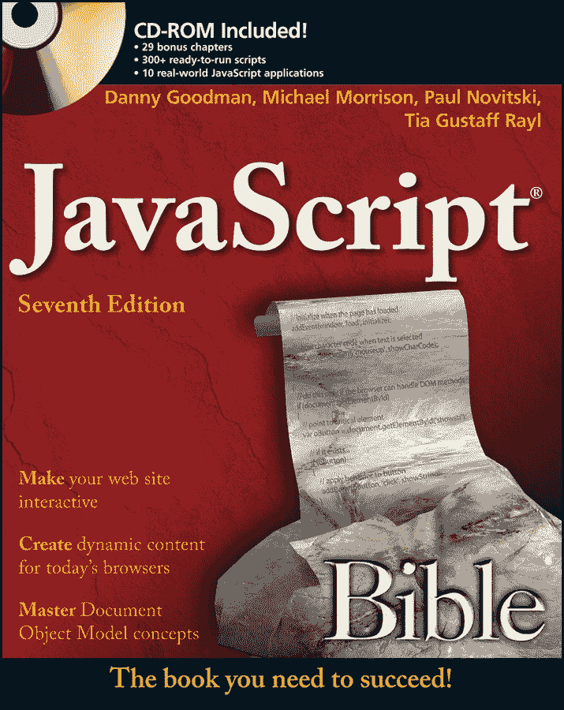

行业标准并不一定能让 Web 开发者的工作变得更容易。首先，标准在最新浏览器中的实现是不均衡的。某些浏览器在支持程度上比其他浏览器更得进。此外，对模糊标准细节的解释偶尔会存在差异。有时，标准在对内容开发者至关重要的领域没有提供任何指导。有时，我们只能听命于浏览制造商的随性性，他们用私有功能填补空白，并希望这些功能能成为事实标准。

正如战争发生的那样，当大炮开火时，平民伤亡就会增加。浏览器大战的战线在短短几年内发生了剧变。曾经由 Netscape 统领的巨大市场份额领土落入了微软的势力范围。然而，最近对 Windows 平台隐私和安全的担忧促使许多用户寻找安全性更高的浏览器。到目前为止，`Mozilla Firefox` 是寻找替代方案中最大的受益者。尽管如今浏览器的最新版本之间在作者创作方面存在相当多的共同基础，但新功能的不均衡实现为希望在所有浏览器上部署的作者带来了最大的问题。尝试定义公约数可能是创作工作中最艰巨的部分。

## 今天的兼容性问题

让我们描述一下目前三大浏览器家族之间兼容情况的现状：Microsoft Internet Explorer、基于 `Mozilla` 的浏览器以及苹果的 `Safari`。接下来的几节讨论特意没有深入探讨特定的脚本技术；在你们中可能有些人目前对编程还了解甚少。在本书的许多章节中，我们提供了各种脚本建议以适应不同的浏览器。

### 将核心 JavaScript 语言与文档对象分离

尽管早期的 JavaScript 作者最初将客户端脚本视为一个允许对页面元素编程的环境，但随着浏览器的成熟，情况发生了变化。今天，JavaScript 核心语言的规范与你在文档中编写的元素的规范之间存在清晰的区别——例如，表单中的按钮和字段（参见图 2.1）。

图 2.1 文档对象模型是 HTML 或 XML 文档与 JavaScript 编程语言之间的编程接口。

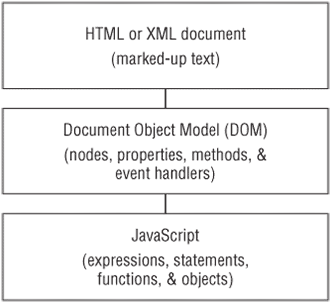

在某种程度上，这种分离是好事。这意味着对于基础编程概念和语法存在一个规范，这些规范可以成为任何其他环境中的编程语言。你可以将核心语言类比基础线路。当你知道电线是如何工作的，你就可以将它们连接到各种电气设备。同样，今天的 JavaScript 被用于将 HTML 文档中的元素连接起来。明天，操作系统可以使用核心语言让用户能够连接需要自动交换信息的桌面应用程序。

今天浏览器内部 JavaScript 线的末端是页面上的元素，如段落（`p`）、图像（`img`）和输入字段（`input`）。在编程术语中，这些项目被称为文档对象。通过将文档对象的规范与连接它们的布线分离，你可以使用其他类型的布线（其他语言）来连接它们。这就像设计可以与任何类型的线路工作的电话，包括一种尚未发明的线路类型。今天，设备可以使用铜线或光纤电缆。你可以在 Internet Explorer 中很好地看到这种分离，它的文档对象集可以使用 JavaScript 或 `VBScript` 进行脚本。相同的对象可以使用这两套不同布线中的任何一套进行连接。

核心语言与文档对象的分使得每个概念都能有自己的标准工作和开发速度。但即使对于每个因素都有建议的标准，每个浏览器制造商也可以自由地扩展标准。此外，作者可能需要花费更多精力来设计一个可以在多个浏览器上运行的页面或脚本，除非该脚本遵循公约数（或使用其他分支技术让每个浏览器以自己的方式运行）。

### 核心语言标准

跟踪 JavaScript 语言版本需要一个简短的历史课。JavaScript 的第一个版本（在 Netscape Navigator 2 中）是版本 1，尽管该数字标记并不是语言使用的一部分。JavaScript 就就是 JavaScript。当 Navigator 3 发布时，版本号变成了一个问题。与该 Navigator 版本相关的 JavaScript 版本是 JavaScript 1.1。Navigator 4 版本的首次出现将语言版本又提升了一个台阶，达到了 JavaScript 1.2。

微软的脚本工作为编程初学者带来了困惑。第一个包含脚本的 Internet Explorer 版本是 Internet Explorer 3。Internet Explorer 3 的发布时机与 Navigator 3 大致巧合。但正如脚本编写很快发现的那样，微软的脚本工作落后了一代。微软没有获得 JavaScript 的授权。因此，该公司将其语言命名为 `JScript`。

在 Navigator 3 和 Internet Explorer 3 占据主导的时期，脚本新手们往往感到困惑，因为他们认为脚本语言应该是相同的。对于脚本编写者来说的是，`JavaScript 1.1` 中的某些语言特性在 Internet Explorer 3 的旧 JavaScript 版本中是不可用的。微软通过升级提供 IE JavaScript 语法的 `.dll` 文件在 `IE3` 中改进了 `JavaScript`。然而，很难知道任何访问者的 `IE3` 中安装的是哪一个 `.dll`。随着 Internet Explorer 4 的出现，情况才有所好转。它的核心语言基本上已经达到了 `JavaScript 1.2` 的水平，就像 Navigator 4 的早期版本一样。当你将脚本加载到 Internet Explorer 4 时，几乎所有 Navigator 4 中引入的新语言特性都能被识别。但微软官方仍然将该语言命名为 JScript。

在进行这些对 JavaScript 版本的争夺的同时，Netscape、微软以及其他相关方会面以建立一个核心语言标准。该标准机构是一个总部位于瑞士的组织，最初称为“欧洲计算机制造商协会”，现在简称为 `ECMA`（通常读音为“ECK-ma”）。1997 年年中，第一份正式语言规范达成一致并发布（`ECMA-262`）。由于 JavaScript 名称的许可问题，该机构为这门语言创建了一个新名称：`ECMAScript`。

这第一个版本的 `ECMAScript` 仅有细微且冷门的差异，本质上与 Navigator 3 中使用的 `JavaScript 1.1` 相同。Navigator 4 和 Internet Explorer 4 都正式支持 `ECMAScript` 标准。此外，正如商业与标准机构交汇时经常发生的那样，这两个浏览器都超出了 `ECMAScript` 标准。幸运的是，这种扩展核心语言的共同特征非常广泛，减轻了作者在这方面的头疼问题。

`JavaScript version 1.3` 在 Netscape Navigator 4.06 至 4.7x 版本中实现。这个语言版本也是 `IE5`、`5.5` 和 `6` 所支持的版本。`JavaScript 1.5` 包含了一些新的语言特性，并在基于 Mozilla 的浏览器（包括 Navigator 6 及更高版本）中实现。`JavaScript 1.6` 又增加了几个核心语言特性，首次在 `Mozilla 1.8` 中实现（`Firefox 1.5`，随后在 `Firefox 3` 的 `JavaScript 1.8` 中增加了更多）。

在实践中，今天使用的许多浏览器都支持 Mozilla 浏览器除少数前沿功能之外的所有功能，因此 JavaScript 版本号大多无关。与其他旧浏览器的兼容问题可能会在核心语言问题出现之前阻碍你。现在是时候忘记为最旧浏览器的局限性编写复杂的变通方案了。

# 文档对象模型

Document object model

如果流行的浏览器在核心 JavaScript 语言兼容性上彼此接近，那么在文档对象方面，事实完全非如此。Internet Explorer 3 将其文档对象模型 (`DOM`) 基于 Netscape Navigator 2，这与它用作核心语言蓝型的浏览器级别相同。当 Netscape 在 Navigator 3 的模型中添加了几个新对象时，这一添加为那些期望在 Internet Explorer 3 中看到这些对象的新手脚本编写者带来了更多烦恼。Internet Explorer 3 中最常被遗漏的对象可能是图像对象，它允许脚本在用户将鼠标悬停在图形上方时切换图像——人们通常称之为鼠标悬停（mouse rollovers）。

然而，在第 4 代浏览器中，Internet Explorer 的 `DOM` 远超 Netscape 在 Navigator 4 中实现的对象模型。`IE4` 的两个最具革命性的方面是：能够对 HTML 文档中的几乎每个元素进行脚本编写，以及内容更改时页面的即时重绘。这为 HTML 内容真正的动态化开启了道路，而不需要浏览器从服务器获取重新排列的页面。`NN4` 仅实现了这种动态的一小部分，没有将所有元素暴露给脚本，也没有重绘页面。它引入了一个专有的分层概念，该概念在 Navigator 4.x 生命周期结束时被遗弃了。在 `NN4` 中，内联内容无法像 `IE4` 中那样更改。可以说，`IE4` 是一个令人羡慕的实现。

与此同时，在世界维网联盟 (`W3C`) 的赞助下正在进行 `DOM` 标准的谈判。脚本编写者希望在标准建立后，为所有支持该标准的浏览器开发动态内容将变得更加容易。产生的标准——`W3C DOM` 将像 `IE4` 那样对页面上每个元素进行脚本编写的概念正式化。但它发明了一种没有任何浏览器使用过的全新对象语法。浏览器支持 `W3C DOM` 标准的竞争已经开始。

Netscape 公司的一个名为 `Mozilla.org` 的分支成立了，旨在创建一个专门支持行业标准的全新浏览器。Mozilla 浏览器的引擎成为了全新 Navigator 6 的基础。它包含了所有的 `W3C DOM Level 1` 和大部分的 `Level 2`。`Mozilla 1.01` 成为 Netscape 7 浏览器的基础，而 `Netscape 7.1` 是基于 `Mozilla 1.4` 代构建的。2003 年夏天，Netscape 的母公司 `AOL Time Warner` 决定停止进一步开发 Netscape 品牌的浏览器。然而，底层 Mozilla 浏览器的工作在一个名为“Mozilla 基金会”的独立组织下继续。基于 Mozilla 的浏览器以及使用相同引擎的浏览器（如 `Firefox` 和 `Camino`）继续向公众进行升级和发布。可以说，Mozilla 引擎为 `W3C DOM` 标准提供了最深入的支持。

尽管微软参与了 `W3C DOM` 标准的发展，但 `IE5` 和 `5.5` 仅实现了 `W3C DOM` 标准的一部分——在某些情况下，仅足以允许符合标准的跨浏览器脚本。微软在 `IE6` 中进一步完善了 `W3C DOM` 支持，但选择遗漏了一些重要部分。尽管 `IE6` 和 `IE7` 发布之间相隔了很长时间，但后者并没有包含额外的 `W3C DOM` 支持——这让网页开发者感到非常恼。`IE8` 终于在 `W3C DOM` 规范上做了一些大量的追赶，并通过一个切换将 `IE8` 回到 `IE7`兼容模式以支持遗留脚本。

Apple Safari 浏览器在其较短的寿命中快速发展，提供了大量的 `W3C DOM` 支持。这对于版本 2 尤其如此，它是作为 Mac OS X 10.4 的一部分首次发布的。

# 使用标记奠定良好基础

Laying a good foundation with markup

我们鼓励你编写符合 W3C 规范的标记——例如 [`www.w3.org/TR/html4/`](http://www.w3.org/TR/html4/) 中的 HTML 4.01 规范。利用如 W3C HTML 验证器 ([`validator.w3.org/`](http://validator.w3.org/)) 等工具检查你的标记是否符合标准是一个好主意。此外，即使在规范宽松的情况下，在自己的工作中也要保持一致性——例如，我们建议即使规范和 `Validator` 没有要求，也要关闭所有如 `td` 和 `li` 等标签。检查并模仿 JavaScript 使用 `DOM` 方法生成的标记，你就能表现得没问题了。

## 级联样式表 (Cascading Style Sheets)

Navigator 4 和 Internet Explorer 4 是第一批声称兼容名为级联样式表 Level 1 (`CSS1`) 的 W3C 建议标准的浏览器。该规范为设计人员提供了一种组织化的方式来定制文档的外观和感受（从而减少了每个标签中的 HTML 代码）。从实现角度来看，`NN4` 有很多粗糙之处，特别是在尝试混合样式表和表格时。但 IE4 也并不好善堂，尤其是当你比较 Windows 和 Macintosh 版本的浏览器（由两个独立的团队开发）中渲染的样式表分配结果时。

CSS Level 2 为标准增加了更多样式功能；IE6、基于 Mozilla 的浏览器以及 Safari 在最新版本中（如 Mozilla `1.8+` 和 Safari `2+`）已经支持了相当多的 Level 2 功能（尽管支持并不均衡），并且它们也开始支持 CSS Level 3 特性。浏览器之间对样式内容的渲染变得更加和谐，这在很大程度上归功于关于样式应如何渲染的指南。然而，由于对标准的解释不同，复杂的布局仍然需要经常进行精细的调整。

JavaScript 在 IE4+、Mozilla 和 Safari 的样式表中起着重要作用，因为这些浏览器的对象模型允许对与页面上任何内容相关的样式进行动态修改。样式表信息是对象模型的一部分，因此可以从 JavaScript 访问并修改。

## 标准兼容模式 (DOCTYPE 切换)

微软和网景/Mozilla 都发现，随着时间的推移，他们实现 CSS 特性的方式最终与后期发布的标准有所不同（通常是在工作组成员之间经过反复争论之后）。为了补偿这些差异并为了与标准兼容而彻底断绝，主要的浏览器制造商决定让页面作者对 `<!DOCTYPE>` 头部元素细节的选择来决定该文档是设计为遵循旧方式（有时称为怪异模式 quirks mode）还是标准兼容方式。这种策略非正式地被称为 `DOCTYPE` 切换，实现在 Internet Explorer 6 及更高版本、Mac 版 Internet Explorer 5 以及所有基于 Mozilla 的浏览器中。

尽管这两种模式之间的大多数差异很小，但在 Internet Explorer 6 及更高版本中它们之间存在显著差异，特别是当样式或 DHTML 脚本依赖于带有边框、外边距和内边距元素时。微软原始盒模型测量元素维度的方法与最终 CSS 标准不同。

要让受影响的浏览器处于 CSS 标准兼容模式，你应该在每个文档顶部包含一个 `<!DOCTYPE>` 元素，指定以下语句之一：

```html
<!DOCTYPE HTML PUBLIC "-//-//W3C//DTD HTML 4.0 Transitional//EN"
      "http://www.w3.org/TR/REC-html40/loose.dtd">

<!DOCTYPE HTML PUBLIC "-//-//W3C//DTD HTML 4.0 Frameset//EN"
      "http://www.w3.org/TR/REC-html40/frameset.dtd">

<!DOCTYPE HTML PUBLIC "-//-//W3C//DTD HTML 4.0//EN"
      "http://www.w3.org/TR/REC-html40/strict.dtd">

<!DOCTYPE html PUBLIC "-//-//W3C//DTD XHTML 1.0 Transitional//EN"
      "http://www.w3.org/TR/xhtml1/DTD/xhtml1-transitional.dtd">

<!DOCTYPE html PUBLIC "-//-//W3C//DTD XHTML 1.0 Frameset//EN"
      "http://www.w3.org/TR/xhtml1/DTD/xhtml1-frameset.dtd">

<!DOCTYPE html PUBLIC "-//-//W3C//DTD XHTML 1.0 Strict//EN"
      "http://www.w3.org/TR/xhtml1/DTD/xhtml1-strict.dtd">

<!DOCTYPE html PUBLIC "-//-//W3C//DTD XHTML 1.1//EN"
      "http://www.w3.org/TR/xhtml11/DTD/xhtml11.dtd">
```

但注意，Windows 的旧版 Internet Explorer（如 Internet Explorer 5 或 Internet Explorer 5.5）并不识别标准兼容模式，无论你的 `<!DOCTYPE>` 设置如何，它们都会使用旧的微软怪异模式。尽管如此，使用标准兼容 `DOCTYPE` 更可能强制你的内容和样式表在最新的浏览器中以相似的方式渲染。

## 动态 HTML 和定位

网景和微软在 Level 4 浏览器内部机制方面最大的改进可能围绕着名为动态 HTML (DHTML) 的概念。DHTML 的最终目标是允许文档中的脚本响应用户操作控制内容、内容位置和内容外观。为此，W3C 组织开发了另一种用于页面上 HTML 元素精确定位的标准，作为 CSS 标准工作的一个扩展。`CSS-Positioning` 建议后来被并入 CSS 标准，且两者现在都是 CSS Level 2 的一部分。通过定位，你可以定义元素在页面上的精确位置、元素是否可见以及它在所有可能重叠元素中的堆叠顺序。

在 IE4+、Mozilla 和 Safari 中，JavaScript 在样式表中起着作用，因为因为这些浏览器的对象模型允许对页面上任何内容相关的样式进行动态修改。样式表信息是对象模型的一部分，因此可以从 JavaScript 访问并修改。

# 平滑降级与渐进式增强

## 引言

在可脚本浏览器的历史阶段，大多数网络访问者访问我们的网站时，都配备了至少支持简单 `W3C DOM` 和 `DHTML` 能力的浏览器。但“大多数”远非所有人，因此我们有责任通过被称为“渐进式增强”（progressive enhancement）的加法或增值方式来应用脚本。我们的意思是，你的页面应该向那些为视力或运动功能障碍用户设计的非脚本浏览器传达其核心信息，同时也向内置在最新手机手机、功能较少的浏览器传达。此外，你的脚本工作可以为使用最新可脚本浏览器的访问者提供更愉快的体验——更好的交互、更快的性能以及更具吸引力的呈现。你不仅在为技术前沿做出贡献，还在延续在浏览器中使用脚本的初衷愿景。

在 Web 演化的早期，许多网站开发者包含了最新浏览器发布中的花哨功能，而并没关心那些没有升级浏览器或从 A 品牌切换到 B 品牌的人。这意味着许多新网站对很多访问者来说在视觉上——或者更糟糕，在功能上——是损坏的。经常看到横幅说明“本网站在某某浏览器中查看效果最佳”，这只能由访问者自行忍受这种混乱，或者去安装新浏览器。

多年来，网站制作者获得了两个激动人心的新特性，它们改变了我们对浏览器支持的方法：在线业务模型和社会良知。将商业和非营利网站的潜在访问者排除在外被认为在财务上是不明智的。排除辅助技术用户被认为是不公正的——更不用说在越来越多的司法管辖区这已经具有法律责任。作为 Web 开发者，我们关心的不仅仅是无法运行 `JavaScript` 的过时浏览器。还有许多不支持或无法支持脚本的用户代理，包括搜索引擎、某些移动设备，以及某些屏幕阅读器和其他辅助 UA。许多人直接在浏览器中关闭 `JavaScript` 支持。某些企业防火墙会剥离传入网页中的 `JavaScript`，导致即使组织内部完全具备 `JavaScript` 能力的浏览器也看不到或运行它。网络统计数据各不相同，但某些估计认为由于这些原因在不运行 `JavaScript` 的情况下访问网站的人数占比 10% 或更高。即使只有 1%，也是非常有意义的。想象一下，你正在实体店面为顾客扶着门，却选择对走来的百个人中的每一个人关上门。你还能干多久的工作？

优雅降级（Graceful degradation）是一种系统设计方法，它在发生故障时提供回退方案。在 Web 设计中，这意味着如果用户代理无法处理组成页面的任何高级技术，则提供较低层次的外观或功能。优雅降级的问题在于它被整合到网站生产中的。那些在糟糕的年代练就的开发者，以及受他们培训的人，继续主要为最先进、设备设备最全的浏览器构建网站，然后作为最后一步或补救，尝试兼容其他浏览器。这种方法为了极少数用户在项目后期增加了大量工作量，因此在 Web 设计的现实世界中，由于时间、金钱和利他心常见的限制，优雅降级往往被牺牲。结果是互联网上充满了网站，这些网站对大量潜在访问者来说仍然非常不优雅地失效。

渐进式增强是一种较新的方法，它对优雅降级公平公正。网站首先被设计在所有用户代理中运行，然后如果用户使用更复杂的浏览器，则添加增强功能以使用户体验更快速或更丰富。这确保了每个读者（人类或机器）都能获得基本功能，并在不牺牲简单浏览器的情况下支持花哨的浏览器。它把蔬菜前菜放在甜点之前，把马放在马车之前。它确保汽车在添加镀铬条和音响系统之前有一个可以工作的引擎。

我们在工作中体现渐进式增强原则的一种方式，是构建在没有 `JavaScript` 的情况下也能运行的页面。这在一本 `JavaScript` “经书”中看起来似乎是异端邪，但底线是 `JavaScript` 是我们完成工作的许多工具之一。没有任何一种工具是如此闪亮和聪明，以至于应该盖过真正的主角——网站访问者。

## 开发层的分离

现代 Web 设计的另一个重要原则是开发层的分离。我们处理的主要层是页面的内容（如文本和图像名称）、其在 `HTML` 标记中的结构、在 `JavaScript` 中的行为，以及在 `CSS` 中的呈现（参见图 2.2）。你越能保持这些层的分离，构建、修改和重用你的工作就越容易。

图 2.2 客户端 Web 开发的四层。

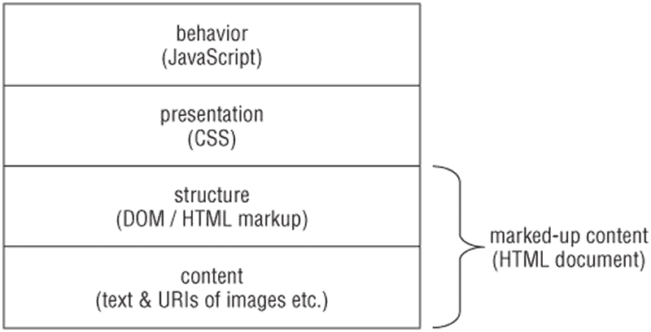

旧式的网页很容易识别：只需查看 `HTML` 源代码，你就会看到嵌入在标记中的 `JavaScript` 和样式属性。这就像一个把电线和管道嵌入在水泥墙内建造的房子。如果你想更改或更换电线，你就会面临一团乱麻。这些固化的页面是冗余的，因为不同页面上的相同功能每次都需要下载相同的臃肿标记。由于这个原因，它们的下载速度也较慢。

通过分离的层，每个组件文件都非常精简且下载快速，如果同一个样式表或 `JavaScript` 脚本适用于多个页面（这很常见），响应时间会更快，因为浏览器缓存了已从服务器获取的文件。网站的开发和重新设计也变得高效，因为几个人可以在不同的层上工作而不互相干扰。这使得标记、脚本和样式的模块更容易在未来调整和重用。

分离的层并不是孤立的。事实上相反：样式表和 `JavaScript` 代码引用并依赖于 `HTML` 标记结构、标签和属性。它们是手指设计完美完美的手，但它们仍然是独立的手。

分离层的第一步是字面上为你的 `HTML`、`JavaScript` 和 `CSS` 创建单独的文件。（在书中看到的 `HTML` 文件已经是标记和内容的组合，在日常的 Web 生产中，这些通常是由服务器端脚本执行的 `HTML` 模板与数据库字段的合并。）

层分离也是我们可以应用于脚本逻辑的方法。`JavaScript` 能够一次性向文档写入一段固化的标记和文本，但如果我们在脚本中将新的结构元素与其内容分离，我们得到的代码将更容易调试和重用，并且包含更少的错误。同样，`JavaScript` 可以直接调整页面上元素的样式，更改其颜色、大小或位置，但相反，如果我们只分配一个在样式表里单独定义的 `id` 或 `class`，那么图形设计师就可以更改那种呈现，而无需任何人修改 `JavaScript`。

## 延伸阅读

渐进式增强：为未来的 Web 设计铺路，Debra Chamra 著 [`hesketh.com/articles/progressive-enhancement-paving-the-way-for/`](http://hesketh.com/articles/progressive-enhancement-paving-the-way-for/)

# 优雅降级与渐进式增强

作者 Tommy Olsson [`accessites.org/site/2007/02/graceful-degradation-progressive-enhancement/`](http://accessites.org/site/2007/02/graceful-degradation-progressive-enhancement/)

维基百科中的渐进式增强 [`en.wikipedia.org/wiki/Progressive_enhancement`](http://en.wikipedia.org/wiki/Progressive_enhancement)

# 3 选择并使用你的工具

### 本章内容

* 如何选择基础 JavaScript 编写工具

* 如何设置你的编写环境

* 如何输入简单的脚本来创建网页

在本章中，你将在计算机上搭建一个高效的脚本编写和预览环境，并学习在 Web 上寻找有价值的资源。我们还将制作示例 HTML、`JavaScript` 和 CSS 文件，用以演示如何使用这些工具来创建真实的网页。

由于各种个人电脑操作系统运行方式的差异，我们详细介绍了两种流行变体的环境：Windows（95 到 XP）和 Mac OS X。在大多数情况下，无论你使用哪种操作系统平台（包括 Linux 或 Unix），你的 JavaScript 编写体验都是相同的。尽管取决于浏览器和操作系统的，字体设计可能会有细微差异，但信息本身是一致的。书中大多数浏览器输出插图是用 Windows XP 版本的 `Internet Explorer` 和 `Firefox` 制作的。如果你运行另一个浏览器或版本，不必因每个像素与书中的插图不匹配而担心。

## 软件工具

学习 `JavaScript` 的最好方法是在文本编辑器中向文档输入 `HTML` 和脚本代码。你对编辑器的选择取决于你个人，尽管我们提供了一些选择指南。

### 选择文本编辑器

为了在本书中学习 `JavaScript` 的目的，请避免使用 WYSIWYG（所见即所得）网页编写工具，如 `FrontPage` 和 `Dreamweaver`。这些工具在以后调整你的内容和布局时可能会派上用场。但书中的示例更多侧重于脚本内容（你必须手动输入），所以需要输入的 `HTML` 并不多。书中所有完整网页列表的文件（教程章节除外）也出现在附带的 CD-ROM 中。

选择编辑器时需要考虑的一个重要因素是：以 `.html` 扩展名保存标准文本文件有多容易。在 Windows 中，任何不仅默认将文件保存为文本，而且允许你将扩展名设置为 `.htm` 或 `.html` 的程序都能避免很多问题。例如，如果你使用 `Microsoft Word`，程序会尝试将文件保存为二进制 Word 文件——任何网络浏览器都无法加载。要将文件初始保存为 `.txt` 或 `.html` 扩展名文件，需要在“另存为”对话框中反复操作。这确实很麻烦。

可能重要的是，像 `Microsoft Word` 这样的文字处理器打开时带有许多默认设置，这些设置可能让桌面出版更容易，但会让程序员感到沮丧，例如在单词周围插入空格以及自动将直引号替换为弯引号。将其默认值设置得对程序员友好，会降低它作为文字处理器的实用性。

最后，我们敦促你不要在 `Word` 中创建文档并“另存为网页”。这将生成一个 `HTML` 文档，它看起来非常像基于它的文字处理文档，但它产生的实际 `HTML` 将将臃肿且冗余——这与我们希望你在读完本书后产出的那种简洁优雅的代码大相径远。`Word` 并不是这项工作的正确工具。

使用基础文本编辑器并没有问题。在 Windows 中，这包括 `WordPad` 程序或功能更全的产品，如 `Visual Studio` 或名为 `TextPad` 的共享软件编辑器。对于 Mac OS X，自带的 `TextEdit` 也可以。Mac `HTML` 作者和脚本编写者的青睐包括 `BBEdit`（Bare Bones Software 开发）和 `SubEthaEdit` ([www.codingmonkeys.de/subethaedit](http://www.codingmonkeys.de/subethaedit))。

### 选择浏览器

学习 `JavaScript` 还需要另一个组件是浏览器。你不需要连接互联网就可以在浏览器中测试脚本。你可以离线进行所有测试。这意味着你可以使用笔记本电脑学习 `JavaScript` 并创建酷炫的脚本网页——即使在海洋中心的船上也是。

你使用的浏览器品牌和版本由你决定。由于书中的教程章节教授的是 `W3C DOM` 语法，你应该使用较新的浏览器。以下任何一种都能让你完成教程：`Internet Explorer 5` 或更高版本（Windows 或 Macintosh）；任何基于 Mozilla 的浏览器（包括 `Firefox`、`Netscape 7` 或更高版本以及 `Camino`）；`Apple Safari`；以及 `Opera 7` 或更高版本。

> **注意**

> 本书第三部分和第四部分的许多示例列表演示了仅在特定浏览器和版本上运行的语言或文档对象模型 (`DOM`) 特性。检查该语言或 `DOM` 特性的性列表，以确保使用正确的浏览器加载页面。

## 设置你的编写环境

为了让测试脚本工作更轻松，你希望文本编辑器和浏览器同时运行。在你实验和修复可能进入代码的任何错误时，你需要在编辑器和浏览器之间快速切换。典型的工作流包括以下步骤：

1. 在文本编辑器的源文件中输入 `HTML`、`JavaScript` 和 `CSS`。

2. 将它们保存到磁盘。

3. 切换到浏览器。

4. 执行以下操作之一：

    * 如果是新文档，通过浏览器的“打开”菜单打开文件。

    * 如果文档已加载，则将文件重新加载到浏览器。

步骤 2 到 4 是你将频繁执行的动作。我们将这三步序列称为“保存-切换-重载”（save-switch-reload）。你在编写脚本时执行这个序列次数非常频繁，以至于这个物理动作很快就会变成你的本能。你如何安排应用程序窗口以及执行“保存-切换-重载”取决于你的操作系统。

在网站制作中，在你自己的计算机上按照你的喜好调整好标记、样式表和脚本后，你将使用 `FTP`（文件传输协议）程序将它们上传到服务器。虽然也有在线编辑器，但目前让我们保持简单。在自己的计算机上离线完成工作的优势之一是，在网站开发的这一阶段，你甚至不需要活跃的互联网连接。

### Windows

你不需要将编辑器或浏览器窗口最大化（全屏）来利用它们。事实上，如果你调整每个窗口的大小和位置，使两个窗口都尽可能大，同时让你能点击另一个窗口的一角，你可能会发现这样工作起来更容易。或者，你可以让任务栏可见，这样就可以点击所需程序的按钮来切换到它的窗口（参见图 3.1）。显示大于 800 × 600 像素的器有助于为窗口和任务栏提供更多屏幕空间。

图 3.1 Windows 中的编辑器和浏览器窗口布局。

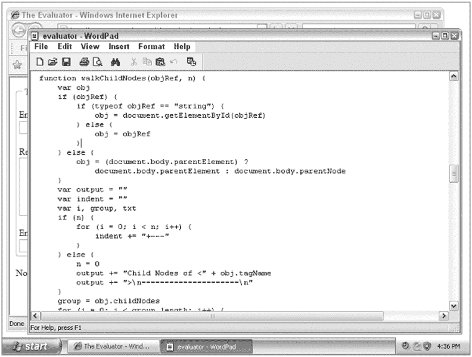

但在实践中，Windows 的 `Alt+Tab` 任务切换快捷键让前面概述的保存-切换-重载步骤工作变得轻而易举。如果你运行 Windows 并且使用兼容 Windows 的文本编辑器（该编辑器极可能带有 `Ctrl+S` 文件保存快捷键），你可以用左手从键盘上执行“保存-切换-重载”序列：`Ctrl+S`（保存源文件）、`Alt+Tab`（切换到浏览器）和 `Ctrl+R`（重新加载已保存的源文件）。

只要你通过 `Alt+Tab` 任务切换在浏览器和文本编辑器之间来切换，任何一个程序都只需一个 `Alt+Tab` 即可到达。

## Mac OS X

在 Mac OS X 中，你可以通过 `Dock` 在文本编辑器和浏览器应用程序之间切换，或者更方便地按下 `Command+Tab`。只要你停留在在这两个应用程序中，另一个程序只需要一个 `Command+Tab` 即可到达（参见图 3.2）。

图 3.2 屏幕上的编辑器和浏览器窗口布局。

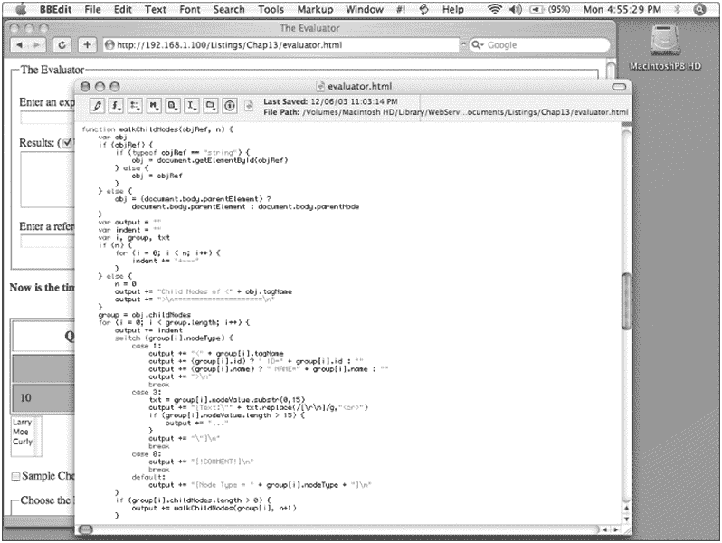

通过这种设置，保存-切换-重新加载的序列变得简单：

1. 按 `Alt+S`（保存源文件）。

2. 按 `Alt+Tab`（切换到浏览器）。

3. 按 `Alt+R`（重新加载保存的源文件）。

要返回编辑源文件，再次按 `Alt+Tab`。

## 重新加载问题

在大多数情况下，简单的页面刷新就足够让你立即测试修改后的脚本版本。但有时，浏览器的缓存（使用其默认设置）会在重新加载时保留之前页面的部分属性，即使你更改了源代码。要执行更彻底的重新加载，在点击浏览器的加载/刷新按钮时按住 `Shift` 键。或者，你也可以在偏好区域关闭浏览器缓存，但该设置可能会影响你在常规浏览网页时的整体性能。

## 验证、验证、验证

通过检查确保你的 HTML 有效，你可以节省数小时的调试时间。如果你的标记有缺陷，那么你的 JavaScript 和 CSS 很有可能无法按预期工作，因为它们都依赖于 HTML 元素（标签）及其属性。你的标记与行业标准规范越得越紧密，你就越可能在所有浏览器中获得一致的结果，这些浏览器都在趋向 Web 标准符合这一圣杯。当然，你应该总是仔细检查自己的代码，但对于大型复杂的页面以及对于仍在学习所有正确标记规则的程序员来说，自动化验证工具非常有帮助。

万维网联盟（W3C）编写了 HTML 规范，他们开发了这样一个验证器。它根据页面开头的 `DOCTYPE` 特定规则对页面进行检查。除了捕捉我们的拼写错误外，运行验证器的额外优势是它可以帮助我们学习 HTML 标记的细微之处。现在请跟我重复：验证器是我的朋友。

W3C 验证器位于 [`validator.w3.org/`](http://validator.w3.org/)。它提供了三种输入标记的方法：输入其在线 URL、从计算机上传 `.html` 文件，以及直接将标记复制并粘贴到验证器中。然后，点击 `Check` 按钮并阅读结果。通常，一个标记错误就会导致验证器错误报告中的多项内容。如果它在你的标记中发现任何错误，请进行必要的修正并再次通过验证器运行代码，直到你获得绿色的成功横幅。

使用验证器可能会让你 HTML 规范产生好奇。你可以在 W3C 网站上阅读它们：

* HTML 4.01: [`www.w3.org/TR/html4/`](http://www.w3.org/TR/html4/)

* HTML5: [`www.w3.org/TR/html5/`](http://www.w3.org/TR/html5/)

* XHTML 1.0: [`www.w3.org/TR/xhtml1/`](http://www.w3.org/TR/xhtml1/)

随着时间的推移，你还会发现其他实用的规范和验证器，例如 CSS（级联样式表）和 Web 可访问性指南：

* CSS 2.1 规范: [`www.w3.org/TR/CSS21/`](http://www.w3.org/TR/CSS21/)

* CSS 验证服务: [`jigsaw.w3.org/css-validator/`](http://jigsaw.w3.org/css-validator/)

* Web 内容无障碍指南: [`www.w3.org/TR/1999/WAI-WEBCONTENT-19990505/`](http://www.w3.org/TR/1999/WAI-WEBCONTENT-19990505/)

* Web 无障碍评估工具: [`www.w3.org/WAI/ER/tools/`](http://www.w3.org/WAI/ER/tools/)

## 创建你的第一个脚本

为了演示我们将如何使用这些工具，让我们分三个阶段创建一个经典的“Hello, World”页面：首先是纯 HTML，然后用 JavaScript 增强，最后用 CSS 样式化。

为了简单起见，我们现在构建的脚本是那种在浏览器加载 HTML 页面后立即自动运行的脚本。

### 第一阶段：静态 HTML

首先，打开你的文本编辑器并创建一个保存脚本的文件夹。创建一个新文件并输入标记：

```html
<!DOCTYPE html>
<html>
<head>
    <title>Hello, World</title>
</head>
<body>
    <h1>Hello, World</h1>
    <p>This is HTML.</p>
</body>
</html>
```

将此文件保存为 `hello.html`，并在浏览器中打开。精确外观会因浏览器而异。图 3.3 显示了静态 HTML。

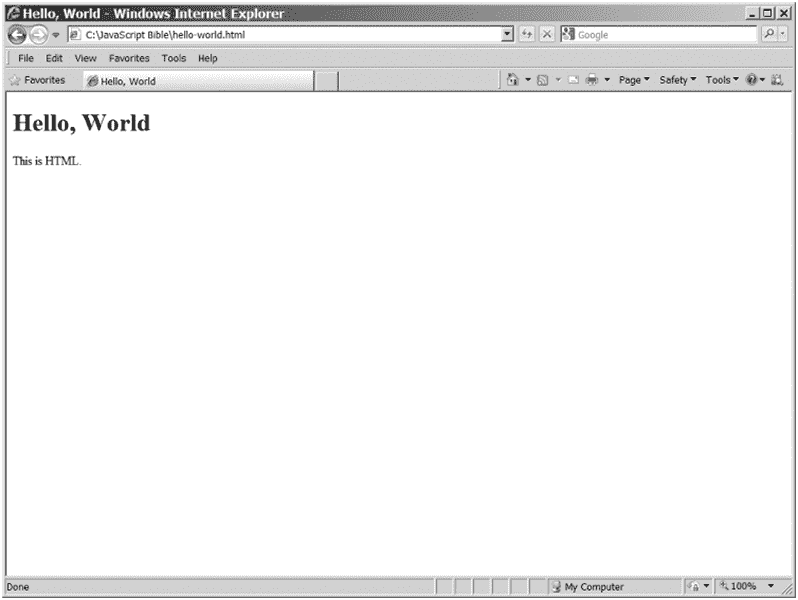

页面的头部包含两个元素：meta 标签和标题。主体由一个标题和一个段落组成。

### 第二阶段：连接 JavaScript

现在为页面添加 JavaScript。在你的计算机上创建一个新文本文件并输入：

```javascript
var today = new Date();
var msg = "This is JavaScript saying it's " + today.toLocaleString();
alert(msg);
```

将此文件保存为 `hello.js`。它由三个语句：第一个获取日期，第二个组合消息，第三个显示消息。

为了让此 JavaScript 程序作用于你的 HTML 文档，在 HTML 的头部部分添加一个新的 `script` 标签（如列表 3-3 所示）：

```html
<!DOCTYPE html>
<html>
<head>
    <meta http-equiv="content-type" content="text/html; charset=utf-8">
    <title>Hello, World</title>
    <script type="text/javascript" src="hello.js"></script>
</head>
<body>
    <h1>Hello, World</h1>
    <p>This is HTML.</p>
</body>
</html>
```

HTML `script` 元素告诉浏览器要与文档结合脚本类型和名称。由于 `src` 属性不包含路径，系统假设它与 HTML 文件在同一文件夹中。与 `meta` 标签不同，每个 `<script>` 标签必须用 `</script>` 关闭。

保存新的 JavaScript 文件和修改后的 HTML 文件后，在浏览器中重新加载 HTML 文件。它看起来应该像图 3.4。

图 3.4 一个 JavaScript alert().

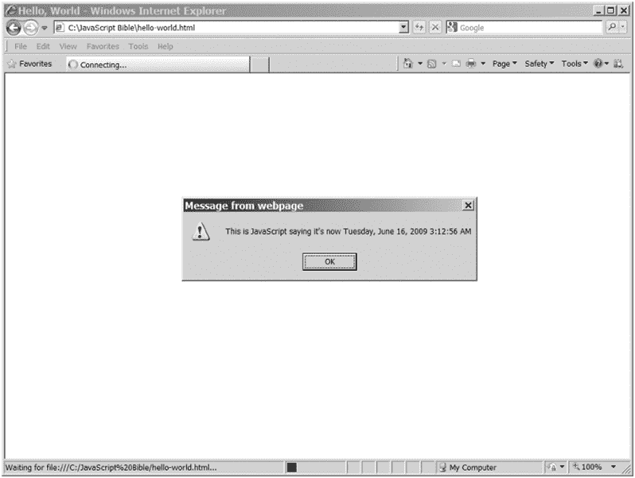

传递给 `alert()` 的文本会出现在所谓的“模态对话框”中。“模态”意味着在你关闭对话框之前，你无法对应用程序（你的浏览器）进行任何其他操作。注意，HTML 标题和段落似乎消失了！别担心，一旦你点击模态对话框上的“确定”，它们就会重新出现。为什么呢？浏览器从上到下渲染 HTML 文件。它在 `head` 中遇到 `script` 标签，并在渲染 HTML `body` 之前运行命名的 JavaScript 程序。在这种情况下，由 `alert()` 方法产生的模态对话框会停止页面的其余渲染，直到我们做出响应。

### 第 3 阶段：使用 CSS 样式

让我们为页面添加一些样式，这样你就可以看到 HTML 和 CSS 是如何交互的。在你的计算机上创建一个新的文本文件，并输入列表 3-4：

#### 列表 3-4：hello-world.css 源码

```css
h1 {
    font: italic 3em Arial;
}

p {
    margin-left: 2em;
    font-size: 1.5em;
}
```

将此文件保存到硬盘上为 `hello-world.css`。此样式表为页面上所有的 `h1` 元素应用特定的字体和颜色，并为所有的 `p` 元素应用左边距和 `font-size`。当然，在我们的文档中，每种只有一个。

要让此样式表影响你的 HTML 文档，向 HTML 的 `head` 部分添加一个 `link` 标签（如列表 3-5 高亮所示）：

#### 列表 3-5：修改后的 hello-world.html 源码

```html
...
  <head>
      <meta http-equiv="content-type" content="text/html;charset=utf-8">
      <title>Hello, World</title>
      <script type="text/javascript" src="hello-world.js"></script>
      <link type="text/css" rel="stylesheet" href="hello-world.css">
  </head>
...
```

`link` 元素告诉浏览器与文档结合的样式表的类型、关系和名称。注意，与 `script` 标签不同但与 `meta` 标签相同，`link` 是一个“空”标签，不需要单独的结束标签。因为 `src`（源）属性不包含路径，系统假设它与 HTML 文件在同一个文件夹中。每个 `<script>` 标签必须用 `</script>` 关闭。

当你保存这些文件并在浏览器中重新加载 HTML 文档（并点击该模态对话框上的确定）时，它看起来就像图 3.5 一样。

**图 3.5：带有样式的页面。**

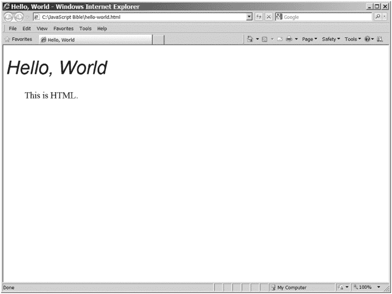

---

# 4. JavaScript 基础

**本章内容**

*   如何将 JavaScript 与 HTML 结合

*   如何适应不同版本的 JavaScript

*   针对经验丰富的程序员的语言亮点

初次学习在 浏览器环境中使用 JavaScript 时，很容易将 JavaScript 语言的对象与我们用 JavaScript 控制的文档对象混淆。将语言与文档对象模型（`DOM`）分开来是非常重要的，这可以帮助你在设计事实上的 JavaScript 增强型页面时做出重要决策。如果你将来将 JavaScript 用于其他对象模型（例如服务器端编程或编写 Flash 动画），你可能会体会这种分离。该语言的所有基础知识在任何上下文中都是相同的；只有对象不同。

本章介绍了 JavaScript 核心语言的许多方面，特别是它们在部署脚本方面的关系，因为你页面的访问者可能使用各种浏览器。在此过程中，你将对语言本身获得额外的见解。幸运的是，随着现代浏览器继续趋于一致支持 JavaScript (`ECMAScript`) 标准，适用于 JavaScript 的浏览器差异已显著减少。你可以在第三部分找到关于 JavaScript 核心语言语法的细节。

## 将 JavaScript 与 HTML 结合

可脚本的浏览器提供了多种方法在 HTML 文档中包含脚本或脚本元素。在今天的最佳实践中，并不是所有方法都是推荐的，但学习这些旧技术是有用的，这样你在 Web 上遇到旧代码时就能理解它们。

### <script> 标签

我们使用 `<script></script>` 标签对将 JavaScript 代码与 HTML 文档结合，该对通过 `type` 属性指定脚本语言。文档中包含任意数量这样的标签对。我们建议你所有的脚本都是链接到 HTML 的外部文件：

```html
<script type="text/javascript" src="example.js"></script>
```

然而，你也可以通过将 JavaScript 包在 `<script>...</script>` 标签中来直接嵌入 HTML 中：

```html
<script type="text/javascript">
// JavaScript 代码放在这里
</script>
```

将外部 JavaScript 链接到 HTML 比直接在标记中嵌入脚本具有明显的优势。开发分层分离的原则鼓励我们把文档的不同部分分开，通常放在单独的、链接的文件中。这样做有助于更整洁的开发、更快的下载以及更具模块化、可重用的代码，这些代码比在单个文件中固化在一起的技术混合体容易修改得多。

### 链接到脚本库 (.js 文件)

当同一个脚本需要在网站的多个页面上运行时，链接到外部 JavaScript 文件的优势变得立而易见。如果脚本被嵌入在 HTML 标记中，每个页面都会因为冗余内容而变得臃肿，并且修改脚本将需要在多个文件中重复相同的更改。相比之下，链接到外部文件只需为每个 HTML 文件添加一行代码，并且修改一次外部文件即可影响包含它的每个页面。另一个优点是，通过将脚本代码与 HTML 文档分离，你无需担心注释隐藏或 CDATA 节技巧（见下文）。

这样的外部脚本文件只包含 JavaScript 代码——没有 `<script>` 标签。你创建的脚本文件必须是文本文件。它的文件名扩展可以是任意的，但通常习惯使用 `.js`。要指示浏览器在你的常规 HTML 文件的特定点加载外部文件，你需要在 `<script>` 标签上添加 `src` 属性：

```html
<script type="text/javascript" src="example.js"></script>
```

如果你加载多个外部库，你可以在文档的 `head` 中包含一组这样的标签对。

注意，即使它们之间没有任何内容，`<script></script>` 标签对也是必须的。当起始标签包含 `src` 属性时，不要在起始标签和结束标签之间放置任何脚本语句。

你在 `src` 属性中引用源文件取决于它的物理位置和你的 HTML 编码风格。在前面的示例中，假设 `.js` 文件与包含标签的 HTML 文件位于同一目录。但你同样可以链接到位于服务器上其他目录或完全不同域的 JavaScript 文件。与 HTML 文件一样，如果你想引用绝对 URL，文件的协议是 `http://`。

```html
<script type="text/javascript" src="../scripts/example.js"></script>
<script type="text/javascript" src="http://www.example.com/example.js"></script>
```

（在你的文档中使用脚本库的一个关键前提条件是，你的 Web 服务器软件知道如何将具有 `.js` 扩展的文件映射到 `application/x-javascript` MIME 类型。测试你的 Web 服务器，并在必要时安排服务器配置调整。很少有现代服务器无法正确识别 `.js` 文件。）

当用户查看链接了外部脚本库的页面源代码时，`.js` 文件中的代码不会显示在窗口中，尽管浏览器将加载的脚本视为当前文档的一部分。然而，`.js` 文件的名称或 URL 是清晰而可见的（显示方式与你在源代码中编写的一致）。任何人都可以在浏览器中（使用 `http://` 协议）打开该文件，以查看 `.js` 文件的源代码。换句话说，外部 JavaScript 源文件在可见性上并不比直接嵌入 HTML 文件的 JavaScript 更隐蔽。你的浏览器为了渲染网页而下载的任何内容都是无法被隐藏的。

### 明 MIME 类型与语言

每个打开的 `<script>` 标签都应该指定 `type` 属性。`script` 是一个通用元素，表示其中包含的语句应被解释为可执行的脚本，而不是渲染为 HTML。该元素旨在适应浏览器已知的任何脚本语言——换句话说，就是为了那些浏览器内置解释器的语言而设计的。例如，Internet Explorer 同时携带了 `JScript`（微软版本的 JavaScript）和 `VBScript` 的解释器。

```html
<script type="text/javascript" src="example.js"></script>
<script type="text/vbscript" src="example.vb"></script>
```

这两个脚本都会被 `IE` 解析，但不支持 VBScript 的浏览器（如 `Mozilla`）将尝试仅解析 JavaScript 文件。

### 指定语言版本

在文档中指定你想要调用的哪个版本的 JavaScript 很少必要。如果你的脚本依赖于较新版本 JavaScript 的对象和方法，而某些旧版浏览器不支持这些内容，那么直接测试该支持性更好。例如：

```javascript
// 如果此浏览器不支持 DOM，则优雅地退出
if (!document.getElementById) return;

// 现在可以安全地使用 DOM 方法
var oExample = document.getElementById("example");
```

然而，在运行时测试语言特性是否存在并不总是可能的。如果新特性是构建在 JavaScript 语法中的，那么仅仅是它在脚本中出现，就可能阻止解释器编译脚本，以至于它甚至无法执行一个 `if` 测试。

例如，采用 JavaScript 1.6 中引入的 E4X 语法（见第 20 章“E4X—原生 XML 处理”）：

```javascript
var xAuthor = <name>
                <first>George</first>
                <last>Sand</last>             </name>;
```

如果你在一个不“认识” E4X 语法的浏览器运行的脚本中包含这种语法，脚本将无法运行，在某些情况下没有任何有意义的错误信息来提醒访问者或开发者。即使同一脚本中的其他代码在浏览器的能力范围内，它们也不会被执行。

你可以通过为脚本元素指定特定特定版本的 `type` 属性来隔离新语法：

```html
<script src="example-all.js" type="text/javascript"></script>
<script src="example-1-6.js" type="text/javascript;version=1.6"></script>
```

或者：

```html
<script type="text/javascript">
    // 所有浏览器的脚本在这里
</script>
<script type="text/javascript;version=1.6">
    // 适用于支持 JavaScript 1.6 及更高版本的浏览器脚本
</script>
```

但请注意，将版本作为特殊标志指定是非标准的，因此并非所有浏览器都支持。在 E4X 语法的特殊情况下，`Mozilla` 为 `type` 属性引入了另一个特殊标志：`e4x=1`，本质上意味着“E4X 支持 = true”。

```html
<script src="example-e4x.js" type="text/javascript;e4x=1"></script>
```

那么实际问题随之产生：如果你必须将脚本的一部分与旧版浏览器隔离开来，你会给这些旧浏览器提供什么替代代码来替换新代码？如果你正在编写那些回避代码，为什么不让它们成为唯一的代码呢？在同一个脚本中用两种不同的方式编写相同的逻辑有什么好处？在处理前沿的语言增强时，这是一个值得思考的问题。

### 已废弃的 language 属性

自 1998 年正式发布的 HTML 4 起，`<script>` 标签强制要求使用 `type` 属性。更早的浏览器识别的是 `language` 属性而不是 `type`。`language` 属性已被废弃，这意味着它是该语言的一项过时特性，已被新的结构所取代，并可能在未来的 HTML 版本中变得过时。浏览器继续识别它以支持遗留网页，但在当今行业标准的网站中没有理由使用它。我们在这里包含它是为了让你在旧标记中遇到它时能够理解。

`language` 属性允许脚本编写人员为特定语言（如 VBScript）编写代码。例如，Navigator 3 支持 `language` 版本，如下：

```html
<script language="JavaScript1.1"></script>
<script language="JavaScript1.2"></script>
```

`type` 属性直到 Internet Explorer 5、Mozilla 以及兼容 W3C 的浏览器才获得支持。如果你需要告知旧版浏览器你正在使用哪种语言，可以在 `<script>` 标签中同时指定 `type` 和 `language` 属性，因为旧版浏览器会忽略 `type`：

```html
<script type="text/javascript" language="JavaScript1.5"></script>
```

### 私有的 for 和 event 属性

Internet Explorer 4 到 7 版本提供了 `<script>` 标签的变体，将脚本语句绑定到特定对象和由该对象生成的事件上。除了 `language` 属性外，该标签还必须包含 `for` 和 `event` 属性（不属于 HTML 规范）。分配给 `for` 的值是对目标对象的引用。大多数情况下，这仅仅是分配给对象 `id` 属性的标识符。`event` 属性是你希望脚本响应的事件处理器名称。例如，如果你设计了一个脚本在 ID 为 `myParagraph` 的段落发生 `mousedown` 事件时执行某些操作，则脚本语句被封装在以下标签 set 中：

```html
<script for="myParagraph" event="onmousedown" type="text/javascript">
    ...
</script>
```

标签 set 内部的语句仅在事件触发时执行。不需要定义函数。由于 `for` 和 `event` 属性是微软的私有产物，这种将对象的事件绑定到脚本的方法确保了只有 Internet Explorer 在命名的事件发生时才会执行该脚本。

即使在那个时代，`script for` 标签也不是胜者。它的属性为每个对象的脚本造成了大量的源代码开销，因此对于链接脚本语句到多个对象和事件来说，并不是非常高效的技术。此外，非 Internet Explorer 和 Internet Explorer 4 之前的浏览器会在页面加载时执行脚本语句，这使得这种私有语言特性在任何跨浏览器脚本中都是不切。

### 老式的内联 JavaScript

在过去“标签汤”网页开发的糟糕时代，经常会将 JavaScript 语句直接插入到 HTML 标记中：

```html
<select id="nations" name="nations" onchange="doSomething(this);"></select>
```

在示例中，控制对象 `nations` 的更改事件被设置为触发所提供的 JavaScript 语句：一个自定义函数调用。我们将在书的其他部分向你展示这种工作原理，帮助你阅读遗留代码，但在今天，这样将标记和脚本结合通常被认为“非常有 90 年代风格”。

以这种方式将 JavaScript 插入标记中有很多许多缺点：当它们如此交织时，独立地更改标记或脚本既笨拙又昂贵；下载的标记不必要地臃肿，没有充分利用外部链接脚本的集中模块化优势；而且运行无法处理该代码的 JavaScript 版本的用户代理无法规避该脚本。

在现代页面中，这种标记会被清理为：

```html
<select id="nations" name="nations">
```

并将事件处理程序完全分配在 JavaScript 中，类似于如下代码：

```javascript
AddEvent("nations", "change", doSomething);
```

其中 `AddEvent()` 函数可以适应不同浏览器中的各种事件模型，可以完全独立于标记以保护无法处理脚本的用户代理，并且可以通过防御性的 `if` 测试进行防火墙保护，使其免受与现代代码不兼容的遗留 JavaScript 解释器的影响。

### 适应不支持 JavaScript 的用户代理

有几类类用户代理不能或不支持 JavaScript，根据某些统计，它们占了今天所有互联网使用的百分之十到十五。这些用户代理包括搜索引擎爬虫、移动设备浏览器、位于政府和企业防火墙内部出于安全考虑而剥离脚本的浏览器、辅助技术，以及用户出于各种原因关闭了脚本功能的浏览器。虽然今天仍有少量的遗留浏览器在使用，它们可能无法运行 JavaScript 或仅支持非常早的版本，但绝大多数不使用 JavaScript 的互联网访问者使用的都是现代硬件和软件。

作为 Web 开发人员，我们的责任是承认 JavaScript 是一个选项而非必选项，并确保我们的页面在没有它的情况下也能保持功能正常。我们的使命是使用 JavaScript 来增强访问者的体验，而不是提供若了它页面就会崩溃或停滞的关键元素。我们确保 HTML 标记提供了所有基础内容、超链接和表单字段，并确保服务器端脚本完成客户端与服务器之间的对话，这是 HTTP 请求模型的核心。那么，当 JavaScript 运行时，它可以改变页面形态、美化用户界面并加快响应时间。这就是现代 Web 脚本的双赢模型。

随之而来的问题是：我们如何将 JavaScript 添加到 HTML 文档中，以便在脚本解释器未运行、不存在或加载过时版本时页面仍保持完全功能？我们有几种策略：

*   我们在脚本的开始处会测试是否存在现代 DOM 方法（如 `document.getElementById`），以避开过时的 JavaScript 解释器版本。

*   我们将 JavaScript 导出到外部文件，并使用 `script` 标签将其链接到 HTML 文档中。不运行脚本解释器的用户代理甚至不会去加载它们。

*   与上述类似，我们在 HTML 标签的事件属性中省略 JavaScript，而是使用 JavaScript 为页面元素分配事件处理程序。

*   如果确实无法避免在 HTML 文档本身中包含 JavaScript，请将脚本封装在 HTML 注释中，这样不通脚本的浏览器就不会对其进行渲染。

让我们花点时间详细说明最后一点。

### 在 HTML 中注释掉脚本

不支持脚本的浏览器并不知道 `<script>` 标签。通常，浏览器会忽略它们不理解的标签。当标签只是一行 HTML 时这没问题，但一对 `<script>...</script>` 标签对可以包含任意数量的脚本语句行。旧且紧凑的浏览器并不知道预期闭合的 `</script>` 标签。因此，它们的自然倾向是渲染在遇到 `<script>` 标签后遇到的任何行。看到 JavaScript 代码溢出到页面上无疑会让任何访问者感到困惑或削弱信心。

然而，你可以使用一种技巧来欺骗大多数不支持脚本的浏览器忽略脚本语句：将脚本语句（`<script>` 标签内部）封装在 HTML 注释标记符中。HTML 注释以序列 `<!--` 开始并以 `-->` 结束。因此，你应该按照以下格式在你的脚本中嵌入这些注释序列：

```html
<script type="text/javascript">
<!--
script statements here
//-->
</script>
```

JavaScript 解释器知道忽略以 HTML 起始注释序列 `<!--` 开头的行，但它们在结束序列上需要一点帮助。HTML 注释的结束始于 JavaScript 注释序列（`//`）。这告诉 JavaScript 忽略该行；但不支持脚本的浏览器会看到结束的 HTML 符号，并开始使用文档中的下一个 HTML 标签或其他文本来渲染页面。旧的浏览器不知道 `</script>` 标签是什么，因此该标签被忽略，渲染在之后恢复。

### 在 XHTML 中作为字符数据注释掉脚本

如果你的文档被标记为 XHTML，注释语法会有显著不同：

```html
<script type="text/javascript">
<!--//--><![CDATA[//><!--
    // script statements here
//--><!]]>
</script>
```

这起来很绕，需要一些解释。

XHTML 解析器不容忍不是开启元素的 `<` 符号和不是开启 HTML 实体的 `&` 符号，然而这些字符是常见的 JavaScript 运算符。解决方案是将你的脚本语句封装在所谓的 CDATA（读作“see-day-tah”）部分中：

```html
<![CDATA[
    XHTML permits any character here < &
]]>
```

然后我们可以添加 HTML 注释标记来阻止遗留浏览器渲染脚本：

```html
<script type="text/javascript">
<!--<!CDATA[
    // script statements here
//]]>
</script>
```

然而，我们不能在此停止，因为 XHTML 也遵循 `<!--` 和 `-->` 注释标签，感知 XHTML 的浏览器会忽略 CDATA 且不执行脚本。因此，我们必须在 CDATA 开始之前关闭注释标签以满足 XHTML：

```html
<!-- --><CDATA[
```

并使用 `//` 注释语法让大多数 HTML 解析器忽略该行：

```html
<!--//--><CDATA[
```

某些 HTML 解析器会将 `//` 之后的行视为注释，而另一些通过 `-->` 关闭注释区域，所以我们必须让 CDATA 开启标签不显示。我们使用的技巧是让 HTML 解析器认为它是闭合标签：

```html
<![CDATA[]>
```

但为了防止 XHTML 认为它已关闭，我们将添加另一个注释标记：

```html
<![CDATA[//>
```

再次打开块注释标签以阻止某些浏览器尝试将 JavaScript 代码渲染为纯文本：

```html
<!--//--><CDATA[//><!--
```

最后，CDATA 闭合标签被注释掉：

```html
//--]]>
```

呼！这就是 Web 开发人员为了让多种标准良好相处而获得的乐趣。直接将 JavaScript 导出到外部文件要简洁得多！

### noscript 标签

`noscript` 元素是 `script` 的反面。如果脚本已关闭或浏览器不支持文档中 script 元素调用的脚本语言，感知 JavaScript 的浏览器将会渲染 `noscript` 块的内容。（值得注意的是，完全不支持脚本且不识别脚本相关标签的旧浏览器同样会渲染 script 和 noscript 块的内容，这就是为什么我们要注释掉脚本块的内容。因此，`noscript` 块将在不支持脚本时被所有浏览器渲染。）

你可以在 `noscript` 标签集内显示任何标准的 HTML。它是一个块级元素，可以包含段落、列表、分区（division）、标题等。

`noscript` 的传统用法是在不支持脚本支持的情况下显示 HTML 内容——例如显示类似“如果在运行 JavaScript 的情况下查看，此页面将更有趣”这样的消息，或者提供指向某个页面的 HTML 超链接，该页面提供了本应由 JavaScript 插入的内容。

在最近几年中，`noscript` 的这种用法通常被另一种做法所取代，即在 HTML 中仅提供非脚本标记，然后通过脚本来替换或增强该结构。我们不再告诉访客他们应该升级浏览器或开启脚本，而是从这样一个假设开始：他们正在使用他们需要或想要的用户代理来查看我们的页面，并给他们体面且功能完整的页面；然后使用脚本为支持 JavaScript 的浏览器提供更优页面。现在看来，不太可能有人特意关闭脚本来使用浏览器，或者运行在会剥离脚本的企业防火墙之后，亦或使用不支持脚本的移动设备，却又不知道在 JavaScript 帮助下互联网所提供的额外乐趣。在 90 年代，升级浏览器的警告可能是一个实用的建议，但今天看来这似乎是傲慢且多余的。

列表 4-1 是一个向支持脚本和不支持脚本的浏览器展示不同内容的示例。HTML 包含一个所有人都能看到的普通段落，另一个位于 `noscript` 元素内的段落，该段落仅对不支持脚本、关闭了 JavaScript 或运行不感知 DOM 的旧 JavaScript 解释器的用户代理可见。随后的 JavaScript 会插入另一个段落，该段落只有对运行着 JavaScript 解释器且感知 W3C DOM 方法 `appendChild()` 和 `createTextNodeNode()`的用户代理才会显示。

### 列表 4-1：为支持脚本和不支持脚本的浏览器展示不同内容

HTML: `jsb-04-01.html`

```html
<!DOCTYPE html>
<html>
    <head>
        <meta http-equiv="content-type" content="text/html;charset=utf-8">
        <title>Presenting Different Content for Scriptable and Nonscriptable Browsers</title>
        <script type="text/javascript" src="../jsb-global.js"></script>
        <script type="text/javascript" src="jsb-04-01.js"></script>
    </head>
    <body>
        <h1>Presenting Different Content for Scriptable and Nonscriptable Browsers</h1>
        <p>This text will be revealed to everyone.</p>
        <noscript>
            <p>Only user agents that don't or can't support W3C DOM scripting will reveal this text.</p>
        </noscript>
    </body>
</html>
```

JavaScript: `jsb-04-01.js`

```javascript
// initialize when the page has loaded
addEvent(window, 'load', addText);

function addText() {
    // ensure a DOM-aware user agent
    if (!document.appendChild || !document.createTextNode) return;
    // create a text node
    var oNewText = document.createTextNode("Only DOM-aware user agents running JavaScript will reveal this text.");
    // create a paragraph
    var oParagraph = document.createElement('p');
    // insert the text into the paragraph
    oParagraph.appendChild(oNewText);
    // insert the paragraph at the end of the document
    document.body.appendChild(oParagraph);
}
```

### 隐藏脚本（并不隐藏！）

初级 JavaScript 程序员的一个常见问题是，如何向页面访客隐藏脚本，也许为了保护它……（此处省略原文重复描述，保留核心逻辑逻辑）

在规划过程中将 JavaScript 放在最后而不是先考虑，其后果之一是：我们经常发现，网站中本该交给 JavaScript 处理的许多功能，实际上由其他更具通用性的技术完美地处理了。我们应该只让 JavaScript 执行那些超出浏览器核心功能（如 HTML 渲染和 CSS 样式设置）范围的功能。例如，无论 JavaScript 是否为之添加任何花哨，导航链接都应该被标记为功能性超链接。多级菜单、弹出对话框和悬停图像变化通常可以使用仅 HTML 和 CSS 实现，因此可以适用于更广泛的受众。

Ajax（异步 JavaScript 和 XML）是一个非常典型的案例。开发者甚至客户经常选择 `Ajax` 来传递内容，仅仅是因为它被认为是一项“酷”的技术，而没有停下来考虑它是否真的比普通的页面导航更有用、更快或更有效。从服务器读取内容无论如何都需要时间；如果页面上的所有图像都已经下载并缓存，那么只有 HTML 标记将成为读取新页面的开销，而这通常是页面中占比最小的一个部分。通过导航到单独页面来显示不同的内容，意味着访问者可以轻松书签并分享特定内容块的链接，这对于 `Ajax` 获取的内容来说通常是不行的。仅仅因为我们可以为了特定目的而使用 JavaScript，并不意味着我们必须或应该这样做。

一旦使用服务器端技术和 HTML/CSS 下载详细规划了核心页面或网站，我们就可以用 JavaScript 规划用户界面的其余部分——这就像主菜之后的甜美点点！

JavaScript 可用于为原本静态的演示添加动画，用 `Ajax` 下载额外内容来替换导航链接，用拖放功能增强按钮点击编辑过程，让表单变得更精美等等。在添加这些“锦上添花”的功能时，请确保你通过 JavaScript 提供的所有内容在不使用脚本的情况下也是可以访问的。如果你发现自己正在网站中添加只能通过 JavaScript 获取的关键内容，那么你就知道自己走得太远了。退后一步，将新内容添加到核心网站中，然后继续你的 JavaScript 规划。

## 选择你的战场

任何公共网站都可以、并最终会被现有的各种用户代理（user agent）查看。由于 JavaScript 的支持范围非常广泛——从早期原始版本到领先版本——要为每一个拥有 JavaScript 解释器的浏览器编写代码可能是极具挑战性的，甚至几乎是不可能的。因此，Web 开发规划的一部分可以被视为“选择你的战场”或一种分诊法——在你将支持的解释器和不支持的解释器之间划定界限，在你将使用的语言特性和要避免的特性之间划定边界。根据这种方法，与其花时间尝试编写在古旧浏览器中运行的脚本，不如直接将它们排除在场，将注意力放在为现代浏览器开发代码上。

如果你像我们建议的那样，设计网站使得所有核心内容和功能都由服务器传递的 HTML 提供，那么当你阻止旧版浏览器尝试运行你的脚本时，不必感到疏忽。放松吧——每个人都能使用你的网站。通过将支持的 JavaScript 解释器限制在当前的现代版本中并排除掉旧版本，你可以为极少数访问者节省数小时艰辛的开发工作，这个决定可以挽救你的截止日期、预算和理智。

例如，本书中的大多数脚本都从简单的 `if` 测试开始：

```javascript
if (!document.getElementById) return;
```

换句话说，“如果运行在此浏览器中的 JavaScript 解释器不知道 `document` 对象的 `getElementById` 方法，则停止运行此脚本。”这一条语句排除了那些老到不认识现代文档对象模型（DOM）方法的解释器，允许你为单一受众编写大部分代码。在光谱的另一端，你可能希望暂时避免使用某些领先的 JavaScript 语法，例如 `E4X`，这些语法会让大多数当前浏览器彻底停滞。中立地带——支持 `ECMAScript 3` 和 `W3C DOM2` 的浏览器——构成了目前使用的绝大多数，并提供了一个语言支持相对一致的非常舒适折中方案。

在规划你的应用程序或网站时，交付可以通过所有用户代理查看的单一内容流，比在不同模式下重复内容要合理得多。后一种方法在过去有时会被使用，例如，一个使用框架（frames）和并行的无框架（no-frames）版本的站点。如果你构想创建一个具有多种路径查看相同内容的应用程序或网站，请不要忘记随着网站的演进，会有繁琐的维护工作。你是否有时间、预算和意愿保持所有路径的更新？尽管一个新网站设计者可能有任何良好的意图，根据我们的经验，随着维护任务复杂性的增加，网站得到良好维护的概率会迅速下降。

尽管如此，提供多个通道并不意味着努力的重复。网站可以被标记为导航到单独页面以交付不同的内容，但在支持脚本时，网站可以使用 `Ajax` 交付相同的内容。由于这两个明显的内容通道都来自服务器，我们可以使用 `Ajax` 来请求与每个独立页面请求相同的数据流。当服务器上的数据发生变化时（例如通过修改数据库中的文本），独立页面和 `Ajax` 内容注入都会随之改变。

## 对象检测

目前实现浏览器版本分支的优选方法是对象检测（object detection）。其原理简单：如果浏览器的对象模型中存在某种对象类型，那么执行处理该对象的脚本语句就是安全的。

你在许多旧脚本中看到的对象检测示例是使用 `images` 集合。只有当浏览器运行的 JavaScript 版本识别图像为对象时，脚本才能更改图像的 `src` 属性——实际上是用从服务器读取的另一个图像替换它。实现图像的对象模型始终包含属于 `document` 对象的图像数组。`document.images` 数组始终存在，即使页面上没有图像时长度也为零。因此，如果你将交换图像的语句封装在 `if` 结构中，让浏览器只有在 `document.images` 数组存在时通过，旧浏览器只需跳过这些语句：

```javascript
function imageSwap(imgName, url)
{
  if (document.images)
  {
    document.images[imgName].src = url;
  }
}
```

当你使用它来测试你需要使用的对象时，对象检测的效果最好。当你使用它来对浏览器版本以及除测试特性之外的语言特性做出假设时，它就会给你带来麻烦。

例如，Internet Explorer 4 引入了一个名为 `document.all` 的文档对象数组，它经常用于构建指向 HTML 元素的引用。然而，Netscape Navigator 4 并没有实现该数组；相反，它拥有一个名为 `layers` 的文档级数组对象，这在 Internet Explorer 4 中并未实现。遗憾的是，许多脚本编写者利用这些数组的存在并不是为了这些对象的地址，而是作为判断浏览器版本的依据。他们会根据 `document.all` 是否存在来设置一个表示 Internet Explorer 4 最小版本的全局变量，根据 `document.layers` 是否存在来设置一个表示 Netscape Navigator 4 的全局变量。这是非常危险的，因为无法知道未来的浏览器版本可能会采用另一个品牌浏览的对象，或者消除某个语言特性。事实上，当基于 Mozilla 的 Netscape 版本首次出现时，它确实删除了所有 `layers` 相关内容，取而代之的是基于 W3C 标准的功能。网页上有大量的脚本利用 `document.layers` 的存在来分支到 Netscape 友好的代码，而这些代码甚至没有使用 `document.layers`。因此，使用 Netscape 6 或 7 的访问者发现脚本要么崩溃要么无效，尽管浏览器完全有能力完成这项工作。

这就是为什么我们推荐使用对象检测，而不是浏览器版本嗅探（sniffing），而是为了对象的可用性进行分支（如之前针对图像所示）。此外，只有当所有主流浏览器品牌（以及 W3C DOM 建议）都采用了该对象时，实施对象检测是最安全的，这样无论你的页面未来在何处加载，其行为都是可预测的。

### 对象检测技术

对象检测的技术包括测试对象方法的可用性。对对象方法的引用会返回一个值，因此这种引用可以用于条件语句。例如，以下代码段演示了函数如何接收一个包含元素 ID 字符串的参数，并将字符串转换为三个不同 DOM 的有效对象引用：

```javascript
function myFunc(elemID)
{
   var obj;
    if (document.getElementById)
    {
      obj = document.getElementById(elemID);
    }
    else if (document.all)
    {
      obj = document.all(elemID);
    }
    else if (document.layers)
    {
      obj = document.layers[elemID];
    }
    if (obj)
    {
      // 对对象执行的操作语句
    }
}
```

使用这种对象检测方案，无论哪个浏览器品牌、版本或操作系统支持将元素 ID 转换为对象引用的特定方式都并不重要。浏览器支持哪种文档对象属性或方法（如果浏览器支持多个，则使用第一个），就使用该属性或方法来完成转换。如果浏览器对其中一个都不支持，则该函数中不会执行后续的语句。然而，请记住，本例中的第一种方法已经足够（且推荐的）作为在现代浏览器中从 ID 获取所有对象的技术。

如果你的脚本想要检查对象的属性或方法是否存在，如果该对象不是所有浏览器对象模型的一部分，你可能还需要需要先检查该对象是否存在。在条件表达式中尝试引用不存在对象的属性会产生脚本错误。为了防止错误，你可以借助 `&&` 运算符进行级联条件测试。以下代码段测试了 `document.body` 对象和 `document.body.style` 属性是否存在：

```javascript
if (document.body && document.body.style)
{
   // 对 body 的样式属性执行的操作语句
}
```

这在功能上等同于：

```javascript
if (document.body)
{
    if (document.body.style)
    {
      // 对 body 的样式属性执行的操作语句
    }
}
```

在两个示例中，如果 `document.body` 的测试失败，JavaScript 将跳过第二个测试。

使用条件表达式测试对象属性存在时的一个潜在“陷阱”是：如果属性存在，但其值为 0 或空字符串，则条件测试的响应与属性不存在时相同。为了解决这个潜在问题，条件表达式可以检查值的数据类型以确保属性确实存在。使用 `typeof` 运算符来测试有效属性：

```javascript
if (document.body && typeof document.body.style != "undefined")
{
   // 对 body 的样式属性执行的操作语句
}
```

### 浏览器版本检测

多年前，在对象检测流行之前，引导脚本通过语言支持的险滩的常用方法是浏览器嗅探。正如在《Navigator 和其他环境对象》中更详细地描述的那样，你的脚本可以检查 `navigator` 对象以发现当前浏览器声称的品牌和型号。在检查了浏览器的声称名称和版本号后，脚本可以分支到特定于各种浏览器的不同逻辑部分。我们不再使用这种技术，主要因为浏览器可以并且确实会伪造自己的身份，因为浏览器版本嗅探不面向未来，而且这是一种权宜——它测试一件事是为了对另一件事采取行动。

嗅探就像让别人驾驶喷气式飞机是因为他们说自己是飞行员。他们可能因为他们并不真的是飞行员，即使他们是真的，也可能在喷气式飞机发明之前就获得了飞行执。相比之下，通过对象检测，你可以发现他们是否知道如何驾驶特定的飞机，并且只有在他们会的情况下才让他们驾驶——简单、直接且万无。

### 兼容性设计

浏览器的每个新主版本都会为页面作者带来兼容性问题。这并不是旧脚本在新版本中崩溃（编写良好的脚本在新版本中很少崩溃）。问题集中在吸引设计者的新功能上，而当设计者忘记考虑那些尚未升级到最新顶级浏览器版本或不认同你的浏览器品牌偏好的访问者时。

仅满足最低公约数可能会使你的开发时间翻倍，因为为了确保页面在所有操作系统和所有版本上良好运行，需要扩展测试矩阵。请决定你在页面中使用的脚本功能对于每个用户有多重要。如果你想要某些仅在后期浏览器中运行的功能，你可能需要在定义脚本访问你页面的最小浏览器时稍微专断一些；任何低版本的浏览器都会被重定向到你网站数据的简单展示形式。

另一种可能性是让网站的部分内容对大多数（不是全部）浏览器都可用，并将脚本限制为偶尔提供的增强功能，使得非脚本浏览器用户不会察觉其缺失。当应用程序运行到导航流程中的某个点时，用户需要一个更强大的浏览器才能获得真正精彩的内容。这种设计是一种精心策划的策略，它让网站在一定范围内欢迎所有用户，然后让应用程序针对例如 W3C DOM 兼容浏览器的用户大放异彩。

理想的页面是在任何浏览器中都能显示有用内容，但其脚本能够增强页面访问者的体验——也许通过提供更高效的网站导航或与页面内容的交互。这无疑是一个值得追求的目标。但即使你只能在某些页面上实现这一理想，你也将减少为具有不同能力的浏览器定义完全独立且难以维护的路径的需求。

无论你采取具体的浏览器兼容性策略如何，好消息是时间往往会解决这些问题。Web 标准在过去几年中已经极大地巩固，浏览器厂商在完全支持这些标准方面取得了巨大进展。

### 处理测试版浏览器

如果你编写了一个脚本精良的网页或网站，当向公众发布的预发布版本（或测试版）浏览器导致你的页面出现脚本错误或其他兼容性问题时，你可能会感到担心。为自己考虑：不要对预发布版浏览器中出现的 bug 和错误过度反应。如果你的代码写得很好，它应该适用于任何新一代浏览器。如果代码运行不正常，请认为是浏览器有 bug。向浏览器制造商报告 bug（最好带上简化的测试案例脚本样本）。

“这是测试版 bug”规则的一个例外出现在从 Netscape Navigator 4 向 Mozilla 引擎（首次发布为 Netscape Navigator 6）的过渡期间。有意识地消除一项特定的 Netscape Navigator 4 特性（`<layer>` 标签和相应的脚本对象）导致许多 Netscape Navigator 4 脚本在 Moz 测试版（及正式发布版）中崩溃。如果脚本编写人员向新浏览器的开发人员（`Mozilla`）报告该问题，他们就会得知政策变更并为新的实现做好计划。浏览器如此迅速消除一个流行功能是极其罕见的，但确实会发生。更强大的 Web 标准可能已经降低了这种情况在短期内再次发生的概率。

通常很难防止自己不被浏览器厂商对新发布的热情所感染。但请记住，预发布版本不是发布版本。使用预发布版浏览器访问你页面的用户应该知道浏览器中可能存在 bug。你的代码在预发布版中无法运行并不是一种错误；也不值得为此彻夜难。只需确保与浏览器制造商联系，要么确认问题是否会在最终发布版中继续存在，要么报告该 bug，以便问题不会进入发布版本。

### 参考文献章节中的兼容性评级

自从 Navigator 2 以来，支持脚本的浏览器版本激增，预先了解特定语言或对象模型、属性、方法或事件处理程序是否被你正在设计的最低共同标准（lowest common denominator）所支持至关重要。因此，在书中，我们包含了频繁的兼容性评级，例如所示：

兼容性：WinIE5+, MacIE5+, NN4+, Moz+, Safari+, Opera+, Chrome+

浏览器版本号后的加号表示该语言特性在数字版本中首次实现，并在后续版本中持续受到支持。减号表示该功能在相应浏览器中不受支持。测试兼容性的浏览器包括 Windows 和 Macintosh 版的 Internet Explorer、Netscape Navigator、Mozilla（包括所有基于 Mozilla 引擎的浏览器）、Apple Safari、Opera 和 Google Chrome。我们还建议你打印录 A 中所示的《JavaScript 和浏览器对象快速参考》文件。该文件以 PDF 格式附在随附的光盘中。这份快速参考清楚地显示了每个对象的属性、方法和事件处理程序，以及支持每个语言项的浏览器版本键。你会发现这份打印件作为日常资源非常有价值。

这里是澄清我们所指的“所有基于 Mozilla 引擎的浏览器”的好地方。曾几何，Mozilla 基本上指的是 Netscape，但那些日子已一去不复了。现在有几种可行的基于 Mozilla 的浏览器在本书的兼容性表中属于 `Moz+` 标识，包括 Netscape、Firefox、Camino、SeaMonkey、Flock 等。

在这里，我们使用“Mozilla”是指 `Gecko`（前身为 NGLayout）布局引擎。各个浏览器品牌的编号系统与底层的 Mozilla 引擎版本不同步，因此很难确切知道哪个浏览器支持什么功能。下表显示了各个浏览器品牌和版本与 Mozilla 引擎系统的对应关系：

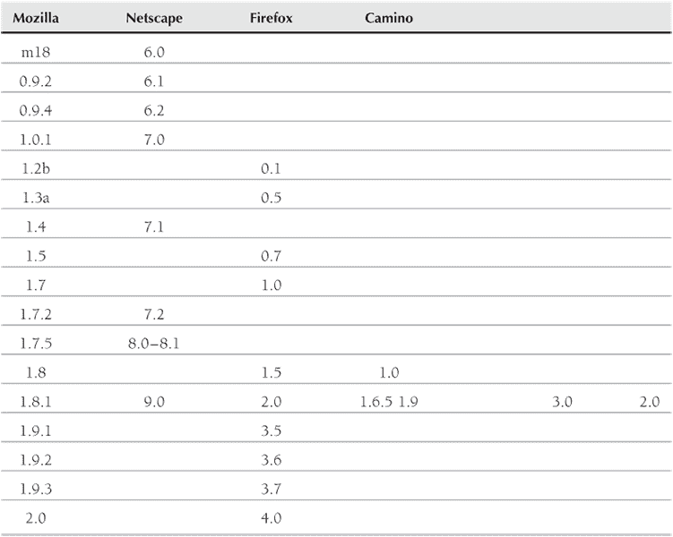

如你所见，Netscape 6.0 和 6.2 是基于低于 1 的 Mozilla 版本。如今在“现实中”看到这两个版本已非常罕见。因此，重点是 `Moz1` 及后续版本。因此，兼容性表使用 `Moz1` 作为基础功能集。

总结来说，当你在兼容表中看到 `Moz+` 时，它最终对应于 Netscape 7 或更高版本、Firefox 1 或更高版本以及 Camino 1 或更高版本（列举目前最流行的基于 Mozilla 的浏览器）。

### 资深程序员的语言基础

在本节中，资深程序员可以阅读关于核心 JavaScript 语言的亮点，这些术对于有限或没有脚本经验的人来说可能无法完全理解。因此，这里是对核心 JavaScript 语言本质问题的快速浏览：

*   `JavaScript` 是一种脚本语言。该语言旨在用于现有的主机环境（例如网络浏览器），该环境暴露了可以通过语言语句控制的对象的属性和行为。脚本在主机环境的上下文中执行。由主机环境控制运行在主机环境中的语言语句可以访问哪些外部环境对象。出于安全和隐私考虑，网络浏览器通常不允许通过 JavaScript 直接访问浏览器偏好、操作系统或浏览器之外的其他程序。该规则的例外是，现代浏览器通过信任机制（如 Mozilla 的签名脚本或 Microsoft 的受信任 ActiveX 控制）允许用户许可允许更深层次的客户端访问。

*   `JavaScript` 是基于对象的。虽然 JavaScript 与 Java 语言有许多语法上的相似之处，但 JavaScript 像 Java 那样完全面向对象。核心语言包含了一些内置静态对象，可以从中生成工作对象。通过调用任何内置对象的构造函数并配合 `new` 运算符来创建对象。例如，以下表达式会生成一个 `String` 对象并返回该对象的引用：

```
new String("Hello");
```

表 4.1 列出了脚本编写人员接触的内置对象。

-   JavaScript 是弱类型的。变量、数组和函数返回值没有被定义为任何特定的数据类型。事实上，一个初始化的变量在随后的脚本语句中可以持有不同数据类型的值（这显然不是良好的做法，但确实是可能的）。同样，数组可以包含多种类型的值。内置数据类型的范围是有意限制的：

    -   `Boolean`（真或假）

    -   `Null`

    -   `Number`（IEEE 734 双精度 64 位格式值）

    -   `Object`（包括 `Array` 对象）

    -   `String`

    -   `Undefined`

    -   `XML`（在 E4X 中）

-   宿主环境定义了全局作用域。浏览器浏览器通常将窗口或框架定义为脚本语句的全局上下文。当文档卸载时，该文档定义的所有全局变量都会被销毁。

-   JavaScript 变量具有全局或局部作用域。全局变量在所有函数之外的 `var` 语句中初始化。在 浏览器中，它通常在文档加载时执行。该文档中的所有语句都可以读取或写入该全局变量。局部变量也使用 `var` 操作符初始化，但在函数内部。只有该函数内部的语句可以访问该局部变量。

-   脚本有时会访问 JavaScript 静态对象的属性和方法。某些静态对象鼓励直接访问其属性或方法。例如，`Math` 对象的所有属性都作为常量值（例如，`Math.PI`）。

-   你可以随心所欲地向对象添加属性或方法。要向对象添加属性，只需为其分配任何类型的值。例如，要向名为 `myText` 的字符串对象添加一个作者属性，可以使用：

```javascript
myText.author = "Jane";
```

将函数引用分配给对象属性以给该对象一个新方法：

```javascript
// function definition
function doSpecial(arg1)
{
    // statements
}

// assign function reference to method name
myObj.handleSpecial = doSpecial;

...

// invoke method
myObj.handleSpecial(argValue);
```

在函数定义内部，`this` 关键字指向拥有该方法的对象。

-   JavaScript 对象采用基于原的继承机制。所有对象构造函数都会创建工作对象，其属性和方法继承自该对象原型上定义的属性和方法。脚本可以添加和删除与静态对象原型相关的自定义属性和方法，以便新的工作对象能够继承原型的当前状态。脚本可以自由地在工作对象中覆盖原型属性值，或为原型方法分配不同的函数，而不影响静态对象原型。但如果当前工作对象中没有修改继承的属性或方法，则对静态对象原型的任何更改都会反映在工作对象中。（该机制是：对象属性的引用会沿着原型继承链向上查找，直到找到与属性名匹配的项目。）

-   JavaScript 包含大量的运算符。你可以在其他语言中找到大多数熟悉的运算符。

-   JavaScript 提供了典型的控制结构。所有版本的 JavaScript 都提供了 `if`、`if...else`、`for` 和 `while` 结构。JavaScript 1.2（NN4+, IE4+, 以及所有现代浏览器）增加了 `do while` 和 `switch` 结构。迭代结构提供了 `break` 和 `continue` 语句来修改控制结构的执行。

-   JavaScript 函数可能返回值，也可能不返回。JavaScript 函数只有一种类型。只有当函数包含 `return` 关键字并跟上要返回的值时，才会返回结果。返回值可以是任何数据类型。

-   JavaScript 函数不能重载。JavaScript 函数接受零个或多个参数，无论为函数定义了多少参数变量。所有参数都会自动分配给 `arguments` 数组，该数组是函数对象的一个属性。参数变量的数据类型没有预定义。

-   值通过引用和按值传递。传递给函数的对象实际上是该对象的引用，提供了对该对象属性和方法的完全读/写访问。但其他类型的值（包括对象属性）是通过值传递的，没有指向原始对象的引用链。因此，以下无意义片段在 `onchange` 事件触发时会清空文本框：

```javascript
function emptyMe(arg1)
{
    arg1.value = "";
}

...

<input type="text" value="Howdy" onchange="emptyMe(this)">
```

但在下面的版本中，文本框没有任何发生变化：

```javascript
function emptyMe(arg1)
{
    arg1 = "";
}

...

<input type="text" value="Howdy" onchange="emptyMe(this.value)">
```

局部变量 `(arg1)` 仅仅从 "Howdy" 变为空字符串。

注意

上一个示例中的属性赋值事件处理技术是为了使示例非常简洁而刻意的简化。通常使用更现代的方法，通过 `addEventListener()` (NN6+/Moz/W3C) 或 `attachEvent()` (IE5+) 方法绑定事件会更好。现代的跨浏览器事件处理技术将在第 32 章“事件对象”中进行详细解释。

-   错误捕获技术取决于 JavaScript 版本。NN2 或 IE3 中没有错误捕获。NN3、NN4 和 IE4 中的错误捕获在浏览器对象模型中是事件驱动的。在 IE5+ 以及 Mozilla、Safari 等其他较新的浏览器中实现的 JavaScript 支持 `try-catch` 和 `throw` 语句，以及不依赖于宿主环境的内置错误对象。

-   内存管理不受脚本控制。宿主环境管理内存分配，包括垃圾回收。不同的浏览器可能不同的方式处理内存。

-   空白符（换行符外）是不重要的。空格和制表符可以分隔词法单元（例如，关键字、标识符等）。

-   换行符通常被视为语句分隔符。除了极少数构造外，JavaScript 解析器每遇到一个或多个换行符（例如回车或换行符），就会自动插入分号语句分隔符。在源代码的同一物理行语句之间需要分号分隔符。此外，字符串字面量中不能包含回车（但转义换行符 `\n` 可以是字符串的一部分）。

[Table 4.1] JavaScript 内置对象

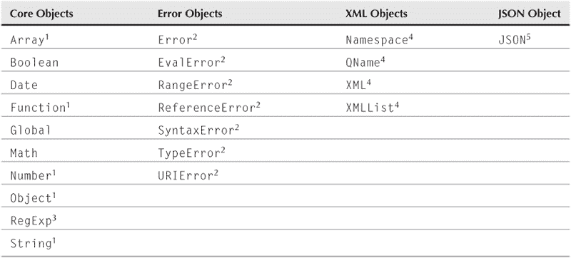

1 虽然定义于 ECMA Level 1，但最早出现在 NN3 和 IE3。

2 定义于 ECMA Level 3；Mozilla 实现。

3 定义于 ECMA Level 3；在 NN4 和 IE6 中完全实现。

4 定义于 E4X；在 Mozilla 1.8 (Firefox 2.0) 中实现。

5 定义于 ECMA Level 5；在 Mozilla 1.9.1 (Firefox 3.5) 中实现。

Evaluator 是你在后续章节中用来帮助学习核心 JavaScript 和 DOM 术语的工具。Evalu 提供了一个交互式工作台，用于表达式求值和对象检查。（在第 8 章“编程基础第一部分”中，我们将引入一个称为 Evaluator Jr. 的精简版本。）

[图 4.1] 显示了页面的顶部。两个重要的特征将此完整版本与第 8 章中的 Jr. 版本区分开来。

[图 4.1] Evaluator Sr.

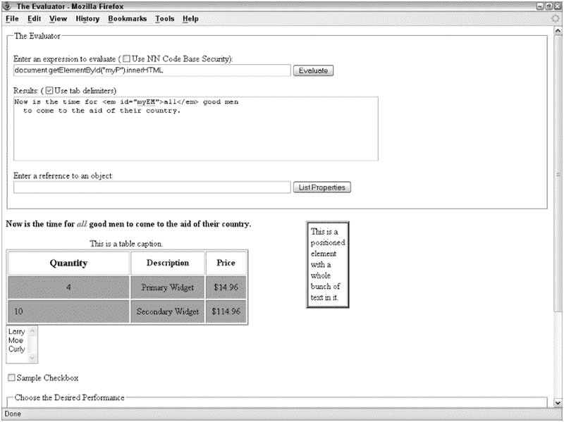

首先，如果你为浏览器开启了“代码库原则”（请参阅 CD 盘上的第 49 章“安全与 Netscape 签名脚本”）并勾选了“使用代码库安全”复框（Netscape Navigator 4 或更高版本/Moz），你可以尝试一些 Mozilla 的安全功能。其次，页面预装了几个 HTML 元素，你可以利用它们来探索 DOM 属性和方法。与简化版本一样，系统初始化了 26 个单字母全局变量（从 `a` 到 `z`），已准备好供你赋值以进行扩展评估序列。

从随附的 CD 盘将 `evaluator.html` 和 `evaluator.js` 文件复制到本地硬盘上，并在你所有的测试浏览器中为它们设置书签。可以随时在页面底部添加你自己的元素来探索其他对象。我们在第 48 章“调试脚本”（在 CD 盘上）中描述了一个可以嵌入到你的项目中作为调试工具的`评估器（The Evaluator）`版本，在那里你可以学习更多关于`评估器`的内置功能。

# 第二部分：JavaScript 教程

## 本部分

- 第 5 章：你的第一个 JavaScript 脚本

- 第 6 章：浏览器与文档对象

- 第 7 章：脚本与 HTML 文档

- 第 8 章：编程基础，第一部分

- 第 9 章：编程基础，第二部分

- 第 10 章：窗口与文档对象

- 第 11 章：表单与表单元素

- 第 12 章：字符串、数学与日期

- 第 13 章：脚本与多窗口

- 第 14 章：图像与动态 HTML

# 第 5 章：你的第一个 JavaScript 脚本

## 本章

创建一个由 HTML 页面、JavaScript 脚本和 CSS 样式表组成的简单应用程序。在本章中，你将编写一个简单的脚本，可以在兼容 JavaScript 的浏览器中看到结果。教授人类语言的两种常用方法是：a) 语法课程并最终学会对话；b) 沉浸在对话中并最终学习语法课程。

我们更喜欢 b)。它更有趣（玩耍增强学习），你可以立即看到结果，而且它更接近我们每个人学习母语的方式。语法始终在那里供你参考，但让我们以一个良好的开端——投身其中并让屏幕上发生一点魔迹来开始吧。

不要担心记住本章中讨论的每个命令和语法细节。相反，放松心情，观察 HTML 标记和 JavaScript 语句是如何变成你在浏览器中看到的内容。如果你在其中乐在其中，细节会吸收得更快。

我们会边操作边解释每行代码，尽管我们在第一个教程中使用的所有方法都将在书的后后部分进行更详细的解释。现在，只需按照呈现的内容输入脚本，并看看它们是否按预期工作即可。

### 你的第一个脚本将做什么

我们的第一个教程脚本会将当前日期和时间插入到网页中。（这是我们在第 3 章“选择和使用你的工具”中向你展示的“Hello, World”脚本的进一步演进）。首先，我们将创建一个仅显示静态内容的 HTML 页面；然后添加 JavaScript 使其变为动态；最后再添加样式让它变得生动。

值得注意的是，这种顺序——先构建 HTML 结构，然后添加用于演示的动态 JavaScript 和 CSS——不仅在学习时有用，它也是日常现实世界网站生产的一个非常棒的模型。它是更大开发序列的一部分，该序列可能包括信息设计、图形设计、线框和概念验证、HTML 标记、服务器端脚本、CSS 样式设置和 JavaScript。虽然直接跳到脚本可能很有吸引力，但这就像在蛋糕烤好之前就抹糖霜。JavaScript 像 CSS 一样，需要知道它的上下文——它运行所在的页面结构。此外，按照这种顺序工作鼓励我们遵循“渐进增强”原则，即每个人都能从基础页面中获益，但那些具有更能力的用户代理（如浏览器）的人可以从中获得更多。通过从 HTML 页面开始，我们确保了即使没有 JavaScript，它也是完整且合乎逻辑的。如今，大多数严肃的网页生产都包含服务器端脚本语言和数据库（如 `PHP` 和 `MySQL`），以作为 HTML 标记提供基础的动态内容。由于服务器端脚本不在本书的涉及范围内，我们会偶尔提到它，但在其他情况下我们将假设这是一个纯静态的 HTML 页面。

#### 输入你的第一个脚本

启动你的文本编辑器和浏览器。你可能还想启动标准的文件管理器工具，以监控你将在计算机文件夹中创建的文件。

在整个书中，我们将一直处于离线状态工作。所有操作都将在你的计算机上本地进行，无需连接互联网。如果你的浏览器建议拨打你的互联网服务提供商（ISP）或开始自动拨号，你可以取消或退出拨号操作。如果浏览器的“停止”按钮处于激活状态，你可以点击它来停止它可能尝试的网络搜索。你可能会收到对话框消息或页面，指示你的浏览器主页的 URL（通常是浏览器发行商的主页——除非你更改了设置）不可用。没关系。你需要浏览器打开，但不需要连接到你的 ISP。如果你通过办公室或学校的局域网、电缆调制解调器或 DSL 自动连接到互联网，那也可以。但你现在不需要网络连接。

### 步骤 1：HTML 文档

图 5.1 显示了我们的目标：一个带有标题和段落的简单页面。这是我们的初始页面样式（也就是说，尚未对其进行样式处理）。

5.1 步骤 1：静态 HTML 页面

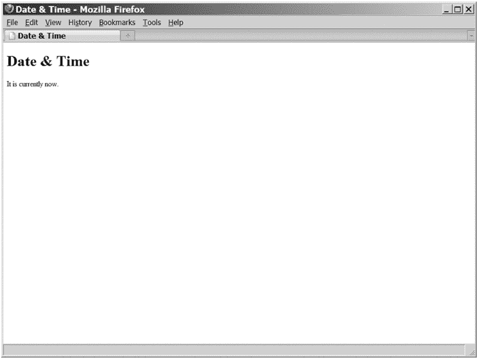

将以下 HTML 标记输入一个新的文本文件，并将其保存为 `date-time.html`（使用 UTF-8 编码）：

列表 5-1：“日期与时间”的 HTML 标记 `date-time.html`

```html
<!DOCTYPE html>
<html>
  <head>
      <meta http-equiv="content-type" content="text/html;charset=utf-8">
      <title>日期与时间</title>
  </head>
  <body>
      <h1>日期与时间</h1>
      <p>当前是 <span id="output">现在</span>。</p>
  </body>
</html>
```

**注意**

在整本书中，我们将始终为 HTML 文件使用 UTF-8 编码。字符编码告诉浏览器如何显示字符，Unicode 标准的 UTF-8 是一个极佳的系统，允许我们在 HTML 文件中包含任何世界语言。它对你的网站生产非常有帮助。

从开始，就养成使用 UTF-8 编码保存文件的习惯。许多文本编辑器允许你在“另存为...”对话框中选择编码，并为未来的文件设置默认编码，这样你就不需要每次都指定它。如果你的文本编辑器没有提供此选项，请先继续使用它，但开始寻找其他具有此功能的编辑器。

现在在浏览器中打开文档。你可以通过在管理器屏幕上双击文件，或在浏览器的文件菜单中选择“打开”或“打开文件”来实现。

如果你按照所示输入了所有行，浏览器窗口中的文档应该看起来像图 5.1 所示（根据你的计算机操作系统和浏览器版本会有细微差异）。

让我们检查文档的细节，以便你理解标记所执行的一些精细要点。

```html
DOCTYPE html
```

`DOCTYPE` 告诉浏览器如何渲染文档。你使用的 `DOCTYPE` 会极大地影响 CSS 样式和标记验证。我们在书中使用的 `DOCTYPE` 是 HTML5 的，但为了验证之目的，你可以将其替换为 HTML 4.01-Strict 的 `DOCTYPE`：

```html
<!DOCTYPE html PUBLIC "-//W3C//DTD HTML 4.01//EN"
   "http://www.w3.org/TR/html4/strict.dtd">
```

或者替换为 XHTML 1.0-Strict 的（以及标记风格上的其他一些变化）：

```html
<!DOCTYPE html PUBLIC "-//W3C//DTD XHTML 1.0 Strict//EN"
   "http://www.w3.org/TR/xhtml1/DTD/xhtml1-strict.dtd">
```

### 注意事项

如果你打算遵循其规范，那么 XHTML 风格要求所有标签和属性名都使用小写。虽然书中的代码示例是 HTML，它接受大写或小写的标签和属性，但我们将统一使用小写，以兼容这两个标准。

XHTML 还要求对我们在这些示例中使用的 HTML 进行几处修改。有关此点的更多细节，请参见“引言”。

### html

标记继续如下：

```html
<html>
    ...
</html>
```

整个页面将始终存在于 `html` 元素内部，该元素声明了标记的类型。`html` 元素只有两个子元素：`head` 和 `body`。

### head

```html
<head>
    ...
</head>
```

`head` 元素可以包含多种子元素，这些元素传递有关文档的信息，但通常不会作为文档内容进行渲染。`head` 至少包含两个子元素：定义字符集的 `meta` 元素和一个 `title`：

```html
<meta http-equiv="content-type" content="text/html;charset=utf-8">
<title>Date & Time</title>
```

`meta` 标签本身是一个很长的话题。目前，只需按照上面的方式输入这一个即可。HTML5 可以接受更短的版本：

```html
<meta charset="UTF-8">
```

然而，较长的版本适用于所有的标记类型（HTML 4.01、HTML5 和 XHTML 1.0）。注意 `meta` 标签是“空”的，不需要闭合标签 `</meta>`。它传递的所有信息都在它的属性中，在这里是 `http-equiv` 和 `content`。

另一方面，`title` 确实需要一个闭合标签；它们共同包围其内容。标题 "Date & Time" 被输入为 `Date &amp; Time`，使用 HTML 实体 `&amp;` 来表示 & 符号。如果这四个字符出现在页面内容（属性值和标签包含的文本）中，它们必须始终转换为 HTML 实体，以免混淆解析引擎：

- `< &lt;`

- `> &gt;`

- `& &amp;`

- `" &quot;`

最后一个是 HTML 标记中使用的直角双引号，而不是排版文本中常见的弯曲引号。

### body

```html
<body>
    ...
</body>
```

`body` 元素包含文档的内容——它的结构、文本、图像、多媒体对象等。

### headline

```html
<h1>Date & Time</h1>
```

我们使用标题标签 `h1` 到 `h6` 在文档中创建大纲结构。通常，一个文档页面将只有一个 `h1` 来重复页面标题，所有其他标题（从 `h2` 开始）都嵌套在其下方。

在过去那些糟糕的日子里，人们选择标题标签完全是为了它们的默认外观。今天，我们使用它们就像在嵌套大纲结构中使用数字一样，并且我们从样式表中来控制所有文本的外观。

### paragraph

```html
<p>It is currently <span id="output">now</span>.</p>
```

最后，这是 JavaScript 将插入当前日期和时间的文本段落。`span` 元素有一个 ID（`output`），JavaScript 将用它来定位，以便我们的脚本可以将 `span` 的内容替换为实际的日期和时间。

所以，这就是静态 HTML 页面。即使在我们接入 JavaScript 后，任何使用不支持 JavaScript 的用户代理（如搜索引擎）或关闭了 JavaScript 的用户查看页面，看到的也将只是我们在这里看到的内容。该页面在当前状态下并没有提供多少的信息，但至少它没有损坏。对于公共网站来说，脚本应该为页面增加价值，而不是成为关键任务。

### 第 2 步：添加 JavaScript

接下来，让我们为我们的页面创建 JavaScript。现在是培养一些良好的 JavaScript 习惯的好时机，这些习惯在你以后所有的脚本开发中都非常重要。首先，JavaScript 是区分大小写的。因此，你必须用正确的大小写字母输入脚本中的每一个单词。当某行 JavaScript 代码不起作用时，首先寻找大小写错误。始终将你输入的代码与书中打印的示例以及书中讨论的各种词汇条目进行比较。

其次，注意每个 JavaScript 语句都以分号结尾。这些结尾的分号（你可以将其想象成句末的句号）在 JavaScript 中技术上是可选的，但我们强烈建议使用它们来消除脚本中的歧义。如果你将来研究其他编程语言（如 `PHP`、`Java` 或 `C++`），你会发现那些分号是必须的。书中所有的 JavaScript 示例都使用了分号。

创建一个名为 `time.js` 的文件并输入以下内容：

注意

JavaScript 注释是双斜杠（`//`）到行尾之间的任何文本，或者是星号（`/*`）到星号（`*/`）之间的文本。解释器忽略注释，注释有助于人类理解代码。因此，你不需要像我们这样输入注释，但我们建议你养成编写注释的习惯。

示例 5-2：“Date & Time”的 JavaScript 代码：time.js

```javascript
// 当页面加载完成后运行此脚本
window.onload = insertDateTime;

// 插入日期
function insertDateTime() {
    // 确保支持 DOM 的代理
    if (!document.getElementById) return;
    if (!document.createTextNode) return;
    // 创建日期对象
    var oNow = new Date();
    // 获取当前时间的字符串
    var sDateTime = oNow.toLocaleString();
    // 指向我们要插入日期的目标元素
    var oTarget = document.getElementById('output');
    // 确保找到了目标
    if (!oTarget) return;
    // 删除目标内部的所有内容
    while (oTarget.firstChild) {
        oTarget.removeChild(oTarget.firstChild);
    }
    // 使用日期字符串创建新的的新文本节点
    var oNewText = document.createTextNode(sDateTime);
    // 将新文本插入 span 中
    oTarget.appendChild(oNewText);
}
```

为了将此 JavaScript 文件连接到 HTML 文件，我们需要在 HTML head 中添加一个 `script` 元素。回到 date-time.html 编辑器并添加下方高亮的行：

```html
...
<head>
    <meta http-equiv="content-type" content="text/html;charset=utf-8">
    <title>Date & Time</title>
    <script type="text/javascript" src="date-time.js"></script>
</head>
...
```

### 触发事件

这里有一个问题：我们的脚本要把日期和时间插入页面的段落中，但浏览器在读取 HTML body 之前读取并运行了我们的 JavaScript 代码。当 JavaScript 开始运行时，我们要插入新内容的段落在浏览器内存中甚至还不存在。

我们的解决方案简单地告诉 JavaScript 在文档被完全读取到内存之前不要执行插入操作。我们使用 `onload` 事件来实现这一点。页面上的元素——在文档对象模型（DOM）中被称为“对象”——可以对许多事件产生响应，例如鼠标点击或按键按下。`window` 对象的 `onload` 事件会在文档完成加载到浏览器时被触发。

```javascript
// 告诉浏览器在页面加载完成后运行此脚本
window.onload = insertDateTime;

// 插入日期和时间
function insertDateTime()
{
   ...
}
```

在这种情况下，我们是在告诉 JavaScript 在文档加载完成后调用 `insertDateTime()` 函数。因此，依赖于文档已加载的日期和时间插入程序被推迟，直到浏览器在内存中拥有目标段落。

### 确保环境安全

一旦文档完成加载到浏览器，`window.onload` 事件就会被触发，`insertDateTime()` 函数也会被调用。脚本执行的第一件事是确保它正被一个使用相同语言的现代浏览器所解释：

```javascript
// 确保是支持 DOM 的用户代理
if (!document.getElementById) return;
if (!document.createTextNode) return;
```

`getElementById()` 和 `createTextNode()` 是我们在此函数使用的两个 DOM 方法，某些旧的 JavaScript 解释器无法理解它们。感叹号（`!`）表示“不是”， `return` 告诉 JavaScript 停止运行当前函数；因此，第一个语句的意思是：“如果你不支持文档对象的 `getElementById()` 方法，则退出此函数。”如果我们不包含这些保护措施，旧版浏览器或其 JavaScript 解释器在尝试运行后续代码时可能会崩溃。

崩溃的程度可能小到 JavaScript 解释器直接停止（导致我们留下一个纯 HTML 页面且完全没有 JavaScript 功能），也可能严重到整个浏览器死机并重启。这两种情况都是不受欢迎的。对于许多页面，我们将编写 JavaScript 来执行多个任务，其中一些任务可以由旧浏览器执行，而另一些则不能。我们希望引导浏览器绕过它无法处理的部分，以便它运行它能够处理的部分。防止旧版本的 JavaScript 在现代方法的“礁石”上崩溃，是专业操作的标志。

我们遵循“优雅降级”和“渐进式增强”的原则，即无法利用特定功能的浏览器将得到友好的对待，并允许它们尽力而为。与 DOM 交互的脚本的一项基本礼貌是拒绝那些不支持 DOM 的旧 JavaScript 解释器。

检查旧版 JavaScript 解释器的传统方法是“浏览器嗅探”（browser-sniffing），通过检查 `navigator` 对象报告的浏览器类型。遗憾的是，这些身份声明是不可靠的。可以信任的是 JavaScript 解释器对自己能够执行哪些方法的认知，而这是我们今天使用的主要安全特性。

### 生成日期和时间

我们要插入到此文档中的文本是当前的日期和时间（根据用户计算机上的时钟）。JavaScript 让这变得简单：我们创建一个 `Date` 对象，并使用它的许多方法之一来产生字符串：

```javascript
// 创建日期时间对象
var oNow = new Date();
// 获取当前日期和时间的字符串化格式
var sDateTime = oNow.toLocaleString();
```

这段代码将变量 `oNow` 设置为一个新的 `Date` 对象。一旦我们拥有了这个对象，就可以使用它的 `toLocaleString()` 方法输出包含类似内容的文本字符串：

`Thursday, August 20, 2009 4:16:05 PM`

我们将日期和时间字符串捕存在变量 `sDateTime` 中，稍后我们将用它输出到页面。

`toLocaleString()` 方法的妙之处在于，它会根据用户的设置和用户的时区来格式化日期和时间。如果两个人在地球两侧同一时刻运行这段完全相同的代码，他们可能会得到以两种格式和两种语言表示的两个不同的日期时间。你将在后面的章节中学习更多关于 `Date` 知识，特别是第 12 章“字符串、数学和日期”以及第 17 章“Date 对象”。

**注意**

在这个示例脚本中，`oNow` 是一个 `Date` 对象，而 `sDateTime` 是一个文本字符串。无数编程风格之一是所谓的“系统匈牙利命名法”（Systems Hungarian notation），其中每个变量名都以其类型的指示开头——这里 `o` 代表对象（object），`s` 代表字符串（string），`i` 代表整数（integer），以此类推。这样命名变量完全可选，纯是为了程序员自己的方便。 JavaScript 并不关心名称是什么，只要不使用关键字或非法字符即可。JavaScript 是一种“动态类型”语言，同一个变量可以任意地设置为数值、字符串、布尔值和对象引用值。有些程序员喜欢在每个变量中只维护一种类型的值，以帮助代码易于管理和调试。使用匈牙利命名法可以使这些人为的变量类型更容易记忆。

### 寻找目标

下一步是将日期和时间精确地插入到我们希望的文档位置。为了做到这一点，我们需要：

1. 引用目标 `span` 元素。

2. 删除元素内部的任何文本。

3. 在元素内部插入新文本。

为了引用输出 `span`，脚本使用了行业标准：

```javascript
// 指向我们想要插入日期和时间的目标元素
var oTarget = document.getElementById('output');
```

第一条语句通过 ID (`output`) 在 HTML 中定位目标元素，并将该引用存储在 `oTarget` 中。HTML 规范每个 ID 在页面上必须是唯一的。即使我们不小心在页面上多次使用同一个 ID，`getElementById()` 也只返回实例。因此，我们知道该方法将定位元素（如果存在的话）——我们在 HTML 中标记的 span：

`<p>It is currently <span id="output">now</span></p>`

注意当我们调用 `getElementById()` 时，指定的是元素的 ID (`output`) 而不是标签名 (`span`)。在 HTML 标记中，我们可以将 `id="output"` 属性从 span 移动到任何其他元素，我们的脚本都会操作该元素。如果你仔细想想，这非常酷。这意味着尽管标记和脚本必须对目标元素达成一致，但脚本可以处理使用的任何标签。正是这种灵活性可以让我们未来编写出某些功能强大的 JavaScript 函数。

如果在标记中遗漏或拼写错误的 ID，`getElementById()` 将返回 `null` 值。为了稳妥起见，我们对此进行测试：

```javascript
// 确保找到了目标
if (!oTarget) return;
```

与之前的 if 测试类似，这一个测试的意思是：“如果变量 `oTarget` 不存在或值为 `null`，则从此函数中返回。”在脚本中添加此类现实检查将使其变得无懈可击。当你处理页面上几十个元素，或处理由许多人员和过程生成的页面时，养成这种习惯将让你受益匪浅。

在出现严重问题时，这是一个警告用户的机会——例如：

```javascript
if (!oTarget) return alert("警告：未找到输出元素");
```

然而，由于在大多数情况下，典型的网站访问者对这类问题无所能为

### 删除内容

我们的 HTML 文档预填充了一些我们想要替换的文本：

`<p>It is currently <span id="output">now</span></p>`

我们想要删除 `span` 标签内的文本，然后插入新内容。在表示页面内容的 DOM 中，`span` 是其内部所有内容的父元素。目前只有一个子元素——单词“now”——但即使稍后后 HTML 被修改为在目标元素中包含其他标记，我们也希望此脚本仍然能够成功运行。

图 5.2 显示了从 DOM 角度看的段落。`p` 元素有三个子元素：两个文本节点和一个 `span`。`span` 只有一个子元素：一个包含值“now”的文本节点。

图 5.2 插入前日期和时间段落的 DOM 视角视图。

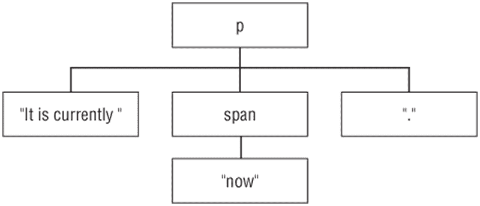

要移除 `span` 的内容，请执行一个简单的循环，只要还有可以删除的元素，就逐个删除子元素：

```javascript
// 删除目标内部的所有内容
while (oTarget.firstChild)
{
    oTarget.removeChild(oTarget.firstChild);
}
```

考虑到我们目前的标记，这个循环将执行一次。`while` 循环只要括号内的表达式测试为真，就会重复执行。当循环开始时，会评估属性 `oTarget.firstChild`：对象 `oTarget` 是否有第一个子节点？答案是肯定的（true），因为文本节点“now”在那里。在循环内部，`removeChild()` 方法删除了那个第一个子元素。然后 JavaScript 再次循环并询问相同的问题：`oTarget.firstChild` 是否存在？答案是否定的（false），因此 JavaScript 停止处理 `while` 循环，并在闭大括号后恢复执行。

### 插入日期和时间

最后，我们在 DOM 中创建一个包含我们想要文本的新节点，并将其插入到 `span` 中：

```javascript
// 使用日期-时间字符串为页面创建一个新的文本节点
var oNewText = document.createTextNode(sDateTime);
// 将新文本插入到 span 中
oTarget.appendChild(oNewText);
```

`sDateTime` 是我们在几条语句之前从 `Date` 对象生成的字符串。我们调用了附加在 `document` 对象上的方法，该方法以日期和时间字符串为值创建一个新的文本节点。此时，该文本节点尚不是可见文档内容的一部分；它在幕后待命。我们使用目标元素的 `appendChild()` 方法将它带上舞台。

段落的结构现在看起来就像 图 5.3 所示。它的结构形状相同，但 `span` 现在有一个新的子元素。

图 5.3 插入后的日期和时间段落。

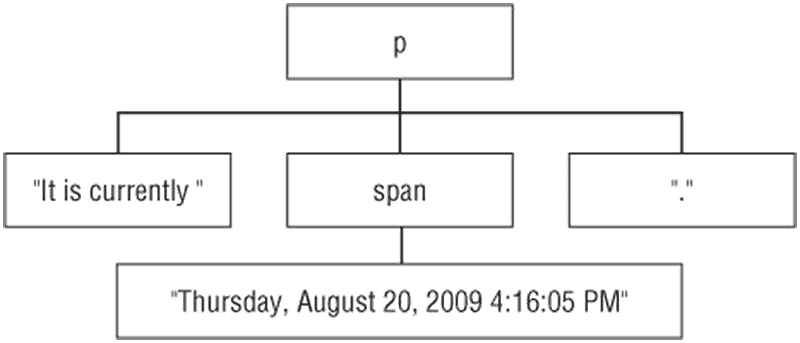

### 调试

当你保存了 JavaScript 文件和带有脚本标签的 HTML 文件后，你应该能够将 HTML 页面加载到浏览器中，并看到单词“now”被当前的日期和时间所取代。

如果不行，请现在花时间追踪并修复问题。在此过程中，你将学习关于 JavaScript 的重要细节，这些细节将帮助你未来的代码运行更快、更顺畅。

检查 HTML 标记和 JavaScript 代码，以确保它们与之前的代码列表匹配。标记中的两个关键点是 `script` 标签及其指向 JavaScript 文件的属性，以及 JavaScript 将查找的 `span` 标签及其 `ID`。在 JavaScript 文件中，请确保每条语句的拼写准确，包括空格、标点符号以及大小写字母。

如果你对 HTML 不确定，在 W3C HTML 验证器中进行验证始终是一个好主意，该工具可用 [http://validator.w3.org/]。选择 `Validate by File Upload`（通过文件上传）从你的电脑上传 HTML 文件，或选择 `Validate by Direct Input`（直接输入）将文本编辑器中的 HTML 标记复制并粘贴到验证器中。在编写本文时，书中所有带有 HTML5 `DOCTYPE` 的示例都会注册一个警告：`Using experimental feature: HTML5 Conformance Checker`。这是一个信息消息，而不是错误。你的目标是在验证器结果页顶部看到一个绿色的横幅，显示 `This document was successfully checked as HTML5!`（此文档已成功通过 HTML5 检查！）。

检查浏览器的错误控制台，查看是否报告了错误。如果是，它可能会告诉你错误在脚本文件中的位置。

如需后续步骤，请参见第 48 章“调试脚本”。

### 步骤 3：添加样式

最后，为了说明网页的第三个组件是如何结合的，让我们添加一个样式表。样式表告诉浏览器页面应该如何外观——从布局到字体选择到背景颜色。

在编辑器中创建一个新文件，输入以下样式表脚本，并将其保存为 `date-time.css`：

列表 5-3：“日期时间”的 CSS：

```css
@charset "utf-8";

* {
    margin:0;
    font-family:sans-serif;
}

h1 {
    font-size:10em;
    color:#DDF;
}

p {
    position:absolute;
    top:2.5em;
    left:1.5em;
    font-weight:bold;
    color:#338;
}

#output {
    font-style:italic;
    color:#C33;
}
```

为了将此样式表链接到 HTML，在 `head` 中添加一个 `link` 元素：

```html
<head>
    <meta http-equiv="content-type" content="text/html; charset=utf-8">
    <title>日期时间</title>
    <link href="date-time.css" rel="stylesheet" type="text/css">
    <script src="date-time.js"></script>
</head>
```

保存样式表，保存 HTML 文件，并在浏览器中重新加载页面。它看起来应该像图 5.4](#9780470952801c05.xhtml_c05_fig_0004)。

图 5.4 步骤 3：样式化的页面。

### 玩玩看

一旦此脚本正常运行，请尝试稍微修改它。将 `output` ID 移动到另一个元素。更改插入的文本。习惯调整标记、脚本和样式表以获得你想要的效果。每次更改后，保存文件并重新加载浏览器中的页面以检查进度。在学习过程中不要害怕犯错。你可以随时撤销出错的操作。记住，玩是学习最好的方式！

## 练习

1. 在列表 5-1 的 HTML 标记上执行单次剪切粘贴操作，使 JavaScript 替换整个段落为日期和时间，而不仅仅是 span。提示：在你修改后，段落仍然包含文本和 span 元素。

## 练习

2. 结合你刚刚做的标记，考虑 JavaScript 列表 5-2 中的 `while` 循环。写出循环在删除段落内容时将的每一个步骤。

3. 再次考虑到你在练习 1 中对 HTML 的编辑，决定对列表 5-3 中的样式表需要哪些更改，以便为段落分配与之前 span 具有相同的字体和颜色属性。

## 浏览器浏览器与文档对象

### 本章内容

* 客户端脚本的作用

* 文档加载时发生了什么

* 浏览器如何创建对象

* 脚本如何引用对象

* 如何区分一个对象与另一个对象

在本章中，你将看到 JavaScript 的几个实际应用，并开始观察启用 JavaScript 的浏览器如何将熟悉的 HTML 元素转换为由你的脚本控制的对象。本教程教授了适用于现代浏览器的概念和术语，并特别关注标准的兼容性，以使你能够处理现在和未来的浏览器。你应该结合以下任何一种浏览器来学习本教程：Internet Explorer 5 或更高版本（Windows 或 Macintosh）、任何基于 Mozilla 的浏览器（Firefox、Netscape 7 或更高版本，或 Camino）、Apple Safari 或 Opera 7 或更高版本。

### 脚本主一切

如果你曾用 HTML 编写过网页，你非常熟悉 HTML 标签如何影响内容在浏览器中查看时的页面渲染方式。当页面加载时，浏览器会将角括号标记识别为格式格式指令。指令从文档顶部向下读取，HTML 文档中定义的元素在屏幕上出现的顺序与它们在文档源代码中出现的顺序相同。作为作者，你只需要提前一次性地做少量的工作——向文本内容添加标签——而每当访问者将页面加载到浏览器时，浏览器都要做多得的工作。

假设页面上的其中一个元素是表单内部的文本输入字段。用户应该在文本字段中输入某些文本，然后点击 `Submit` 按钮将这些信息发送回网络服务器。如果这些信息必须是一个电子邮件地址，你如何确保用户在地址中包含了 `@` 符号呢？

一种方法是让运行在网络服务器上的程序——例如用 `PHP`、`ASP`、`ColdFusion` 或通用网关接口 (`CGI`) 语言（如 `Perl`）编写的程序——在用户点击 `Submit` 按钮且表单信息传输到服务器后检查提交的表单数据。如果用户漏掉或忘记了 `@` 符号，服务器端程序会将页面发回浏览器——但这次带有一个指令，要求地址中包含该符号。这种交换没有问题，但可能意味着用户在发现地址不包含关键符号时会有轻微的延迟。此外，网络服务器必须消耗一些资源来执行验证并与访问者通信。如果该网站非常繁忙，服务器可能在任何时刻都尝试执行数百次此类验证，可能会进一步减慢给用户的响应时间。

现在想象一下包含该文本输入字段的文档具有内置智能，可以确保在向服务器提交任何比特位（字面意思！）数据之前，文本字段的输入已包含 `@` 符号。那种智能必须以某种方式嵌入文档中——随着页面内容一起下载，以便在被调用时随时待命。浏览器必须知道如何运行该嵌入程序。必须由某些用户操作来启动程序，也许当用户点击 `Submit` 按钮时。如果程序在浏览器内部运行并检测到缺少 `@` 符号，应该弹出一个警告消息，让用户注意该问题。同一个程序还能够判断是否可以继续实际提交，还是应该等待在字段中输入有效的电子邮件地址。

这种提交前的数据输入验证只是 JavaScript 为 HTML 文档添加智能的实用方法之一。考虑到这个例子，你可能会意识到脚本必须知道如何查看文本字段中输入的内容；脚本还必须知道如何继续提交以及如何终止提交。能够运行 JavaScript 程序的浏览器方便地将文本字段等元素视为对象。JavaScript 脚本控制对象的动作和行为，这些对象的大部分在浏览器窗口屏幕上可见。

### 何时使用 JavaScript

由于你有许多面向 Web 的开发工具和语言可供，你应该将对客户端 JavaScript 的精力集中在最适合它们的任务上。在面对 Web 应用程序任务时，我们寻求客户端 JavaScript 来帮助以下需求：

* **数据输入验证**。如果表单字段需要填写以便在服务器上进行处理，我们让客户端脚本对用户输入的数据进行预审。

* **无服务器 CGIs**。我们使用这个术语来描述那些如果没有 JavaScript 就会服务器上被编写为 `CGIs` 的过程，由于程序与用户之间需要的交互性，会导致性能较慢。这包括诸如小规模数据收集查找、图像修改，以及根据用户输入在其他框架和窗口中生成 HTML 等任务。

* **动态 HTML 交互性**。使用 DHTML 的能力来在页面上精确定位元素是一回事；你不需要为此编写脚本。但如果你打算让内容在页面上“跳动”，脚本可以让这一切发生。

* **CGI 原型制作**。有时你希望服务器端程序作为应用程序的根，因为减少了了品牌和版本浏览器之间潜在的不兼容性。在客户端 JavaScript 中创建 `CGI` 的原型可能会更容易。利用这个机会在在你选择的服务器端脚本中实现应用程序之前，润色用户界面。

* **分担繁忙服务器的负载**。如果你有一个高流量的网站，将经常使用的 `CGI` 转换为客户端 JavaScript 可能会有益。页面下载后，服务器就可以为其他访问者提供服务了。这不仅减轻了服务器负载，用户还能体验到页面嵌入应用程序的更快速响应。

* **为原本死板的页面注入生命**。HTML 本身是非常扁平的。添加一段闪烁的文本块并没有太大帮助；动画 GIF 图像往往会分散注意力，而不是对你网站的用户体验做出贡献。但如果你能想出为你的页面添加一些交互趣味性的方法，可能会吸引用户并鼓励他们向朋友推荐或重复访问。

* **创建“会思考”的网页**。如果你让想象力飞翔，你可能会开发出新的、有趣的方法让你的页面看起来很“智能”。例如，在智能“更新”标记应用程序（光光盘上的第 57 章）中，你会看到 HTML 页面如何（在没有服务器 `CGI` 或数据库的情况下）“记住”访问者上次访问页面的时间。然后，自上次访问以来更新过的任何项目——无论你对页面进行了多少次更新——都会为该访问者标记。这种细微的、会思考的网页最能展示 JavaScript 的力量。

### 注意事项

面向公众访问的网页和应用程序不应完全依赖 JavaScript 来提供关键功能。确保你的主要数据和网站功能对于关闭 JavaScript 的访问者以及不解释 JavaScript 的用户代理（例如搜索引擎和移动设备）是可访问的。让你的脚本为大多数启用 JavaScript 浏览器的用户增强体验，但不要让你的网站对其他人来说是损坏的。

## 文档对象模型

在你真正开始编写脚本之前，你应该对将要编写脚本的对象的类型有一个良好的了解。可脚本浏览器完成了大量创建软件对象的工作，这些对象通常代表你在浏览器窗口 HTML 页面中看到的可见对象。显而易见的对象包括表单控件（文本框和按钮）和图像。然而，可能存在其他通过观察页面并不明显的对象，但当你考虑到用于生成页面内容的 HTML 标签时，它们就完全合理了——例如段落对象或框架集（frameset）中的帧。

为了帮助脚本控制这些对象——并帮助作者在页面上可能的几十个对象中找到某种条绪——浏览器制造商定义了文档对象模型（DOM）。在此背景下，模型（model）是指页面上对象的组织形式。

由于不同代际和不同品牌浏览器之间缺乏兼容性，浏览器 DOM 的演变给脚本编写人员造成了许多困惑和忧虑。幸运的是，DOM 世界正在围绕由世界维网联盟（W3C）发布的正式规范趋于稳定。当今的现代浏览器继续支持早期 DOM 的某些“老方法”，因为 Web 上大量现有的脚本代码依赖于这些传统的继续有效。（你将在第 11 章“表单和表单元素”中看到其中一些。）但由于今天使用的绝大多数浏览器都支持基础的 W3C DOM 语法和术语，脚本编写人员应尽可能追求标准兼容。

## HTML 结构与 DOM

HTML 标记中的一个重要趋势是仅将标记用于定义文档的结构以及文档中每部分内容的语境。仅使用 HTML 标签来影响文本块外观的时代正在结束。将一行文本封装在（例如）`<h1>` 标签中仅仅因为你希望这行文本以浏览器自动应用于该类型标签文本的字体大小和粗细出现，这已不再是可以接受的。`<h1>` 元素在文档结构中有一个特殊的语境：一级标题。在当今的 HTML 世界中，如果你希望显示一行具有特定样式的独立文本，该文本可能会位于简单的段落（`<p>`）标签中；该段落的精确外观将由级联样式表（CSS）规则控制。目前的做法甚至反对通过应用 `<b>` 和 `<i>` 标签为一段文本分配粗体和斜体样式。相反，应该用语境标签包裹文本（例如表示强调的 `<em>` 元素），并定义希望应用到文档中任何强调文本的 CSS 样式。

对你的 HTML 标记应用严格的结构化设计的结果是，得到一个根据元素相互嵌套而具有良好定义的层级结构的文档。例如，一个格式良好的 HTML 4.01 文档具有以下最小元素：

*   文档类型声明

*   HTML

    *   Head

        *   字符编码

        *   标题

    *   Body

        *   块级内容

这个空文档的 HTML 标记可能如下：

```html
<!DOCTYPE HTML PUBLIC "-//W3C//DTD HTML 4.01//EN"
    "http://www.w3.org/TR/html4/strict.dtd">
<<html>
    <head>
      <meta http-equiv="Content-Type" content="text/html; charset=utf-8">
      <title></title>
    </head>
    <body>
      <p></p>
    </body>
</html>
```

如果将 HTML 文档视为每个孩子都只有一个父节点的家族树，如图 6.1 所示，HTML 文档必须始终有两个孩子：`DOCTYPE` 和 `html`。

图 6.1 空 HTML 4.01 文档的元素层级结构。

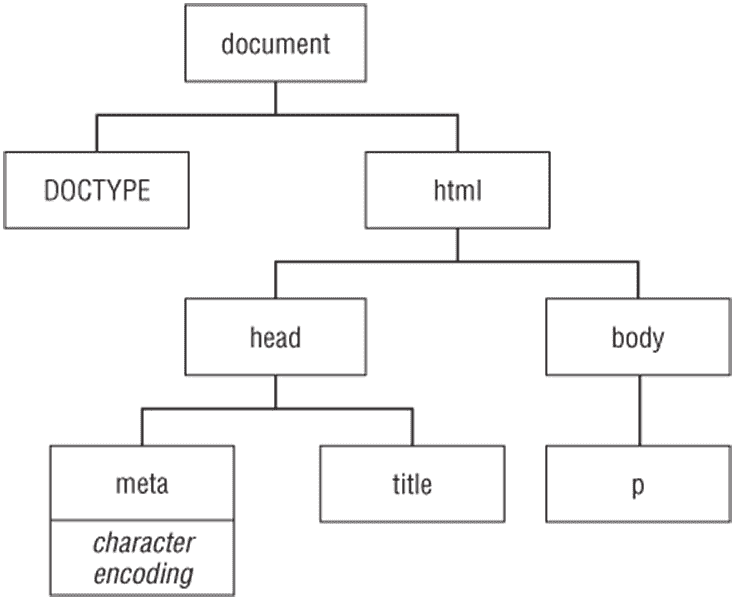

`DOCTYPE` 告诉浏览器正在使用的是哪个版本的标记，这是标记验证和样式表规则解释的关键信息。`html` 有两个必需的子：`head` 和 `body`。`head` 至少必须包含一个指定字符编码的 `meta` 元素和一个 `title`，也可以包含各种其他子元素，如 `script` 和样式表链接。`head` 中的元素通常不会作为对象出现在文档页面上，但它们会告诉浏览器如何配置文档，并能从根本上影响其外观和行为。`body` 包含了文本、图像以及我们通常认为是页面内容的其他元素；它至少必须包含一个块级元素，如标题、段落或分区（division）。

尽管我们在 HTML5 中使用了 `document`，

```html
<!DOCTYPE HTML PUBLIC "-//W3C//DTD HTML 4.01//EN"
    "http://www.w3.org/TR/html4/strict.dtd">
<html>
```

正如其名称所示，DOM 主要关注文档及其内部的内容。然而，从实际应用角度来看，脚本编写人员经常需要控制环境：`window`。

图 6.2 现代浏览器的基础对象模型。


为了让你对这些顶层对象之间的关系有一个直概念，以下描述了它们各自的角色：

*   `window` 对象：层级结构的顶端是 `window`。它代表显示 HTML 文档的浏览器区域。在多帧环境中，每个帧都是一个 `window`。由于所有文档操作都在窗口内进行，因此 `window` 是对象层级的最外层元素。它的物理边界包含了文档。

*   `navigator` 对象：这是你的脚本访问浏览器的最接近的方式，主要用于读取浏览器的品牌和版本声明。该对象是只读的，保护浏览器免受恶意脚本的操作；然而，正如你将看到的，不能依靠 `navigator` 来报告实际的型号和版本。

*   `screen` 对象：这是另一个只读对象，用于了解浏览器的物理环境。例如，该对象显示了可用的像素宽高。

*   `history` 对象：尽管浏览器维护了其历史的内部细节（如后退按钮下的列表），脚本无法访问这些细节。最多，该对象协助模拟点击后退或前进按钮。

*   `location` 对象：该对象是在当前窗口或帧中加载另一个页面的主要途径。窗口的 URL 信息在受控的情况下可用，以便脚本无法跟踪对其他网站的访问。

*   `document` 对象：每个加载到窗口的 HTML 文档都会变成一个 `document` 对象。`document` 包含了可能脚本的内容。除了每个 HTML 文档都存在的 `html`、`head` 和 `body` 元素对象外，文档元素对象层级的精确组成和结构取决于你放入文档的内容。

## 文档加载时

诸如 `JavaScript` 之类的编程语言是你对程序运行方式的心理预期与计算机真实内部机制之间便利的中间媒介。在机器内部，程序代码列表中的每一个单词都会影响位（计算机二进制宇宙中传奇的 1 和 0）从一个 RAM 存储槽到另一个存储槽的转换和移动。语言和对象模型位于计算机内部（在 `JavaScript` 和 `DOM` 的情况下，位于计算机的浏览器区域内），以便程序员更容易直观地理解程序如何工作以及其结果将会。这种关系让我们联想起知道如何驾驶汽车从 A 点到 B 点，而并不确切知道内燃机、转向连杆以及所有其他内部“构造”是如何工作的。通过控制点火钥匙、档位、油门、刹车和方向盘等高层对象，我们可以得到所需的结果。

当然，编程并不完全像驾驶自动挡汽车那样。即使是编写脚本也相当于打开引擎盖，并且可能需要知道如何检查变速箱液或更换机油。因此，现在是时候打开引擎盖，看看页面加载到浏览器时文档对象模型发生了什么变化。

### 一个简单的文档

图 6.3 显示了我们将要添加内容的 HTML 及其对应的对象模型。该图仅显示了文档对象部分；`window` 对象及其其他顶层对象（包括 `document` 对象）始终存在，即使对于空文档也是如此。当页面加载时，浏览器会在内存中维护一张由文档中 HTML 标签生成的对象映射。`body` 必须包含块内容，但我们还没有添加它。

图 6.3 空文档的对象映射。

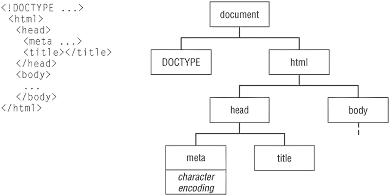

### 添加段落元素

现在，我们修改 HTML 文件以包含一个空的段落元素并重新加载文档。图 6.4 显示了 HTML 和由浏览器构建的对象映射同时发生了什么（变化用**粗体**显示）。尽管段落中没有显示内容，但 `<p>` 标签足以告诉浏览器创建该 `p` 元素对象。还要注意，在当前映射的对象层次结构中，`p` 元素对象包含在 `body` 元素对象之中。也就是说，`p` 元素对象是 `body` 元素对象的节点。对象层次与 HTML 标签的嵌套层次匹配。

图 6.4 添加空段落元素。

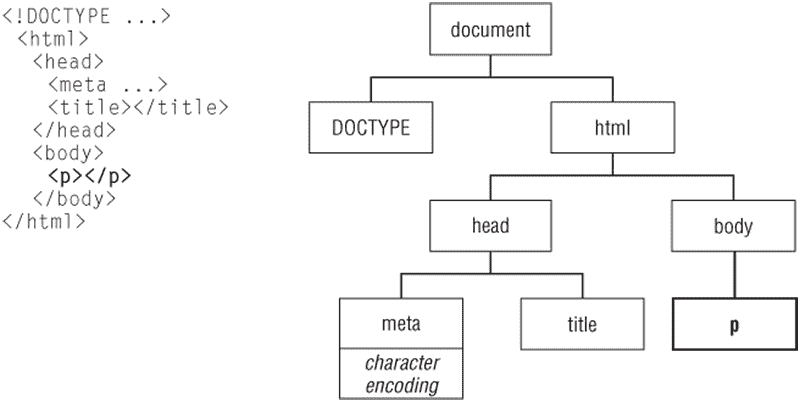

### 添加段落文本

我们再次修改并加载 HTML 文件，这次在元素的开始和结束标签之间插入段落文本，如图 6.5 为 `p` 元素对象添加文本节点。

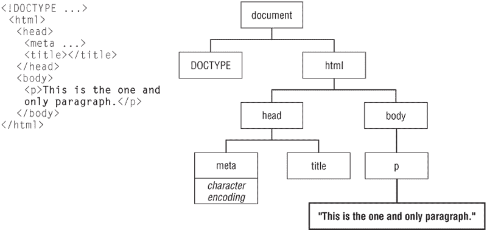

### 创建新元素

我们对文件进行的最后修改是将部分段落文本封装在 `<em>` 标签中，以表示对包含内容的强调。这次插入对 `p` 元素对象的层次结构产生了巨大影响，如图 6.6 在文本节点中插入元素。

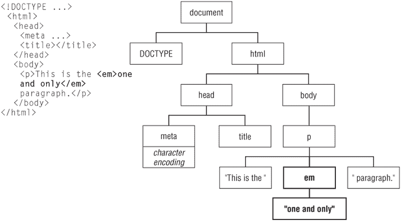

现在你已经看到对象是如何响应 HTML 标签并在内存中创建的，下一步是弄脚本如何与这些对象通信。毕竟，脚本主要是为了控制这些对象。

### 对象引用

文档加载到浏览器后，其所有对象都安全地存储在内存中，遵循浏览器 `DOM` 指定的包含层次结构。为了让脚本控制其中一个对象，必须有一种引用它的方法。

### 对象命名

创建脚本引用最大的帮助是为每个元素命名。在 `W3C` `DOM` 中，访问元素的方法是通过 `id` 属性。

在 HTML 4.0 规范引入 `id` 属性之前，脚本可以访问少数支持 `name` 属性的元素。支持 `name` 属性的元素主要与表单、图像和框架相关。你将在第 11 章“表单与表单元素”中看到 `name` 属性如何在表单中工作。事实上，大多数浏览器仍然要求表单和表单控件（文本字段、按钮和选择列表）具有 `name` 属性，以便将其数据提交到服务器。为元素的 `id` 和 `name` 属性分配相同的标识符是允许的；事实上，在 XHTML 中，建议分配给同一个元素的 `id` 和 `name` 具有相同的值。例如：

```html
<input type="text" id="firstname" name="firstname" />
```

# Node 节点术语

W3C DOM 术语使用比喻来帮助程序员视觉化文档及其内容的包含层级结构。你学习学习早期应该掌握的概念之一是“节点”（node）；另一个概念是文档中对象之间的家族关系。

## 关于节点

尽管英语词典对“node”有许多定义，但最接近其在 W3C DOM 中应用的定义指的是树枝上的结节或凸起。树枝上的这些结节通常指向两种结果之一：叶子或另一个分支。叶子是一个死胡同，因为没有进一步的分支从叶子处发散；分支类型的节点则通向一个新的分支，该分支本身又可以包含进一步的节点，无论是叶子还是更多分支。当你定义 HTML 文档的结构时，你同时也定义了一个节点结构（也称为节点树），在其中分支和叶子的位置完全取决于你的 HTML 元素和文本内容。

在 W3C DOM 中，基础构建块是一个简单的、通用的节点。但在 HTML 文档内部，我们处理的是为 HTML 文档定制的特殊类型节点。脚本经常接触的两种节点类型是元素节点（element nodes）和文本节点（text nodes）。这些节点类型精确对应于 HTML 元素以及元素开始和结束标签之间的文本。你在编写 HTML 时一直一直在使用元素节点和文本节点，而你可能甚至没有意识到这一点。

再次查看我们刚刚构建的简单文档，以及它在图 6.7 中的包含层级图。所有代表 HTML 元素（html, head, body, p 和 em）的框都是元素节点；包含渲染文档中显示的实际文本的三个框是文本节点。从从一个长文本节点（图 6.5）到插入 em 元素（图 6.6）的过程中，长文本节点被分成了三部分。两个文本节点片段在相对于包含它的 p 元素的层级结构中保持相同位置。我们在两个文本节点之间向树中插入了新的 em 元素，并将第三个文本节点向 p 元素方向移动了一级。

图 6.7 一个简单的 HTML 文档节点树。

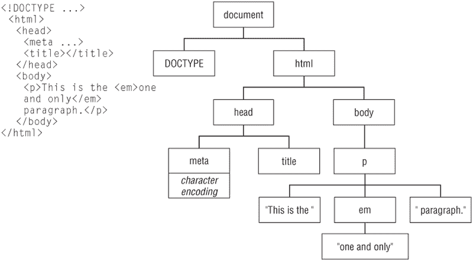

## 父节点与子节点

仔细观察图 6.7 中的 p 元素及其内容，你可以看到该元素有三个子节点。第一个和最后一个是文本节点类型，而中间的一个是元素节点。当一个元素包含多个子节点时，子节点的顺序完全依赖于 HTML 源代码的顺序。因此，p 元素的第一个子节点是包含文本“This is the ”的文本节点。em 元素有一个子文本节点作为其唯一的后代。

元素节点的子节点并不总是文本节点；分支也不总是止于文本节点。在图 6.7 中，html 元素有两个子节点，两个者都是元素节点；body 元素有一个子节点，即 p 元素。HTML 中的标签表示一个元素节点，无论它是否有任何子节点。相比之下，文本节点永远不会包含另一个节点；它是那种死胡同的叶子类型节点。

注意，子节点始终被一个元素节点包含。该容器是其子节点或子节点的父节点。例如，从 em 元素节点的角度来看，它既有一个子节点（文本节点），有一个父节点（p 元素节点）。大量的 W3C DOM 术语（你将在第 25 章“文档对象模型精要”中遇到）涉及帮助从文档层级结构的任何一点开始的脚本，并在时获取相关节点的引用。例如，如果一个动态 HTML 脚本想要修改图 6.7 中 em 元素内部的文本，它通常会通过 `document.getElementById()` 命令获取 em 元素的引用来开始（假设 em 元素已分配了 ID），然后修改元素。

# 什么是对象的定义？

当一个 HTML 标签定义一个对象时，浏览器在页面加载时会在内存中为对象创建一个槽位。但从内部来看，对象比单纯的数字复杂得多。对象的目的是表示某些事物。在浏览器和 DOM 中，最常见的对象是对应于元素的，例如文本输入字段、表格或整个主体内容。在 DOM 之外，对象也可以表示抽象实体，例如日历程序的预约条目或图形层。

每个类型的 DOM 对象在某些方面都是独特的，即使两个或多个对象在浏览器中看起来完全相同。对象的三个非常重要的方面定义了它是什么：它“看起来”什么样、它如何运行以及脚本如何控制它。这三个方面是属性、方法和事件（也称为处理器）。它们在你未来的 DOM 脚本编写工作中将发挥关键作用。附录 A 中的快速参考总结了各种浏览器版本实现的每个对象的属性、方法和事件。

## 属性

你手中的任何物理对象都有一组定义它的特征。例如，硬币具有形状、直径、厚度、颜色、重量、两侧浮雕图像——以及任何使它与例如羽毛区别的属性。这些每一个特征都被称为属性。每个属性都连接着某种类型的值（即使该值为空或空）。例如，硬币的形状属性可能是圆形——在这种情况下是一个文本值。相比之下，面值属性最可能是一个数值。

你可能没有意识到，但如果你为可脚本的浏览器编写过 HTML，你就在没有写一个 JavaScript 字的情况下设置了对象属性。标签属性是设置 HTML 元素对象初始属性的最常见方法。例如，以下 HTML 标签定义了一个分配了四个属性值的输入元素对象：

```html
<input type="button" id="clicker" name="clicker" value="Hit Me...">
```

在 JavaScript 术语中，`type` 属性单词 `button`；`id` 和 `name` 属性持有相同的单词 `clicker`；而 `value` 属性则是出现在按钮标签上的文本，`Hit Me`。事实上，一个按钮输入元素拥有的属性比这些多，但你不需要为每个对象设置每一个属性。大多数属性都有默认值，如果在 HTML 或稍后的脚本中没有进行特殊设置，这些值会自动赋值。

在文档加载且用户与页面交互后，某些属性的内容可能会发生变化。考虑以下文本输入标签：

```html
<input type="text" id="donation" name="donation" value="$0.00">
```

该对象的 `id` 和 `name` 属性是同一个单词：`donation`。当页面加载时，`value` 属性设置的文本会被放在文本框中——这是指定 `value` 属性时 HTML 文本框的自动行为。但如果用户在文本框中输入了其他文本，`value` 属性就会改变——这种改变不是发生在 HTML 中，而是在浏览器维护的对象模型内存副本中。因此，如果脚本查询文本框关于 `value` 属性的内容，浏览器将返回该属性的当前设置——这并不一定是 HTML 中指定的那个值。

要访问对象的属性，你使用与之前在对象中看到的相同的点符号法（dot-notation）方案。属性是属于其对象的资源，因此对它的引用由对对象的引用加上一个命名属性的扩展组成。因此，对于刚刚所示的按钮和文本对象标签，对各种属性的引用如下：

```javascript
document.getElementById("clicker").name
document.getElementById("clicker").value
document.getElementById("entry").value
```

### 提示

如果 JavaScript 尝试引用不存在的元素的属性，它将失败或“中止”。因此，引用这些属性的一种更安全、更稳妥的方法是先测试对象是否存在：

```javascript
var oClicker = document.getElementById("clicker");
if (oClicker) var sName = oClicker.name;
```

或者

```javascript
var oClicker = document.getElementById("clicker");
if (!oClicker) return;
var sName = oClicker.name;
```

你可能好奇引用中的 `window` 部分去哪了。事实证明，一个窗口中只能包含一个文档，因此对文档内部对象的引用可以省略 `window` 部分，并以 `document` 开始引用。然而，你不能在引用中省略 `document` 对象。

### 方法

如果说属性像是一个对象的描述性形容词，那么方法就是动词。方法完全关乎与对象相关的动作。方法对对象执行某些操作或利用对象执行某些操作，从而影响脚本或文档的其他部分。方法是某种命令，其行为与特定对象绑定。

#### Internet Explorer 引用

在 W3C DOM 出现之前，微软通过其 `id` 属性创建了它自己的引用元素对象的方法。在仅为 Internet Explorer 4 或更高版本编写的现有代码中，你会发现许多这种语法的实例。该语法使用名为 `document.all` 的结构。虽然有几种不同的方法使用这种结构，但最常用的方法是继续使用点符号法来包含元素的 ID。例如，如果段落元素的 ID 是 `myParagraph`，则 IE 特有的引用语法是：

```javascript
document.all.myParagraph
```

你也可以省略引用的前导部分，直接引用元素的 ID：

```javascript
myParagraph
```

但请注意，W3C DOM 标准不支持这些方法中的任何一种。IE 特有的 W3C DOM 引用语法样式都实现在 IE5 或更高版本中。此外，`document.all.elementId` 语法无法容忍某些有效的 HTML ID 字符，例如连字符、冒号和句号，因为 JavaScript 会将它们解释为自身的语法。

虽然为了理解遗留代码而熟悉 `document.all` 是重要的，但在你自己的代码中，你应该坚持使用 W3C DOM 方法（如 `getElementById()`），以兼容面向未来的现代浏览器。

### 注意事项

注意，`document.all` 语法无法容忍 ID 中的任何连字符、冒号或句号。尽管这些是有效的 HTML ID：

```html
my-paragraph
my.paragraph
my:paragraph
```

但生成的 `document.all` 表达式会导致 JavaScript 产生错误结果或崩溃：

```javascript
document.all.my-paragraph
document.all.my.paragraph
document.all.my:paragraph
```

使用现代标准 `getElementById()` 更安全，因为 ID 总是被包含在引号中。

一个对象可以关联任意数量的方法（包括完全没有）。要启动一个方法（通常称为调用方法），JavaScript 语句必须通过其对象包含该方法的引用，并在方法名后跟一对括号，如下例所示：

```javascript
var oForm = document.getElementById("orderForm");
oForm.submit();

var oEntry = document.getElementById("entry");
oEntry.focus();
```

第一个是通过脚本向服务器发送表单（名为 `orderForm`）的方法。第二个是为名为 `entry` 的文本框获取焦点。

有时，方法要求你随之发送额外信息，以便它可以完成工作。随方法传递的每个信息块被称为参数（或参数）。有些方法需要多个参数。如果是这样，多个参数之间用逗号分隔。例如，现代浏览器支持一个 `window` 对象方法，可以将窗口移动到特定的坐标点。坐标点由两个距离屏幕左侧和顶部边缘的像素数定义。要将窗口移动到左侧 50 像素、顶部 100 像素处，方法是：

```javascript
当你深入了解 JavaScript 以及可以脚本的对象的细节时，请关注每个方法的范围。它们揭示了对象可以做什么。

### 事件

DOM 对象的最后一个特性是事件。事件是在文档中发生的动作，通常是用户活动的结果。触发事件的用户操作示例包括点击按钮或在文本框中输入字符。某些事件（如加载文档或遇到网络错误）并不那么明显。

文档中的几乎每个 DOM 对象接收各种事件——为了方便，总结在附录 A 的快速参考中。作为程序员的工作是编写代码，当元素接收特定类型的事件时让元素执行动作。动作只需执行某些 JavaScript 代码。

学习事件的一种简单方法是将其应用于 HTML 元素。列表 4-1 显示了一个非常简单的文档，其中包含一个按钮和一个对该按钮应用事件处理器的脚本。事件名称由事件类型（例如 `click`）加上介词 `on`（如“当接收点击时……”：`onclick`）。

列表 6-1: 一个带有事件处理器的按钮

HTML: jsb-06-01.html

```html
<!DOCTYPE html>
<html>
<head>
    <meta http-equiv="content-type" content="text/html;charset=utf-8">
    <title>一个带有事件处理器的按钮</title>
    <script type="text/javascript" src="jsb-06-01.js"></script>
</head>
<body>
    <form action="">
        <div>
            <button id="clicker">Click me</button>
        </div>
    </form>
</body>
</html>
```

JavaScript: `jsb-06-01.js`

```javascript
// 告诉浏览器在页面加载完成后运行此脚本
window.onload = applyBehavior;

// 在按钮上应用行为
function applyBehavior()
{
    // 确保是一个支持 DOM 的用户代理
    if (document.getElementById)
    {
        // 指向按钮
        var oButton = document.getElementById('clicker');
        // 如果存在，则应用行为
        if (oButton)
        {
            oButton.onclick = behave;
        }
    }
}

// 当按钮被点击时执行的操作
function behave(evt)
{
    alert('Ouch!');
}
```

当浏览器加载 HTML 页面时，它还会加载链接的 JavaScript 文件，编译它并开始执行其指令。在这种情况下，它实际上会立即执行的唯一指令是 `window.onload` 语句，因为所有其他语句都在函数内部，在通过名称调用函数之前不会执行。只有当 HTML 页面加载完成（并且其 DOM 已完全构建完成），我们的函数 `applyBehavior()` 才会运行。如果运行的 JavaScript 解释器识别 DOM 方法 `getElementById()`，该函数将使用它来查找 ID 为 `clicker` 的元素。如果找到，它会将 `onclick` 行为应用到按钮上，告诉它在点击时执行函数 `behave()`。当用户点击按钮时，`behave()` 函数会弹出一个警报（一个弹出对话框），显示“Ouch!”。

## 交叉引用

你将在第 25 章“文档对象模型基础知识”和第 32 章“事件对象”中学习将脚本指令连接到事件的其他方法。

## 练习题

1. 以下哪些应用程序非常适合客户端 JavaScript？为什么适用或不适用？
   a. 允许访问者查看五种不同颜色产品的产品目录页面
   b. 显示当前页面访问者总数的计数器
   c. 聊天室
   d. 图形化的华氏转摄氏度温度计算器
   e. 以上所有
   f. 以上都不是

2. 以下哪些元素 ID 在 HTML 中是有效的？对于每一个无效的 ID，请解释原因。
   a. `lastName`
   b. `company_name`
   c. `1stLineAddress`
   d. `zip code`
   e. `today's_date`
   f. `now:you-hear.this`

3. 参考图 6.7 中的图，绘制一个浏览器为以下 HTML 在内存中创建的对象模型包含层级图。使用 W3C DOM 语法编写指向第一个段落元素的脚本引用。

```html
<!DOCTYPE html>
<html>
<head>
<meta http-equiv="content-type" content="text/html;charset=utf-8">
<title>搜索表单</title>
</head>
<body>
<p id="logoPar"></p>
<div id="searchForm">
<form action="cgi-bin/search.pl" method="post">
<div>
<label for="searchText">搜索：</label>
<input type="text" id="searchText" name="searchText">
<input type="submit" value="Search">
</div>
</form>
</div>
</body>
</html>
```

4. 描述文本节点和元素节点共有的至少两个特征；描述至少两个使文本节点与元素节点区分不同的特征。

5. 为一个名为 Hi 的按钮输入元素编写 HTML 和 JavaScript，该元素的可见标签显示为 Howdy，且其点击后的动作是显示一个内容为“Hello to you, too!”的警报对话框。

# 7 脚本与 HTML 文档

### 本章内容
- 在 HTML 文档中放置脚本的位置
- 什么是 JavaScript 语句
- 什么让脚本运行
- 查看脚本错误

第 4 章“JavaScript 基础”涵盖了如何将 JavaScript 与 HTML 文档结合的许多基础知识。本章教程回顾了脚本如何链接到 HTML 文档，以及脚本语句的组成部分。你还将看到脚本如何在文档加载时或响应用户操作时运行。最后，你将发现脚本错误信息可能隐藏在何处。

## 连接脚本到文档

我们使用 `<script>` 元素告诉浏览器将部分文本视为脚本而非 HTML。无论我们的脚本是链接到 HTML 文档的外部文件，还是直接嵌入页面本身，`<script>...</script>` 标签都封装了脚本。

根据浏览器的不同，`<script>` 标签有多种可以设置的属性，用于控制脚本。其中一个属性 `type` 建议浏览器将标签内的代码视为 JavaScript。其他一些浏览器接受额外的语言（例如 Windows 版本 Internet Explorer 中的微软 VBScript）。以下设置是所有现代可脚本浏览器都接受的设置：

```html
<script type="text/javascript" ......<script>
```

确保包含脚本的结束标签。你的 JavaScript 程序代码可以放在 `src` 属性指定的外部文件中：

```html
<script type="text/javascript" src="example.js"></script>
```

或者放在两个标签之间：

```html
<script type="text/javascript">
```

如果你忘记了脚本的结束标签，脚本可能无法运行，HTML 可能会看起来异常。

### 旧的 language 属性

另一个 `<script>` 标签属性 `language` 曾是指定语言的方式。该属性允许脚本编写者指定语言版本。例如，如果包含了仅在 1.2 版本中可 JavaScript 语法，`<script>` 标签应该是：

```html
<script language="1.2">
```

`language` 属性不属于 HTML 4.0 规范，并且现在已不再流行。在严格的 HTML.01 或 XHTML 1.0 中，该属性无法通过验证。旧浏览器并不识别 `type` 属性。

### 标签位置

这些标签位于文档的哪里？答案是文档中任何需要的地方。大多数情况下，将标签放在`<head>...</head>` 标签集中是合理的；在其他情况下，必须将脚本置于 `<body>...</body>` 部分的特定位置。

在接下来的三个列表中，我们通过骨架 HTML 文档演示了 `<script>` 放置的一些可能性。在每个示例中，我们都展示了两个脚本标签——一个是链接外部脚本，一个是内部脚本——以便向你展示它们的样式。在实践中，你可能会一直链接到外部脚本。

列表 7-1 显示了 `<script>` 标签在文档中常见的位置之一：在`<head>` 部分。通常，头部是放置影响非内容设置的地方——即指令元素，例如 `<meta>` 标签和文档标题。事实证明，这里也是响应页面加载或用户操作调用脚本的方便位置。

列表 7-1：头部中的脚本

```html
<html>
  <head>
    <title>一个文档</title>
    <script type="text/javascript" src="example.js"></script>
    <script type="text/javascript">
      //脚本语句(s)
      ...
    </script>
  </head>
  <body>
  </body>
</html>
```

另一方面，如果你需要脚本在页面加载时运行以便以便在页面中生成内容，则脚本位于文档的 `<body>` 部分，如列表 7-2 所示。

列表 7-2：主体中的脚本

```html
<html>
  <head>
    <title>一个文档</title>
    <script type="text/javascript" src="example.js"></script>
    <script type="text/javascript">
      //在此处编写脚本语句
      ...
    </script>
  </head>
  <body>
    <script type="text/javascript" src="example.js"></script>
    <script type="text/javascript">
      //在此处编写脚本语句
      ...
    </script>
  </body>
</html>
```

另外，了解到你可以在文档中放置无限数量的 `<script>` 标签组也是很有用的。例如，列表 7-3 显示了在头部（head）和主体（body）部分都包含脚本。此文档需要主体脚本，可能是为了在页面加载时创建某些动态内容，但该文档还包含一个需要在稍后运行脚本的按钮。该脚本存储在头部部分。

### 列表 7-3：头部和主体中的脚本

```html
<html>
    <head>
        <title>一个文档</title>
        <script type="text/javascript" src="example.js"></script>
        <script type="text/javascript">
            //在此处编写脚本语句
            ...
        </script>
    </head>
    <body>
        <script type="text/javascript" src="example.js"></script>
        <script type="text/javascript">
            //在此处编写脚本语句
            ...
        </script>
    </body>
</html>
```

## 处理非 JavaScript 浏览器和 XHTML

只有包含 JavaScript 的浏览器才知道将 `<script>...</script>` 标签对之间的代码行解释为脚本语句，而不是在浏览器中显示的 HTML 文本。这意味着，不支持 JavaScript 的浏览器或手机中的简易浏览器不仅会忽略这些标签，还会将 JavaScript 代码视为页面内容。其结果对一个页面来说可能是灾难性的。

另一方面，你不必担心非 JavaScript 浏览器会尝试执行外部链接的脚本。这是链接脚本而不是嵌入脚本的优势之一。只有当 JavaScript 代码嵌入到 HTML 文档中时，问题才会出现。

你可以通过在 HTML 注释符号之间将脚本行括起来，降低旧版非 JavaScript 浏览器显示脚本行的风险，如列表 7-4 所示。大多数不支持脚本的浏览器忽略 `<!--` 和 `-->` 注释标签之间的内容，而支持脚本的浏览器会在出现在 `<script>` 标签组内部时忽略起始注释符号。

### 列表 7-4：向大多数旧浏览器隐藏脚本

```javascript
<script type="text/javascript">
<!--
    //在此处编写脚本语句
    ...
// -->
</script>
```

紧接结束脚本标签之前的奇怪结构需要简短的解释。两个正斜杠是 JavaScript 的注释符号。这个符号是必要的，因为否则 JavaScript 会尝试解释 HTML 符号（`-->`）的组成部分。因此，虽然斜杠告诉 JavaScript 完全跳过该行，但不支持脚本的浏览器仅仅地将这些斜杠字符视为要忽略的整个 HTML 注释的一部分。

尽管现在已经没有真正必要对旧版浏览器这样隐藏 JavaScript 了，但在某些情况下，可能需要不同类型的隐藏。XML 越来越频繁地用于向浏览器提供内容，并且通常是使用 XHTML 完成的。在 XML 世界中，所有特殊字符都需要括在 CDATA 区域中，否则文件可能会被错误解析；至少它将无法通过验证。再次强调，技巧是括起你的脚本，但这次它看起来像列表 7-5。你会再次注意到，在闭合脚本标签之前，JavaScript 注释向 JavaScript 本身隐藏了 CDATA 区域的结束。

### 列表 7-5：向 XML 解析器隐藏脚本

```javascript
<script type="text/javascript">
<![CDATA[
    //在此处编写脚本语句
    ...
//]]>
</script>
```

尽管这些技术通常被称为脚本隐藏，但它们并没有向人类读者隐藏脚本。所有的客户端 JavaScript 脚本都是 HTML 文档的一部分或伴随 HTML 文档存在，它们像构成页面的所有其他资产一样下载到浏览器中。你可以像查看 HTML 文档源码一样轻松查看 JavaScript 源码。不要被误骗，认为你可以从窥探的眼中隐藏脚本。某些开发者通过删除所有换行符并使用无意义的变量和函数名来对脚本进行混淆，但这只会减慢（而不会阻止）任何好奇访客阅读和理解代码。

既然无法向公众真正隐藏你的 JavaScript 编程，你还不如展示它：为你感到自豪的脚本签名，在脚本注释中包含版权或知识共享作者身份声明，并鼓励欣赏该脚本的人向你寻求更多信息。

## JavaScript 语句

外部链接文件或位于 `<script>...</script>` 标签对中的几乎每一行代码都是 JavaScript 语句（HTML 注释标签除外）。为了符合经验丰富的程序员的习惯，JavaScript 接受在每个语句末尾使用分号（计算机相当于句末的句号）。这个分号是可选的，但我们强烈建议一致地使用它以避免歧义。语句末尾的换行符足以让 JavaScript 知道语句已结束。

语句执行的操作：
*   定义或初始化变量
*   给属性赋值
*   更改属性的值
*   定义或调用方法
*   定义或调用函数
*   做出决策

唯一一种不执行任何操作的语句是注释。一对正斜杠（中间没有空格）是包含单行注释的最常用方法：

```javascript
var a = b; //此注释与语句共行
```

多行注释可以使用星号括起来：

```javascript
/*
只要在星号范围内，任意数量的都是注释
*/
```

你在脚本中添加注释是为了你自己和其他人类读者的利益。它们通常用通语言解释语句或一组语句的作用。

## 脚本语句的执行时

现在你已经知道了脚本在文档中的位置，现在是时候考虑它们何时运行了。根据你需要脚本执行的任务，你有四种选择脚本运行的时间：
*   在文档加载期间
*   在文档加载后立即
*   响应用户操作
*   被其他脚本语句调用

决定因素是脚本语句在文档中的位置。

### 在文档加载期间：立即执行

列表 7-6 是你在第五章“你的第一个 JavaScript 脚本”变变。在这个版本中，脚本在页面加载时将当前日期和时间写入页面。`document.write()` 方法是在加载期间向页面写入动态内容的常用方法。我们将页面加载时运行的语句称为立即语句。在使用 `document.write()` 编写脚本时必须小心。一旦页面加载完成，任何额外的 `document.write()` 语句都会创建一个页面，覆盖你精心编写的所有内容。

### 列表 7-6：带有立即执行脚本的 HTML 页面

```html
<!DOCTYPE html>
<html>
    <head>
        <meta http-equiv="content-type" content="text/html;charset=utf-8">
        <title>日期与时间：立即执行</title>
    </head>
    <body>
        <h1>日期与时间：立即执行</h1>
        <p>当前时间为 <span id="output">
        <script type="text/javascript">
            <!-- 对旧版浏览器隐藏 -->
            var oNow = new Date();
            document.write(oNow.toLocaleString());
            // 结束隐藏 -->
        </script>
        </span>。</p>
    </body>
</html>
```

# 日期与时间：立即执行

近年来，`document.write()` 的使用引起了一定程度的争议。至少它鼓励了文档结构出现糟糕的问题，将脚本与 HTML 混合在一起。良好的结构应该将样式（样式表）、行为（JavaScript）与 HTML 标记清晰地分离开。`document.write()` 的问题之一在于越来越多地使用 XML 向浏览器提供内容。XML 文档必须是良好格式的。如果一个 `document.write()` 语句关闭了在其外部打开的元素，或者打开了一个新元素，XML 文档将无法加载，因为浏览器会将其识别为格式错误。

`document.write()` 的另一个问题与 DOM 有关，特别是对于 XHTML 文档（这些文档作为 XML 服务）。使用 `document.write()` 意味着内容不会被包含在 DOM 中。非常重要的一点是，你将无法通过 JavaScript 程序进一步操作此类内容，这限制了你对访问者在网页上操作的动态响应。这是一个有趣的困境，因为你可能经常选择使用 `document.write()`（正如我们在书中的几个示例所示的那样），在页面加载时根据浏览器环境提供动态内容。

## 延迟脚本

脚本语句运行的其他三种方式被归类为我们所谓的“延迟脚本（deferred scripts）”。为了演示这些延迟脚本的情况，我们必须向你简要介绍一个在第 9 章“编程基础，第二部分”中详细介绍的概念：函数。函数定义了一个脚本语句块，这些语句在加载到浏览器后的某个时间被调用执行。函数在 `<script>` 标签内部清晰可见，因为每个函数定义都以 `function` 单词开头，后面紧跟函数名（以及括号）。在函数加载到浏览器之后（通常在 `head` 部分，以便尽早加载），它就随时准备好在被调用时运行。

## 加载后运行

函数被调用运行的最常见时间之一是页面加载后立即执行。使用行业标准 DOM 方法的脚本如果尝试在页面元素出现在 DOM 之前对它们进行操作，它们将会失败，因此我们要求浏览器仅在页面加载完成后再运行脚本。`window` 对象有一个名为 `onload` 的事件处理程序属性。与大多数响应用户操作（例如点击按钮）触发的事件处理程序不同，`window` 的 `onload` 事件处理程序会在页面所有组件（包括图像、Java applet 和嵌入式多媒体）加载到浏览器的瞬间即刻触发。

有两种跨浏览器的方法可以将 `onload` 事件处理程序连接到函数：通过对象事件属性或 HTML 事件属性。显示我们更倾向于使用的对象事件属性如列表 7-6 所示。事件处理程序的赋值在立即执行模式下执行，并将所需的函数调用挂载到 `window` 对象的加载事件上。在页面渲染的早期阶段，只能保证 `window` 对象存在于 DOM 中。

在旧派的 Web 开发中，`window.onload` 事件赋值被直接写在 HTML 中，用 `<body>` 元素代表窗口。因此，你可以在 `<body>` 标签中包含 `onload` 事件属性，如列表 7-7 所示。回顾第 6 章“浏览器和文档对象”的内容，事件处理程序可以直接运行脚本。然而，如果事件处理程序必须运行多个脚本语句，通常更好的做法是将这些语句放在函数定义中，然后让事件处理程序调用该函数。这就是列表 7-7 中发生的情况：当页面完成加载时，`onload` 事件处理程序触发 `done()` 函数。该函数（在本示例中进行了简化）会显示一个警报框。

### 列表 7-7：从 onload 事件处理程序运行脚本

```html
<!DOCTYPE html>
<html>
<head>
    <meta-equiv="content-type" content="text/html;charset=utf-8">
    <title>旧派基于 HTML 的 onload 脚本</title>
    <script type="text/javascript">
        function done() {
            alert("页面已加载完成。");
        }
    </script>
</head>
<body onload="done()">
    <h1>旧派基于 HTML 的 onload 脚本</h1>
    <p>这里是一些正文内容。</p>
</body>
</html>
```

此时不要要担心列表 7-7 中的大括号或异常之处。专注于关注文档的结构和流程即可。整个页面在不运行任何脚本语句的情况下加载，尽管页面在内存中加载了 `done()` 函数，使其能够随时准备好运行。在文档加载后，浏览器触发 `onload` 事件处理程序，导致 `done()` 函数运行。然后用户就会看到警报框。

尽管 HTML 事件方法可以追溯到最早的 JavaScript 浏览器，但现在的趋势是将 HTML 标记与样式细节（样式表）和行为细节（脚本）分离。脚本编写者的救星是对象的事件处理程序属性。要从 `<body>` 标签中提取 `onload` 属性，你可以改为将所需的 JavaScript 函数作为属性赋值给对象的事件，如下所示：

```javascript
window.onload = done;
```

此类语句通常位于文档 `head` 部分脚本的末尾。同样注意，在此版本中，语句的右侧仅仅是函数名，没有引号或括号。由于当事件处理程序指定为 HTML 属性时更容易学习，本教程中的大多数示例将继续采用这种方法。然而，我们需要向你展示属性版本，因为你会在现实生活中看到很多这种格式的代码。

## 用户运行

响应用户操作执行脚本与之前的文档加载后运行延迟脚本的示例非常相似。通常，脚本函数定义在 `head` 部分，而在例如表单元素中的事件处理程序调用该函数运行。列表 7-8 包含一个当用户点击按钮时运行的脚本。

### 列表 7-8：从用户操作运行脚本

```html
<!DOCTYPE html>
<html>
<head>
    <meta-equiv="content-type" content="text/html;charset=utf-8">
    <title>onclick 脚本</title>
    <script type="text/javascript">
        function alertUser() {
            alert("哎！");
        }
    </script>
</head>
<body>
    这里是一些正文内容。
    <form>
        <input type="text" name="entry">
        <input type="button" name="oneButton" value="点击我!" onclick="alertUser()">
    </form>
</body>
</html>
```

如列表 7-8 所示，并不是每个对象都必须为其定义事件处理程序——只有需要脚本的对象才是。在列表 7-8 中，在用户点击按钮之前，没有任何脚本语句执行。`alertUser()` 函数在页面加载时定义，并在页面保持在浏览器加载状态期间它一直等待运行。如果它从未被调用运行，也没有任何伤害。

在 JavaScript 浏览器中应用的早期，脚本错误会以非常明显的对话框显示。这些对话框对于想要调试脚本的脚本编写人员无疑非常有帮助。然而，如果一个 bug 渗透到提供给非技术用户的页面中，错误警报对话框不仅会干扰操作，而且会让人感到恐惧。为了防止此类对话框打扰毫无防备的用户，浏览器制造商试图减少错误在浏览器窗口中的视觉影响。对于脚本编写人员来说的是，往往很容易忽略脚本中包含错误这一事实，因为错误信息不再那么明显。

不仅每个浏览器显示错误消息的方式不同，显示方式还可能随版本而异。每个主流浏览器显示错误的方法在 CD 光盘上第 48 章“调试脚本”的“错误消息通知”章节中介绍。虽然你在测试代码之前需要阅读该章节，但我们包含了在 IE5+ 中显示的示例错误对话框（请参见 图 7.1）以及 Mozilla 1.4+ 中显示的示例（请参见 图 7.2）。请记住，脚本错误对话框在这些及其他浏览器中并不默认显示。你必须训练自己会在页面加载以及每个脚本运行后监控状态栏。

图 7.1 展开的 IE 错误对话框。

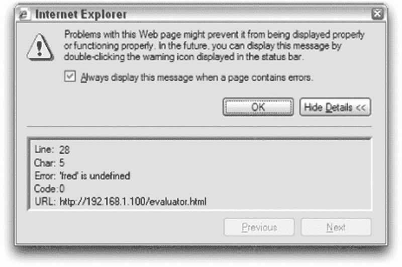

图 7.2 Mozilla 1.4 JavaScript 控制台窗口。

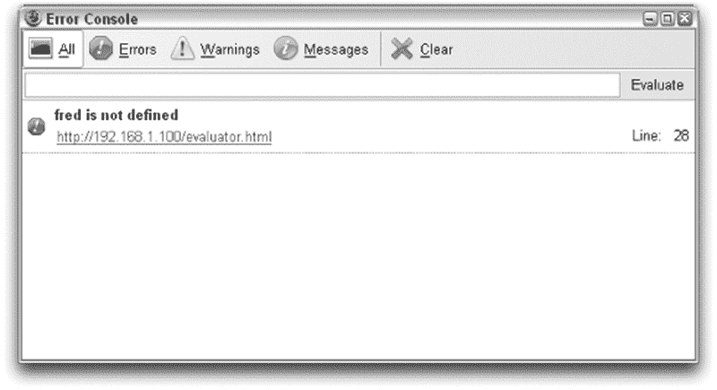

理解错误消息并对其采取措施是一个非常宏大的课题，完整的讨论将在第 48 章进行。然而，在教程期间，你可以利用错误消息来检查你是否误写了书本列表中的脚本。

### 脚本编写与编程

你可能会认为脚本编写比编程更容易。脚本编写听起来确实比编程更简单或更友好。在许多方面，事实确实如此。我们最喜欢的类比之一是从零开始制作模型飞机的爱好者与使用商业套件制作模型飞机的爱好者之间的区别。“从零开始”的爱好者在模型成型之前，会根据非常详细的计划仔细地切割和塑造每一块木头和金属。商业套件构建者则从许多预制零件开始，并将它们组装成成品。当两个构建者都完成后，你可能无法辨出哪架飞机是从零开始制作的，哪一个是从组件盒里出来的。最终，两个构建者都使用了许多相同的技术来完成组装，都可以对结果感到自豪。

得于文档对象模型（`DOM`）的实现，浏览器为脚本编写人员提供了许多可以使用的预制组件。如果没有浏览器，你必须是一个非常出色的程序员才能从零开发出提供内容并和用户交互的应用程序。最终，两位作者都拥有看起来同样专业的运行应用程序。

然而，在 `DOM` 之外，真正的编程正渗透进脚本世界。这是因为脚本（以及程序）处理的不仅仅对象。在本节的早些时候，我们提到每个 JavaScript 脚本语句都会执行“某事”，而“某事”涉及某种数据。数据是与对象关联的信息，或者是脚本随着每个语句从一个地方传递到另一个地方的信息。

数据有许多形式。在 JavaScript 中，数据的常见形式是数字、文本（称为 `strings`）、对象（衍生自对象模型或通过脚本创建）以及真和假（称为 `Boolean` 值）。

每种编程或脚本语言都会为每种数据确定许多结构和限制。对于 JavaScript 的初学者来说的是，处理数据所需的知识宇宙比 `Java` 或 `C++` 等语言要小得多。同时，你在 JavaScript 中中学到的数据的知识可以立即应用于未来可能进行的任何其他编程语言的学习；千万不要认为你学习脚本的努力将会白费。

因为从深层上说，脚本编写就是编程，你需要具备基础编程概念的基本知识才能认为自己是一个优秀的 JavaScript 脚本编写人员。在接下来的两节中，我们将放下大部分关于 `DOM` 的讨论，专注于对你在 JavaScript 及未来编程活动大有裨益的编程原则。

## 练习

1. 编写一个完整的 `script` 标签 set，该脚本唯一的语句为：

```javascript
document.write("Hello, world.");
```

2. 构建一个 HTML 文档，并包含上一个问题的答案，使得页面在加载时执行该脚本。在浏览器中打开该文档以测试结果。
3. 在上一个答案的脚本添加添加注释，解释该脚本的作用。
4. 创建一个 HTML 文档，在页面加载后立即显示警报对话框，并在用户点击表单按钮时显示另一个警报对话框。
5. 仔细研究 `Listing 7-9` 中的文档。在不输入和加载文档的情况下，预测：
   a. 在没有进一步样式的情况下页面看起来是什么样
   b. 用户如何与页面交互
   c. 脚本做了什么

然后按照所示所示将列表输入到文本编辑器中。注意所有的大小写字母和标点符号。

```html
Listing 7-9: 此页面是如何运作的？

<!DOCTYPE html>
<html>
<head>
  <meta http-equiv="content-type" content="text/html;charset=utf-8">
  <title>Text Object Value</title>
  <script type="text/javascript">
    function upperMe() {
      document.getElementById("output").value = document.getElementById("input").value.toUpperCase();
    }
  </script>
</head>
<body>
  Enter lowercase letters for conversion to uppercase:
  <form name="converter">
    <input type="text" name="input" id="input" value="sample" onchange="upperMe()" /><br/>
    <input type="text" name="output" id="output" value="" />
  </form>
</body>
</html>
```

一个名为 `ECMA`（读作“ECK-ma”）的标准机构现在管理着该语言（无论你如何称它）的规范。提供该语言所有细节的文档被称为 `ECMA-262`（它是 `ECMA` 发布的第 262 个标准）。JavaScript 和 `JScript` 均兼容 `ECMA-262`。一些早期的浏览器版本与 `ECMA-262` 有非常微小的偏差（后者发布晚于最早的浏览器）。最严重的差异已记录在本书第三部分的语言语言参考手册中。

## 处理信息

在少数例外情况下，你编写的每个 JavaScript 语句都会对某块信息——数据——进行某种操作。数据可以是 JavaScript 语句显示在屏幕上的文本信息，也可以是表单单选按钮的开启/关闭设置。编程中的每一条信息也被称为 `value`（值）。在编程领域之外，`value` 一词通常指某种数字；但在编程世界中，这个术语的限制并不小。

一个字母字符串是一个 `value`。数字是一个 `value`。复选框的设置（无论是否勾选）也是一个 `value`。

在 JavaScript 中，一个 `value` 可以是几种类型之一。表 8.1 列出了 JavaScript 的正式数据类型，并列出了你不时显示的值的示例。

### 表 8.1 JavaScript 值（数据）类型

| 类型 | 示例 | 说明 |
| :--- | :--- | :--- |
| String | ”Howdy” | 引号内的字符序列 |
| Number | 4.5 | 任何不在引号内的数字 |
| Boolean | true | 逻辑上的真或假 |
| Null | null | 没有任何内容，但同样是一个值 |
| Object | | 由属性和方法定义的软件实体（数组也是对象） |
| Function | | 函数定义 |

一个包含这几种数据类型的语言简化了编程任务，特别是那些涉及其他语言认为不兼容的数字类型（整数与实数或浮点值）的任务。在本书后面关于语法和对象部分的某些定义中，我们特别提到了占位符所接受的 `value` 类型。当需要字符串时，一组引号内的任何文本即可。

然而，你可能会遇到 `value` 类型阻碍脚本步骤顺畅执行的状况。例如，如果用户在表单的文本输入字段中输入一个数字，浏览器会将该数字存储为字符串类型的值。如果脚本要对该数字进行算术运算，你必须在将 `value` 应用于任何数学操作之前将其转换为数字。你将在本节稍后看到这些示例。

## 变量

在厨房里按照食谱做菜与程序中处理某些数据有一个优势。在厨房里，你遵循食谱步骤并处理真实的物品：胡萝卜、牛奶或三文鱼排。相反，计算机遵循指令列表来处理数据。即使数据代表某些看起来真实的东西（例如输入到表单输入字段中的文本），一旦 `value` 进入程序，你就无法再伸出手去触摸它了。

事实上，我们使用变量来存储数据。变量本质上是一个代表 `value` 的名称。你可以在程序执行期间任何时候更改变量中存储的 `value`。

在 JavaScript 中，我们使用 `var` 关键字来声明变量。当你声明变量时，你是在告诉计算机为它预留一些内存。

### 创建变量

在 JavaScript 中创建变量有多种方法。最常见的方法是使用 `var` 关键字后跟你想要给出的名称。

```javascript
var myAge;
```

如果你想在声明的同时分配值，可以使用初始化：

```javascript
var myAge = 25;
```

要稍后给现有变量分配新值，请使用赋值运算符（`=`）：

```javascript
myAge = 30;
```

## 变量命名

仔细选择分配给变量的名称。你经常会发现使用模糊变量名的脚本，例如单个字母。除了某些使用字母是常见做法的情况形（例如，在循环中使用 `i` 作为计数变量）外，你应该使用能够真实描述变量内容的名称。

一些限制有助于养成良好的命名习惯。首先，你不能使用任何保留关键字作为变量名。这包括该语言当前使用的所有关键字，以及所有其他为未来版本保留的关键字。然而，JavaScript 的设计者无法预测语言可能需要的每个关键字。通过使用当前出现在保留关键字列表中的单单词，你始终面临未来冲突的风险。

更复杂的是，变量名不能包含空格字符。因此，单单词变量名是没问题的。如果你的描述确实需要多个单词来获益，你可以使用两种约定之一将多个单词合并为一个。一种方法是在单词之间放置下划线字符；另一种方法是以小写字母开始组合词，并将名称中后续每个单词的首字母大写——称为驼峰命名或 interCap 格式。以下两个示例都是有效的变量名：

`my_age`

`myAge`

我们更倾向于第二种版本；它更容易输入也更容易阅读。事实上，因为可能与未来的单单词关键字发生冲突，使用多单词组合作为变量名是一个好主意。多单词组合出现在保留列表概率概率较低。

JavaScript 变量可以持有任何值类型。与其他许多语言不同，你不需要告诉 JavaScript 变量将持有什么类型。事实上，变量的值类型在执行过程中可能会发生。

## 表达式与求值

另一个与值和变量密切相关的概念是表达式求值——这可能是学习如何编写程序时最重要的概念之一。

我们在日常语言中就会使用表达式。还记得《比弗利山人一家》（The Beverly Hillbillies）的主题曲吗？：

有一天，他正对着食物开火
地面上冒出了泡泡的原油
是的，就是原油。黑金。德克萨斯之茶。

在歌曲结束时，你会发现四个完全不同的表述（原油、石油、黑金和德克萨斯之茶）。它们的意思都是油。它们都是油的表达式。只要说其中任何一个，别人就知道你的意思。在我们的脑海中，我们对这些表达式求值，指向同一个东西：油。

在编程中，变量始终求值为其内容或或值。例如，在给变量赋值后，例如：

```javascript
var myAge = 45;
```

每当在语句中使用该变量时，它的值（`45`）会自动应用到该语句所调用的任何操作。因此，如果你比我小 15 岁，我可以根据 `myAge` 的求值结果，为一个代表你年龄的变量赋值：

```javascript
var yourAge = myAge – 15;
```

变量 `yourAge` 在脚本下一次使用它时求值为 `30`。如果 `myAge` 的值在脚本后期发生变化，该变化与 `yourAge` 变量没有联系，因为在用 `myAge` 给 `yourAge` 赋值时，它的求值为 `45`。

### 脚本中的表达式

你当时可能没有意识到，但在之前的章节中，你已经看到表达式求值在几个脚本中是有用的。让我们特别来看一个来自列表 5-6 中的脚本在页面加载时向页面写入动态文本。回想第二个 `document.write()`语句：

```javascript
document.write(" " + navigator.appName + ".");
```

### 测试 JavaScript 求值

你可以借助 The Evaluator Jr.（参见图 8.1）来开始实验 JavaScript 求值表达式，这是一个你可以在配套光盘上找到的 HTML 页面。（高级版本将在第 4 章“JavaScript 基础”中介绍。）在顶部的文本框中输入任何 JavaScript 表达式，然后按 Enter/Return 或点击 Evaluate 按钮。

The Evaluator Jr. 为你预定义了 26 个变量（小写 a 到 z）。因此，你可以在这里为变量赋值、测试比较运算符，甚至进行数学运算。使用本章前面的年龄变量示例，在上方的文本框中输入以下每个语句，并观察每个表达式在 Results 字段中是如何求值的。务必注意输入时的大小写敏感。在 The Evaluator 中，末尾的分号是可选的。

```javascript
a = 45;

a;

b = a – 15;

b;

a – b;

a > b;
```

要重新开始，点击 Reload/Refresh 按钮。

图 8.1 用于测试表达式求值的 Evaluator Jr.。

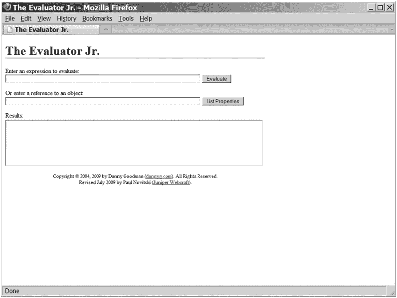

`document.write()` 方法（记住，JavaScript 使用“方法”一词来表示命令）在括号中需要一个参数：要在 页面上显示的文本字符串。这里的参数由一个连接三个不同字符串的表达式组成：

- `" "`
- `navigator.appName`
- `"."`

`+` 符号是 JavaScript 连接字符串的方式之一。在 JavaScript 显示此行之前，它必须执行一些快速求值。第一次求值是 `navigator.appName` 属性的值。该属性求值为你的浏览器名称的字符串。当该表达式安全地求值为字符串后， JavaScript 就可以在最终求值中完成连接三个字符串的工作。求值后的字符串表达式就是最终出现在网页上的。

### 表达式与变量

作为表达式求值灵活性的另一个演示，本节向你展示了通 `document.write()` 的一种略有不同的路径。与其将这些字符串作为 `document.write()` 方法的直接参数，你可以将字符串汇总变量中，然后将变量应用到 `document.write()` 方法。以下是该序列的样子，你同时声明新变量并为其赋值：

```javascript
var textToWrite = " " + navigator.appName + ".";
document.write(textToWrite);
```

这种方法之所以有效，是因为变量 `textToWrite` 求值为组合后的字符串。`document.write()` 方法接受该字符串值并执行显示工作。当你阅读脚本或尝试调试错误时，请特别注意每个表达式（变量、语句、对象属性）是如何求值的。当你学习 JavaScript（或任何语言）时，你最终会经常感到挠头，因为当脚本需要特定类型的值时，你没有停下来检查表达式是如何求值的。

### 数据类型转换

我们之前提到过，如果操作的预期组件类型不对，表达式中的数据类型可能会干扰某些脚本操作。JavaScript 会尽力进行内部转换以避免此类问题，但 JavaScript 无法读取你的心意。如果你的意图与 JavaScript 处理值的方式不同，你将无法得到预期的结果。

一个例子是相加文本字符串形式的数字。在一个加两个数字的简单算术语句中，你会得到预期的结果：

```javascript
3 + 3 // 6
```

但如果其中一个数字是字符串，JavaScript 倾向于将另一个值转换为字符串——从而将加号的操作从加法变为连接字符串：

```javascript
3 + "3" // "33"
```

如果你将此过程推进一步一步，看看当语句中加入另一个数字时会发生什么：

```javascript
3 + 3 + "3" // "63"
```

这看起来完全不符合逻辑，但这个结果背后是有逻辑的。表达式从左到右求值。第一个加法操作作用于两个数字，产生值 `6`。但当 `6` 准备加到 `3` 上时，JavaScript 让 `3` 的字符串属性起了作用。`6` 被转换为字符串，两个字符串值连接产生 `63`。

你对数据类型的大部分关注将集中在像这里的数学运算上。然而，某些对象方法也需要一个或多个特定数据类型的参数。虽然 JavaScript 提供了许多将数据从一种类型转换为另一种类型的方法，但在教程的这个阶段，介绍两种最常见的数据转换是合适的：字符串转数字和数字转字符串。

#### 将字符串转换为数字

正如你在上一节中看到的，如果数值被存储为字符串（当输入到表单文本字段时），你的脚本可能难以将该值应用于数学运算。JavaScript 语言提供了两个内置函数将数字的字符串表示转换为真正的数字：`parseInt()` 和 `parseFloat()`。

在 JavaScript 中整数和浮点数之间存在区别。整数始终是整数字，没有小数点或小数点右侧的数字。相反，浮点数在小数点右侧有分数值。总的来说，JavaScript 的数学运算不区分整数和浮点数：数字就是数字。唯一你需要意识到这种差异的情况是当方法参数需要整数，因为它无法处理分数值。例如，窗口的 `scroll()` 方法的参数需要你想要垂直或水平滚动窗口的像素数的整数值。这是因为你无法在屏幕上滚动一个像素的碎片。

要使用这两个转换函数中的任意一个，请将想要转换的字符串值作为参数传递给函数。例如，查看两个不同的字符串值通过 `parseInt()` 函数的结果：

```javascript
parseInt(“42”)      // result = 42
parseInt(“42.33”)    // result = 42
```

尽管第二个表达式向函数传递了浮点数的字符串版本，但函数返回的值是一个整数。这里不会发生任何数值的四舍五入（尽管如有必要，其他数学函数可以提供帮助）。小数点及其右侧的所有内容都会被简单地删除。

`parseFloat()` 函数如果可以就会返回一个整数；否则它会返回一个浮点数，如下：

```javascript
parseFloat(“42”)    // result = 42
parseFloat(“42.33”)  // result = 42.33
```

由于这两个转换函数会求值为其结果，你只需要在需要将字符串值转换为数字的地方插入整个函数即可。因此，通过修改之前一个包含三个值之一为字符串的示例，整个表达式就可以求出预期的结果：

```javascript
3 + 3 + parseInt(“3”)  // result = 9
```

## 将数字转换为字符串

与反过来相比，你较少需要将数字转换为等效字符串。正如你在上一节中看到的，当面对包含混合数据类型的表达式时，JavaScript 倾向于使用字符串。尽管如此，在代码中显式执行数据类型转换是一个良好的习惯，可以防止任何潜在的歧义。将数字转换为字符串简单的方法是利用 JavaScript 在加法操作中的字符串倾向。通过向数字加上一个空字符串，可以将数字转换为其等效字符串：

```javascript
("" + 2500)          // result = “2500”
("" + 2500).length    // result = 4
```

在第二个示例中，你可以看到表达式求值的威力。括号强制将数字转换为字符串。字符串是一个带有关联属性的 JavaScript 对象。其中一个属性是 `length` 属性，它的求值结果是字符串中的字符数。因此，字符串“2500”的长度是 4。请注意，长度值是一个数字，而不是字符串。

## 运算符

你将在表达式中使用大量的运算符。之前，你使用等号 (`=`) 作为赋值运算符来给变量赋值。在之前的字符串示例中，你使用加号 (`+`) 来连接两个字符串。运算符通常对两个值进行某种计算（操作）或比较（运算符两侧的每个值称为操作数），以得到第三个值。本节将简要描述运算符的两个类：算术运算符和比较运算符。第 22 章“JavaScript 运算符”涵盖了更多运算符，但在理解了这里的基础之后，其他的将更容易掌握。

### 算术运算符

另一类运算符帮助你在脚本中比较值——例如两个值是否相同。这类比较返回一个布尔类型的值：`true` 或 `false`。表 8.2 列出了比较运算符。测试两个项目是否相等的运算符由一对等号组成，以将其与单等号赋值运算符区分来。

**表 8.2 JavaScript 比较运算符**

| 符号 | 描述 |
| :--- | :--- |
| == | 等于 |
| != | 不等于 |
| > | 大于 |
| >= | 大于或等于 |
| < | 小于 |
| <= | 小于或等于 |

比较运算符在构建运行时做出决策的脚本时发挥最大的作用。厨师在厨房里一直这样做：如果酱汁太稀，就加一点面粉。你将在第 22 章中看到比较运算符的实际应用。

## 练习

1. 以下哪些是有效的变量声明或初始化？解释为什么每个有效或无效。如果某项无效的，你如何修复它使其有效？

   a. `my_name = “Cind”;`
   b. `var how many = 25;`
   c. `var zipCode = document.getElementById(”zip").value`
   d. `var 1address = document.(”address1”).value;`

2. 假设以下语句快速顺序执行，每条语句都依赖于前一条语句的结果。对于序列中的每个语句，写下在 JavaScript 执行该语句后 `someVal` 表达式的求值结果。

```javascript
var someVal = 2;

someVal = someVal + 2;

someVal = someVal * 10;

someVal = someVal + “20”;

someVal = “Robert”;
```

3. 写出两个将字符串转换为数字的 JavaScript 函数。你如何给函数提供一个字符串值以转换为数字？

4. 输入并加载列表 8-1 所示的 HTML 页面和脚本。在前两个字段中输入三位数字，并点击 Add 按钮。检查代码并解释脚本中的错误。你如何修复脚本以便在输出字段中显示正确的和？

**列表 8-1: 这个脚本出了什么问题？**

**HTML: `jsb-08-01.html`**

```html
<!DOCTYPE html>
<html>
   <head>
      <meta http-equiv=”content-type” content=”text/html;charset=utf-8">
      <title>Making Sums</title>
      <script type=”text/javascript” src="../jsb-global.js"></script>
      <script type=”text/javascript” src="jsb-08-01.js"></script>
   </head>
   <body>
      <h1>Making Sums</h1>
      <form action=”it.php">
         <p><input type=”text” id=”inputA” value=”0"></p>
         <p><input type=”text” id=”inputB” value=”0"></p>
         <p><input type=”button” id=”add” value=”Add"></p>
         <p><input type=”text” id=”output” name=”output"></p>
      </form>
   </body>
</html>
```

**JavaScript: `jsb-08-01.js`**

```javascript
// 当页面加载时初始化
addEvent(window, 'load', initialize);

function initialize() {
   // 只有当浏览器可以处理方法时才执行此操作
   if (document.getElementById) {
      // 指关键元素
      var oInputA = document.getElementById('inputA');
      var oInputB = document.getElementById('inputB');
      var oButton = document.getElementById('add');
      var oOutput = document.getElementById('output');
      // 如果它们都存在...
      if (oInputA && oInputB && oButton && oOutput) {
         // 应用行为
         addEvent(oButton, 'click', addIt);
      }
   }
}

// 相加两个数字并显示结果
function addIt() {
   var value1 = document.getElementById(”inputA”).value;
   var value2 = document.getElementById(”inputB”).value;
   document.getElementById(”output”).value = value1 + value2;
}
```

# 那些该死的大括号到底是怎么回事

## 数据数组的基础

在本章中，你将继续你的编程基础之旅，学习一些更具趣味性的话题。例如，我们将向你展示程序如何做出决策，以及为什么程序有时必须重复执行某些语句。在结束学习之前，你还将学习如何使用 JavaScript 语言中最强大的信息持有者之一：`array`（数组）。

### 决策与循环

在每天的清醒时间里，你都在做各种形式的决策；大多数时候，你可能甚至没有意识到这一点。你不这么认为吗？那么，看看你从进入商店的那一刻到离开结账通道的那一刻，做了多少决策。

你一进入商店就面临着一个决策。根据你打算购买的物品数量和大小，你是拿一个手提篮，还是试图从商店门口那排金属制的“康舞队”中推出一辆购物车？这个关键决策可能会在之后产生影响，比如当你看到某个商品的特价优惠，而它又重到无法放入手提篮时。

接下来，你走向食品区。在进入某条通道之前，你会比较该通道供应的商品范围与你购物清单上的物品。如果所需的物品可能在该通道找到，你就会转入该通道开始寻找；否则，你就跳过该通道，移动到下一个通道的开头。

随后，你来到生果区寻找一个多汁的西红柿。站在西红柿箱前，你开始一个一个地检查它们——拿起一个，感受它的硬度，检查颜色，寻找斑点或害虫的迹象。你丢掉一个，拿起另一个，继续这个过程，直到找到一个符合你心中对“理想食物”设定的标准的。你在商店的最后一个终点是结账处。“纸袋还是塑料袋？”收银员问道。又是一个需要做的决策。你的选择会影响你如何将杂货从汽车运到厨房，也会影响你的回收习惯。

在逛商店期间，你经历了与你的 JavaScript 程序遇到的相似类型的决策和重复。如果你能理解现实生活中的这些框架，就可以研究 JavaScript 中对应的等实现以及让它们运行所需的语法。

### 控制结构

在编程术语中，那些做出决策并循环执行以实现重复的语句被称为**控制结构**。控制结构根据简单的决策和其他因素，引导一系列脚本语句的执行流。

控制结构的一个重要部分是`condition`（条件）。正如你可能根据某些条件选择不同的通勤路线（例如：天气好、晚上、你是否去参加足球赛）一样，程序有时在存在特定条件时也必须分支到某个执行路线。每个条件都是一个表达式，其求值结果为 `true` 或 `false`——第 8 章中提到的那些布尔数据类型之一。通常用于条件的表达式类型是包含比较运算符的表达式。你在现实生活中也是这样做的：如果室外温度低于冰点（这是事实），那么你在出门前就会穿上外套。在编程中，这种比较是针对数值和字符字符串的严格比较。

JavaScript 为不同的编程情况提供了几种控制结构。你将用到的最常用的控制结构是 `if` 结构、`if...else` 结构和 `for` 循环。

第 21 章将详细介绍你应该了解的其他常用控制结构。然而，对于本教程来说，你只需要学习上面提到的三种常用结构。

#### if 结构

最简单的程序决策是：如果某个条件为真，则遵循程序的特殊分支或路径。该结构的正式语法如下所示。斜体中的项目在实际脚本中会被符合情况的表达式和语句替换。

```javascript
if (condition)
{
    statement[s] if true
}
```

先不要担心那些大括号。相反，先感受一下基本结构。关键字 `if` 是必不可少的。括号之间是一个求值结果为布尔（`true/false`）值的表达式。这就是当程序运行到此点时正在测试的条件。如果条件求值为 `true`，则大括号内部的一个或多个语句会在程序继续执行右括号后的下一条语句之前执行。如果条件求值为 `false`，则大括号内部的语句被忽略，处理继续执行右括号后的下一条语句。

以下示例假设变量 `myAge` 在脚本早些已经设置了值（具体如何设置对本示例并不重要）。条件表达式将 `myAge` 的值与数值 13 进行比较：

```javascript
if (myAge < 13)
{
    alert("You are not yet a teenager.");
}
```

在这个示例中，`myAge` 内部值的数据类型必须是数字，这样适当的比较（通过`<` 或“小于”比较运算符）才能起作用。对于所有 `myAge` 小于 13 的情况，大括号内部的嵌套语句都会运行并向用户显示警告。用户关闭警告对话框后，脚本将继续执行整个 if 结构之后的任何语句。

#### if … else 结构

并并不是所有的程序决策都像 `if` 结构所示的那么简单。与其为给定条件指定单一的绕路，不如你可能希望程序根据该条件遵循两个分支之一。这是一个细微但重要的区别。在基础的 `if` 结构中，当条件求值为 `false` 时，不执行特殊处理。但如果处理必须遵循两条特殊路径之一，你需要 `if...else` 结构。`if...else` 结构的正式语法定义如下：

```javascript
if (condition)
{
    statement[s] if true
}
else
{
    statement[s] if false
}
```

你关于 `if` 结构条件的所有知识都适用于这里。唯一的区别是 `else` 关键字，它在条件求值为 `false` 时为执行提供了一条备选路径。

例如，接下来的 `if...else` 结构决定了给定年份二月有多少天。为了简化演示，条件简单地测试年份是否能被 4 整除（对该值的真实测试包括对世纪末日期的特殊处理，但我们现在忽略这一点）。`%` 运算符符号被称为模运算符（在第 22 章中详细介绍）。使用此运算符的操作结果是两个值相除的余数。如果余数为零，则第一个值可以被第二个值整除。

```javascript
var febDays;
var theYear = 2010;
if (theYear % 4 == 0)
{
    febDays = 29;
}
else
{
    febDays = 28;
}
```

从这个示例中看到的关键点是，在 `if...else` 结构结束时，`febDays` 变量设置为 28 或 29。没有其他可能。对于被 4 整除的年份，运行第一个嵌套语句。对于所有其他情况，运行第二个语句。然后处理从 if...else 结构之后的下一条语句开始。

### 重复循环

现实生活中的重复循环通常意味着重复一系列步骤，直到满足某些条件，从而让你跳出该循环。在本章的开头就是这种情况，当你从一筐西红柿中寻找最接近你理想西红柿的那一个时。在拥挤的社区绕街行驶直到出现停车位的情况也是如此。

重复循环允许脚本循环执行一系列语句，直到满足某些条件为止。例如，一个 JavaScript 数据验证程序可能会检查你在表单文本字段中输入的每个字符，以确保每个字符都是数字。或者，如果你在列表中存储了一组数据，循环可以检查输入输入的值是否在该列表中。当满足该条件时，脚本可以跳出循环并继续执行循环结构之后的后续语句。

JavaScript 中常用的重复循环结构被称为 `for` 循环。它的名称源于开头该结构的关键字。`for` 循环是一种非常强大的工具，因为你可以设置它来跟踪循环重复的次数。`for` 循环的正式语法如下：

```javascript
for ([initial expression]; [condition]; [update expression])
{
   statement[s] inside loop
}
```

方括号 `[]` 表示该项目是可选的。然而，在你更深入了解 `for` 循环之前，我们建议在设计循环时使用括号内的所有三项。`initial expression` 部分通常设置计数器变量的起始值。`condition`——与你在 `if` 结构中看到的条件相同——定义了强制循环停止往复的条件。最后，`update expression` 是在结构内部嵌套的所有语句执行完毕每次执行的语句。

一种常见的实现是初始化计数变量 `i`；每次循环时将 `i` 的值加 1；并重复循环直到 `i` 的值超过某个最大值，如下所示：

```javascript
for (var i = startValue; i <= maxValue; i++)
{
   statement[s] inside loop
}
```

位符 `startValue` 和 `maxValue` 代表任何数值，包括显式数字或持有数字的变量。在 `update expression` 中有一个我们尚未介绍的运算符。`++` 运算符在每次循环结束运行更新表达式时，将 `i` 的值加 1。如果 `startValue` 是 1，则在第一次循环时 `i` 的值为 1，第二次为 2，依此类推。因此，如果 `maxValue` 是 10，循环将重复 10 次（换句话说，只要 `i` 小于或等于 10）。通常情况下，循环内部的语句在执行时会使用计数变量的值。在在本节随后的内容中，我们将展示变量如何在循环内部的语句中发挥关键作用。同时，你将看到如何提前跳出循环，以及为什么你可能需要在脚本中这样做。

## Functions

在第 7 章中，你已经了 JavaScript 函数的预览。函数是一组延迟操作的定义。函数通过事件处理程序或脚本其他部分的语句被调用。只要可能，良好的函数会被设计用于其他文档的复用。它们可以成为你反复使用的构建模块。

如果你以前编写过程序，你可以发现 JavaScript 函数与其他语言的子程序（subroutines）之间的相似之处。但与某些区分过程（执行操作）和函数（执行操作并返回结果）的语言不同，JavaScript 只有一种例程分类。函数能够向调用它的语句返回值，但这并不是强制要求。

函数的正式语法如下：

```javascript
function functionName(parameter1, ...parameterN)
{
   statement[s]
}
```

分配给函数的名称与变量具有相同的限制。在创建函数时，需要记住的另一个实践是让每个函数的关注点尽可能窄。

## Parameters

在第 4 章中，你了解了事件处理程序如何通过名称调用函数。参数（也称为参数）提供了一种机制，通过函数调用将值从一个语句传递到另一个语句。如果在函数定义中没有出现参数，则函数定义和函数调用都有空括号。

### Listing 9-1 Calling a Function from an Event

**HTML: jsb-01.html**

```html
<!DOCTYPE html>
<html>
<head>
    <meta charset="utf-8">
    <title>Passing a Parameter to a Function</title>
    <script type="text/javascript" src="jsb-01.js"></script>
</head>
<body>
    <h1>Passing a Parameter to a Function</h1>
</body>
</html>
```

**JavaScript: jsb-01.js**

```javascript
// 显示一个个性化的问候语
function greeting(sName) {
    alert("Hello, " + sName + "!");
}

greeting("Chris");
```

当函数接收到参数时，它会将传入的值赋值给函数定义中指定的变量名。考虑以下脚本段：

```javascript
function sayHelloFirst(a, b, c) {
    alert("Say hello, " + a);
}

sayHelloFirst("Gracie", "George", "Harry");
sayHelloFirst("Larry", "Moe", "Curly");
```

## Variable scope

谈到变量，现在是时候区分在函数外部定义的和函数内部定义的变量了。在函数外部定义的变量被称为全局变量；使用 `var` 关键字在函数内部定义的变量被称为局部变量。

全局变量在 JavaScript 中的含义与大多数其他语言略有不同。对于 JavaScript 脚本来说，全局变量的“全局”范围是指浏览器窗口或框架中加载的当前文档。因此，当你将一个变量初始化为全局变量时，意味着页面中的所有脚本语句（包括函数内部的语句）都可以通过变量名直接访问该变量的值。语句可以在脚本的任何地方检索和修改全局变量。在编程术语中，这种变量被称为具有全局作用域，因为页面上的每条语句都能看到它。

需要记住，一旦页面卸载，该页面中定义的所有全局变量将永久从内存中消失。如果你需要让一个值从一个页面持久到另一个页面，你必须使用其他技术来存储该值（例如，如第 27 章“窗口和框架对象”所述，作为框架设置文档中的全局变量存储；或者如第 29 章“文档和主体对象”所述，存储在 cookie 中）。虽然在初始化全局变量时 `var` 关键字通常可选的，但我们强烈建议在所有变量初始化时都使用它，以防未来 JavaScript 语言的变化。

### 局部变量

与全局变量相反，局部变量定义在函数内部。你已经看到参数变量是如何定义在函数内部的（没有 `var` 关键字初始化）。但你也可以用 `var` 关键字定义其他变量（对于局部变量是绝对要求的；否则它们会被识别为全局变量）。局部变量的作用域仅限于函数语句内部。函数外的任何其他函数或语句无法访问局部变量。

局部作用域允许在文档内重用变量名。对于大多数变量，我们强烈不建议这样做，因为这会导致混乱和难以追踪的错误。同时，重用某些类型的变量名是方便的，例如用于循环计数器。这些是安全的，因为每当 for 循环开始时，它们都会用一个初始值重新初始化。为了在一个 for 循环内部嵌套另一个，你需要在嵌套循环中指定不同的循环计数变量。

为了演示全局和局部变量的结构和行为——并向你展示为什么在脚本内部重用大多数变量名可能会混乱——列表 9-2 定义了两个全局变量和一个局部变量。为了说明这一点，我们故意使用了不规范写法，初始化了一个与全局变量同名的局部变量。

#### 列表 9-2：全局和局部变量作用域演示

HTML: `jsb-09-02.html`

```html
<!DOCTYPE html>
<html>
  <head>
    <meta http-equiv="content-type" content="text/html;charset=utf-8">
    <title>Global and Local Variable Scope</title>
    <script type="text/javascript" src="jsb-09-02.js"></script>
  </head>
  <body>
    <h1>Global and Local Variable Scope</h1>
  </body>
</html>
```

JavaScript: `jsb-09-02.js`

```javascript
var Boy = "Charlie Brown";   // 全局
var Dog = "Snoopy";         // 全局

// 使用不当的设计来演示观点
function demo()
{
   // 与全局变量同名的局部变量
   var Dog = "Gromit";
   alert(Dog + " does not belong to " + Boy + ".");
}

// 使用全局变量
alert(Dog + " belongs to " + Boy + ".");

// 使用全局和局部变量
demo();
```

当页面加载时，脚本初始化两个全局变量（`Boy` 和 `Dog`）并在内存中定义 `demo()` 函数。在函数内部，初始化了一个与全局变量之一同名的局部变量：`Dog`。在 JavaScript 中，这种局部初始化会覆盖函数内部所有语句的全局变量。（但请注意，如果我们在局部初始化中省略了 `var` 关键字，函数内部的变量 `Dog` 将指向全局变量——即“Gromit”。）

脚本会显示两个 alert 对话框。第一个出现的对话框将两个全局变量拼接并显示：

`Snoopy belongs to Charlie Brown.`

第二个对话框通过调用脚本最后一行的函数 `demo()` 调起，它发生在 `demo()` 函数内部，因此它使用了局部变量 `Dog` 而不是全局变量：

`Gromit does not belong to Charlie Brown.`

### 大括号

尽管你可能在代码中很少——甚至从不——使用大括号（`{ }`），但理解它们是非常重要的。大括号的物理位置并不关键。你看到的缩进风格也是如此。以下函数定义被视为是完全相同的：

```javascript
function sayToFirst(a, b, c)
{
   alert("hello, " + a);
}
```

```javascript
function sayToFirst(a, b, c)
{
   alert("hello, " + a);
}
```

```javascript
function sayToFirst(a, b, c) {alert("hello, " + a);}
```

### 数组

JavaScript 数组是你可以使用的最有用的结构之一。你可以将基础数组的结构想象成一个单列电子表格。该列的每一行存储一个独特的数据，并且每行都有编号。分配给行的数字是严格顺序排列的。

#### 创建数组

数组存储在变量中，所以当你创建一个数组时，你将新数组对象赋值给该变量。（数组是属于 JavaScript 语言核心的对象，而不是属于文档对象模型 [DOM]。）在调用生成数组的 JavaScript 函数之前，在调用调用前加一个特殊关键字——`new`——可以为数组在内存中创建空间。`Array()` 函数的一个可选参数允许你在创建时指定最终将占据数组的元素（行）的数量。

为了演示数组的创建过程，我们创建了一个包含 50 个美国州名称以及哥伦比亚特区名称（总计 51 个）的数组。第一个任务是创建该数组并将其赋值给任何命名的变量，以帮助我们记住这组数据的含义：

```javascript
var USStates = new Array(51);
```

此时，`USStates` 数组正存储在内存中，像一张有 51 行但没有数据的表格。为了填充这些行，我们必须为每一行分配数据。访问数组的每一行需要一种特殊的方式来指定该行的索引值：在数组名称后使用方括号。`USStates` 数组的第一行被标识为：

```javascript
USStates[0]
```

要将字母表中第一个州的名称（字符串）赋值给该行，请使用简单的赋值运算符：

```javascript
USStates[0] = “Alabama”;
```

为了填充这些行，请为每一行包含一条语句：

```javascript
USStates[0] = “Alabama”;
USStates[1] = “Alaska”;
USStates[2] = “Arizona”;
USStates[3] = “Arkansas”;
...
USStates[50] = “Wyoming”;
```

（注意：第 51 个数组元素的索引为 50，因为我们是从 0 开始计数的，而不是 1。）

因此，如果你想包含信息表，以便脚本可以在不访问服务器的情况下查找信息，你可以将数据以数组创建序列的形式包含在脚本中。当脚本加载到浏览器并执行语句时，该数据集合数组就会构建完成并准备就绪。尽管对于此类数据集合，文档中似乎会有大量的语句，但对于典型的数组集合，必须下载的数据量小到不足以严重影响页面加载——即使对于拨号上网用户也是如此。在第 18 章，你还会看到一些创建数组的语法快捷方法，可以减少源代码的字符数。

### 访问数组数据

数组索引是访问数组元素的关键。数组名称和方括号中的索引会求出该数组位置的内容。例如，在构建 `USStates` 数组之后，脚本可以使用以下语句显示一个包含阿拉斯加名称的警框：

```javascript
alert(“The largest state is “ + USStates[1] + “.”);
```

正如你可以从索引数组元素中检索数据一样，你也可以通过对数组中的任何索引元素重新赋值新值来更改该元素。

### 并行数组

现在我们向你展示为什么数字索引方法在 JavaScript 中效果良好。为了便于演示，我们生成了另一个与 `USStates` 数组并行的数组。这个新数组同样长 51 个元素，它包含了 `USStates` 中对应行所在的州加入联邦的年份。该数组的构造如下：

```javascript
var stateEntered = new Array(51);
stateEntered[0] = 1819;
stateEntered[1] = 1959;
stateEntered[2] = 1912;
stateEntered[3] = 1836;
...
stateEntered[50] = 1890;
```

此时，在浏览器的内存中有两个数据表，你可以将它们可视化为图 9.1 所示的模型。我们可以构建更多与这些并行的数组，用于存储邮政缩写和首府城市等项目。重要的点是，这些表中的第 0 个元素都适用于阿拉拉巴马州（Alabama），即 `USStates` 数组中的第一个州。

如果一个网页包含这些数据表，并允许用户查找特定州的加入日期，那么该页面就需要一种方法来遍历所有的 `USStates` 条目，以找到与用户输入匹配的项的索引值。然后，该函数可以如下所示：

```javascript
function getStateDate() {
  var selectedState = document.getElementById(“entry”).value;
  for (var i = 0; i < USStates.length; i++) {
    if (USStates[i] == selectedState) {
      break;
    }
  }
  if (i < USStates.length) {
    alert(selectedState + “ entered the Union in “ + stateEntered[i] + “.”);
  } else {
    alert(“Sorry, ‘ + selectedState + ‘ isn't a state.”);
  }
}
```


这种对`for`循环和数组索引的应用在 JavaScript 中非常常见。请仔细研究代码，并确保你理解它是如何工作的。这种遍历数组的方法不仅适用于你在代码中创建的数组，也适用于浏览器为 DOM 生成的数组。

## 数组中的文档对象

如果你查看附录 A 快速参考”中的文档对象部分，你会发现某些对象的属性后面紧跟用方括号列出的列表。这些括号确实与你刚刚看到的用于数组索引的方括号相同。这是因为当文档加载时，浏览器会在文档中创建同类对象的数组。例如，如果你的页面包含两个`<form>`标签组，文档中就会出现两个表单。浏览器为该文档维护一个表单对象数组。对这些表单的引用为：

`document.forms[0]`

`document.forms[1]`

你也可以使用 DOM 方法`getElementsByTagName()`来获取此数组：

```javascript
var aForms = document.getElementsByTagName('form');
```

然后通过以下方式引用表单数组项：

`aForms[0]`

`aForms[1]`

对象的索引值是根据对象的加载顺序分配的。对于表单对象，顺序由文档中`<form>`标签的顺序决定。这种索引数组语法是在对象引用中引用表单的另一种方式。如果你愿意，仍然可以使用表单的标识符（`id`属性）——我们强烈建议尽可能使用对象名称，因为即使你更改了 HTML 中对象的物理顺序，使用名称的引用无需修改仍可工作。但如果你的页面只包含一个表单，你可以交替使用这些引用类型，如下例中表单元素数组长度属性的等效引用所示（`elements`数组包含表单中的所有表单控件）：

`document.getElementById("entryForm").elements.length`

`document.forms[0].elements.length`

`document.getElementsByTagName('form')[0].elements.length`

在本书的各个示例中，你可以看到我们经常在简单文档中使用数组类型引用来指向简单表单。但在我们的生产页面中，我们几乎总是使用命名引用。

## 练习

1. 利用你新学到的关于函数、事件处理器和控制结构的知识，使用本章中的脚本片段完成一个包含所有州及其加入联邦年份查找表的页面。如果你没有关于日期的参考书，可以使用不同的年份数字，每个条目从 1800 年开始。在页面中，为州创建一个文本输入字段，以及一个触发数组查找的按钮。

2. 检查以下函数定义。你能发现该定义中存在任何问题吗？如果有，该如何修复这些问题？

```javascript
function format(ohmage)
{
  var result;
  if (ohmage >= 1e6)
  {
    ohmage = ohmage / 1e6;
    result = ohmage + " Mohms";
  }
  else
  {
    if (ohmage >= 1e3)
      ohmage = ohmage / 1e3;
      result = ohmage + " Kohms";
    else
      result = ohmage + " ohms";
  }
  alert(result);
}
```

3. 为在杂货寻找成熟西红柿的场景设计自己的语法，并使用该对象和属性语法编写一个`for`循环。

4. 修改列表 9-2，使其在函数内部不再重用`Dog`变量。

5. 给定以下关于太阳系几颗行星的数据表，创建一个网页，允许用户输入行星名称，并在点击按钮时，将距离和直径显示在警框中或（作为加分项）页面的独立字段中。

| 行星 | 离太阳的距离 | 直径 |
| :--- | :--- | :--- |
| 水星 | 3600 万英里 | 3100 英里 |
| 金星 | 6700 万英里 | 7700 英里 |
| 地球 | 9300 万英里 | 7920 英里 |
| 火星 | 1 亿 400 万英里 | 4200 英里 |

## Window 和 Document 对象

### 本章内容

- `window`对象的作用
- 如何访问关键窗口对象属性和方法
- 如何在文档加载后触发脚本操作
- `location`和`navigator`对象的用途
- 如何创建`document`对象
- 如何访问关键文档对象属性和方法

现在你已经接触了编程基础，演示如何在文档中编写脚本对象变得更加简单。从本节开始，教程将回到文档对象模型 (DOM)，深入探讨你将放在许多文档中的对象。

### 顶层对象

作为复习，请学习图 10.1 中顶层对象的层级结构。本章重点关注你在编写脚本时经常遇到的这一级别的对象：`window`、`location`、`navigator`和`document`。目标不仅是让你掌握基础知识以编写简单的任务，还为了你将在第四部分“文档对象引用”中将对每个对象及其属性、方法和事件处理器的深度检查做做好准备。在本教程中，我们只介绍了对象的基础属性、方法和事件。本书第四部分的示例假设你已经掌握了第二部分中涵盖的编程基础知识。

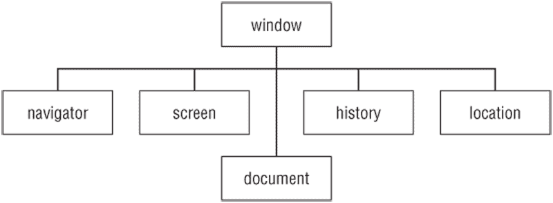 适用于所有可脚本浏览器的顶层浏览器对象模型。

### window 对象

在对象层级的顶端是`window`对象。该对象之所以在食物链中占据崇高地位，是因为它是你在网络浏览器中查看的所有内容的主容器。只要浏览器窗口打开着——即使没有加载文档——`window`对象在当前内存模型中就是定义的。

除了存放文档的窗口内容部分，窗口的影响范围还包括窗口尺寸以及围绕内容区域的所有物品。滚动条、工具栏、状态栏和（非 Macintosh）菜单栏所在的区域被称为窗口的“外框（chrome）”。并不是每个浏览器都对主浏览器窗口的外框具有完全的脚本控制权，但你可以轻松编写脚本来创建按所需尺寸且仅包含你希望显示的外框元素的额外窗口。

虽然关于帧（frames）的讨论出现在第 13 章“脚本帧和多窗口”中，但我们现在可以肯定地说，每个帧也被视为一个窗口对象。如果你仔细想，这是合理的，因为每个帧都可以包含不同的文档。当脚本在这些文档之一中运行时，它会将持有该文档的帧视为其对象层级视图中的`window`对象。

在现代浏览器中，用户可以选择在单个浏览器的新标签页中打开网页，也可以在新的浏览器窗口中打开（后者是桌面上浏览器程序的独立副本）。JavaScript 对此选择完全不具有控制权，这仍然是用户的特权。浏览器窗口和浏览器标签页对 JavaScript 来说都是完全相同的窗口对象。试图控制窗口大小和工具栏外观等功能，要么会失败，要么会阻碍用户让浏览器符合其个人可用性标准的尝试。换句话说，如果你不想骚扰网站访客，就不要尝试弄乱他们的设置。信任用户管理他们的浏览器。将你的创意精力放在页的内容和样式上，而不是窗口的外壳（chrome）。

## 访问窗口属性和方法

你可以通过多种方式对窗口对象的属性和方法编写脚本引用，这更多取决于个人喜好和风格，而不是特定的语法要求。构建此类引用最逻辑且常用的方法是在引用中包含窗口对象：

`window.propertyName`

`window.methodName([parameters])`

当引用的脚本指向托管文档的窗口时，窗口对象也有同义词。该同义词是`self`。此时，引用语法变为：

`self.propertyName`

`self.methodName([parameters])`

你可以交替使用这些初始引用对象名称，但我们倾向于将`self`用于涉及多个框架和窗口的复杂脚本。`self`别名更清楚地表示持有脚本文档的当前窗口，并且可以使脚本更具可读性——对我们和其他而言都是。

在第 6 章“浏览器和文档对象”中，我们曾指出，因为当脚本运行时窗口对象始终存在，因此在引用该窗口内的任何对象时可以省略它。因此，以下语法模型假设了当前窗口的属性和方法：

`propertyName`

`methodName([parameters])`

事实上，正如你稍后将看到的，如果省略窗口对象引用，某些方法可能更易理解。无论采用哪种方式，方法的运行均良好。

## 创建窗口

脚本不会创建主浏览器窗口。用户通过启动浏览器或从浏览器菜单中打开 URL 或文件（如果窗口尚未打开）来执行此操作。但在主窗口打开时（且该窗口包含一个脚本需要打开子窗口的文档时），脚本可以生成大量的子窗口。

生成新窗口的方法是`window.open()`。该方法包含最多三个参数，用于定义窗口特征：要加载的文档的 URL、用于 HTML 标签中目标属性引用的名称，以及物理外观（尺寸和外壳）。我们在这里不讨论参数的细节（这些在第 27 章有深入介绍），但我们确实想让你介绍一个涉及`window.open()`方法的重要概念。

考虑以下语句，它会打开一个特定大小的新窗口，并加载来自与当前页面同一服务器目录的 HTML 文档：

```javascript
var subWindow = window.open("define.html","def","height=200,width=300");
```

关于此语句需要注意的是，这是一个赋值语句。某些内容被赋值给变量`subWindow`。它是什么？事实证明当`window.open()`方法运行时，它不仅根据参数设置的规范打开该新窗口，还会返回指向该新窗口的引用。在编程术语中，该方法被称为返回一个值——在这种情况下，是一个真实的对象引用。方法返回的值被赋值给变量。

现在你的脚本可以使用该变量作为第二个窗口的有效引用。如果你需要访问它的某个属性或方法，必须将该引用作为完整引用的一部分。例如，要从主窗口中的脚本关闭子窗口，请使用该引用调用子窗口的`close()`方法：

```javascript
subWindow.close();
```

如果你在主窗口的脚本中执行`window.close()`、`self.close()`或直接`close()`，该方法会关闭主窗口（在与用户确认后），而不是子窗口。因此，要处理另一个窗口，必须将指向该窗口的引用作为完整引用的一部分。这会影响你的代码，因为你可能希望持有子窗口引用的变量只要主文档加载到浏览器中就是有效的。为了实现这一点，该变量必须初始化为全局变量，而不是在函数内部（尽管你可以在函数内部设置它的值）。这样，一个函数可以打开窗口，而另一个函数可以关闭它。

列表 10-1 是一个页面，它包含一个打开空白新窗口的按钮和一个从主窗口关闭该窗口的按钮。要查看此演示，请将你的主浏览器窗口缩小到小于全屏的状态。然后，当新窗口生成时，重新调整窗口的位置，以便主窗口在前方时你可以看到较小的新窗口。（如果窗口丢失在另一个窗口后面，请使用浏览器的“窗口”菜单选择隐藏的窗口。）列表 10-1 的关键点是`newWindow`变量被定义为全局变量，以便`makeNewWindow()`和`closeNewWindow()`函数都能访问它。当声明变量时没有进行赋值时，其初始值为`null`。在条件中，`null`值被解释为与 false，而任何非零值的存在在条件中都等同于 true。因此，在`closeNewWindow()`函数中，条件测试会在发布子窗口指令之前检查窗口是否已创建。

# window 属性与方法

本节描述的`window`对象的三个方法通过显示各种类型的对话框，对用户交互产生直接影响。它们适用于所有支持脚本的浏览器。你可以在第四部分中找到每个属性和方法的详尽代码示例。你也可以通过在`The Evaluator Jr.`（源自第 8 章“编程基础，第一部分”）顶部的文本框中输入单语句脚本示例来进行实验。

新脚本编写人员问的第一个问题之一就是如何自定义这些对话框的标题栏、尺寸和按钮标签。每个浏览器厂商都规定了这些对话框的标签方式。由于多年来心术之士试图利用这些对话框进行不法目的，浏览器厂商现在竭尽全力让用户知道这些对话框源自网页脚本。脚本开发者无法更改这些对话框的用户界面。

## window.alert() 方法

在本教程中，我们多次使用`alert()`方法。此`window`方法会生成一个对话框，显示你作为参数传递的任何文本（参见图 10.2）。单个 OK 按钮（其标签无法更改）允许用户关闭警报框。

图 10.2 一个 JavaScript 警报对话框。

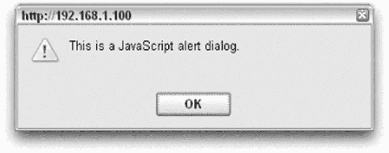

这三个对话框方法都是在不引用`window`的情况下使用`window`对象方法的极佳案例。尽管`alert()`方法在技术上是一个`window`对象的方法，但对话框与生成它的`window`之间并不存在特殊关系。在生产脚本中，我们通常使用快捷引用：

```javascript
alert("This is a JavaScript alert.");
```

## window.confirm() 方法

第二种风格的对话框提供两个按钮（大多数平台上的大多数版本为“取消”和“确定”），被称为确认对话框（参见图 10.3）。更重要的是，这是返回值的方法之一：如果用户点击确定，则返回`true`；如果用户点击取消，则返回`false`。你可以使用此对话框及其返回值作为让用户对脚本进度做出决策的方法。

图 10.3 一个 JavaScript 确认对话框（IE7/WinXP 样式）。

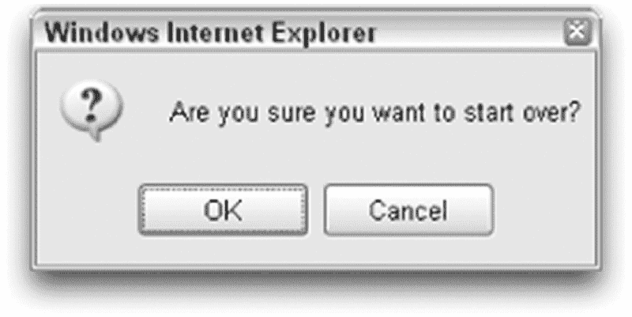

由于该方法始终返回一个`Boolean`值，你可以将整个方法的评估值作为`if`或`if...else`结构中的条件语句。例如，在以下代码段中，询问用户是否重新启动应用程序。这样做会导致`index.html`被加载：

```javascript
if (confirm("Are you sure you want to restart the application?")) {
    location.href = "index.html";
}
```

## window.prompt() 方法

`window`对象的最后一个对话框是提示对话框（参见图 10.4），它显示你设置的消息，并提供一个文本字段供用户输入响应。两个按钮“取消”和“确定”允许用户以相反的预期关闭对话框：取消整个操作或接受在对话框中输入的输入。

图 10.4 一个 JavaScript 提示对话框（Safari 2 样式）。

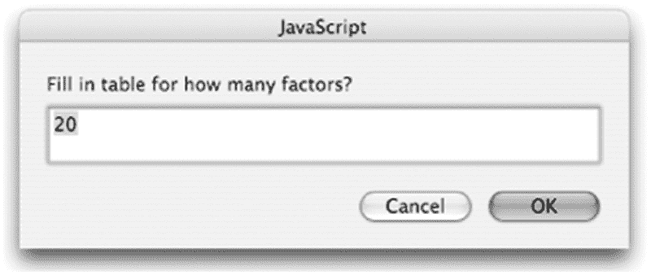

`window.prompt()`方法有两个参数。第一个是作为用户提示的消息。你可以通过在第二个参数中包含一个字符串，在文本字段中建议默认答案。如果你不想这样做，可以省略第二个参数。

对于当前页面域之外的页面，你需要指定完整的 URL。通常，你可以通过指定相对 URL（即相对于当前加载的页面）来导航到自己网站的页面，而不是使用包含协议和主机信息的完整 URL。

```javascript
location.href = "contact.html";   // 相对 URL
```

如果要加载的页面在另一个窗口或框架（frame）中，则语句必须包含窗口引用。例如，如果你的脚本打开了一个新窗口并将其引用赋值给名为`newWindow`的变量，那么将页面加载到子窗口的语句是：

```javascript
newWindow.location.href = "http://www.example.com";
```

## navigator 对象

尽管该名称让人联想到 Netscape Navigator 浏览器，但`navigator`对象在所有可运行脚本的浏览器中都有实现。所有浏览器还实现了若干属性，用于揭示浏览器在每次页面请求时发送给服务器的相同信息。因此，`navigator.userAgent`属性返回一个包含浏览器和操作系统大量详细信息的字符串。例如，在 Windows XP 上的 Internet Explorer 8 中运行的脚本为`navigator.userAgent`属性接收到以下值：

```
Mozilla/4.0 (compatible; MSIE 8.0; Windows NT 5.1)
```

在 Macintosh 上的 Firefox 3.5.2 上运行相同的脚本会显示出以下`userAgent`细节：

```
Mozilla/5.0 (Macintosh; U; PPC Mac OS X 10.4; en-US; rv:1.9.1.2)
Gecko/20090729 Firefox/3.5.2
```

## 交叉引用

请参阅第 42 章“导航和其他环境对象”（在光盘中），以获取更多关于`navigator`对象及其属性返回值的含义的细节。遗憾的是，无法信任它能准确报告实际的用户代理（user agent）的制造、型号和版本。它曾被广泛用于根据不同的浏览器版本来分支脚本执行。第 25 章“文档对象模型基础”描述了检测浏览器能力的更现代的方法。

## document 对象

`document`对象持有页面的实际内容。`document`对象的属性和方法通常会影响占据窗口的文档的外观和内容。正如你在第 5 章“你的第一个 JavaScript 脚本”中所看到的，所有兼容 W3C DOM 的浏览器都允许脚本在文档加载后访问页面的文本内容。你还看到，DOM 方法允许脚本在页面加载后动态创建内容。许多文档对象属性是文档中其他对象的数组，这些数组提供了引用这些对象的额外方法（在`document.getElementById()`方法之外）。

访问文档对象的属性和方法是直接的，如下面的语法示例所示：

```
[window.]document.propertyName
```

```
[window.]document.methodName([parameters])
```

当脚本访问包含该脚本的文档对象时，窗口引用是可选的。如果你想预览长长的文档对象属性列表，许多文档对象属性是文档中其他对象的数组，这些数组提供了引用这些对象的额外方法（在`document.getElementById()`方法之外）。

这些方法中的任何一种都能达到相同的目的。在本书中，我们将主要使用 DOM 方法`getElementById()`和`getElementsByTagName()`；然而，`document.forms`集合语法可以追溯到最早的可脚本浏览器，它在最现代的版本中仍然有效。

## `document.images[]` 属性

就像文档通过一个特殊的数组属性跟踪表单一样，`document`对象也维护了一个通过``标签插入文档的图像集合（数组）。通过`document.images`数组引用的图像可以通过`img`元素名称的数字索引或字符串索引来访问。与表单一样，`name`属性值就是你用于字符串索引的标识符。

`document.images`属性的存在表明浏览器支持图像对象，因此支持诸如图像切换等脚本技术。因此，你可以将该属性的存在作为测试条件，以确保在尝试对图像执行任何脚本操作之前，浏览器支持将图像作为对象。执行此操作，请将处理图像的语句封装在一个验证该属性存在的`if`结构中，如下所示：

```javascript
if (document.images)
{
    // 处理 img 对象的语句
}
```

旧版浏览器会跳过嵌套语句，防止它们向用户显示错误信息。

在当今典型的复杂网页中，不同部分的图像被用于完全不同的用途，将页面上所有的图像收集到一个数组中通常并不实际。在这种情况下，改用 DOM 方法`getElementsByTagName()`（见上文）可能会更方便。

## `document.createElement()` 和 `document.createTextNode()` 方法

向 HTML 文档添加一个新元素至少包含两个步骤：

1. 为文档创建新元素。
2. 将它精确地插入到页面树结构中你想要的位置。

`document.createElement()`方法允许你在浏览器内存中创建一个全新的元素对象。要指定你想要创建的元素，可以将元素的标签名作为方法的字符串参数传递：

```javascript
var newElem = document.createElement("p");
```

你可能还想给该元素添加一些属性值，这可以通过给新创建的对象的属性赋值来实现，即使在元素成为文档的一部分之前也是如此。

```javascript
newElem.setAttribute("class", "intro");
```

此元素可以插入到文档的任何位置——例如，在末尾：

```javascript
document.body.appendChild(newElem);
```

这三行代码在文档体的末尾生成了一个段落：

```html
<body>
...
<p class="intro"></p>
</body>
```

正如你在第 6 章“浏览器对象与文档对象”中的对象层级结构插图中所看到的那样，元素对象经常需要在其开始标签和结束标签之间包含文本内容。W3C DOM 创建该文本的方法是通过`document.createTextNode()`方法生成一个全新的文本节点，并在该节点中填充所需的文本。例如：

```javascript
var newText = document.createTextNode("Greetings to all.");
newElem.appendChild(newText);
```

结果为：

```html
<body>
...
<p class="intro">Greetings to all.</p>
</body>
```

如你所见，创建元素或文本节点的行为本身并不会影响文档节点树。你必须调用各种插入或替换方法之一，将新文本节点放置在它的元素中，并将元素放置在文档中，正如你在第 5 章中学会如何这样做的那样。

## `document.write()` 方法

`document.write()`方法是向文档写入内容的另一种方式。它的优点是“快速且粗暴”，但它也有几个缺点：

- `document.write()`只能在页面第一次加载到浏览器时向网页添加内容。该方法的任何后续调用都会替换整个页面。
- 由于`document.write()`会向文档中插入任何旧的文本块，它导致了粗糙的编程习惯和格式不正确的标记，鼓励在脚本中将标记与内容混合，并且不鼓励开发层的分离（结构与内容的分离）。
- `document.write()`不适用于 XHTML，XHTML 这种文档类型不允许在初始解析期间修改其内容。

出于这些原因，我们不建议在自己的代码中使用`document.write()`，尽管为了能够读取遗留代码，理解它的工作原理仍然是有用的。

`document.write()`方法既运行于立即脚本中（在页面加载时创建内容），也运行于延迟脚本中（在相同窗口或不同窗口中创建新内容）。该方法需要一个字符串参数，即要写入窗口或框架的 HTML 内容。此类字符串参数可以是变量或任何求值为字符串的表达式。通常，写入的内容包含 HTML 标签。

请记住，页面加载后，浏览器的输出流会自动关闭。此后，向当前页面发布的任何`document.write()`方法都会打开一个新的流，并立即擦除当前页面（以及原始文档中的任何变量或其他值）。因此，如果你想用脚本生成的 HTML 替换当前页面，你需要将该 HTML 累积在一个变量中，并仅通过一次`document.write()`方法执行写入。你不需要显式地清除文档并打开新的数据流；一次`document.write()`调用即可完成所有。

关于`document.write()`方法的最后一个维护建议是关于它的伴侣方法`document.close()`。你的脚本在完成向窗口（无论是相同窗口还是另一个）写入内容后必须关闭输出流。否则会导致图像和表单无法显示。此外，稍后调用的`document.write()`方法只会追加到页面，而不是清除现有内容重新写入。为了演示`document.write()`方法，我们展示了两个版本的应用程序。一个写入包含脚本的同一个文档；另一个写入独立的窗口。在新的文本编辑器文件中输入每个文档的代码，保存，然后在浏览器中打开`.html`文件。

列表 10-2 创建了一个按钮用于组装文档的新 HTML 内容，包括文档标题和`<body>`标签的颜色属性。列表中一个你可能不熟悉的运算符是`+=`。它将右侧的字符串追加到左侧变量存储的字符串之后。该运算符是跨独立语句累积字符串的方便方法。使用`newContent`变量收集的内容，一个`document.write()`语句会将整个新内容写入同一个文档，消除列表 10-2 内容的所有痕迹。然而，需要`document.close()`语句正确关闭输出流。当你加载此文档并点击按钮时，注意标题栏中的标题发生了变化。当你回到原始页面并再次尝试按钮时，注意动态写入的页面加载速度比重新加载原始文档还要快。

列表 10-2: 在当前窗口上使用`document.write()`

HTML: `jsb-10-02.html`

```html
<!DOCTYPE html>
<html>
<head>
    <meta http-equiv="content-type" content="text/html;charset=utf-8">
    <title>Writing to Same Doc</title>
    <script type="text/javascript" src="../jsb-global.js"></script>
    <script type="text/javascript" src="jsb-10-02.js"></script>
</head>
<body>
    <h1>Writing to Same Doc</h1>
    <form>
        <p>
            <input type="button" id="rewritePage" value="Replace Content">
        </p>
    </form>
</body>
</html>
```

JavaScript: `jsb-10-02.js`

```javascript
// replace the page with new markup
function reWrite()
{
  // assemble content for new window
  var newContent = '<!DOCTYPE html>';
  newContent += '<html>';
  newContent += '<head>';
  newContent += '<meta http-equiv="content-type" content="text/html;charset=utf-8">';
  newContent += '<title>A New Doc</title>';
  newContent += '<style type="text/css">';
  newContent += 'body { background-color: aqua; }';
  newContent += '</style>';
  newContent += '</head>';
  newContent += '<body>';
  newContent += '<h1>This document is brand new.</h1>';
  newContent += '<p>Click the Back button to see the original document.</p>';
  newContent += '</body>';
  newContent += '</html>';
  // write HTML to new window document
  document.write(newContent);
  document.close(); // close layout stream
}

// apply behaviors when document has loaded
function initialize()
{
  // do this only if the browser can handle DOM methods
  if (document.getElementById)
  {
    // point to the button
    var oButtonRewrite = document.getElementById('rewritePage');
    // if it exists...
    if (oButtonRewrite)
    {
      // apply event handler
      addEvent(oButtonRewrite, 'click', reWrite);
    }
  }
}

// initialize when the page has loaded
addEvent(window, 'load', initialize);
```

在列表 10-3 中，情况稍微复杂一些，因为脚本生成了一个子窗口，并向其中写入了一个完全生成的文档。

### 注意事项

- 你必须关闭弹出拦截才能运行此脚本。
- 为了让两个函数都能保持对新窗口的引用，`newWindow`被声明为全局变量。
- 页面一加载，`onload`事件处理程序就会调用`makeNewWindow()`。该函数生成一个空白的子窗口。我们在`open()`方法的第三参数中添加了一个属性，指示子窗口的状态栏显示。
- 页面中的按钮调用了`subWrite()`方法。它执行的第一项任务是检查子窗口的`closed`属性。如果引用的窗口已关闭，该属性返回`true`。如果是如此（用户手动关闭了它），该函数将再次调用`makeNewWindow()`来重新打开该窗口。
- 窗口打开后，新内容被组装成字符串。与列表 10-2 一样，内容是一次性写入的，但有一个重要的区别：`write()`和`close()`方法都显式地指定了子窗口。

### 列表 10-3：在另一个窗口上使用`document.write()`

#### HTML: `js-10-03.html`

```html
<!DOCTYPE html>
<html>
  <head>
    <meta http-equiv="content-type" content="text/html;charset=utf-8">
    <title>Writing to Subwindow</title>
    <script type="text/javascript" src="../js-global.js"></script>
    <script type="text/javascript" src="js-10-03.js"></script>
  </head>
  <body>
    <h1>Writing to Subwindow</h1>
    <form>
      <p>
        <input type="button" id="writewindow" value="Write to Subwindow">
      </p>
    </form>
  </body>
</html>
```

#### JavaScript: `js-10-03.js`

```javascript
var newWindow;
function makeNewWindow()
{
  newWindow = window.open("", "", "status=200,width=300");
}
function subWrite()
{
  // 如果有人关闭了窗口，则创建一个新窗口
  if (!newWindow || newWindow.closed)
  {
    makeNewWindow();
  }
  // 将子窗口带到前面
  newWindow.focus();
  // 组装新窗口的内容
  var newContent = '<!DOCTYPE html>';
  newContent += '<html>';
  newContent += '<head>';
  newContent += '<meta http-equiv="content-type" content="text/html;charset=utf-8">';
  newContent += '<title>A New Doc</title>';
  newContent += '<style type="text/css">';
  newContent += 'body { background-color: aqua; }';
  newContent += '</style>';
  newContent += '</head>';
  newContent += '<body>';
  newContent += '<h1>This document is brand new.</h1>';
  newContent += '</body>';
  newContent += '</html>';
  // 向新窗口文档中写入 HTML
  newWindow.document.write(newContent);
  // 关闭布局流
  newWindow.document.close();
}
// 文档加载时应用行为
function initialize()
{
  // 仅当浏览器可以处理 DOM 方法时执行此操作
  if (document.getElementById)
  {
    // 指向按钮
    var oButtonRewrite = document.getElementById('writewindow');
    // 如果存在...
    if (oButtonRewrite)
    {
      // 应用事件处理器
      addEvent(oButtonRewrite, 'click', subWrite);
    }
  }
}
// 页面加载时初始化
addEvent(window, 'load', initialize);
```

# 表单与元素

### 本章内容

- 表单对象代表什么
- 如何访问关键表单属性和方法
- `text`、`button`和`select`对象如何工作
- 如何提交表单
- 如何从函数传递信息

网页与用户之间的大多数交互发生在表单内部。这是许多 HTML 内容存放的地方。在本章中，我们将讨论如何定位文档中的表单及其控件、如何修改它们、如何检查用户输入以及抑制提交。

## 表单对象

表单及其内部的输入控件是具有独特属性的 DOM 对象。例如，表单对象有一个`action`属性，告诉浏览器在提交表单时将输入发送到哪里。`select`控制（下拉列表）有一个`selectedIndex`属性，告诉我们用户选择了哪个选项。

我们的第一步是指向页面上的表单。以下是实现此目的的三种方法，均引用以下片段：

```html
<div id="header">
  <form id="search" action="...">...</form>
  <form id="join-list" action="...">...</form>
</div>
...
<form id="contact" action="...">...</form>
```

## 练习

1. 下列引用哪些是有效的，哪些是无效的？
   a. `window.form[0]`
   b. `self.entryForm()`
   c. `document.forms[2]`
   d. `document.getElement("first")`
   e. `newWindow.document.write("Howdy")`

2. 编写一条 JavaScript 语句，显示一个欢迎访问者的对话框。

3. 在页面加载时编写 JavaScript 语句，显示一个`<h1>`级别的标题。

4. 创建一个页面，在加载时提示用户输入姓名（通过对话框）。

5. 创建一个任意内容的页面，该页面会自动在页面正文中显示一条消息。

一如既往，JavaScript 数组从第一个元素的索引 0 开始，因此我们这个包含三个表单的集合可以通过数组元素 0、1 和 2 来访问。

思考处理页面上所有表单集合的用处是值得的。为了从集合中定位特定的表单，我们必须知道它在页面所有表单中的位置（这在内容丰富的动态网站中可能会变化），或者我们必须循环遍历它们来寻找标识符（这暗示起初就应该使用`getElementById()`）。

`getElementsByTagName()`的酷之处之一在于，它可以为我们在特定的父元素（而非文档元素本身）内部提供一个对象集合：

```javascript
var oHeader = document.getElementById('header');
var aForms = oHeader.getElementsByTagName('form');
var oForm = aForms[0];
```

在这个示例中，我们只收集了文档中“header”部分的所有表单。

或者想象一个列出系列工作坊的页面，每个工作坊都有独立的注册表单。我们可以通过首先指向它们的父级`div`来收集所有这些注册表单的数组，而不必担心页面上其他杂乱表单会造成干扰。

### 3. document.forms 语法

`document.forms`语法是收集页面上所有表单的另一种方法，它早于如今的 DOM 方法，但现代浏览器仍然支持它，以免破坏旧版网站。

```javascript
var aForms = document.forms;
// 然后指向其中一个表单：
var oForm = aForms[0];
// 或者：
var oForm = aForms["search"];
// 或者：
var oForm = aForms.search;
```

使用这种原始的“DOM Level 0”语法，我们可以通过表单在文档表单数组中的位置或通过名称（如果你为`<form>`标签内部的`id`或`name`属性分配了标识符）来引用表单对象。如果文档中只出现一个表单，它仍然是数组的一个成员（单元素数组），并按如下方式引用：

```javascript
document.forms[0]
```

或者使用元素的名称字符串作为数组索引：

```javascript
document.forms[formName]
```

注意，数组引用使用了该词的复数形式，后面跟着一个包含索引数字（0 总是第一个）或元素名称的方括号。或者，你可以将表单名称（不带引号字符串）当做文档对象的一个属性来使用：

```javascript
document.formName
```

然而，最后这种语法仅在表单的`id`或`name`不包含连字符、句点或冒号等会混淆 JavaScript 的字符时有效。例如，在我们上面的示例 HTML 中，第二个表单的`id`为`join-list`：

```javascript
var oForm = document.forms.join-list;
```

这在 JavaScript 看来就像我们正试图从一个 id 为`join`的表单对象中减去名为`list`的变量值。此语句要么会让 JavaScript 直接停止，要么产生`NaN`（非数字）结果。作为一个一般规则，我们建议你使用将元素名称放在引号中的语法。

由于有许多方法可以获取表单对象，我们将在后续示例中经常用`formObject`标签来表示它们。

### 作为对象和容器的表单

由于现代 DOM 与许多过去的约定保持兼容，表单对象发现自己同时处于两个不同家族树的母体。现代 DOM Level 2 规定表单是所有子节点（包括元素节点和文本节点）的父，而旧的 DOM Level 0 则让表单成为所有表单控制对象（`input`、`select`、`button`和`textarea`元素）的容器。图 11.1 显示了这种 DOM 0 层次结构及其相对于文档对象的位置。稍后你将看到这种结构对你引用表单控制元素的影响。

图 11.1 表单和控件的 DOM Level 0 层次结构。

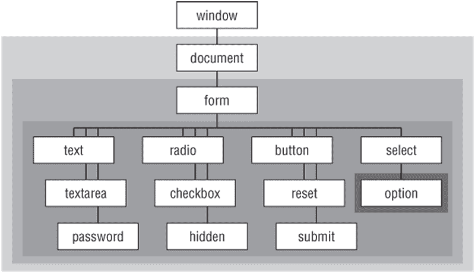

让我们通过对以下 HTML 代码段绘图来解释区别：

列表 11-1：示例表单标记

```html
<form action="search.php" method="post">
    <p>
      <label for="inputSearch">搜索：</label>
      <input id="inputSearch" name="inputSearch" type="text" value="">
      <input id="submit" type="submit" value="Search">
    </p>
</form>
```

图 11.2 显示了此标记的 DOM Level 2 树。注意，它代表了文档该部分的所有内容。元素之间的回车、制表符和空格是文本节点（在这里用简写“[whitespace]”表示）。

图 11.2 典型表单的 DOM Level 2 树。

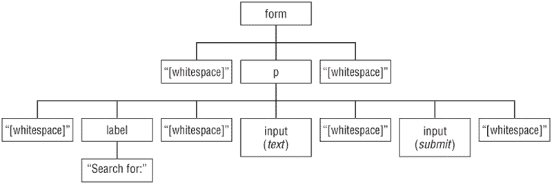

图 11.3 显示了同一表单的 DOM Level 0 树。它只包含输入控件，并省略了段落、标签和文本节点。

图 11.3 同一表单的 DOM Level 0 树。

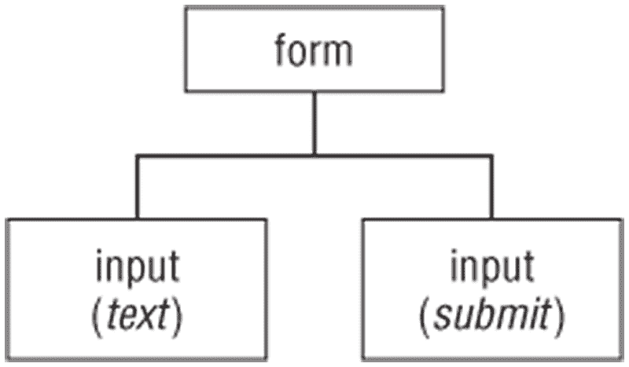

这两个对象树对于完全不同的用途显然非常有用。DOM Level 2 树可以用于精细的粒度读写整个文档内容。DOM Level 0 树则可以快速方便地只读写表单控件。

请注意，无论你在任何语句中使用 DOM 0 还是 DOM 2 技术，这些对象都是相同的。例如，

```javascript
var oForm = document.getElementById('myForm');
var oControl = oForm.fritzy;
```

这是完全有效的 JavaScript，如果`fritzy`是表单`myForm`内部某个输入控件的 ID，那么它就能正常工作。

除了与所有 HTML 元素对象共有的大量属性和方法外，表单对象还具有许多该对象所特有的项目。几乎所有这些独特的属性都是表单元素属性（`action`、`target`等）的脚本表示。支持脚本的浏览器允许在脚本控制下更改这些属性，这使得你的脚本具有巨大的力量，可以根据用户在页面上的选择来引导表单提交的行为。

### 访问表单属性

`elements[]`属性是表单内所有输入控件的集合。这是另一个数组，其项按照 HTML 标签在源代码中出现的顺序列出。通常情况下，直接使用其 ID 引用单个元素的效率更高，但有时脚本需要遍历表单中的所有`elements`。例如，一个表单验证程序可能会遍历每个元素，以确保用户已正确输入了其值。这样的循环可能不需要查看文本节点和其他非表单控件的元素，而且实际上，它必须对遇到的每个元素执行一系列测试，以确定其是否为控件。在这种情况下，使用`elements[]`集合要高效得多。

下面的代码片段展示了`form.elements[]`属性在`for`重复循环中的应用，该循环查看表单中的每个控件元素，并将文本字段的内容设置为空字符串。脚本不能简单遍历表单并将每个元素的内容设置为空字符串，因为某些元素可能是特定的类型（例如，按钮），其`value`属性有不同的用途。

```javascript
var oForm = document.getElementById('registration-form');
if (!oForm) return false;
for (var i = 0; i < oForm.elements.length; i++)
{
   if (oForm.elements[i].type == "text")
   {
      oForm.elements[i].value = "";
   }
}
```

在第一个语句中，我们创建了变量`oForm`，它持有指向目标表单的引用。这样做是为了当我们在脚本后期多次引用表单元素时，每次引用的典型长度要短得多（速度也略快）。我们可以使用`oForm`变量作为快捷方式，构建对表单中更深层次项的引用。

接下来，我们开始遍历表单`elements`数组中的项。每个表单控件元素都有一个`type`属性，该属性显示了它是哪种表单控件：文本、按钮、单选框、复选框、textarea 等。我们感兴趣的是`type`为`text`的元素。对于每一个元素，我们将`value`属性设置为空字符串。

在这种情况下，我们允许使用如`oForm.elements[i].type`这样的复合表达式，因为在已经测试并确保表单存在后，我们可以信任 DOM 在`elements[]`集合的每次迭代中为我们交付一个有效的表单控件对象。即使表单中没有任何控件，脚本也不会失败；如果`elements[]`集合是一个空数组，上面的`for`循环将在第一次迭代之前终止，不会报错，因为`oForm.elements.length`将为零。

我们将在本章后面回到表单，向你展示如何在没有提交按钮的情况下提交表单，以及客户端表单验证是如何工作的。

## 作为对象的表单控件

嵌套在`<form>`标签内的三种 HTML 在所有浏览器 DOM 中都变成了可脚本的对象。大多数对象的出现归于页面源代码中的`<input>`标签。只有赋值给`<input>`标签的`type`属性的值决定了该元素是文本框、密码输入框、隐藏字段、按钮、复选框还是单选按钮。另外两种表单控件`textarea`和`select`有它们自己的标签。

要将特定的表单控件作为对象引用，可以使用 DOM Level 2 方法通过其`id`或`tagName`直接指向它，或者使用 DOM Level 0 语法，构建从`document`开始，通过`form`然后到控件的层级引用。你已经看到了引用仅仅表单部分的许多方法——这些方法对于构建表单控件引用都是有效的。但如果你仅使用分配给表单和表单控件元素的标识符（而不是相关的元素数组），语法如下：

```javascript
document.getElementById(controlName)
```

或者

```javascript
document.formName.controlName
```

例如，考虑以下简单表单：

```html
<form id="searchForm" action="cgi-bin/search.pl">
   <p>
      <input type="text" id="entry" name="entry">
      <input type="submit" id="sender" name="sender" value="Search">
   </p>
</form>
```

以下对文本输入控件的示例引用都是有效的：

```javascript
document.getElementById("entry")
document.searchForm.entry
document.searchForm.elements[0]
document.forms["searchForm"].elements["entry"]
document.forms["searchForm"].entry
```

尽管表单控件有几个共同属性，但某些属性是特定控件类型或相关类型所有的。例如，只有`select`对象提供一个可以显示其列表中当前选中了哪个项的属性。复选框和单选框都有一个属性，指示控件当前是否被设置为开启。同样，所有与文本相关的控件在读取和修改其内容的操作上都是相同的。

良好掌握表单控件对象的脚本化特性对你成功 JavaScript 至关重要。在接下来的章节中，你将遇到最重要的表单控件对象，并看到脚本如何与它们交互。

## 与文本相关的输入对象

四种文本相关的 HTML 表单元素——`text`、`password`和`hidden`类型的`input`元素，加上`textarea`元素——都是文档层次结构中的元素。除了隐藏类型外，通常都显示在页面上，允许用户输入文本并选择选项。

为了让这些表单控件对象在页面中可脚本化，你不需要对它们的 HTML 标签进行任何特殊处理——分配`id`属性除外。如果脚本将获取或设置属性或调用方法，我们强烈建议为每个文本相关的表单元素分配唯一的 ID 和 name。ID 对于 DOM 操作以及将标签关联控件非常方便，而 name 是表单正常运行所必需的。当表单实际提交到服务器端程序时，是控件元素的 name 属性连同元素的值一起发送到服务器的。

对于此类类别中的可见对象，事件处理程序由许多用户操作触发，例如赋予字段焦点（获取文本插入指针）和更改文本（输入新文本并离开字段）。你的大多数字段操作都是由文本更改（`onchange`事件处理器）触发的。在当前的浏览器中，事件也会响应单个按键触发。

毫无疑问，文本相关元素最常用的属性是`value`属性。该属性代表文本元素当前的内容。脚本可以随时检索并设置其内容。`value`属性的内容始终是字符串。如果文本字段用于输入数学运算的值，则可能需要转换（见第 8 章“编程基础，第一部分”）。

## 对象的行为

许多脚本编写者寻求 JavaScript 来解决表单中某些对象的行为缺陷或异常。我们希望在你的脚本体验早期就指出这些问题，以免它们以后困扰你。

大多数浏览器表单都遵循一种很久以前由 Web 极客推荐作为非正式标准的行为。当表单只包含一个文本输入对象时，在文本对象获得焦点时按下 Enter/Return 键会自动提交表单。对于 IE5/Mac 和 Safari 以外的浏览器，如果有两个或更多字段，则你需要另一种方式来提交表单（例如，一个 Submit 提交按钮）。这种单字段提交方案在许多情况下运行良好，例如大多数网络搜索网站的搜索页面。但如果你正在尝试仅包含一个字段的简单表单，可以通过按下 Enter/Return 键来提交表单。提交一个没有指定其他操作或目标的表单意味着页面将执行无条件刷新，从而清除输入到表单中的任何信息。然而，你可以通过表单中的`onsubmit`事件处理程序来取消提交，如本章后文所示。你也可以通过脚本在任何文本字段中按下 Enter/Return 键的操作来提交表单（参见第 32 章“事件对象”）。

为了演示如何读取和写入文本字段的`value`属性，列表 11-2 提供了一个包含单条输入字段的完整 HTML 页面。当你向字段中输入文本并按下 Tab 或 Enter 时，输入文本将全部转换为大写。

### 列表 11-2：获取和设置文本对象的 value 属性

HTML: `jsb-11-02.html`

```html
<!DOCTYPE html>
<html>
<head>
    <meta http-equiv="content-type" content="text/html;charset=utf-8">
    <title>Text Object value Property</title>
    <script type="text/javascript" src="../jsb-global.js"></script>
    <script type="text/javascript" src="jsb-11-02.js"></script>
</head>
<body>
    <h1>Text Object value Property</h1>
    <form id="UCform" action="make-uppercase.php">
        <p>
            <input type="text" id="converter" name="converter" value="sample">
        </p>
    </form>
</body>
</html>
```

JavaScript: `jsb-11-02.js`

```javascript
// 当页面加载时初始化
addEvent(window, 'load', initialize);
var oInput; // (全局) 用于转换为大写的输入字段

// 当文档加载时应用行为
function initialize() {
    // 仅当浏览器可以处理 DOM 方法时
    if (document.getElementById) {
        // 将事件处理程序绑定到输入字段
        oInput = document.getElementById('converter');
        if (oInput) {
            addEvent(oInput, 'change', upperMe);
        }
        // 将事件处理程序绑定到表单
        var oForm = document.getElementById('UCform');
        if (oForm) {
            addEvent(oForm, 'submit', upperMe);
        }
    }
}

// 将文本变为大写
function upperMe(evt) {
    // 合并事件处理
    if (!evt) evt = window.event;
    // 将输入字段的值设置为自身的大写版本
    var sUpperCaseValue = oInput.value.toUpperCase();
    oInput.value = sUpperCaseValue;
    // 取消默认行为（尤其是表单提交）
    // W3C DOM 方法（在 IE 中隐藏）
    if (evt.preventDefault) evt.preventDefault();
    // IE 方法
    return false;
}
```

以下是它的工作原理：当页面加载到浏览器时，`initialize()`函数为表单及其包含的输入字段应用了事件处理程序。表单和输入字段的`onchange`事件处理程序都会调用`upperMe()`函数，该函数将文本转换为大写。

注意，用于引用输入字段转换器的变量`oInput`声明在所有函数之外，因此是一个全局变量。这意味着它可以从脚本的任何地方访问。我们这样做是为了我们可以在两个独立的函数——`initialize()`和`upperMe()`中都使用它。（与全局变量相反，局部变量是在函数内部用`var`声明的，无法在声明它们的函数外部可见。）

`upperMe()`函数的核心由两个语句组成：

```javascript
var sUpperCaseValue = oInput.value.toUpperCase();
oInput.value = sUpperCaseValue;
```

函数的第一条语句中发生了很多操作。赋值语句的右侧执行了两项关键任务。对对象`value`属性的引用（`oInput.value`）的结果为该瞬间文本字段中的任何内容。（记住`oInput`是指向输入字段转换器的那个全局变量。）然后，该字符串被交给 JavaScript 的字符串函数之一`toUpperCase()`，该函数将值转换为大写。右侧语句的求值结果随后赋值给第二个变量：`sUpperCaseValue`。文本框中尚未发生任何变化。这发生在第二条语句中，文本框的`value`属性被赋值为`sUpperCaseValue`变量持有的内容。为了学习目的，我们将此逻辑分成了两个语句，以便你可以看到这个过程。在实践中，你可以将第 1 步和第 2 步的操作合并为一个强有力的语句：

```javascript
oInput.value = oInput.value.toUpperCase();
```

输入字段的`onchange`事件是在当你按下 Tab 键离开该字段时使文本变为大写的。因为这是一个单字段表单，Enter 键起到了提交表单的作用，因此我们设置了表单的`onsubmit`事件也运行`upperMe()`函数。除了将文本变为大写外，该函数还取消了正常的提交行为。（本章稍后将更多关于事件捕获的内容。）

如果用户禁用了或者渲染此页面的用户代理不支持 JavaScript，输入的文本将提交到名为`make-uppercase.php`的服务器端程序，该程序可能也会执行文本的大写转换。

### 注意

在本章代码中用于分配事件处理程序的函数是`addEvent()`，这是一种跨浏览器事件处理程序，在第 32 章中有详细解释。它位于附带 CD-ROM 中的`jsb-global.js`文件中，并在每个 HTML 示例的文档头部通过`script`标签包含进来。

### 按钮输入对象

我们在书中的许多示例使用了按钮类型的输入元素。按钮是最容易编写脚本的对象之一。在教程的简版对象模型中，按钮对象只有几个很少访问或修改的属性。与文本对象一样，按钮的视觉外观不是由 HTML 或脚本控制，而是由页面访问者使用的操作系统和浏览器控制。按钮对象目前为止最有用的事件是点击事件。每当用户点击按钮时，它就会触发。足够简单。没有魔法。

### 复选框输入对象

复选框也是表单对象的一个简单元素，但某些属性可能并不完全直观。与普通按钮对象的`value`属性（按钮标签的文本）不同，复选框的`value`属性是任何你想与对象关联的其它文本。此文本不会以任何形式出现在页面上，但该属性（最初通过`value`属性设置）对于想要了解更多复选框在表单中用途的脚本可能很重要。

例如，考虑这个：

```html
<input type="checkbox" id="memory" name="remember-me" value="yup">
<label for="memory">Remember me on this computer</label>
```

如果我们勾选了这个复选框并提交表单，浏览器将向服务器发送键值对“remember-me”和“yup”；标签文本“Remember me on this computer”出现在屏幕上，但不会发送到服务器。

复选框对象的关键属性是框是否被勾选。`checked`属性是一个布尔值：如果勾选则为 true，未选则为 false。当你看到一个属性是布尔值时，这暗示了该值可以在`if`或`if...else`条件表达式中轻松使用。在列表 11-3 中，`checked`属性的值决定了用户看到的警告框。

# 列表 11-3: Checkbox 对象的 checked 属性

HTML: `jsb-11-03.html`

```html
<!DOCTYPE html>
<html>
  <head>
      <meta http-equiv="content-type" content="text/html;charset=utf-8">
      <title>Checkbox Inspector</title>
      <script type="text/javascript" src="../jsb-global.js"></script>
      <script type="text/javascript" src="jsb-11-03.js"></script>
  </head>
  <body>
      <h1>Checkbox Inspector</h1>
      <form action="">
        <p>
          <input type="checkbox" id="checkThis" name="checkThis">
          <label for="checkThis">Check here</label>
          <input type="button" id="inspectIt" value="Inspect Box">
        </p>
      </form>
  </body>
</html>
```

JavaScript: `jsb-11-03.js`

```javascript
// 当页面加载完成时初始化
addEvent(window, 'load', initialize);
var oCheckbox;   // checkbox 对象（全局）

// 当文档加载后应用行为
function initialize() {
  // 仅当浏览器能够处理 DOM 方法时才执行
  if (document.getElementById) {
    // 指向关键元素
    oCheckbox = document.getElementById('checkThis');
    var oButton = document.getElementById('inspectIt');
    // 如果它们存在，则应用事件处理器
    if (oCheckbox && oButton) {
      addEvent(oButton, 'click', inspectBox);
    }
  }
}

// 报告复选框的选中状态
function inspectBox() {
  if (oCheckbox.checked) {
    alert("The box is checked.");
  } else {
    alert("The box is not checked at the moment.");
  }
}
```

复选框（Checkboxes）通常用作选项设置而不是操作触发器。虽然 checkbox 对象有一个`onclick`事件处理器，但点击复选框不应该执行任何剧烈的操作，例如跳转到另一个页面。

## radio input 输入对象

为一组单选按钮（radio objects）编写脚本需要更多的工作。为了让浏览器管理一组相关按钮的高亮和取消高亮，你必须为该组中的每个按钮分配相同的`name`属性。你可以在表单中包含多个单选组，但同一组的每个成员必须具有相同的`name`。

为一个表单元素分配相同的`name`会强制浏览器以不同于每个元素都具有唯一`name`的方式来管理这些元素。相反，浏览器会维护一个具有相同`name`的对象列表。分配给组的`name`成为数组的名称。某些属性适用于整个组；另一些属性适用于组内的单个按钮，并且必须通过数组索引引用进行访问。例如，你可以通过读取组的`length`属性来确定单选组中有多少个按钮：

`formObject.groupName.length`

如果你想通过与复选框相同的`checked`属性来查找某个特定按钮当前是否处于高亮状态，可以通过该按钮在同名输入字段集合中的位置来访问该按钮元素：

`formObject.groupName[0].checked`

列表 11-4 展示了单选按钮对象的几个方面，包括如何遍历按钮组以找到哪一个被选中，以及如何使用`value`属性及其属性进行有意义的工作。

页面包含三个单选按钮和一个普通按钮。每个单选按钮的`value`属性包含“三小子”（Three Stooges）其中一个成员的全名。当用户点击按钮时，`onclick`事件处理器会调用`fullName()`函数。在函数内部，第一条语句创建了表单的快捷引用。接着，一个`for`循环遍历三小子单选按钮组中的所有按钮。一个`if`结构检查每个按钮的`checked`属性。当某个按钮被选中时，`break`语句跳出`for`循环，并将`i`循环计数器的值留在跳出循环的位置。然后，alert 对话框使用第`i`个按钮的`value`属性引用，以便在警报框中显示全名。

### 列表 11-4: 为一组对象编写脚本

HTML: `jsb-11-04.html`

```html
<!DOCTYPE html>
<html>
  <head>
      <meta http-equiv="content-type" content="text/html;charset=utf-8">
      <title>Scripting Radio Buttons</title>
      <script type="text/javascript" src="../jsb-global.js"></script>
      <script type="text/javascript" src="jsb-11-04.js"></script>
  </head>
  <body>
      <h1>Scripting Radio Buttons</h1>
      <form action="stooges.php">
        <fieldset>
          <legend>Select your favorite Stooge:</legend>
          <p>
            <input type="radio" name="stooges" id="stooges-1" value="Moe Howard" checked>
            <label for="stooges-1">Moe</label>
          </p>
          <p>
            <input type="radio" name="stooges" id="stooges-2" value="Larry Fine">
            <label for="stooges-2">Larry</label>
          </p>
          <p>
            <input type="radio" name="stooges" id="stooges-3" value="Curly Howard">
            <label for="stooges-3">Curly</label>
          </p>
          <p>
            <input type="submit" id="Viewer" name="Viewer" value="View Full Name...">
          </p>
        </fieldset>
      </form>
  </body>
</html>
```

JavaScript: `jsb-11-04.js`

```javascript
// 当页面加载完成时初始化
addEvent(window, 'load', initialize);
var aStooges;   // 单选按钮数组（全局）

// 当文档加载后应用行为
function initialize() {
  // 仅当浏览器能够处理 DOM 方法时才执行
  if (document.getElementById) {
    // 指向关键元素
    var oButton = document.getElementById('Viewer');
    var aForms = document.forms;
    if (aForms) aStooges = aForms[0].stooges;   // 全局变量
    // 如果它们存在，则应用事件处理器
    if (oButton && aStooges) {
      addEvent(oButton, 'click', fullName);
    }
  }
}

// 显示被选三小子的全名
function fullName() {
  for (var i = 0; i < aStooges.length; i++) {
    if (aStooges[i].checked) {
      break;
    }
  }
  alert("You chose " + aStooges[i].value + ".");
}
```

## select 对象

编写最复杂的表单控件是 select 元素对象。从 DOM 0 表单对象层级图（参见图 11.1）可以看出，select 对象实际上是一个包含 option 对象数组的复合对象。此外，你可以在 HTML 中将其设置为下拉列表或滚动列表——后者可以配置为允许用户进行多次选择。为了在此阶段简单起见，本课程重点在于将其部署为允许单次选择的下拉列表。

`text`属性是出现在选择（select）对象列表上的字符串。将此信息暴露为表单对象的属性是不寻常的，因为生成选择对象的 HTML 将文本定义为`<option>`标签的嵌套文本。但在`<option>`标签内部，你可以设置一个`value`属性，这与之前显示的单选按钮一样，它允许你将某些隐藏的字符串信息与列表中的每个可见条目关联起来。

为了在所有浏览器中最高效地读取所选选项的`value`或`text`属性，你可以使用 select 对象的`selectedIndex`属性作为选项数组的索引值。此类操作的引用非常长，所以请花些时间理解这里发生了什么。在下面的函数中，第一条语句创建了 select 对象的快捷引用。然后，将 select 对象的`selectedIndex`属性替换为该对象 options 数组的索引值：

```javascript
function inspect()
{
    var oList = document.getElementById('choices');
    if (oList)
    {
        var sChosenItemValue = oList.options[oList.selectedIndex].value;
    }
}
```

要让选择对象具有交互性，请使用`onchange`事件处理程序。一旦用户在列表中做出新选择，与`onchange`事件关联的脚本就会运行。列表 11-5 显示了选择对象的一个常见应用。它的文本条目描述了进入和离开网站的地方，而`value`属性持有这些位置的 URL。当用户在列表中进行选择时，`onchange`事件处理程序会触发一个脚本，提取所选选项的`value`属性，并将该值赋值给`location.href`对象属性以实现导航。

当然，这些新位置（网页）可能并不存在于你计算机上 HTML 页面所在的文件夹中。当你选择一个位置且页面尝试跳转到那里时，你会看到“文件未找到”的错误页面。注意地址栏中的目标页面，然后点击后退按钮返回示例表单。

表单包含一个提交按钮，这样当 JavaScript 被禁用或在用户代理中不存在时，页面仍然可以通过将表单提交给服务器端程序执行重定向来工作。在 JavaScript 的控制下，可以认为这种导航不需要页面上单独的 Go（跳转）按钮，在这个示例中，我们使用 JavaScript 将其显示样式设置为“none”来隐藏该按钮。然而，请注意，有些人批评这种一旦做出选择立即提交表单的选择列表的易用性和可访问性。理由是，由于表单提交不是选择列表的正常功能，通过 JavaScript 增加该行为会让某些用户感到意外，并在他们没有故意同意的情况下将他们切换到新页面。此外，列表的行为假设用户在列表中的第一次选择就是他们真正想去的地方，并且不允许发生意外选择——任何人都可以发生意外选择，特别是那些运动功能障碍的人。尝试在禁用 JavaScript 的情况下使用此表单，亲身感受差异。

### 列表 11-5：使用 select 对象进行导航

HTML: `jsb-11-05.html`

```html
<!DOCTYPE html>
<html>
    <head>
        <meta http-equiv="content-type" content="text/html;charset=utf-8">
        <title>Select Navigation</title>
        <script type="text/javascript" src="../jsb-global.js"></script>
        <script type="text/javascript" src="jsb-11-05.js"></script>
    </head>
    <body>
        <h1>Select Navigation</h1>
        <form action="redirect.php" method="get">
            <p>
                <label for="urlList">Choose a place to go:</label>
                <select id="urlList" name="urlList">
                    <option selected value="index.html">Home Page</option>
                    <option value="store.html">Shop Our Store</option>
                    <option value="policies.html">Shipping Policies</option>
                    <option value="http://www.google.com">Search the Web</option>
                </select>
                <input type="submit" id="submit-button" value="Go">
            </p>
        </form>
    </body>
</html>
```

JavaScript: `jsb-11-05.js`

```javascript
// 当页面加载时初始化
addEvent(window, 'load', initialize);
var oList; // select 列表（全局）

// 当文档加载后应用行为
function initialize()
{
    // 仅当浏览器可以处理 DOM 方法时执行
    if (document.getElementById)
    {
        // 指向关键元素
        oList = document.getElementById('urlList');
        oButton = document.getElementById('submit-button');
        // 如果它们存在...
        if (oList && oButton)
        {
            // 使列表动态化
            addEvent(oList, 'change', goThere);
            // 当 JavaScript 运行时让提交按钮消失
            oButton.style.display = 'none';
        }
    }
}

// 将浏览器引导到所选 URL
function goThere()
{
    location.href = oList.options[oList.selectedIndex].value;
}
```

注意：最近的浏览器通过 select 对象的`value`属性暴露所选项目的`value`属性。这确实是一个逻辑且快捷的方法，如果你的目标包含 IE、基于 Mozilla 的浏览器和 Safari，你可以安全地使用它。select 对象还有更多，包括在较新浏览器中更改列表内容的能力。第 37 章将深入介绍 select 对象。

### 使用 this 将元素传递给函数

在本课程之前的所有示例中，当事件处理程序调用处理表单元素的函数时，表单或表单控件通过全局变量显式引用。但是，存在非常有价值的快捷方式，可以直接将表单或控件的信息传递给函数，而无需声明全局变量。JavaScript 有一个关键字——`this`——它始终引用使用该关键字的任何对象。例如，如果你通过`click`事件将一个函数附加到按钮上，那么当你点击该按钮时，函数内部的`this`关键字就指向按钮本身。使用`this`是酷的：这意味着可以使用更少的全局变量，减少了两个独立脚本使用同一个全局变量并搞乱彼此逻辑的概率，这意味着你可以对多个元素使用同一个通用函数。这里有一个简单的示例：

```javascript
function identify()
{
    if (this.tagName)
    {
        alert('My tagName is ' + this.tagName);
    }
}
```

如果你将`identify()`函数应用到页面上的多个元素并然后点击它们，每个元素都会报告其`tagName`：`P`、`LABEL`、`FORM`、`BODY`等。查看列表 11-6。有两个使用`this`关键字的函数：附加到提交按钮上的`processData()`，以及附加到歌曲输入字段的`verifySong()`。

### 列表 11-6：使用 this 将元素传递给函数

HTML: `jsb-11-06.html`

```html
<!DOCTYPE html>
<html>
    <head>
        <meta http-equiv="content-type" content="text/html;charset=utf-8">
        <title>Beatle Picker</title>
        <script type="text/javascript" src="../jsb-global.js"></script>
        <script type="text/javascript" src="jsb-11-06.js"></script>
    </head>
    <body>
        <h1>Beatle Picker</h1>
        <form id="beatles-form" action="beatles.php" method="get">
            <p>
                <label>Choose your favorite Beatle:</label>
                <input type="radio" name="Beatles" id="radio1" value="John Lennon" checked>
                <label for="radio1">John</label>
                <input type="radio" name="Beatles" id="radio2" value="Paul McCartney">
                <label for="radio2">Paul</label>
                <input type="radio" name="Beatles" id="radio3" value="George Harrison">
                <label for="radio3">George</label>
                <input type="radio" name="Beatles" id="radio4" value="Ringo Starr">
                <label for="radio4">Ringo</label>
            </p>
            <p>
                <label for="song">输入你最喜欢的披头士歌曲名称:</label>
                <input type="text" id="song" name="song" value="Eleanor Rigby">
                <input type="submit" id="submit" value="Process Request...">
            </p>
        </form>
    </body>
</html>
```

JavaScript: `jsb-11-06.js`

```javascript
// 当页面加载时初始化
addEvent(window, 'load', initialize);

// 当文档加载完成时应用行为
function initialize()
{
  // 仅当浏览器可以处理 DOM 方法时执行此操作
  if (document.getElementById)
  {
    // 指向关键元素
    var oForm = document.getElementById('beatles-form');
    var oSong = document.getElementById('song');
    var oButtonSubmit = document.getElementById('submit');
    // 如果它们都存在...
    if (oForm && oSong && oButtonSubmit)
    {
      // 对输入字段和按钮应用行为
      addEvent(oSong, 'change', verifySong);
      addEvent(oButtonSubmit, 'click', processData);
    }
  }
}

// 验证所有输入并抑制表单提交
function processData(evt)
{
  // 整合事件处理
  if (!evt) evt = window.event;
  // 指向激活控件的表单祖先元素
  var oForm = this.form;
  // 查看选择了哪个单选按钮
  for (var i = 0; i < oForm.Beatles.length; i++)
  {
    if (oForm.Beatles[i].checked)
    {
      break;
    }
  }
  // 将值赋值给变量以便使用
  var sBeatle = oForm.Beatles[i].value;
  var sSong = oForm.song.value;
  // 这里是进行数据查找的地方...
  alert("Checking whether " + sSong + " features " + sBeatle + "...");
  // 取消表单提交
  if (evt.preventDefault) evt.preventDefault();
  return false;
}

// 当歌曲名称更改时验证歌曲名称
function verifySong()
{
  // 获取输入的歌曲
  // ('this' 是调用此函数的事件处理程序的对象)
  var sSong = this.value;
  // 这里是进行数据查找的地方...
  alert("Checking whether " + sSong + " is a Beatles song...");
}
```

列表 11-7 显示了一个带有简单验证例程的页面，该例程确保在提交表单之前所有字段都有内容。HTML 定义了一个包含四个输入字段和一个提交按钮的表单。注意，`form`元素的`action`属性是一个虚拟的服务端程序`validate.php`。如果此页面交付给未运行 JavaScript 的用户代理，表单将把输入值提交到服务端程序进行验证。基础的表单验证必须在服务器端进行；我们在客户端 JavaScript 中重复了该验证，以便对用户的操作提供更即时的响应。（顺便提一下，这也是判断脚本中是否存在拼写错误的一个指标：如果你在任何输入字段为空的情况下提交此表单，而浏览器窗口尝试打开`validate.php`，你就知道可能在输入 HTML 或 JavaScript 代码时犯了拼写错误，因为脚本没有阻止表单的提交。）

页面加载后，脚本将`checkForm()`函数绑定到表单的`onsubmit`事件上。注意，我们没有对提交按钮应用`onclick`行为；相反，我们让按钮执行正常工作，并在表单对象本身处拦截提交过程。

当点击`submit`时，下一个正常步骤是浏览器提交表单，但它首先会执行`onsubmit`事件处理程序并调用我们的函数`checkForm()`。该函数的主要工作是遍历所有表单控件，寻找空白的输入字段。如果找到，它将显示错误消息并取消表单提交。

在循环内部，`if`语句执行两项测试。第一个测试是确保我们正在检查`type`属性为文本（text）的表单控件（以免干扰按钮等）。接下来，它检查文本字段的`value`是否为空。`&&`运算符（称为布尔与运算符）强制在括号内的整个条件表达式评估为`true`之前，双方都必须为`true`。如果任何一个子测试失败，整个条件即为失败。

列表 11-7：表单提交前的最后检查

HTML: `jsb-11-07.html`

```html
<!DOCTYPE html>
<html>
<head>
    <meta http-equiv="content-type" content="text/html;charset=utf-8">
    <title>Form Field Validator</title>
    <script type="text/javascript" src="../jsb-global.js"></script>
    <script type="text/javascript" src="jsb-11-07.js"></script>
</head>
<body>
    <h1>Form Field Validator</h1>
    <form id="theForm" action="validate.php" method="get">
        <p>Please enter all requested information:</p>
        <p>
            <label for="firstName">First Name:</label>
            <input type="text" id="firstName" name="firstName">
        </p>
        <p>
            <label for="lastName">Last Name:</label>
            <input type="text" id="lastName" name="lastName">
        </p>
        <p>
            <label for="age">Age:</label>
            <input type="text" id="age" name="age">
        </p>
        <p>
            <label for="favoriteColor">Favorite Color:</label>
            <input type="text" id="favoriteColor" name="favoriteColor">
        </p>
        <p>
            <input type="submit" id="submit">
        </p>
    </form>
</body>
</html>
```

JavaScript: `jsb-11-07.js`

```javascript
// 页面加载时初始化
addEvent(window, 'load', initialize);

// 文档加载后应用行为
function initialize() {
    // 仅当浏览器可以处理 DOM 方法时执行此操作
    if (document.getElementById) {
        // 指向表单
        var oForm = document.getElementById('theForm');
        // 如果存在，应用行为
        if (oForm) {
            addEvent(oForm, 'submit', checkForm);
        }
    }
}

// 当表单提交时
// 检查确保所有输入字段已填充
function checkForm(evt) {
    // 整合事件处理
    if (!evt) evt = window.event;
    // 这是当前对象，在此情况下是表单
    for (var i = 0; i < this.elements.length; i++) {
        if (this.elements[i].type == "text" && this.elements[i].value == "") {
            alert("Fill out ALL fields.");
            // 取消表单提交
            // W3C DOM 方法（IE 隐藏）
            if (evt.preventDefault) evt.preventDefault();
            // IE 方法
            return false;
        }
    }
    // 允许表单提交
    return true;
}
```

### 关于 `submit()` 的话

提交表单的脚本等价方法是表单对象的`submit()`方法。在语句中你只需要表单的引用和此方法：

`formObject.submit()`

涉及`submit()`方法和`onsubmit`事件处理程序的一个奇怪行为需要解释。尽管你可能认为（在我们看来，逻辑上也是如此）`submit()`方法应该是真实提交按钮点击操作的精确脚本等价物，但事实并非如此。`submit()`方法不会触发表单的`submit`事件。如果你想对通过`submit()`方法提交的表单进行验证，请在最终调用`submit()`方法的脚本函数中调用验证。

## 练习

1. 重写列表 11-2、11-3、11-4 和 11-5，使用`this`关键字代替全局变量。

2. 对于以下表单（假设它是页面上唯一的表单），在所有现代可脚本浏览器中，编写至少 10 种引用文本输入字段作为对象的方法。

```html
<form name="subscription" action="cgi-bin/maillist.pl" method="post">
    <p>
        <input type="text" id="email" name="email">
        <input type="submit">
    </p>
</form>
```

3. 编写一个函数在警报对话框中显示输入字段的值，并编写在输入字段发生变化时调用该函数的脚本。

4. 一份文档包含两个表单：`specifications`和`accessories`。在`accessories`表单中有一个名为`acc1`的字段。编写至少两个不同的语句将该字段的内容设置为 Leather Carrying Case（皮提包）。

5. 创建一个页面，包含一个用于更改当前页面背景色的选择对象。你需要设置的属性是`document.body.style.backgroundColor`，你应该提供的三个选项值是 red、yellow 和 green。在选择列表中，颜色应显示为 Stop、Caution 和 Go。

对于编程初学者——甚至对于那些没有用过面向对象语言的经验程序员来说，要思考“对象”通常很困难，尤其是当对象被归属于那些似乎没有物理实体的事物时。例如，理解页面上的按钮是一个对象并不需要长时间的研究，它有几个完全合乎逻辑的物理属性。但字符字符串呢？正如你在本章中所学习的，在像 JavaScript 这样基于对象的环境中，“一切活动的东西”都被视为对象——从一个`Boolean`值到日期，每一部分数据都是如此。每一个对象可能有一个或多个有助于定义内容的属性；该对象可能还有关联的方法，用于定义该对象可以做什么，或者你可以对该对象做什么。

不属于 DOM 的 JavaScript 对象被称为核心语言对象。你可以在附录 A 的快速参考中查看它们的完整列表。本章重点关注`String`、`Math`和`Date`对象。

# String 对象

在之前的课程中，你已经多次使用过`String`对象。字符串是成对引号内的任何文本。一对引号由双引号（`" "`）或单引号（`' '`）组成。JavaScript 包含两种引号，这使得将一个字符串嵌套在另一个字符串内部变得很容易。在下面的示例中，`alert()`方法需要一个引用的字符串作为参数：

```javascript
alert('You cannot lose.');
```

如果引用的表达式包含撇号（apostrophe），那么很容易将外部引号切换为双引号：

```javascript
alert("You can't lose.");
```

当解决方案不那么简单（例如引用的字符串中同时出现撇号和引号时），转义序列就会派上用场。关于它们的更多信息，请参阅第 15 章“String 对象”。

JavaScript 对字符串可以包含的字符数量没有施加实际的限制。然而，大多数旧版浏览器对脚本语句的限制是 255 个字符。当脚本包含一个将成为页面脚本内容的长字符串时，有时会超过这个限制。你需要使用稍后描述的技术将此类行划分成较小的块。

你有两种方法将字符串值赋值给变量。最简单的方法是基础的赋值语句：

```javascript
var myString = "Howdy";
```

除了某些极少数的情况，这种方法运行得非常完美。你也可以使用更正式的语法创建字符串对象，这涉及`new`关键字和一个构造函数（即它构造了一个新对象）：

```javascript
var myString = new String("Howdy");
```

无论你用哪种方式用字符串初始化变量，接收赋值的变量都可以响应所有的`String`对象方法。

## 连接字符串

将两个字符串合并为一个单一字符串被称为拼接（concatenation），这是你在第 8 章“编程基础第一部分”中学到的术语。字符串拼接需要两个 JavaScript 运算符之一。即使在你第一次仔细观察脚本的第 3 章“选择和使用你的工具”中，你也已经看到加法运算符（`+`）如何将多个字符串组合成一个：

```javascript
var today = new Date();
var msg = "This is JavaScript saying it's now " + today.toLocaleString();
```

尽管`+`运算符很有价值，但另一个相关的运算符可能对脚本更友好：`+=`。当你在一个变量中组装长字符串时，这个运算符非常有帮助。字符串可能非常长或繁琐，以至于你需要将构建过程拆分为多个语句。或者你可能决定将拼接拆分成几个语句，以便人类读者更容易理解。这些片段可能是字符串字面量（引号内的字符串）和变量值的组合。笨拙的这种方法（在 JavaScript 中完全可行）是使用加法运算符向现有块附加更多文本：

```javascript
var msg = "Four score";
msg = msg + " and seven";
msg = msg + "years ago,";
```

但`+=`运算符（称为赋值加运算符，add-by-value operator）提供了一个方便的快捷方式。该运算符的符号是加号和等号在一起。这个运算符的意思是将我右侧的内容附加到左侧内容的末尾。因此，之前的序列缩短如下：

```javascript
var msg = "Four score";
msg += " and seven";
msg += "years ago,";
```

如果需要，你也可以组合这些运算符：

```javascript
var msg = "Four score";
msg += " and seven" + "years ago";
```

## 字符串方法

在所有核心 JavaScript 对象中，`String`对象关联的方法集合最为多样。许多方法旨在帮助脚本提取字符串的片段。另一组方法较少使用，且现在已被层叠样式表（CSS）取代，它们用几种样式导向的标签之一来包裹字符串（字体大小、字体样式等标签的脚本等价物）。

在字符串方法中，被处理的字符串成为引用的一部分，后跟方法名：

```javascript
myString.methodName();
```

所有方法都会返回某种类型的值。大多数情况下，返回的是方法调用中引用的字符串对象的转换版本——但原始字符串仍然保持完好。为了获取修改后的版本，你需要将方法的返回值赋值给变量：

```javascript
var result = myString.methodName();
```

接下来的章节将为你介绍所有浏览器品牌和版本可用的重要字符串方法。

### 更改字符串大小写

有两种方法将字符串转换为全大写或全小写：

```javascript
var result = string.toUpperCase();
var result = string.toLowerCase();
```

一如既往，如果你想让它们起作用，必须严格遵守方法名中每个字母的大小写。当你的脚本需要比较可能具有不同大小写的字符串时（例如，查找表中的字符串与用户输入的字符串进行比较），这些方法就非常有用。因为这些方法不会更改表达式上的原始字符串，你可以简单地比较方法的求值结果：

```javascript
var foundMatch = false;
if (stringA.toUpperCase() == stringB.toUpperCase()) {
    foundMatch = true;
}
```

### 字符串搜索

你可以使用`string.indexOf()`方法来确定一个字符串是否包含另一个字符串。例如，假设你在网站上建立了一个表单，将访问者的消息发送给公关部门，但你想对任何包含“complaint”（投诉）一词的消息向监察员发送抄送。该词可能出现在长消息字符串的任何位置。在这种情况下，你可能不需要确切知道单词出现在哪里，只需要知道它是否存在。

`string.indexOf()`方法返回一个数字，表示较大字符串中较短字符串开始处的字符索引值（从 0 开始）。该方法的关键点是，如果没有发生匹配，返回值为 -1。要确定较短字符串是否在内部，你只需要测试返回值是否不是 -1 即可。

该方法涉及两个字符串：较短的和较长的。长字符串是出现在方法名左侧引用中的那个；较短字符串作为参数插入`indexOf()`方法中。为了演示该方法的作用，以下片段检查输入消息是否包含“complaint”一词：

```javascript
var sMsg = '';
var oInput = document.getElementById('message');
if (oInput) {
    sMsg = oInput.value;
}
var isComplaint = false;
if (sMsg.indexOf("complaint") != -1) {
    isComplaint = true;
}
```

if 构造条件中的运算符（`!=`）是不等运算符。你可以将其理解为“不等于”。

### 提取字符和子字符串的副本

要提取字符串中已知位置的单个字符，请使用`charAt()`方法。该方法的参数是要提取的字符的索引数字（从 0 开始）。当我们说“提取”时，并不是指“删除”，而是获取该字符的快照。原始字符串不会发生任何方式的修改。

例如，考虑主窗口中的一个脚本，它能够检查另一个窗口中的变量`stringA`，该窗口显示了不同公司大楼的地图。当窗口中包含 C 大楼的地图时，`stringA`变量包含“Building C”。在英语中，建筑字母始终位于字符串的第 10 个字符位置（在从 0 开始的计数法中为数字 9），因此脚本可以检查该字符以识别另一个窗口中当前显示的地图：

```javascript
var stringA = "Building C";
var bldgLetter = stringA.charAt(9);
// result: bldgLetter = "C"
```

有两个相似的方法——`string.substr()`和`string.substring()`——它们允许你提取连续的字符序列，前提是你知道想要获取的子字符串的起始位置。这两个方法的区别在于，`string.substr()`需要知道子字符串的长度，而`string.substring()`需要知道子字符串的结束位置：

```javascript
string.substr(startingPosition [, length])
string.substring(startingPosition [, endingPosition])
```

如果省略第二个参数（长度或结束位置），任一方法都会提取到原始字符串末尾的所有内容。用于提取的原始字符串在参考文档中出现在方法名的左侧。起始和结束位置参数是索引值（从 0 开始）。

```javascript
var stringA = "banana daiquiri";
var excerpt = stringA.substr(2,4);      // result: "nana"
var excerpt = stringA.substr(2);        // result: "nana daiquiri"
var excerpt = stringA.substring(2,6);  // result: "nana"
var excerpt = stringA.substring(2);      // result: "nana daiquiri"
```

与一些其他脚本语言相比，JavaScript 中的字符串操作相当繁琐。它缺乏对单词、句子或段落的高级概念。因此，有时需要通过字符串方法编写一些脚本来实现看似简单的目标。然而，当你组装利用高度嵌套结构的表达式时，你可以对自己对表达式求值的知识进行测试。

例如，假设你想获取一个多词表达式中除第一个单词以外的所有内容：

```javascript
var stringA = "The Painted Bird";
var firstSpace = stringA.indexOf(" ");
var excerpt = stringA.substring(firstSpace + 1);
// result: excerpt = "Painted Bird"
```

假设第一个单词可以是任何长度，第二条语句使用`string.indexOf()`方法查找第一个空格字符。我们在该值上加 1，作为`string.substring()`方法的起始索引值。我们省略第二个长度参数，以便提取到`stringA`末尾的所有内容。

创建像这样的语句并不是你可能希望反复去编写的事情，因此在第 23 章“函数对象和自定义对象”中，我们将向你展示如何创建自己的字符串函数库，你可以在所有需要字符串处理功能的脚本中重用它。今天的浏览器还通过正则表达式内置了更强大的字符串匹配功能（详细信息请参见第 15 章“字符串对象”和第 45 章“正则表达式和 RegExp 对象”）。

## Math 对象

JavaScript 提供了丰富的数学功能——远超大多数没有计算机科学和数学背景的脚本编写者可能需要的。但每种真正的编程语言都需要这些能力来适应那些能让窗口在屏幕上绕圈飞行的聪明程序员。

`Math`对象包含了所有这些能力。这个对象与 JavaScript 中的大多数其他对象不同，你不需要生成对象的副本来使用。相反，你的脚本使用单个`Math`对象的属性和方法。（从技术上说，每个窗口或帧实际上产生一个`Math`对象，但这一事实对你的脚本没有任何影响。）程序员将这种固定对象称为**静态对象**。该`Math`对象（M 大写）是引用该属性或方法的一部分。`Math`对象的属性是常量值，例如`pi`和 2 的平方根：

```javascript
var piValue = Math.PI;
var rootOfTwo = Math.SQRT2;
```

`Math`对象的方法涵盖了广泛的三角函数和其他作用于脚本中已定义数值的数学函数。例如，你可以找到两个数中哪一个较大：

```javascript
var larger = Math.max(value1, value2);
```

或者你可以将一个数字提升为 10 的幂：

```javascript
var result = Math.pow(value1, 10);
```

更常见的可能是将值舍入到最近整数的方法：

```javascript
var result = Math.round(value1);
```

`Math`对象的另一个常见请求是随机数。`Math.random()`方法返回一个 0 到 1 之间的浮点数。如果你设计了一个像卡牌游戏的脚本，你需要 1 到 52 之间的随机整数；对于骰子，每个骰子的范围是 1 到 6。要生成 0 到任何最大值之间的随机整数，请使用以下公式：

```javascript
Math.floor(Math.random() * (n + 1))
```

其中`n`是最大值（`Math.floor`返回任何浮点数的整数部分——小数点左侧的数字）。要生成 1 到任何更高数字之间的随机数，使用此公式：

```javascript
Math.floor(Math.random() * n) + 1
```

其中`n`等于范围的最大值。对于骰子游戏，每个骰子的公式为：

```javascript
newDieValue = Math.floor(Math.random() * 6) + 1;
```

要看到这一点，请在 Evaluator Jr. 的顶部文本框中输入上述语句的右部分，并反复点击 Evaluate 按钮。

## Date 对象

在 JavaScript 中处理超出简单任务的日期是一项困难的工作。很多困难源于日期和时间在内部是根据格林尼治标准时间（GMT）计算的——前提是访问者自己的内部 PC 时钟和控制面板设置准确。由于这种复杂性，这些将留到第 17 章“Date 对象”，教程的这一部分仅触及 JavaScript `Date`对象的基础。

可脚本的浏览器包含一个全局`Date`对象（实际上，每个窗口一个`Date`对象），它始终存在，随时可以被调用。`Date`对象是那些静态对象之一。当你想要处理日期时（例如显示今天的日期），你需要调用`Date`对象构造函数以获取一个与特定时间和日期绑定的`Date`对象实例。例如，当你不带任何参数调用构造函数时，如：

```javascript
var today = new Date();
```

`Date`对象会对 PC 的内部时钟拍摄快照，并返回该瞬间的`Date`对象。注意静态`Date`对象与包含实际日期的`Date`对象实例之间的区别。变量`today`包含的不是一个跳动的时钟，而是一个你可以根据脚本需要进行检查、拆解和重新组装的值。

在内部，`Date`对象实例的值是从 GMT 时区 1970 年 1 月 1 日 0 点开始的毫秒数——GMT 时区是所有时间转换的世界标准参考点。这就是`Date`对象包含日期和时间信息的方式。

你还可以通过将这些信息作为`Date`对象构造函数的参数，获取过去或未来特定日期和时间的`Date`对象快照：

```javascript
var someDate = new Date("Month dd, yyyy hh:mm:ss");
var someDate = new Date("Month dd, yyyy");
var someDate = new Date(yyyy,mm,dd,hh,mm,ss);
var someDate = new Date(yyyy,mm,dd);
var someDate = new Date(GMT milliseconds from 1/1/1970);
```

如果你尝试查看原始`Date`对象的内容，JavaScript 会将该值转换为本地时区字符串，这取决于你 PC 控制面板的设置。要直观看到这一效果，请在 The Evaluator Jr. 顶部的文本框中输入以下内容：

```javascript
new Date();
```

你的 PC 时钟会在计算时间时提供当前日期和时间（尽管 JavaScript 仍然以 GMT 区域存储`Date`对象的毫秒数）。不过，你可以通过应用到`Date`对象实例的一系列方法来提取`Date`对象的组成部分。表 12.1 显示了这些属性的简要列表以及它们值的信息。

### 注意事项

请注意范围从零开始的值，特别是月份。`getMonth()`和`setMonth()`方法的值是基于零的，因此这些数字比你习惯使用的月份数字小 1（例如，1 月是 0，12 月是 11）。

#### 表 12.1 Date 对象方法

| 方法 | 值范围 | 描述 |
| :--- | :--- | :--- |
| `dateObj.getTime()` | 0-... | 自 1970/1/1 00:00:00 GMT 以来的毫秒数 |
| `dateObj.getYear()` | 70-... | 指定年份减去 1900；2000 年以后使用四位年份 |
| `dateObj.getFullYear()` | 1970-... | 四位年份（符合 Y2K 标准）；4+ 版本的浏览器 |
| `dateObj.getMonth()` | 0-11 | 年内月份（1 月 = 0） |
| `dateObj.getDate()` | 1-31 | 月份中的日期 |
| `dateObj.getDay()` | 0-6 | 星期（星期日 = 0） |
| `dateObj.getHours()` | 0-23 | 24 小时制中的小时 |
| `dateObj.getMinutes()` | 0-59 | 指定小时内的分钟 |
| `dateObj.getSeconds()` | 0-59 | 指定分钟内的秒 |
| `dateObj.setTime(val)` | 0-... | 自 1970/1/1 00:00:00 GMT 以来的毫秒数 |
| `dateObj.setYear(val)` | 70-... | 指定年份减去 1900；2000 年以后使用四位年份 |
| `dateObj.setMonth(val)` | 0-11 | 年内月份（1 月 = 0） |
| `dateObj.setDate(val)` | 1-31 | 月份中的日期 |
| `dateObj.setDay(val)` | 0-6 | 星期（星期日 = 0） |
| `dateObj.setHours(val)` | 0-23 | 24 小时制中的小时 |
| `dateObj.setMinutes(val)` | 0-59 | 指定小时内的分钟 |
| `dateObj.setSeconds(val)` | 0-59 | 指定分钟内的秒 |

你可能会发现设置`Date`对象值的方法中有一个不同之处。这些方法并不是返回一个新值，而是实际上修改方法调用中引用的`Date`对象实例的值。

### 日期计算

对日期进行计算通常需要处理`Date`对象的毫秒值。这是比较、相加和相减日期值最可靠的方法。为了演示一些`Date`对象的用法，列表 12-1 显示了当前日期和时间，以及计算七天后日期时间的一种方法。

#### 列表 12-1：Date 对象计算

HTML: `jsb-12-01.html`

```html
<!DOCTYPE html>
<html>
    <head>
        <meta http-equiv="content-type" content="text/html;charset=utf-8">
        <title>Date Calculation</title>
        <script type="text/javascript" src="../jsb-global.js"></script>
        <script type="text/javascript" src="jsb-12-01.js"></script>
    </head>
    <body>
        <h1>Date Calculation</h1>
        <form id="date-form" action="date-calc.php">
            <p>
                <label for="today">Today is:</label>
                <input type="text" id="today" name="today" size="80">
            </p>
            <p>
                <label for="nextWeek">Next week will be:</label>
                <input type="text" id="nextWeek" name="nextWeek" size="80">
            </p>
            <p>
                <input type="submit" id="submit">
            </p>
        </form>
    </body>
</html>
```

JavaScript: `jsb-12-01.js`

```javascript
// 页面加载时运行脚本
addEvent(window, 'load', calcDates);

// 计算日期并插入文档
function calcDates() {
    var dTodaysDate = new Date();
    // 插入今天
    var oToday = document.getElementById('today');
    if (oToday) {
        oToday.value = dTodaysDate;
    }
    // 插入下周
    var oNextWeek = document.getElementById('nextWeek');
    if (oNextWeek) {
        // 今天的毫秒数
        var msToday = dTodaysDate.getTime();
        // 一周的毫秒数
        var msOneWeek = msToday + 1000 * 60 * 60 * 24 * 7;
        // 下周的 Date 对象
        var dAWeekNow = new Date(msOneWeek);
        // 插入字符串
        oNextWeek.value = dAWeekNow;
    }
}
```

## 4. 请完成下方代码列表中函数的剩余部分，使其能够遍历字段中的每个字符，并统计字母`e`（大写或小写）在字段中出现的次数。（提示：缺失的部分是一个`for`重复循环。）

```javascript
var inputString = 'Elephantine';
var count = 0;
// MISSING CODE
var msg = "The number of e's in '" + this.mainstring.value + "'";
msg += " is " + count;
alert(msg);
```

## 5. 创建一个包含两个字段和一个按钮的页面。该按钮应触发一个函数，生成 1 到 6 之间的两个随机数，并将每个数字放置其中一个字段中。（可以把此页面看作板游游戏中掷骰子的替代品。）

## 6. 创建一个脚本，显示今天到下一次圣诞节之间的天数。

# 第 13 章：脚本化框架与多窗口

### 本章内容

- 浏览器窗口中框架（frames）之间的关系
- 如何访问其他框架中的对象和值
- 如何控制多个框架的导航
- 独立窗口之间的通信技巧

JavaScript 对某些客户端应用程序的吸引力之一在于，它允许一个框架或窗口中的用户操作影响其他框架和窗口的发生。在本教程的节中，你将把现有的对象引用知识扩展到多框架和窗口领域。

### 框架：父级与子级

你在之前的顶层层次结构图（如图 6-2）中已经看到`window`对象位于图表的顶端。`window`对象还有几个同义词，在特殊情况下代表`window`对象。例如，在第 10 章“窗口与文档对象”中，你学到当引用适用于包含脚本文档的窗口时，`self`与`window`是同义词。在本节中，你将学习另外三个指向表现如窗口的对象的引用：`frame`、`top`和`parent`。

将普通的 HTML 文档加载到浏览器中，会在浏览器中创建一个模型，该模型从一个`window`对象及其包含的文档开始。层次结构模型的顶端是最简单的，如图 13.1 所示。引用从`window`或`self`开始（或从`document`开始，因为假设了当前窗口）。

图 13.1 单框架窗口与文档层次结构。

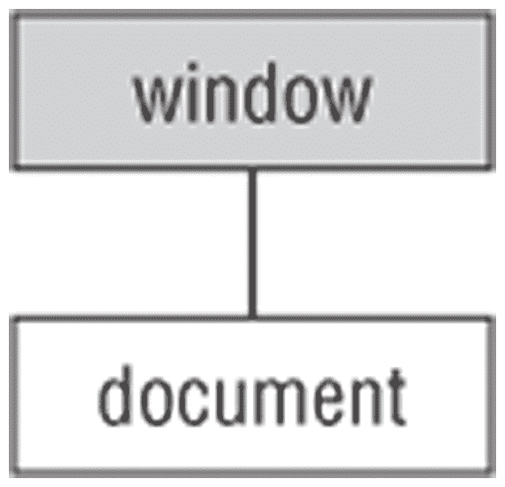

### 使用框架还是不？

框架和`iFrames`是有效的 HTML，它们的使用可能被认为是完成某些任务的理想。然而，基于框架的网站存在严重的易用性和访问性问题，这使得它们对于通用网站开发来说并不理想。

框架集（framesets）的根本问题是，任何给定的框架页面组合无法直接访问。也就是说，如果你通过框架集导航并在框架中显示特定的内容组合，浏览器地址栏中的 URL 将保持为父框架集文档的 URL，而不是你正在查看的内容的 URL。这种对框架页面内容的唯一地址缺失防止了搜索引擎索引内容，并防止他人发布指向框架内容的链接、在计算机上对其进行书签或在电子邮件中分享它们。对于移动设备用户以及放大镜和屏幕阅读器等辅助技术用户来说，框架集可能会导致方向迷失或完全无法访问。

网页易用性专家 Jakob Nielsen 在 1996 年写了《为什么框架很糟糕（大多数时候如此）》。在随后的这些年里，情况并没有得到改善。

避免这些问题的框架替代方案包括使用服务器端脚本合并多个源页面，以及使用 CSS 属性`overflow: auto`创建滚动内容区域，以及使用`position: fixed`建立在页面其他部分滚动时不移动的区域。

在书中，我们假设你已经考虑了使用框架的优缺点，并且可能有一个需要使用它们的 Web 开发问题——或仅仅是出于好奇。我们希望你在必须时知道如何用 JavaScript 操作它们，它们是导航 DOM 的绝佳练习，但我们建议在大多数情况下使用它们。

框架集文档一旦加载到浏览器，浏览器就开始构建一个略有不同的层次模型。该模型的精确结构完全取决于该框架集文档定义的框架集结构。考虑以下骨架框架集定义：

```html
<!DOCTYPE HTML PUBLIC "-//W3C//DTD HTML 4.01 Frameset//EN"
      "http://www.w3.org/TR/html4/frameset.dtd">
<html>
  <head>
      <meta http-equiv="Content-Type" content="text/html; charset=utf-8">
      <title>此框架集内所有页面的标题</title>
  </head>
  <frameset cols="50%,50%">
      <frame name="left" src="somedoc1.html" title="Frame 1">
      <frame name="right" src="somedoc2.html" title="Frame 2">
      <noframes>
  </frameset>
</html>
```

从图 13.2 中任一子窗口的角度来看，它的直接容器是父窗口。当父窗口位于浏览器加载的层级模型顶端时，该窗口也被称为顶级对象（top object）。

## 家族成员之间的引用

考虑到图 13.2 中的框架（frame）结构，现在是查看其中任何一个窗口中的脚本如何访问其他窗口中的对象、函数或变量了。关于此功能需要记住的一点是：如果脚本可以访问其自身窗口中的对象、函数或全局变量，那么层级结构中另一个框架的脚本也可以访问同一个项目（前提是两个文档来自同一个 Web 服务器）。

在目前描述的两代层级结构中，脚本引用可能需要采取三种路径之一：从父到子；从子到父；从子到子。这些窗口之间的每条路径都需要不同的引用样式。

### 父到子的引用

引用最少采用的方向可能是：父文档中的脚本需要访问其某个框架的某个元素。由于父窗口可以包含一个或多个框架，因此父窗口维护了一个子框架对象的数组。你可以通过数组语法或通过在`<frame>`标签内部使用`id`或`name`属性分配的名称来对框架进行引用。在以下引用语法的示例中，我们使用名为`ObjFuncVarName`的占位符来代替你打算在远程窗口或框架中访问的任何对象、函数或全局变量。记住，每个可见的框架都包含一个文档对象（document object），它通常是你脚本操作的元素的容器；请确保对元素的引用包含`document`。基于此，从父窗口到其一个子框架的引用可以遵循以下模型之一：

- `[window.]frames[n].ObjFuncVarName`
- `[window.]frames["frameName"].ObjFuncVarName`
- `[window.]frameName.ObjFuncVarName`

框架的数字索引值基于`<frame>`标签在 frameset 文档中出现的顺序。然而，如果你为每个框架分配可识别的名称并在引用中使用该名称，会让你的工作变得更简单。

### 子到父引用

将脚本链接到父 frameset 文档（在 head 部分）并不罕见，多个子框架或框架中的多个文档可以将其用作通用的脚本库。因为它们在 frameset 中加载，所以当 frameset 可见时，这些脚本只加载一次。如果来自同一服务器的其他文档随着时间的推移加载到框架中，它们可以利用父级脚本，而无需在浏览器中加载自己的副本。

从子窗口的角度来看，层级结构中的上一层被称为父窗口（parent）。因此，从子框架到父层级项目的引用简单为：

`parent.ObjFuncVarName`

如果在父窗口中访问的项目是一个返回值的函数，那么返回的值将毫不犹豫地跨越父子边界传递给子窗口。

```javascript
var sValue = parent.FuncName();
```

当父窗口同样位于当前加载到浏览器的对象层级的顶端时，你可以选择性将其称为顶级窗口（top window），如下：

`top.ObjFuncVarName`

如果由于某种原因你的网页显示在其他网站的 frameset 中，那么使用`top`引用可能是危险的。如果你的顶级窗口不是主 frameset 的顶级窗口怎么办？因此，我们建议尽可能使用`parent`引用（除非你希望脚本在嵌套在你网站的意外框架内时失败）。

### 子到子引用

当涉及到让一个子窗口与其兄弟窗口进行通信时，浏览器需要更多的协助。任何窗口或框架的属性之一是它的`parent`（对于单个窗口来说，其值为`null`）。引用必须使用`parent`属性来跳出当前框架，到达两个子框架共有的点——在这种情况下是父窗口。当引用到达父层级时，引用的其余部分就可以像从父窗口开始一样继续。因此，从一个子窗口到它的某个兄弟窗口，你可以使用以下任何引用格式：

- `parent.frames[n].ObjFuncVarName`
- `parent.frames["frameName"].ObjFuncVarName`
- `parent.frameName.ObjFuncVarName`

从另一个兄弟回到第一个的引用看起来是一样的，但引用的`frames[]`数组索引或`frameName`部分有所不同。当然，HTML 中存在更复杂的框架层级。尽管如此，对象模型和引用方案为你能想象到的最深嵌套且错综复杂的框架安排提供了解决方案——遵循你刚刚学到的原则。

## 框架脚本技巧

框架脚本初学者会犯的首要错误之一是在页面加载时编写直接调用其他框架的即时脚本语句。这里的问题在于，你不能依赖文档加载顺序来遵循 frameset 源代码的顺序。你唯一确定的是父文档首先开始加载。无论`<frame>`标签的顺序如何，子框架都可以以任何序列开始加载。此外，框架的加载时间取决于文档中的其他元素，如图像或 Java applet。

幸运的是，你可以使用某种技术在 frameset 中的所有文档完全加载后启动脚本。就像窗口的`load`事件在相应窗口的文档完全加载时触发一样，父窗口的`load`事件在其子框架的`load`事件触发后才会触发。当你在链接到 frameset 文档的脚本中指定`window.onload`事件处理器时，这等同于对 frameset 元素应用该事件处理器。该处理程序可能会调用 frameset 文档中的一个函数，然后该函数就可以自由访问整个对象层级中所有框架的对象、函数或变量。

请特别注意，作为窗口对象类型的框架引用与对框架元素对象的（element object）引用是完全分开的。元素对象是文档节点树中的 DOM 元素节点之一（参见第 6 章“浏览器和文档对象”）。该节点的属性和方法与归属于窗口类型对象的属性和方法不同。这可能是一个难以掌握的区别，但它非常重要。你引用框架的方式（作为窗口对象还是元素节点）决定了你的脚本可以使用哪组属性和方法。

## 交叉引用

请参阅第 26 章“通用 HTML 元素对象”，获取有关元素节点脚本的更详细介绍。

如果你从框架元素对象的引用开始，你仍然可以访问加载到该框架中的文档对象的引用，但语法取决于浏览器。IE4+ 和 Safari 允许你使用与窗口相同的 document 引用；基于 Mozilla 的浏览器则更紧密地遵循 W3C DOM 标准，使用框架元素的`contentDocument`属性。为了兼容这两种语法，你可以如下所示构建引用：

```javascript
var docObj;
var frameObj = document.getElementById("myFrame");
if (frameObj.contentDocument)
{
  docObj = frameObj.contentDocument;
}
else
{
  docObj = frameObj.document;
}
```

`iframe`元素在 IE4+、基于 Mozilla 的浏览器以及 Safari（以及其他现代浏览器）中作为脚本对象受支持。它通常被用于从服务器获取并加载 HTML，而不会干扰当前的 HTML 页面。`iframe`隐藏在视口之外，而同时由脚本处理它与主文档之间的所有操作，这种做法并不罕见。（今天，这种从服务器异步加载数据到已下载页面的技巧通常使用`XMLHttpRequest()`实现——参见参考光盘中的第 39 节“Ajax、E4X 和 XML”。）

`iframe`元素成为当前窗口帧集合（frames collection）的另一个成员，但你也可以通过 W3C DOM `document.getElementById()`术语将`iframe`作为元素对象进行引用。与传统的作为窗口的帧对象与 DOM 元素对象之间的区别一样，`iframe`元素对象内部的`document`对象的引用需要特殊处理。更多细节请参阅第 27 章“窗口和帧对象”。

## 高亮脚注：Frameset 脚本示例

为了体验窗口间的脚本交互，请考虑一个`frameset`，当点击文档正文中相应的链接时，它会在一个帧中高亮显示脚注。图 13.3 显示了该 frameset 的外观，列表 13-1 提供了标记和脚本。

图 13.3 高亮脚注的 frameset。

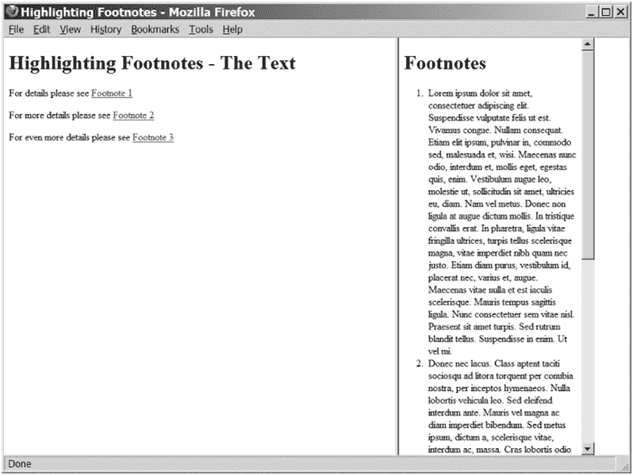

这三个 HTML 文件建立了一个包含两个子帧的`frameset`，一个用于正文，另一个用于脚注。点击文本中的脚注链接会将所选的脚注带到脚注帧的顶部。它通过将所选脚注的元素`id`添加到 URL 的`hash`中来实现的：

```html
<a target="frameFootnotes" href="jsb-13-01-frame-footnotes.html#footnote-01">脚注 1</a>
```

`target`属性标识子帧，而`href`则指定了哪个文档将出现在该帧中。`href` URL 的最后部分`#footnote-01`与脚注标记匹配：

```html
<li id="footnote-01">Lorem ipsum dolor ...</li>
```

这是浏览器的基本功能：当元素的`id`被设为 URL 的`hash`时，页面会向上滚动（如果可以的话），将该元素置于窗口顶部。

JavaScript 和 CSS 协同工作以高亮所选的脚注：当用户点击文本窗口中的脚注链接时，JavaScript 为脚注元素分配一个“selected”（已选择）类。CSS 使用背景颜色对该类进行样式处理。

### 列表 13-1：高亮脚注

#### HTML：`jsb-13-01-frameset.html`

```html
<!DOCTYPE HTML PUBLIC "-//W3C//DTD HTML 4.01 Frameset//EN" "http://www.w3.org/TR/html4/frameset.dtd">
<html>
  <head>
    <meta http-equiv="Content-Type" content="text/html; charset=utf-8">
    <title>高亮脚注</title>
    <link href="jsb-13-01-frameset.css" rel="stylesheet" type="text/css" media="all">
  </head>
  <frameset cols="66%,33%">
    <frame name="frameText" src="jsb-13-01-frame-text.html" title="帧 1">
    <frame name="frameFootnotes" src="jsb-13-01-frame-footnotes.html" title="帧 2">
    <noframes>
      <body>
        <h1>带脚注的正文</h1>
        <p>继续到 <a href="jsb-13-01-frame-text-footnotes.html">合并的正文和脚注。</a></p>
      </body>
    </noframes>
  </frameset>
</html>
```

#### CSS：`jsb-13-01-frameset.css`

```css
/* 限制页面宽度 */
html {
  width: 60em;
  max-width: 100%;
}
```

#### HTML：`jsb-13-01-frame-text.html`

```html
<!DOCTYPE html PUBLIC "-//W3C//DTD HTML 4.01 Transitional//EN" "http://www.w3.org/TR/html4/loose.dtd">
<html>
  <head>
    <meta http-equiv="Content-Type" content="text/html; charset=utf-8">
    <title>高亮脚注 - 正文</title>
    <script type="text/javascript" src="../jsb-global.js"></script>
    <script type="text/javascript" src="jsb-13-01-frame-text.js"></script>
  </head>
  <body>
    <h1>高亮脚注 - 正文</h1>
    <p>详情请见 <a target="frameFootnotes" href="jsb-13-01-frame-footnotes.html#footnote-01">脚注 1</a></p>
    <p>详情请见 <a target="frameFootnotes" href="jsb-13-01-frame-footnotes.html#footnote-02">脚注 2</a></p>
    <p>详情请见 <a target="frameFootnotes" href="jsb-13-01-frame-footnotes.html#footnote-03">脚注 3</a></p>
  </body>
</html>
```

#### JavaScript：`jsb-13-01-frame-text.js`

```javascript
// 页面加载时运行脚本
addEvent(window, 'load', initialize);
// 全局脚注内存
var oFootnote = null;
var snoteClass = '';

// 文档加载时应用行为
function initialize() {
  // 仅当浏览器支持 DOM 时执行
  if (document.getElementById) {
    // 收集链接
    var aAnchors = document.getElementsByTagName('a');
    // 遍历每个链接
    for (var i = 0; i < aAnchors.length; i++) {
      // 获取链接的 target
      var sTarget = aAnchors[i].getAttribute('target');
      // 如果存在 target 且为脚注帧
      if (sTarget == 'frameFootnotes') {
        addEvent(aAnchors[i], 'click', highlight);
      }
    }
  }
}

// 高亮所选脚注
function highlight() {
  // 恢复之前高亮的脚注（如果有）
  if (oFootnote) {
    oFootnote.className = snoteClass;
  }
  // 获取点击链接的 href
  var sHref = this.getAttribute('href');
  // 获取 URL 的 hash
  var iHash = sHref.indexOf('#');
  // hash 标记之后是元素 id
  var snoteId = sHref.substr(iHash + 1);
  // 链接的 target 是帧 id
  var sFrameId = this.getAttribute('target');
  // 如果帧存在
  if (parent[sFrameId]) {
    // 指向指定的脚注
    oFootnote = parent[sFrameId].document.getElementById(snoteId);
    // 如果它存在
    if (oFootnote) {
      // 记住原始类以便稍后恢复
      snoteClass = oFootnote.className;
      // 设置新类
      oFootnote.className = 'selected';
    }
  }
}
```

#### HTML：`jsb-13-01-frame-footnotes.html`

```html
<!DOCTYPE html PUBLIC "-//W3C//DTD HTML 4.01 Transitional//EN" "http://www.w3.org/TR/html4/loose.dtd">
<html>
  <head>
    <meta http-equiv="Content-Type" content="text/html; charset=utf-8">
    <title>脚注</title>
    <link href="jsb-13-01-frame-footnotes.css" rel="stylesheet" type="text/css" media="all">
  </head>
  <body>
    <h1>脚注</h1>
    <ol class="footnotes">
      <li id="footnote-01">Lorem ipsum dolor sit amet, consectetur adipiscing elit. Suspendisse vulputate felis est. Vivamus congue. Nulla sequat. Etiam elit ipsum, pulvinar in, commodo sed, malesuada et, wisi. Maecenas nunc odio, interdum et, mollis get, egestas quis, enim. Vestibulum augue leo, molestie ut, sollicitudin sit amet, ultricies eu, diam. Nam vel metus. Donec non ligula augue dictum mollis. In tristique vallis erat. In pharetra, ligula vitae fringilla ultrices, turpis tellus, vitae imperdiet nibh nec justo. Etiam diam purus, vestibulum id, placerat nec, varius et, augue. Maecenas vitae nulla. Mauris tempus sagittis ligula. Nunc consectetur sem vitae nisl. Praesent sit amet turpis. Sed rutrum blandit tellus. Suspendisse in enim. Ut vel mi.</li>
      <li id="footnote-02">Donec nec lacus. Class aptent taciti sociosqu ad litora torquent per conubia nostra, per inceptos hymenaeos. Nulla lobortis vehicula leo. Sed eleifend interdum ante. Mauris vel magna ac diam imperdiet bibendum. Sed metus ipsum, dictum a, scelerisque vitae, interdum ac, massa. Cras lobortis odio at augue. Aenean fermentum bibendum purus. Ut congue interdum turpis. Ut quis mi a ligula viverra hendrerit. Nulla facilisi. Nulla lacinia, ligula ac congue feugiat, risus diam fringilla tellus, condimentum volutpat eros risus sit amet dolor.</li>
      <li id="footnote-03">Proin et urna. Morbi in odio. In mauris tellus, tincidunt vitae, ultrices a, sollicitudin sit amet, nulla. Praesent consequat, lectus auctor imperdiet dapibus, risus turpis feugiat orci, sit amet tempus quam erat a purus. Nulla neque nulla, fringilla ut, dictum id, luctus placerat, urna. Sed vel velit. Fusce eget erat a quam auctor pulvinar. Phasellus vel neque eu risus feugiat sagittis. Nulla est. Duis sed massa. Duis ac leo quis sapien fringilla posuere. Nam facilisis lorem. Nulla bibendum, wisi quis ultrices bibendum, sem pede volutpat sem, ut ultrices odio nisl ut ligula. Cras ligula est, tempus et, tempus vitae, pretium eget, ipsum. Integer blandit mattis wisi. Curabitur eget tellus at neque vulputate dignissim. Phasellus leo nibh, euismod ac, congue vel, interdum et, turpis. Fusce viverra aliquet wisi.</li>
    </ol>
  </body>
</html>
```

#### CSS：`jsb-13-01-frame-footnotes.css`

```css
/* 设置选中脚注的样式 */
ol.footnotes li.selected {
    background-color: aqua;
}
```

让我们通过 JavaScript 看看高亮功能是如何工作的。该脚本链接到`frame-text.html`文档，因为正是点击该文档中链接的行为触发了高亮事件。`addEvent()`函数调用告诉 JavaScript 在文档加载后运行`initialize()`函数。该函数遍历文档中所有的锚点元素（anchor elements）。如果它发现`target`属性设置为`frameFootnotes`，它将应用`onclick`事件来运行`highlight()`函数。

当用户点击文档文本中的这些链接之一时，`highlight()`函数会为该锚点元素赋予选定的类（class）。为了方便以后将链接恢复到原先的类名，脚本将当前锚点元素的指针及其类属性存储在全局变量`oFootnote`和`snoteClass`中。因此，当点击链接时，它执行的第一件事就是恢复之前点击的链接（如果有）。

为了设置另一个子帧（child frame）中脚注的类属性，脚本需要确定帧名称和脚注元素的名称。帧名称与被点击链接的`target`属性完全相同。脚注元素是脚注帧中`ID`等于 URL 末尾哈希值（hash）的任何元素。

如果命名的帧存在且命名的元素存在，脚本就可以安全地保存元素现有的类（如果有），并将类设置为`selected`。最后，链接到脚注文档的样式表会为任何带有所选类的脚注应用背景颜色。

列表 13-1 演示了两个重要的脚本原则。首先，此页面的基本操作——将选中的脚注带到脚注帧的顶部——完全由 HTML 处理，不需要任何 JavaScript 的帮助。这确保了页面在不支持 JavaScript 的用户代理（如移动设备）或用户禁用了 JavaScript 的浏览器中查看时，仍然是可用的。这是渐进增强（progressive enhancement）的一个示例，该原则规定我们的脚本工作应该增强已经具有功能的页面，而不是提供任务关键的功能。我们希望为运行 JavaScript 的用户改进体验，同时又不让不运行 JavaScript 的用户破坏页面。

其次，我们使用 JavaScript 来指示脚注被“选中”了，而不是指示它们应该如何设置样式。我们本可以编写脚本：

```javascript
oFootnote.style.backgroundColor = 'aqua';
```

相反，样式被留给了 CSS。这是开发层分离（separation of development layers）的一个示例，其中 HTML 结构和内容与 JavaScript 行为以及 CSS 呈现保持分离。这种开发模式可以快速方便地创建新代码、调整现有代码并将旧代码应用到新项目中。例如，当网站设计师更改网站的外观时——放心，几乎每个网站在开发期间或之后都会更改——外观上的变化应该由熟悉 CSS 的人轻松完成，而不需要 JavaScript 程序员的参与。

## 多窗口的引用

在第 10 章中，你看到了如何创建一个新窗口，并通过`window.open()`方法返回的窗口对象引用与其进行通信。在本节中，我们将展示其中一个子窗口如何与创建该子窗口的窗口或帧中的对象、函数和变量进行通信。

每个窗口对象都有一个名为`opener`的属性。该属性包含对执行`window.open()`语句并生成子窗口的脚本窗口或帧的引用。对于主浏览器窗口及其中的帧，此值为`null`。由于`opener`属性是一个有效的窗口引用（当其值不为`null`时），你可以使用它开始引用原始窗口中的项目，就像子帧中的脚本使用`parent`来访问父级文档中的项目一样。（然而，`parent`关键字不用于子窗口的`opener`）。

列表 13-2 包含两个在独立窗口中协同工作的文档。`jsb-13-02-main.html`显示一个按钮，点击后会打开一个较小的窗口并将`jsb-13-02-sub.html`加载到其中，另一个按钮则关闭子窗口。主窗口文档还包含文本字段，当你在子窗口的相应字段中输入文本时，该字段会被填充。

### 注意事项

你可能需要临时关闭弹出窗口拦截来尝试这些示例。

由于许多人已将浏览器设置为阻止弹出窗口，而且由于弹出窗口对于使用屏幕阅读器等辅助技术的人来说可能非常令人困惑，并且对其他人来说令人恼火，我们不建议在现实应用程序中使用 JavaScript 创建子窗口——特别是对于任何关键功能。相反，请使用其他技术，例如 CSS 弹出窗口，它们在缺少样式和脚本的情况下可以优雅地降级为简单的 HTML 导航。

在主窗口的脚本中，`openSubWindow()`函数生成新窗口。由于`closeSubWindow()`函数需要知道关闭哪个窗口，我们将新窗口的指针存储在全局变量中。

### 列表 13-2：主窗口文档

HTML：`jsb-13-02-main.html`

```html
<!DOCTYPE html>
<html>
<head>
    <meta http-equiv="content-type" content="text/html;charset=utf-8">
    <title>Opener</title>
    <script type="text/javascript" src="../jsb-global.js"></script>
    <script type="text/javascript" src="jsb-13-02-main.js"></script>
</head>
<body>
    <h1>Opener</h1>
    <form action="">
        <p>
            <input type="button" value="Open Sub Window" id="open-sub-window">
            <input type="button" value="Close Sub Window" id="close-sub-window">
        </p>
        <p>
            <label>Text incoming from subwindow:</label>
            <input type="text" id="output">
        </p>
    </form>
</body>
</html>
```

JavaScript：`jsb-13-02-main.js`

```javascript
// 页面加载时运行脚本
addEvent(window, 'load', initialize);
// 指向子窗口的全局指针
var oSubWindow;

// 在文档加载后应用行为
function initialize() {
    // 仅当浏览器可以处理 DOM 方法时才执行
    if (document.getElementById) {
        // 指向按钮
        var oButton = document.getElementById('open-sub-window');
        // 如果存在，则应用行为
        if (oButton)
        {
            addEvent(oButton, 'click', openSubWindow);
        }
        // 指向按钮
        oButton = document.getElementById('close-sub-window');
        // 如果存在，则应用行为
        if (oButton)
        {
            addEvent(oButton, 'click', closeSubWindow);
        }
    }
}

// 打开（创建）子窗口
function openSubWindow()
{
    // 将子窗口指针存储在全局变量中
    oSubWindow = window.open("jsb-13-02-sub.html", "sub", "height=200,width=300");
}

// 关闭（销毁）子窗口
function closeSubWindow()
{
    // 如果子窗口已打开，则关闭它
    if (oSubWindow)
    {
        oSubWindow.close();
    }
}
```

HTML: `jsb-13-02-sub.html`

```html
<!DOCTYPE html>
<html>
<head>
    <meta http-equiv="content-type" content="text/html;charset=utf-8">
    <title>子文档</title>
    <script type="text/javascript" src="../jsb-global.js"></script>
    <script type="text/javascript" src="jsb-13-02-sub.js"></script>
</head>
<body>
    <h1>子文档</h1>
    <form id="sendForm" action="">
        <p>
            <label for="input">输入要复制到主窗口的文本：</label>
            <input type="text" id="input">
        </p>
        <p>
            <input type="button" value="发送文本到打开者" id="send-text">
        </p>
    </form>
</body>
</html>
```

JavaScript: `jsb-13-02-sub.js`

```javascript
// 页面加载时运行脚本
addEvent(window, 'load', initialize);

// 文档加载后应用行为
function initialize()
{
    // 仅当浏览器能够处理 DOM 方法时执行此操作
    if (document.getElementById)
    {
        // 指向按钮
        var oButton = document.getElementById('send-text');
        // 如果存在，则应用行为
        if (oButton)
        {
            addEvent(oButton, 'click', copyToOpener);
        }
    }
}

// 将输入文本复制到父窗口的输出
function copyToOpener()
{
    // 在当前窗口中查找输入字段
    var oInput = document.getElementById('input');
    // 在父窗口中查找输出字段
    var oOutput = opener.document.getElementById('output');
    // 如果两者都存在，则复制输入文本
    if (oInput && oOutput)
    {
        oOutput.value = oInput.value;
    }
}
```

子窗口中的所有操作都源于分配给“发送文本”按钮的`onclick`事件处理器。它触发了`copyToOpener()`函数，该函数将子窗口输入字段的值赋值给打开者窗口文档中输出字段的值。请记住，每个窗口和帧（frame）的内容都属于一个文档。即使你的引用指向特定的窗口或帧，该引用也继续帮助浏览器找到最终目的地，通常是该文档的某个元素。

在我们让你探索书中的所有细节之前，只剩下最后一课了。我们将使用最后一个教程向你展示一些可以在页面上实现的有趣操作，例如当用户鼠标悬停在图片上时更改图像。

## 练习

在回答前三个问题之前，请学习以下列出课程的网站的帧集（frameset）结构：

```html
<html>
<head>
    ...
</head>
<frameset rows="85%,15%">
    <frameset cols="20%,80%">
        <frame name="mechanics" src="history01M.html">
        <frame name="description" src="history01D.html">
    </frameset>
    <frameset cols="100%">
        <frame name="navigation" src="navigator.html">
    </frameset>
</frameset>
<noframes>
    ...
</noframes>
</html>
```

1. 加载到`description`帧的每个文档链接到一个 JavaScript 脚本，该脚本使用`onload`事件处理器将课程标识符值存储在帧布局文档的全局变量`currCourse`中。编写一个将此值设置为`history101`的函数。

2. 绘制一个框图，描述帧集定义中表示的窗口和帧的层级结构。

3. 编写位于`navigation`帧中的 HTML 标记和 JavaScript 语句，共同执行两个操作：将文件`french201M.html`加载到`mechanics`帧，并将`french201D.html`加载到`description`帧。

4. 当帧集仍在加载时，突然出现了一条 JavaScript 错误信息，显示“window.document.navigation.form.selector is undefined”。你认为应用程序脚本中发生了什么？你该如何解决这个问题？

5. 主窗口的子帧中的脚本使用`window.open()`生成了第二个窗口。第二个窗口中的脚本如何访问主浏览器窗口中顶部（帧布局）窗口的`location`对象（URL）？

# 图像与动态 HTML

### 本章内容

- 如何预缓存图像
- 如何在鼠标悬停时切换图像
- 样式表设置
- 动态修改内容

之前的八节课程非常密集，涵盖了编程概念的大量领域。现在是时候将这些基础知识应用于更高级的技术了。我们将介绍两个领域。首先，我们将展示如何实现流行的鼠标悬停效果，即用户在屏幕上移动鼠标时切换图像。然后我们将介绍在页面加载后修改样式的技术。

虽然鼠标悬停切换图像可以使用层叠样式表（CSS）更轻松地完成，但我们将使用 JavaScript 进行演示，因为你可能会看到很多代码，而且它是操作图像对象的一种方便方法。

#### Image 对象

文档包含的对象之一是`Image`对象——自 NN3 和 IE4 时代以来所有支持脚本的浏览器。图像对象的引用在对象模型中作为属于文档的数组存储。因此，你可以通过数组索引或名称引用图像。此外，数组索引可以是图像名称的字符串版本。以下都是图像对象的有效引用：

- `document.getElementById("imageName")`
- `document.getElementsByTagName("img")[n]`
- `document.images[n]`
- `document.images["imageName"]`
- `document.imageName`

（最后一种引用仅当`imageName`不包含任何 JavaScript 不允许的有效 HTML 字符（例如连字符或点）时才有效。）

JavaScript 的出现解决了这个问题，它允许脚本将图像加载到浏览器的内存缓存中而不显示，这种技术被称为图像预缓存（pre-caching）。最有效的策略是在页面初始加载时将图像预加载到浏览器的图像缓存中。用户对于主页面加载时多出的几秒钟的耐心程度，比等待响应某些鼠标动作来下载图像要高得多。然而，请记住这存在一种平衡。现在的观众倾向于在页面加载少于 10 秒后就离开。虽然预缓存图像意味着对鼠标操作有快速响应，但如果你预缓存了太多图像，可能会在用户看到响应鼠标操作的精彩图像切换之前就失去网站访问者。

预缓存图像需要在内存中构建图像对象。在内存中创建的图像对象在某些方面与使用``标签创建的文档`img`元素对象不同。仅内存对象是由脚本创建的，你完全在页面上看不到它们。但它们在文档代码中的存在强制浏览器在页面加载时加载图像。对象模型提供了一个`Image`对象构造函数，用于创建内存类型的图像对象，如下：

```javascript
var myImage = new Image(width, height);
```

构造函数的参数是图像的像素宽度和高度。这些维度应该与``标签的`width`和`height`属性匹配。一旦图像对象存在内存中，你就可以将文件名或 URL 赋值给该图像对象的`src`属性：

```javascript
myImage.src = "someArt.gif";
```

当浏览器遇到为图像对象的`src`属性分配 URL 的语句时，浏览器会获取并将该图像加载到图像缓存中。用户看到的只是状态栏中额外的加载信息，就像页面上有另一张图像一样。等到整个页面加载完成，所有以这种方式生成的图像都存储在图像缓存中。然后你可以将缓存图像的`src`属性（或实际的图像 URL）分配给使用``标签创建的文档图像的`src`属性：

```javascript
document.images[0].src = myImage.src;
```

或者

```javascript
document.getElementById("myImg").src = myImage.src;
```

文档中图像的更改是瞬时的。

列表 14-1 显示了一个页面，该页面包含一个``标签和一个`select`列表，后者允许你将文档中的图像替换为四个预缓存图像中的任何一张（包括标签指定的原始图像）。如果你输入此列表，可以从第 14 章列表目录中的附带 CD-ROM 中获取这四个图像文件的副本。（不过，你仍然必须手动输入 HTML 和代码。）

### 列表 14-1: 图像预缓存

HTML: `jsb-14-01.html`

```html
<!DOCTYPE html>
<html>
<head>
    <meta http-equiv="content-type" content="text/html;charset=utf-8">
    <title>Image Object</title>
    <style type="text/css">
        img
        {
            height:90px; width:120px;
        }
    </style>
    <script type="text/javascript" src="../jsb-global.js"></script>
    <script type="text/javascript" src="jsb-14-01.js"></script>
</head>
<body>
    <h2>Image Object</h2>
    
    <form>
        <select id="imageChooser">
            <option value="image1">Bands</option>
            <option value="image2">Clips</option>
            <option value="image3">Lamp</option>
            <option value="image4">Erasers</option>
        </select>
    </form>
</body>
</html>
```

JavaScript: `jsb-14-01.js`

```javascript
// 页面加载时初始化
var oImageChooser;
addEvent(window, "load", initialize);

function initialize()
{
    // 获取 ID 的 W3C DOM 或 IE4+ 引用
    // imageChooser 是 select 元素
    if (document.getElementById)
    {
        oImageChooser = document.getElementById("imageChooser");
    }
    else
    {
        oImageChooser = document.imageChooser;
    }
    addEvent(oImageChooser, 'change', loadCached);
}

// 初始化空数组
var imageLibrary = new Array();
// 预缓存四个图像
imageLibrary["image1"] = new Image(120,90);
imageLibrary["image1"].src = "desk1.gif";
imageLibrary["image2"] = new Image(120,90);
imageLibrary["image2"].src = "desk2.gif";
imageLibrary["image3"] = new Image(120,90);
imageLibrary["image3"].src = "desk3.gif";
imageLibrary["image4"] = new Image(120,90);
imageLibrary["image4"].src = "desk4.gif";

// 从选择列表中加载选定的图像
function loadCached()
{
    var imgChoice = oImageChooser.options[oImageChooser.selectedIndex].value;
    document.getElementById("thumbnail").src = imageLibrary[imgChoice].src;
}
```

当页面加载时，它会立即执行几个语句。这些语句创建了一个填充了四个新内存图像对象的数组。每个图像对象都有其`src`属性分配了文件名。这些图像在页面加载时被加载到图像缓存中。在文档的 body 部分，一个``标签在页面上占据一席之地，并加载其中一张图像作为起始图像。

`select`元素列出了图片的友好用户名称，同时在（option 的值中）存储了已经在内存中预缓存的图像对象的名称。当用户从列表中进行选择时，`loadCached()`函数提取所选项目的值——该值是图像在`imageLibrary`数组中的字符串索引。所选图像对象的`src`属性被赋值给页面上可见的`img`元素对象的`src`属性，预缓存的图像会立即出现。

### 创建图像悬停效果（rollovers）

为页面增加一些虚拟趣味的常用技术之一是当用户光标悬停在按钮上时切换按钮图像。图像变化的程度在很大程度上取决于个人口味。效果可以是细微的（原始图像边缘有轻微的亮起或光晕），也可以是剧烈的（颜色的根本性变化）。无论你采用何种方法，脚本编写都是相同的。

当多个图形按钮成组出现时，我们倾向于将内存对象组织成数组，并创建便于操作数组的命名和编号方案。列表 14-2 显示了控制幻灯片的四个按钮的此类安排。列表中的代码局限于应用程序的图像切换部分。这是最复杂且最长的列表，因此在执行过程中需要一些解释。它起始于位于容器内的每个`img`元素的样式表规则。

### 列表 14-2: 图像悬停效果

```html
<!DOCTYPE html>
<html>
<head>
    <meta http-equiv="content-type" content="text/html;charset=utf-8">
    <title>Slide Show/Image Rollovers</title>
    <style type="text/css">
        div#controller img {
            height:70px; width:136px; padding:5px;
        }
    </style>
...
</html>
```

只有能够处理图像对象的浏览器应该执行预缓存图像的语句。因此，整个序列都嵌套在一个测试`document.images`数组存在的 if 结构中。在旧版浏览器中，该条件求值为`undefined`，if 条件会将其视为假：

```javascript
if (document.images)
{
```

## 简介

图像预缓存从构建两个图像对象数组开始。一个数组存储描述图形按钮“关闭”状态的图像信息；另一个用于描述“开启”状态的图像。这些数组使用字符串（而不是整数）作为索引值。字符串名称对应于源代码稍后出现的可见`img`元素的名称。这种代码的可读性更清晰（例如，你知道`offImgArray["first"]`条目与第一个按钮图像有关）。此外，正如你在后文的列表中看到的，鼠标悬停图像不会与页面上的其他可见图像发生冲突（如果你在引用可见图像时完全依赖数字索引值进行切换，就可能发生这种情况）。

在创建数组并为数组的前四个元素分配新的空白图像对象后，我们再次遍历该数组，这次为存储在数组中的每个对象的`src`属性分配文件路径。这些代码会在页面加载时执行，强制图像在此过程中加载到图像缓存中：

```javascript
// pre-cache all 'off' button images
var offImgArray = new Array();
offImgArray["first"] = new Image(136,70);
offImgArray["prev"] = new Image(136,70);
offImgArray["next"] = new Image(136,70);
offImgArray["last"] = new Image(136,70);
// off image array -- set 'off' image path for each button
offImgArray["first"].src = "firstoff.png";
offImgArray["prev"].src = "prevoff.png";
offImgArray["next"].src = "nextoff.png";
offImgArray["last"].src = "lastoff.png";

// pre-cache all 'on' button images
var onImgArray = new Array();
onImgArray["first"] = new Image(136,70);
onImgArray["prev"] = new Image(136,70);
onImgArray["next"] = new Image(136,70);
onImgArray["last"] = new Image(136,70);
// on image array -- set 'on' image path for each button
onImgArray["first"].src = "firston.png";
onImgArray["prev"].src = "prevon.png";
onImgArray["next"].src = "nexton.png";
onImgArray["last"].src = "laston.png";
```

## 模式优化

你看到上述语句中重复的模式了吗？与其使用那些语句，这里有一种你可以利用这种重复模式的方法：

```javascript
var offImgArray = new Array();
var onImgArray = new Array();
var ButtonArray = ["first", "prev", "next", "last"];
for (var i=0; i < ButtonArray.length; i++) {
    var Button = ButtonArray[i];
    // pre-cache 'off' button image
    offImgArray[Button] = new Image(136,70);
    offImgArray[Button].src = Button + "off.png";
    // pre-cache 'on' button image
    onImgArray[Button] = new Image(136,70);
    onImgArray[Button].src = Button + "on.png";
}
```

正如你在下面的代码所示，当用户将鼠标悬停在任何可见图像对象上方时，`mouseover`事件处理器会调用`imageOn()`函数，并传递特定图像的名称。`imageOn()`函数使用该名称同步`document.images`条目（可见图像）与来自`onImgArray`内存图像数组的条目。该条目的`src`属性被赋值给相应的文档图像。同时，光标变为活动链接的外观。

```javascript
// functions that swap images & status bar
function imageOn(imgName) {
    if (document.images) {
        document.images[imgName].style.cursor = "pointer";
        document.images[imgName].src = onImgArray[imgName].src;
    }
}
```

`mouseout`事件处理器也是如此，它需要通过用相同的索引调用`imageOff()`函数来关闭图像。

```javascript
function imageOff(imgName) {
    if (document.images) {
        document.images[imgName].style.cursor = "default";
        document.images[imgName].src = offImgArray[imgName].src;
    }
}
```

`mouseover`和`mouseout`处理器都会将状态栏文本设置为一个友好的描述符——至少在那些支持在状态栏显示自定义文本的浏览器中是如此。`mouseout`处理器将状态消息设置为空字符串。

```javascript
function setMsg(msg) {
    window.status = msg;
    return true;
}
```

## 实现

对于本次演示，我们禁用了控制幻灯片的函数。但我们保留了这些空函数定义，以便它们捕获由关联链接发起的调用。

```javascript
// controller functions (disabled)
function goFirst() {}
function goPrev() {}
function goNext() {}
function goLast() {}

// event handler assignments
function init() {
    if (document.getElementById) {
        oImageFirst = document.getElementById("first");
        oImagePrev = document.getElementById("prev");
        oImageNext = document.getElementById("next");
        oImageLast = document.getElementById("last");
    } else {
        oImageFirst = first;
        oImagePrev = prev;
        oImageNext = next;
        oImageLast = last;
    }

    addEvent(oImageFirst, "click", goFirst);
    addEvent(oImageFirst, "mouseover", function() {
        imageOn("first");
        return setMsg("Go to first picture");
    });
    addEvent(oImageFirst, "mouseout", function() {
        imageOff("first");
        return setMsg("");
    });

    addEvent(oImagePrev, "click", goPrev);
    addEvent(oImagePrev, "mouseover", function() {
        imageOn("prev");
        return setMsg("Go to previous picture");
    });
    addEvent(oImagePrev, "mouseout", function() {
        imageOff("prev");
        return setMsg("");
    });

    addEvent(oImageNext, "click", goNext);
    addEvent(oImageNext, "mouseover", function() {
        imageOn("next");
        return setMsg("Go to next picture");
    });
    addEvent(oImageNext, "mouseout", function() {
        imageOff("next");
        return setMsg("");
    });

    addEvent(oImageLast, "click", goLast);
    addEvent(oImageLast, "mouseover", function() {
        imageOn("last");
        return setMsg("Go to last picture");
    });
    addEvent(oImageLast, "mouseout", function() {
        imageOff("last");
        return setMsg("");
    });
}

// initialize when the page has loaded
addEvent(window, "load", init);
</script>
</head>
<body>
<h1>Slide Show Controls</h1>
</body>
```

我们选择将控制器图像放在`div`元素内部，这样图像就可以作为一个整体进行定位或设置样式。每个`img`元素的`onmouseover`事件处理程序（上文定义）会调用`imageOn()`函数，并传递要更换的图像名称。由于`onmouseover`和`onmouseout`事件处理程序在旧版浏览器中都需要`return true`语句才能正常工作，我们将第二次函数调用（调用`setMsg()`）与`return true`要求结合在一起。`setMsg()`函数始终返回`true`，在调用`setMsg()`函数之前将其与`return`关键字结合。这只是为了减少这些事件处理程序中代码量的一种技巧。

```html
<div id="controller">
    
    
    
    
</div>
</body>
</html>
```

你可以在图 14.1 中看到这段长脚本的结果。当用户将鼠标悬停在其中一个图像上，它会通过更换整个图像从浅色变为深色。你可以访问 CD-ROM 上的图像文件，我们鼓励你输入这段长列表并亲眼见证魔法。

图 14.1 鼠标悬停图像切换。

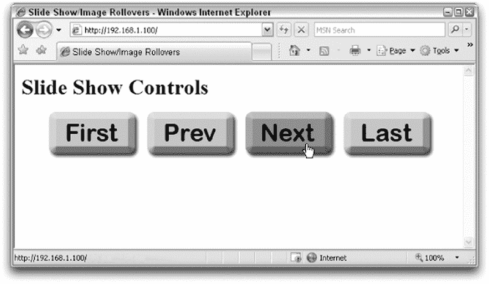

## 无脚本悬停

尽管悬停效果很酷，但多亏于 CSS 技术，你并不总是需要 JavaScript 来完成动态。你可以将 CSS 与 JavaScript 结合来实现相同的效果。列表 14-3 展示了列表 14-2 的版本，但使用了 CSS 实现悬停效果，而 JavaScript 仍然处理幻灯片的控制。

用于按钮的 HTML 由`li`元素组成，这些元素设置了尺寸并分配了按钮“关闭”状态的背景图像。每个`li`元素的文本被`a`元素包裹，以便可以分配 CSS `:hover`伪元素（Internet Explorer 7 及以前版本需要此，而 W3C DOM 浏览器识别所有元素的`:hover`）。当光标悬停在`a`元素上时，背景图像将变为“开启”状态。`onclick`事件处理程序的赋值保留在页面的脚本部分，它们在页面加载后执行（以确保元素已存在）。

### 列表 14-3：CSS 图像悬停

HTML: `jsb-14-03.html`

```html
<!DOCTYPE html>
<html>
    <head>
        <meta http-equiv="content-type" content="text/html;charset=utf-8">
        <title>幻灯片/图像悬停</title>
        <link rel="stylesheet" href="jsb-14-03.css" type="text/css">
        <script type="text/javascript" src="../jsb-global.js"></script>
        <script type="text/javascript" src="jsb-14-03.js"></script>
    </head>
    <body>
        <h1>幻灯片控制</h1>
        <ul id="controller">
            <li id="first"><a href="#">第一个</a></li>
            <li id="prev"><a href="#">上一个</a></li>
            <li id="next"><a href="#">下一个</a></li>
            <li id="last"><a href="#">最后一个</a></li>
        </ul>
    </body>
</html>
```

CSS: `jsb-14-03.css`

```css
#controller {
    position: relative;
}
#controller li {
    position: absolute; list-style: none; display: block;
    height: 70px; width: 136px;
}
#controller a {
    display: block; text-indent: -999px; height: 70px;
}
#first {
    left: 0px;
}
#prev {
    left: 136px;
}
#next {
    left: 272px;
}
#last {
    left: 408px;
}
#first a {
    background-image: url("firstoff.png");
}
#prev a {
    background-image: url("prevoff.png");
}
#next a {
    background-image: url("nextoff.png");
}
#last a {
    background-image: url("lastoff.png");
}
#first a:hover {
    background-image: url("firston.png");
}
#prev a:hover {
    background-image: url("prevon.png");
}
#next a:hover {
    background-image: url("nexton.png");
}
#last a:hover {
    background-image: url("laston.png");
}
```

JavaScript: `jsb-14-03.js`

```javascript
// controller 函数
function goFirst() {}
function goPrev() {}
function goNext() {}
function goLast() {}

// 事件处理器赋值
function init() {
    if (document.getElementById) {
        document.getElementById("first").onclick = goFirst;
        document.getElementById("prev").onclick = goPrev;
        document.getElementById("next").onclick = goNext;
        document.getElementById("last").onclick = goLast;
    }
}
window.onload = init;
```

请注意，`javascript:`并不是一个发布的标准，尽管它被浏览器厂商广泛采用。在一个可能被有访问障碍的访问者（以及可能被具有很少或完全没有 JavaScript 能力的浏览器）访问的公共网站上，链接应该指向一个执行操作的服务器 URL（例如，通过服务器程序），该程序转而为支持脚本的浏览器的访问者复制客户端 JavaScript（速度更快）的操作。

## 流行的动态 HTML 技术

由于当今支持脚本的浏览器统一允许脚本访问文档的每个元素，并在任何内容变化时自动重流页面内容，因此你的应用程序可以实现高度的动态性。动态 HTML（DHTML）是一个非常深入的主题，具有许多特定的特性。在教程的这一部分中，你将学习在 Internet Explorer 和 W3C DOM 兼容浏览器中运行的技术。我们将关注 DHTML 最常用的两个任务之一：更改元素样式和修改文档内容。

## 修改样式表设置

在页面上渲染的每个元素（甚至是某些未渲染的元素）都有名为`style`的属性。该属性允许脚本访问当前浏览器为该元素支持的所有 CSS 属性。属性值与 CSS 规范中使用的相同——通常与以前通过 HTML 标签属性进行的类似设置语法不同。例如，如果你想设置 ID 为`FranklinQuote`的块引用（blockquote）元素的文本颜色，语法为：

```javascript
document.getElementById("FranklinQuote").style.color = "rgb(255, 255, 0)";
```

由于 CSS 颜色属性接受其他指定颜色的方法（例如传统的十六进制三元组——#ffff00），你也可以使用这些方法。

然而，某些 CSS 属性名称不符合 JavaScript 的命名规范。多个 CSS 属性名称包含连字符。当发生这种情况时，属性的脚本等效写法会压缩单词并将每个单词的首字母大写。例如，CSS 属性`font-weight`在脚本赋值如下：

```javascript
document.getElementById("highlight").style.fontWeight = "bold";
```

与其相关的技术是将文档设计的责任恰恰交给了 CSS。例如，如果你为两个不同的类定义了 CSS 规则，你可以通过元素对象的`className`属性简单切换应用到元素上的类定义。假设你定义了两个不同背景色的 CSS 类定义：

```css
.normal {background-color: #ffffff;}
.highlighted {background-color: #ff0000;}
```

在 HTML 页面中，元素首先接收其默认类分配如下：

```html
<p id="news" class="normal">...</p>
```

随后脚本语句可以更改该元素对象的类，以便高亮样式应用到它：

```javascript
document.getElementById("news").className = "highlighted";
```

恢复原始类名也会恢复它的外观和感受。这种方法也是通过单个语句更改元素多个样式属性的快速方法。

## 通过 W3C DOM 节点实现动态内容


# 第 10 章 窗口和文档对象

在第 10 章“窗口和文档对象”中，你已经看到了 `document.createElement()` 和 `document.createTextNode()` 方法的用法。这些方法从空创建新的文档对象模型（DOM）对象，你可以在将这些新内容插入到文档树供所有人查看之前，通过设置属性对其进行修改。

作为这项技术的介绍，我们将演示向页面上的占位符 `span` 元素中添加一个元素及其文本时需要经历的步骤。在这个示例中，属于名为 `centered` 类的段落（paragraph）元素将被追加到一个 ID 为 `placeholder` 的 `span` 元素中。段落内容的部分文本来自表单中的文本字段（访问者的第一个名字）。以下是完整的序列：

```javascript
var newElem = document.createElement("p");
newElem.className = "centered";
var newText = document.createTextNode("Thanks for visiting, " +
    document.forms[0].firstName.value);
// 将文本节点插入新段落中
newElem.appendChild(newText);
// 将完成的段落插入占位符
document.getElementById("placeholder").appendChild(newElem);
```

在创建元素和文本节点之后，必须将文本节点插入元素节点。因为新元素节点在创建时是空的，DOM 的 `appendChild()` 方法将文本节点插入元素中（在它的起始和结束标签之间，如果你可以看到标签的话）。当段落元素组装完成后，它会被插入到最初空 `span` 元素的末尾。额外的 W3C DOM 方法（在第 26 章“通用 HTML 元素对象”和第 27 章“窗口和框架对象”中描述）提供了更多插入、删除和替换节点的方法。

## 通过 innerHTML 属性实现动态内容

在 W3C DOM 规范之前，微软发明了所有元素对象的属性：`innerHTML`。该属性首次出现在 Internet Explorer 4 中，并因其实用性而流行。该属性的值是一个包含 HTML 标签和其他内容的字符串，就像它在 HTML 文档的当前元素标签内部显示的一样。尽管 W3C DOM 工作组没有在发布的标准中实现此属性，但该属性被证明过于实用且流行，以至于现代浏览器厂商无法忽略。你可以在基于 Mozilla 的浏览器和 Safari 等中发现它作为事实标准得以实现。

为了说明方法上的区别，下面的代码示例显示了与上一个 W3C DOM 部分相同的内容创建和插入方式，但这次使用了 `innerHTML` 属性：

```javascript
// 将 HTML 积累为字符串
var newHTML = "<p class='centered'>Thanks for visiting, ";
newHTML += document.forms[0].firstName.value;
newHTML += "</p>";
// 注入占位符元素
document.getElementById("placeholder").innerHTML = newHTML;
```

尽管 `innerHTML` 版本看起来更直观，并且让 HTML 编写者更容易可视化所添加的内容，当文档修改任务涉及大量内容时，DOM 节点方法更有效。大量的 JavaScript 字符串拼接操作会减慢浏览器处理。有时，最短的脚本并不是最快的。

到此，《JavaScript 圣经》教程的最后一节结束。如果你已经学习了每一节并尝试了练习，你就准备好深入书的其余部分，学习 DOM 和 JavaScript 语言的更多细节和功能了。你可以顺序阅读第三部分“JavaScript 核心语言参考”和第四部分“文档对象参考”的章节，但很快你也应该查看第 48 章“调试脚本”，学习一些重要的调试技术。

## 练习

1. 解释 `document.img` 元素对象与内存对象类型之间的区别。

2. 编写所需的 JavaScript 语句来预缓存名为 `jane.jpg` 的图像文件，稍后用于替换由 HTML 定义的图像：``

3. 借助第 2 题中编写的代码，编写替换文档图像为内存图像的 JavaScript 语句。

4. 向后兼容的 `img` 元素对象没有鼠标事件处理器。你如何触发鼠标悬停切换图像所需的脚本？

5. 假设一个表格元素包含一个 ID 为 `forwardLink` 的空表格单元（`td`）元素。使用 W3C DOM 节点创建技术，编写脚本语句序列，创建并将超链接插入表格单元：`<a href="page4.html">Next Page</a>`

# 第 16 章 数学、数字和布尔对象

# 第 17 章 Date 对象

# 第 18 章 Array 对象

# 第 19 章 JSON—原生 JavaScript 对象表示

# 第 20 章 E4X—原生 XML 处理

# 第 21 章 控制结构与异常处理

# 第 22 章 JavaScript 运算符

# 第 23 章 函数对象与自定义对象

# 第 24 章 全局函数与语句

# String 对象

## 本章

- 如何解析和处理文本

- 执行替换操作

- 文本格式化的脚本替代方案

第 8 章“编程基础，第一部分”中的教程为你介绍了值的概念以及 JavaScript 处理的值的类型——如字符串、数字和布尔值等特性。第 12 章“字符串、数学和日期”描述了字符串的若干特性和方法。在本章中，你将更仔细地观察非常重要的 `String` 数据类型，以及它与 `Number` 数据类型的关系。在此过程中，你会遇到 JavaScript 允许脚本人员操作字符串的许多方式。

### 注意

你在本章中看到的许多语法与 Java 编程语言的语法完全相同。由于 JavaScript 的活动范围比 Java 窄得多，因此对于 JavaScript 需要学习的内容远没有 Java 那么多。

## 字符串和数字数据类型

尽管 JavaScript 是一种所谓的“松散类型”语言，但你仍然需要注意几种数据类型，因为它们会影响你处理这些形式的数据信息的方式。在本节中，我们关注字符串和两种类型的数字。

### 简单字符串

字符串由放置在匹配引号之间的一个或多个标准文本字符组成。JavaScript 在某方面是宽容的：你可以使用单引号或双引号，只要在字符串周围匹配成对的单引号或双引号即可。当你尝试在字符串内部包含带引号的文本时，这种方案的一个主要优势就变得明显。例如，假设你正在一个变量中组装一行 HTML 代码，最终将其写入一个完全由 JavaScript 控制的新窗口。你想赋值给变量的文本行如下：

```html
<input type="checkbox" name="candy" />Chocolate
```

要将整行文本赋值给变量，你必须用引号括起这一行。但由于字符串内部出现了引号，JavaScript（或任何语言）在判断字符串从哪里开始或结束时会遇到困难。然而，通过仔细放置另一种类型的引号对，你可以让赋值生效。这里是两种同样有效的方式：

```javascript
result = '<input type="checkbox" name="candy" />Chocolate';
result = "<input type='checkbox' name='candy' />Chocolate";
```

注意，在上述两种情况下，都是同一对唯一的引号包围了整个字符串。在字符串内部出现了两个带引号的字符串，它们被 JavaScript 视为此类字符串。在风格上，确定其中一种形式并在整个脚本中一如既往地使用该形式是很有帮助的。

如果你引用的表达式同时包含单引号和双引号，你需要使用反斜杠对字符串内部的其中一种进行转义：

```text
Pat's favorite word is "syzygy."
```

```javascript
result = "Pat's favorite word is \"syzygy.\""
result = 'Pat\'s favorite word is "syzygy."'
```

由于转义后的字符不容易阅读和校对，如果可能，你可能希望选择一个在引用的表达式中未出现的引号字符。

### 构建长字符串变量

将字符串连接在一起的操作——拼接——使你能够从几个小片段组装成长字符串。这一功能对于某些脚本非常重要——例如，当你需要在将页面写入另一个框架之前，完全在一个变量内构建 HTML 页面的规范时。在单行代码的字符串中包含此类冗长的信息通常是笨拙且不实际的，因此你可能想通过子字符串来构建大字符串。

一种策略是保持此构建过程中每个语句的长度足够短，以便在你的文本编辑器中易于阅读。这种方法使用了值赋值运算符（`+=`），它将等式右侧的内容附加到左侧。这里有一个简单的示例，首先初始化变量 `newDocument` 为空字符串：

```javascript
var newDocument = "";
newDocument += "<!DOCTYPE html>";
newDocument += "<html>";
newDocument += "<head>";
newDocument += '<meta http-equiv="content-type"';
newDocument += '  content="text/html;charset=utf-8">';
newDocument += "<title>Prodigal Summer</title>";
newDocument += "</head>";
newDocument += "<body>";
newDocument += "<h1>Prodigal Summer</h1>";
newDocument += '<p class="byline">by Barbara Kingsolver</p>';
```

从第二行开始，每个语句都向存储在 `newDocument` 中的字符串添加了更多数据。你可以继续追加字符串数据，直到整个页面的规范都包含在 `newDocument` 变量中。

### 注意

过度使用涉及大量文本的值赋值运算符可能会导致效率低下。如果你在累积大字符串时遇到性能缓慢的问题，尝试将你的字符串段推入 `array` 的项中（参见第 18 章“Array 对象”）。然后使用数组的 `join()` 方法生成最终的大字符串值。

### 拼接字符串字面量和变量

在某些情况下，你需要用字面量字符串（周围带有引号的字符）和字符串变量值创建一个字符串。拼接这些类型字符串的方法与拼接多个字符串字面量没有区别。加号运算符可以完成这项工作。因此，在下面的示例中，变量包含一个名称。该变量值成为一个较大字符串的一部分，它的其他部分是字符串字面量：

```javascript
teamName = prompt("Please enter your favorite team:", "");
var msg = "The " + teamName + " are victorious!";
alert(msg);
```

在尝试这种拼接时，可能会遇到的一些常见问题包括：

- 无意中漏掉了字面量字符串周围的某个引号

- 未能在字符串字面量中插入空格以适应单词间距

- 忘记在变量值后拼接标点符号

此外，不要忘记我们在这里展示的变量值可以是任何求值为字符串的表达式，包括属性引用和某些方法的结果。例如：

```javascript
var msg = "The name of this document is " + document.title + ".";
alert(msg);
```

### 特殊内联字符

JavaScript 创建字符串字面量的方式使得向字符串中添加某些字符变得困难——主要是引号、回车、单引号和制表符。幸运的是，JavaScript 提供了一种将此类字符输入字符串字面量的机制。一个反斜杠符号后跟随你希望作为内联显示的字符，即可完成该任务。对于“不可见”字符，反斜杠后的特殊字母集告诉 JavaScript 如何处理。

常见的反斜杠对如下：

- `\"` 双引号

- `\'` 单引号（撇号）

- `\\` 反斜杠

- `\b` 退格符

- `\t` 制表符

- `\n` 新行

- `\r` 回车

- `\f` 换页

在带引号的字符串字面量内部使用这些内联字符（也称为转义字符，但该术语在互联网字符串中有不同的含义），以便 JavaScript 识别它们。当组装需要新段落的文本块时，插入 `\n` 字符对。以下是使用这些特殊字符的语法示例：

```javascript
msg = "I say \"trunk\" and you say \"boot.\""
msg = 'You\'re doing fine.';
msg = "This is the first line.\nThis is the second line.";
msg = document.title + "\n" + document.links.length + " links present.";
```

从技术上讲，在打字机时代被称为完整的“回车”（carriage return）既是换行（将行移动一位）又是回车（将打印头完全移到左边距）。尽管 JavaScript 字符串将换行符（`\n` 新行）视为完全的回车，但在组装返回到服务器端 CGI 脚本的字符串时，你可能需要构建 `\r\n` 换行符。你使用的格式取决于 CGI 程序的字符串解析能力。（另请参阅光盘第 36 章“文本相关表单对象”中关于 `textarea` 对象的特殊要求。）

很容易将为 `textarea` 对象或警告框显示而组装的字符串与要写入 HTML 的字符串混淆。在大多数情况下，浏览器会忽略回车符或将其像空格一样进行渲染。对于 HTML 字符串，请确保你使用标准的 HTML 标签，例如段落（`<p>...</p>`）和换行符（`<br>`），而不是或除了内联返回或换行符符号。

# 字符串对象 (String Object)

| 属性 | 方法 |
| :--- | :--- |
| `constructor` | `anchor()` |
| `length` | `big()` |
| `prototype†` | `blink()` |
| | `bold()` |
| | `charAt()` |
| | `charCodeAt()` |
| | `concat()` |
| | `fixed()` |
| | `fontcolor()` |
| | `fontsize()` |
| | `fromCharCode()†` |
| | `indexOf()` |
| | `italics()` |
| | `lastIndexOf()` |
| | `link()` |
| | `localeCompare()` |
| | `match()` |
| | `replace()` |
| | `search()` |
| | `slice()` |
| | `small()` |
| | `split()` |
| | `strike()` |
| | `sub()` |
| | `substr()` |
| | `substring()` |
| | `sup()` |
| | `toLocaleLowerCase()` |
| | `toLocaleUpperCase()` |
| | `toLowerCase()` |
| | `toString()` |
| | `toUpperCase()` |
| | `valueOf()` |

† 静态 `String` 对象的成员

## 语法 (Syntax)

创建字符串对象：

```javascript
var myString = new String("characters");
```

创建字符串值：

```javascript
var myString = "characters";
```

访问静态 `String` 对象的属性和方法：

`String.property | method([parameters])`

访问字符串对象的属性和方法：

`string.property | method([parameters])`

兼容性：WinIE3+, MacIE3+, NN2+, Moz+, Safari+, Opera+, Chrome+

## 关于此对象 (About this object)

JavaScript 在字符串值和字符串对象之间划了一条微妙的界限。两者都让你对其内容使用相同的方法，因此在很大程度上，你不需要在每次想给变量分配字符串值时都创建一个字符串对象（使用 `new String()` 构造函数）。一个简单的赋值操作（`var myString = "fred"`）就足以创建一个字符串值，它在表面上的行为非常像一个完整的字符串对象。

当你想要利用真正的字符串对象的“对象性”时，区别就体现出来了，这将在本节稍后对 `string.prototype` 属性的讨论中进一步解释。在向 Java applets 传递字符串数据时，你可能也会遇到使用完整字符串对象的情况。如果你发现你的 applet 没有接收到 Java `String` 数据类型的字符串值，那么在将值传递给 applet 之前，通过 JavaScript 构造函数创建一个新的字符串对象。

随着字符串数据而来的是在脚本中处理字符串文本的需求。除了拼接字符串外，你有时需要提取字符串段、删除字符串部分并将字符串的某部分替换为其他文本。与许多自然语言脚本语言不同，JavaScript 在内置的字符串处理功能方面相当低级。这种特性意味着，除非你能利用 IE4+/Moz1+ 的正则表达式功能或高级的数组技术，否则你必须利用 JavaScript 内置的最基础功能来构建你自己的字符串处理程序。在本章的后半部分，我们提供了几个函数，你可以在自己的脚本中使用这些函数对常用字符串进行处理，且与旧版浏览器完全兼容。

当你处理字符串值时，请将每个字符串值想象成一个具有属性和方法的对象，就像其他 JavaScript 对象一样。JavaScript 为任何字符串值定义了几个属性和大量方法（并为静态 `String` 对象额外了一个属性，该属性始终存在于浏览器窗口的上下文中）。字符串方法的语法与其他任何对象方法相同：

`stringObject.method()`

起初看起来奇怪的是，此引用中的 `stringObject` 部分可以是任何求值为字符串的表达式，包括字符串字面量、包含字符串的变量、返回字符串的方法或函数，或其他对象的属性。因此，以下调用 `toUpperCase()` 方法的示例都是有效的：

```javascript
"blah blah blah".toUpperCase()
yourName.toUpperCase() // yourName 是一个包含字符串的变量
window.prompt("Enter your name","").toUpperCase()
document.forms[0].entry.value.toUpperCase() // entry 是文本字段对象
```

需要记住的一个非常重要（且经常被误解）的概念是：调用字符串方法不会改变引用中所包含的字符串对象。相反，该方法返回一个字符串值，该值可以作为另一个方法或函数调用的参数，或者被赋值给变量。

因此，要更改字符串变量的内容为方法的结果，你必须使用赋值运算符，例如：

```javascript
yourName = yourName.toUpperCase(); // 变量现在全大写了
```

## 属性 (Properties)

### constructor

值：函数引用 | 可读/写

兼容性：WinIE4+, MacIE4+, NN4+, Moz+, Safari+, Opera+, Chrome+

`constructor` 属性是对用于创建当前字符串的函数的引用。对于原生 JavaScript 字符串对象，构造函数是内置的 `String()` 构造函数。

当你使用 `new String()` 构造函数创建一个字符串对象时，构造函数返回的值类型是对象（这意味着 `typeof` 运算符返回 `object`）。因此，你可以使用对象值的 `constructor` 属性来检查它是否是字符串对象：

```javascript
if (typeof someValue == "object") {
  if (someValue.constructor == String) {
    // 处理字符串对象的语句
  }
}
```

尽管该属性是可读/写的，你可以为 `String.prototype` 分配不同的构造函数，但原生字符串对象的原生行为会通过新的构造函数持续存在。

#### 示例 (Example)

使用评估器（见第 4 章）测试 `constructor` 属性的值。逐行将以下语句输入到顶部框框：

```javascript
a = new String("abcd")
a.constructor == String
a.constructor == Number
```

相关项目：`prototype` 属性

### length

值：整数 | 可读/写

兼容性：WinIE3+, MacIE3+, NN2+, Moz+, Safari+, Opera+, Chrome+

字符串最常用的属性是 `length`。要获取字符串的长度，像读取任何对象的长度属性一样读取它的属性：

`string.length`

`length` 值代表字符串内字符数量的整数计数。空格和标点符号也算字符。嵌入字符串的任何反斜杠特殊字符都算一个字符，包括换行和制表符等字符。是一些示例：

```javascript
"Lincoln".length // 结果为 7
"Four score".length // 结果为 10
"One\ntwo".length // 结果为 7
"".length // 结果为 0
```

在循环中处理详细字符串操作时，经常调用 `length` 属性。例如，如果你想遍历字符串中的每个字符并以此检查或修改每个字符，可以使用字符串的 `length` 作为循环计数器的基础。

使用新的 `String("stringValue")` 构造函数定义的 `String` 对象，与赋值了字符串值的普通变量相比，这些对象更加健壮。你确实不需要为脚本中的每个字符串都创建这种字符串对象，但如果你发现变量中的字符串出现问题，这些对象就会派上用场。在尝试将字符串信息作为脚本变量在其他帧或窗口中保留时，偶尔会发生这种情况。通过使用 `String` 对象构造函数，你可以相对地确保字符串值在需要时于远程帧中依然可用。

使用真正的 `String` 对象的另一个好处是，你可以为文档中的所有字符串对象分配原型属性和方法。原型（prototype）是属性和方法的集合，在添加原型项后创建的每个新对象都将成为它们的一部分。例如，你可能想要为转换字符串定义一个新方法，而该方法在 JavaScript `String` 对象中尚未定义。列表 15-1 显示了如何创建和使用这样的原型。

### 注意事项

在本章以及本书大部分代码中使用的属性赋值事件处理技术是 `addEvent()`，这是一种跨浏览器的事件处理器，在第 32 章“事件对象”中进行了详细解释。

`addEvent()` 函数是脚本文件 `jsb-global.js` 的一部分，该文件位于附 CD-ROM 的 `Content/` 文件夹中，所有章节的脚本都可以访问它。

### 列表 15-1: 使用 String 对象原型

HTML: `jsb-15-01.html`

```html
<!DOCTYPE html>
<html>
<head>
    <meta http-equiv="content-type" content="text/html;charset=utf-8">
    <title>Using the String Object Prototype</title>
    <script type="text/javascript" src="../jsb-global.js"></script>
    <script type="text/javascript" src="jsb-15-01.js"></script>
</head>
<body>
    <h1>Using the String Object Prototype</h1>
    <form action="initialCap.php">
        <p>
            <label for="entry">输入一个或单词进行首字母大写：</label>
        </p>
        <p>
            <input type="text" id="entry" name="entry" value="">
            <input type="button" id="do-it" value="Initial Caps">
        </p>
    </form>
</body>
</html>
```

JavaScript: `jsb-15-01.js`

```javascript
// 页面加载时初始化
addEvent(window, 'load', initialize);

function initialize() {
    // 仅当浏览器可以处理 DOM 方法时才执行
    if (document.getElementById) {
        // 指向关键元素
        var oButton = document.getElementById('do-it');
        var oEntry = document.getElementById('entry');
        // 如果它们都存在...
        if (oButton && oEntry) {
            // 为按钮应用行为
            addEvent(oButton, 'click', doIt);
        }
    }
}

// 尝试新的 String 方法
function doIt() {
    // 指向输入字段
    var oEntry = document.getElementById('entry');
    // 使用新方法更新输入文本
    oEntry.value = oEntry.value.initialCaps();
}

// 在 String 原型上添加一个新方法
// 将每个单词的首字母大写
String.prototype.initialCaps = function() {
    // 获取输入文本
    var sText = this.toString();
    // 分离单个单词
    var aWords = sText.split(' ');
    // 每个单词大写处理
    for (var i = 0; i < aWords.length; i++) {
        var sInitial = aWords[i].charAt(0);
        var sRemainder = aWords[i].substr(1);
        aWords[i] = sInitial.toUpperCase() + sRemainder.toLowerCase();
    }
    // 将数组重新组合成字符串
    return aWords.join(' ');
}
```

要将数值转换为对应的字符，请使用 `String.fromCharCode()` 方法。请注意，调用该方法的对象是静态的 `String` 对象，而不是字符串值。然后，作为参数，你可以包含一个或多个整数，并用逗号隔开。在转换过程中，该方法会将所有参数的字符合并成一个字符串，示例所示：

```javascript
String.fromCharCode(97, 98, 99)  // 结果 "abc"
```

### 注意

尽管大多数现代浏览器都支持整个 Unicode 范围内的字符值，但除非计算机配备了指定语言的语言字体支持，否则浏览器将无法正确渲染 255 以上的字符。为了辅助 Unicode 字符的显示，我们所有的 HTML 文档都以 UTF-8 字符编码声明开头。

### 示例

列表 15-2 在一页中提供了两种方法的示例。此外，由于其中一个演示依赖于自动捕获页面上的选中文本，脚本包含了代码以适应不同选择事件的处理方式，以及在各种浏览器中捕获所选文本。

加载页面后，在页面上的任何位置选择正文的一部分。如果你从小写字母“a”开始选择，字符代码将显示为 97。

尝试在页面底部的三个字段中输入数值。低于 32 的值是 ASCII 控制字符，大多数字体将其表示为空格或空心方块。但尝试其他值查看结果。注意脚本将所有三个值作为一个整体传递给 `String.fromCharCode()` 方法，结果是一个组合后的字符串。因此，图 15.1 显示了输入三个字母动物名称的大写 ASCII 值时会发生什么。

图 15.1 从文本字符到 ASCII 值及反之转换。

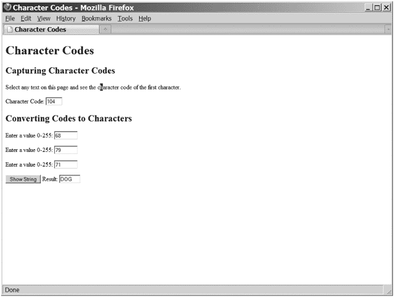

#### 列表 15-2: 字符转换

##### HTML: `jsb-15-02.html`

```html
<!DOCTYPE html>
<html>
  <head>
      <meta http-equiv="content-type" content="text/html;charset=utf-8">
      <title>字符代码</title>
      <script type="text/javascript" src="../jsb-global.js"></script>
      <script type="text/javascript" src="jsb-15-02.js"></script>
  </head>
  <body>
      <h1>字符代码</h1>
      <form action="show-string.php">
        <h2>捕获字符代码</h2>
        <p>选择此页面上的任何文本，查看第一个字符的字符代码。</p>
        <p>
          <label for="display">字符代码:</label>
          <input type="text" id="display" name="display" size="3" />
        </p>
        <h2>将代码转换为字符</h2>
        <p>
          <label for="entry1">输入 0-255 之间的值:</label>
          <input type="text" id="entry1" name="entry1" size="6" />
        </p>
        <p>
          <label for="entry2">输入 0-255 之间的值:</label>
          <input type="text" id="entry2" name="entry2" size="6" />
        </p>
        <p>
          <label for="entry3">输入 0-255 之间的值:</label>
          <input type="text" id="entry3" name="entry3" size="6" />
        </p>
        <p>
          <input type="button" id="showstr" value="显示字符串" />
          <label for="result">结果:</label>
          <input type="text" id="result" name="result" size="5" />
        </p>
      </form>
  </body>
</html>
```

##### JavaScript: `jsb-15-02.js`

```javascript
// 页面加载时初始化
addEvent(window, 'load', initialize);

// 当文本被选择时显示字符代码
addEvent(document, 'mouseup', showCharCode);

function initialize() {
  // 只有当浏览器可以处理 DOM 方法时才执行
  if (document.getElementById) {
    // 指向关键元素
    var oButton = document.getElementById('showstr');
    // 如果它存在
    if (oButton) {
      // 对按钮应用行为
      addEvent(oButton, 'click', showString);
    }
  }
}

// 显示数字表示的文本字符
function showString() {
  var oEntry1 = document.getElementById('entry1');
  var oEntry2 = document.getElementById('entry2');
  var oEntry3 = document.getElementById('entry3');
  var oResult = document.getElementById('result');
  oResult.value = String.fromCharCode(oEntry1.value, oEntry2.value, oEntry3.value);
}

// 显示选中文本的字符代码（仅限第一个字符）
function showCharCode() {
  var theText = "";
  var oDisplay = document.getElementById('display');
  // 使用各种方法获取选中的文本
  if (window.getSelection) {
    theText = window.getSelection();
  } else if (document.selection) {
    theText = document.selection;
  } else if (document.selection && document.createRange) {
    theText = document.createRange().toString();
  }
  // 显示第一个字符的字符代码
  if (theText) {
    oDisplay.value = theText.charCodeAt(0);
  } else {
    oDisplay.value = "";
  }
}
```

#### `string.concat(string2)`

**返回:** 合并后的字符串

**兼容性:** IE4+, Mac4+, NN4+, Safari+, Chrome+

JavaScript 的 `concat()` 方法提供了连接字符串的方便方法。大多数浏览器通过该方法执行相同的任务，如下所示：

`"abc".concat("def")` // 结果 "abcdef"

与 `+=` 运算符一样，`concat()` 方法不需要空格。

**相关项:** `+=` 运算符

#### `string.indexOf(searchString [, startIndex])`

**返回:** `searchString` 在字符串中起始的索引值

**兼容性:** IE3+, Mac3+, NN2+, Safari+, Opera+, Chrome+

类似于某些编程语言的字符串偏移函数，JavaScript 的 `indexOf()` 方法允许脚本获取搜索字符串在主字符串中的位置。可选情况下，你可以指定从主字符串的哪个位置开始搜索——但返回的值始终相对于主字符串的第一个字符。与所有字符串方法一样，索引从 0 开始计数。如果在主字符串内没有匹配项，则返回 -1。因此，该方法也是判断一个字符串是否包含另一个的方便方法，无论位置如何。

### 示例

将以下语句（不包括 `//` 注释符号）输入评估器顶部的文本框中（对于第一个语句之后的只需替换 `indexOf()` 方法的参数）。将你的结果与下面显示的结果进行比较。

```javascript
a = "bananas"
a.indexOf("b")     // 结果 = 0（第一个字母的索引为 0）
a.indexOf("a")     // 结果 = 1
a.indexOf("a",1)   // 结果 = 1（从第二个字母开始搜索）
a.indexOf("a",2)   // 结果 = 3（从第三个字母开始搜索）
a.indexOf("a",4)   // 结果 = 5（从第五个字母开始搜索）
a.indexOf("nan")   // 结果 = 2
a.indexOf("nas")   // 结果 = 4
a.indexOf("s")     // 结果 = 6
a.indexOf("z")     // 结果 = -1（字符串中没有 "z"）
```

**相关项:** `string.lastIndexOf()`, `string.charAt()`, `string.substring()` 方法

`string.lastIndexOf()` 方法与 `string.indexOf()` 方法密切相关。唯一的区别在于此方法从字符串的末尾（`string.length - 1`）开始搜索匹配项，并向后遍历字符串。所有的索引值仍然从字符串前端开始从 0 开始计数。接下来的示例使用了与 `string.indexOf()` 示例中相同的值，以便你比较结果。在只找到一个搜索字符串实例的情况下，结果是相同的；但当存在多个搜索字符串实例时，结果会有很大差异——这就是需要该方法的原因。

### 示例

将以下每个语句（最多包含但不包括“//”注释符号）输入到 The Evaluator 的顶部文本框中（在第一个语句之后，你可以简单地替换每个语句 `lastIndexOf()` 方法的参数）。将你的结果与下方显示的结果进行比较。

```javascript
a = "bananas"
a.lastIndexOf("b")    // result = 0 (第一个字母的索引为零)
a.lastIndexOf("a")    // result = 5
a.lastIndexOf("a",1)  // result = 1 (从第二个字母向前查找)
a.lastIndexOf("a",2)  // result = 1 (从第三个字母开始向前查找)
a.lastIndexOf("a",4)  // result = 3 (从第五个字母开始)
a.lastIndexOf("nan")  // result = 2 [Nav 2.0 bug 除 -1 除外]
a.lastIndexOf("nas")  // result = 4
a.lastIndexOf("s")    // result = 6
a.lastIndexOf("z")    // result = -1 (字符串中没有"z")
```

相关项目：`string.lastIndexOf()`, `string.charAt()`, `string.substring()` 方法

### string.localeCompare(string2)

**返回值：** 整数

**兼容性：** WinIE5.5+, MacIE-, NN6+, Moz+, Safari+, Opera+, Chrome+

`localeCompare()` 方法允许脚本比较两个字符串的累积 Unicode 值，并考虑浏览器的语言系统。这种方法的存在是因为少数人类语言的需要（据说土耳其语是其中之一）。如果两个字符串根据语言系统调整后相等，则返回值为零。如果调用该方法的字符串值（即点左侧的字符串）排序优于参数字符串，则返回负整数；否则返回正整数。

关于该方法的 ECMA 标准将精确的正值或负值留给了浏览器设计者。NN6+ 计算两个字符串的累积 Unicode 值，并将字符串参数的和减去字符串值的总和。另一方面，IE5.5+ 和 FF1+ 在字符串在口语上不相等时，会返回 -1 或 1。

相关项目：`string.toLocaleLowerCase()`, `string.toLocaleUpperCase()` 方法

### string.match(regExpression)

**返回值：** 匹配子字符串数组

**兼容性：** WinIE4+, MacIE4+, NN4+, Moz+, Safari+, Opera+, Chrome+

`string.match()` 方法依赖于 `RegExp`（正则表达式）对象在字符串内执行匹配。正在检查的字符串值位于点左侧，而方法要使用的正则表达式作为参数传递。该参数必须是一个正则表达式对象，并根据生成这些对象的两种方式之一进行创建。

当至少出现一次匹配项时，此方法返回一个数组值；否则返回值为 `null`。数组中的每个元素都是符合正则表达式规格的字符串段的副本。你可以使用此方法来发现子字符串或字符序列在较大字符串中出现的次数。查找匹配项的偏移位置需要其他的字符串解析。

### 示例

为了帮助你理解 `string.match()` 方法，列表 15-3 为你提供正则表达式工作坊。三个输入控件让你设置一个测试：第一个用于由方法检查的长字符串；第二个用于正则表达式；第三个是一个复选框，允许你指定在字符串中搜索匹配时是否区分大小写。提供了一些默认值，以防你还不熟悉正则表达式的语法（参见光盘中的第 45 节）。在点击“Execute match()”按钮后，脚本会根据你的输入创建一个正则表达式对象，对大字符串执行 `string.match()` 方法，并向页面报告两种结果。主要结果是方法返回的数组的字符串版本；另一个是返回项的计数。

列表 15-3：正则表达式匹配工作坊

**HTML：** `jsb-15-03.html`

```html
<!DOCTYPE html>
<html>
    <head>
        <meta http-equiv="content-type" content="text/html;charset=utf-8">
        <title>Regular Expression Match Workshop</title>
        <script type="text/javascript" src="../jsb-15-03.js"></script>
        <script type="text/javascript" src="jsb-global.js"></script>
        <script type="text/javascript" src="15-03.js"></script>
    </head>
    <body>
        <h1>Regular Expression Match Workshop</h1>
        <form action="match.php">
            <p>
                <label for="string">Enter main string:</label>
                <input type="text" id="string" name="string" size="60" value="Many bananas want to visit Germany." />
            </p>
            <p>
                <label for="pattern">Enter expression to match:</label>
                <input type="text" id="pattern" name="pattern" size="5" />
            </p>
            <p>
                <input type="checkbox" id="case" name="caseSens" />
                <label for="case">Case-sensitive</label>
            </p>
            <p>
                <input type="button" id="button" value="match()" />
                <input type="reset" />
            </p>
            <p>
                <label for="result">Result:</label>
                <input type="text" id="result" name="result" size="40" />
            </p>
            <p>
                <label for="count">Count:</label>
                <input type="text" id="count" name="count" size="3" />
            </p>
        </form>
    </body>
</html>
```

**JavaScript：** `jsb-15-03.js`

```javascript
// 当页面加载时初始化
addEvent(window, 'load', initialize);

function initialize() {
    // 仅当浏览器可以处理 DOM 方法时执行
    if (document.getElementById) {
        // 指向元素
        var oButton = document.getElementById('button');
        // 如果存在...
        if (oButton) {
            // 为按钮应用行为
            addEvent(oButton, 'click', doMatch);
        }
    }
}

// 使用输入值执行正则表达式匹配
function doMatch() {
    // 收集输入值
    var oString = document.getElementById('string');
    var sString = oString.value;
    var oPattern = document.getElementById('pattern');
    var oCaseSensitivity = document.getElementById('caseSens');
    var sFlags = 'g';  // g = 全局
    if (!oCaseSensitivity.checked) sFlags += 'i';  // i = 不区分大小写
    // 创建正则表达式对象
    var oRegExp = new RegExp(oPattern.value, sFlags);
    // 执行匹配
    var aResult = sString.match(oRegExp);
    // 显示结果
    var oResult = document.getElementById('result');
    var oCount = document.getElementById('count');
    // 获取匹配项？
    if (aResult) {
        oResult.value = aResult.toString();
        oCount.value = aResult.length;
    } else {
        oResult.value = "<no matches>";
        oCount.value = "";
    }
}
```

主字符串的默认值刻意使用了不寻常的大写。这种大写设置可以让你更清晰地看到某些匹配项的来源。例如，默认正则表达式查找任何中间带有字母“a”的三个字符字符串。有六个字符串片段匹配该表达式。在大小写的帮助下，你可以清楚地看到包含“man”的四个字符串分别是从主字符串哪里提取的。下表列出了其他可以在默认主字符串上尝试的正则表达式。

| RegExp | 描述 |
| :--- | :--- |
| `man` | 区分大小写和不区分 |
| `man\b` | “man”位于单词结尾处 |
| `\bman` | “man”位于单词开头处 |
| `me*an` | 在“m”和“a”之间出现零或多个字母“e” |
| `.a.` | “a”被任意一个字符（包括空格）包围 |
| `\sa\s` | “a”两侧都被空格包围 |
| `z` | 出现“z”的地方（默认字符串中没有） |

在列表 15-3 的脚本中，如果 `string.match()` 方法返回 `null`，你会收到礼貌的提示，并且 `count` 字段将被清除。

相关项目：`RegExp` 对象（参见光盘上的第 45 章）

```
string.replace(regExpression, replaceString)
```

**返回：** 修改后的字符串

**兼容性：** WinIE4+, MacIE4+, NN4+, Moz+, Safari+, Opera+, Chrome+

正则表达式通常用于执行查找和替换操作。结合 `string.search()` 方法，JavaScript 的 `string.replace()` 方法提供了一个简单的框架，用于在任何字符串上执行此类操作。

使用 `RegExp` 的替换操作需要三个组件。第一个是作为操作目标的主字符串。第二个是用于查找的正则表达式模式。第三是用于替换操作找到的每个文本实例的字符串。

```
stringToSearch.replace(pattern, replacementString);
```

对于 `string.replace()` 方法，主字符串是点左侧的字符串值或引用的对象。该字符串也可以是一个字面量字符串（即由引号围的文本）。要查找的正则表达式是第一个参数，而替换字符串是第二个参数。

正则表达式的定义决定了替换仅针对主字符串中遇到的第一个匹配项，还是字符串中的所有匹配项。如果你在正则表达式末尾添加 `g` 标志，那么调用一次 `replace()` 方法就会在整个主字符串中执行全局查找和替换。

只要你知道如何生成正则表达式，就可以轻松地使用 `string.replace()` 方法来执行简单的替换操作。但使用正则表达式可以让操作变得更强大。考虑哈姆雷特的这些独白台词：

> To be, or not to be: that is the question:

> Whether 'tis nobler in the mind to suffer

如果你想将两个“be”实例都替换为“exist”，在这种情况下你可以通过指定以下代码来实现：

```javascript
var regexp = /be/g;
soliloquy.replace(regexp, "exist");
```

但你不能总是保证字母“b”和“e”会作为一个独立的单词出现。如果主字符串包含单词“being”或“saber”会发生什么？上面的示例也会替换它们中的“be”字母。

救星来自于特殊的字符，它们能更好地定义要查找的内容。在示例中，查找的是单词“be”。因此，正则表达式用单词边界（`\b` 特殊字符）包围搜索文本，如下：

```javascript
var regexp = /\bbe\b/g;
soliloquy.replace(regexp, "exist");
```

这种语法还考虑了前两个“be”单词后面是标点符号而不是空格（正如你预期的独立单词后面那样）的情况。有关正则表达式语法的更多信息，请参见光盘上的第 45 章。

### 示例

列表 15-4 创建的页面让你能够在友好的环境中练习 `string.replace()`、`string.search()` 方法以及正则表达式。源文本是《哈姆雷特》的五行摘录。你可以输入要查找的正则表达式以及替换文本。注意，脚本完成了创建正则表达式对象的工作，这样你就可以专注于用于定义匹配字符串的其它特殊字符。所有的替换活动都是全局执行的，因为 `g` 标志会自动附加到你输入的任何表达式上。

点击“Execute replace()”按钮后，字段中的默认值会将缩写 'tis 替换为“it is”（参见图 15.2）。注意，'tis 撇号前的反斜杠字符（在 `mainString` 中组装的字符串中）使撇号变为非单词边界，从而允许 `\B't` 正则表达式在那里找到匹配项。正如 `string.search()` 方法节所述，连接到该方法的按钮返回匹配字符串的偏移字符数字（如果没有发生匹配则返回 -1）。

**列表 15-4: `string.replace()` 和 `string.search()` 实验**

**HTML:** `jsb-15-04.html`

```html
<!DOCTYPE html>
<html>
<head>
    <meta http-equiv="content-type" content="text/html;charset=utf-8">
```

```javascript
// apply behaviors
addEvent(oButtonReplace, 'click', doReplace);
addEvent(oButtonSearch, 'click', doSearch);
}
else
{
    alert('Critical element not found');
}
}

function doReplace()
{
    var sSource = document.getElementById('source').value;
    var sReplacement = document.getElementById('replacement').value;
    var sPattern = document.getElementById('pattern').value;
    var sFlags = 'g';   // g = find all; i = case-insensitive
    if (!document.getElementById('caseSens').checked) sFlags += 'i';
    // create regular expression object
    var oRegExp = new RegExp(sPattern, sFlags);
    // perform replace
    var sResult = sSource.replace(oRegExp, sReplacement);
    // display results
    document.getElementById('result').value = sResult;
}

function doSearch()
{
    var sSource = document.getElementById('source').value;
    var sPattern = document.getElementById('pattern').value;
    var sFlags = 'g';   // g = find all; i = case-insensitive
    if (!document.getElementById('caseSens').checked) sFlags += 'i';
    // create regular expression object
    var oRegExp = new RegExp(sPattern, sFlags);
    // perform replace
    var sResult = sSource.search(oRegExp);
    // display results
    document.getElementById('result').value = sResult;
}
```

图 15.2 使用默认的替换正则表达式。

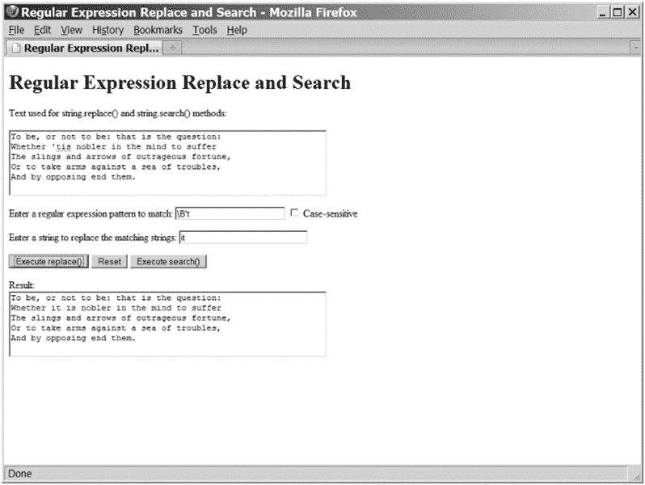

相关项目：`string.match()` 方法；`RegExp` 对象

`string.search(regExpression)`

返回：偏移量整数

兼容性：WinIE4+, MacIE4+, NN4+, Moz+, Safari+, Opera+, Chrome+

`string.search()` 方法的结果可能会让你联想到 `string.indexOf()` 方法。在两种情况下，返回的值都是匹配字符串在主字符串中首次出现的字符数字索引，如果没有匹配到则返回 -1。巨大的区别在于，`string.search()` 的匹配字符串是一个正则表达式。

### 示例

列表 15-4 演示了 `string.replace()` 方法，同时也提供了一个实验 `string.search()` 方法的实验室。

相关项目：`string.match()` 方法；`RegExp` 对象

`string.slice(startIndex [, endIndex])`

返回：字符串

兼容性：WinIE4+, MacIE4+, NN4+, Moz+, Safari+, Opera+, Chrome+

`string.slice()` 方法类似于 `string.substring()` 方法，其之处在于两者都允许你提取字符串的一部分并生成一个新字符串作为结果（而不修改原始字符串）。然而，`string.slice()` 的一个有用改进是，指定相对于主字符串末尾的结束索引值更加简单。

使用 `string.substring()` 提取在字符串末尾之前结束的子字符串需要如下的操作：

`string.substring(4, (string.length-2))`

相反，你可以为 `string.slice()` 的第二个参数分配一个负数，以表示相对于字符串结尾的偏移量：

`string.slice(4, -2)`

第二个参数是可选的。如果你省略了第二个参数，返回的值是从起始偏移量到主字符串末尾的字符串。

### 示例

通过列表 15-5，你可以尝试 `string.slice()` 方法的多种参数组合（参见图 15.3）。文中提供了一个基础字符串（以及字符测量值）。从参数的不同可用选项中选择，并研究切片的结果。

列表 15-5：切分字符串

HTML: `jsb-15-05.html`

```html
<!DOCTYPE html>
<html>
    <head>
        <meta http-equiv="content-type" content="text/html;charset=utf-8">
        <title>字符串切片与处理，第一部分</title>
        <script type="text/javascript" src="../jsb-global.js"></script>
        <script type="text/javascript" src="jsb-15-05.js"></script>
    </head>
    <body>
        <h1>切片与处理，第一部分</h1>
        <b>slice()</b>
        <form action="string-slice.php">
            <p>
                <label for="source">用于方法的文本：</label>
            </p>
            <p>
                <textarea id="source" name="source" cols="6" rows="1">Electroencephal</textarea>
                <pre>----|----|----
5   0  5  2</pre>
            </p>
            <table>
                <thead>
                    <tr>
                        <th>方法</th>
                        <th>参数</th>
                        <th>结果</th>
                    </tr>
                </thead>
                <tbody>
                    <tr>
                        <td>slice()</td>
                        <td>
                            <select id="parameter1" name="parameter1">
                                <option value="0">0</option>
                                <option value="1">1</option>
                                <option value="2">2</option>
                                <option value="3">3</option>
                                <option value="5">5</option>
                            </select>,
                            <select id="parameter2" name="parameter2">
                                <option>(None)</option>
                                <option value="5">5</option>
                                <option value="10">10</option>
                                <option value="-1">-1</option>
                                <option value="-5">-5</option>
                                <option value="-10">-10</option>
                            </select>
                        </td>
                        <td>
                            <input type="text" id="result" name="result" size="25" />
                        </td>
                    </tr>
                </tbody>
            </table>
        </form>
    </body>
</html>
```

JavaScript: `jsb-15-05.js`

```javascript
// initialize 在页面加载时初始化
addEvent(window, 'load', initialize);
function initialize()
{
    // 如果浏览器可以处理 DOM
    if (document.getElementById)
    {
        // 检查关键元素
        var oSource = document.getElementById('source');
        var oParameter1 = document.getElementById('parameter1');
        var oParameter2 = document.getElementById('parameter2');
        var oResult = document.getElementById('result');
        // 如果它们存在...
        if (oSource && oParameter1 && oParameter2 && oResult)
        {
            // 应用行为
            addEvent(oParameter1, 'change', showResults);
            addEvent(oParameter2, 'change', showResults);
        }
        else
        {
            alert('Critical element not found');
        }
    }
}

// 执行方法并显示结果
function showResults()
{
    // 获取源文本
    var oSource = document.getElementById('source');
    var sSource = oSource.firstChild.nodeValue;
    // 获取参数
    var oParameter1 = document.getElementById('parameter1');
    var iParameter1 = parseInt(oParameter1.options[oParameter1.selectedIndex].value);
    var oParameter2 = document.getElementById('parameter2');
    var iParameter2 = parseInt(oParameter2.options[oParameter2.selectedIndex].value);
    // 生成结果并显示它
    var oResult = document.getElementById('result');
    if (!iParameter2)
    {
        oResult.value = sSource.slice(iParameter1);
    }
    else
    {
        oResult.value = sSource.slice(iParameter1, iParameter2);
    }
}
```

`split()` 方法是 `array.join()` 方法功能上的相反操作（参见第 18 章，“数组对象”）。从字符串对象的角度来看，JavaScript 将一个长字符串分割成由特定字符分隔的片段，然后创建一个包含这些片段的密集数组。你不需要通过 `new Array()` 构造函数来初始化数组。鉴于数组对象方法（如 `array.sort()`）的功能强大，你可能希望将一系列字符串项转换为数组，以利用这些强大的功能。此外，如果你的目标是将字符串拆为由单个字符组成的数组，你仍然可以使用 `split()` 方法，只需指定一个空字符串作为参数即可。对于某些旧版浏览器（如 `NN3` 和 `IE4`），只有第一个参数会被识别。

在现代浏览器中，你可以使用正则表达式对象作为第一个参数，这增强了你查找字符串中定界符的能力。例如，考虑以下字符串：

```javascript
var nameList = "Fred - 123-4567,Jane - 234-5678,Steve - 345-6789";
```

在使用 `string.split()` 之前，如果要将该字符串转换为仅包含名字的数组，在不使用正则表达式的情况下需要大量的解析。然而，使用正则表达式作为参数：

```javascript
var regexp = / - [\d-]+,?\b/;
var newArray = nameList.split(regexp);
// 结果为包含 "Fred", "Jane", "Steve", "" 的数组
```

新数组条目仅包含名字，而不包含电话号码或标点符号。

第二个可选参数是一个整数值，允许你指定方法生成的数组元素数量的限制。

### 示例

使用“评估器”（第 4 章）查看 `string.split()` 方法是如何工作的。首先将一个逗号分隔的字符串赋值给变量：

```javascript
a = "Anderson,Smith,Johnson,Washington"
```

现在在逗号位置分割字符串，使字符串片段成为数组中的项，并保存为 `b`：

```javascript
b = a.split(",")
```

为了证明数组包含四个项，请检查数组的 `length` 属性：

```javascript
b.length // 结果: 4
```

相关项目：`array.join()` 方法

#### `string.substr(start [, length])`

**返回：** 字符串

**兼容性：** WinIE4+, MacIE4+, NN4+, Moz+, Safari+, Opera+, Chrome+

`string.substr()` 方法是自 JavaScript 语言诞生以来存在的 `string.substring()` 方法的变体。其区别在于 `string.substr()` 方法的参数指定的是起始索引以及从该点开始包含的字符数。相比之下，`string.substring()` 方法的参数指定的是主字符串内起始和结束字符的索引点。

与所有需要索引值的字符串方法一样，`string.substr()` 的第一个参数是基于零的。如果你不指定第二个参数，返回的子字符串将从索引点开始到字符串的末尾。第二个参数的值如果超过字符串的终点，则该方法将返回到字符串末尾的子字符串。

尽管这个方法比它的伙伴要新，但它并不是该语言最新（第五版）ECMA 标准的一部分。但由于该方法被广泛使用，标准将其承认为附录，以便其他脚本上下文可以实现该方法，与浏览实践保持一致。

### 示例

列表 15-6 允许你尝试各种值，以查看 `string.substr()` 方法是如何工作的。

#### 列表 15-6：读取字符串的一部分

HTML: `jsb-15-06.html`

```html
<!DOCTYPE html>
<html>
<head>
    <meta http-equiv="content-type" content="text/html;charset=utf-8">
    <title>字符串切片与处理，第二部分</title>
    <script type="text/javascript" src="../jsb-global.js"></script>
    <script type="text/javascript" src="jsb-15-06.js"></script>
</head>
<body>
    <h1>切片与处理，第二部分</h1>
    <h2>substr() 方法</h2>
    <form action="string-substr.php">
        <p><label for="source">用于方法的文本:</label></p>
        <p><textarea id="source" name="source" cols="0" rows="1">encephalograph</textarea>
        <pre>----|----|---- 0 5 2</pre></p>
        <table>
            <thead>
                <tr>
                    <th>方法</th>
                    <th>参数</th>
                    <th>结果</th>
                </tr>
            </thead>
            <tbody>
                <tr>
                    <td>string.substr()</td>
                    <td>
                        <select id="parameter1" name="parameter1">
                            <option value="0">0</option>
                            <option value="1">1</option>
                            <option value="2">2</option>
                            <option value="3">3</option>
                            <option value="5">5</option>
                        </select>,
                        <select id="parameter2" name="parameter2">
                            <option>(None)</option>
                            <option value="5">5</option>
                            <option value="10">10</option>
                            <option value="2">2</option>
                        </select>
                    </td>
                    <td>
                        <input type="text" id="result" name="result" size="5" />
                    </td>
                </tr>
            </tbody>
        </table>
    </form>
</body>
</html>
```

JavaScript: `jsb-15-06.js`

```javascript
// 当页面加载时初始化
addEvent(window, 'load', initialize);

function initialize() {
    // 只有当浏览器可以处理 DOM 时
    if (document.getElementById) {
        // 检查关键元素
        var source = document.getElementById('source');
        var parameter1 = document.getElementById('parameter1');
        var parameter2 = document.getElementById('parameter2');
        var result = document.getElementById('result');
        // 如果它们都存在
        if (source && parameter1 && parameter2 && result) {
            // 应用行为
            addEvent(parameter1, 'change', showResults);
            addEvent(parameter2, 'change', showResults);
        } else {
            alert('未找到关键元素');
        }
    }
}

// 执行方法并显示结果
function showResults() {
    // 获取源文本
    var source = document.getElementById('source');
    var sSource = source.firstChild.nodeValue;
    // 获取参数
    var parameter1 = document.getElementById('parameter1');
    var i1 = parseInt(parameter1.options[parameter1.selectedIndex].value);
    var parameter2 = document.getElementById('parameter2');
    var i2 = parseInt(parameter2.options[parameter2.selectedIndex].value);
    // 生成结果并显示
    var result = document.getElementById('result');
    if (!i2) {
        result.value = sSource.substr(i1);
    } else {
        result.value = sSource.substr(i1, i2);
    }
}
```

相关项目：`string.substring()` 方法

#### `string.substring(indexA[, indexB])`

**返回：** 索引值 `indexA` 和 `indexB` 之间的字符串

**兼容性：** WinIE3+, MacIE3+, NN2+, Moz+, Safari+, Opera+, Chrome+

`string.substring()` 方法允许你的脚本从任何字符串提取连续字符范围的副本。该方法的参数是主字符串的起始和结束索引值（字符串对象的第一个字符的索引值为 0）。需要注意的一点是，摘录包含但不包含由较高索引值所指向的字符。

参数中哪个索引值大于另一个值并没有区别：该方法从最小值开始截取片段，并持续到最大值（但不包含最大值）。如果两个索引值相同，该方法将返回一个空字符串；如果你省略了第二个参数，则假设字符串的结尾为终点。

### 示例

列表 15-7 允许你尝试各种值以观察 `string.substring()` 方法是如何工作的。

### 列表 15-7：读取字符串的一部分

HTML: `jsb-15-07.html`

```html
<!DOCTYPE html>
<html>
  <head>
    <meta http-equiv="content-type" content="text/html;charset=utf-8">
    <title>字符串切片与细分，第三部分</title>
    <script type="text/javascript" src="../jsb-global.js"></script>
    <script type="text/javascript" src="jsb-15-07.js"></script>
  </head>
  <body>
    <h1>字符串切片与细分，第三部分</h1>
    <h2>String substring() 方法</h2>
    <form action="string-substring.php">
      <p>
        <label for="source">用于方法的文本：</label>
      </p>
      <p>
        <textarea id="Textarea1" name="source" cols="60" rows="1">
Electroencephalograph</textarea>
        <pre>
----|----|----|----|-
    5    10   15   20
</pre>
      </p>
      <table>
        <thead>
          <tr>
            <th>方法</th>
            <th>参数</th>
            <th>结果</th>
          </tr>
        </thead>
        <tbody>
          <tr>
            <td>string.substring()</td>
            <td>
              <select id="parameter1" name="parameter1">
                <option value="0">0</option>
                <option value="1">1</option>
                <option value="2">2</option>
                <option value="3">3</option>
                <option value="5">5</option>
              </select>,
              <select id="parameter2" name="parameter2">
                <option value="(None)"><None)</option>
                <option value="3">3</option>
                <option value="5">5</option>
                <option value="10">10</option>
              </select>
            </td>
            <td>
              <input type="text" id="result" name="result" size="5"/>
            </td>
          </tr>
        </tbody>
      </table>
    </form>
  </body>
</html>
```

JavaScript: `jsb-15-07.js`

```javascript
// 当页面加载时初始化
addEvent(window, 'load', initialize);

function initialize() {
  // 仅当浏览器可以处理 DOM 时
  if (document.getElementById) {
    // 检查元素
    var oSource = document.getElementById('source');
    var oParameter1 = document.getElementById('parameter1');
    var oParameter2 = document.getElementById('parameter2');
    var oResult = document.getElementById('result');
    // 如果它们都存在
    if (oSource && oParameter1 && oParameter2 && oResult) {
      // 应用行为
      addEvent(oParameter1, 'change', showResults);
      addEvent(oParameter2, 'change', showResults);
    } else {
      alert('未找到元素');
    }
  }
}

function showResults() {
  // 执行方法并显示结果
  var oSource = document.getElementById('source');
  var oParameter1 = document.getElementById('parameter1');
  var oParameter2 = document.getElementById('parameter2');
  var oResult = document.getElementById('result');
  // 获取源
  oResult.value = oSource.substring(oParameter1.value, oParameter2.value);
}
```

# 引言

如何将各种字符串对象方法应用于字符串处理挑战并不总是一件易事。如果你需要支持 JavaScript 支持有限的旧版或移动端浏览器，情况会变得更加糟糕。此外，要预判你在脚本中可能需要处理字符串的各种方式也是困难的。但为了帮助你，列表 15-8 包含了一个完全向后兼容的字符串函数库，用于在字符串中插入、删除和替换文本块。如果你的受众使用能够包含外部 `.js` 库文件的浏览器，这将是将这些函数提供给脚本的极佳方法。

## 列表 15-8：实用字符串处理器

JavaScript: `jsb-15-08.js`

```javascript
// 获取 searchString 之前的字符串前部
function getFront(sMain, sSearch)
{
    iOffset = sMain.indexOf(sSearch);
    if (iOffset == -1)
    {
        return null;
    }
    else
    {
        return sMain.substring(0, iOffset);
    }
}

// 获取 searchString 之后的字符串后部
function getEnd(sMain, sSearch)
{
    iOffset = sMain.indexOf(sSearch);
    if (iOffset == -1)
    {
        return null;
    }
    else
    {
        return sMain.substring(iOffset + sSearch.length, sMain.length);
    }
}

// 在 searchString 之前插入 insertString
function insertString(sMain, sSearch, sInsert)
{
    var sFront = getFront(sMain, sSearch);
    var sEnd = getEnd(sMain, sSearch);
    if (sFront == null || sEnd == null)
    {
        return null;
    }
    else
    {
        return sFront + sInsert + sSearch + sEnd;
    }
}

// 从 sMain 中删除 sDelete
function deleteString(sMain, sDelete)
{
    return replaceString(sMain, sDelete, "");
}

// 用 sReplace 替换 sSearch
function replaceString(sMain, sSearch, sReplace)
{
    var sFront = getFront(sMain, sSearch);
    var sEnd = getEnd(sMain, sSearch);
    if (sFront == null || sEnd == null)
    {
        return null;
    }
    else
    {
        return sFront + sReplace + sEnd;
    }
}
```

前两个函数根据需要提取字符串的前部或尾部，供此套件中的其他函数使用。最后三个函数是这些字符串处理函数的核心。如果你计划在脚本中使用这些函数，请务必注意某些函数与其他函数之间的依赖。将所有五个函数作为一个组包含进来，可以确保它们按照设计工作。

列表 15-8 的现代替代方案结合了字符串和数组方法，在单条语句函数中执行全局替换操作：

```javascript
function replaceString(sMain, sSearch, sReplace)
{
    return sMain.split(sSearch).join(sReplace);
}
```

更进一步，你可以创建一个自定义方法，与脚本中的所有字符串值或对象一起使用。只需让以下语句在页面加载时执行即可：

```javascript
String.prototype.replaceString = function replaceString(sMain,
    sSearch, sReplace)
{
    return sMain.split(sSearch).join(sReplace);
}
```

然后，在页面其他脚本的任何字符串值上调用此方法，例如：

```javascript
myString = myString.replaceString(" CD ", " MP3 ");
```

（注意，全局搜索和替换也可以使用正则表达式完成；见第 45 章节。）

## HTML 标记方法

现在我们来看另一组字符串对象方法，这些方法可以有效地将文本封装在 HTML 元素中。这些方法都不是 ECMAScript 第五标准的一部分；它们在 JavaScript 实现中的存在显然是为了支持古老的脚本。现代网页使用样式表来对元素应用外观格式化，并使用 DOM 方法插入新节点。

| `string.anchor("anchorName")` | `string.link(locationOrURL)` |
| :--- | :--- |
| `string.blink()` | `string.big()` |
| `string.bold()` | `string.small()` |
| `string.fixed()` | `string.strike()` |
| `string.fontcolor(colorValue)` | `string.sub()` |
| `string.fontsize(integer1to7)` | `string.sup()` |
| `string.italics()` | |

首先检查不需要任何参数的方法。你可能会发现一个模式：所有这些方法都是具有“开启”或“关闭”设置的字体样式属性。要在 HTML 文档中开启这些属性，可以将文本封装在相应的标签对中，例如对于粗体文本使用 `<b>...</b>`。这些方法获取字符串对象，附加这些标签，并返回生成的文本，该文本已准备好放入你的脚本构建的任何 HTML 中。因此，表达式

`"Good morning!".bold()`

求值为：

`<b>Good morning!</b>`

列表 15-9 显示了将这些字符串方法应用于页面文本的示例。（Internet Explorer、Chrome 和 Safari 不支持 `<blink>` 元素，因此它们执行了 `string.blink()` 方法，但在显示上不会产生闪烁效果。）

## 列表 15-9：使用字符串方法

HTML: `jsb-15-09.html`

```html
<!DOCTYPE html>
<html>
<head>
    <meta charset="utf-8">
    <title>HTML by JavaScript</title>
</head>
<body>
    <h1 id="header">HTML by JavaScript</h1>
    <ul id="tag-list">
        <li id="anchor">anchor</li>
        <li id="big">big</li>
        <li id="blink">blink</li>
        <li id="bold">bold</li>
        <li id="fixed">fixed</li>
        <li id="fontcolor">fontcolor</li>
        <li id="fontsize">fontsize</li>
        <li id="italics">italics</li>
        <li id="link">link</li>
        <li id="small">small</li>
        <li id="strike">strike</li>
        <li id="sub">sub</li>
        <li id="sup">sup</li>
    </ul>
    <form action="javascript.php">
        <p>
            <button id="apply-markup">Apply Markup</button>
        </p>
    </form>
</body>
</html>
```

JavaScript: `jsb-15-09.js`

```javascript
// 当页面加载时初始化
addEventListener('load', initialize);

function initialize() {
    // 只有当浏览器可以处理方法时才这样做
    if (document.getElementById) {
        // 检查按钮
        var oButton = document.getElementById('apply-markup');
        // 如果它存在
        if (oButton) {
            // 应用行为
            addEventListener(oButton, 'click', applyMarkup);
        }
    }
}

// 将标记应用于文本
function applyMarkup(evt) {
    // 合并事件
    if (!evt) evt = window.event;
    var oList = document.getElementById('tag-list');
    var aElements = oList.getElementsByTagName('*');
    for (var i = 0; i < aElements.length; i++) {
        // 获取此元素的 id 和文本
        var sId = aElements[i].id;
        // var sText = aElements[i].nodeValue
        var sText = aElements[i].innerHTML;
        switch (sId) {
            case 'anchor': sText = sText.anchor('anchor-name'); break;
            case 'big': sText = sText.big(); break;
            case 'blink': sText = sText.blink(); break;
            case 'bold': sText = sText.bold(); break;
            case 'fixed': sText = sText.fixed(); break;
            case 'fontcolor': sText = sText.fontcolor('red'); break;
            case 'fontsize': sText = sText.fontsize(7); break;
            case 'italics': sText = sText.italics(); break;
            case 'link': sText = sText.link('http://example.com/'); break;
            case 'small': sText = sText.small(); break;
            case 'strike': sText = sText.strike(); break;
            case 'sub': sText = sText.sub(); break;
            case 'sup': sText = sText.sup(); break;
            default: continue;
        }
        // 用标记后的文本替换元素的内容
        aElements[i].innerHTML = sText;
    }
    alert('这里是修改后的标记：\n' + oList.innerHTML);
}
```

```javascript
// 取消表单提交
    // W3C DOM 方法（IE 隐藏）
    if (evt.preventDefault) evt.preventDefault();
    // IE 方法
    return false;
}
```

`string.fontsize()` 和 `string.fontcolor()` 影响 HTML 页面上显示的字符串的字体特征。这些项目的参数非常直观——一个 1 到 7 之间的整数（对应七种浏览器字体大小），以及一个用于指定文本的颜色值（可以是十六进制三元组或颜色常量名称）。

最后两个字符串方法允许你从一个字符串创建一个锚点和链接。`string.anchor()` 方法使用其参数为锚点创建一个名称。因此，以下表达式

`"Table of Contents".anchor("toc")`

求值结果为

`<a name="toc">Table of Contents</a>`

同样，`string.link()` 方法期望一个有效的位置或 URL 作为其参数，从字符串创建一个真实的 HTML 链接：

`"Back to Home".link("index.html")`

这评估为如下：

`<a href="index.html">Back to Home</a>`

我们在现代 Web 脚本中极少使用这些方法，主要原因是我们正努力分离开发层——在这种情况下，即将 HTML 结构与 CSS 呈现以及 JavaScript 行为隔离开。这些层分得越开，开发、调试和修改就越模块化、越高效。例如，如果所有的字体大小和颜色细节都在样式表中指定，而不是硬编码在 HTML 或 JavaScript 中，那么页面上文本的外观就可以独立于页面的标记和行为进行更改，并由具有不同技能组合的人员完成。同样，将标记保留在 HTML 文档中并允许 JavaScript 对该标记进行操作是合理的，但除非绝对必要，否则不要对其进行规定。

通过更改标记来改变页面的视觉外观是非常“上世纪 90 年代风”的做法。它依赖于浏览器对给定标签的默认样式，而不是在自己的样式表中负责样式设计。现代脚本会通过分配 `id` 或 `className` 来改变元素的外观，并让样式表决定呈现方式。

# URL 字符串编码与解码

当浏览器和服务器通信时，一些我们习以为常的非字母数字字符（如空格）无法以原始形式传输。只允许一组较窄的字母、数字和标点符号。为了适应其余字符，必须使用特殊符号（`%`）和它们的十六进制 ASCII 值进行编码。例如，空格字符的十六进制是 20（ASCII 十进制为 32）。编码后，它看起来像 `%20`。你可能在浏览器历史记录或 URL 中见过这个符号。

JavaScript 包含了两个函数 `encodeURIComponent()` 和 `decodeURIComponent()`，它们提供了整个字符串的即时转换。要将普通字符串转换为带有转义代码的字符串，请使用转义函数，例如

`encodeURIComponent("Howdy Pardner"); // result = "Howdy%20Pardner"`

`decodeURIComponent()` 函数将转义代码转换为可读形式。

## 交叉引用

这两个函数在第 24 章“全局函数和语句”中都有介绍。

# Math、Number 和 Boolean 对象

## 本章
- 高级数学运算
- 数字进制转换
- 整数和浮点数的处理

第 8 章教程中对数据类型和值的介绍仅触及了 JavaScript 数字和布尔能力的表面。在本章中，你将更仔细地观察 JavaScript 处理数字和布尔数据的方式。

数学往往会让初学者望而却步。然而，正如你到目前为止看到的，你并不需要成为数学天才就能用 JavaScript 编程。本章描述的能力在你需要时就在那里——如果你真的需要的话。所以，如果数学不是你的强项，不要被这里的术语吓到。

关于本章描述的对象，需要记住的一个重要点是（与字符串值和字符串对象一样），数字和布尔值既是值也是对象。对于脚本编写者来说，幸运的是，这种区别很少成为因素，除非你涉及到非常复杂的编程。但对于那些实际上在我们使用的浏览器内部编写 JavaScript 解释器的人来说，这些区别是至关重要的。

对于大多数脚本编写者，关于数字数据类型和转换的信息以及 `Math` 对象是非常重要的。

## JavaScript 中的数字

更强大的编程语言有许多不同类型的数字，每种数字都与它在计算机中所占的内存有关。管理所有这些类型对某些人可能很有趣，但会阻碍快速脚本编写。JavaScript 数字只有两种可能：它可以是一个整数，也可以是一个浮点值。整数是巨大范围内的任何没有小数部分的整个数字。整数在表示中永远不包含小数点。JavaScript 中的浮点数也跨越相同的范围，但用小数点和一些小数值来表示。如果你是经验程序员，请参考本章稍后关于 `Number` 对象的讨论，查看 JavaScript 数字类型如何与你在其他编程环境中使用的数字数据类型对齐。

### 整数和浮点数

在计算机深处，微处理器执行整数值的数学运算比执行任何附加了小数值的数字运算要容易得多。微处理器即使是加两个这样的浮点数也必须经过额外的工作。作为脚本编写者，我们不幸地背负了这些历史，必须意识到某些计算中使用的数字类型。

JavaScript 生成的大多数内部值（如索引值和 `length` 属性）由整数组成。浮点数通常作为数值除法的结果、特殊值（如 `pi`）以及人类输入的数值（如美元和分）的结果出现。幸运的是，请注意以下示例如何解析为相应的数据类型：

`3 + 4 = 7 // 整数结果`
`3 + 4.1 = 7.1 // 浮点结果`
`3.9 + 4.1 = 8 // 整数结果`

在三个示例中，可能只有最后一个结果是意料之外的。当两个浮点数产生一个整数时，结果被渲染为整数。

在处理浮点数时，请注意并非所有浏览器版本返回的小数点最后一位数字都完全相同。例如，下表显示了各种可脚本浏览器计算 `8/9` 的结果，并转换为字符串显示：

| NN3 & NN4 | .8888888888888888 |
| :--- | :--- |
| NN6+/Moz+/Safari+/Opera+/Chrome+ | 0.8888888888888888 |
| WinIE3 | 0.888888888888889 |
| WinIE4+ | 0.8888888888888888 |

显然，从这种显示可以看出，你不想在 JavaScript 浏览器中使用浮点数学来规划航天轨迹或其他高精度的关键计算。然而，对于日常数学，你需要意识到 PC 算术中积累的浮点误差。

在 Navigator 中，JavaScript 依赖操作系统的浮点数学来进行自身的数学运算。能够提供与 JavaScript 显示的小数点后同样精度的操作系统极其罕见。正如你可以从前面的表格检测到的，现代浏览器在显示多少位数以及如何进行这种显示的内部舍入方面达成了一致。这对于数学计算有利，但当你需要以特定格式显示数字时，并没有什么帮助。

在达到 IE5.5、基于 Mozilla 的浏览器以及其他 W3C 兼容浏览器之前，JavaScript 并没有提供格式化浮点数运算结果的内置设施。（对于现代浏览器，请参阅本章后续的 `Number` 对象方法）。列表 16-1 展示了一个用于正值的通用例程，以及一个将值转换为美元金额的特定调用。移除注释后，该程序非常紧凑。

## 交叉引用
在本章及本书大部分内容中用于分配事件处理程序的函数是 `addEvent()`，这是一个跨浏览器事件处理器，在第 2 章“事件”中进行了详细解释。

## 列表 16-1：通用数字格式化例程

HTML: `js-16-0.html`
```html
<!DOCTYPE html>
<html>
<head>
  <meta http-equiv="content-type" content="text/html;charset=utf-8">
  <title>Number Formatting</title>
  <script type="text/javascript" src="../js-global.js"></script>
  <script type="text/javascript" src="js-16-1.js"></script>
</head>
<body>
  <h1>如何赚钱</h1>
  <form>
    <p>
      <label for="entry">输入一个正浮点值或算术表达式，并将其转换为货币格式：</label>
    </p>
    <p>
      <input type="text" id="entry" name="entry" value="1">
      <input type="button" id="dollars" value="美元和分$">
      <input type="text" id="result" name="result">
    </p>
  </form>
</body>
</html>
```

JavaScript: `js-16-1.js`
```javascript
// 当页面加载时初始化
addEvent(window, 'load', initialize);

function initialize() {
  // 仅当浏览器可以处理 DOM 方法时执行
  if (document.getElementById) {
    // 指向关键元素
    var oButton = document.getElementById('dollars');
    var oEntry = document.getElementById('entry');
    var oResult = document.getElementById('result');
    // 如果它们都存在...
    if (oButton && oEntry && oResult) {
      // 为按钮应用行为
      oButton.onclick = function() {
        oResult.value = dollarize(oEntry.value);
      }
    }
  }
}

// 将输入的表达式转换为美元金额
function dollarize(expr) {
  return "$" + format(expr, 2);
}

// 通用正数小数函数
function format(expr, decplaces) {
  // 求值输入的表达式
  var val = eval(expr);
  // 将该值乘以 10 的小数位数幂次；
  // 四舍五入为整数；转换为字符串
  var str = "" + Math.round(val * Math.pow(10, decplaces));
  // 在舍入后的数字字符串左侧补零
  while (str.length <= decplaces) {
    str = "0" + str;
  }
  // 确定小数点的位置
  var decpoint = str.length - decplaces;
  // 由以下部分组合最终结果：
  // (a) 直到小数点位置的字符串；
  // (b) 小数点；以及
  // (c) 字符串的剩余部分。返回完成品。
  return str.substring(0, decpoint) + "." + str.substring(decpoint, str.length);
}
```

这个例程看起来工作量很大，但如果你的应用程序依赖浮点值并且对所有浏览器都需要特定的格式，那么它是必不可少的。

### 注意
现代浏览器中的 `Number` 对象提供了格式化的内置方法。`addEvent()` 函数是整个代码使用的跨浏览器事件处理器。`eval()` 函数用于求值输入的表达式，但应谨慎使用。你也可以对数字使用科学计数法，例如 `1e6`。

以下是科学计数法的示例：
- `1e6`: 1,000,000
- `1e-4`: 0.0001
- `1e-3`: 0.001
- `1e-5`: 0.00001

JavaScript 支持使用多种方法将字符串转换为数字：

- `parseInt()`：解析字符串并返回整数。
- `parseFloat()`：解析字符串并返回浮点数。
- `Number()`：将字符串转换为数字。
- `+` 运算符：一元加法运算符可以将字符串转换为数字。

JavaScript 支持各种数字进制：

- 十进制（10 进制）
- 十六进制（16 进制），以 `0x` 或 `0X` 开头
- 八进制（8 进制），以 `0` 开头

在处理十六进制值时，你可以使用数字 0-9 和 A-F。下面的 `toHex()` 函数将十进制整数转换为十六进制字符串。

## 列表 16-2：十进制转十六进制转换器
```javascript
function toHex(dec) {
  var hexChars = "0123456789ABCDEF";
  if (dec > 255) {
    return null;
  }
  var i = dec % 16;
  var j = (dec - i) / 16;
  var result = "0X";
  result += hexChars.charAt(j);
  result += hexChars.charAt(i);
  return result;
}
```

```javascript
parseInt("42.33")    // result = 42
parseFloat("42.33")   // result = 42.33
parseFloat("42")      // result = 42
parseFloat("fred")    // result = NaN (Not a Number)
```

由于 `parseFloat()` 函数也可以处理整数并返回整数值，因此在需要处理用户在文本框中输入的各种类型数字的脚本中，你可能更倾向于使用此函数。

这两个函数都有一个可选的第二个参数，允许你指定字符串所代表数字的进制基（base）。当你需要从一个以一个或多个零开头的字符串获取小数时，这变得非常有用。通常情况下，开头的零表示八进制值。但如果你强制转换将字符串值识别为十进制，它将按照你预期的方式进行转换：

```javascript
parseInt("010")       // result = 8
parseInt("010",10)    // result = 10
parseInt("F2")        // result = NaN
parseInt("F2", 16)    // result = 242
```

在任何需要整数或浮点数值的地方都使用这些函数。例如：

```javascript
var result = 3 + parseInt("3");   // result = 6
var ageVal = parseInt(document.forms[0].age.value);
```

后一种技术确保了该属性的字符串值被转换为数字，尽管在用户输入的值进行任何数学运算之前，你应该进行更多的数据验证——参见第 46 章“数据输入验证”（在 CD-ROM 上）。

`parseInt()` 和 `parseFloat()` 方法都从字符串的第一个字符开始工作，直到没有更多数字或小数字符为止。这就是为什么你可以将它们用于字符串——例如由 `navigator.appVersion` 属性返回的字符串（6.0 (Windows; en-US)）——以获取字符串开头的数字部分。如果字符串不是以接受的字符开头，这些方法将返回 `NaN`（不是数字）。

## 将数字转换为字符串

如果你尝试将数值数据类型的值传递给第 15 章中讨论的许多字符串方法，JavaScript 会报错。因此，在例如确定一个数字由多少位组成之前，你应该先将任何数字转换为字符串。

有几种方法可以强制将任何数值转换为字符串。老式的方法是在数字前加上一个空字符串和连接运算符。例如，假设一个名为 `dollars` 的变量包含整数值 2500。为了使用字符串对象的 `length` 属性（在本章稍后讨论）来找出该数字有多少位，请使用这种结构：

```javascript
("" + dollars).length   // result = 4
```

括号强制 JavaScript 在尝试提取 `length` 属性之前计算连接操作。

一种更优雅的方法是使用 `toString()` 方法。像调用任何对象的方法一样构造此类语句。例如，将 `dollars` 变量值转换为字符串，请使用此语句：

```javascript
dollars.toString()  // result = "2500"
```

该方法在现代浏览器中多了一项功能：你可以为数字的字符串表示指定进制。这个基数被称为 `radix`，它作为参数添加到方法名之后。这里有一个创建一个数值并转换为十六进制等效字符串的示例：

```javascript
var x = 30;
var y = x.toString(16);  // result = "1e"
```

使用参数 2 用于二进制结果，使用 8 用于八进制。默认值是基 10。注意不要将这些转换与真正的数值转换混淆。你不能将 `toString()` 方法的结果作为其他语句中的数值操作数。

最后，在 IE5.5+、基于 Mozilla 的浏览器以及其他 W3C 浏览器中，`Number` 对象的三个额外方法——`toExponential()`、`toFixed()` 和 `toPrecision()`——返回根据传递给方法的规则和参数格式化的数字字符串版本。我们将在本章稍后详细描述这些。

## 当数字不是数字时

在上一节的几个示例中，你可能注意到某些操作的结果是一个名为 `NaN` 的值。该值不是字符串，而是一个代表“不是数字”（Not a Number）的特殊值。例如，如果你尝试用 `parseFloat()` 将字符串“joe”转换为整数，该函数无法完成该操作。它会报告源字符串在转换时不是数字。

当你设计一个请求用户输入或从服务器数据库检索数据的应用程序时，你无法保证所需的数值必须是数字，或者可以转换为数字。如果是这样，你需要在对该值执行数学运算之前检查该值是否为数字。JavaScript 提供了一个特殊的全局函数 `isNaN()`，它允许你测试一个值的“数字性”。如果该值不是数字则返回 `true`，如果是数字则返回 `false`。例如，你可以检查一个应该是数字的表单字段：

```javascript
var ageEntry = parseInt(document.forms[0].age.value);
if (isNaN(ageEntry)) {
    alert("请重新输入您的年龄.");
}
```

## Math 对象

每当你需要执行比简单算术更复杂的数学运算时，请在 `Math` 对象的方法列表中寻找解决方案。

### 语法

访问 `Math` 对象的属性和方法：

`Math.property`

`Math.method(value [, value])`

兼容性：WinIE3+, MacIE3+, NN2+, Moz+, Safari+, Opera+, Chrome+

### 关于此对象

除了典型的算术运算（在第 22 章“JavaScript 运算符”中详细介绍）外，JavaScript 还包含了更高级的数学功能，如果你没有在真正的面向对象环境中编程，访问这些功能的方式对你来说可能很奇怪。虽然大多数算术是即时完成的（例如 `var result = 2 + 2`），但其余需要使用 JavaScript 内部的 `Math` 对象（大写“M”）。`Math` 对象带有几个属性（其行为类似于其他语言的常量）和许多方法（其行为类似于其他语言的数学函数）。

你在语句中使用 `Math` 对象的方式与使用任何 JavaScript 对象的方式相同：你创建一个以 `Math` 对象名称开头的引用，接着是一个点，然后是你需要的属性或方法名称：

`Math.property | method([parameter]… [,parameter])`

属性引用返回内置值，如 `pi`。方法引用需要发送一个或多个值作为方法的参数。每个方法都会返回一个结果。

## 属性

JavaScript `Math` 对象属性代表了一些数学常量。表 16.1 显示了这些方法及其值，保留到 16 位小数。

| 属性 | 值 | 描述 |
| :--- | :--- | :--- |
| `Math.E` | 2.718281828459045091 | E 常数 |
| `Math.LN2` | 0.6931471805599452862 | 2 的自然对数 |
| `Math.LN10` | 2.302585092994045901 | 10 的自然对数 |
| `Math.LOG2E` | 1.442695040888963387 | 以 2 为底的 E |
| `Math.LOG10E` | 0.4342944819032518167 | 以 10 为底的 E |
| `Math.PI` | 3.141592653589793116 | π |
| `Math.SQRT1_2` | 0.7071067811865475727 | 0.5 的平方根 |
| `Math.SQRT2` | 1.414213562373095145 | 2 的平方根 |

由于这些属性表达式返回的是它们的常量值，你可以在常规算术表达式中使用它们。例如，为了获取直径在变量 `d` 中的圆的周长，使用此语句：

```javascript
circumference = d * Math.PI;
```

脚本编写者处理这些属性时最常见的错误是没有大写 Math 对象名称，以及没有注意属性名称的大小写敏感性。

### 方法

方法构成了 JavaScript `Math` 对象能力的大部分。除了 `Math.random()` 方法外，所有的 `Math` 对象方法都接受一个或多个值作为参数。典型的三角方法对作为参数传递的单个值进行操作；其他方法则确定传递的数字中哪个最高或最低。`Math.random()` 方法不接受参数，但会返回一个 0 到 1 之间的随机浮点值。表 16.2 列出了所有的 `Math` 对象方法及其语法、以及返回值的描述。

### 表 16.2 Math 对象方法

| 方法语法 | 返回 |
| :--- | :--- |
| `Math.abs(val)` | `val` 的绝对值 |
| `Math.acos(val)` | `val` 的反余弦（弧度） |
| `Math.asin(val)` | `val` 的反正弦（弧度） |
| `Math.atan(val)` | `val` 的反正切（弧度） |
| `Math.atan2(val1, val2)` | 极坐标 `x` 和 `y` 的角度 |
| `Math.ceil(val)` | 大于等于 `val` 的下一个整数 |
| `Math.cos(val)` | `val` 的余弦 |
| `Math.exp(val)` | 欧常数的 `val` 次方 |
| `Math.floor(val)` | 小于等于 `val` 的下一个整数 |
| `Math.log(val)` | `val` 的自然对数（底为 e） |
| `Math.max(val1, val2)` | `val1` 或 `val2` 中较大的值 |
| `Math.min(val1, val2)` | `val1` 或 `val2` 中较小的值 |
| `Math.pow(val1, val2)` | `val1` 的 `val2` 次方 |
| `Math.random()` | 0 到 1 之间的随机数 |
| `Math.round(val)` | 当 `val >= n.5` 时为 `N+1`；否则为 `N` |
| `Math.sin(val)` | `val` 的正弦（弧度） |
| `Math.sqrt(val)` | `val` 的平方根 |
| `Math.tan(val)` | `val` 的正切（弧度） |

虽然 HTML 可能不是图形艺术家的梦想环境，但可以使用 JavaScript 三角函数为 HTML 生成的图表获取一系列值。自从可定位元素出现以来，脚本编写者已经利用这些函数的知识为飞行元素定义华丽的轨迹。对于没有受过编程训练的编写人员来说，数学通常是一个障碍。但正如你目前看到的，通过简单的算术和一点逻辑，你可以使用 JavaScript 完成很多事情——将复杂的数学留给那些热爱它的人。

## 创建随机数

`Math` 对象中最方便的方法之一是 `Math.random()`，它返回一个 0 到 1 之间的随机浮点值。如果你设计了一个像扑牌游戏的脚本，你需要 1 到 52 之间的随机整数；对于骰子，每个骰子的范围是 1 到 6。要生成 0 到任意最大值（`n`）之间的随机整数，请使用以下公式（其中 `n` 是上限）：

```javascript
Math.floor(Math.random() * n)
```

这产生了 0 到 `n-1` 之间的整数。要产生 1 到 `n` 之间的分布，可以加 1 或将 `floor()` 改为 `ceil()`：

```javascript
Math.floor(Math.random() * n) + 1
Math.ceil(Math.random() * n)
```

要生成从非零开始的范围内的随机数，请使用此公式：

```javascript
Math.floor(Math.random() * (n - m + 1)) + m
```

在这里，`m` 是范围内可能的整数值，`n` 等于范围的上限。对于骰子游戏，每个骰子的公式为：

```javascript
newDieValue = Math.floor(Math.random() * 6) + 1;
```

## Math 对象快捷方式

在第 21 章“控制结构和异常处理”中，你会看到关于 JavaScript 构造的细节，它允许你简化在语句中访问多个 `Math` 对象属性和方法的方法。技巧是使用 `with` 语句。

简而言之，`with` 语句告诉 JavaScript 下一组语句（大括号内部）引用一个特定的对象。在 `Math` 对象的情况下，基本构造看起来如下：

```javascript
with (Math)
{
   //statements
}
```

对于所有贯穿其的语句，你可以省略对 `Math` 对象的特定引用。比较计算圆面积（半径为六个单位）的长引用方式：

```javascript
result = Math.pow(6,2) * Math.PI;
```

与快捷引用方式相比：

```javascript
with (Math)
{
   result = pow(6,2) * PI;
}
```

虽然后者占据了更多的代码行，但对象引用更短，读起来更自然。对于涉及 `Math` 对象属性和方法的较长系列计算，`with` 构造节省了击键次数，并减少了引用对象名称时出现大小写敏感错误的概率。你还可以在 `with` 构造中包含其他完整的对象引用；JavaScript 会尝试仅将对象名称附加到那些缺少对象名称的引用。缺点是，`with` 构造在 JavaScript 中并不特别高效，因为它必须执行大量的内部跟踪才能工作。因此，最好不要在大量迭代的循环中使用它。

## Number 对象

| 属性 | 方法 |
| :--- | :--- |
| `constructor` | `toExponential()` |
| `MAX_VALUE` | `toFixed()` |
| `MIN_VALUE` | `toLocaleString()` |
| `NaN` | `toString()` |
| `NEGATIVE_INFINITY` | `toPrecision()` |
| `POSITIVE_INFINITY` | `valueOf()` |
| `prototype` | |

### 语法

创建一个 `Number` 对象：

```javascript
var val = new Number(number);
```

访问数字和 `Number` 对象的属性和方法：

`number.property | method([parameters])`

`Number.property | method([parameters])`

兼容性：WinIE4+, MacIE4+, NN3+, Moz+, Safari+, Opera+, Chrome+

### 关于此对象

`Number` 对象很少被使用，因为（大部分程度上）JavaScript 使用普通数字值来满足日常数值需求。但 `Number` 对象包含一些对严肃程序员有价值的信息和数值价值。

首先是定义语言中数字范围的属性。最大的数字是 1.79E+308；最小的数字是 2.22E-308。任何大于最大值的数字都是 `POSITIVE_INFINITY`；任何小于最小值的数字都是 `NEGATIVE_INFINITY`。你很少意外遇到这些值。

然而，对于 JavaScript 对象更有意义的是 `prototype` 属性。第 15 章展示了如何向字符串对象的原型添加一个方法，使得每个新创建的对象都包含该方法。`Number.prototype` 属性也是如此。如果你需要为每个数字对象添加通用功能，可以在这里这样做。这种原型机制是完整数字对象特有的，不适用于普通数字值。对于关注此类事项的资深程序员，JavaScript 数字对象和值在内部被定义为 IEEE 双精度 64 位值。

## 属性

`constructor`
（参见第 15 章中的 `string.constructor`）

`MAX_VALUE`

`MIN_VALUE`

`NEGATIVE_INFINITY`

`POSITIVE_INFINITY`

| Value: Number | 只读 |
| :--- | :--- |
兼容性：WinIE4+, MacIE4+, NN3+, Moz+, Safari+, Opera+, Chrome+

`Number.MAX_VALUE` 和 `Number.MIN_VALUE` 属性属于静态 `Number` 对象。它们代表 JavaScript（以及 ECMAScript）可以处理的最大和最小正数的常量。它们的实际值分别为 1.7976931348623157 × 10³⁰⁸ 和 5 × 10^-324。落在允许数字范围之外的数字等于常量 `Number.POSITIVE_INFINITY` 或 `Number.NEGATIVE_INFINITY`。

### 示例

将这四个 Number 对象表达式输入到评估器（第 4 章，“JavaScript 基础”）的顶部的文本框中，查看浏览器如何报告每个值。

`Number.MAX_VALUE`

`Number.MIN_VALUE`

`Number.NEGATIVE_INFINITY`

`Number.POSITIVE_INFINITY`

相关项目：`NaN` 属性；`isNaN()` 全局函数

`NaN`

| Value: NaN | 只读 |
| :--- | :--- |
兼容性：WinIE4+, MacIE4+, NN3+, Moz+, Safari+, Opera+, Chrome+

`NaN` 属性是一个常量，JavaScript 用它来报告当数字相关的函数或方法尝试对非数字的值进行操作时，或者当结果不是数字时。你经常遇到 `NaN` 值，最常见的情况是作为 `parseInt()` 和 `parseFloat()` 函数的结果，这通常发生在字符串在转换为数字时，如果其第一个字符不是数字的话。使用全局函数 `isNaN()` 来检查一个值是否为 `NaN` 值。

### 示例
参见第 24 章中关于 `isNaN()` 函数的讨论。

### 相关项目
`isNaN()` 全局函数

### prototype
`prototype`
（参见第 15 章中的 `String.prototype`）

### 方法
#### `number.toExponential(fractionDigits)`
#### `number.toFixed(fractionDigits)`
#### `number.toPrecision(precisionDigits)`

**返回值：** `String`
**兼容性：** WinIE5.5+, MacIE-, NN6+, Moz+, Safari+, Opera+, Chrome+

这三个方法允许脚本控制数字的格式以便以字符串文本的形式显示。每个方法都有独特的用途，但它们都返回字符串。你应该对未格式化的数字对象执行所有数学操作，因为这些值具有最高的精度。只有在你准备好显示结果时，才使用这些方法之一将数字转换为字符串，以便作为正文显示或赋值给文本字段。

`toExponential()` 方法强制数字以科学计数法显示，即使该数字处于 JavaScript 正常使用标准表示法的范围内。该参数是一个整数，指定小数点右侧应返回多少位。小数点右侧足够远的所有数字都会被返回，即使它们是零。例如，如果一个变量包含数值 `345`，对该值应用 `toExponential(3)` 将产生 `3.450e+2`，这是 JavaScript 中 `3.45 × 102` 的科学计数法表示法。

当你想要通过小数点右侧特定位数来格式化数字时，请使用 `toFixed()` 方法。这就是你使用的方法，例如，用于以单位和单位的百分（例如美元和分）显示财务计算结果。该方法的参数是一个整数，表示在小数点右侧要显示的数字位数。如果被格式化的数字小数点右侧数字多于参数指定的位数，该方法将舍入最右侧可见的数字——仅相对于下一位的未舍入值进行舍入。例如，值 `123.455` 固定为小数点右侧两位将四舍五入为 `123.46`。但如果起始值为 `123.4549`，该方法会忽略 `9` 并发现 `5` 右侧的 `4` 应该舍入；因此，结果为 `123.45`。不要将 `toFixed()` 方法视为精确的数字舍入器；然而，在大多数情况下它的工作是可以满意的。

最后一个方法是 `toPrecision()`，它允许你定义数字的总位数（包括小数点左侧和右侧的数字）。换句话说，你定义了数字的精度。列表演示了表示不同精度的几个参数值的结果：

```javascript
var num = 123.45
num.toPrecision(1)    // 结果 = 1e+2
num.toPrecision(2)    // 结果 = 1.2e+2
num.toPrecision(3)    // 结果 = 123
num.toPrecision(4)    // 结果 = 123.5
num.toPrecision(5)    // 结果 = 123.45
num.toPrecision(6)    // 结果 = 123.450
```

注意，`toPrecision()` 可能会发生与 `toFixed()` 相同的舍入情况。

### 示例
你可以使用“评估器”（The Evaluator，参见第 4 章）来使用各种参数值尝试所有这三个方法。在调用任何方法之前，请确保将一个数值赋值给评估器中内置的全局变量之一（`a` 到 `z`）。

```javascript
a = 10/3
a.toFixed(4)
"$" + a.toFixed(2)
```

这些方法中的任何一个都不适用于数字字面量（例如，`123.toExponential(2)` 不起作用）。

### 相关项目
`Math` 对象

#### `number.toLocaleString()`
**返回值：** `String`
**兼容性：** WinIE5.5+, MacIE5+, NN6+, Moz+, Safari+, Opera+, Chrome+

`number.toLocaleString()` 方法返回当前数字的字符串版本，其格式可能会根据浏览器的本地设置而变化。根据 ECMA 第 5 版标准，浏览器在确定 `toLocaleString()` 方法应如何返回符合客户端系统或浏览器语言标准的字符串值方面具有一定的自由度。

### 相关项目
`number.toFixed()`, `number.toString()` 方法

#### `number.toString([radix])`
**返回值：** `String`
**兼容性：** WinIE4+, MacIE4+, NN4+, Moz+, Safari+, Opera+, Chrome+

`number.toString()` 方法返回当前数字的字符串版本。默认基数参数 `radix`（`10`）在原始数字不是该类型时将值转换为 10 进制表示法。或者，你可以指定其他数字进制（例如，`2` 表示二进制，`16` 表示十六进制）来转换数字。

### 示例
使用评估器（第 4 章）实验 `toString()` 方法。将数字 `12` 赋值给变量 `a`，并查看数字如何转换为不同进制的字符串：

```javascript
a = 12
a.toString() // 结果 = 10
a.toString(2)
a.toString(16)
```

### 相关项目
`number.valueOf()`
（参见第 15 章中的 `string.valueOf()`）

### Boolean 对象
| 属性 | 方法 |
| :--- | :--- |
| `constructor` | `toString()` |
| `prototype` | `valueOf()` |

### 语法
创建 Boolean 对象：
```javascript
var val = new Boolean(BooleanValue);
```
访问 Boolean 对象属性：
```javascript
BooleanObject.property
```
**兼容性：** WinIE4+, MacIE4+, NN3+, Moz+, Safari+, Opera+, Chrome+

### 关于此对象
在 JavaScript 中你经常处理布尔值——特别是作为条件测试的结果。正如字符串值受益于与字符串对象及其属性和方法的关联一样，布尔值同样从布尔对象中获得帮助。例如，当你在文本框中显示布尔值时，将由布尔对象的 `toString()` 方法提供“true”或“false”字符串，因此你不需要直接调用它。

你唯一需要考虑布尔对象的时刻是你想要为通过 `Boolean()` 构造函数创建的布尔对象附加某些属性或方法时。构造函数的参数值包括值的字符串版本、数字（0 为 false；任何其他整数为 true）以及求值为布尔值的表达式。任何此类新布尔对象都会被添加到核心布尔对象的 `prototype` 属性上的新属性或方法。

有关布尔对象的属性和方法的详细信息，请参见第 15 章中字符串对象的相应列表。

# Date 对象

## 本章
- 在 JavaScript 中处理日期时间值
- 执行日期计算
- 验证日期输入表单字段

JavaScript 最未被挖掘的力量可能是其对日期时间的处理。在 JavaScript 早期，脚本编写非常有理由跳过 Date 对象，因为在旧版本的可脚本浏览器中，严重的 Bug 和平台特定的异常使得日期时间编程在没有大量测试的情况下是非常危险的。即使现在情况有所改善，处理日期还需要对时区以及它们与标准参考点（格林尼治标准时间 GMT 或协调世界时，简称 UTC）之间的关系的实用知识。

既然现代浏览器中的日期和时间处理已经稳定，我希望有更多的脚本编写人员考虑将此类计算整合到他们的页面中。例如，在 CD 光盘的第 57 章“应用：智能‘更新’标记”中，我向你展示了一个应用程序，它能让你的网站高亮显示自每个访问者上次浏览你的页面以来更新过的区域——这个应用程序高度依赖日期算术和时区转换。

然而，在进入日期讨论的 JavaScript 部分之前，该章节总结了关于时区及其对浏览器中脚本处理日期时间影响的关键事实。如果你不确定 `GMT` 和 `UTC` 的含义，那么以下章节就是为你准备的。

### 时区与 GMT

根据国际协议，世界被划分为不同的时区，这使得每个时区的居民可以很有信心地说，当太阳出现在头顶正上方时，大约是正午，正是一天的中间。该时区的当前时间就是我们时钟设置的时间——即本地时间。

如果你整个人的生存和生活范围都没有超出你所在时区的宽度，那么这没问题。但随着世界各地之间即时通信的发展，你的范围已经远超本地时间。你必须定期意识到其他时区的本地时间。毕竟，如果你住在纽约，你可不想在黎明前用办公室的电话叫醒住在洛杉矶的人。

**注意**

在本节的剩余部分中，我们谈论太阳“移动”时就像地球是太阳系的中心一样。我们这样做是为了方便日常对太阳的感知，即它在我们看来是静止的天空中划过弧线。事实上，我们相信哥白尼的理论，所以请删除你正准备发给我们的那封邮件。

从任何时刻太阳所处的时区来看，东部所有的时区都已经过了正午，因此对他们来说这一天更晚了——每个时区推后一小时（少数几个偏移量为半小时的时区除外）。这就是为什么当美国电视网络同时向东部和中部时区播放节目时，节目的公布时间表是“东部 10 点，中部 9 点”。

许多国际业务必须协调遥远事件的时间表。这样做并考虑到众多的时区差异（更不用说季节性的国家差异，如夏令时）将是一场噩梦。为了帮助大家，设计了一个标准参考点：穿过英国格林尼治天文台（读作 GREN-itch）的时区。这个时区被称为格林尼治标准时间，简称 `GMT`。“平均（mean）”部分源于地球正对面（通过太平洋）是国际日期变更线，这是另一个世界标准规定了地球上下一个日历日的起始何时出现。因此，`GMT` 位于一天完整循环的中部，或平均位置。不久年前，`GMT` 有了不基于地球上任何语言的缩写。该缩写是 `UTC`（按字母读音：yu-tee-see），英文版本为 Coordinated Universal Time（协调世界时）。每当你看到 `UTC` 时，在实际上它与 `GMT` 是相同的。

如果你的个人电脑系统时钟设置正确，机器就会以 `GMT` 时间运行。但由于你在相应的控制面板中设置了本地时区，所有的文件时间戳和时钟显示都是本地时间。机器知道本地时间与 `GMT` 之间的偏移量。对于夏令时，你可能需要检查偏好设置，以便相应调整偏移；在基于 Windows 的操作系统中，系统知道何时发生切换，并在可以更改偏移量时提示你。无论如何，如果你带着笔记本电脑跨时区旅行，你应该更改电脑的时区设置，而不是时钟。

JavaScript 内部处理日期和时间的方式与 PC 时钟（你的程序所依赖的那个）非常相似。你在脚本中生成的日期值在内部以 `GMT` 时间存储；然而，几乎所有的显示和提取值都是访问者的本地时间（而不是网站服务器）。请记住，日期值由于你的脚本生成了该值而在访问者的机器上创建的——你并没有从服务器向客户端发送“活的”日期对象。在处理 JavaScript 日期时间时，这个概念可能是最难理解的。

每当你为公共网页编写 JavaScript 日期时间时，你必须具备这种世界观。这种观点要求你知道访问者的电脑设置决定了 `GMT` 与本地时间之间转换的准确性。你还需要通过将 PC 时钟更改为世界其他地区的时间，并假装自己正身处那些偏远地区来进行一些测试，这并不总是容易的。这让我想起（Danny）我访问澳大利亚悉尼的时候。当时我正准备睡觉，打开了酒店的电视。这家酒店收到了长长连播的美国电视节目《今日节目》（*Today*）的实时卫星转播。该节目从纽约播出时，正是我在悉尼结束这一天的同一早晨。是的，这些时区问题确实会让你头疼。

## Date 对象

像 JavaScript 和文档对象模型中的其他几个对象一样，存在于每个窗口（或帧）中的单个、静态的 `Date` 对象与包含特定日期和时间的日期对象之间是有区别的。静态的 `Date` 对象（大写 D）仅用于少数情况：主要用于创建日期的新实例，并调用 `Date` 对象提供的几个方法，以进行某些通用转换。

然而，你大部分的日期时间工作都是与 `Date` 对象的实例进行的。这些实例被通泛称为日期对象（小写 d）。每个日期对象都是时间中某个精确毫秒的快照，无论它是你生成对象的那一刻，还是你为了计算所需的过去或未来的特定时间。如果你需要一个正在运行的实时时钟，你的脚本将反复创建新的日期对象，以获取计算机时钟精确到毫秒的快照。要在页面上显示时间，从快照日期对象中提取小时、分钟和秒，然后以你喜欢的方式显示这些值（例如，数字读数、图形条形图等）。总的来说，你的脚本通过调用日期对象实例的方法来读取或修改日期对象的单个组件（例如，月份或小时）。

尽管顾名如此，但每个日期对象都包含关于日期和时间的信息。因此，即使你只关心对象数据中的日期部分，时间数据也处于准备状态。正如你稍后将学到的，时间元素在某些操作中可能会让你措手不及。

#### 创建日期对象

要求 JavaScript 为你的脚本创建一个对象的语句使用了特殊的对象构造关键字 `new`。生成新日期对象的基本语法如下：

```javascript
var dateObjectName = new Date([parameters]);
```

日期对象的求值结果是一个对象数据类型，而不是某些字符串或数值值。

当日期对象的引用被安全地存储在变量名中，你就可以使用已经熟悉的点符号语法访问所有与日期相关的方法：

```javascript
var result = dateObjectName.method();
```

通过变量（例如 `result`），你的脚本可以执行计算或显示日期对象的数据（某些方法会从对象中提取部分日期和时间数据）。如果你想向日期对象中放入一些新值（例如为日期对象增加一年），你可以通过允许设置值的方法将新值分配给该对象：

```javascript
dateObjectName.method(newValue);
```

这个示例看起来不像典型的 JavaScript 赋值语句（后者带有等号运算符）。但这种陈述是设置日期对象数据的方法的工作方式。

如果不深入研究时区运算，你无法在日期脚本方面走远。尽管 JavaScript 可能会在你的本地时区渲染日期对象的字符串形式，但其内部存储是严格的 GMT（格林尼治时间）。

尽管你还没有看到日期对象方法的细节，但这里是如何使用其中两个方法在今天的日期基础上增加一年的：

```javascript
var oneDate = new Date();         // 创建带有当前 GMT 日期的对象
var theYear = oneDate.getYear();   // 存储当前的四位年份
theYear = theYear + 1;            // 现在 theYear 是明年
oneDate.setYear(theYear);         // 新年份值现在进入对象中
```

在这一序列结束时，`oneDate` 对象会自动调整所有其他日期组件以对应明年的日期。例如，星期将会发生变化，如果你需要提取该数据，JavaScript 会为你处理好这一切。由于 `oneDate` 对象中有了明年的数据，你现在可能想要将该新日期作为字符串值提取出来，在页面字段中显示，或者将其静静地提交给服务器上的 CGI 程序。

创建新日期对象所需的参数问题有点复杂，这主要是因为 JavaScript 为脚本编写者提供了灵活性。记住 `new Date()` 语句的任务是为日期需要存储的所有数据在内存中开辟一个空间。该任务缺失的是数据——即要输入到该内存位置的日期和时间。这正是参数派上用场的地方。

如果你留空参数，JavaScript 将认为你希望将今天的日期和当前时间分配给该新日期对象。当然，JavaScript 并不比页面访问者个人电脑内部时钟的设置更智能。如果时间不对，JavaScript 在识别日期和时间方面的表现也不会更好。

### Note

请记住，当你创建一个新的日期对象时，它也包含了当前时间。当前日期可能包含 16:03:19（24 小时制）这一事实可能会干扰某些计算，例如日期之间的差值计算。请小心。

要为特定日期或时间创建日期对象，你有五种方法可以将值作为参数传递给 `new Date()` 构造函数：

```javascript
new Date("Month dd, yyyy hh:mm:ss")
new Date("Month dd, yyyy")
new Date(yy,mm,dd,hh,mm,ss)
new Date(yy,mm,dd)
new Date(milliseconds)
```

前四种变体分为两种样式——长字符串与逗号分隔的数据列表——每种样式都有可选的时间设置。如果你省略了时间设置，对于你输入的任何日期，它们在日期对象中都会被设置为 0（午夜）。你不能从参数中省略日期值——无论你是否需要，每个日期对象都必须带有一个真实的日期。

在长字符串版本中，月份使用完整的英文拼写。不允许使用任何缩写。其余数据将用代表日期、年份、小时、分钟和秒的数字填充，即使其顺序与你当地表示日期的方式不同。对于个位数，你可以使用一位或两位数的格式。

从创建的新日期对象中，你可以获取关于日期和时间的更方便的值。

### 原生对象属性和方法

与 `String` 和 `Array` 对象一样，`Date` 对象具有少数所有原生 JavaScript 对象共有的属性和方法。在属性方面，`Date` 对象有一个 `prototype` 属性，它允许你将新的属性和方法应用到当前页面创建的每一个日期对象。同时，现代浏览器中的每个日期对象实例都有一个 `constructor` 属性，引用了生成该对象的构造函数。

日期对象有许多将日期对象类型转换为字符串的方法，其中大多数比通用的 `toString()` 方法更具体。`valueOf()` 方法返回存储的特定日期的毫秒整数。

### Date 方法

日期对象大部分方法用于读取日期和时间信息的部分，以及更改对象中存储的日期和时间。这两类方法很容易识别，因为它们都以单词“get”或“set”开头。

表 17.1 日期对象方法

| 方法 | 取值范围 | 描述 |
| :--- | :--- | :--- |
| `dateObj.getFullYear()` | 1970–... | 指定年份 (NN4+, Moz1+, IE3+) |
| `dateObj.getYear()` | 70–... | （参见章节文本） |
| `dateObj.getMonth()` | 0–11 | 年份内的月份（1 月 = 0） |
| `dateObj.getDate()` | 1–31 | 月份内的日期 |
| `dateObj.getDay()` | 0–6 | 星期（日 = 0） |
| `dateObj.getHours()` | 0–23 | 24 小时制的小时 |
| `dateObj.getMinutes()` | 0–59 | 指定小时内的分钟 |
| `dateObj.getSeconds()` | 0–59 | 指定分钟内的秒 |
| `dateObj.getTime()` | 0–... | 自 1970/1/1 00:00:00 GMT 以来的毫秒数 |
| `dateObj.getMilliseconds()` | 0–999 | 自上一个秒以来的毫秒数 (NN4+, Moz1+, IE3+) |
| `dateObj.getUTCFullYear()` | 1970–... | 指定 UTC 年份 (NN4+, Moz1+, IE3+) |
| `dateObj.getUTCMonth()` | 0–11 | 年内的 UTC 月份（1 月 = 0） (NN4+, Moz1+, IE3+) |
| `dateObj.getUTCDate()` | 1–31 | 月份内的 UTC 日 (NN4+, Moz1+, IE3+) |
| `dateObj.getUTCDay()` | 0–6 | UTC 星期（日 = 0） (NN4+, Moz1+, IE3+) |
| `dateObj.getUTCHours()` | 0–23 | 24 小时制的 UTC 小时 (NN4+, Moz1+, IE3+) |
| `dateObj.getUTCMinutes()` | 0–59 | 指定小时内的 UTC 分钟 (NN4+, Moz1+, IE3+) |
| `dateObj.getUTCSeconds()` | 0–59 | 指定分钟内的 UTC 秒 (NN4+, Moz1+, IE3+) |
| `dateObj.getUTCMilliseconds()` | 0–999 | 自上一个秒以来的 UTC 毫秒 (NN4+, Moz1+, IE3+) |
| `dateObj.setYear(val)` | 1970–... | 安全起见：始终指定四位年份 |
| `dateObj.setFullYear(val)` | 1970–... | 指定年份 (NN4+, Moz1+, IE3+) |
| `dateObj.setMonth(val)` | 0–11 | 年份内的月份（1 月 = 0） |
| `dateObj.setDate(val)` | 1–31 | 月内日期 |
| `dateObj.setDay(val)` | 0–6 | 周中的第几天（星期日 = 0） |
| `dateObj.setHours(val)` | 0–23 | 24 小时制中的小时 |
| `dateObj.setMinutes(val)` | 0–59 | 指定小时内的分钟 |
| `dateObj.setSeconds(val)` | 0–59 | 指定分钟内的秒 |
| `dateObj.setMilliseconds(val)` | 0–999 | 距离上一个整秒的毫秒数 (NN4+, Moz1+, IE3+) |
| `dateObj.setTime(val)` | 0–... | 自 GMT 1970 年 1 月 1 日 00:00:00 GMT 以来的毫秒数 |
| `dateObj.setUTCFullYear(val)` | 1970–... | 指定 UTC 年份 (NN4+, Moz1+, IE3+) |
| `dateObj.setUTCMonth(val)` | 0–11 | 年份内的 UTC 月份（1 月 = 0） (NN4+, Moz1+, IE3+) |
| `dateObj.setUTCDate(val)` | 1–31 | 月内的 UTC 日 (NN4+, Moz1+, IE3+) |
| `dateObj.setUTCDay(val)` | 0–6 | UTC 周中的第几天（星期日 = 0） (NN4+, Moz1+, IE3+) |
| `dateObj.setUTCHours(val)` | 0–23 | 24 小时制中的 UTC 小时 (NN4+, Moz1+, IE3+) |
| `dateObj.setUTCMinutes(val)` | 0–59 | 指定小时内的 UTC 分钟 (NN4+, Moz1+, IE3+) |
| `dateObj.setUTCSeconds(val)` | 0–59 | 指定分钟内的 UTC 秒 (NN4+, Moz1+, IE3+) |
| `dateObj.setUTCMilliseconds(val)` | 0–999 | 距离上一个整秒的 UTC 毫秒数 (NN4+, Moz1+, IE3+) |
| `dateObj.getTimezoneOffset()` | 0–... | 与 GMT/UTC 的偏移分钟数 |
| `dateObj.toDateString()` | | 由浏览器决定格式的仅日期字符串 (WinIE5.5+) |
| `dateObj.toGMTString()` | | 通用格式的日期/时间字符串 |
| `dateObj.toLocaleDateString()` | | 系统本地化格式的仅日期字符串 (NN6+, Moz1+, WinIE5.5+) |
| `dateObj.toLocaleString()` | | 系统本地化格式的日期/时间字符串 |
| `dateObj.toLocaleTimeString()` | | 系统本地化格式的仅时间字符串 (NN6+, Moz1+, WinIE5.5+) |
| `dateObj.toString()` | | 由浏览器决定格式的日期/时间字符串 |
| `dateObj.toTimeString()` | | 由浏览器决定格式的仅时间字符串 (WinIE5.5+) |
| `dateObj.toUTCString()` | | 通用格式的日期/时间字符串 (NN4+, Moz1+, IE3+) |
| `Date.parse("dateString")` | | 将日期字符串转换为毫秒级整数 |
| `Date.UTC(date values)` | | 将 GMT 字符串日期转换为毫秒级整数 |

使用 UTC 版本还是本地版本的方法取决于多个因素。如果浏览器必须支持回到最初，你将使用本地版本。但对于较新的浏览器，诸如计算日期之间的天数或创建倒计时器等活动，并不在乎你使用哪种，但你必须在所有计算中使用相同的设置。如果你混合使用本地和 UTC 版本的方法，将导致错误结果。当你的日期计算需要考虑客户端与另一个时区之间的绝对时间差时，UTC 版本非常有用——例如计算到伦敦大钟敲响新年的剩余时间。

JavaScript 维护日期信息的形式为自 GMT 1970 年 1 月 1 日开始的毫秒数（秒的千分之一）。在该点之前的日期以负值形式存储（请参见本章后面关于 Bug 和意外的章节）。无论你处于哪个国家，或者计算机指定的日期时间格式如何，毫秒都是 JavaScript 通用的时间衡量标准。任何涉及加减日期的计算都应该使用毫秒值进行以确保准确性。因此，尽管你可能永远不在字段或对话框中显示毫秒值，但你的脚本可能会在变量中使用它们。为了获取存储在日期对象中的任何日期时间的毫秒等效值，可以使用 `dateObj.getTime()` 方法，如下：

```javascript
var startDate = new Date();
var started = startDate.getTime();
```

然而，JavaScript 提供了两种方法可以以更固定的字符串格式返回日期对象。其中一个 `dateObj.toGMTString()` 在将日期传递到用于存储提取数据的变量时，将日期和时间转换为 GMT 等效格式。此类数据如下所示：

Mon, 06 Dec 2010 00:47:20 GMT

如果你不熟悉 GMT 的工作原理以及这种转换如何导致意外之外的日期，那么在测试应用程序时请务必格外小心。北美西海岸的周日下午四点四十五分，已经是伦敦格林尼治皇家天文台的周一午夜了。

如果时区转换让你感到头疼，你可以使用第二种字符串方法 `dateObj.toLocaleString()`。对于北美 Windows 上的 Firefox 用户，返回的值可能像这样所示：

Sunday, December 05, 2010 4:47:20 PM

自 IE5.5 和 NN6/Moz1 以来，你也可以让 JavaScript 将日期对象转换为仅包含日期或时间部分的格式化版本。实现此点的最佳方法对是 `toLocaleDateString()` 和 `toLocaleTimeString()`，因为这些方法会根据用户操作系统和浏览器的本地化设置，返回对用户最有意义的值。

### 针对旧版浏览器的友好日期格式

如果你没有仅为现代浏览器编写脚本代码的条件，可以创建自己的格式化函数来为各种浏览器完成此工作。列表 17-1 显示了从日期对象创建此类字符串的一种方法（适用于支持到第 4 版本的浏览器）。

### 注意

在本章以及书中大部分代码中，用于分配事件处理程序的函数是 `addEvent()`，这是一个跨浏览器事件处理器，在第 32 节“事件对象”中进行了详细解释。

`addEvent()` 函数是脚本文件 `jsb-global.js` 的一部分，该文件位于附 CD 的 `Content/` 文件夹中，所有章节脚本都可以访问。

#### 列表 17-1：创建友好的日期字符串

HTML: `jsb-17-01.html`

```html
<!DOCTYPE html>
<html>
  <head>
    <meta http-equiv="content-type" content="text/html;charset=utf-8">
    <title>Date String Maker</title>
    <script type="text/javascript" src="../jsb-global.js"></script>
    <script type="text/javascript" src="jsb-17-01.js"></script>
  </head>
  <body>
    <h1>Date String Maker</h1>
    <p id="output">Today's date</p>
  </body>
</html>
```

JavaScript: `jsb-17-01.js`

```javascript
// 页面加载时初始化
addEvent(window, 'load', initialize);

monthNames = ["January", "February", "March", "April", "May", "June", "July",
   "August", "September", "October", "November", "December"];

dayNames = ["Sunday", "Monday", "Tuesday", "Wednesday", "Thursday", "Friday",
   "Saturday"];

function initialize()
{
   // 仅当浏览器可以处理 DOM 方法时才执行此操作
   if (document.getElementById)
   {
      // 指向包含日期的段落
      oOutput = document.getElementById('output');
      // 如果存在，则用日期替换其内容
      if (oOutput)
      {
         // 从段落中的所有子节点
         while (oOutput.firstChild)
         {
            oOutput.removeChild(oOutput.firstChild);
         }
         // 创建一个带有日期的文本节点
         var sDate = customDateString(new Date());
         var oNewText = document.createTextNode(sDate);
         // 将该内容插入段落
         oOutput.appendChild(oNewText);
      }
   }
}

// 生成格式化的日期
function customDateString(oDate)
{
   var theDay = dayNames[oDate.getDay()];
   var theMonth = monthNames[oDate.getMonth()];
   var theYear = oDate.getFullYear();
   return theDay + ", " + theMonth + " " + oDate.getDate() + ", " + theYear;
}
```

假设用户正确设置了 PC 时钟（这是一个很大的假设），出现在主标题下方的日期是当前日期——这使得文档看起来就像是今天更新的。这种方法的缺点（与较新的 `toLocaleDateString()` 方法相比）是国际用户被迫以你设计的格式查看日期，这可能与他们的本地习惯不同。

### 更多转换

列表 17-2 显示的最后两种方法是静态 `Date` 对象的方法。这些实用方法将日期从字符串或数字形式转换为这些日期的毫秒值。这些操作的主要受益者是 `dateObj.setTime()` 方法，它需要日期的毫秒数作为参数。你使用此方法可以将完全不同的日期引入现有的日期对象。

`Date.parse()` 接受类似于在本节中看到的日期字符串作为参数，包括国际批准的版本。另一方面，`Date.UTC()` 需要 GMT 区域逗号分隔的值列表（顺序为：yy,mm,dd,hh,mm,ss）。`Date.UTC()` 方法提供了一种向后兼容的方式来硬编码 GMT 时间（你可以在第 4 版本浏览器中通过 UTC 方法实现相同的操作）。以下是一个示例，它为 GMT 时间 2011 年 10 月 1 日下午 6 点创建一个新的日期对象：

```javascript
var newObj = new Date(Date.UTC(2011, 9, 1, 18, 0));
result = newObj.toString(); // Sat Oct 1 18:00:00 GMT
```

### 日期和时间计算

你可能出于任何原因需要对日期进行数学运算，以计算未来的天数或计算日期之间的天数。当需要这类操作时，请记住 JavaScript 的通用语言：

```javascript
var minute = 60 * 1000;
var hour = minute * 60;
var day = hour * 24;
var week = day * 7;
```

建立这些值后，我可以计算一周后的日期：

```javascript
var targetDate = new Date();
var dateMs = targetDate.getTime();
dateMs += week;
targetDate.setTime(dateMs);
```

另一个示例使用日期对象的组件来帮助根据用户 PC 的本地时间决定在文档中放置何种问候语。列表 17-2 在 17-1 的脚本基础上增加了内容，为过程增加了一些智能。

#### 列表 17-2：动态消息

HTML: `jsb-17-02.html`

```html
<!DOCTYPE html>
<html>
  <head>
    <meta http-equiv="content-type" content="text/html;charset=utf-8">
    <title>Date String Maker</title>
    <script type="text/javascript" src="../jsb-global.js"></script>
    <script type="text/javascript" src="jsb-17-02.js"></script>
  </head>
  <body>
    <h1>Welcome!</h1>
    <p id="date">Today's date</p>
    <p>We hope you are enjoying the <span id="day-part">day</span>.</p>
  </body>
</html>
```

JavaScript: `jsb-17-02.js`

```javascript
// 页面加载时初始化
addEvent(window, 'load', initialize);

monthNames = ["January", "February", "March", "April", "May", "June", "July",
   "August", "September", "October", "November", "December"];

dayNames = ["Sunday", "Monday", "Tuesday", "Wednesday", "Thursday", "Friday",
   "Saturday"];

function initialize()
{
   // 仅当浏览器可以处理 DOM 方法时才执行此操作
   if (document.getElementById)
   {
      // 指向目标段落
      var oDateDisplay = document.getElementById('date');
      var oDayPart = document.getElementById('day-part');
      if (oDateDisplay)
      {
         var now = new Date();
         oDateDisplay.innerHTML = now.toLocaleString();
      }
      if (oDayPart)
      {
         oDayPart.innerHTML = dayNames[new Date().getDay()];
      }
   }
}
```

```javascript
var oGreeting = document.getElementById('greeting');
// 如果它们存在，则插入新内容
if (oDateDisplay && oGreeting)
{
    // 插入日期
    var oNow = new Date();
    var sDate = customDateString(oNow);
    replaceTextContent(oDateDisplay, sDate);
    // 将时段插入问候语
    var sDayPart = dayPart(oNow);
    replaceTextContent(oGreeting, sDayPart);
}
}

// 生成格式化的日期
function customDateString(oDate)
{
    var theDay = dayNames[oDate.getDay()];
    var theMonth = monthNames[oDate.getMonth()];
    var theYear = oDate.getFullYear();
    return theDay + ", " + theMonth + " " + oDate.getDate() + ", " + theYear;
}

// 获取一天中的时段
function dayPart(oDate)
{
    var theHour = oDate.getHours();
    if (theHour < 6 )
        return "wee hours";
    if (theHour < 12)
        return "morning";
    if (theHour < 18)
        return "afternoon";
    return "evening";
}

// 替换页面元素的文本内容
function replaceTextContent(oElement, sContent)
{
    // 如果对象存在
    if (oElement)
    {
        // 移除所有子节点
        while (oElement.firstChild)
        {
            oElement.removeChild(oElement.firstChild);
        }
        // 使用新内容创建文本节点
        var oNewText = document.createTextNode(sContent);
        // 插入该内容
        oElement.appendChild(oNewText);
    }
}
```

该脚本将一天分为四部分，并为每个部分提供不同的问候语。显示的问候语基于代表页面加载到浏览器时的日期对象的小时元素。由于这个问候语嵌入在页面中，无论用户显示页面多久，问候语都不会改变，但每次重新加载页面时都会更新。

### 计算天数 ……

你可能会发现另外两个日期算术应用很有用。一个显示到圣诞节为止剩余的购物天数（在用户的时区）；另一个是到 2100 年开始的倒计时器。

列表 17-3 展示了如何计算当前日期与未来某个固定日期之间的天数。该应用的假设是所有计算都在用户的时区内进行。示例显示了下一次圣诞节（12 月 25 日）之前的购物天数。基本操作涉及将当前日期和下一次的 25 日转换为毫秒，计算毫秒所代表的天数。如果你让毫秒值代表日期，JavaScript 会处理闰年问题。

唯一有点复杂的部分是正确设置下一次圣诞节的年份。如果程序在 12 月 26 日运行，你不能在固定日期上使用当前年份，下一次圣诞节的年份必须加一。这就是为什么圣诞对象的构造函数没有提供固定日期作为参数，而是设置各个组件。此外，请注意，虽然 `setDate()` 接受 1-31 的计数数字，但 `setMonth()` 接受 0-11 的整数，使得该方法对应的 12 月为 11。

#### 列表 17-3：距离圣诞节还有很多天

HTML: `jsb-17-03.html`

```html
<!DOCTYPE html>
<html>
<head>
    <meta http-equiv="content-type" content="text/html;charset=utf-8">
    <title>圣诞倒计时</title>
    <script type="text/javascript" src="../js-global.js"></script>
    <script type="text/javascript" src="js-17-03.js"></script>
</head>
<body>
    <h1>圣诞倒计时</h1>
    <p>距离圣诞节还有 <em id="days-left">太少</em>的 <span id="day-word">天</span> 购物时间了。</p>
</body>
</html>
```

JavaScript: `jsb-17-03.js`

```javascript
// 页面加载后进行初始化
addEvent(window, 'load', initialize);

function initialize()
{
    // 只有当浏览器可以处理 DOM 方法时才执行此操作
    if (document.getElementById)
    {
        // 指向目标段落
        var oOutput = document.getElementById('days-left');
        var oDayWord = document.getElementById('day-word');
        // 如果它们存在，则插入新内容
        if (oOutput && oDayWord)
        {
            // 插入剩余天数
            var sDaysLeft = getDaysUntilXmas();
            replaceTextContent(oOutput, sDaysLeft);
            // 如果不是一天，则使用复数形式
            var sDayWord = (sDaysLeft == 1) ? 'day' : 'days';
            replaceTextContent(oDayWord, sDayWord);
        }
    }
}

// 计算到下一次圣诞节的天数
function getDaysUntilXmas()
{
    var oneMinute = 60 * 1000;
    var oneHour = oneMinute * 60;
    var oneDay = oneHour * 24;
    var today = new Date();
    var nextXmas = new Date();
    nextXmas.setMonth(11);
    nextXmas.setDate(25);
    if (today.getMonth() == 11 && today.getDate() > 25)
    {
        nextXmas.setFullYear(today.getFullYear() + 1);
    }
    var diff = nextXmas.getTime() - today.getTime();
    diff = Math.floor(diff / oneDay);
    return diff;
}

// 替换页面元素的文本内容
function replaceTextContent(oElement, sContent)
{
```

计算时间数量的第二种变体。在这个演示中，页面应该显示到 2008 年夏季游戏的倒计时。该活动发生的时区可能与页面时区不同，因此倒计时必须相应计算。列表 17-4 显示了一个在文本字段中显示跳动的简化版本。

`getCountDown()` 函数的核心是从现在到目标日期之间的总毫秒中剥离完整的天数、小时和秒。注意每个部分都从总数中减去，以便从剩余部分计算更小的部分。此页面的额外一点是显示本地日期和时间。

#### 列表 17-4：夏季倒计时

HTML: `jsb-17-04.html`

```html
<!DOCTYPE html>
<html>
<head>
    <meta http-equiv="content-type" content="text/html;charset=utf-8">
    <title>自第一次登月以来的时间</title>
    <script type="text/javascript" src="../js-global.js"></script>
    <script type="text/javascript" src="js-17-04.js"></script>
</head>
<body>
    <h1>自第一次登月以来的时间</h1>
    <p>在你的时区，现在是 <span id="now">现在</span>。</p>
    <p>从很久以前的 <span id="past-day">那一天</span>自第一次登月以来，已经度过了 <span id="time-since">许多天</span>。</p>
</body>
</html>
```

JavaScript: `jsb-17-04.js`

```javascript
// 页面加载后进行初始化
addEvent(window, 'load', initialize);

function initialize()
{
```

```javascript
// do this only if the browser can handle DOM methods
if (document.getElementById)
{
    // point to the target elements
    oOutputNow = document.getElementById('now');
    oOutputTimeSince = document.getElementById('time-since');
    var oOutputPastDay = document.getElementById('past-day');
    // if they exist, plug in new content
    if (oOutputNow && oOutputTimeSince && oOutputPastDay)
    {
        // globals -- calculate only once
        // set target date to 20:17 UTC on July 20, 1969
        targetDate = Date.UTC(1969, 6, 20, 20, 17, 0, 0);
        oneSecond = 1000;
        oneMinute = oneSecond * 60;
        oneHour = oneMinute * 60;
        oneDay = oneHour * 24;
        // plug in the past date
        var sPastDay = (new Date(targetDate)).toLocaleString();
        replaceTextContent(oOutputPastDay, sPastDay);
        // plug in current time & time since
        updateCounter();
    }
}

// timer loop to display changing values
function updateCounter()
{
    // plug in current time
    var sNow = (new Date()).toLocaleString();
    replaceTextContent(oOutputNow, sNow);
    // plug in days since
    var sTimeSince = formatTimeSince();
    replaceTextContent(oOutputTimeSince, sTimeSince);
    setTimeout("updateCounter()", 1000);
}

// format elapsed time
function formatTimeSince()
{
    var ms = getTimeDiff(targetDate);
    var days, hrs, mins, secs;
    days = Math.floor(ms/oneDay);
    output = days + "Day";
    if (days != 1) output += 's';
    ms -= oneDay * days;
    hrs = Math.floor(ms/oneHour);
    output += " " + hrs + "Hour";
    if (hrs != 1) output += 's';
    ms -= oneHour * hrs;
    mins = Math.floor(ms/oneMinute);
    output += " " + mins + "Minute";
    if (mins != 1) output += 's';
    ms -= oneMinute * mins;
    secs = Math.floor(ms/oneSecond);
    output += " " + secs + "Second";
    if (secs != 1) output += 's';
    return output;
}

// get the difference between two datetimes in milliseconds
function getTimeDiff(targetMS)
{
    var today = new Date();
    var diff = Math.abs(today.valueOf() - targetMS);
    return Math.floor(diff);
}

// replaces the text contents of a page element
function replaceTextContent(oElement, sContent)
{
    // see listing 17-2
}
```

### 早期浏览器的 Bug 和怪异

每一代浏览器都改进了脚本化日期对象的稳定性和可靠性。例如，Netscape Navigator 2 有许多 Bug 和崩溃问题，这使得世界时间应用无法实现。NN3 有所改进，但某些显而易见的问题仍然存在。请不要认为我是在针对 Netscape，请放心 Internet Explorer 的早期版本也有许多日期时间问题。IE3 无法处理 1970 年 1 月 1 日 (GMT) 之前的日期，而且由于 NN2 的错误模式完全误计算了时区。结论是——如果你必须在支持旧版浏览器的情况下大量处理日期和时间，你就是在自找麻烦。

你应该意识到 Navigator 到第 4 版本的 Mac 和 Windows 版本之间的一个差异。在 Windows 中，如果你为一年中其他部分的日期生成日期对象，浏览器会根据该时间的时区设置来设置该对象的时区偏移。在 Mac 上，控制面板的当前设置决定了对日期应用标准时间还是夏令时间，无论一年中的实际日期是何时。这种差异影响了 Navigator 3 和 4，并可能导致全年其他部分的计算产生一小时的偏差。

听起来日期对象脚本的道路似乎充满了地雷。虽然日期和时间的脚本并非轻而易举，但通过仔细的规划和大量的测试，你可以很好地利用它。更好的是，如果你做一个合理的假设，大多数用户都使用现代浏览器（IE6+, NN6+, Moz1+, FF1+, Safari1+, 等），那么事情应该进展得非常顺利。

### 表单中日期输入的验证

鉴于上一节中提到的 Bug 故事，你可能会好奇如何对表单中的日期进行输入验证。问题并不主要在于计算，而在于全球范围内接受的日期格式多种多样。无论你如何完美指示用户以特定格式输入日期，许多人都会遵循自己的习惯和惯例。此外，你如何知道 03/04/2010 是北美的 2010 年 3 月 4 日，还是欧洲的 2010 年 4 月 3 日？答案是：你不能。

我的建议是将日期字段分为三个部分：月、日、年。让用户在每个字段中输入值，并对每个字段的有效范围进行单独验证。列表 17-5 显示了如何做的示例。该页面包含一个在提交前要验证的表单。每个组件字段在用户输入值时都会实时进行自己的范围检查。但由于这种验证可以被绕过，页面包含了一个由表单 `onsubmit` 事件处理器触发的进一步检查。如果任何字段不正常，表单提交将被取消。

### 列表 17-5：表单中的日期验证

HTML: `jsb-17-05.html`

```html
<!DOCTYPE html>
<html>
<head>
    <meta http-equiv="content-type" content="text/html;charset=utf-8">
    <title>Date Entry Validation</title>
    <script type="text/javascript" src="../jsb-global.js"></script>
    <script type="text/javascript" src="jsb-17-05.js"></script>
</head>
<body>
    <h1>Date Entry Validation</h1>
    <form id="birthdate" action="example.php" method="post">
        <p>enter your birthdate...</p>
        <p>
            <label for="month">Month:</label>
            <input type="text" id="month" name="month" value="1" size="2" length="2">
            <label for="day">Day:</label>
            <input type="text" id="day" name="day" value="1" size="2" length="2">
            <label for="year">Year:</label>
            <input type="text" id="year" name="year" value="1900" size="4" length="4">
        </p>
        <p>Thank you for entering <span id="fullDate">birthdate</span>.</p>
        <p>
            <input type="submit">
            <input type="Reset">
        </p>
    </form>
</body>
</html>
```

JavaScript: `jsb-17-05.js`

```javascript
// initialize when the page has loaded
addEvent(window, 'load', initialize);

function initialize() {
    // do this only if the browser can handle DOM methods
    if (document.getElementById) {
        // point to the target elements
        oForm = document.getElementById('birthdate');
        oMonth = document.getElementById('month');
        oDay = document.getElementById('day');
        oYear = document.getElementById('year');
        oFullDate = document.getElementById('fullDate');
        // if they exist, plug in new content
        if (oForm && oMonth && oDay && oYear && oFullDate) {
            // apply behaviors to form elements
            oForm.onsubmit = checkForm;
            oMonth.onchange = function() { return validateMonth(oMonth); };
            oDay.onchange = function() { return validateDay(oDay); };
            oYear.onchange = function() { return validateYear(oYear); };
        }
    }
}

function checkForm(evt) {
    if (validateMonth(oMonth)) {
        if (validateDay(oDay)) {
            if (validateYear(oYear)) {
                // do nothing
            }
        }
    }
    return false;
}

// validate input month
function validateMonth(oField, bBypassUpdate) {
    var sInput = oField.value;
    if (isEmpty(sInput)) {
        alert("Be sure to enter a month value.");
        selectField(oField);
        return false;
    }
    else
    {
        sInput = parseInt(oField.value, 10);
        if (isNaN(sInput))
        {
            alert("输入必须为数字。");
            selectField(oField);
            return false;
        }
        else
        {
            if (!inRange(sInput,1,12))
            {
              alert("请输入 1（1 月）到 12（12 月）之间的数字。");
              selectField(oField);
              return false;
            }
        }
    }
  if (!bBypassUpdate)
  {
    calcDate();
  }
return true;
}

// 验证日期
function validateDay(oField)
{
  var sInput = oField.value;
  if (isEmpty(sInput))
  {
    alert("请确保输入日期值。");
    selectField(oField);
    return false;
  }
  else
  {
    sInput = parseInt(oField.value, 10);
    if (isNaN(sInput))
    {
      alert("输入必须为数字。");
      selectField(oField);
      return false;
    }
    else
    {
      var monthField = oMonth;
      if (!validateMonth(monthField, true))
        return false;
      var iMonthVal = parseInt(monthField.value, 10);
      var iMonthMax = new Array(31,31,29,31,30,31,30,31,31,30,31,30,31);
      var iTop = iMonthMax[iMonthVal];
      if (!inRange(sInput,1,iTop))
      {
        alert("请输入 1 到" + iTop + "之间的数字。");
        selectField(oField);
        return false;
      }
    }
  }
  calcDate();
return true;
}

// 验证年份
function validateYear(oField)
{
  var iYear = (new Date()).getFullYear();
  var sInput = oField.value;
  if (isEmpty(sInput))
  {
    alert("请确保输入年份值。");
    selectField(oField);
    return false;
  }
  else
  {
    sInput = parseInt(oField.value, 10);
    if (isNaN(sInput))
    {
      alert("输入必须为数字。");
      selectField(oField);
      return false;
    }
    else
    {
      if (!inRange(sInput, 1900, iYear))
      {
        alert("请输入 1900 到" + iYear + "之间的数字。");
        selectField(oField);
        return false;
      }
    }
  }
  calcDate();
return true;
}

// 在请求字段中放置编辑光标
function selectField(oField)
{
  oField.focus();
  oField.select();
}

// 格式化完整日期
function calcDate()
{
  var mm = parseInt(oMonth.value, 10);
  var dd = parseInt(oDay.value, 10);
  var yy = parseInt(oYear.value, 10);
  sDate = mm + "/" + dd + "/" + yy;
  replaceTextContent(oFullDate, sDate);
}

// 通用验证函数开始
// 用于检查是否输入了输入值的通用函数
function isEmpty(sInput)
{
  if (sInput == "" || sInput == null)
  {
    return true;
  }
  return false;
}

// 判断值是否在可接受范围内
function inRange(sInput, iLow, iHigh)
{
  var num = parseInt(sInput, 10);
  if (num < iLow || num > iHigh)
  {
    return false;
  }
  return true;
}
// 结束通用验证函数
```

# 结构化数据

在编程中，数组被定义为有序的数据集合。你可以最好地将数组想象成表格，与电子表格没有太大区别。在 JavaScript 中，数组被限制为包含一列数据的表格，行数取决于存储你的数据需要多少行。正如你在第四部分的许多章节中看到的，支持 JavaScript 的浏览器会为你的 HTML 文档中的对象创建多个内部数组。例如，如果你的文档包含五个链接，浏览器就会维护一个这些链接的表格。你通过数组语法中的数字（0 为第一个链接）来访问它们，例如：`document.links[0]`，这代表文档中的第一个链接。

## 应用

对于许多 JavaScript 应用程序，你可能希望使用数组作为一个有组织的数据仓库，供用户根据其与表单元素的交互来访问数据。例如，在光盘附的第 53 节“应用程序：查找表”中，我们在页面中演示了这种用法的扩展版本，该页面允许用户在一个小型数据表中进行搜索，以匹配美国社会安全号码的前三位数字与他们在机构注册的州之间的匹配项。数组是 JavaScript 增强型页面创建更复杂的服务器端应用程序（如 CGI 脚本和 Java servlets）行为的一种方式。当你嵌入脚本中的数据集合大于一个典型的 .gif 文件时，用户在加载页面时不会遇到明显的延迟；然而，他们拥有了你小型数据库集合的完整功能，可以进行即时搜索，而无需回调服务器。这种面向数据库的数组是 JavaScript 的重要应用，用于我们所谓的“无服务器 CGI”。

在设计应用程序时，请寻找可能使用数组的线索。如果你有一组对象或数据点，它们以相同的方式与脚本交互，那么数组结构就是一个极佳的候选方案。例如，你可以为订单表单某列中的每个文本字段分配相同的名称。在该序列中，同名对象被视为数组的元素。为了对订单表单执行重复的行计算，你的脚本可以使用数组语法在少数几个 JavaScript 语句中完成所有扩展，而不是可能为每个字段名硬编码几十条语句。第 54 节“实战：一个‘简陋版’订单表单”（在 CD-ROM 上）展示了此应用的示例。

你还可以创建行为类似于 Java 哈希表（hash table）的数组：如果你知道与条目关联的名称，查找表可以让你瞬间到达所需的数据点。

如果你能以某种方式以表格形式构思你的数据，那么数组将是你的选择。

# 创建空数组

JavaScript 中功能完整的数组对象一直追溯到 NN3 和 IE4。在更早的浏览器中也可以模拟某些数组特性，但由于这些第一代浏览器已经从大多数用户的计算机中消失了，本章将关注现代数组及其强大的功能。

要创建一个新的数组对象，请使用静态 `Array` 对象的构造方法。例如：

```javascript
var myArray = new Array();
```

数组对象自动具有一个 `length` 属性（空数组为 0）。

如果你希望预留数组的大小（例如，预加载带有 `null` 值的条目），可以将初始大小作为参数传递给构造函数。例如，以下是创建一个用于存储 500 张紧凑胶片收藏信息的新数组的方法：

```javascript
var myCDCollection = new Array(500);
```

与许多其他编程语言不同，预留 JavaScript 数组的大小不会给你任何特殊优势，因为你可以在任何时间为数组中的任何槽位赋值：`length` 属性会进行相应的调整。例如，如果你为 `myCDCollection[700]` 赋值一个值，数组对象将向上调整长度以满足该槽位（从 0 开始计数）：

```javascript
myCDCollection[700] = "The Smiths/Louder Than Bombs";
collectionSize = myCDCollection.length;    // result = 701
```

由于数组元素的计数从 0 开始，为位置 700 赋值将导致生成包含 701 个项的数组。

真正的数组对象具有许多方法以及添加原型属性（prototype properties）的能力，这在本章稍后会描述。

# 填充数组

向数组中输入数据就像创建一系列赋值语句一样，每个语句对应数组的每个元素。代码列表 18-1 生成了一个包含太阳系八大行星列表的数组。

### 代码列表 18-1：生成并填充新数组

```javascript
solarSys = new Array();
solarSys[0] = "Mercury";
solarSys[1] = "Venus";
solarSys[2] = "Earth";
solarSys[3] = "Mars";
solarSys[4] = "Jupiter";
solarSys[5] = "Saturn";
solarSys[6] = "Uranus";
solarSys[7] = "Neptune";
```

这种填充单个数组的方法在编写代码时有点繁琐，但在数组设置完成后，访问信息集合变得像任何数组引用一样简单：

```javascript
onePlanet = solarSys[4];    // result = "Jupiter"
```

这种方法的变体利用了这样一个事实：因为 JavaScript 数组是基于索引的，数组 `length` 属性始终指向数组末尾下一个要填充的项。以下代码产生了一个与上面相同的数组：

```javascript
solarSys = new Array();
solarSys[solarSys.length] = "Mercury";
solarSys[solarSys.length] = "Venus";
solarSys[solarSys.length] = "Earth";
solarSys[solarSys.length] = "Mars";
solarSys[solarSys.length] = "Jupiter";
solarSys[solarSys.length] = "Saturn";
solarSys[solarSys.length] = "Uranus";
solarSys[solarSys.length] = "Neptune";
```

如果你仔细考虑，这是合理的：新创建的空数组长度为零，第一个添加的项是 `array[0]`。长度变为一，下一个要添加的项是 `array[1]`；依此类推。

这样分配数组元素可以方便以后编辑脚本以添加或删除元素，而无需更改所有的后续下标：

```javascript
solarSys = new Array();
solarSys[solarSys.length] = "Mercury";
solarSys[solarSys.length] = "Venus";
solarSys[solarSys.length] = "Earth";
solarSys[solarSys.length] = "Mars";
solarSys[solarSys.length] = "asteroid belt";
solarSys[solarSys.length] = "Jupiter";
solarSys[solarSys.length] = "Saturn";
solarSys[solarSys.length] = "Uranus";
solarSys[solarSys.length] = "Neptune";
```

如果你知道数据将按所需的顺序排列（例如前面的 `solarSys`），则有更紧凑的方法创建数组。不需要编写一系列赋值语句（如列表 18-1 所示），你可以通过将逗号分隔的参数提供给 `Array()` 构造函数来创建一个“密集数组”（dense array）：

```javascript
solarSys = new Array("Mercury","Venus","Earth","Mars","Jupiter","Saturn","Uranus","Neptune");
```

“密集数组”一词仅意味着数据被封装在数组中，没有间隙。

# JavaScript 数组创建增强

JavaScript 提供了另一种创建密集数组的方法，并修复了旧浏览器处理数组方式的一个 Bug。这种改进的方法不需要 `Array` 构造函数。相反，JavaScript（从 1.2 版本开始）接受所谓的“字面量表示法”（literal notation）。为了演示区别，以下语句是一直支持到 NN3 的常规密集数组构造函数：

```javascript
solarSys = new Array("Mercury","Venus","Earth","Mars","Jupiter","Saturn","Uranus","Neptune");
```

虽然 JavaScript 1.2+ 完全接受前面的语法，但也接受新的表示法：

```javascript
solarSys = ["Mercury","Venus","Earth","Mars","Jupiter","Saturn","Uranus","Neptune"];
```

方括号代表对 `Array` 构造函数的调用。使用这种精简的创建方法时，注意它可能会在旧浏览器中停止 JavaScript 的执行。

我们提到的 Bug 修复有关当脚本编写者仅输入数值 1 作为参数时，如何处理早期的密集数组构造函数——`Array(1)`。在 NN3 和 IE4 中，JavaScript 错误地创建了一个长度为 1 的数组，但该元素是 `undefined`。对于 NN4 以及所有后续浏览器，相同的语句会创建一个单元素数组，并在该元素中放置值 1。

# 删除数组条目

你可以通过将数组条目的值设置为 `null` 或空字符串来轻松清除数组元素中的任何数据。但在 `delete` 运算符在 4 版本浏览器出现之前，你无法完全删除元素。

删除数组元素不会减少长度，如下述语句所示：

```javascript
myArray.length    // result: 5
delete myArray[2]
myArray.length    // result: 5
myArray[2]        // result: undefined
```

删除数组条目的过程并不一定会释放该数据占用的内存。JavaScript 解释器的内部垃圾回收机制（脚本编写者无法控制）应该会处理此类活动。详情请参阅第 22 节“JavaScript 运算符”中的 `delete` 运算符。

如果你想对删除数组元素有更精细的控制，可能需要考虑使用 `splice()` 方法，现代浏览器都支持该方法。`splice()` 方法可以用于任何数组，允许你从数组中删除一项（或一组）项目并使数组的长度根据新的项目数量进行调整。请参见本章节后面的 `splice()` 方法。

### 并行数组

使用数组存储数据通常是必要的，这样脚本就可以查找某个特定值是否存在于数组中（例如验证用户在文本框中输入的值是否允许）；然而更有价值的是如果在找到匹配后，脚本可以在另一个数组中查找相关信息。实现这一点的方法是使用两个或多个并行数组：每个数组的相同索引位置包含相关信息。

考虑以下三个数组：

```javascript
var regionalOffices = ["New York", "Chicago", "Houston", "Portland"];
var regionalManagers = ["Shirley Smith", "Todd Gaston", "Leslie Jones", "Harold Zoot"];
var regOfficeQuotas = [300000, 250000, 350000, 225000];
```

这些语句的假设是 Shirley Smith 是纽约办公室的区域经理，她的办公室配额是 300,000。这代表了包含在文档中的数据，可能是由服务器端程序从 SQL 数据库获取最新数据，并以数组构造函数的形式嵌入这些数据的。列表 18-2 显示了这些数据出现在简单页面中的情况，该页面根据 `select` 元素中选中的任何办公室查找经理名称和配额值。`select` 列表中项目的顺序并非偶然：为了方便查找脚本使用，其顺序与数组的顺序完全一致。

列表 18-2 中的查找操作由 `getData()` 函数执行。由于 `select` 元素内部选项的索引值与并行数组的索引值匹配，`select` 元素的 `selectedIndex` 属性提供了一种直接获取其他数组中对应数据的方便方法。

## 交叉引用

本章代码以及书中大部分内容使用的属性赋值事件处理技术是 `addEvent()`，这是一种跨浏览器事件处理器，在第 32 节“事件对象”中有详细解释。

`addEvent()` 函数是脚本文件 `jsb-global.js` 的一部分，该文件位于附光盘的 `Content/` 文件夹中，所有章节的脚本都可以访问。

## 列表 18-2: 简单的并行数组查找

HTML: `jsb-18-02.html`

```html
<!DOCTYPE html>
<html>
<head>
    <meta http-equiv="content-type" content="text/html;charset=utf-8">
    <title>Parallel Array Lookup</title>
    <script type="text/javascript" src="../jsb-global.js"></script>
    <script type="text/javascript" src="jsb-18-02.js"></script>
</head>
<body>
    <h1>Parallel Array Lookup</h1>
    <form id="officeData" action="" method="post">
        <p>
            <label for="offices">Select a regional office:</label>
            <select id="offices" name="offices"></select>
        </p>
        <p>
            <label for="manager">The manager is:</label>
            <input type="text" id="manager" name="manager" size="35">
        </p>
        <p>
            <label for="quota">The office quota is:</label>
            <input type="text" id="quota" name="quota" size="8">
        </p>
    </form>
</body>
</html>
```

JavaScript: `jsb-18-02.js`

```javascript
// initialize when the page has loaded
addEvent(window, 'load', initialize);

function initialize() {
    // do this only if the browser can handle DOM methods
    if (document.getElementById) {
        // set up the data in global variables (by omitting 'var')
        regionalOffices = ["New York", "Chicago", "Houston", "Portland"];
        regionalManagers = ["Shirley Smith", "Todd Gaston", "Leslie Jones", "Harold Zoot"];
        regOfficeQuotas = [300000, 250000, 350000, 225000];
        // point to the critical input fields & save in global variables
        oSelect = document.getElementById('offices');
        oManager = document.getElementById('manager');
        oQuota = document.getElementById('quota');
        // if they all exist...
        if (oSelect && oManager && oQuota) {
            // build the drop-down list of regional offices
            for (var i = 0; i < regionalOffices.length; i++) {
                oSelect.options[i] = new Option(regionalOffices[i]);
            }
            // set the onclick behavior
            addEvent(oSelect, 'change', getData);
        }
        // plug in data for the default select option
        getData();
    }
}

// when a new option is selected, do the lookup into parallel arrays
function getData(evt) {
    // get the offset of the selected option
    var index = oSelect.selectedIndex;
    // get data from the same offset in the parallel arrays
    oManager.value = regionalManagers[index];
    oQuota.value = regOfficeQuotas[index];
}
```

另一方面，如果要查找的内容是由用户输入到文本框中的，你必须遍历其中一个数组以获取匹配的索引。列表 18-3 是列表 18-2 的变体，但它不是使用 `select` 元素，而是使用文本字段让用户输入区域名称。假设用户总是正确拼写输入（诚然，这是一个荒谬的假设），该版本的 `getData()` 执行的操作与你可能认为的查找应该是：遍历数组中的每一项。如果找到匹配项，则停止循环并显示结果。当 `i` 的值达到数组长度时，意味着没有找到匹配。

```javascript
oOffice = document.getElementById('officeInput');
oSearch = document.getElementById('officeSearch');
oManager = document.getElementById('manager');
oQuota = document.getElementById('quota');
// 如果这些元素都存在...
if (oOffice && oSearch && oManager && oQuota)
{
    // 为搜索按钮应用行为
    addEvent(oSearch, 'click', getData);
}
}

// 当点击搜索按钮时，在并行数组中进行查找
function getData(evt)
{
    // 复制文本框中的内容
    var sInputText = oOffice.value;
    // 什么都没有输入吗？
    if (!sInputText)
    {
        alert('请输入办公室地点。');
    }
    else
    {
        // 遍历 aRegionalOffices 数组的所有条目
        for (var i = 0; i < aRegionalOffices.length; i++)
        {
            // 将输入的文本与 regionalOffices 中的每个项目进行比较
            // （两者都转换为大写以便于比较）
            if (sInputText.toUpperCase() == aRegionalOffices[i].toUpperCase())
            {
                // 如果它们相同，则跳出循环
                break;
            }
        }
        // 确保计数器 i 没有超过最大索引值
        if (i < aRegionalOffices.length)
        {
            // 显示并行数组中对应的条目
            oManager.value = aRegionalManagers[i];
            oQuota.value = aRegOfficeQuotas[i];
        }
        // 否则循环一直运行且没有匹配项
        else
        {
            // 清空之前的值
            oManager.value = "";
            oQuota.value = "";
            // 告知用户
            alert("未找到 '" + sInputText + "' 的匹配项。");
        }
    }
    // 将焦点返回到办公室输入字段
    oOffice.focus();
}
```

## 多维数组

并行数组的替代方案是模拟多维数组。虽然 JavaScript 数组确实是一维的，但你可以创建一个包含数组或其他对象的一维数组。一种逻辑上的方法是创建一个由自定义对象的数组，因为对象允许对属性进行命名，这使得对多维数据的引用更具可读性（自定义对象在第 23 章“函数对象与自定义对象”中详细讨论。另见第 19 章“JSON–原生对象表示法”）。

使用并行数组示例中的相同数据，以下语句为每个“记录”定义了一个对象构造函数。然后为主数组中的四个条目每一个分配一个新对象。

```javascript
// 自定义对象构造函数
function officeRecord(city, manager, quota)
{
    this.city = city;
    this.manager = manager;
    this.quota = quota;
}

// 创建新主数组
var regionalOffices = new Array();

// 用对象填充主数组项
regionalOffices[0] = new officeRecord("New York", "Shirley Smith", 300000);
regionalOffices[1] = new officeRecord("Chicago", "Todd Gaston", 250000);
regionalOffices[2] = new officeRecord("Houston", "Leslie Jones", 350000);
regionalOffices[3] = new officeRecord("Portland", "Harold Zoot", 225000);
```

对象构造函数 `officeRecord()` 将传入的参数值赋值给对象的属性。因此，要访问数组中的一个数据点，你同时使用数组表示法来获取数组中所需的条目，并使用该条目对象的属性名：

```javascript
var eastManager = regionalOffices[0].manager;
```

你也可以为这种类型的数组分配索引值，例如：

```javascript
regionalOffices["east"] = new officeRecord("New York", "Shirley Smith", 300000);
```

并通过相同的索引访问数据：

```javascript
var eastManager = regionalOffices["east"].manager;
```

但如果你更习惯传统的多维数组（基于你在其他语言中的经验），你也可以用更少的代码将上述内容实现为数组数组：

```javascript
// 创建新主数组
var regionalOffices = new Array();

// 用数组填充主数组项
regionalOffices[0] = new Array("New York", "Shirley Smith", 300000);
regionalOffices[1] = new Array("Chicago", "Todd Gaston", 250000);
regionalOffices[2] = new Array("Houston", "Leslie Jones", 350000);
regionalOffices[3] = new Array("Portland", "Harold Zoot", 225000);
```

或者使用字面量表示法的极致简洁：

```javascript
// 创建新主数组
var regionalOffices = [
    ["New York", "Shirley Smith", 300000],
    ["Chicago", "Todd Gaston", 250000],
    ["Houston", "Leslie Jones", 350000],
    ["Portland", "Harold Zoot", 225000]
];
```

访问数组数组中的单个数据点需要双重数组引用。例如，获取休斯顿办公室的名字需要以下语法：

```javascript
var HoustonMgr = regionalOffices[2][1];
```

括号中的第一个索引用于外部数组 (`regionalOffices`)；第二个括号索引指向 `regionalOffices[2]` 返回的项目。

## 模拟哈希表

本章之前显示的所有数组都使用整数作为索引值。JavaScript 数组是一种特殊的类型（对象类型在第 23 章“函数对象与自定义对象”中介绍）。因此，你也可以为数组的自定义属性赋值，而不会干扰存储在数组中的数据或数组的长度。换句话说，可以在数组对象中“附加”数据。你可以使用“点”语法 (`array.propertyName`) 或通过由方括号和括号内字符串形式属性名组成的类数组语法 (`array["propertyName"]`) 来引用这些属性的值。以这种方式使用的数组也称为关联数组。如果你使用点语法，那么在 `propertyName` 值中不能使用如连字符、空格、句号和引号之类的字符，而引用的括号语法的唯一限制是值不能包含与你引用表达式时相同的类型的引号。

以下内容使用点语法无法工作：
`array.Chris Smith`
`array.Chris-Smith`
`array.Chris.Smith`
`array.Chris,Smith`
`array.Chris'Punky'Smith`

以下内容使用括号语法可以工作：
`array["Chris Smith"]`
`array["Chris-Smith"]`
`array["Chris.Smith"]`
`array["Chris,Smith"]`
`array["Chris'Punky'Smith"]`
`array['Chris "Punky" Smith']`

在数组填充后，通过遍历数组并将属性作为字符串值赋值给数组对象，可以创建一个模拟哈希表（hash table）。请使用你预计用于查找目的的字符串值。例如，在为 `regionalOffices` 数组分配了其组件对象后，运行以下程序来创建哈希表：

```javascript
for (var i = 0; i < regionalOffices.length; i++)
{
   regionalOffices[regionalOffices[i].city] = regionalOffices[i];
}
```


你可以按照如下方式检索休斯顿办公室对象的`manager`属性：

```javascript
var HoustonMgr = regionalOffices["Houston"].manager;
```

借助数组中哈希表组件的帮助，你的脚本既具有数值查找便利（如果脚本需要遍历所有项），又具有立即跳转到某个项的便利。

## 交叉引用

有关更多在 JavaScript 中表示数据结构的方法，请参阅第 19 章和第 20 章。

## 数组对象 (Array Object)

| 属性 | 方法 |
| :--- | :--- |
| `constructor` | `concat()` |
| `length` | `every()` |
| `prototype` | `filter()` |
| | `forEach()` |
| | `indexOf()` |
| | `join()` |
| | `lastIndexOf()` |
| | `map()` |
| | `pop()` |
| | `push()` |
| | `reduce()` |
| | `reduceRight()` |
| | `reverse()` |
| | `shift()` |
| | `slice()` |
| | `some()` |
| | `sort()` |
| | `splice()` |
| | `toLocaleString()` |
| | `toString()` |
| | `unshift()` |

数组对象属性方法列表中带有星号标记的项是 JavaScript 1.6 及以后版本中较新添加的内容。它们被 Firefox 2.0+ 等 Mozilla 浏览器支持，但截至 8 版本的 Internet Explorer 不支持，而其浏览器市场份额大到无法忽略。我们在本书中提供了代码，如果这些新方法尚不存在，则将它们添加到`Array`对象中。

### 数组对象属性

### constructor

（请参阅第 15 章“字符串对象”中的`string.constructor`）

### length

值：整数 读/写
兼容性：WinIE4+, MacIE4+, NN3+, Moz+, Safari+, Opera+, Chrome+

真正的数组对象的`length`属性反映了数组中项的数量。一个项可以是任何 JavaScript 值，包括`null`。如果一个项在第 10 个单元格中，而其余项为`null`，则该数组的长度为 10。注意，由于数组索引值是从 0 开始的，数组最后一个单元格的索引比长度小一（在这种情况下为 9）。这种特性使得将该属性作为自动计数器向数组添加新项变得非常方便：

```javascript
myArray[myArray.length] = valueOfAppendedItem;
```

因此，通用函数不需要知道应对数组中的额外项应用哪个特定的索引值。

### prototype

值：变量或函数 读/写
兼容性：WinIE4+, MacIE4+, NN3+, Moz+, Safari+, Opera+, Chrome+

在 JavaScript 内部，数组对象拥有其方法的字典定义和`length`属性——这些是所有数组对象共有的项。`prototype`属性允许你的脚本为当前加载文档中创建的所有数组分配额外的属性或方法。然而，你可以对任何单独的对象覆盖此`prototype`。

### 示例

为了演示`prototype`属性如何工作，列表 18-4 为从静态`Array`对象生成的所有数组对象创建了一个原型属性。随着脚本生成新数组（`Array`对象的实例，正如同一个`date`对象是`Date`对象的实例一样），该属性会自动成为这些数组的一部分。在其中数组`c`中，你覆盖了原型`sponsor`属性的值。通过更改这一个对象的值，你并不会改变`Array`对象的原型值。因此，之后创建的另一个数组`d`仍然获得原始的`sponsor`属性值。

列表 18-4：添加原型属性

HTML：`jsb-18-04.html`

```html
<!DOCTYPE html>
<html>
   <head>
      <meta http-equiv="content-type" content="text/html;charset=utf-8">
      <title>Array prototypes</title>
      <script type="text/javascript" src="jsb-18-04.js"></script>
   </head>
   <body>
      <h1>Array prototypes</h1>
   </body>
</html>
```

JavaScript：`jsb-18-04.js`

```javascript
// 为所有 Array 对象添加原型
Array.prototype.sponsor = "DG";

// 创建新数组
var a = new Array();
var b = new Array();
var c = new Array();

// 为其中一个“实例”覆盖原型属性
c.sponsor = "JS";

// 这一个获取了原始的原型
var d = new Array();

// 显示结果
var sMsg = "Array a is brought to you by: " + a.sponsor + "\n";
sMsg += "Array b is brought to you by: " + b.sponsor + "\n";
sMsg += "Array c is brought to you by: " + c.sponsor + "\n";
sMsg += "Array d is brought to you by: " + d.sponsor + "\n";
```

加载页面后，你会看到三个数组的读取结果。第一个数组包含所有的字符串值；第二个数组包含两个字符串值以及指向页面上表单对象的引用（HTML 中一个名为“original”的文本框）。在该页面的初始化程序中，不仅创建了这两个源数组，还使用`array.concat()`方法将它们合并，并将结果显示在第三个框中。为了以列的形式显示这些数组的内容，我们使用了`array.join()`方法，它将数组的元素组合成一个字符串，在本例中以换行符作为分隔符——从而为我们提供了一列数据。

两组字段和按钮让你能够实验值和对象引用在合并数组之间是如何链接的。在第一组中，如果你输入一个新值并赋值给`arrayThree[0]`，则新值将替换合并数组中的字符串值。由于普通值不维护回溯到原始数组的链接，因此只有合并数组中的条目发生了变化。调用`showArrays()`证明只有第三个数组受到了变化的影响。

对于本次演示来说，对象关系更为复杂。第二组中第一个文本框的引用被赋值给`arrayTwo`的第三项。合并后，同一个引用现在出现在合并数组的最后一个条目中。如果你为`arrayThree`最后一个位置的对象的属性输入新值，该更改将一直回溯到原始对象——即下方组中的第一个文本框。因此，原始字段的文本会响应`arrayThree[5]`的变化而改变。由于对该对象的所有引用产生相同的结果，`arrayTwo[2]`中的引用指向同一个文本对象，产生相同的最新答案。数组内容的显示不会改变，因为两个数组仍然包含指向同一个对象的引用（而列列表`<input>`标签中显示的`value`属性指的是标签的默认值，而不是在页面最后两个字段中显示的通过算法检索的当前值）。

### 列表 18-5: 数组合并

HTML: `jsb-18-05.html`

```html
<!DOCTYPE html>
<html>
<head>
  <meta http-equiv="content-type" content="text/html;charset=utf-8">
  <title>Array Prototypes</title>
  <link type="text/css" rel="stylesheet" href="jsb-18-05.css">
  <script type="text/javascript" src="../jsb-global.js"></script>
  <script type="text/javascript" src="jsb-18-05.js"></script>
</head>
<body>
  <h1>Array Prototypes</h1>
  <form>
    <fieldset id="arrays">
      <legend>Arrays</legend>
      <p><label>One</label><textarea name="array1" cols="5" rows="6"></textarea></p>
      <p><label>Two</label><textarea name="array2" cols="5" rows="6"></textarea></p>
      <p><label>Three</label><textarea name="array3" cols="5" rows="6"></textarea></p>
    </fieldset>
    <fieldset>
      <legend>Array Value Controls</legend>
      <p><label class="input" for="source1">Enter new value for arrayThree[0]:</label><input type="text" name="source1" value="Jerry"><input id="button1" type="button" value="Change arrayThree[0]"></p>
      <p><label>Current arrayOne[0] is:</label><input id="result1" type="text" disabled="disabled"></p>
      <p><label>Current arrayThree[0] is:</label><input id="result2" type="text" disabled="disabled"></p>
    </fieldset>
    <fieldset>
      <legend>Object Value Controls</legend>
      <p><label>textObj assigned to arrayTwo[2]:</label><input type="text" name="original" disabled="disabled"></p>
      <p><label class="input">Enter new value for arrayThree[5]:</label><input type="text" name="source2" value="Phoebe"><input id="button2" type="button" value="Change arrayThree[5].value"></p>
      <p><label>Current arrayTwo[2].value is:</label><input type="text" name="result3" disabled="disabled"></p>
      <p><label>Current arrayThree[5].value is:</label><input type="text" name="result4" disabled="disabled"></p>
    </fieldset>
    <p class="reset"><input id="buttonReset" type="button" value="Reset"></p>
  </form>
</body>
</html>
```

JavaScript: `jsb-18-05.js`

```javascript
// initialize when the page has loaded
addEventListener(window, 'load', initialize);

// global variables
var arrayOne, arrayTwo, arrayThree, textObj;

function initialize() {
  // do this only if the browser can handle DOM methods
  if (document.getElementById) {
    form = document.forms[0];
    var oButton = document.getElementById('button1');
    if (oButton) oButton.onclick = update1;
    oButton = document.getElementById('button2');
    if (oButton) oButton.onclick = update2;
    oButton = document.getElementById('buttonReset');
    if (oButton) oButton.onclick = function() { location.reload(); };

    // populate arrays
    textObj = form.original;
    arrayOne = new Array("Jerry", "Elaine", "Kramer");
    arrayTwo = new Array("Ross", "Rachel", textObj);
    arrayThree = arrayOne.concat(arrayTwo);

    // perform initial update
    update1();
    update2();
    showArrays();
  }
}

// display current values of all three arrays
function showArrays() {
  form.array1.value = arrayOne.join("\n");
  form.array2.value = arrayTwo.join("\n");
  form.array3.value = arrayThree.join("\n");
}

// change the value of first item in Array Three
function update1(evt) {
  arrayThree[0] = form.source1.value;
  form.result1.value = arrayOne[0];
  form.result2.value = arrayThree[0];
  showArrays();
}

// change value of object property pointed to in Array Three
function update2(evt) {
  arrayThree[5].value = form.source2.value;
  form.result3.value = arrayTwo[2].value;
  form.result4.value = arrayThree[5].value;
  showArrays();
}
```

Stylesheet: `jsb-18-05.css`

```css
fieldset {
  clear: left;
  float: left;
  margin-bottom: 1em;
  padding: .5em;
}

fieldset#arrays p {
  float: left;
  margin: 0 .5em;
}

fieldset#arrays label {
  display: block;
  text-align: center;
}

label.input {
  font-weight: bold;
}

p.reset {
  clear: left;
}
```

相关项目: `array.join()` 方法

### `array.every(callback[, thisObject])`

`array.some(callback[, thisObject])`

返回值: Boolean

兼容性: FF2+, Safari3+, Chrome1+, Opera 9.5+, WinIE−, MacIE−

`every()`和`some()`允许你使用自定义的回调函数对数组元素进行测试。（回调函数是作为参数传递给另一个函数的函数。）这两个方法之间的区别在于：`every()`仅当所有数组元素都通过测试时才返回`true`，而`some()`只要有一个元素通过测试就会返回`true`。除非你的回调函数显式修改了数组，否则原始数组不会被修改。

回调函数可以包含你想要的任何逻辑，但在这种情况下，它要求返回一个布尔值（`true`或`false`）。它接受三个参数：正在检查的数组元素的值、该元素在数组中的索引，以及正在遍历的数组对象的引用。`every()`使用回调函数依次测试数组的每个成员，直到返回`false`值或到达数组末尾。`some()`使用回调函数测试数组的每个成员，直到返回`true`值或到达数组末尾。注意，如果数组为空，`every()`将返回`true`，因为没有遇到过任何测试结果为`false`的值。

这里有一个简单的示例，用于检查数组是否包含所有正数：

```javascript
function isPositive(iValue, iIndex, aArray) {
  return (iValue > 0);
}

var a = new Array(5, 4, 3, 2, 1);
var bResult = a.every(isPositive);
// 返回 true 因为没有非正元素

bResult = a.some(isPositive);
// 返回 true 因为至少有一个正元素

a = [5, 4, 3, 2, 1, 0];
bResult = a.every(isPositive);
// 返回 false 因为零是非正数

bResult = a.some(isPositive);
// 返回 true 因为至少有一个正元素

a = new Array();
bResult = a.every(isPositive);
// 返回 true 因为空数组中没有非正元素

bResult = a.some(isPositive);
// 返回 false 因为空数组中没有正元素
```

下面的示例利用了回调函数的其他参数，使用其他数组元素来评估当前元素。斐波那契数列是其中每个数字都是前两个数字之和的数列。当然，序列中的前两个数字是该算法的例外，被“硬编码”为零和一，但其余部分是可以计算的：

```javascript
function isFibonacci(iValue, iIndex, aArray) {
  switch (iIndex) {
    case 0:
      return (iValue == 0);
      break;
    case 1:
      return (iValue == 1);
      break;
    default:
      return (iValue == aArray[iIndex-2] + aArray[iIndex-1]);
  }
}

var a = new Array(0, 1, 1, 2, 3, 5, 8, 13, 21);
var bResult = a.every(isFibonacci);
// 返回 true

a = [0, 1, 1, 2, 3, 5, 8, 13, 22];
var bResult = a.every(isFibonacci);
// 返回 false 因为 22 不等于 8 + 13
```

同样的功能可以通过`for()`循环实现。使用`every()`的优势是将程序逻辑封装在离散的函数中，这些函数可以在脚本的不同地方复用。

为了让尚未支持 JavaScript 1.6 `every()`方法的浏览器可用，你可以使用 Mozilla.org 提供的代码为数组对象提供该功能：

```javascript
if (!Array.prototype.every) {
  Array.prototype.every = function(fun /*, thisp*/) {
    var len = this.length >>> 0;
    if (typeof fun != "function") {
      throw new TypeError();
    }
    var thisp = arguments[1];
    for (var i = 0; i < len; i++) {
      if (i in this && !fun.call(thisp, this[i], i, this))
        return false;
    }
    return true;
  };
}
```

相关项目：`array.filter()`, `array.forEach()`, `array.map()` 方法

### `array.filter(callback[, thisObject])`

返回：`Array`
兼容性：FF2+, Safari3+, Chrome1+, Opera 9.5+, WinIE−, MacIE−

与`every()`类似，`filter()`方法允许你使用自定义的回调函数测试数组的每个元素，然后返回由所有测试为真元素组成的新数组。除非你的回调函数显式修改了数组，否则原始数组不会被修改。

回调函数检查单个数组元素并返回布尔`true`或`false`。它接受三个参数：正在检查的数组元素的值、该元素在数组中的索引，以及正在遍历的数组对象的引用。每个测试为`true`的元素都会添加到结果数组中。

此示例使用我们之前的回调函数来检查正数：

```javascript
function isPositive(iValue, iIndex, aArray) {
  return (iValue > 0);
}

var a = new Array(1, -2, -3, 4, 5, -6);
var aResult = a.filter(isPositive);
// 结果: [1, 4, 5]
```

Mozilla 建议使用以下代码来补偿不支持 1.6 `filter()`方法的浏览器：

```javascript
if (!Array.prototype.filter) {
  Array.prototype.filter = function(fun /*, thisp*/) {
    var len = this.length >>> 0;
    if (typeof fun != "function") {
      throw new TypeError();
    }
    var res = [];
    var thisp = arguments[1];
    for (var i = 0; i < len; i++) {
      if (i in this) {
        if (fun.call(thisp, this[i], i, this)) {
          res.push(this[i]);
        }
      }
    }
    return res;
  };
}
```

相关项目：`array.every()`, `array.filter()`, `array.map()`

### `array.indexOf(searchElement[, startFrom])`

`array.lastIndexOf(searchElement[, startFrom])`

返回值：Number

兼容性：FF2+, Safari3+, Chrome1+, Opera 9.5+, WinIE−, MacIE−

可选的`startFrom`参数告诉该方法从数组开头或结尾的多远位置开始搜索。如果缺失，则假设为零——即从第一个元素（对于`indexOf()`）或最后一个元素（对于`lastIndexOf()`）开始搜索。如果`startFrom`是正数，它被用作从数组开始的偏移量；如果是负数，它则被用作从数组结尾的偏移量。

### 示例

```javascript
var a = new Array('cat', 'dog', 'cat');

// indexOf 从左到右搜索：
a.indexOf('cat');           // result = 0 (搜索元素 0, 1, 和 2)
a.indexOf('cat', 1);       // result = 2 (搜索元素 1 和 2)
a.indexOf('cat', 2);       // result = 2 (搜索元素 2)
a.indexOf('cat', 3);       // result = -1 (没有元素可搜索)
a.indexOf('cat', -1);      // result = 2 (搜索元素 2)
a.indexOf('cat', -2);      // result = 2 (搜索元素 1 和 2)
a.indexOf('cat', -3);      // result = 0 (搜索元素 0, 1, 和 2)

// lastIndexOf 从右到左搜索：
a.lastIndexOf('cat');       // result = 2 (搜索元素 2, 1, 和 0)
a.lastIndexOf('cat', 1);     // result = 0 (搜索元素 1 和 0)
a.lastIndexOf('cat', 2);     // result = 2 (搜索元素 2, 1, 和 0)
a.lastIndexOf('cat', 3);     // result = 2 (搜索整个数组)
a.lastIndexOf('cat', -1);    // result = 2 (搜索元素 2, 1, 和 0)
a.lastIndexOf('cat', -2);    // result = 0 (搜索元素 1 和 0)
a.lastIndexOf('cat', -3);    // result = 0 (搜索元素 0)
```

Mozilla 建议使用以下代码为尚未支持 JavaScript 1.6 中`indexOf()`方法的浏览器提供支持：

```javascript
if (!Array.prototype.indexOf)
{
  Array.prototype.indexOf = function(elt /*, from*/)
  {
    var len = this.length >>> 0;
    var from = Number(arguments[1]) || 0;
    from = (from < 0)
           ? Math.ceil(from)
           : Math.floor(from);
    if (from < 0)
      from += len;
    for (; from < len; from++)
    {
      if (from in this &&
          this[from] === elt)
        return from;
    }
    return -1;
  };
}
```

以及使用以下代码为不支持`lastIndexOf()`的浏览器提供支持：

```javascript
if (!Array.prototype.lastIndexOf)
{
  Array.prototype.lastIndexOf = function(elt /*, from*/)
  {
    var len = this.length;
    var from = Number(arguments[1]);
    if (isNaN(from)) {
      from = len - 1;
    }
    else {
      from = (from < 0)
        ? Math.ceil(from)
        : Math.floor(from);
      if (from < 0)
        from += len;
      else if (from >= len)
        from = len - 1;
    }
    for (; from > -1; from--)
    {
      if (from in this &&
          this[from] === elt)
        return from;
    }
    return -1;
  };
}
```

### `array.join(separatorString)`

返回：由`separatorString`值分隔的数组条目字符串
兼容性：WinIE4+, MacIE4+, NN3+, Moz+, Opera+, Chrome+

你不能直接查看存储在数组中的数据。你同样无法将数组放入表单元素中以便发送到接收文本字符串的服务器端程序。为了将离散的数组元素转换为字符串，`array.join()`方法处理了其他情况下会非常麻烦的字符串操作。

该方法的唯一参数是一个或多个字符的字符串，用作条目之间的分隔符。例如，如果你想在数组项的文本版本之间使用逗号，则语句为：

```javascript
var arrayText = myArray.join(",");
```

调用此方法不会以任何方式更改原始数组。因此，你需要将此方法的结果赋值给另一个变量或表单元素的值属性。

### 示例

列表 18-6 中的脚本将行星名称数组转换为文本字符串。页面为你提供了一个字段，用于输入你选择的分隔符字符串，并在文本区域中显示结果。

#### 列表 18-6：使用 Array.join() 方法

HTML: `jsb-18-06.html`

```html
<!DOCTYPE html>
<html>
<head>
  <meta http-equiv="content-type" content="text/html;charset=utf-8">
  <title>Array.join()</title>
  <script type="text/javascript" src="../jsb-global.js"></script>
  <script type="text/javascript" src="jsb-18-06.js"></script>
</head>
<body>
  <h1>Array.join(): Converting arrays</h1>
  <form>
    <label for="delimiter">在条目之间输入分隔符字符串：</label>
    <input type="text" id="delimiter" name="delimiter" value=",">
    <p>此页面包含行星数组。</p>
    <textarea id="output" rows="4" cols="40"></textarea>
    <input type="button" id="displayButton" value="Display as String">
  </form>
</body>
</html>
```

JavaScript: `jsb-18-06.js`

```javascript
// 当页面加载时初始化
window.addEventListener('load', function() {
  var solarSys = Array("Mercury", "Venus", "Earth", "Mars", "Jupiter", "Saturn", "Uranus", "Neptune");
  var delimiter = document.getElementById('delimiter');
  var output = document.getElementById('output');
  var displayButton = document.getElementById('displayButton');

  displayButton.onclick = function() {
    var delim = delimiter.value;
    output.value = solarSys.join(delim);
  };
});
```

# 数组方法

相关项目：`array.every()`, `array.filter()`, `array.forEach()`, `array.some()` 方法

### `array.pop()`

### `array.push(valueOrObject)`

### `array.shift()`

### `array.unshift(valueOrObject)`

返回：一个数组条目值
兼容性：WinIE5.5+, MacIE−, NN4+, Moz+, Safari+, Opera+, Chrome+

栈（stack）的概念对于经验丰富的程序员来说并不陌生，特别是那些了解 CPU 级别汇编语言内部运行机制的人。即使你以前没有编写过栈，你在现实生活中也多次遇到过这个概念。最经典的类比是食堂里的弹簧托盘堆。如果一个接一个地创建一个托盘堆，那么每个托盘都会被推到托盘栈的顶部。当顾客走来时，最顶部的托盘（最后一个推入栈的托盘）会被弹出。最后被放入栈的元素是第一个被取出的元素。

现代浏览器中的 JavaScript 允许你将数组转换为此类弹簧栈之一。但你不是将托盘放在堆上，而是可以在栈的任一端放置任何类型的数据，取决于你使用哪种方法进行堆栈。同样，你可以从任一端提取项。

最熟悉的术语可能是`push`（推）和`pop`（弹出）。当你向数组`push()`一个值时，该值将作为数组的最后一个条目追加。当你调用`array.pop()`方法时，数组中的最后一个项将从栈中移除并返回，数组的长度会减一。在接下来的语句序列中，观察用作栈的`array`的值发生了什么：

```javascript
var source = new Array("Homer","Marge","Bart","Lisa","Maggie");
var stack = new Array();
// stack = <empty>

stack.push(source[0]);
// stack = "Homer"

stack.push(source[2]);
// stack = "Homer","Bart"

var Simpson1 = stack.pop();
// stack = "Homer" ; Simpson1 = "Bart"

var Simpson2 = stack.pop();
// stack = <empty> ; Simpson2 = "Homer"
```

虽然`push()`和`pop()`在数组末尾工作，但另一对方法在前端工作。它们的名字没有`push()`和`pop()`那么生动。要在数组前端插入一个值，请使用`array.unshift()`方法；要获取第一个元素并将其从数组中移除，请使用`array.shift()`。当然，你并不需要成对地使用这些方法。如果你向数组末端`push()`一系列值，你可以毫无怨言地从前端将它们`shift()`掉。这完全取决于你如何处理数据。

相关项目：`array.concat()`, `array.slice()` 方法

### `array.reduce(callback[, initialValue])`

### `array.reduceRight(callback[, initialValue])`

返回：单一值
兼容性：FF3+, Safari4+

这些方法将数组归约为单个值。`reduce()`从第一个元素开始对数组元素进行操作，而`reduceRight()`从最后一个元素开始。这两个方法都接受一个回调函数和一个可选的初始值作为参数（因为第一次迭代只有一个数组元素可以处理）。回调函数有两个参数`(firstValue, secondValue)`，它通过某种方式处理这些参数以推导出一个单一的返回值。

例如，以下代码将一个数字数组归约为它们的和：

```javascript
function addEmUp(a, b) {
  return a + b;
}

var a = new Array(1, 2, 3, 4, 5);
var b = a.reduce(addEmUp);
// result: b == 15
```

对于简单的加法，归约是从前向后还是从后向前进行并不重要，但看看当我们将相同的回调应用于文本时会发生什么。（记住在 JavaScript 中，加号用于数字相加，用于文本拼接。）

```javascript
var a = new Array('d', 'e', 's', 's', 'e', 'r', 't', 's');
var b = a.reduce(addEmUp);
// result: b == 'desserts'

var b = a.reduceRight(addEmUp);
// result: b == 'stressed'
```

Mozilla 建议使用以下代码为尚不支持 JavaScript 1.8 `reduce()`方法的浏览器提供支持：

```javascript
if (!Array.prototype.reduce) {
  Array.prototype.reduce = function(fun /*, initial*/) {
    var len = this.length >>> 0;
    if (typeof fun != "function")
      throw new TypeError();

    // 如果没有初始值且数组为空，则没有值可返回
    if (len == 0 && arguments.length == 1)
      throw new TypeError();

    var i = 0;
    if (arguments.length >= 2) {
      var rv = arguments[1];
    } else {
      do {
        if (i in this) {
          rv = this[i++];
          break;
        }

        // 数组不包含值，没有初始值可返回
        if (++i >= len)
          throw new TypeError();
      }
      while (true);
    }

    for (; i < len; i++) {
      if (i in this)
        rv = fun.call(null, this[i], i, this);
    }

    return rv;
  };
}

// 同样对于 reduceRight():
if (!Array.prototype.reduceRight) {
  Array.prototype.reduceRight = function(fun /*, initial*/) {
    var len = this.length >>> 0;
    if (typeof fun != "function")
      throw new TypeError();

    // 如果没有初始值且数组为空
    if (len == 0 && arguments.length == 1)
      throw new TypeError();

    var i = len - 1;
    if (arguments.length >= 2) {
      var rv = arguments[1];
    } else {
      do {
        if (i in this) {
          rv = this[i--];
          break;
        }

        // 数组不包含值，没有初始值可返回
        if (--i < 0)
          throw new TypeError();
      }
      while (true);
    }

    for (; i >= 0; i--) {
      if (i in this)
        rv = fun.call(null, this[i], i, this);
    }

    return rv;
  };
}
```

### `array.reverse()`

返回：与原始顺序相反的条目数组
兼容性：WinIE4+, MacIE4+, NN3+, Moz+, Safari+, Chrome+

有时，你可能会发现以反序处理数据数组更方便。虽然你可以编写重复循环来对索引值进行倒序计数，但服务器端程序可能更倾向于使用你编写脚本时最方便的顺序相反的数据。

你可以让 JavaScript 为你切换数组的内容：数组中最后一个元素将成为数组的第 0 索引项。请记住，如果你这样做，你是在重构原始数组，而不是在复制它，尽管该方法也会返回一个反转版本的副本。重新加载文档将恢复到 HTML 文档中编写的顺序。

### 示例

列表 18-7 是列表 18-6 的增强版本，它包含了另一个按钮和函数，可以反转数组并将其作为字符串显示在文本区域中。

### 列表 18-7：`reverse()` 方法

HTML：`jsb-18-07.html`

```html
<!DOCTYPE html>
<html>
<head>
  <meta http-equiv="content-type" content="text/html;charset=utf-8">
  <title>Array.reverse()</title>
  <script type="text/javascript" src="../jsb-global.js"></script>
  <script type="text/javascript" src="jsb-18-07.js"></script>
</head>
<body>
  <h1>Array.reverse(): 元素顺序</h1>
  <form>
    <p>此文档包含太阳系中的行星数组。</p>
    <p>
      <label for="delimiter">输入条目间的分隔符：</label>
      <input type="text" id="delimiter" name="delim" value="," size="5">
    </p>
    <p>
      <input type="button" id="showAsIs" value="显示数组">
      <input type="button" id="reverseIt" value="反转数组">
      <input type="reset">
      <input type="button" id="reload" value="重载">
    </p>
    <p>
      <textarea id="output" name="output" rows="4" cols="40" wrap="virtual"></textarea>
    </p>
  </form>
</body>
</html>
```

JavaScript：`jsb-18-07.js`

```javascript
addEvent(window, 'load', initialize);

function initialize()
{
  // 仅当浏览器可以处理 DOM 方法时
  if (document.getElementById)
  {
    // 指向关键元素
    oDelimiter = document.getElementById('delimiter');
    oOutput = document.getElementById('output');
    var oButtonShowAsIs = document.getElementById('showAsIs');
    var oButtonReverseIt = document.getElementById('reverseIt');
    var oReload = document.getElementById('reload');

    // 如果它们都存在...
    if (oDelimiter && oOutput && oButtonShowAsIs && oButtonReverseIt)
    {
      // 为按钮应用行为
      oButtonShowAsIs.onclick = showAsIs;
      oButtonReverseIt.onclick = reverseIt;
      oReload.onclick = function() { location.reload(); };

      // 设置全局数组
      solarSys = new Array("Mercury", "Venus", "Earth", "Mars", "Jupiter",
                            "Saturn", "Uranus", "Neptune");
    }
  }
}

// 按内存当前状态显示数组
function showAsIs(evt)
{
  var delimiter = oDelimiter.value;
  oOutput.value = decodeURIComponent(solarSys.join(delimiter));
}

// 反转数组顺序，然后显示为字符串
function reverseIt(evt)
{
  var delimiter = oDelimiter.value;
  solarSys.reverse();   // 反转原始数组
  oOutput.value = decodeURIComponent(solarSys.join(delimiter));
}
```

注意，`solarSys.reverse()`方法是独立运行的（这意味着没有捕获返回值），因为该方法会修改`solarSys`数组。然后你将现在反转的`solarSys`数组通过`array.join()`方法进行文本显示。

相关项目：`array.sort()` 方法

### `array.slice(startIndex [, endIndex])`

返回：`Array`

兼容性：WinIE4+, MacIE4+, NN4+, Moz+, Safari+, Opera+, Chrome+

`array.slice()`的行为与其同名的字符串方法类似，允许你从数组中提取一系列连续的项。提取出的片段将变成一个全新的数组对象。原始数组中的值和对象的行为与通过`array.concat()`方法创建的数组相同。

需要一个参数——提取的起始索引点。如果你不指定第二个参数，提取将一直到数组的末尾；否则，提取将到但不包含作为第二个参数提供的索引值。例如，从一个行星名称数组中提取地球的邻居如下所示：

```javascript
var solarSys = new Array("Mercury","Venus","Earth","Mars",
    "Jupiter","Saturn","Uranus","Neptune","Pluto");
var nearby = solarSys.slice(1,4);
// 结果：包含 "Venus", "Earth", "Mars" 的新数组
```

相关项目：`array.splice()`, `string.slice()` 方法

### `array.sort([compareFunction])`

返回：按`compareFunction`算法确定的顺序排列的项的`Array`

兼容性：WinIE4+, MacIE4+, NN3+, Moz+, Safari+, Opera+, Chrome+

JavaScript 数组排序既强大，如果你没有这种排序方法的经验，编写脚本时也会有点复杂。其目的显然是让你的脚本根据你可以与项关联的几乎任何标准对数组中的项进行排序。对于由字符串组成的项，标准可能是它们的字母顺序或长度；对于数值项，标准可能是它们的数值顺序。

首先看仅通过`array.sort()`方法本身可以进行什么种排序（例如，在不调用比较函数的情况下）。当未指定参数时，JavaScript 会获取数组内容的快照并将项转换为字符串。从那里开始，它对值进行字符串排序。字符的 ASCII 值控制排序，这意味着数字是根据它们的字符串值排序的，而不是数值值。如果你的数组包含数值数据，这一事实将产生重大影响：值 201 会排序在 88 之前，因为排序机制通过比较字符串的第一个字符（“2” 与“8”）来决定。

# 数组排序

数组排序与你在其他脚本语言中可能找到排序例程不同，它不是稳定排序。不稳定意味着在同一个数组上执行的后续排序例程不是累积的。此外，请记住，排序会改变原始数组的顺序。如果你不想破坏原始数组，可以在排序之前对其进行复制，或者通过重新加载文档来恢复数组的原始顺序。如果数组元素为`null`，则该方法会将此类元素排在排序后数组的末尾。

JavaScript 数组排序是非常强大的功能。数组排序是原因之一，在加载包含 IE XML 数据岛（XML data island）的页面时，很常见会花费时间将数据制作为对象数组的 JavaScript 副本（请参见 CD 光盘上的第 60 节“应用：转换 XML 数据”）。将 XML 转换为 JavaScript 数组，使得数据排序的工作比在 XML 元素上手动拼凑排序例程要简单得多、快速得多。

### 示例

你可以参考列表 18-8 查看排序字符串值数组的几个示例（请参见图 18.2）。四个按钮召唤不同的排序例程，其中三个调用了比较函数。此列表根据行星名称的最后一个字符（正序和反序）以及行星名称的长度对行星数组进行字母顺序排序。每个比较函数都演示了排序期间发送数据的不同比较方式。

图 18.2 按名称长度对行星名称数组进行字母顺序排序。

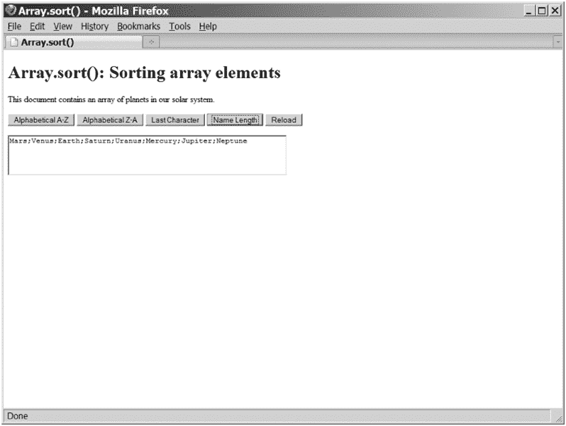

### 列表 18-8: Array.sort() 可能性

HTML: `jsb-18-08.html`

```html
<!DOCTYPE html>
<html>
    <head>
        <meta http-equiv="content-type" content="text/html;charset=utf-8">
        <title>Array.sort()</title>
        <script type="text/javascript" src="../jsb-global.js"></script>
        <script type="text/javascript" src="jsb-18-08.js"></script>
    </head>
    <body>
        <h1>Array.sort(): 排序数组元素</h1>
        <form>
            <p>此文档包含我们太阳系中的行星数组。</p>
            <p>
                <input type="button" id="sortAsc" value="Alphabetical A-Z">
                <input type="button" id="sortDesc" value="Alphabetical Z-A">
                <input type="button" id="sortLastChar" value="Last Character">
                <input type="button" id="sortLength" value="Name Length">
                <input type="button" id="reload" value="Reload">
            </p>
            <p>
                <textarea id="output" name="output" rows="3" cols="60" wrap="virtual"></textarea>
            </p>
        </form>
    </body>
</html>
```

JavaScript: `jsb-18-08.js`

```javascript
// 页面加载时初始化
addEvent(window, 'load', initialize);

function initialize()
{
    // 只有当浏览器可以处理 DOM 方法时才执行
    if (document.getElementById)
    {
        // 指向关键元素
        oOutput = document.getElementById('output');
        var oButtonSortAsc = document.getElementById('sortAsc');
        var oButtonSortDesc = document.getElementById('sortDesc');
        var oButtonSortLastChar = document.getElementById('sortLastChar');
        var oButtonSortLength = document.getElementById('sortLength');
        var oReload = document.getElementById('reload');

        // 如果它们都存在...
        if (oOutput && oButtonSortAsc && oButtonSortDesc && oButtonSortLastChar && oButtonSortLength && oReload)
        {
            // 为按钮应用行为
            oButtonSortAsc.onclick = function() { sortIt(null) };
            oButtonSortDesc.onclick = function() { sortIt(compare1) };
            oButtonSortLastChar.onclick = function() { sortIt(compare2) };
            oButtonSortLength.onclick = function() { sortIt(compare3) };
            oReload.onclick = function() { location.reload(); };

            // 设置全局数组
            solarSys = new Array("Mercury", "Venus", "Earth", "Mars", "Jupiter", "Saturn", "Uranus", "Neptune");
        }
    }
}

// 比较函数
function compare1(a, b)
{
    // 字母反向排序
    if (a > b) return -1;
    if (b > a) return 1;
    return 0;
}

function compare2(a, b)
{
    // 行星名称的最后一个字符
    var aComp = a.charAt(a.length - 1);
    var bComp = b.charAt(b.length - 1);
    if (aComp < bComp) return -1;
    if (aComp > bComp) return 1;
    return 0;
}

function compare3(a, b)
{
    // 行星名称的长度
    return a.length - b.length;
}

// 排序并显示数组
function sortIt(compFunc)
{
    if (compFunc == null)
    {
        solarSys.sort();
    }
    else
    {
        solarSys.sort(compFunc);
    }

    // 在字段中显示结果
    var delimiter = ";";
    oOutput.value = decodeURIComponent(solarSys.join(delimiter));
}
```

相关项目：`array.reverse()` 方法

### 注意

正如我们在第 45 节中展示的那样，许多正则表达式对象方法生成数组作为其结果（例如，字符串中匹配值的数组）。这些特殊数组拥有一组自定义的命名属性集，可以帮助你的脚本分析方法的查找结果。除此之外，这些正则表达式结果数组的行为与所有其他数组都一样。

### `array.splice(startIndex, deleteCount[, item1[, item2[,...itemN]]])`

返回：`Array`

兼容性：WinIE5.5+, MacIE−, NN4+, Moz+, Safari+, Opera+, Chrome+

如果你需要从数组中间删除项，`array.splice()`方法简化了一项原本需要组装新数组的任务。该方法的第一个参数是一个基于零的索引整数，指向要从数组中删除的元素。第二个参数是另一个整数，表示要从数组中删除的顺序项数。删除项会影响数组的长度，被删除的项将作为数组由`splice()`方法返回。

你可以使用`splice()`方法替换数组项。从第三个参数开始的可选参数允许你提供要插入数组的元素。每个添加的项可以是任何 JavaScript 数据类型，且新项的数量不需要等于被删除项的数量。事实上，通过指定第二个参数为零，你可以使用`splice()`在数组的任何位置插入一个或多个项。

### 示例

使用评估器（见第 4 节）对`splice()`方法进行实验。首先创建一个包含数字的数组：

```javascript
a = new Array(1,2,3,4,5)
```

接下来，删除中间三个项并用一个字符串项替换它们：

```javascript
a.splice(1, 3, "two/three/four")
```

结果框显示方法返回的三项数组的字符串版本。要查看数组的当前内容，在顶部文本框中输入`a`。

将原始数字放回数组，用三个数字项替换字符串项：

```javascript
a.splice(1, 1, 2, 3, 4)
```

该方法返回单个字符串，而`a`数组现在又有五个项了。

相关项目：`array.slice()` 方法

### `array.toLocaleString()`

返回：`String`

兼容性：WinIE5.5+, MacIE−, NN6+, Moz+, Safari+, Opera+, Chrome+

### `array.toString()`

返回：`String`

兼容性：WinIE4+, MacIE4+, NN3+, Moz+, Safari+, Opera+, Chrome+

`array.toLocaleString()`和旧的兼容性更好的`array.toString()`是以字符串形式检索数组内容的方法。当你尝试在文本框中显示数组时，浏览器会自动调用数组的`toString()`方法，此时数组项用逗号分隔。

`toLocaleString()`的精确字符串转换取决于具体的浏览器实现。这些浏览器在某些细节上存在差异并不意外，即使是在采用美式英语版本的操作系统和浏览器中也是如此。例如，如果数组包含整数值，IE5.5+ 中的`toLocaleString()`方法会返回用逗号和空格分隔的数字，并格式化为小数点后两位数字（类似于美元和分的形式）。相比之下，基于 Mozilla 的浏览器仅返回整数，但这些整数也用逗号分隔。

如果你需要将数组转换为字符串，以便将数组数据传递给其他地方（例如，作为提交到服务器的隐藏文本框中的数据，或作为传递给另一个页面的搜索字符串数据），请使用`array.join()`方法。`array.join()`允许你对项目分隔符有更可靠、更灵活的控制，并且无论本地化如何，你都能获得相同的结果。

相关项目：`array.join()` 方法

# 数组推导式 (Array Comprehensions)

兼容性：FF2+

JavaScript 1.7 的一项特性是被称为“数组推导式”的 JavaScript 语法增强，它是基于另一个数组构建新数组的快捷方法。推导式通常可以替代`map()`和`filter()`方法。

这里是一个使用推导式生成数组中每个元素修改版本的示例：

```javascript
var aIntegers = new Array(0, 1, 2, 3, 4, 5, 6, 7);
var aResults = [i * i for each (i in aIntegers)];
// result: aResults == [0, 1, 4, 9, 16, 25, 36, 49]
```

这等同于`map()`语法：

```javascript
function square(iValue)
{
    return iValue * iValue;
}

var aIntegers = new Array(0, 1, 2, 3, 4, 5, 6, 7);
var aResults = aIntegers.map(square);
```

数组推导式还可以用于从数组中选择特定元素：

```javascript
var aNumbers = new Array(1, -2, -3, 4, 5, -6);
var aResult = [i for each (i in aNumbers) if (i > 0)];
// result: aResult == [1, 4, 5]
```

这等同于`filter()`语法：

```javascript
function isPositive(iValue, iIndex, aArray)
{
    return (iValue > 0);
}

var aNumbers = new Array(1, -2, -3, 4, 5, -6);
var aResult = aNumbers.filter(isPositive);
```

数组推导式的方括号为了作用域目的引入了一个隐式的块级。新变量（例如上述示例中的`i`）具有局部作用域（被处理为类似于使用`let`声明），并且在推导式外部不可用。

数组推导式的输入本身不需要是数组；也可以使用迭代器（iterators）和生成器（generators）（详见第 21 章）。

# 解构赋值 (Destructuring Assignment)

兼容性：FF2+, Opera 9.5 (部分支持)

解构赋值（在 JavaScript 1.7 中引入并在 1.8 中修正）使得轻松从另一个数组、对象或函数提取数组变得简单。你可以将其看作将一个数组赋值给另一个数组：

```javascript
[a, b, c] = [1, 2, 3]
// result: a == 1, b == 2, and c == 3
```

这种语法提供了一种简洁的交换变量值的方法：

```javascript
var x = 1;
var y = 2;
[x, y] = [y, x]
// result: x == 2 and y == 1
```

这取代了采用第三个临时变量来交换两个值的传统技术：

```javascript
temp = x;
x = y;
y = temp;
```

另一个示例是从函数接收一个值数组：

```javascript
function fun()
{
    return [3, 'aardvark', 0];
}

[a, b, c] = fun()
// result: a == 3, b == 'aardvark', and c == 0
```

截至本文写作时，Firefox 2.0+ 支持解构赋值，Opera 9.5 部分支持，但 Internet Explorer 8 及其他浏览器完全不支持。我们无法使用 JavaScript 来测试浏览器执行此代码的能力，因为旧版本会在尝试编译它时直接崩溃。我们可以用特殊的`script`标签对这段代码进行“防火墙”处理：

```html
<script type="application/javascript;version=1.8" src="scriptname.js"></script>
```

然而，如果我们还必须为其他浏览器提供更传统的语法，我们就对这种方法的用处表示怀疑。除非我们处于一种特殊情况下，可以保证代码将运行在包含了 JavaScript 1.8 的浏览器中，否则我们可能只能等到解构赋值语法被其他浏览器厂商更广泛地采用。

## 与旧浏览器的兼容性

本章描述的一些特性是随着 JavaScript 1.6 及其更高版本引入的。它们在 Firefox 2.0+ 或 3.0+ 以及其他浏览器中运行，但在许多其他浏览器（包括 Internet Explorer 8）中不受支持。新的数组对象方法（如`every()`和`filter()`）可以通过在它们不存在时简单地添加到对象原型中，从而在我们的跨浏览器脚本中使用，正如本章中列出的那样。然而，语法的创新（包括数组推导式和解构赋值）不能包含在旧浏览器运行的脚本块中，因为旧版本的 JavaScript 将在编译阶段直接停止，而不会运行页面上的任何脚本。

那么，我们是否应该在这些语法被通用支持之前克制使用它们？与 Web 开发的任何方面（特别是 JavaScript）一样，请确保页面的基本功能对所有人来说都是完整的。

# JSON—原生对象表示法

### 本章内容

- JSON 如何工作
- 发送和接收 JSON 数据
- 安全考量

JSON（JavaScript 对象表示法）是一种表示数据结构的轻量级方式，许多语言都可以轻松地读写它。这使得它（类似于 XML）成为应用程序之间实用的数据交换格式，例如在服务器端 PHP 和客户端 JavaScript 之间。随着 ECMAScript 第五版的发布，JSON 现在正式成为该语言的一部分，并将获得越来越多浏览器的支持。在此期间，有免费的代码可以辅助旧浏览器。

JSON 由 Douglas Crockford 开发，并于 2006 年向互联网社区发布。从 2010 年 4 月定稿的第五版开始，它正式成为 JavaScript 依据的 ECMAScript 标准的一部分。

### JSON 如何工作

JSON 结合了 JavaScript 语法中表示数组和对象的两个方面来呈现数据结构——使用括号`[]`的简单数组表示：

```json
["item1", "item2", "item3"]
```

以及使用大括号`{}`的对象和关联数组表示：

```json
{"key": "value"}
```

在一种情况下，我们通过数字索引访问嵌入的值（记住第一个元素的索引为零）：

```javascript
var aItems = ["item1", "item2", "item3"];
// 例如 aItems[0] == "item1"
```

在第二种情况下，通过键名访问：

```javascript
var oExample = {"charlie": "horse"};
// oExample["charlie"] == "horse"
// oExample.charlie == "horse"
```

使用这两种约定，可以描述许多具有命名或数值索引键子记录的数据结构：

```javascript
var oNovelist = {
    "firstName": "Joanna",
    "lastName": "Russ",
    "novels": [
        {
            "title": "And Chaos Died",
            "year": "1970"
        },
        {
            "title": "The Female Man",
            "year": "1975"
        }
    ]
};
```

在这个示例中，`firstName`和`lastName`具有简单的字符串值，而`novels`是一个数字索引数组。这里有两种引用这些值的方法：

```javascript
var sMsg = oNovelist['firstName'] + ' ' + oNovelist['lastName'] + "'s novel " + oNovelist['novels'][0]['title'] + ' was published in ' + oNovelist['novels'][0]['year'] + '.';
var sMsg = oNovelist.firstName + ' ' + oNovelist.lastName + "'s novel " + oNovelist.novels[0].title + ' was published in ' + oNovelist.novels[0].year + '.';
// result: Joanna Russ's novel And Chaos Died was published in 1970.
```

在第一个示例中，我们使用带括号的键名将该结构视为一个关联数组。在第二个示例中，我们使用点符号（dot-notation）来获取对象的属性。第一种语法始终有效，因为当键名是字符串时是带引号的。我们在第二个示例中之所以能使用点符号，是因为这些键名中都不包含像连字符、句号之类的字符——这些字符在键值中是合法的，但会让 JavaScript 感到困惑：

```javascript
var sMsg = oNovelist['first-name'];   // 这可以工作
var sMsg = oNovelist.first-name;      // 噢不！JavaScript 尝试进行减法
```

## 交叉引用

关于此点的更多信息，请参阅第 18 章“数组对象”中的“模拟哈希表”节。

### 数据类型

有六种类型的数据可以作为 JSON 值出现：

- 字符串（一组由零或多个 Unicode 字符组成的集合，封装在双引号中，并使用反斜杠转义）
- 数字（整数或实数；没有八进制和十六进制格式）
- 对象（一组键:值对的集合，用逗号分隔并封装在花括号中）
- 数组（值的有序序列，用逗号分隔并封装在方括号中）
- 布尔值（`true`或`false`）
- `null`

在任何两个标记之间都可以插入空白字符。

### 发送和接收 JSON 数据

由于 JSON 语法使用了 JavaScript 常用的对象和数组语法，我们不需要对语言进行任何扩展就可以在脚本中构建和读取 JSON 数据结构。只有当我们需要在脚本之间共享这些结构时，才会出现复杂。

为了读取、写入、发送和接收 JSON 数据对象，我们需要将其转换为字符串以及反之。此操作的标准方法是读取和写入与 JavaScript 中使用的完全相同的语法：

```json
{"firstName":"Joanna","lastName":"Russ","novels":[{"title":"And Chaos Died","year":"1970"},{"title":"The Female Man","year":"1975"}]}
```

该字符串可以被导入到任何支持 JSON 的编程语言中。

在 JavaScript 中执行对象与字符串之间的转换是简单的。我们鼓励使用[json.org](http://json.org)提供的函数用于旧浏览器，这样我们就不需要重复造轮子了。

由于 JSON 数据以与 JavaScript 源代码完全相同的形式存储在字符串中，初看起来似乎将其从字符串转换回对象最快捷的方法是使用 JavaScript 的`eval()`方法：

```javascript
var sStringJSON = readJSONDataFromWhateverSource();
eval("var oJSON = " + sStringJSON);
// 或者：
var oJSON = eval('(' + sStringJSON + ')');
```

现在`oJSON.firstName`将为上面的示例产生'Joanna'。（在第二次使用`eval()`时，请注意在 JSON 字符串周围加上必要的括号以满足 JavaScript 解释器的要求。）

然而，无论如何强调都不为过，`eval()`为 JavaScript 开启了恶意利用的大门，在任何公共页面上都应该避免使用。适当的 JSON 解析器将逐字符遍历数据字符串以构建 JSON 对象，而不是屈从于使用`eval()`的诱惑。

### JSON 原生化

JSON 对象随着 2009 年 12 月发布的 ECMAScript 第五版成为语言的一部分。Mozilla 在 JavaScript 1.8.1 中实现了这一点，该版本位于 Gecko 布局引擎 1.9.1 中，它驱动了 Firefox 3.5、Thunderbird 3 和 SeaMonkey 2。其他浏览器开发团队也必会效仿。

JSON 对象有两个方法：`parse()`和`stringify()`。`toJSON()`方法也被添加到了`Date`对象中。

### JSON 对象

| 属性 | 方法 |
| :--- | :--- |
| | `parse()` |
| | `stringify()` |

### 方法

#### `JSON.parse(string [, translator])`

返回：JSON 对象引用

兼容性：Moz1.9.1+, Firefox3.5+

使用`JSON.parse()`方法将 JSON 字符串转换为 JSON 对象。

```javascript
object = JSON.parse(string, translator)
```

`string`参数是待转换为对象的“字符串化”的 JSON。

相关项目：`JSON.stringify()` 方法

#### `JSON.stringify(object [, replacer [, space]])`

返回：JSON 字符串

兼容性：Moz1.9.1+, Firefox3.5+

`JSON.stringify()`将 JSON 对象转换为 JSON 字符串。

```javascript
string = JSON.stringify(object, replacer, space)
```

`object`参数是待转换为字符串的 JSON 对象。

`replacer`是一个可选参数，可以是改变字符串化过程行为的函数，也可以是字符串和数字对象的数组，作为选择要字符串化的对象属性的白名单。如果此值为`null`或未提供，则对象的所有属性都会包含在生成的 JSON 字符串中。

`space`是字符串或数字对象，用于在输出的 JSON 字符串中插入空白以提高可读性。如果这是一个数字，表示用作空白的空格数；如果该数字大于 10，则上限为 10。小于 1 的值表示不使用空格。如果这是一个字符串，则使用该字符串（如果更长则使用前 10 个字符）作为空白。如果未提供此参数（或为`null`），则不使用空白。

相关项目：`JSON.parse()` 方法

### 安全担忧

人们对 JSON 在网络安全中带来的漏洞表示了担忧。我们认为，只要足够仔细使用该技术，这些问题就可以消除。

使用`eval()`将 JSON 字符串转换为对象（或用于公共页面上的任何其他用途）是一个容易避免的陷阱。如果一个方法（函数）被嵌入在序列化的 JSON 中并使用`eval()`进行转换，则可以在没有页面作者脚本许可的情况下执行 JavaScript 代码。显而易见的解决方案是在旧版浏览器上使用 Douglas Crockford 发表的非`eval()`解析算法，并在新版浏览器上使用新的 JSON 对象方法`parse()`。

DOM 方法`XMLHttpRequest()`常用于服务器和客户端之间的信息交换。默认情况下，它只允许与当前页面来源的服务器进行交换。然而，通过注入链接到站外 JavaScript 文件的脚本标签，可以绕过这种保护。这里的解决方案是，允许第三方 JavaScript 在你的页面上执行时要保持警惕。

我们将在第 39 章“Ajax、E4X 和 XML”（位于 CD 中）中讨论在客户端和服务器之间传输 XML 的技术。

# XML

简而言之，XML 是一种用于包含和传输文本数据的标记语言。它由三种类型的标签标记的嵌套元素组成——即匹配的开始标签和结束标签：

```xml
<hobby>music</hobby>
```

以及空元素标签：

```xml
<breathe/>
```

元素可以包含属性，属性是存在于起始标签或空标签内的键值对：

```xml
<fax location="home" call-first="true">123-456-7890</fax>
```

与 HTML 和 XHTML 不同（后者的元素和属性名称选择受到文档类型声明（DTD）或`XMLSchema`的限制），而 XML 元素和属性名称是完全任意的，由数据作者定义以适应当前的用途。

如需 XML 的完整正式描述，请参阅 W3C 规范：[w3.org/TR/REC-xml/](http://w3.org/TR/REC-xml/)。

# ECMAScript for XML (E4X)

在 E4X 之前，使用 JavaScript 访问 XML 文档的方法是通过对象级别的`DOM`。随着 E4X 的出现，XML 被视为一种原生类型，与字符串、数字和布尔值处于同一水平。这对我们意味着什么？简单来说，对于我们开发者来说，XML 的访问现在更简单，而对于终端用户来说更快。使用`XML`原生类型创建的 XML 对象不是`DOM`的部分，也不是 XML 的`DOM`表示。由于它是原生类型，你使用它的方式类似于使用其他 JavaScript 对象。

## 使用 XML 对象

在 E4X 中，你声明 XML 对象的方式与声明字符串、数字或布尔对象非常相似，使用`XML`构造函数：

```javascript
var oCopyright = new XML();
```

你可以使用文本初始化该对象：

```javascript
var sXMLText = "<copyright>"
               + "<date>2010</date>"
               + "<author>Danny Goodman</author>"
               + "</copyright>";

var oCopyright = new XML(sXMLText);
```

值得注意的是，你还可以在赋值语句中使用不带引号的 XML 标记，这会隐式创建 XML 对象：

```javascript
var oCopyright = <copyright>
                   <date>2010</date>
                   <author>Danny Goodman</author>
                 </copyright>;
```

这种允许对特殊构造文本进行不带引号赋值的语法，可能会让你想起 JavaScript 原生的正则表达式语法，正如第 45 章“正则表达式和 RegExp 对象”中所描述的。

## XML 元素

XML 对象中的 XML 元素是它的属性。你可以使用熟悉的`object.property`点表示法和`object[property]`括号表示法来引用元素及其值：

```javascript
var sText = "Copyright " + oCopyright.date + " by " + oCopyright.author;

var sText = "Copyright " + oCopyright['date'] + " by " + oCopyright['author'];
```

最外层的 XML 元素是对象的根，因此在上面的`oCopyright`对象中，第一个顶级属性是日期元素：

```javascript
alert(oCopyright.name());            // 结果 = 'copyright'
alert(oCopyright.child(0).name());    // 结果 = 'date'
alert(oCopyright.date);              // 结果 = '2010'
```

当然，与其他 JavaScript 对象一样，当元素标签名称包含任何会让 JavaScript 困惑的字符时，你将无法成功使用对象点表示法。例如：

```javascript
var oXML = <author>
             <first-name>Danny</first-name>
           </author>;

var sText = oXML['first-name'];   // 结果: Danny
var sText = oXML.first-name;      // 结果: JavaScript 直接停止运行了！
```

在前面的示例中，JavaScript 尝试从 XML 元素`oXML.first`的值中减去名为`name`的变量值。如果其中一个不存在，或者它们都存在但都没有可以相减的数值值，JavaScript 就会失败。这个故事的启示是：如果你想使用点表示法，并且保证对元素的标签名称有完全控制权，你可以将字符集限制为字母数字和下划线。如果你处理来自你可能无法完全控制源的数据，请使用引号表示法，它将总是成功的。

## 添加元素

对象的`appendChild()`方法与同名的`DOM`方法类似，会将子元素插入到引用对象中：

```javascript
var oBook = <book/>;
var oAuthor = <author/>;
oBook.appendChild(oAuthor);
```

结果：

```xml
<book>
  <author/>
</book>
```

元素也可以使用我们通常用于字符串的相同拼接语法追加到 XML 元素中：

```javascript
oCopyright += <addendum>All rights reserved.</addendum>;
```

这将导致：

```xml
<copyright>
   <date>2010</date>
   <author>Danny Goodman</author>
</copyright>
<addendum>All rights reserved.</addendum>
```

为了将新元素插入到`copyright`元素内部，我们需要写：

```javascript
oCopyright.author += <addendum>All rights reserved.</addendum>;
```

结果为：

```xml
<copyright>
   <date>2010</date>
   <author>Danny Goodman</author>
   <addendum>All rights reserved.</addendum>
</copyright>
```

## 嵌入 JavaScript 表达式

当你想让 XML 对象与 JavaScript 交互时，E4X 变得非常有趣。你通过大括号来实现：

```javascript
var oDate = new Date();
var oCopyright = <copyright>
                  <date>{oDate.getFullYear()}</date>
                  <author>Danny Goodman</author>
                </copyright>;
```

大括号内的任何内容都会被作为 JavaScript 执行并插入到 XML 流中。在 2020 年，上述示例解析为：

```xml
<copyright>
  <date>2020</date>
  <author>Danny Goodman</author>
</copyright>
```

## XML 属性

就像 XML 文档一样，对象中的元素也可以有属性。这些属性值也可以用括号表示法设置。你可以通过在属性名称前使用`@`运算符结合点表示法来提取元素属性的值，正如我们在示例中所示：

```javascript
var oPhone = <phone>
               <entry>
                 <name>Janis Joplin</name>
                 <phone location="home">123-456-7890</phone>
               </entry>
             </phone>;

var sText = oPhone.entry.name + "'s " + oPhone.entry.phone.@location + " phone is " + oPhone.entry.phone;
```

结果：`Janis Joplin's home phone is 123-456-7890`

你也可以使用`@`表示法创建并修改属性值：

```javascript
oPhone.entry.phone.@location = "work";
```

## XMLList 对象

大多数 XML 文档包含重复的元素集合。你只需通过相同的父元素重复标签名称即可在 XML 对象中创建此类集合：

```javascript
var oBook = <book>
  <title>The JavaScript Bible 7th Edition</title>
  <author>Danny Goodman</author>
  <coauthor>Michael Morrison</coauthor>
  <coauthor>Paul Novitski</coauthor>
  <coauthor>Cynthia Gustaff Rayl</coauthor>
</book>;
```

当你指向重复集合时，你会得到一个`XMLList`对象。你可以像处理数组一样处理它。有两个主要的区别：`length()`是一个方法而不是属性，因此需要括号`()`；以及其他`Array`对象的方法不支持`XMLList`。

```javascript
var sText = "The number of co-authors is " + oBook.coauthor.length() + ".";
```

在我们当前的示例 XML 中，由于存在多个具有相同标签名的兄弟元素，`oBook.coauthor`成了整个数据结构中的一个列表：

```javascript
// 提取 coauthor 元素的 XMLList
var oCoauthors = oBook.coauthor;

var sText = oBook.title + ' was written by ' + oBook.author + ' with ';
```

```javascript
// 遍历共同作者
var sConj = '';
var iCoauthors = oCoauthors.length();
var sLastAuthor = oCoauthors[iCoauthors-1];
for (var i=0; i < iCoauthors; i++) {
    // 如果项目多于两个，在项前加逗号
    if (i > 0 && iCoauthors > 2) {
        sConj = ', ';
    }
    // 如果是序列中的最后一个项，在前面加 'and'
    if (i == iCoauthors-1 && iCoauthors > 1) {
        sConj += ' and ';
    }
    // 将项添加到列表
    sText += sConj + oCoauthors[i];
}
sText += '.';
// 结果 == The JavaScript Bible 7th Edition 由 Danny Goodman
// 与 Michael Morrison, Paul Novitski 和 Cynthia Gustaff Rayl 编写。
```

星号`*`可以表示集合中的所有项目。使用前面的 XML：

```javascript
var iCount = oBook.*.length();
```

结果是 5——根元素有一个标题、一个作者和三个共同作者元素。

### 添加列表项

要向`XMLList`添加新项，请使用上述相同的拼接语法，并以其重复的元素命名列表：

```javascript
oBook.coauthor += <coauthor>John Lennon</coauthor>;
```

结果为：

```xml
<book>
    <title>The JavaScript Bible 7th Edition</title>
    <author>Danny Goodman</author>
    <coauthor>Michael Morrison</coauthor>
    <coauthor>Paul Novitski</coauthor>
    <coauthor>Cynthia Gustaff Rayl</coauthor>
    <coauthor>John Lennon</coauthor>
</book>
```

### 注意事项

需要注意的说明：如果我们像上面那样从一个`XML`对象中提取一个`XMLList`对象：

```javascript
// 提取 coauthor 元素的 XMLList
var oCoauthors = oBook.coauthor;
```

该列表是 XML 元素的静态拷贝，没有动态链接。后续对`XML`对象或`XMLList`对象的任何更改都不会反映在另一个对象上。在本例中，向`oCoauthors`列表添加新的共同作者元素不会修改原始的`XML`对象。

### 选择列表项

E4X 的强大之处体现在能够根据属性和值选择`XMLList`项。考虑以下示例：

```javascript
var oPhonebook = <phonebook>
    <entry>
        <name>Janis Joplin</name>
        <phone location="home">123-456-7890</phone>
        <phone location="work">234-567-8901</phone>
        <phone location="cell">345-678-9012</phone>
    </entry>
    <entry>
        <name>John Lennon</name>
        <phone location="home">987-654-3210</phone>
        <phone location="work">876-543-2109</phone>
    </entry>
</phonebook>;
```

我们已经看到，可以非常容易地选择所有匹配名称的元素列表：

```javascript
// 提取所有 phone 元素的列表
var oPhones = oPhonebook.entry.phone;
```

结果：

```xml
<phone location="home">123-456-7890</phone>
<phone location="work">234-567-8901</phone>
<phone location="cell">345-678-9012</phone>
<phone location="home">987-654-3210</phone>
<phone location="work">876-543-2109</phone>
```

注意，这找到了多个`entry`记录中的`phone`元素。该选择语句本质上说：“找到所有父节点为根`entry`元素的`phone`元素”。如果我们想将搜索限制在单个`entry`元素，只需要指定它的索引：

```javascript
var oPhones = oPhonebook.entry[0].phone;
```

同样，我们可以通过属性值选择元素：

```javascript
var oWorkPhones = oPhonebook.entry.phone.(@location == 'work');
```

结果：

```xml
<phone location="work">234-567-8901</phone>
<phone location="work">876-543-2109</phone>
```

这会将选择缩小到仅具有类型属性“work”的`phone`元素——当表达式`@location == 'work'`结果为真时。

这种语法的方便之处之一是可以在搜索其兄弟元素后提取其中一个元素的值：

```javascript
var oPhone = oPhonebook.entry.(name == 'Janis Joplin').phone.(@location == 'home');
```

结果：

```xml
<phone location="home">123-456-7890</phone>
```

选择器说：“给我获取名称为 Janis 的 entry 的电话。”`oPhone`然后返回一个与`name`为兄弟的`phone`元素。

XML 表达式可以包含函数，而不需要使用大括号：

```javascript
function checkExchange(sExchange, sPhone) {
    if (sPhone.indexOf(sExchange) > 0) {
        sExchange = ' - ' + sExchange;
    }
    return sExchange;
}
```

```javascript
var oPhone = oPhonebook.entry.phone.(@location == 'home').(checkExchange('123', toString()));
```

### 对象序列化

XML 是一个跟踪数据的方便格式。要将数据发送到服务器，我们将 XML 对象转换为字符串：

```javascript
var sXMLText = oPhonebook.entry.(@location == 'home').toString();
```

`toString()`方法作用于`XML`对象的任何子集或整体。你可能会使用`()`来查找零基础集合中的索引，但与数组一样，我们不能使用`[]`。我们使用`childNodes`属性：

```javascript
var oNodes = oPhonebook.childNodes;
```

### `copy()`

返回：XML 对象

兼容性：WinIE5, NN-, FF3.5+, Safari-, Opera-

`copy()`方法返回所选部分的深拷贝：

```javascript
var oPerson = oPhonebook.person.copy();
```

此操作的结果是以下 XML 对象：

```xml
<person>
    <name>Janis Joplin</name>
    <phone location="home">123-456-7890</phone>
</person>
```

注意，这也可以通过简单的赋值来实现：

```javascript
var oPerson = oPhonebook.person;
```

### `name()`

返回：String

兼容性：WinIE5, NN-, FF3.5+, Safari-, Opera-

`name()`方法返回 XML 元素的标签字符串：

```javascript
var oPhonebook = <phonebook>
    <person>
        <name>Janis Joplin</name>
        <phone location="home">123-456-7890</phone>
    </person>
</phonebook>;
```

```javascript
alert(oPhonebook.child(0).name()); //  = 'person'
```

```javascript
alert(oPhonebook.person.child(1).name());  // result = 'phone'
alert(oPhonebook.person.child(1));         // result = '123-456-7890'
```

记住`child()`是一个方法，尽管我们使用它就像使用数组一样，但请在索引周围使用圆括号而不是括号。和数组一样，`child()`集合是从 0 开始的列表，因此`child(1)`找到第二个子元素。

相关项目：`childNodes()` DOM 属性

### `toString()`, `toXMLString()`

返回值：`String`

兼容性：WinIE5-, MacIE-, NN-, FF1.5+, Safari-, Opera-, Chrome-

`toString()`和`toXMLString()`方法返回一个字符串，该字符串是 XML 对象所有文本节点的文本拼接而成的。

相关项目：`string.toString()`

# 控制结构与异常处理

### 本章内容

- 脚本执行的多路径分支
- 循环遍历有序的数据集合
- 应用异常处理技术

你早晨起床，开始处理一整天的事务，最后通过遛狗、换上舒适的鞋并放松来结束这一天。这与程序从启动到结束所做的操作并没有太大区别。在此过程中，你和程序都迈了许多微小的步骤，并非所有步骤都是沿着直线推进处理的。有时，你必须通过做出决定或重复任务直到整个工作完成来控制正在发生的事情。控制结构就是 JavaScript 中让这些任务成为可能的机制。

JavaScript 中的控制结构与许多编程语言相似。基本的决策和循环构造满足了几乎所有编程任务的需求。

另一个至关重要的程序控制机制——错误（或异常）处理——在 ECMA-262 语言标准中正式解决。异常处理的概念是在 IE5.5 和 NN6 引入的 JavaScript 版本中加入的，但对于许多其他环境的程序员来说它是众所周知的。在代码中采用异常处理技术可以极大地增强对无法控制的处理错误的恢复能力，例如由错误的用户输入或网络抖动引起的错误。

## If 和 If…Else 决策

兼容性：WinIE3+, MacIE3+, NN2+, Moz+, Safari+, Opera+, Chrome+

JavaScript 程序经常需要根据变量或对象属性的当前值做出决策。此类决策一次只能有两种可能的结果。决定程序在这些决策点上所走路径的因素是`if`语句评估为真（`true`）还是假（`false`）。例如，当你晚上遛狗回来时，测试的语句类似于：“我舒适的鞋在客厅里吗？”如果该语句为假，你就寻找你舒适的鞋；如果该语句为真，你就穿上舒适的鞋并放松。

### 简单决策

这种简单决策的 JavaScript 语法始终以关键字`if`开始，后面跟着待测试的条件，然后当条件产生真结果时执行的语句。JavaScript 不使用“then”关键字（如某些其他语言那样）；该关键字通过圆括号和花括号围绕该构造各个组件的方式来隐含。其正式语法为：

```javascript
if (condition)
{
   statementsIfTrue
}
```

这种构造意味着如果条件为真，程序执行将绕道执行花括号内部的语句。无论发生什么，程序都会继续执行闭大括号（`}`）之后的语句。如果寻找舒适的鞋是脚本语言的一部分，代码看起来像这样：

```javascript
if (comfyFootwearInLivingRoom == false)
{
   look for them
}
```

如果你不熟悉 C/C++，双等号可能会引起你的注意。你将在下一章中学习更多关于这种运算符的知识，但现在请知道该运算符比较它两边项的等效性。换句话说，`if`构造的条件语句必须始终产生一个布尔值（`true`或`false`）。你可能记得，某些对象属性是布尔值，因此你可以直接将该属性的引用放入条件语句中。否则，条件语句由比较运算符分隔的两个值组成，例如`==`（等于）或`!=`（不等于）。

接下来，看一些真实的 JavaScript。以下函数接收一个文本输入对象：

```javascript
function notTooHigh(oInput)
{
    if (parseInt(oInput.value) > 100)
    {
        alert("Sorry, the value you entered is too high. Try again.");
        return false;
    }
    return true;
}
```

条件（圆括号内）测试字段内容是否与硬编码的数值 100 进行比较。如果输入的值大于该值，函数会提示你并向脚本其他处的调用语句返回一个假值。但如果该值小于 100，所有中间代码将被跳过，函数返回真。

### 关于 (condition) 表达式

控制结构的大量条件测试会将值与某些特定条件进行比较，例如字符串是否为空或值为空。你可以使用快捷方式来处理其中许多情况。

**条件等效值**

| 真 | 假 |
|------|----------------|
| 非空字符串 | 空字符串 |
| 非零数字 | 0 |
| 非空值 | `null` |
| 对象存在 | 对象不存在 |
| 属性已定义 | `undefined` |

与其为涉及此类值的条件详细写出等效表达式，你只需提供要测试的值即可。例如，如果变量`myVal`能够以`null`、空字符串或用于进一步处理的值进入`if`构造，你可以使用以下代码：

```javascript
if (myVal)
{
   // do processing
}
```

所有`null`或空字符串条件都会评估为假，因此只有`myVal`为可处理的情况才会进入`if`。这种机制与你在书中其他地方看到的用于对象分支的机制相同。例如，嵌套在以下段落中的代码仅在`document`对象具有`images`属性时执行：

```javascript
if (document.images)
{
   // do processing
}
```

### 复杂决策

之前描述的简单`if`构造适用于决策是在返回主路径之前绕小路的情况。但并非所有的决策（无论是编程还是生活中）都是如此。为了在 JavaScript 决策中提供两条替代路径，你可以为构造添加`else`组件。语法为：

```javascript
if (condition)
{
   // statementsIfTrue
}
else
{
   // statementsIfFalse
}
```

通过附加`else`关键字，你为`if`构造在条件为假时提供了一条遵循的路径。`statementsIfTrue`和`statementsIfFalse`不需要以任何方式平衡：一个语句可以是一行代码，另一个可能是百行。但当其中任何一个分支完成后，执行将在最后一个闭大括号之后继续。为了演示这种构造如何有用，以下示例是一个脚本片段，它根据年份（第 17 章解释了`Date`对象）是否为闰年（使用第 22 章解释的模运算来判断年份是否能被 4 整除，并暂不考虑其他闰年计算细节）来分配二月的天数：

```javascript
var howMany = 0;
var currentTime = new Date();
var theYear = currentTime.getFullYear();

if (theYear % 4 == 0)
{
   howMany = 29;
}
else
{
   howMany = 28;
}
```

这是一个案例，执行必须遵循两条可能的路径之一，以便将天数赋值给变量`howMany`。如果没有使用`else`部分，如下所示：

```javascript
var howMany = 0;
var currentTime = new Date();
var theYear = currentTime.getFullYear();

if (theYear % 4 == 0)
{
    howMany = 29;
}
howMany = 28;
```

那么该变量将始终被设置为 28，偶尔在短暂被设置为 29 之后。在这种情况下，`else`结构是至关重要的。然而，通过将变量初始化为 28，可以在不使用`else`部分的情况下实现目标，如下所示：

```javascript
var howMany = 28;
var currentTime = new Date();
var theYear = currentTime.getFullYear();

if (theYear % 4 == 0)
{
    howMany = 29;
}
```

# 嵌套 if…else 语句

设计复杂的决策过程需要仔细关注脚本必须处理的决策逻辑，以及在任何给定条件下必须执行的语句。随着 4 代浏览器中`switch`结构的出现（本章稍后会描述），重复逻辑的需求消失了，但可能某些时候你仍然必须由一系列嵌套的`if…else`语句来构建复杂的决策行为。如果没有一个感知 JavaScript 的文本编辑器来帮助保持所有内容的正确缩进和正确结束（使用闭大括号），你就必须非常仔细地监控编写过程。此外，当发生错误时，JavaScript 提供的错误信息（参阅光盘上的第 48 章“调试脚本”）可能不会直接指向问题行，而仅指向困难所在的区域。

为了演示一组嵌套的`if…else`结构，列表 21-1 提供了一个针对复杂问题的简单用户界面。单一个文本对象要求用户输入三个字母之一——A、B 或 C。该字段背后的脚本对以下每种情况处理不同的消息：

- 用户没有输入任何值。
- 用户输入了 A。
- 用户输入了 B。
- 用户输入了 C。
- 用户输入了完全不同的内容。

### 注意

在本章及本书大部分内容中用于分配事件处理程序的函数是`addEvent()`，这是一种跨浏览器事件处理器，在第 32 章中进行了详细解释：参见“跨浏览器事件绑定解决方案”。

## 格式有什么特殊？

`if`结构的缩进，以及在真条件下执行的语句的进一步缩进，并不是 JavaScript 要求的。然而，你在这里看到的是大多数 JavaScript 编写人员遵循的惯例。在文本编辑器中编写代码时，可以使用`Tab`键来建立每一级缩进；某些开发者倾向于使用编辑器中的设置将制表符转换为空格，这可以确保缩进在不同编辑器之间保持一致性。浏览器在加载你的脚本时会忽略这些制表符字符（和/或空格）。

缩进的样式有很多种。我们在本书中最常用的样式被称为 Allman 样式——即左括号和右括号各占一行；而许多程序员更倾向于 1TBS（单一大括号样式），在这种样式中，左括号与控制语句在同一行。

### 列表 21-1: 嵌套 if…else 结构

HTML: `jsb-21-01.html`

```html
<!DOCTYPE html>
<html>
    <head>
        <meta http-equiv="content-type" content="text/html;charset=utf-8">
        <title>Nested if...else</title>
        <script type="text/javascript" src="../jsb-global.js"></script>
        <script type="text/javascript" src="jsb-21-01.js"></script>
    </head>
    <body>
        <h1>Nested if...else</h1>
        <form id="theForm" action="validate.php" method="get">
            <fieldset>
                <label for="theText">Please enter A, B, or C: </label>
                <input id="theText" type="text">
                <input type="submit">
            </fieldset>
        </form>
    </body>
</html>
```

JavaScript: `jsb-21-01.js`

```javascript
// 当页面加载时初始化
addEvent(window, 'load', initialize);

function initialize() {
    // 为表单添加事件
    addEvent(document.getElementById('theForm'), 'submit', suppressSubmission);
    // 为输入框添加事件
    addEvent(document.getElementById('theText'), 'change', testLetter);
}

function suppressSubmission(evt) {
    // 合并事件处理
    if (!evt) evt = window.event;
    // W3C DOM 方法（IE 隐藏）
    if (evt.preventDefault) evt.preventDefault();
    // IE 方法
    return false;
}

function testLetter() {
    // 分配给更短的变量名
    var inpVal = this.value;
    if (inpVal != "") {
        // 输入为空则进入...
        if (inpVal == "A") {
            // 是 "A" 吗？
            alert("Thanks for the A.");
        } else if (inpVal == "B") {
            // 不是。是 "B" 吗？
            alert("Thanks for the B.");
        } else if (inpVal == "C") {
            // 不是。是 "C" 吗？
            alert("Thanks for the C.");
        } else {
            // 不是。以上都不是。
            alert("Sorry, wrong character or case.");
        }
    } else {
        // 值为空，所以跳过了上面所有其他内容
        alert("You did not enter anything.");
    }
}
```

每个条件只执行适用于该特定条件的语句，即使需要多次查询才能确定输入的内容是什么。你不需要从嵌套结构中退出，因为当找到真响应时，相关的语句就会执行，且执行路径中不会有其他语句运行。

你可能已经注意到表单元素的`action`属性指向一个名为`validate.php`的 PHP 脚本。在第 7 章“脚本与 HTML 文档”中，我们讨论了始终指定服务器端程序的明智之处，以防用户禁用了 JavaScript。

## 条件表达式

兼容性：WinIE3+, MacIE3+, NN2+, Moz+, Safari+, Opera+, Chrome+

正如向你展示 JavaScript 中的决策构造时，现在是介绍一种特殊类型表达式的良好时机，你可以用这种表达式来替代`if...else`结构，处理常见的决策类型——即根据某些条件的结果分配两个值之一的实例。条件表达式的正式定义如下：

```javascript
variable = (condition) ? val1 : val2;
```

该表达式意味着如果条件的布尔结果为真，JavaScript 将`val1`赋值给变量；否则，将`val2`赋值给变量。与其他条件表达式一样，这一个也必须写在括号内。问号在这里是关键，分隔两个可能值的冒号也是。

条件表达式虽然在代码中并不直观或易于阅读，但非常紧凑。将以下赋值决策的`if...else`版本：

```javascript
var collectorStatus;
if (CDCount > 500)
{
    collectorStatus = "fanatic";
}
else
{
    collectorStatus = "normal";
}
```

与条件表达式版本对比：

```javascript
var collectorStatus = (CDCount > 500) ? "fanatic" : "normal";
```

后者节省了一些代码，尽管内部处理与`if...else`结构相同。当然，如果你的决策路径包含比为变量赋值以外的多个语句，那么`if...else`或`switch`结构更合适。然而，如果你需要执行二元操作（例如在脚本中设置真/假标志），这个快捷方法是非常好用的。

# switch 语句

兼容性：WinIE4+, MacIE4+, NN4+, Moz+, Safari+, Opera+, Chrome+

在某些情况下，一个二元的（真或假）决策路径不足以处理脚本中的逻辑。对象的属性或变量的值可能包含多个可能值中的任何一个，并且每个可能值都需要一个独立的执行路径。建立这种决策路径显而易见的方法是使用一系列`if...else`结构。然而，除了嵌套代码会导致迅速变得难以处理之外，必须测试的条件越多，处理效率就越低，因为每个条件都必须经过测试。结果是一系列子句和花括号，这可能会变得非常困惑。

从第 4 版浏览器开始，一种许多语言使用的控制结构被引入了 JavaScript。其实现方式与 PHP、Java 和 C/C++ 类似，它们使用`switch`和`case`关键字。其基本原理是你可以根据某些表达式的值创建任意数量的执行路径。在结构的开头，你确定该表达式是什么，然后为每个执行路径分配一个与特定值匹配的标签。

`switch`语句的正式语法如下：

```javascript
switch (expression)
{
    case label1:
        [statements]
        [break;]
    case label2:
        [statements]
        [break;]
    ...
    [default:
        statements]
}
```

例如：

```javascript
switch (TimeOfDay)
{
    case 'morning':
        meal = 'breakfast';
        break;
    case 'midday':
        meal = 'lunch';
        break;
    case 'afternoon':
    case 'evening':
        meal = 'dinner';
        break;
    default:
        meal = 'fast';
}
```

`switch`语句的`expression`参数可以评估为任何字符串或数字值。当标签表示表达式的字符串值时，标签会被引号包围。注意，`break`语句是可选的。`break`语句强制`switch`表达式跳过对后续标签与表达式值的后续其他检查。重要的一点是理解，如果没有在每个`case`的末尾添加`break`语句，那么`switch`表达式中的每一行代码都将被执行。然而，由于不允许布尔运算符（每个标签必须对应一个且仅一个值），你可以通过仔细放置`break`语句来实现。（在上述示例中，如果时间是下午或晚上，餐食就是晚餐。）另一个选项是`default`语句，当表达式值不匹配任何`case`语句标签时，它提供了一个全捕获的执行路径。如果你希望在表达式值不匹配时不发生任何执行操作，请省略结构中的`default`部分。

为了演示一个运行中的`switch`语句的语法，列表 21-2 提供了该控制结构在一个较大应用程序中的骨架。该页面包含两个不同产品类别的独立数组。每个产品的名称和价格都存储在各自的数组中。选择列表显示产品名称。用户选择一个产品后，脚本会在相应的数组中查找产品名称并显示价格。

该应用程序背后的诀窍是分配给选择列表中每个产品的值。虽然显示的文本是产品名称，但每个`<option>`标签的`value`属性是该产品的数组类别。该`value`就是用于决定遵循哪个分支的表达式。同样请注意，我们为整个`switch`结构分配了一个标签。其目的是为了在任何匹配发生时，让每个`case`的深度嵌套重复循环（通过带标签的`break`语句）完全退出`switch`结构。你可以通过任意数量的产品类别数组以及匹配的额外`case`语句来扩展此示例。

### 列表 21-2: 运行中的 switch 结构

HTML: `jsb-21-02.html`

```html
<!DOCTYPE html>
<html>
<head>
    <meta http-equiv="content-type" content="text/html;charset=utf-8">
    <title>Switch Statement and Labeled Break</title>
    <script type="text/javascript" src="../jsb-global.js"></script>
    <script type="text/javascript" src="jsb-21-02.js"></script>
</head>
<body>
    <h1>Switch Statement and Labeled Break</h1>
    <p>Select a chip for lookup in the chip table:</p>
    <form id="theForm" action="validate.php" method="get">
        <p>
            <label for="chips">Chip:</label>
            <select id="chips">
                <option></option>
                <option value="ICs">900MHz</option>
                <option value="ICs">Pro 1.0GHz</option>
                <option value="ICs">BFD 750MHz</option>
                <option value="snacks">Potato Chips</option>
                <option value="snacks">Cheezets</option>
                <option value="snacks">Tortilla Flats</option>
                <option>Chip</option>
            </select>
            <label for="cost">Price:</label>
            <input type="text" id="cost" size="10">
        </p>
    </form>
</body>
</html>
```

JavaScript: `jsb-21-02.js`

```javascript
// 在页面加载时初始化
addEvent(window, 'load', initialize);

function initialize() {
    // 为下拉列表添加一个事件
    addEvent(document.getElementById('chips'), 'change', getPrice);
}

// 使用自定义对象构建两个产品数组，模拟数据库表
function product(name, price) {
    this.name = name;
    this.price = price;
}

var ICs = new Array();
ICs[0] = new product("900MHz", "$14");
ICs[1] = new product("Pro 1.0GHz", "$29");
ICs[2] = new product("BFD 750MHz", "$39");

var snacks = new Array();
snacks[0] = new product("Potato Chips", "$1.79");
snacks[1] = new product("Cheezets", "$1.59");
snacks[2] = new product("Tortilla Flats", "$2.29");

// 在表中查找与产品相关的费用
function getPrice() {
    var chipName = this.options[this.selectedIndex].text;
    var chipType = this.options[this.selectedIndex].value;
    var outField = document.getElementById('cost');

    master:
    switch(chipType) {
        case "ICs":
            for (var i = 0; i < ICs.length; i++) {
                if (ICs[i].name == chipName) {
                    outField.value = ICs[i].price;
                    break master;
                }
            }
            break;
        case "snacks":
            for (var i = 0; i < snacks.length; i++) {
                if (snacks[i].name == chipName) {
                    outField.value = snacks[i].price;
                    break master;
                }
            }
            break;
        default:
            outField.value = "Not Found";
    }
}
```

### 重复 (for) 循环

兼容性：WinIE3+, MacIE3+, NN2+, Moz+, Safari+, Opera+, Chrome+

正如你在其他章节的众多示例中所看到的，遍历数组中的每一项或遍历表单元素中的每个项目对于许多 JavaScript 脚本至关重要。最典型的操作之一是检查许多项的属性以搜索特定值，例如确定组中的哪个单选按钮被选中。允许这些重复访问的一种 JavaScript 结构是`for`循环，以其起始关键字命名。另外两个结构，`while`循环和`do-while`循环将在后续节中介绍。

JavaScript `for`循环任意次数地重复一系列语句，并包含一个可选的循环计数器，该计数器可用于语句的执行。以下是正式语法定义：

```javascript
for ([initial expression]; [condition]; [update expression])
{
    statements
}
```

括号内的三个语句对于`for`循环的执行方式起着关键作用。

`for`循环中的初始表达式仅执行一次，即`for`循环开始运行的第一次。初始表达式最常见的应用是为循环计数器变量分配名称和起始值。因此，看到一个既声明变量名又为其分配初始值（通常为 0 或 1）的`var`语句并不罕见。例如：

```javascript
var i = 0;
```

你可以使用任何变量名，但按照惯用法，通常使用字母`i`，它是`index`（索引）的缩写。如果你更喜欢`counter`（计数器）或其他能让你想起变量含义的词，那也可以。无论如何，关于此语句需要记住的重要点是，它在`for`循环的开始时执行一次。

第二个语句是条件，与你在本章之前在`if`结构中看到的条件语句完全相同。当在初始表达式中建立循环计数变量时，条件语句通常定义了在循环停止之前循环计数器应该达到多大。因此，这里最常见的语句是将循环计数器变量与某个固定值进行比较——循环计数器是否小于允许的最大值？如果条件在开始时为假，则不执行循环体。但如果执行了循环，那么当执行回到循环顶部时，JavaScript 会重新评估条件以确定表达式的当前结果。如果循环计数器每次循环都增加，计数器值最终将超过条件语句中的值，从而导致条件语句产生布尔值`false`。一旦发生这种情况，执行将完全退出`for`循环。

最后一个语句是更新表达式，它在每次循环执行结束时执行——在`for`结构内部嵌套的所有语句运行之后。同样，循环计数器变量也可以是其中的一个因素。如果你希望计数器值在下次循环时增加 1（称为值的递增），你可以使用实现该操作的 JavaScript 运算符：在变量名后附加`++`运算符。这项任务就是你在书中已经看到的那些`for`循环中出现所有`i++`符号的原因。你并不限于每次增加 1。你可以按任何倍数进行递增，甚至通过减小值（`i--`）来让循环计数器向后运行。

现在，利用这些知识，并完善形式化的语法定义，使其考虑到一个典型的循环计数变量`i`及其常见的用法：

```javascript
// 递增循环计数器
for (var i = minValue; i <= maxValue; i++)
{
   // 语句
}

// 递减循环计数器
for (var i = maxValue; i >= minValue; i--)
{
   // 语句
}
```

在上面的循环计数器中，变量`i`在开始时初始化为等于`minValue`的值。变量`i`立即与`maxValue`进行比较。如果`i`小于或等于`maxValue`，处理继续进入循环体。在循环结束时，执行更新表达式。`i`的值加 1。因此，如果`i`初始化为 0，那么在循环的第一次中，在循环内语句的第一次执行期间，变量`i`保持 0 值。下一次循环时，变量的值变为 1。

正如你可能在形式语法定义中注意到的那样，`for`语句的每个参数都是可选的。例如，循环内部执行的语句可能会根据处理过程中的数据来控制循环计数器的值。因此，更新语句可能会干扰循环的预期运行。但我们建议你使用所有三个参数，直到你对它们在`for`循环中的作用感到绝对自在为止。例如，如果你省略了条件语句，并且你没有编写让循环自动退出的方法，你的脚本可能会陷入无限循环——这对你的用户没有任何好处。

### 让循环计数器派上用场

尽管`i`循环计数器看起来很小，但`i`计数（或你想要给它的任何名称）可以是处理重复循环内部数据的强大工具。例如，查看一个经典 JavaScript 函数的版本，该函数在创建数组的同时将项目初始化为 0：

```javascript
// 初始化一个包含 n 个条目的数组
function MakeArray(n)
{
   this.length = n;
   for (var i = 0; i < n; i++)
   {
      this[i] = 0;
   }
   return this;
}
```

循环计数器`i`初始化为 0，因为任何 JavaScript 数组的第一个元素都是元素 0。在条件语句中，只要计数器的值小于正在创建的条目数量（`n`），循环就会继续执行。（例如，如果`n`是 10，数组初始化为十个元素，0–9。）每次循环后，计数器加 1。在循环内执行的嵌套语句中，你使用变量`i`的值来代替赋值语句的索引值：

```javascript
this[i] = 0;
```

当第一次执行循环时，值表达式求值为：

```javascript
this[0] = 0;
```

下一次，该表达式求值为：

```javascript
this[1] = 0;
```

依此类推，直到所有条目都创建完毕。回想目录 18-2 中的 HTML 页面，其中用户从选择列表中选择区域办公室。由于区域办公室名称存储在数组中，可以对页面进行修改，使脚本从数组填充选择元素。这样，如果公司增加了一个新的区域办公室，你只需要向数组中添加，而代码中的其他部分都会自动调整：

```javascript
var regionalOffices = ["New York", "Chicago", "Houston", "Portland"];
```

外部 JavaScript 文件中的代码可以如下用于动态生成选择列表：

```javascript
for (var i = 0; i < regionalOffices.length; i++)
{
   oSelect.options[i] = new Option(regionalOffices[i]);
}

// 预选第一个选项
oSelect.options[0].selected = true;
```

注意`for`循环条件语句中的一个重要点：JavaScript 从数组中提取`length`属性并作为循环计数器的边界。从代码维护和风格的角度来看，这种方法优于在那里硬编码一个值。同样注意，条件语句的运算符是小于（`<`）：数组从 0 开始索引的值意味着我们可以使用的最大索引值比数组的项目数少一。这是一个至关重要的信息，因为索引计数变量`i`在每次循环中都作为`regionalOffices`数组的索引，用于读取每个条目的字符串。

某些循环结构在满足特定条件后就会完成任务，此时它们就不再需要继续遍历计数器范围内的剩余值。这种情况的一种常见场景是循环遍历整个数组，以寻找符合某些标准的单个条目。该标准测试被设定为循环内部的`if`结构。如果满足了该标准，你就可以`break`跳出循环，让脚本继续对主流程中的后续语句进行更具意义的处理。要实现这种退出循环，请使用`break`语句。接下来的代码显示了`break`语句可能出现在`for`循环中：

```javascript
for (var i = 0; i < array.length; i++)
{
   if (array[i].property == magicValue)
   {
      // 对元素 array[i] 执行的语句
      break;
   }
}
```

`break`语句告诉 JavaScript 退出最近的`for`循环（如果你有嵌套的`for`循环的话）。脚本执行将立即从`for`语句的结束括号后继续。变量`i`的值将保持为执行`break`时的值，因此你稍后可以在同一个脚本中使用该变量来访问（例如）同一个数组条目。

类似的结构在第 35 章“按钮对象”中被使用过。在那里，关于单选按钮的讨论演示了这种结构，在列表 35-6 中，你看到一组单选按钮，其值属性包含以像素为单位的屏幕尺寸。一个函数使用`for`循环来查找哪个按钮被选中，然后在`for`循环跳出后使用该项的索引值来提醒用户。列表 21-3 显示了相关的函数。

### 列表 21-3：跳出 for 循环

JavaScript: `jsb-21-03.js`

```javascript
function showMegapixels()
{
   var theForm = document.getElementById('sizesForm');
      if (theForm)
      {
         var sizeChoices = theForm.choices;
         for (var i = 0; i < sizeChoices.length; i++)
         {
            if (sizeChoices[i].checked)
            {
               break;
            }
         }
         alert("That image size requires " + sizeChoices[i].value +
              " megapixels.");
      }
}
```

在这种情况下，跳出`for`循环不仅仅是效率问题；循环计数器的值（在`break`处冻结）被用于在`for`循环之外调用不同的属性。从第 4 代浏览器开始，`break`语句配合控制结构的新类型标签功能获得了额外的能力。这个主题在本章稍后部分介绍。

### 使用 continue 控制循环流量

`for`循环的另一种可能性是你可能只想针对某一个条件跳过嵌套语句的执行。换句话说，当循环运行时，每个循环值都会执行语句，某个循环值可能会被跳过。为了实现这一点，嵌套语句需要包含一个`if`来测试该值。当达到该值时，`continue`命令告诉 JavaScript 立即跳过剩余体，执行更新语句并返回循环顶部。为了说明这一点，请看一个当计数器为 13 时跳过执行的示例：

```javascript
for (var i = 0; i <= 20; i++)
{
   if (i == 13)
   {
      continue;
   }
}
```

在这个示例中，语句对于除 13 之外的所有值都会执行。`continue`语句强制执行跳转到循环的`++`部分，为下次增加`i`的值。在嵌套循环的情况下，`continue`语句影响直接作用域。

### while 循环

`for`循环并不是你可以构建的唯一循环类型。另一种名为`while`的语句以略有不同的格式建立循环。`while`循环并不提供循环计数的机制，而是假设条件为真。`while`的基本语法为：

```javascript
while (condition)
{
   statements
}
```

条件与你在`if`结构中看到的相同。如果循环内部的语句没有以某种方式影响条件，你的脚本将永远不会退出并陷入死循环。

兼容性：WinIE3+, MacIE3+, NN2+, Moz+, Safari+, Opera+

对于脚本中应该使用哪种类型的循环结构，并没有硬性的规定。通常情况下，只有当要遍历的数据或对象在循环开始之前已经是脚本的一部分时，才使用`while`循环。换句话说，由于脚本中之前的语句，任何条件或循环计数（如果需要）的值已经初始化。但如果需要通过遍历对象的属性或数组的条目来提取某些数据供脚本稍后使用，则优先选择`for`循环。当循环涉及从一个值到另一个值的简单计数时，通常也优选`for`循环。

另一个风格问题（特别是对于`for`循环）是编写人员应该在哪里声明变量`i`。某些程序员偏好于在脚本或函数的起始语句中声明（如果已知初始值则进行初始化）所有变量。这就是为什么你会在脚本的这些位置看到很多`var`语句。例如，如果你在一个函数中只有一个`for`循环，那么在`for`循环的初始表达式部分声明并初始化`i`循环计数器并没有问题。但如果你的函数利用多个复用`i`计数器变量的`for`循环（即循环之间完全独立运行），你可以在函数开始处声明一次变量`i`，只需在每个`for`结构中为`i`分配一个新的初始值即可。

### do-while 循环

兼容性：WinIE4+, MacIE4+, NN4+, Moz+, Safari+, Opera+, Chrome+

JavaScript 为你提供了另一种循环结构，称为`do-while`循环。该构造的正式语法如下：

```javascript
do
{
   statements
} while (condition)
```

`do-while`循环与`while`循环之间有一个重要的区别。在`do-while`循环中，构造中的语句在测试条件之前至少会执行一次；而在`while`循环中，如果开始测试的条件评估结果为`false`，则语句可能一次都不会执行。因此，你可以将`do-while`循环看作一种`while`循环，其区别在于无论如何，循环体语句都会至少执行一次。

当你确定循环体中的语句可以至少运行一次时，请使用`do-while`循环。如果第一次可能无法满足条件，请使用`while`循环。在很多情况下，这两种结构是可以互换的，尽管只有`while`循环兼容旧版浏览器。

## 遍历属性 (for-in)

兼容性：WinIE3+, MacIE3+, NN2+, Moz+, Safari+, Opera+, Chrome+

JavaScript 包含了`for`循环的一种变体，称为`for-in`循环，它具有提取浏览器内存中任何对象属性名称和值的特殊能力。其语法如下：

```javascript
for (varName in object)
{
   // statements
}
```

`object`参数不是对象的字符串名称，而是对对象本身的引用。如果你通过未带引号的字符串（例如`window`或`document`）或通过`getElementById`提供对象的名称，JavaScript 就会交付一个对象引用。请记住，虽然 HTML 中合法的名称不区分大小写，但 JavaScript 中合法的名称是区分大小写的，因此即使在 HTML 代码中，也要记得使用`camelCase`命名法。通过使用变量`varName`，你可以创建一个脚本来提取并显示任何给定对象的属性范围。

列表 21-5 显示了一个包含实用函数的页面，你可以在设计 JavaScript 增强型页面的编写和调试阶段，将该函数插入到你的外部 JavaScript 文件中。在示例中，程序检查了当前的`window`对象并将其属性展示在页面上（注意 Safari 1.0 并不暴露`window`对象属性）。

### 列表 21-5：属性检查器函数

HTML：`jsb-21-05.html`

```html
<!DOCTYPE html>
<html>
  <head>
      <meta http-equiv="content-type" content="text/html;charset=utf-8">
      <title>Property Inspector Function</title>
      <script type="text/javascript" src="../jsb-global.js"></script>
      <script type="text/javascript" src="jsb-21-05.js"></script>
      <link rel="stylesheet" href="jsb-21-05.css" type="text/css">
  </head>
  <body>
      <h1>Property Inspector Function</h1>
      <p>Here are the properties of the current window:</p>
      <ul id="propertyList"></ul>
  </body>
</html>
```

JavaScript：`jsb-21-05.js`

```javascript
// 页面加载时初始化
addEvent(window, 'load', showProps);

// 显示对象的所有属性
function showProps()
{
   var oOutput = document.getElementById('propertyList');
   if (oOutput)
   {
      var newElem;
      var newText;
      for (var i in window)
      {
         newElem = document.createElement('li');
         newElem.className = 'objProperty';
         newText = document.createTextNode('window.' + i + ' = ' + window[i]);
         // 将文本节点插入新段落
         newElem.appendChild(newText);
         // 将完成的段落插入 propertyList
         oOutput.appendChild(newElem);
      }
   }
}
```

样式表：`jsb-21-05.css`

```css
ul#propertyList li
{
   white-space: pre;
}
```

为了调试目的，你可以稍微修改该函数，将结果显示在 alert 对话框或 textarea 元素中。只需在每个属性后使用`\n`回车符，即可实现整洁的显示。如果你觉得`showProps()`函数看起来眼熟，那是因为它与 The Evaluator 中的属性检查器程序非常相似（见第 4 章）。在第 48 章（光盘版上）中，你可以看到如何将 The Evaluator 的功能嵌入到正在构建的页面中，以便在调试脚本时查看属性值。

## with 语句

兼容性：WinIE3+, MacIE3+, NN2+, Moz+, Safari+, Opera+, Chrome+

`with`语句允许你在任何数量的语句之前，告知 JavaScript 你的脚本将精确与哪个对象进行交互，这样你就不需要使用完整的正式地址来访问同一个对象的属性或调用其方法。`with`语句的正式语法定义如下：

```javascript
with (object)
{
   statements
}
```

`object`引用是对当前浏览器内存中任何有效对象的引用。这种方法的示例出现在第 16 章“Math、Number 和 Boolean 对象”中，在讨论`Math`对象时提到。通过在`with`构造中使用多个`Math`语句，你的脚本可以调用这些属性和方法，而无需在对这些属性和方法的每次引用中包含该对象。这是一个示例：

```javascript
with (Math)
{
   var randInt = round(random() * 100);
}
```

此示例使用了`Math`对象的`round()`和`random()`方法来获取 0 到 100 之间的随机整数。这段代码的意义在于`with`语句允许你放弃使用`Math.round()`和`Math.random()`的完整写法。

`with`结构的一个优势是它可以让高度依赖对象的语句更容易阅读和理解。考虑以下需要多次调用同一对象（但属性不同）的长版本函数：

```javascript
function seeColor(form)
{
   var newColor = (form.colorsList.options[form.colorsList.selectedIndex].text);
   return newColor;
}
```

使用`with`结构，你可以缩短长语句：

```javascript
function seeColor(form)
{
   with (form.colorsList)
   {
      newColor = (options[selectedIndex].text);
   }
   return newColor;
}
```

当 JavaScript 在`with`语句内部遇到一个未知的标识符时，它尝试根据参数指定的对象和该未知标识符来构建引用。然而，你不能嵌套相互构建的`with`语句。例如，在前面的示例中，你不能在`with (form)`语句内部嵌套`with (colorsList)`语句，并期望 JavaScript 创建一个对`options`的引用。

尽管`with`语句看起来很聪明，但请注意使用它时的一些注意事项。它引入了一些不可避免的性能开销（因为 JavaScript 解释器必须以人工方式生成引用）。偶尔使用这种构造时可能察觉不到性能下降，但如果在必须多次迭代的循环中使用它，处理速度几乎会受到负面影响。此外，一些人认为`with`语句会在你的代码中引入歧义。

## 标记语句

当脚本查找的最终条件在嵌套深处被满足时，构建多个嵌套循环有时会非常困难。问题在于，`break`或`continue`语句本身的作用范围仅限于其最近的循环层级。因此，即使你跳出了内层循环，外层循环仍然继续执行。如果你只想在条件满足后退出函数，那么简单的`return`语句就能与其他某些语言的退出命令相同的功能。但如果你在条件满足后，还需要在该函数内进行某些后续处理，你就需要现代浏览器支持的 JavaScript 功能，它允许为语句块分配标签。这样，你的`break`和`continue`语句就可以改变其作用范围，应用于除该语句所在块以外的标记块。

标签（label）是任何标识符（即以字母开头且不包含空格或下划线以外的奇点符号的名称），后面跟着冒号，位于逻辑执行语句块之前，例如`if...then`或循环结构。其正式语法如下：

```javascript
labelID:
    statements
```

为了使`break`或`continue`语句应用于标记组，可以将标签作为一种参数添加到每个语句中，如下：

```javascript
break labelID;
continue labelID;
```

### 注意

如果你是从另一种结构化更强的编程语言（如`C++`或`Java`）学习 JavaScript，那么对标记代码的想法可能会让你担心创建出无法管理代码的风险。这种担心可能源于某些语言（如`BASIC`）中的`goto`语句，而这种语句在现代结构化语言中是受到严重反对的。JavaScript 中的标签比其他语言中臭名昭著的`goto`语句限制得多；你只能使用`break`语句来指向代码嵌套所在的标签。因此，尽管我们并不一定鼓励大量使用标签，但你可以放心，它们与那个备受诟病的`goto`语句并不是一个量级上的。

为了演示标签在正确情况下有多有价值，列表 21-6 包含了相同嵌套循环构造的两个版本。每个版本的目标都是遍历两个不同的索引变量，直到这两个值等于循环外部设置的目标值。当这些目标被满足时，整个嵌套循环构造应该跳出并在之后继续处理。为了帮助你直观理解循环执行期间发生的过程，脚本会将中间结果和最终结果输出到`textarea`中。

在没有标签的版本中，只有在目标满足时才会发出简单的`break`语句。这在那一点中断了内层循环，但外层循环会继续下一次迭代。当整个构造结束时，已经发生了大量的浪费处理。此外，计数变量`i`的值本身也达到了最大值，因为在目标满足后，循环又完整地执行了多次。

但在带标签的版本中，一旦目标满足，内层循环就会立即跳出标记的外层循环。执行的代码行要少得多，且循环计数变量如预期地等于目标值。通过将`break`语句更改为`continue`语句对列表 21-6 进行实验。然后仔细分析`Results` `textarea`中的两个结果，以查看这两个版本的行为差异。

#### 列表 21-6: 标记语句

HTML: `jsb-21-06.html`

```html
<!DOCTYPE html>
<html>
    <head>
        <meta http-equiv="content-type" content="text/html;charset=utf-8">
        <title>跳出嵌套标记循环</title>
        <script type="text/javascript" src="../jsb-global.js"></script>
        <script type="text/javascript" src="jsb-21-06.js"></script>
    </head>
    <body>
        <h1>跳出嵌套标记循环</h1>
        <p>在结果字段中查看这些脚本的轨迹：</p>
        <form id="theForm" action="validate.php" method="get">
            <p><input id="withoutLabelButton" type="button" value="Execute WITHOUT Label"></p>
            <p><input id="withLabelButton" type="button" value="Execute WITH Label"></p>
            <p>
                <label for="output">Results:</label>
                <textarea id="output" rows="43" cols="60"></textarea>
            </p>
        </form>
    </body>
</html>
```

JavaScript: `jsb-21-06.js`

```javascript
// 页面加载时初始化
addEvent(window, 'load', initialize);

function initialize()
{
    // 定位输出字段
    out = document.getElementById('output');
    // 如果找到了...
    if (out)
    {
        // 为不带标签的按钮添加事件
        addEvent(document.getElementById('withoutLabelButton'), 'click', run1);
        // 为带标签的按钮添加事件
        addEvent(document.getElementById('withLabelButton'), 'click', run2);
    }
}

var out;   // 输出字段的全局变量
var targetA = 2;
var targetB = 2;
var range = 5;

function run1()
{
    out.value = "Running WITHOUT labeled break\n";
    for (var i = 0; i <= range; i++)
    {
        out.value += "Outer loop #" + i + "\n";
        for (var j = 0; j <= range; j++)
        {
            out.value += "  Inner loop #" + j + "\n";
            if (i == targetA && j == targetB)
            {
                out.value += "BREAKING OUT OF INNER LOOP\n";
                break;
            }
        }
    }
    out.value += "After looping, i = " + i + ", j = " + j + "\n";
}

function run2()
{
    out.value = "Running WITH labeled break\n";
    outerLoop:
    for (var i = 0; i <= range; i++)
    {
        out.value += "Outer loop #" + i + "\n";
        innerLoop:
        for (var j = 0; j <= range; j++)
        {
            out.value += "  Inner loop #" + j + "\n";
            if (i == targetA && j == targetB)
            {
                out.value += "BREAKING OUT OF OUTER LOOP\n";
                break outerLoop;
            }
        }
    }
    out.value += "After looping, i = " + i + ", j = " + j + "\n";
}
```

## 异常处理

假设考虑一个简单的脚本，其任务是将用户在页面两个文本框中输入的数字进行相乘。脚本应该将结果显示在第三个文本框中。如果脚本不包含数据输入验证，JavaScript 将尝试相乘输入文本框中的任何值。如果用户输入了两个数字，JavaScript 足够智能，能够识别出两个输入文本框的`value`属性是字符串，但这些字符串包含了可以转换为数字类型以进行正确乘法的数字。它会毫无埋怨地计算出这两个数字的乘积并将其显示在结果中。

但如果用户在其中一个文本框中输入了字母呢？同样，由于脚本中没有任何输入验证，JavaScript 对此类请求有一种固定的响应方式：乘法操作的结果是`NaN`（不是数字）常量。如果你是一个未经过培训的用户，你完全不知道`NaN`是什么，但你的计算机经验告诉你发生了某种错误。你可能会责怪计算机，也可能会责怪自己——事实上，准确的应该是责怪 JavaScript 开发者。

然而，从程序员的角度来看，该脚本的设计前提是让一个永远不会犯任何打字错误（无论故意还是无意）的用户运行。这显然不是非常良好的编程习惯。用户会犯错。因此，程序员的工作就是预判非预期的用户输入——即那些违反你的程序想要运行的规则的输入。你必须包含一些额外的代码来优雅地处理这些异常，以免用晦涩的输出困扰用户，或许甚至可以帮助用户修复输入以获得结果。这些额外的编程代码处理了不理想和错误的输入，使你的脚本更加用户友好且健壮。

事实证明，JavaScript 和 W3C 文档对象模型在处理异常的词汇中，大量地混合了“异常（exception）”和“错误（error）”术语。正如你很快就会看到的，异常会创建一个错误对象，该对象包含有关异常的信息。可以说，你可以将异常和错误视为同一种事物。

### 异常机制

JavaScript 的初学者（或者说任何编程环境）最初可能很难在脑中建立一个模型，来理解所有异常内容在浏览器环境中是如何运行的。理解页面如何加载并创建对象模型，以及事件处理程序（或 W3C DOM 中的监听器）如何触发脚本函数运行可能是容易的。但许多操作似乎也在后台进行。例如，每次事件动作自动生成的事件对象（参见第 32 章“事件对象”）似乎停留在“某处”，而事件处理函数的运行是为了获取有关事件的细节。在函数完成处理后，事件对象就消失了，甚至连一个“奇幻猫微笑”都没有留下。真神秘。

配备了异常处理功能的浏览器有更多的“内容”在后台运行，在你需要时为你的脚本做好准备。因为你肯定至少查看过一次脚本错误的细节，所以你已经见过了浏览器内置的一些异常处理机制。如果发生脚本错误，浏览器会在其内存中创建一个错误对象，其属性包含有关错误的详细信息。具体的细节（在本章稍后描述）在不同的浏览器品牌之间有所不同，但你在错误详情读数中看到的是浏览器处理异常/错误的默认方式。随着浏览器的成熟，其制造商付出了巨大努力来减轻脚本错误的干扰。例如，在 NN4+ 中，错误出现在独立的 JavaScript 控制台窗口中（在 NN4 中必须通过在位置字段中输入`javascript:`来调用；或在 NN6+ 和基于 Mozilla 的浏览器（包括 Firefox 和 Camino）中直接通过工具菜单打开）。在 Windows 版的 IE4+ 中，状态栏再次发挥作用，左下角的图标会变为警报图标：双击图标会显示更多关于错误的信息。MacIE 用户可以完全关闭脚本错误警告。Safari 1.0 没有泄露任何脚本错误，但从 1.3 版本起增加了 JavaScript 控制台。

然而，真正的异常处理远不止显示错误消息。它还提供了一种统一的方法，让脚本能够防止异常发生。理想情况下，该机制确保所有运行时错误都通过同一个机制进行分流，以简化异常处理的脚本编写。该机制还被设计用于有意识地，作为你自己的代码以统一方式生成错误的方法，以便你脚本的其他部分能够安静且智能地处理它们。换句话说，你可以将异常处理机制作为一种“后道通道”，从脚本的一个部分通信到另一个部分。

JavaScript 异常处理机制围绕两组程序执行语句构建。第一组由`try-catch-finally`语句三剑组成；第二组是单一的`throw`语句。

### 使用 try-catch-finally 结构

`try-catch-finally`组相关语句的目的是提供一个受控的环境，让可能遇到运行时错误的语句可以在其中运行，这样你的脚本就可以对异常采取行动，而不会惊动浏览器的其他错误机制。这三个语句中的每一个都按照以下语法位于代码块之前：

```javascript
try
{
    // 执行的语句
}
catch (errorInfo)
{
    // 如果 try 块中发生异常时执行的语句
}
finally
{
    // 无论是否发生异常都会执行的语句 [可选]
}
```

每个`try`块必须与同一嵌套层级的`catch`和/或`finally`块配对，且不包含任何语句。例如，一个函数可以有如下的一层 try-catch 结构：

```javascript
function myFunc()
{
    try
    {
        // 语句
    }
    catch (error)
    {
        // 语句
    }
}
```

但如果嵌套了另一层的另一个`try`块，在该层级也必须存在平衡的`catch`或`finally`块：

```javascript
function myFunc()
{
    try
    {
        // 语句
        try
        {
            // 语句
        }
        catch (e)
        {
            // 语句
        }
    }
    catch (e)
    {
        // 语句
    }
}
```

`try`块内部的语句包括你认为可能产生运行时错误的语句，这些错误可能是由于用户输入错误、某些页面组件加载失败或类似的错误引起的。`catch`块的存在防止了错误出现在浏览器的常规脚本错误报告系统中（例如 Safari 1.3+、NN6+ 和基于 Mozilla 的浏览器的 JavaScript 控制台）。

关于这种类型的异常处理需要知道的一个重要术语是`throw`。惯例是，当某个操作或方法调用触发异常时，被称为“抛出一个异常”。例如，如果脚本语句尝试调用字符串对象的方法，但该对象不存在该方法（可能你拼写错了方法名），JavaScript 就会抛出一个异常。异常有与之关联的名称——这个名称有时（但并非总是）会揭示有关异常的重要信息。在上述拼写错误的方法示例中，该异常的名称是`TypeError`。

现代浏览器支持的 JavaScript 语言并非唯一可以抛出异常的实体。W3C DOM 也为 DOM 对象定义了类异常。例如，根据第 2 规范，`appendChild()`方法（参见第 26 节，“通用 HTML 对象”）可能会抛出（在 W3C 术语中称为“引发”）三种异常之一：

| 异常名称 | 抛出时机 |
| :--- | :--- |
| `HIERARCHY_REQUEST_ERR` | 如果当前节点类型不允许添加`newChild`节点类型的节点，或者要添加的节点是该节点的祖先之一 |
| `WRONG_DOCUMENT_ERR` | 如果`newChild`创建自一个与创建当前节点不同的文档 |
| `NO_MODIFICATION_ALLOWED_ERR` | 如果当前节点是只读的 |

由于`appendChild()`方法能够抛出异常，调用该方法的 JavaScript 语句理想情况下应该放在`try`块中。如果抛出异常，脚本执行将立即跳转到与`try`块相关的`catch`或`finally`块。执行将不会返回`try`块。

`catch`块具有特殊行为。它的格式在某种程度上类似于函数，因为`catch`关键字后跟着一对括号和一个任意变量，该变量被赋值为错误对象的引用，浏览器在异常发生时会填充该对象的属性。该错误对象的属性之一就是错误的名称。因此，`catch`块中的代码可以检查错误的名称，并可能包含一些分支代码来处理捕获到的各种不同错误。

要查看这种结构在代码中的外观，请看一个假设的通用函数，其任务是创建一个新元素并将其添加到其他节点中。创建的元素类型和父节点的引用都作为参数传递。为了防止通过传递不当参数值导致该函数误用，它包含了额外的错误处理，以处理来自两个 DOM 方法（`createElement()`和`appendChild()`）的所有可能的异常。这样的函数如列表 21-7。

#### 列表 21-7：假设的 try-catch 例程

```javascript
// 通用添加器
function attachToEnd(theNode, newTag)
{
    try
    {
        var newElem = document.createElement(newTag);
        theNode.appendChild(newElem);
    }
    catch (e)
    {
        switch (e.name)
        {
            case "INVALID_CHARACTER_ERR" :
                // 处理此 createElement() 错误的语句
                break;
            case "HIERARCHY_REQUEST_ERR" :
                // 处理此 appendChild() 错误的语句
                break;
            case "WRONG_DOCUMENT_ERR" :
                // 处理此 appendChild() 错误的语句
                break;
            case "NO_MODIFICATION_ALLOWED_ERR" :
                // 处理此 appendChild() 错误的语句
                break;
            default:
                // 处理任何其他错误的语句
        }
        return false;
    }
    return true;
}
```

列表 21-7 中的单一`catch`块只有在`try`块中的某条语句抛出异常时才会执行。这些异常不仅可能是`catch`块中命名的四个特定异常之一，还可能是`try`块内部可能发生的语法或其他错误。这就是为什么你有一个最后的情况分支（`default`）来处理真正意外的错误。作为脚本编写人员，你的工作是预判错误并为异常的处理提供干净的方法，无论是通过措辞得当的警告对话框，还是通过自我修复。例如，在`createElement()`发生非法字符错误的情况下，你的脚本可能会挽救传递给`attachToEnd()`函数的数据并重新调用该方法，原样传递`theNode`值以及原始传递给`newTag`的修复后的值。如果你的修复成功，`try`块将无错误地执行并继续，而用户完全察觉不到一个棘手的问题已被避免。这正是异常处理的真正目标——在“意外”故障发生时化解危机，不让用户感到困惑或挫败。

`finally`块包含在`try`块之后始终执行的代码，无论`try`块是否成功执行且没有抛出异常。与`catch`块不同，`finally`块不接收错误对象作为参数，因此它对`try`块内部发生了什么几乎一无所知。如果你在`try`块之后同时包含`catch`和`finally`块，执行路径将取决于是否抛出了异常。如果没有抛出异常，`finally`块将在`try`块最后一条语句运行后执行。但如果`try`块抛出异常，程序执行将首先运行`catch`块。在`catch`块中的所有处理完成后，`finally`块将执行。在允许程序员完全控制资源（如内存分配）的开发环境中，`finally`块可能用于删除`try`块中生成的某些临时项，无论`try`块是否发生异常。目前，JavaScript 的自动内存管理系统减少了对这类维护的需求，但你应该意识到`try-catch-finally`上下文中`finally`块的程序执行可能性。

### 现实中的异常

列表 21-7 所示的示例有些理想化。该列表假设浏览器会按照正式规范的定义忠实地报告每一个 W3C DOM 异常。遗憾的是，即使是最新浏览器，在异常报告方面尚未完全符合 DOM 规范。大多数浏览器实现了额外的错误命名规范，并在实际 DOM 异常与异常发生时通过错误对象报告的内容之间增加了分层。

如果你认为这些差异使得跨浏览器异常处理变得困难，你是正确的。即使是简单的错误，在两大浏览器品牌（IE 和 Mozilla）以及 W3C DOM 规范之间的报告方式也不同。在浏览器对异常报告表现出更大的一致性之前，最顺畅的开发道路将属于那些能够只为单一浏览器平台（如 Windows 的 IE 或 Mac 的 Safari）编写代码的脚本人员。

尽管如此，异常处理的一个方面仍然可以顺利地应用于所有现代浏览器。你可以利用`try-catch`结构来抛出自己的异常——这种做法在高级编程环境中非常常见。

### 抛出异常

最后一个尚未介绍的异常处理关键字`throw`使得可以使用异常处理机制来管理自己的进程，例如数据验证。在`try`块内部的任何点，你都可以手动抛出一个异常，该异常会被相关的`catch`块捕获。具体的异常由你决定。

`throw`语句的语法如下：

```javascript
throw value;
```

抛出的值可以是任何类型，但良好的实践建议该值是一个错误对象（在本章稍后的部分将详细描述）。你抛出的任何值都将赋值给`catch`块的参数。看以下两个示例。在第一个示例中，值是一个字符串消息；在第二个示例中，值是一个错误对象。

示例 21-8 展示了一个用于输入 1 到 5 之间数字的文本框。点击按钮会在数组中查找对应的字母，并将该字母显示在第二个文本框中。该查找脚本包含两个简单的数据验证例程，以确保输入的是数字且处于所需的范围内。这里的错误检查是由脚本手动完成的。如果发生任一错误条件，`throw`语句将强制执行流跳转到`catch`块。`catch`块将传入的字符串参数赋值给变量`e`。这里的设计假设传递的消息是用于警报对话框的文本。单个`catch`块不仅可以处理两种错误情况（可能还可以处理以后添加的任何其他错误），而且`catch`块运行在函数相同的变量作用域内，因此它可以使用输入文本框的引用来聚焦并选中错误的输入内容。

### 示例 21-8：抛出字符串异常

HTML: `jsb-21-08.html`

```html
<!DOCTYPE html>
<html>
<head>
    <meta http-equiv="content-type" content="text/html;charset=utf-8">
    <title>抛出字符串异常</title>
    <script type="text/javascript" src="../jsb-global.js"></script>
    <script type="text/javascript" src="jsb-21-08.js"></script>
</head>
<body>
    <h1>抛出字符串异常</h1>
    <form id="theForm" action="validate.php" method="get">
        <p>
            <label for="visitorInput">输入一个 1 到 5 之间的数字:</label>
            <input type="text" id="visitorInput" size="5">
            <input type="button" id="getLetterButton" value="获取字母">
            <label for="output">匹配字母是：</label>
            <input type="text" id="output" size="5">
        </p>
    </form>
</body>
</html>
```

JavaScript: `jsb-21-08.js`

```javascript
// 页面加载时初始化
addEvent(window, 'load', initialize);

function initialize()
{
   //为 Get Letter 按钮添加事件
   addEvent(document.getElementById('getLetterButton'), 'click', getLetter);
}

var letters = new Array("A", "B", "C", "D", "E");

function getLetter()
{
    try
    {
        var inputField = document.getElementById('visitorInput');
        var inp = parseInt(inputField.value, 10);
        var outputField = document.getElementById('output');
        if (isNaN(inp))
        {
            throw "输入不是数字...";
        }
        if (inp < 1 || inp > 5)
        {
            throw "仅限 1 到 5。";
        }
        outputField.value = letters[inp - 1];
    }
    catch (e)
    {
        alert(e);
        outputField.value = "";
        inputField.focus();
        inputField.select();
    }
}
```

示例 21-8 的缺陷在于，如果在`try`块内部抛出了其他类型的异常，传递给`catch`块的值将是一个错误对象，而不是字符串。显示给用户的警报对话框将毫无意义。因此，最好在 throw-catch 构造中保持统一，并传递错误对象。

示例 21-9 是示例 21-8 的更新版本，演示了如何创建一个通过`throw`语句发送到`catch`块的错误对象。由于 HTML 代码与示例 21-8 完全相同，因此在此处不再重复。

### 示例 21-9：抛出错误对象异常

JavaScript: `jsb-21-09.js`

```javascript
// 页面加载时初始化
addEvent(window, 'load', initialize);

function initialize()
{
   //为 Get Letter 按钮添加事件
   addEvent(document.getElementById('getLetterButton'), 'click', getLetter);
}

var letters = new Array("A", "B", "C", "D", "E");

function getErrorObj(msg)
{
    var err = new Error(msg);
    return err;
}

function getLetter()
{
    try
    {
        var inputField = document.getElementById('visitorInput');
        var inp = parseInt(inputField.value, 10);
        var outputField = document.getElementById('output');
        if (isNaN(inp))
        {
            throw getErrorObj("输入不是数字...");
        }
        if (inp < 1 || inp > 5)
        {
            throw getErrorObj("仅限 1 到 5。");
        }
        outputField.value = letters[inp - 1];
    }
    catch (e)
    {
        alert(e.message);
        outputField.value = "";
        inputField.focus();
        inputField.select();
    }
}
```

与`catch`块的唯一区别是它现在读取传入错误的`message`属性。这意味着如果在`try`块内部抛出了其他异常，警报对话框也将显示。然而，事实上，工作并没有完成。在极可能的情况下，如果抛出了浏览器生成的异常，警报框对用户来说并没有意义。更好的设计是使用`catch`块以不同方式处理故意异常。为了实现这一点，你可以在`getErrorObj()`函数中设置新创建的错误的`name`属性。在 21-10 中，`catch`块对`e.name`使用`switch`语句来处理不同类别的错误。但点在于，你可以拥有任意数量的分类，并在单个`catch`块中处理它们。再次，HTML 代码与 21-8 完全相同，因此不再重复。

### 21-10：对象异常

```javascript
// 页面加载时初始化
addEvent(window, 'load', initialize);

function initialize()
{
   //为 Get Letter 按钮添加事件
   addEvent(document.getElementById('getLetterButton'), 'click', getLetter);
}

var letters = new Array("A", "B", "C", "D", "E");

function getErrorObj(msg)
{
    var err = new Error(msg);
    err.name = "MY_ERROR";
    return err;
}

function getLetter()
{
    try
    {
        var inputField = document.getElementById('visitorInput');
        var inp = parseInt(inputField.value, 10);
        var outputField = document.getElementById('output');
        if (isNaN(inp))
        {
            throw getErrorObj("输入不是数字...");
        }
        if (inp < 1 || inp > 5)
        {
            throw getErrorObj("仅限 1 到 5。");
        }
        outputField.value = letters[inp - 1];
    }
    catch (e)
    {
        switch (e.name)
        {
            case 'MY_ERROR':
                alert(e.message);
                outputField.value = "";
                inputField.focus();
                inputField.select();
                break;
            default:
                alert('请刷新页面并重试。');
        }
    }
}
```

如果你想查看示例 21-10 的备选分支外观，请从 CD-ROM 复制示例文件到你的硬盘，并修改`try`块的最后一行，使得数组名称中缺少一个字符：

```javascript
outputField.value = letter[inp - 1];
```

这可能是模拟页面加载故障。如果你输入允许的值之一，将出现重载提示框，而不是错误对象的实际消息：`letter is undefined`。你的用户会感谢你的。

关于这个主题，现在只剩下错误对象的细节了。

## 错误对象

| 属性 | 方法 |
| :--- | :--- |
| `errorObject.prototype` | `errorObject.toString()` |
| `errorObject.constructor` | |
| `errorObject.description` | |
| `errorObject.filename` | |
| `errorObject.lineNumber` | |
| `errorObject.message` | |
| `errorObject.name` | |
| `errorObject.number` | |

## 语法

创建错误对象：

```javascript
var myError = new Error("message");
var myError = Error("message");
```

访问静态 Error 对象的属性：

```javascript
Error.property
```

访问错误对象的属性和方法：

```javascript
errorObject.property | method([parameters])
```

兼容性：WinIE5+, MacIE−, NN6+, Moz+, Safari+, Opera+, Chrome+

## 关于此对象

每当抛出异常或调用创建错误对象的两种构造函数格式时，都会创建一个错误对象实例。错误对象实例的属性包含有关错误性质的信息，以便`catch`块可以检查错误并进行相应的错误处理。

IE5 在 ECMA-262 正式错误对象之前就已经实现了错误对象，而 IE5 版本最终拥有自己一套不属于 ECMA 标准的属性。这些专用属性仍然存在于 IE5.5+ 中，它也包含了 ECMA 属性。另一方面，NN6 从 ECMA 属性开始，并添加了两个自己的专用属性。浏览器在自己的脚本错误报告中使用这些额外属性。对于跨浏览器开发者来说，遗憾的结论是所有浏览器之间没有共同属性支持错误对象。然而，IE5.5+ 和其他浏览器之间有两个共同分母（`name`和`message`）。

正如本章前面描述的，鼓励你在每次使用`throw`语句进行自定义错误控制时都创建一个错误对象。

## 属性

### constructor

（见第 15 章，“字符串对象。”）

### description

| 值: String | 读/写 |
| :--- | :--- |

兼容性：WinIE5+, MacIE-, NN-, Moz-, Safari-, Opera-, Chrome-

`description`属性包含一个描述性字符串，提供了有关错误的某些程度的细节。对于浏览器抛出的错误，`description`与出现在 IE 脚本错误对话框中的文本相同。尽管此属性继续受到支持，但首选使用`message`属性。

相关项目：`message` 属性

### fileName / lineNumber

| 值: String | 读/写 |
| :--- | :--- |

兼容性：WinIE-, MacIE-, NN6+, Moz+, Safari-, Opera-, Chrome-

NN6 浏览器使用错误对象的`fileName`和`lineNumber`属性进行其内部脚本错误处理——这些值将作为 JavaScript 控制台中列出的错误消息的一部分出现。`fileName`是导致错误的文档 URL；`lineNumber`是抛出异常的语句的源代码行号。这些属性也暴露给 JavaScript，因此如果这些信息对你的应用程序有意义，你的错误处理可以使用这些信息。

另见第 27 章关于`window.error`属性的讨论，获取更多关于如何使用这些信息进行用户错误报告的思路。

相关项目：`window.error` 属性

### message

| 值: String | 读/写 |
| :--- | :--- |

兼容性：WinIE5.5+, MacIE-, NN6+, Moz+, Safari+, Opera+, Chrome+

`message`属性包含一个描述性字符串，提供了有关错误的某些程度的细节。对于浏览器抛出的错误，`message`与出现在 IE 脚本错误对话框以及 Mozilla JavaScript 控制台中的文本相同。总的来说，这些消息对脚本编写来说比对用户更有意义。遗憾的是，对于给定的错误的消息措辞没有标准。因此，在`catch`块中使用`message`内容作为分支处理特定类型错误的手段，在最好的情况下也是危险的。如果你是为单一浏览器平台开发，使用这种方法可以应付，但你无法保证特定异常的消息文本在未来的浏览器版本中不会发生变化。

如果你打算向用户显示此类消息，代码显式抛出的错误自定义消息可以使用用户友好的语言。请参见列表 21-8 到 21-10 的此类用法示例。

相关项目：`description` 属性

### name

| 值: String | 读/写 |
| :--- | :--- |

兼容性：WinIE5.5+, MacIE-, NN6+, Moz+, Safari+, Opera+, Chrome+

`name`属性通常包含一个标识抛出错误类型的单词。最通用的错误（通过`new Error()`构造函数创建的）名称为`Error`。但 JavaScript 错误可以是多种：`EvalError`、`RangeError`、`ReferenceError`、`SyntaxError`、`TypeError`和`URIError`。这些错误类型并不一定面向脚本人员（它们主要用于 JavaScript 引擎的内部运行），但某些浏览器会暴露它们。遗憾的是，对于脚本错误提供的此属性的具体名称，存在一些差异。

当在兼容 W3C 的浏览器中使用 JavaScript 时，某些 DOM 异常类型通过`name`属性返回。但浏览器经常为此属性插入自己的错误类型，正如该领域的常见情况，不同浏览器品牌之间几乎没有统一性。

对于你的代码显式抛出的自定义异常，你可以根据需要分配名称。如列表 21-9 和 21-10 所示，这些信息可以帮助`catch`块处理多个类别的错误。

相关项目：`message` 属性

### number

| 值: Number | 读/写 |
| :--- | :--- |

兼容性：WinIE5+, MacIE-, NN-, Moz-, Safari-, Opera-, Chrome-

IE5+ 为每个错误描述或消息分配唯一的数字。`number`属性的值必须经过某种处理以检索有意义的错误描述。以下是你如何对错误数字应用二进制运算以得到有意义结果的示例：

```javascript
var errNum = errorObj.number & 0xFFFF;
```

相关项目：`description` 属性

### 方法

### toString()

返回：String（见文本）

兼容性：WinIE5+, MacIE-, NN6+, Moz+, Safari+, Opera+, Chrome+

错误对象的`toString()`方法应该返回错误的字符串描述。但在 IE5+ 中，该方法返回的是同一个错误对象的引用。在基于 Mozilla 的浏览器中，该方法返回`message`属性字符串，并在前面带有字符串`Error:`（冒号后有一个空格）。通常情况下，如果你想获取错误对象的类可读表达式，请读取其`message`（或在 IE5+ 中为`description`）属性。

相关项目：`message` 属性

# JavaScript 运算符

### 本章内容

- 理解运算符分类
- 探索运算符在脚本语句中的作用
- 识别运算符优先级

JavaScript 拥有丰富的运算符：表达式中的单词和符号通过对一个或两个值执行操作以得到另一个值。运算符执行某些操作的任何值都称为操作数。一个表达式可能包含一个操作数和一个运算符（称为一元运算符），如`a++`，或者包含由运算符分隔的两个操作数（称为二元运算符），如`a + b`。许多相同的符号被用于各种运算符。这些符号的组合和顺序区分了它们的威力。

大多数 JavaScript 运算符从语言诞生之初就已经存在。但正如你对一个不断演变的语言所预期那样，随着语言的成熟和更广泛的使用，一些条目被加入了词汇。在本章的剩余部分，兼容性表格通常决定一整类运算符。如果某个类别中的特定运算符存在版本异常，将在文中进行说明。好消息是，现代浏览器支持全套 JavaScript 运算符。

# 运算符分类

为了帮助你掌握 JavaScript 运算符的范围，我们将它们分为七类。我们为第二组分配了一个完全不传统的名称（connubial，联结），但我们认为这个名称正确地标识了它在语言中的用途。表 22.1 显示了运算符的类型。

表 22.1 JavaScript 运算符分类

| 类型 | 功能 | 运算符 |
| :--- | :--- | :--- |
| 比较 | 比较两个操作数的值，得出`true`或`false`的结果（广泛用于`if...else`和`for`循环构造中的条件语句） | `==` `!=` `===` `!==` `>` `>=` `<` `<=` |
| 联结 | 将两个操作数合并，产生一个对二者进行算术或其他操作后的单一值 | `+` `-` `*` `/` `%` `++` `--` `+val` `-val` |
| 赋值 | 将右操作数表达式的值赋入左侧的变量`varName`，有时会根据运算符符号进行细微修改 | `=` `+=` `-=` `*=` `/=` `%=` `<<=` `>>=` `>>>=` `&=` `|=` `^=` `[]` |
| 布尔 | 对一个或两个布尔操作数执行布尔逻辑算术运算 | `&&` `||` `!` |
| 位运算 | 对两个操作数的二进制（基 2）表示法执行算术或列移操作 | `&` `|` `^` `~` `<<` `>>` `>>>` |
| 对象 | 帮助脚本在调用对象及其属性或方法之前，检查特定对象的继承和能力 | `.` `[]` `()` `delete` `in` `instanceof` `new` `this` |
| 杂项 | 少数具有特殊行为的运算符 | `,` `?:` `typeof` `void` |

任何包含运算符的表达式都会求值为某种类型，这意味着操作总是会产生结果。运算符有时改变其中一个操作数的值；其他时候结果是一个新值。即使是这个简单的表达式：

```javascript
5 + 5
```

也显示了通过加法运算符连接的两个整数操作数。该表达式求值为 10。运算符（`+`）是 JavaScript 在其评估脚本中每个表达式的无止驱动中要遵循的指令。

对两个表面看起来完全不同的操作数进行等性比较一点也不罕见。JavaScript 并不在乎操作数看起来什么样——只在乎它们如何求值。两个看起来截然不同的值在求值时实际上可能是相等的。因此，一个比较两个值相等性的表达式，例如：

```javascript
fred == 25
```

如果变量`fred`在之前的语句中存储了数字 25，那么这个表达式实际上会求值为`true`。

# 比较运算符

兼容性：WinIE3+, MacIE3+, NN2+, Moz+, Safari+, Opera+, Chrome+

每当你在 JavaScript 中比较两个值时，结果都是布尔值`true`或`false`。你有广泛的比较运算符可以选择，这取决于你想对两个操作数应用什么种类型的测试。表 22.2 列出了所有的比较运算符。

表 22.2 JavaScript 比较运算符

| 运算符 | 描述 |
| :--- | :--- |
| `==` | 等于 |
| `!=` | 不等于 |
| `===` | 严格等于 |
| `!==` | 严格不等于 |
| `>` | 大于 |
| `>=` | 大于或等于 |
| `<` | 小于 |
| `<=` | 小于或等于 |

对于数值，结果与你在高中代数课上预期的相同。以下是一些示例，包括一些可能并不显而易见的：

```javascript
10 == 10          // true
10 == 10.0         // true
9 != 10           // true
9 > 10            // false
9.99 <= 9.98      // false
```

字符串也可以在所有这些层面上进行比较：

```javascript
"Fred" == "Fred"  // true
"Fred" == "fred"  // false
"Fred" > "fred"   // false
"Fran" < "Fred"   // true
```

为了计算字符串比较，JavaScript 将字符串的每个字符转换为其 ASCII 值。每个字母（从左操作数的第一个字母开始）都与右操作数对应的字母进行比较。由于大写字母的 ASCII 值小于其对应的小写字母，因此大写字母求值小于其对应的小写字母。JavaScript 非常重视大小写敏感。

比较值也可以来自对象属性，或通过事件处理程序或其他函数传递给函数的值。数据输入验证中常用的一种字符串比较是检查字符串是否包含内容：

```javascript
form.entry.value != ""  // 如果字段中有内容则为 true
```

## 异构数据类型的相等

在 1.2 之前的 JavaScript 版本（旧版浏览器）中，当你的脚本尝试比较由数字和实数的字符串值（例如`"123" == 123`或`"123" != 123`）时，JavaScript 预期你想进行同类比较。在内部，它进行了一些数据类型转换，这些转换不会影响原始值的数据类型（例如，如果值在变量中）。但整个情况更为复杂，因为还需要处理对象等其他数据类型。因此，在 JavaScript 1.2 之前，比较规则如表 22.3 所示。

表 22.3 JavaScript 1.0 和 1.1 的相等比较

| 操作数 A | 操作数 B | 内部比较处理 |
| :--- | :--- | :--- |
| 对象引用 | 对象引用 | 比较对象引用求值 |
| 任意数据类型 | `null` | 将非空转换为其对象类型并与`null`比较 |
| 对象引用 | 字符串 | 将对象转换为字符串并比较字符串 |
| 字符串 | 数字 | 将字符串转换为数字并比较数字 |

表 22.3 中的相等比较逻辑需要编写者大量思考，因为你必须非常意识到数据类型为了相等性评估可能会或可能不会转换的具体方式（尽管值本身没有被转换）。在比较语句中必要时提供适当的转换是最好的。这确保了你想比较的内容（例如，两个值的字符串版本或两个值的数字版本）被进行了比较，而不是将转换交给 JavaScript。

从数字到字符串的向后兼容转换涉及向数字拼接一个空字符串：

```javascript
var a = "09";
var b = 9;
a == "" + b;  // 结果: false，因为 "09" 不等于 "9"
```

对于将字符串转换为数字，你有许多选择。最简单是从数字字符串中减去零：

```javascript
var a = "09";
var b = 9;
a-0 == b;  // 结果: true，因为 9 等于 9
```

你也可以使用`parseInt()`和`parseFloat()`函数将字符串转换为数字：

```javascript
var a = "09";
var b = 9;
parseInt(a, 10) == b;  // 结果: true，因为 9 等于 9
```

JavaScript 1.2+ 还提供了一些方便的全局函数用于将字符串转换为数字以及反之：`String()`和`Number()`。在以下示例中，`typeof`运算符显示了使用这些函数的表达式的数据类型：

```javascript
typeof 9;             // result: "number"
typeof String(9);      // result: "string"
typeof "9";            // result: "string"
typeof Number("9");    // result: "number"
```

再次强调，这些函数都没有改变被转换值的数据类型。在相等性比较中，比较的是函数返回的值：

```javascript
var a = "09";
var b = 9;
a == String(b);       // result: false, 因为 "09" 不等于 "9"
typeof b;             // result: still "number"
Number(a) == b;      // result: true, 因为 9 等于 9
typeof a;             // result: still "string"
```

这段讨论应该让你意识到，在测试两个值的相等性时，考虑数据类型是非常关重要的。

## 结合运算符 (Connubial Operators)

兼容性: WinIE3+, MacIE3+, NN2+, Moz+, Safari+

“结合运算符”是我们对那些连接两个操作数并产生与操作数相关的值的运算符的术语。表 22.4 列出了 JavaScript 中的结合运算符。

表 22.4 JavaScript 结合运算符

| 运算符 | 描述 |
| :--- | :--- |
| `+` | 加法（数字）或拼接（字符串） |
| `-` | 减法 |
| `*` | 乘法 |
| `/` | 除法 |
| `%` | 取模（除法余数） |
| `++` | 递增（前置或后置） |
| `--` | 递减（前置或后置） |
| `+val` | 一元正号（转换为数字） |
| `-val` | 一元负号（转换为数字并取反） |

数字的四个基本算术运算符是非常直观的。加运算符`+`也可以作用于字符串以将其拼接（连接在一起），例如：

```javascript
"Scooby " + "Doo" // result = "Scooby Doo"
```

在面向对象的编程术语中，加号被视为重载，这意味着它会根据上下文执行不同的操作。同样记住，字符串拼接本身不会对单词之间的空格插入做任何操作。在前一个示例中，名称之间的空格是第一个字符串的一部分。

取模运算在你想知道一个数字是否能被另一个数字整除时非常有用。你在第 21 章“控制结构和异常处理”的示例中使用过它来判断某一年是否为闰年。虽然在每个世纪交替时还有其他的闰年考虑因素，但示例中的数学计算仅检查了年份是否能被四整除。取模运算的结果是两个值相除后的余数：当余数为 0 时，其中一个能整除另一个。这里是年份除以 4 的示例：

```javascript
2002 % 4    // result = 2
2003 % 4    // result = 3
2004 % 4    // result = 0 (太好了！闰年！)
```

因此，我们在`if...else`结构的条件语句使用了此取模运算符：

```javascript
var howMany = 0;
today = new Date();
var theYear = today.getFullYear();

if (theYear % 4 == 0)
{
    howMany = 29;
}
else
{
    howMany = 28;
}
```

取模运算符在特殊情况下也非常方便，例如你需要在循环的特定间隔内执行某些操作，比如每循环第三次。这里是一个在循环到 100 的过程中每隔第三次增加一次计数器的循环示例：

```javascript
for (var i = 1; i < 100; i++)
{
    if (i % 3 == 0)
        threeCounter++;
}
```

正如取模运算符提供除法运算的余数一样，其他一些语言提供了返回除法整数部分的运算符：整除或`div`。虽然 JavaScript 没有此种行为的显式运算符，但如果你知道操作数总是正数，你就可以可靠地重新创建它。配合除法运算符使用`Math.floor()`或`Math.ceil()`方法，例如：

```javascript
Math.floor(4/3); // result = 1
```

在这个示例中，`Math.floor()`仅对大于或等于 0 的值复制整除；`Math.ceil()`用于小于 0 的值。

递增运算符（`++`）是一个一元运算符（只有一个操作数），并根据符号位于操作数的哪一侧显示出两种不同的行为。递增和递减（`--`）运算符都可以配合赋值运算符使用，我们接下来介绍它们。

正如其名所示，递增运算符将其操作数的值增加 1。但在赋值语句中，你必须密切注意增加发生的精确时刻。赋值语句将右操作数的值放入左侧的变量。如果`++`运算符位于右操作数之前（前缀），则在值赋值给变量之前对右操作数递增；如果`++`运算符位于右操作数之后（后缀），则在值增加之前将操作数的先前值发送给变量。按照这个顺序操作来感受这两种行为：

```javascript
var a = 10;    // 初始化 a 为 10
var z = 0;     // 初始化 z 为 0
z = a;         // a = 10, 所以 z = 10
z = ++a;       // a 在赋值前变为 11，所以 a = 11 且 z 变为 11
z = a++;       // 赋值时 a 仍为 11，所以 z = 11；然后 a 变为 12
z = a++;       // 赋值时 a 仍为 12，所以 z = 12；然后 a 变为 13
```

递减运算符的行为相同，只是操作数的值减少了 1。

递增和递减运算符常用于`for`和`while`循环中的计数器。更简单的`++`或`--`符号比通过加 1 来重新赋值（例如，`z = z + 1`或`z += 1`）更紧凑。因为这些是一元运算符，你可以在循环中使用递增递减运算符无需赋值语句来调整计数变量的值：

```javascript
function doNothing()
{
    var i = 1;
    while (i < 20)
    {
        ++i;
    }
    alert(i); // 循环结束时 i = 20
}
```

最后一对结合运算符是一元运算符（作用于一个操作数）。正号运算符和否定运算符都可以作为`Number()`函数的快捷方式，将由数字字符组成的字符串操作数转换为数字。字符串操作数没有改变，但操作返回一个数字类型的值，如下所示：

```javascript
var a = "123";
var b = +a; // b 现在是 123
typeof a;   // result: "string"
typeof b;   // result: "number"
```

要否定一个布尔值，请参见布尔运算符讨论中的非（`!`）运算符。

## 赋值运算符 (Assignment Operators)

兼容性: WinIE3+, MacIE3+, NN2+, Moz+, Safari+, Opera+, Chrome+

赋值语句是你在 JavaScript 脚本中最常见的语句之一。当你将一个值或表达式的结果复制到变量以便对该值进行进一步处理时，这些语句无处不在。

你给变量赋值有许多原因，尽管你可能可以在脚本中多次使用原始值或表达式。以下是你应该给变量赋值的原因示例：

- 变量名通常更短
- 变量名可以更具描述性
- 你可能需要为脚本稍后的部分保留原始值
- 原始值是一个不可更改的属性
- 在脚本中多次调用同一个方法是不效率的

脚本初学者往往会忽略最后一个原因。例如，如果脚本要向一个新文档写入一个很长的段落，那么先将段落组装成一个长句子字符串，然后再调用`document.createTextNode()`方法将该文本添加到文档中，比逐句添加句子要高效得多。

表 22.5 显示了 JavaScript 中赋值运算符的范围。

表 22.5 JavaScript 赋值运算符

| 运算符 | 描述 |
| :--- | :--- |
| `=` | 赋值 |
| `+=` | 加后赋值 |
| `-=` | 减后赋值 |
| `*=` | 乘后赋值 |
| `/=` | 除后赋值 |
| `%=` | 取模后赋值 |
| `<<=` | 左移后赋值 |
| `>>=` | 有符号右移后赋值 |
| `>>>=` | 无符号右移后赋值 |
| `&=` | 位与后赋值 |
| `|=` | 位或后赋值 |
| `^=` | 位异或后赋值 |

如顶部组清楚所示（关于底部组的信息，请参阅本章后半部分的“位运算符”），除了简单的等号外，赋值运算符可以减少输入时的字符数，尤其是当你有一系列值尝试在后续语句中将它们合并时。在之前的章节中你已经看到了许多例子，其中你使用值累加运算符`+=`在组装长字符串时对字符串大显神奇的效果。这里有一段构建段落的脚本：

```javascript
var aOffices = ['New York', 'Paris', 'Istanbul', 'Lusaka'];
var sText = 'Our offices are located in ';
var sSuffix = ', ';
for (var i = 0; i < aOffices.length; i++) {
    if (i == aOffices.length - 2) {
        sSuffix += 'and ';
    } else if (i == aOffices.length - 1) {
        sSuffix = '.';
    }
    sText += aOffices[i] + sSuffix;
}
var oNewText = document.createTextNode(sText);
var oParagraph = document.getElementById("p1");
oParagraph.appendChild(oNewText);
```

结果是：

```html
<p id="p1">Our offices are located in New York, Paris, Istanbul, and Lusaka.</p>
```

脚本开始使用一个简单的等号运算符来初始化变量`sText`为段落的开头。在添加办公室的循环中，你使用值累加运算符将额外的字符串值附加到`sText`中的任何内容上。如果没有值累加运算符，你将会在每行代码中使用简单的等号运算符来将新数据连接到现有字符串，如下所示：

```javascript
sText = 'Our offices are located in ';
sText = sText + aOffices[i] + sSuffix;
```

这些增强型赋值运算符是极佳的快捷方式，你应该随处使用它们。JavaScript 在 1.7 版本中增加了另一种赋值方式：解构赋值。方括号可以将数组值赋值给一组变量，包括从函数返回的数组：

```javascript
[a, b, c] = [12, 23, 34];
function move(x, y) {
    return [x+1, y+1];
}
[x, y] = move(x, y);
```

另需参见：对象运算符：使用方括号枚举对象。

### 布尔运算符

由于大量的编程工作涉及逻辑，逻辑算术在其中起着重要作用绝非偶然。你已经见过许多次实例，即程序根据语句或表达式是布尔值`true`还是`false`来做出决策。你还不太熟悉的是如何组合多个布尔值——复杂度略高于平均水平的脚本可能需要这样做。在 JavaScript 各处需要的各种条件表达式中（例如在`if`结构中），程序必须测试的条件可能比例如一个变量值是否大于某个值，或某个字段是否为空要复杂得多。如果没有某种神奇的 JavaScript 函数来告诉你一个字符串是否由所有数字组成，你就必须逐字符地拆分输入，并检查每个字符是否落在`0`到`9`的范围内。这种检查实际上包含了两个测试：你可以测试任何 ASCII 值小于`0`或大于`9`的字符（即不是数字）。或者，你可以测试该字符是否大于或等于`0`且小于或等于`9`（即为数字）。你需要的是这两项测试的评估结果。

#### 布尔数学

这正是布尔数学大显身场的地方。只需两个值——`true`和`false`，你就可以组合出一个产生布尔结果的表达式字符串，并让布尔算术来确定该行是`true`还是`false`。但你加减布尔值的方式与加减数字的方式并不相同。相反，你使用可用的三个 JavaScript 运算符之一。表 22.6 显示了这三个运算符符号。如果你不熟悉表格中的字符，或（OR）运算符的符号是通过输入`Shift + \`创建的。

表 22.6 JavaScript 布尔运算符

| 运算符 | 描述 |
| :--- | :--- |
| `&&` | 与（AND） |
| `||` | 或（OR） |
| `!` | 非（NOT） |

如果你不习惯使用布尔运算符配合布尔操作数会变得复杂，因此我们让你从简单的布尔运算符开始：`NOT`。该运算符只需要一个操作数。`NOT`运算符位于任何布尔值之前，将其切换回相反的值（从`true`变为`false`，或从`false`变为`true`）。例如：

```javascript
!true // result = false
!(10 > 5) // result = false
!(10 < 5) // result = true
!("cat" == "bat") // result = true
```

在此所示，将`NOT`表达式的操作数放在括号内始终是一个好主意。这强制 JavaScript 在用`NOT`运算符翻转它之前先评估括号内的表达式。否则，你可能会无意中只对意图表达式的一部分执行操作，导致意外的后果。

AND（`&&`）运算符连接两个布尔值，根据两个值的结果得到`true`或`false`值。这引入了所谓的“真值表”的概念，它可以帮助你可视化操作数每个值的所有可能结果。表 22.7 是 AND 运算符的真值表。

表 22.7 AND 运算符的真值表

| 左操作数 | 右操作数 | 结果 |
| :--- | :--- | :--- |
| `true` | `true` | `true` |
| `true` | `false` | `false` |
| `false` | `true` | `false` |
| `false` | `false` | `false` |

只有一种条件会产生真结果：两个操作数都必须评估为`true`。真或假值位于运算符的哪侧并不重要。以下是每种可能的示例：

```javascript
5 > 1 && 50 > 10 // result = true
5 > 1 && 50 < 10 // result = false
5 < 1 && 50 > 10 // result = false
5 < 1 && 50 < 10 // result = false
```

相比之下，OR（`||`）运算符对评估为`true`的条件更为宽松。原因是如果其中一个（或两个）操作数为`true`，操作就会返回`true`。OR 运算符的真值表如表 22.8 所示。

表 22.8 OR 运算符的真值表

| 左操作数 | 右操作数 | 结果 |
| :--- | :--- | :--- |
| `true` | `true` | `true` |
| `true` | `false` | `true` |
| `false` | `true` | `true` |
| `false` | `false` | `false` |

因此，如果运算符的任一侧存在真值，则结果为真值。参考之前的示例，将`AND`运算符替换为`OR`运算符，这样你就可以看到`OR`运算符对结果的影响：

```javascript
5 > 1 || 50 > 10    // result = true
5 > 1 || 50 < 10    // result = true
5 < 1 || 50 > 10    // result = true
5 < 1 || 50 < 10    // result = false
```

只有当两个操作数都为假时，`OR`运算符才会返回假。

## 布尔运算符的实际应用

学习在 JavaScript 中应用布尔运算符只需要一点努力，并在纸上画一些草图，以帮助你理清表达式的逻辑。之前，我们讨论过如何使用布尔运算符来检查字符是否落在 ASCII 值范围内，以便进行数据输入验证。列表 22-1 是一个在第 46 章“数据输入验证”（位于 CD 中）中深入讨论的函数。该函数接受任何字符串，并检查字符串中的每个字符的 ASCII 值是否小于 0 或大于 9——这意味着输入字符串不是数字。

### 列表 22-1：输入字符串是数字吗？

```javascript
function isNumber(inputStr)
{
    for (var i = 0; i < inputStr.length; i++)
    {
        var oneChar = inputStr.substring(i, i + 1);
        if (oneChar < "0" || oneChar > "9")
        {
            alert("Please make sure entries are numerals only.");
            return false;
        }
    }
    return true;
}
```

这段代码段结合了 JavaScript 的多种功能，在`for`循环中从字符串对象读取单个字符（子字符串）。你感兴趣语句是`if`结构中的条件：

```javascript
(oneChar < "0" || oneChar > "9")
```

在一个条件语句中，你使用`OR`运算符来测试两种可能性。如果你查看`OR`真值表（表 22.8），你会发现如果其中一个或两个测试任一返回真，该表达式就会返回真。如果发生这种情况，函数的其余部分将向用户提示问题，并向调用语句返回一个假值。只有当该条件内的两个测试对字符串的所有字符都评估为假时，函数才会返回真值。

从简单的`OR`运算符，我们走向了相反的极端，即函数在一个条件语句中检查数字是否落在几个数值范围内。列表 22-2 中的脚本源于第 53 章“应用程序：查找表”（位于 CD-ROM 中）中的数组查找应用，在那个程序中，用户输入美国社会安全号码的前三位数字。

### 列表 22-2：数字在不连续的范围内吗？

```javascript
// 用于判断值是否在此应用程序接受范围内的函数
function inRange(inputStr)
{
    num = parseInt(inputStr)
    if (num < 1 || (num > 586 && num < 596) || (num > 599 && num < 700) ||
        num > 728)
    {
        alert("Sorry, the number you entered is not part of our database. Try another three-digit number.");
        return false;
    }
    return true;
}
```

当此函数被调用时，用户的数据输入已经过充分验证，使 JavaScript 知道该输入是一个数字。现在，函数必须检查该数字是否落在应用程序包含匹配数据的范围内。函数在这里测试的条件是该数字是否：

- 小于 1
- 大于 586 且小于 596（使用`AND`运算符）
- 大于 599 且小于 700（使用`AND`运算符）
- 大于 728

这些测试都通过`OR`运算符连接。因此，如果这些条件中的任何一个证明为真，整个`if`条件就为真，用户会收到相应的提示。

在一个条件语句中组合许多布尔表达式的替代方案是嵌套一系列`if`结构。但这样的结构不仅需要更多代码，而且对于每个可能失败的条件，都需要重复大量的警报对话框消息。

## 位运算符

兼容性：WinIE3+, MacIE3+, NN2+, Moz+, Safari+, Opera+

位运算符对数字的二进制表示进行操作。位运算符有：

- `&` (位与)
- `|` (位或)
- `^` (位异或)
- `~` (位非)
- `<<` (左移)
- `>>` (有符号右移)
- `>>>` (无符号右移)

位运算符在其操作数的二进制位上工作。例如，位`AND`运算符比较两个数字的每一位，如果两个位都为 1，则返回 1。位`OR`运算符如果至少有一个位为 1，则返回 1。位`XOR`运算符如果恰好有一位为 1，则返回 1。位`NOT`运算符会反转操作数的所有位。

## 对象运算符

下一组运算符涉及对象（包括原生 JavaScript、DOM 和自定义对象）以及数据类型。这些运算符中的大多数是在最早的浏览器之后实现的，因此每个运算符都有其自身的兼容性评分。

### `.` (点或句号)

兼容性：WinIE3+, MacIE3+, NN2+, Moz+, Safari+, Opera+, Chrome+

点运算符表示其左侧的对象拥有或包含右侧的资源，例如`object.property`和`object.method()`。

原生 JavaScript 对象：

```javascript
var s = new String('syzygy');
var len = s.length;
var pos = s.indexOf('zyg'); // 结果为 2
```

自定义 JavaScript 对象：

```javascript
function myMethod() {
    // (在此处自定义代码)
}
function myCustomObject() {
    this.myProperty = 'something';
    this.myMethod = myMethod;
}
var o = new myCustomObject();
var p = o.myProperty;
o.myMethod();
```

文档对象模型对象：

```javascript
var sTitle = document.title;
var oThing = document.getElementById("elementID");
```

### `[]` (方括号枚举对象成员)

兼容性：WinIE3+, MacIE3+, NN2+, Moz+, Safari+, Opera+, Chrome+

方括号用于枚举对象的成员，例如数组元素：

定义数组：

```javascript
var a = ['homo erectus', 'homo sapiens'];
```

枚举数组元素：

```javascript
a[5] = 'sixth element';
```

枚举对象属性：

```javascript
a['color'] = 'puce';
```

另请参见：赋值运算符：`[]`方括号用于指示解构赋值。

### `delete`

数组对象不包含从集合中删除元素的方法，自定义对象也不提供删除属性的方法。你始终可以通过将数组项或属性的值设置为空字符串或`null`来清空数据，但该数组元素或属性仍然保留在对象中。通过`delete`运算符，你可以完全删除该元素或属性。

关于删除数组项，有一个特殊的行为需要记住。如果你的数组使用数字索引，删除给定的索引会从整个数组中移除该索引对应的值，但不会收缩数组（这会改变被删除元素之后元素的索引值）。

### 示例

考虑以下简单的密密数组：

```javascript
var oceans = new Array("Atlantic", "Pacific", "Indian", "Arctic");
```

这种数组会自动为其条目分配数字索引，以便后续在`for`循环等构造中使用：

```javascript
for (var i = 0; i < oceans.length; i++)
{
   if (oceans[i] == form.destination.value)
   {
      // 语句
   }
}
```

如果你执行下述语句：

```javascript
delete oceans[2];
```

数组发生了显著变化。首先，第三个元素从数组中移除。注意数组的长度没有改变。尽管如此，索引值（`2`）已从数组中移除，因此从结构上看，数组看起来如下：

```javascript
oceans[0] = "Atlantic";
oceans[1] = "Pacific";
oceans[3] = "Arctic";
```

如果你在此集合中引用`oceans[2]`，结果将是`undefined`。

`delete`运算符在具有命名索引的数组上效果最好，因为删除数字索引引起的混淆较少。你的脚本对剩余条目及其值具有更多的控制权，因为它们不依赖于数字索引序列中可能缺失的条目。

JavaScript 未提供的这种删除操作的一个方面是对内存利用的绝对控制。所有的垃圾回收都由 JavaScript 解释器引擎管理，它尝试识别占用内存的项何时不再需要，此时浏览器的未使用应用程序内存可能会被回收。但你无法强制浏览器执行其垃圾回收任务。因此，从数组中删除条目并不保证立即释放其关联内存。

### `in`

兼容性：WinIE5.5+, MacIE−, NN6+, Moz+, Safari+, Opera+, Chrome+

`in`运算符允许脚本语句检查对象以查看其是否具有命名属性或方法。运算符左侧的操作数是指向该属性或方法的字符串引用（仅为方法名，不带括号）；运算符右侧的操作数是正在检查的对象。如果对象知道该属性或方法，则表达式返回`true`。因此，你可以在用于条件表达式的表达式中使用`in`运算符。

### 示例

你可以在“评估器”（The Evaluator，见第 4 章）中尝试此运算符。例如，为了证明`document`对象实现了`write()`方法，你在评估器顶部文本框中输入的表达式为：

```javascript
"write" in document
```

但对比 IE5.5+ 和现代 W3C 浏览器中 W3C DOM `document.defaultView`属性的实现：

```javascript
"defaultView" in document
```

在 NN6+、Mozilla（包括 Firefox 和 Camino）以及 Safari 中，结果为`true`，而在 IE5.5 和 IE6 中，结果为`false`。

在条件表达式中使用此运算符可以让你在分支代码中远超简单的对象检测。例如，如果你打算在脚本中使用`document.defaultView`，你可以在引用它之前确保该属性被支持（假设你的用户都使用知道`in`运算符的浏览器）。

### `instanceof`

兼容性：WinIE5+, MacIE-, NN6+, Moz+, Safari+, Opera+, Chrome+

`instanceof`运算符允许脚本测试一个对象是否是特定 JavaScript 原生对象或 DOM 对象的实例。运算符左侧的操作数是待测试的值；操作数右侧的值是对怀疑该值由哪个根类构造的类的引用。

对于原生 JavaScript 类，运算符右侧的对象引用类型包括如`Date`、`String`、`Number`、`Boolean`、`Object`、`Array`和`RegExp`等静态对象。你需要注意原生 JavaScript 类有时会是其他原生类的子类，这意味着一个值可能是两个不同静态对象的实例。

### 示例

考虑以下序列（你可以在“评估器”中跟随操作）：

```javascript
a = new Array(1,2,3);
a instanceof Array;
```

第二条语句的结果为`true`，因为使用了`Array`构造函数来生成该对象。但 JavaScript 的`Array`本身也是根对象`Object`的实例。因此，以下两个语句的求值都为`true`：

```javascript
a instanceof Object;
Array instanceof Object;
```

### `new`

兼容性：WinIE3+, MacIE3+, NN2+, Moz+, Safari+, Opera+, Chrome+

大多数 JavaScript 核心对象在语言中内置了构造函数。要访问这些函数，你使用`new`运算符配合构造函数的名称。该函数返回对象实例的引用，你的脚本可以使用该引用来获取和设置属性或调用对象方法。例如，创建一个日期对象需要调用`Date`对象的构造函数，如下：

```javascript
var today = new Date();
```

某些对象构造函数需要参数来帮助定义对象。其他（如`Date`对象）可以接受多种不同格式的参数，取决于你设置初始对象时使用的日期信息格式。根据指定的 JavaScript 版本，`new`运算符可用于以下核心语言对象：

`Array`、`Boolean`、`Date`、`Function`、`Number`、`Object`、`RegExp`、`String`

### `this`

兼容性：WinIE3+, MacIE3+, NN2+, Moz+, Safari+, Opera+, Chrome+

JavaScript 包含一种运算符，允许脚本语句引用它们所在的对象本身。这种自引用运算符是`this`。

`this`运算符最常见的应用是在事件处理程序中，这些程序将自身的引用传递给函数进行进一步处理。

接收值的函数将其赋值给一个变量，该变量可用于引用发送者、其属性及其方法。

### 示例

由于`this`运算符引用一个对象，可以通过该运算符的帮助暴露该对象的属性。例如：

```javascript
oInputField.onchange = validateInput;
function validateInput(evt)
{
   var sInputvalue = this.value;
}
```

当访问者更改输入框的内容时——触发`onchange`事件，进而执行`validateInput()`函数——该函数内部的代码会识别出它属于所属的输入框对象。在这种上下文中，`this.value`代表访问者输入的值。

在过去内联 JavaScript 的时代，它看起来像这样：

```html
<input type="text" name="entry" onchange="validateInput(this)" />
```

`this`运算符也适用于其他对象，例如自定义对象。当你为自定义对象定义构造函数时，使用`this`运算符定义对象的属性并为这些属性赋值是常见做法。考虑以下对象创建序列的示例：

```javascript
function bottledWater(brand, ozSize, flavor)
{
   this.brand = brand;
   this.ozSize = ozSize;
   this.flavor = flavor;
}
var myWater = new bottledWater("Eau de Odio", 16, "original");
```


# 函数对象与自定义对象

## 函数对象

| 属性 | 方法 | 事件处理器 |
| :--- | :--- | :--- |
| `arguments` | `apply()` | |
| `arity` | `call()` | |
| `caller` | `toString()` | |
| `constructor` | `valueOf()` | |
| `length` | | |
| `prototype` | | |

### 语法

创建一个`Function`对象：

```javascript
function functionName([arg1,...[,argN]])
{
    statement(s)
}
```

```javascript
var funcName = new Function(["arg1",...["argN"]], "statement(s)");
```

### 访问属性和方法

```javascript
object.property
```

### 关于此对象

JavaScript将其他语言所称为过程（procedures）、子程序（subroutines）和函数全部整合在了一起。函数可以返回一个值（如果使用`return`编写），但不是必须。除了执行文档加载的代码外，所有的处理都在此处进行。

### 学习编写良好的函数

定义函数的标准方法是遵循一种模式然后填充细节。正式语法是：

```javascript
function functionName([arg1])
{
    statement(s)
}
```

分配函数的任务有助于你确定作用域。如果你发现你无法将任务简化为一个简单的单词，也许是时候将它拆分出来了。当你开始设计一个函数时，寻找你可以调用的函数。

这里有一个简单函数的快速示例，它接受单个参数（名称），然后返回一个包含该名称的字符串：

```javascript
function sayHello(name)
{
    return ("Hello, " + name + ".");
}
```

你还可以使用`Function`构造函数创建所谓的“匿名函数”。在实际上，你通过以下方式给这个匿名函数分配一个名称：

```javascript
var funcName = new Function(["arg1",...["argN"]], "statement(s)");
```

### 创建函数

当你的脚本需要在文档加载后创建函数时，这种构建函数的方法特别有用。函数的所有组件都存在于此定义中。每个参数名称都作为字符串值提供，并用逗号与其他参数隔开。最后一个参数字符串由每次调用函数时执行的语句组成。（记住，引号内的字符串不能跨越多行；下面代码中第二行末尾的延续字符仅仅是因为这本书的页宽是有限的。）用分号分隔每个JavaScript语句，并将整个语句序列封装在引号内，如下所示：

```javascript
var willItFit = new Function("width","height", "var sx = screen.availWidth; var sy = screen.availHeight; return (sx >= width && sy >= height)");
```

`willItFit()`函数接受两个参数；函数体定义了局部变量（`sx`和`sy`），如果传入的参数小于局部变量，则返回布尔值`true`。在传统形式下，该函数的定义如下：

```javascript
function willItFit(width, height)
{
    var sx = screen.availWidth;
    var sy = screen.availHeight;
    return (sx >= width && sy >= height);
}
```

当此函数存在于浏览器内存中，你可以像调用其他函数一样调用它：

```javascript
if (willItFit(400,500)) {
   // 加载图片的语句
}
```

IE4+、NN4+、Moz以及其他W3C DOM浏览器支持最后一种函数创建格式。这种高级技术被称为lambda表达式，它为创建匿名函数的引用提供了一种快捷方法（真正的匿名，因为该函数没有供你稍后引用的名称）。该技术的常见应用是在当必须传递事件对象时，将函数引用赋值给事件处理程序。以下是一个如何为表单控件的`onchange`事件处理程序分配匿名函数的示例：

```javascript
document.forms[0].age.onchange = function(event) {
    isNumber(document.forms[0].age)
}
```

由于匿名函数的求值结果是函数对象的引用，因此在需要函数引用的地方可以使用这两种形式的匿名函数，包括方法或其他函数的参数。

## 嵌套函数

现代浏览器还支持将函数相互嵌套。在没有嵌套函数的情况下，每个函数定义都定义在全局级别，导致每个函数都暴露并对所有脚本代码可见。通过嵌套函数，你可以将一个函数封装在另一个函数内部，并使该嵌套函数对于闭层函数是私有的。当然，我们不建议使用这种技术重用函数名称，尽管你可以在多个全局级别的函数内部创建同名的嵌套函数，如下骨架结构所示：

```javascript
function outerA() {
   // 语句
   function innerA() {
      // 语句
   }
   // 语句
}

function outerB() {
   // 语句
   function innerA() {
      // 语句
   }
   function innerB() {
      // 语句
   }
   // 语句
}
```

应用嵌套函数的良好时机是：一组语句需要在函数内的多个地方被调用，并且这些语句仅在较大函数的上下文中才有意义。换句话说，与其将重复的序列拆分为独立的全局函数，不如将它们全部保留在大函数的作用域内。

### 注意

嵌套函数的前提是隔离该函数并使其对整个脚本私有。这使得脚本代码更加整洁，因为在没有理由的情况下，没有任何内容被暴露在全局范围内。用一个虽然奇怪但很形象的比喻来说，家里的热水器完全可以放在外面（全局），但通常将其放在里面（局部）更安全、更有组织。你的邮箱必须与外部（全局）世界交互不同，你的热水器起的是内部（局部）作用，因此它住在你的房子里。毕竟，我们不希望让家里的热水在全局范围内可用。

你只能从包含它的函数的语句中访问嵌套函数（但顺序不限）。此外，在外部函数中定义的所有变量（包括参数变量）内部函数都可以访问；但在内部函数中定义的变量外部函数无法访问。请参阅本章节稍后的“变量作用域：全局变量与局部变量”部分，了解变量如何对脚本的各个组件可见。

## 函数参数

函数定义在`functionName`之后需要一组括号。如果函数不依赖于调用时传入的任何信息，则括号可以为空。但当某些数据随函数调用传入时，你需要为每个参数分配名称。几乎任何类型的值都可以作为参数：字符串、数字、布尔运算符，甚至是完整的对象引用（如表单或表单元素）。为这些变量选择有助于你记住这些值内容的名称；同时，避免重用已有的对象名称作为变量名，因为当同名的对象和变量出现在同一语句中时，很容易混淆。你必须避免使用JavaScript关键字（包括附录C中列出的保留字）以及脚本其他地方定义的任何全局变量名。

JavaScript对函数定义中的参数数量与调用语句传递的参数数量之间的匹配非常宽容。如果你定义了一个带有三个参数的函数而调用语句只指定了两个，那么该函数的第三个参数变量将被赋值为`null`。例如：

```javascript
function saveWinners(first, second, third) {
   // 语句
}

oneFunction("George","Gracie");
```

在前面的示例中，函数内部`first`和`second`的值分别是"George"和"Gracie"；`third`的值为`null`。

在光谱的另一端，如果从调用语句发送的参数多于函数定义中指定的参数变量，JavaScript也不会报错。事实上，该语言包含了一种机制——`arguments`属性，你可以将其添加到函数中以收集任何传递给函数的冗余参数。

## 属性

### arguments (已弃用)

| 值：参数数组 | 只读 |
| :--- | :--- |
| 兼容性：WinIE4+, MacIE4+, NN3+, Moz+, Safari+, Chrome+ | |

当函数从调用它的语句接收参数值时，这些参数值会被静默赋值给函数对象的`arguments`属性。该属性是这些值的数组，每个参数值分配给数组中从零开始的索引项——无论是否为其定义了参数。你可以通过提取`functionName.arguments.length`来确定发送了多少参数。例如，如果传递了四个参数，`functionName.arguments.length`返回4。然后你可以使用数组表示法（`functionName.arguments[i]`）来提取任何所需的参数值。

从理论上说，你不需要为函数定义参数变量，因为你可以提取所需的参数数组项。然而，良好的参数变量名称可读性高得多，因此在大多数情况下，我们推荐使用它们而不是`arguments`属性。你可能会遇到这样的情况：单个函数定义需要处理对该函数的多次调用，而每次调用可能有不同数量的参数。函数知道如何处理任何超出已命名参数变量之外的参数。

### 注意

在某些情况下，有必要创建一个刻意接受不同数量参数的函数，在这种情况下，`arguments`属性是访问和处理参数的唯一方法。例如，如果你想创建一个计算测试平均分的函数，分数的数量很可能会变化，在这种情况下，你会编写函数使其遍历`arguments`数组，在执行计算时累加分数。

### 示例

参见列表23-1和23-2以查看`arguments`和`caller`属性的演示。

### arity (已弃用)

| 值：整数 | 只读 |
| :--- | :--- |
| 兼容性：WinIE−, MacIE−, NN4+, Moz−, Safari−, Chrome+ | |

请参阅本章节稍后关于`length`属性的讨论。

### caller

| 值：函数对象引用 | 只读 |
| :--- | :--- |
| 兼容性：WinIE4+, MacIE4+, NN3+, Moz+, Safari−, Chrome+ | |

当一个函数调用另一个函数时，两者之间就会建立起一个链，主要是为了让返回值知道该流向何处。因此，被另一个函数调用的函数会保留对调用它的函数的引用。这种信息会自动存储在`Function`对象中，并作为`caller`属性。这种关系让我联想起了子窗口的`opener`属性，它指向负责创建子窗口的窗口或框架。该值仅在被调用的函数应另一个函数的请求运行期间有效；当函数未在运行时，其`caller`属性为`null`。

`caller`属性的值是对一个`Function`对象的引用，因此你可以检查它的`arguments`和`caller`属性（以防它被另一个函数调用）。因此，一个函数可以回溯其调用者函数，查看向它传递了哪些值。

如果当前函数是从另一个函数（包括事件处理程序）调用的，那么`functionName.caller`属性将显示整个函数定义的内容。如果对函数的调用来自并非函数内部的普通JavaScript语句，则`functionName.caller`属性为`null`。

### 示例

为了帮助你理解这两个属性所产生的所有结果，请学习列表23-1。

### 注意事项

在本章以及本书的大部分代码中分配事件处理程序的函数是`addEvent()`，这是一种跨浏览器事件处理程序，在第32章“事件对象”中进行了详细解释。

#### 列表23-1：函数的参数和`caller`属性

HTML: `jsb-23-01.html`

```html
<!DOCTYPE html>
<html>
  <head>
    <meta http-equiv="content-type" content="text/html;charset=utf-8">
    <title>Function call information</title>
    <script type="text/javascript" src="../jsb-global.js"></script>
    <script type="text/javascript" src="jsb-23-01.js"></script>
  </head>
  <body>
    <h1>Function call information</h1>
    <div id="placeHolder"></div>
  </body>
</html>
```

JavaScript: `jsb-23-01.js`

```javascript
// 在页面加载时初始化
addEvent(window, "load", showArgCaller);
var newElem;
var newText;

function showArgCaller () {
  // 调用 hansel 函数两次：一次直接调用，
  // 第二次从 gretel 函数间接调用。
  hansel(1, "two", 3);
  gretel(4, "five", 6, "seven");
}

function hansel(x,y) {
  var args = hansel.arguments;
  var placeHolderElement = document.getElementById("placeHolder");
  if (placeHolderElement) {
    // 表头行
    newElem = document.createElement("h3");
    newElem.className = "objProperty";
    newText = document.createTextNode("The caller and the arguments");
    // 将第 1 行（文本节点）插入新的 h3 中
    newElem.appendChild(newText);
    // 将完成的 h3 插入占位符
    placeHolderElement.appendChild(newElem);
    // 下一行是 caller
    newElem = document.createElement("div");
    newElem.className = "objProperty";
    newElem.innerHTML = "el.. is " + +el..);
    newElem.appendChild(newText);
    // 下一行是参数个数
    newElem = document.createElement("div");
    newElem.className = "objProperty";
    newText = document.createTextNode("hansel.length is " + args.length);
    newElem.appendChild(newText);
    placeHolderElement.appendChild(newElem);
    // 剩余行是参数
    for (var i = 0; i < args.length; i++) {
      newElem = document.createElement("h3");
      newElem.className = "objProperty";
      newText = document.createTextNode("argument " + i + " is " + args[i]);
      newElem.appendChild(newText);
      placeHolderElement.appendChild(newElem);
    }
  }
}
```

这两个方法的第一个参数都是指向一个被函数视为当前对象的对象引用。对于在你的脚本中定义的普通函数，使用关键字`this`，这意味着函数的上下文将成为当前对象（就像普通函数一样）。事实上，如果没有参数要发送到函数中，你可以完全省略这两个方法的参数。

当被调用的函数是那些通常被定义为自定义对象的方法时，对象引用就会派上用场。（这些概念中的一些将在本章稍后部分中介绍，因此在你熟悉了自定义对象后，可能需要返回这里。）

### 示例

考虑以下代码，它生成了一个自定义对象并为该对象分配了一个方法，用于显示关于对象属性的警报：

```javascript
// 作为‘car’对象的方法调用的函数
function showCar()
{
    alert(this.make + " : " + this.color);
}

// 'car' 对象的构造函数
function Car(make, color)
{
    this.make = make;
    this.color = color;
    this.show = showCar;
}

// 创建 'car' 对象的实例
var myCar = new Car("Ford", "blue");
```

让`myCar`对象显示关于其属性警报的正常方式是：

`myCar.show();`

此时，`showCar()`函数运行，并捕获当前的`Car`对象作为函数中`this`引用用的上下文。换句话说，当`showCar()`函数作为对象的方法运行时，该函数将该对象视为当前对象。

然而，通过`call()`或`apply()`方法，你不需要将`showCar()`函数绑定到`myCar`对象上。你可以省略`Car()`构造函数中将`showCar`函数赋值给对象方法名的语句。相反，一个脚本可以调用`showCar()`方法并指示它将`myCar`视为当前对象：

`showCar.call(myCar);`

`showCar()`函数的运行方式与之前完全相同，`call()`方法第一个参数槽位中的对象引用被视为`showCar()`函数的当前对象。

至于后续参数，`apply()`方法的第二个参数是一个值数组，将作为参数传递给当前函数。值的顺序必须与为函数定义的参数变量顺序匹配。另一方面，`call()`方法允许你通过逗号分隔的列表传递单个参数。你的选择取决于参数在脚本中携带的方式。如果它们已经是数组形式，则使用`apply()`方法；否则，使用`call()`方法。在不需要传递参数的情况下，（ECMA）推荐的通过此机制调用函数的方法是通过`call()`方法。

### 注意

请记住，ECMA是负责官方JavaScript语言标准的组织，该标准正式名称为ECMAScript。ECMAScript是语言规范，而JavaScript是一个实际的实现。

#### `toString()`

`valueOf()`

返回：String

兼容性：WinIE4+, MacIE4+, NN4+, Moz+, Safari+

脚本很少（如果有的话）调用`Function`对象的`toString()`和`valueOf()`方法。这些方法在内部工作，允许调试脚本显示函数定义的字符串版本。例如，当你将“评估器”（The Evaluator，见第4章）中定义的函数名输入顶部的文本框时，JavaScript会自动将函数转换为字符串，以便在“结果”框中显示其值。使用这些方法或解析它们返回的文本几乎没有实际应用。

### 函数应用笔记

理解JavaScript函数的细节是成功编写脚本的关键，特别是对于复杂的应用程序。本节涵盖的额外主题包括调用函数的方法、函数内部外的变量作用域、递归以及可重用函数的设计。

#### 调用函数

在脚本通过名称或引用调用函数之前，函数不会执行任何工作。脚本通过四种途径调用函数（即让函数执行某些操作）：文档对象事件处理程序；JavaScript语句；指向`javascript:` URL的`href`属性；以及`Function`对象更现代的`call()`和`apply()`方法。书中尚未详细讨论的一种方法是`javascript:` URL（某些人称为伪URL）。

某些HTML标签具有`href`属性，这些属性通常指向Internet URL，用于导航到另一个页面或加载需要辅助程序或插件的MIME文件。这些HTML标签通常是可点击对象的标签，例如链接和客户端图像映射区域。

启用了JavaScript的浏览器有一个特殊的内置URL伪协议——`javascript:`，它允许`href`属性指向一个JavaScript函数或方法，而不是指向网上的一个URL。例如，一种常见的做法是使用`javascript:` URL从单个链接更改两个帧的内容。由于`href`属性设计为只指向单个URL，如果不是因为JavaScript提供了访问多框架导航的便捷方式，你将无计可用。你通过编写一个设置两个帧的`location.href`属性的函数来实现多框架导航；然后从`href`属性调用该函数。以下示例显示脚本可能的内容：

```javascript
function loadPages()
{
    parent.frames[1].location.href = "page2.html";
    parent.frames[2].location.href = "instrux2.html";
}

// ...
<a href="javascript:loadPages()">Next</a>
```

这类函数调用可以包含参数，并且函数可以执行任何你想的操作。一个需要注意的潜在副作用发生在函数返回结果时（可能该函数也从其他期望返回值的脚本位置被调用）。由于`href`属性将目标窗口设置为属性求值后的任何内容，返回值将被分配给目标窗口——这可能不是你想要的。

为了防止将返回值分配给`href`属性，请在函数调用前加上`void`操作符：

```html
<a href="javascript:void loadPages()">
```

如果你不想让`href`属性执行任何操作（即你想让`onclick`事件处理程序完成所有工作），请在运算符后分配一个空函数：

```html
<a href="javascript:void (0)">
```

许多其他语言的资深程序员识别出该运算符是指示函数或过程没有返回任何值的方法。该运算符在这里具有这种精确的功能，但处于一个非传统的位置。

#### 变量作用域：全局变量和局部变量

JavaScript中的变量有两个作用域。正如你所预期的，任何在脚本主流中（不在函数内部）初始化的变量都是全局变量，因为同一文档脚本中的任何语句都可以通过名称访问它。然而，你也可以在函数内部初始化变量（在`var`语句），使得变量名仅适用于函数内部的语句；该作用域是函数本地，因此它们是局部变量。通过将变量的作用域限制在一个函数内，你可以在多个函数中重用变量名，从而允许变量在每个函数中携带非常不同的信息。记住，当你在函数内部声明变量而不使用`var`关键字时，你创建一个全局变量而不是局部变量。列表23-2展示了各种可能性。

#### 列表23-2：变量作用域工作台页面

HTML：`jsb-23-02.html`

```html
<!DOCTYPE html>
<html>
    <head>
        <meta http-equiv="content-type" content="text/html;charset=utf-8">
        <title>Variable scope</title>
        <script type="text/javascript" src="../jsb-global.js"></script>
        <script type="text/javascript" src="jsb-23-02.js"></script>
    </head>
    <body>
        <h1>Variable scope</h1>
        <div id="placeHolder"></div>
    </body>
</html>
```

JavaScript: `jsb-23-02.js`

```javascript
// 当页面加载时初始化
addEvent(window, "load", testValues);

var newElem;
var newText;
var toyGlobal = "Gumby";
var aBoy = "Charlie Brown";
var hisDog = "Snoopy";

function showLocal()
{
    var toyLocal = "Pokey";
    return toyLocal;
}

function showGlobal()
{
    newElem = document.createElement("div");
    newElem.className = "objProperty";
    newText = document.createTextNode("Global version of hisDog is intact: "
                + hisDog);
    // 只是获取了全局变量的值
    // 而不是调用函数中的局部变量
    newElem.appendChild(newText);
    placeHolderElement.appendChild(newElem);
}

function testValues()
{
    // 这里是危险区域——在函数中声明全局变量
    placeHolderElement = document.getElementById("placeHolder");
    // 现在声明局部变量
    var hisDog = "Gromit";  // 初始化 "hisDog" 的局部版本
    if (placeHolderElement)
    {
        newElem = document.createElement("div");
        newElem.className = "objProperty";
        newText = document.createTextNode("aBoy is: " + aBoy);
        // 只是获取了全局变量的值
        newElem.appendChild(newText);
        placeHolderElement.appendChild(newElem);

        newElem = document.createElement("div");
        newElem.className = "objProperty";
        newText = document.createTextNode("His toyGlobal is " + toyGlobal);
        newElem.appendChild(newText);
        // 只是获取了另一个全局变量的值
        placeHolderElement.appendChild(newElem);

        // 不要在这里处理 toyLocal，因为会抛 undefined
        newElem = document.createElement("div");
        newElem.className = "objProperty";
        newText = document.createTextNode(
                    "toyLocal value returned from the showLocal function is: "
                    + showLocal() );
        newElem.appendChild(newText);
        placeHolderElement.appendChild(newElem);

        newElem = document.createElement("div");
        newElem.className = "objProperty";
        newText = document.createTextNode("Local version of hisDog is: " + hisDog);
        newElem.appendChild(newText);
        // 只是获取了另一个全局变量的值
        placeHolderElement.appendChild(newElem);

        // 现在调用另一个没有设置变量 hisDog 的函数
        // 并显示值。我们将看到全局值是完好无
        showGlobal();
    }
}
```

在此页面中，你定义了许多变量——一些是全局的，另一些是局部的——分布在JavaScript文件中。加载此页面时，会运行`testValues()`函数，该函数负责处理所有变量名的当前值。脚本随后会至少一次对函数中被掩盖的值进行提取。JavaScript的结果如下：

- `aBoy`是：Charlie Brown
- `His toyGlobal`是：Gumby
- `showLocal`函数返回的`toyLocal`值是：Pokey
- `hisDog`的局部版本是：Gromit
- `hisDog`的全局版本完好无：Snoopy

检查整个JavaScript文件中的变量初始化情况。在脚本开头，有几行代码没有包含在函数内；这是立即执行部分。在该部分中，你将第一个变量（`toyGlobal`）定义为任何函数之外的全局样式。全局变量的`var`关键字是可选的。

如果页面上的五个按钮将它们的表单对象作为参数传递给五个不同的函数，每个函数都可以将表单（或你想使用的任何内容）赋值给该参数值。

我们建议仅对这些临时变量重用变量名。在这种情况下，这些变量都是函数局部的，因此不存在与全局变量混淆的可能性。但一想到重用全局变量名（例如作为函数内部的特殊情况处理）就让我们感到脊骨悚然。这种策略注定会导致混乱和错误。

### 注意事项

在局部重用全局变量名是JavaScript代码中最微妙、因此最难发现的bug之一。局部变量最终会临时隐藏全局变量，而不会费任何努力通知你。为了你着想，请确保不要在函数中将全局变量名重用为局部变量。同样，在函数内部声明全局变量也可能在JavaScript代码中产生难以发现的bug。

一些程序员设计命名规范来避免将全局变量重用为局部变量。一种流行的方案是在任何全局变量名前面加一个小写的`g`。在代码列表23-2的示例中，你可以将全局变量命名为：

- `gToyGlobal`
- `gABoy`
- `gHisDog`
- `gPlaceHolderElement`

然后，如果你定义了局部变量，不要使用开头的`g`。类似的方案涉及使用下划线字符（`_`）全局，而不是在全局变量名前加`g`。在代码列表23-2的示例中，你可以将局部变量命名为：

- `_ToyLocal`
- `_HisDog`

你采用的任何防止在不同作用域内重用变量名的方案都是可以，只要它有效即可。任何清晰标识全局变量的方案也是如此。

在多框架或多窗口环境中，你的脚本还可以访问当前加载到浏览器的任何其他文档的全局变量。关于这种访问级别的详细信息，请参阅第27章“窗口和框架对象”。

变量作用域规则同样适用于嵌套函数。在外部函数中定义的任何变量（包括参数变量）对所有嵌套在内部函数都是可见。但如果你在嵌套函数内部定义了一个新的局部变量，该变量对外部函数不可用。相反，你可以从嵌套函数返回一个值，给外部函数中调用嵌套函数的语句。

### 参数变量

当函数以参数的形式接收数据时，请记住这些值可能是数据的副本（对于普通数据值而言），或者是对真实对象的引用（例如表单对象）。在后一种情况下，当函数接收对象作为参数时，你可以在函数中更改对象的可修改属性，如下例所示：

```javascript
function validateCountry(form)
{
   if (form.country.value == "")
   {
      form.country.value = "USA";
   }
}
```

因此，每当你将对象引用作为函数参数时，请注意你对传递到函数的对象所做的更改会影响真实对象。

从风格上来说，如果我们的函数需要从传递的数据中提取属性或方法结果（例如对象属性或字符串子串），我们喜欢在函数的开始完成这一操作。为函数中稍后使用的每部分数据初始化尽可能多的变量。这项任务使我们能够为数据块分配有意义的名字，而不是依赖于函数工作部分可能很长的引用（例如使用变量`inputStr`而不是`form.entry.value`）。如今的机器运行快得令人置信，我们并不需要为了机器速度这样做；我们这样做是为了人类速度——代码现在更具可读性和可维护性。这里有一个简单的示例：

```javascript
function updateContactInfo(form)
{
   var firstName = form.firstname.value;
   // 或者优选的方法：
   var lastName = document.getElementById("lastname").value;
   var address1 = document.getElementById("addr1").value;
   var address2 = document.getElementById("addr2").value;
   var phone = document.getElementById("phone").value;
   var email = document.getElementById("email").value;
   // 处理联系信息
}
```

注意示例中，表单信息是如何存储在局部变量中的，然后被使用的。

### 函数中的递归

可能会让你感到惊讶的是，函数是可以调用自身的——这个过程被称为递归。递归的经典示例是计算`4 * 3 * 2 * 1`，如列表23-3所示。

在第三行中，语句调用了它自己，并传递了值`n`。随着函数的执行并不断深入，它会执行评估。如果设计得当，函数最终会停止并返回原始调用。递归函数是危险的，因为它们很容易陷入无限循环。因此，测试它们非常重要。特别是，要确保递归是有限的。在列表23-3的情况下，该限制就是`n`。

#### 列表23-3：利用递归的函数

```javascript
function factorial(n)
{
   if (n > 0)
   {
      return n * factorial(n-1);
   }
   else
   {
      return 1;
   }
}
```

### 将函数转换为库

当你开始编写函数时，要寻找让函数通用化的方法，以便你可以在实例中重用它们，无论页面结构如何。要使函数通用化，不要让它通过名称引用特定对象。相反，编写函数使其接受一个对象作为参数。例如，如果你写了一个接受命名对象的函数，它就可以在不知道其所属表单的情况下提取数据。

#### 列表23-4：调用通用函数

HTML: `jsb-23-04.html`

```html
<!DOCTYPE html>
<html>
<head>
  <meta http-equiv="content-type" content="text/html;charset=utf-8">
  <title>Variable Scope Trials</title>
  <script type="text/javascript" src="../jsb-global.js"></script>
  <script type="text/javascript" src="jsb-23-04.js"></script>
</head>
<body>
  <h1>Variable Scope Trials</h1>
  <form id="theForm" action="calc-factorial.php" method="get">
    <p>
      <label for="input">Enter an input value:</label>
      <input type="text" id="input" name="input" value="0">
      <input type="submit" value="Calc Factorial">
      <label for="output">Results:</label>
      <input type="text" id="output" value="">
    </p>
  </form>
</body>
</html>
```

```javascript
// 当页面加载时初始化
addEvent(window, "load", initialize);

function initialize()
{
    // 拦截表单提交
    addEvent(document.getElementById("theForm"), "submit", calcFactorial);
}

function calcFactorial(evt)
{
    // 整合事件处理
    if (!evt) evt = window.event;
    // 将转换后的输入赋值输出字段
    var oInput = document.getElementById("input");
    var oOutput = document.getElementById("output");
    // 如果两者都存在
    if (oInput && oOutput)
    {
        oOutput.value = factorial(oInput.value);
    }
    // 取消表单提交
    // W3C DOM 方法（在 IE 中隐藏）
    if (evt.preventDefault) evt.preventDefault();
    // IE 方法
    return false;
}

function factorial(n)
{
    if (n > 0)
    {
        return n * (factorial(n - 1));
    }
    else
    {
        return 1;
    }
}
```

此函数被设计为通用型，仅接受输入值（`n`）作为参数。在表单中，`onsubmit`事件处理程序仅将表单字段的输入值发送给`factorial()`函数。返回的值赋值给表单的输出字段。`factorial()`函数对该文档中的表单、字段或按钮一无所知。如果你在另一个脚本中需要此函数，可以将其复制并粘贴到该脚本中，它已经过预测试。任何通用的函数都可以成为你个人脚本库的一部分——你可以从中借用——并在未来的脚本任务中节省时间。

你并不总是能对函数进行泛化。在你的脚本的某个地方，你将不得不包含JavaScript或自定义对象的引用。但如果你发现自己经常编写执行相同操作的函数，请看看如何将代码泛化并将结果放入你的现成函数库。你还应该考虑将这些可重用的库函数放在外部的`.js`库文件中，正如我们在本章和其他章节中看到的那样。你也可以查看第4章，了解这种在多个文档之间共享实用函数的方便方法。

## 理解闭包（closures）

困扰了许多初学脚本编写者的一个主题就是闭包，当你在另一个函数内部声明一个函数时，闭包就会出现。在JavaScript的核心中，闭包指的是即使在函数执行后，你仍然可以保持函数中定义的局部变量存活——而这通常标志着局部变量生命周期的结束。没错，一个函数可以返回，而它的局部变量可以继续存活，就像某种奇异的“僵尸数据”。这是如何可能实现的？看这个示例：

```javascript
function countMe()
{
  var count = 1;
  var showCount = function() { alert(count); }
  count++;
  return showCount;
}
```

这段代码中值得注意的异常之处是，赋值给`showCount`变量的内部函数是如何被返回的。当你调用`countMe()`函数时，你接收到了显示`count`变量值的内部函数的引用。这本身不是问题，真正内部函数作用的变量（`count`）是`countMe()`函数的局部变量。

为了看到闭包如何活起来，请看这段调用`countMe()`函数的代码：

```javascript
var countamatic = countMe();
countamatic();
```

第一行调用`countMe()`函数，导致局部变量`count`被创建，并且一个内部函数的引用被传递出去并存储在`countamatic`变量中。局部变量`count`在`countMe()`函数内部也被加了。在不知道闭包的情况下，此时你显然处于了某种严重的灰色地带，因为`countamatic()`函数作用的变量（`count`）是`countMe()`函数的局部变量。

实际上，在关于数组的讨论（第18章，“数组对象”）中，你已经对这种能力有了预习。你记得，数组是数据的有序集合。而对象通常包含不同类型的数据。它并不一定是数据的有序集合——尽管你的脚本可以在非常类似于数组的构造体中使用对象。此外，你还可以为该对象附加任意数量的自定义函数作为方法。你对对象的结构、数据和行为拥有完全的控制权。

在JavaScript代码中使用自定义对象的做法被称为面向对象编程，简简称OO编程。OO已经存在很长时间了，并在`C++`和Java等其他编程语言取得了巨大成功。然而，JavaScript的脚本化性质使得OO在JavaScript世界中普及得稍慢一些。尽管如此，对自定义对象的支持是现代启用JavaScript浏览器的标准部分，只要审妥，你就应该考虑利用这一特性。

### 注意事项

技术上讲，为了区分面向对象和基于对象，我们需要明确JavaScript并不是真正的面向对象语言。相反，它是基于对象的语言。在面向对象的语言中，类是对象的蓝图，而在基于对象的语言中，对象是核心的。虽然在ES6中引入了类（classes），但它们本质上仍然是基于对象的语法糖。在JavaScript中，你通过构造函数来创建对象，并使用原型来定义方法。这种方法允许所有对象实例共享同一个方法，从而节省内存。

```javascript
function Alien(name, aggressive) {
    // 属性
    this.name = name;
    this.aggressive = aggressive;
}

// 在原型上定义方法
Alien.prototype.attack = function() {
    if (this.aggressive) {
        console.log(this.name + " 正在攻击!");
        return true;
    } else {
        console.log(this.name + " 正在退缩...");
        return false;
    }
};

var alien1 = new Alien("Zog", true);
alien1.attack(); // 输出: Zog 正在攻击！

var alien2 = new Alien("Rip", false);
alien2.attack(); // 输出: Rip 正在退缩...
```

你现在已经掌握了足够的JavaScript对象基础知识，可以进入一个更完整的示例了，下一节将提供该示例。在本章后续章节中，随着你逐步构建自定义对象的技能，该示例将得到逐步改进。

## 面向对象的示例——行星对象

基于你在第18节“数组对象”中创建的行星数据数组，本章将向你展示当数据以利用自定义对象的面向对象（OO）设计形式构建时，使用这些数据是多么的方便。本节扩展示例的应用目标是展示一个太阳系九大行星的下拉列表，并显示所选行星的属性。

在本章中，你不再构建数组来存储数据，而是构建对象——每个行星一个对象。你的行星对象设计有五个属性和一个方法。每个行星的属性是名称、直径、与太阳的距离、年长度和天长度。为了赋予这些对象更多的智能性，在列表23-5中，你赋予了每个对象在下拉列表下方显示数据的能力。你可以方便地定义一个函数，让它知道如何处理任何一个行星对象，而无需定义九个独立的函数。在对象的上下文中时，函数实际上被称为方法。

### 列表23-5: 面向对象的行星数据展示

HTML: `jsb-23-05.html`

```html
<!DOCTYPE html>
<html>
<head>
    <meta http-equiv="content-type" content="text/html;charset=utf-8">
    <title>OO Planetary Data Presentation</title>
    <script type="text/javascript" src="../jsb-global.js"></script>
    <script type="text/javascript" src="jsb-23-05.js"></script>
</head>
<body>
    <!-- Display the Planet choices to the visitor -->
    <h1>The Daily Planet</h1>
    <form>
        Select a planet to view its planetary data:
        <select name="planetsList" onchange="doDisplay(this)">
            <option>Mercury</option>
            <option>Venus</option>
            <option selected="selected">Earth</option>
            <option>Mars</option>
            <option>Jupiter</option>
            <option>Saturn</option>
            <option>Uranus</option>
            <option>Neptune</option>
            <option>Pluto</option>
        </select>
    </form>
</body>
</html>
```

JavaScript: `jsb-23-05.js`

```javascript
// definition of Planet object constructor
function Planet(name, diameter, distance, year, day) {
    // properties
    this.name = name;
    this.diameter = diameter;
    this.distance = distance;
    this.year = year;
    this.day = day;
    // methods
    this.showPlanet = function() {
        var result = "<<html><body><center><table border='2' cellpadding ='2'>";
        result += "<caption align='top'>Planetary data for <b>" + this.name + "</b><caption>";
        result += "<tr> align='right'>Diameter</td>" + this.diameter + "</tr>";
        result += "<tr> align='right'>Distance from Sun</td>" + this.distance + "</tr>";
        result += "<tr> align='right'>Orbit Around Sun</td>" + this.year + "</tr>";
        result += "<tr> align='right'>Revolution (Earth Time)</td>" + this.day + "</tr>";
        result += "</table></center></body></html>";
        // display results
        document.write(result);
        document.close();
    };
}
// create new Planet objects, and store in a series of reference variables
// 'new' will create a new Planet instance and insert parameter data into object
var mercury = new Planet("Mercury","3100 miles", "36 million miles", "88 days", "59 days");
var venus = new Planet("Venus", "7700 miles", "67 million miles", "225 days", "244 days");
var earth = new Planet("Earth", "7920 miles", "93 million miles", "365.25 days","24 hours");
var mars = new Planet("Mars", "4200 miles", "141 million miles", "687 days", "24 hours, 24 minutes");
var jupiter = new Planet("Jupiter","88,640 miles","483 million miles", "11.9 years", "9 hours, 50 minutes");
var saturn = new Planet("Saturn", "74,500 miles","886 million miles", "29.5 years", "10 hours, 39 minutes");
var uranus = new Planet("Uranus", "32,000 miles", "84 years", "17 hours");
var neptune = new Planet("Neptune","3100 miles", "793 billion miles", "165 years", "48 hours");
var pluto = new Planet("Pluto",1500 miles,67 billion miles,248 days,"6 hours, 37 minutes");
```

最后一个函数定义`doDisplay()`是一个事件处理器，每当用户从行星列表中选择时，它就会被调用。第一条语句提取所选项的索引值。使用该索引值，脚本提取出文本。但这里情况变得有点复杂，因为你需要将该文本字符串作为变量名——即行星的名字——这样你就可以在其后附加对`showPlanet()`方法的。为了让不同的数据类型结合，请使用`eval()`函数（完整讨论请参阅第24章）。在括号内部，提取行星名称的字符串，将其转换为小写，并拼接一个完成对对象`showPlanet()`方法引用的字符串。`eval()`函数会评估该字符串，将其转换为一个有效的方法调用。因此，如果用户从下拉列表中选择了`jupiter`，则该方法调用将变为`jupiter.showPlanet()`。

现在是时候回过`showPlanet()`方法的定义了。当该方法响应用户对行星`Jupiter`的选择运行时，方法的唯一作用域就是`jupiter`对象。因此，`showPlanet()`中对`this.propertyName`的所有引用都指向`jupiter`。在`jupiter`对象中，`this.name`的唯一可能性就是分配给`jupiter`属性的`name`属性的值。该方法中提取的其他属性也是如此。

### 进一步封装

在脚本中使用对象的用处之一是，对象内部所有的“布线”（属性和方法）都定义在对象的局部变量作用域内。这种概念被称为封装。因此，当你使用`this`关键字在构造函数内部创建对象属性并为它们赋值时，属性名以及与它们相关的任何代码都是对象私有的，永远不会与全局变量或对象名称冲突。

在大型脚本项目中，特别是当涉及多个程序员时，全局名称非常容易发生冲突。例如，在Internet Explorer中，所有DOM对象ID都会成为全局变量空间的一部分，因为该浏览器允许脚本仅通过ID引用元素对象（不同于W3C DOM，后者使用`document.getElementById()`方法）。随着项目规模和复杂性的增加，避免在全局变量命名空间中堆积越来越多的对象（包括函数定义）变得越来越重要。

例如在列表23-5中，`showPlanet()`方法定义在本地命名空间中。它是该对象的本地方法，因为方法定义定义在`Planet()`构造函数内部。如果我们在`Planet()`构造函数之外定义`showPlanet()`方法（如本章之前的示例所示），那么`showPlanet()`方法将占用一个可能在其他地方使用的全局名称。

### 创建对象数组

在列表23-5中，每个行星对象都被分配给一个全局变量，其名称为行星的名字。如果你对自定义对象的概念还很陌生，那么这个想法听起来可能并不那么坏，因为很容易想象每个变量代表一个对象。但是，正如`doDisplay()`函数所示，通过名称访问对象需要使用`eval()`函数将字符串表示法转换为有效的对象引用。虽然在这个简单的示例中这并不重要，但`eval()`函数在JavaScript中并不特别高效。如果你发现自己正在使用`eval()`函数，请寻找提高效率的方法，以便你能够直接引用对象。在此应用程序中实现这种精简化的方法是将对象放置在数组中。

要将列表23-5中的自定义对象分配给数组，首先创建一个空数组，然后将每个对象构造函数调用的结果作为数组条目进行赋值。修改后的代码部分将产生列表23-6。这段来自外部JavaScript文件的部分代码仅显示了代码的更改。列表23-5和23-6的HTML完全相同，因此这里只包含了部分外部JavaScript文件的代码。这两个文件在CD-ROM上都是完整的。

### 列表23-6: 行星对象数组

JavaScript: `jsb-23-06.js` 部分

```javascript
// 创建新的 Planet 对象，并存储在引用变量数组中
// 'new' 将创建一个 Planet 实例并将参数数据插入对象
var planets = new Array(
   new Planet("Mercury","3100 miles", "36 million miles",
               "88 days", "59 days"),
   new Planet("Venus", "7700 miles", "67 million miles",
               "225 days", "244 days"),
   new Planet("Earth", "7920 miles", "93 million miles",
               "365.25 days","24 hours"),
   new Planet("Mars", "4200 miles", "141 million miles",
               "687 days", "24 hours, 24 minutes"),
   new Planet("Jupiter","88,640 miles","483 million miles",
               "11.9 years", "9 hours, 50 minutes"),
   new Planet("Saturn", "74,500 miles","886 million miles",
               "29.5 years", "10 hours, 39 minutes"),
   new Planet("Uranus", "32,000 miles","1.782 billion miles",
               "84 years", "23 hours"),
   new Planet("Neptune","31,000 miles","2.793 billion miles",
               "165 years", "15 hours, 48 minutes"),
   new Planet("Pluto", "1500 miles", "3.67 billion miles",
               "248 years", "6 days, 7 hours")
);
```

这种方法的极大优势在于修改后的`doDisplay()`函数中，它可以直接使用来自选择元素`selectedIndex`的索引值：

```javascript
function doDisplay(popup)
{
   i = popup.selectedIndex;
   planets[i].showPlanet();
}
```

这么多相似对象的存在要求将它们存储为数组。在这里，我们正在使用下拉列表`selectedIndex`的数值值来定位相应的数组元素。

### 利用嵌入对象

使用自定义对象的一种强大技术是将一个对象嵌入到另一个对象中。当你将一个对象放在另一个对象内部时，被放置的对象被称为嵌入对象或对象属性。让我们扩展行星示例来帮助你理解使用自定义对象属性的影响。

假设你想通过每种行星的照片来增强行星页面。每张照片都有一个URL；每张照片还包含其他信息，例如版权和引用编号，这些信息会在页面上显示给用户。处理这些额外信息的方法是为照片创建一个单独的对象。这样的定义可能如下：

```javascript
function Photo(name, URL, refNum)
{
   this.name = name;
   this.URL = URL;
   this.copyright = copyright;
   this.refNum = refNum;
}
```

然后你需要为每个照片创建单独的对象。其中一个定义可能如下：

```javascript
mercuryPhoto = new Photo("Planet Mercury", "/images/merc44.gif", "(c)1990 NASA", 28372);
```

为行星附加照片对象需要修改行星构造函数以容纳多一个属性——对象属性。新的行星构造函数如下：

```javascript
function Planet(name, diameter, distance, year, day, photo)
{
   this.name = name;
   this.diameter = diameter;
   this.distance = distance;
   this.year = year;
   this.day = day;
   this.showPlanet = showPlanet;
   this.photo = photo; // 添加 photo 属性
}
```

创建照片对象后，你可以通过传递一个额外的参数——你想与该对象关联的照片对象来创建每个行星对象：

```javascript
// 创建新的行星对象，并存储在系列变量中
Mercury = new Planet("Mercury", "3100 miles", "36 million miles",
               "88 days", "59 days", mercuryPhoto);
```

要访问照片对象的属性，你的脚本必须组合一个通过行星对象连接进行跳转的引用：

`copyrightData = Mercury.photo.copyright;`

这种类型的嵌入对象的潜力是巨大的。例如，你可以将在线目录的所有复制元素和图像URL嵌入到单个文档中。当用户选择项目进行查看（或顺序循环查看它们）时，一个由JavaScript编写的新页面会瞬间显示信息。这只需要下载图像——除非图像已经预缓存，正如第29节“文档和Body对象”中关于图像对象的讨论描述的那样。在这种情况下，一切都是瞬间完成的——无需等待一页又一页的目录。

如果到此时，你认为这种“对象中的对象”的结构与关系型数据库有相似之处，那么请给自己颁一个金星。没有什么可以阻止多个对象具有相同的子对象作为它们的属性——例如多个业务联系人拥有相同的对象属性。

## 创建对象的当前方法

对于当前的浏览器，你还可以从创建新对象的快捷字面量语法中获益。你可以在一组大括号内设置属性名及其值的键值对，并将整个构造赋值给一个变量，该变量将成为对象的名称。下面的脚本显示了如何组织这种对象构造器：

```javascript
var Earth = {diameter:"7920 miles", distance:"93 million miles", year:"365.25",
             day:"24 hours", showPlanet:showPlanet};
```

冒号连接键值对，逗号分隔多个键值对。键值对的值部分甚至可以是一个数组（使用`[...]`构造快捷方式）或嵌套对象（使用另一对大括号）。事实上，你可以随心所欲地嵌套数组和对象，以创建极其复杂的对象。总而言之，这是在页面中嵌入数据以便脚本处理的一种非常紧凑的方法。如果你的CGI、XML和数据库技能能够胜任这项任务，可以考虑使用服务器程序将XML数据转换为这种紧凑的JavaScript版本，每个XML记录都是它自己的JavaScript对象。对于多个记录，将大括号括起来的对象定义赋值给数组项。然后，你客户端的脚本就可以遍历数据并生成HTML，以多种形式显示数据，并根据不同的标准进行排序（得益于JavaScript数组排序能力）。

## 定义对象的属性访问器 (getters) 和设置器 (setters)

为对象创建getters和setters（在JavaScript中通常称为访问器accessors）的想法在第25节“文档对象模型基础”中介绍，那里它们在W3C DOM对象的背景下被描述。在这里，我们查看在自定义对象背景下使用getters和setters的示例。

setter的目的是为对象中的属性分配新值，并在必要时同时检查其有效性。setter定义了分配给属性的新值如何将该值应用到对象。我们会为对象中想要读取的每个属性定义一个getter。在我们的对象中，通常会为对象的每个属性定义一个getter和setter。如果你对只读属性有需求，则只需要定义一个getter方法。

如列表23-7所示，`TitleCaseName`对象属性中的getter和setter方法都以方法的形式编写，并使用相应属性的名称。读取或写入对象的属性值可以对任一操作包含复杂的处理。这被称为对象字面量表示。Firefox 2.0+、Safari 3.0+、Chrome+和Opera 9.5+都支持此特性。从IE8开始，不再支持自定义对象的getters和setters。在外部JavaScript文件中列出的部分代码仅显示了列表23-6代码的更改。列表23-5和23-7的HTML完全相同，因此此处仅包含了部分外部JavaScript文件的代码。这两个文件在CD-ROM上都是完整的。

### 列表23-7：使用Getters和setters的行星对象构造器

JavaScript: `jsb-23-07.js` 部分

```javascript
// 使用对象字面量表示带有访问器的对象属性
// 其属性 'name' 是一个字符串值，设置时为首字母大写
var TitleCaseName =
{
   _name: null,
   get name()
   {
      return this._name;
   },
   set name(value)
   {
      this._name = value.substring(0,1).toUpperCase() + value.substring(1);
   }
};

// Planet 对象构造器的定义
function Planet(name, diameter, distance, year, day)
{
   // 属性
   TitleCaseName.name = name;
   this.name = TitleCaseName.name;
   this.diameter = diameter;
   this.distance = distance;
   this.year = year;
   this.day = day;
   // 方法
   this.showPlanet = function()
   {
      // …
   };
}
```

在我们持续的行星场景中，我们希望确保在创建`Planet`对象时，其name属性是首字母大写格式（TitleCase），无论开发者如何编写代码。这是setter的完美机会：我们想要获取name属性的当前值，转换其大小，然后将新值应用到name属性。

列表的第一部分是用于`TitleCaseName`对象的getter和setter方法定义。你会注意到没有使用`function`关键字。一旦我们定义了本地属性，我们再定义getters和/或setters。要定义每个getter，我们只需要`get`关键字，后跟我们想要读取的属性名。通常，我们会返回对应属性的值。在我们的情况下，我们只定义了一个简单的getter，读取对象的`_name`属性的当前值并返回它。我们在`_name`中使用下划线前缀表示该属性是严格内部的，不应在包含它的对象之外引用。

同样，我们使用`set`关键字来定义每个setter。在这种情况下，我们的setter将值参数转换为首字母大写格式，然后将其赋值给`_name`属性。

最后一部分在`Planet`对象的构造函数中。注意此函数的前两个属性。在我们的情况下，对象实例化时为行星的name属性提供的值将“调用”`TitleCaseName` getter和setter函数。在这两行的第一行，我们将name赋值给`TitleCaseName`。这触发了setter，将值转换为首字母大写。在第二行中，调用了getter，将首字母大写的名称赋值给`Planet`的name。

## 面对象概念

如之前所述，JavaScript是基于对象的，而不是面向对象的。这意味着它遵循的不是像Java等面向对象语言的类、子类和继承方案，而是使用所谓的原型继承（prototype inheritance）。这种方案不仅适用于原生对象和DOM对象，也适用于自定义对象。

### 添加原型

自定义对象通常由构造器函数定义，该构造器通常将初始值分配给对象的属性，如下例所示：

```javascript
function Car(plate, model, color)
{
   this.plate = plate;
   this.model = model;
   this.color = color;
}

var car1 = new Car("AB 123", "Ford", "blue");
```

当前浏览器提供了一个方便的快捷方式，在未提供值的情况下将默认值填充到属性中（如果提供的值为null、0或空字符串）。OR运算符（`||`）可以让属性赋值语句应用传递的值（如果存在的话），或者应用你硬编码在构造器中的默认值。因此，你可以修改前面的函数为属性提供默认值：

```javascript
function Car(plate, model, color)
{
   this.plate = plate || "missing";
   this.model = model || "unknown";
   this.color = color || "unknown";
}

var car1 = new Car("AB 123", "Ford", "");
```

在运行上述语句后，`car1`对象具有以下属性：

`car1.plate`    // value = "AB 123"

`car1.model`    // value = "Ford"

`car1.color`    // value = "unknown"

然后你可以向构造函数的`prototype`属性添加一个新属性，如下：

```javascript
Car.prototype.companyOwned = true;
```

你已经创建的（或即将创建的）任何`Car`对象都将自动继承新的`companyOwned`属性及其值。你仍然可以为任何单独的`Car`对象覆盖`companyOwned`属性的值。但如果你没有为`Car`对象的实例重写该属性，那么那些没有重写`companyOwned`属性的`Car`对象将自动继承`prototype.companyOwned`值的任何变化。这与JavaScript查找原型属性值的方式有关。类似地，在我们对`Planet`对象的持续改进中，我们在列表23-8中也使用了原型。该外部JavaScript文件中代码的节列表仅显示了列表23-7中代码的更改。列表23-5和23-8的HTML代码是完全相同的，因此这里只包含了来自该部分外部JavaScript文件的代码。这两个文件在CD-ROM上都是完整的。

### 列表23-8: 使用原型的Planet对象构造函数

JavaScript: `jsb-23-08.js` 的部分

```javascript
// Planet 对象构造函数的定义
function Planet(name, diameter, distance, year, day)
{
    // 属性
    TitleCaseName.name = name;
    this.name = TitleCaseName.name;
    this.diameter = diameter;
    this.distance = distance;
    this.year = year;
    this.day = day;
}
Planet.prototype =
{
    constructor : Planet,
    // 方法
    showPlanet : function()
    {
        // …
    }
};
```

### 原型继承

每当你的脚本尝试读取或写入对象的属性时，JavaScript都会按照特定的顺序搜索属性名的匹配项。该顺序如下：

1. 如果该属性在当前对象上有分配的本地值，则使用该值。
2. 如果没有本地值，则检查对象构造函数的原型上的属性值。
3. 继续沿原型链向上，直到找到属性的匹配项（并已分配值）或搜索到达原生的`Object`对象。

因此，如果你更改了构造函数原型属性的值，并且没有在该构造函数的实例中重写该属性值，JavaScript将返回构造函数原型属性的当前值。

### 嵌套对象与原型继承

当你开始嵌套对象时，特别是一个对象调用另一个对象的构造函数时，原型继承链会多出一个复杂的环节。让我们继续使用之前定义的`Car`对象。在这种情况下，将`Car`对象视为一个根对象，它拥有在两个其他类型对象之间共享的属性。其中一种对象类型是公司车队，它需要根`Car`对象的属性（`plate`、`model`、`color`），但也添加了一些自身的属性。另一个共享`Car`对象的对象是代表停在公司车库的汽车的对象——该对象拥有关于车辆停车的额外属性。这解释了为什么`Car`对象是单独定义的。

现在来看下停车记录的构造函数，以及基础`Car`对象的构造函数：

```javascript
function Car(plate, model, color)
{
    this.plate = plate || "missing";
    this.model = model || "unknown";
    this.color = color || "unknown";
}

function CarInLot(plate, model, color, timeIn, spaceNum)
{
    this.timeIn = timeIn;
    this.spaceNum = spaceNum;
    this.carInfo = car;
    this.carInfo(plate, model, color);
}
```

`CarInLot`构造函数不仅分配了它的属性（`timeIn`和`spaceNum`），还包含了指向`Car`构造函数的引用`carInfo`。`carInfo`属性仅仅是允许`Car`构造函数传递值。为了创建一个`CarInLot`对象，使用如下语句：

```javascript
var car1 = new CarInLot("AA 123", "Ford", "blue", "10:02AM", "31");
```

之后，`car1`对象具有以下属性和值：

```text
car1.timeIn      // value = "10:02AM"
car1.spaceNum    // value = "31"
car1.carInfo     // value = reference to car object
car1.plate       // value = "AA 123"
car1.model       // value = "Ford"
car1.color       // value = "blue"
```

假设有五个`CarInLot`对象，如果我们在`Car`构造函数的原型上分配了一个新属性，例如：

```javascript
Car.prototype.companyOwned = true;
```

即使`CarInLot`对象使用了`Car`构造函数，但`CarInLot`实例没有指向`Car`对象的原型链。为了让`CarInLot`继承`companyOwned`属性，必须显式地将`CarInLot`的原型连接到`Car`构造函数：

```javascript
CarInLot.prototype = new Car();
```

那么，完整的序列是：

```javascript
function Car(plate, model, color)
{
    this.plate = plate || "missing";
    this.model = model || "unknown";
    this.color = color || "unknown";
}
function CarInLot(plate, model, color, timeIn, spaceNum)
{
    this.timeIn = timeIn;
    this.spaceNum = spaceNum;
    this.carInfo = car;
    this.carInfo(plate, model, color);
}
CarInLot.prototype = new Car();
var car1 = new CarInLot("AA 123", "Ford", "blue", "10:02AM", "31");
Car.prototype.companyOwned = true;
```

执行该语句后，`car1`对象具有以下属性和值：

```text
car1.timeIn      // value = "10:02AM"
car1.spaceNum    // value = "31"
car1.carInfo     // value = reference to object constructor function
car1.plate       // value = "AA 123"
car1.model       // value = "Ford"
car1.color       // value = "blue"
car1.companyOwned // value = true
```

NN4+/Moz在原型世界中提供了一个额外的、私有的语法。`__proto__`属性（单词前后各有两个下划线）返回原型链中下一个对象的引用。例如，如果你在代码运行后检查`car1.__proto__`的属性，你会看到链中下一个对象的属性如下：

```text
car1.__proto__.plate   // value = "AA 123"
car1.__proto__.model   // value = "Ford"
car1.__proto__.color   // value = "blue"
car1.__proto__.companyOwned // value = true
```

# Object

尽管听起来可能有些多余，但`Object`对象是JavaScript环境中一个至关重要的原生对象。它是所有其他原生对象（如`Date`、`Array`、`String`等）所基于的根对象（参见图23.1）。该对象还为本章前面提到的创建自定义对象提供了基础。

图23.1 `Object`对象层次结构。

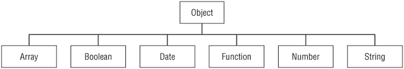

总的来说，你的脚本并不访问原生`Object`对象的属性。它的许多方法也是如此，例如`toString()`和`valueOf()`，这些方法在内部允许调试alert对话框（以及评估器The Evaluator）在引用对象或其构造函数显示内容。对于`toString()`和`valueOf()`这样的方法，你通常会在子类中对其进行重写。同样，`toSource()`方法返回对象源代码的字符串表示，这通常是你在脚本中不需要使用的。

`Object`对象的`watch()`和`unwatch()`方法更具实用性，它们提供了一种在属性值变化时执行操作的机制。你可以调用`watch()`方法并分配一个函数，当某个属性改变时会被调用。这允许你将内部属性的变化作为一个事件来处理。当你完成对属性的监控时，使用`unwatch()`方法停止监控。

列表23-9包含了一个如何使用`watch()`和`unwatch()`方法跟踪属性值的示例。

### 列表23-9：监控对象属性

HTML: `jsb-23-09.html`

```html
<!DOCTYPE html>
<html>
    <head>
        <meta http-equiv="content-type" content="text/html;charset=utf-8">
        <title>Object Watching</title>
        <script type="text/javascript" src="../jsb-global.js"></script>
        <script type="text/javascript" src="jsb-23-09.js"></script>
    </head>
    <body>
        <h1>Watching Over You</h1>
        <form id="theForm" action="validate.php" method="get">
            <div>
                <label for="theText">Enter text here:</label>
                <input id="theText" type="text" name="entry" size="50" value="Default Value">
                <p><input id="fourScoreButton" type="button" value="Set to Phrase I" onclick="setIt('Four score and seven years ago...')"></p>
                <p><input id="whenInButton" type="button" value="Set to Phrase 2" onclick="setIt('When in the course of human events...')"></p>
                <p><input id="resetButton" type="reset" onclick="setIt('Default value')"></p>
                <p><input id="watchButton" type="button" value="Watch It" onclick="watchIt(true)">
                <input id="unWatchButton" type="button" value="Don't Watch It" onclick="watchIt(false)"></p>
            </div>
        </form>
    </body>
</html>
```

JavaScript: `jsb-23-09.js`

```javascript
function setIt(msg) {
    document.forms[0].entry.value = msg;
}
function watchIt(on) {
    var obj = document.forms[0].entry;
    if (on) {
        obj.watch("value",report);
    } else {
        obj.unwatch("value");
    }
}
function report(id, oldval, newval) {
    alert("The field's " + id + " property on its way from \n'" +
        oldval + "'\n to \n'" + newval + "'.");
    return newval;
}
```

你可以使用一组方法（`hasOwnProperty()`、`isPrototypeOf()`和`propertyIsEnumerable()`）对对象实例的原型环境进行某些检查。这些方法主要让那些正在构建大型、模拟面向对象应用程序的高级脚本编写感兴趣。

## 属性

### `constructor`

| 值：Object类型 | 只读 |
| :--- | :--- |
| 兼容性: WinIE4+, MacIE4+, NN4+, Moz+, Safari+, Chrome+ | |

当实例化任何自定义、`Array`、`String`或其他对象时，这是这些对象所继承的属性。它是指向创建该对象所用构造函数的引用。但请注意，如果使用了原型，此属性可能不包含有效值。使用之前的汽车示例，如果你使用`Car`构造函数创建了一辆汽车，那么`constructor`属性将指向`Car`：

```javascript
var car1 = new Car("AA 123", "Ford", "blue");
if (car1.constructor == Car) { // 结果将为 true
}
```

### 方法

### `hasOwnProperty("propName")`

| 返回：布尔值 |
| :--- |
| 兼容性: WinIE5.5+, MacIE-, NN6+, Moz+, Safari-, Chrome+ |

如果当前对象在其原型链中定义了该属性，则`hasOwnProperty()`方法返回true。

### `isPrototypeOf(objRef)`

| 返回：布尔值 |
| :--- |
| 兼容性: WinIE5.5+, MacIE-, NN6+, Moz+, Safari-, Chrome+ |

`isPrototypeOf()`方法用于揭示当前对象与作为参数传递的对象是否有原型关系。

### `propertyIsEnumerable("propName")`

| 返回：布尔值 |
| :--- |
| 兼容性: WinIE5.5+, MacIE-, NN6+, Moz+, Safari-, Chrome+ |

在ECMA-262语言规范的术语中，如果`for...in`循环（参见第21章“控制结构和异常处理”）等构造可以检查一个值，则该值是可枚举的。

### `toSource()`

| 返回：字符串 |
| :--- |
| 兼容性: WinIE5.5+, MacIE-, NN6+, Moz+, Safari-, Chrome+ |

`toSource()`方法获取对象源代码的字符串表示。

### `toString()`

| 返回：字符串 |
| :--- |
| 兼容性: WinIE5.5+, MacIE-, NN6+, Moz+, Safari-, Chrome+ |

### `valueOf()`

| 返回：对象 |
| :--- |
| 兼容性: WinIE5.5+, MacIE-, NN6+, Moz+, Safari-, Chrome+ |

### `watch("propName")`

| 返回：布尔值 |
| :--- |
| 兼容性: WinIE-, MacIE-, NN6+, Moz+, Safari-, Chrome+ |

### `unwatch("propName")`

| 返回：布尔值 |
| :--- |
| 兼容性: WinIE-, MacIE-, NN6+, Moz+, Safari-, Chrome+ |

`watch()`方法是一个实用的JavaScript调试功能的关键，该功能被称为监视点（watchpoints）。监视点允许你指定一个函数，每当属性的值被设置时，该函数就会被调用。借此仔细跟踪属性的状态，并在重要属性值发生变化时采取行动。

你可以通过调用`watch()`方法并传递想要监控的属性名称来设置监视点，如下：

```javascript
obj.watch("count",
   function(prop, oldval, newval)
   {
      document.writeln(prop + " changed from " + oldval + " to " + newval);
      return newval;
    }
);
```

在这个示例中，创建了一个函数来输出属性更改通知，然后返回新的属性值。每个监视点处理器必须遵循相同的约定，即使用三个参数分别指定属性、旧值和新值。

# 全局函数与语句

## 本章内容

- 将字符串转换为对象引用
- 创建符合URL友好的字符串
- 在脚本中添加注释

除了本书该参考部分前面的章节描述的所有对象和其他语言结构外，还有一些语言项需要在全局范围内进行处理。这些项不适用于任何特定对象（实际上，不适用于任何对象），你可以在脚本的任何地方使用它们。如果你读过之前的章节，已经接触了其中许多函数和语句。本章提供了一个方便的地方，来突出这些否则容易被遗忘的重要条目。在本章最后，请注意对Windows专用版Internet Explorer内置的一些对象的简要介绍。

本章首先介绍以下作为JavaScript核心语言部分的全局函数和语句：

| 函数 | 语句 |
| :--- | :--- |
| `decodeURI()` | `// and /*...*/` (注释) |
| `decodeURIComponent()` | `const` |
| `encodeURI()` | `var` |
| `encodeURIComponent()` | |
| `escape()` | |
| `eval()` | |
| `isFinite()` | |
| `isNaN()` | |
| `Number()` | |
| `parseFloat()` | |
| `parseInt()` | |
| `toString()` | |
| `unescape()` | |
| `unwatch()` | |
| `watch()` | |

全局函数不绑定于文档对象模型（DOM）。相反，它们通常允许你将数据从一种类型转换为另一种类型。全局语句的列表很短，但其中几个会在你的脚本中频繁出现。

### 函数

`decodeURI("encodedURI")`

`decodeURIComponent("encodedURIComponent")`

`encodeURI("URIString")`

`encodeURIComponent("URIComponentString")`

**返回：** String

**兼容性：** WinIE5.5+, MacIE−, NN6+, Moz+, Safari+, Opera+, Chrome+

ECMA-262标准在IE5.5+、NN6+和基于Mozilla的浏览器中的实现提供了实用函数，可以执行更严格的字符串到有效URI字符串的转换，而非早期通过`escape()`和`unescape()`函数（在本章后文描述）。事实上，现代的`encodeURI()`、`encodeURIComponent()`、`decodeURI()`和`decodeURIComponent()`函数已作为现在废弃的`escape()`和`unescape()`函数的替代品。

编码函数的目的是将任何字符串转换为你可以作为统一资源标识符（URI）的版本，例如网页地址或服务器CGI脚本的调用。虽然拉丁字母数字字符在编码过程中保持原样，但你必须使用编码函数将某些符号和其他Unicode转换为Internet可以在地方传递的格式（字符数字的十六进制表示）。例如，空格字符必须编码为其十六进制版本：`%20`。

`encodeURI()`和`escape()`函数（以及它们的`decodeURI()`和`unescape()`对应函数）之间最大的区别在于，现代版本不会对根据RFC2396 (http://www.ietf.org/rfc/rfc2396.txt) 推荐语法完全接受作为URI字符的范围符号进行编码。因此，以下字符不会通过`encodeURI()`函数进行编码：

`; / ? : @ & = + $ , - _ . ! ~ * ' ( ) #`

仅对完整的URI使用`encodeURI()`和`decodeURI()`函数。相关的URI可以是相对的也可以是绝对的，但这两个函数的设计特别特殊，使得协议部分（`://`）、搜索字符串（例如`?`和`=`）以及目录级分隔符（`/`）的符号不会被编码。`decodeURI()`函数应适用于来自服务器作为页面位置到达的URI，但请注意，某些服务器CGI将空格编码为加号（`+`），而JavaScript函数不会将其解码回空格。如果你的脚本需要解码的URI包含代表空格的加号，你需要对解码后的URI运行字符串替换方法来完成工作（正则表达式在这里会很有用）。如果你正在解码由你的脚本编码的URI字符串，请仅对通过相应的编码函数编码的URI使用解码函数。不要尝试解码通过旧的`escape()`函数创建的URI，因为转换过程遵循的是不同的规则。

URI和URI组件（component）之间的区别在于，组件是URI的单个部分，通常不包含分隔符字符。例如，如果你对完整的URI使用`encodeURIComponent()`函数，几乎所有的符号（除了点等内容）都会被编码为十六进制版本——包括目录分隔符。因此，你应该只对URI的细粒部分使用组件级转换函数。例如，如果你组装一个具有键值对的搜索字符串，可以分别对键和值使用`encodeURIComponent()`。但如果你对已经是`name=value`形式的对使用该函数，它会将等号编码为十六进制形式。

由于`escape()`和`unescape()`函数有时用于并非URL（URI）字符串的字符串，当你现代化使用了`escape()`和`unescape()`的代码时，通常会使用`encodeURIComponent()`和`decodeURIComponent()`函数。

### 示例

使用评估器（参见第4章“JavaScript基础”）来实验完整URI和组件之间的区别，以及URI字符串的编码与转义。例如，比较以下三个语句的结果：

```javascript
escape("http://www.giantco.com/index.htm?code=42")
encodeURI("http://www.giantco.com/index.htm?code=42")
encodeURIComponent("http://www.giantco.com/index.htm?code=42")
```

由于示例URI已经是有效的，`encodeURI()`没有变化。通过将搜索字符串值改为带有空格的字符串来进一步实验，看看每个函数如何处理该字符。

所有字符（包括制表符和回车符）都可以以这种方式编码，并作为简单的字符串发送，然后在接收端进行解码以进行还原。你也可以使用此编码方式对必须在数据库中存储为字符字符串的多行文本进行预处理。要将纯文本字符串转换为其编码版本，请使用`escape()`方法。该函数返回一个由编码版本组成的字符串。例如：

```javascript
var theCode = escape("Hello there");
// result: Hello%20there
```

大多数（但不是所有）非字母数字字符都会通过`escape()`函数转换为转义版本。一个例外是加号（+），URL使用它来分隔搜索字符串的组件。如果你也必须对加号进行编码，请给该函数添加可选的第二个参数，使加号转换为其十六进制等效值（2B）：

```javascript
var a = escape("Adding 2+2");
// result: Adding%202+2

var a = escape("Adding 2+2",1);
// result: Adding%202%2B2
```

注意，浏览器对可选第二个参数的处理并不一致；无论是否包含第二个参数，都可能返回相同的结果。

`unescape()`函数用于将转义字符串转换回纯文本。我们之所以用“过去式”，是因为由于`decodeURI()`和`decodeURIComponent()`的引入，该函数已被弃用，不应再次使用。

`escape()`函数的作用位于较新的函数`encodeURI()`和`encodeComponentURI()`之间。然而，该函数现在已被较新的函数所取代，不应再次使用。

```javascript
eval("string")
```

**返回值：** 对象引用

**兼容性：** WinIE3+, MacIE3+, NN2+, Moz+, Safari+, Opera+, Chrome+

表达式求值（你现在可能已经很清楚了）是使用JavaScript进行脚本编写（以及通用编程）时必须掌握的一个重要概念。表达式会求得某个值。但有时，你需要强制对表达式进行额外的求值以获得所需的结果。`eval()`函数作用于字符串值，强制对该字符串表达式进行求值。`eval()`函数最常见的应用是将对象引用的字符串版本转换为真正的对象引用。

### 示例

`eval()`函数可以评估存储为字符串的任何JavaScript语句或表达式。这包括算术表达式、对象值赋值和对象方法调用的字符串等价形式。然而，我们不建议依赖`eval()`函数，因为该函数从性能角度来看本质上是低效的。幸运的是，你可能不需要`eval()`函数就能从对象名称的字符串版本获取有效的对象引用。例如，如果你的脚本循环遍历一组名称包含序列号的对象，你可以使用对象名称作为数组索引，而不是使用`eval()`来组装对象引用。设置命名为`data0`、`data1`等一系列字段赋值的低效方法如下：

```javascript
function fillFields() {
  var theObj;
  for (var i = 0; i < 10; i++) {
    theObj = eval("document.forms[0].data" + i);
    theObj.value = i;
  }
}
```

更高效的方法是在对象引用的索引括号内进行字符串拼接：

```javascript
function fillFields() {
  for (var i = 0; i < 10; i++) {
    document.getElementById("myForm").elements["data" + i].value = i;
  }
}
```

### 提示

每当你准备使用`eval()`函数时，请寻找使用对象数组字符串索引值的替代方法。在`document.getElementById()`方法的帮助下，W3C DOM变得更加容易，该方法接受字符串作为参数并返回引用。

```javascript
isNaN(number)
```

**返回值：** 布尔值

**兼容性：** WinIE3+, MacIE3+, NN2+, Moz+, Safari+, Opera+, Chrome+

`isFinite()`函数用于检查值是否为有限数字。在某些情况下，你可能需要对表达式进行强制求值以获得预期的结果。

```javascript
isFinite(expression)
```

**返回值：** 布尔值

**兼容性：** WinIE4+, MacIE4+, NN4+, Safari+, Opera+, Chrome+

`isNaN()`函数用于检查字符串是否为数字。如果字符串不包含数字，结果为`NaN`（非数字）。

```javascript
Number("string")
```

**返回值：** 数字

**兼容性：** WinIE3+, MacIE3+, NN2+, Moz+, Safari+, Opera+, Chrome+

这三个函数都将字符串值转换为数值。`Number()`函数在旧版本浏览器中引入，而`parseInt()`和`parseFloat()`函数在所有版本中均可用。

```javascript
parseInt("string" [,radix])
```

**返回值：** 数字

**兼容性：** 同上

```javascript
parseFloat("string")
```

`parseInt()`的额外可选参数`radix`允许你定义转换时使用的数字进制。如果你不指定基数参数，JavaScript会尝试为你判断；但这样做可能会给你带来困难。主要问题出现在`parseInt()`的字符串参数以零开头时，文本框输入或数据库字段可能会这样做。在JavaScript中，以零开头的数字被视为八进制（基8）数。因此，`parseInt("010")`会产生十进制值8。

当你应用`parseInt()`函数时，如果你正在处理十进制数字，请务必指定基数。然而，你可以指定2到36之间的任何基数值。例如，要将二进制数字字符串转换为十进制等效值，请按如下方式指定基数为2：

```javascript
function calc(form) {
  var inputValue = parseInt(form.value, 2);
  if (isNaN(inputValue)) {
    alert("必须输入数字");
  } else {
    // 语句
  }
}
```

`parseFloat()`函数也让源字符串值决定返回值是浮点数还是整数。如果源字符串的小数右侧包含任何非零值，结果为浮点数。但如果字符串值是“3.00”，则返回值将是整数。

使用`Number()`函数时，如果你不在意精度，并倾向于让源字符串决定返回值是浮点数还是整数。该函数接受单个参数——要转换为数字的字符串。

脚本编写人员在使用此函数时犯最大的错误是忽略了函数的字母大小写。

`parseInt()`和`parseFloat()`都表现出一种非常实用的行为：如果作为参数传递的字符串以一个数字开头，后面跟着（例如）字母，这些函数将对字符串的数字部分执行操作，并忽略其余部分。这就是为什么你可以对`navigator.appVersion`字符串使用`parseFloat()`来提取出仅包含报告的版本号，而无需解析字符串的其余部分。例如，Windows版的Firefox 1.0报告的`navigator.appVersion`值为：

5.0 (Windows; en-US)

但你可以通过`parseFloat()`只获取字符串的数字部分：

```javascript
var ver = parseFloat(navigator.appVersion);
```

### 注意

存储在`navigator.appVersion`属性中的数字指的是底层浏览器引擎的版本号，这解释了为什么在这种情况下报告的版本号是5.0，尽管Firefox浏览器应用程序被认为是1.0版本。

由于结果是一个数字，你可以进行数值比较，例如检查版本是否大于或等于4。

### toString([radix])

**返回：** 字符串 (String)

**兼容性：** WinIE4+, MacIE4+, NN4+, Moz+, Safari+, Opera+, Chrome+

每个JavaScript核心语言对象和每个DOM文对象都关联有一个`toString()`方法。该方法旨在将对象的内容渲染为尽可能有意义的文本字符串。表24.1显示了对每个可转换的核心语言对象类型应用`toString()`方法的结果。

#### 表24.1 对象类型的toString()方法结果

| 对象类型 | 结果 |
| :--- | :--- |
| 字符串 | 相同的字符串 |
| 数字 | 字符串等效值（但数字字面量无法转换） |
| 布尔 | true或false |
| Array | 逗号分隔的数组内容列表（逗号后没有空格） |
| Function | 函数定义的反编译后的字符串版本 |

许多DOM对象可以转换为字符串。例如，`location`对象返回其URL。但当对象没有合适的内容可以作为字符串返回时，它通常会返回一个如下格式的字符串：

`[object objectType]`

### 示例

`toString()`方法在所有版本的浏览器中都是可用的。通过设置在2到16之间的可选`radix`参数，你可以将数字转换为不同进制的字符串等效值。列表24-1计算并绘制了0到20之间的十进制、十六进制、八进制和二进制数的转换表。在这种情况下，每个值的来源是索引计数器变量的值，每次`for`循环语句执行时都会更新。

### 注意

在本章及书中大部分代码中用于分配事件处理器的函数是`addEvent()`，这是一个跨浏览器事件处理器，在第32章“事件对象”中进行了详细解释。

`addEvent()`函数是脚本文件`jsb-global.js`的一部分，该文件位于附CD-ROM的`Content/`文件夹中，所有脚本都可以访问。

#### 列表24-1：带Radix值使用toString()

HTML: `jsp-24-01.html`

```html
<!DOCTYPE html>
<html>
    <head>
        <meta http-equiv="content-type" content="text/html;charset=utf-8">
        <title>使用 toString() 转换为其他进制：</title>
        <link rel="stylesheet" type="text/css" href="jsp-24-01.css">
        <script type="text/javascript" src="../jsb-global.js"></script>
        <script type="text/javascript" src="jsb-24-01.js"></script>
    </head>
    <body>
        <h1>使用 toString() 转换为其他进制：</h1>
        <table id="numberConversions">
            <tr>
                <th>十进制</th>
                <th>十六进制</th>
                <th>八进制</th>
                <th>二进制</th>
            </tr>
        </table>
    </body>
</html>
```

CSS: `jsp-24-01.css`

```css
th, td {
    border: 5px groove black;
    text-align: center;
    padding-left: 2px;
    padding-right: 2px;
}
th {
    font-weight: bold;
}
```

JavaScript: `jsb-24-01.js`

```javascript
// 页面加载时初始化
addEvent(window, "load", initialize);

function initialize() {
    var theTable = document.getElementById("numberConversions");
    if (theTable) {
        var newRow;
        var newElem;
        var newText;
        // 在现有行之后插入行
        var newPosition = 1;
        // 将转换后的数字数据放入表格
        for (var i = 0; i <= 20; i++) {
            // 创建新行
            newRow = theTable.insertRow(newPosition);
            // 在新行中创建第一个新单元格及其文本
            newElem = newRow.insertCell(0);
            // ... (此处省略循环内部逻辑以保持对应)
        }
    }
}
```

`toString()`方法在所有版本的浏览器中都是可用的。通过设置在2到16之间的可选`radix`参数，你可以将数字转换为不同进制的字符串等效值。列表24-1计算并绘制了0到20之间的十进制、十六进制、八进制和二进制数的转换表。在这种情况下，每个值的来源是索引计数器变量的值，每次`for`循环语句执行时都会更新。

`toString()`方法的自定义对象不会将对象转换为有意义的字符串，但你可以创建自己的方法来实现这一点。例如，如果你想让对象的`toString()`方法像数组的方法一样工作（如列表24-2所示）。

#### 列表24-2：自定义toString()方法

HTML: `jsp-24-02.html`

```html
<!DOCTYPE html>
<html>
    <head>
        <meta http-equiv="content-type" content="text/html;charset=utf-8">
        <title>自定义对象的 toString 结果：</title>
    </head>
    <body>
        <h1>自定义对象的 toString 结果：</h1>
        <div id="placeholder"></div>
    </body>
</html>
```

JavaScript: `js-24-02.js`

```javascript
// 页面加载时初始化
addEvent(window, "load", initialize);

var newElem;
var newText;

// 定义将作为对象方法的函数
function customToString() {
    var dataArray = Array();
    var count = 0;
    for (var i in this) {
        dataArray[count++] = this[i];
        if (count > 2) {
            break;
        }
    }
    return dataArray.join(",");
}

// 定义自定义对象
var book = { title:"Aeneid",author:"Virgil",pageCount:53 };

// 为自定义对象声明方法
book.toString = customToString;

// 我们之前确定的 onload 事件
function initialize() {
    var placeHolderElement = document.getElementById("placeholder");
    if (placeHolderElement) {
        // book.toString();
        newElem = document.createElement("h4");
        newText = document.createTextNode(book.toString());
        // 将文本插入新的 h4
        newElem.appendChild(newText);
        // 将完成的 h4 插入 placeholder
        placeHolderElement.appendChild(newElem);
    }
}
```

当你运行列表24-2时，你可以看到自定义对象的`toString()`处理器是如何提取对象中所有元素的值的。你可以自定义数据的标记方式和/或格式化。

请记住，你可以为你创建的任何对象（而不只是数组）提供自定义的`toString()`方法。这是一种为了调试之目的简要查看对象内容的非常方便的方法。例如，你可以编写一个`toString()`方法，将对象的所有属性仔细地格式化为易于阅读的文本字符串。然后，当出现问题时，可以使用警告框或浏览器调试控制台来查看对象的内容。

```javascript
unwatch(property)

watch(property, handler)
```

返回值：无

兼容性：WinIE-, MacIE-, NN4+, Moz-, Safari-, Opera-, Chrome-

### 语句

```javascript
//

/*...*/
```

兼容性：WinIE3+, MacIE3+, NN2+, Moz+, Safari+, Opera+, Chrome+

注释是JavaScript解释器（或服务器端编译器）忽略的语句。然而，这些语句允许作者对脚本中的工作原理留备注。尽管详尽的注释在脚本的创建和维护期间对作者有用，但客户端注释的完整内容会随文档一起下载。页面每个非操作内容的字节都会增加一点下载时间。尽管如此，我们仍然建议大量注释——特别是在创建脚本时。

JavaScript提供了两种注释样式。一种样式由两个正斜杠组成（中间没有空格），适用于创建单行注释。JavaScript会忽略同一行中这些正斜杠右侧的任何字符，即使它们出现在行的中间也可以。你可以根据需要堆叠任意数量的此类单行注释来传达你的想法。我们通常在第二个斜杠和注释的开头之间放置一个空格。以下是有效的单行注释格式的示例：

```javascript
// 这是一行注释，通常关于接下来将出现的内容

var a = "Fred";  // 关于这一行的注释

// 你可能想把注释的第一个字母大写

// 如果它跨越了多行。

//

// 并且你也可以留一个完全空白的行，像上面那样。
```

对于较长的注释，通常使用另一种注释样式将该部分括起来更方便，这种样式完全能够跨越多行。以下注释以正斜杠和星号（`/*`）开头，以星号和正斜杠（`*/`）结束。JavaScript会忽略其之间的所有语句——包括多行。如果你为了调试之目的临时注释掉脚本的大段内容，最简单的方法是用这些注释符号将该段括起来。为了让注释块更容易找到，我们通常将符号单独放在行上，如下所示：

```javascript
/*
一些
  被注释掉的
    语句
*/
```

如果你正在开发相当复杂的脚本，你可能会发现使用注释是帮助你组织脚本段并使每个段更易找到的方便方法。例如，你可以在每个函数上方定义一个注释块，并描述该函数的含义，如下例所示。

```javascript
/*-----------------------------------------------
    calculate()
    根据参数 blah, blah, blah 执行
    抵押贷款计算。由 blah
    blah 调用。
-----------------------------------------------*/
function calculate(form)
{
    // 语句
}
```

### const

兼容性：WinIE-, MacIE-, NN6+, Moz+, Safari+, Opera+, Chrome+

`const`关键字用于初始化常量。与变量不同，一旦赋值，常量的值就无法更改。在许多编程语言中，使用大写字母来标识常量标识符，这有助于它们与变量区分来。在NN4+中，JavaScript实现了两个属于每个对象的全局函数——包括用户定义的对象。`watch()`函数会监控指定的对象和属性。如果该属性通过赋值设置，该函数将调用另一个用户定义的函数，该函数接收有关属性名、其旧值和新值的信息。`unwatch()`函数关闭对特定属性的监控功能。

### 示例

列表24-3显示了如何在IE的浏览器中使用`const`。它传递了多个城市的温度数据。假设低于冰结点的温度将以独特的样式显示。这种样式提醒你这些值是固定的。

HTML：`jsp-24-03.html`

```html
<!DOCTYPE html>
<html>
  <head>
      <meta http-equiv="content-type" content="text/html;charset=utf-8">
      <title>常量关键字</title>
      <link rel="stylesheet" type="text/css" href="jsp-24-03.css">
      <script type="text/javascript" src="../jsb-global.js"></script>
  </head>
  <body>
      <h1>常量关键字</h1>
      <table id="temps">
        <tr>
          <th>City</th>
          <th>Temperature (Fahrenheit)</th>
        </tr>
      </table>
  </body>
</html>
```

CSS：`jsp-24-03.css`

```css
.cold
{
    font-weight: bold;
    color: blue;
}
td
{
    text-align: center;
}
```

JavaScript：`jsb-24-03.js`

```javascript
// 当页面加载时初始化
addEvent(window, "load", showData);
const FREEZING_F = 32;
var cities = ["London", "Moscow", "New York", "Tokyo", "Sydney"];
var cityTempsF = [33, 12, 20, 40, 75];
function showData()
{
    var theTable = document.getElementById("temps");
    if (theTable)
    {
        var newRowElem;
        var newCellElem;
        var newText;
        // 在现有行之后插入行
        var newPosition = 1;
        // 将城市数据放入表格
        for (var i = 0; i < cities.length; i++)
        {
            // 创建新行
            newRowElem = theTable.insertRow(newPosition);
            // 在新行中创建城市单元格并添加文本
            newCellElem = newRowElem.insertCell(0);
            newText = document.createTextNode(cities[i]);
            newCellElem.appendChild(newText);
            // 在新行中创建温度单元格并添加文本
            newCellElem = newRowElem.insertCell(1);
            newText = document.createTextNode(cityTempsF[i]);
            newCellElem.appendChild(newText);
            // 为冷数据单元设置样式
            if (cityTempsF[i] < FREEZING_F)
            {
                newCellElem.className = "cold";
            }
            newPosition += 1;
        }
    }
}
```

如果你不给变量赋值，它的值将求为`null`。由于JavaScript变量在生命周期内并不局限于一种变量类型，除非该初始值有助于你的脚本编写，否则你不需要将变量初始化为空字符串或零。（例如，如果你将一个变量初始化为空字符串，那么你可以在文档的后续语句中使用按值相加运算符（`+=`）向该变量追加字符串值。）

为了节省语句的行数，你可以使用单个`var`语句声明和/或初始化多个变量。用逗号分隔每个`varName=value`对，例如：

```javascript
var name, age, height;  // 声明为 null
var color = "green", temperature = 85.6; // 初始化
```

变量名（也称为标识符）必须是一段连续的字符字符串，且第一个字符必须是字母。许多标点符号是被禁止的，但下划线字符（`_`）是有效的，并且通常用于分隔长变量名中的多个单词。所有变量名（与JavaScript中的大多数标识符一样）都是区分大小写的，因此你必须在变量的作用范围内对特定变量使用完全相同的名称。

按照惯例，变量名使用驼峰命名法（`camelCase`），例如：

```javascript
var colorCode = "green";
```

## WinIE对象

兼容性：WinIE4+, MacIE4+, NN-, Moz-, Safari-, Opera-, Chrome-

无论好坏，微软对其网页浏览器功能与Windows操作系统之间的集成感到自豪。浏览器与操作系统之间的链接在IE访问ActiveX对象的设施中最为明显。微软为脚本编写人员创建了几个此类对象以便访问——同样，前提是部署仅针对Internet Explorer的Windows版本。某些对象还作为一种向JavaScript暴露某些Visual Basic Script (VBScript)功能的方式。由于这些对象更属于Windows和ActiveX编程范畴，在WinIE中操作这些对象的细节和特殊情况最好留给其他场合。但以防你不熟悉这些功能，以下讨论介绍了WinIE对象的基set。你可以在微软开发者网络(MSDN)网站`http://msdn.microsoft.com/`上找到更多细节。

这里提到的对象是`ActiveXObject`、`Dictionary`、`Enumerator`和`VBArray`对象。微软对这些对象的文档说明就像它们是原生JScript语言的一部分一样。然而，你可以确定，它们仍然是Internet Explorer专有的，即使不是仅限Windows版本。

### 注意

JScript是微软对JavaScript的专有实现，由Internet Explorer支持。JScript本质上与JavaScript相同，但增加了Windows特有的额外功能，例如对ActiveX对象的支持。

## ActiveXObject

`ActiveXObject`是一个通用对象，允许你的脚本打开并访问微软称为自动化对象。自动化对象是一个可以在客户端运行或从服务器提供的可执行程序。这包括本地应用程序（例如Microsoft Office套件中的应用程序）、可执行DLL（动态链接库）等。

使用以下语法通过`ActiveXObject`构造函数获取对象的引用：

```javascript
var objRef = new ActiveXObject(appName.className[, remoteServerName]);
```

此JScript语法等于VBScript的`CreateObject()`方法。你需要了解Windows编程以确定应用程序名称以及该应用程序所需的类或类型。例如，要获取Excel表格的引用，请使用此构造函数：

```javascript
var mySheet = new ActiveXObject("Excel.Sheet");
```

一旦你获得了所需对象的引用，还必须知道你将访问的对象的属性和方法的名称。你可以通过微软的开发工具（如Visual Studio .NET）或Visual Basic .NET自带的工具访问此大部分信息。这些工具允许你查询对象以发现其属性和方法。遗憾的是，`ActiveXObject`的属性无法通过典型的JavaScript for…in属性检查器进行枚举。

访问`ActiveXObject`（尤其是客户端的实例）涉及一些严重的安全考量。IE客户端的典型安全设置防止脚本访问客户端应用程序，至少在不询问用户是否可以这样做的情况下。虽然断言完全无法在用户不知情的情况下对客户端进行秘密检查或破坏是愚蠢的（黑客有时会发现漏洞），但这种情况极不可能。在企业环境中，由于对所有客户端进行某种程度的访问是理想的，客户端可能被设置为：当指令来自可信源时，接受与ActiveX对象工作的指令。底线是，除非你精通Windows编程，否则不要期望`ActiveXObject`会变成某种让你能够侵入毫无防备的用户的隐私或安全的魔法门户。

## Dictionary

尽管`Dictionary`对象对VBScript作者非常有帮助，但JavaScript已经提供了原生的等效功能。`Dictionary`对象的行为非常像具有字符串索引值的JavaScript数组（类似于Java哈希表），尽管`Dictionary`中也接受数值索引值。在这种环境中，索引被称为`keys`。VBScript数组原生不具备这种功能，因此为了方便起见，`Dictionary`对象补充了该语言。然而，与JavaScript数组不同，你必须使用`Dictionary`对象的各种属性和方法向其中添加、访问或删除项目。

你通过以下方式通过`ActiveXObject`创建`Dictionary`对象：

```javascript
var dict = new ActiveXObject("Scripting.Dictionary");
```

你必须为每个数组创建一个单独`Dictionary`对象。表24.2列出了`Dictionary`对象的属性和方法。创建一个空白的`Dictionary`对象后，通过`Add()`方法为每个条目进行填充。例如，以下语句创建了一个`Dictionary`对象来存储美国各州的首府：

```javascript
var stateCaps = new ActiveXObject("Scripting.Dictionary");
stateCaps.Add("Illinois", "Springfield");
```

你随后可以通过`Key`属性访问单个项目（得益于其VBScript传统，它看起来更像一个JavaScript方法）。`Dictionary`对象的一个便利之处是`Keys()`方法，它返回字典中所有键的数组——字符串索引的JavaScript数组可以使用这一点。

#### 表24.2 Dictionary对象属性和方法

| 属性 | 描述 |
| :--- | :--- |
| Count | 字典中条目的整数数量（只读） |
| Item("key") | 读取或写入键名为key的条目的值 |
| Key("key") | 为条目分配新的键名 |

| 方法 | 描述 |
| :--- | :--- |
| Add("key", value) | 添加唯一键名关联的值 |
| Exists("key") | 如果键存在于字典中则返回布尔值true |
| Items() | 返回字典值的VBArray |
| Keys() | 返回字典键的VBArray |
| Remove("key") | 删除键及其值 |
| RemoveAll() | 删除所有条目 |

## Enumerator

`Enumerator`对象为JavaScript提供了访问无法通过索引号或名称直接访问其项目的集合的方法。在处理DOM集合（例如`document.all`）时，不需要此对象，因为你可以使用`item()`方法获取集合中任何成员的引用。但如果你正在编写ActiveX脚本，这些对象的某些方法或属性可能会返回无法通过此机制或JavaScript for…in属性检查技术访问的集合。相反，你必须将集合封装在`Enumerator`对象中。

要将集合封装在`Enumerator`中，请调用该对象的构造函数，并将集合作为参数传递：

```javascript
var myEnum = new Enumerator(someCollection);
```

必须通过其四个方法之一来访问此枚举器实例，以便将“指针”定位到特定项目，然后提取该项目的副本。换句话说，你不是直接访问成员（即，不是通过项目号深入集合来检索）。相反，你将指针移动到所需的位置，然后读取项目值。如你从表24.3的方法列表所示，该对象的设计初衷确实是为了循环遍历集合。指针的控制仅限于将其置在集合的开头，并沿着集合向递增一个位置：

```javascript
var val;

myEnum.moveFirst();

for (; !myEnum.atEnd(); myEnum.moveNext())
{
   val = myEnum.item();
   // 更多对值进行的操作语句
}
```

#### 表24.3 Enumerator对象方法

| 方法 | 说明 |
| :--- | :--- |
| `atEnd()` | 如果指针位于集合末尾，则返回true |
| `item()` | 返回当前指针位置的值 |
| `moveFirst()` | 将指针移动到集合中的第一个位置 |
| `moveNext()` | 将指针移动到集合中的下一个位置 |

### VBArray

`VBArray`对象提供了对Visual Basic安全数组（safe arrays）的JavaScript。这种数组是只读的，通常由ActiveX对象返回。此类数组可以在客户端脚本的VBScript部分中组合。Visual Basic数组从其本质上来说可以是多个维度。例如，以下代码创建了一个三二的VB数组：

```vb
<script type="text/vbscript">
   Dim myArray(2, 1)
   myArray(0, 0) = "A"
   myArray(0, 1) = "a"
   myArray(1, 0) = "B"
   myArray(1, 1) = "b"
   myArray(2, 1) = "C"
   myArray(2, 2) = "c"
</script>
```

一旦你拥有有效的VB数组，就可以将其转换为JScript解释器可以处理的对象：

```javascript
<script type="text/javascript">
   var theVBArray = new VBArray(myArray);
</script>
```

一个脚本语言块中的全局变量可以被另一个块访问，即使是不同的语言。但在此时，数组尚未形成JavaScript数组的形式。你可以通过`VBArray.toArray()`方法将其转换为数组，或者通过它的其他方法（在表24.4中简述）访问有关`VBArray`对象的信息。一旦你将`VBArray`转换为JavaScript数组，就可以像处理任何JavaScript数组一样遍历这些值。

#### 表24.4 VBArray对象方法

| 方法 | 说明 |
| :--- | :--- |
| `dimensions()` | 返回原始数组的维度 |
| `getItem(dim1[, dim2[,...dimN]])` | 返回维度定义的数组位置的值 |
| `ibound(dim)` | 返回给定维度的最小索引值 |
| `toArray()` | 返回VBArray的JavaScript数组版本 |
| `ubound(dim)` | 返回给定维度的最大索引值 |

当你使用`toArray()`方法且源数组具有多个维度时，第一“行”之后维度的值将直接附加到JavaScript数组中，没有任何嵌套结构。

# 第四部分：文档对象参考

## 本部分

- 第25章 文档对象模型基础
- 第26章 通用HTML元素对象
- 第27章 Window和Frame对象
- 第28章 Location和History对象
- 第29章 Document和Body对象
- 第30章 Link和Anchor对象
- 第31章 Image, Area, Map和Canvas对象
- 第32章 事件对象

# 第25章：文档对象模型基础

## 本章

- 对象模型与浏览器版本
- 私有模型扩展
- W3C DOM的结构
- 脚本趋势

毫无疑问，客户端Web脚本编写面临的最大挑战，是在可脚本浏览器的简短历史上，一直竞争我们关注的、有时令人困惑的各种文档对象模型（DOMs）。Netscape在Navigator 2中通过第一个对象模型开启了先河。当版本4浏览器出现时，原始对象模型不仅获得了一些实用的跨浏览器特性，还有一系列Navigator或Internet Explorer特有的特性。对象模型正在分分为那些脚本必须在尽可能多的浏览器上运行的页面作者带来了无尽的头恼。世界维网联盟（W3C）的标准化进程以DOM建议的形式带来了一线希望。DOM引入了原始对象模型的大部分内容，外加上了一致寻址文档中每个对象的新方法。本章的目标是让每个对象模型都具有可审视的视角，并帮助你理解现代浏览器是如何缓解大多数对象模型兼容性问题的。但在讨论这些细节之前，让我们看看对象模型在设计脚本应用程序中的作用。

### 对象模型层次结构

第二部分的教程章节介绍了可脚本浏览器中文档对象层次结构背后的基本思想。在其他面向对象的环境中，对象层次结构的作用比在支持JavaScript的浏览器中要大得多。（在JavaScript中，你不需要担心类、继承和实例等相关术语。）尽管如此，你仍然不能忽略层次结构概念，因为你的某些代码依赖于你能够编写取决于其在层次结构中位置的对象的引用。

将这些对象称为JavaScript对象是不准确的。它们实际上是浏览器文档对象：你恰好使用JavaScript语言让它们活跃。一些微软Internet Explorer的脚本编写人员使用VBScript语言来编写相同的文档对象。从技术上说，JavaScript对象适用于与文档分离的数据类型和其他核心语言对象。

### 层次结构作为路线图

对于程序员来说，文档对象层次结构的主要作用是为脚本提供一种方法，在浏览器窗口可以包含的所有对象中引用特定对象。层次结构充当路线图，脚本可以使用它来确切知道要访问哪个对象。

想象一下这样一个场景：你和你的朋友Tony在一个高中教室里。随着下午的阳光透过房间西侧的窗户照射进来，教室变得闷热不风。你问Tony：“请打开窗户好吗？”并用头指向房间里某扇特定的窗户。在编程术语中，你向一个对象发布了命令（无论Tony是否喜欢这种比喻）。这种人类互动与你在编程中能做的任何事情相比都有优势。首先，在说话之前与Tony眼神交流，他知道自己是命令的预期接收者。其次，你的肢体语言随该命令传递了一些参数，微妙地指向特定墙上的某扇特定窗户。

相反，如果你在校长办公室使用公共广播系统，并广播同样的命令（“请打开窗户好吗？”），没有人知道你的意思。在没有指向对象的情况下发布命令是浪费时间，因为每个对象都会想：“那不可能是针对我的。”为了实现与你的一对一命令相同的目标，广播命令必须是类似于“请312室的Tony Jeffries打开西墙中间的窗户好吗？”

让我们把最后一个命令转换为JavaScript点符号语法形式（参见第6章，“浏览器和文档对象”）。回想教程，对对象的引用从最全局的视角开始，缩小到最具体的视角。从校长办公室的角度来看，目标对象的位置层次结构如下

```javascript
room312.Jeffries.Tony
```

你也可以说，Tony关于如何打开窗户的知识是Tony的方法之一。那么对Tony及其方法的完整引用变为：

`room312.Jeffries.Tony.openWindow()`

你的工作尚未完成。该方法需要一个参数来详细说明要打开哪个窗户。在这种情况下，你想要的窗户是312室西墙中间的窗户。或者，从校长办公室的层级角度来看，它变成了：

`room312.westWall.middleWindow`

这个对象路线图（road map）就是Tony的`openWindow()`方法的参数。因此，通过广播传输系统的整个命令是：

`room312.Jeffries.Tony.openWindow(room312.westWall.middleWindow)`

如果不是坐在校长办公室里大声命令，而是尝试通过从轨道空间穿天器的无线电向地球上的所有居民执行同样的任务，想象一下你的对象层级结构将是多么复杂。Tony的`openWindow()`方法以及你想要打开的窗户的完整引用将非常长，才能从空间穿天器视野内的数十亿个对象中区分出所需的对象。

点在于，你所编程的面向对象的世界范围越小，你对对象位置的假设就越多。对于客户端JavaScript来说，其范围不会超过浏览器本身。换句话说，JavaScript脚本可以操作的每一个对象都存在于浏览器应用程序内部。在少数例外情况下，脚本不会访问你的计算机硬件、操作系统、其他应用程序、桌面或浏览器程序之外的任何内容。

## 第一个浏览器文档对象路线图

图25.1显示了所有可脚本浏览器中实现的最低公约文档对象层级，包括如`IE3`和`NN2`等可脚本的旧浏览器。注意，`window`对象是整个方案中的顶层对象。你在JavaScript中编写的任何内容都位于浏览器的`window`中。

图25.1 最低公约浏览器文档对象层级。

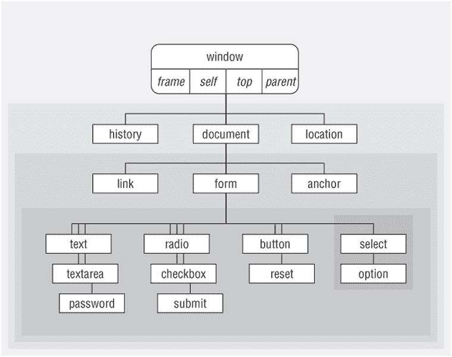

注意同心矩形的阴影部分。位于同一着色区域的每个对象相对于`window`对象都处于同一水平。当从一个对象的线延伸到下一个较深色的阴影矩形时，该对象包含了较深颜色区域的所有对象。在层级之间最多存在这样一条线。`window`对象包含`document`对象；`document`对象包含一个`form`对象；`form`对象包含许多不同类型的表单控件元素。

## 文档对象是如何诞生的

浏览器为你创建的大多数对象是在HTML文档加载到浏览器时建立的。你用于创建链接、锚点和输入元素时使用的相同类型的HTML代码会告诉增强了JavaScript的浏览器在内存中创建这些对象。无论你的脚本是否调用它们，这些对象都存在那里。

定义这些对象的HTML代码中，唯一可见的区别是专门为JavaScript准备的一个或多个可选属性。从总体上来说，这些属性指定了你希望用户界面元素做出响应的事件，以及当用户采取该操作时JavaScript应该执行什么。通过依赖文档的HTML代码来执行对象生成，你可以花费更多时间研究如何使用这些对象进行操作，或者如何让它们为你工作。

请记住，对象是按照加载顺序创建的。如果你创建一个多框架环境，一个框架中的脚本在两个框架都加载之前无法与另一个框架的对象进行通信。这让许多创建多框架和多窗口网站的脚本编写感到困惑（更多信息请参阅第27章“窗口和框架对象”）。

但有趣的是，你并不限于文档HTML代码生成的对象。正如你在本章后面部分看到的，W3C DOM允许你在对象层级中添加和删除对象。事实上，如果你想创建不包含JavaScript的HTML代码，你也将看到你可以如何做到这一点。

## 对象属性

属性通常定义了对象的特定当前设置。该设置可能反映对象的可见属性，例如复选框的状态（已选中或未选中）；它也可能包含不那么明显的信息，例如提交表单的操作和方法。

文档对象的大部分初始属性是通过生成对象的HTML标签属性设置分配的。因此，属性可能是一个单词（例如名称）或数字（例如尺寸）。属性也可以是一个数组，例如文档包含的图像数组。如果HTML不包含所有属性，浏览器通常会为属性和相应的JavaScript属性填充默认值。

### 给经验丰富的面向对象程序员的提示

尽管基本的对象模型层级似乎具有类/子类关系，但真正的面向对象环境的许多传统方面并不适用于该模型。原始的JavaScript文档对象层级是包含层级，而不是继承层级。没有任何对象继承链中更高层对象的属性或方法。在任何方向上，对象与对象之间都没有自动的消息传递。因此，你无法通过`document`或`form`对象向`window`发送消息来调用它的方法。

预定义的文档对象仅在包含其定义的HTML代码加载到浏览器时才会生成。在第23章“函数对象和自定义对象”中，你学习了如何创建自己的对象，但这些对象并没有在页面上呈现出超出HTML、Java Applet和插件所描绘的新视觉元素。

继承确实起了作用，正如你在本章后面部分看到的，在W3C定义的对象模型中。这种较新的层级具有更通用的性质，以适应XML以及HTML的需求。但本节描述的HTML对象包含层级在兼容W3C DOM的浏览器中仍然有效。

无论你使用哪种DOM，属性值都可以在脚本中更改；区别在于你编写的代码。在本章后面部分，我们将为你现在看到的示例提供具体说明。在适用情况下，我们将在`DOM0`以及W3C DOM中显示示例。

在脚本语句中使用时，属性名是大小写敏感的。因此，如果你看到某个属性名被列为`bgColor`，你必须在脚本语句中使用该完全相同的小写和大写字母组合。但当你通过HTML属性设置属性的初始值时，属性名称（与所有HTML一样）是不大小写敏感的。因此，`<BODY BGCOLOR="white">`和`<body bgcolor="white">`都设置相同的`bgColor`属性值。虽然使用小写以外的标签和属性名称会导致XHTML无法通过验证，但大多数浏览器仍然会加载页面，因为无论你为页面指定HTML或XHTML版本，它们对标记都是不大小写敏感的。属性名的大小不受标记属性名称的影响。你可以在[`validator.w3.org/`](http://validator.w3.org/)验证你的HTML。

每个属性都决定自己的读写状态。某些属性是只读的，而你可以通过为它们分配新值来更改其他属性。例如，要在文本框对象中放入一些新文本，你需要为对象的value属性分配一个字符串：

```javascript
document.forms[0].phone.value = "555-1212";
```

或者

```javascript
document.getElementById("myPhoneTextBox").value = "555-1212";
```

当文档包含的对象存在时（即其HTML已加载到文档中），你也可以向该对象添加一个或多个自定义属性。如果你想为某个对象关联一些额外数据以便以后检索，这将非常有帮助。要添加此类属性，你只需像给它赋值一样指定它即可：

```javascript
document.forms[0].phone.delimiter = "-";
```

或者

```javascript
document.getElementById("myPhoneTextBox").value = "-";
```

你将在本章稍后部分看到其他向对象添加属性的方法。但只要文档一直保持在窗口中加载且脚本没有覆盖该对象，你设置的任何属性都会存在。但请注意，重新加载页面通常会破坏自定义属性。

# 对象方法 (Object Methods)

对象方法是脚本可以给该对象的命令。某些方法会返回结果，但这并不是方法的先决条件。此外，并不是每个对象都定义了方法。在大多数情况下，从脚本调用方法会触发某些操作。产生的动作可能是显而易见的（例如调整窗口大小），也可能是更微妙的（例如在内存中对数组进行排序）。

所有方法后面都有括号，且方法总是出现在对象引用的末尾。当方法接受或需要参数时，参数值位于括号内（多个参数之间用逗号分隔）。

尽管对象的方法由对象模型预定义，但你也可以为已存在的对象分配一个或多个额外方法（即在它的HTML加载到文档之后）。要实现这一点，文档中的脚本（或文档可访问的另一个窗口或框架）必须定义一个JavaScript函数，然后将该函数赋值给对象的新属性名。在下面的示例中，为了利用现代浏览器的特性，`fullScreen()`函数调用了两个窗口对象方法。通过将函数引用分配给新的`window.maximize`属性，我们为窗口对象定义了一个`maximize()`方法。这样，按钮的事件处理器就可以直接调用该方法。

```javascript
// 定义函数
function fullScreen()
{
   this.moveTo(0,0);
   this.resizeTo(screen.availWidth, screen.availHeight);
}

// 将函数赋值给自定义属性
window.maximize = fullScreen;
```

<!-- 调用自定义方法 -->

```html
<input type="button" value="Maximize Window" onclick="window.maximize()" />
```

在最后一个示例中，使用的是DOM0。使用W3C DOM，函数及其对自定义属性的赋值代码将完全相同。区别在于如何识别`onclick`事件处理程序。在DOM0中，事件直接定义为HTML中对象的属性：在上面的例子中是`input`标签。在W3C DOM中，事件可以定义在脚本内部，而不是HTML元素本身上：

```javascript
// 当页面加载时初始化
addEvent(window, "load", initialize);

function initialize()
{
   // 为按钮添加事件
   addEvent(document.getElementById("theButton"), click);
}
```

### 注意

在本章及本书的大部分内容中，用于分配事件处理器的函数是`addEvent()`，这是一个跨浏览器事件处理器，在第32章中进行了详细解释。

`addEvent()`函数是脚本文件`jsb-global.js`的一部分，它位于附带CD-ROM的`Content/`文件夹中，所有章节的脚本都可以访问它。

# 对象事件处理器 (Object Event Handlers)

事件处理器指定了对象如何响应由用户操作（例如点击按钮）或浏览器操作（例如文档加载完成）触发的事件。回到最早支持JavaScript的浏览器，事件处理器被为在HTML标签内部的额外属性。它们包含了属性名称，后跟一个等号（作为赋值运算符），以及一个包含事件发生时要执行的脚本语句（或）函数（或）的字符串（参见第7章“脚本与HTML文档”）。

虽然事件处理器通常定义在对象的HTML标签中，但你也可以像分配或更改对象的属性一样，拥有分配或更改事件处理器的权力。事件处理器属性的值看起来像函数定义。例如，给定此HTML定义：

```html
<input type="text" name="entry" onfocus="doIt()" />
```

对象的`onfocus`（全小写）属性的值为：

```javascript
function onfocus()
{
   doIt();
}
```

然而，你可以通过向属性分配函数引用，为事件处理器分配一个完全不同的函数。此类引用不包含函数定义中的括号。（你在第23章将函数分配给对象属性时会再次看到这一点。）

使用你刚刚看到的文本字段定义，你可以为事件处理器分配一个不同的函数，因为根据文档其他地方的用户输入，你希望该字段在接收焦点时表现得不同。如果你定义了这样的函数：

```javascript
function doSomethingElse()
{
   // 语句
}
```

你可以使用以下任一方式将函数分配给字段：

```javascript
document.formName.entry.onfocus = doSomethingElse;
```

或者

```javascript
document.getElementById("theEntryID").onfocus = doSomethingElse;
```

由于新的函数引用是用JavaScript编写的，你必须遵守函数名的大小写规则。此外，在所有浏览器中，坚持使用全小写的事件处理器名称对你有利。

如果你的脚本动态创建新元素，你可以通过事件处理器属性为这些对象分配事件处理器。例如，以下代码使用W3C DOM创建一个新的按钮元素并分配一个onclick事件处理器，该函数在别处定义：

```javascript
var newElem = document.createElement("input");
newElem.type = "button";
newElem.value = "Click Here";
newElem.onclick = doIt;
document.getElementById("theForm").appendChild(newElem);
```

# 对象模型杂烩 (Object Model Smorgbord)

自NN2和IE3以来支持脚本的浏览器演变调查显示了六种不同的DOM族。即使你的工作只是为一个当前的浏览器版本开发内容，你可能会发现多个DOM族占据了你的创作空间。研究对象模型的演变对于脚本的新手来说非常有价值。学习当前浏览器中最新的对象模型技巧很容易，结果发现你英雄般的努力在早期浏览器上徒劳。即使你计划支持现代浏览器，对对象模型的初步了解也是JavaScript知识库的有用部分。因此，请查看六种主要的对象模型类型及其产生的。表25.1列出了对象模型族和支持它们的浏览器版本。请注意，只有当对象模型的支持水平发生飞跃时（例如从“有限”支持变为“大部分”支持），才会列出发布版本。在本章稍后部分是一些你可以遵循的指南，帮助你选择最符合用户喜好的对象模型。

#### 表25.1 对象模型族

| 模型 | 浏览器支持 |
| :--- | :--- |
| 基础对象模型 | NN2+, IE3+, Moz1+, FF2+, Safari1+, Opera+, Chrome+ |
| 基础加图像 | NN3+, MacIE3.01+, IE4+, Moz1+, FF2+, Safari1+, Opera+, Chrome+ |
| NN4扩展 | NN4 |
| IE4扩展 | IE4+ (所有版本都需要Win32操作系统) |
| IE5扩展 | IE5+ (所有版本都需要Win32操作系统), Opera 9.62+ (有限) |
| W3C DOM (I和II) | IE5+ (部分), Moz1 (大部分), FF2+ (大部分), Safari1 (部分), Safari1.3+ (大部分), Opera9.62+ (大部分), Chrome1+ (大部分) |

重要的是意识到，尽管浏览器在提供Web标准统一支持方面已经取得了巨大进步，但我们尚未完全实现。截至本文编写时，没有任何一个浏览器能够完全且准确地支持W3C DOM的第一级和第二级。`Firefox 2`、`Safari 1.3/2`、`Opera 9`和`Chrome 1`都大大缩小了兼容差距，但仍然存在对HTML编写影响不严重的问题。

# 基础对象模型

第一个可脚本浏览器`Netscape Navigator 2`实现了一个非常基础的`DOM`。图25.1（你之前在本章中看到的）为暴露给脚本的对象提供了视觉指南。该层级结构从`window`开始，向内部深入`document`、`forms`和表单控制元素。`document`是屏幕上一个很大程度上不可变的页面。只有那些本质上具有交互性的元素——链接和表单元素（如文本字段和按钮）被视为具有属性、方法和事件处理程序的对象。

对表单控件的重点强调为当时看来是激进的想法开启了无数可能性。因为脚本可以检查表单控件的值，所以表单可以在客户端进行预验证。如果页面包含执行某些计算的脚本，则数据输入和计算结果将通过可编辑的文本字段显示。

存在于文档之外的其他对象——`window`、`history`和`location`对象——为加载页面的浏览器的简单但实用的属性提供了可脚本的访问。环境最全局的视图是`navigator`对象，它包含了关于浏览器品牌和版本的属性。

当`Internet Explorer 3`问世时，`Navigator 2`短浅生命周期已接近尽头。尽管`NN3`已经以预发布的形式广泛可用，但`Internet Explorer 3`实现了来自`NN2`的基础对象模型（外外加一个来自`NN3`的`window`对象属性）。因此，尽管浏览器版本号存在差异，`NN2`和`IE3`在它们的`DOMs`方面本质上是相同的。在互联网时代的一个极其短暂的时刻，微软和Netscape的`DOMs`之间几乎是完全的和谐——尽管在非常简单的水平上。

# 基础对象模型加图像

在`Internet Explorer 3`发布后不久，`Netscape`发布了`Navigator 3`，其对象模型构建在原始版本的基础上。少数现有的对象——尤其是`window`对象——获得了新的属性、方法和/或事件处理程序。脚本还可以作为对象与`Java`小程序进行通信。但场上出现最大的新对象是`Image`对象，以及暴露给`document`对象的图像对象数组。

`Navigator 3`图像对象的大部分属性对通常分配给``标签属性的值提供了只读访问。但你可以在页面加载后修改一个属性——`src`属性。脚本可以在固定的图像矩形内切换图像。虽然这些新的图像对象没有与鼠标相关的事件处理程序，但将图像嵌套在链接中（链接具有`onmouseover`和新的`onmouseout`事件处理程序）让脚本编写者能够实现图像悬停切换（*image rollovers*），来让页面变得生动。

随着更多新的脚本编写人员研究在页面中添加`JavaScript`的可能性，当他们为`Navigator 3`实现的图像切换在`Internet Explorer 3`中无法工作时，挫败感随之而生。虽然你可以轻松通过脚本绕过缺少图像对象的问题以防止`Internet Explorer 3`中的脚本错误，但这种酷的页面功能的缺失让许多人感到失望。如果他们也考虑到世界上`Navigator 2`的安装用户量，他们也会在那里感到失望。为了让事情变得更加复杂，Mac版本的`Internet Explorer 3.01`（`Internet Explorer for Mac`浏览器的第二个版本）实现了可脚本的图像对象。

尽管存在未来兼容性问题的传言，在`Navigator 3`中实现的对象模型最终成为了未来`DOMs`的基准参考。除少数例外外，为此对象模型编写的代码可以在从`Navigator 3`和`Internet Explorer 4`开始，直到这两个品牌的最新版本以及其他现代浏览器上运行。

# Navigator 4专用扩展

向世界发布的下一个浏览器是`Netscape Navigator 4`。对现有对象的许多新增让脚本编写者拥有了更多权力。你可以在脚本可检测的屏幕对象属性范围内移动和缩放浏览器窗口（例如，用户的屏幕有多大）。代表对象模型新思维的两个概念是增强的事件模型和`layer`对象。

## 事件捕获模型

`Navigator 4`向工具集中增加了许多新事件。键盘事件和更多的鼠标事件（`onmousedown`和`onmouseup`）允许脚本对表单控件元素和链接上的更多用户操作做出反应。所有事件的工作方式与之前的对象模型相同，在之前的模型中，事件处理程序通常被赋值为元素标签的属性（尽管你也可以在脚本语句中将事件处理程序赋值为属性）。为了促进`Navigator 4`对象模型其余部分的动态HTML (`DHTML`)潜力，事件模型得到了实质性的增强。

系统的核心是：当用户在事件感知的对象上执行某些物理操作（例如，点击表单按钮）时，事件从上到下、通过`document`层级结构到达该按钮。如果你有多个共享同一个事件处理程序的对象，在仅一个地方——`window`或`document`对象级别——捕获该事件可能比为所有元素分配相同的事件处理程序更方便。

# Internet Explorer 4+扩展

微软通过发布`Internet Explorer 4`开辟了重要的新领域，它是在`Navigator 4`发布几个月后推出的。主要的改进在于对所有HTML元素的暴露、对级联样式表（`CSS`）的脚本支持，以及一个新的事件模型。其他一些功能仅在Windows 32位操作系统平台上可用。

## HTML元素对象

对象模型世界最大的变化是，每个HTML元素都变成了一个可脚本的对象，同时仍然支持原始的对象模型。微软发明了`document.all`数组（也称为集合）。该数组包含对文档中每个元素的引用，无论元素的嵌套情况如何。如果你为元素的`id`属性分配一个唯一的标识符（名称），你就可以使用以下语法引用该元素：

`document.all.elementID`

在大多数情况下，你也可以省去引用中的`document.all.`部分，直接从元素ID开始。

每个元素对象都拥有一套全新的属性和方法，这使得脚本人员对文档内容的控制达到了前所未有的水平。这些属性和方法将在第26节“通用HTML对象”中进行更详细的探讨，但有几组属性值得在此特别提及。

四个属性（`innerHTML`、`innerText`、`outerHTML`和`outerText`）提供了对文档主体实际内容的读写访问。这意味着你不再需要使用文本框来显示脚本计算的输出。你可以动态修改段落、表格单元格或任何地方的内容。当元素内容的尺寸变化时，浏览器的渲染引擎会立即对文档进行重流。这一特性让动态HTML（Dynamic HTML）变得“动态”。对于我们这些曾为早期浏览器的静态页面编写脚本的人来说，这种在今天被视为理所当然的功能，简直是一场启示。

一系列偏移属性（offset properties）与元素在页面上的位置有关。这些属性与`CSS`执行的定位不同。因此，你可以获取页面上任何元素的尺寸和位置，从而更容易将可定位的内容移动到文档部分元素之上，而这些元素可能会由于浏览器窗口当前的大小出现在不同的位置。

最后，`style`属性是通往为元素定义的`CSS`规范的门户。脚本能够修改`style`对象的众多属性是非常重要的。因此，你可以在页面加载后修改字体规格、颜色、边框和定位属性。页面的动态重流会处理修改所需的任何布局更改（例如，调整为更大的字体）。

## 元素包含层级

尽管`Internet Explorer 4`仍然识别原始对象模型的元素层级（参见图25.1），但`Internet Explorer 4`的`DOM`并未将这种层级完全扩展到其他元素。如果是，这意味着表格内部的`td`元素可能通过其下一个外层的`tr`或`table`元素访问（就像表单控件元素必须通过包含它的表单元素访问一样）。图25.2显示了所有HTML元素是如何分组在文档对象下的。`document.all`数组在引用对象方面展平包含层级。对最深嵌套的`TD`元素的引用仍然是`document.all.cellID`。从`window`对象开始的高亮路径是处理`Internet Explorer 4`文档对象层级时使用的主要引用路径。

图25.2 Internet Explorer 4文档对象层级。


元素包含在`Internet Explorer 4`中，由于其他原因是重要的。因为元素可以继承其内部的样式表属性，你应该通过嵌入元素容器来设计HTML。段落是容器（带有开始和结束标签），`Internet Explorer 4`引入了元素与其之间的父子关系。底线是，元素包含与原始对象模型没有关系，它与相对于页面的内容的元素有密切关系。

## 级联样式表

由于在浏览器4版本比Netscape晚一点进入市场，微软受益于更完全开发的`CSS`第1规范。对于跨浏览器脚本人员来说，不幸的是，这两种事件模型非常不同。事件不是层层向下流到目标元素，Internet Explorer事件从目标元素开始，除非另有指示，否则会向上通过元素包含层级泡泡，最终到达`window`对象。在路径上的任何对象处，事件处理器都可以对该事件进行额外的处理（如果需要）。因此，如果你想让单个事件处理器处理页面所有的点击事件，请将事件处理器分配给`body`或`window`对象，以便事件能到达这些对象。

样式表的可脚本性与`CSS`规范相冲突。许多`CSS`属性名是带连字符的单词（例如`text-align`、`z-index`），尽管在JavaScript标识符中不允许使用连字符。这需要将`CSS`属性名转换为驼峰命名法的JavaScript属性名。因此，`text-align`变为`textAlign`，`z-index`变为`zIndex`。可以通过元素的`style`属性访问这些属性：

`document.all.elementID.style`

或者

`document.getElementById("myElement").style`

`Internet Explorer 4`及后续版本样式表的可脚本性的副作用之一是所谓的“幻影页面现象”。这发生在浏览器下载主要HTML后处理页面布局时。当页面加载时，并非所有内容都可见，或者处于视觉混乱状态。页面的`onload`事件处理器随后触发脚本来设置页面的样式或内容。元素跳转以到达它们的最终位置。这可能会让用户感到困惑，他们最初看到链接，但等到光标到达点击位置时，页面已经重流，将链接移动到了页面其他地方。

### 注意

对于使用32位Windows操作系统的Internet Explorer用户，`Internet Explorer 4`在对象模型中包含了一些额外功能，可以增强演示。过滤器是样式表添加项，可以为正文提供各种视觉效果。例如，只需对文本应用过滤器样式即可为文本添加投影或发光效果，或者通过将每个幻灯片的内容放在定位的`div`元素中来创建效果的幻灯片演示。虽然过滤器遵循`CSS`语法，但它们并不是W3C规范的一部分。

## 事件泡泡

就像Netscape为`Navigator 4`发明事件模型一样，微软也为`Internet Explorer 4`这样做。对于跨浏览器脚本人员来说，这两种事件模型完全不同。事件不是向下渗透到目标元素，Internet Explorer事件从目标元素开始，除非另有指示，否则向上通过元素包含层级泡泡，最终到达`window`对象。在路径上的任何对象处，事件处理器都可以对该事件进行额外的处理（如果需要）。因此，如果你想让单个事件处理器处理页面所有的点击事件，请将事件处理器分配给`body`或`window`对象，以便事件能到达这些对象（前提是包含层级中的某个其他对象没有取消事件泡泡）。

Internet Explorer也有一个事件对象（`window`对象的一个属性），它包含了有关事件的详细信息，例如键盘事件中按下的键以及鼠标事件的位置。这些属性的名称与Navigator 4的事件对象属性完全不同。

尽管Navigator 4和Internet Explorer 4的事件模型看起来不兼容，甚至完全对立，但你可以使用一套脚本来同时处理这两个浏览器的事件；示例请参阅第32节“事件对象”和第59节“应用程序：跨浏览器DHTML映射拼图游戏”（在CD-ROM中）。Internet Explorer 4事件模型将一直是Internet Explorer直到第7版本所唯一支持的模型。

# Internet Explorer 5+扩展

随着Internet Explorer 5的发布，微软在其随Internet Explorer 4推出的专有对象模型基础上构建了更多内容。虽然对象的范围基本保持不变，但对象的属性、方法和事件处理程序的数量急剧增加。其中一些新增内容是为了满足`W3C DOM`的某些规范（在下一节中讨论）而添加的，偶尔会导致与Internet Explorer 4产生一些不兼容性。但微软还推进了仅适用于Windows用户的功能，这些功能并不一定成为行业标准：DHTML行为和HTML应用程序。

DHTML行为是一段脚本——保存为外部文件——它定义了某些操作（通常是一个或多个样式属性的更改），你可以将其应用于任何元素。其目标是创建一个可重用的组件，将其加载到任何需要该行为元素的文档中。作为DHTML行为的一个示例，你可以定义一种行为：每当光标悬停在元素上方时，元素的文本变为红色，当光标移出时，文本恢复为黑色。当你通过类似CSS的规则语法将该行为分配给文档中的某个元素时，该元素就会获取该行为并对用户做出相应响应。你可以将相同的行为应用于文档中的任何元素。

### 交叉引用

你可以在第26节关于`addBehavior()`方法的描述中看到DHTML行为的示例；你可以在第50节（在CD-ROM中）阅读更深入的讨论。

HTML应用程序（微软术语中`HTAs`）是包含名为`hta:application`的XML元素的HTML文件。你可以像下载网页一样从服务器将HTA下载到Internet Explorer 5或更高版本（尽管其文件扩展名是`.hta`而不是`.htm`或`.html`）。用户还可以将HTA安装在客户端机器上，使其行为非常像应用程序，具有桌面图标并对窗口外观有显著控制权。HTAs在客户端被授予更高的安全权限，以便此应用程序可以运行得更像普通程序。事实上，你可以选择关闭系统菜单栏，并使用DHTML技术为应用程序构建自己的菜单栏。HTAs的实现细节超出了本书的范围，但你应该意识到它们的存在。更多信息请访问`http://msdn.microsoft.com`。

# W3C DOM

Netscape和微软之间冲突的浏览器对象模型给开发人员带来了许多困难。脚本编写者渴望一种能够作为公约数的标准，就像HTML和CSS标准对于内容和样式所做的那样。`W3C`承担了创建DOM标准的挑战：`W3C DOM`。

`W3C DOM`工作组的章程是创建一个可以同时应用于HTML和XML文档的DOM。由于XML文档可以具有任意名称的标签（由文档类型定义或XML架构定义），它不像HTML文档那样没有固有的结构或固定的元素词汇。因此，`DOM`规范必须兼顾HTML的已知结构（在HTML 4规范中定义）以及XML文档的未知结构。

为了有效实现，工作组将`DOM`规范分为两个部分。第一部分称为`Core DOM`，定义了HTML和XML文档共享的基础文档结构规范。这包括文档包含具有标签名称和属性的元素的概念；元素能够包含零个或多个其他元素。`DOM`规范的第二部分处理了仅适用于HTML的元素和其他特征。HTML部分继承了`Core DOM`的所有功能，同时对已在旧版浏览器实现的对象模型提供了某种程度的向后兼容，并为新功能提供了框架。

对于资深脚本编写者来说，意识到`W3C DOM`并没有规定现有浏览器对象中的所有功能是非常重要的。Internet Explorer 4（及更高版本）对象模型的许多功能并不属于`W3C DOM`。这意味着如果你在Internet Explorer环境中熟悉并希望为`W3C DOM`编写脚本，你必须改变一些做法。在许多方面，特别是关于DHTML应用程序方面，`W3C DOM`是一个全新的DOM，带有许多新概念。

同样，你应该意识到，尽管基于Mozilla的浏览器尽力实现所有`Level 1`以及大部分`Level 2`功能，但微软（出于某种原因）直到Internet Explorer 5.5才实现了部分`W3C DOM`。尽管IE6及后续实现了更多`W3C DOM`功能，但某些重要部分——特别是`W3C DOM`事件——仍然缺失。其他现代浏览器如Chrome 1+、Safari 1.3+和Opera 9+提供了全面的`W3C DOM`支持，并在程度上缩小了与Mozilla竞争的差距。

## DOM层

与大多数W3C规范一样，一个版本是不够的。DOM工作组的工作量太大，无法一次性完成。因此，DOM是一个不断演变的规范。规范的发布时间与浏览器发布时间很少重合。因此，任何给定的浏览器版本通常包含最新W3C版本的某些内容。

正式规范`DOM Level 1`在NN4和IE4发布后很久才发布。Level 1的HTML部分包含了所谓的`DOM Level 0`（该名称没有发布的标准）。这基本上是Navigator 3中实现的对象模型（在Internet Explorer 3中大部分也是如此）。Level 1最显著的缺失可能是事件模型（它忽略了在NN2和IE3中实现的简单事件模型）。

DOM Level 2构建在Level 1的基础上。除了对Level 1的核心和HTML部分进行若干增强外，Level 2还增加了大部分章节（作为独立模块发布），关于事件模型、检查文档层次结构、XML命名空间、文本范围、样式表和样式属性。`Level 3 DOM`的某些模块已达到推荐（Recommendation）状态。尽管IE在实现方面还有很远，但其他主要浏览器已部分实现了一些模块，包括一些仍处于工作草案状态的模块。

## 保持不变的内容

通过将`DOM Level 0`作为DOM HTML部分起点，W3C为大量现有脚本代码在W3C DOM兼容的浏览器中运行提供了可能。你在原始对象模型中看到的每个对象，从`document`对象开始（参见图25.1）到`image`对象，都在`DOM Level 0`中。几乎所有相同的对象属性和方法也是可用的。

更重要的是，当你考虑到W3C DOM中引用其他元素的更改时，我们很幸运旧的引用对象方式——例如`forms`、`form control elements`和`images`——仍然有效。如果该工作组是从零开始的，文档对象不太可能被赋予由表单、链接和图像数组组成的属性。

你从现有代码中可能遇到的唯一潜在问题，与曾经属于document对象的少数属性有关。在新的DOM中，文档对象的四个与样式相关的属性（`alinkColor`、`bgColor`、`linkColor`和`vLinkColor`）变成了`body`对象的属性（通过`document.body`引用）。此外，这三个链接颜色属性在过程中获得了新名称（`aLink`、`link`和`vLink`）。然而，似乎目前`IE6`和`Moz1`仍然保持着与旧文档对象颜色属性的向后兼容性。

还要注意，DOM规范仅关注文档及其内容。`window`、`navigator`和`screen`等对象不属于Level 2版本的DOM规范。在这些领域，脚本编写者仍然受制于浏览器的兼容性。

### 哪些不可用

如前所述，W3C DOM并不是现有浏览器规范的简单重新陈述。`Internet Explorer`和`Netscape Navigator`对象模型的许多便利功能并没有出现在W3C DOM中。如果你在`Internet Explorer 4`或更高版本或`Navigator 4`中开发DHTML内容，你必须学习如何在没有这些便利功能的情况下工作。

`Navigator 4`对`<layer>`标签的实验在W3C过程中并没有成功。因此，该标签以及围绕它的脚本约定在W3C DOM中并不。令某些脚本编写者宽慰的是，`document.layerName`引用场景（在嵌套层级中更为复杂）从对象模型中消失了。定位元素被视为普通元素，它带有一些特殊的样式表属性，这些属性允许你将其移动到页面的任何位置、在其他定位元素之间堆叠，或将其从视图中隐藏。

在W3C DOM缺失的流行的`Internet Explorer 4+`特性中，包括HTML元素集合`document.all`以及辅助动态内容的四个元素属性：`innerHTML`、`innerText`、`outerHTML`和`outerText`。W3C提供了一种获取文档中所有元素数组的新方法，但生成HTML内容来替换现有内容或插入文档需要一系列繁琐的语句（参见本章后面的“新DOM概念”部分）。然而，所有的浏览器都为HTML元素对象实现了`innerHTML`属性，除了`Firefox`之外，其他三个属性也都实现了。

### 新HTML实践

在W3C DOM中利用DHTML的可能性依赖于现代HTML实践，这些实践现在已被大多数HTML作者采纳。这些实践的核心（由`HTML 4`规范倡导）是确保所有内容都在某种HTML容器内。因此，不要使用`<p>`标签作为连续文本块之间的分隔符，而是用一组`<p>...</p>`标签包围每一段连续文本。如果你不这样做，浏览器会将每个`<p>`标签视为段落的开始，并在下一个`<p>`标签或其他块级元素之前结束段落元素。

尽管为了向后兼容，浏览器继续接受省略某些结束标签（例如`td`、`tr`和`li`元素），但最好养成提供这些结束标签的习惯，即使不是为了其他原因，仅仅因为它们可以帮助你直观地观察元素的影响范围何时开始和结束。将此作为最佳实践也意味着你的代码可以通过验证。

任何你打算编写的元素——无论是为了更改其内容还是样式——都应该为元素的`id`属性分配一个标识符。该标识符在当前网页的上下文中应该是唯一值。如果你将表单内容提交到服务器，表单控件元素仍然需要`name`属性。但你可以自由地为控件的`id`属性分配相同或不同的标识符值。脚本可以使用`id`或`document.formReference.elementName`引用来访问控件对象。标识符与你分配给表单和表单输入元素的`name`属性的值本质相同。遵循`name`属性值的相同规则，`id`标识符必须是一个单词（没有空格）；它不能以数字开头（以防止与`JavaScript`冲突）；并且应该避免除划线字符以外的标点符号。

### 新DOM概念

随着W3C DOM的出现，带来了一些对你来说可能是新的概念，除非你大量接触过树形层次结构的术语。对你的脚本影响最大的概念是引用元素和节点的新方法。

#### 元素引用

脚本对DOM Level 0中对象的引用在W3C DOM中为了向后兼容被保留了。因此，一个`name`属性被赋值为`userName`的表单输入元素的引用方式与以往完全一样：

```javascript
document.forms[0].userName
```

```javascript
document.formName.userName
```

但由于文档的所有元素都暴露给文档对象，你可以使用设计用于访问任何分配了ID的元素的文档方法。该方法是`document.getElementById()`，唯一参数是你想要引用的对象的标识符的字符串版本。为了帮助你与可能在`Internet Explorer 4`对象模型中使用的内容进行对比，考虑以下HTML段落标签：

```html
<p id="myParagraph">...</p>
```

在`Internet Explorer 4`或更高版本中，你可以这样引用该元素：

```javascript
var elem = document.all.myParagraph;
```

尽管`document.all`集合没有在W3C DOM中实现，但文档方法（`Internet Explorer 5`及之后、`Mozilla`、`Safari`等）允许你通过ID访问：

```javascript
var elem = document.getElementById("myParagraph");
```

这种方法被认为是根据ID引用元素的正确技术。遗憾的是脚本编写者的是，这个方法对大小写敏感，所以要注意结尾那个小写的d。

#### 节点层次结构

之前描述的容器问题涉及到W3C DOM的底层架构。HTML（或XML）文档中的每个元素或独立文本块都是一个被其下一个外层容器包含的对象。让我们看一个简单的HTML文档来看看这个系统是如何工作的。列表25-1的格式显示了元素和字符串块的包含层次结构。

#### 列表25-1：简单的HTML文档

```html
<html>
    <head>
      <title>简单页面</title>
    </head>
    <body>
      <p id="paragraph1">
        这是页面上
        <em id="emphasis1">
          唯一的
        </em>
        段落。
      </p>
    </body>
</html>
```

根据W3C DOM术语，每个容器、独立元素（例如`br`元素）或文本块被称为`node`（节点）——这是W3C DOM的基本构建模块。当一个容器包含另一个容器时，节点具有父子关系。就像现实生活中一样，父子关系仅存在于相邻代之间，因此一个`node`可以有零或多个子节点。然而，家族树中进一步嵌套的第三代节点数量不会影响与父节点相关的子数量。因此，在列表25-1中，`html`节点有两个子节点：`head`和`body`，它们是具有相同父节点的兄弟节点。`body`元素有一个孩子（`p`），尽管该子节点包含三个孩子（两个文本节点和一个`em`元素节点）。

如果你为列表25-1中的文档绘制一个层级树图，它看起来应该像图25.3中的插图一样。

图25.3 列表25-1文档的节点树图。

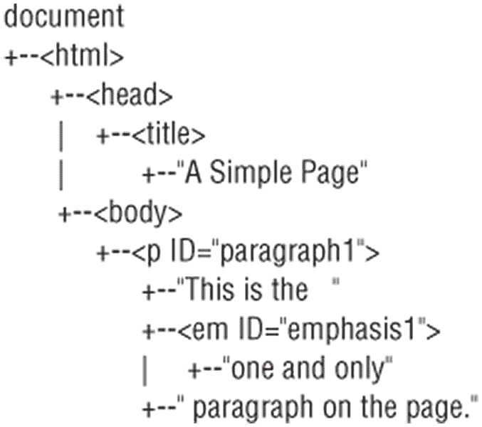

### 注意

如果文档的源代码在`<html>`标签上方包含文档类型定义（在`DOCTYPE`元素中），浏览器会将该`DOCTYPE`节点视为HTML元素节点的兄弟节点。在这种情况下，根文档节点包含两个子节点。

W3C DOM（通过Level 2）定义了12种不同的节点，其中7种在HTML文档中有直接应用。这7种节点出现在表25.2中；其余适用于XML。在7种类型中，最常见的三是文档、元素和文本类型。所有W3C DOM浏览器（包括Internet Explorer 5及更高版本、Mozilla、Safari等）都实现了这三种常用节点类型，而Mozilla实现了所有类型，IE6实现了除一种以外的所有类型，Safari 1实现了除两个以外的所有类型。

#### 表25.2 W3C DOM HTML相关节点类型

| 节点类型 | 描述 |
| :--- | :--- |
| 1 | 元素节点 |
| 2 | 属性节点 |
| 3 | 文本节点 |
| 4 | CDATA部分节点 |
| 5 | 实体引用节点 |
| 6 | 实体节点 |
| 7 | 处理指令节点 |
| 8 | 注释节点 |
| 9 | 文档节点 |
| 10 | 文档类型节点 |
| 11 | 文档片段节点 |
| 12 | 表示法节点 |

将表25.2中的节点类型应用于图25.3中的节点图，你可以看到该页面由一个文档节点、六个元素节点和四个文本节点组成。

### Node properties

`node`有许多属性，其中大部分是指向当前节点相关的其他引用。表25.3列出了DOM Level 2中所有节点类型共享的所有属性。

#### 表25.3 节点对象属性 (W3C DOM Level 2)

| 属性 | 描述 |
| :--- | :--- |
| `attributes` | 包含节点属性的NamedNodeMap |
| `childNodes` | 包含子节点的NodeList |
| `firstChild` | 第一个子节点 |
| `lastChild` | 最后一个子节点 |
| `localName` | 节点名称的本地部分 |
| `namespaceURI` | 节点命名空间的URI |
| `nextSibling` | 下一个兄弟节点 |
| `nodeName` | 节点名称 |
| `nodeType` | 节点类型（整数） |
| `nodeValue` | 节点值 |
| `ownerDocument` | 所属文档 |
| `parentNode` | 父节点 |
| `prefix` | 节点命名空间前缀 |
| `previousSibling` | 前一个兄弟节点 |

### 注意

你可以在第26章中所有HTML元素对象共有的属性列表中，找到表25.3中显示的所有属性，这些属性同样在Internet Explorer 6+或Moz1+中实现。这是因为HTML元素作为`node`的一种类型，继承了原型节点的所有属性。

为了帮助你理解关键节点属性的含义，表25.4显示了列表25-1所示页面中几个节点的属性值。对于每个节点列，在图25.3中找到该节点，然后遵循该节点的属性值列表，将值与图25.3中的实际节点结构进行比较。

#### 表25.4 简单HTML文档的选定节点

| 属性 | 文档节点 | `html`元素 | `p`元素 | 文本节点 |
| :--- | :--- | :--- | :--- | :--- |
| `nodeType` | 9 | 1 | 1 | 3 |
| `nodeName` | #document | HTML | P | #text |
| `nodeValue` | null | null | null | 这是页面上 |
| `parentNode` | null | 文档节点 | `body`元素 | `p`元素 |
| `firstChild` | `html`元素 | `head`元素 | 文本节点 | null |
| `lastChild` | `html`元素 | `body`元素 | `em`元素 | null |
| `childNodes.length` | 1 | 2 | 3 | 0 |

`nodeType`属性是一个整数，有助于遍历未知节点集合。HTML文档中的大部分类型为1（HTML元素）或3（文本节点），最外层的容器文档类型为9。节点的`nodeName`属性是标签名称（对于HTML元素）或常量值（以#符号开头，如表25.2所示）。而且，虽然会让一些人感到惊讶，`nodeValue`属性除文本节点外均为null，在这种情况下它是文本的实际字符串。换句话说，对于HTML元素，W3C DOM不暴露容器的HTML字符串。

### 面对象的W3C DOM

如果你熟悉面向对象（OO）编程，你将会欣赏W3C定义DOM的方式。`Node`对象包含一组属性（参见表25.3）和方法（参见表25.5）。

### 生成新节点内容

关于W3C DOM节点结构的最后一点，集中于脚本编写者在生成想要添加或替换到页面的内容时，必须采用的同样复杂的方法。对于仅文本的更改（例如，表格单元格内部的文本），执行该任务有简单和困难两种方法。对于HTML的更改，则只有困难的方法（外加后文将讨论的一种实用的变通方法）。让我们先看看困难的方法，然后选取用于文本更改的简单方法。

### 生成新节点

要在DOM中生成一个新节点，你需要查看为Core DOM的`document`对象定义的各种方法（这些方法也被HTML文档对象继承）。DOM中的几乎每种节点类型都定义了节点创建方法。对于HTML文档来说，两个重要的方法是`createElement()`和`createTextNode()`。前者根据你作为参数传递的任意标签名（字符串）生成一个元素；后者则根据你传递的任意文本生成一个文本节点。

当你第一次创建一个新元素时，它仅存在于浏览器的内存中，而没有作为文档包含层级结构的一部分。此外，`createElement()`方法的结果是对空元素的引用，除了标签名之外没有其他。例如，要创建一个新的`p`元素，使用

```javascript
var newElem = document.createElement("p");
```

新元素没有ID、属性或任何内容。要给此元素分配某些属性，你可以使用`setAttribute()`方法（每个元素对象的方法）或为对象的对应属性赋值。例如，要给新元素分配一个标识符，可以使用：

```javascript
newElem.setAttribute("id", "newP");
```

或者

```javascript
newElem.id = "newP";
```

这两种方法都是完全合法的。尽管元素此时已经有了ID，但它尚未成为文档的一部分，因此你无法通过`document.getElementById()`方法检索它。

要向该段落添加一些内容，你接下来需要生成一个独立的对象作为文本节点：

```javascript
var newText = document.createTextNode("This is the second paragraph.");
```

再次，这个节点只是停留在内存中，等待你将其作为其他节点的子节点应用。为了让这段文本成为新段落的内容，你可以将该节点作为仍在内存中的段落元素的子节点追加：

```javascript
newElem.appendChild(newText);
```

如果你能够检查表示新段落元素的HTML，它看起来将如下所示：

```html
<p id="newP">This is the second paragraph.</p>
```

新段落元素已准备好插入文档。使用列表25-1所示的文档，你可以将其作为body元素的子节点追加：

```javascript
document.body.appendChild(newElem);
```

最后，新元素成为了文档包含层级结构的一部分。现在，你可以像引用文档中的任何其他元素一样引用它。

### 替换节点内容

上一节中所示段落的添加需要对原始段落中的部分文本进行更改（因为第一个段落不再是页面上唯一的段落）。如前所述，你可以通过`replaceChild()`方法或通过为文本节点的`nodeValue`属性分配新文本来执行文本更改。让我们看看每种方法如何工作将第一个段落中`em`元素的文本从“one and only”改为“first”。

要使用`replaceChild()`，脚本必须先生成一个带有新文本的有效文本节点：

```javascript
var newText = document.createTextNode("first");
```

下一步是使用`replaceChild()`方法。但请记住，该方法的视角是被替换子节点的父节点。这里的元素是`em`元素内部的文本节点，因此你必须在`em`元素上调用`replaceChild()`方法。

与分步操作元素和文本节点对象相比，`innerHTML`属性具有显而易见的便利性，但浏览器处理节点的效率远高于处理长字符串的组合。在这样一种情况下，JavaScript代码的减少并不一定意味着效率的提高。

# 静态W3C DOM HTML对象

Moz1+ DOM（遗憾的是，不支持Internet Explorer 5或更高版本）在对象模型上遵循了JavaScript的核心原型继承概念。当页面加载到Moz1+浏览器中时，浏览器会根据W3C DOM定义的每个对象的原型创建HTML对象。例如，如果你使用*The Evaluator Sr.*（已在第4节“JavaScript核心要素”中讨论）来查看`myP`段落对象是哪种对象——在顶部的文本框中输入`document.getElementById("myP")`并点击Evaluate（评估）按钮——它会报告该对象是基于DOM的`HTMLParagraphElement`对象。页面中每一个`p`元素对象的实例都从`HTMLParagraphElement`继承其默认属性和方法（后者又继承自`HTMLElement`、`Element`和`Node`对象——这些在W3C DOM规范的JavaScript绑定附录中有详细说明）。

你可以使用脚本向这些静态对象的某些原型添加属性。要做到这一点，你必须使用Moz1+添加的新功能，这些功能属于JavaScript 1.5和ECMAScript 5。两个新方法`__defineGetter__()`和`__defineSetter__()`允许你将函数分配对象的自定义属性。

### 注意

这些方法是Mozilla特有的。为了防止它们与ECMAScript中这些功能的标准化实现冲突，方法名两边的下划线是成对的下划线。

当属性被读取（通过`__defineGetter__()`方法分配函数）或修改（通过`__defineSetter__()`方法分配函数）时，函数就会执行。定义这些函数的常用方法是匿名函数的形式（见第23节）。将这些行为分配给对象原型的两个语句格式如下：

```javascript
object.prototype.__defineGetter__("propName",
    function([param1[,...[,paramN]]]) {
  // 语句
  return returnValue;
    })

object.prototype.__defineSetter__("propName",
    function([param1[,...[,paramN]]]) {
  // 语句
  return returnValue;
    })
```

列表25-3中的示例演示了如何为当前文档中的每个HTML元素对象添加一个只读属性。该属性名为`childNodeDetail`，返回一个对象。该对象有两个属性：一个用于元素子节点数量，另一个用于文本子节点数量。注意，函数定义中的`this`关键字是对计算属性的对象的引用。由于函数在每次脚本语句读取该属性时都会运行，因此页面加载后对内容进行的任何脚本更改都会反映在返回的属性值中。

#### 列表25-3：为所有HTML元素对象添加只读原型属性

```javascript
<script type="text/javascript">
if (HTMLElement)
{
    HTMLElement.prototype.__defineGetter__("childNodeDetail", function()
    {
      var result = {elementNodes:0, textNodes:0}
      for (var i = 0; i < this.childNodes.length; i++)
      {
        switch (this.childNodes[i].nodeType)
        {
          case 1:
              result.elementNodes++;
              break;
          case 3:
              result.textNodes++;
              break;
        }
      }
      return result;
    })
}
</script>
```

要访问该属性，像使用对象的任何其他属性一样使用它。例如：

`var BodyNodeDetail = document.body.childNodeDetail;`

此示例中的返回值是一个对象，因此使用标准的JavaScript语法访问其属性值：

`var BodyElemCount = document.body.returnValue;`

## 双向事件模型

尽管捕获（capture）和冒泡（bubble）事件模型看似冲突，但W3C事件模型允许编写者选择事件传播的方式。为了防止与现有模型冲突，W3C DOM引入了新的术语。W3C事件模型还引入了一个名为事件监听器的概念。事件监听器本质上是一种指示浏览器是否强制冒泡的机制。

有关事件的详细信息包含在传递给事件处理函数的事件对象。如果你通过W3C DOM `addEventListener()`方法或事件属性分配事件处理器，事件对象将作为唯一参数传递给事件处理器函数。包含参数变量以接收传入的参数：

```javascript
function swap(evt) {
  // 处理 W3C DOM 事件对象的语句
}
```

但如果你通过标签属性分配事件，则需要在调用函数时显式传递事件对象：

`document.getElementById("button").addEventListener("click", doCalc)`

`addEventListener()`方法接受三个参数。第一个是要监听的事件字符串，第二个是要被调用的函数引用，第三个是布尔值。当你将此布尔值设置为true时，就会开启捕获。函数随后从传递的事件对象获取线索：

```javascript
function doCalc(evt) {
  var form = evt.target.form;
  var results = 0;
  // 执行计算的其他语句
  form.result.value = results;
}
```

要修改事件监听器，你需要使用`removeEventListener()`方法移除旧的监听器，然后使用不同参数的`addEventListener()`。

遗憾的是，对于Windows版本的Internet Explorer 8和Macintosh版本的Internet Explorer 5，微软尚未支持W3C DOM事件模型。不过，如果你通过对象属性或标签属性来分配事件处理器，并结合本章后文以及第32章中更详细描述的少量对象检测，就可以让Internet Explorer和W3C事件模型协同工作。

## 脚本趋势

尽管浏览器脚本起初非常简单，只是为了给表单控件添加一些智能功能，但JavaScript语言和DOM的功能激发了许多Web开发者创建本质上是应用程序。流行的基于Web的电子邮件系统使用了脚本以及与服务器的后台通信，以便在从收件箱列表删除消息时，无需获取并重新渲染整个页面即可快速更新页面。大型项目涉及多个脚本编写人员（以及CSS专家、服务器端编程人员、艺术家和作家）并不罕见。管理所有的代码可能是一项苦差事。

## 将内容与脚本分离

使用CSS为网站设置样式的人已经发现，将样式定义与HTML标记分离，在需要更改整个网站的颜色或字体规范时，可以极大地提高效率。你不需要修改散落在整个网站的数百个`<font>`标签规范，只需在一个`.css`文件中简单地调整单个CSS规则，该更改就会立即应用到所有地方。

将HTML纯用于页面结构的理念也影响了脚本编写。如今，专业的脚本编写人员在HTML标签内部放置事件处理器属性已很罕见。那被认为是内容与行为的过度混合。换句话说，HTML标记应该能够独立存在，以便那些使用不支持脚本浏览器的用户（包括使用特殊浏览器的视觉或运动功能障碍的人士）仍然能够获取页面提供的基本信息。任何影响页面显示或行为的脚本都在HTML标记加载并渲染后添加到页面中。即使是为元素分配事件，也是在页面加载后通过脚本完成的。

脚本代码更常见是从外部`.js`文件链接到页面中的。这不属于内容与脚本分离的趋势的一部分，但这种做法提供了许多好处，例如同一段代码可以在多个页面上立即复用。此外，当项目涉及许多“代码大厨”时，脚本编写人员可以在编写代码的同时，让作家编写HTML，让设计师编写他们的外部CSS代码。

### 注意

你将在本书中许多在标签内使用事件处理器属性以及在页面内嵌入脚本的示例。这种方法主要用于为了简单地演示某种语言或DOM特性。

## 尽可能使用W3C DOM

主流浏览器对W3C DOM元素引用和内容操作的基础支持已经实现了很长时间，因此你可以确信，为该模型编写脚本对于你的大多数访问者都是有效的。并不是说你可以假设每位访问者都配备了这种设备，但脚本编写人员过去为了支持冲突的对象模型而忍受的烦恼大部分已成为过去式。为IE和Netscape编写大量分支代码的日子已是不再太美好的记忆了。

你仍然想要使用对象检测技术来防范偶尔访问的旧浏览器。这正是通过脚本分配事件处理器的技术可以节省麻烦的地方。

除了页面加载期间可能发生的某些初始化外，大多数脚本执行都是由事件触发的：用户点击按钮、在文本框中输入、从选择列表中进行选择。你可以通过进行对象检测来防止旧浏览器在处理W3C时出错，如下所示：

```javascript
function setUpEvents() {
    if (document.getElementById) {
        // ...
    }
}
window.onload = setUpEvents;
```

现在，不支持W3C的浏览器不会产生错误。要将受影响的浏览器置于CSS标准兼容模式，你在第4章中看到了。

## 处理事件

你仍然会在一些W3C不够用的地方。这在Internet Explorer中（至少到版本8）尤为如此。W3C DOM会自动将事件作为参数传递给处理器函数。为了无论浏览器如何获取单个变量，可以使用以下代码：

```javascript
function calculate(evt) {
    evt = evt ? evt : window.event;
}
```

指向元素的Internet Explorer对象称为`srcElement`，而W3C版本称为`target`。你可以在第3章中找到更多细节。

## 标准兼容模式 (DOCTYPE切换)

微软和Netscape/Mozilla都发现，随着时间的推移，他们实现CSS的方式最终与发布的标准有所不同（通常是在工作组之间争论之后）。为了补偿这些差异并为了兼容标准的彻底断裂，主要的浏览器制造商决定由页面作者选择的`<!DOCTYPE>`头部来决定文档设计是遵循旧方式（有时称为怪异模式）还是标准方式。这种被非正式称为DOCTYPE切换的策略在Internet Explorer 6及后续版本、Mac版Internet Explorer 5、所有基于Mozilla的浏览器以及所有基于WebKit的浏览器中实现。

尽管两种模式之间的大多数差异很小，但在Internet Explorer 6及后续版本中，当样式或DHTML脚本依赖于带有边框、边距和内边框元素时，两种模式之间存在显著差异。微软原始框模型测量元素尺寸的方式与最终的标准不同。

要将浏览器置于CSS标准兼容模式，你应该在每个文档顶部包含一个`<!DOCTYPE>`元素，指定以下任意内容（第一个`<!DOCTYPE>`语句用于HTML5）：

```html
<!DOCTYPE html>
<!DOCTYPE HTML PUBLIC "-//W3C//DTD HTML 4.0 Transitional//EN" "http://www.w3.org/TR/REC-html40/loose.dtd">
<!DOCTYPE HTML PUBLIC "-//W3C//DTD HTML 4.0 Frameset//EN" "http://www.w3.org/TR/REC-html40/frameset.dtd">
<!DOCTYPE HTML PUBLIC "-//W3C//DTD HTML 4.0//EN" "http://www.w3.org/TR/REC-html40/strict.dtd">
```

```html
<!DOCTYPE html PUBLIC "-//W3C//DTD XHTML 1.0 Strict//EN" "http://www.w3.org/TR/xhtml1/DTD/xhtml1-strict.dtd">
<!DOCTYPE html PUBLIC "-//W3C//DTD XHTML 1.1//EN" "http://www.w3.org/TR/xhtml11/DTD/xhtml11.dtd">
```

但请注意，Windows上的旧版本Internet Explorer（如`Internet Explorer 5`或`Internet Explorer 5.5`）并不识别标准兼容模式，无论`<!DOCTYPE>`设置如何，它们都会使用旧的Microsoft怪异模式（quirks mode）。但使用符合标准的模式的DOCTYPE更有可能强制你的内容和样式表在最新的浏览器中以相似的方式渲染。

## 接下来的方向

过去的两个章节概述了任何设计使用JavaScript页面的人都必须面对的核心语言和对象模型问题。这里的目标是激发你自己的思考：如何在生成酷炫页面与服务受众之间取得平衡，从而接受或放弃页面不同层级的兼容性。从现在开始，艰难的选择将由你决定。

为了帮助你选择最符合你要求的对象、属性、方法和事件处理器，第三部分的所有章节以及第四部分的其余部分提供了关于DOM和核心JavaScript语言性的深度参考。请仔细观察每个语言术语的兼容性评分，以帮助你判断哪些功能最适合你受众的浏览器。大多数示例都是完整的HTML页面，你可以在各种浏览器中加载它们查看其是如何工作的。许多其他示例邀请你通过`The Evaluator Sr.`（见第4章）探索事物是如何工作的。尝试操作这些文件，通过修改来构建你自己的应用程序，或扩展你在浏览器环境中的JavaScript知识。

语言和对象模型在存在的短短几年里不断成长。语言词汇量呈天数字级增长。需要时间来吸收所有内容，并确保你已经了解了所拥有的力量。不要担心记忆这些词汇。更重要的是熟悉这些功能，并在以后需要实现细节时再回来查看。

保持耐心。保持坚持。回报将会而来的。

# 26 通用HTML元素对象

## 本章内容

- 操作HTML元素对象
- 常用属性和方法
- 所有元素对象的事件处理器

在Internet Explorer 4+以及W3C（基于Mozilla和WebKit）的浏览器中实现的对象模型规范包含了一系列可脚本对象，这些对象代表了我们通常所说的通用HTML元素。通用元素可以分为两组。一组，例如带删除线的元素（strike elements），定义了应用于所包围文本序列的字体样式。由于更多页面设计师使用样式表，这些元素（以及代表它们的对象）的需求几乎消失了。第二组元素在它们的起始和结束标签内为内容分配上下文。上下文型元素的示例包括`h1`、`blockquote`和无处不在的`p`元素。虽然浏览器有时会默认以一致的视觉方式渲染上下文型元素（例如`<h1>`标签的大号粗体字体），但特定的渲染并不是这些标签的预期意目的。没有正式的标准规定`em`元素内的文本必须是斜体：这种样式从浏览器非常早的起就变成了一种习俗。

所有这些通用元素都共享大量的可脚本属性、方法和事件处理器。这种共享不仅存在于通用元素之间，也存在于几乎每一个可渲染的元素之间——即使它具有额外的、特定元素的属性、方法和/或事件处理器，而我们在本参考的其他章节中对其进行了深入介绍。我们没有在本书中为每个对象重复这些共享属性、方法和事件处理器的细节，仅在本章详细描述它们（除非在其他处描述的某个对象与项目存在特殊行为、错误或技巧）。在随后的参考章节中，每个对象的描述都包含该对象的属性、方法和事件处理器的列表，但我们不会反复列出共享项目（这将很难找到某个特定元素的唯一项目）。相反，对于与通用HTML元素对象共同的项目，你会看到一个指向本章的指针。

### 通用对象

`表26.1`列出了我们在参考书中视为通用对象的所有对象。所有这些对象都共享后续章节中描述的属性、方法和事件处理器，并且没有在书中其他地方需要额外介绍的特殊项目。

#### 表26.1 通用HTML元素对象

| 格式化对象 | 上下文型对象 |
| :--- | :--- |
| b | acronym |
| big | address |
| center | cite |
| i | code |
| nobr | dfn |
| rt | del |
| ruby | div |
| s | em |
| small | ins |
| strike | kbd |
| sub | listing |
| sup | p |
| tt | plaintext |
| u | pre |
| wbr | samp |
| | span |
| | strong |
| | var |
| | xmp |

| 属性 | 方法 | 事件处理器 |
| :--- | :--- | :--- |
| accessKey | `addBehavior()` | onactivate |
| all[] | `addEventListener()` | onafterupdate |
| attributes[] | `appendChild()` | onbeforecopy |
| baseURI | `applyElement()` | oncut |
| behaviorUrns | `attachEvent()` | ondeactivate |
| canHaveChildren | `blur()` | beforeeditfocus |
| canHaveHTML | `clearAttributes()` | onbeforepaste |
| childNodes[] | `click()` | beforeupdate |
| children | `cloneNode()` | onblur |
| cite | `compareDocumentPosition()` | onchange |
| className | `componentFromPoint()` | onclick |
| clientHeight | `contains()` | oncontextmenu |
| clientLeft | `getControlRange()` | onselect |
| clientTop | `detachEvent()` | oncopy |
| clientWidth | `dispatchEvent()` | oncut |
| document | `doScroll()` | dataavailable |
| firstChild | `dragDrop()` | datetchanged |
| height | `getClientRect()` | datasetcomplete |
| hideFocus | `getClientRects()` | onblclick |
| id | `getElementsByTagName()` | onactivate |
| innerHTML | `getElementsByTagNameNS()` | onfocus |


| innerText | `getExpression()` | onfocus |
| isContentEditable | `getFeature()` | filterchange |
| isDisabled | `getUserData()` | onfocus |
| isDisabled | `hasAttribute()` | focusout |
| isMultiLine | `hasAttributeNS()` | onhelp |
| isTextEdit | `hasAttributes()` | onkeydown |
| lang | `hasChildNodes()` | onkeypress |
| language | `insertAdjacentAdjacentElement()` | onkeyup |
| lastChild | `insertAdjacentAdjacentHTML()` | layoutcomplete |
| length | `insertAdjacentAdjacentText()` | onlosecapture |
| localName | `insertBefore()` | onmousedown |
| namespaceURI | `isDefaultNamespace()` | onmouseenter |
| nextSibling | `isEqualNode()` | onmouseleave |
| nodeName | `isSameNode()` | onmousemove |
| nodeType | `isSupported()` | onmouseout |
| nodeValue | `item()` | onmouseover |
| offsetHeight | `lookupNamespaceURI()` | onmouseup |
| offsetLeft | `lookupPrefix()` | onmousewheel |
| offsetParent | `mergeAttributes()` | onmove |
| offsetTop | `normalize()` | onmoveend |
| offsetWidth | `releaseCapture()` | onmovestart |
| outerHTML | `removeAttribute()` | onpaste |
| outerText | `removeAttributeNode()` | onpropertychange |
| ownerDocument | `removeAttributeNS()` | onreadystatechange |
| parentElement | `removeBehavior()` | onresize |
| | `removeChild()` | resizeend |
| `parentNode` | `removeEventListener()` | `onresizestart` |
| `parentTextEdit` | `removeExpression()` | `onrowenter` |
| `prefix` | `removeNode()` | `onrowexit` |
| `previousSibling` | `replaceAdjacentText()` | `onrowsdelete` |
| `readyState` | `replaceChild()` | `onrowsinserted` |
| `recordNumber` | `replaceNode()` | `onscroll` |
| `runtimeStyle` | `scrollIntoView()` | `onselectstart` |
| `scopeName` | `setActive()` |  |
| `scrollHeight` | `setAttribute()` |  |
| `scrollLeft` | `setAttributeNode()` |  |
| `scrollTop` | `setAttributeNodeNS()` |  |
| `scrollWidth` | `setAttributeNS()` |  |
| `sourceIndex` | `setCapture()` |  |
| `style` | `setExpression()` |  |
| `tabIndex` | `setUserData()` |  |
| `tagName` | `swapNode()` |  |
| `tagUrn` | `tags()` |  |
| `textContent` | `toString()` |  |
| `title` | `urns()` |  |
| `uniqueID` |  |  |
| `unselectable` |  |  |
| `width` |  |  |

# 语法

要访问元素属性或方法，请使用以下方法：

- (IE4+) `[document.all.]objectID.property` | `method([parameters])`
- (IE5+/W3C) `document.getElementById(objectID).property` | `method([parameters])`

### 注意事项

需要注意的是，除非你有支持 IE4 的特定需求（这在目前看来是非常不可能的），否则你应该完全依赖后种方法，即通过 `getElementById()` 方法引用元素属性和方法。

# 关于这些对象

表 26.1 中列出的所有对象都是 HTML 元素的文档对象模型 (DOM) 表示，它们会影响字体样式或某些 HTML 内容的上下文。与这些对象相关的大量属性、方法和事件处理程序同样适用于几乎所有代表 HTML 元素的 DOM 对象。本章关于对象细节的讨论也适用于本参考资料后续章节中描述的几十个其他对象。

## 属性

## accessKey

- **值**：单字符字符串
- **类型**：读/写
- **兼容性**: WinIE4+, MacIE4+, NN7+, Moz-, Safari+, Opera+, Chrome+

对于许多元素，你可以指定一个键盘字符（字母、数字或标点符号），当该字符作为 Alt+键 组合（在 Win32 操作系统上）、Ctrl+键 组合（在 MacOS 上）或 Shift+Esc+键 组合（在 Opera 上）输入时，会将焦点带到该元素。获得元素的元素设置为响应键盘操作的元素。如果新焦点的元素不在文档当前的滚动位置视图内，文档将滚动以将该焦点元素带入视野（另请参见 `scrollIntoView()` 方法）。你指定的字符可以是大写或小写，但这些值不区分大小写。如果你将同一个字母分配给多个元素，用户可以在所有与该 `accessKey` 值相关的元素之间循环切换。

Internet Explorer 在某些情况下为 `accessKey` 属性提供额外功能。例如，如果你为 `label` 元素对象分配一个 `accessKey` 值，焦点将传递给与标签相关的 `form` 元素。此外，当按钮元素获得焦点时，按下空格键的作用与用鼠标点击元素相同。在选择 `accessKey` 值时要进行合理的判断。如果你分配了一个通常用于访问浏览器内置菜单的字母（例如，IE 中用于 Alt+F 打开文件菜单），该 `accessKey` 设置将覆盖浏览器的正常行为。对于依赖访问菜单的用户，你对该键的控制可能会让他们不安。在其他浏览器中，你的 `accessKey` 分配不会覆盖浏览器的正常行为。

### 示例

列表 26-1 显示了使用 `accessKey` 属性操作键盘界面以导航网页的示例。当你加载列表 26-1 中的脚本时，调整浏览器窗口的高度，直到你能看到第二条规则以下的任何内容。在页面的设置（Settings）部分输入任何字符并按回车键（回车键可能会导致电脑发出响声）。按回车键不会在浏览器中产生任何可见变化；它只是将你输入的字符分配到相应的元素中。然后按住 Alt (Windows) 或 Ctrl (Mac) 或 ShiftEsc (Opera)，同时按下同一个键盘键。第二条分割线以下的元素应该出现在视野中。

### 注意事项

本章及本书大部分内容使用的属性事件处理技术是为了使代码更具读性而进行的刻意简化。通常情况下，使用使用现代的方法，通过 `addEventListener()` (NN+/W3C) 或 `attachEvent()` (IE5+) 方法来绑定事件。现代的跨浏览器事件处理技术将在第 2 章中详细介绍。

#### 列表 26-1: 控制 accessKey 属性 HTML: js26-01.html

```html
<!DOCTYPE html>
<html>
<head>
  <meta http-equiv="content-type" content="text/html;charset=utf-8">
  <title>accessKey Property</title>
  <script type="text/javascript" src="../js-global.js"></script>
  <script type="text/javascript" src="js26-01.js"></script>
</head>
<body>
  <h1>accessKey Property Lab</h1>
  <hr />
  <form name="input">
    Settings:<br />
    Assign an accessKey value to the Button below and press Return:
    <input type="text" size="2" length="1" onkeypress="assignKey('button', this)">
    <br />
    Assign an accessKey value to the Text Box below and press Return:
    <input type="text" size="2" length="1" onkeypress="assignKey('text', this)">
    <br />
    Assign an accessKey value to the Table below (IE5.5 only) and press Return:
    <input type="text" size="2" length="1" onkeypress="assignKey('table', this)">
  </form>
  <br />
  Then press Alt (Windows) or Control (Mac) or ShiftESC (Opera) + the key
  <br />
  <em>Size the browser window to view lower than this line.</em>
  <hr />
  <form name="output" onsubmit="return false">
    <input type="button" id="access1" value="Standard Button">
    <input type="text" id="access2">
  </form>
  <table id="myTable" padding="0" border="2">
    <tr>
      <th>Quantity</th>
      <th>Description</th>
      <th>Price</th>
    </tr>
    <tbody bgcolor="red">
      <tr>
        <td width="100">4</td>
        <td>Primary Widget</td>
        <td>$4.96</td>
      </tr>
      <tr>
        <td>10</td>
        <td>Secondary Widget</td>
        <td>$14.96</td>
      </tr>
    </tbody>
  </table>
</body>
</html>
```

#### JavaScript: jsb26-01.js

```javascript
function assignKey(type, elem) {
  if (window.event) { // IE, Opera, Safari, Chrome
    if (window.event.keyCode == 13) {
      switch (type) {
        case "button":
          document.getElementById("access1").accessKey = elem.value;
          break;
        case "text":
          document.getElementById("access2").accessKey = elem.value;
          break;
        case "table":
          document.getElementById("myTable").accessKey = elem.value;
          break;
      }
      return false;
    }
  }
}
```

`all` 属性最初是 Internet Explorer 独有的，它是当前对象范围内每个 HTML 元素和（在 IE5+ 中）XML 标签的集合（数组）。Opera 现在已完全支持它，而基于 WebKit 的浏览器（如 `Safari` 和 `Chome`）仅将其作为 `document` 对象的属性支持。尽管如此，你应该强烈考虑使用 `document.getElementById()` 方法（如第 29 节所述），这是引用元素的 W3C 官方方法及跨浏览器处理方式。`document.getElementById()` 方法支持 IE5+。

此数组中的项按照源代码顺序出现，且该数组忽略项之间的元素包含关系。对于 HTML 元素容器，源代码顺序取决于元素起始标签的位置；结束标签不计在内。但对于 XML 标签，结束标签会作为独立的条目出现在数组中。

每个 `document.all` 集合都包含 `html`、`head`、`title` 和 `body` 元素对象，即使实际 HTML 源代码省略了这些标签。对象模型会为加载到窗口或框架中的每个文档创建这些对象。虽然 `document.all` 引用可能是常用的用法，但 `all` 属性适用于任何容器元素。例如，`document.forms[0].all` 暴露了页面中第一个表单内定义的所有元素。

你可以通过字符串形式的标识符（以及整数索引）访问任何为其 `id` 属性分配了该标识符的元素。与其使用性能开销昂的 `eval()` 函数将字符串转换为对象引用，不如使用 `name` 的字符串值作为数组的索引值：

```javascript
var paragraph = document.all["myP"];
```

Internet Explorer 允许使用方括号或圆括号处理单个集合索引值。因此，以下两个示例的计算结果相同：

```javascript
var paragraph = document.all["myP"];
var paragraph = document.all("myP");
```

在 `all` 集合中存在两个或多个元素具有相同 `ID` 的罕见情况下，字符串索引值的语法将返回仅包含这些同名元素的集合。但你可以使用第二个参数（在括号内）来指定初始集合的整数，从而提取出该命名元素的特定实例：

```javascript
var secondRadio = document.all("group0",1);
```

作为更具可读性的替代方案，你可以使用 `item()` 方法（在本章后文介绍）来访问集合中的同类项：

```javascript
var secondRadio = document.all.item("group0",1);
```

另请参见 `tags()` 方法（在本章后文介绍），作为从 `all` 集合中提取匹配特定标签名称元素集的方法。

### 示例

使用评估器（见第 4 节）对 `all` 集合进行实验。在底部的文本框中依次输入以下语句，并查看每个文本区域中的输出结果：

```javascript
document.all
myTable.all
myP.all
```

如果你在集合中遇到编号的元素，可以探索该元素以查看与其关联的标签。例如，如果 `document.all` 集合的 Result 之一显示 `document.all.8=[object]`，请在最顶部的文本框中输入以下语句：

```javascript
document.all[8].tagName
```

相关项目：`item()`、`tags()`、`document.getElementById()` 方法

### attributes[]

| Value：属性对象引用数组 | 只读 |
| :--- | :--- |

兼容性：WinIE5+, MacIE5+, NN6+, Moz+, Safari+, Opera+, Chrome+

`attributes` 属性返回一个属性对象数组。在 IE5+ 中，`attributes` 数组包含了元素指定的所有属性。对于 W3C 浏览器，请使用 `attributes` 数组。

列表 26-2 展示了如何使用 `canHaveChildren` 属性在视觉上识别页面上可以嵌套元素的元素。此示例使用颜色来演示可以包含子元素与不能包含子元素之间的区别。第一个按钮将页面上每个可见元素的颜色样式属性设置为红色。因此，所有元素（包括通常不包含子元素的元素，如 `hr` 和 `input`）都会受到颜色变化的影响。但如果你重置页面并点击最大的按钮，只有那些包含嵌套元素的元素接收颜色变化。

### 列表 26-2：读取 `canHaveChildren` 属性

HTML: `jsb26-02.html`

```html
<!DOCTYPE html>
<html>
<head>
    <meta http-equiv="content-type" content="text/html;charset=utf-8">
    <title>canHaveChildren</title>
    <script type="text/javascript" src="../js-global.js"></script>
    <script type="text/javascript" src="jsb26-02.js"></script>
</head>
<body>
    <h1>canChildren Property Lab</h1>
    <hr />
    <form name="input">
        <input type="button" value="Color All Elements" onclick="colorAll()">
        <br />
        <input type="button" value="Reset" onclick="history.go(0)">
        <br />
        <input type="button" value="Color Only Elements That Have Children" onclick="colorBearing()">
    </form>
    <br />
    <hr />
    <form name="output">
        <input type="checkbox" checked="checked"/>basic checkbox
        <input type="text" name="access2" value="Some textbox."
    </form>
    <table id="myTable" padding="10" border="2">
        <tr>
            <th>Quantity</th>
            <th>Description</th>
            <th>Price</th>
        </tr>
        <tbody>
            <tr>
                <td width="100">4</td>
                <td>Primary Widget</td>
                <td>$14.96</td>
            </tr>
            <tr>
                <td>10</td>
                <td>Secondary Widget</td>
                <td>$114.96</td>
            </tr>
        </tbody>
    </table>
</body>
</html>
```

JavaScript: `jsb26-02.js`

```javascript
function colorAll()
{
    var elems = document.getElementsByTagName("*");
    for (var i = 0; i < elems.length; i++) {
        elems[i].style.color = "red";
    }
}
function colorBearing()
{
    var elems = document.getElementsByTagName("*");
    for (var i = 0; i < elems.length; i++) {
        if (elems[i].canHaveChildren) {
            elems[i].style.color = "red";
        }
    }
}
```

#### `canHaveHTML`

- **值**: 布尔值 (Boolean)
- **访问**: 只读和读写
- **兼容性**: WinIE5+, MacIE-, NN-, Safari-, Chrome-

并不是所有的 HTML 元素都是 HTML 内容的容器。`canHaveHTML` 属性允许脚本确定特定对象是否可以接受 HTML 内容（用于插入或替换）。例如，`p` 元素的值为 `true`。`br` 元素的值为 `false`。除了组件之外，所有元素的该属性都是只读的，而它是读写的。

- **相关项目**: `childNodes`, `firstChild`, `lastChild`, `parentElement`, `parentNode` 属性

### 示例

使用 WinIE5+ 中的 Evaluator（见第 4 章）来实验 `canHaveHTML` 属性。在顶部文本框中输入以下语句并观察结果：

```javascript
document.getElementById("input").canHaveHTML
document.getElementById("myP").canHaveHTML
```

第一个语句返回 `false`，因为 `input` 元素（在这种为顶部文本框）不能嵌套 HTML。但 `myP` 元素是接受 HTML 内容的 `p` 元素。

- **相关项目**: `appendChild()`, `insertAdjacentHTML()`, `insertBefore()`

#### `childNodes[]`

- **值**: 节点对象数组
- **访问**: 只读
- **兼容性**: WinIE5+, MacIE5+, NN6+, Safari+, Opera+, Chrome+

`childNodes` 属性由包含在当前对象的节点对象数组组成。注意，子节点包括元素对象和文本节点。因此，取决于当前对象的内容，`childNodes` 数量和子元素集合可能会不同。

**注意**

如果你在遍历一系列 HTML（或 XML）元素的 `for` 循环中使用 `childNodes` 数组，请注意，浏览器可能会将源代码中的空白（元素之间的空行，甚至是元素之间的回车符）视为文本节点。这个潜在问题影响 MacIE5 和基于 W3C 的浏览器。如果存在，这些额外的文本节点会出现在块元素周围。

**备注**

大多数通过 `childNodes` 数组的循环活动旨在检查、计数或修改元素节点。如果这是你脚本的目标，请测试 `childNodes` 数组返回的每个节点，并在处理该节点之前验证其 `nodeType` 属性是否为 `1`（元素）；否则跳过该节点。此类循环的骨架结构如下：

```javascript
for (var i = 0; i < myElem.childNodes.length; i++) {
    if (myElem.childNodes[i].nodeType == 1) {
        // 处理元素节点 i 的语句
    }
}
```

这些幻文本节点的存在也会影响本章稍后描述的 `firstChild` 和 `lastChild` 属性所引用的节点。

### 示例

列表 26-3 包含一个如何编写函数遍历给定节点子节点的示例。列表所示的 `walkChildNodes()` 函数从文档 HTML 元素（默认）或你作为字符串参数传递 ID 的任何元素的视角出发，累积并返回子节点的层级列表。此函数嵌入在 Evaluator 中，因此你可以检查该页面的子节点层级结构，或者（当如光盘第 48 章所述使用 `evaluator.js` 进行调试时）检查你正在构建的任何页面内的节点层级结构。在 Evaluator 的顶部文本框中输入以下语句进行尝试：

```javascript
walkChildNodes()
walkChildNodes(document.getElementById("myP"))
```

该函数的执行结果显示了初始对象范围内所有子节点之间的嵌套关系。它还显示了深入进一步的 `childNodes` 集合，直到所有子节点都被暴露并分类。文本节点被相应地标记了。实际文本的前 15 个字符被放置在结果中，帮助你在将结果与 HTML 源代码进行对比时识别节点。

#### 列表 26-3：收集子节点

```html
<!-- 添加 xmp 标签以便在浏览器窗口中显示 HTML -->
<xmp>
function walkChildNodes(objRef, n)
{
    var obj;
    if (objRef) {
        if (typeof objRef == "string") {
            obj = document.getElementById(objRef);
        } else {
            obj = objRef;
        }
    }
    else {
        obj = (document.body) ? document.parentElement : document.parentNode;
    }
    var output = "";
    var indent = "";
    var i, group, txt;
    if (n) {
        for (i = 0; i < n; i++) {
            indent += "---";
        }
    } else {
        n = 0;
        output += "Child Nodes of " + obj.tagName;
        output += "=====================\n";
    }
    group = obj.childNodes;
    for (i = 0; i < group.length; i++) {
        output += indent;
        switch (group[i].nodeType) {
            case 1:
                output += "<" + group[i].tagName;
                output += (group[i].id) ? "ID=" + group[i].id : "";
                output += (group[i].name) ? "NAME=" + group[i].name : "";
                output += ">\n";
                break;
            case 3:
                txt = group[i].nodeValue.substr(0,15);
                output += "[Text:\" + txt.replace(/[\r\n]/g,"<cr>");
        }
    }
}
</xmp>
```

```javascript
if (group[i].nodeValue.length > 15)
{
    output += "...";
}
output += "\]\n";
break;
case 8:
    output += "[!COMMENT!]\n";
    break;
default:
    output += "[Node Type = " + group[i].nodeType + "]\n";
}
if (group[i].childNodes.length > 0)
{
    output += walkChildNodes(group[i], n+1);
}
return output;
```

相关项目：`nodeName`, `nodeType`, `nodeValue`, `parentNode` 属性；`cloneNode()`, `hasChildNodes()`, `removeNode()`, `replaceNode()`, `swapNode()` 方法

### children

| 值: 元素对象数组 | 只读 |

兼容性：WinIE4+, MacIE4+, NN-, Moz+, Safari+, Opera+, Chrome+

`children` 属性包含一个由当前对象包含元素对象数组。与 `childNodes` 属性不同，`children` 不考虑文本节点，而是严格从当前对象的角度关注 HTML（以及 XML）元素的包含关系。暴露给当前对象的仅直接子节点。如果你想获取嵌套在当前对象的所有元素（无论嵌套多深），请使用 `all` 集合。

### 示例

列表 26-4 显示了如何使用 `children` 属性遍历给定节点的子节点。此函数累积并返回从文档 HTML 元素（默认）或你作为字符串传递的任何元素的 ID 开始的子元素层级列表。此函数嵌入在“评估器”中，因此你可以检查该页面的父子层级（当使用 CD 光盘第 48 节介绍的 `evaluator.js` 进行调试时），你构造的任何页面中的元素。在评估器的文本框中输入以下语句进行尝试：`walkChildren("Table")`。注意在此例中，调用 `walkChildren()` 使用元素的名称而不是调用 `getElementById()`。这揭示了 `walkChildren()` 函数的灵活性，以及它如何作用于对象或对象的名称（元素）。列表 26-3 中的 `walkNodes()` 函数提供了相同的灵活性。`walkChildren()` 函数的结果显示了初始对象范围内所有父元素和子元素之间的嵌套关系。它还显示了深入进一步的子节点直到所有元素都被编目录的过程。如果 HTML 源代码中为元素分配了 `id`/`name` 属性，元素标签也会显示它们的属性值。

列表 26-4：收集子元素

<!-- 为了在浏览器中显示 HTML 而添加的标签 -->

```html
function walkChildren(objRef, n) {
    var obj;
    if (objRef) {
        if (typeof objRef == "string") {
            obj = document.getElementById(objRef);
        }
        else {
            obj = objRef;
        }
    }
    else {
        obj = document.body.parentElement;
    }
    var output = "";
    var indent = "";
    var i, group;
    if (n) {
        for (i = 0; i < n; i++) {
            indent += "---";
        }
    }
    else {
        n = 0;
        output += "Children of <" + obj.tagName;
        output += "\n=====\n";
    }
    group = obj.children;
    for (i = 0; i < group.length; i++) {
        output += indent + "<" + group[i].tagName;
        output += (group[i].id) ? " ID=" + group[i].id : "";
        output += (group[i].name) ? " NAME=" + group[i].name : "";
        output += ">\n";
        if (group[i].children.length > 0) {
            output += walkChildren(group[i], n+1);
        }
    }
    return output;
}
```

相关项目：`canChildren`, `firstChild`, `lastChild`, `parentElement` 属性；`appendChild()`, `removeChild()`

### cite

| 值: URL | 可读/写 |

兼容性：WinIE6+, MacIE-, Moz6+, Safari+, Chrome+

`cite` 属性包含一个 URL，作为元素来源的引用（例如引文）。该属性本应适用于 `blockquote`、`del` 和 `ins` 对象，但 IE 在更广泛的文本对象中支持它。这可能是错误也可能不是，因此在在预期的元素之外使用该属性可能是不安全的。

### className

| 值: 字符串 | 可读/写 |

兼容性：WinIE4+, MacIE4+, NN6+, Safari+, Opera+, Chrome+

类名分配给元素 `class` 属性的标识符。要将文档中的多个元素与级联样式表（CSS）规则关联起来，请为这些元素的类属性分配相同的标识符，并使用该标识符（前加点句号）作为 CSS 规则的选择器。元素的 `className` 属性允许对受控制的元素应用不同的 CSS 规则。列表 26-5 显示了此类脚本的示例。在 26-5 中，通过交替将元素的 `className` 设置为现有的样式类名和空字符串，元素的样式会在开启和关闭之间切换。当你将 `className` 设置为空字符串时，默认的 `h1`行为将被覆盖。

列表 26-5：使用 className

```html
<!DOCTYPE html>
<html>
<head>
    <meta http-equiv="content-type" content="text/html;charset=utf-8">
    <title>className Property</title>
    <style type="text/css">
        .special {
            font-size:16pt;
            color:red;
        }
    </style>
    <script type="text/javascript" src="../js-global.js"></script>
    <script type="text/javascript" src="jsb26-05.js"></script>
</head>
<body>
    <h1>className Property</h1>
    <hr />
    <form name="input">
        <input type="button" value="Toggle Class Name" onclick="toggleSpecialStyle('head1')" />
    </form>
    <br />
    <h1 id="head1">ARTICLE I</h1>
    <p>国会不得制定法律，关于建立宗教或禁止宗教自由自由；或剥夺言论、出版自由；或限制人民和平集会并向政府请愿以伸复申诉的权利。</p>
    <h1>ARTICLE II</h1>
    <p>一个有经过良好训练的民兵对于自由国家的安全是必要的，人民持有并携带武器的权利不受侵犯。</p>
</body>
</html>
```

JavaScript: `jsb26-05.js`

```javascript
function toggleSpecialStyle(elemID) {
    var elem = (document.all) ? document.all(elemID) :
               document.getElementById(elemID);
    if (elem.className == "") {
        elem.className = "special";
    }
    else {
        elem.className = "";
    }
}
```

这两个属性在很大程度上揭示了元素内容的像素高度和宽度，其中该元素的样式表规则包含了高度和宽度设置。在理论上，这些测量值没有考虑通过样式表添加到元素的任何外边距（margins）、边框（borders）或内边距（padding）。但在实践中，边框、外边距和内边距的不同组合会以意想不到的方式影响这些值。`clientHeight` 属性较可靠的应用之一是允许你发现溢出元素的文本在何处结束。若要读取元素的渲染尺寸，在跨浏览器时，使用 `offsetHeight` 和 `offsetWidth` 属性会更好。

对于 `document.body` 对象，`clientHeight` 和 `clientWidth` 属性返回窗口或框架的内部高度和宽度（加或减几个像素）。这些属性取代了 IE 中虽然需要但并不存在的窗口属性。

与早期版本不同，Internet Explorer 5+ 扩展了使用这些属性的对象范围，使其几乎几乎所有表示 HTML 元素的对象。在基于 Mozilla 的浏览器中，这些属性的值为 0，但 `document.body` 除外，它测量浏览器的当前内容区域。

### 示例

列表 26-6 为 IE 提供了一个如何根据客户端区域的宽度和高度动态调整页面内容大小的示例。该示例通过包含段落元素的 `div` 元素的 `clientHeight` 和 `clientWidth` 属性。在它的 `div` 元素的样式表规则中仅指定了宽度，这意味着段落的文本在该宽度内换行，并根据需要尽可能向下延伸以显示整个段落。`clientHeight` 属性描述了该深度。随后，`clientHeight` 属性计算出 logo 图像应该放置在 `div` 紧之后的位置，无论文本长度如何。作为额外奖励，`clientWidth` 属性帮助脚本相对于段落文本将图像水平居中。

### 列表 26-6：使用 `clientHeight` 和 `clientWidth` 属性

HTML: `jsb26-06.html`

```html
<!DOCTYPE html>
<html>
    <head>
        <meta http-equiv="content-type" content="text/html;charset=utf-8">
        <title>clientHeight and clientWidth Properties</title>
        <script type="text/javascript" src="../jsb-global.js"></script>
        <script type="text/javascript" src="jsb26-06.js"></script>
    </head>
    <body>
        <button onclick="showLogo()">Position and Show Logo Art</button>
        <div id="myDIV" style="width:200px">
            <p>Lorem ipsum dolor sit amet, consectetur adipiscing elit, sed do
                eiusmod tempor incididunt ut labore et dolore magna aliqua. Ut enim
                adminim veniam, quis nostrud exercitation ullamco laboris nisi ut
                aliquip ex ea commodo consequat. Duis aute irure dolor in
                reprehenderit in voluptate velit esse cillum dolore eu fugiat nulla
                pariatur. Excepteur sint occaecat cupidatat non proident.
            </p>
        </div>
        <div id="logo" style="position:absolute; width:120px; visibility:hidden">
            
        </div>
    </body>
</html>
```

JavaScript: `jsb26-01.js`

```javascript
function showLogo()
{
   var paragraphW = document.getElementById("myDIV").clientWidth;
   var paragraphH = document.getElementById("myDIV").clientHeight;
   // 修正 Windows/Mac 差异
   var paragraphTop = document.getElementById("myDIV").clientTop ?
   document.getElementById("myDIV").clientTop :
   document.getElementById("myDIV").offsetTop;
   var logoW = document.getElementById("logo").style.pixelWidth;
   // 段落水平居中 logo
   document.getElementById("logo").style.pixelLeft = (paragraphW-logoW) / 2;
   // 将图像放置在段落结束正下方
   document.getElementById("logo").style.pixelTop = paragraphTop + paragraphH;
   document.getElementById("logo").style.visibility = "visible";
}
```

为了辅助 logo 的垂直定位，`div` 的 `offsetTop` 属性提供了 `div` 起点相对于其外部容器（`body`）的位置。遗憾的是，MacIE 使用 `clientHeight` 属性来获取所需的尺寸。该测量值（赋值给 `paragraphTop`）加上 `div` 的 `clientHeight`，便提供了图像的顶部坐标。

相关项目：`offsetHeight`, `offsetWidth`

值：Integer | 只读 | 兼容性：WinIE4+, MacIE4+, NN+, Safari+, Chrome+

`clientLeft` 和 `clientTop` 的目的和名称往好说是令人模糊的。与应用于元素内容的 `clientHeight` 和 `clientWidth` 不同，`clientLeft` 和 `clientTop` 返回的基本上只是元素周围边框的厚度——前提是元素已定位。如果你没有指定边框或未定位元素，这些值将为零（尽管 `document.body` 对象在没有显式设置的情况下可以在每个方向显示几个像素）。如果你正尝试读取元素的左侧和顶部位置，`offsetLeft` 和 `offsetTop` 属性在 WinIE 中更有价值；然而，如列表 26-6 所示，`clientTop` 属性在 MacIE 中返回合适的值。几乎所有元素在 IE5+ 中都有 `clientLeft` 和 `clientTop` 属性，而 MacIE 的支持一致性较差。

相关项目：`offsetLeft`, `offsetTop`, `contentEditable`

值：Boolean | 可读写 | 兼容性：WinIE5.5+, MacIE-, NN+, Safari+

IE5.5 引入了页面上可编辑内容的概念。元素标签可以包含 `contentEditable` 属性，其值通过元素的 `contentEditable` 属性体现。该属性的默认值为 `inherit`，这意味着它继承 `body` 容器中的任何设置。如果你将 `contentEditable` 属性设置为 `true`，该元素以及所有设置为 `inherit` 的元素将变为可用；相反，设置为 `false` 则关闭编辑选项。某些浏览器通过为可编辑元素提供发光边框来提供提示。

### 示例

列表 26-7 展示了如何使用 `contentEditable` 属性创建一个简单的编辑器。当你点击加载后的按钮时，`toggleEdit()` 函数通过 `div` 的 `contentEditable` 属性获取当前的编辑状态。你可以在下一个语句中为 `div` 属性赋值新值来对该元素开启编辑。为了增强效果，将 `div` 的文本变为红色，以提供关于哪些内容可编辑的反馈。按钮标签也会切换为指示点击该按钮将触发的操作的内容。

### 列表 26-7：使用 `contentEditable` 属性

HTML: `jsb26-07.html`

```html
<!DOCTYPE html>
<html>
    <head>
        <meta http-equiv="content-type" content="text/html;charset=utf-8">
        <title>Editable Content</title>
        <style type="text/css">
            .normal {
                color: black;
            }
            .editing {
                color: red;
            }
        </style>
        <script type="text/javascript" src="../jsb-global.js"></script>
        <script type="text/javascript" src="jsb26-07.js"></script>
    </head>
    <body>
        <h1>Poetry Editor</h1>
        <hr />
        <p>开启编辑以修改以下文本：</p>
        <div id="noneditableText">
            Roses are red,
            <br />
            Violets are blue.
        </div>
        <div id="editableText">
            Line 3,
            <br />
            Line 4.
        </div>
        <p>
            <button id="editBtn" onclick="toggleEdit()">
```

```html
<button onfocus="this.blur()">启用编辑</button>
</p>
</body>
</html>
```

### JavaScript: `jsb26-07.js`

```javascript
function toggleEdit()
{
    var newState = document.getElementById("editableText").contentEditable;
    // 虽然 contentEditable 是布尔值，但不同浏览器的行为不同
    if (newState == false || newState == "false" || newState == "inherit")
    {
        newState = true;
    }
    else
    {
        newState = false;
    }
    document.getElementById("editableText").contentEditable = newState;
    document.getElementById("editableText").className = (newState) ?
        "editing" : "normal";
    document.getElementById("editBtn").innerHTML = (newState) ?
        "禁用编辑" : "启用编辑";
}
```

**相关项目:** `isContentEditable`

### currentStyle

| 值: 对象 | 只读 |
| :--- | :--- |
| **兼容性:** WinIE5+, MacIE5+, NN-, Safari-, Opera-, Chrome- | |

每个元素都应用了样式属性，即使这些属性是浏览器的默认设置。由于元素的样式对象仅反映通过 CSS 语句显式设置的属性，因此无法使用元素的 `style` 属性来查看默认样式设置。这就是 `currentStyle` 属性的作用所在。

该属性返回一个只读样式对象，包含适用于元素的各种样式属性值。如果样式属性通过 CSS 语句或脚本显式设置，该属性也是可用的。因此，脚本可以查询任何属性以满足某些设计目标。例如，如果你用 `<em>` 标签包裹某些文本，浏览器默认会将该文本转换为样式。这种设置不会反映在元素的样式对象（`fontStyle` 属性）中；相比之下，元素的 `currentStyle.fontStyle` 属性显示了真实的元素样式属性。

### 示例

要更改样式设置，可以通过元素的样式对象访问它。使用评估器（见第 4 章）来比较元素的 `currentStyle` 和 `style` 对象。例如，未修改的评估器副本包含一个 ID 为 `"myEM"` 的 `<em>` 元素。在属性列表框中输入 `document.getElementById("myEM").style` 并回车。注意，大多数属性值是空的。现在输入 `document.getElementById("myEM").currentStyle` 并回车。每个属性都有与其关联的值。

**相关项目:** `runtimeStyle`,样式对象（第 38 章）；`window.getComputedStyle()`（第 27 章）

### dateTime

| 值: 日期字符串 | 只读 |
| :--- | :--- |
| **兼容性:** WinIE6+, MacIE-, NN6+, Safari+, Opera+, Chrome+ | |

`dateTime` 属性包含一个用于建立元素时间戳的日期值。与 `<cite>` 属性类似，`dateTime` 属性适用于较少的元素对象（`<del>` 和 `<ins>`）。这可能是一个错误，因此在预期元素之外使用该属性可能不是安全的。

### dataFld, dataFormatAs, dataSrc

| 值: 字符串 | 可读/写 |
| :--- | :--- |
| **兼容性:** WinIE4+, MacIE5, NN-, Safari-, Opera-, Chrome- | |

`dataFld`、`dataFormatAs` 和 `dataSrc` 属性（以及更多特定元素的属性，如 `dataPageSize` 和 `recordNumber`）是基于 ActiveX 控件的 Internet Explorer 数据绑定设施。IE4 及更高版本的 Win32 浏览器内置了几个 ActiveX 对象，便于网页与数据源之间的直接通信。数据源包括文本、XML 数据、HTML 数据和外部数据库（MacIE 只支持文本）。数据绑定是一个很大的主题，大部分内容扩展到对微软数据对象 (DSOs)、`ODBC` 和 `JDBC` 的讨论——这些主题远超本书的范围。但数据绑定是一个强大的工具，即使你不是数据库专家，也可以有用。因此，对这三个主要属性——`dataFld`、`dataFormatAs` 和 `dataSrc` 的讨论将介绍了通过微软表格数据控件实现的数据绑定。这允许任何页面访问、排序、显示和过滤（但不更新）从外部文件下载到网页的数据（通常是逗号或制表符分隔的数据）。

你可以在表格数据控件 (TDC) 的帮助下将外部文件的数据加载到文档中。你通过在 `<object>` 标签内指定 `TDC` 对象并指定额外的参数（如文本文件的 URL 和字段分隔符）来获取数据。`object` 元素可以位于文档的任何位置（我们倾向于将其放在代码底部，以便在控件加载之前完成所有页面渲染）。获取数据只是将其带入浏览器，其本身不会在页面上渲染数据。

如果你没有在 IE 中用过嵌入对象，`classid` 属性值可能看起来很奇怪。让一些人感到困惑的部分是长数值数据值，它表示对象的全局唯一标识符 (GUID)，这是 IE 唯一标识对象的方式。你必须按照后续示例所示精确输入此值，以便运行适当的 ActiveX TDC。该对象的 HTML 语法如下：

```html
<object id="objName" classid="clsid:33C7BC4-460F-11D0-BC04-008C7055A83">
    <param name="DataURL" value="URL">
</object>
```

**表 26.3 表格数据控件参数**

| 参数 |  |
| :--- | :--- |
| `CharSet` | 数据源的字符集。默认值为 `latin1`。 |
| `DataURL` | 数据源的 URL（相对或绝对路径）。 |
| `EscapeChar` | 用于转义数据中包含的分隔符的字符。默认为空。常用值为 `\`。 |
| `FieldDelim` | 记录内字段之间的分隔符。默认是逗号 (`,`)。对于制表符字符，使用 `&#09;`。 |
| `Language` | 源数据的 ISO 语言代码。默认值为 `en-us`。 |
| `TextQualifier` | 包围字段数据的可选字符。默认为空。 |
| `RowDelim` | 记录之间的分隔符。默认是换行符 (NL)。 |
| `UseHeader` | 如果文件的第一行包含字段名，则设置为 `true`。默认值为 `false`。 |

数据到 HTML 元素的初始绑定通常发生为元素的 `datasrc` 和 `datafld` 属性赋值时。

如果你希望同一个 HTML 元素（表格除外）更改显示的数据，请调整 `dataSrc` 和 `dataFld` 属性。这些属性适用于一组可以与外部数据关联的 HTML 元素：`a`、`applet`、`body`、`button`、`div`、`frame`、`iframe`、`img`、`input`（大部分类型）、`label`marquee、object、param、select、span 和 `textarea` 对象。

在某些情况下，你的数据源可能会存储 HTML 格式的文本块，以便在元素内部渲染。除非另有说明，否则浏览器会将数据源字段渲染为纯文本——即使内容包含 HTML 格式标签。但如果你希望在渲染期间观察到 HTML 效果，可以将 `dataFormatAs` 属性（或者更有可能的标签的 `dataformatas` 属性）设置为 `HTML`。默认值为 `text`。

### 示例

列表 26-8 是一个简单的文档，它关联了两个 TDC 对象。外部文件是《美国权利法案》文档的不同格式。一个文件是传统的制表符分隔数据文件，包含两条记录。第一条记录是制表符分隔的字段名序列（命名为“Article1”、“Article2”等）。第二条记录是使用 HTML 定义的制表符分隔的文章内容：

```html
<h1>ARTICLE I</h1>
<p>Congress shall make...</p>
```

第二个文件是一个原始文本文件，包含完整的《权利法案》，没有附带任何 HTML 格式。

当你加载列表 26-8 时，只有《权利法案》的第一条出现在蓝色边框的框内。按钮允许你导航到系列中的上一条和下一条。由于数据源是传统的制表符分隔文件，`nextField()` 和 `prevField()` 函数会计算下一个源字段的名称并将新值分配给 `dataFld` 属性。页面加载后，所有数据都已经在浏览器中，因此循环切换记录的速度取决于浏览器重流页面以适应新内容的速度快慢。

### 列表 26-8：将数据绑定到页面

HTML: `jsb26-08.html`

```html
<!DOCTYPE html>
<html>
<head>
    <meta http-equiv="content-type" content="text/html;charset=utf-8">
    <title>Data Binding</title>
    <style type="text/css">
        #display {
            width:500px; border:10px ridge blue; padding:20px;
        }
        .hiddenControl {
            display:none;
        }
    </style>
    <script type="javascript" src="../jsb-global.js"></script>
    <script type="javascript" src="jsb26-08.js"></script>
</head>
<body>
    <h1>U.S. Bill of Rights</h1>
    <form>
        <input type="button" value="Toggle/Individual" onclick="toggleComplete()">
        <span id="buttonWrapper" class="">
            <input type="button" value="Prev" onclick="prevField()">
            <input type="button" value="Next" onclick="nextField()">
        </span>
    </form>
    <div id="display" datasrc="#rights_html" datafld="Article1" dataformat="HTML"></div>
    <object id="rights_html" class="cls:33C7BC4-460F-1D0-0080C705A3">
        <param name="DataURL" value="Bill of Rights.txt">
        <param name="UseHeader" value="True">
        <param name="FieldDelim" value="&#9;">
    </object>
    <object id="rights_raw" class="cls:33C7BC4-460F-11D0-0080C705A3">
        <param name="DataURL" value="Bill of Rights (no format).txt">
        <param name="FieldDelim" value="">
        <param name="RowDelim" value="\">
    </object>
</body>
</html>
```

JavaScript: `jsb26-08.js`

```javascript
function nextField() {
    var elem = document.getElementById("display");
    var fieldName = elem.dataFld;
    var currFieldNum = parseInt(fieldName.substring(7, fieldName.length), 10);
    currFieldNum = (currFieldNum == 10) ? 1 : ++currFieldNum;
    elem.dataFld = "Article" + currFieldNum;
}

function prevField() {
    var elem = document.getElementById("display");
    var fieldName = elem.dataFld;
    var currFieldNum = parseInt(fieldName.substring(7, fieldName.length), 10);
    currFieldNum = (currFieldNum == 10) ? 1 : --currFieldNum;
    elem.dataFld = "Article" + currFieldNum;
}

function toggleComplete() {
    // Logic based on provided text structure
}
```

（注：提供的文本包含重复的逻辑块，已为了结构清晰而进行了清理。）

`dataObj.Filter = “Best Picture” = “Best Actress Film”;`

### 列表 26-9: 排序绑定数据

HTML: `jsb26-09.html`

```html
<!DOCTYPE html>
<html>
<head>
    <meta http-equiv="content-type" content="text/html;charset=utf8">
    <title>数据绑定 - 排序</title>
    <style type="text/css">
        thead {
            background-color:yellow; text-align:center;
        }
    </style>
    <script type="text/javascript" src="../jsb-global.js"></script>
    <script type="text/javascript" src="jsb26-09.js"></script>
</head>
<body>
    <h1>1978-2005 奥斯卡奖</h1>
    <form>
        <p>按年份排序列表
            <a href="javascript:sortByYear('normal')">从新到旧</a>或
            <a href="javascript:sortByYear('reverse')">从旧到新</a>。
        </p>
        <p>过滤符合以下条件的记录
            <select name="filter1" onchange="filterInCommon(this.form)">
                <option value="Best Picture">最佳影片</option>
                <option value="Best Director Film">最佳导演</option>
                <option value="Best Actress Film">最佳女演员</option>
                <option value="Best Actor Film">最佳男演员</option>
            </select>
            <input type="radio" name="operator" checked onclick="filterInCommon(this.form)" is
            <input type="radio" name="operator" onclick="filterInCommon(this.form)" is not
            <select name="filter2" onchange="filterInCommon(this.form)">
                <option value="Best Picture">最佳影片</option>
                <option value="Best Director Film">最佳导演</option>
                <option value="Best Actress Film">最佳女演员</option>
                <option value="Best Actor Film">最佳男演员</option>
            </select>
        </p>
    </form>
    <table src="#oscars" border="1" align="center">
        <thead>
            <tr>
                <td>年份</td>
                <td>电影</td>
                <td>导演</td>
                <td>女演员</td>
                <td>男演员</td>
            </tr>
        </thead>
        <tr>
            <td><div id="col1" datafld="Year"></div></td>
            <td><div id="col2" datafld="Best Picture"></div></td>
            <td><div id="col3" datafld="Best Director"></div></td>
            <td><div id="col4" datafld="Best Actress"></div></td>
            <td><div id="col5" datafld="Best Actor"></div></td>
        </tr>
    </table>
    <object id="oscars" class="id:333CBC4-460F-1D0-080C705A83">
        <param name="DataURL" value="Awards.txt"/>
        <param name="UseHeader" value="True"/>
        <param name="FieldDelim" value=""/>
    </object>
</body>
</html>
```

JavaScript: `jsb26-09.js`

```javascript
function sortByYear(type) {
    oscars.Sort = (type == "normal") ? "-Year" : "+Year";
    oscars.Reset();
}

function filterInCommon(form) {
    var filterExpr1 = form.filter1.options[form.filter1.selectedIndex].value;
    var filterExpr2 = form.filter2.options[form.filter2.selectedIndex].value;
    var operator = (form.operator[0].checked) ? "=" : "";
    var filterExpr = filterExpr1 + operator + filterExpr2;
    oscars.Filter = filterExpr;
    oscars.Reset();
}
```

### dir

值：`ltr`, `rtl` | 可读写 | 兼容性：WinIE5+, MacIE5+, NN6+, Safari+, Opera+, Chrome+

`dir` 属性（基于几乎每个文本型 HTML 元素的 `dir` 属性）控制元素的文本是从左到右渲染（默认）还是从右到左渲染。总体而言，此属性（以及 HTML 属性）仅在您需要覆盖 Unicode 标准定义的语言字符集的默认方向时才是必要的。

示例

在标准美国版浏览器中更改此属性值只会使右边距成为每行新文本的起点（换句话说，字符并不是按反序渲染的）。您可以在“评估器”（The Evaluator）中通过在表达式评估字段输入以下语句进行实验：

```javascript
document.getElementById("myP").dir = "rtl"
```

#### 相关项目：lang 属性

### disabled

值：`Boolean` | 可读写 | 兼容性：WinIE4+, MacIE4+, NN6+, Moz+, Safari+, Opera+, Chrome+

虽然在 IE4 和 IE5 中只有表单元素具有 `disabled` 属性，但在 IE5.5+ 中，此属性与每个 HTML 元素相关。W3C DOM 浏览器会将此属性应用于 IE5.5+ 的所有 HTML 元素。禁用元素会使其外观变暗。

注意

如果禁用了表单元素，它不会提交到服务器。如果需要保持表单元素锁定但仍允许提交，请查看 `disabled` 属性。

示例

在“评估器”（The Evaluator）中通过输入以下语句来禁用文本区域，查看第 4 章：

```javascript
forms[0].output.disabled = true
```

文本区域已被禁用。

对于 IE5.5+，通过以下语句禁用 `myP` 元素：

```javascript
document.getElementById("myP").disabled = true
```

段落文本变为灰色。

#### 相关项目：isDisabled 属性

### document

值：`document 对象` | 只读 | 兼容性：WinIE4+, MacIE4+, NN+, Moz+, Safari+, Opera+, Chrome+

在 IE4+/Opera 的 HTML 元素环境中，`document` 属性是对包含元素的文档引用。尽管您可能不需要使用此属性，但对于以通用方式处理对象且不知道特定文档引用路径的复杂脚本和库，它可能会非常有用。您可能需要文档的引用来检查相关对象。W3C 版本的此属性是 `ownerDocument`。

示例

下面的简化函数接受可以是文档层次中任何对象的参数。脚本查找对象所在文档的引用，以便进一步引用其他对象：

```javascript
function getFormCount(obj) {
    var ownerDoc = obj.document;
    return ownerDoc.forms.length;
}
```

由于 `ownerDoc` 变量包含有效的文档对象引用，返回语句使用该引用返回文档对象的典型属性。

#### 相关项目：ownerDocument 属性

### filters[]

值：`Array` | 只读 | 兼容性：WinIE4+, MacIE4+, NN+, Moz+, Safari+, Opera+, Chrome+

过滤器是 IE 特有的样式表插件，提供了更多样样的字体渲染（如投影）以及元素在隐藏与显示之间的过渡。每个过滤器规范都是一个过滤器对象。`filters` 属性包含当前元素定义的过滤器对象数组。您可以将过滤器应用于以下一组元素：`bdo`, `body`, `button`, `fieldset`, `img`, `input`, `marquee`, `rt`, `ruby`, `table`, `td`, `textarea`, `th` 以及定位的 div 和 span 元素。有关样式表过滤器的详情请见第 38 章。

#### 相关项目：过滤器对象

### firstChild, lastChild

值：`Node 对象引用` | 只读 |

兼容性：WinIE5+, MacIE5+, NN6+, Moz+, Safari+, Opera+, Chrome+

W3C 基于 DOM 的 DOM 构建在名为节点映射（node map）架构之上。HTML 定义的每个对象都是映射中的一个节点。节点与文档中的其他节点存在关系——这些关系用家庭术语（父、兄弟、子）来描述。

子节点是被包含在另一个元素中的元素。容器就是该子节点的父节点。正如 HTML 元素可以包含任意数量的子元素一样，父对象也可以包含零或多个子节点。可以通过对象的 `childNodes` 属性从对象中读取这些子节点的列表（以数组形式返回）：

```javascript
var nodeArray = document.getElementById(“elementID”).childNodes;
```

虽然你可以使用此数组（以及其 `length` 属性）来获取第一个或最后一个子节点的引用，但 `firstChild` 和 `lastChild` 属性提供了指向这些位置的快捷方式。当你希望在所有其他节点之前或之后插入新子节点，并且需要为向文档节点列表添加元素的方法提供引用时，这些属性非常有帮助。

### 示例

列表 26-10 包含一个如何使用 `firstChild` 和 `lastChild` 属性访问子节点的示例。这两个属性在示例中非常派用，该示例向现有的 `ol` 元素添加并替换 `li` 元素。你可以输入任何想出现在列表开头或结尾的文本。使用 `firstChild` 和 `lastChild` 属性简化了对列表末端的访问。对于替换子节点的函数，示例使用了 `replaceChild()` 方法。对于 IE4+，你可以修改由 `firstChild` 或 `lastChild` 属性返回对象的 `innerText` 属性。当你向列表添加项目时，这个示例特别有趣：浏览器会自动重新对项目编号，以适应列表的当前状态。

### 注意事项

请参见本章早些关于 `childNodes` 属性的讨论，了解有关某些浏览器版本中存在空节点（phantom nodes）的细节。这个问题可能会影响你对 `firstChild` 和 `lastChild` 属性的使用。

### Note

尽管它们可能很好用，但在严格的 W3C JavaScript 方法中，你不会使用 `innerHTML` 属性，因为它不是 W3C 标准的标准部分。然而，它通常是一个强大到无法忽略的便利属性，本书中的许多代码都证明了这一点。书中在某些示例展示了 `innerHTML` 的 W3C 节点操作替代方案。请参考第 29 章获取关于 `innerHTML` W3C 替代方案的彻底说明和示例。

#### 列表 26-10：使用 `firstChild` 和 `lastChild` 属性

HTML：`jsb26-10.html`

```html
<!DOCTYPE html>
<html
    <head>
        <meta http-equiv="content-type" content="text/html;charset=utf-8">
        <title>firstChild and lastChild Properties</title>
        <script type="text/javascript" src="../jsb-global.js"></script>
        <script type="text/javascript" src="jsb26-10.js"></script>
    </head>
    <body>
        <h1>firstChild and lastChild Property Lab</h1>
        <hr />
        <form>
            <label>Enter some text to add or replace in the OL element:</label>
<br />
            <input type="text" name="input" size="50" />
<br />
            <input type="button" value="Insert at Top" onclick="prepend(this.form)">
            <input type="button" value="Append to Bottom" onclick="append(this.form)">
<br />
            <input type="button" value="Replace First Item" onclick="replaceFirst(this.form)">
            <input type="button" value="Replace Last Item" onclick="replaceLast(this.form)">
        </form>
        <ol id="myList">
            <li>Initial Item 1</li>
            <li>Initial Item 2</li>
            <li>Initial Item 3</li>
            <li>Initial Item 4</li>
        </ol>
    </body>
</html>
```

JavaScript：`jsb26-10.js`

```javascript
// 用于 prepend() 和 append() 的辅助函数
function makeNewLI(txt)
{
  var newItem = document.createElement("LI");
  newItem.innerHTML = txt;
  return newItem;
}
function prepend(form)
{
  var newItem = makeNewLI(form.input.value);
  var firstLI = document.getElementById("myList").firstChild;
  document.getElementById("myList").insertBefore(newItem, firstLI);
}
function append(form)
{
  var newItem = makeNewLI(form.input.value);
  var lastLI = document.getElementById("myList").lastChild;
  document.getElementById("myList").appendChild(newItem);
}
function replaceFirst(form)
{
  var newItem = makeNewLI(form.input.value);
  var firstLI = document.getElementById("myList").firstChild;
  document.getElementById("myList").replaceChild(newItem, firstLI);
}
function replaceLast(form)
{
  var newItem = makeNewLI(form.input.value);
  var lastLI = document.getElementById("myList").lastChild;
  document.getElementById("myList").replaceChild(newItem, lastLI);
}
```

相关项目：`nextSibling`, `parentElement`, `parentNode`, `previousSibling` 属性；`appendChild()`, `hasChildNodes()`, `removeChild()`, `removeNode()`, `replaceChild()`, `replaceNode()` 方法

### height / width

| 值：整数或百分比字符串 | 可读写和只读 |
| :--- | :--- |

兼容性：WinIE4+, MacIE4+, NN4+, Moz+, Safari+, Opera+, Chrome+

此处描述的 `height` 和 `width` 属性并不是元素元素的同名属性。相反，这些属性反映了通常赋值给 `img`、`applet`、`table` 等元素的 `height` 和 `width` 属性的值。

# hideFocus

相关项目：`clientHeight`, `clientWidth` 属性；`style.height`, `style.width` 属性

| 值：Boolean | 可读/写 |

兼容性：WinIE5.5+, MacIE-, NN-, Moz-, Safari-, Opera-, Chrome-

在 Windows 版的 `IE` 中，当表单控件和链接的按钮类型获得焦点时，会在元素的某些部分周围显示一个虚线矩形。如果你在 `IE5+` 中为任何其他类型的元素设置 `tabindex` 属性或 `tabIndex` 属性，它们在获得焦点时也会显示该虚线。你仍然可以让元素接收焦点，但通过将元素对象的 `hideFocus` 属性设置为 `true` 来隐藏该虚线线（默认值为 `false`）。

隐藏焦点不会禁用该元素。事实上，如果即将接收焦点的元素被滚出了可视范围，页面将滚动并将该元素带入视野。响应键盘操作的表单控件（例如，按空格键勾选或取消勾选复选框）也将继续正常工作。对于某些设计师来说，焦点矩形会损害页面的设计目标。`hideFocus` 属性允许他们在保持与其他页面操作一致性的同时，对外观拥有更多控制权。由于该标签没有对应的 HTML 属性，因此你可以在页面中使用 `onload` 事件处理程序在页面加载后设置所需对象的 `hideFocus` 属性。

### 示例

使用 `Evaluator`（见第 4 章）在 `WinIE5.5+` 中测试 `hideFocus` 属性。在顶部文本框中输入以下语句，为 `myP` 元素分配一个 `tabIndex` 值，以便该元素默认接收焦点和虚线矩形：

```
document.getElementById(“myP”).tabIndex = 1
```

多次按下 `Tab` 键，直到该段落获得焦点。现在禁用焦点矩形：

```
document.getElementById(“myP”).hideFocus = true
```

如果你现在多次按下 `Tab` 键，段落周围就不会出现虚线矩形。为了证明该元素仍然接收焦点，将页面滚动到底部，使段落不可见（你可能需要调整窗口大小）。点击页面底部的可聚焦元素之一，然后缓慢按 `Tab` 键，直到地址栏工具栏获得焦点。按一次 `Tab` 键。页面滚动将段落带入视野，但元素周围没有焦点矩形。

相关项目：`tabIndex` 属性；`srcollIntoView()` 方法

# id

| 值：String | （见文本） |

兼容性：WinIE4+, MacIE4+, NN6+, Moz+, Safari+, Opera+, Chrome+

`id` 属性返回 HTML 代码中分配给元素 `id` 属性的标识符。脚本无法修改现有元素的 `ID`，或为缺少 ID 的元素分配 `ID`。但如果脚本创建一个新的元素对象，可以通过 `id` 属性为其分配一个标识符。

### 示例

你很少需要在脚本中访问此属性——除非你编写了一个制作工具，通过遍历页面上的所有元素来提取作者分配的 ID。当你知道对象的 `id` 属性时（通过 `document.getElementById(elemID)` 方法），你可以获取对象引用。但如果由于某种原因，你的脚本不知道（例如）文档中第二个段落的 ID，你可以如下方式提取该 ID：

```
var elemID = document.getElementsByTagName(“p”)[1].id;
```

相关项目：`className` 属性

# innerHTML, innerText

| 值：String | 可读/写 |

兼容性：WinIE4+, MacIE4+, NN6+, Moz+, Safari+, Opera+, Chrome+

`Internet Explorer` 暴露元素内容的一种方式是通过 `innerHTML` 和 `innerText` 属性（`NN6+/Moz` 仅提供 `innerHTML` 属性）。这些内部属性定义的所有内容都由元素开始和结束标签之间的文档数据组成，但并不包含标签本身（见 `outerText` 和 `outerHTML` 属性）。设置这些内部属性是在页面加载后修改部分内容的常用方法。

`innerHTML` 属性不仅包含页面上看到的元素文本内容，还包含与该内容相关的每一个 HTML 标签标记。（如果内容中没有标签，文本将按原样渲染）。例如，考虑以下 HTML 源代码片段：

```html
<p id=”paragraph1””How <em>are</em> you?” he asked.</p>
```

段落对象的 `innerHTML` 属性值（`document.getElementById(“paragraph1”).innerHTML`）是

`“How <em>are</em> you?” he asked.`

（注：原文中存在大量重复的段落描述，此处已根据逻辑要求进行翻译并保留核心含义）

`W3C DOM` 3 增加了 `textContent`，作为 `innerText` 的等效替代。`IE` 支持 `textContent`。

`innerHTML` 属性不受 `W3C DOM` 支持，但在所有现代浏览器中都得到了广泛支持。你可以认为纯的 `W3C DOM` 节点操作比直接向 `innerHTML` 赋值 HTML 更有结构化，但单个属性赋值的便利性在实践中一直胜出。在可能的情况下，书中的示例使用 `W3C` 方法来更改节点的 HTML 代码，但在某些情况下，`innerHTML` 确实是一个简洁到无法拒绝的选择。

### 示例

使用 `Evaluator`（见第 4 章）在 `WinIE5.5+` 中测试 `hideFocus` 属性。在顶部文本框中输入以下语句，为 `myP` 元素分配一个 `tabIndex` 值，以便该元素默认接收焦点和虚线矩形：

```
document.getElementById(“myP”).tabIndex = 1
```

多次按下 `Tab` 键，直到该段落获得焦点。现在禁用焦点矩形：

```
document.getElementById(“myP”).hideFocus = true
```

如果你现在多次按下 `Tab` 键，段落周围就不会出现虚线矩形。为了证明该元素仍然接收焦点，将页面滚动到底部，使段落不可见（你可能需要调整窗口大小）。点击页面底部的可聚焦元素之一，然后缓慢按 `Tab` 键，直到地址栏工具栏获得焦点。按一次 `Tab` 键。页面滚动将段落带入视野，但元素周围没有焦点矩形。

相关项目：`tabIndex` 属性；`srcollIntoView()` 方法

# id

| 值：String | （见文本） |

兼容性：WinIE4+, MacIE4+, NN6+, Moz+, Safari+, Opera+, Chrome+

`id` 属性返回 HTML 代码中分配给元素 `id` 属性的标识符。脚本无法修改现有元素的 `ID`，或为缺少 ID 的元素分配 `ID`。但如果脚本创建一个新的元素对象，可以通过 `id` 属性为其分配一个标识符。

### 示例

你很少需要在脚本中访问此属性——除非你编写了一个制作工具，通过遍历页面上的所有元素来提取作者分配的 ID。当你知道对象的 `id` 属性时（通过 `document.getElementById(elemID)` 方法），你可以获取对象引用。但如果由于某种原因，你的脚本不知道（例如）文档中第二个段落的 ID，你可以如下方式提取该 ID：

```
var elemID = document.getElementsByTagName(“p”)[1].id;
```

相关项目：`className` 属性

# innerHTML, innerText

| 值：String | 可读/写 |

兼容性：WinIE4+, MacIE4+, NN6+, Moz+, Safari+, Opera+, Chrome+

`Internet Explorer` 暴露元素内容的一种方式是通过 `innerHTML` 和 `innerText` 属性（`NN6+/Moz` 仅提供 `innerHTML` 属性）。这些内部属性定义的所有内容都由元素开始和结束标签之间的文档数据组成，但并不包含标签本身（见 `outerText` 和 `outerHTML` 属性）。设置这些内部属性是在页面加载后修改部分内容的常用方法。

`innerHTML` 属性不仅包含页面上看到的元素文本内容，还包含与该内容相关的每一个 HTML 标签标记。（如果内容中没有标签，文本将按原样渲染）。例如，考虑以下 HTML 源代码片段：

```html
<p id=”paragraph1””How <em>are</em> you?” he asked.</p>
```

段落对象的 `innerHTML` 属性值（`document.getElementById(“paragraph1”).innerHTML`）是

`“How <em>are</em> you?” he asked.`

（注：原文中存在大量重复的段落描述，此处已根据逻辑要求进行翻译并保留核心含义）

```html
<style>
    font-family:"Comic Sans MS", Arial, sans-serif;
}

.small {
    font-size:12pt; font-weight:400; color:gray;
}
</style>
<script type="text/javascript" src="../jsb-global.js"></script>
<script type="text/javascript" src="jsb26-11.js"></script>
</head>
<<body>
    <form>
        <p>
            <input type="text" name="HTMLInput" value="&lt;I&gt;First&lt;/I&gt; Article &lt;span class='small&gt;(of ten)&lt;/span&gt;" size="50" />
            <input type="button" value="Change Heading HTML" onclick="setGroupLabelAsHTML(this.form)" />
        </p>
        <p>
            <input type="text" name="textInput" value="&lt;I&gt;First&lt;/I&gt; Article &lt;span class='small&gt;(of ten)&lt;/span&gt;" size="50" />
            <input type="button" value="Change Heading Text" onclick="setGroupLabelAsText(this.form)" />
        </p>
    </form>
    <h1 id="label1">ARTICLE I</h1>
    <p>Congress shall make no law respecting an establishment of religion, or prohibiting the free exercise of thereof; or abridging the freedom of speech, or of the press; or the right of the peopleably assemble, and to petition the government for a redress of grievances.</p>
</body>
</html>
```

### JavaScript: `jsb26-11.js`

```javascript
function setGroupLabelAsText(form) {
    var content = form.textInput.value;
    if (content) {
        document.getElementById("label1").innerText = content;
    }
}

function setGroupLabelAsHTML(form) {
    var content = form.HTMLInput.value;
    if (content) {
        document.getElementById("label1").innerHTML = content;
    }
}
```

相关项目：`outerHTML`、`outerText` 属性；`replaceNode()` 方法

### `isContentEditable`

| 值：Boolean | 只读 |
| 兼容性：WinIE5.5+, Mac-, NN-, Safari+, Chrome

`isContentEditable` 属性返回布尔值，指示特定元素对象是否被设置为可编辑（参见本章前面对 `contentEditable` 属性的讨论）。该属性非常有用，因为如果父元素的 `contentEditable` 属性被设置为 `true`，则嵌套元素的 `contentEditable` 属性可能被设置为其默认值。但由于其父元素是可编辑的，嵌套元素的 `isContentEditable` 属性将返回 `true`。

示例

使用求值器（见第 4 章）对 `myP` 和嵌套的 `myEM` 元素实验 `contentEditable` 和 `isContentEditable` 属性（刷新页面以从已知版本开始）。在文本框中输入以下语句检查 `myEM` 元素的当前设置：

```javascript
myEM.isContentEditable
```

此值为 `false`，因为在元素包含层级中，向上还没有元素被设置为可编辑。接下来，开启周围 `myP` 元素的编辑模式：

```javascript
myP.contentEditable = true
```

此时，整个 `myP` 元素都是可编辑的，因为它的子元素默认设置为继承其父元素的编辑状态。在文本框中输入以下语句来证明这一点：

```javascript
myEM.isContentEditable
```

尽管 `myEM` 元素显示为可编辑，但其 `contentEditable` 属性没有发生变化：

```javascript
myEM.contentEditable
```

该属性值保持为默认的 `inherit`（继承）。

相关项目：`contentEditable` 属性

### `isDisabled`

| 值：Boolean | 只读 |
| 兼容性：WinIE5.5+, Mac-, NN-, Safari-, Opera-, Chrome

`isDisabled` 属性返回布尔值，指示特定元素对象是否设置为禁用（参见本章前面对 `disabled` 属性的讨论）。该属性非常有用；如果父元素的 `disabled` 属性被设置为 `true`，则嵌套元素的 `disabled` 属性可能被设置为其默认值 `false`。但由于其父元素被禁用，嵌套元素的 `isDisabled` 属性将返回 `true`。换句话说，`isDisabled` 属性无论其 `disabled` 属性如何，都会返回元素的实际禁用状态。

示例

使用求值器（见第 4 章）对 `myP` 和嵌套的 `myEM` 元素实验 `disabled` 和 `isDisabled` 属性（刷新页面以从已知版本开始）。在文本框中输入以下语句检查 `myEM` 元素的当前设置：

```javascript
myEM.isDisabled
```

此值为 `false`，因为在元素包含层级中，向上还没有元素设置为禁用。接下来，禁用周围的 `myP` 元素：

```javascript
myP.disabled = true
```

此时，整个 `myP` 元素（包括其子元素）都被禁用了。在文本框中输入以下语句来证明这一点：

```javascript
myEM.isDisabled
```

尽管 `myEM` 元素显示为禁用，但其 `disabled` 属性没有发生变化：

```javascript
myEM.disabled
```

该属性值保持默认值。

相关项目：`disabled` 属性

### `isMultiLine`

| 值：Boolean | 只读 |
| 兼容性：WinIE5.5+, Mac-, NN-, Safari-, Opera-, Chrome

`isMultiLine` 属性返回一个布尔值，指示元素是否能够占据多行。这并不表示元素是否实际占据了多行，而是指示其可能性。例如，文本输入元素无法换行，因此其 `isMultiLine` 属性为 `false`。然而，按钮元素可以显示多行，因此其 `isMultiLine` 属性为 `true`。

示例

使用求值器（见第 4 章）读取页面上元素的 `isMultiLine` 属性。在文本框中尝试以下语句：

```javascript
document.body.isMultiLine
document.forms[0].input.isMultiLine
myP.isMultiLine
myEM.isMultiLine
```

除了字段外，所有控件都报告它们能够占据多行。

### `isTextEdit`

| 值：Boolean | 只读 |
| 兼容性：WinIE4+, Mac-, Safari-, Opera-, Chrome

`isTextEdit` 属性显示了对象是否可以使用内容创建 `TextRange` 对象（参见 CD-ROM 中的第 33 章）。在 Windows IE4+ 中，你可以从有限的选择中创建 `TextRange` 对象：`body`、`button`、`radio input` 以及 `textarea`。该属性在 MacIE 中始终返回 `false`。

示例

良好的编程规范要求在对对象调用 `createTextRange()` 方法之前通过脚本检查此属性。典型的实现如下：

```javascript
if (document.getElementById("myObject").isTextEdit) {
    var myRange = document.getElementById("myObject").createTextRange();
    // 对 myRange 执行更多操作
}
```

相关项目：`createRange()` 方法；`TextRange` 对象（CD-ROM 中的第 33 章）

### `lang`

| 值：ISO 语言代码字符串 | 可写 |
| 兼容性：WinIE4+, Mac-, NN6+, Moz+, Safari+, Opera+, Chrome

`lang` 属性用于在覆盖默认浏览器语言系统时渲染元素文本内容的写入语言系统。该属性的默认值为空字符串，除非在元素标签中为其分配了属性值。通过脚本控制修改属性值似乎在当前的浏览器实现中没有任何影响。

示例

`lang` 属性的值由包含有效 ISO 语言代码的字符串组成。此类代码至少包含一个主语言代码（例如，代表法语的 `fr`）以及可选的区域标识符（例如，代表瑞士法语的 `fr-ch`）。为元素分配瑞士德语值的代码所示：

```javascript
document.getElementById("specialSpan").lang = "de-ch";
```

### `language`

| 值：字符串 | 可写 |

## 兼容性

WinIE4+, MacIE4+, NN-, Moz-, Safari-

IE4+ 的架构允许多个脚本引擎与浏览器协作。基本 Windows 版本浏览器包含了两个引擎：`JScript`（兼容 `JavaScript`）和 `Visual Basic Scripting Edition`（`VBScript`）。默认脚本引擎是 `JScript`。但如果你想在嵌入标签事件处理程序属性的语句中使用 `VBScript` 或其他脚本语言，可以通过标签的 `language` 属性专门指示浏览器对这些脚本语句应用所需的脚本引擎。`language` 属性提供了对该属性的脚本访问。除非你打算修改事件处理程序的 HTML 代码并将其替换为 `VBScript` 语句（或任何安装在浏览器中的其他非 `JScript` 兼容语言），否则你不需要修改此属性（或者说不需要读取它）。

有效值包括 `JScript`、`javascript`、`vbscript` 和 `vbs`。第三方脚本引擎有它们自己的标识符用于此值。Internet Explorer 5 也识别 `language="xml"`。请注意，该属性在 HTML4.01 中已弃用，因此取决于你使用的 `DOCTYPE`，使用此属性的代码将无法通过。你可以通过 `type` 实现相同的目标（见第 4 章）。

**相关项目：** `script` 元素对象

## lastChild

（见 `firstChild`)

### length

| 值: 整数 | 只读和可读写 |

兼容性：WinIE3+, MacIE3+, NN2+, Moz+, Safari+, Opera+, Chrome+

`length` 属性返回数组或对象集合中的项数。它最常见的应用是 `for` 循环中的边界条件。虽然数组和集合通常使用整数作为索引值（始终从零开始），但 `length` 值是组中项的实际数量。因此，为了遍历组中的所有项，条件表达式应该包含小于（`<`）符号，而不是小于等于（`<=`）符号，如下所示：

```javascript
for (var i = 0; i < someArray.length; i++)
{
  // [循环处理的语句]
}
```

对于对数组进行递减遍历（换句话说，从数组的最后一项开始到第一个），初始表达式必须将计数变量初始化为长度减一：

```javascript
for (var i = someArray.length - 1; i >= 0; i--)
{
  // [循环处理的语句]
}
```

对于大多数数组和集合，`length` 属性是只读的，完全由组中项的数量决定。但在较版本的浏览器中，你可以为某些对象数组（areas、options 和 `select` 对象）赋值，为数据分配创建占位符。详情请见 `area`、`select` 和 `option` 元素对象的讨论。普通 JavaScript 数组的 `length` 属性值也可以通过脚本修改，以裁剪末尾项或为额外分配保留空间。更多关于 `Array` 对象的信息请见第 18 章。

### 示例

你可以在 Evaluator 的顶部文本框中尝试以下语句序列，查看 `length` 属性如何返回值（以及为某些对象设置值）。注意，某些语句仅在某些浏览器版本中有效。

```javascript
(所有浏览器)  document.forms.length
(所有浏览器)  document.forms[0].elements.length
(所有浏览器)  document.images.length
(NN4+)          document.layers.length
(所有浏览器)  document.all.length
(IE5+, W3C)    document.getElementById("myTable").childNodes.length
```

显示所有语句主要是为了完整性。除非你有支持旧版浏览器的充分理由，否则应使用最后的技术（IE5+, W3C）来访问 `length` 属性。

**相关项目：** `area`、`select`、`option` 和 `Array` 对象

## localName

namespaceURI

prefix

| 值: 字符串 | 只读 |

兼容性：WinIE8+, MacIE-, NN6+, Moz+, Safari+, Opera+, Chrome+

`localName`、`namespaceURI` 和 `prefix` 这三个属性适用于 XML 文档中任何将命名空间 URI 与 XML 标签关联的节点。尽管 NN6 为所有元素（和节点）对象暴露了三个属性，但这些属性并没有返回所需的值。然而，基于 Mozilla 的浏览器（包括 NN7+）弥补了这种情况。为了更好地理解这三个属性代表什么值，请考虑以下 XML 内容：

```xml
<x xmlns:bk='http://bigbooks.org/schema'>
    <bk:title>To Kill a Mockingbird</bk:title>
</x>
```

标签为 `<bk:title>` 的元素与该块定义的命名空间 URI 关联，该元素的 `namespaceURI` 属性将返回字符串 `http://bigbooks.org/schema`。标签名由前缀（冒号之前）和本地名称（冒号之后）组成。在前面的示例中，由 `<bk:title>` 标签定义的元素的 `prefix` 属性将为 `bk`，而 `localName` 属性将返回 `title`。任何节点的 `localName` 属性返回的值与其 `nodeName` 属性值相同，例如文本节点返回 `#text`。

欲需了解关于 XML 命名空间的更多信息，请访问 http://www.w3.org/TR/REC-xml-names。

**相关项目：** `scopeName`、`tagUrn` 属性

## nextSibling

previousSibling

| 值: 对象引用 | 只读 |

兼容性：WinIE5+, MacIE5+, NN6+, Moz+, Safari+, Opera+, Chrome+

兄弟节点是在 HTML 文档层级结构中与另一个处于相同嵌套层级的节点。例如，以下 `p` 元素有两个子节点（`em` 和 `span` 元素）。这两个子节点是兄弟节点。

```html
<p>MegaCorp is <em>the</em> source of the
    <span class="hot">hottest</span> gizmos.</p>
```

兄弟顺序完全由节点的源代码顺序决定。因此，在之前的示例中，`em` 节点没有 `previousSibling` 属性。同时，`span` 节点没有 `nextSibling` 属性（这意味着这些属性返回 `null`）。这些属性提供了遍历所有同层节点的另一种方法。

### 示例

以下函数为元素的所有子节点分配相同的类名：

```javascript
function setAllChildClasses(parentElem, className)
{
  var childElem = parentElem.firstChild;
  while (childElem.nextSibling)
  {
    childElem.className = className;
    childElem = childElem.nextSibling;
  }
}
```

此示例显然不是实现目标的唯一方法。使用 `for` 循环遍历元素的 `childNodes` 集合是同样有效的方法。

**相关项目：** `firstChild`、`lastChild`、`childNodes` 属性；`hasChild()`、`insertAdjacentElement()` 方法

## nodeName

| 值: 字符串 | 只读 |

兼容性：WinIE5+, MacIE5+, NN6+, Moz+, Safari+, Opera+, Chrome+

对于 HTML 和 XML 元素，节点的名称与其标签名相同。提供 `nodeName` 属性是为了与 W3C 标准指定的架构保持一致。该值与 `tagName` 属性一样，是标签名的全大写字符串（即使 源代码使用的是小写标签）。

某些节点（例如元素的文本内容）没有标签。此类节点的 `nodeName` 属性为一个特殊值：`#text`。另一种节点是元素的属性。对于属性，`nodeName` 是属性名称。更多关于 `Node` 对象属性的信息请见第 25 章。

### 示例

以下函数演示了在 IE5+ 文档中为每个 `p` 元素分配新类名的一种（并不高效）的方法：

```javascript
function setAllPClasses(className) {
  for (var i = 0; i < document.all.length; i++)
  {
    if (document.all[i].nodeName == "P")
    {
      document.all[i].className = className;
    }
  }
}
```

一种更高效的方法使用 `getElementsByTagName()` 方法获取所有 `p` 元素的集合，然后直接遍历它们。

**相关项目：** `tagName` 属性

## nodeType

| 值: 整数 | 只读 |

### 兼容性: WinIE5+, MacIE5+, NN6+, Moz+, Safari+, Opera+, Chrome+

W3C DOM 规范定义了一系列表示节点类别的常量值。每个节点都有一个标识其类型的值，目前所有浏览器都支持所有节点类型的对象上拥有 `nodeType` 属性，但过去并非如此。表 26.4 列出了 `nodeType` 的值；所有值均被视为 W3C DOM Level 2 规范的一部分。

#### 表 26.4 nodeType 属性值

| Value | Description |
| :--- | :--- |
| 1 | 元素节点 (Element node) |
| 2 | 属性节点 (Attribute node) |
| 3 | 文本节点 (#text node) |
| 4 | CDATA 节节点 (CDATA section node) |
| 5 | 实体引用节点 (Entity reference node) |
| 6 | 实体节点 (Entity node) |
| 7 | 处理指令节点 (Processing instruction node) |
| 8 | 注释节点 (Comment node) |
| 9 | 文档节点 (Document node) |
| 10 | 文档类型节点 (Document type node) |
| 11 | 文档碎片节点 (Document fragment node) |
| 12 | 符号节点 (Notation node) |

`nodeType` 值会自动分配给节点，无论该节点是存在于的 HTML 源代码中还是通过脚本生成的。例如，如果你通过脚本提供的任何方式创建一个新元素节点（例如，将封装在 HTML 标签中的字符串赋值给 `innerHTML` 属性，或显式调用 `document.createElement()` 方法），新元素将假设 `nodeType` 为 1。

基于 Mozilla 的浏览器和 Safari 在支持 W3C DOM 规范方面更进了一，为每个 `nodeType` 值实现了一组 `Node` 对象属性常量。表 26.5 列出了 DOM Level 2 规范中定义的全部集合。用这些常量替换 `nodeType` 整数可以提高脚本的可读性。例如，与其使用

```javascript
if (myElem.nodeType == 1)
{
  // [如果为真则处理的语句]
}
```

使用下面的代码更容易看出发生了什么：

```javascript
if (myElem.nodeType == Node.ELEMENT_NODE)
{
  // [如果为真则处理的语句]
}
```

#### 表 26.5 W3C DOM nodeType 常量

| Reference | nodeType Value |
| :--- | :--- |
| `Node.ELEMENT_NODE` | 1 |
| `Node.ATTRIBUTE_NODE` | 2 |
| `Node.TEXT_NODE` | 3 |
| `Node.CDATA_SECTION_NODE` | 4 |
| `Node.ENTITY_REFERENCE_NODE` | 5 |
| `Node.ENTITY_NODE` | 6 |
| `Node.PROCESSING_INSTRUCTION_NODE` | 7 |
| `Node.COMMENT_NODE` | 8 |
| `Node.DOCUMENT_NODE` | 9 |
| `Node.DOCUMENT_TYPE_NODE` | 10 |
| `Node.DOCUMENT_FRAGMENT_NODE` | 11 |
| `Node.NOTATION_NODE` | 12 |

### 示例

你可以在评估器（The Evaluator）中尝试查看 `nodeType` 属性值。ID 为 `myP` 的 `p` 元素是一个很好的开始。`p` 元素本身的 `nodeType` 为 1：

```javascript
document.getElementById("myP").nodeType
```

该元素有三个子节点：一个文本字符串（`nodeName #text`）、一个 `em` 元素（`nodeName em`）以及元素内容的剩余文本（`nodeName #text`）。如果你查看文本部分的 `nodeType`，返回的值为 3：

```javascript
document.getElementById("myP").childNodes[0].nodeType
```

相关项目：`nodeName` 属性

### nodeValue

| Value: Number, string, or null | Read/Write |
| :--- | :--- |

**兼容性：** WinIE5+, MacIE5+, NN6+, Moz+, Safari+, Opera+, Chrome+

对于文本节点，`nodeValue` 属性由该节点的实际文本组成。此类节点不能包含进一步的嵌套元素，因此 `nodeValue` 属性提供了读取和修改 Internet Explorer 实现的元素 `innerText` 属性另一种方式（但在 W3C DOM 中，你必须引用元素的子文本节点来获取或设置其节点值）。

在支持 W3C DOM 的浏览器所实现的节点类型中，只有文本和属性类型具有可读的值。元素类型节点的 `nodeValue` 属性返回 `null` 值。对于属性节点，`nodeValue` 属性由赋值给该属性的值。根据 W3C DOM 标准，属性值应反映为字符串。然而，当值全为数字字符时，WinIE5 会返回 `Number` 类型的值。即使你将数字的字符串版本赋值给此类 `nodeValue` 属性，它在内部也会转换为 `Number` 类型。其他浏览器在所有情况下都将 `nodeValue` 值返回为字符串（并将数字赋值转换为字符串）。

### 示例

你可以使用 `nodeValue` 属性执行实际任务。例如，可以使用 `nodeValue` 将 `textarea` 对象的宽度增加 10%。在执行数学运算法和重新赋值之前，`nodeValue` 会被转换为整数：

```javascript
function widenCols(textareaElem)
{
  var colWidth = parseInt(textareaElem.attributes["cols"].nodeValue, 10);
  textareaElem.attributes["cols"].nodeValue = (colWidth * 1.1);
}
```

另一个示例，你可以替换元素的文本，假设该元素不包含进一步的嵌套元素：

```javascript
function replaceText(elem, newText)
{
  if (elem.childNodes.length == 1 && elem.firstChild.nodeType == 3)
  {
    elem.firstChild.nodeValue = newText;
  }
}
```

该函数内置了最后一次验证，确认元素仅包含一个子节点且该节点为文本类型。第二个示例中赋值语句的另一种版本在 IE 中使用 `innerText` 属性，具有相同的结果：

```javascript
elem.innerText = newText;
```

你也可以在 IE 之外的任何浏览器中使用 `textContent` 属性来实现相同的简洁结果：

```javascript
elem.textContent = newText;
```

相关项目：`attributes`, `innerText`, `nodeType` 属性

### offsetHeight / offsetWidth

| Value: Integer | Read-Only |
| :--- | :--- |

**兼容性：** WinIE4+, MacIE4+, NN6+, Moz+, Safari+, Opera+, Chrome+

这些属性表面上报告任何元素的高度和宽度，由于微软和 W3C 对 CSS 盒模型解释的冲突，它们有一段坎折的历史。这两个属性都是微软为 IE4 发明的。虽然它们目前不是任何 W3C 标准的一部分（它们包含在 CSSOM View 模块的工作草稿中），但其他现代浏览器（包括基于 Mozilla 的、基于 WebKit 的和基于 Presto 的浏览器）都实现了这些属性，因为它们对脚本编写人员非常有价值。

假设你为内联（非定位）元素的高度或宽度指定样式表规则，`offsetHeight` 和 `offsetWidth` 属性的行为取决于页面是否将浏览器置于标准兼容模式（通过 `DOCTYPE`）。具体来说，当 IE6+ 设置为标准兼容模式时（通过第 25 章描述的 `DOCTYPE` 切换），这些属性测量的是元素内容加上任何内边距的像素尺寸，不包括外边距。这也是遵循 W3C 盒模型的 Mozilla 和 WebKit 的默认行为。然而，在怪模式（quirks mode）下，IE6+ 的默认行为仅返回元素内容的高度宽度，不考虑内边距、边框或外边距。对于 IE6 之前的版本，这是唯一的行为。

注意，对于未指定高度和宽度的普通块级元素，`offsetHeight` 由所有文本流后的实际高度决定。但 `offsetWidth` 总是延伸到容器元素的全宽。因此，`offsetWidth` 属性无法显示比父元素全宽窄的内容的渲染宽度。例如，只有几个单词的 `p` 元素报告的 `offsetWidth` 可能达到数百像素，因为段落块延伸到了代表该 `p` 元素容器的体元素的全宽。要找到全宽块级元素内文本的实际宽度，可以将文本封装在内联元素（如 `span`）中，并检查 `span` 的 `offsetWidth` 属性。

对于 IE4+，你可以将列表 26-6 中的 `offsetHeight` 和 `offsetWidth` 属性替换为 `clientHeight` 和 `clientWidth`。这是因为涉及的两个元素在样式表中已经硬编码了宽度。因此，`offsetWidth` 属性遵循了该设置，而不是观察父元素 `(BODY)` 元素的默认宽度。

对于 IE5+ 和 W3C 浏览器，你可以使用 Evaluator 来检查页面上各种对象的 `offsetHeight` 和 `offsetWidth` 属性值。在顶部文本框中输入以下语句：

```javascript
document.getElementById("myP").offsetWidth
document.getElementById("myEM").offsetWidth
document.getElementById("myP").offsetHeight
document.getElementById("myTable").offsetWidth
```

相关项目：`clientHeight`、`clientWidth` 属性

`offsetLeft`

`offsetTop`

#### 值: 整数 | 只读 |
| :--- | :--- |
| 兼容性: WinIE4+, MacIE4+, NN6+, Moz+, Safari+, Opera+, Chrome+ | |

当元素关联边框、外边距和内边距且 `DOCTYPE` 切换是一个因素时，`offsetLeft` 和 `offsetTop` 属性可能会受到影响 `offsetHeight` 和 `offsetWidth` 属性相同的版本波动。然而，`offsetLeft` 和 `offsetTop` 属性在提供元素在父元素定位上下文中的像素坐标方面非常有价值——即使这些元素没有被显式定位。

### 注意

MacIE 中定位元素的 `offsetLeft` 和 `offsetTop` 属性返回的值与同一元素的 `style.left` 和 `style.top` 属性并不相同。请参阅 CD-ROM 上的列表 40-5，了解如何在无需在代码中硬编码精确像素差异的情况下纠正这些差异。

作为这些属性坐标上下文的元素是 `offsetParent` 属性返回的任何元素。这意味着为了确定任何元素的精确位置，你可能需要添加一些代码遍历 `offsetParent` 层次结构，直到该属性返回 `null`。

与 `offsetHeight` 和 `offsetWidth` 属性一样，`offsetLeft` 和 `offsetTop` 属性尚未纳入 W3C DOM 规范；它们在大多数浏览器中受到支持是因为它们对于某些脚本化的动态 HTML (DHTML) 任务非常方便。通过这两个属性，脚本可以读取任何块级元素或内联元素的像素坐标。测量是相对于 body 元素的，但未来可能会发生变化。请参见本章稍后关于 `offsetParent` 属性的讨论。

### 示例

以下 IE 脚本语句使用四个偏移维度属性来调整 `div` 元素的大小和位置，使其完全覆盖位于 `p` 元素内的 `span` 元素。这可以填空题测试，该测试在页其他地方提供文本输入字段。当用户回答正确时，阻塞的 `div` 元素将被隐藏以显示正确答案。

```javascript
document.all.blocker.style.pixelLeft = document.all.span2.offsetLeft
document.all.blocker.style.pixelTop = document.all.span2.offsetTop
document.all.blockImg.height = document.all.span2.offsetHeight
document.all.blockImg.width = document.all.span2.offsetWidth
```

由于 `span` 元素的 `offsetParent` 属性是 `body` 元素，定位的 `div` 元素可以使用相同的定位上下文（反正它是默认上下文）来设置 `pixelLeft` 和 `pixelTop` 样式属性。（记住定位属性属于元素的样式对象）。`offsetHeight` 和 `offsetWidth` 属性可以读取 `span` 元素的尺寸（示例中没有边框、外边距或内边距需要担心），并将它们分配给 blocker div 元素中包含的图像尺寸。

此示例在某些实现中也有一些风险。如果 `span2` 的文本换到新行，新的 `offsetHeight` 值有足够的像素容纳两行。但 `blockImg` 和 `blocker` `div` 元素是块级元素，渲染为简单的矩形。也就是说，阻塞元素不会转变为两个独立的条带来覆盖跨越两行的 `span2` 部分。

相关项目：`clientLeft`、`clientTop`、`offsetParent` 属性

`offsetParent`

#### 值: 对象引用 | 只读 |
| :--- | :--- |
| 兼容性: WinIE4+, MacIE4+, NN6+, Moz+, Safari+, Opera+, Chrome+ | |

`offsetParent` 属性返回作为当前元素定位上下文的对象的引用。`offsetLeft` 和 `offsetTop` 属性的值相对于 `offsetParent` 对象的左上角进行测量。

返回的对象通常（但并非总是）是下一个外层的块级容器。对于大多数文档元素，`offsetParent` 是 `body` 对象。

| 浏览器 | offsetParent |
| :--- | :--- |
| WinIE4 | td |
| WinIE5+ | tr |
| WinIE7 | body |
| MacIE | td |
| NN6 | body |
| Moz+ | body |
| Safari+ | body |
| Opera+ | body |
| Chrome+ | body |

幸运的是，`offsetParent` 对于定位元素行为是可预测的。例如，嵌套元素的 `offsetParent` 是 `body`。你可以使用 `offsetParent` 属性来帮助定位嵌套元素的位置。

### 列表 26-12: 使用 offsetParent

```html
<!DOCTYPE html>
<html>
<head>
  <meta http-equiv="content-type" content="utf-8">
  <title>offsetParent</title>
  <style>
    #myImg {
      position:absolute;
      height:12px;
      width:12px;
    }
  </style>
  <script type="text/javascript" src="../js-global.js"></script>
  <script type="text/javascript" src="jsb26-12.js"></script>
</head>
<body onload="setImagePosition()">
  <h1>offsetParent</h1>
  <hr/>
  <p>当文档加载后，脚本在第二个表格单元格的左上角放置了一个小图像。</p>
  <table border="1" align="center">
    <tr>
      <td>这是第一个单元格</td>
      <td id="myCell">这是第二个单元格。</td>
    </tr>
  </table>
  
</body>
</html>
```

### JavaScript: jsb26-12.js

```javascript
function setImagePosition()
{
  var x = 0;
  var y = 0;
}
```

```javascript
var offsetPointer = document.getElementById("myCell"); // cElement;

while (offsetPointer)
{
    x += offsetPointer.offsetLeft;
    y += offsetPointer.offsetTop;
    offsetPointer = offsetPointer.offsetParent;
}

// 修正 MacIE body margin 因素
if (navigator.userAgent.indexOf("Mac") != -1 &&
    typeof document.body.leftMargin != "undefined")
{
    x += document.body.leftMargin;
    y += document.body.topMargin;
}

document.getElementById("myImg").style.left = x + "px";
document.getElementById("myImg").style.top = y + "px";
document.getElementById("myImg").style.visibility = "visible";
```

相关项目：`offsetLeft`, `offsetTop`, `offsetHeight`, `offsetWidth` 属性

### outerHTML

### outerText

| 值：String | 读写 |
|---|---|

兼容性：WinIE4+, MacIE4+, NN-, Moz-, Safari 1.3+, Opera+, Chrome+

Internet Explorer、基于 WebKit 的浏览器以及基于 Presto 的浏览器向脚本暴露整个元素的一种方法是使用 `outerHTML` 和 `outerText` 属性。这两个属性之间的主要区别是，`outerHTML` 包含了元素的起始标签和结束标签，而 `outerText` 仅包含属于该元素的渲染文本（包括来自任何嵌套元素的文本）。

`outerHTML` 属性不仅包含页面上显示的元素文本内容，还包含与该内容相关的每一位 HTML 标记。例如，考虑以下这段 HTML 源代码：

```html
<p id="paragraph1">"How <em>are</em> you?" he asked.</p>
```

`p` 对象的 `outerHTML` 属性值（`document.all.paragraph1.outerHTML`）与源代码的值完全相同。

浏览器会解析你赋值给元素 `outerHTML` 属性的字符串中的任何 HTML 标签。这意味着你可以通过此属性删除（将属性设为空字符串）或替换整个标签。文档对象模型会根据你通过这种方式对 HTML 进行的任何调整进行相应的调整。

相比之下，`outerText` 属性只知道元素容器的文本内容。在上述的示例中，段落的 `outerText` 属性值（`document.all.paragraph1.innerText`）是

`“How are you?” he asked.`

如果你觉得这看起来熟悉，是因为在大多数情况下，现有元素的 `innerText` 和 `outerText` 属性返回相同的字符串。

### 示例

列表 26-13 展示了如何使用 `outerHTML` 和 `outerText` 属性来动态地访问和修改网页内容。列表 26-13 生成的页面（WinIE4+/基于 WebKit 或 Presto 的浏览器）包含一个 `h1` 元素标签和一个段。其目的是演示 `outerHTML` 和 `outerText` 属性在意图上的区别。两个文本框包含相同的文本和 HTML 标签组合，用于替换创建段落标签的元素。

如果你将第一个文本框的默认内容应用于 `label1` 对象的 `outerHTML` 属性，`h1` 元素将被一个 `span` 元素替换，该元素的 `class` 属性获得了文档早早定义的样式表规则。注意，新 `span` 元素的 ID 与原始 `h1` 元素的 相同。这允许附加到第二个按钮上的脚本引用该对象。但第二个脚本将用原始文本（包括标签）替换该元素。元素消失了，随后任何更改 `label1` 对象的 `outerHTML` 或 `outerText` 属性的尝试都会导致错误，因为文档中不再有 `label1` 对象。

使用此实验来尝试两个文本框中的其他内容。

列表 26-13：使用 `outerHTML` 和 `outerText` 属性

HTML：`jsb26-13.html`

```html
<!DOCTYPE html>
<html
    <head>
    <meta http-equiv="content-type" content="text/html;charset=utf-8">
    <title>outerHTML and outerText Properties</title>
    <style type="text/css">
        h1 {
            font-size:18pt; font-weight:bold;
            font-family:"Comic Sans MS", Arial, sans-serif;
        }
        .heading {
            font-size:20pt; font-weight:bold;
            font-family:"Arial", Arial, sans-serif;
        }
    </style>
    <script type="javascript" src="../js-global.js"></script>
    <script type="javascript" src="jsb26-13.js"></script>
    </head>
    <body>
    <form>
        <p id="myP1">
            <input type="text" name="HTMLInput" value="<span id='label1' class='heading'> Article the First</span>" size="55">
            <input type="button" value="Change Heading HTML" onclick="setGroupLabelAsHTML(this.form)">
        </p>
        <p id="myP2">
            <input type="text" name="textInput" value="<span id='label1' class='heading'> Article the First</span>" size="55">
            <input type="button" value="Change Heading Text" onclick="setGroupLabelAsText(this.form)">
        </p>
    </form>
    <h1 id="label1">ARTICLE I</h1>h1>
    <p>Congress shall make no law respecting an establishment of religion, or prohibiting the free exercise of</p>
    </body>
</html>
```

JavaScript：`jsb26-13.js`

```javascript
function setGroupLabelAsText(form) {
    var content = form.textInput.value;
    if (content) {
        document.getElementById("label1").outerText = content;
    }
}

function setGroupLabelAsHTML(form) {
    var content = form.HTMLInput.value;
    if (content) {
        document.getElementById("label1").outerHTML = content;
    }
}
```

相关项目：`innerHTML`, `innerText` 属性；`replaceNode()` 方法

`parentElement` 和 `offsetParent` 属性之间存在区别。后者返回的元素可能与给定元素相隔了许多代，但在定位上下文中，它是直接父元素。例如，`td` 元素的 `parentElement` 属性最可能是包含它的 `tr` 元素，但 `td` 元素的 `offsetParent` 属性是它的 `table` 元素（除非你正在处理 WinIE4）。

脚本可以借助 `parentElement` 属性从某个元素向外遍历元素层级。父级链的顶端是 `html` 元素。它的 `parentElement` 属性返回 `null`。

### 示例

你可以在 Evaluator 中尝试 `parentElement` 属性。文档包含一个名为 `myP` 的 `p` 元素。将左列的以下每个语句输入顶部的表达式评估文本框中并按回车查看结果。

| 表达式 | IE | WebKit/Presto |
| :--- | :--- | :--- |
| `document.getElementById(“myP”).tagName` | p | P |
| `document.getElementById(“myP”).parentElement` | `[object]` | object HTMLHtmlElement |
| `document.getElementById(“myP”).parentElement.tagName` | body | body |
| `document.getElementById(“myP”).parentElement.parentElement` | `[object]` | object HTMLBodyElement |
| `document.getElementById(“myP”).parentElement.parentElement.tagName` | html | html |
| `document.getElementById(“myP”).parentElement.parentElement.parentElement` | `null` | `null` |

相关项目：`offsetParent`, `parentNode` 属性

### parentNode

| 值：Node 对象引用或 null | 只读 |
| :--- | :--- |
|兼容性: WinIE5+, MacIE5+, NN6+, Moz+, Safari+, Opera+, Chrome+

`parentNode` 是一个 W3C 属性，返回指向下一个外层节点的引用，该节点被反映为属于文档的对象。对于标准元素对象，`parentNode` 属性与 IE/WebKit 和 Presto 浏览器的 `parentElement` 相同，因为这两个对象恰好具有直接的父子节点关系，同时也具有父子元素关系。

然而，其他类型的内容也可以节点，包括元素内的文本片段。文本片段的 `parentNode` 属性是包含该片段的下一个外层节点或元素。IE/Opera 中的文本节点对象没有 `parentElement` 属性。

### 示例

使用 Evaluator 检查元素和非元素节点的 `parentNode` 属性值。从以下两个语句开始，并观察每个语句的结果：

```
document.getElementById(“myP”).parentNode.tagName
document.getElementById(“myP”).parentElement.tagName  (IE/WebKit/Presto 浏览器)
```

现在从 `myP` 段落元素第一个文本片段节点的角度检查属性：

```javascript
document.getElementById(“myP”).childNodes[0].nodeValue
document.getElementById(“myP”).childNodes[0].parentNode.tagName
document.getElementById(“myP”).childNodes[0].parentElement  (仅限 WebKit)
```

注意在 IE 和 Opera 中，文本节点没有 `parentElement` 属性。

相关项目：`childNodes`, `nodeName`, `nodeType`, `nodeValue`, `parentElement` 属性

### parentTextEdit

| 值：元素对象引用或 null | 只读 |
| :--- | :--- |
|兼容性: WinIE4+, MacIE4+, NN-, Moz-, Safari-, Opera-, Chrome- |

IE 对象模型中只有少数对象能够创建文本范围（参见 CD 光盘第 33 章中的 `TextRange` 对象）。要找到能够生成文本范围的下一个外层容器，请使用 `parentTextEdit` 属性。如果元素在层级中，则返回该元素的对象引用。否则（例如 `document.body.parentTextEdit`），其值为 `null`。MacIE 总是返回 `null`，因为浏览器不支持 `TextRange` 对象。

### 示例

列表 26-14 包含一个示例，演示了如何使用 `parentTextEdit` 属性创建文本范围。由列表 26-14 的页面包含一段拉丁文段落和三个单选按钮，用于选择段落块的大小：一个字符、一个单词或一个句子。如果你点击大段落内的任何位置，`onclick` 事件处理程序就会调用 `selectChunk()` 函数。该函数首先检查选择了哪个单选按钮，以确定在用户点击的位置周围高亮（选择）多少段落内容。

在脚本使用 `parentTextEdit` 属性测试被点击元素是否具有可以创建文本范围的有效父元素后，它再次调用该属性来帮助创建文本范围。从那里，`TextRange` 对象方法将范围缩小到单个插入点，将该点移动到点击时最靠近光标的位置，扩展选择以包含所需的块，并选择该部分文本。

注意 `TextRange` 对象 `expand()` 方法异常的一种变通方法：如果你指定一个句子，IE 不会自动将 `p` 元素的开头视为句子的起始端。在上一个元素的末尾添加一个伪装的（白色文本颜色）句号，以强制 `TextRange` 对象仅扩展到目标 `p` 元素第一个句子的开头。

列表 26-14：使用 parentTextEdit 属性

HTML：`jsb26-14.html`

```html
<!DOCTYPE html>
<html
    <head>
        <meta http-equiv="content-type" content="text/html;charset=utf-8">
        <title>parentTextEdit Property</title>
        <style type="text/css">
            p {
                cursor:hand
            }
            #placeHolder {
                color:white;
            }
        </style>
        <script type="text/javascript" src="../jsb-global.js"></script>
        <script type="text/javascript" src="jsb26-14.js"></script>
    </head>
    <body bgcolor="white">
        <form>
            <p>Choose much of the paragraph is to be selected when you click anywhere in it:
                <br />
                <input type="radio" name="chunk" value="character" checked />
                <input type="radio" name="chunk" value="word" />
                <input type="radio" name="chunk" value="sentence" />
                <span id="placeHolder"></span></p>
            <p>Lorem ipsum dolor sit amet, consectetur adipiscing elit. Sed do eiusmod tempor incididunt ut labore et dolore magna aliqua. Ut enim ad minim veniam, quis nostrud exercitation ullamco laboris nisi ut aliquip ex ea commodo consequat. Duis aute irure dolor in reprehenderit in voluptate velit esse cillum dolore eu fugiat nulla pariatur. Excepteur sint occaecat cupidatat non proident, sunt in culpa qui officia mollit anim id est laborum.</p>
        </form>
    </body>
</</html>
```

JavaScript：`jsb26-14.js`

```javascript
function selectChunk()
    var chunk, range;
    for (var i = 0; i < document.forms[0].chunk.length; i++) {
        if (document.forms[0].chunk[i].checked) {
            chunk = document.forms[0].chunk[i].value;
            break;
        }
    }
    var x = window.event.clientX;
    var y = window.event.clientY;
    if (window.event.srcElement.parentTextEdit) {
        range = window.event.srcElement.parentTextEdit.createTextRange();
        range.collapse();
        range.moveToPoint(x, y);
        range.expand(chunk);
        range.select();
    }
}
```

### prefix

（见 `localName`)

### previousSibling

（见 `nextSibling`)

### readyState

| 值：字符串（对于 OBJECT 对象为整数） | 只读 |
| :--- | :--- |
|兼容性: WinIE4+, MacIE4+, NN-, Moz-, Safari-, Opera-, Chrome- |

脚本可以在 IE 中查询元素，以在其他语句处理该对象或数据之前确定其是否已加载了所有辅助数据（例如外部图像文件或其他媒体文件）。`readyState` 属性让你了解元素的加载状态。

表 26.6 列出了所有可能的值及其含义。

### readyState 属性值

| HTML 值 | OBJECT 值 | 说明 |
| :--- | :--- | :--- |
| complete | 4 | 元素和数据已完全加载。 |
| interactive | 3 | 数据可能未完全加载，但用户可以与元素交互。 |
| loaded | 2 | 数据已加载，但对象可能正在启动。 |
| loading | 1 | 数据正在加载中。 |
| uninitialized | 0 | 对象尚未开始加载数据。 |

对于大多数 HTML 元素，此属性始终返回 `complete`。其他状态用于 `img`、`embed` 和 `object` 等元素，这些元素会加载外部数据甚至启动其他进程（如 ActiveX 控制）来运行。

有一点需要注意：不要期望 `readyState` 属性能揭示对象是否存在于文档中（例如 `uninitialized`）。如果对象不存在，它就不会有 `readyState` 属性；结果将是未定义对象的脚本错误。如果你想在每个元素及其数据完全加载后才运行脚本，请通过 `body` 元素的 `onload` 事件处理程序或对象的 `onreadystatechange` 事件处理程序来触发函数（并检查 `readyState` 属性为 `complete`）。

### 示例

为了观察标准 HTML 中除 `complete` 以外的 `readyState` 属性，你可以尝试紧随 `` 标签的脚本中检查该属性：

```html
...

<script type="text/javaScript">
    alert(document.getElementById("myImg").readyState);
</script>
...
```

将此片段放入一个可以通过慢网络访问的文档中会有帮助。如果图像不在浏览器缓存中，你可能会得到 `uninitialized` 或 `loading` 结果。前者意味着 `img` 对象存在，但它尚未开始从服务器接收图像数据。如果你刷新页面，图像很可能会从缓存中瞬间加载，`readyState` 属性将报告 `complete`。

相关项目：`onreadystatechange` 事件处理程序

### recordNumber

| 值：整数或 null | 只读 |
| :--- | :--- |

兼容性：WinIE4+, MacIE4+, NN-, Moz-, Safari-, Opera-, Chrome-

几乎每个对象都有 `recordNumber` 属性，但它仅适用于 Internet Explorer 数据绑定中用于表示重复数据的元素。例如，如果你在表格中显示来自外部数据存储的 30 条记录，则表格中的 `tr` 元素在 HTML 中仅被表示一次。然而，浏览器会重复表格行（及其组件单元格）以适应所有 30 行数据。如果你点击某一行，你可以使用 `tr` 对象的 `recordNumber` 属性查看点击的是哪条记录。该功能的常见应用是允许更新记录的数据绑定场景。例如，编写脚本使表格在点击某行不可编辑的数据行时，在页面其他地方可编辑的文本框中显示该记录的数据。如果对象没有绑定到数据源，或者它是一个非重复对象，则 `recordNumber` 属性为 `null`。

### 示例

代码列表 26-15 显示了如何使用 `recordNumber` 属性在数据序列中导航到特定记录。数据源是一个包含 20 条记录的小型制表符分隔文件。因此，显示字段子集的表格绑定到了数据对象。同样绑定到数据源的三个嵌入在页面顶部段落中的三个 `span` 对象。当用户点击一行数据时，该记录的三个字段被放置在绑定的 `span` 对象中。此页面的脚本部分仅仅是一个陈述。当用户触发重复 `tr` 对象的 `onclick` 事件处理程序时，函数接收 `tr` 对象作为参数。数据对象在 `recordset` 对象中维护数据的内部副本。该 `recordset` 的属性之一是 `AbsolutePosition` 属性，它是数据对象所指向的当前记录的整数值（它一次可以指向一行，默认行是第一行）。该陈述将 `recordset` 的 `AbsolutePosition` 属性设置为用户点击的行的 `recordNumber` 属性。由于这三个 `span` 元素绑定到相同的数据源，因此它们会立即更新，以反映数据对象内部指针指向当前记录的变化。同时请注意，第三个 `span` 对象绑定到表格未显示的字段之一。然而，在实际操作中，如果你网站的访客看到类似最佳演员电影名称之信息，而该信息没有反映在表格中，他们会很困惑的（某些访客甚至会嘀咕“bug”）。

代码列表 26-15：使用数据绑定 recordNumber 属性 HTML：`jsb26-15.html`

```html
<!DOCTYPE html>
<html>
<head>
  <meta-equiv="content-type" content="text/html;charset=utf-8">
  <title>Data Binding (recordNumber)</title>
  <style type="css">
    #instructions {
      font-weight:bold;
    }
    .filmTitle {
      font-style:italic;
    }
    #columnHeaders {
      background-color:yellow;
      text-align:center;
    }
  </style>
  <script type="text/javascript" src="../jsb-global.js"></script>
  <script type="text/javascript" src="jsb26-15.js"></script>
</head>
<body>
  <p><span id="instructions">1978-1997 年奥斯卡奖</span> (点击表格行以从一条记录中提取数据到以下段落。）</p>
  <p><span datasrc="#oscars" datafld="Year"></span> 的最佳演员奖颁给了 <span datasrc="#oscars" datafld="Best Actor"></span>，凭借他在电影 <span class="filmTitle" datasrc="#oscars" datafld="Best Actor Film"></span> 中的卓越成就。</p>
  <table border="1" datasrc="#oscars" align="center">
    <thead id="columnHeaders">
      <tr>
        <td>年份</td>
        <td>电影</td>
        <td>导演</td>
        <td>女演员</td>
        <td>男演员</td>
      </tr>
    </thead>
    <tr id="repeatable" onclick="recordNum(this)">
      <td><div id="col1" datafld="Year"></div></td>
      <td><div id="col2" datafld="Best Picture"></div></td>
      <td><div id="col3" datafld="Director"></div></td>
      <td><div id="col4" datafld="Actress"></div></td>
      <td><div id="col5" datafld="Actor"></div></td>
    </tr>
  </table>
  <object id="oscars" classid="clsid:333C7BC4-460F-11D0-BC04-0080C705A83">
    <param name="DataURL" value="Academy Awards.txt" />
    <param name="UseHeader" value="True" />
    <param name="FieldDelim" value="&#9;" />
  </object>
</body>
</html>
```

JavaScript：`jsb26-15.js`

```javascript
// 设置 recordset 指向表格中点击的记录。
function recordNum(row)
{
  document.oscars.recordset.AbsolutePosition = row.recordNumber;
}
```

### runtimeStyle

| 值：style 对象 | 只读 |
| :--- | :--- |

兼容性：WinIE5+, MacIE5+, NN-, Moz-, Safari-, Opera-, Chrome-

你可以借助 `runtimeStyle` 属性确定样式表属性的浏览器默认设置。该属性返回的样式对象包含了所有的样式属性以及页面加载时的默认设置。此属性并不反映通过文档样式表或脚本分配给元素的值。此属性返回的默认值与 `currentStyle` 属性返回的值不同。后者包含了那些未由样式表显式赋值、但受浏览器渲染引擎默认行为影响的值信息。相比之下，`runtimeStyle` 属性将未分配的样式值显示为空或零。

### 示例

要更改样式属性设置，请通过元素的 `style` 对象访问它。使用 Evaluator（见第 4 own）来比较元素的 `runtimeStyle` 对象和 `style` 对象的属性。例如，一个未修改的 Evaluator 副本包含一个 ID 为“myEM”的 `em` 元素。依次在顶部文本框中输入：

```
document.getElementById(“myEM”).style.color
```

和

```
document.getElementById(“myEM”).runtimeStyle.color
```

最初，两个值都为空。现在通过顶部文本框为样式属性分配一个颜色：

```
document.getElementById(“myEM”).style.color = “red”
```

如果你在顶部框中输入之前的两个语句，你可以看到 `style` 对象反映了变化，而 `runtimeStyle` 对象仍保留其原始的（空）值。

相关项目：`currentStyle` 属性；`style` 对象（第 38 章）

### scopeName, tagUrn

| 值: String | 只读 |
| 兼容性: WinIE5+, MacIE-, NN-, Moz-, Safari-, Opera-, Chrome- |

`scopeName` 属性主要与嵌入文档的 XML 代码相关。当你包含 XML 时，可以指定一个或多个 XML 命名空间（Namespaces），用于定义自定义标签名称的所有者，从而防止文档中不同来源的相同自定义标签冲突。

XML 命名空间被作为整个文档的 `<html>` 标签的属性分配：

```
<html xmlns:fred='http://www.someURL.com'>
```

之后，命名空间值将出现在所有链接到该命名空间的自定义标签之前：

```html
<fred:FIRST_Name id=”fredFirstName"/>
```

要查找元素的命名空间所有者，可以读取该元素的 `scopeName` 属性。对于前面的示例，`scopeName` 返回 `fred`。对于普通的 HTML 元素，返回的值始终是 `HTML`。`tagURN` 属性与 `scopeName` 并列存在，存储命名空间的 URI。

`scopeName` 属性仅在 Win32 和 UNIX 版本的 IE5+可用。在 W3C DOM 中，与 `scopeName` 和 `tagURN` 可比的属性是 `prefix` 和 `namespaceURI`。

### 示例

如果你有一个包含 XML 和命名空间指定的示例文档，可以使用 `document.write()` 或 `alert()` 方法来查看 `scopeName` 属性的值。语法为：

```
document.getElementById(“elementID”).scopeName
```

相关项目：`tagUrn` 属性

### scrollHeight, scrollWidth

| 值: Integer | 只读 |
| 兼容性: WinIE4+, MacIE4+, NN7+, Moz1.0.1+, Safari+, Opera+, Chrome+ |

`scrollHeight` 和 `scrollWidth` 属性包含对象的像素尺寸，无论该对象在页面上可见多少部分。因此，如果浏览器窗口显示垂直滚动条，且 `body` 延伸到窗口可视区域的下方，则 `scrollHeight` 将考虑 `body` 的整个高度，就像你向下滚动看到整个元素一样。对于大多数没有自带滚动条的元素，`scrollHeight` 和 `scrollWidth` 属性的值与 `clientHeight` 和 `clientWidth` 属性相同。

### 示例

使用 Evaluator（见第 4 章）对 `textarea` 对象的这两个属性进行实验，该对象显示评估结果和属性列表。首先在底部的单行文本框中输入以下内容以列出 `body` 对象的属性：

```
document.body
```

这显示了 `body` 对象的属性列表。现在在顶部的单行文本框中输入以下属性表达式，查看输出的 `textarea` 在持有几十行属性列表时的 `scrollHeight` 属性：

```
document.getElementById(“myTextArea”).scrollHeight
```

结果（可能是几百的某个数字）现在显示在输出的 `textarea` 中。这意味着你可以垂直滚动输出元素的内容以显示相应数量的像素。再次点击 Evaluate 按钮。结果（13 或 14）是仅包含之前结果的 `textarea` 的 `scrollHeight` 属性值。该内容的可滚动高度仅为 13 或 14 像素，即 `textarea` 中字体的高度。输出 `textarea` 的 `scrollWidth` 属性由分配给元素 `cols` 属性的宽度固定（由浏览器计算以确定在页面上文本区域的宽度）。

相关项目：`clientHeight`, `clientWidth` 属性；`window.scroll()` 方法。

### scrollLeft, scrollTop

| 值: Integer | 只读 |
| 兼容性: WinIE4+, MacIE4+, NN7+, Moz1.0.1+, Safari+, Opera+, Chrome+ |

如果元素是可滚动的（也就是说它有自己的滚动条），你可以通过 `scrollLeft` 和 `scrollTop` 属性确定元素在水平和垂直方向上的滚动距离。这些值是像素。对于不可滚动的元素，这些值始终为零——即使它们包含在可滚元素内部。例如，如果你垂直滚动浏览器窗口（或多框架环境中的框架），`body` 对象的 `scrollTop` 属性是对象顶部（现已超出视图）与元素第一行可见像素之间的像素距离。但文档中表格的 `scrollTop` 值仍保持为零。7 版及之前的 Netscape 浏览器（Mozilla）从窗口的角度处理 `body` 元素的滚动。如果你想在这些浏览器中查找当前页面的滚动偏移，请使用 `window.scrollX` 和 `window.scrollY`。

在 IE 中涉及跟踪鼠标事件的脚本需要考虑 body 的 `scrollLeft` 和 `scrollTop` 属性，以弥消页面滚动。见第 32 章中的 Event 对象。

### 示例

使用 Evaluator（见第 4 章）对 `textarea` 对象的这两个属性进行实验，该对象显示评估结果和属性列表。首先在底部的单行文本框中输入以下内容以列出 `body` 对象的属性：

```
document.body
```

这显示了 `body` 对象的属性列表。使用 textarea 的滚动条向下滚动几次。现在在顶部的单行文本框中输入以下属性表达式，查看滚动后输出的 `textarea` 的 `scrollTop` 属性：

```
document.getElementById(“myTextArea”).scrollTop
```

结果（某个数字）现在显示在输出的 `textarea` 中。这意味着输出元素的内容已垂直滚动。再次点击 Evaluate 按钮。结果（0）是仅包含之前结果的 `textarea` 的 `scrollTop` 属性值。`textarea` 中的内容不足以滚动，因此内容完全没有滚动。因此，`scrollTop` 属性为零。输出的 `scrollLeft` 始终为零，因为 `textarea` 元素设置为折行超出元素宽度的文本。在这种情况下不会出现水平滚动条，`scrollLeft` 属性永远不会改变。

相关项目：`clientLeft`, `clientTop` 属性；`window.scroll()` 方法。

### sourceIndex

| 值: Integer | 只读 |
| 兼容性: WinIE4+, MacIE4+, NN-, Moz-, Safari+, Opera+, Chrome+ |

`sourceIndex` 属性返回对象在整个文档中的数字索引（从 0 开始），文档是文档中所有元素的组。

### 示例

尽管该属性的操作非常直接，但 `document.all` 属性暴露的元素顺序可能并非如此简单。为此，你可以使用 The Evaluator（见第 4 章）在 IE4+ 中对 `sourceIndex` 属性返回的值进行实验，观察 `document.all` 集合的索引值是如何遵循源代码顺序的。

首先，重新加载 The Evaluator。在顶部的文本框中输入以下语句，以设置一个预初始化的全局变量：

```
a = 0
```

当你评估此表达式时，结果框（Results box）应该出现一个零。接下来，在顶部的文本框中输入以下语句：

```
document.all[a].tagName + " [ + + a++ + "]"
```

此语句中有许多加号，请务必输入正确。当你连续评估此语句（反复点击 Evaluate 按钮）时，全局变量 `(a)` 会递增，使你能够按照源代码顺序遍历元素。每个 HTML 标签的 `sourceIndex` 值将以方括号的形式出现在结果框中。你通常从以下序列开始：

`html [0]`

`head [1]`

`title [2]`

你可以继续下去，直到没有更多元素，此时会出现一条错误消息，因为 `a` 的值超过了 `document.all` 数组中的元素数量。将你的发现与 The Evaluator 的 HTML 源代码视图进行比较。

相关项目：`item()` 方法

### style

| 值：style 对象引用 | 读/写 |
| :--- | :--- |

**兼容性：** WinIE4+, MacIE4+, NN6+, Moz+, Safari+, Opera+, Chrome+

`style` 属性是元素样式表设置的门径。该属性的值是一个样式对象，其属性允许你读取和写入元素的样式表设置。虽然脚本通常不会整体操作样式对象，但在 DHTML 页面中，脚本获取或设置样式对象的多个属性以实现动画、可见性以及元素的所有外观参数是非常常见的。注意，通过此对象返回的样式属性仅限于那些通过元素的 style 属性或脚本显式设置的属性。

你可以在不同版本的 IE 和 NN 中发现样式对象属性范围的显著差异。有关样式对象的更多细节，请参阅第 38 章。

### 示例

对 `style` 属性的大部分操作都与样式对象的属性有关，因此你可以仅使用 The Evaluator 来探索在你所运行的尽可能 DHTML 兼容浏览器上可样式对象属性列表。首先，在底部的单行文本框中输入以下语句，检查 `document.body` 对象的 style 属性：

```
document.body.style
```

现在，检查 The Evaluator 原始版本的表格元素的 style 属性。在底部的文本框中输入以下语句：

```
document.getElementById("myTable").style
```

在这两种情况下，默认分配给样式对象属性的值都是有限的。

相关项目：`currentStyle`、`runtimeStyle` 属性；样式对象（第 38 章）

### tabIndex

| 值：整数 | 读/写 |
| :--- | :--- |

**兼容性：** WinIE4+, MacIE4+, NN6+, Moz+, Safari+, Opera+, Chrome+

`tabIndex` 属性控制当前对象在制表顺序中的哪个位置接收焦点。此属性显然仅适用于可以接收焦点的元素。IE5+ 允许比大多数其他浏览器赋予更多元素焦点，但对于所有兼容此属性的浏览器，你可能想要控制焦点的主要元素（即表单输入元素）都涵盖在内。

通常，浏览器默认将表单元素视为可聚焦元素。除非你专门设置了它们的 `tabIndex` 属性（或 `tabindex` 标签属性），否则非表单元素通常接收焦点。如果你将一个表单元素的 `tabIndex` 属性设置为 `1`，则该元素位于制表顺序。同时，其余元素在连续按下 `Tab` 键时按源代码顺序排列。如果你将两个元素设置为例如 `1`，则制表将按照源代码顺序对这两个元素进行，然后从页面顶部开始按源代码顺序处理其余元素。

在 Internet Explorer 和 Moz1.8+ 中，你可以通过将 `tabIndex` 属性设置为 `-1` 来完全将元素从制表顺序中移除。用户仍然点击这些元素来更改表单元素设置，但制表键会跳过该元素。

### 示例

列表 26-16 包含一个示例脚本，演示了如何通过 `tabIndex` 属性控制表单的标签顺序。此示例不仅演示了如何动态修改表单的制表行为，还演示了如何强制表单元素完全跳出制表顺序。在此页面中，顶部表单（名为 `lab`）包含四个元素。底部表单按钮调用的脚本控制制表顺序。注意，所有底部表单元素的 `tabindex` 属性都被设置为 `-1`，这意味着这些控制按钮不是制表顺序的一部分。

当你加载页面时，lab 表单控制元素的默认制表顺序（默认设置为零）起作用。如果你开始按下 `Tab` 键，最初的精确结果取决于你使用的浏览器。在 IE 中，地址字段首先被选中；接着，`Tab` 序列将焦点赋予窗口（如果此页面在框架集中，则是框架）；最后，制表到达 lab 表单。继续按 `Tab` 键，观察浏览器如何为每种类型的元素分配焦点。在基于 WebKit 和 Presto 的浏览器以及最新版本的 Mozilla 中，制表从 lab 表单开始。但在 NN6 中，你必须点击内容的任何处让 `Tab` 键开始对表单控件生效。

示例脚本通过 `for` 循环反转制表顺序，该循环初始化两个随循环进行向相反方向工作的变量。这使得最后一个元素具有最低的 `tabIndex` 值。`skip2()` 函数简单地将第二个文本框的 `tabIndex` 属性设置为 `-1`，将其从制表中完全移除（IE 曾是唯一支持此点的浏览器，但所有现代浏览器都支持）。然而，注意你可以点击字段并仍然输入文本。（请参见本章较早之前的 `disabled` 属性查看如何防止字段编辑。）NN6 不提供强制浏览器跳过表单控件的 `tabIndex` 属性设置；你应该禁用该控件。

列表 26-16：控制 tabIndex 属性

HTML：`jsb26-16.html`

```html
<!DOCTYPE html>
<html>
    <head>
        <meta http-equiv="content-type" content="text/html;charset=utf-8">
        <title>tabIndex</title>
        <script type="text/javascript" src="../global.js"></script>
        <script type="text/javascript" src="jsb26-16.js"></script>
    </head>
    <body>
        <h1>tabIndex Lab</h1>
        <hr>
        <form name="lab">
            box 1: <input type="text" name="text1"/><br>
            box 2: <input type="text" name="text2"/><br>
            <input type="button" value="A Button"/><br>
            <input type="checkbox"/>And checkbox
        </form>
        <hr>
        <form name="control">
            <input type="button" value="Invert Tabbing Order" tabindex="-1" onclick="invert()"/>
            <br>
            <input type="button" value="Skip Text no. 2" tabindex="-1" onclick="skip2()"/>
            <br>
            <input type="button" value="Reset to Normal Order" tabindex="-1" onclick="resetTab()"/>
        </form>
    </body>
</html>
```

JavaScript：`jsb26-16.js`

```javascript
function invert() {
    var form = document.lab;
    for (var i = 0, j = form.elements.length; i < form.elements.length; i++, j--) {
        form.elements[i].tabIndex = j;
    }
}

function skip2() {
    document.lab.text2.tabIndex = -1;
}

function resetTab() {
}
```

```javascript
var form = document.lab;

for (var i = 0; i < form.elements.length; i++)
{
    form.elements[i].tabIndex = 0;
}
```

最终函数 `resetTab()` 将所有实验表单元素的 `tabIndex` 属性值设置为零；这恢复了默认顺序。

相关项目：`blur()` 方法、`focus()` 方法

### tagName

| Value: String | 只读 |
| :--- | :--- | :--- |
| 兼容性 | WinIE4+, MacIE4+, NN6+, Moz+, Safari+, Opera+, Chrome+ |

`tagName` 属性返回属于该对象的 HTML 或 XML 标签名的字符串。所有的 `tagName` 值都以全大写字母返回，即使源代码是全小写或混合大小写的。这种一致性使得进行字符串比较变得更加容易。例如，你可以创建一个包含 `switch` 语句的通用函数，为某些标签执行操作，而对其他标签不执行。此类函数的骨架如下：

```javascript
function processObj(objRef)
{
    switch (objRef.tagName)
    {
        case "TR":
            // [处理行对象的语句]
            break;
        case "TD":
            // [处理单元格对象的语句]
            break;
        case "COLGROUP":
            // [处理列组对象的语句]
            break;
        default:
            // [处理其他类型对象的语句]
    }
}
```

### 示例

你也可以在之前讨论的 `index` 属性相关的示例中看到 `tagName` 属性的应用。在那个示例中，`tagName` 属性是从源代码中的对象序列读取的。

相关项目：`nodeName` 属性；`getElementsByTagName()` 方法（参见 `tagName`）

### textContent

| Value: String | 可读/可写 |
| :--- | :--- |
| 兼容性 | Win-, Mac-, NN7+, Safari+, Opera+, Chrome+ |

此属性存储节点的文本字符串，包括元素内部的任何文本节点。这意味着，即使一个节点包含嵌套元素（如 `em`），该节点的内容在 `textContent` 属性中也反映为单个文本字符串。如果你通过设置 `textContent` 属性将节点的内容替换为文本字符串，则之前所有的节点内容都会被替换，包括嵌套元素。你可以将 `textContent` 属性视为 W3C DOM 中 IE `innerText` 属性的等物。

相关项目：`innerText` 属性

### title

| Value: String | 可读/可写 |
| :--- | :--- |
| 兼容性 | WinIE4+, MacIE4+, NN6+, Moz+, Safari+, Opera+, Chrome+ |

W3C 标准规定，你应该将 `title` 属性（以及 `title` 属性）作为建议的角色。请记住，辅助功能设备使用 `title` 属性和 `title` 属性，因此我们建议始终为它们赋值。大多数浏览器将此角色解释为当光标悬停在元素上方时短暂显示的工具提示文本。该属性可编写的优势在于，你的脚本可以响应页面上的其他用户交互修改元素的工具提示文本。工具提示可以提供关于页面上图标或链接行为的简要帮助。它还可以传达链接目的地关键事实的摘要，从而让访问者无需导航到另一个页面即可看到重要信息。

与设置状态栏一样，我们不建议使用工具提示向用户传达关键任务信息。并非所有用户都有足够的耐心让指针停顿以等待工具提示出现。相反，用户可能比注意到状态栏消息更容易注意到出现时出现的工具提示（尽管后者是瞬时出现的）。

### 示例

列表 26-17 展示了如何使用 `title` 属性为页面建立工具提示的概述。一个简单的段落元素的 `title` 属性设置为“First Time!”，如果你将指针悬停在段落上方并在页面加载后停顿，这就是工具提示显示的内容。但该元素的 `onmouseover` 事件处理程序会增加脚本中全局变量 `counter`，并且每次鼠标悬停操作时都会修改段落对象的 `title` 属性。`count` 值被成为 `title` 属性的字符串的一部分。注意，`title` 属性与变量之间没有实时连接；相反，新值是显式设置了 `title` 属性的。

**列表 26-17：控制 title 属性**

HTML：`jsb26-17.html`

```html
<!DOCTYPE html>
<html>
<head>
    <meta http-equiv="content-type" content="text/html;charset=utf-8">
    <title>title Property</title>
    <script type="text/javascript" src="../jsb-global.js"></script>
    <script type="text/javascript" src="jsb26-17.js"></script>
</head>
<body>
    <h1>title Property Lab（属性实验）</h1>
    <hr />
    <p id="myP" title="First Time!" onmouseover="incrementCount(this)">将鼠标悬停在此段落上几次。<br/>
    然后在它上方停顿以查看工具提示。</p>
</body>
</html>
```

JavaScript：`jsb26-17.js`

```javascript
// 全局变量
var count = 0;

function setToolTip(elem)
{
    elem.title = "You have previously rolled atop paragraph " + count + " times.";
}

function incrementCount(elem)
{
    count++;
    setToolTip(elem);
}
```

### uniqueID

| Value: String | 只读 |
| :--- | :--- |
| 兼容性 | Win5+, Mac-, NN-, Safari-, Opera- |

你可以借助 `uniqueID` 属性让 Win5+ 浏览器为页面上动态生成的元素生成标识符（`id` 属性）。你应该谨慎使用此功能，因为它在任何时候生成的 ID 可能与下次在页面中创建元素时生成的 ID 不同。因此，当你的脚本需要未知元素具有 `id` 属性但算法不预期特定标识符时，应使用 `uniqueID` 属性。为了保证元素在内存中存在期间仅分配一个 ID，请通过该对象的 `uniqueID` 赋值，而不是通过其他对象。在获取对象的 `uniqueID` 属性后，无论你再次访问该属性多少次，其值都保持不变。通常，你将 `uniqueID` 返回的值赋值给对象的 `id` 属性以进行其他处理（例如，`getElementById()` 方法的参数需要赋值给对象 `id` 属性的值）。

### 示例

列表 26-18 展示了获取并应用浏览器生成的对象标识符的推荐语法。在文本框中输入某些文本并点击按钮后，`addRow()` 函数向表格添加一行。左列显示通过表格行对象 `uniqueID` 属性生成的标识符。IE5+ 生成格式为 "ms_____n" 的标识符，其中 `n` 是从当前浏览器会话开始的整数。由于 `addRow()` 函数为行和每行的单元格分配 `uniqueID` 值，因此每行的整数都比前一个大。无法保证未来的浏览器版本将遵循此格式，因此不要在脚本中依赖该格式或序列。

**列表 26-18：使用 uniqueID 属性**

HTML：`jsb26-18.html`

```html
<!DOCTYPE html>
<html>
<head>
    <meta http-equiv="content-type" content="text/html;charset=utf-8">
    <title>Inserting an Win5+ Table Row（插入 Win5+ 表格行）</title>
    <script type="text/javascript" src="../jsb-global.js"></script>
    <script type="text/javascript" src="jsb26-18.js"></script>
</head>
<body>
    <table id="myTable" border="1">
        <tr>
            <th>Row ID（行 ID）</th>
            <th>Data（数据）</th>
        </tr>
        <tr id="firstDataRow">
            <td id="firstDataRow">firstDataRow</td>
            <td>Fred</td>
        </tr>
        <tr id="secondDataRow">
            <td id="secondDataRow">secondDataRow</td>
            <td>Jane</td>
        </tr>
    </table>
</body>
</html>
```

```html
<form>
  输入要添加到表格的文本：
  <br />
  <input type="text" name="input" size="25" />
  <br />
  <input type='button' value='插入行' onclick='addRow(this.form.input.value)' />
</form>
</body>
</html>
```

### JavaScript: `jsb26-18.js`

```javascript
function addRow(item1)
{
  if (item1)
  {
    // 将长引用赋值给短变量名
    var theTable = document.getElementById("myTable");
    // 在表格末尾添加新行
    var newRow = theTable.insertRow(theTable.rows.length);
    // 给该行分配自己的 ID
    newRow.id = newRow.uniqueID;
    // 声明单元格变量和数据变量
    var newCell;
    var newText;
    // 插入行没有单元格，所以插入单元格
    newCell = newRow.insertCell(0);
    // 给此单元格分配自己的 id
    newCell.id = newCell.uniqueID;
    // 将行的 id 显示为单元格文本
    newText = document.createTextNode(newRow.id);
    newCell.appendChild(newText);
    newCell.bgColor = "yellow"
    // 复用单元格变量进行第二次单元格插入
    newCell = newRow.insertCell(1);
    newCell.id = newCell.uniqueID;
    newText = document.createTextNode(item1);
    newCell.appendChild(newText);
  }
}
```

**相关项目：** `id` 属性；`getElementById()` 方法

### unselectable

| 值：字符串常量（“on”或“off”） | 读/读写 |
| :--- | :--- |

**兼容性：** WinIE5.5+, MacIE-, NN-, Moz-, Safari-, Opera+, Chrome-

此属性控制元素的可选择性——即元素的内容是否可以被用户选中。你可能会使用此属性来防止敏感数据被选中和复制。

---

### 方法

#### `addBehavior("URL")`

**返回：** 整数型 ID

**兼容性：** WinIE5+, MacIE-, NN-, Moz-, Safari-, Opera-, Chrome-

`addBehavior()` 方法导入一个外部 Internet Explorer 行为并将其附加到当前对象，从而扩展该对象的属性和/或方法。（详情请阅光盘上的第 51 节关于 IE 行为的介绍）。`addBehavior()` 方法的唯一参数是行为组件代码的 URL 指针。该组件可能位于外部文件中（带有 `.htc` 扩展），在这种情况下，参数可以是相对 URL 或绝对 URL。IE 还包含一个内置（默认）行为库，其 URL 格式如下：

`#default#behaviorName`

在此，`behaviorName` 是默认行为之一。如果该行为通过 `object` 标签导入到文档中，则 `addBehavior()` 方法的参数为该元素在文档中的 ID，格式如下：

`#objectID`

当您添加一个行为时，外部代码的加载是异步进行的。这意味着尽管该方法立即返回了一个值，但该行为并不一定已经准备好工作。只有当行为被完全加载后，它才能响应事件或允许访问其属性和方法。从外部文件加载的行为遵循域安全规则。

#### 

列表 26-19a 显示了行为文件的外观。它是用于演示列表 26-19b 中 `addBehavior()` 方法的文件。行为组件和加载它的 HTML 页面必须来自同一个服务器和域；它们还必须通过相同的协议加载（例如，`http://`、`https://` 和 `file://` 是互斥的，协议不匹配会导致失败）。

**列表 26-19a：行为组件 `makeHot.htc`**

```html
<PUBLIC:ATTACH EVENT="onmousedown" ONEVENT="makeHot()" />
<PUBLIC:ATTACH EVENT="onmouseup" ONEVENT="makeNormal()" />
<PUBLIC:PROPERTY NAME="hotColor" />
<PUBLIC:METHOD NAME="setHotColor" />
<script type="text/jscript">
  var oldColor
  var hotColor = "red"
  function setHotColor(color) {
    hotColor = color
  }
  function makeHot() {
    if (event.srcElement == element) {
      oldColor = style.color
      style.color = hotColor
    }
  }
  function makeNormal() {
    if (event.srcElement == element) {
      style.color = oldColor
    }
  }
</script>
```

组件附加的对象是一个简单的段落，如 26-19b 所示。当页面加载时，该行为尚未被附加，因此点击该段落没有效果。当你通过调用 `turnOn()` 启用行为时，`addBehavior()` 方法会将 `makeHot.htc` 的代码附加到 `myP` 对象。此时，`myP` 对象多了一个属性、一个方法以及两个由组件代码编写为公共（public）的处理器。如果你想让该行为应用于多个段落，则必须为每个对象调用一次 `addBehavior()`。在指示行为文件开始加载后，会调用 `setInitialColor()` 来将段落的新属性设置为用户从选择列表中选择的颜色。但只有在组件被完全加载后，才会发生这种情况。因此，该函数在调用组件函数之前会检查 `myP` 的 `readyState` 属性。如果 IE 仍在加载组件，该函数将在 500 毫秒后再次调用。只要行为已加载，你就可以更改用于使段落变色的颜色。该函数通过检查对象是否具有新属性来确保组件已加载。如果是，则调用组件的方法（用作演示如何暴露和调用组件方法的示例）。你也可以直接设置该属性。

**列表 26-19b：使用 `addBehavior()` 和 `removeBehavior()` 的 HTML：`jsb26-19.html`**

```html
<!DOCTYPE html>
<html>
<head>
  <meta http-equiv="content-type" content="text/html;charset=utf-8">
  <title>addBehavior() and removeBehavior() Methods</title>
  <script type="text/javascript" src="../js-global.js"></script>
  <script type="text/javascript" src="jsb26-19.js"></script>
</head>
<body>
  <h1>addBehavior() and removeBehavior() 方法</h1>
  <hr />
  <p id="myP">这是一个示例段落。启用行为后，当在该段落的任何地方按下鼠标时，它将变为你所选的颜色。</p>
  <form>
    <input type="button" value="开启行为" onclick="turnOn()" />
    选择一个“热”颜色：
    <select name="colorChoice" onchange="setColor(this, this.value)">
      <option value="red">red</option>
      <option value="blue">blue</option>
      <option value="cyan">cyan</option>
    </select>
    <br />
    <input type="button" value="关闭行为" onclick="turnOff()" />
    <p>
      <input type="button" value="计数 URN 数" onclick="showBehaviorCount()" />
    </p>
  </form>
</body>
</html>
```

**JavaScript: `jsb26-19.js`**

```javascript
var myPBehaviorID;

function turnOn() {
  myPBehaviorID = document.getElementById("myP").addBehavior("makeHot.htc");
  setInitialColor();
}

function setInitialColor() {
  if (document.getElementById("myP").readyState == "complete") {
    var select = document.forms[0].colorChoice;
    var color = select.options[select.selectedIndex].value;
    document.getElementById("myP").setHotColor(color);
  } else {
    setTimeout(setInitialColor(), 500);
  }
}

function turnOff() {
  document.getElementById("myP").removeBehavior(myPBehaviorID);
}

function setColor(select, color) {
  if (document.getElementById("myP").hotColor) {
    document.getElementById("myP").setHotColor(color);
  } else {
    alert("此功能不可用。请先启用行为.");
    select.selectedIndex = 0;
  }
}

function showBehaviorCount() {
  var num = document.getElementById("myP").behaviorUrns.length;
  var msg = "The myP element has " + num + " behavior(s). ";
}
```

```javascript
alert(msg);
}
```

要关闭该行为，会调用 `removeBehavior()` 方法。注意，`removeBehavior()` 方法与 `myP` 对象关联，且参数是早先添加的行为的 ID。如果你为一个对象关联了多个行为，可以在不影响其他行为的情况下移除其中一个，因为每个行为都有自己唯一的 ID。

**相关项目：** `readyState` 属性；`removeBehavior()` 方法；IE 行为（光盘上的第 51 章）

```javascript
addEventListener(“eventType”, listenerFunc, useCapture)
```

```javascript
removeEventListener(“eventType”, listenerFunc, useCapture)
```

**返回值:** 无

**兼容性:** WinIE-, MacIE-, NN6+, Moz+, Safari+, Opera+, Chrome+

W3C DOM 的事件机制同时支持事件冒泡（bubbling）和事件流（trickling）（参见第 32 章）。尽管新机制支持通过 HTML 属性将事件绑定到元素的长期观念（例如，旧的 `onclick` 事件处理程序），但它更鼓励通过在元素上注册事件监听器来绑定事件。（在支持 W3C 事件模型的浏览器中，绑定事件的其他方式——如事件处理程序属性——内部会被转换为注册的事件。）

要告诉 DOM 某个元素应该监听特定类型的事件，请对元素对象使用 `addEventListener()` 方法。该方法需要三个参数。第一个是元素应该监听的事件类型的字符串版本。事件类型字符串不包含事件处理程序中常用的 `on` 前缀；相反，名称仅由事件本身组成，并且通常全小写（某些以 `DOM` 为前的特殊系统级事件除外）。表 26.7 显示了 W3C DOM 规范识别的所有事件（包括一些尚未在浏览器中实现的新的 DOM 事件）。

### 表 26.7 W3C DOM 事件监听器类型

| abort | error |
| :--- | :--- |
| blur | focus |
| change | load |
| click | mousedown |
| DOMActivate | mousemove |
| DOMAttrModified | mouseout |
| DOMCharacterDataModified | mouseover |
| DOMFocusIn | mouseup |
| DOMFocusOut | reset |
| DOMNodeInserted | resize |
| DOMNodeInsertedIntoDocument | scroll |
| DOMNodeRemoved | select |
| DOMNodeRemovedFromDocument | submit |
| DOMSubtreeModified | unload |

注意，DOM Level 2 中指定的事件类型比 IE4+ 中定义的广泛事件要少得多。此外，W3C 暂时搁置了键盘事件问题，直到 DOM Level 3。幸运的是，大多数兼容 W3C 的浏览器实现键盘事件的方式，很可能作为 W3C DOM Level 3 的一部分而出现。

`addEventListener()` 方法的第二个参数是待调用的 JavaScript 函数的引用。这与将函数分配给对象的事件属性的形式相同（例如，`objReference.onclick = someFunction`），它不应该是带引号的字符串。这种方法还意味着你不能在函数调用中指定参数。因此，需要引用表单或表单控件元素的函数必须构建自己的引用（借助事件对象的属性，该属性指明哪个对象是事件的目标）。

默认情况下，W3C DOM 事件模型从事件目标对象（例如被点击的按钮）开始通过元素容器层级向上冒泡。但是，如果你将 `addEventListener()` 方法的第三个参数指定为 `true`，则当当前对象是事件目标时，将启用此特定事件类型的捕获。这意味着任何针对当前对象的其他事件类型都会向上冒泡，除非它也与该对象关联了事件监听器且第三个参数设置为 true。

使用 `addEventListener()` 方法要求它所绑定的对象已经存在。因此，你很可能会在由页面 `onload` 事件处理程序触发的初始化函数内部该方法。（文档对象可以立即对加载事件使用 `addEventListener()`，因为文档对象在加载过程的早期就已经存在了。）

脚本也可以消除之前由脚本添加的事件监听器。`removeEventListener()` 方法的参数与 `addEventListener()` 相同，这意味着你可以在不影响其他监听器的情况下关闭一个。事实上，由于你可以为同一个事件和监听函数添加两个监听器（一个设置为捕获，另一个不是——这确实是罕见的情况），`removeEventListener()` 的三个参数允许你精确指定要从对象中移除哪个监听器。

与 NN4 的事件捕获机制不同，W3C DOM 事件模型没有不取决于目标的事件类型的全局捕获机制。对于 Internet Explorer 而言，`addEventListener()` 方法与 IE5+ 的 `attachEvent()` 方法非常相似。此外，IE5+ 中的事件捕获是通过单独的 `setCapture()` 方法启用的。W3C 和 IE 事件模型使用它们自己的语法将对象绑定到事件处理函数，因此实际函数可能同时适用于两种模型，只需在事件绑定时进行浏览器版本分支。有关使用这两个事件模型处理事件的更多信息，请参见第 32 章。

### 示例

列表 26-20 提供了一个简洁的工作台，用于探索和实验基础 W3C DOM 事件模型。当页面加载时，浏览器没有注册任何事件监听器（当然，控制按钮除外）。但你可以为 body 元素或围绕包含文本行的 span 元素的 `p` 元素添加一个冒泡模式和/或捕获模式的点击事件监听器。如果你添加了事件监听器并点击文本，你将看到处理元素的元素以及指示事件阶段是冒泡（3）还是捕获（1）的信息。当启用所有监听器时，注意事件处理的顺序。逐个移除监听器以观察对事件处理的影响。

**列表 26-20 W3C 事件实验**

HTML: `jsb26-20.html`

```html
<!DOCTYPE html>
<html>
<head>
    <meta http-equiv="content-type" content="text/html;charset=utf-8">
    <title>W3C Event Model Lab</title>
    <style type="text/css">
        td {
            text-align:center;
        }
    </style>
    <script type="text/javascript" src="../global.js"></script>
    <script type="text/javascript" src="jsb26-20.js"></script>
</head>
<body id="BODY">
    <h1>W3C Event Model Lab</h1>
    <hr>
    <p id="myP"><span id="mySPAN">嵌套在 P 元素内的元素可以设置为监听点击”事件。</span></p>
    <hr>
    <form name="controls" id="controls">
        <p>事件特性：
            <input type="button" value="Clear" onclick="textArea()/>
            <br>
            <textarea name="output" cols="8" rows="6"></textarea>
        </p>
        <table padding="5" border="1">
            <caption>面板</caption>
            <tr style="background-color:#ffff9">
                <td>冒泡类型监听器：</td>
                <td><input type="button" value="Add to BODY" onclick="addEventListener('BODY')"></td>
                <td><input type="button" value="Remove from BODY" onclick="removeEventListener('BODY')"></td>
            </tr>
            <tr style="background-color:#ffff9">
                <td><input type="button" value="Add to P" onclick="addEventListener('myP')"></td>
                <td><input type="button" value="Remove from P" onclick="removeEventListener('myP')"></td>
            </tr>
        </table>
    </form>
</body>
</html>
```

```html
<td onclick="removeBubbleListener('myP')" />
</td>
</tr>
<tr style="background-color:#ff9999">
    <td rowspan="2">“捕获”型点击监听器：</td>
    <td>
        <input type="button" value="添加到 BODY" onclick="addCaptureListener('myBODY')" />
    </td>
    <td>
        <input type="button" value="从 BODY 移除" onclick="removeCaptureListener('myBODY')" />
    </td>
</tr>
<tr style="background-color:#ff9999">
    <td>
        <input type="button" value="添加到 P" onclick="addCaptureListener('myP')" />
    </td>
    <td>
        <input type="button" value="从 P 移除" onclick="removeCaptureListener('myP')" />
    </td>
</tr>
</table>
</form>
</body>
</html
```

JavaScript: `jsb26-20.js`

```javascript
// 添加事件监听器
function addBubbleListener(elemID)
{
   document.getElementById(elemID).addEventListener("click",
      reportEvent, false);
}

function addCaptureListener(elemID)
{
   document.getElementById(elemID).addEventListener("click", reportEvent, true);
}

// 移除事件监听器
function removeBubbleListener(elemID)
{
   document.getElementById(elemID).removeEventListener("click",
      reportEvent, false);
}

function removeCaptureListener(elemID)
{
   document.getElementById(elemID).removeEventListener("click",
      reportEvent, true);
}

// 显示任何收到的事件详情
function reportEvent(evt)
{
   var elem = (evt.target.nodeType == 3) ? evt.target.parentNode : evt.target;
   if (elem.id == "mySPAN")
   {
      var msg = "Event processed at " + evt.currentTarget.tagName + " (phase = " + evt.eventPhase + ").\n";
      document.controls.output.value += msg;
   }
}
// 清空文本区域
function clearTextArea()
{
   document.controls.output.value = "";
}
```

相关项目：`attachEvent()`, `detachEvent()`, `dispatchEvent()`, `removeEventListener()`

`appendChild(elementObject)`

返回：Node 对象

兼容性：WinIE5+, MacIE5+, NN6+, Safari+, Chrome+

`appendChild()` 方法将一个元素或文本节点（由之前的代码定义）作为当前元素的新的最后一个子节点插入。除了将新子节点添加到子节点序列末尾这一显而易见的应用外，在将元素追加、替换或插入到现有文档之前，构建元素对象及其内容时，`appendChild()` 方法也是非常实用的。`document.createElement()` 方法会根据你分配给该方法参数的任何标签名生成元素的引用。`appendChild()` 方法返回所添加节点的引用。该引用与作为方法参数传递的对象不同，因为返回的值代表作为文档一部分的对象，而不是内存中的一个独立对象。

### 示例

列表 26-1 包含一个示例，展示了如何配合使用 `removeChild()` 和 `replaceChild()` 来使用 `appendChild()` 方法来修改文档中的子元素。由于许多 W3C DOM 浏览器会将源代码的换行符视为文本节点（因此是其父元素的子节点），列表 26-1 中受影响列表的 HTML 在元素之间没有显示换行符。`append()` 函数创建一个新的 `li` 元素并使用 `appendChild()` 方法将文本框作为该项的显示文本。嵌套表达式 `document.createTextNode(newData)` 评估为一个合法的节点，并被追加到新的 `li` 项中。这一切都发生在新的 `li` 项添加到文档之前。在函数的最后一条语句中，从 `ul` 元素的视角调用了 `appendChild()`——从而将 `li` 元素作为 `ul` 元素的子节点添加。在 `place()` 函数中调用 `replaceChild()` 方法使用了一些相同的代码。主要的区别是 `replaceChild()` 方法需要第二个参数：要被替换的子元素的引用。这会替换 `ul` 列表的最后一个子节点，因此该函数利用了元素的 `firstChild` 属性来获取该最终嵌套子节点的引用。该引用成为 `replaceChild()` 的第二个参数。

#### 列表 26-1：各种子节点方法

HTML: `jsb26-1.html`

```html
<!DOCTYPE html>
<html>
<head>
    <meta http-equiv="content-type" content="text/html;charset=utf-8">
    <title>appendChild(), removeChild(), and replaceChild() Methods</title>
    <script type="text/javascript" src="../js-global.js"></script>
    <script type="text/javascript" src="jsb26-21.js"></script>
</head>
<body>
    <h1>子节点方法</h1>
    <hr />
    这里是一个项目列表：
    <ul id="myUL"><li>第一项</li><li>第二项</li></ul>
    <form>
      输入一些文本以在列表中添加/替换：
      <input type="text" id="newListData" size="30" />
      <br />
      <input type="button" value="追加到列表" onclick="append()" />
      <input type="button" value="替换最后一项" onclick="rplace()" />
      <input type="button" value="将列表截断为 2 项" onclick="truncateList()" />
    </form>
</body>
</html>
```

JavaScript: `jsb26-21.js`

```javascript
function append()
{
   var newData = document.getElementById("newListData").value;
   if (newData)
   {
      var newItem = document.createElement("LI");
      newItem.appendChild(document.createTextNode(newData));
      document.getElementById("myUL").appendChild(newItem);
   }
}

// Opera 在使用 replace 时会报错，所以...
function rplace()
{
   var newData = document.getElementById("newListData").value;
   if (newData)
   {
      var newItem = document.createElement("LI");
      var lastChild = document.getElementById("myUL").lastChild;
      newItem.appendChild(document.createTextNode(newData));
      document.getElementById("myUL").replaceChild(newItem, lastChild);
   }
}

function truncateList()
{
   var oneChild;
   var mainObj = document.getElementById("myUL");
   while (mainObj.childNodes.length > 2)
   {
      oneChild = mainObj.lastChild;
      mainObj.removeChild(oneChild);
   }
}
```


# 子节点方法

```html
<!DOCTYPE html>
<html>
<head>
    <meta http-equiv="content-type" content="text/html;charset=utf-8">
    <title>appendChild(), removeChild(), and replaceChild() Methods</title>
    <script type="text/javascript" src="../js-global.js"></script>
    <script type="text/javascript" src="jsb26-21.js"></script>
</head>
<body>
    <h1>子节点方法</h1>
    <hr />
    这里是一个项目列表：
    <ul id="myUL"><li>第一项</li><li>第二项</li></ul>
    <form>
      输入一些文本以在列表中添加/替换：
      <input type="text" id="newListData" size="30" />
      <br />
      <input type="button" value="追加到列表" onclick="append()" />
      <input type="button" value="替换最后一项" onclick="rplace()" />
      <input type="button" value="将列表截断为 2 项" onclick="truncateList()" />
    </form>
</body>
</html>
```

JavaScript: `jsb26-21.js`

```javascript
function append()
{
   var newData = document.getElementById("newListData").value;
   if (newData)
   {
      var newItem = document.createElement("LI");
      newItem.appendChild(document.createTextNode(newData));
      document.getElementById("myUL").appendChild(newItem);
   }
}

// Opera 在使用 replace 时会报错，所以...
function rplace()
{
   var newData = document.getElementById("newListData").value;
   if (newData)
   {
      var newItem = document.createElement("LI");
      var lastChild = document.getElementById("myUL").lastChild;
      newItem.appendChild(document.createTextNode(newData));
      document.getElementById("myUL").replaceChild(newItem, lastChild);
   }
}

function truncateList()
{
   var oneChild;
   var mainObj = document.getElementById("myUL");
   while (mainObj.childNodes.length > 2)
   {
      oneChild = mainObj.lastChild;
      mainObj.removeChild(oneChild);
   }
}
```

需要一个参数，即指向要应用的对象的引用。该对象可以由`document.createElement()`等构造函数生成，也可以通过返回对象的子元素或节点方法之一生成。第二个参数是可选的，它必须是以下值之一：

| 参数值 | 说明 |
| :--- | :--- |
| `outside` | 新元素成为当前对象的父元素。 |
| `inside` | 新元素成为当前对象的直接子元素。 |

如果你省略了第二个参数，则假设其默认值（`outside`）。列表 26-22 显示了如何在使用默认值和不使用默认值的情况下使用`applyElement()`方法。

## Example

为了帮助你视觉化`applyElement()`方法在不同参数设置下的影响，列表 26-22 允许你对段落内的`span`元素应用一个新元素（一个`em`元素）。你可以随时查看整个`p`元素的 HTML，以查看`em`元素应用在何处以及它对段落元素包含层级结构的影响。

在加载页面后，在进行任何操作之前，请检查该段落的 HTML。注意`span`元素及其嵌套的`code`元素，它们都包围着单个单词的内容。如果你在`span`元素内部应用`em`元素（点击中间按钮），`span`元素的第一个（也是唯一的）子元素将变为`em`元素；`code`元素现在变成了新`em`元素的元素。

### Listing 26-22: Using the applyElement() Method

HTML: `jsb26-22.html`

```html
<!DOCTYPE html>
<html>
<head>
    <meta http-equiv="content-type" content="text/html;charset=utf-8">
    <title>applyElement() Method</title>
    <style type="text/css">
        #mySpan {
            font-size:x-large;
        }
    </style>
    <script type="text/javascript" src="../jsb-global.js"></script>
    <script type="text/javascript" src="jsb26-22.js"></script>
</head>
<body>
    <h1>applyElement() Method</h1>
    <hr />
    <p id="myP">A simple paragraph with a <span id="mySpan"><code>special</span>word in it. How special? Click an apply button, then click the show button.</p>
    <form>
        <input type="button" value="Apply <EM> Outside" onclick="applyOutside()" />
        <input type="button" value="Apply <EM> Inside" onclick="applyInside()" />
        <input type="button" value="Show <P> HTML..." onclick="showHTML()" />
        <input type="button" value="Restore Paragraph" onclick="location.reload()" />
    </form>
</body>
</html>
```

JavaScript: `jsb26-22.js`

```javascript
function applyOutside() {
    var newItem = document.createElement("EM");
    newItem.id = newItem.uniqueID;
    // no 2nd argument--use default: outside
    document.getElementById("mySpan").applyElement(newItem);
}

function applyInside() {
    var newItem = document.createElement("EM");
    newItem.id = newItem.uniqueID;
    document.getElementById("mySpan").applyElement(newItem, "inside");
}

function showHTML() {
    alert(document.getElementById("myP").outerHTML);
}
```

在本例中，在`span`元素内部和外部应用`em`元素的可见结果是相同的。但你可以从 HTML 结果中看到每个元素对元素层级的影响非常不同。

相关项目：`insertBefore()`, `appendChild()`, `insertAdjacentElement()` 方法；`attachEvent("eventName", functionRef)`, `detachEvent("eventName", functionRef)`

返回值：`Boolean`

兼容性：`WinIE5+, MacIE-, NN-, Moz-, Safari-, Opera+, Chrome-`

## `attachEvent()` 方法

`attachEvent()`方法最初作为一种为 IE 行为绑定事件的手段产生（见 CD 光盘上的第 51 节）。但该方法已作为 IE 对 W3C `addEventListener()`事件绑定方法的替代方案而获得认可。为了说明该方法的用法，我们希望你先考虑下面这个使用典型属性赋值方法绑定事件处理程序的示例：

```javascript
myObject.onmousedown = setHilite;
```

使用`attachEvent()`的版本如下：

```javascript
myObject.attachEvent("onmousedown", setHilite);
```

两个参数都是必须的。第一个参数是事件名称的字符串版本（不区分大小写）。第二个参数是当事件为此对象触发时调用的函数引用。函数引用是不带引号的、区分大小写的函数标识符，不带任何括号（这意味着你不能在此函数调用中传递参数）。

与事件属性绑定方法相比，使用`attachEvent()`有一个细微的优势。当你使用`attachEvent()`时，如果事件绑定成功，该方法将返回布尔值`true`。如果函数引用失败，IE 会触发脚本错误，因此不要依赖返回`false`值来捕获这类错误。此外，没有验证该对象是否识别该事件名称。

如果你已使用`attachEvent()`将事件处理程序绑定到对象的事件，可以使用`detachEvent()`方法断开该绑定。参数与`attachEvent()`相同。

W3C DOM 模型提供了类似的`addEventListener()`和`removeEventListener()`方法，用于解除通过标签属性或事件设置建立的关联。

### Example

使用评估器（见第 4 节）创建一个在段落的`onmousedown`事件时调用的匿名函数。首先将该匿名函数赋值给全局变量`a`（已在评估器中初始化）：

```javascript
a = new Function("alert('Function created at " + (new Date())
```

引号和括号很容易混淆，请仔细输入此表达式。当你成功输入表达式后，结果框将显示。现在通过文本框输入以下语句将此函数绑定到`myP`元素的`onmousedown`事件：

```javascript
document.getElementById("myP").attachEvent("onmousedown", a);
```

成功后结果框将显示`true`。如果你在段落上按下鼠标，警告框将显示创建匿名函数的日期和时间。

现在通过文本框输入以下语句断开对象的事件关系：

```javascript
document.getElementById("myP").detachEvent("onmousedown", a);
```

当它生效时，`window.blur()`方法在不同的浏览器中无法一致地调整当前窗口的堆叠顺序。但窗口中的脚本可以调用另一个窗口的`focus()`方法将该另一个窗口带到最前面（前提是两个窗口之间存在可脚本的链接，例如`window.opener`属性）。

一旦你在你的网站环境中为用户创建了另一个窗口，就必须注意窗口层的管理。由于浏览器窗口非常容易通过微小的鼠标点击被激活，用户可能在瞬间将一个较小的窗口丢失在较大的窗口后面。大多数没有经验的用户并不会去检查 Windows 任务栏或浏览器菜单栏（如果浏览器配备了这些功能）来查看较小的窗口是否仍然开启并激活它。如果该子窗口对你的网站设计至关重要，你应该在每个窗口中提供一个按钮或其他设备，使用户能够安全地在窗口之间切换。`window.focus()`方法会将引用的窗口带到所有窗口的最前面。

与其在页面上提供一个单独的按钮将隐藏的窗口带到前面，你应该这样构建你的窗口打开函数：如果窗口已经打开，该函数会自动将该窗口带到前面（如列表 26-23a 所示）。这消除了访问者管理窗口的负担。

这种方法成功的关键在于确保对目标窗口的引用是正确的。因此，如果子窗口需要将主窗口带回焦点，请准备好使用`window.opener`属性来引用主窗口。

## 表单控制元素

`blur()`和`focus()`方法主要应用于面向文本的表单控件：文本输入、`select`和`textarea`元素。

就像相机镜头在失焦时会模糊一样，文本对象在失去焦点时也会模糊——当有人点击或按 Tab 键离开该字段时。在脚本控制下，`blur()`会取消字段中可能选中的任何内容，文本插入光标会离开字段。光标不会按制表顺序移动到下一个字段，就像你手动通过 Tab 键离开字段来执行`blur`时那样。

对于文本对象来说，拥有焦点意味着文本插入光标在该文本对象的字段中闪烁。给字段赋予焦点就像是打开它以供人类编辑。

设置文本框或`textarea`的焦点本身并不能将光标放置在字段中的任何指定位置。光标通常出现在文本的开头。为了准备字段进行输入并删除现有文本，请连续使用`focus()`和`select()`方法。

关于一起使用`focus()`和`select()`预选文本框内容以便立即编辑，有一个注意事项：许多版本的 Internet Explorer 由于内部时序问题无法达到预期效果。你可以通过`setTimeout()`方法启动焦点和选择操作来解决这个问题（并保持与其他浏览器的兼容性）。

一个常见的设计要求是将插入光标置于文本框或`textarea`的末尾，以便用户可以立即向现有内容添加文本。这在 IE4+ 中通过`TextRange`帮助可以实现。以下脚本片段将文本插入光标移动到 ID 为`myTextarea`的`textarea`元素的末尾：

```javascript
var range = document.getElementById("myTextarea").createTextRange();
range.move("textedit");
range.select();
```

在将`blur()`或`focus()`方法与`onblur`和`onfocus`事件处理程序结合时要非常小心——特别是当事件处理程序显示警报框时。这些事件和方法的许多组合可能会导致无限循环，导致其中无法完全关闭警报对话框。另一方面，对于不提供文本框`disabled`属性的旧浏览器，有一个有用的组合。以下文本框事件处理程序可以防止用户在文本框中输入文本：

```javascript
onfocus = "this.blur()";
```

某些操作系统和浏览器允许赋予按钮（包括单选按钮和复选框按钮）以及超链接（包括`a`和`area`元素）等元素的焦点。通常，一旦此类元素获得焦点，你可以通过空格键对该元素完成等同鼠标点击的操作。这对于使用鼠标困难的人的可访问性非常有帮助。

Win32 环境中按钮焦点的一个不幸副作用是，用户点击按钮后，焦点高亮（虚线矩形）将留在按钮周围，直到另一个对象获得焦点。你可以通过在按钮中包含以下实现`onmouseup`事件处理器的浏览器和对象消除这种伪影痕迹：

```javascript
onmouseup = "this.blur()";
```

IE5.5+ 注意到该虚线矩形通常是不理想的，并允许脚本将元素的`hideFocus`属性设置为`true`，以便在赋予元素焦点的同时保持该矩形隐藏。然而，对用户来说这是一种权衡，因为没有关于哪个元素拥有焦点的视觉反馈。

## 其他元素

对于其他支持`focus()`方法的元素，你可以代替`scrollIntoView()`方法将元素引入视野。Windows 版本的 IE 中的链接 (`a`) 和`area`元素在用户赋予它们焦点后会在它们周围显示虚线矩形。要消除该伪影，请使用与描述表单控件相同的

```javascript
onmouseup = "this.blur()";
```

事件处理程序（或 IE5.5+ 的`hideFocus`属性）。

### 示例

列表 26-23a 包含使用`focus()`和`blur()`方法尝试更改窗口焦点的示例。此示例创建了一个双窗口环境；从每个窗口，你可以将另一个窗口带到最前面。主窗口使用`window.opener()`返回的对象来引用新窗口。在子窗口（完全通过 JavaScript 创建）中，`self.opener`被用来引用主窗口，而`self.blur()`则作用于子窗口本身。模糊一个窗口并聚焦另一个窗口会产生将窗口发送最后的最后。

`focus()`和`blur()`方法示例

HTML：`jsb26-23.html`

```html
<!DOCTYPE html>
<html>
<head>
    <meta http-equiv="content-type" content="text/html;charset=utf-8">
    <title>Window Focus() and Blur()</title>
    <script type="text/javascript" src="../jsb-global.js"></script>
    <script type="text/javascript" src="jsb26-23.js"></script>
</head>
<body>
    <h1>Window Focus() and Blur()</h1>
    <hr />
    <form>
        <input type="button" name="new" value="Show Window" onclick="makeWindow()"/>
    </form>
</body>
</html>
```

JavaScript：`jsb26-23.js`

```javascript
// 定义全局变量
var newWindow = null;
function makeWindow() {
    // 检查窗口是否存在
    if (!newWindow || newWindow.closed) {
        // 将新窗口存储在全局变量中
        newWindow = window.open("",,"width=250,height=250");
        // 稍作暂停让 IE3 完成打开
        setTimeout("fillWindow()",100);
    } else {
        // 窗口已存在，因此将其带到前面
        newWindow.focus();
    }
}
// 组装新内容并写入子窗口
function fillWindow() {
    var newContent = "<html><head><title>Another Sub Window</title></head>";
    newContent += "<body bgColor='salmon'>";
    newContent += "<form><input type='button' value='Bring Main to Front' onclick='self.opener.focus()'>";
    newContent += "<input type='button' value='Put Me in Back' onclick='self.blur()'>";
    newContent += "</form></body></html>";
    // 将 HTML 写入新窗口文档
    newWindow.document.write(newContent);
}
```

```javascript
newWindow.document.close();
}
```

Listing 26-23a 中`makeNewWindow()`函数成功的关键要素之一是第一个条件表达式。由于`newWind`在页面加载时被初始化为`null`值，因此在第一次执行函数时它的值如此。但在你第一次打开子窗口后，`newWind`会被赋值一个值（子窗口对象），即使户关闭了窗口，该值也会保持不变。因此，该值不会自动恢复为`null`。为了捕获用户关闭窗口的可能性，条件表达式还会检查窗口是否已关闭。如果已关闭，则会生成一个新的子窗口，并将该新窗口的引用值重新赋值给变量`newWind`。相反，如果窗口引用存在且窗口未关闭，则通过`focus()`方法将该子窗口带到前端。

在 Listing 26-23a 中，你可以看到子窗口的内容完全是通过 JavaScript 动态生成的。IE 和 Firefox 中一个非常实用的小工具就是能够查看生成的源代码。虽然它看起来有点丑，因为所有代码都在单行上。我们已经在 Listing 26-23b 中对生成的源代码进行了格式化，以便你能够看到 Listing 26-23a 中完全动态生成的内容。

### Listing 26-23b：Listing 26-23a 中动态生成的源代码

```html
<html
  <head>
    <title>Another Sub Window</title>
  </head>
  <body bgcolor="salmon">
    <h1>A Salmon-Colored Subwindow.</h1>
    <form>
      <input value="Bring Main to Front" onclick="self.opener.focus()" type="button">
      <input value="Put Me in Back" onclick="self.blur()" type="button">
    </form>
  </body>
</</html>
```

你可以在第 36 章中文本对象`select()`方法的描述中看到文本对象`focus()`方法的实际用法。

相关项目：`window.open()`，`document.formObject.textObject.select()` 方法

## `clearAttributes()`

返回值：无

兼容性：`WinIE5+, MacIE-, NN-, Moz-, Safari-, Opera-, Chrome-`

`clearAttributes()`方法会移除元素的所有除`name`和`id`值以外的属性。因此，样式和事件处理器会被移除，在任一位置分配的自定义属性也会被移除。

如果你想查看克隆节点的属性，在底部的文本框中输入`a`。属性的精确列表取决于你所使用的浏览器；在任何情况下，你都应该能找到`id`属性，其值现在为`Dolly`。

最后一步，在顶部文本框中输入以下语句，将此新命名的节点添加到`body`元素的末尾：

```
document.body.appendChild(a)
```

你现在可以滚动到页面底部并看到内容的副本。但由于两个节点具有不同的`id`属性，它们不会混淆需要访问其中一个的脚本。

相关项目：`Node`对象（第 25 章）；`appendChild()`、`removeChild()`、`removeNode()`、`replaceChild()`和`replaceNode()`方法。

## compareDocumentPosition(nodeRef)

返回：整数

兼容性：`WinIE-, MacIE-, NN6+, Moz1.4+, Safari+, Opera+, Chrome+`

此方法确定一个节点相对于另一个节点的树节点位置。具体来说，作为参数提供的`nodeRef`对象（节点 B）将与调用该方法的对象（节点 A）进行比较。结果以整数值的形式从方法返回，该值可以包含表 26.8 列出的一个或多个比较掩码。

### 表 26.8 比较返回标志

| 整数值 | 常量 | 说明 |
| :--- | :--- | :--- |
| 0 | | 节点 B 和节点 A 是同一个。 |
| 1 | `DOCUMENT_POSITION_DISCONNECTED` | 节点之间不存在连接。 |
| 2 | `DOCUMENT_POSITION_PRECEDING` | 节点 B 在节点 A 之前。 |
| 4 | `DOCUMENT_POSITION_FOLLOWING` | 节点 B 在节点 A 之后。 |
| 8 | `DOCUMENT_POSITION_CONTAINS` | 节点 B 包含节点 A（因此在它之前）。 |
| 16 | `DOCUMENT_POSITION_CONTAINED_BY` | 节点 B 被节点 A 包含（因此在它之后）。 |
| 32 | `DOCUMENT_POSITION_IMPLEMENTATION_SPECIFIC` | 比较由浏览器决定。 |

`compareDocumentPosition()`方法返回的整数值实际上是一个位掩，这解释了为什么表 26.8 中的值是 2 的幂。这允许方法通过通过将它们相加来返回多个比较值。例如，返回值为 20 表示节点 B 被节点 A 包含 (16)，且节点 B 在节点 A 之后 (4)。

相关项目：`contains()`方法。

## componentFromPoint(x,y)

返回：字符串

兼容性：`WinIE5+, MacIE-, NN-, Moz-, Safari-, Opera-, Chrome-`

`componentFromPoint()`方法协助某些事件相关的任务。你可以用它来进行某种碰撞检测（换句话说，确定事件发生在特定元素的内部还是外部）。如果元素具有滚动条，该方法可以提供关于事件的额外信息，例如用户激活了滚动条的哪个组件。

该方法的一个关键方面是可以在任何你想作为参考点的元素上调用它。例如，如果你想知道是否在 ID 为`myTable`的元素中发生了`mouseup`，请如下所示调用方法：

```javascript
var result = document.getElementById("myTable").componentFromPoint(event.clientX, event.clientY);
```

传递给方法的参数是`x`和`y`坐标。这些坐标不必来自事件，但最可能的情况是将此方法与某种事件相关联。鼠标事件（`onclick`除外）效果最好。

方法返回的值是一个字符串，提供了坐标点相对于当前元素的详细信息。如果坐标点在元素的矩形内部，则返回值为空字符串。相反，如果点完全在元素外部，则返回值为 `"outside"`（外部）。对于滚动条，可能的返回值列表非常长（如表 26.9 的返回值

| 返回字符串 | 坐标点处的元素 |
| :--- | :--- |
| (empty) | 元素区域内部 |
| `outside` | 元素区域外部 |
| `handleBottom` | 底部缩放句柄 |
| `handleLeft` | 左下角缩放句柄 |
| `handleRight` | 右下角缩放句柄 |
| `handleLeft` | 左侧缩放句柄 |
| `handleRight` | 右侧缩放句柄 |
| `handleTop` | 顶部缩放句柄 |
| `handleLeft` | 左上角缩放句柄 |
| `handleRight` | 右上角缩放句柄 |
| `scrollbarDown` | 滚动条向下箭头 |
| `scrollbarHThumb` | 水平条上的滚动滑块 |
| `scrollbarLeft` | 滚动条向左箭头 |
| `scrollbarPageDown` | 滚动条向下区域 |
| `scrollbarPageLeft` | 滚动条向左区域 |
| `scrollbarPageRight` | 滚动条向右区域 |
| `scrollbarPageUp` | 滚动条向上区域 |
| `scrollbarRight` | 滚动条向右箭头 |
| `scrollbarUp` | 滚动条向上箭头 |
| `scrollbarVThumb` | 垂直条上的滚动滑块 |

然而，对于大多数碰撞检测并不需要使用此方法。事件对象的`srcElement`属性返回接收事件的对象的引用。

### 示例

列表 26-24 展示了如何使用`componentFromPoint()`方法来确定鼠标事件发生的精确位置。如所示，该方法与一个`textarea`对象关联，该对象经过专门设置以同时显示垂直和水平条。当你点击`textarea`的各个区域以及页面的其他部分时，状态栏借助`componentFromPoint()`方法显示有关事件位置的信息。

脚本结合使用了`event.srcElement`属性和`componentFromPoint()`方法，帮助你了解如何将它们用于不同类型的事件处理。`srcElement`属性最初被用作过滤器，决定状态栏是否显示关于`textarea`元素事件详情的进一步处理。`body`元素中的`onmousedown`事件处理器触发了所有事件处理。IE 事件沿层级冒泡（此页面中没有事件被取消），因此所有`mousedown`事件最终都会到达`body`元素。

列表 26-24 使用 componentFromPoint() 方法

HTML: jsb26-24.html

```html
<!DOCTYPE html>
<html>
<head>
  <meta http-equiv="content-type" content="text/html;charset=utf-8">
  <title>componentFromPoint() Method</title>
  <script type="text/javascript" src="../jsb-global.js"></script>
  <script type="text/javascript" src="jsb26-24.js"></script>
</head>
<body onmousedown="whereInWorld()">
  <h1>componentFromPoint() Method</h1>
  <hr />
  <p>Tracking the mouseDown event relative to the textarea object. View results in status bar.</p>
  <form>
    <textarea id="myTextarea" wrap="off" cols="12" rows="4">
      This is Line 1
      This is Line 2
      This is Line 3
      This is Line 4
      This is Line 5
      This is Line 6
    </textarea>
  </form>
</body>
</html>
```

JavaScript: jsb26-24.js

```javascript
function whereInWorld(elem) {
  var x = event.clientX;
  var y = event.clientY;
  var component = document.getElementById("myTextarea").componentFromPoint(x,y);
  if (window.event.srcElement == document.getElementById("myTextarea")) {
    if (component == "") {
      status = "mouseDown event occurred inside the element";
    } else {
      status = "mouseDown occurred on the element's " + component;
    }
  } else {
    status = "mouseDown occurred " + component + " of the element";
  }
}
```

## contains()

兼容性：`WinIE4+, MacIE4+, NN-, Moz-, Safari+-, Opera+, Chrome+`

`contains()`方法用于报告当前对象是否在其 HTML 包含层级中包含另一个已知对象。请注意，这并不是对重叠元素的地理位置碰撞检测，而是判断一个元素是否嵌套在另一个元素内部。

`contains()`方法的作用范围会在当前对象的层级结构中向深延伸，直到定位到该对象为止。从本质上说，`contains()`方法会检查元素`all`数组中包含的所有元素。因此，你可以使用此方法作为`for`循环的快捷替换，用于检查容器的每个嵌套元素，以判断是否存在某个特定元素。

`contains()`方法的参数是对象的引用。如果你只有字符串形式的元素 ID 作为依据，可以使用`document.getElementById()`方法生成指向嵌套元素的有效引用。

### 注意事项

元素总是包含自身。

### 示例

参考《评估器》（第 4 章），查看在向顶部文本框中输入以下述语句时，`contains()`方法如何对这些对象组合做出响应：

```
document.body.contains(document.getElementById(”myP”))
document.getElementById(”myP”).contains(document.getElementById(”myEM”))
document.getElementById(”myEM”).contains(document.getElementById(”myEM”))
document.getElementById(”myEM”).contains(document.getElementById(”myP”))
```

可以自由测试此页面内的其他对象组合。

相关项目：`item()`、`document.getElementById()` 方法

## createControlRange()

`createControlRange(“param”)`

返回值：整数型 ID

兼容性：`WinIE5+, MacIE-, NN-, Moz-, Safari-, Opera-, Chrome-`

`createControlRange()`方法用于为文本选择创建控制范围。虽然该方法针对多个元素实现了，但它仅专为`selection`对象设计，因此应该只在该对象上使用。

相关项目：`selection`对象

## detachEvent()

（见`attachEvent()`）

## dispatchEvent(eventObject)

`dispatchEvent(eventObject)`

返回值：布尔值

兼容性：`WinIE-, MacIE-, NN6+, Moz+, Safari+, Opera+, Chrome+`

`dispatchEvent()`方法允许脚本向任何支持该事件的对象触发事件。这是 W3C 事件模型的一种泛化机制，早期的浏览器有时使用`click()`和`focus()`等对象方法来模拟它。

生成其中一个事件的过程与脚本生成新节点并将该节点插入 DOM 某处的方式相似。但对于事件而言，创建的对象是一个`Event`对象，它是通过`document.createEvent()`方法生成的。这种方式生成的事件仅仅是关于事件的规范。使用事件对象的属性来提供事件的细节，例如其坐标或鼠标按钮。然后，通过调用目标对象的`dispatchEvent()`方法并将新创建的`Event`对象作为唯一参数，将事件调度到目标对象。

解释`dispatchEvent()`方法返回的布尔值的含义并不简单。浏览器会根据该对象和事件类型生效的事件传播机制（冒泡或捕获）跟踪分发的事件。如果由此派遣事件触发的任何事件监听函数调用了`preventDefault()`方法，`dispatchEvent()`方法将返回`false`，表示事件没有触发对象的原生操作；否则，方法返回`true`。请注意，此返回值没有说明传播类型或由于分发此事件而运行了多少个事件监听器。

### 注意事项

尽管`dispatchEvent()`方法在`NN6`中已实现，但浏览器尚未提供从零开始生成新事件的方法。如果你尝试通过`dispatchEvent()`方法将现有事件重定向到另一个对象，浏览器很容易崩溃。换句话说，基于 Mozilla 的浏览器是使用`dispatchEvent()`脚本更好的候选者。

### 示例

列表 26-25 展示了如何使用 W3C DOM `dispatchEvent()`方法通过编程触发事件。注意`doDispatch()`函数中创建和初始化新鼠标事件的语法，该语法在基于 Mozilla 的浏览器中支持最可靠。其行为与本章后后的列表 26-26 相同，后者演示了 IE5.5+ 的对应方法：`fireEvent()`。

列表 26-25：使用 dispatchEvent() 方法

HTML：`jsb26-25.html`

```html
<!DOCTYPE html>
<html
  <head>
    <meta http-equiv=”content-type” content=”text/html;charset=utf-8">
    <title>Using the dispatchEvent() Method</title>
    <style type=”text/css">
      #mySPAN {
        font-style:italic;
      }
      #ctrlPanel {
        font-weight:bold;
      }
    </style>
    <script type="text/javascript" src="../jsb-global.js"></script>
    <script type="text/javascript" src="jsb26-25.js"></script>
  </head>
  <body id="myBODY" onload="init()">
    <h1>dispatchEvent() Method</h1>
    <hr />
    <p id="myP">This is a paragraph <span id="mySPAN">(with a nested SPAN) that receives click events.</p>
    <hr />
    <p><span id="ctrlPanel">Control Panel</span></p>
    <form name="controls">
      <p>
        <input type="checkbox" name="bubbleOn" onclick="event.stopPropagation()">Cancel event bubbling.
      </p>
      <p>
        <input type="button" value="Fire Event on BODY" onclick="doDispatch('myBODY', event)" />
      </p>
      <p>
        <input type="button" value="Fire Event on myP" onclick="doDispatch('myP', event)" />
      </p>
      <p>
        <input type="button" value="Fire Event on SPAN" onclick="doDispatch('mySPAN', event)" />
      </p>
    </form>
  </body>
</html>
```

JavaScript：`jsb26-25.js`

```javascript
// assemble event properties
function getEventProps(evt) {
  var msg = "";
  var elem = evt.target;
  msg += "target.nodeName: " + elem.nodeName + "\n";
  msg += "parentNode.id: " + elem.parentNode.id + "\n";
  msg += "event button: " + evt.button;
  return msg;
}

// onClick handlers for body, myP, and SPAN
function bodyClick(evt) {
  var msg = "Click event processed in BODY\n";
  msg += getEventProps(evt);
  alert(msg);
  checkCancelBubble(evt);
}

function pClick(evt) {
  var msg = "Click event processed in P\n";
  msg += getEventProps(evt);
  alert(msg);
  checkCancelBubble(evt);
}

function spanClick(evt) {
  var msg = "Click event processed in SPAN\n";
  msg += getEventProps(evt);
  alert(msg);
  checkCancelBubble(evt);
}

// cancel event bubbling if checkbox is checked
function checkCancelBubble(evt) {
  if (document.controls.bubbleOn.checked) {
    evt.stopPropagation();
  }
}

// assign onClick handlers to three elements
function init() {
  document.body.onclick = bodyClick;
  document.getElementById("myP").onclick = pClick;
  document.getElementById("mySPAN").onclick = spanClick;
}

// invoke dispatchEvent() on object whose ID is passed as parameter
function doDispatch(objID, evt) {
  // create empty mouse event
  var newEvt = document.createEvent("MouseEvents");
  // initialize as click with button ID 3
  newEvt.initMouseEvent("click", true, true, window, 0, 0, 0, 0, 0, false, false, false, 3, null);
  // send event to element passed as param
  document.getElementById(objID).dispatchEvent(newEvt);
  // don't let button clicks bubble
  evt.stopPropagation();
}
```

相关项目：`fireEvent()`方法

## doScroll()

`doScroll(“scrollAction”)`

返回值：无

`doScroll()`方法用于通过触发元素的滚动条来控制元素的滚动。尽管有细微差别，但`doScroll()`并不是将滚动条移动到特定位置，而是模拟滚动条的点击。最终结果是触发一个`onscroll`事件，这正是你对模拟滚动所预期的。

`doScroll()`的字符串参数可以是以下值之一，用于指示要进行的滚动类型：`scrollbarUp`、`scrollbarDown`、`scrollbarLeft`、`scrollbarRight`、`scrollbarPageUp`、`scrollbarPageDown`、`scrollbarPageLeft`、`scrollbarPageRight`、`scrollbarHThumb`或`scrollbarVThumb`。

## dragDrop()

返回值：`Boolean`

兼容性：`WinIE5.5+, MacIE NN Moz Safari Opera Chrome`

`dragDrop()`方法通过触发`ondragstart`事件启动鼠标拖放序列。返回值是一个`Boolean`值，表示用户何时释放鼠标按钮（返回`true`）。

## fireEvent（“eventType”[, eventObjectRef])

返回值：`Boolean`

兼容性：`WinIE5.5+, MacIE NN Moz Safari Opera Chrome`

尽管某些对象拥有模拟物理事件的方法（例如`click()`和`focus()`方法），但 WinIE5.5+ 通过允许脚本将任何有效事件引导到任何对象来泛化这一机制。`fireEvent()`方法就是这一工具。

一个必有参数是事件类型，格式为字符串。IE 事件类型的编码方式与事件处理程序的属性名完全相同（例如`onclick`、`onmouseover`等）。

第二个可选参数是指向现有事件对象的引用。该对象可以是某些用户或系统操作触发的事件（这意味着`fireEvent()`方法位于一个由事件处理程序调用的函数内部）。现有事件也可以由 IE5.5+ 的`document.createEventObject()`方法创建的对象。无论何种情况，提供现有事件对象的目的都是设置`fireEvent()`方法创建的事件对象的属性。事件类型由方法的第一个参数定义，但如果你有其他属性需要设置（例如坐标或键盘键码），这些属性将从现有对象中获取。以下是一个序列示例，它创建了一个新的`mousedown`事件，向其属性填充一些值，然后在页面上的某个元素上触发该事件：

```javascript
var newEvent = document.createEventObject();
newEvent.clientX = 100;
newEvent.clientY = 30;
newEvent.cancelBubble = false;
newEvent.button = 1;
document.getElementById("myElement").fireEvent("onmousedown", newEvent);
```

由`fireEvent()`方法生成的事件与普通的 IE `window.event`对象一样，它们具有浏览器预设的几个重要事件对象属性。将`cancelBubble`设置为`false`并将`returnValue`设置为`true`是很重要的——就像普通的用户或或系统触发的事件一样。这意味着，如果你想防止事件冒泡和/或防止事件源元素的默认操作，事件处理函数必须像在 IE 中正常处理事件一样设置这些事件对象属性。

`fireEvent()`方法返回一个`Boolean`值，该值由事件的`returnValue`属性决定。如果在事件处理期间`returnValue`属性被设置为`false`，则`fireEvent()`方法返回`false`。在正常处理下，该方法返回`true`。

W3C DOM (Level 2) 事件模型包含`dispatchEvent()`方法以适应脚本生成的事件（以及创建事件对象的 Event 对象方法），这大致是`fireEvent()`方法的 W3C 等效物。

### 示例

列表 26-26 包含了显示如何使用`fireEvent()`方法程序触发事件的脚本代码。示例页面中的三个按钮允许你将点击事件引导到三个定义了事件处理器的元素之一。通过这种方式触发的事件是人工生成的，通过`createEventObject()`方法生成。为了演示之目的，这些脚本事件的按钮属性被设置为 3。该属性值被赋予最终指向元素的事件对象。在开启事件冒泡的情况下，通过`fireEvent()`发送的事件表现就像元素上的物理点击一样。同样，如果你禁用了事件冒泡，第一个处理事件的事件处理器将取消冒泡，该事件将不再发生后续处理。注意，事件冒泡是在处理该事件的事件处理器内部被取消的。为了防止复选框和操作按钮的点击触发 body 元素的`onclick`事件处理器，立即关闭了按钮的事件冒泡。

列表 26-26：使用`fireEvent()`方法

HTML：`jsb26-26.html`

```html
<!DOCTYPE html>
<<html>
  <head>
    <meta http-equiv="content-type" content="text/html;charset=utf-8">
    <title>Using the fireEvent() Method</title>
    <style type="text/css">
      #mySPAN {
        font-style:italic;
      }
      #ctrlPanel {
        font-weight:bold;
      }
    </style>
    <script type="text/javascript" src="../jsb-global.js"></script>
    <script type="text/javascript" src="jsb26-26.js"></script>
  </head>
  <body id="myBODY" onload="init()">
    <h1>fireEvent() Method</h1>
    <hr />
    <p id="myP">This is a paragraph <span id="mySPAN">(with a nested SPAN)</span> receives events.</p>
    <hr />
    <p><span id="ctrlPanel">Panel</span></p>
    <form name="controls">
      <p>
        <input type="checkbox" name="bubbleOn" />Cancel event bubbling.
      </p>
      <p>
        <input type="button" value="Fire Event" onclick="doFire('BODY')">
      </p>
      <p>
        <input type="button" value="Fire Event" onclick="doFire('P')">
      </p>
      <p>
        <input type="button" value="Fire Event" onclick="doFire('SPAN')">
      </p>
    </form>
  </body>
</html>
```

JavaScript：`jsb26-26.js`

```javascript
// 获取一些事件属性
function getEventProps() {
  var msg = "";
  var elem = event.srcElement;
  msg += "event.srcElement.tagName: " + elem.tagName + "\n";
  msg += "event.srcElement.id: " + elem.id + "\n";
  msg += "event.button: " + event.button;
  return msg;
}

// 对于 body, P, 和 SPAN 的 onClick 事件处理器
function bodyClick() {
  var msg = "Click event processed in BODY\n\n";
  msg += getEventProps();
  alert(msg);
  checkCancelBubble();
}

function pClick() {
  var msg = "Click event processed in P\n\n";
  msg += getEventProps();
  alert(msg);
  checkCancelBubble();
}

function spanClick() {
  var msg = "Click event processed in SPAN\n\n";
  msg += getEventProps();
  alert(msg);
  checkCancelBubble();
}

// 如果复选框被勾选则取消事件冒泡
function checkCancelBubble() {
  event.cancelBubble = document.controls.bubbleOn.checked;
}

// 为三个元素分配 onClick 事件处理器
function init() {
  document.getElementById("myBODY").onclick = bodyClick;
  document.getElementById("myP").onclick = pClick;
  document.getElementById("mySPAN").onclick = spanClick;
}

// 在作为参数传递的对象 对象上调用 fireEvent()
function doFire(objID) {
  var newEvt = document.createEventObject();
  newEvt.button = 3;
  document.all(objID).fireEvent("onclick", newEvt);
  // 不要让按钮点击冒泡
  event.cancelBubble = true;
}
```

相关项目：`dispatchEvent()`方法

## focus()

（参见`blur()`）

## getAdjacentText("position")

返回值：`String`

兼容性：`WinIE5+, MacIE NN Moz Safari Opera Chrome`

`getAdjacentText()`方法允许你提取元素对象的纯文本组件副本（换句话说，不包含任何 HTML 标签信息）。它的唯一参数是四个不区分大小写的字符串常量值之一，用于表示相对于当前对象应从何处提取文本。这些值如下：

| 参数值 | 描述 |
| :--- | :--- |
| `beforeBegin` | 元素标签之前的文本，回溯到上一个标签 |
| `afterBegin` | 从元素标签内部开始的文本，直到下一个标签（无论是嵌套元素还是该元素的结束标签） |
| `beforeEnd` | 元素结束标签之前的文本，回溯到上一个标签（无论是嵌套元素还是该元素的开始标签） |
| `afterEnd` | 紧随元素结束标签之后的文本，向前持续到下一个标签 |

如果当前对象没有嵌套元素，则`afterBegin`和`beforeEnd`两个版本返回的结果与对象的`innerText`属性相同。当当前对象直接嵌套在另一个元素内部时（例如`tr`元素内部的`td`元素），在元素元素开始之前或结束之后没有文本，因此这些值将作为空字符串返回。

此方法返回的字符串大致等于 W3C DOM 中文本片段节点的值，但 IE5+ 将这些数据单元视为字符串数据类型而非文本节点类型。这四个版本的 W3C DOM 等效写法为：

```
document.getElementById("objName").previousSibling.nodeValue
document.getElementById("objName").firstChild.nodeValue
document.getElementById("objName").lastChild.nodeValue
document.getElementById("objName").nextSibling.nodeValue
```

### 示例

使用 `The Evaluator`（第 4 章）检查该文档中`myP`和嵌套的`myEM`元素的四种相邻文本可能性。在顶部的文本框中输入以下每个语句并查看结果：

```javascript
document.getElementById("myP").getAdjacentText("beforeBegin")
document.getElementById("myP").getAdjacentText("afterBegin")
document.getElementById("myP").getAdjacentText("beforeEnd")
document.getElementById("myP").getAdjacentText("afterEnd")
```

第一个和最后一个语句返回空字符串，因为`myP`元素周围没有的文本片段。`afterBegin`版本返回`myP`元素从到但不包含嵌套内部的`EM`元素的文本片段。`beforeEnd`字符串从嵌套`EM`元素的结束处开始，并返回到`myP`结尾的所有文本。

现在看看嵌套的`myEM`元素会发生什么：

```javascript
document.getElementById("myEM").getAdjacentText("beforeBegin")
document.getElementById("myEM").getAdjacentText("afterBegin")
document.getElementById("myEM").getAdjacentText("beforeEnd")
document.getElementById("myEM").getAdjacentText("afterEnd")
```

因为此元素没有嵌套元素，`afterBegin`和`beforeEnd`字符串是相同的——与该元素的`innerText`属性值相同。

相关项目：`childNodes`、`data`、`firstChild`、`lastChild`、`nextSibling`、`nodeValue`和`previousSibling`属性

## `getAttribute("attributeName"[, caseSensitivity])`

返回值：（见正文）

兼容性：`WinIE4+, MacIE4+, NN6+, Moz+, Safari+, Opera+, Chrome+`

`getAttribute()`方法返回赋值给当前对象特定属性的值。你可以使用此方法作为获取对象属性的替代方案，特别是当你的脚本以字符串形式提供属性名时（与指向对象及其属性的完整引用相比）。因此，以下示例语句产生相同的数据：

```javascript
var mult = document.getElementById("mySelect").multiple;
var mult = document.getElementById("mySelect").getAttribute("multiple");
```

`getAttribute()`返回的值类型为字符串（包括赋值为未引号数值的属性值）或布尔值（例如`select`元素对象的`multiple`属性）。

### 注意事项

W3C DOM 第 2 标准建议使用`getAttribute()`和`setAttribute()`来读写元素对象的属性值，而不是通过它们对应的属性来读写这些值。虽然对于 XML 元素确实建议使用这些方法，但相同的 DOM 标准通过为 HTML 元素对象定义各种属性发送了冲突信号。当然，浏览器在很远的未来都将支持通过属性访问，所以现在不必觉得有义务改变习惯。

所有支持`getAttribute()`方法的浏览器都需要参数，即属性名称的字符串。默认情况下，该参数不区分大小写。注意，这会影响你可能分配给文档中 HTML 或 XML 元素的自定义属性。属性名称在转换为对象的属性时会自动转换为小写。因此，你必须避免重用属性名称，即使在源代码赋值中使用了不同的大小写字母。

IE 为该方法提供了可选扩展，形式为第二个参数，允许你对第一个参数的大小写更加具体。第二个参数的默认值为`false`，这意味着第一个参数不区分大小写。值`true`会使第一个参数区分大小写。只有当你使用`setAttribute()`向现有对象添加参数，且该方法的 IE 版本强制区分大小写时，这才有意义。`setAttribute()`的默认行为尊重属性名称的大小写。另请参见本章后面关于`setAttribute()`方法的讨论，涉及`setAttribute()`对 IE 属性属性的影响。

### 示例

使用 `The Evaluator`（第 4 章）对页面中的元素实验`getAttribute()`方法。你可以在顶部文本框中输入以下示例语句查看属性值：

```javascript
document.getElementById("myTable").getAttribute("cellpadding")
document.getElementById("myTable").getAttribute("border")
```

相关项目：`attributes`属性；`document.createAttribute()`、`setAttribute()`方法

## `getAttributeNode("attributeName")`

返回值：属性节点对象

兼容性：`WinIE6+, MacIE-, NN6+, Moz+, Safari+, Opera+, Chrome+`

在 W3C DOM 中，属性是一个继承了`Node`对象所有属性的对象（见第 25 章）。正如其名称所示，属性对象代表显式定义在元素标签内部的属性键值对。在处理 XML 而非 HTML 时，将属性视为节点对象要重要得多，但在 W3C DOM 面向对象的文档视图下理解属性节点是有帮助的。重要的是，属性节点并不被识别为文档结构的节点。因此，属性节点不是定义它的元素的子节点。

在处理对象的`attributes`属性内容时，属性的节点特性起了作用。W3C 属性通过返回一个内部称为命名节点映射（named node map）的对象构建了 DOM 的正式结构。像数组一样，命名节点映射有一个`length`属性（便于通过遍历映射），以及若干允许在映射中插入、删除、读取或写入属性键值对的方法。

属性对象继承了`Node`对象的所有属性。Table 26.10 列出了属性对象的属性。

Table 26.10 W3C DOM 兼容浏览器的属性属性

| `attributes` |
| `childNodes` |
| `firstChild` |
| `lastChild` |
| `name` |
| `nextSibling` |
| `nodeName` |
| `nodeType` |
| `nodeValue` |
| `ownerDocument` |
| `parentNode` |
| `previousSibling` |
| `specified` |
| `value` |

以上所有内容都在解释 W3C DOM `getAttributeNode()`方法，该方法返回一个 W3C DOM 属性对象。该方法的唯一参数是不区分大小的属性名称字符串版本。然后，你可以使用表 26.10 中显示的任何属性来获取或设置属性值。当然，HTML 属性通常被暴露为 HTML 元素的属性，因此直接读取或写入对象的属性通常更简单。

### 示例

使用 The Evaluator（参见第 4 章）来探索`getAttributeNode()`方法。Results `textarea`元素提供了几个属性可以检查。由于该方法返回一个对象，请在底部的文本框中输入以下语句，以便查看方法返回的属性节点对象的属性：

```javascript
document.getElementById(“myTextArea”).getAttributeNode(“cols”)
document.getElementById(“myTextArea”).getAttributeNode(“rows”)
document.getElementById(“myTextArea”).getAttributeNode(“wrap”)
document.getElementById(“myTextArea”).getAttributeNode(“style”)
```

所有（最后一条除外）语句都显示了每个属性节点对象的属性列表。然而，最后一条没有返回内容，因为该元素没有指定 style 属性。

你也可以使用 The Evaluator 来探索`getAttributeNode()`方法返回的属性对象的属性。在顶部文本框中输入以下语句：

```javascript
document.getElementById(”myTextArea”).getAttributeNode(”cols”).value
```

相关项目：`attributes`属性；`getAttribute()`、`removeAttributeNode()`、`setAttributeNode()`方法。

## `getAttributeNodeNS(“namespaceURI”, “localName”)`

返回：属性节点对象

兼容性：`WinIE-, MacIE-, NN6+, Moz+, Safari+-, Opera+, Chrome_`

此方法返回 W3C DOM 属性对象。方法的第一个参数是匹配文档中分配给标签的 URI 字符串。第二个参数是你正在获取的属性的本地名称部分。

相关项目：`attributes`, `namespaceURI`, `localName`属性；`getAttributeNode()`、`setAttributeNodeNS()`方法。

## `getAttributeNS(“namespaceURI”, “localName”)`

返回：（见正文）

兼容性：`WinIE-, MacIE-, NN6+, Moz+, Safari+-, Opera+, Chrome+`

当属性名称通过文档内的 XML 命名空间定义定义时，此方法返回分配给当前对象特定属性的值。方法的第一个参数是匹配分配给文档中之前定义的标签的命名空间标签的 URI 字符串。第二个参数是你正在获取的值的属性的本地名称部分。

`getAttributeNS()`返回的值类型为字符串（包括分配为未引号数值的属性值）或布尔值（例如 select 元素对象的 multiple 属性）。在 W3C DOM、Netscape、Safari 和 Opera 中，返回值始终是字符串。

相关项目：`attributes`, `namespaceURI`, `localName`属性；`getAttribute()`、`getAttributeNodeNS()`、`setAttributeNodeNS()`方法。

## `getBoundingClientRect()` 和 `getClientRects()`

返回：`getBoundingClientRect()`返回一个`TextRectangle`对象；`getClientRects()`返回一个`TextRectangle`对象数组

兼容性：`WinIE5+, MacIE-, NN-, Moz+-, Safari+-, Opera+, Chrome+`

从 IE5+ 开始，大多数现代浏览器为每个包含内容的元素分配一个矩形，描述该元素在页面上占据的空间。这个矩形被称为边界矩形（bounding rectangle），并表示为`TextRectangle`对象（即使内容是图像或其他类型的对象）。`TextRectangle`对象四个属性（`top`、`left`、`bottom`和`right`），它们是定义矩形的像素坐标。你可以从不支持`TextRectangle`对象的旧浏览器通过`offsetTop`、`offsetLeft`、`offsetHeight`和`offsetWidth`获取相同的信息。`getBoundingClientRect()`方法返回描述当前对象边界矩形的`TextRectangle`对象。你可以像示例所示访问对象边界矩形的单个测量值：

```javascript
var parTop = document.getElementById(“myP”).getBoundingClientRect().top;
```

对于由文本组成的元素（如段落），元素中每行文本的各个各个`TextRectangles`尺寸会影响边界矩形的尺寸。例如，如果一个段落包含两行，且第二行仅延伸到第一行宽度的一半，那么第二行的`TextRectangle`对象的宽度仅与第二行的实际文本一样宽。但由于第一行接近右页边距，包含它的边界矩形的宽度由那个较宽的第一行`TextRectangle`决定。因此，元素的边界矩形的宽度取决于其最宽的一行，高度取决于段落所有`TextRectangle`对象的高度之和。

`getClientRects()`方法允许你获取一个元素的逐行`TextRectangle`对象集合。它返回一个包含在方法调用时落在当前对象内的所有`TextRectangle`对象的数组。每个`TextRectangle`对象都有它们自己的`top`、`left`、`bottom`和`right`坐标属性。然后，你可以循环遍历此数组中的所有对象以计算每行的像素宽度。如果你想找到整个集合的累计高度和/或最大宽度，可以使用`getBoundingClientRect()`方法作为快捷方式。

`getClientRects()`返回的集合长度是你你会看到浏览器之间差异的地方。基于 WebKit 的浏览器和早期版本的基于 Mozilla 的浏览器对于传递给它的参数中的每个块级元素，在`getClientRects()`返回的集合中仅包含一个`TextRectangle`对象。IE 和最新版本的基于 Mozilla 的浏览器仅在为块级元素指定了宽度时才会这样做。基于 Presto 的浏览器无论涉及多少元素（无论是否是块级元素），始终返回包含一个元素的集合。我们到目前为止说的一切都只是关于一个参数。

```html
<p>aliqua. Ut enim adminim veniam, quis nostrud exercitation ullamco:</p>

<ul>

    <li>laboris</li>

    <li>nisi</li>

    <li>aliquip ex ea commodo</li>

</ul>

<p>Duis aute irure dolor in reprehenderit inate velit esse cillum dolore eu fugiat nulla pariatur. Excepteur sint occecat cupidatat non proident, sunt in culpa qui officia deserunt mollit anim id est laborum. Et harumd und lookum like Greek to me, dereud facilis est er expedit distinct.</p>
```

JavaScript: `jsb26-27a.js`

```javascript
function howMany() {
   var clientRects = document.getElementById("main").getClientRects();
   alert("The length of the rectangle returned by getClientRects() is =" + clientRects.length + ".");
}
```

列表 26-27b 同时使用了`getBoundingClientRect()`和`getClientRects()`方法，演示了它们之间的区别。虽然该列表在所有主流浏览器中都能运行，但由于你已经观察到的`getClientRects()`方法返回的集合存在差异，你只有在 IE 中才能看到真正有意义的内容，而且你也只想在 IE 中使用它。不过记住，你不需要将这两个方法结合使用；无论什么浏览器，仅使用`getBoundingClientRect()`方法你就可以完成很多事情。

与列表 26-27a 一样，一组元素被分组在一个名为`main`的`span`元素中。该组包含两个段和一个无序列表，所有文本颜色均为蓝色。

两个控件允许你将底层高亮矩形的位置设置为你选择的任意行。复选框允许你设置高亮矩形是仅与行等宽，还是整个`span`元素的边界矩形宽度。

所有代码都位于`hilite()`函数中。select 和 checkbox 元素会调用此函数。在函数早期，为`main`元素调用`getClientRects()`方法，以获取整个元素所有`TextRectangles`的快照。当脚本需要获取`select`元素中选定的单行矩形坐标时，这个数组就派上用场了。

每当用户从 select 列表中选择一个数字，且该值小于`clientRects`中`TextRectangle`对象的总数时，函数开始计算底层黄色高亮器的大小和位置。当勾选 `Full Width` 复选框时，通过`getBoundingClientRect()`方法获取左右坐标，因为整个`span`元素的矩形是你感兴趣的空间；否则，你从`clientRects`数组中的选定矩形中提取左侧和右侧属性。

接下来是将位置和尺寸值赋值给`hiliter`对象的`style`属性。`top`和`bottom`始终固定在选定的行，因此从`clientRects`数组获取所选条目的`top`和`bottom`属性。之前计算的左侧值被赋值给`hiliter`对象的`pixelLeft`属性，而宽度通过从右坐标减去左坐标计算得出。注意，`top`和`left`坐标还考虑了整个文档正体的垂直或水平滚动。如果你将窗口调小，自动换行会导致原始行数错乱。然而，从`onresize`事件处理程序中调用`hilite()`，会将当前选择的行号应用于调整大小后落入该行的任何内容。

由于`hiliter`元素的`z-index`样式属性设置为`-1`，该元素始终出现在页面主要内容的下方。如果用户选择的行数超过了`main`元素当前的行数，`hiliter`元素将被隐藏。

### 列表 26-27b: 使用 `getBoundingClientRect()`

HTML: `jsb26-27b.html`

```html
<html>
<head>
    <meta http-equiv="content-type" content="text/html;charset=utf-8">
    <title>getClientRects() and getBoundClientRect() Methods</title>
    <style type="text/css">
        #main {
            color:blue;
        }
    </style>
    <script type="text/javascript" src="../jsb-global.js"></script>
    <script type="text/javascript" src="jsb26-27b.js"></script>
</head>
<body id="myBody" onresize="hilite()">
    <h1>getClientRects() and getBoundClientRect() Methods</h1>
    <hr />
    <form>
        Choose a line to highlight:
        <select id="choice" onchange="hilite()">
            <option value="1">1</option>
            <option value="2">2</option>
            <option value="3">3</option>
            <option value="4">4</option>
            <option value="5">5</option>
            <option value="6">6</option>
            <option value="7">7</option>
            <option value="8">8</option>
            <option value="9">9</option>
            <option value="0">0</option>
            <option value="1">1</option>
            <option value="2">2</option>
            <option value="3">3</option>
            <option value="4">4</option>
            <option value="5">5</option>
        </select>
        <br />
        <input name="fullWidth" type="checkbox" onclick="hilite()"/> Full Width (bounding rectangle)
    </form>
    <span id="main">
        <p>Lorem ipsum dolor sit amet, consectetur adipiscing elit, sed do eiusmod eiusmod incididunt ut labore et dolore magna aliqua. Ut enim ad minim veniam, quis nostrud exercitation ullamco:</p>
        <ul>
            <li>laboris</li>
            <li>nisi</li>
            <li>aliquip ex ea commodo</li>
        </ul>
        <p>Duis aute irure dolor in reprehenderit in inate velit esse cillum dolore eu fugiat nulla pariatur. Excepteur sint occecat cupidatat non proident, sunt in culpa qui officia deserunt mollit anim id est laborum. Et harumd und lookum like Greek to me, dereud facilis est er expedit distinct.</p>
    </span>
    <div id="hiliter" style="position:absolute; background-color:yellow; z-index:-1; visibility:hidden"></</div>
</body>
</html>
```

JavaScript: `jsb26-27b.js`

```javascript
function hilite() {
   var hTop, hLeft, hRight, hBottom, hWidth;
   var selectList = document.getElementById("choice");
   var n = parseInt(selectList.options[selectList.selectedIndex].value) - 1;
   var clientRects = document.getElementById("main").getClientRects();
   var mainElem = document.getElementById("main");
   if (n >= 0 && n < clientRects.length) {
      if (document.forms[0].fullWidth.checked) {
         hLeft = mainElem.getBoundingClientRect().left;
         hRight = mainElem.getBoundingClientRect().right;
      } else {
         hLeft = clientRects[n].left;
         hRight = clientRects[n].right;
      }
      document.getElementById("hiliter").style.pixelTop = clientRects[n].top + document.getElementById("myBody").scrollTop;
      document.getElementById("hiliter").style.pixelBottom = clientRects[n].bottom;
      document.getElementById("hiliter").style.pixelLeft = hLeft + document.getElementById("myBody").scrollLeft;
      document.getElementById("hiliter").style.pixelWidth = hRight - hLeft;
      document.getElementById("hiliter").style.visibility = "visible";
   } else if (n > 0) {
      alert("The content does not have that many lines.");
      document.getElementById("hiliter").style.visibility = "hidden";
   }
}
```

相关项目：`TextRectangle`对象（光光 上的第 33 章）

## `getElementsByTagName("tagName")`

返回：元素对象数组

兼容性：`WinIE5+, MacIE5+, NN6+, Moz+, Safari+, Opera+, Chrome+`

`getElementsByTagName()`方法返回一个包含当前对象所包含的所有元素的数组，这些元素的标签必须与作为方法唯一参数传入的标签名相匹配。标签名参数必须是字符串格式，且不区分大小写。返回数组中的元素组仅包含在当前对象包含范围内的元素。因此，如果你在文档中有两个表格对象，并且对其中一个对象调用了`getElementsByTagName(“td”)`方法，那么返回的表格单元格元素列表将局限于当前表格对象内部的单元格。当前元素本身不包含在返回的数组中。

对于`MacIE5`、`WinIE6+`以及所有其他支持的浏览器，该方法接受通配符（`*`）来匹配后代元素，无论标签名为何。生成的元素数组与 IE4+ 通过`document.all`集合返回的结果几乎相同。

### 示例

使用“评估器”（The Evaluator，见第 4 章）来实验`getElementsByTagName()`方法。在顶部的文本框中依次输入以下语句，并研究结果：

```
document.body.getElementsByTagName(“div”)
document.body.getElementsByTagName(“div”).length
document.getElementById(“myTable”).getElementsByTagName(“td”).length
```

由于`getElementsByTagName()`方法返回的是对象数组，你可以使用返回的这些值之一作为有效的元素引用：

```javascript
document.getElementsByTagName(“form”)[0].getElementsByTagName(“input”).length
```

相关项目：`getElementByTagNameNS()`, `getElementById()`, `tags()`方法

## getElementsByTagNameNS(“namespaceURI”, “localName”)

返回：元素对象数组

兼容性：`WinIE-, MacIE-, NN6+, Moz+, Safari+, Opera+, Chrome+`

此方法根据两个参数的指定，返回当前对象（在 XML 文档中）所包含的所有元素的数组。方法的第一个参数是 URI 字符串，用于匹配文档中分配给标签的 URI。第二个参数是你正在获取其值的属性的`localName`部分。

从`getAttributeNS()`返回的类型类型为字符串（包括被赋值为未引号数值的属性值）或布尔值（例如 select 对象的`multiple`属性）。

相关项目：`attributes`, `namespaceURI`, `localName`属性；`getElementsByTagNameNS()`, `getElementById()`, `tags()`方法

## getExpression(“attributeName”)

返回：字符串

兼容性：`WinIE5+, MacIE-, NN-, Moz-, Safari-, Opera-, Chrome-`

`getExpression()`方法返回通过`setExpression()`方法赋值给元素属性的表达式文本。返回的值不是表达式的值，而是表达式本身。如果你想找出表达式的当前值（假设使用的变量在你的脚本作用域内），你可以在调用`getExpression()`时使用`eval()`函数。此操作会将字符串转换为 JavaScript 表达式并返回求值结果。

该方法需要一个参数，即属性名的字符串版本。

### 示例

请参阅列表 26-32 了解`setExpression()`方法。该列表演示了`getExpression()`返回的各种类型的值。

相关项目：`document.recalc()`, `removeExpression()`, `setExpression()`方法

## getFeature(“feature”, “version”)

返回：对象

兼容性：`WinIE-, MacIE-, NN-, Moz1.7.2+, Safari-, Opera+, Chrome-`

根据 W3C DOM 规范，`getFeature()`方法接受脚本功能和版本，并返回一个实现该功能 API 的对象。该方法可能的特征参数示例包括`Core`和`Events`，它们对应于 DOM 模块。

直到 Mozilla 1.8.1 (Firefox 2.0)，`getFeature()`方法虽然返回一个对象，但该对象并未向脚本暴露任何 API 功能。

相关项目：`implementation.hasFeature()`方法

## getUserData(“key”)

返回：对象

兼容性：`WinIE-, MacIE-, NN6-, Moz1.7.2+, Safari+-, Opera-, Chrome+`

`getUserData()`方法允许你访问与节点关联的自定义用户数据。给节点可以拥有多个用户数据对象，在这种情况下，每个对象都通过文本键进行标识。该键就是你传递给`getUserData()`以获取用户数据对象的参数。截至 Mozilla 1.8.1 (Firefox 2.0)，该方法仅已部分实现，因此仍然没有用处。

## hasAttribute(“attributeName”)

返回：布尔值

兼容性：`WinIE+, MacIE-, NN6+, Moz+, Safari+, Opera+, Chrome+`

如果当前对象具有名称与唯一参数匹配的属性，则`hasAttribute()`方法返回 true；否则返回 false。

相关项目：`hasAttributeNS()`, `hasAttributes()`方法

## hasAttributeNS(“namespaceURI”, “localName”)

返回：布尔值

兼容性：`WinIE-, MacIE-, NN6+, Moz+, Safari+, Opera+, Chrome+`

如果当前对象具有由两个参数所标识的属性，则`hasAttributeNS()`方法返回 true；否则返回 false。方法的第一个参数是 URI 字符串，用于匹配文档中分配给标签的 URI。第二个参数是你正在获取其值的属性的`localName`部分。

相关项目：`attributes`, `namespaceURI`, `localName`属性；`hasAttribute()`, `hasAttributes()`方法

## hasAttributes

返回：布尔值

兼容性：`WinIE+, MacIE-, NN6+, Moz+, Safari+, Opera+, Chrome+`

`hasAttributes()`方法在当前对象具有任何属性时返回 true；否则返回 false。

相关项目：`hasAttribute()`方法

## hasChildNodes()

返回：布尔值

兼容性：`WinIE+, MacIE+, NN6+, Moz+, Safari+, Opera+, Chrome+`

`hasChildNodes()`方法在当前对象拥有子节点时返回 true；否则返回 false。子节点并不等同于子元素，因此以下两个表达式在当前对象至少有一个子节点时返回 true：

```javascript
document.getElementById(“myObject”).hasChildNodes()
document.getElementById(“myObject”).childNodes.length > 0
```

你不能交叉使用第二个语句（它使用了`children`属性）：

```javascript
document.getElementById(“myObject”).children.length > 0
```

你通常会在对节点执行操作之前使用`hasChildNodes()`方法使其存在：

```javascript
if (document.getElementById(“myObject”).hasChildNodes()) {
    // [对子节点的操作]
}
```

### 示例

使用“评估器”（The Evaluator，见第 4 章）来实验`hasChildNodes()`方法。在顶部的文本框中依次输入以下语句，并研究结果：

```
document.getElementById(“myP”).hasChildNodes()
document.getElementById(“myP”).childNodes.length
```

返回返回值为 true。你可以通过获取`childNodes`数组的长度来找出有多少个节点：

```
document.getElementById(“myP”).childNodes.length
```

此表达式显示了总共有三个节点：两个文本节点和它们之间的`em`元素。检查第一个文本节点是否有任何子节点：

```
document.getElementById(“myP”).childNodes[0].hasChildNodes()
```

响应为 false，因为文本片段没有任何嵌套节点。但检查`em`元素，它是`myP`元素的第二个子节点：

```
document.getElementById(“myP”).childNodes[1].hasChildNodes()
```

答案是 true，因为`em`元素内部嵌套了一个文本片段节点。确实，以下语句

```javascript
document.getElementById(“myP”).childNodes[1].childNodes.length
```

产生的节点计数为 1。

你可以看到文本片段的`data`和`nodeValue`属性返回文本“all”。

相关项目：`childNodes`属性；`appendChild()`、`removeChild()`、`replaceChild()`方法。

## `insertAdjacentElement("location", elementObject)`

返回值：`Object`

兼容性：`WinIE5+`, `MacIE-`, `NN-`, `Moz-`, `Safari+`, `Opera+`, `Chrome+`

`insertAdjacentElement()`方法将一个元素对象（来自各种来源）插入到相对于当前对象的特定位置。两个参数都是必须的。第一个参数必须是四个可能的插入位置之一（不区分大小写），如下所示：

| Location | 描述 |
| :--- | :--- |
| `beforeBegin` | 在当前元素的开始标签之前 |
| `afterBegin` | 在开始标签之后、任何嵌套内容之前 |
| `beforeEnd` | 在结束标签之前、所有其他嵌套内容之后 |
| `afterEnd` | 在结束标签之后 |

这些位置是相对于当前对象的。当前对象的元素类型（块级元素或内联元素）对插入元素的渲染方式有很大影响。例如，假设你创建了一个`b`元素（使用`document.createElement()`）并为其分配了一些内部文本。然后你使用`insertAdjacentElement()`尝试在`p`元素的某些文本之前插入这个`b`元素。由于`p`元素是一个块级元素，`beforeBegin`位置将新的`b`元素放在`p`元素的开始标签之前。然而，这意味着粗体文本出现在`p`元素开始上方的一行文本中，因为`<p>`标签会在容器的左边界处开始一个新块（除非样式表另有说明）。生成的 HTML 如下：

```html
<b>>The new element.</b><p>The original paragraph element.</p>
```

要让新的`b`元素成为`p`元素的一部分——但位于现有`p`元素内容之前——请使用`afterBegin`位置。生成的 HTML 如下：

```html
<p><b>The new element.</b>The original paragraph element.</p>
```

为了完成对四个位置类型的演示，以下是`beforeEnd`位置的结果：

```html
<p>The original paragraph element. <b>The new element.</b></p>
```

而这是`afterEnd`位置的结果：

```html
<p>The original paragraph element.</p><b>The new element.</b>
```

要插入的对象是对一个元素对象的引用。该对象引用可以来自任何求值为元素对象的表达式，或者更可能来自`document.createElement()`方法的结果。记住，`document.createElement()`生成的对象最初没有内容，且所有属性值都设置为默认值。此外，该对象是通过引用传递给`insertAdjacentElement()`的，这意味着该对象只有一个实例。如果你尝试用两个语句在两个地方插入该对象，则对象将从第一个位置移动到第二个位置。如果你需要复制一个现有对象以使原始对象不被此方法移动或扰动，请使用`cloneNode()`方法并指定`true`参数以捕获节点的所有嵌套内容。

### 示例

在 WinIE5+ 中使用 The Evaluator（见第 4 章）来实验`insertAdjacentElement()`方法。实验的目标是在`myP`元素上方插入一个新的`h1`元素。

所有操作都需要你在顶部的文本框中输入一系列语句。首先在全局变量`a`中存储一个新元素：

```javascript
a = document.createElement("h1")
```

给新对象赋予一些文本：

```javascript
a.innerText = "New Header"
```

现在在`myP`对象的开始之前插入此元素：

```javascript
myP.insertAdjacentElement("beforeBegin", a)
```

注意，你没有为新元素分配`id`属性值。但由于元素是通过引用插入的，你可以通过更改存储在变量`a`中的对象来修改已插入的对象：

```javascript
a.style.color = "red"
```

插入的元素也是文档树的一部分，因此你可以通过层次结构引用（如`myP.previousSibling`）访问它。

新插入元素的父元素是`body`。因此，你可以通过在顶部文本框中输入以下语句来检查渲染页面的 HTML 当前状态：

```javascript
document.body.innerHTML
```

如果你向下滚动超过第一个表单，你可以找到添加的带有样式属性的`<h1>`元素。

相关项目：`document.createElement()`、`applyElement()`方法

## `insertAdjacentHTML("location", "HTMLtext")`

## `insertAdjacentText("location", "text")`

返回值：`Nothing`

兼容性：`WinIE4+`, `MacIE4+`, `NN-`, `Moz-`, `Safari+`, `Opera+`, `Chrome+`

这两个方法在相对于当前元素的位置插入 HTML 或纯文本。它们旨在用于在页面加载后使用，而不是在页面加载时插入内容（在这种情况下，你可以在任何需要求值内容出现在页面的地方使用`document.write()`）。

第一个参数必须是四个可能的插入位置之一（不区分大小写），如下所示：

| Location | 描述 |
| :--- | :--- |
| `beforeBegin` | 在当前元素的开始标签之前 |
| `afterBegin` | 在开始标签之后、任何嵌套内容之前 |
| `beforeEnd` | 在结束标签之前、所有其他嵌套内容之后 |
| `afterEnd` | 在结束标签之后 |

这些位置产生的结果与本章之前讨论的`insertAdjacentElement()`函数描述的结果相同。

使用`insertAdjacentHTML()`还是`insertAdjacentText()`取决于内容的性质以及你希望浏览器对其进行什么处理。如果内容包含 HTML 标签，且你希望浏览器将其解释并渲染为就像页面源代码的一部分一样，请使用`insertAdjacentHTML()`方法。所有标签将变成文档对象模型中的对象。但如果你只想显示某些文本（包括原始形式的 HTML 标签），请使用`insertAdjacentText()`。渲染引擎不会解释作为第二个参数传递的字符串中包含的任何标签。相反，这些标签将作为字符显示在页面上。这种区别与`innerHTML`和`innerText`属性之间的区别是相同的。

`insertAdjacentHTML()`和`insertAdjacentElement()`区别在于你插入内容的性质。前者允许你积累 HTML 字符串，而后者则需要元素对象。此外，本节的两个方法适用于 IE4+（包括 Mac 版本），而`insertAdjacentElement()`需要 WinIE5+ 的新模型。

如果作为`insertAdjacentHTML()`第二个参数的 HTML 包含`<script>`标签，你必须在起始标签中设置`defer`属性。这防止脚本语句在插入时执行。

### 示例

使用 The Evaluator（见第 4 章）实验这两个方法。此示例演示了使用这两种方法在`myP`元素开头添加一些 HTML 的结果。

首先将 HTML 代码字符串赋值给全局变量`a`：

```javascript
a = "<b id='myB'>Important News!</b>"
```

由于这段 HTML 要与`myP`段落开头同行，请为插入方法使用`afterBegin`参数：

```javascript
myP.insertAdjacentHTML("afterBegin", a)
```

注意插入的 HTML 感叹号后面没有空格。但为了证明插入的 HTML 确实是文档对象模型的一部分，现在可以在 ID 为`myB`的`b`元素之后插入空格文本：

```javascript
myB.insertAdjacentText("afterEnd", " ")
```

每当你评估之前的语句（通过反复点击 Evaluate 按钮或在顶部文本框中按回车），就会添加一个空格。

你应该也观察当用于`insertAdjacentText()`的字符串包含 HTML 标签时会发生什么。重新加载 Evaluator，并在顶部文本框中输入以下两个语句，依次评估每一个一个：

```javascript
a = "<b id='myB'>Important News!</b>"
```

```javascript
myP.insertAdjacentText("afterBegin", a)
```

HTML 不会被解析，而是以纯文本的形式显示。执行此最新的插入方法后，不存在名为`myB`的对象。

相关项目：`innerText`, `innerHTML`, `outerText`, `outerHTML`属性；`insertAdjacentElement()`, `replaceAdjacentText()`方法。

## `insertBefore(newChildNodeObject, referenceChildNode)`

返回值：`Node`对象

兼容性：`WinIE5+, MacIE5+, NN6+, Moz+, Safari+, Opera+, Chrome+`

`insertBefore()`方法是向现有元素中插入新子节点的 W3C DOM 语法。两个参数的`Node`引用都必须是有效的`Node`对象（包括由`document.createElement()`生成的对象）。

该方法的行为有时看起来是反直觉的。如果你包含了第二个参数（指向当前元素现有子节点的引用——在 IE 中是可选的），则新子节点将插入到现有节点之前。但如果你省略了第二个参数（或其值为`null`），则新子节点将作为当前元素的最后一个节点插入——在这种情况下，该方法的作用与`appendChild()`方法相同。该方法的真正威力在你指定第二个参数时就会显现出来；从父元素的角度来看，你可以将新子节点放入其现有子节点中的任何位置。如果插入的节点已经存在于文档树中，它将从其之前的位置被移除。

请记住`insertBefore()`方法是从父元素开始工作的。Internet Explorer 提供了额外的方法，例如`insertAdjacentElement()`，可以从将要成为子元素的视角进行操作。

### 示例

代码列表 26-28 展示了`insertBefore()`方法如何根据第二个参数将子元素（`li`）插入到父元素（`ol`）的不同位置。文本框允许你输入所选择的文本和/或 HTML，以插入到`ol`元素内的各种位置。如果你不指定位置，`insertBefore()`的第二个参数将作为`null`传递——这意味着新子节点被添加到现有子节点的末尾。但请从选择列表中选择你想要插入新项目的位置。每个选择列表选项的值是`ol`元素前三个子节点之一的索引。

代码列表 26-28：使用`insertBefore()`方法

HTML：`jsb26-28.html`

```html
<!DOCTYPE html>
<html
    <head>
      <meta http-equiv="content-type" content="text/html;charset=utf-8">
      <title>insertBefore() Method</title>
      <script type="text/javascript" src="../jsb-global.js"></script>
      <script type="text/javascript" src="jsb26-28.js"></script>
  </head>
  <body>
      <h1>insertBefore() Method</h1>
      <hr />
      <form onsubmit="return false">
          <p>为新列表项输入文本或 HTML：
            <input type="text" name="newText" size="40" value="" />
          </p>
          <p>在哪个现有项目之前？
            <select name="itemIndex">
              <option value="null">未指定</option>
              <option value="0">1</option>
              <option value="1">2</option>
              <option value="2">3</option>
            </select>
          </p>
          <input type="button" value="Insert Item" onclick="doInsert(this.form)" />
      </form>
      <ol id="myUL">
          <li>原本的第一个项目</li>
          <li>原本的第二个项目</li>
          <li>原本的第三个项目</li>
      </ol>
  </body>
</html>
```

JavaScript：`jsb26-28.js`

```javascript
function doInsert(form) {
  if (form.newText) {
      var newChild = document.createElement("LI");
      newChild.innerHTML = form.newText.value;
      var choice = form.itemIndex.options[form.itemIndex.selectedIndex].value;
      var insertPoint = (isNaN(choice)) ?
        null : document.getElementById("myUL").childNodes[choice];
      document.getElementById("myUL").insertBefore(newChild, insertPoint);
  }
}
```

相关项目：`appendChild()`, `replaceChild()`, `removeChild()`, `insertAdjacentElement()`方法。

## `isDefaultNamespace("namespaceURI")`

返回值：`Boolean`

兼容性：`WinIE-, MacIE-, NN6-, Moz1.7.2+, Safari+, Opera+, Chrome+`

此方法检查指定的命名空间是否匹配当前节点的默认命名空间。

## `isEqualNode(nodeRef)`

## `isSameNode(nodeRef)`

返回值：`Integer` ID

兼容性：`WinIE-, MacIE-, NN-, Moz1.7.2+, Safari+, Opera+, Chrome+`

对于节点来说，一个节点与另一个节点相等与一个节点与另一个节点相同有明显的区别。相等对于节点具有非常特定的含义：如果两个节点在`attributes`、`childNodes`、`localname`、`namespaceURI`、`nodeName`、`nodeType`、`nodeValue`和`prefix`属性的值相同，则它们被认为是相等的。这些属性本质上反映了节点的内容。它们没有反映的是节点在文档中的相对位置，这意味着节点可以是相等的，但位于节点树中的不同位置。两个节点被认为是相同的，如果……嗯，它们是同一个完全相同的节点。`isEqualNode()`方法检查节点相等性，而`isSameNode()`检查两个节点是否相同。两个方法都期望将节点引用作为唯一参数。目前，Opera 不支持`isEqualNode()`方法。

## `isSupported("feature", "version")`

返回值：`Boolean`

兼容性：`WinIE-, MacIE-, NN6+, Moz+, Safari+, Opera+, Chrome+`

如果当前节点支持指定模块和版本的所需部分，`isSupported()`返回`true`；否则返回`false`。第一个参数接受以下任何大小敏感的 DOM 模块字符串：`Core`、`XML`、`HTML`、`Views`、`StyleSheets`、`CSS`、`CSS2`、`Events`、`UIEvents`、`MouseEvents`、`MutationEvents`、`HTMLEvents`、`Range`和`Traversal`。第二个参数接受主次版本的字符串表示，例如 DOM Level 2 的“2.0”。

### 示例

使用`Evaluator`（见第四章）实验`isSupported()`方法。如果你有 NN6 或更高版本的 Mozilla，尝试以下代码查看演变：

```javascript
document.body.isSupported("CSS", "2.0")
document.body.isSupported("CSS2", "2.0")
document.body.isSupported("Traversal", "2.0")
```

如果你可以使用 Safari、Opera 或 Chrome，请尝试相同的方法以查看与 Mozilla 浏览器相比的差异。

## `item(index | "index" subIndex])`

返回值：`Object`

兼容性：`WinIE4+, MacIE4+, NN6+, Moz+, Safari+, Opera+, Chrome+`

`item()`方法适用于大多数本身是对象集合的对象。在 W3C DOM 术语中，这类对象被称为节点列表（适用于节点和属性等）或 HTML 集合（适用于表单元素）。你可以使用单个数字参数调用`item()`方法，该参数是所需对象在集合中的索引值。如果你知道项目的索引号，可以使用 JavaScript 数组语法代替。以下两个语句返回相同的对象引用：

```javascript
document.getElementById("myTable").childNodes.item(2)
document.getElementById("myTable").childNodes[2]
```

该方法还支持集合中对象 ID 的字符串。（然而，对于属性、规则和`TextRectangle`对象需要整数值。）此外，如果集合中有多个具有相同 ID 的对象（除非必要，否则不是个好主意），第二个数字参数允许你选择想要的哪个同名组（使用该子组内的零基索引值）。这显然不适用于集合，例如属性和规则，它们没有关联的 ID。

该方法返回由参数指定的对象的引用。

### 示例

使用 Evaluator（参见第 4 章）对`item()`方法进行实验。在顶部的文本框中输入以下语句，并查看每条的结果。

W3C 和 IE5:

```javascript
document.getElementById(“myP”).childNodes.length
document.getElementById(“myP”).childNodes.item(0).data
document.getElementById(“myP”).childNodes.item(1).nodeName
```

W3C, IE4 和 IE5:

```javascript
document.forms[1].elements.item(0).type
```

当你的脚本处理对象名称的字符串版本时，第一种方法很有帮助。如果你的脚本已经知道了对象的引用，则第二种方法更高效且紧凑。

相关项目：所有返回其他对象集合（数组）的对象元素属性

## lookupNamespaceURI

`lookupNamespaceURI(“prefix”)`

`lookupPrefix(“namespaceURI”)`

返回值：命名空间或缀字符串（参见描述）

兼容性：`WinIE-, MacIE-, NN-, Moz1.7.2+, Safari+, Opera+, Chrome+`

这两个方法利用其中一个信息查找另一个信息。`lookupNamespaceURI()`方法接受前缀作为唯一参数，如果前缀匹配之前定义的命名空间，则返回该节点的 URI 字符串。反过来，`lookupPrefix()`方法接受一个命名空间 URI 字符串，如果命名空间参数匹配之前定义的命名空间，则返回该节点的前缀字符串。

## mergeAttributes

`mergeAttributes(“sourceObject”)`

返回值：无

兼容性：`WinIE5+, MacIE-, NN-, Moz-, Safari-, Opera-, Chrome-`

`mergeAttributes()`方法是在新创建的元素中传播属性的方便方法，而无需费力地一个一个添加属性。当你拥有一个属性可以作为其他元素原型的对象时，这些属性（`id`属性除外）可以立即应用到新创建的元素。该方法的默认操作是不复制元素的`id`或`name`属性。然而，IE5.5+ 引入了一个额外的布尔参数`preserveIDs`，它允许你通过将参数设置为`false`来复制这两个属性（`true`为默认值）。

### 示例

列表 26-29 展示了在复制相同的表单输入字段的同时，为每个新字段分配唯一 ID 时`mergeAttributes()`的用法。为了让你在操作过程中看到结果，我们显示了字段每个输入字段的 HTML。

`doMerge()`函数首先生成两个新元素：一个`p`元素和一个`input`元素。由于这些新创建的元素没有与其相关的属性，因此通过`uniqueID`属性为`input`元素分配了唯一 ID。来自源代码字段（`field1`）的属性合并到新的`input`元素中。因此，除了`name`和`id`之外的所有属性都被复制到新元素中。`input`元素被插入`p`元素中，`p`元素添加到文档的表单元素中。最后，新元素的`outerHTML`显示在它的字段中。注意，除了`name`和`id`属性外，所有其他属性都被复制了。这包括样式表属性和事件处理器。为了证明事件处理器在新元素中有效，你可以在其中任何一个上添加一个空格并按 Tab 键来触发`onchange`事件处理器，该处理器会将内容更改为大写字母。

列表 26-29：使用`mergeAttributes()`方法

HTML: `jsb2-29.html`

```html
<!DOCTYPE html>
<html
  <head>
    <meta http-equiv="content-type" content="text/html;charset=utf-8">
    <title>mergeAttributes() Method</title>
    <script type="text/javascript" src="../jsb-global.js"></script>
    <script type="text/javascript" src="jsb26-29.js"></script>
  </head>
  <body onload="document.expandable.field1.value = ↩︎
              document.expandable.field1.outerHTML">
    <h1>mergeAttributes() Method</h1>
    <hr />
    <form name="expandable" onsubmit="return false">
      <p>
        <input type="button" value="Append Field 'Clone'"
                onclick="doMerge(this.form)" />
      </p>
      <p>
        <input type="text" name="field1" id="FIELD1" size="120" value=""
                style="font-size:9pt" onchange="upperMe(this)" />
      </p>
    </form>
  </body>
</html>
```

JavaScript: `jsb26-29.js`

```javascript
function doMerge(form)
{
  var newPElem = document.createElement("p");
  var newInputElem = document.createElement("input");
  newInputElem.id = newInputElem.uniqueID;
  newInputElem.mergeAttributes(form.field1);
  newPElem.appendChild(newInputElem);
  form.appendChild(newPElem);
  newInputElem.value = newInputElem.outerHTML;
}
}

function upperMe(field)
{
  field.value = field.toUpperCase();
}
```

相关项目：`clearAttributes()`, `cloneNode()`, `removeAttributes()`

## `normalize()`

返回值：无

兼容性：`WinIE6+, MacIE5+, NN7+, Safari+,1+`

在添加、插入、删除和替换的过程中，可以想象两个文本节点可能会相邻。`normalize()`方法遍历元素的子节点并将相邻的文本节点合并为单个节点。尽管这通常对渲染没有影响，但某些高度依赖节点层次结构的 XML 核心应用程序可能不喜欢文本节点相邻。

### 示例

以下序列在 myP 元素中添加了一个与现有节点相邻的文本节点。随后的`normalize()`将移除文本节点之间的划分。

首先确认 myP 元素的子节点数量：

```javascript
document.getElementById(“myP”).childNodes.length
```

该元素最初有三个节点。接下来，创建一个文本节点，并将其作为 myP 元素的最后一个子节点添加：

```javascript
a = document.createTextNode(“This means you!”)
document.getElementById(“myP”).appendChild(a)
```

随着新文本在页面上渲染，子节点的数量增加到四个：

```javascript
document.getElementById(“myP”).childNodes.length
```

你可以看到 myP 的最后一个子节点就是你刚刚创建的文本节点：

```javascript
document.getElementById(“myP”).lastChild.nodeValue
```

但通过对 myP 调用`normalize()`，所有相邻的文本节点都会汇聚成单个节点：

```javascript
document.getElementById(“myP”).normalize()
```

你可以看到 myP 元素变回了三个子节点，而最后一个节点是之前两个独立但相邻的文本节点的组合：

```javascript
document.getElementById(“myP”).childNodes.length
document.getElementById(“myP”).lastChild.nodeValue
```

相关项目：`document.createTextNode()`, `appendChild()`, `insertBefore()`, `removeChild()`, `replaceChild()`

## `releaseCapture()`

## `setCapture(containerBoolean)`

返回值：无

兼容性：`WinIE5+, MacIE-, NN-, Moz-, Safari-, Opera-, Chrome-`

你可以通过 IE 特有的`setCapture()`方法指示页面上的单个对象捕获所有鼠标事件（`onmousedown`, `onmouseup`, `onmousemove`, `onmouseout`, `onmouseover`, `onclick`和`ondblclick`）。鼠标事件捕获的主要场景是页面上出现了一些你希望作为用户焦点中心的内容——例如下拉菜单、右键菜单或模拟的模态窗口区域。当此类项目出现在屏幕上时，你希望阻止适用于菜单或当前可见伪窗口之外的所有鼠标事件。当该区域消失时，可以释放鼠标事件，以便页面其他其他元素（如按钮和链接）能够响应鼠标事件。

# 事件捕获

事件捕获不会阻塞事件。相反，事件会被重定向到设置为捕获所有鼠标事件的对象。除非显式取消，否则事件将从该点向上泡（参见第 32 章）。例如，考虑一个包含`<body>`标签的文档，其中包含一个`onclick`事件处理器，该处理器始终控制着整个文档。如果你为文档中某处的`div`开启事件捕获，点击事件将首先发送到该`div`。该`div`可能有一个`onclick`事件处理器，用于在其包含的某些子元素中发生点击事件时处理这些事件。如果`div`的事件处理程序没有同时取消该点击事件的冒泡，那么`body`元素的`onclick`事件处理器最终会接收并处理该事件，尽管`div`最初捕获了该事件。

决定由哪个对象来捕获事件是一个需要面对的重要设计问题。在启用事件捕获的情况下，所有的鼠标事件（无论它们发生在何处）都会汇集到设置为捕获事件的对象。因此，如果你设计的应用程序整个界面都由点击和拖拽可移动元素组成，你可以设置其中一个元素（甚至是文档对象）来执行捕获。然而，对于弹出区域，通常将捕获机制分配给弹出内容的主容器（通常是定位过的`div`）在代码编写上会更符合逻辑也更方便。

`setCapture()`方法有一个可选的布尔值参数。该参数控制捕获对象内部子元素上的鼠标事件是否受事件捕获机制的控制。默认值（`true`）意味着所有指向当前对象内元素的鼠标事件都将发送到当前对象，而不是原始目标——这是你使用`setCapture()`处理弹出窗口和上下文菜单最可能的方式。但如果你将参数指定为`false`，发生在该捕获容器子元素中的鼠标事件将直接接收其事件。从那里开始，将发生从目标向上传的常规事件冒泡（参见第 32 章）。

当你设置捕获鼠标事件的区域包含表单元素（如文本输入字段和选择列表）时，可能会遇到异常行为。由于这些元素需要鼠标事件来获取焦点以便交互，事件捕获机制会阻止对这些项目的访问。为了规避这种行为，你可以检查点击事件的`srcElement`属性，查看点击是否发生在这些元素之一上，并对该元素的焦点进行脚本处理（或指示用户按`Tab`键直到元素手动获得焦点）。

一旦对象被设置为捕获事件，你的其他代码必须定义哪些事件实际执行操作，并决定事件是否应该冒泡到捕获元素之外。只有当你的设计在元素包含层级中更高的元素包含鼠标事件处理器时，你才需要担心冒泡问题。你可能不希望在事件捕获开启时触发那些事件处理器；在这种情况下，你需要在捕获对象取消这些事件的冒泡。

如果你的应用程序设计需要隐藏弹出区域并将事件处理恢复为正常（例如在用户选择弹出菜单后），请结合隐藏容器使用`releaseCapture()`方法。由于事件捕获一次只能针对一个元素启用，你可以通过容器或文档对象调用`releaseCapture()`方法来释放捕获。

当用户执行以下任何操作时，事件捕获会自动取消：

- 赋予任何其他窗口焦点
- 显示任何系统模态对话框（例如`alert`窗口）
- 滚动页面
- 打开浏览器上下文菜单（通过右键点击）
- 通过`Tab`键切换浏览器窗口中的地址栏焦点

因此，你可能希望将文档对象的`onlosecapture`事件处理器设置为隐藏任何你的脚本在配合事件捕获时显示的容器。

此外，请注意，尽管可能捕获鼠标事件以防止鼠标访问页面的其余部分，但键盘事件是不被捕获的。因此，使用事件捕获机制模拟模态窗口并不是万无一失的：用户可以切换到页面上的任何表单元素或链接，并按下空格键或回车键来激活该元素。

W3C DOM 定义的事件捕获与 WinIE 事件捕获不同。在 W3C DOM 中，你可以指示浏览器用任何类型的事件捕获替换常规的事件冒泡行为。例如，你可以为`<body>`元素附加事件监听器，使其在事件到达目标元素之前，看到所有指向`<body>`元素所包含元素的点击事件。（有关 W3C DOM 事件模型以及如何将其集成到跨浏览器应用程序中，请参见第 25 章和第 32 章。）

### 示例

列表 26-30 展示了在 WinIE+ 的快速简易上下文菜单中使用`setCapture()`和`releaseCapture()`。上下文菜单的作用是为页面上的有序列表提供编号样式列表。每当用户在`ol`元素上方弹出上下文菜单时，自定义上下文菜单就会出现。在此过程中开启了事件捕获，以防止页面其他处的鼠标操作中断上下文菜单。即使是设置为列表标题的链接在上下文菜单可见期间也会受到抑制。点击上下文菜单外部会隐藏菜单。点击菜单中的选项会更改`ol`对象的`listStyleType`属性并隐藏菜单。每当上下文菜单隐藏时，就会关闭事件捕获，这样点击页面（如链接）就能恢复正常工作。

对于这种设计，`onclick`、`onmouseover`和`onmouseout`事件处理器被分配给包含上下文菜单的`div`元素。为了触发上下文菜单的显示，`ol`元素有一个`oncontextmenu`事件处理器。该处理器调用`showContextMenu()`函数。在该函数中，事件捕获被分配给`contextMenu` `div`对象。在`div`被设置为可见之前，它还被定位在点击的位置。为了防止系统常规上下文菜单同时也出现，事件对象的`returnValue`属性被设置为`false`。

现在页面上所有的鼠标事件都通过`contextMenu` `div`对象，让我们看看由用户操作触发的不同类型事件会发生什么。当用户滚动鼠标时，会触发大量的`mouseover`和`mouseout`事件。分配给`div`的事件处理器管理这些事件。但注意，两个事件处理器`highlight()`和`unhighlight()`只有当事件的`srcElement`属性为`div`中的菜单项之一时才会执行操作。由于页面在包含层级中较高的元素上没有定义其他`onmouseover`或`onmouseout`事件处理器，因此你不需要取消这些事件的冒泡。

当用户点击鼠标按钮时，会发生不同的情况，取决于是否启用了事件捕获（event capture）。如果没有事件捕获，`click`事件将从发生的地方一直冒泡到`body`元素中的`onclick`事件处理程序。（当事件到达`body`时，会弹出一个警告对话框告知你。）但如果开启了事件捕获（此时右菜单正在显示），每当点击右菜单项中的任何一项时，`handleClick()`事件处理程序就会接管并应用所需的选择。对于由此函数处理的所有`click`事件，右菜单将被隐藏，且`click`事件将取消向更高层冒泡（不会出现警告对话框）。无论用户是在右菜单中做出选择，还是点击了页面上的其他地方，这种情况都会发生。在后一种情况下，你只需要让右菜单像真正的右菜单一样消失即可。为了双重保险，当用户执行上述列出的任何取消捕获的动作时，`onlosecapture`事件处理程序会隐藏右菜单。

### 列表 26-30：使用 `setCapture()` 和 `releaseCapture()`

#### HTML: `jsb26-30.html`

```html
<!DOCTYPE html>
<html
  <head>
    <meta http-equiv="content-type" content="text/html;charset=utf-8">
    <style type="text/css">
      #contextMenu
      {
          position:absolute; background-color:#cfcfcf;
          border-style:solid; border-width:1px;
          border-color:#EFEFEF #505050 #505050 #EFEFEF;
          padding:3px 10px; font-size:8pt; font-family:Arial, Helvetica;
          line-height:150%; visibility:hidden;
      }
      .menuItem
      {
          color:black;
      }
      .menuItemOn
      {
          color:white
      }
      ol
      {
        list-style-position:inside; font-weight:bold; cursor:hand;
      }
      li
      {
        font-weight:normal;
      }
    </style>
    <script type="text/javascript" src="../jsb-global.js"></script>
    <script type="text/javascript" src="jsb26-30.js"></script>
  </head>
  <body onclick="alert('You reached the document object.')">
    <ol id="shapesList" oncontextmenu="showContextMenu()">
      <li style="list-style: none"><a href="javascript:alert('A%20sample%20link.')">三维形状</a></li>
      <li value="1">圆柱体</li>
      <li>立方体</li>
      <li>长方体</li>
      <li>正四棱锥</li>
      <li>右圆锥</li>
      <li>球体</li>
    </ol>
    <div id="contextMenu" onlosecapture="hideMenu()" onclick="handleClick()"
          onmouseover="highlight()" onmouseout="unhighlight()">
      <span id="menuItem1" class="menuItem" listtype="upper-alpha">A,B,C,...</span>
      <br />
      <span id="menuItem2" class="menuItem" listtype="lower-alpha">a,b,c,...</span>
      <br />
      <span id="menuItem3" class="menuItem" listtype="upper-roman">I,II,III,...</span>
      <br />
      <span id="menuItem4" class="menuItem" listtype="lower-roman">i,ii,iii,...</span>
      <br />
      <span id="menuItem5" class="menuItem" listtype="decimal">1,2,3,...</span>
    </div>
  </body>
</html>
```

#### JavaScript: `jsb26-30.js`

```javascript
function showContextMenu() {
  contextMenu.setCapture();
  contextMenu.style.pixelTop = event.clientY + document.body.scrollTop;
  contextMenu.style.pixelLeft = event.clientX + document.body.scrollLeft;
  contextMenu.style.visibility = "visible";
  event.returnValue = false;
}
function revert() {
  contextMenu.releaseCapture();
}
function hideMenu() {
  contextMenu.style.visibility = "hidden";
}
function handleClick() {
  if (event.target.id !== "contextMenu") {
    event.returnValue = false;
  }
}
function highlight() {
  // 高亮逻辑
}
function unhighlight() {
  // 取消高亮逻辑
}
```

在实践中，你可能很少甚至根本不需要将属性作为节点处理。当你的脚本只有元素属性的名称（字符串形式）时，其他方法——特别是`getAttribute()`、`removeAttribute()`和`setAttribute()`——就能完成工作。

### 示例

使用评估器（见第 4 章）对页面上的`p`元素测试`setAttributeNode()`和`removeAttributeNode()`方法。任务是为`p`元素创建并添加样式属性。首先创建一个新属性，并将其临时存储在全局变量`a`中：

```javascript
a = document.createAttribute(“style”)
```

给属性对象赋值：

```javascript
a.nodeValue = “color:red”
```

现在将新属性插入到`p`元素中：

```javascript
document.getElementById(“myP”).setAttributeNode(a)
```

段落响应新添加的属性改变了颜色。

由于 NN6 的 Bug 导致该方法无法返回新插入的属性节点的引用，你可以人为地获取这样的引用：

```javascript
b = document.getElementById(“myP”).getAttributeNode(“style”)
```

最后，使用新添加属性的引用将其从元素中删除：

```javascript
document.getElementById(“myP”).removeAttributeNode(b)
```

属性删除后，段落恢复到初始颜色。参见本章稍后`setAttribute()`方法的示例，以了解如何使用`setAttribute()`执行相同的操作。

相关项目：`attributes`属性；`document.createAttribute()`、`getAttribute()`、`getAttributeNode()`、`setAttribute()`方法

## `removeAttributeNS(“namespaceURI”, “localName”)`

返回值：无

兼容性：`WinIE-, MacIE-, NN6+, Moz+, Safari+, Opera+, Chrome+`

该方法移除两个参数指定的属性。方法的第一个参数是 URI 字符串，匹配分配给文档中标签的 URI。第二个参数是你要删除的属性的本地名称（local name）部分。

相关项目：`attributes`、`namespaceURI`、`localName`属性；`removeAttribute()`、`getAttributeNS()`、`setAttributeNS()`方法

## `removeBehavior(ID)`

返回值：布尔

兼容性：`WinIE5+, MacIE-, NN-, Moz-, Safari-, Opera-, Chrome-`

`removeBehavior()`方法从对象上分离一个行为。它假设该行为是通过`addBehavior()`方法添加到对象上的。`addBehavior()`方法的返回值该特定行为的唯一标识符。该标识符是`removeBehavior()`方法的必要参数。因此，你可以向对象添加两个行为，并在需要时仅移除其中一个。如果移除成功，则`removeBehavior()`方法返回 true；否则返回 false。

### 示例

参见本章稍前的代码列表 26-19a 和代码列表 26-19b，查看如何使用`addBehavior()`和`removeBehavior()`的示例。

相关项目：`addBehavior()`方法

## `removeChild(nodeObject)`

返回值：节点对象引用

兼容性：`WinIE5+, MacIE5+, NN6+, Moz+, Safari+, Opera+, Chrome+`

`removeChild()`方法从当前元素中擦除子元素。与子元素相关的内容将不再在页面上可见，且该对象不再是文档对象层次结构的一部分。

尽管听起来很具破坏性，但被删除对象的规范并不一定消失在虚无中。`removeChild()`方法返回被删除节点的引用。通过将此值赋值给变量，你可以保留该对象规范以便稍后在会话中插入。你可以自由地将此值作为`appendChild()`、`replaceChild()`、`swapNode()`和`insertBefore()`等方法的参数。

记住，`removeChild()`是从父元素的角度调用的。如果你只是想移除一个元素，可以通过更直接的方法（仅限 WinIE5+）使用`removeNode()`方法。IE 的`removeNode()`方法还允许节点移除自身，这通过`removeChild()`方法是无法实现的。

### 示例

你可以在本章稍前的代码列表 26-21 中看到`removeChild()`的示例。

相关项目：`appendChild()`、`replaceChild()`、`removeNode()`方法

## `removeEventListener()`

（见`addEventListener()`）

## `removeExpression(“propertyName”)`

返回值：布尔

兼容性：`WinIE5+, MacIE-, NN-, Moz-, Safari-, Opera-, Chrome-`

如果你通过`setExpression()`方法向对象属性（包括对象的 style 对象）分配一个表达式，你可以通过`removeExpression()`方法在脚本控制下移除它。唯一参数是字符串形式的属性名。属性名区分大小敏感。

如果移除成功，则返回 true；否则返回 false。注意，移除表达式不会更改当前分配给属性的值。换句话说，你可以使用`setExpression()`设置属性值，然后移除表达式，这样当文档重新计算表达式时就不会发生进一步更改。然而，如果这是你的目标，可能直接通过脚本设置属性会更合适。

### 示例

你可以在评估器（第 4 章）中对所有三个表达式进行实验。以下序列将向页面上`myP`元素的样式表属性添加一个表达式，然后将其移除。

开始，在评估器底部的单行文本框中输入数字 24（但不要按回车键或点击列表属性按钮）。这是表达式中使用的值，用于控制`myP`对象的`fontSize`属性。接下来，在顶部文本框中输入以下语句为`myP`对象的 style 对象分配一个表达式：

```javascript
myP.style.setExpression(“fontSize”,”document.forms[0].inspector.value,”JScript”)
```

现在你可以在文本框中输入不同的字体大小，并立即应用这些值。（框中的键盘事件会自动触发重新计算。）默认单位是 px，但你也可以在值后面附加其他单位（如 pt），以查看不同单位如何影响同一个数值。

在继续下一步之前，输入一个非 16 的值（默认`fontSize`值）。最后，在顶部文本框中输入以下语句将表达式与属性断开：

```javascript
myP.style.removeExpression(“fontSize”)
```

注意，尽管你不能再从文本框调整字体大小，但分配给它的最新值仍将保留在元素上。为了证明这一点，在顶部文本框中输入以下语句查看当前值：

```javascript
myP.style.fontSize
```

相关项目：`document.recalc()`、`getExpression()`、`setExpression()`方法

## `removeNode(removeChildrenFlag)`

返回值：节点对象引用

兼容性：`WinIE5+, MacIE-, NN-, Moz-, Safari-, Opera-, Chrome-`

在 IE5+ 中，你可以使用`removeNode()`方法从元素层次结构删除当前节点。唯一参数是一个布尔值，指示该方法仅移除自身（不包含其子节点）或移除节点及其所有子节点（值为 true）。该方法返回被删除节点的引用。此被删除的对象不再可以通过 DOM 访问。但返回的值包含了对象在移除之前存在的所有属性（包括`outerHTML`和显式设置的样式表规则等属性）。因此，你可以将此值作为参数将节点插入到文档的其他位置。

尽管 W3C DOM 没有`removeNode()`方法，但行为最接近`removeNode()`的跨浏览器方法是`removeChild()`方法。`removeChild()`方法的作用范围比你用于`removeNode()`方法的对象向上一个一层。

### 示例

查看本章之前的代码列表 26-21 中的`appendChild()`方法，以理解`removeChild()`和`removeNode()`的区别。在`restore()`函数中，在 IE5+ 中可以将此语句

```javascript
mainObj.removeChild(oneChild);
```

替换为

```javascript
oneChild.removeNode(true);
```

这种差异非常微妙，但理解它非常重要。请参阅本章节后面的列表 26-31，查看`removeNode()`方法的另一个示例。

相关项目：`Node`对象；`appendChild()`、`cloneChild()`、`removeChild()`、`replaceChild()`、`replaceNode()`方法

## replaceAdjacentText(“location”, “text”)

返回值：`String`

兼容性：`WinIE5+`, `MacIE-`, `NN-`, `Moz-`, `Safari-`, `Opera-`, `Chrome-`

`replaceAdjacentText()`方法允许你在相对于当前对象的特定位置替换一段文档文本。请注意，此方法适用于纯文本，不适用于 HTML 标签。返回的值是被替换掉的文本字符串。

两个参数都是必须的。第一个参数必须是四个可能的不区分大小插入位置之一，如下表所示：

| 位置 | 说明 |
| :--- | :--- |
| `beforeBegin` | 当前元素开始标签之前 |
| `afterBegin` | 标签标签之后，任何嵌套内容之前 |
| `beforeEnd` | 结束标签之前，所有其他嵌套内容之后 |
| `afterEnd` | 结束标签之后 |

在指定`beforeBegin`和`afterEnd`参数时，此方法配合内联元素（而非块级元素）效果最佳。例如，如果你尝试在两个连续段落元素的第二个上对`beforeBegin`使用`replaceAdjacentText()`，替换文本将插入到第一个段落的末尾。你可以将`replaceAdjacentText()`方法视为文本片段节点。该方法将文本片段节点（给定四个位置参数中的任意一个）替换为新文本。使用`afterBegin`或`beforeEnd`位置替换简单元素的文本，其效果等同于将该文本赋值给该对象的`innerText`属性。

### 示例

使用`Evaluator`（见第 4 章）来实验`replaceAdjacentText()`方法。在顶部文本框中输入以下每个语句，并观察实线下方`myP`元素（及其嵌套的`myEM`元素）中的结果：

```
document.getElementById(“myEM”).replaceAdjacentText(“afterBegin”, “twenty”)
```

注意，`myEM`元素的新文本继承了元素的行为。与此同时，被替换的文本（全部）由方法返回并显示在结果框中：

```
document.getElementById(“myEM”).replaceAdjacentText(“beforeBegin”, “We need“)
```

文本片段的所有字符（包括空格）都会被替换。因此，如果你要替换的片段包含空格，你可能需要提供一个尾随空格，如下所示：

```
document.getElementById(“myP”).replaceAdjacentText(“beforeEnd”, “good people.”)
```

这是替换`myEM`元素之后文本片段的另一种方法，但它是相对于周围的`myP`元素的。如果你现在尝试在`myP`块级元素结束之后替换文本

```
document.getElementById(“myP”).replaceAdjacentText(“afterEnd”, “Hooray!”)
```

文本片段将插入到`myP`元素标签集之后。该片段将以无标记文本节点的形式悬浮在 DOM 中。

相关项目：`innerText`, `outerText`属性；`getAdjacentText()`、`insertAdjacentHTML()`、`insertAdjacentText()`方法

## replaceChild(newNodeObject, oldNodeObject)

返回值：`Node`对象引用

兼容性：`WinIE5+`, `MacIE5+`, `NN6+`, `Moz+`, `Safari+`, `Opera+`, `Chrome+`

`replaceChild()`方法允许你将现有的子节点对象交换为新的节点对象。`replaceChild()`方法的参数是节点对象引用，顺序必须是新对象在前，要替换的对象在后。旧对象必须是调用该方法的父元素的直接子节点，而新对象也必须是文档层级结构中合子元素。

该方法返回你用新对象替换的子对象的引用。此引用可以作为任何以节点为方向的插入或替换方法的参数。

记住，`replaceChild()`是从父元素的角度调用的。如果你只是想更改一个元素，在`WinIE5+`中可以使用`swapNode()`或`replaceNode()`方法更直接地。

### 示例

你可以在本章节前面的列表 26-21（针对`appendChild`属性）中看到`replaceChild()`的示例。

相关项目：`appendChild()`、`removeChild()`、`replaceNode()`、`swapNode()`方法

## replaceNode(“newNodeObject”)

返回值：`Node`对象引用

兼容性：`WinIE5+`, `MacIE-`, `NN-`, `Moz-`, `Safari-`, `Opera-`, `Chrome-`

`replaceNode()`方法与`replaceChild()`方法相关，但你是在想要替换的实际节点上调用此方法（而不是对象的父元素）。唯一的参数是指向有效节点对象的引用，你可以通过`document.createElement()`方法生成它，或从现有节点复制。该方法返回的值是被替换掉的那个对象的引用。因此，你可以通过将结果存储在变量中供稍后使用，来保留被替换节点的副本。

如果你要替换的节点包含其他节点，`replaceNode()`方法将从文档中移除原节点中包含的所有原始子节点。因此，如果你想更改一个包装节点（wrapper node）但想保留原始子节点，你的脚本必须捕获这些子节点并将它们放回新节点中，如下例所示。

### 示例

列表 26-31 展示了三种与节点相关的方法：`removeNode()`、`replaceNode()`和`swapNode()`。这些方法仅在`WinIE5+`中有效。

由列表 26-31 渲染的页面从一个包含四个项目的`ul`类型列表开始。四个按钮控制该列表元素节点 的各个方面。第一个按钮调用`replace()`函数，它更改`ul`类型。为了实现这一点，函数必须临时隐藏原始元素的子节点，以便将它们重新添加到新元素中。同时，旧节点被存储在一个全局变量（`oldNode`）中以便恢复。

为了将`ul`节点替换为`ol`，`replace()`函数创建一个新的空`ol`元素并为其分配 ID `myOL`。接下来，子节点（`li`元素）作为数组大量存储在变量`inards`中。然后使用`insertBefore()`方法将子节点插入空`ol`元素中。注意，当`inards`数组中的每个子元素插入`ol`元素时，该子元素会从`inards`数组中移除。这就是为什么插入子节点的循环是一个`while`循环，它不断将`inards`数组的第一个项插入新元素中。最后，`replaceNode()`方法将新节点放在旧节点的位置，旧节点（仅`ul`元素）被存储在`oldNode`中。

`restore()`函数以与`replace()`相反的方向运行。同样需要对嵌套子节点进行这种处理。

第三个按钮调用`swap()`函数，其脚本交换第一个和最后一个节点。`swapNode()`方法与讨论中的其他方法一样，是从节点的角度操作的。因此，该方法附加到交换的节点之一上，另一个节点被作为参数指定。由于`ol`元素的特性，数字序列保持不变，但`li`节点的文本发生了交换。

为了演示`removeNode()`方法，第四个函数删除了列表的最后一个子节点。每次调用`removeNode()`都会传递`true`参数以确保嵌套在每个`li`节点内部的文本节点也被移除。尝试将参数设置为`false`（默认值）来实验此方法。注意当你移除`li`节点时，父子关系是如何变化的。

列表 26-31：使用节点相关方法

HTML：`jsb26-31.html`

```html
<!DOCTYPE html>
<html>
<head>
  <meta http-equiv="content-type" content="text/html;charset=utf-8">
  <title>removeNode(), replaceNode(), and swapNode() Methods</title>
  <script type="text/javascript" src="../jsb-global.js"></script>
</head>
```

```html
<script type="text/javascript" src="jsb26-31.js"></script>
</head>
<body>
  <h1>节点方法</h1>
  <hr />
  以下是项目列表：
  <ul id="myUL">
    <li>第一个项目</li>
    <li>第二个项目</li>
    <li>第三项目</li>
    <li>第四项目</li>
  </ul>
  <form>
    <input type="button" value="更改为 OL 列表" onclick="replace()" />&nbsp;
    <input type="button" value="恢复 LI 列表" onclick="restore()" />&nbsp;
    <input type="button" value="交换第一个/最后一个" onclick="swap()" />&nbsp;
    <input type="button" value="移除最后一个" onclick="remove()" />
  </form>
</body>
</html>
```

### JavaScript: `jsb26-31.js`

```javascript
// 存储更改之间的原始节点
var oldNode;

// 将 UL 节点替换为 OL
function replace() {
  if (document.getElementById("myUL")) {
    var newNode = document.createElement("OL");
    newNode.id = "myOL";
    var innards = document.getElementById("myUL").children;
    while (innards.length > 0) {
      newNode.insertBefore(innards[0]);
    }
    oldNode = document.getElementById("myUL").replaceNode(newNode);
  }
}

// 将 OL 恢复为 UL
function restore() {
  if (document.getElementById("myOL") && oldNode) {
    var innards = document.getElementById("myOL").children;
    while (innards.length > 0) {
      oldNode.insertBefore(innards[0]);
    }
    document.getElementById("myOL").replaceNode(oldNode);
  }
}

// 交换第一个和最后一个节点
function swap() {
  if (document.getElementById("myUL")) {
    document.getElementById("myUL").firstChild.swapNode(
      document.getElementById("myUL").lastChild
    );
  }
  if (document.getElementById("myOL")) {
    document.getElementById("myOL").firstChild.swapNode(
      document.getElementById("myOL").lastChild
    );
  }
}

// 移除最后一个节点
function remove() {
  if (document.getElementById("myUL")) {
    document.getElementById("myUL").lastChild.removeNode(true);
  }
  if (document.getElementById("myOL")) {
    document.getElementById("myOL").lastChild.removeNode(true);
  }
}
```

你可以使用 W3C DOM 以跨浏览器的方式实现列表 26-31 所示的功能。使用`removeChild()`和`replaceChild()`方法代替`removeNode()`和`replaceNode()`方法，将视角（以及对象引用）移动到`ul`和`ol`对象的父级：即`document.body`。此外，你需要将`document.all`引用更改为`document.getElementById()`。

相关项目：`removeChild()`、`removeNode()`、`replaceChild()`、`swapNode()`方法

## `scrollIntoView(topAlignFlag)`

返回值：无

兼容性：`WinIE4+, MacIE4+, NN7+, Moz+, Safari 2.02, Opera+, Chrome+`

`scrollIntoView()`方法会滚动页面（根据需要垂直和/或水平），使得当前对象在包含它的窗口或框架内可见。单个参数是一个布尔值，控制位置：值为`true`（默认值）会使元素与窗口顶部对齐；值为`false`则会其与底部对齐。

但如果你想让元素在窗口或框架内可见，你必须使用`scrollIntoView()`。在大多数情况下，你会使用`document.getElementById()`。对于表单元素，你必须使用`document.getElementById()`。

示例：使用评估器（见 4）比较`scrollIntoView`。

## `setActive()`

返回值：无

兼容性：`WinIE5+, MacIE+, NN+, Moz+, Chrome+`

`setActive()`方法允许脚本指定一个元素为活动元素。然而，与`focus()`方法不同，窗口不会滚动到该元素。当调用`setActive()`时，为该元素定义的任何`onFocus`事件句处理器都会被触发。

示例：使用评估器（见 4）比较`setActive()`和`focus()`方法。

```javascript
document.getElementById("myCheckbox").setActive();
```

```javascript
document.getElementById("myCheckbox").focus();
```

## `setAttribute(attributeName, value[,caseSensitivity])`

返回值：无

兼容性：`WinIE4+, MacIE4+, NN6+, Moz+, Safari+, Opera+, Chrome+`

注意：

W3C DOM Level 2 标准建议使用`getAttribute()`和`setAttribute()`来读取和写入元素对象的属性值，而不是通过它们对应的属性来读取和写入这些值。

IE 提供了一个可选的第三参数，用于控制属性名称的大小写敏感问题。默认值（`true`）对你的对象的影响取决于你是使用`setAttribute()`分配新属性还是重新分配现有属性。在一种情况下，第三参数为`true`意味着分配给对象的属性名称将遵循第一个参数的大小写。在后一种情况下，第三参数为`true`意味着除非第一个参数的大小写与当前关联到对象的属性的大小写匹配，否则不会重新分配属性；相反，将创建一个具有不同大小写序列的新属性。

尝试管理新创建属性的大小写敏感是非常危险的，尤其是当你尝试重用名称但使用不同的大小写序列时。我们强烈建议对`setAttribute()`和`getAttribute()`使用默认的大小写敏感控制。

在本章较早关于`getAttributeNode()`和`removeAttributeNode()`方法的讨论中，请参见关于将属性视为节点对象的 W3C DOM 设施。

### 示例

使用`Evaluator`（见第 4 章）对页面元素元素`setAttribute()`方法进行实验。设置属性可能会对页面布局产生立即影响（就像设置对象的属性一样）。在顶部文本框中输入以下示例语句以查看属性值。

```
document.getElementById("myTable").setAttribute("width", "80%")
document.getElementById("myTable").setAttribute("border", "5")
```

相关项目：`attributes`属性；`document.createAttribute()`、`getAttribute()`、`getAttributeNode()`、`removeAttribute()`、`removeAttributeNode()`、`setAttributeNode()`方法。

## setAttributeNode()

(见`removeAttributeNode()`)

## `setAttributeNodeNS("attributeNode")`

返回：`Attribute`对象

兼容性：`WinIE-`, `MacIE-`, `NN6+`, `Moz+`, `Safari+`, `Opera+`, `Chrome+`

此方法在当前元素中插入或替换属性。唯一参数是一个属性对象，返回值是对新插入的属性对象的引用。当调用该方法时，浏览器会在节点之间查找本地名称和命名空间 URI 的匹配。如果匹配，则节点将替换匹配的节点；否则，插入节点。

相关项目：`attributes`、`namespaceURI`、`localName`属性；`removeAttributeNS()`、`getAttributeNS()`和`setAttributeNS()`方法。

## `setAttributeNS("namespaceURI", "qualifiedName", "value")`

返回：`Nothing`

兼容性：`WinIE-`, `MacIE-`, `NN6+`, `Moz+`, `Safari+`, `Opera+`, `Chrome+`

此方法根据三个参数指定在当前元素中插入或替换属性。方法的第一个参数是与文档中标签分配的 URI 匹配的 URI 字符串。第二个参数是你获取值的属性的本地名称部分。如果在这些参数中找到匹配，则将第三参数中的值赋值给现有属性；否则，该值将作为新属性插入。

相关项目：`attributes`、`namespaceURI`、`localName`属性；`removeAttributeNS()`、`getAttributeNS()`和`setAttributeNodeNS()`方法。

## setCapture(containerBoolean)

(见`releaseCapture()`)

## `setExpression("propertyName", "expression",["language"])`

返回：`Nothing`

兼容性：`WinIE5+`, `MacIE-`, `NN-`, `Moz-`, `Safari-`, `Opera-`, `Chrome-`

使用`setExpression()`方法将可执行表达式的结果赋值给元素对象属性的值。此方法可以为 HTML 元素对象及其所属的样式对象赋值。

`setExpression()`方法是一种通过脚本将表达式赋值给属性的方法。但你也可以使用`expression()`语法直接在元素的 HTML 标签中为样式表定义赋值，如下例所示：

```html
<p style="width:expression(document.body.style.width * 0.75)">
```

`setExpression()`方法需要三个参数。第一个参数是要为你赋值表达式的属性名称（字符串形式）。属性名称是大小写敏感的。第二个参数是用于求值的表达式的字符串形式，用于为属性提供值。表达式可以引用全局变量或同一份文档中其他对象的属性（只要该属性不是数组即可）。表达式还可能包含数学运算符。

请密切注意表达式求值结果的数据类型。该值必须是属性的有效数据类型。例如，主体背景图像的 URL 必须是字符串。但对于数值，你通常可以交替使用数字和字符串类型，因为值会被转换为属性的正确类型。即使对于求值为数字的表达式，也将将表达式括在引号内。这在所有情况下可能都不是必要的，但如果你养成了使用引号的习惯，在处理字符串或需要引号的复杂表达式时遇到的问题就会更少。

你不限于使用 JavaScript 作为表达式的语言，因为你也可以指定表达式的脚本语言。语言的可接受参数值为：

`JScript`

`JavaScript`

`VBScript`

从所有意义上说，`JScript`和`JavaScript`是相同的。两者都兼容 ECMA-262。

在`updateClock()`函数中，为当前时刻创建了一个新的`Date`对象。调用了`document.recalc()`方法，指示浏览器重新计算在`init()`函数中设置的表达式，并将新值赋值给这些属性。为了让时钟持续运行，设置了`setTimeout()`方法在 1 秒后再次调用同一个`updateClock()`函数。

要查看`getExpression()`方法的作用，你可以点击页面上的按钮。它仅仅是显示你使用`setExpression()`赋值的其中一个属性的返回值。

### 列表 26-32：动态属性

HTML: `jsb26-32.html`

```html
<html
    <head>
      <meta http-equiv="content-type" content="text/html;charset=utf-8">
      <title>getExpression(), setExpression(), and recalc() Methods</title>
      <style type="text/css">
        th {
          text-align:right;
        }
        span {
          vertical-align:bottom;
        }
      </style>
      <script type="text/javascript" src="../jsb-global.js"></script>
      <script type="text/javascript" src="jsb26-32.js"></script>
    </head>
    <body onload="init()">
      <h1>getExpression(), setExpression(), recalc() Methods</h1>
      <hr />
      <p>这个时钟使用动态属性来计算条宽度时间和数字：</p>
      <table border="0">
        <tr>
          <th>小时：</th>
          <td>
            <span id="hoursBlock" style="background-color:red"></span>
            &nbsp;<span id="hoursLabel"></span>
          </td>
        </tr>
        <tr>
          <th>分钟：</th>
          <td>
            <span id="minutesBlock" style="background-color:yellow"></span>
            &nbsp;<span id="minutesLabel"></span>
          </td>
        </tr>
        <tr>
          <th>秒：</th>
          <td>
            <span id="secondsBlock" style="background-color:green"></span>
            &nbsp;<span id="secondsLabel"></span>
          </td>
        </tr>
      </table>
      <hr />
      <form>
        <input type="button" value="Show 'Hours' number innerHTML Expression" onclick="showExpr"/>
      </form>
    </body>
</html>
```

JavaScript: `jsb26-32.js`

```javascript
var now = new Date();
var shortWidth = 5;
var multiple = 2.5;
function init() {
  with (document.all) {
    hoursBlock.style.setExpression("width", "now.getHours() * shortWidth * multiple");
    hoursLabel.setExpression("innerHTML", "now.getHours()");
    minutesBlock.style.setExpression("width", "now.getMinutes() * shortWidth");
    minutesLabel.setExpression("innerHTML", "now.getMinutes()");
    secondsBlock.style.setExpression("width", "now.getSeconds() * shortWidth");
    secondsLabel.setExpression("innerHTML", "now.getSeconds()");
  }
  updateClock();
}
function updateClock() {
  now = new Date();
  document.recalc();
  setTimeout(updateClock(), 1000);
}
function showExpr() {
  alert("Expression for the 'Hours' innerHTML property is:" + document.getElementById("hoursLabel").getExpression("innerHTML"));
}
```

## setUser(key, dataObj, handler)

`setUserData()`方法设计用于允许向节点添加用户数据。这些用户数据以对象的形式存在，并通过字符串键与节点关联。通过为数据对象指定一个键，`setUserData()`方法允许你在单个节点上设置多个数据项（数据对象）。该方法的最后一个参数是一个事件处理程序函数，每当数据对象被克隆、导入、删除、重命名或采用时，该函数就会被调用。虽然 Moz1.7.2 中为`setUserData()`方法增加了一些支持，但截至 Moz1.8.1，该方法的支持程度仍未达到可以实际使用的程度。

返回值：`Object`

兼容性：`Moz1.7.2+, Safari+, Opera+`

## swapNode(otherNodeObject)

`swapNode()`方法交换元素层级中两个节点的位置。在交换过程中，两个节点的内容将完整保留。单个参数必须是一个有效的节点对象（可能是通过`document.createElement()`创建的或从现有节点复制的）。返回值是调用该`swapNode()`方法的对象的引用。

返回值：`Node object reference`

兼容性：`WinIE5+, MacIE-, NN-, Safari-, Opera-, Chrome`

## tags(tagName)

`tags()`方法并不属于每一个元素，但它是每个对象集合（如`all`、`forms`和`elements`）的方法。该方法最好被视为当前集合所属元素的一种过滤器。例如，要获取文档内部内部所有`p`元素的数组，请使用此表达式：`document.all.tags("P")`。你必须传递一个由你想要从集合中提取的标签名组成的字符串参数。标签名不区分大小写。返回值是一个包含当前集合中标签与参数匹配的对象引用数组。如果没有匹配项，返回的数组长度为零。如果你需要跨浏览器兼容性，请使用本章之前介绍的`getElementsByTagName()`方法，并传递通配符值`*`。

返回值：`Array of element objects`

兼容性：`WinIE4+, MacIE4+, NN-, Safari+, Opera+, Chrome`

## toString(param)

`toString()`方法返回元素的字符串表示，不幸的是，这在不同的浏览器中可能意味着不同的含义。不要期望不同浏览器之间会有完全一致的结果，特别是考虑到 IE 仅仅返回一个通用的`[object]`字符串。

返回值：`String`

兼容性：`WinIE4+, MacIE4+, NN6+, Moz+, Safari+, Opera+, Chrome`

```javascript
if (document.all.urns("makeHot"))
{
    alert("There is at least one element set to 'makeHot'.");
}
```

### 相关项目：`behaviorUrns`属性

### 事件处理器

- `onactivate`
- `ondeactivate`

兼容性：`WinIE5.5+, MacIE-, NN-, Moz-, Safari-, Opera-, Chrome-`

`onactivate`和`ondeactivate`事件处理器分别类似于`onfocus`和`onblur`事件处理器，也类似于 IE5.5+ 版本中的`onfocusin`和`onfocusout`事件。从 IE5.5 开始，可以单独管理元素的激活和焦点。`onactivate`和`ondeactivate`事件对应于元素的激活，而`onfocusin`和`onfocusout`则处理焦点。在很多情况下，激活和焦点是并肩而行的，但并非总是如此。

如果一个元素接收到激活，`onactivate`事件会在激活生效之前为该元素触发；相反，在元素失去激活之前，事件会按`onbeforedeactivate`、`ondeactivate`、`onblur`的顺序触发。只有那些本质上可以接受激活（例如链接和表单输入控件）或设置了`tabindex`属性的元素才能成为激活元素（并触发这些事件）。

WinIE5.5+ 保留了原始的`onfocus`和`onblur`事件处理器。但由于这些行为（behav）与`onactivate`和`ondeactivate`事件非常接近，我们不建议在编码风格中混合使用旧的新事件处理器名称。如果你仅为 WinIE5.5+ 编写脚本（这在如今已不太可能），你可以在处处使用新的术语。如果你真的想在 IE 中跟踪元素的焦点，请考虑使用`onfocusin`和`onfocusout`。

### 示例

你可以通过在本章稍后的部分将`onactivate`替换为`onfocus`，将`ondeactivate`替换为`onblur`来修改列表 26-34。

使用评估器（参见第 4 章）来实验`onbeforedeactivate`事件处理器。首先，设置`myP`元素使其接受焦点：

```javascript
myP.tabIndex = 1
```

如果你反复按下 Tab 键，`myP`段最终会获得焦点——用虚线矩形表示。要查看如何防止元素失去焦点，可以为`onbeforedeactivate`事件处理器分配一个匿名函数，如下语句所示：

```javascript
myP.onbeforedeactivate = new Function("event.returnValue=false")
```

现在你可以随心所欲地按 Tab 键或点击所有可聚焦元素，而`myP`元素不会失去焦点，直到你重新加载页面（这会清除事件处理器）。请不要在你的页面上这样做，除非你想让你的访问者感到愤怒并因此疏远他们。

相关项目：`onblur`, `onfocus`, `onfocusin`, `onfocusout`处理器

## `onafterupdate`

兼容性：`WinIE4+, MacIE5+, NN-, Moz-, Safari-, Chrome-`

当 IE 中的对象数据被更新时，`onafterupdate`和`onbeforeupdate`事件处理器会在绑定的对象上触发。`onbeforeupdate`事件在更新发生之前的瞬间触发，而`onafterupdate`则在数据更新后触发。

## `onbeforecopy`

兼容性：`WinIE5+, MacIE-, NN-, Safari1.3+, Opera-, Chrome+`

当用户通过编辑菜单（包括 Windows 的`Ctrl+C`和 Mac 的`Command+C`快捷键）或右键上下文菜单启动复制操作时，`onbeforecopy`事件处理器会在实际复制发生之前触发。在所有浏览器中，如果用户使用快捷键复制，复制操作将完成。如果用户通过编辑菜单或上下文菜单访问复制命令，浏览器的处理方式不同。在基于 WebKit 的浏览器中，菜单会显示，用户选择复制，然后触发`onbeforecopy`事件。在 IE 中，`onbeforecopy`事件在菜单显示之前触发。在实践中，该事件可能会触发两次，尽管你预期它只会触发一次。仅仅因为`onbeforecopy`事件触发并不保证用户会完成复制操作（例如，菜单可能在用户选择之前就关闭了）。与粘贴相关的事件不同，`onbeforecopy`事件处理器不适用于表单输入元素。然而，几乎任何其他 HTML 元素都可以使用。

### 示例

在列表 26-33 中，由“Latin”元素的`onbeforecopy`事件处理器调用的函数仅发出一个警告。如果你的受众对浏览器的使用有限，你可以使用`onbeforecopy`事件处理器在实际复制操作之前对信息进行预处理。

列表 26-33：`onbeforecopy`事件处理器 HTML：`jsb26-33.html`

```html
<!DOCTYPE html>
<html>
<head>
    <meta http-equiv="content-type" content="text/html;charset=utf-8">
    <title>onbeforecopy event handler</title>
    <style type="text/css">
        .keyword {
            color: blue; font-weight:bold;
        }
    </style>
    <script type="text/javascript" src="../jsb-global.js"></script>
    <script type="text/javascript" src="jsb26-33.js"></script>
</head>
<body>
    <h1>onbeforecopy event handler</h1>
    <hr />
    <p>在 Latin 语段落中选择一个或多个字符，然后执行复制命令：
    <ul>
        <li>编辑菜单</li>
        <li>上下文菜单</li>
        <li>ctrl-c (on Windows)</li>
        <li>command-c (on Mac)</li>
    </ul>
    <span class="keyword" onbeforecopy="beforeCopy()" id="myp">Lorem ipsum dolor sit amet, consectetur adipiscing elit. Sed do eiusmod tempor incididunt ut labore et dolore magna aliqua. Ut enim ad minim veniam, quis nostrud exercitation ullamco laboris nisi ut utip ex ex ea commodo consequat. Duis aute irure dolor in reprehenderit in voluptate velit esse cillum dolore eu fugiat nulla pariatur.</span>
    <p>粘贴结果在此处:</p>
    <textarea name="output" cols="60" rows="5"></textarea>
    </form>
</body>
</html>
```

JavaScript: `jsb26-33.js`

```javascript
function beforeCopy() {
    alert("onbeforecopy is supported by your browser");
}
```

当你在像 Microsoft 的 DHTML 编辑 ActiveX 控件或 IE 5.5+ 的可编辑页面内容功能等环境中编辑页面上的元素时，`onbeforeeditfocus`事件处理程序就会被触发。本节讨论侧重于后一种场景，因为它完全处于客户端 JavaScript 的范围之内。`onbeforeeditfocus`事件在元素接收焦点焦点之前触发。（除非你自己编写了脚本，否则屏幕上可能没有编辑已开启的视觉反馈。）每当用户点击该元素时，该事件都会触发一次，即使该元素刚刚在同一元素的其他地方接收了编辑焦点。

### 示例

使用`Evaluator`（见第 4 章）来探索`WinIE5.5+`中的`onbeforeeditfocus`。在接下来的序列中，你将一个匿名函数赋值给`myP`元素的`onbeforeeditfocus`事件处理程序。当事件处理程序触发时，该函数会将元素的文本颜色变为红色：

```javascript
document.getElementById("myP").onbeforeeditfocus = new Function("document.getElementById('myP').style.color='red'")
```

现在为`myP`元素开启内容编辑：

```javascript
document.getElementById("myP").contentEditable = true
```

现在，如果你点击页面上的`myP`元素内部来编辑内容，文本会在你开始编辑之前变为红色。在编写此类用户界面的脚本时，你会包含一些控制代码来关闭编辑并将颜色恢复正常。

相关项目：`document.designMode`、`contentEditable`、`isContentEditable`属性

## onbeforepaste

兼容性：`WinIE5+`、`MacIE-`、`NN-`、`Moz-`、`Safari 1.3+`、`Opera-`、`Chrome+`

与`onbeforecopy`和`onbeforecut`，在不同浏览器中的触发方式不同。在基于 WebKit 的浏览器中，显示菜单，用户选择粘贴，然后触发`onbeforepaste`事件。在 IE 中，当当前对象被选中（或内部有选择）时，`onbeforepaste`事件在显示右键菜单或菜单栏“编辑”菜单之前触发。该事件的主要价值在于，你可以使用脚本控制复杂对象的复制和粘贴过程。此类对象可能关联有多种类型的数据，但你的脚本仅捕获其中一种数据类型。或者，你可能想将关于复制项目的的一些数据（例如元素的`id`属性）放入剪贴板。通过使用`onbeforepaste`事件处理程序将`event.returnValue`属性设置为`false`，你可以确保粘贴项在上下文或编辑菜单中是启用的（前提是剪贴板中有内容）。随后，由`onpaste`调用的处理程序应将剪贴板中的特定数据子应用到当前选中项。

### 示例

参考列表 26-44 中的`onpaste`事件处理程序（在本章后文），查看`onbeforepaste`和`onpaste`事件处理程序是如何协同工作的。

相关项目：`oncopy`、`oncut`、`onpaste`事件处理程序

## onbeforeupdate

（见`onfterupdate`)

## onblur

兼容性：`WinIE3+`、`MacIE3+`、`NN2+`、`Moz+`、`Safari+`、`Opera+`、`Chrome+`

当一个拥有焦点的元素因为另一个元素即将接收焦点而即将失去焦点时，`onblur`事件就会触发。例如，当用户从表单内的该文本输入元素切换到下一个元素时，文本输入元素会触发`onblur`事件。第一个元素的`onblur`事件会在下一个元素的`onfocus`事件之前触发。

`onblur`事件的可用性随着后续支持脚本浏览器的出现而扩展。在早期版本中，`blur`和`focus`大多局限于文本类输入元素（包括`select`元素）。这些在所有支持脚本的浏览器版本中都是安全的。从`NN3`和`IE4`开始，`window`对象接收了`onblur`事件处理程序。`IE4`还将事件处理程序扩展到更多的表单元素，主要针对 Windows 操作系统，因为该操作系统在按钮和链接等项目接收焦点时有一个用户界面提示（虚线矩形）（以便你可以通过空格键对其进行操作）。对于`IE5+`，`onblur`事件处理程序几乎适用于每个 HTML 元素。然而，对于这些元素中的大部分，除非你为元素标签的`tabindex`属性赋值，否则`blur`和`focus`是无法实现的。例如，如果你在`<p>`标签内部分配了`tabindex="1"`，用户可以通过点击段落或按 Tab 键直到该项目按顺序接收焦点，从而获得该焦点（在某些浏览器的 Windows 中用虚线矩形显示）。

如果你计划在`window`或文本类输入元素上使用`onblur`事件处理程序，请注意为该事件编写脚本可能会导致意外且不受理想的后果。例如，在`IE`中，如果用户将焦点带到页面上的任何元素（甚至点击页面空白区域），拥有焦点的`window`对象将失去焦点（触发`onblur`事件）。同样，文本输入元素中`onblur`、`onfocus`与`alert()`对话框之间的交互可能会有问题。这就是为什么我们通常建议使用`onchange`事件处理程序来触发表单验证程序。如果你在同一个元素上同时使用`onblur`和`onchange`事件处理程序，`onchange`事件会在`onblur`之前触发。关于使用此事件的更多细节，请参阅 CD-ROM。`WinIE5.5+`增加了`ondeactivate`事件，它在`onblur`事件处理程序之前立即触发。如果`onbeforeeditfocus`函数将`event.returnValue`设置为`false`，则`onblur`和`ondeactivate`事件都会被阻止。

### 示例

通常，页面作者使用`onblur`事件对用户进行极端控制，除非用户在框内输入了内容。这并不是一种友好的做法，我们不建议这样做。示例展示了`tabindex`属性对于`onblur`和`onfocus`事件的影响。注意，当你按 Tab 键时，只有第二个段落发出事件，尽管三个段落都分配了事件处理程序。

列表 26-34：`onblur`和`onfocus`事件

HTML：`jsb26-34.html`

```html
<!DOCTYPE html>
<html>
    <head>
        <meta http-equiv="content-type" content="text/html;charset=utf-8">
        <title>onblur and onfocus Events</title>
        <script type="text/javascript" src="../jsb-global.js"></script>
        <script type="text/javascript" src="jsb26-34.js"></script>
    </head>
    <body>
        <h1 tabindex="2">onblur and onfocus</h1>
        <h2>Startbing and see what happens</h2>
        <hr/>
        <p id="P1" onblur="showBlur()" onfocus="showFocus()">Lorem ipsum dolor sit amet, consectetur adipiscing elit, sed do eiusmod tempor incididunt ut labore et dolore magna aliqua. Ut enim ad minim veniam, ut aliquip ex ea commodo consequat.</p>
        <p id="P2" tabindex="1" onblur="showBlur()" onfocus="showFocus()">Duis irure dolor in reprehenderit in voluptate velit esse cillum dolore eu fugiat nulla pariatur. Excepteur sint occaecat cupidatat non proident, sunt in culpa qui officia deserunt mollit anim id est laborum.</p>
        <p id="P3" onblur="showBlur()" onfocus="showFocus()">Nisi utalip ex ea commodo consequat. Duis aute irure dolor in reprehenderit in voluptate velit esse cillum dolore. Excepteur sint occaecat cupidatat non proident.</p>
    </body>
</html>
```

JavaScript：`jsb26-34.js`

```javascript
function showBlur() {
    var id = event.srcElement.id;
    alert("Element " + id + " has blurred.");
}

function showFocus() {
}
```

```javascript
var id = event.srcElement.id;

alert("Element " + id + " has received focus.");
}
```

相关项目：`blur()`, `focus()`方法；`ondeactivate`, `onbeforedeactivate`, `onfocus`, `onactivate`事件处理器。

## oncellchange

兼容性：`WinIE5+, MacIE-, NN-, Moz-, Safari-, Opera-, Chrome-`

`oncellchange`事件处理器是 IE 数据绑定的一部分，当数据提供程序（通常是绑定的控件）中的数据发生变化时，该事件就会被触发。在响应此事件时，你可以分析`dataFld`属性以确定记录集中是哪个字段发生了变化。

## onclick

兼容性：`WinIE3+, MacIE3+, NN2+, Moz+, Safari+, Opera+, Chrome+`

当用户在元素上方按下（使用主鼠标键）并松开按键时，会触发`onclick`事件（按下和松开动作都必须在该元素的矩形区域内）。在 Windows 等操作系统中，该事件也会通过非鼠标点击的等效操作触发。例如，你可以使用键盘为可点击对象获取焦点，然后按下空格键或回车键来执行与点击元素相同的操作。在 IE 中，如果元素对象支持`click()`方法，则调用该方法时会触发`onclick`事件（注意，这不适用于 Navigator 或其他浏览器）。

`onclick`事件与其他鼠标事件紧密相关。其他相关事件包括`onmousedown`、`onmouseup`和`ondblclick`。当用户在点击动作的按下阶段接触鼠标开关时，会触发`onmousedown`事件。接着是`onmouseup`事件（当接触断开时）。只有当`onmousedown`和`onmouseup`事件在同一个对象中都触发后，`onclick`事件才会触发。请参阅本章节后文关于`onmousedown`和`onmouseup`事件的讨论，以获取它们的用法示例。

与`ondblclick`事件的交互非常简单：`onclick`事件先触发（在第一次点击后），随后是`ondblclick`事件（在第二次点击后）。请参阅本章节后文中关于`ondblclick`事件处理器的讨论，了解更多关于这两个事件处理器之间交互的信息。

当与用户点击时具有固有动作的对象（例如链接和区域）配合使用时，`onclick`事件处理器可以执行所有动作——包括导航到通常分配给元素`href`属性的目标。例如，为了兼容所有支持脚本的浏览器，你可以通过将图像标签封装在`<a>`标签中来使图像变为可点击。这使得该标签的`onclick`事件可以替代早期``标签缺失的`onclick`事件处理器。如果你在没有特殊保护的情况下分配了`onclick`事件处理器，该处理器将执行，并且元素的固有动作也会执行。因此，你需要阻止这种固有动作。要实现这一点，事件处理器必须返回语句`return false`。你可以通过两种方式实现这一点：第一种是在分配给事件处理器的脚本语句后面添加`return false`语句：

```html
<a href="#" onclick="yourFunction(); return false"></a>
```

或者，你可以让由事件处理器调用的函数提供`return false`语句中的 false 部分，如下所示：

```javascript
function yourFunction()
{
    // [在此处执行某些操作的语句]
    return false;
}
```

```html
<a href="#" onclick="return yourFunction()"></a>
```

这两种方法都是可以的。第三种选择是完全不使用`onclick`事件处理器，而是向`href`属性分配一个`javascript:`伪 URL（参见第 30 章中的`Link`对象）。

IE4+ 中的事件模型提供了另一种方法来防止在用户点击对象时触发其固有动作。如果`onclick`事件处理器函数将事件对象的`returnValue`属性设置为`false`，则固有动作会被取消。只需在由事件处理器调用的函数中包含以下语句即可：

```javascript
event.returnValue = false;
```

W3C DOM 事件模型对于取消默认动作有不同的方法。在事件的事件处理器函数中，调用`eventObj.cancelDefault()`方法。

脚本初学者常犯的一个常见错误是将`type="submit"`的输入按钮用作执行某些脚本动作的按钮，而不是提交表单。典型的场景是为`type="submit"`的`input`元素分配一个`onclick`事件处理器来执行某些本地操作。`submit`输入按钮具有固有行为，就像链接和区域一样。尽管你可以像上面描述的那样阻止固有行为，但你应该使用`type="button"`的`input`元素。

如果你在实现`onclick`事件处理器时遇到困难（例如试图确定点击时使用了哪种鼠标键），可能是操作系统或默认浏览器行为阻碍了你的脚本编写。但你通常可以通过`onmousedown`事件处理器获取所需内容。（当使用次要鼠标键点击对象时，`onmouseup`事件可能不会触发。）尽可能使用`onclick`事件处理器来捕用户点击，因为该事件的行为最符合用户日常计算工作的习惯。但在紧急情况下，可以退回到`onmousedown`。

### 示例

`onclick`事件处理器是最容易理解和使用的处理器之一。列表 26-35 展示了它与`ondblclick`事件处理器的交互，并向你展示了如何防止结合点击事件时触发固有动作。当你点击或双击链接时，`span`元素中的文本会显示与每个事件相关的消息。注意，如果你双击，`click`事件先触发，第一个消息随后被第二个消息替换。为了演示，我们展示了取消链接固有动作的两种兼容方法。在实践中，请选择一种风格并坚持下去。

26-35：使用`onclick`和`ondblclick`事件处理器。

HTML：`jsb26-35.html`

```html
<!DOCTYPE html>
<html>
    <head>
        <meta http-equiv="content-type" content="text/html;charset=utf-8">
        <title>onclick and ondblclick Handlers</title>
        <script type="text/javascript" src="../jsb-global.js"></script>
        <script type="text/javascript" src="jsb26-35.js"></script>
    </head>
    <body>
        <h1>onclick and ondblclick Handlers</h1>
        <hr />
        <a href="#" onclick="showClick();return false"
           ondblclick="return showDblClick()">示例链接。</a>
        (点击类型: <span id="clickType"></span>)
    </body>
</html>
```

JavaScript：`jsb26-35.js`

```javascript
var timeout;

function clearOutput()
{
    document.getElementById("clickType").innerHTML = "";
}

function showClick()
{
    document.getElementById("clickType").innerHTML = "single";
    clearTimeout(timeout);
    timeout = setTimeout("clearOutput()", 3000);
}

function showDblClick()
{
    document.getElementById("clickType").innerHTML = "double";
    clearTimeout(timeout);
    timeout = setTimeout("clearOutput()", 3000);
    return false;
}
```

要阻止`oncontextmenu`事件的内置应用程序菜单显示，请使用浏览器中提供的任何事件取消方法（正如之前在`onclick`事件处理程序描述中描述的：两种评估事件处理程序返回`false`的变体；将`false`赋值给`event.returnValue`属性）。阻止右键菜单出现并不是罕见的请求，这样可以一定程度上抑制用户下载图像副本或查看框架的源代码。然而，请注意，如果用户在 WinIE5+ 中关闭了活动脚本（Active Scripting），事件处理程序将无法阻止上下文菜单出现。

此事件的另一种可能性是触发使用其他 DHTML 功能构建的自定义上下文菜单的显示。在这种情况下，你必须禁用内置的上下文菜单，以免两个菜单同时显示。

### 示例

参阅本章前面的列表 26-30，了解使用`oncontextmenu`事件处理程序配合自定义上下文菜单的示例。

相关项目：`releaseCapture()`, `setCapture()`方法

## oncontrolselect

兼容性：`WinIE5.5+, MacIE-, NN-, Moz-, Safari-, Opera-, Chrome-`

当页面处于编辑模式时，用户在可编辑元素上进行选择之前，`oncontrolselect`事件会触发。需要注意的是，触发此事件的是元素本身，而不是元素内的内容。

相关项目：`onresizeend`, `onresizestart`事件处理程序

## oncopy

## oncut

兼容性：`WinIE5+, MacIE4+, NN-, Moz+, Safari1.3+, Opera-, Chrome+`

`oncopy`和`oncut`事件在用户或脚本对当前对象发起复制或剪切编辑操作后立即触发。每个事件之前都有其相关的“之前”事件，该事件会在任何编辑或上下文菜单出现之前（如果通过快捷键启动，则在复制或剪切操作之前）触发。

使用这些事件处理程序为通常不允许复制或剪切的元素提供编辑功能。在这种情况下，你需要通过将`onbeforecopy`或`onbeforecut`事件处理器的`event.returnValue`设置为`false`，在上下文菜单或编辑菜单中启用“复制”或“剪切”项目。然后你的`oncopy`或`oncut`事件处理程序必须通过`IE clipboardData`对象的`setdata()`方法手动向剪贴板存入一个值。如果你在`oncopy`或`oncut`事件处理程序中使用`setdata()`方法，还必须在处理函数中将`event.returnValue`属性设置为`false`，以防止默认的复制或剪切操作覆盖你的剪贴板内容。

由于你负责存储在剪贴板中的数据，因此你不局限于直接复制数据。例如，你可能希望存储图像对象的`src`属性值，以便用户将其粘贴到页面的其他地方。

在`oncut`事件处理程序中，你的脚本还负责从页面上剪切元素或选定内容。要消除元素的所有内容，你可以将元素的`innerHTML`或`innerText`属性设置为空字符串。对于选择内容，使用`selection.createRange()`方法生成一个`TextRange`对象，你可以通过`TextRange`对象的方法来操纵其内容。

### 示例

列表 26-36 显示了`onbeforecut`和`oncut`事件处理器的运行（以及`onbeforepaste`和`onpaste`）。注意，`handleCut()`函数不仅将选中的单词存入`IE clipboardData`对象，还从其来源的表格单元格中删除了选中的文本。如果你将`onbeforecut`和`oncut`事件处理程序替换为`onbeforecopy`和`oncopy`（并修改`handleCut()`不消除事件源元素的文本），则该操作适用于复制和粘贴而不是剪切和粘贴。我们将在本章稍后的列表 26-44 中演示这一点。

列表 26-36：脚本控制下的剪切与粘贴

HTML：`jsb26-36.html`

```html
<html>
    <head>
        <meta http-equiv="content-type" content="text/html;charset=utf-8">
        <title>使用范围对象的 onbeforecut 和 oncut 事件处理程序</title>
        <style type="text/css">
            td { text-align:center; }
            th { text-decoration:underline; }
            .blanks { text-decoration:underline; }
        </style>
        <script type="text/javascript" src="../jsb-global.js"></script>
        <script type="text/javascript" src="jsb26-36.js"></script>
    </head>
    <body>
        <h1>onbeforecut 和 oncut 事件处理程序</h1>
        <hr />
        <p>你的目标是从下表中的以下单元格中剪切一个名词和一个形容词并粘贴到句子的空白处。从表中选择一个单词，并使用编辑或上下文菜单将其从表中剪切。选择句子中的一个或多个空格，并选择“粘贴”，用剪贴板内容替换空白。</p>
        <table padding="5" onbeforecut="selectWhole()" cut="handleCut()">
            <tr>
                <th>名词</th>
                <th>形容词</th>
            </tr>
            <tr>
                <td>truck</td>
                <td>round</td>
            </tr>
            <tr>
                <td>doll</td>
                <td>red</td>
            </tr>
            <tr>
                <td>ball</td>
                <td>pretty</td>
            </tr>
        </table>
        <p id="myP" onbeforepaste="handleBeforePaste()" onpaste="handlePaste()">
            Pat 说：“哦我的，这个<span id="blank1" class="blanks"></span>真是太<span id="blank2" class="blanks"></span>了！”
        </p>
        <button onclick="location.reload()">重置</button>
    </body>
</html>
```

JavaScript：`jsb26-36.js`

```javascript
function selectWhole() {
    var obj = window.event.srcElement;
    var range = document.body.createTextRange();
    range.moveToElementText(obj);
    range.select();
    event.returnValue = false;
}

function handleCut() {
    var rng = document.selection.createRange();
    clipboardData.setData("Text",rng.text);
    var elem = event.srcElement;
    elem.innerText = "";
    event.returnValue = false;
}

function handlePaste() {
    var elem = window.event.srcElement;
    if (elem.className == "blanks") {
        elem.innerHTML = clipboardData.getData("Text");
    }
    event.returnValue = false;
}

function handleBeforePaste() {
    var elem = window.event.srcElement;
    if (elem.className == "blanks") {
        event.returnValue = false;
    }
}
```

相关项目：`onbeforecopy`, `onbeforecut`, `onbeforepaste`和`onpaste`事件处理程序

## ondataavailable

## ondatasetchanged

## ondatasetcomplete

兼容性：`WinIE4+, MacIE-, NN-, Moz-, Safari-, Opera-, Chrome-`

这三个事件是 IE 数据绑定的一部分，它们的触发有助于反映传输数据的状态。`ondataavailable`事件在数据从数据源传输时触发，而`ondatasetcomplete`事件表示记录集已从数据源完全下载。`ondatasetchanged`事件在数据源记录集发生变化时触发。

## ondblclick

兼容性：`WinIE4+, MacIE4+, NN4+, Moz+, Safari+, Opera+, Chrome+`

`ondblclick`事件在双击序列的第二次点击后触发。两次点击之间的时间取决于客户端鼠标控制面板设置。`onclick`事件也会触发，但仅在两次点击中的第一次点击之后。

通常情况下，让一个元素在单单击时执行一项任务，在双击时执行另一个任务，并不是一种良好的设计。由于现代浏览器使用的事件序列，这在实践中也是不可行的（即使使用户双击，`onclick`事件始终会触发）。但是，让鼠标按下（mouse down）动作执行某些辅助操作并不罕见。你可以在大多数基于图标的文件系统中看到这一点：如果你点击一个文件图标，它会在鼠标按下时高亮以选中该项目；你可以双击该项目来启动它。无论哪种情况，一个事件的操作都不会干扰另一个事件，也不会误导用户。

### 示例

参见列表 26-35（对应`onclick`事件处理程序），查看`ondblclick`事件的用法。

相关项目：`onclick`, `onmousedown`, `onmouseup`事件处理器

## `ondrag`, `ondragend`, `ondragstart`

兼容性：`WinIE5+`, `MacIE-`, `NN-`, `Moz+`, `Safari 1.3+`, `Opera-`, `Chrome+`

`ondrag`事件在`ondragstart`事件后触发，并在用户在屏幕上拖动选择或对象时持续触发。与`onmousemove`事件（仅在光标在屏幕上移动时触发）不同，`ondrag`事件即使光标静止也会继续触发。在大多数浏览器中，用户可以将对象拖到其他浏览器窗口或其他应用程序。当拖动超出浏览器窗口时，该事件会触发。

由于该事件无论拖动对象下方是什么都会触发，你可以将其用于游戏或训练环境，在这些环境中，用户只有有限的时间来完成拖放操作（例如，匹配相似的对象对）。如果浏览器支持可下载的光标，`ondrag`事件可以循环切换一系列光标版本，以模拟动画光标。

理解用户在拖拽过程中与拽相关的事件序列，对于你的脚本需要精细管理动作（通常对于基本的拖放操作不需要）来说会有帮助。请考虑图 26.2 所示的拖放操作。

图 26.2 典型的拖放操作

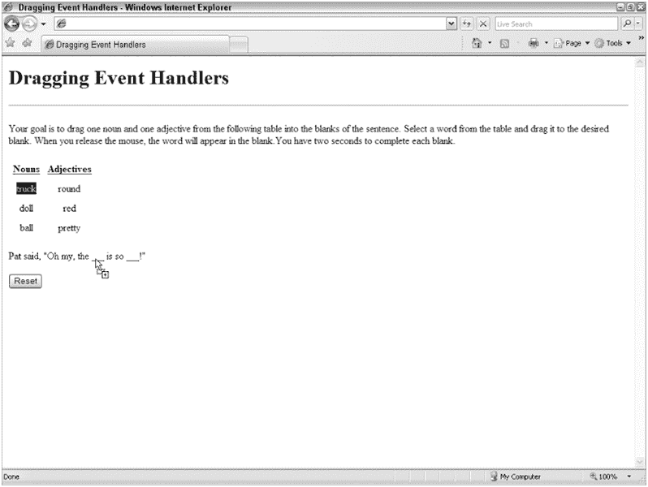

想象带有可拖动内容的表格单元格类似于电子表格的单元格：卡车是 A1 格；圆圈是 B1 格；娃娃是 A2 格；以此类推。在拖拽操作期间，许多对象都是各种拽相关事件的目标。表 26.11 列出了事件序列和事件目标。

表 26.11 典型拖放操作期间事件及其目标

| 事件 | 目标 | 讨论 |
| :--- | :--- | :--- |
| `ondragstart` | 单元 A1 | 拖放操作期间触发的第一个事件。 |
| `ondrag` | 单元 A1 | 在整个过程中在该目标上持续触发。然而，其他事件会穿插其中。 |
| `ondragenter` | 单元 A1 | 即使光标尚未离开 A1 格，在源元素内发生第一次移动时，`ondragenter`事件也会触发。 |
| `ondragover` | 单元 A1 | 在光标当前停留的任何元素上持续触发。如果用户仅按下鼠标按钮并在拖拽期间移动光标，`ondrag`和`ondragover`事件会持续触发并交替进行。 |
| (重复) | 单元 A1 | 当光标留在 A1 格上方时，`ondrag`和`ondragover`事件交替触发。 |
| `ondragenter` | 表格 | 表格元素（由边框和/或单元内边距表示）在光标接触其空间时接收`ondragenter`事件。 |
| `ondragleave` | 单元 A1 | 注意`ondragleave`事件在另一个元素上触发`ondragenter`事件后触发。 |
| `ondrag` | 单元 A1 | 仍在持续触发。 |
| `ondragover` | 表格 | 此事件的源元素变为表格，因为此时光标正位于表格上。如果光标未从此处移动，`ondrag`（单元 A1）和`ondragover`（表格）事件将轮替触发。 |
| `ondragenter` | 单元 B1 | 拖拽正在从表格边界空间进展到 B1 格。 |
| `ondragleave` | 表格 | 当光标离开其空间时，表格元素接收`ondragleave`事件。 |
| `ondrag` | 单元 A1 | `ondrag`事件继续在单元 A1 对象上触发。 |
| `ondragover` | 单元 B1 | 光标现在位于 B1 格上方，因此该对象触发`ondragover`事件。触发多次（取决于计算机运行速度和用户的拖拽动作），并与之前的`ondrag`交替进行。 |

`ondragstart`事件处理程序调用`setupDrag()`。此函数会取消`ondragstart`事件，除非目标元素（即将被拖动的元素）是`table`内部的`td`元素之一。为了让应用程序更智能地处理哪种单词被拖到哪个空白，它不仅传递了单词的文本，还传递了关于单词的一些额外信息。这使得另一个事件处理器能够验证是否将名词拖到了第一个空白，而将形容词拖到了第二个空白。为了实现这一点，`td`元素被分配了类名，以区分`Nouns`列的单词和`Adjectives`列的单词。`setupDrag()`函数生成一个数组，由事件源元素的`innerText`加上元素的类名组成。但`event.dataTransfer`对象不能存储数组数据类型，因此`Array.join()`方法将数组转换为用冒号分隔条目的的字符串。然后，该字符串被填充到`event.dataTransfer`对象中。该对象被指示在拖放操作期间渲染光标显示，以便当光标悬停在放置目标上方时，光标将显示复制样式（copy）。最后，`setupDrag()`函数是拖放操作中第一个执行的，因此设置了当前时钟时间来为拖放操作计时。

`ondrag`事件处理器（在`body`中）捕获由作为操作源元素的任何表格单元元素生成的`ondrag`事件。每次事件触发时（在操作期间非常频繁），都会调用`timeIt()`函数将当前时间与拖开始时设置的参考时间（全局计时器）进行比较。如果时间超过 2 秒（2000 毫秒），弹出警告对话框通知用户。要关闭警告对话框，用户必须松开鼠标按钮以结束拖放操作。

为了将空白的`span`元素转换为放置目标，它们的`ondragenter`、`ondragover`和`ondrop`事件处理器必须将`event.returnValue`设置为`false`；同时，`event.dataTransfer.dropEffect`属性应设置为所需的效果（在本例中为 copy）。这些事件处理器被放置在包含两个`span`元素的`p`元素中，同样是为了简单起见。然而，请注意`cancelDefault()`函数仅在目标元素是 ID 以`blank`开头的`span`元素之一时才会起作用。

当用户松开鼠标按钮时，`ondrop`事件处理器调用`handleDrop()`函数。此函数从`event.dataTransfer`获取字符串数据并将其还原为数组数据类型（使用`String.split()`方法）。通过少量的测试可以确保单词类型（名词或形容词）与所需的空白相关联。如果是这样，则将源元素的文本设置为放置目标的`innerText`属性；否则，将组装一条错误消息以帮助用户了解出出了什么问题。

### 列表 26-37：使用拖拽相关的事件处理器

HTML: `jsb26-37.html`

```html
<!DOCTYPE html>
<html>
<head>
    <meta http-equiv="content-type" content="text/html;charset=utf-8">
    <title>Dragging Event Handlers</title>
    <style type="text/css">
        td {
            text-align:center;
        }
        th {
            text-decoration:underline;
        }
        .blanks {
            text-decoration:underline;
        }
    </style>
    <script type="text/javascript" src="../jsb-global.js"></script>
    <script type="text/javascript" src="jsb26-37.js"></script>
</head>
<body ondragstart="setupDrag()" ondrag="timeIt()">
    <h1>Dragging Event Handlers</h1>
    <hr />
    <p>你的目标是从下表中拖入一个名词和一个形容词到句子的空白处。从表里选择一个单词并将其拖到所需的空白处。当你松开鼠标时，该单词将出现在空白处。你有两秒时间来完成每个空白填充。</p>
    <table cellpadding="5">
        <tr>
            <th>Nouns</th>
            <th>Adjectives</th>
        </tr>
        <tr>
            <td class="noun">truck</td>
            <td class="adjective">round</td>
        </tr>
        <tr>
            <td class="noun">doll</td>
            <td class="adjective">red</td>
        </tr>
        <tr>
            <td class="noun">ball</td>
            <td class="adjective">pretty</td>
        </tr>
    </table>
    <p id="myP" ondragenter="cancelDefault()" ondragover="cancelDefault()" ondrop="handleDrop()">
        Pat said, "Oh my, the <span id="blank1" class="blanks"></span> is so <span id="blank2" class="blanks"></span>!"
    </p>
    <button onclick="location.reload()">Reset</button>
</body>
</html>
```

JavaScript: `jsb26-37.js`

```javascript
// 拖拽相关事件处理逻辑
```


# 拖拽事件处理器

```javascript
var timer;
function setupDrag() {
    if (event.srcElement.tagName != "TD") {
        // 不允许任何其他元素的拖拽
        event.returnValue = false;
    } else {
        // 设置准备传递给放置目标的数据数组
        var passedData = [event.srcElement.innerText, event.srcElement.className];
        // 存储为字符串
        event.dataTransfer.setData("Text", passedData.join(":"));
        event.dataTransfer.effect = "copy";
        timer = new Date();
    }
}
function timeIt() {
    if (event.srcElement.tagName == "TD" && timer) {
        if ((new Date()) - timer > 2000) {
            alert("Sorry, time is up. Try again.");
            timer = 0;
        }
    }
}
function handleDrop() {
    var elem = event.srcElement;
    var passedData = event.dataTransfer.getData("Text");
    var errMsg = "";
    if (passedData) {
        // 将传递的字符串转换为数组
        passedData = passedData.split(":");
        if (elem.id == "blank1") {
            if (passedData[1] == "noun") {
                event.dataTransfer.dropEffect = "copy";
                event.srcElement.innerText = passedData[0];
            } else {
                errMsg = "You can't put an adjective into the noun placeholder.";
            }
        } else if (elem.id == "blank2") {
            if (passedData[1] == "adjective") {
                event.dataTransfer.dropEffect = "copy";
                event.srcElement.innerText = passedData[0];
            } else {
                errMsg = "You can't put a noun into the adjective placeholder.";
            }
        }
    }
    if (errMsg) {
        alert(errMsg);
    }
}
function cancelDefault() {
    if (event.srcElement.id.indexOf("blank") == 0) {
        event.dataTransfer.dropEffect = "copy";
        event.returnValue = false;
    }
}
```

列表 26-37 中未显示的一个事件处理器是`ondragend`。你可以使用此事件显示每次成功拖放操作的持续时间。由于该事件在拖放源元素上触发，你可以在`body`标签中实现它，并类似于`ondragstart`或`ondrag`事件处理器过滤`td`元素的方式进行过滤。

**相关项目：** `event.dataTransfer`对象；`ondragenter`、`ondragleave`、`ondragover`、`ondrop`事件处理器

## `ondragenter`

## `ondragleave`

## `ondragover`

**兼容性：** WinIE5+, MacIE-, NN-, Moz+, Safari 1.3+, Opera-, Chrome+

这些事件在拖拽操作期间触发。当光标进入页面上元素的矩形区域时，`ondragenter`事件会在该元素上触发。紧接着，`ondragleave`事件会在光标来源的元素上触发。尽管这在物理动作上似乎是反序的，但这些事件总是按照此顺序触发。取决于客户端计算机 CPU 的速度和用户拖拽动作的速度，这些事件中的一个或另一个可能不会触发——特别是当物理动作超过了计算机及时触发事件的能力时。

当拖拽的光标位于某个元素上方时，`ondragover`事件会持续触发。在从页面上的一点拖拽到另一点的过程中，`ondragover`目标会随着光标下方的元素而改变。如果没有其他与拖拽相关的事件在触发（拖拽操作中鼠标键仍按下，但光标未移动），则`ondrag`和`ondragover`事件将持续触发并在两者之间交替。

你应该将放置目标元素`ondragover`事件处理程序的`event.returnValue`属性设置为`false`。有关拖拽相关事件顺序的更多细节，请参阅本章早些部分对`ondrag`事件处理程序的讨论。

### 示例

列表 26-38 显示了`ondragenter`和`ondragleave`事件处理器的用法。简单的页面（通过状态栏）显示了进入页面某个元素的时间。当拖拽的光标离开该元素时，`ondragleave`事件处理器会隐藏状态栏消息。此页面没有定义放置目标，因此当你拖动项目时，光标将保持为“不可放置”光标状态。

### 列表 26-38: 使用 ondragenter 和 ondragleave 事件处理器

**HTML: `jsb26-38.html`**

```html
<!DOCTYPE html>
<html>
<head>
    <meta http-equiv="content-type" content="text/html;charset=utf-8">
    <title>ondragenter and ondragleave Event Handlers</title>
    <script type="text/javascript" src="../jsb-global.js"></script>
    <script type="text/javascript" src="jsb26-38.js"></script>
</head>
<body>
    <h1 ondragenter="showEnter()" ondragleave="clearMsg()">
        ondragenter and ondragleave Event Handlers
    </h1>
    <hr />
    <p>从此段落中选择任何字符，并缓慢地在页面上拖动它。当拖拽动作进入上方的大型标题时，状态栏将显示 onDragEnter 事件处理器触发的时间。当你离开标题时，消息将通过 onDragLeave 事件处理器清除。</p>
</body>
</html>
```

**JavaScript: `jsb26-38.js`**

```javascript
function showEnter() {
    status = "Entered at: " + new Date();
    event.returnValue = false;
}
function clearMsg() {
    status = "";
    event.returnValue = false;
}
```

**相关项目：** `ondrag`、`ondragend`、`ondragstart`、`ondrop`事件处理器

## `ondragstart`

（参见`ondrag`）

## `ondrop`

**兼容性：** WinIE5+, MacIE-, NN-, Moz+, Safari 1.3+, Opera-, Chrome+

用户在拖放操作结束释放鼠标键时，`ondrop`事件会在放置目标元素上触发。对于 IE，微软建议你通过在目标元素上应用`ondragenter`、`ondragover`和`ondrop`事件处理器来指定放置目标。在这些每个事件处理器中，你应该将`dataTransfer.dropEffect`设置为你希望在拖放操作中表示的传输效果（每种类型由不同的光标表示）。这些设置应与通常在`ondragstart`处理器中设置的`dataTransfer.effectAllowed`属性匹配。这三个拖拽相关的处理器都应该通过将`event.returnValue`属性设置为`false`来覆盖默认行为。有关拖拽相关事件顺序的更多细节，请参阅本章早些部分对`ondrag`事件处理程序的讨论。

### 示例

参见`ondrag`事件处理器的列表 26-37，如何在典型的拖放场景中应用`ondrop`处理器。

**相关项目：** `event.dataTransfer`对象；`ondrag`、`ondragend`、`ondragenter`、`ondragleave`、`ondragstart`处理器

## `onerror`

**兼容性：** WinIE4+, MacIE+, Safari-, Opera-, Chrome-

`onerror`事件处理器是 IE 数据绑定的一部分，当更新数据源对象时发生错误时触发。

## `onfilterchange`

**兼容性：** WinIE4+, Safari-, Opera-, Chrome-

每当对象的视觉过滤器切换到新状态或完成时（过渡可能会随时间推移延长），`onfilterchange`事件就会触发。只有在 IE 中适应过滤器和过渡的对象（主要是块控件和表单控件）才会接收该事件。`onfilterchange`事件的常见用法是触发活动序列中的下一个过渡。这可能包含一个无限循环，接收事件的对象在两个状态之间切换。如果你不想陷入那样的循环，可以将不同的内容集放在它们自己的元素中，并使用其中一个元素中的`onfilterchange`处理器来触发另一个元素的过渡。

列表 26-39 展示了`onfilterchange`处理器如何在另一个效果完成后触发第二个效果。`onload`处理器触发了第一个效果。尽管`onfilterchange`处理器在 IE4 中与 IE5 使用的大部分相同对象工作，但过滤器属性没有以方便的形式反映出来。列表 26-39 中使用的位于 IE.5+ 中的现代 ActiveX 过滤器控件（在第 38 章描述）。

### 列表 26-39: 使用 onFilterchange 事件处理器

**HTML: `jsb26-39.html`**

```html
<!DOCTYPE html>
<html>
<head>
    <meta http-equiv="content-type" content="text/html;charset=utf-8">
    <title>onfilterchange Handler</title>
    <style type="text/css">
        #image1 {
            position:absolute; top:150px; left:150px;
            filter:progID:DXImageTransform.Microsoft.Iris(irisstyle='CIRCLE', motion='in');
        }
        #image2 {
            position:absolute; top:150px; left:150px;
            filter:progID:DXImageTransform.Microsoft.Iris(irisstyle='CIRCLE', motion='out');
        }
        .anImage {
            height:90px; width:120px;
        }
    </style>
    <script type="text/javascript" src="../jsb-global.js"></script>
    <script type="text/javascript" src="jsb26-39.js"></script>
</head>
<body onload="init()">
    <h1>onfilterchange Handler</h1>
    <hr />
    <p>第一个过渡（circle-in）的完成触发了第二个（circle-out）。
        <button onclick="location.reload()">再次播放</button>
    </p>
    <div id="image1" style="visibility:visible;" onfilterchange="finish()">
        
    </div>
    <div id="image2" style="visibility:hidden;">
        
    </div>
</body>
</html>
```

**JavaScript: `jsb26-39.js`**

```javascript
function init() {
    image1.filters[0].apply();
    image2.filters[0].apply();
    start();
}
function start() {
    image1.style.visibility = "hidden";
    image1.filters[0].play();
}
function finish() {
    // 验证第一个过渡已完成（可选）
    if (image1.filters[0].status == 0) {
        image2.style.visibility = "visible";
        image2.filters[0].play();
    }
}
```

**相关项目：** `filter`对象

## `onfocus`

**兼容性：** WinIE3+, MacIE3+, NN2+, Moz+, Safari+, Opera+, Chrome+

`onfocus`事件在元素获得焦点时触发，通常发生在另一个对象失去焦点之后。（失去焦点的元素会在当前对象接收到`onfocus`事件之前先接收到`onblur`事件。）例如，当用户通过键盘导航表单时，按 Tab 键切换到某个文本输入元素时，该元素会触发`onfocus`事件。点击元素也会让该元素获得焦点，将浏览器设置为客户端桌面的顶层应用程序也是如此。

随着后续代支持脚本浏览器的出现，`onfocus`事件的可用性得到了扩展。在早期版本中，`blur`和`focus`很大程度上局限于文本输入元素，如`select`元素。从`NN3`和`IE4`开始，`window`对象接收了`onfocus`事件处理程序。`IE4`还将将事件处理程序扩展到更多的表单元素，主要是在 Windows 操作系统上，因为该操作系统在按钮和链接等项目获得焦点时有一个用户界面线索（虚线矩形）（这样用户就可以通过空格键对其进行操作）。对于`IE5+`，几乎每个 HTML 元素都可以使用`onfocus`事件处理程序。然而，对于这些元素中的大多数，除非为元素标签的`tabindex`属性赋值，否则你无法使用`blur`和`focus`。例如，如果你在`<p>`标签内部分配了`tabindex="1"`，用户可以通过点击段落或连续按 Tab 键直到该项目顺序获得焦点，从而使该段落聚焦（在 Windows 中用虚线矩形突出显示）。

`WinIE5.5`增加了`onfocusin`事件处理程序，它在`onfocus`事件处理程序之前立即触发。你可以使用其中一种，但除非你希望临时阻止某个项目接收焦点，否则没有必要为同一个对象包含这两个事件处理程序。要防止`IE5.5+`中的对象接收焦点，请在同一对象的`onfocusin`事件处理程序中包含`event.returnValue=false`语句。在其他浏览器中，你通常可以通过为表单控件等元素分配`onfocus="this.blur()"`作为事件处理程序来实现。然而，这并不是防止用户更改控件设置的万全方法。遗憾的是，除了禁用控件外，很少有可靠的替代方案。

### 示例

参阅本章节前面的列表 26-34，获取`onfocus`和`onblur`事件处理程序的示例。

**相关项目：** `onactivate`、`onblur`、`ondeactivate`、`onfocusin`、`onfocusout`事件程序

## `onfocusin`

## `onfocusout`

**兼容性：** `WinIE6+`、`MacIE-`、`NN-`、`Moz-`、`Safari-`、`Opera-`、`Chrome-`

`onfocusin`和`onfocusout`事件的触发表示元素即将获得焦点或刚刚失去焦点。这些事件与`onactivate`和`ondeactivate`密切相关，不同在于`IE5.5+`中激活和焦点可以区分开来。例如，如果你通过`setActive()`将一个元素设置为激活元素，该元素会变为激活状态，但不会获得输入焦点。然而，如果你通过调用`focus()`设置元素的焦点，则该元素会被激活并获得输入焦点。

**相关项目：** `onactivate`、`onblur`、`ondeactivate`、`onfocus`事件程序

## `onhelp`

**兼容性：** `WinIE4+`、`MacIE5+`、`NN-`、`Moz-`、`Safari-`、`Opera-`、`Chrome-`

`onhelp`事件处理程序在 Windows 中每当文档元素获得焦点且用户在 Windows PC 上按下 F1 功能键时触发。从`MacIE5`开始，该事件仅在`window`上触发（换句话是在`<body>`标签中指定的事件处理程序），并通过 Mac 键盘上的专用帮助（Help）键触发。浏览器的帮助菜单选项不会激活此事件。要防止浏览器的帮助窗口出现，事件处理程序必须返回`return false`（对于`IE4+`）或将`event.returnValue`属性设置为`false`（对于`IE5+`）。因为 Windows 版本中的事件处理程序可以与文档的单个元素关联，你可以创建一个上下文相关的帮助系统。然而，如果焦点位于浏览器窗口的地址字段中，你无法拦截该事件。此时，浏览器的帮助窗口将会。

### 示例

列表 26-40 是一个上下文帮助系统的初级示例，它显示针对不同文本框所需的文本输入类型定制的帮助信息。当用户给任何一个文本框焦点时，会出现一个小图例，提醒用户可以通过按下 F1 帮助键获取帮助。`MacIE5`提供通用帮助。

### 列表 26-40：创建上下文相关帮助

**HTML: `jsb26-40.html`**

```html
<!DOCTYPE html>
<html>
    <head>
        <meta http-equiv="content-type" content="text/html;charset=utf-8">
        <title>onhelp 事件处理程序</title>
        <style type="text/css">
            #legend {
                font-size:10px;
            }
        </style>
        <script type="text/javascript" src="../jsb-global.js"></script>
        <script type="text/javascript" src="jsb26-40.js"></script>
    </head>
    <body onload="init()" onhelp="return showGenericHelp()">
        <h1>onhelp 事件处理程序</h1>
        <hr />
        <p id="legend" style="visibility:hidden;">&nbsp;</p>
        <form>
            Name:
            <input type="text" name="name" size="30" onfocus="showLegend()" onblur="hideLegend()" onhelp="showName()"/>
            <br />
            Year of Birth:
            <input type="text" name="YOB" size="30" onfocus="showLegend()" onblur="hideLegend()" onhelp="showOB()"/>
        </form>
    </body>
</html>
```

**JavaScript: `jsb26-40.js`**

```javascript
function showName() {
    alert("Enter first and last");
    event.cancel = true;
    return false;
}
function showOB() {
    alert("Enter the four-digit year of birth.");
    event.cancel = true;
    return false;
}
function showGenericHelp() {
    alert("All fields are required.");
    event.returnValue = true;
    return false;
}
function showLegend() {
    document.getElementById("legend").style = "visible";
}
function hideLegend() {
    document.getElementById("legend").style = "hidden";
}
function init() {
    var msg = "";
    if (navigator.userAgent.indexOf("Mac") != -1) {
        msg = "Press key for help.";
    } else if (navigator.userAgent.indexOf("Win") != -1) {
        msg = "Press F1 for help.";
    }
    document.getElementById("legend").style = "hidden";
    document.getElementById("legend").innerHTML = msg;
}
```

## `onkeydown`

## `onkeypress`

## `onkeyup`

**兼容性：** `WinIE4+`、`MacIE4+`、`NN4+`、`Moz+`、`Safari+`、`Chrome+`

当有人按下并释放键盘键时，会有三个事件连续触发。`onkeydown`在键首次接触时触发。紧接着是`onkeypress`事件。当释放键中断接触时，触发`onkeyup`事件。如果你按住字符键直到它开始重复，`onkeydown`和`onkeypress`事件每次都会触发。

事件的顺序在某些事件处理中至关重要。考虑这样一种场景：在用户输入固定数量的字符后（例如日期、月份和两位年份），切换系列文本框的焦点。在`onkeyup`事件触发时，关联字符已添加到框中，你可以准确地确定框中的文本长度，如下简单示例所示：

```html
<!DOCTYPE html>
<html>
    <head>
        <meta http-equiv="content-type" content="text/html;charset=utf-8">
        <title>简单输入表单</title>
        <script type="text/javascript">
            function jumpNext(fromFld, toFld) {
                if (fromFld.value.length == 2) {
                    document.dateForm.elements[toFld].focus();
                }
            }
        </script>
    </head>
    <body>
        <form id="dateForm">
            Day: <input type="text" name="day" onkeyup="jumpNext(this, 'month')">
            Month: <input type="text" name="month" onkeyup="jumpNext(this, 'year')">
            Year: <input type="text" name="year">
        </form>
    </body>
</html>
```

```html
document.dateForm.elements[toFld].select();
}
}
</script>
</head>
<body>
    <form name="dateForm">
        月份: <input name="month" type="text" size="3" value="" onkeyup="jumpNext(this, 'day')" maxlength="2" />
        日期: <input name="day" type="text" size="3" value="" onkeyup="jumpNext(this, 'year')" maxlength="2" />
        年份: <input name="year" type="text" size="3" value="" onkeyup="jumpNext(this, 'month')" maxlength="2" />
    </form>
</body>
</html>
```

在所有支持键盘事件的浏览器版本中，这三个事件都不会为典型 PC 键盘的所有按键触发。在前面的兼容性表中，你可以依赖在所有浏览器中支持这些事件的按键只有 ASCII 值表示的字母数字键，包括空格键和 Enter（Mac 上的 Return），但排除了所有功能键、箭头键和其他导航键。修饰键，如`Shift`、`Ctrl` (PC)、`Alt` (PC)、`Command` (Mac) 和`Option` (Mac) 会产生某些事件（取决于浏览器和版本）。然而，其他按键事件调用的函数始终可以检查这些修饰键的按下状态。

### 注意

`onkeydown`事件处理程序仅从 Mozilla 1.4（以及 Netscape 7.1）开始在基于 Mozilla 的浏览器中工作。

编写键盘事件几乎总是意味着检查按了哪个键，以便对该按键按下执行某些处理或验证。如果你正在编写跨浏览器实现的代码，情况就会变得非常复杂。在某些情况下，即使只为 Internet Explorer 编写也会变得棘手，因为非字母数字键只会产生`onkeydown`和`onkeyup`事件。

事实上，为了完全理解键盘事件，你需要区分键码（key codes）和字符码（character codes）。每个 PC 键盘按键都有一个与其关联的`key code`。无论你同时按下其他按键，这个`key code`始终是相同的。然而，只有字母数字键（字母、数字、空格键等）会产生字符码。该代码代表由该按键产生的输入字符。如果你按了修饰键，该值可能会变化。例如，如果你单独按下`A`键，它产生一个小写的`a`字符（字符码 97）；如果你同时按住`Shift`键，同一个键产生一个大写的`A`字符（字符码 65）。该键的`key code`（西方语言键盘为 65）无论如何都保持不变。

那么这就引出了这些不同代码是如何向脚本提供的。在所有情况下，代码信息都是作为浏览器事件对象的一个或两个属性进行传递的。IE 的事件对象只有一个这样的属性：`keyCode`。它包含`onkeydown`和`onkeyup`事件的键码，但包含`onkeypress`事件的字符码。另一方面，NN6+/Moz 事件对象包含两个独立的属性：`charCode`和`keyCode`。你可以在第 32 章中找到关于这些事件对象属性的更多细节和示例。

脚本方面的底线考虑是，当你想要查找非字母数字按键事件（例如，功能键、箭头和页导航键等）时，请使用`onkeydown`或`onkeyup`事件处理程序。要像字符在文本框中出现那样处理字符，请使用`onkeypress`事件处理程序。你可以在列表 26-41 以及第 32 章的示例中尝试这些事件和代码。

### 常见的键盘事件任务

WinIE4+ 允许你修改正在编辑文本框的用户所入的字符。`onkeypress`事件处理程序可以修改`event.keyCode`属性并允许事件继续（换句话说，不要评估为`return false`或将`event.returnValue`属性设置为`false`）。以下 IE 函数（由`onkeypress`事件处理程序调用）确保文本框中输入的文本全大写，即使你输入的是小写：

```javascript
function assure() {
  if (event.keyCode >= 97 && event.keyCode <= 122) {
    event.keyCode = event.keyCode - 32;
  }
}
```

这样做可能会让用户感到困惑（或沮丧），因此在实施此类计划之前仔细考虑。

为了防止按键按下变成文本框中的输入字符，`onkeypress`事件处理程序阻止事件的默认行为。例如，下面的 HTML 页面显示了如何检查文本框输入是否仅包含数字：

```html
<!DOCTYPE html>
<html>
<head>
    <meta http-equiv="content-type" content="text/html;charset=utf-8">
    <title>键盘捕捉</title>
    <script type="text/javascript">
        function checkIt(evt) {
            var charCode = evt.charCode ? evt.charCode : ((evt.which) ? evt.which : evt.keyCode);
            if (charCode > 31 && (charCode < 48 || charCode > 57)) {
                alert("请确保输入仅为数字。");
                return false;
            }
            return true;
        }
    </script>
</head>
<body>
    <form>
        输入任何正整数：
        <input type="text" name="numeric" onkeypress="return checkIt(event)">
    </form>
</body>
</html>
```

每当用户输入非数字时，用户都会收到警告，字符不会附加到文本框的文本中。

键盘事件还允许你在用户在文本框内按下 Enter（Mac 上的 Return）键时脚本提交表单。Enter/Return 键的 ASCII 值为 13。因此，你可以检查文本框中的每次按键，每当值 13 到达时就提交表单，如下函数所示：

```javascript
function checkForEnter(evt) {
    evt = (evt) ? evt : event;
    var charCode = evt.charCode ? evt.charCode : ((evt.which) ? evt.which : evt.keyCode);
    if (charCode == 13) {
        document.forms[0].submit();
        return false;
    }
    return true;
}
```

通过将`checkForEnter()`函数分配给每个框的`onkeypress`事件处理程序，你突然为典型的 HTML 表单增加了一些额外功能。

在 HTML 页面中，你可以在 IE 中有效地拦截 Ctrl+键盘组合（仅限字母），前提是浏览器本身没有使用该组合。换句话说，你不能重定向浏览器用于自身控制的 Ctrl+键组合。Ctrl+键组合的`onkeypress` keyCode 值对于字母 A 到 Z 范围从 1 到 26 不（除了被浏览器使用的那些，在这种情况下不会触发键盘事件）。

### 示例

列表 26-41 是一个可以使用的实验室，你可以通过它更好地理解 IE5+ 和 W3C 浏览器中键盘事件代码和修饰键的工作方式。列表的实际代码并没有在你在使用它时观察页面重要。对于你按下的每一个键或键组合，页面都会显示`onkeydown`、`onkeypress`和`onkeyup`事件的`keyCode`值。如果在执行按键时按住一个或多个修饰键，这三个事件的每个修饰键名称都会高亮。注意，在基于 NN6+/Mozilla/WebKit 的浏览器中运行时，`keyCode`值并不是字符码。在旧版浏览器中，你可能需要点击页面以便文档对象识别键盘事件。

观察键盘事件发生过程的最佳方法是按住某个键，查看`onkeydown`和`onkeypress`事件的键码。然后释放按键，查看`onkeyup`事件的代码。请注意，例如如果你在不按任何修饰键的情况下按下`A`键，`onkeydown`事件的键码为`65` (`A`)，但`IE`下的`onkeypress`键码（以及`NN6+//Moz-based browsers/WebKit-based browsers`中的`charCode`属性）为`97` (`a`)。如果你再次重复该实验但按住`Shift`键，则所有三个事件都会生成`65` (`A`) 键码（并且`Shift`修饰键标签会被高亮显示）。释放`Shift`键会导致`onkeyup`事件显示`Shift`键的键码。

在另一个实验中，按下四个方向键之一。`onkeypress`事件不会传递任何键码，因为这些键不会产生这些事件。然而，它们会产生`onkeydown`和`onkeyup`事件。

### 列表 26-41：键盘事件处理器实验室

**HTML: `jsb26-41.html`**

```html
<!DOCTYPE html>
<html>
  <head>
    <meta http-equiv="content-type" content="text/html;charset=utf-8">
    <title>Keyboard Event Handler Lab</title>
    <style type="text/css">
      td {
        text-align:center;
      }
    </style>
    <script type="text/javascript" src="../jsb-global.js"></script>
    <script type="text/javascript" src="jsb26-41.js"></script>
  </head>
  <body onload="init()">
    <h1>Keyboard Event Handler Lab</h1>
    <hr />
    <form>
      <table border="2" cellpadding="2">
        <tr>
          <th></th>
          <th>onKeyDown</th>
          <th>onKeyPress</th>
          <th>onKeyUp</th>
        </tr>
        <tr>
          <th>Key Codes</th>
          <td id="downKeyCode">0</td>
          <td id="pressKeyCode">0</td>
          <td id="upKeyCode">0</td>
        </tr>
        <tr>
          <th>Char Codes (IE5/Mac; Moz; WebKit)</th>
          <td id="downCharCode">0</td>
          <td id="pressCharCode">0</td>
          <td id="upCharCode">0</td>
        </tr>
        <tr>
          <th rowspan="3">Modifier Keys</th>
          <td><span id="shiftDown">Shift</span></td>
          <td><span id="shift">Shift</span></td>
          <td><span id="shiftUp">Shift</span></td>
        </tr>
        <tr>
          <td><span id="ctrlDown">Ctrl</span></td>
          <td><span id="ctrl">Ctrl</span></td>
          <td><span id="ctrlUp">Ctrl</span></td>
        </tr>
        <tr>
          <td><span id="altDown">Alt</span></td>
          <td><span id="alt">Alt</span></td>
          <td><span id="altUp">Alt</span></td>
        </tr>
      </table>
    </form>
  </body>
</html>
```

**JavaScript: `jsb26-41.js`**

```javascript
function init() {
  document.onkeydown = onKeyDown;
  document.onkeyup = onKeyUp;
  document.onkeypress = onKeyPress;
}

function onKeyDown(evt) {
  document.getElementById("downKeyCode").innerHTML = evt.keyCode;
  document.getElementById("downCharCode").innerHTML = evt.charCode;
  if (evt.shiftKey) {
    document.getElementById("shiftDown").innerHTML = "Shift";
  } else {
    document.getElementById("shiftDown").innerHTML = "";
  }
  if (evt.ctrlKey) {
    document.getElementById("ctrlDown").innerHTML = "Ctrl";
  } else {
    document.getElementById("ctrlDown").innerHTML = "";
  }
  if (evt.altKey) {
    document.getElementById("altDown").innerHTML = "Alt";
  } else {
    document.getElementById("altDown").innerHTML = "";
  }
}

function onKeyUp(evt) {
  document.getElementById("upKeyCode").innerHTML = evt.keyCode;
  document.getElementById("upCharCode").innerHTML = evt.charCode;
  if (evt.shiftKey) {
    document.getElementById("shiftUp").innerHTML = "Shift";
  } else {
    document.getElementById("shiftUp").innerHTML = "";
  }
  if (evt.ctrlKey) {
    document.getElementById("ctrlUp").innerHTML = "Ctrl";
  } else {
    document.getElementById("ctrlUp").innerHTML = "";
  }
  if (evt.altKey) {
    document.getElementById("altUp").innerHTML = "Alt";
  } else {
    document.getElementById("altUp").innerHTML = "";
  }
}

function onKeyPress(evt) {
  document.getElementById("pressKeyCode").innerHTML = evt.keyCode;
  document.getElementById("pressCharCode").innerHTML = evt.charCode;
  if (evt.shiftKey) {
    document.getElementById("shift").innerHTML = "Shift";
  } else {
    document.getElementById("shift").innerHTML = "";
  }
  if (evt.ctrlKey) {
    document.getElementById("ctrl").innerHTML = "Ctrl";
  } else {
    document.getElementById("ctrl").innerHTML = "";
  }
  if (evt.altKey) {
    document.getElementById("alt").innerHTML = "Alt";
  } else {
    document.getElementById("alt").innerHTML = "";
  }
}
```

## `onmousedown`

## `onmouseup`

每次鼠标按钮操作创建的事件对象都包含一个属性，可以显示用户按了哪个鼠标按钮。NN4 的事件模型将该属性称为`which`属性。IE4+ 以及 NN6+/基于 Moz 的浏览器/基于 WebKit 的浏览器将其称为`button`属性（但不同按钮的值不同）。在`onmousedown`或`onmouseup`事件上测试鼠标按钮编号比在`onclick`事件上测试更为可靠。`onclick`事件对象并不总是包含按钮信息。

### 示例

为了演示在鼠标悬停到图像上、按下、释放鼠标按钮以及移开图像时更改按钮图像的可能场景，代码列表 26-42 展示了一对小型导航按钮（左箭头和右箭头按钮）。图像在页面加载时预加载到浏览器缓存中，这样当用户第一次调用新版本的图像时，响应是瞬时的。

### 代码列表 26-42：使用`onmousedown`和`onmouseup`事件处理器

**HTML: `jsb26-42.html`**

```html
<!DOCTYPE html>
<html>
    <head>
        <meta http-equiv="content-type" content="text/html;charset=utf-8">
        <title>onmousedown and onmouseup Event Handlers</title>
        <style type="text/css">
            #imgHolder {
                text-align:center;
            }
            .images {
                height:16px; width:16px; border:0px;
            }
        </style>
        <script type="text/javascript" src="../jsb-global.js"></script>
        <script type="text/javascript" src="jsb26-42.js"></script>
    </head>
    <body>
        <h1>onmousedown and onmouseup Event Handlers</h1>
        <hr />
        <p>悬停在按钮上并点击它们，查看链接事件处理器如何切换细微不同的图像：</p>
        <div id="imgHolder">
            
            &nbsp;
            
        </div>
    </body>
</html>
```

**JavaScript: `jsb26-42.js`**

```javascript
var RightNormImg = new Image(16,16);
var RightUpImg = new Image(16,16);
var RightDownImg = new Image(16,16);
var LeftNormImg = new Image(16,16);
var LeftUpImg = new Image(16,16);
var LeftDownImg = new Image(16,16);
RightNormImg.src = "RightNorm.gif";
RightUpImg.src = "RightUp.gif";
RightDownImg.src = "RightDown.gif";
LeftNormImg.src = "LeftNorm.gif";
LeftUpImg.src = "LeftUp.gif";
LeftDownImg.src = "LeftDown.gif";

function setImage(imgName, type) {
    var imgFile = eval(imgName + type + "Img.src");
    document.images[imgName].src = imgFile;
    return false;
}
```

**相关项目：** `onclick`事件处理器

## `onmouseenter`

## `onmouseleave`

**兼容性：** WinIE5.5+, MacIE-, NN-, Moz-, Safari-, Opera-, Chrome-

WinIE5.5 引入了`onmouseenter`和`onmouseleave`事件处理器。这两个事件处理器的工作方式分别与`onmouseover`和`onmouseout`事件处理器一样。微软仅仅提供了另一种术语表达。

### 示例

你可以通过用`onmouseenter`替换`onmouseout`来使用`onmouseenter`。

**相关项目：** `onmouseover`、`onmouseout`

## `onmousemove`

**兼容性：** WinIE3+, MacIE3+, NN3+, Safari3+, Opera3+, Chrome3+

当光标移动时，会触发`onmousemove`事件。

### 注意

如果事件靠近框架（frame），`onmouseout`处理器将失效。

### 示例

代码列表 26-43 使用`onmouseenter`和`onmouseout`来演示它们有多用。请注意，对于每个链接，处理器都设置了状态栏。

### 代码列表 26-43：使用`onmouseenter`和`onmouseout`

**HTML: `jsb26-43.html`**

```html
<!DOCTYPE html>
<html>
    <head>
        <meta http-equiv="content-type" content="text/html;charset=utf-8">
        <title>onmouseenter and onmouseout Event Handlers</title>
        <script type="text/javascript" src="../jsb-global.js"></script>
        <script type="text/javascript" src="jsb26-43.js"></script>
    </head>
    <body>
        <h1>onmouseenter and onmouseout Event Handlers</h1>
        <hr />
        <h1>Pledge of Allegiance</h1>
        <hr />
        <p>I pledge <a href="javascript:emulate()" onmouseenter="return setStatus('View dictionary definition')" onmouseout="return setStatus('')">allegiance</a> to the <a href="javascript:emulate()"></a></p>
    </body>
</html>
```

```html
<body><a onmouseover="return setStatus('Learn about the U.S. flag ↩︎ (http://lcweb.loc.gov)')" onmouseout="return setStatus('')">旗帜</a>
的
<a href="javascript:emulate()" onmouseover="return setStatus('View info about the U.S. government')" onmouseout="return setStatus('')">美国</a>，
以及为了它所代表的共和国，一个民族
<a href="javascript:emulate()" onmouseover="return setStatus('Read about the history of this phrase ↩︎ in the Pledge')" onmouseout="return setStatus('')">在上帝庇下</a>，
不可分割，自由正义与民民。
</body>
</html>
```

**JavaScript: `jsb26-43.js`**

```javascript
function setStatus(msg)
{
   window.status = msg;
   return true;
}

// 所有链接 HREFs 的目标
function emulate()
{
   alert("Not going there in this demo.");
}
```

## `onmousewheel`

**相关项目：** `onmouseenter`、`onmouseleave`、`onmousemove`事件处理器

**兼容性：** WinIE6+, MacIE-, NN-, Moz+, Safari+, Opera+, Chrome+

`onmousewheel`事件处理器在用户旋转鼠标轮时触发，响应用户操作。在响应`onmousewheel`事件时，你可以检查`wheelDelta`属性来确定鼠标轮旋转的距离。`wheelDelta`属性以 120 的倍数表示鼠标轮的旋转，正值表示向远离用户的方向旋转，负值对应于向用户的方向旋转。W3C 的等效属性是`DOMMouseScroll`。

## `onmove`

**相关项目：** `onmousemove`事件处理器

**兼容性：** WinIE5.5+, MacIE-, NN-, Moz-, Safari-, Opera-, Chrome-

请勿将此事件与`onmousemove`混淆，`onmove`事件与鼠标无关。相反，每当可定位元素发生移动时，`onmove`事件就会被触发。例如，如果一个`div`元素被创建为绝对定位的可移动元素，你可以通过响应`onmove`事件来追踪它的移动。在此事件处理器中，可以使用`offsetLeft`和`offsetTop`属性确定元素移动过程中的精确位置。

**相关项目：** `onmoveend`、`onmovestart`事件处理器

## `onmoveend` / `onmovestart`

**兼容性：** WinIE5.5+, MacIE-, NN-, Moz-, Safari-, Opera-, Chrome-

`onmovestart`和`onmoveend`事件处理器在可定位元素在页面上移动时触发。具体来说，当元素开始移动时会触发`onmovestart`事件，当元素停止移动时会触发`onmoveend`事件。在`onmovestart`和`onmoveend`事件触发之间，可能会发送多个`onmove`事件来指示元素的移动情况。

**相关项目：** `onmove`事件处理器

## `onpaste`

**兼容性：** WinIE5+, MacIE-, NN-, Moz+, Safari 1.3+, Opera-, Chrome+

`onpaste`事件在用户或脚本对当前对象启动粘贴编辑操作后立即触发。在该事件之前是`onbeforepaste`事件，它在任何编辑或右键菜单出现之前触发（或者如果通过快捷键启动，则在粘贴操作之前触发）。

使用此事件处理器为通常不允许粘贴的元素提供编辑功能。在这种情况下，你需要通过将`onbeforepaste`事件处理器的`event.returnValue`设置为`false`，在上下文或编辑菜单中启用“粘贴”菜单项。然后你的`onpaste`事件处理器必须手动从剪贴板检索数据（通过`IEclipboardData`对象的`getData()`方法），并处理插入到当前对象的操作。

由于你负责存储在剪贴板中的数据，因此。例如，你可能会存储图像对象的`src`属性的值，以便将其粘贴到页面的其他地方。

### 示例

列表 26-44 展示了如何使用`onbeforepaste`和`onpaste`事件处理器（结合`onbeforecopy`和`oncopy`），让脚本在用户的复制和粘贴操作期间控制数据传输过程。表格中包含要复制的单词（一列名词，一列形容词），然后将其粘贴到段落中的空白处。`onbeforecopy`和`oncopy`事件处理器被分配给表格元素，因为来自`td`元素的事件会冒泡到表格容器，且需要处理的 HTML 代码较少。

在段落内部，两个`span`元素包含下划线空白。要将文本粘贴到空白处，用户必须首先选择空白处的至少一个字符。（参见列表 26-37，它提供了此应用程序的拖放版本。）段落中的`onbeforepaste`事件处理器（在从任一`span`冒泡时获取事件）将`event.returnValue`属性设置为`false`，从而允许“粘贴”项出现在上下文和编辑菜单中（这在 HTML 正文中并不是正常现象）。

在粘贴时，目标`span`的`innerHTML`属性设置为存储在剪贴板中的文本数据。此处`event.returnValue`属性也被设置为`false`，以防止正常的系统粘贴干扰受控的版本。

### 列表 26-44: 使用 onpaste 和 onpaste Handlers

**HTML: `jsb26-44.html`**

```html
<!DOCTYPE html>
<html>
<head>
   <meta http-equiv="content" content="text/html;charset=utf-8">
   <title>onpaste and onpaste Handlers</title>
   <style type="css">
      td { text-align:center; }
      th { text-decoration:underline; }
      .blanks { text-decoration:underline; }
   </style>
   <script type="javascript" src="../js-global.js"></script>
   <script type="javascript" src="jsb26-44.js"></script>
</head>
<body>
   <h1>onpaste and onpaste Handlers</h1>
   <h6>选择字符时要精确</h6>
   <hr />
   <p>你的目标是从下表中复制一个名词和一个形容词，并把它们粘贴到句子的空白处。从表格中选择一个单词，并使用菜单将其复制到剪贴板。选择句子中空白处的一个或多个空格，从菜单中选择“粘贴”，用剪贴板内容替换空白。</p>
   <table cellpadding="5" onbeforecopy="selectWhole()" oncopy="handleCopy()">
      <tr>
         <th>名词</th>
         <th>形容词</th>
      </tr>
      <tr>
         <td>truck</td>
         <td>round</td>
      </tr>
      <tr>
         <td>doll</td>
         <td>red</td>
      </tr>
      <tr>
         <td>ball</td>
         <td>pretty</td>
      </tr>
   </table>
   <p id="myP" onbeforepaste="handleBeforePaste()" onpaste="handlePaste()">
      Pat said, “Oh my, the <span id="blank1" class="blanks"> is so <span id="blank2" class="blanks">!”
   </p>
   <button onclick="location.reload()">Reset</button>
</body>
</html>
```

**JavaScript: `jsb26-44.js`**

```javascript
function selectWhole()
{
   var obj = window.event.srcElement;
   var range = document.createTextRange();
   range.moveToElementText(obj);
   range.select();
   event.returnValue = false;
}

function handleCopy()
{
   var rng = document.selection.createRange();
   clipboardData.setData("Text",rng.text);
   event.returnValue = false;
}

function handlePaste()
{
   var elem = window.event.srcElement;
   if (elem.className == "blanks")
   {
      elem.innerHTML = clipboardData.getData("Text");
   }
   event.returnValue = false;
}

function handleBeforePaste()
{
   var elem = window.event.srcElement;
   if (elem.className == "blanks")
   {
      event.returnValue = false;
   }
}
```

## `onpropertychange`

**兼容性:** WinIE5+, MacIE-, NN-, Moz-, Safari-, Opera-, Chrome-

当脚本修改对象的属性时，WinIE5+ 中会触发`onpropertychange`事件。这包括对对象样式（style）属性的更改。通过`setAttribute()`方法更改属性也会触发此事件。

脚本可以检查属性更改的性质，因为`event.propertyName`属性包含了刚刚更改的属性的名称（字符串形式）。在更改对象的样式对象的情况下，`event.propertyName`的值会以“style.”开头，例如`style.backgroundcolor`。

你可以使用此事件处理程序对任何特定对象的对象属性更改进行本地化的后处理。与其在执行更改的函数内部包含后处理语句，不如让该函数变得更通用（也许可以用来修改多个对象的属性）。

### 示例

列表 26-45 显示了如何通过程序化响应对象属性的更改。该列表生成的页面包含四个单选按钮，用于更改段落的`innerHTML`和`style.color`属性。段落的`onpropertychange`事件处理程序调用`showChange()`函数，该函数提取事件的信息并将数据显示在窗口的状态栏中。注意，当你修改样式表属性时，属性名称包含了`style.`。

### 列表 26-45: 使用 onPropertyChange 属性

**HTML: `jsb26-45.html`**

```html
<!DOCTYPE html>
<html>
  <head>
    <meta http-equiv="content-type" content="text/html;charset=utf-8">
    <title>onpropertychange Event Handler</title>
    <script type="text/javascript" src="../jsb-global.js"></script>
    <script type="text/javascript" src="jsb26-45.js"></script>
  </head>
  <body onload="init();">
    <h1>onpropertychange Event Handler</h1>
    <hr />
    <p id="myP" onpropertychange="showChange()">This is a sample paragraph.</p>
    <form>
      Text:
      <input type="radio" name="btn1" checked="checked" onclick="normalText()" />Normal
      <input type="radio" name="btn1" onclick="shortText()" />Short
      <br />
      Color:
      <input type="radio" name="btn2" checked="checked" onclick="normalColor()" />Black
      <input type="radio" name="btn2" onclick="hotColor()" />Red
    </form>
  </body>
</html>
```

**JavaScript: `jsb26-45.js`**

```javascript
function init() {
  elem = document.getElementById("myP");
}
function normalText() {
  if (elem.textContent) {
    elem.textContent = "This is a sample paragraph.";
  }
  else {
    elem.innerText = "This is a sample paragraph.";
  }
}
function shortText() {
  if (elem.textContent) {
    elem.textContent = "Short stuff.";
  }
  else {
    elem.innerText = "Short stuff.";
  }
}
function normalColor() {
  elem.style.color = "black";
}
function hotColor() {
  elem.style.color = "red";
}
function showChange() {
  var objID = event.srcElement.id;
  var propName = event.propertyName;
  var newValue = eval(objID + "." + propName);
  var msg = "The " + propName + " changed to " + newValue + ".";
  alert(msg);
}
```

**相关项目:** `style`属性；`setAttribute()`方法

## `onreadystatechange`

**兼容性:** WinIE4+, MacIE-, NN+, Safari 1.2+, Opera+, Chrome

当对象的准备状态（ready state）发生变化时，触发`readystatechange`事件处理程序。参见本章前面关于`readyState`属性的详细说明（注意 IE4 的限制）。状态的变化并不保证对象已准备好让脚本语句访问其属性。能够加载数据的对象会触发`readystatechange`事件：applet、document、frame、frameset、img、link、object、script 和 XML 对象。除非与对象关联了 DHTML 行为，否则其他类型的对象不会触发该事件。`readystatechange`事件不会冒泡；你无法取消它。

**相关项目：** `readyState`属性

## `onresize`

**兼容性:** WinIE4+, MacIE4+, NN+, Safari+, Opera+, Chrome

当对象响应各种用户或脚本操作调整大小时，触发`onresize`事件处理程序。只要对象被分配了维度属性（例如高度、宽度或位置），大多数元素都包含此事件处理程序。`onresize`事件不会冒泡。调整浏览器窗口或帧不会触发`onload`事件处理程序。

### 示例

如果你想捕获用户调整浏览器窗口（或帧）的大小，可以通过脚本为`onresize`事件处理程序分配函数：

```javascript
window.onresize = handleResize;
```

或者通过`body`的 HTML 属性：

```html
<body onresize="handleResize()">
```

**相关项目：** `window.resize()`方法

## `onresizeend` / `onresizestart`

**兼容性:** WinIE5.5+, MacIE-, NN-, Safari-, Opera-, Chrome

`onresizeend`和`onresizestart`事件处理程序仅在 Windows 编辑模式下的可调整大小对象上触发。

**相关项目：** `oncontrolselect`事件处理程序

## `onrowenter` / `onrowexit`

**兼容性:** WinIE4+, MacIE-, NN-, Safari-, Opera-, Chrome

在 IE 数据绑定中，当记录集数据的当前行发生变化时，触发`onrowenter`和`onrowexit`事件。具体来说，当当前行的数据发生变化且数据源对象上有新数据可用时，触发`onrowenter`。当当前行正在发生变化（意味着正在选择另一行数据）时，触发`onrowexit`事件；该事件在行更改之前触发。

**相关项目：** `onrowsdelete`、`onrowsinserted`事件处理器

## `onrowsdelete` / `onrowsinserted`

**兼容性:** WinIE5+, MacIE-, NN-, Safari-, Opera-, Chrome

当 IE 数据绑定中正要从记录集中删除一行或多行数据时，触发`onrowsdelete`事件。相反，当向记录集中插入了一行或多行数据时，触发`onrowsinserted`事件。

**相关项目：** `onrowenter`、`onrowexit`事件处理器

## `onscroll`

**兼容性:** WinIE4+, MacIE4+, NN-, Safari+, Opera+, Chrome

当元素滚动条内的滚动框位置发生变化时，触发`onscroll`事件处理程序。简单来说，当用户用鼠标点击并拖动滚动框时，会触发`onscroll`事件。然而，这并不是触发该事件的唯一操作。用户点击滚动箭头、点击滚动条或按下以下任何键：Home、End、Space、Page Up 或 Page Down 时，也会触发`onscroll`事件。调用`doScroll()`方法也会触发该事件，用户按住上箭头或下箭头键也是如此。

**相关项目：** `doScroll()`方法

## `onselectstart`

**兼容性:** WinIE4+, MacIE4+, NN-, Safari 1.3+, Opera-, Chrome

当用户开始选择页面上的内容时，触发`onselectstart`事件处理程序。所选内容可以是正文中的、图像，或可编辑文本框内的文本。如果用户选择了多个对象，事件将在第一个受选择影响的对象中触发。

### 示例

使用列表 26-46 中的页面，查看`onselectstart`事件处理程序在用户跨页面多个元素进行选择时是如何工作的。当用户在页面任何地方开始选择时，接收事件的对象的 ID 会显示在状态栏中。注意，在用户实际进行选择之前，事件不会触发。当光标下没有其他元素时，`body`元素会触发该事件。

### 列表 26-46: onselectstart 事件处理程序

**HTML: `jsb26-46.html`**

```html
<!DOCTYPE html>
<html>
<head>
<meta http-equiv="content-type" content="text/html;charset=utf-8">
<title>onselectstart Event Handler</title>
<style type="text/css">
    h1, th {
        padding:5px;
    }
    td {
        text-align:center;
    }
</style>
<script type="text/javascript" src="../jsb-global.js"></script>
<script type="text/javascript" src="jsb26-46.js"></script>
</head>
<body id="myBody" onselectstart="showObj()">
    <h1 id="myH1">
        onselectstart 事件处理程序
    </h1>
    <hr id="myHR" />
    <p id="myP">这是一个示例段落。</p>
    <table border="1">
        <tr id="row1">
            <th id="header1">列 A</th>
            <th id="header2">列 B</th>
            <th id="header3">列 C</th>
        </tr>
        <tr id="row2">
            <td id="cellA2">text</td>
            <td id="cellB2">text</td>
            <td id="cellC2">text</td>
        </tr>
        <tr id="row3">
            <td id="cellA3">text</td>
            <td id="cellB3">text</td>
            <td id="cellC3">text</td>
        </tr>
    </table>
</body>
</html>
```

**JavaScript: `jsb26-46.js`**

```javascript
function showObj() {
   var objID = event.srcElement.id;
   alert("Selection started with object: " + objID);
}
```

**相关项目：** 用于各种对象的`onselect`事件处理程序

# 窗口与框架对象

## 本章内容

- 多个框架之间的脚本通信
- 创建和管理新窗口
- 控制浏览器窗口的大小、位置和外观
- `window`、`frame`、`frameset`和`iframe`对象的细节

快速回顾第 25 章“文档对象基础”中的基本对象模型图（参见图 25.1）可以发现，`window`对象是所有使用 JavaScript 脚本的文档对象的最外层容器。所有的 HTML 和 JavaScript 活动都发生在`window`内部。该`window`可能是一个标准的 Windows 或 Mac 风格的窗口，带有滚动条、工具栏和其他装饰元素；你也可以生成仅具有典型窗口部分装饰的窗口。`frame`也是一个`window`，尽管它除了滚动条外没有许多修饰。现代浏览器将`frameset`视为一种特殊的`window`对象，因此本章中也涵盖了它。在所有与浏览器脚本相关的对象中，`window`和与窗口相关的对象术语最多。这使得本章写得相当长，以便将所有内容整合在一起。

## 窗口术语

当你第一次学习对象模型时，`window`对象往往是困惑的来源。窗口对象的多个同义词`top`、`self`、`parent`和`frame`混淆视听。更糟糕的情况是，这些术语本身也是`window`的属性。在某些情况下，`window`是它自身的父级，但如果你定义了一个包含两个框架的`frameset`，那么在总共三个`window`对象中，你只有一个父级。很快，这个主题就会让你感到头疼。如果你在 Web 应用程序不使用框架，这些头疼的问题永远不会出现。但如果框架是你设计的一部分，你应该知道框架是如何影响对象模型的。

## 框架

框架的应用在网页设计师中已演变成了一个宗教问题：有些人对其深信不疑；另一些人则对其深恶痛绝。经过仔细考虑后，我们认为有时使用框架是有充分理由的。从历史角度来看，任何具有层次结构或文件系统的庞大型文档都是很好的候选者。例如，如果你有一个需要大量滚动才能阅读完的文档，你可能希望维护一组始终可见的静态导航控件。通过将这些控件（无论是链接还是图像映射）放置在单独的`frame`中，无论主文档处于何种滚动状态，你都可以立即访问这些控件。然而，你可以使用`iframe`框架来提供此类控件，而不是使用 HTML 框架。请注意，在框架中创建和打印文档难度可能从不可能到困难不等。对于残障人士来说，框架可能是一个问题。大多数网页设计师会为这类情况提供带有链接的备用扁平化 HTML 文档。

## 创建框架

无论是否使用 JavaScript，在文档中定义框架的任务都是相同的。最简单的`frameset`文档由用于设置`frameset`的标签组成，如下：

```html
<html>
<head>
    <title>我的框架</title>
</head>
<frameset>
    <frame name="Frame1" src="document1.html">
    <frame name="Frame2" src="document2.html">
</frameset>
</html>
```

上述 HTML 文档用户永远看不见，它定义了整个浏览器窗口的`frameset`。每个`frame`必须有一个 URL 引用（由`src`属性指定），以便将文档加载到该`frame`中。为每个`frame`分配`name`属性极大简化了框架内容的编写。

## 框架对象模型

成功框架脚本的关键可能在于理解：任何时刻浏览器内存中的对象模型是由当前加载的 HTML 标签决定的。书中所有的示例对象模型图（如图 27.1）都没有反映你的文档或文档集的精确对象模型。

图 27.1：最简单的窗口-文档关系。(images/c27f001.jpg)

对于单个无框架文档，对象模型从一个`window`对象开始，该对象包含一个文档，如图 27.1 所示。在这种简单结构中，`window`对象是所有对已加载对象引用的起点。因为`window`总是存在的——文档加载必须有它——因此文档中任何对象的引用都可以省略对当前`window`的引用。

在一个简单的双框架 frameset 模型中（参见图 27.2），浏览器将初始框架文档的容器视为`parent`窗口。该文档存在的唯一可见证据是浏览器窗口标题栏中框架文档的标题。

图 27.2：父级和框架是对象模型的一部分。(images/c27f002.jpg)

`frameset`标签内部的每个`frame`标签都会创建一个`window`对象，并在其中加载文档。因此，每个框架都关联了一个文档对象。从给定文档的角度来看，它有一个单一的窗口容器，正如图 27.1 所示。尽管父级对象对用户不可见，它仍然保留在内存的对象模型中。

在更复杂的布局中（如图 27.3 所示），子框架本身可能会加载一个框架集文档。在这种情况下，`parent`和`top`对象之间的区别开始变得明显。正如你将看到的，当框架需要与其他框架（及其文档）通信时，你必须通过它们共同拥有的窗口对象来构建指向远端对象的引用。

图 27.3 三代窗口对象。

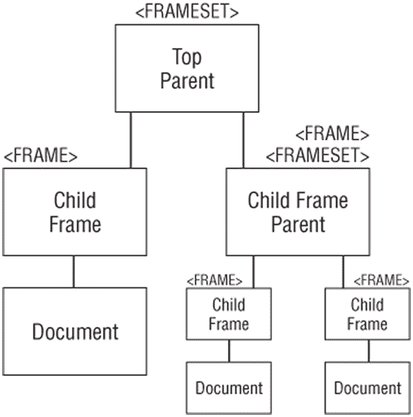

## 引用帧（frames）

对象引用的目的是帮助 JavaScript 在当前内存中保留的对象模型中定位所需的对象。引用是浏览器遵循的一份路线图，以便它可以追踪（例如）特定文档中特定文本字段的值。因此，当你构建引用时，请考虑脚本在对象模型中的位置，以及该引用如何帮助浏览器确定它应该去哪里寻找那个远处的对象。在两代关系的场景下（如图 27.2 所示），可能存在三种跨代际引用：

- 父到子
- 子到父
- 子到子

假设你需要访问相对帧中的对象、函数或变量，以下是相应的引用结构：`frameName.objFuncName`、`parent.objFuncVarName`以及`parent.frameName.objFuncVarName`。

规则是：每当引用必须指向另一个帧时，以两个目的地共同的窗口对象开始引用。为了在图 27.3 中的复杂模型上演示该规则，如果左帧的文档需要引用底部的文档，则引用结构为`top.frameName.frameName.document`...

从顶层窗口开始遵循地图，经过两个帧，到达最终文档。JavaScript 必须走这条路线，因此你的引用必须为它提供帮助。

## top（顶部）与 parent（父级）

看到之前的对象映射和引用示例后，你可能会疑问，为什么不使用`top`作为所有帧引用的领先对象呢？从对象模型的角度来看，这样做没有问题：在两代关系的场景中，`parent`也是`top`窗口。然而，你无法保证你的框架文档（framesetting document）总是某人浏览器中的`top`对象。考虑一下一个网站将其他网站加载到其某一个帧中的情况。在那一刻，`top`对象属于别人。如果你在旨在指向`parent`窗口的引用中始终指定`top`，你的引用将无法工作并可能导致用户出现脚本错误。因此，我们的建议是每当你指的是当前文档的上一代时，请使用`parent`引用。

## 防止被框架化（Preventing framing）

你可以利用对`top`和`parent`引用的知识来防止你的页面显示在另一个网站的框架集内部。你的顶层文档必须检查它是否加载到它自己的`top`或`parent`窗口中。当文档位于它自己的`top`窗口时，对当前窗口`top`属性的引用等于对当前窗口的引用（这里同义词`self`最合适）。如果这两个值不相等，你可以编写脚本让文档作为顶层文档重新加载。当你的文档必须是顶层文档至关重要时，请将列表 27-1 中的脚本包含在文档的头部：

### 列表 27-1：防止文档被框架化

```javascript
<script type="text/javascript">
  if (top != self) {
    top.location = location;
  }
</script>
```

你的文档可能会暂时出现在另一个网站的框架集内部，但随后画板会被擦除，你的顶层文档将接管浏览器窗口。

## 确保框架化（Ensuring framing）

当你围绕框架集设计 Web 应用程序时，你可能希望确保页面始终加载完整的框架集。考虑访问者仅将你的一个帧添加到书签中的可能性。在下次访问时，浏览器中只会出现书签中的页面，而没有你的框架集，而框架集可能包含指向网站的宝贵导航辅助。

脚本可以通过比较`top`和`self`窗口的 URL 来确保页面始终加载到其框架集中。如果两个 URL 相同，则意味着页面需要加载框架集。列表 27-2 显示了这种技术的简单版本，它加载一个固定的框架集。对于更完整的实现（将参数传递给框架集以便在其中一个帧中打开特定页面），请参见第 28 章“位置和历史对象”中的`location.search`属性。

### 列表 27-2：强制加载框架集

```javascript
<script type="text/javascript">
  if (top.location.href == window.location.href) {
    top.location.href = "myFrameset.html";
  }
</script>
```

## 从框架切换到无框架

某些网站默认在框架集中加载自身，并为用户提供移除框架的选项。现代浏览器允许你动态修改框架集的`cols`或`rows`属性，以模拟从当前视图中添加或删除帧（请参见本章后半部分的`frameset`元素对象）。另一方面，旧浏览器不允许在加载后动态更改框架集的组成部分，但你可以将框架集的内容页加载到主窗口。旧浏览器的解决方法是包含一个按钮或链接，其操作是将该文档加载到`top`窗口对象：

`top.location.href = "mainBody.html";`

切换回框架版本并不比加载框架文档更复杂。

## 继承与包含

具有面向对象编程环境经验的脚本编写者可能期望帧会继承在`parent`对象中定义的属性、方法、函数和变量。在可脚本的浏览器中并非如此。然而，当你通过对`parent`的完整引用调用项时，仍然可以访问那些父级项目。例如，如果你想在框架父文档中定义一个所有帧都可以共享的函数，帧中的脚本将使用此引用引用该函数：

`parent.myFunc()`

你可以向此类函数传递参数并期望返回值。

## 帧同步（Frame synchronization）

对于某些脚本编写者的计划来说，一个棘手的问题是在框架文档中包含立即执行脚本是危险的。此类脚本往往依赖于由框架文档创建的帧中存在文档。但如果帧尚未创建，且它们的文档尚未加载，立即执行脚本可能会崩溃。

防止这种问题的一种方法是从框架集的`onload`事件处理程序中触发所有此类脚本。理论上说，在所有文档成功加载到子帧之前，该处理程序不会被触发。同时，要小心进入框架集的文档中的`onload`事件处理程序。如果这些脚本中的一个依赖于另一个帧（其兄弟帧或姐妹帧）中存在文档，那么你注定最终会失败。任何从慢速网络或服务器到慢速调制解调器的内容都可能阻碍其他文档按理想顺序加载到帧中。

解决这些问题的方法是在父文档中创建一个布尔变量，作为子帧成功加载的标记。当文档加载到帧中时，它的`onload`事件处理程序可以将该标记设置为`true`，以指示文档已加载。任何依赖页面加载的脚本都应在继续之前使用`if`结构测试该标记的值。

通常，你可能希望在`frameset`中创建一个`frame`，但在用户与其它框架中的各种控件或其他用户界面元素交互之前，不要在其中放入任何文档。大多数现代浏览器在其内部 URL（`about:blank`）中都有一个相当空白的文档。然而，并不能保证该 URL 在所有浏览器中都可用。如果你需要一个空白帧，可以让你的框架布局文档通过`frame`的`src`属性直接向帧写入一个通用的 HTML 文档，如列表 27-3 中的骨架代码所示。加载空的 HTML 文档不需要额外的事务。

### 列表 27-3：创建一个空白帧

```html
<html>
  <head>
    <script type="text/javascript">
      <!--
        function blank()
        {
          return "<html></html>";
        }
      //-->
    </script>
  </head>
  <frameset>
    <frame name="Frame1" src="someURL.html">
    <frame name="Frame2" src="javascript:parent.blank()">
  </frameset>
</html>
```

## 查看帧源代码

研究其他脚本编写的作品是学习 JavaScript（或任何编程语言）的重要工具。在大多数支持脚本的浏览器中，你可以轻松查看任何帧的源代码，包括那些内容完全或部分由 JavaScript 生成的帧。点击所需的帧来激活它（在某些浏览器版本中，帧内部可能会出现细边框，但如果边框没有出现，请不要慌）。然后从“查看”菜单（或右键菜单）中选择“帧源代码”（或等效选项）。你还可以打印或保存选定的帧。

## 帧对象与帧元素对象

随着将每个 HTML 元素暴露给脚本的对象模型的扩展，一个术语冲突随之而来。到目前为止，在本章中读到的关于帧的所有内容指的是原始对象模型，在那种模型中，帧只是另一种引用方式略有不同的窗口。即使在最新的浏览器中，这一点仍然成立。

但当对象模型也暴露 HTML 元素时，帧元素对象（frame element object）的概念与原始模型中的帧对象（frame object）有所不同。帧元素对象代表一个对象，其属性由你在`<frame>`标签内部设置的属性主导。这提供了对设置的访问，例如帧边框和可滚动性——这些类属性是不会暴露给原始帧对象的。

对帧和帧元素对象的引用也是不同的。在本章前面的部分，你已经看到了许多如何引用旧式帧的示例。但访问帧元素对象要么通过元素的`id`属性，要么通过包含它的`frameset`元素的子节点关系来实现（你不能使用`parentNode`属性从当前文档回溯到封装该文档的帧元素）。我们倾向的策略是为`<frame>`标签分配`id`属性，并通过存在于 frameset 层次结构父级（或顶层）的文档对象来访问帧元素对象。因此，要从位于 frameset 中任何帧的脚本中访问帧元素对象的`frameBorder`属性，语法为：

`parent.document.all.frame1ID.frameBorder`

或（对于 IE5+/Moz/W3C）

`parent.document.getElementById("frame1ID").frameBorder`

当引用通过帧元素对象进行时，你仍然可以通过元素对象的`contentWindow`或`contentDocument`属性访问该帧中的文档对象（参见本章后半部分的帧元素对象）。

## window 对象

| 属性 | 方法 | 事件处理器 |
| :--- | :--- | :--- |
| `appCore` | `addEventListener()`† | `onabort`†† |
| `clientInformation` | `alert()` | `onafterprint` |
| `clipboardData` | `attachEvent()`† | `onbeforeprint` |
| `closed` | `back()` | `onbeforeunload` |
| `components[]` | `blur()`† | `onblur`† |
| `content` | `clearInterval()` | `onchange`†† |
| `controllers[]` | `clearTimeout()` | `onclick`†† |
| `crypto` | `close()` | `onclose`†† |
| `defaultStatus` | `confirm()` | `onerror` |
| `dialogArguments` | `createPopup()` | `onfocus`† |
| `dialogHeight` | `detachEvent()`† | `onhelp` |
| `dialogLeft` | `dispatchEvent()`† | `onkeydown`†† |
| `dialogTop` | `dump()` | `onkeypress`†† |
| `dialogWidth` | `execScript()` | `onkeyup`†† |
| `directories` | `find()` | `onload` |
| `document` | `fireEvent()`† | `onmousedown`†† |
| `event` | `focus()`† | `onmousemove`†† |
| `Event` | `forward()` | `onmouseout`†† |
| `external` | `geckoActiveXObject()` | `onmouseover`†† |
| `frameElement` | `getComputedStyle()` | `onmouseup`†† |
| `frames[]` | `getSelection()` | `onmove` |
| `fullScreen` | `home()` | `onreset`†† |
| `history` | `moveBy()` | `onresize` |
| `innerHeight` | `moveTo()` | `onscroll` |
| `innerWidth` | `navigate()` | `onselect`†† |
| `length` | `open()` | `onsubmit`†† |
| `location` | `openDialog()` | `onunload` |
| `locationbar` | `print()` | |
| `menubar` | `prompt()` | |
| `name` | `removeEventListener()`† | |
| `navigator` | `resizeBy()` | |
| `netscape` | `resizeTo()` | |
| `offscreenBuffering` | `scroll()` | |
| `opener` | `scrollBy()` | |
| `outerHeight` | `scrollByLines()` | |
| `outerWidth` | `scrollByPages()` | |
| `pageXOffset` | `scrollTo()` | |
| `pageYOffset` | `setActive()`† | |
| `parent` | `setInterval()` | |
| `personalbar` | `setTimeout()` | |
| `pkcs11` | `showHelp()` | |
| `prompter` | `showModalDialog()` | |
| `returnValue` | `showModelessDialog()` | |
| `screen` | `sizeToContent()` | |
| `screenLeft` | `stop()` | |
| `screenTop` | | |
| `screenX` | | |
| `screenY` | | |
| `scrollbars` | | |
| `scrollMaxX` | | |
| `scrollMaxY` | | |
| `scrollX` | | |
| `scrollY` | | |
| `self` | | |
| `sidebar` | | |
| `status` | | |
| `statusbar` | | |
| `toolbar` | | |
| `top` | | |
| `window` | | |

† 第 26 章，“通用 HTML 元素”。

†† IE4+ 的捕获或冒泡事件。

### 语法

创建窗口：

`var windowObject = window.open([parameters]);`

访问属性或方法：

`window.property | method([parameters])`

`self.property | method([parameters])`

`windowObject.property | method([parameters])`

**兼容性：** WinIE3+, MacIE3+, NN2+, Moz+, Safari+, Opera+, Chrome+

## Window 对象

需要避免的一个概念陷阱是，认为`window`对象的事件处理器或自定义属性赋值的生命周期比执行这些赋值的文档更长。除了`window`的某些显性物理属性外，每个加载到`window`中的新文档都会从一组干净的`window`属性和事件处理器开始。

你的脚本对现有（已打开的）`window`用户界面元素的控制力取决于你的应用程序针对的浏览器及其版本，差异很大。在第 4 版本浏览器之前，你对已打开窗口能做的唯一更改是浏览器窗口底部的状态栏。第 4 版本浏览器增加了控制此类属性的能力，例如大小、`location`以及（在`Navigator`和`Mozilla`中使用签名脚本的情况下）动态控制界面元素（例如工具栏和滚动条）的存在。这些属性中的许多，只有当你对脚本进行了加密签名时，才可以更改超出特定的安全限制范围（请参阅光盘上的第 49 章“安全与 Netscape 签名脚本”）并且/或用户允许你的脚本进行这些修改。

## Window 属性

当你的脚本生成新窗口（使用`window.open()`方法）时，所有浏览器上的`window`属性都要灵活得多：你可以影响窗口的大小、工具栏或其他视图选项。最近的浏览器版本为新窗口提供了更多选项，包括窗口的位置以及窗口是否应该显示标题栏。再次，如果某个选项理论上可以用来欺骗用户（例如，静默隐藏一个监控另一个窗口活动的窗口），则需要签名脚本和/或用户权限。

`window`对象也是脚本请求浏览器显示三种样式对话框之一（普通的 alert 警告对话框、确定/取消确认对话框，或用于用户输入文本的 prompt 框）的层级。虽然对话框对于为你自己拼凑调试工具非常有帮助（请参阅光盘上的第 48 章“调试脚本”），但它们对于浏览网站的访问者来说可能会产生很大的困扰。由于大多数 JavaScript 对话框是模态的（也就是说，在关闭对话框之前，你无法在浏览器中进行任何其他操作），请谨慎使用，或者尽量不使用。请记住，某些用户可能会在计算机上创建宏来无人值守地访问网站。如果此类自动访问者遇到模态对话框，它将被困在你的页面上，直到人工干预。

所有由 JavaScript 生成的对话框都会标识自身是由 JavaScript 生成的。这主要是一项安全功能，旨在防止欺骗性脚本创建系统或应用程序风格的对话框，引导访问者输入私有信息。这也应该阻碍在网页设计中使用对话框。这是好事，因为对话框往往会让用户感到厌烦。

除了 IE 和 Safari 特有的模态对话框，以及 IE 特有的非模态对话框外（参见`window.showModalDialog()`和`window.showModeless()`方法），JavaScript 对话框在让你填充基础内容之外的文本或图形元素方面并不灵活。事实上，你甚至无法更改对话框按钮的文本或添加按钮。对于具有动态 HTML（DHTML）能力的浏览器，你可以使用定位的`div`或`iframe`元素以跨浏览器的方式模拟对话框行为。

## W3C DOM 与集成

对于 W3C DOM，`window`在 DOM Level 2 之前处于标准范围之外。标准最接近承认窗口的方式是`document.defaultView`属性，它在今天的浏览器中求值为`window`对象。

### 属性

- `document.defaultView`: 在今天的浏览器中求值为`window`对象。
- `content[]`: (IE- 和 Safari- 特有的模态以及 IE- 特有的非模态对话框（参见`window.showModalDialog()`和`window.showModeless()`方法））。
- `closed`: 值：`Boolean`、`只读`。兼容性：`WinIE4+`、`MacIE4+`、`NN3+`、`Moz+`、`Safari+`、`Opera+`、`Chrome+`。
- `clientInformation`: 值：`navigator`、`只读`。兼容性：`WinIE4+`、`MacIE4+`、`NN+`、`Moz+`、`Safari+`、`Opera+`。
- `clipboardData`: 值：`Object`、`可读/写`。兼容性：`WinIE5+`、`Mac+`、`NN+`、`Moz+`、`Safari+`、`Opera+`。

### 对象方法

| 方法 | 返回 | 描述 |
| :--- | :--- | :--- |
| `clearData([format])` | 无 | 从剪贴板删除数据。如果没有提供格式参数，则清除所有数据。 |
| `getData(format)` | String | 从剪贴板中检索指定格式的数据。 |
| `setData(format, data)` | Boolean | 将字符串数据存储在剪贴板中。 |

### 示例

```javascript
var newWind = window.open("someURL.html","subWind");

...

newWind.document.entryForm.ZIP.value = "00000";
```

在本示例中，`newWind`并没有与窗口实时链接，它仅仅是该窗口的引用。如果用户关闭了窗口，`newWind`仍然包含指向该已不存在窗口的引用。因此，任何对该缺失窗口中对象的脚本引用都可能导致脚本错误。在访问子窗口中的项目之前，你需要知道该窗口是否仍然开启。

如果窗口对象已通过脚本或用户关闭，则`closed`属性将返回`true`。每当你有一条可以在用户有机会关闭窗口后被触发的脚本语句时，请在执行该语句之前对`closed`属性进行测试。

### 示例

列表 27-4 是一个基础的窗口打开和关闭示例。脚本开始初始化一个全局变量`newWind`，它用于保存指向第二个窗口的对象引用。此值需要是全局的，以便其他函数可以引用该窗口以执行任务（例如关闭）。

对于此示例，新窗口包含了一些动态写入到它的 HTML 代码，而不是加载现有的 HTML 文件。因此，`window.open()`方法的 URL 参数被留为空字符串。接下来是一个简短的延迟，允许 Internet Explorer（特别是版本 3 和 4）跟上打开窗口的操作，以便为其写入内容。延迟（使用本章稍后描述的`setTimeout()`方法）调用`finishNewWindow()`函数，该函数使用全局变量`newWind`引用窗口进行写入。`document.close()`方法关闭对文档的写入——这与关闭窗口是不同类型的关闭。另一个函数`closeWindow()`负责关闭子窗口。

作为最后的测试，一个`if`条件检查了两个情况：(1) 窗口对象是否曾被赋予`null`以外的值初始化过（以防你在创建新窗口之前就点击了关闭窗口按钮），以及 (2) 窗口的`closed`属性是否为`null`或`false`。如果任一条件为真，则向第二个窗口发送`close()`方法。

### 注意

这是一个简单的示例，因此所采用的属性赋值事件处理技术使用了更现代的事件绑定方法，即使用`addEventListener()` (NN6+/Moz/W3C) 或`attachEvent()` (IE5+) 方法。这种现代的、跨浏览器事件处理技术将在第 32 章“事件对象”中详细解释。在本章大部分代码和本书的大部分内容使用的事件处理技术是一种刻意的简化，为了使代码更具可读性。通常情况下，使用像本示例中这样更现代的事件绑定方法更好。

### 列表 27-4：在关闭窗口前检查

**HTML: `jsb27-04.html`**

```html
<!DOCTYPE html>
<html>
  <head>
    <meta http-equiv="content-type" content="text/html;charset=utf-8">
    <title>window.closed Property</title>
    <script type="text/javascript" src="../jsb-global.js"></script>
    <script type="text/javascript" src="jsb27-04.js"></script>
  </head>
  <body>
    <h1>window.closed Property</h1>
    <hr />
    <p>The new window might open behind this window.</p>
    <form id="newWinForm" name="newWinForm">
      <input id="openNewWin" name="openNewWin" type="button" value="Open Window" />
      <br />
      <input id="closeNewWin" name="closeNewWin" type="button" value="Close it if Still Open" />
    </form>
  </body>
</html>
```

**JavaScript: `jsb27-04.js`**

```javascript
// 当页面加载时初始化
addEvent(window, "load", initialize);

// 全局变量
var oNewWinForm;
var oOpenNewWin;
var oCloseNewWin;

// 为新窗口对象初始化全局变量
// 这样页面上的所有函数都可以访问它
var newWind;

function initialize() {
  // 获取 ID 的 IE4+ 或 W3C DOM 引用
  if (document.getElementById) {
    oNewWinForm = document.getElementById("newWinForm");
    oOpenNewWin = document.getElementById("openNewWin");
    oCloseNewWin = document.getElementById("closeNewWin");
  } else {
    oNewWinForm = document.newWinForm;
    oOpenNewWin = document.oNewWinForm.openNewWin;
    oCloseNewWin = document.oNewWinForm.closeNewWin;
  }
  addEvent(oOpenNewWin, 'click', newWindow);
  addEvent(oCloseNewWin, 'click', closeWindow);
}

// 创建新窗口并在其中放入内容
function newWindow() {
  newWind = window.open("", "subwindow", "height=200,width=200");
  setTimeout("finishNewWindow()", 100);
}

function finishNewWindow() {
  var output = "";
  output += "<html><body><h1>Subwindow</h1>";
  output += "<form><input type='button' value='Close Main' onclick='close()'></form></body></html>";
  newWind.document.write(output);
  newWind.document.close();
}

// 关闭子窗口
function closeWindow() {
  if (newWind && !newWind.closed) {
    newWind.close();
  } else {
    alert("The window is no longer open");
  }
}
```

## `window.defaultStatus` 属性

如果你需要在状态栏中显示单引号或双引号（如列表 27-5 中的两个链接所示），请使用转义序列（`\'`和`\"`）作为赋值给这些属性的字符串的一部分。

**相关项目：** `window.status`属性

## `dialogArguments`

| 值：不确定 | 只读 |
|---|---|

**兼容性：** WinIE4+, MacIE4+, NN-, Moz+, Safari+, Opera-, Chrome+

`dialogArguments`属性仅在`showModalDialog()`或 IE 特有的`showModelessDialog()`方法生成的窗口可用。这些方法允许将参数传递给对话框窗口，而`dialogArguments`属性允许对话框窗口脚本访问该参数值。该值可以是字符串、数字或 JavaScript 数组的形式（便于传递多个值）。

### 示例

请参阅列表 27-36 中的`window.showModalDialog()`方法，了解如何将参数传递给对话框并通过`dialogArguments`属性检索它们。

**相关项目：** `window.showModalDialog()`、`window.showModelessDialog()`方法

## `dialogHeight` / `dialogWidth`

| 值：字符串 | 读写 |
|---|---|

**兼容性：** WinIE4+, MacIE-, NN-, Moz-, Safari-, Opera-, Chrome-

位于模态或 IE 特有非模态对话框（由`showModalDialog()`或`showModelessDialog()`生成）内部文档的脚本可以通过`dialogHeight`和`dialogWidth`属性读取或修改对话框窗口的高度和宽度。脚本只有在非模态对话框的情况下从主窗口访问这些属性，这种窗口在用户控制主窗口内容时保持可见。

这些属性的值为字符串，包含测量单位像素（`px`）。

### 示例

对话框有时会提供一个按钮或图标，为高级用户显示更多细节或更复杂的设置。你可以创建一个处理两种尺寸之间切换的函数。以下函数假设对话框中的文档有一个按钮，其标签也可以在“显示详情”（Show Details）和“隐藏详情”（Hide Details）之间切换。按钮的`onclick`事件处理器通过`toggleDetails(this)`调用该函数：

```javascript
function toggleDetails(btn)
{
   if (dialogHeight == "200px")
   {
      dialogHeight = "350px";
      btn.value = "Hide Details";
   }
   else
   {
      dialogHeight = "200px";
      btn.value = "Show Details";
   }
}
```

在实践中，你还需要在额外材料的显示样式表属性之间切换`none`和`block`，以确保对话框在较小的尺寸版本中不显示滚动条。

**相关项目：** `window.dialogLeft`、`window.dialogTop`属性

## `dialogLeft` / `dialogTop`

| 值：字符串 | 读写 |
|---|---|

**兼容性：** WinIE4+, MacIE4+, NN-, Moz-, Safari-, Opera-, Chrome-

位于模态或 IE 特有非模态对话框（由`showModalDialog()`或`showModelessDialog()`生成）内部文档的脚本可以通过`dialogLeft`和`dialogTop`属性读取或修改对话框窗口的左和顶部坐标。脚本只有在非模态对话框的情况下从主窗口访问这些属性，这种窗口在用户控制主窗口内容时保持可见。

这些属性的值为字符串，包含测量单位像素（`px`）。如果你尝试更改这些值导致对话框窗口的任何部分位于视频显示器之外，浏览器将覆盖设置以保持整个窗口可见。

### 示例

虽然由于对用户可能产生突兀的影响这通常不是好主意，但你可以重新定位已通过脚本（或如果允许调整大小则通过用户）调整大小的对话框窗口。对话框窗口文档脚本中的以下语句可以将对话框窗口居中：

```javascript
dialogLeft = (screen.availWidth/2) - "px";
dialogHeight = (screen.availHeight/2) - "px";
```

**相关项目：** `window.dialogLeft`、`window.dialogTop`

## `directories`、`locationbar`、`menubar`、`personalbar`、`scrollbars`、`toolbar`

| 值：对象 | 读写 |
|---|---|

**兼容性：** WinIE-, MacIE-, NN+, Moz+, Safari+, Opera-

在内容区域之外，Navigator 显示了被称为“外壳”（chrome）的组合栏。在 Navigator 4 中，这些元素是第一等对象。Navigator 6 增加了一个名为`directories`的功能。

动态更改这些项目的可见性会改变窗口的外观。如果你必须精确调整窗口大小，应该在调整窗口大小之前调整外壳元素。在开始在访问者面前更改可见性之前，请权衡这一决定。经验用户已经按照自己的喜好微调了浏览器的外观。如果你弄乱了这种外观，可能会得罪你的访问者。

### 提示

Mac 菜单栏不是浏览器外壳的一部分。因此，无法通过脚本调整其可见性。

### 示例

在列表 27-6 中，你可以通过开启或关闭任何外壳元素来实验浏览器窗口的外观。要运行此脚本，你必须对脚本进行签名或启用代码库原则（参见光盘上的第 49 章“安全与 Netscape 签名脚本”）。使用签名脚本还必须启用 Java。

当页面加载时，它会存储每个外壳元素的当前状态。每个外壳元素对应一个按钮触发`toggleBar()`函数。该函数反转作为参数传递给函数的外壳对象的`visible`属性。最后，`restore()`函数将可见性属性恢复原始设置。注意，`restore()`函数也会由文档的`onunload`事件处理器调用。

**HTML: `jsb27-06.html`**

```html
<form>
  <b>切换窗口工具栏</b>
  <br />
  <input type="button" value="地址栏" onclick="toggleBar(window.locationbar)" />
  <br />
  <input type="button" value="菜单栏" onclick="toggleBar(window.menubar)" />
  <br />
  <input type="button" value="个人栏" onclick="toggleBar(window.personalbar)" />
  <br />
  <input type="button" value="滚动条" onclick="toggleBar(window.scrollbars)" />
  <br />
  <input type="button" value="状态栏" onclick="toggleBar(window.statusbar)" />
  <br />
  <input type="button" value="工具栏" onclick="toggleBar(window.toolbar)" />
  <br />
  <hr />
  <input type="button" value="恢复原始设置" onclick="restore()" />
</form>
</body>
</html>
```

**JavaScript: `jsb27-06.js`**

```javascript
// 在页面加载时存储原始外部尺寸
var originalLocationbar = window.locationbar.visible;
var originalMenubar = window.menubar.visible;
var originalPersonalbar = window.personalbar.visible;
var originalScrollbars = window.scrollbars.visible;
var originalStatusbar = window.statusbar.visible;
var originalToolbar = window.toolbar.visible;

// 设置内部尺寸的通用函数
function toggleBar(bar)
{
  netscape.security.PrivilegeManager.enablePrivilege("UniversalBrowserWrite");
  bar.visible = !bar.visible;
  netscape.security.PrivilegeManager.revertPrivilege("UniversalBrowserWrite");
}

// 恢复设置
function restore()
{
  netscape.security.PrivilegeManager.enablePrivilege("UniversalBrowserWrite");
  window.locationbar.visible = originalLocationbar;
  window.menubar.visible = originalMenubar;
  window.personalbar.visible = originalPersonalbar;
  window.scrollbars.visible = originalScrollbars;
  window.statusbar.visible = originalStatusbar;
  window.toolbar.visible = originalToolbar;
  netscape.security.PrivilegeManager.revertPrivilege("UniversalBrowserWrite");
}
```

**相关项目：** `window.open()`方法

## `document`

| 值：`Object` | 只读 |
| :--- | :--- |

**兼容性:** WinIE3+, MacIE3+, NN2+, Moz+, Safari+, Opera+, Chrome+

我们在这里列出`document`属性主要是为了完整性。每个窗口对象都包含一个`document`对象。`document`属性的值是`document`对象，它不是一个可显示的值。相反，你使用`document`属性来构建对`document`属性和方法，以及对`document`包含的其它对象（例如`form`及其元素）的引用。要在窗口中加载不同的文档，请使用`location`对象（参见第 28 章，“位置与历史记录对象”）。`document`对象在第 29 章“文档与正文对象”中有更详细描述。

## `event` (事件)

| 值：`Object` | 可读写 |
| :--- | :--- |

**兼容性:** WinIE4+, MacIE4+, NN+, Moz+, Safari 1+, Opera+, Chrome+

IE4+ 将`event`对象视为`window`对象的属性。W3C DOM 将`Event`对象的实例作为参数传递给事件处理函数。与`window`对象的连接是相对无关的，因为所有涉及`event`对象的操作都发生在事件处理函数中。唯一的区别是，当一个事件处理函数调用另一个事件处理函数时，该对象可以被视为一个更全局的对象。函数不再需要向下一个函数传递`event`对象参数，而是可以直接访问`event`对象（在引用中可以带也可以不带`window.`前缀）。

有关关于所有浏览器中`event`对象的完整细节，请参见第 32 章“事件对象”。

**相关项目：** `event`对象

## `external`

| 值：`Object` | 只读 |
| :--- | :--- |

**兼容性:** WinIE4+, MacIE-, NN-, Moz+, Safari-, Opera-, Chrome-

`external`属性仅当浏览器窗口作为另一个应用程序的组件时才有用。该属性提供了在当前浏览器窗口与作为浏览器窗口组件宿主的应用程序之间的网关。

当 WinIE4+ 作为宿主操作系统的组件时，可以使用`external`属性访问几个影响浏览器之外行为的方法。对于普通的网页脚本编写人员，最有用的三个方法可能是`AddDesktopComponent()`、`AddFavorite()`和`NavigateAndFind()`。前两个方法会显示与用户从浏览器或桌面菜单做出这些选择后获得的相同的警报对话框，因此你无法在未经访问者许可的情况下将你的网站悄悄添加到桌面或收藏列表中。IE7 和 Firefox2+ 允许使用`AddSearchProvider()`来安装搜索插件。与前两个方法一样，会显示一个警报请求用户许可安装搜索插件。你有关 OpenSearch 的信息以及传递给该方法的 XML 文件格式，可以在此处：

[`www.opensearch.org/Specifications/OpenSearch/1.1.`](http://www.opensearch.org/Specifications/OpenSearch/1.1) 找到相关信息。表 27.2 描述了这些方法的参数。

**表 27.2 常用 `window.external` 对象方法**

| 方法 | 说明 |
| :--- | :--- |
| `AddDesktopComponent("URL", "type"[, left, top, width, height])` | 将网站或图像添加到活动桌面（如果在用户版本的 Windows 中开启了该功能）。`type`参数值为`website`或`image`。尺寸参数（可选）均为整数值。 |
| `AddFavorite("URL"[, "title"])` | 将指定的 URL 添加到用户的收藏列表。可选的`title`字符串是 URL 在菜单中的显示方式（如果缺失，则出现在列表中）。 |
| `AddSearchProvider("URL")` | 添加搜索提供者，通过 URL 中的 OpenSearch XML 文件指定搜索提供者。 |
| `NavigateAndFind("URL", "findString", "target")` | 导航到第一个参数中的 URL 并在目标帧中打开页面（空字符串在当前帧中打开）。`findString`是要在该页面上搜索的文本，并在页面加载时对其进行高亮显示。 |

### 示例

第一个示例询问用户是否可以将网站添加到活动桌面。如果未启用活动桌面，用户将获得在此时启用它的选择权：

```javascript
external.AddDesktopComponent("http://www.nytimes.com","website",200,100,400,400);
```

在下一个示例中，询问用户是否批准将 URL 添加到收藏列表。用户可以按照正常程序将项目归档到列表中的文件夹：

```javascript
external.AddFavorite("http://www.dannyg.com/support/update13.html","JSBible 6 Support Center");
```

最后一个示例假设用户从选择列表中选择了一个项。选择列表的`change`事件处理器调用以下函数，以导航到一个虚构页面，并在页面上定位所选体育队伍的列表：

```javascript
function locate(list) {
  var choice = list.options[list.selectedIndex].value;
  external.NavigateAndFind("http://www.collegesports.net/scores.html",choice, "scores");
}
```

## `frameElement`

| 值：`frame`或`iframe`对象引用 | 只读 |
| :--- | :--- |

**兼容性:** WinIE5.5+, MacIE-, NN7+, Moz1.0.1+, Safari 1.2+, Opera+, Chrome+

如果当前窗口是作为`<frame>`或`<iframe>`标签的结果存在的，则窗口的`frameElement`属性返回指向宿主元素的引用。正如本章稍后关于框架元素对象的讨论所说明，指向帧或 iframe 元素对象的引用提供了访问反映 HTML 元素对象属性的权限。对于不属于框架集合的窗口，`frameElement`属性返回`null`。

当单个文档被加载到多个框架集（framesets）时，该属性的便利性就显而易见了。即使元素的 ID 从一个 frameset 变为另一个，文档中的脚本仍然可以引用它的框架元素。通过`frameElement`属性的`parentElement`也可以访问 frameset 元素：

```javascript
var frameSetObj = self.frameElement.parentElement;
```

对 frameset 元素的引用为调整帧的大小提供了可能。

**相关项目：** `frame`、`iframe`对象

## `frames`

| 值：Array | 只读 |

**兼容性：** WinIE3+, MacIE3+, NN2+, Moz+, Safari+, Opera+, Chrome+

在多框架窗口中，顶层或父窗口包含任意数量的独立帧（frames），每个帧都充当完整的窗口对象。当语句必须引用位于不同帧中的对象时，`frames`属性（注意属性名使用了复数`frames`）就起了作用。例如，如果一个帧中的按钮被编写为在另一个帧中加载文档，该按钮的事件处理器必须能够精确地告诉 JavaScript 在何处显示新的 HTML 文档。`frames`属性有助于完成这项任务。

要使用`frames`属性从一个帧通信到另一个帧，它应该是以`parent`或`top`属性开头的引用的一部分。这允许 JavaScript 通过所有当前加载对象的层级结构进行正确的跳转，以到达目标对象。要查看窗口中当前激活多少帧，请使用此表达式：

```javascript
parent.frames.length
```

此表达式返回一个数字，表示父窗口定义了多少帧。然而，如果环境中定义了第三代帧，该值并不计算更深嵌套的帧。换句话说，如果存在多代帧，则不存在任何单一属性可以让你用来确定浏览器窗口中帧的总数。

浏览器将所有可见帧的信息存储在一个带编号的（索引的）数组中，其中第一个帧（即在框架设置文档中定义的顶层`<frame>`标签）编号为 0：

```javascript
parent.frames[0]
```

因此，如果窗口显示了三个帧（索引分别为`frames[0]`、`frames[1]`和`frames[2]`），则获取第二个帧中文档的`title`属性的引用为：

```javascript
parent.frames[1].document.title
```

此引用是一条路线，从父窗口开始，延伸到第二个帧的文档及其`title`属性。除了父窗口定义的帧数量和每个帧的名称（`top.frames[i].name`）之外，在达到 IE4 和 NN6/Moz/W3C 之前（参见本章后文框架元素对象），无法通过脚本直接获取帧定义的任何值。在这些浏览器中，单个帧元素对象有多个属性可以显示`<frame>`标签的属性。

然而，使用索引值引用帧并不总是最安全的策略，因为你的框架集设计可能会随时间改变，这时索引值也会随之改变。相反，你应该利用`<frame>`标签的`name`属性，并为每个帧分配唯一的、描述性的名称。你分配给`name`属性的值也是你在链接的`target`属性中使用的名称，以便强制链接页面加载到包含链接的其他帧中。你可以使用帧的名称作为索引引用的替代方案。例如，在列表 27-7 中，两个帧被分配了不同的名称。要访问`JustAKid2`帧中文档的标题，完整的对象引用是：

```javascript
parent.JustAKid2.document.title
```

其中帧名称（区分大小写）替换了`frames[1]`数组引用。或者，根据 JavaScript 的灵活性，你可以在数组索引位置使用对象名称：

```javascript
parent.frames["JustAKid2"].document.title
```

在引用中使用帧名称的巨大优势是，无论框架集结构随时间如何变化，对命名帧的引用始终能找到该帧，即使它的索引值（即它在框架集中的位置）发生了变化。

### 示例

列表 27-7 和列表 27-8 展示了 JavaScript 如何处理帧内部对象的帧引用值。同一个文档被加载到每个帧中。该文档中的脚本提取了关于当前帧和整个框架集的信息。

### 列表 27-7：列表 27-8 的框架设置文档

```html
<!DOCTYPE html>
<html>
  <head>
      <meta http-equiv="content-type" content="text/html;charset=utf-8">
      <title>window.frames property</title>
  </head>
  <frameset cols="50%,50%">
      <frame name="JustAKid1" src="jsb27-08.html" />
      <frame name="JustAKid2" src="jsb27-08.html" />
  </frameset>
</html>
```

从所引用的当前帧的角度来看，确定帧数量（`length`）的调用返回 0。这是因为这里的每个帧都是一个内部没有嵌套帧的窗口。但如果在引用中添加`parent`属性，范围就会扩大，以考虑到父窗口文档生成的所有帧。

### 列表 27-8：显示窗口属性

```html
<!DOCTYPE html>
<html>
  <head>
    <meta http-equiv="content-type" content="text/html;charset=utf-8">
    <title>Window II</title>
    <script type="text/javascript">
      function gatherData() {
        var msg = "";
        msg += "<p><b>从这个帧的角度来看：</b><br>";
        msg += "frames.length: " + window.frames.length + "<br>";
        msg += "window.name: " + window.name + "</p>";
        msg += "<p><b>从框架设置文档的角度来看：</b><br>";
        msg += "parent.frames.length: " + parent.frames.length + "<br>";
        msg += "parent.frames[0].name: " + parent.frames[0].name + "</p>";
        return msg;
      }
    </script>
  </head>
  <body>
    <script type="text/javascript">
      document.write(gatherData());
    </script>
  </body>
</html>
```

示例中的最后一个语句显示了如何使用数组语法（括号）引用特定的帧。所有数组索引都从第一个条目的 0 开始。因为文档请求第一个帧的名称（`parent.frames[0]`），两个帧的响应都是 JustAKid1。

**相关项目：** `frame`、`frameset`对象；`window.parent`、`window.top`属性

## `fullScreen`

| 值：Boolean | 只读 |

**兼容性：** WinIE-, MacIE-, NN7.1+, Moz1.4+, Safari-, Opera-, Chrome-

`fullScreen`属性的意图是指示是否处于全屏模式，在 Mozilla 浏览器中可以通过视图菜单中的“全屏”命令进行设置。遗憾的是，该属性不可靠（截至 Mozilla 1.8.1），并且始终返回 false，无论浏览器的实际全屏设置如何。

## `history`

| 值：Object | 只读 |

**兼容性：** WinIE3+, MacIE3+, NN2+, Moz+, Safari+, Opera+, Chrome+

（参见第 28 章“位置和历史对象”中对`history`对象的讨论。）

## `innerHeight`

## `innerWidth`

## `outerHeight`

## `outerWidth`

| 值：Integer | 可读写（见正文） |

**兼容性：** WinIE-, MacIE-, NN4+, Moz+, Safari+, Opera+, Chrome+

NN4+/Moz/基于 WebKit 和 Presto 的浏览器允许脚本通过设置属性调整任何窗口（包括主浏览器窗口）的高度和宽度。如果你的页面在特定的高度和宽度尺寸下显示效果最佳，那么这种调整将非常有帮助。与其依赖用户调整浏览器窗口大小以获得页面的最佳视图，不如由你规定窗口的大小（尽管用户可以手动重新调整主窗口）。由于你可以通过`navigator`对象（参见第 42 章）检查访问者的操作系统，你可以调整窗口大小以适应不同平台在字体和表单元素渲染上的差异。

支持的浏览器提供了测量窗口高度和宽度的两个参考点：内部（inner）和外部（outer）。两者都以像素为单位。内部测量值是窗口活动文档区域的（有时被称为窗口内容区域）。如果你的文档的最佳显示取决于文档显示区域具有特定的像素高度和/或宽度，则应该设置`innerHeight`和`innerWidth`属性。

相比之下，外部测量值引用整个窗口的外部边界，包括在窗口中显示的任何界面元素（chrome）：滚动条、状态栏等。设置`outerHeight`和`outerWidth`通常结合读取`screen`对象的属性进行（参见第 42 章）。外部属性最常见的用途是将浏览器窗口设置为填充访问者显示器的可用屏幕区域。

修改窗口两个外部尺寸的更有效方法是使用`window.resizeTo()`方法，该方法在 IE4+ 中也可用。该方法接受像素宽度和高度（整数值）作为参数，从而在一个语句中完成窗口调整大小。请注意，调整窗口不会调整窗口的位置。因此，仅仅因为将窗口的外部尺寸设置为`screen`对象返回的可用空间，并不能指窗口会自动填满显示器上的可用空间。必须应用`window.moveTo()`方法来确保窗口的左上角位于屏幕坐标`0,0`。

尽管这些属性为页面作者提供了便利，但基于 Netscape 和 Mozilla 的浏览器对未经过加密签名的脚本内置了最小尺寸限制。你无法设置这些属性，使得窗口的外部高度和宽度某一边小于 100 像素。此限制是为了防止未签名的脚本设置一个小型或几乎不可见的窗口来监控其他窗口的活动。然而，对于已签名的脚本，在用户许可的情况下，可以将窗口缩小到 100×100 像素以下。IE4+ 保持了较小的最小尺寸，以防止窗口被调整为零大小。

### 注意

用户可能不喜欢你的脚本干扰他们的浏览器窗口大小和位置。NN7+/Moz/基于 WebKit 和 Presto 的浏览器不允许脚本调整窗口大小，除非脚本已签名。

### 示例

在列表 27-9 中，几个按钮让你看到设置`innerHeight`、`innerWidth`、`outerHeight`和`outerWidth`属性的结果。Safari 忽略对这些属性的脚本调整，而 Mozilla 用户可以设置偏好来阻止脚本移动和调整窗口。

### 列表 27-9：设置窗口的高度和宽度

**HTML: `jsb27-09.html`**

```html
<!DOCTYPE html>
<html>
    <head>
        <meta http-equiv="content-type" content="text/html;charset=utf-8">
        <title>Window Sizer</title>
        <script type="text/javascript" src="jsb27-09.js"></script>
    </head>
    <body>
        <h1>Window Sizer</h1>
        <hr />
        <form>
            <b>Setting Inner Sizes</b><br />
            <input type="button" value="600 Pixels" onclick="setInner(600,60)">
            <input type="button" value="300 Pixels" onclick="setInner(300,30)">
            <input type="button" value="Available Space" onclick="setInner(screen.availWidth, screen.availHeight)">
            <hr />
            <b>Setting Outer Sizes</b><br />
            <input type="button" value="600 Pixels" onclick="setOuter(600,60)">
            <input type="button" value="300 Pixels" onclick="setOuter(300,30)">
            <input type="button" value="Available Space" onclick="setOuter(screen.availWidth, screen.availHeight)">
            <hr />
            <input type="button" value="Inch up for Win95" onclick="setInner(273,304)">
            <input type="button" value="Inch up for Mac" onclick="setInner(273,304)">
            <input type="button" value="Restore Original" onclick="restore()">
        </form>
    </body>
</html>
```

**JavaScript: `jsb27-09.js`**

```javascript
// 在页面加载时存储外部尺寸
var originalWidth = window.outerWidth;
var originalHeight = window.outerHeight;
alert("original dimensions:\nwindow.outerWidth=" + window.outerWidth +
+ "\nwindow.outerHeight=" + window.outerHeight +
+ "\nwindow.innerWidth=" + window.innerWidth +
+ "\nwindow.outerHeight=" + window.outerHeight);
// 设置内部尺寸的通用函数
function setInner(width, height) {
    window.innerWidth = width;
    window.innerHeight = height;
}
// 设置外部尺寸的通用函数
function setOuter(width, height) {
    window.outerWidth = width;
    window.outerHeight = height;
}
// 恢复窗口到原始尺寸
function restore() {
    window.outerWidth = originalWidth;
    window.outerHeight = originalHeight;
}
```

**相关项目：** `window.resizeTo()`、`window.moveTo()`方法；`screen`对象；`navigator`对象

## `location`

| 值：Object | 可读写 |
| :--- | :--- |

**兼容性：** WinIE3+, MacIE3+, NN2+, Moz+, Safari+, Opera+, Chrome+

（参见第 28 章“位置和历史对象”中对`location`对象的讨论。）

## `locationbar`

（参见`directories`）

## `name`

| 值：String | 可读写 |
| :--- | :--- |

**兼容性：** WinIE3+, MacIE3+, NN2+, Moz+, Safari+, Opera+, Chrome+

所有窗口对象都可以分配名称。名称对于处理帧特别有用，因为对于多帧环境良好的命名方案可以帮助你根据来自其他帧的引用精确确定你正在处理哪一个帧。

然而，主浏览器窗口默认没有名称。它的值是一个空字符串。为窗口分配名称的理由不多，因为 JavaScript 和 HTML 提供了许多其他引用窗口对象的方法（`top`属性、目标属性的`_top`常量以及来自子窗口的`opener`属性）。

如果你想给主窗口附加名称，可以随时通过设置`window.name`属性来实现。但要注意，这是一个窗口属性，其生命周期超出任何给定文档的加载和卸载，你的脚本可能只会在一个文档或帧集中该引用。除非你恢复默认的空字符串，否则你编写的窗口名称将出现在稍后加载的任何其他文档中。我们这方面的建议是在窗口或帧集的`onload`事件处理器中分配名称，然后在相应的`onunload`事件处理器中将其重置为空：

```html
<body onload="self.name = 'Main'" onclick="self.name = ''">
```

你可以在列表 27-15 中看到此应用的示例，其中设置父窗口名称有助于学习父子窗口之间的关系。

**相关项目：** `top`属性；`window.open()`、`window.sizeToContent()`方法

## `navigator`

| 值：Object | 只读 |
| :--- | :--- |

**兼容性：** WinIE4+, MacIE4+, NN6+, Moz+, Safari+, Opera+, Chrome+

尽管`navigator`对象仅在现代浏览器中作为`window`对象的属性出现，但该对象从一开始就存在了（参见第 42 章）。在之前的浏览器中，`navigator`对象被用作独立对象来引用。由于在引用窗口对象的属性时可以省略对`window`对象的任何引用，因此可以使用相同的无窗口引用语法来实现跨所有可脚本浏览器的兼容性（至少对于在所有浏览器中都存在的`navigator`对象属性而言）。这是我们推荐的引用`navigator`对象的方式。

### 示例

本书中充斥着`navigator`对象的示例，主要用于浏览器检测。你可以在第 42 章找到特定`navigator`对象属性的示例。

**相关项目：** `navigator`对象

## `netscape`

| 值：Object | 只读 |

**兼容性：** WinIE-, MacIE-, NN3+, Moz+, Safari-, Opera-, Chrome-

根据其名称，你可能认为`netscape`属性以某种方式与`navigator`属性协同工作，但事实并非如此。`netscape`属性是 NN/Moz 浏览器特有的，提供了对 Netscape 系列浏览器特定功能的访问，例如权限管理器（privilege manager）。

### 示例

`netscape`属性通常用作访问 NN/Moz 特有的`PrivilegeManager`对象的方法，以启用或禁用安全权限。以下是执行此类访问的示例：

```javascript
netscape.security.PrivilegeManager.enablePrivilege("UniversalBrowserRead");
```

## `offscreenBuffering`

| 值：Boolean 或 string | 可读写 |

**兼容性：** WinIE4+, MacIE4+, NN-, Moz-, Safari 1.2+, Opera-, Chrome-

IE4+/Safari 1.2+ 默认在将页面推送到视频屏幕之前在缓冲区（一段内存）中渲染。你可以通过修改`window.offscreenBuffering`属性来显式地控制这种行为。

该属性的默认值为字符串`auto`。你也可以为该属性分配布尔值`true`或`false`来覆盖此行为的正常自动处理。

### 示例

如果你想关闭整个页面的缓冲，请在脚本语句开头包含以下语句：

```javascript
window.offscreenBuffering = false;
```

## `onerror`

| 值：Function | 可读写 |

**兼容性：** WinIE4+, MacIE4+, NN3+, Moz+, Safari-, Opera-, Chrome-

`onerror`属性是本书“不在对象引用章节中将事件处理器描述为属性”这一规则的例外。原因是`onerror`事件带了一些特殊的属性，这些属性对于在脚本中通过设置事件处理器属性进行控制有用。

现代浏览器（IE5+、NN4+ 以及 W3C）的设计目的是防止当用户在加载或与页面交互时遇到脚本错误，这些错误不会具有干扰性。但即使是关于问题的细微提示（状态栏中的消息或图标），对于完全不知道 JavaScript 的用户来说也可能令人困惑。JavaScript 允许你在有人在页面上执行脚本时关闭脚本错误窗口或消息的显示。问题是：你何时应该关闭这些消息？

脚本错误通常意味着你的脚本出了问题。错误可能是编码错误的结果，或者可能是 JavaScript 中的一个 bug（也许发生在你尚无法测试的浏览器平台版本上）。如果发生此类错误，脚本通常不会按照你的意图继续运行。在开发期间对自己隐藏脚本错误是愚蠢的，因为你永远不知道代码中是否潜伏着未见的错误。对于那些可能认为页面正在正常运行但实际上并非如此的用户，关闭错误对话框同样是危险的。某些数据值可能无法被正确地计算或显示。

尽管如此，我们可以在某些有限的情况下看到，你可能希望阻止此类对话框窗口的出现。例如，如果你确切知道特定平台的 bug 触发了错误消息，但没有损害脚本的执行，你可能希望防止在发布到你网站的文件中出现该错误警告对话框。你应该只在经过大量测试后才这样做，以确保脚本即使存在 bug 或错误，最终也能正常运行。

### 注意

IE 仅对运行时错误触发`onerror`事件处理器。这意味着如果你的脚本中存在语法错误导致浏览器在页面加载时触发错误，则`onerror`事件不会触发，你无法捕获到该错误消息。此外，如果用户安装了 IE 脚本调试器，你用于防止浏览器错误消息显示的任何代码都将不起作用。

当浏览器启动时，`window.onerror`属性为`<undefined>`。在这种状态下，所有错误都通过标准的 JavaScript 错误窗口或消息报告。要关闭错误警报，请将`window.onerror`属性设置为调用一个无所事事的函数：

```javascript
function doNothing() { return true; }
window.onerror = doNothing;
```

要恢复错误消息，请重新加载页面。

然而，你也可以为`window.onerror`属性分配自定义函数。该函数将在你的脚本控制下以更友好的方式处理错误。每当开启错误消息时（默认行为），脚本错误（或 Java applet 或类异常）就会调用分配给`onerror`属性的函数，并传递三个参数：

- 错误消息
- 导致错误的文档 URL
- 错误行号

你本质上可以捕获所有错误并使用自己的界面处理它们（或完全不通知用户）。如果你不希望出现 JavaScript 脚本错误消息，则该函数的最后一条语句必须是`return true`。

如果你正在使用 NPAPI 直接从脚本与 Java applet 通信，可以使用相同的方案来处理 Java 可能会抛出的任何异常。Java 异常并不一定是错误类的错误：某些方法假设 Java 代码将捕获异常以处理特殊情况——例如，对在签名脚本对话框提示时用户拒绝访问做出反应。有关捕获特定 Java 异常的示例，请参见第 47 章“编写 Java Applets 和插件”（在光盘上）。此外，请参见第 21 章“控制结构和异常处理”，其中介绍了 W3C DOM 兼容浏览器引入的 JavaScript 异常处理。

### 示例

在列表 27-10 中，一个按钮触发了一个包含错误的脚本。我们添加了一个错误处理函数来处理错误，使其打开一个单独的窗口并填充 textarea 表单元素（参见图 27.4）。还提供了一个提交按钮，将 bug 信息发送到支持中心邮箱地址——这是处理脚本中出现 bug 的示例。

### 列表 27-10：控制脚本错误

**HTML: `jsb27-10.html`**

```html
<!DOCTYPE html>
<html>
    <head>
        <meta http-equiv="content-type" content="text/html;charset=utf-8">
        <title>错误对话框控制</title>
        <script type="text/javascript" src="jsb27-10.js"></script>
    </head>
    <body>
        <h1>错误对话框控制</h1>
        <hr />
        <form name="myform">
            <input type="button" value="引发错误" onclick="goWrong()" />
            <p><input type="button" value="关闭错误对话框" onclick="errOff()" />
            <input type="button" value="开启错误对话框" onclick="errOn()" />
            </p>
        </form>
    </body>
</html>
```

**JavaScript: `jsb27-10.js`**

```javascript
// 具有无效变量值的函数
function goWrong() {
    var x = fred;
}

// 关闭错误对话框
function errOff() {
    window.onerror = doNothing;
}

// 开启错误对话框并强制刷新
function errOn() {
    window.onerror = handleError;
}

// 分配默认错误处理器
window.onerror = handleError;

// 当错误被关闭时的错误处理程序...防止错误对话框
function doNothing() { return true; }

function handleError(msg, URL, lineNum) {
    var errWind = window.open("", "errors", "height=270,width=400");
    var wintxt = "<html><body bgcolor=red>";
    wintxt += "<b>An error has occurred on this page. "
            + "Please report it to Tech Support.</b>";
    wintxt += "<form method=POST enctype='text/plain' "
            + "action=mailTo:support4@dannyg.com >";
    wintxt += "<textarea name='errMsg' cols=45 rows=8 wrap=VIRTUAL>";
    wintxt += "Error: "
            + msg + "\n";
    wintxt += "URL: "
            + URL + "\n";
    wintxt += "Line: "
            + lineNum + "\n";
    wintxt += "Client: "
            + navigator.userAgent + "\n";
    wintxt += "-----------------------------------------\n";
    wintxt += "Please describe what you were doing when the error occurred:";
    wintxt += "</textarea><br />";
    wintxt += "<input type=SUBMIT value='Send Error Report'>";
    wintxt += "<input type=button value='Close' onclick='self.close()'>";
    wintxt += "</form></body></html>";
    errWind.document.write(wintxt);
    errWind.document.close();
    return true;
}
```

图 27.4 一个自报告错误窗口的示例。

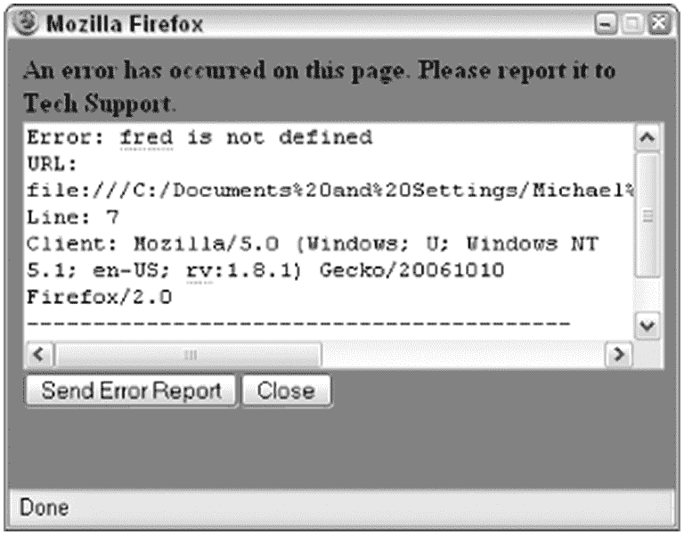

我们提供了一个执行硬加载的按钮，这会将`window.onerror`属性重置为其默认值。当错误对话框关闭时，错误处理函数不会运行。

**相关项目：** `location.reload()`方法；JavaScript 异常处理（第 21 章，“控制结构与异常处理”）；调试脚本（第 48 章，“调试脚本”，位于 CD-ROM 上）

## `opener`

| 值：Window 对象引用 | 读写 |

**兼容性：** WinIE3+, MacIE3+, NN3+, Moz+, Safari+, Opera+, Chrome+

许多脚本编写者常犯一个错误，认为使用`window.open()`方法创建的新浏览器窗口与框架（frame）与其父具有类似的父子关系。事实完全并非如此。新浏览器窗口在创建时，与来源窗口之间的联系非常微弱：通过`opener`属性。`opener`属性的目的是为新窗口中的脚本提供返回原始窗口的有效引用。例如，原始窗口可能包含某些该网站新窗口想要使用的变量值或通用函数。原始窗口可能还有某些表单元素，其设置对新窗口很有价值，或者是在新窗口中通过用户交互进行设置的。

由于`opener`属性的值是对真实窗口对象的引用，你可以直接用该属性名开始引用。或者，你也可以更完整的`window.opener`或`self.opener`引用。但这样引用必须包含原始窗口的某些对象或属性，例如窗口方法或对该窗口文档中包含内容的引用。

如果子窗口打开了另一个子窗口，链链仍然有效，尽管多了一步。第三个窗口可以通过以下开头的引用到达主窗口：

`opener.opener....`

让第三个窗口在页面加载时将`opener.opener`的值存储在全局变量中是一个好主意。这样，如果用户关闭了第二个窗口，可以使用该变量来启动指向主窗口的引用。

当生成新窗口的脚本位于框架内时，子窗口的`opener`属性指向该框架。因此，如果子窗口需要与主窗口的父级或其他主窗口中的框架通信，你必须非常小心地构建指向该远程对象的引用。例如，如果子窗口需要获取创建该子窗口的兄弟框架（sister frame）中复选框的`checked`属性，引用为：

`opener.parent.sisterFrameName.document.formName.checkboxName.checked`

这确实是一段很长的路，但构建这样的引用始终是一个从脚本所在位置到目的地一步步映射出路径的过程。

### 示例

为了演示`opener`属性的重要性，请看新窗口如何根据主窗口中的设置来定义自己（参见列表 27-11）。`doNew()`函数生成一个小的子窗口，并将列表 27-12 中的文件加载到窗口中。注意`doNew()`中的初始条件语句，它们确保了如果新窗口已经存在，则通过调用新窗口的`focus()`方法使其回到最前面。

### 列表 27-11：生成第二个窗口的主窗口文档内容

**HTML: `jsb27-11.html`**

```html
<!DOCTYPE html>
<html>
    <head>
        <meta http-equiv="content-type" content="text/html;charset=utf-8">
        <title>Master of all Windows</title>
        <script type="text/javascript" src="jsb27-11.js"></script>
    </head>
    <body>
        <form name="input">
            Select a color for a new window:
            <input type="radio" name="color" value="red" checked="checked" />Red
            <input type="radio" name="color" value="yellow" />Yellow
            <input type="radio" name="color" value="blue" />Blue
            <input type="button" name="storage" value="MakeWindow" onclick="doNew()"/>
            <hr />
            This field will be filled from another window:
            <input type="text" name="entry" size="5" />
        </form>
    </body>
</html>
```

**JavaScript: `jsb27-11.js`**

```javascript
var myWind;
function doNew() {
    if (!myWind || myWind.closed) {
        myWind = window.open("jsb27-12.html", "Window", "height=200,width=350");
    } else {
        // 将现有窗口带到前面
        myWind.focus();
    }
}
```

### 列表 27-12：对 opener 的引用

**HTML: `jsb27-12.html`**

```html
<!DOCTYPE html>
<html>
    <head>
        <meta http-equiv="content-type" content="text/html;charset=utf-8">
        <title>New Window on opener</title>
        <script type="text/javascript" src="jsb27-12.js"></script>
        <script type="text/javascript">
            document.write("<body bgcolor='" + getColor() + "'>");
        </script>
    </head>
    <body>
        <form>
            <input type="button" value="Who's in the main window?" onclick="alert(self.opener.title)">
            <p>Type text here for the main window:</p>
            <input type="text" name="entry" size="5" onchange="self.opener.forms[0].entry.value = this.value">
        </form>
    </body>
</html>
```

**JavaScript: `jsb27-12.js`**

```javascript
function getColor() {
    // 简化引用
    colorButtons = self.opener.forms[0].color;
    // 检查哪个单选按钮被选中
    for (var i = 0; i < colorButtons.length; i++) {
        if (colorButtons[i].checked) {
            return colorButtons[i].value;
        }
    }
    return "white";
}
```

## `pageXOffset`

## `pageYOffset`

| 值：Integer | 只读 |
| :--- | :--- |

**兼容性:** WinIE-, MacIE-, NN4+, Moz+, Safari+, Opera+, Chrome+

浏览器窗口内容（内部）区域的左上角是文档滚动时的一个重要地理位置点。当文档一直滚动到最顶端并在窗口中左对齐时（或当文档足够小可以填充浏览器窗口而无需显示滚动条时），文档的位置被称为 0,0，意味着距离顶部为 0 像素，距离左侧为 0 像素。如果你滚动了文档，文档的其他某些坐标点将位于该左上角下方。这种度量值称为页面偏移（page offset），`pageXOffset`和`pageYOffset`属性允许你读取文档在内层窗口左上角的像素值：`pageXOffset`是水平偏移，而`pageYOffset`是垂直偏移。

如果你在页面中设计导航按钮来精确控制窗口中显示内容的分页，这些测量值的意义就变得显而易见。例如，你可能有一个双框架页面，其中一个框架包含导航控制控件，另一个框架显示主要内容。导航控件取代了滚动条，出于美观考虑，滚动条在显示框架中被关闭。连接到模拟滚动按钮的脚本可以确定文档的`pageYOffset`值，然后使用`window.scrollTo()`方法将文档精确定位到文档中下一个逻辑分部分以便查看。

IE 在`body`对象属性上具有相应的值：`body.scrollLeft`和`body.scrollTop`（参见第 29 章）。

**相关项目:** `window.innerHeight`、`window.innerWidth`、`body.scrollLeft`、`body.scrollTop`属性；`window.scrollBy()`、`window.scrollTo()`方法

## `parent`

| 值：Window 对象引用 | 只读 |
| :--- | :--- |

**兼容性:** WinIE3+, MacIE3+, NN2+, Moz+, Safari+, Opera+, Chrome+

`parent`属性（以及节后面讨论的`top`属性）主要在文档作为多框架窗口（multiframe window）的一部分显示时起作用。用户在多框架浏览器窗口框架中看到的 HTML 文档与指定整个窗口框架集（frameset）的文档是不同的。该文档虽然仍在浏览器的内存中（并在浏览器的`location`字段中显示为 URL），但对用户来说是不可见的（源代码视图除外）。

如果你可见文档中的脚本需要引用框架集窗口的对象或属性，你可以使用`parent`属性引用这些框架集窗口项。（但是，不要通过在属性名前面加上`window`对象来扩展引用，例如`window.parent.propertyName`，因为这在早期浏览器中会产生问题。）在某种意义上，`parent`属性似乎违反了对象层级结构，因为从单个框架的文档来看，该属性指向了一个优先级似乎更高的层级。如果你没有指定`parent`属性，而是指定了这些框架文档中的一个的`self`属性，则对象引用仅指向该框架，而不是指向最外层的框架集窗口对象。

使用`parent`对象的一种非传统但完全合法的方法是作为存储临时变量的手段。因此，你可以为变量值设置一个存储区域，甚至是一个数据数组。然后，这些值可以在加载到框架中的所有文档之间共享，即使框架内的文档发生了变化也是如此。然而，在`parent`中动态存储数据时（即响应框架中的用户操作时），你必须非常小心。在早期浏览器中，如果用户调整了窗口大小，变量可能会恢复到默认值（父窗口自身脚本设置的值）。

子窗口也可以调用在父窗口中定义的函数。此类函数的引用格式为：

```javascript
parent.functionName([parameters])
```

从初上看，`parent`和`top`属性似乎指向同一个框架集窗口对象。在一个由一个框架集窗口及其直接子窗口组成的环境中，确实如此。但如果其中一个子窗口本身是另一个框架集窗口，你就会得到三代窗口。从最晚的子窗口的角度来看（例如，由第二个框架集定义的窗口），`parent`属性指向它的直接父级，而`top`属性指向该链链中的第一个框架集窗口。

另一方面，通过`window.open()`方法创建的新窗口与原始窗口没有父子关系。新窗口的`top`和`parent`指向该新窗口本身。你可以在本章前面的“框架（Frames）”部分阅读更多关于这些关系。

### 示例

为了演示各种窗口对象属性如何引用多框架环境中的窗口级别，请使用你的浏览器加载 Listing 27-13 文档。它反过来将两个等大小框架中的每一个设置为同一个文档：Listing 27-14。该文档提取了几个窗口属性的值，以及两个不同引用的`document.title`属性。

### Listing 27-13: 用于 Listing 27-14 的框架集文档

```html
<!DOCTYPE html>
<html>
    <head>
      <meta http-equiv="content-type" content="text/html;charset=utf-8">
      <title>The Parent Property Example</title>
      <script type="text/javascript">
        self.name = "Framesetter";
      </script>
    </head>
    <frameset cols="50%,50%" onload="self.name = ''">
      <frame name="JustAKid1" src="jsb27-14.html" />
      <frame name="JustAKid2" src="jsb27-14.html" />
    </frameset>
</html>
```

### Listing 27-14: 揭示各种与窗口相关的属性

```html
<!DOCTYPE html>
<html>
    <head>
      <meta http-equiv="content-type" content="text/html;charset=utf-8">
      <title>Window Revealer II</title>
      <script type="text/javascript">
        function gatherWindowData()
        {
          var msg = "";
          msg += "top name: "
              + top.name + "<br />";
          msg += "parent name: "
              + parent.name + "<br />";
          msg += "parent.document.title: "
              + parent.document.title + "<br />";
          msg += "window name: "
              + window.name + "<br />";
          msg += "self name: "
              + self.name + "<br />";
          msg += "self.document.title: "
              + self.document.title;
          return msg;
        }
      </script>
    </head>
    <body>
      <script type="text/javascript">
        document.write(gatherWindowData());
      </script>
    </body>
</html>
```

在两个框架中，对`window`和`self`对象名称的引用返回由框架集定义的框架名称（左框架为 JustAKid1，右框架为 JustAKid2）。换句话说，从每个框架的角度来看，窗口对象就是它本身。对`self.document.title`的引用指向加载到该窗口框架的文档。但对`top`和`parent`窗口的引用（在本示例中是同一个）显示这些对象属性在两个框架之间是共享的。

## `returnValue`

| 值：任意数据类型 | 可读/写 |
| :--- | :--- |

**兼容性：** WinIE4+, MacIE5+, NN-, Moz+, Safari+, Opera-, Chrome-

脚本在加载到原始 IE 特有的模态对话框的文档中使用`returnValue`属性。模态对话框是通过`showModalDialog()`方法生成的，该方法会返回对话框窗口关闭之前分配给对话框窗口`returnValue`属性的任何数据。之所以可行，是因为当模态对话框可见时，主窗口中的脚本处理会被冻结。当模态对话框关闭时，可以将值返回到主窗口脚本调用模态对话框的位置，主窗口脚本继续执行语句。

### 示例

参见列表 27-36 中的`showModalDialog()`方法，了解如何从对话框获取返回数据的示例。

**相关项目：** `showModalDialog()`方法

## `screen`

| 值：screen 对象 | 只读 |
| :--- | :--- |

**兼容性：** WinIE4+, MacIE4+, NN6+, Moz+, Safari+, Opera+, Chrome+

尽管在现代浏览器中，`screen`对象显示为窗口对象的属性，但在 NN4 中也可以使用`screen`对象（参见第 42 章），只不过它是作为一个独立对象存在的。由于对于窗口对象的属性可以省略对窗口对象的任何引用，因此可以使用相同的无窗口引用语法，以兼容支持`screen`对象的旧版浏览器。

### 示例

参见第 42 章，查看使用`screen`对象确定运行浏览器的计算机视频显示器性的示例。

**相关项目：** `screen`对象

## `screenLeft`、`screenTop`

| 值：整数 | 只读 |
| :--- | :--- |

**兼容性：** WinIE5+, MacIE-, NN-, Moz-, Safari 1.2+, Opera+, Chrome+

WinIE5+ 最初提供了窗口对象的`screenLeft`和`screenTop`属性，让你能够读取微软所说的浏览器窗口“客户端区域”（client area）的像素位置（相对于视频显示器左上角的 0,0 坐标）。客户端区域排除了大部分窗口装饰（window chrome），例如标题栏、地址栏和窗口调整条。因此，当浏览器窗口最大化时（意味着没有暴露调整条），窗口的`screenLeft`属性为 0，而`screenTop`属性则取决于用户选择显示的工具栏组合。对于未最大化的窗口，如果窗口的位置使得客户端区域的顶部和/或左侧部分超出视野，则它们的属性值将为负整数。

这两个属性是只读的。你可以通过`window.moveTo()`和`window.moveBy()`方法对浏览器窗口，但这些方法定位的是整个浏览器窗口的左上角，而不是客户端区域。7 及以下版本的 IE 浏览器不提供整个浏览器窗口位置的属性。

### 示例

使用 The Evaluator（第 4 章，“JavaScript 基础”）来实验`screenLeft`和`screenTop`属性。从浏览器窗口最大化状态开始（如果你正在使用 Windows）。在顶部文本框中输入以下属性名：

```javascript
window.screenLeft
```

点击 Evaluate（评估）按钮查看当前设置。取消窗口最大化，并在屏幕上拖动它。每当你完成拖动，再次点击 Evaluate 按钮以查看当前值。对`window.screenTop`执行同样的操作。

**相关项目：** `window.moveTo()`、`window.moveBy()`方法

## `screenX`、`screenY`

| 值：整数 | 可读/写 |
| :--- | :--- |

**兼容性：** WinIE-, MacIE-, NN6+, Moz+, Safari 1.2+, Opera+, Chrome+

NN6+/Moz/W3C 提供了`screenX`和`screenY`属性，用于读取浏览器窗口边界相对于视频显示器左上坐标 (0,0) 的位置。浏览器窗口包含了围绕 Win32 窗口的 4 像素宽调整条。因此，当 WinNN6+ 浏览器窗口最大化时，`screenX`和`screenY`的值均为 -4。NN/Moz/W3C 不提供类似于 IE5+ `screenLeft`和`screenTop`属性中的浏览器客户端区域等量测量。不过，你可以了解浏览器窗口中是否显示各种工具栏（参见`window.directories`）。

尽管你可以给任一属性赋值，但如果用户设置了防止窗口移动和调整大小的偏好，当前支持的浏览器版本不会响应此调整窗口位置。许多网页用户认为通过脚本移动和调整窗口大小是不可接受的行为。

### 示例

使用 The Evaluator（第 4 章，“JavaScript 基础”）来实验`screenX`和`screenY`属性。从浏览器窗口最大化状态开始（如果你正在使用 Windows）。在顶部文本框中输入以下属性名：

```javascript
window.screenY
```

点击 Evaluate 按钮查看当前设置。取消窗口最大化，并在屏幕上拖动它。每当你完成拖动，再次点击 Evaluate 按钮查看当前值。对`window.screenY`执行同样的操作。

**相关项目：** `window.moveTo()`、`window.moveBy()`方法

## `scrollbars`

（参见`directories`）

## `scrollMaxX`、`scrollMaxY`

| 值：整数 | 可读/写 |
| :--- | :--- |

**兼容性：** WinIE-, MacIE-, NN7.1+, Moz1.4+, Safari-, Opera-, Chrome-

NN7.1+/Moz1.4+ 的`scrollMaxX`和`scrollMaxY`属性让你确定窗口的最大水平和垂直滚动范围。只有当窗口沿所需轴显示滚动条时，才可以滚动。值为像素整数。

**相关项目：** `scrollX`、`scrollY`属性

## `scrollX`、`scrollY`

| 值：整数 | 只读 |
| :--- | :--- |

**兼容性：** WinIE-, MacIE-, NN6+, Moz+, Safari+, Opera+, Chrome+

NN6+/Mozilla-Safari 的`scrollX`和`scrollY`属性让你确定窗口的水平和垂直滚动。只有当窗口沿所需轴显示滚动条时，才可以滚动。值为像素整数。

尽管 IE DOM 没有为窗口提供类似的属性，但从`body.scrollLeft`和`body.scrollTop`属性可以推导出相同的信息。

### 示例

使用 The Evaluator（第 4 章，“JavaScript 基础”）来实验`scrollX`和`scrollY`属性。在顶部文本框中输入以下属性：

```javascript
window.scrollY
```

现在手动滚动页面，直到你能看到 Evaluate 按钮。点击按钮查看窗口沿 y 轴滚动了多少距离。

**相关项目：** `body.scrollLeft`、`body.scrollTop`属性

## `self`

| 值：窗口对象引用 | 只读 |
| :--- | :--- |

**兼容性：** WinIE3+, MacIE3+, NN2+, Moz+, Safari+, Opera+, Chrome+

就像窗口对象引用是可选的一样，当对象引用指向包含引用的同一个窗口时，`self`属性也是可选的。在一个看似奇怪的构造中，`self`属性代表与`window`的对象。例如，为了获取单帧窗口中文档的标题，可以使用以下三种构造之一：

```javascript
window.document.title
self.document.title
document.title
```

尽管`self`是窗口的属性，但你不应该在单帧窗口脚本中组合引用（例如，不要以`window.self`开头引用，这已知会导致许多脚本问题）。尽管指定`self`属性对于单帧窗口是可选的，但它可以帮助阅读你代码的人（包括你自己）让对象引用变得非常清晰。多帧窗口是你需要关注此属性的地方。JavaScript 对语句自身窗口的引用非常智能。因此，你通常可以对同窗口文档元素的引用省略`self`部分。但当你打算在多帧窗口中显示文档时，完整的引用（包括`self`前缀）会让任何阅读或调试代码的人更容易跟踪谁在对谁做什么。你可以自由获取任何窗口的`self`属性。返回的值是一个窗口对象引用。

### 示例

列表 27-15 使用与列表 27-5 相同的操作，但将所有`window`对象引用替换为`self`属性。该引用的应用完全可选的，但如果 HTML 文档显示在多框架窗口的某个帧中，它对于阅读和调试脚本很有帮助——特别是当文档中的其他 JavaScript 代码引用了其他帧中的文档时。`self`引用帮助任何阅读代码的人精确知道正在访问哪一个帧。在测试时，请记住，尽管现代浏览器支持`status`属性，但为了防止链接欺骗，某些浏览器不会显示与链接相关的脚本设置状态栏文本。

### 列表 27-15：使用`self`属性

```html
<!DOCTYPE html>
<html>
    <head>
        <meta http-equiv="content-type" content="text/html;charset=utf-8">
        <title>self Property</title>
        <script type="text/javascript">
            self.defaultStatus = "Welcome to my Website.";
        </script>
    </head>
    <body>
        <h1>self Property</h1>
        <hr />
        <p><a href="http://www.microsoft.com"
              onmouseover="self.status = 'Visit Microsoft's Home page.';return true;"
              onmouseout="self.status = '';return true;">Microsoft</a>
        </p>
        <p><a href="http://mozilla.org"
              onmouseover="self.status = 'Visit Mozilla's Home page.';return true;"
              onmouseout="self.status = self.defaultStatus;
              return true;">Mozilla</a></p>
    </body>
</html>
```

**相关项目：** `window.frames`、`window.parent`、`window.top`属性

## `sidebar`

（参见`appCore`）

## `status`

| 值：String | 可读写 |
| :--- | :--- |

**兼容性:** WinIE3+, MacIE3+, NN2+, Moz+, Safari+, Opera+, Chrome+

浏览器窗口底部有一个状态栏。状态栏的一部分包含一个通常显示文档加载进度或鼠标在该时刻指向的链接 URL 的区域。你可以通过向`window`对象的`status`属性分配文本字符串来控制该字段的临时内容。你应该只对具有临时效果的事件调整`status`属性，例如链接或图像映射区域对象的`onmouseover`事件处理程序。在这种情况下设置`status`属性时，它将覆盖状态栏中的任何其他设置。如果用户随后将鼠标指针移离更改状态栏的对象，状态栏将恢复到默认设置（在某些页面上可能是空的）。然而，为了防止链接欺骗，并不是所有现代浏览器都会显示与链接相关的脚本设置状态栏文本。

使用此`window`属性作为更友好的替代方案，在用户在页面上移动鼠标时显示链接 URL。例如，如果你更倾向于使用状态栏来解释链接目的地的性质，可以在响应`onmouseover`事件处理程序时将文本放入状态栏。但请注意，经验丰富的网民喜欢在下方查看 URL。因此，考虑为状态栏创建一个混合消息，其中包含一个友好的描述，随后跟上括号内的 URL。在多框架环境中，你可以设置`window.status`属性而无需担心引用单个帧。

### 示例

在列表 27-16 中，`status`属性被设置在两个 HTML 链接标签的`onmouseover`属性处理程序中。注意，该处理程序要求将`return true`语句（或任何求值为`return true`的表达式）作为处理程序的最后语句。此语句是必要的；否则状态消息将不会在所有浏览器中显示。测试时，请记住，尽管现代浏览器支持`status`属性，但为了防止链接欺骗，某些浏览器不会显示与链接相关的脚本设置状态栏文本。

### 列表 27-16：带有自定义状态栏消息的链接

```html
<!DOCTYPE html>
<html>
    <head>
        <meta http-equiv="content-type" content="text/html;charset=utf-8">
        <title>window.status Property</title>
    </head>
    <body>
        <h1>window.status Property</h1>
        <hr />
        <a href="http://www.dannyg.com"
          onmouseover="window.status = 'Go to my Home page. (www.dannyg.com)';
          return true">
            Home</a>
        <p>
          <a href = "http://mozilla.org"
              onmouseover="window.status = 'Visit Mozilla Home page. (mozilla.org)';
              return true">
            Mozilla</a>
        </p>
    </body>
</html>
```

为了防止影响`onmouseover`事件处理程序和`window.status`属性行为的特定平台异常，你还应该为链接和客户端图像映射区域对象包含一个`onmouseout`事件处理程序。此类`onmouseout`事件处理程序应将`status`属性设置为空字符串。此设置确保了当指针移开这些对象时，状态栏消息将返回到`defaultStatus`设置。如果你想写一个处理所有窗口状态更改的通用函数，可以这样做，但要仔细措辞`onmouseover`属性，以确保事件处理程序的求值为`return true`。列表 27-17 显示了这样的替代方案。再次，在测试时，请记住现代浏览器不显示与链接相关的状态栏文本。

### 列表 27-17：处理状态变化

```html
<!DOCTYPE html>
<html>
    <head>
        <meta http-equiv="content-type" content="text/html;charset=utf-8">
        <title>Generalizable window.status Property</title>
        <script type="text/javascript">
            function setStatus(msg) {
                window.status = msg;
                return true;
            }
        </script>
    </head>
    <body>
        <h1>Generalizable window.status Property</h1>
        <hr />
        <a href="http://www.dannyg.com"
          onmouseover="setStatus('Go to my Home page.')"
          onmouseout="setStatus('')">Home</a>
        <p>
          <a href="http://mozilla.org"
              onmouseover="setStatus('Visit Mozilla Home page.')"
              onmouseout="setStatus('')">Mozilla</a>
        </p>
    </body>
</html>
```

注意事件处理程序如何返回`setStatus()`方法的结果。

设置状态栏的最后一个示例（显示在列表 27-18 中）还演示如何创建一个滚动横幅。

### 列表 27-18：创建一个滚动横幅

**HTML: `js27-18.html`**

```html
<!DOCTYPE html>
<html>
    <head>
        <meta http-equiv="content-type" content="text/html;charset=utf-8">
        <title>Message Scroller</title>
        <script src="js27-18.js"></script>
    </head>
    <body onload="scrollMsg()">
        <h1>Message Scroller</h1>
        <hr />
    </body>
</html>
```

**JavaScript: `js27-18.js`**

```javascript
var msg = "Welcome to my world...";
var delay = 150;
var timerId;
var maxCount = 0;
var currCount = 1;

function scrollMsg() {
    // 设置消息运行的次数
    if (maxCount == 0) {
        maxCount = 3 * msg.length;
    }
    window.status = msg;
    // 跟踪滚动了多少字符
    currCount++;
    // 将 msg 的第一个字符移动到 msg 的末尾
    msg = msg.substring(1, msg.length) + msg.substring(0, 1);
    // 测试是否达到了最大字符数
    if (currCount >= maxCount) {
        timerID = 0; // 清空定时器
        window.status = ""; // 清空状态栏
        return; // 跳出函数
    } else {
        // 递归调用此函数
        timerId = setTimeout("scrollMsg()", delay);
    }
}
```

由于状态栏是由独立函数设置的（而不是通过`onmouseover`事件处理程序），因此你不需要添加`return true`语句来设置 status 属性。`scrollMsg()`函数使用了更高级的 JavaScript 概念，例如`window.setTimeout()`方法（在本章稍后介绍）和字符串方法（在第 15 章“字符串对象”中介绍）。要加快文字在状态栏上滚动的速度，请减小`delay`的值。

许多网页浏览者（包括我们）并不喜欢这些在状态栏中无限运行的滚动条。鼠标悬停在链接上会干扰横显示。请谨慎使用滚动条，或将其设计为在文档加载后仅运行几次。

### 提示

使用`onmouseover`事件处理器设置 status 属性在 Navigator 的不同实现中结果参差不齐。设置状态栏的脚本始终与浏览器本身处于竞争状态，浏览器使用状态栏来报告加载进度。当页面上的热点位于帧边缘时，`onmouseout`事件往往无法触发，导致状态栏无法自动清除内容。在宣布你的页面可以公开发访问之前，请务必对任何此类实现进行压力测试。

**相关项目：** `window.defaultStatus`属性；`onmouseover`、`onmouseout`事件处理器；`link`对象

## `statusbar`

## `toolbar`

（参见`locationbar`）

## `top`

| 值：Window 对象引用 | 只读 |

**兼容性：** WinIE3+, MacIE3+, NN2+, Moz+, Safari+, Opera+, Chrome+

`window`对象的`top`属性指向 frameset（帧集）对象层次结构中最顶层的窗口。对于单帧窗口，该引用指向与窗口相同的对象（包括`self`和`parent`属性），因此不要将`window`作为引用的一部分。在多帧窗口中，`top`窗口是定义第一个 frameset 的那个窗口（在嵌套 frameset 的情况下）。用户在多帧环境中实际上永远看不到顶层窗口，但浏览器将其作为一个对象存储在内存中。这是因为顶层窗口拥有了通往其他帧的路线图（以防某一个帧需要引用另一个帧中的对象），且它的子帧可以调用它。这样的引用如下：

```javascript
top.functionName([parameters])
```

关于`top`和`parent`属性之间区别的更多信息，请参见本章开头关于脚本帧的深入讨论。另见`parent`属性的示例，其中列表演示了`top`属性的值。

**相关项目：** `window.frames`、`window.self`、`window.parent`属性

## `window`

| 值：Window 对象 | 只读 |

**兼容性：** WinIE3+, MacIE3+, NN2+, Moz+, Safari+, Opera+, Chrome+

将`window`属性列为单独属性可能比有帮助更有误导。`window`属性与窗口对象是同一个对象。你不需要使用以`window.window`开头的引用。虽然在许多引用中假定了`window`对象，但你可以将`window`作为引用该引用的脚本语句所在的同一窗口或帧中项的引用的一部分。然而，你不应该将`window`作为涉及层次结构中较高层项目（`top`或`parent`）的引用的一部分。

## 方法

### `alert("message")`

**返回值：** 无

**兼容性：** WinIE3+, MacIE3+, NN2+, Moz+, Safari+, Opera+, Chrome+

alert 对话框是一个模态窗口，它向用户显示消息，并带有一个用于关闭对话框的 OK 按钮。只要 alert 对话框显示着，没有其他应用程序或窗口可以变为活动状态。用户必须在继续执行浏览器中的任何其他工作之前关闭对话框。

`alert()`方法的单个参数可以是任何数据类型的值，包括某些异常数据类型的表示，而你通常在 JavaScript 中并不会处理这些数据类型的值（例如完整对象）。这使得 alert 对话框成为调试 JavaScript 脚本的方便工具。每当你想监控表达式的值时，请使用该表达式作为你代码中临时`alert()`方法的参数。脚本执行到该点会停止并向你显示该值。（有关调试脚本的更多提示请参见第 48 章。）

应用程序设计人员经常感到困扰的是，所有由 JavaScript 创建的模态对话框（通过`alert()`、`confirm()`和`prompt()`方法）都会将自己标识为由 JavaScript 或浏览器生成。这种标识的目的是作为一种安全预防措施，防止不择手段的脚本编写者（他们可能会尝试伪造系统或浏览器 alert 对话框，诱导用户透露密码或其他私人信息）。这些标识词无法通过你的脚本覆盖或消除。你可以使用普通的浏览器窗口以跨浏览器的方式模拟模态对话框窗口，但这不如真正的模态窗口稳健，你可以在 IE4+ 以及其他一些现代浏览器中通过`window.showModalDialog()`方法创建真正的模态窗口。

由于`alert()`方法具有全局性质（也就是说，在多帧环境中没有特定的帧会因为声称为 alert 对话框而获得任何好处），通常的做法是从调用该方法的语句中省略所有`window`对象引用。限制在你的 HTML 文档和站点设计中使用 alert 对话框。窗口的模态性会破坏用户在你页面间导航的流程。请通过表单或写入独立的文档窗口帧与用户通信。当然，alert 仍然可以作为快速调试的辅助工具。

### 示例

列表 27-19 中示例的参数是一个拼接字符串。它连接了两个固定字符串和浏览器`navigator.appName`属性的值。加载此文档会导致 alert 对话框出现，如图 27.5 中的若干配置所示。在较旧浏览器中，无法从对话框中删除 JavaScript Alert 行，而在较后的浏览器中，标题栏无法更改。

### 列表 27-19：显示 alert 对话框

```html
<!DOCTYPE html>
<html>
    <head>
      <meta http-equiv="content-type" content="text/html;charset=utf-8">
      <title>window.alert() 方法</title>
    </head>
    <body>
      <h1>window.alert() 方法</h1>
      <hr />
      <script type="text/javascript">
          alert("You are running the " + navigator.appName + " browser.");
      </script>
    </body>
</html>
```

图 27.5 列表 27-19 在 Firefox 和 Internet Explorer 中`alert()`方法的结果。

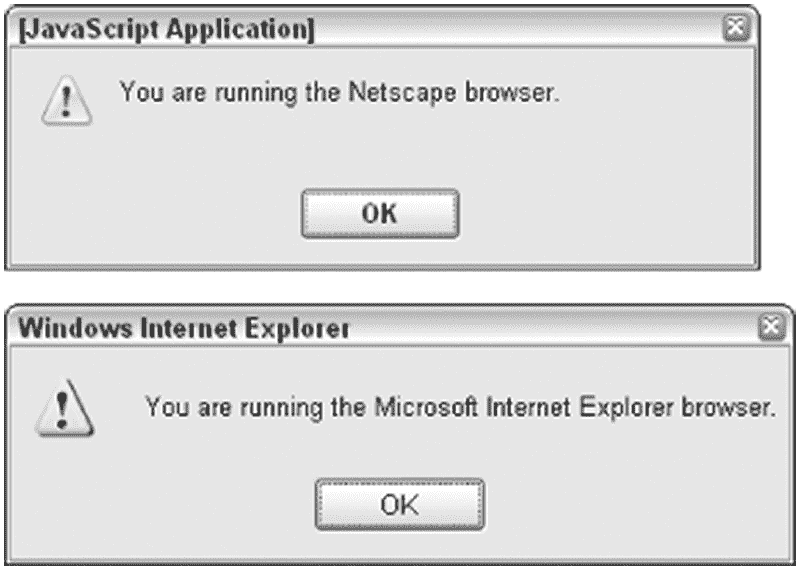

**相关项目：** `window.confirm()`、`window.prompt()`方法

### `back()`

### `forward()`

**返回值：** 无

**兼容性：** WinIE+, MacIE-, NN4+, Moz+, Safari+, Opera+, Chrome+

从 NN4 开始的`window.back()`和`window.forward()`方法的目的是提供全局后退和前进导航按钮的脚本版本，同时允许`history`对象严格控制特定窗口或帧内的导航——正如它应该做的那样。尽管 IE 现在支持这些窗口方法，但它们并没有流行（且`window`对象在 W3C DOM Level 2 范围之外），因此你最好使用`history`对象的方法来导航浏览器历史。关于版本兼容性以及后退和前进导航的更多信息，请参见第 28 章中的`history`对象。

**相关项目：** `history.back()`、`history.forward()`、`history.go()`方法

### `clearInterval(intervalIDnumber)`

**返回值：** 无

**兼容性：** WinIE4+, MacIE4+, NN4+, Moz+, Safari+, Opera+, Chrome+

使用`window.clearInterval()`方法可以关闭通过`window.setInterval()`方法启动的间隔循环操作。参数是`setInterval()`方法返回的 ID 数字。JavaScript 间隔机制的一个常见应用是页面上对象的动画。如果你有多个间隔器在运行，每个间隔器在内存中都有自己的 ID 值。你可以通过 ID 值关闭任何间隔器。一旦间隔循环停止，你的脚本将无法恢复该间隔：它必须启动一个新的间隔，这将生成一个新的 ID 值。

### 示例

参阅本章稍后出现的列表 27-33 和列表 27-34，了解如何在页面上结合使用`setInterval()`和`clearInterval()`的示例。

**相关项目：** `window.setInterval()`、`window.setTimeout()`、`window.clearTimeout()`方法

### `clearTimeout(timeoutIDnumber)`

**返回值：** 无

**兼容性：** WinIE3+, MacIE3+, NN2+, Moz+, Safari+, Opera+, Chrome+

正如本章稍后描述，将`window.clearTimeout()`方法配合`window.setTimeout()`方法使用，当你希望脚本取消一个等待执行表达式的计时器时。该方法的参数是`window.setTimeout()`方法在计时开始时返回的 ID 数字。`clearTimeout()`方法会取消指定的超时。良好的做法是检查代码，查看是否存在用户操作可能会消除运行计时器需要的情况——并在该计时器触发之前停止它。

### 示例

列表 27-20 中的页面包含一个文本框和两个按钮。一个按钮启动一个编码为持续 1 分钟的倒计时器（可以轻松修改为其他持续时间）；另一个按钮可以在计时器运行时在任何时间中断它。当时间结束时，警报对话框会通知你。

### 列表 27-20：倒计时器

**HTML：`jsb27-20.html`**

```html
<!DOCTYPE html>
<html>
<head>
    <meta http-equiv="content-type" content="text/html;charset=utf-8">
    <title>倒计时器</title>
    <script type="text/javascript" src="jsb27-20.js"></script>
</head>
<body>
    <form>
        <input type="button" name="startTime" value="Start 1 min. Timer" onclick="startTimer()" />
        <input type="button" name="clearTime" value="Clear Timer" onclick="stopTimer()" />
        <p><input type="text" name="timerDisplay" value=""/></p>
    </form>
</body>
</html>
```

**JavaScript：`jsb27-20.js`**

```javascript
var running = false;
var endTime = null;
var timerID = null;

function startTimer() {
    running = true;
    now = new Date();
    now = now.getTime();
    // 修改最后的倍数以更改分钟数
    endTime = now + (1000 * 60 * 1);
    showCountDown();
}

function showCountDown() {
    var now = new Date();
    now = now.getTime();
    if (endTime - now <= 0) {
        stopTimer();
        alert("时间到了。请放下笔。");
    }
    else {
        var delta = new Date(endTime - now);
        var theMin = delta.getMinutes();
        var theSec = delta.getSeconds();
        var theTime = theMin;
        theTime += ((theSec < 10) ? ":0" : ":") + theSec;
        document.forms[0].timerDisplay.value = theTime;
        if (running) {
            timerID = setTimeout("showCountDown()",1000);
        }
    }
}

function stopTimer() {
    clearTimeout(timerID);
    running = false;
    document.forms[0].timerDisplay.value = "0:00";
}
```

注意脚本在 window 中建立了三个全局作用域的变量：`running`、`endTime`和`timerID`。这些值在多个函数内部都需要，因此它们在函数外部初始化。

在`startTimer()`函数中，你开启了`running`标志，这意味着计时器应该运行。使用一些日期函数（见第 17 章“Date 对象”），你提取当前的毫秒时间，并加上下一分钟的毫秒数（额外的乘以 1 是你可以更改所需分钟数的地方）。将结束时间存储在全局变量中，该函数现在调用另一个函数来比较当前时间和结束时间，并在文本框中显示差值。

在`showCountDown()`函数早期，检查计时器是否已经运行结束。如果是，你停止计时器并通知用户。否则，函数继续计算两个时间之间的差值，并将时间格式化为 mm:ss 格式。只要`running`为真，计时器就会继续运行。

### `confirm("message")`

**返回值：** Boolean

**兼容性：** WinIE3+, MacIE3+, NN2+, Moz+, Safari+, Opera+, Chrome+

确认对话框在模态对话框中显示一条消息，并带有“确定”（OK）和“取消”（Cancel）按钮。此类对话框可向用户提问，通常在脚本执行不可撤销的操作之前。当用户对表单元素进行交互时，询问用户是否继续进行典型的网页导航，通常是对用户时间和注意力的破坏性浪费。但对于那些可能泄露用户身份或将表单数据发送到服务器的操作，JavaScript 确认对话框可能非常有意义。用户也可能不小心点击按钮，因此你应该在操作执行之前提供撤回的途径。

由于此对话框返回一个布尔值（确定 = true；取消 = false），你可以将此方法用作比较表达式或赋值表达式。在比较表达式中，你将该方法嵌套在任何需要布尔值的语句中。例如：

```javascript
if (confirm("Are you sure?"))
{
   alert("OK");
}
else
{
   alert("Not OK");
}
```

在这里，`confirm`对话框的返回值为`if...else`结构提供了所需的布尔类型（参见第 21 章）。

该方法也可以出现在赋值表达式的右侧，如下：

```javascript
var adult = confirm("Do you certify that you are over 18 years old?");
if (adult)
{
   //针对成人的语句
}
else
{
   //针对儿童的语句
}
```

你无法为 JavaScript 确认对话框窗口中的两个按钮指定其他的警告图标或标签。

列表 27-21 中的示例显示了如何使用确认对话框在清除包含用户输入数据的表格之前查询用户的用户界面部分。标题栏中的文本（如图 27.6 所示）无法从对话框中移除。

### 列表 27-21：确认对话框

```html
<!DOCTYPE html>
<html>
   <head>
      <meta http-equiv="content-type" content="text/html;charset=utf-8">
      <title>window.confirm() Method</title>
      <script type="text/javascript">
         function clearTable()
         {
            if (confirm("Are you sure you want to empty the table?"))
            {
               alert("Emptying the table...");   //为了演示目的
               //实际清空字段的语句
            }
         }
      </script>
   </head>
   <body>
      <h1>window.confirm() Method</h1>
      <hr />
      <form>
         <h3>A large table with data would be here.</h3>
         <input type="button" name="clear" value="Reset Table"
                onclick="clearTable()" />
      </form>
   </body>
</html>
```

图 27.6 Internet Explorer 中的 JavaScript 确认对话框。

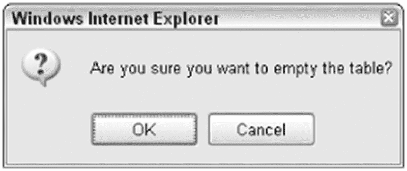

**相关条目：** `window.alert()`、`window.prompt()`、`form.submit()`方法

### `createPopup()`

**返回：** 弹出窗口对象的引用

**兼容性：** WinIE5.5+, MacIE-, NN-, Moz-, Safari-, Opera-, Chrome-

IE 弹出窗口是一个无边框矩形空间，覆盖在当前窗口之上。与`showModalDialog()`和`showModelessDialog()`方法生成的对话框不同，弹出窗口的所有内容必须由脚本显式控制。窗口的大小和位置也是如此。通过`createPopup()`方法生成窗口仅仅是在内存中创建该对象，而不显示它。然后你可以使用该方法返回的弹出窗口引用来定位窗口、填充其内容并使其可见。详细信息请参见本章后文关于弹出对象的描述。

### 示例

请参见本章稍后的列表 27-46 获取`createPopup()`方法的示例。

**相关条目：** popup 对象

### `dump("message")`

**返回：** 无

**兼容性：** WinIE-, MacIE-, NN7.1+, Moz1.4+, Safari-, Opera-, Chrome-

`window.dump()`方法是一个调试/诊断方法，你可以用它将字符串文本输出到标准输出（这通常是操作系统的控制台窗口）。`dump()`方法提供了一种比通过`alert()`方法显示调试信息更低侵入性的替代方案。

### `execScript("exprList"[, language])`

**返回：** 无

**兼容性：** WinIE4+, MacIE4+, NN-, Moz-, Safari-, Opera-, Chrome-

IE 特有的`window.execScript()`方法执行作为字符串表达式传递的一个或多个脚本语句。第一个参数是一个或多个脚本语句的字符串版本（多个语句必须用分号隔开）。第二个可选参数是浏览器应该用于执行脚本语句的语言解释器。语言的可接受的值有 JavaScript、JScript、VBS 和 VBScript。默认值是 JScript，因此在提供 JavaScript 表达式时可以省略第二个参数。

与 JavaScript 核心语言的`eval()`函数（它也执行 JavaScript 语句的字符串版本）不同，`execScript()`方法不返回值。尽管如此，该方法在持有当前文档的窗口的全局变量空间内运行。例如，如果文档脚本如下声明了一个全局变量：

```javascript
var myVar;
```

`execScript()`方法可以读取或写入该变量：

```javascript
window.execScript("myVar = 10; myVar += 5");
```

在该语句运行后，全局变量`myVar`的值为 15。

### 示例

使用“评估器”（第 4 章，“JavaScript 基础”）来实验`execScript()`方法。评估器预先声明了小写字母 a 到 z 的全局变量。在顶部文本框中输入以下每个语句，并观察每个语句的结果。

`a`

第一次加载时，该变量被声明但未赋值，因此它是未定义的（undefined）：

```javascript
window.execScript("a = 5")
```

该方法没有返回值，因此评估器内部机制显示该语句是未定义的：

`a`

变量现在是 5。

```javascript
window.execScript("b = a * 50")
```

`b`

全局变量`b`的值为 250。继续使用额外的脚本语句进行探索。使用分号隔开字符串参数内的多个语句。

**相关条目：** `eval()`函数

### `find(["searchString" [, matchCaseBoolean, searchUpBoolean]])`

**返回：** 用于非对话框搜索的布尔值

**兼容性：** WinIE-, MacIE-, NN4+, Moz1.0.1+, Safari+, Opera-, Chrome+

在 NN4 中引入的`window.find()`方法模拟了浏览器查找对话框的功能，该对话框可以通过工具栏上的查找按钮访问。该方法在 NN6 中被禁用，但在 NN7/Moz1.0.1 中重新激活。

如果你不指定任何参数，浏览器的查找对话框将会出现，就像用户点击了工具栏上的查找按钮一样。在没有参数的情况下，此函数不返回值。

你可以将搜索字符串作为函数的参数。搜索基于简单的字符串匹配，与正则表达式类的搜索完全没有关系（参见第 45 章，“正则表达式和 RegExp 对象”）。如果搜索找到了匹配项，浏览器将滚动到该匹配单词并突出显示该单词，就像使用浏览器自带的查找对话框一样。在找到匹配项后，函数还会返回布尔值 true。如果文档中未找到匹配项，或者在当前搜索方向上没有更多匹配项（默认方向是从上到下），函数返回 false。

表 27.3 列出了你可以使用的可选参数；在所有情况下，默认值均为 false。这些选择与 NN4+ 查找对话框中的选项完全一致。

**表 27.3 `window.find()` 方法可通过脚本控制的属性**

| 属性 | 描述 |
| :--- | :--- |
| `caseSensitive` | 布尔值；true 表示搜索区分大小写 |
| `backwards` | 布尔值；true 表示反向搜索 |
| `wraparound` | `Boolean`; `true` 表示当到达文档底部时搜索将循环到文档顶部。 |
| `wholeWord` | `Boolean`; `true` 表示搜索为全单词匹配。 |
| `searchInFrames` | `Boolean`; `true` 表示在框架中进行搜索。 |
| `showDialog` | `Boolean`; `true` 表示显示浏览器的查找对话框。 |

一些现代浏览器（如 Firefox）已经进化演进，放弃了查找对话框，转而使用一个出现在浏览器窗口底部的集成查找功能。这种查找方法可以同时应用于整个页面，在这种情况下，所有匹配的文本都会被高亮。

IE4+ 也具有脚本化的文本搜索功能，但它的实现方式完全不同（使用第 33 章“正文文本对象”中描述的`TextRange`对象）。其视觉行为也不同，它不会在文本中高亮并滚动到匹配的字符串。

### 示例

`window.find()`方法的简单调用如下：

```javascript
var success = window.find("contract");
```

如果你希望搜索区分大小写，请至少添加一个可选参数：

```javascript
success = window.find(matchString,caseSensitive);
```

在许多方面，`window.find()`方法是 NN4 的遗留。请参考第 33 章中关于`TextRange`和`Range`对象的讨论，获取更现代的正文搜索实现。

**相关项目：** `TextRange`、`Range`对象（第 33 章）

### `forward()`

（参见`window.back()`）

### `geckoActiveXObject("progID")`

**返回：** WMP 控制对象

**兼容性：** WinIE-, MacIE-, NN7.1+, Moz1.4+, Safari-, Opera-, Chrome-

NN/IE 浏览器大战的一个有趣结果是，微软成功地将 Windows Media Player (WMP) 建立了 Windows 操作系统的首选媒体播放器。由于 WMP 是实现为 ActiveX 控制的，NN/Moz 浏览器在脚本化方面某种程度上被冷落了。Moz1.4 浏览器增加了`window.geckoActiveXObject()`方法，以赋予它们作为 ActiveX 控件访问 WMP 的能力。尽管该方法的名称暗示了对 ActiveX 控制的通用支持，但它目前仅允许你打开 WMP 控制。

`geckoActiveXObject()`的唯一参数是程序 ID，对于 WMP 目前为`MediaPlayer.MediaPlayer.1`。因此，要使用`geckoActiveXObject()`方法获取媒体播放的 WMP 引用，请使用如下代码：

```javascript
var player = new GeckoActiveXObject("MediaPlayer.MediaPlayer.1");
```

### `getComputedStyle(elementNodeRef, "pseudoElementName")`

**返回：** CSS 样式对象

**兼容性：** WinIE-, MacIE-, NN-, Moz+, Safari+, Opera+, Chrome+

`window.getComputedStyle()`方法允许你访问与给定元素相关的级联样式表 (CSS) 样式对象。你将元素节点引用作为方法的第一个参数，以及一个应用于样式的特定伪元素的可选名称。我们之所以说是可选的，是因为你可以传递一个空字符串作为第二个参数，以获取一个没有伪元素影响的样式对象。

### 注意

尽管各种浏览器都支持`getComputedStyle()`方法，但根据为元素指定的样式，返回的值格式可能有所不同。例如，如果你请求一个具有背景颜色的元素的样式，Opera 将以十六进制返回颜色，而 Firefox、Safari 和 Chrome 将以`rgb()`格式返回。

虽然`getComputedStyle()`方法为窗口对象进行了定义（并有效），但 W3C DOM 优先使用`document.defaultView.getComputedStyle()`作为访问元素样式对象的标准方法。最终调用的是同一个方法；不同的是访问方式。

### `getSelection()`

**返回：** 选择对象

**兼容性：** WinIE-, MacIE-, NN6+, Moz+, Safari+, Opera+, Chrome+

该方法取代了出现在`document`对象中的同名已弃方法。该方法提供了一种脚本方式来捕获用户在页面中选择的文本，这是涉及选择和复制文档正文以粘贴到其他应用程序文档的常见任务。`window.getSelection()`方法返回用户选择的文本字符串。如果没有选择任何内容，结果为空字符串。返回的值仅包含页面上的可见文本，而不包含文本的底层 HTML 或样式。

WinIE4+ 的等效实现涉及`document.selection`属性，它返回一个 IE 选择对象。要从此对象派生文本，你必须从它创建一个`TextRange`对象，然后检查`text`属性：

```javascript
var selectedText = document.selection.createRange().text;
```

### 示例

列表 27-22 中的文档提供了一种跨浏览器（但不支持 MacIE5）的解决方案，用于捕获用户在页面中选择的文本。选择的文本显示在文本区域。脚本使用浏览器检测和分支来处理 Mozilla 和 Internet Explorer 之间事件处理的差异。

### 列表 27-22：检索选择的文本

**HTML：`jsb27-22.html`**

```html
<!DOCTYPE html>
<html>
    <head>
      <meta http-equiv="content-type" content="text/html;charset=utf-8">
      <title>获取选择的文本</title>
      <script type="text/javascript" src="../jsb-global.js"></script>
      <script type="text/javascript" src="jsb27-22.js"></script>
    </head>
    <body>
      <h1>获取选择的文本</h1>
      <hr />
      <p>选择一些文本并查看 JavaScript 如何捕获：</p>
      <h2>第一条</h2>
      <p>国会不得制定关于宗教的法律，或禁止言论自由、新闻自由；人民和平集会并向政府请愿以不受侵害的权利。</p>
      <form>
        <textarea name="selectedText" rows="3" cols="40" wrap="virtual"></textarea>
      </form>
    </body>
</html>
```

**JavaScript：`jsb27-22.js`**

```javascript
addEvent(document, "mouseup", showSelection);

function showSelection()
{
  if (window.getSelection()) {
    document.forms[0].selectedText.value = window.getSelection();
  }
  else if (document.selection) {
    document.forms[0].selectedText.value = document.selection.createRange().text;
    event.cancelBubble = true;
  }
}
```

**相关项目：** `document.selection`属性

### `home()`

**返回：** 无

**兼容性：** WinIE-, MacIE-, NN4+, Moz+, Safari-, Opera-, Chrome-

与许多在 Navigator 4 中引入的窗口方法一样，`window.home()`方法提供了一种脚本方式来复制工具栏按钮的操作：主页按钮。该操作将浏览器导航到浏览器偏好设置中设置的主页位置 URL。你无法控制访问浏览器的默认主页。

**相关项目：** `window.back()`、`window.forward()`方法；`window.toolbar`属性

### `moveBy(deltaX,deltaY)`

### `moveTo(x,y)`

**返回：** 无

**兼容性：** WinIE4+, MacIE4+, NN4+, Moz+, Safari+, Opera+, Chrome+

第 4 版浏览器引入了允许 JavaScript 调整屏幕上浏览器窗口位置的能力。这适用于主窗口或任何由脚本生成的子窗口。NN/Moz 将窗口移到屏幕之外的可能性视为潜在的安全漏洞，因此在 NN4+/Moz 中需要签名脚本才能将窗口移动到屏幕外。虽然这些方法兼容 Chrome，但 Chrome 忽略了它们。

你可以将窗口移动到屏幕上的绝对位置，或者沿水平和/或垂直轴按任意像素数进行调整，而无受绝对像素位置的限制。x（水平）和 y（垂直）位置的坐标空间是整个屏幕，其中左上角代表 0,0。你通过`moveBy()`和`moveTo()`方法设置的窗口点是浏览器窗口外层边缘的左上角。因此，当你将窗口移动到点 0,0 时，窗口将与屏幕的左上角对齐。然而，对于所有浏览器和操作系统来说，这可能并不等同于真正的最大化窗口，因为最大化窗口的坐标可能会负几个像素。

`moveTo()`和`moveBy()`方法之间的区别在于，一个是绝对移动，而另一个是相对于当前窗口位置的相对移动。你为`moveTo()`指定的参数是希望窗口左上角出现在屏幕上的精确水平和垂直像素数。相比之下，`moveBy()`的参数表示向任一方向调整窗口位置时移动的距离。如果你想将窗口向右移动 25 像素，你仍然包含两个参数，但 y 值将为零：

```javascript
window.moveBy(25,0);
```

要向左移动，第一个参数必须是一个负数。

### 示例


列表 27-23 显示了使用 `window.moveTo()` 和 `window.moveBy()` 方法的几个示例。页面展示了四个按钮，每个按钮都执行不同类型的浏览器窗口移动。

### 列表 27-23：窗口体操

HTML: `jsb27-23.html`

```html
<!DOCTYPE html>
<html>
<head>
    <meta http-equiv="content-type" content="text/html;charset=utf-8">
    <title>Window Gymnastics</title>
    <script type="text/javascript" src="jsb27-23.js"></script>
</head>
<body onload="init()">
    <h1>Window Gymnastics</h1>
    <hr />
    <form name="buttons">
        <ul>
            <li><input name="offscreen" type="button" value="Disappear a Second" onclick="moveOffScreen()" /></li>
            <li><input name="circles" type="button" value="Swift and Tiny Circular Motion" onclick="revolve()" /></li>
            <li><input name="bouncer" type="button" value="Zig Zag" onclick="zigzag()" /></li>
            <li><input name="expander" type="button" value="Maximize" onclick="maximize()" /></li>
        </ul>
    </form>
</body>
</html>
```

JavaScript: `jsb27-23.js`

```javascript
// 等待 onload 中等待页面加载完成并在 IE 中稳定
function init() {
    // 填充缺失的 IE 属性
    if (!window.outerWidth) {
        window.outerWidth = document.body.clientWidth;
        window.outerHeight = document.body.clientHeight + 30;
    }
}

// 窗口捕获点击事件时运行的函数
function moveOffScreen() {
    // NN 安全分支
    if (window.netscape) {
        // 如果在 Opera 中也会到达这里，但 Opera 会抛出错误，所以...
        try {
        netscape.security.PrivilegeManager.enablePrivilege("UniversalBrowserWrite");
        } catch (e) {
            null;
        }
    }
    var maxX = screen.width;
    var maxY = screen.height;
    window.moveTo(maxX+1, maxY+1);
    setTimeout("window.moveTo(0,0)",500);
    if (window.netscape) {
        // 如果在 Opera 中也会到达这里，但 Opera 会抛出错误，所以...
        try {
        netscape.security.PrivilegeManager.disablePrivilege("UniversalBrowserWrite");
        } catch (e) {
            null;
        }
    }
}

// 以圆周运动移动窗口
function revolve() {
    var winX = (screen.innerWidth - window.outerWidth) / 2;
    var winY = 50;
    window.resizeTo(400,300);
    for (var i = 0; i < 36; i++) {
        winX += Math.cos(i * Math.PI / 18) * 5;
    }
    // ... 为了简洁起见，基于文本简化的逻辑
    window.moveTo(winX, winY);
}

// 以锯形模式移动窗口
function zigzag() {
    window.resizeTo(400,300);
    var winX = 0;
    var winY = 2;
    var rightEdge = screen.innerWidth - window.outerWidth;
    var height = window.outerHeight;
    for (var i = 0; i < rightEdge; i += 2) {
        winX += 2;
        if (i % 60 == 0) {
            winY -= 2;
        }
    }
    window.moveBy(winX, winY);
}

// 调整窗口大小占据所有可用屏幕
function maximize() {
    window.moveTo(0,0);
    window.resizeTo(screen.width,screen.height);
}
```

通过 `window.open()` 方法，脚本为网站设计师提供了极其丰富的选项，用于控制第二个或第三个浏览器窗口在用户计算机屏幕上的外观。此外，这些控制的大部分功能可以在所有启用 JavaScript 的浏览器中运行，而不需要签名脚本。由于新窗口的界面元素更容易想象，我们首先介绍 `window.open()` 方法参数的这些方面。

### 设置新窗口特性

可选的 `windowFeatures` 参数是一个字符串，由逗号分隔的赋值表达式列表组成（类似于 HTML 标签属性）。重要：为了获得最佳浏览器兼容性，请不要在逗号后留空格。如果你省略第三个参数，JavaScript 将创建一个与“文件”菜单中“新建 Web 浏览器”选项相同类型的新窗口。但你可以通过第三个参数控制新窗口中显示哪些元素。记住这条重要规则：如果你仅指定了该方法原始第三个参数值中的任何一个，所有其他特性都将关闭，除非参数明确指定了要开启的特性。表 27.4 列出了在所有浏览器中都可以为新创建窗口控制的属性。除非另有说明，否则如果不指定第三个参数，所有布尔值默认认为 yes。

#### 表 27.4 可通过脚本控制的 `window.open()` 方法属性

| 属性 | 浏览器 | 描述 |
| :--- | :--- | :--- |
| `alwaysLowered3` | NN4+/Moz+ | (Boolean) 始终位于其他浏览器窗口之后 |
| `alwaysRaised3` | NN4+/Moz+ | (Boolean) 始终位于其他浏览器窗口之前 |
| `channelMode` | IE4+ | (Boolean) 带通道栏的剧院模式（默认为 no） |
| `chrome3` | NN7.2+/Moz1.7+ | (Boolean) 浏览器用户界面特性 |
| `close` | NN4+/Moz+ | (Boolean) 对话窗口顶部的系统关闭命令图标和菜单项 |
| `dependent6` | NN4+/Moz+ | (Boolean) 如果打开窗口关闭，则子窗口也关闭 |
| `directories7` | NN2+/Moz+, IE3–6 | (Boolean) 显示个人/书签/链接工具栏 |
| `fullscreen5` | IE4+ | (Boolean) 无标题栏或菜单（默认为 no） |
| `height` | NN2+/Moz+, IE3+, Safari+, Opera+, Chrome+ | (Integer) 内容区域的高度（像素值） |
| `innerHeight4` | NN4+/Moz+, Safari+, Chrome+ | (Integer) 内容区域高度；同于旧的 `height` 属性 |
| `innerWidth4` | NN4+/Moz+, Safari+, Chrome+ | (Integer) 内容区域宽度；同于旧的 `width` 属性 |
| `left` | NN6+/Moz+, IE4+, Safari+, Opera+, Chrome+ | (Integer) 屏幕上左上角的水平位置 |
| `location8` | NN2+/Moz+, IE3+, Safari | (Boolean) 显示当前 URL 的字段 |
| `menubar1` | NN2+/Moz+, IE3+, Safari | (Boolean) 窗口顶部的菜单栏 |
| `minimizable` | NN7.1+/Moz1.2+ | (Boolean) 仅对话窗口顶部的最小化命令图标 |
| `modal3` | NN7.1+/Moz1.2+ | (Boolean) 窗口的模态性，例如在打开窗口关闭之前阻止访问主窗口 |
| `outerHeight4` | NN4+/Moz+ | (Integer) 可见窗口高度 |
| `outerWidth4` | NN4+/Moz+ | (Integer) 可见窗口宽度 |
| `personalBar7` | NN4+/Moz+ | (Boolean) Mozilla 特有的 `directories` 属性版本 |
| `resizable2,9` | NN2+/Moz0–1.4, IE3+ | (Boolean) 允许通过拖动调整大小的界面元素 |
| `screenX4` | NN4+/Moz+ | (Integer) 屏幕上左上角的水平位置 |
| `screenY4` | NN4+/Moz+ | (Integer) 屏幕上左上角的垂直位置 |
| `scrollbars` | NN2+/Moz+, IE3+, Opera+ | (Boolean) 如果文档大于窗口则显示滚动条 |
| `status` | NN2+/Moz+, IE3+, Safari | (Boolean) 窗口底部的状态栏 |
| `titlebar3` | NN4+/Moz+ | (Boolean) 标题栏及所有其他边界元素 |
| `toolbar` | NN2+/Moz+, IE3+, Safari | (Boolean) 行中的后退、前进和其他按钮 |
| `top` | NN6+/Moz+, IE4+, Safari+, Opera+, Chrome+ | (Integer) 屏幕上左上角的垂直位置 |
| `width` | NN2+/Moz+, IE3+, Safari+, Opera+, Chrome+ | (Integer) 内容区域宽度（像素值） |
| `z-lock3` | NN4+/Moz+ | (Boolean) 窗口层固定在浏览器窗口下方 |

1. 不在 Macintosh 上支持，因为菜单栏不在浏览器窗口中；当 MacNN4 中关闭时，会显示简短的 Mac 菜单栏。
2. Macintosh 窗口始终可以调整大小。
3. 需要签名脚本。
4. 在超出安全阈值时调整窗口大小或位置需要签名脚本。`Left` 和 `Top` 分别对这两个特性具有优先级。
5. 行为在 IE6+ 中发生变化。不建议使用，且在自助机类型的情况外，我们强烈赞同其使用一直以来困扰用户的观点。
6. 行为在 Moz5 中发生变化。它从未在 Mac OS 上实现过。目前正在修订将其移除。
7. 在基于 Mozilla 的浏览器中，只有当 `toolbar` 也设置为 yes 时，此特性才生效。
8. 在 Safari 中，如果勾选了 `toolbar`，则 `location` 始终表现为勾选。
9. 在 IE7+ 中，此特性禁用新窗口中的标签。在 FF3+ 中，新窗口始终可以调整大小。

布尔值的处理与你预期的略有不同。`true` 的值可以是 `yes`、`1` 或特性名本身；对于 `false`，使用值 `no` 或 `0`。如果你省略了任何布尔属性，它们将被渲染为 false。因此，如果你想创建一个只显示 `toolbar` 和 `status` 栏且可调整大小的新窗口，方法如下所示：

```
window.open("newURL","NewWindow", "toolbar,status,resizable")
```

未指定高度和宽度的新窗口将被设置为浏览器通过“文件”菜单的“新建 Web 浏览器”命令创建的窗口的默认大小。也就是说，新窗口不会自动继承调用 `window.open()` 方法的窗口的大小。通过脚本创建的新窗口位置是某种随机的，除非你使用现代浏览器提供的窗口定位属性。注意，每个浏览器的位置属性是不同的（NN/Moz/W3C 使用 `screenX` 和 `screenY`；IE 使用 `left` 和 `top`）。你可以在单个参数字符串中包含两组属性，因为浏览器会忽略它不识别的属性。

### 注意

通过窗口的 `onload` 和 `onunload` 事件处理器调用 `window.open()` 的能力导致了以意外弹出广告窗口形式存在的严重滥用。包含弹出拦截器的浏览器（如 IE6+ 以及基于 Mozilla/WebKit/Presto 的浏览器）防止通过这些事件处理器调用该方法。随着每天有越来越多的浏览器和用户使用弹出拦截器，你不应该考虑向网页浏览者发送弹出广告。

### 仅限 Netscape/Mozilla 的签名脚本

许多 NN/Moz 特有的属性被认为存在安全风险，因此在识别之前需要脚本和用户许可。如果用户未能授予权限，则安全参数将被忽略。

要将签名脚本应用于打开具有安全窗口特性的窗口，你必须像处理其他签名脚本一样启用 `UniversalBrowserWrite` 权限（参见第 49 章）。以下是生成 `alwaysRaised` 风格窗口的代码片段：

```
<script type="text/javaScript" archive="myJar.jar" id="1">

function newRaisedWindow()
{
  netscape.security.PrivilegeManager.enablePrivilege("UniversalBrowserWrite");
  var newWindow = window.open("","height=100,width=300,alwaysRaised=yes");
  netscape.security.PrivilegeManager.disablePrivilege("UniversalBrowserWrite");
  var newContent = "<html><body><b On top of spaghetti!</b>";
  newContent += "<form><center><input type='button' value='OK'";
  newContent += "onclick='self.close()'></center></form></body></html>";
  newWindow.document.write(newContent);
  newWindow.document.close();
}
</script>
```

借助列表 27-24 中的脚本，你可以通过任何属性组合来实验新窗口的外观和行为。本页面展示了新窗口布尔属性表，并根据你的选择创建一个新的 300×300 像素窗口。本页面假设如果你正在使用 NN/Moz，你已经针对签名脚本开启了代码库原则（参见第 49 章）。

注意不要关闭标题栏。关闭标题栏后，内容似乎悬浮在空中，因为没有显示任何边框。然而，热键始终处于开启，因此你可以使用 `Ctrl+W` 关闭此无边框窗口（Mac 除外，Mac 在关闭标题栏后热键始终会被禁用）。在支持标题栏功能的浏览器中，你可以通过将窗口调整为屏幕尺寸并将窗口选项设置为 `titlebar=no` 来将计算机变为自助机模式。在 IE 中，你还可以向功能列表添加 `fullscreen=yes`。

### 列表 27-24：新窗口实验室

HTML: `jsb27-24.html`

```html
<!DOCTYPE html>
<html>
    <head>
        <meta http-equiv="content-type" content="text/html;charset=utf-8">
        <title>window.open() Options</title>
        <style type="text/css">
            .colHeaders
            {
                background-color:yellow; text-align:center;
            }
        </style>
        <script type="text/javascript" src="jsb27-24.js"></script>
    </head>
    <body>
        <h1>Select new window options:</h1>
        <hr />
        <form>
            <table border="2">
                <tr>
                    <td class="colHeaders" colspan="2">
                        Browser Features:
                    </td>
                </tr>
                <tr>
                    <td>
                        <input type="checkbox" name="toolbar" />
                        toolbar
                    </td>
                    <td>
                        <input type="checkbox" name="location" />
                        location
                    </td>
                </tr>
                <tr>
                    <td>
                        <input type="checkbox" name="directories" />
                        directories
                    </td>
                    <td>
                        <input type="checkbox" name="status" />
                        status
                    </td>
                </tr>
                <tr>
                    <td>
                        <input type="checkbox" name="menubar" />
                        menubar
                    </td>
                    <td>
                        <input type="checkbox" name="scrollbars" />
                        scrollbars
                    </td>
                </tr>
                <tr>
                    <td>
                        <input type="checkbox" name="resizable" />
                        resizable
                    </td>
                    <td>
                        <input type="checkbox" name="titlebar" checked="checked" />
                        titlebar
                    </td>
                </tr>
                <tr>
                    <td colspan="2" align="middle">
                        <input type="button" name="forAll" value="Make New Window" onclick="makeWind(this.form)" />
                    </td>
                </tr>
            </table>
        </form>
        <br />
    </body>
</html>
```

JavaScript: `jsb27-24.js`

```javascript
function makeWind(form) {
  if (window.netscape) {
    // Opera 也会到达这里，但 Opera 会抛出错误，所以...
    try {
      netscape.security.PrivilegeManager.enablePrivilege("UniversalBrowserWrite");
    } catch (e) {
      null;
    }
  }
  var attr = "width=300,height=300";
  for (var i = 0; i < form.elements.length; i++) {
    if (form.elements[i].type == "checkbox") {
      attr += "," + form.elements[i].name + "=";
      attr += (form.elements[i].checked) ? "yes" : "no";
    }
  }
  var newWind = window.open("bright.html", "subwindow", attr);
  if (window.netscape) {
    try {
      netscape.security.PrivilegeManager.revertPrivilege("CanvasAccess");
    } catch (e) {
      null;
    }
  }
}
```

### 指定窗口名称

回到 `window.open()` 的其他参数，第二个参数是新窗口的名称。不要将此参数与文档标题混淆，标题通常由决定窗口内容的 HTML 文本设置。窗口名称必须与你用于其他对象名称和变量的单词标识符风格相同。此名称与 `open()` 方法返回的窗口对象是完全不同的实体。你不需要在脚本中使用该名称。最多，该名称可以用于链接和表单的 `target` 属性。

### 向新窗口加载内容

脚本通常向窗口填充两种信息之一：

* 预先知道 URL 的现有 HTML 文档
* 动态创建的 HTML 页面

要创建一个显示现有 HTML 文档的新窗口，请将 URL 作为 `window.open()` 方法的第一个参数。将第一个参数留空字符串将强制窗口以空白文档打开，准备好写入 HTML。如果你计划动态写入内容，请将你的 HTML 组成一个长字符串，然后使用 `document.write()` 方法将该内容发布到新窗口。如果你计划向页面进行后续写入，请在最后也包含一个 `document.close()` 方法，告诉浏览器你已完成（这样，如果你的新窗口有状态栏，就会显示 `Layout:Complete` 或 `Done` 消息）。

调用 `window.open()` 方法在窗口成功打开时将返回一个新窗口的引用。如果你的脚本需要访问该窗口的元素，此值至关重要。

为了允许脚本中的其他函数引用子窗口，你应该将 `window.open()` 方法的结果分配给全局变量。在第一次向新窗口写入内容之前，测试该变量以确保它不是空值；例如，窗口可能因为内存不足而未能打开。如果一切正常，你可以使用该变量作为对新窗口内任何属性或对象的引用的起始部分。例如：

```javascript
var newWindow

//...

function createNewWindow() {
  newWindow = window.open("", "");
  if (newWindow != null) {
    newWindow.document.write("<html><head><title>Hi!</title></head>");
  }
}
```

该全局变量引用将继续供另一个函数使用——也许是一个通过 `close()` 方法关闭子窗口的函数。

当子窗口中的脚本需要与原始窗口中的对象和脚本通信时，如果访问浏览器的 JavaScript 级别没有自动提供，你必须确保子窗口具有 `opener` 属性。参见本章之前关于 `window.opener` 属性的讨论。

使用相同的窗口名称参数（第二个参数）调用多次 `window.open()` 方法在 Netscape 浏览器中不会创建该窗口的额外副本（但在 Internet Explorer 中会）。JavaScript 防止你创建两个同名的窗口。此外请注意，`window.open()` 方法不会将具有该名称现有窗口带到窗口层的最前：对于该操作请使用 `window.focus()`。

### Internet Explorer 的特殊性

在 IE 中创建子窗口有时会因为浏览器的异常行为而变得复杂。最常见的问题之一是当你尝试使用 `document.write()` 向新创建的窗口写入内容时。IE（包括某些最新版本）在使用 `document.write()` 的脚本语句执行之前，未能完成窗口打开的工作。这会导致脚本错误，因为此时对子窗口的引用尚未生效。为了解决这个问题，你应该将 HTML 组装和 `document.write()` 语句放在一个单独函数中，并在窗口创建后通过 `setTimeout()` 方法调用该函数。你可以在列表 27-25 中看到此示例。

另一个影响 IE 的问题是，当脚本尝试访问子窗口时，偶尔会出现安全违规（“访问被拒绝”）警告。如果包含打开和访问子窗口脚本的页面是从 HTTP 服务器提供的，而不是从本地硬盘访问的，此问题就会消失。

### 示例

列表 27-25 渲染的页面显示单个按钮，该按钮会生成一个特定大小的新窗口，且仅开启了状态栏。这里的脚本显示了在大多数平台上创建一个具有所有正确属性所需的元素。新窗口对象的引用被赋值给全局变量 `newWindow`。在生成新窗口之前，脚本会检查窗口是否从未被生成过（在这种情况下 `newWindow` 将为 `null`），或者对于较新的浏览器，窗口是否已关闭。如果任一条件成立，则使用 `open()` 方法创建窗口；否则，使用 `focus()` 方法将现有窗口带到顶层。

由于影响所有 IE 版本的计时问题，HTML 组装和向新窗口写入被拆分到自己的函数中，该函数在 50 毫秒延迟后调用（其他浏览器即使可以在没有延迟的情况下完成组装和写入，也会跟随这样做）。为了构建最终写入文档的字符串，我们使用 `+=`（值相加）运算符，它会将运算符右侧的字符串附加到左侧变量存储的字符串。在示例中，新窗口被接收了一行 `<h1>` 级的文本进行显示。

### 列表 27-25: 创建新窗口

HTML: `jsb27-25.html`

```html
<!DOCTYPE html>
<html>
    <head>
      <meta http-equiv="content-type" content="text/html;charset=utf-8">
      <title>New Window</title>
      <script type="text/javascript" src="jsb27-25.js"></script>
    </head>
    <body>
      <h1>Creating a New Window</h1>
      <hr />
      <form>
          <input type="button" name="newOne" value="Create New Window"
                 onclick="makeNewWindow()" />
      </form>
    </body>
</html>
```

JavaScript: `jsb27-25.js`

```javascript
var newWindow;

function makeNewWindow()
{
    if (!newWindow || newWindow.closed)
    {
      newWindow = window.open("","",status,height=200,width=300);
      // 强制小幅延迟以便 IE 追上进度
      setTimeout("writeToWindow()", 50);
    }
    else
    {
      // 窗口已打开；将其带到前台
      newWindow.focus();
    }
}

function writeToWindow()
{
  // 为新窗口组装内容
  var newContent = "<html><head><title>One Sub Window</title></head>";
  newContent += "<body><h1>This window is brand new.</h1>";
  newContent += "</body></html>";
  // 将 HTML 写入新窗口文档
  newWindow.document.write(newContent);
  newWindow.document.close();   // 关闭布局流
}
```

`window.open()` 方法可能会在 IE7+ 和 FF2+ 等支持标签浏览的浏览器中产生问题，这些浏览器会将多个页面作为同一浏览器实例中的不同标签页打开。`window.open()` 的默认响应是为新窗口打开新标签页而不是新浏览器窗口，如果脚本确实期望一个全新的浏览器窗口，这可能会成为问题。

相关项目：`window.close()`、`window.blur()`、`window.focus()`、`window.openDialog()` 方法；`window.closed` 属性

`openDialog("URL", "windowName" [, "windowFeatures"][, arg1][, arg2]...)`

返回：代表新创建对话框（窗口）的窗口对象；如果方法失败则返回 `null`

兼容性：WinIE-, MacIE-, NN7+, Moz1.0.1+, Safari-, Opera-, Chrome-

`window.openDialog()` 方法是 Mozilla 特有的方法，作为 `window.open()` 方法的 XUL 对应项。XUL 是 Mozilla 基于 XML 的用户界面描述语言，用于整个 Mozilla 应用程序套。`openDialog()` 方法提供了一些额外的窗口功能，以及可以传递不同数量参数的能力，这在创建自定义窗口时非常有用。

`openDialog()` 方法的参数与 `open()` 方法中的参数相似，但可选的 `arg1`、`arg2` 等除外。一个显著的区别是增加了 `all` 窗口功能，它用于显示 (`all=yes`) 或隐藏 (`all=no`) 除外框（chrome）、对话框和模态框之外的所有窗口功能；这些被排除的功能仍然可以逐个显示或隐藏。

相关项目：`window.open()` 方法

`print()`

返回：无

兼容性：WinIE5+, MacIE5+, NN4+, Moz+, Safari+, Opera+, Chrome+

`print()` 方法提供了一种通过脚本将窗口或框架集中的帧发送到打印机的方法。在所有情况下，都会出现打印对话框让用户进行像手动打印那样的打印机选择。这防止了恶意的 `print()` 命令在未经用户许可的情况下占用打印机。令人困扰的是，用户在将页面发送到打印机后必须重新加载页面才能看到内容。IE5 引入了一些特定的打印处理器，这些处理器由脚本和手动打印触发。事件在用户接受对话框后开始触发。`beforeprint` 事件可用于显示可能视图隐藏但在打印件中出现的内容。在内容发送到打印队列后，`afterprint` 事件可以恢复页面。

示例：列表 27-26 将列表 27-27 加载到顶部帧，并将 Rights 的副本加载到底部帧。

### 列表 27-26: 打印示例

```html
<!DOCTYPE html>
<html>
    <head>
      <meta http-equiv="content-type" content="text/html;charset=utf-8">
      <title>window.print() method</title>
    </head>
    <frameset rows="25%,75%">
      <frame name="controls" src="jsb27-27">
      <frame name="display" src="right.html">
    </frameset>
</html>
```

控制面板中的两个按钮（见列表 27-27）允许你打印整个框架集（在支持它的浏览器中）或仅打印底部帧。要打印整个框架集，引用包含父级；要打印底部帧，引用指向 `display` 帧。

### 列表 27-27: 打印控制

```html
<!DOCTYPE html>
<html>
    <head>
      <meta http-equiv="content-type" content="text/html;charset=utf-8">
      <title>Print()</title>
    </head>
    <body>
      <h1>Print()</h1>
      <hr />
      <form>
          <input type="button" name="printWhole" value="Print Entire Frameset"
                 onclick="parent.print()" />
          <p>
            <input type="button" name="printFrame" value="Print Bottom Frame Only"
                   onclick="parent.display.print()" />
          </p>
      </form>
    </body>
</html>
```

如果你不喜欢打印输出的某些方面，请归怪浏览器的打印引擎，而不是 JavaScript。`print()` 方法仅仅调用了浏览器的常规打印程序。

相关项目：`window.back()`、`window.forward()`、`window.home()`、`window.find()` 方法

`prompt("message", "defaultReply")`

返回：用户输入的文本字符串，或 `null`

兼容性：WinIE3+, MacIE3+, NN2+, Moz+, Safari+, Opera+, Chrome+

JavaScript 可以显示的第三种对话框包含来自脚本作者的消息、一个用户输入字段以及两个按钮（确定和取消）。脚本编写者可以提供一个预设的答案，这样面对提示对话框的用户就可以点击“确定”（或按“回车”键）来接受该答案，而无需进一步输入。为 `window.prompt()` 方法提供这两个参数是至关重要的。即使你不想提供默认答案，也要在第二个参数中输入一个空字符串：

```javascript
prompt("What is your postal code?","");
```

如果你省略了第二个参数，JavaScript 会在对话框字段中插入字符串 `undefined`。这个消息对大多数网页访问者来说是令人困惑的。

当用户点击对话框的“确定”按钮时，该方法返回的值是对话框字段中的字符串。如果你要求用户输入一个数字，请记住该方法返回的值是一个字符串。你可能需要使用 `parseInt()` 或 `parseFloat()` 函数进行数据类型转换（详阅第 24 章“全局函数和语句”），以便在数学计算中使用返回的值。

当用户在未向空白字段输入任何文本的情况下点击提示对话框的“确定”按钮时，返回的值是一个空字符串（`""`）。然而，点击“取消”按钮会使方法返回 `null` 值。因此，脚本编写者必须测试返回值的类型，以确保用户输入了某些可以在脚本稍后处理的数据，例如：

```javascript
var entry = prompt("Enter a number between 1 and 10:","");

if (entry != null)
{
   //使用该值执行的语句
}
```

这段脚本片段将提示对话框的结果赋值给变量，如果对话框返回的值不是 `null`（即用户点击了“确定”按钮），则执行嵌套语句。其余语句还包括数据验证，以确保输入的内容是所需范围内的数字（详阅 CD 光盘上的第 46 章“数据输入验证”）。

人们可能倾向于将提示对话框作为一种方便的用户输入设备。但与其他 JavaScript 对话框一样，提示对话框的模态性（modality）会中断用户浏览文档的流程，并且可能会锁定某些用户激活的用于采集网站的自动化宏。在表单中，HTML 字段是吸引用户文本输入的更好的用户界面元素。使用提示对话框最安全的方法可能是让它在用户点击页面上的按钮元素时出现——并且仅当你要求用户的信息可以通过单个提示对话框提供时才显示。展示一系列提示对话框对用户来说是非常烦人的。

### 示例

列表 27-28 中接收来自提示对话框值的函数（请参见图 27.7 中的对话框）进行了一些数据输入验证（但对于商业网站来说显然不够）。该函数首先检查返回的值既不是 `null`（取消），也不是空字符串（用户点击了“确定”但没有输入任何值）。更多关于数据输入验证的信息，请参阅第 46 章。

#### 列表 27-28：提示对话框

```html
<!DOCTYPE html>
<html>
   <head>
      <meta http-equiv="content-type" content="text/html;charset=utf-8">
      <title>window.prompt() Method</title>
      <script type="text/javascript">
         function populateTable()
         {
            var howMany = prompt("Fill in table for how many factors?","");
            if (howMany != null && howMany != "")
            {
               alert("Filling the table for " + howMany);   //for demo
               //验证输入并
               // 实际填充表格字段的语句
            }
         }
      </script>
   </head>
   <body>
      <h1>window.prompt() Method</h1>
      <hr />
      <form>
         <h3>Other statements that display and populate a large table would be here.</h3>
         <input type="button" name="fill" value="Fill Table..." onclick="populateTable()"/>
      </form>
   </body>
</html>
```

你可以通过列表 27-29 中的页面尝试不同的调整大小方法。表单的两个部分允许为每个方法输入值。用于 `window.resize()` 的部分还允许你输入重复次数，以便更好地观察这些值的影响。输入零和负值来查看它们如何影响该方法。还要测试不同浏览器的限制。

### 列表 27-29：窗口调整大小方法

```html
<!DOCTYPE html>
<html>
   <head>
      <meta http-equiv="content-type" content="text/html;charset=utf-8">
      <title>Window Resize Methods</title>
      <style type="text/css">
          .instructions
          {
              font-weight:bold;
          }
      </style>
      <script type="text/javascript">
          function doResizeBy(form)
          {
            var x = parseInt(form.resizeByX.value);
            var y = parseInt(form.resizeByY.value);
            var count = parseInt(form.count.value);
            for (var i = 0; i < count; i++)
            {
              window.resizeBy(x, y);
            }
          }
          function doResizeTo(form)
          {
            var x = parseInt(form.resizeToX.value);
            var y = parseInt(form.resizeToY.value);
            window.resizeTo(x, y);
          }
      </script>
   </head>
   <body>
      <h1>Window Resize Methods</h1>
      <hr />
      <form>
          <div class="instructions">输入 x 和 y 增量，
              以及窗口按这些增量
              调整大小的次数：
          </div>
          Horiz:<input type="text" name="resizeByX" size="4" />
          Vert:<input type="text" name="resizeByY" size="4" />
          How Many:<input type="text" name="count" size="4" />
          <input type="button" name="ResizeBy" value="Show resizeBy()"
                  onclick="doResizeBy(this.form)" />
          <hr />
          <div class="instructions">输入当前窗口的
            所需宽度和高度：</div>
          Width:<input type="text" name="resizeToX" size="4" />
          Height:<input type="text" name="resizeToY" size="4" />
          <input type="button" name="ResizeTo" value="Show resizeTo()"
                  onclick="doResizeTo(this.form)" />
      </form>
   </body>
</html>
```

相关项目：`window.outerHeight`、`window.outerWidth` 属性；`window.moveTo()`、`window.sizeToContent()` 方法。

### scroll(horizontalCoord, verticalCoord)

返回值：无

兼容性：WinIE4+, MacIE4+, NN3+, Moz+, Safari+, Opera+, Chrome+

`window.scroll()` 方法在 NN3 中引入，从那以后所有支持脚本的浏览器中都已实现。但在此期间，该方法已被 `window.scrollTo()` 方法取代，后者在语法上与许多其他窗口方法保持了一致。

`window.scroll()` 方法接受两个参数：水平 (x) 和垂直 (y) 坐标，用于将文档定位在窗口或框架的左上角。你必须意识到，窗口和文档具有两个相似但独立的坐标系。从窗口的角度来看，（内容区域的）左上角像素是点 0,0。所有文档也都有 0,0 点：即文档的最左上方。窗口的 0,0 点不会移动，但文档的 0,0 点可以移动——通过手动或脚本滚动。虽然 `scroll()` 是一个窗口方法，但它的行为看起来更像是一个文档方法，因为文档似乎在窗口内重新定位了自己。相反，你也可以将其理解为窗口在移动，以便将它的 0,0 点带到文档的指定坐标。

尽管你可以设置超出文档最大尺寸的值或负值，但结果在不同平台上有所不同。目前，`window.scroll()` 方法的最佳用法是在当你需要时，将滚动调整到文档的最顶端（`window.scroll(0,0)`）。

相关项目：`window.scrollBy()`、`window.scrollTo()`

### 非预期滚动

滚轮鼠标变得越来越流行。这些鼠标包含一个通过旋转滚轮激活的滚动装置。请注意，即使你的页面加载到没有滚动条的窗口中，如果文档大于窗口，页面将是可以滚动的。

`scrollBy(deltaX, deltaY)`

返回值：无

兼容性：WinIE4+, MacIE4+, NN3+, Moz+, Safari+, Opera+, Chrome+

现代浏览器提供了一对滚动方法。`scrollTo()` 方法是 `scroll()` 的新版本。它们的工作原理相同，都能将特定点置于窗口的左上角。相比之下，`scrollBy()` 允许相对定位。负数表示水平或垂直滚动的像素数。

`window.scroll()` 方法的最佳用法是在当你需要时，将滚动调整到文档的最顶端（`window.scroll(0,0)`）。对于文本密集型文档，目前 HTML 锚点（anchor）可能是更好的备替代方案（尽管可以使用 `scrollBy()`）。

在 IE 中，你可以使用 `document.innerHeight` 来确定偏移量。

```javascript
if (document.body) {
  window.innerHeight = document.innerHeight;
}
```

### 列表 27-30：用于框架

```html
<!DOCTYPE html>
<html>
   <head>
      <meta http-equiv="content-type" content="text/html;charset=utf-8">
      <title>scrollBy</title>
   </head>
   <frameset rows="0%,50%">
      <frame src="js27-31.html" name="display">
      <frame src="js27-32.html" name="control">
   </frameset>
</html>
```

### 列表 27-31：待滚动的图像

```html
<!DOCTYPE html>
<html>
   <head>
      <meta http-equiv="content-type" content="text/html;charset=utf-8">
      <title>Arch</title>
   </head>
   <body>
      <h1>一画胜万……</h1>
      <hr />
      <center>
        <table border="3">
          <caption align="bottom">壮丽的拱</caption>
          <tr>
            <td>
              
            </td>
          </tr>
        </table>
      </center>
   </body>
</html>
```

### 列表 27-32：scrollBy 控制器

```html
<!DOCTYPE html>
<html>
   <head>
      <meta http-equiv="content-type" content="text/html;charset=utf-8">
      <title>scrollBy</title>
   </head>
   <body>
```

注意列表 27-32 中，所有对窗口属性和方法的引用都指向显示框架。从文本框获取的字符串值通过全局函数 `parseInt()` 转换为数字。

# ScrollBy 控制

```javascript
function page(direction)
{
    var pixFrame = parent.display;
    var deltaY = (pixFrame.innerHeight) ? pixFrame.innerHeight :
        pixFrame.document.body.scrollHeight;
    if (direction == "up")
    {
        deltaY = -deltaY;
    }
    parent.display.scrollBy(0, deltaY);
}

function customScroll(form)
{
    parent.display.scrollBy(parseInt(form.x.value), parseInt(form.y.value));
}
```

```html
<form name="custom">
    输入水平增量
    <input type="text" name="x" value="0" size="4" />
    以及垂直增量
    <input type="text" name="y" value="0" size="4" /> 值。
    <br />
    然后
    <input type="button" value="click to scrollBy()" onclick="customScroll(this.form)" />
    <hr />
    <input type="button" value="PageDown" onclick="page('down')" />
    <input type="button" value="PageUp" onclick="page('up')" />
</form>
```

## 相关项目

- `window.pageXOffset`, `window.pageYOffset`
- `window.scroll()`
- `scrollByLines(intervalCount)`
- `scrollByPages(intervalCount)`

返回值：无

兼容性：WinIE-, MacIE-, NN6+, Safari-, Opera-

`window.scrollByLines(intervalCount)` 和 `window.scrollByPages(intervalCount)` 方法分别按指定的行或页滚动文档。每个方法的参数决定了滚动的行数或页数，正值导致向下滚动，负值导致向上滚动。

`setInterval("expr", msecDelay [, language])`

`setInterval(funcRef, msecDelay [, func1, …, funcn])`

返回值：间隔 ID 整数

兼容性：WinIE4+, MacIE4+, NN4+, Safari+, Opera+, Chrome+

### 理解 setInterval() 和 setTimeout()

在 `setInterval()` 成为 JavaScript 的一部分之前，作者们使用 `setTimeout()` 来模拟这种行为，但通常需要对脚本进行一些重构。当你的脚本需要在固定的时间延迟之间重复调用函数或执行某些表达式时，请使用 `setInterval()`。在延迟期间，处理不会停止。典型应用包括通过在控制的速度下在页面上移动对象来实现动画（而不是让 JavaScript 解释器以依赖 CPU 的速度让对象通过路径）。相比之下，`setTimeout()` 最适合在你需要在未来执行一次函数或表达式的时刻——即使那个未来只是一两秒之后。换句话说，`setTimeout()` 提供的是一个一次性定时器，而 `setInterval()` 提供的是一个循环定时定时器。

尽管 `setInterval()` 方法的主要功能在所有浏览器中都是相同的，但 NN 和 IE 根据你使用方法参数的方式提供了一些额外可能。对于简单的调用，相同的参数在所有浏览器中都有效。`setInterval()` 返回一个整数值，作为间隔进程的 ID。该 ID 允许你使用 `clearInterval()` 方法关闭该进程，该方法接受 ID 值作为唯一参数。这种机制允许设置多个间隔进程，并赋予脚本在任何时候在不干扰其他进程的情况下停止单个进程的能力。

`setInterval()` 方法的第一个参数是间隔结束后运行的函数或表达式名称。此项必须是一个带引号的字符串。如果参数是一个函数，则函数括号内不允许任何参数（请参见下一节“传递参数”）。该方法的第二个参数是毫秒数（每秒 1000 毫秒），JavaScript 将其作为函数或表达式调用之间的间隔。尽管测量单位极小，但请不要完全依赖间隔的准确性。各种内部处理延迟可能会略微影响计时。IE4+ 使用可选的第三个参数来指定第一个参数中被调用的语句或函数的脚本语言。只要你专门使用 JavaScript 编写脚本（与 JScript 相同），就没有需要包含此参数。

### 传递函数参数

NN4+/Moz 提供了一种机制，可以轻松地将求值参数传递给 `setInterval()` 用的函数。要使用此机制，`setInterval()` 的第一个参数不能是字符串，而是函数的引用（没有结尾的括号）。第二个参数仍然是延迟时间。但从第三参数开始，你可以以逗号分隔列表的形式包含求值参数：

```javascript
intervalID = setInterval(cycleAnimation, 500, "figure1");
```

函数定义接收这些参数的形式与任何函数相同：

```javascript
function cycleAnimation(elemID) {...}
```

为了兼容更广泛的浏览器，你也可以组合出向 `setInterval()` 调用的函数传递参数的能力。因为对另一个函数的调用是一个字符串表达式，你可以通过字符串拼接将计算值作为字符串的一部分。例如，如果一个函数使用事件处理来查找用户点击的元素（以启动某些动画序列），则通过变量引用的该元素 ID 可以传递给 `setInterval()` 调用的函数：

```javascript
function findAndCycle()
{
    var elemID;
    // 此处是检查事件信息的语句
    // 并提取被点击元素的 ID，
    // 将该 ID 赋值给 elemID 变量
    intervalID = setInterval("cycleAnimation(" + elemID + ")", 500);
}
```

如果你需要每次从 `setInterval()` 调用函数时都传递不断变化的参数，请改用在函数末尾使用 `setTimeout()` 来再次调用该函数。

### 示例

`setInterval()` 方法的演示涉及双框架环境。框架集文档显示如列表 27-33 所示。

### 列表 27-33：SetInterval() 演示框架集

```html
<!DOCTYPE html>
<html>
<head>
    <meta http-equiv="content-type" content="text/html;charset=utf-8">
    <title>setInterval() 方法</title>
</head>
    <frameset rows="50%,50%">
        <frame src="jsb27-34.html" name="control" />
        <frame src="bofright.html" name="display" />
    </frameset>
</html>
```

顶部的框架中有一个控制面板，带有多个按钮，用于控制底部框架中《权利法案》文本文档的自动滚动。列表 27-34 显示了控制面板文档。这里的许多函数控制间隔、滚动跳跃大小和方向，它们演示了应用 `setInterval()` 的几个方面。

注意，脚本在开始处建立了几个全局变量。其中三个是控制滚动的参数；最后一个是由 `setInterval()` 方法返回的 ID 值。脚本需要该值是一个全局值，以便另一个独立函数可以使用 `clearInterval()` 方法停止滚动。

所有的滚动操作都由 `autoScroll()` 函数完成。为了简单起见，所有的控制参数都是全局变量。在此应用程序中，将这些值放置在全局变量中，有助于页面以与上次运行时相同的参数重新启动自动滚动。

### 列表 27-34：`setInterval()` 控制面板

HTML: `jsb27-34.html`

```html
<!DOCTYPE html>
<html>
<head>
    <meta http-equiv="content-type" content="text/html;charset=utf-8">
    <title>ScrollBy Controller</title>
    <script type="text/javascript" src="jsb27-34.js"></script>
</head>
<body onload="startScroll()">
    <h1>AutoScroll by setInterval() Controller</h1>
    <hr />
    <form name="custom">
        <input type="button" value="Start Scrolling" onclick="startScroll()" />
        <input type="button" value="Stop Scrolling" onclick="stopScroll()" />
        <p>
            <input type="button" value="Shorter Time Interval" onclick="reduceInterval()" />
            <input type="button" value="Longer Time Interval" onclick="increaseInterval()" />
        </p>
        <p><input type="button" value="Bigger Scroll Jumps" onclick="increaseJump()" />
            <input type="button" value="Smaller Scroll Jumps" onclick="reduceJump()" />
        </p>
        <p><input type="button" value="Change Direction" onclick="swapDirection()" /></p>
    </form>
</body>
</html>
```

JavaScript: `jsb27-34.js`

```javascript
var scrollSpeed = 500;
var scrollJump = 1;
var scrollDirection = "down";
var intervalID;

function autoScroll() {
    if (scrollDirection == "down") {
        scrollJump = Math.abs(scrollJump);
    } else if (scrollDirection == "up" && scrollJump > 0) {
        scrollJump = -scrollJump;
    }
    parent.display.scrollBy(0, scrollJump);
    if (parent.display.pageYOffset <= 0) {
        clearInterval(intervalID);
    }
}

function reduceInterval() {
    stopScroll();
    scrollSpeed -= 200;
    startScroll();
}

function increaseInterval() {
    stopScroll();
    scrollSpeed += 200;
    startScroll();
}

function reduceJump() {
    scrollJump -= 2;
}

function increaseJump() {
    scrollJump += 2;
}

function swapDirection() {
    scrollDirection = (scrollDirection == "down") ? "up" : "down";
}

function startScroll() {
    parent.display.scrollBy(0, scrollJump);
    if (intervalID) {
        clearInterval(intervalID);
    }
    intervalID = setInterval("autoScroll()", scrollSpeed);
}

function stopScroll() {
    clearInterval(intervalID);
}
```

`setInterval()` 方法在 `startScroll()` 函数内部被调用。该函数首先会让页面滚动一个 `scrollJump` 间隔，这样 `autoScroll()` 中用于检查页面是否滚动到顶部的测试就不会在页面开始滚动之前就将其停止。同样注意，该函数检查了间隔 ID 是否存在。如果存在，则在设置新 ID 之前会将其清除。这在示例页的设计中至关重要，因为反复点击“开始滚动（Start Scrolling）”按钮会在浏览器内部触发多个间隔定时器。只有最近的一个 ID 会存储在 `intervalID` 中，导致无法清除较旧的定时器。但这个小插曲确保了只有一个间隔定时器在运行。全局变量之一的 `scrollSpeed` 用于填充 `setInterval()` 的延迟参数。若要动态更改此值，脚本必须停止当前的间隔过程，更改 `scrollSpeed` 值，并启动一个新过程。

此应用程序这种高度重复的特性被 `setInterval()` 方法很好地处理了。

相关项目：`window.clearInterval()`，`window.setTimeout()` 方法

`setTimeout("expr", msecDelay [, language])`

`setTimeout(functionRef, msecDelay [, funcarg1, …, funcargn])`

返回：用于 `window.clearTimeout()` 方法的 ID 值

兼容性：WinIE3+, MacIE3+, NN2+, Moz+, Safari+, Opera+, Chrome+

此方法的名称可能会产生误导，特别是如果……（后续文本逻辑相同）

`setTimeout()` 方法调用其所属的函数的情况并不罕见。例如，如果你编写了一个 Java applet 来为页面执行一些额外工作，并且你需要通过 NPAPI 与其连接，那么你的脚本必须等待 applet 加载并完成其初始化。虽然文档中的 `onload` 事件处理器可以确保 applet 对象对脚本可见，但它并不知道 applet 是否已经完成了初始化。一个检查 applet 以寻找线索的 JavaScript 函数可能需要每 500 毫秒轮询一次 applet，直到 applet 设置某个内部值来表示一切已准备就绪，如下所示：

```javascript
var t;

function autoReport()
{
   if (!document.myApplet.done)
   {
      t = setTimeout("autoReport()",500);
   }
   else
   {
      clearTimeout(t);
      // more statements using applet data //
   }
}
```

JavaScript 没有提供内置的等待命令。最糟糕的替代方案是自己设计一个循环函数，以固定一段时间内拦截脚本执行。遗憾的是，这种方法会阻止其他进程的执行，因此你应该考虑重构你的代码，以依靠 `setTimeout()` 方法。

NN4+/Moz 提供了一种向由 `setTimeout()` 调函数传递参数的机制。有关此主题的细节，请参见 `window.setInterval()` 讨论中的“传递函数参数”部分，以及其他浏览器版本中传递参数的说明。

给经验丰富的程序员的提示：`setInterval()` 或 `setTimeout()` 都不会创建新线程来运行其调用的脚本。当计时器过期并调用函数时，该进程会在 JavaScript 执行线程中获取待处理脚本队列的末尾任务。

### 示例

当你加载列表 27-35 中的 HTML 页面时，它会触发 `updateTime()` 函数，该函数在状态栏中显示时间（hh:mm am/pm 格式）。该函数不是逐秒递增秒数（这可能会让试图阅读页面的用户分心），而是在显示的最后一个字符之间切换星号和空字符，就像视觉上的心跳一样。

### 列表 27-35：显示当前时间

```html
<html>
   <head>
      <meta http-equiv="content-type" content="text/html;charset=utf-8">
      <title>Status Bar Clock</title>
      <script type="text/javascript" src="../jsb-global.js"></script>
      <script type="text/javascript">
         // initialize when the page has loaded
         addEvent(window, "load", updateTime);
         var flasher = false;
         // calculate current time, determine flasher state,
         // and insert time into status bar every second
         function updateTime()
         {
            var now = new Date();
            var theHour = now.getHours();
            var theMin = now.getMinutes();
            var theTime = "" + ((theHour > 12) ? theHour - 12 : theHour);
            theTime += ((theMin < 10) ? ":0" : ":") + theMin;
            theTime  += (theHour >= 12) ? " pm" : " am";
            theTime  += (flasher) ? "*" : "";
            flasher = !flasher;
            window.status = theTime;
            // recursively call updateTime every second
            setTimeout("updateTime()",1000);
         }
      </script>
   </head>
   <body>
   </body>
</html>
```

显示模态对话框对脚本会有某些影响。特别地，只要模态对话框保持可见，主窗口中的脚本执行就会在调用 `showModalDialog()` 方法的语句处停止。在此期间，脚本可以在对话框窗口中自由运行。用户一旦关闭对话框，执行程序就会在主窗口中继续。另一方面，调用非模态对话框（modeless dialog box）则不会停止处理，因为主页面或对话框窗口中的脚本允许与另一个窗口进行实时通信。

### 获取对话框数据

要从模态对话框窗口将数据传回主窗口的脚本，对话框窗口中的脚本可以将 `window.returnValue` 属性设置为任何 JavaScript 值。该值将赋值给接收来自 `showModalDialog()` 方法返回值的变量，如下例所示：

```javascript
var specifications = window.showModalDialog("preferences.html");
```

返回数据的结构和内容由你的脚本控制。系统不会自动为你返回数据。

由于非模态对话框与你运行的主页面窗口共存，因此返回数据并不像模态对话框那样简单。`showModelessDialog()` 方法的第二个参数承担着一项特殊任务，这与向对话框传递参数并不完全相同。相反，如果你在主窗口的脚本中定义了一个全局变量或函数，请将该变量或函数的引用作为第二个参数传递给显示非模态对话框。随后，非模态对话框中的脚本可以指向该引用，作为在对话框关闭之前（或用户点击某些内容，如“应用”按钮时）将数据传回主窗口。这种机制甚至允许将数据传回主窗口中的函数。例如，假设主窗口定义了如下函数：

```javascript
function receivePrefsDialogData(a, b, c)
{
   // 处理输入值的语句 //
}
```

那么在打开窗口时传递该函数的引用：

```javascript
dlog = showModelessDialog("prefs.html", receivePrefsDialogData);
```

对话框窗口文档中的脚本语句可以获取该引用，以便其他语句（例如用于“应用”按钮的 `onclick` 事件处理程序的函数）可以使用它：

```javascript
var returnFunc = window.dialogArguments;

//...

function apply(form)
{
   returnFunc(form.color.value, form.style.value, form.size.value);
}
```

尽管这种方法似乎阻塞了打开对话框时获取参数的方式，但你始终可以在主窗口的脚本中引用对话框并直接设置表单或变量值：

```javascript
dlog = showModelessDialog("prefs.html", receivePrefsDialogData);
dlog.document.forms[0].userName.value = GetCookie("userName");
```

请注意，通过这两种方法之一打开的对话框窗口都不会通过 `opener` 属性与源窗口保持连接。两种类型的对话框的 `opener` 属性均为 undefined。

### 对话框窗口特性

这两种方法提供了一个可选的第三个属性，允许你指定对话框窗口的可视特性。省略该属性将把所有特性设置为默认值。所有参数都包含在一个字符串中，每个参数的键值对采用 CSS 的 `属性:值` 语法。表 27.5 列出了两种窗口样式可用的所有窗口特性。如果你正在为 IE4 的向后兼容进行设计，则如表所示，你被限制使用模态对话框和特性子集。所有列为布尔值（Boolean）的值仅接受以下四个值：yes, no, 1 和 0。

#### 表 27.5 IE 对话框窗口特性

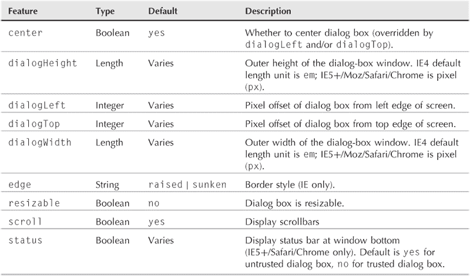

这些特性的 CSS 类型语法允许你通过在字符串内部用分号分隔每对特性来将多个特性组合在一起。例如：

```javascript
var dlogData = showModalDialog("prefs.html", defaultData,
   "dialogHeight:300px; dialogWidth:460px; help:no");
```

虽然滚动条没有显式列在窗口特性中，但如果内容超过分配给对话框或可用的大小，窗口通常会显示滚动条。如果你不想出现滚动条，可以让对话框文档的脚本在页面打开时将 `document.body.scroll` 属性设置为 `false`。

### 对话框注意事项

需要注意的一个潜在用户问题是，通常对话框窗口在对话框 HTML 文件加载之前不会打开。因此，如果复杂文档加载之前存在大量延迟，用户看不到任何表示正在操作的操作。你可能想要尝试设置光样式表属性，并在对话框文档加载时恢复它。

### 示例

为了演示两种风格的对话框，我们为模态和非模态对话框实现了相同的功能（设置某些会话视觉偏好）。这种策略向你展示如何在主页面和两种风格的对话框窗口之间传递数据。

第一个示例演示了如何使用模态对话框。在此过程中，数据被传递到对话框窗口，并返回值。列表 27-36 是主页面的 HTML 和脚本。按钮的 `onclick` 事件处理程序调用一个打开模态对话框的函数。对话框文档（见列表 27-37）包含了多个输入用户名和为主页面选择几种颜色式的表单元素。来自对话框的数据被构造成分数组传回主窗口。当对话框关闭时，该数组最初赋值给局部变量 `prefs`。如果用户取消了对话框，返回值为空字符串，因此 `getPrefsData()` 中的其他内容将不会执行。但当用户点击 OK 时，数组会返回。数组的每个项目被读取并赋值给其相应的表单值或样式属性。这些值也保存在全局的 `currPrefs` 数组中。这允许在下次打开对话框时将设置发送到模态对话框（作为 `showModalDialog()` 的第二个参数）。

#### 列表 27-36: showModalDialog() 的主页

HTML: `jsb27-36.html`

```html
<html>
   <head>
      <title>window.setModalDialog() Method</title>
      <script type="text/javascript" src="jsb27-36.js"></script>
   </head>
   <body bgcolor="#EEEEEE" style="margin:20px" onload="init()">
      <h1>window.setModalDialog() Method</h1>
      <hr />
      <h2 id="welcomeHeader">Welcome, <span id="firstName">.</span>!</h2>
      <hr />
      <p>Use this button to set style for this page
         <button id="prefs" onclick="getPrefs()">Preferences</button>
      </p>
   </body>
</html>
```

JavaScript: `jsb27-36.js`

```javascript
var currPrefs = new Array();
var nameHolder;
function getPrefs() {
   var prefs = showModalDialog("jsb27-37.html", currPrefs,
      "dialogWidth:400px;dialogHeight:300px;");
   if (prefs) {
      if (prefs["name"]) {
         if (nameHolder.textContent == "") {
            nameHolder.textContent = prefs["name"];
         } else {
            // IE
            nameHolder.innerText = prefs["name"];
         }
         currPrefs["name"] = prefs["name"];
      }
      if (prefs["bgColor"]) {
         document.body.style.backgroundColor = prefs["bgColor"];
         currPrefs["bgColor"] = prefs["bgColor"];
      }
      if (prefs["textColor"]) {
         document.body.style.color = prefs["textColor"];
         currPrefs["textColor"] = prefs["textColor"];
      }
      if (prefs["h1Size"]) {
         if (document.all) {
            document.all.welcomeHeader.style.fontSize = prefs["h1Size"];
         }
         else
         {
            document.getElementById("welcomeHeader").style.fontSize = prefs["h1Size"];
         }
         currPrefs["h1Size"] = prefs["h1Size"];
      }
   }
}

function init()
{
  nameHolder = document.getElementById("firstName");
  if (nameHolder.textContent == ".")
  {
    nameHolder.textContent = "friend";
  }
  else
  {
    //IE
    nameHolder.innerText = "friend";
  }
}
```

列表 27-37 所示的对话框文档负责读取读入的数据（并相应设置表单元素），并组装表单数据返回给主窗口的脚本。请注意，当你加载该示例时，对话框文档的标题元素（title）会出现在对话框窗口的标题栏中。

当页面加载到对话框窗口时，`init()` 函数会检查 `window.dialogArguments` 属性。如果它包含任何数据，则使用这些数据预设表单元素，以镜像主页的当前设置。实用函数 `setSelected()` 会预选 select 元素的选项以匹配当前设置。

页面底部的按钮被显式放置在窗口的右下角。每个按钮都会调用一个函数来执行关闭对话框所需的操作。在 OK 按钮的情况下，`handleOK()` 函数将 `window.returnValue` 属性设置为来自 `getFormData()` 函数的数据。后者函数读取表单元素的值，并使用表单元素的名称作为数组索引将它们封装成一个数组。这有助于将所有内容都整齐地带回主窗口的脚本中，该脚本使用索引名称，因此不依赖于对话框窗口中表单元素的精确顺序。

### 列表 27-37：用于模态对话框的文档

HTML: `jsb27-37.html`

```html
<html>
  <head>
    <title>User Preferences</title>
    <script type="text/javascript" src="jsb27-37.js"></script>
  </head>
  <body bgcolor="#EEEEEE" onload="init()">
    <h2>Web Site Preferences</h2>
    <hr />
    <form name="prefs" onsubmit="return false">
      <table>
        <tr>
          <td>Enter your first name:
            <input name="name" type="text" value="" size="20" onkeydown="checkEnter()" />
          </td>
        </tr>
        <tr>
          <td>Select a background color:
            <select name="bgColor">
              <option value="beige">Beige</option>
              <option value="antiquewhite">Antique White</option>
              <option value="goldenrod">Goldenrod</option>
              <option value="lime">Lime</option>
              <option value="powderblue">Powder Blue</option>
              <option value="slategray">Slate Gray</option>
            </select>
          </td>
        </tr>
        <tr>
          <td>Select a text color:
            <select name="textColor">
              <option value="black">Black</option>
              <option value="white">White</option>
              <option value="navy">Navy Blue</option>
              <option value="darkorange">Dark Orange</option>
              <option value="seagreen">Sea Green</option>
              <option value="teal">Teal</option>
            </select>
          </td>
        </tr>
        <tr>
          <td>Select "Welcome" heading font size:
            <select name="h1Size">
              <option value="2">2</option>
              <option value="4">4</option>
              <option value="18">18</option>
              <option value="24">24</option>
              <option value="32">32</option>
              <option value="48">48</option>
            </select>
          </td>
        </tr>
      </table>
    </form>
    <div style="position:absolute; left:200px; top:220px">
      <button style="width:80px" onclick="handleOK()">OK</button>
      &nbsp;
      <button style="width:80px" onclick="handleCancel()">Cancel</button>
    </div>
  </body>
</html>
```

JavaScript: `jsb27-37.js`

```javascript
// 关闭对话框
function closeme()
{
  window.close();
}

// 处理 OK 按钮的点击
function handleOK()
{
  window.returnValue = getFormData();
  closeme();
}

// 处理 Cancel 按钮的点击
function handleCancel()
{
  window.returnValue = "";
  closeme();
}

// 通用函数将表单元素名称-值对
// 转换为数组
function getFormData()
{
  var form = document.prefs;
  var returnedData = new Array();
  // 收集每种类型表单元素的值
  for (var i = 0; i < form.elements.length; i++)
  {
    if (form.elements[i].type == "text")
    {
      returnedData[form.elements[i].name] = form.elements[i].value;
    }
    else if (form.elements[i].type.indexOf("select") != -1)
    {
      returnedData[form.elements[i].name] = form.elements[i].options[form.elements[i].selectedIndex].value;
    }
    else if (form.elements[i].type == "radio")
    {
      returnedData[form.elements[i].name] = form.elements[i].value;
    }
    else if (form.elements[i].type == "checkbox")
    {
      returnedData[form.elements[i].name] = form.elements[i].value;
    }
    else
    {
      continue;
    }
  }
  return returnedData;
}

// 通过传递的数据设置元素初始化
function init()
{
  if (window.dialogArguments)
  {
    var args = window.dialogArguments;
    var form = document.prefs;
    if (args["name"])
    {
      form.name.value = args["name"];
    }
    if (args["bgColor"])
    {
      setSelected(form.bgColor, args["bgColor"]);
    }
    if (args["textColor"])
    {
      setSelected(form.textColor, args["textColor"]);
    }
    if (args["h1Size"])
    {
      setSelected(form.h1Size, args["h1Size"]);
    }
  }
}

// 将 SELECT 元素设置为一个值的实用函数
function setSelected(select, value)
{
  for (var i = 0; i < select.options.length; i++)
  {
    if (select.options[i].value == value)
    {
      select.selectedIndex = i;
      break;
    }
  }
  return;
}

// 将在文本字段中按下
// Enter 键视为点击 OK 的实用函数
function checkEnter()
{
  if (window.event.keyCode == 13)
  {
    handleOK();
  }
}
```

对话框窗口的最后一个便利功能是文本框中的 `onkeypress` 事件处理器。它调用的函数会查找 Enter 键。当该框获得焦点时按下该键时，会调用相同的 `handleOK()` 函数，就像用户点击了 OK 按钮一样。此功能使得对话框的行为就像 OK 按钮是一个自动默认值，就像在真实的对话框中一样。

你应该观察到为了将模态方法转换为无模态（modeless）方法而进行的若干结构性更改。列表 27-38 显示了为了用于无模态对话框而修改的主窗口。另一个全局变量 `prefsDlog` 被初始化，用于存储由 `showModelessWindow()` 方法返回的无模态窗口引用。该变量用于调用无模态对话框内部的 `init()` 函数，同时也作为生成对话框时周围 `if` 结构中的条件。这样做是为了防止创建多个对话框实例（因为当无模态窗口显示时，按钮仍然处于可用）。只要 `prefsDlog` 中有值且对话框窗口未关闭（获取对话框窗口的 `window.closed` 属性），对话框就不会再次创建。

`showModelessDialog()` 方法的第二个参数是主窗口中更新主文档的函数引用。正如你马上看到的，当用户点击 OK 或 Apply 按钮时，该函数会在对话框中被调用。

### 列表 27-38：showModelessDialog() 的主页面

HTML: `jsb27-38.html`

```html
<!DOCTYPE html>
<html>
<head>
    <meta http-equiv="content-type" content="text/html;charset=utf-8">
    <title>window.setModelessDialog() Method</title>
    <script type="text/javascript" src="jsb27-38.js"></script>
</head>
<body bgcolor="#EEEEEE" style="margin:20px" onload="init()">
    <h1>window.setModelessDialog() Method</h1>
    <hr />
    <h2 id="welcomeHeader">Welcome, <span id="firstName">&nbsp;</span>!</h2>
    <hr />
    <p>Use this button to set style preferences for this page:
    <button id="prefsButton" onclick="getPrefsData()">Preferences</button>
    </p>
</body>
</html>
```

JavaScript: `jsb27-38.js`

```javascript
var currPrefs = new Array();
var prefsDlog;

function getPrefsData()
{
    if (!prefsDlog || prefsDlog.closed)
    {
        prefsDlog = showModelessDialog("jsb27-39.html", setPrefs,
                    "dialogWidth:400px; dialogHeight:300px");
        prefsDlog.init(currPrefs);
    }
}

function setPrefs(prefs)
{
    if (prefs["bgColor"])
    {
        document.body.style.backgroundColor = prefs["bgColor"];
        currPrefs["bgColor"] = prefs["bgColor"];
    }
    if (prefs["textColor"])
    {
        document.body.style.color = prefs["textColor"];
        currPrefs["textColor"] = prefs["textColor"];
    }
    if (prefs["h1Size"])
    {
        document.all.welcomeHeader.style.fontSize = prefs["h1Size"];
        currPrefs["h1Size"] = prefs["h1Size"];
    }
    if (prefs["name"])
    {
        document.all.firstName.innerText = prefs["name"];
        currPrefs["name"] = prefs["name"];
    }
}

function init()
{
    document.all.firstName.innerText = "friend";
}
```

无模态版本对话框窗口文档的更改（见列表 27-39）非常有限。屏幕底部添加了一个新的 Apply（应用）按钮。正如你在 Microsoft 产品中看到的许多对话框窗口一样，Apply 按钮允许将对话框中的当前设置应用到当前文档，而无需关闭对话框。这种方法使得测试设置变得更容易。

Apply 按钮调用 `handleApply()` 函数，其工作原理与 `handleOK()` 相同，不再关闭对话框。但这两个函数与主窗口通信的方式与模态对话框不同。主窗口的处理函数作为 `showModelessDialog()` 的第二个参数传递，并在对话框脚本中作为 `window.dialogArguments` 属性可用。该函数引用被赋值给这两个函数中的本地变量，并调用远程函数，将 `getFormData()` 函数的结果作为参数值传回主窗口。

### 列表 27-39：无模态对话框的文档

HTML: `jsb27-39.html`

```html
<!DOCTYPE html>
<html>
<head>
    <meta http-equiv="content-type" content="text/html;charset=utf-8">
    <title>User Preferences</title>
    <script type="text/javascript" src="jsb27-39.js"></script>
</head>
<body bgcolor="#EEEEEE" onload="init()">
    <h2>Web Site Preferences</h2>
    <hr />
    <form name="prefs" onsubmit="return false">
        <table>
            <tr>
                <td>Enter your name:
                <input name="name" type="text" value="" size="20" onkeydown="checkEnter()"/>
            </td>
            </tr>
            <tr>
                <td>Select a background color:
                <select name="bgColor">
                    <option value="beige">Beige</option>
                    <option value="antiquewhite">Antique White</option>
                    <option value="goldenrod">Goldenrod</option>
                    <option value="lime">Lime</option>
                    <option value="powderblue">Powder Blue</option>
                    <option value="slategray">Slate Gray</option>
                </select>
            </td>
            </tr>
            <tr>
                <td>Select a text color:
                <select name="textColor">
                    <option value="black">Black</option>
                    <option value="white">White</option>
                    <option value="navy">Navy Blue</option>
                    <option value="darkorange">Dark Orange</option>
                    <option value="seagreen">Sea Green</option>
                    <option value="teal">Teal</option>
                </select>
            </td>
            </tr>
            <tr>
                <td>Select "Welcome" heading font point size:
                <select name="h1Size">
                    <option value="12">12</option>
                    <option value="14">14</option>
                    <option value="18">18</option>
                    <option value="24">24</option>
                    <option value="32">32</option>
                    <option value="48">48</option>
                </select>
            </td>
            </tr>
        </table>
    </form>
    <div style="position:absolute;left:20px;top:220px">
        <button onclick="handleOK()">OK</button>
        <button onclick="handleCancel()">Cancel</button>
        <button onclick="handleApply()">Apply</button>
    </div>
</body>
</html>
```

JavaScript: `jsb27-39.js`

```javascript
function closeme()
{
    window.close();
}

function handleOK()
{
    var returnFunc = window.dialogArguments;
    returnFunc(getFormData());
    closeme();
}

function handleApply()
{
    var returnFunc = window.dialogArguments;
    returnFunc(getFormData());
}

function handleCancel()
{
    window.returnValue = "";
    closeme();
}

// 通用函数将表单元素键值对转换为数组
function getFormData()
{
    var form = document.prefs;
    var returnedData = new Array();
    // 收集每种表单元素的值
    for (var i = 0; i < form.elements.length; i++)
    {
        if (form.elements[i].type == "text")
        {
            returnedData[form.elements[i].name] = form.elements[i].value;
        }
        else if (form.elements[i].type.indexOf("select") != -1)
        {
            returnedData[form.elements[i].name] = form.elements[i].options[form.elements[i].selectedIndex].value;
        }
        else if (form.elements[i].type == "radio")
        {
            returnedData[form.elements[i].name] = form.elements[i].value;
        }
        else if (form.elements[i].type == "checkbox")
        {
            returnedData[form.elements[i].name] = form.elements[i].value;
        }
        else
        {
            continue;
        }
    }
    return returnedData;
}

// 通过传递的数据设置表单元素进行初始化
function init(currPrefs)
{
    if (currPrefs)
    {
        var form = document.prefs;
        if (currPrefs["name"])
        {
            form.name.value = currPrefs["name"];
        }
        if (currPrefs["bgColor"])
        {
            setSelected(form.bgColor, currPrefs["bgColor"]);
        }
        if (currPrefs["textColor"])
        {
            setSelected(form.textColor, currPrefs["textColor"]);
        }
        if (currPrefs["h1Size"])
        {
            setSelected(form.h1Size, currPrefs["h1Size"]);
        }
    }
}

// 将 SELECT 元素设置为某个值的工具函数
function setSelected(select, value)
{
    for (var i = 0; i < select.options.length; i++)
    {
        if (select.options[i].value == value)
        {
            select.selectedIndex = i;
            break;
        }
    }
    return;
}

// 将文本字段中按下 Enter 键的操作
// 视为点击 OK 的工具函数
function checkEnter()
{
    if (window.event.keyCode == 13)
    {
        handleOK();
    }
}
```

关于这些窗口，你可能面临的最大设计挑战是在模态（modal）和非模态（modeless）对话框样式之间做出选择。一些设计人员坚持认为图形用户界面中不应该存在模态性；另一些人则认为，在某些情况下，你需要在任何进一步处理之前，让用户专注于某个非常特定的任务。这正是模态对话框大有意义的地方。

相关项目：`window.open()` 方法

### sizeToContent()

返回值：无

兼容性：WinIE-, MacIE-, NN6+, Moz+, Safari-, Opera-, Chrome-

`NN6+/Moz` 的 `window.sizeToContent()` 方法对于确保窗口（尤其是子窗口）的大小适用于优化显示窗口内容非常有帮助。但你必须谨慎使用此方法，否则可能会适得其反。

调用 `sizeToContent()` 方法会调整窗口大小，使所有内容都可见。关于特定操作系统渲染差异的担忧已成为过去。自然地，你应该只对窗口执行此操作，且其内容占据的空间最大小于运行你代码的最小视频显示器（通常为 640×480 像素，但对于用于手持计算机的未来浏览器版本，可能会小得多）。

然而，如果你在包含调整脚本的同一个窗口上两次调用该方法，可能会给用户带来麻烦。此操作可能会导致窗口扩展到超过用户屏幕像素尺寸的大小。

### 示例

使用 `sizeToContent()` 方法调整窗口大小以适应其内容。

相关项目：`window.open()` 方法

列表 27-40 中的简单页面向你展示了如何给用户留在页面的机会。

### 列表 27-40：使用 `onbeforeunload` 事件处理器

```html
<html>
  <head>
      <title>onbeforeunload Event Handler</title>
      <script type="text/javascript">
        function verifyClose()
        {
            return "We really like you and hope you will stay longer.";
        }
      </script>
  </head>
  <body onbeforeunload="return verifyClose()">
      <h1>onbeforeunload Event Handler</h1>
      <hr />
      <p>使用此按钮返回上一个页面：
        <button id="go" onclick="history.back()">Go Back</button>
      </p>
  </body>
</html>
```

相关项目：`onunload` 事件处理器

#### `onerror`

兼容性：WinIE4+, MacIE4+, NN3+, Moz+, Safari-, Opera-, Chrome-

（请参阅本章早些对 `window.onerror` 属性的讨论。）

#### `onhelp`

兼容性：WinIE4+, MacIE4+, NN-, Moz-, Safari-, Opera-, Chrome-

在第 26 章中讨论过的通用 `onhelp` 事件处理器，当用户激活模态或非模态对话框内的上下文相关帮助时，也会触发。在后一种情况下，用户可以点击对话框标题栏中的帮助图标，此时光标会变为问号。用户随后可以点击窗口中的任何元素。在第二次点击时，`onhelp` 事件处理器会被触发，且事件对象包含有关所点击元素的信息（`event.srcElement` 是指向特定元素的引用），从而允许脚本就该元素提供帮助信息。

为了防止浏览器内置的帮助窗口出现，事件处理器的求值必须返回 `false` (IE4+) 或将 `event.returnValue` 属性设置为 `false` (IE5+)。

### 示例

以下脚本片段可用于在对话框中提供上下文相关帮助。这里只显示了两个表单元素的帮助消息，但在实际应用程序中，你可以轻松地添加更多消息。

```javascript
function showHelp()
{
    switch (event.srcElement.name)
    {
        case "bgColor" :
            alert("Choose a color for the main window's background.");
            break;
        case "name" :
            alert("Enter your first name for a friendly greeting.");
            break;
        default :
            alert("Make preference settings for the main page styles.");
    }
    event.returnValue = false;
}
window.onhelp = showHelp;
```

由于此页面的帮助聚焦于表单元素，因此 `switch` 构造的情况是基于表单元素的 `name` 属性。对于其他类型的页面，`id` 属性可能更合适。

相关项目：`event object`（第 32 章，“事件对象”）；`switch construction`（第 21 章，“控制结构与异常处理”）

#### `onload`

兼容性：WinIE3+, MacIE3+, NN2+, Moz+, Safari+, Opera+, Chrome+

`onload` 事件处理器在当前窗口文档加载过程结束时触发（在所有文本和图像元素已从源文件服务器传输到浏览器之后，并且所有插件和 Java applet 已加载并运行之后）。此时，浏览器的内存中包含了文档中浏览器可能知道的所有对象和脚本组件。

`onload` 处理器是单个页面 `<body>` 标签的属性，或者是多页面 `<frameset>` 标签的属性。`onload` 事件处理器在当前窗口文档加载过程结束时触发。

```html
<html>
  <head>
  </head>
  <body onload="function()">
  </body>
</html>
```

```javascript
function zipBack() {
    window.scroll(0,0);
}
```

```html
</head>
<body>
    <h1>onscroll 事件处理器</h1>
    <hr />
    <div>如果你尝试滚动此页面，它将始终滚回顶部。</div>
    <p>
        <iframe frameborder="0" scrolling="no" height="1000" src="bofright.html"></iframe>
    </p>
</body>
</html>
```

相关项目：`scrollBy()`, `scrollByLines()`, `scrollByPages()` 方法

# onunload

兼容性：WinIE3+, MacIE3+, NN2+, Moz+, Safari+, Opera-, Chrome+

`onunload` 事件在文档从视图中清除之前恰好到达当前窗口。窗口被清除的最常见方式包括：当新的 HTML 文档加载到窗口中时、当用户点击后退按钮或刷新按钮时、当用户使用刷新快捷键时，以及脚本开始为窗口或帧（frame）动态写入新的 HTML 时。请注意，在某些 Windows Safari 中，关闭标签页/浏览器时不会触发 `onunload` 事件。

请将对 `onunload` 事件处理器的使用限制在不会阻碍文档间切换的快速操作上。不要调用任何显示对话框的方法。你可以在 HTML 文档中与 `onload` 处理器相同的位置指定 `onunload` 事件处理器：作为单帧窗口的 `<body>` 标签属性，或者作为多帧窗口的 `<frameset>` 标签属性。`onload` 和 `onunload` 事件处理器可以同时出现在同一个 `<body>` 或 `<frameset>` 标签中，而不会引起任何问题。`onunload` 事件处理器仅仅是安全地存储在浏览器内存中，等待在文档准备清除窗口时 `onunload` 事件到达并进行处理。

关于 `onunload` 事件处理器的一点警告：尽管该事件在文档消失之前触发，但请不要让事件处理器承担耗时较长的任务，例如生成新对象或提交表单。文档可能在函数完成之前就消失了，导致函数寻找的对象和值已不再存在。最好的防御措施是让你的 `onunload` 事件处理器处理保持在最少。

### 备注

配备弹出窗口拦截器的浏览器会忽略 `onunload` 事件处理器函数中的所有 `window.open()` 方法调用。

相关项目：`onload` 事件处理器

# frame 元素对象

对于 HTML 元素的属性、方法和事件处理器，请参阅第 26 章“通用 HTML 元素对象”。

| 属性 | 方法 | 事件处理器 |
| :--- | :--- | :--- |
| `allowTransparency` | | |
| `borderColor` | | |
| `contentDocument` | | |
| `contentWindow` | | |
| `frameBorder` | | |
| `height` | | |
| `longDesc` | | |
| `marginHeight` | | |
| `marginWidth` | | |
| `name` | | |
| `noResize` | | |
| `scrolling` | | |
| `src` | | |
| `width` | | |

### 语法

从 frameset 访问 frame 元素对象的属性或方法：

(IE4+) `document.all.frameID.property | method([parameters])`

(IE5+/W3C) `document.getElementById("frameID").property | method([parameters])`

从 frame 文档访问 frame 的属性或方法：

(IE4+) `parent.document.all.frameID.property | method([parameters])`

(IE5+/W3C) `parent.document.getElementById("frameID").property | method([parameters])`

兼容性：WinIE4+, MacIE4+, NN6+, Moz+, Safari+, Opera+, Chrome+

### 关于此对象

如本章开头部分所述，frame 元素对象与文档层级结构中作为窗口对象的 frame 对象是不同的。只有当所有 HTML 元素在对象模型中暴露时，脚本才能使用 frame 元素对象。

由于 frame 元素对象是一个 HTML 元素，它共享所有 HTML 元素的属性、方法和事件处理器，如第 26 章所述。在很大程度上，你访问 frame 元素对象是为了设置或修改 `<frame>` 标签中的属性值。如果是这样，通过给标签的 `id` 属性分配一个标识符可以简化问题。如果你的脚本通过原始对象模型引用帧（`parent.frameName` 引用），则你的标签仍然需要一个 `name` 属性。虽然法律没有规定对 `name` 和 `id` 属性使用相同的标识符，但为了防止与同时识别这两个属性的浏览器引用发生潜在冲突，使用不同的名称是最佳做法。

要修改帧的尺寸，你必须进入定义 frameset `cols` 和 `rows` 属性的 `frameset` 元素对象。这些属性在现代浏览器中可以动态修改。

## 属性

#### allowTransparency

| 值：Boolean | 读/写 |
| :--- | :--- |

兼容性：WinIE6+, MacIE-, NN-, Moz-, Safari-, Opera-, Chrome-

`allowTransparency` 属性指示帧的背景是否透明。此属性主要适用于 `<iframe>` 对象，因为 framesets 没有背景颜色或图像可以穿透透明帧显示。

#### borderColor

| 值：十六进制三元组或颜色名称字符串 | 读/写 |
| :--- | :--- |

兼容性：WinIE4+, MacIE4+, NN-, Moz-, Safari-, Opera-, Chrome-

如果一个帧显示边框（由 frameset 的 `frameborder` 属性决定），它可以设置一个与 frameset 其他部分不同的颜色。取决于颜色组合，修改单个帧边框有时是有风险的。请在尽可能多的浏览器上验证你的设计以测试你的颜色组合。

### 示例

尽管在更改帧边框颜色时可能会遇到问题，但如果脚本在文档内部，W3C DOM 语法将如下：

```javascript
document.getElementById("contentsFrame").borderColor = "red";
```

IE 专用版本将是

```javascript
document.all["contentsFrame"].borderColor = "red";
```

#### contentDocument

| 值：document 对象引用 | 只读 |
| :--- | :--- |

兼容性：WinIE8+, MacIE-, NN6+, Moz+, Safari+, Opera+, Chrome+

frame 元素对象的 `contentDocument` 属性仅仅是该帧所包含的文档的引用。此属性桥接了 frame 元素对象和 frame 对象之间的差距。这两个对象都包含同一个文档对象，但从脚本的角度来看，引用通常使用 frame 对象来访问帧内部的文档，而 frame 元素用于访问等同于 frame 标签属性的属性。

### 示例

framesetting 文档脚本可能会使用 frame 元素的 ID 来读取或调整某个元素属性，然后需要通过其文档对象对页面内容执行某些操作。你可以通过如下语句获取文档对象的引用：

```javascript
var doc = document.getElementById("Frame3").contentDocument;
```

然后你的脚本可以（例如）进入文档中的表单：

```javascript
var val = doc.mainForm.entry.value;
```

相关项目：`frame.frameBorder`, `frameset.frameBorder` 属性

#### contentWindow

| 值：document 对象引用 | 只读 |
| :--- | :--- |

### 兼容性

WinIE5.5+, MacIE-, NN7+, Moz1.0.1+, Safari+, Opera+, Chrome+

`frame` 元素对象的 `contentWindow` 属性是该帧生成的窗口的简单引用。该属性提供了对帧窗口的访问权限，可以通过它访问帧内部的文档。

### 示例

你可以通过如下语句获取与 `frame` 关联的窗口对象的引用：

```javascript
var win = document.getElementById("Frame3").contentWindow;
```

相关项目：`window` 对象

### frameBorder

| 值: yes \| no \| 1 \| 字符串形式的 0 | 读/写 |

兼容性: WinIE4+, MacIE4+, NN6+, Moz+, Safari+, Opera+, Chrome+

`frameBorder` 属性提供了对 `frame` 元素 `frameborder` 属性设置的脚本访问。除了 IE 之外，我们测试的所有浏览器在页面加载后对修改此属性的响应均不理想。

`frameBorder` 属性的值是替代布尔值的字符串。值 `yes` 或 `1` 表示边框（应当）已开启；`no` 或 `0`（应当）关闭边框。不同浏览器之间没有一致的默认行为。

### 示例

`frameBorder` 属性的默认值是 `yes`。你可以使用此设置来创建一个切换脚本（遗憾的是，这在 IE 中不会改变边框的外观）。与 W3C 兼容的版本如下：

```javascript
function toggleFrameScroll(frameID)
{
   var theFrame = document.getElementById(frameID);
   if (theFrame.frameBorder == "yes")
   {
      theFrame.frameBorder = "no";
   }
   else
   {
      theFrame.frameBorder = "yes";
   }
}
```

相关项目：`frameset.frameBorder` 属性

### height, width

| 值: 整数 | 只读 |

兼容性: WinIE4+, MacIE4+, NN-, Moz-, Safari+, Opera-, Chrome+

这两个属性允许你获取 `frame` 元素对象的高度和宽度。这些值并不等同于 `document.body.clientHeight` 和 `document.body.clientWidth`，因为帧的尺寸包含了与帧相关的界面元素（chrome），例如滚动条。这些值是只读的。如果你需要修改 `frame` 的尺寸，请通过 `frameset` 对象的 `rows` 和/或 `cols` 属性来实现。读取帧 `height` 和 `width` 属性的整数值比尝试解析 `rows` 和 `cols` 字符串属性容易得多。

### 示例

以下片段假设一个 `frameset` 定义了两个帧，并在 `frameset` 中被设置为两列。这些语句位于设置布局的文档中。它们获取左侧帧的当前宽度并将该帧的宽度增加 10%。这里显示的语法用于 W3C DOM 的，但可以很容易适配到 IE 专有的术语。

```javascript
var frameWidth = document.getElementById("leftFrame").width;
document.getElementById("mainFrameset").cols =
   (Math.round(frameWidth * 1.1)) + ",*";
```

注意，现有帧宽的数值值首先增加了 10%，然后连接到赋值给 `frameset` 的 `cols` 属性的剩余字符串部分。逗号后的星号意味着浏览器应该计算剩余宽度并将其分配给右侧帧。

相关项目：`frameset` 对象

### longDesc

| 值: URL 字符串 | 读/写 |

兼容性: WinIE6+, MacIE5+, NN6+, Moz+, Safari+, Opera+, Chrome+

`longDesc` 属性是 `<frame>` 标签 `longdesc` 属性的脚本等价物。此 HTML 4 属性旨在为浏览器提供一个包含元素详细描述文档的 URL。未来的浏览器可以使用此功能为视觉受障的网站访问者提供有关帧的信息。

### marginHeight, marginWidth

| 值: 整数 | 读/写 |

兼容性: WinIE6+, MacIE5+, NN6+, Moz+, Safari+, Opera+, Chrome+

浏览器倾向于通过在内容与帧边缘之间添加边距在帧内插入内容。这些值由 `marginHeight`（顶部和底部边缘）和 `marginWidth`（左侧和右侧边缘）属性表示。虽然属性不是只读的，但在 frameset 加载后更改值不会改变文档在帧中的显示效果。如果你需要更改帧内文档的边距，请调整 `document.body.style` 的 margin 属性。

此外请注意，尽管这些属性的默认值为空（这意味着当为 `<frame>` 标签未设置 `marginheight` 或 `marginwidth` 属性时），页面内置了边距。这些边距的精确像素值随操作系统而异。

相关项目：`style` 对象（第 38 章，“样式表和样式对象”）

### name

| 值: 字符串 | 读/写 |

兼容性: WinIE4+, MacIE4+, NN6+, Moz+, Safari+, Opera+, Chrome+

`name` 属性是与 `frame` 关联的用于引用的标识。脚本可以通过 `name` 属性引用帧（例如 `top.frames["myFrame"]`），这通常通过 `name` 属性分配。

### noResize

| 值: 布尔 | 读/写 |

兼容性: WinIE6+, MacIE5+, NN6+, Moz+, Safari+, Opera+, Chrome+

Web 设计师通常会固定帧集，使用户无法调整帧的大小（通过拖动帧之间的任何分割边界）。`noResize` 属性允许你在页面加载后读取并调整帧的行为。例如，在页面上与用户交互的某些阶段，你可能允许用户在特定模式下手动修改帧的大小。或者你可能给予用户一次调整帧的机会。当 `onresize` 事件处理程序触发时，脚本会将帧元素的 `noResize` 属性设置为 `false`。如果你关闭了帧的调整功能，则该帧的所有边缘都将变为不可调整，无论相邻帧的 `noResize` 值设置如何。关闭调整功能不会影响脚本通过 `frameset` 对象的 `cols` 或 `rows` 属性更改帧大小的能力。

### 示例

以下语句关闭了帧调整大小的能力：

```javascript
parent.document.getElementById("myFrame1").noResize = true;
```

由于属性名称的否定性质，逻辑上可能很难记清（将 `noResize` 设置为 `true` 表示关闭了调整功能）。请密切关注你的布尔值。

相关项目：`frameset.cols`, `frameset.rows` 属性

### scrolling

| 值: yes \| no \| 1 \| 字符串形式的 0 | 读/写 |

兼容性: WinIE6+, MacIE5+, NN6+, Moz+, Safari+, Opera+, Chrome+

`scrolling` 属性允许脚本在 `frameset` 的单个帧内开启或关闭滚动条。默认情况下，滚动是开启的，除非被 `<frame>` 标签的 `scroll` 属性覆盖。

`scrolling` 属性的值是替代布尔值的字符串。值 `yes` 或 `1` 表示滚动条可见（前提是内容多于不滚动即可查看的内容）；`no` 或 `0` 隐藏帧中的滚动条。IE 还识别（并设置为默认）`auto`。

### 注意

尽管此属性是可读写的，但通过脚本更改其值不会改变 WinIE、Mozilla 浏览器或 Safari 中帧的外观。

### 示例

列表 27-42 产生了一个由八个帧组成的帧集。帧的内容由 frameset 内部的脚本（通过 `fillFrame()` 函数）生成。每个帧体中的事件处理程序（`onclick`）调用 `toggleFrameScroll()` 函数。显示了引用帧对象的两种方式，其中 IE 专用的版本已注释。

在 `toggleFrameScroll()` 函数中，`if` 条件检查属性是否被设置为 `no` 以外的其他值。这允许当属性设置为 `auto`（第一次）或 `yes`（由函数设置）时，条件评估为真。注意，滚动条并没有从 IE、NN6+,Safari、Opera 或 Chrome 的帧中消失。

### 列表 27-42：控制 frame.scrolling 属性

```html
<!DOCTYPE html>
<html>
<head>
    <meta http-equiv="content-type" content="text/html;charset=utf-8">
    <title>frame.scrolling Property</title>
    <script type="text/javascript">
        function toggleFrameScroll(frameID)
        {
            // IE5+/W3C version
            var theFrame = document.getElementById(frameID);
            if (theFrame.scrolling != "no")
            {
                theFrame.scrolling = "no";
            }
            else
            {
                theFrame.scrolling = "yes";
            }
        }
        // generate content for each frame
        function fillFrame(frameID)
        {
            var page = "<html><body onclick='parent.toggleFrameScroll(\'"
                        + frameID
                        + "\')><span style='font-size:24pt'>";
            page += "<p>This frame has the ID of:</p><p>"
                    + frameID
                    + ".</p>";
            page += "</span></body></html>";
            return page;
        }
    </script>
</head>
<frameset id="outerFrameset" cols="50%,50%">
    <frameset id="innerFrameset1" rows="25%,25%,25%,25%">
        <frame id="myFrame1" src="javascript:parent.fillFrame('myFrame1')" />
        <frame id="myFrame2" src="javascript:parent.fillFrame('myFrame2')" />
        <frame id="myFrame3" src="javascript:parent.fillFrame('myFrame3')" />
        <frame id="myFrame4" src="javascript:parent.fillFrame('myFrame4')" />
    </frameset>
    <frameset id="innerFrameset2" rows="25%,25%,25%,25%">
        <frame id="myFrame5" src="javascript:parent.fillFrame('myFrame5')" />
        <frame id="myFrame6" src="javascript:parent.fillFrame('myFrame6')" />
        <frame id="myFrame7" src="javascript:parent.fillFrame('myFrame7')" />
        <frame id="myFrame8" src="javascript:parent.fillFrame('myFrame8')" />
    </frameset>
</frameset>
</html>
```

## src

| 值：URL 字符串 | 可读/写 |

兼容性: WinIE6+, MacIE5+, NN6+, Moz+, Safari+, Opera+, Chrome+

`frame` 元素对象的 `src` 属性提供了一种在帧内导航到不同页的其他方法（即除了为帧对象的 `location.href` 属性分配新 URL 以外）。但是，为了与旧浏览器向后兼容，请继续使用 `location.href` 进行脚本导航。请记住 `src` 属性属于帧元素对象，而不是它所代表的窗口对象。因此，对 `src` 属性的引用必须通过元素的 ID 和/或节点层次结构进行。

### 示例

为了获得最佳效果，请使用完整的 URL 作为 `src` 属性的值，如下所示：

```javascript
parent.document.getElementById("mainFrame").src = "http://www.dannyg.com";
```

相对 URL 和 `javascript:` 伪 URL 在大多数情况下也能工作。

相关项目：`location.href` 属性

## frameset 元素对象

对于 HTML 元素属性、方法和事件处理程序，请参见第 26 章“通用 HTML 元素对象”。

| 属性 | 方法 | 事件处理程序 |
| :--- | :--- | :--- |
| `border` | | |
| `borderColor` | | |
| `cols` | | |
| `frameBorder` | | |
| `frameSpacing` | | |
| `rows` | | |

### 语法

从 frameset 访问 frameset 元素对象的属性或方法：

(IE4+) `document.all.framesetID.property | method([parameters])`

(IE5+/W3C) `document.getElementById("framesetID").property | method([parameters])`

从帧文档中访问 frameset 的属性或方法：

(IE4+) `parent.document.all.framesetID.property | method([parameters])`

(IE5+/W3C) `parent.document.getElementById("framesetID").property | method([parameters])`

兼容性: WinIE4+, MacIE5+

## 关于 frameset

`frameset` 元素通过将浏览器窗口划分为多个称为帧（frames）的区域来定义布局。每个帧都可以加载它自己的 HTML 文档。`frameset` 元素本身是 `frame` 元素的容器，它不包含任何内容。

`frameset` 属性允许你控制这些帧的外观和行为。例如，`cols` 定义列的宽度，`rows` 定义行的高度。`border` 属性可以设置帧之间边界的宽度。

在使用 framesets 时，你可以嵌套它们来创建复杂的布局。`frameset` 可以包含其他 `frameset` 元素，从而允许网格状结构。然而，在 HTML5 中，framesets 的使用被认为已弃，取而代之的是基于 CSS 的布局。

`borderColor` 属性允许你读取赋值给 `frameset` 标签 `bordercolor` 属性的颜色值。虽然该属性是可读可写的，但通过脚本更改颜色不会改变浏览器窗口中渲染的边框颜色。当你读取属性值时，设置为颜色名称的属性值将以十六进制三元组的形式返回。

### 示例

若要获取 `frameset` 中的当前颜色设置，来自其中一个框架文档的脚本引用将所示：

```javascript
var borderColor = parent.document.all.outerFrameset.borderColor;
```

相关项目：`frame.borderColor`、`frameset.frameBorder` 属性

### cols and rows

`frameset` 元素对象的 `cols` 和 `rows` 属性允许你在 `frameset` 加载后读取并修改框架的大小。这两个属性定义在 W3C DOM 中。这两个属性的值均为字符串，其中可能包含百分比符号或星号。因此，如果你正尝试逐渐增加或减小框架列或行的大小，必须在对这些值进行任何数学运算之前，先解析字符串以获取必要的原始值（或者，在 IE4+ 中，使用框架元素对象的 `height` 和 `width` 属性来测量当前框架的像素大小）。

调整这两个属性允许你完全修改 `frameset`，包括在 `frameset` 网格中添加或删除列或行。由于 `frameset` 结构的更改可能会通过更改父窗口关联的 `frames` 数组的大小或卸载包含所需文档来影响脚本，请务必在 `frameset` 的两种状态下测试你的脚本。如果你想从 `frameset` 视图中移除一个框架，将 `frameset` 中该特定行或列的大小为零可能更安全。当然，大小为零仍会留下一个 1 像素的框架，但如果没有开启边框且该 1 像素框架的背景颜色与其他框架相同，它在本质上是不可见的。这种技术的另一个优点是，你可以恢复其他框架，使其文档状态与隐藏时完全相同。

当你在单个文档中定义了嵌套的 frameset 时，请确保引用所需的 `frameset` 元素对象。一个对象可能指定列，而另一个（嵌套）对象指定网格的行。为每个 `frameset` 元素分配一个唯一的 `ID`，以便引用能够可靠地指向正确的对象。

### 示例

列表 27-43、27-44 和 27-45 显示了 `frameset` 的 HTML 以及进入 `frameset` 的三个文档中的两个。最后一份文档是美国《权利法案》的 HTML 版本，在此处作为演示的内容框架。

`frameset` 列表（参见列表 27-43）显示了一个三框架设置。左列下方是目录（参见列表 27-44）。右列分为两行。顶部行是一个简单的控制控件（参见列表 27-45），用于隐藏和显示目录框架。当用户点击控制控件的热点（位于 `span` 元素内部）时，`onclick` 事件处理程序会调用 `frameset` 中的 `toggleTOC()` 函数。

#### 列表 27-43：用于隐藏/显示框架的 Frameset 和脚本

```html
<!DOCTYPE html>
<html>
    <head>
        <meta http-equiv="content-type" content="text/html;charset=utf-8">
        <title>Hide/Show Frame Example</title>
        <script type="text/javascript">
            var origCols;
            function toggleTOC() {
                if (origCols) {
                    showTOC();
                }
                else {
                    hideTOC();
                }
            }
            function hideTOC() {
                var frameset = document.getElementById("outerFrameset");
                origCols = frameset.cols;
                frameset.cols = "0,*";
            }
            function showTOC() {
                if (origCols) {
                    document.getElementById("outerFrameset").cols = origCols;
                    origCols = null;
                }
            }
        </script>
    </head>
    <frameset id="outerFrameset" border="no" cols="150,*">
        <frame id="OC" name="OCFrame" src="js27-44.html"/>
        <frameset id="innerFrameset" rows="0,*">
            <frame id="controls" name="controlsFrame" src="js27-45.html"/>
            <frame id="content" name="contentFrame" src="right.html"/>
        </frameset>
    </frameset>
</html>
```

当用户点击热点隐藏框架时，脚本将原始的 `cols` 属性复制到全局变量中。该变量在 `showTOC()` 中用于将 `frameset` 恢复到原始比例。这允许设计人员修改 `frameset` 的 HTML，而无需深入脚本内部来硬编码尺寸。

#### 列表 27-44：目录框架

```html
<!DOCTYPE html>
<html>
<head>
    <meta http-equiv="content-type" content="text/html;charset=utf-8">
    <title>Table of Contents</title>
    <style type="text/css">
        body {
            background-color:#EEEEEE;
        }
    </style>
</head>
<body>
    <h3>Table of Contents</h3>
    <hr/>
    <ul style="font-size:10pt">
        <li><a href="right.htm#article1" target="contentFrame">Article I</a></li>
        <li><a href="right.htm#article2" target="contentFrame">Article II</a></li>
        <li><a href="right.htm#article3" target="contentFrame">Article III</a></li>
        <li><a href="right.htm#article4" target="contentFrame">Article IV</a></li>
        <li><a href="right.htm#article5" target="contentFrame">Article V</a></li>
        <li><a href="right.htm#article6" target="contentFrame">Article VI</a></li>
        <li><a href="right.htm#article7" target="contentFrame">Article VII</a></li>
        <li><a href="right.htm#article8" target="contentFrame">Article VIII</a></li>
        <li><a href="right.htm#article9" target="contentFrame">Article IX</a></li>
        <li><a href="right.htm#article10" target="contentFrame">Article X</a></li>
    </ul>
</body>
</html>
```

#### 列表 27-45：控制面板框架

```html
<!DOCTYPE html>
<html>
<head>
    <title>Control Panel</title>
    <style type="text/css">
        span {
            text-decoration:underline;
            cursor:pointer;
        }
    </style>
</head>
<body>
    <p><span id="tocToggle" onclick="parent.toggleTOC()">&lt;&lt;Hide/Show&gt;&gt;</span>Table of Contents</p>
</body>
</html>
```

### frameBorder

`frameBorder` 属性提供了对 `frameset` 元素对象 `frameborder` 属性设置的脚本访问。IE4+ 对页面加载后修改此属性的支持并不良好。

`frameBorder` 属性的值是替代布尔值的字符串。值 `yes` 或 `1` 表示边框（本应该）开启；`no` 或 `0` 则关闭边框。

### 示例

`frameBorder` 属性的默认值为 `yes`。你可以使用此设置创建一个切换脚本（遗憾的是，这在 IE 中不会改变外观）。IE5+ 版本所示：

```javascript
function toggleFrameScroll(framesetID) {
    var frameset = document.getElementById(framesetID);
    if (frameset.frameBorder == "yes") {
        frameset.frameBorder = "no";
    }
    else {
        frameset.frameBorder = "yes";
    }
}
```

相关项目：`frame` 对象

### frameBorder

| Value: yes \| no \| 1 \| 0 as strings | Read/Write |

兼容性: WinIE4+, MacIE4+, NN-, Moz-, Safari-, Chrome-

### frameSpacing

| Value: Integer | Read/Write |

兼容性: WinIE4+, MacIE4+, NN-, Moz-, Safari-, Opera-, Chrome-

`frameset` 元素对象的 `frameSpacing` 属性允许你读取 `frameset` 中各个帧之间的间距（单位为像素）。如果你没有在 `frameset` 标签中指定 `framespacing` 属性，该属性将为空值，而不是反映默认应用的实际边框厚度（通常为 2）。

### 示例

如果你需要更改间距，脚本引用如下：

```javascript
document.getElementById("outerFrameset").frameSpacing = "10";
```

相关项目：`frameset.border` 属性

## iframe 元素对象

有关 HTML 元素的属性、方法和事件处理程序，请参见第 26 章“通用 HTML 元素对象”。

| 属性 | 方法 | 事件处理器 |
| :--- | :--- | :--- |
| `align` | | |
| `allowTransparency` | | |
| `contentDocument` | | |
| `contentWindow` | | |
| `frameBorder` | | |
| `frameSpacing` | | |
| `height` | | |
| `hspace` | | |
| `longDesc` | | |
| `marginHeight` | | |
| `marginWidth` | | |
| `name` | | |
| `noResize` | | |
| `scrolling` | | |
| `src` | | |
| `vspace` | | |
| `width` | | |

### 语法

从包含它的文档访问 `iframe` 元素对象的属性或方法：

- (IE4+) `document.all.iframeID.property | method([parameters])`
- (IE4+/NN6) `window.frames["iframeName"].property | method([parameters])`
- (IE5+/W3C) `document.getElementById("iframeID").property | method([parameters])`

从 `iframe` 元素内部的文档访问 `iframe` 元素方法的属性：

- (IE4+) `parent.document.all.iframeID.property | method([parameters])`
- (IE5+/W3C) `parent.document.getElementById("iframeID").property | method([parameters])`

兼容性: WinIE4+, MacIE4+, NN6+, Moz+, Safari+, Opera+, Chrome+

### 关于此对象

`iframe` 元素允许将独立来源的 HTML 内容加载到另一个文档的主体中。在某些方面，NN4 层元素是 `iframe` 概念的先驱，但与层不同，`iframe` 元素本身并不具备定位能力。它可以像任何其他 HTML 元素一样进行定位：通过为与 `iframe` 关联的样式表分配定位属性。如果没有显式定位，`iframe` 元素将按照元素在源代码中的正常顺序出现在文档主体中。与 `frameset` 中的帧不同，`iframe` 可以任意放置在任何文档的中间。如果 `iframe` 在脚本控制下改变大小，周围的内容将避让或收缩。

真正让 `iframe` 与其他 HTML 元素区分开来的是它能够加载并显示外部 HTML 文件，并在脚本的帮助下，将不同的页面加载到 `iframe` 中，而不干扰主文档的其他内容。加载到 `iframe` 中的页面也可以包含脚本以及你可能想要放入 HTML 文档的任何其他功能（在 Windows 版 IE 中包括 XML）。

`iframe` 元素有一组丰富的属性，允许 HTML 作者控制帧的外观、尺寸（`height` 和 `width`）以及在某种程度上控制行为。这些属性中的大多数可以作为 `iframe` 元素对象的属性被脚本访问。

需要注意的是，`iframe` 元素在许多方面与帧元素相似，特别是在涉及窗口级关系时。如果你在主窗口的文档中放置一个 `iframe` 元素，该元素将作为帧出现在主窗口的对象模型中，并可以通过常用的帧术语进行访问：

```
window.frames[i]
window.frames[frameName]
```

在该 `iframe` 帧对象内部包含一个文档及其所有内容。所有指向 `iframe` 内部文档对象的引用都必须通过 `iframe` 帧的门户。

相反，位于 `iframe` 内部的文档中的脚本可以通过 `parent` 引用与主文档进行通信。当然，你不能在不破坏原始文档中 `iframe` 的情况下（例如使用 `location.href`）用另一个 HTML 文档替换主窗口的内容。

## 属性

### align

值: String | 读/写

兼容性: WinIE4+, MacIE4+, NN6+, Moz+, Safari+, Opera+, Chrome+

`align` 属性控制 `iframe` 元素相对于页面上周围内容的对齐方式。两个可能的值（左和右）分别将 `iframe` 放置在包含它的元素（通常是 body）的左边缘和右边缘。就像图像一样，当 `iframe` 浮动在容器的左、右边缘时，其他内容会环绕该元素。

`align` 属性的值：

| 值 | 说明 |
| :--- | :--- |
| `absbottom` | 将 `iframe` 的底部与沿周围文本字母降部线延伸的虚拟线对齐 |
| `absmiddle` | 将 `iframe` 的中间与周围文本顶部与 `absbottom` 之间的中心点对齐 |
| `baseline` | 将 `iframe` 的底部与周围文本的基线对齐 |
| `bottom` | 将 `iframe` 的底部与周围文本的底部对齐 |
| `left` | 将 `iframe` 与包含元素的左边缘对齐 |
| `middle` | 将周围文本的虚拟垂直中心线与 `iframe` 元素的相同中心线对齐 |
| `right` | 将 `iframe` 与包含元素的右边缘对齐 |
| `texttop` | 将 `iframe` 元素的顶部与沿周围文本最高的字母升部线延伸的虚拟线对齐 |
| `top` | 将 `iframe` 元素的顶部与周围元素的顶部对齐 |

当脚本更改 `align` 属性的值时，页面会自动重新流化内容以适应新的对齐方式。

### 示例

`iframe` 对齐的默认设置为 `baseline`。脚本可以通过以下方式将 `iframe` 移动到与包含元素的右边缘对齐：

```javascript
document.getElementById("iframe1").align = "right";
```

相关项目：`iframe.hspace`, `iframe.vspace`

### allowTransparency

值: Boolean | 读/写

兼容性: WinIE6+, MacIE-, NN-, Moz-, Safari-, Opera-, Chrome-

`allowTransparency` 属性指示帧背景是否透明。通过将此属性设置为 `true`，你可以允许背景颜色或图像透过透明帧显示。

### contentDocument

值: document 对象引用 | 只读

兼容性: WinIE8+, MacIE-, NN6+, Moz+, Safari+, Opera+, Chrome+

`iframe` 元素的 `contentDocument` 属性仅仅是该帧所包含文档的引用。如果你的脚本获取了 `iframe` 元素的引用，你可以使用 `contentDocument` 属性获取有效的文档引用，从而获取帧的任何其他内容。

### 示例

文档脚本可能使用 `iframe` 元素的 ID 来读取或调整某个元素属性；然后它需要通过其文档对象对页面内容执行某些操作。你可以通过如下语句获取文档对象的引用：

```javascript
var doc = document.getElementById("Frame3").contentDocument;
```

然后你的脚本可以进入文档中的表单：

```javascript
var val = doc.mainForm.entry.value;
```

相关项目：`contentWindow` 属性; document 对象

### contentWindow

值: document 对象引用 | 只读

兼容性: WinIE5.5+, MacIE-, NN7+, Moz1.0.1+, Safari+, Opera+, Chrome+

`iframe` 元素对象的 `contentWindow` 属性作为帧生成的窗口对象的引用。然后你可以使用此窗口对象作为访问文档对象和任何文档元素的手段。

相关项目：`contentDocument` 属性; document 对象

### frameBorder

(见 `frame.frameBorder` 和 `frameset.frameBorder`)

### frameSpacing

(见 `frameset.frameSpacing`)

### height and width

| Value: Integer | Read/Write |
| :--- | :--- |

兼容性: WinIE4+, MacIE4+, NN6+, Moz+, Safari+, Opera+, Chrome+

`height` 和 `width` 属性提供了访问 `iframe` 对象的高度和宽度的方法，并允许你更改框架的大小。这两个属性都以像素为单位。

### hspace and vspace

| Value: Integer | Read/Write |
| :--- | :--- |

兼容性: WinIE4+, MacIE4+, NN-, Moz-, Safari-, Opera-, Chrome-

这些 IE 特有的属性允许在 `iframe` 元素周围设置边距。通常情况下，`hspace` 和 `vspace` 属性（及其 HTML 属性）已被 CSS 的 margins 和 `padding` 取代。这些属性及其属性不被任何 W3C 标准（包括 HTML 4）识别。

这些属性的值是整数，表示元素与周围内容之间的内边距像素数。`hspace` 值为元素的左右两侧分配相同的像素数；`vspace` 值则同时应用于顶部和底部边缘。通过脚本对这些值进行更改在 WinIE5+ 中不起作用。

相关项目：`style.padding` 属性

### longDesc

| Value: URL string | Read/Write |
| :--- | :--- |

兼容性: WinIE6+, MacIE5+, NN6+, Moz+, Safari+, Opera+, Chrome+

`longDesc` 属性是 `<iframe>` 标签 `longdesc` 属性的脚本等价物。该 HTML 4 属性旨在为浏览器提供一个 URL，该文档包含元素的详细描述。未来的浏览器可以使用此功能为视觉障碍网站访问者提供有关框架的信息。

### marginHeight and marginWidth

| Value: Integer | Read/Write |
| :--- | :--- |

兼容性: WinIE4+, MacIE4+, NN6+, Moz+, Safari+, Opera+, Chrome+

浏览器倾向于通过在内容与框架边缘之间添加边距来自动在框架内插入内容。这些值由 `marginHeight`（顶部和底部边缘）和 `marginWidth`（左右边缘）属性表示。虽然这些属性不是只读的，但在 frameset 加载后更改值不会改变框架内文档的外观。如果你需要更改框架内文档的边距，请调整 `document.body.style` margin 属性。

此外请注意，尽管这些属性的默认值为空（即未为 `<iframe>` 标签设置 `marginheight` 或 `marginwidth` 属性时），但页面内置了边距。这些边距的精确像素数随不同的操作系统而异。

相关项目：`style` 对象（第 38 章，“样式表和样式对象”）

### name

| Value: String | Read/Write |
| :--- | :--- |

兼容性: WinIE4+, MacIE4+, NN6+, Moz+, Safari+, Opera+, Chrome+

`name` 属性是与框架关联的标识标识符。脚本可以通过 `name` 属性引用框架（例如 `window.frames["myIframe"]`），该属性通常通过 `name` 属性分配。

### noResize

(见 `frame.noResize`)

### scrolling

| Value: yes \| no \| 1 \| 0 as strings | Read/Write |
| :--- | :--- |

兼容性: WinIE4+, MacIE4+, NN6+, Moz+, Safari+, Opera+, Chrome+

`scrolling` 属性允许脚本在 `iframe` 元素内部开启或关闭滚动条。默认情况下，滚动是开启的，除非被 `<iframe>` 标签的 `scroll` 属性覆盖。

`scrolling` 属性的值是替代布尔值的字符串。值 `yes` 或 `1` 表示滚动条可见（前提内容多于无需滚动即可查看的内容）；`no` 或 `0` 隐藏框架中的滚动条。IE4+ 还可以识别（并设置为默认）`auto` 值。

### 示例

以下 `toggleFrameScroll()` 函数接收 iframe 元素的 ID 字符串作为参数，并在 iframe 中滚动条的开启和关闭之间切换。`if` 条件检查该属性是否被设置为 `no` 以外的值。此测试允许当属性被设置为 `auto`（第一次）或 `yes`（由函数设置）时条件结果为 `true`。

```javascript
function toggleFrameScroll(frameID)
{
    // IE5 & NN6 version
    var theFrame = document.getElementById(frameID);
    if (theFrame.scrolling != "no")
    {
      theFrame.scrolling = "no";
    }
    else
    {
      theFrame.scrolling = "yes";
    }
}
```

相关项目：`frame.scrolling` 属性

### src

| Value: URL string | Read/Write |
| :--- | :--- |

兼容性: WinIE4+, MacIE4+, NN6+, Moz+, Safari+, Opera+, Chrome+

`iframe` 元素对象的 `src` 属性提供了在内联框架内导航到不同页面的其他方法（除了为框架对象的 `location.href` 属性分配新 URL）。请记住 `src` 属性属于 iframe 元素对象而不是代表的窗口对象。因此，对 `src` 属性的引用必须通过元素的 ID 和/或节点层次。

### 示例

为了获得最佳效果，请使用完整的 URL 作为 `src` 属性的值，如下：

```javascript
document.getElementById("myIframe").src = "http://www.dannyg.com";
```

相对 URL 和 `javascript:` 伪 URL 大多数情况下有效。

相关项目：`location.href` 属性

### popup Object

| Properties | Methods | Event Handlers |
| :--- | :--- | :--- |
| `document` | `hide()` | |
| `isOpen` | `show()` | |

#### 语法

创建一个弹出窗口对象：

```javascript
var popupObj = window.createPopup()
```

从创建弹出窗口的窗口文档访问弹出对象的属性或方法：

```javascript
popupObj.property | method([parameters])
```

兼容性: WinIE5.5+, MacIE-, NN-, Moz-, Safari-, Opera-, Chrome-

#### 关于此对象

弹出窗口对象是一个无边框（chromeless）的窗口空间，它会覆盖生成弹出窗口的窗口。弹出窗口还会出现在任何对话框之前。与通过 `showModalDialog()` 和 `showModelessDialog()` 方法生成的对话框窗口不同，你的脚本不仅必须创建窗口，还必须放入内容，然后定义它在屏幕上的位置以及大小。由于 IE 创建的弹出窗口是一个窗口而不是对话框，因此没有精确的 W3C 等价物。但是，通过使用 W3C DOM 向节点树中添加和删除元素，你可以实现相同类型的功能。更多信息请参见第 25 章，“文档对象模型精要”。

由于弹出窗口没有外壳（标题栏、调整大小手柄等），你应该用边框和/或背景颜色填充其内容，使其与主窗口的内容区分开。以下语句反映了创建、填充和显示弹出窗口对象的典型序列：

```javascript
var popup = window.createPopup();
var popupBody = popup.document.body;
popupBody.style.border = "solid 2px black";
popupBody.style.padding = "5px";
popupBody.innerHTML = "<p>Here is some text in a popup window</p>";
popup.show(200,100, 200, 50, document.body);
```

### 注意

尽管它可能非常方便，但在严格的 W3C JavaScript 方法中，你不会使用 `innerHTML` 属性，因为不是官方 W3C 标准的一部分。然而，它通常是一个强大到无法忽略的便利属性，本书中的许多代码都证明了这一点。本书在某些示例中展示了 `innerHTML` 的 W3C 节点操作替代方案。请参阅第 29 章获取关于 `innerHTML` 的 W3C 替代方案的彻底说明和示例。

IE 创建的弹出窗口实际上是一个窗口，但仅从它所包含的文档的角度来看。换句话说，虽然弹出对象的属性和方法很少，但弹出窗口内部文档的 `parentWindow` 属性指向一个真正的窗口属性。尽管如此，请注意此弹出窗口不会作为 Windows 任务栏列出的窗口之一独立显示出来。如果用户点击弹出窗口外部或切换到另一个应用程序，弹出窗口将消失，你必须通过脚本重新调用 `show()` 方法（带有尺寸和位置参数）来强制弹出窗口重新出现。

当你为弹出窗分配内容时，你还需要负责确保内容符合你指定的弹出窗大小。如果内容超出了矩形区域（正文在弹出窗的矩形内换行），则不会出现滚动条。

## 属性

### document

| 值 | 类型 |
| :--- | :--- |
| `document` 对象引用 | 只读 |

兼容性: WinIE5.5+, MacIE-, NN-, Moz-, Safari-, Opera-, Chrome-

使用 `document` 属性作为访问弹出窗口内容的网关。对于创建弹出窗口的脚本来说，该属性是访问窗口本身的唯一访问点。该属性最常见的应用是设置控制弹出窗口内容的 `document` 属性。例如，为了给弹出窗添加边框（因为弹出窗本身没有窗口装饰），创建窗口的脚本为弹出窗口中 `document` 的 `style` 属性赋值，如下所示：

```javascript
myPopup.document.body.style.border = "solid 3px gray";
```

请注意，弹出窗口的 `document` 对象可能没有实现你对主窗口文档对象所熟悉的全部灵活性。例如，不允许为弹出窗口的 `document.URL` 属性赋值 URL。

### 示例

使用“评估器”（第 4 章，“JavaScript”）来实验弹出窗对象及其属性。在顶部的文本框中输入以下语句。第一条语句创建一个弹出窗口并将其引用赋值给一个全局变量。接下来，为了方便起见，在变量 `b` 中保留弹出窗口文档主体的引用。后续语句对这两个变量进行操作。

```javascript
a = window.createPopup()
b = a.document.body
b.style.border = "solid 2px black"
b.style.padding = "5px"
b.innerHTML = "<p>Here is some text in a popup window</p>"
a.show(200,100, 200, 50, document.body)
```

查看 `show()` 方法的描述以获取参数。

相关项目: `document` 对象

### isOpen

| 值 | 类型 |
| :--- | :--- |
| `Boolean` | 只读 |

兼容性: WinIE5.5+, MacIE-, NN-, Moz-, Safari-, Opera-, Chrome-

当弹出窗口可见时，其 `isOpen` 属性返回 `true`；否则返回 `false`。由于浏览器中的任何用户操作都会导致弹出窗自隐藏，因此该属性仅适用于在弹出窗显示后独立运行的脚本语句。

### 示例

使用“评估器”（第 4 章，“JavaScript Essentials”）来实验 `isOpen` 属性。在顶部的文本框中输入以下语句。该序列始于创建一个简单的弹出窗口，将其引用赋值给全局变量 `a`。注意，最后一条语句实际上是语句，设计目的是在弹出窗口仍然打开时执行第二条语句。

```javascript
a = window.createPopup();
a.document.body.innerHTML = "<p>Here is a popup window</p>";
a.show(200,100, 200, 50, document.body); alert("Popup is open:" + a.isOpen);
```

如果你随后点击主窗口以隐藏弹出窗，那么如果你在顶部的文本框中单独输入以下语句，你将看到不同的结果：

```javascript
alert("Popup is open:" + a.isOpen);
```

相关项目: `popup.show()` 方法

### 方法

### `hide()`

### `show(left, top, width, height[, positioningElementRef])`

返回值: 无

兼容性: WinIE5.5+, MacIE-, NN-, Moz-, Safari-, Opera-, Chrome-

当你使用 `window.createPopup()` 方法创建弹出对象并填充内容后，必须通过 `show()` 方法显式地显示窗口。如果由于用户点击主浏览器窗口某处导致窗口隐藏，则必须再次调用 `show()` 方法（及其所有参数）。要让脚本隐藏窗口，请调用弹出对象的 `hide()` 方法。

`show()` 方法的前四个参数是必需的；它们定义了弹出窗口的像素位置和大小。默认情况下，`left` 和 `top` 参数的坐标系是视频显示。因此，将 `left` 和 `top` 设置为零会将弹出窗放在视频屏幕的左上角。但你可以通过添加可选的第五参数来定义不同的坐标系。该参数必须是页面上某个元素的引用。要将坐标系限制在浏览器的内容区域，请指定 `document.body` 对象作为定位元素引用。

### 示例

列表 27-46 展示了弹出对象的 `show()` 和 `hide()` 方法。点击页面上的按钮会调用 `selfTimer()` 函数，该函数是此页的主程序。目标是产生一个在出现 5 秒后自毁的弹出窗口。在此过程中，弹出窗中的消息会倒计时秒数。

弹出窗口的引用被保留为名为 `popup` 的全局变量。在弹出对象创建后，`initContent()` 函数通过为弹出窗生成时自动创建的文档 `body` 赋值 `style` 属性和一些 `innerHTML`，将内容填充到弹出窗中。定义了一个 `span` 元素，以便后另一个函数可以修改弹出窗中该段文本的内容。注意，向弹出窗分配内容的前提是弹出窗已经初始化（通过给 `popup` 变量赋值来实现），并且弹出窗当前未处于显示状态。尽管在任何其他情况下调用 `initContent()` 可能是不可能的，但对所需条件进行验证是良好的编程习惯。

回到 `selfTimer()`，显示 `popup` 对象。定义所需的大小需要一些尝试，以确保弹出窗口能够舒适地容纳 `initContent()` 函数中放入弹出窗的文本。

当弹出窗口显示时，现在是调用 `countDown()` 函数的时机。在函数执行任何操作之前，它会验证弹出窗是否已初始化且仍然可见。如果用户在倒计时期间点击主窗口，这会将 `isOpen` 属性的值变为 `false`，`if` 条件内部的任何内容都不会执行。

此 `countDown()` 函数获取 `span` 的内部文本并使用 `parseInt()` 提取纯整数（使用 10 进制，因为我们处理的是带有前导零且可能被视为八进制值的数字）。`if` 构造的条件会将获取的整数减 1。如果减后的值为零，则说明时间到，弹出窗口被隐藏，`popup` 全局变量恢复为原始的 `null` 值。但如果值不为零，则将 `span` 的内部文本设置为减后的值（带有前导零），并调用 `setTimeout()` 方法在 1 秒（1,000 毫秒）后再次调用 `countDown()` 函数。

### 列表 27-46: 隐藏和显示弹出窗

HTML: `jsb27-46.html`

```html
<!DOCTYPE html>
<html>
    <head>
        <meta http-equiv="content-type" content="text/html;charset=utf-8">
        <title>popup Object</title>
        <script type="text/javascript" src="jsb27-46.js"></script>
    </head>
    <body>
        <form>
            <input type="button" value="Impossible Mission" onclick="selfTimer()"/>
        </form>
    </body>
</html>
```

JavaScript: `jsb27-46.js`

```javascript
var popup;
function initContent()
{
    if (popup && !popup.isOpen)
    {
        var popBody = popup.document.body;
        popBody.style.border = "solid 3px red";
        popBody.style.padding = "10px";
        popBody.style.fontSize = "24pt";
        popBody.style.textAlign = "center";
        var bodyText = "<P>This popup will self-destruct in ";
        bodyText += "<span id='counter'>05</span>";
        bodyText += " seconds...</P>";
        popBody.innerHTML = bodyText;
    }
}

function countDown()
{
    if (popup && popup.isOpen)
    {
        var currCount = parseInt(popup.document.all.counter.innerText, 10);
        if (--currCount == 0)
        {
            popup.hide();
            popup = null;
        }
        else
        {
            popup.document.all.counter.innerText = "0" + currCount;
            setTimeout("countDown()", 1000);
        }
    }
}

function selfTimer()
{
    popup = window.createPopup();
    initContent();
    popup.show(200,200,400,100,document.body);
    setTimeout("countDown()", 1000);
}
```

这里的 `hide()` 方法是由在弹出窗口显示期间运行的脚本调用的。因为如果用户点击主窗口，弹出窗口会自动消失，因此 `hide()` 方法极不可能因为响应主窗口中的用户操作而自动调用。如果你想让弹出窗口中的脚本关闭弹出窗口，请使用 `parentWindow.close()`。

相关项目：`popup.isOpen` 属性；`window.createPopup()` 方法

# 28 Location 与 History 对象

### 本章内容

- 通过 `location` 对象加载新页面和其他媒体类型
- 跨框架的安全限制
- 在脚本控制下通过浏览器历史进行导航

文档对象模型（DOM）中的所有对象并不是你能在浏览器窗口内容区域看到的内容。每个浏览器窗口或框架都维护了关于你当前访问的页面以及你曾经去过处的其他信息。你在窗口中看到的页面 URL 称为 `location`，浏览器将这些信息存储在 `location` 对象中。当你浏览网页时，浏览器会将你过去页面的 URL 存储在 `history` 对象中。你可以通过查看浏览器菜单中允许你跳转回以前访问页面的项目，来手动查看该对象包含的内容。本章将介绍这两个几乎不可见但至关重要的对象。

这些对象不仅对你的浏览器有价值，对于可能想要编写脚本的窥探者来说也有价值，他们可能想通过脚本查看你在另一个框架中正在查看的 URL，或者你在过去十次鼠标点击中访问过的其他网站的 URL。因此，浏览器中内置的安全限制限制了对这些对象某些属性的访问（除非在 NN4+/Moz 中使用签名脚本）。对于较旧的浏览器，脚本无法从脚本获取这些属性。

## location 对象

| 属性 | 方法 | 事件处理器 |
| :--- | :--- | :--- |
| `hash` | `assign()` | 无 |
| `host` | `reload()` | |
| `hostname` | `replace()` | |
| `href` | | |
| `pathname` | | |
| `port` | | |
| `protocol` | | |
| `search` | | |

### 语法

将新文档加载到当前窗口中：

```javascript
[window.]location.href = "URL";
```

访问 `location` 对象的属性或方法：

```javascript
[window.]location.property || method([parameters])
```

### 关于此对象

在原始文档对象层次级结构中，`location` 对象位于窗口样式对象下方的一级，它代表了任何当前打开的窗口或特定框架的 URL 信息。要显示当前网页的 URL，你可以像这样引用 `location` 对象：

```javascript
document.write(location.href);
```

在这个示例中，`href` 属性求值结果为 URL，该 URL 被完整地写入当前页面。`location` 对象还允许你访问 URL 的各个部分，正如你稍后看到的。

当你在多框架窗口的框架设置文档中引用 `location` 时，`location` 被赋值为父窗口的 URL，该值显示在浏览器的位置（或地址）栏中。每个框架也有与其关联的 `location`，尽管你可能在浏览器中没有看到对框架 URL 的显式引用。要获取位于另一个框架中的文档的 URL 信息，对 `location` 对象的引用必须包含框架引用。例如，如果你有一个由两个框架组成的窗口，表 28.1 显示了构成整个网页展示的所有框架的 `location` 对象的可能引用方式。

### 注意

脚本无法更改浏览器位置/地址框中显示的 URL。出于安全和隐私考虑，该文本框无法显示当前页面 URL 或传输中 URL 之外的任何内容。

#### 表 28.1 双框架浏览器窗口中的 Location 对象引用

| 引用 | 描述 |
| :--- | :--- |
| `location` (或 `window.location`) | 包含此引用的脚本语句所运行的文档框架的 URL |
| `parent.location` | 定义 `<frameset>` 的父窗口的 URL 信息 |
| `parent.frames[0].location` | 第一个可见框架的 URL 信息 |
| `parent.frames[1].location` | 第二个可见框架的 URL 信息 |
| `parent.otherFrameName.location` | 同一个 frameset 中另一个命名框架的 URL 信息 |

`location` 对象的大部分属性都与网络相关的信息有关。这些信息涉及关于文档在网络上物理位置的各种数据，包括主机服务器、使用的协议以及 URL 的其他组件。对于一个典型的万维网的完整 URL，`location` 对象为 URL 的各个部分分配了属性名，如下：

`http://www.example.com:80/newproducts.html#giantGizmo`

| 属性 | 值 |
| :--- | :--- |
| `protocol` | `http:` |
| `hostname` | `www.example.com` |
| `port` | `80` |
| `host` | `www.example.com:80` |
| `pathname` | `/newproducts.html` |
| `hash` | `#giantGizmo` |
| `href` | `http://www.example.com:80/newproducts.html#giantGizmo` |

当脚本需要提取 URL 信息时（例如为了获取用于构建其他 URL 的基引用），`window.location` 对象非常有用。对于那些在机器上开发网站然后将其上传到目录结构完全不同的服务器（可能是互联网服务供应商）的网页作者来说，该对象可以消除一种麻烦。通过构建脚本从当前文档的位置构建基引用，你可以构建加载文档的完整 URL。你不需要在计算机和目录之间移动文件时手动更改文档中的基引用数据。要提取 URL 段并将其放在所在目录，可以使用以下代码：

```javascript
var baseRef = location.href.substring(0,location.href.lastIndexOf("/") + 1);
```

### 注意

安全警示：为了缓解对互联网安全漏洞和隐私入侵的担忧，可脚本浏览器阻止一个框架中的脚本检索其他非你自己域名和服务器的 location 对象属性（除非在 NN4+/Moz 中使用签名脚本，或用户已设置 IE 浏览器信任你的站点）。这种限制抑制了许多脚本编写者良好的设计以及网页观察者的辅助工具。然而，当你尝试此类属性访问时，会收到“拒绝访问”（类似）的安全警告对话框。

设置某些 location 属性的值控制加载到窗口或框架中的文档的首选方法。虽然你可能在 JavaScript 的某处找到包含纯语言“跳转”或“打开”单词的方法（以模拟你在浏览器菜单栏看到的内容），但你通过将 `window.location.href` 属性设置为该 URL 来让浏览器指向另一个 URL，例如：

```javascript
window.location.href = "http://www.dannyg.com/";
```

在此类语句中，等赋值运算符（`=`）是一个强大的武器。事实上，将 `location.href` 对象设置为不同 MIME 类型的 URL（例如各种音频和视频格式之一），会导致浏览器将这些文件加载到你浏览器设置中指定的插件或辅助应用程序中。`location.assign()` 方法最初旨在供浏览器内部使用，但脚本编写人员也可以使用它（尽管我不建议用它进行导航）。Internet Explorer 的对象模型包含一个 `window.navigate()` 方法，它也可以将文档加载到窗口中，但你无法将其用于跨浏览器应用程序。

另外两种方法补充了 `location` 对象控制导航的能力。一种方法是点击“重新加载”的脚本等实现；另一种方法则允许你将历史记录中的当前文档项替换为脚本选择的下一个 URL。

## 属性

### hash

| 值: String | 可读/写 |
| :--- | :--- |

兼容性: WinIE3+, MacIE3+, NN2+, Moz+, Safari+, Opera+, Chrome+

哈希标记（`#`）是一种 URL 约定，引导浏览器跳转到文档中的某个锚点。你分配给锚点的任何名称（使用 `<a name="..."> ... </a>` 标签对）都会成为哈希标记之后的 URL 部分。`location` 对象的 `hash` 属性是当前 URL 中锚点的名称（由哈希标记和名称组成）。

如果你编写了带有锚点的 HTML 文档并将链接定向导航到这些锚点，你可能已经注意到，尽管目标位置显示锚点是 URL 的一部分（例如在 Location 字段中），但当用户手动滚动到文档中定义其他锚点的位置时，`window` 的锚点值并不会改变。只有当窗口作为链接的一部分导航到那里，或者响应调整 URL 的脚本时，锚点才会出现在 URL 中。

就像你可以通过设置 `window.location.href` 属性导航到任何 URL 一样，你可以通过调整 `location` 中不带哈希标记的 `hash` 属性（如下例）导航到同一文档中的另一个锚点。

列表 28-1 展示了如何使用 `hash` 属性来访问 URL 的锚点部分。当你加载列表 28-1 中的脚本时，调整浏览器窗口的高度，使得每次只可见一个部分。当你点击按钮时，脚本将导航到进度中的下一个逻辑部分，并最终带你回到顶部。页面不会滚动到文档底部以外的地方。因此，页面底部的锚点可能不会浏览器窗口的顶部。

### 列表 28-1: 带有锚点的文档

```html
<!DOCTYPE html>
<html>
<head>
    <meta http-equiv="content-type" content="text/html;charset=utf-8">
    <title>location.hash Property</title>
    <script type="text/javascript">
      function goNextAnchor(where)
      {
        window.location.hash = where;
      }
    </script>
</head>
<body>
    <h1><a id="start" name="start">Top</a></h1>
    <form>
        <input type="button" name="next" value="NEXT"
        onclick="goNextAnchor('sec1')" />
    </form>
    <hr/><br/><br/><br/><br/><br/>
    <h1><a id="sec1" name="sec1">Section 1</a></h1>
    <form>
        <input type="button" name="next" value="NEXT"
        onclick="goNextAnchor('sec2')" />
    </form>
    <hr/><br/><br/><br/><br/><br/>
    <h1><a id="sec2" name="sec2">Section 2</a></h1>
    <form>
        <input type="button" name="next" value="NEXT"
        onclick="goNextAnchor('sec3')" />
    </form>
    <hr/><br/><br/><br/><br/><br/>
    <h1><a id="sec3" name="sec3">Section 3</a></h1>
    <form>
        <input type="button" name="next" value="BACK TO TOP"
        onclick="goNextAnchor('start')" />
    </form>
</body>
</html>
```

### 注意事项

- 上一个示例以及整个章节中使用的属性事件处理技术是为了使代码可读而进行的刻意的简化。通常更好是使用现代方法，通过 `addEventListener()` (NN6+/Moz/W3C) 或 `attachEvent()` (IE+) 方法来绑定事件。现代的跨浏览器事件处理将在第 32 章“事件对象”中详细解释。
- 锚点名称作为参数通过每个按钮的 `onclick` 处理程序传递。我们没有通过在函数中通过附加字面量哈希标记和锚点值来组装 `window.location` 值，而是简单地修改当前窗口 `location` 的 `hash` 属性。这是更优的、更简洁的方法。
- 然而，如果你尝试在添加的脚本行中读取 `window.location.hash` 属性，窗口的实际 URL 可能已经更新，浏览器看起来似乎在给你的脚本提供虚假信息。为了防止在同一函数的后续语句中出现这个问题，请使用你用于设置 `window.location.hash` 的相同变量值来构造这些语句的 URL；不要依赖浏览器给你提供值。

相关项目：`location.href` 属性

#### host

| 值: String | 可读/写 |
| :--- | :--- |

兼容性: WinIE3+, MacIE3+, NN2+, Safari+, Opera+, Chrome+

`location.host` 属性描述了 URL 的主机名和端口。只有当端口是 URL 的显式部分时，值中才包含端口。如果你导航到一个在浏览器 Location 字段中不显示端口号的 URL，`location.host` 属性返回与 `location.hostname` 属性相同的值。与 `location.hostname` 属性一样，在某些浏览器（例如 IE 和 Chrome 等 WebKit 浏览器）中，从本地驱动器（`localhost`）打开页面时 `location.host` 属性可能是空的。

使用 `location.host` 属性提取浏览器加载的任何文档 URL 的 `hostname:port` 部分。这种功能对于构建脚本想要动态访问的特定文档的 URL 可能有用。

使用列表 28-2、列表 28-3 和列表 28-4 中的文档作为工具，帮助你学习各种 `window.location` 属性返回的值。在浏览器中打开列表 28-2 的文件。该文件创建了一个双框架窗口。左帧包含一个占位符（见列表 28-4），显示了一些指令。右帧包含一个文档（见列表 28-3），它允许你将 URL 加载到左帧，并获取可用不同窗口的读取值：父窗口（创建多框架窗口的窗口）、左帧和右帧。

### 列表 28-2: 属性选择器的框架集

```html
<!DOCTYPE html>
<html>
<head>
    <meta http-equiv="content-type" content="text/html;charset=utf-8">
    <title>window.location Properties</title>
</head>
<frameset cols="50%,50%" border="1" bordercolor="black">
    <frame name="Frame1" src="jsb28-04.html" />
    <frame name="Frame2" src="jsb28-03.html" />
</frameset>
</html>
```

### 列表 28-3: 属性选择器

```html
<!DOCTYPE html>
<html>
<head>
    <meta http-equiv="content-type" content="text/html;charset=utf-8">
    <title>Property Picker</title>
    <script type="text/javascript">
      var isNav = (typeof netscape != "undefined") ? true : false;
      function fillLeftFrame()
      {
        newURL = prompt("Enter the URL of a document to show in the left frame:", "");
        if (newURL != null && newURL != "") {
          parent.frames[0].location = newURL;
        }
      }
      function showLocationData(form)
      {
        for (var i = 0; i <3; i++)
        {
          if (form.whichFrame[i].checked)
          {
            var windName = form.whichFrame[i].value;
            break;
          }
        }
        var theWind = "" + windName + ".location";
        if (isNav) {
            netscape.security.PrivilegeManager.enablePrivilege("UniversalBrowserRead");
        }
        var theObj = eval(theWind);
        form.windName.value = windName;
        form.windHash.value = theObj.hash;
        form.windHost.value = theObj.host;
        form.windHostname.value = theObj.hostname;
        form.windHref.value = theObj.href;
        form.windPath.value = theObj.pathname;
        form.windPort.value = theObj.port;
        form.windProtocol.value = theObj.protocol;
        form.windSearch.value = theObj.search;
        if (isNav) {
            netscape.security.PrivilegeManager.disablePrivilege("UniversalBrowserRead");
        }
      }
    </script>
</head>
<body>
点击“Open URL”按钮以输入 HTML 文档的位置，以便在此窗口的左帧中显示。
<form>
  <input type="button" name="opener" value="Open URL..." onclick="fillLeftFrame()" />
  <hr />
  <center>
    选择一个窗口/帧。然后点击“Show Location Properties”按钮来查看目标窗口的 window.location 属性值。
    <p>
      <input type="radio" name="whichFrame" value="parent" checked="checked" />父窗口
      <input type="radio" name="whichFrame" value="parent.frames[0]" />左帧
      <input type="radio" name="whichFrame" value="parent.frames[1]" />此帧
    </p>
    <p>
      <input type="button" name="getProperties" value="Show Location Properties" onclick="showLocationData(this.form)" />
      <input type="reset" value="Clear" />
    </p>
    <table border="2">
      <tr>
        <td align="right">Window:</td>
        <td><input type="text" name="windName" size="30" /></td>
      </tr>
      <tr>
        <td align="right">hash:</td>
        <td><input type="text" name="windHash" size="30" /></td>
      </tr>
      <tr>
        <td align="right">host:</td>
        <td><input type="text" name="windHost" size="30" /></td>
      </tr>
      <tr>
        <td align="right">hostname:</td>
        <td><input type="text" name="windHostname" size="30" /></td>
      </tr>
      <tr>
        <td align="right">href:</td>
        <td><textarea name="windHref" rows="3" cols="30" wrap="soft"></textarea></td>
      </tr>
      <tr>
        <td align="right">pathname:</td>
        <td><textarea name="windPath" rows="3" cols="30" wrap="soft"></textarea></td>
      </tr>
      <tr>
        <td align="right">port:</td>
        <td><input type="text" name="windPort" size="30" /></td>
      </tr>
      <tr>
        <td align="right">protocol:</td>
        <td><input type="text" name="windProtocol" size="30" /></td>
      </tr>
      <tr>
        <td align="right">search:</td>
        <td><textarea name="windSearch" rows="3" cols="30" wrap="soft"></textarea></td>
      </tr>
    </table>
  </center>
</form>
</body>
</html>
```

### 列表 28-4：用于列表 28-2 的占位符文档

```html
<!DOCTYPE html>
<html>
<head>
  <meta http-equiv="content-type" content="text/html;charset=utf-8">
  <title>打开占位符</title>
</head>
<body>
  初始占位符。尝试用于此帧的其他 URL（见右侧）。
</body>
</html>
```

为了获得最佳效果，请从加载代码列表的相同域名和服务器（可能是你的本地硬盘）打开网络上 Web 文档的 URL。如果你打开的是一个不是来自相同域名和服务器的 Web 文档 URL，请务必指定完整的 URL。如果可能，请加载一个包含锚点的文档以便在长文档中进行导航。点击左帧单选按钮，然后点击显示所有属性的按钮。此操作会将右帧中的表格填充为所选窗口的所有可用位置属性。

相关项目：`location.port`、`location.hostname` 属性

#### hostname

| 属性 | 值 | 访问 | 兼容性 |
|---|---|---|---|
| `hostname` | String | 读/写 | WinIE3+, MacIE3+, NN2+, Moz+, Safari+, Opera+, Chrome+ |

典型 URL 的 `hostname` 是网络上存储你在浏览器中查看的文档的服务器名称。对于大多数网站，服务器名称不仅包括域名，还包括 www. 前缀。然而，如果 URL 指定了端口号，`hostname` 则不包含该端口号。请记住，在某些浏览器中（例如 IE 和 Chrome 等 WebKit 浏览器），从本地硬盘（`localhost`）打开的页面，`hostname` 属性可能会显示为空。

请查看列表 28-2、列表 28-3 和列表 28-4，这些相关页面可以帮助你查看各种其他页面的 hostname 数据。

相关项目：`location.host`、`location.port` 属性

#### href

| 属性 | 值 | 访问 | 兼容性 |
|---|---|---|---|
| `href` | String | 读/写 | WinIE3+, MacIE3+, NN2+, Moz+, Safari+, Opera+, Chrome+ |

在所有位置属性中，`href`（超文本引用）可能是脚本调用最频繁的一个。`location.href` 属性提供了指定窗口的完整 URL 字符串。

在赋值语句的左侧使用此属性是 JavaScript 在窗口中打开 URL 的方法。以下任何语句都可以将我的网站首页加载到单帧浏览器窗口中：

```javascript
window.location = "http://www.dannyg.com";
window.location.href = "http://www.dannyg.com";
```

### 注意

有时，省略窗口的引用可能会遇到困难。JavaScript 可能会产生混淆并引用 `document.location` 属性。为了防止这种混淆，`document.location` 属性已被废弃（列入禁用名单），并被 `document.URL` 属性取代。在此期间，始终在引用中指定窗口不会出错的。

取决于你使用的浏览器，`location.href` 属性的值可能会用非字母数字字符的 ASCII 等效值进行编码。此类 ASCII 值包括 `%` 符号和相应的 ASCII 数字值。URL 中最常见的编码字符是空格：`%20`。如果你需要提取 URL 并将该值作为字符串在文档中，可以安全地将所有此类可能编码的字符串传递给 JavaScript 的 `unescape()` 函数。例如，如果 URL 为 `http://www.example.com/product%20list`，你可以通过将其传递给 `unescape()` 函数来转换，如下例所示。

```javascript
var plainURL = unescape(window.location.href);
// result = "http://www.example.com/product list";
```

反函数 `escape()` 可用于将编码字符串发送到服务器应用程序（如 CGI 脚本）。有关这些函数的更多信息，请参阅第 24 章“全局函数和语句”。

列表 28-5 显示了如何使用 `href` 属性查看当前页面的目录 URL。此示例在获取 URL 的脚本部分使用了 `unescape()` 函数。该函数起到美化作用，对于通常显示 ASCII 编码版本的浏览器，它会在警报对话框中显示路径。

### 注意

尽管列表 28-5 使用 `unescape()` 全局函数是为了向后兼容，但该函数（及其伴侣 `escape()`）已从 ECMAScript 第 3 版本开始被移除。这些函数已被更现代的版本 `decodeURI()` 和 `encodeURI()` 取代。详情请参阅第 24 章。

### 列表 28-5: 提取当前文档的目录

```html
<!DOCTYPE html>
<html>
  <head>
    <meta http-equiv="content-type" content="text/html;charset=utf-8">
    <title>Extract pathname</title>
    <script type="text/javascript">
      // 用于提取当前目录 URL 的通用函数
      function getDirPath(URL)
      {
          var result = unescape(URL.substring(0,(URL.lastIndexOf("/")) + 1));
          return result;
      }
      // 处理按钮事件，将工作交给通用函数
      function showDirPath(URL)
      {
          alert(getDirPath(URL));
      }
    </script>
  </head>
  <body>
    <form>
      <input type="button" value="View directory URL"
      onclick="showDirPath(window.location.href)" />
    </form>
  </body>
</html>
```

相关项目：`location.pathname`、`document.location` 属性；`String` 对象（第 15 章，“String 对象”）

### pathname

| 值: String | 可读/写 |
| :--- | :--- |

兼容性: WinIE3+, MacIE3+, NN2+, Moz+, Safari+, Opera+, Chrome+

URL 的 `pathname` 组件由相对于服务器根卷的目录结构组成。换句话说，根（`http:` 连接中的服务器名）不属于 `pathname` 的一部分。如果 URL 的路径指向根目录下的文件，则 `location.pathname` 属性为单个斜杠 `/` 字符。任何其他 `pathname` 都以斜杠字符开头，表示嵌套在根目录下的目录。`location.pathname` 属性的值还包括文档名称。

请参阅本章前面的列表 28-2、列表 28-3 和列表 28-4，可以使用这些多框架示例来查看你选择的各种 URL 的 `location.pathname` 属性。

相关项目：`location.href` 属性

### port

| 值: String | 可读/写 |
| :--- | :--- |

兼容性: WinIE3+, MacIE3+, NN2+, Moz+, Safari+, Opera+, Chrome+

如今，很少有面向消费者的网站需要将端口号作为 URL 的一部分。你看到的端口号主要出现在不常用的协议中、用于私有开发目的的 URL 中，或者指向未分配域名的网站 URL 中。你可以通过 `location.port` 属性获取该值。如果你从一个 URL 中提取了该值并打算使用该组件构建另一个 URL，请务必在服务器 IP 地址和端口号之间包含冒号分隔符。

如果你可以访问包含端口号的 URL，可以使用列表 28-2、列表 28-3 和列表 28-4 中的文档对 `location.port` 属性的输出进行实验。

相关项目：`location.host` 属性

### protocol

| 值: String | 可读/写 |
| :--- | :--- |

兼容性: WinIE3+, MacIE3+, NN2+, Moz+, Safari+, Opera+, Chrome+

任何 URL 的第一个组件都是用于特定通信类型的协议。对于万维网网页，超文本传输协议 (`http`) 是标准。你在浏览器中看到的其他常见协议包括安全 HTTP (`https`)、文件传输协议 (`ftp`)、文件 (`file`) 和电子邮件 (`mailto`)；从本地硬盘打开的网页使用文件协议。`location.protocol` 属性的值不仅包括协议名称，还包括结尾的冒号分隔符。因此，对于典型的网页 URL，`location.protocol` 属性为 `http:`

请注意，URL 中协议后的通常斜杠并不是 `location.protocol` 值的一部分。在所有的 `location` 对象属性中，只有完整的 URL（`location.href`）揭示了协议与其他组件之间的斜杠分隔符。

请参阅列表 28-2、列表 28-3 和列表 28-4，可以使用这些多框架示例来查看各种 URL 的 `location.protocol` 属性。注意，协议最初显示为 `file:`，表示左侧框架中的第一个页面存储在本地并通过文件协议访问。也可以尝试加载一个 FTP 站点，查看该类型 URL 的 `location.protocol` 值。

相关项目：`location.href` 属性

### search

| 值: String | 可读/写 |
| :--- | :--- |

兼容性: WinIE3+, MacIE3+, NN2+, Moz+, Safari+, Opera+, Chrome+

可能你已经注意到每当你请求任何一个万维网搜索服务查找你在关键词字段中输入的项目的匹配时，浏览器的 `Location/Address` 字段中会出现长而晦涩的 URL。URL 以常规方式开始——带有协议、主机和 `pathname` 值。但在更传统的 URL 之后是提交给搜索引擎的搜索命令（通常是运行在服务器上的 CGI 程序）。你可以通过使用 `location.search` 属性来检索或设置该尾部查询。

每个搜索引擎根据获取用户详情的 HTML 表单都有自己的查询公式。这些搜索查询以纯语言以外的编码格式出现。如果你计划编写搜索查询，在开始组合赋值给 `location.search` 属性的字符串之前，请务必完全理解搜索引擎的格式。

搜索数据最常见的格式是一系列键值对。等号符号（`=`）分隔名称及其值。多个键值对之间使用取符（`&`）分隔。你应该使用 `escape()` 函数将数据转换为 URL 友好格式，特别是当内容包含空格时。

`location.search` 属性也适用于 URL 中文件名后的任何部分，包括发送到服务器 CGI 程序的参数。

### 通过 URL 在页面间传递数据

想要保留一个页面中的某些数据，以便另一个页面中的脚本可以接第一个页面脚本处理停止的地方，这并不罕见。在不需要任何服务器编程的情况下，可以通过三种技术实现跨页面加载的持久化：`document.cookie`（参阅第 29 章，“文档和主体对象”）、框架设置文档中的变量以及 URL 的搜索字符串。这就是当你访问返回给浏览器信息的搜索和电子商务网站时真实发生的情况。它们没有将（例如）搜索标准存储在服务器上，而是将标准作为 URL 的一部分回传给浏览器。当你下次激活该 URL 时，这些值会被发送到服务器进行处理（例如，向你发送特定查询的下一页搜索结果）。

页面之间的数据传递不仅限于客户端/服务器通信。你可以纯在客户端使用搜索字符串（search string）将数据从一个页面传递到另一个页面。除非服务器上的某些 CGI 程序被设计为对搜索字符串进行某些处理，否则 Web 服务器会将搜索字符串作为返回页面时位置数据的一部分返回。新加载页面中的脚本可以（通过 `location.search` 属性）检查搜索字符串并将其拆解以收集数据并放入脚本变量中。请查看列表 28-6、列表 28-7 和列表 28-8，以了解此技术的强大应用。

正如第 27 章“窗口和框架对象”中所提到的，你可以强制特定的 HTML 页面在为其设计的框架集（frameset）中打开。但在搜索字符串的帮助下，你可以重用同一个框架集设置文档，来容纳进入某个框架的任意数量的内容页面（而不是为框架集中每种可能的页面组合指定单独的框架集）。本节中的列表创建了一个简单的示例，展示了如何通过向框架集传递有关页面的信息，来强制页面在框架集中加载。因此，如果用户拥有某个内容框架的 URL（可能是通过右键点击框架添加的书签，或者作为搜索引擎结果出现），当用户下次访问该页面时，该页面将出现在其指定的框架集中。

该方案的基本任务包含两个部分。第一部分是在每个内容页面中，脚本检查页面是否加载在框架集中。如果缺少框架集，则构造一个搜索字符串并附加到框架设置文档的 URL 之后。框架设置文档有自己的短脚本，用于查找搜索字符串是否存在。如果字符串存在，脚本将提取搜索字符串数据并使用它将特定页面加载到框架集的内容框架中。

列表 28-6 是框架设置文档。`getSearchAsArray()` 函数比此简单示例所需的要更完整，但你可以在其他实例中使用它，将搜索字符串中传递的任意数量的名称/值对（传统格式为 `name1=value1&name2=value2&etc.`）转换为一个数组，其索引为名称（这使得脚本更容易提取特定的传递数据）。

### 列表 28-6：一个智能框架集

```html
<!DOCTYPE html>
<html>
    <head>
        <meta http-equiv="content-type" content="text/html;charset=utf-8">
        <title>Example Frameset</title>
        <script type="text/javascript">
        // 将 location.search 转换为一个值数组
        // 由名称建立索引。
        function getSearchAsArray()
        {
          var results = new Array();
          var input = unescape(location.search.substr(1));
          if (input)
          {
              var srchArray = input.split("&");
              var tempArray = new Array();
              for (var i = 0; i < srchArray.length; i++)
              {
                  tempArray = srchArray[i].split("=");
                  results[tempArray[0]] = tempArray[1];
              }
          }
          return results;
        }
        function loadFrame()
        {
          if (location.search)
          {
              var srchArray = getSearchAsArray();
              if (srchArray["content"])
              {
                  self.content.location.href = srchArray["content"];
              }
          }
        }
        </script>
    </head>
    <frameset cols="250,*" onload="loadFrame()">
      <frame name="toc" src="js28-07.html"/>
      <frame name="content" src="js28-08.html"/>
    </frameset>
</html>
```

列表 28-7 是目录框架的 HTML。这里没有复杂的内容，但你可以看到此框架集的导航是如何工作的。你还可以看到如何在此示例的基础上进行构建，为具有多个章节或页面的网站提供方便的目录功能。

### 列表 28-7：目录

```html
<!DOCTYPE html>
<html>
    <head>
        <meta http-equiv="content-type" content="text/html;charset=utf-8">
        <title>Table of Contents</title>
    </head>
    <body bgcolor="#EEEEEE">
        <h3>Table of Contents</h3>
        <hr/>
        <ul>
            <li><a href="js28-08.html" target="content">Page 1</a></li>
            <li><a href="js28-08a.html" target="content">Page 2</a></li>
            <li><a href="js28-08b.html" target="content">Page 3</a></li>
        </ul>
    </body>
</html>
```

列表 28-8 显示了一个内容页面。当页面加载时，会调用 `checkFrameset()` 函数。如果窗口没有在框架集中加载，脚本将导航到框架设置页面，并将当前内容 URL 作为搜索字符串传递。注意，单独加载此页面不会记录在浏览历史记录中，如果用户点击后退按钮，将无法访问。

### 列表 28-8：一个内容页面

```html
<!DOCTYPE html>
<html>
    <head>
        <meta http-equiv="content-type" content="text/html;charset=utf-8">
        <title>Page 1</title>
        <script type="text/javascript">
        function checkFrameset()
        {
          if (parent == window)
          {
              // 使用 replace() 将当前页面留在历史记录之外
              location.replace("js28-06.html?content=" + escape(location.href));
          }
        }
        // 调用函数
        checkFrameset();
        </script>
    </head>
    <body>
        <h1>Page 1</h1>
        <hr/>
    </body>
</html>
```


# 文档与 Body 对象

## 本章内容

- 访问 `document` 对象包含的对象数组
- 向窗口或框架写入新文档内容
- 使用 `body` 元素进行 IE 窗口测量

用户交互是客户端 JavaScript 脚本的一个重要方面，脚本与用户之间的大部分通信是通过 `document` 对象及其组件完成的。理解你所支持的每个对象模型中 `document` 对象的范围，是实现成功的跨浏览器应用程序的关键。

回顾 `document` 对象在原始对象层次结构中的位置。图 29.1 显示，`document` 对象是大量对象的关键点。在 W3C DOM 中，`document` 对象作为随页面一同交付的所有元素对象的容器，起着更为重要的作用：`document` 对象是整个文档树的根。

事实上，`document` 对象及其包含的所有内容非常巨大，以至于我们将其讨论分为许多章节，每章都关注相关的对象组。本章查看 `document` 对象和 `body` 对象（它们具有概念性关系），而本书此部分的后续每个章节将详细介绍 `document` 对象包含的对象。

（图 29.1 占位符）

## document 对象

**兼容性：** WinIE3+, MacIE3+, NN2+, Moz+, Safari+, Opera+, Chrome+

| 属性 | 方法 | 事件处理 |
| :--- | :--- | :--- |
| | `attachEvent()`† | `onactivate`† |
| `alinkColor` | `captureEvents()` | `onbeforecut`† |
| `all`† | `clear()` | `onbeforedeactivate`† |
| `anchors[]` | `clearAttributes()`† | `onbeforeeditfocus`† |
| `applets[]` | `close()` | `onbeforepaste`† |
| `attributes`† | `createAttribute()` | `onclick`† |
| `baseURI` | `createCDATASection()` | `oncontextmenu`† |
| `bgColor` | `createComment()` | `oncontrolselect`† |
| `body` | `createDocumentFragment()` | `oncut`† |
| `charset` | `createElement()` | `ondblclick`† |
| `characterSet` | `createElementNS()` | `ondrag`† |
| `childNodes†` | `createEvent()` | `ondragend†` |
| `compatMode` | `createEventObject()` | `ondragenter†` |
| `contentType` | `createNSResolver()` | `ondrleave†` |
| `cookie` | `createRange()` | `ondragover†` |
| `defaultCharset` | `createStyleSheet()` | `ondragstart†` |
| `defaultView` | `createTextNode()` | `ondrop†` |
| `designMode` | `createTreeWalker()` | `onhelp†` |
| `doctype` | `detachEvent()†` | `onkeydown†` |
| `documentElement` | `elementFromPoint()` | `onkeypress†` |
| `documentURI` | `evaluate()` | `onkeyup†` |
| `domain` | `execCommand()` | `onmousedown†` |
| `embeds[]` | `focus()†` | `onmousemove†` |
| `expando` | `getElementById()` | `onmouseout†` |
| `fgColor` | `getElementsByName()` | `onmouseover†` |
| `fileCreatedDate` | `getElementsByTagName()†` | `onmouseup†` |
| `fileModifiedDate` | `getElementsByTagNameNS()†` | `onpaste†` |
| `fileSize` | `hasFocus()` | `onpropertychange†` |
| `firstChild†` | `importNode()` | `onreadystatechange†` |
| `forms[]` | `mergeAttributes()†` | `onresizeend†` |
| `frames[]` | `open()` | `onresizestart†` |
| `height` | `queryCommandEnabled()` | `onselectionchange` |
| `id†` | `queryCommandIndterm()` | `onstop` |
| `images[]` | `queryCommandState()` | |
| `implementation` | `queryCommandSupported()` | |
| `inputEncoding` | `queryCommandText()` | |
| `lastChild†` | `queryCommandValue()` | |
| `lastModified` | `recalc()` | |
| `layers[]` | `releaseCapture()†` | |
| `linkColor` | `releaseEvents()` | |
| `links[]` | `routeEvent()` | |
| `location` | `setActive()†` | |
| `media` | `write()` | |
| `mimeType` | `writeln()` | |
| `nameProp` | | |
| `namespaces[]` | | |
| `namespaceURI†` | | |
| `nextSibling†` | | |
| `nodeName†` | | |
| `nodeType†` | | |
| `ownerDocument†` | | |
| `parentNode†` | | |
| `parentWindow` | | |
| `plugins[]` | | |
| `previousSibling†` | | |
| `protocol` | | |
| `readyState†` | | |
| `referrer` | | |
| `scripts[]` | | |
| `security` | | |
| `selection` | | |
| `strictErrorChecking` | | |
| `styleSheets[]` | | |
| `tags[]` | | |
| `title` | | |
| `uniqueID†` | | |
| `URL` | | |
| `URLUnencoded` | | |
| `vlinkColor` | | |
| `width` | | |
| `xmlEncoding` | | |
| `xmlStandalone` | | |
| `xmlVersion` | | |

† 参见第 26 章，“通用 HTML 元素对象。”

## 语法

访问文档对象的属性或方法：

`[window.]document.property | method([parameters])`

## 关于此对象

文档对象包含了浏览器窗口或窗口框架内容区域内存在的所有内容（排除工具栏、状态栏等）。`document` 是内容元素和界面元素的组合，这些元素使得网页具有访问价值。在现代浏览器中，`document` 对象还作为页面分层节点树的根节点——所有其他节点都从这里生长。

由于 `document` 对象没有在 HTML 文档中通过标签或任何其他表示法显式表示，JavaScript 和对象模型的原始设计者决定将 `document` 对象作为许多设置的门户，这些设置在 HTML 中被表示为属于 body 元素。因此，body 元素的标签包含了用于文档范围属性的属性，例如背景颜色（`bgcolor`）和各种状态下的链接颜色（`alink`、`link` 和 `vlink`）。原始设计者决定让 body 元素也作为表单、链接和锚点的 HTML 容器。因此，`document` 对象承担了 body 元素的大部分角色。但即便如此，`document` 对象也成为了绑定某些超出 body 元素属性的最方便的地方，例如 `title` 元素以及引导用户进入页面的链接的 `URL`。在 HTML 源代码的上下文中看，原始的 `document` 对象带有些“精神分裂症”。尽管如此，`document` 对象作为引用原始对象模型对象（如表单、图像和 applet）的基础一直运行良好。

当然，这是在每个 HTML 元素（包括 body 元素在内）都通过现代对象模型暴露为对象之前。令人惊讶的是，即使使用 IE4+ 对象模型和 W3C DOM——两者都将 body 元素视为独立于 `document` 对象的对象——脚本与原始对象模型的兼容性也可以很容易地实现。`document` 对象承担了新的分裂症，将其人格分裂在原始对象模型和将 `document` 对象置于层级结构根部的模型之间，与它包含的 body 元素对象完全分离。该对象根据后续的其余脚本语法决定展现出什么样的面孔。这意味着通常有多种方法来实现相同的引用。例如，你可以在所有支持脚本的浏览器中使用以下语句来获取文档中表单对象的数量：

```
document.forms.length
```

在 IE4+ 中，你可以使用

```javascript
document.tags["form"].length
```

在 IE5+ 和 NN6+/Moz/Safari/Chrome 中，可以使用

```
document.getElementsByTagName("form").length
```

现代浏览器提供了访问元素的通用方法（W3C DOM 中的 `getElementsByTagName()` 方法），以满足 body 元素作为对象的各种需求。body 元素提升对象的地位带来了它自身的挑战。

## 属性

### activeElement

| 值：对象引用 | 只读 |
| :--- | :--- |
| 兼容性：WinIE4+, MacIE4+, NN-, Moz+, Safari+, Opera+, Chrome |

在 IE4+ 中，脚本可以检查 `document.activeElement` 属性以查看哪个元素具有焦点。返回的值是一个对象引用。你可以使用第 26 章中的任何属性和方法来更多地了解该对象。

虽然生成鼠标或键盘事件的元素可能具有焦点，不要依赖 `activeElement` 属性来确定哪个元素生成的事件。`event.srcElement` 属性可靠得多。

**示例**

使用评估器（见第 4 章，“JavaScript 基础”）配合 IE4+ 测试 `activeElement` 属性。在顶部文本框中输入以下语句：

```
document.activeElement.value
```

按下 Enter 键后，结果框将显示你刚刚输入的文本框的值（你刚刚输入的相同表达式）。但如果你点击 Evaluate 按钮，将看到该对象的 value 属性出现在结果框中。

**相关项目：** `event.srcElement` 属性

### alink, bgColor, fgColor, linkColor, vlinkColor

| 值：十六进制三位数或颜色名称字符串 | 大部分可读写 |
| :--- | :--- |
| 兼容性：WinIE3+, MacIE3+, NN2+, Moz+, Safari+, Opera+, Chrome |

这五个属性是同名 `<body>` 标签属性的脚本等效属性（尽管属性名称对大小写敏感）。在现代浏览器中，所有五个设置都可以通过 `document.body` 对象读取。所有颜色属性的值都可以是常见的 HTML 十进制三位数值（例如，`#00FF00`）或任何标准颜色名称。

**示例**

我们随机选择了一些颜色值，将其填充到列表 29-1 中丑颜色组的三个设置中。较小的窗口显示了一个虚拟按钮，以便你可以看到显示效果与颜色设置的对比。请注意，脚本通过重写整个窗口的 HTML 代码来设置小窗口的颜色。更改颜色后，脚本会将颜色值在原始窗口的 `textarea` 中。尽管某些颜色是用颜色常量值设置的，但属性返回的是十六进制三元组值。你可以通过更改列表中的颜色值来尽情实验。每当你更改脚本中的值时，请保存 HTML 文件并在浏览器中重新加载。

### 列表 29-1：调整页面元素的颜色

```html
<!DOCTYPE html>
<html>
  <head>
    <meta http-equiv="content-type" content="text/html;charset=utf-8">
    <title>Color Me</title>
    <script type="text/javascript">
        // 可能会在加载时被浏览器弹出窗口拦截
        var newWindow = window.open("","","height=150,width3300");
        function defaultColors()
        {
          return "bgcolor='#c0c0c0' vlink='#551a8b' link='#0000ff'";
        }
        function uglyColors()
        {
          return "bgcolor='yellow' vlink='pink' link='lawngreen'";
        }
        function showColorValues()
        {
          var result = "";
          result += "bgColor: " + newWindow.document.bgColor + "\n";
          result += "vlinkColor: " + newWindow.document.vlinkColor + "\n";
          result += "linkColor: " + newWindow.document.linkColor + "\n";
          document.forms[0].results.value = result;
        }
        // 动态写入另一个窗口的内容
        function drawPage(colorStyle)
        {
          // 绕过弹出窗口拦截
          if (!newWindow || newWindow.closed)
            {
              newWindow = window.open("","","height=150,width=300");
            }
          var thePage = "";
          thePage += "<html><head><title>Color Sampler</title></head>body ";
          if (colorStyle == "default")
            {
              thePage += defaultColors();
            }
          else
            {
              thePage += uglyColors();
            }
          thePage += ">Just so you can see the variety of items and colors, <a ";
          thePage += "href='http://www.nowhere.com'>here's a link</a>, and <a
          href='http://home.netscape.com'> here is another link</a> you can
          use on-line to visit and see how its color differs from the standard
          link.";
          thePage += "<form>";
          thePage += "<input type='button' name='sample' value='Just a Button'>";
          thePage += "</form></body></html>";
          newWindow.document.write(thePage);
          newWindow.document.close();
          showColorValues();
        }
        // 以下仅在 Windows Navigator 中有效
        function setColors(colorStyle)
        {
          if (colorStyle == "default")
            {
              document.bgColor = "#c00c0";
            }
          else
            {
              document.bgColor = "yellow";
            }
        }
        // 绑定事件处理器
        function addEvent(elem, evtType, func)
        {
          if (elem.addEventListener)
            {
              elem.addEventListener(evtType, func, false);
            }
          else if (elem.attachEvent)
            {
              elem.attachEvent("on" + evtType, func);
            }
          else
            {
              elem["on" + evtType] = func;
            }
        }
        addEvent(window, "load", function()
        {
          addEvent(document.getElementById("default1"), "click", function(evt) {drawPage("default")});
          addEvent(document.getElementById("weird1"), "click", function(evt) {drawPage("ugly")});
          addEvent(document.getElementById("default2"), "click", function(evt) {setColors("default")});
          addEvent(document.getElementById("weird2"), "click", function(evt) {setColors("ugly")});
        });
    </script>
  </head>
  <body>
    尝试在小窗口的文档上使用两种颜色方案。
    <form>
      <input type="button" id="default1" name="default" value='Default Colors'/>
      <input type="button" id="weird1" name="weird" value="Ugly Colors"/>
      <p>
        <textarea name="results" rows="3" cols="20"></textarea>
      </p>
      <hr />
      这些按钮会更改当前文档。
      <p>
        <input type="button" id="default2" name="default" value='Default Colors'/>
        <input type="button" id="weird2" name="weird" value="Ugly Colors"/>
      </p>
    </form>
  </body>
</html>
```

### 注意

本章中的示例利用了现代事件处理方法，这涉及 `addEventListener()` (NN6+/Moz/W3C) 和 `attachEvent()` (IE5+) 方法。这种事件处理技术将在第 32 章“事件对象”中进行详细解释。

**相关项目：** `body.aLink`、`body.bgColor`、`body.link`、`body.text`、`body.vLink` 属性

### anchors[]

| 值：锚点对象数组 | 只读 |
| :--- | :--- |
| 兼容性：WinIE3+, MacIE3+, NN2+, Moz+, Safari+, Opera+, Chrome+ |

`anchors` 属性指向文档中通过 `<a>` 标签定义的锚点。在页面加载之前，锚点在文档中并不是正式的对象。你通过 JavaScript 对 `anchors` 进行的大部分操作都是通过锚点内部定义的方法和变量完成的。虽然你可以根据锚点在 `anchors` 数组中的索引位置来引用它，但你可能会使用锚对象的名称以避免任何混淆。`document.anchors` 属性是在浏览器为包含锚点的文档对象模型时自动定义的。你很少访问此属性，除非为了确定文档中有多少个锚点，例如例所示：

```javascript
var numAnchors = document.anchors.length;
```

### baseURI

| 值：字符串 | 只读 |
| :--- | :--- |
| 兼容性：WinIE-, MacIE-, NN7+, Moz+, Safari+, Opera+, Chrome+ |

`baseURI` 属性显示文档的绝对 URI。你可以通过输入以下内容来检查文档的基准 URI（参见第 4 章“JavaScript 基础”）：

```javascript
document.baseURI
```

**相关项目：** `documentURI`

### body

| 值：body 元素对象 | 读/写 |
| :--- | :--- |
| 兼容性：WinIE4+, MacIE4+, NN6+, Moz+, Opera+, Chrome+ |

`document.body` 属性是现代对象模型中 body 元素的快捷引用。正如在本章稍后部分对 body 元素的讨论中所看到的，它有许多控制整个页面外观的关键属性。由于 `document` 对象是任何窗口或框架内所有引用的根，因此在获取 body 属性时，使用 `document.body` 比比在 IE4+ 和 W3C 模型中通常用于访问 HTML 元素的较长引用更容易使用。

你可能会发现检查文档的兼容模式是很有用的，以便针对其中一种模式进行处理。以下是一个如何进行分支以对向后兼容文档进行处理的示例：

```javascript
if (document.body == document.getElementsByTagName("body")[0]) {
  // 执行向后兼容处理
}
```

接下来，在本章稍后部分查看 body 对象的属性，并将列表输入到顶部框中查看其结果。例如：

```javascript
document.body.bgColor
document.body.tagName
```

从这个示例中得出的主要点是，`document.body` 引用提供了一种更简单直接的方法来访问文档 body 对象，而无需使用 `getElementsByTagName()` 方法。

**相关项目：** body 元素对象

### charset

| 值：字符串 | 读/写 |
| :--- | :--- |
| 兼容性：WinIE4+, MacIE4+, NN-, Moz-, Safari+, Opera+, Chrome+ |

`charset` 属性显示浏览器（IE4+）最初用于渲染当前文档的字符集（NN6+/Moz 版本的属性称为 `characterSet`）。你可以在 ftp://ftp.isi.edu/in-notes/assignments/character-sets 找到此属性的可能值。

每个浏览器和操作系统都有自己的默认字符集。值也可以通过 `<meta>` 标签设置。

**示例：**

使用评估器（第 4 章“JavaScript 基础”）对 `charset` 属性进行实验。要查看应用于页面的默认设置，请在顶部框输入以下语句：

```javascript
document.charset
```

如果你在 Windows 上运行 IE5+ 并输入以下语句，浏览器将对页面应用不同的字符集：

```javascript
document.charset = "iso-8859-2";
```

如果你的 Windows 版本没有安装该字符集，浏览器可能会请求许可下载并安装该字符集。

**相关项目：** `characterSet`, `defaultCharset`

### characterSet

| 值：字符串 | 读/写 |
| :--- | :--- |
| 兼容性：WinIE-, MacIE-, NN6+, Moz+, Safari+, Opera+, Chrome+ |

`characterSet` 属性显示浏览器渲染当前文档时使用的字符集（IE 版本的属性称为 `charset`）。你可以在 http://www.iana.org/assignments/character-sets 找到此属性的可能值。

每个浏览器和操作系统都有自己的默认字符集。值也可以通过 `<meta>` 标签设置。

**示例：**

使用评估器（第 4 章“JavaScript 基础”）在 NN6+/Moz 中对 `characterSet` 属性进行实验。要查看应用于页面的默认设置，请在顶部框输入以下语句：

```javascript
document.characterSet
```

**相关项目：** `charset` 属性

### compatMode

| 值：字符串 | 只读 |
| :--- | :--- |
| 兼容性：WinIE6+, MacIE6+, NN7+, Moz+, Safari+, Opera+, Chrome+ |

`compatMode` 属性根据 `DOCTYPE` 元素的内容显示文档的兼容模式。该属性的值可以是以下字符串常量之一：`BackCompat` 或 `CSS1Compat`。`compatMode` 属性的默认设置为 `BackCompat`，这意味着文档不符合 W3C 标准；换句话说，文档处于怪模式（Quirks mode）。否则，文档处于严格模式（Strict mode）并符合 W3C 标准。我所说的符合标准是指 CSS1 标准。

**示例：**

你可能会发现检查文档的兼容模式是很有用的，以便针对其中一种模式进行处理。以下是一个如何进行分支以对向后兼容文档进行处理的示例：

```javascript
if (document.compatMode == "BackCompat") {
  // 执行向后兼容处理
}
```

**相关项目：** 标准兼容性模式（参见第 4 章“JavaScript 基础”）

### contentType

| 值：字符串 | 只读 |
| :--- | :--- |
| 兼容性：WinIE-, MacIE-, NN7+, Moz-, Safari-, Opera-, Chrome- |

`contentType` 属性持有文档的内容类型（MIME 类型）。对于普通的 HTML 文档，此属性的值为 `text/html`。

### cookie

| 值：字符串 | 读/写 |
| :--- | :--- |
| 兼容性：WinIE3+, MacIE3+, NN2+, Moz+, Safari+, Opera+, Chrome+ |

网络浏览器中的 Cookie 机制允许你以相当安全的方式在客户端计算机上存储小段信息。换句话说，当你加载不同的 HTML 文档或在不同会话之间切换时，如果某些信息需要持久存在客户端，即使是 Cookie 机制也能派上用场。Cookie 通常用于存储你在受密码保护的网页站点中输入的用户名和密码。当你第一次在表单中输入这些信息时，服务器端的表单处理程序会让浏览器将这些信息写回你硬盘上的 Cookie 中（通常在对密码进行加密后）。当你下次访问该网站时，服务器将不再去打扰你输入用户名和密码，而是搜索存储的该特定服务器的 Cookie 数据，并提取用户名和密码，以便在后台进行自动验证处理。

Cookie 的其他应用还包括存储用户偏好以及用户之前访问该网站的信息。偏好可能包括字体样式或大小，以及用户是否倾向于在框架集（frameset）内部查看内容。正如书中第 57 章“应用程序：智能‘更新’标记”（位于 CD-ROM 中）所示，上次访问的时间戳可以允许编码的 HTML 页面在自用户上次访问以来发生的内容旁边显示高亮图像，即使你在期间更新了多次页面。脚本不需要为你的最后访问硬编码新标记，而是会为访问者高亮显示新内容。

## Cookie 文件

允许某些外部服务器程序读取和写入你的硬盘可能会让你产生疑虑，但浏览器 Cookie 机制并不会将你的驱动器目录向全世界开放（并让其被破坏）。相反，Cookie 机制提供了对某种文本文件（Internet Explorer）或仅一个特殊文本文件（非 IE 浏览器）的访问权限，这些文件位于你硬盘上特定平台的位置。

例如，在基于 Mozilla 的浏览器中，Cookie 文件名为 `cookies.txt`，位于浏览器配置区域内一个以 `.slt` 结尾的目录中。在 Windows 中，该位置是 `C:\Windows\Application Data\Mozilla\Profiles\[profilename]\`；在 Mac OSX 中，位置是 `[user]/Library/Mozilla/Profiles/[profilename]`。Windows 版 Internet Explorer 使用不同的文件系统：每个域名的所有 Cookie 均保存在 `C:\Windows\Temporary Internet Files\` 目录下的特定域名的文件中。文件名以 `Cookie:` 开头，并包含写入 Cookie 的服务器用户名和域名。Safari Cookie 记录在 `[user]/Library/Cookies/` 目录下名为 `Cookies.plist` 的 XML 文件中。Opera Cookie 记录在 `[user]\Application Data\Opera\Opera` 目录下名为 `cookies4.dat` 的二进制文件中。Google Chrome Cookie 记录在 `[user]\Local Settings\Application Data\Google\Chrome\User Data\Default` 目录下名为 `Cookies` 的 SQLite 数据库文件中。请注意，如果你使用 Google Chrome 进行测试，除非文件来自 HTTP 服务器，否则你的代码将无法运行。Chrome 故意禁用了 `file:///` 文档上的 Cookie。

Cookie 文件是一个文本文件。如果好奇心驱使你打开 Cookie 文件，我们建议你只对保存在另一个目录或文件夹中的副本进行操作。对现有文件的任何更改都可能破坏存储在其中的你经常访问的珍贵 Cookie。Cookie 文件的数据格式随浏览器而异，这与存储 Cookie 的不同方法一致。在 Mozilla 文件内部（在几行警告你不要手动修改文件的注释之后）是制表符分隔的文本行。每行由换行符分隔的行包含一个 Cookie 的信息。Cookie 文件就像数据库的文本列表。在每个 IE Cookie 文件中，存储的 Cookie 数据点与 Mozilla 相同，但项目是在换行符分隔的列表中。这些文件的结构对于脚本操作 Cookie 并不重要，因为所有浏览器都使用相同的语法通过 `document.cookie` 属性来读写 Cookie。

### 注意事项

当你尝试浏览器 Cookie 时，你可能会想在脚本向 Cookie 写入某些数据后查看 Cookie 文件。Cookie 文件通常不会包含新写入的数据，因为在大多数浏览器中，只有当用户退出浏览器时，Cookie 才会传输到磁盘；相反，当浏览器启动时，Cookie 文件会被读取到浏览器的内存中。你在浏览器会话期间读取、写入和删除 Cookie 时，所有活动都是在内存中进行的（以加快速度），以便稍后保存。

## Cookie 记录

在每个 Cookie 记录的字段中包含以下内容（不一定按此顺序）：

- 创建 Cookie 的服务器域名
- 关于是否需要安全的 HTTP 连接来访问 Cookie 的信息
- 能够访问 Cookie 的 URL 路径
- Cookie 的过期日期
- Cookie 条目的名称
- 与 Cookie 条目关联的字符串数据

注意 Cookie 是针对域的。换句话说，如果一个域创建了 Cookie，另一个域无法在后台通过浏览器的 Cookie 机制访问它。这就是为什么在 Cookie 中存储我们所谓的“一次性密码”（访问某些需要免费注册的站点所需的用户名/密码对）通常是安全的。此外，在 Cookie 中存储密码的站点通常以加密字符串的形式存储密码，这使得他人很难从你无人看管的电脑劫持 Cookie 文件并破解出你的个人密码方案是什么。

Cookie 也有过期日期。由于某些浏览器可能允许固定数量的 Cookie（Firefox 中为 1000 个），Cookie 文件随时间推移可能会非常满。因此，如果一个 Cookie 需要跨越当前浏览器会话持续，它应该由 Cookie 写入者设定过期日期。浏览器会自动清理任何过期的 Cookie。

然而，并不是所有的 Cookie 都必须持续到当前会话之外。事实上，在浏览网站时临时使用 Cookie 的场景是非常典型的。许多购物网站采用一个或多个临时 Cookie 记录来当购物车，记录你打算购买的物品。这些物品在结账时会被复制到订单表单。但当你将表单提交给服务器后，该客户端数据就没有特殊价值了。事实证明，如果脚本没有指定过期日期，浏览器会在内存中保持 Cookie 鲜活，而不会将其写入 Cookie 文件。当你退出浏览器时，该 Cookie 数据就会如预期般消失。

## JavaScript 访问

通过 JavaScript 脚本访问 Cookie 限于设置 Cookie（带有若干可选参数）和获取 Cookie 数据（但没有任何参数）。

原始对象模型将 Cookie 定义为文档的属性，但这种描述有些误导性。如果你使用默认路径设置 Cookie（即最初设置 Cookie 的脚本的文档的当前目录），则同一服务器目录下的所有文档对该 Cookie 都有读写权限。这种安排的好处是，如果你有一个包含多个文档的脚本应用程序，从同一目录提供的所有文档都可以共享 Cookie 数据。然而，现代浏览器对任何域限制了 20 个命名的 Cookie 条目（即一个名称/值对）。如果你的 Cookie 需求非常庞泛，你需要想办法合并 Cookie 数据。（我们在书中 CD-ROM 中第 58 章的 Decision Helper 应用程序中这样做的。）

### 保存 Cookie

要将 cookie 数据写入 cookie 文件，你可以使用带有 `document.cookie` 属性的简单 JavaScript 赋值运算符。但是，数据的格式对于实现成功至关重要。以下是为 cookie 赋值的语法结构（可选项目放在括号中；你提供的数据占位符使用*斜体*）：

```javascript
document.cookie = "cookieName=cookieData
            [; expires=timeInGMTString]
            [; path=pathName]
            [; domain=domainName]
            [; secure]"
```

让我们逐一检查每个属性。

### 名称/数据

每个 cookie 必须有一个名称和一个字符串值（即使该值是空字符串也是如此）。这种键/值对在 HTML 中非常常见，但在赋值语句中看起来很奇异。例如，如果你想将字符串“Fred”保存到名为“userName”的 cookie 中，JavaScript 语句为：

```javascript
document.cookie = "userName=Fred";
```

如果浏览器在当前域内没有发现具有此名称的现有 cookie，它会自动为你创建该 cookie 条目；如果命名的 cookie 已经存在，浏览器将用新数据替换旧数据。此时获取 `document.cookie` 属性将得到以下字符串：

`userName=Fred`

你可以省略所有其他 cookie 设置属性，在这种情况下，浏览器将使用默认值，将在后续章节中解释。对于临时 cookie（那些不需要持续到当前浏览器会话之外的），键/值对通常就是你需要的全部。

整个键/值对必须是一个单一字符串，不能包含分号、逗号或空格。为了处理单词之间的空格，请使用 JavaScript 的 `encodeURIComponent()` 函数对值进行预处理，该函数会将空格 URI 编码为 `%20`——然后在稍后检索 cookie 时，务必通过 `decodeURIComponent()` 将值转换回来以恢复人类可读的空格。

你不能将 JavaScript 数组或对象保存到 cookie 中。但通过 `Array.join()` 方法的帮助，你可以将数组转换为字符串；在稍后读取 cookie 时，使用 `String.split()` 重新创建数组。

### 过期

如果提供了过期日期，必须以格林尼治标准时间 (GMT) 字符串的形式传递（参见第 17 章“Date 对象”关于时间数据部分）。要根据今天的日期计算过期日期，请如下所示使用 JavaScript `Date` 对象：

```javascript
var exp = new Date();
var oneYearFromNow = exp.getTime() + (365 * 24 * 60 * 60 * 1000);
exp.setTime(oneYearFromNow);
```

由于 `getTime()` 和 `setTime()` 方法以毫秒为单位运行，你添加到当前日期的年份必须转换为毫秒。计算完成后，日期被转换为接受的 GMT 字符串格式：

```javascript
document.cookie = "userName=Fred; expires=" + exp.toGMTString();
```

在 cookie 文件中，过期日期和时间以数值（秒）的形式存储，但要设置它，你需要提供 GMT 格式的时间。你可以通过将命名 cookie 的过期日期设置为早于当前日期和时间的时刻，在它过期前删除它。最安全的过期参数是：

`expires=Thu, 01-Jan-70 00:00:01 GMT;`

省略过期日期将指示浏览器该 cookie 是临时的。浏览器永远不会将其写入 cookie 文件，并在你退出浏览器时遗忘它。

### 路径

对于客户端 cookie，默认路径设置（当前目录）通常是最佳选择。当然，你也可以创建一个具有单独路径（和域）的 cookie 副本，以便相同的数据可以供你网站其他区域（或 Web）的文档使用。

### 域

为了帮助将 cookie 数据与特定文档（或一组文档）同步，浏览器会将当前文档的域与 cookie 文件中 cookie 条目的域值进行匹配。

# Cookie 函数 — “活尸之夜”版本 (1996 年 7 月 25 日)

作者：Bill Dortch, hIdaho Design
以下函数已发布至公有领域。

此版本在删除 Cookie 时采取了更激进的方法。之前的版本将过期时间设置为当前时间之前的 1 毫秒；然而，这种方法在 Netscape 2.02 中无效（尽管在早期和更后的版本中有效），会导致产生无法删除的“僵尸” Cookie。`DeleteCookie` 现在将过期时间设置为最早的可用日期（1970 年的第一的第一秒），并为了保险起见，将 Cookie 的值设置为 `null`。

此外，此版本为 `DeleteCookie` 函数添加了可选的 `path` 和 `domain` 参数。如果你在创建（设置）Cookie 时指定了 `path` 和/或 `domain`，则在删除时必须指定相同的 `path`/`domain`，否则删除不会发生。

现在必须显式调用 `FixCookieDate` 函数来修复 2.x Mac 日期 Bug。此函数应该在创建 `Date` 对象后、并在（作为过期日期）传递给 `SetCookie` 之前调用一次。由于 Mac 日期 Bug 影响所有日期，而不只是传递给 `SetCookie` 的日期，你可能想养成在创建新 `Date` 对象时调用 `FixCookieDate` 的习惯：

```javascript
var theDate = new Date();
FixCookieDate(theDate);
```

调用 `FixCookieDate` 对 Mac 以外的平台没有影响，因此无需在调用之前判断用户的平台。此版本还整合了几处细微的编码改进。请注意，可以使用相同名称但不同（嵌套）路径来设置多个 Cookie。例如：

```javascript
SetCookie("color", null, "/outer");
SetCookie("color", null, "/outer/inner");
```

然而，`GetCookie` 无法区分这些，它将返回第一个匹配给定名称的 Cookie。因此，建议不要为不同路径的 Cookie 使用相同的名称。请记住，Cookie 总是与一个路径相关；如果你没有指定，则将使用设置文档的路径。

## 修订历史

- **“JavaScript 圣经第 6 版”版本 (2006 年 7 月 28 日)**：用 `encodeURI()` 和 `decodeURI()` 函数替换了弃用的 `escape()`/`unescape()` 函数。
- **“丢掉你的 Cookie”版本 (1996 年 3 月 22 日)**：添加了 `FixDate()` 函数来修复 Mac 日期 Bug。
- **“再次协助”版本 (1996 年 1 月 1 日)**：在 `SetCookie` 中添加了 `path`、`domain` 和 `secure` 参数；用（当时的）`escape/unescape` 函数替换了自写的编码/解码函数。
- **“免费 Cookie”版本 (1995 年 12 月)**：关于 Cookie 参数的意义以及 Cookie 通般信息，请参阅官方 Cookie 规范，地址：http://www.netscape.com/newsref/std/cookie_spec.html

## 函数

返回 Cookie 解码后值的内部函数：

```javascript
function getCookieVal(offset) {
  var endstr = document.cookie.indexOf(";", offset);
  if (endstr == -1) {
    endstr = document.cookie.length;
  }
  return decodeURI(document.cookie.substring(offset, endstr));
}
```

修复 2.x Mac 日期 Bug 的函数。在将日期传递给 `SetCookie` 之前调用此函数修复日期对象。重要：此函数对任何日期对象应只调用一次！见本文末尾的示例。

```javascript
function FixCookieDate(date) {
  var base = new Date(0);
  var skew = base.getTime(); // (Unix) 时间起点应为 0
  if (skew > 0) { // 早于时间的 Mac 除外
    date.setTime(date.getTime() - skew);
  }
}
```

返回由“name”指定的 Cookie 值的函数。
name - 包含 Cookie 名称的 String 对象。返回包含 Cookie 值的 String 对象，如果 Cookie 不存在则返回 null。

```javascript
function GetCookie(name) {
  var arg = name + "=";
  var alen = arg.length;
  var clen = document.cookie.length;
  var i = 0;
  while (i < clen) {
    var j = i + alen;
    if (document.cookie.substring(i, j) == arg) {
      return getCookieVal(j);
    }
    i = document.cookie.indexOf(" ", i) + 1;
    if (i == 0) {
      break;
    }
  }
  return null;
}
```

创建或更新 Cookie 的函数。
name - 包含 Cookie 名称的 String 对象。
value - 包含 Cookie 值的 String 对象。可以包含任何字符串字符。
expires - Cookie 过期数据的 Date 对象。如果省略或为 null，则在当前会话结束时过期。
path - 指定 Cookie 有效路径的 String 对象。如果省略或为 null，则使用调用文档的路径。
domain - 指定 Cookie 有效域的 String 对象。如果省略或为 null，则使用调用文档的域。
secure - 布尔（true/false）值，表示 Cookie 是否需要安全通道（HTTPS）。
前两个参数是必要的。其他参数如果提供，必须按照上述顺序传递。要省略未使用的可选字段，请使用 `null` 作为占位符。例如，使用 name、value 和 path 调用 `SetCookie`，代码如下：

```javascript
SetCookie("myCookieName", "myCookieValue", null, "/");
```

注意，末尾省略的参数不需要占位符。要设置一个路径为 "/myPath" 且在会话后过期的安全 Cookie，代码如下：

```javascript
SetCookie(myCookieVar, cookieValueVar, null, "/myPath", null, true);
```

```javascript
function SetCookie(name, value, expires, path, domain, secure) {
  document.cookie = name + "=" + encodeURIComponent(value) +
    ((expires ? "; expires=" + expires.toGMTString() : "") +
    ((path ? "; path=" + path : "") +
    ((domain ? "; domain=" + domain : "") +
    ((secure ? "; secure" : ""))));
}
```

删除 Cookie 的函数（将过期时间设置为纪元起点）
name - 包含 Cookie 名称的 String 对象
path - 要删除的 Cookie 的路径 String 对象。这必须与创建 Cookie 时使用的路径相同，或者如果创建时未指定路径，则为 null/省略。
domain - 包含要删除的 Cookie 的域

```javascript
// delete. 这必须与创建 cookie 时使用的域
// 相同，或者在创建 cookie 时未指定域，则设为 null/省略。
function DeleteCookie (name,path,domain)
{
    if (GetCookie(name))
    {
        document.cookie = name + "=" +
            ((path) ? "; path=" + path : "") +
            ((domain) ? "; domain=" + domain : "") +
            "; expires=Thu, 01-Jan-70 00:00:01 GMT";
    }
}
// Examples
var expdate = new Date ();
FixCookieDate (expdate); // 修复 Mac 日期 Bug（仅调用一次）
expdate.setTime (expdate.getTime() + (24 * 60 * 60 * 1000)); // 24 小时
SetCookie ("ccpath", "http://www.hidaho.com/colorcenter/", expdate);
SetCookie ("ccname", "hIdaho Design ColorCenter", expdate);
SetCookie ("tempvar", "This is a temporary cookie.");
SetCookie ("ubiquitous", "This cookie will work anywhere in this domain",null,"/");
SetCookie ("paranoid", "This cookie requires secure communications",expdate,"/",null,true);
SetCookie ("goner", "This cookie must die!");
document.write (document.cookie + "<br>");
DeleteCookie ("goner");
document.write (document.cookie + "<br>");
document.write ("ccpath = " + GetCookie("ccpath") + "<br>");
document.write ("ccname = " + GetCookie("ccname") + "<br>");
document.write ("tempvar = " + GetCookie("tempvar") + "<br>");
```

### 额外批次

你可能会设计一个针对特定域需要超过 20 个 cookie 的网站。例如，在购物网站中，你不知道客户可能会向购物车 cookie 中加载多少商品。

由于每个命名的 cookie 存储的是纯文本，你可以创建自己的基于文本的数据结构，以便在每个 cookie 中存储多个信息。（但也要注意实际限制：任何域的组合 cookie 最大限制为 4,000 个字符，其中每个键值对限制为 2,000 个字符。）技巧在于确定一个不会被 cookie 中的任何数据所使用的分隔符字符。例如，在《决策助手》（第 58 章）中，我们使用句号来分隔存储在 cookie 中的多个整数。

确定分隔符字符后，你必须编写函数将这些“子 cookie”合并成单个 cookie 字符串，并在另一端提取它们。这虽然多做了一些工作，但让客户端拥有持久化数据的能力是非常值得的。

### 示例

尝试列表 29-3 中的最后一组语句，以创建、检索和删除 cookie。你也可以通过为 `document.cookie` 赋值一个键/值对字符串，来使用评估器（The Evaluator）进行实验，然后检查 cookie 属性的值。

**相关项目：** String 对象方法（见第 15 章，“String 对象”）

### defaultCharset

| 值：String | 读/写 |
| :--- | :--- |
| 兼容性：WinIE4+, MacIE4+, NN-, Moz-, Safari+, Opera-, Chrome+ |

`defaultCharset` 属性显示了浏览器渲染当前文档时使用的字符集。你可以在 http://www.iana.org/assignments/character-sets 找到此属性的可能值。

每个浏览器和操作系统都有自己的默认字符集。值也可以通过 `<meta>` 标签设置。`defaultCharset` 和 `charset` 属性之间的区别并不清楚，特别是因为它们都是可读/写的（尽管修改 `defaultCharset` 属性对页面没有视觉影响）。但是，如果你的脚本临时修改了 `charset` 属性，你可以使用 `defaultCharset` 属性返回原始字符集：

`document.charset = document.defaultCharset;`

### 示例

使用评估器（第 4 章，“JavaScript 基础”）对 `defaultCharset` 属性进行实验。要查看应用到页面的默认设置，请在顶部文本框中输入以下语句：

`document.defaultCharset`

**相关项目：** `charset`、`characterSet` 属性

### defaultView

| 值：window 或 frame 对象引用 | 只读 |
| :--- | :--- |
| 兼容性：WinIE-, MacIE-, NN6+, Moz+, Safari+, Opera+, Chrome+ |

`defaultView` 属性返回一个作为文档查看器的对象的引用。查看器负责渲染文档，在 Mozilla 中，`defaultView` 属性返回的对象是包含文档的窗口或帧对象。此 W3C DOM Level 2 属性提供了访问应用于任何 HTML 元素的计算 CSS 值的权限（通过 `document.defaultView.getComputedStyle()` 方法）。

**相关项目：** `window` 和帧属性；`window.getComputedStyle()` 方法

### designMode

| 值：String | 读/写 |
| :--- | :--- |
| 兼容性：WinIE5+, MacIE-, NN7.1, Moz1.4+, Safari+, Opera+, Chrome+ |

`designMode` 属性仅在使用 WinIE5+ 技术时适用于 IE。`designMode` 属性控制浏览器是否可编辑。详情请访问 http://www.mozilla.org/editor。

### doctype

| 值：DocumentType 对象 | 只读 |
| :--- | :--- |
| 兼容性：WinIE+, MacIE+, NN+, Moz+, Safari+, Opera+, Chrome+ |

`doctype` 属性返回一个代表文档类型定义 (DTD) 的对象的引用。在 IE 中，此属性仅在 XML 文档中支持。

| Property | Value |
| :--- | :--- |
| baseURI | http://www.dannyg.com/index.html |
| entities | null |
| internalSubset | null |
| name | HTML |
| nodeName | HTML |
| nodeType | 10 |
| notations | null |
| publicId | -//W3C//DTD XHTML 1.0 Transitional//EN |
| systemId | http://www.w3.org/TR/xhtml1/DTD/xhtml1-transitional.dtd |

**相关项目：** Node 对象（见第 25 章，“文档对象模型基础”）

### 示例

通过在评估器网页的文本字段中（见第 4 章）输入以下代码行查看 `document.doctype` 对象：

`document.doctype`

如果你密切注意，会发现 `publicId` 属性实际上被设置为 `-//W3C//DTD HTML 4.01 Transitional//EN`，这与表格中显示的值不同。这揭示了评估器页面将其声明为 HTML 4.01 文档。

### documentElement

| 值：HTML 或 XML 元素对象引用 | 只读 |
| :--- | :--- |
| 兼容性：WinIE5+, MacIE+, NN6+, Moz+, Safari+, Opera+, Chrome+ |

`documentElement` 属性返回包含当前文档所有内容的 HTML（或 XML）元素对象的引用。此属性的命名有点误导性，因为根文档节点不是元素，但它的唯一子节点是页面的 HTML（或 XML）元素。在理想情况下，你可以将此属性理解为脚本提供了一个指向浏览器中当前加载页面的文档对象和文档节点的元素界面。

`document.documentElement` 对象代表页面的 `html` 元素，而 `document.body` 代表 body 元素。这解释了为什么 `document.body` 是 `document.documentElement` 对象的子节点。

使用 `The Evaluator`（第 4 章，“JavaScript 基础”）来检查 `document.documentElement` 属性的行为。在 IE5+/W3C 中，在顶部文本框中输入以下语句：

```
document.documentElement.tagName
```

结果如预期的所示为 HTML。

**相关项目：** `ownerDocument` 属性（参见第 26 章，“通用 HTML 元素对象”）

### documentURI

| 值：String | 只读 |
| :--- | :--- |
| 兼容性：WinIE-, MacIE-, NN8+, Moz1.7+, Safari+, Opera+, Chrome+ |

`documentURI` 属性包含文档的位置。这是非 W3C DOM `location.href` 属性的 W3C DOM Level 3 等效项。使用 `The Evaluator`（第 4 章）通过输入以下内容查看文档 URI：

```javascript
document.documentURI
```

**相关项目：** `document.baseURI` 属性

### domain

| 值：String | 可读/写 |
| :--- | :--- |
| 兼容性：WinIE4+, MacIE4+, NN3+, Moz+, Safari+, Opera+, Chrome+ |

安全限制可能会给同一域名下拥有多个服务器的站点带来障碍。由于某些对象（尤其是 `location` 对象）阻止访问在其他框架中显示的其它服务器的属性，对这些属性的合法访问会被阻止。例如，热门网站通常会在名为类似 `www.popular.com` 的服务器上运行其常规的公共访问站点。如果该服务器上的某个页面包含一个位于 `search.popular.com` 的站点搜索引擎的前端，那么使用具有这些域名限制浏览器的访问者将被拒绝访问。

为了防止这种情况的发生，来自两个服务器的文档中的脚本可以指示浏览器认为这两个服务器是同一个。在前面的示例中，你可以在两个文档中将 `document.domain` 属性都设置为 `popular.com`。如果不特意设置该属性，默认值将也包含服务器名称，从而导致主机名之间的不匹配。

在你开始认为自己可以伪造进入其他服务器之前，请注意，你只能将 `document.domain` 属性设置为与设置文档具有相同域名（遵循“双点规则”）的服务器。因此，仅源自 `xxx.popular.com` 的文档可以将它们的 `document.domain` 属性设置为 `popular.com` 服务器。

**相关项目：** `window.open()` 方法；`window.location` 对象；安全（参见光盘中的第 49 章，“安全与 Netscape 签名脚本”）

### embeds[]

| 值：embed 元素对象数组 | 只读 |
| :--- | :--- |
| 兼容性：WinIE4+, MacIE4+, NN3+, Moz+, Safari+, Opera+, Chrome+ |

虽然现在已由 `<object>` 标签取代，但 `<embed>` 标签曾是加载需要插件应用程序才能播放或显示数据的标记。`document.embeds` 属性是文档内 embed 元素对象的数组：

```javascript
var count = document.embeds.length;
```

**相关项目：** `embed element object`（参见第 44 章，“嵌入对象”）

### expando

| 值：Boolean | 可读/写 |
| :--- | :--- |
| 兼容性：WinIE4+, MacIE4+, NN-, Moz-, Safari-, Opera-, Chrome- |

微软将任何不是 `document` 对象原生属性的自定义属性称为 `expando` 属性。默认情况下，最近代浏览器中的大多数对象允许脚本向对象添加新属性，作为一种临时存储数据而不显式定义全局变量的方法。例如，如果你想维护一个函数被调用次数的独立计数器，你可以为 `document` 对象创建一个自定义属性并将其用作存储设施：

```javascript
document.counter = 0;
```

IE4+ 允许你控制 `document` 对象是否能够接受 expando 属性。`document.expando` 属性的默认值为 `true`，因此允许使用自定义属性。但这种宽容性带来的潜在负面影响（特别是在页面构建阶段）是，拼写错误的原生属性名会被 `document` 对象“乐然接受”。你可能不知道为什么当你在给 `document.Title` 属性赋值一个新字符串时，浏览器窗口的标题栏没有变化（在大小写敏感的 JavaScript 世界中，这与原生的 `document.title` 属性是不同的）。

#### 示例

使用 `The Evaluator`（第 4 章，“JavaScript 基础”）在 IE4+ 中实验 `document.expando` 属性。首先证明 `document` 对象通常可以接受自定义属性。在顶部文本框中输入以下语句：

```javascript
document.spooky = "Boo!"
```

该属性现在已设置，并保持该状态直到页面重新加载或卸载。

现在使用以下语句冻结 `document` 对象的属性：

```javascript
document.expando = false
```

如果你尝试添加新属性，例如如下，你将收到一个错误：

```javascript
document.happy = "tra la"
```

有趣的是，即使 `document.expando` 被关闭，第一个自定义属性仍然是可以访问和修改的。

**相关项目：** 自定义对象的 `prototype` 属性（参见第 23 章，“函数对象与自定义对象”）

### fgColor

（参见 `alinkColor`）

### fileCreatedDate

### fileModifiedDate

### fileSize

| 值：String, Integer (fileSize) | 只读 |
| :--- | :--- |
| 兼容性：WinIE4+, MacIE4+, NN-, Moz-, Safari-, Opera-, Chrome- |

这三个 IE 特有的属性返回有关持有当前文档的文件信息。前两个属性（MacIE 中未实现）显示了当前文档文件创建和修改的日期。对于未修改的文件，其创建日期和修改日期是相同的。`fileSize` 属性显示了文件的字节数。

前两个属性返回的日期格式类似于 `mm/dd/yyyy`。但注意，这些值仅包含日期而不包含时间。在任何情况下，你都可以将这些值作为 `new Date()` 构造函数的参数。然后你可以对此类信息进行日期计算，例如今天与最近修改日之间的天数。

并不是所有服务器都可能提供关于文件的正确日期或大小信息，或者提供 IE 可以解释的格式。在部署服务器上测试你的实现以确保兼容性。

此外，请注意，这些属性对于加载在浏览器中的文件可能是只读的。JavaScript 本身无法获取关于服务器上但未加载到浏览器的文件信息。

#### 示例

列表 29-4 动态生成了若干个与文件创建、修改日期以及大小相关的段内容。更重要的是，该列表演示了如何将文件日期属性返回的值转换为可用于日期计算的真实日期对象。在列表 29-4 中，计算的是创建日期到某人查看文件日期之间的完整天数。注意，动态生成的内容是通过主体内容仔细定位的 `span` 元素的 `innerText` 属性非常简单地添加的。

### 列表 29-4：显示网页的文件信息

```html
<!DOCTYPE html>
<html>
<head>
  <meta http-equiv="content-type" content="text/html;charset=utf-8">
  <title>fileDate and ModifiedDate Properties</title>
  <script type="text/javascript">
    function fillInBlanks() {
      var created = document.fileCreatedDate;
      var modified = document.fileModifiedDate;
      document.getElementById("created").innerText = created;
      document.getElementById("modified").innerText = modified;
      var createdDate = new Date(created).getTime();
      var today = new Date().getTime();
      var diff = Math.floor((today - createdDate) / (1000*60*60*24));
      document.getElementById("diff").innerText = diff;
      document.getElementById("size").innerText = document.fileSize;
    }
    // 事件处理器
    function addEvent(elem, evtType, func) {
      if (elem.addEventListener) {
        elem.addEventListener(evtType, func, false);
      } else if (elem.attachEvent) {
        elem.attachEvent("on" + evtType, func);
      } else {
        elem["on" + evtType] = func;
      }
    }
    addEvent(window, "load", function() {
      fillInBlanks();
    });
  </script>
</head>
<body>
    <h1>fileCreatedDate 和 fileModifiedDate 属性</h1>
    <hr />
    <p>此文件（<span id="size"> </span> 字节）创建于 <span id="created"> </span>，最近一次修改于 <span id="modified"> </span>。</p>
    <p>自此文件创建以来已经过了 <span id="diff"> </span> 天。</p>
</body>
</html>
```

**相关项目：** `lastModified` 属性

### forms[]

| 值：Array | 只读 |
| :--- | :--- |
| 兼容性：WinIE3+, MacIE3+, NN2+, Moz+, Safari+, Opera+, Chrome+ |

正如我们在专门介绍表单对象的第 34 章“表单和相关对象”中所所示的，HTML 表单（任何定义在 `<form>...</form>` 标签对中的内容）本身就是一个 JavaScript 对象。你可以根据表单的名称（通过表单的 name 属性分配）创建表单的有效引用。例如，如果文档包含以下表单定义：

```html
<form name="phoneData">
    input item definitions
</form>
```

那么你的脚本就可以通过名称引用该表单对象：

`document.phoneData`

然而，文档对象还通过另一种方式跟踪其表单：作为表单对象的数组。`document.forms` 数组的第一个项是第一个加载的表单（它最位于 HTML 代码的顶端）。如果你的文档定义了一个表单，`forms` 属性是一个长度为一的数组；如果文档中有三个独立的表单，该数组的长度为三。

使用标准的数组表示法从 `document.forms` 数组引用特定的表单。例如，文档中的第一个表单（`document.forms` 数组的索引 0 项）被引用为

`document.forms[0]`

表单对象的任何属性或方法都可以通过在引用后附加所需的属性或方法名来访问。例如，要从文档的第二个表单中获取名为 `homePhone` 的输入文本字段的值，你使用的引用是

`document.forms[1].homePhone.value`

使用 `document.forms` 属性而不是实际表单名称来指定表单对象或元素的一个优势是，你可能生成一组通用的脚本库，这些脚本知道如何遍历文档中的所有可用表单，然后寻找具有某些特殊元素和属性的表单。下面的脚本片段（第 21 章“控制结构和异常处理”中更详细描述的重复循环的一部分）使用计数变量（`i`）来帮助脚本检查文档中的所有表单：

```javascript
for (var i = 0; i < document.forms.length; i++) {
    if (document.forms[i]....) {
        statements
    }
}
```

表单数组引用的另一种变体允许你用表单名称（字符串）代替表单数组索引。例如，名为 `phoneData` 的表单可以这样引用：

`document.forms["phoneData"]`

如果你在为对象命名时非常用心，你可能会更倾向于使用 `document.formName` 这种风格来引用表单。在本书中，你会看到索引数组风格和表单名称风格的引用。使用名称引用的优势是，即使你重新设计了页面并更改了文档中表单顺序，对命名表单的引用仍然有效，而表单的索引数字会发生变化。另见第 34 章“表单和相关对象”中关于表单对象以及如何将表单数据传递函数的讨论。

### 示例

列表 29-5 中的文档设置为显示一个警报对话框，根据蓝色复选框的选中状态模拟跳转到特定的音乐网站。这里的用户输入分为两个表单：一个带有复选框的表单，另一个带有执行跳转按钮的表单。中间由一段文字填充。点击底部按钮（第二个表单中的）会触发函数，该函数通过使用 `document.forms[i]` 数组作为地址的一部分来获取蓝色复选框的 `checked` 属性。

### 列表 29-5：简单的表单示例

```html
<!DOCTYPE html>
<html>
<head>
    <meta http-equiv="content-type" content="text/html;charset=utf-8">
    <title>document.forms example</title>
    <script type="text/javascript">
        function goMusic() {
            if (document.forms[0].bluish.checked) {
                alert("正在前往蓝色音乐区域...");
            }
            else {
                alert("正在前往摇滚音乐区域...");
            }
        }
        // 绑定事件处理器
        function addEvent(elem, evtType, func) {
            if (elem.addEventListener) {
                elem.addEventListener(evtType, func, false);
            } else if (elem.attachEvent) {
                elem.attachEvent("on" + evtType, func);
            } else {
                elem["on" + evtType] = func;
            }
        }
        addEvent(window, "load", function() {
            addEvent(document.getElementById("visit"), "click", goMusic);
        });
    </script>
</head>
<body>
    <form name="visit">
        <input type="checkbox" name="bluish" id="blues">
    </form>
    <form>
        <input type="button" id="visit" value="Visit site">
    </form>
</body>
</html>
```

请参考列表 27-7 和 27-8，了解在窗口对象中使用 `frames` 属性示例。

**相关项目：** `window.frames` 属性

### height

| 值：Integer | 只读 |
| :--- | :--- |
| 兼容性：WinIE-, MacIE-, NN4+, Moz+, Safari+, Opera-, Chrome+ |

`height` 和 `width` 属性提供当前窗口（或帧）内内容的像素尺寸。如果文档内容小于浏览器内容区域的大小，则这些属性返回的维度包含了窗口内容区域右侧或底部边缘的空白区域。但如果内容超出了内容区域的可视边缘，则维度将包含不可见的内容。Internet Explorer 中对应的测量值是 `document.body.scrollHeight` 和 `document.body.scrollWidth` 属性。这些 IE 属性也被大多数现代浏览器支持。

### 示例

使用评估器（第 4 章，“JavaScript 基础”）来检查该文档的 `height` 和 `width` 属性。在顶部文本框中输入以下语句并点击评估（Evaluate）按钮：

`"height=" + document.height + "; width=" + document.width`

调整窗口大小，直到你在浏览器窗口中同时看到垂直和水平滚动条，再次点击评估按钮。如果其中一个或两个数字变小了，则结果框中的值是文档占据的精确尺寸。但如果你将窗口扩大到远大于滚动条所需的范围，这些值将扩展到窗口内容区域每个维度的像素数。

**相关项目：** `document.body.scrollHeight`, `document.body.scrollWidth` 属性

### images[]

| 值：Array | 只读 |
| :--- | :--- |
| 兼容性：WinIE4+, MacIE3+, NN3+, Moz+, Safari+, Opera+, Chrome+ |

从 NN3 和 IE4 开始，由于 `images` 被视为一等对象，文档维护一个页面上定义的所有图像标签的数组（就像维护链接和锚点一样）是自然而然的。图像作为对象的主要意义在于，你可以动态修改其内容（与图像矩形区域关联源文件）。你可以在第 31 章“图像、区域、映射和画布对象”中找到关于图像对象的详细信息。

使用图像数组引用来确定特定图像，以检索任何图像属性，或为其 `src` 属性分配新图像文件。图像数组的索引从 0 开始：文档中的第一张图像引用为 `document.images[0]`。与任何数组对象一样，你可以通过检查 `length` 属性来确定数组包含多少图像。例如：

```
var imageCount = document.images.length;
```

图像也可以有名称，所以如果你愿意，可以通过其名称引用图像对象，如下：

```javascript
var imageLoaded = document.imageName.complete;
```

或者

```
var imageLoaded = document.images[imageName].complete;
```

`document.images` 数组是判断浏览器是否支持切换图片的有用指南。任何将 `img` 元素视为对象的浏览器都会页面中形成 `document.images` 数组。如果页面上没有定义图像，数组仍然存在，但长度为零。然而，数组的存在是图像对象兼容性的线索。因为 `document.images` 数组在存在时会被评估数组对象，所以该表达式可以使用条件表达式跳转到涉及图像切换的语句：

```javascript
if (document.images) {
    // 在此处进行图像切换或预缓存
}
```

没有此属性的浏览器（旧版以及可能包括移动端）会将 `document.images` 评估为 `undefined`，因此条件被视为假值。

### 示例

`document.images` 属性是在浏览器为包含图像对象的文档构建对象模型时自动定义的。请参见第 31 章关于 `Image` 对象的讨论以获取参考示例。

**相关项目：** `Image` 对象（参见第 31 章，“图像、区域、映射和画布对象”）

### implementation

| 值：Object | 只读 |
| :--- | :--- |
| 兼容性：WinIE6+, MacIE5+, NN6+, Moz+, Safari+, Opera+, Chrome+ |

W3C DOM 将 `document.implementation` 属性定义为一种途径，让脚本发现当前环境实现了哪些 DOM 特性（即 DOM 标准的模块）。虽然该属性返回的对象（一个 `DOMImplementation` 对象）没有属性，但它有一个方法 `hasFeature()`，该方法允许脚本发现（例如）环境是否支持 HTML 或仅支持 XML。`hasFeature()` 方法的第一个参数是字符串形式的特性名称。第二个参数是版本号的字符串形式。该方法返回一个布尔值。

W3C DOM 规范的“一致性”部分规定了模块名称。（标准还允许通过 `hasFeature()` 方法测试浏览器特定的特性。）模块名称包括如 `HTML`、`XML`、`MouseEvents` 等字符串。

W3C DOM 模块的版本编号对应于 W3C DOM 级别。因此，DOM Level 2 中 `XML` DOM 模块的版本被称为 2.0。请注意，版本指的是 DOM 模块，而不是例如独立的 HTML 标准。

### 示例

使用评估器（第 4 章，“JavaScript 基础”）来实验 `document.implementation.hasFeature()` 方法。在顶部文本字段中逐输入输入语句并检查结果：

```javascript
document.implementation.hasFeature("HTML","1.0")
document.implementation.hasFeature("HTML","2.0")
document.implementation.hasFeature("HTML","3.0")
document.implementation.hasFeature("CSS","2.0")
document.implementation.hasFeature("CSS2","2.0")
```

可以尝试其他值。出于某些原因，从第 7 版本开始，Internet Explorer 对它确实支持的某些特性（如 CSS 2.0）返回 `false`。换句话说，至少目前，过度信任 `hasFeature()` 方法的 IE 结果可能不是一个好主意。

### inputEncoding

| 值：String | 只读 |
| :--- | :--- |
| 兼容性：WinIE-, MacIE-, NN-, Moz1.8+, Safari+, Opera-, Chrome+ |

文档的 `inputEncoding` 是在解析文档时生效的字符编码。例如，ISO-8859-1 是你可能会通过 `inputEncoding` 属性报告的常见字符编码。

### lastModified

| 值：Date string | 只读 |
| :--- | :--- |
| 兼容性：WinIE3+, MacIE3+, NN2+, Moz+, Safari+, Opera+, Chrome+ |

每个磁盘文件都维护一个修改时间戳，大多数（并非所有）服务器都配置为向访问文件的浏览器暴露此信息。通过读取 `document.lastModified` 属性就可以这些信息。如果你的服务器向客户端提供这些信息，你可以使用此属性的值为你的网页读者展示这些信息。脚本会自动为你更新该值，而不需要你每次修改主页时都手动编写 HTML 代码。请注意，如果你使用 Safari 或 Google Chrome 进行测试，除非文件来自 HTTP 服务器，否则你的代码将无法工作。

如果返回给你的值显示为 1969 年日期，意味着你位于 GMT（格林尼治标准时间）西侧（1970 年 1 月 1 日 GMT 西侧若干时区），且服务器在提供文件时没有提供正确的数据。有时服务器配置可以解决此问题，但并不如此。

返回的值不是日期对象，而是由文档文件系统记录的时间和日期构成的纯字符串。该字符串的格式随浏览器和版本而异。然而，你通常可以将日期字符串转换为 JavaScript 日期对象，并使用日期对象的方法提取选定的元素，重新编译为可读格式。列表 29-6 显示了一个示例。

即使是本地文件系统也不一定能为每个浏览器提供正确的解释数据。但如果将相同的文件放在 UNIX 或 Windows Web 服务器上，通过网络访问时，日期就会正确显示。

### 示例

尝试使用列表 29-6 中的 `document.lastModified` 属性。但也要准备好根据文件位置出现读取结果不准确的情况。

### 列表 29-6：在页面上添加时间戳

```html
<!DOCTYPE html>
<html>
   <head>
      <meta http-equiv="content-type" content="text/html;charset=utf-8">
      <title>Time Stamper</title>
   </head>
   <body>
      <center>
          <h1>GiantCo Home Page</h1>
      </center>
      <script type="text/javascript">
          update = new Date(document.lastModified);
          theMonth = update.getMonth() + 1;
          theDate = update.getDate();
          theYear = update.getFullYear();
          document.writeln("<I>Last updated:" +
                          theMonth + "/" + theDate +
                          "/" + theYear + "</I>");
      </script>
      <hr />
   </body>
</html>
```

正如第 17 章中 `Date` 对象讨论中详细说明的那样，你应该意识到日期格式在不同国家之间差异很大。这些格式中的某些对日期元素使用了不同的顺序。当你硬编码日期格式时，它可能会采用一种你的页面其他用户不熟悉的格式。

**相关项目：** `Date` 对象（参见第 17 章，“Date 对象”）

### layers[]

| 值：Array | 只读 |
| :--- | :--- |
| 兼容性：WinIE-, MacIE-, NN4, Moz-, Safari-, Opera-, Chrome- |

`layer` 对象是 NN4 这种将定位元素暴露给对象模型的方法。因此，`document.layers` 属性是 `document` 中定位元素的数组。在 NN4 中，`layer` 对象和 `document.layers` 属性已经被遗弃，而且随着 Mozilla 接管，它们的重要性已几乎不复存在。第 43 章包含了几个示例，展示了如何使用标准的 W3C DOM 实现与 `document.layers` 属性类似的功能。

**相关项目：** `layer` 对象（参见第 43 章，“定位对象”）

### linkColor

（参见 `alinkColor`）

### links[]

| 值：Array | 只读 |
| :--- | :--- |
| 兼容性：WinIE3+, MacIE3+, NN2+, Moz+, Safari+, Opera+, Chrome+ |

`document.links` 属性与 `document.anchors` 属性类似，不同之处数组维护的对象是链接对象——即使用 `<a href="">` 标签创建的项。使用数组引用来确定特定的链接，以检索任何链接属性，例如指定的目标窗口。

链接数组的索引从 0 开始：文档中的第一个链接是 `document.links[0]`。而且，像任何数组对象一样，你可以通过检查 `length` 属性来确定数组有多少条目。例如：

```javascript
var linkCount = document.links.length;
```

`document.links` 属性中的项是完整的位置对象（location objects），这意味着 `links[]` 数组中的每个成员拥有的与 `location` 对象相同的属性。

**示例**

`document.links` 属性是在浏览器为包含链接对象的文档对象模型时自动定义的。除非为了确定文档中链接对象的数量，否则你很少访问此属性。

**相关项目：** `link` 对象；`document.anchors` 属性

### URL

| 值：String | 可读写和只读（参见正文） |
| :--- | :--- |
| 兼容性：WinIE4+, MacIE4+, NN3+, Safari+, Opera+, Chrome+ |

`document.URL` 属性与 `window.location` 属性相似。你可能在第 28 章“位置与历史”中回想起，`location` 对象由有关当前加载到窗口或框架中的文档属性组成。给 `location` 对象（或 `location.href`）分配一个新的 URL 会告诉浏览器将页面加载到该框架中。另一方面，`document.URL` 属性仅仅是一个字符串（在 Navigator 和 Safari 中只读），用于显示当前文档的 URL。该值可能对你的脚本很重要，但该属性并不具备 `window.location` 对象的权限。你不能更改此属性的另一个值，因为文档只有一个 URL：即文件存在于网络（或硬硬盘）上的位置，以及获取它所需的协议。

这似乎是一个细微的区别。你所使用的引用（`window.location` 对象或 `document.URL` 属性）取决于你试图通过脚本实现什么。如果脚本通过加载新 URL 来更改窗口内容，你别选择给 `window.location` 对象分配一个值。同样，如果脚本涉及 URL 的部分内容，`location` 对象的属性提供了获取这些信息的简单途径。要以字符串形式检索文档的 URL（无论是在当前窗口还是另一个框架中），你可以使用 `document.URL` 属性或 `window.location.href` 属性。

注意：`document.URL` 属性取代了旧的 `document.location` 属性，但在大多数浏览器中仍被支持。

### 示例

列表 29-7 到 29-9 中的 HTML 文档创建了一个测试实验室，你可以在多框架环境中针对不同的窗口和框架实验 `document.URL` 属性。结果显示在表格中，并额外列出了 `document.title` 属性以帮助你识别所指的内容。适用于 `window.location` 属性的相同安全限制也适用于从另一个窗口或框架检索 `document.URL` 属性。

### 列表 29-7：用于 URL 的简单框架

```html
<!DOCTYPE html>
<html>
   <head>
      <meta http-equiv="content-type" content="text/html;charset=utf-8">
      <title>document.URL Reader</title>
   </head>
   <frames rows="60%,40%">
      <frame name="Frame1" src="js29-09.html">
      <frame name="Frame2" src="js29-08.html">
   </frames>
</html>
```

### 列表 29-8：显示不同上下文的位置信息

```html
<!DOCTYPE html>
<html>
   <head>
      <meta http-equiv="content-type" content="text/html;charset=utf-8">
      <title>URL Property Reader</title>
      <script type="text/javascript">
          function fillTopFrame() {
              newURL=prompt("输入要在顶层框架中显示的 URL:", "");
              if (newURL != null && newURL != "") {
                  top.frames[0].location = newURL;
              }
          }
          function showLoc(item) {
              var windName = item.value;
              var theRef = windName + ".document";
              item.form.dLoc.value = decodeURIComponent(eval(theRef + ".URL"));
              item.form.dTitle.value = decodeURIComponent(eval(theRef + ".title"));
          }
          // 绑定事件处理器
          function addEvent(elem, eventType, func) {
              if (elem.addEventListener) {
                  elem.addEventListener(eventType, func, false);
              } else if (elem.attachEvent) {
                  elem.attachEvent("on" + eventType, func);
              } else {
                  elem["on" + eventType] = func;
              }
          }
          addEvent(window, "load", function() {
              addEvent(document.getElementById("opener"), "click", fillTopFrame);
              addEvent(document.getElementById("parent"), "click", function(evt) {
                  showLoc(document.getElementById("parent"));
              });
              addEvent(document.getElementById("upper"), "click", function(evt) {
                  showLoc(document.getElementById("upper"));
              });
              addEvent(document.getElementById("this"), "click", function(evt) {
                  showLoc(document.getElementById("this"));
              });
          });
      </script>
   </head>
   <body>
      点击“Open URL”按钮进入 HTML 文档的位置，将其显示在此窗口的上部框架中。
      <form>
          <input type="button" id="opener" name="opener" value="Open URL..." />
      </form>
      <hr />
      <form>
          选择一个窗口或框架来查看每个文档的属性值。
          <p>
              <input type="radio" id="parent" name="whichFrame" value="parent" />
              父窗口
              <input type="radio" name="whichFrame" id="upper" value="top.frames[0]" />
              上框架
              <input type="radio" name="whichFrame" id="this" value="top.frames[1]" />
              当前框架
          </p>
          <table border="2">
              <tr>
                  <td align="right">document.URL:</td>
                  <td><textarea name="dLoc" rows="3" cols="30" wrap="soft"></textarea></td>
              </tr>
              <tr>
                  <td align="right">document.title:</td>
                  <td><textarea name="dTitle" rows="3" cols="30" wrap="soft"></textarea></td>
              </tr>
          </table>
      </form>
   </body>
</html>
```

### 列表 29-9：用于 URL 示例的占位页

```html
<!DOCTYPE html>
<html>
<head>
    <meta http-equiv="content-type" content="text/html;charset=utf-8">
    <title>占位符</title>
</head>
<body>
    初始占位符。尝试此框架的其它 URL（见下文）。
</body>
</html>
```

## 属性

### media

| 值：字符串 (String) | 读/写 |
| :--- | :--- |
| 兼容性：WinIE5.5+, Mac-, Moz-, Opera-, Chrome |

`document.media` 属性指示内容格式化的介质。从 IE7 开始，该属性实际上返回一个空字符串，但其意图似乎是提供一种使用脚本设置等同于 CSS `@media` 规则的方法（所谓的规则之一）。此样式规则允许浏览器为渲染页面的每种输出设备分配单独样式（例如，对于打印机和屏幕可能使用不同的字体）。但在实践中，此属性无法通过 IE8 修改。

### mimeType

| 值：字符串 (String) | 只读 |
| :--- | :--- |
| 兼容性：WinIE5+, Mac-, Moz-, Opera-, Chrome |

尽管此属性在 WinIE5+ 中是可用的，但严格来说，它的值并不是 MIME 类型，至少在传统格式下不是。此外，在 IE 5、6 和 8 版本之间结果是不一致的。也许此属性在 XML 环境而非 HTML 环境中会有更多用。无论如何，此属性均无法暴露当前浏览器中支持的 MIME 类型。

### nameProp

| 值：字符串 (String) | 只读 |
| :--- | :--- |
| 兼容性：WinIE6+, Mac-, Moz-, Opera-, Chrome |

`nameProp` 属性返回一个包含文档标题的字符串，与 `document.title` 相同。如果文档没有标题，`nameProp` 则包含一个空字符串。

### namespaces[]

| 值：命名空间对象数组 (Array of namespace objects) | 只读 |
| :--- | :--- |
| 兼容性：WinIE5.5+, Mac-, Moz-, Opera-, Chrome |

命名空间对象可以动态导入基于 XML 的元素行为（Element Behavior）。`namespaces` 属性返回当前文档定义的所有命名空间对象的数组。

### parentWindow

| 值：窗口对象引用 (window object reference) | 只读 |
| :--- | :--- |
| 兼容性：WinIE4+, MacIE4+, NN-, Safari-, Opera+, Chrome |

`document.parentWindow` 属性返回包含当前文档的窗口对象的引用。该值与指向当前窗口的任何引用相同。

**示例：**

为了证明 `parentWindow` 属性指向文档窗口，可以在 Evaluator 的顶部文本字段输入以下语句（见第 4 章“JavaScript 基础”）：

```
document.parentWindow == self
```

只有当两个引用都指向同一个对象时，此表达式才为真。

### plugins[]

| 值：数组 (Array) | 只读 |
| :--- | :--- |
| 兼容性：WinIE4+, MacIE4+, NN4+, Moz+, Safari+, Opera+, Chrome |

`document.plugins` 属性返回与 `document.embeds` 属性相同的嵌入 embed 元素对象数组。该属性已废弃，取而代之的是 `document.embeds`。

### protocol

| 值：字符串 (String) | 读/写 |
| :--- | :--- |
| 兼容性：WinIE4+, MacIE4+, NN-, Safari-, Opera-, Chrome |

IE 特有的 `document.protocol` 属性返回访问当前文档时使用的纯语言版本。例如，如果从 Web 服务器访问文件，该属性返回“Hypertext Transfer Protocol”（超文本传输协议）。此属性与 `location.protocol` 属性不同，后者返回 URL 中包含通常更晦涩的协议缩写的部分（例如 `http:`）。作为一般规则，你希望从 Web 应用程序中隐藏这些内容。

### referrer

当从一个文档的链接到另一个文档时，在 JavaScript 控制下，第二个文档可以显示包含链接的文档 URL。`document.referrer` 属性包含该 URL 的字符串。此功能可以作为根据用户在你的站点内访问的上一个位置自定义页面内容的有用工具。只有当用户通过链接到达当前页时，它才有值。任何其他导航方式（如通过历史、书签或手动输入 URL）都会将此属性设为空字符串。

**注意**：除非文件是从 Web 服务器检索的，否则 `document.referrer` 通常返回空字符串。

**示例：**

此演示需要两个文档（你需要从 Web 服务器访问这些文档）。第一个文档（列表 29-10）仅包含指向第二个文档的文本链接。在第二个文档（列表 29-11）中，脚本验证来源文档。如果脚本知道该链接，将显示与用户在第一个文档中的体验相关的消息。还尝试从文件菜单在新窗口打开 29-11，查看脚本将无法识别 referrer。

### 列表 29-10：Referrer 页

```html
<!DOCTYPE html>
<html>
<head>
    <meta http-equiv="content-type" content="text/html;charset=utf-8">
    <title>document.referrer Property 1</title>
</head>
<body>
    <h1><a href="29-11.html">访问我的姐妹文档</a></h1>
</body>
</html>
```

### 列表 29-11：通过链接访问页面时确定 referrer

```html
<!DOCTYPE html>
<html>
<head>
    <meta http-equiv="content-type" content="text/html;charset=utf-8">
    <title>document.referrer Property 2</title>
</head>
<body>
    <h1>
        <script type="text/javascript">
            alert(document.referrer.length + "    : " + document.referrer);
            if (document.referrer.length > 0 &&
                document.referrer.indexOf("29-10.html") != -1)
            {
                document.write("我的兄弟文档还好吗?");
            }
            else
            {
                document.write("Hello, and thank you for stopping by.");
            }
        </script>
    </h1>
</body>
</html>
```

**相关项目：** link 对象

### scripts[]

| 值：Array | 只读 |
| :--- | :--- |
| 兼容性：WinIE4+, MacIE4+, NN-, Moz-, Safari+, Opera+, Chrome+ |

`document.scripts` 属性最初是 IE 特有的，它返回一个包含当前文档中所有 `script` 元素对象的数组。你可以引用单个 `script` 元素对象，不仅读取它与所有 HTML 元素对象共享的属性（参见第 26 章“通用 HTML 元素对象”），还可以读取特定的属性，例如 `defer`、`src` 和 `htmlFor`。对于任何 `script` 元素对象，都可以通过 `innerText` 或 `text` 属性访问实际脚本。

虽然 `document.scripts` 数组是只读的，但单个 `script` 元素对象的许多属性是可以修改的。添加或删除 `script` 元素会影响 `document.scripts` 数组的长度。不要忘记，如果你的脚本需要访问特定的 `script` 元素对象，可以为它分配 `id` 属性并直接引用该元素。

此属性与 W3C 浏览器表达式 `document.getElementsByTagName("script")` 相同，后者返回相同对象的数组。

### 示例

你可以在评估器（第 4 章，“JavaScript 基础”）中对 `document.scripts` 数组进行实验。例如，如果你在顶部文本框中输入以下语句，你会发现评估器页面中只有一个 `script` 元素对象：

```
document.scripts.length
```

如果你想查看该唯一 `script` 元素对象的所有属性，请在底部文本框中输入以下语句：

```
document.scripts[0]
```

属性中包含 `innerText` 和 `text`。如果你给其中任一属性赋值空字符串，脚本将从对象模型中清除，但不会从浏览器中删除。脚本之所以消失是因为在加载后，它们被缓存在对象模型之外了。因此，如果你在顶部字段输入以下语句：

```javascript
document.scripts[0].text = ""
```

脚本内容将从对象模型中消失，但随后点击 `Evaluate`（评估）和 `List Properties`（列出属性）按钮（这些会调用 script 元素对象的方法）仍然有效。

**相关项目：** script 对象（第 40 章，“HTML 指令对象”）

### security

| 值：String | 只读 |
| :--- | :--- |
| 兼容性：WinIE5.5+, MacIE-, NN-, Moz-, Safari-, Opera-, Chrome- |

`security` 属性揭示有关安全证书的信息（如果当前文档关联了证书）。

**相关项目：** 无

### selection

| 值：Object | 只读 |
| :--- | :--- |
| 兼容性：WinIE4+, MacIE4+, NN-, Moz-, Safari-, Opera+, Chrome- |

`document.selection` 属性返回一个选择对象，其内容在浏览器窗口中表示为正文文本选择。用户可以显式地执行选择（通过点击并拖动某些文本），也可以通过脚本控制创建选择。

### strictErrorChecking

| 值：String | 只读 |
| :--- | :--- |
| 兼容性：WinIE-, MacIE-, NN-, Moz-, Safari-, Opera-, Chrome- |

`strictErrorChecking` 属性揭示文档是否处于严格模式。

### styleSheets

| 值：Array | 只读 |
| :--- | :--- |
| 兼容性：WinIE4+, MacIE4+, NN-, Moz-, Safari+, Opera+, Chrome+ |

`document.styleSheets` 数组包含指向文档中所有样式表的引用。

### title

| 值：String | 可读写 |
| :--- | :--- |
| 兼容性：WinIE3+, MacIE3+, NN2+, Moz+, Safari+, Opera+, Chrome+ |

`title` 属性是出现在浏览器标签页上的文本。

### URLUnencoded

| 值：String | 只读 |
| :--- | :--- |
| 兼容性：WinIE5.5+, MacIE-, NN-, Moz+, Safari+, Opera+, Chrome+ |

### xmlEncoding, xmlStandalone, xmlVersion

| 值：String | 只读 |
| :--- | :--- |
| 兼容性：WinIE-, MacIE-, NN-, Moz1.8+, Safari+, Opera-, Chrome- |

这三个属性揭示了与 XML 相关的文档信息。

## 方法

### captureEvents(eventTypeList)

**返回值：** 无

**兼容性：** WinIE-, MacIE-, NN4+, Moz-, Safari-, Opera-, Chrome-

使用不同语法的事件捕获已在 W3C DOM 中标准化，并实现在 W3C 浏览器（如 Firefox 和 Camino (Mozilla)）中。具体来说，W3C 事件捕获模型引入了事件监听器的概念，它允许你将事件处理程序函数绑定到事件上。请参阅第 26 章中的 `addEventListener()` 方法，它是 NN4 `captureEvents()` 方法的 W3C 对应。此外，请参阅第 32 章有关 W3C DOM 中事件捕获与事件冒泡结合的细节。

### clear()

**返回值：** 无

**兼容性：** WinIE3+, MacIE3+, NN2+, Moz+, Safari+, Opera+, Chrome+

自从 NN2 以来，`document.clear()` 方法旨在从浏览器窗口中清除当前文档。该方法非常不实用，因为你通常需要在清除文档后执行一些额外的脚本，但如果脚本消失了，就什么也不会发生了。

在实践中，`document.clear()` 方法从未实现过它本应的功能（而且在早期的浏览器中经常导致浏览器崩溃）。我们强烈建议不要使用 `document.clear()`，即使是为了准备使用 `document.write()` 生成新页的内容。`document.write()` 方法会在添加新内容之前从窗口中清除原始文档。如果你确实想清空窗口或帧，请使用 `document.write()` 写入空白 HTML 文档或从服务器加载一个空的 HTML 文档。

**相关项目：** `document.close()`、`document.write()`、`document.writeln()` 方法

### close()

**返回值：** 无

**兼容性：** WinIE3+, MacIE3+, NN2+, Moz+, Safari+, Opera+, Chrome+

每当通过 `document.open()` 方法或通过任何文档写入方法（这些也会打开布局流）向窗口打开布局流时，你必须在写入文档后关闭流。这会导致 `Layout:Complete` 和 `Done` 消息出现在状态栏中（尽管在某些平台上可能会在状态消息中遇到一些 bug）。关闭文档步骤对于为窗口准备下一次可能的通过脚本组装 HTML 进行补充至关重要。如果你不关闭文档，后续的写入将附加到文档的底部。

为窗口指定的某些或全部数据在调用 `document.close()` 方法之前将无法正常显示，特别是当图像作为文档流的一部分进行绘制时。一个常见的症状是文档部分瞬间出现后又消失。如果你看到这种行为，请检查在最后一个 `document.write()` 方法之后是否漏掉了 `document.close()` 方法。

#### 修复固定的等待光标

有时，各种浏览器在 `document.write()` 和 `document.close()`（以及其他修改内容的脚本）之后无法将光标恢复为正常。光标固执地留在等待模式，或者在所有处理已完成时进度条仍在旋转。尽管这种方法并不好看，但我们发现的一个有效变通是通过 `javascript:` 伪 URL 强制执行额外的 `document.close()`（仅仅在你的脚本中添加另一个 `document.close()` 是不起作用的）。在帧集中使用时，`javascript:` URL 必须指向帧集层次结构的顶端，而 `document.close()` 方法针对的是更改内容的帧。例如，如果更改是对名为 `content` 的帧进行的，请创建一个如下函数：

```javascript
function recloseDoc() {
   top.location.href = "javascript:void (parent.content.document.close())";
}
```

如果你将此函数放在帧设置文档中，修改内容帧的脚本可以在任何阻止正常光标出现的操作后调用此脚本。

### 示例

在实验 `document.close()` 方法之前，请确保你理解了本章后面描述的 `document.write()` 方法。之后，为该方法的示例单独准备一组三个文档（在不同的目录或文件夹中创建代码列表 29-14 到 29-16）。在 `takePulse()` 函数代码列表中，注释掉 `document.close()` 语句，如下所示：

```javascript
msg += "<p>Make it a great day!</body></html>";
parent.frames[1].document.write(msg);
//parent.frames[1].document.close();
```

现在在你的浏览器上尝试这些页面。你会发现每次点击上部的按钮都会向底部帧中附加文本，而不会先移除之前的文本。这是因为之前的布局流从未被关闭。文档认为你仍在向其写入。此外，由于没有正确关闭流，最后一行文本可能不会出现在最近写入的批次中。

**相关项目：** `document.open()`、`document.clear()`、`document.write()`、`document.writeln()` 方法

### createAttribute("attributeName")

**返回值：** 属性对象引用

**兼容性：** WinIE6+, MacIE5+, NN6+, Moz+, Safari+, Opera+, Chrome+

`document.createAttribute()` 方法生成一个属性节点对象（在 W3C DOM 术语中正式称为 `Attr` 对象）并返回新对象的引用。调用该方法仅分配属性名称，因此需要你的脚本为对象的 `nodeValue` 属性赋值，然后通过该元素的 `setAttributeNode()` 方法（在第 26 章中描述）将新属性插入到现有元素中。以下序列生成了一个成为表格元素属性的属性：

```javascript
var newAttr = document.createAttribute("width");
newAttr.nodeValue = "80%";
document.getElementById("myTable").setAttributeNode(newAttr);
```

由于属性并不总是必须是 HTML 标准中已知的属性，因为该方法也适用于具有自定义属性的 XML 元素。

### 示例

要创建一个属性并检查其属性，请在 The Evaluator（第 4 章，“JavaScript 基础”）的顶部的文本框中输入以下文本：

```javascript
a = document.createAttribute("author")
```

现在在底部的文本框中输入 `a` 以检查 Attr 对象的属性。

**相关项目：** `setAttributeNode()` 方法（见第 26 章，“通用 HTML 元素对象”）

### createCDATASection("data")

**返回值：** CDATA 区域对象引用

**兼容性：** WinIE-, MacIE5, NN7+, Moz+, Safari+, Opera+, Chrome+

`document.createCDATASection()` 方法为你传递的参数的任何字符串生成 CDATA 区域节点。新节点的值变为你传递的字符串。

### createComment("commentText")

**返回值：** 注释对象引用

**兼容性：** WinIE6+, MacIE5+, NN6+, Moz+, Safari+, Opera+, Chrome+

`document.createComment()` 方法创建一个注释节点的实例。创建后，该节点位于内存中，并可以通过任何节点的 `appendChild()` 或 `insertBefore()` 方法插入文档中。

**相关项目：** `appendChild()`、`insertBefore()` 方法

### createDocumentFragment()

**返回值：** 文档片段对象引用

**兼容性：** WinIE6+, MacIE5+, NN6+, Moz+, Safari+, Opera+, Chrome+

`document.createDocumentFragment()` 方法创建一个空文档片段节点的实例。该节点充当容器，可用于在内存中组装一组节点。在将节点创建并组装到文档片段后，可以将整个片段插入到文档树中。

当你的脚本组合任意序列的元素和文本节点时，文档片段（document fragment）非常有帮助。通过为内部所有内容提供一个父节点，片段节点在内容组合过程中为 W3C DOM 节点方法（如 `appendChild()`）提供了必要的父节点上下文。如果你随后将文档片段节点追加或插入到渲染后的文档树的元素中，片段包装器将会消失，只将其内容留在文档中的目标位置。因此，文档片段的典型用法模式是：首先创建一个空的片段节点（通过 `createDocumentFragment()` 方法），根据意向向填充新创建的元素节点、文本节点或两者，然后并在文档树元素上使用适当的节点方法，将片段节点作为源材料进行追加、插入或替换。

**相关项目：** 无

### createElement("tagName")

### createElementNS("namespaceURI", "tagName")

**返回值：** `Element` 对象引用

**兼容性：** WinIE4+, MacIE4+, NN6+, Moz+, Safari+, Opera+, Chrome+

`document.createElement()` 和 `document.createElementNS()` 方法根据你传递作为参数的任何 HTML（或 XML）标签名生成一个元素对象。以这种方式创建的对象并不是当前文档节点树正式的一部分，因为它尚未被放入文档中。但这些方法是你开始组装最终会被插入文档的元素对象的方法。`createElementNS()` 方法与 `createElement()` 相同，不同之处后者接受一个额外的参数，你用该参数为元素传递命名空间 URI。此外，当你通过 `createElementNS()` 创建元素时，指定的标签名必须是完全限定名（qualified name）。但注意，Internet Explorer 8 及更早版本不支持 `createElementNS()`。

返回的值是该对象的引用。该对象的属性包括浏览器对象模型为该元素对象定义的所有属性（已设置为默认值）。你的脚本随后可以通过此引用来访问该对象，并设置对象的属性。通常情况下，你会在对象插入文档之前进行操作，特别是因为如果不这样做，在元素插入文档之前，只读属性是可以被修改的。

在对象插入文档之后，原始引用（例如，用于存储从 `createElement()` 方法返回值的全局变量）仍然指向该对象，即使它已经在文档中并正向用户显示。为了演示这种效果，请考虑以下语句，它们创建了一个包含文本节点的简单段落元素：

```javascript
var newText = document.createTextNode("Four score and seven years ago...");
var newElem = document.createElement("p");
newElem.id = "newestP";
newElem.appendChild(newText);
document.body.appendChild(newElem);
```

此时，新的段落在文档中是可见的。但你现在可以通过访问文档对象模型中的元素或持有你所创建的对象引用的变量来修改段落的样式，例如：

```javascript
newElem.style.fontSize = "20pt";
```

或者

```javascript
document.getElementById("newestP").style.fontSize = "20pt";
```

这两个引用是密不可分连接的，并且始终指向完全相同的对象。因此，如果你想使用脚本生成一系列类似的元素（例如，一组 `li` 列表项元素），你可以使用 `createElement()` 创建第一个，并设置这些项目共有的所有属性。然后使用 `cloneNode()` 创建一个新副本，你可以将其视为一个独立的元素（并可能为每个元素分配唯一的 ID）。

在 W3C DOM 环境中编写脚本时，你可能频繁依赖 `document.createElement()` 为页面或其部分生成新内容（除非你更倾向于使用方便的 `innerHTML` 属性以 HTML 字符串的形式添加内容）。在严格的 W3C DOM 环境中，创建新元素不是组合 HTML 字符串的问题，而是创建真正的元素（以及文本节点）对象。

### 示例

第 26 章“通用 HTML 元素对象”包含了许多 `document.createElement()` 方法与添加或替换文档内容的方法结合使用的示例。请参见列表 26-10, 26-21, 26-22, 26-28, 26-29 和 26-31。

**相关项目：** `document.createTextNode()` 方法

### createEvent("eventType")

**返回值：** `Event` 对象引用

**兼容性：** WinIE-, MacIE-, NN6+, Moz+, Safari+, Opera+, Chrome+

`document.createEvent()` 方法创建一个指定事件类别的 W3C DOM 事件对象的实例。在创建时，通用事件必须初始化为特定的事件类型，并为该事件设置任何其他相关属性。在成功初始化事件后，你可以通过调用 `dispatchEvent()` 方法触发它。

Mozilla 识别的事件类型有 `KeyEvents`、`MouseEvents`、`MutationEvents` 和 `UIIEvents`。从 Mozilla 1.7.5 开始，还可以使用后续类型：`Event`、`KeyboardEvent`、`MouseEvent`、`MutationEvent`、`MutationNameEvent`、`TextEvent`、`UIEvent`。初始化这些事件中的每一种都需要相关的 `initEvent()` 方法中提供自己的系列参数。更多细节请参见第 32 章。

### 示例

以下是一个如何创建事件、将其初始化为特定事件类型，并将其发送给给定元素的示例：

```javascript
var evt = document.createEvent("MouseEvents");
evt.initEvent("mouseup", true, true);
document.getElementById("myButton").dispatchEvent(evt);
```

**相关项目：** `createEventObject()` 方法；W3C DOM 事件对象（参见第 32 章，“事件对象”）

### createEventObject([eventObject])

**返回值：** `event` 对象

**兼容性：** WinIE5.5+, MacIE-, NN-, Moz-, Safari-, Opera-, Chrome-

IE 特有的 `createEventObject()` 方法创建一个事件对象，该对象可以作为参数传递给任何元素对象的 `fireEvent()` 方法。通过此事件创建的事件对象只是由用户或系统操作创建的事件对象。

可选参数允许你基于现有的事件对象创建新事件。换句话说，新创建的事件对象的属性将获取作为参数传递的事件对象的所有属性，从而允许你修改选择的属性。如果你没有向方法提供任何参数，则必须手动填写基本属性。有关对象的属性更多信息，请参见第 32 章。

### 示例

请参见第 26 章对 `fireEvent()` 方法的讨论，获取创建在元素上触发的事件时遵循的序列示例。

**相关项目：** `createEvent()` 方法；`fireEvent()` 方法（参见第 26 章）；事件对象（参见第 32 章）

### createNSResolver(nodeResolver)

**返回值：** `XPath` 命名空间解析器对象引用

**兼容性：** WinIE-, MacIE-, NN7+, Moz+, Safari+, Opera+, Chrome+

`createNSResolver()` 方法用于 XPath 上文中修改节点以便能够解析命名空间。这是评估 XPath 表达式的必要部分。唯一的参数是作为命名空间解析器基础的节点。

### createRange()

**返回值：** `Range` 对象引用

**兼容性：** WinIE-, MacIE-, NN6+, Moz+, Safari+, Opera+, Chrome+

`document.createRange()` 方法创建一个空的 W3C DOM Range 对象，其边界点折叠到渲染后的正文第一个字符之前的点。

**相关项目：** `Range` 对象

### createStyleSheet(["URL"[, index]])

**返回值：** `styleSheet` 对象引用

**兼容性：** WinIE4+, MacIE4, NN-, Moz-, Safari-, Opera-, Chrome-

IE 特有的 `createStyleSheet()` 方法会创建一个 `styleSheet` 对象，该对象类型包含了 `style` 元素对象，以及通过 `link` 元素导入文档的样式表。因此，即使在页面加载后，也可以动态加载外部样式表。

与进入 `W3C DOM` 使用的其他创建方法不同，`createStyleSheet()` 方法不仅会创建样式表，还会立即将该对象插入到文档对象模型中。因此，任何属于（或分配给）该对象的样式表规则都会立即在页面上生效。如果你希望先创建样式表并延迟其部署，则应该使用 `createElement()` 方法和元素对象组装技术。

如果你在 `WinIE` 中没有为该方法指定任何参数，将创建一个空的 `styleSheet` 对象。假设你随后将使用 `styleSheet` 对象的方法（如 `addRule()`）来向样式表中添加细节。要链接外部样式表文件，将文件的 URL 赋值给方法的第一个参数。新导入的样式表将附加到 `styleSheet` 对象数组 `document.styleSheets` 的末尾。可选的第二个参数允许你指定新链接的样式表在样式表元素序列中的精确插入位置。对于任何给定选择器的样式表规则都会被文档样式表序列中后出现的相同选择器的样式表所覆盖。

### 示例

列表 29-12 展示了如何向文档添加内部和外部样式表。对于内部添加，`addStyle1()` 函数调用了 `document.createStyleSheet()` 并添加了一个控制页面 `p` 元素的规则。在 `addStyle2()` 函数中，加载了一个外部文件。该文件包含以下两个样式规则：

```css
h2 {font-size:20pt; color:blue;}
p {color:blue;}
```

注意，通过为导入的样式表指定位置 0，内部样式表的添加始终会出现在 `styleSheet` 对象序列的之后。因此，除非你只部署外部样式表外，否则 `p` 元素的红色文本颜色将覆盖外部样式表的蓝色。如果你删除了 `addStyle2()` 中 `createStyleSheet()` 方法的第二个参数，外部样式表将附加到列表末尾。如果它是最后一个添加的样式表，则蓝色将占主地位。重复点击此示例中的按钮将继续向文档添加样式表。

### 列表 29-12：创建并应用样式表

```html
<!DOCTYPE html>
<html>
<head>
    <meta http-equiv="content-type" content="text/html;charset=utf-8">
    <title>document.createStyleSheet() 方法</title>
    <script type="text/javascript">
        function addStyle1() {
            var newStyle = document.createStyleSheet();
            newStyle.addRule("P", "font-size:16pt; color:red");
        }
        function addStyle2() {
            var newStyle = document.createStyleSheet("jsb29-12.css",0);
        }
        // 绑定事件处理器
        function addEvent(elem, evtType, func) {
            if (elem.addEventListener) {
                elem.addEventListener(evtType, func, false);
            } else if (elem.attachEvent) {
                elem.attachEvent("on" + evtType, func);
            } else {
                elem["on" + evtType] = func;
            }
        }
        addEvent(window, "load", function() {
            addEvent(document.getElementById("addint"), "click", addStyle1);
            addEvent(document.getElementById("addext"), "click", addStyle2);
        });
    </script>
</head>
<body>
    <h1>document.createStyleSheet() 方法</h1>
    <hr />
    <form>
        <input type="button" id="addint" value="Add Internal" />
        <input type="button" id="addext" value="Add External" />
    </form>
    <h2>Section 1</h2>
    <p>Lorem ipsum dolor sit amet,sectetur adipiscing elit, sed do eiusmod tempor incididunt ut labore et dolore magna aliqua. Ut enim ad minim veniam, quis nostrud exercitation ullamco laboris nisi.</p>
    <h2>Section 2</h2>
    <p>Duis aute irure dolor in reprehenderit in voluptate velit esse cillum dolore fugiat nulla pariatur.</p>
</body>
</html>
```

### createTextNode("text")

**返回值：** 文本节点对象引用

**兼容性：** WinIE5+, MacIE5+, NN6+, Moz+, Safari+, Opera+, Chrome+

`document.createTextNode()` 方法创建一个文本节点对象的实例。创建后，该节点位于内存中，并可以通过任何节点的 `appendChild()` 或 `insertBefore()` 方法插入文档中。

**相关项目：** `appendChild()`、`insertBefore()` 方法

### createTreeWalker(root, whatToShow, filter, entityRefExpansion)

**返回值：** `TreeWalker` 对象引用

**兼容性：** WinIE-, MacIE-, NN7+, Moz+, Safari+, Opera+, Chrome+

`document.createTreeWalker()` 方法创建一个 `TreeWalker` 对象的实例，可用于导航文档树。该方法的第一个参数指定文档中作为树的根节点的节点。第二个参数是一个整数常量，用于指定几个内置过滤器之一，以选择要包含在树中的节点。以下是该参数可能的接受值：

| `NodeFilter.SHOW_ALL` | `NodeFilter.SHOW_ATTRIBUTE` |
| :--- | :--- |
| `NodeFilter.SHOW_CDATA_SECTION` | `NodeFilter.SHOW_COMMENT` |
| `NodeFilter.SHOW_DOCUMENT` | `NodeFilter.SHOW_DOCUMENT_FRAGMENT` |
| `NodeFilter.SHOW_DOCUMENT_TYPE` | `NodeFilter.SHOW_ELEMENT` |
| `NodeFilter.SHOW_ENTITY` | `NodeFilter.SHOW_ENTITY_REFERENCE` |
| `NodeFilter.SHOW_NOTATION` | `NodeFilter.SHOW_PROCESSING_INSTRUCTION` |
| `NodeFilter.SHOW_TEXT` | |

`createTreeWalker()` 方法的第三个参数是一个过滤函数的引用，该函数可以比 `whatToShow` 参数对节点进行更深入的过滤。此函数必须接受单个节点，并根据以下常量之一返回一个整数值：`NodeFilter.FILTER_ACCEPT`、`NodeFilter.FILTER_REJECT` 或 `NodeFilter.FILTER_SKIP`。其核心思想是编写该函数对每个节点进行测试，并返回一个指示值，让节点迭代器知道是否将该节点包含在树中。你的函数不会遍历节点。`TreeWalker` 对象的机制会根据需要重复调用该函数，以查找你希望用作过滤器的任何特征是否存在。

该方法的最后一个参数是一个布尔值，决定实体引用节点的内容是否应被视为层级节点。此参数主要适用于 XML 文档。

**相关项目：** `TreeWalker` 对象

### elementFromPoint(x, y)

**返回值：** `Element` 对象引用

**兼容性：** WinIE4+, MacIE4+, NN-, Moz+, Safari+, Opera+, Chrome+

`elementFromPoint()` 方法最初是 IE 特有的，它返回一个占据指定点的元素对象引用，该点的整数坐标是作为参数传递给方法的。坐标平面是文档的坐标平面，其左上角位于点 0,0。该坐标平面对于需要计算定位对象或鼠标事件之间碰撞检测的交互式设计非常有帮助。

当多个对象占据同一个点时（例如，一个元素置在另一个元素之上），将返回 z-index 值最高的元素。当定位元素放置在普通正文级元素之上时，定位元素总是胜出。如果多个重叠的定位元素具有相同的 z-index 值（或默认均没有），则对于它们共同的坐标，将返回源代码顺序中最后出现的元素。

### 示例

代码列表 29-13 是一个包含许多不同类型元素的文档，每个元素都分配了一个 ID 属性。`document` 对象的 `onmouseover` 事件处理程序会调用一个函数，在事件触发时查找光标悬停在哪个元素上。注意，事件坐标是 `event.clientX` 和 `event.clientY`，它们使用与页面相同的坐标平面作为参考点。当你将鼠标滑过每个元素时，它的 ID 就会出现在页面上。某些元素（如 `br` 和 `tr`）在文档中不占用任何空间，因此你无法让它们的 ID 显示。在典型的浏览器屏幕尺寸下，定位元素位于一个段落元素之上，因此你可以看到 `elementFromPoint()` 方法如何处理重叠元素。如果你滚动页面，事件坐标和页面元素的坐标将保持同步。

### 代码列表 29-13：跟踪鼠标经过元素的过程

```html
<!DOCTYPE html>
<html>
  <head>
      <meta http-equiv="content-type" content="text/html;charset=utf-8">
      <title>document.elementFromPoint() Method</title>
      <script type="text/javascript">
        function replaceHTML(elem, text)
        {
          while(elem.firstChild)
          {
              elem.removeChild(elem.firstChild);
          }
          elem.appendChild(document.createTextNode(text));
        }
        function showElemUnderneath(evt)
        {
          var elem
          elem = document.elementFromPoint(evt.clientX, evt.clientY);
          replaceHTML(document.getElementById("mySpan"), elem.id);
        }
      </script>
  </head>
  <body id="myBody" onmousemove="showElemUnderneath(event)">
      <h1 id="header">document.elementFromPoint() Method</h1>
      <hr id="myHR" />
      <p id="instructions">Roll the mouse around the page. The coordinates of the mouse pointer are currently atop an element whose ID is: <span id='mySpan' style='font-weight:bold;'></span>.</p>
      <br id="myBR" />
      <form id="myForm">
          <input id="myButton" type="button" value="Sample Button" />&nbsp;
      </form>
      <table border="1" id="myTable">
        <tr id="tr1">
          <td id="td_A1">Cell A1</td>
          <td id="td_B1">Cell B1</td>
        </tr>
        <tr id="tr2">
          <td id="td_A2">Cell A2</td>
          <td id="td_B2">Cell B2</td>
        </tr>
      </table>
      <h2 id="sec1">Section 1</h2>
      <p id="p1">Lorem ipsum dolor sit amet, consectetur adipiscing elit, sed do eiusmod tempor incididunt ut labore et dolore magna aliqua. Ut enim ad minim veniam, quis nostrud exercitation ullamco laboris nisi ut aliquip ex ea commodo consequat.</p>
      <h2 id="sec2">Section 2</h2>
      <p id="p2">Duis aute irure dolor in reprehenderit in voluptate velit esse cillum eu fugiat nulla pariatur. Excepteur sint occaecat cupidatat non proident, sunt in culpa qui officia mollit anim id est laborum.</p>
      <div id="myDIV" style="position:absolute;top:340px;left:300px;background-color:yellow;">
        Here is a positioned element.
      </div>
  </body>
</html>
```

**相关项目：** `event.clientX`, `event.clientY` 属性；定位对象（参见第 43 章，“定位对象”）

### evaluate("expression", contextNode, resolver, type, result)

**返回值：** `XPathResult` 对象引用

**兼容性：** WinIE-, MacIE-, NN7+, Moz+, Safari+, Opera+, Chrome+

`document.evaluate()` 方法评估 XPath 表达式并返回一个 XPath 结果对象（`XPathResult`）。该方法最重要的参数是第一个参数，它包含了字符串形式的实际表达式。第二个参数是应用表达式的上下文节点，而第三个参数是命名空间解析器（参见 `createNSResolver()` 方法）。只要表达式内部没有使用命名名前缀，解析器参数就可以指定为 `null`。

`type` 参数决定表达式结果的类型，并指定为 XPath 结果类型之一，例如 0 表示任意类型，1 表示数字，2 表示字符串等。最后，可以在最后一个参数中指定一个可重用的结果对象，该对象将被修改并作为表达式的结果从返回。

### execCommand("commandName" [, Flag] [, param])

**返回值：** Boolean

**兼容性：** WinIE4+, MacIE-, NN7.1+, Moz1.3+, Safari1.3+, Opera+, Chrome+

`execCommand()` 方法是 JavaScript 通往对象模型中定义的方法之外命令集的网关。一系列相关方法（`queryCommandEnable()` 等）也便于对这些命令进行管理。

`execCommand()` 方法的语法至少一个参数，即命令名称的字符串版本。命令名称不区分大小写。可选的第二个参数是一个 `Boolean` 标志，用于指示命令显示任何可能与该命令相关的用户界面构件。默认值为 `false`。对于第三个参数，某些命令需要传递一个属性值才能生效。例如，要设置文本范围的字体大小，语法如下：

```javascript
myRange.execCommand("FontSize", true, 5);
```

如果命令执行成功，`execCommand()` 方法返回 `Boolean true`；如果未执行成功，则返回 `false`。某些命令可以返回值（例如，查找选中内容的字体名称），但这些值通过 `queryCommandValue()` 方法进行访问。

在 Internet Explorer 中，这些命令大部分作用于对 `TextRange` 对象的正文文本选择上。正如第 33 节所述，`TextRange` 对象必须在脚本控制下创建。但可以在用户选择文档中的某些文本时响应创建一个 `TextRange` 对象。由于 `TextRange` 对象独立于元素层级结构（事实上，一个 `TextRange` 可以跨越多个节点），它无法响应样式表规范。因此，许多可以作用于 `TextRange` 对象的命令都与格式化或修改文本有关。有关仅作用于 `TextRange` 对象的命令列表，请参见第 33 节中的 `TextRange.execCommand()` 方法。

尽管许多为 `TextRange` 设计的命令从文档对象调用时也有效，但本节的重点是那些范围涵盖整个文档的命令。表 29.2 列出了少数与文档配合作用的命令。同样列出的还有许多专门作用于文档中文本选择的命令，无论这些选择是用户手动进行的，还是通过 `TextRange` 对象帮助完成的（见第 33 节）。

### 表 29.2 document.execCommand() 命令

| 命令 | 参数 | 说明 |
| :--- | :--- | :--- |
| BackColor | 颜色字符串 | 用字体元素包裹当前选择内容，其 `style` 属性将 `background-color` 样式设置为参数值。 |
| CreateBookmark | 锚点字符串 | 用锚点元素包裹当前选择内容（或文本范围），其 `name` 属性设置为参数值。 |
| CreateLink | URL 字符串 | 用 `a` 元素包裹当前选择内容，其 `href` 属性设置为参数值。 |
| decreaseFontSize | 无 | 用较小元素包裹当前选择内容。 |
| Delete | 无 | 从文档中删除当前选择内容。 |
| FontName | 字体(s) | 用字体元素包裹当前选择内容，其 `face` 属性设置为参数值。 |
| FontSize | 尺寸大小字符串 | 用字体元素包裹当前选择内容，其 `size` 属性设置为参数值。 |
| foreColor | 颜色字符串 | 用字体元素包裹当前选择内容，其 `color` 属性设置为参数值。 |
| FormatBlock | 块元素字符串 | 用指定的块元素包裹当前选择内容。IE 仅支持 h1 到 h6、address 和 pre 块元素。其他浏览器支持所有块元素。 |
| increaseFontSize | 无 | 用较大元素包裹当前选择内容。 |
| Indent | 无 | 缩进当前选择内容。 |
| InsertHorizontalRule | Id 字符串 | 用 `hr` 元素包裹当前选择，其 `id` 属性设置为参数值。 |
| InsertImage | Id 字符串 | 用 `img` 元素包裹当前选择，其 `id` 属性设置为参数值。 |
| InsertParagraph | Id 字符串 | 用 `p` 元素包裹当前选择，其 `id` 属性设置为参数值。 |
| JustifyCenter | 无 | 居中对齐当前选择内容。 |
| JustifyFull | 无 | 端对齐当前选择内容。 |
| JustifyLeft | 无 | 左对齐当前选择内容。 |
| JustifyRight | 无 | 右对齐当前选择内容。 |
| Outdent | 无 | 反缩进当前选择内容。 |
| Refresh | 无 | 重新加载页面。 |
| RemoveFormat | 无 | 移除当前选择内容的格式。 |
| SelectAll | 无 | 选择文档的所有文本。 |
| UnBookmark | 无 | 移除围绕当前选择的锚点标签。 |
| Unlink | 无 | 移除围绕当前选择的链接标签。 |
| Unselect | 无 | 取消文档中任何位置的选取。 |

Mozilla 1.4 和 Safari 1.3 增加了一个功能，允许脚本将 iframe 元素的文档对象转换为 HTML 可编辑文档。以下是在 ID 为 msg 的 iframe 中居中选中文本的示例：

```javascript
document.getElementById("msg").contentDocument.execCommand("JustifyCenter")
```

请注意，`contentDocument` 属性用于将 iframe 作为文档访问。访问 http://www.mozilla.org/editor 获取有关 `document.execCommand()` 方法的更多细节和示例。

### 示例

你可以在第 33 节找到许多 `TextRange` 对象的 `execCommand()` 方法示例。但如果你愿意，可以在 Internet Explorer 的 Evaluator（见第 4 节）中尝试文档特定的命令。尝试在文本框中输入以下语句：

```javascript
document.execCommand("Refresh")
document.execCommand("SelectAll")
document.execCommand("Unselect")
```

所有方法在结果框中都返回 `true`。

因为任何在 Evaluator 中评估语句的方式都会在评估前强制取消选择，你无法以这种方式对选择相关的命令进行实验。

**相关项目：** `queryCommandEnabled()`、`queryCommandIndterm()`、`queryCommandState()`、`queryCommandSupported()`、`queryCommandText()`、`queryCommandValue()` 方法

### getElementById("elementID")

**返回值：** `Element` 对象引用

**兼容性：** WinIE5+, MacIE5+, NN6+, Moz+, Safari+, Opera+, Chrome+

`document.getElementById()` 方法是获取文档中分配了唯一标识符元素引用的 W3C 语法。如果文档包含多个相同的 ID，该方法将返回源代码顺序中该 ID 的第一个元素。由于该方法是编写脚本控制下修改的对象引用的重要途径，你可以看到为元素分配唯一 ID 是重要的。

此方法的名称对于脚本人员来说相当绕口，特别是与 IE4+ 直接使用对象的 ID 开始引用的习惯相比。然而，`getElementById()` 方法是 W3C DOM 浏览器获取元素引用的现代方式。当你输入此方法时，确保方法名称的最后一个字母是小写的 d。

**示例**

你可以在书中各处找到该方法的许多示例，但你可以通过在 Evaluator（第 4 节，“JavaScript 基础”）中进行实验来更观察它的工作原理。Evaluator 中的许多元素分配了 ID，因此你可以使用该方法检查对象及其属性。在 Evaluator 的顶部和底部文本字段中输入以下语句。顶部字段的结果是对象的引用；底部字段的结果是特定对象的属性列表。

```javascript
document.getElementById("myP")
document.getElementById("myEM")
document.getElementById("myTitle")
document.getElementById("myScript")
```

**相关项目：** `getElementsByTagName()` 方法（见第 26 节，“通用 HTML 元素对象”）

### getElementsByName("elementName")

**返回值：** 数组 (Array)

**兼容性：** WinIE5+, MacIE5+, NN6+, Moz+, Safari+, Opera+, Chrome+

`document.getElementsByName()` 方法返回一个对象数组，对象的 `name` 属性被赋值为作为方法属性的元素名称。虽然其他浏览器即使对于默认没有该属性的元素也能识别 `name` 属性，但 IE 则不会。因此，为了最大的跨浏览器兼容性，请仅使用此方法定位默认定义了 `name` 属性的元素，例如表单控件元素。如果文档中不存在该元素，该方法将返回一个长度为 0 的数组。

在大多数情况下，使用元素的 ID 和 `getElementById()` 方法来查找单个对象的引用是最佳实践。但某些元素，特别是类型为 `radio` 的 `input` 元素，使用 `name` 属性将元素分组。在这种情况下，调用 `getElementsByName()` 会返回所有共享相同 `name` 的元素数组——这可能有助于通过 `for` 循环检查单选按钮组的 `checked` 属性。因此，与其使用旧式的通过表单对象的方法：

```
var buttonGroup = document.forms[0].radioGroupName;
```

你可以更直接地获取该数组：

```javascript
var buttonGroup = document.getElementsByName(radioGroupName);
```

在后一种情况下，你的操作独立于包含表单对象的索引号或名称。当然，这假设该组名称在页面的其他地方没有被共享，否则无疑会导致混淆。

### 示例

使用《评估器》（第 4 章，“JavaScript 基础知识”）来测试 `getElementsByName()` 方法。页面上半部分的所有表单元素都有关联的名称。在顶部文本字段中输入以下语句并观察结果：

```javascript
document.getElementsByName("output")
document.getElementsByName("speed").length
document.getElementsByName("speed")[0].value
```

你还可以通过在底部字段中输入以下表达式来探索文本字段的所有属性：

```javascript
document.getElementsByName("speed")[0]
```

**相关项目：** `document.getElementById()`, `getElementsByTagName()` 方法

### importNode(node, deep)

**返回值：** 节点对象引用 (Node object reference)

**兼容性：** WinIE-, MacIE-, NN7+, Moz+, Safari+, Opera+, Chrome+

`document.importNode()` 方法从另一个文档对象将节点导入到当前文档对象。当节点被导入时，会创建一个原始节点的副本，这意味着原始节点保持不变。该方法的第二个参数是一个布尔值，决定是否导入节点的整个子树（`true`）或仅导入节点本身（`false`）。

### open(["mimeType"], ["replace"])

**返回值：** 无 (Nothing)

**兼容性：** WinIE3+, MacIE3+, NN2+, Moz+, Safari+, Opera+, Chrome+

打开文档与打开窗口不同。在打开窗口的情况下，你正在屏幕和浏览器内存中创建一个新对象。而打开文档则是告诉浏览器准备接受某些数据，并显示在 `document.open()` 方法引用中命名或隐含的窗口中。（例如，`parent.frames[1].document.open()` 可能指代 frameset 中的另一个帧，而 `document.open()` 则指代当前窗口或帧。）因此，该方法的名称可能会误导初学者，因为 `document.open()` 方法与从网络服务器或硬盘加载文档无关。相反，此方法是通过 `document.write()` 或 `document.writeln()` 方法向窗口发送数据的序奏。在某种意义上，`document.open()` 方法仅仅打开管道的阀门；其他方法像流一样向下发送数据，而 `document.close()` 方法在页面数据完全发送后立即关闭该阀门。

`document.open()` 方法是可选的，因为尝试向关闭文档写入的 `document.write()` 方法会自动清除旧文档并为新文档打开流。无论你是否使用 `document.open()` 方法，请务必在所有写入完成后使用 `document.close()` 方法。

`document.open()` 方法的一个可选参数允许你指定发送到窗口的数据性质。MIME（多用途互联网邮件扩展）类型是在互联网上传输和表示多媒体数据的规范（最初用于邮件传输，但现在适用于所有互联网数据交换）。你已经在浏览器的偏好设置的辅助应用程序列表中见过 MIME 描述。一对由斜杠分隔的数据类型名称代表一个 MIME 类型（例如 `text/html` 和 `image/gif`）。当你将 MIME 类型作为参数传递给 `document.open()` 方法时，你是在指示浏览器它即将接收的数据类型，以便它知道如何渲染这些数据。大多数浏览器接受常用的值包括：

- `text/html`
- `text/plain`
- `image/gif`
- `image/jpeg`
- `image/xbm`

如果你省略该参数，JavaScript 将假设为最流行的类型 `text/html`——即你通常在写入窗口之前在脚本中组装的数据类型。`text/html` 类型包含了 HTML 中引用的任何图像。指定任何图像类型意味着你拥有想要出现在新文档中的图像的原始二进制表示——这虽然可能，但不太可能。

另一种可能性是将 `write()` 方法的输出直接重定向到插件。对于 `mimeType` 参数，请指定插件的 MIME 类型（例如 Shockwave 的 `application/x-director`）。同样，你写入插件的数据必须是该插件知道如何处理的格式。相同的机制也适用于直接向辅助应用程序写入数据。

**注意**

IE 仅接受 `text/html` MIME 类型参数。

现代浏览器为该方法包含了第二个可选参数：`replace`。该参数对 `document.open()` 方法起的作用等于 `replace()` 方法对 `location` 对象起的作用。对于 `document.open()` 而言，这意味着你即将写入的新文档将替换窗口或帧中之前的文档，结果是被替换的窗口或帧的历史记录不会被记录。

### 示例

在本章稍后关于 `document.write()` 方法的讨论中，你可以看到 `document.open()` 方法在为另一个帧动态创建内容的方案中的示例。

**相关项目：** `document.close()`, `document.clear()`, `document.write()`, `document.writeln()` 方法

### queryCommandEnabled("commandName")

### queryCommandIndterm("commandName")

### queryCommandState("commandName")

### queryCommandSupported("commandName")

### queryCommandText("commandName")

### queryCommandValue("commandName")

**返回值：** 各种值 (Various values)

**兼容性：** WinIE4+, MacIE-, NN7.1, Moz1.3+, Safari+, Opera+, Chrome+

这六个方法为 `document` 和 `TextRange` 对象的 `execCommand()` 方法提供了进一步的支持。如果你选择使用 `execCommand()` 来实现文本选择的某些样式更改，可以使用这些查询方法中的某些来确保浏览器支持所需的命令并检索任何返回的值。表 29.3 总结了每个查询方法的目的和返回值。注意，浏览器对这些方法的支持程度不一。

### 表 29.3 查询命令

| queryCommand | 返回值 | 描述 |
| :--- | :--- | :--- |
| Enabled | 布尔值 | 显示 `document` 或 `TextRange` 对象是否处于可以调用的状态。 |
| Indterm | 布尔值 | 显示命令是否处于不确定状态。 |
| CommandState | 布尔 \| null | 显示命令是否已完成（true）、正在运行（false）或处于不确定状态（null）。 |
| Supported | 布尔值 | 显示当前浏览器是否支持该命令。 |
| Text | String | 返回命令可能返回的任何文本。 |
| Value | 变体 | 返回命令返回的任何值（如果有）。 |

由于在页面仍在加载时无法在页面上调用 `execCommand()` 方法，因此，任何可能与页面加载冲突的此类调用都应该在调用命令之前通过 `queryCommandEnabled()` 进行检查。此外，验证运行脚本的浏览器版本是否支持所需的命令也是一个极好的主意。因此，你可能希望使用以下条件结构来封装任何命令调用：

```
if (document.queryCommandEnabled(commandName) &&
    document.queryCommandSupported(commandName)) {
    // ...
}
```

当使用命令读取有关选区的信息时，使用 `queryCommandText()` 或 `queryCommandValue()` 方法来获取该信息（记住 `execCommand()` 方法本身无论调用何种特定命令，返回的都是 `Boolean` 布尔值）。

### 示例

请参第 33 章“正文文本对象”中 `TextRange` 对象下涵盖这些方法的示例。

**相关项目：** `TextRange` 对象（见第 33 章）；`execCommand()` 方法。

### recalc([allFlag])

**返回值：** 无

**兼容性：** WinIE5+, MacIE-, NN-, Moz-, Safari-, Opera-, Chrome-

IE5 引入了动态属性的概念。通过所有元素的 `setExpression()` 方法和 `expression()` 样式表值，你可以在对象属性与可能的动态属性（如窗口大小或可移动元素的位置）之间建立依赖关系。建立这些依赖后，`document.recalc()` 方法会导致这些依赖关系重新计算——通常是响应某些用户操作，例如调整窗口大小或拖动元素。

可选参数是一个 `Boolean` 值。默认值 `false` 意味着只对浏览器自上次重新计算以来检测到任何更改的表达式进行重新计算。然而，如果你指定 `true`，则无论表达式是否发生变化，都会进行重新计算。

Mozilla 1.4 包含一项功能，允许脚本将 `iframe` 元素的 `document` 对象转换为 HTML 可编辑文本文。脚本部分的一部分包含了 `document.execCommand()` 及相关方法。访问 http://www.mozilla.org/editor 获取当前详情和示例。

### 示例

你可以在列表 26-32 中通过 `setExpression()` 方法看到 `recalc()` 的示例。在该示例中，依赖关系存在于当前时间和标准元素对象的属性之间。

**相关项目：** `getExpression()`，`removeExpression()`，`setExpression()` 方法（见第 26 章“通用 HTML 元素对象”）

### releaseEvents(eventTypeList)

**返回值：** 无

**兼容性：** WinIE-, MacIE-, NN4+, Moz-, Safari-, Opera-, Chrome-

在 NN4+ 中，只要你在 `document` 中启用了特定事件类型的事件捕获，该捕获就会一直有效，直到页面卸载或你显式禁用捕获。你可以通过 `releaseEvents()` 方法关闭每个事件的捕获。有关事件捕获和释放的更多详情，请参阅第 32 章“事件对象”。

**相关项目：** `captureEvents()`，`routeEvent()` 方法。

### routeEvent([eventObject])

**返回值：** 无

**兼容性：** WinIE-, MacIE-, NN4+, Moz-, Safari-, Opera-, Chrome-

如果你在 NN4 中捕获了特定事件类型，你的脚本可能需要在让其到达预期目标之前对事件进行某些有限的处理。要让事件穿过对象层次结构到达其目标，你使用 `routeEvent()` 方法，并将当前函数中处理的事件对象作为参数传递。有关事件处理的更多详情，请参阅第 32 章“事件对象”。

**相关项目：** `captureEvents()`，`releaseEvents()` 方法。

### write("string1" [, "string2" … [, "stringn"]])

### writeln("string1" [, "string2" … [, "stringn"]])

**返回值：** 如果成功则返回 `Boolean` true

**兼容性：** WinIE3+, MacIE3+, NN2+, Moz+, Safari+, Opera+, Chrome+

这两个方法都将文本发送到 `document` 以在它的窗口中显示。这两个方法之间的唯一区别是，`document.writeln()` 在其发送到 `document` 的字符串末尾附加一个回车符。这个回车符在通过浏览器的源代码视图查看时对格式化源代码很有帮助。对于由这些方法生成的渲染 HTML 中的换行，你仍然必须编写 `<br>` 来插入换行符。

许多 JavaScript 初学者会犯的一个常见错误结论是，这些方法允许脚本修改现有 `document` 的内容，事实并非如此。一旦 `document` 加载到窗口（或框架），你可以在不重新加载或重写整个页的情况下修改的唯一完全向下兼容文本是 `text` 和 `textarea` 对象的内容。在 IE4+ 中，你可以通过任何元素的 `innerHTML`、`innerText`、`outerHTML` 和 `outerText` 属性修改 HTML 和文本。对于兼容 W3C DOM 的浏览器，你可以通过设置 `nodeValue` 或 `innerHTML` 属性来修改元素的文本。修改节点内容的首选方法是严格遵守 W3C DOM，这需要创建并插入或替换新元素，正如第 26 章所描述的以及在本章及书其他部分的示例所示的那样。

使用 `document.write()` 和 `document.writeln()` 方法的两种安全方式是：

- 通过嵌入在 `document` 中的脚本编写页面的部分或全部内容
- 将 HTML 代码发送到新窗口或多框架窗口中的独立框架

对于第一种情况，你本质上是在 HTML 中交错插入脚本段。脚本会在 `document` 加载时运行，写入任何你喜欢的脚本 HTML。这项任务正是你在第 3 章“选择和使用你的工具”中的 `script1.html` 中所做的。这项任务也是你可以在特定浏览器类要求时让一个页面生成特定 HTML 方法。

对于后一种情况，脚本可以从一个框架收集用户输入，然后通过算法确定到另一个框架的布局和目标。脚本将另一个框架的 HTML 代码组成为字符串变量（包括所有必要的标签）。在脚本向框架写入内容之前，它可以可选地使用 `parent.frameName.document.open()` 方法打开布局流（关闭框架中的当前文档）。在下一步中，`parent.frameName.document.write()` 方法将整个字符串注入另一个框架。最后，`parent.frameName.document.close()` 方法确保总数据流被写入窗口。这样的框架看起来就像是由服务器上的源文档创建的，而不是在内存中即时生成的。该窗口或框架的 `document` 对象是标准 `document` 对象的完全公民。

在通过 `document.write()` 方法编写的脚本中组装 HTML，通常需要精通拼接字符串值和嵌套字符串的技巧。许多 JavaScript `String` 对象的快捷方法可以方便带有 HTML 标签的文本进行格式化（详情请参见第 15 章“字符串对象”）。

如果你正在向不同的帧（frame）或窗口写入内容，可以根据需要使用多个 `document.write()` 语句。你的脚本是通多个 `document.write()` 方法发送许多小字符串，还是组装一个较大的字符串通过一个 `document.write()` 方法发送，这部分取决于具体情况，部分取决于你自己的脚本风格。从性能角度来看，一个相当标准的做法是在内存中完成更多的准备工作，并尽可能地减少 I/O（输入/输出）调用。另一方面，在组装较长的字符串时，使用字符串拼接更容易产生难以追踪的错误。你应该使用最让你感到舒服的系统。

你可能会看到另一种不为人知的向这些方法传递参数的方法。与其使用 `+` 运算符拼接字符串值，你也可以通过逗号将字符串值组合在一起，在这种情况下，字符串似乎是 `document.write()` 方法的参数。例如，以下两个语句产生相同的结果：

```javascript
document.write("Today is " + new Date());
document.write("Today is ", new Date());
```

这两种形式没有优劣之分，因此使用符合你现有编程风格的写法即可。

### 注意

动态生成脚本需要额外的技巧，特别是在 NN（Netscape Navigator）中。问题的在于，如果你尝试诸如 `document.write("<script></script>")` 这样的代码，浏览器会将结束脚本标签解释为执行写入的脚本的结束。你必须通过将结束标签拆分成几个部分来欺骗浏览器。转义斜杠也有帮助。例如，如果你想为每一类浏览器加载不同的 `.js` 文件，代码看起来如下：

```javascript
// 变量 'browserVer' 是一个特定浏览器的字符串
// 'page' 是你的脚本正在累积的 HTML
// 用于 document.write()
page += "<script type='text/javascript' src='" +
      browserVer + ".js'><" + "\/script>";
```

使用 `document.open()`、`document.write()` 和 `document.close()` 方法在文档中显示图像需要一些额外的额外步骤。首先，你通过 `document.write()` 编写的任何 URL 必须是完整的（而非相对）URL 引用。或者，你可以为动态生成的页面编写 `<base>` 标签，使其 `href` 属性值与写入页的文件匹配。

另一个图像技巧是确保为每个图像（无论是脚本生成的还是其他的）都指定高度和宽度属性。所有平台上的文档渲染性能都会得到提高，因为这些值有助于浏览器在加载细节之前就布局元素。

除了接下来的 `document.write()` 示例（参见代码列表 29-14 至 29-16）外，你可以在 CD-ROM 上第 52 至 61 章的许多应用程序中找到使用此方法组装图像和柱状图的完整实现。由于你可以将任何有效的 HTML 组装成字符串写入窗口或帧，因此一个自定义的、即时的文档可以像你想象的最复杂的 HTML 文档一样精细。

### 示例

列表 29-14 到 29-16 中的示例演示了关于使用 `document.write()` 和 `document.writeln()` 方法向另一个帧写入内容的几个重要点。首先，你可以向帧写入任何 HTML 代码，浏览器接受它的方式就像源代码来自某处的 HTML 文件一样。在示例中，我们组装了一个完整的 HTML 文档，包含了为了完整性的基础 HTML 标签。

### 代码列表 29-14：用于文档写入示例的帧集

```html
<!DOCTYPE html>
<html>
    <head>
        <meta http-equiv="content-type" content="text/html;charset=utf-8">
        <title>Writin' to the doc</title>
    </head>
    <frameset rows="50%,50%">
      <frame name="Frame1" src="jsb29-15.html" />
      <frame name="Frame2" src="jsb29-16.html" />
    </frameset>
</html>
```

### 代码列表 29-15：根据用户输入写入文档

```html
<!DOCTYPE html>
<html>
    <head>
        <meta http-equiv="content-type" content="text/html;charset=utf-8">
        <title>Document Write Controller</title>
        <script type="text/javascript">
            function takePulse(form)
            {
                var msg = "<html><head><title>On The Fly with " +
                          form.yourName.value + "<\/title><\/head>";
                msg += "<body bgcolor='salmon'>Good Day " +
                          form.yourName.value +
                          "</h1><hr />";
                for(var i = 0; i < form.length; i++)
                {
                    if(form[i].checked)
                    {
                      msg += form[i].value;
                      break;
                    }
                }
                msg += "<br />Make it a great day!</body></html>";
                parent.Frame2.document.write(msg);
                parent.Frame2.document.close();
            }
            function getTitle()
            {
              alert("framedocument:"+parent.Frame2.document.title);
            }
            // 绑定事件处理器
            function addEvent(elem, evtType, func)
            {
              if(elem.addEventListener)
              {
                elem.addEventListener(evtType, func, false);
              }
              else if(elem.attachEvent)
              {
                elem.attachEvent("on" + evtType, func);
              }
              else
              {
                elem["on" + evtType] = func;
              }
            }
            addEvent(window, "load", function()
            {
              addEvent(document.getElementById("enter"), "click",
                        function(evt)
                        {takePulse(document.getElementById("enter").form)
                      });
              addEvent(document.getElementById("peek"), "click", getTitle);
            });
        </script>
    </head>
    <body>
      填写姓名，并选择那个人的感受。然后写入并在帧中查看结果。
      <form>
        输入姓名：
        <input type="text" name="yourName" value="Dave" />
        <p>你今天如何？</p>
        <input type="radio" name="how" value="Swell" checked />
        <input type="radio" name="how" value="Pretty" />
        <input type="radio" name="how" value="Good" />
        <input type="radio" name="how" value="So-So" />
        <input type="radio" name="how" value="Bad" />
        <p>
        <input type="button" id="enter" name="enter" value="Write Below" />
        <hr />
        <input type="button" id="peek" name="peek" value="Check Lower Title" />
      </form>
    </body>
</html>
```

### 代码列表 29-16：用于文档写入示例的占位页

```html
<!DOCTYPE html>
<html>
    <head>
        <meta http-equiv="content-type" content="text/html;charset=utf-8">
        <title>Placeholder</title>
    </head>
    <body>
    </body>
</html>
```

值得注意的是，这个示例根据用户输入自定义了文档内容。这种自定义化让用户与你的网页交互的体验感觉更具互动性——而你是在没有任何服务器端程序的情况下完成了这一点。

我们想要强调的第二点是，通过 `document.write()` 方法在独立帧中创建的文档是一个真实的文档对象。在这个示例中，如果你在更改上层帧中名称字段的值后重新重绘下层帧，所写入文档的 `<title>` 标签就会发生变化。如果你在更新底部帧后点击下方的按钮，你会发现 `document.title` 属性确实已经更改，以反映在显示帧页面的过程中向浏览器写入的 `<title>` 标签。这种能够随地创建完整的 JavaScript 文档对象的能力，代表了使用 JavaScript 进行无服务器 CGI 脚本（向用户传送信息）最重要的能力之一。如果你的想象力跟得上任务，在这里有许多可以利用的地方。

请注意，你可以轻松地修改列表 29-15，将结果写入与包含字段和按钮的文档相同的帧中，而不是指定下层帧：

```javascript
parent.frames[1].document.open();
parent.frames[1].document.write(msg);
parent.frames[1].document.close();
```

该代码可以直接使用：

```javascript
document.open();
document.write(msg);
document.close();
```

这段代码会将表单文档替换为结果，而且从根本不需要任何帧。因为代码将新文档的所有内容组合成一个变量值，所以这些数据在通过一次 `document.write()` 方法后依然存在。

帧集文档（见列表 29-14）通过加载空白文档（见列表 29-16）创建一个空白帧。我们高度推荐的另一种方案是让帧集文档用其自身创建的空白文档来填充帧。有关此技术的更多详细信息，请参阅第 27 章“窗口和帧对象”中的“空白帧”章节。

**相关项目：** `document.open()`；`document.close()`；`document.clear()` 方法

## 事件处理器

### onselectionchange

**兼容性：** WinIE5.5+, MacIE-, NN-, Moz-, Safari-, Opera-, Chrome-

`onselectionchange` 事件可以由许多用户动作触发，尽管所有这些动作都发生在受 WinIE5.5+ 编辑模式影响的元素上。

**相关项目：** `oncontrolselect` 事件处理器

### onstop

**兼容性：** WinIE5+, MacIE-, NN-, Moz-, Safari-, Opera-, Chrome-

当用户点击浏览器的停止按钮时，`onstop` 事件在 WinIE5+ 中触发。使用此事件处理器可以停止页面上可能失控的脚本执行，因为在页面加载后，停止按钮不再控制脚本。如果你在开发过程中遇到失控的重复循环问题，可以临时使用此事件处理器来停止脚本以进行调试。

### 示例

列表 29-17 提供了一个故意创建无限循环脚本的简单示例。如果你将此页面加载到 IE5+ 以外的浏览器中，可以点击“停止计数”（Halt Counter）按钮来停止循环。停止计数按钮以及 `onstop` 事件处理器调用的是同一个函数。

### 列表 29-17：使用 onstop 事件处理器停止脚本

```html
<!DOCTYPE html>
<html>
    <head>
        <meta http-equiv="content-type" content="text/html;charset=utf-8">
        <title>onStop Event Handler</title>
        <script type="text/javascript">
            var counter = 0;
            var timerID;
            function startCounter()
            {
                document.forms[0].display.value = ++counter;
                timerID = setTimeout("startCounter()", 10);
            }
            function haltCounter()
            {
                clearTimeout(timerID);
                counter = 0;
            }
            // 绑定事件处理器
            function addEvent(elem, evtType, func)
            {
                if (elem.addEventListener)
                {
                    elem.addEventListener(evtType, func, false);
                } else if (elem.attachEvent)
                {
                    elem.attachEvent("on" + evtType, func);
                } else
                {
                    elem["on" + evtType] = func;
                }
            }
            addEvent(window, "load", function()
            {
                addEvent(document.getElementById("start"), "click", startCounter);
                addEvent(document.getElementById("halt"), "click", haltCounter);
            });
        </script>
    </head>
    <body>
        <h1>onStop Event Handler</h1>
        <hr />
        <p>点击浏览器的停止按钮（在 IE 中）来停止。</p>
        <form>
            <input type="text" name="display"/>
            <input type="button" id="start" value="Start Counter" />
            <input type="button" id="halt" value="Halt Counter" />
        </form>
    </body>
</html>
```

# body 对象

**兼容性：** WinIE4+, MacIE+, NN6+, Moz+, Safari+, Chrome+

对于 HTML 元素属性、方法和事件处理器，请参见第 26 章“通用 HTML 元素对象”。

| 属性 | 方法 | 事件处理器 |
| :--- | :--- | :--- |
| alink | createRange() | onafterprint |
| background | createTextRange() | onbeforeprint |
| bgColor | doScroll() | onscroll |
| bottomMargin | | |
| leftMargin | | |
| link | | |
| noWrap | | |
| rightMargin | | |
| scroll | | |
| scrollTop | | |
| text | | |
| topMargin | | |
| vLink | | |

## 语法

访问 body 元素属性或方法：

`[window.]document.body.property | method([parameters])`

## 关于此对象

在揭示 HTML 元素的模型中，body 元素是页面内容的真实容器。body 包含了所有渲染内容。这种在节点树中的特殊位置赋予了 `body` 对象一些独特的能力，特别是在 IE 模型中。

为了表示这种特殊关系，IE 和 W3C 模型都提供了 body 元素的快捷引用：`document.body`。你肯定熟悉某些控制外观的 body 元素属性，例如链接颜色（三种状态）和背景（颜色或图像）。但 IE 和 NN/Mozilla（以及 W3C）在 body 元素的脚本作用方面有非常不同的观点。许多 NN/Mozilla 认为是窗口领域的方法和属性（例如滚动、窗口尺寸等），在 IE 中交给了 body 元素对象。因此，当 NN/Mozilla 滚动窗口（及其包含的任何内容）时，IE 滚动 body（窗口内部）。由于 body 元素填充了浏览器窗口或帧的整个可见区域，该可见区域在 IE 中是由 body 的 `scrollHeight` 和 `scrollWidth` 属性决定的，而 NN4+/Moz 使用 `window.innerHeight` 和 `window.innerWidth` 属性。这一点很重要，因为当你正在编写窗口或文档范围的影响因素的脚本时，取决于目标浏览器，你可能需要查找窗口或 body 元素的属性和方法。

**相关项目：** 重复循环（第 21 章，“异常处理”）

## 属性

### aLink, link, vLink

| 值：十六进制三元组或颜色名称字符串 | 读取/写 |
| :--- | :--- |
| 兼容性：WinIE4+, MacIE4+, NN6+, Moz+, Safari+, Opera+, Chrome+ |

`aLink`、`link` 和 `vLink` 属性取代了旧的文档属性 `alinkColor`、`linkColor` 和 `vlinkColor`。`bgColor` 属性与旧的 `document.bgColor` 相同，而 `text` 属性取代了 `document.fgColor` 属性。这些属性是 body 元素 HTML 属性的脚本等效属性——新的属性名称比旧的名称更符合 HTML 属性的命名习惯。

我们在引用这些属性时使用了过去时，因为 CSS 在很大程度上已让它们过时了。诚然，它们仍然有效，但随着网页开发者继续采用样式表作为更改网页颜色的首选方法，它们可能会被废弃。通过样式表中的伪类选择器（作为 body 元素的样式属性）设置的链接颜色，必须通过 `body` 对象的 `style` 属性来访问。

### background

| 值：URL 字符串 | 读取/写 |
| :--- | :--- |
| 兼容性：WinIE4+, MacIE4+, NN6+, Moz+, Safari+, Opera+, Chrome+ |

`background` 属性允许你设置或获取分配给 body 元素的背景图像（如果有）的 URL。如果同时设置了这两个属性或属性，`body` 元素的背景图像将覆盖在背景颜色之上。要从文档背景中移除图像，请将 `document.body.background` 属性设置为空字符串。

与访问页面颜色的属性类似，现代网页中的背景图像应该通过样式表设置，而不是 `body.background` 属性。在这种情况下，你通过 `body` 对象的 `style` 属性以编程方式访问背景。

### bgColor

（参见 `aLink`）

### bgProperties

| 值：字符串常量 | 读取/写 |
| :--- | :--- |
| 兼容性：WinIE4+, NN-, Moz-, Safari-, Opera-, Chrome- |

IE 特有的 `bgProperties` 属性是调整背景图像在用户滚动文档时保持固定还是随文档滚动的另一种替代方法。这种行为的初始设置应通过 `background-attachment` CSS 属性完成，并在 `body` 元素的 `style.backgroundAttachment` 属性通过脚本控制进行修改。

无论你以何种方式引用此属性，允许的值只有字符串常量 `scroll`（默认值）或 `fixed`。

### 示例

以下两个语句都更改了 IE4+ 中背景图像滚动的默认行为：

```
document.body.bgProperties = "fixed";
```

或者

```
document.body.style.backgroundAttachment = "fixed";
```

使用样式表版本的额外好处是，它在 NN6+/Moz 和其他 W3C 浏览器中同样有效。

**相关项目：** `body.background` 属性

### bottomMargin, leftMargin, rightMargin, topMargin

| 值：整数 | 读取/写 |
| :--- | :--- |
| 兼容性：WinIE4+, MacIE4+, NN-, Moz-, Safari-, Opera-, Chrome- |

这四个 IE 特有的边距属性是设置 body 元素对应的四个样式表属性（`body.style.marginBottom` 等）的替代方案。样式表边距代表元素内容边缘与其下一个外层容器之间的空白区域。对于 `body` 元素，该容器是一个不可见的文档容器。

在这四个属性中，只有下边距属性可能会引起困惑，如果内容没有填充窗口或框架的垂直空间。边距值不会自动增加以适应额外的空白空间。

### 示例

以下两个语句都更改了 IE4+ 中的默认左边距。样式表版本还有一个额外好处——它在 NN6+/Moz 和其他 W3C 浏览器中同样有效。

```
document.body.leftMargin = 30;
```

以及

```
document.body.style.marginLeft = 30;
```

**相关项目：** `body.style` 属性


# 链接与锚点对象

## 本章
- 链接 (link)、锚点 (anchor) 和 a 元素的区别
- 脚本链接以调用脚本函数
- 脚本链接在鼠标悬停时切换图像

Web 的基于这样一个概念：世界的信息可以通过超链接连接起来——超链接是可点击的文本或图像，它让好奇的读者能够导航到进一步的解释或相关材料。在 JavaScript 中处理的所有文档对象中，链接是建立这种连接的。锚点提供了指向文档内特定位置的指南。

作为追溯到第一个可脚本浏览器的对象，链接和锚点是相对简单的设备。但这种简单性掩盖了它们在整个 Web 体系中的意义。在脚本控制下，链接可以比仅仅作为 Web 位置的纽带强大得多。

在现代浏览器中，将链接和锚点视为相似但明显不同对象的观点开始淡化。“link”一词与对象的关联可能会被新浏览器对 link 元素的识别（参见第 40 章，“指令元素对象”）所混淆，该元素作为脚本对象具有完全不同的目的。取代锚点和链接对象的是由 `<a>` 标签创建的 HTML 元素对象。作为元素对象，`a` 元素假设现代对象模型中所有 HTML 元素都相关的属性、方法和事件处理器。为了开始这种过渡，本章将同时处理这三种类型。

## 锚点、链接和 a 元素对象

对于 HTML 元素的属性、方法和事件处理器，请参见第 26 章，“通用 HTML 元素”。

| 属性 | 方法 | 事件处理器 |
| :--- | :--- | :--- |
| charset | | |
| coords | | |
| hash | | |
| host | | |
| hostname | | |
| href | | |
| hreang | | |
| methods | | |
| mimeType | | |
| name | | |
| nameProp | | |
| pathname | | |
| port | | |
| protocol | | |
| rel | | |
| rev | | |
| search | | |
| shape | | |
| target | | |
| type | | |
| urn | | |

### 语法

访问链接对象属性：

(所有) `[window].document.links[index].property`

访问 a 元素对象属性：

(IE4+) `[window].document.all.elemID.property` | `method([parameters])`

(IE5+/W3C) `[window.]document.getElementById("elemID").propertymethod([parameters])`

兼容性：WinIE4+, MacIE4+, NN6+, Moz+, Safari+, Opera+, Chrome+

## 关于此对象

了解一点脚本历史可以帮助你理解链接（link）和锚点（anchor）对象的来源，以及 `a` 元素对象是如何从它们演变而来的。

使用原始模型的术语，锚点和链接对象都是通过 `<a>` 标签在对象模型创建的。链接与锚点的区别在于标签中是否存在 `href` 属性。如果没有 `href` 属性，该元素就是一个锚点对象，在现代浏览器中它仅有一个属性（`name`）。相比之下，链接作为一个对象要活跃得多——这完全归功于包含了 `href` 属性，该属性通常指向一个要加载到窗口或框架的 URL。

当对象模型将 HTML 元素视为对象时，锚点对象和链接对象都被包含在 `<a>` 元素对象中。尽管如此，原始对象中的一个重要特征仍然适用：所有表现为链接对象（由于存在 `href` 属性）的 `<a>` 元素对象都是 `document.links` 属性数组的成员。因此，如果你的脚本需要检查或修改页面上所有链接对象的属性，可以通过遍历链接对象数组来实现。即使你仅为现代浏览器编写脚本，并想要例如更改所有链接的样式属性（例如，将它们的 `style.textDecoration` 属性从 `none` 改为 `underline`），这也是成立的。同一个元素可以根据一个属性是否存在而产生不同的行为，这一事实让我们认为 `<a>` 元素对象可能是两种截然不同的生物。因此，当你看到对链接和锚点对象的单独引用时，你知道它们之间的区别是重要的。

脚本初学者在希望脚本控制的链接在不同的框架或窗口中操作时，通常会对 `<a>` 元素的 `target` 属性的作用感到困惑。在纯 HTML 中，`target` 属性指向新文档（分配给 `href` 属性的文档）要加载的框架或窗口，而保持当前窗口或框架完好无。但如果你打算使用事件处理程序进行导航（通过设置 `location.href` 属性），则 `target` 属性不适用于脚本操作。相反，将新 URL 分配给目标框架或窗口的 `location.href` 属性。例如，如果一个框架包含一个完全由链接组成的目录，这些链接的 `onclick` 事件处理程序可以通过将 URL 分配给 `parent.main.location.href` 属性将其他页面加载到主框架。你必须取消任何链接的默认行为，正如第 26 章对通用 `onclick` 事件处理器的讨论所述。

当你希望点击链接（无论链接是文本还是图像）触发一个操作而不实际跳转到另一个 URL 时，你可以使用一种特殊技术——`javascript:` 伪 URL——将 URL 指向 JavaScript 函数。URL `javascript:functionName()` 是 `href` 属性的有效参数（不仅限于链接对象中）。你还可以添加一个特殊的 void 运算符，以确保调用的函数不会触发任何真实的链接操作（`href="javascript: void someFunction()"`）。为 `href` 属性指定空字符串会导致客户端计算机生成类似 FTP 的文件列表——这是一种不希望的结果。同样不要忘记，如果 URL 指向一种会触发浏览器辅助应用程序的文件类型（例如，播放 QuickTime 电影），辅助程序或插件将加载并播放，而不会更改浏览器窗口中的页面。

### 注意
使用 `javascript:` 伪 URL 存在争议。目前没有已发布的行业标准支持它，尽管大多数浏览器都支持。它对于禁用或无法使用脚本访问页面的用户（例如，为视障人士设计的浏览器）也是不友好的，因为链接将不起任何作用，导致挫败感。你还应该意识到，搜索引擎在爬取网站时不会遵循这类链接。

借助 JavaScript 的帮助，单个链接可以同时更改多个框架的内容。如果你只想让启用 JavaScript 的浏览器对此类链接进行操作，一种方法是使用 `javascript:` 伪 URL 调用一个更改多个框架的 `location.href` 属性的函数。例如，考虑以下函数，它更改了两个框架的内容：

```javascript
function navFrames(url1, url2)
{
    parent.product.location.href = url1;
    parent.accessories.location.href = url2;
}
```

然后你可以让一个 `javascript:` 伪 URL 调用这个多功能函数，并将链接的具体信息作为参数传递：

```html
<a href="javascript: void navFrames('products/gizmo344.html', 'access/access344.html')">Deluxe Super Gizmo</a>
```

或者，如果你想让链接为所有人执行某些操作，但为启用 JavaScript 的浏览器提供额外操作（这在设计具有可访问性的网页时是一种理想的方法），你可以将标准链接行为与 `onclick` 事件处理程序结合起来处理两种情况：

```javascript
function setAccessFrame(url)
{
    parent.accessories.location.href = url;
}
```

```html
<a href="products/gizmo344.html" target="product" onclick="setAccessFrame('access/access344.html')">Deluxe Super Gizmo</a>
```

### 注意
上一个示例中的属性赋值事件处理技术是为了使代码更具可读性的刻意的简化。通常使用更现代的方法，即使用 `addEventListener()` (NN6+/Moz/W3C) 或 `attachEvent()` (IE5+) 方法来绑定事件。现代的跨浏览器事件处理技术将在第 32 章“事件对象”中详细解释。

注意这里，`target` 属性对于标准链接行为是必要的，而脚本则是将 URL 分配给框架的 `location.href`。

另一种技术允许单个链接标签同时适用于支持脚本和不支持脚本的浏览器。对于不支持脚本的浏览器，建立一个真实的 URL 以从链接进行导航。然后确保链接的 `onclick` 事件处理程序的评估结果返回 `false` 或取消默认操作。在点击时，支持脚本的浏览器执行事件处理程序并忽略 `href` 属性；不支持脚本的浏览器忽略事件处理程序并遵循链接。参见第 26 章对通用 `onclick` 事件处理器的讨论。

## 属性

### charset
| 值: String | 读取/写 |
| :--- | :--- |
| 兼容性：WinIE6+, MacIE6+, NN6+, Moz+, Safari+, Opera+, Chrome+ |

`charset` 属性代表 `<a>` 元素的 HTML 4 `charset` 属性。它告知浏览器 `href` 属性指向的文档所使用的字符集。该值是来自 http://www.iana.org/assignments/character-sets 注册表中某个字符集代码的字符串。Web 上最常用的字符集被称为 ISO-8859-5。

### coords, shape
| 值: Strings | 读取/写 |
| :--- | :--- |
| 兼容性：WinIE6+, MacIE6+, NN6+, Moz+, Safari+, Opera+, Chrome+ |

HTML 4 为 `<a>` 元素提供了规范，当链接包围图像时可以适应不同的形状（`rect`、`circle` 和 `poly`）和坐标。尽管所有 W3C DOM 兼容浏览器中的 `<a>` 元素对象都有 `coords` 和 `shape` 属性，但 NN6 尚未对此功能提供活跃支持。

### hash, host, hostname, pathname, port, protocol, search
| 值: Strings | 读取/写 |
| :--- | :--- |
| 兼容性：WinIE3+, MacIE3+, NN2+, Moz+, Safari+, Opera+, Chrome+ |

这组属性与 `location` 对象中同名的属性完全相同（参见第 28 章，“Location and History Objects”）。所有属性都是赋值给链接对象 `href` 属性的 URL 的组成部分。尽管这些属性中没有一个出现在 W3C DOM 规范的 `a` 元素对象中，但为了向后兼容，这些属性在现代浏览器中仍然存在。如果你想通过脚本更改链接的去地，请尝试修改对象的 `href` 属性值，而不是修改 URL 的各个组件。

相关项目：`location` 对象

### href
| 值：String | 读写 |
| :--- | :--- |
| 兼容性: WinIE3+, MacIE3+, NN2+, Moz+, Safari+, Opera+, Chrome+ |

`href` 属性（包含在 W3C DOM 中）是用作链接的 `a` 元素的目的 URL。URL 可以是相对的，也可以是绝对的。

在兼容 W3C DOM 的浏览器中，你可以通过为 `href` 属性赋值，将锚点对象（anchor object）转换为链接对象，即使从服务器加载的 HTML 中 `a` 元素没有 `href` 属性也是如此。自然地，这种转换是临时的，它的持续时间仅限于浏览器加载页面的时间。当你为包裹文本的 `a` 元素 `href` 属性赋值时，该文本将呈现出链接的外观（默认外观或你分配给链接的任何样式）。

相关项目：`location` 对象

### hreflang
| 值：String | 读写 |
| :--- | :--- |
| 兼容性: WinIE6+, MacIE6+, NN6+, Moz+, Safari+, Opera+, Chrome+ |

`hreflang` 属性告知浏览器（如果浏览器利用了它）`a` 元素的 `href` 属性所指向的内容所使用的编写语言。该属性的值必须是标准语言代码的形式（例如，用于美国英语的 `en-us`）。

### Methods
| 值：String | 读写 |
| :--- | :--- |
| 兼容性: WinIE4+, MacIE4+, NN-, Moz-, Safari-, Opera-, Chrome- |

`Methods` 属性（注意 M 是大写）代表 `a` 元素的 HTML 4 `methods` 属性。该属性和属性的值作为对浏览器的建议性指令，告知应使用哪种 HTTP 方法访问目的文档。这是一个罕见的情况，即 HTML 4 属性没有在 W3C DOM 中反映。无论如何，尽管 IE4+ 支持该属性，但 IE 浏览器对该信息没有进行特殊处理。

### mimeType
| 值：String | 只读 |
| :--- | :--- |
| 兼容性: WinIE4+, MacIE-, NN-, Moz-, Safari-, Opera-, Chrome- |

此属性用于获取 `a` 元素链接文档的 MIME 类型。HTML 4 和 W3C DOM 规范定义了 `type` 属性和 `type` 属性，而不是 `mimeType`。该属性是一个只读属性，因此对目的文档的 MIME 类型没有控制。有趣的是，IE8 关于 `a` 对象的 MSDN 文档没有列出此属性，尽管 IE8 仍然支持它。

相关项目：`a.type` 属性

### name
| 值：String | 读写 |
| :--- | :--- |
| 兼容性: WinIE3+, MacIE3+, NN2+, Moz+, Safari+, Opera+, Chrome+ |

虽然对于仅作为链接对象的 `a` 元素来说 `name` 属性是可选的，但对于锚点对象是必须的。此值通过 `name` 属性暴露给脚本。虽然你可能不需要通过脚本更改此值，但你可以使用此属性作为在重复循环中从 `document.links` 数组识别链接对象的方法。例如：

```javascript
for (var i = 0; i < document.links.length; i++)
{
   if (document.links[i].name == "bottom") {
        // 处理命名为 "bottom" 链接的语句
    }
}
```

如果这段代码进入了 `if` 子句，你就知道你找到了一个名为 `bottom` 的链接。

### nameProp
| 值：String | 只读 |
| :--- | :--- |
| 兼容性: WinIE4+, MacIE4+, NN-, Moz-, Safari- |

IE 特有的 `nameProp` 属性是一个便利属性，用于检索 URL 中最右侧正斜杠字符（`/`）右侧的 `href` 段。通常，该值是 URL 中的文件名。但如果 URL 中还包含端口号，则该数字将作为 `nameProp` 值的一部分返回。

### rel, rev
| 值：String | 读写 |
| :--- | :--- |
| 兼容性: WinIE4+, MacIE4+, NN6+, Moz+, Safari+, Opera+, Chrome+ |

`rel` 和 `rev` 属性定义了相对于 `a` 元素目的文档的正向和反向关系。换句话说，你正在描述链接如何与其所指向的文档关联，以及该文档如何反向关联。例如，在目录页面中，每个指向章节的链接其 `rel` 属性可能被设置为 `chapter`，而其 `rev` 属性可能被设置为 `contents`。浏览器尚未充分利用这些属性和属性的大部分潜力。

根据 HTML 4 中指定的相应属性值，这些属性预定义了一个很长的值列表。如果浏览器对特定值没有进行任何处理，则该值将被忽略。你可以在单个字符串内部通过以空格分隔的列表将多个值组合在一起。接受的值如下：


### target
| 值：String | 读写 |
| :--- | :--- |
| 兼容性: WinIE3+, MacIE3+, NN2+, Moz+, Safari+, Opera+, Chrome+ |

链接对象的一个重要属性是 `target`。此值反映了提供给 `a` 元素 `target` 属性的窗口名称。你可以临时更改链接的 `target`。但与大多数瞬态属性一样，该设置在重新加载后不会保留。与其通过这种方式更改 target，不如通过让 `href` 属性调用 `javascript:functionName()` 伪 URL 来安全地强制目标，其中函数分配所需的窗口。`target` 属性的另一个缺点是它不被严格 DTD 支持。因此，如果你开发必须通过严格 DTD 验证的 XHTML 页面，你将无法在 `<a>` 标签中包含 `target` 属性。相反，使用页面的 `onload` 事件处理器或 `a` 元素的 `onclick` 事件处理器来调用函数，为 `target` 分配所需的值。在这种情况下，你正在使用 JavaScript 属性来绕过与 HTML 属性相关的局限。

相关项目：`document.links` 属性

### type
| 值：String | 读写 |
| :--- | :--- |
| 兼容性: WinIE6+, MacIE6+, NN6+, Moz+, Safari+, Opera+, Chrome+ |

`type` 属性代表 HTML 4 `type` 属性，它指定了元素 `href` 属性指向的目的文档内容的 MIME 类型。这主要是对浏览器的建议属性，例如根据链接另一端内容的预期类型显示不同的光标。到目前为止，浏览器尚未利用这一功能。然而，你可以为属性分配 MIME 类型值（例如 video/mpeg），并让脚本在页面加载后读取这些值以更改链接样式。IE4+ 在 `mimeType` 属性中也实现了类似的属性。

相关项目：`a.mimeType` 属性

### urn
| 值：String | 读写 |
| :--- | :--- |
| 兼容性: WinIE4+, MacIE4+, NN-, Moz-, Safari-, Opera-, Chrome- |

`urn` 属性代表 IE 特有的 URN 属性，它允许作者为 `a` 元素的目的使用 URN（统一资源名称）。有关 URN 的信息请参阅 [`www.ietf.org/rfc/rfc2141.txt`](http://www.ietf.org/rfc/rfc2141.txt)。该属性并不常用。

# Image、Area、Map 和 Canvas 对象

## 本章
- 如何预缓存图像
- 在文档加载后切换图像
- 创建交互式客户端图像地图
- 使用 canvas 绘制矢量图形

对于现代网络浏览器而言，图像和区域——那些通过 `` 和 `<area>` 标签创建的项目——是一类对象，你可以对它们进行脚本处理以增强交互性。你可以将 `` 标签中显示的图像更换为其他图像，以便在光标悬停在图标按钮上时显示其高亮状态。通过可脚本的客户端区域映射，页面可以更智能地响应用户对图像区域的点击。

为脚本编写人员带来的另一个益处是，他们可以在页面加载时将图像预加载到浏览器的图像缓存中。通过使用缓存图像，用户在发生首次切换时不会有延迟。随着高带宽连接的普及，这种需求略有减少，但对于那些仍然依赖限速连接的用户来说，这仍然不是坏主意。

图形 JavaScript 领域的一个新概念是 `canvas`，它是一个你可以通过 JavaScript 代码执行图形操作的图形区域。一些浏览器已经支持 `canvas`，所以你现在就可以开始尝试一下它们了。

## 图像和 img 元素对象

有关 HTML 元素的属性、方法和事件处理程序，请参第 26 章“通用 HTML 元素对象”。

| 属性 | 方法 | 事件处理程序 |
| :--- | :--- | :--- |
| align | | onabort |
| alt | | onerror |
| border | | onload |
| complete | | |
| dynsrc | | |
| fileCreatedDate | | |
| fileModifiedDate | | |
| fileSize | | |
| fileUpdatedDate | | |
| height | | |
| href | | |
| hspace | | |
| isMap | | |
| loop | | |
| longDesc | | |
| lowsrc | | |
| mimeType | | |
| name | | |
| nameProp | | |
| naturalHeight | | |
| naturalWidth | | |
| protocol | | |
| src | | |
| start | | |
| useMap | | |
| vspace | | |
| width | | |
| x | | |
| y | | |

### 语法

#### 创建图像对象

```javascript
imageObject = new Image([pixelWidth, pixelHeight]);
```

#### 访问 img 元素和 Image 对象的属性或方法

```javascript
(NN3+/IE4+) [window.]document.imageName.property | method([parameters])
(NN3+/IE4+) [window.]document.images[index].property | method([parameters])
(NN3+/IE4+) [window.]document.images["imageName"].property | method([parameters])
(IE4+) [window.]document.all.elemID.property | method([parameters])
(IE5+/W3C) [window.]document.getElementById("elemID").property | method([parameters])
```

**兼容性：** `WinIE4+`, `MacIE4+`, `NN3+`, `Moz+`, `Safari+`, `Opera+`, `Chrome+`

## 关于此对象

在详细介绍作为对象的图像之前，理解静态 `Image` 对象的实例与 `img` 元素对象之间的区别非常重要。前者仅存在于浏览内存中，不会向用户显示任何内容；后者是通过 ``（或非标准但被接受的 `<image>`）标签在页面生成的元素。脚本使用 `Image` 对象实例来为页面预缓存图像，但 `Image` 对象实例显然具有更少的适用属性、方法和事件处理程序，因为它们既不在页面上可见，也不受标签属性的影响。

将 `img` 元素视为对象的主要优势是脚本可以更改占据页面上 `img` 对象空间的图像，即使在文档加载并显示了初始图像之后也是。这种脚本化的关键在于图像的 `src` 属性。

在典型场景下，页面加载时有一个初始图像。该图像的标签指定了任何额外属性，例如 `height` 和 `width`（有助于加速页面渲染），并指定了图像是否使用客户端图像映射来增强交互性。（请参见本章后文的区域对象）。当用户在页面上停留一段时间后，图像可以发生变化（可能是响应用户操作或脚本中的某些定时事件），在相同空间内用新图像替换原始图像。在支持 `img` 元素对象的旧版浏览器中，加载到元素中的初始图像的 `height` 和 `width` 为图像建立了一个固定大小的矩形空间。尝试将另一种尺寸的图像放入该空间将强制图像缩放（视情况而放大或缩小）以适应矩形。但在现代浏览器（`IE4+/Moz/W3C`）中，图像尺寸的变化将通过页面周围内容针对不同尺寸的自动重流来反映。当然，你可能不认为这是理想的，并选择将图像预设为相同大小，以避免页面内容的自动重流。

`Image` 对象独立实例的益处是脚本可以创建一个虚拟图像来持有图像。要预加载图像，首先将一个新的空 `Image` 对象赋值给全局变量。

```javascript
var imageVariable = new Image(width, height);
```

要强制浏览器加载图像，将图像文件 URL 赋值给对象的 `src` 属性：

```javascript
var oneImage = new Image(55,68);
oneImage.src = "neatImage.gif";
```

当图像加载时，你会在状态栏看到进度，就像加载任何图像一样。稍后，将此存储图像的 `src` 属性赋值给页面上 `img` 元素的 `src` 属性：

```javascript
document.images["someImage"].src = oneImage.src;
```

根据图像类型和大小，你会被这种加载的快速响应感到惊讶。对于调色板简单的图形，图像会立即显示。

一种流行的用户界面技术是，当用户将鼠标指针悬停在代表点击按钮的图像上时，更改该图像的外观。此操作假设在元素上触发了鼠标事件。图像滚停通常通过两种不同的图像状态完成：普通和高亮。但你可能想增加状态数量，以紧密模拟应用程序中可点击按钮的工作方式。在某些情况下，第三种状态表示按钮已开启。例如，如果你在框架中使用用于导航的滚停效果，且用户点击按钮导航到“产品”区域，则该按钮将保持选中状态，但样式与滚停高亮不同。有些设计师更进了一步，提供第四种状态，该状态在用户按下图像时会短暂出现。这些状态中的每一个都需要下载另一张图像，因此你必须在结果的效果与页面加载延迟之间进行权衡。

图像切换发生的速度可能会引导你考虑使用这种方法制作动画。虽然这种方法对于短促的动画可能是实用的，但为你的网页中引入动画的许多其他方式（例如通过 GIF89a 标准图像、Flash 动画、Java Applet 以及各种插件）可以产生速度控制得更好的动画。事实上，用预加载的 JavaScript 图像对象切换某些类卡通动画可能太快了。你可以围绕 `setInterval()` 方法构建一个延迟机制，但帧之间的精确计时会随客户端处理器的性能而异。

所有实现了 `img` 元素对象的浏览器也都实现了 `document.images` 数组。你可以（可能应该）将此数组的可用性作为任何处理 `img` 元素或 `Image` 对象的脚本语句之前的条件开关。使用的结构如下：

```javascript
if (document.images)
{
   // 以对象形式操作图片的语句
}
```

早期的浏览器会将此数组的缺失视为 `if` 句中条件语句的 `false`。

这里讨论的大多数属性都与 `img` HTML 元素的属性对应。有关属性值对渲染内容的含义和影响的更多细节，请参阅 HTML 4.01 规范 ([`www.w3.org/TR/html4/`](http://www.w3.org/TR/html4/))、HTML 5 规范 ([`www.w3.org/TR/html5/`](http://www.w3.org/TR/html5/)) 以及微软针对 IE 的扩展 ([`msdn.microsoft.com/en-us/library/ms535259%28VS.85%29.aspx`](http://msdn.microsoft.com/en-us/library/ms535259%28VS.85%29.aspx))。

## Properties

### align
| Value: String | 可读/写 |
| :--- | :--- |
| 兼容性: WinIE4+, MacIE4+, NN6+, Moz+, Safari+, Opera+, Chrome+ |

`align` 属性定义了图片相对于周围文本内容的对齐方式。这是一个双用途属性，因为你可以根据值（以及图片是否受 float 样式属性的影响）使用它来控制垂直或水平对齐。这些值是字符串常量，如下：

- `absbottom`, `middle`
- `absmiddle`, `right`
- `baseline`, `texttop`
- `bottom`, `top`
- `left`

图片的默认对齐方式是 `bottom`。元素对齐逐渐交给了样式表控制。（这反映在 HTML 4.01 中相应的对齐属性被废弃，以及在 HTML 5 中不再存在）。在现代网页中，鼓励设计人员使用样式表而不是元素属性来处理对齐等演示细节。

代码列表 31-1 允许你在不同的 `align` 属性值中进行选择，这些值会影响内联在某些其他文本中的图片布局。调整窗口以查看页面上文字换行的不同视角及其对对齐选择的影响。并不是所有浏览器都为每种选择提供独特的对齐方式，因此请在多个支持的浏览器中进行实验。

Listing 31-1: 测试图片的 `align` 属性

```html
<!DOCTYPE html>
<html>
  <head>
      <meta http-equiv="content-type" content="text/html;charset=utf-8">
      <title>img align Property</title>
      <script type="text/javascript">
      function setAlignment(sel)
      {
          document.getElementById("myIMG").align =
              sel.options[sel.selectedIndex].value;
      }
      </script>
  </head>
  <body>
      <h1>img align Property</h1>
      <hr />
      <form>
          Choose the image alignment: <select onchange="setAlignment(this)">
              <option value="absbottom">absbottom</option>
              <option value="absmiddle">absmiddle</option>
              <option value="baseline">baseline</option>
              <option value="bottom" selected="selected">bottom</option>
              <option value="left">left</option>
              <option value="middle">middle</option>
              <option value="right">right</option>
              <option value="texttop">texttop</option>
              <option value="top">top</option>
          </select>
      </form>
      <hr />
      <p>Lorem ipsum dolor sit amet, consectetur adipisicingicing elit, sed do
          eiusmod tempor incididunt ut labore et dolore magna aliqua.
          
          Ut enim adim minim veniam, quis nostrud exercitation ullamco laboris nisi ut
          aliquip ex ea commodo consequat.</p>
  </body>
</html>
```

相关项目：`text-align`, `float` 样式表属性

### alt
| Value: String | 可读/写 |
| :--- | :--- |
| 兼容性: WinIE4+, MacIE4+, NN6+, Moz+, Safari+, Opera+, Chrome+ |

`alt` 属性允许你设置或修改浏览器在图片矩形空间显示的文本（如果定义了 `height` 和 `width`）。

示例：

```javascript
document.myImage.src = "fred.gif";
document.myImage.alt = "Fred's";
```

### border
| Value: Integer | 可读/写 |
| :--- | :--- |
| 兼容性: WinIE4+, MacIE4+, NN6+, Moz+, Safari+, Opera+, Chrome+ |

`border` 属性定义了图片周围边框的像素宽度。记住，如果你将图片封装在 `a` 元素内部以利用鼠标事件（用于鼠标悬停等），请确保设置 `` 标签的 `border=0` 属性，以防止浏览器在图片周围生成常见的链接边框。

```javascript
myImage.border = 0;
```

### complete
| Value: Boolean | 只读 |
| :--- | :--- |
| 兼容性: WinIE4+, MacIE4+, NN6+, Moz+, Safari+, Opera+, Chrome+ |

有时，你可能希望在允许另一个过程发生之前确保图片仍处于加载过程中。这种情况与等待图片加载后再触发某些其他过程不同（你可以通过 `Image` 对象的 `onload` 事件处理器来实现这一点）。要验证 `img` 对象显示的是已完成的图片，请检查 `complete` 属性的布尔值。

要测试 `image.complete` 属性，请运行列表 31-2。点击“Load NASA Image”按钮。在图像加载时，点击“Is it loaded yet?”按钮以查看 `Image` 对象的 `complete` 属性状态。在加载完成之前，该值为 `false`；完成后，该值将变为 `true`。我们特意选择直接从 NASA 网站加载一张大图片，以便你有充足的时间多次点击“Is it loaded yet?”按钮，以观察 `complete` 属性的行为。如果你访问过 NASA 网站的图像库，可能需要在多次尝试之间退出并重新启动浏览器以清除缓存中的图像（或清空浏览器内存缓存）。

### 列表 31-2: 脚本 image.complete

```html
<!DOCTYPE html>
<html>
<head>
    <meta http-equiv="content-type" content="text/html;charset=utf-8">
    <title>The Complete Property</title>
    <script type="text/javascript">
    function loadIt()
    {
        document.getElementById("result").value = "";
        document.getElementById("theImage").src =
            "http://www.nasa.gov/images/content/402217main_ssc2008-01b_full.jpg";
    }
    function checkLoad()
    {
        document.getElementById("result").value =
            document.getElementById("theImage").complete;
    }
    </script>
</head>
<body>
    
    <form>
        <input type="button" value="Load NASA image" onclick="loadIt();" />
        <p><input type="button" value="Is it loaded yet?" onclick="checkLoad();" />
        <input id="result" type="text" /></p>
        <input type="reset" />
    </form>
</body>
</html>
```

### 备注
上一个示例中的属性赋值事件处理技术是为了使代码更具可读性的刻意的简化。通常情况下，使用更现代的方法——通过 `addEventListener()` (NN6+/Moz/W3C) 或 `attachEvent()` (IE5+) 方法来绑定事件会更好。现代的跨浏览器事件处理技术将在第 32 章“事件对象”中详细介绍。

**相关项目：** `img.src`, `img.lowsrc`, `img.readyState` 属性；`onload` 事件处理器

### dynsrc
| 值：URL 字符串 | 读/写 |
| :--- | :--- |
| 兼容性：WinIE4-6, MacIE4+, NN-, Moz-, Safari-, Opera-, Chrome- |

`dynsrc` 属性是一个指向视频源文件的 URL（在 IE 中，你可以通过 `img` 元素播放它）。通过为图像元素对象的 `dynsrc` 属性分配有效视频源 URL（例如 `.avi` 或 `.mpg` 文件），你可以将用于静态图像的空间转换为视频查看器。与图像对象的 `src` 属性不同，为 `dynsrc` 属性分配 URL 不会预缓存视频。

当 `img` 元素渲染 `.gif` 或 `.jpg` 图像后，对其 `dynsrc` 属性赋值时，在不同的 IE 版本中可能会遇到 Bug。在 WinIE5 中，状态栏显示视频文件仍在下载，尽管下载已经完成。点击停止按钮没有效果。WinIE5.5+ 甚至可能加载视频文件，留下空白区域，尽管该属性存储了 URL 的值。MacIE5 在静态和动态图像之间切换没有问题，但多次播放视频会导致 `img` 元素在元素矩形之外显示黑色区域。

**相关项目：** `img.loop`, `img.start` 属性

### fileCreatedDate, fileModifiedDate, fileUpdatedDate, fileSize
| 值：字符串，整数 (fileSize) | 只读 |
| :--- | :--- |
| 兼容性：WinIE4+, MacIE5+, NN-, Moz-, Safari-, Opera-, Chrome- |

这四个 IE 特有的属性返回了有关 `img` 元素中显示的文件的信息（无论是静态图像还是动画图像）。其中三个属性显示了当前图像文件创建、修改和更新的日期。对于未修改的文件，其创建日期和修改日期是相同的。图像的更新日期是图像文件最后上传到服务器的日期；`fileUpdatedDate` 属性仅在 WinIE5.5+ 和 MacIE5 上支持。`fileSize` 属性显示文件的字节数。

### height, width
| 值：整数 | 读/写（见正文） |
| :--- | :--- |
| 兼容性：WinIE4+, MacIE5+, NN-, Moz-, Safari-, Opera-, Chrome- |

`height` 和 `width` 属性返回并控制图像的像素高度和宽度。在所有支持 `img` 元素的现代浏览器中，该属性都是可读写的。然而，更改这些属性的最终效果在不同浏览器中有所不同。例如，如果你在 Mozilla 中调整图像的高度属性，浏览器会自动按相同比例缩放图像。但调整宽度属性对高度没有影响。在 IE7 中，宽度和高度的效果是反的。

### hspace, vspace
| 值：整数 | 读/写 |
| :--- | :--- |
| 兼容性：WinIE4+, MacIE4+, NN-, Moz-, Safari-, Opera-, Chrome- |

`hspace` 和 `vspace` 属性控制图像周围透明边距的像素宽度。具体来说，`hspace` 控制图像左右两侧的边距；`vspace` 控制顶部和底部的边距。默认情况下，图像的边距为零像素。

### isMap
| 兼容性: WinIE4+, MacIE4+, NN6+, Moz+, Safari+ Opera+, Chrome+ |

`isMap` 属性允许你设置图像是否作为服务器端图像映射（image map）。当设置为服务器端图像映射时，点击的像素坐标将作为参数传递给任何包裹图像的链接 `href`。对于客户端图像映射，请参阅本章节稍后介绍的 `useMap` 属性。

### 示例
The Evaluator 页面中的图像未定义为图像映射。因此，如果你在顶部的文本框中输入以下语句，该属性将返回 false：

```javascript
document.myIMG.isMap
```

相关条目：`img.useMap` 属性

### longDesc
| 值: URL 字符串 | 读取/写入 |
| :--- | :--- |
| 兼容性: WinIE6+, MacIE5+, NN6+, Moz+, Safari+, Opera+, Chrome+ |

`longDesc` 属性是一个文件的 URL，旨在为与 `img` 元素关联的图像提供详细描述。浏览器识别此属性，但不会对该信息进行任何特殊处理——无论该信息是通过脚本还是 `longdesc` 属性指定的。

相关条目：`alt` 属性

### loop
| 值: 整数 | 读取/写入 |
| :--- | :--- |
| 兼容性: WinIE4-6, MacIE4+, NN-, Moz-, Safari-, Opera-, Chrome- |

`loop` 属性代表通过 `img` 元素对象播放的视频片段运行的次数。视频播放指定次数后，视频的第一帧将显示在图像区域中。默认值为 1；但如果你将值设置为 −1，视频将连续播放。遗憾的是，在为 `dynsrc` 属性分配 URL 之前将该属性设置为 0，并不能阻止视频至少播放一次（Mac 系统除外，如本章之前对 `dynsrc` 属性的讨论所述）。

相关条目：`dynsrc` 属性

### lowsrc / lowSrc
| 值: URL 字符串 | 读取/写入 |
| :--- | :--- |
| 兼容性: WinIE4+, MacIE4+, NN3+, Moz-, Safari-, Opera-, Chrome- |

对于需要几秒钟加载的图像文件，现代浏览器允许你指定一个低分辨率的图像或其他快速加载的占位符，在大图像爬取到浏览器时进行替代。你通过 `` 标签中的 `lowsrc` 属性分配此替代图像。该属性反映在图像对象的 `lowsrc` 属性中。虽然所有现代浏览器都允许指定此属性或其相应的 HTML 属性，但只有 IE 实际上显示指定的图像。

所有兼容浏览器都能识别此属性的全小写版本。NN6 还可以识别该属性的驼峰命名版本 `lowSrc`。

请注意，在某些浏览器中，如果你为 `lowsrc` 属性分配一个 URL，整个属性将切换为 true，并且当替代文件加载完成时会触发 `onLoad` 事件处理程序：浏览器不会等待主 `src` 文件加载。

### 示例
请参阅列表 31-4 中图像对象的 `onload` 事件处理程序，查看源相关属性如何影响事件处理。

相关条目：`img.src`, `img.complete` 属性

### mimeType
| 值: 字符串 | 只读 |
| :--- | :--- |
| 兼容性: WinIE6+, MacIE-, NN-, Moz-, Safari-, Opera-, Chrome- |

`mimeType` 属性返回图像 MIME 类型的纯语言描述，例如 JPEG Image 或 GIF Image。

### 示例
你可以在 Internet Explorer 中使用 `mimeType` 属性来确定图像格式，如下例所示：

```javascript
if (document.myIMG.mimeType.indexOf("JPEG") != -1) {
    // 执行 JPEG 特有的处理
}
```

在此示例中，使用 `indexOf()` 方法检查 MIME 类型字符串中任何地方是否存在“JPEG”短语。这之所以有效，是因为 JPEG 图像的 `mimeType` 属性返回的字符串是 JPEG Image。

相关条目：无

### name
| 值: 标识符字符串 | 读取/写入 |
| :--- | :--- |
| 兼容性: WinIE3+, MacIE3+, NN2+, Moz+, Safari+ Opera+, Chrome+ |

`name` 属性返回分配给 `img` 元素 name 属性的值。现代浏览器允许你使用元素的 ID（`id` 属性）通过 `document.all` (IE) 和 `document.getElementById()` 引用 `img` 元素对象。但以 `document.imageName` 和 `document.images[imageName]` 形式的引用必须仅使用分配给 name 属性的值。

在某些设计中，为 `img` 元素分配数字顺序的名称可能很方便，例如 `img1`、`img2` 等。与任何可脚本编写的标识符一样，`name` 不能以数字开头。你很少、甚至永远不需要更改 `img` 元素对象的名称。

### 示例
你可以使用 The Evaluator（第 4 章，“JavaScript 基础”）来检查该页面图像的 `name` 属性返回的值。在顶部的文本框中输入以下语句：

```javascript
document.myIMG.name
```

当然，这是多余的，因为名称是对象引用的一部分。

相关条目：`id` 属性

### nameProp
| 值: 文件名字符串 | 只读 |
| :--- | :--- |
| 兼容性: WinIE5+, MacIE-, NN-, Moz-, Safari-, Opera-, Chrome- |

与在 IE 中返回完整 URL 的 `src` 属性不同，IE 的 `nameProp` 属性仅返回文件名，不包含协议和路径。如果你的图像切换脚本需要读取当前给的名称（以确定显示哪张图像），`nameProp` 属性使其变得更容易。

### 示例
你可以使用 The Evaluator（第 4 章，“JavaScript 基础”）在 WinIE5+ 中比较 `src` 和 `nameProp` 属性的结果。在文本框中输入以下语句：

```javascript
document.myIMG.src
document.myIMG.nameProp
```

相关条目：`img.src` 属性

### naturalHeight / naturalWidth
| 值: 整数 | 只读 |
| :--- | :--- |
| 兼容性: WinIE-, MacIE-, NN6+, Moz+, Safari+, Chrome+ |

`naturalHeight` 和 `naturalWidth` 属性返回未缩放的高度和宽度（单位为像素）。当脚本代码或 `img` 元素属性缩放了图像而你想知道原始尺寸时，这些属性非常有用。

### 示例
使用 The Evaluator（第 4 章，“JavaScript 基础”）在基于 Mozilla 或 WebKit 的浏览器中尝试 `naturalHeight` 和 `naturalWidth` 属性。通过输入以下语句获取默认值：

```javascript
document.myIMG.width
```

将图像宽度从默认的 120 增加到 200：

```javascript
document.myIMG.width = 200
```

滚动到图像，发现图像按比例缩放了。现在可以通过查看 `naturalWidth` 属性找到原始图像的自然宽度：

```javascript
document.myIMG.naturalWidth
```

Evaluator 将显示 120 为自然宽度，尽管图像当前已缩放为 200。

相关条目：`img.height`, `img.width` 属性

### protocol
| 值: 字符串 | 只读 |
| :--- | :--- |
| 兼容性: WinIE4+, MacIE5+, NN-, Moz-, Safari-, Opera-, Chrome- |

IE 的 `protocol` 属性仅返回 `src` 属性返回的完整 URL 中的协议部分。这允许你的脚本查看图像源自本地硬盘还是网络服务器。返回的值不是实际的协议字符串，而是它们的描述：超文本传输协议或文件协议。

### 示例
你可以使用 The Evaluator（第 4 章，“JavaScript 基础”）检查页面上图像的 `protocol` 属性。在顶部的文本框中输入以下语句：

```javascript
document.myIMG.protocol
```

相关条目：`img.src`, `img.nameProp` 属性

### src
| 值: URL 字符串 | 读取/写入 |
| :--- | :--- |
| 兼容性: WinIE4+, MacIE4+, NN3+, Moz+, Safari+, Opera+, Chrome+ |

`src` 属性是预缓存图像（在存储在内存中的 `Image` 对象实例中）和执行图像切换（在 `img` 元素中）的入口。为内存中图像对象的 `src` 属性赋值 URL 会导致浏览器将图像加载到浏览器缓存中（前提是用户开启了缓存）。为 `img` 元素的 `src` 属性赋值 URL 会导致元素显示新图像。为了利用这种强大的组合，可以将切换图像的备用版本预加载到 `Image` 对象中，然后将 `Image` 对象的 `src` 属性赋值给目标 `img` 元素的 `src` 属性。

在旧版浏览器中，由原始 `img` 元素定义的尺寸决定了分配给该图像的矩形空间。尝试为 `img` 对象分配不同大小的图像会导致图像调整（通常会导致图像失真）。然而，在所有现代浏览器中，`img` 元素会自动调整大小以适应图像，页面内容会围绕新尺寸进行重流。

请注意，当你读取 `src` 属性时，它返回的是图像文件的完整 URL，包括协议和路径。这通常使得不方便使用文件名来引导脚本按照你选择的顺序切换图像。使用其他机制（例如将当前文件名存储在全局变量中）可能会更容易（另见 `nameProp`）。

### 示例

在下面的示例中（参见列表 31-3），你将看到图像对象的若干应用。重要的是比较预缓存与实时加载在用户体验上的差异。作为一个奖励，你将看到一个设置定时器自动更改图像对象中显示图像的示例。此功能是显示广告横幅或幻灯片的网站的热请求。

当页面加载时，一个全局变量接收到一个图像对象数组。数组条目被分配了字符串名称（`desk1`、`desk2` 等）。这些名称最终将用于用作指向数组条目的地址。数组中的每个图像对象都被分配了一个 URL，从而预缓存了图像。

页面（参见图 31.1）包含两个 `img` 元素：一个显示未缓存的图像，另一个显示缓存的图像。每个图像下方都有 `select` 元素，你可以用它为每个元素选择四个图像文件之一。每个列表的 `onclick` 事件处理程序调用不同的函数来更改未缓存的（`loadIndividual()`）或缓存的（`loadCached()`）图像。这两个函数都将包含 `select` 元素的表单引用作为其唯一参数。

图 31.1 图像对象演示页面。

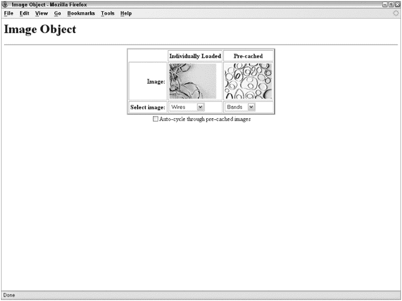

为了每隔五秒循环一次图像，`checkTimer()` 函数检查定时器复选框是否被选中。如果是，则复制并增加缓存 `select` 控件的 `selectedIndex` 属性（如果索引达到最大值，则重置为零）。`select` 元素会被调整，现在你可以调用 `loadCached()` 函数来读取当前选中的项目并相应设置图像。

为了额外的样式效果，`<body>` 标签包含一个 `onload` 事件处理程序，它调用 `searchResults()` 函数。这个通用函数遍历页面上的所有的表单以及每个表单内的所有元素。对于每个 `select` 元素，`selectedIndex` 属性都会重置为零。因此，如果用户重新加载页面或通过后退按钮返回页面，图像将从原始顺序开始。`onload` 事件处理程序确保图像与选择同步，并在延迟五秒后调用 `checkTimer()` 函数。然而，除非定时器复选框被勾选，否则缓存的图像不会循环。

### 列表 31-3: 脚本化的图像对象和旋转图像

```html
<!DOCTYPE html>
<html>
<head>
  <meta http-equiv="content-type" content="text/html;charset=utf-8">
  <title>Image Object</title>
  <script type="text/javascript">
    // 全局声明 'desk' 图像数组
    var imageDB;
    // 预缓存 'desk' 图像
    if (document.images) {
      // 为了方便，列出数组索引名称
      var deskImages = new Array("desk1", "desk2", "desk3", "desk4");
      // 构建图像数组并预缓存它们
      imageDB = new Array(4);
      for (var i = 0; i < imageDB.length; i++) {
        imageDB[deskImages[i]] = new Image(20,9);
        imageDB[deskImages[i]].src = deskImages[i] + ".gif";
      }
    }
    // 更改 'individual' 图像
    function loadIndividual(form) {
      if (document.images) {
        var gifName = form.individual[form.selectedIndex].value;
        document.getElementById("thumbnail1").src = gifName + ".gif";
      }
    }
    // 更改 'cached' 图像
    function loadCached(form) {
      if (document.images) {
        var gifIndex = form.cached[form.selectedIndex].value;
        document.getElementById("thumbnail2").src = imageDB[gifIndex].src;
      }
    }
    // 如果开启，将 'cached' 图像循环到队列中的下一个
    function checkTimer() {
      if (document.images & document.Timer.timerBox.checked) {
        var gifIndex = document.selections.cached.selectedIndex;
        if (++gifIndex > imageDB.length - 1) {
          gifIndex = 0;
        }
        document.selections.cached.selectedIndex = gifIndex;
        loadCached(document.selections);
        var timeoutID = setTimeout(checkTimer(), 500);
      }
    }
    // 卸载时将表单控件重置为默认
    function resets() {
      for (var i = 0; i < document.forms.length; i++) {
        for (var j = 0; j < document.forms[i].elements.length; j++) {
          if (document.forms[i].elements[j].type == "select") {
            document.forms[i].elements[j].selectedIndex = 0;
          }
        }
      }
    }
    // 开始运行
    function init() {
      loadIndividual(document.selections);
      loadCached(document.selections);
      setTimeout(checkTimer(), 5000);
    }
  </script>
</head>
<body onload="init()" onclick="resets()">
  <h1>Image Object</h1>
  <hr />
  <center>
    <table border="3" cellpadding="3">
      <tr>
        <th></th>
        <th>Individually Loaded</th>
        <th>Pre-cached</th>
      </tr>
      <tr>
        <td align="right"><b>Image:</b></td>
        <td></td>
        <td></td>
      </tr>
      <tr>
        <td align="right"><b>Select image:</b></td>
        <form name="selections">
          <td>
            <select name="individual" onchange="loadIndividual(this.form)">
              <option value="cpu1">Wires</option>
              <option value="cpu2">Keyboard</option>
              <option value="cpu3">Discs</option>
              <option value="cpu4">Cables</option>
            </select>
          </td>
          <td>
            <select name="cached" onchange="loadCached(this.form)">
              <option value="desk1">胶带/胶带</option>
              <option value="desk2">夹子</option>
              <option value="desk3">台灯</option>
              <option value="desk4">橡皮擦</option>
            </select>
          </td>
        </form>
      </tr>
    </table>
  </center>
  <form name="Timer">
    <input type="checkbox" name="timerBox" onclick="checkTimer()" />自动循环预缓存图像
  </form>
</body>
</html>
```

相关项目：`img.lowsrc`, `img.nameProp` 属性

### start
| Value: String | 读/写 |
| :--- | :--- |
| **兼容性**: WinIE4-6, MacIE4+, NN-, Moz-, Safari-, Opera-, Chrome- |

`start` 属性与通过 IE4+ 中的 `img` 元素查看的视频片段配合工作。默认情况下，当图像文件打开时，片段会开始播放（Mac 系统除外）。这遵循了 `start` 属性的默认设置：`"fileopen"`。另一个可识别的值是 `"mouseover"`，它可以防止片段在用户将鼠标指针悬停图像上方之前运行。

相关项目：`img.dynsrc`, `img.loop` 属性

### useMap
| Value: Identifier string | 读/写 |
| :--- | :--- |
| **兼容性**: WinIE4+, MacIE4+, NN6+, Moz+, Safari+, Opera+, Chrome+ |

`useMap` 属性代表 `img` 元素的 `usemap` 属性，指向分配给页面 map 元素的名称（参见列表 31-6）。该 map 元素包含了客户端图像映射的细节（在本章稍后的部分描述）。`useMap` 属性的值必须包含定义页面上内部 HTML 引用的哈希标记（`#`）。如果你需要为同一个 `img` 元素在两个或多个图像映射之间切换（例如，你更换了图像或用户处于不同的模式），你可以定义多个不同名称的 map 元素。然后更改 `img` 对象的 `useMap` 属性值，以将不同的映射与图像关联。

相关项目：`isMap` 属性

### vspace
（参见 `hspace`）

### width
（参见 `height`）

### x, y
| Value: Integer | 只读 |
| :--- | :--- |
| **兼容性**: WinIE-, MacIE-, NN4, Moz1+, Safari1+, Opera-, Chrome+ |

脚本可以通过 `x` 和 `y` 属性获取 `img` 元素的 `x` 和 `y` 坐标（图像占据的矩形区域左上角）。这些属性是只读的。它们通常不被使用，而是采用任何元素的 `offsetLeft` 和 `offsetTop` 属性，这些属性在 IE 中也受到支持。

相关项目：`img.offsetLeft`, `img.offsetTop` 属性；`img.scrollIntoView()`, `window.scrollTo()` 方法

### 事件处理器

#### onabort, onerror
| **兼容性**: WinIE4+, MacIE4+, NN3+, Moz-, Safari-, Opera-, Chrome- |

当用户在图像加载时点击停止按钮，或由于网络或服务器问题导致图像传输失败时，你的脚本可能需要采取主动。使用 `onabort` 事件处理器在用户点击停止按钮时激活函数；使用 `onerror` 事件处理器处理意外的传输故障。请注意，虽然 `onerror` 在所有浏览器中均有效，但 `onabort` 则不然。

在实践中，这些事件处理器并没有提供你在脚本中可能想要的所有信息，例如当时正在加载的图像文件名。如果此类信息对你的脚本至关重要，则脚本需要在设置图像的 `src` 属性之前，将当前加载的图像名称存储在变量中。你还不知道触发错误事件的错误性质。你可以通过强制脚本页面重新加载或导航到网站中完全不同的位置来处理此类问题。

**示例**

列表 31-4 包含一个 `onabort` 事件处理器。如果图像已于缓存中，你必须退出并重新启动浏览器来尝试停止图像加载。在示例中，我们为整个页面提供了重新加载选项。你如何处理异常在很大程度上取决于你的页面设计。尽力消除用户可能遇到的任何困难。

#### onload
| **兼容性**: WinIE3+, MacIE3+, NN2+, Moz+, Safari+, Opera+, Chrome+ |

当发生三个动作之一时，`img` 对象的 `onload` 事件处理器就会触发：一个 `lowsrc` 图像加载完成；在没有 `lowsrc` 图像规范的情况下，`src` 图像加载完成；或者当动画 GIF（GIF89a 格式）的每一帧出现时。

重要的是，如果你在 `` 标签内定义了 `lowsrc` 文件，`img` 对象就不会关于 `src` 图像加载完成的进一步通知。如果此信息对你的脚本至关重要，请通过检查 `Image` 对象的 `src` 属性来验证当前图像文件。

此外，`img` 元素的 `onload` 事件处理器可能会在页面其他元素完成加载之前触发。如果事件处理器函数引用了页面上的其他元素，函数在处理它们之前应先验证这些元素是否存在。

退出并重启你的浏览器，或清除缓存，以从列表 31-4 中获得效果。当文档首次加载时，`lowsrc` 图像文件（铅笔橡皮擦图片）会在 NASA 图像之前加载。（请记住，并非所有浏览器都支持 `lowsrc` 属性，因此你不会在 NASA 图像之前看到橡皮擦。）再次，我们刻意选择直接从 NASA 网站加载一个大图像，以便让你有更多时间观察 `onload` 事件的行为。当橡皮擦加载完成时，`onload` 事件处理器会在文本框中写入“done”，尽管主图像（NASA 图像）尚未加载。

列表 31-4：图像 onload 事件处理器

```html
<!DOCTYPE html>
<html>
<head>
  <meta http-equiv="content-type" content="text/html;charset=utf-8">
  <title>The onload Event Handler</title>
  <script type="text/javascript">
    function load(theImage,form) {
      if (document.images) {
        form.result = "";
        document.images[0].lowsrc = "desk1.gif";
        document.images[0].src = theImage;
      }
    }
    function checkLoad(form) {
      if (document.images) {
        form.result = document.images[0].complete;
      }
    }
    function signal() {
      if(confirm("你已经停止了图像加载。你想再次尝试吗？")) {
        location.reload();
      }
    }
  </script>
</head>
<body>
  <h1>The onload Event Handler</h1>
  <h3>点击浏览器的 STOP 按钮来调用 onabort 事件处理器</h3>
  
  <form>
    <p><input type="button" value="加载加载了吗?" onclick="checkLoad(this.form)" />
    <input type="text" name="result" />
    <input type="hidden" />
    </p>
  </form>
</body>
</html>
```

相关项目：`img.src`, `img.lowsrc` 属性

## area 元素对象

对于 HTML 元素属性、方法和事件处理器，请参见第 26 章“通用 HTML 元素对象”。

| 属性 | 方法 | 事件处理器 |
| :--- | :--- | :--- |
| `alt` | | |
| `coords` | | |
| `hash` | | |
| `host` | | |
| `hostname` | | |
| `href` | | |
| `noHref` | | |
| `pathname` | | |
| `port` | | |
| `protocol` | | |
| `search` | | |
| `shape` | | |
| `target` | | |

### 语法

(IE4+) `[window.]document.all.elemID.property` | `method([parameters])`

(IE5+/W3C) `[window.]document.getElementById("elemID").property` | `method([parameters])`

**兼容性:** WinIE4+, MacIE4+, NN3+, Moz+, Safari+, Opera+, Chrome+

## 关于此对象

文档对象模型将图像地图区域（image map area）对象视为文档中的链接（`a` 元素）对象之一（参见第 30 章“链接与锚点对象”中的锚点对象）。这种处理方式完全合逻辑，因为点击地图区域通常会引导用户跳转到另一个文档或同一文档中的锚点位置——即超链接引用。

虽然 HTML 在链接和地图区域的定义上差异很大，但这两类对象最早的脚本化实现具有几乎相同的属性和事件处理程序。从 IE4、NN6/Moz 以及兼容 W3C 的浏览器开始，所有的 `area` 元素属性都可以作为可脚本属性进行访问。此外，你可以通过 `map` 元素对象更改客户端图像地图区域的组成。`map` 元素对象包含一个嵌套在内部 `area` 元素数组。你可以删除、修改或向 `map` 元素内部的 `area` 元素添加内容。

客户端图像非常有趣，自从 Netscape Navigator 2 引入该功能以来，HTML 参考中一直对其进行了详细记录。本质上，你根据形状和坐标在图像内定义任意数量的区域。许多图形工具可以帮助你获取图像坐标，并输入 `<area>` 标签的 `coords` 属性中。

### 提示

如果说有一个让大多数 HTML 作者困惑的陷阱，那就是 `` 和 `<map>` 标签之间复杂的连接。你必须为 `<map>` 分配一个名称；在 `` 标签中，`usemap` 属性需要一个哈希符号（`#`）和地图名称。如果你忘记了哈希符号，就无法在图像与其地图之间建立连接。

列表 31-5 包含客户端图像地图的示例，允许你在中东不同的地理特征之间导航。当你在航拍图像周围移动鼠标时，某些区域会导致鼠标指针发生变化，表示该区域关联有一个链接。点击某个区域将弹出一个警告框，指示你点击了哪个区域。

列表 31-5: 一个简单的客户端图像地图

```html
<!DOCTYPE html>
<html>
    <head>
      <meta http-equiv="content-type" content="text/html;charset=utf-8">
      <title>Image Maps</title>
      <script type="text/javascript">
        function show(msg)
        {
          window.status = msg;
          return true;
        }
        function go(where)
        {
          alert("We're going to " + where + "!");
        }
        function clearIt()
        {
          window.status = "";
          return true;
        }
      </script>
    </head>
    <body>
      <h1>Sinai and Vicinity</h1>
      
      <map id="sinai" name="sinai" >
        <area href="javascript:go('Cairo')" coords="12,152,26,161" shape="rect" onmouseover="return('Cairo')" onmouseout="return clearIt()" />
        <area href="javascript:go('the Nile River')" shape="poly" onmouseover="return('Nile River')" onmouseout="return clearIt()" coords="1,155,6,162,0,175,3,201,1,232,109,27,167,238,274,292,20,307,20,19,230,19,17,298,13,282,17,267,233,198,28,54,27,107,21,1,255,1,199,19,165,0,49" />
        <area href="javascript:go('Israel')" coords="95,69,201,91" shape="rect" onmouseover="return('Israel')" onmouseout="return clearIt()" />
        <area href="javascript:go('Saudi Arabia')" coords="256,57,319,121" shape="rect" onmouseover="return('Saudi Arabia')" onmouseout="return clearIt()" />
        <area href="javascript:go('the Mediterranean Sea')" coords="1,55,26,123" shape="rect" onmouseover="return('Mediterranean Sea')" onmouseout="return clearIt()" />
        <area href="javascript:go('the Mediterranean Sea')" coords="27,56,104,103" shape="rect" onmouseover="return('Mediterranean Sea')" onmouseout="return clearIt()" />
      </map>
    </body>
</html>
```

## 属性

### alt
| Value: String | 可读/写 |
| :--- | :--- |
| **兼容性:** WinIE4+, MacIE4+, NN6+, Moz+, Safari+, Opera+, Chrome+ |

`alt` 属性代表 `area` 的 `alt` 属性。当你将鼠标指针悬停在区域上方时，Internet Explorer 会在区域上方弹出一个微小的弹出窗口（工具提示）显示 `alt` 文本。Internet Explorer 是唯一以任何明显方式使用 `alt` 的主流浏览器。

**相关项目:** `title`

### coords
| Value: String | 可读/写 |
| :--- | :--- |
| **兼容性:** WinIE4+, MacIE4+, NN6+, Moz+, Safari+, Opera+, Chrome+ |

`coords` 和 `shape` 属性控制由 `area` 管理的热点位置、大小和形状。`area` 的默认形状是矩形。

| 形状 | 坐标说明 | 示例 |
| :--- | :--- | :--- |
| circ | `center-x, center-y, radius` | `30,20` |
| circle | `center-x, center-y, radius` | `30,20` |
| poly | `x1, y1, x2, y2,...` | `0,0,15,30` |
| polygon | `x1, y1, x2, y2,...` | `0,0,15,30` |
| rect | `left, top, right, bottom` | `10,20,60,40` |
| rectangle | `left, top, right, bottom` | `10,20,60,40` |

**相关项目:** 无

### hash
### host
### hostname
### href
### pathname
### port
### protocol
### search
### target
（参见第 30 章“链接与锚点对象”中链接对象的对应属性。）

### noHref
| Value: Boolean | 可读/写 |
| :--- | :--- |
| **兼容性:** WinIE4+, MacIE4+, NN6+, Moz+, Safari+, Opera+, Chrome+ |

`noHref` 属性用于启用或禁用 `map` 中的特定区域。属性的值为 `true` 时表示区域已启用，为 `false` 时防止该区域作为链接。任何浏览器中的实际行为都可能不可预测，因此请仔细测试。

### shape
（参见 `coords`）

## map 元素对象

关于 HTML 元素的属性、方法和事件处理程序，请参见第 26 章“通用元素对象”。

| 属性 | 方法 | 事件处理程序 |
| :--- | :--- | :--- |
| `areas[]` | | `onscroll`† |
| `name` | | |

† 参见第 29 章

### 语法

访问 map 元素对象属性：

(IE4+) `[window.]document.all.elemID.property` | `method([parameters])`

(IE5+/W3C) `[window.]document.getElementById("elemID").property` | `method([parameters])`

兼容性：WinIE4+, MacIE4+, NN6+, Moz+, Safari+, Opera+, Chrome+

使用 `areas` 数组可以遍历 `map` 元素中的所有 `area` 元素对象。虽然 Mozilla 和基于 WebKit 的浏览器严格遵循 W3C DOM 的文档节点结构，但 IE4+ 提供了更直接的方法访问嵌套在 `map` 内部的 `area` 元素对象。如果你想重写 `map` 内部的 `area` 元素，可以将 `areas` 数组的 `length` 属性设置为零以清除旧元素。然后将 `area` 元素对象赋值数组的槽位以构建该数组。

列表 31-6 展示了如何使用脚本替换 `map` 元素内部的 `area` 元素对象。场景是页面加载时显示一张计算机键盘的图片。这张图片链接到 `keyboardMap` 客户端图像映射，该映射指定了图片上三个热点的详细信息。如果你切换了该 `img` 元素中显示的图片，脚本会更改 `img` 元素对象的 `useMap` 属性，以指向第二个 map，该 map 的规格更适合第二张图片中的台灯。将鼠标指针悬停在图片上方，并在状态栏中查看与每个 `area` 相关的 URL（在本例中，这些 URL 不指向其他页面）。

然而，页面上的另一个按钮调用了 `makeAreas()` 函数（MacIE5 不支持），它会创建四个新的 `area` 元素对象并（通过 DOM 特有的路径）将这些新规格添加到图片中。如果在函数执行后将鼠标悬停在图片上方，你可以看到 URL 现在反映了新区域的地址。还要注意添加的第四个 `area`，其状态栏消息出现在图 31.2 中。

### 列表 31-6: 动态修改 `area` 元素

```html
<!DOCTYPE html>
<html>
<head>
    <meta http-equiv="content-type" content="text/html;charset=utf-8">
    <title>map Element Object</title>
    <script type="text/javascript">
        // 动态生成 area elements
        function makeAreas() {
            document.getElementById("myIMG").src = "desk3.gif";
            // 构建 area element objects
            var area1 = document.createElement("area");
            area1.href = "Script-Made-Shade.html";
            area1.shape = "polygon";
            area1.coords = "52,28,108,35,119,29,119,8,63,0,52,28";
            var area2 = document.createElement("area");
            area2.href = "Script-Made-Base.html";
            area2.shape = "rect";
            area2.coords = "75,65,117,87";
            var area3 = document.createElement("area");
            area3.href = "Script-Made-Chain.html";
            area3.shape = "polygon";
            area3.coords = "68,51,73,51,69,32,68,51";
            var area4 = document.createElement("area");
            area4.href = "Script-Made-Emptyness.html";
            area4.shape = "rect";
            area4.coords = "0,0,0,20";
            // 将新元素放入 MAP 节点
            var mapObj = document.getElementById("lamp_map");
            while (mapObj.childNodes.length) {
                mapObj.removeChild(mapObj.firstChild);
            }
            mapObj.appendChild(area1);
            mapObj.appendChild(area2);
            mapObj.appendChild(area3);
            mapObj.appendChild(area4);
            // NN6 display bug
            document.getElementById("myIMG").style = "inline";
        }
        function changeKeyboard() {
            document.getElementById("myIMG").src = "cpu2.gif";
            document.getElementById("myIMG").useMap = "#keyboardMap";
        }
        function changeLamp() {
            document.getElementById("myIMG").src = "desk3.gif";
            document.getElementById("myIMG").useMap = "#lampMap";
        }
    </script>
</head>
<body>
    <h1>map Element Object</h1>
    <hr/>
    
    <map id="keyboardMap" name="keyboardMap">
        <area href="AlpaKeys.htm" shape="rect" coords="0,0,26,42"/>
        <area href="ArrowKeys.htm" shape="polygon" coords="48,89,57,77,69,82,77,70,89,78,84,89,48,89"/>
        <area href="PageKeys.htm" shape="circle" coords="104,51,14"/>
    </map>
    <map name="lampMap" id="lamp_map">
        <area href="Shade.htm" shape="polygon" coords="52,28,108,35,119,29,119,8,63,0,52,28"/>
        <area href="Base.htm" shape="rect" coords="75,65,117,87"/>
        <area href="Chain.htm" shape="polygon" coords="68,51,73,51,69,32,68,51"/>
    </map>
    <form>
        <p><input type="button" value="Load Lamp Image" onclick="changeLamp()"></p>
        <p><input type="button" value="Write Map on-the-Fly" onclick="makeAreas()"></p>
        <p><input type="button" value="Load Keyboard Image" onclick="changeKeyboard()"></p>
    </form>
</body>
</html>
```

图 31.2 脚本为图片创建了一个特殊的客户端图像映射。

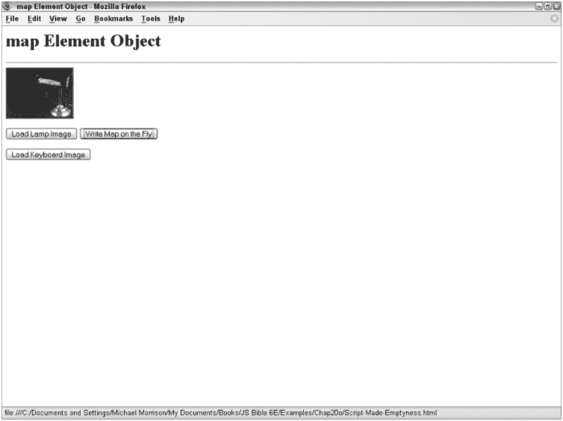

相关项目：area 元素对象

### name
| 值：`String` | 可写 |
| :--- | :--- |
| 兼容性：WinIE4+, MacIE4+, NN6+, Moz+, Safari+, Chrome+ |

图像映射与图片之间需要建立关系。我们通过图像映射的 `name` 属性来实现：它匹配对应图片的 `useMap` 属性值。

相关项目：对应图片的 `useMap` 属性

## canvas 元素对象

关于 HTML 元素的属性、方法和事件处理器，请参见第 26 章“通用 HTML 对象”。

| 属性 | 方法 | 事件处理器 |
| :--- | :--- | :--- |
| `fillStyle` | `arc()` | |
| `globalAlpha` | `arcTo()` | |
| `globalCompositeOperation` | `bezierCurveTo()` | |
| `lineCap` | `beginPath()` | |
| `lineJoin` | `fillRect()` | |
| `lineWidth` | `clip()` | |
| `miterLimit` | `closePath()` | |
| `shadowBlur` | `createLinearGradient()` | |
| `shadowColor` | `createPattern()` | |
| `shadowOffsetX` | `createRadialGradient()` | |
| `shadowOffsetY` | `drawImage()` | |
| `strokeStyle` | `fill()` | |
| | `fillRect()` | |
| | `getContext()` | |
| | `lineTo()` | |
| | `moveTo()` | |
| | `quadraticCurveTo()` | |
| | `rect()` | |
| | `restore()` | |
| | `rotate()` | |
| | `save()` | |
| | `scale()` | |
| | `stroke()` | |
| | `strokeRect()` | |
| | `translate()` | |

### 语法

访问 `canvas` 元素对象的属性：

(W3C) `[window.]document.getElementById("canvasID").property`

`canvas.method([parameters])`

兼容性：WinIE-, MacIE-, NN-, Moz1.8+, Safari1.3+, Opera+, Chrome+

### 关于此对象

`canvas` 是一种相对新的结构，允许你在页面上创建一个矩形区域，可以通过 JavaScript 进行编程绘制。相对于网页而言，`canvas` 看起来像一张图片，因为它占据了一个矩形空间。然而，与图片不同，`canvas` 内容是通过在 `canvas` 对象上定义的一系列方法编程生成的。`canvas` 的支持最早出现在 Safari 浏览器的 1.3 版本，然后扩展到 Mozilla 浏览器的 1.8 版本（对应 Firefox 1.5）。虽然当前版本的 IE 不原生支持此对象，但有第三方库允许你在 IE 中使用此对象。

Canvas 对象使用 `<canvas>` 标签在页面上创建并定位，该标签仅支持两个独特的属性：`width` 和 `height`。创建 canvas 后，与 canvas 图形相关的剩余工作由 JavaScript 代码完成。

列表 31-7 包含了一个用于放置带框的基础画布的骨架页面。注意，这里有一个 `draw()` 函数，它已经准备好接收渲染画布图形的代码。

### 列表 31-7：一个骨架化的画布

```html
<!DOCTYPE html>
<html>
  <head>
    <meta http-equiv="content-type" content="text/html;charset=utf-8">
    <title>canvas Object</title>
    <script type="text/javascript">
      function draw()
      {
        // Draw some stuff
      }
    </script>
    <style type="text/css">
      canvas { border: 1px solid black; }
    </style>
  </head>
  <body onload="draw();">
    <h1>canvas Object</h1>
    <hr />
    <canvas width="350" height="250"></canvas>
  </body>
</html>
```

列表 31-8 包含了一个更有趣的画布示例，它通过添加一些实际的画布绘制代码在骨架页的基础上进行了扩展。`canvas` 对象中的属性和方法为你提供了一些惊人的功能，因此可以将此示例视为对画布表面的初步尝试。

### 列表 31-8：一个包含简单图表的画布

```html
<!DOCTYPE html>
<html>
  <head>
    <meta http-equiv="content-type" content="text/html;charset=utf-8">
    <title>canvas Object</title>
    <script type="text/javascript">
      function draw()
      {
        var canvas = document.getElementById('chart');
          if (canvas.getContext)
        {
            var context = canvas.getContext('2d');
            context.lineWidth = 20;
            // First bar
            context.strokeStyle = "red";
            context.beginPath();
            context.moveTo(0, 90);
            context.lineTo(20, 0);
            context.stroke();
            // Second bar
            context.strokeStyle = "green";
            context.beginPath();
            context.moveTo(50, 90);
            context.lineTo(50, 0);
            context.stroke();
            // Third bar
            context.strokeStyle = "yellow";
            context.beginPath();
            context.moveTo(80, 90);
            context.lineTo(80, 25);
            context.stroke();
            // Fourth bar
            context.strokeStyle = "blue";
            context.beginPath();
            context.moveTo(110, 90);
            context.lineTo(110, 75);
            context.stroke();
        }
      }
    </script>
    <style type="text/css">
      canvas { border: 1px solid black; }
    </style>
  </head>
  <body onload="draw();">
    <h1>canvas Object</h1>
    <hr />
    <canvas id="chart" width="130" height="100"></canvas>
  </body>
</html>
```

图 31.3 显示了此画布示例的运行情况，涉及简单条形图的显示。需要记住的是，这个条形图是使用矢量图形程序化渲染的，这是非常强大的。

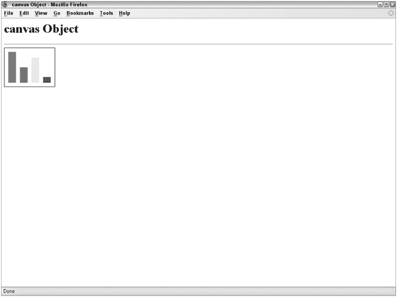

此示例揭示了关于画布如何工作的更多细节。注意，你必须首先获取一个上下文，以便在画布上执行操作。（实际上，你是在画布上下文上执行图形操作，而不是在画布元素本身。）上下文的作用是为你提供一个可以在上面绘图的虚拟表面。你通过调用 `canvas` 对象上的 `getContext()` 方法并指定上下文类型来获取画布上下文；目前浏览器仅支持 `2d`（二维）上下文。

当你拥有了上下文，画布绘制操作就是相对于该上下文进行的。然后你就可以自由地调整描边和填充颜色、创建路径和填充，并进行大多数与矢量绘制相关的熟悉图形操作。

你可以在 http://developer.mozilla.org/en/docs/Canvas_tutorial 找到关于使用画布元素绘图的更完整的教程和示例。

## 属性

### fillStyle
| 属性 | 值 | 读/写 | 兼容性 |
| :--- | :--- | :--- | :--- |
| `fillStyle` | String | 读/写 | WinIE-, MacIE-, NN-, Moz1.8+, Safari1.3+, Opera+, Chrome+ |

`fillStyle` 属性设置了用于填充 `canvas` 区域的画刷填充颜色，可以是颜色或模式。尽管你可以创建渐变和其他有趣的模式用于填充形状，但 `fillStyle` 属性最基本的用法是将该属性设置为 HTML 样式的颜色来创建纯色填充。

示例：将填充颜色设置为 HTML 样式的颜色：

```javascript
context.fillStyle = "#FF00FF";
```

### globalAlpha
| 属性 | 值 | 读/写 | 兼容性 |
| :--- | :--- | :--- | :--- |
| `globalAlpha` | Float | 读/写 | WinIE-, MacIE-, NN-, Moz1.8+, Safari1.3+, Opera+, Chrome+ |

`globalAlpha` 属性是一个浮点属性，用于建立在画布上绘制内容的透明度（或不透明度，取决于你的理解）。接受的值从 `0.0`（完全透明）到 `1.0`（完全不透明）。默认设置为 `1.0`，这意味着画布最初没有透明度。

示例：将画布的透明度设置为 50%：

```javascript
context.globalAlpha = 0.5;
```

### globalCompositeOperation
| 属性 | 值 | 读/写 | 兼容性 |
| :--- | :--- | :--- | :--- |
| `globalCompositeOperation` | String | 读/写 | WinIE-, MacIE-, NN-, Moz1.8+, Safari1.3+, Opera+, Chrome+ |

`globalCompositeOperation` 属性决定了画布相对于背景内容显示的方式。这是一个强大的属性，因为它可以极大地影响画布内容与底层网页之间的显示方式。默认设置为 `source-over`，这意味着画布的不透明区域将显示，但透明区域将不会显示。其他流行的设置包括 `copy`、`lighter`、`darker` 等。

示例：如果你想画布完全覆盖背景网页，无论它可能具有任何透明区域，你应该将 `globalCompositeOperation` 属性设置为 `copy`：

```javascript
context.globalCompositeOperation = "copy";
```

### shadowBlur, shadowColor, shadowOffsetX, shadowOffsetY
| 属性 | 值 | 读/写 | 兼容性 |
| :--- | :--- | :--- | :--- |
| `shadowBlur` | Float | 读/写 | WinIE-, MacIE-, NN-, Moz1.8+, Safari1.3+, Opera+, Chrome+ |
| `shadowColor` | String | 读/写 | WinIE-, MacIE-, NN-, Moz1.8+, Safari1.3+, Opera+, Chrome+ |
| `shadowOffsetX` | Float | 读/写 | WinIE-, MacIE-, NN-, Moz1.8+, Safari1.3+, Opera+, Chrome+ |
| `shadowOffsetY` | Float | 读/写 | WinIE-, MacIE-, NN-, Moz1.8+, Safari1.3+, Opera+, Chrome+ |

这些属性共同作用，在画布内容周围建立阴影。`shadowBlur` 属性决定阴影本身的宽度，而 `shadowColor` 则使用 HTML 风格的 RGB 值（`#RRGGBB`）设置阴影颜色。最后，`shadowOffsetX` 和 `shadowOffsetY` 属性指定了阴影相对于图形的偏移距离。`shadowBlur`、`shadowOffsetX` 和 `shadowOffsetY` 属性均以画布坐标空间的单位表示。

### 示例

以下代码创建了一个宽度为 5 个单位、颜色为浅灰色（`#BBBBBB`）、且在 X 和 Y 方向上均偏移 3 个单位的阴影：

```javascript
context.shadowBlur = 5;
context.shadowColor = "#BBBBBB";
context.shadowOffsetX = 3;
context.shadowOffsetY = 3;
```

相关项目：无

### strokeStyle
| Value: String | 可读写 |
| :--- | :--- |
| 兼容性: WinIE-, MacIE-, NN-, Moz1.8+, Safari1.3+, Opera+, Chrome+ |

`strokeStyle` 属性控制用于在画布上绘制的描边样式。你可以使用更高级的画布功能将描边样式设置为渐变或图案，但更简单的方法是直接设置 HTML 风格的颜色值（`#RRGGBB`）作为实色描边。默认描边样式是实黑色描边。

### 示例

要将描边样式更改为实绿色笔触，请将 `strokeStyle` 属性设置为绿色：

```javascript
context.strokeStyle = "#00FF00";
```

相关项目：`fillStyle` 属性

## 方法

### arc(x, y, radius, startAngle, endAngle, clockwise)
### arcTo(x1, y1, x2, y2, radius)
### bezierCurveTo(cp1x, cp1y, cp2x, cp2y, x, y)
### quadraticCurveTo(cpx, cpy, x, y)

返回值：无

兼容性: WinIE-, MacIE-, NN-, Moz1.8+, Safari1.3+, Opera+, Chrome+

这些方法都负责以各种方式绘制曲线。如果你具有任何矢量图形绘制的经验，那么你可能熟悉弧、贝塞尔曲线和二次曲线之间的区别。

`arc()` 方法根据中心点、半径以及起始和结束角度绘制曲线。你可以将此方法理解为从一个角度到另一个角度描绘圆的曲线。角度是以弧度表示的而不是度，因此你可能需要将度转换为弧度：

```javascript
var radians = (Math.PI / 180) * degrees;
```

`arc()` 的最后一个参数是布尔值，决定弧是否按顺时针（`true`）或反时针（`false`）方向绘制。

`arcTo()` 方法根据圆的切线沿曲线绘制弧。该方法直到 Mozilla 1.8.1 版本才在 Mozilla 中实现。

最后，`bezierCurveTo()` 和 `quadraticCurveTo()` 方法分别根据与贝塞尔曲线和二次曲线相关的参数绘制曲线，这稍微超出了本文的讨论范围。要了解更多关于贝塞尔曲线和二次曲线的信息，请查看 en.wikipedia.org/wiki/Bézier_curve。

### beginPath()
### closePath()

返回值：无

兼容性: WinIE-, MacIE-, NN-, Moz1.8+, Safari1.3+, Opera+, Chrome+

这两个方法用于管理路径。调用 `beginPath()` 方法开始一条新路径，然后你可以在其中添加形状。完成后，调用 `closePath()` 关闭路径。`closePath()` 的唯一作用是关闭一个仍开启的子路径，这意味着你想完成将一个开启的形状连接回起点。如果你创建的路径已经是关闭状态的，则没有需要调用 `closePath()` 方法。列表 31-8 包含一个良好的示例，说明在何处 `closePath()` 方法是不必要的，因为条形形状不需要关闭。

### clip()

返回值：无

兼容性: WinIE-, MacIE-, NN-, Moz1.8+, Safari1.3+, Opera+, Chrome+

`clip()` 方法根据当前路径和已存在的裁剪路径重新计算裁剪路径。后续的绘制操作将依赖于新计算的裁剪路径。

### createLinearGradient(x1, y1, x2, y2)
### createRadialGradient(x1, y1, radius1, x2, y2, radius2)
### createPattern(image, repetition)

返回值：渐变对象引用，图案对象引用（`createPattern()`）

兼容性: WinIE-, MacIE-, NN-, Moz1.8+, Safari1.3+, Opera+, Chrome+

这些方法用于为填充操作创建特殊的图案和渐变。线性渐变指定为两个坐标之间的平滑颜色过渡，而径向渐变则基于两个半径相似的圆。通过调用从 `createLinearGradient()` 和 `createRadialGradient()` 返回的渐变对象上的 `addColorStop()` 方法，设置渐变的实际颜色范围。`addColorStop()` 方法接受一个浮点偏移量和一个字符串颜色值作为它的两个参数。

`createPattern()` 方法用于根据图像创建填充图案。你提供一个图像对象和一个关于图像在填充区域时如何平铺的重复参数。重复选项包括 `repeat`、`repeat-x`、`repeat-y` 和 `no-repeat`。

### drawImage(image, x, y)
### drawImage(image, x, y, width, height)
### drawImage(image, srcX, srcY, srcWidth, srcHeight, destX, destY, destWidth, destHeight)

返回值：无

兼容性: WinIE-, MacIE-, NN-, Moz1.8+, Safari1.3+, Opera+, Chrome+

这些 `drawImage()` 方法都将图像绘制到上下文中。第一个版本在不缩放的坐标处绘制图像，而第二个版本将图像缩放到目标宽度和高度。最后，第三个版本允许你将图像的一部分绘制到目标位置。

### fill()
### fillRect(x, y, width, height)
### clearRect(x, y, width, height)

返回值：无

兼容性: WinIE-, MacIE-, NN-, Moz1.8+, Safari1.3+, Opera+, Chrome+

这些方法用于填充和清除区域。`fill()` 方法填充路径内的区域，而 `fillRect()` 方法填充矩形。`clearRect()` 方法用于清除（擦除）矩形。

### getContext(contextID)

返回值：Context 对象

兼容性: WinIE-, MacIE-, NN-, Moz1.8+, Safari1.3+, Opera+, Chrome+

`getContext()` 方法作用于画布元素而不是上下文，用于获取上下文。在绘制画布之前必须调用此方法获取上下文，因为所有的画布方法实际上都是相对于上下文的。对于二维画布上下文，请将 `"2d"` 作为方法的唯一参数。

### lineTo(x, y)
### moveTo(x, y)

返回值：无

兼容性: WinIE-, MacIE-, NN-, Moz1.8+, Safari1.3+, Opera+, Chrome+

这两个方法用于绘制线条和调整描笔位置。`moveTo()` 方法仅移动当前描笔位置而不向路径添加任何内容。`lineTo()` 方法从当前描笔位置到指定点绘制线条。需要注意的是，使用 `lineTo()` 方法绘制线条只是向当前路径添加线条；在调用 `stroke()` 方法执行路径绘制之前，线条并不会真正出现在画布上。

### rect(x, y, width, height)

返回值：无

兼容性: WinIE-, MacIE-, NN-, Moz1.8+, Safari1.3+, Opera+, Chrome+

`rect()` 方法向当前路径添加一个矩形。与其他绘制方法类似，矩形只是被添加到当前路径中，在通过 `stroke()` 方法进行渲染之前它并不是可见的。

### restore()
### save()

返回值：无

兼容性: WinIE-, MacIE-, NN-, Moz1.8+, Safari1.3+, Opera+, Chrome+

可以保存并恢复图形状态，这样你就可以进行更改然后返回理想状态。上下文状态包括裁剪区域、线宽、填充颜色等信息。调用 `save()` 和 `restore()` 方法来保存和恢复上下文状态。

### rotate(angle)
### scale(x, y)
### translate(x, y)

返回值：无

兼容性：WinIE-, MacIE-, NN-, Moz1.8+, Safari1.3+, Opera+, Chrome+

你在 `canvas` 上执行的所有绘制操作都是相对于 `canvas` 坐标系的单位来表示的。这三个方法允许你通过旋转、缩放或平移其原点来改变 `canvas` 坐标系。旋转坐标系会影响涉及角度的绘制操作中角度的表示。缩放坐标系会影响系统中表示单位的相对大小。最后，平移坐标系会改变原点的位置，从而影响正负值在绘图表面上的交点位置。

### stroke()
### strokeRect(x, y, width, height)

返回值：无

兼容性：WinIE-, MacIE-, NN-, Moz1.8+, Safari1.3+, Opera+, Chrome+

在 `canvas` 上进行的大多数绘制操作都会影响当前路径，你可以将其认为是一个已经记在脑中但尚未画到纸上的绘图。你通过调用 `stroke()` 方法将路径渲染到 `canvas`。如果你想在不处理当前路径的情况下在 `canvas` 上画一个矩形，请调用 `strokeRect()` 方法。

# 事件对象

## 本章内容
- 事件对象的“生命周期”
- 不同代浏览器对事件的支持
- 从事件中获取信息

在第 4 版本浏览器之前，用户和系统操作——事件——主要是通过定义在 HTML 标签内部属性内部的事件处理程序来捕获的。例如，当用户点击按钮时，`click` 事件会触发标签中的 `onclick` 事件处理程序。该处理程序可能会调用一个单独的函数或执行某些内联 JavaScript 脚本。尽管如此，事件本身还是相当“愚笨”的：事件要么发生，要么不发生。至于事件发生在什么位置（即点击鼠标按钮时刻指针的屏幕坐标）以及其他相关的事件细节（例如，是否同时按下了键盘修饰键），并不包含在事件中——直到第 4 版本浏览器出现。

第 4 版本浏览器在保持与旧版事件处理程序机制完全向后兼容的同时，引入了第一个事件模型，将事件转换为一等对象，这些对象在事件发生时，其属性会自动携带大量关于该事件的各种信息。这些属性完全暴露给脚本，允许页面更智能地响应用户对页面及其元素的操作。

第 4 版本事件模型的另一个新方面是“事件传播”的概念。每当让多个对象共享一个事件处理程序有意义时，可以让事件由元素包含层级中更高级的对象进行处理。由于被处理的事件携带了关于预期目标的信息以及其他“黄金信息点”，使得事件处理程序函数可以在处理事件时变得非常智能，而不需要在调用事件处理程序时传递各种特定于目标的信息。

遗憾的是，这种新发现的力量带来的快乐被对象模型不兼容的因素所抵消了。事件对象模型明显在两个方面进行了划分：

- IE4+ 模型
- 由 W3C DOM Level 2 采用的模型（在 NN6+/Moz 以及基于 Gecko-、WebKit- 和 Presto 的浏览器中实现）

这些区别中的许多在第 26 章“通用 HTML 元素对象”的对象模型概述中得到了解决。在本章中，你将更多地了解包含所有“精华”的实际事件对象。在可能的情况下，将解决跨浏览器相关的问题。

## 为什么用“事件”？

图形用户界面编程比“老式”的命令行界面更难编程。在命令行或菜单驱动的系统中，用户在任何时刻所采取的操作类型是受到刻意限制的。那个世界是非常模态的（modal），主要是为了方便引导用户通过僵化程序结构的程序员。

而在图形用户界面（如 Windows、Mac OS、XWindow 系统或任何源自 Xerox Star 系统开创性工作）中，这一切都发生了变化。对于程序员来说，挑战在于，该领域一个良好的用户界面必须允许用户在任何时刻执行各种操作：滚动鼠标、点击按钮、输入按键、选择文本、选择下拉菜单项等。为了适应这一点，程序（或者更好，是操作系统）必须关注来自所有输入端口（无论是鼠标、键盘还是网络连接）的任何可能的活动。

在操作系统层面实现这一点的常用方法是寻找任何类型的事件，无论它是来自用户操作还是某些机器生成的活动。操作系统或程序随后查找应该如何处理每种事件。然而，这些事件必须具备某些智能性，以便程序知道事件是什么、以及发生在屏幕的哪个位置。

### 事件知道什么（以及它何时知道）

尽管三种事件模型之间引用事件对象的方式略有不同，但它们共同拥有的一个概念是：事件对象在事件动作发生的瞬间被创建。例如，如果你点击了一个按钮，浏览器内存中就会创建一个事件对象。随着对象的创建，浏览器会给该对象的属性赋值——这些属性反映了该特定事件的许多特征。对于点击事件，这些信息包括点击的坐标，以及使用了哪个鼠标按钮来生成事件。为了提供进一步帮助，浏览器会进行一些快速计算，以确定点击事件的坐标与屏幕上按钮元素的矩形空间重合。因此，事件对象的属性之一就是对你所点击的那个“屏幕物体（screen thing）”的引用。

大多数事件对象属性都是只读的（在某些模型中，所有属性都是只读的），因为事件对象就像是事件动作的快照。如果事件模型允许修改事件属性，那么执行某些潜在有用和潜在不友好的行为都是可能的。例如，对于用户来说，尝试在文本框中输入，结果按键按下后被修改了，导致文本框中出现了完全不同的字符，这将是多么令人沮丧？相反，在某些情况下，确保输入到文本框的任何内容转换为大写字母可能是很有用的。每个事件模型在这方面都有自己的哲学。

关于事件对象，最重要的一点也许是，它只在脚本处理事件时存在。事件可以触发一个事件处理程序——通常是一个函数。该函数当然可以调用其他函数。只要脚本在响应事件处理程序时仍在执行，事件对象及其所有属性就是“存活”的并且可供脚本使用的。但在最后一个脚本语句运行后，事件对象就会变回一个空对象。

到此为止，讨论的都是事件对象（小写字母“e”），它是事件的一个实例，包含了与该特定事件动作相关的所有属性。在 W3C DOM 事件模型中，还有一个静态的 `Event` 对象（大写字母“E”），它内部包含了额外的子类。这些子类在本章的稍后部分会进行介绍，但在这里引入它们是为了阐明事件对象与 `Event` 对象之间的区别。正如你所看到的，前者是一个包含特定事件动作细节的瞬态对象；而后者主要作为脚本可以使用的事件相关常量值的容器。静态的 `Event` 对象对任何窗口（window）或框架（frame）内的脚本始终可用。要查看 NN6+/Moz 以及基于 Gecko-、WebKit- 和 Presto 的浏览器的所有 `Event` 对象属性列表，请使用“评估器”（The Evaluator）（参见第 4 章“JavaScript 基础”）：在底部文本框中输入 `Event`（同时也可以查看 NN6+/Moz 中的 `KeyEvent` 对象）。

静态的 `Event` 对象实际上也是克隆事件对象的来源。因此，静态的 `Event` 对象具有许多适用于（或被事件动作创建的事件对象继承）的属性和方法。这些关系在 W3C DOM 事件模型中更为重要，该模型在 DOM 的面向对象倾向的基础上实现了事件模型。

## 事件传播 (Event Propagation)

在 4 版本之前的浏览器中，事件会在对象上触发。如果为该事件和对象定义了事件处理程序，则执行该处理器；如果没有事件处理程序，事件就会直接消失在虚空中。然而，较新的浏览器会让事件经历一段更长的旅程，导致它们通过文档对象模型（DOM）进行传播。如你所知，目前存在两种传播模型，分别对应现有的两种事件模型：IE4+ 和 W3C DOM（后者在 NN6+/Moz 以及基于 Gecko-、WebKit- 和 Presto 的浏览器中实现）。值得一提的是 NN4 特有的事件模型，在 NN4 逐渐让位于现代浏览器之前，它曾作为第三种模型存在。NN4 事件模型具有历史意义，因为它有助于理解后两种模型。从概念上讲，NN4 和 IE4+ 的传播模型是完全相反的——任何 NN4 事件都向目标内向传播，而 IE 事件则从目标开始并向外传播。但 W3C DOM 模型成功地同时实现了这两种模型，尽管它使用了全新的语法以避免干扰旧模型。

这三个模型的共同核心点是：每个事件都有一个目标。对于用户触发的操作，这是显而易见的。如果你点击一个按钮或在文本框中输入文字，那么该按钮就是你鼠标相关事件的目标；文本框就是你键盘事件的目标。系统生成的事件则不明显，例如在页面加载完成后触发的 `onload` 事件。在所有事件模型中，该事件都在 `window` 对象上触发。区分不同事件传播模型的在于事件如何到达其目标，以及事件在执行完与目标相关的事件处理程序后会发生什么（如果有发生的话）。

### NN4 特有的事件传播 (NN4-only event propagation)

尽管 NN4 已让位于新浏览器，但它的传播模型开启了现代 W3C DOM 事件传播模型中存在的某些概念。NN4 模型被称为事件捕获（event capture）。

在 NN4 中，所有事件都从文档对象层次结构的顶端（从 `window` 对象开始）向下传播。

### 启用 NN4 事件捕获

上述三个对象——`window`、`document` 和 `layer`——都有一个 `captureEvents()` 方法。你使用该方法启用事件捕获。该方法需要一个或多个参数，即事件类型常量。例如，如果你想让窗口捕获按键（keypress），你需要包含以下语句：

```javascript
window.captureEvents(Event.KEYPRESS)
```

为目标定义事件处理程序也是一个主意，即使它们是空的。如果你想让窗口捕获多个事件类型，请用管道符 `|` 将这些事件类型连接起来：

```javascript
window.captureEvents(Event.KEYPRESS | Event.CLICK)
```

现在，你必须在窗口级别为事件分配一个动作：

```javascript
window.onkeypress = processKeyEvent;
window.onclick = processClickEvent;
```

### 关闭事件捕获

一旦你在文档中为特定事件类型启用了事件捕获，该捕获将一直有效，直到页面卸载或你显式地禁用。你可以通过 `window`、`document` 或 `layer` 的 `releaseEvents()` 方法关闭每个事件的捕获。`releaseEvents()` 方法采用与 `captureEvents()` 方法相同类型的参数——`Event` 类型常量。

### 将事件传向其目标

如果你在 NN4 中捕获了特定事件类型，你的脚本可能需要在让事件到达其预期目标之前对其进行一些有限的处理。要让事件穿过对象层次结构到达目标，你需要使用 `routeEvent()` 方法，并将当前函数中处理的事件对象作为参数传递。

在某些情况下，你的脚本需要知道由 `routeEvent()` 方法传递的事件是否激活了一个有返回值的函数。如果你的事件必须返回一个 `true` 或 `false` 值，以便对象知道是否应该继续执行其默认行为（例如，链接应该激活其 `href` 属性 URL，还是在事件处理程序评估并返回 `true` 或 `false` 后取消），那么这种信息就显得尤为宝贵。当函数通过 `routeEvent()` 方法的操作调用时，目标函数的返回值将传回给 `routeEvent()` 方法。该值反过来可以返回给最初捕获该事件的对象。

### 事件交通警察

最后一种场景是：高级对象捕获事件并将事件重定向到层级结构中其他处的特定对象。例如，你可以让文档级事件处理程序函数将每个 `modifiers` 属性指示按了 `Alt` 键的点击事件，重定向到一个“帮助”按钮对象，该对象自身的 `onclick` 事件处理程序将显示帮助面板（可能显示一个原本隐藏的层）。

你可以通过 `handleEvent()` 方法将事件重定向到任何对象。该方法的工作方式与本章描述的其他方法不同，因为该方法的对象引用是用于处理事件的对象的引用（事件对象作为参数传递，与其他方法是一致的）。只要目标对象为该事件定义了事件处理程序，它就会处理该事件，就像直接从系统接收到事件一样（尽管事件对象的 `target` 属性可能是完全另一个对象）。

### IE4+ 事件传播

IE 的事件传播模型被称为事件冒泡，因为事件会从目标对象通过 HTML 元素包含层级向上“冒泡”。重要的一点是要将旧式的文档对象层级结构（NN4 事件捕获模型遵循的）与更现代的 HTML 元素包含概念区分开来——这一概念也延续到了 W3C DOM。

演示事件冒泡（一种默认开启的行为）效果的一种良好方法，是在简单的文档中填充许多事件处理程序，以观察哪些程序会被触发以及触发的顺序。列表 32-1 为表单内的按钮、表单本身以及其他元素和对象定义了 `onclick` 事件处理程序，一直到层级顶端的 `window`。

列表 32-1：事件冒泡演示

```html
<!DOCTYPE html>
<html onclick="alert('Event is now at the HTML element.')">
    <head>
      <meta http-equiv="content-type" content="text/html;charset=utf-8">
      <title>Event Bubbles</title>
      <script type="text/javascript">
        function init()
        {
          window.onclick = winEvent;
          document.onclick = docEvent;
          document.body.onclick = docBodEvent;
        }
        function winEvent()
        {
          alert("Event is now at the window object level.");
        }
        function docEvent()
        {
          alert("Event is now at the document object level.");
        }
        function docBodEvent()
        {
          alert("Event is now at the BODY element.");
        }
      </script>
    </head>
    <body onload="init()">
      <h1>Event Bubbles</h1>
      <hr />
      <form onclick="alert('Event is now at the FORM element.')">
          <input type="button" value="Button 'main1'" name="main1" onclick="alert('Event is now at the BUTTON element.')" />
      </form>
    </body>
</html>
```

然而，该技术的巨大局限性在于，在向新事件移交的过程中，对目标元素的引用丢失了。旧事件的 `srcElement` 属性会被重写为指向 `fireEvent()` 调用目标对象的引用。例如，考虑以下表单元素内部按钮的 `onclick` 事件处理函数：

```javascript
function buttonEvent() {
    event.cancelBubble = true;
    document.body.fireEvent("onclick", event);
}
```

通过取消事件冒泡，事件不会向上传递到包含它的表单元素。相反，事件被显式地重定向到 `body` 元素，并将当前事件对象作为第二个参数传递。当 `body` 元素的事件处理函数运行时，其事件对象包含了关于原始事件的信息，例如用于点击的鼠标按钮和坐标。但 `event.srcElement` 属性指向的是 `document.body` 对象。当事件从 `body` 元素向上冒泡时，`srcElement` 属性继续指向 `document.body` 对象。你可以在 IE5.5+ 的列表 32-2 中看到这一效果。

### 列表 32-2：在 IE5.5+ 中取消和重定向事件

```html
<!DOCTYPE html>
<html onclick="revealEvent('HTML', event)">
    <head>
        <meta http-equiv="content-type" content="text/html;charset=utf-8">
        <title>事件取消与重定向</title>
        <script type="text/javascript">
            // 使用事件对象信息显示警报
            function revealEvent(elem, evt)
            {
                var msg = "Event (from " + evt.srcElement.tagName + " at ";
                msg += event.clientX + "," + event.clientY + ") is now at the ";
                msg += elem + " element.";
                alert(msg);
            }
            function init()
            {
                document.onclick = docEvent;
                document.body.onclick = docBodEvent;
            }
            function docEvent()
            {
                revealEvent("document", event);
            }
            function docBodEvent()
            {
                revealEvent("BODY", event);
            }
            function buttonEvent(form)
            {
                revealEvent("BUTTON", event);
                // 如果勾选则取消 (IE4+)
                event.cancelBubble = form.bubbleCancelState.checked;
                // 如果勾选则重定向 (IE5.5+)
                if (form.redirect.checked)
                {
                    document.body.fireEvent("onclick", event);
                }
            }
        </script>
    </head>
    <body onload="init()">
        <h1>事件取消与重定向</h1>
        <hr />
        <form onclick="revealEvent('FORM', event)">
            <p><button name="main1" onclick="buttonEvent(this.form)">Button main1</button></p>
            <p><input type="checkbox" name="bubbleCancelState" onclick="event.cancelBubble=true"/> 在 BUTTON 取消冒泡<br />
            <input type="checkbox" name="redirect" onclick="event.cancelBubble=true"/> 事件重定向到 BODY</p>
        </form>
    </body>
</html>
```

列表 32-2 是列表 32-1 的修改版本。主要的改进是在每个层级都增加了增强的事件处理程序，以便你可以看到被视为事件 `srcElement` 的事件标签名称，以及点击事件的坐标。当两个复选框未勾选时，事件会从按钮向上冒泡，然后按钮元素在整个冒泡层级中都被显示为原始目标。如果你勾选“取消冒泡”框，事件将不再继续离开按钮元素，因为那里关闭了事件冒泡。如果你接着勾选“将事件重定向到 Body”框，原始事件会在按钮级被取消，但在 body 元素处会触发一个新事件。但请注意，通过将旧事件对象作为第二个参数传递，旧事件的点击位置属性被应用到指向 body 的新事件上。该事件随后会继续从 body 向上冒泡。

顺便提一下，如果你取消勾选“取消冒泡”框，但保持“重定向事件”框的勾选状态，你可以观察到重定向是在按钮事件处理程序的末尾被观察到的，并且某些事情正在发生。浏览器会将原始事件保留，同时让重定向的事件向上冒泡。一旦该事件处理分支完成，原始的冒泡传播就会在表单处继续。尽管如此，注意事件对象仍然知道它的目标是按钮元素，其他属性也是完好的。这意味着在一段时间内，浏览器内存中存在两个事件对象，但一次只有一个是“激活”的。在重定向事件传播期间，`window.event` 对象仅引用该特定事件对象。

### 应用事件捕获

WinIE 5 及更高版本还提供了一种事件捕获，它可以覆盖所有其他事件传播。它主要用于临时捕获鼠标事件，其控制不是通过事件对象，而是通过所有 HTML 元素对象的 `setCapture()` 和 `releaseCapture()` 方法实现的（在第 26 章中描述）。

当你启用捕获模式时，所有的鼠标事件都会指向调用 `setCapture()` 方法的元素对象，无论事件的实际目标是什么。此操作有助于元素拖拽等活动，使得可能在预期目标之外触发鼠标事件（例如，当移动鼠标过快导致动画无法跟踪时）能够继续指向目标。当不再需要拖动模式时，调用 `releaseCapture()` 方法允许鼠标事件正常传播。

### W3C 事件传播

为了兼顾 NN4 的事件捕获和 IE 的事件冒泡，W3C DOM 组成功构建了一种同时采用这两种传播系统的事件模型。尽管被迫使用新语法以避免与旧浏览器冲突，但 W3C DOM 传播模型在捕获方面类似于 NN4 模型，在冒泡方面类似于 IE4+。换句话说，事件默认是冒泡，但如果你需要，也可以开启事件捕获。因此，事件首先沿着元素包含层级向下到达目标；然后通过反向路径向上冒泡。

事件冒泡默认开启，就像在 IE4+ 中一样。要启用捕获，你必须在某个较高级容器对象上应用 W3C DOM 事件监听器。对于任何可见的 HTML 元素或节点，请使用 `addEventListener()` 方法（见第 26 章）。`addEventListener()` 方法的参数之一决定了事件监听器函数是在事件冒泡期间还是捕获期间被触发。

## 简介

列表 32-3 是一个针对 NN6+/Moz/W3C 的简化示例，展示了针对按钮的点击事件如何既能捕获（capture）又能允许冒泡（bubble）。大多数事件处理函数都在 `init()` 函数内部赋值。借用列表 32-1 中的代码，事件处理程序通过属性赋值的方式赋给 `window`、`document` 和 `body` 对象。这些被自动视为冒泡类型的事件监听器。接下来，为两个对象——`document` 和 `form`——赋予了针对 `click` 事件的捕获类型事件监听器。`document` 对象事件监听器调用了与冒泡类型事件处理程序相同的函数（警告文本中包含一些星号，以提醒你在事件的捕获阶段和冒泡阶段显示的是同一个警框）。然而，对于 `form` 对象，捕获类型事件监听器指向一个函数，而该对象的冒泡类型监听器则指向另一个不同的函数。换句话说，当事件向下流到目标时，`form` 对象调用一个函数；当事件开始向上冒泡时，则调用另一个函数。许多事件处理函数会动态读取事件对象的 `eventPhase` 属性，以显示事件处理程序被调用时事件传播处于哪一阶段（尽管有一个明显的 Bug 报告在事件捕获期间 `document` 对象显示了错误的阶段）。

## 列表 32-3: W3C 事件捕获与冒泡

```html
<!DOCTYPE html>
<html>
<head>
    <meta http-equiv="content-type" content="text/html;charset=utf-8">
    <title>W3C DOM Event Propagation</title>
    <script type="text/javascript">
        function init()
        {
            // 使用旧语法分配冒泡类型事件处理程序
            window.onclick = winEvent;
            document.onclick = docEvent;
            document.body.onclick = docBodEvent;
            // 为两个对象开启事件捕获
            document.addEventListener("click", docEvent, true);
            document.forms[0].addEventListener("click", formCaptureEvent, true);
            // 设置冒泡事件监听器
            document.forms[0].addEventListener("click", formBubbleEvent, false);
        }
        function winEvent(evt)
        {
            alert("Event is now at the window object level (" + getPhase(evt) + ").");
        }
        function docEvent(evt)
        {
            alert("Event is now at the document object level (" + getPhase(evt) + ")");
        }
        function docBodEvent(evt)
        {
            alert("Event is now at the BODY level (" + getPhase(evt) + ")");
        }
        function formCaptureEvent(evt)
        {
            alert("This alert triggered by FORM only on CAPTURE.");
        }
        function formBubbleEvent(evt)
        {
            alert("This alert triggered by FORM only on BUBBLE.");
        }
        // 显示当前事件对象的事件阶段
        function getPhase(evt)
        {
            switch (evt.eventPhase)
            {
                case 1:
                    return "CAPTURING";
                case 2:
                    return "AT TARGET";
                case 3:
                    return "BUBBLING";
                default:
                    return "";
            }
        }
    </script>
</head>
<body onload="init()">
    <h1>W3C DOM Event Propagation</h1>
    <hr />
    <form>
        <input type="button" value="Button 'main1'" name="main1"
            onclick="alert('Event is now at the button object level (' + getPhase(event) + ')')" />
    </form>
</body>
</html>
```

## 阻止冒泡或捕获

如果你想在启用事件捕获后将其移除，请在最初添加事件监听器的同一对象上使用 `removeEventListener()` 方法（参见第 26 章）。并且由于事件监听器可以附加到同一个对象上，请为 `removeEventListener()` 方法指定与应用于 `addEventListener()` 方法时完全相同的三个参数。

在任何事件阶段阻止传播的方法是 `stopPropagation()` 方法。在事件监听器中的任何位置调用此方法。当前函数将执行完毕，但事件将不再传播。列表 32-4 扩展了 32-3 的示例，包含了两个复选框，允许你在选择的捕获或冒泡阶段在元素处停止传播。

### 列表 32-4: 阻止冒泡与捕获

```html
<!DOCTYPE html>
<html>
<head>
    <meta http-equiv="content-type" content="text/html;charset=utf-8">
    <title>W3C DOM Event Propagation</title>
    <script type="text/javascript">
        function init()
        {
            // 使用旧语法分配冒泡类型事件处理程序
            window.onclick = winEvent;
            document.onclick = docEvent;
            document.body.onclick = docBodEvent;
            // 为两个对象开启事件捕获
            document.addEventListener("click", docEvent, true);
            document.forms[0].addEventListener("click", formCaptureEvent, true);
            // 设置冒泡事件监听器
            document.forms[0].addEventListener("click", formBubbleEvent, false);
        }
        function winEvent(evt)
        {
            if (evt.target.type == "button")
            {
                alert("Event is now at the window object level (" + getPhase(evt) + ").");
            }
        }
        function docEvent(evt)
        {
            if (evt.target.type == "button")
            {
                alert("Event is now at the document object level (" + getPhase(evt) + ")");
            }
        }
        function docBodEvent(evt)
        {
            if (evt.target.type == "button")
            {
                alert("Event is now at the BODY level (" + getPhase(evt) + ")");
            }
        }
        function formCaptureEvent(evt)
        {
            if (evt.target.type == "button")
            {
                alert("This alert triggered by FORM only on CAPTURE.");
                if (document.forms[0].stopAllProp.checked)
                {
                    evt.stopPropagation();
                }
            }
        }
        function formBubbleEvent(evt)
        {
            if (evt.target.type == "button")
            {
                alert("This alert triggered by FORM only on BUBBLE.");
                if (document.forms[0].stopDuringBubble.checked)
                {
                    evt.stopPropagation();
                }
            }
        }
        // 显示当前事件对象的事件阶段
        function getPhase(evt)
        {
            switch (evt.eventPhase)
            {
                case 1:
                    return "CAPTURING";
                case 2:
                    return "AT TARGET";
                case 3:
                    return "BUBBLING";
                default:
                    return "";
            }
        }
    </script>
</head>
<body onload="init()">
    <h1>W3C DOM Event Propagation</h1>
    <hr />
    <form>
        <input type="checkbox" name="stopAllProp" /> Stop all propagation at FORM
        <br />
        <input type="checkbox" name="stopDuringBubble" /> Prevent bubbling past FORM
        <hr />
        <input type="button" value="Button 'main1'" name="main1"
            onclick="alert('Event is now at the button object level (' + getPhase(event) + ')')" />
    </form>
</body>
</html>
```

除了 W3C DOM 的 `stopPropagation()` 方法外，NN6+、Moz、Safari、Opera 和 Chrome 为了语法上的方便，也支持 IE 的 `cancelBubble` 属性。

## 防止 W3C 事件默认行为

与 IE 的 `returnValue` 属性对应的 W3C DOM 对应方法是事件对象的 `preventDefault()` 方法。当你希望阻止元素对事件的默认操作时，请在事件处理函数中调用此方法：

```javascript
evt.preventDefault();
```

## 重定向 W3C DOM 事件

W3C 中将事件发送到正常传播模式之外对象的机制与 IE4+ 类似，尽管它们的语法不同，且带有一项重要要求。不同于 IE4+ 的 `fireEvent()` 方法，NN6+/Moz 以及基于 Gecko、WebKit 和 Presto 的浏览器使用 W3C DOM 的 `dispatchEvent()` 方法。该方法的唯一参数是一个事件对象，但它不能是已经在元素层级结构中传播的事件对象。相反，你必须通过 W3C DOM 事件对象构造器（在本章稍后部分描述）创建一个新的事件对象。列表 32-5 与 IE4+ 的列表 32-2 相同，但为了在 W3C 事件模型中运行进行了少量修改。注意，`dispatchEvent()` 方法将新创建的事件对象作为其唯一参数传递。

### 列表 32-5：在 W3C DOM 中取消和重定向事件

```html
<!DOCTYPE html>
<html onclick="revealEvent('HTML', event)">
    <head>
      <meta http-equiv="content-type" content="text/html;charset=utf-8">
      <title>事件取消与重定向</title>
      <script type="text/javascript">
        // 使用事件对象显示警告
        function revealEvent(elem, evt)
        {
          var msg = "Event (from " + evt.target.tagName + " at ";
          msg += evt.clientX + "," + evt.clientY + ") is now at the ";
          msg += elem + " element.";
          alert(msg);
        }
        function init()
        {
          document.onclick = docEvent;
          document.body.onclick = docBodEvent;
        }
        function docEvent(evt)
        {
          revealEvent("document", evt);
        }
        function docBodEvent(evt)
        {
          revealEvent("BODY", evt);
        }
        function buttonEvent(form, evt)
        {
          revealEvent("BUTTON", evt);
          // 如果选中则重定向
          if (form.redirect.checked)
          {
            document.body.dispatchEvent(evt);
          }
          // 如果选中则取消
          if (form.bubbleCancelState.checked)
          {
            evt.stopPropagation();
          }
        }
      </script>
    </head>
    <body onload="init()">
      <h1>事件取消与重定向</h1>
      <hr />
      <form onclick="revealEvent('FORM', event)">
          <p><button name="main1" onclick="buttonEvent(this.form, event)">按钮 'main1'</button></p>
          <p><input type="checkbox" name="bubbleCancelState" onclick="event.stopPropagation()"/> 在 BUTTON 取消冒泡<br />
          <input type="checkbox" name="redirect" onclick="event.stopPropagation()"/> 事件重定向到 BODY</p>
      </form>
    </body>
</html>
```

这一概念与内容与表现分离的概念密切相关，这种分离是通过样式表实现的。通过这种方式，你可以将网页看为包含三个不同的组件：HTML 内容、CSS 和 JavaScript 代码。将这三个组件尽可能地保持隔离，可以获得更整洁、更易维护的代码。

### 注意事项
在本书中，在演示各种对象、属性和方法时，你会看到许多事件标签属性绑定的示例。这种用法是有刻意为之的，因为当事件紧密绑定到元素时，理解所讨论的概念通常会更容易。

保持 JavaScript 事件绑定与 HTML 代码之间整洁分离的诀窍，是将事件纯粹地绑定在脚本代码中，而不是在 HTML 元素的属性中绑定。前面提到的后三种事件绑定方法都提供了这种分离。

## 通过对象属性绑定事件
追溯到 NN3 和 IE4 时代，元素对象就已经可以通过赋值来绑定事件的事件属性。对于元素能够接收并响应的每一个事件，都有一个命名合适的、全小写的属性。例如，按钮元素对象有一个名为 `onclick` 的属性，对应于 `onclick` 事件。你可以通过为 `onclick` 属性分配函数引用来为按钮元素绑定事件处理程序：

```javascript
document.forms[0].myButton.onclick = handleClick;
```

### 注意事项
虽然事件属性应该指定全小写（`onclick`），但某些浏览器也识别混合大小写的事件名称（`onClick`）。

作为对象属性绑定事件的一个陷阱是，乍看之下，似乎无法向调用的处理函数传递你自己的参数。W3C 浏览器将事件对象作为唯一参数传递给事件处理函数，这并没有为你留出包含自定义参数的空间。在没有任何额外花招的情况下，这意味着你的函数应该在参数变量中接收传递的事件对象：

```javascript
function doSomething(evt) {...}
```

请记住，事件对象包含指向事件目标对象的引用。从那里，你可以访问该对象的任何属性，例如包含表单控件对象的表单对象。

事实上，传递自定义参数是完全可能的；这只需要一个中间匿名函数来充当作用。例如，以下代码演示了如何在传递标准事件对象的同时传递单个自定义参数：

```javascript
document.forms[0].myButton.onclick =
    function(evt) {doSomething("Cornelius", evt);};
```

在这个示例中，一个名称字符串作为第一个参数传递给事件处理程序，而事件对象（自动作为唯一参数传递给匿名函数，并分配给参数变量 `evt`）则作为第二个参数传递。实际的处理程序代码看起来像这样：

```javascript
function doSomething(firstName, evt) {...}
```

`doSomething()` 事件处理函数中的 `evt` 参数变量充当函数内部语句中对事件对象的引用。如果你需要从那里调用其他函数，可以根据需要将事件对象引用进一步传递。只要由事件动作触发的执行链继续，事件对象就会保留其属性。

## 通过 IE 附加绑定事件
IE5 Microsoft 试图建立一种通过“附加（attachments）”将事件绑定到元素的新方法，这些方法最初是用于 IE 行为（behaviors）（参见 CD 光盘上的第 51 章“Internet Explorer 行为”）。最终，事件绑定的附加方法扩展到了行为之外，并成为 IE 事件绑定的事实标准。鉴于 IE（截至 8 版本）仍然不支持在下一节中看到的 W3C 事件绑定方法，在可预见的未来，你应该将附加视为在 IE 中处理事件的首选方式。

IE 事件附加通过 `attachEvent()` 和 `detachEvent()` 方法管理，这些方法由所有能够接收事件的元素对象支持。通过使用这两个方法，你可以在应用程序运行过程中根据需要绑定和取消事件。

`attachEvent()` 方法的形式如下：

```javascript
element.attachEvent("event", functionReference);
```

为了直观理解这种形式，以下是在 IE 中使用 `attachEvent()` 方法绑定事件的示例：

```javascript
document.getElementById("myButton").attachEvent("onclick", doSomething);
```

`attachEvent()` 的第一个参数是事件的字符串名称，包括 `on` 前缀，例如 `"onclick"`。第二个参数是该事件的事件处理函数的引用。

IE 事件附加提供的另一项新功能是能够向同一个元素多次附加同一个事件（推测是指向不同的事件处理函数）。只需记住，如果你选择在同一个元素上绑定多个相同类型的事件，它们将按照它们赋值的相反顺序进行处理。这意味着第一个添加的事件是最后处理的。

由于 IE 事件模型基于事件对象（而事件对象是 `window` 对象的属性），因此没有事件对象传递到事件处理函数中。要访问事件属性，你只需使用 `window.event` 或直接使用 `event` 访问窗口的事件对象。后一种方法之所以有效，是因为客户端脚本中始终假设窗口对象。接下来的章节“事件对象兼容性”将展示如何协调 IE 的 `window.event` 属性和 W3C 事件处理器参数。

IE 事件绑定方法还提供了取消绑定的能力，这意味着目标元素将不再接收事件通知。你通过在元素上调用 `detachEvent()` 方法来取消 IE 事件，如下：

```javascript
document.getElementById("myButton").detachEvent("onclick", doSomething);
```

这个示例揭示了 `detachEvent()` 方法依赖于与 `attachEvent()` 完全相同的语法。

## 通过 W3C 监听器绑定
W3C 绑定事件的方法在逻辑上与 IE 事件附加相似，因为它们都围绕两个方法展开：`addEventListener()` 和 `removeEventListener()`。这两个方法让元素具有监听事件并做出响应的能力。同样类似于 IE 的 `attachEvent()` 和 `detachEvent()` 方法，`addEventListener()` 和 `removeEventListener()` 成对使用，分别用于添加和移除事件监听器。

`addEventListener()` 方法的形式如下：

```javascript
element.addEventListener("eventType", functionReference, captureSwitch);
```

下面的示例有助于揭示该方法的实际用法：

```javascript
document.getElementById("myButton").addEventListener("click", doSomething, false);
```

注意事件名称在指定时没有 `on` 前缀，这与 IE 事件附加中使用的名称不同。W3C 事件监听器与 IE 事件附加相比的另一个显著区别在于 `addEventListener()` 的第三个参数 `captureSwitch`，它决定了元素是否应该在事件传播的捕获阶段监听事件。在章节的后半部分，你将学习到事件传播以及该参数如何被用于调整事件的传播。目前，只需知道该参数通常被设置为 `false` 即可。

与 IE 事件附加相似，你可以向同一个元素多次添加同一个事件监听器。然而，与 IE 方法不同的是，以这种方式添加的 W3C 事件是按照它们赋值的顺序进行处理的。这意味着第一个添加的事件是先处理的。

W3C 事件模型与 IE 事件处理的另一个相似之处是具有从元素中解绑事件的能力。W3C 版本的事件解绑涉及 `removeEventListener()` 方法，如示例所示：

```javascript
document.getElementById("myButton").removeEventListener("click", doSomething, false);
```

此示例展示了 `removeEventListener()` 方法接收的参数与 `addEventListener()` 相同。

## 跨浏览器事件绑定解决方案

结合你所学的关于现代事件处理的知识，你知道能够调和 IE 和 W3C 的事件绑定方法。事实上，不需要太多的额外代码就能以一种整洁的方式尝试使用最新的事件绑定技术，同时又能为旧浏览器优雅地回退到旧版技术（对象属性）。

以下是一个你可以使用的跨浏览器函数，用于为元素添加事件绑定：

```javascript
function addEvent(elem, evtType, func)
{
    if (elem.addEventListener)
    {
        elem.addEventListener(evtType, func, false);
    }
    else if (elem.attachEvent)
    {
        elem.attachEvent("on" + evtType, func);
    }
    else
    {
        elem["on" + evtType] = func;
    }
}
```

该函数的参数是元素的引用、事件类型的字符串（即不带 `on` 前缀的版本），以及当事件在元素上触发时调用的引用。`addEvent()` 函数首先尝试在提供的元素上使用 `addEventListener()` 方法，这适用于现代 W3C 浏览器（NN6+/Mozilla/Safari/Opera/Chrome）。如果失败，则尝试 `attachEvent()`，它适用于现代 IE 浏览器（IE5+）。如果仍然失败，该函数将回退到简单将事件处理器函数赋值给对象属性，这在大多数浏览器中都可以运行。

### 注意

你可以轻松地扩展 `addEvent()` 函数，通过添加第四个参数并传递给 `addEventListener()` 而不是传递 `false` 来允许 `addEventListener()` 方法的 `captureSwitch` 参数。

当然，必须调用 `addEvent()` 函数来为页面绑定事件。`onload` 事件提供了绑定事件的好机会，但正如你所知道的，直接在 HTML 属性中调用 `addEvent()` 函数并不是好主意。那样将违背你刚刚学到的一切内容。技巧是先为 `onload` 事件添加一个匿名事件处理器，然后在该函数内部执行你的其他事件绑定。这里有一个如何这样做的示例：

```javascript
addEvent(window, "load", function()
{
    addEvent(document.getElementById("myButton"), "click", handleClick);
    addEvent(document.body, "mouseup", function(evt) {handleClick(evt);});
});
```

在需要解绑事件的情况下，这里有一个适用于解绑事件的跨浏览器函数：

```javascript
function removeEvent(elem, evtType, func)
{
    if (elem.removeEventListener)
    {
        elem.removeEventListener(evtType, func, false);
    }
    else if (elem.detachEvent)
    {
        elem.detachEvent("on" + evtType, func);
    }
    else
    {
        elem["on" + evtType] = null;
    }
}
```

## event 对象兼容性

尽管 W3C DOM 和 IE 事件对象到达事件处理函数的方式不兼容，但你可以轻松地将对象放入一个两种类型浏览器都可以使用的变量中。例如，下面的代码片段接收 W3C DOM 事件对象，但也能够了 IE 事件对象：

```javascript
function doSomething(evt)
{
    evt = (evt) ? evt : ((window.event) ? window.event : null);
    if (evt)
    {
        // 浏览器有事件需要处理
        ...
    }
}
```

如果事件对象作为参数到达，它将继续作为 `evt` 可用；但如果没有，函数将确保 `window.event` 对象可用并将其赋值给 `evt` 变量；最后，如果浏览器不认识它。

那部分是简单的。疯狂的部分在于细节：当名称可能差异巨大时读取事件对象的属性。在本节中，你将看到两个检查重要事件属性的脚本。第一个脚本揭示了事件发生期间按下了哪些修饰键（如果有的话）；第二个脚本提取了鼠标按钮和键盘键的代码。两个脚本都适用于所有具有事件对象的现代浏览器。

### 常见事件属性和方法

| 属性 | IE4+ | W3C |
| :--- | :--- | :--- |
| Target | `srcElement` | `target` |
| 事件类型 | `type` | `type` |
| 元素中的 X 坐标 | `offsetX` | n/a |
| 元素中的 Y 坐标 | `offsetY` | n/a |
| 页面上的 X 坐标 | n/a | `pageX`† |
| 页面上的 Y 坐标 | n/a | `pageY`† |
| 窗口中的 X 坐标 | `clientX` | `clientX` |
| 窗口中的 Y 坐标 | `clientY` | `clientY` |
| 屏幕上的 X 坐标 | `screenX` | `screenX` |
| 屏幕上的 Y 坐标 | `screenY` | `screenY` |
| 鼠标按钮 | `button` | `button` |
| 键盘键 | `keyCode` | `keyCode` |
| Shift 键 | `shiftKey` | `shiftKey` |
| Alt 键 | `altKey` | `altKey` |
| Ctrl 键 | `ctrlKey` | `ctrlKey` |
| 上一个元素 | `fromElement` | `relatedTarget` |
| 下一个元素 | `toElement` | `relatedTarget` |
| 取消冒泡 | `cancelBubble` | `stopPropagation()` |
| 防止动作 | `returnValue` | `preventDefault()` |

† 不是官方 W3C 属性，但在 Mozilla、Safari 中支持。

列表 32-6 展示了在事件触发时检查按下的修饰键的技术。你可以在本章稍后的部分找到事件对象属性的细节，例如修饰键和 `altKey`。要查看页面的运行情况，请在按住任意修饰键组合的同时点击链接、在文本框中输入并点击按钮。底部有一组四个代表修饰键的复选框。

### 列表 32-6: 事件修饰键

```html
<!DOCTYPE html>
<html>
<head>
    <meta http-equiv="content-type" content="text/html;charset=utf-8">
    <title>事件修饰键</title>
    <script type="text/javascript">
        function checkMods(evt)
        {
            evt = (evt) ? evt : ((window.event) ? window.event : null);
            if (evt)
            {
                var elem = (evt.target) ? evt.target : evt.srcElement;
                var form = document.output;
                form.modifier[0].checked = evt.altKey;
                form.modifier[1].checked = evt.ctrlKey;
                form.modifier[2].checked = evt.shiftKey;
                form.modifier[3].checked = false;
            }
            return false;
        }
        // bind the event handlers
        function addEvent(elem, evtType, func) {
          if (elem.addEventListener) {
            elem.addEventListener(evtType, func, false);
          } else if (elem.attachEvent) {
            elem.attachEvent("on" + evtType, func);
          } else {
            elem["on" + evtType] = func;
          }
        }
        addEvent(window, "load", function() {
          addEvent(document.getElementById("link"), "mousedown",
            function(evt) { return checkMods(evt); });
          addEvent(document.getElementById("text"), "keyup",
            function(evt) { checkMods(evt); });
          addEvent(document.getElementById("button"), "click",
            function(evt) { checkMods(evt); });
        });
    </script>
</head>
<body>
  <h1>事件修饰符</h1>
  <hr />
  <p>按住一个或多个修饰键，同时观察复选框并点击 <a id="link" href="javascript:void(0)">此链接</a>，以查看你按住了哪些键。</p>
  <form name="output">
    <p>输入一些大写和小字母的文本（同时观察复选框）：
      <input id="text" type="text" size="40" />
    </p>
    <p>
      <input id="button" type="button" value="使用修饰键点击此处" />
    </p>
    <p>
      <input type="checkbox" name="modifier"/> Alt
      <input type="checkbox" name="modifier"/> Control
      <input type="checkbox" name="modifier"/> Shift
      <input type="checkbox" name="modifier"/> Meta
    </p>
  </form>
</body>
</html>
```

该脚本检查三个修饰符的事件对象属性，以确定按下了哪些修饰键。跨平台按键捕获用于在两种事件模型中演示键盘事件，列表 32-7 捕获输入到文本框的键，以及点击按钮时使用的鼠标键。

### 列表 32-7：检查按键和鼠标点击的事件

```html
<!DOCTYPE html>
<html>
<head>
  <meta http-equiv="content-type" content="text/html;charset=utf-8">
  <title>按钮和按键属性</title>
  <script type="text/javascript">
    function check(evt) {
      evt = (evt) ? evt : ((event) ? event : null);
      if (evt) {
        var thingPressed = "";
        var elem = (evt.target) ? evt.target : evt.srcElement;
        if (elem.type == "textarea") {
          thingPressed = (evt.charCode) ? evt.charCode : evt.keyCode;
        } else if (elem.type == "button") {
          thingPressed = (typeof evt.button != "undefined") ? evt.button : "n/a";
        }
        alert(thingPressed);
      }
      return false;
    }
    // bind the event handlers
    function addEvent(elem, evtType, func) {
      if (elem.addEventListener) {
        elem.addEventListener(evtType, func, false);
      } else if (elem.attachEvent) {
        elem.attachEvent("on" + evtType, func);
      } else {
        elem["on" + evtType] = func;
      }
    }
    addEvent(window, "load", function() {
      addEvent(document.getElementById("text"), "keyup",
        function(evt) { check(evt); });
      addEvent(document.getElementById("button"), "click",
        function(evt) { check(evt); });
    });
  </script>
</head>
<body>
  <h1>按钮和按键属性</h1>
  <hr />
  <p>在文本框中输入一些文本，或点击按钮，以查看按键或鼠标按钮代码。</p>
  <form>
    <p><textarea id="text" rows="3" cols="40"></textarea></p>
    <p><input id="button" type="button" value="点击此处" /></p>
  </form>
</body>
</html>
```

如果你同时为 IE4+ 和 NN6+/W3C 编写页面，你需要了解这些浏览器家族和代际共同拥有的事件类型。NN6+/Moz 以及基于 Gecko、WebKit- 和 Presto 的浏览器的事件类型主要基于 W3C DOM Level 2 规范，尽管它们也包含了键盘事件，但键盘事件的正式标准仍在 DOM Level 3 的开发中。表 32.4 列出了现代浏览器通用的事件类型以及支持这些类型的对象。虽然该列表没有 IE 事件列表那么长，但表 32.4 中的事件类型是所有浏览器都应该了解的基础集合。

### 表 32.4 IE4+ 与 W3C DOM 共同事件类型

| 事件类型 | 适用元素 |
| :--- | :--- |
| abort | object |
| blur | window, button, text, password, label, select, textarea |
| change | text, password, textarea, select |
| click | 所有元素 |
| error | window, frameset, object |
| focus | window, button, text, password, label, select, textarea |
| keydown | text, password, textarea |
| keypress | text, password, textarea |
| keyup | text, password, textarea |
| load | window, frameset, object |
| mousedown | 所有元素 |
| mousemove | 所有元素 |
| mouseout | 所有元素 |
| mouseover | 所有元素 |
| mouseup | 所有元素 |
| reset | form |
| resize | window |
| scroll | window |
| select | text, password, textarea |
| submit | form |
| unload | window, frameset |

## IE4+ 事件对象

| 属性 | 属性 | 属性 |
| :--- | :--- | :--- |
| `altKey` | `altLeft` | `behaviorCookie` |
| `behaviorPart` | `bookmarks` | `boundElements` |
| `button` | `cancelBubble` | `clientX` |
| `clientY` | `contentOverflow` | `ctrlKey` |
| `ctrlLeft` | `dataFld` | `dataTransfer` |
| `fromElement` | `keyCode` | `nextPage` |
| `offsetX` | `offsetY` | `propertyName` |
| `qualifier` | `reason` | `recordset` |
| `repeat` | `returnValue` | `saveType` |
| `screenX` | `screenY` | `shiftKey` |
| `shiftLeft` | `srcElement` | `srcFilter` |
| `srcUrn` | `toElement` | `type` |
| `wheelData` | `X` | `Y` |

### 语法

访问 IE4+ 事件对象的属性：

```javascript
window.event.property
```

兼容性: WinIE4+, MacIE4+, NN-, Moz-, Safari-, Opera-, Chrome-

## 关于此对象

IE4+ 事件对象是 `window` 对象的一个属性。它的基本操作在本章前面已经介绍过。

你可以借助“评估器”（The Evaluator，见第 4 章“JavaScript 基础”）来了解一些事件对象。如果你在底部的文本框中输入 `event`，可以检查触发显示事件对象属性函数的事件属性。如果你在文本框中按回车键，你会看到导致内部脚本运行的 keypress 事件属性；点击“属性列表”（List Properties）按钮可以查看在按钮上触发的 click 事件属性。在点击时按住某些修饰键，查看这将如何影响某些属性。

在查看事件对象的属性时，请特别注意每个属性的兼容性评分。随着 IE4+ 事件模型的演进，该对象的属性列表已不断增加。此外，大多数属性在这里被列为只读，这在 IE4 中确实如此。但对于 IE5+，如果通过方法（例如 IE5.5+ 的 `document.createEventObject()` 方法）人工创建事件，这些属性也是可读写的。由用户或系统操作创建的事件对象只有极少数属性可以动态修改（以防止你的脚本更改用户操作）。同时注意，某些属性与 W3C DOM 事件对象相同，这在兼容性评分中有所体现。

## 属性

### altKey
### ctrlKey
### shiftKey

| 值: 布尔 | 只读 |
| :--- | :--- |
| 兼容性: WinIE4+, MacIE4+, NN6+, Moz+, Safari+, Opera+, Chrome+ |

当响应用户或系统操作创建事件对象时，这三个属性将根据其相应的键在操作时是否被按住来设置——例如，Shift-点击。如果键被按住，则该属性被赋值为 `true`；否则值为 `false`。

最常见的是，你使用由该属性组成的表达式，类似于构造条件语句。因为这些是布尔值，你可以在单个条件中组合多个属性。例如，如果你有一个函数分支只有在同时按住 Shift 和 Control 键发生事件时才执行，那么条件如下：

```javascript
if (event.shiftKey && event.ctrlKey)
{
   // 执行的语句
}
```

相反，你可以采用更易于用户的方法，在用户按住三个修饰键中的任何一个时提供特殊处理：

```javascript
if (event.shiftKey || event.ctrlKey || event.altKey)
{
   // 执行的语句
}
```

这种方法的背后的原理可能是为用户提供一些快捷操作，但不是强迫他们记住特定的修饰键组合。

### 示例

参见代码列表 32-6，其中这三个属性的值被用于设置各种事件类型下相应复选框的 `checked` 属性。

相关项目：`altLeft`, `ctrlLeft`, `shiftLeft` 属性

### altLeft
### ctrlLeft
### shiftLeft

| 值: 布尔 | 只读 |
| :--- | :--- |
| 兼容性: WinIE5.5+, MacIE-, NN-, Moz-, Safari-, Opera-, Chrome- |

某些版本的 Windows 允许在运行 IE5.5+ 时仅通过左侧 Alt、Ctrl 和 Shift 键修改事件。为了让这些修饰键被事件对象记录，焦点必须在文档（`body`）上，而不是任何表单控件。如果左键版本为 `false` 而普通版本为 `true`，那么你的脚本就知道在事件发生期间按住了右侧键。

相关项目：`altKey`, `ctrlKey`, `shiftKey` 属性

### behaviorCookie
### behaviorPart

| 值: 整数 | 只读 |
| :--- | :--- |
| 兼容性: WinIE6+, MacIE-, NN-, Moz-, Safari-, Opera-, Chrome- |

这两个属性与微软称为“渲染行为”（rendering behaviors）的 Windows 技术有关。与第 26 章 `addBehavior()` 方法下讨论的边界不同，渲染行为是用 C++ 编写的，并为网页上的自定义绘制提供服务。更多细节请参阅文档“Implementing Rendering Behaviors”，位于 [`msdn.microsoft.com/en-us/library/aa753628%28VS.85%29.aspx`](http://msdn.microsoft.com/en-us/library/aa753628%28VS.85%29.aspx)。

### bookmarks
### boundElements
### dataFld
### qualifier
### recordset

| 值: 文本 | 只读 |
| :--- | :--- |
| 兼容性: WinIE6+, MacIE-, NN-, Moz-, Safari-, Opera-, Chrome- |

这组事件属性与 Windows IE 中的数据绑定（Data Binding）有关。数据绑定的详细内容超出本书的范围，但表 32.5 提供了该语境下这些事件属性的摘要（许多术语用于数据绑定，但不会影响其他脚本）。更多细节请在 [`msdn.microsoft.com/en-us/library/default.aspx`](http://msdn.microsoft.com/en-us/library/default.aspx) 搜索 ActiveX Data Objects (ADO)。

> 注意
> 尽管 IE 仍支持，微软原始的 ADO 技术已被 ADO.NET 取代，后者旨在与微软的 .NET 架构更紧密集成。要了解更多关于两种技术的差异，请访问 [`msdn.microsoft.com/library/en-us/dndotnet/html/adonetprogmsdn.asp`](http://msdn.microsoft.com/library/en-us/dndotnet/html/adonetprogmsdn.asp)。

### 表 32.5 ADO 相关的事件对象属性

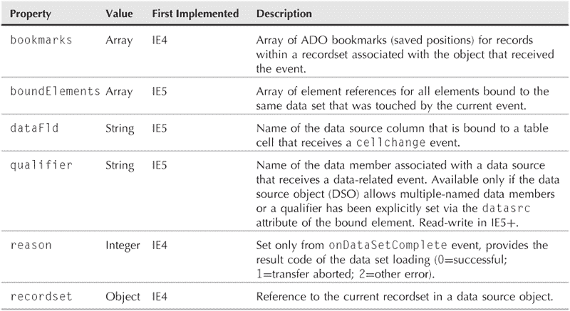

### button

| 值: 整数 | 只读 |
| :--- | :--- |
| 兼容性: WinIE4+, MacIE4+, NN6+, Moz+, Safari+, Opera+, Chrome+ |

`button` 属性显示了激活鼠标事件的是哪一个或多个按钮。如果没有按下任何鼠标按钮来生成事件，该属性在 IE 中为 0。但整数 1 到 7 揭示了单次和多次按钮按下，包括操作系统识别的三键鼠标的操作。在 IE 中，整数值与按钮的对应关系如下表所示：

| Value | 描述 |
| :--- | :--- |
| 0 | 无按钮 |
| 1 | 左键（主键） |
| 2 | 右键 |
| 3 | 左键和右键同时按下 |
| 4 | 中键 |
| 5 | 左键和中键同时按下 |
| 6 | 右键和中键同时按下 |
| 7 | 左键、中键和右键同时按下 |

除了主键以外的鼠标按钮，在 `mousedown` 或 `mouseup` 事件中查找比在 `onclick` 事件中查找更容易。请注意，当用户尝试按下多个按钮时，每次按下都会触发一个 `mousedown` 事件。因此，如果用户先按下左键，会触发 `mousedown` 事件，此时 `event.button` 属性值为 1；一旦按下右键，会再次触发 `mousedown` 事件，但此时 `event.button` 的值为 3。如果你的脚本打算在两个按钮都按下的情况下执行特殊操作，那么它应该忽略且不对单个鼠标按钮执行任何操作，因为该单按钮事件可能会在此过程中触发，从而干扰预期的操作。

在针对 IE4+ 和 NN6+/Moz/W3C 编写 `event.button` 属性脚本时要小心。W3C DOM 事件模型为鼠标按钮定义了不同的值（左、中、右键分别为 0、1 和 2），而没有为多个按钮定义值。

### 示例

参见列表 32-7，其中 `event.button` 属性显示在状态栏中。尝试按下单个鼠标按钮，例如屏幕上的按钮。然后尝试组合按下，并密切观察状态栏中的结果。

相关项目：无

### cancelBubble

| Value | 读/写 |
| :--- | :--- |
| Boolean | 读/写 |

兼容性：WinIE4+, MacIE4+, NN6+, Moz+, Safari+, Opera+, Chrome+

`cancelBubble` 属性（听起来更像是一个方法名）决定当前事件是否会在文档元素包含层次结构中向上冒泡。默认情况下，该属性为 `false`，这意味着如果事件应该冒泡，它将自动冒泡。

要防止当前事件冒泡，可以在事件处理程序函数内的任何地方将该属性设置为 `true`。作为替代方案，你可以直接在元素的事件处理属性中取消冒泡，如下所示：

```javascript
onclick="doButtonClick(this); event.cancelBubble = true"
```

取消事件冒泡对当前事件有效。下一个触发的事件将启用冒泡功能（前提该事件支持冒泡）。

### 示例

参见列表 32-2 查看 `cancelBubble` 属性的用法。尽管列表包含某些适用于 IE5.5+ 的功能，但取消冒泡的演示一直支持到 IE4。

相关项目：`returnValue` 属性

### clientX, clientY, offsetX, offsetY, screenX, screenY, x, y

| Value | 读/写 |
| :--- | :--- |
| Integer | 读/写 |

兼容性：WinIE4+, MacIE4+, NN6+, Moz+, Safari+, Opera+, Chrome+

IE 事件对象提供了事件在多个坐标空间中的坐标：元素本身、事件目标的父元素、浏览器窗口的可视区域以及整个视频屏幕。遗憾的是，对应于这些坐标空间的某些属性可能会返回误导性值，正如本节所讨论。请注意，没有属性提供事件相对于整个页面的显式位置，以防用户滚动了窗口。

从最内层的空间——即事件目标元素开始，`offsetX` 和 `offsetY` 属性应该提供目标元素内部的像素坐标。例如，你可以通过此确定图像上的点击点，无论图像是嵌入在 `body` 中还是浮动在定位的 `div` 中。从 Windows 到 IE8 的版本在大多数情况下都能产生正确的值。但对于某些作为 `body` 元素的子元素，垂直（`y`）值可能相对于可视窗口，而不仅仅是相对于元素本身。当你处理列表 32-8 并点击页面顶部的 `h1` 或 `p` 元素时，可以看到这个例子。这个问题不会影响 MacIE，但 Mac 版本上还有另一个问题：如果页面偏离了正常原始位置进行滚动，滚动后的值会从 `clientX` 和 `clientY` 值中减去。这是一个兼容性 Bug，如果你需要在可能滚动的页面元素内部获取点击坐标，必须考虑此错误。此错误修正必须在 Mac 上进行，因为在 Windows 中它工作正常。

将范围扩大到事件目标的偏移父元素，Windows 上的 IE5+ 中的 `x` 和 `y` 属性应该返回相对于目标偏移父元素（通过 `offsetParent` 属性找到的元素）的事件坐标。对于大多数非定位元素，这些值与 `clientX` 和 `clientY` 属性相同，因为正如刚才提到的，偏移父元素相对于其父元素 `body` 的偏移量为零。注意关于 `x` 和 `y` 属性的一个重要警告：在 WinIE4 到 MacIE5 中，这些属性没有考虑 `body` 之外的任何偏移父位置。即使在 WinIE5+ 中，该属性在某些情况下也可能给出错误的读数。总的来说，不应使用这两个属性。

下一组坐标 `clientX` 和 `clientY` 相对于浏览器窗口的可文档区域。当文档滚动到顶部（或完全不滚动）时，这些坐标与整个页面的坐标相同。但由于页面可以在可视窗口“下方”滚动，如果页面滚动，页面上的坐标可能会变化。此外，在 IE 的 Windows 版本中，实际上可以注册超出 `body` 元素 2 像素的鼠标事件，这很奇怪但是真的。因此，在 WinIE 中，如果你点击 `body` 的背景，事件会在 `body` 元素上触发，但 `clientX`/`clientY` 值会比 `offsetX`/`offsetY` 大 2 像素（在 MacIE 中它们是相等的）。尽管有这种微差异，如果你试图获取可能位于定位元素中的事件坐标，且这些坐标相对于整个可视窗口而非仅仅是定位上下文，你应该依赖 `clientX` 和 `clientY` 属性。

在事件坐标中考虑页面滚动通常很重要。毕竟，除非为用户创建一个固定大小的窗口，否则你不知道浏览器窗口将如何排列。如果你在寻找页面特定区域内的点击，必须考虑页面滚动。可以从 `document.body.scrollLeft` 和 `document.body.scrollTop` 属性获取滚动因子。在读取 `clientX` 和 `clientY` 属性时，务必加上相应的滚动属性以获取页面上的位置：

```javascript
var coordX = event.clientX + document.body.scrollLeft;
var coordY = event.clientY + document.body.scrollTop;
```

在你的生产工作中务必执行此操作。

最后，`screenX` 和 `screenY` 属性返回事件在整个视频屏幕上的像素坐标。如果 IE 提供更多窗口尺寸属性，这些属性将更有用。无论如何，由于鼠标事件仅在光标位于浏览器窗口内容区域时触发，不要期望获取此区域之外任何地方的屏幕值。

# 事件坐标

如果你觉得这些描述让你感到困惑，那么你并不孤单。如果加入几个 Bug，它们看起来就像一团乱麻。但想一下你如何在脚本中使用事件坐标。总的来说，你想要知道两种类型的鼠标事件坐标：元素内部坐标和页面内坐标。对于前者，使用 `offsetX`/`offsetY` 属性；对于后者，使用 `clientX`/`clientY`（加上 `scroll` 属性值）。

虽然坐标属性主要用于鼠标事件，但有一个小技巧（奇特性）可以让你判断用户是否通过标题栏中的最大化图标（在 Mac 上，这被称为缩放框）或屏幕右下角的调整大小手柄缩放了窗口。在 `resize` 事件中，鼠标事件坐标会记录在事件对象中。在点击最大化图标的情况下，`clientY` 坐标为负值（客户端区域之上），且 `clientX` 坐标位于之前窗口宽度（`document.body.clientWidth`）的约 45 像素范围内。当然，这发生在窗口缩放之后，因此它并不是防止窗口缩放的方法。

### 示例

列表 32-8 以交互方式提供了所有事件坐标属性的读取。一个 `onmousedown` 事件处理程序触发所有事件处理，你可以点击页面上的任何位置来查看发生了什么。你会看到鼠标事件目标元素的标签，这有助于你直观地理解某些坐标属性是如何确定的。图像被封装在一个定位的 `div` 元素内部，以帮助你观察当事件目标位于定位元素内部时，某些属性会发生什么变化。

### 列表 32-8：IE4+ 事件坐标属性

```html
<!DOCTYPE html>
<html>
<head>
    <meta http-equiv="content-type" content="text/html;charset=utf-8">
    <title>X and Y Event Properties (IE4+ Syntax)</title>
    <script type="text/javascript">
      function checkCoords(evt)
      {
        evt = (evt) ? evt : ((window.event) ? window.event : null);
        if (evt)
        {
          var elem = (evt.target) ? evt.target : evt.srcElement;
          var form = document.forms[0];
          form.srcElemTag.value = "<" + elem.tagName + ">";
          form.clientCoords.value = evt.clientX + "," + evt.clientY;
          if (typeof document.body.scrollLeft != "undefined")
          {
            form.pageCoords.value = (evt.clientX + document.body.scrollLeft) + "," + (evt.clientY + document.body.scrollTop);
          }
          form.offsetCoords.value = evt.offsetX + "," + evt.offsetY;
          form.screenCoords.value = evt.screenX + "," + evt.screenY;
          form.xyCoords.value = evt.x + "," + evt.y;
          if (elem.offsetParent)
          {
            form.parElem.value = "<" + elem.offsetParent.tagName + ">";
          }
          return false;
        }
      }
      function handleSize(evt)
      {
        evt = (evt) ? evt : ((window.event) ? window.event : null);
        if (evt)
        {
          document.forms[0].resizeCoords.value = evt.clientX + "," + evt.clientY;
        }
      }
      // bind the event handlers
      function addEvent(elem, evtType, func)
      {
        if (elem.addEventListener)
        {
          elem.addEventListener(evtType, func, false);
        }
        else if (elem.attachEvent)
        {
          elem.attachEvent("on" + evtType, func);
        }
        else
        {
          elem["on" + evtType] = func;
        }
      }
      addEvent(window, "load", function()
      {
        addEvent(document.body, "mousedown", function(evt) {checkCoords(evt);});
        addEvent(window, "resize", function(evt) {handleSize(evt);});
      });
    </script>
</head>
<body>
    <h1>X and Y Event Properties (IE4+ Syntax)</h1>
    <hr/>
    <p>点击任何元素以查看事件对象的坐标值。</p>
    <form name="output">
        <table>
            <tr><td colspan="2">IE Mouse Coordinates:</td></tr>
            <tr><td align="right">srcElement:</td><td><input type="text" name="srcElemTag" size="10"/></td></tr>
            <tr><td align="right">clientX, clientY:</td><td><input type="text" name="clientCoords" size="10"/></td><td align="right">...With scrolling:</td><td><input type="text" name="pageCoords" size="10"/></td></tr>
            <tr><td align="right">offsetX, offsetY:</td><td><input type="text" name="offsetCoords" size="10"/></td></tr>
            <tr><td align="right">screenX, screenY:</td><td><input type="text" name="screenCoords" size="10"/></td></tr>
            <tr><td align="right">x, y:</td><td><input type="text" name="xyCoords" size="10"/></td><td align="right">Relative to:</td><td><input type="text" name="parElem" size="10"/></td></tr>
            <tr><td align="right"></td><td><input type="button" value="Click Here"/></td></tr>
            <tr><td colspan="2">Window Resize Coordinates:</td></tr>
            <tr><td align="right">clientX, clientY:</td><td><input type="text" name="resizeCoords" size="10"/></td></tr>
        </table>
    </form>
    <div id="display" style="position:relative; left:100">
        
    </div>
</body>
</html>
```


## 在 IE 中测试坐标属性

可以在 IE 中尝试从列表 32-8 加载页面执行以下任务，以帮助你理解不同坐标属性之间的关系：

1. 点击“Click Here”按钮标签上“i”字母上面的点。目标元素是按钮 (`input`) 元素，它的 `offsetParent` 是一个单元格元素。`offsetY` 值非常低，因为你正靠近元素自身坐标空间的顶部。然而，`client` 坐标（以及 `x` 和 `y`）是相对于窗口可视区域的。如果你的浏览器窗口在 Windows 中是最大化的，`screenX` 和 `clientX` 值将是相同的；`screenY` 和 `clientY` 之间的差异是内容区域上方所有窗口装饰的高度。

2. 记下各种坐标值，然后稍微向下滚动页面（点击滚动条会触发事件），然后再次点击按钮上的点。`clientY` 值变小了，因为页面相对于可视区域向上移动了，导致按钮距离区域顶部的测量距离变小。Windows 版本在偏移量（offset）属性上的处理是正确的，它继续返回相对于元素自身坐标空间的值；遗憾的是，Mac 版本会从偏移量属性中减去滚动的量。

3. 点击大图像。对于 Windows 和 Mac，`client` 属性的运行都符合预期，`screen` 属性也是如此。对于 Windows，`x` 和 `y` 属性正确地返回了相对于 `img` 元素 `offsetParent` 的事件坐标，该 `offsetParent` 是包裹它的 `div` 元素。但请注意，浏览器“认为” `div` 是从图像左侧 10 像素开始的。在 WinIE5.5+ 中，你可以点击图像左侧这 10 像素透明区域内来点击 `div` 元素。这种内边距会自动插入并影响 `x` 和 `y` 属性的坐标。在图像内部进行事件测量的更可靠方法是偏移量属性。在 Macintosh 版本中也是如此，只要页面没有滚动；如果滚动了，`scroll` 会像第 2 步一样影响上述值。

4. 点击标题下方的 `hr` 元素。可能需要尝试几次才能真正击中元素（当 `hr` 元素出现在 `srcElement` 框中时，就说明你点中了）。这是为了强化 client 属性在元素内部提供坐标的方式（再次强调，Mac 页面滚动时除外）。在水平线的最左端点击，你最终会找到 `0,0` 坐标。

最后，如果你是 Windows 用户，这里有两个示例可以尝试，以观察坐标属性的一些意外行为。

1. 在页面未滚动的情况下，点击页面右侧的任何位置（避开任何文本），使 `body` 元素成为 `srcElement`。因为 `body` 元素理论上填充了浏览器窗口的整个内容区域，除了屏幕坐标外，所有坐标对都应该是相同的。但偏移量属性比其他属性都少 2 像素。总的来说，这种差异在你的脚本中并不重要，但如果精确定位很重要，你就应该注意这种潜在的差异。由于某些不明原因，偏移量属性是在距离窗口左侧和顶部缩进 2 像素的空间中测量的。这在 Macintosh 版本中并非如此，从 `body` 角度来看，所有的值对都是相同的。

2. 点击 `h1` 或 `p` 元素的文本（位于页面顶部长水平线的上方和下方）。理论上，偏移量属性应该是相对于这些元素所占据的矩形的（毕竟它们是块级元素）。但相反，它们是在与 client 属性相同的空间内测量的（外加 2 像素）。这种意外行为与光标为文本光标无关，因为如果你点击任何文本框元素内部，它们的偏移量属性都会正确地相对于它们自身的矩形。这个问题并未出现在 Macintosh 版本中。

这些许多属性也存在于 W3C DOM 中，因此在 W3C DOM 浏览器中受到支持。在这些浏览器中运行列表 32-8 时，不支持的属性将其值显示为 `undefined`。

你可以在第 43 章“定位对象”中关于在 IE 页面上拖动元素的讨论，看到更多重要事件坐标属性的运行示例。

相关项目：`fromElement`、`toElement` 属性

## contentOverflow

| Value：Boolean | 只读 |
| :--- | :--- |
| 兼容性：WinIE5.5+, MacIE-, NN-, Moz-, Safari-, Opera-, Chrome- | |

该值表示页面内容是否溢出了当前的布局矩形。此属性主要用于打印期间，作为内容从一个页面溢到另一个页的基础。

## dataTransfer

| 值：Object | 只读 |
| :--- | :--- |
| 兼容性：WinIE5+, MacIE-, NN-, Moz-, Safari-, Opera-, Chrome- | |

`dataTransfer` 属性是 `dataTransfer` 对象的引用。在拖放操作（即与拖放相关的事件）中使用此对象，不仅可以控制从源传输到目标传输的数据，还可以控制沿途光标的样式。

表 32.6 列出了 `dataTransfer` 对象的属性和方法。

### 表 32.6 `dataTransfer` 对象的属性和方法

| 属性/方法 | 返回 | 说明 |
| :--- | :--- | :--- |
| `dropEffect` | String | 作为丢弃操作潜在接收者的元素可以使用 `ondragenter`、`ondragover` 或 `ondrop` 事件处理器来设置光标位于元素上方时显示的光标样式。在此生效之前，源元素的 `ondragstart` 事件处理器必须为 `event.effectAllowed` 属性赋值。这两个属性的可能字符串值为 `copy`、`link`、`move` 或 `none`。这些属性对应于用户通常对文件和其他文档执行的操作的 Windows 系统光标。你还必须取消所有这些放置元素事件处理器的默认操作（即将 `event.returnValue` 设置为 `false`）：`ondragenter`、`ondragover` 和 `ondrop`。 |
| `effectAllowed` | String | 响应源元素的 `ondragstart` 事件设置，此属性决定了将发生哪种拖放操作。可能的字符串值为 `copy`、`link`、`move` 或 `none`。此属性值必须与目标元素事件对象的 `dropEffect` 属性值匹配。此外，在 `ondragstart` 事件处理器中取消默认操作（即将 `event.returnValue` 设置为 `false`）。 |
| `clearData([format])` | 无 | 清除剪贴板中的数据。如果没有提供格式参数，则清除所有数据。数据格式可以是以下字符串的一个或多个：`Text`、`URL`、`File`、`HTML`、`Image`。 |
| `getData(format)` | String | 从剪贴板检索指定格式的数据。格式为以下字符串之一：`Text`、`URL`、`File`、`HTML`、`Image`。获取数据后剪贴板不会清空，因此可以在多次连续操作中获取。 |
| `setData(format, data)` | Boolean | 将字符串数据存储在剪贴板中。格式为以下字符串之一：`Text`、`URL`、`File`、`HTML`、`Image`。对于非文本格式，数据必须是指定路径或 URL 的字符串。如果传输到剪贴板成功，返回 true。 |

`dataTransfer` 对象充当管道和控制器，用于你的脚本在响应用户拖放操作时需要从一个元素传输到另一个元素的数据。你需要遵循由几个事件处理器触发的定义良好的序列。这意味着在拖放过程中，当不同的事件触发时，该对象会在不同的事件实例上被调用。

在目标元素上，必须定义三个事件处理器：`ondragenter`、`ondragover` 和 `ondrop`。最常见的是，前两个事件处理器仅仅是将元素标记为特定的 `dropEffect`（该值必须与拖拽开始时源端设置的 `effectAllowed` 集合匹配），并将 `event.returnValue` 设置为 `false`，以便显示所需的光标。这些操作也会在 `ondrop` 事件处理器中执行，但该处理器也是负责处理目标元素上目标操作的处理器。此时，会调用 `dataTransfer` 对象的 `getData()` 方法来获取在拖拽开始时通过 `setData()` “存储”起来的数据。如果你还想确保数据不会被其他事件意外获取，可以调用 `clearData()` 方法从内存中移除该数据。请注意，这里讨论的拖拽样式不是那种你会看到源元素在屏幕上实际移动的类型（尽管你可以通过脚本实现这一点）。其意图是像 Windows（例如 Windows 资源管理器窗口或桌面）那样处理拖放操作。对于用户来说，可拖组件被封装在光标中。这就是为什么 `dataTransfer` 对象的属性通过控制投放点光标的外观，向用户传达即将发生的投放操作类型的原因。Apple 在 Safari 2 中实现了相同的行为。

### 示例

关于 `dataTransfer` 属性实际应用的详细示例，可以在 `ondrag` 事件处理器所在章节的列表 26-37 中找到。

相关项目：`ondragend`、`ondragenter`、`ondragleave`、`ondragover`、`ondragstart`、`ondrop` 事件处理器

## fromElement 和 toElement

| 值：元素对象 | 只读 |
| :--- | :--- |
| 兼容性：WinIE4+, MacIE4+, NN-, Moz-, Safari+, Opera+, Chrome+ | |

`fromElement` 和 `toElement` 属性允许元素发现光标是从哪里滚入的或滚到了哪里。这些属性通过将 `onmouseover` 和 `onmouseout` 事件处理器的范围扩展到当前元素之外（通常是相邻元素），增强了它们的功能。

当 `onmouseover` 事件在元素上触发时，光标在此之前必须位于另一个元素上。`fromElement` 属性持有该元素的引用。相反，当 `onmouseout` 事件触发时，光标已经位于另一个元素上。`toElement` 属性持有该元素的引用。

### 示例

列表 32-9 提供了一个示例，展示了 `fromElement` 和 `toElement` 属性如何揭示光标滚入元素前后的动作。当你将光标移动到中心框（表格单元格）时，它的 `onmouseover` 事件处理器会显示光标来源表格单元格的文本。

### 列表 32-9：使用 `toElement` 和 `fromElement` 属性

```html
<!DOCTYPE html>
<html>
    <head>
        <meta http-equiv="content-type" content="text/html;charset=utf-8">
        <title>fromElement and toElement Properties</title>
        <style type="text/css">
            .direction {background-color:#00FFFF; width:100; height:50; text-align:center;}
            #main {background-color:#FF6666; text-align:center;}
        </style>
        <script type="text/javascript">
            function showArrival(evt)
            {
                evt = (evt) ? evt : ((event) ? event : null);
                var direction = (event.fromElement.innerText) ?
                    event.fromElement.innerText :
                    "parts unknown";
                status = "Arrived from: " + direction;
            }
            function showDeparture(evt)
            {
                evt = (evt) ? evt : ((event) ? event : null);
                var direction = (event.toElement.innerText) ?
                    event.toElement.innerText :
                    "parts unknown";
                status = "Departed to: " + direction;
            }
            // 绑定事件处理器
            function addEvent(elem, evtType, func)
            {
                if (elem.addEventListener)
                {
                    elem.addEventListener(evtType, func, false);
                }
                else if (elem.attachEvent)
                {
                    elem.attachEvent("on" + evtType, func);
                }
                else
                {
                    elem["on" + evtType] = func;
                }
            }
            addEvent(window, "load", function()
            {
                addEvent(document.getElementById("main"), "mouseover", function(evt) {showArrival(evt);});
                addEvent(document.getElementById("main"), "mouseout", function(evt) {showDeparture(evt);});
            });
        </script>
    </head>
    <body>
        <h1>fromElement and toElement Properties</h1>
        <hr />
        <p>将鼠标移动到中心框，并在状态栏中查看到达信息。将鼠标移出中心框，并在状态栏中查看离开信息。</p>
        <table cellspacing="0" cellpadding="5">
            <tr>
                <td></td>
                <td class="direction">North</td>
                <td></td>
            </tr>
            <tr>
                <td class="direction">West</td>
                <td id="main" onmouseover="showArrival()" onmouseout="showDeparture()">Roll</td>
                <td class="direction">East</td>
            </tr>
            <tr>
                <td></td>
                <td class="direction">South</td>
                <td></td>
            </tr>
        </table>
    </body>
</html>
```

这是一个在浏览器中进行实验的良好示例，因为它揭示了一个潜在的局限性。作为 `toElement` 或 `fromElement` 的元素必须触发鼠标事件来注册自身。如果没有，序列中的下一个注册自身的元素将是属性识别的元素。例如，如果你将鼠标滚入中心框，然后极快地滚到页面底部，可能会跳过南框。状态栏中出现的文本实际上是 `body` 元素的内部文本，它是捕获鼠标事件并注册为中心表格单元格 `toElement` 的元素。

相关项目：`srcElement` 属性

## keyCode

| 值：整数 | 只读 |
| :--- | :--- |
| 兼容性：WinIE4+, MacIE4+, NN6+, Moz+, Safari+, Opera+, Chrome+ | |

对于键盘事件，`keyCode` 属性返回与字符 Unicode 值（对于 `onkeypress` 事件）或键盘字符键（对于 `onkeydown` 和 `onkeyup` 事件）对应的整数。这些编号系统之间存在显著差异。

如果你想获取用户按下的键的 Unicode 值（对于拉丁字母集与 ASCII 值相同），请从 `onkeypress` 事件处理器获取 `keyCode` 属性。例如，小写的“a”返回 97，而大写的“A”返回 65。非字符键（如箭头、页面导航键和功能键）在 `onkeypress` 事件期间的 `keyCode` 属性返回空值。换句话说，`onkeypress` 事件的 `keyCode` 属性更像是字符码而非键码。

要捕获用户按下的精确按键，请使用 `onkeydown` 或 `onkeyup` 事件处理器。对于这些事件，事件对象会捕获与键盘上特定按键相关的数字代码。对于字符键，该代码会随着系统语言分配的语言而变化。重要的是，它不区分大小写：无论 `Shift` 键处于什么状态，拉丁字母键盘上的“A”键都会返回值为 `65` 的值。但与此同时，`Shift` 键的按下会触发其自身的 `onkeydown` 和 `onkeyup` 事件，并将 `keyCode` 值设置为 `16`。其他非字符键——方向键、分页导航、功能键等——也有自己的代码。这会变得非常复杂，并且涉及数字键盘按键的特殊键代码，这些代码与字母键盘顶行对应的数字不同。

### 交叉引用

请务必查看第 26 章中关于键盘事件的详细章节，获取如何在应用程序中应用 `keyCode` 属性的示例。

### 示例

列表 32-10 提供了一个额外的区域，以便可以在你向 `textarea` 中输入内容时，查看三个键盘事件的 `keyCode` 属性。你以后可以将此页面作为编写工具，来获取你可能不熟悉的键盘键的精确代码。

### 列表 32-10：显示 `keyCode` 属性值

```html
<!DOCTYPE html>
<html>
<head>
    <meta http-equiv="content-type" content="text/html;charset=utf-8">
    <title>keyCode Property</title>
    <style type="text/css">
        td {text-align:center}
    </style>
    <script type="text/javascript">
        function showCode(which, evt)
        {
            evt = (evt) ? evt : ((event) ? event : null);
            if (evt)
            {
                document.forms[0].elements[which].value = evt.keyCode;
            }
        }
        function clearEm()
        {
            for (var i = 1; i < document.forms[0].elements.length; i++)
            {
                document.forms[0].elements[i].value = "";
            }
        }
        // bind the event handlers
        function addEvent(elem, evtType, func)
        {
            if (elem.addEventListener)
            {
                elem.addEventListener(evtType, func, false);
            }
            else if (elem.attachEvent)
            {
                elem.attachEvent("on" + evtType, func);
            }
            else
            {
                elem["on" + evtType] = func;
            }
        }
        addEvent(window, "load", function()
        {
            addEvent(document.getElementById("scratchpad"), "keydown",
                     function(evt) {clearEm(); showCode("down", evt);});
            addEvent(document.getElementById("scratchpad"), "keypress",
                     function(evt) {showCode("press", evt);});
            addEvent(document.getElementById("scratchpad"), "keyup",
                     function(evt) {showCode("up", evt);});
        });
    </script>
</head>
<body>
    <h1>keyCode Property</h1>
    <hr />
    <form>
        <p>
            <textarea id="scratchpad" name="scratchpad" cols="40" rows="5" wrap="hard"></textarea>
        </p>
        <table cellpadding="5">
            <tr>
                <th>Event</th>
                <th>event.keyCode</th>
            </tr>
            <tr>
                <td>KeyDown</td>
                <td><input type="text" name="down" size="3"></td>
            </tr>
            <tr>
                <td>KeyPress</td>
                <td><input type="text" name="press" size="3"></td>
            </tr>
            <tr>
                <td>KeyUp</td>
                <td><input type="text" name="up" size="3"></td>
            </tr>
        </table>
    </form>
</body>
</html>
```

虽然 IE4+ 继续沿用事件处理程序阻止默认行为的原始方法（即让事件处理程序的最后一条语句求值为返回 `false`），但 IE4+ 事件模型提供了一个属性，允许默认行为的取消完全在由事件处理程序调用的函数内部发生。默认情况下，`event` 对象的 `returnValue` 属性为 `true`，这意味着元素会在脚本处理程序完成其工作后处理该事件，就好像脚本不存在一样。正常的处理例如，例如显示输入的字符、在点击链接时导航到链接的 `href` URL，或者在点击 `Submit`（提交）按钮后提交表单。

但你并不总是希望默认行为发生。例如，考虑一个只允许输入数字的文本框。`onkeypress` 事件处理程序可以调用一个函数，该函数检查每个输入的字符。如果该字符不是数字，则它不应该到达文本框进行显示。以下验证函数可以从此类文本框的 `onkeypress` 事件处理程序中调用：

```javascript
function checkIt()
{
    var charCode = event.keyCode;
    if (charCode < 48 || charCode > 57)
    {
        alert("Please make sure entries are numerals only.");
        event.returnValue = false;
    }
}
```

通过使用此事件处理程序，错误的字符将不会出现在文本框中。

注意，该属性并不是函数 `return` 语句的替代品。如果你需要向调用语句返回一个值，则需要使用 `return`。

### 示例

`returnValue` 属性用于取消默认行为。在第 26 页，你可以使用 `return` 语句来设置 `returnValue` 属性。

## saveType

| 值: 字符串 | 只读 |
| :--- | :--- |
| 兼容性: IE5+, Safari+, Opera+ | |

`saveType` 属性仅在赋值一个值时有效。有关行为的更多信息，请参阅 [ms.microsoft.com/en-us/library/531079%28%29.aspx](https://ms.microsoft.com/en-us/library/531079%28%29.aspx)。

## srcElement

| 值: 对象 | 只读 |
| :--- | :--- |
| 兼容性: IE4+, Mozilla+, Opera+ | |

`srcElement` 属性是触发事件元素的引用。由于事件可能会冒泡到任何元素，`srcElement` 属性可以提供触发事件的元素。

### 示例

作为 `srcElement` 属性的一个简单演示，参见列表 32-11。

```html
<!DOCTYPE html>
<html>
    <head>
        <meta http-equiv="content-type" content="text/html;charset=utf-8">
        <title>srcElement</title>
        <style type="text/css">
            .bold {font-weight:bold}
            .ital {font-style:italic}
        </style>
        <script type="text/javascript">
            function highlight()
            {
                var elem = event.srcElement;
                if (elem.className == "bold")
                {
                    document.styleSheets[0].rules[0].style.color = "red";
                }
                else
                {
                    elem.style.color = "#FFCC00";
                }
            }
            function restore()
            {
                var elem = event.srcElement;
                if (elem.className == "bold")
                {
                    document.styleSheets[0].rules[0].style.color = "";
                }
                else
                {
                    elem.style.color = "";
                }
            }
            // 绑定事件处理程序
            function addEvent(elem, evtType, func)
            {
                if (elem.addEventListener)
                {
                    elem.addEventListener(evtType, func, false);
                }
                else if (elem.attachEvent)
                {
                    elem.attachEvent("on" + evtType, func);
                }
                else
                {
                    elem["on" + evtType] = func;
                }
            }
            addEvent(window, "load", function()
            {
                addEvent(document.body, "mousedown", highlight);
                addEvent(document.body, "mouseup", restore);
            });
        </script>
    </head>
    <body>
        <h1>srcElement</h1>
        <hr/>
        <p>点击加粗的文本，然后点击未加粗的文本。你看到了什么？</p>
        <p>一个事件处理程序...</p>
        <ul>
            <li>Can</li>
            <li>Cover</li>
            <li>Many</li>
            <li>Objects</li>
        </ul>
        <p>Lorem ipsum dolor sit amet, consectetur adipiscing elit, sed do eiusmod tempor incididunt ut labore et dolore magna aliqua. Ut enim ad minim veniam, quis nostrud exercitation ullamco aliquip ex ea commodo consequat.</p>
    </body>
</html>
```

你可以通过 `type` 属性发现是哪种事件触发了当前事件对象。该值是事件名称的字符串版本——仅包含事件名称，不包含 IE 中通常与事件名称关联的“on”前缀。当你指定一个事件处理函数来处理不同类型的事件时，该属性会很有帮助。例如，一个对象的 `onmousedown` 和 `onclick` 事件处理器可以调用同一个函数。在函数内部，编写一个分支来判断 `type` 传入的是 `mousedown` 还是 `click`，并对每种事件类型进行不同的处理。这并不是为了鼓励这种事件处理函数共享行为，而是为了让你在脚本构造发现该属性很有用时，能够意识到这种强大性。

此属性及其值与 NN6+/Moz/W3C 事件模型完全兼容。

### 示例

使用《评测器》（第 4 章，“JavaScript 基础”）来查看由 `type` 属性返回的值。在底部的文本框中输入以下对象名称并按 Enter/Return：

```
event
```

如有必要，向下滚动 Results 框以查看 `type` 属性，它应该显示为 `keypress`。现在点击“属性列表 (List Properties)”按钮。`type` 变为 `click`。这些类型之所以出现，是因为这里显示的属性事件对象是触发显示属性函数的事件。从文本框，一个 `onkeypress` 事件处理器触发了该过程；从按钮，一个 `onclick` 事件处理器完成了这项工作。

相关条目：所有事件处理器（第 26 章，“通用 HTML 元素对象”）

## wheelData

| 值：整数 | 只读 |
| :--- | :--- |
| 兼容性：WinIE5.5+, MacIE-, NN-, Moz-, Safari-, Opera-, Chrome- | |

`wheelData` 属性返回一个整数，表示在发生 `onmousewheel` 事件时，鼠标滚轮滚动的方向。返回的值通常为 `120` 或 `-120`，正值表示鼠标滚轮向屏幕方向滚动，负值表示滚轮向相反方向滚动。

## NN6+/Moz event 对象

| 属性 | 方法 | 事件处理器 |
| :--- | :--- | :--- |
| `altKey` | `initEvent()` | |
| `bubbles` | `initKeyEvent()` | |
| `button` | `initMouseEvent()` | |
| `cancelable` | `initMutationEvent()` | |
| `cancelBubble` | `initUIEvent()` | |
| `charCode` | `preventDefault()` | |
| `clientX` | `stopPropagation()` | |
| `clientY` | | |
| `ctrlKey` | | |
| `currentTarget` | | |
| `detail` | | |
| `eventPhase` | | |
| `isChar` | | |
| `isTrusted` | | |
| `keyCode` | | |
| `layerX` | | |
| `layerY` | | |
| `metaKey` | | |
| `originalTarget` | | |
| `pageX` | | |
| `pageY` | | |
| `screenX` | | |
| `screenY` | | |
| `shiftKey` | | |
| `target` | | |
| `timeStamp` | | |
| `type` | | |
| `view` | | |

## 语法

访问 NN6+/Moz 事件对象的属性和方法：

```
eventObject.property | method([parameters])
```

兼容性：WinIE-, MacIE-, NN6+, Moz+, Safari+, Opera+, Chrome+

## 关于此对象

尽管该对象很大程度上基于 W3C DOM Level 2 定义的事件对象，但 NN6+/Moz 事件对象也继承了 NN4 事件对象的几个特征。某些属性主要是为了向后兼容而继续保留的。但由于 Mozilla 未来的开发可能会放弃 NN4 DOM 和事件模型的特殊性，您应该忽略这些项目（如下文所示）。在可能的情况下，前瞻并拥抱事件模型中的 W3C DOM 方面。例如，Safari、Opera 和 Chrome 实现了许多 W3C DOM 事件模型，但排除了所有旧的 NN4 属性。

尽管 NN6+/Moz 事件模型提供了像 IE4+ 那样的冒泡事件传播模型，但事件模型之间引用事件对象的不兼容问题仍然存在。在 W3C DOM（如 NN4）中，事件对象被显式地作为参数传递给事件处理器（更准确地说说是事件监听器）函数。但在函数内部将浏览器特定的事件对象赋值给变量后，IE4+ 和 W3C DOM 事件模型之间的一些重要属性具有相同的名称。如果微软在未来的 IE 版本中采用更多 W3C DOM 事件模型，兼容性情况将会改善。

本节讨论的事件对象是由于用户或系统事件操作结果创建的事件实例。W3C DOM 包含一个额外的静态 `Event` 对象。静态 `Event` 对象的许多属性被事件实例继承，因此这些共享属性的详细介绍在本节中，因为这是您大部分时间要编写脚本的事件对象。

在后续详细章节的许多代码片段中，你将看到以 `evt` 引用开头。这假设语句位于函数内部，该函数已将传入的事件赋值给参数变量 `evt`：

```
function myFunction(evt) {...}
```

正如本章较早所示，在可行的情况下，你可以使 W3C DOM 和 IE4+ 事件对象的引用相等，因为脚本运行在相同（或相似）的事件对象属性上。这种相等的结果通常存储在 `evt` 变量中。

## 属性

### altKey、ctrlKey、metaKey、shiftKey

| 值：布尔值 | 只读 |
| :--- | :--- |
| 兼容性：WinIE4+, MacIE4+, NN6+, Moz+, Safari+, Opera+, Chrome+ | |

当响应用户操作创建事件对象时，这四个属性将根据相应的按键是否被按下进行设置——例如，Shift-点击。如果按键被按下，则属性被赋值为 `true`；否则为 `false`。`metaKey` 属性在 Macintosh 上对应 Command 键，但在 Windows 上不对应 Windows 键。

通常，你会将此属性的表达式用于条件语句。由于这些是布尔值，你可以在一个条件中组合多个属性。例如，如果只在按下 Shift 和 Control 键时执行函数分支，条件如下：

```
if (evt.shiftKey && evt.ctrlKey) {
    // 执行语句
}
```

相反，你可以采取更用户友好的方法，在按下这四个修饰键之一时提供特殊处理：

```
if (evt.shiftKey || evt.ctrlKey || evt.metaKey || evt.altKey) {
    // 执行语句
}
```

这种方法的原理是为用户提供可能的快捷操作，而不是强制他们记忆特定的修饰键组合。

### 示例

参见列表 32-6，这些属性的值被用于设置各种事件类型复选框的属性。

相关条目：无

### bubbles

| 值：布尔值 | 只读 |
| :--- | :--- |
| 兼容性：WinIE-, MacIE-, NN6+, Moz+, Safari+, Opera+, Chrome+ | |

并不是所有事件都会冒泡。例如，`onSubmit` 事件不会超过关联的表单对象。不冒泡的事件其事件对象的 `bubbles` 属性被设置为 `false`；所有其他事件都设置为 `true`。你在单个事件处理器函数处理各种事件的罕见情况下使用此属性。你可能只想对可以冒泡的事件执行特殊操作，而对其他事件不进行特殊处理。对于这种分支，你可以在 if 条件语句中使用该属性：

```
if (evt.bubbles) {
    // 对冒泡事件的特殊处理
}
```

然而，你不需要为了取消冒泡而分支。不传播的事件并不介意你告诉它不要传播。

相关条目：`cancelBubble` 属性

### button

| 值：整数 | 只读 |
| :--- | :--- |
| 兼容性：WinIE4+, MacIE4+, NN6+, Moz+, Safari+, Opera8+, Chrome+ | |

`button` 属性显示了用于激活鼠标事件的按键。在 W3C DOM 中，左键（主键）返回值为 0。如果使用的是三键鼠标，中间键返回 1。右键（在任何多键鼠标上）返回值为 2。

除主键以外的鼠标按键在 `mousedown` 或 `mouseup` 事件中更易查找，而不是在 `onclick` 事件中。在用户按下多个按键的情况下，只有最近按下的一个按键会被注册。

在跨浏览器编写涉及 `button` 属性的脚本时要小心。不同的事件模型为鼠标按钮定义了不同的按钮值。

### 示例

请参见列表 32-7，其中状态栏中显示了 `button` 属性。尝试按下单个鼠标按键，例如屏幕上的按钮。

相关项目：无

### cancelable

| Value: Boolean | 只读 |
| :--- | :--- |
| 兼容性：WinIE-, MacIE-, NN6+, Moz+, Safari+, Opera+, Chrome+ | |

如果一个事件是可取消的，那么可以通过脚本阻止其默认动作的发生。虽然大多数事件都是可取消的，但某些不是。`cancelable` 属性允许你查询特定的事件对象，以查看其事件类型是否可取消。该属性的值为布尔值。你可能只想对可取消的事件执行特殊操作，而对其他事件不进行特殊处理。对于这种分支情况，你可以在 `if` 条件语句中使用该属性：

```javascript
if (evt.cancelable)
{
   // 对可取消事件进行特殊处理
}
```

然而，你并不需要为了阻止事件的默认动作而进行分支处理。不可取消的事件不会介意你尝试阻止默认动作。

相关项目：`preventDefault()` 方法

### cancelBubble

| Value: Boolean | 可读/写 |
| :--- | :--- |
| 兼容性：WinIE4+, MacIE4+, NN6+, Moz+, Safari+, Opera+, Chrome+ | |

`cancelBubble` 属性是一个罕见的实例，该 IE4+ 事件属性在 NN6+/Moz 以及基于 Gecko-、WebKit- 和 Presto 的浏览器中得到了实现，尽管该属性未在 W3C DOM 中定义。该属性的操作方式与 IE4+ 中相同，它决定当前事件对象是否会在文档元素包含层级中向上冒泡。默认情况下，此属性为 false，这意味着如果事件应该冒泡，它将自动冒泡。

要防止当前事件的冒泡，可以在事件处理函数内的任何地方将该属性设置为 true。取消事件冒泡对当前事件有效。下一个触发的事件将启用冒泡（前提是该事件本身会冒泡）。

如果你正尝试尽可能将代码迁移到 W3C DOM，请使用 `stopPropagation()` 方法代替 `cancelBubble`。然而，为了跨浏览器兼容性，`cancelBubble` 是一个稳妥的选择。

### 示例

请参见列表 32-2 查看 IE 环境中 `cancelBubble` 属性的作用。尽管列表包含某些适用于 WinIE5.5+ 的功能，但取消冒泡的演示一直追溯到 IE4。

相关项目：`stopPropagation()` 方法

### charCode / keyCode

| Value: Integer | 只读 |
| :--- | :--- |
| 兼容性：WinIE-, MacIE-, NN6+, Moz+, Safari+, Opera-, Chrome+ | |

W3C DOM 事件模型明确区分了附加到键盘字母键上的 Unicode 字符与附加到每个键盘键（无论是否是字符）上的代码。要检查按键的字符，请使用 `onkeypress` 事件创建事件对象，然后查看事件对象的 `charCode` 属性。该属性为 "a" 返回 97，为 "A" 返回 65，因为它与按键操作相关的字符。该属性在 `onkeydown` 和 `onkeyup` 事件中的值为 0。

相比之下，`keyCode` 属性仅在按下字母或数字键时，才会在 `onkeydown` 和 `onkeyup` 事件中填充非零值（`onkeypress` 会将该属性设为 0）；对于大多数其他非字符键，这三个事件都会填充 `keyCode` 属性。通过此属性，你可以查找非字符键，如方向键、分页导航键和功能键。对于字符键，不区分大小写：拉丁键盘上的 "A" 键无论 Shift 键状态如何，都返回值 65。但与此同时，Shift 键的按下会触发其自身的 `onkeydown` 和 `onkeyup` 事件，将 `keyCode` 值设为 16（Safari 不以这种方式注册修改键）。其他非字符键——方向键、分页导航、功能键等——也有自己的代码。这变得非常详细，并且涉及数字键盘键的特殊键码，这些代码与字母数字键盘顶行对应的数字不同。

### 交叉引用

请务必查看第 26 章“通用 HTML 对象”中关于键盘事件的详细章节，了解如何在应用程序中使用 `keyCode` 属性的示例。

### 示例

列表 32-12：显示 `charCode` 和 `keyCode` 属性值提供了一个区域，允许你在向 `textarea` 输入内容时，查看所有三个键盘事件的 `charCode` 和 `keyCode` 属性。你之后可以将其作为辅助工具，获取你可能不熟悉的键盘键的精确代码。

```html
<!DOCTYPE html>
<html>
   <head>
      <meta http-equiv="content-type" content="text/html;charset=utf-8">
      <title>charCode and keyCode Properties</title>
      <style type="text/css">
        td{text-align:center}
      </style>
      <script type="text/javascript">
        function showCode(which, evt) {
           forms[0].elements[which + "Char"].value = evt.charCode;
           forms[0].elements[which + "Key"].value = evt.keyCode;
        }
        function clearEm() {
           for (var i = 1; i < forms[0].elements.length; i++) {
             forms[0].elements[i].value = "";
           }
        }
        // 绑定事件
        function addEvent(elem, evtType, func) {
           if (elem.addEventListener) {
             elem.addEventListener(evtType, func, false);
           } else if (elem.attachEvent) {
             elem.attachEvent("on" + evtType, func);
           } else {
             elem["on" + evtType] = func;
           }
        }
        addEvent(window, "load", function() {
           addEvent(document.getElementById("scratchpad"), "keydown", function(evt) {clearEm(); showCode("down", evt);});
           addEvent(document.getElementById("scratchpad"), "keypress", function(evt) {showCode("press", evt);});
           addEvent(document.getElementById("scratchpad"), "keyup", function(evt) {showCode("up", evt);});
        });
      </script>
   </head>
   <body>
      <h1>charCode and keyCode Properties</h1>
      <hr/>
      <form>
         <p>
            <textarea id="scratchpad" name="scratchpad" cols="40" rows="5"></textarea>
         </p>
         <table cellpadding="5">
            <tr>
               <th>Event</th>
               <th>event.charCode</th>
               <th>event.keyCode</th>
            </tr>
            <tr>
               <td>onKeyDown:</td>
               <td><input type="text" name="downChar" size="3"></td>
               <td><input type="text" name="downKey" size="3"></td>
            </tr>
            <tr>
               <td>onKeyPress:</td>
               <td><input type="text" name="pressChar" size="3"></td>
               <td><input type="text" name="pressKey" size="3"></td>
            </tr>
            <tr>
               <td>onKeyUp:</td>
               <td><input type="text" name="upChar" size="3"></td>
               <td><input type="text" name="upKey" size="3"></td>
            </tr>
         </table>
      </form>
   </body>
</html>
```

### 你可以尝试在 NN6+/Moz 页面上执行以下特定任务以检查关键代码（如果你使用的浏览器未设置为英语和基于拉丁字母的键盘，你的结果可能会有所不同）：

1. 输入一个小写字母 `a`。注意 `onkeypress` 事件处理程序如何显示 `charCode` 为 `97`，这是拉丁字母表中第一个小写字母的 Unicode（以及 ASCII）值。但另外两种事件类型仅记录键的按键代码：`65`。
2. 通过 `Shift` 键输入大写字母 `A`。如果你仔细观察，你会发现 `Shift` 键本身会为 `onkeydown` 和 `onkeyup` 事件生成按键代码 `16`。但字符键在所有三个事件中都会显示值 `65`（直到你释放 `Shift` 键），因为该大写字母的 ASCII 值恰好匹配该字母的键盘按键代码。
3. 按下并释放 `Down Arrow` 键（确保光标仍在 `textarea` 中闪烁，因为键盘事件是在那里监控的）。作为一个非字符键，所有三个事件都会将一个值存入 `keyCode` 属性，但 `charCode` 属性为 0。该键的 `keyCode` 值为 `40`。
4. 尝试其他非字符键。某些键可能会产生对话框或菜单，但它们的按键代码仍会被记录。

相关项目：`onkeydown`、`onkeypress`、`onkeyup` 事件处理程序

### clientX、clientY、layerX、layerY、pageX、pageY、screenX、screenY

| 值：整数 | 只读 |
| :--- | :--- |
| 兼容性：WinIE4+, MacIE4+, NN6+, Moz+, Safari+, Opera+, Chrome+ | |

W3C DOM 事件对象借用了 NN4 和 IE4+ 事件模型中的鼠标坐标属性。如果你在这些其他浏览器中处理过事件坐标，那么对于 W3C DOM 兼容浏览器，你没有新东西需要学习。

与 IE4+ 事件对象一样，W3C DOM 事件对象的 `clientX` 和 `clientY` 属性是窗口内可视内容区域的坐标。这些值相对于窗口空间，而不是文档。但与 IE4+ 不同的是，你不需要计算坐标在文档中的位置，因为另一对 NN/Moz 属性 `pageX` 和 `pageY` 自动提供了这些信息。如果页面没有滚动，客户端坐标和页面坐标的值是相同的。由于相对于文档的事件坐标通常比相对于窗口的重要，因此 `pageX` 和 `pageY` 属性被使用得更频繁。

另一对 NN/Moz 属性 `layerX` 和 `layerY` 借用了已废弃的 NN4 层方案（layer schemes）术语，但这些属性仍然非常有价值。这些坐标是相对于接收事件的元素的定位上下文测量的。对于文档中 `body` 部分的普通未定位的元素，该定位上下文是 `body` 元素。因此，对于这些元素，页面坐标和层坐标的值将是相同的。但如果你创建了一个定位元素，坐标空间将从该空间的左上角开始测量。因此，如果你使用这些坐标来协助对定位元素进行脚本拖放，你可以将范围限制在仅定位元素上。

NN6+/Moz 库中缺少一个但在 Safari 中存在的坐标系，是目标元素本身的坐标（类似于 IE4+ 的 `offsetX` 和 `offsetY` 属性）。然而，这些值可以在 NN/Moz 中通过从页面坐标属性减去目标元素及其定位上下文的 `offsetLeft` 和 `offsetTop` 属性来计算。例如，如果你想获取图像内部鼠标事件的坐标，事件处理程序可以如下所示计算这些值：

```javascript
var clickOffsetX = evt.pageX - evt.target.offsetLeft - document.body.offsetLeft;
var clickOffsetY = evt.pageY - evt.target.offsetTop - document.body.offsetTop;
```

最后一组坐标属性 `screenX` 和 `screenY` 提供了相对于整个视频显示的值。在所有这些属性中，只有客户端坐标和屏幕坐标在 W3C DOM Level 2 标准中被定义。

请记住，在大多数 W3C DOM 兼容浏览器中，事件目标包括元素内部的节点。由于节点不具备元素的所有属性（例如，它们没有表示其在文档中位置的 offset 属性），你有时需要转到目标节点的父节点来获取元素对象，其 offset 属性可以提供必要的页面位置信息。当然，这仅当你的脚本需要处理文本上的鼠标事件时才有意义。

### 示例

你可以通过列表 32-13 中的页面看到坐标系和关联的 NN6+/Moz 属性的效果。你可以查看所有四个测量系统的坐标值，以及一些计算出的值。提供了两个可点击对象，以便你可以看到不在任何层中的对象与位于层中的对象之间的区别（尽管你看到的任何内容都是可点击的）。

### 列表 32-13: NN6+/Moz 事件坐标属性

```html
<!DOCTYPE html>
<html>
<head>
  <meta http-equiv="content-type" content="text/html;charset=utf-8">
  <title>X and Y 事件属性 (NN6+/Moz)</title>
  <script type="text/javascript">
    function checkCoords(evt) {
      var form = document.forms["output"];
      var argText, argElem;
      if (evt.target.nodeType == 3) {
        argText = "[textnode] inside <" + evt.target.parentNode.tagName + ">";
        argElem = evt.target.parentNode;
      } else {
        argText = "<" + evt.target.tagName + ">";
        argElem = evt.target;
      }
      form.srcElemTag.value = argText;
      form.clientCoords.value = evt.clientX + "," + evt.clientY;
      form.clientScrollCoords.value = (evt.clientX + window.scrollX) + "," + (evt.clientY + window.scrollY);
      form.layerCoords.value = evt.layerX + "," + evt.layerY;
      form.pageCoords.value = evt.pageX + "," + evt.pageY;
      form.inElemCoords.value = (evt.pageX - argElem.offsetLeft - document.body.offsetLeft) + "," + (evt.pageY - argElem.offsetTop - document.body.offsetTop);
      form.screenCoords.value = evt.screenX + "," + evt.screenY;
      return false;
    }
    // 绑定事件处理程序
    function addEvent(elem, evtType, func) {
      if (elem.addEventListener) {
        elem.addEventListener(evtType, func, false);
      } else if (elem.attachEvent) {
        elem.attachEvent("on" + evtType, func);
      } else {
        elem["on" + evtType] = func;
      }
    }
    addEvent(window, "load", function() {
      addEvent(document.body, "mousedown", function(evt) {
        checkCoords(evt);
      });
    });
  </script>
</head>
<body>
    <h1>X 和 Y 事件属性 (NN6+/Moz)</h1>
    <hr />
    <p>点击按钮或 DIV/图片，以查看事件对象的坐标值。</p>
    <form name="output">
        <table>
            <tr>
                <td colspan="2">NN6 鼠标事件坐标:</td>
            </tr>
            <tr>
                <td align="right">target:</td>
                <td colspan="3"><input type="text" name="srcElemTag" size="25"/></td>
            </tr>
            <tr>
                <td align="right">clientX, clientY:</td>
                <td><input type="text" name="clientCoords" size="10"/></td>
                <td align="right">...滚动（包含滚动条时）:</td>
                <td><input type="text" name="clientScrollCoords" size="10"/></td>
            </tr>
            <tr>
                <td align="right">layerX, layerY:</td>
                <td><input type="text" name="layerCoords" size="10"/></td>
            </tr>
            <tr>
                <td align="right">pageX, pageY:</td>
                <td><input type="text" name="pageCoords" size="10"/></td>
                <td align="right">元素内:</td>
                <td><input type="text" name="inElemCoords" size="10"/></td>
            </tr>
            <tr>
                <td align="right">screenX, screenY:</td>
                <td><input type="text" name="screenCoords" size="10"/></td>
            </tr>
            <tr>
                <td align="right"><input type="button" value="点击此处"/></td>
            </tr>
        </table>
    </form>
    <div id="display" style="position:relative; left:0">
        
    </div>
</body>
</html>
```

相关项：`target` 属性

### currentTarget

| 属性 | 值 | 兼容性 |
| :--- | :--- | :--- |
| `currentTarget` | 元素对象引用 | 只读：WinIE-, MacIE-, NN6+, Moz+, Safari+, Opera+ | |

当事件沿其传播路径传递时，事件监听器可以在途中处理该事件。虽然事件知道 `target` 是什么，但让事件监听器知道是哪个元素的监听器正在处理该事件也会很有帮助。`currentTarget` 属性提供了正在处理事件的元素对象的引用。这允许一个监听函数可能处理来自不同层级的事件，通过分支代码来适应处理事件的不同级别。

关于事件的另一个有价值补充信息是 `eventPhase` 属性，它可以帮助你的事件监听器判断事件处于捕获模式（capture）、冒泡模式（bubble）还是到达目标元素。该属性将在下一节中演示。

### 示例

列表 2-1 显示了 `currentTarget` 属性在揭示过程中处理事件的元素的作用。与列表 2-3 中的代码类似，这个示例更简单，因为它让事件对象的属性承担更多工作，以揭示处理事件的元素的身份。各种传播模式的事件监听器被分配给文档中的各种节点。点击按钮后，传播链中的每个监听器按顺序触发。警告框显示哪个节点正在处理事件。而且与列表 2-3 一样，使用 `eventPhase` 属性来显示每个节点处理事件时对应的传播模式。

### 列表 2-1：`currentTarget` 和 `eventPhase` 属性

```html
<!DOCTYPE html>
<html>
<head>
    <meta http-equiv="content-type" content="text/html;charset=utf-8">
    <title>currentTarget 和 eventPhase</title>
    <script type="text/javascript">
        function processEvent(evt) {
            var currTTag, msg;
            if (evt.currentTarget.nodeType == 1) {
                currTTag = "<" + evt.currentTarget.tagName + ">";
            } else {
                currTTag = evt.currentTarget.nodeName;
            }
            msg = "事件目前处于 " + currTTag + " 层级 ";
            msg += "(" + getPhase(evt) + ").";
            alert(msg);
        }
        // 显示当前对象的事件阶段
        function getPhase(evt) {
            switch (evt.eventPhase) {
                case 1:
                    return "CAPTURING";
                case 2:
                    return "AT TARGET";
                case 3:
                    return "BUBBLING";
                default:
                    return "";
            }
        }
        // 绑定事件处理程序
        function addEvent(elem, evtType, func) {
            if (elem.addEventListener) {
                elem.addEventListener(evtType, func, false);
            } else if (elem.attachEvent) {
                elem.attachEvent("on" + evtType, func);
            } else {
                elem["on" + evtType] = func;
            }
        }
        addEvent(window, "load", function() {
            // 使用旧语法分配事件处理器
            window.onclick = processEvent;
            document.body.onclick = processEvent;
            // 为文档开启事件捕获
            document.getElementById("main1").addEventListener("click", processEvent, true);
            // 为表单设置事件冒泡
            document.forms[0].addEventListener("click", processEvent, false);
            // 为表单开启事件捕获
            document.forms[0].addEventListener("click", processEvent, true);
            // 为元素设置事件冒泡
            document.getElementById("main1").addEventListener("click", processEvent, false);
        });
    </script>
</head>
```

### isChar

你可以通过检查 `isChar` 属性来判断按下的按键是否为字符键。然而，最常见的情况下，你已经通过用于捕获键盘动作的事件处理程序对字符键或非字符键进行了过滤：用于字符键的是 `onkeypress`；用于非字符键的是 `onkeydown` 或 `onkeyup`。请注意，在 `NN6` 的第一个版本中，`isChar` 属性返回的值是不一致的（即使对于同一个键也是如此）。

相关项目：`charCode`、`keyCode` 属性

### isTrusted

| Value: Boolean | 只读 |
|---|---|
| 兼容性: WinIE-, MacIE-, NN8+, Moz1.7.5+, Safari-, Opera-, Chrome- | |

由于事件可以由用户操作或脚本生成，`isTrusted` 属性允许你确定事件是如何创建的。从安全角度来看，任何由用户操作触发的事件都被认为是可信的。因此，当此属性返回 `true` 时，意味着事件是用户活动（点击、击键等）的结果产生的。

### originalTarget

| Value: Node 对象引用 | 只读 |
|---|---|
| 兼容性: WinIE-, MacIE-, NN6+, Moz+, Safari-, Opera-, Chrome- | |

`originalTarget` 属性提供指向节点对象的引用，该节点是事件真实的第一个目标。此信息通常与某些元素的内部构造有关，这使得它在脚本方面的用处较少。此外，在许多情况下，`originalTarget` 属性的值与 `target` 属性相同。

### relatedTarget

| Value: Element 对象 | 只读 |
|---|---|
| 兼容性: WinIE-, MacIE-, NN6+, Moz+, Safari+, Opera+, Chrome+ | |

`relatedTarget` 属性允许元素发现光标从哪里移入或移出。此属性通过将 `onmouseover` 和 `onmouseout` 事件处理程序的范围扩展到当前元素之外（通常是相邻元素），增强了它们的功能。这个 W3C DOM 属性的作用与 IE4+ 事件对象的 `fromElement` 和 `toElement` 属性相同。

当 `onmouseover` 事件在元素上触发时，光标在此之前必须位于另一个元素上。`relatedTarget` 属性持有该元素的引用。相反，当 `onmouseout` 事件触发时，光标已经位于另一个元素上。`relatedTarget` 属性持有该元素的引用。

### 示例

列表 32-15 提供了一个示例，展示了 `relatedTarget` 属性如何显示光标在进入元素前后的操作。当你将光标移动到中心框（表格单元格）时，其 `onmouseover` 事件处理程序会显示光标所在表格单元格的文本（表格单元格内文本节点的 `nodeValue`）。如果光标从其中一个角落进入（这很难实现），则会显示不同的消息。

报告结果的两个函数使用了一些过滤机制，以确保只有当事件发生在元素上，且 `relatedTarget` 元素不是中心单元格元素的嵌套文本节点时，才处理该事件对象。因为在 W3C DOM 浏览器中节点会对事件做出响应，这种额外的过滤防止了每次光标从中心 `td` 元素切换到其嵌套文本节点时产生处理。

### 列表 32-15：使用 `relatedTarget` 属性

```html
<!DOCTYPE html>
<html>
    <head>
        <meta http-equiv="content-type" content="text/html;charset=utf-8">
        <title>relatedTarget Properties</title>
        <style type="text/css">
          .direction {background-color:#00FFFF; width:100; height:50; text-align:center;}
          #main {background-color:#FF6666; text-align:center;}
        </style>
        <script type="text/javascript">
          function showArrival(evt)
          {
            if (evt.target.nodeType == 1)
            {
              if (evt.relatedTarget != evt.target.firstChild)
              {
                var direction = (evt.relatedTarget.firstChild) ? evt.relatedTarget.firstChild.nodeValue : "unknown";
                window.status = "Arrived from: " + direction;
              }
            }
          }
          function showDeparture(evt)
          {
            if (evt.target.nodeType == 1)
            {
              if (evt.relatedTarget != evt.target.firstChild)
              {
                var direction = (evt.relatedTarget.firstChild) ? evt.relatedTarget.firstChild.nodeValue : "unknown";
                window.status = "Departed to: " + direction;
              }
            }
          }
          // bind the event handlers
          function addEvent(elem, evtType, func)
          {
            if (elem.addEventListener)
            {
              elem.addEventListener(evtType, func, false);
            }
            else if (elem.attachEvent)
            {
              elem.attachEvent("on" + evtType, func);
            }
            else
            {
              elem["on" + evtType] = func;
            }
          }
          addEvent(window, "load", function()
          {
            addEvent(document.getElementById("main"), "mouseover", function(evt)
            {
              showArrival(evt);
            });
            addEvent(document.getElementById("main"), "mouseout", function(evt)
            {
              showDeparture(evt);
            });
          });
        </script>
    </head>
    <body>
      <h1>relatedTarget Properties</h1>
      <hr/>
      <p>将鼠标移动到中心框，并在状态栏中查看到达信息。将鼠标移出中心框，并在状态栏中查看离开信息。</p>
      <table cellspacing="0" cellpadding="5">
        <tr>
          <td></td>
          <td>North</td>
        </tr>
        <tr>
          <td>West</td>
          <td id="main">Roll</td>
        </tr>
        <tr>
          <td></td>
          <td>East</td>
        </tr>
        <tr>
          <td></td>
          <td>South</td>
        </tr>
      </table>
    </body>
</html>
```

相关项目：`target` 属性

### target

| Value: Element 对象引用 | 只读 |
|---|---|
| 兼容性: WinIE-, MacIE-, NN6+, Moz+, Safari+, Opera+, Chrome+ | |

`target` 属性指向事件原始目标的 HTML 元素的引用。由于事件可能会向下渗透并向上冒泡元素层次结构，并在路径上的任何层级被处理，因此有一个指向事件发生源元素的属性是令人放心的。一旦你有了该元素的引用，就可以读取或写入属于该元素的任何属性，或者调用它的任何方法。

### 示例

作为 `target` 属性力量的简化演示，列表 32-16 为 `body` 元素仅定义了两个事件处理程序，每个程序调用一个函数。其原理是 `onmousedown` 和 `onmouseup` 事件将从它们的任何目标冒泡，事件处理程序函数将找出哪个元素是目标并修改该元素的颜色样式。

脚本还增加了一些额外的花点，即每个函数还会检查目标元素的 `className` 属性。如果 `className` 是 `bold`（段落中三个 `span` 元素共享的类名），则修改该类的样式表规则，使所有项目共享相同的颜色。你的脚本可以通过对特定对象或对象组执行特殊操作，在过滤到达函数的对象方面可以做得更多。

注意，脚本不需要了解页面上对象的任何信息即可单独处理每个被点击的元素。这是因为 `target` 属性提供了处理目标元素所需的全部特异性。

### 列表 32-16: 使用 target 属性

```html
<!DOCTYPE html>
<html>
<head>
    <meta http-equiv="content-type" content="text/html;charset=utf-8">
    <title>target Property</title>
    <style type="text/css">
        .bold {font-weight:bold;}
        .ital {font-style:italic;}
    </style>
    <script type="text/javascript">
        function highlight(evt)
        {
            var elem = (evt.target.nodeType == 3) ? evt.target.parentNode : evt.target;
            if (elem.className == "bold")
            {
                document.styleSheets[0].cssRules[0].style.color = "red";
            }
            else
            {
                elem.style.color = "#FFCC00";
            }
        }
        function restore(evt)
        {
            var elem = (evt.target.nodeType == 3) ? evt.target.parentNode : evt.target;
            if (elem.className == "bold")
            {
                document.styleSheets[0].cssRules[0].style.color = "black";
            }
            else
            {
                elem.style.color = "black";
            }
        }
        // bind the event handlers
        function addEvent(elem, evtType, func)
        {
            if (elem.addEventListener)
            {
                elem.addEventListener(evtType, func, false);
            }
            else if (elem.attachEvent)
            {
                elem.attachEvent("on" + evtType, func);
            }
            else
            {
                elem["on" + evtType] = func;
            }
        }
        addEvent(window, "load", function()
        {
            addEvent(document.body, "mousedown", function(evt) {highlight(evt);});
            addEvent(document.body, "mouseup", function(evt) {restore(evt);});
        });
    </script>
</head>
<body>
    <h1>target Property</h1>
    <hr />
    <p>一个事件处理器...</p>
    <ul>
        <li>可以</li>
        <li>覆盖</li>
        <li>许多</li>
        <li>对象</li>
    </ul>
    <p>Lorem ipsum dolor sit amet, consectetur adipiscing elit, <span class="bold">sed do</span> eiusmod tempor incididunt <span class="ital">ut labore et</span> dolore magna aliqua. Ut enim ad minim veniam, <span class="bold">quis nostrud exercitation</span> ullamco laboris nisi ut aliquip ex ea <span class="bold">commodo consequat</span>.</p>
</body>
</html>
```

相关项目：`relatedTarget` 属性

### timeStamp

| 值：整数 (Integer) | 只读 |
| :--- | :--- |
| 兼容性: WinIE-, MacIE-, NN6+, Moz+, Safari+, Opera-, Chrome+ | |

每个事件都会接收一个以毫秒为单位的时间戳，其基础是与 `Date` 对象相同的日期纪元（1970 年 1 月 1 日）。与 `Date` 对象一样，准确性完全取决于客户端计算机系统时钟的准确性。

虽然事件的精确时间仅在某些情况下才有价值，但事件之间的时间间隔对于应用程序（例如定时练习或动作游戏）可能很有用。你可以将最近一次事件的时间保存在全局变量中，并将当前时间戳与存储的值进行比较，以确定事件之间的运行时间。

### 示例

列表 32-17 使用 `timeStamp` 属性来计算你在文本区域中打字时的瞬时打字速度。这些计算非常原始，仅针对按键之间的时间生效，没有进行更高级的打字练习软件可能进行的任何平均或平滑处理。计算出的值会舍入到最接近的整数。

### 列表 32-17：使用 timeStamp 属性

```html
<!DOCTYPE html>
<html>
<head>
    <meta http-equiv="content-type" content="text/html;charset=utf-8">
    <title>timeStamp Property</title>
    <script type="text/javascript">
        var stamp;
        function calcSpeed(evt)
        {
            if (stamp)
            {
                var gross = evt.timeStamp - stamp;
                var wpm = Math.round(600/gross);
                document.getElementById("wpm").firstChild.nodeValue = wpm + " wpm.";
            }
            stamp = evt.timeStamp;
        }
        // bind the event handlers
        function addEvent(elem, evtType, func)
        {
            if (elem.addEventListener)
            {
                elem.addEventListener(evtType, func, false);
            }
            else if (elem.attachEvent)
            {
                elem.attachEvent("on" + evtType, func);
            }
            else
            {
                elem["on" + evtType] = func;
            }
        }
        addEvent(window, "load", function()
        {
            addEvent(document.getElementById("scratchpad"), "keypress", function(evt) {calcSpeed(evt);});
        });
    </script>
</head>
<body>
    <h1>timeStamp Property</h1>
    <hr />
    <p>开始打字，并在下方查看瞬时打字速度：</p>
    <p><textarea id="scratchpad" cols="60" rows="10" wrap="hard"></textarea></p>
    <p>打字速度：<span id="wpm">&nbsp;</span></p>
</body>
</html>
```

相关项目：`Date` 对象

### type

| 值：字符串 (String) | 只读 |
| :--- | :--- |
| 兼容性: WinIE4+, MacIE4+, NN6+, Moz+, Safari+, Opera+, Chrome+ | |

你可以通过 `type` 属性确定是哪种事件触发了当前事件对象。该值是事件名称的字符串版本——只是事件名称，不包含 NN6+/Moz/W3C 事件监听器名称中的 `on` 前缀。当你指定一个事件处理器函数来处理不同类型的事件时，此属性非常有用。例如，一个对象的 `onmousedown` 和 `onclick` 事件监听器可以调用同一个函数。在函数内部，会编写一个分支来判断 `type` 是 `mousedown` 还是 `click`。这并不是为了认可这种事件处理器的共享，而是为了在你的脚本发现它有用时能够意识到这种能力。

### 注意事项

早期版本的 Safari 中的键盘事件报告的类型为 `khtml_keydown`、`khtml_keypress` 和 `khtml_keyup`。这可能是为了避免提交到尚未完成的 W3C DOM 3 键盘事件规范。当前版本的 Safari 报告键盘事件时不带 `khtml` 前缀。

### view

| 值：Window 对象引用 | 只读 |
| :--- | :--- |
| 兼容性: WinIE-, MacIE-, NN6+, Moz+, Safari+, Chrome+ | |

W3C DOM 2 规范中最接近承认浏览器的方式是一个称为抽象视图的抽象对象（`AbstractView` 类）。该对象的唯一属性是对它包含的文档的引用——你熟悉并喜爱的根文档节点。用户事件始终发生在这些视图之一的范围内，这反映在事件对象的 `view` 属性中。该属性持有事件发生时 `window` 对象（可以是一个帧/frame）的引用。此引用允许事件对象传递给其他帧中的脚本，那些脚本就可以访问目标元素窗口的文档对象。

相关项目：`window` 对象

## 方法

### initEvent、initKeyEvent、initMouseEvent、initMutationEvent、initUIEvent

```javascript
initMutationEvent("eventType", bubblesFlag, cancelableFlag, relatedNodeRef, prevValue, newValue, attrName, attrChangeCode)
initUIEvent("eventType", bubblesFlag, cancelableFlag, view, detailVal)
```

返回值：无

兼容性：WinIE-, MacIE-, NN6+, Moz+, Safari+, Opera+, Chrome+

W3C DOM 事件初始化方法提供了一种手段，用于为新创建的事件初始化一组与特定事件关联的完整属性值。每个初始化方法的参数根据所初始化的事件类型而异。然而，所有初始化方法都共享前三个参数：`eventType`、`bubblesFlag` 和 `cancelableFlag`。`eventType` 参数是事件类型的字符串标识符，例如 `mousedown` 或 `keypress`。`bubblesFlag` 参数是一个布尔值，指定事件的默认传播行为是冒泡（`true`）还是不冒泡（`false`）。`cancelableFlag` 参数也是一个布尔值，它的作用是指定是否可以通过调用 `preventDefault()` 方法阻止事件的默认动作（`true` 或 `false`）。

某些方法还包含 `view` 和 `detailVal` 参数，它们分别对应事件发生的窗口或框架，以及与事件关联的详细数据的整数代码。某些方法还指定了额外的参数，这些参数对于所初始化的事件是独有的。

如果你需要一个简单的事件，则不必使用更详细的方法。例如，如果你想要一个简单的 `mouseup` 事件，可以使用 `initEvent()` 初始化一个通用事件，并将事件分发到目标元素，而无需填充 `initMouseEvent()` 方法中的所有坐标、按钮和其他参数：

```javascript
var evt = document.createEvent("MouseEvents");
evt.initEvent("mouseup", true, true);
document.getElementById("myButton").dispatchEvent(evt);
```

有关 W3C DOM 事件类型以及每个更复杂的初始化方法所预期的值的更多详细信息，请访问 http://www.w3.org/TR/DOM-Level-2-Events/events.html#Events-eventgroupings。

相关项目：`document.createEvent()` 方法

### preventDefault()

返回值：无

兼容性：WinIE-, MacIE-, NN6+, Moz+, Safari+, Opera+, Chrome+

虽然 NN6+ 继续沿用阻止事件处理器默认动作的原始方式（即让事件处理器的最后语句评估返回 `false`），但 W3C DOM 事件模型提供了一种方法，允许默认动作的取消完全在由事件处理器调用的函数内部发生。例如，考虑一个 supposed 仅允许输入数字的文本框。`onkeypress` 事件处理器可以调用一个检查每个输入字符的函数。如果字符不是数字字符，它将无法到达文本框进行显示。以下验证函数可以在此类文本框的 `onkeypress` 事件处理器中调用：

```javascript
function checkIt(evt)
{
    var charCode = evt.charCode;
    if (charCode < 48 || charCode > 57)
    {
        alert("请确保输入仅为数字。");
        evt.preventDefault();
    }
}
```

这种方式，错误的字符将不会出现在文本框中。

在 NN6+/Moz 以及基于 Gecko-、WebKit- 和 Presto- 的浏览器中调用 `preventDefault()` 方法，等同于在 IE5+ 中为 `event.returnValue` 赋值 `false`。

相关项目：`cancelable` 属性

### stopPropagation()

返回值：无

兼容性：WinIE-, MacIE-, NN6+, Moz+, Safari+, Opera+, Chrome+

使用 `stopPropagation()` 方法阻止事件进一步通过元素包含层次结构向下流或向上冒泡。在事件监听器函数中调用以下内容的语句即可：

```javascript
evt.stopPropagation();
```


作为替代方案，你也可以在元素的事件处理器属性中直接取消冒泡，如下所示：

`onclick="doButtonClick(this); event.stopPropagation()"`

如果你正在编写跨浏览器脚本，你还有使用`cancelBubble`属性的选项，它兼容 IE4+。

**相关项目：**`bubbles`、`cancelBubble`属性

# 第 VI 部分 对象引用（续）

## 本部分

- 附录 A JavaScript 和浏览器对象快速参考
- 附录 B CD-ROM 中的内容

# JavaScript 和浏览器对象快速参考

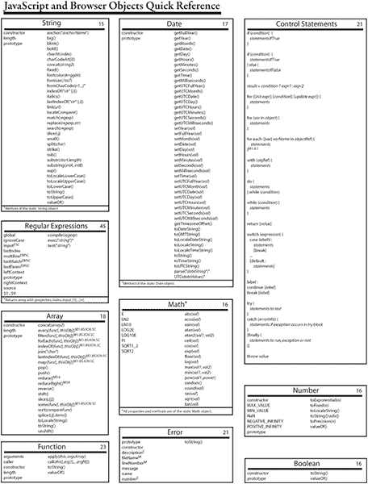

# B CD-ROM 中的内容

随附的 Windows–Macintosh CD-ROM 包含了额外的章节，包含更多的 JavaScript 示例、附录 A 所示快速参考的打印电子版、整本书的完整可搜索版本，以及 Adobe Reader。

### 系统要求

为了从示例列表中获得最大益处，你应该拥有一个基于 Mozilla 的浏览器（例如，Firefox 3.6+, -, 或 Camino 2+）、Internet Explorer 8+、基于 WebKit 的浏览器（例如，Safari+, Opera+, Chrome+）或基于 Presto 的浏览器（例如，Opera 10+）安装在你的电脑上。虽然许多脚本可以在这些浏览器中运行，但某些脚本适用于有限的范围。要使用 Adobe Reader（版本 7.0），你需要：

* 对于 Windows XP 专业版/或 Windows XP 家庭版，你应该使用具有 128 MB RAM 的 PC 电脑和 90 MB 磁盘空间。
* Mac 用户需要 PowerPC G3、G4 或 G5 处理器，OS X v10.2.8 或更高版本，至少 128 MB RAM 和 110 MB 磁盘空间。

### DISC 内容

当你查看 CD-ROM 的内容时，将看到为你的操作系统定制的文件。内容包括：

#### 用于文本编辑器的 JavaScript 列表

从书的第三部分开始，所有的示例都以 HTML 文件的形式位于 CD-ROM 上，你可以将其加载到浏览器中运行。名为 Listings 的目录包含示例文件，按章节命名文件夹。每个 HTML 文件名与书中的列表编号对应。例如，列表 26-1 的文件为`js26-01.html`。注意，第二部分的教程章节没有提供列表文件，因为鼓励手动输入 HTML 和脚本代码。

你可以直接从 CD-ROM 打开所有示例文件，但如果你将它们复制到硬盘上，访问速度更快，并且你可以更容易尝试修改文件。将名为`Listings`的文件夹从 CD-ROM 复制到硬盘上的任何位置。

为了方便，`Listings`文件夹中的`index.html`文件提供了书籍程序列表目录。每你想访问列表文件时，从你的浏览器打开该文件。如果你打算经常访问该索引页面，可以将其书签到你的浏览器中。使用索引文件访问列表文件在某些情况下非常重要，因为某些单独的文件必须在关联的框架内打开才能正常工作。通过`index.html`文件访问文件可以确保你打开了框架。`index.html`文件还显示了所有列表的浏览器兼容性评分。要检查和修改 HTML 源文件，请从你喜欢的文本编辑器打开它们。

附录 A JavaScript 和浏览器对象快速参考的打印版本

如果您喜欢附录 A 中的快速参考，可以借助 CD-ROM 附带的 Adobe Reader 将其打印。

# Adobe Reader

Adobe Reader 是一个非常有用的程序，它允许您查看附录 A 中的快速参考以及此书的可搜索版本，这两者在 CD-ROM 上均以 PDF 格式存在。安装并运行 Adobe Reader，请遵循以下步骤：

### 对于 Windows

1. 导航到 CD-ROM 上的`Adobe_Reader`文件夹。
2. 在`Adobe_Reader`文件夹中，双击单独的可执行文件，并按照屏幕上的说明安装 Adobe Acrobat Reader。

### 对于 Macintosh

1. 打开 CD-ROM 上的`Adobe_Reader`文件夹。
2. 在`Adobe_Reader`文件夹中，双击 Adobe Reader 磁盘镜像图标；这将把磁盘镜像挂载到您的计算机上。然后打开已挂载的镜像，并将 Adobe Reader 文件夹复制到计算机的“应用程序”（Applications）目录。

## 带有主题引用的书籍 PDF 版本

在第三部分和第四部分参考章节的许多地方，您会看到某些符号，引导您前往 CD-ROM 查看正在讨论的特定主题。所有这些主题都在 CD-ROM 上以完整的 Adobe Acrobat 格式存在于章节中。CD-ROM 上有一个单独的 PDF 文件，它作为整本书的电子版本，包含了打印版书籍中列为 CD-ROM 引用的完整主题。为了最快地访问这些主题，请将书籍的整个 PDF 文件复制到您的硬盘上。

与任何 PDF 文档一样，该书籍的 PDF 版本也是可以搜索的。最新版本的 Adobe Reader 应该会自动加载索引文件（扩展名为`.pdx`）以提供索引搜索功能（这比 Acrobat 的 Find 命令要快得多）。

要开始实际搜索，请点击搜索图标（纸张前的双远镜）。输入您要查找的文本。要在后续会话中访问索引和搜索功能，CD-ROM 必须在您的 CD-ROM 驱动器中——除非当然，您已经将`.pdx`和`.pdf`文件都复制到了硬盘。

## 故障排除

如果您在安装或使用 CD-ROM 程序时遇到困难，请尝试以下解决方案：

* 关闭您可能正在运行任何防病毒软件。安装程序有时会模拟病毒活动，导致您的计算机错误地认为自己感染了病毒。（请确保在稍后重新开启病毒软件。）
* 关闭所有运行中的程序。运行的程序越多，提供给其他程序的内存就越少。安装程序通常还会更新文件和程序；如果您保持其他程序运行，安装可能无法正常工作。
* 参考`ReadMe`文件。请参考 CD-ROM 根目录下的`ReadMe`文件获取发布时的最新产品信息。

## 客户服务

如果您在 CD-ROM 上遇到问题，请拨打客户支持电话 (800) 762-2974。在美国境外，请拨打 1(317) 572-3994。您也可以通过 http://support.wiley.com 联系 Wiley 产品技术支持。John Wiley & Sons 只提供安装和其他通用质量控制项目的技术支持。有关应用程序本身的技术支持，请咨询程序的供应商或作者。

如需额外订单或索有关其他 Wiley 产品的信息，请拨打 (877) 762-2974。

## 索引

### 符号

| 符号 | 描述 |
| :--- | :--- |
| `:` | (冒号) 日期/时间 |
| `document.all` | 标识符名称 |
| `,` | (逗号) 用于 cookies |
| `operator` | 参数 正则表达式 |
| `.` | (点，句号) `document.all` 点语法形式标识符名称 |
| `object operator` | 正则表达式元字符 |
| `?:` | (问号/冒号) `if` |
| `;` | (分号) 语句 |
| `://` | (双斜杠) 协议 |
| `&` | (和符号) 逻辑与 |
| `&&` | (双和符号) 逻辑与 |
| `*` | (星号) 乘法 |
| `=` | (等号) 赋值 |
| `|` | (竖线) 逻辑或 |
| `||` | (双竖线) 逻辑或（逻辑） |
| `+` | (加号) 加法 |
| `++` | (双加号) 递增 |
| `+=` | (加号/等号) 加赋值 |
| `?` | (问号) `encodeURI()` |
| `==` | (双等号) 等于 |
| `===` | (三等号) 严格相等 |
| `!` | (感叹号) 非 |
| `!=` | (感叹号/等号) 不等于 |
| `!==` | (感叹号/三等号) 严格不等于 |
| `>` | (大于) 大于 |
| `>>` | (双大于号) 右移 |
| `>>=` | (双大于号/等号) 右移赋值 |
| `>>>` | (三大于号) 无符号右移 |
| `>=` | (大于/等号) 大于或等于 |
| `<` | (小于) 小于 |
| `<<` | (双小于号) 左移 |
| `<<=` | (双小于号/等号) 左移赋值 |
| `<=` | (小于/等号) 小于或等于 |
| `-` | (减号) 减法 |
| `-=` | (减号/等号) 减赋值 |
| `%` | (百分号) 取模 |
| `%=` | (百分号/等号) 取模赋值 |
| `^` | (脱字符) 异或 |
| `&` | (位与符号) 位与 |
| `|` | (位或符号) 位或 |
| `.` | (点) 属性访问 |
| `[` | (左括号) 数组 |
| `]` | (右括号) 数组 |
| `(` | (左括号) 函数 |
| `)` | (右括号) 函数 |
| `{` | (左大括号) 对象/代码块 |
| `}` | (右大括号) 对象/代码块 |
| `,` | (逗号) 分隔 |
| `:` | (冒号) 键值对 |
| ` ` | (空格) 分隔符 |

# 位运算与运算符

- `位按取反运算符`
- `运算符优先级`
- `_` (下划线)
- `全局变量`
- `标识符`
- `变量名`
- `-val`, 负连结运算符
- `+ val`, 正连结运算符

# A

- `a`, 字符集
- `<a>`
- `javascript:` 伪协议 URL
- `target`
- `abbr`, `td`
- `abort`, `addEventListener()`
- `abort()`, `XMLHttpRequest`
- `above`, `frame`
- `abs()`
- `absbottom`, `iframe.align`
- `absmiddle`, `iframe.align`
- `绝对单位`
- `AbsolutePosition`
- `抽象对象`
- `accelerator`
- `acceptCharset`, `form`
- “Access disallowed from scripts at `<URL>` to documents at `<URL>`”, 错误消息
- “Access is denied,” 错误消息
- `accessKey`
- `label`
- `aCollection()`
- `acos()`
- `action`
- `e-mail`
- `form`
- `<form>`
- `validate.php`
- `ActionScript`
- `activeElement`, `document`
- `ActiveX`
- `Java 插件`
- `object`
- `trusted`, `Microsoft`
- `ActiveX 数据对象 (ADO)`, 事件
- `ActiveXObject`
- `HTTPRequest`
- `add()`, `select`
- `Add()`, `Dictionary`
- `addBehavior()`
- `AddDesktopComponent()`, `window.external`
- `AddEvent()`
- `addEvent()`
- `addEventListener()`
- `事件处理器`
- `jsb-global.js`
- `onload`
- `script`
- `addEvent`, `onload`
- `addEventListener`, `attachEvent()`
- `addEventListener()`
- `addEvent()`
- `DHTML 跨浏览器地图谜游戏`
- `事件绑定`
- `表单`
- `load`
- `W3C DOM`
- `AddFavorite()`, `window.external`
- `addImport()`, `styleSheet`
- `addRange()`, `selection`
- `addReadRequest()`, `userProfile`
- `addRule`, `styleSheet`
- `AddSearchProvider()`, `window.external`
- `addTotals()`
- `select`
- `adjustClip()`
- `ADO`. 参见 `ActiveX Data Objects`
- `Adobe Acrobat Reader`
- `afterBegin`
- `getAdjacentText()`
- `insertAdjacentElement()`
- `replaceAdjacentText()`
- `afterEnd`
- `getAdjacentText()`
- `insertAdjacentElement()`
- `replaceAdjacentText()`
- `Ajax`. 参见 `Asynchronous JavaScript and XML`
- `alert()`
- `模态对话框和`
- `onblur`
- `window`
- `alert 框，错误消息`
- `alertUser()`
- `align`
- `applet`
- `embed`
- `fieldset`
- `h1`
- `iframe`
- `Image`
- `legend`
- `object`
- `table`
- `aLink`, `body`
- `alinkColor`, `document`
- `all`
- `IE`
- `rules`
- `all[]`
- `.all`, `Opera`
- `allowTransparency`
- `frame`
- `iframe`
- `Alpha()`
- `alpha()`
- `alt`
- `applet`
- `area`
- `Image`
- `object`
- `altHTML`
- `applet`
- `object`
- `altKey`, `event`
- `altLeft`, `event`
- `alwaysLowered`, `window.open()`
- `alwaysRaised`, `window.open()`
- `anchorNode`, `selection`
- `anchorOffset`, `selection`
- `anchors`, `objects`
- `anchors[]`, `document`
- `AND`
- `位运算符`
- `布尔运算符`
- `动画, JavaScript`
- `练习答案`
- `API`. 参见 `应用程序编程接口`
- `appCodeName`
- `appCore`, `window`
- `append()`
- `appendChild()`
- `document.createComment()`
- `document.createDocumentFragment()`
- `异常处理`
- `insertBefore()`
- `W3C DOM`
- `XML`
- `appendData()`, `Text`
- `Apple Safari`. 参见 `Safari`
- `applet`
- `属性`
- `语法`
- `<applet>`, `<object>`
- `applets`
- `faceless`
- `<object>`
- `onload`
- `Java`
- `数据类型转换`
- `doNewWindow()`
- `eval()`
- `faceless`
- `fetchText()`
- `getFile()`
- `getMember()`
- `HTML`
- `init()`
- `局限性`
- `mainwin`
- `对象检查`
- `权限`
- `隐私`
- `属性`
- `源代码`
- `window`
- `XHTML`
- `applets[]`, `document`
- `应用程序编程接口 (API)`
- `DHTML`
- `跨浏览器地图谜游戏`
- `Google Maps`
- `Java 插件`
- `.js`
- `application/x-javascript`
- `apply()`, `functions`
- `Apply 按钮`, `handleApply()`
- `applyBehavior()`
- `applyElement()`
- `applyVals()`, `setHotColor()`
- `appMinorVersion`
- `appName`
- `Netscape`
- `appVersion`
- `arc()`, `canvas`
- `archive`
- `applet`
- `object`
- `arcTo()`, `canvas`
- `area`
- `click`
- `coords`
- `javascript:` 伪协议 URL
- `properties`
- `syntax`
- `areas[]`, `map`
- `arguments`. 参见 `parameters`
- `arguments`
- `functions`
- `JavaScript`
- `parameters`
- `算术`
- `date/time`
- `operators`
- `arity()`, `functions`
- `Array`
- `[]` (括号)
- `new`
- `prototype`
- `arrays`
- `[]` (括号)
- `accessing data`
- `browser compatibility`
- `calculations`
- `callbacks`
- `comprehensions`
- `filter()`
- `generators`
- `iterators`
- `map()`
- `concatenation`
- `creating`
- `deconstructing assignment`
- `deleting entries`
- `document objects`
- `document.forms`
- `elements`
- `empty`
- `form elements`
- `getElementsByTagName()`
- `hash tables`
- `indexes`
- `.js`
- `JSON`
- `loops`
- `methods`
- `multidimensional`
- `Navigator`
- `objects`
- `parallel`
- `lookup tables`
- `populating`
- `properties`
- `regular expressions`
- `safe, Visual Basic`
- `select`
- `splice()`
- `string.split()`
- `array.concat()`
- `array.constructor`
- `array.every()`
- `array.filter()`
- `array.forEach()`
- `array.indexOf()`
- `array.indexOf()`
- `array.join()`
- `array.toLocaleString()`
- `array.toString()`
- `array.unshift()`
- `array.pop()`
- `array.lastIndexOf()`
- `array.pop()`
- `array.reduce()`
- `array.reduceRight()`
- `array.reverse()`
- `array.shift()`
- `array.slice()`
- `array.some()`
- `array.sort()`
- `ASCII`
- `split()`
- `array.splice()`
- `array.sort()`
- `asin()`
- `ASP`
- `assign()`
- `assignment operators`
- `Asynchronous JavaScript and XML (Ajax)`
- `real-time validation`
- `table of contents`
- `timing problems`
- `atan()`
- `atan2()`
- `atEnd()`, `Enumerator`
- `attachEvent()`
- `DHTML cross-browser map puzzle`
- `IE`
- `load`
- `attachToEnd()`, `exception handling`
- `attributes`
- `forms`
- `input`
- `<script>`
- `tags, event binding`
- `XML`
- `elements`
- `Evaluator`
- `attributes[]`
- `attributes.rules`
- `authorDate`, `getTime()`
- `authoring environment`
- `autocomplete`, `form`
- `automation objects`
- `autoScroll()`
- `autoupdate.enabled`
- `availHeight`, `screen`
- `availLeft`, `screen`
- `availTop`, `screen`
- `availWidth`, `screen`
- `axis`, `td`

# B

- `B`, regular expressions
- `b`
- `backspace character`
- `regular expressions character`
- `back()`
- `history`
- `window`
- `BackColor`, `document.execCommand()`
- `BackCompat`, `compatMode`
- `back-end programs`
- `background`
- `body`
- `table`
- `backgroundAttachment`
- `backgroundColor`
- `setBGColor()`
- `backgroundImage`
- `backgroundPosition`
- `backgroundPositionX`
- `backgroundPositionY`
- `backgroundRepeat`
- `backgrounds, elements, changing`
- `backwards`, `window.find()`
- `Barn()`
- `base`
- `base formats`
- `baseHref`, `object`
- `<base>href`
- `baseline`, `iframe.align`
- `baseURI`
- `document`
- `document.doctype`
- `object`
- `BasicImage()`
- `baskets`
- `batch mode`
- `BBEdit`
- `beforeBegin`
- `getAdjacentText()`
- `insertAdjacentElement()`
- `replaceAdjacentText()`
- `beforeEnd`
- `getAdjacentText()`
- `insertAdjacentElement()`
- `replaceAdjacentText()`
- `beginPath()`, `canvas`
- `begin-tags, XML`
- `behave()`
- `behavior`
- `marquee`
- `behavioral style`
- `behaviorCookie`, `event`
- `behaviorName`, `addBehavior()`
- `behaviorPart`, `event`
- `behaviors`
- `CSS`
- `HTML`
- `IE`
- `style`
- `behaviorUrns[]`
- `below`, `frame`
- `beta browsers`
- `bezierCurveTo()`, `canvas`
- `bgColor`
- `body`
- `document`
- `marquee`
- `bgProperties`, `body`
- `binding`
- `data, tables`
- `events`
- `addEventListener()`
- `browsers`
- `HTML`
- `IE`
- `object properties`
- `removeEventListener()`
- `tag attributes`
- `W3C`
- `bits`
- `bitwise operators`
- `_blank`, `<form>`
- `blank frames`
- `blendTrans()`
- `Blinds()`
- `<blink>`
- `blockNum`, `currState`
- `blockquote`
- `blogs`
- `blur`, `addEventListener()`
- `blur()`
- `text`
- `BODY, identify()`
- `body`
- `all[]`
- `DHTML cross-browser map puzzle`
- `document`
- `document.write()`
- `event bubbling`
- `event handlers`
- `makeHTML()`
- `methods`
- `ondrag`
- `onload`
- `onunload`
- `OPML`
- `properties`
- `<script>`
- `setCapture()`
- `syntax`
- `body objects`
- `body text objects`
- `Bold, TextRange.execCommand()`
- `bookmarks, event`
- `Boolean`
- `AND`
- `callbacks`
- `condition`
- `data type`
- `JSON`
- `operators`
- `()` (parentheses)
- `value`
- `if`
- `if…else`
- `visibility`
- `window.confirm()`
- `Boolean`
- `methods`
- `new`
- `properties`
- `border`
- `frame`
- `frameset`
- `Image`
- `object`
- `table`
- `borderBottom`
- `borderBottomColor`
- `borderBottomStyle`
- `borderBottomWidth`
- `borderCollapse`
- `borderColor`
- `frame`
- `frameset`
- `table`
- `border-color`, `fieldset`
- `borderColorDark`, `table`
- `borderColorLight`, `table`
- `borderLeft`
- `borderLeftColor`
- `borderLeftStyle`
- `borderLeftWidth`
- `borderRight`
- `borderRightColor`
- `borderRightStyle`
- `borderRightWidth`
- `borderSpacing`
- `borderStyle`
- `borderTop`
- `borderTopColor`
- `borderTopStyle`
- `borderTopWidth`
- `borderWidth`
- `bottom`
- `iframe.align`
- `name`
- `TextRectangle`
- `bottomMargin`, `body`
- `boundElements`, `event`
- `boundingHeight`, `TextRange`
- `boundingLeft`, `TextRange`
- `boundingTop`, `TextRange`
- `boundingWidth`, `TextRange`

# `getElementById()`

## `NPAPI`

## `<object>`

`对象模型用于`

- `脚本`
- `选择`
- `嗅探`
- `标准支持`
- `标签页`
- `标签`
- `时间戳`
- `类型`
- `userAgent`
- `版本, 对象检测`

## `W3 C DOM`

## `Web Forms 2.0`

## `窗口`

## `BrowserWrite`

## `\ B't`

## `泡泡, 事件`

## `缓冲区深度, 屏幕`

## `buildHTML, Google Maps`

## `buildMsg(), this`

## `按钮`

## `事件`

## `事件冒泡`

## `事件处理器`

## `输入`

## `方法`

## `属性`

## `语法`

## `按钮`

## `事件处理器`

## `表单`

## `输入`

## `输入元素`

## `C`

## `缓存`

## `调试`

## `图像`

## `XML`

## `calcBlockState(), makeHTML()`

## `calculate(), onchange`

## `计算`

## `数组`

## `format()`

## `接口`

## `乘数`

## `onchange`

## `容差`

## `日历`

## `DHTML`

## `DOM`

## `表单控件`

## `javascript: URL`

## `location.href`

## `onchange`

## `onload`

## `弹出窗口`

## `call()`

## `函数`

## `JSObject`

## `回调`

## `数组`

## `Boolean`

## `every()`

## `filter()`

## `调用者`

## `函数`

## `trace()`

## `驼峰命名法`

## `Camino`

## `可取消, 事件`

## `cancelBubble`

## `DHTML 跨浏览器地图拼图`

## `事件`

## `fireEvent()`

## `canHaveChildren`

## `canHaveHTML`

## `canvas`

## `getContext()`

## `高度`

## `方法`

## `属性`

## `语法`

## `宽度`

## `标题`

## `表格`

## `标题位置`

## `captureEvents()`

## `文档`

## `层`

## `窗口`

## `层级样式表 (CSS)`

## `行为`

## `类`

## `className`

## `颜色`

## `DHTML`

## `下拉菜单`

## `字体权重`

## `帧`

## `Hello, World 脚本`

## `HTML`

## `IE 4`

## `级别 (1–3)`

## `overflow: auto`

## `弹出窗口`

## `定位`

## `属性`

## `悬停效果`

## `分离开发层和`

## `样式`

## `目录`

## `表格`

## `验证`

## `验证服务`

## `window.getComputedStyle()`

## `case, switch`

## `大小写敏感`

## `getAttribute()`

## `setAttribute()`

## `XHTML`

## `大小敏感, window.find()`

## `catch`

## `throw`

## `CDATA`

## `CD-ROM 内容`

## `ceil()`

## `cellIndex, td`

## `cellPadding, table`

## `cells, tables`

## `修改内容`

## `填充`

## `单元格`

## `表格`

## `tr`

## `cellSpacing, table`

## `居中, IE`

## `CGIs. 参见常见网关接口`

## `ch`

## `chain.gif`

## `change, addEventListener()`

## `channelMode, window.open()`

## `characterSet, document`

## `charAt()`

## `charCode, event`

## `CharSet`

## `charset`

## `document`

## `link`

## `meta`

## `复选框`

## `checked`

## `表单`

## `onclick`

## `复选框`

## `事件处理器`

## `方法`

## `属性`

## `语法`

## `checked`

## `复选框`

## `复选框`

## `click()`

## `if`

## `单选`

## `单选按钮`

## `Checkerboard()`

## `checkForEnter(), onkeypress`

## `checkForm()`

## `onsubmit`

## `checkTimer(), selectedIndex`

## `芝加哥犯罪案`

## `child(), XML`

## `子节点`

## `childNodes`

## `for`

## `children`

## `nodeType`

## `W3 C DOM`

## `children, frames`

## `children`

## `childNodes`

## `子到子, 帧`

## `子到父, 帧`

## `chOff`

## `Chroma()`

## `chroma()`

## `Chrome`

## `调试`

## `document.lastModified`

## `Drosera`

## `E4X`

## `错误消息`

## `file:///`

## `对象字面量表示法`

## `chrome, window.open()`

## `circ, shape`

## `circle`

## `coords`

## `shape`

## `cite`

## `blockquote`

## `class, CSS`

## `classes, Java`

## `直接脚本`

## `NPAPI`

## `packages`

## `classid, object`

## `className`

## `CSS`

## `layers`

## `classpath, Java`

## `clear`

## `br`

## `clear()`

## `document`

## `selection`

## `clearAttributes()`

## `clearData(), window.clipboardData`

## `clearData[], dataTransfer`

## `clearInterval()`

## `DHTML 跨浏览器地图拼图`

## `setInterval()`

## `window`

## `clearRect(), canvas`

## `clearRequest, userProfile`

## `clearTimeout(), window`

## `click`

## `addEventListener()`

## `area`

## `onchange`

## `this`

## `click()`

## `button`

## `checkbox`

## `dispatchEvent()`

## `radio`

## `clickevent, onclick`

## `clientHeight`

## `clientInformation`

## `properties`

## `syntax`

## `window`

## `clientLeft`

## `客户端脚本. 参见 scripts`

## `clientTop`

## `clientWidth`

## `clientX, event`

## `clientY, event`

## `clip`

## `clip(), canvas`

## `clipboardData`

## `getData()`

## `window`

## `cloneContents(), range`

## `cloneNode()`

## `cloneRange(), range`

## `close()`

## `document`

## `window`

## `window.open()`

## `closed`

## `subWrite()`

## `window`

## `closeNewWindow()`

## `closePath(), canvas`

## `closures`

## `functions`

## `memory leaks`

## `code`

## `applet`

## `object`

## `Code Base, Mozilla`

## `codeBase`

## `applet`

## `object`

## `principal, digital certificates`

## `codeType, object`

## `col`

## `tables`

## `cells`

## `colgroup`

## `tables`

## `cells`

## `collapse()`

## `range`

## `selection`

## `TextRange`

## `collapsed, range`

## `collapseToEnd(), selection`

## `collapseStart(), selection`

## `color`

## `CSS`

## `font`

## `hr`

## `colorArray`

## `colorButtons, getColor()`

## `colorDepth, screen`

## `cols`

## `frameset`

## `framesets`

## `rules`

## `table`

## `textarea`

## `colSpan, td`

## `columnHeads, th`

## `columns, tables, modifying`

## `columnWidths`

## `size`

## `CommandState, document.queryCommand`

## `comments`

## `// (double)`

## `conditional`

## `error messages`

## `scripts`

## `// (slash-double)`

## `)`

## `HTML`

## `XHTML`

## `Common Gateway Interfaces (CIs)`

## `ISPs`

## `serverless`

## `Submit button`

## `commonAncestor, range`

## `compact, dl`

## `compare(), sort`

## `compare()`

## `compareBoundaryPoints(), range`

## `compareDocumentPosition()`

## `compareEndPoints, TextRange`

## `compareNode(), range`

## `comparePoint(), range`

## `comparePoint(), range`

## `comparison operators`

## `if`

## `compatibility, browsers`

## `arrays`

## `designing for`

## `event`

## `inline branching`

## `inline`

## `object detection`

## `equivalency`

## `ratings`

## `scripts`

## `TextRange`

## `compatMode, document`

## `compile(), RegularExpressionObject`

## `complete`

## `Image`

## `image`

## `readyState`

## `componentFromPoint()`

## `components[], window`

## `computed style`

## `concat(), arrays`

## `concatenation`

## `arrays`

## `numbers`

## `strings`

## `condition`

## `<`

## `for`

## `= (equals sign -double)`

## `Boolean`

## `if`

## `val1`

## `conditional comments`

## `conditional expressions`

## `null`

## `object detection`

## `conditions, control structures`

## `confirm()`

## `onreset`

## `window`

## `connubial operators`

## `const, keyword`

## `constructor`

## `arrays`

## `errorObject`

## `functions`

## `Object`

## `String()`

## `container, form`

## `containment, inheritance`

## `contains()`

## `for`

## `containsNode(), selection`

## `content`

## `window`

## `content.js`

## `contentDocument`

## `execCommand()`

## `frame`

## `iframe`

## `contentEditable`

## `contentType, document`

## `contentWindow`

## `frame`

## `contentWindow`

## `div`

## `continue`

## `while`

## `control elements, form`

## `if`

## `else`

## `JavaScript`

## `controller, window`

## `controllers[], window`

## `conversion`

## `data types`

## `Java applets`

## `MSObject`

## `Date`

## `numbers to strings`

## `strings to numbers`

## `converter, o`

## `cookie, document`

## `cookieEnabled`

## `cookies`

## `browsers`

## `debugging`

## `DecisionName`

## `name`

## `null`

## `onchange`

## `onload`

## `path`

## `records`

## `retrieving data`

## `saving`

## `SECURE`

## `soft`

## ``

## `lastVisit`

## `textarea`

## `values`

## `cookies.txt, Mozilla`

## `coordinate point`

## `Coordinated Universal Time (UTC)`

## `coords`

## `area`

## `Copy, TextRange.execCommand()`

## `copy(), XML`

## `cos()`

## `count`

## `Count, Enumerator`

## `countamatic()`

## `counterIncrement`

## `counterReset`

## `countMe()`

## `cpuClass`

## `crashes, browsers`

## `createAttribute(), document`

## `CreateBookmark, document`

## `createCaption(), table`

## `createCDATASection(), document`

## `createComment(), document`

## `createContextualFragment(), range`

## `createControlRange()`

## `body`

## `createDocumentFragment(), document`

## `createElement()`

## `document `exception handling`

## `createElementNS(), document`

## `createEvent(), document`

## `createEventObject(), document`

## `createLinearGradient(), canvas`

## `CreateLink, document.execCommand()`

## `createMarker(), Google Maps`

## `createNodeIterator()`

## `createNSResolver(), document`

## `CreateObject(), VBScript`

## `createPattern(), canvas`

## `createPopup(), window`

## `createRadialGradient(), canvas`

## `createRange()`

## `document`

## `selection`

## `createStyleSheet(), document`

## `createTextNode()`

## `document`

## `W3 C DOM`

## `createTextRange()`

## `body`

## `textarea`

## `createTFoot(), table`

## `createTHead(), table`

## `createTreeWalker(), document`

## `Crockford, Douglas`

# 基础概念与分类

- `custom`
- `master`
- `工业级`
- `键盘陷阱`
- `实时`
- `dataFld`
- `event`
- `dataFormatAs`
- `dataPageSize`
- `table`
- `dataSrc`
- `dataTransfer, event`
- `DataURL`
- `日期`
- `算术`
- `计算`
- `GMT 和`
- `验证`
- `日期范围检查函数`
- `日期验证`
- `Date`
- `浏览器`
- `转换`
- `表单`
- `方法`
- `new`
- `结果`
- `字符串`
- `toLocaleString()`
- `date, dateObj.setTime()`
- `dateObj, methods`
- `Date.parse()`
- `date-time.html`
- `date-time.js`
- `Date.UTC()`
- `子类, 父类`
- `db, 用于`
- `dd`
- `调试`
- `浏览器崩溃`
- `缓存`
- `Chrome`
- `cookies`
- `Evaluator`
- `全局变量`
- `HTML 标签`
- `if`
- `if…else`
- `循环`
- `Opera`
- `预防`
- `Safari`
- `<script>`
- `源代码`
- `状态栏`
- `测试`
- `时序问题`
- `while`
- `小数点，测试`
- `十进制（基 10）值`
- `十进制十六进制转换函数`
- `Decision Helper`
- `cookies`
- `dh1.html`
- `dh2.html`
- `dh3.html`
- `dh4.html`
- `dh5.html`
- `dhHelp.html`
- `dhNav.html`
- `HTML`
- `index.html`
- `导航栏`
- `父级`
- `声明, 对象`
- `decodeURI()`
- `decodeURIComponent()`
- `cookies`
- `decommafy()`
- `解构赋值, 数组`
- `缩小字体大小, document.execCommand()`
- `defaultCharset, document`
- `defaultChecked`
- `复选框`
- `单选框`
- `defaultStatus, window`
- `defaultValue, 文本`
- `defaultView, document`
- `defer`
- `script`
- `<script>`
- `延迟脚本`
- `_defineGetter_()`
- `_defineSetter_()`
- `Delete`
- `document.execCommand()`
- `TextRange.execCommand()`
- `delete`
- `对象运算符`
- `运算符优先级`
- `deleteCaption(), table`
- `deleteCell(), tr`
- `deleteContents(), range`
- `deleteData(), Text`
- `deleteFromDocument(), selection`
- `deleteRow()`
- `table`
- `tr`
- `deleteRule(), styleSheet`
- `deleteTFoot(), table`
- `deleteTHead(), table`
- `依赖, window.open()`
- `描述`
- `error.Object`
- `mimeType`
- `plugin`
- `designMode, document`
- `detachElement`
- `detachEvent(), IE`
- `detail, event`
- `Deval(String expression)`
- `开发层, 分离`
- `DgetSlot(Int index)`
- `DgetWindow(Applet applet)`
- `dh1.html`
- `Decision Helper`
- `dh2.html, Decision Helper`
- `dh3.html, Decision Helper`
- `dh4.html, Decision Helper`
- `dh5.html, Decision Helper`
- `dhHelp.html, Decision Helper`
- `dhNav.html, Decision Helper`
- `DHTML。见 动态 HTML`
- `dialogArguments, window`
- `dialogHeight`
- `IE`
- `window`
- `dialogLeft`
- `IE`
- `window`
- `dialogTop`
- `IE`
- `window`
- `dialogWidth`
- `IE`
- `window`
- `Dictionary`
- `数字证书, Netscape`
- `dimensions(), VBArray`
- `dir`
- `direction`
- `marquee`
- `指令元素, HTML`
- `目录`
- `window`
- `window.open()`
- `disabled`
- `link`
- `styleSheet`
- `反汇编器`
- `dispatch Event(), W3 C DOM`
- `dispatch lookup table`
- `dispatchEvent()`
- `document.createEvent()`
- `display`
- `span`
- `toggle()`
- `div`
- `contentEditable`
- `contextMenu`
- `img`
- `makeHTML()`
- `offsetTop`
- `setCapture()`
- `span`
- `tipStyle`
- `dl`
- `DOCTYPE`
- `compatMode`
- `切换`
- `doctype, document`
- `document`
- `body`
- `captureEvents()`
- `element`
- `事件冒泡`
- `事件处理程序`
- `getElementById()`
- `getElementByTagName()`
- `方法`
- `对象检查`
- `popup`
- `属性`
- `releaseEvents()`
- `setCapture()`
- `syntax`
- `UniversalBrowserRead`
- `W3 C DOM`
- `window`
- `XMLDocument`
- `document 对象。见 事件处理程序；方法; 属性`
- `数组`
- `核心 JavaScript, 分离`
- `定义`
- `层次结构`
- `文档对象模型 (DOM)。见 W3 C DOM`
- `日历`
- `定义`
- `DHTML`
- `E4X`
- `演变`
- `家族`
- `IE 4`
- `IE 5`
- `NN4`
- `表单`
- `IE`
- `节点`
- `定位`
- `运行时错误`
- `Web Forms 2.0`
- `文档类型定义 (DTD)`
- `document.all`
- `浏览器`
- `Enumerator`
- `IE4`
- `对象检测`
- `document.body, engage()`
- `document.close()`
- `浏览器`
- `cursor`
- `document.write()`
- `windows.open()`
- `document.cookie`
- `cookies`
- `document.createElement, appendChild()`
- `document.createElement()`
- `applyElement()`
- `replaceNode()`
- `swapNode()`
- `document.createTextNode()`
- `W3 C DOM`
- `document.defaultView`
- `document.domain`
- `documentElement, document`
- `document.formReference.elementName`
- `document.forms`
- `数组`
- `document.forms[]`
- `document.getElementById`
- `iframe`
- `document.getElementById()`
- `contains()`
- `W3 C DOM`
- `walkChildren()`
- `document.getElementsByTagName()`
- `document.images`
- `if`
- `imageOn()`
- `document.images[]`
- `document.layers, Netscape`
- `document.links, name`
- `document.recalc(), setExpression()`
- `document.selection, type`
- `document.title, <title>`
- `documentURI, document`
- `document.write()`
- `base`
- `浏览器`
- `cursor`
- `document.close()`
- `DOM`
- `表达式评估`
- `HTML`
- ``
- `insertAdjacentHTML()`
- `insertAdjacentText()`
- `newAsOf()`
- `对象检查`
- `输出流`
- `表格`
- `网页页`
- `window`
- `windows.open()`
- `XHTML`
- `document.writeln()`
- `doDisplay(), eval()`
- `DOM。见 对象模型`
- `DOMActivate, addEventListener()`
- `domain, cookies`
- `domain, document`
- `DOMAttrModified, addEventListener()`
- `DOMCharacterModified, addEventListener()`
- `DOMFocusOut, addEventListener()`
- `DOMImplementation, hasFeature()`
- `DOMNodeInserted, addEventListener()`
- `DOMNodeInsertedDocument, addEventListener()`
- `DOMNodeRemoved, addEventListener()`
- `DOMNodeRemovedFromDocument, addEventListener()`
- `DOMSubtreeModified, addEventListener()`
- `doNewWindow(), Java applets`
- `doReadRequest(), userProfile`
- `ort, Bill`
- `doScroll()`
- `body`
- `doValidate()`
- `do-while`
- `download`
- `dragDrop()`
- `draggable`
- `draggedElem, layers`
- `drag.htc`
- `dragIt()`
- `DHTML cross-browser puzzle`
- `layers`
- `Dragonfly, Opera`
- `drawImage(), canvas`
- `drawText()`
- `Dreamweaver`
- `removeMember(String elementName)`
- `drop-down menus, CSS`
- `dropEffect, dataTransfer`
- `DropShadow()`
- `dropShadow()`
- `drosera, WebKit`
- `setSlot(int index)`
- `dt`
- `DTD。见 文档类型定义`
- `dump(), window`
- `duplicate(), TextRange`
- `endOffset, range`
- `ToEnd, setEndPoint()`
- `EndStart, setEndPoint()`
- `engage()`
- `DHTML cross-browser puzzle`
- `document.body`
- `layers`
- `entities, document`
- `doctype`
- `Enumerator`
- `Error`
- `new`
- `errors`
- `objects`
- `scripts, viewing`
- `trapping, JavaScript`
- `error messages`
- `alert dialog boxes`
- `Chrome`
- `comments`
- `details`
- `filenames`
- `Firefox`
- `location`
- `multiples`
- `Opera`
- `privileges`
- `Safari`
- `text`
- `errorObject`
- `error.Object`
- `escape()`
- `encodeURIComponent()`
- `escape sequences`
- `EscapeChar`
- `eval()`
- `doDisplay()`
- `execScript()`
- `format()`
- `Java applets`
- `JSObject`
- `JSON`
- `security and`
- `subwin`
- `E (Math.E)`
- `subwin`
- `window.open()`
- `EvalError`
- `evaluate(), document`
- `Evaluator`
- `attributes`
- `debugging`
- `execScript()`
- `global variables`
- `navigator.appname`
- `string.split()`
- `Evaluator Jr.`
- `Evaluator Sr.`
- `evaluator.js`
- `trace()`
- `evaluator.html`
- `evaluator.js`
- `Event`
- `dispatchEvent()`
- `static objects`
- `W3 C DOM`
- `window`
- `event`
- `browser compatibility`
- `cancelBubble`
- `evt`
- `IE`
- `IE4`
- `keyCode`
- `methods`
- `Mozilla`
- `properties`
- `syntax`
- `NN6`
- `properties`
- `syntax`
- `properties`
- `returnValue`
- `script`
- `<script>`
- `syntax`
- `window`
- `events`
- `ADO`
- `binding, object properties`
- `bubbling`
- `IE, properties`
- `IE4`
- `IE5`
- `keyCode`
- `modifers`
- `modifier keys`
- `mouse button`
- `Mozilla`
- `NN4`
- `NN6`
- `onkeydown`
- `onkeyup`

# 引用脚本类型的传播

## W3C

### W3C DOM

### 事件绑定

- `addEventListener()`
- 浏览器
- `HTML`
- `IE`
- `removeEventListener()`

### 标签属性

- `W3C`
- 事件冒泡
- `IE4`
- 鼠标
- `W3C DOM`

事件处理器

- `addEvent()`
- `body`
- `button`
- `checkbox`
- `document`
- `form`
- 来自通用 HTML 对象的函数调用
- `IE`
- 行为
- `Image`
- `initialize()`
- `link`
- `marquee`
- `radio`
- `select`
- `target`
- `text`
- `values`
- 变量
- `window`
- `event.clientX`
- `event.clientY`
- `event.dataTransfer`, `Array.Join()`
- `eventObj.cancelDefault()`, `onclick`
- `eventPhase`
- `event`
- `event.propertyName`
- `event.returnValue`
- `onbeforedeactivate`
- `onbeforepaste`
- `onfocus`
- `every()`
- 数组
- 浏览器
- 回调
- `evt`
- `event`
- `Something()`
- `window.event`

### 异常处理

- 对象
- 字符串
- `throw`
- `try-catch-finally`
- `exec()`
- 正则表达式
- `RegularExpressionObject`
- `execCommand()`
- `document`
- `TextRange`
- `execScript()`
- `eval()`
- `Evaluator`
- `window`

## 练习，答案

- `Exists()`, `Enumerator`
- `exp()`
- `expand`, `TextRange`
- `expandEntityReference`, `TreeWalker`
- `expando`, `document`
- `expansionstate`, `head`
- “Expected <something>”,错误消息
- 过期日期，cookies
- 指数
- 导出，带签名脚本
- 表达式，switch
- 表达式。另参阅正则表达式
- 条件的
- `null`
- 对象检测
- 求值
- 初始，循环
- JavaScript, 嵌入
- lambda
- 更新，for
- `extend()`, 选择
- `extendRow()`

## 可扩展标记语言 (XML)

另参阅 异步 JavaScript 和 XML；用于 XML 的 ECMAScript

* (星号)
- `appendChild()`
- 属性
- 缓存
- `child()`
- `copy()`
- 数据岛
- 数据转换
- 元素
- `@` (at sign)
- 属性
- `object.property`
- `object[property]`
- `HTML`
- `name()`
- 节点
- 对象
- 序列化
- 父子关系
- 目录
- 标签
- 公共:
- `toString()`
- `toXMLString()`

## W3C DOM

### XHTML

- 外部，`window`
- `extractContents()`, `range`

## F

- `\ f`, 换符内联字符
- 脸形，字体
- 无界面的小程序
- `<object>`
- `onload`
- `factorial()`
- `Fade()`
- false, 布尔数学
- 常见问题解答 (FAQs)
- `fetchText()`, Java 小程序
- `fgColor`, `document`
- 斐波那契序列
- `FieldDelim`
- `fieldset`
- `border-color`
- 表单控件
- 文件
- `XMLHttpRequest`
- `file:`, `src`
- `file:///`, Chrome
- 文件传输协议 (ftp)
- `FileAccess`
- `fileAccess()`
- `fileCreatedDate`
- `document`
- `Image`
- `fileModifiedDate`
- `document`
- `Image`
- `fileName`, `error.Object`
- `filename`, `plugin`
- 文件名，错误消息
- `FileRead`
- `fileSize`
- `document`
- `Image`
- `fileUpdatedDate`, `Image`
- `FileWrite`
- `fill()`, `canvas`
- `fillRect()`, `canvas`
- `fillStyle`, `canvas`
- 过滤器
- 滤镜
- `IE4`
- `IE5`
- `TreeWalker`
- 过滤器函数，数据验证函数
- `filter()`
- 数组推导式
- 数组
- 浏览器
- 回调
- `filters[]`
- finally
- `find()`, `window`
- `findText()`, `TextRange`
- FireBug, Firefox
- `fireEvent()`
- `document.createEventObject()`
- `srcElement`
- Firefox
- 兼容性
- 解构赋值
- E4X
- 错误消息
- FireBug
- `IE`
- `map()`
- 对象字面量表示
- select
- 警告
- 子节点
- `W3C DOM`
- `firstChild()`, `TreeWalker`
- `firstChild.nodeValue`
- `firstPage()`, 表
- 标记，`trace()`
- Flash 插件
- `flipH()`
- `flipV()`
- 浮点数
- 指数
- 整数
- `parseFloat()`
- `floor()`
- `focus()`
- `dispatchEvent()`
- `select()`
- `setActive()`
- 文本
- focusNode, 选择
- focusOffset, 选择
- 字体
- 字体, h1
- `fontFamily`
- `FontName`, `document.execCommand()`
- `FontSize`, `document.execCommand()`
- `fontSize`
- `fontSizeAdjust`
- `fontSmoothingEnabled`, `screen`
- `fontStretch`
- `fontStyle`
- `fontVariant`
- `fontWeight`
- `font-weight`, CSS
- 脚注，帧
- for
- `,` (逗号)
- break
- `childNodes`
- condition
- continue
- 控制结构
- db
- `form.elements`
- i
- length
- `makeTitleRow()`
- return
- `<script>`
- `style.display`
- 更新表达式
- `var`
- `for()`, 数组
- `forEach()`, 数组
- `foreColor`, `document.execCommand()`
- `for-in`, `ActiveObject`
- `FORM`, `identify()`
- form
- action
- button
- checkbox
- container
- 控制元素
- `elements()`
- 事件冒泡
- `fieldset`
- 表单控件
- `HTML`
- 标签
- 图例 (legend)
- 列表
- 方法
- 对象
- 对象
- `onsubmit`
- 参数
- 属性
- 文本
- `this.form`
- `validate.php`
- `<form>`
- action
- `document.forms[]`
- 电子邮件
- `HTML`
- id
- `onsubmit`
- target
- 表单
- `addEventListener()`
- 属性
- 浏览器
- 按钮
- 控制
- 日历
- `fieldset`
- form
- 图例 (legend)
- maxLength
- 对象
- 文本
- Date
- DOM
- 元素
- 数组
- 函数
- 电子邮件
- 函数
- `getElementById()`
- 输入
- 查找表
- 对象
- prevalidating
- `preventDefault()`
- submit
- 文本
- `format()`
- 计算
- `eval()`
- `FormatBlock`, `document.execCommand()`
- `form.elements[]`
- `<form>…</form>`
- `forms[]`
- `document`
- 对象检查
- 论坛
- `forward()`, `window`
- `foundArray`, 正则表达式
- `foundMatch`
- frame
- `parentNode`
- 属性
- 引用
- 语法
- 表
- `<Frame>`
- 帧
- 空白
- 浏览器
- 子节点
- 子到子
- 子到父
- 创建
- CSS
- 元素
- 确保
- 脚注
- `HTML`
- 对象模型
- 父级
- 父到子
- 防止
- `print()`
- 引用
- 脚本
- 源代码
- 同步
- `<frame>`, `<frameset>`
- `frameBorder`
- frame
- frameset
- iframe
- `frameborder`, 层
- `frameElement`, `window`
- 帧, `window`
- `frames[]`, `document`
- frameset
- 属性
- 语法
- `<frameset>`
- `<frame>`
- framesets
- cols
- cookies
- `onload`
- rows
- `frameSpacing`, frameset
- fritzy
- `fromElement`, `event`
- FrontPage
- `ftp`. 参阅 文件传输协议
- `fullName()`, `onclick`
- `fullScreen`, `window`
- `fullscreen`, `window.open()`

## Function，数据类型

- Function
- new
- 语法
- `function()`, 运算符优先级
- 函数
- 应用笔记
- 参数
- 闭包
- 创建
- 自定义对象
- 自定义验证
- 数据输入验证
- 十进制转十六进制
- 元素
- 过滤器，数据验证函数
- 表单元素
- 表单
- 来自事件处理器的函数调用
- 全局
- 调用
- JavaScript, 值
- 库
- 主验证
- 方法
- 嵌套
- 参数
- 属性
- 递归
- `<script>`
- 脚本语句
- 文本
- 工具，字符串
- “函数并不总是返回值,”错误消息
- `functionName`
- `()` (括号)

## G

- `g`, 局部变量
- 垃圾回收，主机环境
- `GDownloadUrl`, Google Maps
- `geckoActiveObject()`, `window`
- 生成器，数组推导式
- 通用 HTML 元素
- 事件处理器
- 方法
- 属性
- 坐标, Google Maps
- GET, 无条件
- get, 方法
- `getAdjacentText()`
- `getAllResponseHeaders()`
- `getAttribute()`
- `getAttribute()`
- 大写敏感性
- 用户配置
- `getAttributeNode()`
- `getAttributeNodeNS()`
- `getAttributeNS()`
- `getBookmark()`, `TextRange`
- `getBoundingClientRect()`
- `getClientRects()`
- `getColor()`, 颜色按钮
- `getComputedStyle()`
- `W3C DOM`
- `window`
- `getContext()`, `canvas`
- `getCountDown()`
- `getData()`
- clipboardData
- dataTransfer
- `onpaste`
- `window.clipboardData`
- `getDate()`
- `getDay()`
- dateObj
- `getdh3Factor()`
- `getdh4Performance()`
- `getElementById()`
- `all[]`
- 浏览器
- `document`
- `document.all`
- 表单
- hr
- id
- 对象检测
- 输出
- W3C
- `getElementByTagName()`, `document`
- `getElementsByName()`, `document`
- `getElementsByTagName()`
- 数组
- `W3C DOM`
- `getElementsByTagNameNS()`
- `getErrorObj()`, 名称
- `getExpression()`
- `getFeature()`
- `getFile()`, Java 小程序
- `getFormData()`
- `getFullYear()`
- dateObj
- `getGrossOffsetLeft()`
- `getGrossOffsetTop()`
- `getHours()`
- dateObj
- `getItem()`, VBArray
- `getMember()`
- Java 小程序
- `JSObject`
- `getMilliseconds()`, dateObj
- `getMinutes()`
- `getMonth()`
- dateObj
- `getNetOffsetLeft()`
- `getnetOffsetTop()`
- `getObject()`, library
- `getObject`, `W3C`
- `getParentLayer()`
- `getRangeAt()`, 选择
- `getBoundingClientRect()`
- `getClientRects()`
- `getColor()`, 颜色按钮
- `getComputedStyle()`
- `W3C DOM`
- `window`
- `getContext()`, `canvas`
- `getCountDown()`
- `getData()`
- clipboardData
- dataTransfer
- `onpaste`
- `window.clipboardData`
- `getDate()`
- `getDay()`
- dateObj
- `getdh3Factor()`
- `getdh4Performance()`
- `getElementById()`
- `all[]`
- 浏览器
- `document`
- `document.all`
- 表单
- hr
- id
- 对象检测
- 输出
- W3C
- `getElementByTagName()`, `document`
- `getElementsByName()`, `document`
- `getElementsByTagName()`
- 数组
- `W3C DOM`
- `getElementsByTagNameNS()`
- `getErrorObj()`, 名称
- `getExpression()`
- `getFeature()`
- `getFile()`, Java 小程序
- `getFormData()`
- `getFullYear()`
- dateObj
- `getGrossOffsetLeft()`
- `getGrossOffsetTop()`
- `getHours()`
- dateObj
- `getItem()`, VBArray
- `getMember()`
- Java 小程序
- `JSObject`
- `getMilliseconds()`, dateObj
- `getMinutes()`
- `getMonth()`
- dateObj
- `getNetOffsetLeft()`
- `getnetOffsetTop()`
- `getObject()`, library
- `getObject`, `W3C`
- `getParentLayer()`
- `getRangeAt()`, 选择
- `getBoundingClientRect()`
- `getClientRects()`
- `getColor()`, 颜色按钮
- `getComputedStyle()`
- `W3C DOM`
- `window`
- `getContext()`, `canvas`
- `getCountDown()`
- `getData()`
- clipboardData
- dataTransfer
- `onpaste`
- `window.clipboardData`
- `getDate()`
- `getDay()`
- dateObj
- `getdh3Factor()`
- `getdh4Performance()`
- `getElementById()`
- `all[]`
- 浏览器
- `document`
- `document.all`
- 表单
- hr
- id
- 对象检测
- 输出
- W3C
- `getElementByTagName()`, `document`
- `getElementsByName()`, `document`
- `getElementsByTagName()`
- 数组
- `W3C DOM`
- `getElementsByTagNameNS()`
- `getErrorObj()`, 名称
- `getExpression()`
- `getFeature()`
- `getFile()`, Java 小程序
- `getFormData()`
- `getFullYear()`
- dateObj
- `get-OffsetLeft()`
- 正 表达式
- `foundMatch`
- frame
- `parentNode`
- 属性
- 引用
- 语法
- 表
- `<Frame>`
- 帧
- 空白
- 浏览器
- 子节点
- 子到子
- 子到父
- 创建
- CSS
- 元素
- 确保
- 脚注
- `HTML`
- 对象模型
- 父级
- 父到子
- 防止
- `print()`
- 引用
- 脚本
- 源代码
- 同步
- `<frame>`, `<frameset>`
- `frameBorder`
- frame
- frameset
- iframe
- `frameborder`, 层
- `frameElement`, `window`
- 帧, `window`
- `frames[]`, `document`
- frameset
- 属性
- 语法
- `<frameset>`
- `<frame>`
- framesets
- cols
- cookies
- `onload`
- rows
- `frameSpacing`, frameset
- fritzy
- `fromElement`, `event`
- FrontPage
- `ftp`. 参阅 文件传输协议
- `fullName()`, `onclick`
- `fullScreen`, `window`
- `fullscreen`, `window.open()`

# `globalCompositeOperation`, `canvas`

# `Glow()`

# `glow()`

# `GMT`。参见格林治标准时间

# `go()`, `history`

# `Google Maps`

# `API`

# `geocoordinates`

# `mashups`

# `Google Maps Directory`

# `Google Moon`

# `goPrev()`

# `goto`

# `graceful degradation`

# `graphics`

# `gray()`

# `格林治标准时间 (GMT)`

# `milliseconds`

# `time tracking`

# `groups`, `rules`

# `guid`

# `H`

# `h1`

# `fonts`

# `Hammond, David`

# `handleApply()`, `Apply button`

# `handleBottom`, `componentFromPoint()`

# `handleBottomLeft`, `componentFromPoint()`

# `handleBottomRight`, `componentFromPoint()`

# `handleClick()`, `setCapture()`

# `handleEvent()`

# `handleLeft`, `componentFromPoint()`

# `handleOK()`

# `window.returnValue`

# `handleRight`, `componentFromPoint()`

# `handleTop`, `componentFromPoint()`

# `handleTopLeft`, `componentFromPoint()`

# `handleTopRight`, `componentFromPoint()`

# `hard`, `textarea`

# `hard reload`

# `hasAttribute()`

# `hasAttributeNS()`

# `hasAttributes()`

# `hasChildNodes()`

# `hasFeature()`, `DOMImplementation`

# `hash`

# `area`

# `hash tables`, `arrays`

# `hasOwnProperty()`, `Object`

# `head`

# `DHTML 跨浏览器地图益智`

# `expansionstate`

# `link`

# `OPML`

# `script`

# `headers`, `td`

# `height`

# `applet`

# `<canvas>`

# `document`

# `embed`

# `frame`

# `iframe`

# `Image`

# `marquee`

# `object`

# `pixels`

# `screen`

# `table`

# `td`

# `tr`

# `window.open()`

# `Hello, World 脚本`

# `helper applications`。参见插件

# `十六进制三元格式`

# `十六进制 (base-16) 整数值`

# `Hickson, Ian`

# `hidden`

# `embed`

# `hide()`

# `popup`

# `hideFocus`

# `hideFocus`

# `hideTip()`

# `hierarchies`。参见文档对象；节点树

# `HIERARCHY_REQUEST_ERR`

# `highlight()`, `setCapture()`

# `history`

# `back()`

# `go()`

# `methods`

# `properties`

# `security restrictions`

# `window`

# `history.back()`

# `history.forward()`

# `history.go()`

# `home()`, `window`

# `host`

# `area`

# `host environment`

# `garbage collection`

# `global scope`

# `JavaScript`

# `memory`

# `hostname`

# `area`

# `:hover`, W3 C DOM

# `hr`

# `properties`

# `syntax`

# `href`

# `area`

# `base`

# `charset`

# `elements`

# `javascript: 伪 URL`

# `link`

# `styleSheet`

# `target`

# `toggle()`

# W3 C DOM

# `hrefLang`, `link`

# `hreflang`

# `hsides`, `frame`

# `hspace`

# `applet`

# `iframe`

# `Image`

# `marquee`

# `object`

# `HTAs`。参见 HTML 应用

# `.htc`

# `.css`

# `.js`

# `<script>`

# `HTML`。参见超标记语言

# `HTML`, `event bubbling`

# `html`

# `all[]`

# `.html`, `document.write()`

# `HTML applications (HTAs)`

# `HTML Validator`

# `htmlFor`

# `label`

# `script`

# `htmlText`, `TextRange`

# `http`。参见超文本传输协议

# `<http>`, `.js`

# `httpEquiv`, `meta`

# `https`。参见 HTTP 安全

# `https:`, `location`

# `HTTP-Secure (https)`

# `hybrid tables`

# `Hypertext Markup Language (HTML)`。参见 XHTML

# `// (slash -double)`

# `behaviors`

# `CSS`

# `Decision Helper`

# `directive elements`

# `documents`

# `intelligent`

# `loading process`

# `node tree`

# `object model containment`

# `scripts`

# `structure`

# `document.write()`

# `DOM`

# `E4X`

# `elements`

# `embedding E4X in`

# `event binding`

# `fieldset`

# `form`

# `<form>`

# `frames`

# `generic element objects`

# `Google Maps`

# `Hello, World script`

# `iframe`

# `imageName`

# `Java`

# `applets`

# `plug-ins`

# `JavaScript`

# `layers`

# `li`

# `method`

# `noscript`

# `order forms`

# `<script>`

# `scripts`, `comments`

# `select`

# `separated development and`

# `strings`

# `style`

# `style sheets`

# `table of contents`

# `tables`

# `tags`

# `debugging`

# `positioning`

# `type`

# `target`

# `trace()`

# `type`

# `update flags`

# `UTF-8`

# `validation`

# `version 4.01`

# `version 5`

# `W3 C specification`

# `Web Forms 2.0`

# `XML`

# `Hypertext Transfer Protocol (http)`

# `I`

# `i`

# `for`

# `loop counter`

# `ibound()`, `VBArray`

# `id`

# `DOM`

# `<form>`

# `getElementById()`

# `join`

# `span`

# `styleSheet`

# `identifiers`

# `hyphen`

# `variable names`

# `IE`。参见 Internet Explorer

# `IEEE doubles`

# `if`

# `Boolean value`

# `checked`

# `comparison operators`

# `condition`

# `control structures`

# `debugging`

# `decisions`

# `document.images`

# `else`

# `indexes`

# `name`

# `submit`

# `type`

# `window.confirm()`

# `window.prompt()`

# `if (!document.getElementById) return:`

# `if…else`

# `{}`

# `?:`

# `Boolean value`

# `control structures`

# `debugging`

# `decisions`

# `inline branching`

# `nesting`

# `switch`

# `window.confirm()`

# `window.prompt()`

# `iframe`

# `HTML`

# `layers`

# `syntax`

# `if-test`

# `ignoreCase`, `regular expressions`

# `Image`

# `event handlers`

# `memory`

# `new`

# `properties`

# `setInterval()`

# `syntax`

# `image`

# `images`

# `basic object model`

# `cache`

# `interchangeable`

# `object checks`

# `objects`

# `pre-caching`

# `rollovers`

# `without scripts`

# `select`

# `src`

# `imageDB`

# `imageLibrary`, `loadCached()`

# `imageName`, `HTML`

# `imageOff()`, `onmouseout`

# `imageOn()`

# `document.images`

# `onmouseover`

# `images`, object detection`

# `images[]`, `document`

# `imeMode`

# `img`

# `controller`

# `div`

# ``

# `src`

# `toggle()`

# ``

# `document.write()`

# `img`

# `<map>`

# `soft cookies`

# `src`

# `immediate scripting`

# `immediate statements`

# `implementation, document`

# `import`

# `signed scripts`

# `style sheets`

# `@import`, `style`

# `imports`, `styleSheet`

# `in, object operator`

# `increaseFontSize()`, `document.execCommand()`

# `Indent`, `document.execCommand()`

# `indexes`

# `arrays`

# `if`

# `select`

# `index.html`

# `Decision Helper`

# `window.confirm()`

# `indexOf()`

# `arrays`

# `Indterm`, `document.queryCommand`

# `industrial-strength data-entry validation`

# `dispatch lookup table`

# `sample form for`

# `sample validations`

# `structure`

# `inheritance`

# `containment`

# `fieldset`

# `JavaScript`

# `prototype`

# `init()`

# `DHTML cross-browser map puzzle`

# `Java applets`

# `loadXMLDoc()`

# `onload`

# `setExpression()`

# `initArray()`, `DHTML cross-browser map puzzle`

# `initAudioAPI()`

# `initEvent()`

# `event`

# `initExpand()`, `currState`

# `initial expression, loops`

# `initialCaps()`, `String`

# `initialize()`, `event handlers`

# `initializing variables`

# `initKeyEvent()`, `event`

# `initMouseEvent()`, `event`

# `initMutationEvent()`, `event`

# `initState`

# `initUIEvent()`, `event`

# `inline branching, browser compatibility`

# `inline characters, strings`

# `innerHeight`

# `window`

# `window.open()`

# `innerHTML`

# `DHTML`

# `empty div`

# `firstChild`

# `IE4`

# `range`

# `span`

# `transferHTML()`

# `userProfile`

# `W3 C`

# `W3 C DOM`

# `innerText`

# `firstChild`

# `IE`

# `setupDrag()`

# `innerWidth`

# `window`

# `window.open()`

# `INPUT,`

# `identify()`

# `attributes`

# `button`

# `buttons`

# `checkbox`

# `elements`

# `forms`

# `label`

# `RegExp`

# `textarea`

# `type`

# `<input="button">`

# `inputEncoding`, `document`

# `inRange()`

# `TextRange`

# `insertAdjacentElement()`

# `insertAdjacentHTML()`

# `IE`

# `insertAdjacentText()`

# `insertBefore()`

# `document.createComment()`

# `removeChild()`

# `InsertButton`, `TextRange.execCommand()`

# `insertCell()`

# `tr`

# `insertData()`, `Text`

# `InsertDateTime()`

# `InsertFieldset`, `TextRange.execCommand()`

# `InsertHorizontalRule`

# `document.execCommand()`

# `TextRange.execCommand()`

# `InsertIFrame`, `TextRange.execCommand()`

# `InsertImage`, `document.execCommand()`

# `InsertInputButton`, `TextRange.execCommand()`

# `InsertInputCheckbox`, `TextRange.execCommand()`

# `InsertInputFileUpload`, `TextRange.execCommand()`

# `InsertInputRadio`, `TextRange.execCommand()`

# `InsertInputReset`, `TextRange.execCommand()`

# `InsertInputSubmit`, `TextRange.execCommand()`

# `InsertInputText`, `TextRange.execCommand()`

# `InsertMarquee`, `TextRange.execCommand()`

# `insertNode()`, `range`

# `InsertOrderedList`, `TextRange.execCommand()`

# `InsertParagraph`

# `insertRow()`

# `table`

# `insertRule()`, `styleSheet`

# `InsertSelectDropdown`, `TextRange.execCommand()`

# `InsertTextArea`, `TextRange.execCommand()`

# `InsertUnorderedList`, `TextRange.execCommand()`

# `insideWindowWidth, DHTML cross-browser map`

# `instanceof, object operator`

# `Instant SSL`

# `integers. 参见 floating-point numbers; numbers`

# `hexadecimal`

# `octal format`

# `intelligent`

# `internalSubset, document.doctype`

# `international characters, signed scripts`

# `Internet Explorer (IE)`

# `all`

# `attachEvent()`

# `behaviors`

# `elements`

# `embedding`

# `enabling/disabling`

# `event handlers`

# `global variables`

# `methods`

# `properties`

# `references`

# `text rollover`

# `compatibility`

# `cookies`

# `createStyleSheet()`

# `deconstructing assignment`

# `detachEvent()`

# `DOM`

# `dominance`

# `elementFromPoint()`

# `error dialog box`

# `event`

# `event binding`

# `event handlers`

# `events, properties`

# `Firefox`

# `global variables`

# `HTTPRequest`

# `innerText`

# `insertAdjacentHTML()`

# `JSObject`

# `li`

# `<object>`

# `object references`

# `plug-ins`

# `<script>`

# `security`

# `select`

# `select()`

# `style`

# `style sheets`

# `styleSheet`

# `type`

# `version 4`

# `CSS and`

# `document.all`

# `event`

# `event bubbling`

# `events`

# `filter`

# `iframe`

# `innerHTML`

# `outerHTML`

# `outerText`

# `revealClip()`

# `select`

# `setColor()`

# `srcElement`

# `tables`

# `version 5`

# `currentStyle`

# `events`

# `filter`

# `hideFocus`

# `Mac OS X`

# `W3 C DOM`

# `window`

`window.event`

`window.open()`

`XMLHttpRequest`

`Internet 资源`

`Internet 服务提供商 (ISPs)`

`CGIs`

`e-mail`

`intersectsNode()`, `range`

`invert()`

`Iris()`

`isChar`, `event`

`isCollapsed`, `selection`

`isDefaultNamespace()`

`isDisabled`

`isDone()`, `DHTML 跨浏览器地图谜题`

`isEmpty()`

`isEqual()`, `TextRange`

`isEqualNode()`

`isFinite()`

`isInteger()`

`isMap`, `Image`

`isMultiLine`

`isNaN()`

`isNumber()`

`isOpen`, `popup`

`isPointInRange()`, `range`

`isPosInteger()`

`isPrototypeOf()`, `Object`

`ISPs`。参见 `Internet 服务提供商`

`isSameNode()`

`isSupported()`

`isTextEdit`

`isTrusted`, `event`

`isValid()`

`查找表`

`斜体`, `TextRange.execCommand()`

`item()`

`枚举器`

`select`

`迭代器`, `数组推导式`

`J`

`JAR 包生成器`

`Java`

`applets`

`数据类型转换`

`doNewWindow()`

`eval()`

`无界面`

`fetchText()`

`getFile()`

`getMember()`

`HTML`

`init()`

`局限性`

`主窗口`

`对象检查`

`权限`

`隐私`

`属性`

`源代码`

`window`

`XHTML`

`类`

`直接脚本执行`

`NPAPI`

`包`

`类路径`

`方法`

`mainString`

`<object>`

`对象`

`插件`

`ActiveX`

`API`

`HTML`

`库`

`沙箱`

`String`

`void`

`javaEnabled()`, `navigator`

`java.lang`, `String`

`JavaPluginCocoa.bundle`

`JavaScript`

`动画`

`参数`

`内置对象`

`...的大小写敏感性`

`控制结构`

`cookies`

`核心`

`文档对象`, `分离`

`标准`

`数据库`

`排序`

`ECMA-262 标准`

`错误处理`

`表达式`, `嵌入`

`函数`, `值`

`历史`

`主机环境`

`HTML`

`继承`

`局限性`

`弱类型语言`

`对象`, `快速参考`

`OO`, `对象`

`操作符`

`原型`

`保留字`

`分离的开发层和`

`语句`

`静态对象`

`更新标志位`

`用户代理`

`使用`

`变量`

`版本`

`W3 C DOM`

`网页制作技术`

`javascript: 伪 URL`

`日历`

`href`

`JavaScript 对象表示法 (JSON)`

`{` (大括号)

`[]` (方括号)

`数据类型`

`ECMAScript`

`eval()`

`对象`

`parse()`

`替换器`

`安全`

`发送/接收数据`

`空格`

`stringify()`

`toJSON()`

`XMLHttpRequest()`

`javascript.enabled`

`javascript:functionName()`

`target`

`join()`, `数组`

`join`, `id`

`join()`, `字符串`

`.js`

`API`

`数组`

`DHTML 跨浏览器地图谜题`

`.htc`

`<http://>`

`库`

`MIME`

`jsb-global.js`

`addEvent()`

`Content/`

`JScript`

`JSObject`

`IE`

`netscape.javascript`

`子窗口`

`JSObject.getWindow()`

`JSON`。参见 `JavaScript 对象表示法`

`JSON`

`点唱机`

`JustifyFull`, `document.execCommand()`

`JustifyLeft`, `document.execCommand()`

`JustifyParagraph`, `document.execCommand()`

`JustifyRight`, `document.execCommand()`

`K`

`Key()`, `Enumerator`

`键盘`

`字符码`

`捕获`, `数据输入验证`

`KeyboardEvent`, `Mozilla`

`keyCode`

`event`

`事件`

`KeyEvents`, `Mozilla`

`Keys()`, `Dictionary`

`关键字`

`const`

`对象`

`this`

`变量名和`

`KHTML`

`L`

`LABEL, identify()`

`标签`

`表单`

`选项`

`标记语句`

`labeloptgroup`

`lambda 表达式`

`lang`

`语言`

`language`

`navigator`

`<script>`

`lastChild`

`appendChild()`

`W3 C DOM`

`lastChild()`, `TreeWalker`

`lastIndex`

`正则表达式`

`RegularExpressionObject`

`lastIndexOf()`, `数组`

`lastMatch`, `RegExp`

`lastModified`, `document`

`lastPage()`, `table`

`lastParen`, `RegExp`

`lastVisit`

`软 cookies`

`层`

`captureEvents()`

`releaseEvents()`

`层`

`剪切`

`开发`

`拖拽`

`frameborder`

`HTML`

`iframe`

`嵌套`

`调整尺寸`

`堆叠顺序`

`可见性`

`zIndex`

`<layer>`, `Navigator 4`

`layerelement`

`layer.moveBy()`

`Navigator 4`

`shiftBy()`

`layerObject.above`

`layerObject.below`

`layers[]`, `document`

`layers`, `Navigator 4`

`layerX`, `event`

`layerY`, `event`

`Layout:Complete`

`layoutGrid`

`layoutGridChar`

`layoutGridLine`

`layoutGridMode`

`layoutGridType`

`领先负号测试`

`叶节点`

`left`

`iframe.align`

`style`

`TextRectangle`

`window.open()`

`leftContext`

`RegExp`

`正则表达式`

`leftMargin`, `body`

`图例`

`表单`

`表单控件`

`length`

`数组`

`firstChild`

`表单`

`函数`

`插件`

`radio`

`select`

`String`

`letterSpacing`

`lhs, frame`

`li`

`appendChild()`

`HTML`

`IE`

`ol`

`库`

`函数`

`getObject()`

`Java 插件`

`.js`

`对象检查`

`验证函数`

`Light()`

`light()`

`行终止符, 语句分隔符`

`lineBreak`

`lineCap`, `canvas`

`lineHeight`

`lineJoin`, `canvas`

`lineNumber`, `error.Object`

`lineTo()`, `canvas`

`lineWidth`, `canvas`

`link`

`body`

`事件处理程序`

`head`

`onload`

`属性`

`<link>`

`linkColor`, `document`

`链接`

`对象`

`onclick`

`links[]`, `document`

`list, `表单`

`列表对象, 表格`

`listStyle`

`listStyleImage`

`listStylePosition`

`listStyleType`

`setCapture()`

`字面量表示`

`LiveScript`

`LN2`, `Math`

`LN10`, `Math`

`load`, `window`

`loadCached()`, `imageLibrary`

`loadDecisionName`, `cookies`

`loaded`, `readyState`

`loading`, `readyState`

`loadOuter()`

`loadXML()`, `XMLHttpRequest`

`loadXMLDoc()`

`init()`

`makeHTML()`

`XMLHttpRequest`

`局部范围`

`变量`

`局部变量`

`localeCompare()`

`localName`

`location`

`document`

`https:`

`方法`

`对象检查`

`属性`

`引用`

`同源策略策略`

`search`

`安全限制`

`window`

`window.open()`

`locationbar`, `window`

`location.hash`

`location.href`

`日历`

`select`

`location.protocol`

`location.reload()`

`location.search`

`log()`

`LOG2`, `Math`

`LOG10`, `Math`

`longDesc`

`frame`

`iframe`

`margin`

`marginHeight`

`frame`

`text`

`maxValue`

`MAX_VALUE`

`maxWidth`

`mayscript`

`<object>`

`media`

`document`

`link`

`style`

`styleSheet`

`memory`

`主机环境`

`Image`

`navigator`

`type`

`using`

`mimeTypes`, `navigator`

`min()`

`minHeight`

`minimizable`, `window.open()`

`minus sign, test for`

`MIN_VALUE`

`minWidth`

`miterLimit`, `canvas`

`mobile devices`

`modal`, `window.open()`

`modal dialog`

`modifier keys, events`

`modules`

`month lengths test`

`mothers, daughters`

`MotionBlur()`

`mouse. See also specific commands`

`button, events`

`event bubbling`

`rollovers`

`mousedown`, `layers`

`MouseEvent`, `Mozilla`

`MouseEvents`, `Mozilla`

`mousemove`, `layers`

`mouseover`

## 方法与对象

* `moveEnd()`, `TextRange`
* `moveFirst()`, `Enumerator`
* `moveHelp()`, `DHTML` 跨浏览器地图游戏
* `moveNext()`, `Enumerator`
* `moveRow()`, `table`
* `moveStart()`, `TextRange`
* `moveTo()`
* `canvas`
* `Navigator 4`
* `window`
* `moveToBookmark()`, `TextRange`
* `moveToElementText()`, `TextRange`
* `moveToPoint()`, `TextRange`
* `mozBorderRadius`
* `Mozilla`。参见 `Firefox`；`Netscape`

## 代码库原理

* `cookies.txt`
* `event`
* `properties`
* `syntax`
* `events`
* `HTTPRequest`
* `iframe`
* `Privilege Manager`
* `privileges`
* `signed scripts`
* `SignTool`
* `type`
* `Venkman`
* `W3 C DOM`
* `window.open()`
* `Mozilla Foundation`
* `mozOpacity`
* `MSObject`, 数据类型转换
* `MSXML`。参见 `XML Core Services`
* `Msxml2.XMLHTTP`
* `multidimensional arrays`
* `multiline`
* `RegExp`
* `RegularExpressionObject`
* `multiple`, `select`
* `multiple sounds`
* `multiple windows`
* `references`
* `scripts`
* `multiplier`, `calculations`
* `Multipurpose Internet Mail Extension (MIME)`
* `E4X`
* `enctype`
* `.js`
* `<script>`
* `Type`
* `type`
* `MutationEvents`, `Mozilla`
* `MutationNameEvent`, `Mozilla`
* `myAge`
* `N`
* `\ n`
* `new line inline character`
* `textarea`
* `{n,}`, 正则表达式元字符
* `{n}`, 正则表达式元字符
* `name`
* `applet`
* `button`
* `document.doctype`
* `document.forms[]`
* `embed`
* `error.Object`
* `form`
* `frame`
* `getErrorObj()`
* `iframe`
* `Image`
* `map`
* `meta`
* `object`
* `oXML.first`
* `plugin`
* `radio`
* `text`
* `W3 C DOM`
* `window`
* `names`
* `cookies`
* `filenames`, `error messages`
* `functions`
* `object`
* `variables`
* `identifiers`
* `name()`, `XML`
* `namedItem()`, `select`
* `nameProp`
* `document`
* `Image`
* `Namespace`
* `namespaces[]`, `document`
* `namespaceURI`
* `NaN` (不是一个数字)。参见 `isNaN()`
* `naturalHeight`, `Image`
* `naturalWidth`, `Image`
* `navigate()`, `window`
* `NavigateAndFind()`, `window.external`
* `navigation bar`, `Decision Helper`
* `Navigator`。参见 `Netscape Navigator`
* `navigator`
* `browserLanguage`
* `methods`
* `mimeType`
* `plugin`
* `properties`
* `screen`
* `syntax`
* `userAgent`
* `userProfile`
* `window`
* `navigator.appName`
* `navigator.appname`, `Evaluator`
* `navigator.appVersion`
* `navigator.userAgent`
* `&nbsp`, `select`
* `NEGATIVE_INFINITY`
* `nesting`
* `functions`
* `if…else`
* `layers`
* `objects`, `prototype inheritance`
* `Netscape`。另参见 `Navigator`
* `digital certificates`
* `document.layers`
* `same origin security policy`
* `security policies`
* `signed script policy`
* `signed scripts`, `security`
* `targets`
* `window.open()`
* `Netscape`, `appName`
* `netscape`, `window`
* `Netscape Navigator (NN)`
* `JavaScript versions`
* `version 2`
* `version 3`, `select`
* `version 4`
* `arrays`
* `events`
* `<layer>`
* `layerelement`
* `layer.moveBy()`
* `layers`
* `moveTo()`
* `version 6`
* `event`
* `events`
* `tables`
* `Netscape Plugin Application Programming Interface (NPAPI)`
* `browsers`
* `Java classes`
* `xpconnect`
* `netscape.javascript`, `JSObject`
* `netscape.security`
* `network.cookie.cookieBehavior`
* `network.cookie.warnAboutCookies`
* `new`
* `object operator`
* `operator precedence`
* `new Date()`
* `newAsOf()`
* `document.write()`
* `time stamp`
* `newsgroups`
* `newWindow`
* `nextNode()`, `TreeWalker`
* `nextPage`, `event`
* `nextPage()`, `table`
* `nextPrevVisit`
* `nextSibling`
* `W3 C DOM`
* `nextSibling()`, `TreeWalker`
* `Nielsen, Jakob`
* `{n,m}`, 正则表达式元字符
* `NN`。参见 `Netscape Navigator`
* `Node`, `properties`
* `nodes`。另参见 `specific nodes`
* `definition of`
* `DOM`
* `XML`
* `node trees`
* `nodeName`
* `document.doctype`
* `W3 C DOM`
* `nodeType`
* `childNodes`
* `document.doctype`
* `W3 C DOM`
* `nodeValue`
* `W3 C DOM`
* `noHref`, `area`
* `NO_MODIFICATION_ALLOWED_ERR`
* `non-DHTML browsers`
* `none`, `rules`
* `noResize`
* `frame`
* `iframe`
* `normalize()`
* `noscript`
* `HTML`
* `script`
* `noShade`, `hr`
* `Not a Number`。参见 `NaN`
* `notations`, `document.doctype`
* `nowGMT`
* `noWrap`
* `body`
* `td`
* `NPAPI`。参见 `Netscape Plugin Application Programming Interface`
* `Null`, 数据类型
* `null`
* `conditional expressions`
* `cookies`
* `JSON`
* `TextRange`
* `window.prompt()`
* `null/empty entry`, 测试用
* `Number`, 数据类型
* `Number`
* `methods`
* `new`
* `properties`
* `number`, `error.Object`
* `Number()`
* `numbers`。另参见 `floating-point numbers`；`integers`；`NaN`
* `concatenation`
* `conversion`
* `numbers to strings`
* `strings to numbers`
* `JSON`
* `number-formatting routine`
* `positive/negative`, 测试用
* `random, generation of`
* `strings`
* `numberState[]`
* `O`
* `Object`
* `constructor`
* `new`
* `syntax`
* `object`
* `ActiveX control`
* `applet`
* `classid`
* `constructor`
* `JSON`
* `object`
* `properties`
* `switch`
* `syntax`
* `VBScript`
* `<object>`
* `<applet>`
* `browsers`
* `<embed>`
* `faceless applets`
* `IE`
* `Java`
* `mcript`
* `security`
* `objects`。另参见 `specific objects`
* `abstract`
* `anchors`
* `arrays`
* `automation`
* `body`
* `body text`
* `core language objects`
* `custom`
* `functions`
* `methods`
* `properties`
* `data types`
* `document`
* `arrays`
* `core JavaScript`, separation of
* `definition`
* `hierarchy`
* `embedded`
* `encapsulation`
* `error`
* `syntax`
* `exception handling`
* `form`
* `form controls`
* `forms`
* `generic HTML element`
* `getters`
* `images`
* `Java`
* `JavaScript`
* `JavaScript`
* `OOP`
* `JSON`
* `keywords`
* `links`
* `list`
* `tables`
* `methods`
* `Event`
* `static`
* `defined`
* `positioned`
* `properties`
* `prototype`
* `prototype inheritance`
* `setters`
* `scripts`
* `String`
* `style`
* `table`
* `W3 C DOM`
* `serialization`
* `target`
* `XML`
* `window`
* `top-level`
* `toggle`
* `object methods`
* `object detection`
* `object literal`
* `object models`
* `object referencing`
* `object IDs`
* `object checks`
* `object property`
* `object detection`
* `object detection`
* `Object expected,” error message
* `Object doesn't support this property or method,” error message
* `events`
* `onabort`
* `onactivate`
* `onafterprint`
* `onafterupdate`
* `onfinish`
* `onfilter`
* `oncopy`
* `oncut`
* `ondataavailable`
* `ondatasetchanged`
* `ondasetcomplete`
* `ondblclick`
* `ondeactivate`
* `onblur`
* `onmouseenter`
* `onmouseleave`
* `onmousemove`
* `onmouseout`
* `onmouseover`
* `onmouseup`
* `ondrag`
* `ondragend`
* `ondragenter`
* `ondragleave`
* `ondragover`
* `ondragstart`
* `ondrop`
* `onscroll`
* `onsubmit`
* `onload`
* `onchange`
* `onfocus`
* `onfocusin`
* `onfocusout`
* `onhelp`
* `onkeydown`
* `onkeypress`
* `onkeyup`
* `onresize`
* `onreset`
* `oncontextmenu`
* `oncontrolselect`
* `onselect`
* `onselectionchange`
* `onselectstart`
* `onstart`
* `onstop`
* `onupdate`
* `onunload`
* `onmousedown`
* `onmousewheel`
* `onmove`
* `onmoveend`
* `onmovestart`
* `onpaste`
* `onpropertychange`
* `onreadystatechange`
* `onerror`
* `onerrorupdate`
* `onlosecapture`
* `onTest`
* `addEvent()`
* `addEvent`
* `checkForEnter()`
* `checkForm()`
* `makeNewWindow()`
* `setExpression()`
* `testValues()`
* `setCapture()`
* `setCapture()`
* `setCapture()`
* `imageOff()`
* `imageNormal()`
* `imageOn()`
* `imageHot()`

## 运算符

## 算术

- 算术

## 赋值

- 赋值

## 位运算

- 位运算

## 类别

- 比较
- if
- 联

## JavaScript

- 对象
- 优先级
- 自定义验证函数
- `OPML`。参见大纲处理器标记语言 (Outline Processor Markup Language)

## HTML 元素

- 选项组
- 选项
- 选择
- `<option>`
- 选择
- 选中
- 切换
- `options[]`, `select`
- `options.add()`, `select`
- `options[].defaultSelected`, `select`
- `options[].index`, `select`
- `options.remove()`, `select`
- `options[].selected`, `select`
- `options[].text`, `select`
- `options[].value`, `select`

## 逻辑

- 或
- 位运算符
- 布尔运算符

## 订单表单

- HTML
- 接口
- 脚本
- `String.split()`
- 来源检查
- `originalTarget`, `event`
- 孤儿节点
- `oscpu`, `navigator`
- `oTarget.firstChild`, `while`
- 缩进，`document.execCommand()`
- 外部高度
- `window`
- `window.open()`
- 外部 HTML
- IE4
- 外部文本
- IE4
- 外部宽度
- `window`
- `window.open()`

## 大纲

- OPML
- 大纲处理器标记语言 (OPML)
- `body`
- `head`
- `outline`
- 父子关系
- 大纲颜色
- 大纲偏移量
- 大纲样式
- 大纲宽度

## 输出

- `getElementById()`
- `#output`
- 输出跨度
- 输出流，`document.write()`
- 外部，`componentFromPoint()`
- 溢出
- `overflow: auto`, CSS
- `overflowX`
- `overflowY`
- 覆盖，`TextRange.execCommand()`
- 所有者文档
- W3 C DOM
- `ownerNode`, `styleSheet`
- `ownerRule`, `styleSheet`
- `owningElement`, `styleSheet`
- `oXML.first`, 名称
- `P`
- `p`, 段落元素
- `<p>`, `tabindex`

## 包

- Java 类
- 内边距
- 页面
- `pageBreakAfter`
- `pageBreakBefore`
- `pageBreakInside`
- 页面，`styleSheet`
- `pageX`, `event`
- `pageXOffset`, `window`
- `pageY`, `event`
- `pageYOffset`, `window`
- 调色板，`mouseover`
- 并行数组
- 查找表
- 参数
- 参数
- 参数列表
- Cookie
- 表单
- 函数
- 方法
- 引用
- 值
- 变量
- 父级
- 决策助手
- 顶部
- `window`
- 父级
- 节点
- `_parent`, `<form>`
- 父子关系
- OPML
- XML
- `parentElement`
- `parent.frames[0].location`
- `parent.frames[1].location`
- `parent.frames[i]`
- `parent.location`
- `parentNode`
- 帧
- W3 C DOM
- `parentNode()`, `TreeWalker`
- `parent.otherFrameName.location`
- `parentStyle`
- `cssRule`
- `styleSheet`
- `parentStyleSheet`, `styleSheet`
- `parentTextEdit`
- 父到子级，帧
- `parentWindow`, `document`
- `parse()`, `JSON`
- `parseFloat()`
- 浮点数
- `parseInt()`
- 高度
- 查找表
- 解析方法，字符串
- 密码
- 临时性密码
- 粘贴，`TextRange.execCommand()`
- `pasteHTML()`, `TextRange`
- 路径，`cookies`
- `pathname`
- 区域
- Perl
- 权限，Java applets
- `personalBar`, `window.open()`
- personalbar, `window`
- 幻页页面综合征
- PHP
- PI (`Math.PI`)
- “选择渲染模式” (Meyer)
- 像素
- 高度
- 宽度
- 像素底部
- 像素深度，`screen`
- 像素高度
- 像素左
- 像素右
- 像素顶部
- 像素宽度
- 占位符，span
- 占位符文档
- 占位元素
- 行星网页练习
- 平台，`navigator`
- 平台等效性，浏览器兼容性
- PlayImage, `TextRange.execCommand()`
- 插件
- `navigator`
- 使用
- `pluginIsReady()`
- `-plugin.jar`
- 插件，`navigator`
- 插件
- IE
- 安装
- Java
- ActiveX
- API
- HTML
- 库
- 验证
- 版本
- `plugins[]`, `document`
- `pluginspage`, `embed`
- 多
- 坐标
- 形状
- 多边形，形状
- `pop()`, 数组
- 弹出窗口
- 方法
- 属性
- 语法
- 弹出窗口
- 日历
- CSS
- 端口
- 区域
- pos 底部
- pos 高度
- 位置
- 定位对象
- `position.top`
- 正数联结运算符，`+` 值
- 正整数，测试用
- POSITIVE_INFINITY
- pos 左
- pos 右
- post，方法
- pos 顶部
- pos 宽度
- `pow()`
- 预缓存，图像
- `preference()`, `navigator`
- PreferencesRead
- PreferencesWrite
- 前缀
- 前缀
- prefslog
- `mergeAttributes()`
- `preventDefault()`
- `dispatchEvent()`
- 事件
- 表单
- W3 C DOM
- 调试
- `previousNode()`, `TreeWalker`
- `previousSibling()`, 表
- 兄弟节点
- W3 C DOM
- `previousSibling()`, `TreeWalker`
- 原始目标
- `print()`, 帧
- 隐私
- Java applets
- `submit()`
- Privilege Manager, Mozilla
- `enablePrivilege()`
- 权限
- 错误，try…catch
- Mozilla
- 脚本
- `processData()`
- 表单
- `onclick`
- 此
- `processRequest()`, `XMLHttpRequest`
- 产品，`navigator`
- productSub, `navigator`
- 头部
- 跨浏览器地图拼图
- 编程，vs. 脚本
- 渐进式增强
- `prompt()`, `window`
- 提示器，`window`
- 特有属性
- applet
- 区域
- 数组
- body
- 布尔
- 按钮
- canvas
- 复选框
- CSS
- `cssText`
- 自定义对象
- document
- 嵌入
- 事件
- Mozilla
- NN6
- 表单
- 帧
- frameset
- 函数
- 通用 HTML 元素
- 历史
- hr
- IE
- 行为
- 事件
- Java applets
- 链接
- 区域
- 循环
- 标记
- Math
- meta
- navigator
- 数字
- 对象
- 属性
- 语法
- 选择
- 字符串
- 静态对象
- 属性
- 样式
- `styleSheet`
- 表
- Text
- textarea
- TextNode
- TextRange
- title
- tr
- TreeWalker
- window
- XMLHttpRequest
- 属性选择器
- `propertyIsEnumerable()`, `Object`
- `propertyName`
- onpropertychange
- 协议
- 区域
- document
- Image
- 原型
- 继承
- JavaScript
- 对象
- OOP
- 原型
- Array
- 数组
- 函数
- 数字
- RegExp
- String
- 伪 URL。参见 javascript:URL
- XML 标签
- `public:attach`
- `publicId`, `doctype`
- `push()`, 数组
- Q
- q
- QName
- `quadraticCurveTo()`, `canvas`
- 限定符，事件
- `queryCommand`
- document
- TextRange
- 快速引用，JavaScript 对象
- 怪异模式
- 兼容模式
- 引用
- R
- `\ r`
- 回车行字符
- textarea
- 单选
- 事件处理程序
- 方法
- 属性
- 语法
- 单选按钮
- 选中状态
- 进制数
- `random()`
- 随机数生成
- `RandomBars()`
- `RandomDissolve()`
- Range
- TextRange
- W3 C DOM
- range
- 方法
- 属性
- 语法
- W3 C DOM
- `rangeCount`, 选择
- RangeError
- `readColor()`, 选择
- 只读
- `cssRule`
- `styleSheet`
- text
- 准备状态
- `addBehavior()`
- 实时验证
- 原因，事件
- `recalc()`, `document`
- 记录数
- recordset，事件
- `rect()`, `canvas`
- rect
- 坐标
- 形状
- 矩形形状
- 递归，函数
- `reduce()`, 数组
- `reduceRight()`, 数组
- ReferenceError
- 引用
- 事件
- 帧
- frames
- IE 行为
- 位置
- 多个窗口
- 对象
- 参数
- 值
- 引用页，`document`
- 刷新
- `document.execCommand()`
- `TextRange.execCommand()`
- `refresh()`
- 插件
- 表
- regedit
- RegExp
- 新
- 属性
- 语法
- 注册表编辑器
- 正则表达式
- `\` (斜杠)
- 数组
- 反引用
- 分组
- 匹配
- 元字符
- 模式
- `string.match()`
- `string.replace()`
- 字符串
- `string.search()`
- `string.split()`
- RegularExpressionObject
- 方法
- 属性
- 语法
- rel
- 链接
- 相关目标，事件
- `release()`, DHTML 跨浏览器地图拼图
- `releaseCapture`
- `releaseCapture()`
- `releaseEvents()`
- document
- 层
- window
- `reload()`
- `remove()`, 选择
- `Remove()`, `Enumerator`
- `RemoveAll()`, `Enumerator`
- `removeAllRanges()`, 选择
- `removeAttribute()`
- `removeBehavior()`
- `removeChild()`
- `appendChild()`
- `removeEventListener()`
- 事件绑定
- `removeExpression()`
- `RemoveFormat()`, `document.execCommand()`
- `removeMember()`, `JSObject`
- `removeNode()`
- `removeChild()`
- `removeRange()`, 选择
- `removeRule`, `styleSheet`
- 重复，事件
- 重复循环。参见循环
- 重复客户
- 重复块
- `replace()`
- 位置
- ol
- 正则表达式
- `replaceAdjacentText()`
- `replaceChild()`
- `appendChild()`
- `removeChild()`
- `replaceData()`, Text
- `replaceNode()`
- 替换器，`JSON`
- 关键字，JavaScript

# 运行时错误

## DOM

- `syntax`
- `runtimeStyle`
- `style sheets`（样式表）
- `S`
- `\ S`, 正则表达式元字符
- `\ s`, 正则表达式元字符

## Safari 与兼容性

- `compatibility`
- `debugging`
- `document.lastModified`
- `Drosera`
- `E4X`
- `error messages`
- `HTTPRequest`
- `iframe`
- `object literal notation`
- `select`
- `safe arrays`, Visual Basic
- `same origin security policy`, Netscape
- `sandbox`, Java
- `save()`, `canvas`
- `saveCurrentVisit`
- `saveType`, `event`
- `scale()`, `canvas`

## 变量与作用域

- `scope`
- `global environment`
- `local variables`
- `scopeName`
- `screen`
- `navigator`
- `window`
- `screenLeft`, `window`
- `screenTop`, `window`
- `screenX`
- `event`
- `window`
- `window.open()`
- `screenY`
- `event`
- `window`
- `window.open()`

## 脚本与事件

- `script`
- `addEvent()`
- `browsers`
- `DHTML 跨浏览器地图游戏`
- `head`
- `lookup tables`
- `noscript`
- `properties`
- `<script>`
- `for`
- `attributes`
- `debugging`
- `defer`
- `event`
- `functions`
- `<head>`
- `.htc`
- `HTML`
- `IE`
- `inline branching`
- `language`
- `MIME`
- `src`
- `tags`
- `type`
- `scripts`. 另参 JavaScript；已签名脚本
- `browser compatibility`
- `comments`
- `//` (双斜杠)
- `/*` (斜号星号)
- `HTML`
- `XHTML`
- `deferred`
- `errors`, 查看
- `events`
- `frames`
- `hiding`
- `HTML documents`
- `无图片的图像翻停`
- `multiple windows`
- `order forms`
- `privileges`
- `vs. programming`
- `run as another function`
- `scripting strategy`
- `statements`
- `called by another function`
- `functions`
- `run by user`
- `running after loading`
- `static objects`
- `style sheets`
- `XHTML`
- `微软 Script Debugger`
- `script for`
- `ScriptableClock.java`
- `scripting.com`
- `scripts[]`, `document`
- `<script><script>`
- `src`
- `scroll`
- `body`
- `IE`
- `scroll()`
- `window`
- `scrollAmount`, `marquee`
- `scrollbar`
- `scrollbarDown`, `componentFromPoint()`
- `scrollbarHThumb`, `componentFromPoint()`
- `scrollbarLeft`, `componentFromPoint()`
- `scrollbarPageDown`, `componentFromPoint()`
- `scrollbarPageLeft`, `componentFromPoint()`
- `scrollbarPageRight`, `componentFromPoint()`
- `scrollbarPageUp`, `componentFromPoint()`
- `scrollbarRight`, `componentFromPoint()`
- `scrollbars`
- `window`
- `window.open()`
- `scrollbarUp`, `componentFromPoint()`
- `scrollbarVThumb`, `componentFromPoint()`
- `scrollBy()`, `window`
- `scrollByLines()`, `window`
- `scrollByPages()`, `window`
- `scrollDelay`, `marquee`
- `scrollHeight`
- `scrolling`
- `frame`
- `iframe`
- `scrollIntoView()`
- `focus()`
- `scrollLeft`
- `body`
- `scrollMaxX`, `window`
- `scrollMaxY`, `window`
- `scrollSpeed`
- `scrollTo()`, `window`
- `scrollTop`
- `body`
- `scrollWidth`
- `scrollX`, `window`
- `scrollY`, `window`
- `sDateTime`

## 搜索与安全

- `search`
- `area`
- `search()`
- `lookup tables`
- `onchange`
- `onclick`
- `regular expressions`
- `search engines`
- `searchInFrames`, `window.find()`
- `sectionRowIndex`, `tr`
- `SECURE`, `cookies`
- `security`
- `history`
- `IE`
- `JSON`
- `location`
- `Netscape`
- `policies`
- `signed scripts`
- `<object>`
- `onsubmit`
- `same origin security policy`, Netscape
- `submit()`
- `security`, `document`
- `security.enable_Java`
- `securityPolicy`, `navigator`
- `select`
- `addTotals()`
- `arrays`
- `data-validation filter`
- `DOM`
- `event handlers`
- `HTML`
- `IE4`
- `images`
- `indexes`
- `label`
- `location.href`
- `methods`
- `multiple`
- `&nbsp`
- `NN3`
- `onblur`
- `onchange`
- `<option>`
- `properties`
- `readColor()`
- `selectedIndex`
- `setAttribute()`
- `setSelected()`
- `setTimeout()`
- `src`
- `syntax`
- `text`
- `value`
- `W3 C DOM`
- `select()`
- `focus()`
- `IE`
- `text`
- `TextRange`
- `SelectAll`, `document.execCommand()`
- `selectAllChildren()`, `selection`
- `selected`, `<option>`
- `selectedIndex`
- `checkTimer()`
- `select`
- `selectedObj`, `DHTML 跨浏览器地图游戏`
- `selectedState`
- `selectedStateLabel`, `DHTML 跨浏览器地图游戏`
- `selection`
- `document`
- `methods`
- `onmouseup`
- `properties`
- `syntax`
- `selectNode()`, `range`
- `selectNodeContents()`, `range`
- `selectorText`, `cssRule`
- `self`, `window`
- `_self`, `<form>`
- `self.blur()`
- `self.close()`
- `send()`, `XMLHttpRequest`
- `separation of layers`
- `serialization`, `XML objects`
- `serverless CGIs`
- `server-side programming`
- `setActive()`
- `focus()`
- `setAttribute()`
- `setAttribute()`
- `case sensitivity`
- `onpropertychange`
- `select`
- `W3 C DOM`
- `setAttributeNode()`
- `setAttributeNS()`
- `setAttributeNS()`
- `setBGColor()`, `backgroundColor`
- `setCapture()`
- `setColor()`
- `IE4`
- `W3 C DOM`
- `setCookie()`
- `setCookieData()`
- `setData()`
- `data`
- `window.clipboardData`
- `setDate()`
- `dateObj`
- `setDay()`
- `dateObj`
- `setdh3Importance()`
- `setEnd()`, `range`
- `setEndAfter()`, `range`
- `setEndBefore()`, `range`
- `setEndPoint()`, `TextRange`
- `setExpression()`
- `setExpression`, `style`
- `setFullYear()`, `dateObj`
- `setHotColor()`, `applyVals()`
- `setHours()`, `dateObj`
- `setHRAttr()`, `value`
- `setInitialColor()`, `addBehavior()`
- `setInnerPage()`
- `setInterval()`
- `clearInterval()`
- `DHTML 跨浏览器地图游戏`
- `Image`
- `setTimeout()`
- `startScroll()`
- `stepClip()`
- `window`
- `setMember()`, `JSObject`
- `setMilliseconds()`, `dateObj`
- `setMinutes()`, `dateObj`
- `setMonth()`, `dateObj`
- `setMsg()`, `return true`
- `setOuterPage()`
- `setRequestHeader()`, `XMLHttpRequest`
- `setSeconds()`, `dateObj`
- `setSelect`, `DHTML 跨浏览器地图游戏`
- `setSelected()`, `select`
- `setSelectedMap()`, `DHTML 跨浏览器地图游戏`
- `setSlot()`, `JSObject`
- `setStart()`, `range`
- `setStartAfter()`, `range`
- `setStartBefore()`, `range`
- `setTens()`, `select`
- `setters`
- `objects`
- `setTime()`
- `cookies`
- `dateObj`
- `date`
- `setTimeout()`
- `focus()`
- `select`
- `setExpression()`
- `setInterval()`
- `window`
- `setUserData()`
- `setUTCDate()`, `dateObj`
- `setUTCDay()`, `dateObj`
- `setCFullYear()`, `dateObj`
- `setUTCHours()`, `dateObj`
- `setUTCMilliseconds()`, `dateObj`
- `setUTCMinutes()`, `dateObj`
- `setUTCMth()`, `dateObj`
- `setUTCSeconds()`, `dateObj`
- `setWinWidth()`, `DHTML 跨浏览器地图游戏`
- `setYear()`
- `dateObj`
- `setZIndex()`
- `SGML`. 参标准通用标记语言
- `Shadow()`
- `shadow()`
- `shadowBlur`, `canvas`
- `shadowColor`, `canvas`
- `shadowOffsetX`, `canvas`
- `shadowOffsetY`, `canvas`
- `shape`, `area`
- `sheet`, `link`
- `shift()`, `arrays`
- `shiftBy()`, `layer.moveBy()`
- `shiftKey`, `event`
- `shiftLeft`, `event`
- `shiftTo()`, `DHTML`
- `cross-browser map puzzle`
- `shortWidth`
- `show()`
- `popup`
- `showArrays()`
- `showContextMenu()`, `setCapture()`
- `showDialog`, `window.find()`
- `showGlobal()`
- `showHelp()`
- `DHTML 跨浏览器地图游戏`
- `window`
- `showModalDialog()`, `window`
- `showModelessDialog()`
- `window`
- `window.dialogArguments`
- `showModelessWindow()`
- `showProps()`
- `showTip()`
- `sidebar`, `window`
- `signed scripts`
- `export`
- `import`
- `international characters`
- `locking down`
- `Mozilla`
- `Netscape`
- `SignTool`, `Mozilla`
- `sin()`
- `size`
- `columnWidths`
- `font`
- `hr`
- `select`
- `text`
- `sizeToContent()`, `window`
- `slice()`, `arrays`
- `soft`, `textarea`
- `soft cookies`
- ``
- `lastVisit`
- `soft reload`
- `软刷新/刷新按钮`
- `some()`, `arrays`
- `Something()`, `evt`
- `“<Something> 不是一个函数”, 错误信息
- `“<Something> 不能通过赋值设置”, 错误信息
- `“<Something> 没有属性”, 错误信息
- `“<Something> 没有由 [i] 索引的属性”, 错误信息
- `“<Something> 没有名为…的属性”, 错误信息
- `“<Something> 是空或不是对象”, 错误信息
- `“<Something> 未定义”, 错误信息`
- `Sort`
- `sort()`
- `arrays`
- `compare()`
- `sort`, JavaScript 数据库
- `source`
- `regular expressions`
- `RegularExpressionObject`
- `source code`
- `debugging`
- `frames`
- `Java applets`
- `space`, `JSON`
- `空格字符，变量名和`
- `span`
- `colgroup`
- `display`
- `div`
- `id`
- `innerHTML`
- `nextSibling`
- `placeholder`
- `specified, W3 C DOM`
- `splice()`, `arrays`
- `split()`
- `splitText()`, `Text`
- `sqrt()`
- `SQRT1_2 (Math.SQRT1_2)`
- `SQRT2 (Math.SQRT2)`
- `src`
- `base`
- `embed`
- `file:`
- `frame`
- `iframe`
- `Image`
- `image`
- `images`
- `img`
- ``
- `script`
- `<script>`
- `<script><script>`
- `select`
- `srcElement`
- `event`
- `fireEvent()`
- `IE`
- `srcUrn`, `event`

# 对象与核心

- `对象`
- `原型链`
- `值`
- `字符串`
- `大小写转换`
- `拼接`
- `转换`
- `数字转字符串`
- `字符串转数字`
- `数据类型`
- `Date`
- `...的定义`
- `异常处理`
- `从...中提取字符`
- `HTML`
- `内联字符`
- `JSON`
- `方法`
- `数字`
- `解析方法`
- `属性`
- `正则表达式`
- `搜索`
- `URLs`
- `工具函数`
- `值`
- `变量`
- `字符串字面量`

## 字符串与方法

- `String()`，构造函数
- `string.anchor()`
- `string.big()`
- `string.blink()`
- `string.bold()`
- `string.charAt()`
- `string.charCodeAt()`
- `string.concat()`
- `string.escape()`
- `string.fixed()`
- `string.fontcolor()`
- `string.fontsize()`
- `stringify()`, `JSON`
- `string.indexOf()`
- `string.italics()`
- `string.link()`
- `string.localecompare()`
- `string.match()`
- `stringObject`
- `string.prototype`,构造函数
- `string.replace()`
- `正则表达式`
- `string.search()`
- `string.slice()`
- `string.substring()`
- `string.small()`
- `string.split()`
- `cookies`
- `订单表`
- `string.split()`
- `数组`
- `Evaluator`（评估器）
- `正则表达式`
- `string.strike()`
- `string.sub()`
- `string.substr()`
- `string.substring()`
- `string.substring()`
- `string.charAt()`
- `string.slice()`
- `string.substr()`
- `string.sup()`
- `string.toLocaleLowerCase()`
- `string.toLocaleUpperCase()`
- `string.toLowerCase()`
- `string.toString()`
- `string.toUpperCase()`
- `string.valueOf()`

## 画布与样式

- `Stripes()`
- `stroke()`, `canvas`
- `strokeRect()`, `canvas`
- `strokeStyle`, `canvas`
- `style`
- `行为`
- `CSS`
- `cssRule`
- `DHTML 跨浏览器地图拼图`
- `IE`
- `@import`
- `left`
- `对象检测`
- `属性`
- `setExpression`
- `样式表`
- `top`
- `W3 C`
- `W3 C DOM`
- `样式`
- `对象`
- `属性`
- `样式表。另见级联样式表 (Cascading Style Sheets)`
- `DHTML`
- `元素`
- `fieldset`（字段集）
- `HTML`
- `IE`
- `import`
- `runtimeStyle`
- `脚本`
- `<style>`
- `style.backgroundColor`
- `style.backgroundImage`
- `style.clip`
- `style.display`
- `for`
- `styleFloat`
- `style.height`, `resizeIt()`
- `style.left`
- `style.right`
- `styleSheet`
- `IE`
- `方法`
- `parentStyle`
- `属性`
- `styleSheets[]`, `document`
- `style.top`
- `style.visibility`
- `style.width`, `resizeIt()`
- `style.zIndex`

## 表单与事件

- `SubEthaEdit`
- `submit`
- `表单`
- `if`
- `循环`
- `onclick`
- `submit()`
- `submit()`, `forms`
- `提交按钮`
- `CGIs`
- `onsubmit`
- `substr()`
- `substring()`
- `cookies`
- `substringData()`, `Text`
- `subTotal`
- `subwin`
- `eval()`
- `JSObject`
- `subWindow`
- `subWrite()`
- `closed`
- `makeNewWindow()`
- `suffixes`, `mimeType`
- `summary`, `table`
- `sUpperCaseValue`
- `Supported`, `document.queryCommand`
- `surroundContents()`, `range`
- `swapNode()`
- `removeChild()`
- `replaceChild()`
- `swapState()`, `currState`
- `switch`
- `break`
- `case`
- `expression`
- `if…else`
- `object`
- `<option>`
- `statements`
- `syntax`
- `variable`
- `syntax`
- `for`
- `applet`
- `area`
- `body`
- `Boolean`
- `button`
- `canvas`
- `checkbox`
- `clientInformation`
- `document`
- `点语法表单`
- `embed`
- `error objects`
- `event`
- `Mozilla`
- `NN6`
- `frame`
- `frameset`
- `Function`
- `functions`
- `history`
- `hr`
- `if`
- `if…else`
- `iframe`
- `Image`
- `link`
- `location`
- `map`
- `marquee`
- `Math`
- `meta`
- `navigator`
- `Number`
- `Object`
- `object`
- `ol`
- `popup`
- `radio`
- `range`
- `RegExp`
- `RegularExpressionObject`
- `runtime errors`
- `script`
- `select`
- `selection`
- `switch`
- `table`
- `td`
- `text`
- `textarea`
- `TextRange`
- `th`
- `title`
- `tr`
- `TreeWalker`
- `userProfile`
- `window`
- `xml`
- `XMLHTTPRequest`
- `SyntaxError`

## 系统与表格

- `system requirements`
- `systemId`, `document.doctype`
- `systemLanguage`, `navigator`
- `系统匈牙利表示法`
- `T`
- `\ t`, 制表内联字符
- `tabIndex`
- `tabindex`, `<p>`
- `table`
- `字体层次结构`
- `methods`
- `properties`
- `syntax`
- `tables`
- `cells`
- `col`
- `colgroup`
- `modify 内容`
- `populating`
- `columns, modifying`
- `CSS`
- `DHTML`
- `dynamic`
- `hash`, `arrays`
- `HTML`
- `hybrid`
- `IE4`
- `list objects`
- `lookup`
- `database`
- `forms`
- `interface`
- `isValid()`
- `onsubmit`
- `parallel arrays`
- `parseInt()`
- `script`
- `search()`
- `methods`
- `NN6`
- `objects`, `W3 C DOM`
- `rows, modifying`
- `static`
- `W3 C`
- `table of contents`
- `Ajax`
- `CSS`
- `global variables`
- `HTML`
- `toggle()`
- `XML`
- `tableLayout`
- `tabs, browsers`
- `表格数据控制 (TDC)`
- `tagName`
- `DOM`
- `tagName:P`, `identify()`
- `tags。另见超文本标记语言`
- `attributes, event binding`
- `browsers`
- `XML`
- `tags()`
- `tagUrn`
- `tan()`
- `target`
- `area`
- `elements`
- `event`
- `event handlers`
- `form`
- `HTML`
- `link`
- `window.open()`
- `targets, Netscape`
- `tbodies`, `table`
- `tbody`
- `tables`
- `td`
- `syntax`
- `tr`
- `<td>`
- `TDC。另见 Tabular Data Control`
- `<td>…</td>`, `for`
- `test()`
- `regular expressions`
- `RegularExpressionObject`
- `“等相等性测试 ( = = ) 误写为赋值 ( = )？假设是相等性测试，”错误消息`
- `testing, debugging`
- `testValues()`
- `text`
- `editors`
- `error messages`
- `text controls`
- `forms`
- `nodes`
- `W3 C DOM`
- `style behaviors`
- `value`
- `Text`
- `document.queryCommand`
- `methods`
- `properties`
- `text`
- `body`
- `event handlers`
- `functions`
- `methods`
- `properties`
- `script`
- `select`
- `syntax`
- `TextRange`
- `title`
- `text`
- `textarea`
- `cookies`
- `focus()`
- `label`
- `methods`
- `properties`
- `text`
- `text`
- `textEdit`
- `textDecoration`
- `textIndent`
- `textEvent`
- `textOverflow`
- `textQualifier`
- `textRange`
- `textLast`
- `textSpace`
- `textNode`
- `textShadow`
- `textTransform`
- `textTop`
- `textUnder`
- `textUTC`
- `textContent`
- `value`
- `value`
- `value`
- `value`
- `value`
- `value`
- `value`
- `value`
- `value`
- `value`
- `value`
- `value`
- `value`
- `value`
- `value`
- `value`
- `value`
- `value`
- `value`
- `value`
- `value`
- `value`
- `value`
- `value`
- `value`
- `value`
- `value`
- `value`

# 更新标记

## HTML

`updateClock()`, `setExpression()`

更新的标记，JavaScript

`updateInterval`, `screen`

`upperMe()`, `onchange`

`URIError`

`URL`, `document`

`url`, `meta`

`URLs`

`%`（百分号）

“访问被拒绝，”

`location`

`strings`

`window.open()`

`URLUnencoded`, `document`

`URN`。参见统一资源名称

`urn`

`urns()`

`美国各州`

`数组`

`name 字段`（验证）

用于...的验证函数

`UseHeader`

`useMap`

`Image`

`object`

`usemap`, `#`（哈希符号）

`用户代理, JavaScript`

`userAgent`

`浏览器`

`navigator`

`UserLand Software, Inc.`

`userLanguage`, `navigator`

`userProfile`

`方法`

`navigator`

`语法`

正在使用实验性功能：HTML5 符合性检查器

`UTC`。参见协调世界时间

`UTF-8`, `HTML`

`实用函数`, `strings`

`V`

`val1`, `condition`

`validate()`

`validate.php`

`action`

`form`

`validation`。另参见数据输入验证；工业级数据输入验证

`批模式`

`交叉验证`

`CSS 验证服务`

`自定义函数`

`数据输入`

`Date`, `表单`

`HTML 验证器`

`主验证函数`

`实时`

`验证服务, CSS`

`validator.w3.org`

`validDate()`

`vAlign`

`Value`, `document.queryCommand`

`value`

`按钮`

`复选框`

`复选框`

`form.elements`

`li`

`单选框`

`select`

`setHRAttr()`

`strings`

`文本`

`文本`

`this`

`W3 C DOM`

`值`

`cookies`

`已定义`

`事件处理器`

`JavaScript 函数`

`参数`

`引用`

`String`

`valueOf()`

`函数`

`Object`

`var`

`for`

`语句`

`变量, switch`

`变量`。另参见全局变量

`作为篮`

`创建`

`声明`

`事件处理器`

`表达式求值`

`全局`

`全局作用域`

`初始化`

`JavaScript`

`本地`

`本地作用域`

`名称，标识符`

`命名`

`参数`

`作用域`

`字符串字面量`

`strings`

`testValues()`

`VBArray`

`VBScript`

`CreateObject()`

`object`

`vendor, navigator`

`vendorSub, navigator`

`Venkman, Mozilla`

`verifySong()`, `this`

`VeriSign`

`version, html`

`verticalAlign`

`view, 事件`

`可见性`

`Boolean`

`图层`

`Visual Basic, 安全数组`

`vLink`, `body`

`vlinkColor`, `document`

`void`

`frame`

`Java`

`运算符`

`运算符, 优先级`

`vsides, frame`

`vspace`

`applet`

`iframe`

`Image`

`marquee`

`object`

`W`

`\ W`，正则表达式元字符

`\ w`，正则表达式元字符

`W3 C`。参见世界维网联盟

`W3 C DOM`

`浏览器`

`...的发展`

`DHTML`

`图，顶层对象`

`事件冒泡`

`事件`

`HTML 结构与`

`IE5`

`JavaScript`

`Mozilla`

`OO`

`表格对象`

`文本节点`

`XML`

`walkChildNodes(), W3 C DOM`

`walkChildren(), document.getElementById()`

`警告, Firefox`

`watch()`

`Object`

`Wave()`

`wave()`

`Weather Bonk`

`Web 内容可访问性评估工具`

`Web 内容无障碍指南`

`Web 表单 2.0`

`浏览器`

`DOM`

`HTML`

`网页`

`document.write()`

`思考`

`网站`

`组件`

`网络流量`

`网络创作环境`

`Mac OS X`

`重加载问题`

`Windows`

`网络创作技术。另参见层层样式表；超文本标记语言；JavaScript；插件；服务器端编程`

`WebKit, Drosera`

`所见即所得 (WYSIWYG)`

`whatToShow, TreeWalker`

`wheelData, 事件`

`while`

`break`

`continue`

`控制结构`

`调试`

`oTarget.firstChild`

`正则表达式`

`空白`

`whiteSpace`

`[whitespace]`

`wholeWord, window.find()`

`孤行`

`宽度`

`applet`

`<canvas>`

`colgroup`

`document`

`embed`

`frame`

`hr`

`iframe`

`Image`

`marquee`

`object`

`像素`

`screen`

`table`

`td`

`window.open()`

`willItFit()`

`window`

`alert()`

`captureEvents()`

`document.write()`

`DOM`

`事件`

`事件冒泡`

`事件处理器`

`IE`

`Java applet`

`load`

`方法`

`onblur`

`onload`

`opener`

`属性`

`releaseEvents()`

`self`

`语法`

`window 对象检查`

`window.alert()`

`window.blur()`

`window.close()`

`window.confirm()`

`window.dialogArguments, showModelessDialog()`

`window.event`

`evt`

`IE`

`windowFeatures`

`window.focus()`

`window.getComputedStyle()`

`CSS`

`DHTML 跨浏览器迷谜游戏`

`window.maximize`

`window.onerror`

`window.open()`

`eval()`

`IE`

`Mozilla`

`Netscape`

`window.opener`

`window.prompt()`

`window.returnValue, handleOK()`

`Windows 注册编辑器`

`Windows 网络创作环境`

`window.setTimeout()`

`windows.open(), document.close()`

`window.status`

`Winer, Dave`

`WinIE 对象`

`with, 语句`

`Word, Microsoft`

`wordBreak`

`WordPad`

`wordSpacing`

`wordWrap`

`世界维网联盟 (W3 C)。另参见 W3 C DOM`

`事件绑定`

`事件`

`getElementById()`

`getObject`

`HTML 验证器`

`innerHTML`

`Opera`

`style`

`tables`

`type`

`wrap, textarea`

`wraparound`

`textarea`

`window.find(), document`

`write(), document`

`writeln(), document`

`writingMode`

`WRONG_DOCUMENT_ERR`

`WYSIWYG (所见即所得)`

`X`

`x, Image`

`XForms`

`XHTML`

`-- >`

`<`

`< !--`

`&`

`大小写敏感`

`document.write()`

`Java applets`

`脚本`

`注释`

`target`

`XML`

`XML。参见可扩展标记语言`

`XML`

`xml`

`语法`

`W3 C DOM`

`<xml>`

# blockquote 和 q 元素对象

兼容性：WinIE4+, MacIE4+, NN6+, Moz+, Safari+, Opera+, Chrome+

对于 HTML 属性、方法和事件处理器，请参见第 26 章“通用 HTML 对象”。

| 属性 | 方法 | 事件处理器 |
| :--- | :--- | :--- |
| `cite` |  |  |

语法


# blockquote 和 q 元素对象

兼容性：WinIE4+, MacIE4+, NN6+, Moz+, Safari+, Opera+, Chrome+

对于 HTML 属性、方法和事件处理器，请参见第 26 章“通用 HTML 对象”。

| 属性 | 方法 | 事件处理器 |
| :--- | :--- | :--- |
| `cite` |  |  |

## 语法

访问 `blockquote` 或 `q` 元素对象的属性或方法：

(IE4+) `[window.]document.all.elemID.property` | `method([parameters])`

(IE5+/W3C) `[window.]document.getElementById("elemID").property` | `method([parameters])`

## 关于这些对象

`blockquote` 元素是一个特殊用途的文本容器。浏览器通常会在正文中起一行开始该内容，并在左右边距处缩进约 40 像素。内联引用可以封装在 `q` 元素内部，这不会强制被引用的内容在下一行开始。

从对象的角度来看，唯一将这两个对象与其他任何类型的上下文容器区分开来的属性是 `cite` 属性，它源于 HTML 4.0 的 `cite` 属性。该属性仅为引用提供一个 URL 引用，而不会作为 `src` 或 `href` 属性来加载外部文档。

### 属性：cite

| 属性 | 值 | 读/写 |
| :--- | :--- | :--- |
| `cite` | String | 读/写 |

**兼容性：** WinIE6+, MacIE5+, NN6+, Moz+, Safari+, Opera+, Chrome+

`cite` 属性可以包含一个 URL（字符串形式），指向 `blockquote` 或 `q` 元素中引用的来源。未来的浏览器可能会提供指向源文档的自动用户界面链接，但目前支持 `cite` 属性的浏览器均未对此信息进行特殊处理。

# br 元素对象

**兼容性：** WinIE4+, MacIE4+, NN6+, Moz+, Safari+, Opera+, Chrome+

关于 HTML 元素属性、方法和事件处理器，请参阅第 26 章。

| 属性 | 方法 | 事件处理器 |
| :--- | :--- | :--- |
| `clear` | | |

## 语法

访问 `br` 元素对象的属性或方法：

(IE4+) `[window.]document.all.elemID.property` | `method([parameters])`

(IE5+/W3C) `[window.]document.getElementById("elemID").property` | `method([parameters])`

## 关于此对象

`br` 元素强制页面上的渲染内容执行换回和换行。该元素并不提供一系列 `p` 元素之间呈现的那种垂直间距。只有一个属性（`clear`）将此元素与通用 HTML 元素和对象区分来。

### 属性：clear

| 属性 | 值 | 读/写 |
| :--- | :--- | :--- |
| `clear` | String | 读/写 |

**兼容性：** WinIE4+, MacIE4+, NN6+, Moz+, Safari+, Opera+, Chrome+

`clear` 属性定义了 `br` 元素之后元素中的文本如何环绕浮动元素（例如设为沿右边距浮动的图像）。尽管现代浏览器暴露了此属性，但其所依据的属性在 HTML 4.0 规范中已废弃，以鼓励对 `br` 元素使用 `clear` 样式表属性。

`clear` 属性的值可以是以下字符串之一：`all`、`left` 或 `right`。

**相关项目：** `clear` 样式表属性

# font 元素对象

**兼容性：** WinIE4+, MacIE4+, NN6+, Moz+, Safari+, Opera+, Chrome+

关于 HTML 元素属性、方法和事件处理器，请参阅第 26 章。

| 属性 | 方法 | 事件处理器 |
| :--- | :--- | :--- |
| `color` | | |
| `face` | | |
| `size` | | |

## 语法

访问 `font` 元素对象的属性或方法：

(IE4+) `[window.]document.all.elemID.property` | `method([parameters])`

(IE5+/W3C) `[window.]document.getElementById("elemID").property` | `method([parameters])`

## 关于此对象

在各种标准实现并存的情况下，只有在那些同样将层叠样式表（CSS）作为控制字体、颜色和大小的首选方法的浏览器中，`font` 元素才暴露为一个对象。这并不意味着在现代浏览器的页面中应该避免 `font` 元素——对于需要与旧浏览器向后兼容的单个页面，使用该元素可能是必要的。但对于想要使用脚本在页面加载后修改正文字体特征的脚本编写来说，这带来了一个难题。请记住该 HTML 元素已被废弃。如今遵循的良好准则是使用符合标准的样式表（及其可脚本的属性）。仅在页面必须在旧浏览器中运行的少数情况下，才使用 `font` 元素（并编写 `font` HTML 元素的属性）。

### 属性：color

| 属性 | 值 | 读/写 |
| :--- | :--- | :--- |
| `color` | String | 读/写 |

**兼容性：** WinIE4+, MacIE4+, NN6+, Moz+, Safari+, Opera+, Chrome+

`font` 对象的颜色可以通过 `color` 属性控制。值可以是十六进制值（例如 `#FFCCFF`）或者是大多数浏览器识别的颜色名称。无论何种情况，值都是区分大小写的。

### 示例

示例 33-1 展示了 `font` 元素的用法。`p` 元素包含三个由 `select` 列表控制的属性：`color`、`face` 和 `size`。在这种情况下，你可以通过 `setAttribute()` 方法来控制 `font` 元素。页面在所有浏览器中都能成功加载，但 `select` 列表的更改在现代浏览器中才有效。

**注意**

MacIE5 在更改 `color` 属性时不允许渲染颜色发生变化。通过选择其他两个属性可以证明该设置是有效的。

**列表 33-1：动态更改字体属性**

```html
<!DOCTYPE html>
<html>
    <head>
        <meta http-equiv="content-type" content="text/html;charset=utf-8">
        <title>字体属性</title>
        <script type="text/javascript">
          // 一个函数搞定一切
          function setFontAttr(select)
          {
            var choice = select.options[select.selectedIndex].value;
            if (choice)
            {
              document.getElementById("myFONT").setAttribute(select.name, choice);
            }
          }     
      </script>
    </head>
    <body>
        <h1>字体属性</h1>
        <br />
        <p>这看起来是一个简单的句子，但 <font id="myFONT">这些单词</font> 被 FONT 元素包含。</p>
        <form>
        选择颜色：
        <select name="color" onchange="setFontAttr(this)">
          <option></option>
          <option value="red">红色</option>
          <option value="green">绿色</option>
          <option value="blue">蓝色</option>
          <option value="#FA8072">某些十六进制值</option>
        </select><br />
        选择字体脸：
        <select name="face" onchange="setFontAttr(this)">
          <option></option>
          <option value="Helvetica">Helvetica</option>
          <option value="Times">Times</option>
          <option value="Comic Sans MS, sans-serif">Comic Sans MS, sans-serif</option>
          <option value="Courier, monospace">Courier, monospace</option>
          <option value="Zapf Dingbats, serif">Zapf Dingbats, serif</option>
        </select><br />
        </form>
    </body>
</html>
```

### 选择字体大小：

```html
<select name="size" onchange="setFontAttr(this)">
  <option></option>
  <option value="3">3 (默认)</option>
  <option value="+1">默认值增加 1</option>
  <option value="−1">默认值减少 1</option>
  <option value="1">最小</option>
  <option value="7">最大</option>
</select>
</form>
</body>
</html>
```

### 注意

本示例以及本章节中使用的属性赋值事件处理技术是为了提高代码可读性而刻意的简化。通常情况下，最好使用更现代的方法，通过 `addEventListener()` (NN6+/Moz/W3C) 或 `attachEvent()` (IE5+) 方法来绑定事件。第 32 章“事件对象”将详细介绍现代的跨浏览器事件处理技术。

**相关项目：** `color` 样式表属性

### 属性：face

| 属性 | 值 | 读/写 |
| :--- | :--- | :--- |
| `face` | String | 读/写 |

**兼容性：** WinIE4+, MacIE4+, NN6+, Moz+, Safari+, Opera+, Chrome+

字体对象的字脸可以通过 `face` 属性控制。与 `face` 属性（以及相应的 `font-family` 样式表属性）一样，你可以用逗号分隔的字符串指定一个或多个字体名称。浏览器从最左侧的字体开始，并在客户端计算机系统中查找匹配项。在客户端系统中找到第一个匹配字体将应用于字体元素包围的文本。你应该先列出最具体的字体，并通常将通用字体（无衬线字体、衬线字体和等宽字体）放在最后；这样在没有安装你精美字体的系统中，你至少可以对字体的外观进行某些控制。如果你知道 Windows 显示了你喜欢的某种字体，而 Macintosh 拥有与该字体对应但名称不同的字体，你可以在同一个属性值中指定这两个名称。浏览器会跳过客户端当前未安装的字体名称。

**示例**

请参阅列表 33-1，获取可用于设置字体元素对象 `face` 属性的值示例。尽管你会注意到页面上的大多数选项发生了可见的变化，但字体选择在不同选项之间可能不会发生变化，因为这完全取决于你 PC 上安装的字体。

**相关项目：** `font-family` 样式表属性

### 属性：size

| 属性 | 值 | 读/写 |
| :--- | :--- | :--- |
| `size` | String | 读/写 |

**兼容性：** WinIE4+, MacIE4+, NN6+, Moz+, Safari+, Opera+, Chrome+

字体元素包含的文本大小可以通过 `size` 属性控制。与更推荐的 `font-size` 样式表属性不同，字体对象的 `size` 属性及其相应的 `size` 属性受到早期 HTML 实现所规定的相对字体大小比例的限制：1 到 7 的数字比例。

`size` 属性的值是字符串，尽管大多数时候它们是数字值。你也可以通过在数字前加号或减号来指定相对于默认值的大小。例如，如果默认字体大小（由浏览器用户设置）为 3，你可以通过将文本段封装在字体元素内部并将其大小属性设置为 `+2` 来增加该文本段的大小。

要使用像素或磅等单位进行更精确的字体大小设置，请使用 `font-size` 样式表属性。

**示例**

请参阅列表 33-1，获取可用于设置字体元素对象 `size` 属性的值示例。请注意，增加或减少 `size` 属性仅应用于分配给元素 `size` 属性的大小（如果没有指定，则为默认值），而不会影响脚本调整的当前设置。

**相关项目：** `font-size` 样式表属性

# h1…h6 元素对象

**兼容性：** WinIE4+, MacIE4+, NN6+, Moz+, Safari+, Opera+, Chrome+

有关 HTML 元素属性、方法和事件处理器，请参阅第 26 章。

| 属性 | 方法 | 事件处理器 |
| :--- | :--- | :--- |
| `align` | | |

## 语法

访问 `h1` 到 `h6` 元素对象的属性或方法：

(IE4+) `[window.]document.all.elemID.property` | `method([parameters])`

(IE5+/W3C) `[window.]document.getElementById("elemID").property` | `method([parameters])`

## 关于这些对象

所谓的“标题”元素（由 `h1`、`h2`、`h3`、`h4`、`h5` 和 `h6` 表示）为多达六种不同级别的标题和子标题提供了快捷方式。虽然你可以使用 `p` 元素和样式表来模拟这些标题的外观，但标题元素通常包含有关文档结构的重要上下文信息。凭借现代浏览器提供的检查文档节点层次结构的能力，脚本可以通过查找 `nodeName` 属性属于 `hn` 族的元素，来为非常长的文档生成它自己的目录或大纲。因此，即使你打算通过样式表模板覆盖默认外观，继续使用这些元素用于上下文语境也是一个好主意。

至于这六个对象的可脚本化方面，它们本质上与通用上下文对象相同，只是增加了 `align` 属性。由于每个 `hn` 元素都是块级元素，你可以使用样式表而不是相应的属性来设置它们的对齐方式。选择由你决定。

### 属性：align

| 属性 | 值 | 读/写 |
| :--- | :--- | :--- |
| `align` | String | 读/写 |

**兼容性：** WinIE4+, MacIE4+, NN6+, Moz+, Safari+, Opera+, Chrome+

`align` 属性的字符串值控制标题元素是左对齐（`left`）、页面居中（`center`）还是右对齐（`right`）。相应的 `align` 属性在 HTML 4.0 中已废弃，取而代之的是 `text-align` 样式表属性。

**相关项目：** `text-align` 样式表属性

# hr 元素对象

**兼容性：** WinIE4+, MacIE4+, NN6+, Moz+, Safari+, Opera+, Chrome+

有关 HTML 元素属性、方法和事件处理器，请参阅第 26 章“通用元素对象”。

| 属性 | 方法 | 事件处理器 |
| :--- | :--- | :--- |
| `align` | | |
| `color` | | |
| `noShade` | | |
| `size` | | |
| `width` | | |

## 语法

访问 `hr` 元素对象的属性或方法：

(IE4+) `[window.]document.all.elemID.property` | `method([parameters])`

(IE5+/W3C) `[window.]document.getElementById("elemID").property` | `method([parameters])`

## 关于此对象

`hr` 元素根据通常由元素属性设置的大小、尺寸和对齐特征来绘制水平规则。样式表也可以指定其中许多设置，后者对于仅在支持 CSS 的页面中加载是推荐的。在现代浏览器中，你的脚本可以直接通过元素对象属性或样式表属性来修改 `hr` 元素的外观。为了通过脚本引用特定的 `hr` 元素，你必须为元素分配一个 `id` 属性并使用 `getElementById()` 函数——这是现代浏览器中访问 HTML 元素的首选方法。

一个 `hr` 元素（其 `id` 为 `myHR`）按照浏览器的默认设置显示（100% 宽度、居中、以及其“魔术”颜色）。每个列表控制五个 `hr` 对象属性之一，它们的 `name` 属性被策略性地分配为属性的名称。`option` 元素的 `value` 属性包含要赋值给各种属性的字符串。每个 `select` 元素都会调用同一个 `setHRAttr()` 函数，并传递自身的引用，以便该函数可以检查元素的细节。

`setHRAttr()` 函数从传递给函数的 `select` 对象的 `value` 属性中读取字符串。如果进行了选择（即不是第一个空选项），则单个嵌套语句将使用 `setAttribute()` 方法将值赋值给与 `select` 元素 `name` 匹配的属性。

**列表 33-2：控制 hr 对象属性**

```html
<!DOCTYPE html>
<html>
  <head>
    <meta http-equiv="content-type" content="text/html;charset=utf-8">
    <title>hr Object Properties</title>
    <script type="text/javascript">
      // 一个函数搞定一切！
      function setHRAttr(select)
      {
        var choice = select.options[select.selectedIndex].value;
        if (choice)
        {
          document.getElementById("myHR").setAttribute(select.name, choice);
        }
      }      
    </script>
  </head>
  <body>
    <h1>hr Object Properties</h1>
    <br />
    <p>这里是你将控制的 hr 元素：</p>
    <hr id="myHR" />
    <form>
      选择一种对齐方式：
      <select name="align" onchange="setHRAttr(this)">
        <option></option>
        <option value="left">左对齐</option>
        <option value="center">居中</option>
        <option value="right">右对齐</option>
      </select><br />
      选择一种规则颜色：
      <select name="color" onchange="setHRAttr(this)">
        <option></option>
        <option value="red">红色</option>
        <option value="green">绿色</option>
        <option value="blue">蓝色</option>
        <option value="#FA8072">某些十六进制三元值</option>
      </select><br />
      选择规则阴影（大多数浏览器在设置此项会保持颜色）：
      <select name="noShade" onchange="setHRAttr(this)">
        <option></option>
        <option value="true">无阴影</option>
        <option value="false">阴影</option>
      </select><br />
      选择规则高度：
      <select name="size" onchange="setHRAttr(this)">
        <option></option>
        <option value="2">2（默认）</option>
        <option value="4">4 像素</option>
        <option value="10">10 像素</option>
      </select><br />
      选择规则宽度：
      <select name="width" onchange="setHRAttr(this)">
        <option></option>
        <option value="100%">100%（默认）</option>
        <option value="80%">80%</option>
        <option value="300">300 像素</option>
      </select>
    </form>
  </body>
</html>
```

# label 元素对象

**兼容性：** WinIE4+, MacIE4+, NN6+, Moz+, Safari+, Opera+, Chrome+

有关 HTML 元素属性、方法和事件处理器，请参阅第 26 章。

| 属性 | 方法 | 事件处理器 |
| :--- | :--- | :--- |
| `accessKey` | | |
| `form` | | |
| `htmlFor` | | |

## 语法

访问 `label` 元素对象的属性或方法：

(IE4+) `[window.]document.all.elemID.property` | `method([parameters])`

(IE5+/W3C) `[window.]document.getElementById("elemID").property` | `method([parameters])`

## 关于此对象

`label` 元素为表单控件提供文本标签。该元素在 HTML 4.0 中引入，为表单控件提供上下文信息，特别是对于使用辅助技术的用户。`label` 元素对象暴露了三个属性：`accessKey`、`form` 和 `htmlFor`。

### 属性：accessKey

| 属性 | 值 | 读/写 |
| :--- | :--- | :--- |
| `accessKey` | String | 读/写 |

**兼容性：** WinIE4+, MacIE4+, NN6+, Moz+, Safari+, Opera+, Chrome+

对于大多数其他 HTML 元素对象，`accessKey` 属性描述已在第 26 节的通用元素属性描述中。对于 `label` 对象，该属性的功能与其他所有元素的 IE 实现相同。该单字符字符串值是字符键，它将与操作系统和浏览器特定的修饰键（例如 Windows 上 IE 中的 `Ctrl`）配合使用，将焦点置于与 `label` 关联的表单控件上。此值最好最初通过 `label` 元素的 `accesskey` 属性设置。

**相关项目：** 通用元素的 `accessKey` 属性

### 属性：form

| 属性 | 值 | 读/写 |
| :--- | :--- | :--- |
| `form` | Form 对象引用 | 只读 |

**兼容性：** WinIE6+, MacIE5+, NN6+, Moz+, Safari+, Opera+, Chrome+

`label` 元素对象的 `form` 属性返回对 `form` 对象的引用，该对象包含了与 `label` 关联的表单控件。该属性在节点解析脚本中非常有用，该脚本想要从标签的角度而不是表单控件的角度来获取表单容器。`label` 元素对象返回的 `form` 对象引用与任何表单控件对象的 `form` 属性返回的 `form` 对象引用相同。

**示例**

如果你想获取 ID 为 `myLabel` 的标签的表单，可以使用以下代码：

```javascript
document.getElementById("myLabel").form
```

**相关项目：** 输入元素的 `form` 属性

### 属性：htmlFor

| 属性 | 值 | 读/写 |
| :--- | :--- | :--- |
| `htmlFor` | String | 读/写 |

**兼容性：** WinIE4+, MacIE4+, NN6+, Moz+, Safari+, Opera+, Chrome+

`htmlFor` 属性是一个字符串，包含与标签关联的表单控件元素的 `id`。此值通常通过 `label` 标签中的 `for` 属性设置。修改此属性不会改变标签的位置或渲染，但它会改变标签与控件之间的关系。

# marquee 元素对象

**兼容性：** WinIE4+, MacIE4+, NN7+, Moz+, Safari+, Opera+, Chrome+

关于 HTML 元素属性、方法和事件处理器，请参阅第 26 节。

| 属性 | 方法 | 事件处理器 |
| :--- | :--- | :--- |
| `behavior` | `start()` | `onbounce` |
| `bgColor` | `stop()` | `onfinish` |
| `direction` | | `onstart` |
| `height` | | |
| `hspace` | | |
| `loop` | | |
| `scrollAmount` | | |
| `scrollDelay` | | |
| `trueSpeed` | | |
| `vspace` | | |
| `width` | | |

## 语法

访问 `marquee` 元素对象的属性或方法：

(IE4+) `[window.]document.all.elemID.property` | `method([parameters])`

(IE5+) `[window.]document.getElementById("elemID").property` | `method([parameters])`

## 关于此对象

`marquee` 元素最初是微软的专有元素，用于在元素 `width` 和 `height` 属性指定的矩形内显示滚动文本。在元素内滚动的文本位于起始和结束标签之间。IE4+ 对象模型向对象模型暴露了元素和许多属性，以便脚本进行控制。该元素及其部分脚本功能在 NN7+/Moz 以及基于 WebKit 和 Presto 的浏览器中实现。

### 属性：behavior

| 属性 | 值 | 读/写 |
| :--- | :--- | :--- |
| `behavior` | String | 读/写 |

**兼容性：** WinIE4+, MacIE4+, NN-, Moz+, Safari+, Opera+, Chrome+

`behavior` 属性控制滚动文本在滚动空间内移动的细节。该属性的值为以下三个字符串之一：`alternate`、`scroll` 和 `slide`。基于 Presto 的浏览器（如 Opera）仅允许 `scroll` 和 `alternate`。设置为 `alternate` 时，滚动会在左右（或上下，取决于 `direction` 属性设置）之间切换。`scroll` 值意味着文本完全穿过空间后再次出现。`slide` 值导致文本进入视野直到最后一个字符可见。当 `slide` 值作为属性应用（而不是标签中的属性值）时，当文本到达矩形边缘时滚动停止。`marquee` 元素的默认行为等同于 `scroll`。

**示例**

列表 33-3 包含一个页面，演示了几个 `marquee` 元素对象属性的变化：`behavior`、`bgColor`、`direction`、`scrollAmount` 和 `scrollDelay`。NN7+/Moz 对 `slide` 行为和背景颜色设置没有反应。有关属性设置脚本的详情，请参见列表 33-1 的描述。

**列表 33-3：控制 marquee 对象属性**

```html
<!DOCTYPE html>
<html>
  <head>
    <meta http-equiv="content-type" content="text/html;charset=utf-8">
    <title>marquee Object Properties</title>
    <script type="text/javascript">
        // 一个函数搞定！
        function setMARQUEEAttr(select)
        {
          var choice = select.options[select.selectedIndex].value;
          if (choice)
          {
            document.getElementById("myMARQUEE").setAttribute(select.name, choice);
          }
        }
    </script>
  </head>
  <body>
    <h1>marquee Object Properties</h1>
    <br />
    <hr />
    <marquee id="myMARQUEE" width="400" height="20">This is the marquee object you will be controlling.</marquee>
    <form>
      <input type="button" value="Start Marquee" onclick="document.getElementById('myMARQUEE').start()" />
      <input type="button" value="Stop Marquee" onclick="document.getElementById('myMARQUEE').stop()" />
      <br />
      Select a behavior:
      <select name="behavior" onchange="setMARQUEEAttr(this)">
        <option></option>
        <option value="alternate">Alternate</option>
        <option value="scroll">Scroll</option>
        <option value="slide">Slide</option>
      </select><br />
      Select a background color:
      <select name="bgColor" onchange="setMARQUEEAttr(this)">
        <option></option>
        <option value="red">Red</option>
        <option value="green">Green</option>
        <option value="blue">Blue</option>
        <option value="#FA8072">Some Hex Triplet</option>
      </select><br />
      Select a scrolling direction:
      <select name="direction" onchange="setMARQUEEAttr(this)">
        <option></option>
        <option value="left">Left</option>
        <option value="right">Right</option>
        <option value="up">Up</option>
        <option value="down">Down</option>
      </select><br />
      Select a scroll amount:
      <select name="scrollAmount" onchange="setMARQUEEAttr(this)">
        <option></option>
        <option value="4">4</option>
        <option value="6">6 (Default)</option>
        <option value="10">10</option>
      </select><br />
      Select a scroll delay:
      <select name="scrollDelay" onchange="setMARQUEEAttr(this)">
        <option></option>
        <option value="50">Short</option>
        <option value="85">Normal</option>
        <option value="125">Long</option>
      </select> 
    </form>
  </body>
</html>
```

**相关项目：** `marquee` 对象的 `direction` 属性

### 属性：bgColor

| 属性 | 值 | 读/写 |
| :--- | :--- | :--- |
| `bgColor` | 十六进制三元组或颜色名称字符串 | 读/写 |

**兼容性：** WinIE4+, MacIE4+, NN-, Moz+, Safari+, Opera+, Chrome+

`bgColor` 属性决定 `marquee` 元素矩形空间背景的颜色。要设置文本颜色，可以使用 `font` 元素包裹 `marquee` 元素，或者对 `marquee` 元素应用 `color` 样式表属性。所有颜色属性的值可以是常见的 HTML 十六进制三元组值（例如 `#00FF00`）或任何 X11 颜色名称。

**示例**

请参见本章前面的列表 33-3，了解如何将值应用到 `bgColor` 属性的示例。

### 属性：direction

| 属性 | 值 | 读/写 |
| :--- | :--- | :--- |
| `direction` | String | 读/写 |

**兼容性：** WinIE4+, MacIE4+, NN7+, Moz+, Safari+, Opera+, Chrome+

`direction` 属性允许你获取或设置文本移动的水平或垂直方向。四种可能的字符串值为 `left`、`right`、`down`、`up`。NN7/Moz1 观察 `left` 和 `right`，而 Moz1.5+ 也观察 `up` 和 `down`。默认值为 `left`。

**示例**

参见本章节前面的列表 33-3，了解如何将值应用到 `direction` 属性的示例。

**相关项目：** `marquee` 对象的 `behavior` 属性

### 属性：height, width

| 属性 | 值 | 读/写 |
| :--- | :--- | :--- |
| `height` | 整数 | 读/写 |
| `width` | 整数 | 读/写 |

**兼容性：** WinIE4+, MacIE4+, NN7+, Moz+, Safari+, Opera+, Chrome+

`height` 和 `width` 属性允许你获取或设置元素占据的矩形像素大小。NN7/Moz 仅实现了 `width`。你可以独立地调整每个属性，但像 IE 对象中大多数受属性启发的属性一样，如果元素标签中没有定义 `height` 或 `width` 属性，你无法使用这些属性来获取默认渲染的元素尺寸。

### 属性：hspace, vspace

| 属性 | 值 | 读/写 |
| :--- | :--- | :--- |
| `hspace` | 整数 | 读/写 |
| `vspace` | 整数 | 读/写 |

**兼容性：** WinIE4+, MacIE4+, NN-, Moz+, Safari+, Opera+

`hspace` 和 `vspace` 属性允许你获取或设置 `marquee` 元素周围的空白边距空间。对 `hspace` 属性的调整会影响元素的左和右（水平）边距；`vspace` 控制顶部和底部（垂直）边距。边距的厚度与元素的 `height` 和 `width` 是独立的。

### 属性：loop

| 属性 | 值 | 读/写 |
| :--- | :--- | :--- |
| `loop` | 整数 | 读/写 |

**兼容性：** WinIE4+, MacIE4+, NN-, Moz+, Safari-, Opera+, Chrome-

`loop` 属性允许你根据 `loop` 属性发现 `marquee` 元素设置重复滚动的次数。虽然此属性是可读写的，但通过脚本修改它不会导致文本在停止前仅额外循环指定的次数。请将此属性视为只读。

### 属性：scrollAmount, scrollDelay

| 属性 | 值 | 读/写 |
| :--- | :--- | :--- |
| `scrollAmount` | 整数 | 读/写 |
| `scrollDelay` | 整数 | 读/写 |

**兼容性：** WinIE4+, MacIE4+, NN7+, Moz+, Safari+, Opera+, Chrome+

`scrollAmount` 和 `scrollDelay` 属性控制 `marquee` 元素文本的感知速度和滚动流畅度。滚动文本每次重绘之间的像素数由 `scrollAmount` 属性控制。数字越小，滚动越不抖动（默认值为 `6`）。同时，你可以通过 `scrollDelay` 属性控制文本每次重绘之间的毫秒级时间。数字越小，重绘频率越高（默认值为 `85` 或 `90`，取决于操作系统）。因此，低 `scrollAmount` 和低 `scrollDelay` 属性值的组合可以提供最平滑（尽管速度最慢）的感知滚动效果。

**示例**

参见本章节前面的列表 33-3，了解如何将值应用到 `scrollAmount` 和 `scrollDelay` 属性的示例。

**相关项目：** `marquee` 对象的 `trueSpeed` 属性

### 属性：trueSpeed

| 属性 | 值 | 读/写 |
| :--- | :--- | :--- |
| `trueSpeed` | 布尔值 | 读/写 |

**兼容性：** WinIE4+, MacIE4+, NN-, Moz+, Safari-, Opera-, Chrome-

IE 有一个内置的调节器，防止 `scrolldelay` 属性或 `scrollDelay` 属性设置低于 `60` 导致 `marquee` 元素文本滚动过快。如果你确实想使用比 `60` 快的速度（即值小于 `60`），请将 `trueSpeed` 属性设置为 `true`。

**相关项目：** `marquee` 对象的 `scrollDelay` 属性

### 方法：start(), stop()

**返回值：** 无

**兼容性：** WinIE4+, MacIE4+, NN7+, Moz+, Safari+, Opera+, Chrome+

脚本可以通过 `start()` 和 `stop()` 方法启动或停止（暂停）`marquee` 元素。这两个方法都不接受参数，你可以在页面加载后随心所欲调用它们。请注意，`start()` 方法不会触发对象的 `onstart` 事件处理程序。

**示例**

参见本章节前面的列表 33-3，获取 `start()` 和 `stop()` 方法的示例，这些方法是在页面上独立控制按钮的事件处理程序中调用的。同时请注意，当你将 `behavior` 设置为 `slide` 时，停止并重新启动 `marquee` 不会导致滚动动作从空白区域开始。

### 事件处理程序：onbounce

**兼容性：** WinIE4+, MacIE4+, NN-, Moz+, Safari-, Opera-, Chrome-

只有当 `marquee` 元素的行为设置为 `alternate` 时，`onbounce` 事件处理程序才会触发。在这种往复的模式下，每当文本到达边界并准备开始返回行程时，`onbounce` 事件就会触发。如果你真的想烦恼你的用户，可以让 `onbounce` 事件处理程序在每次弹回时播放声音。（我在开玩笑的——请不要这样做。）

**相关项目：** `marquee` 对象的 `behavior` 属性

### 事件处理程序：onfinish

**兼容性：** WinIE4+, MacIE4+, NN-, Moz+, Safari-, Opera-, Chrome-

只有当 `marquee` 元素的 `loop` 设置为 `1` 或更大的特定值时，`onfinish` 事件处理程序才会触发。在最后一个文本循环完成后，`onfinish` 事件触发。

**相关项目：** `marquee` 对象的 `loop` 属性

### 事件处理程序：onstart

**兼容性：** WinIE4+, MacIE4+, NN-, Moz+, Safari-, Opera-, Chrome-

`onstart` 事件处理程序在 `marquee` 元素开始滚动时触发，但仅由于页面加载的结果。`start()` 方法不会触发此事件处理程序。

**相关项目：** `marquee` 对象的 `start()` 方法

# Range 对象

**兼容性：** WinIE-, MacIE-, NN6+, Moz+, Safari+, Opera+, Chrome+

| 属性 | 方法 | 事件处理程序 |
| :--- | :--- | :--- |
| `commonAncestorContainer` | `cloneContents()` | |
| `endContainer` | `cloneRange()` | |
| `endOffset` | `collapse()` | |
| `startContainer` | `compareBoundaryPoints()` | |
| `startOffset` | `compareNode()` | |
| | `comparePoint()` | |
| | `createContextualFragment()` | |
| | `deleteContents()` | |
| | `detach()` | |
| | `extractContents()` | |
| | `insertNode()` | |
| | `intersectsNode()` | |
| | `isPointInRange()` | |
| | `selectNode()` | |
| | `selectNodeContents()` | |
| | `setEnd()` | |
| | `setEndAfter()` | |
| | `setEndBefore()` | |
| | `setStart()` | |
| | `setStartAfter()` | |
| | `setStartBefore()` | |
| | `surroundContents()` | |
| | `toString()` | |

## 语法

创建一个 `Range` 对象：

```javascript
var rangeRef = document.createRange();
```

访问 `Range` 对象属性或方法：

```javascript
(NN6+/Moz) rangeRef.property | method([parameters])
```

## 关于此对象

`Range` 对象是 W3C DOM（Level 2）版本，对应微软早些实现的 `TextRange` 对象。许多重要的差异（其中最微妙的是完全不同的属性和方法词汇）区分了这两个相似对象的行为和能力。尽管微软参与了 W3C DOM Level 2 工作组，但在关于 `Range` 对象的 DOM 规范中没有该公司的参与者感谢。由于 IE8 尚未实现 W3C 版本，目前尚不清楚 IE 最终是否以及何时实现该版本。在此期间，请参见本章节后面的 WinIE `TextRange` 对象部分进行这两个对象的对比。MacIE5 尚未实现 W3C DOM `Range` 或微软 `TextRange` 对象。

W3C DOM `Range` 对象的目的是为一种不同的“切片”内容（通常是文档内容的一部分）提供钩子，这种内容并不限于文档的节点层次结构（树）。虽然 `Range` 对象可以用于访问和修改节点及元素，但它也可以跨越节点和元素边界，包含内容的任意片段。范围包含的内容有时被称为选择（selection），但这并不意味着文本在页面上被高亮（例如用户选择）。相反，这里的“选择”术语是指作为一个单元处理的文档片段，独立于文档节点树。一旦创建了范围，多种方法允许脚本检查、修改、删除、替换和插入页面内容。

一个范围对象（即静态 `Range` 对象的实例）有一个起点和一个终点，这两个点共同定义了范围的边界。这些点是根据容器内位置的偏移计数来定义的。这些计数通常是文本节点内的字符位置（忽略任何 HTML 标签或属性字符），但当两个边界都位于同一个节点的边缘时，偏移量也可能是包含起点和终点的容器内的节点计数。通过示例可以帮助澄清这些概念。

请考虑以下简化的 HTML 文档：

```html
<html>
  <body>
    <p>This paragraph has an <em>emphasized</em> segment.</p>
  </body>
</html>
```

你可以从多个视角创建一个包含 `em` 元素内部文本的范围，每个视角都有其自身的偏移量计数语境：

1.  从 `em` 元素的唯一子节点（一个文本节点）开始。起点的偏移量为 0，即第一个字符（小写字母“e”）之前的插入点位置；终点偏移量为 10，即小写字母“d”之后的字符位置（从 0 开始计数）。
2.  从 `em` 元素开始。这里的视角是 `em` 元素内部的子文本节点。这里只有一个节点，起点的偏移量为 0，而终点的偏移量为 1。
3.  从 `p` 元素的子节点（两个文本节点和一个元素节点）开始。你可以将范围的起点设置为 `p` 元素第一个子文本节点的最末尾（按字符计数）；然后你可以将终点设置为 `p` 元素最后一个子文本节点的第一个字符之前。结果范围包含了 `em` 元素内部的文本。
4.  从 `p` 元素开始。从 `p` 元素的视角来看，范围的设置可以为：偏移量从 1 开始（`p` 元素内部嵌套的第二个节点），并以 2 结束（第三个节点的开始处）。

尽管这些不同的视角提供了极大的灵活性，但它们也可能让你更难想象如何使用这种力量。然而，W3C 为 `Range` 方法提供的词汇可以帮助你确定应该使用哪种偏移量标准。

范围对象的起点可能在一个元素中，终点在另一个元素中。例如，考虑以下 HTML：

```html
<p>And now to introduce our <em>very special</em> guest:</p>
```

如果加粗的文本表示范围对象的内容，你可以看到该范围跨越了元素边界，这种方式会很难使用 HTML 元素或节点对象的属性将该范围替换为其他文本。W3C 规范为浏览器制造商提供了指南，说明如何处理跨越节点边界的删除或插入 HTML 内容的结果。

`Range` 对象的一个重要方面是范围的大小可以是 0 个或多个字符。起点和终点始终位于字符之间。当范围的起点和终点位于同一位置时，该范围的作用就像一个文本插入指针。

## 使用范围

要创建一个范围对象，请使用 `document.createRange()` 方法并将该方法返回的范围对象赋值给变量，你可以通过该变量控制范围：

```javascript
var rng = document.createRange();
```

通过一个存储在变量中的活动范围，你可以使用该对象的许多方法来调整范围的起点和终点。如果范围要包含节点的所有内容，你有两个方便方法可以从不同的视角完成任务：`selectNode()` 和 `selectNodeContents()`。这两个方法传递的唯一参数都是你想要将其内容转换为范围的节点引用。这两个方法的区别在于结果中范围偏移属性的计算方式（详见本章稍后对这些方法的讨论）。另一系列方法（`setStartBefore()`、`setStartAfter()`、`setEndBefore()` 和 `setEndAfter()`）允许你单独调整每个终点到相对于节点边界的位置。对于边界的最细粒度调整，`setStart()` 和 `setEnd()` 方法允许你指定引用节点（从哪里开始计算偏移量）和偏移整数值。

如果你需要选择一个插入点（例如向现有节点插入某些内容），你可以将任何一个端点放置所需的位置，然后调用 `collapse()` 方法。一个参数决定折叠应该发生在范围的起点还是终点。

其他方法允许你的脚本直接处理范围的内容。你可以复制（`cloneContents()`）、删除（`deleteContents()`、`extractContents()`）、插入节点（`insertNode()`），甚至用一个新的父节点包围范围的内容（`surroundContents()`）。多个属性允许你的脚本检查范围的信息，例如偏移量值、持有偏移位置的容器、范围是否已折叠，以及包含起点和终点的下一个外层节点的引用。

Mozilla 为 `Range` 对象添加了一个私有方法（实际上是一个围绕 `Range` 对象构建的对象的方法），称为 `createContextualFragment()`。该方法允许脚本从任意的 HTML 内容字符串创建有效节点（类型为 `DocumentFragment`）——这是 W3C DOM（尚未）提供的功能。该方法最初设计用于作为最终变为 NN6+/Moz `innerHTML` 属性的替代品。

使用 `Range` 对象可能有点繁琐，因为通常需要若干条脚本语句来执行操作。使用 `Range` 对象通常需要三个基本步骤：

1. 创建范围。
2. 设置起点和终点。
3. 对范围进行操作。

一旦你熟悉了该对象，就会发现它在脚本交互内容方面提供了很大的灵活性。关于在脚本中使用 `Range` 的想法，请参见后续章节中属性和方法的说明。

**注意**

评估器（参见第 4 章“JavaScript 基础”）支持该功能的浏览器会自动初始化 W3C DOM `Range` 对象。你可以通过全局变量 `rng` 访问它并查看后续章节中的示例。

### 属性：collapsed

| 属性 | 值 | 读/写 |
| :--- | :--- | :--- |
| `collapsed` | Boolean | 只读 |

**兼容性：** WinIE-, MacIE-, NN6+, Moz+, Safari+, Opera+, Chrome+

`collapsed` 属性报告范围的起点和终点是否设置在文档的相同位置。如果值为 `true`，则范围的起点容器相同，且偏移量也相同。你可以使用此属性来验证范围在插入新节点之前处于插入指针的形式：

```javascript
if (rng.collapsed) {
   rng.insertNode(someNewNodeReference);
}
```

**示例**

使用评估器预定义的 `rng` 对象尝试 `collapsed` 属性。刷新页面并将范围设置为包含节点：

```javascript
rng.selectNode(document.body)
```

在顶部文本框中输入 `rng.collapsed`。表达式返回 `false`，因为范围的终点并不相同。

**相关项目：** `endContainer`、`endOffset`、`startContainer`、`startOffset` 属性；`Range.collapse()` 方法。

### 属性：commonAncestorContainer

| 属性 | 值 | 读/写 |
| :--- | :--- | :--- |
| `commonAncestorContainer` | Node 对象引用 | 只读 |

**兼容性：** WinIE-, MacIE-, NN6+, Moz+, Safari+, Opera+, Chrome+

`commonAncestorContainer` 属性返回起点和终点共同拥有的文档树节点引用。范围的起点在一个节点中而终点在另一个节点中的情况并不罕见。然而，一个更具体的节点很可能包含这两个节点，甚至是 `document.body` 节点。W3C DOM 规范也将共享的祖先节点称为范围的根节点（这个术语对你可能更容易理解）。

**示例**

使用评估器预定义的 `rng` 对象来实验 `commonAncestorContainer` 属性。重新加载页面。现在将起始点设置为 `myEM` 元素内容的开头，并将结束点设置为周围的 `myP` 元素的末尾：

```javascript
rng.setStartBefore(document.getElementById("myEM").firstChild)
rng.setEndAfter(document.getElementById("myP").lastChild)
```

验证文本范围已设置为包含从 `myEM` 节点（单词“all”）到 `myP` 节点末尾的内容（注意，虽然 Safari 1.0 在此处返回了错误的数据，但后续版本不再出现这种情况）：

```javascript
rng.toString()
```

同样，验证两个端点容器是不同的节点：

```javascript
rng.startContainer.tagName
rng.endContainer.tagName
```

最后，查看哪个节点包含了这两个端点：

```javascript
rng.commonAncestorContainer.id
```

结果是 `myP` 元素，它是 `myP` 和 `myEM` 节点共同拥有的。

**相关项目：** `endContainer`、`endOffset`、`startContainer`、`startOffset` 属性；`Range` 对象所有的“set”和“select”方法

### 属性：endContainer, startContainer

| 属性 | 值 | 读/写 |
| :--- | :--- | :--- |
| `endContainer` | Node 对象的引用 | 只读 |
| `startContainer` | Node 对象的引用 | 只读 |

**兼容性：** WinIE-, MacIE-, NN6+, Moz+, Safari+, Opera+, Chrome+

`endContainer` 和 `startContainer` 属性分别返回包含范围结束点和起始点的文档树节点引用。请注意，对象模型会计算容器，而该容器可能不是你用于设置范围起始点和结束点的引用。例如，如果你使用 `selectNode()` 方法将范围的起始点和结束点设置为包含某个特定节点，那么端点的容器最有可能是下一个最外层节点。因此，如果你想将范围扩展到包含当前范围起始点的节点的开头，你可以使用 `startContainer` 属性返回的值作为 `setStartBefore()` 方法的参数：

```javascript
rng.setStartBefore(rng.startContainer)
```

**示例**

使用评估器预定义的 `rng` 对象来实验 `endContainer` 和 `startContainer` 属性。重新加载页面并将范围设置为包含 `myEM` 元素：

```javascript
rng.selectNode(document.getElementById("myEM"))
```

检查选择范围起始点和结束点的容器：

```javascript
rng.startContainer.id
rng.endContainer.id
```

该范围包含了整个 `myEM` 元素，因此起始点和结束点都在元素之外。因此，起始点和结束点的容器都是 `myP` 元素，它也包围了 `myEM` 元素。

**相关项目：** `commonAncestorContainer`、`endOffset`、`startOffset` 属性；`Range` 对象所有的“set”和“select”方法

### 属性：endOffset, startOffset

| 属性 | 值 | 读/写 |
| :--- | :--- | :--- |
| `endOffset` | 整数 | 只读 |
| `startOffset` | 整数 | 只读 |

**兼容性：** WinIE-, MacIE-, NN6+, Moz+, Safari+, Opera+, Chrome+

`endOffset` 和 `startOffset` 属性分别返回一个整数，表示范围结束点和起始点位置的字符或节点数量。这些计数相对于作为边界位置容器的节点（请参见本章较前的 `Range.endContainer` 和 `Range.startContainer` 属性）。

当边界位于节点的边缘时（或者说“节点之间”可能更准确），返回的整数是边界容器内节点的偏移量（从 0 开始）。但当边界位于文本节点中间时，返回的整数是文本节点内字符位置的索引。由于每个边界都有自己的测量系统（节点与字符，相对于不同的容器），如果你不小心，这可能会引起困惑，因为理论上端点返回的整数可能比起始点的整数要小。考虑以下嵌套元素：

```html
<p id="myP">This paragraph has an <em id="myEM">emphasized</em> segment.</p>
```

接下来的脚本语句将范围的起始位置设置为第一个文本节点中的一个字符，并将范围的结束设置为 `em` 节点的末尾：

```javascript
var rng = document.createRange();
rng.setStart(document.getElementById("myP").firstChild, 19);
rng.setEndAfter(document.getElementById("myEM"));
```

使用**粗体**来说明现在是范围一部分的正文，并使用管道符 (`|`) 字符从节点的角度来指定边界，以下是上述脚本执行的结果：

```html
<p id="myP">This paragraph has |an <em id="myEM">emphasized</em>| segment.</p>
```

因为范围的起始在一个文本节点中（`p` 元素的第一个元素），所以范围的 `startOffset` 值为 19，这是单词“an”中“a”的从 0 开始的字符位置。然而，结束点位于 `em` 元素的末尾。系统识别此点为节点边界，因此在结束容器（`p` 元素）的上下文中计算 `endOffset` 值：`endOffset` 值为 2（`p` 元素的文本节点是节点索引 0；`em` 元素是节点索引 1；结束点的位置位于 `p` 元素最后一个文本节点的开头，索引为 2）。

为了让 `endOffset` 和 `startOffset` 值对脚本具有实际用途，你还必须使用 `endContainer` 和 `startContainer` 属性来读取偏移整数值的上下文。

**示例**

使用评估器预定义的 `rng` 对象来实验 `endOffset` 和 `startOffset` 属性，遵循你刚刚在描述中看到的路径。重新加载页面并将范围设置为包含 `myEM` 元素，然后将起始点向外移动到 `myP` 元素文本节点中的一个字符：

```javascript
rng.selectNode(document.getElementById("myEM"))
rng.setStart(document.getElementById("myP").firstChild, 7)
```

检查选择起始点和结束点的容器节点类型：

```javascript
rng.startContainer.nodeType
rng.endContainer.nodeType
```

`startContainer` 的节点类型是 3（文本节点），而 `endContainer` 的节点类型是 1（元素）。现在检查选择起始点和结束点的偏移量：

```javascript
rng.startOffset
rng.endOffset
```

**相关项目：** `endContainer`、`startContainer` 属性；`Range` 对象所有的“set”和“select”方法

### 方法：cloneContents(), cloneRange()

**返回值：** `DocumentFragment` 节点引用；`Range` 对象引用

**兼容性：** WinIE-, MacIE-, NN7+, Moz+, Safari+, Opera+, Chrome+

`cloneContents()` 方法（NN7+ 可用）获取 `Range` 对象内容的快照副本，并返回该副本的引用。副本存储在浏览器的内存中，但不是文档树的一部分。`cloneRange()` 方法（NN6+ 可用）对整个范围执行相同的操作，并将范围副本存储在浏览器的内存中。范围的内容可能由多个节点的部分组成，并且可能没有元素节点包围；这就是为什么它的数据类型是 `DocumentFragment`（W3C DOM 节点类型之一）。由于 `DocumentFragment` 节点是有效的节点，可以在需要节点的其他文档树方法中使用。因此，你可以克隆文本范围并插入文档的其他处。

相比之下，`cloneRange()` 方法处理范围对象。虽然你始终可以操作范围对象的内容，但 `cloneRange()` 返回的是范围对象的引用，该引用作为内容的包装器（就像当范围持有主文档内容时一样）。你可以使用 `cloneRange()` 方法获取一个范围的副本来比较另一个范围的端点（通过 `Range.compareBoundaryPoints()` 方法）。

**示例**

在 NN7+/Moz 以及基于 WebKit 和 Presto 的浏览器中使用评估器预定义的 `rng` 对象查看 `cloneContents()` 方法的作用。首先重新加载页面并将范围设置为 `myP` 段落元素：

```javascript
rng.selectNode(document.getElementById("myP"))
```

接下来，克隆原始范围并将副本保存在变量 `b` 中：

```javascript
b = rng.cloneContents()
```

首先将原始范围扩展到包含整个 `body`，然后将其折叠到末尾，使其成为 `body` 末尾的插入点：

```javascript
rng.selectNode(document.body)
rng.collapse(false)
```

现在，将副本插入到 `body` 的最末：

```javascript
rng.insertNode(b)
```

如果你滚动到页面底部，你会看到文本的副本。虽然 Safari 1.0 似乎在调用 `collapse()` 之后错误计算了范围的边界点，导致调用 `insertNode()` 时出现 DOM 层次结构错误，但后续版本没有这个问题。不过，你也可以在任何元素节点上使用 `appendChild()` 或 `insertBefore()` 将克隆的范围放入文档树中。

请参本章稍后 `compareBoundaryPoints()` 方法的描述，查看 `cloneRange()` 方法的示例。

**相关项目：** `compareBoundaryPoints()`、`extractContents()` 方法

### 方法：collapse([startBoolean])

**返回值：** 无

**兼容性：** WinIE-, MacIE-, NN6+, Moz+, Safari+, Opera+, Chrome+

使用 `collapse()` 方法将范围从当前大小缩小为字符之间的单个插入点。折叠范围变得比你最初想象的要重要得多，特别是在遍历页面 `body` 或大段文本的函数中。例如，在一个典型的循环字数脚本中，你会创建一个完全包含 `body` 的文本范围。为了开始数词，你可以先将范围折叠到范围最开始处的插入点。接下来，使用 `expand()` 方法将范围设置为文本的第一个单词（如果 `expand()` 方法返回 `true`，则增加计数器）。此时，文本范围扩展到第一个单词周围。你希望范围折叠在当前范围的末尾，这样下一个单词的搜索就会从当前单词之后开始。再次使用 `collapse()`，但这次要包含参数。

`collapse()` 方法的可选参数是一个布尔值，用于指示范围折叠到当前范围的起始或结束处。默认行为等同于值 `true`，这意味着除非另有指示，否则 `collapse()` 方法会将文本范围移动到当前范围之前的前点。该方法在数词脚本的开头非常好用，因为你希望文本范围折叠到文本的开头。但在对范围进行随后的移动时，你希望折叠范围，使其位于当前范围之后。因此，你向 `collapse()` 方法传递一个 `false` 参数。

**示例**

参考代码列表 33-11 和 26-14 查看 `collapse()` 方法的用法（尽管使用的是 IE `TextRange` 对象）。

**相关项目：** `Range.setEnd()`、`Range.setStart()` 方法

### 方法：compareBoundaryPoints(typeInteger, sourceRangeRef)

**返回值：** 整数 (-1, 0, 或 1)

**兼容性：** WinIE-, MacIE-, NN6+, Moz+, Safari+, Opera+, Chrome+

生成多个范围对象并将它们分配给不同的变量并没有问题。你可以使用 `compareBoundaryPoints()` 方法来比较两个范围的起点和终点的相对位置。其中一个范围是你用于调用 `compareBoundaryPoints()` 方法的对象，另一个范围是方法的第二个参数。你引用两个范围的顺序会影响结果，这取决于分配给第一个参数的值。

第一个参数的值可以是静态 `Range` 属性的四个常量值之一：`Range.START_TO_START`、`Range.START_TO_END`、`Range.END_TO_START` 和 `Range.END_TO_END`。这些值指定了当前范围的哪个点与作为第二个参数传递的范围的哪个点进行比较。例如，考虑以下正文，其中定义了两个文本范围：

这是最好的时代，也是最糟糕的时代。

第一个文本范围（在本文讨论中分配给变量 `rng1`）以粗体显示，而第二个文本范围（`rng2`）以**粗体斜体**显示。换句话说，`rng2` 嵌套在 `rng1` 内部。我们可以通过将 `Range.START_TO_START` 值作为 `compareBoundaryPoints()` 方法的第一个参数，比较 `rng1` 起点的位置与 `rng2` 起点的位置：

```javascript
var result = rng1.compareBoundaryPoints(Range.START_TO_START, rng2);
```

`compareBoundaryPoints()` 方法的返回值是三个值之一的整数。如果两个待测试点的位置相同，则返回的值为 0。如果（所谓的）源范围的起点在调用该方法的范围之前，则返回的值为 -1；在代码中相反的位置，返回值为 1。因此，根据上一个示例，由于 `rng1` 的起点在 `rng2` 的起点之前，该方法返回 -1。如果你将语句改为在 `rng2` 上调用该方法，如下：

```javascript
var result = rng2.compareBoundaryPoints(Range.START_TO_START, rng1);
```

结果为 1。

在实践中，该方法对于判断两个范围是否相同、两个范围的边界点是否相同，或者一个范围是否从另一个范围结束的地方开始非常有帮助。

**示例**

列表 33-4 渲染的页面允许你在 NN6+/Moz/W3C 中实验文本范围比较。底部段落包含一个 `span` 元素，页面加载后（在 `init()` 函数中），对其嵌套的文本节点分配了一个 `Range` 对象。这个固定范围成为了你在段落中选择文本时使用的可靠参考点。

进行选择后，所有四个版本的 `compareBoundaryPoints()` 方法都会运行，将固定范围的起点和终点与你的选择进行比较。结果表的一列显示 `compareBoundaryPoints()` 方法返回的原始值，而第三列将结果转换为通俗语言。

要查看此页面如何工作，首先选择固定文本范围的第一个单词（小心从第一个红色字符处拖动选择）。你可以看到两个范围的起始位置是相同的，因为返回值为 0。因为所有的 `compareBoundaryPoints()` 方法调用都是针对固定文本范围，所以所有比较都是从该范围的角度进行的。因此，表格中 `START_TO_END` 参数的第一行表示固定范围的起点在选择的终点之前，产生返回值 -1。

其他可选选择包括：

*   在固定范围之前开始并结束在范围内的文本
*   在固定范围内开始并结束在范围之外的文本
*   恰好在固定范围边界开始并结束的文本
*   在固定范围之前开始并结束的文本
*   在固定范围之后开始的文本

研究返回值和通俗语言结果，查看它们如何与你所做的选择一致。

**列表 33-4：用于 NN6+/Moz/W3C 的 compareBoundaryPoints() 方法**

```html
<!DOCTYPE html>
<html>
    <head>
        <meta http-equiv="content-type" content="text/html;charset=utf-8">
        <title>TextRange.compareBoundaryPoints() Method</title>
        <style type="text/css">
          td {
            text-align:center;
          }
          .propName {
            font-family:monospace;
          }
          #fixedRange {
            color:red;
            font-weight:bold;
          }
        </style>
      <script type="text/javascript">
        var fixedRange;
        function replaceHTML(elem, text) {
          while(elem.firstChild) {
            elem.removeChild(elem.firstChild);
          }
          elem.appendChild(document.createTextNode(text));
        }
        function setAndShowRangeData() {
          try {
            var selectedRange = window.getSelection();
            selectedRange = selectedRange.getRangeAt(0);
            var result1 = fixedRange.compareBoundaryPoints(Range.START_TO_END, selectedRange);
            var result2 = fixedRange.compareBoundaryPoints(Range.START_TO_START, selectedRange);
            var result3 = fixedRange.compareBoundaryPoints(Range.END_TO_START, selectedRange);
            var result4 = fixedRange.compareBoundaryPoints(Range.END_TO_END, selectedRange);
            replaceHTML(document.getElementById("B1"), result1);
            replaceHTML(document.getElementById("compare1"), getDescription(result1));
            replaceHTML(document.getElementById("B2"), result2);
            replaceHTML(document.getElementById("compare2"), getDescription(result2));
            replaceHTML(document.getElementById("B3"), result3);
            replaceHTML(document.getElementById("compare3"), getDescription(result3));
            replaceHTML(document.getElementById("B4"), result4);
            replaceHTML(document.getElementById("compare4"), getDescription(result4));
          }
          catch(err) {
            alert("Vital Range or Selection object services are not yet implemented in this browser.");
          }
        }
        function getDescription(comparisonValue) {
          switch (comparisonValue) {
            case -1:
              return "comes before";
              break;
            case 0:
              return "is the same as";
              break;
            case 1:
              return "comes after";
              break;
            default:
              return "vs.";
          }
        }
        function init() {
          fixedRange = document.createRange();
          fixedRange.selectContents(document.getElementById("fixedElem").firstChild);
          fixedRange.setEnd(fixedRange.endContainer, fixedRange.endContainer.nodeValue.length);
        }
      </script>
    </head>
    <body onload="init()">
      <h1>TextRange.compareBoundaryPoints() 方法</h1>
      <hr />
      <p>在段落中，选定相对于文本范围（用红色显示）在不同位置的文本。查看固定范围与选定范围相对于其起点和终点的关系。</p>
      <table id="results" border="1" cellspacing="2" cellpadding="2">
        <tr>
          <th>属性</th>
          <th>返回值</th>
          <th>固定范围 vs. 选定范围</th>
        </tr>
        <tr>
          <td class="propName">StartToEnd</td>
          <td class="count" id="B1">&nbsp;</td>
          <td class="count" id="C1">固定范围起点 vs. 选定终点</td>
        </tr>
        <tr>
          <td class="propName">StartToStart</td>
          <td class="count" id="B2">&nbsp;</td>
          <td class="count" id="C2">固定范围起点 vs. 选定起点</td>
        </tr>
        <tr>
          <td class="propName">EndToStart</td>
          <td class="count" id="B3">&nbsp;</td>
          <td class="count" id="C3">固定范围终点 vs. 选定起点</td>
        </tr>
        <tr>
          <td class="propName">EndToEnd</td>
          <td class="count" id="B4">&nbsp;</td>
          <td class="count" id="C4">固定范围终点 vs. 选定终点</td>
        </tr>
      </table>
      <hr />
      <p onmouseup="setAndShowRangeData()">Lorem ipsum dolor sit amet, <span id="fixedElem">consectetur adipiscing elit</span>, sed do eiusmod tempor incididunt ut labore et dolore magna aliqua. Ut enim ad minim veniam, quis nostrud exercitation ullamco laboris nisi ut aliquip ex ea commodo consequat.</p>
    </body>
</html>
```

### 方法：compareNode(nodeReference)

**返回值：** 整数 (0, 1, 2, 或 3)

**兼容性：** WinIE-, MacIE-, NN6+

`compareNode()` 方法返回一个整数代码，表示节点相对于范围的相对位置。`compareNode()` 可能返回以下常量，它们对应于整数值：

- `NODE_BEFORE`: 节点在范围之前。
- `NODE_AFTER`: 节点在范围之后结束。
- `NODE_BEFORE_AND_AFTER`: 节点包含范围。
- `NODE_INSIDE`: 节点位于范围之内。

**相关项目：** `comparePoint()`

### 方法：comparePoint(nodeReference, offset)

**返回值：** 整数 (-1, 0, 或 1)

**兼容性：** WinIE-, MacIE-, NN6+

`comparePoint()` 方法返回一个整数代码，表示指定节点相对于范围的相对位置。该位置由整数值 -1、0 和 1 表示：

- `-1`: 点在范围起点之前。
- `0`: 点位于范围之内。
- `1`: 点在范围终点之后。

**相关项目：** `compareNode()`

### 方法：createContextualFragment(text)

**返回值：** W3C DOM 片段节点

**兼容性：** WinIE-, MacIE-, NN6+

`createContextualFragment()` 方法提供了一种在 W3C DOM Level 2 节点层级上下文中，创建一个 HTML 文本字符串（包含或不包含 HTML 标签）以便插入或追加到现有节点树的方法。在 NN6 浏览器开发期间，该方法填补了一个空白，该空白最终通过 Netscape 采用私有的 `innerHTML` 属性得以填补。该方法避免了通过一系列的 `document.createElement()` 和 `document.createTextNode()` 方法为每个段费琐构建复杂 HTML 元素，并在将其插入实际文档之前组装节点树的需求。

**注意**

尽管所有元素对象的 `innerHTML` 属性的存在减少了对 `createContextualFragment()` 方法的需求，但通过删除和追加子节点来更改 HTML 内容的 W3C 方法（参见列表 33-4 中的 `replaceHTML()` 函数）现在是修改元素“内层 HTML”的首选技术。

**示例**

使用评估器预定义的 `rng` 对象来实验 `createContextualFragment()` 方法。首先，重新加载页面并创建一个包含 HTML 内容的片段：

```javascript
b = rng.createContextualFragment("<span style='color:red'>This is a fragment.</span>")
```

此片段包含一个嵌套在文本节点内部的 `span` 元素节点。此时，你可以通过在底部的文本框中输入 `b` 来检查文档片段的属性。

要用此新片段替换页面上的 `myEM` 元素，请在包裹它的 `myP` 元素上使用 `replaceChild()` 方法：

```javascript
document.getElementById("myP").replaceChild(b, document.getElementById("myEM"))
```

该片段现在变成了 `myP` 元素的合法子节点，并且可以像文档树中的任何节点一样被引用。例如，如果你在评估器顶部的文本框中输入以下语句，就可以获取新 `span` 元素内部文本节点的副本：

```javascript
document.getElementById("myP").childNodes[1].firstChild.nodeValue
```

**相关项目：** `Node` 对象（第 26 节，“通用 HTML 元素对象”）

### 方法：deleteContents()

**返回值：** 无

**兼容性：** WinIE-, MacIE-, NN6+, Moz+, Safari+, Opera+, Chrome+

`deleteContents()` 方法从文档树中删除当前范围的所有内容。删除后，范围将折叠到一个插入点，周围的内容（如果有）将向邻居靠拢。

范围边界的对齐方式迫使浏览器对删除后如何处理范围内部的元素边界做出决定。简单的删除是指范围边界是对称的情况。例如，考虑以下 HTML，其中用**加粗**显示了一个范围：

```html
<p>One paragraph with an <em>emphasis</em> inside.</p>
```

在删除此范围的内容后，`em` 元素内部的文本节点会消失，但 `em` 元素仍保留在文档树中（没有任何子节点）。同样，如果范围被定义为 `p` 元素的整个第二个子节点，如下：

```html
<p>One paragraph with an <em>emphasis</em> inside.</p>
```

那么删除该范围的内容将同时移除文本节点和 `em` 元素节点，使 `p` 元素留下一个单一且连续的文本节点作为子节点（尽管与上一种情况一样，“an”和“inside”单词之间会有一个额外的空格，因为 `em` 元素没有包含两侧的空格）。

当范围边界不对称时，浏览器会尽力在删除后维护文档树的完整性。考虑以下 HTML 和范围：

```html
<p>One paragraph with an <em>emphasis</em> inside.</p>
```

在删除此范围的内容后，该段的文档树如下所示：

```html
<p>One paragraph <em>phasis</em> inside.</p>
```

范围折叠到 `<em>` 标签之前的插入点。但请注意，`em` 元素仍然存在，处理仍受其控制的文本。存在许多范围边界和节点的组合，因此在应用删除操作之前，务必检查不对称边界删除内容的结果。

**示例**

使用评估器预定义的 `rng` 对象来实验删除文本节点和完整元素节点的内容。首先，将文本范围调整到 `myEM` 元素内部的文本节点（输入下方包裹的第三条语句，将其视为一个连续的表达式）：

```javascript
rng.setStart(document.getElementById("myEM").firstChild, 0)
rng.setEnd(document.getElementById("myEM").lastChild, document.getElementById("myEM").lastChild.length)
```

通过在底部文本框中输入 `rng` 并检查其属性来验证范围的组成。两个容器都是文本节点（它们恰好是同一个文本节点），偏移量通过字符位置进行测量。

现在，删除范围的内容：

```javascript
rng.deleteContents()
```

树中*斜体*的单词“all”从树中消失了，但 `myEM` 元素仍在那里。为了证明这一点，在元素内部放入一些新文本：

```javascript
document.getElementById("myEM").innerHTML = "a band of "
```

`em` 元素的斜体样式应用于文本上，正如所预期的那样。

接下来，调整范围边界以包含 `myEM` 元素标签，如下：

```javascript
rng.selectNode(document.getElementById("myEM"))
```

通过在底部文本框中输入 `rng` 再次检查 `Range` 对象的属性。容器节点是包裹 `em` 元素的 `p` 元素；偏移值以节点计数。删除范围的内容：

```javascript
rng.deleteContents()
```

不仅斜体文本消失了，`myEM` 元素也消失了。`myP` 元素现在有两个子节点：曾经位于 `em` 元素两侧的两个文本节点。在评估器顶部文本框中输入以下内容验证了这一事实：

```javascript
document.getElementById("myP").childNodes.length
document.getElementById("myP").childNodes[0].nodeValue
```

要将两个兄弟文本节点合并为一个，请调用容器的 `normalize()` 方法：

```javascript
document.getElementById("myP").normalize()
```

再次检查子节点数量以验证结果。

**相关项目：** `Range.extractContents()` 方法

### 方法：detach()

**返回值：** 无

**兼容性：** WinIE-, MacIE-, NN6+, Moz+, Safari+, Opera+, Chrome+

`detach()` 方法指示浏览器从对象模型中释放当前范围对象。在此过程中，范围对象会被置空，以至于尝试访问该对象会导致脚本错误。如果你愿意，仍然可以将新范围分配给同一个变量。当你完成对范围的操作时，并不将其分离，而且范围使用的浏览器资源并不大。但“善后收拾”是一个良好的习惯，特别是当脚本重复地创建和管理一系列新范围时。

**相关项目：** `document.createRange()`

### 方法：extractContents()

**返回值：** `DocumentFragment` 节点引用

**兼容性：** WinIE-, MacIE-, NN7+, Moz+, Safari+, Opera+, Chrome+

`extractContents()` 方法删除范围的内容，并返回存储在浏览器内存中的文档片段节点引用，但该节点不再是文档树的一部分。范围的内容可能包含多个节点的部分，并且可能没有被元素节点包裹；这就是为什么它的数据类型是 `DocumentFragment`（W3C DOM 节点类型之一）。由于 `DocumentFragment` 节点是一个有效节点，因此它可以被用于其他需要节点作为参数的文档树方法。因此，你可以从文档的一个部分提取一个文本范围，并将其插入到文档的其他位置。

**示例**

在 NN7+/Moz/Safari 中使用评估器预定义的 `rng` 对象来查看 `extractContents()` 方法是如何工作的。首先，设置内置范围对象包含 `myP` 段落元素的文本：

```javascript
rng.selectNode(document.getElementById("myP"))
```

接下来，提取原始范围的内容并保存在变量 `b` 中：

```javascript
b = rng.extractContents()
```

现在，将提取的片段插入到 `body` 的最末尾：

```javascript
document.body.appendChild(b)
```

如果你滚动到页面底部，就会看到文本的副本。

**相关项目：** `cloneContents()`、`deleteContents()` 方法

### 方法：insertNode(nodeReference)

**返回值：** 无

**兼容性：** WinIE-, MacIE-, NN7+, Moz+, Safari+, Opera+, Chrome+

`insertNode()` 方法在当前范围的起始点插入一个节点。被插入的节点可以是元素或文本片段，其源可以是任何有效的节点创建机制，例如 `document.createTextNode()` 方法或任何节点提取方法。

**示例**

列表 33-5 展示了 `insertNode()` 方法以及从选择对象中提取的一些额外项目。该示例甚至包含了一个针对文本范围进行脚本化更改的简易撤销缓冲区。在为此列表生成的页面中，用户可以选择段落中的任何文本，并让脚本将文本转换为全大写字符。将选择内容替换为其他文本的任务需要几个步骤，从选择开始，通过 `window.getSelection()` 方法获取选择。在确保选择包含某些文本（即选择不是折叠的）后，将选择保留为一个范围对象，这样就可以将原始文本存储在全局变量中（作为 `undoBuffer` 全局变量对象的属性）。之后，从文档树中删除该选择，使选择变为一个折叠的插入点。该选择的副本（以范围对象的形式存在）被保存在 `undoBuffer` 对象中，以便撤销脚本知道在哪里重新插入原始文本。然后，创建一个带有原始文本大写版本的新文本节点，最后调用 `insertNode()` 方法将转换后的文本插入到折叠范围中。

撤销此操作将以反向进行。从 `undoBuffer` 对象中复制原始位置和字符串。在创建具有旧起始和结束点（代表折叠的插入点）的范围后，复活的文本（转换为文本节点）被插入到折叠范围中。为了良好的维护，`undoBuffer` 对象将恢复到未使用的状态。

**列表 33-5：向范围插入节点**

```html
<!DOCTYPE html>
<html>
<head>
    <meta http-equiv="content-type" content="text/html;charset=utf-8">
    <title>NN 选取对象替换</title>
    <script type="text/javascript">
        var undoBuffer = {rng:{}, txt:""};
        function convertSelection()
        {
            var sel, grossRng, netRng, newText;
            try
            {
                sel = window.getSelection();
                if (!sel.isCollapsed)
                {
                    grossRng = sel.getRangeAt(0);
                    undoBuffer.txt = grossRng.toString();
                    undoBuffer.rng.startContainer = grossRng.startContainer;
                    undoBuffer.rng.startOffset = grossRng.startOffset;
                    undoBuffer.rng.endContainer = grossRng.endContainer;
                    undoBuffer.rng.endOffset = grossRng.endOffset;
                    sel.deleteFromDocument();
                    netRng = sel.getRangeAt(0);
                    newText = document.createTextNode(undoBuffer.txt.toUpperCase());
                    netRng.insertNode(newText);
                    netRng.commonAncestorContainer.parentNode.normalize();
                }
            }
            catch(err)
            {
                alert("此浏览器尚未实现范围或选取对象相关服务。");
            }
        }
        function undoConversion()
        {
            var rng, oldText;
            if (undoBuffer.rng)
            {
                rng = document.createRange();
                rng.setStart(undoBuffer.rng.startContainer, undoBuffer.rng.startOffset);
                rng.setEnd(undoBuffer.rng.endContainer, undoBuffer.rng.endOffset);
                rng.extractContents();
                oldText = document.createTextNode(undoBuffer.txt);
                rng.insertNode(oldText);
                undoBuffer.rng = {};
                undoBuffer.txt = "";
            }
        }
    </script>
</head>
<body>
    <h1 id="H1_1">NN6+/Moz/ 选取对象替换</h1>
    <hr/>
    <p onmouseup="convertSelection()">此段落包含你可以选择的文本。选择将被删除并替换为所选文本的全大写版本。</p>
    <button onclick="undoConversion()">撤销上次</button>
    <button onclick="location.reload(true)">重新开始</button>
</body>
</html>
```

### 方法：intersectsNode(nodeReference)

**返回值：** 布尔值

**兼容性：** WinIE-, MacIE-, NN6+, Moz+, Safari+, Chrome+

`intersectsNode()` 方法返回一个布尔值，指示范围的任何部分是否（`true`）或否（`false`）与作为方法参数传递的节点引用重叠。

**相关项目：** `compareNode()` 方法

### 方法：isPointInRange(nodeReference, offset)

**返回值：** 布尔值

**兼容性：** WinIE-, MacIE-, NN6+, Moz+, Safari+, Chrome+

`isPointInRange()` 方法返回一个布尔值，指示指定的节点（一个节点对象引用）和偏移量（元素节点的整数计数或文本节点的字符计数）是否完全位于（`true`）或未位于（`false`）在范围之内。

### 方法：selectNode(nodeReference), selectNodeContents(nodeReference)

**返回值：** 无

**兼容性：** WinIE-, MacIE-, NN6+, Moz+, Safari+, Chrome+

`selectNode()` 和 `selectNodeContents()` 方法是便利方法，用于将范围的两个端点设置为以包围一个节点或该节点的内容。你作为任一方法的参数提供的节点类型（文本节点或元素节点）会影响范围的容器节点类型以及每个节点的度量单位（请参见本章前面关于 `Range` 对象的容器和偏移量相关的属性）。

从 `selectNode()` 方法开始，如果你指定一个元素节点作为选择对象，则新范围的起始和结束容器节点是下一个更外层的元素节点；偏移值计算该父元素内的节点数。如果你指定一个文本节点作为选择对象，则两个端点的容器节点都是该文本节点的父元素；偏移值计算该父元素内的节点数。

使用 `selectNodeContents()` 方法，起始和结束容器节点是作为参数指定的完全相同的元素；偏移值计算该元素内的节点数。如果你指定对文本节点的内容进行选择，则该文本节点是起始和结束父节点，但范围在文本开头处折叠。

总的来说，你将元素节点作为任一方法的参数，这允许你将范围设置为包含该元素（通过 `selectNode()`）或仅包含元素的内容（通过 `selectNodeContents()`）。

**示例**

使用评估器预定义的 `rng` 对象来查看 `selectNode()` 和 `selectNodeContents()` 方法的行为。首先，将范围对象的边界设置为包含 `myP` 元素节点：

```javascript
rng.selectNode(document.getElementById("myP"))
```

在底部文本框中输入 `rng` 以查看范围的属性。注意，由于范围选择了整个段落节点，范围起始和结束终点的容器是页面的 `body` 元素（`myP` 元素的父元素）。

现在更改范围使其仅包含 `myP` 元素的内容：

```javascript
rng.selectNodeContents(document.getElementById("myP"))
```

点击“列表属性”按钮查看范围的当前属性。范围边界点的容器是持有该元素内容的 `p` 元素。

**相关项目：** `setEnd()`、`setEndAfter()`、`setEndBefore()`、`setStart()`、`setStartAfter()`、`setStartBefore()` 方法

### 方法：setEnd(nodeReference, offset), setStart(nodeReference, offset)

**返回值：** 无

**兼容性：** WinIE-, MacIE-, NN6+, Moz+, Safari+, Opera+, Chrome+

你可以通过 `setStart()` 和 `setEnd()` 方法独立调整文本范围的起始和结束点。虽然不如 `selectNode()` 或 `selectNodeContents()` 方法方便，但这两个方法允许你在范围边界的精确定位上实现最高粒度的控制。

这两个方法的第一个参数都是指向节点的引用。该引用可以是元素节点或文本节点，但你在此处的选择也会影响应用于第二个参数提供的整数偏移量的测量类型。当第一个参数是元素节点时，偏移量是以指定元素内部子节点的数量为单位增加的。但如果第一个参数是文本节点，则偏移量是以文本节点内字符的数量为单位增加的。

当你使用这些方法调整范围的起点和终点时，对边界的对称性没有限制。一个边界可以相对于文本节点定义，另一个可以相对于元素节点定义——反之亦然。

要将范围的终点设置为文本节点内的最后一个节点或字符（取决于偏移量参数的测量单位），可以使用所测量单位的 `length` 属性。例如，要将终点设置为元素内的最后一个节点（该外部元素内可能有多个嵌套的元素和文本节点），你可以使用第一个参数引用来帮助到达：

```javascript
rng.setEnd(document.getElementById("myP"), document.getElementById("myP").childNodes.length);
```

此类表达式会很长，因此你可能想为引用创建一个快捷方式，以简化参数的值，如下版本所示，它将终点设置为 `p` 元素最后一个文本节点的最后一个字符之后：

```javascript
var nodeRef = document.getElementById("myP").lastChild;
rng.setEnd(nodeRef, nodeRef.nodeValue.length);
```

在之前两个使用 `length` 属性的示例中，这些属性的值始终指向最后一个对象之后的节点或字符位置，因为这些对象的计数索引值是从零开始的。还要记住，如果你想将范围终点设置在节点的边缘，你还有四种方法可以选择（`setEndAfter()`、`setEndBefore()`、`setStartAfter()` 和 `setStartBefore()`）。当需要在节点边界以外的位置设置终点时，最适合使用 `setEnd()` 和 `setStart()` 方法。

**示例**

使用评估器预定义的 `rng` 对象来实验 `setStart()` 和 `setEnd()` 方法。对于第一个范围，将起点和终点设置为包含 `myP` 元素内的第二个节点（`myEM` 元素）：

```javascript
rng.setStart(document.getElementById("myP"), 1)
rng.setEnd(document.getElementById("myP"), 2)
```

该范围包含的文本由单词“all”加上 `myEM` 元素包含的尾随空格组成。在顶部文本框中输入以下语句来证明这一点（虽然 Safari 1.0 返回错误值，但后续版本不会）：

```javascript
rng.toString()
```

如果你然后点击“all”单词右侧的 Results 框，你会发现结果包含尾随空格。然而，如果你检查范围的属性（在底部文本框中输入 `rng`），你会发现范围实际上被定义为在 `myEM` 元素之前开始，在其之后结束。

接下来，将范围的起点调整为 `myP` 元素第一个文本节点内部的字符位置：

```javascript
rng.setStart(document.getElementById("myP").firstChild, 11)
```

点击 List Properties 按钮，查看范围的 `startContainer` 属性是文本节点，`startOffset` 测量的是字符位置。然而，所有的结束边界属性都没有改变。再次在顶部框输入 `rng.toString()`，发现范围现在包含了来自 `myP` 元素内部两个节点的文本。

你可以继续通过将起点和终点设置为页面上的其他元素和文本节点来不断实验。每次调整后，验证范围对象的属性及其包含的文本（通过 `rng.toString()`）。

**相关项目：** `selectNode()`、`selectNodeContents()`、`setEndAfter()`、`setEndBefore()`、`setStartAfter()`、`setStartBefore()` 方法。

### 方法：setEndAfter(nodeReference), setEndBefore(nodeReference), setStartAfter(nodeReference), setStartBefore(nodeReference)

**返回值：** 无

**兼容性：** WinIE-, MacIE-, NN6+, Moz+, Safari+, Opera+, Chrome+

你可以通过选择这四种方法之一，相对于现有的节点边界调整文本范围的起点和终点。“之前”和“之后”标记用于指定范围边界应该位于现有节点边界的哪侧。例如，对同一个元素作为参数使用 `setStartBefore()` 和 `setEndAfter()`，等同于在该元素上使用 `selectNode()` 方法。但由于这些方法与节点边界配合，偏移量值是节点计数而非字符计数。同时，边界不需要是对称的，一个边界可以在一个节点内部，而另一个在另一个节点内部。

**示例**

使用评估器预定义的 `rng` 对象来实验所有四个方法。对于第一个范围，将起点和终点设置为包含 `myP` 元素内的 `myEM` 元素：

```javascript
rng.setStartBefore(document.getElementById("myEM"))
rng.setEndAfter(document.getElementById("myEM"))
```

该范围包含的文本由单词“all”加上 `myEM` 元素包含的尾随空格组成。在顶部文本框中输入以下语句来证明这一点（虽然 Safari 1.0 返回错误值，但后续版本不会）：

```javascript
rng.toString()
```

如果你然后点击“all”单词右侧的 Results 框，你会发现结果包含尾随空格。然而，如果你检查范围的属性（在底部文本框中输入 `rng`），你会发现范围实际上被定义为在 `myEM` 元素之前开始，在其之后结束。

接下来，将范围的起点调整为 `myP` 元素第一个文本节点的开头：

```javascript
rng.setStartBefore(document.getElementById("myP").firstChild)
```

在顶部框输入 `rng.toString()`，发现范围的 `startContainer` 属性是 `p` 元素，而 `endContainer` 属性指向 `em` 元素。

### 方法：surroundContents(newParentNodeReference)

**返回值：** 无

**兼容性：** WinIE-, MacIE-, NN6+, Moz+, Safari+, Opera+, Chrome+

`surroundContents()` 方法用一个新的父元素包裹当前范围。将新的父元素作为参数传递给该方法。在此过程中，没有文档树节点或元素被删除或替换，但当前范围变为新节点的子节点；如果范围与现有节点重叠，则该节点与其原始父节点之间的关系将变为孙子与祖父的关系。该方法的应用可以将用户选中的文本用 `span` 元素包裹，该类可以根据该类名的样式表选择器渲染内容以特殊的字体样式或其他显示特征。

当作为新父元素的元素节点本身具有子节点时，这些节点在元素应用到新位置之前会被丢弃。因此，为了获得最可靠的结果，使用无内容的元素节点作为 `surroundContents()` 方法的参数最好。

**示例**

列表 33-6 展示了 `surroundContents()` 方法如何将范围封装在新元素内部。当页面加载时，一个全局变量（`newSpan`）存储了一个 `span` 元素，作为用新包裹父元素的原型。当你选择两个段落中的任何一个的文本时，选中文本会被转换为范围。然后 `surroundContents()` 方法用 `newSpan` 元素包裹该范围。由于该 `span` 元素的类名为 `hilite`，该元素及其内容获取了为该类选择器定义的样式表属性。

直到 Mozilla 1.6 才对该方法提供了完全支持，在浏览器实现方面，这对应于 Netscape 7.2 和 Firefox 1.0。在 Mozilla 1.6 之前，该方法在与选择对象派生的范围一起使用，或者范围与元素边界不对齐时，会抛出异常。

**列表 33-6：使用 Range.surroundContents() 方法**

```html
<!DOCTYPE html>
<html>
    <head>
        <meta http-equiv="content-type" content="text/html;charset=utf-8">
        <title>Range.surroundContents() Method</title>
        <style type="text/css">
            .hilite {
                background-color:yellow; color:red; font-weight:bold;
            }
        </style>
        <script type="text/javascript">
            var newSpan = document.createElement("span");
            newSpan.className = "hilite";
            function highlightSelection() {
                var sel, rng;
                try {
                    sel = window.getSelection();
                    if (!sel.isCollapsed) {
                        rng = sel.getRangeAt(0);
                        rng.surroundContents(newSpan.cloneNode(false));
                    }
                } catch(err) {
                    alert("Vital Range or Selection object services are not yet implemented in this browser.");
                }
            }      
        </script>
    </head>
    <body>
        <h1>Range.surroundContents() Method</h1>
        <hr />
        <p onmouseup="highlightSelection()">这些段落包含了你可以选择的文本。选择会被 span 元素围绕，这些元素共享一个样式表类选择器以实现特殊的字体和显示特性。</p>
        <p onmouseup="highlightSelection()">Lorem ipsum dolor sit amet, consectetur adipiscing elit, sed do eiusmod tempor incididunt ut labore et dolore magna aliqua. Ut enim ad minim veniam, quis nostrud exercitation ullamco laboris nisi ut aliquip ex ea commodo</p>
    </body>
</html>
```

# selection 对象

**兼容性：** WinIE4+, MacIE4+, NN6+, Moz+, Safari+, Opera+, Chrome+

| 属性 | 方法 | 事件处理器 |
| :--- | :--- | :--- |
| `type` | `addRange()` | |
| | `clear()` | |
| | `collapse()` | |
| | `collapseToEnd()` | |
| | `collapseToStart()` | |
| | `containsNode()` | |
| | `createRange()` | |
| | `deleteFromDocument()` | |
| | `empty()` | |
| | `removeAllRanges()` | |
| | `removeRange()` | |
| | `selectAllChildren()` | |
| | `toString()` | |

## 语法

访问 `selection` 对象的属性或方法：

```javascript
(IE4+) [window.]document.selection.property | method([parameters])
(NN6+/Moz) window.getSelection().property | method([parameters])
```

## 关于此对象

`selection` 对象表示用户在页面中选择的文本。在 IE 中，`document.selection` 对象是访问用户选择的主要方式。在 W3C DOM 兼容的浏览器中，`window.getSelection()` 方法返回一个 `selection` 对象。

### 属性：type

| 属性 | 值 | 读/写 |
| :--- | :--- | :--- |
| `type` | 参见正文 | 只读 |

**兼容性：** WinIE5.5+, MacIE-, NN-, Safari-, Chrome-

`type` 属性作为使用 IE 浏览器的应用程序占位符，在这种情况下，该属性可以作为提供额外选择手段。

**相关项目：** `type` 属性

### 方法：addRange(rangeRef)

**返回值：** 无

**兼容性：** WinIE-, MacIE-, NN6+, Moz+, Safari+, Opera+, Chrome+

`addRange()` 方法用于根据 `Range` 对象高亮页面上的选择内容。你可以通过重复调用 `addRange()` 方法向选择中添加多个范围。

**相关项目：** `removeRange()` 方法

### 方法：clear()

**返回值：** 无

**兼容性：** WinIE4+, MacIE-, NN-, Safari-, Opera-, Chrome-

使用 `clear()` 方法从文档中删除当前选择。对于用户而言，`clear()` 方法的效果与将 `TextRange.text` 属性设置为空字符串相同。区别在于，你可以直接使用 `clear()` 方法而无需为选择内容生成文本范围。在删除选择后，`selection.type` 属性将返回 `None`。

**示例：** 参见本章节前面的列表 33-7，查看 `selection.clear()` 方法的用法。

**相关项目：** `selection.empty()` 方法

### 方法：collapse(nodeRef, offset)

**返回值：** 无

**兼容性：** WinIE-, MacIE-, NN6+, Moz+, Safari+, Opera+, Chrome+

`collapse()` 方法将当前选择折叠到由参数 `nodeRef` 和 `offset` 指定的位置。`nodeRef` 参数是文档树中的文本或元素节点，折叠后的选择将移动到该节点；而 `offset` 参数是目标节点内字符或节点的计数，折叠后的选择应移动到该位置。

**相关项目：** `collapseToEnd()` 和 `collapseToStart()` 方法

### 方法：collapseToEnd(), collapseToStart()

**返回值：** 无

**兼容性：** WinIE-, MacIE-, NN6+, Moz+, Safari+, Opera+, Chrome+

这些方法将当前选择折叠到选择的起始（`collapseToStart()`）或结束（`collapseToEnd()`）。折叠后，任何先前的高亮选择将恢复为正常显示，且选择仅包含一个范围。

**相关项目：** `collapse()` 方法

### 方法：containsNode(nodeRef, entirelyFlag)

**返回值：** 布尔值

**兼容性：** WinIE-, MacIE-, NN6+, Moz+, Safari+, Opera+, Chrome+

`containsNode()` 方法返回一个布尔值，指示指定的节点是否包含在选择中。`nodeRef` 参数是你要检查是否包含在内容中的节点，而 `entirelyFlag` 参数指定该节点是否必须完整包含（为 `entirelyFlag` 参数传递 `null` 通常就足够了）。

### 方法：createRange()

**返回值：** `TextRange` 对象

**兼容性：** WinIE4+, MacIE-, NN-, Safari-, Opera-, Chrome-

要为 IE 中的用户选择生成文本范围，请调用选择对象的 `createRange()` 方法。我们不确定为什么选择对象的方法被称为 `createRange()`，而其他有效对象的文本范围是通过 `createTextRange()` 方法创建的。这两种方法的结果都是完整的 `TextRange` 对象。

**示例：** 参考列表 26-36，查看 `selection.createRange()` 如何将用户选择转换为文本范围。

**相关项目：** `TextRange` 对象

### 方法：deleteFromDocument()

**返回值：** 无

**兼容性：** WinIE-, MacIE-, NN6+, Moz+, Safari+, Opera+, Chrome+

`deleteFromDocument()` 方法从文档树中删除当前选择。

**相关项目：** `removeRange()` 方法

### 方法：empty()

**返回值：** 无

**兼容性：** WinIE4+, MacIE-, NN-, Safari-, Opera-, Chrome-

`empty()` 方法取消当前的 IE 选择。取消选择后，`selection.type` 属性返回 `None`。`empty()` 方法的作用与通过 `execCommand()` 方法为文档调用 `UnSelect` 命令相同。如果选择是从 `TextRange` 对象（通过 `TextRange.select()` 方法）生成的，`empty()` 方法仅影响可见选择，而不影响文本范围。

**示例：** 参见本章节前面的列表 33-7，查看 `selection.empty()` 方法的用法。

**相关项目：** `selection.clear()` 方法

### 方法：removeAllRanges()

**返回值：** 无

**兼容性：** WinIE-, MacIE-, NN6+, Moz+, Safari+, Opera+, Chrome+

`removeAllRanges()` 方法通过移除其中所有的范围来清空选择。调用此方法后，选择将折叠且 `rangeCount` 属性变为零；文档树不受影响。

**相关项目：** `removeRange()` 方法

### 方法：removeRange(rangeRef)

**返回值：** 无

**兼容性：** WinIE-, MacIE-, NN6+, Moz+, Safari+, Opera+, Chrome+

`removeRange()` 方法从选择中移除指定的范围（`rangeRef`），但不会从文档树中移除。

**相关项目：** `removeAllRanges()` 方法

### 方法：selectAllChildren(elementNodeRef)

**返回值：** 无

**兼容性：** WinIE-, MacIE-, NN6+, Moz+, Safari+, Opera+, Chrome+

`selectAllChildren()` 方法强制选择包含指定的节点（`elementNodeRef`）及其所有子节点。在元素节点上调用此方法将将锚点节点和焦点节点设置为该节点。

### 方法：toString()

**返回值：** String

**兼容性：** WinIE-, MacIE-, NN6+, Moz+, Safari+, Opera+, Chrome+

`toString()` 方法返回选择的字符串表示，即选择内容体，减去标签和属性。

# Text 和 TextNode 对象

**兼容性：** WinIE5+, MacIE5+, NN6+, Moz+, Safari+, Opera+, Chrome+

| 属性 | 方法 | 事件处理器 |
| :--- | :--- | :--- |
| `attributes`† | `appendChild()`† |  |
| `childNodes`† | `appendData()` |  |
| `data` | `cloneNode()`† |  |
| `firstChild`† | `deleteData()` |  |
| `lastChild`† | `hasChildNodes()`† |  |
| `length`† | `insertBefore()`† |  |
| `localName`† | `insertData()` |  |
| `namespaceURI`† | `normalize()`† |  |
| `nextSibling`† | `removeChild()`† |  |
| `nodeName`† | `replaceChild()`† |  |
| `nodeType`† | `replaceData()` |  |
| `nodeValue`† | `splitText()` |  |
| `ownerDocument`† | `substringData()` |  |
| `parentNode`† |  |  |
| `prefix`† |  |  |
| `previousSibling`† |  |  |

† 参见第 26 章，“通用 HTML 元素对象。”

## 语法

访问 `Text` 和 `TextNode` 对象的属性或方法：

```javascript
(IE5+/W3C) [window.]document.getElementById("id").textNodeRef.property | method([parameters])
```

## 关于此对象

在同一范围内讨论 W3C DOM 的 `Text` 对象（在 NN6+/Moz 以及基于 WebKit 和 Presto 的浏览器中实现）与 IE5+ 的 `TextNode` 对象会有些棘手。从概念上说，它们是同一种对象，因为它们都是文档树对象——文本节点——包含了 HTML 元素的文本（详细信息请参阅第 25 章“文档对象模型精要”，其中详细介绍了文本节点在文档对象层次结构中的作用）。通过脚本生成新的文本节点在两种对象模型中的实现方式相同：`document.createTextNode()`。让这两个对象的讨论变得复杂之处在于，尽管 W3C DOM 版本源自严格的面向对象规范（其中文本节点是 `CharacterData` 对象的实例，而该对象又是通用 `Node` 对象的实例），但 IE 对象模型并不完全完整。例如，W3C DOM 的 `Text` 对象继承了 `CharacterData` 和 `Node` 定义的所有属性和方法，而 IE `TextNode` 对象仅暴露了微软认为合适的属性和方法。

调用这些对象时，术语上的差异不会产生障碍，因为对象的名称从未成为脚本的一部分。相反，脚本语句始终通过其他手段引用文本节点，例如通过元素的子节点相关属性，或者作为接收 `document.createTextNode()` 方法结果的变量。

尽管两个对象共享许多属性和一个方法，但 W3C DOM `Text` 对象包含几个名称中带有“data”字的方法。这些属性和方法继承自 DOM 规范中的 `CharacterData` 对象。它们在本章关于对象方法的章节中作为一组进行讨论。在所有情况下，请检查此处描述的每个属性和方法的浏览器版本支持情况。

### 属性：data

| 属性 | 值 | 读/写 |
| :--- | :--- | :--- |
| `data` | String | 读/写 |

**兼容性：** WinIE5+, MacIE5+, NN6+, Moz+, Safari+, Opera+, Chrome+

`data` 属性包含组成文本节点的字符串。其值与文本节点的 `nodeValue` 属性相同。参见第 26 章中 `nodeValue` 属性的描述。

**示例**

在文本替换脚本的 `nodeValue` 属性示例（列表 25-2）中，你可以用 `data` 属性替换 `nodeValue` 以实现相同的结果。

**相关项目：** 所有元素对象的 `nodeValue` 属性（第 26 章）

### 方法：appendData("text"), deleteData(offset, count), insertData(offset, "text"), replaceData(offset, count, "text"), substringData(offset, count)

**返回值：** 参见正文

**兼容性：** WinIE6+, MacIE5+, NN6+, Moz+, Safari+, Opera+, Chrome+

W3C DOM `Text` 对象的这五个方法提供了对文本节点内部文本的脚本操作。修改节点数据的方法会自动更改 `data` 和 `nodeValue` 属性的值。

这些方法的目的大部分情况下是显而易见的。任何需要 `offset` 参数的方法都使用此整数值来指示从现有文本节点的何处开始删除、插入或替换。偏移量是从 0 开始计算的，这意味着为了表示操作应从第一个字符开始，请为参数指定 0。`count` 参数是另一个整数，但它指示要包含多少个字符。例如，考虑一个包含以下数据的文本节点：

```
abcdefgh
```

该节点可以是页面上某个元素的节点，也可以是创建并赋值给变量但尚未插入页面的节点。要删除该文本节点的前三个字符，语句为：

```javascript
textNodeReference.deleteData(0,3)
```

这使得文本节点的内容变为：

```
defgh
```

对于 `replaceData()` 方法，用于替换原始块的文本长度不需要与 `count` 参数匹配。`count` 参数配合 `offset` 参数，定义了哪些文本将被移除并被新文本替换。

`substringData()` 方法与 JavaScript 核心语言的 `String.substr()` 方法类似，因为两者都需要参数来指示在字符串内开始读取的偏移量和字符数。当从有效的文本节点对象调用两者时，使用文本节点的 `substringData()` 方法得到的结果与使用 `nodeValue.substr()` 方法的结果相同。

在本文讨论的所有五个方法中，只有 `substringData()` 返回一个值：一个字符串。

**示例**

列表 33-8 创建的页面是一个运行实验室，你可以用它在 IE6+/NN6+/Moz 以及基于 WebKit 和 Presto 的浏览器中实验这五个数据相关的方法。调用方法的文本节点是 `p` 元素中的一个简单句子。每个方法都有自己的可点击按钮，后面跟着两个或三个文本框，你可以在其中输入方法参数的值。不要被列表的长度所吓倒。每个方法的操作都局限于其自己的函数，并且相当简单。

每个数据相关的方法都会抛出不同类型的异常。为了优雅地处理这些错误，方法调用被封装在 `try/catch` 结构中。所有捕获的异常都路由到 `handleError()` 函数，在其中检查错误详情并向用户显示友好的警示消息。关于在支持 W3C DOM 的浏览器中使用 `try/catch` 处理错误，请参见第 21 章“控制结构与异常处理”。

**列表 33-8：文本对象数据方法实验室**

```html
<!DOCTYPE html>
<html>
<head>
    <meta http-equiv="content-type" content="text/html;charset=utf-8">
    <title>Data Methods of a W3C Text Object</title>
    <script type="text/javascript" src="jsb33-08.js"></script>
</head>
<body>
    <h1>Data Methods of a W3C Text Object</h1>
    <hr />
    <p id="myP" style="font-weight:bold; text-align:center">
    所以我自此为 Pip，并被称为 Pip。
    </p>
    <form name="choices">
      <p>
        <input type="button" onclick="doAppend(this.form)" value="appendData()" />
        字符串:<input type="text" name="appendStr" size="30" />
      </p>
      <p>
        <input type="button" onclick="doDelete(this.form)" value="deleteData()" />
        偏移量:<input type="text" name="deleteOffset" size="3" />
        计数:<input type="text" name="deleteCount" size="3" />
      </p>
      <p>
        <input type="button" onclick="doInsert(this.form)" value="insertData()" />
        偏移量:<input type="text" name="insertOffset" size="3" />
        字符串:<input type="text" name="insertStr" size="30" />
      </p>
      <p>
        <input type="button" onclick="doReplace(this.form)" value="replaceData()" />
        偏移量:<input type="text" name="replaceOffset" size="3" />
        计数:<input type="text" name="replaceCount" size="3" />
        字符串:<input type="text" name="replaceStr" size="30" />
      </p>
      <p>
        <input type="button" onclick="showSubstring(this.form)" value="substringData()" />
        偏移量:<input type="text" name="substrOffset" size="3" />
        计数:<input type="text" name="substrCount" size="3" />
      </p>
    </form>
</body>
</html>
```

```javascript
function doAppend(form) {
  var node = document.getElementById("myP").firstChild;
  var newString = form.appendStr.value;
  try {
    node.appendData(newString);
  } catch (err) {
    handleError(err);
  }
}

function doDelete(form) {
  var node = document.getElementById("myP").firstChild;
  var offset = form.deleteOffset.value;
  var count = form.deleteCount.value;
  try {
    node.deleteData(offset, count);
  } catch (err) {
    handleError(err);
  }
}

function doInsert(form) {
  var node = document.getElementById("myP").firstChild;
  var offset = form.insertOffset.value;
  var newString = form.insertStr.value;
  try {
    node.insertData(offset, newString);
  } catch (err) {
    handleError(err);
  }
}

function doReplace(form) {
  var node = document.getElementById("myP").firstChild;
  var offset = form.replaceOffset.value;
  var count = form.replaceCount.value;
  var newString = form.replaceStr.value;
  try {
    node.replaceData(offset, count, newString);
  } catch (err) {
    handleError(err);
  }
}

function showSubstring(form) {
  var node = document.getElementById("myP").firstChild;
  var offset = form.substrOffset.value;
  var count = form.substrCount.value;
  try {
    alert(node.substringData(offset, count));
  } catch (err) {
    handleError(err);
  }
}

// 这些方法的错误处理程序
function handleError(err) {
  switch (err.name) {
    case "NS_ERROR_DOM_SIZE_ERR":
      alert("偏移量索引超出范围。");
      break;
    case "NS_ERROR_NOT_NUMBER":
      alert("确保偏移是一个有效数字。");
      break;
    default:
      alert("请检查输入。");
  }
}
```

### 方法：splitText(offset)

**返回值：** `Text` 节点引用

**兼容性：** WinIE-, MacIE-, NN6+, Moz+, Safari+, Opera+, Chrome+

`splitText()` 方法在指定的偏移处分割文本节点。IE7+ 支持此方法。如果你使用的是基于 WebKit 或 Presto 的浏览器，请使用 `normalize()` 将文本节点合并。

**示例**

使用评估器（第 4 章，“JavaScript 基础”）来查看 `splitText()` 的用法。首先验证 `myEM` 元素只有一个子节点，且其 `nodeValue` 为 "all"。接下来，在第一个字符之后分割文本节点：

```javascript
document.getElementById("myEM").firstChild.splitText(1)
```

现在元素内有两个文本节点：

```javascript
document.getElementById("myEM").normalize()
```


在这些执行期间，渲染后的文本不会改变。

### API 参考

**兼容性：** WinIE4+, MacIE-, NN-, Safari+, Opera+, Chrome-

| 属性 | 方法 | 事件 |
| :--- | :--- | :--- |
| `boundingHeight` | `collapse()` | |
| `offsetLeft` | `compareEndPoints()` | |
| `boundingBoxTop` | `duplicate()` | |
| `boundingBoxWidth` | `execCommand()` | |
| `htmlText` | `expand()` | |
| `offsetLeft†` | `findText()` | |
| `offsetTop†` | `getBookmark()` | |
| `text` | `getBoundingClientRect()†` | |
| | `getClientRects()†` | |
| | `inRange()` | |
| | `move()` | |
| | `moveEnd()` | |
| | `moveStart()` | |
| | `moveToBookmark()` | |
| | `moveToElementText()` | |
| | `moveToPoint()` | |
| | `parentElement()` | |
| | `pasteHTML()` | |
| | `queryCommandEnabled()` | |
| | `queryCommandIndeterm()` | |
| | `queryCommandState()` | |
| | `queryCommandSupported()` | |
| | `queryCommandText()` | |
| | `queryCommandValue()` | |
| | `scrollIntoView()†` | |
| | `select()` | |
| | `setEndPoint()` | |

*† 参见第 26 章，“通用 HTML 对象。”*

**相关项目：** `normalize()` 方法（第 26 章，“通用 HTML 对象”）

与本书第三部分所涵盖的大多数对象不同，`IE4+ TextRange` 对象并不绑定到特定的 HTML 元素。相反，`TextRange` 对象是一个抽象对象，代表页面上任何位置的文本内容（包括文本型表单控件的内容），位于起始点和结束点之间的区域（统称为范围的边界）。用户并不一定知道 `TextRange` 对象的存在，因为并没有强制要求 `TextRange` 对象在页面上物理性地选择文本（尽管 `TextRange` 对象可以用于协助脚本自动选择文本，或者脚本也可以将用户的选择转换为 `TextRange` 对象以进行进一步处理）。

`TextRange` 对象的目的是赋予脚本检查、修改、删除、替换和插入页面内容的能力。`IE TextRange` 对象的起始点和结束点完全根据创建该范围的元素内的字符位置来定义（通常是 `body` 元素，但也包括按钮和文本相关的表单控件元素）。正文文本的字符位置不考虑定义 HTML 元素的源代码字符。这一因素使得 `TextRange` 的行为与 HTML 元素的各种属性和方法区别开来（例如允许你修改或复制元素及其文本的属性，如 `innerText` 和 `outerText`）。`TextRange` 对象的起始点可以在一个元素中，而结束点在另一个元素中。例如，考虑以下 HTML：

```html
<p>And now to introduce our <em>very special</em> guest:</p>
```

如果加粗文本表示 `TextRange` 对象的内容，你可以看到该范围跨越了元素边界，这使得 HTML 元素属性难以用于将该范围替换为其他文本。然而，在这个例子中仍然存在挑战。仅仅将范围内的文本替换为其他文本会强制你的脚本（或浏览器）处理如何应对嵌套的 `em` 元素的问题，因为 `TextRange` 对象只处理其文本。（当你选择一个以斜体开始以普通字体结束的短语，并向该选择区域粘贴文本时，你的文字处理程序必须解决相同类型的问题。）

`TextRange` 对象的一个重要方面是，范围的大小可以是零或多个字符。起始点和结束点始终位于字符之间。当范围的起始点和结束点位于同一位置时，该范围充当文本插入光标。事实上，当 `TextRange` 对象代表文本相关表单控件内部的文本时，可以使用 `TextRange` 对象的 `select()` 方法在脚本所需的位置显示文本插入光标。因此，通过 `TextRange` 对象，你可以编写脚本，在控件获得焦点时始终在文本框或 `textarea` 中现有文本的末尾显示文本插入光标。

### 使用文本范围

要创建一个 `TextRange` 对象，请对 `document.body` 对象或任何按钮或文本相关的表单控件对象使用 `createTextRange()` 方法。如果你想将选中的文本块转换为文本范围，请使用 `document.selection` 对象的特殊 `createRange()` 方法。无论你如何创建，范围都包含了用于生成范围的对象的全部文本。换句话说，起始点位于文本的最开头，结束点位于文本的最结尾。注意，当从 `body` 元素创建 `TextRange` 对象时，文本相关表单控件内的文本不是 `TextRange` 文本的一部分（就像手动选择整个页面时，文本字段的内容不会被选中一样）。

创建 `TextRange` 对象（赋值给变量）后，典型的后续步骤涉及与对象相关的许多方法，这些方法有助于缩小范围的大小。某些方法（`move()`、`moveEnd()`、`moveStart()` 和 `selectEndPoint()`）提供了对起始和结束点字符内位置的手动控制。某些方法的参数可以理解单词和句子等概念，因此并不是每个操作都需要繁琐的字符计数。另一个方法 `moveToElementText()` 会自动调整范围以包含指定的命名元素。经常使用的 `collapse()` 方法将起始点和结束点合并到当前范围的开头或结尾——这在脚本必须遍历范围以执行任务（如字数统计或搜索替换）时非常有帮助。`expand()` 方法可以将折叠的范围扩展到包含整个单词、整个句子或插入点周围的整个范围。可能最强大的方法是 `findText()`，它允许脚本对正文执行单次或全局搜索并替换操作。

当范围包含所需的文本后，其他几个方法允许脚本对选择内容进行操作。操作类型包括滚动页面以使范围代表的文本对用户可见（`scrollIntoView()`），以及选择文本（`select()`）以向用户提供视觉反馈，指示正在发生操作（或在文本表单控件的区域设置插入光标）。通过 `execCommand()` 方法可以访问完整的额外命令库用于操作，例如将文本复制到剪贴板，以及一系列可以替代样式表属性更改的格式命令。要将范围中的文本与脚本累积的新文本交换，你可以修改范围的 `text` 属性。

使用 `TextRange` 对象可能有点繁琐，因为通常需要多个脚本语句来执行一个操作。处理 `TextRange` 对象通常需要三个基本步骤：

1. 创建文本范围。
2. 设置起始和结束点。
3. 对范围执行操作。

一旦你熟悉了这个对象，你就会发现它在编写与正文内容的交互方面提供了很大的活性。关于在脚本中应用 `TextRange` 对象的想法，请参见后续对单个属性和方法说明的示例。

### 关于浏览器兼容性

`TextRange` 对象仅适用于 32 位的 `IE4` 及更高版本。`MacIE` 不支持 `TextRange` 对象。

W3C DOM 和 `NN6+` 在它们所谓的 `Range` 对象中实现了一个略有不同的文本范围概念。在许多方面，与 `Range` 对象工作的基本方式与 `TextRange` 对象相同：创建并调整起始点和结束点，并对范围执行操作。但 W3C 版本（如 `W3C DOM` 本身）更关注文档的节点层次结构。W3C `Range` 对象的属性和方法反映了这种以节点为中心的观点，因此 `Range` 对象的大部分术语与 `IE TextRange` 对象不同。截至本文，`IE8` 不支持 W3C `Range` 对象，尚清楚微软是否以及何时会添加支持。

同时，W3C `Range` 对象缺少几个在 `IE TextRange` 对象中非常有用的方法——特别是 `findText()` 和 `select()`。另一方面，在 `NN6+/Moz` 以及基于 WebKit 和 Presto 的浏览器中实现的 `Range` 对象可以在所有操作系统平台上运行。

那么，核心问题在于，你是否可以让范围相关的脚本在两种浏览器中运行。虽然这两个对象的基础操作序列是相同的，但脚本词汇却完全不同。Table 33.1 总结了这两个对象共有的属性和方法行为，以及它们各自的词汇术语。（有时，一个对象中的属性值是通过另一个对象的方法来访问的。）请注意，移动单个端点的方法没有列在表中，因为每个对象对应的方法（例如，`TextRange` 中的 `moveStart()` 与 `Range` 中的 `setStart()`）使用了非常不同的空间范式。

### Table 33.1 TextRange 与 Range 的共同点

| TextRange 对象 | Range 对象 |
| :--- | :--- |
| `text` | `toString()` |
| `collapse()` | `collapse()` |
| `compareEndPoints()` | `compareEndPoints()` |
| `duplicate()` | `clone()` |
| `moveToElementText()` | `selectContents()` |
| `parentElement()` | `commonParent` |

为了将两种对象模型的文本范围操作合并到单个脚本页面，你必须为每种类的对象模型包含脚本执行分支，或者创建自己的 API 来调用执行这些分支的库函数。在 IE 方面，你还必须针对那些在 MacOS 和其他非 Windows 版本的浏览器运行时会导致脚本错误的操作进行编写处理。

## 属性

### `boundingHeight`
### `boundingLeft`
### `boundingTop`
### `boundingWidth`

| 值: 整数 | 只读 |
| :--- | :--- |
| 兼容性: WinIE4+, MacIE-, NN-, Moz-, Safari-, Opera-, Chrome- |

每个文本范围在页面上都有物理尺寸和位置，即使你无法通过高亮在图形上看到该范围反映。即使是文本插入光标（意味着折叠的文本范围）也有一个矩形，其高度等于插入点所在正文文本的行高；然而，它的宽度为零。

文本范围矩形的像素维度可以通过 `TextRange` 对象的 `boundingHeight` 和 `boundingWidth` 属性获取。当文本范围跨越多行时，矩形的尺寸等于能够包含文本的最小单个矩形（这一概念与内联正文的边界矩形相同，如本章后面介绍的 `TextRectangle` 对象）。因此，即使是一个由某行末尾的一个字符和另一行开头的另一个字符组成的范围，也会强制边界矩形与段元素一样宽。

文本范围矩形在页面上有一个物理位置。矩形的左上角（相对于浏览器窗口边缘）由 `boundingTop` 和 `boundingLeft` 属性报告。

### 示例

列表 33-9 提供了一个简单的实验场，用于探索 `TextRange` 对象的四个边界属性（以及两个偏移属性）。当你在大段落中选择文本时，所有六个属性的值都会显示在表格中。如果你通过 `onresize` 事件处理程序调整窗口大小，值也会随之更新。

请注意，例如，如果你只是点击段落而不进行拖动选择，`boundingWidth` 属性将显示为零。此操作等同于 `TextRange` 作为插入点运行。

#### 列表 33-9: 探索边界 TextRange 属性

```html
<!DOCTYPE html>
<html>
  <head>
    <meta http-equiv="content-type" content="text/html;charset=utf-8">
    <title>TextRange Object Dimension Properties</title>
    <style type="text/css">
      td {
        text-align:center;
      }
      .propName {
        font-family: Courier, monospace;
      }
    </style>
    <script type="text/javascript">
      function replaceHTML(elem, text) {
        while(elem.firstChild) {
          elem.removeChild(elem.firstChild);
        }
          elem.appendChild(document.createTextNode(text));
      }
      function setAndRangeData() {
        var range = selection.createRange();
        replaceHTML(document.getElementById("B1"), range.boundingHeight);
        replaceHTML(document.getElementById("B2"), range.boundingWidth);
        replaceHTML(document.getElementById("B3"), range.boundingTop);
        replaceHTML(document.getElementById("B4"), range.boundingLeft);
        replaceHTML(document.getElementById("B5"), range.offsetTop);
        replaceHTML(document.getElementById("B6"), range.offsetLeft);
      }
    </script>
  </head>
  <body onresize="setAndRangeData()">
    <h1>TextRange Object Dimension Properties</h1>
    <hr/>
    <p>在下方的段落中选择文本，并观察该选择对应的 TextRange 对象的“边界（bounding）”属性值。</p>
    <table id="results" border="1" spacing="2" padding="2">
      <tr>
        <th>Property</th>
        <th>Pixel Value</th>
      </tr>
      <tr>
        <td class="propName">boundingHeight</td>
        <td class="count" id="B1"></td>
      </tr>
      <tr>
        <td class="propName">boundingWidth</td>
        <td class="count" id="B2"></td>
      </tr>
      <tr>
        <td class="propName">boundingTop</td>
        <td class="count" id="B3"></td>
      </tr>
      <tr>
        <td class="propName">boundingLeft</td>
        <td class="count" id="B4"></td>
      </tr>
      <tr>
        <td class="propName">offsetTop</td>
        <td class="count" id="B5"></td>
      </tr>
      <tr>
        <td class="propName">offsetLeft</td>
        <td class="count" id="B6"></td>
      </tr>
    </table>
    <hr/>
    <p onmouseup="setAndRangeData()">Lorem ipsum dolor sit amet, consectetur adipiscing elit, sed do eiusmod tempor incididunt incididunt ut labore et dolore magna aliqua. Ut enim ad minim veniam, quis nostrud exercitation ullamco laboris nisi ut ut aliquip ex ea commodo consequat. Duis aute irure dolor in reprehenderit in voluptate velit esse cillum dolore fugiat nulla pariatur. Excepteur sint occaecat cupidatat non proident, sunt in culpa qui officia deserunt mollit anim id est laborum.</p>
  </body>
</html>
```

相关项目：元素对象的 `offsetLeft`、`offsetTop` 属性（第 26 章，“通用 HTML 元素对象”）

### `htmlText`

| 值: 字符串 | 只读 |
| :--- | :--- |
| 兼容性: WinIE4+, MacIE-, NN-, Moz-, Safari-, Opera-, Chrome- |

`htmlText` 属性返回文本范围包含的文本的 HTML。如果范围的起点和终点位于元素文本的最边缘，则该元素的 HTML 标签将成为 `htmlText` 属性值的一部分。此外，如果范围从一个元素开始结束于另一个元素的中间，影响结束部分文本的标签将成为 `htmlText` 的一部分。此属性是只读的，因此你不能用它在文本范围中插入或替换 HTML（请见下节中的 `pasteHTML()` 方法，以及与 `execCommand()` 方法相关的各种插入命令）。

### 示例

使用评估器（第 4 章，“JavaScript 基础”）来调查 `htmlText` 属性返回的值。在顶部文本框中输入以下语句，并在结果框中查看值。

首先为整个主体创建一个 `TextRange` 对象，并将范围存储在局部变量 `a` 中：

```javascript
a = document.body.createTextRange()
```

接下来，使用 `findText()` 方法将文本范围的起点和终点设置在单词“all”周围，该单词是 `myP` 段落中的一个 `em` 元素：

```javascript
a.findText("all")
```

如果找到文本，该方法将返回 `true`（参见 `findText()` 方法），并且文本范围将调整以包含该文本。要证明文本范围的文本确实如你所想的那样，请检查范围的 `text` 属性：

```javascript
a.text
```

由于文本范围包含了元素的所有文本，因此 `htmlText` 属性也包含了该元素的标签：

```javascript
a.htmlText
```

如果你想通过查找其他文本块并同时查看 `text` 和 `htmlText` 属性来进行实验，请先使用语句将文本范围恢复为包含整个正文（body）：

```javascript
a.expand("textEdit")
```

你可以在本章的稍后部分阅读关于 `expand()` 方法的内容。在其他测试中，使用 `findText()` 将范围设置为“for all”，然后设置为“for al”。接着查看 `htmlText` 属性如何暴露 `em` 元素的标签。

### 相关项目：`text` 属性

### `text`

| 值: String | 可读/写 |
| :--- | :--- |
| 兼容性: WinIE4+, MacIE-, NN-, Moz-, Safari-, Opera+, Chrome- |

使用 `text` 属性查看或更改组成文本范围的可见字符字符串。如果你要更改的范围内部包含嵌套元素，浏览器会为你做出某些决定。在很大程度上，嵌套元素（以及可能与之相关的任何格式）会被删除，新文本将成为承载文本范围起始点的容器文本的一部分。同样，如果范围起始于一个元素的中间并结束于父元素的文本中，那么控制起始点的标签现在将包裹所有新文本。

### 示例

请参见本章稍后列表 33-11 中的 `findText()` 方法，在该方法中，`text` 属性被用于执行查找并替换函数的替换操作。

### 相关项目：`htmlText` 属性

## 方法

### `collapse([startBoolean])`

返回值: 无 (Nothing)

兼容性: WinIE4+, MacIE-, NN-, Moz-, Safari-, Opera+, Chrome-

使用 `collapse()` 方法将文本范围从当前大小缩小到字符之间的单个插入点。此方法比你起初认为要重要得多，特别是在一个遍历页面正文或大段文本的函数中。例如，在一个典型的循环字数脚本中，你创建了一个包含整个页面正文（或 `textarea` 中的文本）的文本范围。当范围被创建时，它的起始点位于文本开头，结束点位于最末尾。要开始计数，你可以先将范围折叠到范围起始处的插入点。接下来，使用 `expand()` 方法将范围设置为文本的第一个单词（如果 `expand()` 方法返回 `true`，则计数器加一）。此时，文本范围扩展到第一个单词周围。你希望范围在当前范围的结束处折叠，这样对下一个单词的搜索就会从当前单词之后开始。再次使用 `collapse()`，但这次要包含参数。

`collapse()` 方法的可选参数是一个布尔值，它引导范围折叠到当前范围的起始或结束处。默认行为等同于值 `true`，这意味着除非另有指示，否则 `collapse()` 方法会将文本范围移动到当前范围之前的前点。这在字数计数示例的早期步骤非常有效，因为你希望在进行任何计数之前，将文本范围折叠到文本的开头。但对于在范围内的后续移动，你希望折叠范围以使其位于当前范围之后。因此，你向 `collapse()` 方法传递一个 `false` 参数。

### 示例

请参考列表 33-11 和 26-14 查看 `collapse()` 方法的用法。

### 相关项目：`Range.collapse()`, `TextRange.expand()` 方法

### `compareEndPoints("type", rangeRef)`

返回值: 整数 (-1, 0 或 1)

兼容性: WinIE4+, MacIE-, NN-, Moz-, Safari-, Opera-, Chrome-

生成多个 `TextRange` 对象并将它们分配给不同的变量没有问题。你随后可以使用 `compareEndPoints()` 方法来比较两个范围的起始点和结束点的相对位置。其中一个范围是你用于调用 `compareEndPoints()` 方法的对象，另一个范围是该方法的第二个参数。顺序并不重要，因为方法的第一个参数决定了你将比较每个范围中的哪些点。

第一个参数的值可以是四个显式字符串之一：`StartToEnd`、`StartToStart`、`EndToStart` 和 `EndToEnd`。这些值指定了当前范围的哪个点将与作为第二个参数传递的范围的哪个点进行比较。例如，考虑以下正文段落内容，其中定义了两个文本范围：

It was the best of times.

第一个文本范围（在本文讨论中分配给变量 `rng1`）以粗体显示，而第二个文本范围（`rng2`）以粗斜体显示。换句话说，`rng2` 嵌套在 `rng1` 内部。我们可以通过 `compareEndPoints()` 方法的 `StartToStart` 参数将 `rng1` 的起始位置与 `rng2` 的起始位置进行比较：

```javascript
var result = rng1.compareEndPoints("StartToStart", rng2);
```

`compareEndPoints()` 方法的返回值是三个值之一的整数。如果测试的两个点的位置相同，则返回值为 0。如果第一个点在第二个点之前，返回值为 -1；如果第一个点在第二个点之后，返回值为 1。因此，根据上一个示例，由于 `rng1` 的起始在 `rng2` 的起始之前，该方法返回 -1。如果你将语句改为在 `rng2` 上调用该方法，如下所示：

```javascript
var result = rng2.compareEndPoints("StartToStart", rng1);
```

结果将是 1。

在实践中，此方法对于判断两个范围是否相同、两个范围的一个边界点是否相同，或者一个范围是否从另一个范围的结束处开始非常有帮助。

### 示例

列表 33-10 渲染的页面让你能够实验文本范围比较。底部段落包含一个 `span` 元素，在页面加载后（在 `init()` 函数中），其文本分配了一个 `TextRange` 对象。这个固定范围成为了你一个固定的参考点，供你在段落中选择文本。当你做出选择后，所有四个版本的 `compareEndPoints()` 方法都会运行，将固定范围的起终点与你的选择进行比较。结果表格的一列显示 `compareEndPoints()` 方法的原始返回值，而第三列将结果转换为通俗语言。

要查看此页面如何工作，从选择固定文本范围的第一个单词开始（双击该单词）。你可以看到两个范围的起始位置是相同的，因为返回值为 0。由于 `compareEndPoints()` 方法的所有调用都是针对固定文本范围的，所有比较都是从该范围的角度进行的。因此，表中 `StartToEnd` 参数的第一行表示固定范围的起始点在选择的结束点之前，产生返回值 -1。

其他可以进行的选择包括：

* 起始在固定范围之前且结束在范围内的文本
* 起始在固定范围内部且结束在范围之外的文本
* 精确起始并结束于固定范围边界的文本
* 起始并结束均在固定范围之前的文本
* 起始在固定范围之后的文本

研究返回的值和通俗语言的结果，查看它们如何与你做出的选择对齐。

#### 列表 33-10：compareEndPoints() 方法实验

HTML: `jsb33-10.html`

```html
<!DOCTYPE html>
<html>
    <head>
        <meta http-equiv="content-type" content="text/html;charset=utf-8">
        <title>TextRange.compareEndPoints() Method</title>
        <style type="text/css">
            td {
                text-align:center;
            }
            .propName {
                font-family:Courier, monospace;
            }
        </style>
        <style>
            #fixedRangeElem {
                color:red; font-weight:bold;
            }
        </style>
        <script type="text/javascript" src="jsb33-10.js"></script>
    </head>
    <body onload="init()">
        <h1>TextRange.compareEndPoints() 方法</h1>
        <hr />
        <p>相对于固定文本范围（以红色显示），在段落的不同位置选择文本。查看固定范围与选择范围相对于其起点和终点之间的关系。</p>
        <table>
            <tr>
                <th>属性</th>
                <th>返回值</th>
                <th>固定范围 vs. 选择范围</th>
            </tr>
            <tr>
                <td>StartToEnd</td>
                <td id="B1"></td>
                <td id="compare1">固定范围的起点 vs. 选择范围的终点</td>
            </tr>
            <tr>
                <td>StartToStart</td>
                <td id="B2"></td>
                <td id="compare2">固定范围的起点 vs. 选择范围的起点</td>
            </tr>
            <tr>
                <td>EndToStart</td>
                <td id="B3"></td>
                <td id="compare3">固定范围的终点 vs. 选择范围的起点</td>
            </tr>
            <tr>
                <td>EndToEnd</td>
                <td id="B4"></td>
                <td id="compare4">固定范围的终点 vs. 选择范围的终点</td>
            </tr>
        </table>
        <hr />
        <p onmouseup="setAndShowRangeData()">Lorem ipsum dolor sit amet, <span id="fixedRange">consect elit</span>, sed do eiusmod tempor incididunt ut labore et dolore aliqua. Ut enim ad minim veniam, quis nostrud exercitation ullamco laboris nisi ut aliquip ex ea commodo consequat.</p>
    </body>
</html>
```

JavaScript: `jsb33-10.js`

```javascript
var fixedRange;

function replaceHTML(elem, text) {
  while(elem.firstChild) {
    elem.removeChild(elem.firstChild);
  }
  elem.appendChild(document.createTextNode(text));
}

function setAndShowRangeData() {
  var selectedRange = document.selection.createRange();
  var result1 = fixedRange.compareEndPoints("StartToEnd", selectedRange);
  var result2 = fixedRange.compareEndPoints("StartToStart", selectedRange);
  var result3 = fixedRange.compareEndPoints("EndToStart", selectedRange);
  var result4 = fixedRange.compareEndPoints("EndToEnd", selectedRange);
  replaceHTML(document.getElementById("B1"), result1);
  replaceHTML(document.getElementById("compare1"), getDescription(result1));
  replaceHTML(document.getElementById("B2"), result2);
  replaceHTML(document.getElementById("compare2"), getDescription(result2));
  replaceHTML(document.getElementById("B3"), result3);
  replaceHTML(document.getElementById("compare3"), getDescription(result3));
  replaceHTML(document.getElementById("B4"), result4);
  replaceHTML(document.getElementById("compare4"), getDescription(result4));
}

function getDescription(comparisonValue) {
  switch (comparisonValue) {
    case -1:
      return "在之前";
    case 0:
      return "相同";
    case 1:
      return "在之后";
    default:
      return "对阵";
  }
}

function init() {
  fixedRange = document.body.createTextRange();
  fixedRange.moveToElementText(fixedRangeElem);
}
```

### 相关项目：`Range.compareEndPoints()` 方法

### `duplicate()`

`duplicate()` 方法返回一个 `TextRange` 对象，该对象是当前 `TextRange` 对象的快照。在某种程度上，这两个对象之间存在一种非直观的关系。如果你在不移动原始范围起点或终点的情况下修改副本的 `text` 属性，原始范围将变为新文本。但如果你移动了原始范围的起点或终点，原始的 `text` 和 `htmlText` 显然会发生变化，而副本仍保留其复制时的属性。因此，此方法可将文本从文档的一个部分克隆到其他部分。

### 示例

在 WinIE 中使用评估器（第 4 章，“JavaScript 基础”）来查看 `duplicate()` 方法如何工作。首先创建一个包含 `myP` 段落文本的新 `TextRange` 对象：

```javascript
a = document.body.createTextRange()
a.moveToElementText(myP)
```

接下来，克隆原始范围并将副本保存在变量 `b` 中：

```javascript
b = a.duplicate()
```

该方法没有返回值，因此不要对结果框中出现的 "undefined" 感到奇怪。要将原始范围移动到成为 body 末尾的插入点，首先将其扩展到包含整个 body，然后将其折叠到末尾：

```javascript
a.expand("textedit")
a.collapse(false)
```

现在，将副本插入到 body 的最末尾：

```javascript
a.text = b.text
```

如果你滚动到页面底部，将看到文本的副本。

### 相关项目：`Range.clone()`, `TextRange.isEqual()` 方法

### `execCommand("commandName", UIFlag, value)`

**返回：** 布尔
**兼容性：** WinIE4+, MacIE-, NN-, Safari-, Opera-, Chrome-

Windows 操作系统上的 IE4+ 让脚本访问大量命令，这些命令作用于插入点、抽象文本范围以及通过 `TextRange` 对象创建的选择。对这些命令的访问是通过 `execCommand()` 方法，该方法与 `TextRange` 对象和 `document` 对象配合（参见第 29 章“文档和 Body 对象”中对 `document.execCommand()` 方法的讨论，以及表 29-2 中与文档和选择相关的命令列表）。

第一个参数是你想要执行的命令名称。少数命令提供了无法通过样式表在 IE 对象模型中更好地完成的独特功能。特别重要的是允许你将文本范围复制到剪贴板的命令。其余大部分命令修改样式或在折叠文本范围的位置插入 HTML 标签。这些操作可以通过其他方式更好地处理，但为了完整性，它们被包含在表 33.2 中（其他命令请参见表 29-2）。

#### TextRange.execCommand() 命令

| 命令 | 参数 | 描述 |
| :--- | :--- | :--- |
| `Bold` | 无 | 将文本范围封装在 `<b>` 标签对中 |
| `Copy` | 无 | 将文本范围复制到剪贴板 |
| `Cut` | 无 | 将文本范围复制到剪贴板并将其从文档或文本控件中删除 |
| `Delete` | 无 | 删除文本范围 |
| `InsertButton` | ID String | 在插入点插入 `<button>` 标签，将参数值赋值给 `id` 属性 |
| `InsertFieldset` | ID String | 在插入点插入 `<fieldset>` 标签，将参数值赋值给 `id` 属性 |
| `InsertHorizontalRule` | ID String | 在插入点插入 `<hr>` 标签，将参数值赋值给 `id` 属性 |
| `InsertIFrame` | ID String | 在插入点插入 `<iframe>` 标签，将参数值赋值给 `id` 属性 |
| `InsertInputButton` | ID String | 在插入点插入 `<input type="button">` 标签，将参数值赋值给 `id` 属性 |
| `InsertInputCheckbox` | ID String | 在插入点插入 `<input type="checkbox">` 标签，将参数值赋值给 `id` 属性 |
| `InsertInputFileUpload` | ID String | 在插入点插入一个 `<input type="FileUpload">` 标签，并将参数值赋值给 `id` 属性 |
| `InsertInputHidden` | ID String | 在插入点插入一个 `<input type="hidden">` 标签，将参数值赋值给 `id` 属性 |
| `InsertInputImage` | ID String | 在插入点插入一个 `<input type="image">` 标签，将参数值赋值给 `id` 属性 |
| `InsertInputPassword` | ID String | 在插入点插入一个 `<input type="password">` 标签，将参数值赋值给 `id` 属性 |
| `InsertInputRadio` | ID String | 在插入点插入一个 `<input type="radio">` 标签，将参数值赋值给 `id` 属性 |
| `InsertInputReset` | ID String | 在插入点插入一个 `<input type="reset">` 标签，将参数值赋值给 `id` 属性 |
| `InsertInputSubmit` | ID String | 在插入点插入一个 `<input type="submit">` 标签，将参数值赋值给 `id` 属性 |
| `InsertInputText` | ID String | 在插入点插入一个 `<input type="text">` 标签，将参数值赋值给 `id` 属性 |
| `InsertMarquee` | ID String | 在插入点插入一个 `<marquee>` 标签，将参数值赋值给 `id` 属性 |
| `InsertOrderedList` | ID String | 在插入点插入一个 `<ol>` 标签，将参数值赋值给 `id` 属性 |
| `InsertParagraph` | ID String | 在插入点插入一个 `<p>` 标签，将参数值赋值给 `id` 属性 |
| `InsertSelectDropdown` | ID String | 在插入点插入一个 `<select type="select-one">` 标签，将参数值赋值给 `id` 属性 |
| `InsertSelectListbox` | ID String | 在插入点插入一个 `<select type="select-multiple">` 标签，将参数值赋值给 `id` 属性 |
| `InsertTextArea` | ID String | 在插入点插入一个空的 `<textarea>` 标签，将参数值赋值给 `id` 属性 |
| `InsertUnorderedList` | ID String | 在插入点插入一个 `<ul>` 标签，将参数值赋值给 `id` 属性 |
| `Italic` | 无 | 将文本范围封装在 `<i>` 标签对中 |
| `OverWrite` | Boolean | 将文本输入控制模式设置为覆盖 (true) 或插入 (false) |
| `Paste` | 无 | 将当前剪贴板内容粘贴到插入点或选择区域 |
| `PlayImage` | 无 | 如果动态图像已赋值给 `img` 元素的 `dynsrc` 属性，则开始播放 |
| `Refresh` | 无 | 重新加载当前页面 |
| `StopImage` | 无 | 如果动态图像已赋值给 `img` 元素的 `dynsrc` 属性，则停止播放 |
| `Underline` | 无 | 将文本范围封装在 `<u>` 标签对中 |

可选的第二个参数是一个 `Boolean` 标志，用于指示命令显示可能与该命令相关的任何用户界面元素。默认值为 `false`。对于第三个参数，某些命令需要一个属性值才能工作。例如，要在插入点插入新段落，你需要传递要赋值给 `p` 元素 `id` 属性的标识符。语法如下：

```javascript
myRange.execCommand("InsertParagraph", true, "myNewP");
```

如果命令成功，`execCommand()` 方法返回 `Boolean true`；如果不成功则返回 `false`。某些命令可以返回结果（例如，查找选择内容的字体名称），但这些值通过 `queryCommandValue()` 方法访问。

虽然表 33.2 中的命令作用于文本范围，但即使是作用于选择区域的命令（表 29-2），也经常能从对文本范围的某些预处理中获益。例如，考虑一个其任务是查找文档中特定单词的所有实例并将其背景颜色设置为黄色高亮的函数。此类函数利用了文本范围的 `findText()` 方法来定位每个实例。然后使用 `select()` 方法选择文本，以准备应用 `BackColor` 命令。这里有一个示例：

```javascript
function hiliteIt(txt)
{
    var rng = document.body.createTextRange();
    for (var i = 0; rng.findText(txt); i++)
    {
      rng.select();
      rng.execCommand("BackColor", false, "yellow");
      rng.execCommand("Unselect");
      rng.collapse(false);
    }
}
```

### `findText("searchString"[, searchScope[, flags]])`

**返回值：** 布尔值 (Boolean)

**兼容性：** WinIE4+, MacIE-, NN-, Moz-, Safari-, Opera-, Chrome-

`findText()` 方法在文本范围内搜索作为第一个参数传递的字符串。该方法从范围的当前起始点开始搜索，并持续到初始范围的末尾。如果找到匹配项，该方法返回 `true`，并将范围的起始点和结束点调整为包含找到的文本。如果没有找到匹配项，该方法返回 `false`，并且范围保持不变。

可选参数允许你对搜索过程施加额外的控制。你可以限制用于搜索的折叠范围（collapsed range）距离。`searchScope` 参数是一个整数值，表示从起始点的字符数。数字越大，包含在搜索范围内的文本就越多。负值则强制搜索从当前起始点向后操作。如果你想向后搜索到范围开头，但不知道范围的起点有多远，可以指定一个足够涵盖该文本的任意数字。

可选的 `flags` 参数允许你设置搜索是否区分大小写和/或是否仅匹配整个单词。该参数是一个单一整数值，使用位运算来计算出容纳一个或两个设置的单一值。匹配整个单词的值为 2；匹配大小写敏感的值为 4。如果你只需要其中一种行为，则只需提供所需的数字即可。但如果两种行为都需要，请对这些值使用位异或运算符（`^` 运算符）以得到值 6。

`findText()` 方法最常见的应用包括搜索并替换操作，以及对范围内每个字符串实例进行格式更改。这种迭代过程需要一些额外的管理。由于搜索始终从范围的当前起始点开始，因此必须将起始点移动到范围内找到的文本的末尾。这种移动允许连续应用 `findText()` 以在范围的其他部分查找另一个匹配项。因为 `findText()` 会忽略当前范围的任意端点并持续到初始范围的末尾，你可以使用 `collapse(false)` 方法强制起始点指向包含第一个匹配项的范围末尾。

重复搜索可以通过 `while` 或 `for` 重复循环完成。`findText()` 方法返回的 `Boolean` 值可以作为循环条件。如果搜索成功的次数对你的脚本并不重要，`while` 循环的效果很好：

```javascript
while (rng.findText(searchString)) {
   // ...
   rng.collapse(false);
}
```

或者你可以使用 `for` 循环计数器来维护成功计数，例如字符串在正文中出现的次数：

```javascript
for (var i = 0; rng.findText(searchString); i++) {
   // ...
   rng.collapse(false);
}
```

你想对范围执行的一些操作（包括由 `execCommand()` 方法调用的许多命令）要求存在选择才能生效。请准备好在 `findText()` 方法定位匹配的文本范围后，在范围上使用 `select()` 方法。

### 示例

列表 33-11 实现了两种类型的文本搜索替换操作，同时向你展示了如何为大小写敏感和全单词搜索包含额外参数。两种方法都从为整个主体创建一个 `TextRange` 开始，但立即将起始点移动到包含搜索文本的 `div` 元素的开头。

一个搜索替换函数提示用户接受或拒绝每个找到的字符串的替换。调用 `select()` 和 `scrollIntoView()` 方法是为了帮助用户查看即将被替换的内容。注意，即使用户拒绝接受替换，文本范围也会折叠到找到范围的末尾，以便下一次搜索可以在之前找到的之后开始。如果没有 `collapse()` 方法，搜索可能会陷入无限循环，因为它会不断发现相同的文本（且没有进行任何替换）。由于不需要计数，此搜索替换操作实现在 `while` 重复循环内部。

另一个搜索替换函数则直接替换所有匹配项，然后显示替换的次数。在循环退出后（因为没有更多匹配项），使用循环计数器来显示替换次数。

#### 列表 33-11：两种搜索替换方法（带撤销）

HTML: `jsb33-11.html`

```html
<!DOCTYPE html>
<html>
<head>
    <meta http-equiv="content-type" content="text/html;charset=utf-8">
    <title>TextRange.findText() 方法</title>
    <script type="text/javascript" src="jsb33-11.js"></script>
</head>
<body>
    <h1>TextRange.findText() 方法</h1>
    <hr />
    <form>
        <p>在以下文本中输入要搜索的字符串：
            <input type="text" name="searchString" size="20" value="Law"/> &nbsp;
            <input type="checkbox" name="caseSensitive"/>区分大小写 &nbsp;
            <input type="checkbox" name="wholeWord"/>仅限整个单词
        </p>
        <p>输入用于替换找到的文本的字符串：
            <input type="text" name="replaceString" size="20" value="legislation"/>
        </p>
        <p><input type="button" value="Search and Replace (with prompt)" onclick="sAndR(this.form)" /></p>
        <p><input type="button" onclick="sAndCount(this.form)" value="Search, Replace, (no prompt)"/><span id="counter">0</span> 已找到并替换。</p>
        <p><input type="button" value="Undo Search and Replace" onclick="undo()"/></p>
    </form>
    <div id="rights">
        <h2><a id="article1" name="article1">第一条</a></h2>
        <p>国会不得制定法律关于建立国教，或禁止宗教的自由活动；或禁止新闻自由；或禁止人民和平集会并向政府诉救不公的权利。</p>
        <h2><a name="article2" id="article2">第二条</a></h2>
        <p>建立有良好秩序的民兵对于自由国家的安全是必要的，人民持有和携带武器的权利不得被侵犯。</p>
        <h2><a name="article3" id="article3">第三条</a></h2>
        <p>在和平时期，未经所有者同意，不得将士兵安置在任何房屋内；在战争期间，除非法律另有规定，否则不如此。</p>
        <h2><a name="article4" id="article4">第四条</a></h2>
        <p>人民个人、房屋和财产免受不合理搜查和查押的权利不得被违反；搜令必须在有理由的基础上，经誓言或确认，并详细说明要搜查的地点以及要查押的人员或物品。</p>
        <h2><a name="article5" id="article5">第五条</a></h2>
        <p>除非经大陪审团的起诉，否则无人因死刑罪或其他臭名罪而受审判，但陆陆军力量或民兵在战争或公共危险期间实际服役的情况除外；无人因同一罪行受到两次审判；在任何刑事案件中，不得强迫自己为自己的证人；未经法律程序，不得剥夺其生命、自由或财产；未经公正补偿，不得为公共使用而征用私人财产。</p>
        <h2><a name="article6" id="article6">第六条</a></h2>
        <p>在所有刑事诉讼中，被告人应享有在犯罪发生地所属州和地区由公正陪审团进行快速且公开审判的权利。地区应事先由法律确定，并获知指控的性质和原因；能够与对其不利的证人对质；有通过强制程序获得对其有利的证人，并由律师协助辩护。</p>
        <h2><a name="article7" id="article7">第七条</a></h2>
        <p>在普通法诉讼中，若争议价值超过二十美元，应保留陪审团审判的权利，陪审团审判的事实不得在任何美国法院中除根据普通法规则外再次重新审查。</p>
        <h2><a name="article8" id="article8">第八条</a></h2>
        <p>不得要求过高的保金，不得处以过重的罚款，不得实施酷刑且不常的惩罚。</p>
        <h2><a name="article9" id="article9">第九条</a></h2>
        <p>宪法对某些权利的列举，不应解释为否定或轻视人民保留的其他权利。</p>
        <h2><a name="article10" id="article10">第十条</a></h2>
        <p>宪法未授予美国且未禁止各州行使权力，分别由各州或人民保留。</p>
    </div>
</body>
</html>
```

JavaScript: `jsb33-11.js`

```javascript
// global range var for use with Undo
var rng;

function replaceHTML(elem, text)
{
   while(elem.firstChild)
   {
      elem.removeChild(elem.firstChild);
   }
   elem.appendChild(document.createTextNode(text));
}

// return findText() third parameter arguments
function getArgs(form)
{
   var isCaseSensitive = (form.caseSensitive.checked) ? 4 : 0;
   var isWholeWord = (form.wholeWord.checked) ? 2 : 0;
   return isCaseSensitive ^ isWholeWord;
}

// prompted search and replace
function sAndR(form)
{
   var replString = form.replaceString.value;
   var srchString = form.searchString.value;
   if (srchString)
   {
      var args = getArgs(form);
      rng = document.body.createTextRange();
      rng.moveToElement(rights);
      clearUndo();
      while (rng.findText(srchString, 1000, args)) 
      {
         rng.select();
         rng.scrollIntoView();
         if (confirm("Replace?"))
         {
          rng.text = replString;
          pushUndoNew(rng, srchString, replString);
         }
         rng.collapse(false);
      }
   }
}

// prompted search and replace with counter
function sAndCount(form)
{
   var i;
   var replString = form.replaceString.value;
   var srchString = form.searchString.value;
   if (srchString)
   {
      var args = getArgs(form);
      rng = document.body.createTextRange();
      rng.moveToElement(rights);
      for (i = 0; rng.findText(srchString, 1000, args); i++)
      {
         rng.text = replString;
         pushUndoNew(rng, srchString, replString);
         rng.collapse(false);
      }
      if (i > 1)
      {
         clearUndo();
      }
   }
   replaceHTML(document.getElementById("counter"), i);
}

// BEGIN UNDO BUFFER CODE
// buffer global variables
var newRanges = new Array();
var origSearchString;

// store original search string and bookmarks of each replaced range
function pushUndoNew(rng, srchString, replString)
{
   origSearchString = srchString;
   rng.moveStart("character", -replString.length);
   newRanges[newRanges.length] = rng.getBookmark();
}

// empty array and search string global
function clearUndoBuffer()
{
   replaceHTML(document.getElementById("counter"), "0");
   origSearchString = "";
   newRanges.length = 0;
}

// perform the undo
function undoReplace()
{
   if (newRanges.length && origSearchString)
   {
      for (var i = 0; i < newRanges.length; i++)
      {
         rng.moveToBookmark(newRanges[i]);
         rng.text = origSearchString;
      }
      replaceHTML(document.getElementById("counter"), i);
      clearUndoBuffer();
   }
}
```

在文档中提供查找和替换函数只是战斗的一半。另一半是提供撤销更改的功能。为此，列表 33-11 包含了一个可以准确撤销更改的撤销缓冲区。

撤销缓冲区在两个全局变量中存储数据。第一个 `origSearchString` 仅仅是所使用的搜索字符串。第二个全局变量是一个数组，用于存储书签（参见 `getBookmark()`）。这些引用对人类没有意义，但浏览器可以使用它们来撤销更改。

`pushUndoNew` 函数接收替换字符串，以便 `moveStart` 方法根据替换字符串的长度进行调整。因此，书签包含了替换文本，使得起始点折叠到文本末尾。

`clearUndoBuffer` 函数重置数组和搜索字符串。

`undoReplace` 函数通过验证撤销缓冲区是否有数据来执行撤销；然后它遍历书签数组并将书签标记文本替换为原始字符串。

这次使用书签而不是替换函数的用处在于，只有受查找替换操作影响的范围才会被触及。例如，在本文中，如果你将区分大小写的 `states` 替换为 `States`，将执行两次替换。然而，此时文档中有四个 `States` 实例，其中两个是之前就存在的。通过反转查找和替换字符串来重新执行替换函数，会将所有四个都转回小写版本——这并不是想要的效果。

### `getBookmark()`

`getBookmark()` 返回一个书签字符串。

兼容性：WinIE4+, MacIE-, NN-, Moz-, Safari-, Opera-, Chrome-.

相关项目：`TextRange.select()` 方法

### `inRange(otherRangeRef)`

**返回值：** 布尔值 (Boolean)

**兼容性：** WinIE4+, MacIE-, NN-, Moz-, Safari-, Opera-, Chrome-

你可以通过 `inRange()` 方法比较两个文本范围所包含的物理跨度。通常，你在两个范围中较大的那个上调用该方法，并将较小的范围引用作为唯一参数传递给方法。如果作为参数的范围被调用方法的文本范围包含，或与该文本范围相等，则方法返回 `true`；否则返回 `false`。

### 示例

参考 *The Evaluator*（第 4 章，“JavaScript Essentials”）查看 `inRange()` 方法的用法。以下语句生成了两个不同的文本范围，一个针对 `myP` 段落元素，另一个针对嵌套其中的 `myEM` 元素：

```javascript
a = document.body.createTextRange()
a.moveToElementText(myP)
b = document.body.createTextRange()
b.moveToElementText(myEM)
```

由于 `myP` 文本范围比另一个大，我们对其调用 `inRange()` 方法，并完全预期返回值为 `true`：

```javascript
a.inRange(b)
```

但如果你交换引用，就会发现较大的文本范围并不在较小的范围“之内”：

```javascript
b.inRange(a)
```

**相关项目：** `TextRange.isEqual()` 方法

### `isEqual(otherRangeRef)`

**返回值：** 布尔值 (Boolean)

**兼容性：** WinIE4+, MacIE-, NN-, Moz-, Safari-, Opera-, Chrome-

如果你的脚本拥有两个独立调整的 `TextRange` 对象的引用，可以使用 `isEqual()` 方法测试这两个对象是否相同。该方法测试的是非常字面上的相等，要求两个范围的文本在原始范围的上下文（例如 `body` 或文本控件内容）中是字符级和位置级完全相等的。若要检查一个范围是否被另一个范围包含，请使用 `inRange()` 方法。

### 示例

参考 *The Evaluator*（第 4 章，“JavaScript Essentials”）尝试 `isEqual()` 方法。首先创建两个独立的 `TextRange` 对象，一个针对 `myP` 元素，另一个针对 `myEM`：

```javascript
a = document.body.createTextRange()
a.moveToElement(myP)
b = document.body.createTextRange()
b.moveToElement(myEM)
```

由于这两个范围包含了不同的文本集，它们是不相等的，如下述语句所示：

```javascript
a.isEqual(b)
```

但如果你现在调整第一个范围的边界以包围 `myEM` 元素，则两个范围就具有相同的值：

```javascript
a.moveToElement(myEM)
a.isEqual(b)
```

**相关项目：** `TextRange.inRange()` 方法

### `move("unit"[, count])`

**返回值：** 整数 (Integer)

**兼容性：** WinIE4+, MacIE-, NN-, Moz-, Safari-, Opera+, Chrome-

`move()` 方法执行两个操作。首先，该方法将当前文本范围折叠（collapse），使其成为上一个终点位置的插入点。接下来，它将该插入点向前或向后移动任意数量的字符、单词或句子单位。第一个参数是指定所需单位（字符、单词、句子或 textedit）的字符串。`textedit` 值会将指针移动到整个初始文本范围的开头或结尾。如果你省略第二个参数，默认值为 1。否则，你可以指定一个整数，表示折叠后的范围应向前（正整数）或向后（负整数）移动的单位数。该方法返回一个整数，显示指针能够移动的精确单位——如果你指定的单位超过了可用数量，返回值将告诉你它能移动多远。

请记住，在执行 `move()` 方法后，范围仍然是折叠状态。在目标文本周围扩展范围是其他方法的工作。

你也可以结合 `move()` 方法和 `select()` 方法使用，将闪烁的文本插入指针置于文本框或文本区域（textarea）内。这样，你可以编写脚本，使文本字段在获取焦点或页面加载时，文本指针在现有文本的末尾等待用户。以下代码显示了此类操作的通用函数：

```javascript
function setCursorToEnd(elem)
{
   if (elem)
   {
      if (elem.type && (elem.type == "text" || elem.type == "textarea"))
      {
         var rng = elem.createTextRange();
         rng.move("textedit");
         rng.select();
      }
   }
}
```

你可以从文本字段的 `onfocus` 事件处理程序中调用此方法：

```html
<input type="text" ... onfocus="setCursorToEnd(this)" />
```

之前显示的函数包含几层错误检查，例如确保调用方法时传入了有效对象参数，并且该对象具有 `type` 属性，其值能够为其内容创建文本范围。

### 示例

参考 *The Evaluator*（第 4 章，“JavaScript Essentials”）在 IE 中实验 `move()` 方法。要查看该方法如何仅返回移动指针的单位数，首先创建一个文本范围并将其设置为包含 `myP` 元素：

```javascript
a = document.body.createTextRange()
a.moveToElementText(myP)
```

现在输入以下语句将范围折叠并向后移动 20 个单词：

```javascript
a.move("word", -20)
```

继续点击评估（Evaluate）按钮并观察结果框中的返回值。当它仍能向后移动 20 个单词时，数值显示为 20。但最后一次移动将是接近 0 的其他值。当范围位于 `body` 元素开头后，范围无法再在该方向移动，因此结果为 0。

**相关项目：** `TextRange.moveEnd()`, `TextRange.moveStart()` 方法

### `moveEnd("unit"[, count])` & `moveStart("unit"[, count])`

**返回值：** 整数 (Integer)

**兼容性：** WinIE4+, MacIE-, NN-, Moz-, Safari-, Opera+, Chrome-

`moveEnd()` 和 `moveStart()` 方法与 `move()` 方法类似，但它们分别仅作用于当前范围的终点和起点。换句话说，在移动之前范围不会折叠。这些方法允许你通过仅移动范围的一个边界来按特定单位数扩展或缩小范围。

第一个参数是指定所需单位（字符、单词、句子或 textedit）的字符串。`textedit` 值会将指针移动到整个初始文本范围的开头或结尾。因此，如果你想让当前范围的终点跳转到 `body`（或文本表单控件）的结尾，请使用 `moveEnd("textedit")`。如果你省略第二个参数，默认值为 1。否则，你可以指定一个整数，表示折叠后的范围应向前（正整数）或向后（负整数）移动的单位数。移动任一点点超过另一个点的位置将强制范围折叠并移动到方法指定的位置。该方法返回一个整数，显示指针能够移动的精确单位——如果你指定的单位超过了可用数量，返回值将告诉你它能移动多远。

### 示例

参考 *The Evaluator*（第 4 章，“JavaScript Essentials”）实验 `moveEnd()` 和 `moveStart()` 方法。首先创建一个文本范围并将其设置为包含 `myEM` 元素：

```javascript
a = document.body.createTextRange()
a.moveToElementText(myEM)
```

为了帮助你观察指针的移动如何影响范围包含的文本，在底部文本框中输入 `a` 并查看文本范围的所有属性。特别注意 `htmlText` 和 `text` 属性。

现在输入以下语句将范围的终点向前移动一个单词：

```javascript
a.moveEnd("word")
```

点击“列表属性”（List Properties）按钮，查看范围的文本现在是否包含了 em 元素之后的单词。在顶部文本框中尝试以下每个语句，并检查整数结果以及（通过点击“列表属性”按钮）每个语句执行后的范围属性：

```javascript
a.moveStart("word", -1)
a.moveEnd("sentence")
```

请注意，对于一个句子，默认单位 `1` 会扩展到当前句子的末尾。如果你将起始点向后移动一个句子，你会发现由于 `myP` 元素之前缺少以句号结尾的句子，会导致奇怪的结果。

最后，强制将起始点以 20 个单词为增量向后移动，并观察起始点接近并到达 `body` 开始处的结果：

```javascript
a.moveStart("word", -20)
```

最终，最后一次移动将是接近 0 的其他值。一旦范围位于 `body` 元素的开头，范围就无法再在该方向上移动，因此结果为 0。

相关项目：`TextRange.move()` 方法

### `moveToBookmark("bookmarkString")`

**返回值：** `Boolean`

**兼容性：** `WinIE4+, MacIE-, NN-, Moz-, Safari-, Opera-, Chrome-`

如果文本范围规格的快照已保存在变量中（通过 `getBookmark()` 方法辅助），则 `moveToBookmark()` 方法将使用该书签字符串作为参数，将文本范围设置为与最初获取书签时完全相同的状态。如果方法执行成功，它返回值 `true`，并且文本范围被设置为最初通过 `getBookmark()` 保留的相同文本字符串。文本范围的内容状态可能已经改变到某种程度，以至于无法恢复原始文本范围。在这种情况下，方法返回 `false`。

### 示例

本章前面的列表 33-11 显示了如何使用 `moveToBookmark()` 方法恢复文本范围，从而撤销创建了书签所保存状态的更改。使用 `getBookmark()` 方法来保存快照，而 `moveToBookmark()` 方法则在撤销过程中使用。

相关项目：`TextRange.getBookmark()` 方法

### `moveToElementText(elemObjRef)`

**返回值：** `Nothing`

**兼容性：** `WinIE4+, MacIE-, NN-, Moz-, Safari-, Opera+, Chrome-`

将文本范围紧凑锁定到页面上 HTML 元素边界的最快方法是使用 `moveToElementText()` 方法。接受对 HTML 对象的任何有效引用作为唯一参数——只需不要尝试对象 ID 的字符串版本，除非它被封装在 W3C 的 `document.getElementById()` 方法（IE5+）中。当边界移动到元素时，范围的 `htmlText` 属性包含该元素的标签。

### 示例

本章中其他 `TextRange` 对象方法的多数示例使用了 `moveToElementText()` 方法。本章前面的列表 33-10 和 33-11 显示了在应用上下文中的该方法。

相关项目：`TextRange.parentElement()` 方法

### `moveToPoint(x, y)`

**返回值：** `Nothing`

**兼容性：** `WinIE4+, MacIE-, NN-, Moz-, Safari-, Opera-, Chrome-`

`moveToPoint()` 方法将当前文本范围对象收缩到一个插入点，然后将其移动到当前浏览器窗口或帧中的位置。你通过指定参数的 `x`（水平）和 `y`（垂直）像素坐标来控制精确位置。该位置相对于可见窗口，而不是文档（文档可能已经滚动到了不同的位置）。调用 `moveToPoint()` 方法在脚本中等同于用户点击窗口中的该位置。使用 `expand()` 方法可以将折叠的文本范围扩大，以包含周围的字符、单词或句子。

### 注意

在为文本表单控件定义的文本范围上使用 `moveToPoint()` 方法可能会导致 7 之前的 IE 版本中浏览器崩溃。该方法在 `document.body` 文本范围上似乎是安全的，即使 `x,y` 位置落在文本控件的矩形内。然而，这样的位置不会将文本范围置入表单控件或其内容。

### 示例

使用 Evaluator（第 4 章，“JavaScript 基础”）查看 `moveToPoint()` 方法的运行。首先为整个 `body` 元素创建一个文本范围：

```javascript
a = document.body.createTextRange()
```

现在，调用 `moveToPoint()` 方法到位置 100,100，该位置实际上位于 Results 文本区域的矩形空间内：

```javascript
a.moveToPoint(100,100)
```

如果你在底部的文本框中输入 `a` 并查看属性，`htmlText` 和 `text` 属性都是空的，因为插入点代表没有可见的文本内容。但如果你逐渐移动，例如将起始点每次向后移动一个字符，你会看到 `htmlText` 和 `text` 属性开始填充 `textarea` 元素之前的正文文本，即“Results:”标签、其之间的 `<br>` 标签以及 textarea 元素。在顶部的文本框中输入以下语句并多次点击 Evaluate 按钮：

```javascript
a.moveStart("character", -1)
```

每次评估后，在底部的文本框中输入 `a` 以列出范围的属性。

相关项目：`TextRange.move()`、`TextRange.moveStart()`、`TextRange.moveEnd()` 方法

### `parentElement()`

**返回值：** `Element` 对象引用

**兼容性：** `WinIE4+, MacIE-, NN-, Moz-, Safari-, Opera+, Chrome-`

`parentElement()` 方法返回包含文本范围边界的下一个外部 HTML 元素容器的引用。如果文本范围边界位于单个元素的边界处，`parentElement()` 方法返回该元素。如果文本范围边界跨越了元素，方法返回的是包含该部分的元素。与理解单词和句子等构造的 `expand()` 方法不同，`parentElement()` 方法关注元素对象。因此，如果文本范围折叠到插入点，你可以通过将 `parentElement()` 作为 `moveToElementText()` 的参数来包含该元素：

```javascript
rng.moveToElementText(rng.parentElement());
```

### 示例

使用 Evaluator（第 4 章，“JavaScript 基础”）来实验 `parentElement()` 方法。首先将文本范围设置为 `myEM` 元素：

```javascript
a = document.body.createTextRange()
a.moveToElementText(myEM)
```

要检查 `parentElement()` 方法的结果，在文本框中输入以下语句：

```javascript
a.parentElement()
```

如果你滚动到 `outerHTML` 属性，你会看到文本范围的父元素是 `myEM`。

接下来，将范围的端点扩展一个单词：

```javascript
a.moveEnd("word")
```

因为范围的一部分包含了 `myP` 对象，`a.parentElement()` 的 `outerHTML` 属性显示了整个 `myP` 元素和标签。

相关项目：`TextRange.expand()`、`TextRange.move()`、`TextRange.moveEnd()`、`TextRange.moveStart()` 方法

### `pasteHTML("HTMLText")`

**返回值：** `Nothing`

**兼容性：** `NN-, Moz-, Safari-, Opera-, Chrome-`

尽管 `execCommand()` 方法提供了几种向文本范围插入 HTML 元素的命令，但更方便的方法可能是直接将完整的 HTML 粘贴到当前文本范围中（假设你需要处理文本范围，而不是简单地为元素对象的 `outerHTML` 属性设置新值）。将要的 HTML 作为字符串参数传递给 `pasteHTML()` 方法。

使用 `pasteHTML()` 方法时要经过考虑。你尝试粘贴到文本范围的某些 HTML 可能会强制方法在你提供的内容周围封装额外的标签，以确保结果 HTML 的有效性。例如，如果你将由 `p` 元素的文本部分组成的文本范围替换为 `li` 元素，`pasteHTML()` 方法不得不将 `p` 元素拆分为两个部分，因为 `p` 元素不是单个 `li` 元素的有效容器。这种划分会极大地破坏你的文档对象层次，因为拆分的两个 p 元素具有相同的 ID。对该 p 元素的现有引用将失效，因为引用现在返回的是两个同名对象的数组。

### 示例

使用评估器（第 4 章，“JavaScript 基础”）来实验 `pasteHTML()` 方法。以下序列的目标是将 `<em>` 标签更改为 `<span>` 标签，并通过其 `style` 属性设置原先在 `em` 元素中文本的颜色。

首先，创建一个文本范围，并将其边界设置为 `myEM` 元素：

```javascript
a = document.body.createTextRange()
a.moveToElementText(myEM)
```

虽然你可以直接将 HTML 字符串作为参数传递给 `pasteHTML()`，但为了方便测试，将 HTML 字符串存储在变量中更为方便：

```javascript
b = "<span style='color:red'>" + a.text + "</span>"
```

注意我们拼接了当前文本范围的文本，因为它还没有修改。现在我们可以将新的 HTML 粘贴到当前文本范围：

```javascript
a.pasteHTML(b)
```

此时，`myEM` 元素已从对象模型中消失，取而代之的是 `<span>` 元素。通过查看 `myP` 的 HTML 来证明这一点：

```javascript
myP.innerHTML
```

如前所述，`pasteHTML()` 方法并不是在文档中插入或替换 HTML 的唯一方法。当用户选择文档中的某些文本进行替换时，该方法非常好，因为你可以使用 `document.createRange()` 方法获取选择的文本范围。但如果你在其他操作中未使用文本范围，请考虑可用的其他通用属性和方法。

相关项目：`outerHTML` 属性；`insertHTML()` 方法

### `queryCommandEnabled("commandName")`
### `queryCommandName("commandName")`
### `queryCommandState("commandName")`
### `queryCommandSupported("commandName")`
### `queryCommandText("commandName")`
### `queryCommandValue("commandName")`

返回值：参见第 29 章，“文档与对象”中的 `document.queryEnabled()`。

兼容性：WinIE4+, MacIE-, NN-, Safari-, Opera-, Chrome

### `select()`

返回值：无

兼容性：WinIE4+, MacIE-, NN-, Safari-, Opera-, Chrome

`select()` 方法选择当前文本范围边界内的文本。对于某些操作（如查找和替换），向用户显示当前范围的文本以明确哪些文本将要替换是有帮助的。在其他某些操作（特别是由 `execCommand()` 调用的命令）中，该操作仅适用于文档中的选择。因此，你可以使用 `TextRange` 对象的功能设置边界，然后使用 `select()` 方法为任何命令准备文本。由 `select()` 方法选择的内容变成了一个选择对象（在本章前面介绍）。

### 示例

参见本章前面的列表 33-11，`select()` 方法的使用示例。

相关项目：选择对象

### `setEndPoint("type", otherRange)`

返回值：无。兼容性：WinIE4+, MacIE-, NN-, Safari-, Opera-, Chrome

与 `moveEnd()` 方法（相对于字符、单词和完整范围调整当前范围的终点）不同，`setEndPoint()` 方法相对于第二个参数传递的另一个文本范围的边界，设置当前范围的某个边界。第一个参数是四种类型之一，用于控制当前范围的哪个边界被调整以及另一个范围的哪个边界作为参考点。

#### 表 33.3 `setEndPoint()` 方法类型

| 类型 | 描述 |
| :--- | :--- |
| `StartToEnd` | 将当前范围的起点移动到另一个范围的终点 |
| `StartToStart` | 将当前范围的起点移动到另一个范围的起点 |
| `EndToStart` | 将当前范围的终点移动到另一个范围的起点 |
| `EndToEnd` | 将当前范围的终点移动到另一个范围的终点 |

注意，该方法一次仅移动当前范围的一个边界。如果你想让两个范围相等，必须调用两次方法，一次使用 `StartToStart`，一次使用 `EndToEnd`。在该瞬间，应用于这两个范围的 `isEqual()` 方法将返回 `true`。

当修改的文本范围跨越多个元素时，使用 `setEndPoint()` 设置边界可能会产生意外的结果。如果发现修改范围的新 HTML 文本不包含外部元素容器的标签，不要感到惊讶。

### 示例

使用评估器（第 4 章，“JavaScript 基础”）来实验 `setEndPoint()` 方法。首先创建两个独立的文本范围，一个用于 `myP` 元素，一个用于 `myEM`：

```javascript
a = document.body.createTextRange()
a.moveToElementText(myP)
b = document.body.createTextRange()
b.moveToElementText(myEM)
```

在移动任何终点之前，比较这些范围的 HTML：

```javascript
a.htmlText
b.htmlText
```

现在，将 `a` 文本范围的起点移动到 `b` 文本范围的终点：

```javascript
a.setEndPoint("StartToEnd", b)
```

如果你现在查看 `a` 范围的 HTML，

```javascript
a.htmlText
```

你会发现原始 `a` 文本范围的 `<p>` 标签无处可见。这个演示对于使用 `setEndPoint()` 方法是一个很好的教训，特别是当你只关心可见的正文内容而不是带有元素的元素时。

相关项目：`TextRange.moveEnd()`、`TextRange.moveStart()`、`TextRange.moveToElementText()` 方法

## TextRectangle 对象

兼容性：WinIE5+, MacIE-, NN-, Moz5+, Opera9.5+, Chrome3+

| 属性 | 方法 | 事件处理器 |
| :--- | :--- | :--- |
| `bottom` | | |
| `left` | | |
| `right` | | |
| `top` | | |

### 语法

访问 `TextRectangle` 对象属性：

(IE5+) `[window.]document.getElementById("elemID").getBoundingClientRect().property`
(IE5+) `[window.]document.getElementById("elemID").getClientRects()[i].property`

### 关于此对象

`TextRectangle` 对象向脚本暴露了 HTML 4.0 规范描述的概念，即元素的渲染文本在页面上占据一个矩形空间。对于单个单词，矩形的高度等于渲染该单词的行高，宽度小于文本占据的空间。但对于跨多行的单词序列，矩形的高度为行高乘以行数，宽度为最左和最右字符之间的距离，即使这意味着矩形包含了不属于元素的其他文本。

如果你通过例如 `getBoundingClientRect()` 方法提取元素的 `TextRectangle` 对象，请注意该对象只是调用该方法时的快照。调整页面可能会改变元素文本的实际矩形尺寸，但你创建的 `TextRectangle` 对象不会改变其值来反映元素的物理变化。在窗口调整大小或修改正文文本后，应重新获取相关的 `TextRectangle` 对象。

在我们看来，`TextRectangle` 的左边缘并不总是完全包含渲染后文本最左侧的像素。当你尝试将一个真实元素与另一个元素的 `TextRectangle` 对齐时，你可能需要在测量值中对几个像素进行微调。

### 示例

列表 33-12 允许你点击四个嵌套元素之一，以查看 `TextRectangle` 是如何被处理的。当你点击其中一个元素时，该元素的 `TextRectangle` 尺寸属性将被用于设置一个定位元素的大小，该元素会高亮显示矩形所在的空间。请注意，不要将你在页面上看到的可见矩形对象与与每个点击元素关联的抽象 `TextRectangle` 对象混淆。

该列表中的一个重要部分是：调整大小和显示定位元素的操作被拆分为一个独立的函数（`setHiliter()`），它与作为 `onclick` 事件处理程序的函数（`handleClick()`）分离开。这样做是为了让 `onresize` 事件处理程序能够触发一个脚本，获取最后一次点击元素的当前矩形，并让定位元素调整大小和移动，以保持对同一段文本的高亮。作为一项实验，尝试从 `<body>` 标签中移除 `onresize` 事件处理程序，并观察调整浏览器窗口后高亮矩形发生了什么变化：代表 `TextRectangle` 的矩形保持不变，并且失去了与实际元素对象关联的抽象 `TextRectangle` 的追踪。

#### 列表 33-12：使用 TextRectangle 对象属性

HTML: `jsb33-12.html`

```html
<html>
  <head>
    <title>TextRectangle Object</title>
    <script type="text/javascript" src="../jsb-global.js"></script>
    <script type="text/javascript" src="jsb33-12.js"></script>
  </head>
  <body>
    <h1>TextRectangle Object</h1>
    <hr />
    <p>点击下方段落中四个彩色元素中的任意一个，观察高亮矩形如何调整以匹配该元素的 TextRectangle 对象。</p>
    <p id="sample" class="sample">Lorem ipsum dolor sit amet, <span class="sample" style="color:red">consecteta adipiscing elit</span>, sed do eiusmod tempor <span class="sample" style="color:green">incidunt ut labore et dolore <span class="sample" style="color:blue">magna aliqua</span>. Ut enim admin minim veniam, quis nostrud exercitation ullamco</span> laboris nisi ut aliquip ex ea commodo consequat. Duis aute irure dolor in reprehenderit in voluptate velit esse cillum dolore eu fugiat nulla pariaturaturpp></p>
    <div id="hiliter" style="position:absolute; background-color:salmon; z-index:-1; visibility:hidden"></div>
  </body>
</html>
```

JavaScript: `jsb33-12.js`

```javascript
// 当页面加载时初始化
addEvent(window, "load", initialize);

function initialize() {
  addEvent(document.getElementById("sample"), "click", handleClick);
  addEvent(document.getElementById("sample"), "resize", setHiliter);
}

// 保留对最后一次点击元素的引用，以便 resize 可以复用
var lastElem;

// TextRectangle 的左侧往往会偏移几个像素
var rectLeftCorrection = 2;

// 处理鼠标点击
function handleClick() {
  var elem = (event.target)
             ? event.target : event.srcElement;
  if (elem.className && elem.className == "sample") {
    // 设置定位元素的大小和显示
    lastElem = elem;
    setHiliter();
  } else {
    hideHiliter();
  }
}

function setHiliter() {
  if (lastElem) {
    // 调整定位元素大小和移动逻辑
    // ... 为了简洁起见省略了逻辑 ...
  }
}

function hideHiliter() {
  // 隐藏定位元素的逻辑
}
```

# 表单及相关对象

兼容性：WinIE3+, MacIE3+, NN2+, Moz+, Safari+, Opera+, Chrome+

## 关于此对象

表单及其元素是用户与 JavaScript 脚本之间最常见的双向通道。表单控件元素提供了用户在所有浏览器中输入文本信息的唯一方式。表单控件还为用户提供了某种标准化且可识别的用户界面元素，允许用户从预定义的选项中进行选择。这些选项以开启/关闭复选框、一组互斥的单选按钮或从列表中进行选择的形式出现。

正如你在许多网站中看到的，表单是用户输入信息并发送到存放 Web 文件的服务器的途径。服务器如何处理这些信息取决于运行在服务器上的程序。如果你的网站运行在由直接控制的服务器上（即：内部的或由服务商托管的），你可以自由地设置各种数据收集或数据库搜索程序来与用户交互。但对于一些更面向消费者的互联网服务提供商（ISP），你可能没有可用的服务器端应用程序支持——或者至多仅只有一组流行但缺乏灵活性的 CGI（通用网关接口）程序，这些程序对该服务的所有客户都可用。此类互联网服务很少提供自定义数据库或事务性服务。

无论你的互联网服务器状态如何，你都可以在表单中使用大量的 JavaScript 脚本。例如，与其使用数据交换（以及互联网带宽）来收集原始用户输入并报告任何输入错误，经过 JavaScript 增强的可以对信息进行预处理，以确保它符合后端数据库或其他程序最易处理的格式。所有的修正交互都在浏览器中进行，无需额外的比特流经网络。我们将整个第 46 章（在光盘版上）都留给了这类表单数据验证技术。此外，你在本章稍后会遇到的 Web Forms 2.0 包含了对许多通常通过 JavaScript 解决的常见验证任务的内置支持。

你如何定义表单元素（独立于后续章节描述的用户界面元素）在很大程度上取决于你计划如何使用来自表单控件的信息。如果你打算仅将表单用于 JavaScript 目的（即：没有发送到服务器的查询或提交），你不需要使用 `action`、`target` 和 `method` 属性。但如果你的网页将把信息或查询回传给服务器，你至少需要指定 `action` 和 `method` 属性。如果服务器返回的数据需要显示在调用窗口之外的窗口中，则需要指定 `target` 属性；如果你的表单脚本以非纯 ASCII 流的 MIME 类型格式化了发送到服务器的数据，则需要指定 `enctype` 属性。

## 对表单控件元素的引用

对于大多数客户端脚本，用户交互来自表单内的元素；表单元素对象仅仅是各种控件元素的容器。如果你的脚本在提交或其他计算之前对用户输入的内容执行了任何数据验证检查，那么许多语句会将表单对象作为元素引用的一部分。

一个复杂的 HTML 文档可以有多个表单对象。每个 `<form>...</form>` 标签对定义了一个表单。如果你在文档的每个表单中重用同一个元素的名称，不会受到任何惩罚（除了阅读你脚本的人可能会产生困惑外）。例如，如果三个表单中的每一个都有一组名为“choice”的单选按钮，那么对每个按钮的对象引用将确保 JavaScript 不会混淆它们。对这些按钮组中第一个按钮的引用如下：

```javascript
document.forms[0].choice[0]
document.forms[1].choice[0]
document.forms[2].choice[0]
```

然而，如果你为 `id` 属性分配了标识符，则不应在同一页面上重用标识符。

## 将表单和元素传递给函数

当表单或表单元素包含一个调用文档其他处定义的函数的事件处理器时，你可以使用一些快捷方式来简化在函数执行工作期间定位对象的任务。不理解这一概念不仅会导致你写出比需要更多的代码，还让你在尝试追踪他人在带有 JavaScript 脚本的文档中的代码时陷入彻底的迷失。事件处理器参数中的关键词是

`this`

它代表对包含该事件处理器属性的当前对象的引用。例如，考虑列表 34-1 中的函数和表单定义。此列表的整个用户界面由表单元素组成，如图 34.1 所示。

### 列表 34-1：将表单对象作为参数传递

```html
<!DOCTYPE html>
<html>
    <head>
      <meta http-equiv="content-type" content="text/html;charset=utf-8">
      <title>Beatle Picker</title>
      <script type="text/javascript">
        function processData(form)
        {
          for (var i = 0; i < form.Beatles.length; i++)
          {
            if (form.Beatles[i].checked)
            {
              break;
            }
          }
          var chosenBeatle = form.Beatles[i].value;
          var chosenSong = form.song.value;
          alert("Looking to see if " + chosenSong + " was written by " + chosenBeatle + "...");
        }
        function checkSong(songTitle)
        {
          var enteredSong = songTitle.value;
          alert("Making sure that " + enteredSong + " was recorded by the Beatles.");
        }
      </script>
    </head>
    <body>
      <form name="Abbey Road">
          Choose your favorite Beatles:
          <input type="radio" name="Beatles" id="Beatles1" value="John Lennon" checked="true" />John
          <input type="radio" name="Beatles" id="Beatles2" value="Paul McCartney" />Paul
          <input type="radio" name="Beatles" id="Beatles3" value="George Harrison" />George
          <input type="radio" name="Beatles" id="Beatles4" value="Ringo Starr" />Ringo
          <p>Enter the name of your favorite song:<br />
          <input type="text" name="song" id="song" value="Eleanor Rigby" onchange="checkSong(this)" />
          </p>
          <p><input type="button" name="process" id="process" value="Process..." onclick="processData(this.form)" /></p>
      </form>
    </body>
</html>
```

图 34.1 控件向列表 34-1 中的函数传递了不同的对象引用。


### 注意

上示例中的属性赋值事件处理技术是为了代码的可读性而刻意简化的。通常最好使用更现代的方法，通过 `addEventListener()` (NN6+/Moz/W3C) 或 `attachEvent()` (IE5+) 方法绑定事件。现代的跨浏览器事件处理将在第 32 章中详细解释。

`processData()` 函数需要读取和写入多个表单控件元素的属性，它可以通过两种方式引用这些控件。一种方法是让文档底部按钮元素中的 `onclick` 事件处理器调用 `processData()` 函数，且不传递任何参数。在函数内部，对对象（例如单选按钮或歌曲字段）的所有引用都必须是完整的引用，例如：

```javascript
document.forms[0].song.value
```

以获取输入到歌曲字段的值。

更高效的方法是在调用函数时将表单对象的引用作为参数传递（如列表 34-1 所示）。通过将 `this.form` 指定为参数，你告诉 JavaScript 发送它关于调用该函数时所属表单所知道的所有信息。这之所以奏效，是因为 `form` 是每个表单控件元素的属性；该属性是对包含该控件的表单的引用。因此，`this.form` 传递的是控件 `form` 属性的值。

在函数处，对表单对象的引用被赋值给变量名（此处任意设置为 `form`），该变量名出现在函数名后的括号中。我们在这里使用参数变量 `form` 是因为它代表了整个表单。但你可以使用任何你喜欢的有效变量名。

对表单的引用包含了浏览器在文档中查找该表单所需的全部信息。因此，函数中的任何语句都可以使用该参数值来代替更长、更繁琐的表单引用。因此，在这里我们可以使用 `form` 来代替任何地址中的 `document.forms[0]` 或 `document.forms["Beatles"]`。要获取歌曲字段的值，引用为：

```javascript
form.song.value
```

如果我们将表单对象赋值给名为 `sylvester` 的参数变量，那么引用将是：

```javascript
sylvester.song.value
```

当函数参数是对对象的引用时，函数中的语句可以检索或设置该对象的属性，还可以调用对象的方法。

`this` 参数传递风格的另一种版本是直接使用 `this` 单词作为参数。与 `this.form` 不同（后者传递的是连接到特定元素的整个表单的引用），这种方式只传递对该那一个元素的引用。在列表 34-1 中，你可以为 song 字段添加一个事件处理程序来对输入进行某些验证（以确保该输入出现在文档其他地方创建的披头士乐队歌曲数据库数组中）。因此，你只想将字段对象发送到函数进行分析：

```html
<input type="text" name="song" id="song" onchange="checkSong(this)" />
```

然后你必须创建一个函数来捕获这个调用：

```javascript
function checkSong(songTitle)
{
    var enteredSong = songTitle.value;
    alert("Making sure that " + enteredSong + " was recorded by the Beatles.");
}
```

在此函数内部，你可以直接进入核心——字段元素的 `value` 属性——而无需长长的引用。

这种方法论的进一步扩展是仅将表单控件元素的单个属性作为参数传递。在上一个示例中，`checkSong()` 函数只需要字段的 `value` 属性，因此事件处理程序可以将 `this.value` 作为参数传递。由于这指向事件处理程序所出现的那个对象，`this.propertyName` 语法允许你提取并传递一个单一属性：

```html
<input type="text" name="song" id="song" onchange="checkSong(this.value)" />
```

这种传递表单元素数据的方法有一个好处，即函数不需要做过多的工作：

```javascript
function checkSong(songTitle)
{
    alert("Making sure that " + songTitle + " was recorded by the Beatles.");
}
```

与传递对象引用（如上述的 `form` 和文本字段对象）不同，传递属性值（例如 `this.value`）传递的是值本身，而不包含其来源对象的引用。当函数只需要该值来完成其工作时，这就足够了。然而，如果该工作的一部分是修改对象的属性（例如，将字段中的所有文本转换为大写并重新显示转换后的文本），那么传递给函数的值不会与其原始对象保持“活动”连接。若要修改调用事件处理程序函数的对象属性，你需要传递某些对象引用，以便函数知道去哪里对该对象进行操作。

### 贴士

许多具有其他语言经验的程序员期望参数要么按引用传递，要么按值传递，但不会二者兼有。然而，JavaScript 的经验法则相当简单：对象引用是按引用传递的；属性值是按值传递的。

在决定向事件处理函数传递什么种类型的值时，请遵循以下准则：

- 当函数需要对同一元素进行后续访问（例如读取对象的 `value` 属性，将该值转换为所有大写字母，然后将结果写回该对象的相同 `value` 属性）时，请传递整个表单控件对象 (`this`)。
- 当函数需要对该属性具有只读访问权限时，仅传递一个属性 (`this.propertyName`)。
- 传递整个表单元素对象 (`this.form`)，以便函数访问表单内的多个元素（例如，点击按钮意味着函数必须检索字段的内容）。同时记住，控件对象都具有 `form` 属性，该属性是对包含表单对象的引用。因此，如果你只传递 `this`，函数仍然可以获取表单引用。

此外请注意，你可以提交多个参数（例如 `onclick="someFunction (this.form, this.name)"`），甚至来自同一表单的完全不同的对象（例如 `onclick="someFunction(this.form.emailAddr.value)"`）。只需相应调整函数的输入参数即可。（有关自定义函数的更多细节请参见第 23 章。）

## 通过电子邮件发送表单

脚本编写的一个常见请求是如何通过电子邮件将表单发送给页面作者。这包括偶尔希望在有人访问网站时向作者发送“秘密”电子邮件。让我们先处理隐私问题。

网站访问者的电子邮件地址是宝贵的个人信息，未经许可或告知你不应检索。早期的浏览器版本采用了各种方法来保护电子邮件地址。某些方法比其他方法有效。由于通过 `mailto:` URL 发送表单的不可靠性和有时尴尬的用户界面，我们不建议使用它。

许多托管网站的 ISP 提供标准的 CGI 来将表单转发到你选择的电子邮件地址。如果你没有权限访问服务器端编程，请搜索“formmail service”以寻找此功能的第三方供应商。

关于发送表单的剩余讨论主要集中在现代浏览器上，并假设安装了理想的电子邮件程序。你应该意识到，以这种方式发送表单在某些网络标准圈是有争议的，因为对用户安装了内容的假设有些冒险。因此，W3C HTML 规范并没有专门认可这些技术。请在你打算的客户端浏览器上进行大量测试后谨慎使用这些设施。

如果你想将表单作为电子邮件提交，必须注意三个 `<form>` 标签属性。第一个是 `method` 属性。你必须设置为 `post`。接下来是 `enctype`。如果你省略了此属性，电子邮件客户端会将表单数据作为转义后的键值对附件发送，如下例所示：

```
name=Danny+Goodman&rank=Scripter+First+Class&serialNumber=042
```

但，如果你将 `enctype` 属性设置为 `text/plain`，表单键值对将以更易于人类阅读的格式放置在邮件正文中：

```
name=Danny Goodman
rank=Scripter First Class
serialNumber=042
```

最后一个值得注意的属性是 `action` 属性，它通常是放置指向另一个文件或服务器 CGI 的 URL 的地方。用特殊的 `mailto:` URL 替换它，后面跟着可选的主题参数。这是一个示例：

```
action="mailto:prez@whitehouse.gov?subject=Opinion%20Poll"
```

总结来说，示例显示了用于发送表单的完整 `<form>` 标签：

```html
<form name="entry"
    method="post"
    enctype="text/plain"
    action="mailto:prez@whitehouse.gov?subject=Opinion Poll">
```

这些内容完全不需要任何 JavaScript。但通过观察你可以如何使用这些属性——以及这些属性被暴露为表单元素对象的属性这一事实——你可能会看到控制表单的一些扩展可能性。

## 更改表单属性

所有现代浏览器都将表单元素属性暴露为可修改的属性。因此，你可以通过脚本响应页面上的用户交互来更改（例如）表单的 `action`。例如，你可以根据表单的复选框是否勾选，在你的服务器上调用两个不同的 CGI 程序。

**提示**

更改表单元素对象属性的最佳时机是在由表单的 `onsubmit` 事件处理器调用的函数中。修改是在实际提交之前的最后一刻完成的，没有给用户引起的故障留任何干扰空间。

## 表单中的按钮

脚本初学者经常犯的一个常见错误是将所有可点击按钮都定义为 `input` 对象的 `submit` 类型：`<input type="submit">`。提交（Submit）按钮的作用完全如其名——它提交表单。如果你没有为 `<form>` 标签设置任何 `method` 或 `action` 属性，浏览器会为你插入默认值：`method="get"` 和 `action="pageURL"`。当你提交带有这些属性的表单时，页面将重新加载并将所有字段值重置为初始值。

只有当你希望按钮实际提交表单时，才使用提交按钮。如果你需要用于其他类型操作的按钮，请使用按钮样式：`<input type="button">`。普通按钮可以调用执行某些内部操作的函数，然后调用表单元素对象的 `submit()` 方法在脚本控制下提交表单。

## 提交后的重定向

无疑，你曾向某个网站提交过表单，并看到从服务器返回了一个“感谢你”页面以验证你的提交已被接受。对于提交操作来说，这是一种温暖且令人欣慰（尽管不一定符合逻辑）的反应。你想重新创建这种效果并不意外，即使提交是向一个 `mailto:` URL。遗憾的是，出现了一个阻碍。

处理这种情况的常识方法是使用脚本执行提交（通过 `form.submit()` 方法），然后导航到另一个显示“感谢你”的页面。以下是点击包裹在美化图形提交按钮上的链接时触发的函数内部的此类场景：

```javascript
function doSubmit()
{
   document.forms[0].submit();
   location.href = "thanks.html";
}
```

问题是，当 `form.submit()` 方法之后立即执行另一个语句时，提交会被取消。换句话说，脚本不会等待提交完成并向浏览器确认一切无碍（尽管根据提交期间状态栏的反馈，浏览器似乎知道如何跟踪该信息）。关键点在于，由于 JavaScript 没有提供由成功提交触发的事件，因此没有万无一失的方法来显示你自己的“感谢你”页面。

不要被 `window.setTimeout()` 方法诱惑，在 `form.submit()` 方法执行若干毫秒后更改位置。你无法预测每个访问者的网络和/或服务器速度有多快。如果提交在超时结束之前未完成，提交仍会被取消——即使它已经部分完成。

## 表单元素数组

文档对象模型提供了一个对许多脚本编写者有益的功能。如果你创建了一系列同名的对象，它们会自动成为一个对象数组，可以通过数组语法访问（见第 9 章）。这在你创建具有列和行字段的表单（例如订单表单）时特别有帮助。

通过为一列中的所有字段分配相同的名称，你可以使用 for 循环遍历每一行，并将循环索引作为数组索引。

例如，下面的代码显示了一个计算订单表单行总额的典型函数（并调用另一个自定义函数）：

```javascript
function getTotal(form)
{
   for (var i = 0; i < Qty.length; i++)
   {
      var rowSum += Qty[i].value;
      Qty[i].value = formatTotal(rowSum);
   }
}
```

这里的 `Qty` 数组包含了所有同名元素。在示例中，以下代码显示了计算订单表单行总额的典型函数（并调用另一个自定义函数）：`Qty` 数组。通过为一列中的所有字段分配相同的名称，你可以利用 `Qty`。列中的所有元素都命名为 `Qty`。

## 关于 `<input>` 元素

虽然本章侧重于作为容器的表单元素，但接下来的章节将讨论表单内部的控件。`<input>` 标签的 `type` 属性决定了它是表单中的可点击按钮、复选框还是文本框。`<input>` 元素具有许多属性，这使得系统有时显得毫无逻辑。例如，虽然文本框的 `maxLength` 属性在限制用户向其输入的字符数量方面是合理的，但 `checked` 属性对于单选按钮或复选框则完全没有影响。

随着文档对象模型的演进，它们越来越多地以面向对象的方式进行。这意味着通过 `<input>` 标签创建的所有元素都共享一组特征。为了尽量减少混淆，我们将根据功能划分书中处理 input 元素的章节（一章讨论可点击按钮，另一章讨论文本字段），并仅列出适用于特定控件类型的 input 元素属性和方法。

与此同时，本章将继续介绍表单元素对象的细节。

## 属性

### `acceptCharset`

| 值：字符串 | 可读/可写 |
| :--- | :--- |
| 兼容性：WinIE5+, MacIE5+, NN6+, Moz+, Safari+, Opera+, Chrome+ |

`acceptCharset` 属性代表 HTML 4.0 中表单元素的 `acceptcharset` 属性。值是接收表单的服务器必须支持的一个或多个识别字符集。有关字符集名称的列表，请参阅 [`www.iana.org/assignments/character-sets`](http://www.iana.org/assignments/character-sets)。

相关项目：无

### `action`

| 值：URL 字符串 | 可读/可写（见正文） |
| :--- | :--- |
| 兼容性：WinIE3+, MacIE3+, NN2+, Moz+, Safari+, Opera+, Chrome+ |

`action` 属性（以及 `method` 和 `target` 属性）主要用于与服务器 CGI 脚本通信的 HTML。该属性相当于赋值给 `<form>` 标签的 `action` 属性的值。该值通常是发送查询或提交数据的服务器 URL。

用户输入可能会影响你希望页面访问服务器的方式。例如，文档中的勾选框可能会设置表单的 `action` 属性，以便让 CGI 脚本处理所有输入，而未勾选则会将数据发送到另一个 CGI 脚本，或者完全不同服务器上的 CGI 脚本。或者，一个设置将操作重定向到一个 `mailto:` 地址，而另一个设置则将 `action` 属性设置为另一个 `mailto:` 地址。

尽管所有三个相关属性的规范表明你可以动态设置它们，但这些更改是暂时的。软重载会消除你对这些属性的所有更改，因此你应该只在提交表单的脚本函数中修改这些属性（参见本章后面的 `form.submit()`）。

相关项目：`form.method`、`form.target`、`form.encoding` 属性

### `autocomplete`

| 值：字符串 | 读/写 |
| :--- | :--- |
| 兼容性：WinIE5+, MacIE-, NN-, Moz-, Safari-, Opera-, Chrome- |

从 WinIE5 开始，微软为表单增加了一项功能，允许浏览器为填写表单控件提供提示，前提是控件的名称映射到通过某些与 vCard XML 架构关联的额外属性定义的单行文本控件集。有关实现此浏览器功能的详细信息，请参阅 [`msdn.microsoft.com/library/default.asp?url=/workshop/author/dhtml/reference/properties/autocomplete.asp`](http://msdn.microsoft.com/library/default.asp?url=/workshop/author/dhtml/reference/properties/autocomplete.asp)。`autocomplete` 属性的值由你选择两个字符串之一：`on` 或 `off`。在任何情况下，除非你在表单标签中设置了 `autocomplete` 属性，否则表单元素对象不会报告知道此属性。

相关项目：无

### `elements[]`

| 值：表单控件元素数组 | 只读 |
| :--- | :--- |
| 兼容性：WinIE3+, MacIE3+, NN2+, Moz+, Safari+, Opera+, Chrome+ |

元素包括为表单定义的所有用户界面元素：文本字段、按钮、单选按钮、复选框、选择列表等等。`elements` 属性是当前表单内定义的所有表单控件项的数组。例如，如果表单定义了三个 `<input>` 项，则该表单的 `elements` 属性是一个包含三个条目的数组（每个项对应源代码顺序中的一个项目）。每个条目都是该元素的有效引用；因此，要提取这些元素的属性或调用它们的方法，你的脚本必须深入查阅参考文档。因此，如果表单的第一个元素是文本字段，而你想提取当前在字段中显示的字符串（文本元素的 `value` 属性），则引用格式如下：

```javascript
document.forms[0].elements[0].value
```

注意，此引用在此途中调用了两个数组型属性：一个用于 `document` 的 `forms` 属性，另一个用于表单的 `elements` 属性。

在实践中，我们建议通过名称（如果喜欢使用 `document.getElementById()` 则使用 ID）引用表单控件（和表单）。这允许你在微调设计时灵活移动页面上的控件，而无需担心控件的源代码顺序。当你需要遍历表单中的所有控件时，`elements` 数组会非常有用。如果你的脚本需要遍历表单的所有元素以寻找特定类型的元素，请使用每个表单控件对象的 `type` 属性来识别它是什么种对象。`type` 属性的内容与 `<input>` 标签中 `type` 属性使用的字符串相同。

总体来说，我们希望为每个表单控件元素生成有意义的名称，并在脚本中使用这些名称。`elements` 数组也有助于表单控件名称。与其使用 `elements` 数组的数字索引，可以使用控件元素的字符串名称作为索引。因此，你可以创建一个处理任意数量表单控件元素的通用函数，只需将控件的字符串名称作为参数传递给函数即可。然后，使用该参数作为 `elements` 数组索引值。例如：

```javascript
function putVal(controlName, val)
{
   document.forms[0].elements[controlName].value = val;
}
```

如果你想修改表单内控件的数量，应该使用你选择的浏览器的元素和/或节点管理功能。例如，在现代浏览器中，你可以组装全新表单控件的 HTML 字符串，然后将该字符串赋值给表单元素对象的 `innerHTML` 属性。

### 注意

尽管 `innerHTML` 可能很好用，但在严格的 W3C JavaScript 方法中你不会使用 `innerHTML` 属性，因为它不是官方 W3C 标准的一部分。然而，它通常是一个强大到无法忽略的便利属性，本书中的许多代码就是证明。本书在某些示例中展示了 `innerHTML` 的 W3C 节点操作替代方案。请参阅第 29 章获取关于 `innerHTML` W3C 替代方案的彻底说明和示例。

列表 34-2 中的文档演示了 `elements` 属性的实际用途。表单包含四个字段以及一些夹杂其中的其他元素（参见图 34.2）。处理这些项目的函数的第一部分遍历表单中的所有元素，以找出哪些是文本框对象，哪些文本框对象为空。注意我们如何使用 `type` 属性将文本框对象与其他对象隔离开，即使单选按钮出现在字段中间。如果某个字段为空，我们会提醒用户，并使用相同的索引值通过字段的 `focus()` 方法将插入点置于该字段中。

#### 列表 34-2：使用 `form.elements` 数组

```html
<!DOCTYPE html>
<html>
   <head>
      <meta http-equiv="content-type" content="text/html;charset=utf-8">
      <title>Elements Array</title>
      <script type="text/javascript">
         function verifyIt()
         {
            var form = document.forms[0];
            for (i = 0; i < form.elements.length; i++)
            {
               if (form.elements[i].type == "text"
               && form.elements[i].value == "")
               {
                  alert("fill out all fields.");
                  form.elements[i].focus();
                  break;
               }
               // more tests
            }
            // more statements
         }
      </script>
   </head>
   <body>
<form>
      Enter your first name:<input type="text" name="firstName" id="firstName"/>
      <p>Enter your last name:<input type="text" name="lastName" id="lastName"/></p>
      <p><input type="radio" name="gender" id="gender1"/> Male
      <input type="radio" name="gender" id="gender2"/> Female</p>
      <p>Enter your address:<input type="text" name="address" id="address"/></p>
      <p>Enter your city:<input type="text" name="city" id="city"/></p>
      <p><input type="checkbox" name="retired" id="retired"/>I am retired</p>
</form>
<form>
      <input type="button" name="act" id="act" value="Verify" onclick="verifyIt()"/>
</form>
   </body>
</html>
```

图 34.2 elements 数组有助于查找验证所需的文本字段。


相关项目：`text`, `textarea`, `button`, `radio`, `checkbox`, `select` 对象

### `encoding`
### `enctype`

| 值：MIME 类型字符串 | 读/写（参见正文） |
| :--- | :--- |
| 兼容性：WinIE6+, MacIE5+, NN6+, Moz+, Safari+, Opera+, Chrome+ |

你可以定义表单，以便在你提交的数据为 MIME 类型时提醒服务器。`encoding` 属性反映表单定义中 `enctype` 属性的设置。`encoding` 属性名在 W3C DOM 中为表单元素对象定义（移除 encoding），但 NN6+ 提供了这两个属性以实现向后向前兼容。

对于 mailto: URL，我们建议将此值（在标签中通过脚本）设置为 `text/plain`，以便将表单内容放在邮件正文中。如果定义中没有 `enctype` 属性，则该属性为空字符串。

相关项目：`form.action`、`form.method` 属性

### `length`

| 值：整数 | 只读 |
| :--- | :--- |
| 兼容性：WinIE3+, MacIE3+, NN2+, Moz+, Safari+, Opera+, Chrome+ |

表单元素对象的 `length` 属性提供了与表单 `elements` 数组的 `length` 属性相同的信息。该属性提供了一种便捷（虽然并不完全符合逻辑）的方法来获取表单中控件的数量。

相关项目：`form.elements` 属性

### `method`

| 值 | 可读/写 |
| :--- | :--- |
| `String` (get 或 post) | 可读/写（参见文本） |

**兼容性: WinIE3+, MacIE3+, NN2+, Moz+, Safari+, Opera+, Chrome+**

表单的 `method` 属性是 `get` 或 `post` 值（不区分大小写），这些值分配给 `<form>` 定义中 `method` 属性的。这里的术语定义略有重叠，因此请注意区分表单将其数据传输到服务器的 `method` 与所有 JavaScript 表单都拥有的面向对象的方法（`action` 或 `function`）。

`method` 属性对于将表单数据提交到服务器端 CGI 脚本的 HTML 文档至关重要，因为它决定了用于传递这些信息的格式。例如，要将表单提交到 `mailto:` URL，`method` 属性必须为 `post`。关于表单提交和 CGI 处理的细节超出了本书的范围。请咨询 HTML 或 CGI 文档，以确定在你的 Web 服务器环境中该属性的适当设置。如果表单没有显式定义 `method` 属性，则默认值为 `get`。

相关项目：`form.action`, `form.target`, `form.encoding` 属性

### `name`

| 值 | 可读/写 |
| :--- | :--- |
| `Identifier string` | 可读/写 |

**兼容性: WinIE3+, MacIE3+, NN2+, Moz+, Safari+, Opera+, Chrome+**

通过 `name` 属性为表单分配名称是可选的，但当你的脚本需要引用表单或其元素时，强烈建议这样做。该属性的值可以作为表单的 `name` 属性被获取。除非你正在检查另一个源的文档以其表单结构，否则你并不经常读取此属性，例如：

```javascript
var formName = parent.frameName.document.forms[0].name;
```

此外，由于服务器端 CGI 程序经常依赖表单名称进行验证，因此你可能不需要更改此属性。

### `target`

| 值 | 可读/写 |
| :--- | :--- |
| `Identifier string` | 可读/写（参见文本） |

**兼容性: WinIE3+, MacIE3+, NN2+, Moz+, Safari+, Opera+, Chrome+**

每当 HTML 文档向服务器提交查询进行处理时，服务器通常会返回一个 HTML 页面——无论它是固定的响应，还是更可能是基于用户提供的输入而自定义的页面。你在网站上执行搜索时经常会遇到这种情况。在多框架或多窗口环境中，你可能希望让用户将此项事务的表单部分保持在视野内，但将响应页面留在单独的框架或窗口中查看。`<form>` 定义中 `target` 属性的目的是允许你指定服务器查询的输出显示的位置。

`target` 属性的值是窗口或框架的名称。例如，如果你定义了一个包含三个框架的 frameset，并为它们分配了名称 `Frame1`、`Frame2` 和 `Frame3`，你需要提供这些名称中的一个（带引号的字符串）作为 `<form>` 定义中 `target` 属性的参数。浏览器还遵循四个你可以在 `<form>` 定义中使用的特殊窗口名称：`_top`、`_parent`、`_self` 和 `_blank`。要将目标设置为通过脚本打开的单独子窗口，请使用 `window.open()` 方法第二个参数中的窗口名称，而不是该方法返回的窗口对象引用。

如果你编写页面代码按照严格的 XHTML 进行验证，你将无法为表单包含 `target` 属性。但你仍然可以使用脚本为该属性赋值，而不干扰验证。

相关项目：`form.action`, `form.method`, `form.encoding` 属性

## 方法

### `reset()`

**返回值：无**

**兼容性: WinIE4+, MacIE4+, NN3+, Moz+, Safari+, Opera+, Chrome+**

一种常见的做法（特别是对于长表单）是提供一个按钮，使用户能够将所有表单元素恢复到默认设置。标准的重置（Reset）按钮（第 34 节描述的单独对象类型）可以很好地完成此任务。但如果你想使用脚本控制来清空表单，必须通过调用表单的 `reset()` 方法来实现。这种调用很可能是从表单外部发起的，例如来自函数或图形按钮。在这种情况下，请确保对 `reset()` 方法的引用包含了要重置的表单的完整引用——即使页面上只定义了一个表单。

在列表 34-3 中，我们将重置表单的操作分配给链接对象的 `href` 属性（该对象附着在一个名为 `reset.jpg` 的图形上）。我们使用 `javascript:` URL 直接调用表单的 `reset()` 方法（换句话说，不通过函数来实现）。注意，此示例中表单的 action 指向一个不存在的 URL。如果你点击提交图标，将收到浏览器的“无法找到位置”错误。

#### 列表 34-3：`form.reset()` 和 `form.submit()` 方法

```html
<!DOCTYPE html>
<html>
   <head>
      <meta http-equiv="content-type" content="text/html;charset=utf-8">
      <title>注册表单</title>
   </head>
   <body>
      <form name="entries" method="post" action="http://www.edu/cgi-bin/register">
         输入名字：<input type="text" name="firstName">
         输入姓氏：<input type="text" name="lastName">
         输入地址：<input type="text" name="address">
         输入城市：<input type="text" name="city">
         <input type="radio" name="gender" id="gender1" checked> 男性
         <input type="radio" name="gender" id="gender2"> 女性
         <input type="checkbox" name="retired" id="retired">我退休了
      </form>
      <a href="javascript:forms[0].submit()">
         
      </a>
      <a href="javascript:forms[0].reset()">
         
      </a>
   </body>
</html>
```

### `submit()`

**返回值：无**

**兼容性: WinIE3+, MacIE3+, NN2+, Moz+, Safari+, Opera+, Chrome+**

将表单数据发送到服务器 CGI 程序进行处理的最常见方式是让用户点击提交按钮。标准的 HTML 提交按钮设计用于根据 `<form>` 定义属性中列出的规范发送表单所有命名元素的数据。但如果你想自动为用户提交表单数据到服务器，或者你想使用图形按钮进行提交，你可以通过 `form.submit()` 方法完成提交。

调用此方法与用户点击表单的提交按钮几乎相同（只是 `submit` 事件处理器不会被触发）。因此，你可能在页面上有一个作为图形提交按钮的图像。但在包含多个表单的 HTML 文档中，必须引用正确的表单，通过名称或根据其在 `document.forms` 数组中的位置。在向服务器提交任何数据之前，务必确保脚本中指定的引用指向期望的表单。

作为访问你网站的用户的安全和隐私措施，JavaScript 会忽略所有关联表单动作（action）设置为 `mailto:` URL 的 `submit()` 方法。许多网页设计师都希望从访问者处捕获秘密电子邮件地址。由于这种捕获行为可能被视为侵犯隐私，该功能从早期起一直被禁用了。不过，你仍然可以使用显式的提交（Submit）按钮对象从浏览器将表单邮件发送给自己。（参见本章前面的“发送表单邮件”部分。）

相关项目：`onsubmit` 事件处理器

## 事件处理器

### `onreset`

兼容性：WinIE4+, MacIE4+, NN3+, Moz+, Safari+, Opera+, Chrome+

在重置（Reset）按钮将表单恢复到默认设置之前的立即，JavaScript 会向表单发送一个重置事件。通过在表单定义中包含 `onreset` 事件处理器，你可以在重置发生之前捕获该事件。

使用此功能的一种友好方法是为在填写表单后意外点击重置按钮的用户提供一个安全网。事件处理器可以运行一个函数，要求用户确认该操作。

`onreset` 事件处理器的评估结果必须返回 `true`，事件才能继续由浏览器处理。这可能让你想起 `onmouseover` 和 `onmouseout` 事件处理器处理链接和图像区域的工作方式。这种要求在这里要有用得多，因为你的函数可以控制重置操作是否最终执行完成。

列表 34-4 展示了防止意外表单重置或提交的一种方法。使用标准的重置和提交按钮作为界面元素，`<form>` 对象定义包含了两个事件处理器。每个事件处理器都调用其自己的函数，为用户提供选择。注意每个事件处理器都包含 `return` 单词，并利用了两个函数从 `confirm()` 方法对话框中返回的布尔值。

#### 列表 34-4：`Onreset` 和 `Onsubmit` 事件处理器

```html
<!DOCTYPE html>
<html>
    <head>
        <meta http-equiv="content-type" content="text/html;charset=utf-8">
        <title>提交与重置确认</title>
        <script type="text/javascript">
            function allowReset()
            {
                return window.confirm("Go ahead and clear the form?");
            }
            function allowSend()
            {
                return window.confirm("Go ahead and mail this info?");
            }
        </script>
    </head>
    <body>
      <form method="post" enctype="text/plain"
              action="mailto:trash4@dannyg.com" onreset="return allowReset()"
              onsubmit="return allowSend()">
        Enter your first name:<input type="text" name="firstName"
                                            id="firstName" />
        <p>Enter your last name:<input type="text" name="lastName"
                                            id="lastName" />
        </p>
        <p>Enter your address:<input type="text" name="address"
                                            id="address" />
        </p>
        <p>Enter your city:<input type="text" name="city" id="city" /></p>
        <p><input type="radio" name="gender" id="gender1" checked="checked" />Male
            <input type="radio" name="gender" id="gender2" />Female
        </p>
        <p><input type="checkbox" name="retired" id="retired" />I am retired</p>
        <p><input type="reset" /> <input type="submit" /></p>
      </form>
    </body>
</html>
```

### `onsubmit`

兼容性：WinIE3+, MacIE3+, NN2+, Moz+, Safari+, Opera+, Chrome+

无论表单数据实际上是如何提交的（通过用户点击提交按钮或通过脚本调用 `form.submit()` 方法），你都可能希望启用了 JavaScript 的 HTML 文档在数据发送服务器之前对用户输入（特别是文本字段）执行某些数据验证。你可以选择在用户输入数据时进行此类验证（参见光盘上的第 46 章），或者在向服务器发送数据之前进行批量处理（或两者兼顾）。触发这种最后关头数据验证的地方是表单的 `onsubmit` 事件处理器。但注意，此事件仅从真正的提交类型 `<input>` 元素触发，而不会从表单的 `submit()` 方法触发。

当你将 `onsubmit` 事件处理器定义为 `<form>` 定义的属性时，JavaScript 在表单将数据发送到服务器之前向表单发送提交事件。因此，任何作为 `onsubmit` 属性参数的脚本或函数都会在数据实际提交之前执行。注意，此事件处理器仅响应真正的提交样式按钮，而不会从 `form.submit()` 方法触发。

为 `onsubmit` 事件处理器执行的任何代码必须评估为一个由 `return` 单词加一个布尔值组成的表达式。如果布尔值为 `true`，则按常执行提交；如果值为 `false`，则不提交。因此，如果你的脚本在提交数据之前执行了某些验证，请确保事件处理器作为 `return` 语句的一部分调用该验证函数（如列表 34-4 所示）。

## fieldset 和 legend 对象

HTML 元素属性、方法和事件处理器，请参阅第 26 章。

| 属性 | 方法 | 事件处理器 |
| :--- | :--- | :--- |
| `align` | | |
| `form` | | |

### 语法

访问 fieldset 或 legend 对象的属性或方法：

(IE4+) `document.all.elemID.property method([parameters])`
(IE5+/W3C) `document.getElementById("elemID").property method([parameters])`

兼容性：WinIE4+, MacIE4+, NN6+, Moz+, Safari+, Opera+, Chrome+

### 关于这些对象

fieldset 和 legend 元素紧密结合，为表单内的一组表单控件提供视觉上下文。实现 fieldset 元素的浏览器会在 fieldset 元素内部表单控件占据的文档区域绘制一个矩形。该矩形渲染 body 的完整宽度，除非其宽度受相应的样式表属性（例如 width）控制。在该矩形上添加一个文本标签，该标签通过嵌套在 fieldset 元素内部 legend 元素赋值。如果你设计的页面布局已经提供了图形元素来对表单控件进行分组，则不需要这种由 HTML 控制的分组。

妥当地嵌套元素对于获得所需的浏览器渲染效果至关重要。典型的 HTML 序列如下：

```html
<form>
  <fieldset>
    <legend>Legend Text</legend>
    All your form controls and their labels go here.
  </fieldset>
</form>
```

你可以在一个表单中包含多个 fieldset 元素。每个集合周围都会画一个矩形。这可以帮助将长表单组织成用户更易消化的控件块——然而，单个表单在提交到服务器时仍保持其完整性。

一个 `fieldset` 元素在样式表及其继承方面的表现与任何 HTML 容器相同。例如，如果你设置了 `fieldset` 元素的 `color` 样式属性，该 `color` 会影响嵌套其中的元素的文本；但浏览器绘制的边框的 `color` 则不受影响。为 `fieldset` 样式的 `border-color` 属性赋值 `color` 则只会改变边框颜色，而不会影响嵌套元素的文本内容。

请注意，`legend` 元素的内容可以是任何 HTML。或者，你也可以为 `legend` 元素分配一个独特的样式表规则。如果你的脚本需要修改 `legend` 的文本，在现代浏览器中，你可以通过 HTML 元素对象的 `nodeValue` 属性来实现。

该对象对仅分配了两个元素特定的属性。第一个是 `legend` 对象的 `align` 属性。该属性对应于 HTML 4.0 建议书中指定的该元素 `align` 属性的功能（尽管该属性已被废弃，取而代之的是样式表规则）。MacIE5+ 和 WinIE5.5 允许你动态调整此属性（通常在“右”和“左”之间选择），以更改 `fieldset` 形顶部 legend 位置。

由于这些元素是 `form` 元素的子元素，因此 DOM Level 2 规范为这两个对象提供只读的 `form` 属性是有意义的。该属性返回指向封装任一元素的 `form` 元素引用。`fieldset` 和 `legend` 对象的 `form` 属性在现代浏览器中已实现。

## label Element 对象

有关 HTML 元素属性、方法和事件处理程序，请参第 26 章。

| 属性 | 方法 | 事件处理器 |
| :--- | :--- | :--- |
| `form` | | |
| `htmlFor` | | |

### 语法

访问 label 元素对象的属性或方法：

(IE4+) `[window.]document.all.elemID.property | method([parameters])`
(IE5+/W3C) `[window.]document.getElementById("elemID").property | method([parameters])`

兼容性：WinIE4+, MacIE4+, NN6+, Moz+, Safari+, Opera+, Chrome+

### 关于此对象

随着 HTML 4.0 规范推动为页面上的几乎每部分内容提供面向上下文的标签，W3C HTML 工作组填补了通常悬于输入、select 和 textarea 表单控件元素之前或随后的文本空白。你使用这些文本块作为项目的标签，以描述控件的用途。唯一带有标签属性的输入元素是 `button` 类型的 `input`。但即使是较新的 `button` 元素也取消了该属性。

`label` 元素允许你用上下文标签包围控件的标签文本。此外，该元素的属性之一 `for` 允许你将标签与特定的表单控件元素关联。在 HTML 中，`for` 属性被赋值为与 label 关联的控件的 `ID`。如果表单控件的标签包含在 `label` 元素的开始标签和结束标签之间，则 `label` 元素可以与表单控件关联。

从初看，浏览器（从渲染的角度来看）对 `label` 元素并没有做任何特殊处理。但对于某些元素，特别是复选框和单选框输入类型元素，浏览器帮助用户恢复了一个至关重要的用户界面习惯：点击标签等同于点击控件。对于文本元素，焦点事件会传递给与 `label` 关联的文本输入元素。事实上，所有指向 `label` 的事件都会冒泡到与其关联的表单控件。以下页面片段演示了 `fieldset`、`legend` 和 `label` 元素在一个包含两个单选按钮的表单中外观如何：

```html
<form *>
    <fieldset id="form1set1">
        <legend id="form1set1legend">选择所需的性能</legend>
        <input type="radio" name="speed" id="speed1" />
        <label for="speed1">最快（质量较低）</label><br />
        <input type="radio" name="speed" id="speed2" />
        <label for="speed2">较慢（最佳质量）</label>
    </fieldset>
</form>
```

尽管如此，label 关联表单控件元素在源代码中不必相互相邻。例如，你可以在表格行的一个单元格中放置 label，而将控件放在另一个单元格中（在同一行或不同的行）。

### 属性

#### `htmlFor`

| 值: 元素对象引用 | 读/写 |
| :--- | :--- |
| 兼容性：WinIE4+, MacIE4+, NN6+, Moz+, Safari+, Opera+, Chrome+ |

`htmlFor` 属性是 `label` 元素 `for` 属性的脚本等效属性。接受的值是对表单控件元素（`input`、`textarea` 或 `select` 元素对象）的完整引用。你不可能为现有 `label` 元素修改此属性。但是，如果你的脚本正在创建一个新的 `label` 元素（可能是一个替换表单），请使用此属性将标签与表单控件关联。

## 脚本与 Web Forms 2.0

标准 HTML 表单已经伴随我们很长时间了，这意味着重构 Web 上表单处理的努力并不一定令人意外。尽管有几种表单技术在竞争焦点，但 Web Forms 2.0 是动力最足的一个，至少目前是这样。

在提到 Web Forms 2.0 的同时，如果不提到在很多方面都是竞争技术的 XForms 是困难的。与 Web Forms 2.0 基于传统的 HTML 代码和脚本不同，XForms 依赖特殊的 XML 语法来描述表单。这并不意味着任何一种技术比另一种更好或更差，除了 Web Forms 2.0 已经得到了生产浏览器（Opera 9）的支持这一事实。而且正如历史所示，早期采用是新兴技术立足的最佳方式之一。

说到浏览器和表单，值得注意的是，微软似乎并不热于支持 Web Forms 2.0 或 XForms。他们有自己的名为 `XAML` 的 XML 表单技术，该技术与下一代操作系统有关。Mozilla 基金参与了 Web Forms 2.0 规范的开发，并承诺在构成 Mozilla 浏览器的核心引擎中原生支持。Apple 也是如此，希望在其 Safari 浏览器中支持 Web Forms 2.0。因此，预计在不久的未来将看到 Web Forms 2.0 更广泛的支持，而目前已经有插件可用。

### 什么是 Web Forms 2.0

就像 HTML 和 JavaScript 一样，Web Forms 2.0 是一个描述技术应如何工作的规范。在这种情况下，该规范描述了一组丰富的用户界面组件，用于常见的信息收集任务，例如允许用户选择日期或输入文本。

### 脚本在 Web Forms 2.0 中的作用

脚本在 Web Forms 2.0 中的作用主要作为任何支持该标准的浏览器中内置操作和行为的程序化等价实现。例如，Web Forms 2.0 包含一种名为“重复块”（repetition blocks）的机制，表单可以根据需要增大或缩小，例如表格订单表，当用户向订单中添加新项目时，其输入元素的行就会增加。Web Forms 机制负责添加重复的表单控件行，并为指示行号的元素分配名称（有一种特殊的按钮类型，其标签属性将其链接到要重复的模板）。Web Forms 提供的 DOM 接口允许在页面设计需要时通过脚本访问来添加或删除。

如果这听起来像是 Web Forms 2.0 试图取代 JavaScript，那么在某种意义上确实是如此。其目的是减少对脚本进行表单验证以及表单周围其他动态 HTML 的依赖，为页面作者提供一种更标准化的方式来处理这些常见任务。但 Web Forms 2.0 的创建者也知道脚本编写人员会想要接触这些新表单的“特性”，因此他们提供了大量的脚本访问权限。

有关 Web Forms 2.0 的更多信息，请访问 [`www.whatwg.org/specs/web-forms/current-work`](http://www.whatwg.org/specs/web-forms/current-work)。Web Forms 2.0 最近已并入进行中的 HTML5 工作草案。此链接将为你提供更多信息：[`www.whatwg.org/specs/web-apps/current-work/multipage/`](http://www.whatwg.org/specs/web-apps/current-work/multipage/)。

## 按钮对象

### 本章内容

- 从用户点击按钮触发动作
- 为单选按钮和复选框按钮分配隐藏值
- 区分单选按钮组及其单个按钮

本章致力于那些可爱的按钮，它们邀请用户通过鼠标单击来启动动作并做出选择。这一类包括带有标签的标准系统外观的按钮，以及单选按钮和复选框。对于这些 HTML 表单的“骨干军”，这些对象拥有有限的特定对象属性、方法和事件处理程序集。

我们将 `button`、`submit` 和 `reset` 对象归为一类有一个重要原因：它们看起来很像，但其用途完全不同。知道何时使用哪种按钮是非常重要的——特别是在 `button` 和 `submit` 对象之间进行选择时。许多初学者会混淆这两者，并导致脚本错误带来的头疼。当你完成本章时，这种困惑将不再是你的问题。

## `button` 元素对象，以及 Button、Submit 和 Reset 输入对象

有关 HTML 元素属性、方法和事件处理程序，请参阅第 26 章“通用 HTML 元素对象”。

| 属性 | 方法 | 事件处理程序 |
| :--- | :--- | :--- |
| `form` | `click()` | `onclick` |
| `name` | | `onmousedown` |
| `type` | | `onmouseup` |
| `value` | | |

### 语法

访问按钮对象的属性或方法：

(All) `[window.]document.formName.buttonName.property | method([parameters])`
(All) `[window.]document.formName.elements[index].property | method([parameters])`
(All) `[window.]document.forms[index].buttonName.property | method([parameters])`
(All) `[window.]document.forms["formName"].buttonName.property | method([parameters])`
(All) `[window.]document.forms["formName"].elements[index].property | method([parameters])`
(IE4+) `[window.]document.all.elemID.property | method([parameters])`
(IE5+/W3C) `[window.]document.getElementById("elemID").property | method([parameters])`

**兼容性：** WinIE4+, MacIE4+, NN6+, Moz+, Safari+, Opera+, Chrome+

### 关于这些对象

按钮对象在页面上生成标准的、按钮式的用户界面元素，这取决于运行特定浏览器的操作系统。在早期，浏览器调用操作系统来生成这些标准界面元素。在较新的版本中，浏览器定义了自己的外观，尽管通常对于每个操作系统来说仍然有所不同。最近，按钮的外观可能受到制造商在其产品中加入的浏览器特定自定义的影响。尽管如此，当浏览器在页面上生成按钮时，任何计算机用户都能识别出它。

将标准按钮放入页面有两种方法。第一种是完全向后兼容的方法，使用嵌套在表单容器内的 input 元素。现代方法涉及 HTML 元素，它提供了一种在页面中指定按钮略有不同的方式（可能是为了某些独立于表单的客户端脚本）。从 HTML 的角度来看，这两者之间的差异在于标签。但按钮元素是一个容器（意味着它有一个结束标签），其内容变成了标签。对于 input 元素，你仍然可以为属性分配一个值，如果表单包含该按钮，该值将提交到服务器。

务必仔细考虑你分配给按钮的标签。因为按钮会启动某些动作，请确保标签中的动词能够清晰地定义点击后发生的情况。此外，向制作操作系统按钮的经验丰富的用户界面设计师学习：要简洁。如果你发现按钮标签超过了两个或三个单词，请重新考虑页面设计，以便使用户能够从更短的标签清晰地理解任何按钮的。

浏览器会自动显示适应标签文本大小的按钮。但只有现代浏览器（IE4+/Moz+/W3C）允许你控制按钮的更多视觉方面，例如尺寸、标签字体和颜色。至于在页面上的位置，按钮像所有内联元素一样，出现在它们源代码所在的位置。当然，你可以使用元素定位（参阅光盘上的第 43 章“定位对象”）让按钮出现在你想要的任何地方。但如果你的页面运行在多个操作系统和版本的浏览器上，请注意按钮的外观（和尺寸）在所有屏幕上并不相同。请尽可能在多个平台上检查结果。

按钮输入对象的两个特殊变体是 `submit`（提交）和 `reset`（重置）输入对象。它们的历史可以追溯到 HTML 的早期版本，这两个按钮类型可以执行特殊的操作。`submit` 样式按钮会将相同表单对象内的数据发送到 `<form>` 定义中 `action` 属性列出的 URL。`method` 属性决定了按钮发送数据的格式。因此，如果你的 HTML 页面正与服务器上的某个程序（通常是 CGI 脚本）通信，你就不需要为此操作编写脚本。

如果表单的 `action` 属性设置为 `mailto:` URL，你必须为页面访问者提供一个 `Submit` 按钮来执行该操作。将表单的 `enctype` 属性设置为 `text/plain` 也有帮助，这样表单数据将以比普通编码键值对更具可读性的形式到达。有关通过电子邮件提交表单内容的详情，请参阅第 33 章“表单及相关对象”。

`Submit` 按钮的伙伴是 `Reset` 按钮。这个按钮也拥有特殊能力。点击这种类型的按钮会将表单内的所有元素恢复到默认值。这适用于文本对象、单选按钮组、复选框和选择列表。该按钮最常见的应用是清除用户输入字段中的任何数据。

在 `<input>` 标签或 `<button>` 标签中，区分这三种按钮的唯一区别是 `type` 属性的参数。对于不打算向服务器发送数据的按钮，请使用 “button” 样式（这是 button 元素的默认值）。你应该仅在需要它们的特殊能力时才预留 `submit` 和 `reset`。

如果你想让图像在所有支持脚本的浏览器中表现得像按钮一样，可以考虑将链接与图像关联（请参见第 31 章“链接和锚点对象”中关于链接对象的讨论），或创建一个客户端图像映射（请参见第 32 章“图像、区域、映射和画布对象”中关于 area 对象的讨论）。一个仅适用于现代浏览器的更佳主意是使用 `type` 属性设置为 `image` 的 input 元素（本文章稍后将进行讨论）。

脚本人员在使用这些按钮时可能犯的最大错误是使用 `Submit` 按钮来执行普通按钮的工作。因为这两个按钮看起来相似，而且 input 元素的 `submit` 类型比普通按钮有更久的传统，所以混淆两者是很容易的。但如果你只是想显示一个触发客户端脚本执行的按钮，请使用普通按钮。`Submit` 按钮会尝试提交表单。如果没有设置 `action` 属性，页面将重新加载，所有之前的处理和字段输入都将被擦除。普通按钮则静静地完成工作而不会重新加载页面（除非它触发的脚本刻意这样做）。

## 属性

### `form`

| 值：表单对象引用 | 只读 |
| :--- | :--- |
| 兼容性: WinIE4+, MacIE4+, NN6+, Moz+, Safari+, Opera+, Chrome+ |

每个 input 元素的对象的属性都是包含该控件的表单元素的引用。在脚本中，当你正在处理一个作为参数传递给函数的表单控件，并且你想访问同一表单中的另一个控件或调用表单的方法时，这个属性会非常方便。任何 input 元素的事件处理程序都可以将此作为参数传递，函数仍然可以访问表单，而无需将脚本硬编码到特定的表单名称或文档布局。

相关项目：form 对象

### `name`

| 值：标识符字符串 | 可读写（参见文本） |
| :--- | :--- |
| 兼容性: WinIE4+, MacIE4+, NN6+, Moz+, Safari+, Opera+, Chrome+ |

按钮的名称固定在 input 或 button 元素的 `name` 属性中，并在现代浏览器中可以通过脚本进行调整。你可能需要检索此属性，以便在脚本中处理多个按钮。你可以通过脚本获取此属性，函数可以通过该属性来测试按钮名称：

```javascript
if (button.name == "Calculate") {
    // 执行计算
}
```

相关项目：name 属性

### `type`

| 值：字符串 | 只读 |
| :--- | :--- |
| 兼容性: WinIE4+, MacIE4+, NN6+, Moz+, Safari+, Opera+, Chrome+ |

`type` 属性的精确值定义了按钮类型：`submit` 或 `reset`。

### `value`

| 值：字符串 | 可读写（参见文本） |
| :--- | :--- |
| 兼容性: WinIE4+, MacIE4+, NN6+, Moz+, Safari+, Opera+, Chrome+ |

input 和 button 元素都有 `value` 属性，它代表了按钮上显示的标签。对于 button 元素，然而，标签是由元素开始和结束标签之间的文本创建的。如果你为 input 元素分配了 `value` 属性，该键值对将随表单一起提交。`value` 属性可以是任何字符串，包括多个单词。你可以在脚本中动态修改此文本。现代浏览器足够智能，可以调整按钮以适应新的空间；但页面刷新后恢复。

相关项目：文本对象的 value 属性

### 事件处理器

#### `onclick`

兼容性：WinIE3+, MacIE3+, NN2+, Moz+, Safari+, Opera+, Chrome+

按钮对象最常见的事件处理器是 `onclick`。当用户点击按钮时，事件触发，执行 `onclick` 事件处理器中定义的脚本或函数。以下示例显示了一个简单的按钮，它调用一个函数来显示团队名称：

```html
<input type="button" value="Turner" onclick="displayTeam(this)" />
```

### 注意事项

在前述示例以及整个章节中，使用的属性赋值事件处理技术是为了提高代码可读性而特意简化的做法。通常情况下，最好使用更现代的方法，通过 `addEventListener()` (NN6+/Moz/W3C) 或 `attachEvent()` (IE5+) 方法来绑定事件。一种现代的跨浏览器事件处理技术将在第 37 章“事件对象”中进行详细介绍。其他几个章节也广泛使用了这种现代技术。

相关项目：`button.onmousedown`, `button.onmouseup`, `form.onsubmit` 事件处理器

#### `onmousedown`, `onmouseup`

兼容性：WinIE4+, MacIE4+, NN4+, Moz+, Safari+, Opera+, Chrome+

现代浏览器为点击事件的各个组件提供了事件处理器：`onmousedown` 和 `onmouseup` 事件处理器。这些事件会在 `onclick` 事件处理程序之外额外触发。

操作系统提供的系统级按钮在被按下时会改变外观。因此，通过捕获点击动作的组件并不能帮助你通过脚本更改按钮的外观。记住，用户可以在按钮仍处于按下状态并将光标移出按钮。当光标离开按钮区域时，按钮的外观会恢复到未按下状态，但你通过 `onmousedown` 事件处理器所做的任何设置都不会通过对应的 `onmouseup` 自动撤销，即使用户在其他地方释放了鼠标按钮。另一方面，你可以使用这些事件来响应相应的鼠标按钮动作，触发预缓存的点击按下和松开声音。

相关项目：`button.onclick` 事件处理器

## checkbox 输入对象

关于 HTML 元素的属性、方法和事件处理器，请参第 26 章“通用 HTML 元素对象”。

| 属性 | 方法 | 事件处理器 |
| :--- | :--- | :--- |
| `checked` | `click()`† | `onclick`† |
| `form`† | | |
| `name`† | | |
| `type` | | |
| `value` | | |

† 详见 `Button` 对象。

### 语法

访问复选框的属性或方法：

- (全部) `[window.]document.formName.boxName.property` | `method([parameters])`
- (全部) `[window.]document.formName.elements[index].property` | `method([parameters])`
- (全部) `[window.]document.forms[index].boxName.property` | `method([parameters])`
- (全部) `[window.]document.forms["formName"].boxName.property` | `method([parameters])`
- (全部) `[window.]document.forms["formName"].elements[index].property` | `method([parameters])`
- (IE4+) `[window.]document.all.elemID.property` | `method([parameters])`
- (IE5+/W3C) `[window.]document.getElementById("elemID").property` | `method([parameters])`

兼容性：WinIE3+, MacIE3+, NN2+, Moz+, Safari+, Opera+, Chrome+

### 关于此对象

复选框在现代图形用户界面中具有非常特定的用途：在“开启”和“关闭”设置之间切换。就像打印表单上的复选框一样，框内的标记表示标签文本为真，或者应该包含做出该标记的人员。当框未勾选或为空时，文本为假或不应包含。如果两个或多个复选框在物理上被分组在一起，它们不应该有相互作用：每个都是独立的设置（请参见有关关联按钮的 `radio` 对象的讨论）。

我们在开头提出这些用户界面要点，是因为为了在你的 HTML 页面中呈现与用户基于接触其他程序的预期相相符的用户界面，你必须仅将复选框对象用于用户所做的开启/关闭二选择。将复选框用作操作按钮（例如导航到另一个 URL）是不良做法。就像在 Windows 或 Mac 对话框中一样，用户通过复选框和单选按钮进行设置，并通过点击标准按钮或图像映射来启动操作。

这并不是说复选框对象不能响应用户的点击执行某些有限的动作，但此类操作通常与复选框标签文本的内容有关。例如，在某些 Windows 和 Macintosh 对话框中，开启复选框可能会激活同一对话框内其他地方处于活动状态的设置。现代浏览器允许禁用（变暗）或隐藏表单元素，因此双帧窗口中一个帧中的复选框可以控制查看者是否为高级用户。如果是，另一个帧中的内容可能会更详细。切换复选框会更改另一个帧中显示的文档的复杂级别（每个层级使用不同的 URL）。底线逻辑是，你应该使用复选框在开启/关闭设置之间进行切换。提供普通按钮供用户启动处理。

在复选框的 `<input>` 标签中，你可以通过向定义添加常量 `checked` 属性来预设复选框在页面出现时被勾选。如果你省略了此属性，按钮将采用其默认的未勾选外观。至于复选框标签文本，其定义位于 `<input>` 标签之外，通常是出现在标签旁边的文本。如果你观察 HTML 浏览器中复选框的行为，这个位置是有意义的：标签不是复选框的活动部分（这在 Windows 和 Macintosh 用户界面中通常如此，点击标签等同于点击复选框）。

命名复选框可以是对象定义的重要部分，取决于你计划如何在脚本中使用该信息。对于发送到服务器的表单，你必须根据需要对复选框命名，以便服务器程序解析复选框的状态。对于 JavaScript 端使用，你可以分配一个描述按钮的名称，还可以分配一个用于脚本 if...else 决策的有用值，最终显示在窗口或帧中。

## 属性

### `checked`

| 值：布尔值 | 读写 |
| :--- | :--- |
| 兼容性：WinIE3+, MacIE3+, NN2+, Moz+, Safari+, Opera+, Chrome+ |

复选框简单的属性是显示（或让你设置）复选框是否被勾选。勾选时为真，未勾选为假。要通过脚本勾选，只需给复选框的 `checked` 属性赋值 `true`：

```javascript
document.forms[0].boxName.checked = true;
```

通过脚本设置 `checked` 属性不会触发复选框的 `click` 事件。因此，`onclick` 事件处理器不会由于 `checked` 属性勾选而被调用。

你可能需要一种实例，其中一个复选框会自动勾选或取消勾选同一表单（或其他表单）中的另一个复选框。完成此任务，为该复选框创建一个 `onclick` 事件处理器，并构建与前述类似的语句，将另一个相关的复选框设置为真。但不要过度使用此功能：对于一组相互互斥的选择，请使用一组单选按钮。

如果你的页面设计要求复选框在页面加载后被勾选，不必尝试通过编写此动作。只需在 `<input>` 标签中添加单单词 `checked` 属性即可。由于 `checked` 属性是一个布尔值，你可以将其结果作为 `if` 子句的参数，如下例所示。

#### 列表 35-2：作为条件的 `checked` 属性

```html
<!DOCTYPE html>
<html>
<head>
    <meta http-equiv="content-type" content="text/html;charset=utf-8">
    <title>复选框检查</title>
    <script type="text/javascript">
        function inspectBox(form) {
            if (form.checkThis.checked) {
                alert("The box is checked.");
            }
            else {
                alert("The box is not checked at the moment.");
            }
        }
    </script>
</head>
<body>
    <form>
        <input type="checkbox" name="checkThis" />在此处检查
        <p>
            <input type="button" name="boxChecker" value="Inspect Box"
            onclick="inspectBox(this.form)" />
        </p>
    </form>
</body>
</html>
```

相关项目：`defaultChecked`、`value` 属性

### `defaultChecked`

| Value: Boolean | 只读 |
| :--- | :--- |
| 兼容性: WinIE3+, MacIE3+, NN2+, Moz+, Safari+, Opera+, Chrome+ |

有时你会发现知道复选框的初始设置是否发生了变化是有益的。`checked` 属性无法告诉你这一点，因为它只反映复选框的当前状态。另一个属性 `defaultChecked` 则记录复选框的初始状态。

如果你在复选框的 `<input>` 定义中添加了 `checked` 属性，该对象的 `defaultChecked` 属性为 `true`；否则，该属性为 `false`。访问此属性允许你的脚本检查复选框，查看它们是否被调整过（如果你的脚本没有设置属性，通常是用户调整的）。

以下函数用于比较复选框的当前设置与其默认值：

```javascript
function compareBrowser(thisBox) {
    if (thisBox.checked != thisBox.defaultChecked) {
        // 关于使用不同一组 HTML 页面的语句
    }
}
```

`if` 结构比较了复选框的当前状态与其默认状态。两者都是 `Boolean` 值，因此可以相互比较。如果当前设置和默认设置不匹配，函数将继续处理当前设置不同于默认设置的情况。

相关项目：`checked`、`value` 属性

### `type`

| Value: String (checkbox) | 只读 |
| :--- | :--- |
| 兼容性: WinIE4+, MacIE4+, NN3+, Moz+, Safari+, Opera+, Chrome+ |

使用 `type` 属性帮助你从未知的表单元素组识别复选框对象。只需查找表单元素的 `type` 是否为 `checkbox` 字符串，即可确定它确实是一个复选框。

相关项目：`form.elements` 属性

### `value`

| Value: String | 可读写 |
| :--- | :--- |
| 兼容性: WinIE3+, MacIE3+, NN2+, Moz+, Safari+, Opera+, Chrome+ |

复选框对象的 `value` 属性是一个任何你想与复选框关联的文本字符串。注意，复选框的 `value` 属性不是标签（像普通按钮那样），而是与复选框关联的隐藏文本。例如，你附加到复选框上的标签措辞可能对你的脚本没有用处。但如果你在复选框标签的 `value` 属性中放置有用的措辞，就可以通过 `value` 属性提取该字符串。

当复选框对象的数据提交到 CGI 程序时，如果复选框被选中，`value` 属性将作为键值对的一部分发送（如果复选框未选中，则不发送关于该复选框任何内容）。如果在定义中省略 `value` 属性，该属性始终产生字符串 `"on"`，并在复选框被选中时提交给 CGI 程序。从 JavaScript 方面，不要将此字符串与复选框的 `on` 和 `off` 设置混淆：使用 `checked` 属性来确定复选框的状态。

列表 35-3 中的 HTML 页面场景是一个表单，其中有一个复选框，其选择决定了提交到服务器时遵循两个操作之一。在用户点击提交按钮后，JavaScript 函数会检查复选框的 `checked` 属性。如果该属性为 `true`（已选中），脚本会将整个表单的 `action` 属性设置为 `value` 属性的内容——从而影响表单在服务器端的去向。如果你在计算机上尝试此列表，你看到的结果取决于使用的浏览器版本差异很大。对于大多数浏览器，你会看到某些指示（错误警报或其他屏幕标记），说明名为 `primaryURL` 或 `alternateURL` 的文件不存在。这些名称和错误信息来自于此演示的提交过程。

#### 列表 35-3：调整服务器提交操作

```html
<!DOCTYPE html>
<html>
<head>
    <meta http-equiv="content-type" content="text/html;charset=utf-8">
    <title>复选框提交</title>
    <script type="text/javascript">
        function setAction(form) {
            if (form.checkThis.checked) {
                form.action = form.checkThis.value;
            }
            else {
                form.action = "primaryURL";
            }
        }
    </script>
</head>
<body>
    <form method="POST">
        <input type="checkbox" name="checkThis" value="alternateURL" />在此处检查
        <p>
            <input type="button" name="boxChecker" value="Inspect Box"
            onclick="setAction(this.form)" />
        </p>
    </form>
</body>
</html>
```

### 事件处理器

#### `onclick`

兼容性：WinIE3+, MacIE3+, NN2+, Moz+, Safari+, Opera+, Chrome+

复选框的 `onclick` 事件处理器在用户点击复选框时触发。你可以使用此事件处理器来执行与复选框状态相关的操作。列表 35-4 展示了一个示例，其中复选框的 `onclick` 事件处理器用于切换页面上其他元素的可见性。

#### 列表 35-4：复选框 `onclick` 事件处理器

```html
<!DOCTYPE html>
<html>
  <head>
    <meta http-equiv="content-type" content="text/html;charset=utf-8">
    <title>复选框事件处理器</title>
    <style type="text/css">
      #monGroup {visibility:hidden}
      #comGroup {visibility:hidden}
    </style>
    <script type="text/javascript">
      // 切换主组 span 的可见性
      function toggle(chkbox, group)
      {
        var visSetting = (chkbox.checked) ? "visible" : "hidden";
        document.getElementById(group).style.visibility = visSetting;
      }
      // 切换通信子组 span 的显示
      function swap(radBtn, group)
      {
        var modemsVisSetting = (group == "modems") ? ((radBtn.checked)
          ? "" : "none") : "none";
        var netwksVisSetting = (group == "netwks") ? ((radBtn.checked)
          ? "" : "none") : "none";
        document.getElementById("modems").style.display = modemsVisSetting;
        document.getElementById("netwks").style.display = netwksVisSetting;
      }
    </script>
  </head>
  <body>
    <form>
      <h3>勾选您电脑的所有配件：</h3>
      <table border="2" cellpadding="5">
        <tr>
          <td><input type="checkbox" name="monitor" onclick="toggle(this, 'monGroup')" />显示器</td>
          <td>
            <span id="monGroup">
              <input type="radio" name="monitorType" />15”
              <input type="radio" name="monitorType" />17”
              <input type="radio" name="monitorType" />21”
              <input type="radio" name="monitorType" />>21”
            </span>
          </td>
        </tr>
        <tr>
          <td>
            <input type="checkbox" name="comms" onclick="toggle(this, 'comGroup')" />通信
          </td>
          <td>
            <span id="comGroup">
              <p>
                <input type="radio" name="commType" onclick="swap(this, 'modems')" />调制调器
                <input type="radio" name="commType" onclick="swap(this, 'netwks')" />网络
              </p>
              <p>
                <span id="modems" style="display:none">
                  <input type="radio" name="emType" /><5kbps
                  <input type="radio" name="emType" />6kbps
                  <input type="radio" name="emType" />ISDN (任何速度)
                  <input type="radio" name="emType" />调制缆
                  <input type="radio" name="emType" />DSL
                </span>
                <span id="netwks" style="display:none">
                  <input type="radio" name="netwkType" />以太网 10Mbps (10-Base T)
                  <input type="radio" name="netwkType" />以太网 100Mbps (10/100)
                  <input type="radio" name="netwkType" />T1 或更高
                </span>
              </p>
            </span>
          </td>
        </tr>
      </table>
    </form>
  </body>
</html>
```

相关项目：复选框、鼠标相关事件处理器

## 单选框 Input 对象

| 属性 | 方法 | 事件处理器 |
| :--- | :--- | :--- |
| 参见复选框对象。 | | |

### 语法

访问单选对象的属性或方法：

(所有) `window.forms[0].nameType[index]`
(所有) `window.forms[0].elements[index]`
(所有) `window.forms[0].groupName[index]`
(所有) `window.forms[0].groupType[index]`
(所有) `window.forms[0].elemID[index]`
(IE4+) `window.all.elemID[index]`
(IE5+) `document.getElementById("elemID")[index]`

兼容性: Win3+, Mac+, Moz+, Safari+, Opera+

### 关于此对象

单选框是一个特殊的对象，因为一个单选框组包含多个选择。由于单选框的特性——在选择中进行互斥选择——一组按钮始终共享相同的名称。浏览器借此知道哪个按钮被选中。

使用 JavaScript 语法访问单个按钮的信息。查看以下定义按钮组的示例，了解如何引用每个按钮。此组允许用户选择图像尺寸：

```html
<form>
  <b>选择您所需的尺寸：</b><br/>
  <input type="radio" name="sizes" value="0.073" checked />320x240
  <input type="radio" name="sizes" value="0.293" />640x480
  <input type="radio" name="sizes" value="0.75" />1024x768
  <input type="radio" name="sizes" value="1.25" />1280x1024
</form>
```

当此组在页面上显示时，第一个单选框会被预先选中。单选框的一个属性（`length`）适用于组中的所有成员。然而，其他属性适用于组内的单个按钮。要访问任何按钮，请使用数组索引作为名称的一部分。例如：

```javascript
firstBtnValue = document.forms[0].sizes[0].value; // "0.073"
secondBtnValue = document.forms[0].sizes[1].value; // "0.293"
```

任何时候访问 `checked`、`defaultChecked`、`type` 或 `value` 属性，必须根据它们在数组中的顺序指向组内的特定按钮（每个按钮也可以有唯一的 ID）。组中按钮的顺序取决于在 HTML 文档中定义的序列。

为单选框提供 `value` 属性在脚本中可能非常重要。虽然按钮的文本标签定义在 `<input>` 标签之外，但 `value` 属性允许在按钮中存储任何字符串。`value` 属性的内容也是在表单提交操作中发送到服务器端程序的内容。

你决定如何在屏幕上排列一组按钮，完全取决于你的设计以及文档中可用的空间。你可以将它们排成水平行（如前文所示），在每个按钮后放置 `<br />` 标签以形成一列，或者在每隔一个按钮后放置 `<br />` 以形成双列。数组中的数字顺序仅由按钮在源代码中的定义顺序决定，而不是取决于它们出现的位置。为了在基于该选择进行处理之前确定一组单选按钮（radio button）中的哪一个被选中，你需要构造一个重复循环（如下一个示例所示）来遍历该组中的按钮。对于每个按钮，你的脚本都会检查 `checked` 属性。

## 属性

### `checked`

| Value: Boolean | 可读/写 |
| :--- | :--- |
| **兼容性**: WinIE3+, MacIE3+, NN2+, Moz+, Safari+, Opera+, Chrome+ |

一组单选按钮中同时只能有一个被高亮（选中）（浏览器会自动为你处理该组内按钮的高亮和取消高亮）。该按钮的 `checked` 属性被设置为 `true`，而该组中的所有其他按钮都被设置为 `false`。通过将组中一个按钮的 `checked` 属性设置为 `true`，所有其他按钮会自动取消勾选。

列表 35-5 在函数中使用重复循环来查找图像尺寸组中的所有按钮，以寻找选中的按钮。在循环找到 `checked` 属性为 `true` 的按钮后，它会返回索引值。在一种情况下，该索引值用于提取 `value` 属性以便显示在 alert 对话框中；在另一种情况下，该值有助于确定组中哪个按钮是下一个要将其 `checked` 属性设置为 `true` 的按钮。

#### 列表 35-5：在单选组中查找被选按钮

```html
<!DOCTYPE html>
<html>
<head>
    <meta http-equiv="content-type" content="text/html;charset=utf-8">
    <title>Extracting Highlighted Radio Button</title>
    <script type="text/javascript">
        function getSelectedButton(buttonGroup)
        {
            for (var i = 0; i < buttonGroup.length; i++)
            {
                if (buttonGroup[i].checked)
                {
                    return i;
                }
            }
            return 0;
        }
        function showMegapixels(form)
        {
            var i = getSelectedButton(form.sizes);
            alert("That image size requires " + form.sizes[i].value + " megapixels.");
        }
        function cycle(form)
        {
            var i = getSelectedButton(form.sizes);
            if (i+1 == form.sizes.length)
            {
                form.sizes[0].checked = true;
            }
            else
            {
                form.sizes[i+1].checked = true;
            }
        }
    </script>
</head>
<body>
    <form>
        <b>Select your desired image size:</b>
        <p><input type="radio" name="sizes" value="0.073" checked="checked" />320x240
        <input type="radio" name="sizes" value="0.293" />640x480
        <input type="radio" name="sizes" value="0.75" />1024x768
        <input type="radio" name="sizes" value="1.25" />1280x1024</p>
        <p><input type="button" name="Viewer" value="View Megixels..." onclick="showMegapixels(this.form)" /></p>
        <p><input type="button" name="Cycler" value="Cycle Buttons" onclick="cycle(this.form)" /></p>
    </form>
</body>
</html>
```

### `click()`

`click()` 方法的意图是通过脚本执行点击单选按钮（radio button）的物理动作。然而，设置一组所有按钮的 `checked` 属性对你的脚本更有帮助，这样你就可以随时准确地知道该组的设置状态。

相关项目：`checked` 属性；`onclick` 事件处理器

## 事件处理器

### `onclick`

兼容性：`WinIE3+`, `MacIE3+`, `NN2+`, `Moz+`, `Safari+`, `Opera+`, `Chrome+`

单选按钮比 HTML 中提供的任何其他用户界面元素，其设计目的是用于做出选择，供其他对象（如 `submit` 或标准按钮）随后执行操作。你可能会在 Windows 或 Mac 程序中看到此类情况：高亮单选按钮至多只是激活或显示额外的相关设置（参见列表 35-4）。

我们强烈建议不要使用在点击任何单选按钮时执行重大操作的脚本处理器。最多，你可能只是想利用用户点击单选按钮的知识来调整全局变量或 `document.cookie` 设置，以影响后续处理。但请注意，如果你为组中的某一个单选按钮编写了此类隐藏动作的脚本，也必须为该组中的其他按钮编写类似的动作。这样，如果用户将设置改回之前的状态，全局变量就会重置为原来的状态。然而，JavaScript 的运行速度通常足够快，批量操作可以在用户点击更具操作导性的按钮后完成此类调整。

每当用户点击列表 35-6 中的任一个单选按钮时，他或她会根据是否选择了最小图像尺寸将全局变量设为 true 或 false。此操作与用户点击“查看百万像素”操作按钮时正在发生的操作是独立的。`<body>` 定义中的 `onunload` 事件处理器会触发一个函数，在页面清除之前显示信息性警告消息（点击浏览器的刷新按钮离开当前页面即可进行刷新）。在这里，我们使用由 `onload` 触发的 `initialize` 函数，以便当前的单选按钮选择在页面刷新时设置全局值。

#### 列表 35-6：单选按钮的 `onclick` 事件处理器

```html
<!DOCTYPE html>
<html>
    <head>
        <meta http-equiv="content-type" content="text/html;charset=utf-8">
        <title>Radio Button onClick Handler</title>
        <script type="text/javascript">
            var LoRes = false
            function initValue()
            {
                LoRes = document.forms[0].sizes[0].checked;
            }
            function showMegapixels(form)
            {
                for (var i = 0; i < form.sizes.length; i++)
                {
                    if (form.sizes[i].checked)
                    {
                        break;
                    }
                }
                alert("That image size requires " + form.sizes[i].value + " megapixels.");
            }
            function setLoRes(setting)
            {
                LoRes = setting;
            }
            function exitMsg()
            {
                if (LoRes)
                {
                    alert("You should probably use a higher resolution image.");
                }
            }
        </script>
    </head>
    <body onload="initValue()" onunload="exitMsg()">
        <form>
            <b>Select your desired image size:</b>
            <p><input type="radio" name="sizes" value="0.073" checked="checked" onclick="setLoRes(true)" />320x240
            <input type="radio" name="sizes" value="0.293" onclick="setLoRes(false)" />640x480
            <input type="radio" name="sizes" value="0.7" onclick="setLoRes(false)" />1024x768
            <input type="radio" name="sizes" value="1.5" onclick="setLoRes(false)" />1280x1024</p>
            <p><input type="button" value="View Megapixels" onclick="showMegapixels(this)" /></p>
        </form>
    </body>
</html>
```

## 文本相关对象

表单的文档对象模型包含了四个与文本相关的用户界面对象——`text`、`password` 和 `hidden` 输入元素对象，以及 `textarea` 元素对象。这四种对象都用于文本数据的输入、显示或临时存储。虽然所有这些对象在页面加载时默认都可以包含文本内容，但脚本也可以修改这些对象的内容。重要的是，在 Mozilla 和 Internet Explorer 中，除 `hidden` 对象外，所有对象在软重载（例如点击 `Reload` 按钮）时都会保留其用户或脚本修改的内容；而 `hidden` 对象在所有重载时都会恢复到其默认值。

`hidden` 对象与其他对象之间一个更明显的区别是，它的不可见性使其排除了用户事件和操作的范围。因此，`hidden` 对象的脚本可能性要小得多。

然而，`text` 和 `textarea` 对象数据在重载（以及窗口缩放）期间持久化，在所有现代浏览器中既不够可靠也不一致，不足以替代临时 cookie。这是对过去实现的一种改变。

## 文本输入对象

有关 HTML 元素的属性、方法和事件处理器，请参阅第 26 章“通用 HTML 元素对象”。

| 属性 | 方法 | 事件处理器 |
| :--- | :--- | :--- |
| `defaultValue` | `select()` | `onafterupdate` |
| `form` | `blur()` | `onbeforeupdate` |
| `maxLength` | `focus()` | `onchange` |
| `name` | | `onerrorupdate` |
| `readOnly` | | `onselect` |
| `size` | | `onblur` |
| `type` | | `onfocus` |
| `value` | | |

### 语法

访问文本输入对象的属性或方法：

(All) `[window.]document.formName.fieldName.property | method([parameters])`
(All) `[window.]document.formName.elements[index].property | method([parameters])`
(All) `[window.]document.forms[index].fieldName.property | method([parameters])`
(All) `[window.]document.forms["formName"].fieldName.property | method([parameters])`
(All) `[window.]document.forms["formName"].elements[index].property | method([parameters])`
(IE4+) `[window.]document.all.elemID.property | method([parameters])`
(IE5+/W3C) `[window.]document.getElementById("elemID").property | method([parameters])`

兼容性: WinIE3+, MacIE3+, NN2+, Moz+, Safari+, Opera+, Chrome+

### 关于此对象

文本输入对象是获取单行用户输入文本的主要媒介。默认情况下，浏览器倾向于使用等宽字体（通常是 Courier 或其变体）显示输入的文本，这样你就可以根据用户可能输入字段的预期字符数来轻松指定字段的宽度（`size`）。在达到现代浏览器（IE4+ 和 W3C）之前，字体是固定大小的并且在字段中始终左对齐。在这些较后的浏览器中，样式表可以控制文本字段的字体特征。如果你的设计需要多行文本，请使用本章后出现的 `textarea` 对象。

`text` 对象的方法和事件处理器使用了 Windows 用户可能熟悉但 Macintosh 用户不熟悉的术语。每当用户点击或通过 Tab 键进入字段时，就说该字段具有焦点。当字段具有焦点时，文本插入光标会闪烁，或者字段中的任何文本可能会被选中。一个页面上只能有一个 `text` 对象同时具有焦点。相反的用户操作——点击或通过 Tab 键离开 `text` 对象——被称为 `blur`（模糊）。点击另一个对象（无论是另一个字段还是任何类型的按钮）都会导致当前具有焦点的字段 `blur`。

如果你不想让用户更改字段的内容，你有三种选择，取决于你需要支持的浏览器版本：强制字段失去焦点；禁用字段；或设置字段的 `readOnly` 属性。

完全向后兼容的策略是在你想要保护的字段中使用以下事件处理器：

```javascript
onfocus="this.blur()"
```

从 IE4 和 NN6/Moz1 开始，对象模型为表单控件提供了 `disabled` 属性。将该属性设置为 `true` 会让元素在页面上保持可见，但用户无法访问该控件。相同的浏览器还提供了 `readOnly` 属性，它不会让字段变暗，但会阻止在字段中输入。

### 文本字段与事件

焦点和 `blur` 还与 `text` 对象的其他可能的用户操作交互：选择和更改。当用户点击并拖过字段中的任何文本时，发生选择；当用户对字段内容进行任何更改，然后通过 Tab 键或点击离开该字段时，发生更改。

当你为字段设计事件处理器时，请注意用户与字段的交互可能会通过单一操作触发多个事件。例如，点击字段以选择文本可能会同时触发 `focus` 和 `select` 事件。如果你在 `onfocus` 和 `onselect` 事件处理器中存在冲突的操作，你的脚本可能会对用户在页面的体验产生一些奇怪的影响。例如，显示警报框也会触发 `blur` 事件，因此一个既有 `onselect` 处理器（用于显示警报）又有 `onblur` 处理器的字段会受到这二者之间糟糕的交互影响。

因此，在任何 `text` 对象定义中，指定的事件处理器数量要非常谨慎。如果可能，请选择一个你想要用来触发某些 JavaScript 代码执行的用户操作，并在整个页面上一致地部署它。并不是所有字段都需要事件处理器——只有那些在你希望用户在该字段中活动后执行某些操作的字段才需要。

许多新人也会对 `change` 事件的行为感到困惑。为了防止该事件在用户输入每个字符时都向字段发送，字段的任何更改只有在用户通过点击或 Tab 键离开字段使其失去焦点后才被确定。在此时，不是向字段发送 `blur` 事件，而是只发送 `change` 事件，如果为字段定义了 `onchange` 事件处理器，则会触发它。这种必须点击或通过 Tab 键离开字段的额外负担可能会引导你将任何 `onchange` 事件处理器任务转移到一个单独的按钮，用户必须点击该按钮来启动对字段内容的操作。

从第 4 版本浏览器开始，文本字段还有针对键盘动作的事件处理器，即 `onkeydown`、`onkeypress` 和 `onkeyup`。通过这些事件处理器，你可以在字符到达文本字段之前拦截击键。因此，你可以使用键盘事件防止用户在输入时输入数字以外的任何字符。

要提取 `text` 对象的当前内容，请调用属性 `document.formName.fieldName.value`。获取字符串值后，你可以使用 JavaScript 的字符串对象方法根据需要对文本进行解析或处理。

### 文本框与回车键

早期浏览器建立了一种延续至今的习惯。当表单只包含一个文本框时，按下回车键的作用等同于点击表单的 `Submit` 按钮。你可能在表单的单个搜索字段中输入值时经历过多次这种情况。

反面，如果表单包含多个文本框，按 Enter/Return 键将不会从任何一个文本框中提交表单（Mac 上的 IE 和 Safari 是例外：它们无论有多少个文本框都会进行提交）。但随着键盘事件的出现，你可以将此操作（或调用客户端脚本）编写到表单中任何你喜欢的文本框中。为了使其在支持键盘事件的所有浏览器中运行，需要一个小的转换函数，从按键中提取出特定 DOM 的所需代码。以下列表显示了一个示例页面，演示了如何实现一个函数来检查字段中的每次按键，如果按下的键是 Enter/Return 键，则启动处理：

```html
<!DOCTYPE html>
<html>
<head>
    <meta http-equiv="content-type" content="text/html;charset=utf-8">
    <title>Enter/Return Event Trigger</title>
    <script type="text/javascript">
        // Event object processor
        function isEnterKey(evt)
        {
            evt = (evt) ? evt : ((window.event) ? window.event : null);
            var keyCode;
            if (evt)
            {
                keyCode = (evt.keyCode) ? evt.keyCode : evt.which;
            }
            return (keyCode == 13);
        }
        function processOnEnter(fld, evt)
        {
            if (isEnterKey(evt))
            {
                alert("Ready to do some work with the form.");
                return false;
            }
            return true;
        }
    </script>
</head>
<body>
    <h1>Enter/Return Event Trigger</h1>
    <hr />
    <form onsubmit="return false">
        Field 1: <input type="text" name="field1" onkeydown="processOnEnter(this, event)" />
        Field 2: <input type="text" name="field2" onkeydown="processOnEnter(this, event)" />
        Field 3: <input type="text" name="field3" onkeydown="processOnEnter(this, event)" />
    </form>
</body>
</html>
```

## 属性

### `defaultValue`

| 值: 字符串 | 只读 |
| :--- | :--- |
| 兼容性: WinIE3+, MacIE3+, NN2+, Moz+, Safari+, Opera+, Chrome+ |

虽然你的用户和脚本可以通过向 `value` 属性赋值字符串来自由修改文本对象的内容，但你始终可以提取（并在必要时恢复）在 `<input>` 定义中分配给文本对象的字符串。`defaultValue` 属性产生 `value` 属性的字符串参数。

### 注意事项

列表 36-1、36-2 和 36-3 特别使用了仅包含一个文本输入元素的表单。HTML 表单的规则规定，当用户在字段获得焦点时按下 Enter 键，该表单将提交自身。对 `action` 未定义的表单进行此类提交会导致页面重新加载，从而停止所有正在运行的脚本。这些示例列表表单元素包含一个 `onsubmit` 事件处理器，该处理器既会阻止提交，又尝试触发文本框的 `onchange` 事件处理器来运行演示脚本。在某些浏览器（如 MacIE5）中，在你输入新值后，可能需要按 Tab 键或点击文本框外部来触发 `onchange` 事件处理器。

列表 36-1 有一个简单的表单，包含一个字段，该字段在标签中设置了默认值。一个函数（`resetField()`）将页面中唯一字段的内容恢复到在 `<input>` 定义中分配给它的值。对于像这样的单字段页面，定义一个 `type="reset"` 按钮或调用 `form.reset()` 的效果相同，因为此类按钮会重新建立表单中所有元素的默认值。但如果你只想重置表单中的部分字段，请遵循列表 36-1 中的示例按钮和函数。

#### 列表 36-1: 将文本对象重置为默认值

```html
<html>
<head>
    <title>Text Object DefaultValue</title>
    <script type="text/javascript">
        function upperMe(field) {
            field.value = field.value.toUpperCase();
        }
        function resetField(form) {
            form.converter.value = form.converter.defaultValue;
        }
    </script>
</head>
<body>
    <form onsubmit="return false">
        <input type="text" name="converter" value="sample" onchange="upperMe(this)">
        <input type="button" value="Reset" onclick="resetField(form)">
    </form>
</body>
</html>
```

### `form`

| 值: 表单对象 | 只读 |
| :--- | :--- |
| 兼容性: WinIE3+, MacIE3+, NN2+, Moz+, Safari+, Opera+, Chrome+ |

以下函数片段接收文本元素的引用作为参数。需要该元素引用来决定遵循哪个分支；然后提交表单。

```javascript
function setAction(fld)
{
    if (fld.value.indexOf("@") != -1)
    {
        fld.form.action = "mailto:" + fld.value;
    }
    else
    {
        fld.form.action = "cgi-bin/normal.pl";
    }
    fld.form.submit();
}
```

### `maxLength`

| 值: 整数 | 可读写 |
| :--- | :--- |
| 兼容性: WinIE4+, MacIE4+, NN6+, Moz+, Safari+, Opera+, Chrome+ |

`maxLength` 属性控制允许输入到字段的最大字符数。`maxLength` 和 `size` 属性之间没有交互。此值通常通过 input 元素的 `maxlength` 属性进行初始设置。

使用评估器（第 4 章，“JavaScript 基础”）来实验 `maxLength` 属性。顶部的文本字段没有默认值，但你可以临时将其设置为仅几个字符，并观察它是如何影响输入新值的：

```javascript
document.forms[0].input.maxLength = 3;
```

尝试向该字段输入此内容以查看更改结果。要恢复默认值，请刷新页面。

### `name`

| 值: 标识符字符串 | 可读写 |
| :--- | :--- |
| 兼容性: WinIE3+, MacIE3+, NN2+, Moz+, Safari+, Opera+, Chrome+ |

尽可能让你的文本对象名称具有描述性。借用页面上字段标签的文本可以帮助你在脑海中将脚本引用映射到页面上的物理字段。与所有的 JavaScript 对象名称一样，文本对象名称必须以字母开头，后面可以跟上任意数量的字母或数字。避免使用标点符号，非常安全的下划线字符 `_` 除外。

尽管我们强烈建议你在文档中定义的所有对象都使用独特的名称，但你也可以为一组相互相关的字段分配相同的名称——JavaScript 已经准备好在这方面为你提供帮助。在单个表单内，针对相同对象类型的任何重用名称都会被放在该名称的索引数组中。例如，如果你定义了三个名称为 `entry` 的字段，以下语句将获取每个字段的 `value` 属性：

```javascript
data = document.forms[0].entry[0].value;
data = document.forms[0].entry[1].value;
data = document.forms[0].entry[2].value;
```

如果你想循环遍历表单的所有相关字段以确定哪些是空的，这种结构可能会非常有用。在其他地方，你的脚本可能需要知道每个字段应该接收什么类型的信息，以便能够智能地处理数据。我们并不经常建议重用对象名称，但你应该了解对象模型如何处理它们，以防你需要这种结构。更多细节请参阅第 34 章“表单和相关对象”。

参阅本章稍后的列表 36-2，其中我们在给字段赋值时，使用文本对象的名称 `convertor` 作为引用的一部分。要提取文本对象的名称，你可以使用属性引用。因此，假设你的脚本不知道文档第一个表单中第一个对象的名称，语句为：

```javascript
var objectName = document.forms[0].elements[0].name;
```

相关项目：`form.elements` 属性；所有其他表单元素的 `name` 属性

### `readOnly`

| 值：Boolean | 可读/写 |
| :--- | :--- |
| 兼容性：WinIE4+, MacIE4+, NN6+, Moz+, Safari+, Opera+, Chrome+ |

为了在文本字段中显示文本但防止用户对其进行修改，较新的浏览器提供了 `readOnly` 属性（以及标签属性）。当设置为 `true` 时，该属性将防止用户更改或删除文本字段的内容。与禁用的文本字段不同，只读文本字段看起来和可编辑的字段完全一样。

使用“评估器”（第 4 章，“JavaScript 基础”）将底部的文本框设置为只读。首先在底部文本框中输入任何你想要的内容。然后在顶部文本框中输入以下语句：

```javascript
document.forms[0].inspector.readOnly = true;
```

虽然框中的现有文本是可以选择的（因此可以复制到剪贴板），但它无法被修改或删除。

相关项目：`disabled` 属性

### `size`

| 值：Integer | 可读/写 |
| :--- | :--- |
| 兼容性：WinIE4+, MacIE4+, NN6+, Moz+, Safari+, Opera+, Chrome+ |

另有指示，否则文本框的渲染将容纳元素样式表中指定的字体族和大小的约 20 个字符。你可以通过脚本控制（以防标签的 `size` 属性不够）通过 `size` 属性进行调整，其取值以字符（而非像素）为单位。但请注意，浏览器并不总是对显示指定字符所需的空间做出完全准确的估计。如果你正在设置文本框的 `maxlength` 属性，将 `size` 增大一两个字符通常是一个稳妥的做法。

通过在顶部文本框中输入以下语句来调整“评估器”底部的文本框：

```javascript
document.forms[0].inspector.size = 20;
document.forms[0].inspector.size = 400;
```

要将尺寸恢复为正常，请刷新页面（或将值设置为 80）。

相关项目：`maxLength` 属性

### `type`

| 值：String (text) | 只读 |
| :--- | :--- |
| 兼容性：WinIE4+, MacNN3+, Moz+, Safari+, Opera+, Chrome+ |

使用 `type` 属性帮助你从未知的表单元素组中识别文本输入对象。

相关项目：`form.elements` 属性

### `value`

| 值：String | 可读/写 |
| :--- | :--- |
| 兼容性：WinIE3+, MacIE3+, NN2+, Moz+, Safari+, Opera+, Chrome+ |

文本对象的 `value` 属性是通字段内容的双向网门。对对象的 `value` 属性的引用将返回字段中当前显示的字符串。注意，所有来自文本对象的值都是字符串值。如果你的字段提示用户输入数字，你的脚本在对其执行数学运算之前，可能需要对这个字符串形式的数字值（`"42"` 而不是纯数字 42）进行数据转换。JavaScript 尝试尽可能自动地处理这种数据转换，并遵循一些相关规则（见第 15 章，“字符串对象”）。如果你看到显示某个值不是数字（针对数学运算）的错误信息，该值仍然是一个字符串。

你的脚本通过给文本对象的 `value` 属性分配字符串，将自己的文本放置在字段中显示给用户。请使用简单的赋值运算符。例如：

```javascript
document.forms[0].ZIP.value = "90210";
```

JavaScript 在给文本对象赋值时对数据类型更加宽容。JavaScript 在传递到文本对象显示的过程中，会尽力将值转换为字符串。即使是布尔值也会转换为它们的字符串等值 `true` 或 `false`。脚本可以毫无问题地将数值放入字段中。但记住，如果脚本稍后从文本对象中检索这些值，它们将以字符串的形式返回。唯一不转换的值是对象。它们通常在文本框中显示为 `[object]`，或者在某些浏览器中显示对象的更具描述性的标签。

在字段中存储数组需要特殊处理。你需要使用 `array.join()` 方法将数组转换为字符串。每个数组元素由你在 `array.join()` 方法中建立字符分隔。稍后，你可以使用 `string.split()` 方法将此分隔字符串转换为数组。

为了演示如何检索和为文本对象赋值，列表 36-2 显示了如何触发 `onchange` 事件处理器中的操作。在字段中输入任何小写字母，然后点击字段外部。我们将整个表单对象的引用作为参数传递给事件处理器。该函数提取值，将其转换为大写（使用 JavaScript 字符串对象方法之一），并将其分配回表单中的同一个字段。

#### 列表 36-2：获取和设置文本对象的值

```html
<!DOCTYPE html>
<html>
<head>
  <meta http-equiv="content-type" content="text/html;charset=utf-8">
  <title>Text Object Value</title>
  <script type="text/javascript">
    function upperMe(form) {
      inputStr = form.converter.value;
      form.converter.value = inputStr.toUpperCase();
    }
  </script>
</head>
<body>
  <form onsubmit="window.focus(); return false">
    Enter lowercase letters for conversion to uppercase:
    <input type="text" name="converter" value="sample" onchange="upperMe(this.form)" />
  </form>
</body>
</html>
```

我们还展示了完成相同任务的两种方法，每种都比上一个示例更高效。它们都利用快捷对象引用来获取文本对象的核心。列表 36-3 将包含在 `this` 中的文本对象传递给函数处理器。因为该文本对象包含了它的完整引用（虽然不可见，但确实存在），你可以访问该对象的 `value` 属性，并在简单的赋值语句中为其分配一个字符串。

#### 列表 36-3：将文本对象（作为 this）传递给函数

```html
<!DOCTYPE html>
<html>
<head>
  <meta http-equiv="content-type" content="text/html;charset=utf-8">
  <title>Text Object Value</title>
  <script type="text/javascript">
    function upperMe(field)
    {
        field.value = field.value.toUpperCase();
    }
  </script>
</head>
<body>
    <form onsubmit="window.focus(); return false">
        输入小写字母以转换为大写：
        <input type="text" name="converter" value="sample" onchange="upperMe(this)" />
    </form>
</body>
</html>
```

另一种方法是直接在嵌入的事件处理程序中处理字段值——而不是调用外部函数（由于函数内部本身就只有一行代码，这种方法可能稍微整洁一点）。在从文档中移除 `upperMe()` 函数后，`<input>` 标签的事件处理程序属性发生了变化，以完成所有工作：

```html
<input type="text" name="converter" value="sample" onchange="this.value = this.value.toUpperCase()" />
```


# 文本输入对象

赋值表达式的右侧提取字段的当前内容，并（借助字符串对象的`toUpperCase()`方法）将原始字符串转换为全大写字母。操作的结果被赋值给字段的`value`属性。

在前面的示例中`this`关键字的应用起初可能会令人困惑，但这些示例代表了你可以有效使用此类引用的范围。将`this`单身作为对象事件处理程序的参数时，它仅指向该单个对象——即列表 36-3 中的文本对象。如果你想传递包含当前对象的更广泛的范围，请使用`this`关键字配合你想要的外部对象层。在列表 36-2 中，我们通过指定`this.form`发送了对整个表单的引用——意味着包含`this`对象的表单，而该对象正是在该 HTML 代码行中被定义的。

在范围的另一端，你可以使用外观相似的语法来指定`this`对象的特定属性。因此，在最后一个示例中，我们仅聚焦于正在定义的当前对象的`value`属性——`this.value`。尽管`this.form`和`this.value`的格式看起来相同，但由于一个是对象的引用，而另一个仅仅是值，这一事实会影响你的函数的工作方式。当你传递一个对象的引用时，函数可以读取和修改该对象的属性（并调用其函数）；但当传递给函数的参数仅仅是一个属性值时，你无法在不构建到对象及其值的完整引用的情况下修改该值。

相关项目：`form.defaultValue`属性

## blur()

**返回值：** 无

**兼容性：** WinIE3+, MacIE3+, NN2+, Moz+, Safari+, Opera+, Chrome+

正如相机镜头在失焦时会模糊一样，文本对象在失去焦点时也会模糊——当有人点击或通过 Tab 键离开字段时。在脚本控制下，`blur()`会取消字段中可能选中的任何内容，并且文本插入光标离开字段。光标不会按标签顺序移动到下一个字段，就像你手动通过 Tab 键离开字段执行`blur`一样。

以下语句调用了名为`vanishText`的文本框的`blur()`方法：

```javascript
document.forms[0].vanishText.blur();
```

相关项目：`focus()`方法；`onblur`事件处理程序

## focus()

**返回值：** 无

**兼容性：** WinIE3+, MacIE3+, NN2+, Moz+, Safari+, Opera+, Chrome+

对于文本对象，拥有焦点意味着文本插入光标在该文本对象的字段中闪烁（在 Windows 环境下，焦点对按钮来说具有不同的含义）。赋予字段焦点就像打开它以供人类编辑。

设置包含文本的字段的焦点并不能让你将光标置于字段中的任何指定位置。光标通常出现在文本开头（尽管在 WinIE4+ 中，你可以使用`TextRange`对象将光标置于字段中的任何位置，如第 33 章“正文对象”所示）。为了让用户移除现有文本，请同时使用`focus()`和`select()`方法。

请参见列表 36-4，获取`focus()`方法与`select()`方法配合使用的示例。

相关项目：`select()`方法；`onfocus`事件处理程序

## select()

**返回值：** 无

**兼容性：** WinIE3+, MacIE3+, NN2+, Moz+, Safari+, Opera+, Chrome+

在脚本控制下选择字段意味着选择文本对象内的所有文本。一个典型的应用是：输入验证脚本检测到用户方面的错误。在通过`window.alert()`对话框提醒用户错误后，脚本通过选择问题字段的文本来完成任务。此操作不仅将用户的注意力吸引到需要关注的字段（如果验证代码正在检查多个字段，这一点尤为重要），而且保留了旧文本供用户检查可能的问题。文本被选中后，用户按的下一个键将擦除之前的输入。

尝试通过点击按钮来选择文本对象的内容是有问题的。一个问题是，点击按钮会将文档焦点带到按钮上，这破坏了选择过程。为了实现更可靠的选择，脚本应该按顺序调用该字段的`focus()`和`select()`方法。发布这两个方法没有任何性能损失，而且第二个方法提供的额外保障为页面提供了更一致的用户体验。

众所周知，某些版本的 WinIE 在警报对话框出现后使用聚焦和选择文本字段的技术时，会表现出异常（即有 Bug 的）行为。修复方法并不优雅，但它有效：在调用用于聚焦和选择字段的独立函数之前，通过`setTimeout()`方法插入一个人工延迟。表现更好的浏览器会无损接受这种变通方案。

通过脚本选择文本对象不会触发该对象的`onselect`事件处理程序（这与用户手动在字段中选择文本时触发的程序不同）。因此，当用户调用`select()`方法时，不会执行事件处理程序脚本。

列表 36-4 中的点击 Verify 按钮会对文本框的内容进行验证，确保输入仅包含数字。所有工作都由`checkNumeric()`函数控制，该函数接收需要检查的字段作为参数。由于延迟调用`doSelection()`函数的方式必须经过配置，将成为表单有效引用的各个部分是从字段和表单的属性中提取的。如果验证（在`isNumber()`函数中执行）失败，将在零毫秒的人工延迟后调用`setSelection()`方法。尽管听起来很奇怪，但这种方法是 IE 从警报对话框的显示和关闭中恢复所需的。由于`setTimeout()`方法的第一个参数必须是字符串，示例通过表单和字段名称的字符串版本组合了`setSelection()`函数的字符串调用。`setSelection()`函数所做的只是聚焦并选择作为参数传递的引用字段。此函数现在可以通用于更复杂表单中的多个文本框。

### 列表 36-4：选择字段

```html
<!DOCTYPE html>
<html>
    <head>
        <meta http-equiv="content-type" content="text/html;charset=utf-8">
        <title>文本对象选择/聚焦</title>
        <script type="text/javascript">
            // 通用函数，用于检查怀疑的数字输入是否为数字
            function isNumber(inputStr)
            {
                for (var i = 0; i < inputStr.length; i++)
                {
                    var oneChar = inputStr.charAt(i);
                    if (oneChar < "0" || oneChar > "9")
                    {
                        alert("请确保输入全为数字.");
                    }
                }
            }
        </script>
    </head>
```

```javascript
          return false;
        }
  }
return true;
}

function checkNumeric(fld)
{
  var inputStr = fld.value;
  var fldName = fld.name;
  var formName = fld.form.name;
  if (isNumber(inputStr))
  {
    alert("Thank you for a positive number experience.");
  }
  else
  {
    setTimeout("doSelection(document." + formName + "." + fldName + ")", 0);
  }
}

function doSelection(fld)
{
  fld.focus();
  fld.select();
}
```

```html
</script>
</head>

<body>
  <form name="entryForm" onsubmit="return false">
    输入任意正整数: <input type="text" name="numeric" />
    <p><input type="button" value="验证"
        onclick="checkNumeric(this.form.numeric)" />
    </p>
  </form>
</body>
</html>
```

相关项目：`focus()`方法；`onselect`事件处理程序

## 事件处理程序

### onafterupdate、onbeforeupdate、onerrorupdate

**兼容性：** WinIE4+, MacIE-, NN-, Moz-, Safari-, Opera-, Chrome-

如果你在文本元素上使用 WinIE 数据绑定，在获取更新数据的过程中，该元素可能会触发三个事件。`onbeforeupdate`和`onafterupdate`事件分别在更新发生之前和之后立即触发。如果从数据库检索数据时发生错误，将触发`onerrorupdate`事件。

这三个事件均可用于提示目的。例如，`onafterupdate`事件处理程序可以临时更改元素的字体属性，以指示新数据的到达。或者，`onerrorupdate`事件处理程序可以在字段中填充连字符，因为该字段没有有效数据。这些事件仅适用于类型为文本的输入元素（意味着不是密码或隐藏类型）。

相关项目：`dataFld`、`dataSrc`属性（第 26 章，“通用 HTML 元素对象”）

### onblur、onfocus、onselect

**兼容性：** WinIE3+, MacIE3+, NN2+, Moz+, Safari+, Opera+, Chrome+

在充分理解到达文本对象的事件之间的相互关系之前，应仅使用这三个事件处理程序。在文本对象中包含多个这三个事件处理程序之前，你必须极其小心并进行大量的用户测试。由于某些事件在不触发其他事件的情况下无法发生（在立即之前或之后，例如，如果字段没有焦点，`onfocus`会在`onselect`之前立即发生），你为这些事件编写的任何操作应尽可能独立，以避免干扰或重叠。

特别注意在响应`onfocus`事件处理程序显示模态框（例如`window.alert()`对话框）。因为文本字段在警报框显示时会失去焦点，并在警报框关闭后会重新获得焦点，你可能会陷入一个难以跳出的循环。如果你陷入了这种困境，请反复使用键盘快捷键刷新页面 (Ctrl+R)，而不是反复关闭对话框。

经常出现一个问题：数据输入验证应该由`onblur`事件处理程序还是`onchange`事件处理程序触发？`onblur`验证无法被欺骗，而`onchange`验证可以被欺骗（用户在按 Tab 键离开字段时，没有更改输入内容）。我们不喜欢`onblur`方式的原因是，它可能会让现在只想 Tab 遍历字段、稍后再回到该字段的用户感到沮丧（假设你的验证要求在提交之前向字段中输入数据）。正如第 46 章关于表单验证的讨论一样，我们建议使用`onchange`事件处理程序来触发立即数据检查，然后使用另一个由表单`onsubmit`事件处理程序调用的最后检查。

为了演示这些事件处理程序之一，列表 36-5 显示了如何在用户激活表单的任何字段后，使用窗口的状态栏作为提示区域。当用户 Tab 键或点击字段时，与该字段相关的提示消息将出现在状态栏中。在图 36.1 中，用户 Tab 到第二个文本框，这导致状态栏消息显示了该字段的提示。

注意：有些人反感使用 JavaScript 通过浏览器状态栏传达信息的想法，逻辑是你不应该干预其直接从浏览器显示状态消息的内置用途。目前有一些浏览器没有状态栏。Mozilla 浏览器默认阻止你更改状态文本。你可以通过在基于 Mozilla 的浏览器中导航到`about:config`轻松更改此设置，然后将`dom.disable_status_change`改为`false`；双击偏好项以更改其值。

### 列表 36-5：`onfocus`事件处理程序

```html
<!DOCTYPE html>
<html>
<head>
  <meta http-equiv="content-type" content="text/html;charset=utf-8">
  <title>数组</title>
  <script type="text/javascript">
    function prompt(msg)
    {
      window.status = "输入你的 " + msg + ".";
    }
  </script>
</head>

<body>
  <form>
    输入名字：<input type="text" name="firstName" onfocus="prompt('first name')" />
    <p>输入姓氏：<input type="text" name="lastName" onfocus="prompt('last name')" /></p>
    <p>输入地址：<input type="text" name="address" onfocus="prompt('address')" /></p>
    <p>输入城市：<input type="text" name="city" onfocus="prompt('city')" /></p>
  </form>
</body>
</html>
```

图 36.1：`onfocus`事件触发状态栏显示。


### onchange

**兼容性：** WinIE3+, MacIE3+, NN2+, Moz+, Safari+, Opera+, Chrome+

对于文本对象的所有处理程序，`onchange`处理程序是你最可能使用的一个（见列表 36-6）。我们倾向于使用此事件处理用户在字段中输入的任何内容。在提交表单之前尝试对所有输入进行批量验证的潜在风险是，用户的焦点离开了输入框。当你立即验证输入时，用户已经在思考该信息类别。

### 列表 36-6：通过`onchange`验证

```html
<!DOCTYPE html>
<html>
<head>
  <meta http-equiv="content-type" content="text/html;charset=utf-8">
  <title>文本选择</title>
  <script type="text/javascript">
    // 检查疑似输入是否为数字的通用函数
    function isNumber(inputStr)
    {
      for (var i = 0; i < inputStr.length; i++)
      {
        var oneChar = inputStr.substring(i, i + 1);
        if (oneChar < "0" || oneChar > "9")
        {
          alert("请确保输入全部为数字.");
          return false;
        }
      }
      return true;
    }

    function checkIt(form)
    {
```

```javascript
inputStr = form.numeric.value;
if (isNumber(inputStr))
{
    alert("Thank you for a positive number experience.");
}
else
{
    form.numeric.focus();
    form.numeric.select();
}
}
</script>

</head>

<body>
    <form name="entryForm" onsubmit="checkIt(this); return false">
        Enter any positive integer: <input type="text" name="numeric" onchange="checkIt(this.form)" />
    </form>
</body>
</html>
```

# 密码输入对象 (password Object)

| 属性 | 方法 | 事件处理器 |
| :--- | :--- | :--- |
| 参考本章节之前的“文本输入对象”章节。 | | |

## 语法

参考本章节之前的“文本输入对象”章节。

**兼容性：** WinIE3+, MacIE3+, NN2+, Moz+, Safari+, Opera+, Chrome+

## 关于此对象

密码类型的字段看起来像文本对象，但当用户在字段中输入内容时，字段中只会显示星号或圆点（取决于您的操作系统）。为了安全起见，任何密码交换都应该由服务器端程序（CGI、Java servlet 等）处理。

脚本可以像处理文本对象一样处理密码对象。这可能导致脚本捕获用户的网站密码并存储在客户端机器的`document.cookie`中。密码对象的数值属性以明文形式返回，因此此类捕获的密码将以相同的方式存储在 cookie 文件中。由于客户端机器的 cookie 文件可以在本地计算机上查看（可能在午休时间被窥探），因此以明文存储密码存在潜在的安全风险。相反，应该为您的页面开发一种脚本加密算法，用于在 cookie 中读写密码。然而，大多数受密码保护的网站通常有一个服务器程序（例如 CGI）在将密码发送到 cookie 之前对其加密。

有关密码对象的属性、方法和事件处理器的行为，请参考文本对象的讨论。该对象的`type`属性返回`password`。

# 隐藏输入对象 (hidden Object)

| 属性 | 方法 | 事件处理器 |
| :--- | :--- | :--- |
| 参考本章节之前的“文本输入对象”章节。 | | |

## 语法

参考本章节之前的“文本输入对象”章节。

**兼容性：** WinIE4+, MacIE4+, NN3+, Moz+, Safari+, Opera+, Chrome+

## 关于此对象

隐藏对象是表单对象内部一个简单的字符串容器，其内容对网页用户不可见。尽管这种输入元素类型由于输入元素继承了大量的属性、方法和事件处理器，除了读取和写入其`value`属性外，你对隐藏元素的操作非常少。

隐藏对象在依赖服务器端 CGI 程序的应用程序中起着至关重要的作用。很多时候，服务器拥有在下次客户端提交时需要传递给自己的数据（例如在应用程序登录页面捕获的用户 ID）。CGI 程序可以生成一个 HTML 页面，将必要的数据对用户隐藏，但位于提交时传输到服务器的字段中。

同样地，服务器应用程序的页面可能会呈现一个用户友好的界面，方便用户输入数据。但在服务器端，数据库或其他应用程序要求数据采用更晦涩的格式。位于用户生成的页面中的脚本可以使用`onsubmit`事件处理器，在最后一刻将用户友好的数据组装成数据库友好的数据并存放在隐藏字段中。当 CGI 程序接收到客户端的请求时，它会将隐藏字段的值传递给数据库。

我们不推荐在仅限客户端的 JavaScript 应用程序中使用隐藏对象。如果我们想为启用了 JavaScript 的页面提供一些默认数据集或值，我们会在脚本中通过 JavaScript 变量和数组来实现。

由于脚本对隐藏字段内容的更改是脆弱的（例如，软刷新会擦除更改），唯一应该考虑进行此类更改的地方是在提交表单到 CGI 程序的同一个脚本中，或者由`onsubmit`事件处理器触发的函数中。实际上，你只是将隐藏字段用作待提交脚本数据的临时存放地。对于更持久的存储，请使用`document.cookie`属性或隐藏帧中的真实文本字段，即使仅在访问页面的期间。

有关隐藏对象属性的信息，请查阅之前文本输入对象的列表。该对象的`type`属性返回`hidden`。

# textarea 元素对象

关于 HTML 元素的属性、方法和事件处理器，请参见第 26 节“通用 HTML 元素对象”。

| 属性 | 方法 | 事件处理器 |
| :--- | :--- | :--- |
| `cols` | `createTextRange()` | `onafterupdate†` |
| `form†` | `select()†` | `onbeforeupdate†` |
| `name†` | | `onchange†` |
| `readOnly†` | | `onerrorupdate†` |
| `rows` | | |
| `type†` | | |
| `wrap` | | |

† 参考本章节之前的“文本输入对象”章节。

## 语法

访问 textarea 元素对象的属性或方法：

- (全部) `[window.]document.formName.textareaName.property | method([parameters])`
- (全部) `[window.]document.formName.elements[index].property | method([parameters])`
- (全部) `[window.]document.forms[index].textareaName.property | method([parameters])`
- (全部) `[window.]document.forms["formName"].textareaName.property | method([parameters])`
- (全部) `[window.]document.forms["formName"].elements[index].property | method([parameters])`
- (IE4+) `[window.]document.all.elemID.property | method([parameters])`
- (IE5+/W3C) `[window.]document.getElementById("elemID").property | method([parameters])`

**兼容性：** WinIE3+, MacIE3+, NN2+, Moz+, Safari+, Opera+, Chrome+

## 关于此对象

虽然 textarea 对象与表单中的`<input>`元素不是同一个 HTML 语法族，但它确实是一个表单输入元素，提供了多行文本输入。尽管某些浏览器允许你将 textarea 元素放在文档的任何位置，但它应该包含在表单元素中。

textarea 对象与文本对象非常相似，定义其在页面上物理外观的属性除外。由于 textarea 对象的用途是多行文本输入，因此属性包含了对高度（`rows`数）和宽度（`columns`数）的指定。无论指定多大，旧浏览器都会显示带有水平和垂直滚动条的 textarea；较新的浏览器倾向于仅在需要时显示滚动条（尽管存在例外）。在所有现代浏览器中，textarea 中输入的文本默认都会换行，但可以通过 IE 中的`wrap`属性调整换行。`wrap`属性可以设置为 soft（默认值）、hard（强制）或 off（关闭）。soft 和 hard 设置会导致单词换行，而 off 设置导致文本在水平方向滚动很长一段（水平滚动条会自动出现）。从 GUI 计算标准来看，此字段确实是一个原始文本字段，因为在较新的浏览器中通过样式表实现的字体指定也适用于框中的所有文本。

使用 The Evaluator Sr.（第 4 节，“JavaScript 基础”）来尝试该页面上 Results textarea 的`cols`和`rows`属性设置。在顶部文本框中输入以下语句来缩小 textarea 的宽度：

```javascript
document.forms[0].output.cols = 30;
```

并让 textarea 增加一行：

```javascript
document.forms[0].output.rows++;
```

文本对象的所有属性、方法和事件处理程序都适用于`textarea`对象。它们的行为方式完全相同（当然，`type`属性除外，其值为`textarea`）。因此，关于这些项的脚本详细信息，请参考前文中关于文本对象的列表。接下来将讨论一些`textarea`对象特有的额外属性。

## textareas 内部的回车符

现代浏览器支持的三类操作系统——Windows、Macintosh 和 UNIX——对于文本字符串中什么构成回车字符并没有达成一致。这种差异也延续到了这些平台上的`textarea`对象及其内容。

当用户输入文本并使用键盘上的 Enter/Return（回车）键时，字符串中会插入一个或多个不可见字符。在 JavaScript 字面量字符的术语中，回车由换行符（`\n`）和返回符（`\r`）的组合组成。下表列出了每个操作系统类别插入字符串的字符。

| 操作系统 | 字符字符串 |
| :--- | :--- |
| Windows | `\r\n` |
| Macintosh | `\r` |
| UNIX | `\n` |

如果你需要从`textarea`中移除回车符以便在 CGI 或本地脚本中处理，这个小知识非常有价值。问题在于，你显然需要对每个字符执行特定于平台的操作。对于必须保留回车符位置，但服务器端数据库无法接受回车值的情况，我们建议你使用`string.escape()`方法对字符串进行 URL 编码。返回符被转换为`%0D`，换行符转换为`%0A`。当然，这些字符在你的数据库中占据了额外的字符空间，因此在设计数据库时必须考虑这些新增的内容。

至于向 textareas 写入回车符，情况就稍微简单一些。从 NN3 和 IE4 开始，如果你指定上表中的任何一种组合，所有平台都知道如何自动将数据转换为操作系统的原生格式。因此，你可以在所有平台上将`textarea`对象的值设置为`1\r\n2\r\n3`，在这些字段中将出现数字 1、2 和 3 的列式列表。或者，如果你为了保存到数据库而对文本进行了 URL 编码，你可以在设置 textarea 值之前对该字符字符串进行反转义，无论访问者使用什么平台，回车符都能正确渲染。当再次通过脚本读取这些值时，你可以看到回车符处于平台格式（见上表）。

## 属性

### cols

| 值：整数 | 读/写 |
| :--- | :--- |
| 兼容性: WinIE4+, MacIE4+, NN6+, Moz+, Safari+, Opera+, Chrome+ | |

`textarea`元素的显示大小由其`cols`和`rows`属性定义，这些属性在对象模型中分别由`cols`和`rows`属性表示。这些属性的值为整数。对于`cols`，该数字代表在不进行`textarea`水平滚动的情况下可以显示的字符数；对于`rows`，该数字是在不进行垂直滚动的情况下可以显示的文本行数。

相关项目：`wrap`属性

### wrap

| 值：字符串 | 读/写 |
| :--- | :--- |
| 兼容性: WinIE4+, MacIE4+, NN-, Moz-, Safari-, Opera-, Chrome- | |

`wrap`属性代表`wrap`属性，令人惊讶的是，截至 HTML 4.01，它并不是一个 W3C 认可的属性。无论如何，IE4+ 允许你通过脚本调整该属性。允许的字符串值为`soft`、`hard`和`off`。浏览器会添加软回车（IE 中的默认设置）来自动换行内容，但文本中并未实际插入回车符。设置硬回车意味着文本中添加了回车符（并将该值一起提交给服务器应用程序）。当`wrap`设置为`off`时，文本将继续延伸到`textarea`的右边缘，直到用户手动按下 Enter/Return 键。

相关项目：`cols`属性

## 方法

### createTextRange()

**返回：** `TextRange`对象

**兼容性:** WinIE4+, MacIE-, NN-, Moz-, Safari-, Opera-, Chrome-

`textarea`的`createTextRange()`方法操作方式与`document.createTextRange()`方法相同，但该范围由`textarea`元素内部的文本组成，而非正文内容。当你希望脚本为用户控制`textarea`元素内部文本插入指针的位置时，这个版本的`TextRange`对象就非常有用。

请参见第 33 章“正文对象”中`TextRange.move()`方法的示例，了解如何控制`textarea`元素内部的文本插入指针。

相关项目：`TextRange`对象（第 33 章）

# Select, Option 和 FileUpload 对象

## 本章内容

- 根据用户在弹出窗口或选择列表中的选择触发操作
- 修改`select`对象的内容
- 使用`fileUpload`对象

选择列表——无论是弹出菜单中的还是滚动列表中的——都是 HTML 页面中节省空间的表单元素。它们让设计人员能够在较小的空间内展示大量信息。同时，用户在操作自己操作系统的偏好对话框和应用程序窗口时，对这些界面元素非常熟悉。

然而，选择列表的编写更为困难，尤其是在旧版浏览器中，因为对象本身是复杂的实体。脚本通过嵌套在`select`元素内部的`option`元素寻找与表单控件相关的所有真实数据。正如你在本章中所看到的，从`select`元素及其`option`对象中提取信息所需的向后兼容引用可能会非常长。好的一面是，考虑到现代浏览器的普及，最痛苦的向后兼容工作几乎都是没有必要的。

本章涵盖的另一个对象`fileUpload`输入对象经常被误解为比其实际功能强大。遗憾的是，它并不是许多作者所渴望的灵丹妙药。

## select 对象

关于 HTML 元素的属性、方法和事件处理程序，请参见第 26 章“通用元素对象”。

| 属性 | 方法 | 事件处理程序 |
| :--- | :--- | :--- |
| form | `add()` | `onchange` |
| length | `options[i].add()` | |
| multiple | `item()` | |
| name | `namedItem()` | |
| selectedIndex | `options[i].remove()` | |
| size | | |
| type | | |
| value | | |

† 参见“文本输入”（第 36 章）。

### 语法

访问 select 元素属性：

```javascript
(All) document.formName.selectName.property

(All) document.formName.elements[index].property

(All) document.forms[index].selectName.property

(All) document.forms["formName"].selectName.property

(All) document.forms["formName"].elements[index].property

(IE4+) document.all.elemID.property

(IE5+/W3C) document.getElementById("elemID").property
```

**兼容性:** WinIE3+, MacIE3+, NN2+, Moz+, Safari+, Opera+, Chrome+

### 关于此对象

select 元素可能是标准内置对象中最视觉上有趣的用户界面元素。在一种格式下，它们以弹出列表的形式出现在页面上；在另一种格式下，它们作为滚动列表框出现。弹出列表特别为用户提供选择列表提供了高效利用页面空间的方式。此外，只有用户选择的选项会显示在页面上，减少了冗余文字的杂乱。

与其他 JavaScript 对象相比，选择对象（select objects）的编写较为困难——这主要是因为项目列表中的数据具有复杂性。用户在页面上看到的选择元素由该元素本身以及包含实际选项的 option 元素组成，用户从这些选项中进行选择。某些对脚本编写有价值的属性属于`select`对象，而另一些则属于嵌套的 option 对象。例如，你可以提取列表中当前选中选项的数字索引（`index`）——这是整个`select`对象的属性。然而，要获取选中选项的显示文本，你必须进一步定位，从该对象定义的所有选项中提取单个选项的`text`属性。

在表单中定义选择对象时，很容易不小心弄乱`<select>...</select>`标签对的结构。首先，大多数定义整个对象的属性（如`name`、`size`和事件处理程序）都是起始`<select>`标签的属性。在起始标签结束处和`</select>`结束标签之间，是每个要在列表中显示的选项的额外标签。以下对象定义创建了一个包含三个颜色选择的弹出选择列表：

```html
<form>
   <select name="RGBColors" onchange="changeColor(this)">
      <option selected="selected">Red</option>
      <option>Green</option>
      <option>Blue</option>
   </select>
</form>
```

HTML 文档中标签的缩进格式并不关键。我们对选项行进行缩进仅仅是为了可读性，尽管这在技术上并非必须，但仍然是一个值得的做法。

默认情况下，选择元素被渲染为弹出列表。要使其显示为可滚动列表，请为`size`属性分配一个大于 1 的整数值，以指定在不滚动的情况下列表中可见的选项数量——即以行数测量列表框的高度有多高。由于 GUI 环境中的滚动条通常需要相当的空间来显示一组最小的可点击区域（包括滑动的“滑块”），你应当将列表框的样式尺寸设置为不小于 4。如果这导致列表框对于你的页面设计来说太高，请考虑使用弹出菜单。

每个 GUI 平台在呈现弹出菜单的方式存在显著差异。由于每个浏览器有时依赖操作系统来显示其原生弹出菜单样式（有时浏览器设计者也会走自己的路），因此不同的操作系统和浏览器平台在给定弹出菜单的大小上存在巨大差异。在某个操作系统的标准窗口宽度内显示良好的内容，在另一个操作系统的不同浏览器窗口中可能无法适应。换句话说，你不能依赖任何选择对象在页面上具有精确的尺寸（如果你尝试将选择对象与图像对齐的话）。

在列表框形式下，你可以设置选择对象接受多个非连续选择。用户通常通过在按住修饰键（取决于操作系统，为`Shift`、`Ctrl`或`Alt`键）的同时点击其他选项来实现此类选择。要开启选择对象的此功能，请在定义中包含`multiple`属性常量。

对于列表中的每个条目，你的`<select>`标签定义必须包含一个`<option>`标签以及希望在列表中显示的文本。如果你希望弹出列表在页面加载时显示默认选择，你必须为该项的`<option>`标签附加一个`selected`属性。如果没有此属性，默认项可能是空的或第一个项目，取决于浏览器。（我们将在本章稍后部分关于 option 对象的讨论中更深入地介绍这一点。）你还可以为每个选项的`value`属性分配一个字符串。与单选按钮一样，此值可以是列表中显示文字以外的文本。本质上，你的脚本可以作用于那个“隐藏”的值而不是显示的文本，例如让一个纯语言的选择列表实际上引用一个复杂的 URL。当用户提交选择对象的表单时，该字符串值也是发送到 CGI 程序的值（作为键值对的一部分）。

选择对象的一个行为方面可能会影响你的页面设计。`onchange`事件处理程序会在用户在弹出列表中做出新选择时立即触发。如果你倾向于在用户对表单中进行其他设置之前延迟任何操作，请在选择对象中省略`onchange`事件处理程序——但务必创建一个按钮，允许用户启动由这些用户设置控制的操作。

### 修改选择选项 (NN3+, IE4+)

脚本控制在修改选择对象的内容和选择方面赋予了你极大的灵活性。在处理选择对象时，你有多种技术可以使用，其中某些技术的支持甚至可以追溯到 NN3 和 IE4。我们将快速向你展示如何从这种向后兼容的角度来处理选择对象，然后在本章稍后部分揭示 W3C 标准方法。操纵选择对象的某些方面相当直观，例如通过更改`selectObj.options[i].text`属性来更改单个选项条目的显示。然而，当选择对象中的选项数量发生变化时，情况就会变得复杂。你的选择包括：

- 删除单个选项（从而折叠列表）
- 将现有列表减少到较少的选项
- 删除所有选项
- 向选择对象添加新选项

要从列表中删除选项，请将特定选项设置为`null`。例如，如果列表包含五个项，而你想完全消除第三项（将列表减少为四项），执行此任务的语法（来自选择对象）为：

```javascript
selectObj.options[2] = null;
```

在该语句之后，`selectObj.options.length`等于 4。

在另一种情况下，假设一个选择对象有五个选项，你想将其替换为具有三个选项的选项。你必须先硬编码`length`属性为 3：

```javascript
selectObj.options.length = 3;
```

然后，为索引 0 到 2 设置单个文本和值属性。也许你想通过完全删除原始列表（而不损坏选择对象）来开始构建新列表。要实现这一点，请将长度设置为 0：

```javascript
selectObj.options.length = 0;
```

从这里开始，你必须创建新选项（就像你想将列表从三个扩展到七个一样）。创建新选项的机制涉及对象构造函数：`Option()`。此构造函数接受最多四个参数，允许你指定相当于`<option>`标签属性的参数：

- 在选项中显示的文本
- 选项`value`属性的内容
- 该项是否为`defaultSelected`选项（布尔）
- 该项是否被`selected`（布尔）

你可以将这些项目中的任何（或无）作为构造函数的一部分，并返回其他语句设置它们的属性。我们建议设置前两个参数（留空其他），然后单独设置 selected 属性。以下是为选择对象创建一个新的第五个条目并同时设置其显示文本和值属性的语句示例：

```javascript
selectObj.options[4] = new Option("Yahoo","http://www.yahoo.com");
```

为了演示所有这些技术，列表 37-1 让你更改选择对象的文本——首先通过调整相同数量选项的文本属性，然后通过创建一个全新的选项集。单选按钮的`onclick`事件处理程序触发函数来执行这些更改——这是单选按钮逻辑上启动可见操作的罕见示例。

### 列表 37-1: 修改选项

```html
<!DOCTYPE html>
<html>
<head>
   <meta http-equiv="content-type" content="text/html;charset=utf-8">
   <title>动态更改选项</title>
</head>
```

```javascript
<script type="text/javascript" language="JavaScript">
    // 用于旧版 NN 的刷新页面标记
    var isPreNN6 = (navigator.appName == "Netscape"
                    && parseInt(navigator.appVersion) <= 4);
    // 初始化颜色列表数组
    plainList = new Array(6);
    hardList = new Array(6);
    plainList[0] = "cyan";
    hardList[0] = "#00FFFF";
    plainList[1] = "magenta";
    hardList[1] = "#FF00FF";
    plainList[2] = "yellow";
    hardList[2] = "#FFFF00";
    plainList[3] = "lightgoldenrodyellow";
    hardList[3] = "#FAFAD2";
    plainList[4] = "salmon";
    hardList[4] = "#FA8072";
    plainList[5] = "dodgerblue";
    hardList[5] = "#1E90FF";
    // 修改颜色语言设置
    function setLang(which)
    {
        var listObj = document.forms[0].colors;
        // 过滤旧版浏览器
        if (listObj.type)
        {
            // 找出是三个还是六个项目
            var listLength = listObj.length;
            // 保存选中的索引
            var currSelected = listObj.selectedIndex;
            // 替换现有的每一个项目
            for (var i = 0; i < listLength; i++)
            {
                if (which == "plain")
                {
                    listObj.options[i].text = plainList[i];
                }
                else
                {
                    listObj.options[i].text = hardList[i];
                }
            }
            if (isPre6)
            {
                history.go(0);
            }
            else
            {
                listObj.selectedIndex = currSelected;
            }
        }
    }
    // 创建全新的选项
    function setCount(choice)
    {
        var listObj = document.forms[0].colors;
        // 过滤旧版浏览器
        if (listObj.type)
        {
            // 获取语言设置
            var lang = (document.forms[0].geekLevel[0].checked) ? "plain" : "hard";
            // 清空列表中的选项
            listObj.length = 0;
            // 为每个项目创建新的选项对象
            for (var i = 0; i < choice.value; i++)
            {
                if (lang == "plain")
                {
                    listObj.options[i] = new Option(plainList[i]);
                }
                else
                {
                    listObj.options[i] = new Option(hardList[i]);
                }
            }
            listObj.options[0].selected = true;
            if (isPre6)
            {
                history.go(0);
            }
        }
    }
</script>
</head>

<body>
    <h1>浮动选项</h1>
    <form>
        选择调色板大小：
        <input type="radio" name="paletteSize" value="3" onclick="setCount(this)" checked />三个
        <input type="radio" name="paletteSize" value="6" onclick="setCount(this)" />六
        <p>选择极客级别：
        <input type="radio" name="geekLevel" value="" onclick="setLang('plain')" checked />普通语言
        <input type="radio" name="geekLevel" value="" onclick="setLang('hard')" />给我十六进制三元组！
        </p>
        <p>选择一种颜色：
        <select name="colors">
            <option selected="selected">青色</option>
            <option>品红色</option>
            <option>黄色</option>
        </select>
        </p>
    </form>
</body>
</html>
```

### 注意事项

本示例以及整个章节使用的属性赋值事件处理技术是一种刻意的简化，为了使代码更具可读性。通常情况下，使用更现代的通过`addEventListener()` (NN6+/Moz/W3C) 或`attachEvent()` (IE5+) 方法绑定事件会更好。第 32 章“事件对象”将详细解释一种现代的跨浏览器事件处理技术。其他几个章节也广泛使用了这种现代技术。

为了使代码易于维护，颜色选择列表（一个是普通语言，另一个是十六进制三元组颜色规范）被建立为两个独立的数组。无论这些数组变得多大，两个大型函数中的循环都可以与这些数组配合。

前两个单选按钮（见图 37.1）触发`setLang()`函数。该函数的第一个任务是提取 select 对象的引用，以便让后续的引用更短（直接写为`listObj`）。然后通过`length`属性，你可以找到列表中当前显示了多少个项目，因为你只想替换已经存在的项目数量。在重复循环中，你将现有的 select 选项的`text`属性设置为两个数组列表中的对应项。

### 修改 select 选项 (IE4+)

微软为 IE4+ 提供了另一种修改 select 元素选项的方法，但该技术涉及 select 对象的`options`数组属性的两个私有方法。由于我们在本节中已经涵盖了修改 select 元素的所有其他方法，因此我们在这里也涵盖了 IE 的处理方法。有趣的是，一些其他现代浏览器（Safari、Opera 和 Chrome）现在也支持这种方法。

列表 37-2 显示了如何完全使用 IE 方法来修改列表 37-1 中的两个主函数（更改和新增部分以粗体显示）。该脚本假设只有 IE 浏览器会加载页面（换句话说，这里没有对浏览器品牌进行过滤，而这在“现实世界”中是强制性的）。在用一组选项替换另一组选项时，演示了两种方法。在第一种方法（`setLang()`函数）中，替换的项数量相同，因此现有选项的长度为`remove()`和`add()`方法提供了计数器和索引值。但当项的数量可能会变化时（如`setCount()`函数所示），则使用一个紧凑循环在删除所有项之前，通过不带第二个参数的`add()`方法将它们添加回来（项会被追加到列表末尾）。列表 37-2 显示的方法与列表 37-1 没有特殊优势。

### 列表 37-2：修改`select`选项 (IE4+)

```javascript
// change color language set
function setLang(which)
{
    var listObj = document.forms[0].colors;
    var newOpt;
    // filter out old IE browsers
    if (listObj.type)
    {
        // find out if it's 3 or 6 entries
        var listLength = listObj.length;
        // save selected index
        var currSelected = listObj.selectedIndex;
        // replace individual existing entries
        for (var i = 0; i < listLength; i++)
        {
            newOpt = document.createElement("option");
            newOpt.text = (which == "plain") ? plainList[i] : hardList[i];
            listObj.options.remove(i);
            listObj.options.add(newOpt, i);
        }
        listObj.selectedIndex = currSelected;
    }
}

// create entirely new options list
function setCount(choice)
{
    var listObj = document.forms[0].colors;
    var newOpt;
    // filter out old browsers
    if (listObj.type)
    {
        // get language setting
        var lang = (document.forms[0].geekLevel[0].checked) ? "plain" : "hard";
        // empty options from list
        while (listObj.options.length)
        {
            listObj.options.remove(0);
        }
        // create new option object for each entry
        for (var i = 0; i < choice.value; i++)
        {
            newOpt = document.createElement("option");
            newOpt.text = (lang == "plain") ? plainList[i] : hardList[i];
            listObj.options.add(newOpt);
        }
        listObj.options[0].selected = true;
    }
}
```

### 修改 select 选项 (W3C DOM)

在紧密遵循 W3C DOM Level 2 标准浏览器中可以使用另一种方法。例如，在 NN6+、Mozilla 和 Safari 中，你可以使用 select 元素的`add()`和`remove()`方法。它们的工作方式与 IE4+ 中 options 数组的同名方法非常相似，但这些是 select 元素本身的方法。语法上的另一个主要区别是`add()`方法不使用索引值作为第二个参数，而是使用一个 option 对象的引用，新选项将插入到该对象之前。第二个参数是必须的，因此为了将新项追加到当前列表末尾，请提供`null`作为参数。列表 37-3 显示了列表 37-1 和 37-2 中所示 select 元素修改的 W3C 版本。我们用粗体标记了在 IE4+ 和 W3C 版本之间显示的源代码。

### 列表 37-3：修改 select 选项 (W3C)

```javascript
// change color language set
function setLang(which)
{
    var listObj = document.forms[0].colors;
    var newOpt;
    // filter out old browsers
    if (listObj.type)
    {
        // find out if it's 3 or 6 entries
        var listLength = listObj.length;
        // save selected index
        var currSelected = listObj.selectedIndex;
        // replace individual existing entries
        for (var i = 0; i < listLength; i++)
        {
            newOpt = document.createElement("option");
            newOpt.text = (which == "plain") ? plainList[i] : hardList[i];
            listObj.remove(i);
            listObj.add(newOpt, listObj.options[i]);
        }
        listObj.selectedIndex = currSelected;
    }
}

// create entirely new options list
function setCount(choice)
{
    var listObj = document.forms[0].colors;
    var newOpt;
    // filter out old browsers
    if (listObj.type)
    {
        // get language setting
        var lang = (document.forms[0].geekLevel[0].checked) ? "plain" : "hard";
        // empty options from list
        while (listObj.options.length)
        {
            listObj.options.remove(0);
        }
        // create new option object for each entry
        for (var i = 0; i < choice.value; i++)
        {
            newOpt = document.createElement("option");
            newOpt.text = (lang == "plain") ? plainList[i] : hardList[i];
            listObj.options.add(newOpt);
        }
        listObj.options[0].selected = true;
    }
}
```

我们在`select`对象的讨论中列出以下几个属性，是因为它们与所有浏览器都向下兼容，包括那些不将`option`元素视为独立对象的浏览器。请注意，此处显示的所有包含`options[index]`作为其引用部分的属性，在 IE4+ 和 W3C 浏览器中也是`option`元素的属性。

请参考代码列表 37-1 到 37-3，了解`options`数组如何引用`select`元素内部选项信息的示例。

相关项目：所有`options[index].property`项目

### options[index].defaultSelected

| 值: 布尔值 (Boolean) | 只读 |
| :--- | :--- |
| 兼容性: WinIE3+, MacIE3+, NN2+, Moz+, Safari+, Opera+, Chrome+ | |

如果你的`select`对象定义包含一个带有`selected`属性的选项，该选项的`defaultSelected`属性将设置为`true`。所有其他选项的`defaultSelected`属性均为`false`。然而，如果你定义了一个允许多选（且`size`属性大于 1）的`select`对象，你可以为多个选项定义`selected`属性。当页面加载时，所有带有该属性的项都会为用户预选（即使是非连续的分组）。

以下语句在`select`列表的第一个选项是默认选中项时，会保留一个布尔值：

```javascript
var zeroIsDefault = document.forms[0].listName.options[0].defaultSelected;
```

相关项目：`options[index].selected`属性

### options[index].index

| 值: 整数 (Integer) | 只读 |
| :--- | :--- |
| 兼容性: WinIE3+, MacIE3+, NN6+, Moz+, Safari+, Opera+, Chrome+ | |

`select`对象中任何单个选项的索引值在你的脚本中可能是一个冗余值。因为你无法在不知道索引的情况下访问该选项（在方括号中作为`options[index]`数组引用的一部分），所以你几乎不需要提取索引值。尽管如此，该值仍然是该项的一个属性。

以下语句将名为`listName`的`select`元素的第一个选项的索引整数赋值给名为`itemIndex`的变量：

```javascript
var itemIndex = document.forms[0].listName.options[0].index;
```

相关项目：`options`属性

### options[index].selected

| 值: 布尔值 (Boolean) | 读写 |
| :--- | :--- |
| 兼容性: WinIE3+, MacIE3+, NN2+, Moz+, Safari+, Opera+, Chrome+ | |

正如之前在该对象的讨论中提到的，有更好的方法来确定用户从列表中选择了哪一个选项，而不是遍历所有选项并检查`selected`属性。当你设置一个列表框以启用多选时，这个“规则”会出现一个例外。在这种情况下，`selectedIndex`属性仅返回所选中最顶部项的整数。因此，你的脚本需要查看列表中每个选项的`selected`属性的`true`或`false`值，并决定如何处理文本或数值数据。

为了累积用户选择的所有项的列表，代码列表 37-4 中的`seeList()`函数会系统地检查列表中每个项的`options[index].selected`属性。`selected`属性为`true`的项的文本会被添加到列表中。我们添加`\n`内联换行符和空格，使 alert 对话框中的列表看起来美观且带有缩进。如果你为每个选项的`value`属性分配了其他值，脚本可以提取`options[index].value`属性来收集这些值。

### 代码列表 37-4：循环遍历多选列表

```html
<!DOCTYPE html>
<html>
   <head>
      <meta http-equiv="content-type" content="text/html;charset=utf-8">
      <title>Accessories List</title>
      <script type="text/javascript">
            function seeList(form)
            {
                var result = "";
                for (var i = 0; i < form.accList.length; i++)
                {
                    if (form.accList.options[i].selected)
                    {
                        result += "\n  " + form.accList.options[i].text;
                    }
                }
                alert("You have selected:" + result);
            }
      </script>
   </head>
   <body>
      <form>
            <p>Control/Command-click 点击你使用的所有配件:
                <select name="accList" size="9" multiple="multiple">
                    <option selected="selected">Color Monitor</option>
                    <option>Modem</option>
                    <option>Scanner</option>
                    <option>Laser Printer</option>
                    <option>Tape Backup</option>
                    <option>MO Drive</option>
                    <option>Video Camera</option>
                </select>
            </p>
            <p><input type="button" value="View Summary..." onclick="seeList(this.form)" /></p>
      </form>
   </body>
</html>
```

相关项目：`options[index].text`、`options[index].value`、`selectedIndex`

### options[index].text

| 值: 字符串 (String) | 读写 |
| :--- | :--- |
| 兼容性: WinIE3+, MacIE3+, NN2+, Safari+, Opera+, Chrome+ | |

选项的`text`属性是该项在列表中显示的文本。如果你可以将该措辞随你的脚本传递以执行任务，那么这个属性就是你想要提取进行进一步处理的。但如果你的处理需要与每个选项关联的其他字符串，请在定义中分配`value`属性并提取`options[index].value`（参见代码列表 37-6）。

为了演示选项的`text`属性，代码列表 37-5 将选中选项的文本应用于窗口的`document.bgColor`属性。颜色名称是内置于所有可脚本浏览器集合的一部分；值不区分大小写，因此你可以将颜色名称大写并将其赋值给该属性。

### 代码列表 37-5：使用`options[index].text`

```html
<!DOCTYPE html>
<html>
   <head>
      <meta http-equiv="content-type" content="text/html;charset=utf-8">
      <title>Color Changer 1</title>
      <script type="text/javascript">
        function seeColor(form)
        {
            var newColor = (form.colorsList.options[form.colorsList.selectedIndex].text);
            document.bgColor = newColor;
        }
      </script>
   </head>
   <body>
      <form>
        <p>选择背景颜色:
          <select name="colorsList">
            <option selected="selected">Gray</option>
            <option>Lime</option>
            <option>Ivory</option>
            <option>Red</option>
          </select>
        </p>
        <p><input type="button" value="Change It" onclick="seeColor(this.form)" /></p>
      </form>
   </body>
</html>
```

相关项目：`options[index].value`属性

### options[index].value

| 值: 字符串 (String) | 读写 |
| :--- | :--- |
| 兼容性: WinIE4+, MacIE4+, NN4+, Moz+, Safari+, Opera+, Chrome+ | |

在许多情况下，选项列表中的文字出现的形式对于文档用户方便，但对于页面背后的脚本却不利。与其建立一个复杂的查找程序来匹配`selectedIndex`或`options[index].text`值与你的脚本所需的值，你可以轻松地在`select`对象中每个`<option>`定义的`value`属性中存储这些值。然后你可以根据需要提取这些值。

你可以在`value`属性中存储任何字符串表达式。这包括 URL、对象属性，甚至你想发送到`parent.frames[index].document.write()`方法的整个页面描述。

从 IE4 和 W3C 浏览器开始，`select`元素对象有一个`value`属性，返回被选中选项的`value`属性。但为了向下兼容，请使用代码列表 37-6 所示较长方法。

列表 37-6 要求用户看到的选项文本应采用熟悉的、多单词的形式。但若要使用浏览器内置调色板设置颜色，必须使用单单词的形式。这些单单词值存储在每个`<option>`定义的`value`属性中。随后，该函数读取`value`属性，并将其赋值给当前文档的`bgColor`。如果你喜欢使用十六进制三元组形式的颜色规格，可以将这些值赋值给`value`属性（例如`<option value="#e9967a">Dark Salmon</option>`）。

### 列表 37-6：使用`options[index].value`属性

```html
<!DOCTYPE html>
<html>
    <head>
        <meta http-equiv="content-type" content="text/html;charset=utf-8">
        <title>Color Changer 2</title>
        <script type="text/javascript">
            function seeColor(form)
            {
                var newColor = (form.colorsList.options[form.colorsList.selectedIndex].value);
                document.bgColor = newColor;
            }
        </script>
    </head>
    <body>
        <form>
            <p>Choose a background color:
                <select name="colorsList">
                    <option selected="selected" value="cornflowerblue">Cornflower Blue</option>
                    <option value="darksalmon">Dark Salmon</option>
                    <option value="lightgoldenrodyellow">Light Goldenrod Yellow</option>
                    <option value="seagreen">Sea Green</option>
                </select>
            </p>
            <p><input type="button" value="Change It" onclick="seeColor(this.form)" /></p>
        </form>
    </body>
</html>
```

相关项目：`options[index].text`属性

### selectedIndex

| 值：整数 | 可读/可写 |
| :--- | :--- |
| **兼容性：** WinIE3+, MacIE3+, NN2+, Moz+, Safari+, Opera+, Chrome+ | |

当用户点击选择列表中的某一项时，`selectedIndex`属性会变为一个与列表中该项对应的从 0 开始的数字。第一个项的值为 0。对于需要提取选中项的值或文本进行后续处理的脚本来说，此信息非常有价值。

你可以将此信息作为获取选中选项属性的快捷方式。若要检查 select 对象的选中属性，而不是在重复循环中遍历每个选项，请使用该对象的`selectedIndex`属性来填充指向选中项引用的索引值。这种表述方式有点长；但从执行角度来看，这种方法要高效得多。然而，请注意，当 select 对象为多选样式（multiple-style）时，`selectedIndex`属性值仅反映列表中选中的最顶部项的索引。

要通过脚本选择某个特定项，请为 select 元素对象的`selectedIndex`属性分配一个整数值，如列表 37-1 至 37-3 所示。

在列表 37-7 的`inspect()`函数中，注意`options`属性括号内的值是对对象`selectedIndex`属性的引用。由于该属性始终返回整数值，它满足了`options`属性对索引值的需求。因此，如果你在弹出菜单中选择 Green，`form.colorsList.selectedIndex`返回值为 1；这使得剩余的引用简化为`form.colorsList.options[1].text`，其值等于“Green”。

### 列表 37-7：使用`selectedIndex`属性

```html
<!DOCTYPE html>
<html>
    <head>
        <meta http-equiv="content-type" content="text/html;charset=utf-8">
        <title>Select Inspector</title>
        <script type="text/javascript">
            function inspect(form)
            {
                alert(form.colorsList.options[form.colorsList.selectedIndex].text);
            }
        </script>
    </head>
    <body>
        <form>
            <p>
                <select name="colorsList">
                    <option selected="selected">Red</option>
                    <option value="Green">Green</option>
                    <option value="Blue">Blue</option>
                </select>
            </p>
            <input type="button" value="Show" onclick="inspect(this.form)" />
            <p>size = 5</p>
        </form>
    </body>
</html>
```

`item()`和`namedItem()`方法是 IE 特有的便捷方法，用于访问嵌套在`select`对象内部的 option 元素对象。从某种意义上说，它们提供了引用嵌套选项的快捷方式，而无需使用`options`数组属性以及该数组中的索引。

`item()`方法的参数是一个索引整数值。例如，以下两个语句引用同一个 option 元素对象：

```javascript
document.forms[0].mySelect.options[2]
document.forms[0].mySelect.item(2)
```

如果你的脚本知道 option 元素的 ID，则可以使用`namedItem()`方法，将 ID 的字符串版本作为参数提供，返回对该 option 元素的引用。

以下语句将 option 元素的引用赋值给变量：

```javascript
var oneOption = document.forms[0].mySelect.namedItem("option3_2");
```

相关项目：`options`属性

## 事件处理器

### onchange

**兼容性：** WinIE3+, MacIE3+, NN2+, Moz+, Safari+, Opera+, Chrome+

当用户点击`select`对象中的新选择时，该对象会接收到一个变化事件，`onchange`事件处理器可以捕获该事件。在本节较早的示例（例如列表 37-6 和 37-7），操作被交给了一个单独的按钮。这种设计在某些情况下是有意义的，特别是当你使用多个选择列表或任何列表框时。（通常情况下，点击列表框项目不会触发用户可见的任何操作。）对于没有启用 JavaScript 的用户，还存在可访问性问题。将操作限制为脚本事件（在 select 元素旁边没有相应的 Go 或类似的显式按钮）可能意味着在列表中选择项目不会产生任何影响。因此，在仅通过变化事件实现操作之前，请仔细考虑你的用户。

为了让弹出菜单动起来，请在`<select>`定义上绑定一个`onchange`事件处理器。如果用户做出了与之前选择相同的选择，则不会触发`onchange`事件处理器。在这种情况下，你仍然可以通过`onclick`事件处理器触发操作；但此事件仅在现代浏览器中仅对`select`对象有效。

列表 37-8 是列表 37-6 的一个版本，它在用户从弹出菜单做出选择的结果后触发所有操作。`<select>`标签的`onchange`事件处理器取代了操作按钮。对于此应用程序——当你希望对用户输入做出直接响应时——从弹出菜单触发操作比通过单独的操作按钮触发更为合适。

注意另外两个重要变化。第一，`select`元素现在包含一个空白的第一个选项。当用户访问页面时，尚未选择任何内容，因此你应该提供一个空白选项以鼓励用户做出选择。（该函数还确保用户在尝试更改背景颜色之前，已选择了具有颜色取值的项目之一。）

第二，`onload`事件处理器调用了`seeColor()`方法，并将`select`元素的引用作为参数传递。这强制要求在页面初始加载时执行任何颜色选择。例如，如果你导航到另一个页面，然后使用浏览器的后退按钮返回颜色页面，可能会发生这种情况。因此，如果`select`元素的选择仍然存在，背景颜色将在页面加载后相应调整。

### 列表 37-8：从弹出菜单触发颜色变化

```html
<!DOCTYPE html>
<html>
    <head>
      <meta http-equiv="content-type" content="text/html;charset=utf-8">
      <title>Color Changer 2</title>
      <script type="text/javascript">
          function seeColor(list)
          {
              var newColor = (list.options[list.selectedIndex].value);
              if (newColor)
              {
                  document.bgColor = newColor;
              }
          }
      </script>
    </head>
    <body onload="seeColor(document.getElementById('colorsList'))">
      <form>
          <p>Choose a background color:
            <select name="colorsList" id="colorsList" onchange="seeColor(this)">
              <option selected="selected" value=""></option>
              <option value="cornflowerblue">Cornflower Blue</option>
              <option value="darksalmon">Dark Salmon</option>
              <option value="lightgoldenrodyellow">Light Goldenrod Yellow</option>
              <option value="seagreen">Sea Green</option>
            </select>
          </p>
      </form>
    </body>
</html>
```

## option 元素对象

对于 HTML 元素属性、方法和事件处理器，请参阅第 26 章“通用 HTML 元素对象”。

| 属性 | 方法 | 事件处理器 |
| :--- | :--- | :--- |
| defaultSelected†† | | |
| form† | | |
| label | | |
| selected†† | | |
| text†† | | |
| value†† | | |

† 参见“文本输入对象”（第 36 章“文本相关的表单对象”）。

†† 参见“Select 元素对象”。

### 语法

访问 option 对象属性：

- (所有) `[window.]document.formName.selectName.options[index].property | method([parameters])`
- (所有) `[window.]document.formName.elements[index].options[index].property | method([parameters])`
- (所有) `[window.]document.forms[index].selectName.options[index].property | method([parameters])`
- (所有) `[window.]document.forms["formName"].selectName.options[index].property | method([parameters])`
- (所有) `[window.]document.forms["formName"].elements[index].options[index].property | method([parameters])`
- (IE4+) `[window.]document.all.elemID.property | method([parameters])`
- (IE5+/W3C) `[window.]document.getElementById("elemID").property | method([parameters])`
- (W3C) `[window.]document.forms[index].selectName.item(index).property | method([parameters])`
- (W3C) `[window.]document.forms["formName"].selectName.namedItem(elemID).property | method([parameters])`

### 关于此对象

option 元素嵌套在 select 元素内部。每个 option 代表 select 元素提供的选择列表中的一个项目。option 对象的属性允许脚本检查特定选项当前是否被选中或是否是默认选择。其他属性允许你获取或设置与选项关联的隐藏值以及可见文本。有关 select 元素和 option 元素之间交互的更多细节，请参阅本章较早关于 select 对象的讨论，以及与 select 对象的 options 属性返回的 options 数组相关的属性和方法的讨论。

我们在 select 对象的 options 属性描述中讨论了所有向后兼容的 option 对象属性（`defaultSelected`、`selected`、`text`和`value`）。本节列出的唯一项目是较新浏览器中定义的 option 对象所特有的项。

在追溯到 NN3 和 IE4 的所有浏览器中，都提供了通过 Option 对象构造函数创建新 option 对象的规定。语法如下：

```javascript
var newOption = new Option("text","value");
```

在这里，text 是列表中项目显示的字符串，value 是赋值给新 option value 属性的字符串。在将此新 option 对象赋值给 select 对象的 options 数组中的某个位置之前，它不会被添加到 select 对象中。你可以在列表 37-1 中看到这种修改选项的方法的示例。

`label`属性对应`option`元素的 HTML 4.01 `label`属性。该属性（及属性）允许你为选项分配备用文本。在 MacIE5+ 中，任何分配给`label`属性或相应属性的字符串都会覆盖`option`元素开始标签和结束标签之间的文本显示。因此，你可以同时为属性和标签分配内容，但只有遵循该元素 HTML 4.01 标准的浏览器才会显示分配给`label`的值。尽管 NN6 实现了`label`属性，但浏览器不会修改`option`项目的文本来反映属性的设置。这个问题在 Moz+ 浏览器中得到了解决。

以下语句修改了在弹出列表中作为所选文本显示的文本：

```javascript
document.forms[0].mySelect.options[3].label = "Widget 9000";
```

如果该选项是当前选中的选项，则弹出列表中静止时的文本将更改为新标签。

相关项目：`text`属性

## optgroup 元素对象

有关 HTML 元素属性、方法和事件处理程序，请参阅第 26 节“通用 HTML 元素对象”。

| 属性 | 方法 | 事件处理程序 |
| :--- | :--- | :--- |
| `form`† | | |
| `label` | | |

† 参阅“文本输入对象”（第 36 节，“文本相关的表单对象”）。

### 语法

访问`optgroup`对象属性：

- (IE) `[window.]document.all.elemID.property | method([parameters])`
- (W3C) `[window.]document.getElementById("elemID").property | method([parameters])`

**兼容性：** WinIE6+, MacIE5+, NN6+, Moz+, Safari+, Opera+, Chrome+

### 关于此对象

HTML 4.01 规范中的`optgroup`元素允许作者将`select`列表中的选项分组为子组。分配给`optgroup`元素的`label`在列表中渲染为一个不可选择的项，通常通过某些备用显示与可选择项目隔离开。在 W3C 浏览器中，`optgroup`项目默认以粗体斜体显示，而嵌套在`optgroup`内部的所有`option`元素虽然缩进，但具有正常的字体特征。

不识别此元素的浏览器会忽略它。所有选项的呈现方式将好像`optgroup`元素不存在一样。

## 属性

### label

| 值：String | 可读/写 |
| :--- | :--- |
| 兼容性：WinIE6+, MacIE5+, NN6+, Moz+, Safari+, Opera+, Chrome+ | |

`label`属性对应`optgroup`元素的 HTML 4.01 `label`属性。该属性（及属性）允许为弹出列表显示中包含一组嵌套`option`元素的`label`分配文本。

### 注意

MacIE5+ 存在一个 bug，阻止脚本向`select`元素内部最后一个`optgroup`元素分配值。

列表 37-9 展示了脚本如何更改选项组标签的文本。此页面是本章其他示例使用的背景颜色设置器的增强版本。请注意，通过 Opera 9 和 IE7 之前的几个 IE 版本，浏览器不会更改最后一个`optgroup`元素的标签，且 NN6+ 仅对 select 元素中显示的文本实现部分更改。较新的基于 Mozilla 的浏览器（如 Firefox 1.5+）处理此任务时没有问题。

### 列表 37-9：修改`optgroup`元素标签

```html
<!DOCTYPE html>
<html>
    <head>
        <meta http-equiv="content-type" content="text/html;charset=utf-8">
        <title>Color Changer 3</title>
        <script type="text/javascript">
            var regularLabels = ["Reds","Greens","Blues"];
            var naturalLabels = ["Apples","Leaves","Sea"];
            function setRegularLabels(list)
            {
                var optGps = list.getElementsByTagName("optgroup");
                for (var i = 0; i < optGps.length; i++)
                {
                    optGps[i].label = regularLabels[i];
                }
            }
            function setNaturalLabels(list)
            {
                var optGps = list.getElementsByTagName("optgroup");
                for (var i = 0; i < optGps.length; i++)
                {
                    optGps[i].label = naturalLabels[i];
                }
            }
            function seeColor(list)
            {
                var newColor = (list.options[list.selectedIndex].value);
                if (newColor)
                {
                    document.bgColor = newColor;
                }
            }
        </script>
    </head>
    <body onload="seeColor(document.getElementById('colorsList'))">
        <form>
            <p>Choose a background color:
                <select name="colorsList" id="colorsList" onchange="seeColor(this)">
                    <optgroup id="optGrp1" label="Reds">
                        <option value="#ff9999">Light Red</option>
                        <option value="#ff3366">Medium Red</option>
                        <option value="#ff0000">Bright Red</option>
                        <option value="#600000">Dark Red</option>
                    </optgroup>
                    <optgroup id="optGrp2" label="Greens">
                        <option value="#ccff66">Light Green</option>
                        <option value="#99ff33">Medium Green</option>
                        <option value="#00ff00">Bright Green</option>
                        <option value="#006600">Dark Green</option>
                    </optgroup>
                    <optgroup id="optGrp3" label="Blues">
                        <option value="#ffffff">Light Blue</option>
                        <option value="#6666ff">Medium Blue</option>
                        <option value="#0000ff">Bright Blue</option>
                        <option value="#000066">Dark Blue</option>
                    </optgroup>
                </select>
            </p>
            <input type="radio" name="labels" checked onclick="setRegularLabels(document.colorsList)">
            <input type="radio" name="labels" onclick="setNaturalLabels(document.colorsList)">
        </form>
    </body>
</html>
```

此元素显示一个字段和一个“浏览”按钮。“浏览”按钮会打开一个“打开文件”对话框（使用本地操作系统的界面术语），用户可以在其中选择文件。在做出选择后，文件名（或路径名，取决于操作系统）将显示在文件输入元素的字段中。该对象的`value`属性会返回文件名。

你不需要在客户端为此对象编写大量脚本。例如，`value`属性在较早期的浏览器中是只读的；此外，表单无法在用户不知情或未同意的情况下，秘密地将文件上传到服务器。

列表 37-10 帮助你查看文件输入元素在示例页面中的外观。

### 列表 37-10：file Input 元素

```html
<!DOCTYPE html>
<html>
<head>
    <meta http-equiv="content-type" content="text/html;charset=utf-8">
    <title>FileUpload Object</title>
</head>
<body>
    <form method="post" action="yourCGIURL" enctype="multipart/form-data">
        File to be uploaded: <input type="file" size="40" name="fileToGo" />
        <p><input type="button" value="View Value"
            onclick="alert(this.form.fileToGo.value)" />
        </p>
    </form>
</body>
</html>
```

在真实的生产环境中，会为`<form>`标签的`action`属性指定一个提交按钮和一个指向你 CGI 过程的 URL。你可能还会像在本章其他示例所示那样，使用更现代（但代码量更多）的事件绑定方法来处理`onclick`事件——在这里，坚持使用简单的属性赋值技术更为简洁。

# 样式表与样式对象

## 本章内容

- 通过脚本管理样式表
- 动态更改元素样式
- 区分样式、`styleSheet`和样式对象

样式表推广了一种概念，这种概念在当今万维网这种快速节奏、大量内容创作的环境中非常有意义：将内容与其渲染分离。文本内容可能来自许多电子源，但它可能需要被放入不同的上下文中——就像在线新闻源被整合到几十个网络门户网站中，每个网站都有自己的视觉效果。内容作者只关心文本及其含义；而网页设计师则决定这些内容如何在页面上进行渲染。

样式表概念还有其他优势。考虑一个想要通过独特风格推广其企业形象的大型企业网站。一组样式表可以规定所有正文文本的字体、字号、强调文本的外观以及页边距宽度。逐个元素地应用这些样式不仅是一项枯燥的页面编写任务，而且充满了危险。如果某个页面的标签中漏掉了样式，视觉的统一性就会被破坏。更糟糕的是，如果公司设计改为使用不同的字体，那么更改每个标签中每个样式的任务（即使使用功能强大的搜索和替换操作）也是风险的。但如果由单一外部样式表文件来规定样式，那么设计师只需要在那一个文件中进行更改，即可让新外观波及整个网站。

学习如何创建和应用样式表已超出了本书的范围，本章假设你已经熟悉样式表术语，例如样式表规则和选择器。如果这些术语不在你的词汇中，你可以在网上和书籍中找到许多关于该主题的教程。尽管 IE、Firefox、Camino、Safari 以及近期浏览器都相当遵循 W3C 的样式表标准（称为层叠样式表，简称`CSS`），你的第一次学习体验应该来自关注标准的来源，而不是特定浏览器的特性。微软在样式表词汇中包含了一些仅适用于 Windows 上 IE4+ 的额外内容；Firefox 和其他基于 Mozilla 的浏览器有特殊命名的初步属性，它们在最终标准发布之前提供了未来的 CSS 能力。除非你针对单一目标浏览器品牌和客户端操作系统进行开发，否则学习样式表功能的共同点是正确的方向。本章中的细节涵盖了所有版本，因此请密切关注每个项目的兼容性列表。

## 理解对象名称

本章的第一项任务是澄清你将编写脚本的样式表相关对象之间看似重叠的术语。某些对象比其他对象抽象，但它们都很重要。涉及的对象有：

- `style`元素对象
- `styleSheet`对象（`styleSheets`数组的成员）
- `rule`或`cssRule`对象（`rules`或`cssRules`数组的成员）
- `style`对象

`style`元素对象代表文档中`<style>`标签的对象。它的大部分属性继承自第 26 章详细介绍的 HTML 元素对象。

样式表可以通过`<style>`标签嵌入文档，也可以通过`<link>`标签链接。文档的一个属性`styleSheets`返回一个当前对文档“可见”的所有样式表对象的数组（集合），无论它们是通过`<style>`标签定义还是通过`<link>`标签链接的。尽管例如`<style>`标签包含了组成规则的代码行，但样式元素对象才是规则。通过`styleSheet`对象，你可以启用或禁用整个样式表，访问单个规则（通过`rules`或`cssRules`数组），并为该样式表添加或删除规则。

任何样式表的内核是定义元素如何渲染的规则集。在对象级别上，术语在 IE4 和 NN6 产生了分歧。IE4+ 模型将每个样式表称为`rule`对象；W3C DOM 2 模型（在 NN6+/Moz 中）则将每条规则称为`cssRule`对象。MacIE5 和 Safari 同时支持对同一个对象的这两种引用。尽管对象名称不兼容，这两个对象共享相同的属性名称。组合规则的引用需要数组引用。例如，文档中第一个`styleSheet`对象的第一个规则的引用在不同浏览器中如下：

```javascript
var oneRule = document.styleSheets[0].rules[0]; // IE4+, MacIE5, Safari
var oneRule = document.styleSheets[0].cssRules[0]; // NN6+/Moz, MacIE5, Safari
```

这四个样式相关对象中的最后一个对象是`style`对象。这个对象是宝库，实际的样式定义在此发生。在前面的章节中，你见过无数修改元素一个或多个样式属性的示例。通常，这种修改是通过 HTML 元素的`style`属性实现的。例如，你为一个 ID 为“hot”的`span`元素设置字体颜色如下：

```javascript
document.getElementById("hot").style.color = "red";
```

`style`对象也是`rule`/`cssRule`对象的属性。因此，如果你需要修改受现有样式表规则影响的元素的样式，你通过不同的引用路径访问`style`对象，但`style`对象的处理方式与元素时是一样的：

```javascript
document.styleSheets[0].rules[0].style.color = "red"; // IE4+, MacIE5, Safari
document.styleSheets[0].cssRules[0].style.color = "red"; // NN6+/Moz, MacIE5
```

许多脚本编写者只关注`style`对象，而且是与特定元素对象关联的样式对象。很少有实例需要在脚本控制的启用和禁用样式表之外对`styleSheet`对象进行操作。因此，如果你是第一次学习这些对象，请密切关注`style`对象的细节，而不是其他相关对象。

## 导入的样式表

通过`style`元素嵌入文档的样式表可以通过`@import`选择器导入额外的样式表：

```css
<style type="text/css">
   @import url(externalStyle.css);
   p {font-size:16pt}
</style>
```

在这一示例场景中，文档只看到一个`styleSheet`对象。但该对象内部嵌套了一个样式表——由外部文件定义的样式表。IE4+ 将这些导入的样式表之一称为“导入对象”（import object）。导入对象具有任何`styleSheet`对象的所有属性，但它的`parentStyle`属性引用了“拥有”`@import`规则的`styleSheet`。事实上，`@import`语句甚至没有出现在 IE `styleSheet`对象的规则集合中。因此，要访问导入样式表中的第一条规则，引用方式如下：

`document.styleSheets[0].imports[0].rules[0]`

W3C DOM 和 NN6+/Moz 对导入规则对象的处理与 IE 模型不同。对于 W3C DOM 来说，即使是规则（at-rule）也被视为`styleSheet`对象的`cssRules`集合之一。`cssRule`对象的属性之一是`type`，它传递一个整数代码值，显示该规则是普通 CSS 规则还是其他几种类型之一（包括导入规则）。当然，一个导入规则对象的属性之一将是该`styleSheet`对象，而该对象反过来又包含了外部样式表文件中定义的规则。这里也存在父子关系，因为包含`@import`规则的样式表会被导入的`styleSheet`对象的`parentStyle`属性引用（就像 IE4+ 中一样）。

## 读取样式属性

IE4+ 和 W3C 对象模型都表现出一种乍看可能令人困惑的行为。一方面，W3C 和良好的 HTML 实践鼓励远程定义样式（即通过`<style>`或`<link>`标签嵌入），而不是作为值赋值给文档中单个元素标签的`style`属性。这更贴近于样式与内容分离的概念。

另一方面，对象模型可能是非常死板的家伙。严格来说，如果一个元素对象提供了一个反映该元素标签属性的可脚本属性，那么当脚本首次尝试读取该属性时，只有当在 HTML 代码中显式分配了该属性时，该属性才会关联一个值。但如果你通过远程样式表分配样式表设置，这些值并没有在标签中显式设置。因此，此类元素的`style`属性将是空的，尽管该元素受到远程样式表的样式控制。如果你只是想给某个样式属性分配一个新值，那没有问题，因为你对元素对象`style`属性的赋值将覆盖远程样式表中分配给该属性的任何样式（然后随后就可以从`style`属性中读取到该新值）。但如果你想查看当前的设置是什么，初始值将不会在元素的`style`对象中。

微软（在 IE5+ 中）和 W3C DOM 为这个问题提供了竞争（且不兼容）的解决方案。

IE5+ 提供了一个额外的只读属性——`currentStyle`，它可以揭示当前应用到元素的样式表值，无论样式表定义位于何处。`currentStyle`属性返回的对象与普通`style`属性格式相同且具有大多数相同的属性。如果你的用户运行的浏览器不低于 IE5，你应该养成通过元素的`currentStyle`属性读取样式的习惯。如果你想让样式对象属性的更改仅适用于一个元素，请使用元素的`style`属性设置该值；但如果你想让更改适用于由同一远程样式表规则覆盖的所有元素，请修改规则对象的`style`属性。

W3C DOM 的解决方案是`getComputedStyle()`方法。虽然 W3C DOM 尚未提到`window`对象，但它确实描述了一个对象（称为`defaultView`），基于 Mozilla 的浏览器通过`window`对象引导该对象。访问此方法的真正 W3C 标准方法（由基于 Mozilla 和 WebKit 的浏览器支持）是通过`document.defaultView`对象。要读取应用于某个元素的特定样式属性值，你首先获取该元素的计算后样式值，然后读取所需的 CSS 样式属性。例如，要读取当前应用于 ID 为`myP`的元素的`font-family`，请使用以下序列：

```javascript
var elem = document.getElementById("myP");
var computedStyle = document.defaultView.getComputedStyle(elem, "");
var fontFam = computedStyle.getPropertyValue("font-family");
```

注意，你必须使用 CSS 属性名（例如`font-family`），而不是该属性的脚本等效名称（例如`fontFamily`）。

## style 元素对象

查看第 26 章“通用 HTML 元素对象”了解所有 HTML 元素共享的项目。

| 属性 | 方法 | 事件处理器 |
| :--- | :--- | :--- |
| media | | |
| type | | |

### 语法

访问样式元素对象的属性和方法：

- (IE4+) `document.all.objectID.property([parameters])`
- (IE5+/W3C) `document.getElementById(objectID).property([parameters])`

**兼容性：** WinIE4+, MacIE4+, NN6+, Moz+, Safari+, Opera+

### 关于此对象

style 元素是 HTML 指令元素分类的一部分（见第 40 章“HTML 指令对象”），因为它位于文档的 head 部分，并且其任何内容都不会渲染在页面上。但 style 元素的内容对其他元素的渲染具有巨大的控制力。style 元素从所有 HTML 元素继承的大多数属性、方法和事件处理器都是无关的。

一个例外是`disabled`属性。虽然有额外的方法禁用样式表（例如`styleSheet`对象的`disabled`属性），但通过 style 元素对象禁用或启用样式表可能会更容易。因为你可以为此元素分配一个 ID 并引用它，这样做可能比尝试识别文档`styleSheets`集合中你想启用或禁用的哪个`styleSheet`对象更方便。

## 属性

### media

| 值: String | 读/写 |
| :--- | :--- |
| 兼容性: WinIE4+, MacIE4+, NN6+, Moz+, Safari+, Opera+, Chrome+ | |

`type`属性代表`style`元素的 type 属性。对于级联样式表（Cascading Style Sheets），此属性始终被设置为`text/css`。如果你的脚本为此属性分配了其他值，且浏览器不支持该样式表类型，则该样式表将不再作为级联样式表工作，其控制的任何样式将恢复为默认样式。

## styleSheet 对象

| 属性 | 方法 | 事件处理程序 |
| :--- | :--- | :--- |
| `cssRules` | `addImport()` | |
| `cssText` | `addRule()` | |
| `disabled` | `deleteRule()` | |
| `href` | `insertRule()` | |
| `id` | `removeRule()` | |
| `imports` | | |
| `media` | | |
| `ownerNode` | | |
| `ownerRule` | | |
| `owningElement` | | |
| `pages` | | |
| `parentStyleSheet` | | |
| `readOnly` | | |
| `rules` | | |
| `title` | | |
| `type` | | |

## 语法

访问`styleSheet`对象属性和方法：

- (IE4+/W3C) `document.styleSheets[index].property | method([parameters])`

**兼容性:** WinIE4+, MacIE4+, NN6+, Moz+, Safari+, Opera+, Chrome+

## 关于此对象

如果说`style`元素对象是样式表的具体体现，那么`styleSheet`对象就是其抽象等价物。`styleSheet`对象的存在是因为当前文档嵌入了样式表定义，可以通过`<style>`标签或`<link>`标签从外部文件链接。每个引入样式表的元素都会创建一个独立的`styleSheet`对象。通过`document.styleSheets`数组访问`styleSheet`对象。如果文档不包含任何样式表定义，则该数组长度为零。通过元素的 style 属性引入文档的样式不被视为`styleSheet`对象。

尽管 IE4+ 和 W3C DOM 浏览器都提供了`styleSheet`对象——且该对象在两个浏览器家族中代表同一个“实体”——但属性和方法集在浏览器之间存在差异。在许多情况下，对象提供了相同的信息，但在两个家族中使用不同的名称。有趣的是，在某些重要属性上，例如返回样式规则数组以及负责样式表在文档中的 HTML 元素的引用，MacIE5 和 Safari 同时提供了 Microsoft 和 W3C 的术语。该对象的方法侧重于向样式表添加和删除规则。但在大多数情况下，你对`styleSheet`对象的使用是作为指向单个规则的引用网关（通过`rules`或`cssRules`数组）。

## 属性

### cssRules

| 值: 规则对象数组 | 只读 |
| :--- | :--- |
| 兼容性: WinIE-, MacIE5, NN6+, Moz+, Safari+, Opera9+, Chrome+ | |

`cssRules`属性返回一个样式表规则对象的数组。严格来说，在 W3C DOM 术语中，这些对象被称为`cssRule`对象。该属性在 MacIE5 中已实现，但在 Windows 版本的 IE7 中尚未实现。规则对象列表按照源代码顺序排列。对应的 WinIE4+ 属性是`rules`。

### 示例

使用 *The Evaluator*（第 4 章，“JavaScript Essentials”）查看 W3C/Moz 浏览器或 MacIE5 中的`cssRules`属性。首先，在顶部文本框中输入以下语句，查看页面上第一个`styleSheet`对象中有多少规则：

```javascript
document.styleSheets[0].cssRules.length
```

现在使用带索引值的数组访问其中一个规则对象并查看规则对象的属性列表。在底部文本框中输入以下语句：

```javascript
document.styleSheets[0].cssRules[1]
```

你可以使用这种语法来修改属于`styleSheet`对象的单个规则的样式细节。

请记住，在 WinIE 中可以通过将示例代码改为使用`rules`代替`cssRules`来访问相同的信息。

相关项目：`rules`属性；`cssRule`对象

### cssText

| 值: 字符串 | 读写 |
| :--- | :--- |
| 兼容性: WinIE5+, MacIE5, NN-, Moz-, Safari-, Opera-, Chrome- | |

`cssText`属性包含`styleSheet`对象中包含的所有样式表规则字符串。解析此文本以寻找特定字符串并不是明智的，因为此属性返回的文本可能包含换行符和其他格式，这些格式在样式表中分配给规则的文本是不明显的。但你可以使用此属性作为一种相当粗暴的方法完全重写样式表的规则：组合一个包含所有新规则的字符串，并将该字符串赋值给`cssText`属性。更正式的修改规则（通过添加和删除规则）可能是更好的形式，但如果你的目标严格是 IE5+，那么使用`cssText`属性并没有副作用。

### 示例

在 WinIE 中使用 *The Evaluator*（第 4 章，“JavaScript Essentials”）通过`cssText`属性一次性替换样式规则。首先通过在顶部文本框中输入以下语句，检查初始禁用的样式表返回的值：

```javascript
document.styleSheets[0].cssText
```

接下来，启用样式表以便其规则应用到文档中：

```javascript
document.styleSheets[0].disabled = false
```

最后，在顶部文本框中输入以下语句用完全新的规则覆盖样式表：

```javascript
document.styleSheets[0].cssText = "p {color:red}"
```

完成后刷新页面以恢复原始状态。

相关项目：`addRule()`、`deleteRule()`、`insertRule()`、`removeRule()`方法

### disabled

| 值: 布尔 | 读写 |
| :--- | :--- |
| 兼容性: WinIE4+, MacIE4+, NN6+, Moz+, Safari+, Opera+, Chrome+ | |

虽然`style`元素对象的`disabled`属性仅对该元素有效，但`styleSheet`对象的`disabled`属性适用于通过 link 元素进入文档的`styleSheet`对象。

启用和禁用样式表是切换页面不同外观样式的方法之一，允许用户选择所需的样式。页面可以包含多个控制相同选择器的样式表，但你的脚本可以启用一个禁用另一个来更改整体样式。你甚至可以通过`onload`事件处理程序执行此操作。例如，如果你为 Windows 和 Mac 浏览器准备了单独的样式表，可以将它们都放入文档中并初始全部禁用。`onload`事件处理程序确定操作系统并启用为该操作系统定制的样式表。除非你的样式表非常庞大，否则在文档中保留两个样式表对下载性能的影响微乎其微。

### 示例

使用 *The Evaluator*（第 4 章，“JavaScript Essentials”）切换页面上第一个`styleSheet`对象的启用和禁用状态。在顶部文本框中输入以下语句：

```javascript
document.styleSheets[0].disabled = (!document.styleSheets[0].disabled)
```

包含非运算符 (`!`) 会强制状态在每次点击 Evaluate 按钮时在 true 和 false 之间反转切换。

相关项目：`style`元素对象的`disabled`属性

### href

| 值: 字符串 | 读写（参见文本） |
| :--- | :--- |
| 兼容性: WinIE4+, MacIE4+, NN6+, Moz+, Safari+, Opera9+, Chrome+ | |

当样式表通过`link`元素链接到文档时，`styleSheet`对象的`href`属性包含指向该文件 URL 的字符串。本质上，`link`元素的`href`属性被传递给结果加载的`styleSheet`对象。仅在 WinIE4+ 中，此属性是读/写的，允许你在页面加载后动态链接外部样式表文件。在 MacIE 和 NN6+/Moz 中，此属性是只读的。

相关项目：`link`元素对象

### id

| 值: 字符串 | 只读 |
| :--- | :--- |
| 兼容性: WinIE4+, MacIE4+, NN6-, Moz-, Safari-, Opera-, Chrome- | |

`styleSheet`对象的`id`属性继承自其包含元素（`style`或`link`元素）的`id`属性。这可能会引起混淆，因为文档中似乎有两个对象具有相同的 ID。然而，在 IE4+ 中，`id`字符串可以用作`document.styleSheets`数组的索引（例如，`document.styleSheets["myStyle"]`）。NN/Moz 未提供与`styleSheet`对象关联的同类型标识符。

相关项目：所有元素对象的`id`属性

### imports

| 值：`styleSheet`对象的数组 | 只读 |
| :--- | :--- |
| 兼容性: WinIE4+, MacIE4+, NN-, Moz-, Safari-, Opera-, Chrome- | |

样式表可以包含一个或多个`@import`规则，用于将外部样式表文件导入文档中。每个被导入的`styleSheet`对象都被视为一个导入对象。`imports`属性是属于当前`styleSheet`对象的所有导入的`styleSheet`对象的集合。导入的样式表不会被添加到`document.styleSheets`集合中，因此对导入的`styleSheet`对象的引用必须通过`document.styleSheets[i].imports[i]`数组来实现。

导入对象本身也是`styleSheet`对象。所有适用于`styleSheet`对象的属性和方法也适用于导入对象。因此，如果你想将另一个外部样式表加载到页面，可以将新的 URL 赋值给导入的`styleSheet`对象的`href`属性：

```javascript
document.styleSheets[0].imports[0].href = "alternate.css";
```

此类修改在 Windows IE 中有效，但在 MacIE 中无效。

相关项目：`styleSheet`对象

### media

| 值：参见文本 | 读/写 |
| :--- | :--- |
| 兼容性: WinIE4+, MacIE4+, NN6+, Moz+, Safari+, Opera+, Chrome+ | |

可以定义层叠样式表以应用于特定的输出介质，例如视频显示器、打印机，以及未来如语音合成器或盲文生成器之类的设备。样式表通过`style`或`link`元素的`media`属性获取此方向。该值在`styleSheet`对象的`media`属性中表示。

在 IE4+ 中，`media`属性的值具有三个可能值之一的字符串：`screen`、`printer`或`all`。W3C DOM 和 NN6+ 更进一步，允许为`media`属性分配多个可能的值。W3C 的值是一个字符串媒体名称数组（返回在一个名为`mediaList`的对象中）。

相关项目：`style`元素对象的`type`属性

### ownerNode

| 值：节点引用 | 只读 |
| :--- | :--- |
| 兼容性: WinIE-, MacIE-, NN6+, Moz+, Safari+, Opera+, Chrome+ | |

`ownerNode`属性是指定义`styleSheet`对象的`document`节点的引用。对于定义在`style`和`link`元素内部的`styleSheet`对象，`ownerNode`属性是对该元素的引用。IE4+ 中对应的属性是`owningElement`。奇怪的是，MacIE5 还有一个额外的、命名不当的属性名为`owningNode`，其值等于`owningElement`属性的值。

### 示例

使用 The Evaluator（第 4 章，“JavaScript 基础”）配合 NN6+/Moz 以及基于 Gecko-、WebKit- 和 Presto- 的浏览器检查文档中第一个`styleSheet`对象的`ownerNode`。在顶部文本框中输入以下语句：

```javascript
document.styleSheets[0].ownerNode.tagName
```

返回的值是样式元素的标签名。

相关项目：`ownerRule`、`owningElement`属性

### ownerRule

| 值：`cssRule`对象 | 只读 |
| :--- | :--- |
| 兼容性: WinIE-, MacIE-, NN6+, Moz+, Safari+, Opera+, Chrome+ | |

`ownerRule`属性适用于通过`@import`规则导入文档的`styleSheet`对象。该属性返回负责加载外部样式表的`@import`规则的引用。`ownerRule`和`ownerNode`属性之间存在交互，因为导入的规则拥有`ownerRule`，但其`ownerNode`属性为`null`；相反，普通的`styleSheet`拥有`ownerNode`，但其`ownerRule`属性为`null`。

相关项目：`ownerNode`属性

### owningElement

| 值：元素引用 | 只读 |
| :--- | :--- |
| 兼容性: WinIE4+, MacIE4+, NN-, Moz-, Safari-, Opera-, Chrome- | |

`owningElement`属性是对定义`styleSheet`对象的元素的引用。对于定义在`style`和`link`元素内部的`styleSheet`对象，`owningElement`属性是对该元素的引用。W3C 中对应的属性是`ownerNode`。奇怪的是，MacIE5 还有一个额外的、命名不当的属性名为`owningNode`，其值等于`owningElement`属性的值。

### 示例

使用 The Evaluator 配合 IE4+ 文档中第一个`styleSheet`对象的`owningElement`。在顶部文本框中输入以下语句：

```javascript
document.styleSheets[0].owningElement.tagName
```

返回的值是样式元素的标签名。

相关项目：`ownerNode`属性

### pages

| 值：`@page`规则的数组 | 只读 |
| :--- | :--- |
| 兼容性: WinIE5.5+, MacIE-, NN-, Moz-, Safari-, Opera-, Chrome- | |

`@page`样式规则定义了网页打印版本的尺寸和页边距。`pages`属性返回由当前`styleSheet`对象包含的`@page`规则集合。如果样式表中没有定义`@page`规则，则数组长度为零。

虽然`@page`规则与任何规则对象具有相同的属性，但它还多了一个只读属性`pseudoClass`，该属性返回规则中的任何伪类定义。例如，以下`@page`规则为左打印页和右打印页定义了不同的矩形规格：

```css
@page :left {margin-left:4cm; margin-right:3cm;}
@page :right {margin-left:3cm; margin-right:4cm;}
```

这两个页面规则`pseudoClass`属性的值分别为`:left`和`:right`。

对于 W3C DOM 而言，`@page`规则只是另一个规则对象，但其`type`属性返回`page`。

有关分页介质规范的更多信息，请参阅 http://www.w3.org/TR/CSS2/page.html。

相关项目：无

### parentStyleSheet

| 值：`styleSheet`对象 | 只读 |
| :--- | :--- |
| 兼容性: WinIE4+, MacIE4+, NN6+, Moz+, Safari+, Opera-, Chrome- | |

导入的样式表的存在是因为托管由`style`或`link`元素创建的`styleSheet`对象。该托管`styleSheet`对象通过`parentStyleSheet`属性引用。对于大多数`styleSheet`对象（即未通过`@import`规则导入的对象），`parentStyleSheet`属性为`null`。请注意指向`styleSheet`对象的`parentStyleSheet`属性与引用“拥有”该`styleSheet`对象的 HTML 元素的属性之间的区别。

相关项目：无

### readOnly

| 值：布尔 | 只读 |
| :--- | :--- |
| 兼容性: WinIE4+, MacIE4+, NN-, Moz-, Safari-, Opera-, Chrome- | |

`readOnly`属性的名称有点误导性。它的布尔值让脚本知道当前样式表是通过`style`元素嵌入文档的，还是通过`link`元素或`@import`规则从外部文件引入的。当通过`style`元素嵌入时，`readOnly`属性为`false`；对于页面外的样式表，该属性为`true`。但值为`true`并不意味着脚本不能修改样式属性。样式属性仍然可以动态修改，但当然这些更改不会反映在初始设置的外部文件中。

相关项目：`owningElement`属性

### rules

| 值：规则对象的数组 | 只读 |
| :--- | :--- |
| 兼容性: WinIE4+, MacIE4+, NN-, Moz-, Safari+, Opera-, Chrome+ | |

`rules`属性返回当前样式表中定义的所有规则对象（`@`规则除外）的数组。数组中规则对象的顺序基于在`style`元素或外部文件中定义的规则源代码顺序。

使用`rules`数组作为在样式表中引用单个规则的主要方式。如果你使用`for`循环遍历所有规则以查找某个特定规则，那么你很可能是在寻找规则对象的`selectorText`属性的匹配项。当然，这假设每个选择器在样式表中都是唯一的。虽然使用唯一的选择器是一种良好的做法，但并没有限制阻止你在一个样式表中重用某个选择器名称，以便为相同的选择器元素应用额外的样式信息。

W3C 对应的属性名为`cssRules`。MacIE5 和基于 WebKit 的浏览器同时响应`rules`和`cssRules`属性。

### 示例

在 IE4+ 中使用 The Evaluator（第 4 章，“JavaScript Essentials”）来检查页面上第一个`styleSheet`对象的`rules`属性。首先，通过在顶部文本框中输入以下语句，确定`styleSheet`对象中有多少条规则：

```javascript
document.styleSheets[0].rules.length
```

接下来，在底部文本框中输入以下语句，检查其中一条规则的属性：

```javascript
document.styleSheets[0].rules[1]
```

你现在可以看到 IE4+ 为规则对象公开的所有属性。

相关项目：`rule`对象；`cssRules`属性

### title

| 值：String | 可读写 |
| :--- | :--- |
| 兼容性：WinIE4+, MacIE4+, NN6+, Moz+, Safari+, Opera+, Chrome+ | |

如果你为`style`元素的`title`属性赋值，或者为加载样式表的`link`元素赋值，该字符串值将传递到`styleSheet`对象的`title`属性。你可以使用该字符串值作为一种标识符，但它不能用作`styleSheets`数组索引的真实标识符。在可见的 HTML 元素中，`title`属性通常设置在元素悬停提示时显示的文本。但对于不可见的`style`和`link`元素，该属性对页面的渲染显示没有影响。因此，你可以使用此属性和相应的属性传递你想要的任何字符串值。

相关项目：所有 HTML 元素的`title`属性

### type

| 值：String | 可读写 |
| :--- | :--- |
| 兼容性：WinIE4+, MacIE4+, NN6+, Moz+, Safari+, Opera+, Chrome+ | |

`styleSheet`对象的`type`属性获取嵌入样式表页面的`style`或`link`元素的`type`属性。除非你正在尝试某些新型样式表语言（假设浏览器支持它），否则`type`属性的值为`text/css`。

相关项目：无

## 方法

### addImport("URL"[, index])

**返回值：** `Integer`

**兼容性：** WinIE4+, MacIE4+, NN-, Moz-, Safari-, Opera-, Chrome-

`addImport()`方法允许你向`styleSheet`对象添加一条`@import`规则。第一个必选参数是外部`.css`文件的`URL`，该文件包含一个或多个样式表规则。如果你省略了第二个参数，则`@import`规则将附加到`styleSheet`对象中规则的末尾。或者，你可以指定一个整数作为`index`，表示该规则应插入到规则集合中的位置。`styleSheet`对象中规则的顺序会影响重叠样式表规则（即应用于相同元素的多个规则）的级联顺序。

该方法返回一个整数，表示新规则在`styleSheet`规则集合中的`index`位置。如果你需要后续访问新规则，可以保留`addImport()`方法的返回值，并将其作为规则集合的`index`使用。

相关项目：`addRule()`方法

### addRule("selector", "styleSpec"[, index])

### removeRule(index)

**返回值：** `Integer` (针对`addRule()`)

**兼容性：** WinIE4+, MacIE4+, NN-, Moz-, Safari+, Opera-, Chrome-

`addRule()`方法向当前`styleSheet`对象中附加或插入样式表规则。前两个参数是用于每条规则的两个组成部分的字符串：`selector`（选择器）和样式规范（style specification）。允许任何有效的选择器，包括多个由空格分隔的选择器。对于样式规范，该字符串应包含由分号分隔的样式属性:值对列表，但不需要包含普通样式表规则中包围规范的大括号。

如果你省略了最后一个参数，该规则将附加到该样式表规则集合的末尾。或者，你可以指定一个整数`index`值，表示新规则应在规则集合中的位置。`styleSheet`对象中规则的顺序会影响重叠样式表规则（意味着应用于相同元素的多个规则）的级联顺序。

返回值不传递任何有效信息。

要从`styleSheet`对象的规则集合中删除规则，请调用`removeRule()`方法。在此必须小心，你必须拥有规则的正确`index`。你的脚本可以使用`for`循环遍历规则，寻找`selectorText`属性的匹配项（假设你拥有唯一的选择器）。匹配规则的索引可以作为`removeRule()`的参数使用。该方法不返回值。

对于 W3C，对应的方法是`insertRule()`和`deleteRule()`。

### 示例

在 IE4+ 中使用 The Evaluator（第 4 章，“JavaScript Essentials”）为页面的第一个`styleSheet`对象添加样式表规则。首先，通过在顶部文本框中输入以下语句，确保样式表已启用：

```javascript
document.styleSheets[0].disabled = false
```

接下来，附加一个设置 textarea 颜色的样式：

```javascript
document.styleSheets[0].addRule("textarea", "color:red")
```

输入任何有效对象（例如`document.body`）查看样式如何应用到 textarea 上。现在，使用规则集合最后一项的索引作为索引删除该样式：

```javascript
document.styleSheets[0].removeRule(document.styleSheets[0].rules.length - 1)
```

textarea 中的文本恢复为默认颜色。

相关项目：`deleteRule()`、`insertRule()`方法

### deleteRule(index)

### insertRule("rule", index)

**返回值：** `Integer` (针对`insertRule()`)

**兼容性：** Win-, MacIE5, NN6+, Moz+, Safari+, Opera+, Chrome+

`insertRule()`方法向当前`styleSheet`对象中附加或插入样式表规则。第一个参数是包含规则的字符串，其格式类似于样式表中正常出现的规则，包括选择器以及包围分号分隔的样式属性:值列表的大括号。

你必须在`cssRules`数组中提供一个`index`位置用于插入新规则。如果你想将规则附加到列表末尾，请使用`cssRules`集合的`length`属性作为参数。`styleSheet`对象中规则的顺序会影响重叠样式表规则（意味着应用于相同元素的多个规则）的级联顺序。

返回值是插入规则位置的`index`。

要从`styleSheet`对象的规则集合中删除规则，请调用`deleteRule()`方法。在此必须小心，你必须拥有要删除规则的正确`index`值。你的脚本可以使用`for`循环遍历`cssRules`集合，寻找`selectorText`属性的匹配项（假设你拥有唯一的选择器）。匹配规则的索引可以作为`deleteRule()`的参数使用。该方法不返回值。

对于 IE4+，对应的方法是`addRule()`和`removeRule()`。

### 示例

使用 NN6+/Moz 使用 The Evaluator（第 4 章，“JavaScript Essentials”）为页面的第一个`styleSheet`对象添加样式表规则。

```javascript
document.styleSheets[0].insertRule("textarea {color:red}", 0)
```

```javascript
document.styleSheets[0].cssRules.length
```

在底部的文本框中输入任何有效对象（例如`document.body`），即可查看样式是如何应用到页面上的`textarea`元素的。

现在，使用`rules`集合中最后一项的索引来移除样式：

```javascript
document.styleSheets[0].deleteRule(document.styleSheets[0].cssRules.length - 1)
```

相关项目：`addRule()`、`removeRule()`方法

## cssRule 和 rule 对象

| 属性 | 方法 | 事件处理器 |
| :--- | :--- | :--- |
| `cssText` | | |
| `parentStyleSheet` | | |
| `readOnly` | | |
| `selectorText` | | |
| `style` | | |
| `type` | | |

### 语法

访问规则或`cssRule`对象属性：

- (IE4+) `document.styleSheets[index].rules[index].property`
- (MacIE5/W3C) `document.styleSheets[index].cssRules[index].property`

### 关于这些对象

`rule`和`cssRule`对象是针对同一对象的不同对象模型名称。对于 IE4+，该对象被称为`rule`（以及它们的集合`rules`集合）；对于 NN6+/Moz-/Safari（以及 MacIE5），该对象遵循 W3C DOM 建议，将该对象称为`cssRule`（以及它们的集合`cssRules`集合）。在本节的剩余部分中，它们将被泛泛称为`rule`对象。

一个`rule`对象有两个主要组成部分。一部分是选择器文本（selector text），它决定了哪些元素将受到样式规则的影响。第二个部分是样式定义，它包含一组由分号分隔的“属性:值”对。在 IE4+ 和 NN6+/Moz/W3C 对象模型中，样式定义被视为一个对象：即`style`对象，它具有许多代表浏览器可用样式属性的属性。属于`rule`对象的`style`对象与每个 HTML 元素对象关联的`style`对象完全相同。访问样式表规则的样式属性需要较长的引用，例如：

```javascript
document.styleSheets[0].rules[0].style.color = "red";
```

但其格式完全遵循 JavaScript 的点符号语法逻辑。

## 属性

### cssText

| Value: String | 可读/写 |
| :--- | :--- |
| 兼容性: WinIE-, MacIE5, NN6+, Moz+, Safari+, Opera+, Chrome+ | |

`cssText`属性返回当前`cssRule`对象的完整文本。虽然从此属性返回的文本可以解析以定位特定字符串，但通过`cssRule`对象的`style`属性访问单个样式属性及其值会更简单、更可靠。

相关项目：`style`属性

### parentStyleSheet

| Value: styleSheet 对象 | 只读 |
| :--- | :--- |
| 兼容性: WinIE-, MacIE5, NN6+, Moz+, Safari+, Opera+, Chrome+ | |

`parentStyleSheet`属性是对包含当前`cssRule`对象的`styleSheet`对象的引用。返回值是对一个`styleSheet`对象的引用，脚本可以通过该引用读取和写入与整个样式表相关的属性。

相关项目：`parentRule`属性

### readOnly

| Value: Boolean | 只读 |
| :--- | :--- |
| 兼容性: WinIE5+, MacIE5, NN-, Moz-, Safari-, Opera-, Chrome- | |

`readOnly`属性的名称有点误导性。它的布尔值让脚本知道当前规则的`styleSheet`是通过`style`元素嵌入文档，还是通过`link`元素或`@import`规则从外部文件引入的。当通过`style`元素嵌入时，`readOnly`属性为 false；对于在页面外部定义的样式表，该属性为`true`。但`true`值并不意味着脚本不能修改样式属性。样式属性仍然可以动态修改，但当然，更改不会反映在初始设置所在的外部文件中。

相关项目：`styleSheet.readOnly`属性

### selectorText

| Value: String | 只读 |
| :--- | :--- |
| 兼容性: WinIE5+, MacIE5, NN6+, Moz+, Safari+, Opera+, Chrome+ | |

`selectorText`属性仅返回样式表规则中的选择器部分。该值是一个字符串，如果选择器包含多个由空格分隔的项目，`selectorText`值将返回相同的空格分隔字符串。对于应用于类（以点为开头）或 ID（以井号为开头）的选择器，这些前导字符也将作为字符串的一部分返回。

如果你想更改规则的选择器，更好的做法是移除原始并在对应位置添加新规则。你可以始终保留原始规则的`style`属性，并将样式分配给新规则。

### 示例

使用 The Evaluator（第 4 章，“JavaScript Essentials”）检查页面中第一个`styleSheet`对象中规则的`selectorText`属性。在顶部文本框中输入以下每个语句：

```javascript
document.styleSheets[0].rules[0].selectorText
document.styleSheets[0].rules[1].selectorText
```

将这些值与页面中`style`元素的源代码视图进行比较。

相关项目：`style`属性

### style

| Value: style object | 可读/写 |
| :--- | :--- |
| 兼容性: WinIE5+, MacIE5, NN6+, Moz+, Safari+, Opera+, Chrome+ | |

规则（或`cssRule`）的`style`属性本身是一个对象，其属性由浏览器支持的 CSS 样式属性组成。修改`style`对象的属性需要较长的引用，例如：

```javascript
document.styleSheets[0].rules[0].style.color = "red";
```

你对规则样式属性所做的任何更改都将反映在规则选择器所指示的元素的渲染样式中。

### 示例

使用 The Evaluator（第 4 章，“JavaScript Essentials”）修改页面中一个`styleSheet`规则的样式属性。此处显示的语法适用于 IE4+，但如果你愿意，可以在 NN6+/Moz、MacIE5 和 W3C 浏览器中用`cssRules`引用替换`rules`集合引用。

首先刷新页面并确保样式表已启用。在顶部文本框中输入以下语句：

```javascript
document.styleSheets[0].disabled = false
```

第一条规则针对页面上的`myP`元素。更改规则的`font-size`样式：

```javascript
document.styleSheets[0].rules[0].style.fontSize = "20pt"
```

查看本章稍后关于`style`对象的讨论中的样式对象属性，并尽情尝试不同的样式属性。完成后，刷新页面以将样式恢复为默认。

相关项目：`style`对象

### type

| Value: Integer | 只读 |
| :--- | :--- |
| 兼容性: WinIE-, MacIE-, NN6+, Moz+, Safari+, Chrome+ | |

W3C DOM 定义了若干类样式表规则。为了让脚本更容易识别它正在处理的`cssRule`类型，`type`属性返回一个整数，其值与已知的`cssRule`类型之一关联。虽然当前浏览器可能没有实现所有这些规则类型，但完整的 W3C 列表如下：

| 类型 | 描述 |
| :--- | :--- |
| 0 | 未知类型 |
| 1 | 普通样式规则 |
| 2 | @charset 规则 |
| 3 | @import 规则 |
| 4 | @media 规则 |
| 5 | @font-face 规则 |
| 6 | @page 规则 |

你处理的大多数样式表规则都是类型 1。要了解更多关于这些规则类型的信息，请参阅 W3C CSS 规范 [`www.w3.org/TR/CSS2`](http://www.w3.org/TR/REC-CSS2)。

相关项目：无

## currentStyle, runtimeStyle, 和 style 对象

| 属性 | 方法 | 事件处理器 |
| :--- | :--- | :--- |
| 见下文正文。 | | |

### 语法

访问 currentStyle、runtimeStyle 或 style 对象属性：

- (IE4+/W3C) `document.styleSheets[index].style.property`
- (IE4+/W3C) `document.styleSheets[index].cssRules[index].property`
- (IE5+) `element.currentStyle.property`
- (IE5.5+) `element.runtimeStyle.property`

这三个对象——`currentStyle`、`runtimeStyle`和`style`——都会返回一个包含几十个与样式表规范相关的属性的对象，这些属性关联到`styleSheet`对象（仅限`style`对象）或任何渲染的 HTML 元素对象。由于现代浏览器具有浏览器页面重流功能，对`style`和 IE 特有的`runtimeStyle`对象的属性的更改会立即反映在页面的渲染内容上。

主要对象`style`对象作为 HTML 元素对象的属性被访问。务必记住，只有当样式属性是通过元素标签内部的`style`属性进行规范化设置时，HTML 元素的样式属性才会反映在`style`对象中。如果你的编码风格要求通过`style`或`link`标签应用样式表，并且你的脚本需要访问由这些样式表设置的`style`属性值，那么你必须通过只读的`currentStyle`属性（IE5+ 可用）读取有效样式表的属性，或者使用 W3C DOM `window.getComputedStyle()`方法（NN6+/Moz 以及基于 Gecko-、WebKit- 和 Presto 的浏览器）。

IE 的`currentStyle`对象的属性与其`style`对象并不完全相同。`currentStyle`对象缺少了包含组合值的属性，例如`border`或`borderBottom`。相反，`currentStyle`为裁剪矩形的每个边提供了单独的属性（`clipTop`、`clipRight`、`clipBottom`和`clipLeft`），而`clip`属性并不提供这些。

微软在 IE5.5 中引入了另一种样式对象——`runtimeStyle`对象。此对象允许脚本覆盖在样式表中或通过`style`属性设置的任何样式属性。换句话说，`runtimeStyle`对象类似于`currentStyle`的读写版本，不同之处在于为其中一个属性分配新值不会修改样式表的定义或在`style`属性中分配的值。但总的来说，除非你通过启用和禁用样式表（或更改元素的`className`属性使其受不同选择器的控制）来修改样式，否则你的脚本将修改元素的`style`属性来实现更改。

## 样式属性

如果你将 IE4 和 NN6/Moz 开始的浏览器中所有的样式对象属性加起来，将得到一个大约有 180 个属性的列表。其中很大比例是所有浏览器共有的，并且是 W3C 级联样式表属性的脚本版本。实际的 CSS 属性名称对脚本往往并不友好，因为包含多个单词的属性带有连字符，例如`font-size`。JavaScript 标识符不允许连字符，因此多个单词的属性被转换为驼峰法版本，例如`fontSize`。

并不是所有在对象模型中拥有`style`对象的浏览器都支持所有的样式属性。特别是微软，添加了许多有时是 IE 特有、有时仅是 Windows 版 IE 特有的属性。在 Mozilla 方面，你会发现某些属性似乎被`style`对象支持，但浏览器并未真正支持这些属性。例如，CSS 规范定义了几个属性，用于增强通过语音合成器渲染内容的交付。尽管 Firefox 本身不符合条件，但其核心的 Gecko 浏览器引擎可以适配此类浏览器。因此，如果你在以下列表中看到某个对你来说没有意义的属性，请在兼容的浏览器中进行测试，以验证它是否按你的预期工作。还会发现一些基于 Mozilla 的浏览器的私有属性——即以`moz`开头的属性。这些属性是尚未发布的 CSS Level 3 属性的初步实现。

`moz`前缀允许你今天使用这些属性，而不会与未来授权的属性实现产生冲突（后者将不会有`moz`前缀）。在你的样式表的 CSS 语法中指定这些属性时，属性以特殊前缀`-moz-`开头，例如`-moz-opacity`（以及对应的脚本形式`mozOpacity`）。

某些浏览器还会向脚本编写者暴露高级样式对象属性，实际上这些属性在浏览器中并未得到真正支持。例如，对 MacIE5 和 NN6+/Moz 的`style`对象进行检查显示有一个`quotes`属性，它匹配 W3C CSS2 规范中的`quotes`样式属性。实际上，这些浏览器无法通过脚本设置`quotes`样式属性。当你看到某个属性被 MacIE5 和 NN6+/Moz 支持但其他不支持时，在尝试应用该属性之前，在 Evaluator 中测试`style`属性（以及样式表属性）是一个好主意。

由于对象关联了许多属性，可能很难定位特定样式效果所需的属性。为了帮助你定位属性，以下列表按功能分类，并按流行程度排序：

| 类别 | 描述 |
| :--- | :--- |
| 文本与字体 | 字体规范、文本渲染、文本对齐 |
| 行内显示与布局 | 元素流、对齐和显示 |
| 定位 | “层”的显式定位 |
| 背景 | 背景图像和颜色 |
| 边框与边缘 | 元素周围的边框、内边距和边缘 |
| 列表 | `ul`和`ol`元素的细节 |
| 滚动条 | 滚动条颜色（仅限 WinIE5.5+） |
| 表格 | 表格元素和组件的细节 |
| 打印 | 打印页的分页和对齐 |
| 杂项 | 其他 |
| 听觉 | 用于通过语音合成渲染 |

## 属性值

所有样式对象的属性值都是字符串。此外，许多样式属性组共享相同的数值格式。了解常用值的格式是有帮助的。本章的目的不是教你样式表，而是向你展示如何编写它们。因此，如果你在这里看到不熟悉的术语，请查阅关于级联样式表的在线或打印材料。

### 长度

长度值涵盖范围广泛，但它们都定义了文档中的物理空间量。由于内容可以显示在视频器上或打印在纸上，任何类型的长度值都应该包含一个单位和一个数量。一组单位（`px`、`em`、`ex`）被称为相对单位，因为精确尺寸取决于样式表控制之外的因素（例如显示器的像素密度）或由具有更全局范围的元素设置的单位（例如`p`元素的内边距`em`长度取决于`body`元素的字体大小设置）。绝对单位（`in`、`cm`、`mm`、`pi`、`pt`）更适用于打印输出。脚本中的长度单位参考下表：

| 单位 | 脚本版本 | 示例 |
| :--- | :--- | :--- |
| 像素 | `px` | `14px` |
| Em | `em` | `1.5em` |
| Ex | `ex` | `1.5ex` |
| 英寸 | `in` | `3.0in` |
| 厘米 | `cm` | `4.0cm` |
| 毫米 | `mm` | `40mm` |
| 磅 | `pi` | `72pi` |
| 点 | `pt` | `14pt` |

长度值也可以以字符串形式的百分比表示。例如，段落的`lineHeight`样式可以通过以下语句设置为该段落建立字体大小的 120%：

```javascript
document.getElementById("myP").style.lineHeight = "120%"
```

样式继承——一个重要的 CSS 概念——通常对值为长度的样式属性产生重大影响。

### 颜色

颜色的值可以是三种类型之一：

- RGB 值（几种不同的格式）
- 颜色名称的纯语言版本
- 系统用户界面项的纯语言名称

RGB 值可以使用十六进制值来表示。最常见的方法是使用井号字符`#`后跟六个十六进制数字，例如`#ff00ff`（字母可以是大写也可以是小写）。还有一种特殊的快捷方式，允许你指定三个数字，并假设这些数字会被扩展为成对数字。例如，颜色`#f0f`在内部会被扩展为`#ff00ff`。

另一种 RGB 表达式是使用`rgb()`前缀并加上三个数字（0 到 255 之间）或百分比，分别对应颜色的红、绿、蓝分量。以下是几个示例：

```javascript
document.styleSheets[0].rules[0].style.color = "rgb(0, 255, 0)";
document.styleSheets[0].rules[0].style.color = "rgb(0%, 100%, 0%)";
```

浏览器还支持长系列纯语言颜色名称，这些名称最初由 Netscape 采纳自 X Window 系统调色板，现在被称为 X11 颜色。你可以在`http://en.wikipedia.org/wiki/X11_color_names`查看带有颜色示例的列表。并非所有颜色都属于所谓的“网络安全”（web safe）颜色。欲查看网络安全颜色的演示，请访问`http://www.lynda.com/hexh.html`。当然，值得注意的是，“网络安全”颜色仅在用户受限于 8 位（256 色）显示器时才会出现，这在如今已很罕见。

最后一类颜色值引用了用户界面组件，其中许多由用户的视频显示面板决定。字符串值对应于可识别 UI 组件（也称为系统颜色），如下：

- `activeborder`
- `activecaption`
- `appworkspace`
- `background`
- `buttonface`
- `buttonhighlight`
- `buttonshadow`
- `buttontext`
- `captiontext`
- `graytext`
- `highlight`
- `highlighttext`
- `inactiveborder`
- `inactivecaption`
- `inactivecaptiontext`
- `infobackground`
- `infotext`
- `menu`
- `menutext`
- `scrollbar`
- `threeddarkshadow`
- `threedface`
- `threedhighlight`
- `threedlightshadow`
- `threedshadow`
- `window`
- `windowframe`
- `windowtext`

对于公共网站使用这些颜色设置可能存在风险，因为你取决于用户所选择的颜色设置。对于系统安装和偏好受到严格控制的企业环境，这些值可以帮助为页面定义安全的颜色方案。

### 矩形边框

许多样式属性控制矩形边的外观（例如块级元素边框的厚度）。在大多数情况下，取决于提供属性的值的数量，样式值可以应用于单个边或多个边的组合。值的数量根据以下矩阵影响矩形的四边：

| 值的数量 | 影响 |
| :--- | :--- |
| 1 | 四个边都设置为同一个值 |
| 2 | 顶部和底部设置为第一个值；左侧和右侧设置为第二个值 |
| 3 | 顶部设置为第一个值；左侧和右侧设置为第二个值；底部设置为第三个值 |
| 4 | 按照顺序将顶部、右侧、底部和左侧设置为单独的值 |

例如，要设置元素的边框颜色使所有边都变为红色，语法为：

```javascript
elementRef.style.borderColor = "red";
```

要将顶部和底部设置为红色，但左侧和右侧设置为绿色，语法为：

```javascript
elementRef.style.borderColor = "red green";
```

接受这些多个值的属性涵盖了广泛的样式。值可以是颜色、长度，或从固定可能值列表中进行的选择。

### 组合值

另一类样式值包括作为多个相关属性的快捷方式的属性。例如，`border`属性包含了`borderWidth`、`borderStyle`和`borderColor`属性。这是因为三类完全不同的值代表了这三个分量属性：`borderWidth`是长度；`borderStyle`基于固定值列表；而`borderColor`是颜色值。因此，你可以指定这些属性值中的一个或多个（以任何顺序均可），浏览器将知道如何将这些值应用于详细的子属性。任何一个这些子属性只允许设置一个值，这意味着如果该属性是上一节描述的四边样式之一，则该值将等同地应用于四边。

例如，将`border`属性设置为单个值，如：

```javascript
elementRef.style.border = "blue";
```

等同于设置边框颜色：

```javascript
elementRef.style.borderColor = "blue";
```

但如果你设置了多个项目，如：

```javascript
elementRef.style.border = "groove blue 3px";
```

那么你就设置了相当于以下三个语句：

```javascript
elementRef.style.borderStyle = "groove";
elementRef.style.borderColor = "blue";
elementRef.style.borderWidth = "3px";
```

在随后的属性描述中，这些组合值通过它们的脚本属性名和 OR (`||`) 运算符表示，例如：

```javascript
border = "borderStyle || borderColor || borderWidth";
```

### URL

与其他包含 URL 的属性值不同，样式属性需要略有不同的格式。该格式包含`url()`前缀，实际 URL（相对或绝对）位于括号内。URL 本身不加引号，但整个属性值要加引号，例如：

```javascript
elementRef.style.backgroundImage = "url(chainlink.jpg)";
```

URL 不应包含任何空格，但如果有，请对文件规格使用 URL 编码版本：将空格转换为`%20`。这种格式将 URL 值与快捷属性的某些字符串值区分开来。

## 文本和字体属性

### color

**兼容性：** WinIE4+, MacIE4+, NN6+, Moz+, Safari+, Chrome+

**控制：** 元素的颜色，主要用于为文本分配颜色。在某些浏览器中也可能影响其他元素的边缘和高亮。

**值：** 颜色规格

**示例：** `elementRef.style.color = "rgb(#22FF00)"`

### font

**兼容性：** WinIE4+, MacIE4+, NN6+, Moz+, Safari+, Chrome+

**控制：** 多达六个字体相关的样式属性。

**值：** 组合值：`fontStyle || fontVariant || fontWeight || fontSize || lineHeight || fontFamily`。值格式参见各个属性。

**示例：** `elementRef.style.font = "bold sans-serif 16px"`

### fontFamily

**兼容性：** WinIE4+, MacIE4+, NN6+, Moz+, Safari+, Chrome+

**控制：** 按优先级应用于元素的字体族。

**值：** 逗号分隔的字体族列表，从最首选的字体名称开始应用于元素。你也可以使用几个通用族名称之一，依赖浏览器选择匹配该类别的最佳字体：`serif | sans-serif | cursive | fantasy | monospace`。并非所有浏览器都支持所有常量，但`serif`、`sans-serif`和`monospace`通常都有实现。

**示例：** `elementRef.style.fontFamily = "Bauhaus 93, Arial, monospace"`

### fontSize

**兼容性：** WinIE4+, MacIE4+, NN6+, Moz+, Safari+, Chrome+

**控制：** 当前字体族字符的大小。

**值：** 长度（通常为 px 或 pt 值）；相对大小常量：`larger | smaller`；绝对大小常量：`xx-small | x-small | small | medium | large | x-large | xx-large`

**示例：** `elementRef.style.fontSize = "16px"`; `elementRef.style.fontSize = "small"`

### fontSizeAdjust

**兼容性：** WinIE-, MacIE5, NN6+, Moz+, Safari-, Opera-, Chrome+

**控制：** 次字体族的比例值，使其与主字体保持相似的字符高度。

**值：** 数字（包括浮点值）或`none`

**示例：** `elementRef.style.fontSizeAdjust = "1.05"`

### fontStretch

**兼容性：** WinIE-, MacIE5, NN6+, Moz+, Safari-, Opera-, Chrome+

**控制：** 字体字符渲染宽度。

**值：** 常量：`ultra-condensed | extra-condensed | condensed | semi-condensed | semi-expanded | expanded | extra-expanded | ultra-expanded`；或：`wider | narrower | inherit | normal`

**示例：** `elementRef.style.fontStretch = "expanded"`

### fontStyle

**兼容性：** WinIE4+, MacIE4+, NN6+, Moz+, Safari+, Opera+, Chrome+

**控制：** 字符的斜体样式。

**值：** 常量: `normal | italic | oblique | inherit`

**示例：** `elementRef.style.fontStyle = "italic";`

### fontVariant

**兼容性:** WinIE4+, MacIE4+, NN6+, Moz+, Safari1.3+, Opera+, Chrome+

**控制:** 将字符渲染为小型大字母。

**值:** 常量: `normal | small-caps | inherit`

**示例:** `elementRef.style.fontVariant = "small-caps";`

### fontWeight

**兼容性:** WinIE4+, MacIE4+, NN6+, Moz+, Safari+, Opera+, Chrome+

**控制:** 以粗体或细体渲染字符。支持数字渐进的字体可以通过这些数字进行控制。Normal = `400`；bold = `700`。

**值:** 常量: `bold | bolder | lighter | normal | 100 | 200 | 300 | 400 | 500 | 600 | 700 | 800 | inherit`

**示例:** `elementRef.style.fontWeight = "bold";`

### letterSpacing

**兼容性:** WinIE4+, MacIE4+, NN6+, Moz+, Safari+, Opera+, Chrome+

**控制:** 字符之间的间距。用于覆盖字体族自身的特性。

**值:** 长度（通常为 em 单位，相对于当前字体大小）；常量: `normal | inherit`

**示例:** `elementRef.style.letterSpacing = "1.2em";`

### lineBreak

**兼容性:** WinIE5+, MacIE-, NN-, Moz-, Safari-, Opera-, Chrome-

**控制:** 日语文本内容的换行规则。

**值:** 常量: `normal | strict`

**示例:** `elementRef.style.lineBreak = "strict";`

### lineHeight

**兼容性:** WinIE4+, MacIE4+, NN6+, Moz+, Safari+, Opera+, Chrome+

**控制:** 包含一行文本字符的矩形空间的高度。

**值:** 长度（通常为 em 单位，相对于当前字体大小）；数字（相对于继承行高的倍数）；百分比（相对于继承行高）；常量: `normal | inherit`

**示例:** `elementRef.style.lineHeight = "1.1";`

### quotes

**兼容性:** WinIE-, MacIE5, NN6+, Moz+, Safari-, Opera+, Chrome-

**控制:** 用于引号的字符。

**值:** 用空格分隔的起始和结束引号符号成对；常量: `none | inherit`

**示例:** `elementRef.style.quotes = "« »"`

### rubyAlign

**兼容性:** WinIE5+, MacIE5, NN-, Moz-, Safari-, Opera-, Chrome-

**控制:** ruby 元素内注音文本的对齐方式。

**值:** 常量: `auto | left | center | right | distribute-letter | distribute-space | line-edge`

**示例:** `RUBYelementRef.style.rubyAlign = "distribute-letter";`

### rubyOverhang

**兼容性:** WinIE5+, MacIE5, NN-, Moz-, Safari-, Opera-, Chrome-

**控制:** ruby 元素内注音文本的溢出部分。

**值:** 常量: `auto | whitespace | none`

**示例:** `RUBYelementRef.style.rubyOverhang = "whitespace";`

### rubyPosition

**兼容性:** WinIE5+, MacIE5, NN-, Moz-, Safari-, Opera-, Chrome-

**控制:** 注音文本相对于 ruby 元素基准文本的位置。

**值:** 常量: `above | inline`

**示例:** `RUBYelementRef.style.rubyPosition = "inline";`

### textAlign

**兼容性:** WinIE4+, MacIE4+, NN6+, Moz+, Safari+, Opera+, Chrome+

**控制:** 文本相对于容器元素的水平对齐方式。

**值:** 常量: `center | justify | left | right`

**示例:** `elementRef.style.textAlign = "center";`

### textAlignLast

**兼容性:** WinIE5.5+, MacIE-, NN-, Moz-, Safari-, Opera-, Chrome-

**控制:** 段落中最后一行文本的水平对齐方式。

**值:** 常量: `auto | center | justify | left | right`

**示例:** `elementRef.style.textAlignLast = "justify";`

### textAutospace

**兼容性:** WinIE5+, MacIE-, NN-, Moz-, Safari-, Opera-, Chrome-

**控制:** 意字与非意字文本之间的额外间距。

**值:** 常量: `none | ideograph-alpha | ideograph-numeric | ideograph-parenthesis | ideograph-space`

**示例:** `elementRef.style.textAutospace = "ideograph-alpha";`

### textDecoration

**兼容性:** WinIE4+, MacIE4+, NN6+, Moz+, Safari+, Opera+, Chrome+

**控制:** 文本下划线、上线或删除线的显示。

**值:** 常量: `none | blink | line-through | overline | underline`

**示例:** `elementRef.style.textDecoration = "underline";`

### textDecorationBlink、textDecorationLineThrough、textDecorationNone、textDecorationOverline、textDecorationUnderline

**兼容性:** WinIE4+, MacIE4+, NN-, Moz-, Safari-, Opera-, Chrome-

**控制:** 文本的单独装饰特性，允许在同一文本上应用多种装饰。

**值:** 布尔值（非字符串）：`true | false`

**示例:** `elementRef.style.textDecorationUnderline = true;`

### textIndent

**兼容性:** WinIE4+, MacIE4+, NN6+, Moz+, Safari+, Opera+, Chrome+

**控制:** 块级文本元素（例如 p）第一行的缩进量。

**值:** 长度（负值表示反缩进）；百分比（相对于继承值）

**示例:** `elementRef.style.textIndent = "2.5em";`

### textJustify

**兼容性:** WinIE5+, MacIE5, NN-, Moz-, Safari-, Opera-, Chrome-

**控制:** `textAlign`属性设置为`justify`的元素的额外详细规范。

**值:** 常量: `auto | distribute | distribute-all-lines | distribute-center-last | inter-cluster | inter-ideograph | inter-word | kashida | newspaper`

**示例:** `elementRef.style.textJustify = "distribute";`

### textJustifyTrim

**兼容性:** WinIE5+, MacIE5, NN-, Moz-, Safari-, Opera-, Chrome-

留供未来使用。

### textKashidaSpace

**兼容性:** WinIE5.5+, MacIE-, NN-, Moz-, Safari-, Opera-, Chrome-

**控制:** 阿拉伯语系统中 kashida 扩展与空白扩展的比例。

**值:** 百分比

**示例:** `elementRef.style.textKashidaSpace = "90%";`

### textOverflow

**兼容性:** WinIE6+, MacIE-, NN-, Moz-, Safari1.3+, Opera-, Chrome+

**控制:** 是否在溢出文本行的末尾显示省略号（…）以指示更多文本可用。

**值:** 常量: `clip | ellipsis`

### textShadow

**兼容性:** WinIE-, MacIE5, NN6+, Moz+, Safari1.2+, Opera+, Chrome+

**控制:** 字符周围的阴影渲染。注意：此属性的 style 属性在 MacIE5 或 NN6+/Moz 中未实现。

**值:** 每个阴影规格由一个可选颜色和三个空格分隔的长度值（水平阴影偏移、垂直阴影偏移、模糊半径）。多个阴影规格用逗号分隔。

### textTransform

**兼容性:** WinIE4+, MacIE4+, NN6+, Moz+, Safari+, Opera+, Chrome+

**控制:** 文本的大小渲染（不改变原始文本的大小）。

**值:** 常量: `none | capitalize | lowercase | uppercase`

**示例:** `elementRef.style.textTransform = "uppercase";`

### textUnderlinePosition

**兼容性:** WinIE5.5+, MacIE-, NN-, Moz-, Safari-, Opera-, Chrome-

**控制:** 下划线装饰显示在文本上方还是下方。与`textDecorationUnderline`和`textDecorationOverline`似乎冗余。

**值:** 常量: `above | below`

**示例:** `elementRef.style.textUnderlinePosition = "above";`

### unicodeBidi

**兼容性:** WinIE5+, MacIE5, NN6+, Moz+, Safari+, Opera+, Chrome+

**控制:** 在双向文本（例如英语和阿拉伯语）中，交替方向文本块嵌入外部元素中的程度。

**值:** 常量: `normal | embed | bidi-override`

**示例:** `elementRef.style.unicodeBidi = "embed";`

### whiteSpace

**兼容性:** WinIE5.5+, MacIE5, NN6+, Moz+, Safari+, Opera+, Chrome+

**控制:** 源代码中空白字符的处理。

**值:** 常量: `normal | nowrap | pre`

**示例:** `elementRef.style.whiteSpace = "nowrap";`

### wordBreak

**兼容性:** WinIE5+, MacIE-, NN-, Moz-, Safari+, Opera-, Chrome-

**控制:** 换行特性，主要针对亚洲语言文本或混合亚洲和拉丁字符的文本。

**值:** 常量: `normal | break-all | keep-all`

**示例:** `elementRef.style.wordBreak = "break-all";`

### wordSpacing

**兼容性:** WinIE6+, MacIE4+, NN6+, Moz+, Safari+, Opera+, Chrome+

**控制:** 单词之间的间距。

**值:** 长度（通常为 em 单位）；常量: `normal`

**示例:** `elementRef.style.wordSpacing = "1em";`

### wordWrap

**兼容性:** WinIE5.5+, MacIE-, NN-, Moz-, Safari1.3+, Opera-, Chrome-

**控制:** 块元素、显式尺寸的内联元素或定位元素中文本的换行特性。

**值:** 常量：`normal | break-word`

**示例:** `elementRef.style.wordWrap = "break-word";`

### writingMode

**兼容性:** `WinIE5.5+, MacIE-, NN-, Moz-, Safari-, Opera-, Chrome-`

**控制:** 内容流向的方向（从左到右/从上向下或从上向下/从右到左，如某些亚洲语言）。

**值:** 常量：`lr-tb | tb-rl`

**示例:** `elementRef.style.writingMode = "tb-rl";`

## 内联显示与布局属性

### clear

**兼容性:** `WinIE4+, MacIE4+, NN6+, Moz+, Safari+, Opera+, Chrome+`

**控制:** 元素相对于相邻浮动元素的布局方向。

**值:** 常量：`both | left | none | right`

**示例:** `elementRef.style.clear = "right";`

### clip

**兼容性:** `WinIE4+, MacIE4+, NN6+, Moz+, Safari+, Opera+, Chrome+`

**控制:** 元素的裁剪区域（即用户通过矩形看到元素内容的位置）。

**值:** `rect(topLength, rightLength, bottomLength, leftLength) | auto`

**示例:** `elementRef.style.clip = "rect(10px, 300px, 200px, 0px)";`

### clipBottom、clipLeft、clipRight、clipTop

**兼容性:** `WinIE5+, MacIE-, NN-, Moz-, Safari-, Opera-, Chrome-`

**控制:** 元素裁剪区域的各个边缘。这些属性是`currentStyle`对象的只读属性。

**值:** `Length | auto`

**示例:** `var leftEdge = elementRef.currentStyle.clipLeft;`

### content

**兼容性:** `WinIE-, MacIE5, NN6+, Moz+, Safari1.3+, Opera+, Chrome+`

**控制:** 除元素外渲染的内容，通常应用于`:before`或`:after`伪类。当浏览器实现 CSS 计数器时，此功能将变得更加有用。它们将提供自动的章节或段落编号。虽然 CSS 等效实现在 NN7/Moz 以及基于 Gecko-、WebKit- 和 Presto 的浏览器中已有，但对脚本属性的更改不会渲染。

**值:** 参见 [http://www.w3.org/TR/CSS2/generate.html#propdef-content]

### counterIncrement

**兼容性:** `WinIE-, MacIE5, NN6+, Moz1.8+, Safari+, Opera+, Chrome+`

**控制:** 通过`content`样式属性显示的计数器值的跳转。

**值:** 一个或多个计数器标识符和整数对

### counterReset

**兼容性:** `WinIE-, MacIE5, NN6+, Moz1.8+, Safari+, Opera9+, Chrome+`

**控制:** 重置用于`content`样式属性显示的命名计数器。

**值:** 一个或多个计数器标识符和整数对。

### cssFloat

**兼容性:** `WinIE-, MacIE5, NN6+, Moz+, Safari+, Opera+, Chrome+`

**控制:** 元素的水平对齐，允许其他内容环绕元素（通常是文本环绕图像）。对应 CSS 的`float`样式属性。参见本章后面的`styleFloat`属性。浮动（非定位）元素遵循一套长期的行为规则，详见 http://www.w3.org/TR/CSS2/visuren.html#propdef-float。

**值:** 常量：`left | right | none`

**示例:** `elementRef.style.cssFloat = "right";`

### cursor

**兼容性:** `WinIE4+, MacIE4+, NN6+, Moz+, Safari1.3+, Opera+, Chrome+`

**控制:** 从系统生成的光标库中选择屏幕光标图标。CSS2 规范定义了下载光标的语法，但此功能在 NN6+/Moz 中未实现。只有当初始为元素定义了`:hover`伪类时，才能更改此样式属性。

**值:** 常量：`auto | crosshair | default | e-resize | help | move | n-resize | ne-resize | nw-resize | pointer | s-resize | se-resize | sw-resize | text | w-resize | wait`。IE6 的新值为：`all-scroll | col-resize | no-drop | not-allowed | progress | row-resize | url | vertical-text`。基于 Mozilla 的浏览器包括：`alias | cell | context-menu | copy | count-down | count-up | count-up-down | grab | grabbing | spinning`。

**示例:** `elementRef.style.cursor = "hand";`

### direction

**兼容性:** `WinIE5+, MacIE5, NN6+, Moz+, Safari+, Opera+, Chrome+`

**控制:** 内联文本的布局方向（从左到右或从右到左，与元素的`dir`属性相同）。

**值:** 常量：`ltr | rtl`

**示例:** `elementRef.style.direction = "rtl";`

### display

**兼容性:** `WinIE4+, MacIE4+, NN6+, Moz+, Safari+, Opera+, Chrome+`

**控制:** 元素是否显示在页面上以及以何种显示模式。未显示元素周围的内容收缩以占据未显示元素的空间——就像该元素出于渲染目的不存在一样（另一种方法请参见`visibility`属性）。常用的有：`block | inline | inline-block | table | table-row | table-cell | table-column-group | table-column | table-row-group | table-header-group | table-footer-group | table-header-group | table-caption | table-footer | table-cell-group | list-item | none | contents | collapse | inherit`。

### filter

**兼容性:** `WinIE4+, MacIE-, NN-, Moz-, Safari-, Opera+, Chrome-`

**控制:** 静态内容的渲染效果。微软在 IE5 中对过滤器进行了大规模重构。参见本章后面的`filter`讨论。虽然 CSS 等效实现在 NN7/Moz 以及基于 Gecko-、WebKit- 和 Presto 的浏览器中已有，但对脚本属性的更改不会渲染。

**值:** 过滤器字符串

**示例:** `var filterSpec = elementRef.style.filter = "alpha(opacity=50)"`

### layoutGrid

**兼容性:** `WinIE5+, MacIE-, NN-, Moz-, Safari-, Opera+, Chrome-`

**控制:** 页面网格属性（主要针对亚洲语言）。

**值:** 组合：`layoutGridMode || layoutGridType || layoutGridLine || layoutGridChar`

**示例:** `elementRef.style.layoutGrid = "2em"`

### layoutGridChar

**兼容性:** `WinIE5+, MacIE-, NN-, Moz-, Safari-, Opera+, Chrome-`

**控制:** 字符网格的大小（亚洲语言）。

**值:** `Length | Percentage`；常量：`none | auto`

**示例:** `elementRef.style.layoutGridChar = "2em";`

### layoutGridLine

**兼容性:** `WinIE5+, MacIE-, NN-, Moz-, Safari-, Opera+, Chrome-`

**控制:** 网格行高（亚洲语言）。

**值:** `Length | Percentage`；常量：`none | auto`

**示例:** `RefRef.style.layoutGridLine = "110%";`

### layoutGridMode

**兼容性:** `WinIE5+, MacIE-, NN-, Moz-, Safari-, Opera+, Chrome-`

**控制:** 一维或二维网格（亚洲语言）。

**值:** 常量：`both | none | line | char`

**示例:** `elementRef.style.layoutGridMode = "both";`

### layoutGridType

**兼容性:** `WinIE5+, MacIE-, NN-, Moz-, Safari-, Opera+, Chrome-`

**控制:** 文本内容的网格类型（亚洲语言）。

**值:** 常量：`loose | strict | fixed`

**示例:** `elementRef.style.layoutGridType = "strict";`

### markerOffset

**兼容性:** `WinIE-, MacIE-, NN6+, Moz+, Safari-, Opera+, Chrome-`

**控制:** 标记框（显示类型为标记的内容）的边缘与块级元素框之间的距离。注意：CSS 属性在 MacIE5 或 NN6+/Moz 中未实现，但该属性列为样式对象的有效属性。

**值:** `Length`；常量：`auto`

**示例:** `elementRef.style.markerOffset = "2em";`

### marks

**兼容性:** `WinIE-, MacIE5, NN6+, Moz+, Safari-, Opera+, Chrome-`

**控制:** 打印页面上裁剪标记等内容的渲染。注意：CSS 属性在 MacIE5 或 NN6+/Moz 中未实现，但该属性列为样式对象的有效属性。

**值:** 常量: `crop || cross | none`

**示例:** `elementRef.style.marks = "crop";`

### maxHeight、maxWidth、minHeight、minWidth

**兼容性:** WinIE（见文本），MacIE-, NN6+, Moz+, Safari1+, Opera+, Chrome+

**控制:** 元素的最大或最小高度/宽度。微软从 IE7 开始支持`maxHeight`。

**值:** 长度; 百分比; 常量（仅限 max 属性）：`none`

**示例:** `elementRef.style.maxWidth = "300px";`

### mozOpacity

**兼容性:** WinIE-, MacIE-, NN7+, Moz+, Safari-, Opera-, Chrome-

**控制:** 元素不透明度的百分比水平；值越低，元素越透明（0% 或 0.0 为完全透明，而 100% 或 1.0 为完全不透明）。

**值:** 百分比，或 0.0 到 1.0 之间的数值

**示例:** `elementRef.style.mozOpacity = "75%";`

### opacity

**兼容性:** WinIE-, MacIE-, NN-, Moz1.7.2+, Safari1.2+, Opera+, Chrome+

**控制:** 元素不透明度的百分比水平；值越低，元素越透明（0% 或 0.0 为完全透明，而 100% 或 1.0 为完全不透明）。与 Mozilla 特有的`mozOpacity`不同，`opacity`是 W3C 的官方不透明度标准。

**值:** 百分比，或 0.0 到 1.0 之间的数值

**示例:** `elementRef.style.opacity = "25%";`

### overflow

**兼容性:** WinIE4+, MacIE4+, NN6+, Moz+, Safari+, Opera+, Chrome+

**控制:** 当块级元素的内容的原始矩形超过其下一个外层矩形空间时的渲染方式。hidden（隐藏）会裁剪块级内容；scroll（滚动）会强制外层矩形显示滚动条，使用户可以滚动查看块级元素的内容；visible（可见）会导致块级元素超出外层容器的矩形（确实“溢出”容器）。

**值:** 常量: `auto | hidden | scroll | visible`

**示例:** `elementRef.style.overflow = "scroll";`

### overflowX、overflowY

**兼容性:** WinIE5+, MacIE-, NN-, Moz1.8+, Safari1.2, Opera+, Chrome+

**控制:** 当块级元素的内容的原始矩形超过其下一个外层矩形空间的宽度 (`overflowX`) 或高度 (`overflowY`) 时的渲染方式。hidden（隐藏）会裁剪块级内容；scroll（滚动）会强制外层矩形显示滚动条，使用户可以滚动查看块级元素的内容；visible（可见）会导致块级元素超出外层容器的矩形（确实“溢出”容器）。

**值:** 常量: `auto | hidden | scroll | visible`

**示例:** `elementRef.style.overflowX = "scroll";`

### styleFloat

**兼容性:** WinIE4+, MacIE4+, NN-, Moz-, Safari-, Opera+, Chrome-

**控制:** 元素的水平对齐，允许其他内容环绕元素（通常是文本环绕图像）。对应 CSS 的`float`样式属性。另见本章节前面的`cssFloat`属性。浮动（非定位）元素的行为遵循一套长系列规则，详见 http://www.w3.org/TR/CSS2/visuren.html#propdef-float。

**值:** 常量: `left | right | none`

**示例:** `elementRef.style.styleFloat = "right";`

### verticalAlign

**兼容性:** WinIE4+, MacIE4+, NN6+, Moz+, Safari1.2+, Opera+, Chrome+

**控制:** 行内和表格单元格内容与周围内容的垂直对齐方式。并非所有浏览器都支持所有的常量值。

**值:** 常量: `baseline | bottom | middle | sub | super | text-bottom | text-top | top`; 长度; 百分比

**示例:** `elementRef.style.verticalAlign = "baseline";`

### visibility

**兼容性:** WinIE4+, MacIE4+, NN6+, Moz+, Safari+, Opera+, Chrome+

**控制:** 元素是否在页面上显示。当元素隐藏时，其位置将保留为空白。要收紧周围内容，请参考`display`属性。该属性经常用于脚本控制下隐藏和显示定位元素。

**值:** 常量: `collapse | hidden | visible`

**示例:** `elementRef.style.visibility = "hidden";`

### width

**兼容性:** WinIE4+, MacIE4+, NN6+, Moz+, Safari+, Opera+, Chrome+

**控制:** 块级元素的水平维度。早期的浏览器在嵌套设置了宽度样式属性的元素时会表现出意外之外的行为。

**值:** 长度; 百分比; 常量: `auto`

**示例:** `elementRef.style.width = "200px";`

### zoom

**兼容性:** WinIE5.5+, MacIE-, NN-, Moz-, Safari-, Opera-, Chrome-

**控制:** 渲染元素的放大因子。

**值:** 常量: `normal`; 百分比（100% 为正常）；浮点数（缩放倍数，1.0 为正常）

**示例:** `elementRef.style.zoom = ".9";`

## 定位属性

请参考光盘 ROM 中的第 43 节“定位对象”，获取定位元素及其样式属性的代码示例。

### bottom、right

**兼容性:** WinIE5+, MacIE5, NN6+, Moz+, Safari+, Opera+, Chrome+

**控制:** 定位元素相对于其容器矩形底部和右边缘的偏移量。在实践中，你应该通过`style`属性调整定位元素的大小。

**值:** 长度; 百分比; 常量: `auto`

**示例:** `elementRef.style.bottom = "20px";`

### left、top

**兼容性:** WinIE4+, MacIE4+, NN6+, Moz+, Safari+, Opera+, Chrome+

**控制:** 定位元素相对于其容器矩形左边缘和顶部边缘的偏移量。在实践中，使用这些属性在脚本控制下定位元素。要将一个绝对定位元素放在行内元素之上，需要通过`offsetTop`和`offsetLeft`计算行内元素的位置，并进行某些特定的调整，见第 43 节“定位对象”。

**值:** 长度; 百分比; 常量: `auto`

**示例:** `elementRef.style.top = "250px";`

### height、width

**兼容性:** WinIE4+, MacIE4+, NN6+, Moz+, Safari+, Opera+, Chrome+

**控制:** 块级元素框的高度和宽度。最常用于调整定位元素的尺寸（第 43 节“定位对象”）。

**值:** 长度; 百分比; 常量: `auto`

**示例:** `elementRef.style.height = "300px";`

### pixelBottom、pixelHeight、pixelLeft、pixelRight、pixelTop、pixelWidth

**兼容性:** WinIE4+, MacIE4+, NN-, Moz-, Safari+, Opera+, Chrome+

**控制:** （主要针对定位）元素的整数像素值。由于这些属性的非像素版本返回的是包含单位测量的字符串（例如 30px），这些属性允许你仅使用整数像素单位进行工作。通过对这些属性的非像素版本使用`parseInt()`也可以跨平台实现。MacIE4 不支持`pixelBottom`和`pixelRight`属性。

**值:** 整数

**示例:** `elementRef.style.pixelTop = elementRef.style.pixelTop + 20;`

### posBottom、posHeight、posLeft、posRight、posTop、posWidth

**兼容性:** WinIE4+, MacIE4+, NN-, Moz-, Safari+, Opera+, Chrome+

**控制:** （主要针对定位）元素在相应样式属性指定的任意单位的数值。由于这些属性的非 pos 版本返回的是包含单位测量的字符串（例如 1.2em），这些属性允许你仅使用原始定义样式时相同的单位数值进行工作。通过对这些属性的非 pos 版本使用`parseFloat()`也可以跨平台实现。

**值:** 整数（注：原文此处为 Integer，但示例显示为浮点数）

**示例:** `elementRef.style.posTop = elementRef.style.posTop + 0.5;`

### position

**兼容性:** WinIE4+, MacIE4+, NN6+, Moz+, Safari+, Opera+, Chrome+

**控制:** 应用于元素的定位类型。未显式定位的元素被认为是静态的（static）。相对定位的元素出现在其正常的页面流位置，但可以相对于该位置进行显式定位。绝对定位的元素必须分配其`top`和`left`样式属性，为元素提供一组位置坐标。MacIE5 和 NN6+/Moz 以及基于 Gecko-、WebKit- 和 Presto 的浏览器还允许固定定位（fixed）元素，即使页面滚动，该元素也会保持在浏览器窗口的指定位置（例如，用于水印效果）。你不能使用脚本在定位和非定位样式设置之间切换。有关定位元素的更多信息，请参见第 43 章。

**值:** 常量：`absolute | fixed | relative | static`

**示例:** `elementRef.style.position = "absolute";`

### zIndex

**兼容性:** WinIE4+, MacIE4+, NN6+, Moz+, Safari+, Opera+, Chrome+

**控制:** 定位元素的前后层级关系。具有相同`zIndex`值的多个项目按照源代码顺序进行层叠（最早的项位于底部）。值越高，元素离用户的眼睛越近。

**值:** 整数；常量：`auto`

**示例:** `elementRef.style.zIndex = "3";`

## 背景属性

### background

**兼容性:** WinIE4+, MacIE4+, NN6+, Moz+, Safari+, Opera+, Chrome+

**控制:** 元素的最多五个背景样式属性。

**值:** 组合值：`backgroundAttachment || backgroundColor || backgroundImage || backgroundPosition || backgroundRepeat`

**示例:** `elementRef.style.background = "scroll url(bricks.jpg) repeat-x";`

### backgroundAttachment

**兼容性:** WinIE4+, MacIE4+, NN6+, Moz+, Safari1.2+, Opera+, Chrome+

**控制:** 背景图像是固定的还是随内容滚动。默认为`scroll`。

**值:** 常量：`fixed | scroll`

**示例:** `elementRef.style.backgroundAttachment = "fixed";`

### backgroundColor

**兼容性:** WinIE4+, MacIE4+, NN6+, Moz+, Safari+, Opera+, Chrome+

**控制:** 背景的实色不透明颜色或完全透明。如果你分配了背景图像，颜色将层叠在图像之后，图像的任何透明区域都会显示背景颜色。

**值:** 颜色值；常量：`transparent`

**示例:** `elementRef.style.backgroundColor = "salmon";`

### backgroundImage

**兼容性:** WinIE4+, MacIE4+, NN6+, Moz+, Safari+, Opera+, Chrome+

**控制:** 用于元素背景的图像 URL（如果有）。

**值:** URL 值；常量：`none`

**示例:** `elementRef.style.backgroundImage = "url(bricks.jpg)";`

### backgroundPosition

**兼容性:** WinIE4+, MacIE4+, NN6+, Moz+, Safari+, Opera+, Chrome+

**控制:** 背景图像的左上角位置。距离左上角的任何偏移（默认值`"0% 0%"`）都允许背景颜色沿元素的左侧和顶部边缘显示。

**值:** 长度值；百分比；常量：`left | center | right || top | center | bottom`。虽然接受单个值，但其行为可能不符合预期。提供空格分隔的数值对更为可靠。

**示例:** `elementRef.style.backgroundPosition = "left top";`

### backgroundPositionX、backgroundPositionY

**兼容性:** WinIE4+, MacIE4+, NN-, Moz-, Safari1.3+, Opera-, Chrome-

**控制:** 背景图像的左侧（`backgroundPositionX`）和顶部（`backgroundPositionY`）位置。距离左上角的任何偏移（默认值`"0%"`）允许背景颜色沿元素的左侧和顶部边缘显示。

**值:** 长度值；百分比；常量：`left | center | right`（针对`backgroundPositionX`）；常量：`top | center | bottom`（针对`backgroundPositionY`）

**示例:** `elementRef.style.backgroundPositionX = "5px";`

### backgroundRepeat

**兼容性:** WinIE4+, MacIE4+, NN6+, Moz+, Safari+, Opera+, Chrome+

**控制:** 背景图像的重复特性。如果你需要，可以强制图像沿单个轴重复。

**值:** 常量：`repeat | repeat-x | repeat-y | no-repeat`

**示例:** `elementRef.style.backgroundRepeat = "repeat-y";`

## 边框与边缘属性

### border

**兼容性:** WinIE4+, MacIE4+, NN6+, Moz+, Safari+, Opera+, Chrome+

**控制:** 元素四条边最多三个边框特性（颜色、样式和宽度）。

**值:** 组合值：`borderColor || borderStyle || borderWidth`

**示例:** `elementRef.style.border = "green groove 2px";`

### borderBottom、borderLeft、borderRight、borderTop

**兼容性:** WinIE4+, MacIE4+, NN6+, Moz+, Safari+, Opera+, Chrome+

**控制:** 元素单条边最多三个边框特性（颜色、样式和宽度）。

**值:** 组合值：（针对`borderBottom`）`borderBottomColor || borderBottomStyle || borderBottomWidth`（针对`borderLeft`）`borderLeftColor || borderLeftStyle || borderLeftWidth`（针对`borderRight`）`borderRightColor || borderRightStyle || borderRightWidth`（针对`borderTop`）`borderTopColor || borderTopStyle || borderTopWidth`

**示例:** `elementRef.style.borderLeft = "#3300ff solid 2px";`

### borderBottomColor、borderLeftColor、borderRightColor、borderTopColor

**兼容性:** WinIE4+, MacIE4+, NN6+, Moz+, Safari+, Opera+, Chrome+

**控制:** 元素单条边的颜色。

**值:** 颜色值；常量：`transparent`

**示例:** `elementRef.style.borderTopColor = "rgb(30%, 50%)";`

### borderBottomStyle、borderLeftStyle、borderRightStyle、borderTopStyle

**兼容性:** WinIE4+, MacIE4+, NN6+, Moz+, Safari+, Opera+, Chrome+

**控制:** 元素单条边的渲染样式。

**值:** 常量：`none | hidden | dotted | dashed | solid | double | groove | ridge | inset | outset`。IE5.5 之前的 IE 版本不响应点或线类型；MacIE 不响应隐藏类型。

**示例:** `elementRef.style.borderRight = "double";`

### borderBottomWidth、borderLeftWidth、borderRightWidth、borderTopWidth

**兼容性:** WinIE4+, MacIE4+, NN6+, Moz+, Safari+, Opera+, Chrome+

**控制:** 元素单条边的边框厚度。

**值:** 长度值；常量：`thin | medium | thick`（精确尺寸由浏览器决定）

**示例:** `elementRef.style.borderBottomWidth = "5px";`

### borderColor

**兼容性:** WinIE4+, MacIE4+, NN6+, Moz+, Safari+, Opera+, Chrome+

**控制:** 元素一到四边的渲染颜色。

**值:** 一到四边的颜色值

**示例:** `elementRef.style.borderColor = "green black";`

### borderStyle

**兼容性:** WinIE4+, MacIE4+, NN6+, Moz+, Safari+, Opera+, Chrome+

**控制:** 元素一到四边的渲染样式。

**值:** 一到四个矩形边常量：`none | hidden | dotted | dashed | solid | double | groove | ridge | inset | outset`。IE5.5 之前的 IE 版本不响应点或线类型；MacIE 不响应隐藏类型。

**示例:** `elementRef.style.borderStyle = "ridge";`

### borderWidth

**兼容性:** WinIE4+, MacIE4+, NN6+, Moz+, Safari+, Opera+, Chrome+

**控制:** 元素一到四边的边框厚度。

**值:** 一到四个矩形边长度值或常量：`thin | medium | thick`（精确尺寸由浏览器决定）

**示例:** `elementRef.style.borderWidth = "5px 4px 5px 3px";`

### margin

**兼容性:** WinIE4+, MacIE4+, NN6+, Moz+, Safari+, Opera+, Chrome+

**控制:** 元素边框外一到四条边的透明外边距厚度。

**值:** 一到四个矩形边长度值

**示例:** `elementRef.style.margin = "10px 5px";`

### marginBottom、marginLeft、marginRight、marginTop

**兼容性:** WinIE4+, MacIE4+, NN6+, Moz+, Safari+, Opera+, Chrome+

**控制:** 元素边框外单条边的透明外边距厚度。

**值:** 长度值

**示例:** `elementRef.style.marginBottom = "50px";`

### mozBorderRadius、mozBorderRadiusBottomLeft、mozBorderRadiusBottomRight、mozBorderRadiusTopLeft、mozBorderRadiusTopRight

**兼容性:** WinIE-, MacIE-, NN7+, Moz+, Safari-, Opera-, Chrome-

**控制:** 元素周围框的半径。你可以通过`mozBorderRadius`样式中的一系列值来指定每个角的半径（一个值适用于所有四个角；两个值分别对应左上/右下角和右上/左下角；三个值分别对应左上角、右上/左下角和右下角；四个值分别对应左上角、右上、右下角和左下角），或使用各自的属性单独设置每个角的半径。

**值:** 半径长度值

**示例:**

```javascript
elementRef.style.mozBorderRadius = "20px 10px 20px 10px";
```

### outline

**兼容性:** WinIE-, MacIE5, NN-, Moz1.8.1+, Safari1.2+, Opera+, Chrome+

**控制:** 元素轮廓最多三个特征（类似于边框，但不会移动内部内容的位置）。

**值:** 组合值：`outlineColor || outlineStyle || outlineWidth`

**示例:**

```javascript
elementRef.style.outline = "red groove 2px";
```

### outlineColor

**兼容性:** WinIE-, MacIE5, NN-, Moz1.8.1+, Safari1.2+, Opera+, Chrome+

**控制:** 轮廓所有四条边的颜色。

**值:** 颜色值；常量：`invert`

**示例:**

```javascript
elementRef.style.outlineColor = "cornflowerblue";
```

### outlineOffset

**兼容性:** WinIE-, MacIE5, NN-, Moz1.8.1+, Safari1.2+, Opera+, Chrome+

**控制:** 元素周围轮廓与元素边框之间的空间。

**值:** 长度值

**示例:**

```javascript
elementRef.style.outlineOffset = "3px";
```

### outlineStyle

**兼容性:** WinIE-, MacIE5, NN-, Moz1.8.1+, Safari1.2+, Opera+, Chrome+

**控制:** 元素轮廓所有四边的渲染样式。

**值:** 常量：`none | hidden | dotted | dashed | solid | double | groove | ridge | inset | outset`

**示例:**

```javascript
elementRef.style.outlineStyle = "ridge";
```

### outlineWidth

**兼容性:** WinIE-, MacIE5, NN-, Moz1.8.1+, Safari1.2+, Opera+, Chrome+

**控制:** 元素轮廓所有四边的厚度。

**值:** 长度值或常量：`thin | medium | thick`（精确尺寸由浏览器决定）

**示例:**

```javascript
elementRef.style.outlineWidth = "4px";
```

### padding

**兼容性:** WinIE4+, MacIE4+, NN6+, Moz+, Safari+, Opera+, Chrome+

**控制:** 元素内容与其边框之间一到四条边的厚度。

**值:** 一个到四个矩形边长度值。

**示例:**

```javascript
elementRef.style.padding = "5px";
```

### paddingBottom、paddingLeft、paddingRight、paddingTop

**兼容性:** WinIE4+, MacIE4+, NN6+, Moz+, Safari+, Opera+, Chrome+

**控制:** 元素内容与其边框之间单边的厚度。

**值:** 长度值

**示例:**

```javascript
elementRef.style.paddingBottom = "20px";
```

## 列表属性

### listStyle

**兼容性:** WinIE4+, MacIE4+, NN6+, Moz+, Safari+, Opera+, Chrome+

**控制:** 列表（`ol`或`ul`）呈现最多三个特征。也适用于`dd`、`dt`和`li`元素。

**值:** 组合值：`listStyleImage || listStylePosition || listStyleType`

**示例:**

```javascript
elementRef.style.listStyle = "none inside lower-alpha";
```

### listStyleImage

**兼容性:** WinIE4+, MacIE4+, NN6+, Moz+, Safari+, Opera+, Chrome+

**控制:** 用于列表项目标记的图像 URL。

**值:** URL 值；常量：`none`

**示例:**

```javascript
elementRef.style.listStyleImage = "url(custombullet.jpg)";
```

### listStylePosition

**兼容性:** WinIE4+, MacIE4+, NN6+, Moz+, Safari+, Opera+, Chrome+

**控制:** 标记应该格式化在内容的换行文本内部，还是悬在换行文本外部（默认）。

**值:** 常量：`inside | outside`

**示例:**

```javascript
elementRef.style.listStylePosition = "inside";
```

### listStyleType

**兼容性:** WinIE4+, MacIE4+, NN6+, Moz+, Safari+, Opera+, Chrome+

**控制:** 列表项目使用哪种标准标记集。对单个`li`元素更改此属性将导致后续项目具有相同的样式。

**值:** 对于`ul`元素，常量：`circle | disc | square`；对于`ol`元素，常量：`decimal | decimal-leading-zero | lower-alpha | lower-greek | lower-latin | lower-roman | upper-alpha | upper-greek | upper-latin | upper-roman`，以及当操作系统支持时的非罗马数字格式（如 MacOS X 的 Mozilla）：`armenian | georgian | hebrew | cjk-ideographic | hiragana | hiragana-iroha | katakana | katakana-iroha`

**示例:**

```javascript
elementRef.style.listStyleType = "upper-roman";
```

## 滚动条属性

### scrollbar3dLightColor、scrollbarArrowColor、scrollbarBaseColor、scrollbarDarkShadowColor、scrollbarFaceColor、scrollbarHighlightColor、scrollbarShadowColor、scrollbarTrackColor

**兼容性:** WinIE5.5, Mac-, NN-, Moz-, Safari-, Opera+, Chrome-

**控制:** 当滚动条用于 applet、body、div、embed、object 或`textarea`元素时，滚动条各个组件的颜色。要实验不同颜色如何影响各个组件，请访问 [`msdn.microsoft.com/en-us/library/ms533055%28VS.85%29.aspx`](http://msdn.microsoft.com/en-us/library/ms533055%28VS.85%29.aspx)。

**值:** 颜色值；常量：`none`

**示例:**

```javascript
elementRef.style.scrollbarTrackColor = "hotpink";
```

## 表格属性

### borderCollapse

**兼容性:** WinIE5+, MacIE5, NN6+, Moz+, Safari1.3+, Opera+, Chrome+

**控制:** 表格元素遵循 CSS2 分离边界模型还是合并边界模型。MacIE5 不完全支持该样式。

**值:** 常量：`collapse | separate`

**示例:**

```javascript
elementRef.style.borderCollapse = "separate";
```

### borderSpacing

**兼容性:** WinIE5+, MacIE5, NN6+, Moz+, Safari+, Opera+, Chrome+

**控制:** 对于遵循分离边界表格，单元格矩形之间的间距宽度（类似于表格元素的`cellspacing`属性）。MacIE5 不完全支持该样式。

**值:** 一个长度值（用于水平和垂直间距）或逗号分隔的两个长度值列表（第一个用于水平；第二个用于垂直）

**示例:**

```javascript
elementRef.style.borderSpacing = "10px";
```

### captionSide

**兼容性:** WinIE-, MacIE5, NN6+, Moz+, Safari+, Opera+, Chrome+

**控制:** 表格内标题元素的位置。MacIE5 不实现该样式，Safari 仅部分实现。

**值:** 常量：`top | right | bottom | left`

**示例:**

```javascript
elementRef.style.captionSide = "bottom";
```

### emptyCells

**兼容性:** WinIE-, MacIE5, NN6+, Moz+, Safari1.3+, Opera+, Chrome+

**控制:** 当单元格没有内容时如何渲染。默认行为是不渲染空单元格边框。MacIE5 不实现该样式。

**值:** 常量：`show | hide`

**示例:**

```javascript
elementRef.style.emptyCells = "show";
```

### tableLayout

**兼容性:** WinIE5+, MacIE5, NN6+, Moz+, Safari+, Opera+, Chrome+

**控制:** 表格是根据第一行单元格的固定宽度设置逐步渲染，还是在确定所有行宽度后渲染。在表格加载后修改此属性对表格没有影响。

**值:** 常量：`auto | fixed`

**示例:**

```javascript
elementRef.style.tableLayout = "auto";
```

## 页面和打印属性

### orphans、widows

**兼容性:** WinIE-, MacIE5, NN6+, Moz+, Safari-, Opera-, Chrome-

**控制:** 当发生分页时，段落显示在页面底部（孤行）或页面顶部（节尾）的最少行数。

**值:** 整数

**示例:**

```javascript
elementRef.style.orphans = "4";
```

### page

**兼容性:** WinIE-, MacIE5, NN6+, Moz+, Safari-, Opera-, Chrome-

**控制:** 打印时当前元素应与哪个页面（在`@page`规则定义）关联。

**值:** 分配给现有`@page`规则的标识符

**示例:**

```javascript
elementRef.style.page = "landscape";
```

### pageBreakAfter、pageBreakBefore

**兼容性:** WinIE4+, MacIE4+, NN6+, Moz+, Safari1.3+, Opera+, Chrome+

**控制:** 打印时是否在当前元素之前或之后分页，以及分页类型。

**值:** 常量：`auto | always | avoid | left | right`

**示例:**

```javascript
elementRef.style.pageBreakBefore = "always";
```


## pageBreakInside

**兼容性**: WinIE8+, MacIE5, NN6+, Moz+, Safari+, Opera+, Chrome+

**控制**: 是否允许在元素内部进行打印分页符。

**值**: 常量：`auto | avoid`

**示例**: `elementRef.style.pageBreakInside = "avoid";`

## size

**兼容性**: WinIE-, MacIE-, NN6+, Moz+, Safari-, Opera+, Chrome-

**控制**: 用于确定打印页的页框尺寸或方向（通过`page`属性与样式规则关联）。

**值**: 一个（宽度和高度相同）或两个（宽度和高度）由空格分隔的长度值；常量：`auto | portrait | landscape`

**示例**: `elementRef.style.size = "portrait";`

## 杂属性

### accelerator

**兼容性**: WinIE5+, MacIE-, NN-, Moz-, Safari-, Opera-, Chrome-

**控制**: 是否为元素定义了快捷键。

**值**: 布尔值

**示例**: `elementRef.style.accelerator = "true";`

### behavior

**兼容性**: WinIE5+, MacIE-, NN-, Moz-, Safari-, Opera-, Chrome-

**控制**: 应用到当前元素的外部行为。

**值**: 空格分隔的 URL 值列表。URL 可以是文件位置、对象元素 ID，或内置（默认）行为之一。

**示例**: `elementRef.style.behavior = "url(#default#anchorClick)"`

### cssText

**兼容性**: WinIE4+, MacIE4+, NN6+, Moz+, Safari1.3+, Opera+, Chrome+

**控制**: 实际 CSS 规则文本（只读）。该属性由于浏览器对象模型的存在而并不属于 CSS 规范。没有对应的 CSS 属性。

**值**: 字符串

**示例**: `var cssRuleText = elementRef.style.cssText;`

### imeMode

**兼容性**: WinIE5+, MacIE-, NN-, Moz-, FF+, Safari-, Opera-, Chrome-

**控制**: 是否通过输入法编辑器（针对中文、日语或韩语等语言）向文本输入或 textarea 元素输入文本。

**值**: 常量：`auto | active | inactive | disabled`

**示例**: `elementRef.style.imeMode = "active";`

## 音学属性

尽管这些属性在 CSS2 规范中已有定义，且 Mozilla 系浏览器中也留有占位符，但在 Opera 之外的任何浏览器都没有实现这些样式，且该支持是实验性的。为了完整性，此处列出了脚本对应的属性。

`azimuth`, `cue`, `cueAfter`, `cueBefore`, `elevation`, `pause`, `pauseAfter`, `pauseBefore`, `pitch`, `pitchRange`, `playDuring`, `richness`, `speak`, `speakHeader`, `speakNumeral`, `speakPunctuation`, `speechRate`, `stress`, `voiceFamily`, `volume`

**兼容性**: WinIE-, MacIE-, NN6+, Moz+, Safari-, Opera+, Chrome-

**控制**: 主要用于支持语音输出浏览器的各种样式。

**值**: 详参`http://www.w3.org/TR/CSS2/aural.html`获取音频样式表详情。

## filter 对象

| 属性 | 方法 | 事件处理器 |
| :--- | :--- | :--- |
| 见文本 | | |

### 语法

访问 filter 对象的属性和方法：

- (IE4+) `document.all.objectID.filters[i].property` | `method([parameters])`
- (IE5.5+) `document.all.objectID.filters[filterName].property` | `method([parameters])`

**兼容性**: WinIE4+, MacIE-, NN-, Moz-, Safari-, Opera-, Chrome-

### 关于此对象

在本章较早部分已展示了`style.filter`属性允许读取和写入赋值元素`style.filter`属性的字符串值。过滤器仅在 WinIE 中可用，尽管 MacIE5 会返回`style.filter`属性值。本节的目的不是教你如何使用过滤器，而是如何通过脚本控制它们。

多个过滤器仅仅是空格分隔的过滤器列表的一部分。某些过滤器类型有额外的规范。例如，`glow()`过滤器有三个属性，可以更清晰地定义元素应如何带有发光效果进行渲染。ID 为`glower`的元素的样式表规则如下：

```css
#glower {filter:glow(color=yellow, strength=5, enabled=true)}
```

访问该元素的`currentStyle.filter`属性将得到字符串值：

`glow(color=yellow, strength=5, enabled=true)`

尝试通过字符串解析来修改`glow()`过滤器的单个子属性充其量是繁琐且危险的。例如，尝试将`glow()`过滤器的`strength`属性增加 5。

### 读取和写入子属性

处理过滤器单个属性更简单的方法是将过滤器视为属于受其影响元素的对象。每种类型的过滤器对象的属性都是你在样式表中设置的各个子属性。继续使用`glow()`过滤器的示例，你可以如下访问过滤器的颜色属性：

```javascript
var currColor = document.all.glower.filters["glow"].color;
```

要修改颜色，为过滤器对象的属性赋新值：

```javascript
document.all.glower.filters["glow"].color = "green";
```

要增加数值（例如将`glow()`过滤器的`strength`属性增加 5），请使用如下结构（尽管可能很冗长）：

```javascript
document.all.glower.filters["glow"].strength = document.all.glower.filters["glow"].strength + 5;
```

[表 38.1] 列出了一直支持到 IE4 的过滤器对象名称以及与每个过滤器类型相关的属性。

[表 38.1] IE4 兼容的静态过滤器类型


除了应用于内容且除非被脚本修改否则保持不变的静态过滤器类型外，IE4+ 过滤器对象还提供了混合（blends）和显示（reveals）的类型，用于可见和不可见元素之间的过渡。编写当脚本隐藏或显示元素时发生的过渡脚本需要几行代码，包括对过滤器对象某些方法的调用。首先，[表 38.2] 显示了 IE4+ 的过渡过滤器语法。

[表 38.2] IE4+ 过渡过滤器


要在脚本控制下使过渡生效，过滤器必须应用到你希望产生过渡的元素上。这可以通过脚本或通过为元素分配过滤器样式来实现。至于脚本部分，你首先调用所需过滤器对象的`apply()`方法。接下来，编写更改，例如为`img`元素的`src`属性分配新 URL。在你执行此操作时，`apply()`方法会冻结图像，直到你调用过滤器的`play()`方法。代码列表 38-1 在点击图像后在两个图像之间实现棋盘式过渡。

代码列表 38-1：图像之间的显示过渡

```html
<!DOCTYPE html>
<html>
    <head>
        <meta http-equiv="content-type" content="text/html;charset=utf-8">
        <title>IE 过渡</title>
        <style type="text/css">
            img {filter:revealTrans(transition=10)}
        </style>
        <script type="text/javascript">
            function doReveal()
            {
                document.getElementById("myIMG").filters["revealTrans"].apply();
                if (document.getElementById("myIMG").src.indexOf("desk1") != -1)
                {
                    document.getElementById("myIMG").src = "desk3.gif";
                }
                else
                {
                    document.getElementById("myIMG").src = "desk1.gif";
                }
                document.getElementById("myIMG").filters["revealTrans"].play();
            }
        </script>
    </head>
    <body>
        <h1>IE 过渡</h1>
        <hr />
        <p>点击图像以触发显示过渡。</p>
        
    </body>
</html>
```

**注意**

本示例及下一个示例使用的属性赋值事件处理技术是刻意的简化，目的是提高代码的可读性。通常情况下，最好使用通过`addEventListener()`(NN6+/Moz/W3C) 或`attachEvent()`(IE5+) 方法进行事件绑定的更现代的方法。现代的跨浏览器事件处理技术将在第 32 章"事件对象"中进行详细介绍。

在列表 38-1 示例的基础上，列表 38-2 中的下一个示例演示了脚本如何修改过滤器对象的属性，包括过渡过滤器。在调用过渡过滤器的`apply()`方法之前，脚本会根据用户在选择列表中的选择来设置过渡类型。

### 列表 38-2：在图像之间选择显示过渡效果

```html
<!DOCTYPE html>
<html>
   <head>
      <meta http-equiv="content-type" content="text/html;charset=utf-8">
      <title>IE Transition and Choices</title>
      <style type="text/css">
        img {filter:revealTrans(transition=10)}
      </style>
      <script type="text/javascript">
        function doReveal()
        {
          document.getElementById("myIMG").filters
            ["revealTrans"].transition = document.forms[0].transChoice.value;
          document.getElementById("myIMG").filters["revealTrans"].apply();
            if (document.getElementById("myIMG").src.indexOf("desk1") != -1)
          {
              document.getElementById("myIMG").src = "desk3.gif";
          }
          else
          {
              document.getElementById("myIMG").src = "desk1.gif";
          }
          document.getElementById("myIMG").filters["revealTrans"].play();
        }
      </script>
   </head>
   <body>
      <h1>IE Transition and Choices</h1>
      <hr />
      <form>
         <p>Choose the desired transition type:
            <select name="transChoice">
              <option value="0">Box in</option>
              <option value="1">Box out</option>
              <option value="2">Circle in</option>
              <option value="3">Circle out</option>
              <option value="4">Wipe up</option>
              <option value="5">Wipe down</option>
              <option value="6">Wipe right</option>
              <option value="7">Wipe left</option>
              <option value="8">Vertical blinds</option>
              <option value="9">Horizontal blinds</option>
              <option value="10">Checkerboard across</option>
              <option value="11">Checkerboard down</option>
              <option value="12">Random dissolve</option>
              <option value="13">Split vertical in</option>
              <option value="14">Split vertical out</option>
              <option value="15">Split horizontal in</option>
              <option value="16">Split horizontal out</option>
              <option value="17">Strips left down</option>
              <option value="18">Strips left up</option>
              <option value="19">Strips right down</option>
              <option value="20">Strips right up</option>
              <option value="21">Strips horizontally</option>
              <option value="22">Strips vertically</option>
              <option value="23">Random effect</option>
              <option value="24">Random bars horizontally</option>
              <option value="25">Random bars vertically</option>
            </select>
         <p> 
      </form>
   </body>
</html>
```

在微软对 XML 和浏览器的早期探索期间，他们设计了一种自定义的 HTML 元素——`<xml>`标签，允许作者将 XML 数据嵌入到 HTML 文档中。这些标签创建了所谓的 XML 数据岛。稍后出现了一种更具实用性的解决方案，即创建了一种 ActiveX 控件，它可以将 XML 数据（无论是来自静态的`.xml`文件还是返回 XML 结构数据的 Web 服务）检索到网页中，而不会干扰 HTML 部分。脚本可以根据需要使用 W3C DOM 方法和属性来读取节点树。Mozilla、Opera 和 Safari 浏览器在原生对象中模拟了`XMLHttpRequest`控件的行为，以便现代 Web 应用程序可以将外部 XML 数据加载到页面中，供脚本进行检查和操作。一个出乎意外的发展是，微软现在也在`IE7`中实现了原生的`XMLHttpRequest`对象，以与其他浏览器的实现保持一致。

`XMLHttpRequest`对象实现的功能封装了备受推目的术词 Ajax，它的全称为异步 JavaScript 和 XML（Asynchronous JavaScript And XML）。本章涵盖了 WinIE XML 数据岛以及 Ajax 的客户端部分（`XMLHttpRequest`对象）。由于需要，本书假设你已经熟悉 XML，以至于你的服务器端应用程序专门提供 XML 数据、将 XML 数据岛嵌入 HTML 文档，或将数据库数据转换为 XML。本章的重点，以及第 55 章"应用：大纲式目录"和第 60 章"应用：转换 XML 数据"（在 CD-ROM 上）中的应用示例，在于如何访问 XML 数据并将这些数据应用于渲染后的 HTML 内容。

## 元素与节点

当你离开 HTML 元素的专用 DOM 词汇时，世界可能会显得相当原始——这是一个由节点层次结构、元素、元素属性和节点数据组成的高度细粒度世界。在一个元素远非通用、且文档中的数据结构不需要遵循从上而下规定的格式的环境中，这种细粒度是必要的。一个 Web 应用程序可以使用一组元素描述个人的联系信息，而另一个应用程序可能在元素名称、元素嵌套及其顺序上使用完全不同的方法。

幸运的是，你在 XML 数据上进行的大部分（不是全部）脚本都是针对自己的应用程序提供的数据。因此，你了解数据的结构——或者你足够了解它让你的脚本访问数据。

第 25 章"文档对象模型基础"中对 W3C DOM 的讨论可以作为你如何思考元素及其内容的良好介绍。所有相关的属性和方法都列在第 26 章"通用 HTML 元素对象"中所有元素共享的项目列表中。

XML 数据无论是以原始形式交付还是作为数据岛嵌入 WinIE HTML 文档中，都是节点的层次结构。通常，最外层的节点是元素。某些元素具有属性，每个属性都是一个典型的名称/值对。某些元素在起始标签和结束标签之间包含数据（此类数据是嵌套在元素节点内部的文本节点）。某些元素既有属性又有数据。当一个 XML 数据集包含等于多条数据库记录时，一个标签名称与每个其他记录相同的元素容器会包围每条记录。因此，`getElementsByTagName()`方法经常访问一组同名的元素集合。

当你拥有一个元素节点的引用时，你可以将该元素的属性作为属性引用；然而，更正式的访问路径是通过元素的`getAttribute()`方法。如果元素在起始标签和结束标签之间有文本数据，你可以通过调用`firstChild.nodeValue`属性从元素的引用访问该数据（尽管在确定检索数据之前，你可能想先验证该元素是否有一个文本类型的子节点）。

当然，你对 XML 元素及其数据的处理方法取决于你打算用这些数据编写什么脚本。例如，你可能希望通过脚本的操作仅仅是根据用户的选择为数据启用不同的样式表。XSL（可扩展样式表语言）是一种（非 JavaScript）脚本语言，用于将原始 XML 数据转换为各种呈现形式。但你仍然可以使用 JavaScript 连接用户界面元素，以控制由哪种样式表渲染数据。或者，如第 55 章和第 60 章所示，你可能希望使用 JavaScript 对数据及其渲染进行更显式的控制，在此过程中利用 JavaScript 的排序和数据处理功能。

表 39.1 总结了从 XML 元素中提取数据时可能常用的 W3C DOM Core 对象、属性和方法。你可以在第 26 章找到所有这些项目的详情。

表 39.1 读取 XML 元素的属性和方法

| 属性或方法 | 描述 |
| :--- | :--- |
| `Node.nodeValue` | 文本节点的数据 |
| `Node.nodeType` | 节点类型 |
| `Node.parentNode` | 指父节点的引用 |
| `Node.childNodes` | 子节点数组 |
| `Node.firstChild` | 所有子节点中的第一个 |
| `Node.lastChild` | 所有子节点中的最后一个 |
| `Node.previousSibling` | 同一层上的上一个节点 |
| `Node.nextSibling` | 同一层上的下一个节点 |
| `Element.parentNode` | 指父节点的引用 |
| `Element.childNodes` | 子节点数组 |
| `Element.firstChild` | 所有子节点中的第一个 |
| `Element.lastChild` | 所有子节点中的最后一个 |
| `Element.previousSibling` | 同一层上的上一个节点 |
| `Element.nextSibling` | 同一层上的下一个节点 |
| `Element.tagName` | 标签名称 |
| `Element.getAttribute(name)` | 获取属性 (Attr) 对象 |
| `Element.getElementsByTagName(name)` | 嵌套的命名元素数组 |
| `Attr.name` | 属性对象名称/值对中的名称部分 |
| `Attr.value` | 属性对象名称/值对中的值部分 |

## xml 元素对象

关于 HTML 元素的属性、方法和事件处理器，请参见第 26 章"通用 HTML 元素对象"。

| 属性 | 方法 | 事件处理器 |
| :--- | :--- | :--- |
| `src` | | |
| `XMLDocument` | | |

### 语法

访问 xml 元素对象的属性或方法：

```javascript
(IE5+) [window.]document.all.elementID.property | method([parameters])
```

兼容性：WinIE5+, MacIE-, NN-, Moz-, Safari-, Opera-, Chrome-

### 关于此对象

xml 元素对象是 HTML 页面中 XML 数据岛的主要容器。如果你的脚本打算遍历元素内部的节点层次结构，或者简单地访问嵌套元素的属性，你应该为 XML 元素的`id`属性分配一个标识符。例如，如果 XML 数据包含匹配某些用户输入标准的音乐录音的数据库查询结果，每条返回的记录可以如下表示为录音元素：

```xml
<xml id="results">
    <searchresults>
      <recording>
        ...包含细节的元素...
      </recording>
      <recording>
        ...包含细节的元素...
      </recording>
      <recording>
        ...包含细节的元素...
      </recording>
    </searchresults>
</xml>
```

现在你可以如下获取录音元素的引用数组：

```javascript
var recs = document.getElementById("results").getElementsByTagName("recording");
```

虽然确实没有名为`recording`的已知 HTML 元素（这允许你使用`document.getElementsByTagName("recording")`），但 XML 数据元素名称的不可预测性足以将`getElementsByTagName()`方法的作用范围限制在 XML 数据岛内。

W3C DOM Level 2 未在 HTML 部分定义 xml 元素对象。然而，在 Mozilla 中，你可以将 XML 文档嵌入 HTML 文档中，尽管标准明确指出文档可以是其中一种，但不能二者兼有。当然，当自定义元素的标签名称已经属于 HTML DTD 时，浏览器理所当然会感到困惑。因此，我们不建议在 NN6+/Moz 中将自定义元素嵌入 HTML 文档，除非你非常小心地使用与 HTML 无任何冲突的完全唯一的标签名称，或者你如何在 XHTML 文档中使用 XML 命名空间。

## 属性

### `src`

| Value: String | 读写 |
| :--- | :--- |

兼容性: WinIE5+, MacIE-, NN-, Moz-, Safari-, Opera-, Chrome-

`src`属性代表`xml`元素的`src`属性。该属性指向外部`xml`文档的 URL，其数据嵌入在当前 HTML 文档中。

### `XMLDocument`

| Value: 对象引用 | 只读 |
| :--- | :--- |

兼容性: WinIE5+, MacIE-, NN-, Moz-, Safari-, Opera-, Chrome-

`XMLDocument`属性返回微软专有的 XML 文档对象及其关联的对象模型（即 XML DOM）。该对象模型的很大程度上是根据 W3C DOM 模型设计的，但访问这些属性的方式相当迂折。欲需更多详情，请访问[`msdn.microsoft.com/en-us/library/ms535918.aspx`](http://msdn.microsoft.com/en-us/library/ms535918.aspx)。

### XMLHttpRequest 对象

| 属性 | 方法 | 事件处理器 |
| :--- | :--- | :--- |
| `readyState` | `abort()` | `onreadystatechange`† |
| `responseText` | `getAllResponseHeaders()` |  |
| `responseXML` | `getResponseHeader()` |  |
| `status` | `open()` |  |
| `statusText` | `send()` |  |
|  | `setRequestHeader()` |  |

† 参见第 26 节，"通用 HTML 元素对象"。

## 语法

访问`XMLHttpRequest`对象的属性或方法：

```
(IE5+/Moz)    XMLHttpRequestObjectRef.property | method([parameters])
```

兼容性: WinIE5+, MacIE-, NN7+, Moz+, Safari1.2+, Opera+, Chrome+

## 关于此对象

`XMLHttpRequest`对象是一个抽象对象，允许你的脚本从任何设计为此目的 URL 获取 XML 数据，或向其发送 XML 数据。所有操作对用户来说都是不可见的，与服务器建立连接以及处理 XML 数据（无论是在获取后还是提交前）是你的脚本的责任。该对象最初由微软设计，作为其 XML 核心服务（MSXML）的一部分，并首次作为 Windows 版 Internet Explorer 5 的一部分发布。Mozilla 工程师在 Mozilla 浏览器中实现了许多相同的功能，语法几乎相同。类似的功能在 Safari 1.2 中引入了 Safari 体系，更不用说 Opera 8 中的 Opera 浏览器了。后者的实现非常紧密地遵循了 Mozilla 的`XMLHttpRequest`实现。

IE 和 Mozilla 版本的区别在于起初是如何创建该对象的。由于 IE 版本是一个 ActiveX 控件，你使用`ActiveXObject`构造函数来创建对象。至少在 IE 7 之前的版本中是这样。在 IE7 中，微软终于开始支持 Mozilla 的对象创建方法，该方法涉及使用`XMLHttpRequest`对象的构造函数。如果你计划在 IE 7 之前的版本中使用`XMLHttpRequest`对象（这很有可能），你必须在单个文档中平衡两个对象的创建，并根据情况对代码进行分支。使用对象检测来最有效地处理分支：

```
var req = null;
// 针对原生 XMLHttpRequest 对象的分支
if (window.XMLHttpRequest)
  {
    try
      {
        req = new XMLHttpRequest();
      }
      catch(e)
      {
        req = null;
      }
   // 针对 IE/Windows ActiveX 版本的分支
    } else if (window.ActiveXObject)
  {
    try
      {
        req = new ActiveXObject("Msxml2.XMLHTTP");
      }
      catch(e)
      {
        try
          {
          req = new ActiveXObject("Microsoft.XMLHTTP");
        }
        catch(e)
        {
          req = null;
        }
    }
  }
```

注意代码中，在 IE 中实际上有两个不同的 ActiveX 对象支持`XMLHttpRequest`功能。第一个 ActiveX 对象`Microsoft.XMLHTTP`代表了 IE5 中`XMLHttpRequest`的首次形态。IE5.5 用一个名为`Msxml2.XMLHTTP`的新对象取代了这个 ActiveX 对象，该对象继续通过 IE6 访问`XMLHttpRequest`的 IE 偏选方式。IE7 添加了对不使用 ActiveX 实例化实际`XMLHttpRequest`对象的 Mozilla 风格的支持。因此，示例代码演示了考虑到追溯到 IE5/NN6/Moz1/Safari1.2/Opera8 的各种浏览器不一致之处，如何优雅地创建`XMLHttpRequest`对象。

对象创建后，打开连接、发送请求和获取响应的基本语法对于两者来说都是相同的。让我们来看这些步骤的每一步以及涉及的 JavaScript：

1. 打开请求对象，指定请求类型和 URL。
2. 在请求对象上绑定事件处理器；此函数在请求完成时调用。
3. 发送请求。
4. 处理结果。

以下是打开请求对象所需的代码：

```
req.open("GET", "sourceURL", true);
```

此行代码通过传递请求类型、数据的 URL 以及请求是同步还是异步的打开请求对象。最后一个参数无疑是最重要的，因为它直接控制了是否允许请求在后台运行（异步），或脚本应该等待它（同步）。鉴于"异步（asynchronous）"这个词就在 Ajax 中，理所有的 Ajax 请求都将`true`作为`open()`方法的第三参数。

上列表第 2 步中的事件处理器绑定涉及将函数引用设置为`onreadystatechange`属性：

```
req.onreadystatechange = processRequest;
```

你在此分配的函数会在请求状态改变时被调用。你通常只会关心状态变为"完成（complete）"。

一个并非严格要求的中间步骤涉及设置请求头的内容类型。`XMLHttpRequest`对象并不限于打开 XML 文档。正因如此，你可能希望显式将头部类型设置为`text/xml`，以确保在打开 XML 数据时不会混淆；某些浏览器对头部的内容类型执行非常严格。以下是设置头部内容类型的代码：

```
req.setRequestHeader("Content-Type", "text/xml");
```

第 3 步发送请求也许是执行 Ajax 请求中最简单的一步：

```
req.send("");
```

至此，请求已经发布，你可以开始检查并查看它是否已完成。得益于请求的异步性质，控制权已返回浏览器。检查请求状态并处理任何结果的工作就交给了刚才设置的`processRequest()`处理器函数。

当请求状态发生变化时，请求处理器函数会被自动调用。请求可能会在以下任何状态之间循环：

*   未初始化 (0)
*   加载中 (1)
*   已加载 (2)
*   交互中 (3)
*   完成 (4)

每个状态旁边的数字对应于请求对象的`readyState`属性的可能值。你使用该属性来判断请求是否已完成并准备好进行处理。然而，在开始处理 XML 之前，还有另一个重要的属性需要查看。我们指的是`status`属性，对你来说，它真正只有一个关注的值，即 200——这意味着请求成功。

将这些信息整合在一起，可以让你构建出一个骨架请求事件处理函数：

```javascript
function processRequest(req) {
    if (req.readyState == 4 && req.status == 200)
    {
        var xmlDoc = req.responseXML;
        // further processing of document here
    }
}
```

此时，脚本可以通过 W3C DOM 节点属性和方法来检查`xmlDoc`值的内容。

### 注意

在某些浏览器中，`XMLHttpRequest`对象必须引用由 Web 服务器提供的页面，而不是本地文件。你可以从运行在 PC 上的个人 Web 服务器上成功进行实验，但不能通过`file:`协议访问文件。如果通过`file:`协议访问`xml`文件，`status`属性将返回 0。

列表 39-1 显示了一个实用脚本，它能够以跨浏览器的方式从 URL（作为参数传递给`loadXML()`函数）检索 XML 内容。额外的错误检查在继续之前验证了检索是否成功。注意，这段代码更像是一个 Ajax 模板而不是一个运行的示例。一旦设置了`xmlDoc`变量，你就必须在`processRequest()`函数内部插入自己的代码。

#### 列表 39-1：实用 XML 数据读取脚本

```javascript
var req = null;
// retrieve XML document as document object
function loadXMLDoc(url)
{
    // branch for native XMLHttpRequest object
    if (window.XMLHttpRequest)
    {
        try
        {
            req = new XMLHttpRequest();
        }
        catch(e)
        {
            req = null;
        }
    // branch for IE/Windows ActiveX version
    } else if (window.ActiveXObject)
    {
        try
        {
            req = new ActiveXObject("Msxml2.XMLHTTP");
        }
        catch(e)
        {
            try
            {
                req = new ActiveXObject("Microsoft.XMLHTTP");
            }
            catch(e)
            {
                req = null;
            }
        }
    }
    if (req)
    {
        req.open("GET", url, true);
        req.onreadystatechange = processRequest;
        req.setRequestHeader("Content-Type", "text/xml");
        req.send("");
    }
}
function processRequest()
{
    if (req.readyState == 4 && req.status == 200)
    {
        var xmlDoc = req.responseXML;
        if (xmlDoc)
        {
            // get busy processing XML
        }
    }
}
```

在本章中描述的属性和方法是对象在 WinIE 和 Mozilla 浏览器中共同拥，以及基于 WebKit 的浏览器和 Opera 拥。你可以在第 55 章和第 60 章的应用程序看到此对象的示例以及列表 39-1 中的模板。

## 属性

#### `readyState`

| 值：整数 | 只读 |
| :--- | :--- |

兼容性: WinIE5+, MacIE-, NN7+, Moz+, Safari1.2+, Opera+, Chrome+

你的脚本可以读取`readyState`属性的值来确定`XMLHttpRequest`对象的状态，特别是在其初始化或数据传输期间的操作。其值与提供此属性的其他对象相同。请参见本章之前的项目列表以及表 26-6，获取整数值及其含义。在执行异步（Ajax）请求时，你为`XMLHttpRequest`对象分配一个`onreadystatechange`事件处理器；随后事件函数将检查`readyState`属性以便进一步处理。

相关项目：`status`属性

#### `responseText`

| 值：字符串 | 只读 |
| :--- | :--- |

兼容性: WinIE5+, MacIE-, NN7+, Moz+, Safari1.2+, Opera+, Chrome+

在`send()`方法执行后，如果服务器返回了任何数据（对于`GET`操作将会返回数据），你可以通过`responseText`属性访问返回数据的字符串版本。如果返回的数据是 XML 文档，此属性将提供整个内容的纯字符串版本。

相关项目：`responseXML`属性

#### `responseXML`

| 值：XML 文档对象 | 只读 |
| :--- | :--- |

兼容性: WinIE5+, MacIE-, NN7+, Moz+, Safari1.2+, Opera+, Chrome+

在`send()`方法执行后，如果服务器返回了任何数据（对于`GET`操作将会返回数据），你可以通过`responseXML`属性访问符合 W3C DOM 的文档对象。该属性指向的对象是一个真正的文档节点（`nodeType`为 9），这使得你的脚本能够遍历节点树，并获取元素内部的标签、属性和文本节点，就像你处理任何 DOM 文档一样。

正如第 55 章和第 60 章的示例所示，你可以使用 XML 文档的数据来构建 HTML，以你选择的格式显示 XML 内容（使用 JavaScript 作为 XSL 更灵活的替代方案）。如果你的页面交互性允许用户可以修改内容，那么你就可以修改存储在脚本变量中的文档树，并通过打开一个新的指向接受发布数据的 URL 的`XMLHttpRequest`连接，将修改后的 XML 发回服务器。

相关项目：`responseText`属性；`open()`方法

#### `status`

| 值：整数 | 只读 |
| :--- | :--- |

兼容性: WinIE5+, MacIE-, NN7+, Moz+, Safari1.2+, Opera+, Chrome+

在`send()`方法执行后，你可以通过`status`属性读取事务状态。该值是一个整数，对应于事务结束时服务器发布的响应。成功的事务值为 200——这意味着请求成功。

#### `statusText`

| 值：字符串 | 只读 |
| :--- | :--- |

兼容性: WinIE5+, MacIE-, NN7+, Moz+, Safari1.2+, Opera+, Chrome+

在`send()`方法执行后，你可以通过`statusText`属性读取事务的自然语言状态。该值是一个字符串，对应服务器在事务结束时返回的响应整数。成功事务的值为`OK`（对应`200`状态属性值）。使用`status`属性在脚本中测试结果，使用`statusText`属性向用户报告错误。表 39.2 包含了可能存储在`statusText`属性中的状态文本值列表。使用`status`属性的示例，请参见列表 39-1。

相关项目：`status`属性

### `status`属性的 HTTP 状态码

| 状态码 | 状态文本 |
| :--- | :--- |
| 100 | Continue |
| 101 | Switching Protocols |
| 200 | OK |
| 201 | Created |
| 202 | Accepted |
| 203 | Non-Authoritative Information |
| 204 | No Content |
| 205 | Reset Content |
| 206 | Partial Content |
| 300 | Multiple Choices |
| 301 | Moved Permanently |
| 302 | Found |
| 303 | See Other |
| 304 | Not Modified |
| 305 | Use Proxy |
| 307 | Temporary Redirect |
| 400 | Bad Request |
| 401 | Unauthorized |
| 402 | Payment Required |
| 403 | Forbidden |
| 404 | Not Found |
| 405 | Method Not Allowed |
| 406 | Not Acceptable |
| 407 | Proxy Authentication Required |
| 408 | Request Timeout |
| 409 | Conflict |
| 410 | Gone |
| 411 | Length Required |
| 412 | Precondition Failed |
| 413 | Request Entity Too Large |
| 414 | Request-URI Too Long |
| 415 | Unsupported Media Type |
| 416 | Requested Range Not Suitable |
| 417 | Expectation Failed |
| 500 | Internal Server Error |
| 501 | Not Implemented |
| 502 | Bad Gateway |
| 503 | Service Unavailable |
| 504 | Gateway Timeout |
| 505 | HTTP Version Not Supported |

### 方法

### `abort()`

**返回值：** 无

**兼容性：** WinIE5+, MacIE-, NN7+, Moz+, Safari1.2+, Opera+, Chrome+

`abort()`方法停止任何正在进行的事务。该方法等同于在浏览器获取网页内容时点击浏览器的"停止"按钮的操作。

相关项目：`readyState`属性；`send()`方法

### `getAllResponseHeaders()`

### `getResponseHeader("headerName")`

**返回值：** String

**兼容性：** WinIE5+, MacIE-, NN7+, Moz+, Safari1.2+, Opera+, Chrome+

对于每个事务，服务器都会将一系列名称/值对作为头部传输到实际数据。`getAllResponseHeaders()`方法返回`XMLHttpRequest`对象接收到的完整头部集。此类头部集可能如下：

```
Date: Mon, 12 Feb 2007 03:12:59 GMT
Server: Apache/1.3.27 (Darwin)
Last-Modified: Sun, 28 Jan 2007 22:13:04 GMT
Etag: "12babe-3a2-3f809770"
Accept-Ranges: bytes
Content-Length: 930
Keep-Alive: timeout=15, max=100
Connection: Keep-Alive
Content-Type: text/xml
```

如果你只想检索其中一个头部的值，请使用`getResponseHeader()`方法，并传递仅包含该头部名称的字符串作为参数。例如：

```
var size = req.getResponseHeader("Content-Length");
```

参数不区分大小写，但拼写（以及名称中的任何连字符）至关重要。

相关项目：`readyState`属性；`send()`方法

### `open("method", "URL"[, asyncFlag[, "userName"[, "password"]]])`

**返回值：** 无

**兼容性：** WinIE5+, MacIE-, NN7+, Moz+, Safari1.2+, Opera+, Chrome+

使用`open()`方法指定事务类型和请求目的 URL。方法参数可以是`GET`（从服务器检索数据）或`POST`（向服务器发送 XML）。URL 可以相对于当前页面的，也可以是完整的`http:` URL。

三个额外的参数是可选的。第一个是指示请求是否应该是异步的布尔值。如果为 true（默认值），`XMLHttpRequest`对象在调用`send()`方法后不会等待响应即可继续脚本处理。通过将此参数设置为 false，你可以确保只有在事务完成或超时后才继续处理。当然，这也确保了用户在等待服务器处理请求期间无法进行任何操作，并且可能会感觉浏览器已冻结。首选方法是将参数设置为 true 并异步执行所有请求。本书中的所有`XMLHttpRequest`示例（主要在第 55 和第 60 章）都利用了后者的异步（Ajax）方法。

其他可选参数是用户名和密码字符串，如果访问 URL 需要身份验证。

请注意，`open()`方法仅仅是填充请求的各种属性，请求在调用`send()`方法之前并不会发生。

相关项目：`send()`方法

### `send(content)`

**返回值：** 无

**兼容性：** WinIE5+, MacIE-, NN7+, Moz+, Safari1.2+, Opera+, Chrome+

在通过`open()`方法及其参数设置了请求特征后，调用`send()`方法触发网络上的实际请求。对于`GET`操作，指定`""`或`null`作为参数。但对于`POST`操作，参数应该是在脚本中组装好的 DOM 文档引用。你也可以指定一个字符串作为发送到请求 URL 的值。

相关项目：`open()`方法

### `setRequestHeader("name", "value")`

**返回值：** 无

**兼容性：** WinIE5+, MacIE-, NN7+, Moz+, Safari1.2+, Opera+, Chrome+

`setRequestHeader()`方法允许你为随 HTTP 请求发送的头部指定名称/值对。要使此方法成功，必须仅在`readyState`设置为 1（Loading）时调用，详情请参见表 26-6。在实际代码编写中，这等同于调用`open()`之后但在调用`send()`之前设置请求头。

相关项目：`readyState`属性

## ECMAScript for XML (E4X)

关于 HTML 元素属性、方法和事件处理器，请参见第 26 章"通用 HTML 元素对象"。

| 属性 | 方法 | 事件处理器 |
| :--- | :--- | :--- |
| | `toXMLString()` | |

在 E4X 之前，使用 JavaScript 访问 XML 文档的方法是通过对象级别的 DOM。随着 E4X 的出现，XML 被视为原生类型，与字符串、数字和布尔处于同一水平。这对我们意味着什么？简单来说，对于 Web 开发者来说，XML 访问变得更简单，对于终端用户来说更快。使用 XML 原生类型创建的 XML 对象不是 DOM 的一部分，它也不是 XML 的 DOM 表示。因为它是原生类型，你使用它的方式类似于使用字符串、数字和布尔。本节的示例代码位于光盘上的`jsb-02.html`中。

虽然你可以在 E4X 中使用标准的 MIME 类型

```
<script type="text/javascript">
```

但可能会导致无法解释的语法错误。这通常有两个原因：你正在使用 HTML 注释来向旧浏览器隐藏脚本，或者你将脚本放在了 XML CDATA 区中。如果是其中任一情况，你可以向标准 MIME 类型添加 E4X 参数：

```
<script type="text/javascript; e4x=1">
```

通过 E4X，你使用 XML 构造函数声明一个 XML 对象，就像声明一个字符串或布尔值一样：

```
var copyright1 = new XML();
```

然后你可以给该对象分配文本：

```
copyright1 = <copyright>
    <date>2010</date>
    <author>Goodman</author>
</copyright>;
```

你也可以将字符串传递给 XML 构造函数：

```
var copyrightText = "<copyright><date>2010</date><author>Goodman</author></copyright>";
var copyright2 = new XML(copyrightText);
```

无论哪种方式，你创建了一个 XML 对象。对象内部的 XML 元素是属性，这意味着你可以使用一直使用的标准`object.property`表示法。至少，你可以获取非常简单的 XML 文档并将其写入当前页面：

```
document.write("Copyright by " + copyright1.author);
```

当你想要 XML 对象与 JavaScript 进行动态交互时，E4X 变得非常迷人。你通过大括号来实现这一点：

```
copyrightDate = new Date();
copyright1 = <copyright>
    <date>{copyrightDate.getFullYear()}</date>
    <author>Goodman</author>
</copyright>;
```

就像在 XML 文档中一样，你 XML 对象中的元素也可以有属性。这些属性值也可以用大括号符号动态设置。注意，你可以通过点表示法并在属性名称前使用`@`运算符来提取元素属性的值：

```
copyright1 = <copyright date={copyrightDate.getFullYear()}>
    <author>Goodman</author>
</copyright>;
```

```
document.write("<br />The value of the date attribute of the copyright element is " + copyright1.@date + ".");
```

大多数 XML 文档包含重复的元素集合。你也可以在 XML 对象中创建这样的集合：

```javascript
copyrightData1 = <copyright date={copyrightDate.getFullYear()}>
    <author>Danny Goodman</author>
    <withAuthor>Michael Morrison</withAuthor>
    <withAuthor>Paul Novitski</withAuthor>
    <withAuthor>Cynthia Gustaff Rayl</withAuthor>
</copyright>;
```

当你访问该重复集合时，你会得到一个`XMLList`对象。它可以几乎像数组一样被处理。有两个主要区别：`length()`是一个方法而不是属性；此外，`XMLList`不包含其他`Array`对象的方法。

```javascript
document.write("<br>The number of repeating 'with' elements is " +
              copyrightData1.withAuthor.length() +
              ".");
var message = "<br/>The JavaScript Bible was written by " +
              copyrightData1.author +
              " with";
for each (i in copyrightData1.withAuthor)
{
    message += "<br/>" + i;
}
document.write(message);
```

## Methods

### `toXMLString()`

**返回：** `String`

**兼容性:** WinIE5-, MacIE-, NN-, FF1.5+, Safari-, Opera-, Chrome-

`toXMLString()`方法返回一个字符串，它是 XML 对象中所有文本节点的拼接文本。

相关项目：`toString()`方法（参见第 26 章）

---

# HTML 指令对象

### 本章内容

- 访问非显示元素对象
- 链接特定操作系统的样式表定义
- `HTML`, `head`, `link`, `title`, `meta`, `base`和`script`元素

得益现代浏览器希望将所有 HTML 元素暴露给文档对象模型，我们现在可以访问各种代表 HTML 元素的对象，这些元素通常对页面查看者是不可见的。这些元素被称为指令元素（directive elements），因为它们主要包含了给浏览器的指令——这些指令指导浏览器在页面上定位关联内容、链接外部规范、将内容视为可执行的脚本语句等。

当你浏览本章的对象时，你可能会疑惑为什么它们有许多通常指示元素在渲染后的页面上占据空间的属性。毕竟，当一个没有渲染内容的`meta`元素在页面上如何拥有尺寸或位置呢？原因是现代浏览器内部采用了某种形式的面向对象行为，使得所有 HTML 元素（无论是否渲染）都继承与任何通用元素相同的一组属性、方法和事件处理器（参见第 26 章，"通用 HTML 元素对象"）。逻辑上的缺陷是，未渲染的元素可能拥有并不真正适用于它们的属性和方法。在这种情况下，它们的属性值可能是 0、空字符串或空数组。然而，这些属性和方法在对象中仍然存在。因此，尽管本章涵盖了大量对象，但与所有 HTML 元素共享的属性和方法相对较少（见第 26 章）。

## HTML 元素对象

有关 HTML 元素的属性、方法和事件处理器，请参见第 26 章。

| 属性 | 方法 | 事件处理器 |
| :--- | :--- | :--- |
| | | |

### 语法

访问 html 元素对象的属性或方法：

- (IE4+) `[window.]document.all.elemID.property | method([parameters])`
- (IE4+) `[window.]document.body.parentElement.property | method([parameters])`
- (IE5+/W3C) `[window.]document.body.parentNode.property | method([parameters])`
- (IE5+/W3C) `[window.]document.getElementById("elemID").property | method([parameters])`

### 关于此对象

`html`元素是页面所有其他元素的大封装器。在对象树中，`html`元素位于无所不在的`document`对象与其最常见的子元素`head`和`body`元素之间。除了一个弃用的属性（`version`）之外，`html`元素对象并没有为脚本编写提供任何重要的内容——除非有一个例外。当你的脚本需要使用`html`元素子节点的方法时，你必须从`html`元素的视角调用大部分此类方法。因此，你应该知道如何创建`html`元素的引用（在前面的"语法"部分所示），以备不时之需。

### 属性：`version`

| 值：String | 只读 |
| :--- | :--- |

**兼容性:** WinIE6+, MacIE5+, NN6+, Moz1+, Safari1+, Opera+, Chrome+

`version`属性是一种"古老"方式的产物，当时 HTML 文档通过这种方式指定其内容的 HTML 版本。如今，声明文档 HTML 版本的优选方法是通过`<html>`标签之前的文档类型声明（DTD）语句。一个适应 HTML 4、加上弃用元素和属性以及 frameset 支持的现代 DTD 语句示例如下：

```html
<!DOCTYPE HTML PUBLIC "-//W3C//DTD HTML 4.0 Frameset//EN" "http://www.w3.org/TR/REC-html40/frameset.dtd">
```

如果你正创建一个遵循更严格标准的页面，那么 XHTML 1.0 Transitional DTD 可能是更好的选择：

```html
<!DOCTYPE html PUBLIC "-//W3C//DTD XHTML 1.0 Transitional//EN" "http://www.w3.org/TR/xhtml1/DTD/xhtml1-transitional.dtd">
```

请查看`http://www.w3.org/TR/REC-html40/struct/global.html#h-7.2`了解其他几种可能性。DTD 语句不会影响`html`元素对象的`version`属性。

## head 元素对象

有关 HTML 元素的属性、方法和事件处理器，请参见第 26 章。

| 属性 | 方法 | 事件处理器 |
| :--- | :--- | :--- |
| `profile` | | |

### 语法

访问 head 元素对象的属性或方法：

- (IE4+) `[window.]document.all.elemID.property | method([parameters])`
- (IE5+/W3C) `[window.]document.getElementById("elemID").property | method([parameters])`

### 关于此对象

`head`元素的主要目的是作为大多数其他 HTML 指令元素的容器。除了作为嵌套在其内部的子元素的引用点，`head`元素对象在编写脚本时很少发挥作用。

### 属性：`profile`

| 值：String | 只读 |
| :--- | :--- |

**兼容性:** WinIE4+, MacIE4+, NN6+, Moz1+, Safari1+, Opera+, Chrome+

`profile`属性是`head`元素中可选`profile`属性的脚本版本。尽管现代浏览器支持该属性和属性，但目前尚未在实践中使用。你可以在`http://www.w3.org/TR/REC-html40/struct/global.html#profiles`找到关于该属性的细节。

相关项目：`meta`元素对象

## base 元素对象

有关 HTML 元素的属性、方法和事件处理器，请参见第 26 章。

| 属性 | 方法 | 事件处理器 |
| :--- | :--- | :--- |
| `href` | | |
| `target` | | |

### 语法

访问 base 元素对象的属性或方法：

- (IE4+) `[window.]document.all.elemID.property | method([parameters])`
- (IE5+/W3C) `[window.]document.getElementById("elemID").property | method([parameters])`

### 关于此对象

`base`元素允许作者为整个页面指定默认的服务器目录和/或链接目标。如果你在 HTML 中省略了`base`元素（通常如此），浏览器将使用当前页面的路径作为 base URL，并将当前窗口或框架作为默认目标。偶尔，完全通过`document.write()`生成的页面很难与生成内容的文档建立相同的 base URL，特别是主页面是由服务器脚本（Perl 或其他语言）编写时。在动态写入的新页面中包含`<base>`标签可以解决此问题；新页面可以通过页面内的相对 URL 获取图像或其他外部元素。

`base`元素对象的两个独特属性很少（如果曾经）被脚本调用。

### 属性：`href`

| 值：URL String | 可读/写 |
| :--- | :--- |

**兼容性**: WinIE4+, MacIE4+, NN6+, Moz1+, Safari1+, Opera+, Chrome+

`href`属性通常是一个指向你希望声明为页面默认目录的目录的绝对 URL。尽管浏览器会自动将基准`href`设置为文档自身的目录，但除非你显式地在`<base>`标签中设置它们，否则该对象和属性将没有任何值。在 IE 中，在页面加载后更改此属性会导致页面重新解析页面上所有的相对 URL 以指向新的基准`href`。因此，如果图像的`src`属性分配了相对 URL（无论是通过标签属性还是脚本），则对基础元素`href`属性的更改将强制浏览器在新目录中查找这些相对 URL。如果文件不在那里，页面上的图像将显示损坏。

### 属性：`target`

| 值: 字符串 (String) | 读/写 |
| :--- | :--- |

**兼容性**: WinIE4+, MacIE4+, NN6+, Moz1+, Safari1+, Opera+, Chrome+

`target`属性控制接收来自服务器内容的默认窗口或框架，这些内容是在点击链接或任何具有自身`target`属性的元素时响应的。有效值包括任何框架名称（分配给`<frame>`标签的`name`属性）或窗口（由`window.open()`方法的第二个属性定义）。你也可以将标准 HTML 目标（`_blank`、`_parent`、`_self`和`_top`）作为字符串分配此属性。

## link 元素对象

有关 HTML 元素属性、方法和事件处理器，请参见第 26 章。

| 属性 (Properties) | 方法 (Methods) | 事件处理器 (Event Handlers) |
| :--- | :--- | :--- |
| `charset` | | `onload` |
| `disabled` | | |
| `href` | | |
| `hreflang` | | |
| `media` | | |
| `rel` | | |
| `rev` | | |
| `sheet` | | |
| `styleSheet` | | |
| `target` | | |
| `type` | | |

### 语法

访问 link 元素对象的属性或方法：

- (IE4+) `[window.]document.all.elemID.property | method([parameters])`
- (IE5+/W3C) `[window.]document.getElementById("elemID").property | method([parameters])`

### 关于此对象

link 元素（不要与`a`元素混淆，当它包含指向另一个文档的`href`属性时，通常被称为"链接"元素）在指向与当前文档相关的外部文档方面有许多潜在用途。它现在最常用的用法是将一个外部样式表规范链接到文档。事实上，复杂的网站设计中使用`document.write()`来生成`<link>`标签并不罕见，以便将特定操作系统的样式表应用于页面。在下面的代码片段（位于文档的`head`元素内部）中，当页面在 Macintosh 上运行时，将加载 Macintosh 特有的样式表；否则，它将加载 Windows 特有的样式表：

```javascript
<script="text/javascript">
var isMac = navigator.userAgent.indexOf("Mac") != -1;
var linkTagStart = "<link rel='stylesheet' type='text/css' href='";
var linkTagEnd = ".css'>";
   if (isMac)
   {
      document.write(linkTagStart + "mac" + linkTagEnd);
   }
   else
   {
      document.write(linkTagStart + "windows" + linkTagEnd);
   }
</script>
```

尽管 link 元素似乎可以向页面加载各种内容，但不要将其用于多媒体（对于多媒体你应该使用`object`元素）或外部 HTML（对于后者你应该使用`iframe`元素）。

link 元素对象的许多属性是该元素 HTML 4.0 属性的脚本表示。然而，浏览器尚未充分利用 link 元素提供的可能性，至少在没有浏览器扩展程序的情况下如此。（例如，浏览器可以根据`rev`和`rel`属性指定的提供指向系列中上一个和下一个文档的箭头。但到目前为止，还没有浏览器默认实现这一点）。此对象特有的属性提供了通过脚本（在各种浏览器版本中）访问 link 元素的属性值。因此，本章不会花费大量时间研究当前未使用的属性。

## 属性

### `charset`

| 值: 字符串 (String) | 读/写 |
| :--- | :--- |

**兼容性**: WinIE4+, MacIE4+, NN6+, Moz1+, Safari1+, Opera+, Chrome+

`charset`属性告知浏览器来自外部文档的内容的字符编码（假设你也设置了`href`属性）。此属性的值必须与行业标准注册表中定义的编码命名规范匹配 ([`www.iana.org/assignments/character-sets`](http://www.iana.org/assignments/character-sets))。

### `disabled`

| 值: 布尔值 (Boolean) | 读/写 |
| :--- | :--- |

**兼容性**: WinIE4+, MacIE4+, NN6+, Moz1+, Safari1+, Opera+, Chrome+

通过更改`disabled`属性（默认认为 false），你可以开启或关闭外部链接的内容。例如，你可以在带有两个`<link>`标签的文档中定义两个不同的样式表链接并将其中一个设置`disabled`属性。你可以通过将其中一个的`disabled`属性设置为`true`而另一个设置为`false`在两个样式表之间切换。

### `href`

| 值: 字符串 (String) | 参见正文 |
| :--- | :--- |

**兼容性**: WinIE4+, MacIE4+, NN6+, Moz1+, Safari1+, Opera+, Chrome+

另一种交换样式表的方法是修改单个 link 元素对象的`href`属性值。该属性的值是一个 URL 字符串。

### `hreflang`

| 值: 字符串 (String) | 读/写 |
| :--- | :--- |

**兼容性**: WinIE6+, MacIE6+, NN6+, Moz1+, Safari1+, Opera+, Chrome+

`hreflang`属性是对浏览器（如果浏览器利用了它）关于 link 元素`href`属性指向的内容所使用的编写语言的建议。此属性的值必须是标准语言代码的形式（例如，美国英语为`en-us`）。有关语言代码的完整列表请访问[`www.devguru.com/technologies/vbscript/QuickRef/LCIDchart.html`](http://www.devguru.com/technologies/vbscript/QuickRef/LCIDchart.html)。

### `media`

| 值: 字符串 (String) | 读/写 |
| :--- | :--- |

**兼容性**: WinIE4+, MacIE-, NN6+, Moz1+, Safari1+, Opera+, Chrome+

`media`属性是关于针对 link 元素`href`属性指向的内容的目标输出设备的建议。这是 HTML 4.0 努力的成果，旨在为打印机、手持计算机和音频数字化设备等设备铺路。W3C 为此属性的等效属性指定了一组初步的常量字符串值。到目前为止，浏览器最多识别所有（默认）、打印（print）和屏幕（screen）。例外是 Opera，它还支持`handheld`作为`media`属性的值。

### `rel`, `rev`

| 值: 字符串 (String) | 读/写 |
| :--- | :--- |

**兼容性**: WinIE4+, MacIE4+, NN6+, Moz1+, Safari1+, Opera+, Chrome+

`rel`和`rev`属性旨在定义相对于当前文档的正向和反向关系。在没有某种扩展的情况下，浏览器尚未充分利用这些属性和属性的潜力。在大多数情况下，这些属性仅引导浏览器将外部内容视为样式表定义。

根据 HTML 4.0 中指定的相应属性值，这些属性预定义了一组长值。如果浏览器不响应某个值，则该值将被简单忽略。你可以在单个字符串内以空格分隔的列表组合多个值。接受的值如下：


### `sheet`

| 值: 对象 (Object) | 只读 |
| :--- | :--- |

**兼容性**: WinIE-, MacIE-, NN6+, Moz1+, Safari-, Opera-, Chrome-

当 link 元素加载外部样式表时，link 对象的 W3C DOM`sheet`属性提供了对属于该外部文件的样式表规则的脚本访问。使用`sheet`对象的属性可以访问导入规则的细节。

### `styleSheet`

| 值: 对象 (Object) | 只读 |
| :--- | :--- |

兼容性: WinIE5+, MacIE-, NN-, Moz-, Safari-, Opera-, Chrome-

当`link`元素加载外部样式表时，`link`元素对象的 IE 特有`styleSheet`属性提供了通过脚本访问属于该外部文件的样式表规则的方法。使用`styleSheet`对象的属性（参见第 38 章，"样式表和样式对象"）来访问有关导入规则的详细信息。

### `target`

| 值: 字符串 | 可读/可写 |
| :--- | :--- |

兼容性: WinIE4+, MacIE4+, NN6+, Moz1+, Safari1+, Opera+, Chrome+

在使用`link`元素指向与当前文档关联的其他内容（例如，系列中的上一个和后一个文档）的语境下，`target`属性可以指示浏览器使用哪个框架或窗口来显示该内容。例如，配备适当的浏览器可以在单独窗口中显示词汇表。目前没有浏览器实现了`link`元素的这些扩展功能，因此在浏览器中提供该属性仅是为了兼容 W3C 标准。如果该属性真正有效，它将接受字符串形式的框架名称，或者其中一个窗口常量之一（`_blank`、`_parent`、`_self`或`_top`）。

### `type`

| 值: 字符串 | 可读/可写 |
| :--- | :--- |

兼容性: WinIE4+, MacIE4+, NN6+, Moz1+, Safari1+, Opera+, Chrome+

`type`属性指定了来自元素`href`属性指向的外部文档的内容的 MIME 类型。`link`元素主要用于级联样式表（CSS），因此该属性值为`text/css`。

### 事件处理器

#### `onload`

兼容性: WinIE4+, MacIE-, NN-, Moz-, Safari-, Opera-, Chrome-

当`link`元素的`href`属性指向的外部内容完成加载时，会触发`onload`事件处理器。WinIE5 即使在加载未成功也会触发此事件处理器，因此使用此事件处理器时务必小心。

# meta 元素对象

有关 HTML 元素属性、方法和事件处理器，请参见第 26 章。

| 属性 | 方法 | 事件处理器 |
| :--- | :--- | :--- |
| `charset` | | |
| `content` | | |
| `httpEquiv` | | |
| `name` | | |
| `url` | | |

### 语法

访问 meta 元素对象的属性或方法：

```
(IE4+) [window.]document.all.elemID.property | method([parameters])
(IE5+/W3C) [window.]document.getElementById("elemID").property | method([parameters])
```

### 关于此对象

在计算机术语中，元数据（metadata）通常由关于文档主要数据或信息集的额外信息组成。在 HTML 文档中，元数据可以是关于文档的附加隐藏信息，例如作者名称和关键词。如果浏览器配备适当，元数据还可以包含一些指令，例如何时自动重新加载页面。`meta`元素将所有这些元数据添加到 HTML 文档中。关于`meta`元素在页面中的应用，既有事实也有传说。一个事实是，互联网搜索引擎机器人曾经常扫描页面以寻找某些类型的关键词元标签，以便在 Web 浏览者寻找特定内容时帮助将您的页面放置在相关的类别中。（但多亏了不良网站的关键词加载行为，搜索引擎现在很少考虑元关键词。）传说认为浏览器总是会响应阻止浏览器将页面复制到缓存中的 meta 元素表述——而事实上，这种行为在浏览器中并不是通用的。

关于 meta 元素使用的完整细节超出了本 JavaScript 书的范围，但您应该了解一种广泛接受的组合，它可以允许设置页面在固定时间间隔重新加载自身（或另一个页面）。如果您的页面从数据库中获取非常及时的信息，这将特别有用。格式如下：

```html
<meta http-equiv="refresh" content="n,url=url" />
```

`n`是重新加载页面之前延迟的秒数，`url`是要重新加载的页面的完整 URL。注意，您可以指定任何喜欢的页面。这允许在独立式自助机中实现某种幻灯片播放效果，因为每个页面的 meta 元素会在固定时间后指向系列中的下一个页面。

meta 元素对象的唯一属性模仿了`<meta>`标签的 HTML 属性。浏览器仅在加载时读取大多数属性，这意味着在页面加载后通过脚本对值的更改没有影响。这些属性很少甚至从未从脚本访问，因此我们在这里仅简要提到它们。

## 属性

#### `charset`

| 值: 字符串 | 可读/可写 |
| :--- | :--- |

兼容性: WinIE4+, MacIE4+, NN-, Moz-, Safari-, Opera-, Chrome-

`charset`属性告知浏览器页面内容的字符编码。该属性的值必须与行业标准注册表（[`http://www.iana.org/assignments/character-sets`](http://www.iana.org/assignments/character-sets)）定义的编码命名规范匹配。

#### `content`

| 值: 字符串 | 可读/可写 |
| :--- | :--- |

兼容性: WinIE4+, MacIE4+, NN6+, Moz1+, Safari1+, Opera+, Chrome+

对于 meta 元素的许多应用，`content`属性包含了与元素关联的主要值。例如，搜索引擎曾会查找（现在某些仍然在查找）`name`属性为"keywords"的 meta 元素。`content`属性的值是用逗号分隔的关键词字符串，搜索引擎会在自己的数据库中读取并索引这些关键词。`content`属性仅代表`content`属性字符串。通过脚本更改值显然不会更改页面的标签值。

#### `httpEquiv`

| 值: 字符串 | 可读/可写 |
| :--- | :--- |

兼容性: WinIE4+, MacIE4+, NN6+, Moz1+, Safari1+, Opera+, Chrome+

meta 元素可以模拟并扩展服务器指令到浏览器的传输——这些指令通常以 HTTP 标头的形式到达。这些标头补充通过 meta 元素的`http-equiv`属性提供，对象模型中由`httpEquiv`属性表示。常见值包括`refresh`和`expires`。这些每个项还需要一个`content`属性来提供执行指令所需的细节。如果您为`httpEquiv`属性分配了一个字符串值，请确保`content`属性已分配了合适的字符串。

#### `name`

| 值: 字符串 | 可读/可写 |
| :--- | :--- |

兼容性: WinIE4+, MacIE4+, NN6+, Moz1+, Safari1+, Opera+, Chrome+

包含关于页面真实元数据（例如作者或关键词）的 meta 元素通常有一个`name`属性来标识元数据是什么（类似于键值对的名称）。`name`和`content`属性是形密不可分的，因为`content`字符串必须成特定形式，外部进程（如搜索引擎）才能读取数据。`name`属性的值很少对大小写敏感。

#### `url`

| 值: 字符串 | 可读/可写 |
| :--- | :--- |

兼容性: WinIE4+, MacIE4+, NN-, Moz-, Safari-, Opera-, Chrome-

如果 meta 元素由于任何原因指向互联网上的某个文档，则该文档的 URL 被分配给元素的`url`属性。您通过 meta 元素对象的`url`属性修改该值。我们建议`url`属性值使用完整的 URL 字符串。

# script 元素对象

有关 HTML 元素属性、方法和事件处理器，请参见第 26 章。

| 属性 | 方法 | 事件处理器 |
| :--- | :--- | :--- |
| `defer` | | |
| `event` | | |
| `htmlFor` | | |
| `src` | | |
| `text` | | |
| `type` | | |

`<script>`标签对脚本编写人员来说非常熟悉，现代浏览器将脚本元素视为一个对象，该对象本身是可以被脚本化的。这种描述的循环性听起来并不那么荒谬。虽然在实践中对已有的脚本进行脚本化非常罕见，但在页面加载后生成一个新的脚本元素并非不可能。如果你使用 W3C DOM 语法创建一个新的脚本元素，你仍然需要给通常通过标签属性设置的属性赋值。因此，对脚本进行脚本化是有意义的。

除非你具有 IE 中将事件处理程序绑定到`<script>`标签的经验（请参第 25 章"文档对象模型基础"），否则接下来描述的某些属性对你来说可能是陌生的。尽管如此，这些属性现在也是 W3C DOM 规范的一部分。

## 属性

### `defer`

| 值: Boolean | 读写 |
| :--- | :--- |

兼容性: WinIE4+, MacIE4+, NN6-, Moz-, Safari-, Opera-, Chrome-

加载包含脚本页面的默认过程是等待任何立即脚本执行完成后再加载页面的其余部分。但如果你在标签中包含一个`defer`属性，现代浏览器将继续加载页面的其余部分，而不等待立即脚本运行。`defer`属性允许你检查或设置该属性；其默认值为`false`。一旦页面加载，你对现有脚本元素的`defer`属性所做的任何更改都将生效。尽管该属性在现代浏览器中可用，但只有 IE 对将该属性设置为`true`做出响应。

### `event` / `htmlFor`

| 值: String | 只读 |
| :--- | :--- |

兼容性: WinIE4+, MacIE4+, NN6-, Moz-, Safari-, Opera-, Chrome-

当你在`<script>`标签中同时指定`for`和`event`属性时，Internet Explorer 允许你将事件绑定到脚本语句。标签内部的语句只有当`for`属性命名的对象接收到`event`属性命名的事件时才会执行。你可以通过脚本元素对象的`event`属性检查事件属性，并通过`htmlFor`属性查看`for`属性。这两个属性简单地模拟赋值给它们各自属性的任何值，例如`onclick()`和`myDIV`。只有 IE 对`<script>`标签的对应属性响应。

### `src`

| 值: String | 详情 |
| :--- | :--- |

兼容性: WinIE4+, MacIE4+, NN6+, Moz1+, Safari1+, Opera+, Chrome+

`src`属性是一个字符串，表示要链接到页面的外部`.js`脚本文件的 URL。你可以在加载外部脚本后更改此属性，但旧脚本不会从页面上消失。其他浏览器可能不会加载新的外部脚本。

### `text`

| 值: String | 只读 |
| :--- | :--- |

兼容性: WinIE4+, MacIE4+, NN6+, Moz1+, Safari1+, Opera+, Chrome+

可以通过`text`属性读取脚本元素的完整文本。尽管 IE5+ 可能会给你一种可以修改此属性的印象，但随页面加载的脚本是存储在浏览器内存中的脚本。因此，即使对象的属性发生了变化，原始的脚本语句仍继续工作。

### `type`

| 值: String | 只读 |
| :--- | :--- |

兼容性: WinIE4+, MacIE4+, NN6+, Moz1+, Safari1+, Opera+, Chrome+

`type`属性在 HTML 4.0 中被添加到`<script>`标签中，以解决废弃的语言属性为所有 HTML 元素带来的冲突。属性的值（以及`type`属性）是一个 MIME 类型字符串。对于 JavaScript，该值为`text/javascript`。

## title 元素对象

关于 HTML 元素属性、方法和事件处理程序，请参阅第 26 章。

| 属性 | 方法 | 事件处理程序 |
| :--- | :--- | :--- |
| `text` | | |

### 语法

访问 title 元素对象的属性或方法：

```
(IE4+) [window.]document.all.elemID.property | method([parameters])
(IE5+/W3C) [window.]document.getElementById("elemID").property | method([parameters])
```

### 关于此对象

在 title 元素作为对象被脚本访问之前，获取页面`<title>`标签内容的规定方法是通过`document.title`属性。虽然该属性为了向后兼容仍然可用，但现代脚本应该访问 title 元素对象的`text`属性。作为一个有用的练习，你可以修改列表 29-15（通过列表 29-14 加载），使用 W3C DOM 语法来检索并显示文档标题。

#### 属性：`text`

| 值: String | 读写 |
| :--- | :--- |

兼容性: WinIE4+, MacIE4+, NN6+, Moz1+, Safari1+, Opera+, Chrome+

`text`属性代表 title 元素开始和结束标签之间的文本。这仅仅是一个方便属性，因为可以通过 IE4+ (`innerText`属性)、NN6+ (`innerHTML`) 和 W3C DOM (`firstChild.nodeValue`) 语法通过其他方式引用文本，其中后者是首选方法。为了与早期浏览器的向后兼容，你也可以使用`document.title`属性。

相关项目：`document.title`属性

## 表格和列表对象

### 本章内容

- 修改单元格内容
- 添加和删除表格行
- `table`, `caption`, `tbody`, `tfoot`, `thead`, `col`, `colgroup`, `th`, `tr`, `td`
- `ol`, `ul`, `dl`

表格是非常流行的 HTML 结构。当你考虑许多服务器应用程序时，发现从数据汇成的表格并不稀奇。表格真正有益的属性之一是它们包含了大量信息。即使你不是图形设计师，也可以让行和列完美对齐。早期的浏览器没有提供定位功能，因此表格被"欺骗"用来在空白处执行各种技巧。

尽管如此，许多网页仍需要显示列数据——这是 HTML 表格仍然适用的目的。本章的第一部分关注表格对象的脚本化方面以及支持表格的元素列表。在本章的后部分，我们将讨论创建列表的元素对象。

### 表格对象层次结构

虽然大多数表格标记最好留给 HTML 文本，但完整表格结构以及元素之间的关系（特别是父子关系）可能会影响你的脚本和事件处理。

你可能非常熟悉 HTML 早期就存在的最简单表格结构。这样的表格（2x2 布局）形式如下：

```html
<table>
  <tr>
    <td></td>
    <td></td>
  </tr>
  <tr>
    <td></td>
    <td></td>
  </tr>
</table>
```

如果你想在每列顶部放置一行单元格，使单元格内容作为每列的标题，请所示添加一行：

```html
<table>
  <tr>
    <th></th>
    <th></th>
  </tr>
  <tr>
    <td></td>
    <td></td>
  </tr>
  <tr>
    <td></td>
    <td></td>
  </tr>
</table>
```

你还可以包含一个与表格相关的标题（caption）。它的标签紧跟在表格元素的起始标签之后：

```html
<table>
  <caption></caption>
  <tr>
    <th></th>
    <th></th>
  </tr>
  <tr>
    <td></td>
    <td></td>
  </tr>
  <tr>
    <td></td>
    <td></td>
  </tr>
</table>
```

为了强调其提供上下文标签的特性，HTML 4.0 增加了三个标签，允许你根据表格行是否为表头、主体或页脚来定义行组（注：此处原文表述略有误，应为：根据行是否为表格的表头、主体或页脚来定义分组，分别是`thead`、`tbody`和`tfoot`元素）。例如，表格页脚可以显示列合计。这些元素中唯一看似不符合逻辑的规则是，你应该在表格中将`tfoot`元素及其行内容定义在`tbody`元素之前。即使在源代码中的位置是这样安排，`tfoot`行也会出现在表格的底部。

某些浏览器会在这些区块之间生成视觉分隔符（`WinIE5+`在这做得很好）。此外，你可以在表格中拥有多个`tbody`区块。某些浏览器会在`tbody`区块之间渲染分隔符（再次，`WinIE5+`处理得很好）。无论是否支持内置分隔符，这些上下文分组还允许你将样式表分配给 HTML 标签选择器，这样你就不需要构思一套与样式表规则绑定的类和 ID 名称方案。基于在此为止所示的骨架表格，你可以这样添加`thead`和`tbody`元素：

```html
<table>
  <caption></caption>
  <thead>
    <tr>
      <th></th>
      <th></th>
    </tr>
  </thead>
  <tbody>
    <tr>
      <td></td>
      <td></td>
    </tr>
    <tr>
      <td></td>
      <td></td>
    </tr>
  </tbody>
</table>
```

以表格为导向的 HTML 容器到此结束。剩下的两个元素`colgroup`和`col`为样式表和其他视觉分组提供了表格的另一个"切片"。这两个元素最明显的用途之一是为特定列或列组的所有单元格分配宽度或其他样式。你还可以使用这些元素对相邻列进行分组，以便在列组之间绘制分隔符——如果浏览器如`WinIE5+`支持列组之间的分隔符——而无需指定全局表格框。你可以在 HTML 4.0 规范（`http://www.w3.org/tr/REC-html40/struct/tables.html#h-11.5`）中看到复杂表格的 HTML 示例。在同一页的其他地方，你可以找到由 W3C 定义的所有与表格相关的标签和属性的正式规范。

## 填充表格单元格

表格内容的源材料可以来自许多不同的地方。你在 Web 上看到的大多数表格是在 HTML 中硬编码的。也就是说，表格的内容固定在服务器上的静态 HTML 文件中。

但表格也可能传递来自实时数据库的内容，或者比网站作者手动更新的内容更频繁变化的内容。源以及你的 Web 开发基础设施（更不用说你的技术水平）决定了填充表格的其他途径。

在硬编码的 HTML 文件之后，生成表格的另一种常用方法是通过基于服务器的 CGI 程序。这些程序（用`Perl`、`C`以及许多其他语言编写，包括在少数支持它的服务器上使用服务器端 JavaScript）通常会为数据库编写查询，然后将从数据库返回的数据重新封装成 HTML 格式的页面。

一种更偏向客户端的方法是让`JavaScript`在页面加载时应用`document.write()`方法来组合表格标签。单元格的数据可以来自文档开始处定义的`JavaScript`数组，也可以来自在页面加载时链接的外部`.js`库文件中定义的数组。在最新的浏览器中，数据可能来自填入到文档中的 XML 格式数据块。这些解决方案适用于你需要定期更新表格数据，但交付给客户端的表格无法反映数据库即时状态的情况。例如，服务器上的每日批处理程序可以捕获销售总额，并在服务器上的已知位置写入一个`.js`文本文件。该文件完全由 JavaScript 数组定义组成。当 HTML 页面加载时，当前的`.js`文件会自动加载到页面中，`document.write()`语句根据数组中提供的数据组合表格的 HTML。尽管组装表格 HTML 的脚本对非脚本人员来说可能看起来很复杂，但非脚本人员也可以遵循程序员提供的模板格式手动更新数组数据。

最后，如果你的页面访问者运行`IE4+`，你可以利用一种名为"数据绑定"（data binding）的微软特有技术。数据绑定调用了 IE 浏览器带的一个或多个`ActiveX`控件的力量（在`MacIE`中模拟）。这些对象（统称为`Data Source Objects`）允许 HTML 页面访问 ODBC 数据库和结构化文本文件（`MacIE`仅支持文本文件）。随着页面加载，表格将填充从数据库实时拉取的数据。你可以在第 26 章"通用 HTML 元素对象"中数据绑定属性`dataFld`的描述下看到数据绑定的示例。该 HTML 文件仅有一行的标签。

## 修改表格内容

在现代浏览器中，你可以通过`td`元素的`innerHTML`属性直接修改表格单元格的 HTML 内容（这是微软的发明，未经 W3C 批准）。即使内容只是继承周围样式的文本，你仍然可以这样做。如果新内容的大小影响了单元格宽度或行高，浏览器将重流表格的其他部分。

比`innerHTML`更好用 W3C DOM 形式修改元素内容，它允许你通过`document.createElement()`或`document.createTextNode()`生成新内容，并通过`td`元素的`replaceChild()`方法将该新内容分配给单元格。

列表 41-1 显示了实现单元格替换的不同技术的综合，包括模拟替换外观的脚本代码。表格仅代表了可能是多个产品订单中的一行。当用户选择数量时，扩展总金额会在最右列显示。虽然 41-1 显示的页面仅包含一行，但脚本和命名约定旨在在多行之间执行。事实上，命名的规律性允许表格行的内容形成一个为每个表格行调用的脚本。产品代码名称可以作为参数传递，所有对象名称和 ID 可以在该函数中构建。表格内容的规律性通常有利于脚本生成的构造。

### 列表 41-1: 替换表格内容

```html
<!DOCTYPE html>
<html>
  <head>
    <meta http-equiv="content-type" content="text/html;charset=utf-8">
    <title>修改表格内容</title>
    <style type="text/css">
      .absoluteWrap {position:absolute;}
      .relativeWrap {position:relative;}
      .total {color:red;}
    </style>
    <script type="text/javascript">
      // 计算并显示行的总计
      function showTotal(qtyList)
      {
        var qty = qtyList.options[qtyList.selectedIndex].value;
        var prodID = qtyList.name;
        var total = "US$" + (qty * parseFloat(qtyList.form.elements[prodID + "Price"].value));
        var newCellHTML = "<span class='total'>" + total + "</span>";
        var prodElem = document.getElementById(prodID + "Total");
        while (prodElem.firstChild)
        {
            prodElem.removeChild(prodElem.firstChild);
        }
        var totalElem = document.createElement("span");
        totalElem.appendChild(document.createTextNode(total));
        totalElem.style.color = "red";
        prodElem.appendChild(totalElem);
      }
      // display content for all products (e.g., in case of Back navigation)
      function showAllTotals(form)
      {
          for (var i = 0; i < form.elements.length; i++)
          {
              if (form.elements[i].type == "select-one")
              {
                  showTotal(form.elements[i]);
              }
          }
      }
    </script>
  </head>
  <body onload="showAllTotals(document.orderForm)">
    <h1>修改表格单元格内容</h1>
    <hr />
    <form name="orderForm">
        <table border="1">
            <colgroup width="150"></colgroup>
            <colgroup width="100"></colgroup>
            <colgroup width="50"></colgroup>
            <colgroup width="100"></colgroup>
            <tr>
                <th>产品描述</th>
                <th>单价</th>
                <th>数量</th>
                <th>总额</th>
            </tr>
            <tr>
                <td>Wonder Widget 9000</td>
                <td>US$125.00</td>
                <td>
                    <select name="ww9000" onchange="showTotal(this)">
                        <option value="0">0</option>
                        <option value="1">1</option>
                        <option value="2">2</option>
                        <option value="3">3</option>
                    </select>
                    <input type="hidden" name="ww9000Price" value="125.00" />
                </td>
                <td>
                    <script type="text/javascript">
                    // (上文逻辑)
                    </script>
                </td>
            </tr>
        </table>
    </form>
  </body>
</html>
```

# 修改行

在现代浏览器中，所有与表格相关的元素都是对象。`insertRow()`和`insertCell()`分别允许你添加行和单元格。尽管不同浏览器之间的实现方式上存在细微差异，但你仍然可以使用这些方法来管理表格。

### 关键方法

`insertRow()`方法在指定的索引处创建一个新的`<tr>`元素。如果索引为`0`，则该行将添加到表格的开头；如果没有指定索引，则将其添加到末尾。同样地，`insertCell()`会在指定的行内创建一个新的`<td>`或`<th>`元素。

### 示例

若要向表格中添加一行，你可以使用以下方法：

```javascript
var row = table.insertRow(-1);
var cell1 = row.insertCell(0);
cell1.innerHTML = "New Cell";
```

### 注意事项

`insertRow()`方法对于动态构建表格特别有用，例如当数据从 API 或用户输入中获取时。确保你处理了返回的元素引用，以避免重复 DOM 查找。

```javascript
var theTable, theTableBody;
function init()
{
    theTable = (document.all) ? document.all.myTABLE
                             : document.getElementById("myTABLE");
    theTableBody = theTable.tBodies[0];
}
function appendRow(form)
{
    insertTableRow(form, -1);
}
function addRow(form)
{
    insertTableRow(form, form.insertIndex.value);
}
function insertTableRow(form, where)
{
    var now = new Date();
    var nowData = [now.getHours(), now.getMinutes(), now.getSeconds(),
                   now.getMilliseconds()];
    clearBGColors();
    var newCell;
    var newRow = theTableBody.insertRow(where);
    for (var i = 0; i < nowData.length; i++)
    {
        newCell = newRow.insertCell(i);
        while(newCell.firstChild)
        {
            newCell.removeChild(newCell.firstChild);
        }
        newCell.appendChild(document.createTextNode(nowData[i]));
        newCell.style.backgroundColor = "salmon";
    }
    updateRowCounters(form);
}
function removeRow(form)
{
    theTableBody.deleteRow(form.deleteIndex.value);
    updateRowCounters(form);
}
function insertTHEAD(form)
{
    var THEADData = ["Hours", "Minutes", "Seconds", "Milliseconds"];
    var newCell;
    var newTHEAD = theTable.createHead();
    newTHEAD.id = "myTHEAD";
    var newRow = newTHEAD.insertRow(-1);
    for (var i = 0; i < THEADData.length; i++)
    {
        newCell = newRow.insertCell(i);
        while(newCell.firstChild)
        {
            newCell.removeChild(newCell.firstChild);
        }
        newCell.appendChild(document.createTextNode(THEADData[i]));
    }
    updateRowCounters(form);
    form.addTHEAD.disabled = true;
    form.deleteTHEAD.disabled = false;
}
function removeTHEAD(form)
{
    theTable.deleteHead();
    updateRowCounters(form);
    form.addTHEAD.disabled = false;
    form.deleteTHEAD.disabled = true;
}
function insertTFOOT(form)
{
    var TFOOTData = ["Hours", "Minutes", "Seconds", "Milliseconds"];
    var newCell;
    var newTFOOT = theTable.createFoot();
    newTFOOT.id = "myTFOOT";
    var newRow = newTFOOT.insertRow(-1);
    for (var i = 0; i < TFOOTData.length; i++)
    {
        newCell = newRow.insertCell(i);
        while(newCell.firstChild)
        {
            newCell.removeChild(newCell.firstChild);
        }
        newCell.appendChild(document.createTextNode(TFOOTData[i]));
    }
    updateRowCounters(form);
    form.addTFOOT.disabled = true;
    form.deleteTFOOT.disabled = false;
}
function removeTFOOT(form)
{
    theTable.deleteFoot();
    updateRowCounters(form);
    form.addTFOOT.disabled = false;
    form.deleteTFOOT.disabled = true;
}
function insertCaption(form)
{
    var captionData = form.captionText.value;
    var newCaption = theTable.createCaption();
    while(newCaption.firstChild)
    {
        newCaption.removeChild(newCaption.firstChild);
    }
    newCaption.appendChild(document.createTextNode(captionData));
    form.addCaption.disabled = true;
    form.deleteCaption.disabled = false;
}
function removeCaption(form)
{
    theTable.deleteCaption();
    updateRowCounters(form);
    form.addCaption.disabled = false;
    form.deleteCaption.disabled = true;
}
// house functions
function updateRowCounters(form)
{
    var sel1 = form.insertIndex;
    var sel2 = form.deleteIndex;
    sel1.length = 0;
    sel2.length = 0;
    for (var i = 0; i < theTableBody.rows.length; i++)
    {
        sel1.options[i] = new Option(i, i);
        sel2.options[i] = new Option(i, i);
    }
    form.removeBtn.disabled = (i==0);
}
function clearBG()
{
    for (var i = 0; i < theTableBody.rows.length; i++)
    {
        for (var j = 0; j < theTableBody.rows[i].cells.length; j++)
        {
            theTableBody.rows[i].cells[j].style.backgroundColor = "";
        }
    }
}
```

```html
<body onload="init()">
  <h1>修改表格</h1>
  <hr />
  <form name="controls">
    <fieldset>
      <legend>添加/删除行</legend>
      <table width="100%" cellspacing="20">
        <tr>
          <td>
            <input type="button" value="追加 1 行" onclick="appendRow(this.form)" />
          </td>
          <td>
            <input type="button" value="插入 1 行" onclick="addRow(this.form)" /> 索引:
            <select name="insertIndex">
              <option value="0"></option>
            </select>
          </td>
          <td>
            <input type="button" name="removeBtn" value="删除 1 行" disabled onclick="removeRow(this.form)" /> 索引:
            <select name="deleteIndex">
              <option value="0"></option>
            </select>
          </td>
        </tr>
      </table>
    </fieldset>
    <fieldset>
      <legend>添加/删除 THEAD 和 TFOOT</legend>
      <table width="100%" cellspacing="20">
        <tr>
          <td>
            <input type="button" name="addTHEAD" value="插入 THEAD" onclick="insertTHEAD(this.form)" />
            <br />
            <input type="button" name="deleteTHEAD" value="移除 THEAD" disabled onclick="removeTHEAD(this.form)" />
          </td>
          <td>
            <input type="button" name="addTFOOT" value="插入 TFOOT" onclick="insertTFOOT(this.form)" />
            <br />
            <input type="button" name="deleteTFOOT" value="移除 TFOOT" disabled onclick="removeTFOOT(this.form)" />
          </td>
        </tr>
      </table>
    </fieldset>
    <fieldset>
      <legend>添加/删除标题 (Caption)</legend>
      <table width="100%" cellspacing="20">
        <tr>
          <td>
            <input type="button" name="addCaption" value="添加标题" onclick="insertCaption(this.form)" />
          </td>
          <td>文本:
            <input type="text" name="captionText" size="40" value="示例标题" />
          </td>
          <td>
            <input type="button" name="deleteCaption" value="删除标题" disabled onclick="removeCaption(this.form)" />
          </td>
        </tr>
      </table>
    </fieldset>
  </form>
  <hr />
  <table id="myTABLE" cellpadding="10" border="1">
    <tbody></tbody>
  </table>
</body>
</html>
```

### 注意事项

本章中所有示例中所使用的属性赋值事件处理技术，是为了使代码更具可读性而有意简化。通常最好使用更现代的方法，即通过`addEventListener()`(NN6+/Moz/W3C) 或`attachEvent()`(IE5+) 方法来绑定事件。现代的跨浏览器事件处理技术将在第 32 章"`Event Objects`"中详细介绍。

---

### 修改表格列

与行向的表格元素（如`tbody`）不同，`col`和`colgroup`元素并不是单元格的容器。相反，这些元素作为表格内列渲染的指令。但通过脚本，你可以动态地从表格中添加或删除一或多列。这并没有魔法；你只需要从表格的每一行中插入或删除索引相同的单元格即可。

列表 41-3 展示了如何添加和删除表格的左侧列。该表格展示了非洲四条长的河流，新列提供了数字排名。得益于此表格的规律性，排名值可以动态计算。同样请注意，每个新表格单元格的`className`属性被设置为一个定义了样式表规则的类。单元格并没有继承表格的样式，而是遵循了为单元格定义的更具体的背景颜色和字体权重规则。

#### 列表 41-3：修改表格列

```html
<!DOCTYPE html>
<html>
<head>
    <meta http-equiv="content-type" content="text/html;charset=utf-8">
    <title>修改表格列</title>
    <style type="text/css">
        thead{background-color:lightyellow; font-weight:bold;}
        .rankCells {background-color:lightgreen; font-weight:bold;}
        #myTABLE {background-color:bisque;}
    </style>
    <script type="text/javascript">
        var theTable, theTableBody;
        function init()
        {
            theTable = (document.all) ? document.all.myTABLE : document.getElementById("myTABLE");
            theTableBody = theTable.tBodies[0];
        }
        function insertColumn(form)
        {
            var oneRow, newCell, rank;
            if (theTable.tHead)
            {
                oneRow = theTable.tHead.rows[0];
                newCell = oneRow.insertCell(0);
                while(newCell.firstChild)
                {
                    newCell.removeChild(newCell.firstChild);
                }
                newCell.appendChild(document.createTextNode("Ranking"));
            }
            rank = 1;
            for (var i = 0; i < theTableBody.rows.length; i++)
            {
                oneRow = theTableBody.rows[i];
                newCell = oneRow.insertCell(0);
                newCell.className = "rankCells";
                while(newCell.firstChild)
                {
                    newCell.removeChild(newCell.firstChild);
                }
                newCell.appendChild(document.createTextNode(rank++));
            }
            form.addColumn.disabled = true;
            form.removeColumn.disabled = false;
        }
        function deleteColumn(form)
        {
            var oneRow;
            if (theTable.tHead)
            {
                oneRow = theTable.tHead.rows[0];
                oneRow.deleteCell(0);
            }
            for (var i = 0; i < theTableBody.rows.length; i++)
            {
                oneRow = theTableBody.rows[i];
                oneRow.deleteCell(0);
            }
            form.addColumn.disabled = false;
            form.removeColumn.disabled = true;
        }
    </script>
</head>
<body onload="init()">
    <h1>修改列</h1>
    <hr />
    <form name="controls">
        <fieldset>
            <legend>添加/删除左列</legend>
            <table width="100%" cellspacing="20">
                <tr>
                    <td>
                        <input type="button" name="addColumn" value="Insert Left Column" onclick="insertColumn(this.form)" />
                    </td>
                    <td>
                        <input type="button" name="removeColumn" value="Remove Left Column" disabled="disabled" onclick="deleteColumn(this.form)" />
                    </td>
                </tr>
            </table>
        </fieldset>
    </form>
    <hr />
    <table id="myTABLE" cellpadding="5" border="1">
        <thead id="myTHEAD">
            <tr>
                <td>河流</td>
                <td>流向区域</td>
                <td>英里</td>
                <td>公里</td>
            </tr>
        </thead>
        <tbody>
            <tr>
                <td>尼罗河</td>
                <td>地中海</td>
                <td>4160</td>
                <td>6700</td>
            </tr>
            <tr>
                <td>刚果河</td>
                <td>大西洋</td>
                <td>2900</td>
                <td>4670</td>
            </tr>
            <tr>
                <td>尼日河</td>
                <td>大西洋</td>
                <td>2600</td>
                <td>4180</td>
            </tr>
            <tr>
                <td>赞贝西河</td>
                <td>印度洋</td>
                <td>1700</td>
                <td>2740</td>
            </tr>
        </tbody>
    </table>
</body>
</html>
```

### W3C DOM 对象类

如果你阅读过 W3C DOM 2 规范，会注意到表格定义的对象与 HTML 4.0 规范并不完全对齐。这并不是说 DOM 忽视了 HTML，而是 DOM 对表格的需求有所不同。例如，在 W3C DOM 看来，`thead`、`tbody`和`tfoot`都属于表格节，因此被称为`HTMLTableSection`对象。换句话说，在 W3C DOM 中，表格节的类型之间没有区分，它们被归类在一起并具有相同的属性。

当你同时在 IE 和 W3C DOM 中工作时，了解它们之间的命名约定是有帮助的。表格 41-2 提供了两种 DOM 中对象类型之间的快速参考。表格 41-2 中的术语不会影响脚本构建元素引用的方式，也不会影响元素嵌套的方式。包含层次结构是由 HTML 元素的包含驱动的——无论 DOM 如何暴露，这种结构保持不变。

表格 41-2 表格分类

| W3C DOM (NN6+/Mozilla/WebKit 浏览器) | IE4+ 和 HTML |
| :--- | :--- |
| `HTMLTableElement` | `table` |
| `HTMLTableCaptionElement` | `caption` |
| `HTMLTableColElement` | `col`, `colgroup` |
| `HTMLTableSectionElement` | `tbody`, `tfoot`, `thead` |
| `HTMLTableRowElement` | `tr` |
| `HTMLTableCellElement` | `td`, `th` |

虽然后面的对象讨论根据其 HTML 标签列出，但我们根据 W3C DOM 分类对这些对象进行分组，因为共享相同分类的元素对象共享相同的属性、方法和事件处理器。

对于 HTML 元素属性、方法和事件处理程序，请参见第 26 章"通用 HTML 元素对象"。

| 属性 | 方法 | 事件处理程序 |
| :--- | :--- | :--- |
| `align` | `createCaption()` | `onscroll`† |
| `background` | `createTFoot()` | |
| `bgColor` | `createTHead()` | |
| `border` | `deleteCaption()` | |
| `borderColor` | `deleteRow()` | |
| `borderColorDark` | `deleteTFoot()` | |
| `borderColorLight` | `deleteTHead()` | |
| `caption` | `firstPage()` | |
| `cellPadding` | `insertRow()` | |
| `cells` | `lastPage()` | |
| `cellSpacing` | `moveRow()` | |
| `cols` | `nextPage()` | |
| `datePageSize` | `previousPage()` | |
| `frame` | `refresh()` | |
| `height` | | |
| `rows` | | |
| `rules` | | |
| `summary` | | |
| `tbodies` | | |
| `tfoot` | | |
| `thead` | | |
| `width` | | |

† 参见第 29 章"文档和主体对象"。

## 语法

访问表格元素对象的属性和方法：

- (IE4+) `[window.]document.all.elemID.property` | `method([parameters])`
- (IE5+/W3C) `[window.]document.getElementById("elemID").property` | `method([parameters])`

兼容性：WinIE4+, MacIE4+, NN6+, Moz+, Safari+, Opera+, Chrome+

## 关于此对象

表格元素对象是表格相关信息的最外层容器。HTML 元素具有大量属性，其中大多数属性在对象模型中都有对应的属性进行体现。如果值是在标签的属性中设置的，你很少会修改这些属性。然而，如果你正在构建一个新的表格元素对象以插入页面，请使用这些属性为元素属性的对应值赋值。

一些额外的属性会返回单元格、行和行组对象的集合；更多属性则返回指向表格内其他单个对象的引用（例如标题元素对象）。例如，如果你的脚本需要遍历仅`tbody`元素中的所有行（换句话说，不影响`thead`元素中的行），你的脚本可以执行嵌套的循环来访问每一行：

```javascript
var oneTBody, oneRow;
for (var i = 0; i < tableRef.tBodies.length; i++)
{
    oneTBody = tableRef.tBodies[i];
    for (var j = 0; j < oneTBody.rows.length; j++)
    {
        oneRow = oneTBody.rows[j];
        // 对每行进行更多操作
    }
}
```

对于不定义表格行组的简单表格，你可以遍历表格元素对象的`rows`集合属性。你甚至可以直接访问单元格；但通过逐行遍历单元格（通过每个`tr`元素对象的`cells`属性），在循环中跟踪单元格可能会更容易一些。

许多方法允许你修改表格的结构（如本章前面的描述），但它们主要处理行。列的修改需要一种不同的方法，正如前文所示。

## 属性

### `align`

| 值: 字符串 (center, left, right) | 读/写 |
| :--- | :--- |

兼容性：WinIE5+, MacIE5+, NN6+, Moz+, Safari+, Opera+, Chrome+

`align`属性控制表格相对于下一个提供定位上下文的最外层容器的水平对齐。通常情况下，下一个最外层定位容器是`body`元素。对现有表格修改此属性会导致周围的内容在页面上重流。请确保在各种浏览器窗口大小下测试任何修改产生。

### 示例

使用"评估器"（第 4 章，"JavaScript 基础"）查看`align`属性的作用。当页面加载时，默认值（left）生效。但你可以通过在顶部文本框中输入以下语句，将表格移动到右对齐 body：

```javascript
document.getElementById("myTable").align = "right"
```

相关项目：`style.align`属性

### `background`

| 值: URL 字符串 | 读/写 |
| :--- | :--- |

兼容性：WinIE4+, MacIE4+, NN-, Moz-, Safari-, Opera-, Chrome-

只有 IE4+ 为表格分配背景图像提供了支持，`background`属性控制该值。你可以通过为`background`属性分配新 URL 来更换图像。图像显示在分配给表格的背景颜色之前。因此，你可以为这两种特征都分配属性，以便至少有一个背景颜色（以及供 IE 用户使用的图像）。

### 示例

对待表格的`background`属性就像对待`img`元素对象的`src`属性一样。如果你预先缓存了一个图像，可以将预缓存图像对象的`src`属性分配给表格的`background`属性，以便快速更改图像。此类赋值语句如下：

```javascript
document.all.myTable.background = imgArray["myTableAlternate"].src;
```

相关项目：`IMG.src`属性

### `bgColor`

| 值: 颜色值字符串 | 读/写 |
| :--- | :--- |

兼容性：WinIE4+, MacIE4+, NN6+, Moz+, Safari+, Opera+, Chrome+

`bgColor`属性控制表格的背景颜色（`bgcolor`属性）。如果为表格内的行、行组或单元格分配了颜色，分配给整个表格的颜色将被覆盖。如果你设置了`bgColor`属性，`backgroundColor`属性不受影响。可以使用任何接受的颜色字符串格式赋值，例如十六进制三元组（例如"#FCFC00"）或通用的纯语言名称（例如"cornflowerblue"）。

### 示例

使用"评估器"（第 4 章，"JavaScript 基础"）为表格分配颜色。在查看表格的初始状态后，在顶部文本框中输入以下语句：

```javascript
document.getElementById("myTable").bgColor = "lightgreen"
```

当你再次查看表格时，你会发现只有部分单元格变成了绿色。这是因为颜色也分配给了嵌套在最外层表格元素内的表格元素，并且距离元素最近的颜色指定会胜出。Opera 目前不支持表格元素上的 HTML 属性，因此你会看到整个表格变成绿色。

相关项目：`style.backgroundColor`属性

### `border`

| 值: 整数 | 读/写 |
| :--- | :--- |

兼容性：WinIE4+, MacIE4+, NN6+, Moz+, Safari+, Opera+, Chrome+

`border`属性控制表格边框的厚度。值表示边框的像素厚度。值为零将移除所有可见边框。不同的浏览器根据背景颜色和其他视觉属性以不同的方式渲染表格边框。请确保尽可能在浏览器和操作系统上验证外观。

### 示例

要移除表格外边框（以及某些表格元素属性组合下，单元格之间的边框），请使用以下语句：

```javascript
document.getElementById("myTable").border = 0;
```

相关项目：`borderColor`属性

### `borderColor` / `borderColorLight`

| 值: 颜色值字符串 | 读/写 |
| :--- | :--- |

兼容性：WinIE4+, MacIE4+, NN-, Safari-, Opera-, Chrome-

IE4+ 提供了属性和相应的属性来控制表格边框颜色。当表格边框厚度足够显示三维立体效果时，这种外观是通过生成两个深色和两个亮色的边缘产生的（模拟来自左上角或右下角的光源）。如果你想更好地指定亮色和深色边缘的颜色组合，可以分别通过`borderColorLight`和`borderColorDark`属性控制它们。你可以分配任何有效的颜色值（十六进制三元组或纯语言名称）；但当你读取该属性时，返回的值为十六进制三元组（例如"#00800"）。

### 示例

假设你已经设置了表格的初始亮色和深色属性，以下函数将交换亮暗色以将光源移动到相反角：

```javascript
function swapColors(tableRef)
{
    var oldLight = tableRef.borderColorLight;
    tableRef.borderColorLight = tableRef.borderColorDark;
    tableRef.borderColorDark = oldLight;
}
```

虽然你可以通过在函数末尾使用`setTimeout()`方法在几分之一秒后再次调用该函数，但其结果对于尝试阅读你页面的人来说会非常困扰。请不要这样做。

相关项目：`td.borderColor`属性

### `caption`

| 值：caption 元素对象引用 | 读取/写（参见正文） |
| :--- | :--- |

兼容性：WinIE4+, MacIE5+, NN6+, Moz+, Safari+, Opera+, Chrome+

`caption`属性返回嵌套在当前表格内部的 caption 元素对象的引用。如果没有 caption 元素，则该值为`null`。如果你需要读取或修改该元素的属性，可以使用此属性作为 caption 元素的快捷引用。该属性是可读/写的，前提是你必须创建了一个有效的 caption 元素对象，并将该新对象赋值给`caption`属性。

### 示例

以下示例配合《评估器》（第 4 章，"JavaScript 基础"）使用，演示了为表格分配新 caption 元素对象的序列。尽管《评估器》中的表格已经有一个 caption 元素，但以下语句将将其替换为全新的元素。将以下每条语句输入顶部的文本框中，从最后将长引用保存到变量中供多次使用的语句开始：

```javascript
t = document.getElementById("myTable")
a = document.createElement("caption")
b = document.createTextNode("A Brand New Caption")
a.appendChild(b)
t.replaceChild(a, t.caption)
```

查看表格可见，新的 caption 已经替换了旧的，因为一个表格只能有一个 caption 元素。

相关项目：caption 元素对象

### `cellPadding` 和 `cellSpacing`

| 值：整数 | 读取/写 |
| :--- | :--- |

兼容性：WinIE4+, MacIE4+, NN6+, Moz+, Safari+, Opera+, Chrome+

`cellPadding`属性是表格范围的规范，用于指定单元格边缘与内容之间插入的空白空间。一个值影响四个边的内边距。当单元格之间存在边框时，内边距的效果尤为明显；在这种情况下，内边距为边框和内容之间提供了舒适的呼吸空间。`cellSpacing`属性影响单元格之间边框的厚度。如果表格单元格之间没有可见边框，通常可以设置`cellpadding`或`cellspacing`来提供单元格之间所需的空白。

### 示例

使用《评估器》（第 4 章，"JavaScript 基础"）调整演示表格的`cellPadding`和`cellSpacing`属性。首先，调整内边距：

```javascript
document.getElementById("myTable").cellPadding = 50
```

现在，调整单元格间距：

```javascript
document.getElementById("myTable").cellSpacing = 15
```

注意`cellSpacing`如何影响单元格间边框的厚度。

相关项目：`border`属性

### `cells`

| 值：数组 | 只读 |
| :--- | :--- |

兼容性：WinIE5+, MacIE-, NN-, Moz-, Safari-, Opera-, Chrome-

`cells`属性返回整个表格内所有`td`和`th`元素对象的数组（集合）。从表格元素对象的角度来看，这个"视图"包含了所有的单元格——无论它们是在表格行段内（例如`thead`）还是在独立的行中。在 W3C DOM 中，`cells`集合只能作为`tr`对象的属性访问。然而，所有表格容器元素都可以提供`rows`集合，从而允许你遍历所有行的单元格。

### 示例

配合 WinIE5+ 使用《评估器》（第 4 章，"JavaScript 基础"），利用`cells`和`rows`属性让 JavaScript 计算演示表格的列数。将以下语句输入顶部的文本框：

```javascript
document.all.myTable.cells.length/document.all.myTable.rows.length
```

结果是表格的列数。

相关项目：`rows`, `tr.cells`属性

### `cols`

| 值：整数 | 读取/写 |
| :--- | :--- |

兼容性：WinIE4+, MacIE4+, NN-, Moz-, Safari-, Opera-, Chrome-

`cols`属性代表 IE 特有的表格`cols`属性。指定此属性应该加快表格渲染。如果你没有在 HTML 中显式指定该属性，该属性的值为零——该属性不会动态地告诉你表格的大小。虽然此属性是可读/写的，但你不能使用此属性从表格中添加或删除列。相反，请使用节后面讨论的表格修改方法。

相关项目：`rows`属性

### `dataPageSize`

| 值：整数 | 读取/写 |
| :--- | :--- |

兼容性：WinIE4+, MacIE4+, NN-, Moz-, Safari-, Opera-, Chrome-

当使用 IE4+ 数据绑定从数据源获取表格数据时，行或数据（记录）可能比你希望在一个表格中显示的更多。如果是这样，你可以定义构成表格中"一页"数据的行数（记录）。为表格安装此限制后，你就可以使用`firstPage()`、`previousPage()`、`nextPage()`和`lastPage()`方法访问相对于当前视图的其他页面。虽然你通常通过表格元素的`datapagesize`属性建立此值，但稍后可以通过`dataPageSize`属性调整它，以便在表格每"页"显示更多或更少的记录。

### 示例

如果你想将表格中链接数据的可见行数更改为 15，可以使用以下语句：

```javascript
document.all.myTable.dataPageSize = 15;
```

或者，你可以使用更标准的 W3C 方法：

```javascript
document.getElementById("myTable").dataPageSize = 15;
```

相关项目：`dataSrc`, `dataFld`属性；`firstPage()`、`lastPage()`、`nextPage()`、`previousPage()`方法

### `frame`

| 值：字符串常量 | 读取/写 |
| :--- | :--- |

兼容性：WinIE4+, MacIE4+, NN6+, Moz+, Safari+, Opera+, Chrome+

`frame`属性允许你控制显示表格边框的哪边或哪些边。该属性的值可以是固定字符串常量中的任意一个。表 41.3 列出了接受的值。在脚本控制下隐藏或显示表格边框会对表格及周围元素的布局和位置产生影响。注意，Safari 1.3 及更早版本在更改此属性值时不会改变边框的渲染。

表 41.3

| 值 | 说明 |
| :--- | :--- |
| `above` | 上边缘 |
| `below` | 下边缘 |
| `border` | 所有边（同 box） |
| `box` | 所有边（同 border） |
| `hsides` | 水平（上部和底部）边 |
| `lhs` | 左侧边 |
| `rhs` | 右侧边 |
| `void` | 无边框 |
| `vsides` | 垂直（左和右侧）边 |

### 示例

列表 41-4 显示了一个循环切换 frame 属性可能设置的页面。frame 属性显示在表格中。

列表 41-4：循环表格值

```html
<!DOCTYPE html>
<html>
<head>
  <meta http-equiv="content-type" content="text/html;charset=utf-8">
  <title>table.frame</title>
  <script type="text/javascript">
    var timeoutID;
    var frameValues = ["box", "above", "rhs", "below", "hsides", "vsides", "border", "void"];
    function rotateBorder(i) {
      document.getElementById("myTABLE").frame = frameValues[i];
      var captionElem = document.getElementById("myCAPTION");
      while(captionElem.firstChild) {
        captionElem.removeChild(captionElem.firstChild);
      }
      captionElem.appendChild(document.createTextNode(frameValues[i]));
      i = (++i == frameValues.length) ? 0 : i;
      timeoutID = setTimeout("rotateBorder(" + i + ")", 2000);
    }
    function stopRotate()
    {
        clearTimeout(timeoutID);
        document.getElementById("myTABLE").frame = "box";
        var captionElem = document.getElementById("myCAPTION");
        while(captionElem.firstChild) {
            captionElem.removeChild(captionElem.firstChild);
        }
        captionElem.appendChild(document.createTextNode("box"));
    }
  </script>
</head>
<body>
    <h1>table.rules 属性</h1>
    <hr />
    <form name="controls">
        <fieldset>
            <legend>循环表格边框可见性</legend>
            <table width="100%" cellspacing="20">
                <tr>
                    <td>
                        <input type="button" value="循环" onclick="rotateBorder(0)" />
                    </td>
                    <td>
                        <input type="button" value="停止" onclick="stopRotate()" />
                    </td>
                </tr>
            </table>
        </fieldset>
    </form>
    <hr />
    <table id="myTABLE" cellpadding="5" border="3" align="center">
        <caption id="myCAPTION">
            默认
        </caption>
        <thead id="myTHEAD">
            <tr>
                <th>河流</th>
                <th>流向</th>
                <th>英里</th>
                <th>公里</th>
            </tr>
        </thead>
        <tbody>
            <tr>
                <td>尼罗河</td>
                <td>地中海</td>
                <td>4160</td>
                <td>6700</td>
            </tr>
            <tr>
                <td>刚果河</td>
                <td>大西洋</td>
                <td>2900</td>
                <td>4670</td>
            </tr>
            <tr>
                <td>尼日河</td>
                <td>大西洋</td>
                <td>2600</td>
                <td>4180</td>
            </tr>
            <tr>
                <td>赞比西西河</td>
                <td>印度洋</td>
                <td>1700</td>
                <td>2740</td>
            </tr>
        </tbody>
    </table>
</body>
</html>
```

# 循环表格规则可见性

```html
<legend>循环表格规则可见性</legend>
<table width="100%" cellspacing="20">
  <tr>
    <td>
      <input type="button" value="Cycle" onclick="rotateBorder(0)" />
    </td>
    <td>
      <input type="button" value="Stop" onclick="stopRotate()" />
    </td>
  </tr>
</table>
</fieldset>
</form>
<hr />
<table id="myTABLE" cellpadding="5" border="3" align="center">
  <caption id="myCAPTION">默认</caption>
  <colgroup span="1"></colgroup>
  <colgroup span="3"></colgroup>
  <thead id="myTHEAD">
    <tr>
      <th>河流</th>
      <th>流量</th>
      <th>英里</th>
      <th>公里</th>
    </tr>
  </thead>
  <tbody>
    <tr>
      <td>尼罗河</td>
      <td>地中海</td>
      <td>160</td>
      <td>6700</td>
    </tr>
    <tr>
      <td>刚果河</td>
      <td>大西洋</td>
      <td>2900</td>
      <td>4670</td>
    </tr>
    <tr>
      <td>尼日尔河</td>
      <td>大西洋</td>
      <td>2600</td>
      <td>4180</td>
    </tr>
    <tr>
      <td>赞赞比西河</td>
      <td>印度洋</td>
      <td>1700</td>
      <td>2740</td>
    </tr>
  </tbody>
</table>
</body>
```

相关项目：`border`、`borderColor`、`frame`属性

### `summary`

| 值：String | 读/写 |
| :--- | :--- |

兼容性：WinIE6+, MacIE-, NN6+, Moz+, Safari+, Opera+, Chrome+

`summary`属性代表 HTML 4.0 的`summary`属性。分配给此属性的文本旨在供通过非视觉手段呈现页面内容的浏览器使用。例如，配备了语音合成功能以朗读页面的浏览器可以使用`summary`的文本为用户描述该表格。

相关项目：`caption`属性

### `tBodies`

| 值：`tbody`元素对象数组 | 只读 |
| :--- | :--- |

兼容性：WinIE4+, MacIE5+, NN6+, Moz+, Safari+, Opera+, Chrome+

`tBodies`属性返回表格中所有`tbody`元素的数组。即使你没有指定`tbody`元素，每个表格也包含一个隐含的`tbody`元素。因此，要访问简单表格中`thead`和`tfoot`部分以外的批量行，你可以使用`tBodies[0]`数组表示法。从那里，你可以通过`rows`属性获取表格体的行。

### 示例

使用"评估器"（第 4 章，"JavaScript 基础"）来访问`tBodies`数组，并揭示演示表格中单个`tbody`段的行数。在顶部的文本框中输入以下语句：

```javascript
document.getElementById("myTable").tBodies[0].rows.length
```

相关项目：`tFoot`、`tHead`属性

### `tFoot`

| 值：行段元素对象 | 读/写（参见文本） |
| :--- | :--- |

兼容性：WinIE4+, MacIE5+, NN6+, Moz+, Safari+, Opera+, Chrome+

每个表格可以有（最多）一个`tfoot`和一个`thead`元素。如果你为表格指定了其中一个，`tFoot`和`tHead`属性分别返回这些元素对象的引用。这些属性在 IE 中是只读的，但 NN6+/Moz 允许你将有效的`tfoot`和`thead`元素对象分配给这些属性，以便插入或替换当前元素。执行此过程与文中描述的序列相似。

### `tHead`

| 值：行段元素对象 | 读/写（参见文本） |
| :--- | :--- |

兼容性：WinIE4+, MacIE5+, NN6+, Moz+, Safari+, Opera+, Chrome+

每个表格可以有（最多）一个`tfoot`和一个`thead`元素。如果你为表格指定了其中一个，`tFoot`和`tHead`属性分别返回这些元素对象的引用。这些属性在 IE 中是只读的，但 NN6+/Moz 允许你将有效的`tfoot`和`thead`元素对象分配给这些属性，以便插入或替换当前元素。执行此过程与文中描述的序列相似。

### `moveRow(sourceRowIndex, destinationRowIndex)`

返回值：`Row`元素对象

兼容性：WinIE5+, MacIE-, NN-, Moz-, Safari-, Opera-, Chrome-

IE5+ 的`moveRow()`方便方法允许你在同一个表格内将行从一个位置移动到另一个位置。两个参数均为整数索引值。第一个参数是你想要移动的行的索引；第二个参数是目标行的索引。在调用该方法时不会发生实际移动，因此删除源行不会影响目标行的索引计数。但在方法执行后，原先位于目标位置的行将向下推移动。此方法返回被移动行的引用。

你可以通过 W3C DOM 兼容语法（适用于 IE5+, NN6+, Mozilla, Opera 和基于 WebKit 的浏览器）使用表格元素的`replaceChild()`方法来实现相同的功能（且在大多数情况下你**应该**这样做）。

### 示例

如果你想将表格的最后一行移动到顶部，可以使用最后一个项目索引值的快捷引用 (-1) 作为第一个参数：

```
var movedRow = document.getElementById("someTable").moveRow(-1, 0);
```

相关项目：`replaceChild()`方法

### `nextPage()`

### `previousPage()`

返回值：无

兼容性：WinIE4+, MacIE4+, NN-, Moz-, Safari-, Opera-, Chrome-

对于通过 IE4+ 数据绑定链接到外部数据源的表格，`nextPage()`和`previousPage()`方法分别向前或后跳转页数据。你必须指定表格的数据页大小，以便数据源对象知道为"页"数据分配多少记录。通常，与表格相关的导航按钮会调用这些方法。

相关项目：`dataPageSize`, `dataSrc`, `dataFld`属性；`firstPage()`,`lastPage()`方法

### `refresh()`

返回值：无

兼容性：WinIE4+, MacIE4+, NN-, Moz-, Safari-, Opera-, Chrome-

对于通过 IE4+ 数据绑定链接到外部数据源的表格，`refresh()`方法检索当前数据源数据并在表格中显示。脚本可以使用`setTimeout()`调用一个函数，按你选择的间隔调用此方法。如果你频繁更新与表格相关的数据库，此方法可以帮助保持表格最新，而无需客户端下载整个页面（并可能遇到缓存冲突）。

相关项目：`dataPageSize`, `dataSrc`, `dataFld`属性

### `tbody`, `tfoot`, 和 `thead` 元素对象

关于 HTML 元素属性、方法和事件处理程序，请参见第 26 章"通用 HTML 元素对象"。

| 属性 | 方法 | 事件处理器 |
| :--- | :--- | :--- |
| `align`† | `deleteRow()`† | |
| `bgColor`† | `insertRow()`† | |
| `ch` | `moveRow()`† | |
| `chOff` | | |
| `rows`† | | |
| `vAlign` | | |

† 参见表格元素对象。

#### 语法

访问`tbody`, `tfoot`和`thead`元素对象的属性和方法：

- (IE4+) `[window.]document.all.elemID.property | method([parameters])`
- (IE5+/W3C) `[window.]document.getElementById("elemID").property | method([parameters])`

访问`tbody`元素对象的属性和方法：

- (IE4+) `[window.]document.all.tableID.tBodies[i].property | method([parameters])`
- (IE5+/W3C) `[window.]document.getElementById("tableID").tBodies[i].property | method([parameters])`

访问`tfoot`元素对象的属性和方法：

- (IE4+) `[window.]document.all.tableID.tFoot.property | method([parameters])`
- (IE5+/W3C) `[window.]document.getElementById("tableID").tFoot.property | method([parameters])`

访问`thead`元素对象的属性和方法：

- (IE4+) `[window.]document.all.tableID.tHead.property | method([parameters])`
- (IE5+/W3C) `[window.]document.getElementById("tableID").tHead.property | method([parameters])`

兼容性：WinIE4+, MacIE5, NN6+, Moz+, Safari+, Opera+, Chrome+

#### 关于这些对象

这些元素对象每一个代表表格元素内的行组（在 W3C DOM 规范语法中为`HTMLTableSectionElement`）。一个表格只能有一个`thead`和一个`tfoot`，但可以根据表格组织需要拥有任意数量的`tbody`元素。

这些元素与表格元素共享许多属性和方法，因为它们都包含行。如果你使用表格规则（参见本章前面的`table.rules`属性）并且希望将行操作的范围限制在某个段内的行，那么定义表格段的好处是显而易见的。例如，如果你的表格有一个需要保持静态的`thead`，你的脚本可以轻松地遍历`tbody`部分的行，而完全不会接触`thead`中的行。

## 属性

### `ch`

### `chOff`

| 值：单字符字符串 | 读/写 |
| :--- | :--- |

兼容性：WinIE6+, MacIE5+, NN6+, Moz+, Safari+, Opera+, Chrome+

`ch`和`chOff`属性代表 HTML 4.0 规范中表格行段元素可选的`char`和`charoff`属性。这些属性有助于在列或列组内对齐单元格内容，类似于处理器允许的小数制位等格式功能；但截至版本 7，IE 尚未实现这些。有关这些属性的详细信息，请参见`http://www.w3.org/tr/REC-html40/struct/tables.html#adef-char`。

相关项目：`col`, `colgroup`对象

### `vAlign`

| 值：字符串常量 | 读/写 |
| :--- | :--- |

兼容性：WinIE4+, MacIE4+, NN6+, Moz+, Safari+, Opera+, Chrome+

为表格行段提供面向单元格的`vAlign`属性，允许你指定应用于段内所有单元格的垂直对齐方式，而无需为每个`td`元素指定`valign`属性。默认情况下，浏览器在单元格内居中渲染内容。如果你修改现有表格段的设置（或为你创建的新段分配设置），则值必须是以下字符串常量之一：`baseline`、`bottom`、`middle`或`top`。

### 示例

使用评估器（第 4 章"JavaScript 基础"）修改演示表格中`tbody`元素内容的垂直对齐。在顶部文本框中输入以下语句将内容移到单元格的底部：

```
document.getElementById("myTBODY").vAlign = "bottom"
```

注意，`thead`元素的单元格不受对`tbody`元素实施的操作影响。

相关项目：`td.vAlign`属性

### `caption` 元素对象

关于 HTML 元素属性、方法和事件处理程序，请参见第 26 章"通用 HTML 元素对象"。

| 属性 | 方法 | 事件处理器 |
| :--- | :--- | :--- |
| `align`† | | |
| `vAlign`†† | | |

† 参见表格元素对象。
†† 参见 tbody 元素对象。

#### 语法

访问`caption`元素对象的属性和方法：

- (IE4+) `[window.]document.all.elemID.property | method([parameters])`
- (IE5+/W3C) `[window.]document.getElementById("elemID").property | method([parameters])`

兼容性：WinIE4+, MacIE4+, NN6+, Moz+, Safari+, Opera+, Chrome+

#### 关于此对象

`caption`元素是一个简单的 HTML 容器，其唯一前提是必须嵌套在表格元素内部。这种嵌套允许表格元素对象随意插入和移除`caption`元素。你可以像修改任何 HTML 元素一样修改`caption`元素的内容（在允许此类修改的 DOM 中）。你可以在列表 41-2 中看到表格对象如何使用某些方法来创建和移除`caption`元素的示例。

### `col` 和 `colgroup` 元素对象

| 属性 | 方法 | 事件处理程序 |
| :--- | :--- | :--- |
| `align`† | | |
| `ch`†† | | |
| `chOff`†† | | |
| `span` | | |
| `vAlign`†† | | |
| `width` | | |

† 参见`table`元素对象。
†† 参见`tbody`元素对象。

## 语法

访问`col`和`colgroup`元素的属性和方法：

- (IE4+) `[window.]document.all.elemID.property` | `method([parameters])`
- (IE5+/W3C) `[window.]document.getElementById("elemID").property` | `method([parameters])`

兼容性: WinIE4+, MacIE4+, NN6+, Moz+, Safari+, Opera+, Chrome+

## 关于这些对象

`col`和`colgroup`元素的目的是允许一个列或多个列中的单元格被视为单个实体，用于样式表和其他样式相关的控制。换句话说，如果你想让表格中的某一列全部加粗，可以将该样式表规则分配给包含该列的`col`元素。该列中的所有单元格都会继承该样式表规则定义。两个不同的元素名称允许列组的嵌套，这在复杂表格中非常有用。例如，考虑一个报告一系列产品在一年四个季度预测销售额和实际销售额的表格。表格的左侧列单独显示产品项目编号。右侧是一个包含八列的大型分组，包含了四对预测/实际销售额。所有八列单元格都将以特定的字体样式进行格式化，以帮助区分每个季度的列对。你还想分配不同的背景颜色。因此，你将每对列指定为这八列主分组中的一个独立子组。这个九列表格的`col`和`colgroup`标签如下：

```html
<col id="productIDs">
<colgroup id="fiscalYear" span="8" width="40">
    <col id="Q1" span="2">
    <col id="Q2" span="2">
    <col id="Q3" span="2">
    <col id="Q4" span="2">
</colgroup>
```

在此文档的`head`部分中有类似下面的样式表规则：

```css
<style type="text/css">
    #productIDs {font-weight:bold}
    #fiscalYear {font-family: Courier, "Courier New", monospace}
    #Q1 {background-color: lightyellow}
    #Q2 {background-color: pink}
    #Q3 {background-color: lightblue}
    #Q4 {background-color: lightgreen}
</style>
```

列组的 HTML 代码演示了两个关键属性：`span`和`width`。这两个属性都反映为对象的属性，我们在下一节中描述它们。但请注意，`col`和`colgroup`元素是累积的，并且按照源代码的顺序来定义表格的列组。换句话说，如果左侧列的样式并不重要，表格仍然需要在八列`colgroup`元素之前一个初始的单列`col`元素。否则，浏览器会将前八列设为列组。因此，如果你打算在表格中使用任何列分组，那么使用`col`和/或`colgroup`元素考虑到每一列将是一个好主意。

从脚本编写的角度来看，你更有可能修改现有表格中列或列组的样式，而不是更改`span`或`width`等属性。但如果你的脚本生成了新表格，你可能会创建新的`col`或`colgroup`元素，然后初始化它们的属性。

## 属性

### `span`

| 值: 整数 | 可读写 |
| :--- | :--- |

兼容性: WinIE4+, MacIE4+, NN6+, Moz+, Safari+, Opera+, Chrome+

`span`属性表示列组应包含的列数。不要将此属性与`td`和`th`元素的`colSpan`属性混淆。`col`或`colgroup`的`span`对多个单元格的渲染或合并为一个单元格没有影响。它只是在指定的数量的列周围画一个虚拟的套索，表示这些列可以作为样式目的的一组（如果你将表格的`rules`属性设置为`groups`，还可以用于绘制分割线）。

### 示例

以下语句为存储在变量`colGroupA`中的新创建的`colgroup`元素分配了 3 的 span：

```javascript
colGroupA.span = 3;
```

相关项目：`table.width`属性

### `width`

| 值: 长度字符串 | 可读写 |
| :--- | :--- |

兼容性: WinIE4+, MacIE4+, NN6+, Moz+, Safari+, Opera+, Chrome+

`width`属性针对这些对象被显示的唯一原因是该属性（以及相应的属性）影响列分组范围内表格单元格的宽度。例如，如果你为一个`span`属性设置为 3 的`colgroup`分配 50 像素的宽度，所有三列的所有单元格都会继承 50 像素的宽度指定。关于此属性接受值的更多细节，请参见本章前面的`table.width`属性描述。

相关项目：`table.width`属性

## tr 元素对象

关于 HTML 元素属性、方法和事件处理程序，请参见第 26 章"通用 HTML 元素对象"。

| 属性 | 方法 | 事件处理程序 |
| :--- | :--- | :--- |
| `align`† | `deleteCell()` | |
| `bgColor`† | `insertCell()` | |
| `borderColor`† | | |
| `borderColorDark`† | | |
| `borderColorLight`† | | |
| `cells` | | |
| `ch`†† | | |
| `chOff`†† | | |
| `height` | | |
| `rowIndex` | | |
| `sectionRowIndex` | | |
| `vAlign`†† | | |

† 参见`table`元素对象。
†† 参见`tbody`元素对象。

## 语法

访问`tr`元素对象的属性和方法：

- (IE4+) `[window.]document.all.elemID.property` | `method([parameters])`
- (IE4+) `[window.]document.all.tableID.rows[i].property` | `method([parameters])`
- (IE4+) `[window.]document.all.tableRowSectionID.rows[i].property` | `method([parameters])`
- (IE5+/W3C) `[window.]document.getElementById("elemID").property` | `method([parameters])`
- (IE5+/W3C) `[window.]document.getElementById("tableID").rows[i].property` | `method([parameters])`
- (IE5+/W3C) `[window.]document.getElementById("tableRowSectionID").rows[i].property` | `method([parameters])`

兼容性: WinIE4+, MacIE4+, NN6+, Moz+, Safari+, Opera+, Chrome+

## 关于此对象

表格行是在表格相关元素和对象复杂嵌套中非常重要的对象。当表格表示服务器数据库数据时，一行通常等于一条记录。尽管你可以使用脚本向表格添加列，但更常见的表格修改是添加或删除行——这就是`table`元素对象存在`insertRow()`和`deleteRow()`方法的原因。

`tr`元素的主要工作是作为`td`元素的容器。一行中的所有单元格都会继承你应用到该行的某些属性和属性。可以通过`for`循环对单元格数组进行迭代。因此，`tr`元素对象也有插入和删除该行中单个单元格的方法。

一行的列数由`td`元素的数量决定，更具体地说，由单元格想要跨越的列数决定。一行四个`td`元素，而下一行可能只有两个`td`元素——每个单元格都定义为占据两列。`td`元素最多且列预留最多的表格行决定了整个表格的列宽。

在上述出的属性中，与边框颜色相关的属性仅适用于 IE4+。在 IE4+ 中，边框画在行的每个单元格周围，而不是整个行。HTML 4.0 规范（以及扩展的 W3C DOM Level 2 规范）不识别单独行的边框颜色，样式表边框规则也不会被行的单元格子继承。然而，你可以为单个单元格或单元格类定义边框。

## 属性

### `cells`

| 值: `td`元素对象数组 | 只读 |
| :--- | :--- |

兼容性: WinIE4+, MacIE4+, NN6+, Moz+, Safari+, Opera+, Chrome+

`cells`属性返回一个嵌套在当前`tr`对象内部的`td`元素数组（集合）。该数组的`length`属性表示行中实际`td`元素的数量，如果一个或多个单元格占据了多列，则该数量可能等于列数。

在`for`循环中使用`cells`属性可以遍历行中的所有单元格。假设你的脚本有一个单行的引用，循环应该如下所示：

```javascript
for (var i = 0; i < rowRef.cells.length; i++)
{
   oneCell = rowRef.cells[i];
   // 对单元格进行更多操作
}
```

### 示例

使用 *The Evaluator*（第 4 章，"JavaScript Essentials"）来获取演示表第二行中`td`元素的数量。在顶部文本框中输入以下语句（此处显示 W3C DOM 语法）：

`document.getElementById("myTable").rows[1].cells.length`

相关项目：`table.rows`、`td.cellIndex`属性

### `height`

| 值：整数或长度字符串 | 读/写 |
| :--- | :--- |

兼容性：WinIE5+, MacIE5+, NN-, Moz-, Safari-, Opera+, Chrome-

IE5+ 和 Opera 允许页面作者为表格行预定义高度；此属性由`height`属性回显。值可以是像素数或百分比长度值。请注意，除非你在 HTML 中显式设置了属性，否则此属性不会显示行的渲染高度。要获取实际高度（在 IE5+ 和 Mozilla 中），请使用`offsetHeight`属性。你不能将`height`属性设置为比表格通常渲染的行更小。

### 示例

在 IE5+ 中使用 *The Evaluator*（第 4 章，"JavaScript Essentials"）来扩展演示表第二行的高度。在顶部文本框中输入以下语句：

`document.getElementById("myTable").rows[1].height="300"`

如果你尝试将值设置得非常低，渲染高度将不会小于默认高度。

相关项目：`offsetHeight`属性（第 26 章，"Generic HTML Element Objects"）

### `rowIndex`

### `sectionRowIndex`

| 值：整数 | 只读 |
| :--- | :--- |

兼容性：WinIE4+, MacIE4+, NN6+, Moz+, Safari+, Opera+, Chrome+

每一行在表格的行集合中占据一个位置，在表格部分（`thead`、`tbody`或`tfoot`）的行集合中也占据一个位置。`rowIndex`属性返回行在整个表格`rows`集合中从零开始的索引值。相比之下，`sectionRowIndex`属性返回行在其行部分容器内部从零开始的索引值。如果表格没有定义行部分，则假设有一个单一的、包含所有的`tbody`元素；在这种情况下，`sectionRowIndex`和`rowIndex`的值相等。

这些属性用于传递了行引用的函数。然而，函数可能还需要知道行在表格或部分中的位置。虽然没有`tr`对象属性可以返回指向下一个外层表格行部分的引用或表格本身的引用，但分别可以通过`parent`和`parent's parent`元素引用这些对象。

### 示例

使用 *The Evaluator*（第 4 章，"JavaScript Essentials"）探索演示表中第二行物理行的`rowIndex`和`sectionRowIndex`属性值。在顶部文本框中输入以下每个语句：

`document.getElementById("myTable").rows[1].rowIndex`

`document.getElementById("myTable").rows[1].sectionRowIndex`

第一条语句的结果是 1，因为第二行是整个表格的第二行。但`sectionRowIndex`属性返回 0，因为这一行是该表格中`tbody`元素的第一行。

相关项目：`table.rows`、`tbody.rows`、`tfoot.rows`、`thead.rows`属性

### 方法

#### `deleteCell(cellIndex)`

#### `insertCell(cellIndex)`

返回：无；新单元格的引用

兼容性：WinIE4+, MacIE4+, NN6+, Moz+, Safari+, Opera+, Chrome+

向表格中插入行的操作在向行中插入单元格之前是不完成的。`insertCell()`方法正是执行此操作，其参数表示单元格在行中其他单元格位置的从零开始的索引。值`-1`将单元格追加到行中现有单元格的末尾。

当你调用`insertCell()`方法时，它会返回新单元格的引用。这让你有机会在移动到下一个单元格之前调整该单元格的其他属性。例如，如果你想插入一个列跨为 2 的单元格，可以调整刚刚返回引用的单元格的`colSpan`属性，如下所示：

```javascript
var oneCell = tableRowRef.insertCell(-1);
oneCell.colSpan = 2;
```

添加行和单元格的脚本必须确保从一行到另一行添加相同数量的单元格（或单元格列空间）。否则你将得到一个不平衡的表格，在可能不想要的地方出现难看的空白。

要从行中删除单元格，请使用`deleteCell()`方法。参数是你想要删除的单元格的从零开始的索引值。要清除行中的所有单元格，请使用表格和表格部分对象的`deleteRow()`方法。

### 示例

参见列表 41-2 以在行插入过程中插入单元格的示例。

相关项目：`table.insertRow()`方法

### td 和 th 元素对象

关于 HTML 元素属性、方法和事件处理器，请参见第 26 章，"Generic Element Objects"。

| 属性 | 方法 | 事件处理器 |
| :--- | :--- | :--- |
| `abbr` | | |
| `align` | | |
| `background` | | |
| `bgColor` | | |
| `borderColor` | | |
| `borderColorDark` | | |
| `borderColorLight` | | |
| `cellIndex` | | |
| `ch` | | |
| `chOff` | | |
| `colSpan` | | |
| `headers` | | |
| `height` | | |
| `noWrap` | | |
| `rowSpan` | | |
| `vAlign` | | |
| `width` | | |

† 见 table 对象。
† 见 tbody 对象。

### 语法

访问 td 和 th 元素的属性、方法：

- (IE4+) `[window.]document.all.elemID.property` | `method([parameters])`
- (IE4+) `[window.]document.all.tableID.cells[i].property` | `method([parameters])`
- (IE4+) `[window.]document.all.tableRowSectionID.cells[i].property` | `method([parameters])`
- (IE5+/W3C) `[window.]document.getElementById("elemID").property` | `method([parameters])`
- (IE5+/W3C) `[window.]document.getElementById("tableID").cells[i].property` | `method([parameters])`
- (IE5+/W3C) `[window.]document.getElementById("tableRowSectionID").cells[i].property` | `method([parameters])`
- (IE5+/W3C) `[window.]document.getElementById("tableRowID").rows[i].property` | `method([parameters])`

### 关于这些对象

`td`（表格数据）和`th`（表头）元素在表格内创建单元格。按照惯例，在今天的浏览器中，`th`元素以独特的样式渲染——通常是加粗字体和居中对齐。表格单元格是使用表格相关元素可以达到的最深嵌套。

页面 HTML 中交付的单元格属性很少被修改（`innerHTML`属性除外）。但如果你的脚本动态向表格添加行，你仍然需要完全访问单元格属性。在创建每个空白表格单元格对象后，你的脚本可以调整`colSpan`、`rowSpan`、`noWrap`以及影响该单元格在表格内特征的其他属性。

参见本章开头关于在脚本控制下添加单元格行和修改单元格内容的讨论和示例。

这三个属性在 W3C DOM 中为表格单元格元素对象进行了定义。它们都代表了 HTML 4.0 规范中这些元素的属性。这些属性和属性的设计目的是为了提供替代内容渲染手段的浏览器，例如通过语音合成。尽管这些属性对于 W3C 浏览器来说绝对有效，但它们没有实际效果。对于常规应用程序，您可以忽略这些属性——将它们视为留供未来使用的保留属性。

### `cellIndex`

| 值：整数 | 只读 |
| :--- | :--- |

兼容性：WinIE4+, MacIE4+, NN6+, Moz+, Safari+, Opera+, Chrome+

`cellIndex`属性返回一个整数，表示当前单元格在其所在行中从 0 开始的计数。因此，如果给脚本传递单元格的引用，`cellIndex`属性将揭示其在行中的位置。在行中较低索引值处插入或删除单元格会影响更改后的`cellIndex`值。

### 示例

你可以重写列表 41-2 中的单元格添加部分，以利用`cellIndex`属性。该过程涉及修改`insertTableRow()`函数，使其使用`do...while`结构来继续添加单元格以匹配数据槽的数量。该函数如下（更改部分已加粗显示）：

```
function insertTableRow(form, where)
{
    var now = new Date();
    var nowData = [now.getHours(), now.getMinutes(), now.getSeconds(),
        now.getMilliseconds()];
    clearBGColors();
    var newCell;
    var newRow = theTableBody.insertRow(where);
    var i = 0;
    do
    {
        newCell = newRow.insertCell(i);
        while(newCell.firstChild)
        {
            newCell.removeChild(newCell.firstChild);
        }
        newCell.appendChild(document.createTextNode(nowData[i++]));
        newCell.style.backgroundColor = "salmon";
    } while (newCell.cellIndex < nowData.length)
    updateRowCounters(form);
}
```

此版本仅用于演示，效率不如列表 41-2 所示的序列。但`cellIndex`属性版本可以为你提供关于该属性的一些实现思路。它还展示了该属性的动态性，即使对于全新的单元格也是如此。

相关项目：`tr.rowIndex`属性

### `colSpan`, `rowSpan`

| 值：整数 | 可写 |
| :--- | :--- |

兼容性：WinIE4+, MacIE4+, NN6+, Moz+, Safari+, Opera+, Chrome+

`colSpan`和`rowSpan`属性代表表格单元格元素的`colspan`和`rowspan`属性。仅在创建新的表格行和单元格且你确定了表格单元格设计时，才为这些属性赋值。如果你未能给其中任一个属性分配正确的值，你的表格单元格对齐将会混乱。除非你正在执行其他单元格操作以维持行列平衡，否则在现有表格上修改这些属性的值极危险。这两个属性的值都是大于或等于 1 的整数。

### 示例

使用《评估器》（第 4 章，"JavaScript Essentials"）来观察修改现有表格中的任一属性是如何破坏表格的。在顶部文本框中输入以下语句：

```
document.getElementById("myTable").rows[1].cells[0].colSpan = 3
```

现在，第二行的第一个单元格占据了三列的空间，浏览器只能将该行的另外两个定义的单元格移出表格的原始边界。以同样的方法尝试`rowSpan`属性。要恢复原始设置，请为每个属性赋值 1。

相关项目：`col.span`属性

### `height`, `width`

| 值：整数和长度字符串 | 可写 |
| :--- | :--- |

兼容性：WinIE4+, MacIE4+, NN6+, Moz+, Safari+, Opera+, Chrome+

表格单元格可以被指定为大于其默认渲染尺寸。这通常发生在单元格的`height`和`width`属性中。`col`或`colgroup`元素的`width`属性设置也可以控制单元格的宽度。单元格的高度可以从表格行或行组的`height`属性设置继承。`height`和`width`属性在 HTML 4.0 中已弃用，取而代之的是`height`和`width`样式表属性。尽管如此，表格单元格的`height`和`width`属性仅反映显式属性的设置。如果元素标签中的样式表控制单元格的尺寸，请访问单元格的`style`属性来确定尺寸。显式属性会覆盖样式表规则。

这两个属性的值是长度值。它们可以是像素整数，也可以是百分比值的字符串。尝试设置比默认渲染尺寸小的值将导致单元格变为默认尺寸。此外请注意，增大单元格会影响该单元格占据的整个列的宽度和/或整个行的高度。

### 示例

使用《评估器》（第 4 章，"JavaScript Essentials"）查看设置`height`和`width`的结果。在文本框中输入以下各项：

```
document.getElementById("myTable").rows[1].cells[1].height = 100
document.getElementById("myTable").rows[2].cells[0].width = 300
```

你可以通过向属性分配小值（如 1 或 0）将两个单元格都恢复到原始大小。

相关项目：`col.width`, `tr.height`

### `noWrap`

| 值：布尔 | 可写 |
| :--- | :--- |

兼容性：WinIE4+, MacIE4+, NN6+, Moz+, Safari+, Opera+, Chrome+

表格单元格的默认行为是，如果文本超出整个表格宽度计算出的单元格右边缘，则在单元格内换行。但你可以通过将单元格的`noWrap`属性（或`nowrap`属性）设置为`true`来强制表格变宽以适应不换行的行。`nowrap`属性在 HTML 4.0 中已弃用。

### 示例

以下语句在行创建一个新单元格并设置其`noWrap`属性以防止文本换行：

```
newCell = newRow.insertCell(-1);
newCell.noWrap = true;
```

只有当单元格的行为必须不同于默认的换行样式时，你才设置此属性。

`rowSpan`（参见`colSpan`），`width`（参见`height`）

### ol 元素对象

有关 HTML 元素属性、方法和事件处理器，请参第 26 章，"通用元素对象"。

| 属性 | 方法 | 事件处理器 |
| :--- | :--- | :--- |
| `start` | | |
| `type` | | |

#### 语法

访问`ol`元素对象的属性和方法：

- (IE4+) `[window.]document.all.elemID.property` | `method([parameters])`
- (IE5+/W3C) `[window.]document.getElementById("elemID").property` | `method([parameters])`

#### 关于此对象

`ol`（有序列表）元素是`li`（列表项）元素的容器。有序列表意味着列表项有顺序，并在前面有一个数字或字母以表示其在序列中的位置。少数元素特定的属性正在被弃用，取而代之的是样式表定义。然而，为了与现有内容向后兼容，未来的几代浏览器可能会继续支持这些已弃用的属性。因此，这些属性作为元素对象的属性可用。

列表的大部分特殊外观（特别是缩进）是由浏览器对有序列表应该是什么样的解释自动处理的。你可以控制编号或字母方案以及这些序列的起始点。通过 CSS，你可以显著覆盖浏览器的格式——甚至通过对`display`样式属性的其他选择来消除传统的列表外观。

### `start`

| 值：整数 | 读/写 |
| :--- | :--- |

兼容性：WinIE4+, MacIE4+, NN6+, Moz+, Safari+, Opera+, Chrome+

`start`属性决定了嵌套`li`项目引导字符序列的起始数字或字母。如果`type`属性指定为数字，则使用相应的数字；如果指定为字母，则字母表中与该数字对应的字母将成为起始字符。你可以通过`li.value`属性在序列中间更改编号。

为现有的`ol`元素修改此属性是一种极罕见的情况。但如果你的脚本正在为一段有序列表项目创建一个新元素，且该段项目与早之前的`ol`元素之间有其他内容插入，你可以使用该属性为`ol`组分配一个起始值。

### 示例

以下语句生成一个新的`ol`元素并为`start`属性赋值：

```javascript
var newOL = document.createElement("ol");
newOL.start = 5;
```

相关项目：`type`、`li.value`属性

### `type`

| 值：字符串常量 | 读/写 |
| :--- | :--- |

兼容性：WinIE4+, MacIE4+, NN6+, Moz+, Safari+, Opera+, Chrome+

`ol`元素可以使用五种不同的编号方案之一。每种方案都有一个类型代码，其值可用于`type`属性。下表显示了属性值和示例：

| 值 | 示例 |
| :--- | :--- |
| `A` | A, B, C, ... |
| `a` | a, b, c, ... |
| `I` | I, II, III, ... |
| `i` | i, ii, iii, ... |
| `1` | 1, 2, 3, ... |

默认值为 1。你可以在表格渲染后自由调整该属性，甚至可以为嵌套在的特定`li`元素指定不同的类型（参见`li.type`属性）。如果你想使用不同的编号方案进行深层嵌套，可以嵌套`ol`元素并为每个嵌套层指定所需的类型，如下 HTML 示例所示：

```html
<ol type="A">
    <li>One</li>
    <li>Two</li>
    <li>Three</li>
        <ol type="a">
            <li>Sub One</li>
            <li>Sub Two</li>
            <li>Sub Three</li>
        </ol>
    <li>Four</li>
</ol>
```

对 HTML 进行缩进是可选的，但可能有助于你保持嵌套清晰。

### 示例

以下语句生成一个新的`ol`元素并为`type`属性赋值，使序列字母为大写罗马数字：

```javascript
var newOL = document.createElement("ol");
newOL.type = "I";
```

相关项目：`start`、`UL.type`、`LI.type`属性

### ul 元素对象

对于 HTML 元素属性、方法和事件处理器，请参见第 26 章"通用 HTML 元素对象"。

| 属性 | 方法 | 事件处理器 |
| :--- | :--- | :--- |
| `type` | | |

### 语法

访问`ul`元素对象的属性和方法：

- (IE4+) `[window.]document.all.elemID.property | method([parameters])`
- (IE5+/W3C) `[window.]document.getElementById("elemID").property | method([parameters])`

兼容性：WinIE4+, MacIE4+, NN6+, Moz+, Safari+, Opera+, Chrome+

### 关于此对象

`ul`（无序列表）元素是`li`（列表项目）元素的容器。无序列表意味着列表项目没有顺序，并且前面由不表示任何特定顺序的符号引导。少数特定的元素属性正在被弃用，转而使用样式表定义。然而，为了与现有内容向后兼容，许多后代浏览器可能会继续支持这些被弃用的属性。因此，这些属性作为元素对象的属性存在。

列表的大部分特殊外观（特别是缩进）是由浏览器对有序列表外观的解释自动处理的。你可以控制位于每个项目之前的三个可能的字符。通过 CSS，你可以大幅覆盖浏览器的格式——甚至通过`display`属性的其他选择来消除传统的列表外观。

## 属性

#### `type`

| 值：字符串常量 | 读/写 |
| :--- | :--- |

兼容性：WinIE4+, MacIE4+, NN6+, Moz+, Safari+, Opera+, Chrome+

`ul`元素可以使用三种不同的引导字符之一。每个引导字符都有一个类型代码，其值可用于`type`属性。属性值为`circle`、`disc`和`square`。`circle`和`disc`的区别在于圆圈是空心的，而 disc 是实心的。默认值为`disc`。

### 示例

以下语句生成一个新的`ul`元素并为`type`属性赋值，使项目符号为空心圆圈：

```javascript
var newUL = document.createElement("ul");
newUL.type = "circle";
```

相关项目：`OL.type`、`UL.type`属性

### li 元素对象

对于 HTML 元素属性、方法和事件处理器，请参见第 26 章"通用 HTML 元素对象"。

| 属性 | 方法 | 事件处理器 |
| :--- | :--- | :--- |
| `type` | | |
| `value` | | |

### 语法

访问`li`元素对象的属性和方法：

- (IE4+) `[window.]document.all.elemID.property | method([parameters])`
- (IE5+/W3C) `[window.]document.getElementById("elemID").property | method([parameters])`

兼容性：WinIE4+, MacIE4+, NN6+, Moz+, Safari+, Opera+, Chrome+

### 关于此对象

`li`（列表项目）元素包含为每个项目显示的 HTML。请注意，你可以在列表中放入任何 HTML。

## 属性

#### `type`

| 值：字符串常量 | 读/写 |
| :--- | :--- |

兼容性：WinIE4+, MacIE4+, NN6+, Moz+, Safari+, Opera+, Chrome+

由于`ol`或`ul`容器都可以拥有`li`元素，因此`type`属性接受任何这些值。然而，如果你尝试混合类型，请务必小心。例如，如果你尝试将`li`元素的`li.type`属性设置为`circle`，结果将因浏览器而异。注意某些字符。

相关项目：`ol.type`、`ul.type`属性

#### `value`

| 值：整数 | 读/写 |
| :--- | :--- |

兼容性：WinIE4+, MacIE4+, NN6+, Moz+, Safari+, Opera+, Chrome+

`value`属性决定了有序列表内部当前列表项目使用的数字或字母。使用此属性可以覆盖自然顺序。由于这些序列字符可以是字母、数字或罗马数字，你为此属性指定的整数将转换为由`ol`元素的`type`属性决定的编号方案。

### 示例

以下语句生成一个新的`li`元素并为`value`属性赋值：

```javascript
var newLI = document.createElement("li");
newLI.value = 5;
```

相关项目：`ol.start`属性

### dl, dt, 和 dd 元素对象

对于 HTML 元素属性、方法和事件处理器，请参见第 26 章"通用 HTML 元素对象"。

| 属性 | 方法 | 事件处理器 |
| :--- | :--- | :--- |
| `compact` | | |

### 语法

访问`dl`, `dt`和`dd`元素对象的属性和方法：

- (IE4+) `[window.]document.all.elemID.property | method([parameters])`
- (IE5+/W3C) `[window.]document.getElementById("elemID").property | method([parameters])`

### 关于这些对象

这三个元素——`dl`、`dt`和`dd`为文档中的定义提供了上下文和（可选的）格式。

`dl`元素是表示定义列表的外部包装。每个定义项应该在`dt`元素中，而定义描述应该在嵌套的`dd`元素中。简单定义列表的 HTML 结构如下：

```html
<dl>
    <dt>First term</dt>
    <dd>First term's definition</dd>
    <dt>Second term</dt>
    <dd>第二个术语的定义</dd>
</dl>
```

虽然对定义列表的渲染没有特定要求，但按照习惯，术语（term）和描述（description）通常位于不同的行，且描述缩进。通过 CSS，你可以显著地覆盖浏览器的格式——通过对`display`样式属性的其他选择，甚至消除传统的列表外观。

这三个元素均被视为元素对象，共享通用元素对象的相同属性、方法和事件处理程序。这三个中唯一特殊的是`dl`元素，它具有一个`compact`属性。`WinIE4+`会对该属性和属性做出响应，如果术语短于描述的缩进空间，它会将描述和术语放在同一行。

## 属性

#### `compact`

| Value: Boolean | 可读/写 |
| :--- | :--- |

兼容性：WinIE4+, MacIE4+, NN6+, Moz+, Safari+, Opera+, Chrome+

尽管为上述列出的浏览器定义了该属性，但`compact`属性（以及它对应的已弃属性）仅对`WinIE`浏览器中的`dl`元素有影响。

### dir 和 menu 元素对象

有关 HTML 元素的属性、方法和事件处理程序，请参见第 26 章"通用 HTML 元素对象"。

#### 语法

访问`dir`和`menu`元素对象的属性和方法：

- (IE4+) `[window.]document.all.elemID.property | method([parameters])`
- (IE5+/W3C) `[window.]document.getElementById("elemID").property | method([parameters])`

兼容性：WinIE4+, MacIE4+, NN6+, Moz+, Safari+, Opera+, Chrome+

#### 关于这些对象

在现代浏览器中，`dir`和`menu`元素被处理为无序列表的`ul`元素。这两个元素在 HTML 4.0 中均已弃用；但因为它们在该标准中被认可，所以它们在 W3C DOM（以及`IE` DOM）中也被认可。这些元素最初旨在辅助创建单列和双列文本（早已被表格取代），现在其用法已不再流行且不建议使用。

# Navigator 和其他环境对象

### 本章内容

- 确定用户使用的是什么浏览器
- 根据用户的操作系统进行脚本分支
- 检测插件支持

客户端脚本主要关注浏览器窗口内部文档以及文档内容。正如第 27 章"窗口和框架对象"中讨论的那样，窗口也是你在客户端应用 JavaScript 的重要部分。再向进一层，我们进入了浏览器应用程序本身。脚本有时需要了解浏览器以及其运行的计算环境，以便为当前的浏览器和操作系统定制动态内容。

为此，浏览器提供了许多对象，在遵守保护用户隐私的既有原则范围内，尽可能地暴露有关客户端计算机和浏览器的信息。除了提供一些与服务器端程序作为环境变量接收的相同信息外，这些浏览器级对象可能包含有关浏览器在插件和 Java 方面配置的信息。另一个对象揭示了有关用户视频显示器的信息，这可能会影响你的脚本计算页面显示信息的方式。

本章中的对象不会出现在文档对象层次结构图中，它们是作为独立组存在的。然而，`IE4+`对象模型将这些环境对象作为`window`对象的属性。由于`window`引用是可选的，在许多情况下你可以省略它，从而获得跨浏览器兼容的脚本。

尽管这些对象最初是在对象模型层次结构之外实现的，但它们现在被视为属于`window`对象。正如你在本章中学到的，Windows 版本的`IE`方法论可能有点迂回。然而，Mac 版本的`IE5`采用了由`NN3`开启的方法。真是不可思议！

### clientInformation 对象 (IE4+) 和 navigator 对象 (全部)

| 属性 | 方法 | 事件处理程序 |
| :--- | :--- | :--- |
| `appCodeName` | `javaEnabled()` | |
| `appMinorVersion` | `preference()` | |
| `appName` | | |
| `appVersion` | | |
| `browserLanguage` | | |
| `cookieEnabled` | | |
| `cpuClass` | | |
| `language` | | |
| `mimeTypes` | | |
| `online` | | |
| `oscpu` | | |
| `platform` | | |
| `plugins` | | |
| `product` | | |
| `productSub` | | |
| `securityPolicy` | | |
| `systemLanguage` | | |
| `userAgent` | | |
| `userLanguage` | | |
| `userProfile` | | |
| `vendor` | | |
| `vendorSub` | | |

#### 语法

访问`clientInformation`和`navigator`对象的属性和方法：

- (全部) `navigator.property | method()`
- (IE4+/Moz) `[window.]navigator.property | method()`
- (IE4+/Moz) `[window.]clientInformation.property | method()`

#### 关于此对象

在第 27 章中，我们反复提到`window`对象是文档对象层次结构中的顶端。在其他编程环境中，你可能会找到一个比`window`更高的层级——可能被称为应用程序级。你可能认为名为`navigator`的对象就是 JavaScript 中那个无所不在的对象。然而事实并非如此。

尽管 Netscape 最初为`Navigator 2`浏览器发明了`navigator`对象，但微软 Internet Explorer 在其对象模型中也支持该对象。对于那些偏向微软的人来说，`IE4+`提供了一个替代对象——`clientInformation`——作为`navigator`对象的别名。如果你的开发仅针对`IE`浏览器，你可以自由使用`IE`特有的术语，但考虑到你以后可能需要支持`IE`之外的浏览器，确实没有理由不使用`navigator`。`navigator`和`clientInformation`对象的所有属性和方法都是相同的。在本节的其余部分，所有对`navigator`对象的引用也适用于`clientInformation`对象。

请注意，该对象的属性数量随着每个浏览器版本的发布而增加。此外，除了早期就存在的一些基础项目外，大多数最近的属性都是特定于浏览器的。请仔细观察以下每个属性的兼容性评分。

`navigator`对象的大部分属性与用户运行查看文档的浏览器程序有关。属性包括提取浏览器版本以及运行浏览器的客户端平台版本的属性。由于`navigator`对象的许多属性之间是相互相关的，我们开始这一讨论时，将其中最流行的四个属性分组在一起。

## 属性

### `appCodeName`

### `appName`

### `appVersion`

### `userAgent`

| Value: String | 只读 |
| :--- | :--- |

兼容性：WinIE3+, MacIE3+, NN2+, Moz+, Safari+, Opera+, Chrome+

这四个属性几乎揭示了浏览器嗅探代码需要了解关于用户浏览器品牌、版本和其他细碎信息的所有信息。在这四个属性中，只有后三个特别有价值。列表中的第一个属性`appCodeName`定义了一类涵盖几乎所有标准浏览器的客户端。返回的值`Mozilla`是第一个浏览器引擎的代号，NN 和 IE 浏览器曾一度基于该引擎（NCSA Mosaic 浏览器）。此信息对你的脚本区分不同的浏览器变体没有帮助，所以你可以忽略该属性。另外三个属性才是干货所在。

`appName`属性返回浏览器程序的官方名称。对于 Netscape 和 Mozilla 浏览器，`appName`的值为`Netscape`；对于 Internet Explorer，其值为`Microsoft Internet Explorer`。其他浏览器的情况则更加复杂。例如，Opera 为用户提供了一个偏好选项，可以让浏览器自标识为`IE`、`NN`或`Opera`——`appName`属性值也会随之改变。而 Safari 在`appName`属性中将自己标识为`Netscape`。因此，`appName`属性不再是一个可靠的浏览器品牌判定。

`appVersion`和`userAgent`属性提供了更有意义的细节。我们从`appVersion`属性开始，因为它具有揭示性，而且有时具有误导性。

### 使用`appVersion`属性

典型的`appVersion`属性值如下（一个来自在 Windows 上的`FF1.5-3.5.6`，另一个来自`IE8`）：

```
5.0 (Windows; en-US)
4.0 (compatible; MSIE 8.0; Windows NT 5.1; Trident/4.0; .NET CLR 2.0.50727; .NET CLR 3.0.04506.30; .NET CLR 3.0.04506.648)
```

由于大多数版本决定是基于数字比较（例如，版本等于或大于`4`），因此你经常需要提取`appVersion`属性返回的字符串中的数字部分。实现此目的最干净的方法是通过`parseInt()`或`parseFloat()`方法。使用

```javascript
parseInt(navigator.appVersion)
```

如果你只对小数点左侧的数字感兴趣；要获取完整的开头浮点数，请使用

```javascript
parseFloat(navigator.appVersion)
```

开头数字之后的所有其他字符都会被忽略。

另外请注意，该数字并不总是能准确地代表当前浏览器的版本。例如，`IE6`到`IE8`报告它们的版本为`4.0`。这个数字更多地指示一个大代的代号，而不是特定的浏览器版本号。换句话之，该浏览器表现出了第一批使用`4`版本`appVersion`的浏览器的特征（事实证明是`IE 4.0`）。尽管这意味着`IE8`可以使用`IE4`语言和对象模型中的所有内容，但它显然无法帮助你的脚本判断浏览器是否具备`IE8`脚本功能。

然而，在`appVersion`字符串的其他地方，隐藏着`MSIE 8.0`字样——这才是浏览器的"真实"版本。`IE`使用这种技术将实际版本号与代号区分来。因此，对于`IE`，你可能需要使用`indexOf()`等字符串方法进行深挖，以查看`appVersion`是否包含所需的字符串。例如，要检查浏览器是否为`IE8`的变体，你可以这样测试"MSIE 8"：

```javascript
var isIE8x = navigator.appVersion.indexOf("MSIE 8") != -1
```

但是，这种测试并不是没有风险的。展望未来，如果`IE`的后续版本具有更大的版本号，你的代码将会崩溃。因此，如果你想在`IE8`浏览器中使用`IE7`特性，你对"MSIE 7"存在性的测试将会失败，脚本会认为它无法使用`IE7`特性，尽管这些特性在`IE8`中肯定是可用的。要确定当前的`IE`浏览器是否与特定版本相同或更新，你必须使用 JavaScript 字符串解析来处理`appVersion`或`userAgent`属性中的`MSIE x.x`子字符串。示例显示了一个提取精确`IE`版本名称的函数，以及另一个确认 Windows 下版本是否至少为`IE7.0`的函数。

```javascript
var ua = navigator.userAgent;
function getIEVersion() {
  var IEOffset = ua.indexOf("MSIE ");
  return parseFloat(ua.substring(IEOffset + 5, ua.indexOf(";", IEOffset)));
}
function qualifyBrowser() {
  var qualified = false;
  if (navigator.appName == "Microsoft Internet Explorer") {
    if (getIEVersion() >= 7) {
      if (ua.indexOf("Windows") != -1) {
        qualified = true;
      }
    }
  }
  if (!qualified) {
    var msg = "These scripts are currently supported on the following:\n";
    if (getIEVersion() >= 5) {
      msg += "Internet Explorer 5 or later\n";
    } else {
      msg += "Internet Explorer 4\n";
    }
    alert(msg);
  }
  return qualified;
}
```

尽管前面的技术看起来很，但由于消除了一些 NN4 特性，出现了一个更棘手的问题。许多编写人员遵循之前的技术，通过将 NN4 作为最低要求来"为未来准备"：

```javascript
var isNN4 = parseInt(navigator.appVersion) >= 4;
```


# 浏览器检测与定位对象

但任何依赖`isNN4`的代码在 Mozilla 中运行时都会崩溃。核心问题是：“我如何进行浏览器检测？”遗憾的是，关于这个问题有几十种答案，取决于你需要的浏览器检测做什么，以及你编写的代码处于什么水平。

在光谱的一端，代码试图在许多浏览器中实现许多功能，为不同代实现多个层级的功能。这显然是最困难的策略，你必须为你建立分支的条件创建一个相当长的变量列表。某些分支可能在某种浏览器组合上有效，而你可能需要不同的方式划分其他分支，因为脚本功能具有更多特定浏览器的实现。

在光谱的另一端，代码尝试仅支持（例如）`IE5+`以及其他具有 W3C 兼容语法的现代浏览器，只要这两类浏览器都实现了对象功能。对于这种编写人员来说，生活要轻松得多，因为分支很少或完全没有。鉴于现代浏览器现在在主流计算中非常普及，采取这种方法并简化整个浏览器兼容性并不是不合理的。

如果你无法假设用户拥有现代浏览器，那么还有其他选项可以引导你的脚本获知特定浏览器的能力。对象检测（例如，在操作图像对象之前检查`document.images`是否存在）有时是一个很好的解决方案，它不完全是为了确定浏览器版本，而是为了知道处理这些对象的代码是否有效。正如第 25 节“文档对象模型精要”中描述的，使用例如`document.all`的存在作为浏览器是`IE4+`的指标是有危险的。未来的其他某些浏览器也可能实现`document.all`属性，但不一定实现所有其他`IE4+`对象和语法。

不要完全忽略`appVersion`和`userAgent`属性。你编写脚本的功能组合可能会从该字符串的某些数据中获益，特别是当决策结合`navigator.appName`属性共同做出时。其他许多属性也可以为你的代码提供足够的线索，以执行应用程序所需的逻辑分支。例如，通过`navigator.platform`属性告知脚本它们运行在 Windows 还是 Macintosh 环境中，这对你的脚本可能非常有帮助，因为每个操作系统渲染字体的方式是不同的。

## userAgent 属性详情

`navigator.userAgent`属性返回的字符串包含了更完整的浏览器概览。`userAgent`属性是一个字符串，类似于`USER_AGENT`请求头，浏览器在客户端与服务器连接过程中的某些时间点发送到服务器。

遗憾的是，对于`userAgent`属性中信息的格式化方式或者关于操作系统和浏览器版本的详细呈现方式，并没有标准。表 42.1 显示了你的脚本可能会看到的一些值。当然，此表没有包含许多不支持 JavaScript 的浏览器所反映的值。该表的目的是向你展示该属性从各种浏览器和操作系统可能包含的数据采样（如果你无法访问 Macintosh 或 UNIX 计算机，这尤其非常有启发性）。

### 典型的 navigator.userAgent

| navigator.userAgent | 说明 |
| :--- | :--- |
| `Mozilla/5.0 (Windows; U; Windows NT 5.1; en-US; rv:1.8.1) Gecko/20061003 Firefox/2.0` | 运行在 Windows 专业版下的 Firefox 2.0 |
| `Mozilla/5.0 (Windows; U; Windows NT 5.1; en-US; rv:1.8.0.7) Gecko/20060909 Firefox/1.5.0` | 运行在 Windows 家庭版下的 Firefox 1.5 |
| `Mozilla/5.0 (Macintosh; U; PPC Mac OS Mach-O; en-US; rv:1.4) Gecko/20030624` | 用于 MacOS 的 Mozilla 1.4 |
| `Mozilla/5.0 (Windows; U; Windows NT 5.1; en-US; rv:1.4) Gecko/20030624 Netscape/7.1 (ax)` | 运行在 Windows 家庭版下的 Navigator 7.1 |
| `Mozilla/4.74 [en] (X11; U; Linux 2.2.154mdmp i686)` | 带美国的 Linux 英文版 Navigator 4.74 |
| `Mozilla/4.0 (compatible; MSIE 7.0; Windows NT 5.1; .NET CLR 1.1.4322)` | 运行在 Windows 家庭版下的 IE 7.0 |
| `Mozilla/4.0 (compatible; MSIE 6.0; Windows NT 5.1; .NET CLR 1.0.3705)` | 运行在 Windows 家庭版下的 IE 6.0 |
| `Mozilla/4.0 (compatible; MSIE 5.5; Windows NT 5.0)` | 运行在 Windows NT 5.0 下的 IE 5.5 |
| `Mozilla/4.0 (compatible; MSIE 5.0; Windows 98; DigExt)` | 带数字签名的 Windows 98 版 IE 5.0 |
| `Mozilla/4.0 (compatible; MSIE 5.0; Mac_PowerPC)` | 运行在配备 PowerPC 的 Macintosh 上的 IE 5.0 |
| `Mozilla/5.0 (Macintosh; U; PPC OS X; en-us)` | 用于 OS X 的 Apple Safari 2.0.4 (发布号 419.3) |
| `Opera/9.01 (Windows NT 5.1; U; en) AppleWebKit/418.9 (KHTML, like Gecko) Safari/419.3` | 运行在 Windows 专业版下的 Opera 9.01（识别为 Opera） |
| `Mozilla/5.0 (Windows; U; Windows NT 5.1; en-US) AppleWebKit/532.0 (KHTML, like Gecko) Chrome/3.0.195.38 Safari/532.0` | 运行在 Windows 专业版下的 Google Chrome 3.0.195.38 |
| `Opera/9.80 (Macintosh; Intel Mac OS X; U; en Presto/2.2.15) Version/10.0 Build 6652` | 安装了 Java 运行环境的 Mac OS 10.5.8 版 Opera 10.0 |

由于`userAgent`属性包含了与`appVersion`属性相同的信息，相同的警告也适用于`userAgent`字符串及其返回的环境。

提到兼容性和浏览器版本，经常会产生一个问题：你的脚本是否应该区分浏览器同一代内的增量版本（例如 7.0, 7.01, 7.02 等）。最新的增量版本偶尔包含你可能依赖的错误修复和新功能。如果是如此，我们建议你在页面加载时寻找查找这些信息，并建议用户下载最新版本。除此之外，我们建议针对给定代的最新版本编写脚本，而不是纠结于增量版本。有关设计跨平台部署页面的更多信息，请参阅第 4 章和第 25 章。

### 示例

列表 42-1 提供了许多重用函数，你的脚本可以使用这些函数来确定有关当前运行浏览器的各种信息。这并不是为了成为一个全面的浏览器检测（browser-sniffing）程序；相反，我们提供了如何从关键的`navigator`属性提取信息以确定各种浏览器状况的示例。特别注意对 Apple Safari 浏览器的测试。

列表 42-1 中的所有函数都返回一个与函数名中提出的伪问题一致的布尔值。例如，`isWindows()`函数在浏览器是任何类型的 Windows 浏览器时返回`true`；否则返回`false`。如果这种浏览器检测在你的页面中频繁发生，请考虑将这些函数移动到外部 .js 源库中以便包含在你的页面中（参见第 4 章）。当你加载此页面时，它会显示每个函数结果的字段，取决于你使用的浏览器类型和客户端操作系统。此页面作为一个简单的测试平台，用于确保浏览器显示正确的版本信息。（注意，在版本信息方面，Firefox 仍然被视为 Netscape Navigator 的变体。）此示例还提供了关于浏览器如何让你引用对象的快速测试：它是支持`document.all`、`getElementById`还是两者都。

### 列表 42-1：检查浏览器的函数

```html
<!DOCTYPE html>
<html>
  <head>
    <meta http-equiv="content-type" content="text/html;charset=utf-8">
    <title>UserAgent 属性库</title>
    <script type="text/javascript">
      // 基本品牌判断
      function isNav()
      {
        return (navigator.appName == "Netscape" &&
                !isOpera() &&
                !isSafari() &&
                !isChrome() );
      }
      function isIE()
      {
        return (navigator.appName == "Internet Explorer");
      }
      function isOpera()
      {
        return (navigator.userAgent.indexOf("Opera") != -1);
      }
      function isSafari()
      {
        return (navigator.userAgent.indexOf("Safari") != -1 &&
                navigator.userAgent.indexOf("Chrome") == -1);
      }
      function isChrome()
      {
        return (navigator.userAgent.indexOf("Chrome") != -1);
      }
      // 操作系统
      function isWindows()
      {
        return (navigator.userAgent.indexOf("Windows") != -1);
      }
      function isWin95()
      {
        return (isWindows() && (navigator.userAgent.indexOf("Win") != -1 &&
                navigator.userAgent.indexOf("3.1") == -1));
      }
      function isMac()
      {
        return (navigator.appVersion.indexOf("Mac") != -1);
      }
      function isMacPPC()
      {
        return (isMac() && (navigator.userAgent.indexOf("PPC") != -1 ||
                navigator.userAgent.indexOf("PowerPC") != -1));
      }
      function isUnix()
      {
        return (navigator.userAgent.indexOf("X11") != -1);
      }
      // 浏览器版本
      function isGeneration2()
      {
        return (parseInt(navigator.appVersion) == 2);
      }
      function isGeneration3()
      {
        return (parseInt(navigator.appVersion) == 3);
      }
    </script>
  </head>
</html>
```

```javascript
function isGeneration3Min()
{
  return (parseInt(navigator.appVersion.charAt(0)) >= 3);
}
function isNav4_7()
{
  return (isNav() && parseFloat(navigator.appVersion) == 4.7);
}
function isMSIE4Min()
{
  return (isIE() && navigator.appVersion.indexOf("MSIE") != -1);
}
function isMSIE8_0()
{
  return (navigator.appVersion.indexOf("MSIE 8.0") != -1);
}
function isNN6Min()
{
  return (isNav() && parseInt(navigator.appVersion) >= 5);
}
// 元素引用语法
function isDocAll()
{
  return (document.all) ? true : false;
}
function isDocW3C()
{
  return (document.getElementById) ? true : false;
}
// 填充表单空项
function checkBrowser()
{
  var form = document.forms[0];
  form.brandNN.value = isNav();
  form.brandIE.value = isIE();
  form.brandSaf.value = isSafari();
  form.brandChr.value = isChrome();
  form.brandOp.value = isOpera();
  form.win.value = isWindows();
  form.win32.value = isWin95NT();
  form.mac.value = isMac();
  form.ppc.value = isMacPPC();
  form.unix.value = isUnix();
  form.ver3Only.value = isGeneration3();
  form.ver3Up.value = isGeneration3Min();
  form.Nav4_7.value = isNav4_7();
  form.Nav6Up.value = isNN6Min();
  form.MSIE4.value = isMSIE4Min();
  form.MSIE8_0.value = isMSIE8_0();
  form.doc_all.value = isDocAll();
  form.doc_w3c.value = isDocW3C();
}
```

```html
<body onload="checkBrowser()">
  <h1>关于此浏览器</h1>
  <form>
    <h2>品牌</h2>
    Netscape Navigator: <input type="text" name="NN" size="5" />
    Internet Explorer: <input type="text" name="IE" size="5" />
    Apple Safari: <input type="text" name="Saf" size="5" />
    Google Chrome: <input type="text" name="Chr" size="5" />
    Opera: <input type="text" name="Op" size="5" />
    <h2>版本</h2>
    3.0x (任何品牌): <input type="text" name="ver3Only" size="5" />
    3 或更高版本 (任何品牌): <input type="text" name="ver3Up" size="5" />
    Navigator 4.7: <input type="text" name="Nav4_7" size="5" />
    Navigator 6+: <input type="text" name="Nav6Up" size="5" />
    MSIE 4+: <input type="text" name="MSIE4" size="5" />
    MSIE 8.0: <input type="text" name="MSIE8_0" size="5" />
    <h2>操作系统平台</h2>
    Windows: <input type="text" name="win" size="5" />
    Windows 95/98/2000/NT: <input type="text" name="win32" size="5" />
    Macintosh: <input type="text" name="mac" size="5" />
    Mac PowerPC: <input type="text" name="ppc" size="5" />
    Unix: <input type="text" name="unix" size="5" />
    <h2>元素引用样式</h2>
    使用 document.all: <input type="text" name="doc_all" size="5" />
    使用 document.getElementById(): <input type="text" name="doc_w3c" size="5" />
  </form>
</body>
```

## appMinorVersion

相关项目：`appMinorVersion`、`cpuClass`、`oscpu`、`platform`属性

| 值 | 单字符字符串 | 只读 |
| :--- | :--- | :--- |
| 兼容性 | `WinIE4+`, `MacIE4+`, `NN-`, `Moz-`, `Safari-`, `Opera+`, `Chrome-` | |

在 IE 术语中，小版本由完整版本号中小数点右侧第一个数字指示。但这里指的“版本号”是`navigator.appVersion`属性报告的，而不是浏览器的实际版本。例如，尽管 IE5.5 看起来版本号为 5，小版本号为 5，但`appVersion`报告的是版本 4.0。在这种情况下，`minorAppVersion`报告为 0。因此，你无法使用`appMinorVersion`属性来检测 IE5 和 IE5.5 之间的差异。这些信息隐藏在`appVersion`和`userAgent`返回的字符串深处。注意，尽管 Opera 支持此属性，但它目前尚未填充该属性。

### 示例

将以下两个语句（JavaScript 核心要素）输入到控制台中，以检查浏览器的语言版本结果：

```javascript
navigator.appVersion
navigator.minorAppVersion
```

## browserLanguage

相关项目：`appVersion`

| 值 | 字符串 | 只读 |
| :--- | :--- | :--- |
| 兼容性 | `WinIE4+`, `MacIE4+`, `NN-`, `Moz-`, `Safari-`, `Opera+`, `Chrome-` | |

`browserLanguage`属性在 IE4+（以及 NN4+/Moz 的`language`属性）中返回本地化语言标识。该属性的值通常与其他语言相关属性相同，除非用户在安装 IE 后更改了控制面板的区域设置。在这种情况下，`browserLanguage`返回系统设置的语言（这与脚本或编程无关）。

### 注意

多语言版本的 Windows XP 和 Vista 用户可以选择对话框语言。`browserLanguage`返回你选择的语言。当一种语言有多种方言时，方言也可以是标识的一部分。例如，`en`是英语的标识。然而，`en-us`（或`en-US`）代表美国英语，而`en-gb`（或`en-GB`）代表英国英语方言。NN 有时会将这些值作为`userAgent`数据的一部分。

| navigator.language | 语言 |
| :--- | :--- |
| En | 英语 |
| De | 德语 |
| Es | 西班牙语 |
| Fr | 法语 |
| Ja | 日语 |
| Da | 丹麦语 |
| It | 意大利语 |
| Ko | 韩语 |
| nl | 荷兰语 |
| pt | 巴西葡萄牙语 |
| sv | 瑞典语 |

你可以假设浏览器或系统的特定语言版本的用户对相同语言的内容感兴趣。如果你的网站提供多种语言路径，可以使用此属性设置来自动导航到正确的区域。

## cookieEnabled

相关项目：`navigator.userAgent`、`navigator.language`、`navigator.systemLanguage`、`navigator.userLanguage`属性

| 值 | 布尔值 | 只读 |
| :--- | :--- | :--- |
| 兼容性 | `WinIE4+`, `MacIE4+`, `NN6+`, `Moz+`, `Safari+`, `Opera+`, `Chrome+` | |

`cookieEnabled`属性允许你的脚本轻松判断浏览器是否开启了 Cookie 功能。你可以按照如下方式将 Cookie 相关的语句封装在 if 结构中：

```javascript
if (navigator.cookieEnabled) {
  //在此处处理 cookie 操作
}
```

这仅在实现了该属性的浏览器上可靠工作，这包含了所有现代浏览器。由于旧版浏览器没有此 navigator 对象属性，因此 if 条件显示为假（即使 Cookie 可能已经开启）。

你仍然可以在旧版浏览器中检查 cookie 的功能，但方法非常笨拙。该技术涉及向`document.cookie`属性分配一个“虚拟”cookie 值，并尝试读回该 cookie 值。如果该值存在，则 cookie 已启用。

### 示例

使用“评估器”（第 4 章，“JavaScript 基础”）来查看你浏览器上`navigator.cookieEnabled`属性的值。在顶部的文本框中输入以下语句：

```javascript
navigator.cookieEnabled
```

可以随时临时更改 cookie 偏好设置以查看该属性的新值。无需重启浏览器，新设置即可生效。

相关项目：`document.cookie`属性

## cpuClass

| 值：String | 只读 |
| :--- | :--- |
| 兼容性 | `WinIE4+`, `MacIE4+`, `NN-`, `Moz-`, `Safari-`, `Opera-`, `Chrome-` |

`cpuClass`属性返回几个固定字符串之一，用于标识运行 IE 的中央处理器家族。可能的值及其含义如下：

| `cpuClass` | 说明 |
| :--- | :--- |
| `x86` | 英特尔处理器（以及某些模拟器） |
| `PPC` | 摩托罗拉 Power PC 处理器（例如，Macintosh） |
| `68K` | 摩托罗拉 68000 系列处理器（例如，Macintosh） |
| `Alpha` | 数字设备 Alpha 处理器 |
| `Other` | 其他处理器，如 SPARC |

处理器并不是判断操作系统的依据，因为你可以在大多数上述处理器家族上运行多个操作系统。例如，苹果在 2006 年转向英特尔微处理器，混淆了“Mac 是摩托罗拉的，而 Windows PC 是英特尔的”这一固有观念。此外，`cpuClass`值代表浏览器“认为”它运行的处理器。例如，当 Windows 版本的 IE 由 Virtual PC 模拟器托管在 PowerPC（摩托罗拉）Macintosh 上时，即使实际硬件处理器是`PPC`，`cpuClass`也会报告为`x86`。

### 示例

使用“评估器”（第 4 章，“JavaScript 基础”）来查看 IE 如何报告你 PC 的`cpuClass`。在顶部的文本框中输入以下语句：

```javascript
navigator.cpuClass
```

相关项目：`navigator.oscpu`属性

## language

| 值：String | 只读 |
| :--- | :--- |
| 兼容性 | `WinIE-`, `MacIE-`, `NN4+`, `Moz+`, `Safari+`, `Opera+`, `Chrome+` |

`NN4+/Moz`语言属性返回浏览器应用程序的语言代码。虽然相应的 IE 属性（`navigator.browserLanguage`）在后续版本中已变为关注操作系统语言，但`language`专门处理编写浏览器应用程序时使用的语言。

相关项目：`navigator.browserLanguage`属性

## mimeTypes

| 值：mimeType 对象的数组 | 只读 |
| :--- | :--- |
| 兼容性 | `WinIE-`, `MacIE5`, `NN4+`, `Moz+`, `Safari+`, `Opera+`, `Chrome+` |

mime（多用途互联网邮件扩展）类型是用于在互联网上传输的信息的文件格式。浏览器通常具有显示或播放除 HTML 文本和一或两种图像标准（`.gif`、`.jpg`以及现在更常见的`.png`是最常见的格式）之外信息的有限内置能力。为了填补这一空白，浏览器维护了一个内部的 mime 类型列表，并规定了当特定 mime 类型的信息到达客户端时应做什么的相应指令。例如，当服务器应用程序提供音频格式的音频流时，浏览器会在表中查找该 mime 类型（该 mime 类型是服务器到达浏览器的首批信息之一），然后启动助手应用程序或激活能够播放该类型的插件。你的浏览器并不具备显示所有 mime 类型的能力，但它知道在你不具备处理传入文件所需的助手程序或插件时如何提醒你。例如，浏览器可能会询问你是否要保存文件以备后用，或切换到包含更多关于所需插件信息的网页。

`navigator`对象的`mimeTypes`属性仅仅是你的浏览器所知的 mime 类型数组（详见本章后文的“mimeType 对象”部分）。NN/Moz 浏览器在表格中已经列出了几十种 mime 类型（即使浏览器没有自动处理所有这些项的能力）。如果你在 Mozilla 的插件目录/文件夹中有第三方插件，或者在你的浏览器中注册了助手程序，那么该数组也包含这些新条目。

如果你的网页是富媒体的，你可能希望确保每个访问者的浏览器都能够播放你的页面提供的媒体。通过 JavaScript 和 NN/Moz，你可以遍历`mimeTypes`数组以找到与你的媒体 mime 类型匹配的项。然后使用`mimeType`对象的属性（本章后文将详细介绍）来确保可以使用最佳插件。如果你的媒体仍然需要助手程序而不是插件，数组只会列出 mime 类型；因此，你无法从列表中判断是否为该 mime 类型分配了助手程序。

### 示例

有关`mimeTypes`属性的示例以及使用`mimeType`对象的详细信息，请参阅本章后文对该对象的讨论。一些显示如何使用此属性查看`navigator`对象是否具有特定 MIME 类型的简单示例还不足以判断插件是否已安装并启用以播放传入的数据。

相关项目：`navigator.plugins`属性；`mimeType`对象

## onLine

| 值：Boolean | 只读 |
| :--- | :--- |
| 兼容性 | `WinIE4+`, `MacIE4+`, `NN-`, `Moz-`, `FF+`, `Safari+`, `Opera+`, `Chrome+` |

`onLine`属性允许脚本确定浏览器的离线浏览设置状态。请注意，该属性并不显示页面是通过网络还是本地硬盘访问的。浏览器可以处于在线模式，但仍然访问本地页面；在这种情况下，`onLine`属性返回`true`。

由于许多现代浏览器都具有离线浏览功能，用户可能倾向于下载他们希望经常引用的页面副本（可能在未连接网络的笔记本电脑上）。在这种情况下，你的页面在离线访问时可能希望避免依赖网络的内容。例如，如果你的页面包含指向实时音频的链接，你可以使用 JavaScript 动态生成该链接——但仅当用户在线时：

```javascript
if (navigator.onLine) {
    document.write("<a href='broadcast.rna'>听音频</a>");
}
```

### 示例

使用“评估器”（第 4 章，“JavaScript 基础”）查看你 IE 浏览器的在线状态。在顶部的文本框中输入以下语句：

```javascript
navigator.onLine
```

通过检查文件中的离线工作来验证你的浏览模式。如果勾选，`onLine`属性应返回`false`。

## oscpu

| 值：String | 只读 |
| :--- | :--- |
| 兼容性 | `WinIE-`, `MacIE-`, `NN6+`, `Moz+`, `Safari-`, `Opera-`, `Chrome-` |

基于 Mozilla 的浏览器的`oscpu`属性返回一个显示用户环境的操作系统或 CPU 相关信息的字符串。具体字符串随客户端操作系统差异很大。例如，Windows 98 报告`Win98`，而运行 MacOS X 的 Macintosh 报告`PPC Mac OS X Mach-O`。Windows NT/XP 版本的字符串格式并未标准化，因此提供了如`WinNT4.0`和`Windows NT 5.1`等值。Windows XP 在`oscpu`属性中报告为`Windows NT 5.x`（在`userAgent`属性中也是如此），而 Windows Vista 报告为`Windows NT 6.x`。Unix 平台会显示更多细节，如系统版本和硬件。

### 示例

使用 NN6+/Moz 的“评估器”（第 4 章，“JavaScript 基础”），在顶部的文本框中输入以下语句，查看你的客户端向你报告了什么：

```javascript
navigator.oscpu
```

相关项目：`navigator.cpuClass`属性

## platform

| 值：String | 只读 |
| :--- | :--- |
| 兼容性 | `WinIE4+`, `MacIE4+`, `NN4+`, `Moz+`, `Safari+`, `Opera+`, `Chrome+` |

`navigator.platform`的值反映了根据 Netscape 最初为其`userAgent`值建立的代码所对应的操作系统。表 42.3 列出了若干种操作系统的典型值。

在列表 42-1 中长长的浏览器检测函数列表中，我们选择不使用`navigator.platform`属性，因为它不具备向后兼容性。与此同时，该列表中的其他属性对所有可脚本的浏览器可用。

### 表 42.3 navigator.platform 取值示例

| navigator.platform | 操作系统 |
| :--- | :--- |
| Win32 | Windows XP |
| Win98 | Windows 98 |
| WinNT | Windows NT |
| Win16 | Windows 3.x |
| MacIntel | Mac (CPU) |
| MacPPC | Mac (PowerPC CPU) |
| SunOS | Solaris |

注意，`navigator.platform`属性并不包含操作系统的版本信息。仅提供原始名称。此外，对于 64 位 Windows 版本（例如 Windows Vista 的 64 位版本），应该报告`Win64`值。然而，此值在之前的 64 位 Windows 操作系统尚未被可靠地报告。

### 示例

使用 The Evaluator（第 4 章，“JavaScript 基础”）查看你的计算机报告的操作系统是什么。在顶部的文本框中输入以下语句：

```javascript
navigator.platform
```

相关项目：`navigator.userAgent`属性

## plugins

| 值：插件对象数组 | 只读 |
| :--- | :--- |
| 兼容性 | `WinIE-`, `MacIE5`, `NN3+`, `Moz+`, `Safari+`, `Opera+`, `Chrome+` |

你很少能找到参与网页设计的人没有听说过插件（plug-ins）——这项技术允许你将新的媒体类型和外部文件格式直接嵌入到 Web 文档中。例如，插件不再需要你在主浏览器窗口上方的独立查看器中观看视频片段，而是让你能够让该查看器像静态图像一样成为页面设计的一部分。音频播放器、3D 动画、聊天室——甚至 Microsoft Office 文档（如 PowerPoint 和 Word）的显示也是如此。

当许多浏览器启动时，它们会在特殊的目录/文件夹（名称随浏览器和操作系统而异）中创建一个可用插件内部列表。`navigator.plugins`数组列出了启动时注册的项。每个插件本身都是具有多个属性的对象。

Windows 版本的 IE4+ 支持此属性仅为了返回空数组。换句话说，该属性已定义，但它不包含插件对象——这在 Windows 版 IE 中是不存在的对象。但在 Macintosh 平台上，IE5 支持 Netscape Navigator、Mozilla 和 Safari 允许对 mime 类型和插件进行脚本检查的方式。要查看确定 WinIE 插件支持的方法，请参阅本章后面的“WinIE 中的‘插件’检测”部分。

### 示例

有关`plugins`属性的示例以及关于使用插件对象的详细信息，请参阅本章后面的“plugin Object”部分。另参阅第 44 章“嵌入对象”获取有关嵌入元素对象的信息。

相关项目：`navigator.mimeTypes`属性；`plugin object`

## product / productSub / vendor / vendorSub

| 值：字符串 | 只读 |
| :--- | :--- |
| 兼容性 | `WinIE-`, `MacIE-`, `NN6+`, `Moz+`, `Safari+`, `Opera-`, `Chrome+` |

由于 Mozilla 浏览器引擎是在开源环境中开发的，许多厂商可能会对该引擎进行调整以适应许多浏览器产品。某些浏览器分发商（如 ISP 和计算机制造商）也可能为他们的客户稍微定制浏览器。这四个属性可以揭示当前在页面运行脚本的浏览器的来源。

属性分为两类——一个针对产品，一个针对厂商——每类都有一对字段（主字段和辅助字段），可以根据厂商的意愿填充。这些信息中的部分可能包含数据，例如用于生成产品的构建版本识别号（开发版本）。计算机制造商网站上的脚本可能会在这些属性中查找特定系列的值来欢迎客户，或向客户提供建议作为升级的较后构建版本。

### 示例

在 NN6+/Moz 和基于 WebKit 的浏览器上使用 The Evaluator（第 4 章，“JavaScript 基础”）来查看这四个属性返回的值（Safari 1.0 不支持`vendorSub`）。在页面顶部的文本框中输入每个语句，并在 Results 框中查看每个的值：

```javascript
navigator.product
navigator.productSub
navigator.vendor
navigator.vendorSub
```

还要检查`navigator.userAgent`属性的值，查看这四个属性值中有多少在`userAgent`属性中显示。

相关项目：`navigator.userAgent`属性

## securityPolicy

| 值：字符串 | 只读 |
| :--- | :--- |
| 兼容性 | `WinIE-`, `MacIE-`, `NN4+`, `Moz+`, `Safari-`, `Opera-`, `Chrome-` |

Netscape 特有的`securityPolicy`属性返回一个字符串，指示当前浏览器实现了哪些加密方案。典型的字符串值包括美国和加拿大国内政策以及出口政策。每个策略表示用于加密的位数，通常由技术出口法规定。相应的 IE 属性是`document.security`。所有基于 Mozilla 的浏览器只有一个版本，该属性的值为空字符串。

相关项目：`document.security`属性

## systemLanguage / userLanguage

| 值：语言代码字符串 | 只读 |
| :--- | :--- |
| 兼容性 | `WinIE4+`, `MacIE4+`, `NN-`, `Moz-`, `Safari-`, `Opera+`, `Chrome-` |

这两个 IE 特有的属性报告为操作系统指定的写入语言的语言代码。对于大多数操作系统版本，这两个值是相同的。某些 Windows 版本允许你为基础操作系统和特定用户的语言设置不同的系统偏好。如果用户在系统设置为一种语言时下载并安装浏览器，然后将系统设置更改另一种语言，那么这两个属性值都可能与`navigator.browserLanguage`属性不同。注意 Opera 仅支持`systemLanguage`。

### 示例

使用你的 IE4+ 浏览器通过 The Evaluator（第 4 章，“JavaScript 基础”）比较运行在你计算机上的三个语言相关属性的值。在顶部的文本框中输入每个语句：

```javascript
navigator.browserLanguage
navigator.systemLanguage
navigator.userLanguage
```

如果三个属性返回相同的值，请不要惊讶。

相关项目：`navigator.browserLanguage`属性

## userAgent / userLanguage / userProfile

(见`appCodeName`)
(见`systemLanguage`)

| 值：userProfile 对象 | 只读 |
| :--- | :--- |
| 兼容性 | `WinIE4+`, `MacIE4+`, `NN-`, `Moz-`, `Safari-`, `Opera-`, `Chrome-` |

`userProfile`属性返回 IE`userProfile`对象的引用。该对象允许在用户许可的情况下对有限范围的用户配置设置进行脚本访问。详细信息请参阅本章后面的`userProfile`对象讨论。

相关项目：`userProfile object`

## vendor / vendorSub

(见`product`)

## 方法

### `javaEnabled()`

返回：`Boolean`

兼容性：`WinIE4+`, `MacIE4+`, `NN3+`, `Moz+`, `Safari+`, `Opera+`, `Chrome+`

虽然大多数现代浏览器在默认情况下都开启 Java 支持，但用户可以从偏好设置对话框中轻松关闭它（甚至可以在安装浏览器时选择不安装）。某些企业级安装也可能将 Java 设置为用户的默认关闭。如果你的页面指定了 Java applet，你通常不需要担心这个属性，因为`applet`标签的备用文本会在 applet 正常所在的位置填充页面内容。但如果你通过 JavaScript 编写 applet 脚本（见第 47 节），在 Java 支持被关闭的情况下，你不希望你的脚本向 applet 或 Java 类发起调用。同理，如果你使用 JavaScript 创建了一个页面，你可以根据 Java 的可用性来设计出两种不同的布局。

`navigator.javaEnabled()`方法返回一个反映偏好设置的`Boolean`值。该值并不一定反映浏览器是否支持 Java（更不反映所支持的 Java 版本），而是反映在支持该方法的浏览器内部是否开启了 Java。脚本无法更改浏览器的偏好设置，但当用户切换设置时，该值会立即变化。

相关项目：`navigator.preference()`方法；NPAPI（第 47 节，“编写 Java Applet 和插件”）

### `preference(name[, val])`

返回：偏好值

兼容性：`WinIE-`, `MacIE-`, `NN4+`, `Moz1+`, `Safari-`, `Opera-`, `Chrome-`

用户通常设置浏览器偏好。在 NN4 以及签名脚本出现之前，几乎所有的设置对脚本都是完全不可见的——即使在这些有意义时也是如此。但通过签名脚本和`navigator.preference()`方法，许多 NN 偏好现在可以在获得用户许可的情况下可见并可设置。这些偏好暴露给脚本，主要是为了实现企业级安装的集中式配置管理。我们不建议修改公共 Web 网站访问者的浏览器偏好，即使被允许这样做——用户可能不知道你可能会给他们带来多少麻烦。

当你想要读取某个特定的偏好设置时，只需向该方法传递偏好名称参数。读取偏好需要一个目标为`UniversalPreferencesRead`的签名脚本（见 CD-ROM 中的第 49 节，“安全与 Netscape 签名脚本”）。要更改偏好，请同时传递偏好名称和值（目标为`UniversalPreferencesWrite`的签名脚本）。

表 42.4 显示了基于 Mozilla 的浏览器中一些可脚本的偏好（有关 Mozilla 偏好的更多信息，请访问[`www.mozilla.org/catalog/end-user/customizing/briefprefs.html`](http://www.mozilla.org/catalog/end-user/customizing/briefprefs.html)）。大多数项目在 NN4+ 的偏好窗口中有相应的条目（显示在括号中），并在 Firefox 中通过“选项”窗口可用。注意偏好名称使用点符号语法。Cookie 安全级别是一个单一的偏好值，由一个整数值矩阵来指示该级别。

### `navigator.preference()` 值示例

| navigator.preference | 值 | 偏好对话框列表 |
| :--- | :--- | :--- |
| `security.enable_java` | Boolean | (高级) 启用 Java |
| `javascript.enabled` | Boolean | (高级) 启用 JavaScript |
| `autoupdate.enabled` | Boolean | (高级) 启用自动更新 |
| `network.cookie.cookieBehavior` | 0 | (高级) 接受所有 cookie |
| `network.cookie.cookieBehavior` | 1 | (高级) 仅接受发送回源服务器的 cookie |
| `network.cookie.cookieBehavior` | 2 | (高级) 禁用 cookie |
| `network.cookie.warnAboutCookies` | Boolean | (高级) 在接受 cookie 前警告你 |

**提示**

一个需要注意的偏好是禁用 JavaScript 的那一个。如果你禁用了 JavaScript，只有用户可以通过手动更改浏览器偏好对话框中的设置来重新启用它。

**示例**

列表 42-2 中的页面显示了几个偏好设置的复选框或单选按钮以及一个文本框，用于显示浏览器磁盘缓存大小的偏好设置值。每当脚本启用权限（Privilege Manager）时，你都会收到安全警告。

一个函数读取所有偏好并相应设置表单控件的值。另一个函数在你点击复选框时设置偏好。重新运行`showPreferences()`函数有助于验证你是否设置了该偏好。

**列表 42-2：读取和写入浏览器偏好**

```html
<!DOCTYPE html>
<html>
    <head>
        <meta http-equiv="content-type" content="text/html;charset=utf-8">
        <title>读取/写入浏览器偏好</title>
        <script type="text/javascript">
            function setPreference(pref, value)
            {
                netscape.security.PrivilegeManager.enablePrivilege("UniversalPreferencesWrite");
                navigator.preference(pref, value);
                netscape.security.PrivilegeManager.revertPrivilege("UniversalPreferencesWrite");
                showPreferences();
            }
            function showPreferences()
            {
                var form = forms[0];
                netscape.security.PrivilegeManager.enablePrivilege("UniversalPreferencesRead");
                form.cacheSize.value = navigator.preference("browser.cache.disk.capacity");
                form.autoIEnable.checked = navigator.preference("autoupdate.enabled");
                var cookieSetting = navigator.preference("network.cookie.cookieBehavior");
                for (var i = 0; i < 3; i++)
                {
                    document.getElementById("cookie" + i).checked = (i == cookieSetting) ? true : false;
                }
                var toolbarSetting = navigator.preference("browser.chrome.toolbar_style");
                for (var i = 0; i < 3; i++)
                {
                    document.getElementById("toolbar" + i).checked = (i == toolbarSetting) ? true : false;
                }
                form.cookieWarn.checked = navigator.preference("network.cookie.warnAboutCookies");
                netscape.security.PrivilegeManager.revertPrivilege("UniversalPreferencesRead");
            }
        </script>
    </head>
    <body onload="showPreferences()">
        <h1>Mozilla 浏览器设置示例</h1>
        <hr/>
        <form>
            <input type="checkbox" name="autoIEnable" onclick="setPreference('autoupdate.enabled',this.checked)" />
            启用自动更新<br/>
            <b>工具栏：</b>
            <input type="radio" name="toolbarPriv" id="toolbar0" onclick="setPreference('browser.chrome.toolbar_style',0)" />
            仅显示图片
            <input type="radio" name="toolbarPriv" id="toolbar1" onclick="setPreference('browser.chrome.toolbar_styler',1)" />
            仅显示文本
            <input type="radio" name="toolbarPriv" id="toolbar2" onclick="setPreference('browser.chrome.toolbar_style',2)" />
            显示图片与文本
            <br/>
            <b>Cookie 权限：</b>
            <input type="radio" name="cookiePriv" id="cookie0" onclick="setPreference('network.cookie.cookieBehavior',0)" />
            接受所有 cookie
            <input type="radio" name="cookiePriv" id="cookie1" onclick="setPreference('network.cookie.cookieBehavior',1)" />
            仅接受发送回服务器的 cookie
            <input type="radio" name="cookiePriv" id="cookie2" onclick="setPreference('network.cookie.cookieBehavior',2)" />
            禁用 cookie<br/>
            <input type="checkbox" name="cookieWarn" onclick="setPreference('network.cookie.warnAboutCookies',this.checked)" />
            在接受 cookie 前警告
        </form>
    </body>
</html>
```

```html
Disk cache is <input type="text" name="cacheSize" size="10"/>KB
</form>
</body>
</html>
```

# 注释

在本示例以及整个章节中使用的属性赋值事件处理技术是为了提高代码的可读性而刻意简化的。通常情况下最好使用更现代的方法，即通过`addEventListener()`(NN6+/Moz/W3C) 或`attachEvent()`(IE5+) 方法来绑定事件。在第 32 章“事件对象”中将详细解释一种现代的跨浏览器事件处理技术。

相关项目：`navigator.javaEnabled()`方法

# mimeType 对象

| 属性 | 方法 | 事件处理器 |
| :--- | :--- | :--- |
| enabledPlugin | | |
| type | | |
| suffixes | | |

## 语法

访问`mimeType`属性：

```javascript
navigator.mimeTypes[i].property
navigator.mimeTypes["MIMEtype"].property
```

兼容性：`WinIE-`, `MacIE5`, `NN3+`, `Moz+`, `Safari+`, `Opera+`, `Chrome+`

## 关于此对象

`mimeType`对象本质上是浏览器已知的 mime 类型内部数组中的一个条目。例如，NN3+/Moz 自带了一个包含超过六十种 mime 类型的内部列表。其中极少数类型与辅助应用程序或插件相关。但如果将你安装的所有插件和其他辅助程序都加入列表，mime 类型的数量可能会增长到一百多个。

数据的 mime 类型通常是来自服务器到达浏览器的首批信息之一。mime 类型由两部分信息组成：类型（type）和子类型（subtype）。表示这些部分的传统方法是用斜杠分隔的对，例如：

```text
text/html
image/gif
audio/wav
video/quicktime
application/pdf
application/x-zip-compressed
```

如果文件不包含 mime 类型“头部”（header）（或者发送文件的 CGI 程序在传输前没有附带 mime 类型字符串），浏览器将以`text/plain` mime 类型接收数据。当您从本地硬盘加载文件时，浏览器会查看文件名的扩展名（点之后的后缀）来确定文件的类型。

无论以何种方式确定传入数据的 mime 类型，浏览器都会根据其内部维护的指令进行操作。你可以通过查看通常与“应用程序”（Applications）名称相关的偏好设置来查看这些设置。

通过让 JavaScript 可用`mimeType`对象，你的页面可以查询访问者的 NN3+/Moz、MacIE5 或 WebKit 浏览器，以发现它当前是否列出了特定的 mime 类型，以及浏览器是否安装并启用了相应的插件。在此类查询中，`mimeType`和`plugin`对象共同工作，帮助脚本做出这些判断。（关于 WinIE 中的插件检测，请参阅本章节后面的“WinIE 中的‘插件’检测”部分。）

由于`mimeType`对象和`plugin`对象之间存在紧密的关系，我们将使用这些对象及其属性的示例留到本章节稍后的部分。在那里，你可以看到如何在脚本中构建函数，以便你检查访问者的浏览器对某种 mime 类型或需要特定插件的数据的准备程度如何。在此期间，请确保你已经理解这两个对象的属性。

## 属性

### description

| 值：String | 只读 |
| :--- | :--- |
| 兼容性 | `WinIE-`, `MacIE5`, `NN3+`, `Moz+`, `Safari+`, `Opera+`, `Chrome+` |

在启动时与浏览器注册时，插件会为浏览器提供一个额外信息字段：该插件的纯语言描述。如果某个特定的 mime 类型关联了插件并启用了该插件，插件的描述就会传递并成为`mimeType`对象的描述。例如，Adobe Acrobat 插件（其 mime 类型为`application/pdf`）提供了以下描述字段：

- (NN3/NN4) Acrobat
- (Moz) Acrobat Portable Document Format

要在你自己的浏览器中验证这一点，请在 Evaluator 中（适用于 NN3+/Moz、MacIE5 和 Safari）输入以下行代码：

```javascript
navigator.mimeTypes["application/pdf"].description
```

当 mime 类型没有关联插件时（要么没有安装插件，要么使用了辅助应用程序），你通常会在描述字段中看到重复的`type`属性值。

### enabledPlugin

| 值：plugin 对象 | 只读 |
| :--- | :--- |
| 兼容性 | `WinIE-`, `MacIE5`, `NN3+`, `Moz+`, `Safari+`, `Opera+`, `Chrome+` |

当你到达`mimeType.enabledPlugin`属性时，`mimeType`和`plugin`对象的描述似乎形成了一个闭环。这是因为该属性是已知 mime 类型与浏览器在类型数据到达时所调用的插件之间的关键纽带。

当你有多个可以播放给定 mime 类型的插件时，知道哪个插件与该 mime 类型关联是非常重要的。例如，如果你那样设置浏览器，Crescendo midi 音频插件可以取代默认音频插件。因此，所有 midi 数据流都通过 Crescendo 插件播放。如果你希望你的页面的 midi 声音仅通过另一个插件播放，你的脚本需要知道哪一个插件被设置为接收你的数据，并可能据此通知用户。这类冲突并不常见，除非在各种音频和视频媒体的播放器上存在强烈的竞争。对于其他类型的内容，每个插件开发人员通常会创建一个具有唯一 mime 类型的新类型数据。但你并不能保证这种唯一性，因此如果你想让页面看起来很专业，我们强烈建议仔细检查 mime 类型和插件。

`enabledPlugin`属性的值为`plugin object`。因此，你可以利用此信息进一步深挖，直接从`mimeType`对象获取插件的名称或文件名属性。你可以使用 Evaluator 来研究`mimeType`对象和`plugin`对象之间的关系：

1. 在底部文本框中输入以下语句以检查`mimeType`对象的属性：

```javascript
navigator.mimeTypes[0]
```

注意`mimeTypes`数组返回一个对象。

2. 从底部文本框检查插件对象：

```javascript
navigator.mimeTypes[0].enabledPlugin
```

然后你将看到插件对象的属性和值（在本章节稍后的部分描述）。

3. 使用不同的索引值检查不同 mimeType 对象的插件对象：

```javascript
navigator.mimeTypes[7].enabledPlugin
```

`mimeTypes`数组的索引值随每个浏览器变化，取决于用户安装了什么。因此，不要依赖脚本中的索引位置来假设特定的`mimeType`对象在所有浏览器上处于该位置。

### 示例

参见本章节后面的“查找 mime 类型和插件”部分。

相关项目：plugin object

### type

| 值：String | 只读 |
| :--- | :--- |
| 兼容性 | `WinIE-`, `MacIE5`, `NN3+`, `Moz+`, `Safari+`, `Opera+`, `Chrome+` |

`mimeType`对象的`type`属性是用于识别从服务器传来的数据类型的类型（type）和子类型的组合。例如，服务器应用程序通常会在数据传输之前跟上一个如下格式的特殊头部字符串：

```text
Content-type: type/subtype
```

此字符串提示浏览器查找如何处理此类传入的数据流。正如你将在本章节稍后部分看到的，知道特定的 mime 类型是否列在`navigator.mimeTypes`数组中是不够的。一个好的脚本必须深入挖掘，以发现关于你的数据真正可用的额外信息。

`type`属性在`mimeType`对象中占有特殊位置，因为其字符串值可以作为`navigator.mimeTypes`数组的索引。因此，为了直接获取例如`audio/wav` mime 类型的`mimeType`对象，你的脚本可以通过`mimeTypes`数组直接引用它：

```javascript
navigator.mimeTypes["audio/wav"]
```

通过相同的引用随后可以直接获取该 mime 类型的已启用插件（如果有的话）：

```javascript
navigator.mimeTypes["audio/wav"].enabledPlugin
```

### 示例

参见本章节后文“查找 mime 类型和插件”部分。

相关项目：`description`属性

### suffixes

| 值: 字符串 | 只读 |
| :--- | :--- |
| 兼容性 | `WinIE-`, `MacIE5`, `NN3+`, `Moz+`, `Safari+`, `Opera+`, `Chrome+` |

每个 mime 类型都关联有一个或多个文件名扩展名（或后缀）。你可以通过`suffixes`属性读取任何`mimeType`对象的此类信息。该属性的值是一个字符串。如果一个 mime 类型关联了多个后缀，该字符串将包含用逗号分隔的列表，例如：

```text
mpg, mpeg, mpe
```

后缀的多个版本之间没有区别。对于那些用四个或更多字符描述的 mime 类型（源自有意义的缩写，例如`mpeg`），它们有三字符的版本，以适应 MS-DOS 及其衍生版本的“8.3”文件名规范。

### 示例

参见本章节后文“查找 mime 类型和插件”部分。

# plugin 对象

| 属性 | 方法 | 事件处理器 |
| :--- | :--- | :--- |
| `name` | `refresh()` | |
| `filename` | | |
| `description` | | |
| `length` | | |

## 语法

访问插件对象的属性或方法：

```javascript
navigator.plugins[i].property | method()
navigator.plugins["plugInName"].property | method()
```

兼容性：`WinIE-`, `MacIE5`, `NN3+`, `Moz+`, `Safari+`, `Opera+`, `Chrome+`

## 关于此对象

插件对象从浏览的角度提供了插件机制的视图：在启动时向浏览器注册的软件项目已准备好处理来自网络的任何匹配的 mime 类型。让这些对象可脚本化的主要目的之一，是让你的脚本判断所需的插件是否已注册到浏览器中，并在未注册时帮助安装该插件。

插件与`mimeType`对象之间的紧密联系（通过`mimeType.enabledPlugin`属性证明）从插件的方向同样显而易见。插件对象的评估结果是该插件解释的 mime 类型数组。请使用“评估器”（第 4 章，“JavaScript 基础”）从插件的角度来实验 mime 类型。首先找到你的浏览器用于常用视频 mime 类型的插件名称：

1. 在顶部文本框中输入以下语句：

```javascript
navigator.mimeTypes["video/quicktime"].enabledPlugin.name
```

如果你使用 NN7+/Moz、MacIE5 或基于 WebKit 的浏览器，返回的值很可能是“QuickTime Plug-in 7.6.5”，可能带有不同的版本号。将该名称复制到剪贴板，以便在后续语句中使用它。其余的示例显示了“QuickTime Plug-in 7.6.5”，你应当在此处粘贴你插件的名称。

2. 在顶部文本框中输入以下语句：

```javascript
navigator.plugins["QuickTime Plug-in 7.6.5"].length
```

不要使用数组表示法的索引值，而是使用插件的实际名称。此表达式的评估结果为数字，表示该插件识别的不同 mime 类型总数。

3. 在顶部文本框中输入以下语句，查看插件指定的第一个 mime 类型：

```javascript
navigator.plugins["QuickTime Plug-in 7.6.5"][0].type
```

连续方括号并不是误写：因为`plugins`数组中的项的评估结果本身是一个数组，所以第二组方括号描述的是`plugins["QuickTime Plug-in 7.6.5"]`返回的数组的索引——点并不分隔括号组。换句话说，此语句评估的是 Quicktime 插件包含的第一个`mimeType`对象的`type`属性。

我们怀疑你不需要频繁使用这种结构；如果你知道所需插件的名称，你就知道它已经支持哪些 mime 类型。在大多数情况下，你是从 mime 类型方向进行搜索，并寻找特定的、已启用的插件。参见本章节后文“查找 mime 类型和插件”部分，获取有关如何在生产环境中使用插件对象的详细信息。

## 属性

- `name`
- `filename`
- `description`
- `length`

| 值: 字符串 | 只读 |
| :--- | :--- |
| 兼容性 | `WinIE-`, `MacIE5`, `NN3+`, `Moz+`, `Safari+`, `Opera+`, `Chrome+` |

插件对象的前三个属性提供了关于插件文件的描述性信息。插件开发者提供名称和描述。虽然某些插件会通过这些字段与早期版本区分开来，但并不是强制要求未来的插件版本必须这样做。因此，虽然没有定义插件版本号的属性，但该信息可能是`name`或`description`属性返回的字符串的一部分。

注意，插件作者可能不会为插件的每个操作系统平台版本分配相同的名称。请准备好应对平台差异。你应该希望感兴趣的插件在所有平台上具有统一的名称，因为`name`属性的值可以作为`navigator.plugins`数组的索引，直接访问特定的插件对象。

通过脚本可以获取的另一个信息是插件的`filename`。在某些平台（如 Windows）上，此数据以插件 DLL 完整路径的形式存在；在其他平台上，仅显示插件文件名。

最后，插件对象的`length`属性计算插件识别的 mime 类型数量（但不一定已启用）。尽管你可以使用此信息来遍历插件的所有可能类型，但更具启发性的方法是让你的脚本来处理这个问题（稍后在文中会讨论）。

### 示例

参见本章节后文“查找 mime 类型和插件”部分。

相关项目：`mimeType.description`属性

## 方法

### `refresh()`

| 返回: 无 |
| :--- |
| 兼容性 | `WinIE-`, `MacIE5`, `NN3+`, `Moz+`, `Safari+`, `Opera+`, `Chrome+` |

你可能猜到许多浏览器在启动时确定其插件列表。如果你向插件目录/文件夹放入新插件文件，必须退出并重新启动浏览器，浏览器才能看到新插件。但如果你费力引导用户下载并安装了新插件，这种方法并不友好。一旦用户退出浏览器，你只有很小的机会再次引导他们。这就是`refresh()`方法大显用场的地方。`refresh()`主要针对浏览器，但其调用的语法提醒浏览器刷新插件：

```javascript
navigator.plugins.refresh()
```

有趣的是，此命令仅适用于向现有集合添加插件。如果用户删除了插件并调用了此方法，被删除的插件仍会留在`navigator.plugins`数组中——尽管它可能无法使用。只有退出并重新启动浏览器才能让插件删除完全生效。

# 查找 mime 类型和插件

如果你费力为你的网页添加新的媒体和数据类型，你肯定希望访问者能从这些新增中获益。但你无法保证他们安装了所需的插件来处理这些数据。大多数现代浏览器版本提供了一些内部“智能”，通过注意到当需要未安装插件的数据即将加载时，尝试帮助用户安装缺失的插件。然而，你可能希望在加载外部数据文件之前，通过检查用户的浏览器的插件功能来对该过程进行更多控制。

如果可用，最好的信息来源是插件的软件开发者。例如，Adobe 在其网站（[www.adobe.com](http://www.adobe.com)）上提供了许多关于其各种插件和版本插件检测的技术说明。遗憾的是，这种帮助在其他供应商那里并不总是容易找到。

本章到目前为止的大部分讨论涉及让某些浏览器实现插件（plug-in）和 MIME 类型支持检测的对象。微软使得确定特定插件是否适用于 WinIE 是可能的，但并非易事。WinIE 的方法与我们目前为止涵盖的内容完全不同；如果你希望执行跨浏览器检测，必须相应地对代码进行分支。我们将在接下来的章节中概述每种方法，从 NN3+/Moz/MacIE5/WebKit 浏览器方式开始。

## 概述：使用 mimeType 和 plugin 对象

对插件支持进行自行检查的价值在于，对于那些还没有必要插件的访问者，你可以对网站保持更好的控制。你不再仅仅提供一个指向插件下载网站的链接，还可以围绕插件的下载和安装构建一个更完整的界面，而不会让访问者流失。在讨论的最后，我们对这类界面给出了一些建议。

如何检查访问者的插件库取决于你拥有关于数据文件或流的什么信息，以及你定位特定插件的精确度要求。某些插件可能会覆盖你通常在浏览器中找到的 MIME 类型设置。另一个增加难度的问题是，同一个插件在不同的操作系统下可能有不同的名称（`navigator.plugins[i].name`属性）。因此，如果名称在 Macintosh 版本和 Windows 版本之间不同，在脚本中通过名称搜索插件的存在是不够的。幸运的是，这与早期的插件代相比，现在不是什么问题了。

另一个可以帮助你决定采取何种精确方法是：关于插件的哪些信息对你的页面和脚本很重要——是对数据 MIME 类型的支持，还是特定插件的存在。如果你的脚本依赖于可以通过 NPAPI 进行脚本编写的插件，请确保该插件对于所需的 MIME 类型已存在并已启用（这样可以确保插件在遇到外部数据 URL 的引用时能够加载）。但如果你只关心任何种类的插件是否支持你数据的 MIME 类型，你只需确保任何插件都对你的 MIME 类型已启用即可。

为了帮助你启动这一过程，我们讨论了三个你可以在自己的脚本中使用的实用函数。这些函数节选自一个长列表（列表 42-3），该列表完整位于 CD-ROM 上的第 42 章列表文件中。此处未显示的片段仅是允许你测试这些函数的辅助用户界面元素。

## 验证 MIME 类型

列表 42-3A 是一个函数，其狭隘的目的是确定浏览器当前是否对给定的 MIME 类型（`type/subtype`格式的字符串）启用了插件支持。第一个`if`结构验证了对于提供的 MIME 类型字符串是否存在一个`mimeType`对象。如果存在此类对象，下一个`if`结构将判断`mimeType`对象的`enabledPlugin`属性是否返回一个有效对象。如果是，函数返回`true`——这意味着该 MIME 类型有一个可用的（供应商未知的）插件来播放外部媒体。

### 列表 42-3：验证 MIME 类型

```javascript
// 向此函数传递“type>/<subtype>”字符串，以查找
// 该 MIME 类型是否已在此浏览器中注册，
// 并且该类型是否至少启用了某种插件。
function mimeIsReady(mime_type)
{
    if (navigator.mimeTypes[mime_type])
    {
      if (navigator.mimeTypes[mime_type].enabledPlugin)
      {
        return true;
      }
    }
    return false;
}
```

## 验证插件

在列表 42-3B 中，你让 JavaScript 检查浏览器是否在`navigator.plugins`数组中注册了特定的插件。这种方法从另一个角度处理安装问题。该函数不是向浏览器查询已知的 MIME 类型，而是查询已知插件的存在。但由于多个注册的插件可能支持给定的 MIME 类型，因此该函数进一步探索了一步，以查看该插件的 MIME 类型（任何种类）是否至少有一个在浏览器中已启用。

### 列表 42-4：验证插件

```javascript
// 向此函数传递插件的名称，以查看
// 该插件是否已在此浏览器中注册，
// 并且它是否对任意一种 MIME 类型已启用。
function pluginIsReady(plug_in)
{
    plug_in = plug_in.toLowerCase();
    for (var i = 0; i < navigator.plugins.length; i++)
    {
      if (navigator.plugins[i].name.toLowerCase().indexOf(plug_in) != -1)
      {
        for (var j = 0; j < navigator.plugins[i].length; j++)
        {
            if (navigator.plugins[i][j].enabledPlugin)
            {
              return true;
            }
        }
      }
    }
    return false;
}
```

此函数首先调用了列表 42-3A 中的`mimeIsReady()`函数。之后，该函数的结构与列表 42-3B 中的函数相似，直到你到达最嵌套的语句。在这里，你不再是寻找任何旧的 mime 类型，而是坚持要求作为参数传递的 mime 类型与插件关联的启用 mime 类型之间必须存在显式匹配。要查看这些函数在你的 NN3+/Moz、MacIE5 或 Safari 浏览器上如何工作，请从此光盘打开完整文件（`jsb42-03.html`）。实际的列表还包含了针对 Windows 版 IE 以及其他不支持此类方式检查 mime 类型和插件的浏览器的分支代码。

## 管理手动插件安装

如果你的脚本确定访问者没有你的数据所需要的插件，你可能想要考虑提供一个安装插件的电子指南。实现此点的一种方法是打开一个新的框架集（在主窗口中）。其中一个框架可以包含分步骤的说明，并带有指向插件下载网站的链接。下载网站的页面可以显示在该临时窗口的另一个框架中。这些步骤必须考虑到每个平台的所有安装要求；或者，你可以为每一类独特的平台创建一个单独的安装文档。例如，你必须经常从 binhex 格式解码 Macintosh 文件，然后在将它们移动到 plug-ins 文件夹之前进行解压缩。某些插件有自己独立的安装程序。最后一步应该调用：

```javascript
navigator.plugins.refresh()
```

以确保浏览器更新其内部列表。之后，脚本可以返回到`document.referrer`，这应该是将访问者引导到安装页面的页面。总而言之，这个过程非常繁琐——这不像下载 Java applet 那么简单。但如果你提供了一些指导，用户更有可能回来玩你酷炫的多媒体内容。还可以考虑让浏览器自身的更新功能来处理这项工作（尽管在许多情况下并不那么顺畅），只需将数据加载到页面中，无论其准备好否。

## WinIE 中的“插件”检测

WinIE4+ 提供了一些内置功能，在某些情况下可以替代插件检测。首先，重要的是要意识到，WinIE 使用“插件”（plug-in）一词的方式与 Netscape 及其他浏览器并不相同。由于 IE 与 Windows 操作系统之间的集成，WinIE 采用系统级的 ActiveX 控制来处理渲染外部内容的工作。其中一些控件的设计允许从外部访问，从而允许客户端脚本获取和设置属性或调用控件中内置的方法。这些控件的行为非常类似于插件，因此你经常看到它们像本书中那样被称为“插件”。

WinIE 偏于使用`<object>`标签来同时加载插件（ActiveX 控件）并为其分配外部内容。object 元素的一个属性是`classid`，它指向一个长得惊人的十六进制数字字符串，被称为`guid`（全局唯一标识符）。当浏览器遇到其中一个`guid`时，它会查找 Windows 注册表以获取实际插件文件的路径。如果用户机器上没有安装该插件，对象就不会加载，`<object>`标签内部嵌套的任何其他 HTML 将被渲染。因此，你可以显示一个静态图像占位符或关于缺少插件的 HTML 消息。但当你的脚本需要与插件通信时，插件检测就最为有用，例如引导嵌入的 Windows Media Player 插件更改声音文件或播放。当你围绕可脚本化的插件编写代码时，你的脚本应该确保插件对象确实存在，以免产生错误。

使用`<object>`标签代替旧的`<embed>`标签的理念是：`<object>`标签加载一个特定的插件，而`<embed>`标签引用的数据的 mime 类型则让浏览器决定为该 mime 类型使用哪种插件。因此，看到一个`<object>`标签定义着一个`<embed>`标签并不罕见——两者都引用同一个外部数据文件。如果理想插件加载失败，则会观察到`<embed>`标签，浏览器会尝试为该文件的 mime 类型寻找任何插件。这种引用插件的双级方法主要用于与版本 4 浏览器的向后兼容，而专为现代浏览器设计的页面通常只单独使用`<object>`标签。

当 object 元素作为 HTML 页面的一部分时，元素本身就是一个有效对象——即使插件加载失败也是如此。因此，为了验证已加载插件的存在性，你必须做的工作比简单测试对象元素是否存在要多。为此，你至少需要知道插件的一个可脚本化的属性。遗憾的是，并不是所有可脚本化的插件都有完整的文档，因此你偶尔必须进行一些侦查工作来确定哪些属性是可脚本化的。在寻找线索时，你还可以确定插件的版本，并设置你的对象元素允许加载的最低版本。

## 追踪插件详情

并不是每个人都能访问微软编程开发环境（例如 Visual Studio），通过这些环境你可以找到有关已安装 ActiveX 控件的各种信息。如果你没有访问权限，仍然可以深入挖掘以获取所需的大部分（如果不是全部）信息。你可以使用的工具包括 Windows 注册表编辑器（`regedit`）、The Evaluator，当然还有你的文本编辑器和 WinIE4+ 浏览器。以下步骤将引导你找到有关 Windows Media Player 控件的所有信息：

1. 如果你不知道 Media Player 的`guid`（大多数人通过拷贝别人使用它的代码获取），你可以使用注册表编辑器（`regedit.exe`）来找到它。打开注册表编辑器。在 Win95/98/NT/XP/Vista 中，从开始菜单选择“运行”并输入`regedit`；如果你的 Windows 版本没有该选项，请搜索名为`regedit`的文件。

2. 展开`HKEY_CLASSES_ROOT`文件夹。

3. 滚动到名为`CLSID`的嵌套文件夹并点击该文件夹。

4. 选择“编辑/查找”，并输入 Windows Media Player。如果你正在搜索不同的插件，则在此处输入一个标识名称（通常是产品名称）。

5. 连续按`F3`（查找下一个），直到编辑器落到一个默认值（在注册表编辑器窗口右侧）显示为 Windows Media Player 的文件夹。

6. 高亮文件夹旁大括号内的数字就是插件的`guid`。右键点击该数字并选择“复制键名”。将该数字粘贴到你的文档某处以备后用。最终，它将成为赋值给 object 元素`classid`属性的值的一部分。

7. 展开高亮文件夹。

8. 点击名为`InprocServer32`的文件夹。默认值应显示指向 Windows Media Player 插件实际 ActiveX 控件的路径。

9. 右键点击路径的`(默认)`名称并选择“修改”。完整路径显示在一个可编辑的字段中。

10. 准备好此路径信息后，打开“我的电脑”并在目录列表中找到实际文件。

11. 右键点击文件并选择“属性”。

12. 点击“版本”选项卡（如果存在）。

13. 复制版本号（通常是四组用逗号分隔的数字），并粘贴到你的文档中以备后用。最终，它将被分配给 object 元素的`codebase`属性。

你现在准备好尝试作为对象加载插件，并寻找你可以测试的属性了。

14. 向 The Evaluator 源代码中添加一个`object`标签。它可以放在`head`内部，或者`</body>`标签之前。例如，你的标签应该类似于所示：

```html
<object id="wmp" width="1" height="1"
        classid="CLSID:0A4286EA-E355-44FB-8086-AF3DF7645BD9"
        codebase="#Version=10,0,0,3802">
</object>
```

复制并粘贴`guid`和`version`的数字。需要注意两点：首先，确保赋值给`classid`的值中，`guid`值前面有`CLSID:`；其次，确保`version`数字前面有所示的前缀。

15. 在 WinIE4+ 中加载（或重新加载）页面。

此时，`wmp`对象应该已经存在。如果关联插件加载成功，`wmp`对象的属性将包含由插件暴露的属性。

16. 在底部文本框中输入`wmp`以检查`wmp`对象的属性。请耐心等待：检索所有属性可能需要几秒钟。

如果你无法立即区分`object`元素的属性与可脚本插件的属性，请滚动到`wmp.innerHTML`属性及其值。当对象加载成功时，它接受的任何参数都会反映在`object`元素的`innerHTML`中。每个`param`元素都有一个名称——即插件的某个可脚本属性的名称。

17. 寻找一个具有某种默认值（换句话说，非空字符串或 false）的属性。在 Windows Media Player 中，这可以是`CreationDate`。在需要访问 Windows Media Player 属性或方法的脚本中，使用此属性作为对象检测条件：

```javascript
if (wmp && wmp.CreationDate)
{
    // 与插件“通信”的语句
}
```

### 设置最小版本号

在上一节的第 13 步中获取的四个数字代表了你计算机上安装的插件版本。除非你有办法验证你的外部内容是否运行在更早版本的插件上（如果存在更早版本），否则你可以安全地将你的版本指定为最小版本。

版本四个数字的具体排序随着从左到右移动而变化。例如，版本`9,0,25,2`晚于`9,0,0,0`；版本`10,0,0,0`晚于两者。如果你指定`9,0,25,2`，而用户安装了`9,0,24,0`，则插件将不会加载，对象也无法用于脚本。另一方面，拥有`9,0,26,0`的用户将拥有该对象，因为版本的`codebase`属性指定了允许加载的最小版本号。

### 当对象需要 VBScript 时

并不是所有通过`object`元素加载的对象都可以通过 JavaScript（在本例中为 JScript）进行脚本化。偶尔，某些对象的设计使得其属性仅暴露给 VBScript。例如，这种情况发生于 Microsoft Windows Media Rights Manager (DRM) 对象上。要确定浏览器（以及操作系统）是否配备了 DRM，你的页面需要像往常一样通过`object`元素加载该对象；然而，必须使用一个单独的 VBScript 部分来访问该对象，以测试其属性之一是否存在。由于用任一语言编写的脚本段可以相互访问，只要你知道对象的某个属性或方法，这就不是问题。以下来自文档`head`部分的片段演示了 JavaScript 和 VBScript 如何交互，以便 JavaScript 代码能够根据 DRM 的可用性进行分支处理：

```html
<head>
    <object id="drmObj" height="1" width="1"
            classid="CLSID:760C4B83-E211-11D2-BF3E-00805FBE84A6"></object>
    <script type="text/vbscript">
        function hasDRM()
            on error resume next
            drmObj.StoreLicense("")
            if (err.number = 0) then
                hasDRM = true
            else
                hasDRM = false
            end if
    end function
    </script>
    <script type="text/javascript">
        var gHasDRM;
            if (drmObj && hasDRM())
            {
                gHasDRM = true;
            }
            else
            {
                gHasDRM = false;
            }
    </script>
</head>
```

# screen 对象

`screen`对象提供了关于用户显示器的信息。

| 属性 | 方法 | 事件处理程序 |
| :--- | :--- | :--- |
| `availHeight` | | |
| `availLeft` | | |
| `availTop` | | |
| `availWidth` | | |
| `bufferDepth` | | |
| `colorDepth` | | |
| `fontSmoothing` | | |
| `height` | | |
| `pixelDepth` | | |
| `updateInterval` | | |
| `width` | | |

## 语法

访问`screen`属性：

```javascript
(所有) window.screen.property
```

兼容性：`WinIE4+`, `MacIE4+`, `NN4+`, `Moz+`, `Safari+`, `Opera+`

## 关于此对象

随着现代浏览器中窗口大小调整方法的可用性，你的脚本可能想要知道用户的显示器有多大。如果你设置应用程序运行在机台模式（kiosk mode）下（该模式会占据整个屏幕），这一点尤为重要。

你可以从`screen.height`和`screen.width`中提取显示器的总高度和宽度。因此，额定为 1024×768 的显示器其宽度和高度分别返回 1024 和 768。

但屏幕总尺寸的每个像素并不都是窗口显示区域。这时`screen.availWidth`和`screen.availHeight`属性派上了用场。例如，现代 Windows 操作系统显示任务栏。此栏的默认位于窗口底部，但用户可以将其沿屏幕的任何边缘重新排列。如果始终显示任务栏的默认行为生效，该条目将占用用于窗口显示的可用空间（除非你有意地调整窗口的大小或位置，使窗口部分延伸到任务栏下方）。当位于屏幕顶部或底部时，任务栏占用 28 个垂直像素；当位于侧边时，任务栏占用 60 个水平像素。在 Macintosh 平台上，深度为 22 像素的菜单栏占据屏幕顶部的一条区域。与之前的版本不同，Mac OS X 不允许将窗口置在菜单栏后面。

您可以使用可用的屏幕尺寸值作为窗口属性的设置。例如，为了使窗口占据显示器上的所有可用空间，您必须将窗口置于屏幕的左上方，然后将外部窗口尺寸设置为可用尺寸，如下所示：

```javascript
function maximize()
{
   window.moveTo(0,0);
   window.resizeTo(screen.availWidth, screen.availHeight);
}
```

上述函数将 Safari 窗口恰当地放置在 Macintosh 上，位于菜单栏正下方，这样菜单栏就不会遮挡窗口。然而，如果客户端运行的是 Windows 且用户将任务栏位于屏幕顶部，则窗口将部分隐藏在任务栏下方（您无法查询可用屏幕区域的坐标）。同样在 Windows 中，其显示效果与最大化窗口并不完全相同。更多细节请参阅第 27 章对`window.resizeTo()`方法的讨论。请注意，MacIE 返回的`screen.availHeight`值通常比实际可用高度少 24 像素（即使在考虑了 Mac 菜单栏之后）。

对于 Navigator 3+ 和 Mozilla，您可以使用 NPAPI 访问原生 Java 类，该类可以显示屏幕的总尺寸（而非可用屏幕尺寸）。如果启用了 Java，可以将以下脚本片段放置在文档的 Head 部分，以设置屏幕宽度和高度的变量：

```javascript
var toolkit = java.awt.Toolkit.getDefaultToolkit();
var screenSize = toolkit.getScreenSize();
```

`screenSize`变量是一个对象，其属性（`width`和`height`）包含当前屏幕的像素测量值。这种 NPAPI 技术仅在 Netscape 和 Mozilla 浏览器中有效（IE 不提供对 Java 类的直接访问）。事实上，您也可以以相同的方法提取屏幕分辨率（每英寸像素）。在上述语句之后添加以下语句，可以将变量`resolution`设置为该值：

```javascript
var resolution = toolkit.getScreenResolution();
```

相关项目：`window.innerHeight`, `window.innerWidth`, `window.outerHeight`, `window.outerWidth`属性；`window.moveTo()`, `window.resizeTo()`方法

## availLeft

| 值：整数 | 只读 |
| :--- | :--- |
| 兼容性 | `WinIE-`, `MacIE-`, `NN4+`, `Moz+`, `Safari+`, `Opera-`, `Chrome+` |

`availLeft`和`availTop`属性返回屏幕可用空间起始位置的像素测量值。这些值非零的唯一情况是用户将任务栏放置在屏幕的左侧或顶部边缘时。例如，如果用户将任务栏位于屏幕顶部，您不希望窗口的位置高于任务栏占据的 28 像素。IE 则没有对应的属性。

### 示例

如果您是 Windows 用户，可以通过 The Evaluator（第 4 章，“JavaScript 基础”）尝试这些 NN4+/Moz+ 属性。当任务栏位于屏幕底部时，在顶部的文本框中输入以下两个语句：

```javascript
screen.availLeft
screen.availTop
```

接下来，将任务栏拖到屏幕顶部并再次尝试这两个语句。现在，将任务栏拖到屏幕左侧边缘并再次尝试一次这些语句。

相关项目：`screen.availWidth`, `screen.availHeight`属性；`window.moveTo()`方法

## bufferDepth

| 值：整数 | 可读/写 |
| :--- | :--- |
| 兼容性 | `WinIE4+`, `MacIE4+`, `NN-`, `Moz-`, `Safari-`, `Opera-`, `Chrome-` |

默认情况下，IE 不使用页面内容的任何离屏缓冲。但调整`bufferDepth`属性可以允许您开启离屏缓冲并控制缓冲区的颜色深度。使用离屏缓冲可能会提高通过定位进行路径导向动画的平滑度。

默认值（关闭缓冲）为 0。通过将属性设置为 -1，您可以指示 IE 将离屏缓冲的颜色深度设置为与屏幕相同的颜色深度（在控制面板中设置）。这应该是最佳值，但您也可以强制离屏缓冲具有以下位深之一：1, 4, 8, 15, 16, 24 或 32。

相关项目：`screen.colorDepth`, `screen.pixelDepth`属性

## colorDepth, pixelDepth

| 值：整数 | 只读 |
| :--- | :--- |
| 兼容性 | `WinIE4+`, `MacIE4+`, `NN4+`, `Moz+`, `Safari+`, `Opera+`, `Chrome+` |

您可以根据不同的颜色模型来设计页面，因为您的脚本可以查询客户端以获取用户为显示器设置了多少种颜色。如果您有需要 32 位颜色设置的细微色彩方案，或为特定调色板尺寸定制的图像，这将非常有帮助。

`screen.colorDepth`和`screen.pixelDepth`属性均返回客户端计算机视频显示控制面板设置的颜色比特数。`screen.colorDepth`值可能会考虑到自定义调色板；因此，对于 NN4+，您可能倾向于仅依赖`screen.pixelDepth`值。（然而，IE4+ 仅支持这对属性中的`screen.colorDepth`。）您可以使用此值来确定加载两个图像版本中的哪一个，如下所示在文档加载时运行脚本片段：

```javascript
if (screen.colorDepth > 8)
{
   document.write("");
}
else
{
   document.write("");
}
```

在此示例中，`logoHI.jpg`图像为 16 位或更高显示设计，而`logoLO.jpg`中的颜色针对 8 位显示进行了调整。

相关项目：`screen.bufferDepth`属性

## fontSmoothingEnabled

| 值：布尔值 | 只读 |
| :--- | :--- |
| 兼容性 | `WinIE4+`, `MacIE-`, `NN-`, `Moz-`, `Safari-`, `Opera-`, `Chrome-` |

某些版本的 Windows 操作系统具有显示控制面板设置用于屏幕字体的“平滑边缘”。`fontSmoothingEnabled`属性允许您的脚本查看该设置的状态。此设置可能会影响您启用哪种样式表，因为某些样式表包含只有在启用平滑时才良好的字体规范。Windows 的默认安装禁用了此功能。

## updateInterval

| 值：整数 | 可读/写 |
| :--- | :--- |
| 兼容性 | `WinIE4+`, `MacIE-`, `NN-`, `Moz-`, `Safari-`, `Opera-`, `Chrome-` |

`updateInterval`属性是屏幕更新之间的毫秒数。默认值零允许 IE 在高度动画化的环境中仲裁屏幕更新的请求。如果您将此值设置为一个很大的数，更多的屏幕更新将累积在缓冲区中。

# userProfile 对象

| 属性 | 方法 | 事件处理器 |
| :--- | :--- | :--- |
| | `addReadRequest()` | |
| | `clearRequest()` | |
| | `doReadRequest()` | |
| | `getAttribute()` | |

## 语法

访问`userProfile`对象的方法：

```javascript
(IE4+) [window.]navigator.userProfile.method()
```

兼容性：`WinIE-6`, `MacIE-`, `NN-`, `Moz-`, `Safari-`, `Opera-`, `Chrome-`

## 关于此对象

`userProfile`对象是一个 IE 特有的（而且是 Windows 特有的）属性，作为从客户端计算机收集的用户配置信息的网关。如果没有用户的许可，您无法通过 JavaScript 获取任何此类信息。对信息的访问按照严格的顺序执行，其中一部分允许您定义在向用户展示该私有信息时请求的措辞。从 IE7 开始，此对象似乎不再可用，因此将其使用范围局限于 IE 4 到 6 版本。

用户配置文件数据包含近 30 个关于用户联系信息的个人字段。每个字段都有一个名称，很大程度上符合 vCard 标准。您的脚本可以请求列表中的一个或多个特定字段，而无需处理整个字段集。

2. 执行批处理请求，这将向用户显示一个详细的对话框（通过`doReadRequest()`方法）。如果用户启用了用户配置文件，用户将看到你正在请求哪些字段，以及`vCard`中的数据。随后用户有机会取消勾选你选择的一个或多个选项——或者完全拒绝访问。

3. 按名称获取每个属性（通过`getAttribute()`方法）。你需为每个`vCard`字段调用一次此方法。

4. 清空请求队列（通过`clearRequest()`方法）。

返回的值为字符串。因此，你可以为订单表单预填客户信息，或者将信息捕获到随可见表单提交的隐藏字段中。

代码列表 42-4 展示了`userProfile`对象四个关键方法的用法。在页面加载后，它会尝试从每个`vCard`字段提取数据，并在表格中显示与当前用户配置文件关联的属性名称和值。注意，属性名称是硬编码的，因为该对象没有提供已实现属性的列表。

### 代码列表 42-6：访问`userProfile`数据

```html
<!DOCTYPE html>
<html>
<head>
    <meta http-equiv="content-type" content="text/html;charset=utf-8">
    <title>userProfile Object</title>
    <script type="text/javascript">
        var attrs = ["Business.City","Business.Country","Business.Fax",
                      "Business.Phone","Business.State",
                      "Business.StreetAddress","Business.URL",
                      "Business.Zipcode","Cellular","Company","Department",
                      "DisplayName","Email","FirstName","Gender","Home.City",
                      "Home.Country","Home.Fax","Home.Phone","Home.State",
                      "Home.StreetAddress","Home.Zipcode","Homepage",
                      "JobTitle","LastName","MiddleName","Office","Pager"];
        function loadTable()
        {
            // 确保此仅在 Windows 的 IE4+ 中执行
            if ((navigator.userAgent.indexOf("Win") != -1) && navigator.userProfile)
            {
                var newRow, newCell, attrValue;
                // 为每个 vCard 属性队列请求
                for (var i = 0; i < attrs.length; i++)
                {
                    navigator.userProfile.addReadRequest("vCard." + attrs[i]);
                }
                // 发送请求让用户接受或拒绝访问
                navigator.userProfile.doReadRequest(1, "JavaScript Bible");
                // 将属性/值对添加到表格中
                for (var j = 0; j < attrs.length; j++)
                {
                    newRow = document.all.attrTable.insertRow(-1);
                    newRow.bgColor = "#FFFF99";
                    newCell = newRow.insertCell(0);
                    newCell.innerText = "vCard." + attrs[j];
                    newCell = newRow.insertCell(1);
                    // 获取实际值
                    attrValue = navigator.userProfile.getAttribute("vCard." + attrs[j]);
                    newCell.innerHTML = (attrValue) ? attrValue : "&nbsp;";
                }
                // 清理现场
                navigator.userProfile.clearRequest();
            }
        else
        {
            alert("此示例需要 Windows 版 IE4+.");
        }
    }
    </script>
</head>
<body onload="loadTable()">
    <h1>userProfile Object</h1>
    <hr/>
    <table id="attrTable" border="1" cellpadding="5">
        <tr bgcolor="#CCFFFF">
            <th>vCard Property</th>
            <th>Value</th>
        </tr>
    </table>
</body>
</html>
```

### 注意事项

尽管它可能非常方便，但在严格的 W3C JavaScript 方法中，你不会使用`innerHTML`属性，因为它并不是官方 W3C 标准的一部分。然而，它通常是一个强大到不容忽视的便利属性，本书中的许多代码都印证了这一点。请参阅第 29 章“文档和正文对象”，获取关于`innerHTML`替代方案的详细说明和示例。用户运行的 Windows 版本越高，用户配置文件数据可用的概率越大。尽管如此，对于那些谨慎不填写 Web 表单可选字段的用户来说，可能几乎没有姓名和地址数据。在任何操作系统平台上，通过访问偏好的脚本，NN4+/Moz 用户也可以获得类似的信息。请见本章之前关于`navigator.preference()`方法的讨论。

## 方法

### `addReadRequest("attributeName")`

返回：布尔值

兼容性：`WinIE-6`, `MacIE-`, `NN-`, `Moz-`, `Safari-`, `Chrome-`

在询问用户许可显示任何个人信息之前，你必须先队列请求——即使你只感兴趣一个字段。对于每个字段，使用`addReadRequest()`方法并将属性名称字符串作为参数。接受的属性名称如下：

* `vCard.Business.City`
* `vCard.Business.Country`
* `vCard.Business.Fax`
* `vCard.Business.Phone`
* `vCard.Business.State`
* `vCard.Business.StreetAddress`
* `vCard.Business.URL`
* `vCard.Business.Zipcode`
* `vCard.Cellular`
* `vCard.Company`
* `vCard.Department`
* `vCard.DisplayName`
* `vCard.Email`
* `vCard.FirstName`
* `vCard.Gender`
* `vCard.Home.City`
* `vCard.Home.Country`
* `vCard.Home.Fax`
* `vCard.Home.Phone`
* `vCard.Home.State`
* `vCard.Home.StreetAddress`
* `vCard.Home.Zipcode`
* `vCard.Homepage`
* `vCard.JobTitle`
* `vCard.LastName`
* `vCard.MiddleName`
* `vCard.Office`
* `vCard.Pager`

所有属性值不区分大小写。如果成功加入队列，此方法返回布尔值`true`。返回`false`通常意味着属性值无效或该请求已在队列中。如果你在编译属性列表后未能清空队列，读取属性将返回 false。

### 示例

请查看代码列表 42-4`addReadRequest()`方法的示例。你也可以从 Evaluator 顶部文本框调用它。例如，输入以下语句来队列请求：

```javascript
navigator.userProfile.addReadRequest("vCard.LastName")
```

要继续后续步骤，请参阅本章后面`doReadRequest()`和`getAttribute()`的示例。

相关项目：`clearRequest()`, `doReadRequest()`, 以及`getAttribute()`方法。

### `clearRequest()`

返回：无

兼容性：`WinIE-6`, `MacIE-`, `NN-`, `Moz-`, `Safari-`, `Chrome-`

在获取了请求队列中的属性名称后，调用`clearRequest()`方法清空队列。这始终良好的编程习惯，特别是在涉及安全问题时。

相关项目：`addReadRequest()`, `doReadRequest()`, 以及`getAttribute()`方法。

### `doReadRequest(reasonCode, identification[, domain[, path[, expiration]]])`

返回：无

兼容性：`WinIE-6`, `MacIE-`, `NN-`, `Moz-`, `Safari-`, `Chrome-`

一旦所需的`vCard`属性名称已在队列中（通过`addReadRequest()`方法），调用`doReadRequest()`方法提示用户授予脚本访问数据所需的权限。用户将看到一个详细的对话框，列出你正在请求的`vCard`字段，以及关于你获取数据的描述和你的身份。

第一个强制参数是一个整数，代表互联网隐私工作组定义的标准描述之一。关联文本将显示在用户看到的权限请求对话框中。代码及其字符串如下：

| 代码 | 描述字符串 |
| :--- | :--- |
| 0 | 用于系统管理。 |
| 1 | 用于研究和/或产品开发。 |
| 2 | 用于完成和支持当前事务。 |
| 3 | 用于自定义网站的内容和设计。 |
| 4 | 用于改进网站内容，包括广告。 |
| 5 | 用于通知访问者网站的更新。 |
| 6 | 用于联系访问者进行服务或产品的营销活动。 |
| 7 | 用于链接其他收集的信息。 |
| 8 | 网站用于其他用途。 |
| 9 | 向他人披露，用于网站内容和设计的自定义或改进。 |
| 10 | 向他人披露，他们可能会联系你，用于服务和/或产品的营销活动。 |
| 11 | 向他人披露，他们可能会联系你，用于服务和/或产品的营销活动；你有机会要求网站不要这样做。 |
| 12 | 向他人披露，用于任何其他目的。 |

尽管这些描述字符串是固定的，但你确实有机会在第二个参数中包含一些自定义信息。此参数旨在让你能够识别请求信息的网站或组织。标准建议你同时也包含该网站的 URL。无论何情况下，第二个参数可以是任何字符串。但它不会被像 HTML 那样处理，因此不要尝试在此处包含可点击的链接。

两个可选参数允许你指定用户权限所应用的域和该域内的路径。这两个参数在用法上与 cookie 非常相似，但它们也依赖于通过第五个参数设置过期日期的能力。然而，通过 IE6，过期日期参数会被忽略。因此，权限会在用户退出浏览器时过期（就像临时 cookie 一样）。

### 示例

请参见列表 42-4 以`doReadRequest()`方法运行的示例。如果你在本章之前输入了针对“The Evaluator”的`addReadRequest()`示例，现在可以通过在顶部文本框中输入以下语句来打开权限对话框（如果你为你的 Windows 版本有用户个人配置）：

```javascript
navigator.userProfile.doReadRequest(1, "Just me!")
```

相关项目：`addReadRequest()`、`clearRequest()`和`getAttribute()`方法

### `getAttribute("attributeName")`

返回：`String`

兼容性：`WinIE-6`, `MacIE4+`, `NN-`, `Moz-`, `Safari-`, `Opera-`, `Chrome-`

`getAttribute()`方法尝试根据通过`addReadRequest()`方法队列的项检索 vCard 数据。权限对话框为用户提供了选择显示哪些请求项的机会，或拒绝访问所有信息。该方法仅允许一个属性名称作为`getAttribute()`方法的参数，这要求你为想要获取的每个属性调用一次该方法。

### 示例

请参见列表 42-4 以`getAttribute()`方法运行的示例。此外，如果你遵循了该对象的“The Evaluator”示例，你现在可以提取所需的信息（前提是该信息存在于你的用户个人配置中）。在顶部文本框中输入以下语句：

```javascript
navigator.userProfile.getAttribute("vCard.LastName")
```

相关项目：`addReadRequest()`、`clearRequest()`和`doReadRequest()`方法

# 定位对象

### 本章内容

- 移动、隐藏和显示内容
- 在现代 DOM 中对对象进行分层

本章处理定位对象和层，简要承认了 Netscape Navigator 4 对该领域做出的早期贡献。在经历了该领域严重的浏览器兼容性问题的动荡时期后，现代浏览器现在已经采用了针对定位内容的 W3C 标准。由于当前浏览器显式地不支持与原始 NN4 脚本层元素（layer element）对象的向后兼容，本章也不会提供这种支持。

脚本分层的现代解决方案是通过层叠样式表（CSS）及其脚本。因此，本章将重点关注如何应用 CSS 和现代 DOM 技术来管理现代浏览器中的定位元素。在阅读和学习本章时，请记住我们在第 38 章“样式表和样式对象”中提到的一点：虽然在样式表中定义样式是最佳实践，但如果一个元素对象呈现了一个反映该元素标签属性的可脚本化属性，那么当脚本首次尝试读取该属性时，只有在 HTML 代码中显式分配了该属性时，值才会与该属性关联。因此，你将在本章列表中看到，我们将未操作的样式放在样式表中，而将正在操作的样式放在样式属性中。

## 什么是层？

定位元素领域的术语随着时间的推移有些混乱。因为 NN4 是最早发布的带有定位元素（层元素）的浏览器，“层”（layer）一词已成为任何定位元素的同义词。当 IE4 出现时，将样式表定位元素（换句话说，由具有 position 属性的样式表规则控制的元素）称为“层”，作为任何定位元素的通用术语，是非常方便的。事实上，NN4 甚至将通过样式表定位的元素视为真正的层对象（尽管存在细微差异）。

最终，“层”这个术语非常有意义，因为无论如何实现，定位元素都像是页面主体内容前方的一层。也许你可能见过在计算机动画改变艺术之前，动画片是如何制作的。透明的醋酸胶片层堆叠在静态背景之上。每张胶片包含一个角色或角色的部分。当所有胶片被小心地相互堆叠在一起时，视图（由静止相机捕捉）就形成了一个动画帧的合成帧。要创建动画片的下一帧，艺术家将其中一个层沿着其预定路径移动几分之一英寸，然后拍摄另一张照片。

如果你能视觉化出该操作是如何工作的，你就有了理解层工作原理的良好起点。每个层都包含某种 HTML 内容，这些内容存在于窗口中加载的主文档之上的独立平面上。你可以动态更改或替换单个层的内容，而不影响其他层的布局；你还可以在脚本控制下重新定位、调整大小或隐藏整个层。

层的一个超越动画类比的方面是包含其他层的能力。当这种情况发生时，任何影响主层的变化（例如将层向下移动 10 像素）也会影响嵌套在内部的层。这就像嵌套层是外部层的乘客。当外部层移动时，乘客也会移动。然而在车辆内部，乘客可以通过移动来变换座位，而不忽略外面发生的事情。

考虑到这个类比，许多商业 DHTML 开发工具和内容作者将定位元素称为层，你可以独立于主体背景移动、调整大小、堆叠和隐藏层。因此，尽管本章重点关注样式表定位元素，但我们将继续在通用意义上使用“层”术语。

## 现代 DOM 中的定位元素

得益于 W3C 不懈的努力，现代浏览器共享每个渲染元素对象的`style`属性。对定位元素的位置、分层、大小和可见性的多数调整都使用与每个元素关联的`style`对象。尽管如此，IE 和非 IE 浏览器在事件对象方面仍然存在差异——如何引用事件对象及其属性的名称。

### 更改元素背景

列表 43-1 展示了通过`style.backgroundImage`属性设置背景图像的语法和行为。注意赋值给`style.backgroundImage`属性的 URL 值使用了 CSS 风格的语法。这是一个值得学习的教训：大多数样式属性都是字符串，它们的值格式与通常在样式表定义中赋值的值格式相同。

移除背景图像需要将 URL 设置为空字符串或`null`。我们使用空字符串是因为它在所有浏览器中都有效，而`null`则不会。此外，背景图像会覆盖你分配给元素的任何颜色（如果有的话）。如果背景图像具有透明区域，背景颜色就会透出来，正如你在点击“并不不寻常”（Not So Usual）按钮时所看到的那样。（*尝试不同的背景颜色。*）

### 列表 43-1：设置图层背景

```html
<!DOCTYPE html>
<html>
<head>
    <meta http-equiv="content-type" content="text/html;charset=utf-8">
    <title>Layer Backgrounds</title>
    <style type="text/css">
        #bgExpo { position:absolute;
            top:100px; left:250px;
            width:300px; height:260px;
            background-color:gray;
        }
        #buttons { position:absolute; top:100px; }
        #someText { font-weight:bold; color:white; }
    </style>
    <script type="text/javascript">
        function setBg(URL)
        {
            document.getElementById("bgExpo").style.backgroundImage = "url(" + URL + ")";
        }
    </script>
</head>
<body>
    <h1>Layer Backgrounds</h1>
    <hr />
    <div id="buttons">
        <form>
            <input type="button" value="The Usual" onclick="setBg('cr_kraft.gif')"/ /><br />
            <input type="button" value="A Big One" onclick="setBg('arch.gif')"/ /><br />
            <input type="button" value="Not So Usual" onclick="setBg('wh86.gif')"/ /><br />
            <input type="button" value="Decidedly Unusual" onclick="setBg('sb23.gif')"/ /><br />
            <input type="button" value="Quick as..." onclick="setBg('lightnin.gif')" />
            <p><input type="button" value="Remove Image" onclick="setBg('')" /><br /></p>
        </form>
    </div>
    <div id="bgExpo">
        <span id="someText">Some text, which may not read well with the various backgrounds.</span>
    </div>
</body>
</html>
```

注意：本章大部分代码中采用的属性赋值事件处理技术是为提高代码可读性而刻意简化的。通常情况下，最好使用更现代的方法，通过`addEventListener()`(+/W3C) 或`attachEvent()`(IE+) 方法来绑定事件。现代的跨浏览器事件处理将在第 32 节“事件对象”中详细说明。本章后部分的列表 43-9 和 43-10 展示了如何使用现代技术来绑定和解绑鼠标事件。

列表 43-2 侧重于背景颜色。调色板被布局为一系列矩形。当用户在调色板的颜色上滚动时，该颜色会被分配给图层的背景。由于调色板生成的`div`元素具有规律性，此示例使用脚本在页面加载时动态地将它们写入页面。这使得`for`循环能够根据全局变量的初始值处理所有定位。这里比起设置背景颜色，可能更有趣的是事件处理。首先，由于目标浏览器采用冒泡机制，页面允许在文档级别的单个事件处理器等待`mouseover`事件冒泡到文档级别。但由于页面上每个元素的`mouseover`都会冒泡到那里，因此事件处理器必须过滤并仅处理属于调色板的事件。`setColor()`首先对齐 IE+ 和 W3C DOM 模型。如果对象被赋值给`evt`参数，则意味着 W3C 浏览器正在处理该事件；否则，它是 IE+——意味着`window.event`对象包含了事件信息。无论哪种浏览器执行处理，事件对象都会赋值给`evt`。在验证触发了有效事件后，下一步是统一化不同的、特定于事件模型的事件目标名称。对于 W3C DOM 浏览器，该属性是`target`，而 IE+ 使用`srcElement`。最后的验证是检查事件目标的`className`属性。因为所有作为调色板的元素共享相同的属性，因此会检查`className`属性。如果其值为`palette`，则说明`mouseover`事件发生在其中一种颜色上。现在是时候提取目标元素的`style.backgroundColor`属性，并将该颜色分配给主元素的相同属性了。

### 列表 43-2：背景颜色

```html
<!DOCTYPE html>
<html>
<head>
    <meta http-equiv="content-type" content="text/html;charset=utf-8">
    <title>Layer Colors</title>
    <style type="text/css">
        #display { position:absolute;
            top:150px; left:80px;
            width:200px; height:200px;
            background-color:gray;
        }
        #someText { font-weight:bold; color:white;
            text-align:center;
        }
    </style>
    <script type="text/javascript">
        function setColor(evt)
        {
            evt = (evt) ? evt : (window.event) ? window.event : "";
            if (evt)
            {
                var elem = (evt) ? evt.target : evt.srcElement;
                if (elem.className == "palette")
                {
                    document.getElementById("display").style.backgroundColor = elem.style;
                }
            }
        }
        document.onmouseover = setColor;
    </script>
</head>
<body>
    <h1>Layer Backgrounds</h1>
    <hr />
    <script type="text/javascript">
        var oneLayer;
        var colorTop = 0;
        var colorLeft = 20;
        var colorWidth = 40;
        var colorHeight = 40;
        var colorPalette = Array("aquamarine", "coral", "forestgreen", "goldenrod", "red", "magenta", "navy", "teal");
        for (var i = 0; i < colorPalette.length; i++) {
            oneLayer = "<div id='swatch" + i + "' class='palette'>";
            oneLayer += "style='absolute;top:" + colorTop + "px; left:" + ((colorWidth * i) + colorLeft) + "px;";
            oneLayer += "width:" + colorWidth + "px; height:" + colorHeight + "px;";
            oneLayer += "background-color:" + colorPalette[i] + "'></div>\n";
            document.write(oneLayer);
        }
    </script>
    <div id="display">
        <span id="someText">Some reversed text to test against background colors.</span>
    </div>
</body>
</html>
```

### 图层裁剪

使用 CSS 语法处理裁剪矩形有点繁琐，因为对象模型标准没有为裁剪矩形的每个边缘提供单独的读取或控制。IE5+ 允许你通过`currentStyle`对象读取单个边缘尺寸（例如`currentStyle.clipTop`），但这些属性是只读的。

基于这些限制，列表 43-3 的实现方式是：为了方便起见，将当前的裁剪区域边缘值保留为全局变量。对单个边缘值的任何调整首先记录在这些变量中（在`setClip()`函数中），然后将`style.clip`属性赋值为所需格式的长度字符串值（在`adjustClip()`函数中）。`showValues()`函数读取变量值，并在对裁剪矩形的宽度和高度进行必要的计算后显示更新后的值。

作为“显示”（reveal）视觉效果的演示（你可以在 WinIE4+ 中通过过渡过滤器更简单地实现这一点），`revealClip()`函数在图层宽度和高度的中点建立初始裁剪值。然后，`setInterval()`方法循环调用`stepClip()`，直到裁剪矩形的尺寸与图层的尺寸匹配。

### 列表 43-3：调整图层裁剪属性

```html
<!DOCTYPE html>
<html>
    <head>
        <meta http-equiv="content-type" content="text/html;charset=utf-8">
        <title>Layer Clip</title>
        <style type="text/css">
            #form4clipValues
            {
                position:absolute; left:10px; top:130px;
            }
            #display
            {
                position:absolute;top:130px; left:220px;
                clip:rect(0px 360px 180px 0px);
                background-color:coral;
            }
        </style>
        <script type="text/javascript">
            var origLayerWidth = 0
            var origLayerHeight = 0
            var currTop, currRight, currBottom, currLeft
            function init()
            {
                origLayerWidth = 360;
                origLayerHeight = 180;
                currTop = 0;
                currRight = origLayerWidth;
                currBottom = origLayerHeight;
                currLeft = 0;
                showValues();
            }
            function setClip(field)
            {
                var val = parseInt(field.value);
                switch (field.name)
                {
                    case "top" :
                        currTop = val;
                        break;
                    case "right" :
                        currRight = val;
                        break;
                    case "bottom" :
                        currBottom = val;
                        break;
                    case "left" :
                        currLeft = val;
                        break;
                    case "width" :
                        currRight = currLeft + val;
                        break;
                    case "height" :
                        currBottom = currTop + val;
                        break;
                }
                adjustClip();
                showValues();
            }
            function adjustClip()
            {
                document.getElementById("display").style.clip = "rect(" + currTop + "px " + currRight + "px " + currBottom + "px " + currLeft + "px)";
            }
            function showValues()
            {
                var form = document.forms[0];
                form.top = currTop;
                form.right = currRight;
                form.bottom = currBottom;
                form.left = currLeft;
                form.width = currRight - currLeft;
                form.height = currBottom - currTop;
            }
            var intervalID;
            function revealClip()
            {
                var midWidth = Math.round(origLayerWidth / 2);
                var midHeight = Math.round(origLayerHeight / 2);
                currTop = midHeight;
                currBottom = midHeight;
                currRight = midWidth;
                currLeft = midWidth;
                intervalID = setInterval(stepClip(),1);
            }
            function stepClip()
            {
                var widthDone = false;
                var heightDone = false;
                if (currLeft > 0)
                {
                    currLeft -= 2;
                    currRight += 2;
                }
                else
                {
                    widthDone = true;
                }
                if (currTop > 0)
                {
                    currTop -= 1;
                    currBottom += 1;
                }
                else
                {
                    heightDone = true;
                }
                adjustClip();
                showValues();
                if (widthDone && heightDone)
                {
                    clearInterval(intervalID);
                }
            }
        </script>
    </head>
    <body onload="init()">
        <h1>Layer Clipping Properties</h1>
        <hr />
        Enter new clipping values to adjust the visible area of the layer.
        <div id="form4clipValues">
            <form>
                <table>
                    <tr>
                        <td align="right">layer.style.clip (left):</td>
                        <td>
                            <input type="text" name="left" size="3" onchange="setClip(this)">
                        </td>
                    </tr>
                    <tr>
                        <td align="right">layer.style.clip (top):</td>
                        <td>
                            <input type="text" name="top" size="3" onchange="setClip(this)">
                        </td>
                    </tr>
                    <tr>
                        <td align="right">layer.style.clip (right):</td>
                        <td>
                            <input type="text" name="right" size="3" onchange="setClip(this)">
                        </td>
                    </tr>
                    <tr>
                        <td align="right">layer.style.clip (bottom):</td>
                        <td>
                            <input type="text" name="bottom" size="3" onchange="setClip(this)">
                        </td>
                    </tr>
                    <tr>
                        <td align="right">layer.style.clip (width):</td>
                        <td>
                            <input type="text" name="width" size="3" onchange="setClip(this)">
                        </td>
                    </tr>
                    <tr>
                        <td align="right">layer.style.clip (height):</td>
                        <td>
                            <input type="text" name="height" size="3" onchange="setClip(this)">
                        </td>
                    </tr>
                </table>
                <input type="button" value="Original Layer" onclick="revealClip()">
            </form>
        </div>
        <div id="display">
            <h2>ARTICLE I</h2>
            <p>Congress shall make no law respecting an establishment of religion, or prohibiting the free exercise thereof; or abridging the freedom of speech, or of the press; or the right of the people peaceably to assemble, and to petition the government for a redress of grievances.</p>
        </div>
    </body>
</html>
```

全局变量临时存储裁剪矩形的值，以便`adjustClip()`函数能够像在列表 43-3 中那样运行。请注意，裁剪矩形（clipping rectangle）在定位元素的样式表规则中被显式定义。这是为了让元素的`style.clip`属性拥有某些值可以开始。最后，请注意不同浏览器在渲染结果时的差异（请参见第 38 章，“样式表与样式对象”）。

### 列表 43-4：Layer 和 Clip 位置属性的比较

```html
<!DOCTYPE html>
<html>
    <head>
    <meta http-equiv="content-type" content="text/html;charset=utf-8">
    <title>Layer vs. Clip</title>
    <style type="text/css">
        #form4clipValues
        {
            position:absolute; left:10px; top:130px;
        }
        #display
        {
            position:absolute;
            background-color:coral;
        }
    </style>
    <script type="text/javascript">
        var currClipTop = 0;
        var currClipLeft = 0;
        var currClipRight = 360;
        var currClipBottom = 180;
        function setClip(field)
        {
            var val = parseInt(field.value);
            switch (field.name)
            {
                case "clipBottom" :
                    currClipBottom = val;
                    break;
                case "clipRight" :
                    currClipRight = val;
                    break;
            }
            adjustClip();
            showValues();
        }
        function adjustClip()
        {
            document.getElementById("display").style.clip = "rect(" + currClipTop + "px " + currClipRight + "px " + currClipBottom + "px " + currClipLeft + "px)";
        }
        function setLayer(field)
        {
            var val = parseInt(field.value);
            switch (field.name)
            {
                case "width" :
                    document.getElementById("display").style.width = val + "px";
                    break;
                case "height" :
                    document.getElementById("display").style.height = val + "px";
                    break;
            }
            showValues();
        }
        function showValues()
        {
            var form = forms[0];
            var elem = document.getElementById("display");
            var clipRect = getClipRect(elem);
            form.width.value = parseInt(elem.style.width);
            form.height.value = parseInt(elem.style.height);
            form.clipRight.value = clipRect.right;
            form.clipBottom.value = clipRect.bottom;
        }
        // convert clip property string to an object
        function getClipRect(elem)
        {
            var clipString = elem.style.clip;
            // assumes "rect(npx, npx, npx, npx)" form
            // get rid of "rect("
            clipString = clipString.replace(/rect(/, "");
            // get rid of "px)"
            clipString = clipString.replace(/px\)/, "");
            // get rid of remaining "px" strings
            clipString = clipString.replace(/px/g, "");
            // get rid of any double commas that are left after the above getting rid rids
            clipString = clipString.replace(/,,/g, "");
            // turn remaining string into an array
            clipArray = clipString.split(",");
            // make object out of array values
            var clipRect = {
                top: parseInt(clipArray[0]),
                right: parseInt(clipArray[1]),
                bottom: parseInt(clipArray[2]),
                left: parseInt(clipArray[3])
            };
            return clipRect;
        }
    </script>
    </head>
    <body onload="showValues()">
    <h1>Layer. Clip Dimension 属性</h1>
    <hr />
    输入新的层和裁剪值来调整层。
    <div id="form4Values">
        <form>
            <table>
                <tr>
                    <td align="right">layer.style.width:</td>
                    <td>
                        <input type="text" name="width" size="3" onchange="setLayer(this)" />
                    </td>
                </tr>
                <tr>
                    <td align="right">layer.style.height:</td>
                    <td>
                        <input type="text" name="height" size="3" onchange="setLayer(this)" />
                    </td>
                </tr>
                <tr>
                    <td align="right">layer.style.clip (right):</td>
                    <td>
                        <input type="text" name="clipRight" size="3" onchange="setClip(this)" />
                    </td>
                </tr>
                <tr>
                    <td align="right">layer.style.clip (bottom):</td>
                    <td>
                        <input type="text" name="clipBottom" size="3" onchange="setClip(this)" />
                    </td>
                </tr>
            </table>
        </form>
    </div>
    <div id="display" style="position:absolute; top:130px; left:10px; width:250px; height:180px; clip:rect(0px 360px 180px 0px);">
    <h2>ARTICLE I</h2>
    <p>Congress shall make no law respecting an establishment of religion, or prohibiting the free exercise thereof; or abridging the freedom of speech, or of the press; or the right of the people peaceably to assemble, and to petition the government for redress of grievances.</p>
    </div>
</body>
</html>
```

# 计算嵌套层坐标

由于浏览器的特殊性，计算页面内的坐标是最耗工作的工作。`getGrossOffsetLeft()`和`getGrossOffsetTop()`函数在页面中执行这些计算。向这些函数传递要测量的定位元素的引用后，获取的第一个数字是浏览器返回的元素的`offsetLeft`或`offsetTop`值（请参见第 26 章“通用 HTML 元素对象”）。这些值独立于`style`属性，并且在不同的浏览器中可能会报告不同的值。

例如，IE 是相对于它所确定的下一个外层定位上下文来测量偏移量的。相反，Mozilla 浏览器无论如何嵌套，都将页面视为定位上下文。因此，只要存在`offsetParent`元素，`while`循环就会开始累加从该元素向外延伸的每个后续`offsetParent`元素的`offsetLeft`测量值。在此发生之前，还必须考虑对 MacIE 的修正。如果元素的`style.left`属性值和`offsetLeft`属性之间存在差异，则将该差异加到偏移量中。例如，在 MacIE5+ 中，如果不进行此修正，会导致外层的页面和容器值在每个方向上都差 10 像素。从这两个粗略测量值返回的值被插入到内外层元素页面测量的输出中。

## 相对坐标系

相对于每个元素的容器读取坐标是容易的：`style.left`和`style.top`属性在所有浏览器中都有正确的值。相对于其定位上下文（容器值）移动层也同样简单：将输入的值赋值给相同的`style.left`和`style.top`属性即可。

相对于页面坐标平面（通过`setOuterPage()`和`setInnerPage()`函数）移动层则涉及一种较繁琐的方法来赋值，以考虑每个浏览器的定位特殊性。移动一个定位元素的方法（无论是否是跨浏览器）是给`style.left`和`style.top`属性赋一个值。这些值相对于它们的定位上下文，但 Mozilla 没有提供任何快捷方法来揭示哪个元素定义了嵌套元素的定位上下文。

调用`getNetOffsetLeft()`和`getNetOffsetTop()`函数的操作是`getGrossOffsetLeft()`和`getGrossOffsetTop()`函数的反操作。由于从文本框接收到的值相对于整个页面，因此必须从该值中减去任何中间的定位上下文，以获得可以应用于`style.left`和`style.top`属性的净定位值。然而，调用`getParentLayer()`函数会穿过浏览器特定实现的容器引用来定位定位上下文，以便其坐标值可以被正确地减去。在这里要求的对 MacIE 的修正与粗略偏移计算中的修正相同；但在这里，该修正是从最终返回的作为层`style.left`或`style.top`值的数值中减去的。

## 实现细节

让我们对`getNetOffsetLeft()`和`getNetOffsetTop()`函数中`while`结构的条件语句进行简要说明。你在这里看到一种在书中并不常用的结构，但它是完全合法的。当条件表达式求值时，`getParentLayer()`方法被调用，其返回值被赋值给变量`elem`。该表达式求值的结果为函数返回的值。正如你从`getParentLayer()`函数的定义看到的，返回的值为元素引用或`null`。`while`条件将`null`值视为假；对任何对象的引用都被视为真。因此，条件表达式没有使用比较运算符，而是执行某些代码，然后根据该代码返回的值进行分支。

Mozilla 对这种结构报告 JavaScript 警告，因为它试图提醒你一种常见的脚本错误，即当你实际上想用`==`运算符却误用了`=`运算符时发生的错误。但警告不等同于脚本错误，所以当你在调试期间在 JavaScript 控制台窗口看到这些消息时，请不要担心。

### 列表 43-5: 测试嵌套层坐标系统

```html
<!DOCTYPE html>
<html>
    <head>
        <meta http-equiv="content-type" content="text/html;charset=utf-8">
        <title>嵌套层坐标</title>
        <style type="text/css">
            #outerDisplay {
                background-color:coral;
            }
            #innerDisplay {
                background-color:aquamarine;
            }
            #identifyOuter {
                color:coral;
                font-weight:bold;
            }
            #identifyInner {
                color:aquamarine;
                font-weight:bold;
            }
            #settingTextBoxes {
                position:absolute; left:10px; top:130px;
            }
            .outerLabel {
                text-align:right; background-color:coral;
            }
            .outerTextBox {
                background-color:coral;
            }
            .innerLabel {
                text-align:right; background-color:aquamarine;
            }
            .innerTextBox {
                background-color:aquamarine;
            }
        </style>
        <script type="text/javascript">
            // 页面内的偏移
            function getOffsetLeft(elem) {
                var offset = 0;
                while (elem.offsetParent) {
                    // 修正 IE/Mac 之间 offset 和 style 的差异
                    // 但如果父元素是 HTML 元素 (NN6)
                    offset += (elem.offsetParent.tagName != "HTML") ? parseInt(elem.style.left) - parseInt(elem.offsetLeft) : 0;
                    elem = elem.offsetParent;
                    offset += elem.offsetLeft;
                }
                return offset;
            }
            function getOffsetTop(elem) {
                var offset = 0;
                while (elem.offsetParent) {
                    // 修正 IE/Mac 之间 offset 和 style 的差异
                    // 但如果父元素是 HTML 元素 (NN6)
                    offset += (elem.offsetParent.tagName != "HTML") ? parseInt(elem.style.top) - parseInt(elem.offsetTop) : 0;
                    elem = elem.offsetParent;
                    offset += elem.offsetTop;
                }
                return offset;
            }
            // 元素定位上下文内的偏移
            function getNetOffsetLeft(offset, elem) {
                while (elem = getParentLayer(elem)) {
                    // 修正 IE/Mac 之间 offset 和 style 的差异
                    // 但如果父元素是 HTML 元素 (NN6)
                    offset -= (elem.offsetParent.tagName != "HTML") ? parseInt(elem.style.left) - parseInt(elem.offsetLeft) : 0;
                    offset -= elem.offsetLeft;
                }
                return offset;
            }
            function getNetOffsetTop(offset, elem) {
                while (elem = getParentLayer(elem)) {
                    // 修正 IE/Mac 之间 offset 和 style 的差异
                    // 但如果父元素是 HTML 元素 (NN6)
                    offset -= (elem.offsetParent.tagName != "HTML") ? parseInt(elem.style.top) - parseInt(elem.offsetTop) : 0;
                    offset -= elem.offsetTop;
                }
                return offset;
            }
            // 查找定位上下文父元素
            function getParentLayer(elem) {
                if (elem.parentNode) {
                    while (elem.parentNode != document.body) {
                        elem = elem.parentNode;
                        while (elem.nodeType != 1) {
                            elem = elem.parentNode;
                        }
                        if (elem.style.position == "absolute" || elem.style.position == "relative") {
                            return elem;
                        }
                        elem = elem.parentNode;
                    }
                    return null;
                }
                else if (elem.offsetParent && elem.offsetParent.tagName != "HTML") {
                    return elem.offsetParent;
                } else {
                    return null;
                }
            }
            // 响应文本框变化的函数
            function setOuterPage(field) {
                var val = parseInt(field.value);
                var elem = document.getElementById("outerDisplay");
                switch (field.name) {
                    case "pageX":
                        elem.style.left = ((elem.offsetParent) ? getNetOffsetLeft(val, elem) : val) + "px";
                        break;
                    case "pageY":
                        elem.style.top = ((elem.offsetParent) ? getNetOffsetTop(val, elem) : val) + "px";
                        break;
                }
                showValues();
            }
            function setOuterLayer(field) {
                var val = parseInt(field.value);
                switch (field.name) {
                    case "left":
                        document.getElementById("outerDisplay").style.left = val + "px";
                        break;
                    case "top":
                        document.getElementById("outerDisplay").style.top = val + "px";
                        break;
                }
                showValues();
            }
            function setPage(field) {
                var val = parseInt(field.value);
                var elem = document.getElementById("inner");
                switch (field.name) {
                    case "pageX":
                        elem.style.left = ((elem.offsetParent) ? getNetOffsetLeft(val, elem) : val) + "px";
                        break;
                    case "pageY":
                        elem.style.top = ((elem.offsetParent) ? getNetOffsetTop(val, elem) : val) + "px";
                        break;
                }
                showValues();
            }
            function setInner(field) {
                var val = parseInt(field.value);
                switch (field.name) {
                    case "left":
                        document.getElementById("innerDisplay").style.left = val + "px";
                        break;
                    case "top":
                        document.getElementById("innerDisplay").style.top = val + "px";
                        break;
                }
                showValues();
            }
            function showValues() {
                var form = document.forms[0];
                var outer = document.getElementById("outerDisplay");
                var inner = document.getElementById("innerDisplay");
                form.elements[0].value = outer.offsetLeft + ((outer.offsetParent) ? getGrossOffsetLeft(outer) : 0);
                form.elements[1].value = outer.offsetTop + ((outer.offsetParent) ? getGrossOffsetTop(outer) : 0);
                form.elements[2].value = parseInt(outer.style.left);
                form.elements[3].value = parseInt(outer.style.top);
                form.elements[4].value = inner.offsetLeft + ((inner.offsetParent) ? getGrossOffsetLeft(inner) : 0);
                form.elements[5].value = inner.offsetTop + ((inner.offsetParent) ? getGrossOffsetTop(inner) : 0);
                form.elements[6].value = parseInt(inner.style.left);
                form.elements[7].value = parseInt(inner.style.top);
            }
        </script>
    </head>
    <body onload="showValues()">
        <h1>嵌套层坐标</h1>
        <hr />
        为 <span id="outer">外部层</span>和 <span id="inner">内部层</span>对象输入新的页面和层坐标。
        <div id="settingTextBox">
            <form>
                <table>
                    <tr>
                        <td class="outerSettingLabel">页面 X:</td>
                        <td class="outerSettingTextBox">
                            <input type="text" name="pageX" size="3" onchange="setPage(this)">
                        </td>
                    </tr>
                    <tr>
                        <td class="outerSettingLabel">页面 Y:</td>
                        <td class="outerSettingTextBox">
                            <input type="text" name="pageY" size="3" onchange="setOuterPage(this)">
                        </td>
                    </tr>
                    <tr>
                        <td class="outerSettingLabel">容器 X:</td>
                        <td class="outerSettingTextBox">
                            <input type="text" name="left" size="3" onchange="setOuterLayer(this)">
                        </td>
                    </tr>
                    <tr>
                        <td class="outerSettingLabel">容器 Y:</td>
                        <td class="outerSettingTextBox">
                            <input type="text" name="top" size="3" onchange="setOuterLayer(this)">
                        </td>
                    </tr>
                    <tr>
                        <td class="innerSettingLabel">页面 X:</td>
                        <td class="innerSettingTextBox">
                            <input type="text" name="pageX" size="3" onchange="setInner(this)">
                        </td>
                    </tr>
                    <!-- ... 其他行 ... -->
                </table>
            </form>
        </div>
        <div id="outerDisplay" style="position:absolute; top:130px; left:200px; width:370px; height:190px;">
            <div id="innerDisplay" style="position:absolute; top:5px; left:5px; width:360px; height:180px;">
                <h2>第一条</h2>
                <p>国会不得制定法律，关于确立宗教，或禁止宗教的自由行使；或剥夺言论自由或新闻自由；或剥夺人民和平集会以及向政府寻求救济的权利。</p>
            </div>
        </div>
    </body>
</html>
```

尝试在所有文本框中输入各种值，以观察会发生什么。以下是其中一种可能的测试序列和解释：

1. 将红色的`Page X`值增加到 250。这会让外层向右移动 50 像素。由于绿色层嵌套在内部，它会随之移动。绿色的`Page X`值也增加了 50，但它的`Container X`值保持不变，因为内层与外层之间保持了与原先相同的关系。

2. 将绿色的`Page X`值增加到 300。此操作将绿色内层的位置移动了 45 像素，使其在其定位上下文中总共缩进了 50 像素。由于外层没有设置裁剪矩形，内层的内容会溢出红色层的宽度之外。

3. 将绿色的`Container Y`值设置为 –50。此操作将绿色内层向上移动，使其顶部位于红色容器顶部的上方 50 像素处。结果是，绿色内层的`Page Y`值为 80，而红色外层的`Page Y`值保持在 130（因此，差值为 50 像素）。

当你尝试移动图层时，你可能会遇到一些屏幕刷新问题，即当内层移动到外层矩形之外时，仍会留下内层的痕迹。在设计脚本控制的定位动作时，请考虑这些问题。

## 将外部 HTML 加载到图层中

将外部 HTML 内容加载到图层中的一种方便方法是使用`iframe`元素。该元素允许分配样式表规则，将`iframe`精确地绝对定位在你希望它呈现的页面上。务必将`frameborder`属性设置为 0，除非你想让用户看到边框（如果是这样，请注意可能会超出矩形并导致滚动条出现）。在这种情况下，你必须将该内容的所有格式和样式表控制留给加载到`iframe`中的 HTML，就像它存在于单独的窗口或框架中一样。要向该元素中加载不同的内容，请为`iframe`元素对象的`src`属性分配不同的 URL。

作为一种更接近模拟将外部内容加载到图层的示例，列表 43-6 展示了一种相当笨拙的变通方法，它能让图层的背景颜色或图像透过某些 HTML 内容显示出来。

隐藏的`iframe`元素是`loadOuter()`方法加载的外部 HTML 文件的初始接收器。当该文件加载时，会调用`transferHTML()`方法来复制`iframe`内容窗口中`body`元素的`innerHTML`（注意 Mozilla 使用的是不同的语法——`contentDocument`属性——以及 IE5.5+ 使用的是`contentWindow`属性）。通过消除`body`元素和`head`中的任何标签，你可以防止图层中的标签与主文档的标签发生冲突。然而，请注意你为图层设置的背景颜色是如何透过插入图层的 HTML 显示出来的。

HTML 元素对象（`iframe`除外）的设计并不是为了从外部文件获取内容。但正如列表 43-6 所示，有志者事竟成——即便这种变通方法并不好看。

### 列表 43-6：设置图层源内容

```html
<!DOCTYPE html>
<html>
    <head>
        <meta http-equiv="content-type" content="text/html;charset=utf-8">
        <title>将外部内容加载到图层中</title>
        <style type="text/css">
            #identifyLayer
            {
                color:coral;
                font-weight:bold;
            }
            #settingButtonsBackground
            {
                background-color:coral;
                position:absolute; top:150px; width:200px;
            }
            #outerDisplay
            {
                background-color:coral;
                position:absolute; top:150px; left:250px; width:370px; height:190px;
            }
            #someText
            {
                font-weight:bold;
            }
        </style>
        <script type="text/javascript">
            function loadOuter(doc)
            {
                document.getElementById("hiddenContent").src = doc;
                // 针对 Moz iframe 缺少 onload 事件的变通方法
                if (!document.getElementById("hiddenContent").onload)
                {
                    setTimeout("transferHTML()", 1000);
                }
            }
            function transferHTML()
            {
                var srcFrame = document.getElementById("hiddenContent");
                var srcContent = (srcFrame.contentDocument) ?
                srcFrame.contentDocument.getElementsByTagName("BODY")[0].innerHTML :
                (srcFrame.contentWindow) ?
                srcFrame.contentWindow.document.body.innerHTML : "";
                document.getElementById("outerDisplay").innerHTML = srcContent;
            }
        </script>
    </head>
    <body>
        <h1>将外部内容加载到图层中</h1>
        <hr />
        <p>向 <span id="identifyLayer">图层</span>对象加载内容。</p>
        <div id="settingButtonsBackground">
            <form>
                加载到外层：
                <input type="button" value="第一条" onclick="loadOuter('article1.html')"><br>
                <input type="button" value="权利法" onclick="loadOuter('right.html')"><br>
            </form>
        </div>
        <div id="outerDisplay">
            <p id="someText">图层的占位文本。</p>
        </div>
        <iframe id="hiddenContent" style="visibility:hidden;" onload="transferHTML()"></iframe>
    </body>
</html>
```

### 注意

尽管这种方法很方便，但在严格的 W3C 方法中，你不会使用`innerHTML`属性，因为它不是 W3C 标准的一部分。然而，它通常强大到无法忽略，书中的许多代码都证明了这一点。请参阅第 29 章“文档和 Body 对象”，获取有关`innerHTML`替代方案的详细说明和示例。

## 定位元素行为

列表 43-7 中的代码很少，因为它只是调整了外层图层和嵌套内层的`style.visibility`属性。你可以看到当页面加载时，内层的可见性会自动继承其包含外层的可见性。当你点击外层按钮时，内层会跟随设置。

然而，当你开始独立于外层调整属性时，情况就会发生变化。在外层隐藏的情况下，你可以显示内层。只有通过将内层的可见性属性设置为`inherit`，你才能让它恢复与外层的行为同步。

### 列表 43-7：嵌套图层的可见性关系

```html
<!DOCTYPE html>
<html>
    <head>
        <meta http-equiv="content-type" content="text/html;charset=utf-8">
        <title>layer.style.visibility</title>
        <style type="text/css">
            #identifyOuter
            {
                color:coral;
                font-weight:bold;
            }
            #identifyInner
            {
                color:aquamarine;
                font-weight:bold;
            }
            #outerButtonsBackground
            {
                background-color:coral;
                position:absolute; top:150px; width:180px;
            }
            #innerButtonsBackground
            {
                background-color:aquamarine;
                position:absolute; top:270px; width:180px;
            }
            #someText
            {
                font-weight:bold;
            }
            #outerDisplay
            {
                position:absolute; top:150px; left:200px;
                width:370px; height:190px;
                background-color:coral;
            }
            #innerDisplay
            {
                position:absolute; top:5px; left:5px;
                width:360px; height:180px;
                background-color:aquamarine;
            }
        </style>
        <script type="text/javascript">
            function setOuterVis(type) {
                document.getElementById("outerDisplay").style.visibility = type;
            }
            function setInnerVis(type) {
                document.getElementById("innerDisplay").style.visibility = type;
            }
        </script>
    </head>
    <body>
        <h1>layer.style.visibility</h1>
        <hr />
        点击按钮查看在更改 <span id="identifyOuter">外部层</span>和 <span id="identifyInner">内部层</span>对象的可见性时会发生什么。
        <div id="outerButtonsBackground">
            <form>
                控制外部层可见性属性：
                <br />
                <input type="button" value="Hide Outer Layer" onclick="setOuterVis('hidden')" />
                <br />
                <input type="button" value="Show Outer Layer" onclick="setOuterVis('visible')" />
                <br />
            </form>
        </div>
        <div id="innerButtonsBackground">
            <form>
                控制内部层可见性属性：
                <br />
                <input type="button" value="Hide Inner Layer" onclick="setInnerVis('hidden')" />
                <br />
                <input type="button" value="Show Inner Layer" onclick="setInnerVis('visible')" />
                <br />
                <input type="button" value="Inherit Outer Layer" onclick="setInnerVis('inherit')" />
                <br />
            </form>
        </div>
        <div id="outerDisplay">
            <div id="innerDisplay">
                <p id="someText">内部层的占位文本。</p>
            </div>
        </div>
    </body>
</html>
```

## 脚本控制层级顺序

与早期的 Netscape 浏览器中的层不同，现代 W3C DOM 并不具有等同于`layerObject.above`或`layerObject.below`的属性。因此，它限制你只能调整重叠层的`style.zIndex`属性值。这三个层（它们均互不嵌套）最初都将其`zIndex`设置为 0，这意味着源代码的顺序决定了堆叠顺序。

### zIndex 值之间的关系

```html
<!DOCTYPE html>
<html>
<head>
  <meta http-equiv="content-type" content="text/html;charset=utf-8">
  <title>layer.style.zIndex</title>
  <style type="text/css">
    #OriginalTop {
      position:absolute; top:40px; left:0px;
      width:240px;
      background-color:coral;
    }
    #OriginalMid {
      position:absolute; top:20px; left:0px;
      width:240px;
      background-color:aquamarine;
    }
    #OriginalBot {
      position:absolute; top:300px; left:10px;
      width:240px;
      background-color:yellow;
    }
    #bottomLayer {
      position:absolute; top:140px; left:260px;
      width:300px; height:190px;
      background-color:coral;
    }
    #middleLayer {
      position:absolute; top:160px; left:280px;
      width:300px; height:190px;
      background-color:aquamarine;
    }
    #topLayer {
      position:absolute; top:180px; left:300px;
      width:300px; height:190px;
      background-color:yellow;
    }
    .someText {
      font-weight:bold;
    }
  </style>
  <script type="text/javascript">
    function setZ(field) {
      switch(field.name) {
        case "top":
          document.getElementById("topLayer").style.zIndex = parseInt(field.value);
          break;
        case "mid":
          document.getElementById("middleLayer").style.zIndex = parseInt(field.value);
          break;
        case "bot":
          document.getElementById("bottomLayer").style.zIndex = parseInt(field.value);
      }
      showValues();
    }
    function showValues() {
      var botLayer = document.getElementById("bottomLayer");
      var midLayer = document.getElementById("middleLayer");
      var topLayer = document.getElementById("topLayer");
      document.forms[0].bot.value = botLayer.style.zIndex;
      document.forms[1].mid.value = midLayer.style.zIndex;
      document.forms[2].top.value = topLayer.style.zIndex;
    }
  </script>
</head>
<body onload="showValues()">
  <h1>兄弟层的 layer.style.zIndex 属性</h1>
  <hr />
  输入新的 zIndex 值以查看对三个层的影响。
  <div id="settingOriginalTopLayer">
    <form>
      控制原始底部层：
      <br />
      <table>
        <tr>
          <td align="right">zIndex:</td>
          <td><input type="text" name="bot" size="3" onchange="setZ(this)" /></td>
        </tr>
      </table>
    </form>
  </div>
  <div id="settingMid">
    <form>
      控制原始中间层：
      <br />
      <table>
        <tr>
          <td align="right">zIndex:</td>
          <td><input type="text" name="mid" size="3" onchange="setZ(this)" /></td>
        </tr>
      </table>
    </form>
  </div>
  <div id="settingOriginalBot">
    <form>
      控制原始顶部层：
      <br />
      <table>
        <tr>
          <td align="right">zIndex:</td>
          <td><input type="text" name="top" size="3" onchange="setZ(this)" /></td>
        </tr>
      </table>
    </form>
  </div>
  <div id="bottomLayer" style="z-Index:0;">
    <span class="someText">原始底部层</span>
  </div>
  <div id="middleLayer" style="z-Index:0;">
    <span class="someText">原始中间层</span>
  </div>
  <div id="topLayer" style="z-Index:0;">
    <span class="someText">原始顶部层</span>
  </div>
</body>
</html>
```

## 拖动和调整层的大小

列表 43-9 显示了一个允许你点击并拖动层遍历屏幕的脚本。该脚本使用了`mousemove`事件的坐标值；在补偿点击发生时层内的偏移量后，脚本会移动层以跟踪鼠标操作。

注意接下来的列表是如何处理多个鼠标事件的。它使用了事件冒泡（Event bubbling），以便所有鼠标事件都在文档层级进行处理。因此，所有事件处理程序都需要规范事件对象和事件目标元素，并对事件进行过滤，以便当事件目标是可拖动元素（通过其`className`属性识别）时操作才会发生。同样注意`mousedown`事件是在整个应用程序生命周期内进行绑定的，而`mouseup`和`mousemove`事件则在每次新的拖动操作时进行绑定和解绑。

在`engage()`函数中，`mousedown`事件会设置一个全局变量（`draggedElem`），该变量包含被拖拽的元素。同时，脚本记录了`mousedown`事件距离层左上角的距离。需要此偏移量信息，是为了确保对层位置的任何设置都能考虑到这个偏移量（否则，层的左上角将跳转到光标位置，并从那里开始被拖动）。

`engage()`函数有点棘手，因为它必须使用两种不同的事件和元素对象模型来建立`mousedown`事件在可拖拽元素内的偏移量。对于 WinIE，这还意味着要考虑`body`元素的滚动。为了让元素随鼠标移动重新定位，`dragIt()`函数将浏览器特定的坐标值应用到可拖拽元素的`style.left`和`style.top`属性上。该函数在响应`mousemove`事件时会被频繁地调用。

在拖拽过程中（即每次鼠标移动都会触发`mousedown`事件），`dragIt()`函数会检查拖拽模式是否已启用。如果是，则通过从`mousemove`事件的位置减去原始的按下点击的位置，将层移动到页面位置。当用户释放鼠标按钮时，`mouseup`事件会通过清除全局`draggedElem`对象来关闭拖拽模式。值得注意的是，此示例中没有处理`zIndex`堆叠顺序，如果页面包含多个可拖拽项目，则必须处理这个问题。

## 交叉引用

请参阅第 59 章“应用程序：跨浏览器地图”（位于 CD 中）中的地图游戏，作为处理多个项目的示例。

### 列表 43-9: 拖拽层

```html
<!DOCTYPE html>
<html>
<head>
  <meta http-equiv="content-type" content="text/html;charset=utf-8">
  <title>Layer Dragging</title>
  <style type="text/css">
    #myLayer {
      position:absolute;
    }
    .draggable {
      cursor:hand;
      font-weight:bold;
      background-color:green;
    }
  </style>
  <script type="text/javascript">
    var draggedElem;
    var offsetX = 0;
    var offsetY = 0;
    function dragIt(evt) {
      evt = (evt) ? evt : (window.event) ? window.event : "";
      var targElem = (evt.target) ? evt.target : evt.srcElement;
      if (draggedElem) {
        targElem = draggedElem;
        if (targElem.className == "draggable") {
          while (targElem.id != "myLayer" && targElem.parentNode) {
            targElem = targElem.parentNode;
          }
          if (evt.pageX) {
            targElem.style.left = evt.pageX - offsetX + "px";
            targElem.style.top = evt.pageY - offsetY + "px";
          } else {
            targElem.style.left = evt.clientX - offsetX + "px";
            targElem.style.top = evt.clientY - offsetY + "px";
          }
          return false;
        }
      }
    }
    function engage(evt) {
      evt = (evt) ? evt : (window.event) ? window.event : "";
      var targElem = (evt.target) ? evt.target : evt.srcElement;
      if (targElem.className == "draggable") {
        while (targElem.id != "myLayer" && targElem.parentNode) {
          targElem = targElem.parentNode;
        }
        if (targElem.id == "myLayer") {
          addEvent(document, "mouseup", release);
          addEvent(document, "mousemove", dragIt);
          draggedElem = targElem;
          if (evt.pageX) {
            offsetX = evt.pageX - targElem.offsetLeft;
            offsetY = evt.pageY - targElem.offsetTop;
          } else {
            offsetX = evt.offsetX - document.body.scrollLeft;
            offsetY = evt.offsetY - document.body.scrollTop;
            if (navigator.userAgent.indexOf("Win") == -1) {
              offsetX += document.body.scrollLeft;
              offsetY += document.body.scrollTop;
            }
          }
          return false;
        }
      }
    }
    function release(evt) {
      evt = (evt) ? evt : (window.event) ? window.event : "";
      var targElem = (evt.target) ? evt.target : evt.srcElement;
      if (targElem.className == "draggable") {
        while (targElem.id != "myLayer" && targElem.parentNode) {
          targElem = targElem.parentNode;
        }
        if (draggedElem && targElem.id == "myLayer") {
          draggedElem = null;
          removeEvent(document, "mouseup", release);
          removeEvent(document, "mousemove", dragIt);
        }
      }
    }
    // 绑定/解绑定事件处理器
    function addEvent(elem, evtType, func) {
      if (elem.addEventListener) {
        elem.addEventListener(evtType, func, false);
      } else if (elem.attachEvent) {
        elem.attachEvent("on" + evtType, func);
      } else {
        elem["on" + evtType] = func;
      }
    }
    function removeEvent(elem, evtType, func) {
      if (elem.removeEventListener) {
        elem.removeEventListener(evtType, func, false);
      } else if (elem.detachEvent) {
        elem.detachEvent("on" + evtType, func);
      } else {
        elem["on" + evtType] = null;
      }
    }
    addEvent(window, "load", function() {
      addEvent(document, "mousedown", engage);
    });
  </script>
</head>
<body>
  <h1>Dragging a Layer</h1>
  <hr />
  <div id="myLayer" class="draggable" style="top:90px; left:100px; width:300px; height:190px;">
    <span class="draggable">Drag me around the window.</span>
  </div>
</body>
</html>
```

### 列表 43-10: 调整层的大小

```html
<!DOCTYPE html>
<html>
<head>
  <meta http-equiv="content-type" content="text/html;charset=utf-8">
  <title>Layer Resizing</title>
  <style type="text/css">
    #myLayer {
      background-color:lightblue;
      position:absolute;
    }
  </style>
  <script type="text/javascript">
    var draggedElem;
    var offsetX = 0;
    var offsetY = 0;
    function resizeIt(evt)
    {
      evt = (evt) ? evt : (window.event) ? window.event : "";
      var targElem = (evt.target) ? evt.target : evt.srcElement;
      if (draggedElem) {
        targElem = draggedElem;
        if (evt.pageX) {
          targElem.style.width = (evt.pageX - targElem.offsetLeft - offsetX) + "px";
          targElem.style.height = (evt.pageY - targElem.offsetTop - offsetY) + "px";
        }
        else {
          var elemWidth = evt.clientX - targElem.offsetLeft - offsetX - parseInt(targElem.style.left) - parseInt(targElem.offsetLeft);
          var elemHeight = evt.clientY - targElem.offsetTop - offsetY - parseInt(targElem.style.top) - parseInt(targElem.offsetTop);
          targElem.style.width = elemWidth + "px";
          targElem.style.height = elemHeight + "px";
        }
      }
    }
    function engage(evt)
    {
      evt = (evt) ? evt : (window.event) ? window.event : "";
      var targElem = (evt) ? evt.target : evt.srcElement;
      if (targElem.className == "draggable") {
        while (targElem.id != "myLayer" && targElem.parentNode) {
          targElem = targElem.parentNode;
        }
        if (targElem.id == "myLayer") {
          if (evt.pageX &&
            (evt.pageX > (parseInt(targElem.style.width) - 20) + targElem.offsetLeft) &&
            (evt.pageY > ((parseInt(targElem.style.height) - 20) + targElem.offsetTop))
          ) {
            offsetX = evt.pageX - parseInt(targElem.style.width) - targElem.offsetLeft;
            offsetY = evt.pageY - parseInt(targElem.style.height) - targElem.offsetTop;
            addEvent(document, "mouseup", release);
            addEvent(document, "mousemove", resizeIt);
            draggedElem = targElem;
          }
          else if ((evt.offsetX > parseInt(targElem.style.width) - 20) &&
            (evt.offsetY > parseInt(targElem.style.height) - 20)) {
            offsetX = evt.offsetX - parseInt(targElem.style.width) - document.body.scrollLeft;
            offsetY = evt.offsetY - parseInt(targElem.style.height) - document.body.scrollTop;
            addEvent(document, "mouseup", release);
            addEvent(document, "mousemove", resizeIt);
            draggedElem = targElem;
            if (navigator.userAgent.indexOf("Win") == -1) {
              offsetX += document.body.scrollLeft;
              offsetY += document.body.scrollTop;
            }
          }
        }
        return false;
      }
    }
    function release(evt)
    {
      evt = (evt) ? evt : (window.event) ? window.event : "";
      var targElem = (evt) ? evt.target : evt.srcElement;
      if (targElem.className == "draggable") {
        while (targElem.id != "myLayer" && targElem.parentNode) {
          targElem = targElem.parentNode;
        }
        if (draggedElem && targElem.id == "myLayer") {
          draggedElem = null;
          removeEvent(document, "mouseup", release);
          removeEvent(document, "mousemove", resizeIt);
        }
      }
    }
    // bind/unbind the event handlers
    function addEvent(elem, evtType, func)
    {
      if (elem.addEventListener) {
        elem.addEventListener(evtType, func, false);
      }
      else if (elem.attachEvent) {
        elem.attachEvent("on" + evtType, func);
      }
      else {
        elem["on" + evtType] = func;
      }
    }
    function removeEvent(elem, evtType, func)
    {
      if (elem.removeEventListener) {
        elem.removeEventListener(evtType, func, false);
      }
      else if (elem.detachEvent) {
        elem.detachEvent("on" + evtType, func);
      }
      else {
        elem["on" + evtType] = null;
      }
    }
    addEvent(window, "load", function() {
      addEvent(document, "mouseup", release);
      addEvent(document, "mousemove", resizeIt);
    });
  </script>
</head>
<body>
  <h1>调整图层大小</h1>
  <hr />
  <div id="myLayer" class="draggable" style="top:170px; left:100px; width:300px; height:190px;">
    这里是图层内部的一些内容。请看当你通过右下角的 20 像素手柄缩放该图层时，它会发生什么变化。
  </div>
</body>
</html>
```

本章仅触及了可以通过脚本控制的定位元素操作的一角。你可能在 Web 上的许多网站中见过定位元素脚本化的示例。例如，某些页面上的标题会飞入位置——甚至会弹跳直到稳定在相应位置。或者，元素可以绕圆形或螺旋形移动以吸引你的注意力（或者视情况而定分散你的注意力）。这些技巧的作者将其他领域（如游戏编程）的公式应用于定位元素的样式属性上。

然而，实现此类功能时，你的首要指南应该是：脚本是否真的为内容提供了价值。如果你没有通过添加飞舞的小装饰或闪烁的图像来改进内容，那么就省掉它们。更大的挑战在于找到应用定位技术的意义所在。只要方法正确且理由充分，它们可以显著提升访问者对应用程序的体验。

# 嵌入对象

### 本章内容

- 使用`applet`和`embed`元素对象
- 探索`object`元素对象
- 理解特殊的`param`元素对象

除了网页中常见的典型内容（主要是文本和图像）外，你还可以向页面中嵌入其他类型的内容。此类嵌入内容通常需要额外软件的功能（如插件播放器或其他外部代码处理器）来加载和显示。从历史角度来看，所有这些外部内容都是通过三个 HTML 元素之一添加到网页中的：`applet`、`embed`或`object`。在 HTML 4.0 标准中，最初设计用于加载 Java applet 的`applet`元素已被弃用，取而代之的是新的`object`元素。但这并没有阻止现代浏览器厂商继续支持`applet`元素（无论如何，为了向后兼容他们必须这样做），甚至 Java 的制作商也建议在互联网上继续使用`applet`元素来加载 applet。

`embed`元素也存在类似的标准趋势，从理论上讲，它最终可能完全被`object`元素取代。然而，Mozilla 浏览器更倾向于通过`embed`元素加载需要插件的嵌入内容（例如 Flash 内容）。

`object`元素的设计意图比`applet`和`embed`更具可扩展性，这意味着它拥有足够的属性和能力，在传入的代码是 Java applet 时调用 Java 虚拟机，或者运行 ActiveX 程序（前提是在 Windows 上的 Internet Explorer 中）。随着时间的推移，`object`元素可能会成为此类内容的主要元素，但目前它是 Internet Explorer 和基于 WebKit 的浏览器的首选方法。

你可以在一段源代码中结合对`object`和`embed`元素的支持，并让浏览器部署它最熟悉的版本。通过在`object`元素内部嵌套一个`embed`元素，你可以轻松兼顾两者，如下例所示：

```html
<object width="425" height="350">
    <param name="movie" value="http://www.example.com/vid/2bq"></param>
    <embed src="http://www.example.com/vid/2bq" type="application/x-shockwave-flash" width="425" height="350">
    </embed>
</object>
```

在所有情况下，当通过这些元素之一嵌入视觉对象时，控制面板或 applet 会占据页面上一个隔离的矩形空间，并通常将其活动限制在该矩形内。但在某些浏览器和插件播放器类型中，JavaScript 也可以与内容或播放器交互，允许你的脚本扩展出执行操作的能力，例如控制音频播放或 Java applet 的运行。不要指望控制插件有通用的浏览器支持。

本章的重点不是你所控制的内容和播放器，而是最初将内容或播放器加载到页面的 HTML 元素对象。大多数属性仅代表了对元素 HTML 属性的可脚本化访问。因此，本章中的属性描述并不详尽。在线 HTML 参考资料（包括 W3C HTML 4.01 和即将到来的 HTML5 规范，以及微软开发者网络文档）应该很好地补充属性值信息。在实践中，脚本与这些元素对象的交互很少，但如果你确实需要知道哪些是可以通过脚本访问的，你可以在这里找到这些信息。至于控制 applet 和插件，你可以在第 47 章“脚本 Java Applet 和插件”（在 CD-ROM 上）中找到相关信息。

# applet 元素对象

有关 HTML 元素属性、方法和事件处理程序，请参见第 26 章“通用 HTML 元素对象”。

| 属性 | 方法 | 事件处理程序 |
| :--- | :--- | :--- |
| align | (Applet 方法) | oncellchange |
| alt | | ondataavailable |
| altHTML | | ondatasetchanged |
| archive | | ondatasetcomplete |
| code | | onload |
| codebase | | onrowenter |
| height | | onrowexit |
| hspace | | onrowsdelete |
| name | | onrowsinserted |
| object | | onscroll |
| vspace | | |
| width | | |
| (Applet 变量) | | |

## 语法

访问 applet 元素对象的属性或方法：

```javascript
(NN3+/IE4+) [window.]document.appletName.property | method([parameters])
(NN3+/IE4+) [window.]document.applets[index].property | method([parameters])
(IE4+) [window.]document.all.appletID.property | method([parameters])
(IE5+/W3C) [window.]document.getElementById("appletID").property | method([parameters])
```

兼容性：`WinIE4+`, `MacIE4+`, `NN3+`, `Moz+`, `Safari+`, `Opera+`, `Chrome+`

## 关于此对象

applet 本身可以将其公共实例变量和公共方法作为 applet 对象的属性和方法暴露，这意味着 applet 对象的脚本化特性高度依赖于 applet 的编写方式。你可以在第 47 章学习更多关于如何编写一个向 JavaScript 暴露内部结构的 applet。

关于访问 applet 最重要的一点是，你必须在将它们作为对象处理之前确保它们已经加载并运行。虽然你不能像查询图像那样查询 applet 来判断它是否已加载，但你可以依靠窗口的`onload`事件处理程序，只有当窗口中所有 applet 都加载并运行时它才会触发。Internet Explorer 也直接为`applet`元素提供了一个`onload`事件处理程序，但 applet 往往是页面上最后加载的内容。因此，你无法使用嵌入在文档中的 applet 来帮助创建该页面在加载时的 HTML 内容。但 applet 可以为新文档或页面的可修改元素提供内容。凭借现代浏览器高度动态的内存模型，这可以导致各种可能性。

Java applet 还被用于通过在服务器上运行的 servlet 在页面加载后与服务器保持联系。servlet 允许 applet 查询或刷新瞬时更新的信息，而无需重新加载页面。当然，让复杂的 applet 在广泛的浏览器和操作系统中运行本身就是一项挑战。

该元素的大量事件处理程序（除`onload`和`onscroll`外）与嵌套在`applet`元素内部的`param`元素的 WinIE 数据绑定有关。当与 applet 相关的数据源或记录集发生各种操作时，这些事件就会触发。有关应用数据绑定的更多信息，请参见[`msdn.microsoft.com/en-us/library/ms531385%28VS.85%29.aspx`](http://msdn.microsoft.com/en-us/library/ms531385%28VS.85%29.aspx)。

## 属性

### align

| 值：String | 可读/写 |
| :--- | :--- |
| 兼容性 | `WinIE4+`, `MacIE4+`, `NN6+`, `Moz+`, `Safari+`, `Opera+`, `Chrome+` |

`align`属性控制元素相对于周围内容的水平或垂直对齐。字符串值`left`或`right`会使 applet 矩形贴在其直接位置上下文的左边缘或右边缘。字符串值`absbottom`、`absmiddle`、`baseline`、`bottom`、`middle`、`texttop`或`top`会影响相邻文本的垂直对齐，结果与`style.verticalAlign`属性相应的值相同。

请记住，CSS 对齐属性提供了更符合标准的方法来对齐 applet。不过，由于`applet`元素本身已被弃用，使用它本身就违背了网络标准（HTML 4+）。第 47 章将向你展示如何解决弃用问题，并使用`object`元素代替`applet`元素在页面中嵌入 applet。

相关项目：`style.verticalAlign`属性

### alt

| 值：String | 可读/写 |
| :--- | :--- |
| 兼容性 | `WinIE6+`, `MacIE6+`, `NN6+`, `Moz+`, `Safari+`, `Opera+`, `Chrome+` |

`alt`属性代表`alt`属性，它应该包含在 applet 无法加载或用户在浏览器偏好设置中关闭 Java 时在浏览器中显示的文本。此信息应设置为 applet 元素的属性，因为在 applet 尝试加载后向属性赋值文本不会将文本插入到页面中。

相关项目：`altHTML`属性

### altHTML

| 值: String | 可读/写 |
| :--- | :--- |
| 兼容性 | `WinIE4+`, `MacIE4+`, `NN-`, `Moz-`, `Safari-`, `Opera-`, `Chrome-` |

`altHTML`属性旨在为 applet 元素提供 HTML 内容以便在 applet 未加载时进行渲染。在实践中，向此属性分配 HTML 字符串对 applet 元素没有影响。

相关项目：`alt`属性

### archive

| 值: String | 可读/写 |
| :--- | :--- |
| 兼容性 | `WinIE6+`, `MacIE-`, `NN6+`, `Moz+`, `Safari+`, `Opera+`, `Chrome+` |

`archive`属性代表`archive`属性，它指向压缩（zip）文件的 URL，该文件包含 applet 需要的 Java 类文件。为了加载并启动 applet，archive 必须包含分配给`code`属性的类文件。

相关项目：`code`属性

### code

| 值: String | 只读 |
| :--- | :--- |
| 兼容性 | `WinIE4+`, `MacIE4+`, `NN6+`, `Moz+`, `Safari+`, `Opera+`, `Chrome+` |


`code`属性是用于开始加载 applet 的 Java 类文件的 URL 字符串（如果 applet 由单个类文件组成，则该属性可能是整个 applet）。在元素加载后，你无法更改分配 applet 的`code`（即使 applet 代码未加载成功）。

相关项目：`codeBase`属性

### codeBase

| Value: String | 只读 |

兼容性: WinIE4+, MacIE4+, NN6+, Moz+, Safari+, Opera+, Chrome+

`codeBase`属性是服务器上用于开始加载 applet 的 Java 类文件的路径字符串（如果 applet 由单个类文件组成，该属性可能是整个 applet）。实际的 Java 类文件名不属于`codeBase`属性的一部分。

相关项目：`code`属性

### height, width

| Value: Integer | 可读/写 |

兼容性: WinIE4+, MacIE4+, NN6+, Moz+, Safari+, Opera+, Chrome+

`height`和`width`属性代表 applet 元素的高度和宽度。虽然这些值应该通过标签中的属性设置，但在 IE5+ 中，这些属性可以在后期调整 applet 的大小。

相关项目：`hspace`、`vspace`属性

### hspace, vspace

| Value: Integer | 可读/写 |

兼容性: WinIE4+, MacIE4+, NN6+, Moz+, Safari+, Opera+, Chrome+

`hspace`和`vspace`属性代表 applet 元素的`hspace`和`vspace`属性，它们控制页面上 applet 元素周围透明填充的像素数。虽然这些值应该通过标签中的属性设置，但在 IE5+ 中，这些属性可以在后期调整填充空间。

相关项目：`height`、`width`属性

### name

| Value: String | 只读 |

兼容性: WinIE4+, MacIE4+, NN6+, Moz+, Safari+, Opera+, Chrome+

`name`属性代表`name`属性，这是在使用`id`属性来标识元素之前，applet 元素早期实现中的遗留。分配给`name`属性的值是你可以在所有支持访问 applet 的浏览器中引用 applet 的名称：`document.appletName`。

### object

| Value: String | 只读 |

兼容性: WinIE4+, MacIE4+, NN-, Moz-, Safari-, Opera-, Chrome-

`object`属性代表`object`属性，根据 W3C HTML 标准，指向 applet 当前状态序列化（即保存）版本的 URL。

相关项目：`code`属性，`vspace`（参见`hspace`），`width`（参见`height`）

### object Element Object

对于 HTML 元素属性、方法和事件处理程序，请参见第 26 章“通用 HTML 元素对象”。

| 属性 | 方法 | 事件处理器 |
| :--- | :--- | :--- |
| align | (对象方法) | oncellchange |
| alt | | ondataavailable |
| altHTML | | ondatasetchanged |
| archive | | ondatasetcomplete |
| baseHref | | onload |
| baseURI | | onrowenter |
| border | | onrowexit |
| classid | | onrowsdelete |
| code | | onrowsinserted |
| codeBase | | onscroll |
| codeType | | |
| contentDocument | | |
| data | | |
| declare | | |
| form | | |
| height | | |
| hspace | | |
| name | | |
| object | | |
| standby | | |
| type | | |
| useMap | | |
| vspace | | |
| width | | |
| (对象变量) | | |

#### 语法

访问对象元素对象属性或方法：

(IE4+) `[window.]document.all.objectID.property | method([parameters])`

(IE5+/W3C) `[window.]document.getElementById("objectID").property | method([parameters])`

兼容性: WinIE4+, MacIE4+, NN6+, Moz+, Safari+, Opera+, Chrome+

#### 关于此对象

`object`元素旨在成为向页面添加外部内容（即浏览器本身不渲染的内容）的主要方式。例如，用 Macromedia Flash 创建的 Flash 动画通过`object`元素插入到页面中。`object`元素也旨在取代 applet 和`embed`元素的使用。

与 applet 元素对象一样，脚本经常控制通过`object`标签加载到浏览器的程序和插件。第 47 章展示了如何对常用对象进行操作。这里的属性列表仅用于元素的属性，其中大多数属性模拟了对象元素可用的属性。尽管暴露了这些属性，但它们极少被脚本调用，除非是为了调整媒体控制器占据空间的大小。大多数属性在通过元素标签中的属性设置其值后是只读的。但如果你的脚本正在重新创建`object`元素，你可以在第一次时设置属性值以初始化对象。

## 属性

##### align

| Value: String | 可读/写 |

兼容性: WinIE4+, MacIE4+, NN-, Moz-, FF+, Safari+, Opera+, Chrome+

`align`属性控制元素相对于周围内容的水平或垂直对齐。`left`或`right`字符串值会导致对象矩形紧贴其直接定位上下文的左边缘或右边缘。`absbottom`、`absmiddle`、`baseline`、`bottom`、`middle`、`texttop`或`top`字符串值影响相对于相邻文本的垂直对齐，结果与`style.verticalAlign`属性的对应值相同。

相关项目：`style.verticalAlign`属性

### alt

| Value: String | 可读/写 |

兼容性: WinIE6+, MacIE-, NN-, Moz-, Safari-, Opera-, Chrome-

`alt`属性代表`alt`属性，它应该包含在对象或其数据未加载时在浏览器中显示的文本。此信息应设置为对象元素的属性，因为在对象尝试加载后向属性赋值文本不会将文本插入到页面中。

相关项目：`altHTML`属性

### altHTML

| Value: String | 可读/写 |

兼容性: WinIE4+, MacIE4+, NN-, Moz-, Safari-, Opera-, Chrome-

`altHTML`属性旨在为对象元素提供 HTML 内容以便在对象未加载时进行渲染。在实践中，向此属性分配 HTML 字符串对对象元素没有影响。

相关项目：`alt`属性

### archive

| Value: URI list as String | 可读/写 |

兼容性: WinIE6+, MacIE-, NN6+, Moz+, Safari+, Opera+, Chrome+

`archive`属性用于指定一个或多个包含对象相关资源的归档 URI。如果`archive`属性中提供了多个 URI，请用空格将其隔开。尽管该属性在之前的浏览器版本中已实现（即在读取或写入其值时不会产生脚本错误），但大多数浏览器对属性值的变化没有响应。

相关项目：`code`、`codeBase`属性

### baseHref

| Value: String | 只读 |

兼容性: WinIE4+, MacIE-, NN-, Moz-, Safari-, Opera-, Chrome-

`baseHref`属性返回当前文档的完整 URL 路径。

相关项目：`baseURI`属性

### baseURI

| Value: String | 只读 |

兼容性: WinIE-, MacIE-, NN7+, Moz+, Safari+, Opera+, Chrome+

`baseURI`属性返回当前文档的完整 URL (URI) 路径。

相关项目：`baseHref`属性

### border

| Value: 字符串形式的数字 | 读写 |

兼容性: WinIE6+, MacIE-, NN6+, Moz+, Safari+, Opera+, Chrome+

`border`属性控制对象周围框的厚度，单位为像素。你必须以字符串形式指定框厚度，例如，“6”表示六像素。

### classid

| Value: String | 只读 |

兼容性: WinIE4+, MacIE4+, NN-, Moz-, Safari-, Opera-, Chrome-

`classid`属性代表对象元素的`classid`属性。Windows 版 Internet Explorer 使用此属性来为 ActiveX 分配全局唯一标识符 (GUID)。例如，要在页面中加载一个（几乎）不可见的 Windows Media 播放器对象，HTML 代码如下：

```html
<object id="medPlayer" width="1" height="1"
      classid="CLSID:22d6f312-b0f6-11d0-94ab-0080c74c7e95"
      codebase="#Version=1,0,0,0">
```

如果你的脚本随后访问`medPlayer`对象的`classid`属性，返回的值是分配给属性的完整字符串：

`CLSID:22d6f312-b0f6-11d0-94ab-0080c74c7e95`

请注意，`CLSID:`前缀也是字符串值的一部分。即使对象没有加载（例如，因为对象缺失或长`classid`字符串中存在错误），属性值也会报告分配给属性的值。

HTML 4.0 规范指出`classid`属性可用于任何类型的外部类文件，包括 Java applet。但在实践中，Internet Explorer 希望将 applet URL 传递到`code`属性（一个非 HTML 属性）。

相关项目：`code`属性

### code

| Value: String | 只读 |

兼容性: WinIE4+, MacIE4+, NN6+, Moz+, Safari+, Opera+, Chrome+

`code`属性是用于开始加载 applet 的 Java 类文件的 URL 字符串（如果 applet 由单个类文件组成，则该属性可能是整个 applet）。在元素加载后（即使 applet 代码未加载成功），你都无法更改分配给 applet 的`code`。

相关项目：`codeBase`属性

### codeBase

| Value: String | 只读 |

兼容性: WinIE4+, MacIE4+, NN6+, Moz+, Safari+, Opera+, Chrome+

`codeBase`属性是受`classid`或`code`属性引用的 applet 或 ActiveX 源在服务器上的路径字符串。如果该属性可用，IE4+ 还使用`codebase`属性来指定要加载的控件的版本。这一方面在第 42 章“浏览器和其他环境对象”中关于 WinIE 插件检测的范围内进行了讨论。

相关项目：`code`属性

### codeType

| Value: String | 只读 |

兼容性: WinIE4+, MacIE4+, NN6+, Moz+, Safari+, Opera+, Chrome+

`codeType`属性是`code`属性值所指向的任何对象的 MIME 类型字符串。

相关项目：`type`属性

### contentDocument

| Value: 文档节点引用 | 只读 |

兼容性: WinIE-, MacIE-, NN6+, Moz+, Safari+, Opera+, Chrome+

如果存在，`contentDocument`属性返回由对象创建的文档节点。

### data

| Value: 字符串形式的 URL | 只读 |

兼容性: WinIE4+, MacIE4+, NN6+, Moz+, Safari+, Opera+, Chrome+

`data`属性提供对包含对象数据的 URL 的访问，而不是对象本身。

### declare

| Value: Boolean | 读写 |

兼容性: WinIE6+, MacIE-, NN6+, Moz+, Safari+, Opera+, Chrome+

`declare`属性用于指示一个对象是声明而非定义。换句话说，被声明的对象实际上不会出现在页面上——它必须通过额外的对象定义来实例化。尽管该属性在之前的浏览器版本中已实现（即你可以在读取或写入它时不会产生脚本错误），但大多数浏览器并不对属性的变化做出响应。

### form

| Value: 表单引用 | 只读 |

兼容性: WinIE4+, MacIE+, NN6+, Safari+, Opera+, Chrome+

`form`属性返回该对象的表单引用（如果存在）。

### height

| Value: Integer | 读写 |

兼容性: WinIE4+, MacIE4+, NN6+, Moz+, Safari+, Opera+, Chrome+

`height`和`width`属性代表对象的宽高。尽管这些值应该在标签中设置，但 IE5 不对属性的变化做出响应。

相关项目：`hspace`、`vspace`

### hspace

| Value: Integer | 读写 |

兼容性: WinIE4+, MacIE4+, NN6+, Moz+, Safari+, Opera+, Chrome+

`hspace`和`vspace`属性代表对象周围的间距像素数。尽管这些值应该在标签中设置，但 IE5 不对属性的变化做出响应。

相关项目：`width`

### name

| Value: String | 只读 |

兼容性: WinIE4+, MacIE4+, NN6+, Moz+, Safari+, Opera+, Chrome+

`name`属性代表对象元素的`name`属性。最好为元素分配一个`id`并使用引用语法。

### object

| Value: 外部对象 | 只读 |

兼容性: WinIE4+, MacIE4+, NN-, Moz-, Safari-, Opera-, Chrome-

`object`属性返回对象元素的对象的引用。如果对象内部的程序与对象元素具有相同的属性或方法名，则此属性是必要的。例如，考虑加载到对象元素的 Java applet：

```html
<object code="coolApplet" id="myAPPLET" >
```

如果 applet 代码包含名为`height`的公共变量，通过对象元素读取或写入该属性将导致读取元素的属性而非 applet 的属性。因此，如果你在引用中使用对象，脚本将进入 applet 获取该属性：

```javascript
document.getElementById("myAPPLET").object.height = 40;
```

如果元素和对象属性名之间没有歧义，浏览器将首先查找元素，然后查找对象。

### standby

| Value: String | 读写 |

兼容性: WinIE6+, MacIE5, NN6+, Moz+, Safari+, Opera+, Chrome+

`standby`属性允许你设置在对象加载期间显示的文本消息。通过将`standby`属性设置为消息（例如，“正在加载对象...”），你为用户提供了视觉提示，说明为什么对象尚未启动。尽管该属性在之前的浏览器版本中已实现（即你可以在读取或写入它时不会产生脚本错误），但大多数浏览器并不对属性的变化做出响应。

### type

| Value: String | 只读 |

兼容性: WinIE4+, MacIE4+, NN6+, Moz+, Safari+, Opera+, Chrome+

`type`属性代表对象元素的`type`属性，用于警告浏览器加载到对象进程中的数据的 MIME 类型。

相关项目：`codeType`属性

### useMap

| Value: String | 读写 |

兼容性: WinIE6+, MacIE-, NN6+, Moz+, Safari+, Opera+, Chrome+

`useMap`属性标识图像映射的 URL；该图像映射由同一文档中的`map`元素描述。`useMap`属性的值包含一个哈希标记（#），后跟图像映射的名称，如`object`元素的`usemap`属性指定的。

（参见`hspace`）

`width`

（参见`height`）

## embed 元素对象

对于 HTML 元素的属性、方法和事件处理器，请参第 26 章“通用 HTML 元素对象”。

| 属性 | 方法 | 事件处理器 |
| :--- | :--- | :--- |
| align | (对象方法) | onload |
| height | | onscroll |
| hidden | | |
| name | | |
| pluginspage | | |
| src | | |
| units | | |
| width | | |
| (对象变量) | | |

### 语法

访问 embed 元素对象的属性或方法：

(IE4+) `[window.]document.all.objectID.property | method([parameters])`

(IE5+/W3C) `[window.]document.getElementById("objectID").property | method([parameters])`

兼容性: WinIE4+, MacIE4+, NN3+, Moz+, Safari+, Opera+, Chrome+

### 关于此对象

`embed`元素是早期浏览器时代的产物，尽管它可能会作为 HTML5 的被 W3C HTML 标准采用。`embed`元素一直被用作向页面嵌入非原生内容（例如：声音、视频片段以及用于插件的自定义 mime 类型，如 Shockwave）的方法。嵌入页的内容是`embed`元素指向的任何类型数据（通过`src`属性）的控制器或查看器。

`embed`元素远比`object`元素复杂得多，但当前浏览器继续支持它。如果你在之前的应用程序中使用`embed`元素，那么开始倾向于使用`object`元素可能是一个好主意。为了向兼容，在`object`元素内部嵌套`embed`元素并不常见，因为两者都尝试加载相同的内容和插件。了解`object`元素的浏览器会以这种方式加载内容；旧版浏览器则会使用`embed`元素及其属性和参数。

由于`embed`元素会加载插件（包括 WinIE 中插件的 ActiveX 控制类型），你可以通过`embed`对象的引用引用插件的属性和方法，即使浏览器已禁用脚本。请注意，如果尝试使用这些属性和方法，大多数浏览器会警告访问者，给访问者机会取消该操作。

## 属性

#### align

| 值: String | 可读/写 |

兼容性: WinIE-, MacIE5+, NN6+, Moz+, Safari+-, Opera+, Chrome+

`align`属性控制元素相对于周围内容的水平或垂直对齐。`left`或`right`字符串值会导致对象矩形贴住下一个外层定位上下文的左边缘或右边缘。`absbottom`、`absmiddle`、`baseline`、`bottom`、`middle`、`texttop`或`top`字符串值影响相邻文本的垂直对齐，其结果与`style.verticalAlign`属性的对应值相同。

相关项目：`style.verticalAlign`属性

#### height, width

| Value: Integer | 可读/写 |

兼容性: WinIE4+, MacIE4+, NN6+, Moz+, Safari-, Opera+, Chrome+

`height`和`width`属性代表`embed`元素的高度和宽度属性。虽然这些值应该通过标签中的属性设置，但在 IE5+ 中，这些属性可以事后调整元素的大小。

#### hidden

| Value: Boolean | 可读/写 |

兼容性: WinIE4+, MacIE-, NN-, Moz-, Safari-, Opera-, Chrome-

`hidden`属性代表`embed`元素的隐藏属性。当`embed`元素被隐藏时，控制器和内容都不会显示。在现代浏览器中使用此元素时应使用样式表来隐藏和显示元素。

相关项目：`style.visibility`属性

#### name

| Value: String | 只读 |

兼容性: WinIE4+, MacIE4+, NN6+, Moz+, Safari+-, Chrome+

`name`属性代表`embed`元素的`name`属性。为`embed`元素分配一个`id`并使用接受的元素 ID 引用语法是更好的做法。

#### pluginspage

| Value: String | 只读 |

兼容性: WinIE4+, MacIE-, NN-, Moz-, Safari-, Opera-, Chrome-

`pluginspage`属性代表`embed`元素的`pluginspage`属性。该属性是一个 URL，如果客户端找不到与外部文件 mime 类型关联的插件，则该 URL 将应用于浏览器中的链接。

#### src

| Value: String | 可读/写 |

兼容性: WinIE4+, MacIE-, NN-, Moz-, FF+, Safari+, Opera+, Chrome+

`src`属性代表`embed`元素的`src`属性。该属性指向通过关联插件加载到浏览器的外部文件。脚本可以为此属性分配一个新的 URL 字符串，以便向当前插件加载不同的文件。

#### units

| Value: String | 只读 |

兼容性: WinIE4+, MacIE-, NN-, Moz-, Safari-, Opera-, Chrome-

`units`属性返回分配给`height`和`width`属性长度值的单位（像素）。

相关项目：`height`、`width`属性

#### param 元素的特殊情况

HTML 页面通过嵌套在`applet`、`embed`和`object`元素内部的`param`元素向 Java 应用、插件和 ActiveX 控制传递参数。尽管`param`元素对象由 W3C DOM 2 规范定义，但当你尝试单独引用`param`元素时，某些浏览器并不会它。即使为`param`元素分配`id`或使用`document.getElementsByTagName("param")`也无法允许引用访问单个`param`元素对象。

在实践中，这种限制并不特别。其一，即使你可以访问嵌入对象或程序的`param`元素，修改这些值的尝试也是徒劳的：这些值只在加载时读取。其次，一个设计良好的插件、applet 或 ActiveX 控制器将提供其自己的属性或方法，以检索通过`param`元素初始化的属性的当前设置。

## 正则表达式和 RegExp 对象

## 本章

- 什么是正则表达式
- 如何使用正则表达式进行文本搜索和替换
- 如何将正则表达式应用于字符串对象方法

工作过 Perl（以及其他 Web 编程语言）的 Web 程序员知道正则表达式在处理输入数据、格式化以提高 HTML 页面可读性或在服务器数据库中准确存储方面的威力。任何需要大量搜索和替换文本的任务都可以从正则表达式的灵活性简洁性中极大受益。

JavaScript 正则表达式的大部分收益属于在支持包含正则表达式的 JavaScript 版本的服务器上编写服务器端程序的人。但并不排除客户端对这种“语言之中的语言”的应用。如果你的脚本执行客户端数据验证或任何其他大量的文本解析，请考虑使用正则表达式，而不是拼凑相对复杂的 JavaScript 函数来执行相同的任务。

### 正则表达式和模式

在本书前面的几个章节中，我们将表达式描述为任何标识符、关键字和/或运算符的序列，这些序列求值为某个值。正则表达式遵循该描述，但背后有强大的力量。本质上，正则表达式使用字符和符号的序列来定义文本模式。这种模式通过将模式与字符串中的字符匹配，用于在字符串中定位一段文本。

经验丰富的 JavaScript 程序员可能会指出，`string.indexOf()`和`string.lastIndexOf()`方法可用，它们可以立即揭示字符串是否包含子字符串，甚至可以发现子字符串在字符串中的起始位置。当匹配是精确的字符级匹配时，这些方法运行得完美。但如果你想进行更复杂的匹配（例如，字符串是否包含一个五位的邮政编码？），你就必须放弃那些方便的字符串方法并编写一些解析函数。这就是正则表达式的魅力所在：它允许你定义一个具有智能的匹配子字符串，并根据你设置的准则来规定什么应该或不应该匹配。

最简单的正则表达式模式与你在`string.indexOf()`方法使用的类型相同。这种模式无非是你想要匹配的文本。在 JavaScript 中，创建正则表达式的一种方法是用正斜杠将表达式括起来。例如，考虑字符串：

`Oh, hello, do you want to play Othello in the school play?`

这个字符串和其他字符串可能会被一个脚本检查，脚本的任务是将正式术语转换为非正式术语。因此，它的任务之一是将单词“hello”替换为“hi”。一个典型的暴力搜索与替换函数从一个简单的搜索字符串模式开始。在 JavaScript 中，你通过正斜杠将模式括起来来定义模式（正则表达式）。为了方便和可读性，我们通常将正则表达式赋值给变量，如下例所示：

```javascript
var myRegExpression = /hello/;
```

配合某些正则表达式或字符串对象方法，该模式会匹配字母序列“hello”出现的任何地方。问题是，这个简单模式在示例字符串的搜索并替换字符串的循环中会导致问题：它不仅找到了独立的单词“hello”，还找到了“Othello”中的“hello”。

尝试为这种搜索与替换操作编写另一个只查找独立单词的暴力例程将是一场噩梦。你不能简单地扩展简单模式以包含“hello”的两侧或两侧的空格，因为在字母前后可能有标点符号——逗号、破折号、冒号或其他任何。幸运的是，正则表达式提供了一种快捷方式来指定通用特征，一种被称为“单词边界”的特性。单词边界的符号是`\b`（反斜杠，小写 b）。如果你重新定义模式，在匹配文本的两端都包含这些规格，正则表达式的创建语句看起来如下：

```javascript
var myRegExpression = /\bhello\b/;
```

当 JavaScript 将此正则表达式作为执行搜索与替换操作的特殊字符串对象方法的参数时，它只会将独立的单词“hello”更改为“hi”，而完全跳过“Othello”。

如果你仍在学习 JavaScript 且没有在其他语言中使用正则表达式的经验，那么你必须为这种能力付出代价：学习正则表达式的术语，它充满了许多符号，以至于表达式有时看起来像是脏话的漫画替代品。本章的目标是向你介绍在 JavaScript 中实现的正则表达式语法，而不是对它进行冗长的教程。从长远来看，更重要的是理解 JavaScript 如何将正则表达式视为对象，以及正则表达式对象的实例与`RegExp`静态对象之间的区别。我们希望接下来的章节中的示例能开始揭示正则表达式的力量。

# 语言基础

为了涵盖正则表达式语法的深度，我们将该主题分为三个部分。第一部分涵盖简单表达式（其中你已经见过了一些）。然后，我们将进入用于定义搜索字符串规格的各种特殊字符。最后介绍在语言中使用括号，以及它们如何不仅有助于通过分组表达式来影响计算优先级（就像它们在普通数学表达式中那样），而且如何临时存储复杂表达式的中间结果，以便在经过正则表达式拆分后重构字符串。

## 简单模式

简单的正则表达式不使用特殊字符来定义用于搜索的字符串。因此，如果你想将字符串中的每个空格替换为下划线字符，匹配空格字符的简单模式是：

```javascript
var re = / /;
```

空格出现在正则表达式起始和结束的正斜杠之间。然而，这个表达式的问题是，它只知道如何在一个长字符串中找到单个空格实例。通过添加`g`修饰符，可以指示正则表达式在全局范围内应用匹配字符串：

```javascript
var re = / /g;
```

当此`re`值作为参数传递使用正则表达式的`replace()`方法（在本章稍后描述）时，替换将在整个字符串中执行，而不仅仅是在找到第一个匹配项时执行一次。注意修饰符出现在正则表达式创建语句最后一个正斜杠之后。

正则表达式匹配——与 JavaScript 的许多其他方面一样——是区分大小写的。但你可以通过另一个修饰符（`i`）来覆盖这种行为，让你指定不区分大小的匹配。因此，以下表达式

```javascript
var re = /web/i;
```

会找到“web”、“Web”或单词中大写和小写字母任何组合的“web”。你可以在正则表达式末尾组合这两个修饰符。例如，以下表达式既不区分大小写又是全局范围的：

```javascript
var re = /web/gi;
```

根据 ECMA-262 第 3 版标准，现代浏览器还允许使用标记强制正则表达式将多行字符串中以换回符分隔的行视为具有各自起终边界的独立子字符串。该修饰符是字母`m`。

## 特殊字符

JavaScript 中的正则表达式大部分词汇借自 Perl 正则表达式。在某些情况下，JavaScript 提供了替代方案来简化语法，但也接受在该领域经验的人使用的 Perl 版本。强大的编程能力来自于正则表达式允许你包含关于此类侧面的简要规格，例如接受的字符类型、字符在字符串中的环境以及某种类型字符在匹配字符串中出现的频率。一系列转义单字符命令（即由反斜杠引导的字母）处理了大多数字符问题；标点符号和分组符号有助于定义频率和范围。

你之前已经看到`\b`如何指定搜索字符串一侧的单词边界。表 45.1 列出了 JavaScript 正则表达式中的转义指定符。这些词汇构成了所谓的元字符——表达式中的字符，它们本身不是可匹配字符，而更多是作为正则表达式语言的命令或指南。

### 表 45.1 JavaScript 正则表达式匹配元字符

| 字符 | 匹配 | 示例 |
| :--- | :--- | :--- |
| `\b` | 单词边界 | `/\bor/`匹配“origami”和“or”但不“normal”；`/or\b/`匹配“traitor”和“or”但不“perform”；`/\bor\b/`匹配完整单词“or”而不其他 |
| `\B` | 单词非边界 | `/\Bor/`匹配“normal”但不“origami”；`/or\B/`匹配“normal”和“origami”但不是“traitor”；`/\Bor\B/`匹配“normal”但不是“origami”或“traitor” |
| `\d` | 数字 0 到 9 | `/\d\d\d/`匹配“212”和“415”但不是“B17” |
| `\D` | 非数字 | `/\D\D\D/`匹配“ABC”但不是“212”或“B17” |
| `\s` | 单个空格 | `/over\sbite/`匹配“over bite”但不匹配“overbite”或“over bite” |
| `\S` | 单个非空格 | `/over\Sbite/`匹配“over-bite”但不匹配“overbite”或“over bite” |
| `\w` | 字母、数字或下划线 | `/A\w/`匹配“A1”和“AA”但不匹配“A+” |
| `\W` | 非字母、非数字非下划线 | `/A\W/`匹配“A+”但不匹配“A1”和“AA” |
| `.` | 除换行符外的任意字符 | `/.../`匹配“ABC”、“1+3”、“A 3”或任何三个字符 |
| `[...]` | 字符集 | `/[AN]BC/`匹配“ABC”和“NBC”但不匹配“BBC” |
| `[^...]` | 取反字符集 | `/[^AN]BC/`匹配“BBC”和“CBC”但不匹配“ABC”或“NBC” |

不要与表 45.1 中列出的元字符混淆，这些制表符（`\t`）、换行符（`\n`）、回车（`\r`）、分页（`\f`）和垂直制表符（`\v`）的转义字符串字符。

让我们进一步澄清`[...]`和`[^...]`元字符的使用。你可以在括号之间指定单个字符（如表 45.1 所示）、连续的字符范围，或两者兼有。例如，元字符`\d`也可以通过`[0-9]`定义，意味着从 0 到 9 的任何数字。如果你只想接受值 2 以及 6 到 8 的范围，则规范应为`[26-8]`。同样，灵活的`\w`元字符被定义为`[A-Za-z0-9_]`，这提醒你在没有进行其他修改的情况下，正则表达式的匹配是区分大小写的。

表 45.1 中列出的括号字符集项外，所有项都适用于正则表达式中的单个字符。但在大多数情况下，你无法预测输入数据的格式——单词的长度或数字的位数。一组额外的元字符允许你设置特定字符或某类型字符出现的频率（其指定方式与表 45.1 中的类似）。如果你有命令行操作系统的经验，你会发现适用于通配符的一些相同思想也适用于正则表达式。表 45.2 列出了 JavaScript 正则表达式中的计数元字符。

### 表 45.2 JavaScript 正则表达式计数元字符

| 字符 | 匹配最后一个字符 | 示例 |
| :--- | :--- | :--- |
| `*` | 零次或多次 | `/Ja*vaScript/`匹配“JvaScript”、“JavaScript”和“JaaavaScript”但不匹配“JovaScript” |
| `?` | 零次或一次 | `/Ja?vaScript/`匹配“JvaScript”或“JavaScript”但不匹配“JaaavaScript” |
| `+` | 一次或多次 | `/Ja+vaScript/`匹配“JavaScript”或“JaavaScript”但不匹配“JvaScript” |
| `{n}` | 恰好 n 次 | `/Ja{2}vaScript/`匹配“JaavaScript”但不匹配“JvaScript”或“JavaScript” |
| `{n,}` | n 次或多次 | `/Ja{2,}vaScript/`匹配“JaavaScript”或“JaaavaScript”但不匹配“JavaScript” |
| `{n,m}` | 至少 n 次最多 m 次 | `/Ja{2,3}vaScript/`匹配“JaavaScript”或“JaaavaScript”但不匹配“JavaScript” |

表 45.2 中的每一个元字符都适用于正则表达式中紧随其后的字符。前面的字符可能是表 45.1 中的元字符。如果字符串包含两个由一个或多个元音分隔的数字，则发生表达式匹配：

```javascript
/\d[aeiou]+\d/
```

元字符最后的主要贡献是帮助正则表达式搜索字符串中的特定位置。通过位置，我们并不是指偏移量——正则表达式的匹配功能可以告诉我们。相反，是要查找的字符串应该位于较大字符串的开头还是结尾（如果给正则表达式添加了`m`修饰符，则是该行的开头或结尾）。表 45.3 显示了 JavaScript 正则表达式的位置元字符。

### 表 45.3 JavaScript 正则表达式位置元字符

| 字符 | 匹配位置 | 示例 |
| :--- | :--- | :--- |
| `^` | 字符串或行的开头 | `/^Fred/`匹配“Fred is OK”但不匹配“I'm with Fred”或“Is Fred?” |
| `$` | 字符串或行的结尾 | `/Fred$/`匹配“I'm with Fred”但不匹配“Fred is OK”或“Is Fred?” |

例如，你可能希望在罗马数字位于字符串开头时才找到匹配，而不是在内联使用时。如果大纲中包含罗马数字，你可以使用正则表达式匹配所有左对齐的顶级项，例如：

```javascript
/^[IVXMDCL]+\./m
```

此表达式匹配任何行开头并以点结尾的罗马数字组合（点是正则表达式中的特殊字符，如表 45.1 所示，因此你必须转义点），前提是罗马数字位于行的开头且其前面没有制表符或空格。在包含“see Part IV”短语的行中也不会有匹配，因为罗马数字不在行的开头。

说到行，文本的一行是由换行符和/或回车符（取决于操作系统平台）分隔的连续字符字符串。`textarea`元素中的自动换行不会影响真实文本行的开始和结束。

## 分组与反向引用

正则表达式在括号分组和逻辑 OR 运算符方面遵循大多数 JavaScript 运算符优先级规则。一个区别是，正则表达式的 OR 运算符是单个管道字符（`|`），而不是 JavaScript 的双管道。

括号具有超出影响计算优先级的额外能力。任何一组括号（即成匹配的左、右括号）都会存储该括号内表达式所找到的匹配结果。括号可以相互嵌套。存储是自动完成的，数据存储在索引数组中，你的脚本和正则表达式都可以访问该数组（尽管通过不同的语法）。对这些存储桶的访问被称为反向引用，因为正则表达式可以指向整个表达式中较早的表达式的结果。

## 对象关系

当你创建一个正则表达式并对其执行最简单的操作时，JavaScript 在后台做了大量工作。本章前面描述的正则表达式语言对于在脚本中应用正则表达式非常重要，但如果你想充分利用正则表达式，JavaScript 对象之间的关系可能更为重要。

要掌握的概念是涉及两个实体：正则表达式实例对象和`RegExp`静态对象。这两个对象都是 JavaScript 的核心对象，而不是文档对象模型的一部分。两个对象共同工作，但具有完全不同的属性，可能对你的应用程序有用。

当你创建一个正则表达式（即使通过`/.../`语法）时，JavaScript 会调用`new RegExp()`构造函数，就像`new Date()`构造函数围绕特定日期创建一个日期对象一样。构造函数返回正则表达式实例对象被赋予了几个包含数据细节的属性。同时，单个静态`RegExp`对象维护其自己的属性，监控当前窗口（或帧）中的正则表达式活动。

为了帮助你看到那些通常不可见的操作，我们将带你逐步完成正则表达式的创建和应用。在此过程中，我们将向你展示当你使用正则表达式方法进行搜索匹配项时，所有相关对象属性发生了什么变化。

我们用于搜索的起始文本是《哈姆雷》独白的开头（赋值给一个名为`mainString`的任意变量）：

```javascript
var mainString = "To be, or not to be: That is the question:";
```

如果我们的最终目标是定位每个单词“be”的实例，我们必须首先创建一个匹配单词“be”的正则表达式。我们将该正则表达式配置为在最终调用时执行全局搜索（将该表达式赋值给一个名为`re`的任意变量）：

```javascript
var re = /\bbe\b/g;
```

为了确保只匹配完整的单词“be”，我们用单词边界元字符包围这些字母。最后的“g”是全局修饰符（global）。赋值给该表达式的变量`re`代表一个正则表达式对象，其属性和值如下：

| Object.PropertyName | Value |
| :--- | :--- |
| `re.source` | `"\bbe\bg"` |
| `re.global` | `true` |
| `re.ignoreCase` | `false` |
| `re.lastIndex` | `0` |

正则表达式的`source`属性是由组成正则表达式语法的字符串（不包括字面上的正斜杠）。两个可能的修饰符`g`和`i`中的每一个都有它们自己的属性`global`和`ignoreCase`，其值为布尔值，用于指示这些修饰符是否为源表达式的一部分。最后一个属性`lastIndex`指明在主字符串中下一次搜索匹配项应该开始的索引值。在新创建的正则表达式中，该属性的默认值为零，以便搜索从字符串的第一个字符开始。此属性是可读可写的，因此如果你的脚本需要对搜索过程进行特殊控制，可能希望调整该值。正如你稍将看到的，如果对象指示了全局搜索，JavaScript 会随着时间的推移修改此值。

`RegExp`构造函数不仅仅是创建正则表达式对象。就像`Math`对象一样，`RegExp`对象始终“存在”——每个窗口或框架有一个`RegExp`——并跟踪脚本中的正则表达式活动。它的属性揭示了窗口中刚刚发生了（如果有的话）正则表达式模式匹配。在正则表达式创建过程的此阶段，`RegExp`对象只有一个属性被设置了：

| Object.PropertyName | Value |
| :--- | :--- |
| `RegExp.input` | |
| `RegExp.multiline` | `false` |
| `RegExp.lastMatch` | |
| `RegExp.lastParen` | |
| `RegExp.leftContext` | |
| `RegExp.rightContext` | |
| `RegExp.$1` | |
| ... | |
| `RegExp.$9` | |

最后一组属性（从`$1`到`$9`）用于存储反向引用。但由于我们上面定义的正则表达式中没有任何括号，因此在本次检查期间，这些属性是空的，并在本“逐步演练”章节的后续列表中被省略。

当正则表达式对象准备就绪后，我们调用`exec()`正表达式方法，该方法会在字符串中查找正则表达式定义的匹配项。如果该方法成功找到匹配项，它将返回第三个对象，其属性揭示了关于所找到项目的大量信息（我们任意地将变量`foundArray`赋值给此返回对象）：

```javascript
var foundArray = re.exec(mainString);
```

如果你将正则表达式对象转换为一个方法，JavaScript 为`exec()`方法提供了一个快捷方式：

```javascript
var foundArray = re(mainString);
```

通常情况下，脚本在检查其他相关对象之前会检查`foundArray`是否为`null`（意味着没有匹配项）。由于这是一个受控实验，我们知道至少存在一个匹配项，所以我们先查看其他结果。运行这个简单的方法不仅生成了`foundArray`数据，还更改了`RegExp`和正则表达式对象的几个属性。以下显示了正则表达式对象的当前阶段：

| Object.PropertyName | Value |
| :--- | :--- |
| `re.source` | `"\bbe\bg"` |
| `re.global` | `true` |
| `re.ignoreCase` | `false` |
| `re.lastIndex` | `5` |

唯一的改变是重要的：`lastIndex`值已增加到 5。换句话说，这次`exec()`方法的调用找到一个匹配项，其偏移量加上匹配字符串的长度，将使用该正则表达式的任何后续搜索起点移动到字符索引 5。这正是主字符串中第一个“be”单词后的逗号所在的位置。如果正则表达式后面没有附加全局 (g) 修饰符，`lastIndex`值将保持为零，因为不会预期的后续的搜索。

作为`exec()`方法的结果，`RegExp`对象的多个属性被填充了搜索结果：

| Object.PropertyName | Value |
| :--- | :--- |
| `RegExp.input` | |
| `RegExp.multiline` | `false` |
| `RegExp.lastMatch` | `"be"` |
| `RegExp.lastParen` | |
| `RegExp.leftContext` | `"To "` |
| `RegExp.rightContext` | `", or not to be: That is the question:"` |

从这个对象中，你可以提取出符合正则表达式定义的匹配字符串段。匹配文本前后的主字符串段也都可以单独可用（在本例中，`leftContext`属性在“To”之后有一个空格）。最后，查看从`exec()`方法返回的数组，可以轻松访问一些额外数据：

| Object.PropertyName | Value |
| :--- | :--- |
| `foundArray[0]` | `"be"` |
| `foundArray.index` | `3` |
| `foundArray.input` | `"To be, or not to be: That is the question:"` |

数组中的第一个元素（索引为零元素）是被发现匹配正则表达式的字符串段，它与`RegExp.lastMatch`的值相同。完整的主字符串值可以通过`input`属性获取。对于脚本来说，一个潜在的有价值的信息是主字符串中找到的匹配字符串的起始索引。从最后这段数据中，你可以从找到数组中提取出与`RegExp.leftContext`（`foundArray.input.substring(0, foundArray.index)`）和`RegExp.rightContext`（`foundArray.input.substring(foundArray.index)`）相同的值。

由于正则表达式建议了多次执行，我们可以在不任何更改的情况下再次运行`exec()`方法。虽然 JavaScript 语句没有变化，但搜索将从新的`re.lastIndex`值开始。这次执行的影响渗透到与该方法的三个对象的结果中：

```javascript
var foundArray = re.exec(mainString);
```

此执行的结果如下。

| Object.PropertyName | Value |
| :--- | :--- |
| `re.source` | `"\bbe\bg"` |
| `re.global` | `true` |
| `re.ignoreCase` | `false` |
| `re.lastIndex` | `19` |
| `RegExp.input` | |
| `RegExp.multiline` | `false` |
| `RegExp.lastMatch` | `"be"` |
| `RegExp.lastParen` | |
| `RegExp.leftContext` | `", or not to "` |
| `RegExp.rightContext` | `": That is the question:"` |
| `foundArray[0]` | `"be"` |
| `foundArray.index` | `17` |
| `foundArray.input` | `"To be, or not to be: That is the question:"` |

如果正则表达式查找的内容没有硬编码的字符串那么严格，那么某些其他属性也可能不同。例如，如果正则表达式定义了一个邮政编码的格式，`RegExp.lastMatch`和`foundArray[0]`的值将包含实际找到邮政编码，而这些值在每次匹配之间很可能会不同。

再次运行相同的`exec()`方法不会在我们原始的`mainString`值中找到第三个匹配项，但这种未找到匹配的影响值得注意。首先，`foundArray`的值为`null`——这向我们的脚本发送了一个信号，表示没有更多匹配项了。正则表达式对象的`lastIndex`属性重置为零，准备从另一个字符串的开头开始搜索。然而，重要的是，`RegExp`对象的属性保持着上一次成功匹配时的相同值。因此，如果你将`exec()`方法的调用放在一个循环中，并在未找到更多匹配项后退出该循环，那么`RegExp`对象仍然拥有来自上一次成功匹配的数据，供你的脚本进行进一步处理。

# 使用正则表达式

尽管正则表达式的内部机制看似复杂，但 JavaScript 提供了一系列方法，使得涉及正则表达式的常见任务变得非常简单（假设你已经掌握了创建良好规范的正则表达式语法）。在本节中，我们将展示针对特定类型任务的语法示例，这些正则表达式对你的页面可能大有益处。

## 有匹配吗？

我们之前提到，可以使用`string.indexOf()`或`string.lastIndexOf()`来查找较大字符串中是否存在简单的子字符串。但如果你需要正则表达式的匹配能力，你还有另外两个方法可选：

`regexObject.test(string)`

`string.search(regexObject)`

第一个是正则表达式对象的方法，第二个是字符串对象的方法。它们都执行相同的任务并影响相同的相关对象，但它们返回不同的值：`test()`返回布尔值，而`search()`返回字符偏移值（如果未找到匹配项，则返回`-1`）。你选择哪种方法取决于你只需要对匹配给出一个真/假判决，还是需要子字符串在主字符串中的起始位置。

列表 45-1 展示了页面上的`search()`方法，该方法可以让你获取匹配的布尔值和偏移值。页面提供了一些默认文本和正则表达式（它查找一个五位数字）。你可以尝试其他的字符串和正则表达式。由于此脚本使用`RegExp()`构造函数方法创建正则表达式对象，因此你不需要在正则表达式周围包含字面斜杠。

### 列表 45-1：查找匹配

```html
<!DOCTYPE html>
<html>
<head>
    <meta http-equiv="content-type" content="text/html;charset=utf-8">
    <title>找到匹配了吗？</title>
    <style type="text/css">
        #instructions {
            font-weight:bold;
        }
    </style>
    <script type="text/javascript">
        function findIt(form)
        {
            var re = new RegExp(form.regexp.value);
            var input = form.main.value;
            if (input.search(re) != -1)
            {
                form.output[0].checked = true;
            }
            else
            {
                form.output[1].checked = true;
            }
        }
        function locateIt(form)
        {
            var re = new RegExp(form.regexp.value);
            var input = form.main.value;
            form.offset.value = input.search(re);
        }
    </script>
</head>
<body>
    <span id="instructions">使用正则表达式来测试字符串是否存在：</span>
    <hr>
    <form>
        输入要搜索的文本：<br>
        <textarea name="main" cols="40" rows="4" virtual>地球上最著名的邮政编码可能是 90210。</textarea><br>
        输入用于搜索的正则表达式：<br>
        <input type="text" name="regexp" size="30" value="\b\d\d\d\d\b">
        <p>
            <input type="button" value="有匹配吗?" onclick="findIt(this.form)">
            <input type="radio" name="output">是
            <input type="radio" name="output">否
        </p>
        <p>
            <input type="button" value="在哪里?" onclick="locateIt(this.form)">
            <input type="text" name="offset" size="4">
        </p>
        <input type="reset">
    </form>
</body>
</html>
```

### 注意

在本章示例中使用的属性赋值事件处理技术是为了使代码更具可读性而刻意的简化。通常使用更现代的方法，通过`addEventListener()` (NN6+/Moz/W3C) 或`attachEvent()` (IE5+) 方法绑定事件会更好。现代的跨浏览器事件处理技术将在第 32 章“事件对象”中进行详细说明。

## 获取关于匹配的信息

在下一个应用示例中，任务不仅是验证单字段日期输入是否符合所需的格式，还要提取输入中的匹配组件，并使用这些值进行进一步计算，以确定星期几。接下来的示例中的正则表达式相当复杂，因为它执行了一些基础的范围检查，以确保用户不会输入超过 12 的月份或超过 31 的日期。该正则表达式并没有考虑到每个月份长度的差异。它也没有考虑到用户可能会输入如`1/30-2013`这样的日期并通过验证，这是我们并不希望看到的。虽然在现实工作中显然我们需要更复杂的正则表达式，但这个示例对于我们的目的已经足够复杂。但正则表达式以及调用它的方法可以提取每个日期组件，以便你对其进行额外的验证，以确保用户不会让九月出现 31 天。此外请注意，这不是表单中进行日期验证的唯一方法。第 46 章“数据输入验证”提供了关于此问题的其他想法，且无需正则表达式。

列表 45-2 包含一个页面，该页面有一个日期输入字段、一个处理日期的按钮以及一个用于显示日期详细版本（包括星期）的输出字段。在执行所有工作的函数开头，我们创建了两个数组来存储月份和日的语言名称。这些数组仅在用户输入有效日期时才使用。

接下来是与用户输入匹配的正则表达式。如果你能理解所有的符号，就会看到三个组件是由潜在的连字符或正斜杠（`[\/-]`）分隔的。这些符号在正则表达式中必须经过转义。重要的是，每个组件的定义都被括号括起来，这对于使用正则表达式创建的各种对象稍后提取它们的值关重要。

以下是正则表达式正在查找内容的简要概述：

* 位于单词边界后的字符串
* 包含 1 加上 0 到 2 的月份字符串值；或者可选的 0 加上 1 到 9
* 连字符或正斜杠
* 以 0 加上 1 到 9 开头的日期字符串值；或者以 1 或 2 开头并 0 到 9 结尾；或者以 3 开头并 0 或 1 结尾
* 另一个连字符或正斜杠
* 以 19 或 20 开头后跟两个数字的年份字符串值

`19|20`部分必须用一对额外的括号括起来，以确保匹配值中的其中一个能附着在随后的两个数字上。如果没有括号，表达式的逻辑将只数字附着到`20`。另外一点需要注意的是：我们允许月份的字符串值后跟连字符或正斜杠，日期的字符串值后也是如此。

为了调用正则表达式操作，我们选择了`exec()`方法，并将返回的对象赋值给变量`matchArray`。我们在这里也可以使用`string.match()`方法。只有当匹配成功时（即满足了正则表达式规范的所有条件），脚本中的主要处理才会继续执行。

正则表达式中各部分分段周围的括号指示 JavaScript 将找到的每个值分配到`matchArray`对象的一个槽位。月份部分被分配给`matchArray[1]`，日期分配给`matchArray[2]`，年份分配给`matchArray[3]`（`matchArray[0]`包含整个匹配字符串）。因此，脚本可以借助函数开头定义的数组，提取每个组件并用以构建成一个自然语言的日期字符串。我们甚至使用这些值来创建一个新的日期对象，为我们计算星期几。当我们收集了所有部分后，将它们连接起来并将结果赋值给输出字段的值。如果正则表达式的`exec()`方法没有与输入项匹配表达式，脚本将在字段中提供一条错误消息。

### 列表 45-2：从匹配中提取数据

```html
<!DOCTYPE html>
<html>
<head>
    <meta http-equiv="content-type" content="text/html;charset=utf-8">
    <title>匹配成功了吗?</title>
    <style type="text/css">
        #instructions {
            font-weight:bold;
        }
    </style>
    <script type="text/javascript">
        function extractIt(form)
        {
            var months = ["January","February","March","April","May","June","July","August","September","October","November","December"];
            var days = ["Sunday","Monday","Tuesday","Wednesday","Thursday","Friday","Saturday"];
            var re = /\b(1[0-2]|0?[1-9])[\/-](0?[1-9]|[12]\d|3[01])[\/-]((19|20)\d{2})/;
            var input = form.entry.value;
            var matchArray = re.exec(input);
            if (matchArray)
            {
                var theMonth = months[matchArray[1] - 1] + " ";
                var theDate = matchArray[2] + ", ";
                var theYear = matchArray[3];
                var dateObj = new Date(matchArray[3], matchArray[1]-1, matchArray[2]);
                var theDay = days[dateObj.getDay()] + " ";
                form.output.value = theDay + theMonth + theDate + theYear;
            }
            else
            {
                form.output.value = "An invalid date.";
            }
        }
    </script>
</head>
<body>
    <span id="instructions">使用正则表达式从字符串中提取数据：</span>
    <hr />
    <form>
        以 mm/dd/yyyy 或 mm-dd-yyyy 格式输入日期:<br />
        <input type="text" name="entry" size="12" />
        <p>
            <input type="button" value="Extract Date Components" onclick="extractIt(this.form)" />
        </p>
        <p>你输入的日期是:<br />
            <input type="text" name="output" size="40" />
        </p>
        <input type="reset"/>
    </form>
</body>
</html>
```

### 字符串替换

为了演示使用正则表达式执行搜索和替换操作，我们选择了一个对许多需要显示和格式化大数字的页面作者可能有价值的应用。数据库通常存储不带逗号的大整数。然而，在超过五六位数字后，这些数字对用户来说很难阅读。相反，如果用户需要输入大数字，逗号有助于确保准确性。

在 JavaScript 正则表达式中辅助该过程的是`string.replace()`方法（见第 15 章，“字符串对象”）。该方法需要两个参数：用于搜索字符串的正则表达式，以及用于替换字符串中找到的任何匹配项的字符串。替换字符串可以是最近一次`exec()`方法之后`RegExp`对象的属性。

列表 45-3 展示了当正则表达式处理脏活时，几行脚本代码就能完成大量工作。页面包含三个字段。在第一个字段中输入你想要的任何数字。点击“Insert Commas”按钮会调用页面中的`commafy()`函数。结果显示在第二个字段中。你也可以在第二个字段中输入带逗号的数字，并点击“Remove Commas”按钮来查看通过`decomma()`函数执行的反操作。

正则表达式的规范接受任何正或负的数字字符串。此脚本操作的关键在于正则表达式两个分段周围的括号。一组括号包含了不包含在第二组中的所有字符：一组强制的三位数字。换句话说，正则表达式本质上是从字符串末尾开始工作的，吃掉三个字符段，并在每次找到一组时插入一个逗号。

`while`重复循环遍历字符串并修改字符串（实际上，字符串对象并没有被修改，而是生成了一个新字符串并赋值给旧变量名）。我们使用`test()`方法是因为由于我们不需要`exec()`方法的返回值。`test()`方法对正则表达式和`RegExp`对象属性的影响与`exec()`方法相同，但效率更高。`test()`方法第一次运行时，符合第一个部分的字符串部分被分配给`RegExp.$1`属性；第二个部分（如果有）被分配给`RegExp.$2`属性。注意，我们没有将`exec()`方法的结果赋值给任何变量，因为对于这个应用，我们不需要该方法生成的数组对象。

接下来是棘手部分。我们调用`string.replace()`方法，使用字符串的当前值（`num`）作为起始字符串。要搜索的模式是函数头部定义的正则表达式。但替换字符串看起来可能看起来很奇怪。替换字符串是将正则表达式匹配的任何内容替换为`RegExp.$1`的值、一个逗号以及`RegExp.$2`的值。`RegExp`对象不应是`replace()`方法参数中引用的一部分。因为正则表达式匹配了整个`num`字符串，`replace()`方法本质上是根据其组件重新构建字符串，并在第二个组件（最后的三位数字）之前添加一个逗号。每次`replace()`调用都会为下一次通过`while`循环和`test()`方法设置`num`的值。循环一直持续，直到不再发生这种情况——意味着字符串中不再出现更多的三位数字组。然后，结果被写入页面上的第二个字段中。

### 列表 45-3：通过正则表达式替换字符串

```html
<!DOCTYPE html>
<html>
<head>
    <meta http-equiv="content-type" content="text/html;charset=utf-8">
    <title>匹配成功了吗?</title>
    <style type="text/css">
        #instructions {
            font-weight:bold;
        }
    </style>
    <script type="text/javascript">
        function commafy(form)
        {
            var re = /(-?\d+)(\d{3})/;
            var num = form.entry.value;
            while (re.test(num))
            {
                num = num.replace(re, "$1,$2");
            }
            form.commaOutput.value = num;
        }

        function decommafy(form)
        {
            var re = /,/g;
            form.plainOutput.value = form.commaOutput.value.replace(re,"");
        }
    </script>
</head>
<body>
    <span id="instructions">使用正则表达式为数字添加/删除逗号：</span>
    <hr />
    <form>
        输入一个不带逗号的大数字：<br />
        <input type="text" name="entry" size="15" />
        <p>
            <input type="button" value="Insert commas" onclick="commafy(this.form)" />
        </p>
        <p>带逗号的版本是：<br />
            <input type="text" name="commaOutput" size="20" />
        </p>
        <p>
            <input type="button" value="Remove commas" onclick="decommafy(this.form)" />
        </p>
        <p>不带逗号的版本是：<br />
            <input type="text" name="plainOutput" size="15" />
        </p>
        <p><input type="reset" /></p>
    </form>
</body>
</html>
```

删除逗号的过程更加简单。正则表达式是一个设置了全局标志（global flag）的逗号。`replace()`方法通过重复过程来响应全局标志，直到所有匹配项都被替换。在这种情况下，替换字符串是一个空字符串。有关在字符串对象上使用正则表达式的更多示例，请参阅第 15 章中关于`string.match()`、`string.replace()`和`string.split()`方法的讨论。

## 正表达式对象

| 属性 | 方法 | 事件处理器 |
| :--- | :--- | :--- |
| constructor | compile() | |
| global | exec() | |
| ignoreCase | test() | |
| lastIndex | | |
| multiline | | |
| source | | |

### 语法

访问正则表达式的属性或方法：

`regularExpressionObject.property | method([parameters])`

兼容性: WinIE4+, MacIE4+, NN4+, Moz1+, Safari1+, Opera+, Chrome+

### 关于此对象

正则表达式对象是由脚本动态创建的。每个正则表达式对象都包含自己的模式和其他属性。决定使用哪种对象创建样式取决于正则表达式在脚本中使用方式。

当使用字面量表示法（即使用两个正斜杠）创建正则表达式时，该表达式在赋值语句执行时会自动被编译，以便进行高效处理。当使用`new RegExp()`构造函数并指定模式（以及可选的修饰符标志）作为参数时，也是如此。只要正则表达式在脚本中是固定的，就使用字面量表示法；当正则表达式的某些或全部源于外部源（例如来自文本字段的用户输入），请将表达式作为参数组装进`new RegExp()`构造函数。在表达式准备好应用于并在脚本中重用的任何阶段，都应该使用编译后的正则表达式。编译后的正则表达式不会保存到磁盘上，在文档脚本生命周期之外不会获得任何持久性（也就是说，它们在页面卸载时就会消失）。

然而，有时正则表达式的规范会随着循环结构的每次迭代而发生。例如，如果`while`循环中的`if`语句修改了正则表达式的内容，请在`while`循环内部编译该表达式，如下骨架脚本片段所示：

```javascript
var srchText = form.search.value;
var re = new RegExp();  // 空构造函数
while (someCondition)
{
    re.compile("\\s+" + srchText + "\\s+", "gi");
    // 修改 srchText 的语句
}
```

每次循环时，正则表达式对象都会获得一个新的表达式（通过与不断变化的搜索文本两侧的一个或多个空格的元字符连接），并被编译成一个高效的对象，以便与任何关联方法使用。

## 属性

#### constructor

（参见第 15 章中的“字符串对象”中的`string.constructor`。）

#### global / ignoreCase

| 值：布尔值 | 只读 |

兼容性: WinIE5.5+, MacIE5+, NN4+, Moz1+, Safari1+, Opera+, Chrome+

这两个属性反映了正则表达式的`g`和`i`修饰符标志（如果存在的话）。

#### lastIndex

| 值：整数 | 可读/写 |

兼容性: WinIE4+, MacIE4+, NN4+, Moz1+, Safari1+, Opera+, Chrome+

`lastIndex`属性指示要搜索的主字符串的索引。当对象被创建时，该值为零，意味着尚未进行搜索。如果正则表达式具有全局修饰符，`lastIndex`属性将移动到匹配字符串的下一个值（不包括任何字符）。你也可以通过设置此值来影响行为。例如，如果你想让表达式从第四个字符开始，如下：

```javascript
var re = /somePattern/;
re.lastIndex = 3;
```

#### multiline

| 值：布尔值 | 只读 |

兼容性: WinIE5+, MacIE+, NN6+, Moz+, Safari+

`multiline`属性显示了搜索是否跨越目标字符串的多个行，这由正则表达式可选的`m`修饰符标志指示。

相关项目：`RegExp.multiline`属性

#### source

| 值：字符串 | 只读 |

兼容性: WinIE4+, MacIE4+, NN4+, Moz1+, Safari1+, Opera+, Chrome+

`source`属性仅仅是用于定义对象的正则表达式的字符串表示。该属性是只读的。

### 方法

#### compile("pattern", ["g" | "i" | "m"])

返回: 正表达式对象

兼容性: WinIE4+, MacIE4+, NN4+, Moz1+, Safari+, Opera+, Chrome+

使用`compile()`方法动态编译一个内容在脚本执行期间发生变化的正则表达式。请参见上文关于此对象的讨论获取示例。其他正则表达式创建语句（字面量表示法和`RegExp()`构造函数）会自动编译它们的表达式。

#### exec("string")

返回: 匹配数组或 null

兼容性: WinIE4+, MacIE4+, NN4+, Moz1+, Safari1+, Opera+, Chrome+

`exec()`方法检查作为参数传递的字符串，以查找至少一个符合正则表达式对象定义的规范的匹配项。该方法的行为与`string.match()`方法相似（尽管`match()`方法在完成全局匹配方面更强大）。通常，在创建正则表达式对象后立即调用`exec()`方法，如下例所示：

```javascript
var re = /somePattern/;
var matchArray = re.exec("someString");
```

`exec()`方法会产生很多结果。正则表达式对象的属性和窗口的`RegExp`对象的属性都会根据匹配的成功而更新。该方法还返回一个传达操作额外数据的对象。

| index | 字符串中匹配起始位置的从零开始的计数器 |
| input | 原始字符串的完整文本 |
| [0] | 最近一次匹配到的字符字符串 |
| [1],...[n] | 括号包含的匹配项 |

此返回对象中的某些属性与`RegExp`对象的属性相呼应。在正则表达式对象中拥有这些属性的意义在于，它们的内容被安全地存储在对象中，而`RegExp`对象及其属性很快就会被另一个对正则表达式方法的调用所修改。这两个对象之间共有的项目是`[0]`属性（映射到`RegExp.lastMatch`属性）以及`[1]`、`[n]`属性（其中前九个映射到`RegExp.$1`…`RegExp.$9`）。尽管`RegExp`对象只存储九个括号括号子组件，但返回的数组对象存储的项足够多，以容纳正则表达式中所有的括号对。

如果正则表达式规范与字符串之间没有找到匹配项，则返回的值为`null`。请参阅列表 45-2 以了解如何应用此方法的示例。`exec()`方法可以使用另一种快捷语法。将正则表达式转换为函数，如下例所示：

```javascript
var re = /somePattern/;
var matchArray = re("someString");
```

相关项目：`string.match()`方法

#### test("string")

返回：`Boolean`

兼容性：`WinIE4+`, `MacIE4+`, `NN4+`, `Moz1+`, `Safari1+`, `Opera+`, `Chrome+`

找出正则表达式是否在字符串中具有匹配项的最有效方法是使用`test()`方法。如果存在匹配项，则返回`true`，否则返回`false`。如果你需要更多信息，伴随方法`string.search()`会返回匹配字符串的起始索引值。请参阅列表 45-1 了解此方法的实际运行示例。

相关项目：`string.search()`方法

### RegExp 对象

| 属性 | 方法 | 事件处理器 |
| :--- | :--- | :--- |
| input | (无) | (无) |
| lastMatch | | |
| lastParen | | |
| leftContext | | |
| multiline | | |
| prototype | | |
| rightContext | | |
| $1, ... $9 | | |

#### 语法

访问`RegExp`属性：

`RegExp.property`

兼容性：`WinIE4+`, `MacIE4+`, `NN4+`, `Moz1+`, `Safari+`, `Opera+`, `Chrome+`

#### 关于此对象

从 4 版本浏览器开始，浏览器为每个窗口或框架维护一个单一的`RegExp`实例。该对象负责所有涉及正则表达式的方法的操作（包括少数相关的字符串对象方法）。该对象的属性不仅以传统方式暴露给 JavaScript，还作为`string.replace()`方法的参数暴露，以便进行某些快捷访问（参阅列表 45-3）。

由于你的文档脚本中使用一个`RegExp`对象为所有与正则表达式相关的方法服务，因此在访问或修改此对象的属性时必须非常小心。你必须确保`RegExp`对象没有受到另一个方法的影响。大多数属性都会因为任何涉及正则表达式方法的执行而发生变化。这可能就是使用大多数正则表达式方法返回的数组对象的属性，而不是`RegExp`属性的原因。即使在同一脚本中使用了其他正则表达式对象，前者仍然保持特定的正则表达式对象关联。而`RegExp`属性反映的是最近的活动，无论涉及的是哪个正则表达式对象。

在下面的列表中，我们提供了详细的、类 JavaScript 的属性名。但每个属性也有简写的、类 Perl 的方式来引用相同的属性。如果你需要这些值，可以在`string.replace()`方法中使用这些快捷属性名。还要注意，`input`、`lastMatch`、`lastParen`、`leftContext`、`rightContext`以及`$1`到`$9`属性在 JavaScript 1.5 中已弃用。

## 属性

#### input

| Value: String | 可读写 |

兼容性：`WinIE4+`, `MacIE4+`, `NN4+`, `Moz-`, `Safari+`, `Opera-`, `Chrome+`

`RegExp.input`属性是与正则表达式进行比较以寻找匹配项的主字符串。在本章之前的所有示例列表中，该属性的值均为`null`。当主字符串作为参数传递给正则表达式相关方法时，情况如此。

但许多与文本相关的文档对象与`RegExp`对象之间存在着隐约的关系。如果`text`、`textarea`、`select`或`link`对象包含一个调用包含正则表达式函数的事件处理器，则`RegExp.input`属性被设置为相关的文本。你也可以设置此属性。该属性的简短版本是`$`（美元符号）。

相关项目：匹配数组对象的`input`属性

#### multiline

| Value: Boolean | 可读写 |

兼容性：`WinIE5.5+`, `MacIE5+`, `NN4+`, `Moz-`, `Safari+`, `Opera-`, `Chrome+`

`RegExp.multiline`属性决定搜索是否跨越字符串的多行。当正则表达式的事件处理器触发时，该属性会自动设置为`true`。如果你需要，也可以动态设置此属性。该属性的简短版本是`*`。此属性（与实例的`multiline`属性不同）在 ECMA-262 中并未定义，它是基于一个早期错误的实现。

相关项目：正则表达式实例的`multiline`属性

#### lastMatch

| Value: String | 只读 |

兼容性：`WinIE5.5+`, `MacIE5+`, `NN4+`, `Moz1+`, `Safari+`, `Opera-`, `Chrome+`

在执行正则表达式相关方法后，主字符串中任何匹配正则表达式的文本都会自动分配给`RegExp.lastMatch`属性。此值也会分配给`exec()`和`string.match()`方法找到匹配后返回的对象的`[0]`属性。该属性的简短版本是`$&`。

相关项目：匹配数组对象的`[0]`属性

#### lastParen

| Value: String | 只读 |

兼容性：`WinIE5.5+`, `MacIE5+`, `NN4+`, `Moz1+`, `Safari+`, `Opera-`, `Chrome+`

当正则表达式包含许多括号子组件时，`RegExp`对象在`$1`...`$9`属性中维护一个结果字符串列表。你也可以通过`RegExp.lastParen`属性提取最后一个匹配的括号子组件的值，它是一个只读属性。该属性的简短版本是`$+`。

相关项目：`RegExp.$1`...`$9`属性

#### leftContext / rightContext

| Value: String | 只读 |

兼容性：`WinIE5.5+`, `MacIE5+`, `NN4+`, `Moz1+`, `Safari+`, `Opera+`, `Chrome+`

在执行一个正则表达式方法的过程中找到匹配后，`RegExp`对象会获得有关该匹配的一些关键上下文信息。`leftContext`属性包含主字符串中匹配字符串左侧（但不包括匹配字符串）的部分。请注意，`leftContext`字符串是从最近一次搜索开始的位置开始。因此，对于在同一字符串中使用相同的正则表达式进行的第二次或后续运行，`leftContext`子字符串与第一次运行时会有很大不同。

`rightContext`由一个紧接在当前匹配项之后并延伸到主字符串末尾字符串组成。由于后续的方法调用是在同一个字符串和正则表达式上进行的，此值的长度显然会不断缩小，直到没有找到更多匹配项。此时，这两个属性都会重置为`null`。注意，Windows 上的 Firefox 的`rightContext`属性返回`null`。这些属性的短版本分别为`leftContext`的`$``和`rightContext`的`$'`。

#### prototype

（参见第 15 章“字符串对象”中的`String.prototype`。）

#### $1…$9

| 值：字符串 | 只读 |

兼容性：WinIE4+, MacIE4+, NN4+, Moz1+, Safari+, Opera+, Chrome+

当正则表达式方法执行时，任何括号内的结果都会存储在`RegExp`专门为此目的保留的九个属性中（称为反引用）。相同的值（以及任何超出`RegExp`存储空间的九个之外）也会存储在`exec()`和`string.match()`方法返回的数组对象中。值的存储顺序取决于正则表达式中成对左括号出现的顺序，而不考虑其他组件的嵌套情况。（Windows 上的 Firefox 对这些属性返回`null`。）

你可以直接在`string.replace()`方法的第二个参数中使用这些反引用，而无需使用它们地址中的`RegExp`部分。理想的情况是将需要重新排列顺序或与替换字符重新组合的组件封装起来。例如，以下脚本函数可以将“姓在前名在后”的名字转换为“名在前姓在后”：

```javascript
function swapEm()
{
   var re = /(\w+),\s*(\w+)/;
   var input = "Lincoln, Abraham";
   return input.replace(re,"$2 $1");
}
```

在`replace()`方法中，第二个括号内的组件（仅为名）被放在了前面，紧接着是一个空格和第一个组件。原始的逗号被丢弃。你可以根据意愿组合这些快捷引用，如果对你的应用程序有意义，甚至可以在单次替换中多次使用。

相关项目：匹配数组对象`[1]…[n]`属性

# 第八部分：应用

## 本部分内容

- 第 46 章：数据输入验证
- 第 47 章：编写 Java Applets 和插件
- 第 48 章：调试脚本
- 第 49 章：安全与 Netscape 签名脚本
- 第 50 章：跨浏览器动态 HTML 问题
- 第 51 章：Internet Explorer 行为

# 第 46 章：数据输入验证

### 本章内容

- 在数据输入时进行验证
- 在提交前立即对数据进行验证
- 组织复杂的数据验证任务

给用户提供一个输入数据的字段，你就可以确定某些用户会输入错误类型的数据。通常，这种错误是无意的——键盘上的小指头滑了一下；另一些时候，用户会故意输入错误内容来测试你的应用程序的健壮性。无论你是为了客户端脚本目的要求用户输入，还是为了输入到服务器端的 CGI 或数据库，你都应该在客户端使用 JavaScript 来处理用户输入的验证。即使对于连接到服务器应用程序的表单，让客户端 JavaScript 在服务器程序处理之前直接获取数据，从带宽、服务器负载和执行速度的角度来看，也要效率高得多。

### 实时验证与批验证

你有两个机会在表单中执行数据输入验证：当用户向表单输入数据时，以及在表单提交之前。我们建议你利用这两个机会。

#### 实时验证触发器

捕捉错误最方便的时机是用户出错后的立即——特别是对于要求大量各种信息的长表单。如果你在用户输入信息后立即捕获其输入错误，就可以让用户的体验不那么令人沮丧：此时他们的注意力已经集中在内容本身上（或者某些纸质参考材料可能就在用户面前）。对用户来说，立即处理相同的信息要容易得多。

对于页面作者来说，一个合理的问题是如何触发实时验证。你最初的想法可能是将验证绑定到`onchange`处理器上。使用`onchange`作为验证触发器的问题是，用户可以绕过验证。只有当用户通过标签键或点击离开字段导致字段文本确实发生变化时，才会触发更改事件。如果用户被提醒某个字段中的错误输入且没有修复错误，更改事件就不会再次触发。在某些方面，这是好事，因为用户可能有正当理由先跳过某个表单字段，并打算稍后回来填写。由于用户可以绕过`onchange`事件处理器触发器，一个合理的解决方案是在提交前执行批验证。

现代浏览器提供了一种更好、更有效的实时解决方案。我们指的是让键盘事件触发验证的策略。当你想要防止某些字符被输入到字段时，这最有帮助。例如，如果一个字段应该只包含正整数值，你可以使用文本框的`onkeypress`事件处理器来验证刚刚输入的字符是否为数字。如果该字符不是数字，事件就会被捕获，没有字符会到达文本框。你还应该以某种方式提醒用户发生了什么。

列表 46-1 展示了此类键盘拦截的简化版本。给用户的消息显示在状态栏中。在状态栏中显示消息的优势是比 alert 对话框更具侵入性（并且让文本插入光标保持在文本框内），但也意味着用户可能看不到该消息。

```html
<!DOCTYPE html>
<html>
<head>
  <meta http-equiv="content" content="text/html;charset=utf-8">
  <title>Letting Numbers Pass to a Form</title>
  <script type="text/javascript">
    function checkIt(evt)
    {
      evt = (evt) ? evt : window.event;
      var charCode = (evt.charCode) ? evt.charCode : ((evt.which) ? evt.which : evt.keyCode);
      if (charCode > 31 && (charCode < 48 || charCode > 57))
      {
        window.status = "This field accepts numbers only.";
        return false;
      }
      status = "";
      return true;
    }
  </script>
</head>
<body>
  <h1>Letting Numbers Pass to a Form</h1>
  <hr />
  <form onsubmit="return false">
    Enter any positive integer:
    <input type="text" name="numeric" onkeypress="return checkIt(event)" />
  </form>
</body>
</html>
```

注意：本示例以及本章中使用的属性赋值事件处理技术是为了使代码更具可读性而进行的刻意简化处理。通常情况下，使用更现代的方法——通过`addEventListener()` (NN6+/Moz/W3C) 或`attachEvent()` (IE5+) 方法绑定事件会更好。现代的跨浏览器事件处理技术将在第 32 章“事件对象”中详细解释。

然而，对于大多数验证操作来说，激进的键盘事件监控并不实用。例如，如果用户应该输入电子邮件地址，你需要验证整个输入内容中是否包含`@`符号（通过`onchange`事件处理程序）。另一方面，你也可以对验证进行更细粒度的控制，并同时使用`onchange`和`onkeypress`事件处理程序；利用后者来阻止电子邮件地址中的无效字符（如空格）。

键盘事件监控进行验证的另一种有趣用法是针对错误输入提供辅助性消息（helper messages），而不是直接阻止或拒绝输入。在这种情况下，你通常会在输入控件旁边放置一个文本标签，用于显示与输入数据有效性相关的消息。当用户输入信息时，辅助消息会实时动态更新以提供输入提示。你在本章稍后的列表 46-8 中可以看到这种技术的实际应用。

在实时验证的辅助消息方法中，你实际上并没有阻止任何字符的输入。因此，你可能会发现`onkeyup`事件处理程序比`onkeypress`更直接；与`onkeypress`不同，`onkeyup`不允许你从处理程序返回`false`来阻止字符输入。

## 批量模式验证

在所有可脚本的浏览器中，如果表单的`onsubmit`事件处理程序返回`false`，则会取消提交。额外的提交事件取消器包括将 IE4+ 事件的`returnValue`属性设置为`false`，以及在 Moz/W3C 中调用`evt.preventDefault()`方法（见第 32 章）。你可以在第 36 章的列表 36-4 中看到返回`false`基本行为的示例。该示例使用`window.confirm()`对话框的结果来确定事件处理程序的返回值。但你也可以使用一系列单独文本框验证函数的返回值。如果任何一个验证失败，用户将收到警告且提交将被取消。

在担心两个版本的验证程序会加重页面脚本负担之前，你会高兴地知道，你可以在实时验证和批量验证中重用相同的验证程序。在本章的后半部分，我们将演示我们所谓的“工业级”数据输入验证，它改编自一个真实的内网应用程序。但在到达那里之前，你应该先学习通用的验证技术，这些技术可以应用于这两种类型的验证。

## 设计过滤器

编写数据验证程序的工作本质上涉及设计过滤器，以过滤掉不符合你编程方案的字符或条目。每当过滤器检测到错误的条目时，它都应该告知用户问题的性质，并允许用户纠正条目。

在向文档放入邀请用户输入数据的文本或`textarea`对象之前，你必须决定任何可能的条目是否会干扰其他脚本的执行。例如，如果你的脚本需要该字段的数字来执行计算，那么你需要过滤掉任何包含字母或标点符号的条目——除非程序可以接受浮点数（允许小数点）。你的任务是预测用户可能输入的每种条目，并只允许你的脚本可以使用的条目。

并不是每个输入字段都需要数据验证过滤器。例如，你可能会提示用户提供信息，这些信息最终被存储在`document.cookie`或服务器的字符串数据库字段中，以备日后检索。如果对这些信息不进行进一步处理，你可能就不需要担心字段的具体内容。

另一个设计考量是，文本字段是否是用户所需数据的合适用户界面元素。如果用户输入的选择范围很小（十几个或更少），更合理的方法是将该字段转换为`select`元素，从根本上避免数据输入问题。该对象的 HTML 属性可以确保你控制对该对象的输入类型。只要你的脚本知道如何处理该对象定义的每个选项，你就高枕无虑了。

## 构建过滤器函数库

许多基础数据验证过程在表单密集的 HTML 页面中反复运行。仅限整数、仅限数字、空条目、仅限字母等过滤器每天都在使用。如果你为每项数据验证任务维护一个通用的函数库，你就可以随时将这些函数引入到你的脚本中，并确保它们能够正常工作。你还可以将验证函数库创建一个独立的`.js`脚本库文件，并将脚本链接到任何需要它的 HTML 文件中。

使验证函数具有通用性需要对用词和逻辑进行仔细选择，以便它们在脚本的其他地方被调用时，返回的`Boolean`值在语法上是有意义的。正如你在本章稍后部分看到的，当你围绕较小的函数构建一个较大的框架时，每个函数通常作为`if...else`条件语句的一部分被调用。因此，请分配一个在纯语言中逻辑上适合作为`if`子句一部分的名称。例如，你可以将检查条目是否为空的函数命名为`isEmpty()`。该函数的调用语句为：

```javascript
if (isEmpty(value)) { ... }
```

从纯语言的角度来看，预期是如果传递的值为空，则函数返回`true`。通过这种设计，嵌套在`if`结构中的语句将处理空输入字段。在本章稍后部分，当我们开始在较大的验证程序中堆叠多个函数调用时，我们将再次重温这种设计。

为了让你开始构建验证函数库，本章提供了一些构建块，你可以从中学习，并将其作为你自己设计的更特定过滤器的起点。这些函数利用了正则表达式，正则表达式内置在所有现代 JavaScript 驱动的浏览器中。其中一些函数被用于第 53 章“应用程序：查找表”中的 JavaScript 程序。

### isEmpty()

列表 46-2 显示的`isEmpty()`函数用于检查是否输入了值。虽然你可以设计该函数来检查`null`值以表示空，但正则表达式提供了一种更简洁的解决方案。正则表达式方法检查输入字符串是否包含一个或多个字符。如果输入确实为空，该函数返回`true`，否则返回`false`。

列表 46-2：条目为空或为？

```javascript
// 检查是否到底输入了任何值
function isEmpty(inputStr)
{
    var re = /.+/;
    if (!inputStr.match(re))
    {
        return true;
    }
    return false;
}
```

### isPosInteger()

`isPosInteger()`函数检查输入值以判断其是否为正整数，这仅包括从 0 到 9 的数字，不包含标点或其他符号。正如列表 46-3 所示，正则表达式大大减少了原本需要逐一分析字符的函数代码量。正则表达式代码简单地检查字符串是否完全由任意数字组成。

列表 46-3：测试正整数

```javascript
// 检查怀疑的数字输入
// 是否为正整数
function isPosInteger(inputStr)
{
    var re = /^\d*$/;
    inputStr = inputStr.toString();
    if (!inputStr.match(re))
    {
        return false;
    }
    return true;
}
```

### isInteger()

`isInteger()`函数包含了负整数的输入。列表 46-4 显示，该函数与`isPosInteger()`相同，但正则表达式允许开头有一个连字符。

列表 46-4：检查开头的负号

```javascript
// function to see if a suspected numeric input
// is a positive or negative integer
function isInteger(inputStr)
{
    var re = /^[-]?\d*$/;
    inputStr = inputStr.toString();
    if (!inputStr.match(re))
    {
        return false;
    }
    return true;
}
```

### isNumber()

`isNumber()`数值过滤函数允许任何整数或浮点数通过，同时过滤掉所有其他内容。从数据验证的角度来看，整数与浮点数之间的唯一区别在于小数点。通过对列表 46-4 中的正则表达式进行细微修改——允许在任意数量的数字之间出现单个小数点——可以将该验证函数转换为一个测试任何正数或负数的函数，且无论小数点右侧是否有数字，如列表 46-5 所示。

#### 列表 46-5: 测试小数点是否存在

```javascript
// function to see if a suspected numeric input
// is a positive or negative number
function isNumber(inputStr)
{
    var re = /^[-]?\d*\.?\d*$/;
    inputStr = inputStr.toString();
    if (!inputStr.match(re))
    {
        return false;
    }
    return true;
}
```

### 自定义验证函数

本章在此为止展示的列表应该为你的应用程序编写自定义验证函数提供了丰富的源材料。列表 46-6 展示了此类特定于应用程序的变体示例（摘自第 53 章“应用程序：查找表”）。

#### 列表 46-6: 自定义验证函数

```javascript
// function to determine if value is in acceptable range
// for this application
function inRange(inputStr)
{
    num = parseInt(inputStr);
    if (num < 1 || num > 586 && num < 596 || num > 599 && num < 700 ||
        num > 728)
    {
        return false;
    }
    return true;
}
```

对于此应用程序，你需要验证一个条目是否落在多个可接受数字范围内。`inRange()`函数的第一条语句通过`parseInt()`函数将输入值转换为数字，以便该值可以与数据库中几个范围的最大值和最小值进行数值比较。随后，`if`条件寻找可接受范围之外的值，以便提醒用户并返回一个`false`值。

`if`条件是一段相当冗长的运算符序列。正如你在运算符优先级列表中（参见第 22 章“JavaScript 运算符”）中所注意到的，布尔“与”运算符（`&&`）的优先级高于布尔“或”运算符（`||`）。因此，“与”表达式先求值，然后是“或”表达式。使用“最佳实践”方法，其他不需要的括号可以帮你更好地直观地理解那个“怪物级”条件中发生了什么：

```javascript
if (num < 1 || (num > 586 && num < 596) ||(num > 599 && num < 700) ||
    num > 728)
```

换句话说，你从考虑中排除了四个可能的范围：

* 小于 1 的值
* 586 到 596 之间的值
* 599 到 700 之间的值
* 大于 728 的值

任何使其中任一测试为真的值都会让此函数产生布尔值`false`。将所有这些测试合并到单个条件语句中，消除了构建一系列复杂的嵌套`if`条件的需要。

### 组合验证函数

当你设计一个要求用户输入特定类型文本的页面时，你通常需要调用多个一个数据验证函数来处理整个工作。例如，如果你只想测试输入是否为正整数，你的验证应该测试是否存在任何输入，以及该输入作为整数的有效性。

在你知道脚本在验证后将使用的许可数据类型之后，就可以准备规划数据验证的序列了。由于每个页面的验证任务都不同，我们提供了一些规划时应遵循的指南，而不是为所有人规定一条固定的路线。

我们倾向的顺序是从工作量较少的检查开始，并随着后续函数增加验证侦查工作的强度。我们从生活中借鉴了这种策略：当灯不亮时，我们在拆开灯具线路寻找短路之前，先检查插头是否拔掉或灯泡是否烧坏。

使用第 53 章中数据输入字段（必须是指定范围内的三位数）的数据验证序列，我们从工作量最少的测试开始：是否存在输入？在我们的脚本确保某种输入存在后，它会检查该输入是否“正如用户要求的全部为数字”。如果是，脚本会将该数字与数据库中的数字范围进行比较。

为了让这个序列高效运行，我们创建了一个由嵌套的`if...else`语句组成的主验证函数。每个`if`条件都调用一个通用的数据验证函数。列表 46-7 显示了该主验证函数。

```javascript
// Master value validator routine
function isValid(inputStr)
{
    if (isEmpty(inputStr))
    {
        alert("点击按钮前请在字段中输入数字。");
        return false;
    }
    else
    {
        if (!isNumber(inputStr))
        {
            alert("请确保输入为数字");
            return false;
        }
        else
        {
            if (!inRange(inputStr))
            {
                var msg = "对不起，您输入的数字不在数据库中...";
                msg += "请尝试另一个三位数...";
                alert(msg);
                return false;
            }
        }
    }
    return true;
}
```

该函数反过来由控制大部分工作的函数调用。主函数想要知道的只是插入数字是否有效。验证的细节被交给了`isValid()`函数及其特殊用途的测试器。

我们在 46-7 中构建逻辑，使得如果输入值无效，`isValid()`函数会提醒用户并返回`false`。这意味着我们必须仔细观察我们的`true`和`false`返回值。

在第一次验证测试中，空值是坏的；因此，当`isEmpty()`函数返回`true`时，`isValid()`函数返回`false`，因为空字符串不是有效的输入。在第二次测试中，数值是好的，所以逻辑必须反转 180 度。只有当`isNumber()`函数返回`false`时，`isValid()`函数才返回`false`。但由于`isNumber()`在值为数字时返回`true`，因此我们通过否定函数名（在函数名前前加布尔“非”运算符`!`）来切换条件，以测试`isNumber()`函数相反的结果。该运算符仅适用于求值值为布尔表达式的值——而`isNumber()`函数始终如此。对于是否在目标范围内的最终测试与`isNumber()`的原理相同，它使用布尔“非”运算符将`inRange()`函数的结果转换为最适合此序列的方法。

最后，如果所有验证测试都未发现错误或缺失的数据，整个`isValid()`函数将返回`true`。调用此函数的语句现在可以继续执行，并确保用户输入的值将可以工作。还有一个额外的点值得强调，特别是对于初学者来说。虽然所有这些函数似乎都在传递同一个输入字符串作为参数，但请注意，对值进行的任何更改（例如将其转换为字符串或数字）对每个函数来说都是私有的。这些子函数永远不会接触调用函数中的原始值——它们只与原始值的副本工作。因此，即使在数据验证之后，原始值也保持其原始形式并准备就绪。

你很难找到比处理全球范围内使用的各种日期和时间格式编程更能引发争议（捅破文化大窝子）的话题了。如果你曾经查看过计算机操作系统中的各种设置，你就能开始理解这个问题的困难之处。

尝试编写 JavaScript 来适应世界上所有的日期和时间格式以进行验证，是一项巨大、甚至是浪费的挑战。检查文本框是否包含`xx/xx/xxxx`格式的数据是一回事，但在国际范围内，还有许多有效的取值问题，这些问题可能会变得非常复杂。例如，北美通常使用`mm/dd/yyyy`格式，而世界其他大部分地区使用`dd/mm/yyyy`格式（并且还使用不同的分隔符）。因此，你的验证程序应该如何处理输入`20/03/2002`的情况呢？是因为一年没有 20 个月所以它是错误的吗？还是作为 3 月 20 日认为它是正确的？为了向用户查询此类信息，我们建议你将组件拆分为单独验证的字段（用于小时和分钟的独立文本对象），或者使用选择元素项，其各个值可以在提交时组合成一个隐藏的日期字段，供需要日期信息的数据库处理。（或者，你可以让你的服务器应用程序处理转换。）你也可以提供提示性文本来澄清你期望的格式（稍后会详细介绍）。

尽管我们鼓励“分而治之”地处理日期输入，但在某些情况下，你可能觉得提供单个文本框进行日期输入是安全的（可能是对于仅供一个国家的用户使用的公司内网表单）。你将在本章稍后的部分看到更复杂的代码，但一种快速粗暴的解决方案如下：

1. 使用输入的数据（例如`mm/dd/yyyy`格式）作为值传递给新的`Date()`构造函数。
2. 从新创建的日期对象提取三个组件（月、日、年）中的每一个，并转换为单独的数值值（借助`parseInt()`）。
3. 将提取的每个值与日期对象的`getDate()`、`getMonth()`和`getFullYear()`方法返回相应的日期、月份和年份值进行比较（注意`getMonth()`的值是从 0 开始计算的）。
4. 如果所有三对值都匹配，则该输入显然是有效的。

列表 46-8 展示了如何使用这一操作序列使用户界面变得非常直观。`validDate()`函数接收被检查字段的引用。字段的值被复制并转换为日期对象，然后读取其组件。如果日期转换或组件提取的任何部分失败（因为数据格式不正确或出现意外字符），则会在输入框旁边显示帮助消息。此代码假设用户以`mm/dd/yyyy`格式输入日期，这是`Date`对象构造函数期望数据的顺序。如果用户输入`dd/mm/yyyy`，则对于超过 12 日的任何日期验证将失败。

### 列表 46-8: 简单日期验证

```html
<!DOCTYPE html>
<html>
<head>
    <meta http-equiv="content-type" content="text/html;charset=utf-8">
    <title>Simple Date Validation</title>
    <style type="text/css">
        .vm_invalid {
            font-style:italic;
            color:red;
        }
        .vm_valid {
            font-style:italic;
            color:green;
        }
    </style>
    <script type="text/javascript">
        function validDate(fld) {
            var testMo, testDay, testYr, inpMo, inpDay, inpYr, msg;
            var inp = fld.value;
            status = "";
            var re = /\b\d{1,2}[\/-]\d{1,2}[\/-]\d{4}\b/;
            if (re.test(inp)) {
                var delimChar = (inp.indexOf("/") != -1) ? "/" : "-";
                var delim1 = inp.indexOf(delimChar);
                var delim2 = inp.lastIndexOf(delimChar);
                mo = parseInt(inp.substring(0, delim1), 10);
                day = parseInt(inp.substring(delim1+1, delim2), 10);
                yr = parseInt(inp.substring(delim2+1), 10);
                var testDate = new Date(yr, mo-1, day);
                if (testDate.getDate() == day) {
                    if (testDate.getMonth() + 1 == mo) {
                        if (testDate.getFullYear() == yr) {
                            msg = "";
                        } else {
                            msg = "Invalid year.";
                        }
                    } else {
                        msg = "Invalid month.";
                    }
                } else {
                    msg = "Invalid date.";
                }
            } else {
                msg = "Enter as mm/dd/yyyy.";
            }
            var validateMsg = document.getElementById("validateMsg");
            if (msg) {
                // there's a message, so something failed
                // change the validation message style and content
                validateMsg.className = "vm_invalid";
                validateMsg.innerHTML = msg;
                while(validateMsg.firstChild) {
                    validateMsg.removeChild(validateMsg.firstChild);
                }
                validateMsg.appendChild(document.createTextNode(msg));
                // make sure focus stays with the input control
                fld.focus();
            } else {
                // everything's OK
                // change the validation message style and content
                validateMsg.className = "vm_valid";
                while(validateMsg.firstChild) {
                    validateMsg.removeChild(validateMsg.firstChild);
                }
            }
        }
    </script>
</head>
<body>
    <h1>Simple Date Validation</h1>
    <hr />
    <form name="entryForm" onsubmit="return false">
        Enter any date (mm/dd/yyyy):
        <input type="text" id="test" name="startDate" onkeyup="validDate(this)" />
        &nbsp;<span id="validateMsg"></span>
    </form>
</body>
</html>
```

### 注意

尽管`innerHTML`可能很方便，但在严格的 W3C JavaScript 方法中，你不会使用`innerHTML`属性，因为不是官方 W3C 标准的一部分。然而，它通常是一个强大到不容忽略的便利属性，本书中的许多代码证明了这一点。书中的某些示例展示了`innerHTML`的 W3C 节点操作替代方案。请参阅第 29 章“文档和主体对象”以获取详细解释以及`innerHTML`的 W3C 替代方案示例。

虽然图 46.1 显示了文本输入框旁边的帮助文本，但它没有显示实时数据验证的有效性。注意代码中`validDate()`函数是如何绑定到`onkeyup`事件的，这导致函数会在每次按键按下（实际上是按键释放）时被调用。最终效果是输入在输入时会进行持续检查，帮助文本会反映过程中出现的任何问题。

图 46.1: 实时数据验证可以显著提高任何用户界面。

如果你觉得这种实时验证方法看起来很熟悉，那么你可能想到了许多种现代应用程序，这些程序使用 Ajax 以及类似的验证技术来提供更丰富的数据输入体验。在 Ajax 的情况下，实时验证涉及将用户输入与从服务器获取的 XML 格式数据进行比对，而不是像本示例这样简单地执行客户端有效性检查。

## 交叉引用

有关关于 Ajax 的更多信息，请参阅第 39 章“Ajax、E4X 和 XML 对象”。

在进行批量验证期间，如果你的代码在发现无效条目后不仅将焦点置于目标文本字段，还为用户选择了内容，这对用户来说将非常有帮助。通过预选整个字段，你可以让用户轻松地在字段中重新输入数据以进行再次尝试（或开始使用左右方向键移动插入光标进行编辑）。在字段文本上反向输入也有助于引起对字段的注意。（并不是所有的操作系统都会聚焦的文本字段周围显示特殊的矩形。）表单字段拥有`focus()`和`select()`方法，你应该按该顺序对目标字段调用这两个方法。

在实时验证的情况下——意味着你是在用户输入时直接对其进行验证——只需保持输入控件处于聚焦状态即可。强制选择控件将不起作用，因为随后的每次按键都会覆盖之前输入的文本。列表 46-8 中的示例使用了仅聚焦的技术，以确保文本输入控件在其中的文本被实时验证时保留焦点。

## 工业级验证解决方案

我曾有幸参与一个重大的内网项目，该项目包含几十个表单，通常在一个框架集（frameset）中同时显示二或三种不同表单。数据输入的准确性对于整个应用程序的有效性至关重要。我的任务是设计一种数据输入验证策略，该策略不仅要确保底层（SQL）数据库的数据类型输入准确，还要智能地对在数据输入中出错的用户进行提示。

### 结构

从开始，验证例程应该被放在一个客户端库中，并从外部`.js`文件链接，这样所有表单就可以共享验证函数。由于在框架集中显示了多个表单，如果每个框架的文档中都包含`validations.js`文件，在下载时间和内存需求方面的成本将太高。因此，该库被移动到随框架集一起加载。`<script src="validations.js"></script>`标签放在框架集文档的 Head 部分。

这种逻辑位置为验证工作带来了一个小挑战，因为在验证函数（在框架集中）和表单元素（嵌套在框架中）之间必须进行双向对话。该机制要求将包含表单元素的框架的引用作为验证例程的一部分传递过去，以便验证脚本就可以从框架集文档的脚本进行修正、自动格式化和错误字段选择。（换句话说，框架集脚本需要一条返回到调用验证的表单元素的路径。）

### 分发机制

根据为应用程序制定的规范，很明显所有表单存在超过二十种特定的验证类型。此外，多个程序员在不同的表单上工作。无论验证类型如何（数字、字符串、日期、电话号码等），标准化调用验证的方式是有帮助的。

我的想法是创建一个`validate()`函数，该函数包含用于当前框架、当前表单元素以及要执行的验证类型的参数。这会让任何日后阅读代码的人都清楚地看到，调用`validate()`的事件处理程序执行了验证，而代码细节位于`validations.js`库文件中。

在`validations.js`中，我将验证类型的字符串名称转换为执行验证的函数名称，以便实现这个想法。作为两者之间的桥梁，我为所有从表单调用的主要验证例程创建了一个我称为分发查找表的结构。该查找表的每个条目都有一个标签，由验证名称和一个调用函数的方法组成。列表 46-9 显示了整个查找表创建机制的摘。

#### 列表 46-9：创建分发查找表

```javascript
/*
   开始验证分发机制
*/
function dispatcher(validationFunc)
{
    this.doValidate = validationFunc;
}

var dispatchLookup = new Array();

dispatchLookup["isNotEmpty"] = new dispatcher(isNotEmpty);
dispatchLookup["isPositiveInteger"] = new dispatcher(isPositiveInteger);
dispatchLookup["isDollarsOnly8"] = new dispatcher(isDollarsOnly8);
dispatchLookup["isUSState"] = new dispatcher(isUSState);
dispatchLookup["isZip"] = new dispatcher(isZip);
dispatchLookup["isExpandedZip"] = new dispatcher(isExpandedZip);
dispatchLookup["isPhone"] = new dispatcher(isPhone);
dispatchLookup["isConfirmed"] = new dispatcher(isConfirmed);
dispatchLookup["isNY"] = new dispatcher(isNY);
dispatchLookup["isNum16"] = new dispatcher(isNum16);
dispatchLookup["isM90_M20Date"] = new dispatcher(isM90_M20Date);
dispatchLookup["isM70_0Date"] = new dispatcher(isM70_0Date);
dispatchLookup["isM5_P10Date"] = new dispatcher(isM5_P10Date);
dispatchLookup["isDateFormat"] = new dispatcher(isDateFormat);
```

数组的每个条目都被分配了一个调度器对象，其自定义构造函数将函数引用分配给对象的`doValidate()`方法。为了让这些语句生效，相应的函数必须在文档早之前定义。你可以在本节后面看到这些函数中的。

表单元素与分发查找表之间的链接是`validate()`函数，如列表 46-10 所示。调用`validate()`需要至少三个参数，如下所示：

```html
<input type="text" name="phone" size="10" onchange="parent.validate(window, this, 'isPhone')">
```

第一个参数是包含调用该函数的文档的框架引用（作为对当前`window`的引用传递）。第二个是表单控件元素的引用（使用`this`运算符）。之后，你会看到一个或多个作为字符串的单独函数名。这种设计允许每次调用`validate()`时发生超过一种类型的验证。（例如，当一个字段必须同时检查数据类型和该字段是否为空时。）

#### 列表 46-10：主验证函数

```javascript
// 表单事件处理程序调用的主验证函数
function validate(frame, field, method)
{
    gFrame = frame;
    gField = window.frames[frame.name].document.forms[0].elements[field.name];
    var args = validate.arguments;
    for (i = 2; i < args.length; i++)
    {
        if (!dispatchLookup[args[i]].doValidate())
        {
            return false;
        }
    }
    return true;
}
```

在`validate()`函数中，框架引用（frame reference）被赋值给在`validations.js`文件顶部定义的全局变量。此库中的验证函数需要这些信息来建立指向某些验证所需的伴随字段的引用（在本节稍后的部分解释）。第二个全局变量包含对调用的表单元素的引用。由于表单元素本身不包含其所在框架的信息，因此脚本必须通过传递的参数构建出一个引用。该引用必须能够从 framesetting 文档一直到框架、表单以及表单元素名称。因此，我使用框架和字段对象的引用来获取各自的名称（在`frames`和`elements`数组中），以组装文本字段的对象引用；生成的赋值赋值给全局变量`gField`。在这种情况下，我选择使用全局变量，因为将这两个值传递给许多嵌套验证函数可能难以可靠追踪。相反，传递给特定验证函数的参数是待测试的值。

接下来，脚本创建了传递给`validate()`函数的所有参数数组。`for`循环从索引值`2`开始，第三个参数包含第一个验证函数名称。对于每一个项，都会调用命名项目的`doValidate()`方法。如果验证失败，该函数返回`false`；但如果所有验证成功，该函数返回`true`。稍后你会看到，该函数的返回值是允许或禁止表单提交的关键。

## 示例验证

在`validations.js`的分发机制上方是验证函数本身。许多命名的验证函数都有辅助实用函数，其他命名验证函数经常使用它们。由于该库文件最终体积很大（生产版本约为 40KB），我将函数分为两组：命名函数在前，实用函数在它们下方（但在文档底部的分发机制之前）。

为了演示如何验证此应用程序中某些更常见的数据类型，我展示了几个验证函数，并在必要时展示了它们的辅助实用函数。图 46.2 显示了一个利用这些验证的示例表单。（你在本章稍后的部分有机会尝试它）。当你处理关键企业数据时，必须竭尽全力确保数据的有效性。为了帮助用户快速发现错误，你需要尽可能在验证中构建一些智能性。

图 46.2 用于工业级验证的示例表单。


## 美国州名

需要输入美国州的表单的设计规范输入两个字母缩写。右侧的伴随字段显示完整的州名作为用户反馈验证。`onchange`事件处理器不仅会调用验证，还将焦点移动到展开州字段之后的字段，这样用户就不可能在其中输入内容。

在验证进入扩展部分之前，它必须检查输入是否为有效的双字母缩写。因为此项验证同时需要缩写和全州名，我们创建了一个包含所有州的数组，使用每个州的缩写作为每个条目的索引标签。列表 46-11 显示了该数组的创建。

### 列表 46-11：创建美国州数组

```javascript
// States array

var USStates = new Array(51);

USStates["AL"] = "ALABAMA";
USStates["AK"] = "ALASKA";
USStates["AZ"] = "ARIZONA";
USStates["AR"] = "ARKANSAS";
USStates["CA"] = "CALIFORNIA";
USStates["CO"] = "COLORADO";
USStates["CT"] = "CONNECTICUT";
USStates["DE"] = "DELAWARE";
USStates["DC"] = "DISTRICT OF COLUMBIA";
USStates["FL"] = "FLORIDA";
USStates["GA"] = "GEORGIA";
USStates["HI"] = "HAWAII";
USStates["ID"] = "IDAHO";
USStates["IL"] = "ILLINOIS";
USStates["IN"] = "INDIANA";
USStates["IA"] = "IOWA";
USStates["KS"] = "KANSAS";
USStates["KY"] = "KENTUCKY";
USStates["LA"] = "LOUISIANA";
USStates["ME"] = "MAINE";
USStates["MD"] = "MARYLAND";
USStates["MA"] = "MASSACHUSETTS";
USStates["MI"] = "MICHIGAN";
USStates["MN"] = "MINNESOTA";
USStates["MS"] = "MISSISSIPPI";
USStates["MO"] = "MISSOURI";
USStates["MT"] = "MONTANA";
USStates["NE"] = "NEBRASKA";
USStates["NV"] = "NEVADA";
USStates["NH"] = "NEW HAMPSHIRE";
USStates["NJ"] = "NEW JERSEY";
USStates["NM"] = "NEW MEXICO";
USStates["NY"] = "NEW YORK";
USStates["NC"] = "NORTH CAROLINA";
USStates["ND"] = "NORTH DAKOTA";
USStates["OH"] = "OHIO";
USStates["OK"] = "OKLAHOMA";
USStates["OR"] = "OREGON";
USStates["PA"] = "PENNSYLVANIA";
USStates["RI"] = "RHODE ISLAND";
USStates["SC"] = "SOUTH CAROLINA";
USStates["SD"] = "SOUTH DAKOTA";
USStates["TN"] = "TENNESSEE";
USStates["TX"] = "TEXAS";
USStates["UT"] = "UTAH";
USStates["VT"] = "VERMONT";
USStates["VA"] = "VIRGINIA";
USStates["WA"] = "WASHINGTON";
USStates["WV"] = "WEST VIRGINIA";
USStates["WI"] = "WISCONSIN";
USStates["WY"] = "WYOMING";
```

该数组的存在对于判断用户输入的是否有效的双字母缩写非常有用。列表 46-12 显示了`isState()`函数如何使用此数组。该函数的第一个任务是将值的大写版本赋值给局部变量（`inputStr`），并在整个函数中对其分析。如果用户在字段中输入了内容（`length > 0`），但`USStates`中不存在该值，则该输入不是有效的州。现在是时候帮助用户了。

列表 46-12：美国州的验证函数

```javascript
// input 是美国州的缩写；将值设置为大写
function isState() {
  var inputStr = gField.value.toUpperCase();
  if (inputStr.length > 0 && USStates[inputStr] == null) {
    var msg = "";
    var firstChar = inputStr.charAt(0);
    if (firstChar == "A") {
      msg += "\n(Alabama, Alaska, Arizona, Arkansas)";
    }
    if (firstChar == "D") {
      msg += "\n(Delaware, District of Columbia)";
    }
    if (firstChar == "I") {
      msg += "\n(Idaho, Illinois, Indiana, Iowa)";
    }
    if (firstChar == "M") {
      msg += "\n(Maine, Maryland, Massachusetts, " + "Michigan, Minnesota, Mississippi, Missouri, Montana)";
    }
    if (firstChar == "N") {
      msg += "\n(Nebraska, Nevada)";
    }
    alert("Check the spelling of the state abbreviation." + msg);
    gField.focus();
    gField.select();
    return false;
  }
  gField.value = inputStr;
  var expandField = window.frames[gFrame.name].document.forms[0].elements[gField.name + "_expand"];
  expandField.value = USStates[inputStr];
  return true;
}
```

该函数假设用户尝试输入一个有效的州缩写，但由于源材料不正确或暂时忘记了某个特定州的缩写。因此，函数会检查输入内容的第一个字母。如果该首字母是识别出的五个最引起困难的字母之一，则会将所有以该字母开头的州的图例赋值给`msg`变量（仅适用于较新版本的浏览器，优选使用`switch`结构）。如果`msg`变量被分配了特殊图例，则提示框将显示通用提示以及任何特殊图例。当用户关闭提示框时，该字段将获得焦点并选中其文本。此时，函数返回`false`。

相反，如果缩写输入是有效的，则该字段将接收输入的大写版本。然后，脚本将使用`validate()`中设置的两个全局变量来创建扩展显示字段的引用（该字段的名称必须与输入字段相同，并加上“_expand”）。随后，向该扩展显示字段提供`USStates`数组中对应于缩写标签的项值。此验证无误，因此返回`true`。

你可以从这里看到，所谓的验证程序所做的远比仅仅检查数据的有效性要多。通过与字段通信、将其内容转换为大写并与表单中的另一个字段进行交互，简单地调用验证函数就能产生巨大的效益。

### 日期验证

此应用中的许多表单都有日期字段。事实上，日期是表单背后数据库中维护的数据的重要部分。此应用的所有用户都熟悉美国使用的标准日期格式，因此我不需要担心日期格式可能存在的文化差异。尽管如此，我仍希望日期输入能够适应常见的日期格式，例如`mmddyyyy`、`mm/dd/yyyy`和`mm-dd-yyyy`（同时适应跨越 1930 年到 2029 年两位年份输入）。

计划还要求进一步帮助用户输入特定范围内的日期。例如，用于出生日期的字段（列表是面向医疗专业人员的）应该建议日期与当前日期的相差不超过 90 年，且少于 20 年。为了让此应用程序在未来运行良好，这些范围应该根据当前年份进行滑动缩放，无论当前是哪时候。无论如何，日期范围验证仅仅是建议，而不是事务终止器。

我没有为每个日期字段创建单独验证函数，而是为每个日期范围创建了一个可重用的验证函数系统（不同表单上的多个字段需要相同的日期范围）。这些单独函数中的每一个都会调用一个单一的通用日期验证函数，用于处理日期范围检查。列表 46-13 显示了这些单独范围检查函数的示例。

#### 列表 46-13: 日期范围验证

```javascript
// 日期减 90 年/减 20 年
function isM90_M20Date()
{
   if (gField.value.length == 0)
    {
      return true;
    }
    var thisYear = getTheYear();
    return isDate((thisYear - 90),(thisYear - 20));
}

// 日期减 70 年/减 0 年
function isM70_0Date()
{
   if (gField.value.length == 0)
    {
      return true;
    }
    var thisYear = getTheYear();
    return isDate((thisYear - 70),(thisYear));
}

// 日期减 5 年/加 10 年
function isM5_P10Date()
{
   if (gField.value.length == 0)
    {
      return true;
    }
    var thisYear = getTheYear();
    return isDate((thisYear - 5),(thisYear + 10));
}
```

我为函数创建的命名约定包含了相对于当前日期的两个范围组件。字母“M”表示范围边界是当前日期减若干年；“P”表示范围是当前日期加若干年。如果边界应该是当前年份，则使用零。因此，`isM5_P10Date()`函数执行当前年份之前 5 年到之后 10 年之间的边界范围检查。

在执行任何范围检查之前，每个函数都会确保有某些值需要验证。如果字段输入为空，函数返回`true`。这在这里是可以的，因为当数据未知时不需要日期。

接下来，函数获取当前的四位年份。这里的代码最初必须在尚未提供`getFullYear()`方法的浏览器上运行。因此，在第 17 章“日期对象”中描述的 Y2K 修复程序已内置到应用程序中：

```javascript
function getTheYear()
{
  var thisYear = (new Date()).getYear();
  thisYear = (thisYear < 100) ? thisYear + 1900 : thisYear;
  return thisYear;
}
```

范围验证的最终调用是一个通用的`isDate()`函数，它不仅处理日期范围，还处理有效日期的验证（例如，确保 9 月只有 30 天）。列表 46-14 显示了此巨型函数。由于该函数非常长，我在代码中穿插了注释。

#### 列表 46-14: 主日期验证函数

```javascript
// 日期字段验证（由指定了 minYear/maxYear 的验证函数调用）
function isDate(minYear,maxYear,minDays,maxDays)
{
  var inputStr = gField.value;
  // 为了更容易处理带分隔符的日期，我首先转换分隔符。
  // replaceString() 函数在第 15 章中描述，位于 validations.js 文件。
  // 转换分隔符
  while (inputStr.indexOf("-") != -1)
  {
    inputStr = replaceString(inputStr,"/");
  }
  // 为了验证格式，我检查是否存在零或两个分隔符。
  // 如果字符串只有一个分隔符，则整体格式不可接受。alert 显示可接受的模型。
  var delim1 = inputStr.indexOf("/");
  var delim2 = inputStr.lastIndexOf("/");
  if (delim1 != -1 && delim1 == delim2)
    {
      // 字符串只有一个分隔符
      alert("日期格式不可接受。\n您按以下格式输入：mmddyyyy、mm/dd/yyyy 或 mm-dd-yyyy。（如果月份或日期可用，请在相应位置输入'01'）");
      gField.focus();
      gField.select();
      return false;
    }
  // 如果有两个分隔符，将字符串拆分为月、日、年。
  // 因为两位输入可能以零开头，我确保 parseInt() 函数指定基 10。
  if (delim1 != -1)
    {
      // 有分隔符；提取组件值
      var mm = parseInt(inputStr.substring(0,delim1),10);
      var dd = parseInt(inputStr.substring(delim1 + 1,delim2),10);
      var yyyy = parseInt(inputStr.substring(delim2 + 1, inputStr.length),10);
    }
  // 对于没有分隔符，我拆分字符串并假设月份和日期为两位，年份为两位或四位。
  else
    {
      // 没有分隔符；提取组件值
      var mm = parseInt(inputStr.substring(0,2),10);
      var dd = parseInt(inputStr.substring(2,4),10);
      var yyyy = parseInt(inputStr.substring(4,inputStr.length),10);
    }
  // parseInt() 函数通过返回 NaN 来揭示任何输入是否不是数字，因此检查这三个值中是否有不是数字。
  // 如果是，alert 将指示格式问题并提供可接受的模型。
  if (isNaN(mm) || isNaN(dd) || isNaN(yyyy))
    {
      // 一个组件值中包含非数字字符
      alert("日期格式不可接受。\n您按以下格式输入：mmddyyyy、mm/dd/yyyy 或 mm-dd-yyyy。");
      gField.focus();
      gField.select();
      return false;
    }
  // 接下来，我对月份和日期进行了粗略的范围验证，以确保月份在 1 到 12 之间，日期在 1 到 31 之间。稍后再处理具体月份长度的对齐。
  if (mm < 1 || mm > 12)
    {
      // 月份值不是 1 到 12
      alert("Months must be entered between the range of 01 (January) and 12 (December).");
      gField.focus();
      gField.select();
      return false;
    }
  if (dd < 1 || dd > 31)
    {
      // 日期值不是 1 到 31
      alert("Days must be entered between the range of 01 and a maximum of 31 (depending on the month and year).");
      gField.focus();
      gField.select();
      return false;
    }
  // 在深入进行年份验证之前，我将指定范围内的任何两位年份转换为对应的四位年份。
  if (yyyy < 100)
    {
      // 输入值是两位数，我们允许 1930-2029 年间
      if (yyyy >= 30)
      {
        yyyy += 1900;
      }
      else
      {
        yyyy += 2000;
      }
    }
  var today = new Date();
  // 我设计这个函数是为了处理一对年份范围或日期范围（即今天之前的多少天和/或今天）。如果传递给函数的是日期范围，则前两个参数必须为 null。这第一部分代码处理日期范围（因为 minYear 参数为 null）。
  if (!minYear)
    {
      // 使用特定的日期范围参数调用函数
      var dateStr = new String(monthDayFormat(mm) + "/" + monthDayFormat(dd) + "/" + yyyy);
      var testDate = new Date(dateStr);
      if (testDate.getTime() < (today.getTime() + (minDays * 24 * 60 * 60 * 1000)))
      {
        alert("The most likely range for this entry begins " + minDays + " days from today.");
      }
      if (testDate.getTime() > today.getTime() + (maxDays * 24 * 60 * 60 * 1000))
      {
        alert("The most likely range for this entry ends " + maxDays + " days from today.");
      }
    }
  // 你也可以传递硬编码的四位年份。以下分支会将输入的年份与这些年份值的范围进行比较。
  else if (minYear && maxYear)
    {
      // 使用年份范围参数调用函数
      if (yyyy < minYear || yyyy > maxYear)
      {
        // 输入的年份超出调用传递的范围
        alert("The most likely range for this entry is between the years " + minYear + " and " + maxYear + ". If your source data indicates a date outside this range, then enter that date.");
      }
    }
  // 对于以正或负差值传递的年份，我通过获取今天日期的四位年份开始处理。然后我将输入的年份与传递的范围进行比较。如果输入超出所需的范围，警报将显示输入应所属的首选范围。但函数不返回任何值，因为超出范围的值不是关键的。
  else
    {
      // 默认年份范围（现在设置为 (year-100) 和 (year+5))
      var thisYear = today.getYear();
      if (thisYear < 100)
      {
        thisYear += 1900;
      }
      if (yyyy < minYear || yyyy > maxYear)
      {
        alert("It is unusual for a date entry to be before " + minYear + " after " + maxYear + ". Please verify this entry.");
      }
    }
  // 另一项验证是确保输入的日期对于该月份和年份是有效的。因此，各种日期组件被传递到函数中以检查月份长度，包括对二月份的特殊计算。列表 46-15 显示了这些函数。它们显示的警报信息足够智能，可以告知用户该月份和年份的最大日期。
  if (!checkMonthLength(mm, dd))
    {
      gField.focus();
      gField.select();
      return false;
    }
  if (mm == 2)
    {
      if (!checkLeapMonth(mm, dd, yyyy))
      {
        gField.focus();
        gField.select();
        return false;
      }
    }
  // 最后的任务是将日期组件重新组装成数据库存储所需的格式，并将其填充到表单字段中。如果用户输入全数字或连字符分隔的日期，它将自动重新格式化并显示为斜杠分隔的四位年份日期。
  gField.value = monthDayFormat(mm) + "/" + monthDayFormat(dd) + "/" + yyyy;
  return true;
}
```

在上一个函数中被多次调用的工具函数，将单数字月份或日期数字转换为可能带有前导零的字符串：

```javascript
// 将月份或日期数字转换为字符串，
// 如果需要，填充前导零
function monthDayFormat(val)
{
  if (isNaN(val) || val == 0)
  {
    return "01";
  }
  else if (val < 10)
  {
    return "0" + val;
  }
  return "" + val;
}
```

### 列表 46-15：检查月份长度的函数

```javascript
// 检查输入的月份是否过大
function checkMonthLength(mm, dd)
{
  var months = new Array("", "January", "February", "March", "April", "May", "June", "July", "August", "September", "October", "November", "December");
  if ((mm == 4 || mm == 6 || mm == 9 || mm == 11) && dd > 30)
  {
    alert(months[mm] + " has only 30 days.");
    return false;
  }
  else if (dd > 31)
  {
    alert(months[mm] + " has only 31 days.");
    return false;
  }
  return true;
}

// 检查二月份日期是否过大
function checkLeapMonth(mm, dd, yyyy)
{
  if (yyyy % 4 > 0 && dd > 28)
  {
    alert("February of " + yyyy + " has only 28 days.");
    return false;
  }
  else if (dd > 29)
  {
    alert("February of " + yyyy + " has only 29 days.");
    return false;
  }
  return true;
}
```

我建立了一套系统，为许多处理表单的程序员只增加了一项负担：尽管你可以为主字段命名为任何名称（例如，为了与数据库列名保持一致），但你必须将辅助字段命名为原名称并加上`_xcfm`——这代表“交叉确认”（cross-confirm）。然后，在日期范围验证名称之后，将`isConfirmed`验证名称传递给`validate()`函数，如下所示：

```html
onchange="parent.validate(window, this, 'isM5_P10Date','isConfirmed')"
```

换句话说，在对输入值进行初步的必要日期范围检查后，`isConfirmed()`验证函数会将当前字段中经过充分审核且格式正确的日期，与其并行的平行条目（parallel entry）中的条目进行比较。

代码列表 46-16 显示了`validations.js`中处理双向确认的唯一函数。在将输入字段的值复制赋值给变量`inputStr`之后，该函数接着设置一个布尔标记（`primary`），让脚本的其他部分知道输入字段是主字段还是辅助字段。如果字段名中缺少字符串`_xcfm`，则该输入字段为主字段。

对于主字段分支，脚本会组装辅助字段的名称，并将辅助字段的值内容与`inputStr`值进行比较。如果它们不相同，则用户正在主字段中输入新值，脚本将清空辅助字段以强制重新输入，以验证用户输入的是正确的数据。

对于辅助字段输入分支，脚本通过删除辅助字段名的最后五个字符来构建对主字段的引用。（我本可以使用`lastIndexOf()`字符串方法，而不是涉及字符串长度的较长方法；但在早期的浏览器中经历了由于`lastIndexOf()`遇到许多特定平台的问题后，我决定还是稳妥起见。）最后，对两个值进行比较，如果不匹配，则会显示相应的`alert`。

### 代码列表 46-16：交叉确认验证

```javascript
// 检查条目是否与平行的重复条目一致，以
// 确认已输入正确数据
// 平行字段名必须为主字段名加上"_xcfm"
function isConfirmed()
{
    var inputStr = gField.value;
    // 标记被测试字段是主字段 (true) 还是确认字段
    var primary = (gField.name.indexOf("_xcfm") == -1);
    if (primary)
    {
        // 如果主字段发生更改，清空确认字段
        var xcfmField = window.frames[gFrame.name].document.forms[0].elements[gField.name + "_xcfm"];
        var xcfmValue = xcfmField.value;
        if (inputStr != xcfmValue)
        {
            xcfmField.value = "";
            return true;
        }
    }
    else
    {
        var xcfmField = window.frames[gFrame.name].document.forms[0].elements[gField.name.substring(0,(gField.name.length-5))];
        var xcfmValue = xcfmField.value;
        if (inputStr != xcfmValue)
        {
            alert("主输入字段和确认字段的内容不匹配。两个字段必须具有完全相同的内容才能被数据库接受.");
            gField.focus();
            gField.select();
            return false;
        }
    }
    return true;
}
```

### 最后检查

每个验证事件处理程序都被设计为验证成功时返回`true`。这对于批量验证非常有用，批量验证会在表单的`onsubmit`事件处理器触发时对条目进行最后的检查。该事件处理器调用`checkForm()`函数并将表单控制对象作为参数传递。该参数有助于创建一个指向表单元素的引用，并将其传递给每个验证函数。

由于成功的验证返回`true`，你可以嵌套连续的验证测试，使得在所有验证成功后，结构中最嵌套的语句返回`true`。表单的`onsubmit`事件处理器如下：

```html
onsubmit="return checkForm(this)"
```

以下代码片段是`checkForm()`函数的示例。在这里调用的独立`isDateFormat()`验证函数会检查字段是否包含格式正确的条目——这意味着它可能已经通过了实时验证检查的范围检查和格式转换。

```javascript
function checkForm(form)
{
    if (parent.validate(window, form, "isDateFormat"))
    {
        if (parent.validate(window, form, "phone"))
        {
            if (parent.validate(window, form, "isNotEmpty"))
            {
                return true;
            }
        }
    }
    return false;
}
```

除了在 Java Applet 内部与脚本交互的部分外，我们并不假设你具备任何 Java 编程知识。这里的首要目标是帮助你理解如何通过脚本控制 applet 和插件（包括 WinIE 中的 ActiveX 控制）。如果你处于能够制定 applet 规范的位置，你将学会向你的 Java 程序员提出什么要求。但如果你也是一名 Java applet 程序员，你将学习必要的技能，让你的 applet 与 HTML 页面和脚本进行交互。

# NPAPI 概述

在深入研究该主题之前，你应该意识到 NPAPI 特性在 Mac 版 Internet Explorer 和早期版本的 Safari 中是不可用的。虽然这很遗憾，但在你考虑利用 NPAPI 构建跨浏览器应用时，这不应该成为巨大的障碍。更严重的问题存在于 Internet Explorer 和 Mozilla 之间，因为前者更倾向于 ActiveX 控件，而后者则倾向于使用 Java applet 实现类似的功能。

无论你使用 NPAPI 与 Java applet 还是 ActiveX 控件通信，作为作者，你获得的优势在于 NPAPI 扩展了文档对象模型，使其包含了不属于 HTML 世界的对象和数据类型。例如，HTML 并没有可以显示实时股票走势数据的表单控件元素；HTML 也没有能力将音频文件视为除交给辅助程序的 URL 以外的任何。然而，通过 NPAPI，你的脚本可以将显示股票走势的 applet 视为一个对象，其属性和方法可以在 applet 加载后被修改；脚本还可以通过控制管理传入音频文件的插件，告诉音频剪辑何时播放或暂停。

# 为什么要控制 Java Applets？

我们经常从经验丰富的 Java 程序员那里听到一个问题：“既然可以在 applet 本身中构建任何所需的交互功能，为什么要费劲通过脚本来控制 applet 呢？”如果你来自 Java 世界，这个问题是成立的，但需要从 HTML 和脚本世界的视角才能完全回答它。

Java applet 存在于自己的私有领域中，在很大程度上对页面上的 HTML 环境视而不见。缺乏丰富网页经验的 applet 设计师倾向于将他们的 applet 视为宇宙的中心，而不是 HTML 页面的组件。

另一方面，作为脚本编写者，你可能希望使用这些 applet 作为强大的组件来提升整体视觉效果。将 applet 作为预写对象使用，使你能够在最后对 HTML 页面进行简单更改——包括元素和图像的地理布局——而无需重写和重新编译 Java 程序代码。如果你想用全新的图形导航或控制条来更新外观，你可以直接通过 HTML 和脚本来实现。

在涉及到设计或选择包含在我们的脚本页面中的 applet 时，我们更倾向于使用仅局限于数据显示的 applet 接口，将对数据的任何控制交给脚本，而不是在 applet 区域内使用屏幕上的按钮。我们认为，与将所有内容都放在 applet 区域内相比，这种设置在页面设计中提供了更大的最后时刻灵活性——更不用说保持与 HTML 表单元素接口的一致性了。

# Java 门门

如果你计划查看 Java applet 的脚本能力，你就无法避免需要了解一点 Java applet 和一些术语。讨论内容在面向对象方面会比你在 JavaScript 中看到的要深入得多，但我们会尽量浅俗易懂。

## Java 构建模块：类

Java 中与 JavaScript 非常相似的一个部分是，Java 编程处理对象，就像 JavaScript 处理页面对象一样。然而，Java 对象并不是熟悉的 HTML 对象，而是更基础的构建模块，例如在屏幕上绘图的工具和数据流。但这两种语言也拥有共同的非 HTML 类型对象：字符串、数组、数字等。

虽然在技术上并不准确，但我们可以说每个 Java 对象被称为一个`class`——这是一个来自面向对象世界的术语。当你使用 Java 编译器从源代码生成 applet 时，会生成一个`.class`文件，该文件恰恰包含了许多 Java 类，如字符串、图像区域、字体对象等。这个文件就是为`<object>`标签的`code`属性指定的类（`<applet>`标签在旧浏览器中使用，但现在已废弃）。

## Java 方法

大多数 JavaScript 对象都关联了方法，定义了对象能够执行的操作。例如，一个字符串对象拥有`toUpperCase()`方法，可以将字符串转换为所有大写字母。Java 类也有方法。许多方法在嵌入虚拟机中的基础 Java 类中预定义。但在 Java applet 内部，作者可以编写方法，这些方法可以重写基方法，也可以仅在 applet 的类中使用。这些方法在某种意义上类似于你在 JavaScript 中为页面编写的函数。

然而，并不是所有方法都是一样的。Java 允许作者决定方法对外部人员的可见性。作为脚本编写者，你感兴趣的方法类型是被声明为`public`的方法。你可以通过非常符合你已知知识的语法从 JavaScript 访问此类方法。例如，applet 中一个常见的公共方法是停止 applet 的主进程。这样的 Java 方法可能像所示：

```java
@Override
public void stop() {
   if(thread != null) {
      thread = null;
   }
}
```

`void`关键字仅意味着该方法不返回任何值（编译器需要这些信息）。假设你的页面中加载了一个 applet，对该 applet 方法的 JavaScript 调用为：

```javascript
document.applets[0].stop();
```

列表 47-1 显示了如何使用`<object>`标签实现脚本化数字钟 applet。该脚本包含了对 applet 两个方法的调用：停止和启动。

访问方法的语法（在两个函数中）与 JavaScript 类似，在于它们对 applet 对象的引用（示例中的`clock1`）是由文档对象包含的。

列表 47-1：停止和启动 Applet (XHTML)

```html
<!DOCTYPE html>
<html>
    <head>
      <meta http-equiv="content-type" content="text/html;charset=utf-8">
      <title>可以停止的时钟</title>
      <script type="text/javascript">
        function pauseClock()
        {
          // 获取非 IE 对象的引用
          var applet = (document.clock1.length) ? document.clock1[1] :
                              document.clock1;
          applet.stop();
        }
        function restartClock()
        {
          var applet = (document.clock1.length) ? document.clock1[1] :
                              document.clock1;
          applet.start();
        }
      </script>
    </head>
    <body>
      <h1>简单的 applet 控制</h1>
      <hr>
      <object name="clock1" classid="clsid:8ADC840-044E-11D1-B3E9-0080F49D93" 
              codebase="http://java.sun.com/update/1.5.0/jinstall-1_5-windows-i586.cab" 
              width="500" height="45">
        <param name="code" value="ScriptableClock.class"/>
        <param name="bgColor" value="Green"/>
        <param name="fgColor" value="Blue"/>
        <!--[if !IE]> -->
        <object name="clock1" classid="java:ScriptableClock.class" 
                 type="application/x-java-applet" 
                 width="500" height="45">
          <param name="bgColor" value="Green"/>
          <param name="fgColor" value="Blue"/>
        </object>
        <!--[endif]-->
      </object>
      <form name="widgets1">
        <input type="button" value="Pause Clock" onclick="pauseClock()" />
        <input type="button" value="Restart Clock" onclick="restartClock()" />
      </form>
    </body>
</html>
```

### Note

在本章以及本书大部分内容使用的属性赋值事件处理技术，是为了提高代码可读性而特意进行的简化。通常情况下，使用更现代的方法——通过`addEventListener()` (NN6+/Moz/W3C) 或`attachEvent()` (IE5+) 方法来绑定事件会更好。第 32 节“事件对象”详细介绍了一种现代的跨浏览器事件处理技术。

尽管所有现代浏览器都支持`<object>`标签，但它在不同浏览器中的具体用法并不完全标准。需要进行一些“标记魔法”，才能在 IE、基于 Mozilla 和基于 WebKit 的浏览器中运行现代的`<object>`标签。困难之处在于浏览器为 Java applet 指定某些属性或参数值的方式。列表 47-1 显示了如何使用`<object>`标签将 applet 嵌入文档中，并能同时在不同的浏览器中工作。

列表中的一个重要特性是微软专有的标记功能，称为条件注释（http://msdn.microsoft.com/en-us/library/ms537512%2VS.85%29.aspx）。这些 HTML 注释标签带有特殊的注释文本，允许 IE 跳过 HTML 标记（尽管如果不使用微软条件注释，IE 仍然会正确渲染；这仅仅是一种更整洁、符合最佳实践的方法）。在列表中，只有第一个`<object>`标签会在 WinIE 中渲染；其他浏览器会加载两个标签，但不会加载第一个标签中的 applet，因为其属性和参数值不符合它们加载 Java applet 要求的格式。除了标记的差异外，请注意控制 applet 的函数创建 applet 对象引用的方式也不同。IE 以外的浏览器需要处理两个同名的对象元素，这意味着存在一个同名的对象数组；因此，当检测到两个对象时，脚本会获取第二个对象的引用。

## Java applet “属性”

JavaScript 对象的属性在 Java 中也可以称为属性，但实际上它们是公共的访问器和变变器方法，通常称为 getters 和 setters。这些方法允许读取和写入类对应的私有属性。如果你拥有某些 Java 源代码，可以通过它们的名称识别出这些 getters 和 setters：

```java
private String fontName;

...

public String getFontName() {
    return fontName;
}

public void setFontName(String fontName) {
    this.fontName = fontName;
}
```

在上述代码中，你会注意到私有属性`fontName`通过标准的 JavaBean 命名规范（驼峰命名法）与其对应的 getters 和 setters 关联。作为 JavaScript 程序员，你将使用这些方法来间接访问对应的私有属性。之所以使用 getters 和 setters 是因为使用公共实例属性被认为违反了对象的封装性，并被 Java 程序员严厉反感。

Java 作者在声明任何返回值的方法时，必须指定方法的数据类型。这就是为什么在前面的示例中出现了`String`数据类型。

你的脚本可以使用与访问 JavaScript 对象属性相同的语法来访问这些变量。为了访问`fontName`字段，你需要执行对应的 getter 和 setter，如下例所示：

```javascript
var theFont = document.applets[0].getFontName();
document.applets[0].setFontName("courier");
```

## 现实生活中的脚本 Applet

由于脚本 applet 的目的是访问编译程序的内部核心，因此程序的设计应该考虑到要处理来自脚本编写者的这种“翻找”行为。如果你无法获取源代码副本，或者没有关于该 applet 可脚本部分的任何其他文档，你可能在知道编写什么脚本以及如何操作方面会遇到困难。

### 获取可脚本化方法

如果你编写自己的 applet，或者足够幸运地拥有现有 applet 的源代码，那么修改 applet 变量设置或运行过程的最安全方法是通过 applet 方法。一个为脚本化而设计的 applet 应该定义许多方法，允许你对私有变量值进行脚本化的更改。

要查看一个为脚本化设计的 applet 示例，请打开光盘中列表 47-2 的 Java 源代码文件。下面的示例显示了该程序列表的一部分。

**列表 47-2：ScriptableClock.java 的部分列表**

```java
import java.awt.*;
import java.util.*;
import java.text.*;

public class ScriptableClock extends java.applet.Applet implements Runnable {
    // 控制变量
    private final boolean GMT = true;
    private final boolean LOCALE = false;
    private String displayDate;
    private Font displayFont;
    private Thread thread;

    // 参数选项
    private Color bgColor;
    private Color fgColor;
    private Rectangle displayArea;
    private String fontName;
    private int fontSize;
    private int fontStyle;
    private int height, width;
    private boolean timeZone;

    @Override
    public void init() {
        parseArgs();
        displayFont = new Font(fontName, fontStyle, fontSize);
        timeZone = LOCALE;
        displayArea = getBounds();
        height = displayArea.height;
        width = displayArea.width;
        resize(width, height);
    }

    @Override
    public void start() {
        if (thread == null) {
            thread = new Thread(this);
            thread.start();
        }
    }

    @Override
    public void stop() {
        if (thread != null) {
            thread = null;
        }
    }

    public void run() {
        while (thread != null) {
            Date theDate = new Date();
            DateFormat dateFormat = DateFormat.getDateTimeInstance(DateFormat.MEDIUM);
            if (timeZone) {
                dateFormat.setTimeZone("GMT-0");
            }
            displayDate = dateFormat.format(theDate);
            repaint();
            try {
                Thread.sleep(100);
            } catch (InterruptedException e) {
            }
        }
    }

    @Override
    public void paint(Graphics g) {
        g.setColor(bgColor);
        g.fillRect(0, 0, width, height);
        g.setColor(fgColor);
        g.setFont(displayFont);
        FontMetrics fm = getFontMetrics();
        int textWidth = fm.stringWidth(displayDate);
        g.drawString(displayDate, 5, 35);
    }

    /* 通过这些方法获取和设置数据 */
    public void setTimeZone(String zone) {
        stop();
        timeZone = zone.startsWith("GMT") ? true : false;
        start();
    }

    public void setFont(String newFont, String newStyle, String newSize) {
        stop();
        if (newFont != null && newFont.length() != 0) {
            fontName = newFont;
        }
        if (newStyle != null && newStyle.length() != 0) {
            setFontStyle(newStyle);
        }
        if (newSize != null && newSize.length() != 0) {
            setFontSize(newSize);
        }
        displayFont = new Font(fontName, fontStyle, fontSize);
        start();
    }

    public void setColor(String newbgColor, String newfgColor) {
        stop();
        bgColor = parseColor(newbgColor);
        fgColor = parseColor(newfgColor);
        start();
    }

    public String getInfo() {
        String result = "Info about ScriptableClock.class\n";
        result += "Version/Date: 1.0d1/2 May 1996\n";
        result += "Author: Danny Goodman (dannyg@dannyg.com)\r\n";
        result += "Public Variables:\r\n";
        result += "    (None)\r\n\r\n";
        result += "Public Methods:\r\n";
        result += "    setTimeZone(\"GMT\" | \"Locale\")\r\n";
        result += "    setFont(\"fontName\",\"Plain\" |\"Bold\" | \"Italic\",fontSize\")\r\n";
        result += "    setColor(\"bgColorName\", \"fgColorName\")\r\n";
        result += "      colors: Black, White, Red, Green, Blue, Yellow\r\n";
        return result;
    }

    /* End public methods for scripted access. */
    private void setFontStyle(String style) {
        try {
            if (style.equalsIgnoreCase("Plain")) {
                fontStyle = Font.PLAIN;
            } else if (style.equalsIgnoreCase("Italic")) {
                fontStyle = Font.ITALIC;
            } else {
                fontStyle = Font.BOLD;
            }
        } catch (Exception e) {
            fontStyle = Font.BOLD;
        }
    }

    private void setFontSize(String size) {
        try {
            fontSize = Integer.parseInt(size);
        } catch (Exception e) {
            fontSize = 24;
        }
    }

    private void parseArgs() {
        fontName = getParameter("font");
        if (fontName == null) {
            fontName = new String("TimesRoman");
        }
        String n = getParameter("fontSize");
        setFontSize(n);
        n = getParameter("fontStyle");
        setFontStyle(n);
        bgColor = parseColor(getParameter("bgColor"));
        if (bgColor == null) {
            bgColor = Color.white;
        }
        fgColor = parseColor(getParameter("fgColor"));
        if (fgColor == null) {
            fgColor = Color.black;
        }
    }

    private Color parseColor(String c) {
        try {
            if (c.equalsIgnoreCase("Black")) {
                return Color.black;
            } else if (c.equalsIgnoreCase("White")) {
                return Color.white;
            } else if (c.equalsIgnoreCase("Red")) {
                return Color.red;
            } else if (c.equalsIgnoreCase("Green")) {
                return Color.green;
            } else if (c.equalsIgnoreCase("Blue")) {
                return Color.blue;
            } else if (c.equalsIgnoreCase("Yellow")) {
                return Color.yellow;
            } else {
                return Color.black;
            }
        } catch (Exception e) {
            return null;
        }
    }
}
```

列表 47-2 所示的方法是专门为脚本访问而定义的。在这种情况下，它们在更改任何值之前会安全地停止 applet 线程。最后一个方法是我们推荐给 applet 作者的。该方法返回一小段文档，其中包含了关于 applet 喜欢脚本化的方法类型的信息，以及你可以传递哪些值的内容。

现在你已经看到了这个 applet 中可脚本化的信息量，请看列表 47-3，它通过提供多个 HTML 元素作为时钟的用户控件来利用脚本化特性。结果如图 47-1 所示。


### 列表 47-3：更完整的脚本时钟

```html
<!DOCTYPE html>
<html>
<head>
    <meta http-equiv="content-type" content="text/html;charset=utf-8">
    <title>Clock with Lots of Widgets</title>
    <script type="text/javascript">
        function setZone(popup) {
            var choice = popup.options[popup.selectedIndex].value;
            var applet = (document.clock2.length) ? document.clock2[1] : document.clock2;
            applet.setTimeZone(choice);
        }
        function setColor(form) {
            var bg = form.backgroundColor[form.selectedIndex].value;
            var fg = form.foregroundColor[form.selectedIndex].value;
            var applet = (document.clock2.length) ? document.clock2[1] : document.clock2;
            applet.setColor(bg, fg);
        }
        function setFont(form) {
            var fontName = form.theFont[form.theFont.selectedIndex].value;
            var fontStyle = form.theStyle[form.theStyle.selectedIndex].value;
            var fontSize = form.theSize[form.theSize.selectedIndex].value;
            var applet = (document.clock2.length) ? document.clock2[1] : document.clock2;
            applet.setFont(fontName, fontStyle, fontSize);
        }
        function getApplet(form) {
            var applet = (document.clock2.length) ? document.clock2[1] : document.clock2;
            form.details.value = applet.getInfo();
        }
        function showSource() {
            var newWindow = window.open("ScriptableClock.java","WIDTH=450,HEIGHT=300,RESIZABLE,SCROLLBAR");
        }
    </script>
</head>
<body>
    <object name="clock2" classid="clsid:AD9C840-044E-1D1-B3E9-0080F499D93" codebase="http://java.sun.com/update/1.5.0/jinstall-1_5_0-windows-i586.cab" width="500" height="45">
        <param name="code" value="ScriptableClock.class"/>
        <param name="bgColor" value="Black"/>
        <param name="fgColor" value="Red"/>
        <!--[if !IE]>Non-WinIE Browsers -->
        <object name="clock2" classid="java:ScriptableClock.class" type="application/x-java-applet" width="500" height="45">
            <param name="bgColor" value="Black"/>
            <param name="fgColor" value="Red"/>
        </object>
        <!--<!endif]-->
    </object>
    <form name="widgets2">
        Select Time Zone:
        <select name="zone" onchange="setTimeZone(this)">
            <option selected value="Locale">Local Time</option>
            <option value="GMT">Greenwich Mean</option>
        </select>
        <p>
            Background Color:
            <select name="backgroundColor" onchange="setColor(form)">
                <option value="White">White</option>
                <option selected value="Black">Black</option>
                <option value="Red">Red</option>
                <option value="Green">Green</option>
                <option value="Blue">Blue</option>
                <option value="Yellow">Yellow</option>
            </select>
        </p>
        Text Color:
        <select name="foregroundColor" onchange="setColor(form)">
            <option value="White">White</option>
            <option value="Black">Black</option>
            <option selected value="Red">Red</option>
            <option value="Green">Green</option>
            <option value="Blue">Blue</option>
            <option value="Yellow">Yellow</option>
        </select>
        <p>
            Font:
            <select name="theFont" onchange="setFont(form)">
                <option selected value="TimesRoman">Times Roman</option>
                <option value="Helvetica">Helvetica</option>
                <option value="Courier">Courier</option>
                <option value="Arial">Arial</option>
            </select>
            <br>
            Style:
            <select name="theStyle" onchange="setFont(form)">
                <option selected value="Plain">Plain</option>
                <option value="Bold">Bold</option>
                <option value="Italic">Italic</option>
            </select>
            <br>
            Font Size:
            <select name="theSize" onchange="setFont(form)">
                <option value="12">12</option>
                <option value="18">18</option>
                <option selected value="24">24</option>
                <option value="30">30</option>
            </select>
        </p>
        <hr />
        <input type="button" name="getInfo" value="Applet Info" onclick="getAppletInfo(this.form)" />
        <p>
          <textarea name="details" rows="11" cols="70"></textarea>
        </p>
    </form>
    <hr />
</body>
</html>
```

这里的代码中极小部分用于控制 applet——只有顶部的几个函数。其余代码组成了表单元素控件的 HTML 用户界面。当你从光盘中打开此文档时，请务必点击“Applet Info”按钮，以查看你可以编写的方法，以及 JavaScript 端的参数值与 Java 方法侧参数的匹配方式。

### Applet 的局限性

由于对通过 NPAPI 产生漏洞的担忧，Mozilla 限制了一些通过脚本 applet 可以非常理想的功能。最明显的障碍是阻止了 applet 在脚本控制下访问网络。因此，尽管 Java applet 在读取或写入服务器上的文本文件方面没有困难，但如果这些功能是由 JavaScript 调用 applet 触发的，即使它们内置在你自己设计的 applet 中，也将无法执行。然而，签名的脚本（见第 49 章）和 applet 在用户给予显式许可后，可以突破这些安全屏障。

### 无界面 applet (Faceless applets)

在 NPAPI 出现之前，Java applet 通常是为了展示数据和图形而编写的——在页面呈现中发挥重要作用。但如果你希望让 applet 为页面处理沉重的算法计算，而让 HTML 表单元素和图像（或动态 HTML 功能）负责用户界面，你本质上需要我们所说的“无界面 applet”。

将无界面 applet 嵌入页面的方法与嵌入任何 applet 的方法相同：使用`<object>`标签。对于无界面 applet，请为`height`和`width`属性仅指定 1 像素（0 会产生奇怪的副作用）。此设置会在屏幕上创建一个圆点，取决于页面的背景颜色，它对页面访问者来说可能是完全不可见的。如果你喜欢，可以将其放在页面底部。

为了展示这种方法有多么有效，列表 47-4 提供了一个简单 applet 的 Java 源代码，它可以检索特定的文本文件，并将结果存储在 Java 变量中，供列表 47-5 所示的 JavaScript 获取。HTML 甚至通过触发`onload`事件处理器触发 Java applet 数据的检索，实现了加载过程的自动化。

#### 列表 47-4：Java Applet 源代码

```java
import java.net.*;
import java.io.*;
public class FileReader extends java.applet.Applet implements Runnable {
  private Thread thread;
  private URL url;
  private String output;
  private String fileName = "Bill.txt";
  public void getFile(String fileName) throws IOException {
    String result = null;
    String line = null;
    InputStream connection = null;
    DataInputStream dataStream = null;
    StringBuffer buffer = new StringBuffer();
    try {
      url = new URL(getDocument(), fileName);
      connection = url.openStream();
      dataStream = new DataInputStream(new BufferedInputStream(connection));
      while ((line = dataStream.readLine()) != null) {
        buffer.append(line + "\n");
      }
      result = buffer.toString();
    } catch (MalformedURLException e) {
      result = "AppletError " + e;
    } catch (IOException e) {
      result = "AppletError: " + e;
    } finally {
      if (dataStream != null) {
        dataStream.close();
      }
      if (connection != null) {
        connection.close();
      }
    }
    output = result;
  }
  public String fetchText() {
    return output;
  }
  @Override
  public void init() {
  }
  @Override
  public void start() {
    if (thread == null) {
      thread = new Thread(this);
      thread.start();
    }
  }
  @Override
  public void stop() {
    if (thread != null) {
      thread = null;
    }
  }
  public void run() {
    try {
      getFile(fileName);
    } catch (IOException e) {
      output = "AppletError: " + e;
    }
  }
}
```

实际检索文件的所有工作都在`getFile()`方法中完成（该方法在 applet 加载后立即运行）。注意要检索的文件名`Bill.txt`存储代码顶部的变量中，方便重新编译时修改。你还可以修改 applet 以接受`filename`作为 applet 参数，该参数在 HTML 代码中指定。同时，JavaScript 需要的唯一钩子是名为`fetchText()`的公共方法，它仅返回`output`变量的值，而该变量又持有文件的内容。此 Java 源代码必须编译为类文件（已编译并包含在光盘的`FileReader.class`中），并放置与加载此 applet 的 HTML 文件相同的目录下。此外，源代码中未为文本文件提供显式的`pathname`，因此假设文本文件与 applet 位于同一目录。

#### 列表 47-5：读取文本文件的 HTML Applet

```html
<!DOCTYPE html>
<html>
<head>
  <meta http-equiv="content-type" content="text/html;charset=utf-8">
  <title>让 Applet 来执行工作</title>
  <script type="text/javascript">
    function getFile(form) {
      var applet = (document.readerApp.length) ? document.readerApp[1] : document.readerApp;
      var output = applet.fetchText();
      form.fileOutput.value = output;
    }
    function autoFetch() {
      var applet = (document.readerApp.length) ? document.readerApp[1] : document.readerApp;
      var output = applet.fetchText();
      if (output != null) {
        document.forms[0].fileOutput.value = output;
        return;
      }
      var t = setTimeout("autoFetch()",1000);
    }
  </script>
</head>
<body onload="autoFetch()">
  <h1>来自文本文件的文本...</h1>
  <form name="reader">
    <input type="button" value="Get File" onclick="getFile(this.form)" />
    <p>
      <textarea name="fileOutput" rows="10" cols="60" wrap="hard"></textarea>
    </p>
    <p>
      <input type="Reset" value="Clear" />
    </p>
  </form>
  <object name="readerApplet" classid="clsid:8AD9C840-044E-11D1-B3E9-00805F49D93" codebase="http://java.sun.com/update/1.5.0/jinstall-1_5_0-windows-i586.cab" width="1" height="1">
    <param name="code" value="FileReader.class" />
    <!--[if !IE]>Non-WinIE Browsers -->
    <object name="readerApplet" classid="java:FileReader.class" type="application/x-java-applet" width="1" height="1"></object>
    <!--<![endif]-->
  </object>
</body>
</html>
```

由于 applet 通常是文档中最后加载完成的细节，你无法使用 applet 立即生成页面。最理想的情况下，HTML 文档可以显示一个悦目的欢迎屏幕，在此期间 applet 完成加载并运行其任何操作以为页面表单元素准备数据。幸运的是，现代浏览器此后可以根据检索到的数据动态构建页面。请注意列表 47-5，`onload`事件处理程序调用了一个函数，该函数会检查 applet 是否已提供请求的数据。如果没有提供，则会在定时器循环中反复调用该函数，直到数据准备就绪并可以设置`textarea`。`<object>`标签位于`Body`底部，被设置为 1 像素的正方形——对用户是不可见的。此 applet 没有用户界面，因此你不需要用任何占位符或装饰贴来弄乱页面。

图 47.2 显示了 HTML 和 applet 协同工作生成的页面。“Get File”按钮仅仅是手动演示调用与`onload`事件处理程序所调用的同一个 applet 方法。

图 47.2 从服务器文件检索了文本的页面。


无界面 applet 可能是 Web 作者隐藏原本可能公开给任何访问者查看的 JavaScript 代码的一种方法。例如，如果你想在文档中提供一个小型数据收集查找功能，但不想让数据数组在 JavaScript 代码中可见，你可以在无界面 applet 内部创建数组和查找功能。然后，使用表单控件和 JavaScript 当查询输入和输出显示设备（或动态生成表格）。由于在 JavaScript 和 Java applet 之间传递的参数值必须是字符串、数值或布尔值，因此在不在 applet 或 JavaScript 代码中进行某种程度的转换的情况下，你将无法传递数组（JavaScript 的`string.split()`和`array.join()`方法在此处非常有帮助）。

### 数据类型转换

本章中的示例没有向 applet 方法传递任何参数，但你可以自由地这样做。你需要注意值转换为 Java 数据类型的方式。JavaScript 字符串和布尔值被转换为 Java `String`和`Boolean`对象。所有的 JavaScript 数字，无论其子类型如何（即整数或浮点数），都会转换为`Float`对象。因此，如果一个方法必须从脚本接收数值参数，则 Java 方法中的参数变量必须定义为`Float`类型。

JavaScript 字符串值与字符串对象之间的区别会影响传递给 applet 的数据。如果 applet 方法需要字符串对象作为参数，你可能需要通过`new String()`构造函数将 JavaScript 字符串值（例如来自文本字段的字符串）显式转换为字符串对象（见第 15 章）。

你还可以传递对象的引用，例如表单控件元素。此类对象会被包装在`JSObject`类型中（参见本章稍后部分对该类的讨论）。因此，参数变量必须建立为`JSObject`类型（并且必须在 applet 中导入`netscape.javascript.JSObject`类）。

### Applet 到脚本的通信

脚本 applet 控制的另一面是让 applet 同时控制页面中的脚本和 HTML 内容。在页面设计中采用这种方法之前，你必须记住从 applet 发到页面的任何调用都是针对页面中特定脚本和 HTML 元素硬编码的。如果这种级别的紧密集成和依赖适用于应用程序，那么连接就是成功的。

**注意**

关于 applet 到脚本通信的讨论假设你具有编写 Java applet 的经验。我们在此讨论中很频繁地使用 Java 术语。

### 你的 applet 需要什么

大多数现代浏览器都带有一组为 NPAPI 定制的压缩版特殊类文件。对于 Mozilla，这些类文件位于名为`-plugin.jar`（Windows）或`JavaPluginCocoa.bundle`（Mac）的存档中。使用操作系统的文件搜索功能在你的系统上定位相关文件。微软版本的这些类文件通常位于`C:\Program Files\Java\jre6\lib`。如果你没有找到`jre6`，请查找`jre5`。浏览器必须看到这些类文件。

```bash
PATH=C:\Program Files\Java\jre6\lib
```

### 你的 applet 需要什么（继续）

为了安全，`<object>`标签需要一个参数来赋予 applet 访问 HTML 的权限。该参数是`mayscript`，它可以放在标签内部，如下所示：

```html
<param name="mayscript" value="true" />
```

### 关于 JSObject 类

applet 与包含它的 HTML 页面之间的门户是`netscape.javascript.JSObject`类。该对象的方法允许 applet 联系文档对象并调用语句。表 47.1 显示了对象的方法以及一个静态方法。

表 47.1 JSObject 方法

| 方法 | 描述 |
| :--- | :--- |
| `call(String functionName, arrayObject[])` | 调用 JavaScript 函数；参数以数组传递 |
| `eval(String expression)` | 执行 JavaScript 语句 |
| `getMember(String elementName)` | 获取属于容器的命名对象 |
| `getSlot(Int index)` | 获取属于容器的索引对象 |
| `getWindow(Applet applet)` | 静态方法，获取 applet 所在的窗口 |
| `removeMember(String elementName)` | 移除容器的命名对象 |
| `setMember(String elementName, Object value)` | 设置属于容器的命名对象的值 |
| `setSlot(int index, Object value)` | 设置索引对象的值 |
| `toString()` | 返回 JSObject 的字符串版本 |

正如窗口对象是 JavaScript 引用的文档对象层次结构的顶端，窗口对象是 applet 代码与脚本及文档对象之间的门户。为了打开该门户，使用`JSObject.getWindow()`方法获取文档窗口的引用。将该对象分配给你在整个 applet 代码中使用的变量。以下代码片段显示了一个 applet 将窗口引用分配给名为`mainwin`的变量：

```java
import netscape.javascript.*;

public class myClass extends java.applet.Applet {
    private JSObject mainwin;

    @Override
    public void init() {
        mainwin = JSObject.getWindow(this);
    }
}
```

如果你的 applet 将频繁访问某个特定对象，你可能想要创建一个持有该对象引用的变量。为了实现这一点，applet 需要通过`getMember()`方法对文档对象层次结构进行逐层加深的调用。例如，以下序列假设`mainwin`是指向 applet 文档窗口的引用。最后，这些语句将表单字段对象赋值给变量，以便在 applet 的其他地方使用：

```java
JSObject doc = (JSObject) mainwin.getMember("document");
JSObject form = (JSObject) doc.getMember("entryForm");
JSObject phonefld = (JSObject) form.getMember("phone");
```

另一个选项是使用 Java 的`eval()`方法从任何对象的角度来执行表达式。例如，以下语句获取与前述片段相同的字段对象：

```java
JSObject phonefld = mainwin.eval("document.entryForm.phone");
```

一旦你拥有了对象的引用，就可以通过`getMember()`方法访问其属性，如示例所示，该示例读取了文本框的`value`属性，并将该值转换为 Java String 对象：

```java
String phoneNum = (String) phonefld.getMember("value");
```

两个`JSObject`类方法允许你的 applet 执行任意 JavaScript 表达式并调用对象方法：`eval()`和`call()`方法。对任何`JSObject`使用这些方法。如果执行的语句需要返回一个值，你必须将结果转换为所需的对象类型。`eval()`方法的参数是供 JavaScript 评估的表达式字符串。该表达式的作用域取决于附加到`eval()`方法上的对象。如果你使用`window`对象，该表达式将如同它是文档脚本中的语句一样（而不是定义在函数内部）。

使用`call()`方法对于调用文档中的 JavaScript 函数非常方便，尽管它需要更多的准备工作。第一个参数是函数名的字符串。第二个参数是用于函数的参数数组。参数可以是混合数据类型，在这种情况下，数组的类型为`Object`。如果你不需要向函数调用传递参数，可以定义一个包含单个空字符串值的数组（例如，`String arg[] = {""}`）并将其该数组作为第二个参数传递。

### 数据类型转换

强类型的 Java 语言与松类型的 JavaScript 之间是不匹配的。因此，除了`Boolean`和`string`对象（它们会被转换为相应的 JavaScript 对象）之外，你应该意识到 NPAPI 适配数据类型到 JavaScript 的方式。

任何包含数值数据的 Java 对象都会转换为 JavaScript 数字值。由于 JavaScript 数字是 IEEE 双精度浮点数，它们可以容纳 Java 提供的任何内容。

如果 applet 从文档中提取一个对象，然后将该`JSObject`类型传回给 JavaScript，传递的对象将转换回其原始的 JavaScript 对象类型。但其他类的对象将以其 JavaScript“外壳”封装的原生对象形式传递。JavaScript 可以访问 applet 对象的方法，就像该对象是一个 JavaScript 对象一样。最后，Java 数组被转换为通过`new Array()`构造函数创建的相同 JavaScript 数组。可以通过整数索引值（而不是命名索引值）访问元素。所有其他 JavaScript 数组属性和方法此适用于对象。

### Applet 到脚本的应用示例

为了演示从 applet 与 JavaScript 脚本以及文档对象进行通信的多种技术，我们展示了一个显示两个简单按钮的 applet（参见图 47.3）。其中一个按钮生成一个从主窗口派生的新窗口，并用来自 applet 的动态生成的内容填充窗口。

图 47.3 applet 在页面上无缝地显示两个按钮。


**注意**

确保在运行此示例之前临时关闭弹出窗口拦截。基于 WebKit 的浏览器处理弹出窗口的方式与 IE、Opera 和基于 Mozilla 的浏览器不同，因此在运行此示例时你将会遇到问题。

第二个按钮通过调用文档中的 JavaScript 函数，从 applet 通信到第二个窗口。演示的最后部分显示了 applet 在启动时改变如何更改文本框的值。

列表 47-6 显示了 Java applet 的源代码。由于 applet 生成了两个按钮，代码从导入 AWT 接口生成器类开始。我们还导入了`netscape.javascript`包以获取`JSObject`类。此示例类的类名为`JtoJSDemo`。我们声明了四个全局变量：两个用于窗口，两个用于 applet 按钮对象。

列表 47-6：Java Applet 源

```java
import java.awt.*;
import java.awt.event.*;
import netscape.javascript.*;

public class JtoJSDemo extends java.applet.Applet implements ActionListener {
    private JSObject mainwin, subwin;
    private Button newWinButton, toggleButton;
```

applet 的`init()`方法为这个简单的 applet 建立了用户界面元素。白色背景在 HTML 中匹配，使 applet 看起来与页面融合。我们利用这个机会将`mainwin`设置为窗口。

```java
@Override
public void init() {
    setBackground(Color.white);
    newWinButton = new Button("New Window");
    toggleButton = new Button("Toggle Window");
    add(newWinButton);
    add(toggleButton);
    mainwin = getWindow(this);
}
```

一旦 applet 启动，它就会改变文本框的`value`属性。因为这是一次性访问，我们选择从主窗口的角度使用`eval()`方法，而不是通过`getMember()`方法构建连续的引用。

```java
@Override
public void start() {
    mainwin.eval("indicator.running='Yes'");
}
```

此应用程序中的事件处理非常简单。点击第一个按钮会调用`doWindow()`；点击第二个会调用`toggleColor()`。这两个方法都在 applet 的后部分定义。

```java
public void actionPerformed(ActionEvent evt) {
    Button source = (Button)evt.getSource();
    if (source == newWinButton) {
        doWindow();
    } else if (source == toggleButton) {
        toggleColor();
    }
}
```

applet 的按钮之一调用了此处定义的`doWindow()`方法。我们使用`eval()`方法来调用 JavaScript 的`window.open()`方法。`eval()`方法的字符串参数与页面 JavaScript 中用于打开新窗口的语句完全相同。`window.open()`方法返回该子窗口的引用，因此这里的语句捕获了返回的值，并将其强制转换为`JSObject`类型赋值给`subwin`变量。该`subwin`变量随后可以作为另一个`eval()`方法的引用，向该第二个窗口写入内容。注意，`eval()`方法左侧的对象决定了`eval()`方法表达式的接收者。

**注意**

遗憾的是，早期的 IE 实现 JSObject 在创建外部窗口后不提供该窗口的合适引用。因此，在此示例中窗口既没有接收内容，也没有对颜色变化做出响应。由于子窗口的其它异常，我们建议在旧版本的 IE 中避免结合多个窗口使用 NPAPI 功能。

列表 47-7：Java Applet 源

```java
void doWindow() {
    subwin = (JSObject) mainwin.eval("window.open('','fromApplet','height=200,width=200')");
    subwin.eval("document.write('<html><body bgcolor=white>Howdy from the applet!</body></html>')");
    subwin.eval("document.close()");
}
```

applet 中的第二个按钮调用`toggleColor()`方法。在 HTML 文档中，一个名为`toggleSubWindowColor()`的 JavaScript 函数接受窗口对象引用作为参数。因此，我们首先组了一个类型为`JSObject`的单元素数组，其中包含`subwin`对象。该数组是`call()`方法的第二个参数，紧随所调用的 JavaScript 函数名称字符串之后。

```java
void toggleColor() {
  if (subwin != null) {
    JSObject arg[] = {subwin};
    mainwin.call("toggleSubWindowColor", arg);
  }
}
```

现在来看加载上述 applet 类并接收其调用的 HTML。该文档如列表 47-8 所示。applet 调用了一个函数。表单中的文本框最初设置为“No”，但在 applet 完成初始化后会被更改为“Yes”。另一个值得注意的项目是`<object>`标签包含一个`mayscript`参数，允许 applet 与页面进行通信。

### 列表 47-8：Applet 用的 HTML 文档

```html
<!DOCTYPE html>
<html>
<head>
    <meta http-equiv="content-type" content="text/html;charset=utf-8">
    <title>Java-to-JavaScript Demo</title>
    <script type="text/javascript">
      function toggleSubWindowColor(wind) {
        if (wind.closed) {
          alert("The subwindow is closed. Can't change it's color.");
        }
        else {
          // applet 将颜色设置为白色。
          // 只有在测试十六进制值时 IE 才会有效。
          // 其他浏览器只有在测试白色时才有效。
          wind.document.bgColor = (wind.document.bgColor == "#ffffff" ||
                                  wind.document.bgColor == "white") ? "red" :
                                  "white";
        }
      }
    </script>
</head>
<body bgcolor="#FFFFFF">
    <b>Here's the applet:</b>
    <br/>
    <object name="demoApplet" classid="clsid:8AD9C840-044E-1D11-B3E9-0805F49D93" codebase="http://java.sun.com/update/1.5.0/install_5_0-windows-i586.cab" width="200" height="150">
        <param name="code" value="JSDemo.class" />
        <param name="mayscript" value="true" />
        <!--[if !IE]> NonIE Browsers-->
        <object name="demoApplet" classid="java:JSDemo.class" type="application/x-java-applet" width="200" height="150">
            <param name="mayscript" value="true" />
        </object>
        <!--[endif]-->
    </object>
    <form name="indicator">
        Is the applet running yet?
        <input type="text" name="running" size="4" value="No" />
    </form>
</body>
</html>
```

### 脚本插件

通过 JavaScript 控制插件（或 IE 中的 Windows ActiveX）与控制 Java applet 非常相似，但即使在 HTML 级别，也有更多特定于浏览器的问题需要考虑。正如本章开头提到的，当然并非所有插件都是可脚本的，也不是所有浏览器都允许此类脚本操作。然而，即使你找到了浏览器版本和插件的正确组合，你也必须学习插件的属性和方法，以便你的脚本能够控制它们。以常见的插件任务——如播放音频为例：所有用户在特定的浏览器品牌和操作系统中都安装相同音频播放插件的概率可能太小，不足以将你的编程工作寄托给单个插件。相反，如果你使用一个仅适用于特殊数据类型的插件，你的页面只需要检查该插件是否已安装（以及它是否是所需的最低版本）。

在本章的节中，你将开始理解 HTML 问题，然后检查两个独立的音频播放示例。一个示例允许用户更改正在播放的曲目；另一个示例带有五种声音，每种声音都由不同的屏幕界面元素控制。这两个音频播放示例都使用了一个库，该库旨在为在 Windows 版 Internet Explorer 中运行的最流行的可脚本音频播放插件 Windows Media Player 提供基本的音频播放接口。

该库的主要目标是作为你的脚本与播放器之间的 API（应用程序编程接口）。API 提供了一个简单的词汇，让你的脚本可以控制 Windows Media Player。如果你想控制旧版本的播放器，可以修改细节以适应该播放器的 API，同时保持你的其他接口代码不变。

### HTML 端

尽管过去已使用多个标签来嵌入插件，但现代方法涉及单个标签。通过将插件嵌入页面中，该对象就成了文档的一部分。现在将媒体引入页面的首选方法是`<object>`标签。与旧的嵌入媒体对象相比，object 方法具有许多类似的属性和值，只是表达方式不同（例如，`param`元素与属性）。如果你使用某种较旧的技术嵌入过对象，那么 object 方法应该还会有些熟悉。

`<object>`元素受到 W3C 标准的支持，并从 IE4 起就受 Internet Explorer 支持。在许多方面，它的工作类似于旧的`<applet>`标签，因为除了指定属性外，额外的`param`元素允许你进行许多设置。Windows 操作系统有一种通过类 ID（也称为 guid）引用插件的特殊方式。你必须知道这个长长的数字和字母，以便将对象嵌入到你的页面中。

下面的示例是一个加载 Windows Media Player 9.x 插件的对象：

```html
<object id="jukebox" width="1" height="1" classid="CLSID:6BF52A52-394A-11d3-B153-00C04F7FAA6">
    <param name="URL" value="Beethoven.aif" />
    <param name="autoStart" value="false" />
</object>
```

### API 方法

在本节中，你将看到一个为 Windows Media Player 定身定制的 API 版本。该 API 有自己的初始化程序，它会向配置不当的浏览器用户发送相关消息，说明为什么他们的浏览器无法充分利用页面功能。

你可以在光盘上找到完整的 API 代码，它位于本章示例列表文件夹内。API 文件命名为`MPAudioAPI.js`。请查看此库的以下要点。

## 加载库

将库添加到你的页面中与添加任何外部`.js`库文件无异。在页面的`head`中包含以下标签：

```html
<script type="text/javascript" src="MPAudioAPI.js"></script>
```

除了两个全局变量初始化外，库不会立即运行任何代码。它的所有活动都是通过主页面中的事件处理器或其他脚本语句调用的。

## 初始化库

该库的首要工作是验证播放器已成功加载。在库执行此操作之前，必须完成所有对象元素的加载，以便初始化程序可以检查这些对象。因此，请在`body`中使用`onload`事件处理器来调用`initAudioAPI()`函数。传递此函数的参数是代表各个播放器的对象元素的 ID（如果有多个的话）。

以下节自列表 47-9 的片段（位于章节后部分），它展示了如何初始化点唱播放器对象（本章示例中的所有音频文件都有`.aif`扩展名）：

```html
onload="initAudioAPI('jukebox')"
```


正如你将在章节后的列表 47-10 中看到的，`initAudioAPI()` 函数允许你初始化多个播放器对象。每个对象都有自己的 ID。例如，以下代码为两个不同的嵌入插件对象初始化了库：

```html
onload="initAudioAPI('cNatural','cSharp')"
```

当函数接收到多个参数时，它会遍历这些参数并顺序执行初始化。`initAudioAPI()` 函数如下：

```javascript
function initAudioAPI()
{
   var args = initAudioAPI.arguments;
   var id;
   for (var i = 0; i < args.length; i++)
   {
      // 如果浏览器缺乏可脚本音频，则不再初始化
      if (OKToTest)
      {
          id = args[i];
          players[id] = new API(id);
          validateSupport(id);
      }
   }
}
```

注意，函数中没有显式声明参数变量，而是通过函数的`arguments`属性获取的。全局标志`OKToTest`在库加载时初始化为`true`，如果插件验证失败，则会被设置为`false`。这里的条件构造防止了当多个插件参数传递给初始化函数时出现多个警告。

## 音频播放器 API 对象

初始化程序的工作之一是为每个插件标识符创建一个播放器对象。该对象的构造函数如下：

```javascript
// AudioAPI 对象构造函数
function API(id) {
   this.id = id;
   this.play = API_play;
   this.stop = API_stop;
   this.pause = API_pause;
   this.rewind = API_rewind;
   this.load = API_load;
   this.getVolume = API_getVolume;
   this.setVolume = API_setVolume;
}
```

该对象成为了保存每个音频控制器属性的方便位置。但对象的大部分被留用于分配方法——即你的主页面脚本调用的播放、停止播放器、调整音量等方法。对象构造函数中赋值语句左侧的方法名是你的脚本使用的名称；而库中的函数（例如`API_play()`）则是向正确的插件发送正确命令的函数。

这些对象中的每一个（即使页面上只有一个）都维护在库中一个类似于哈希表的数组（命名为`players[]`）中。插件对象的标识符是数组条目的字符串索引。这提供了通向你页面脚本的门户。例如，如果你用单个标识符`jukebox`初始化库，你将通过数组和标识符访问库中与点唱相关的播放器对象的方法：

```javascript
players["jukebox"].rewind();
```

### 调用方法

播放器的许多方法名本身已经足够简单（例如`play()`），但开发 API 允许你为更复杂的操作设计自己的词汇。例如，Windows Media Player 没有用于显式回退当前歌曲的显式方法，但你可以将等效的操作组合到你自己的`rewind()`方法中，如列表 47-8 所示。当你的脚本调用`players["jukebox"].rewind()`时，`API_rewind()`方法的组合操作就会执行其工作。

**列表 47-9：API 的主要函数**

```javascript
function API_play(n)
{
   if (document.all(this.id).HasError)
   {
      alert("MediaPlayer Alert: " + document.all(this.id).ErrorDescription);
   }
   else
   {
      document.all(this.id).settings.playCount = n;
      document.all(this.id).controls.play();
   }
}

function API_stop()
{
   document.all(this.id).controls.stop();
}

function API_pause()
{
   document.all(this.id).controls.pause();
}

function API_rewind()
{
   document.all(this.id).controls.stop();
   document.all(this.id).controls.currentPosition = 0;
}

function API_load(URL)
{
   document.all(this.id).URL = URL;
}
```

## 构建点唱机

第一个利用`MPAudioAPI.js`库的示例是一个点唱机，它提供了一个接口（承认并不美观——那是由你制作），用于通过一组单一插件标签选择并控制多个音频文件。该应用程序的假设是一次只需要一个音频方便立即播放。

列表 47-10 展示了点唱机的代码。示例中指定的所有音频文件都与配套光盘上的列表位于同一文件夹中（AIFF 格式文件在某些插件中比其他插件效果更好，所以不用担心这些演示声音的音质）。

**列表 47-10：脚本点唱机**

```html
<html>
   <head>
      <title>Oldies Goodies</title>
      <script type="text/javascript" src="MPAudioAPI.js"></script>
      <script type="text/javascript">
         // 确保当前选定的歌曲已加载
         function loadFirst(id) {
            var choice = document.forms[0].musicChoice;
            var sndFile = choice.options[selectedIndex].value;
            players[id].load(sndFile);
         }
         // 切换歌曲
         function changeTune(id, choice) {
            players[id].load(choice.options[selectedIndex].value);
         }
         // 控制并显示音量设置
         function raiseVol(id) {
            var currLevel = players[id].getVolume();
            currLevel += Math.ceil(Math.abs(currLevel)/0);
            players[id].setVolume(currLevel);
            displayVol(id);
         }
         function lowerVol(id) {
            var currLevel = players[id].getVolume();
            currLevel -= Math.floor(Math.abs(currLevel)/0);
            players[id].setVolume(currLevel);
            displayVol(id);
         }
         function displayVol(id) {
            document.forms[0].volume.value = players[id].getVolume();
         }
      </script>
   </head>
   <body onload="initAudioAPI('jukebox');loadFirst('jukebox');displayVol('jukebox')">
      <form>
         <table border="2" align="center">
            <caption align="top">
               <font size="+3">Classical Piano Jukebox</font>
            </caption>
            <tr>
               <td colspan="2" align="center">
                  <select name="musicChoice" onchange="changeTune('jukebox', this)">
                     <option value="Beethoven.aif" selected="selected">
                        Beethoven's Fifth Symphony (Opening)
                     </option>
                     <option value="Chopin.aif">
                        Chopin Ballade #1 (Opening)
                     </option>
                     <option value="Scriabin.aif">
                  </select>
               </td>
            </tr>
         </table>
      </form>
   </body>
</html>
```

# 斯里宾克升 D 小调练习曲（终曲）

```html
<option>斯里宾克升 D 小调练习曲（终曲）</option>
</select>
</td>
</tr>
<tr>
    <th rowspan="4">操作：</th>
    <td>
        <input type="button" value="播放"
        onclick="players['jukebox'].play(parseInt(this.form.frequency[this.form.frequency.selectedIndex].value))" />
        <select name="frequency">
            <option value="1" selected="selected">一次</option>
            <option value="2">两次</option>
            <option value="3">三次</option>
            <option value="TRUE">持续</option>
        </select>
    </td>
</tr>
<tr>
    <td>
        <input type="button" value="停止"
        onclick="players['jukebox'].stop()" />
    </td>
</tr>
<tr>
    <td>
        <input type="button" value="暂停"
        onclick="players['jukebox'].pause()" />
    </td>
</tr>
<tr>
    <td>
        <input type="button" value="回退"
        onclick="players['jukebox'].rewind()" />
    </td>
</tr>
<tr>
    <th rowspan="3">音量：</th>
    <td>当前设置：
        <input type="text" size="10" name="volume"
        onfocus="this.blur()" />
    </td>
</tr>
<tr>
    <td>
        <input type="button" value="调大"
        onclick="raiseVol('jukebox')" />
    </td>
</tr>
<tr>
    <td>
        <input type="button" value="调小"
        onclick="lowerVol('jukebox')" />
    </td>
</tr>
</table>
</form>
<object id="jukebox" width="2" height="2"
classid="clsid:6BF52A52-394A-11d3-B153-00C0F79FAA6">
    <param name="autoStart" value="false" />
</object>
</body>
</html>
```

你可以在图 47.4 中看到用户界面。一个`select`元素包含三个可能的选项列表。然而，界面的大部分由按钮组成，这些按钮最终会调用当前插件的方法。

图 47.4 播放机页面。


为此页面定义的所有函数都设计得尽可能具有通用性。因此，插件的标识符被作为参数传递给每个函数。如果向此页面添加另一个插件，只要在调用函数时传递另一个插件的标识符，就可以在不修改的情况下使用相同的函数。

所有的按钮控件都是直观的，播放按钮的`onclick`处理程序除外。它调用了`players[id].play()`方法，但该方法需要一个指定声音播放次数的参数。在这个用户界面中，一个`select`元素控制着该信息。获取选中项目的值会创建一个很长的引用，但这正是占据了`play()`方法调用中大量空间。

## 嵌入声音

嵌入媒体的最后一个示例提供了一个基础，你可以基于此构建一个无需用户显式加载、即可播放多个声音的页面。例如，你可能希望用户点击它们后有不同的声音（我们不推荐这种界面，但并不一定会阻止你这样做）。图 47.5 显示了一个简单的单键钢琴键盘。页面将不同的声音加载到页面中，每个音符一个（在这种情况下是真实的钢琴）。每个声音都录制了大约 4 秒，因此你可以获得像真实钢琴那样的启动（attack）和延迟（delay）动作。如果你在键上按下鼠标，声音将播放最多 4 秒（声音逐渐变小），直到你松开按键（CD 盘上样本的启动时间不是瞬时的，因此你可能需要按住键一小秒才能开始声音）。按键的颜色也会发生轻微变化，为五种声音的图 47.5 提供进一步的用户反馈。


由于`MPAudio`库，极少代码与声音相关。

# 播放多个声音

```html
<table align="center">
  <tr>
    <td>
      <div id="ivories">
        <!-- 钢琴键之间没有留空格 -->
        <a href="#" onmousedown="playNote('cNatural');imgOn('c');return false" onmouseup="imgOff('c');stopNote('cNatural')"></a>
        <a href="#" onmousedown="playNote('dNatural');imgOn('d');return false" onmouseup="imgOff('d');stopNote('dNatural')"></a>
        <a href="#" onmousedown="playNote('eNatural');imgOn('e');return false" onmouseup="imgOff('e');stopNote('eNatural')"></a>
        <span id="ivoryc"><a href="#" onmousedown="playNote('cSharp');imgOn('cHalf');return false" onmouseup="imgOff('cHalf');stopNote('cSharp')"></a></span>
        <span id="ivorydHalf"><a href="#" onmousedown="playNote('dSharp');imgOn('dHalf');return false" onmouseup="imgOff('dHalf');stopNote('dSharp')"></a></span>
      </div>
    </td>
  </tr>
</table>
<object id="cNatural" width="1" height="1" classid="clsid:6BF52A2-394A-1d3-B153-00C4F796">
  <param name="URL" value="c.aif"/>
  <param name="autoStart" value="false"/>
</object>
<object id="cSharp" width="1" height="1" classid="clsid:6BF52A2-394A-1d3-B153-00C4F796">
  <param name="URL" value="cSharp.aif"/>
  <param name="autoStart" value="false"/>
</object>
<object id="dNatural" width="1" height="1" classid="clsid:6BF52A2-394A-1d3-B153-00C4F796">
  <param name="URL" value="d.aif"/>
  <param name="autoStart" value="false"/>
</object>
<object id="dSharp" width="1" height="1" classid="clsid:6BF52A2-394A-1d3-B153-00C4F796">
  <param name="URL" value="dSharp.aif"/>
  <param name="autoStart" value="false"/>
</object>
```

当页面加载到启用 JavaScript 的浏览器中时，浏览器会尝试根据文档中的 HTML 和 JavaScript 代码创建一个对象模型。在此阶段会出现某些类型的错误。这些错误大多是语法错误，例如在函数语句后漏掉闭合括号。此类错误与结构有关，而不是与值或对象引用。

运行时错误涉及函数调用与其函数之间的连接失败、数据类型不匹配，以及位于赋值运算符错误侧的未声明变量。如果脚本行立即运行，此类运行时错误可能会在页面加载时发生。位于函数中的运行时错误在函数被调用之前（无论是在页面加载时还是响应用户操作时）才不会出现。

由于 JavaScript 的解释型特性，语法错误和运行时错误之间的界限变得模糊。但当你你在解决任何阻止页面加载或脚本运行的问题时，你必须意识到语言本身的真实错误与你在逻辑或评估中的错误之间的区别。

# 错误消息通知

随着浏览器经过几个版本的演变，向用户（以及作为作者的你）报告脚本错误的方式也发生了变化。最大的变化出现在`WinIE4`和`NN4.5`。在这些版本之前，脚本错误总是显示一个包含错误信息的警报对话框。因为这些警报会让非技术用户感到困惑，较新的浏览器对错误的存在处理得微妙得多。事实上，通知机制是非常微妙，以至于很容易忽略发生脚本错误这一事实。即使你注意到了，也必须多操作一下鼠标来查看详细信息。

当`WinIE4+`中发生脚本错误时，状态栏会显示一个黄色警报图标，以及一条指示发生错误的简短文本消息。页面加载时发生的语法错误通常意味着页面已加载，但存在错误。运行时错误的消息仅表示发生了错误。要查看有关错误的详细信息，你必须双击状态栏中的黄色图标。错误消息警报对话框窗口的默认外观包含一个名为`Show Details`（显示详细信息）的按钮。点击此按钮展开窗口，显示浏览器报告的关于错误的任何详细信息。

如果你保持脚本错误窗口展开状态，下次它打开时它将再次处于展开状态。对于脚本编写人员来说，勾选强制浏览器每次发生错误时显示错误对话框的复选框也是好主意。这仅仅是手动双击状态栏错误图标的快捷方法。

## Mozilla 控制台窗口

在基于 Mozilla 的浏览器中，错误通知对终端用户完全隐藏。然而，如果你在工具栏的位置文本框中输入

```
javascript:
```

或者在允许打开新页面的对话框中，就会显示一个全新的非模式窗口。此窗口被称为`JavaScript Console`（JavaScript 控制台），它跟踪 JavaScript 错误。你也可以通过在`Firefox`的`Tools`菜单中选择`JavaScript Console`来打开。从`Firefox 2.0`开始，控制台已重命名为`Error Console`（错误控制台）。

与`IE`每个窗口一条消息的方法不同，`JavaScript Console`窗口持续记录所有脚本错误（在滚动帧中），即使`Console`窗口已关闭也是如此。你可以一直保持此窗口打开，并在需要查看错误时只需将其置于顶层。

与早期的 Netscape 浏览器不同，Mozilla 不在状态栏中提供错误通知，因此需要你保持警惕是否有程序在失控运行。这进一步增加了在编写和调试脚本时保持`JavaScript Console`窗口打开的理由。即使一切看起来正常，也要定期检查`Console`窗口以确保。

## Safari 错误

交付给用户的早期`Safari`版本完全隐藏了脚本错误。为了能看到脚本错误，你必须在 Mac OS X Terminal 程序窗口中输入命令来显示原本隐藏的`Debug`菜单。关闭`Safari`，启动`Terminal`并完全按照所示输入以下命令：

```
defaults write com.apple.Safari IncludeDebugMenu 1
```

现在启动`Safari`，此时`Debug`菜单应该出现在菜单栏中，并且`Log JavaScript Exceptions`项目已勾选（如果没有，请选择它以便在该项目旁出现勾号）。选择`Show JavaScript Console`项目以显示`JavaScript Console`窗口。

在较后的`Safari`版本中，无论是在 Mac 还是 Windows 上，只需打开`Safari Preferences`。在`Advanced`选项卡上，选择“Show Develop menu in menu bar”。`Develop`菜单出现在菜单栏上，并提供多个选项，包括`Show Error Console`和`Start Debugging JavaScript`。

## Opera 错误

在`Tools`菜单上选择`Advanced`允许你选择`Developer Tools`或`Error Console`（`Developer Tools`包含`Error Console`）。`Opera`不会打开独立的窗口。相反，当前窗口被分割了。这并不明显；分割条几乎出现在窗口的底部。使用鼠标移动分割条，以便更好地看到控制台。嵌入控制台的右侧有一个图标，可以将其解锁到单独窗口。

## Chrome 错误

`Google Chrome`没有传统的菜单栏。其标签页右侧有两个图标。一个是“控制当前页面”图标。如果你点击该图标，你将看到`Developer`选项，它允许你打开`JavaScript console`。

# 多条错误消息

`IE`错误消息警报对话框的模态倾向于强制只显示一条消息。换句话说，当第一个错误发生时，浏览器停止记录后续错误。然而，在其他浏览器中，列出多个错误（或在旧版本中，显示多个错误窗口）并不罕见。但你需要理解如何处理多个错误以找到问题的根源。

通常的反应是查看序列中最后出现的器消息。然而，那通常是最不太可能引导你找到真实问题的错误消息。错误消息按照发生的顺序转到`Error Console`窗口中。这意味着列表中的第一个错误是所有消息中最重要的。很可能，第一个错误指向一个导致脚本其余部分出错的问题，从而触发了所有其他错误消息。例如，如果初始化变量的语句存在语法错误，那么所有依赖该变量的其他语句都将失败，因为该变量似乎未定义。

当你遇到多个错误时，在定位第一个错误消息之前，不要开始任何认真的调试。你必须在处理其他错误之前解决这。第一个错误的解决方案可能会导致其他错误消失。这进一步说明了在任何浏览器中进行创作时，要保持`Console`窗口打开，并在加载任何页面或执行任何脚本之前清除它。

# 错误消息详情

每个浏览器报告错误的方式略有不同，且具体程度通常也不同。但总的来说，你可以依靠错误详细信息提供的三个基本线索来帮助你追踪错误：发生错误的文件、错误在源代码中的位置，以及对错误的文本描述。基于 Mozilla 的浏览器倾向于提供最准确和最有用的错误消息。

## 错误文件名

虽然 MacIE 错误信息没有显式指出包含错误的源代码的文件名，但在实践中，Opera、最新版本的 WinIE 以及 Mozilla 浏览器在告知真相方面做得最好。当然，当脚本和 HTML 都在同一个页面上时，不需要脑科医生也能知道错误发生在该页面的源代码中。但如果你链接了外部`.js`库，Opera、最新版本的 WinIE 以及 Mozilla 浏览器会提供该`.js`文件的 URL。相比之下，早期版本的 WinIE 指向的是加载外部库的 HTML 页面，这使得很难确定错误的准确位置。

## 错误位置

所有浏览器都提供了错误错误可能发生的源源代码行号和字符位置。对于没有动态创建内容的自包含页面，报告通常是准确的（另请参见本章节后面描述的 IE“Object expected”错误消息详情），但 Opera 和 Mozilla 浏览器的准确性远比 IE 高得多。如果你的页面链接了外部库，MacIE 和旧版本 WinIE 提供的行号实际上毫无用处。你的感觉是`.js`文件的行被嵌入到了主页面的脚本中，但这种做法如何帮助作者找到精确的问题行仍然是一个谜——即使是功能最丰富的文本编辑器也只知道如何显示单个文档的行号。

然而，Opera 和 Mozilla 浏览器不仅指向正确的`.js`文件，还指向文件内部的行号。通过 Opera 和 Mozilla 错误信息，你更有可能找到问题的根，特别是在外部`.js`文件中。

行号报告随着每个浏览器的代际有所改进，但异常情况仍然存在。最糟糕的可能是 IE 倾向于在某行报告问题，而该行的源代码是带有事件处理程序的 HTML。事实证明，问题位于事件处理器调用的函数某处。所有浏览器的另一种可能性是，报告的行号位于包含问题的行之下。考虑以下简单的源代码列表（带有源代码编辑器的行号），它故意包含一个语法错误（第一个函数后缺少大括号）：

```
1:     <html>
2:       <head>
3:           <script type="text/javascript">
4:           function tarzan() {
5:             var x = 1;
6:             
7:             function jane() {
8:               var y = 3;
9:             }
10:          </script>
11:      </head>
12:     <body>
13:       Hello.
14:     </body>
15:   </html>
```

当你将此页面加载到浏览器中时，所有浏览器都报告了缺少右括号的问题（Mozilla 的信息更具体一些，指出在函数体之后缺少右括号）。但浏览器将错误指向哪里呢？从人类的角度观察代码，你可以看到缺少的大括号应该在第 6 行。但现在从脚本解释器引擎的角度来看代码：它看到了第 4 行的左大括号，然后是从第 7 行开始的一个新函数声明。对于解释器来说，这意味着`jane()`函数可能嵌套在`tarzan()`函数内部，并且是`tarzan()`函数在`jane()`函数之后缺少右大括号。因此，错误行号显示在第 10 行（尽管 MacIE5 报告的是第 9 行）。你的脚本可能不会这么简单，因此报告的错误行号与实际问题位置之间的距离可能非常大，如果不使用本章节后面描述的一些技巧和工具，将很难发现它。这个示例还展示了你在代码中使用的编写风格如何帮助人类识别或或隐藏问题。此示例中的编写风格将函数代码块的左大括号与函数关键字放在同一行。可以认为，如果左大括号在下一行，对于你这个人类来说，在视觉上会更容易发现问题。

IE 有时有一个糟糕的习惯，将问题位置识别在第 1 行第 1 个字符。这意味着你需要付出更多的努力运用侦探技巧。这种行为的常见原因是引用了不存在的 HTML 对象（或者元素标识符与你脚本对它的引用不匹配），以及影响全局函数或窗口方法的错误。要找到真正的问题行，你可以使用本章节后面描述的跟踪技术。

## 错误消息文本

由于你在脚本中可能犯的错误种类很多，且不同浏览器的 JavaScript 解释器看待这些错误的方式也不同，为每个 JavaScript 错误消息提供固定的解决方案是不可能的。然而，我们可以列出最常见和最令人头疼的错误消息，并将触发此类消息的非明显问题联系起来。

### “Object expected”

这个错误消息通常是 IE 中看到的最没用的信息之一。与消息相关的行号通常指向源代码中调用函数的一行。如果你将事件处理器定义为元素标签的属性，报告的行号可能对应于包含该 HTML 标签的行。

最明显的问题是被调用的函数在页面中未被视为有效函数（此处的“对象”指的是函数对象）。这个问题可能是文档较早之前的 HTML 或脚本错误导致的。问题也可能是函数本身的某些错误导致，使得解释器未能将函数视为真正的函数对象。最典型的情况下，这类问题在页面加载时被检测为语法错误（例如，不平衡的括号或大括号），但并不总是如此。

作为首选策略，你需要确定函数是否真的被调用了。通过在函数的第一行放置`alert`并触发该函数，你可以查看脚本执行是否到达了该点。如果运行正常，就将`alert`向下移动，直到找到错误实际在何处触发。失败的`alert`之前的那行可能是罪魁祸首。尽管这种技术很原始，但在这里或那里仔细地放置`alert`对于追踪 bug 很有帮助。

### “Expected <something>”

此消息通常直接指向问题行。语句期望的这些“内容”大部分是自言易懂的。如果一对括号中缺少右括号，那么所预期的“内容”就是它。在消息中检测大括号和括号之间的差异并不总是容易的，所以请仔细查看消息。不那么直观的是消息说“Expected identifier”时。此错误指的是一个通常尝试将保留字用变量名的表达式。请见附录 C 中的保留字列表，其中任何一个都不能作为事物或变量名。

### “<Something> is undefined”

这条消息相当容易理解，但有时难以诊断出根源。对于变量名来说，该消息通常意味着你在右侧操作数或一元操作数的位置放置了一个未初始化的变量名。在执行这条错误语句之前，该变量名没有被声明或赋值任何值。也许你正尝试使用一个仅在另一个函数中被初始化为局部变量的变量名。你也可能本想让右侧的值是一个字符串，但忘记用引号将其括起来，导致 JavaScript 将其视为对某些内容的引用。另一种可能性可能是你拼错了之前已声明的变量名称。JavaScript 正确地将此项视为一个新的、未声明的变量。请记住，在对大小写极其敏感的 JavaScript 世界中，拼写错误包括大小写错误。

如果该项是函数名，你可能需要进行一些“侦探工作”。虽然函数可能定义得正确，但函数上方脚本中的问题（例如大括号不平衡）会导致 JavaScript 无法识别该函数。在其他情况下，你可能正尝试调用另一个窗口或框架中的函数，但在调用函数时忘记包含对该遥远位置的引用。

一种较少见但诊断起来很困惑的情况是：当你正利用字面量字符串和变量值组装函数调用或数组引用的字符串版本。下面的简化示例正在组装一个由`setTimeout()`触发的函数调用字符串：

```javascript
function doA()
{
   var x = "joe";
   setTimeout("doB(" + x + ")", 5000);
}
```

尽管`x`的值在连接到`doB()`函数调用时是一个字符串，但该值被求值的方式就像是一个变量名一样。随后弹出一个错误，说“joe is undefined”。因为你想将`x`的值作为参数传递，你必须将其值嵌套在一对引号内部，如下：

```javascript
function doA()
{
   var x = "joe";
   setTimeout("doB('" + x + "')", 5000);
}
```

代码中的区别极其细微，但绝对必要。

### “<Something> is not a function”

与之前的消息一样，这个错误消息可能是最令人沮丧的，因为当你查看脚本时，看起来你明明清晰地定义了一个同名的函数，而你只是在让事件处理器或其他运行语句调用该函数。首先要寻找的问题是调用语句和函数之间字母大小写不匹配，以及函数名复用了变量名或 HTML 对象名。

后者是一个大忌——它会误导 JavaScript 认为该函数不存在，尽管对象名后面没有加括号，而函数名后面有。我们还看到，当错误消息中命名的函数上方脚本存在其他问题，且该命名函数是脚本中的最后一个函数时，也会出现此错误。

### “Object doesn't support this property or method”

这条 IE 消息报告，一个有效对象不支持你刚刚尝试调用的方法。在实践中，此消息很少因为引用对象不存在的属性而出现，因为语言允许通过赋值来扩展对象的属性列表。你可能会遇到此消息的一个场景是在 MacIE 中测试一个在 WinIE 中开发的页面，因为 MacIE 实现的对象方法补充集要小一些。

### “Unterminated string literal” / “Unterminated string constant”

Mozilla 在处理此类消息时比其他浏览器要有用得多，因为在显示错误消息的同时，它还会显示触发错误的代码片段。你将看到罪魁祸首的字符串的开头（或全部）。如果你只是忘记了闭合引号对，错误最频繁出现在你尝试拼接字符串或嵌套引用字符串时。尽管声称可以交替嵌套双引号和单引号，但我们使用这种嵌套方法超过第二层嵌套时（双引号字符串内部的单引号）经常会遇到困难。在不同时候，我们成功使用一对`\"`内联引号符号来处理第三层。如果该语法失败，我们会拆分字符串，使嵌套深度不超过两层。必要时，我们甚至会提取最内层的字符串，并将其赋值给上一行中的变量。

### “Missing \ after function body” / “Expected \”

这个错误通常很容易识别，因为函数处缺少大括号。但当函数包含额外项时（例如`if`...`else`或`for`循环结构），你开始处理多个大括号。JavaScript 解释器并不总是能准确判断大括号属于哪里，因此它简单地默认为函数的结束。无论何种，此错误消息意味着函数内部某处缺少大括号。对左、右大括号进行计数，看看是否存在差异。某些面向面向人员的文本编辑器还包含了查找平衡大括号的工具。

### “<Something> is not a number”

此错误消息中指出的变量名最可能是字符串或 null 值。触发该错误的 JavaScript 代码行包含一个需要数字的运算符。当你不确定用于数学运算变量的数据类型时，请使用`parseInt()`或`parseFloat()`函数将字符串转换为数字。

我们也遇到过这种错误，它没有提供关于什么不是数字的线索——错误消息只说“is not a number”。在我们的情况下，问题的根源实际上与数字无关。脚本中的结构不平衡触发了这条虚假的错误消息。

### “<Something> has no property named …” / “<Something> has no properties”

当语句触发此错误消息时，通常是赋值或比较表达式中的对象引用出现了问题。你可能尝试引用一个对象的属性，但对象引用存在问题，或者你正在尝试检索该对象不存在的属性。如果引用是扩展的，你可能需要深入挖掘以找到引用的精确问题。考虑以下尝试访问名为`calcMe`按钮的`value`属性的语句：

```javascript
document.forms.calcme.value
document.forms[0].calcme.value
```

这两个语句的 Mozilla 错误将显示“document.forms.calcme has no properties”和“document.forms[0].calcme has no properties”。这两个错误的原因非常不同。它们共同显而易见的问题似乎是按钮名称被错误地引用为`calcme`而不是`calcMe`。这确实是第二个语句的错误。但一个更根本的问题也困扰着第一条语句：`document.forms`引用（一个有效对象，返回表单数组）在此实例中需要数组索引，因为它需要查看特定的表单以查找其中的某个对象。

但当出现此类错误时，你可以利用错误消息中返回的引用来检查你的工作。从左到右开始验证引用的准确性。在本章的稍后部分，你将看到如何使用嵌入的`Evaluator`工具来验证对象引用的存在性。

### “<Something> is null or not an object”

此消息是之前的 Mozilla 错误信息的 IE 版本。很大区别在于，作为错误消息一部分返回的引用包含了完整的引用。因此，对表单中不存在的`calcme`按钮的引用产生错误消息`'document.forms[0].calcme.value' is null or not an object`。你的直觉是怀疑引用中的`value`属性部分。寻找问题的调查工作与 Mozilla 版本相同：从左到右，逐段验证引用。再次，在本章稍后描述的嵌入式`Evaluator`可以协助完成这项任务。

### “<Something> has no property indexed by [i]”

仔细查看此错误消息中的对象引用。最后一项在脚本中有一个数组索引，但该项并不是数组值类型。用户在处理单选按钮和选择选项所需的复杂引用时经常会犯这种错误。确保你清楚这些冗长引用中的哪些项是数组，哪些只是不需要数组值的对象名称。

### “<Something> can't be set by assignment”

此错误消息告诉你，要么显示的属性是只读的，要么引用指向一个对象，该对象必须通过构造函数创建而不是通过简单的赋值。

### “Test for equality (==) mistyped as assignment (=)? Assuming equality test”

当我第一次收到这个错误时，对 JavaScript 的智能感到惊讶。我确实是想使用等值比较函数（`==`），但只输入了一个等号。JavaScript 擅长识别这些需要布尔值的情况。在 Mozilla 中，此消息被降级为仅警告而非错误。

### “Function does not always return a value”

通常在设计深度嵌套的`if...else`结构时，你的大脑会遵循单一逻辑路径，以确保满足一系列特定条件，并在函数在这些条件下返回所需的值。容易被忽略的是，某些情况下决策过程可能会一直“穿透”到底而不返回任何值，此时函数必须指示它所返回的值，即使该值是零或空值（但最可能是布尔值）。JavaScript 会检查函数的结构，以确保每个条件都有值返回给调用语句。错误消息没有告诉你你在哪里漏掉了`return`语句，所以你必须自己进行一些逻辑挖掘。

### “Access disallowed from scripts at <URL> to documents at <URL>” and “Access is denied”

这些消息（分别为 Mozilla 和 IE 版本）表示一个帧或窗口中的脚本正尝试访问另一个帧或窗口中的信息，而这些信息被认为是潜在的安全威胁。此类威胁包括任何位置对象属性或关于另一个帧内容的其他信息，特别是当另一个帧的文档来自于与提供获取操作的文档不同的协议、服务器或主机时。

即使是最好的意图也可能被这些安全限制所阻。。例如，你可能正在开发一个与其他网站协作数据的应用程序。当然，安全限制并不知道你与另一个网站有合作协议，除非你为 Mozilla 使用签名脚本（参见第 49 章“安全与 Netscape 签名脚本”），或者 IE 用户的浏览器安全级别设置得异常宽松，否则没有办法访问完全不同的域名。

这些错误的另一个可能触发因素你在同一域内使用了两个不同的服务器或协议（例如，在你的商业网站的安全部分使用`https:`，而所有目录信息都使用`http:`协议）。如果两个网站具有相同的域名（例如`giantco.com`）但不同的服务器名称或协议，你可以设置文档的`document.domain`属性，使它们相互识别为对等。请参阅第 49 章了解这些问题的细节以及对意图良好但可能被用于恶意目的的脚本限制。

IE（尤其是 Windows 版本）经常对窗口间和帧之间的通信进行过于严厉的限制。如果在主窗口与另一个内容由主窗口脚本动态生成的窗口之间尝试通信时，遇到安全问题，请不要感到意外。这种错误可能会让人非常沮丧。有时，从服务器提供主页面（而不是从本地硬盘读取）可以解决问题，但并不总是如此。如果两个窗口或帧的内容都是来自同一个服务器和域名的文档，那么你就是安全的。

### “Unspecified error”

这个完全没有用处的 IE 错误消息不是好迹象，因为它意味着无论发生了什么错误，都不是浏览器用于报告错误的常用决策树的一部分。然而，一切并非没有希望。浏览器没有崩溃意味着你仍然可以通过在本章稍后描述的各种追踪策略来尝试找到问题的根源。

### “Uncaught exception”

你可能在 Mozilla 中遇到这些消息，尽管通常不是由于你的脚本引起的，除非你在使用浏览器的某些功能来深入浏览器的内部机制。这些消息由浏览器自身的编程代码触发，表示发生了未被正确封装在错误捕获机制中的处理错误。与此类错误相关的细节指向 Mozilla 浏览器自身的源码模块和内部例程。如果你可以重复该错误并且可以在小型测试用例中实现，鼓励你向`http://bugzilla.mozilla.org`（Mozilla 浏览器的错误跟踪网站）提交报告。

### “Too many JavaScript errors”

如果 Mozilla 检测到有一个失控的进程在不受控制地产生错误，你可能会在那里看到此消息。在过去独立错误窗口的时代，这条消息要重要得多，因为一个有 bug 的重复循环会导致 Navigator 生成比它能处理的更多的错误窗口。

## Mozilla 控制台中的警告

Mozilla 浏览器的 JavaScript/错误控制台窗口同时报告直接错误和另一类被称为“警告”（warnings）的通知。虽然错误会导致脚本执行停止，但警告通常不那么灾难性。警告通常会提醒内容作者即将出现的问题，例如为了向后兼容而仍然支持的过时 DOM 术语——但今后应该避免这样做。

另一个常见的警告是建议服务器交付了某些没有正确标头的外部内容。这经常发生在服务器为`link`元素提供`.css`过滤器但没有提供正确`content-type` header（`text/css`或类似）的情况下。这些是服务器配置问题，如果在你的范围内，应该被修复。你可以通过点击 Errors 按钮关闭 JavaScript 控制台窗口中的警告。

在我们查看 JavaScript 代码之前，我们会仔细检查文档，以确保我们正确地编写了所有的 HTML 标签。这包括确保所有标签都有闭合角括号，并且所有标签对的起始和结束标签都是平衡的。更深入一点，特别是对于脚本附近的标签，我们还要确保所有必须包含在引号中的标签属性都正确放置了引号对。通过 HTML 验证器运行你的文档可以帮助你发现复杂文档中的标记错误。W3C 的标记验证服务是一个很好的起点（[`validator.w3.org/`](http://validator.w3.org/)）。

在布局方面，布解析器可能对粗糙的 HTML 比较宽容，但 JavaScript 解释器就没那么好得了。最后，我们确保`<script>`标签对无误（它们可能出现在文档的多个位置），并确保`type="text/javascript"`属性值具有双引号。

## 查看源代码

通过在浏览器中查看源代码定位 Bug 的成功率取决于页面内容的类型以及你使用的浏览器，差异很大。很多时候，作者可能过于看重他们在源代码窗口中看到的内容。对于一个简单的、无框架的 HTML 页面，查看源代码可以让你知道整个页面已从服务器到达，从而提供一点慰藉。

检查框架设置（framesetting）文档或单个框架的源代码时，你必须首先关注目标元素。对于单个框架，点击框架内部，然后在框架背景上点击右键（在 Mac 上按 Ctrl+点击）以获取上下文菜单。列表其中一个项应该指示该框架的源代码视图。要查看框架设置器的源代码，按`Tab`键直到选中浏览器的`Address/Location`（地址/位置）字段，然后从`Edit`（编辑）菜单选择查看源代码。

源代码视图最有帮助但经常失效的地方是显示动态生成的 HTML。Firefox 的“Web 开发者”->“查看源代码”菜单允许你“查看生成的源代码”。否则，你最好的机会是针对那些整个内容都由脚本生成的页面。这是你唯一可能能够领会`document.write()`和`document.writeln()`之间区别的地方，因为后者会在作为参数传递给方法的每个字符串末尾添加回车符。结果是源代码视图更具读性。大多数现代浏览器都会显示由你的脚本编写的 HTML。

但当只有页面的部分由脚本生成时，很少浏览器会在源代码视图中结合硬编码代码和动态代码。相反，你只会看到硬编码的 HTML 和脚本。为了在 IE4+ 和 Mozilla（Firefox 之外）中解决这个问题，你可以使用嵌入式评估器（在本章稍后的部分介绍）并读取你需要的任何元素的`innerHTML`属性。

## 时机问题

一类非常难以诊断的问题是所谓的“时机问题”（timing problem）。没有硬性规定规定你何时会遇到此类问题。经验丰富的脚本编写人员会产生直觉，能够判断何时时机会导致没有其他解释的问题。

时机问题通常意味着一个或多个脚本语句在之前的语句的完整操作完成任务之前就已经执行了。JavaScript 在浏览器内部的单线程中，这意味着一次只能运行一个语句。但有时一个语句会调用某些在独立线程中运行的浏览器服务，因此并不一定会在下一个 JavaScript 语句运行之前完成。如果下一个 JavaScript 语句依赖于上一个语句整个任务的完成，那么脚本语句似乎失败了，尽管它实际上按预期运行的。

这些问题在脚本与其他浏览器窗口协作时尤为常见，特别是在 Windows 版 IE 中（从某种意义上说很讽刺）。例如，在书中关于表单字段验证的讨论中，我们建议在指示性警报对话框通知用户表单问题后，应该让影响的文本框聚焦并选中内容。然而，在 WinIE 中，用户关闭警报对话框后，聚焦和选择的脚本语句会在操作系统完成隐藏警框并刷新屏幕之前运行。结果是，当警框最终消失时，聚焦和选中的文本框已经丢失了焦点。

解决方案是人为减慢执行聚焦和选择操作的语句。通过将这些语句放在单独的函数中并通过`window.setTimeout()`方法调用此函数，浏览器在执行该独立函数之前可以喘口气——即使延迟参数被设置为零。在打开并向新窗口写入内容时也会使用类似的延迟，如第 27 节“窗口和框架对象”中`window.open()`示例所示。

如果时机问题是由某种耗时操作引起的，你可能考虑在 Ajax 结构的范围内异步执行该操作，以便在操作完成后收到通知。通过这种方式进行结构化处理，你可以设计你的代码，使其刻意地等待直到耗时操作完成，从而确保比喻中的马确实在马车前面。

## 交叉引用

有关关于 Ajax 和异步 JavaScript 的更多信息，请查看第 39 节“Ajax、J4X 和 XML 对象”以及第 60 节“应用程序：转换 XML 数据”（在 CD 上）。

## 重新打开文件

如果我们对文档进行了我们坚认为可以解决问题的更改，但在重新加载后相同的问题仍然存在，我们就通过`File`菜单重新打开文件。有时，当你多次运行一个包含错误的脚本时，浏览器的内部机制会变得有些混乱。重新加载不会清除错误内容，尽管有时无条件的重新加载（按住 Shift 键点击加载）可以起作用。然而，重新打开文件会从浏览器内存中完全清除旧文件，并加载最新修复版本的源文件。我们发现这种情况对于涉及多个框架和表格、以及加载外部`.js`脚本库文件的文档尤为真实。在严重情况下，你可能甚至重启浏览器来清除缓存，但在最近的浏览器中这已不再必要。你还应该考虑关闭开发浏览器的缓存。

另一种浏览器缓存让你苦恼的场景是你从外部文件加载并访问 XML 数据时。浏览器可能很好地重新加载了 HTML 文档和相关的 JavaScript 代码，却是从缓存中打开 XML 文件。我们曾多次敲击键盘试图弄清楚为什么 JavaScript 代码无法正确处理 XML 数据，结果发现由于浏览器缓存，XML 文档的更改从未进入计算过程。要么关闭缓存，要么确保在更改任何影响你 JavaScript 代码的 XML 数据文件之间清清了缓存。

## 寻找有效的方法

当错误消息对运行时问题的真实位置提供的极少或没有线索时，或者当你面临未知位置的崩溃（即使在文档加载期间）时，你需要弄出脚本执行的哪部分运行正常。

如果你在页面上添加了很多脚本但没有进行大量测试，我们建议移除（或注释掉）所有脚本，只保留可能被文档的`onload`事件处理程序调用的脚本。这主要是为了确保 HTML 没有完全错乱。浏览器对于糟糕的 HTML 往往非常宽容，因此这种策略并不一定能说明所有问题（指定`DOCTYPE`并通过验证器运行你的 HTML 可以消除糟糕的 HTML 问题）。接下来，分批重新添加脚本。最终，你想要找到问题真正所在的地方，无论错误消息警报中指示的行号是多少。

为了缩小问题范围，请在脚本中插入一个或多个`alert`对话框，并带上独特且简短的消息，以便你识别出它是否已运行到各个阶段（例如`alert("HERE-1")`）。从任何执行语句组的开始处放置 alert 对话框，然后重新运行脚本。继续将这些对话框移动到脚本的深处（可能是在外部语句调用的其他函数中），直到发生错误或崩溃。现在你知道去哪里寻找问题了。另见本章后文描述的高级跟踪机制。

### 注释掉语句

如果错误看起来是语法错误（而非求值错误），错误消息可能会指向距离问题几行之外的代码片段。通常情况下，问题存在于错误消息中引用的行上某处。要找到错误行，开始逐行注释掉代码（在重新加载测试之间），从错误消息中指示的行开始。继续这样操作，直到错误消息清除了你正在工作的区域，并指向原始行下方的其他问题（注释掉某些行后，下方的某些值可能会失败）。你最近注释掉的那一行就是你问题的源头。从那里开始寻找吧。

### 检查运行时表达式求值

我们在本书书中多次提到，脚本编写人员面临的两个最常见问题之一是表达式求值结果不符合你预期的结果（另一个常见问题是错误的对象引用）。由于没有可以让你逐条语句执行脚本并同时观察变量和表达式值的调试器，你还有几种替代方案可以在脚本运行时运行时显示表达式的值。

实现最简单的方法是`alert`对话框和状态栏。alert 对话框和状态栏都可以向你显示任何类型的值，即使它不是字符串或数字。alert 对话框甚至可以显示多行值。

由于大多数表达式求值问题发生在函数定义内部，因此请从函数的顶部开始此类探索。每当你将对象属性赋值给变量或调用字符串、数学或日期方法时，在相应行下方插入一行带有`alert()`方法或`window.status`赋值语句（`window.status = someValue`），以显示新变量值的内容。一次处理一条语句，保存、切换并重新加载。研究在所选输出设备中出现的值，看它是否符合你的预期。如果不符合，那么在涉及你用于获取该值的表达式上一行中就出了问题。

对于调试一个长函数来说，这个过程极其枯燥，但对于追踪是哪里错误的对象引用或表达式求值导致了你的脚本崩溃，这是至关重要的。当值返回为`undefined`或`null`时，很可能是因为对象引用不完整（例如，尝试访问一个没有`parent.frames[i]`引用的帧）、使用了现有对象的错误名称（检查大小写），或访问了该对象不存在的属性或方法。

当你需要通过长系列脚本语句或在重复循环执行的生命周期内检查表达式的值时，最好列出沿途的值列表。在本章后文的“一个简单的跟踪工具”节中，我们将向你展示如何捕获脚本执行中的值轨迹。

### 调试工具

为了让真正的交互式调试器在客户端 JavaScript 中有效工作，调试器必须高度集成到浏览器中。这似乎是 JavaScript 调试器可用性的主要障碍。充其量，我们拥有某些特定浏览器的调试器，但这让其他浏览器完全被冷落。目前有可用调试器的现代浏览器是 Windows 版 Internet Explorer、Mozilla（包括一个专门针对 Firefox 的版本）和 Safari。

#### WinIE 脚本调试器

你可以从`http://www.microsoft.com/downloads/details.aspx?familyid=2f465be0-94fd-4569-b3c4-dffdf19ccd99&displaylang=en`下载微软脚本调试器和文档。

安装脚本调试器后，你必须告诉你的 IE 副本启用它。转到“工具 ⇒ Internet 选项”菜单，点击“高级”选项卡，在“浏览”类别中查找“禁用脚本调试 (Internet Explorer)”项目。确保该复选框未勾选。为了保险起见，请退出并重新启动浏览器。另一个名为“禁用脚本调试（其他）”的选项适用于其他利用 IE 浏览器引擎的应用程序处理脚本错误。

当发生运行时错误时，你将被带到调试器窗口，该窗口将高亮受影响的行。脚本执行将暂停，让你检查变量等的值。打开命令窗口，输入在暂停行处活跃的任何变量名（本地或全局）。按回车键，命令窗口的下一行将显示该变量的值。

你还可以在代码中显式设置断点，并单步执行代码。在每一步，你都可以输入另一个变量名或属性引用以查看其当前值。

然而，请准备好该调试器的体验可能不尽人意。如果你的脚本是从外部 .js 文件加载的，调试器无法可靠地跟踪这些代码或行号。事实上，调试器打开时高亮完全错误的代码行并不常见，这导致无法单步执行。简单来说，不要对脚本调试器抱有高期望。

微软可能希望你使用其 Visual Studio 开发软件中更强大的调试功能。如果你只需要脚本调试，这是一种相当昂贵的解决方案。

#### Mozilla Venkman 调试器

Venkman 是 Mozilla 官方调试器的代名，专为基于 Mozilla 的浏览器设计。Venkman 自动安装在某些 Mozilla 浏览器中（即 Netscape 浏览器），但你可能需要在其他 Mozilla 浏览器（如 Firefox 和 Camino）中下载并安装。你可以点击“工具 ⇒ Web 开发”来轻松判断浏览器是否安装了 Venkman。如果在菜单上看到“JavaScript 调试器”，你就可以使用了；否则，请从`http://www.mozilla.org/projects/venkman/`下载 Venkman。

当调试器打开时，任何脚本错误都会将调试器带到，并在问题行暂停执行。如果代码来自外部 .js 文件，将显示该文件的源代码并高亮问题行。此调试器会在窗口的某个窗格中自动跟踪对象及其属性值。你还可以在代码中设置断点，以便单步执行代码并在每一步观察值。

#### Firefox FireBug 调试器

或许 JavaScript 调试器中整体最好的是专为 Firefox 开发的调试器。我们指的是 FireBug，它是一个与 Firefox 浏览器深度集成的轻量级调试器。类似于 IE 浏览器窗口左下角的错误通知图标，FireBug 通过一个很小的状态栏图标向你报警脚本问题。你可以在 Firefox 内部打开 FireBug 控制台并开始分析问题代码。

FireBug 的一个独有有趣功能是 Ajax 日志，它允许你仔细跟踪 Ajax 请求的发送和响应。它还有一个 JavaScript 命令行，你可以在其中执行 JavaScript 语句并检查变量。

FireBug 由 Joe Hewitt 开发，可从`http://joehewitt.com/software/firebug/`免费下载。

## WebKit 的 Drosera 调试器

在调试领域，相对较新的是一种专为基于 WebKit 的浏览器（如 Safari 和 Chrome）设计的调试器，名为`Drosera`。与`Venkman`（引用电影《捉鬼敢卫队/Ghostbusters》中的一个角色）不同，`Drosera`的命名更为直观，因为`Drosera`（茅膏菜）是食虫植物中最大的属。`Drosera`是一个现代调试器，拥有类似于`Firebug`等全功能 JavaScript 调试器的大多数功能。

`Drosera`自动包含在构成 Safari 和 Chrome 浏览器基础的 WebKit 框架中。因此，通过更新你的 WebKit 安装，你将获得最新的`Drosera`调试器。WebKit 定期更新，并可以在`http://nightly.webkit.org/`免费下载。

## Opera 的 Dragonfly 调试器

你可以在`http://dev.opera.com/articles/view/how-to-debug-javascript-problems-with-op/`查看 Opera 脚本调试器的文档。与其他调试器类似，你可以单步执行脚本并查看线程。你还可以检查`DOM`。

## 使用嵌入式评估器 (Evaluator)

页面一加载或在某些脚本运行后，窗口中包含了一些对象，这些对象的属性很可能揭示许多关于静态环境（即脚本未运行时）的信息。这些值通常对你隐藏，而能够成功访问并查看这些值的唯一方法是在同一个窗口或框架内通过脚本来实现。这就是嵌入式评估器大显身手的地方。

正如你可能记得第 4 章“JavaScript 基础”以及书中第三、四部分许多示例章节中所说的那样，独立评估器中的代码提供了两个文本框，用于输入表达式（顶部框）和对象引用（底部框）。表达式求值的结果和对象属性转储将显示在两个输入框之间的`Results`文本区域中。评估器的精简版本包含在一个名为`evaluator.js`的独立库版本中（位于 CD-ROM 列表的第 48 文件夹中）。当你开始任何实质性的页面开发项目时，应该在`head`章节顶部使用以下标签链接该库：

```html
<script type="text/javascript" src="evaluator.js"></script>
```

请确保在正在构建的文档所在的目录下有一份`evaluator.js`文件的副本，或者为`src`属性指定硬盘上该库文件的完整文件 URL。

当你执行此脚本时，当前页面会消失，取而代之的是一个包含`textarea`的页面，其中填充了整个文档当前的 HTML 状态（`<html>`标签除外）。如果你的脚本执行了文档树修改，并且你想观察当前的树状态，那么此命令就像是该文档的一次跨浏览器 X 射线检查。你应该考虑将上述 URL 制作成书签并保持随手备用。

# 一个简单的追踪工具

当你知道问题所在位置时，使用 JavaScript 调试器单步执行运行的代码是一项非常有用的辅助。但当你发现错误位置无处觅踪时（尤其在复杂的脚本中），你可能会发现遵循快速执行追踪并查看过程中的中间值更加高效。这种调试技术解决的问题包括：

*   该循环执行了多少次？
*   每次通过循环时获取到的值是什么？
*   为什么`while`循环不退出？
*   比较运算符在`if...else`结构中的行为是否如我所计划的那样？
*   函数返回的是什么种类型的值？

嵌入式`Evaluator`的一个额外功能是一个简单的追踪工具，它允许你控制在脚本运行后，在运行代码的何位置记录值以便查看。你运行脚本后得到的报告可以回答这些以及更多问题。

## trace() 函数

代码列表 48-1 显示了内置在`evaluator.js`文件中的`trace()`函数。通过将`Evaluator`嵌入到你正在构建的页面中，你可以在任何想要捕捉中间值的地方调用`trace()`函数。

代码列表 48-1: trace() 函数

```javascript
function trace(flag, label, value) {
  if (flag) {
    var msg = "";
    if (trace.caller) {
      var funcName = trace.caller.toString();
      funcName = funcName.substring(9, funcName.indexOf(")")) + 1);
      msg += "In " + funcName + ": ";
    }
    msg += label + "=" + value + "\n";
    document.forms["evaluator"].output.value += msg;
  }
}
```

`trace()`函数接受三个参数。第一个参数`flag`是一个布尔值，决定追踪是否继续。（我们稍后会向你展示设置此标志的快捷方法。）第二个参数是一个字符串，用于你用纯语言的方式来标识被追踪的值。要显示的值作为第三个参数传递。几乎任何类型的值或表达式都可以作为第三个参数传递——这正是你调试辅助工具所需要的。

只有当`flag`参数为`true`时，`trace()`函数的主体才会执行。第一个任务是从调用`trace()`的函数中提取名称。通过检索函数很少使用的`caller`属性，脚本获取了刚刚调用`trace()`的整个函数的字符串拷贝。从第一行快速提取`substring`即可函数名称。该信息将成为记录每次追踪的消息的一部分。该消息标识调用函数，并在后跟一个冒号；之后是作为第二个参数传递的`label`文本，外加一个等号和`value`参数。输出的格式遵循以下语法：

`funcName:label=value`

结果（每次调用产生一行输出）会被附加到 The Evaluator 中的 Results `textarea`中。在运行带有`trace()`调用的脚本之前，清空`textarea`是一个好主意，这样你就可以获得一个干净的列表。

## 准备 trace.js

在你构建文档及其脚本时，你需要决定追踪的粒度程度：是全局的还是逐函数的。这个决定影响了你会在哪个层级放置开启关闭追踪的布尔“开关”。你可以将一个开关放在页面上第一个脚本的第一条语句。例如，指定一个命名清晰的变量并对其赋值`false`或`0`，以便初始设置为关闭：

```javascript
var TRACE = 0;
```

要在稍后开启调试，只需将赋值给`TRACE`的值从`0`改为`1`即可：

```javascript
var TRACE = 1;
```

每次编辑此全局值时，务必重新加载页面。或者，你可以在每个打算使用追踪的函数中定义一个本地`TRACE`变量。使用特定函数追踪的一个优势是，Results `textarea`中出现的项目列表将仅限于你直接感兴趣的内容，而不是整个文档中的所有追踪调用。你可以通过编辑赋值给本地`TRACE`变量的值来开启或关闭每个函数的追踪。

## 调用 trace()

现在剩下的工作就是根据以下语法插入单行的`trace()`调用了：

```javascript
trace(TRACE, value);
```

通过将`TRACE`的当前值作为参数传递，你让库函数处理累积和显示的决策。对你运行代码的影响被保持在一个易记忆的单行语句上。为了演示如何调用`trace()`，代码列表 48-2 显示了一对相关的函数，它们将毫秒级的时间转换为 "hh:mm" 字符串格式。为了帮助验证值是否被正确处理，脚本插入了几次`trace()`调用。

代码列表 48-2: Calling trace()

```javascript
function timeToString(input) {
  var TRACE = 1;
  trace(TRACE, input);
  var rawTime = new Date(eval(input));
  trace(TRACE, rawTime);
  var hrs = twoDigitString(rawTime.getHours());
  var mins = twoDigitString(rawTime.getMinutes());
  trace(TRACE, hrs + ":" + mins);
  return hrs + ":" + mins;
}
function twoDigitString(val) {
  var TRACE = 1;
  trace(TRACE, val);
  return (val < 10) ? "0" + val : "" + val;
}
```

运行脚本后，The Evaluator 中的 Results 框显示以下追踪：

```text
timeToString(input): input=976767964655
timeToString(input): rawTime=Wed Dec 13 20:26:04 GMT-0800 2006
twoDigitString(val): val=20
twoDigitString(val): val=26
timeToString(input): result=20:26
```

在追踪中包含函数名称对于变量名常见的情况（例如`i`循环计数器）非常有帮助。你也可以更清楚地看到脚本中的一个函数何时调用另一个函数。

`trace()`函数最有价值的应用之一是你的脚本累积 HTML 并将其写入其他窗口或框架，或者替换当前页面的 HTML 片段。由于源代码视图可能无法显示你组装的精确 HTML，你可以通过`trace()`函数将其输出到 Results 框中。从那里，你可以复制 HTML 并将其粘贴到全新的文档中，在浏览器中单独进行测试。你还可以验证 HTML 内容是否按你想要的方式进行了格式化。

# 浏览器崩溃

每一代新浏览器都比其前代更不容易崩溃，这显然是大家的一的一个好消息。似乎大多数崩溃（如果发生）是在页面加载时发生的。这可能是由于某些考虑不当的 HTML，或者是由于脚本语句的结果，这些语句在页面加载时立即运行，或者响应`onload`事件处理程序而运行。

寻找崩溃问题的根源可能更耗时，因为你每次都必须重新启动浏览器（在某些情况下甚至需要重启电脑）。但基本策略是相同的：通过注释掉脚本以及除`<head>`和`<body>`以外的所有标签，将页面内容减少到最核心的 HTML。然后开始启用小块来测试页面的重新加载。对制作工具插入的 meta 标签保持怀疑。有时删除这些标签就可以解决所有的崩溃问题。

即使有编写和调试工具的帮助，你可能仍然希望从根源上避免错误。我们提供了许多在这方面有帮助建议。

### 确保结构正确

在开发带有脚本的页面时，早期问题往往是结构性的：知道你的对象在页面上显示正确；确保你的`<script>`标签是完整的；完成括号、括号和引号的匹配。我们开始编写页面时，首先编写 HTML 部分——包括所有的表单定义。因为脚本页面很大程度上依赖于界面元素的放置和命名，一旦你已经在页面上布局了这些元素，你就会发现处理这些项目要容易得多。到那时，你就可以开始填充 JavaScript 了。

当你开始定义函数、循环或`if`结构时，在进入任何细节之前，先填充整个结构。例如，当我们定义一个名为`verifyData()`的函数时，我们先输入它的整个结构：

```javascript
function verifyData()
{
}
```

我们在函数开始和结束括号之间留出一个空行，预留输入至少一行代码的空间。

当我们决定要传递的参数并给它分配变量后，我们可能想要插入一个`if`结构。同样，我们填充基本结构：

```javascript
function verifyData(form)
{
   if (form.checkbox.checked)
   {
   }
}
```

这种方法会自动将函数的结束括号向下推，这正是我们想要的——将它安全地放置在函数所属的末尾。它还确保我们将`if`语句的结束括号与该分组对齐。`if`结构中的额外语句会将两个结束括号向下推。

如果你不喜欢打字，或者在急于测试某个想法时不相信自己能保持这种自律，你应该准备一个单独的文档，其中包含常用结构的模板：`<script>`标签、函数、`if`、`if...else`、`for`循环、`while`循环和条件表达式。然后，如果你的编辑器和操作系统支持，将所需的代码段拖放到你的工作脚本中即可。

### 增量式构建

你可以遵循的最糟糕的开发策略是在尝试运行任何代码之前编写大量的代码。错误信息指向的代码行可能距离问题源头很多行，这可能需要几个小时才能找到真正的困难源头。“保存-切换-刷新”的序列并不痛苦，因此更好的策略是每当你写完一个完整的想法——或者仅仅足够在 alert 对话框中测试中间结果时——就尝试运行你的代码，以确保你处于正确的轨道上。

### 测试表达式求值

特别是当你正在学习 JavaScript 的内部细节时，你可能对特定字符串、数学或日期方法对某个值产生的结果不确定。你的脚本文档越长，测试语句的求值就越困难。你最好在一个更受控、隔离的环境中尝试表达式，例如 The Evaluator（求值器）。在浏览器中进行这种测试，可以节省在源文档和浏览器之间反复实验所花费的大时间。

### 构建函数工作台

构建和测试函数时也存在类似的情况，特别是通用的函数。与其在复杂的脚本文档内部测试函数，不如将其放入一个骨架文档中，该文档包含测试函数所需的最小用户界面元素。当函数与真实文档中的众多对象紧密结合时，这项任务会变得困难，但它对于让你思考为了未来可能的使用而泛化函数有奇奇的效果。在文本或 textarea 对象中显示函数的输出，或者将其包含在 alert 对话框中。

### 测试你的杰作

如果你的背景严格涉及设计 HTML 页面，你可能认为测试是确定用户能否成功地导航你的网站。但一个由 JavaScript 增强的页面——特别是如果用户在字段中输入内容或实现了动态 HTML 技术——在将其推向网络大众之前，需要进行大量的测试。

良好的编程的很大一部分是预测用户在任何点可能做什么，然后确保你的代码涵盖了那种可能性。例如，通过多框架窗口（multiframe windows），你需要查看文档的意外加载如何影响所有框架之间的关系——特别是如果它们相互依赖的话。用户将随时点击“刷新”或从服务器下载的中间暂停文档加载。这些活动如何影响你的脚本？它们是否根据你目前的脚本组织导致脚本错误？

一旦你允许用户在表单中输入内容，你也邀请了用户向该表单输入错误类型的信息。如果你的脚本期望从字段获取纯数值，而用户（无意或有意）输入了字母，你的脚本准备好处理那些“坏”数据了吗？或者没有数据？或者一个负浮点数？

仅仅因为你作为页面作者知道要遵循的“正确”顺序和输入表单的“正确”类型的数据，你的用户也不一定会遵循你的指令。在过去，此类错误被归类为“用户错误”。今天，随着日益面向消费者的网络受众出现，任何此类故障都完全由程序员——也就是你——负责。

如果我们听起来像是在吓唬你，那么我们成功了。在本书的早期章节中，当我们说编写 JavaScript 就是编程时，我们是认真的。你的页面用户期望你的网站提供与世界上最专业的软件发行商同样的润色和流畅运行（没有脚本错误，更绝没有崩溃）。不要让他们或你自己失望。在将页面发布到服务器供所有人看到之前，请在尽可能多的浏览器、尽可能多的操作系统上并针对尽可能广泛的受众对你的进行测试。

# 49 安全与 Netscape 签名脚本

### 本章内容
- 探索浏览器安全策略
- 将 JavaScript 应用于 Navigator 安全机制
- 使用 Netscape 签名脚本

人们对网络安全和隐私潜在威胁的偏执程度达到了前所未有的高度。随着越来越多的人依赖电子邮件和网站内容进行日常生活和交易，这种恐惧在可预见的未来（不确定的若干个周）只会增加。然而，正如一个笑话人物可能会说的，“我可能很偏执，但我怎么知道真的有人要害我呢？”这个问题的答案是，你不知道，这样的人可能确实存在。

但 Web 软件开发人员正在全力为那些想要害你的人设置障碍——这就是遍布浏览器的许多层级安全的原因。不幸的是，这些障碍也阻碍了那些完全诚实的脚本编写者。围绕这些障碍设计网站是许多脚本编写者面临的最大挑战之一。

### 严加防范

当 Navigator 2 在上个世纪（1996 年 2 月）首次向世界发布时，它是首个发布包含对 Java Applet 和脚本支持的浏览器——这是两种完全不同但经常被混淆的技术。互联网社区中聪明的程序员很快就发现了一种或另一种技术提供在无意中访问客户端计算机信息（如读取文件目录）和网络浏览者活动（如你在网上的浏览历史，甚至你访问安全站点时可能输入的密码）的方法。

特别是 JavaScript，它是许多此类程序员用以从网站访问者的浏览器中窃取此类信息的途径。悲哀的是，提供信息访问权限的相同功能被刻意设计为初始语言的一部分，以帮助那些在受控环境（如内网）中对这些功能进行有利使用的脚本编写人员。但在万维网（Wild Wide Web）上，脚本编写者可以让网站主页悄悄地代表访问者向网站作者发送消息，从而捕获访问者的电子邮件地址，而访问者甚至对此一无所知。这简直是垃圾邮件发送者的乐园。

这种规模的安全泄露事件不仅在整个互联网上流传，还引起了行业媒体和主流媒体的关注。仿佛安全问题本身还不够糟糕一样，公关噩梦加剧了修复该问题的紧迫感。为此，Netscape 发布了两个修订版的`Navigator 2`。该代际浏览器的最终发布版本`Navigator 2.02`通过关闭原始`2.0`版本中包含的一些脚本功能，解决了脚本相关的安全问题：不再捕获访问者的浏览器历史记录；不再列出本地文件目录；不再发送静默电子邮件。用户如果愿意，甚至可以完全关闭`JavaScript`支持。

安全性的底线是，防止脚本执行侵入网页作者页面或客户端浏览器私有财产的自动化过程。因此，任何可疑的操作（例如发送电子邮件消息）都需要用户通过显式操作——在本例中是点击`Submit`按钮——来执行。安全限制还必须防止网站越越自身边界之外跟踪您的活动。

## 世界碰撞

如果脚本尝试执行未允许的操作或可能导致个人安全泄露的操作，浏览器会向用户报告该情况。例如，当子窗口中的脚本尝试关闭主窗口时，浏览器会向用户显示警告。

另一种安全错误消息经常会困扰脚本编写人员，他们并不理解一个窗口或框架访问另一个窗口或框架的`URL`信息可能导致的隐私侵犯。例如在`WinIE`中，一条不详的错误信息——“Access denied”——会警告用户，如果该`URL`来自不同的网站，则正尝试从另一个框架访问`URL`信息。

尽管脚本化的网站可能已经将外部`URL`加载到另一个框架中，但安全限制仍然防止了利用窥探其他窗口和框架的能力进行肆法行为。

最近，浏览器开始严制打开新浏览器窗口的网页。大多数浏览器现在将此功能作为一种选项，允许用户许可指定的网站打开弹出窗口，同时防止所有其他网站的弹出。

## Java 沙盒

`JavaScript`的安全模型很大程度上与最初为`Java` applets（小程序）定义的模型相似。Applets 具有一种潜在危险的功能，可以在客户端机器上执行`Java`代码。这与万维网最初作为互联网上只读发布介质的部署相比相去甚远。这里是下载到客户端计算机的微型程序，如果不加检查，它们可能与本地程序具有相同的系统访问权限。

这种类型的访问显然是不可接受的。想象一下，有人点击了一个写着`Free Money`（免费货币）的链接，结果链接页面下载了一个读取或损坏本地磁盘文件的 applet，而这会对用户造成多大的沮丧。为了防止恶作剧，`Java`和`Java virtual machine`的设计者构建了许多安全措施，以防止 applet 获取本地机器的权限。这种机制被统称为`sandbox`（沙盒），这是一个 applet 可以运行的受限区域。applet 无法将其范围扩展到`sandbox`之外来访问本地文件系统和许多敏感系统偏好。applet 仅在其包含的页面仍在浏览器加载运行时运行。当页面消失时，applet 也随之消失，而不会保存到本地磁盘缓存中。

`JavaScript`采用了类似的限制。该语言除了高度监管的`cookie`文件外，未对本地文件提供读取或写入访问。此外，由于`JavaScript`与浏览器及其文档的工作通常比 applet 更紧密，因此该语言必须建立额外的限制以防止特定浏览器的隐私侵犯。例如，如果页面不是来自第一个窗口相同的服务器，一个窗口中的脚本无法监控另一个窗口中的用户活动，包括另一个窗口的`URL`。有时`JavaScript`端的限制甚至比`Java`更加严格。例如，尽管`Java` applet 允许加载后随时访问网络，但如果该事务的触发器来自`JavaScript`，applet 将被阻止访问网络（参见第 47 节，“脚本化 Java Applets 和 插件”）。目前只有部分绕过方案可用。

`Java`和`JavaScript`的安全防护在起初并非完全没有漏洞。一些漏洞由语言的创建者发现，另一些则由社区发现。值得赞的是，`Sun`、`Netscape`和`Microsoft`迅速修复了任何发现的漏洞。尽管这些补丁并不一定能修复现有的不安全浏览器版本，但这意味着坏人不能指望每个浏览器都提供相同的安全漏洞供利用。这通常让这种努力变得不划算。

## 安全策略

Netscape 最初在“策略”（policies）一术语下定义安全机制。该词的使用反映了机构和政府的做法：策略定义了浏览器或脚本语言处理潜在不安全或侵入性请求的方式。现代基于`Mozilla`的浏览器包含两种不同的安全策略：`same origin`（同源）策略和`signed script`（签名脚本）策略。`same origin policy`可以追溯到`Navigator 2`，尽管随着浏览器的成熟，该策略已增加了一些额外的规则。`signed script policy`始于`NN4`，并利用浏览器内部可执行代码的顶尖加密签名技术，无论该代码是插件、`Java` applet 还是`JavaScript`脚本。`Signed script`功能允许脚本对浏览器的内部工作部分拥有更广泛的控制，前提是用户授予了此类活动的权限（本章稍后将详细介绍）。

总而言之，`same origin policy`在`Internet Explorer`、`Safari`以及其他可脚本化的浏览器中生效。细节可能与`Mozilla`浏览器并不逐一对应，但最常见的功能是相同的。`signed script policy`在`Internet Explorer`方面则是另一回事。尽管`Microsoft`为某些嵌入`HTML`页面中的项目（如`ActiveX`控件和其他组件）提供了数字签名，但在`HTML`页面源代码中或作为`.js`库链接的脚本无法在`Internet Explorer`中进行签名。

同源策略中的“源”（origin）指的是源文档的协议和域名。如果当前加载到浏览器中的所有源文件都来自同一个服务器和域名，那么环境任任何部分的脚本都可以探查其他文档。当执行探查的脚本和被探查的文档来自不同源时，限制就会生效。这种访问可能导致的潜在安全和隐私泄露，使其超出了同源策略的允许范畴。

“源”并不是文档的完整 URL。考虑 Mozilla 网站的两个常用 URL：

```
http://www.mozilla.org
http://developer.mozilla.org
```

这两个站点的协议都是`http:`。这两个站点还共享相同的域名：`mozilla.org`。但它们运行在两个不同的服务器上：`www`和`developer`（至少在访问这些站点的浏览器看来是这样的；物理服务器的排布安排可能完全不同）。

如果一个`frameset`包含了来自`mozilla.org`同一服务器的文档，并且所有帧都使用相同的协议，那么它们具有相同的源。任何帧的文档中的脚本都可以完全开放且自由地访问信息，例如`location`对象的属性。但如果其中一个帧包含来自另一个服务器的文档，它们的源就不匹配。如果来自一个服务器的文档中的脚本尝试获取另一个文档的`location`属性，将会显示“不允许访问”或“权限被拒绝”的错误信息。

如果你正在创建一个基于 Web 的购物服务，在一个窗口中显示产品目录，在另一个窗口中显示来自安全服务器的订单表，也会出现类似的问题。表单的协议可能为`https:`，它将不会被授予访问协议为`http:`的目录页中`location`对象属性的权限，尽管它们共享相同的服务器和域名。

### 设置 document.domain

当源保护事务中的两个页面都来自同一个同域（但来自不同的服务器或协议）时，你可以指示 JavaScript 将两个页面的`document.domain`属性设置为它们共享的那个域（domain 域）。当该属性被设置为该域名时，这些页面将被视为来自同源。进行这种调整是安全的，因为 JavaScript 不允许将`document.domain`属性设置为设置操作的文档的源以外的任何域名。更多细节请参阅第 29 章“Document 和 Body 对象”中的`document.domain`属性条目。

### 源检查

在语言参考章节中，散布着关于经过你现在已知的“源检查”的项目的注意事项。为了方便起见，我们在这里列出所有这些项目，帮助你更好地理解受保护的信息类型。通用规则是，任何暴露用户系统中本地文件、或可以追踪另一个窗口或帧中 Web 浏览活动的任何对象属性或方法，都会经过源检查。未能满足同源规则将在客户端机器上产生“不允许访问”或“权限被拒绝”的错误信息。

### Window 对象检查

不共享相同源的窗口和帧的文档对象模型是相互不可见的。每个独立的源窗口或帧都是自己的一个小世界，与其他窗口或帧通信的能力非常有限。Internet Explorer 有时会推向极端，导致主窗口与子窗口之间产生问题，而子窗口的内容是从主窗口脚本动态生成的。

### Location 对象检查

所有的`location`对象属性都限制为同源访问。在所有同源策略限制中，这一项似乎对良好页面作者的计划干扰最大，阻止了他们为用户提供用于在 Web 上进行导航的帧。然而，这种访问将允许监视你的用户。

### Document 对象检查

文档对象的属性必然加载了关于该文档内容的信息。如果目标文档的源与发起请求的源不同，除了指定颜色属性的属性外，几乎每个属性都是被禁止的：

- `anchors[]`, `lastModified`
- `applets[]`, `length`
- `cookie`, `links[]`
- `domain`, `referrer`
- `embeds`, `title`
- `forms[]`, `URL`

此外，如果源检查失败，任何通常可修改的文档属性都无法被修改。当然，这并阻止你使用`document.write()`向帧写入完全全新的页面内容以替换来自不同源的文档。但在现代浏览器中，来自一个源的脚本将无法修改（甚至复制）来自另一个源的帧的部分内容。

### Form 对象检查

表单数据通常受到对文档`forms[]`数组限制的保护。但如果另一个窗口或帧中的脚本也知道表单名称，除非两个文档都来自同源，否则也无法实现访问。

### Applet 对象检查

具命名的 Java applet 也是如此。除非两个文档都来自同源，否则脚本无法获取类文件名的信息（尽管 applet 可以来自任何地方）。

从 Java applet 到 JavaScript 的访问并不是通往其他源的窗口和帧的途径。applet 对此处描述的对象和受保护属性的任何调用，当这些对象位于其他帧和窗口时，都会经过源检查。applet 假设包含 applet 的文档的源，而不是 applet 代码库。

### Image 对象检查

虽然从其他源访问图像对象，但它们的`src`和`lowsrc`属性不是。这些 URL 可能会暴露包含它们的文档的部分或全部 URL 信息。

### 脚本库检查

为了防止网络脚本劫持本地脚本库文件，Mozilla 防止页面在`<script>`标签的`src`属性中加载`file:`协议库，除非主文档也来自`file:`协议源。如果你开始认为安全工程师是一群可疑且偏执的人，那么你正开始进入状态。在一个最初为受信任个人之间的开放和自由交换信息而建立的网络环境中，遏制坏人的潜在滥用并非易事。

### Netscape 签名脚本策略

正如有充分的理由防止网页探查你的计算机和浏览器一样，也有同样的理由允许对你信任不是坏人的网站进行此类访问。为了允许对客户端机器和浏览器的信任访问，Sun Microsystems 和 Netscape（与其他来源合作）开发了一种方法，让 Web 应用作者能够正式识别自己为页面的作者，并请求用户允许访问计算机和浏览器中定义良好的部分。

这项技术被称为对象签名（object signing）。广义地说，对象签名意味着作者可以使用电子方式对一段计算机代码（无论是`Java applet`、`plug-in`还是`script`）进行锁定，这等同于用作者印章戒指盖上的电子版蜡封。在接收端，用户会收到通知，告知一段被密封的代码正在请求对计算机或浏览器的某些通常受保护的访问权限。用户可以检查电子封，查看代码是由谁编写的以及请求的访问性质是什么。如果用户信任作者不是“坏人”（`Bad Guy`），用户就会允许该代码执行；否则，代码将完全不会运行。在代码实际运行之前还会进行额外的检查。该电子封包含了作者锁定代码时经过加密的精简的代码表示。如果无法在客户端端重新创建该加密表示（检查过程仅需几毫秒时间），则意味着代码在传输过程中被修改了，它将无法运行。

事实上，没有任何东西能阻止作者成为“坏人”，甚至包括你平时可能信任的人。然而，对象签名系统的意义在于，它有一条线索可以追溯到“坏人”。作者无法在没有你明确知情并许可的情况下，利用这项技术潜入你的计算机或浏览器。可以这样想：你乐意让某人进入家里并不能保证他们不会偷你的电视，但你能够在大门口决定是否让他们进入，这一事实对于防止盗窃大有帮助。即使盗窃仍然发生了，你也知道罪祸首是谁。

由于对象签名背后的核心原理仅仅是验证脚本的来源（无论好坏），因此对象签名在内网（intranets）领域比在整个互联网中更有意义，这并不意外。这并不是说你不能为全世界签署脚本签名，但不要仅仅因为你认为自己声誉良好，就认为其他人也会有同样的想法。在内网中，假设你自己的公司是可以信赖的，这是一个要更容易接受的现实。

## 签名对象与脚本（Signed objects and scripts）

签名对象技术的特殊版本是，它允许脚本由作者锁定并进行电子签名。文档中的几乎任何类型的脚本都可以被签名：链接的`.js`库、文档中的脚本、事件处理器以及`JavaScript entities`。正如本章后文所述，你必须为脚本签名做好准备，然后通过一个特殊工具运行整个页面，该工具会将你的电子签名附加到页面内的脚本上。

## 签名脚本的收益（What you get with signed scripts）

如果你对脚本进行了签名，并且用户授予你的页面执行其任务的权限，签名脚本将为应用程序开启一系列功能，其中某些功能几乎接近于真正的本地应用程序。大量的属性和操作将暴露给签名脚本的作者。

通过签名脚本获得的最明显的权力是不再受同源策略（same origin policy）的限制。所有对其他框架和窗口执行访问来源检查的对象属性和方法都将对你的脚本可用，除了请求页面一次性权限的对话框外，无需与用户进行任何特殊交互。

某些通常会对即将发生的操作显示警告（例如在脚本控制下关闭浏览器主窗口），如果用户授予签名脚本适当的权限，将失去这些警告对话框。被视为隐私信息的属性，例如存储在`history`对象中的单个 URL 和浏览器偏好设置将被开放，包括更改浏览器偏好设置的可能性。现有窗口的框架元素（chrome elements）可以被隐藏。新窗口可以设置为始终置顶或置底、调整为非常小的尺寸、或放置在屏幕之外。窗口的`dragdrop`事件会显示其 URL。只要用户授予了权限，这些都是强大的访问点。

然而，我们再次强调，这些功能通过`Netscape signed script policy`访问，该策略在所有基于 Mozilla 的浏览器中可用。`Internet Explorer`（至少到第 8 版本）不支持 Netscape（Mozilla）的签名脚本策略。

## 数字证书（The Digital Certificate）

在签名脚本或其他对象之前，你必须申请数字证书。数字证书（也称为数字 ID）是一种小型软件，被下载并绑定到特定计算机上的开发者浏览器上。在 Mozilla 浏览器中，可以通过`Certificate Manager`每个下载的数字证书（例如在`Firefox`中，可以在`Advanced Options`窗口的`Security`选项卡下找到）。点击`View Certificates`按钮打开`Certificate Manager`。`Certificate Manager`显示系统当前可用的证书列表。如果你尚未申请证书，列表将是空的。当你用证书对页面进行签名时，证书信息将包含在签名工具生成的文件中。

拥有证书使你成为所谓的“主体”（`principal`）。如果用户加载了一个包含已签名“内容”的页面，安全警报会提示用户某个网站正在请求增强权限。

证书由建立为证书颁发机构的组织颁发。证书颁发机构（简称为`CA`）或经`CA`授权的证书服务器注册申请者并向个人和软件开发者颁发证书。当你注册证书时，`CA`会向你查询身份信息，并会尽可能地进行验证。颁发给你的证书将你标识为证书持有者。在`Security Manager`窗口的`Authorities`选项卡下，是安装浏览器时加载的证书颁发机构。这些是是颁发证书的组织。为了让你签名脚本，颁发你证书的组织的`CA`必须列在列表中。

## 如何获取证书（How to get a certificate）

你必须访问证书供应商来获取你的证书。费用从约 100 美元到数百美元不等，取决于供应商以及你想要获取的证书类型。了解 Netscape 对象签名需求的供应商包括`Thawte Digital Certificate Services`（`www.thawte.com`）、`VeriSign`（`www.verisign.com`）和`Instant SSL`（`www.instantssl.com`）。这些证书颁发机构提供专门为执行 Netscape 对象签名的开发者提供的证书。确保证书是专门为签名对象设计的。

由于证书的基石之一是证书所有者的身份，注册需要提交证明你组织身份的文档。每个`CA`都有不同的要求，因此请在`CA`的注册网站检查最新信息。在`CA`处理你的申请后，公司会向你发送一封邮件，其中包含一个代码，让你在`CA`网上领取证书。领取证书的行为实际上是将证书下载到你的浏览器中。因此，请确保你在用于签名页面的计算机上使用的是基于 Mozilla 的浏览器。

## 激活代码库主体（Activating the codebase principal）

如果你想在不购买证书的情况下尝试服务器提供的签名脚本功能（或者无需通过本章稍后描述的脚本开发和调试中的签名过程），你可以设置 Mozilla 接受所谓的“代码库主体”（codebase principal）来代替真实的证书。代码库主体意味着浏览器接受源文件为合法的主体，尽管它不包含任何所有者或证书的标识。

### 注意

你可以尝试通常需要签名脚本的属性和方法，而无需修改代码库主体偏或使用证书对脚本签名。每当你激活`Privilege Manager`时（正如 Evaluator 在选择“Use NN Codebase Security”复选框时所做），安全警报都会让你选择继续对你的浏览器或系统进行不受信任的访问。不要勾选警告对话框中记住此选择的框，因为这可能会导致你的浏览器和系统在不知情的情况下受到其他未签名脚本的攻击。

取决于你运行的是基于 Mozilla 的浏览器，如果你为浏览器设置了代码库主体，那么在访问他人网站时，你可能无法验证向你展示的证书——即使它是一个有效的加密证书。因此，尽管安全请求不会静地绕过你的检查，但你的浏览器并不一定拥有通常的保护盾来识别代码 URL 之外的持有者。仅在不超出开发环境的浏览器安装中启用代码库主体。例如，要激活 Firefox 浏览器的代码库主体，请遵循以下步骤：

1. 在 Firefox 中导航到 URL `about:config`。
2. 向下滚动列表直到找到名为`signed.applets.codebase_principal_support`的项。
3. 双击`signed.applets.codebase_principal_support`选项，将其值从`false`改为`true`。

要禁用代码库主体，将`signed.applets.codebase_principal_support`选项的`true`设置改回`false`。此选项设置不会影响你按照本章其他部分使用证书签名脚本的能力。

# 签名脚本

签名脚本的过程对于经验丰富的 JavaScript 作者来说也涉及一些新概念。你必须使用一个签名工具程序。你还必须准备带有脚本的页面，以便工具和浏览器的对象签名设施能够工作。

## 签名工具

从[`www.mozilla.org/projects/security/pki/nss/tools/`](http://www.mozilla.org/projects/security/pki/nss/tools/)找到链接下载 Mozilla 最新版本的`SignTool`。该工具包含一个名为`JAR Packager`的实用程序。`JAR`文件是一种特殊的压缩文件集合，设计用于与 Navigator 安全基础设施配合工作。名称中的字母代表 Java ARchive（Java 存档），这是一种由 Sun Microsystems 与 Netscape 及其他公司合作开发的文件格式标准。

### 注意

遗憾的是，`SignTool`目前以安全套件的形式发行，仅提供源码。这意味着你必须在下载源代码后通过编译自行为这些工具创建二进制执行文件。源代码可以在[`www.mozilla.org/projects/security/pki/nss/tools/`](http://www.mozilla.org/projects/security/pki/nss/tools/)免费下载。

`JAR`文件的扩展名为`.jar`，当它包含签名脚本信息时，它至少包含一个文件，称为`manifest`（清单），或文件中压缩在一起的项列表。`manifest`中的项目包括证书信息以及关于签名项目在签名瞬刻的内容的数据（哈希值代码）。对于包含签名脚本的单个页面，`JAR`文件仅包含文档内签名脚本的证书和哈希值。如果文档链接了外部`.js`脚本库文件，该库文件也会封装在`JAR`文件中。因此，带有签名脚本的页面会在服务器上占用 HTML 文件及其配套`JAR`文件的空间。

`SignTool`程序将`JAR Packager`与脚本签名函数相结合。请遵循`SignTool`下载页面上的链接，获取有关从命令行对完成的文件进行打包签名的最新说明（该工具没有 GUI）。但在达到该点之前，你需要这样组合你的页面，以便安全机制能够保护你的脚本。

## 为签名准备脚本

在 NN4 中，标识页面中的哪些项是需要签名的脚本是一个重要的考虑。现代基于 Mozilla 的浏览器要求你对整个页面签名，而不仅仅是页面内的脚本。当然，如果外部引用脚本需要在页面上下文中授予权限，它们仍然必须签名。好消息是，`SignTool`使得签名与页面相关的文件变得相对轻松。

## 访问签名脚本

一旦对页面及其相关脚本进行签名，你将得到包含所有资源的`JAR`文件或多个文件。要访问位于签名`JAR`文件中的发布页面，必须使用以下语法：

```
jar:http://www.mydomain.com/secure/topsecret.jar!/index.html
```

在此示例中，域名是`www.mydomain.com`，页面是`index.html`，它位于`secure`文件夹中名为`topsecret.jar`的`JAR`文件中。注意 URL 前有`jar:`，这让浏览器知道它正在处理一个`JAR`存档。

鉴于要求用户输入这种 URL 有些异常，特别是作为安全网站的前端，你可能会选择显示某种重定向页面，自动重定向到安全页面。以下是完成上述示例 URL 任务的`<meta>`标签：

```html
<meta http-equiv="refresh" content="0; url=jar:http://www.mydomain.com/secure/topsecret.jar!/index.html" />
```

通过指定`0`为重定向之前的时间，最终效果是立即重定向到包含签名 JavaScript 代码的安全页面。

## 编辑和移动签名脚本

脚本签名过程的性质意味着，即使对签名脚本源代码进行最细微的修改，也需要对页面重新签名。因此，在创建和调试早期代码时启用代码库主体是一个方便的替代方案。

在签名时和访问加载时，脚本元素哈希值之间存在硬性链接，这意味着当你在不同操作系统的服务器之间移动包含签名脚本元素的 HTML 文件时，必须小心。Windows、UNIX 和 Macintosh 处理回车符的方式不同。如果你在将源码从（例如）Windows 机器移动到 UNIX 服务器时更改 HTML 源文件的表示形式，签名可能不再有效。然而，如果你对 HTML 文件进行纯二进制传输，每个字节都是相同的，签名应该可以正常工作。这种特定操作系统的文本表示仅影响文件在服务器上的存储方式，而不影响各种客户端解释源码的方式。

## 访问受保护的属性和方法

为了让浏览器访问受保护的属性或方法，必须启用其权限。只有用户可以授予启用权限的许可，但发出请求取决于你的代码。

### 获取权限

基于 Mozilla 的浏览器带有了一些 Java 类，这些类允许签名脚本和其他签名对象显示权限请求警窗，并在用户点击“确定”或“允许”按钮时开启权限。这些类中的许多都出现在`netscape.security`包中，但脚本编写人员仅直接与一个类及其三个方法进行操作：

```
netscape.security.PrivilegeManager.enablePrivilege(["targetName"])
netscape.security.PrivilegeManager.revertPrivilege(["targetName"])
netscape.security.PrivilegeManager.disablePrivilege(["targetName"])
```

`enablePrivilege()`方法是向用户显示安全警报的方法。在 NN4 的最初设计中，作为参数指定的特定目标会影响安全警报消息的细节；对于 Mozilla 浏览器，安全警报是通用的（而且远没有那么令人生畏）。

如果用户授予了权限，脚本处理将继续执行下一条语句。但如果用户拒绝访问，处理将停止，`PrivilegeManager`类会抛出一个 Java 异常，该异常将以 JavaScript 错误消息的形式显示。在本章稍后的部分，我们将为您展示如何优雅地处理用户拒绝访问的情况。

在 JavaScript 中启用权限通常不像启用 Java applet 那么危险。后者更容易被异类类劫持，以寄生受信任 applet 的权限。尽管在 JavaScript 中发生此类活动的概率非常低，但在执行需要权限的语句后关闭权限始终是一个好主意。使用`revertPrivilege()`方法临时关闭权限；另一个启用相同权限目标的语句将直接运行而无需再次询问用户。只有当需要特权访问的脚本在页面重新加载之前不会再次运行时，才禁用权限。

### 指定目标

Netscape 安全模型并不是一性地对所有受保护的能力开放式访问，而是定义了在授予权限时开启的窄能力。每组能力被称为一个“目标（target）”。Netscape 定义了数十种不同的目标，但访问 JavaScript 可用的那些方法和属性并不需要其中所有的型目标。您可能会将目标限制在在此处讨论的九个范围内。

由于 NN4 的安全警报提供了关于网站请求权限性质的详细信息（有时是难以忍受的），因此目标具有不同的风险级别和类别。这些考虑在 Moz1+ 中不再是问题，但在这里提供它们是为了让您更完整地理解`PrivilegeManager`底层的机制。

每个目标都有关联的风险级别（低、中、高）以及两个关于目标向代码暴露的动作类型的平白语言描述。所有与脚本访问相关的目标都是中风险或高风险的，因为它们倾向于开放本地磁盘文件和浏览器设置。

Netscape 产生了两类目标：原始目标（primitive）和宏目标（macro）。原始目标是限制最严格的目标类型。它通常局限于特定类型数据的读取或写入，例如本地文件或浏览器偏好。宏目标通常将两个或多个原始目标组合成单一目标，以便在您的脚本需要多种类型的访问时简化用户体验。例如，如果您的脚本必须同时读取和写入本地文件，它可以为每个方向请求权限，但用户将连续看到两个外观相似的安全对话框。相反，您可以使用一个将读取和写入结合在权限中的宏目标。用户会看到一个安全对话框，该对话框解释了请求是为了对本地硬盘的读取和写入访问。

脚本访问的可能目标包括原始目标和宏目标的组合。表 49.1 显示了最常见的脚本相关目标以及出现在安全对话框中的信息。

对于每次调用`netscape.security.PrivilegeManager.enablePrivilege()`，您需要指定一个字符串作为单个目标名称，例如：

```
netscape.security.PrivilegeManager.enablePrivilege("UniversalBrowserRead")
```

此规范允许您根据脚本的要求启用、撤销和禁用单个权限。

表 49.1 脚本相关权限目标


#### 为脚本添加权限

Mozilla 浏览器中签名脚本的实现保护脚本编写人员免受 Java applet 和插件开发者必须警惕的许多潜在危险。脚本中启用的权限被坏人代码劫持的可能性非常小。尽管如此，为了防止将来某天与其它类型的签名对象一起，养成安全的习惯是一个好主意。

#### 保持窗口范围较小

权限安全性基于两种技术限制暴露。第一种技术是仅启用脚本所需的受保护访问的权限级别。例如，如果您的脚本只需要读取通常受保护的文档对象属性，请启用`UniversalBrowserRead`目标，而不是更广泛的`UniversalBrowserAccess`目标。

第二种技术是仅在脚本需要时保持权限开启。如果一条语句调用了触发受保护属性的函数，请在调用的函数内部启用该属性的权限，而不是在调用语句级别。如果在函数内部启用权限，浏览器会在函数结束时自动撤销该权限。尽管如此，如果权限不需要持续到函数结束，您应该在完成操作后显式地撤销它。

#### 考虑用户

另一个部署考虑更多关注用户对签名页面的体验。您应该意识到，对 Java `PrivilegeManager`类的调用是来自 JavaScript 的`NPAPI`（Netscape 插件应用程序接口）调用。因为 Java 虚拟机不会随浏览器自动启动，在会话中第一次进行`NPAPI`调用时会发生短暂延迟（状态栏显示“Starting Java...”）。如果例如，点击按钮需要访问特权属性，这种延迟可能会中断用户在您的页面上的流程。因此，考虑在页面加载时获取受保护访问的许可。在最开始处执行`enablePrivilege()`和`revertPrivilege()`方法。如果 Java 尚未加载到浏览器中，该延迟将与其他图像和页面其余部分的加载延迟合并。之后，当再次为特定操作启用权限时，安全对话框和启动延迟都不会再阻碍用户。

还要记住，用户不喜欢安全对话框中断他们的导航。如果您的页面使用了几个相关的原始目标，请在开始时启用这些原始目标的宏目标。用户将得到一个覆盖页面中所有潜在操作的安全对话框。然后，让您的脚本根据需要启用和撤销每个原始目标。

## 示例

为了演示签名脚本的运行，我们展示了两个脚本代码示例，根据默认浏览器的安全限制，这些代码通常是不允许的。具体来说，你将看到一个脚本访问了浏览器的当前主页设置，这在正常情况下被认为是隐私且禁止访问的。你还查看了一个允许脚本打开一个始终弹出的新窗口的页面。在这个示例中，没有对用户拒绝权限的情况进行任何错误检查。因此，如果你对该页面进行实验（无论开启代码库原则还是你自己进行签名），你将看到显示 Java 异常的 JavaScript 错误。错误检测将在本书稍后的部分介绍。

## 访问隐私浏览器信息

列表 49-1 包含一个非常简单的 HTML 文档，它尝试读取浏览器的主页并在警告框中显示。请记住，这被视为特权信息，除非脚本经过签名且用户明确授予权限，否则是无法访问的。

### 列表 49-1：窥视默认主页

```html
<!DOCTYPE html>
<html>
   <head>
      <meta http-equiv="content-type" content="text/html;charset=utf-8">
      <title>Home Page Extractor</title>
      <script type="text/javascript">
         function showHome()
         {
            try
            {
               netscape.security.PrivilegeManager.enablePrivilege("UniversalPreferencesRead");
               var home = navigator.preference("browser.startup.homepage");
               alert("The home page for this browser is currently set to "
               + home + ".");
            }
            catch (e)
            {
               alert("This browser's home page is none of your business.");
            }
         }
      </script>
   </head>
   <body onload="showHome()">
      <h1>Home Page Extractor</h1>
   </body>
</html>
```

在这个示例中，首先请求了通用读取权限，这最终是检查发生的地方，以查看是否允许安全操作（读取主页）。如果是，则通过`browser.startup.homepage`偏好设置读取主页并显示在警告框中。如果操作被拒绝，将显示一条指示失败的消息。

## 访问受保护的窗口属性

列表 49-2 是一个包含一个按钮的小型文档。该按钮调用一个函数，该函数打开了一个带有 Moz 特定模态参数的新窗口。在 Moz1+ 中设置受保护的`window.open()`参数需要`UniversalBrowserWrite`权限目标。在函数内部，该权限仅在创建新窗口时启用。对于这个简单的示例，我们没有在文档加载时启用该权限。

### 列表 49-2：创建一个始终弹出的窗口

```html
<!DOCTYPE html>
<html>
   <head>
      <meta http-equiv="content-type" content="text/html;charset=utf-8">
      <title>Simple Signed Script</title>
      <script type="text/javascript">
         function newModalWindow()
         {
            netscape.security.PrivilegeManager.enablePrivilege("UniversalBrowserWrite");
            var newWindow = window.open
            ("jsb49-03.html","","height=100,width=300,modal");
            netscape.security.PrivilegeManager.disablePrivilege("UniversalBrowserWrite");
         }
      </script>
   </head>
   <body>
      <b>This button generates a modal-style new window.</b>
      <form>
          <input type="button" value="New Modal Window"
                 onclick="newModalWindow()" />
      </form>
   </body>
</html>
```

**注意**

在本示例以及整个章节中使用的属性赋值事件处理技术是一种刻意的简化，以使代码更具可读性。通常情况下，使用更现代的方法通过`addEventListener()` (NN6+/Moz/W3C) 或`attachEvent()` (IE5+) 方法绑定事件会更好。现代的跨浏览器事件处理技术将在第 32 章“事件对象”中详细说明。

列表 49-2 有两个与安全相关的脚本项：`<script>`标签和按钮的事件处理器。当你将整个页面传递给`SignTool`应用程序时，这两个组件会自动签名。请注意，此示例文件未签名，因此没有包含在 CD 光盘上的配套 JAR 存档文件。

## 处理权限管理器错误

处理权限管理器错误很重要，因为每当用户拒绝权限时都会生成错误。你可以使用`try...catch`来响应错误。来自 49-2 的函数修改如下：

```javascript
function newModalWindow()
{
   try
   {
      netscape.security.PrivilegeManager.enablePrivilege("UniversalBrowserWrite");
      var newWindow = window.open("jsb49-03.html","","height=100,width=300,modal");
      netscape.security.PrivilegeManager.disablePrivilege("UniversalBrowserWrite");
   }
   catch(err)
   {
      alert("You have elected not to grant privileges.");
   }
}
```

## 签名脚本杂记

在本节中，我们列出了围绕签名脚本的一些更深奥的问题。特别有三个：如何允许未签名的脚本在帧、窗口或层中访问签名脚本；如何确保你的签名脚本不被盗；以及关于国际特殊说明。

### 导出和导入签名脚本

JavaScript 提供了一种逃生路径，允许你有意地暴露签名脚本中的函数以供未签名的页面访问。如果此类函数包含权限，且没有对该权限的使用进行仔细控制，那么一个并非你良意的页面可能会劫持这种信任。

暴露此函数的命令是`export`。以下示例导出了名为`fileAccess()`的函数：

```javascript
export fileAccess;
```

另一个窗口、帧或层中的脚本可以使用`import`命令将该函数引入其自己的脚本集中：

```javascript
import fileAccess
```

尽管该函数现在是第二个文档的一部分，但它是在原始文档的上下文中执行的，由原始文档的签名脚本管理该权限。例如，如果你导出的函数除了启用文件访问权限外什么都不做，那么一个研究你源代码的坏人可以写一个页面，将该函数导入到页面中，该页面现在不受不受的文件访问权限。

如果你想在加载到你自己的帧或层中的未签名页面中共享签名脚本的函数，请避免导出启用权限的函数。其他类型的函数即使被劫持，也不会像特权函数那样造成同样的损害。

### 锁定你的签名页面

说到劫持脚本，通常别人可以下载你的 HTML 和 JAR 存档文件并将它们复制到另一个网站。当访问者来到该其他网站并加载你复制的页面和 JAR 文件时，你的签名仍然附在脚本上。虽然从版权的角度来看这听起来不错，但你可能不希望你的签名看起来是来自他人的 Web 服务器。不过，你可以使用一个小技巧来确保签名脚本仅在你的服务器上运行。通过在代码中嵌入文档域名，你可以分支执行，使得脚本仅在文件来自你的服务器时才工作。

下面的脚本片段演示了使用这种技术的方法：

```html
<script type="text/javascript">
   if (document.URL.match(/^https:\/\/www.myDomain.com\//))
   {
      // privileges 语句仅从我的服务器执行
   }
</script>
```

尽管这段分支代码在 HTML 文件中可见，但你的代码哈希值已保存并签名在存档中。如果有人修改了 HTML，访问者加载页面时重新计算的哈希值将与 JAR 文件清单不匹配，导致脚本签名失败。

### 国际字符

虽然国际字符对于 HTML 内容是可以没问题的，但不应在经过签名的脚本中使用。问题在于，国际字符通常会被转换为其他字符集进行显示。这种转换会导致签名失效，因为签名后的和重新计算的哈希值不匹配。因此，请勿在任何可签名的脚本项中放置国际字符。如果你必须包含此类字符，应该对其进行转义。

# 50 跨浏览器动态 HTML 问题

### 本章内容
- 介绍动态 HTML
- 跨浏览器 DHTML 功能的共同公约数
- 升级到现代兼容技术

4 版本浏览器——`NN4`和`IE4`——首批包含万维网技术的浏览器，这些技术让页面作者对网页内容的显示和交互行为拥有了更多的控制权。这些技术被归类在动态 HTML（DHTML）标题下，极大地扩展了页面作者多年使用的标准 HTML 简单格式。如今，首次进入网络开发的脚本编写者和设计师将 DHTML 能力视为理所当然；他们可能没有意识到，纯粹的 HTML 不仅仅是一个为页面上的静态文本和图像分配上下文的规范。

用户通过 DHTML 获得的大许多功能以前只能通过 Java applet 和插件（例如早期版本的 Shockwave，即 Flash 之前）来实现。并不是说 DHTML 从网络作者的工具箱消除了这些技术（例如 DHTML 不支持音频或视频），而是因为 DHTML 可以实现作者在构建页面内容和布局时所需的更多功能，而无需长时间下载 applet 或插件内容，因此它成为非程序员丰富 Web 应用程序的一种吸引方式。同时，最近的一些技术（如`Ajax`）已让大量经验丰富的程序员进入舞台，为映射、电子邮件等创建了一些令人惊叹的类应用网页。

### 什么是 DHTML？

关于动态 HTML 的定义几乎和问它的人一样多。我们的定义涵盖了广泛的范围，因为 DHTML 并不是某一种特定的“东西”。相反，它是多种技术的结合，每种技术在不同的准备就绪阶段都有标准工作。关键技术如下：层叠样式表 (`CSS`)；文档对象模型 (`DOM`)；以及客户端脚本语言。如果你对 Web 如何演变为 DHTML 有一点历史眼光，将对你的创作能力有所帮助。

多年来，HTML 标准旨在渲染静态内容——无非是打印页的电子版本。页面交互性最强的部分是表单，包含可以点击的按钮和填充的文本框。但页面上的发生任何变化，都必须从主机计算机重新提供内容。

客户端脚本早在`NN2`时通过`JavaScript`首次实现，为 HTML 页面开启了道路，使其不仅包含一些智能功能，还能在不从服务器获取修改后的页面的情况下控制页面上的单个内容。起初，只有表单控制元素是可以脚本的。不久后，图像可以更换，尽管图像的矩形空间在页面加载时是固定的。`NN4`页面通过“层”（layer）获得了更多的动态性，层的作用像一个无边框、透明或不透明的窗口，可以包含自己的 HTML 文档内容并定位在页面的任何位置——它甚至可以覆盖主页面或其他层的内容。在不触碰页面其他部分或其他层的情况下，就可以修改层的全部内容。

但动态性的真正突破出现在`IE4`中，它的渲染引擎允许对任何元素进行动态修改、插入或删除，而页面的其余部分会根据变化快速、自动地重流内容。同时，一种被接受的样式表标准 (`CSS`) 为脚本修改页面上已有内容的样式开启了道路。当光标滚动到文本正上方时，可以通过调整与文本关联的样式表属性或更改应用于文本的样式表规则来改变文本颜色。

Netscape 和微软的开发活动最终导致了文档对象模型标准，作为脚本直接控制 HTML 内容的一种方法。遗憾的是，浏览器制造商经常先实现，然后才尝试将其实现确立为标准。有时，实现的完整程度还没有标准变得变得那么完善，导致浏览器处于仅部分实现标准的状态，同时又向旧版实现致敬。Netscape 利用开发全新的代码库（即变为后来的`Mozilla`浏览器家族）的契机，试图切断与过去的某些联系。在许多方面，`Mozilla`浏览器代表了目前为止实现的标准最高水平，尽管完全可以论证`Opera`比`Mozilla`浏览器更符合标准。

遗憾的是，`IE`仍在尝试兼顾旧版实现和标准，创建了一个庞大的`DOM`实现，其功能在不同语法之间存在显著重叠。因此，私有探索和行业标准的结果是，现代浏览器的选择允许对到达用户的内容进行广泛的动态活动。浏览器最初作为微小 HTML 词汇的沉闷渲染器，已经成长为服务器应用程序强大的前端，甚至是某种完全在客户端计算机上执行的自包含式应用程序。

尽管说 4 版本浏览器现在正式过时是安全的，但移动浏览器变得越来越流行，而且它们与旧浏览器具有一些相同的局限性。具体来说，许多移动浏览器的精简到了这种程度：具有有限或没有`DOM`支持，因此几乎没有或完全没有脚本支持。如果你正在创建一个带脚本的 Web 应用程序，即使其目标是现代浏览器，包含一些可以在移动浏览器上优雅降级的代码可能仍有意义。

`CSS`、`DOM`和`JavaScript/ECMA`脚本的标准在本书前面的部分已经得到了很好的介绍。本章的目的是帮助你制作出可以在支持 DHTML 的浏览器上运行的内容，以及完全不支持 DHTML 的移动浏览器运行的内容。从历史上看，大多数 DHTML 兼容性问题源于页面作者试图为本质本质不同的文档对象模型进行开发：`NN4`、`IE4+`以及`W3C DOM`（在`IE5+`/`NN6+`/`Moz`、`Gecko`以及基于`WebKit`和`Presto`的浏览器中实现）。现在，除了必须适应`IE`的私有事件模型外，关注后的方法是相当安全的，同时考虑通常与移动浏览器相关的局限性。

### 追求兼容性

由于有三个对象模型需要支持（当然，如果你喜欢，可以选择只支持子集），你应该寻找方法尽量减少你的痛苦。如果你的项目中包含了`NN4`对象模型，你可能会经历纯粹的折磨时刻，因为你试图让支持 CSS 的 HTML 表现得与其他对象模型浏览器中的行为一致。幸运的是，`NN4`浏览器的安装量正在迅速成为过去的遗迹。

在对象模型中生存的关键有两个点：了解每个`DOM`的局限性并找到共同公约数。

在 IE4+ 和 W3C DOM 之间，除了冲突的事件模型语法外，最大的差异在于操作系统和浏览器品牌之间的界限。例如，微软充分利用了 IE 浏览器与 Windows 操作系统的集成性，以至于它可以提供 IE 服务（例如 ActiveX 控件和过滤器），这些服务仅在 Windows 版本的 IE 上运行。MacIE 用户就没那么幸运了，其他浏览器品牌的用户也是如此。

寻找共同点——或者至少清晰地了解模型在何处分歧——可能是一项枯燥但个人上颇有收获的追求。由于微软早在 IE5 时代就实现了一些基本的 W3C DOM 元素引用语法，一个兼容性烦恼已几乎消失。然而，这仍然留下了 W3C DOM 中那个令人们感到“手指扭筋”的行业标准文档方法`getElementById()`，用于获取任何 ID 元素的引用（该方法在 IE5+/NN6+/ Moz, Gecko 以及基于 WebKit 和 Presto 的浏览器中已实现）。

一旦你的脚本拥有了元素的有效引用，下一步就是读取或写入某些属性，或者调用某些控制元素位置（以及可能的其他样式）属性的方法。在这里，对象模型再次发生了分歧，但程度并不十分严重。W3C DOM 通过已定位元素的`style`属性来实现其定位魔法。在某些情况下，“最后一个点”属性名在所有三个模型中是相同的（例如，`document.myLayer.zIndex`、`document.all.myLayer.style.zIndex`和`document.getElementById("myLayer").style.zIndex`）。然而，构建一个到达该最后一个点的引用才是你必须耗费精力的地方。你也可以使用 W3C 的`window.getComputedStyle()`方法来获取对特定元素相关的所有 CSS 样式的只读访问。

每个 DOM 都有它自己的事件模型。虽然 IE5+ 的 DOM 特性与 IE4+ 以及在某种程度上与 W3C DOM 重叠，但事件模型并没有遵循相同的实现路线。到 WinIE8 和 MacIE5 为止，IE 没有实现任何 W3C DOM 事件模型，尽管基于 Mozilla 的浏览器和 Safari 已经实现了。

因此，底线是，让你的脚本根据浏览器版本决定如何执行操作并不是一个好主意。相反，脚本应该足够聪明，能够根据当前运行脚本的浏览能力来行动。好消息是，在少数例外情况下（例如 IE 事件），现在可以放弃第 4 版 DOM，而在现代浏览器中仅专注于支持 W3C DOM。

## 解决不兼容问题

为了为多个 DOM 创建 DHTML，你必须找到方法来适应不兼容的对象引用以及偶尔不兼容的属性名。脚本编写为你提供了几种替代方案来绕过这些潜在问题。你可以采取的一些方法现在已经过时了。在这里描述它们部分是为了历史参考，但也是因为你将在遗留的 DHTML 应用中看到许多此类方法的实例，在那个作者只需要担心两个 DOM（NN4 和 IE4）的时代。这项讨论的核心将在稍后出现，那时你会学习更多关于对象检测和自定义 API 的知识。

### 老式的兼容性技巧

直到 2000 年后期，有必要编写必须运行在两类浏览器上的跨浏览器 DHTML 应用程序：NN4 和 IE4。编写针对这两个 DOM 代码的两种方法变得越来越流行：内联分支和平台等效性。在这里描述它们并不是为了让你去应用，而是为了让你理解先驱者们做了什么，以防你在浏览网页时遇到他们的代码。

#### 内联分支

内联分支背后的思想是，你的脚本使用`if...else`决策来为一个浏览器执行代码分支，为另一个浏览器执行另一个分支。在开始编写为每个浏览器创建分支代码之前，你应该应该在页面顶部定义两个全局变量，作为你之后`if...else`构造的布尔标志。因此，在页面中第一个出现`<script>`标签的地方，包含以下代码片段来设置命名为`isNav4`和`isIE4`的标志：

```javascript
var isNav4, isIE4;
if (parseInt(navigator.appVersion) == 4)
{
   if (navigator.appName == "Netscape")
    {
      isNav4 = true;
    }
    else if (navigator.appVersion.indexOf("MSIE") != -1)
    {
      isIE4 = true;
    }
}
```

此处的版本检查非常具体。首先，它刻意限制了对返回版本号为 4 的浏览器的访问。这段代码是在浏览器版本为 4 时编写的，具有非凡的预见性。我们当时担心的是 DHTML 变化太大，以至于不知道未来的浏览器版本是否向后兼容在由两个全局变量控制的分支内运行的代码。事实证明，NN6（其`navigator.appVersion`报告为 5）与 NN4 的层结构不后兼容，因此将 NN4 分支锁定在 NN4 变成了一件好事。在 IE 方面，`navigator.appVersion`属性即使在 IE8 中也继续报告 4，而 IE8 与 IE4 是后兼容的。因此，任何专门用于 IE4 的分支在此方案下执行，并在语法上保持准确。

我们应该提到的关于标志设置脚本的另一个方面是，示例没有为非第 4 版且既不是 Navigator 也 Internet Explorer 的浏览器提供逃生路径（如果存在其他品牌的第 4 版浏览器的话）。在生产环境中，我们要么预先过滤对页面的访问，要么将设备不佳的用户重定向到解释他们为何无法查看页面的页面。在上述脚本的结构中，重定向需要在两个地方进行如下：

```javascript
var isNav4, isIE4;
if (parseInt(navigator.appVersion) == 4)
{
   if (navigator.appName == "Netscape")
    {
      isNav4 = true;
    }
    else if (navigator.appVersion.indexOf("MSIE") != -1)
    {
      isIE4 = true;
    }
    else
    {
      location = "sorry.html";
    }
}
else
{
   location = "sorry.html";
}
```

**注意**

由于你好奇，Firefox 和其他基于 Mozilla 的浏览器仍然报告 Netscape 为它们的`appName`。你可以在 The Evaluator Sr.（见第 4 章“JavaScript Essentials”）中的第一个输入框中自行验证。

在文档中定义了全局变量（并将不支持的浏览器重定向），你可以使用它们作为分支语句中的条件值，根据每个平台的引用来处理对象。例如，为了更改名为`instructions`的对象的可见性，你可以这样使用标志：

```javascript
if (isNav4)
{
   document.instructions.visibility = "hidden";
}
else
{
   document.all.instructions.style.visibility = "hidden";
}
```

随着浏览器 DOM 的演变、扩展和碎片，内联分支变得越来越不切。随着根据浏览器品牌、浏览器版本和操作系统出现如此多的 DOM 变体，试图适应所有变体并维护代码会让你疯掉。这种方法还排除了任何非 NN 或非 IE 的浏览器（例如 Opera 或基于 WebKit 的浏览器，尽管它们在某个时期都曾报告过非其真实身份的名称），而这些浏览器可能具有运行你的 DHTML 脚本所需的各种。这种方法还限制了具有更高`navigator.appVersion`值的未来浏览器利用你脚本的可能性。简而言之，这种浏览器嗅探方法主要是旧时代脚本时代的遗迹，尽管现在每当你需要利用微软特定的浏览器功能，或必须适应某个特定旧版本的浏览器 bug 时，它仍会产生共鸣。

### 平台等效性

另一种遗留兼容技术试图减少对`IE4`和`NN4`平台引用可定位元素不同方式的关注（因为跨浏览器 DHTML 基本上受限于影响可定位元素的属性）。如果你检查每个平台对象引用的格式，你会发现它们都包含对`document`以及对对象名称或 ID 的引用。`IE4+` DOM 语法还包含了属性词汇，例如`all`和`style`。如果你为`IE4`将这些额外的属性名赋值给变量，并为`NN4`将这些变量留为空字符串，你就可以在一条语句中为这两个平台组装出一个对象引用。

### 注意

如果这些关于 4 版本的浏览器的讨论让你觉得我们可能生活在错误的世纪，请记住，你必须了解历史才能从中学习。即使是现代浏览器，在兼容性方面也远非完美，因此遗憾的是，目前仍然无法完全以可以“一次编写随处运行”的 JavaScript 代码来思考，而不必在此处添加一些兼容性黑科技（hacks）。理解 4 版本兼容问题是如何解决的，将为你不可避免地遇到现代浏览器问题时提供帮助。

要开始使用这种技术，请设置两个全局变量，分别存储作用域的引用组件（`IE4`中的`all`）和样式对象（`IE4`中的`style`）：

```javascript
var range = "";
var styleObj = "";
if (parseInt(navigator.appVersion) == 4)
{
   if (navigator.appVersion.indexOf("MSIE") != -1)
   {
      range = "all.";
      styleObj = ".style";
   }
}
```

从现在起，你可以借助 JavaScript 的`eval()`函数来组装对象引用，如下：

```javascript
var instrux = eval("document." + range + "instructions" + styleObj);
instrux.visibility = "hidden";
```

或者，你可以使用`eval()`函数在一条语句中处理整个属性赋值，如下：

```javascript
eval("document." + range + "instructions" + styleObj + ".visibility = 'hidden'");
```

如果你的页面上没有许多脚本需要调整的对象，你可以使用这种平台等效方法在加载时创建创建持有你可定位对象引用的全局变量（由`onload`事件处理程序触发，以确保所有对象都存在并可以被`eval()`函数引用）。然后，在脚本中使用这些变量进行对象引用。

遗憾的是，当一个`NN4`层对象嵌套在另一个层内部时，平台等效方法就失效了。平台等效公式假设每个对象都可以从最外文档对象直接访问。如果你的对象具有各种嵌套位置，可以使用之前描述的内联分支方法，或者使用平台分支技术在加载时将对象批量分配全局变量。

## 兼容性的现代方法

虽然内联分支和平台等效方法适用于它们那个时代，但现代浏览器需要更好的方法来简化针对多个 DOM 的编写。浏览器探测（Browser-sniffing）不再是一个切实可行的策略，除非在少数情况下。更适合今天的技术——对象检测和自定义 API——并不是新鲜的。但这些技术是构建兼顾向后和向前兼容性的跨浏览器脚本的首选方法。好消息是，随着时间的推移和浏览器继续密切地遵循发布的标准，这些技术正变得越来越不必要。

## 对象检测

对象检测的主题在本书之前的几个章节中已多次提到。这种技术长期以来被用于让不具备优雅处理图像对象的浏览器跳过图像交换脚本段落：

```javascript
if (document.images)
{
   // 处理图像对象的语句
}
```

如果一个浏览器没有`document.images`属性，该条件求结果为`undefined`，条件会将其处理为假。

但对象检测在过去也被误用过，特别是在 DHTML 领域，用来替代浏览器版本检测。例如，如果浏览器支持`document.all`集合，就会设置一个全局变量来指示该浏览器是`IE4`或更高版本；`document.layers`的存在据认为意味着浏览器是`NN4`。然而，将浏览器版本与对象或属性的存在起来是错误的（Opera 支持`document.all`集合，W3C 也是）。相反，只有当你的脚本语句将处理该对象时才应该使用对象检测，就像上一个示例中的`document.images`条件那样。

为了演示这种策略，考虑需要组装一个对象的引用，以便准备调整其其中一个 DHTML 属性。三个 DOM（`NN4`、`IE4+`、`W3C`）都有各自组装此类引用的独特语法，且每种语法都依赖于特定对象或属性的存在。列表 50-1 显示的函数（并非单独使用，而是作为列表 50-3 的一部分）允许你传递定位元素的名称或 ID（字符串形式或对象形式），以返回一个与样式相关属性关联的对象的有效引用——这一切无需诉助于任何形式的`eval()`函数。

列表 50-1：使用对象检测组装元素对象引用

```javascript
function getObject(obj)
{
   if (document.getElementById)
   {
      if (typeof obj == "string")
      {
         return document.getElementById(obj).style;
      }
      else
      {
         return obj.style;
      }
   }
   if (document.all)
   {
      if (typeof obj == "string")
      {
         return document.all(obj).style;
      }
      else
      {
         return obj.style;
      }
   }
   if (document.layers)
   {
      if (typeof obj == "string")
      {
         // 仅一层深
         return document.layers[obj];
      }
      else
      {
         // 可以是嵌套层
         return obj;
      }
   }
   return null;
}
```

此函数三个部分的每个主要对象检测都在寻找对象类别（`document.layers`和`document.all`）或特定方法（`getElementById()`）的存在，然后——这是重要部分——脚本使用了这些检测到的对象。脚本不知道`IE4`和`NN7`；它知道如何为三个对象模型派生有效引用，并采用第一个支持其关联对象或方法的语法。

在实践中，这三个部分的顺序对对你的脚本没有影响，但你应该注意一个微妙之处：`IE5+`可以处理前两个部分的任何一个，因为这些浏览器检测`document.all`和`document.getElementById`。在所示的顺序中，你强制`IE5+`使用`W3C`语法。然而，结果是相同的：样式对象的有效引用。

列表 50-1 中的代码向后兼容到`NN4`和`IE4`，这虽然没有问题，但现在可能没有必要。如果你只想关注现代（`W3C`）浏览器，那么之前的代码可以轻松修改（见列表 50-2）以适应它们。

列表 50-2：组装 W3C 元素对象引用

```javascript
function getObject(obj)
{
   if (document.getElementById)
   {
      if (typeof obj == "string")
      {
         return document.getElementById(obj).style;
      }
      else
      {
         return obj.style;
      }
   }
   return null;
}
```

在列表 50-2 中，只保留了最后的`if`子句，因为它专门针对 W3C 浏览器。你可能会认为这个函数甚至不是必需的，因为无论什么种浏览器，它调用的都是`getElementById()`函数。然而，这个版本的`getObject()`仍然保留了允许你传递对象或 ID 的灵活性。

### 自定义 API

对象检测的概念和脚本的简化，在构建跨浏览器 DHTML 的最终方法中汇合了一起：编写一个自定义应用程序编程接口（API）。JavaScript 自定义 API 是由你设计的函数库，用于在你的脚本与其他可脚本实体之间充当中间人。理想情况下，API 简化了对其他实体的访问或控制。在设计跨浏览器 DHTML 页面的语境下，API 可以提供单一函数，来平滑不同平台之间对象引用或属性名称的差异。你的自定义函数提供了一个在所有平台上保持一致的单一访问点。本质上，你正在为方法和属性设置创建你自己的元语言（meta-vocabulary）。

列表 50-1 和 50-2 中的元素对象引用生成器是此类 API 的良好开始，因为所有其他用于移动、隐藏、显示和更改可定位元素堆叠顺序的函数都需要一个有效的、样式导向的元素引用。

考虑一个处理不兼容的调整可定位元素位置方法的接口。在这种情况下，移动元素的操作在不同的 DOM 中具有不同的语法。一组（用于图层的 NN4）使用`moveTo()`方法；其余部分则支持其样式对象的中的`left`和`top`属性：

```javascript
// 在特定的像素坐标上定位对象
function shiftTo(obj, x, y)
{
   var theObj = getObject(obj);
   if (theObj.moveTo)
    {
      theObj.moveTo(x,y);
    }
    else if (typeof theObj.left != "undefined")
    {
      theObj.left = x + "px";
      theObj.top = y + "px";
    }
}
```

### 注意

在现实中，没有必要编写与版本 4 浏览器后兼容的 JavaScript 代码。然而，考虑到浏览器厂商建立的记录，你仍然可能遇到可能需要采用此类分支技术以完全支持流行浏览器的情况。因此，这个示例对于开发可以在存在兼容性问题的浏览器中平稳运行的代码是一个很好的参考。

注意一种变通方法，从表面上看并不美观：第二个分支必须执行一种奇特的对象检测。在检查样式属性是否存在时，我们不得不做出权衡。如果页面使用在`<style>`标签中定义的样式表（或从外部样式表文件导入页面），受规则影响的元素不会通过元素的`style`属性产生规则的属性值。该属性存在，但在这种情况（或者在由脚本设置之前）它的值是一个空字符串。IE5+ 提供了一个`currentStyle`属性来提供有效值，但该属性（尚未）是 DOM 标准的一部分。诚然，你可以通过 W3C DOM 导出元素的有效样式属性（见第 38 章“样式表和样式对象”），但即使你通过元素的`style`属性分配样式表（在这种情况下属性值会传递），在这里使用条件表达式

`if (theObj.left)`

检测属性的存在也是不切实际的。如果`left`和`top`属性的有效值为空字符串（或数值型样式属性值为零），则条件表达式的结果将等同于`false`，使其看起来好像该属性不存在。为了验证属性的存在，条件表达式验证了命名属性值的类型不是`undefined`。证明属性的存在似乎是一条很远的路，但它是有效的，即使值是空字符串或零。

两个分支都执行对象检测是非常重要的。虽然不太可能（但是，正如我们从 NN4 到 NN6 的过渡中学到的，这并非不可能），如果未来的浏览器完全改变其词汇，省略了此处正在检测的对象，该函数将优雅地结束，而不会产生脚本错误。

API 通常最好作为外部`.js`文件部署。本章稍后部分将描述其中一个 API 文件。然而，请记住，无论你的主脚本使用了其中的多少，整个 API 都会被下载到浏览器中。盲目链接一个大库只为了使用它的几个函数是一个错误。如果你创建一个 API 的子集并将子集链接到页面（或者如果该组合不在许多页面上重复使用，则将这几个函数直接放入页面脚本中），你会更好地服务用户。

### 处理非 DHTML 浏览器

在你开始增强 DHTML 页面时，要问自己的一个重要问题是你打算如何处理那些浏览器无法胜任的访问者。在许多方面，这个问题与当页面依赖脚本时处理不可脚本浏览器的问题相似（见第 4 章）。移动浏览器和禁用了脚本的桌面浏览器在这一方面都可能产生问题。然而，请记住，页面可以指定多个 CSS 样式表，这是一种在移动浏览器、可访问设备或其他设备上处理网站外观和感受的非脚本方式。

一旦你的页面使用 DHTML 定位元素，你必须记住，非 DHTML 浏览器根据传统的 HTML 渲染规则显示内容。不允许任何元素重叠。任何块级标签都渲染在页面的左边距处，除非有其他非 DHTML 对齐（居中或右对齐）起作用。这适用于你设计为通过 DHTML 定位位于屏幕之外的元素（可能带可点击的标签页），直到用户调用它。在 DHTML 中定义为隐藏或不显示的元素将是可见的。在大多数情况下，你精心设计的 DHTML 页面看起来会非常糟糕。

然而，一个使用过于激进布局策略的页面在非 DHTML 浏览器中仍然可用。你应该尝试在支持有限或不支持脚本的移动浏览器中检查你的支持 DHTML 的页面，看看它的效果如何。也许你不需要做太多工作来降级 DHTML，使得页面在有限浏览器中是可以接受的。

决定与移动浏览器兼容性策略的最终责任在于你以及你对页面访问者的感知。如果他们需要来自你网站的要信息，并且这些信息在非 DHTML 浏览器中是可读的，那可能足够了。否则，你必须为两种类型的浏览器提供单独的内容路径。这无论如何都是意义的，因为移动网页通常受益于其独特的图形内容和布局方案。

### 一个 DHTML API 示例

现在是时候获取一个真实的 DHTML API 了，你可以将其用于你自己的应用程序并在此基础上进行构建。列表 50-3 包含了 API 代码，它最可能被部署为外部`.js`库文件。事实上，该 API 在第 59 章“应用程序：跨浏览器 DHTML 拼图地图”（在光盘上）中被直接使用。你可以在那里看到如何控制 W3C DOM 浏览器的元素定位、拖放和分层的，同时在调用它们之前确保功能得到支持。列表 50-3 中的代码比书中的大多数列表都要长，因此为了方便起见，我们在长代码列表中穿插了注释。

该库从本章之前所示的`getObject()`函数开始。该库中几乎每一个其他函数都会调用`getObject()`，将作为参数传递的对象名称转换为对象引用，从而调整其可定位（或其他样式相关）的属性。

### 列表 50-3: 自定义 API

DHTML `api.js`

```javascript
// 将对象名称字符串或对象引用
// 转换为准备好更改样式的有效对象引用
function getObject(obj)
{
    if (document.getElementById)
    {
      if (typeof obj == "string")
      {
          return document.getElementById(obj).style;
      }
      else
      {
          return obj.style;
      }
    }
    if (document.all)
    {
      if (typeof obj == "string")
      {
          return document.all(obj).style;
      }
      else
      {
          return obj.style;
      }
    }
    if (document.layers)
    {
      if (typeof obj == "string")
      {
          return document.layers[obj];
      }
      else
      {
          return obj;
      }
    }
    return null
}
```

一对函数处理所有可定位元素的移动操作。第一个函数`shiftTo()`接收三个参数：要移动对象的 ID，以及该元素左上角的水平和垂直像素坐标。假设调用此库函数的主页面脚本执行了坐标计算。你可以在第 59 章中看到那部分代码。在该函数内部，设置了适用于 W3C DOM 浏览器的`left`和`top`样式属性。尽管调整是在单独语句中完成的，但屏幕上的动作并不是按语句逐条执行的。在屏幕缓冲和快速执行之间，重新定位看起来是单次移动。

```javascript
// 将对象放置在特定的像素坐标处
function shiftTo(obj, x, y)
{
    var theObj = getObject(obj);
      if (theObj.moveTo)
      {
        theObj.moveTo(x,y);
      }
      else if (typeof theObj.left != "undefined")
    {
      theObj.left = x;
      theObj.top = y;
    }
}
```

`shiftBy()`函数模拟了 NN4 的`layer.moveBy()`方法。第二和第三参数代表对象在页面上移动的像素数。正数意味着向右或向下移动；负数意味着向左或向上移动；零值意味着该轴没有变化。传递的值被加到`left`和`top`属性上执行移动。注意，由于这些属性返回的是包含单位的字符串，因此增量值是加在当前设置的整数上的。由于此处使用的单位是默认的（像素），不需要为新值分配单位（尽管可以分配）。然而，CSS 标准要求指定单位。

```javascript
// 按 x/或 y 像素移动对象
function shiftBy(obj, deltaX, deltaY)
{
    var theObj = getObject(obj);
      if (theObj.moveBy)
    {
      theObj.moveBy(deltaX, deltaY);
    }
    else if (typeof theObj.left != "undefined")
  {
    theObj.left = parseInt(theObj.left) + deltaX;
    theObj.top = parseInt(theObj.top) + deltaY;
  }
}
```

`setZIndex()`函数仅仅是将对象引用转换为传入的值赋值给`zIndex`属性。

```javascript
// 设置对象的 z 级
function setZIndex(obj, zOrder)
{
  var theObj = getObject(obj);
  theObj.zIndex = zOrder;
}
```

`setBGColor()`函数利用`backgroundColor`样式来更改背景颜色。

```javascript
// 设置对象的背景颜色
function setBGColor(obj, color)
{
    var theObj = getObject(obj);
      if (theObj.bgColor)
    {
      theObj.bgColor = color;
    }
    else if (typeof theObj.backgroundColor != "undefined")
    {
      theObj.backgroundColor = color;
    }
}
```

我们认为，`visibility`属性的允许值非常不符合编程习惯。我们期望的是布尔值而不是字符串。为了在现实的同时让显示和隐藏元素的过程对我们来说更加逻辑，我们创建了 API 函数`show()`和`hide()`。

```javascript
// 将对象的可见性设置为可见
function show(obj)
{
  var theObj = getObject(obj);
  theObj.visibility = "visible";
}

// 将对象的可见性设置为隐藏
function hide(obj)
{
  var theObj = getObject(obj);
  theObj.visibility = "hidden";
}
```

尽管现代浏览器中视觉对象的`left`和`top`属性包含单位值，但对属性返回的值使用`parseInt()`仍然是安全的。这些 API 函数的需求于第 59 章中地图拼图应用程序的工作方式。对于某些操作，它根据相对于另一个已定位元素的位置来计算对象的目标位置。这些函数返回主程序计算所需的值。这也是你可能需要为自己的应用程序美化 API 的一个示例。

```javascript
// 获取可定位对象的 x 坐标
function getObjectLeft(obj) 
{
  var theObj = getObject(obj);
  return parseInt(theObj.left);
}

// 获取可定位对象的 y 坐标
function getObjectTop(obj) 
{
  var theObj = getObject(obj);
  return parseInt(theObj.top);
}
```

之前的 API 具有通用性，可以作为库用于任何使用定位的现代跨平台 DHTML 应用程序。如果在不支持 DHTML 的浏览器中使用该 API，代码将优雅地失败且不会报错。

现在想象一下，你不是为一个元素定义视觉样式，而是为一组特定的元素定义一种行为样式（behavioral style）。行为样式是元素对用户与其交互做出响应的方式。例如，假设某个网站的设计规范规定所有链接在静止时文本颜色为某种特定颜色，但在鼠标悬停（rollovers）时，文本颜色变为对比度更高的颜色，字体粗细变为加粗，且文本出现下划线。这些修改需要脚本来响应用户的鼠标动作并更改元素的样式属性。响应特定用户操作（事件）触发的脚本写在一个名为“行为”（behavior）的外部文件中，该行为通过你用于其他样式属性的相同 CSS 语法与元素、类或标签关联。

当然，一种行为假设其脚本可以与该行为关联的任何 HTML 元素协同工作。正如同将`tableLayout`样式属性与一个非表格元素关联是不符合逻辑的，同理，将一个使用了表格对象属性和方法的行为关联到`p`元素也是不符合逻辑的。尽管如此，一个设计良好的行为可以通过元素对象的属性获取被操纵元素的细节。你编写通用型 JavaScript 函数的能力越强，在实现行为时就越成功。

## 嵌入行为组件

IE 将每个行为视为浏览器的组件或附加构建块。Windows IE 5 及以上版本 配备了一些内置在浏览器中的行为（即所谓的默认行为，这些行为恰好依赖嵌入文档的特定 XML 元素）。你创建的行为可能存在于服务器上的独立文件中，就像外部的`.css`和`.js`文件一样。行为文件的扩展名为`.htc`（代表 HTML Component，即 HTML 组件）。

### 链接行为组件

要在页面加载时将行为与任何单个元素、元素类或标签关联，请使用 CSS 规则语法和 IE 特有的 behavior 属性。基本语法如下：

```
selector {behavior:url(componentReference);}
```

与任何样式表规则一样，你可以组合多个规则属性，并用分号分隔它们。`componentReference`的格式取决于你使用的是 IE 默认行为之一，还是你编写到外部文件的行为。对于默认行为，引用的格式为：

```
#default#componentName
```

例如，如果你想将下载行为与任何类为`downloads`的元素关联，请使用：

```
.downloads {behavior:url(#default#download);}
```

也可以指定指向外部`.htc`文件的相对或绝对 URI。例如，如果你的站点包含一个名为`behaviors`的目录和一个名为`hilite.htc`的文件，从根目录开始的样式表规则为：

```
.hiliters {behavior:url(behaviors/hilite.htc);}
```

与所有级联样式表规则一样，行为可以在页面的 style 元素、单个元素的 style 属性或导入的`.css`文件内部定义的规则中指定。

### 启用和禁用行为

在第 26 章“通用 HTML 元素对象”中，你可以找到所有 HTML 元素的 IE 方法详情，允许脚本在页面加载后管理行为与元素的关联。在元素上调用`addBehavior()`方法为该元素分配一个外部`.htc`文件。当你不再需要该行为与该元素关联时，调用`removeBehavior()`方法。

## 组件结构

`.htc`行为文件是一个文本文件，由`<script>`标签集内的脚本语句以及 IE 知道如何解析的一些特殊 XML 标签组成。你使用编写外部`.js`或`.css`文件时相同的纯文本编辑器来创建`.htc`文件。

### 脚本语句

与外部`.js`文件不同，`.htc`行为文件包含`<script>`标签，它包裹了控制行为的任何 JavaScript（如果喜欢也可以 VBScript）语句。因为行为通常是为了控制与其连接的 HTML 元素的一个或多个方面，语句往往只对关联的对象元素进行操作。特殊引用——`element`用于引用元素对象本身（就像自定义对象方法中的`this`关键字自引用与方法关联的对象一样）。

如果你的行为将修改元素的内容或样式，请使用`element`引用作为引用该元素对象某个属性或方法的基础。例如，如果行为中的某个语句需要设置`style.visibility`属性以便元素隐藏自己，则行为脚本中的语句为：

```
element.style.visibility = "hidden";
```

从元素对象的角度来看，任何合法的引用都是允许的，包括对元素`parentElement`的引用，即使父元素没有与行为明确关联。

### 变量作用域

除了特殊的`element`引用外，行为的脚本内容完全自包含。你可以在行为中定义全局变量，供行为中的任何脚本语句访问。但行为中的全局变量不会成为主文档脚本可以使用的全局变量。你可以暴露变量，以便行为外部的脚本获取它们（如本章后文所述），但这种暴露不是自动的。

行为的大部分脚本内容由函数组成，这些通常以某种方式与关联的元素交互（通过`element`的属性和/或方法）。函数中的局部变量的作用域和操作方式与在普通脚本函数中相同。你在行为中定义的全局变量（如果有的话）通常用于在函数的多次调用之间保留值。

### 分配事件处理器

行为中的函数通过两种方式从行为外部触发：事件处理器和对声明为公共的函数的直接调用（在下一节中描述）。事件处理器的绑定执行方式在 IE DOM 的其他地方未被使用。每种事件类型（例如`onmouseover`、`onkeypress`）在行为文件顶部都需要其自己的特殊 XML 标签。事件处理器标签的格式如下：

```
<public:attach event="eventName" onevent="behaviorFunctionName()"/>
```

随着行为的加载，`public:attach`标签指示浏览器向“公共”（即行为外部的世界）暴露一种事件类型（在 IE4+ 事件模型中，其名称始终以“on”前缀开头）；每当该类型的事件到达行为元素时，函数（定义在行为文件内部）就会被调用。在 XML 术语中，标签的`public:`部分被称为命名空间，IE 包含一个用于`public`命名空间的内置解析器。同时请注意标签末尾的 XML 语法，它允许单组角括号作为起始和结束标签集（该标签没有内容，只有属性及其值）。

为了进行演示，假设一个行为有一个名为`underlineIt()`的函数，该函数将`element.style.textDecoration`属性设置为下划线。为了让元素在用户鼠标滑过时显示下划线装饰，请按如下方式将此函数绑定到元素的`onmouseover`事件处理器上：

```
<public:attach event="onmouseover" onevent="underlineIt()"/>
```

如果你检查标签起始部分的措辞，你可能会发现它与 IE 事件模型中的`attachEvent()`方法有联系，该方法作用于所有 HTML 元素（详见第 26 章）。你可以根据元素的需要绑定任意数量的事件标签。若要响应单个事件类型调用多个函数，只需将随后的函数调用语句添加到`onevent`属性中，并用分号隔开这些调用（这与普通 JavaScript 语句分隔符相同）。

## 暴露属性和方法

带有`public:`命名空间的 XML 标签也用于（使用不同的属性）将行为的全局变量暴露为元素的属性，并将行为的函数暴露为元素的方法。两种“公开”声明的语法如下：

```html
<public:property name="globalVarName" />
<public:method name="functionName" />
```

这两项的值都是指向变量和函数引用的字符串版本（不带括号）。同样，你可以根据需要为行为定义任意数量的属性和方法。一旦行为中的某个属性和/或方法被公开，行为外部的脚本就可以访问这些项，就像它们是与行为相关的元素的属性或方法一样：

```javascript
document.all.elementID.behaviorProperty
document.all.elementID.behaviorMethod()
```

如果你将行为与样式表类选择器关联，并且多个文档元素共享该类名，那么这些元素中的每一个都会获得该行为的公开属性和方法，并可以通过对单个元素的引用进行访问。这是因为行为的脚本被设计为读取或修改接收绑定事件的任何元素、或在引用公开属性或方法过程中引用的元素的属性。

## 行为示例

以下两个示例特意设计得简单，以帮助初学者学者理解行为的概念。第一个示例完全通过事件绑定与多个元素交互；第二个示例暴露了一个属性和一个方法，主页脚本通过它们来实现有趣的效果。

### 示例 1：元素拖拽行为

本书包含了几个编写脚本让用户在浏览器窗口中拖动元素的示例（特别是第 43 章“定位对象”和第 59 章“应用：跨浏览器 DHTML 地图游戏”）。在所有这些示例中，拖动代码和事件处理都以某种方式嵌入页面脚本中。然而，行为的第一个示例了将元素行为与其内容分离的理念（正如 CSS2 样式表将元素的外观与其内容分离一样）。

想象一下，你的工作是设计一个包含三个可移动元素的页面。其中两个元素是图像，第三个是一个包含表单的面板层。如果你以前没有编写过 DHTML 脚本，这起初听起来可能是一项艰巨的任务，充满了为了包含多个版本的相同脚本以适应不同类型可移动元素的可能性。

现在想象一位脚本编写者来救场，他构建了一个行为，可以为你处理所有的拖动脚本。你只需要通过每个可拖动元素样式表规则的一个属性来分配该行为即可。在主页上绝对不需要其他脚本即可实现元素拖拽。

列表 51-1 显示了行为文件 (`drag.htc`)，它控制页面上可定位元素的基本拖拽。你可能识别出其中某些代码是书中其他地方使用的跨浏览器拖拽代码的 IE 版本（有关这些算法的详尽说明，请参阅第 59 章对地图游戏的描述）。三个运行函数的名称及其执行工作的基本方式与其他拖拽脚本完全相同。然而，事件绑定通过 XML 标签遵循行为格式。与外部世界的所有交互都通过“公开”事件处理程序完成。

#### 列表 51-1：一个拖拽行为

```html
<public:attach event="onmousedown" onevent="engage()" />
<public:attach event="onmousemove" onevent="dragIt()" />
<public:attach event="onmouseup"   onevent="release()" />
<public:attach event="onmouseover" onevent="setCursor()" />
<public:attach event="onmouseout"  onevent="release();restoreCursor()" />
<script type="text/javascript">
    // 全局声明
    var offsetX = 0;
    var offsetY = 0;
    var selectedObj;
    var oldZ, oldCursor;
    // 在 mousedown 上初始化拖拽动作
    function engage()
    {
        selectedObj = (element == event.srcElement) ? element : null;
        if (selectedObj)
        {
            offsetX = event.offsetX - element.document.body.scrollLeft;
            offsetY = event.offsetY - element.document.body.scrollTop;
            oldZ = element.runtimeStyle.zIndex;
            element.style.zIndex = 10000;
            event.returnValue = false;
        }
    }
    // 在 mousemove 上移动元素
    function dragIt()
    {
        if (selectedObj)
        {
            selectedObj.style.pixelLeft = event.clientX - offsetX;
            selectedObj.style.pixelTop = event.clientY - offsetY;
            event.cancelBubble = true;
            event.returnValue = false;
        }
    }
    // 在 mouseup 上恢复状态
    function release()
    {
        if (selectedObj)
        {
            selectedObj.style.zIndex = oldZ;
        }
        selectedObj = null;
    }
    // 在 mouseover 上让光标看起来可拖
    function setCursor()
    {
        oldCursor = element.runtimeStyle.cursor;
        element.style.cursor = "hand";
    }
    // 在 mouseout 上恢复光标
    function restoreCursor()
    {
        element.style.cursor = oldCursor;
    }
</script>
```

注意列表 51-1 中的一个微妙之处，这是由行为特定特定作用域所暗示的。`engage()`函数中的两个语句需要引用`document.body`对象的滚动相关属性。因为行为与文档之间的唯一联系是通过元素引用，因此该引用与文档属性一起使用。列表 51-2 是一个简单的页面。即使`htc`文件也不大。它们共同产生了一个比几张图像和一个表单有趣得多的页面。

#### 列表 51-2：使用行为的三个可移动元素

```html
<!DOCTYPE html>
<html>
<head>
    <meta http-equiv="content" content="text/html;charset=utf-8">
    <title>IE 行为（拖拽)</title>
    <style type="text/css">
        .draggable {position:absolute;behavior:url(drag.htc)}
        #head {left:48px;top:25px}
        #eyes {left:75px;top:15px}
        #nose {left:15px;top:25px}
        #mouth {left:85px;top:25px}
        #hair {left:100px;top:95px}
        #txt1 {left:250px;top:175px;background-color:aqua;width:175px;height:100px;text-align:center}
    </style>
</head>
<body>
    <h1>IE 行为（拖拽）</h1>
    <hr/>
    
    
    
    
    
    <div class="draggable" id="txt1">
        点击按钮提交你的杰作。
        <form>
            <input type="button" value="提交艺术" />
        </form>
    </div>
</body>
</html>
```

显然，这里的拖放示例非常基础。从示例代码中并不看出用户除了移动物体和操作笑脸脸的乐趣之外（参见图 51.1），从页面中获得了什么。

图 51.1 这个可拖放的 JavaScript 示例有点是对经典马豆人玩具的致敬。


如果你正在设计一个真正从可拖放对象受益的应用（例如第 59 章中的地图拼图），你可以轻松地增强行为以执行某些操作，例如当拖拽的元素距离其正确目标地几像素时，将其吸附到到位。对于这种实现，可以为行为提供一些额外的全局变量，类似于在第 59 章中分配给状态对象的值，包括被拖动元素理想目的地的像素坐标。页面的`onload`事件处理程序可以在每个元素的行为中触发公共的`init()`函数，以分配这些坐标值。任何可以冒泡的事件（如鼠标事件）都会从行为冒泡到目标。因此，你可以通过为行为之外的元素添加相同事件的句柄，来扩展行为的事件操作。

## 示例 2：文本悬停行为（Text rollover behavior）

在第二个示例中，你将看到行为如何将一个全局变量和一个函数分别暴露为公共属性和方法。该演示强化了这样一个观点：即使单个行为文件与多个元素关联（例如，元素共享同一个类，并且行为被分配给该类），每个行为也维护其自己的变量值，独立于其他元素及其它们的行为。

该行为的本质是将关联元素的`color`样式属性设置为默认颜色（红色）或通过其一个公共方法传递给行为的另一种颜色。颜色设置被存在该行为的一个全局变量中，该变量被暴露为公共属性。

列表 51-3 显示了`.htc`行为文件的内容。此行为仅绑定了两个事件：`onmouseover`和`onmouseout`——这是典型的悬停事件。`onmouseover`事件调用`makeHot()`函数，而`onmouseout`事件调用`makeNormal()`函数。在`makeHot()`函数对元素的`color`和`fontWeight`样式属性进行任何更改之前，现有的设置会被保存在行为的（非公共）全局变量中。这使得`makeNormal()`函数能够恢复原始设置，无论在各种页面中对元素应用了什么文档样式。在设计行为时需要记住这一点：它们可以部署在由任意数量样式表控制的页面中。不要假设任何基础样式设置；相反，请使用`currentStyle`属性在用行为的修改脚本接触它们之前，读取并保留有效的属性值。

这两个事件处理程序函数都没有被暴露为公共方法。这是出于几个原因的深思熟虑。最重要的原因是，这两个函数都依赖于由元素上发生的已知事件来触发。如果其中任何一个函数从外部调用，事件对象将不包含任何所需信息。另一个原因源于组件的常见编程风格，它保护了内部机制，同时只暴露对他人调用是“安全”的方法和属性。对于这段代码，公共方法所做的仅仅是设置一个属性。可以肯定，这是一个重要的属性，而且一个受保护的函数依赖于它。但通过允许公共方法除了执行行为之外几乎没有作破坏的空间，这种设计使得行为组件变得更加健壮。

给公共属性分配颜色值并将其作为参数传递给公共方法在代码中实现了相同的结果。正如你所看到的，该属性在演示页面中用于检索全局变量的当前值。在生产行为组件中，程序员可能会选择将此值严格地暴露为读写属性，或者暴露两个方法（一个用于获取，一个用于设置）。这种选择取决于程序员的风格，可能不会两者兼具。然而，使用方法（特别是用于设置值时）创建了一个框架，程序员可以在将值赋值给全局变量之前对传入的值进行验证（此处的示例未做这一点）。

### 列表 51-3：悬停行为 (makeHot.htc)

```html
<public:attach event="onmouseover" onevent="makeHot()" />
<public:attach event="onmouseout" onevent="makeNormal()" />
<public:property name="hotColor" />
<public:method name="setHotColor" />
<script type="text/javascript">
    var oldColor, oldWeight;
    var hotColor = "purple";
    function setHotColor(color)
    {
      hotColor = color;
    }
    function makeHot()
    {
      if (event.srcElement == element)
      {
          oldColor = element.currentStyle.color;
          oldWeight = element.currentStyle.fontWeight;
          element.style.color = hotColor;
          element.style.fontWeight = "bold";
      }
    }
    function makeNormal()
    {
      if (event.srcElement == element)
      {
        element.style.color = oldColor;
        element.style.fontWeight = oldWeight;
      }
    }
</script>
```

为了让公共信息和行为本身发挥作用，演示页面在段落内包含了三个与行为关联的`span`元素。列表 51-4 显示了演示页面的代码。

除了带有悬停`span`的文本外，页面还包含两个`select`控件，允许你为关联行为的三个元素中的每一个分配不同的颜色。第一个`select`元素允许你选择三个元素中的一个。做出该选择会触发同一页面中的`readColor()`函数。该函数负责读取所选`span`的`hotColor`公共属性。该颜色值被用于在第二个`select`元素中选择颜色名称。如果你在颜色列表中做出选择，`applyVals()`函数将调用当前从元素列表中选中的元素的公共`setHotColor()`方法。现在将鼠标悬停在该元素上时，它将用新选的颜色高亮，而其他元素则保持其当前的设置。

### 列表 51-4：应用悬停行为

```html
<!DOCTYPE html>
<html>
<head>
  <title>IE Demo (Styles)</title>
  <style type="css">
    .Stuff
    {
      font-weight:bold;
      behavior:url(makeHot);
    }
  </style>
  <script type="text/javascript">
    function readColor(choice)
    {
      var currColor = document.all(choice).hotColor;
      var colorList = form.color;
      for (var i = 0; i < colorList.length; i++)
      {
        if (colorList.options[i].value == currColor)
        {
          colorList.selectedIndex = i;
          break;
        }
      }
    }
    function applyVals(form)
    {
      var elem = form.elem.value;
      document.all(elem).setHotColor(form.color.value);
    }
  </script>
</head>
<body>
  <h1>IE Demo (Styles)</h1>
  <hr />
  <form>
    Choose Element (the bolded text) to highlight when mousing over:
    <select name="elem" onchange="readColor(this)">
      <option value="elem1">First</option>
      <option value="elem2">Second</option>
      <option value="elem3">Third</option>
    </select>
  </form>
</body>
</html>
```

# 选择高亮颜色：

```html
<form>
  <select name="color" onchange="applyVals(this.form)">
    <option value="red" selected="selected">Red</option>
    <option value="blue">Blue</option>
    <option value="green">Green</option>
  </select>
</form>
<p>Lorem ipsum dolor sit amet,
  <span id="elem1" class="hotStuff">consectetaur</span>
  adipicing elit, sed do eiusmod tempor incididunt ut
  <span id="elem2" class="hotStuff">labore et dolore magna aliqua</span>.
  Ut enim adminim veniam, quis nostrud exercitation ullamco laboris
  <span id="elem3" class="hotStuff">nisi ut aliquip ex ea commodo consequat</span>.
</p>
</body>
</html>
```

行为（Behaviors）并不是所有脚本需求的唯一解决方案。正如此处所示，它们在通用的样式操作方面效果非常好，但你绝不局限于这一领域。通过引用与行为关联的元素，再引用包含该元素的文档，行为脚本可以在页面上自由运行——只要这些操作对于任何页面来说都是通用的，或者对于用于构建整个网站或应用程序的设计模板来说是通用的。

即使你现在不选择行为（可能因为你必须支持 IE 以外的浏览器），它们也可能出现在你的未来。思考行为是非常有趣的，而且使用它们可以在创建可重用、泛化代码的艺术培养良好的编程习惯。

## 更多信息

除了章节开头列出的 W3C 行为活动地址外，你还可以在微软开发者网站上找到更多关于行为的信息。以下是一些实用的提示。

* 概述：[`msdn.microsoft.com/en-us/library/ms531079%28VS.85%29.aspx`](http://msdn.microsoft.com/en-us/library/ms531079%28VS.85%29.aspx)
* 使用 DHTML 行为：[`msdn.microsoft.com/en-us/library/ms532147%28VS.85%29.aspx`](http://msdn.microsoft.com/en-us/library/ms532147%28VS.85%29.aspx)
* 默认行为参考：[`msdn.microsoft.com/en-us/library/ms531081%28VS.85%29.aspx`](http://msdn.microsoft.com/en-us/library/ms531081%28VS.85%29.aspx)
* 元素行为（对原始行为的扩展）：[`msdn.microsoft.com/en-us/library/ms531426%28VS.85%29.aspx`](http://msdn.microsoft.com/en-us/library/ms531426%28VS.85%29.aspx)

这些位置中的每一个都带有更多指向微软开发者网络 (MSDN) 网站相关页面的链接。

# 第部分
## 附录

## 本部分

* 第 52 章应用：表格与日历
* 第 53 章应用：查找表
* 第 54 章应用：“简易”订单表
* 第 55 章应用：大纲式目录
* 第 56 章应用：计算与图形
* 第 57 章应用：智能“更新”标记
* 第 58 章应用：决策助手
* 第 59 章应用：跨浏览器 DHTML 地图益智
* 第 60 章应用：转换 XML 数据
* 第 61 章应用：创建自定义 Google 地图

# 52 应用：表格与日历

### 本章内容

* 适配旧版浏览器
* 脚本化表格
* 日期计算

处理 HTML 表格非常有趣，特别是如果你不是天生的平面设计师的话。通过在页面上添加几个标签，你可以让你的列式数据看起来更有组织性、更专业且更有吸引力。将这种能力置于脚本控制之下更加令人兴奋，因为这意味着在响应用户操作或其他变量信息（如当前日期或时间）时，脚本可以在表格构建期间对表格进行操作。现代浏览器允许脚本在页面加载后修改表格的内容和结构，让页面几乎能够“跳动起来”。

在为你的页面设计脚本表格时，你有三个选择，尽管只有两个与非 DHTML 浏览器（例如旧版浏览器和某些移动浏览器）兼容：

* 静态表格
* 动态表格
* 动态 HTML 表格

你选择的设计路径取决于是否需要动态更新表格的部分或全部字段（`<td>......</td>`标签内部的数据），以及你需要支持的浏览器级别。为了突出这三种样式之间的区别，本章追踪了所有三种格式的月日历实现的实现。

### 关于日历

由于这里的重点是表格脚本化和显示的方式，我们快速跳过了后续章节中描述的日历版本中的结构性问题。前两个示例对于第一代可脚本浏览器以外的所有浏览器都是兼容的。然而，最后一个示例要现代得多，它利用了与表格相关的 DOM 对象和方法来简化代码。它需要现代浏览器（WinIE4+/Moz1+/W3C），除非你特别担心旧版或移动浏览器的兼容性，否则这是理想的方法。

所有三个日历都遵循类似的显示日历数据的规则（尽管可能是过于简化）。月份的英文名称被编码在脚本中，以便根据需要将其插入日历标题中。为了让其他一些日历计算能够工作（例如确定某年某月的第一天是星期几），我们为月份对象定义了一个方法。该方法返回月份第一天对应期的 JavaScript 日期对象值。我们实现月份对象所做的一切几乎都是参考第 23 章“函数对象和自定义对象”中关于自定义对象的讨论。

### 静态表格

更新表格字段内容的问题与 HTML 文档加载并在浏览器内存中固定的性质有关。回想一下，对于早期浏览器，在文档加载后你可以修改文档及其对象的元素极少。这无疑适用于表格`<td>`标签对内的典型数据点。在文档加载后——即使 JavaScript 写入了页面的一部分——除了文本和 textarea 字段内容以及少数的表单元素属性外，如果不完全重新加载，无法修改其任何内容。

列表 52-1 包含了月日历的静态版本。脚本表格的组装开始文档的 body 部分。图 52.1

列表 52-1：由 JavaScript 生成的静态表格

```html
<!DOCTYPE html>
<html>
  <head>
    <meta http-equiv="type" content="text/html;charset=8">
    <title>Static Table</title>
    <script type="text/javascript">
      // 成为月份对象的方法
      function getDay(Year, Month) {
        var firstDate = new Date(Year,Month);
        return firstDate.getDay() + 1;
      }
      // 月份的天数
      function getMonthLen(Year, Month) {
        var oneHour = 1000 * 60 * 60;
        var oneDay = oneHour * 24;
        var thisMonth = new Date(Year, Month);
        var nextMonth = new Date(Year, Month + 1, 1);
        var len = Math.ceil((nextMonth.getTime() - thisMonth.getTime()) / oneDay);
        return len;
      }
      // 创建月份名称数组
      theMonths = new Array("January", "February", "March", "April",
        "May", "June", "July", "August", "September",
        "October", "November", "December");
    </script>
  </head>
  <body>
    <h1>A Static Scripted Month at a Glance</h1>
    <hr />
    <script type="text/javascript">
      // 为以后初始化一些变量
      var today = new Date("4/11/1999");
      var theYear = today.getFullYear();
    </script>
  </body>
</html>
```

```javascript
var theMonth = today.getMonth(); // 用于数组索引
// 本月的第一天是星期几？
var firstDay = getFirstDay(theYear, theMonth);
// 下方循环中需要的 <TD>...</TD> 标签总数
var howMany = getMonthLen(theYear, theMonth) + firstDay;
// 开始组装表格 HTML
var content = "<center><table border='1'>";
// 日历顶部显示的月份和年份
content += "<tr><th colspan='7'>" + theMonths[theMonth];
content += " " + theYear + "</th></tr>";
// 每列顶部的星期几
content += "<tr><th>Sun</th><th>Mon</th><th>Tue</th><th>Wed</th>";
content += "<th>Thu</th><th>Fri</th><th>Sat</th></tr>";
content += "<tr>";
// 填充日历
for (var i = 1; i < howMany; i++)
{
    if (i < firstDay)
    {
        // 第一天之前的“空”单元
        content += "<td></td>";
    }
    else
    {
        // 输入日期数字
        content += "<td align='center'>" + (i - firstDay + 1) + "</td>";
    }
    // 每周开始新行
    if (i % 7 == 0 && i != howMany)
    {
        content += "</tr><tr>";
    }
}
content += "</table></center>";
// 将整个表格的 HTML 写入文档
document.write(content);
</script>
</body>
</html>
```

图 52.1 由列表 52-1 生成的静态表格日历。


在此页面中，有一部分 HTML——`<h1>`标题和`<hr>`分隔线——是没有脚本的。页面的其余部分完全由表格定义组成，所有内容都是通过 JavaScript 构建的。汇总日历数据点的大部分工作发生在`for`循环内部。由于并不是每月都从星期日开始，脚本确定了当前月份开始的星期。对于该日期之前的所有字段，`for`循环将写入空的`<td>`标签作为占位符。在月份的数字日期之后，`for`循环在`<td>`标签内写入日期数字。脚本放在标签对中的任何内容都会作为扁平 HTML 写入页面。然而，在像示例这样的脚本控制下，脚本可以指定每个数据中的内容，而不是为每个月份编写固定的 HTML。

此示例中需要注意的重要点是，尽管页面的内容可能会随时间变化（而无需为下个月重新编写任何 HTML），但在页面写入后，其内容将无法更改。如果你想添加控件或链接来显示其他月份或年份，必须重写整个页面。这可以通过将所需的月份和作为当前页面 URL 的搜索字符串传递，然后将该组合赋值给`location.href`来。你还需要在页面中添加脚本来查找 URL 搜索字符串，提取传递的值，并在页面加载时使用这些值生成日历（有关如何实现此举措的示例，请参见第 28 章“位置与历史”）。但为了让这样的日历更加生动（避免页面刷新），你可以将其实现为动态表格。

### 动态表格

在向后兼容的浏览器中使表格数据点可更新的方法是将这些数据点转换为文本（或 textarea）对象。这种实现方法与静态表格不同，因为它涉及到即时脚本和延迟脚本的结合。即时脚本有助于构建表格框架，并包含表格中可修改位置的字段。延迟脚本允许用户从其他界面进行选择，从而使一组新的变量数据在表格字段中出现。

列表 5-2 通过包含允许用户选择要在表格中显示的月份和年份的控件，将之前的静态日历转换为动态表格。作为支持向后兼容的证明，通过一个按钮触发日历内容的重绘，而不是使用 select 元素中的`change`事件；旧版本 Netscape Navigator 的一个 bug 导致该事件对 select 对象不起作用。但不用担心，你在在本节晚之后看到的最后一个示例放弃了向后兼容性，以追求简洁的设计。表单控件，这个版本的外观与静态日历非常不同。比较图 5.2 显示的动态版本与图 5.1 中的静态版本的观。

#### 列表 5-2: 动态日历表格

```html
<!DOCTYPE html>
<html>
<head>
    <meta http-equiv="content-type" content="text/html;charset=utf-8">
    <title>动态表格</title>
    <script type="text/javascript">
    // 函数变成月份对象的方法
    function getFirstDay(theYear, theMonth)
    {
        var firstDate = new Date(theYear,1);
        return firstDate.getDay();
    }
    // 月份中的天数
    function getMonthLen(theYear, theMonth)
    {
        var oneHour = 1000 * 60 * 60;
        var oneDay = oneHour * 24;
        var thisMonth = new Date(theYear,theMonth,1);
        var nextMonth = new Date(theYear,theMonth+1,1);
        var len = Math.ceil((nextMonth.getTime()-thisMonth.getTime())/oneDay);
        return len;
    }
    // 创建月份数组
    theMonths = new Array("January","February","March","April","May","June","July","September","October","November","December");
    // 填充表格字段的延迟函数
    function populateFields(form)
    {
        // 从用户选择初始化变量
        var theMonth = form.chooseMonth.selectedIndex;
        var theYear = form.chooseYear.options[form.chooseYear.selectedIndex].value;
        // 初始化日期相关变量
        // 本月的第一天是星期几？
        var firstDay = getFirstDay(theYear, theMonth);
        // 下方循环中需要的 <TD>...</TD> 标签总数
        var howMany = getMonthLen(theYear, theMonth);
        // 设置顶部的月份和年份
        form.Month = theMonths[theMonth] + " " + theYear;
        // 填充表格字段
        for (var i = 0; i < 42; i++)
        {
            if (i < firstDay || i >= (howMany+firstDay))
            {
                // 实际日期之前之后，空字段
                // 通过名称和[索引]访问字段
                form.oneDay[i].value = "";
            }
            else
            {
                // 输入日期值
                form.oneDay[i].value = i-firstDay+1;
            }
        }
    }
    </script>
</head>
<body>
<h1>月份概览（动态）</h1>
<hr />
<form name="calendarForm">
<center>
月份：<select name="chooseMonth" onchange="populateFields(this.form)">
<option value="0">一</option>
<option value="1">二</option>
<option value="2">三</option>
<option value="3">四</option>
<option value="4">五</option>
<option value="5">六</option>
<option value="6">七</option>
<option value="7">八</option>
<option value="8">九</option>
<option value="9">十</option>
<option value="10">十一</option>
<option value="11">十二</option>
</select>
年份：<select name="chooseYear" onchange="populateFields(this.form)">
<option value="2001">2001</option>
<option value="2002">2002</option>
<option value="2003">2003</option>
<option value="2004">2004</option>
<option value="2005">2005</option>
<option value="2006">2006</option>
<option value="2007">2007</option>
<option value="2008">2008</option>
<option value="2009">2009</option>
<option value="2010">2010</option>
<option value="2011">2011</option>
<option value="2012">2012</option>
</select>
<input type="text" name="Month" size="15" readonly>
<table border="1">
<tr>
<th>日</th><th>一</th><th>二</th><th>三</th><th>四</th><th>五</th><th>六</th>
</tr>
<tr>
<td></td><td></td><td></td><td></td><td></td><td></td><td></td>
</tr>
<!-- 后面将由 JS 填充 -->
</table>
</center>
<br>
<input type="button" value="更新日历" onclick="updateCalendar(this.form)">
</form>
<script type="text/javascript">
function updateCalendar(form)
{
    window.location.href = window.location.pathname + "?month=" + form.chooseMonth.value + "&year=" + form.chooseYear.value;
}
</script>
</body>
</html>
```

```javascript
// 日历顶部显示月份和年的字段：
content += "<tr><th colspan='7'>";
content += "<input type='text' name='oneMonth'></th></tr>";
// 每列顶部的星期几：
content += "<tr><th>Sun</th><th>Mon</th><th>Tue</th><th>Wed</th>";
content += "<th>Thu</th><th>Fri</th><th>Sat</th></tr>";
content += "<tr>";
// 为最坏情况的月份布局 6 行字段
for (var i = 1; i < 43; i++)
{
    content += "<td align='middle'>" + oneField + "</td>";
    if (i % 7 == 0)
    {
        content += "</tr><tr>";
    }
}
content += "</table>";
// 将空表格写入文档
document.write(content);
```

```html
<select name="chooseMonth">
  <option value="January" selected="selected">January</option>
  <option value="February">February</option>
  <option value="March">March</option>
  <option value="April">April</option>
  <option value="May">May</option>
  <option value="June">June</option>
  <option value="July">July</option>
  <option value="August">August</option>
  <option value="September">September</option>
  <option value="October">October</option>
  <option value="November">November</option>
  <option value="December">December</option>
</select>
<select name="chooseYear">
  <option value="2008" selected="selected">2008</option>
  <option value="2009">2009</option>
  <option value="2010">2010</option>
  <option value="2011">2011</option>
  <option value="2012">2012</option>
  <option value="2013">2013</option>
  <option value="2014">2014</option>
  <option value="2015">2015</option>
</select>
<br />
<input type="button" name="updater" value="Update Calendar"
       onclick="populateFields(this.form)" />
</form>
</body>
</html>
```

### 注意事项

本示例中的属性赋值事件处理技术是为了使代码更易读而刻意的简化。通常情况下使用更现代的方法——通过`addEventListener()` (NN6+/Moz/W3C) 或`attachEvent()` (IE5+) 方法绑定事件会更好。现代的跨浏览器事件处理技术将在第 32 章“事件对象”中进行详细解释。

当你第一次加载代码列表 52-2 时，它创建一个空表格以及许多文本对象。`body`定义中的一个`onload`事件处理器也可以轻松地设置必要的项目来加载当前月份。

从外观角度来看，动态日历可能没有如图 52.1 中的静态日历美观。几个因素导致了这种外观。

图 52.2 由代码列表 52-2 生成的动态日历。


从结构来看，创建一个能够容纳日历可能需要的任何日期和日期布局的表格是关重要的。这意味着一个基础日历由六行字段组成。对于许多月份，最后一行保持完全为空。但由于表格定义在页面加载时必须是固定的，因此这种布局无法动态更改。

另一方面，此版本包含了弹出菜单，用户可以从中选择所需的选的月份和年份。点击“更新日历”按钮将用所选月份的数据重新填充日历字段。

这种动态表格的缺点是所有文本对象都是编辑的。对于许多应用程序来说，这可能不是问题。但如果你正在创建一个鼓励用户输入数值的基于表格的应用程序，请准备（换句话说，要有事件处理器）来处理任何情况。

### 混合型

这可能很罕见。事实上，图 52.2 是静态和动态的混合体。每列顶部的星期硬编码在表格中。定义的对象越少，页面性能越好，对用户的困惑越少。

### 动态表格

如果你致力于仅为现代浏览器开发 JavaScript，你拥有了第 4 章“表格与对象”中描述的所有资源。生成的应用程序将看起来更加精美，因为不仅表格内部的内容（你可以随心进行样式设置）会变化，而且确实发生了变化。代码列表 52-3 将之前的两个版本与现代 DOM (IE4+/Moz+/W3C) 相结合。月份或年份的变化会重绘主体，而不干扰页面的其他部分。

基础计算与其他版本相同。此页面将在现代浏览器中查看，可以使用数组来存储月份名称。表格的构建方式不同。在这个版本中，脚本创建新行，然后用日期数字填充单元格。现代浏览器可能的其他功能包括自动填充。此页面永远不会过时。

### 代码列表 52-3：HTML

```html
<!DOCTYPE html>
<html>
<head>
  <meta http-equiv="type" content="text/html;charset=utf-8">
  <title>Dynamic HTML</title>
  <style type="css">
    td, th {
      align:center;
    }
  </style>
  <script type="text/javascript" src="../global.js"></script>
  <script type="text/javascript" src="js2-03.js"></script>
</head>
<body>
  <h1>Dynamic HTML</h1>
  <hr />
  <table id="calendar" border="1" align="center">
    <tr>
      <th id="tableHeader" colspan="7">
    </tr>
    <tr>
      <th>Sun</th>
      <th>Mon</th>
      <th>Tue</th>
      <th>Wed</th>
      <th>Thu</th>
      <th>Fri</th>
      <th>Sat</th>
    </tr>
    <!-- 用于日历日 tbody -->
    <tbody id="tableBody" name="tableBody"></tbody>
    <tr>
      <td colspan="7">
        <form id="dateChooser" name="dateChooser">
          <select id="chooseMonth" name="chooseMonth">
            <option value="January" selected="selected">January</option>
            <option value="February">February</option>
            <option value="March">March</option>
            <option value="April">April</option>
```

```html
<option value="May">May</option>
<option value="June">June</option>
<option value="July">July</option>
<option value="August">August</option>
<option value="September">September</option>
<option value="October">October</option>
<option value="November">November</option>
<option value="December">December</option>
</select>
<select id="chooseYear" name="chooseYear">
</select>
</form>
<br />
<br />
</td>
</tr>
</table>
</body>
</html>
```

JavaScript: `jsb52-03.js`

```javascript
// 当页面加载时初始化
addEvent(window, 'load', initialize);
// 创建英文月份名称数组
var theMonths = ["January","February","March","April","May","June",
    "July","August","September","October","November","December"];
// 全局变量
var oDateChooser;
var oYearChooser;
var oMonthChooser;
var oTableHeader;
var oTableBody;
/*******************
初始化
********************/
function initialize() {
    // 获取 ID 的 IE4+ 或 W3C DOM 引用
    // dateChooser 是表单元素
    if (document.getElementById) {
        oDateChooser = document.getElementById("dateChooser");
        oYearChooser = document.getElementById("chooseYear");
        oMonthChooser = document.getElementById("chooseMonth");
        oTableHeader = document.getElementById("tableHeader");
        oTableBody = document.getElementById("tableBody");
    } else {
        oDateChooser = document.dateChooser;
        oYearChooser = document.oDateChooser.chooseYear;
        oMonthChooser = document.oDateChooser.chooseMonth;
        oTableHeader = document.tableHeader;
        oTableBody = document.tableBody;
    }
    addEvent(oMonthChooser, 'change', populateTable);
    addEvent(oYearChooser, 'change', populateTable);
    // 初始化年份选择
    fillYears();
    // 初始化表格
    populateTable(oDateChooser);
}
// 创建年份选择动态列表
function fillYears() {
    var today = new Date();
    var thisYear = today.getFullYear();
    for (i = thisYear; i < thisYear + 5; i++) {
        oYearChooser.options[oYearChooser.options.length] = new Option(i, i);
    }
    setCurrMonth(today);
}
// 将月份选择设置为当前月份
function setCurrMonth(today) {
    oMonthChooser.selectedIndex = today.getMonth();
}
/*******************
工具函数
********************/
// 月份第一天是星期几
function getFirstDay(theYear, theMonth) {
    var firstDate = new Date(theYear,theMonth,1);
    return firstDate.getDay();
}
// 月份的天数
function getMonthLen(theYear, theMonth) {
    var oneHour = 1000 * 60 * 60;
    var oneDay = oneHour * 24;
    var thisMonth = new Date(theYear, theMonth, 1);
    var nextMonth = new Date(theYear, theMonth + 1, 1);
    var len = Math.ceil((nextMonth.getTime() -
                          thisMonth.getTime() - oneHour) / oneDay);
    return len;
}
/********
绘制日历内容
******************/
// 根据表单选择清除并重新填充表格
function populateTable() {
    var theMonth = oMonthChooser.selectedIndex;
    var theYear = parseInt(oYearChooser.options[oYearChooser.selectedIndex].value);
    // 初始化依赖日期的变量
    var firstDay = getFirstDay(theYear, theMonth);
    var howMany = getMonthLen(theYear, theMonth);
    // 在表头填充月份/年份
    while (oTableHeader.firstChild) {
        oTableHeader.removeChild(oTableHeader.firstChild);
    }
    oTableHeader.appendChild(document.createTextNode(theMonths[theMonth] + " " + theYear));
    // 初始化创建表格的变量
    var dayCounter = 1;
    // 清除所有行
    while (oTableBody.rows.length > 0) {
        oTableBody.delete(0);
    }
    var newR, newC;
    var done = false;
    while (!done) {
        // 在末尾创建新行
        newR = oTableBody.insertRow(oTableBody.rows.length);
        for (var i = 0; i < 7; i++) {
            // 在行尾创建单元格
            newC = newR.insertCell(newR.cells.length);
            if (oTableBody.rows.length == 1 && i < firstDay) {
                // 第一天之前的框格没有内容
                while (newC.firstChild) {
                    newC.removeChild(newC.firstChild);
                }
            }
            // 为框格填充日期（最后一天）
            while (newC.firstChild) {
                newC.removeChild(newC.firstChild);
            }
            newC.appendChild(document.createTextNode(dayCounter));
            if (dayCounter <= howMany) {
                //                
}
}
```

### 本章内容
- 无服务器数据收集查找
- 数据输入验证

### 应用：查找表
JavaScript 解令我感兴趣的早期想法之一，是让 HTML 文档提供类似 CGI 的功能。在 Web 上，目前许多微型数据集合需要 CGI 脚本和后端数据库引擎来驱动。当然，并不是每个拥有要共享信息的人都有访问服务器环境（或相关专业知识）来实现这种解决方案。JavaScript 提供了这种力量。

#### 无服务器数据库
在你沉迷于让 JavaScript 代替你的 SQL 数据库的想法之前，你需要意识到几点局限性。首先，任何嵌入到 HTML 文档中的数据库都是只读的。虽然你可以为用户编写界面和查找程序，但如果你的目的是是将修改后的信息写回服务器，目前还没有提供相关机制。

#### 进一步思考
交互式日历的最佳部署需要现代 DOM 中提供的 HTML 类型。此外，这些 DOM 中的单元格可以接收鼠标事件，这样用户就可以点击单元格，它可能会突出显示不同的颜色，或者显示某些原本隐藏的关联信息。

这种动态日历的一个逻辑应用是弹出窗口或框架，允许用户选择一个日期并输入表单字段中，例如在旅游网站中，你通过日历界面选择日期。它消除了输入特定日期格式的需要，从而确保每次输入都有效。对于功能有限的浏览器（如移动端和旧版系统），你可以创建一个静态版本的日历，将日历单元格中的数字渲染为 HTML 链接。这些链接可以使用`javascript:` URL 来调用函数调用，从而设置主表单中的日期字段。

# 数据收集注意事项

第二个考虑因素是数据收集的大小。与位于服务器上的数据库不同，整个 JavaScript 数据库（或你定义的包含在单个 HTML 文档中的子集）必须在用户处理数据之前下载到用户的浏览器中。作为一个参考，考虑一下图像文件。通过`56.6 Kbps`的拨号连接，你能够容忍下载多大的图像文件呢？诚然，现在绝大多数用户都已接入某种宽带网络，但这并不意味着大小无关。无论这个限制是多少（基于你对带宽的假设以及你愿意让用户等待下载多久），这都应该是你数据库的大小限制。对于许多特殊用途的集合，假设每个字符占用一个字节，几十 KB 的数据库就足够了。与用户下载嵌入图像文件的情况不同，用户不会看到关于你数据库的特殊状态栏消息：对于浏览器来说，这些消息都是随文档一起的 HTML 的一部分。

我们在这里讨论的数据显然是文本数据。这并不是说你不能让你的 JavaScript 增强型文档作为服务器上其他类型数据文件的前端。你嵌入查找表中的数据可以是图像的 URL，根据需要切换到页面中。

## 数据库

在考虑编写一个无服务器数据库的演示时，我们在《华尔街日报》上看到的一篇与我们一直怀疑的信息相关的小文章。分配给几乎每个美国公民的社会安全号码部分编码，用以指示你注册社会安全号码的州。这些信息通常揭示了你的出生地（另一项研究表明三分之二的美国公民一生居住在同一个州）。九位数数字的前三位组成了这个代码。

当该编号系统最初建立时，每个州被分配了一个三位数字块。因此，如果前三位落在某个范围内，社会安全局会将你列为在相应的州或领地注册。我们认为这是一个有趣的演示，原因有二：首先，数据库并不大，因此可以轻松地嵌入到 HTML 文档中，而不会导致文档过大而无法下载，即使在缓慢的互联网连接也是如此；其次，它为数据输入验证带来了一些挑战，正如你等将看到的。

### 注意

在人口大州的年轻人写信告诉他们的号码不在数据库中之前，让我们强调一下，我们清楚有几个州分配的数字块未反映在数据库中。这个示例只是脚本技术的演示，而不是官方的社会安全局页面。

## 实现计划

对于这个演示，我们开始的只是一张打印的数据表格。我们认为该应用程序的用户界面可能非常简单：一个用户可以在其中输入三位数字的文本框，一个启动搜索的可点击按钮，以及一个显示查找结果的文本框。图 53.1 显示了该页面。按任何标准来看都非常简单。

图 53.1 社会安全号码查询页面。


考虑到用户界面（我们几乎总是从界面开始设计——即我们的页面用户如何体验页面上呈现的信息），我们接着规划了内部。我们需要等同于两个表：一个用于数值范围，另一个用于州名。由于大多数数值范围是连续的，我们只需要一个包含每个范围最大数字的表格。这意味着脚本必须在其他地方拦截偶尔落在表格范围之外的数字——这就是数据验证的工作。

由于这两个表之间的关系非常紧密，我们可以选择创建两个独立的数组，这样任何给定的索引值都对应两个表中的数值和州名条目（我们称之为并行数组）。另一种选择是创建一个二维数组（参见第 18 章，“数组对象”），其中每个数组条目都包含数字和州名的数据点。为了向初次数据库构建者进行演示，我们决定使用两个并行数组。这种方法使得可视化查找过程如何通过两个独立数组工作变得稍微简单一些。

## 代码

HTML 文档通过定义文档标题正常开始：

```html
<!DOCTYPE html>
<head>
    <meta http-equiv="content-type" content="text/html;charset=utf-8">
    <title>你出生何处？</title>
    <style text="text/css">
        .caution
        {
            font-weight:bold;
        }
    </style>
    <script type="text/javascript" src="../global.js"></script>
    <script type="text/javascript" src="js53-1.js"></script>
</head>
```

在此应用程序中，脚本在一个单独的文件中。你会注意到识别了两个文件，每个文件都在自己的元素中。第一个是全局脚本，包含了第 2 章描述的通用浏览器事件绑定函数。第二个包含特定于此应用程序的 JavaScript。HTML 的其余部分是文档体。实际操作发生在：

```html
<body>
<h1>你出生何处？</h1>
<hr/>
<p>根据<cite>《华尔街日报</cite>中的一篇文章，美国社会安全号码的前三位是一个可能指示你注册所在州的代码（因为该代码揭示了该州）。对于移民来说，该号码应该与你获得正规手续的州相匹配。</p>
<p>注意：本文档中的数据库并非 100% 准确。人口大州增加了此处未包含的范围。</p>
<p>操作说明：</p>
<ol>
    <li>输入美国社会安全号码的三位数字。</li>
    <li>点击搜索（Search）。</li>
    <li>在字段中查看相应的州或领地。</li>
</ol>
<p><span class="caution">对于偏执症患者：</span>你在此处输入的任何信息都不会被记录或监控——它完全留在你的浏览器中。</p>
<hr/>
<form id="searchForm" name="searchForm" onsubmit="return false;">
输入任何社会安全号码的<span class="caution">三</span>位数字：
<input type="text" id="entry" name="entry" size="3" tabindex="1"/>
<input type="button" id="searchButton" value="Search" tabindex="2"/>
<p>联邦政府将此号码链接到：
<input type="text" id="result" name="result" size="50"/>
</p>
</form>
</body>
</html>
```

表单的`onsubmit`事件处理器被设置为防止意外提交（或伪提交，因为表单没有指定`action`属性），MacIE 防止从任何表单文本框提交（其他浏览器仅在单字段表单上按回车键提交）。每个文本对象的大小都调整为适应预期数据。

# JavaScript 实现

现在来看此此应用程序特定的 JavaScript 文件。在文件中，你会看到我们将工具函数的定义放在每个章节的顶部，并将任何操作导向的脚本（响应事件处理程序执行的函数）放在脚本区域的底部。我的倾向是在脚本需要这些依赖项之前解析所有的依赖项。这种哲学源于以下逻辑：尽可能将许多脚本放在`Head`标签或外部脚本中，这样即使使用户（或网络）在每一行 HTML 到达浏览器之前中断了页面下载，任何依赖于脚本的用户界面元素也已加载这些脚本并准备就绪。

此示例中函数的顺序并不关键重要，因为只要它们都位于`Head`区域或外部脚本中，在字段和按钮出现在页面底部之前，它们就已经被定义并加载了。但在开发出一种风格后，我们发现坚持下去更容易——在编写复杂的应用程序时，可以少操一份心。

## 数组填充

在创建一个包含 57 个空槽的数组（命名为`ssn`）后，脚本填充了数组的所有 57 个数据点，从第一个条目进入编号为`0`的槽位开始。这些数字对应于 57 行表格每个范围的顶端。例如，任何大于 3 但少于或等于 7 的数字都属于数组第二个数据条目（`ssn[1]`）的范围。

```javascript
// 创建列出所有数值范围顶端值的数组


```javascript
var ssn = new Array(57);
ssn[0] = 3;
ssn[1] = 7;
ssn[2] = 9;
ssn[3] = 34;
ssn[4] = 39;
ssn[5] = 49;
ssn[6] = 134;
ssn[7] = 158;
ssn[8] = 211;
ssn[9] = 220;
ssn[10] = 222;
ssn[11] = 231;
ssn[12] = 236;
ssn[13] = 246;
ssn[14] = 251;
ssn[15] = 260;
ssn[16] = 267;
ssn[17] = 302;
ssn[18] = 317;
ssn[19] = 361;
ssn[20] = 386;
ssn[21] = 399;
ssn[22] = 407;
ssn[23] = 415;
ssn[24] = 424;
ssn[25] = 428;
ssn[26] = 432;
ssn[27] = 439;
ssn[28] = 448;
ssn[29] = 467;
ssn[30] = 477;
ssn[31] = 485;
ssn[32] = 500;
ssn[33] = 502;
ssn[34] = 504;
ssn[35] = 508;
ssn[36] = 515;
ssn[37] = 517;
ssn[38] = 519;
ssn[39] = 520;
ssn[40] = 524;
ssn[41] = 525;
ssn[42] = 527;
ssn[43] = 529;
ssn[44] = 530;
ssn[45] = 539;
ssn[46] = 544;
ssn[47] = 573;
ssn[48] = 574;
ssn[49] = 576;
ssn[50] = 579;
ssn[51] = 580;
ssn[52] = 584;
ssn[53] = 585;
ssn[54] = 586;
ssn[55] = 599;
ssn[56] = 728;
```

我们对包含州和领的数组执行相同的操作。这两个数组填充器看起来很长，但与你必须处理的数千字节数据库相比，完全不值。遗憾的是，JavaScript 没有给你将现有文件加载到数组的能力（但请参章节末的建议），因此每你想将数据库嵌入到 HTML 文档中，都必须通过这种数组式的赋值：

```javascript
// 创建所有州/领的并行数组
// 对应第一个数组中的范围顶端值
var geo = new Array(57);
geo[0] = "New Hampshire";
geo[1] = "Maine";
geo[2] = "Vermont";
geo[3] = "Massachusetts";
geo[4] = "Rhode Island";
geo[5] = "Connecticut";
geo[6] = "New York";
geo[7] = "New Jersey";
geo[8] = "Pennsylvania";
geo[9] = "Maryland";
geo[10] = "Delaware";
geo[11] = "Virginia";
geo[12] = "West Virginia";
geo[13] = "North Carolina";
geo[14] = "South Carolina";
geo[15] = "Georgia";
geo[16] = "Florida";
geo[17] = "Ohio";
geo[18] = "Indiana";
geo[19] = "Illinois";
geo[20] = "Michigan";
geo[21] = "Wisconsin";
geo[22] = "Kentucky";
geo[23] = "Tennessee";
geo[24] = "Alabama";
geo[25] = "Mississippi";
geo[26] = "Arkansas";
geo[27] = "Louisiana";
geo[28] = "Oklahoma";
geo[29] = "Texas";
geo[30] = "Minnesota";
geo[31] = "Iowa";
geo[32] = "Missouri";
geo[33] = "North Dakota";
geo[34] = "South Dakota";
geo[35] = "Nebraska";
geo[36] = "Kansas";
geo[37] = "Montana";
geo[38] = "Idaho";
geo[39] = "Wyoming";
geo[40] = "Colorado";
geo[41] = "New Mexico";
geo[42] = "Arizona";
geo[43] = "Utah";
geo[44] = "Nevada";
geo[45] = "Washington";
geo[46] = "Oregon";
geo[47] = "California";
geo[48] = "Alaska";
geo[49] = "Hawaii";
geo[50] = "District of Columbia";
geo[51] = "Virgin Islands";
geo[52] = "Puerto Rico";
geo[53] = "New Mexico";
geo[54] = "Guam, American Samoa, N. Mariana Isl., Philippines";
geo[55] = "Puerto Rico";
geo[56] = "Long-time or retired railroad workers";
```

## 事件绑定与初始化

然后，通过跨浏览器函数`addEvent`将`onload`事件绑定到窗口上。接下来是全局变量的声明：

```javascript
// 页面加载时初始化
addEvent(window, 'load', initialize);

// 全局变量
var oEntry;
var oResult;
var oSearchButton;
```

接下来，你将看到绑定到`onload`事件的初始化函数。首先，将脚本使用的不同对象赋值给全局变量，然后将其余事件绑定到相应的对象。正如你记得的，大部分事件是在页面对象存在后绑定到这些对象的。

```javascript
function initialize() {
    // 获取元素的 IE+ 或 W3C DOM
    if (document.getElementById) {
        oEntry = document.getElementById("entry");
        oResult = document.getElementById("result");
        oSearchButton = document.getElementById("searchButton");
    } else {
        oEntry = document.searchForm.entry;
        oResult = document.searchForm.result;
        oSearchButton = document.searchForm.searchButton;
    }
    addEvent(oEntry, 'change', search);
    addEvent(oSearchButton, 'click', search);
}
```

## 数据验证

现在是数据验证函数的开始。在稍后显示的主验证函数控制下，`stripZeros()`函数删除用户可能输入的任何前导零。注意指令让用户输入社会安全码的前三个数字。对于 001 到 099，这意味着数字以一个或两个零开头。然而，JavaScript 将任何以 0 开头的数值视为八进制值。由于我们需要在搜索`ssn[]`数组时进行一些数值比较，脚本必须确保条目（由于它们来自文本对象，最初是字符串）可以转换为十进制。`parseInt()`函数带有至关重要的第二个参数（指定基数为 10）完成了这项工作。但由于剩余的验证假设值为字符串值，在返回之前会将整数重新转换为字符串值：

```javascript
// 开始数据验证函数
// JavaScript 将带有前导零的数字视为八进制值，
// 所以去除零
function stripZeros(inputStr) {
    return parseInt(inputStr, 10).toString();
}
```

接下来的三个函数在第 46 章中进行了详细描述，该章节讨论了数据验证。在最后一个函数中，输入值的副本被转换为整数，以便函数能够针对接受范围边界进行必要的比较：

```javascript
// general purpose function to see if an input value has been entered
function isEmpty(inputStr)
{
  if (inputStr == "" || inputStr == null)
  {
    return true;
  }
  return false;
}

// general purpose function to see if a suspected numeric input
// is a positive integer
function isNumber(inputStr)
{
  for (var i = 0; i < inputStr.length; i++)
  {
    var oneChar = inputStr.substring(i, i + 1);
    if (oneChar < "0" || oneChar > "9") {
      return false;
    }
  }
  return true;
}

// function to determine if value is in acceptable range
function inRange(inputStr)
{
  num = parseInt(inputStr);
  // 不需要括号，但人类需要:
  if (num < 1 || (num > 586 && num < 596) || (num > 599 && num < 700)
      || num > 728)
  {
    return false;
  }
  return true;
}
```

主验证控制函数（在本应用程序中命名为`isValid()`）在第 46 章中也有深入介绍。想要知道是否继续查找过程的语句会调用此函数。如果任何一个验证测试失败，函数将返回`false`，搜索将不会继续：

```javascript
// Master value validator routine
function isValid(inputStr)
{
  var msg = "3 digit positive number";
  var msgPrefix;
  var msgSuffix;
  if (isEmpty(inputStr))
  {
    msgPrefix = "Please enter a";
    msgSuffix = " into the field before clicking the button.";
    alert(msgPrefix + msg + msgSuffix);
    return false;
  }
  else
  {
    if (!isNumber(inputStr))
    {
      msgPrefix = "Please make sure entries are";
      msgSuffix = "s only.";
      alert(msgPrefix + msg + msgSuffix);
      return false;
    }
    else
    {
      if (!inRange(inputStr))
      {
        msgPrefix = "Sorry, the number you entered is not part of our database. Try a";
        msgSuffix = ".";
        alert(msgPrefix + msg + msgSuffix);
        return false;
      }
    }
  }
  return true;
} // END DATA VALIDATION FUNCTIONS
```

`search()`函数由两个不同的事件处理器调用。这两个直接调用分别来自输入字段的`onclick`事件处理器和搜索按钮的`onclick`事件处理器。

为了搜索数据库，脚本会反复比较`ssn[]`数组中的每个条目与用户输入的值。为了让此过程运行，需要进行一些准备工作。首先是初始化变量`foundMatch`，它稍后会发挥作用。该变量初始设置为`false`，只有在匹配成功时才被设置为`true`——你之后需要此信息为所有可能的情况设置结果文本对象的值：

```javascript
function search()
{
  var foundMatch = false;
  var inputStr = stripZeros(oEntry.value);
  if (isValid(inputStr))
  {
    inputValue = inputStr;
    for (var i = 0; i < ssn.length; i++)
    {
      if (inputValue <= ssn[i])
      {
        foundMatch = true;
        break;
      }
    }
  }
  oResult.value = (foundMatch) ? ssn[i] : "";
  oEntry.focus();
  // 延迟以便 IE 选择
  setTimeout("oEntry.select()", 100);
}
```

如果我们在做这类应用程序，我们会把每条记录转换为独立的对象并存储在数组中。以下是一个使用之前相同名称的示例：

```javascript
function dataRecord(ssn, geo)
{
  this.ssn = ssn;
  this.geo = geo;
  return this;
}

// 初始化数组
var numberState = new Array(57);

// 使用较小的数组填充数组
numberState[0] = new dataRecord(3, "New Hampshire");
numberState[1] = new dataRecord(7, "Maine");
numberState[2] = new dataRecord(9, "Vermont");
```

所有对数据的引用都是指向`numberState[]`数组及其对象的属性（`ssn`或`geo`）。

另一种可能性是使用 JavaScript 加载`.js`文件，这些文件中已经填充了数组，或者预加载了带有逗号分隔值的变量。通过使用`string.split()`方法（参见第 15 章“字符串对象”），你可以轻松地将这种格式赋值赋值数组。

此应用程序以文本框控件的形式展示结果。但在今天的浏览器中，你可以随心所欲地替换正文内容的某些部分。因此，你可以修改脚本和 HTML，包含一个占位符元素，其内容根据数组查找的结果进行更新。

我们坚信，无服务器的数据查询为许多富有创意的 JavaScript 开发者提供了绝佳机会。

# 应用程序：简易订单单

### 本章内容

- 表格行和列的实时数学计算
- 数字格式化
- 代码复用性

我们犹豫是否将本章描述的应用程序称为订单单，因为它在任何方面都不打算用于客户端购物购物车或你在 Web 上看到的某些更高级的电子商务应用程序。不，这里的目标是演示如何使用 JavaScript 帮助用户进行行和列算术，这与计算订单总量所需的算术非常相似。

尽管这个订单单没有链接到任何特定的在线目录，但它的部分或全部可以作为小型电子商务网站的一部分。示例中的表单要求用户输入产品描述和价格，但没有理由客户端 JavaScript 购物车不能从目录页面累积购物者的选择，然后在带有产品描述和价格硬编码到表格订单单中展示它们。仍然有数量和选择本地销售税率的输入框。但所有的算术乘积和和都是通过 JavaScript 在客户端快速计算的。在此过程中，你还应该发现如何设计代码——更具体地说，是 JavaScript 数据结构——使其能够负责更新嵌入数据的非脚本人员轻松编辑。因此，即使你倾向于将专业的电子商务订单处理留给服务器应用程序，你仍然可能从这个“简易版”订单单中中学到一两个脚本编写技巧。

## 定义任务

我们怀疑 Web 上的任何两个订单单的执行方式并不完全相同。很大差异在于服务器端应用程序希望如何接收数据，以便将其传输到订单输入系统或数据库中。其余部分则取决于 HTML 程序员有多聪明。

为了给出一个通用的演示，我们必须选择一种方法并坚持下去。

由于此演示的预期目标是关注订单单的行和列，我们省略了通常的姓名和地址输入元素。相反，代码专门处理表单的表格部分，包括用于小计、销售税、运费和总额的表单底部“内容”。

另一个目标是设计订单单时尽可能考虑可复用性。换句话说，我们可能为一个页面设计表单，但我们也希望快速将其适配到另一个订单单，而无需深陷复杂的 HTML 和 JavaScript 代码。这种方法消除的一个巨大烦恼是普通的 HTML 中重复的一行行输入字段和表格单元格标签。JavaScript 确实可以在这方面提供帮助。

订单单代码还演示了如何进行数学计算并保留两位显示结果，如何使用`String.split()`方法轻松地从逗号分隔列表构建数据数组，以及让 JavaScript 数组处理大量的重复性工作。

## 表单设计

图 54.1 显示了列表提供的相当简化的订单单版本。表单的许多元素可以通过仅更改 JavaScript 列表顶部的几个字符来轻松调整。在章末尾，我们为改进此类表单的用户体验提供了几条建议。

图 54.1 订单单显示。


## 表单 HTML 和脚本

由于此表单是在文档加载时生成的，JavaScript 编写了大部分文档以反映脚本中可复用部分所做的变量选择。事实上，在这个示例中，只有文档是硬编码的。订单单示例从简单地开始：

```html
<!DOCTYPE html>
<html
<head>
  <meta http-equiv="content" content="text/html;charset=utf-8">
  <title>脚本化订单单</title>
```

示例的第一部分是 JavaScript 语句和函数的开头，这些语句执行了大部分工作。脚本开始初始化三个变量。这个位置是作者在定义订单单时输入关于列标题、列宽和行数的地方：

```javascript
<script type="text/javascript">
// 全局调整
// 订单单列和行
// 列标题不能包含点
var columnHeads = "Qty,Stock,Price,Total".split(",");
var columnWidths = "3,7,20,7".split(",");
var numberOfRows = 5;
```

前两个赋值语句具有双重作用。它们不仅为 HTML 作者提供了设置位置，还使用`string.split()`方法从逗号分隔的字符串中直接创建数组。起初，这似乎是生成数组的一种迂回方法，因为你也可以直接创建数组：

```javascript
columnHeads = new Array("Qty","Stock",...
```

但这里显示的方法减少了修改数据时出错引号和逗号的可能性，特别是当修改可能由非脚本人员尝试时。因此，此应用程序后续大量的重复工作将围绕数组构建，将列标题名称和列宽放在并行数组中是非常方便的。行数值不仅在绘制表单，在计算中也起着作用

注意关于列标题字符串中点的警告。你很快就会发现这些列名被赋值为文本对象名称，反过来被用于构建文本框的对象引用。对象名称不能包含点，因此为了让这些列标题执行其工作，你必须在它们的名称中去掉点。

作为全局调整区域的一部分，`extendRow()`方法需要知道哪些列相乘以得出任何行的总量：

```javascript
// 数据输入行计算
function extendRow(form,rowNum) {
  // 将 'Qty' 和 'Price' 修改为你的列名
  var rowSum = form.Qty[rowNum].value * form.Price[rowNum].value;
  // 将 'Total' 修改为相应的对应列名
  form.Total[rowNum].value = rowSum.toFixed(2);
}
```

本示例使用了`Qty`、`Price`和`Total`字段进行数学计算。这些字段名被插入到该函数的引用中。为了计算每行的总额，该函数接收表单对象引用和行号作为参数。如后文所述，订单表是以数组的形式生成的。列中的每个字段刻意具有相同的名称。这种方案允许脚本在用行号作为带有相同名称对象的数组索引时，通过行号访问该列中的给定字段。例如，对于第一行（行 0），你通过将第 0 行的数量字段（`form.Qty[0].value`）乘以第 0 行的金额字段（`form.Price[0].value`）来计算总额。然后，你将该值格式化为小数点后两位，并将该数字插入第 0 行的总额字段值（`form.Total[0].value`）中。稍后将详细介绍`toFixed()`方法。

最后一个需要担心自定义信息的地方是在累加总列的函数中。该函数必须知道你分配给总列的名称：

```javascript
function addTotals(form) {
  var subTotal = 0;
  for (var i = 0; i < numberOfRows; i++) {
    // 修改两个位置的 'Total' 以匹配你的列名
    subTotal += (form.Total[i].value != "") ?
      parseFloat(form.Total[i].value) : 0;
  }
  form.subtotal.value = subTotal.toFixed(2);
  form.tax.value = (getTax(form,subTotal)).toFixed(2);
  form.total.value = "$"
    + (parseFloat(form.subtotal.value)
    + parseFloat(form.tax.value)
    + parseFloat(form.shipping.value)).toFixed(2);
}

// END GLOBAL ADJUSTMENTS //
```

`addTotals()`函数接收表单引用作为参数，并利用它来读取和写入表单周围的数据。第一个任务是累加每个数据输入行总额字段的值。在这里，你需要明确分配给该列的名称。为了保持代码行数尽可能少，你在`for`循环中使用条件表达式，只有当行的总额字段中出现值时才对`subTotal`额进行加法。因为所有来自文本字段的值都是字符串，所以你在将它们加到`subTotal`变量之前，使用`parseFloat()`将值转换为浮点数。

另外三个赋值语句填充了小计、税额和总额字段。小计只是`for`循环结束时所得金额的格式化版本。计算销售税的任务交给了另一个函数（在随后的章节中描述），但其值在插入销售税字段之前也会进行格式化。对于总额，你将小计、税额和运费字段的浮点数转换后的值相加，然后在结果前面加上一个美元符号。尽管这三个字段包含的是格式化为两位小数的值，但对此类浮点数值进行的任何后续数学计算都会导致格式化输出为 16 位小数的微小误差。因此，你必须在加法后重新格式化结果。

### 进行数学计算

如图 54.1 所示，销售税的计算由`getTax()`函数处理：

```javascript
function getTax(form, amt) {
  var chosenPercent = form.percent[form.percent.selectedIndex].value;
  var chosenFraction = form.fraction[form.fraction.selectedIndex].value;
  var rate = parseFloat(chosenPercent + "." + chosenFraction) / 100;
  return amt * rate;
}
```

在接收表单对象引用和小计金额作为参数后，函数读取在`select`元素中选中的两个值。`select`对象的字符串值属性临时存储在局部变量中。为了得到实际汇率，你拼接字符串的两个部分（通过人工的小数点连接），对字符串进行`parseFloat()`处理以获得数字，然后将其除以 100。小计乘以汇率的积返回给调用语句（在之前的`addTotals()`函数中）。

贯穿订单表单的所有计算都由单一的`calculate()`函数控制：

```javascript
function calculate(form,rowNum) {
  extendRow(form,rowNum);
  addTotals(form);
}
```

此函数由任何影响某行总额的对象调用。这种请求同时包含表单对象和行号。这使得受影响的行以及总列能够重新计算。某些对象（例如销售税对象）的变化只会影响总列，因此它们将直接调用`addTotals()`而不是此函数（行不需要重新计算）。数字格式化如第 16 节“数学与对象”所解释，得益于现代浏览器支持的`toFixed()`方法，这一细节在订单表单中很容易处理。`toFixed()`方法提供了此功能；你只需要在数字上调用该方法并将位数作为参数传递即可。这是一个示例：`total.toFixed(2)`。对于所有需要两位小数的货币计算，你最终会向`toFixed()`传递 2，但在需要分数精度的情况下，你可能会发现向`toFixed()`传递其他值很有帮助。

在文档`Head`部分的最后，我们编写了一些 HTML，这里两个稍后调用的函数，根据顶部的设置组装表格。其中一个用于包含表头的表格：

```javascript
function makeTitle() {
  var titleRow = "tr";
  for (var i = 0; i < heads.length; i++) {
    titleRow += "<th>" + heads[i] + "</th>";
  }
  titleRow += "tr";
  return titleRow;
}
```

`makeTitle()`函数的核心是`for`循环，它将`heads`数组中的项转换为`<th>`标签。该函数所做的只是组装 HTML。`Body`中的`document.write()`方法将这些 HTML 放入文档：

```javascript
function makeRow(rowNum) {
  var oneRow = "tr";
  for (var i = 0; i < heads.length; i++) {
    oneRow += "<td align=middle><input type=text size=" + columnWidths[i] + " name='" + heads[i] + "' onchange='calculate(this.form," + rowNum + ")'></td>";
  }
  oneRow += "tr";
  return oneRow;
}
```

创建一行输入字段稍微复杂一点，但并不难。你不再仅仅为每个单元格分配一个单词，而是组装整个整个`<input>`对象定义。你使用`columnWidths`数组来定义每个字段的大小（从而定义了该列表格单元格的宽度）。`columnHead`值被赋值给字段的`name`属性。无论存在多少行，每列的字段具有相同的名称。最后，`onchange`事件处理器会调用`calculate()`方法，并传递表单以及最重要的行号，该行号作为参数传入此函数（见下节）。

接下来的代码块闭合了头部信息，打开了正文，并为承载订单表格的页面做好了准备：

```html
      </script>
    </head>
    <body>
      <center>
          <h1>ORDER FORM</h1>
          <form>
            <table border='2'>
```

### 消除繁琐工作

信不信，表格中所有的数据输入字段行都是由随后的几条 JavaScript 语句定义的：

```html
              <script type="text/javascript">
                document.write(makeTitleRow());
                // order form entry rows
                for (var i = 0; i < numberOfRows; i++)
                {
                  document.write(makeOneRow(i));
                }
```

第一个被调用的函数是`makeTitleRow()`函数，它返回表格列头的 HTML。然后，一个非常简单的`for`循环会根据文档顶部全局值定义的数量写入相应数量的字段单元格行。注意循环索引（对应行号）是如何传递给`makeOneRow()`函数的，以便其将该行号分配给相关的语句。因此，通过这几条语句就能生成你所需的任意输入行。

### 重拾繁琐工作

脚本中的后续内容将表单的其余部分写入屏幕。为了让这些字段尽可能智能，脚本必须考虑列数。还必须定义一些空白单元格（同样是根据列数计算）。最后，消耗大量代码的`select`元素定义也必须包含在这段代码中：

```javascript
              document.write(makeTitleRow());
              // order form entry rows
              for (var i = 0; i < numberOfRows; i++)
              {
                  document.write(makeOneRow(i));
              }
              // order form footer stuff (subtotal, sales tax, shipping, total)
              var colSpacer = "<tr><td colspan="
                               + (columnWidths.length - 2)
                               + "></td>";
              document.write(colSpacer);
              document.write("<th>Subtotal:</th>");
              document.write("<td><input type=text size="
                            + columnWidths[columnWidths.length - 1]
                            + " name=total></tr>");
              document.write("<td colspan="
                             + columnWidths.length - 3
                             + "></td>");
              var tax1 = "<select name=percent onchange='addTotals(this.form)'>";
              tax1 += "<option value=0";
              tax1 += "<option value=1><option value=2><option value=3";
              tax1 += "<option value=4><option value=5><option value=6";
              tax1 += "<option value=7><option value=8><option value=9";
              tax1 += "</select>";
              var tax2 = "<select name=fraction onchange='addTotals(this.form)'>";
              tax2 += "<option value=0><option value=25";
              tax2 += "<option value=50><option value=75</select>";
              document.write("<th align=right>"
                           + tax1
                           + "."
                           + tax2
                           + "%</th>");
              document.write("<th align=right>Sales Tax:</th>");
              document.write("<td><input type=text size="
                            + columnWidths[columnWidths.length - 1]
                            + " name=tax value=0.00></tr>");
              document.write(colSpacer);
              document.write("<th>Shipping:</th>");
              document.write("<td><input type=text size="
                            + columnWidths[columnWidths.length - 1]
                            + " name=shipping value=0.00 "
                            + "onchange='addTotals(this.form)'></tr>");
              document.write(colSpacer);
              document.write("<th>Total:</th>");
              document.write("<td><input type=text size="
                            + columnWidths[columnWidths.length - 1]
                            + " name=total></tr>");
            </script>
          </table>
          </form>
      </center>
    </body>
</html>
```

为了更好地理解脚本如何组装表格这部分的 HTML，请从查看`colSpacer`变量开始。该变量包含一个表格单元格定义，它必须跨越除最右两列之外的所有列。因此，`colspan`属性是`columnWidths`数组的长度计算的（减去我们数据所需的两列）。因此，在编写小计（subtotal）字段行时，你首先编写其中一个列分隔符，然后跟上带有标签的`<th>`类型的单元格。对于实际字段，你必须将其调整为与该列的其他字段匹配。这就是为什么你调用`columnWidths`最后一个值的值作为`size`属性的值。在表单脚的运费（Shipping）和总计（Total）行中也使用了类似的技巧。

有时，看起来很奇怪：你可以用 4 行代码生成 20 行表格，但却需要 20 行代码才能再获得 4 行更复杂的表格。这就是 JavaScript 程序员生活的种种不协调。

### 进一步思考

根据通过此订单表销售的产品或服务目录，我们做的第一项改进是实现库存编号和描述输入的自动化。例如，如果所有产品编号列表不是很大，你可能希望在描述（Description）列的每个单元格中放入一个`select`元素。然后，用户做出选择后，`onchange`事件处理器会在产品数组中进行查找并自动填充描述和单价。在任何版本的表单中，你都还需要对关键计算字段（如数量）进行数据验证。

我们见过的其他在线订单表还包括每行的重置按钮，或者一列复选框，允许用户选择一行或多行进行删除或重置。记住，人们在在线购物时会出错并改变主意。给他们足够的机会轻松恢复。如果脱困太麻烦的话，他们就会转向历史列表或返回按钮，而那份宝贵的订单就会……怎么说，成为历史了。

# 应用：大纲式目录

### 本章内容

- 多帧结构
- 可点击的图像
- 持久化数据
- 动态 HTML 定位
- 通过 Ajax 读取 XML 数据

在浏览网页时，你可能遇到过实现可展开式、大纲型目录的网站。我一直认为这些元素是非常棒的主意，特别是对于信息量巨大的网站。一种大纲结构，例如 Windows 资源管理器或文本风格的 Macintosh Finder 窗口，允许作者以一种不一定占用大量页面空间或带宽的方式来呈现庞大的目录。从顶层层级条目的列表中，用户可以向下钻，只显示他们感兴趣的项目。

然而，无论我有多喜欢这个想法，我都不喜欢访问大多数这类网站。通常，服务器程序会响应每一次点击，处理我的选择，然后返回一个完全全新的屏幕，显示我选择的展开或折叠状态。在个人电脑的操作系统和大纲类程序中使用过大纲后，这种处理过程中的延迟似乎是无止尽的。我意识到，如果能用客户端 JavaScript 实现大纲界面，可以显著减少延迟问题，并使大纲成为网站目录更具可行性的界面。本章记录了开发一个由 JavaScript 驱动的大纲工具的过程，它适用于所有现代浏览器。

## 实现计划

我承认在第一次接触大纲技术时，我并没有一个特定的数据显示目标——这并不总是最好的方法。为了寻找一些可以作为示例的逻辑性和公有领域的数据，我发现了美国政府公布的关于食品成分（蛋白质、脂肪、卡路里等等）的信息表。为了这次演示，我创建了一个 HTML 文档，包含两个层级分类食品的数据：豌豆和酸黄瓜。

在每个食品类别的开始处，我分配了一个锚点，大纲的文本条目指向该锚点。

我的实现设计要求两个设为列的框架（参见图 55.1）。较窄的左列存放大纲界面。在框架集（frameset）加载后，较宽的右帧初始显示一个介绍性 HTML 文档。点击大纲中的任何链接都会将右帧的视图从介绍文档更改到食品数据文档。食品数据文档底部的链接允许用户在需要时在同一个帧内再次查看介绍文档。

图 55.1 左帧中的大纲是动态且局部的。


此书的早期版本包含了针对旧版浏览器的示例版本，因此在某些方面受到了局限。现代浏览器让我有理由对旧版本的大纲工具进行一些其他改进。它们包括：

- 可调整的缩进间距
- 更容易指定小部件艺术文件
- 更容易指定结果目标帧的方法
- 用于状态栏显示文本的额外数组字段

所有可通过适配器调整的元素都出现在脚本顶部，方便没有丰富经验的编写人员为自己的网站修改应用程序。

## 代码

此大纲实现的所有文件都在随书附带的 CD-ROM 盘上，因此我在这里只显示框架设置文档（`index.html`）和大纲（`toc.html`）的代码。

### 设置框架

为了建立框架，HTML 创建了一个双列格式，将页面的 35% 分配为一个列来包含大纲：

```html
<!DOCTYPE html>
<html
   <head>
      <meta http-equiv="content-type" content="text/html;charset=utf-8">
      <title>大纲目录</title>
   </head>
   <frameset cols="35%,*">
      <noframes>
          <body>
              <h1>这真的很酷...</h1>
              <h2>...但前提是你要有一个支持框架的浏览器。</h2>
              <hr />
              <a href="index.html">上一步</a>
          </body>
      </noframes>
      <frame name="Frame1" src="toc.html" />
      <frame name="Frame2" src="intro.html" />
</frameset>
</html>
```

我为这两个帧分配的名称并不算新颖或聪明，但它们能帮我记住哪个帧是哪一个。由于第二个帧内容的性质会发生变化（要么是介绍文档，要么是数据文档），我无法想出一个好的名称来反映它的目的。

### 大纲代码

现在我们来看用于大纲的一些冗长代码（在`toc.html`文件中）。代码大部分涉及对大纲当前状态的二进制表示的管理。对于完全展开的大纲中的每一行，代码将没有显示嵌套项的行指定为 0，将显示嵌套项的行指定为 1。这一系列 0 和 1（作为一个字符串）是脚本在重绘大纲时遵循的路线图。来自 0 和 1 设置的线索让脚本知道它应该显示嵌套项（如果存在）还是让该项保持折叠。

为了帮助我可视化这些脚本的内部运作，我开发了一种约定，将任何下方带有嵌套项的项称为“母亲”（mother）。任何嵌套项都是该母亲的“女儿”（daughter）。如果一个女儿下方也有嵌套项，它也可以成为一个“母亲”。你很快就能在代码中看到这是运作的。

食品大纲文档的开始非常简单，有三个 CSS 样式分别对应我的三个缩进级别所需的缩进量。如果大纲包含更多层级，你可以相应地添加样式。

```html
<!DOCTYPE html>
<html>
   <head>
      <meta http-equiv="content-type" content="text/html;charset=utf-8">
      <title>样式 JavaScript 目录</title>
      <style type="text/css">
          .heading
          {
              text-align:center;
          }      div.indent0
          {
              margin-left:0px;
          }
          div.indent1
          {
              margin-left:10px;
          }
          div.indent2
          {
              margin-left:20px;
          }
      </style>
```

通过设置一个跟踪大纲状态的全局变量来实现脚本：

```javascript
<script type="text/javascript">
// 全局变量
var CSSState;
```

`toggle()`由大纲中环部件图标链接的`href`属性调用。这延续了一些旧版本的实现，它们无法识别事件并需要链接（本章节稍后的版本）。多个参数传递给此函数，以便提取这些参数。在大型循环内部，样式的设置被动态更改。切换的小部件图像被更换。作为最后一步，赋予窗口焦点，以便 IE 浏览器丢失图像周围的矩形：

```javascript
// 更新持久化存储的函数
toggle()
{
var newString = "";
var expanded, n;
// 在 W3C DOM 中获取所有的 <DIV> 标签对象
var allDivs = document.getElementsByTagName("div");
var currState = CSSState; // 整个大纲
// 根据从链接传递的参数组合新字符串
for (var i = 0; i < arguments.length; i++)
{
n = arguments[i];
expanded = currState.charAt(n); // 点击的项
newString += currState.substring(0,n);
newString += expanded ^ 1; // 按位异或点击项
newString += currState.substring(n+1,currState.length);
}
currState = newString;

}

newString = "";
</script>
</html>
```

```javascript
// 无需加载动态更改显示样式
if (expanded == "0") {
    allDivs[n].style.display = "block";
}
else {
    allDivs[n].style.display = "none";
}
CSScurrState = currState; // 保存新状态
// 在 CSS 版本中切换图片
var img = document.images["widget" + (arguments[0]-1)];
img.src = (img.src.indexOf("plus.gif") != -1) ?
"minus.gif" : "plus.gif";
window.focus();
```

加载页面的前提是设置状态的初始值。这是脚本中唯一必须根据大纲结构硬编码的部分——赋值给`initState`的字符串会随每个大纲而不同。这里的目标是将分配给`indent0`样类的块设置为 1，而将所有其他块设为 0。这些设置使得大纲的首次显示显示所有根节点，而所有其他项目都折叠：

```javascript
// 初始化“当前状态”存储字段
if (!CSScurrState) {
    // 必须根据大纲结构硬编码，
    // 每个 indent0 类项为“1”，其他所有项为“0”
    initState = "1000010000";
    CSScurrState = initState;
}
```

`display`属性的初始设置只能在文档加载后通过程序完成（标签在调整其属性之前必须存在）。以下`init()`函数从`onload`事件处理程序调用。隐藏块的`style.display`属性被设置为`none`：

```javascript
// 将标记标记的标签初始化为显示为“none”
function init() {
    var visState = CSScurrState;
    for (var i = 0; i < visState.length; i++) {
        if (visState.charAt(i) == "0") {
            document.getElementById("a" + i).style.display = "none";
        }
    }
}
```

`init()`函数展示了如何初始设置条目的显示状态。要确定某个项目是否应该显示，脚本会进行测试检查条目的可见性状态是否为 0。

### 组装大纲

现在开始定义大纲内容的 HTML。为了可读性，我格式化了`<div>`标签以遵循大纲数据的缩进（如果你从光盘打开文件并关闭自动换行，这看起来好得多）。每个标签都包含一个`class`属性，指向页面第一个`<style>`标签中定义的类。每个标签还包含一个`id`属性，其名称以`a`开头并带有从零开始的序列号。`id`属性用于在重新加载期间辅助属性设置。

每个大纲条目包含图像（由可点击的链接环绕）和一个文本条目（可能是也可能是指向文档的链接）。图片周围的链接包含`href`属性的`javascript:` URL。当链接指向一个父项目的小部件（widget）时，`toggle()`函数的参数是直接子项目的序列号（ID），这些子项目的显示属性将在`toggle()`中进行调整。这些传递的项目只需要是直接子项目，因为它们的任何子项目都会继承其父项的显示属性。例如，第一个`widget`切换项目 1 和 2（ID `a1`和`a2`）。但当项目 2 的显示属性被设置为`none`时，无论它们的属性如何设置，它的任何子项目（项目 3 和 4）都不会显示。

每个切换的`<div>`对应的``元素按行命名，以`widget`开头并与容器`<div>`具有相同的序列号。如果你再次查看`toggle()`的结尾，你会发现``元素的名称源自`toggle()`接收到的第一个参数。该第一个参数始终比`widget`图片的序列号大 1。为了帮助你可视化示例中使用的编号，带编号的标识符和传递数字的方法已加粗：

```html
<div class="indent0" id="a0">
    <a href="javascript:toggle(1,2)" onmouseover='点击以展开/折叠嵌套项目';return true" onmouseout='';return true'>
        
    </a>&nbsp;Peas<br />
    <div class="indent1" id="a1">
        <a href="javascript:void(0)" onmouseover='没有更多项目';return true" onmouseout='';return true'>
            
        </a>&nbsp;<a href="foods.html#boiled" target="Frame2">煮熟的</a><br />
    </div>
    <div class="indent1" id="a2">
        <a href="javascript:toggle(3,4)" onmouseover='点击以展开/折叠嵌套项目';return true" onmouseout='';return true'>
            
        </a>&nbsp;<a href="foods.html#canned" target="Frame2">罐装的</a><br />
        <div class="indent2" id="a3">
            <a href="javascript:void(0)" onmouseover='没有更多项目';return true" onmouseout='';return true'>
                
            </a>&nbsp;<a href="foods.html#aska" target="Frame2">阿拉斯加的</a><br />
        </div>
        <div class="indent2" id="a4">
            <a href="javascript:void(0)" onmouseover='没有更多项目';return true" onmouseout='';return true'>
                
            </a>&nbsp;<a href="foods.html#losodium" target="Frame2">低钠的</a><br />
        </div>
    </div>
</div>
<div class="indent0" id="a5">
    <a href="javascript:toggle(6)" onmouseover='点击以展开/折叠嵌套项目';return true" onmouseout='';return true'>
        
    </a>&nbsp;Pickles<br />
    <div class="indent1" id="a6">
        <a href="javascript:toggle(7,8,9)" onmouseover='点击以展开/折叠嵌套项目';return true" onmouseout='';return true'>
            
        </a>&nbsp;<a href="foods.html#cucumber" target="Frame2">黄瓜</a><br />
        <div class="indent2" id="a7">
            <a href="javascript:void(0)" onmouseover='点击以展开/折叠嵌套项目';return true" onmouseout='';return true'>
                
            </a>&nbsp;<a href="foods.html#dill" target="Frame2">莳萝的</a>
        </div>
    </div>
</div>
```

### 注意

本示例及后续示例使用的属性赋值事件处理技术，是为了提高代码可读性而刻意的简化。通常情况下，最好使用更现代的方法，通过`addEventListener()` (NN6+/Moz/W3C) 或`attachEvent()` (IE5+) 方法来绑定事件。现代跨浏览器事件处理技术将在第 32 章“事件对象”中进行详细说明。

注意大纲条目的`href`属性是如何设置为调用`toggle()`函数的，并传递了条目在大纲数据库中的索引。可能重要的是使用了 CSS `class`属性来设置每个大纲条目的缩进。通过在网络浏览器中调整此示例，你应该能够迅速学会如何修改大纲内容以容纳自己的独特大纲数据。

此示例假设网站仅使用一个大纲风格的目录。当然，你可以为网站或应用程序的不同部分设置多个大纲。但如果所有大纲共享相同的 cookie 数据，那么最近一个大纲的状态将应用到下一个加载的大纲上。项目将会“神奇地”展开。而且如果两个大纲之间的项目数量不同，cookie 数据可能会变得有些混乱。

为了解决这个问题，请为每个大纲分配不同的 cookie 标签。这可以防止一个大纲的状态影响另一个。

## 一个 Ajax (XML) 大纲

大多数现代浏览器现在都能直接处理 XML 数据。因此，我将本章之前描述的可脚本化大纲工具进行了现代化改造，使用了第 39 章“Ajax、E4X 和 XML 对象”中描述的`XMLHttpRequest`对象。这个 Ajax 大纲版本的数据被设置在一个更易维护的 XML 数据文件中。同时，我还优化了大纲显示的层级界面。请注意，正如本章稍后讨论的，你至少需要将 XML 文件放在服务器上，以便本节中的代码进行渲染。

### XML 规范的诞生

可折叠大纲为我们周围的层级信息提供了方便的组织方式。很难找到比 UserLand Software, Inc. (www.userland.com) 创始人 Dave Winer 更积极的大纲支持者了。Dave 是一位资深软件开发者，也是一位作家和直言不讳的网络出版者。如果你想了解最新的互联网和计算技术动态，他的 www.scripting.com 网站是一个热门选择。

作为其公司 Web 工具开发的产物，Dave 寻求 XML 结构以一种可共享、易于解析的格式来表示大纲内容。结果是一种名为 Outline Processor Markup Language（简称 OPML）的规范。你可以访问 http://www.opml.org/spec 读取关于该正式规范的全部信息。与几乎所有的 XML 一样，OPML 旨在由软件编写而非人类编写（尽管人类通过软件提供的用户友好界面输入数据）。尽管如此，OPML 大纲的格式对于人类来说是非常易读的，而且稍微多花一点精力就能理解。

### 基于 OPML 的大纲工具

### XML 和 HTML 代码

由于我们的焦点高度集中在大纲工具上，首先查看的代码是名为`outlineData.xml`的 XML 文档：

```xml
<?xml version="1.0" ?>
<opml version="1.0">
  <head>
    <title>A Modern Outline</title>
    <dateCreated>Thu, 13 Nov 2003 02:40:00 GMT</dateCreated>
    <dateModified>Fri, 19 Dec 2003 19:35:00 GMT</dateModified>
    <ownerName>Danny Goodman</ownerName>
    <ownerEmail>dannyg@dannyg.com</ownerEmail>
    <expansionState></expansionState>
    <vertScrollState>1</vertScrollState>
    <windowTop></windowTop>
    <windowLeft></windowLeft>
    <windowBottom></windowBottom>
    <windowRight></windowRight>
  </head>
```

```xml
<outline text="Boiled" uri="foods.html#boiled"/>
<outline text="Canned" uri="foods.html#canned">
    <outline text="Alaska" uri="foods.html#alaska"/>
    <outline text="Low-Sodium" uri="foods.html#losodium"/>
</outline>
</outline>
<outline text="Pickles">
    <outline text="Cucumber" uri="foods.html#cucumber">
        <outline text="Dill" uri="foods.html#dill"/>
        <outline text="Fresh" uri="foods.html#fresh"/>
        <outline text="Sour" uri="foods.html#sour"/>
    </outline>
</outline>
</body>
</opml>
```

该文件是一个标准的 OPML 1.0 格式。请注意，OPML 语法重用了所有 HTML 文件中常见的元素名称（例如`head`、`title`、`body`）。这种元素名称的重复使得将 XML 与任何 HTML 渲染区域（如`iframe`）隔离开至关重要，因为后者会自动添加自己的`body`元素，从而破坏 OPML 节点树。

`toc.html`文件的 HTML 主体非常简单，至少可以这么说：

```html
<body onload="init('outlineData.xml')">
    <div id="content"></</div>
</body>
```

文档正文中交付的唯一其他 HTML 是一个空的`div`元素，它被用作脚本在响应`onload`事件处理程序调用`init()`函数后生成的大纲 HTML 的容器。

### 设置脚本舞台

此页面的所有脚本都在`head`中（尽管它们也可以从外部`.js`文件链接进来）。首要任务是建立几个全局变量，这些变量在代码的其余部分中被频繁使用，并便于自定义重要的可见属性，特别是小部件艺术（widget art）。由于此版本所做的的艺术选择，对于在不同嵌套状态下显示为第一个、中间和最后一个项目的项目，有不同的版本：

```javascript
<script type="text/javascript">
    // 全局变量
    // 小部件样式和间距的艺术文件及尺寸
    // (所有图像必须具有相同的高度/宽度)
    var collapsedWidget = "oplus.gif";
    var collapsedWidgetStart = "oplusStart.gif";
    var collapsedWidgetEnd = "oplusEnd.gif";
    var expandedWidget = "ominus.gif";
    var expandedWidgetStart = "ominusStart.gif";
    var expandedWidgetEnd = "ominusEnd.gif";
    var nodeWidget = "onode.gif";
    var nodeWidgetEnd = "onodeEnd.gif";
    var emptySpace = "oempty.gif";
    var chainSpace = "ochain.gif";
    var widgetWidth = "20";
    var widgetHeight = "16";
    var currState = "";
    var displayTarget = "Frame2";
```

由`onload`事件处理程序调用的`init()`函数启动了内容的创建。实际上，该函数所做的只是调用`loadXMLDoc()`函数来处理加载 XML 文档和构建大纲的细节：

```javascript
// 初始化
function init(outlineDataURL)
{
    loadXMLDoc(outlineDataURL);
}
```

加载 XML 文件并填充大纲是在`loadXMLDoc()`函数中完成的。该函数还处理了由于缺少 XML 文件、连接问题或不支持该功能而向用户出的警告：

```javascript
// XML 文档
var xDoc;
// 获取 XML 作为文档对象
function loadXMLDoc(url)
{
    var req = null;
    try
    {
        req = new XMLHttpRequest();
        req.overrideMimeType("text/xml");
    }
    catch(e)
    {
        req = new ActiveX("Msxml2.XMLHTTP");
    }
    if (req)
    {
        xDoc = null;
        req.open("GET", url, true);
        req.onreadystatechange = function()
        {
            if (req.readyState == 4)
            {
                if (req.status == 20)
                {
                    xDoc = req.responseXML;
                    if (xDoc && typeof xDoc.childNodes != "undefined" && xDoc.childNodes.length == 0)
                    {
                        xDoc = null;
                    }
                    else
                    {
                        // 演示如何获取大纲 head 元素
                        var hdr = xDoc.getElementsByTagName("head")[0];
                        // 获取用于迭代
                        // 并转换为 HTML 的大纲 body 元素
                        var ol = xDoc.getElementsByTagName("body")[0];
                        // 将整个 HTML 包裹在 span 中
                        var olHTML = "<span id='rendered'>" + makeHTML(ol) + "</span>";
                        // 将 HTML 放入 'content' div 中显示
                        document.getElementById("content").innerHTML = olHTML;
                        initExpand();
                    }
                }
                else
                {
                    alert("获取 XML 数据时出现问题:\n" + req.statusText);
                }
            }
        }
    }
    req.send(null);
}
```

在 IE 中，`XMLHttpRequest`对象以`Msxml2.XMLHTTP`对象的形式可用，因此你看到的第一个就是实例化相应对象的`try/catch`块。两个对象都支持相同的属性和方法（见第 39 章）。如果服务器上没有找到 XML 文件，`status`属性将不返回 200（将返回 0），且`responseXML`属性将为 null。因此，代码执行将带有错误消息传递给用户并终止。

`loadXMLDoc()`函数使用了标准的 Ajax 方法，即建立一个回调函数等待 XML 文档加载，然后在加载成功后对其进行有意义的操作。外部 XML 数据被加载到脚本对象全局变量（命名为`xDoc`）中。如果数据加载成功，将获取大纲数据中`Body`部分的引用，以便许多其他函数能够深入大纲层级。对 OPML body 元素的引用传递给`makeHTML()`函数，该函数返回整个大纲 HTML，并将其分配给交付的空`div`元素的`innerHTML`属性。

### 注意

尽管它可能很方便，但在严格的 W3C JavaScript 方法中，你不会使用`innerHTML`属性，因为不是官方不是 W3C 标准的一部分。然而，它通常是一个强大到无法忽略的便利属性，本书中的许多代码都证明了这一点。本书在某些示例中展示了`innerHTML`的 W3C 节点操作替代方案。

### 累加 HTML

从`loadXMLDoc()`函数开始，调用`makeHTML()`函数启动了此页脚本中最复杂的动作。该函数遍历大纲 body 元素的节点层级，识别哪些是容器，哪些是终点。

两个全局变量被用于跟踪节点遍历的进度，因为该函数有时会递归调用自身以处理节点树的嵌套分支。由于递归调用函数时局部变量会从新值开始，因此全局变量作为指针，让`let`语句知道正在访问哪个节点。这些数字被应用于分配给包含内容的`div`元素的`id`属性。

此大纲设计的精妙之处之一在于每个条目左侧区域的组合方式。与本章中之前的大纲不同，这个版本显示了连接同一层节点的垂直虚线。并不是每个出现在项目上方的可点击节点都有垂直线，因为某个可点击节点可能没有额外的兄弟节点——这意味着该区域是空白的。为了理解我的意思，请打开 OPML 示例并展开`Peas`和`Canned`节点（或参考图 55.2）。`Canned`节点是第二列的结束，因此图标下方的空间是空白。这就是`makeHTML()`前缀中某些代码正在处理的内容：在大纲条目之前按顺序累积恰当的虚线（`chain.gif`）和空白（`empty.gif`）图像组合。

该函数另一个常见的结构是三级条件表达式。该结构用于确定项目文本左侧的图像应该是开始、中间还是结束版本的图像。它们之间的区别非常细微（涉及垂直虚线在组件上方或下方的延伸方式）。所有决策都是根据 OPML 元素嵌套固有结构揭示的信息做出的。书中列表看起来比实际要长，因为许多长行或深嵌套行必须换行到下一行。在文本编辑器中查看实际文件应该消除你的顾虑。

```javascript
// counters for reflexive calls to makeHTML()
var currID = 0;
var blockID = 0;

// generate HTML for outline
function makeHTML(ol, prefix)
{
  var output = "";
  var nestCount, link, nestPrefix;
  prefix = (prefix) ? prefix : "";
  for (var i = 0; i < ol.childNodes.length; i++)
  {
    if (ol.childNodes[i].nodeType != 1)
    {
      continue;
    }
    nestCount = ol.childNodes[i].childNodes.length;
    output += "<div class='row' id='line" + currID++ + "'>\n";
    if (nestCount > 0)
    {
      output += prefix;
      output += "";
      link = (ol.childNodes[i].getAttribute("uri")) ? ol.childNodes[i].getAttribute("uri") : "";
      if (link)
      {
        output += "&nbsp;a href='" + link + "' class='itemTitle' title='" + link + "' target='" + displayTarget + "'>";
      }
      else
      {
        output += "&nbsp;a class='itemTitle' title='" + link + "'>");
      }
      output += "&nbsp;" + ol.childNodes[i].getAttribute("text") + "</a>";
      currState += calcState(currID-1);
      output += "<span class='OLBlock' num='" + blockID + "' id='OLBlock" + blockID++ + "
      nestPrefix = prefix;
      nestPrefix += (i == ol.childNodes.length - 1) ? "" : "";
      output += makeHTML(ol.childNodes[i], nestPrefix);
      output += "</span></div>\n";
    }
    else
    {
      output += prefix;
      output += "";
      link = (ol.childNodes[i].getAttribute("uri")) ? ol.childNodes[i].getAttribute("uri") : "";
      if (link)
      {
        output += "&nbsp;a href='" + link + "' class='itemTitle' title='" + link + "' target='" + displayTarget + "'>";
      }
      else
      {
        output += "&nbsp;a class='itemTitle' title='" + link + "'>");
      }
      output += "&nbsp;" + ol.childNodes[i].getAttribute("text") + "</a>";
      output += "</div>\n";
    }
  }
  return output;
}
```

与第一个大纲的 HTML 组代码一样，如果你为 OPML 大纲中的大纲元素添加属性（例如用于显示在文本前的图标 URL），将会在`makeHTML()`中读取这些值并应用到创建的 HTML 中。

`makeHTML()`函数调用的另一个函数是`calcBlockState()`。该函数检查 OPML 大纲的一个头部元素，称为`expansionstate`。该元素的值可以设置为由逗号分隔的数字列表，对应于在大纲首次显示时需要展开的节点。`calcBlockState()`函数为每个父元素调用。将元素的位置与`expansionstate`元素中的值进行比较（如果有的话），并为渲染大纲所需的状态字符串返回相应的 1 或 0 值：

```javascript
// apply default expansion state from outline's header
// to the expanded state for one element
// initialize currState
function calcBlockState(n)
{
  var ol = xDoc.getElementsByTagName("body")[0];
  var outlineLen = ol.getElementsByTagName("outline").length;
  // get OPML expansion data
  var expandElem = xDoc.getElementsByTagName("expansionstate")[0];
  var expandedData = (expandElem.childNodes) ? expandElem.firstChild.nodeValue.split(",") : null;
  if (expandedData)
  {
    for (var j = 0; j < expandedData.length; j++)
    {
      if (n == expandedData[j] - 1)
      {
        return "1";
      }
    }
  }
  return "0";
}
```

初始化过程的最后一步是调用`initExpand()`函数。该函数遍历`currState`全局变量（其值是在`makeHTML()`中通过`calcBlockState()`帮助写入的），并将任何初始设计为展开状态的元素的`display`属性设置为`block`。在`makeHTML()`中，HTML 元素的构建方式是：每个父级`div`内部都直接嵌套了一个`span`；而该`span`内部包含了所有的子节点。`span`的`display`属性决定了所有这些子节点是否可见。

```javascript
// expand items set in expansionState XML tag, if any
function initExpand()
{
  for (var i = 0; i < currState.length; i++)
  {
    if (currState.charAt(i) == 1)
    {
      document.getElementById("OLBlock" + i).style.display = "block";
    }
  }
}
```

当`initExpand()`函数运行完毕（这是一段执行速度非常快的设置代码）后，渲染出的大纲处于稳定状态。用户现在可以通过点击小部件图标来展开或折叠部分内容。

### 切换节点展开

大纲中的所有小部件图像都分配了`onclick`事件处理器。这些处理器调用`toggle()`函数，并传递参数，包括接收事件的`img`元素对象的引用，以及嵌套在包含图像的`div`内部的`span`块的序列号。通过这两条信息，`toggle()`函数会触发反转元素展开/折叠状态以及加号或减号版本图标图像的操作。`blockNum`参数对应于`currState`字符串中的位置，该字符串由`1`和`0`组成，用于持有该大纲块展开状态的标志位。通过从`currState`获取的当前值，通过`swapState()`进行反转。然后，根据新设置相应地设置块的`display`属性，并通过两个特殊用途函数更改小部件图形：

```javascript
// toggle an outline mother entry, storing new state value;
// invoked by onclick event handlers of widget image elements
function toggle(img, blockNum)
{
  var newString = "";
  var expanded, n;
  // modify state string based on parameters from img
  expanded = currState.charAt(blockNum);
  currState = swapState(currState, expanded, blockNum);
  // dynamically change display style
  if (expanded == "0")
  {
    document.getElementById("OLBlock" + blockNum).style.display = "block";
    img.src = getExpandedWidgetState(img.src);
  }
  else
  {
    document.getElementById("OLBlock" + blockNum).style.display = "none";
    img.src = getCollapsedWidgetState(img.src);
  }
}
```

切换`currState`变量的状态利用了本章第一个大纲程序所使用的相同异或运算符。整个`currState`字符串作为参数传递。指定的数字被分离并反转，在返回给`toggle()`中的调用语句之前重新组装字符串：

```javascript
// invert state
function swapState(currState, currVal, n)
{
  var newState = currState.substring(0,n);
  newState += currVal ^ 1; // Bitwise XOR item n
  newState += currState.substring(n+1,currState.length);
  return newState;
}
```

如前所述，每个可点击的小部件图标（加号和减号）可以处于三种状态之一，取决于该小部件处于垂直虚线链的开头、中间还是结尾。这两个图像切换函数通过（通过检查当前占据`img`元素的图像 URL）确定当前处于哪种版本，以便例如，一个起始的“加号”（折叠）小部件将被替换为起始的“减号”（展开）小部件。这是一个为了改进用户界面而付出的额外努力案例：

```javascript
// retrieve matching version of 'minus' images
function getExpandedWidgetState(imgURL)
{
  if (imgURL.indexOf("Start") != -1)
  {
    return expandedWidgetStart;
  }
  if (imgURL.indexOf("End") != -1)
  {
    return expandedWidgetEnd;
  }
  return expandedWidget;
}
```

```javascript
function getCollapsedWidgetState(imgURL)
{
  // Logic implied by the context
}
```

为了让你了解确定电阻值时涉及的计算，这里是该系统的运行原理。电阻器表面印有色环，用于用欧姆（ohms）编码其电阻值。第一条（最左侧）环是十位；第二条（中间）环是个位。每种颜色都分配了一个从 0 到 9 的数字（黑色=0，棕色=1，以此此类推）。因此，如果第一条环是棕色，第二条环是黑色，你的起始数字就是 10。第三条环是倍率。每种颜色决定了前两个数字乘以 10 的幂。例如，红色对应`10²`的倍率，因此`10 * 10²`等于 1000 欧姆。

如果存在第四条环，它表示元件的误差——即由于制造工艺的差异，电阻测量值正负波动的范围。金色表示正负 5% 的误差；银色表示正负 10%；无色环则表示 20% 的误差。在三色环主组与一个误差环之间通常会留出一点空间。

## 用户界面设想

一种简单粗暴、非图形化的用户界面方法是使用一个单一框架，其中定义了四个作为弹出菜单的`select`元素（对应电阻器上的四个色环中的每一个）、一个触发计算的按钮以及一个显示数值结果的字段。

多无聊啊。

我突然想到，如果我仔细设计美术部分，就可以让`JavaScript`组装一张更新后的电阻器图像，图像由不同的美术片段组成：电阻器左右两端的静态图像，以及中间可变色环的片段。与其使用暴力方法为每种可能的颜色组合创建图像（总共 3,600 张图像！），一种高效得的方法是为每种颜色创建一个图像文件（12 种颜色加 1 个空白），并允许`JavaScript`根据需要按照正确的顺序从服务器调用它们。如果没有客户端`JavaScript`，则必须由服务器脚本来处理这种智能逻辑和用户交互。但有了这个系统，任何“笨””服务器都可以按照`JavaScript`脚本的调用分发图像文件，而无需任何特殊的服务器端处理。

第一代电阻计算器使用了两个框架，主要因为我需要第二个框架在保持弹出颜色菜单不动的同时，动态更新计算器的美术部分。在那个探索性的时代，图像无法回换，因此下方的框架必须为每种颜色选择重新绘制。幸运的是，现代浏览器允许我在加载的文档中更新单个图像对象，而无需重新加载文档。此外，由于所有图像都预缓存在内存中，用户在从一个值更改到另一个值时没有（或几乎没有）延迟。

现代版本的设计是一个简单的单文档界面（请参见 图 56.1）。四个弹出菜单允许你匹配电阻的颜色，而每个菜单中的`onchange`事件处理程序会自动触发图像和计算的更新。为了将美术部分整合在一起，表格边框围绕着页面上的图像，而元件的数值则显示在文本字段中。

图 56.1 带有表格边框图像的电阻计算器。


## 代码

所有操作都发生在名为`resistor.html`的文件中。第二个文档是一个介绍性的 HTML 文本文档，解释了什么是电阻以及为什么你需要一个计算器来确定元件的值。这篇文章名为《最小阻之路》（The Path of Least Resistance），可以通过主窗口中的链接在辅助窗口中查看。在这里，你将只查看`resistor.html`。

文档以传统方式开始，没有任何惊喜，除了一个更改正文字体的 CSS 样式。注意，`onload`事件使用`addEvent`函数绑定到窗口上（如第 32 章“事件对象”所描述）。

```html
<!DOCTYPE html>
<html>
<head>
    <meta http-equiv="content-type" content="text/html;charset=utf-8">
    <title>图形电阻计算器</title>
    <style type="text/css">
        body {
            font-family:Arial, Helvetica, serif;
        }
        .copyright {
            font-size:small;
        }
    </style>
    <script type="text/javascript" src="../jsb-global.js"></script>
    <script type="text/javascript">
        // 页面加载时初始化
        addEvent(window, "load", calcOhms);
```

### 基础数组

在计算电阻时，脚本需要知道每种颜色的倍率值。如果不是最后两个倍率值实际上是负倍率（例如，`10^-1`和`10^-2`），我可以直接使用索引值而无需创建这个数组。但结尾的两个不按顺序的值意味着，使用数组比在后续计算中对这些情况进行特殊处理要容易：

```javascript
// 创建包含所有倍率值的数组
var multiplier = new Array();
multiplier[0] = 0;
multiplier[1] = 1;
multiplier[2] = 2;
multiplier[3] = 3;
multiplier[4] = 4;
multiplier[5] = 5;
multiplier[6] = 6;
multiplier[7] = 7;
multiplier[8] = 8;
multiplier[9] = 9;
multiplier[10] = -1;
multiplier[11] = -2;

// 创建包含所有误差的数组
var tolerance = new Array();
tolerance[0] = "+5%";
tolerance[1] = "+10%";
tolerance[2] = "+20%";
```

### 计算

在脚本显示电阻之前，它需要将数字格式化为对了解这些值的人有意义的值。就像字节一样，大量的欧姆值前面会加上“kilo”和“meg”，缩写为“K”和“M”。`format()`函数决定数量级（见下节），并使用适当的单位格式化结果：

```javascript
function format(ohm) {
    if (ohm >= 1e6) {
        ohm /= 1e6;
        return "" + ohms + " Moh";
    } else if (ohm >= 1e3) {
        ohm /= 1e3;
        return "" + ohm + " Kohms";
    } else {
        return "" + ohm + " ohms";
    }
}
```

弹出菜单的选择符合`calcOhms()`函数中的电阻计算公式。由于此函数是由每个`select`对象间接触发的，因此向函数发送其任何参数都是浪费费力。此外，`calcOhms()`函数是由`onload`事件处理程序调用的，它没有与表单或其控件绑定。因此，函数获取表单的引用，然后通过显式（命名）引用提取四个`select`对象的必要值。每个值都存储在局部变量中，以便完成后续的计算。

回想用于计算电阻色环值的规则，计算的第一条语句将“十位”弹出菜单的值乘以 10 以确定十位，然后加上个位。从那里开始，将组合值乘以所选倍率值的指数值。注意，该表达式首先将值组装成字符串以连接指数因子，然后将其求值为数字。尽管由于性能较慢，我尽量避免使用`eval()`函数，但每次计算只调用一次并不存在性能问题。求值后的数字被传递给`format()`函数进行适当的格式化（并设置数量级）。同时，从数组中提取公差值，并将组合后的字符串插入结果文本框（该框位于单独的表单中，后文会描述）：

```javascript
// 计算电阻和公差值
function calcOhms()
{
  var form = document.forms["input"];
  var d1 = form.tensSelect.selectedIndex;
  var d2 = form.onesSelect.selectedIndex;
  var m = form.multiplierSelect.selectedIndex;
  var t = form.toleranceSelect.selectedIndex;
  var ohmage = (d1 * 10) + d2;
  ohmage = eval("" + ohmage + "e" + multiplier[m]);
  ohmage = format(ohmage);
  var tol = tolerance[t];
  document.forms["output"].result.value = ohmage + ", " + tol;
}
```

### 预加载图像

作为文档加载时运行脚本的一部分，下一组语句将预缓存所有可能用于电阻艺术显示的图像。为了方便编写脚本，颜色名称被加载到一个数组中。通过这个刚刚创建的颜色名称数组，你创建了另一个数组（`imageDB`），它既为每个图像文件生成`Image`对象，又为每个图像分配一个 URL。注意在创建`imageDB`数组每个条目时使用的索引值有一个重要的微妙之处：每个索引都是`colorArray`的条目，即颜色的名称。正如你在第 18 章“数组对象”中发现的样，如果你使用命名索引创建数组元素，此后必须使用那种索引风格来检索数据；你不能在数字索引和名称之间任意切换。正如你很快将看到的，这种命名索引在用户在弹出列表中做出的选择与使用正确图像文件更新的图像对象之间提供了一个关键链接。

```javascript
// 预加载所有颜色图像到缓存
var colorArray = new Array("Black","Blue","Brown","Gold","Gray","Green","None","Orange","Red","Silver","Violet","White","Yellow");
var imageDB = new Array();
for (i = 0; i < colorArray.length; i++)
{
  imageDB[colorArray[i]] = new Image(21,182);
  imageDB[colorArray[i]].src = colorArray[i] + ".gif";
}
```

向`Image`对象的`src`属性分配 URL 会指示浏览器将图像文件预加载到内存中。这种预加载发生在文档加载期间，用户不会注意到另外几秒的延迟。

### 动态更改图像

接下来的四个函数由各自选择对象的`onchange`事件处理程序调用。例如，用户在第一个选择对象（“十位”值颜色选择器）中做出新选择后，该选择对象的引用会被传递给`setTens()`函数。它的工作是提取选择的文本并将该文本作为`imageDB`数组的索引。或者，颜色名称也可以分配给每个选项的`value`属性，并在此处读取`value`属性。你需要这种连接将该数组条目的`src`属性分配给页面上显示的图像的`src`属性（定义在下一节）。这种赋值使得电阻图像能够瞬时更新——仅受用户在选择对象中选择影响的那一个图像“切片”：

```javascript
function setTens(choice)
{
  var tensColor = choice.options[choice.selectedIndex].value;
  document.getElementById("tens").src = imageDB[tensColor].src;
  calcOhms();
}

function setOnes(choice)
{
  var onesColor = choice.options[choice.selectedIndex].value;
  document.getElementById("ones").src = imageDB[onesColor].src;
  calcOhms();
}

function setMult(choice)
{
  var multColor = choice.options[choice.selectedIndex].value;
  document.getElementById("mult").src = imageDB[multColor].src;
  calcOhms();
}

function setTol(choice)
{
  var tolColor = choice.options[choice.selectedIndex].value;
  document.getElementById("tol").src = imageDB[tolColor].src;
  calcOhms();
}
```

文档的其余部分提供了打开辅助窗口的语句：

```javascript
function showIntro()
{
  window.open("intro.htm","width=400,height=320,left=0,top=0");
}
```

### 创建选择对象

文档的相当长的部分消耗了四个选择对象的 HTML。记住`onload`事件被绑定到`window`对象的开头。该处理器会在文档加载或重新加载时计算当前选择的结果。如果没有这个事件处理器，你将无法在首次出现时看到电阻艺术。此外，由于许多浏览器在历史记录中保留了表单控件，返回页面时必须显示之前选择的：

```html
<body>
  <center>
    <h1>
      <a href="javascript:showIntro()" onmouseover='intro to the resistor electronic component...'>Resistor</a>
    </h1>
    <form name="input">
      <select name="tensSelect" onchange="setTens(this)">
        <option value="Black" selected="Black">Black</option>
        <option value="Brown">Brown</option>
        <option value="Red">Red</option>
        <option value="Orange">Orange</option>
        <option value="Yellow">Yellow</option>
        <option value="Green">Green</option>
        <option value="Blue">Blue</option>
        <option value="Violet">Violet</option>
        <option value="Gray">Gray</option>
        <option value="White">White</option>
      </select>
      <select name="onesSelect" onchange="setOnes(this)">
        <option value="Black" selected="Black">Black</option>
        <option value="Brown">Brown</option>
        <option value="Red">Red</option>
        <option value="Orange">Orange</option>
        <option value="Yellow">Yellow</option>
        <option value="Green">Green</option>
        <option value="Blue">Blue</option>
        <option value="Violet">Violet</option>
        <option value="Gray">Gray</option>
        <option value="White">White</option>
      </select>
      <select name="multiplierSelect" onchange="setMult(this)">
        <option value="Black" selected="Black">Black</option>
        <option value="Brown">Brown</option>
        <option value="Red">Red</option>
        <option value="Orange">Orange</option>
        <option value="Yellow">Yellow</option>
        <option value="Green">Green</option>
      </select>
    </form>
  </center>
</body>
```

```html
<option value="Blue">Blue</option>
<option value="Violet">Violet</option>
<option value="Gray">Gray</option>
<option value="White">White</option>
<option value="Gold">Gold</option>
<option value="Silver">Silver</option>
</select>

&nbsp;&nbsp;&nbsp;&nbsp;

<select name="toleranceSelect" onchange="setTol(this)">
  <option value="Gold" selected="selected">Gold</option>
  <option value="Silver">Silver</option>
  <option value="None">None</option>
</select>

</form>
```

### 注意

此示例中的属性赋值事件处理技术是为了提高代码可读性而刻意简化。通常情况下，使用更现代的方法通过`addEventListener()` (NN6+/Moz/W3C) 或`attachEvent()` (IE5+) 方法来绑定事件会更好，正如代码之前处理`onload`事件时所做的那样。现代跨浏览器事件处理技术将在第 32 章中详细解释。

### 绘制初始图像

文档的大部分内容（主要是 JavaScript）用于创建表格和图像对象，每当选择 select 对象时，它们的`src`属性都会被修改。图像表格 HTML 的组装发生在 select 对象渲染之后。为了提取当前选中的值，需要对这些 select 元素建立引用。如果包含 select 元素的表单元素没有关闭，你就无法构建对 select 元素的有效引用。因此，页面包含两个表单：一个用于 select 元素；另一个用于表格内的输出文本框：

```javascript
<script type="text/javascript">
  var form = document.forms["input"];
  var tensDigit = form.tensSelect.selectedIndex;
  var tensColor = form.tensSelect.options[tensDigit].value;
  var onesDigit = form.onesSelect.selectedIndex;
  var onesColor = form.onesSelect.options[onesDigit].value;
  var multDigit = form.multiplierSelect.selectedIndex;
  var multColor = form.multiplierSelect.options[multDigit].value;
  var tolDigit = form.toleranceSelect.selectedIndex;
  var tolColor = form.toleranceSelect.options[tolDigit].value;
  var table = "<table border='2'><form name='output'>";
  table += "<tr><th align='middle'>Resistance Value:</th>";
  table += " <th align='middle'>";
  table += "<input type='text' name='result' size=20 onfocus='this.blur()'>";
  table += "</th></tr><tr><td colspan=2>&nbsp;";
  table += "";
  table += "</td></tr></form></table>";
  document.write(table);
</script>
```

```html
<div class="copyright">Copyright 1996 Danny. All Rights Reserved.</div>
</center>
</body>
</html>
```

### 进一步思考

尽管这个示例运行得很好，但平台之间仍然存在差异。这个练习不仅将用户元素和数据结合在一起，还展示了可能的...

## Web

你不能仅用一个 cookie 来存储用户上次访问网站的时间，因为你无法预测何时应该用当天的日期和时间来更新该信息。例如，如果你有一个包含上一次访问记录的 cookie，那么你最终需要存储今天的访问记录。但你不能立即覆盖上一次的访问记录（例如，在`onload`中），因为你的脚本需要这些信息来与页面上的条目进行比较，这不仅是在现在，甚至在访问者离开链接并在稍后返回时也是如此。这意味着你不能仅通过一个`onunload`事件处理程序来更新那个“上次访问” cookie，因为这同样会覆盖你在访问者一分钟后回来时所需要的信息。

为了解决这个问题，我设计了一个双重 cookie 系统。其中一个被写入一个设置了未来某个过期日期的 cookie 中——我称之为“硬 cookie”（`hard cookie`）。另一个是临时 cookie——“软 cookie”（`soft cookie`）——它留在 cookie 内存中，但永远不会写入文件。此类临时 cookie 在浏览器退出时会自动删除。

硬 cookie 存储了访问者自上次浏览器启动以来首次加载页面的时间戳。换句话说，硬 cookie 包含了当前访问的时间戳。然而，在之前的条目被覆盖之前，它会被复制到软 cookie 中。该软 cookie 维护着上次访问的时间戳，并作为与 HTML 文档中作者时间戳比较的基准。为了防止意外覆盖两个 cookie，由文档的`onload`事件处理程序触发的函数会检查软 cookie 中是否有任何数据。如果有，该函数就知道访问者在当前会话中访问过此页面，并将保持当前设置不变。这样，访问者就可以来到网站查看新内容，跳转到其他地方，回来时看到相同的被标记为新的条目，并从那里继续操作。

该系统的一个潜在缺点是，如果用户从不退出浏览器（或者浏览器仅通过崩溃而退出），cookie 将永远不会更新。如果你发现有大量用户一直保持电脑和浏览器运行，你可以构建一种超时机制，如果硬 cookie 超过（例如）12 小时，则使软 cookie 失效。

## 时间并不站在你这一边

得于在编写涉及时间跟踪的应用程序方面超过 17 年的经验，我对计算机和编程语言在全球范围内处理时间的方式极度敏感。这是一个棘手的问题，考虑到夏令时的变幻以及世界某些地区与邻国之间差异并非整小时倍数的时区。

为了为此应用程序实现时间跟踪方案，我必须意识到两个时间：访问者的本地时间和页面作者的本地时间。为了让这些可能差异巨大的时区的时间相匹配，我使用一个时区——`GMT`——作为参考点。

当访问者到达页面时，浏览器需要保存那一刻的时间，以便作为下次访问的比较基准。幸运的是，每你在 JavaScript 中创建一个新的日期对象时，它在内部是以 GMT 日期和时间处理的。尽管你尝试读取 JavaScript 创建的日期和时间的方式显示的是计算机本地时间的结果，但该显示实际上是根据计算机时间控制面板的指令通过时区偏移进行过滤的。换句话说，你创建的每个日期对象的毫秒值都以其 GMT 形式在内存中维护。对于访问者的 cookie 值来说，这很好。

然而，对于页面作者，我面临着不同的问题。我不想强制作者将整个文档的时间戳转换为 GMT，而是想让作者以本地时间输入日期和时间。除了许多人于进行时区转换方面有困难之外，对于脚本编写者，查看 HTML 中带有本地时间戳的现有条目并识别其最后更新时间要容易得多。

那么，问题在于如何让访问者的浏览器知道作者的时间戳转换在 GMT 术下是什么时间。为了解决这个问题，作者的时间戳需要包含相对于 GMT 的作者时区的引用。互联网公约提供了几种方法来实现这一点：指定与 GMT 的小时数和分钟差异，或者在浏览器支持的情况下使用时区缩写。在 JavaScript 中，你可以用一个包含日期、时间和时区的特殊格式字符串中的一个来创建一个新的日期对象。以下是关于在北美东部标准时间（EST）时区晚上 6 点开始的圣诞平安夜晚餐的三个示例：

```javascript
var myDate = new Date("24 Dec 2010 23:00:00 GMT");
var myDate = new Date("24 Dec 2010 18:00:00 GMT-0500");
var myDate = new Date("24 Dec 2010 18:00:00 EST");
```

第一个示例假设你知道想要指定的日期和时间的格林尼治标准时间。但如果你不知道，可以使用 GMT 标记和偏移值。语法表示该日期和时间位于 GMT 正西五小时的时区（东值为正数），格式为`hhmm`。浏览器也知道北美所有的时区缩写（EST, EDT, CST, CDT, MST, MDT, PST 和 PDT，其中“S”代表标准时间，“D”代表夏令）。

当用户访问嵌入了此应用程序的页面时，访问者的浏览器会将作者的时间戳转换为 GMT（通过作者的时区偏移的帮助），这样作者的时间戳和上次访问时间（在软 cookie 中）就具有可比性。

## 应用程序

所有这些讨论可能让应用程序听起来很复杂。在内部确实如此。但目标，正如书中的大多数示例一样，是让应用程序在你的网站上易于使用，即使你不确定内部是如何工作的。

在本章描述的示例光盘上（`whatsnew.html`）看起来很无趣，因为力量完全在于用户看不见的脚本（参见图 57.1）。尽管这个图的视觉呈现可能很乏味，但它的功能可能是你为网站做的最有价值的补充。

图 57.1 自我上次访问页面以来标记为新的项目。


当你第一次打开文档时（从硬盘上的副本打开，以便我们稍后可以修改作者时间戳），你看到的只是页面上的两个条目，没有任何标记。虽然这两个条目的作者时间戳早于你查看页面的时间，但还没有软 cookie 可以用来比较这些时间。但首次访问页面的行为已经创建了一个硬 cookie。

**注意**

测试示例页面需要浏览器启用 cookie。此外，请注意，如果你使用 Google Chrome 进行测试，除非文件来自 HTTP 服务器，否则你的代码将无法运行。Chrome 故意禁用了`file:///`文档上的 cookie。见第 29 章“文档和 Body 对象”对 cookie 的讨论。

退出浏览器让该硬 cookie 正式写入 cookie 文件。然后在脚本编辑器中打开`whatsnew.html`文件。滚动到文档底部，你会看到`<body>`标签和对页面上任何你想标记的内容进行时间戳的交叉脚本。该应用程序旨在当自你上次访问以来任何任何更新时，显示一张写有“NEW 4U”的特殊`.gif`图片。

每个交叉脚本看起来如下：

```html
<script type="text/javascript">
    document.write(newAsOf("12 Oct 2010 13:36:00 PDT"))
</script>
```

`document.write()`方法会将`newAsOf()`函数返回的任何 HTML 内容写入页面。`newAsOf()`函数的参数存储了作者时间戳和时区偏移信息。时间戳值必须是字符串格式，如上一个示例所示，日期和时间严格遵循“dd mmm yyyy hh:mm:ss”的精确顺序。月份缩写为英文（Jan, Feb, Mar, Apr, May, Jun, Jul, Aug, Sep, Oct, Nov, Dec）。

如你在后续代码所示，如果作者时间戳（经过适当转换后）晚于软 cookie 的值，则`newAsOf()`函数将返回一个带有“NEW 4U”图片的``标签。此图片可以放置在文档的任何位置。例如，在我的网站上，我有时会将该图片放置在内容列表之前，而不是末尾。这意味着，如果你的页面的部分内容是通过`document.write()`方法写入的，你只需要将`newAsOf()`函数调用作为参数，插入到你自己的`document.write()`调用中即可。

如果你想查看作者时间戳的工作情况，请编辑`whatsnew.html`文件中的其中一个时间戳以反映当前时间。保存文档并重新启动浏览器以查看页面。你修改了作者时间戳的项目现在应该显示亮眼的“NEW 4U”图片。

## 代码

示例页面的 HTML 文件非常简单。我让你创建一个包含两个条目的简单项目列表，想象性地命名为“First item”（第一项）和“Second item”（第二项）。HTML 中交插了脚本，如果作者时间戳足够新，它们准备好插入“NEW 4U”图片：

```html
<!DOCTYPE html>
<html>
  <head>
      <meta http-equiv="content-type" content="text/html;charset=utf-8">
      <title>Showing What's New</title>
      <script type="text/javascript" src="whatsnew.js"></script>
  </head>
  <body>
    <ul>
        <li>First item
            <script type="text/javascript">
              document.write(newAsOf("19 Jan 2010 19:55:00 PST"))
            </script>
        </li>
        <li>Second item
            <script type="text/javascript">
              document.write(newAsOf("15 Jan 2010 13:36:00 PST"))
            </script>
        </li>
    </ul>
  </body>
</html>
```

示例页面的 JavaScript 文件开始时初始化三个在后续语句中使用的全局变量。其中一个变量是布尔值，表示访问者之前是否访问过该页面。另一个变量`lastVisit`在访问者位于此页面时存储软 cookie 的值：

```javascript
// 全局变量
var repeatCustomer = false;
var lastVisit = 0; // 存储上次访问的 GMT 毫秒级日期和时间
```

为了读取和写入 cookie 数据，我包含了一个过期日期，因为我希望这个 cookie 在 cookie 文件中保留一段时间——至少直到下一次访问，无论下一次何时何时：

```javascript
// 共享 cookie 函数
var mycookie = document.cookie;

// 读取 cookie 数据
function getCookieData(name)
{
    var label = name + "=";
    var labelLen = label.length;
    var cLen = mycookie.length;
    var i = 0;
    while (i < cLen)
    {
        var j = i + labelLen;
        if (mycookie.substring(i,j) == label)
        {
            var cEnd = mycookie.indexOf(";",j);
            if (cEnd == -1)
            {
                cEnd = mycookie.length;
            }
            return unescape(mycookie.substring(j,cEnd));
        }
        i++;
    }
    return "";
}

// 写入 cookie 数据
function setCookieData(name,dateData,expires)
{
    mycookie = document.cookie = name + "=" + dateData + "; expires=" + expires;
}
```

注意，`setCookieData()`函数通过要求传递 cookie 名称以及数据和过期日期，仍然保持了一定的可重用性。我本可以将名称硬编码到此函数中，但这违背了我的重用性哲学。

## 设置舞台

脚本后续部分的函数将你的 cookie 井井就绪。第一个函数`saveCurrentVisit()`处理访问者的本地时间，将其转换为在下次访问时有用的格式。尽管其中一个局部变量命名为`nowGMT`，但该变量所做的只是获取新的日期对象，并通过调用日期对象的`getTime()`方法将其转换为 GMT 毫秒（减去任何日期调整）。我在变量中使用此名称是为了帮助：

```javascript
// 写入当前访问时间（GMT 毫秒级）
function saveCurrentVisit()
{
    var visitDate = new Date();
    var nowGMT = visitDate.getTime();
    var expires = (nowGMT + 180 * 24 * 60 * 60 * 1000)); // 180 天后
    expires = new Date(expires);
    expires = expires.toGMTString();
    setCookieData("lastVisit",expires);
}
```

从当前时间开始，为 cookie 创建过期日期。我让这个 cookie 在 cookie 文件中保留大约 180 天。`saveCurrentVisit()`函数的最终动作是向实际写入 cookie 数据的函数将`lastVisit`赋值给 cookie。如果你想管理多个页面的信息，为每个页面分配不同的 cookie 名称。这种设置在用户访问你页面的部分时非常有用。

“临时”cookie 也需要设置一个过期日期。通常，临时 cookie 在用户退出浏览器时会消失。但如今，用户让电脑和应用程序运行几天的情况并不罕见。为了强制浏览器在一段时间后再次访问网站（以寻找新标记），`nextPrevVisit` cookie 设置为在设置一小时后过期：

```javascript
// 设置具有一小时过期的上一次访问 cookie
function saveNextPrevVisit(lastStoredVisit)
{
    var visitDate = new Date();
    var nowGMT = visitDate.getTime();
    var expires = (nowGMT + 60 * 60 * 1000)); // 一小时后
    expires = new Date(expires);
    expires = expires.toGMTString();
    setCookieData("nextPrevVisit",lastStoredVisit,expires);
}
```

此应用程序的大部分逻辑发生在初始化函数中。所有的 cookie 交换发生在这里，以及`repeatCustomer`变量的设置：

```javascript
// 设置全局变量并确定用户是否为重复客户
function initialize()
{
    var lastStoredVisit = getCookieData("lastVisit");
    var nextPrevStoredVisit = getCookieData("nextPrevVisit");
    if (!lastStoredVisit)
    { // 以前从未来过
        saveCurrentVisit();
        repeatCustomer = false;
    }
    else
    { // 以前来过……
        if (!nextPrevStoredVisit)
        { // 但是此会话的第一次
            saveNextPrevVisit(lastStoredVisit); // 一小时过期
            lastVisit = parseFloat(lastStoredVisit);
            saveCurrentVisit();
            repeatCustomer = true;
        }
        else
        { // 本会话期间再次回来（可能是刷新或返回）
            lastVisit = parseFloat(nextPrevStoredVisit);
            repeatCustomer = true;
        }
    }
}

initialize();
```

前两个语句获取了硬（lastVisit）和软（nextPrevVisit）cookie 值。在调用设置任何日期调整的函数后，脚本开始检查 cookie 的值以确定访问者在进入页面时的状态。

第一次测试是该用户之前是否访问过该页面。你通过检查是否存在一个硬 cookie（hard cookie）值（该值会在之前的访问中被设置）来实现此。如果不存在这样的 cookie 值，则将当前访问时间写入硬 cookie 中，并将`repeatCustomer`设置为`false`。这些操作为访客的下次访问准备了其 cookie 值。

如果用户已经已经是回头客，你必须评估这次访问是否是该用户自启动浏览器以来的首次访问。你通过检查软 cookie（soft cookie）中的一个值来实现此操作。如果该值不存在，则意味着用户是“今天”第一次来到这里。然后，在将今天的访问记录写入硬 cookie 之前，先获取硬 cookie 并将其放入软 cookie 中。

对于在本会话中早些时候访问此处的回头客，你从 cookie 值更新全局变量`lastVisit`。当用户不久前离开页面时，该变量的值已经被销毁，但软 cookie 仍然保持完好，这使得你现在可以更新变量值。

在函数定义之外，脚本通过该语句自动执行`initialize()`函数。该函数在每次页面加载时都会运行。

## 日期比较

文档正文中的每个交错脚本都会调用`newAsOf()`函数，确定作者的时间戳是否在用户最后一次访问该页面之后。在这个函数中，必须消除访客和作者之间的时区差异，以便进行有效的比较：

```javascript
function newAsOf(authorDate)
{
   authorDate = new Date(authorDate);
   var itemUpdated = authorDate.getTime();
   return ((itemUpdated > lastVisit) && repeatCustomer)
           ? “” : “”;
}
```

正如你之前看到的，调用此函数需要一个参数：一个包含时区信息的特殊格式日期字符串。函数中的第一个任务是将作者的日期字符串重新转换为日期对象。你重重了变量名`authorDate`，因为它的意义非常明确。在这里创建的日期对象以 GMT 时间存储在浏览器内部，相对于于参数中提供的时区数据。为了协助与`lastVisit`时间（以毫秒存储）进行比较，`getTime()`方法将`authorDate`转换为 GMT 毫秒。

函数的最后语句是一个条件表达式，只有当作者的时间戳晚于软 cookie 值且访客之前访问过此处时，它才会返回“NEW 4U”图片的标签定义。否则，函数返回空字符串。任何调用此函数并通过此分支执行的`document.write()`方法都会向页面写入一个空字符串——即什么都没有。

## 进一步思考

你可能在网站上使用这种技术时会做得过度。像 JavaScript 的大多数功能一样，我建议适度使用它，并将标记位限制在回头访客频繁访问的高流量区域。例如，它是博客中新条目的绝佳提示，因为博客更新通常具有时间敏感性。一个风险是，如果你有太多的特定页面的列表，可能会超过浏览器允许的 cookie 数量。虽然某些现代浏览器（Safari 和 Chrome）没有限制，但其他浏览器有。某些浏览器（IE6 和旧版本）允许的最少 cookie 数量为 20。其他浏览器允许不同数量的 cookie。

你可以在相关帧的文档之间共享同一个 cookie。将本章脚本头部部分的所有函数复制到框架设置文档的头部部分。然后，通过指向父级来修改`newAsOf()`函数的调用：

```javascript
document.write(parent.newAsOf“18 Nov 2006 17:40:00 PDT”));
```

这样，一个 cookie 就可以处理你在该框架集中显示的所有文档。

## 应用：决策助手

### 在本章中

- 多个帧
- 多文档应用程序
- 多个窗口
- 持久化存储 (cookies)
- 脚本图像映射
- 脚本图表

本章应用的关键概念列表看起来就像烟花秀的最后大结局。从 JavaScript 实现的角度来说，这个应用在某些方面有些过头，但要在没有服务器端编程的情况下在网站上展示一个实用的交互式应用并非不可能。

### 应用

我想实现一种通常被称为决策支持系统的经典应用。我对这里涉及的数学的经验可以追溯到 Microsoft Excel 的早期。我并没有设计一个吸引力有限的程序（只涵盖一个可能的决策树），而是着手创建一个完全由用户自定义的决策助手。用户只需要在一系列屏幕的字段中输入值；程序将执行计算，让用户知道各种选择之间的排名情况。

尽管我不会深入探讨此应用内部的数学，但你会发现理解用户如何使用此程序以及结果是什么样的将很有帮助。基本场景是用户正试图评估一组选择在性能上与其期望的符合程度。用户输入包括：

- 决策名称
- 最多五个备选方案（人、产品、想法等）
- 用户关注的因素或特征
- 每个因素对用户的重要性
- 用户对每个因素中每个备选方案性能的排名

这种应用的有用之处在于，它迫使用户对许多通常冲突的因素进行评分和权重。通过为这些元素分配具体的数字，计算机根据各种因素的评分和权重计算决策。

结果以 0 到 100 之间的浮点数形式给出。作为额外，我在结果显示中添加了一个图形图表组件。

### 设计

由于此应用需要大量的用户输入，传达简单的幻很重要。我没有将所有文本对象堆在一个滚动页面上，而是决定将其分成五个页面，每个页面由自己的 HTML 文档组成。作为一个额外的益处，我可以早期屏幕的信息嵌入到后期屏幕的 HTML 中，这将有助于建立更直观的用户界面。这个“好主意”提供了一个机会，也带来了一个相当大的挑战。

机会是将此应用的界面转换为类似于使用多个帧的多媒体应用程序。最大的帧将包含用户填充的表单以及结果页。另一个帧将包含导航面板，带有用于在屏幕序列中前进和向后的箭头，以及用于返回主页和获取程序信息的按钮。我认为添加一个在每个步骤为用户提供说明或建议的帧也是好主意。于是，三帧窗口诞生了，如图 58.1 中的第一个输入屏幕所示。

图 58.1 决策助手窗口由三个帧组成。


使用导航栏还让我能够演示如何编写客户端图像映射——这在 JavaScript 中并不是一项显而易见的任务。注意图中导航栏正上方出现了一条有用的文本消息。这种“工具提示”式消息的出现是因为使用了几个方便的`onmouseover`和`onmouseout`事件处理程序，你将在本章稍后的部分学到它们。

在设计的挑战方面，有必要找到一种方法，在用户于不同屏幕之间导航时维持全局数据。每当其中一个入口页面卸载时，其中的任何文本字段都无法被脚本使用。我解决这个问题的首次尝试是将数据存储在创建框架（frames）的父文档中的全局变量`data`（主要是数组）。由于 JavaScript 允许你引用任何父文档的对象、函数或变量（通过在引用前加上`parent`），我本以为这项任务会是轻而易举的。但存在一个风险，即框架集（frameset）的刷新可能会擦除这些变量的当前状态。

我的下一个希望是使用`document.cookie`作为数据的存储桶。我面临的一个主要问题是，该程序总共存储 41 个独立的数据点，但给给定域名分配的唯一命名 cookie 不多于 20 个。（虽然某些现代浏览器没有限制，但其他现代浏览器和旧版浏览器允许 20 到 50 个 cookie。）但事实证明，cookie 是该应用程序主要的解决方案。（请参见章节末尾关于 CD-ROM 上非 cookie 版本的“进一步思考”部分。）对于某些数据点（它们以类数组的方式相关），我设计了自己的数据结构，以便一个命名的 cookie 可以包含多五个相关的数据点。这把我的 cookie 需求减少到了 17 个。

### 注意事项

测试示例应用程序显然需要在浏览器中启用 cookie。请注意，如果你正在使用 Google Chrome 进行测试，除非文件来自 HTTP 服务器，否则你的代码无法运行。Chrome 故意禁用了`file:///`文档上的 cookie。关于 cookie 的讨论，请参阅第 29 章“文档和正文对象”。

### 文件

在介绍代码之前，让我先解释一下该应用程序的文件结构。表 58.1 列出了决策助手（Decision Helper）中使用的文件。

#### 表 58.1 组成决策助手应用程序的文件

| 文件 | 描述 |
| :--- | :--- |
| `index.html` | 框架设置父文档 |
| `dhNav.html` | 左上框架的导航栏文档，包含一些脚本 |
| `dhNav.gif` | 在`dhNav.html`中显示的图像 |
| `dh1.html` | 第一个决策助手入口页 |
| `dh2.html` | 第二个决策助手入口页 |
| `dh3.html` | 第三个决策助手入口页 |
| `dh4.html` | 第四个决策助手入口页 |
| `dh5.html` | 结果页 |
| `chart.gif` | 在`dh5.html`中创建柱状图的微型图像文件 |
| `dhHelp.html` | 下框架的示例数据和说明文档 |
| `dhAbout.html` | 加载到第二个窗口的文档 |

这些文件之间存在大量的依赖关系。正如你稍后看到的，为这些一些文件命名对于实现图像映射（image map）具有策略考量。

### 代码

由于此应用程序中有许多经过 JavaScript 增强的 HTML 文档，预计会有大量的代码。为了最好理解这里的情况，请首先尝试理解文档的结构和相互作用，特别是入口页如何依赖于父文档中定义的函数。我描述这种结构的目标不是教你如何实现这个应用程序，而是将我在构建此应用程序时学到的教训应用到那些可能渴望离开你的大脑进入 JavaScript 的更复杂的想法中。

#### index.html

对决策助手的 JavaScript 和 HTML 进行自上而下的探索，从加载框架的文档开始。然而，与典型的框架设置文档不同，这个文档的头部部分包含了 JavaScript 代码——许多其他文档都依赖于这些代码：

```html
<!DOCTYPE html>
<<html>
  <head>
      <meta http-equiv="content-type" content="text/html;charset=utf-8">
      <title>Decision Helper</title>
```

需要记住的重要考虑因素是，在多框架环境中，父窗口文档的标题是窗口标题栏中显示的名称，无论子框架内打开了多少个其他文档。

脚本的第一项内容控制一个全局变量`currTitle`，该变量在用户通过应用程序导航时由多个辅助文件设置。这个变量最终帮助导航栏按钮正确执行工作。由于此应用程序高度依赖`document.cookie`，cookie 管理函数（Bill Dortch 的 cookie 函数的略微修改版本——参见第 29 章）位于父文档中，以便它们只加载一次。我简化了写入 cookie 函数，因为此应用程序对`pathname`和过期时间使用了默认设置。由于没有过期日期，cookie 不会在当前浏览器会话中持续，这对于此应用程序是完美的：

```javascript
<script type="text/javascript">
    // 当前 dh 文档的全局变量设置
    var currTitle = "";

  function setTitleVar(titleVal)
  {
      currTitle = "" + titleVal;
  }

  function getCookieVal(offset)
  {
      var endstr = document.cookie.indexOf(";", offset);
      if("" + endstr) == "" || endstr == -1)
      {
          endstr = document.cookie.length;
      }
    return unescape(document.cookie.substring(offset, endstr));
  }

  function getCookie(name)
  {
    var arg = name + "=";
    var alen = arg.length;
    var clen = document.cookie.length;
    var i = 0;
    while (i < clen)
    {
        var j = i + alen;
        if (document.cookie.substring(i, j) == arg)
        {
            return getCookieVal(j);
        }
        i = document.cookie.indexOf(",", i) + 1;
        if (i == 0)
        {
            break;
        }
    }
    return null;
  }

  function setCookie(name, value)
  {
    document.cookie = name + "=" + escape(value) + ";";
  }
```

当此应用程序加载（或用户选择一个新决策）时，获取所需的 cookie 并将其初始化为入口屏幕在用户访问它们时使用的基本值是非常重要的。`initializeCookies()`函数内部的所有语句都调用了前面列表中定义的`setCookie()`函数。参数是每个 cookie 的名称和初始值——大部分是空字符串。在继续之前，请仔细研究 cookie 标记。我在讨论此应用程序中的其他文档时经常引用它：

```javascript
  function initializeCookies()
  {
    setCookie("decName","");
    setCookie("alt0","");
    setCookie("alt1","");
    setCookie("alt2","");
    setCookie("alt3","");
    setCookie("alt4","");
    setCookie("factor0","");
    setCookie("factor1","");
    setCookie("factor2","");
    setCookie("factor3","");
    setCookie("factor4","");
    setCookie("import","0");
    setCookie("perf0","");
    setCookie("perf1","");
    setCookie("perf2","");
    setCookie("perf3","");
    setCookie("perf4","");
  }
```

以下函数对你来说应该很熟悉。它们是完整地或经过微小修改后从第 53 章“应用程序：查找表”中社会安全号码数据库查找的数据输入验证部分借用来的。我很高兴将这些内容写成了通用函数，使它们易于整合到此脚本中。由于两个屏幕上的许多输入字段必须是 1 到 100 之间的整数，我将数据验证函数带到了父文档中，而不是在每个子文档中重复它们：

```javascript
// JavaScript 将带有前零的数字
// 视为进制值，因此要去掉零
function stripZeros(inputStr)
{
  var result = inputStr;
  while (result.substring(0,1) == "0")
  {
    result = result.substring(1,result.length);
  }
  return result;
}

// 通用函数，用于检查可能的数字
// 输入是否为正整数
function isNumber(inputStr)
{
  for (var i = 0; i < inputStr.length; i++)
  {
    var oneChar = inputStr.substring(i, i + 1);
    if (oneChar < "0" || oneChar > "9")
    {
      return false;
    }
  }
  return true;
}

// 函数用于判断值是否在
// 此应用程序的接受范围内
function inRange(inputStr)
{
  num = parseInt(inputStr);
  if (num < 1 || num > 100)
  {
    return false;
  }
  return true;
}
```

为了在主控制器中控制各个的数据输入验证函数，我再次能够大量借用第 53 章中的应用程序代码：

```javascript
// 主值校验例程
function isValid(inputStr)
{
  if (inputStr != "")
  {
    inputStr = stripZeros(inputStr);
    if (!isNumber(inputStr))
    {
      alert("请确保输入仅为数字.");
      return false;
    }
    else
    {
      if (!inRange(inputStr))
      {
        var msg = "输入必须是 1 到 100 之间的数字。";
        msg += " 请尝试另一个值。
        alert(msg);
        return false;
      }
    }
  }
  return true;
}
```

每个包含表单的文档都会获取并将信息存储在 cookie 中。由于所有 cookie 函数都位于父文档中，因此在父文档中设置作为主函数接口的函数，可以简化子文档中的代码编写。对于存储在 cookie 中的每类数据，父文档都有一对用于获取和设置数据的函数。调用语句在保存时仅传递要存储的数据；接口函数负责处理其余工作，例如使用正确的名称存储或检索 cookie。

在接下来的这对函数中，决策名称（来自第一个文档）在 cookie 和调用语句之间来回传递。脚本不仅存储数据，如果用户由于任何原因返回该屏幕，输入字段也会检索之前输入的数据：

```javascript
function setDecisionName(str)
{
  setCookie("decName",str);
}

function getDecisionName()
{
  return getCookie("decName");
}
```

其余的存储和检索对对它们特定的 cookie 执行相同的操作。某些 cookie 是根据索引命名的（`factor1`、`factor2`等），因此它们的 cookie 访问函数需要参数，根据调用语句来确定访问哪一个 cookie。许多 cookie 获取函数被调用用于在用户沿路径移动时填充后续屏幕表格中的数据：

```javascript
function setAlternative(i,str)
{
  setCookie("alt"+i,str);
}

function getAlternative(i)
{
  return getCookie("alt"+i);
}

function setFactor(i,str)
{
  setCookie("factor"+i,str);
}

function getFactor(i)
{
  return getCookie("factor"+i);
}

function setImportance(str)
{
  setCookie("import",str);
}

function getImportance(i)
{
  return getCookie("import");
}

function setPerformance(i,str)
{
  setCookie("perf"+i,str);
}

function getPerformance(i)
{
  return getCookie("perf"+i);
}
```

一段代码序列在父文档运行时，会检查结构是否设置。如果没有设置结构（cookie 返回空），脚本将通过函数初始化所有 cookie：

```javascript
if (getDecisionName() == null)
{
  initializeCookies();
}
```

脚本的最后部分是一个函数，当用户点击`dh1.html`中的某个按钮以获取预设示例时被调用：

```javascript
function doSample(form)
{
  setCookie("decName","Buying a FAX machine");
  setCookie("alt0","Fax-Matic 1000");
  setCookie("alt1","InkyFax 300");
  setCookie("alt2","LazyFax");
  setCookie("alt3","Loose Cannon-200");
  setCookie("alt4","");
  setCookie("factor0","Cost");
  setCookie("factor1","Size");
  setCookie("factor2","Paper Handling");
  setCookie("factor3","Warranty");
  setCookie("factor4","");
  setCookie("import","80.40.70..");
  setCookie("perf0","60.80.40.20..");
  setCookie("perf1","80.60.50.30..");
  setCookie("perf2","80.5.75.70..");
  setCookie("perf3","70.80.70..");
  setCookie("perf4","");
  parent.entryForms.document.forms[0].decName.value = "Buying a FAX";
}
```

下面的父文档源代码定义了浏览器窗口的 frameset。它为导航面板建立了硬性的像素尺寸。这确保了当 frameset 加载时，gif 文件始终可见，而不会在窗口很大时产生大量不需要的空白：

```html
<frameset rows="250,*">
  <frameset cols="104,*">
    <frame name="navBar" src="dhNav.html" scrolling="no" marginheight="2" marginwidth="1"/>
    <frame name="entryForms" src="dh1.html"/>
  </frameset>
  <frameset rows="100%">
    <frame name="instructions" src="dhHelp.html"/>
  </frameset>
  <noframes>
    <body>
      <h1>It's really cool...</h1>
      <h2>...but only if your browser handles frames</h2>
      <hr />
      <a href="/index.html">Back</a>
    </body>
  </noframes>
</frameset>
```

值得注意的是，某些旧版浏览器不会通过简单的刷新页面来响应`framesetting`尺寸属性的变化。现代浏览器似乎已经解决了这个问题；但是，如果你似乎正在进行更改，但重新加载`frameset`后更改没有生效，请尝试重新打开浏览器窗口，或者——作为最后手段——重启浏览器。

### dhNav.html

由于该文档在控制此程序活动方面起着至关重要的作用，请接下来查看导航栏文档。为了实现多媒体程序的视觉效果，该文档被设计为客户端图像映射，其中四个区域经过脚本处理，分别对应四个按钮的位置（参见图 58.1）。提示框（tooltip）机制的技巧在于显示和隐藏包含要显示文本的`div`元素。该元素有自己的样式类`tipStyle`，负责建立带有细黑色边框的白色矩形文本框。

```html
<!DOCTYPE html>
<<html>
<head>
    <meta http-equiv="content-type" content="text/html;charset=utf-8">
    <title>Navigation Bar</title>
    <style type="text/css">
        body {
            background-color:white;
        }
        .tipStyle {
            position:absolute;
            background-color:#FFFFFF;
            border:solid 1px #000000;
            padding:2px;
            visibility: hidden;
        }
    </style>
```

每个按钮都连接着函数。第一个函数链接到图形化的“首页（Home）”按钮。在下面的列表中，我只是展示了一个 alert 对话框，模拟返回真实网站主页的操作：

```javascript
<script type="text/javascript">
    function goHome() {
        alert("Navigate back to home page on a real site.");
    }
}
```

每个箭头导航按钮都会将用户带到序列中的下一个或上一个输入屏幕。为了在不构建文档标题和名称表格的情况下实现这一点，你调用了父文档中的`currTitle`全局变量。该值包含一个 1 到 5 之间的整数，对应主内容文档`dh1.html`、`dh2.html`等。只要偏移量不高于序列中的倒数第二个文档，`goNext()`函数就会索引值加 1，并拼接出帧的新位置。同时，脚本通过设置该帧的`location.hash`属性，将帮助文档（在底部帧中）跳转到对应所选输入屏幕的锚点。类似的操作通过`goPrev()`函数导航到序列中的上一个屏幕。这次，索引值减 1，如果当前页面已经是序列中的第一个页面，则会通过 alert 警告用户：

```javascript
function goNext() {
    var currOffset = parseInt(parent.currTitle);
    if (currOffset <= 4) {
        ++currOffset;
        parent.entryForms.location.href = "dh" + currOffset + ".html";
        parent.instructions.location.hash = "help" + currOffset;
    } else {
        alert("This is the last form.");
    }
}

function goPrev() {
    var currOffset = parseInt(parent.currTitle);
    if (currOffset > 1) {
        --currOffset;
        parent.entryForms.location.href = "dh" + currOffset + ".html";
        parent.instructions.location.hash = "help" + currOffset;
    } else {
        alert("This is the first form.");
    }
}
```

点击“信息（Info）”按钮会显示一个包含程序“关于（About-box）”数据的小窗口（参见图 58.2）：

```javascript
function goInfo() {
    var newWindow = window.open("dh.html","","height=250,width=380");
}
```

“关于（About）”屏幕出现在单独窗口中。最后一对函数`showTip()`和`hideTip()`分别用于显示和隐藏鼠标悬停在导航按钮上时出现的提示框文本。`showTip()`函数接受提示框中显示的文本作为唯一参数：

```javascript
function showTip(tipMsg) {
    var obj = document.getElementById("tip");
    obj.style.visibility = "visible";
    while(obj.firstChild)
        obj.removeChild(obj.firstChild);
    obj.appendChild(document.createTextNode(tipMsg));
}

function hideTip() {
    var obj = document.getElementById("tip");
    obj.style.visibility = "hidden";
}
```

导航文档的主体包含了允许你编写客户端图像映射的部分。在旧版浏览器中，`area`元素不支持鼠标点击事件，在并非所有现代浏览器中也可用，因此为了引入向后兼容性，通过为每个`area`元素的`HREF`属性分配`javascript:`伪 URL，将鼠标动作转换为脚本动作。这些属性并没有指向一个全新的 URL（`area`元素通常的工作方式），而是指向文档 head 部分定义的 JavaScript 函数。当用户点击`<area>`标签指定的矩形后，浏览器将调用该函数。

```html
<<body>
    <div id="tip" class="tipStyle"></div>
    <map id="navigation" name="navigation">
        <area shape="rect" coords="23,22,70,67" href="javascript:goHome()" onmouseover="showTip('Start Over')" onmouseout="hideTip()"/>
        <area shape="rect" coords="25,80,66,116" href="javascript:goNext()" onmouseover="showTip('Next Step')" onmouseout="hideTip()"/>
        <area shape="rect" coords="24,125,67,161" href="javascript:goPrev()" onmouseover="showTip('Previous Step')" onmouseout="hideTip()"/>
        <area shape="rect" coords="35,171,61,211" href="javascript:goInfo()" onmouseover="showTip('Get Info')" onmouseout="hideTip()"/>
    </map>
    
</</body>>
</html>
```

这里揭示了你之前学过的提示框功能的另一个组件（再次查看图 58.1 的的左上角）。

### 注意

整个示例中使用的属性赋值事件处理技术是一种刻意的简化，以便代码的可读性。通常情况下，最好使用更现代的方法通过`addEventListener()` (NN6+/Moz/W3C) 或`attachEvent()` (IE5+) 方法来绑定事件。现代跨浏览器事件处理技术将在第 32 章中详细阐述。

### dh1.html

在主框架中显示的五个文档中，`dh1.html`是最简单的（参见图 58.1）。它包含一个输入字段，邀请用户输入该决策的名称。

`loadDecisionName`函数调用了父窗口中 cookie 接口函数之一。这里有一个测试，以防 cookie 初始化出现问题。该条件表达式不会在字段中显示`null`，而是将其替换为空字符串：

```html
<!DOCTYPE html>
<html>
<head>
    <meta http-equiv="content-type" content="text/html;charset=utf-8">
    <title>DH1</title>
    <style type="text/css">
        body {
            font-family:Arial, Helvetica, serif;
        }
        h2 {
            font-size:18px;
        }
        h4 {
            font-size:14px;
        }
        .form {
            text-align:center;
        }
    </style>
    <script type="text/javascript" src="../../jsb-global.js"></script>
    <script type="text/javascript">
        // 页面加载加载时初始化
        addEvent(window, "load", initialize);
        function initialize() {
            parent.setTitleVar(1);
            loadDecisionName();
            document.forms[0].decName.focus();
        }
        function loadDecisionName() {
            var result = parent.getDecisionName();
            result = (result == null) ? "" : result;
            document.forms[0].decName.value = result;
        }
    </script>
</head>
<body>
    <h2>决策助手</h2>
    <hr/>
    <h4>第 1 步（共 5 步）：输入您正在做的决策。然后点击“下一步”箭头。</h4>
```

在文本字段本身中，一个`onchange`事件处理程序会将字段的值保存到父窗口中决策名称的 cookie 中。这里不需要特殊的“保存”按钮或其他指令，因为用户通过导航栏进行的任何导航都会导致文本字段失去焦点，并触发`onchange`事件处理程序：

```html
<div class="form">
    <form>
        决策名称：
        <input type="text" name="decName" size="40" onchange="parent.setDecisionName(this.value)" />
```

该文件的其余部分有一个（已注释的）`textarea`对象，您可以使用它来调试 cookie 数据。随后是一个按钮，点击时它会调用父窗口（`index.html`）中的一个函数。这允许用户选择插入示例数据：

```html
<p>
    <script type="text/javascript">
        // 取消注释以下行以显示用于
        // 监控 cookie 值的 textarea
        // document.write("<textarea rows='6' cols='50' + name='showcookie' wrap='HARD'>" + parent.document.cookie + "</textarea>");
    </script>
</p>
<p><input type="button" value="为我插入示例数据。" onclick="parent.doSample()" /></p>
</form>
</div>
</body>
</html>
```

文档加载后，它会执行三项任务（在脚本第一部分绑定到窗口对象的`onload`事件处理程序中）。第一项任务是设置父窗口中的全局变量，让其知道加载的是五个文档中的哪一个。接下来，脚本必须用 cookie 中存储的决策名称填充字段。这项任务非常重要，因为用户会希望返回此屏幕以检查他们输入的内容。第三条语句将整个窗口的焦点设置到文本对象。这项任务在多框架环境（如此类设计）中尤为重要。当用户点击导航面板时，该框架拥有焦点。要开始在字段中输入，用户必须（反复）按 Tab 键或点击文本框以赋予焦点。通过在文档加载时在脚本中设置焦点，您可以为用户节省时间并避免烦恼：

```html
<body>
    <h2>决策助手</h2>
    <hr/>
    <h4>第 1 步（共 5 步）：输入您正在做的决策。然后点击“下一步”箭头。</h4>
</body>
```

### dh2.html

对于第二个输入屏幕（显示在图 58.3 中），五个字段邀请用户输入正在考虑的备方案描述。与决策名称屏幕一样，此页面的脚本必须同时检索和保存显示在字段中或输入到字段的数据。

图 58.3 第二个输入屏幕。


在一个函数中，脚本检索方案 cookie（共五个）并将它们填充到相应的文本字段中（只要它们的值不为`null`）。该函数使用`for`循环来遍历所有五项——这是整个应用程序中的常用过程。每当 cookie 是五个中的一组之一时，父函数（如下例所示）已被编写为根据索引值存储或提取单个 cookie。持有数据的文本对象（定义在后续列表中）被分配相同的名称，以便 JavaScript 将它们视为数组对象——这极大地简化了在`for`循环中这些字段填充值的过程：

```html
<!DOCTYPE html>
<html>
<head>
    <meta http-equiv="content-type" content="text/html;charset=utf-8">
    <title>DH2</title>
    <style type="text/css">
        body {
            font-family:Arial, Helvetica, serif;
        }
        h2 {
            font-size:18px;
        }
        h4 {
            font-size:14px;
        }
        .form {
            text-align:center;
        }
    </style>
    <script type="text/javascript" src="../../jsb-global.js"></script>
    <script type="text/javascript">
        // 页面加载时初始化
        addEvent(window, "load", initialize);
        function initialize() {
            parent.setTitleVar(2);
            loadAlternatives();
            document.forms[0].alternative[0].focus();
        }
        function loadAlternatives() {
            for (var i = 0; i < 5; i++) {
                var result = parent.getAlternative(i);
                result = (result == null) ? "" : result;
                document.forms[0].alternative[i].value = result;
            }
        }
    </script>
</head>
```

文档加载后，`onload`事件（绑定到脚本开头的窗口对象）会执行三件事：将文档编号发送到父窗口的全局变量，通过头部文件中定义的函数填充字段，并将焦点交给第一个字段以帮助用户首次输入数据。用户对字段的任何更改都会存储在相应的 cookie 中。每个`onchange`事件处理程序将其索引值（相对于所有同名字段）以及用户输入的值作为参数传递给父窗口的保存 cookie 函数：

```html
<body>
    <h2>决策助手</h2>
    <hr/>
    <h4>第 2 步（共 5 步）：输入您正在考虑的最多五个备方案。</h4>
<div class="form">
    <form>
        方案 1：
        <input type="text" name="alternative" size="25" onchange="parent.setAlternative(0,this.value)" />
        <br/>
        方案 2：
        <input type="text" name="alternative" size="25" onchange="parent.setAlternative(1,this.value)" />
        <br/>
        方案 3：
        <input type="text" name="alternative" size="25" onchange="parent.setAlternative(2,this.value)" />
        <br/>
        方案 4：
        <input type="text" name="alternative" size="25" />
    </form>
</div>
</body>
</html>
```

```html
<onchange="parent.setAlternative(3,this.value)" />
<br />
Alternative 5:
<input type="text" name="alternative" size="25" onchange="parent.setAlternative(4,this.value)" />
<br />
</form>
</div>
</body>
</</html>
```

### dh3.html

使用第三个屏幕后，复杂性稍微增加。有两个因素导致了这种难度的增加。首先，单个域名可用 cookie 数量的限制迫使你将通常分布在五个 cookie 中的数据合并到一个 cookie 中。其次，考虑到页面上文本对象的数量（参见图 58.4），从繁琐的 HTML 编写角度来看，让 JavaScript 来部署字段会更加高效。存在两组五个相关的字段，这一事实便于使用 for 循环来布局并填充它们。

图 58.4 输入决策因素及其权重的屏幕。


`onload`事件绑定到`window`对象。`onload`事件处理器需要执行唯一任务是更新父级全局变量关于文档编号，并将焦点设置在表单的第一个输入字段上。`getdh3Factor()`函数让人想起之前输入屏幕中的头部函数。该函数从五个 cookie 集合中检索单个因子 cookie：

```html
<!DOCTYPE html>
<html>
<head>
    <meta http-equiv="content-type" content="text/html;charset=utf-8">
    <title>DH3</title>
    <style type="text/css">
        body {
            font-family:Arial, Helvetica, serif;
        }
        h2 {
            font-size:18px;
        }
        h4 {
            font-size:14px;
        }
    </style>
    <script type="text/javascript" src="../../jsb-global.js"></script>
    <script type="text/javascript">
        // 当页面加载时初始化
        addEvent(window, "load", initialize);
        function initialize() {
            parent.setTitleVar(3);
            document.forms[0].factor[0].focus();
        }
        function getdh3Factor(i) {
            var result = parent.getFactor(i);
            if (result == null) {
                return "";
            }
            return result;
        }
```

五个可能的权重条目值共同存储在单个 cookie 中。为了实现这一功能，我必须为单个 cookie “记录”的五个“字段”确定一个数据结构。由于所有所有条目都是整数，任何非数字字符都可以使用。我随机选择了句号：

```javascript
        function setdh3Importance() {
            var oneRecord = "";
            for (var i = 0; i < 5; i++) {
                var dataPoint = document.forms[0].importance[i].value;
                if (!parent.isValid(dataPoint)) {
                    document.forms[0].importance[i].focus();
                    document.forms[0].importance[i].select();
                    return;
                }
                oneRecord += dataPoint + ".";
            }
            parent.setImportance(oneRecord);
            return;
        }
```

`setdh3Importance()`的目的是将五个权重字段（命名为`importance`）中的所有值汇成一个句号分隔的记录，并最终发送到 cookie 中妥保存。该应用程序中的另一个 for 循环遍历每个字段，检查有效性，然后将值连同末尾的句号附加到持有累计数据的变量（`oneRecord`）中。一旦循环结束，整个记录就会发送到父级进行存储。虽然该函数显示了 return 语句，但调用语句并不真正期望返回任何值。相反地，我将 for 循环内部的 return 语句用作在发现无效条目时随时跳出 for 循环的方法。在此之前，脚本会将包含无效条目的字段设为焦点并进行选中。然而，JavaScript 对“一个函数在某种结果情况下具有 return 语句而在其他结果情况下没有”这一事实非常敏感。通过在函数末尾放置一个 return 语句，可以覆盖浏览器满意的所有其他可能性。存储权重条目的反操作是检索它们。因为`parent.getImportance()`返回句号分隔的记录，所以此函数必须拆分它们并将它们分到相应的权重字段中。字符串方法的组合决定了句号的偏移量以及提取在完整记录中进行多远。在循环每次重复之前，它都会缩短一个“字段”的数据。换句话说，随着 for 循环的执行，返回给此函数的 cookie 副本逐个条目地剥离，每个条目都被填充到它的文本对象中显示：

```javascript
        function getdh3Importance() {
            var oneRecord = parent.getImportance();
            if (oneRecord != null) {
                for (var i = 0; i < 5; i++) {
                    var recLen = oneRecord.length;
                    var offset = oneRecord.indexOf(".");
                    var dataPoint = (offset >= 0) ? oneRecord.substring(0,offset) : "";
                    document.forms[0].importance[i].value = dataPoint;
                    oneRecord = oneRecord.substring(offset+1,recLen);
                }
            }
        }
```

## 事件处理与数据存储

每个脚本文本对象都有一个事件处理器。请注意，每个事件处理器在被插入到用于输入对象定义的组合字符串之前，首先在紧邻其上的语句行中被定义为一个变量。这样做的原因之一是当你在一个巨大的赋值语句中完成所有这些任务时，嵌套引号的情况变得非常复杂。与其费力去匹配几对深度嵌套的引号，我发现将某部分（事件处理器的定义）提取出来作为一个变量值，然后将该预先格式化的表达式插入到输入定义的拼接字符串中要简单得多。

同样，请注意在 cookie 中存储数据的不同方式如何影响页面绘制时现有 cookie 数据填充到字段中的方式。对于每个各有一个 cookie 的因素（factors），字段的`value`属性通过对父级因素 cookie 获取器的特定索引调用来逐个设置。但对于共同存储在以句号分隔的分块中的重要性值（importance values），单独的函数调用`getdh3Importance()`在字段绘制完成后（此时初始值为空字符串）执行，并以批量操作填充所有字段。

## dh4.html

决策过程的第 4 步（如图 58.5 一个巨大的表格包含了早期屏幕条目的标签数据。


获取和设置性能数据的函数之所以复杂，是因为我被迫将数据合并到五个个“字段”记录中。换句话说，表格中的每行数据单元对应一个父级 cookie。为了提取单元格数据并存储在 cookie 中，我使用了嵌套的`for`循环结构。外层循环计算表格的行，而内部循环（带有`j`计数变量）则处理每行的列。

由于所有单元格的名称相同，它们用`0`到`24`的值进行索引。计算行`(i * 5)`加上列号即可确定单元格索引值。在检查有效性后，每个单元格的值会被添加到该行的累积数据中。然后每行都会保存到相应的 cookie 中。与`dh3.html`中的代码一样，`return`语句被用在条目被认为无效时跳出函数。

检索整个表格的数据并填充单元格需要检查五个性能 cookie 中的每一个——并且对于每个带标签 cookie 的数据，对每个句号分隔的条目进行解析。在获取特定数据点（一个单元格的条目）后，必须进入具有正确索引的单元格：

```html
<!DOCTYPE html>
<html>
<head>
    <meta http-equiv="content-type" content="text/html;charset=utf-8">
    <title>DH4</title>
    <style type="text/css">
        body { font-family:Arial, Helvetica, serif; }
        h2 { font-size:18px; }
        h4 { font-size:14px; }
    </style>
    <script type="text/javascript" src="../../jsb-global.js"></script>
    <script type="text/javascript">
        // 当页面加载时初始化
        addEvent(window, "load", initialize);

        function initialize() {
            parent.setTitleVar(4);
            document.forms[0].ranking[0].focus();
        }

        function getdh4Performance() {
            var oneRecord = "";
            var recLen = 0;
            var offset = 0;
            var dataPoint = "";
            var cellNum = 0;
            for (var i = 0; i < 5; i++) {
                oneRecord = parent.getPerformance(i);
                if (oneRecord == null) {
                    continue;
                }
                for (var j = 0; j < 5; j++) {
                    recLen = oneRecord.length;
                    offset = oneRecord.indexOf(".");
                    dataPoint = oneRecord.substring(0, offset);
                    cellNum = j + (i * 5);
                    document.forms[0].ranking[cellNum].value = dataPoint;
                    oneRecord = oneRecord.substring(offset+1, recLen);
                }
            }
        }

        function setdh4Performance() {
            var oneRecord = "";
            var cellNum = 0;
            var dataPoint = "";
            for (var i = 0; i < 5; i++) {
                oneRecord = "";
                for (var j = 0; j < 5; j++) {
                    cellNum = j + (i * 5);
                    dataPoint = document.forms[0].ranking[cellNum].value;
                    if (!parent.isValid(dataPoint)) {
                        document.forms[0].ranking[cellNum].focus();
                        document.forms[0].ranking[cellNum].select();
                        return;
                    }
                oneRecord += dataPoint + ".";
            }
            parent.setPerformance(i, oneRecord);
        }
    </script>
</head>
```

文档加载后，`onload`事件处理器（在脚本开始时绑定到`window`对象）会将文档编号发送到父级全局变量，并将焦点带表格的第一个字段。为了减少所有表格的重复 HTML，JavaScript 再次组装并写入 HTML。在第一批中，脚本使用另一个`for`循环从父级 cookie 中检索因素条目，以便这些单词可以嵌入表格第一行的`<th>`标签中。如果每个因素字段都未填充，则表格单元格被设为空：

```html
<<body>
    <h2>决策助手</h2>
    <hr />
    <h4>5 步中的第 4 步：在 1 到 100 分范围内，对每个备选方案在每个因素上的性能进行排名。</h4>
    <p>
        <script type="text/javascript">
            var output = "<div align='center'>";
            output += "<form name='perfRankings'>";
            output += "<table border='1'>";
            output += "<<tr><td></td></tr>";
            for (var i = 0; i < 5; i++) {
                var oneFactor = parent.getFactor(i);
                oneFactor = (oneFactor == null) ? "" : oneFactor;
                output += "<th>" + oneFactor + "</th>";
            }
            // 接下来组装表格的后续行
            // 第一列显示每个方案的名称（在 <th> 标签内）。
            // 剩余列是文本框，具有相同的名称和事件处理器。
            // 当每行表格完成后，它会被写入文档。
            // 在表格和表单标签写入后，getdh4Performance() 函数检索 cookie 数据并相应分发：
            for (var i = 0; i < 5; i++) {
                var oneAlt = parent.getAlternative(i);
                oneAlt = (oneAlt == null) ? "" : oneAlt;
                output += "<<tr><th>" + oneAlt + "</th>";
                for (var j = 0; j < 5; j++) {
                    output += "<td align='center'>";
                    output += "<input type='text' size='3' name='ranking' value='' onchange='setdh4Performance()'>";
                    output += "</td>";
                }
                output += "</tr>";
            }
            document.write(output);
        </script>
    </p>
</body>
```

## dh5.html

从数学角度来看，`dh5.html`的 JavaScript 相当复杂。但由于这种复杂性归因于将用户输入转换为结果的决策支持计算，我将此处显示的计算脚本视为一个黑盒。如果你感兴趣，可以自由查看细节。

结果以表格的形式出现（参见图 58.6），列显示数值结果和可选的图形图表。

图 58.6 决策的 own 界面。


对于本示例而言，你只需要了解`calculate()`函数的两点。首先，该函数调用存储在父级 cookie 中的所有数值数据来填充公式中的值。其次，结果被制成表格并放入一个名为`itemTotal[i]`的五个元素的索引数组。该数组被定义为全局变量，以便其内容供文档主体部分的脚本使用：

```html
<!DOCTYPE html>
<html>
   <head>
        <meta http-equiv="content-type" content="text/html;charset=utf-8">
        <title>DH5</title>
        <style type="text/css">
            body {
                font-family:Arial, Helvetica, serif;
            }
            h2 {
                font-size:18px;
            }
            h4 {
                font-size:14px;
            }
        </style>
        <script type="text/javascript" src="../../jsb-global.js"></script>
        <script type="text/javascript">
            // 当页面加载时初始化
            addEvent(window, "load", initialize);

            function initialize() {
                parent.setTitleVar(5);
            }
            var itemTotal = new Array();

            function calculate() {
                var scratchpad = "";
                var importanceSum = 0;
                var oneRecord = parent.getImportance();
                var weight = new Array();
                for (i = 0; i < 5; i++) {
                    var recLen = oneRecord.length;
                    var offset = oneRecord.indexOf(".");
                    scratchpad = oneRecord.substring(0,offset);
                    importanceSum += (scratchpad == "" || scratchpad == "NaN") ? 0 : parseInt(scratchpad);
                    oneRecord = oneRecord.substring(offset+1,recLen);
                }
                oneRecord = parent.getImportance();
                for (i = 0; i < 5; i++) {
                    recLen = oneRecord.length;
                    offset = oneRecord.indexOf(".");
                    scratchpad = oneRecord.substring(0,offset);
                    weight[i] = (scratchpad == "" || scratchpad == "NaN") ? 0 : parseInt(scratchpad)/importanceSum * 10;
                    oneRecord = oneRecord.substring(offset+1,recLen);
                }
                for (i = 0; i < 5; i++) {
                    oneRecord = parent.getPerformance(i);
                    if (oneRecord == null) {
                        continue;
                    }
                    scratchpad = 0;
                    for (var j = 0; j < 5; j++) {
                        var recLen = oneRecord.length;
                        var offset = oneRecord.indexOf(".");
                        var dataPoint = oneRecord.substring(0,offset);
                        scratchpad += (dataPoint != "" || dataPoint == "NaN") ? parseInt(dataPoint) * weight[j] / 100 : 0;
                        oneRecord = oneRecord.substring(offset+1,recLen);
                    }
                    itemTotal[i] = scratchpad;
                }
            }
            calculate();
        </script>
```

实现此函数提供了许多关于保持数据正确的提醒。由于存储在 cookie 中的数据是字符串形式，当需要对这些值进行真实的数学运算时，仔细放置`parseInt()`函数对于让数学运算符生效至关重要。`onload`事件处理程序（在脚本开始绑定到`window`对象）将文档编号发送到全局变量。此文档中显示的结果严重依赖于存储和计算的值，因此表格完全由 JavaScript 构建。这意味着它也可以作为页面的一部分重新显示名称：

```html
<body>
    <h2>Decision Helper</h2>
    <hr />
    <script type="text/javascript">
        document.write("<h4>" + parent.getDecisionName() + "</h4><br>");
        var output = "<div align='center'>";
        output += "<form name='Results'><table border='1'>";
        output += "<tr><td></th><th></th><th>Ranking</th>";
        document.write(output);
        output = "";
        // ... (其余逻辑)
    </script>
</body>
</html>
```

## 表格生成细节

我需要分开讨论产生结果的`for`循环，因为这个 HTML 组装有两个不同的部分。第一部分如下所示所示，它组装了每行的前两个单元格。第一个单元格包含备方案名称列表（在`<th>`标签中）。为了突出计算值——并允许`size`属性执行截断浮点数的辅助工作——结果以文本框的形式显示。对于每一行，`itemTotal[i]`中相应的结果被插入为文本框的`value`属性。`size`属性被设置为 7，这允许典型的两位结果、小数点以及小数点右侧的四个数字：

```javascript
for (var i = 0; i < 5; i++) {
    var oneAlt = parent.getAlternative(i);
    oneAlt = (oneAlt == null || oneAlt == "") : oneAlt;
    itemTotal[i] = (oneAlt == "") ? 0 : itemTotal[i];
    output += "<tr><th>" + oneAlt + "</th>";
    output += "<td align='center'>";
    output += "<input type='text' size='7' name='ranking' value=" + itemTotal[i] + "></td>";
}
```

为了增加视觉效果，第三列在 100 像素宽的单元格内“绘制”了一个条形图。这些条形实际上是 1 像素宽的`.gif`文件（一条橙色线，12 像素高）的缩放。单色的`.gif`图像缩放以填充`width`属性指定的任何宽度。这种方法比为每个条形宽度创建 100 个不同的`.gif`文件（这种方法很繁琐，从网页作者的角度来看很繁琐）要快得多，也好得多。我同样可以轻松地使用 1 像素的正方形`.gif`文件：

```javascript
output += "<td width='100'>";
chartWidth = Math.round(itemTotal[i]);
if (chartWidth > 0) {
    output += "';
}
output += "</td></tr>";
document.write(output);
```

## dhHelp.html

该应用程序中另一个值得注意的代码是`dhHelp.html`文档，它出现在窗口的下方框架。该文档末尾有两个链接，调用此文档头部部分中不同的 JavaScript 函数。头部函数如下：

```html
<!DOCTYPE html>
<html xmlns="http://www.w3.org/1999/xhtml">
   <head>
        <meta http-equiv="content-type" content="text/html;charset=utf-8">
        <title>Decision Helper Help</title>
        <style type="text/css">
            body {
                font-family:Arial, Helvetica, serif; font-size:12px;
            }
            h4 {
```

```css
<style>
    {
        font-size:18px;
    }
    .continue, .term, .warning {
        text-align:right; font-weight:bold;
    }
</style>
<script type="text/javascript">
    function goFirst() {
        parent.entryForms.location = "dh1.html";
        self.location.hash = "help1";
    }
    function restart() {
        if (confirm("Erase current decision and start a new one?")) {
            parent.initializeCookies();
            parent.entryForms.location = "dh1.html";
            self.location.hash = "help1";
        }
    }
</script>
```

第一个函数仅仅是将用户带回入口屏幕和帮助屏幕序列的开头。第二个函数是一个罕见的情况，使用`confirm`对话框是有合理的：它即将删除所有输入的数据。如果用户同意继续，则会调用父窗口初始化所有 cookie 的函数，并将两个入口屏幕都导航回开头。

文档底部的链接（参见图 58.6" onmouseover="window.status='Go back to beginning to review data...';return true">查看此决策</a>`

||

`<a href="javascript:restart()" onmouseover="window.status='Erase current data and start over...';return true">开始新决策</a>`

### 进一步思考

如果你能够一路跟进这个应用的讨论，你将会同意这是一个非常好的 JavaScript 锻炼。但这个应用证明了，不需要大量的代码，JavaScript 也就提供了足够的功能，可以为原本平铺的文档添加大量的交互性和伪智能。

作为使用 cookie 存储数据的替代方案，我还实现了一个版本的应用程序，它在了一个行高为 0 的框架中使用文本框。这种技术进一步挑战了当用户调整浏览器窗口大小或使用“后退”或“前进”按钮导航时，重新加载期间帧的同步。这个备用版本位于光盘中，供你自行研究。

动态 HTML (Dynamic HTML) 为此应用提供了一些可能性。整个程序可以在无框架窗口中呈现，将导航、交互内容和说明整合到单个的可定位对象中。交互内容区域几乎可以像幻灯片一样，连续页面从一个边缘飞入。

另一个增加智能的动态 HTML 可能性是在第四和第五屏幕（`dh4.html`和`dh5.html`）中使用 HTML 创建表格，但使用 JavaScript 动态添加所需的任意行和列。这将避免为用户的决策过程显示不需要的行和列。

这个应用不仅对许多 JavaScript 技术具有指导意义，而且和用户玩也很有趣。一些财务网站已经调整了它来帮助访问者做出投资决策。你可以用它来思考梦想假期去哪里，或者帮助你在个人困境中面临的几条路径中选择最符合伦理的一条。输入数据、转动摇柄并看着结果（还带条形图！）奇迹地出现在屏幕上，这种感觉非常有成就感。

# 应用：跨浏览器 DHTML 拼图游戏

### 本章内容

- 应用 DHTML API
- 脚本、拖拽和多个元素的图层处理
- 考虑现代浏览器之间的兼容性

动态 HTML (DHTML) 允许在样式表和脚本的控制下定位、重叠以及隐藏或显示元素。为了演示现代跨浏览器 DHTML 开发技术，本章描述了一个使用美国本土 48 州地图碎片的拼图游戏的细节。（我想大家都会猜到阿拉拉斯斯加和夏威夷在更大的北美地图上应该放在哪里。）我选择这个应用是因为它能让我演示几项你可能想在 DHTML 中编写的典型任务：隐藏和显示元素；处理多个元素的事件；使用鼠标光标跟踪元素的位置；元素的绝对定位；更改元素的 z 序；更改元素颜色；以及元素移动的动画。

你可能会奇怪，在现代浏览器时代，得益于`W3C DOM`，许多事情已经标准化了，为什么还有必要处理跨浏览器问题。尽管`W3C DOM`确实弥补了浏览器之间的许多兼容性差距，但如果不考虑浏览器之间的细微差异，构建高度交互的 JavaScript 应用程序仍然不可行。本章研究的拼图游戏揭示了许多此类细微问题以及如何尽可能简洁地处理它们。

与几乎任何编程任务一样，这里的示例代码并不是完成特定任务的典型方法。每位作者都为设计带来了他们自己的脚本风格、经验和实现想法。通常情况下，你有几种方法可以实现相同的目标。如果你发现执行这些示例中所执行操作的其他策略或战术，意味着你已经很好掌握了 JavaScript 和 DHTML。

### 拼图设计

图 59.1 显示了正在进行游戏的完成地图拼图。为了保持代码长度在合理范围内，示例仅提供了七个州的可定位状态地图；你可以自由扩展示例以包含更多州。此外，整体设计刻意采用极简主义风格，以便将重点放在可定位元素及其脚本上，而不是华丽的设计。

图 59.1 拼图地图 DHTML 示例。（图片由 Map Resources 提供——[www.mapresources.com](http://www.mapresources.com））


当页面最初加载时，所有的州地图都显示在拼图区域的顶部。州标签都有红色背景，而美国大陆的轮廓内部没有任何特征。标题右侧是一个问号图标。点击此图标会使一个指令面板从浏览器窗口的右边缘滑到屏幕中心。面板上的一个按钮可以隐藏它。

要玩游戏（此版本没有计分或计时），用户点击并拖拽一个州，目标是将其移动到轮廓上的正确位置。当用户拖动该州时，主地图右侧标签的背景会变成黄色，以突出显示正在处理的州名称。要将州释放到尝试位置，用户只需释放鼠标按钮。如果该州落在其真实位置周围 4 像素的正方形区域内，该州将吸附到正确位置，相应的标签背景颜色将变为绿色。如果该州落的位置距离目标太远，标签背景将恢复为红色，意味着该州仍需放置。

当最后一个州地图被放置到正确位置后，所有标签背景都将变为绿色，并在州地图碎片最初所在的地方显示一条祝贺消息。如果用户随后拿起一个州并将其掉出位置，祝贺消息就会消失。

### 实现细节

由于此应用程序中更改了许多不同的脚本属性，我决定将许多脚本逻辑通过从外部`.js`库文件加载的自定义 API 来实现。该库的代码将在第 50 章“跨浏览器动态 HTML 问题”中进行剖析和解释，它包含了你在 DHTML 中可以访问的大多数可脚本项的函数。这些函数的可用性简化了原本在应用程序主体中会更复杂的函数。

尽管我不赞成使用全局变量（除非绝对必要），但我仍然需要为此应用程序分配几个全局变量。它们都存储了关于用户当前选取的状态地图（state map）以及相关标签的信息。在状态被选取到释放并对状态数据数据库进行比对之间，这些信息需要在许多函数的调用周期内保持存活。

该数据库是另一个全局对象——我完全不介意使用的全局变量。它被构建为一个多维数组，数据库中的每条记录都存储了关于状态的几个字段，包括其在轮廓地图内部的目标坐标，以及一个用于存储该状态是否已正确放置的布尔字段。

## 自定义 API

在开始分析代码之前，你应该熟悉从外部`.js`库中链接的 API。列表 50-3 包含了该代码及其描述。

## 主程序

主程序的代码在列表 59-1 中。该列表是一份很长的文档，因此我在整个列表中穿插了注释。然而，在深入研究代码之前，请允许我向你展示一下文档结构的预览。除了两个例外（地图轮廓和帮助面板）外，所有可定位元素的样式都是通过文档头部（head）中的样式表设置的。请注意`class`和`id`选择器的使用方式，它们极力地减少了许多相似项目之间样式的重复性。样式表之后是两个指向页面外部通用脚本的`script`元素，随后是用于该页面特定嵌入脚本的`script`元素。所有这些材料都在`head`元素内部。我留下了`body`元素来包含页面的可见内容。这种组织方式对我来说很好用，但你也可以采用任何你喜欢的风格，只要页面上支持其他元素的各种元素在依赖项之前加载即可（例如，在将名称分配给相应内容标签的`id`属性之前，先定义样式）。

### 列表 59-1：主程序 (mapgame.htm)

```html
<html
  <head>
    <meta http-equiv="content-type" content="text/html;charset=utf-8">
    <title>地图游戏</title>
```

大部分可定位元素的 CSS 属性都在文档顶部的`style`元素中建立。在这里定义样式的可定位元素包括每个状态的文本标签、每个状态的地图、一条祝贺消息，以及帮助面板和背景地图的一些组件。请注意，标签和状态地图对象的名称以状态的两个字母缩写开头。这种标记方法在脚本同步选定的地图及其标签时非常有用。

标签对象嵌套在背景地图对象内部。因此，标签的坐标是相对于背景地图的坐标系的，而不是页面。这就是为什么第一个标签的`top`属性为零。

你会注意到我说过“帮助面板和背景地图的一些组件”。尽管这两个者都是可定位元素，但脚本需要在不先设置值的情况下读取这些元素的位置。回想一下，在 W3C DOM 中，对象的`style`属性不会显示在远程样式表规则中设置的属性值。虽然有方法可以从样式表中读取应用到元素的有效样式属性（IE5+ 中的`currentStyle`属性和 NN6+/Moz/Safari1.2+ 中的`window.getComputedStyle()`方法），但我选择在列表的后续将背景地图和帮助面板的样式表规则作为样式属性指定在这两个元素的标签中。

```html
    <style type="text/css">
      .labels { position:absolute;
          Width:100px; height:8px;
          background-color:red; border:none;
          text-align:center;
      }
      #azlabel { left:100px; top:0px; }
      #calabel { left:100px; top:29px; }
      #orlabel { left:100px; top:58px; }
      #utlabel { left:100px; top:8px; }
      #walabel { left:100px; top:16px; }
      #nvlabel { left:100px; top:45px; }
      #idlabel { left:100px; top:74px; }
      #camap { position:absolute; left:20px; top:100px; }
      #ormap { position:absolute; left:5px; top:100px; }
      #wamap { position:absolute; left:100px; top:100px; }
      #idmap { positionabsoluteabsolute left left110pxpx top top110pxpx;
            nvmap { position:absolute; left:180px; top:100px;;
      ##map { position:absolute; left:220px; top:100px; }
      #utmap { position:absolute; left:260px; top:100px; }
      #helpImage { height:22px; width:22px; border:none; }
      #help { background-color:#98FB98; border:none;
          top:80px; width:300px; }
      #helpTitle { text-align:center; font-weight:bold;
          margin-top:5px; }
      #closeBtnForm { text-align:center; }
      #helpList { margin-right:20px; }
      #helpRule { height: 0px; border: 0px;
          border-top: 1px solid seagreen; }
      #bgmap { position:absolute; }
      #usMap { width:406px; height:202px; }
      #congr { position:absolute; left:20px; top:100px; width:1px; color:red; visibility:hidden; }
    </style>
    <script type="text/javascript" src="../jsb-global.js"></script>
    <script type="text/javascript" src="DHTMLapi.js"></script>
```

```javascript
<script type="text/javascript">
  // 当页面加载时初始化
  addEvent(window, "load", init);
  addEvent(window, "resize", setWinWidth);
  // 全局变量声明
  var offsetX = 0;
  var offsetY = 0;
  var selectedObj;
  var states = new Array();
  var statesIndexList = new Array();
  var selectedStateLabel;
```

你也可以选择在全局空间中创建一个单一的、全能的自定义 JavaScript 对象，并使用此处所示的各个全局变量相同的名称来定义该对象的属性。这意味着后续对这些值的引用将以`objectName.propertyName`的形式书写。不过，在这个示例中，我将保持全局变量的短小，以便你直观地理解它们在后续脚本语句中是如何使用的。

正如你稍后在代码中看到的，文档的`onload`事件处理程序调用了一个初始化函数，该函数的主要工作是构建一个包含每个状态信息的对象数组。每个状态对象的字段记录了：两个字母的状态缩写、全称（在本应用中未使用，但为了以后版本的使用而包含在内）、状态精确位置（在背景地图坐标系内）的 x 和 y 坐标，以及一个在用户正确放置状态时被设置为 true 的布尔标志位。我稍后会回到构造函数的最后两个语句。

在开发过程中，计算所需的 x 和 y 坐标数据需要一些大量的性工作。一旦我获得了每个状态的艺术素材以及在屏幕上拖动它们的代码，我就禁用了脚本中测试准确性的部分代码。相反，我在代码中添加了一条语句，在状态栏中显示被拖动项目的 x 和 y 位置（而不是被弹窗警告困扰）。当我仔细地将一个状态放置在目标位置时，我将坐标从状态栏复制到创建该状态记录的语句中。诚然，这很冗琐，一旦数据库中有了这些信息，我就可以调整背景地图的位置，而无需担心目标坐标了，因为它们是基于背景地图内部的坐标系的。

```javascript
  // 每个状态的对象构造函数；保留目标
  // 位置；调用 assignEvents()
  function state(abbrev, fullName, x, y)
  {
    this.abbrev = abbrev;
    this.fullName = fullName;
    this.x = x;
    this.y = y;
    this.done = false;
    assignEvents(this);
    statesIndexList[statesIndexList.length] = abbrev;
  }

  // 初始化状态对象数组
  function initArray()
  {
    states["ca"] = new state("ca", "California", 7, 54);
    states["or"] = new state("or", "Oregon", 7, 24);
    states["wa"] = new state("wa", "Washington", 23, 8);
    states["id"] = new state("id", "Idaho", 48, 17);
    states["az"] = new state("az", "Arizona", 45, 105);
    states["nv"] = new state("nv", "Nevada", 27, 61);
    states["ut"] = new state("ut", "Utah", 55, 69);
  }
```

创建每个状态对象的行为会导致构造函数中的所有语句执行。而且，它们是在所创建对象的上下文中执行的。这为该应用中的两个重要过程开启了通道。其一个是维护一个缩写列表作为自己的数组。这在以后脚本需要遍历`states`数组中的所有对象以检查它们的`done`属性时变得非常必要。由于数组的设置类似于哈希表（使用字符串作为索引值），因此使用数字索引值的`for`循环是不可行的。因此，这个额外的`statesIndexList`数组提供了一个可以在`for`循环中使用的数字索引数组；该数组的值随后可以作为`states`数组的索引值。是的，这有点间接，但应用程序的其他部分由于将状态信息存储在类哈希表的数组中而受益匪浅。

现在我们来讨论在用户与地图拼图碎片交互时运行的函数。第一个函数作为一个关键的幕后工具函数，被称为`setSelectedMap()`。它接收的唯一参数是一个适用于当前运行浏览器的正确类型的事件对象（这在接后描述的`engage()`函数中完成）。`setSelectedMap()`有三个任务要执行，其中两个是设置全局变量。首个全局变量`selectedObj`维护对用户正在拖拽的层（拼图碎片）的引用。同时，`selectedStateLabel`变量被赋值为指向持有标签的层的引用（记住它的颜色在拖拽和释放期间会发生变化）。所有这些都需要通过函数中对象检测分支生成的特定 DOM 引用。该函数的最后一个任务是将所选地图的堆叠顺序设置为比其他对象更高的值，这样当用户拖拽地图时，它位于页面上所有其他内容之前。

为了协助建立对地图和标签层的引用，HTML 对象的命名规范（在随后的代码中显示）起了重要作用。除了为图像分配事件处理程序外，鼠标事件也指向了图像对象。为了协助将标签与图像相关联，图像对象被分配了状态名称的大写缩写。当`setSelectedMap()`开始执行时，它使用对象检测来提取被视为事件目标的元素对象的引用。为了确保正在处理的事件来自图像，下一条语句检查事件目标的`tagName`属性是否为`img`，如果是的话，则将名称的小写版本分配给局部变量`abbrev`。该`abbrev`变量随后就成为引用`selectedStateLabel`对象时使用的元素名称的依据。

`selectedObj`的赋值成为后续所有三个拖拽相关函数的一个重要情况。这就是为什么当事件来自其他其他源时，`setSelectedMap()`函数会将该值置空。

```javascript
  *************************************************
  开始交互函数
  ******************/
  //设置已激活并拖拽的地图的全局引用
  function setSelectedMap(evt)
  {
    target = (evt.target) ? evt.target : evt.srcElement;
    abbrev = (target.tagName == "IMG") ? target.name.toLowerCase() : "";
    if (abbrev)
    {
      if (document.getElementById)
      {
        selectedObj = target;
        selectedStateLabel = document.getElementById(abbrev + "label");
      }
      setZIndex(selectedObj, 100);
      return;
    }
    selectedObj = null;
    selectedStateLabel = null;
    return;
  }
</script>
```

接下来是`engage()`函数的定义。该函数由任何状态地图层内部的`mousedown`事件触发（事件处理程序赋值代码将在稍后给出）。W3C DOM 浏览器会将事件对象作为唯一参数传递给该函数（由变量`evt`接收）。如果该参数包含值，则它将作为后续处理过程中的事件对象；但对于 IE ，`window.event`对象会被赋值给`evt`变量。在通过`setSelectedMap()`设置了必要的全局对象后，`engage()`的下一个主要任务是计算并并在全局变量中保留`mousedown`事件发生时状态地图层内的像素数。通过保留这些值，`dragIt()`函数确保了状态地图层的移动在状态地图内的同一点上与鼠标光标保持同步。如果不考虑偏移量（offset），图层将发生意料之外的跳变，直接将图层的左上角对齐到光标下方。这并不是用户期望的在屏幕上拖动项目的方式。

偏移量的计算需要多种 DOM 特有的属性。每个赋值语句中都会进行嵌套对象的检测。IE 分支在每个赋值语句内部还有一些额外的分支。这些额外分支涵盖了 IE 在报告与窗口滚动相关的事件偏移量属性时方式上的差异。随后的定位计算必须考虑窗口滚动，因此如果有迹象表明窗口已滚动且值受滚动影响（在这种情况下偏移值将变为负值），则会将滚动因素计入保留的偏移量全局值中。这部分逻辑很复杂，在你看到稍后如何调用定位的之前，它并没什么意义。从概念上讲，所有这些偏移值的计算可能看起来像一个乱麻，但它们是必不可少的，并且执行得紧凑。

确定偏移量后，状态标签层的背景颜色设置为黄色。该函数以`return false`结束，以确保`mousedown`事件不会渗透到页面（例如在 Macintosh 上会弹出上下文菜单）。

```javascript
// set relevant globals onmousedown; set selected map
// object global; preserve offset of click within
// the map coordinates; set label color to yellow
function engage(evt)
{
    evt = (evt) ? evt : window.event;
    setSelectedMap(evt);
    if (selectedObj)
    {
        if (evt.pageX)
        {
            offsetX = evt.pageX - selectedObj.offsetLeft;
            offsetY = evt.pageY - selectedObj.offsetTop;
        }
        else if (evt.offsetX || evt.offsetY)
        {
            offsetX = evt.offsetX - document.body.scrollLeft;
            offsetY = evt.offsetY - document.body.scrollTop;
        }
        setBGColor(selectedStateLabel,"yellow");
        return false;
    }
}
```

`dragIt()`函数虽然代码紧凑，但它通过在用户移动鼠标时让选定的状态对象位于光标下方，提供了应用程序的主要操作。此函数被`mousemove`事件重复调用，尽管实际的事件处理方法随平台异（与之前所示的`engage()`完全相同）。无论检测到何种事件属性，事件坐标（减去之前保留的偏移量）都会被传递给 API 中的`shiftTo()`函数。

在函数拖动分支结束之前，事件对象的`cancelBubble`属性被设置为 true。该函数运行得尽可能快至关重要，因为它必须在每次`mousemove`事件时执行。取消事件冒泡有所帮助，但更重要的是取消操作允许`mousemove`事件被用于描述的其他用途。

```javascript
// move div on mousemove
function dragIt(evt)
{
    evt = (evt) ? evt : event;
    if (selectedObj)
    {
        if (evt.pageX)
        {
            shiftTo(selectedObj, (evt.pageX - offsetX));
            shiftTo(selectedObj, (evt.pageY - offsetY));
        }
        else if (evt.clientX || evt.clientY)
        {
            shiftTo(selectedObj, (evt.clientX - offsetX));
            shiftTo(selectedObj, (evt.clientY - offsetY));
        }
        evt.cancelBubble = true;
        return false;
    }
}
```

当用户释放当前选中的地图时，`release()`函数会调用`onTarget()`函数，以确定地图的当前位置是否在目标地点的范围内。如果在范围内，状态标签对象的背景颜色将被设置为绿色，选定状态条目的`done`属性被设置为 true。一个额外的测试（调用`isDone()`）会检查所有的`done`属性是否为 true。如果是，则显示`congrats`对象。但如果地图对象不在正确位置，标签将恢复到原始颜色。如果用户移动了一个之前是正常的状态，其条目也会被调整。然而无论结果如何，用户都释放了地图，因此关键变量被设置为 null，并将该项目的图层顺序设置为零（堆的底部），以免干扰下一次地图。

如稍后在初始化函数中所示，文档对象的`mousemove`事件处理程序被赋值给`release()`函数（要比较状态地图的`mousemove`事件，请参阅`dragIt`）。这种文档级赋值的原因是，无论拖动函数多精简，用户都可能移动鼠标过快，以至于地图跟不上。此时，`mousemove`事件是在文档上（或其他冒泡到文档的对象）触发的，而不是状态地图上。如果这种情况发生在状态地图被注册为选定对象，但图像不再是事件的目标，代码执行的操作与用户释放地图相同。标签恢复为红色，所有相关的全局变量被设置为 null，在用户再次鼠标点击地图之前将无法与地图交互。

```javascript
// onmouseup, see if dragged map is near its destination
// coordinates; if so, mark it as 'done' and color label green
function release(evt)
{
    evt = (evt) ? evt : event;
    var target = (evt.target) ? evt.target : evt.srcElement;
```


```
var abbrev = (target.tagName == "IMG") ? target.name.toLowerCase() : "";

if (abbrev && selectedObj)
{
    if (onTarget(evt))
    {
        setBGColor(selectedStateLabel, "green");
        states[abbrev].done = true;
        if (isDone())
        {
            show("congrats");
        }
    }
    else
    {
        setBGColor(selectedStateLabel, "red");
        states[abbrev].done = false;
        hide("congrats");
    }
    setZIndex(selectedObj, 0);
}
else if (selectedStateLabel)
{
    setBGColor(selectedStateLabel, "red");
}

selectedObj = null;
selectedStateLabel = null;
```

为了判断掉落的地图是否位于正确位置（或其附近），`onTarget()`函数首先通过将`bgmap`对象的位置与存储在`states`数据库中的坐标位置相加，计算出页面上的目标位置。由于`bgmap`对象在此脚本的其他部分没有参与，因此只需将对象名称传递给获取对象左侧和顶部坐标点的两个 API 函数，这样非常方便。

接下来，脚本使用平台特定的属性来获取最近掉落的状态地图对象的当前位置。一个大的`if`条件检查状态地图对象的坐标点是否在目标点周围 4 像素的正方形区域内。如果你想让游戏变得更容易，可以将每个坐标点的缓冲值从 2 增加到 3 或 4。如果该地图旨在用作儿童的教育工具，你可能会将缓冲值设置得更高。

如果地图在范围内，脚本将调用`shiftTo()` API 函数将地图吸附到精确的目标位置，并向`release()`函数返回相应的布尔值。

```javascript
// 比较被拖动元素与目的地的坐标
// 存储在相应的状态对象中；在元素
// 移动到实际目的地后，如果项目在
// 2 像素内则返回 true
function onTarget(evt)
{
    evt = (evt) ? evt : event;
    var target = (evt.target)
                ? evt.target : evt.srcElement;
    var abbrev = (target.tagName == "IMG")
                ? target.name.toLowerCase() : "";
    if (abbrev && selectedObj)
    {
        var x = states[abbrev].x + getObjectLeft("bgmap");
        var y = states[abbrev].y + getObjectTop("bgmap");
        var objX, objY;
        if (selectedObj.style)
        {
            objX = parseInt(selectedObj.style.left);
            objY = parseInt(selectedObj.style.top);
        }
        if ((objX >= x-2 && objX <= x+2)
            && (objY >= y-2 && objY <= y+2))
        {
            shiftTo(selectedObj, x, y);
            return true;
        }
        return false;
    }
    return false;
}
```

一个`for`循环遍历`states`数据库（借助间接存储在`statesIndexList`数组中的哈希表值），检查所有的`done`属性是否已设置为`true`。当它们时，`release()`函数（调用`isDone()`函数）会显示庆祝对象。

```javascript
// 测试所有状态对象是否标记为'done'
function isDone()
{
    for (var i = 0; i < statesIndexList.length; i++)
    {
        if (!states[statesIndexList[i]].done)
        {
            return false;
        }
    }
    return true;
}
```

帮助面板的创建方式与地图和标签对象不同（稍后介绍）。当用户点击页面顶部的帮助按钮时，指令面板从窗口右边缘滑入（参见图 59.2）。`showHelp()`函数通过将其位置设置为当前窗口右边缘开始该过程，将其层带到堆的最前端并显示该对象。为了协助`moveHelp()`计算屏幕上的中心位置，`showHelp()`函数获取（在显示时仅获取一次）帮助面板宽度属性。该值作为参数传递给`moveHelp()`，因为它通过`setInterval()`机制被重复调用。

```javascript
/************************************************
开始帮助元素函数
**********************************/
// 启动显示动作
function showHelp()
{
    var objName = "help";
    var helpWidth = 0;
    shiftTo(objName, insideWidth, 80);
    setIndex(objName, 100);
    show(objName);
    if (document.getElementById)
    {
        if (document.getElementById(objName).offsetWidth >= 0)
        {
            helpWidth = document.getElementById(objName).offsetWidth;
        }
    }
    intervalID = setInterval("moveHelp(" + helpWidth + ")", 1);
}

moveHelp(w)
{
    shiftTo("help", -5);
    var objectLeft = getObjectLeft("help");
    if (objectLeft <= insideWidth/2 - w)
    {
        clearInterval(intervalID);
    }
}

hide()
{
    clearInterval(intervalID);
    hide("help");
    shiftTo("help", insideWidth, 80);
}
```

图 59.2 指令面板向内滑入。


在`moveHelp()`函数中，帮助对象以 5 像素的增量向左移动。最终目的地是窗口的中间。此中点必须每次调整窗口大小时都计算。作为参数接收的帮助宽度在函数中被处理。这在`setInterval()`的控制下被重复调用。当对象到达窗口中间时，间隔被取消。如果用户在对象到达中间之前点击了它，则在此调用`hide()`方法。`showHelp()`方法将对象移到右侧，但这不是必要的，因为`showHelp()`已经定位了窗口。

```html
<a href="javascript:void showHelp()" onmouseover="status='Show help panel...';return true" onmouseout="status='';return true">
    
</a>
```

接下来是所有`div`和`img`元素的标签。`bgmap` `div`的`style`属性，结合`head`部分嵌入式样式表中设置的样式，允许脚本读取定位值，以辅助计算`onTarget()`函数中的位置，如之前所示。`bgmap`层还包含了所有标签（labels），因此如果设计要求将地图移动到页面的其他部分，标签会自动跟随移动。注意小写的州缩写是如何同时成为标签层和地图层名称部分的。正如你之前看到的几个函数所示，系统化的对象命名方法可以为确定元素引用提供强有力的捷径。

```html
<div id="bgmap" style="left:100px; top:180px;">
    
    <div class="labels" id="azlabel">Arizona</div>
    <div class="labels" id="calabel">California</div>
    <div class="labels" id="orlabel">Oregon</div>
    <div class="labels" id="utlabel">Utah</div>
    <div class="labels" id="walabel">Washington</div>
    <div class="labels" id="nvlabel">Nevada</div>
    <div class="labels" id="idlabel">Idaho</div>
</div>


<div id="congrats"><h1>Congratulations!</h1></div>

<div id="help" onclick="hideMe()" style="position:absolute; visibility:hidden;">
    <p id="helpTitle">Instructions</p>
    <hr id="helpRule" />
    <ol id="helpList">
        <li>点击州地图来选取它。标签颜色会变为黄色。</li>
        <li>将地图拖到位置，并释放鼠标放下州地图。</li>
        <li>如果你离实际位置很近，州将吸附到位，标签颜色会变为绿色。</li>
    </ol>
    <form id="helpCloseBtnForm">
        <input type="button" value="Close" />
    </form>
</div>
```

这一页有很多代码需要一次性阅读消化。运行应用程序，研究源代码列出文件的结构，并重新阅读之前的解释。这可能是很有必要的。

### 进一步思考

正如你之前看到的几个函数所示，系统化的对象命名方法可以为确定元素引用提供强有力的捷径。

`bgmap` `div`的`style`属性，结合`head`部分嵌入式样式表中设置的样式，允许脚本读取定位值，以辅助计算`onTarget()`函数中的位置。`bgmap`层还包含了所有标签，因此如果设计要求将地图移动到页面的其他部分，标签会自动跟随移动。注意小写的州缩写是如何同时成为标签层和地图层名称部分的。

### 理解数据

`bgmap` `div`的`style`属性，结合`head`部分嵌入式样式表中设置的样式，允许脚本读取定位值，以辅助计算`onTarget()`函数中的位置。

### 映射数据

`bgmap` `div`的`style`属性，结合`head`部分嵌入式样式表中设置的样式，允许脚本读取定位值，以辅助计算`onTarget()`函数中的位置。

### 动态表格

`bgmap` `div`的`style`属性，结合`head`部分嵌入式样式表中设置的样式，允许脚本读取定位值，以辅助计算`onTarget()`函数中的位置。

### 数据概

`bgmap` `div`的`style`属性，结合`head`部分嵌入式样式表中设置的样式，允许脚本读取定位值，以辅助计算`onTarget()`函数中的位置。

### XML 结构

`bgmap` `div`的`style`属性，结合`head`部分嵌入式样式表中设置的样式，允许脚本读取定位值，以辅助计算`onTarget()`函数中的位置。

```xml
<salesrep>
    <employeeid>12345</employeeid>
    <contactinfo>
        <firstname>Brenda</firstname>
        <lastname>Smith</lastname>
        <email>brendas@giantco.com</email>
        <phone>312-555-9923</phone>
        <fax>312-555-9901</fax>
    </contactinfo>
    <manager>
        <employeeid>02934</employeeid>
        <firstname>Alistair</firstname>
        <lastname>Renfield</lastname>
    </manager>
    <region>Central</region>
    <salesrecord>
        <period>
            <id>Q1_2006</id>
            <forecast>300000</forecast>
            <actual>316050</actual>
        </period>
        <period>
            <id>Q2_2006</id>
            <forecast>280000</forecast>
            <actual>285922</actual>
        </period>
    </salesrecord>
</salesrep>
```

```xml
</period>
<period>
    <id>Q3_2006</id>
    <forecast>423000</forecast>
    <actual>432930</actual>
</period>
<period>
    <id>Q4_2006</id>
    <forecast>390000</forecast>
    <actual>399200</actual>
</period>
</salesrecord>
</salesrep>
```

如你所见，数据由几个较大的区块组成，例如联系信息和指向销售代表经理的指针，然后是每个季度预测和实际销售额的细节。目标是以表格形式呈现数据，其结构类似于图 60.1 所示的表格。这不仅展示了原始数据，还对结果进行了大量计算，例如每个报告期的配额达成百分比，以及类电子表格表格中每个轴上的总计。

图 60.1 XML 数据输出的一种视图。


表格正上方有两个`select`元素。这些控件的标签表明表格数据可以根据多个标准进行排序，并且每次排序的结果都可以以不同的方式排列。示例表格提供了以下排序可能性：

* 销售代表姓名
* 销售区域
* Q1 预测
* Q1 实际值
* Q1 绩效
* [后三项也适用于 Q2、Q3、Q4]
* 总预测额
* 总实际额
* 总绩效

排序结果的顺序可以在“从低到高”或“从高到低”之间进行选择。虽然大多数排序类别的顺序显然是基于数值，但销售代表姓名的排序是基于姓氏的字母顺序。关于用户界面的另一个点是，设计需要通过表格单元格背景颜色表示每个销售代表的销售区域。这些颜色在图 60.1 中不易区分，但如果你在浏览器中打开实际示例，你将看到颜色区分。你必须确保在浏览器中打开的代码来自 HTTP 服务器。

## 实现计划

显然，用于多种排序和排列视图所需的所有数据都是从 XML 文件分批到达的。尽管 W3C DOM 具有元素和节点引用的属性和方法，但尝试每次都使用 XML 元素作为脚本对数据进行唯一场所是不切实际的。首先，没有任何元素具有`ID`属性——在存储在服务器数据库的 XML 中并不需要它。即使它们有`ID`，如果这些`ID`不是按已知的序列生成的，你为了通用性而编写的脚本又该如何利用它们呢？此外，在销售代表的记录在表格中渲染后，重新进入该记录并深入查找更多信息（例如销售代表经理的姓名）有多容易？

在这种情况下，可以赋能页面作者的解决方案是使用 W3C DOM 的节点遍历属性和方法在页面加载时组装成一个 JavaScript 结构的数据库。换句话说，转换仅在页面加载时执行一次，并将 JavaScript 版本作为全局变量保留在数组（在此例中为 XML“记录”）中。对数据的任何转换都可以借助语言的额外功能从 JavaScript 数据库完成。

考虑到这条路径，页面脚本的基本操作在原理上非常简单：

1. 使用 Ajax 加载并将 XML 转换为对象数组。
2. 根据这些对象的属性预定义所有必要的排序函数。
3. 提供一个函数，在每次数据进行排序时重新构建 HTML 表格。

记住这个顺序，请查看执行此任务的代码。

## 代码

以下描述并没有按照源代码顺序来处理长文档，而是遵循了更具功能性的顺序。你可以打开实际的源代码文件（`salesrpt.html`和`salesrpt.js`）来查看各种函数的位置。为了最好理解此应用程序，看到“如何做”比看到“在哪里”更重要。

### 样式表

对于 CD-ROM 上提供的示例，一组样式表规则嵌入在 HTML 文档中。如你从规则选择器所示，许多规则与用于渲染内容的特定表格相关元素类绑定。在 particular 应用程序的生产版本中，我预计用户可以使用更多且完全不同的数据视图，例如每个销售人员或区域的柱状图。每个视图可能都需要自己的一组样式表规则。在这种情况下，适当的实现方法是使用`LINK`元素为每种视图类型引入不同的外部样式表文件。所有的样式表都开始链接，但只有当前的`styleSheet`对象会被启用。

```css
<style type="text/css">
    td {
        text-align:right
    }
    td.rep, td.grandTotalLabel {
        text-align:center
    }
    tr.East {
        background-color:#CC
    }
    tr.Central {
        background-color:#FFFF
    }
    tr.West {
        background-color:#CC
    }
    tr.QTotal {
        background-color:#CC
    }
    td.rep {
        background-color:#000
    }
    td.Total {
        background-color:#FF00
    }
    td.grandTotal {
        background-color:FFF
    }
    h1 {
        font-family:"Comic Sans MS",sans-serif
    }
</style>
```

### 初始化序列

`onload`事件处理器调用`init()`函数，该函数触发一系列事件来准备文档就绪。XML 数据的 URL 被传递给主函数`loadXMLDoc()`，它不仅加载数据，而且从 XML 元素成功组装一个 JavaScript 数据库。

```javascript
// 创建模拟 XML 的 JavaScript 对象，
// 加上一些有助于排序的转换
var db = new Array();

// 由 onload 调用
function init() {
    loadXMLDoc("salesrpt.xml");
}

window.onload = init;
```

```javascript
// 当页面加载时初始化
addEvent(window, "load", initialize);
```

### 转换数据

创建 JavaScript 数据库的控制因素是 XML 数据的结构。通过将完整的 XML 文档存储在变量中，脚本可以使用 DOM 方法查找带有相关标签名称的元素。每个销售代表的数据包含在`salesrep`元素中。`salesrep`元素的数量决定了要向`db`数组添加多少记录（JavaScript 对象）。调用`getOneSalesRep()`函数会为每个销售代表的数据创建一个对象。

尽管`getOneSalesRep()`函数 get 很长，但它的操作非常直接。大多数语句仅仅是从`salesrep`容器内的各种 XML 元素中检索数据，并将这些数据赋值给自定义对象中同名属性。遵循本章稍些时候展示的 XML 示例结构，你可以看到代表数据的 JavaScript 对象的某些属性本身就是对象或数组。例如，其中一个属性名为`manager`，对应于`manager`元素。该元素内部包含嵌套项；将这些嵌套元素变为`manager`对象的属性是理所当然的。同样，四个季度每个周期内数据的重复性质需要更深层次的嵌套：名为`sales`的对象属性是一个数组，数组中的每个项对应于一个季度。每个季度也拥有三个属性（周期 ID、预测销售额和实际销售额）。因此，`sales`属性是一个对象数组。

```javascript
function getOneSalesRep(xDoc, i) {
  var oneRecord = new Object();
  var oneElem = xDoc.getElementsByTagName("rep")[i];
  oneRecord.id = oneElem.getElementsByTagName("id")[0].data;
  var contactInfo = oneElem.getElementsByTagName("contact")[0];
  oneRecord.firstName = contactInfo.getElementsByTagName("firstname")[0].data;
  oneRecord.lastName = contactInfo.getElementsByTagName("lastname")[0].data;
  oneRecord.Mail = contactInfo.getElementsByTagName("email")[0].data;
  oneRecord.phone = contactInfo.getElementsByTagName("phone")[0].data;
  oneRecord.fax = contactInfo.getElementsByTagName("fax")[0].data;
  oneRecord.manager = new Object();
  var oneMgrElem = oneElem.getElementsByTagName("manager")[0];
  oneRecord.manager.id = oneMgrElem.getElementsByTagName("id")[0].data;
  oneRecord.manager.firstName = oneMgrElem.getElementsByTagName("firstname")[0].data;
  oneRecord.manager.lastName = oneMgrElem.getElementsByTagName("lastname")[0].data;
  oneRecord.manager.region = oneMgrElem.getElementsByTagName("region")[0].data;
  oneRecord.sales = new Array();
  var allPeriods = oneElem.getElementsByTagName("sales")[0].childNodes;
  var temp;
  var accumForecast = 0, accumActual = 0;
  for (var i = 0; i < allPeriods.length; i++) {
    if (allPeriods[i].nodeType == 1) {
      temp = new Object();
      temp.period = allPeriods[i].getElementsByTagName("id")[0].data;
      temp.forecast = parseInt(allPeriods[i].getElementsByTagName("forecast")[0].data);
      temp.actual = parseInt(allPeriods[i].getElementsByTagName("actual")[0].data);
      temp.quotaPct = getPercentage(temp.actual, temp.forecast);
      oneRecord.sales[temp.period] = temp;
      accumForecast += temp.forecast;
      accumActual += temp.actual;
    }
  }
  oneRecord.totalForecast = accumForecast;
  oneRecord.totalActual = accumActual;
  oneRecord.totalQuotaPct = getPercentage(accumActual, accumForecast);
  return oneRecord;
}

function getPercentage(actual, forecast) {
  var pct = (actual/forecast * 100) + "";
  pct = pct.match(/\d*\.\d/);
  return parseFloat(pct);
}

// End JavaScript object simulator
```

假设原始 XML 数据库只存储销售预测和实际美元金额，那么就需要分析程序来执行自己的计算，例如实际销售额与预测额的比较。正如你在渲染表格的插图中看到的，此应用程序不仅显示了成对数值之间的百分比差异，还对这些百分比提供了排序功能。为了加速排序，百分比是在 JavaScript 数据库累加时计算的，并存储为每个对象的属性。百分比计算在`getOneSalesRep()`函数的两个不同语句中被调用，因此该计算被提取到单独的函数`getPercentage()`中。在该函数中，传入的两个值经过处理后计算出百分比值，然后通过正则表达式将字符串结果格式化为小数点后最多一位。用于属性赋值的返回值被转换为数字数据类型，因为对这些值进行排序需要按照数值排序，而不是字符串排序。

你已经可以窥见 JavaScript 对 XML 传输数据进行脚本化表示所做出的贡献。得益于随后的计算，JavaScript 对象包含了比原始交付更多的信息，但所有属性都源自服务器。对具有许多键供选择的 JavaScript 数据库进行排序，代码在该应用程序中占据大量行也并不意外。排序代码由两个主要部分组成：分发和排序。分发部分仅仅是一个将执行发送到其中一个函数的`switch`语句。这个分发器`select`也从`init()`函数中调用。因此，如果用户做出选择、导航到另一个页面，然后带着之前的选择返回，`onload`处理程序将精确地重建表格。排序完成后，如你所见，表格将被绘制。

```javascript
function select(chooser) {
  switch (chooser) {
    case "byRep":
      db.sort("byRep");
      break;
    case "byRegion":
      db.sort("byRegion");
      break;
    case "by1st":
      db.sort("by1st");
      break;
    case "by1Actual":
      db.sort("by1Actual");
      break;
    case "by1Quota":
      db.sort("by1Quota");
      break;
    case "by2st":
      db.sort("by2st");
      break;
    case "by2Actual":
      db.sort("by2Actual");
      break;
    case "by2Quota":
      db.sort("by2Quota");
      break;
    case "by3st":
      db.sort("by3st");
      break;
    case "by3Actual":
      db.sort("by3Actual");
      break;
    case "by3Quota":
      db.sort("by3Quota");
      break;
    case "by4st":
      db.sort("by4st");
      break;
    case "by4Actual":
      db.sort("by4Actual");
      break;
    case "by4Quota":
      db.sort("by4Quota");
      break;
    case "byTotalFcst":
      db.sort("byTotalFcst");
      break;
    case "byTotalActual":
      db.sort("byTotalActual");
      break;
    case "byTotalQuota":
      db.sort("byTotalQuota");
      break;
  }
  drawTextTable();
}
```

每个特定的排序程序都是一个函数，它会自动对数组中的条目对进行反复操作（参见第 18 节“数组对象”）。这里的数组条目（来自`db`数组）是对象——而且是非常复杂的对象。使用 JavaScript 数组排序的优势在于，可以对存储在数组中的对象的任何属性进行排序。例如，根据每个`db`数组对象的`lastName`属性进行排序，是基于传递给`sortDBByRep()`函数的每对数组条目的`lastName`属性进行比较的。但如果再往下看，你会发现该机制允许对更深层嵌套的属性进行排序，例如每个数组条目的`sales.Q1_2006.forecast`属性。如果对象中的某个属性可以被引用，它就可以在这些函数内部作为排序属性。

```javascript
function sortDBByRep(a, b)
{
  if (document.getElementById("orderChooser").value == "inc")
  {
      return (a.lastName < b.lastName) ? -1 : 1;
  }
  else
  {
      return (a.lastName > b.lastName) ? -1 : 1;
  }
}

function sortDBByRegion(a, b)
{
  if (document.getElementById("orderChooser").value == "inc")
  {
      return (a.region < b.region) ? -1 : 1;
  }
  else
  {
      return (a.region > b.region) ? -1 : 1;
  }
}

function sortDBByQ1Fcst(a, b)
{
  if (document.getElementById("orderChooser").value == "inc")
  {
      return (a.sales.Q1_2006.forecast - b.sales.Q1_2006.forecast);
  }
  else
  {
      return (b.sales.Q1_2006.forecast - a.sales.Q1_2006.forecast);
  }
}

function sortDBByQ1Actual(a, b)
{
  if (document.getElementById("orderChooser").value == "inc")
  {
      return (a.sales.Q1_2006.actual - b.sales.Q1_2006.actual);
  }
  else
  {
      return (b.sales.Q1_2006.actual - a.sales.Q1_2006.actual);
  }
}

function sortDBByQ1Quota(a, b)
{
  if (document.getElementById("orderChooser").value == "inc")
  {
      return (a.sales.Q1_2006.quotaPct - b.sales.Q1_2006.quotaPct);
  }
  else
  {
      return (b.sales.Q1_2006.quotaPct - a.sales.Q1_2006.quotaPct);
  }
}

function sortDBByQ2Fcst(a, b)
{
  if (document.getElementById("orderChooser").value == "inc")
  {
      return (a.sales.Q2_2006.forecast - b.sales.Q2_2006.forecast);
  }
  else
  {
      return (b.sales.Q2_2006.forecast - a.sales.Q2_2006.forecast);
  }
}

function sortDBByQ2Actual(a, b)
{
  if (document.getElementById("orderChooser").value == "inc")
  {
      return (a.sales.Q2_2006.actual - b.sales.Q2_2006.actual);
  }
  else
  {
      return (b.sales.Q2_2006.actual - a.sales.Q2_2006.actual);
  }
}

function sortDBByQ2Quota(a, b)
{
  if (document.getElementById("orderChooser").value == "inc")
  {
      return (a.sales.Q2_2006.quotaPct - b.sales.Q2_2006.quotaPct);
  }
  else
  {
      return (b.sales.Q2_2006.quotaPct - a.sales.Q2_2006.quotaPct);
  }
}

function sortDBByQ3Fcst(a, b)
{
  if (document.getElementById("orderChooser").value == "inc")
  {
      return (a.sales.Q3_2006.forecast - b.sales.Q3_2006.forecast);
  }
  else
  {
      return (b.sales.Q3_2006.forecast - a.sales.Q3_2006.forecast);
  }
}

function sortDBByQ3Actual(a, b)
{
  if (document.getElementById("orderChooser").value == "inc")
  {
      return (a.sales.Q3_2006.actual - b.sales.Q3_2006.actual);
  }
  else
  {
      return (b.sales.Q3_2006.actual - a.sales.Q3_2006.actual);
  }
}

function sortDBByQ3Quota(a, b)
{
  if (document.getElementById("orderChooser").value == "inc")
  {
      return (a.sales.Q3_2006.quotaPct - b.sales.Q3_2006.quotaPct);
  }
  else
  {
      return (b.sales.Q3_2006.quotaPct - a.sales.Q3_2006.quotaPct);
  }
}

function sortDBByQ4Fcst(a, b)
{
  if (document.getElementById("orderChooser").value == "inc")
  {
      return (a.sales.Q4_2006.forecast - b.sales.Q4_2006.forecast);
  }
  else
  {
      return (b.sales.Q4_2006.forecast - a.sales.Q4_2006.forecast);
  }
}

function sortDBByQ4Actual(a, b)
{
  if (document.getElementById("orderChooser").value == "inc")
  {
      return (a.sales.Q4_2006.actual - b.sales.Q4_2006.actual);
  }
  else
  {
      return (b.sales.Q4_2006.actual - a.sales.Q4_2006.actual);
  }
}

function sortDBByQ4Quota(a, b)
{
  if (document.getElementById("orderChooser").value == "inc")
  {
      return (a.sales.Q4_2006.quotaPct - b.sales.Q4_2006.quotaPct);
  }
  else
  {
      return (b.sales.Q4_2006.quotaPct - a.sales.Q4_2006.quotaPct);
  }
}

function sortDBByTotalFcst(a, b)
{
  if (document.getElementById("orderChooser").value == "inc")
  {
      return (a.totalForecast - b.totalForecast);
  }
  else
  {
      return (b.totalForecast - a.totalForecast);
  }
}

function sortDBByTotalActual(a, b)
{
  if (document.getElementById("orderChooser").value == "inc")
  {
      return (a.totalActual - b.totalActual);
  }
  else
  {
      return (b.totalActual - a.totalActual);
  }
}

function sortDBByTotalQuota(a, b)
{
  if (document.getElementById("orderChooser").value == "inc")
  {
      return (a.totalQuotaPct - b.totalQuotaPct);
  }
  else
  {
      return (b.totalQuotaPct - a.totalQuotaPct);
  }
}
```

对于此应用程序，所有的排序函数都根据页面上“Ordered”`select`元素所做的选择进行执行分支。在这些简单的比较语句中，受测试的两个数组元素的相对位置会在排序顺序从低到高（递增）反转为高到低（降序）时发生反转。这种数组排序在 JavaScript 中极其强大。

### 构建表格

正如第 41 节关于表格和元素的讨论建议的那样，通常通过专门的方法来操作表格元素的结构，而不是直接处理节点和元素。`drawTextTable()`函数的长度证明了这一点（表头是硬编码在文档 HTML 中的）。然而，只需扫一眼代码就能发现，对于大部分代码，存在一种规律性，这由存储数据的 JavaScript 对象所辅助。额外的计算是在表格元素添加到表格期间进行的（列总计在对象生成时累加，并作为对象的属性进行保存）。

```javascript
function drawTextTable()
{
  var newRow;
  var accumQ1F = 0, accumQ1A = 0, accumQ2F = 0, accumQ2A = 0;
  var accumQ3F = 0, accumQ3A = 0, accumQ4F = 0, accumQ4A = 0;
  deleteRows(document.getElementById("mainTable"));
  for (var i = 0; i < db.length; i++) 
  {
    newRow = document.getElementById("mainTable").insertRow(i);
    newRow.className = db[i].region;
    newRow.title = db[i].region + " Region";
    appendCell(newRow, "rep", db[i].firstName + " " + db[i].lastName);
    appendCell(newRow, "Q1", db[i].sales.Q1_2006.forecast + "<br/>" + db[i].sales.Q1_2006.actual);
    // ... rest of the implementation
  }
}
```

```javascript
db[i].sales.Q1_2006.quotaPct + "%");
appendCell(newRow, "Q2",
db[i].sales.Q2_2006.forecast + "<br />" +
db[i].sales.Q2_2006.actual);
appendCell(newRow, "Q2",
db[i].sales.Q2_2006.quotaPct + "%");
appendCell(newRow, "Q3",
db[i].sales.Q3_2006.forecast + "<br />" +
db[i].sales.Q3_2006.actual);
appendCell(newRow, "Q3",
db[i].sales.Q3_2006.quotaPct + "%");
appendCell(newRow, "Q4",
db[i].sales.Q4_2006.forecast + "<br />" +
db[i].sales.Q4_2006.actual);
appendCell(newRow, "Q4",
db[i].sales.Q4_2006.quotaPct + "%");
accumQ1F += db[i].sales.Q1_2006.forecast;
accumQ1A += db[i].sales.Q1_2006.actual;
accumQ2F += db[i].sales.Q2_2006.forecast;
accumQ2A += db[i].sales.Q2_2006.actual;
accumQ3F += db[i].sales.Q3_2006.forecast;
accumQ3A += db[i].sales.Q3_2006.actual;
accumQ4F += db[i].sales.Q4_2006.forecast;
accumQ4A += db[i].sales.Q4_2006.actual;
appendCell(newRow, "Total",
db[i].totalForecast + "<br />" +
db[i].totalActual);
appendCell(newRow, "Total",
db[i].totalQuotaPct + "%");
}

newRow = document.getElementById("mainTableBody").insertRow(i);
newRow.className = "QTotal";
newRow.title = "Totals";
appendCell(newRow, "totalLabel", "Grand Total");
appendCell(newRow, "Q1", accumQ1F + "<br />" + accumQ1A);
appendCell(newRow, "Q1", getPercentage(accumQ1A, accumQ1F) + "%");
appendCell(newRow, "Q2", accumQ2F + "<br />" + accumQ2A);
appendCell(newRow, "Q2", getPercentage(accumQ2A, accumQ2F) + "%");
appendCell(newRow, "Q3", accumQ3F + "<br />" + accumQ3A);
appendCell(newRow, "Q3", getPercentage(accumQ3A, accumQ3F) + "%");
appendCell(newRow, "Q4", accumQ4F + "<br />" + accumQ4A);
appendCell(newRow, "Q4", getPercentage(accumQ4A, accumQ4F) + "%");
var grandTotalFcst = accumQ1F + accumQ2F + accumQ3F + accumQ4F;
var grandTotalActual = accumQ1A + accumQ2A + accumQ3A + accumQ4A;
appendCell(newRow, "grandTotal", grandTotalFcst + "<br />" + grandTotalActual);
appendCell(newRow, "grandTotal", getPercentage(grandTotalActual, grandTotalFcst) + "%");

function appendCell(newRow, className, txt) {
  var newCell = newRow.insertCell(-1);
  newCell.className = className;
  newCell.innerHTML = txt;
}

function deleteRows(tbl) {
  while (tbl.rows.length > 0) {
    tbl.deleteRow(0);
  }
}
```

## 进一步思考

将示例限制在单一视图类型上（数字表格）应该有助于你掌握正在发生的重要过程。但是当将 XML 数据转换为 JavaScript 对象后，你可以在同一个页面中构建相同数据的许多其他视图。例如，脚本可以完全隐藏数字表格，并生成另一个不同的表格，为每位销售代表或每个地区绘制条形图（参见第 58 章“应用：决策助手”中的脚本条形图示例）。横轴是四个季度，纵轴是美元或配额百分比。点击条形将打开一个小窗口或图层，以显示销售代表记录中的更多细节，例如经理的姓名。更多的`select`元素允许用户在条形图或数字表格形式中选择数据的子集组合，以便进行视觉比较。

```html
<p>排序方式：
<select id="orderChooser" onchange="selectOrder()">
<option value="inc">从低到高</option>
<option value="dec">从高到低</option>
</select>
</p>
```

### 注意

示例中使用的属性赋值事件处理技术是为了使代码更具读性而刻意的简化。通常使用更现代的方法，通过`addEventListener()` (NN6+/Moz/W3C) 或`attachEvent()` (IE5+) 方法来绑定事件更好。现代的跨浏览器事件处理技术将在第 32 章“事件对象”中进行详细解释。

# 应用：创建自定义 Google Maps

### 本章内容

* Google 地图基础知识
* 将物理地址转换为地理坐标
* XML 作为一种地图语言
* 使用 Ajax 创建 Google 地图

鉴于 JavaScript 是一项极其实用的技术，因此这本书以可能所有 JavaScript 示例中最实用的一个作为结尾结束：一个基于 Google 流行的 Google Maps 工具的自定义交互式地图。Google Maps 是一款在线制图工具，它利用异步 JavaScript 和 XML (`Ajax`) 来提供传统的矢量地图视图，以及卫星摄影视图，甚至还有一种将矢量街道信息叠加在摄影卫星地图上的混合视图。让 Google Maps 如此迷人的特性之一是，它可以通过 Google 为 Web 开发者提供的编程接口进行自定义。JavaScript 和 XML 都对 Google Maps 以及你如何对其进行自定义起着至关重要的作用。本章将带你重新了解 Google Maps 的内部工作原理，并引导你完成一个完整的地图自定义示例。

# Google Maps 入门

尽管从纯用户的角度来看，探索内置地图功能玩玩 Google Maps 很有趣，但它的开发潜力真正使其成为了一项令人兴奋的技术。2005 年，Google 向公众发布了 Google Maps 的应用程序编程接口 (`API`)，允许 Web 开发者构建自定义的地图应用。这个`API`是创建自定义 Google Maps 地图的关键，例如本章所研究的这种。

如果你从未用过 Google Maps，请花点时间探索[`maps.google.com`](http://maps.google.com)。在尝试将其自定义以适应自己的需求之前，理解核心工具是非常重要的。当你习惯了标准 Google 地图的工作方式后，你将对自定义地图的构成有更深的体会。

当 Google Maps 首次启动时，并没有特别惊讶的，因为你看到的只是一张美国地图。但请记住，我们谈论的是 Google，搜索引擎的主宰。在 Google Maps 中输入搜索，看它如何活跃起来。例如，在主搜索框中输入“skateboard shop near nashville, tn”，然后点击`Search`按钮（可以输入你自己的家乡）。图 61.1 显示了搜索田纳西州纳什维尔附近的滑板店后的生成地图。

图 61.1 Google Maps 中的搜索功能在寻找景点方面非常有效。


现在你开始看到 Google Maps 的一些威力以及“组合应用”（mashups）的概念了。组合应用描述了一种结合了两个现有应用以创建一个全新全新的 Web 应用程序。在这种情况下，你可以将 Google Maps 本身看作是某种组合应用，因为它将在线地图与商业目录结合了一起。实际上，Google Maps 已经成为其他组合应用的流行组件，其中一些你稍后就会发现。

回到示例，Google Maps 结果中的每次搜索匹配都会在地图上放置一个标记。要查找找到的滑板店之一的更多信息，请点击结果列表中的它，或者在地图上找到它的标记并点击它。图 61.2 显示了信息窗口如何出现，它识别了位置的名称及其地址。如果发现了该企业的网站，它也会出现在这里。

图 61.2 点击标记可以让你获取有关位置的更多信息。


请记住，在使用 Google Maps 的任何时候，你都可以点击并拖动地图，或者点击地图左角的缩放控制。或者也许你想看到地图的实际卫星照片而不是矢量地图图形。只需点击地图右上角的`Satellite`按钮即可。你很可能会发现`Hybrid`视图比`Satellite`视图更有用。`Hybrid`视图显示了带有街道和街道名称的卫星图像，使得大多数地图变得更容易阅读。

### 注意

你可以使用键盘上的`+`和`−`键作为放大和放小的快捷键。

你可以通过访问[`www.google.com/apis/maps/signup.html`](http://www.google.com/apis/maps/signup.html)来注册并获取 API 密钥。此页面要求你输入计划发布地图的网站 URL。单个 API 密钥允许你将地图发布到某一个 Web 服务器上的某一个文件夹中。例如，如果我为[`www.example.com/maps`](http://www.example.com/maps)注册了一个 API 密钥，那么我只能将地图发布到我 Web 服务器上的 maps 文件夹中，而不能在其他任何地方。（当然，从技术上讲，我可以将它们发布到 Web 服务器上的任何地方，但只有当我将它们放在 maps 文件夹时，它们才能正常工作。）请确保你在获取 API 密钥时，确实将地图发布到了你指定的 URL。如果你想创建不同的地图并将它们存储在不同的文件夹中，你需要为每个唯一的基 URL 获取一个不同的 API 密钥。

API 密钥以一段长文本代码的形式提供给你，稍后将其将其剪并粘贴到你的地图代码中。现在，请将该代码复制并粘贴到文本文件中并保存备用。

## Google Maps API 内部

Google Maps API 由一组 JavaScript 函数组成，你调用这些函数在 HTML 网页内创建并操作地图。每张地图必须在 HTML 文档的头部包含一个标准的`<script>`标签，该标签引用 Google Maps API 并指定你的 API 密钥。以下是该标签的编码示例：

```html
<script src="http://maps.google.com/maps?file=api&amp;v=2&amp;key=ABQIAAAAY7yQRiC6EI41ksqEpofW3BRdYuPG5WBWUHzdnWjZCVWXDwCyyRS26iZXfNWk97uGn615z44   _i9klyg&amp;sensor=false" type="text/javascript"></script>
```

API 密钥太长，无法放入书中单行打印，这就是为什么你会看到它跨越了多行。在你的 HTML 代码中，请确保不要在 API 密钥中添加任何空格或换行符。在将 API 密钥脚本代码放在网页头部之后，你就可以开始调用 API 函数来创建地图本身了。与 API 密钥脚本代码不同，实际的地图脚本代码位于文档的 body 部分。

### 注意

正如你很快会看到的，Google Maps API 以大字母 G 开头的标识符命名其函数和对象。如果你在这里的示例代码中看到以`G`开头的引用，它并不是 JavaScript 语言或浏览器 DOM 的一部分，而是由 Google API 提供的内容。

在编写本文时，Google Maps API 处于版本 2。版本 1 不再受支持，因此本章为本书早期版本编写的原始应用程序已无法运行。不过，光盘盘中包含了一份版本 1 代码的副本，这样如果你必须从版本 1 升级到版本 2，你会有一些关于方向的线索。请注意，Google Maps API 经常更新，有时甚至是每周更新。请频繁访问你的网站并测试 API 更新是否影响了你的地图。

通过调用`GMap2()`函数来创建一个新地图。该函数期望的唯一参数是页面上用于地图的元素：

```javascript
var map = new GMap2(document.getElementById("myMap"));
```

地图容器元素通常是一个`div`元素，如下例代码所示：

```html
<div id="myMap" style="width:800px;  height:600px"></div>
```

注意，`div`元素的 ID 是`myMap`，它与传递`GMap2()`函数的元素 ID 相对应。这就是地图连接到网页上容器元素的方式。

Google Maps API 提供了几种不同的用户界面控件供你使用。全尺寸平移/缩放按钮的标准控件由`GLargeMapControl`对象表示。还有一个较小的控件称为`GSmallMapControl`，以及一个完全没有平移功能的控件`GSmallZoomControl`。要为地图设置控件，你在新创建的地图上调用`addControl()`方法，如下：

```javascript
map.addControl(new GLargeMapControl());
```

还有一个控件决定你是否可以在不同的地图视图（地图、卫星图和混合模式）之间切换。要启用此控件，请使用以下代码将`GMapTypeControl`对象添加到地图中：

```javascript
map.addControl(new GMapTypeControl());
```

地图和控件就绪后，你就可以设置地图的默认区域了，该区域基于地理坐标以及缩放级别。你将在下一节学习如何找到某个位置的地理坐标。现在，只需理解它由两个代表位置经纬度的数字组成。此外，地图的缩放级别被设置为一个整数，你可能需要对其进行实验，以找到适合你特定地图的缩放级别。以下是在特定地理坐标和缩放级别上居中并缩放地图的代码：

```javascript
var point = new GLatLng(36.071689, -88.053171);
map.setCenter(point, 8);
```

创建自定义地图的最后一步是在地图上创建标记（markers）。

构思自己的自定义 Google Maps 应用程序有许多有趣的展望。在本章的剩余部分中，你将通过示例应用程序基于在地图上组织一组相关地点的概念。更具体地说，你将学习如何创建一个“闹鬼地图”，展示位于田纳西州的几处闹鬼地点。

在这个示例中，自定义地图应用涉及以下几个方面：

* 开发一种用于编写闹鬼地点的`XML`语言
* 与`Google Maps API`交互，以打开并显示以特定地点为中心的地图
* 使用`Google Maps API`为这些地点创建自定义标记
* 使用`CSS`配合生成的`HTML`，在点击 Google Maps 中的每个地点时，为该地点呈现独特的信息窗口

尽管这个示例地图显然是为了趣味，但你同样轻松地接入更严肃的数据，创建一个具有重要用途的地图。这就是 Google Maps 等数据驱动应用程序的伟大之处。

# 开发自定义地图文档

开发自定义 Google Maps 应用程序首先要确定计划输入到 Google Maps 的数据格式。由于本章中涉及的示例应用程序涉及闹鬼地点的绘制，值得考虑你可能想要将哪些信息编码到`XML`文档中，以映射一个据说是闹鬼的地点：

* 地点名称
* 地理坐标（纬度和经度）
* 物理地址（邮寄地址）
* 缩略图
* 关于该地点被认为是闹鬼的摘要
* 包含更多信息的网站链接

这些信息足以描述任何在 Google Maps 中显示其信息的目的的闹鬼地点。关键在于确定在`XML`文档上下文中有效表示这些信息的最佳方法。列表 61-1 包含了解决此问题的文档部分。

### 列表 61-1：在 XML 中为闹鬼地点数据

```xml
<?xml version="1.0"?>
<places>
  <place>
    <location lat="36.585414" long="-87.061648" />
    <description>
      <name>Bell Witch Cave</name>
      <url>http://www.bellwitchcave.com/</url>
      <address>430 Keysburg Rd</address>
      <address2>Adams, TN 37010</address2>
      bellwitch.jpg</img>
      <summary>Without a doubt the most famous Tennessee ghost story, the Bell Witch tormented the Bell family in the early 1800s. Legend has it that the witch was even responsible for the death of John Bell, then owner of the Bell farm. Bell Witch sightings exist to this day, and the witch is thought to live in a cave on the property that has become known as Bell Witch Cave.</summary>
    </description>
  </place>
  <place>
    <location lat="35.904865" long="-86.862472" />
    <description>
      <name>Carnton Mansion</name>
      <url>http://www.carnton.org/</url>
      <address>1345 Carnton Ln</address>
      <address2>Franklin, TN 37064</address2>
      carnton.jpg</img>
      <summary>The Battle of Franklin represents one of the bloodiest Confederate losses in the Civil War, and Carnton Mansion played host to many of the dead and wounded soldiers. Five generals died on the front porch of the mansion, and one of them has since reportedly been seen riding a horse through the fields around the mansion. There is also legend of a restless soldier who has been seen and heard walking through the house.</summary>
    </description>
  </place>
...
</places>
```

该列表包含了`places.xml`示例文档的代码部分，该文档存储了闹鬼地点示例映射应用程序的`XML`数据。文档被布局为一系列`<place>`元素，每个元素代表一个单独的闹鬼地点。这些元素出现在根元素`<places>`内部。在每个`<place>`元素内部，有一个`location`元素包含纬度和经度，以及一个`<description>`元素描述有关该地点的更多细节。`<name>`、`<url>`、`<address>`、`<address2>`、``和`<summary>`元素共同提供了用户点击标记时在 Google Maps 信息窗口中显示的数据。

虽然描述信息对于为地图添加上下文很重要，但 Google Maps 关心的只是存储在`<location>`元素中的纬度和经度。文档中的其他所有内容都只是补充数据，在用户点击地图上的某个标记时提供额外信息。

**注意**

需要指出的是，示例文档中的闹鬼地点图像、`CSS`文件和`XML`文件没有指定任何路径信息，这意味着它们预计将与`HTML`文档位于相同的目录下。

# 拼凑出一个自定义 Google 地图

为 Google Maps 开发自定义地图实际上是一个三步过程：

1. 你汇编一个合适的`XML`文档来存放你的地图数据，你已经完成了这一步。
2. 然后你创建一个带有`JavaScript`代码的`HTML`网页，这些代码创建地图并处理运行应用程序的大部分工作。
3. 最后，你创建一个函数，负责在点击地图上的标记时生成显示在信息窗口中的`HTML`内容。

在本章前面的地图显示部分，我提到 Google Maps 将`Ajax`作为其设计的关键部分。现在你可以看到如何使用`JavaScript`操作`XML`，利用`Ajax`的力量创建一个自定义地图。如果需要复习，请参阅第 39 章`Ajax`和`XML`。列表 61-2 包含了`map.html`页面的完整代码。

### 列表 61-2：用 JavaScript 驯服闹鬼地图

```html
<!DOCTYPE html PUBLIC "-//W3C//DTD XHTML 1.0//EN" "http://www.w3.org/TR/DTD/xhtml1-dtd">
<html xmlns="http://www.w3.org/1999/xhtml" lang="en">
<head>
  <meta http-equiv="content-type" content="text/html;charset=utf-8"/>
  <title>Haunted Maps</title>
  <script src="http://maps.google.com/maps/api?v=2&key=ABQIAAY7dCOWdI3l6JMRfU9s6Jf0&sensor=false" type="text/javascript"></script>
</head>
<body onload="load()">
  <h1>Haunted Maps</h1>
  <hr/>
  <div id="haunted" style="width:800px;height:600px"></div>
  <script type="text/javascript">
    // Initialize the map and variables
    var map = new Map("haunted");
    map.addControl();
    map.addControl();
    var point = new LatLng(36.07168, -88.0531);
    map.setCenter(point);
    var baseIcon = new Icon();
    baseIcon.iconSize = new Size(48, 48);
    baseIcon.shadowSize = new Size(70, 48);
    baseIcon.iconAnchor = new LatLng(38, 24);
    baseIcon.infoWindowAnchor = new LatLng(20, 24);

    function buildHTML(placeName, placeURL, placeAddress1, placeAddress2, placeIMG, placeSummary) {
      var theHTML = '<!DOCTYPE html><html><head>';
      theHTML += '<meta http-equiv="content-type" content="text/html;charset=utf-8">';
      theHTML += '<title>' + placeName + '</title>';
      theHTML += '<link rel="stylesheet" href="hauntedPlaces.css" type="text/css">';
```

```javascript
theHTML += '</head><body>';
theHTML += '<table class="hauntedData"><tr> ';
theHTML += '<td colspan="2" class="hauntedURL"> ';
theHTML += '<a href="' +
            placeURL +
            '">' +
            placeName +
            '</a> ';
theHTML += '</td> </tr>';
theHTML += '<tr class="hauntedLocation"> ';
theHTML += '<td><div>' +
            placeAddress1 +
            '<br />' +
            placeAddress2 +
            '</div> <hr /> ';
theHTML += '<div>' +
            placeSummary +
            '</div> </td> ';
theHTML += '<td class="hauntedImage"><div> ';
theHTML += '';
theHTML += '</div></td>';
theHTML += '</tr></table></body></html>';
return theHTML;
}

function createMarker(place, point, description)
{
  // Create the custom icon
  var icon = new GIcon(baseIcon);
  icon.image = "ghosticon.png";
  icon.shadow = "ghosticon_sh.png";

  // Create the marker and register the info window listener function
  var marker = new GMarker(point, icon);
  GEvent.addListener(marker, "click",
    function()
    {
      // Get values from XML file to send to buildHTML function
      var placeName = description.getElementsByTagName("name")
                              [0].firstChild.nodeValue;
      var placeURL = description.getElementsByTagName("url")
                              [0].firstChild.nodeValue;
      var placeAddress1 = description.getElementsByTagName("address")
                              [0].firstChild.nodeValue;
      var placeAddress2 = description.getElementsByTagName("address2")
                              [0].firstChild.nodeValue;
      var placeIMG = description.getElementsByTagName("img")
                              [0].firstChild.nodeValue;
      var placeSummary = description.getElementsByTagName("summary")
                              [0].firstChild.nodeValue;
      placeHTML = buildHTML(placeName, placeURL,
                            placeAddress1,
                            placeAddress2, placeIMG, placeSummary);
      marker.openInfoWindow(placeHTML);
    }
  );
  return marker;
}

// Open and process the haunted places XML
GDownloadUrl("places.xml", function(data,response)
{
  var xmlDoc = GXml.parse(data);
  var hauntedPlaces = xmlDoc.documentElement.getElementsByTagName("place");
  var hauntedLocations = xmlDoc.documentElement.getElementsByTagName("location");
  var descriptions = xmlDoc.documentElement.getElementsByTagName("description");
  for (var i = 0; i < hauntedPlaces.length; i++)
  {
    var hauntedPoint = new GLatLng(
      parseFloat(hauntedLocations[i].getAttribute("lat")),
      parseFloat(hauntedLocations[i].getAttribute("long"))
    );
    var marker = createMarker(hauntedPlaces[i], hauntedPoint,
                             descriptions[i]);
    map.addOverlay(marker);
  }
}
);
//-->
</script>
</body>
</html>
```

这个网页的第一部分对你来说应该很熟悉，这得益于之前对 Google Maps API 的介绍。大部分代码都遵循了你之前看到的通用模板，关于如何创建地图、添加控件、建立默认视图等。你会注意到脚本中需要两个标记图像：一个用于幽灵标记图标，另一个用于它的阴影。图 61.3 显示了此示例应用程序中使用的两个标记图像。

图 61.3 一个标记实际上由两张图像组成：标记图标和它的阴影。


该图显示了出现在 Google Maps 地图上的标记实际上是由两个图标组成的：标记图像和一张具有透明度的阴影图像。当这两个图标结合时，它们提供了一种巧妙的视觉技巧，使标记看起来像是从地图上以 3D 形式升起。

一旦初始化了地图及其图标变量，你就会看到`buildHTML`函数，它会生成 HTML 字符串，稍后供`createMarker()`函数使用。你会注意到指定了一个外部 CSS 文件，以便每个信息窗口都具有相同的外观和感受。

### 样式化自定义信息窗口

幽灵景点地图的 CSS 样式只有一个职责：格式化幽灵地点的文本数据，并将其显示在景点缩略图旁边。列表 61-3 包含了`hauntedPlaces.css`的代码。

### 列表 61-3：为 HTML 字符串格式化 XML 数据

```css
body {
  font-family: Georgia, serif;
}

img {
  width: 175px;
  height: 175px;
}

:link {
  color: black;
}

.hauntedData {
  width: 450px;
  height: 200px;
  text-align: left;
  font-size: 6pt;
}

.hauntedImage {
  text-align: right;
}

.hauntedLocation {
  vertical-align: top;
}

.hauntedURL {
  font-weight: bold;
  font-size: 8pt;
}
```

### 测试完成的地图

图 61.4 显示了幽灵景点地图示例在 Firefox 中首次加载和查看时的状态。

幽灵景点地图开始时显示视图中的所有景点。

不出所料的是，应用程序启动时地图上显示了所有的幽灵地点标记。顺便说一下，这并非偶然——我仔细地选择了地图的初始视图区域和缩放级别，以便你可以看到所有的地点。不要忘记，让你的自定义 Google Maps 应用程序如此有趣的一点在于，你仍然可以使用 Google Maps 内置的所有熟悉的导航功能。你可以拖动地图查看其他区域，也可以对地点及其周围进行放大和缩小。你还可以在地图视图、卫星视图和混合视图之间切换。也许最重要的的一点是，你可以点击任何地点标记来获取有关每个特定地点的信息。图 61.5 显示了放大后的闹鬼地点地图，并打开了其中一个信息窗口。

图 61.5 点击幽灵标记将显示有关某个闹鬼地点的额外信息。


这张图展示了地理 XML 数据库与 Google Maps 的结合可以产生多大的吸引力。你实际上获取了一个极其强大的在线工具，并用自己的数据对其进行了定制。最终效果是创建一个从零开始将难以置信的应用程序。

## 进一步思考

谁能想到几年前，Web 竟然能让我们在犯罪发生的地点地图上查看最新的犯罪统计数据？在像 Google Maps 这样的应用程序如何改进我们与世界的交互方面，这仅仅是冰山一角。多亏 Google 向开发者开放了 API，你可以参与其中。也许你拥有一些独特的本地知识，可以将其添加到其他其他人认为有用的地图上。希望本章中的闹鬼地点示例能激发你尝试使用 JavaScript 和 Google Maps 创建一些独特的东西。

考虑任何你可能访问且能以某种方式地理化呈现的数据。将数据处理成 XML 格式，你将拥有一个属于自己的 Google Maps 混合应用。

# 第九部分

## 附录（续）

## 本部分

* 附录 C JavaScript 保留字
* 附录 D 教程练习答案
* 附录 E JavaScript 和 DOM 网络资源

# C

## JavaScript 保留字

每种编程语言都有内置的关键字词汇表，你不能将它们用于变量等等的名称。因为 JavaScript 函数是一个使用函数名作为对象标识符的对象，所以你不能将保留字用于函数名。值得注意的是，列表中的许多关键字在技术上尚未属于 JavaScript 语言，但它们已为未来的潜在使用留存。请记住 JavaScript 关键字是区分大小写的。虽然在其他情况下你可以使用这些词，但可能会给阅读你脚本的人带来不必要的混乱。


# D

## 教程练习答案

本附录提供了本书第二部分（第 5 至 14 章）中教程练习的答案。

### 第 5 章答案

1. `Listing 5-1`中的段落原本是：

```html
<p>It is currently <span id="output">now</span>.</p>
```

JavaScript 代码修改了 span 元素的内容，是因为并且是因为它具有 ID 为`output`。因此，我们只需通过将 ID 移动到`p`标签来让脚本替换整个段落的内容：

```html
<p id="output">It is currently <span>now</span>.</p>
```

span 元素不再有用：

```html
<p id="output">It is currently now.</p>
```

2. JavaScript 不需要更改来反映这一 HTML 更改。它执行的步骤如下：

   a. 如果存在第一个子元素，
   b. 删除第一个子元素，
   c. 然后返回步骤 a。

注意这个删除循环是多么多功能且可重用的。它可以轻松地变成一个通用函数，用于删除任何 DOM 元素的内容。

3. 为了给段落分配之前 span 具有的字体属性，不需要更改样式表，因为样式引用的是元素的 ID 而不是标签名：

```css
#output
{
   font-style: italic;
   color: #C33;
}
```

这里 CSS 规则并不具体（它没有指向`span#output`而仅仅指向`#output`），因此即使 HTML 发生了微小变化，也很容易重用。

### 第 6 章答案

1. 目录页 (a) 和温度计算器 (d) 是良好的客户端 JavaScript 应用程序。尽管目录依赖于服务器存储图像文件，但你可以创建一个更具吸引力和响应式的按钮和可切换图像的用户界面。温度计算器是 JavaScript 的天然选择，因为所有处理都在客户端瞬间完成的，而不需要每次转换都访问服务器。

累积网站不同访问者数量的网站访问器 (b) 是服务器端应用程序，因为计数必须在服务器上更新和维护。最好的情况下，客户端计数器可以跟踪用户访问网站的次数，并向用户报告他们过该网站多少次。存储需要编写 cookie。聊天室应用程序 (c) 如果做得好，需要服务器设施在所有同时连接的用户之间开启通信通道。仅凭客户端脚本无法创建实时聊天环境。

   a. 合法，因为它是一个连续的单词。InterCap 拼写没问题。
   b. 合法，因为单词之间的下划线字符是可以接受的。
   c. 不合法，因为标识符不能以数字开头。
   d. 不合法，因为不允许空格。
   e. 不合法，因为不允许单引号。
   f. 合法，因为冒号、连字符和句号是 HTML ID 中可以接受的字符。但要小心，如果在引号之外使用此类 ID，JavaScript 会报错（卡住）。

2. 如图所示。


段落元素引用为：

```javascript
document.getElementById("logoPar")
```

3. 共同点：
   - 它们都是节点类型，派自基本的 DOM 节点。
   - 它们都可能作为充当容器的父节点的节点。

不同：
   - 元素节点是由标签创建的，而文本节点没有关联的标签。
   - 文本节点不能是任何其他节点的父，但元素节点可以是父节点（分支节点）或结束节点（叶节点）。

4. HTML:

```html
<input type="button" name="Hi" id="Hi" value="Howdy">
```

JavaScript:

```javascript
var oButton = document.getElementById ("Hi");
   if  (oButton)
   {
      oButton.onclick=helloBack;
   }

function helloBack(evt)
{
   alert('Hello you,too!')
}
```

### 第 7 章答案

1.

```html
<script type="text/javascript">
<!--
document.write("Hello, world.");
//
-->
</script>
```

2.

```html
<html>
<body>
<script type="text/javascript">
<!--
document.write("Hello, world.");
//
-->
</script>
</body>
</html>
```

3.

```html
<html>
<body>
<script type="text/javascript">
<!--
     // 向向世界写一条欢迎消息
  document.write("Hello, world.");
//
-->
</script>
</body>
</html>
```

4.

```html
<html>
<head>
<title>An onload script</title>
<script type="text/javascript">
<!--
function done() {
  alert("The page has finished loading.");
}

function alertUser() {
  alert("Ouch!");
}
//
-->
</script>
</head>
<body onload="done()">
Here is some body text.
<form>
  <input type="button" name="oneButton" value="Press Me!" onclick="alertUser()">
</form>
</body>
</html>
```

a. 页面显示两个文本字段。

b. 用户在第一个字段中输入文本，然后点击或按 Tab 键离开该字段以触发`onchange`事件处理器。

c. 该函数将一个字段的内容转换为全大写并写入另一个字段中。

# 第 8 章答案

1.
a. 正确。
b. 不正确。变量需要是一个单词，例如`howMany`或`how_many`。
c. 正确。缺少末尾的分号，但因为对于单行语句来说分号是可选的，浏览器会接受这种写法的语句。
d. 不正确。变量名不能以数字开头。如果变量需要数字来帮助与其他相似变量进行区分，请将数字放在末尾：`address1`。

2.
a. 4
b. 40
c. "4020"
d. "Robert"

3. 这些函数是`parseInt()`和`parseFloat()`。要转换的字符串作为参数传递给函数：`parseInt(document.getElementById("entry").value)`。

4. 两个文本字段的值都是字符串，在进行算术相加之前必须将它们转换为数字。你可以在变量赋值表达式中使用`parseFloat()`函数。例如，`var value1 = parseFloat(document.getElementById("inputA").value)`或者在加法表达式中使用`(document.getElementById("output").value = parseFloat(value1) + parseFloat(value2))`。

5. Concatenate（拼接）是指将两个字符串合并为一个字符串。

# 第 9 章答案

1. 以下答案显示了 XHTML 中的 HTML 标记部分，其中不作为容器的元素（特别是 input 元素）包含一个空格和一个斜杠，以模拟 XHTML 要求的闭合标签。

```html
<html>
<head>
<script type="text/javascript">
var USStates = new Array(51);
USStates[0] = "Alabama";
USStates[1] = "Alaska";
USStates[2] = "Arizona";
USStates[3] = "Arkansas";
USStates[4] = "California";
USStates[5] = "Colorado";
USStates[6] = "Connecticut";
USStates[7] = "Delaware";
USStates[8] = "District of Columbia";
USStates[9] = "Florida";
USStates[10] = "Georgia";
USStates[11] = "Hawaii";
USStates[12] = "Idaho";
USStates[13] = "Illinois";
USStates[14] = "Indiana";
USStates[15] = "Iowa";
USStates[16] = "Kansas";
USStates[17] = "Kentucky";
USStates[18] = "Louisiana";
USStates[19] = "Maine";
USStates[20] = "Maryland";
USStates[21] = "Massachusetts";
USStates[22] = "Michigan";
USStates[23] = "Minnesota";
USStates[24] = "Mississippi";
USStates[25] = "Missouri";
USStates[26] = "Montana";
USStates[27] = "Nebraska";
USStates[28] = "Nevada";
USStates[29] = "New Hampshire";
USStates[30] = "New Jersey";
USStates[31] = "New Mexico";
USStates[32] = "New York";
USStates[33] = "North Carolina";
USStates[34] = "North Dakota";
USStates[35] = "Ohio";
USStates[36] = "Oklahoma";
USStates[37] = "Oregon";
USStates[38] = "Pennsylvania";
USStates[39] = "Rhode Island";
USStates[40] = "South Carolina";
USStates[41] = "South Dakota";
USStates[42] = "Tennessee";
USStates[43] = "Texas";
USStates[44] = "Utah";
USStates[45] = "Vermont";
USStates[46] = "Virginia";
USStates[47] = "Washington";
USStates[48] = "West Virginia";
USStates[49] = "Wisconsin";
USStates[50] = "Wyoming";

var stateEntered = new Array(51);
stateEntered[0] = 1819;
stateEntered[1] = 1959;
stateEntered[2] = 1912;
stateEntered[3] = 1836;
stateEntered[4] = 1850;
stateEntered[5] = 1876;
stateEntered[6] = 1788;
stateEntered[7] = 1787;
stateEntered[8] = 0000;
stateEntered[9] = 1845;
stateEntered[10] = 1788;
stateEntered[11] = 1959;
stateEntered[12] = 1890;
stateEntered[13] = 1818;
stateEntered[14] = 1816;
stateEntered[15] = 1846;
stateEntered[16] = 1861;
stateEntered[17] = 1792;
stateEntered[18] = 1812;
stateEntered[19] = 1820;
stateEntered[20] = 1788;
stateEntered[21] = 1788;
stateEntered[22] = 1837;
stateEntered[23] = 1858;
stateEntered[24] = 1817;
stateEntered[25] = 1821;
stateEntered[26] = 1889;
stateEntered[27] = 1867;
stateEntered[28] = 1864;
stateEntered[29] = 1788;
stateEntered[30] = 1787;
stateEntered[31] = 1912;
stateEntered[32] = 1788;
stateEntered[33] = 1789;
stateEntered[34] = 1889;
stateEntered[35] = 1803;
stateEntered[36] = 1907;
stateEntered[37] = 1859;
stateEntered[38] = 1787;
stateEntered[39] = 1790;
stateEntered[40] = 1788;
stateEntered[41] = 1889;
stateEntered[42] = 1796;
stateEntered[43] = 1845;
stateEntered[44] = 1896;
stateEntered[45] = 1791;
stateEntered[46] = 1788;
stateEntered[47] = 1889;
stateEntered[48] = 1863;
stateEntered[49] = 1848;
stateEntered[50] = 1890;

function getStateDate() {
  var selectedState = document.getElementById("entry").value;
  for (var i = 0; i < USStates.length; i++) {
    if (USStates[i] == selectedState) {
      break;
    }
  }
  alert("That state entered the Union in " + stateEntered[i]);
}
</script>
</head>
<body>
<form name="entryForm">
  Enter the name of a state:
  <input type="text" name="entry" />
  <input type="button" value="Look Up Date" onclick="getStateDate()" />
</form>
</body>
</html>
```

2. 这个函数定义存在几个问题。第一个`if`的条件语句缺少圆括号。第二个嵌套的`if...else`结构缺少大括号。整个函数的大括号也不匹配。以下是正确的格式：

```javascript
function format(ohmage) {
  var result;
  if (ohmage >= 10e6) {
    ohmage = ohmage / 10e6;
    result = ohmage + " Mohms";
  } else {
    if (ohmage >= 10e3) {
      ohmage = ohmage / 10e3;
      result = ohmage + " Kohms";
    } else {
      result = ohmage + " ohms";
    }
  }
  alert(result);
}
```

3. 这里是其中可能性：

```javascript
for (var i = 1; i < tomatoes.length; i++) {
  if (tomatoes[i] == "mighty") {
    break;
  }
}
var tomato = tomatoes[i]
```

4. 新版本为元素定义了不同的局部变量名。

```html
<html>
<head>
<script type="text/javascript">
var aBoy = "Charlie"; // 全局
var hisDog = "Snoopy"; // 全局

function demo() {
  var acesDog = "Groot"; // 局部
  var output = acesDog + " not belong to " + aBoy + "<br>";
  document.write(output);
}
</script>
<body>
<script type="text/javascript">
demo();
</script>
</body>
</html>
```

5. 该应用程序使用并行数组且结构类似于。学习复用代码。

```html
<html>
<head>
<script type="text/javascript">
var planets = new Array(4);
planets[0] = "Mercury";
planets[1] = "Venus";
planets[2] = "Earth";
planets[3] = "Mars";

var distance = new Array(4);
distance[0] = "36 million miles";
distance[1] = "67 million miles";
distance[2] = "93 million miles";
distance[3] = "141 million miles";

var diameter = new Array(4);
diameter[0] = "3100 miles";
diameter[1] = "7700 miles";
diameter[2] = "7920 miles";
diameter[3] = "4200 miles";

function getPlanetData() {
  var selectedPlanet = document.getElementById("entry").value;
  for (var i = 0; i < planets.length; i++) {
    if (planets[i] == selectedPlanet) {
      break;
    }
  }
  var msg = planets[i] + " is " + distance[i] + " from the Sun and ";
  msg += diameter[i] + " in diameter.";
  document.getElementById("output").value = msg;
}
</script>
</head>
<body>
<form name="entryForm">
  Enter the name of a planet:
  <input type="text" name="entry" id="entry" />
  <input type="button" value="Look Up a Planet" onclick="getPlanetData()" />
  <br />
  <input type="text" size="70" name="output" id="output" />
</form>
</body>
</html>
```

# 第 10 章答案

a. 接近了，但还差一点。数组引用总是复数形式：`window.document.forms[0]`

b. 不正确：`self`指向窗口而`entryForm`必须指向一个表单。文档在哪里？应该是`self.document.entryForm.entryField.value`。

c. 有效。此引用指向文档中第三个表单的`name`属性。

d. 无效。方法名中的大写“D”是错误的。

e. 有效，假设`newWindow`是持有子窗口引用的变量。

```javascript
window.alert("Welcome to my Web page.");
document.write("<h1>Welcome to my Web page.</h1>");
```

body 部分中的脚本调用了一个函数，该函数返回在`prompt()`对话框中输入的文本。

```html
<html>
<head>
<script type="text/javascript">
function askName() {
  var name = prompt("What is your name, please?","");
  return name;
}
</script>
</head>
<body>
<script type="text/javascript">
  document.write("Welcome to my web page, " + askName() + ".");
</script>
</body>
</html>
```

URL 可以从`location`对象的`href`属性派生。

```html
<html>
<head>
<script type="text/javascript">
function showLocation() {
  alert("This page is at: " + location.href);
}
</script>
</head>
<body onload="showLocation()">
Blah, blah, blah.
</body>
</html>
```

# 第 11 章答案

1. **对于列表 11-2**，传递文本输入元素对象，因为它是整个事务中唯一涉及的对象。

```html
<html>
<head>
<title>Text Object value Property</title>
<script type="text/javascript">
function upperMe(field) {
  field.value = field.value.toUpperCase();
}
</script>
</head>
<body>
<form onsubmit="return false">
  <input type="text" name="convertor" value="sample" onchange="upperMe(this)">
</form>
</body>
</html>
```

2. **对于列表 11-3**，按钮调用了一个与表单中另一个元素通信的函数。传递表单对象。

```html
<html>
<head>
<title>Checkbox Inspector</title>
<script type="text/javascript">
function inspectBox(form) {
  if (form.checkThis.checked) {
    alert("The box is checked.");
  } else {
    alert("The box is not checked at the moment.");
  }
}
</script>
</head>
<body>
<form>
  <input type="checkbox" name="checkThis">Check here<br>
  <input type="button" value="Inspect Box" onclick="inspectBox(this.form)">
</form>
</body>
</html>
```

3. **对于列表 11-4**，同样按钮调用了一个查看表单中其他元素的函数。传递表单对象。

```html
<html>
<head>
<title>Extracting Highlighted Radio Button</title>
<script type="text/javascript">
function fullName(form) {
  for (var i = 0; i < form.stooges.length; i++) {
    if (form.stooges[i].checked) {
      break;
    }
  }
  alert("You chose " + form.stooges[i].value + ".");
}
</script>
</head>
<body>
<form>
  <p>Select your favorite Stooge:
  <input type="radio" name="stooges" value="MoeHoward" checked>Moe
  <input type="radio" name="stooges" value="LarryFine">Larry
  <input type="radio" name="stooges" value="CurlyHoward">Curly<br>
  <input type="button" name="Viewer" value="ViewFullName..."
             onclick="fullName(this.form)"></p>
</form>
</body>
</html>
```

4. **对于列表 1-5**，所有的操作都由`select`对象触发并局限于它。仅将该对象传递给函数。

```html
<html>
<head>
<title>Select Navigation</title>
<script type="text/javascript">
function goThere(list) {
  location = list.options[selectedIndex].value;
}
</script>
</head>
<body>
<form>
Choose a place to go:
<select name="url" onchange="goThere(this)">
  <option selected value="index.html">Home Page
  <option value="store.html">Our Store
  <option value="policies">Shipping Policies
  <option value="http://www.google.com">Search the Web
</select>
</form>
</body>
</html>
```

5. **这里是引用文本框最可能的方式：**

- `document.getElementById("email")`
- `document.forms[0].elements[0]`
- `document.forms["subscription"].elements[0]`
- `document.elements[0]`
- `document.forms[0].elements["email"]`
- `document.forms["subscription"].elements["email"]`
- `document.elements["email"]`
- `document.forms[0].email`
- `document.forms["subscription"].email`
- `document.email`

引用`document.all.email`（或任何以`document.all`开头的引用）仅在 Internet Explorer 和其他模拟 IE 的浏览器中有效，但在 Mozilla 或 Safari 中无效。其他有效的引用包括 W3C DOM 的`getElementsByTagName()`方法。由于问题表明页面上只有一个表单，文本框是页面上的第一个输入元素，这表明`document.body.getElementsByTagName("input")[0]`对此页面是有效的。

6. `this`关键字指向文本输入对象，因此`this.value`指向该对象的属性。

```html
<html>
<head>
<script>
  function showText(txt) {
    alert(txt);
  }
</script>
</head>
<body>
  <p>Hello World!</p>
  <input type="button" value="Click Me" onclick="showText(this.value)" />
</body>
</html>
```

7. `document.accessories.acc1.value = "Leather Case";document.forms[1].acc1.value = "Carrying Case";`

8. `select`对象调用了一个执行任务的函数。

```html
<html>
<head>
<title>Color Changer</title>
<script type="text/javascript">
function setColor(list) {
  var newColor = list.options[selectedIndex].value;
  document.bgColor = newColor;
}
</script>
</head>
<body>
<form>
  Select a background color:
  <select onchange="setColor(this)">
    <option value="red">Stop
    <option value="yellow">Caution
    <option value="green">Go
  </select>
</form>
</body>
</html>
```

# 第 12 章答案

1. 使用`string.indexOf()`来检查字段是否包含`@`符号。

```html
<html>
<head>
<title>E-mail @ Validator</title>
<script type="text/javascript">
function checkAddress(form) {
  if (form.email.value.indexOf("@") == -1) {
    alert("Check the e-mail address for accuracy.");
    return false;
  }
  return true;
}
</script>
</head>
<body>
<form onsubmit="return checkAddress(this)">
  Enter e-mail address:
  <input type="text" name="email" size="30">
  <input type="submit">
</form>
</body>
</html>
```

2. 注意`substring`直到但不包含第二个参数的索引。空格也算字符。

- `myString.substring(0,3)` // 结果为"Int"
- `myString.substring(11,17)` // 结果为"plorer"
- `myString.substring(5,12)` // 结果为"net"

3. 如果找不到字符，`indexOf()`函数返回 -1。`substring()`函数将从开始提取。

4. 缺失的`for`循环是粗体的。你也可以使用递增运算符`++count`为每个字母加 1。

```javascript
function count(form) {
  var count = 0;
  var inputString = form.main.toLowerCase();
  for (var i = 0; i < inputString.length; i++) {
    if (inputString.charAt(i) == "e") {
      count += 1;
    }
  }
  var msg = "The string has " + count;
  msg += " instances of the letter.";
  alert(msg);
}
```

5. 随机掷骰子的公式在章节中。

```html
<html>
<head>
<title>Roll the Dice</title>
<script type="text/javascript">
function roll(form) {
  form.die1.value = Math.floor(Math.random() * 6) + 1;
  form.die2.value = Math.floor(Math.random() * 6) + 1;
}
</script>
</head>
<body>
<form>
  <input type="text" name="die1" size="2">
  <input type="text" name="die2" size="2"><br>
  <input type="button" value="Roll the Dice" onclick="roll(this.form)">
</form>
</body>
</html>
```

6. 如果你在计算中使用`Math.round()`方法，考虑到你目前对`Math`对象的接触，这是可以的。另一种方法`Math.ceil()`可能更有价值，因为它会将任何小数值向上取整。

```html
<html>
<head>
<title>Waiting for Santa</title>
<script type="text/javascript">
function daysToXMAS() {
  var oneDay = 1000 * 60 * 60 * 24;
  var today = new Date();
  var XMAS = new Date("December 25, 2001");
  var diff = XMAS.getTime() - today.getTime();
  return Math.ceil(diff/oneDay);
}
</script>
</head>
<body>
<script type="text/javascript">
    document.write(daysToXMAS() + " days until Christmas.");
</script>
</body>
</html>
```

# 第 13 章答案

1. `onload="parent.currCourse = 'history101'"`

2. 

3. 所有三个框架都是兄弟关系，因此引用包含了父级。

`parent.mechanics.location.href = "french201M.html";`

`parent.description.location.href = "french201D.html";`

4. 其中一个文档中的脚本尝试引用另一个一个框架中的选择器对象，但文档尚未完全加载，导致该对象不在于浏览器的对象模型中。重新排列脚本，使其在响应 frameset 文档的`onload`事件处理程序时触发。

5. 从子窗口，`opener`属性指向包含`window.open()`方法的框架。要将引用扩展到框架的父级，引用包含了这两个部分：`opener.parent.location`。

# 第 14 章答案

1. 当文档加载时，``标签创建一个文档图像对象。使用`Image()`构造创建一个内存图像对象。这两个对象具有相同的属性，为内存对象的`src`属性分配 URL 将图像加载到浏览器的图像缓存中。

```javascript
var janeImg = new Image(100,120);
janeImg.src = "jane.jpg";
```

3. `document.images["people"].src = janeImg.src;`

4. 用链接（`<a>`）标签包围``标签，并使用链接的`onclick`、`onmouseover`和`onmouseout`事件处理程序。如果你不想在图像周围出现链接高亮，可以将图像的`border`属性设置为零。

5. 以下在所有兼容 W3C DOM 的浏览器中均有效。前两个语句的顺序可以交换而不影响脚本。

```javascript
var newElem = document.createElement("a");
var newText = document.createTextNode("Next Page");
newElem.href = "page4.html";
newElem.appendChild(newText);
document.getElementById("forwardLink").appendChild(newElem);
```

# JavaScript 和 DOM 互联网资源

作为一种在线技术，JavaScript 在网上为脚本编写人员提供了大量的支持。这里推荐的项目是 2010 年初互联网提供服务的快照。但请注意！网站往往会变化。URL 也会变化。当你读到这些内容时，如果这里提供的信息已更新或移动，请准备好四处寻找这些项目。

## 本书的支持与更新

关于本版《JavaScript 圣经》（JavaScript Bible）的最新错误列表和其他感兴趣的注释，可以在书的网上找到，地址为：

http://www.wiley.com/WileyCDA/WileyTitle/productCd-0470526912.html

## 常见问题 (FAQs)

在使用 JavaScript 和 DHTML 编写等流行且易于使用的技术时，出现的一种情况是随着新者的加入，相同的问题会被反复提问。与其引起新闻组用户的反感，不如查看现有的 FAQ 文件，看看你的问题是否已经被提出并回答过。以下是一些优秀的 JavaScript FAQ 网站：

- http://javascript.faqts.com
- http://javascripter.net/faq/index.htm

对于不常问的问题——但以前已以公开形式提出并回答——请使用本附录后面“新闻组”（Newsgroups）部分描述 Google Groups 搜索。

## 在线文档

提供特定浏览器官方文档的网站位置是极其流动的。因此，以下信息仅包含指向相应网站顶级区域的链接，以及关于在进入网站后应该寻找内容的提示。

微软将其开发者文档汇成了一个名为`MSDN`（微软开发者网络）的大型站点。起点是这里：

http://msdn.microsoft.com/library/

此页面是许多技术的门户，但最适用于 JavaScript 和客户端脚本的是标记为“Library”（库）的部分。在`MSDN` Library 中，你可以点击“Web Development”（Web 开发）访问与 JavaScript 和其他 Web 开发技术相关的信息。在库的 Web 开发区域内，你会找到一个名为“Scripting”（脚本）的部分。在这里你会找到许多关于微软脚本技术的文档和技术文章，包括`JScript`（微软版本的 JavaScript）。

对于基于 Mozilla 的浏览器技术，从这里开始：

http://www.mozilla.org/docs/web-developer/

最后，你可以在网上阅读 HTML、`CSS`和`ECMAScript`技术的行业标准。请注意，这些文档主要针对我们所使用的工具（浏览器、WYSIWYG 编辑器等）的开发者，指导他们的产品如何对标签、样式表、脚本等做出响应。阅读这些文档经常被认为是治疗失症的良药。尽管如此，你仍然可以从中获取许多关于脚本、HTML 代码和 CSS 代码的有用信息。

- http://www.ecma-international.org/publications/standards/Ecma-262.htm
- http://www.w3.org/TR/html401/
- http://www.w3.org/TR/html5/
- http://www.w3.org/TR/xhtml1/
- http://www.w3.org/TR/xhtml2/
- http://www.w3.org/standards/techs/css
- http://www.w3.org/DOM/
- http://www.w3.org/TR/xml/
- http://www.w3.org/TR/

请注意，仅仅因为行业标准中描述了某个项目，并不意味着它在任何或所有浏览器中都实现。在现实世界中，我们必须根据技术在浏览器中的实际实现方式进行开发。

## 世界维网

致力于 JavaScript 技巧和窍门的网站数量多得惊人。许多网站在半夜出现又消失，不留它们曾经存在的任何痕迹。如果你在寻找书中未涵盖的应用程序示例代码，也许开启旅程的最佳起点是通过传统的搜索引擎。通过仔细选择关键词来缩小搜索范围至关重要。除了 Mozilla 和（高度面向 Windows 的）微软开发者站点（外加我在 http://www.dannyg.com/pubs/index.html 上的许多在线文章），还有其他几个久久著名的网站：

- http://www.javascript.com/
- http://www.w3schools.com/js/
- http://www.webreference.com/js/
- http://en.wikipedia.org/wiki/Javascript
- https://wiki.mozilla.org/JavaScript
- http://javascript.internet.com/
- http://www.d.umn.edu/itss/support/Training/Online/webdesign/javascript.html

## 订阅与博客

目前阅读关于 JavaScript（或任何主题）新闻和文章的方式是通过 RSS 馈、Atom 馈和博客。通常，这些馈是在专门的 RSS 馈阅读器程序、电子邮件客户端或浏览器中读取的。Google 提供了一个名为 Google Reader 的免费阅读器。以下链接可以作为订阅添加到任何馈阅读器中：

- http://www.alistapart.com/site/rss
- http://z.about.com/6/g/javascript/b/rss2.xml?r=9F
- http://z.about.com/6/o/m/javascript_t2.xml?r=9F
- http://accessify.com/rss/accessify_rss.xml
- http://feeds.feedburner.com/deanedwards/weblog
- http://groups.google.com/group/firefoxpow/feed/rss_v2_0_msgs.xml
- http://feeds2.feedburner.com/blogspot/Egta
- http://blogs.msdn.com/ie/rss.xml
- http://www.javascript.com/jss.rdf
- http://www.webreference.com/js/tips/channels/last1512.rdf
- http://labs.opera.com/rss.dml
- http://www.feedzilla.com/rss/programming/javascript
- http://feeds.feedburner.com/scriptaculous
- http://feeds.feedburner.com/vitaminmasterfeed
- http://webkit.org/blog/feed/
- http://meyerweb.com/eric/thoughts/category/tech/rss2/full
- http://www.d.umn.edu/itss/support/Training/Online/webdesign/webdesign.xml
- http://www.webreference.com/webreference.rdf

一些博客站点允许你发布问题并获得答案，尽管通常你只能对文章发表评论或回复其他评论。RSS 馈送和博客的托管主机仍在不断进化并竞争心智份额。博主们会频繁更换主机，因此，如果你在上面的链接中找不到某位博主，只需搜索标题或作者即可找到新的托管主机。有时博主会留下一条终结信息。

# 新闻组和论坛

获取紧迫问题快速答案的悠久流久的地方是在线新闻组和论坛。要使用新闻组，你需要一个新闻组阅读器。大多数浏览器已经放弃了对新闻馈送（newsfeeds）的支持。某些电子邮件客户端（如`Thunderbird`）知道如何处理这些。新闻组本身不收取费用，但某些`NNTP`服务器是收费的。你可以使用搜索引擎寻找免费的`NNTP`阅读器。

以下是与 JavaScript 相关的新闻组：

### 在大多数新闻服务器上：

`comp.lang.javascript`

### 在 news://msnews.microsoft.com 上：

`microsoft.public.scripting.jscript`

`microsoft.public.inetsdk.programming.scripting.jscript`

`microsoft.public.inetsdk.programming.dhtml_editing`

`microsoft.public.inetexplorer.scripting`

`microsoft.public.dotnet.languages.jscript`

### 在 news://news.mozilla.org 上：

`mozilla.dev.tech.javascript`

`mozilla.dev.tech.js-engine`

`mozilla.dev.tech.js-engine.rhino`

`mozilla.dev.apps.js-debugger`

另一方面，现在的论坛主要是基于浏览器的。以下是一些与 JavaScript 相关的论坛：

- http://en.wikipedia.org/wiki/Internet_forum
- http://www.ajaxtalk.com/
- http://groups.google.com/group/firefoxpow/
- http://tech.groups.yahoo.com/group/ydn-javascript/
- http://old.nabble.com/forum/Search.jtp?query=javascript&page=0&fsearch=y

在向新闻组或论坛发布问题之前，请阅读本章之前讨论过的常见问题（FAQs），并使用 Google Groups 极其价值的新组存档搜索功能。访问 Google Groups 搜索页面：

http://groups.google.com/

在顶部文本框中输入关键词或短语，也可以尝试通过限制搜索的新闻组来缩小范围。例如，如果你对 IE 中`borderCollapse`样式属性遇到的奇怪行为有问题，可以在搜索字段中输入`borderCollapse`，然后。

# 结语

这些网站仅此此。

# Wiley Publishing, Inc. 终端用户许可协议

请阅读。在打开随附的软件包之前，你应当仔细阅读这些条款和条件。这是你与 Wiley Publishing, Inc. 之间的一许可协议。通过打开随附的软件包，你确认已阅读并接受以下条款和条件。如果你不同意且不想不受条款和条件的约束，请立即退还书籍和未打开的软件包。

## 1. 许可授予

WPI 授予你（个人或实体）一项非排占性许可，允许使用随附的一份程序（统称为`Software`），仅供你在单台计算机（无论是标准计算机还是多用户网络的工作站组件）上的个人或业务目的之用。当`Software`载入到临时内存（`RAM`）或安装到永久内存（硬盘、CD-ROM 或存储设备）中时，该程序正在计算机上运行。`WPI`保留本文中未明确授予的所有权利。

## 2. 所有权

`WPI`是包含在本书中物理软件包`Software Media`中记录的`Software`编译集的所有权利、所有权和利益（包括版权）。记录在`Software Media`上的单个程序的版权归每个程序的作者或其他授权版权所有者所有。`Software`的所有权及其相关专有权仍归`WPI`及其许可方所有。

## 3. 使用和传输的限制

a. 你只能 (i) 为备份或存档目的制作一份`Software`副本，或 (ii) 将`Software`传输到单个硬盘上，前提是你保留原始版本用于备份或存档。你不能 (i) 租用或租赁`Software`，(ii) 通过局域网或其他网络系统或通过任何计算机订阅者系统或公告板系统复制或复制`Software`，或 (iii) 修改、适配或基于`Software`创建衍生作品。

b. 你不得对`Software`进行反向工程、反编译或反汇。你可以永久地转让`Software`和用户文档，前提是受让人同意接受本`Agreement`的条款和条件，且你不保留任何副本。

## 4. 单个程序的使用限制

你必须遵守本书“关于 CD-ROM”附录或软件介质中针对每个单独程序所列出的详细要求和限制。这些限制也包含在软件介质上记录的单独许可协议中。这些限制可能包括一项要求，即在在使用程序达到一段时间后，用户必须支付注册费或停止使用。通过打开软件包，你将视为同意遵守在“关于 CD-ROM”附录和/或软件介质中详细说明的这些单独程序的许可协议和限制。本软件介质上的或本书中列出的任何材料均不得以原始或修改后的形式用于商业目的重新分发。

## 5. 有限保修

a. WPI 保证，自购买本书之日起六十（60）天内，在正常使用下，软件和软件介质在材料和工艺上没有缺陷。如果 WPI 在保修期内收到材料或工艺缺陷的通知，WPI 将更换有缺陷的软件介质。

b. WPI 及书籍作者对软件、程序、其中包含的源代码和/或书中描述的技术不承担任何其他明示或暗示的保证，包括但不限于对适销性和特定用途适用性的暗示保证。WPI 不保证软件中所包含的功能将满足你的需求，也不保证软件的操作将没有错误。

c. 本有限保修赋予了你特定的法律权利，你可能还有其他根据司法管辖区而不同的权利。

## 6. 救济措施

a. WPI 的全部责任以及你对材料和工艺缺陷的唯一救济措施应限于更换软件介质，你可以将收据副本连同以下地址寄回 WPI：Software Media Fulfillment Department, Attn.: JavaScript Bible, 7e, Wiley Publishing, Inc., 10475 Crosspoint Blvd., Indianapolis, IN 46256，或拨打 1-800-762-2974。请留出四到六周的交付时间。如果软件介质故障由于事故、滥用或误用，本有限保修失效。任何更换的软件介质将在原保修期的剩余时间内或三十（30）天内获得保修，以较者为准。

b. 在任何情况下，WPI 或作者对在使用或无法使用书籍或软件而引起的任何损害（包括但不限于业务利润损失、业务中断、业务信息丢失或任何其他金钱损失）均不承担责任，即使 WPI 已被告知发生此类损害。

c. 由于某些司法管辖区不允许排除或限制间接损害或附带损害的责任，上述限制或排除可能不适用于你。

## 7. 美国政府限制权利

为美国、其机构和/或附属机构“美国政府”或代表其对软件进行使用、复制或披露，均受限于 DFARS 252.227-7013“技术数据和计算机软件权利”条款第 (c)(1)(ii) 段，或 FAR 52.227-19“商业计算机软件 - 限制权利”条款第 (c) (1) 和 (2) 小节，以及适用的 NASA FAR 补充条款中类似条款的限制。

## 8. 通用

本协议构成了双方的完整理解，并撤销且取代了他们之间之前的所有口头或书面协议，除非由双方签署的专门引用本协议的书面文件，否则不得进行修改或修订。本协议应优先于任何可能与之冲突的其他文件。如果本协议中的任何一个或多个条款被任何法院或法庭判定为无效、非法或其他不可执行，则其他每一个条款均应保持完全有效。
