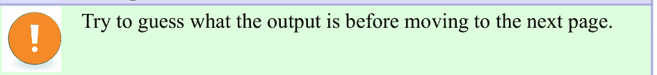
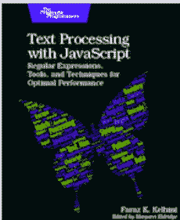
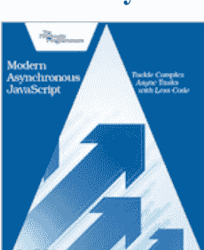

# JavaScript 头脑体操：锻炼你的思维


# *JavaScript 脑力谜题* 的早期赞誉

> 这些富有挑战性、多样化的谜题让你欲罢不能，而简洁的解释让你不断学到新东西。喜欢这本关于 JavaScript 的出人意料的 eclectic 书籍的每一页。

→ Lukas Mathis
*Designed for Use* 的作者

> 一本关于 JavaScript 特性和函数的有趣读物，这些内容可能并非每位语言使用者都熟悉。既有趣又有教育意义。

→ Marcus S. Zarra
iOS/OS X 开发者

> 我写 JavaScript 已经超过十年了，我从这本书中学到了东西。我喜欢这些谜题不是关于晦涩边缘情况的"陷阱"问题——这类主题很容易陷入这种陷阱——每个谜题都有一个特定的学习目标。

→ Randall Koutnik
*Build Reactive Websites with RxJS* 的作者

# 致谢

感谢您与我一起踏上这段编程冒险之旅。写书从来不是一个人的努力；它是许多人的支持、指导和鼓励的结晶。

我向 The Pragmatic Programmers 团队表示感谢，他们的专业知识将这一愿景变为现实。特别感谢 Margaret Eldridge，您细致的编辑和对细节的敏锐眼光，确保了内容的质量和清晰度。

非常感谢专家 Michael Fazio、Andy Lester 和 Daniel Posey，他们在本书付印前提供了宝贵的审阅。他们作为开发者的专业知识为代码质量提供了关键见解。

我还要向 Randall Koutnik、Lukas Mathis 和 Marcus S. Zarra 表示感谢。他们不仅花时间审阅我的书并指出我犯的错误，还提供了善意的鼓励和赞扬。

# 前言

JavaScript 历来以其古怪和独特性而闻名。这些不寻常的特性通常源于其作为语言的演变以及维护向后兼容性的需要等因素。例如，JavaScript 中一个著名的古怪特性是类型强制转换：JavaScript 试图对数据类型宽容，这可能导致不同类型混合时出现意外行为。

开发者了解 JavaScript 的这些方面对于编写更健壮和可预测的代码非常重要。幸运的是，定义 JavaScript 的 ECMAScript 标准正在不断发展，以解决许多这些问题，并为语言引入更可预测的行为和额外的功能。

在本书中，我们邀请您踏上一段旅程，通过精心策划的一系列引人入胜的 JavaScript 挑战，揭示定义该语言本质的复杂细微差别和奇特之处。无论您是寻求成长的高级初学者，还是希望磨练技能的资深开发者，这些页面中都有适合您的内容。

在每章开头，我会向您抛出一个很酷的 JavaScript 小程序，并挑战您猜测它的输出结果。别担心，我不会让您悬而未决。在做出最佳猜测后，请随意运行代码，看看魔法如何发生！然后，继续查看解释，提升您的 JavaScript 技能。


## 关于作者

Faraz K. Kelhini 是 *Modern Asynchronous JavaScript* 和 *Text Processing with JavaScript* 的作者。凭借对 JavaScript 语言及其复杂 API 的深刻理解，Faraz 的旅程源于对推广创新理念的热情——这些理念旨在改善编程体验，同时构建将创意与功能无缝融合解决方案。

## 关于你

在我们踏上这段激动人心的旅程之前，有必要说明：具备一定的 JavaScript 基础知识将大大有助于你理解此处讨论的概念。如果你是 JavaScript 新手，从未有机会探索它的奇妙之处，我建议你先花些时间学习基础知识——你会发现这是一段愉快的体验！

## 关于代码

提供的代码示例设计得简洁明了，旨在展示每个脑筋急转弯的核心本质。你可以随意在浏览器的控制台中执行这些示例，但请确保你的浏览器已更新到最新版本。

要获取书中 featured 的示例代码，请访问 Pragmatic Bookshelf 网站。[^1] 在那里，你可以提供反馈、报告错误、获取最新信息，并参与该书专门论坛页面上的讨论。

如果你以 PDF 格式阅读本书，可以通过选择代码段上方的小灰色框来查看或检索特定示例。

**脚注**

[^1]: https://www.pragprog.com/titles/fkjsbrain

# 第一部分
JavaScript 脑筋急转弯

### 谜题 1：你的代码值得提升

```
your_code_deserves_a_lift/your_code_deserves_a_lift.js

let temp = 25;

function displayTemperature() {
  console.log(`Current temperature: ${temp} °C`);
}

function forecastTemperature() {
  console.log(`Expected temperature: ${temp} °C`);
  var temp = 28;
}

displayTemperature();
forecastTemperature();
```

### 猜测输出结果

在翻到下一页之前，试着猜猜输出结果是什么。


你可能预期的输出是：

```
Current temperature: 25 °C
Expected temperature: 25 °C
```

但这段代码的实际输出将是：

```
Current temperature: 25 °C
Expected temperature: undefined °C
```

### 讨论

在 JavaScript 中，所有声明都受制于*提升*（hoisting）。这包括 **var**、**let**、**const**、**function**、**function\*** 和 **class** 声明。提升涉及将这些声明自动重新定位到作用域的开头。但是，它们的初始化被推迟到执行流到达提升发生的那一行时才进行。此过程在代码执行之前发生，它帮助 JavaScript 处理对变量和函数的引用。

考虑以下代码：

```
// 创建一个变量
var a = 10;
```

JavaScript 按以下方式处理这段代码：

```
var a;
// 创建一个变量
a = 10;
```

当你使用 **var** 关键字声明变量时，声明会被移动（或"提升"）到包含函数或全局作用域的顶部。然而，变量的赋值（初始化）保留在其原始位置。这意味着你可以在代码中声明之前引用 **var** 而不会导致错误。但是，在真正为其赋值之前，其值将是 **undefined**。

这种行为在使用函数时可能导致意外的结果。在函数内声明的任何变量都会被提升到顶部。因此，如果全局作用域中存在同名变量，它将在函数内被隐藏。例如：

```
var a = 10;

function fn() {
  console.log(a);  // → undefined
  var a = 20;

  console.log(a);  // → 20
}

fn();
```

所以，当看到这段函数的第一行时，你可能以为它会输出 **10** 和 **20**。但 JavaScript 实际上以不同方式处理这段代码：

```
var a = 10;

function fn() {
  var a;
  console.log(a);    // → undefined
  a = 20;
  console.log(a);    // → 20
}

fn();
```

为了确保一切顺利并避免任何意外，ES2015 提出了一个解决方案：使用 `let` 关键字声明变量。使用 `let` 时，变量仍然会被提升，但现在它们就像提醒一样。如果我们尝试使用尚未声明的变量，它们会给我们一个提示，防止任何意外的麻烦：

```
function fn() {
  console.log(a);    // → undefined
  console.log(b);    // → ReferenceError: b is not defined

  var a = 20;
  let b = 20;

  console.log(a);
}

fn();
```

所以使用 `var` 时，当你尝试在声明之前获取变量，会得到 `undefined` 作为回应。另一方面，如果你用 `let` 做同样的事情，你会收到错误消息。与 `let` 类似，如果你尝试在声明之前使用 `const` 或 `class`，也会收到抛出的 `ReferenceError`。

*暂时性死区*（TDZ）是 JavaScript 社区创造的一个术语，用来说明为什么无法在 `let` 和 `const` 声明之前访问它们。`let` 和 `const` 的提升方式与 `var` 和 `function` 声明类似，但在进入作用域和声明完成之间存在一个时间段，在此期间无法访问它们。这个时期就是暂时性死区。

任何在变量处于 TDZ 时尝试访问它们的行为都会导致 `ReferenceError`。一旦执行到达声明行，TDZ 中的变量便被移除，允许被访问。TDZ 的存在是为了帮助我们找出代码中的 bug。在声明之前尝试访问变量很少是有意的。

> **变量的生命周期**
>
> 函数内变量的生命周期贯穿函数执行的整个持续时间。一旦函数执行结束，其内部所有局部变量都会被自动清除。相比之下，全局变量会一直保留在内存中，直到程序/网页关闭。

重要的是要记住，TDZ 仅适用于声明变量的代码块。尝试在作用域之外访问变量不会抛出错误，因为该变量不在 TDZ 中：

```
console.log(a);    // → undefined

{
  console.log(a);    // → ReferenceError
  let a = 10;
}

var a = 20;
```

#### 函数提升

与变量类似，函数声明会被提升到其包含作用域的顶部。但它们会被完全提升，包括函数名称和函数体。这意味着你可以在代码中实际声明之前调用使用 `function` 声明的函数：

```
fn1();    // → Hello!

function fn1() {
  console.log("Hello!");
}
```

另一方面，函数表达式不会以相同方式提升。只有变量声明被提升，函数赋值发生在变量声明的位置：

```
fn2();    // → TypeError: fn2 is not a function

var fn2 = function() {
  console.log("Hello!");
};
```

在这种情况下，变量 `fn2` 最初被赋值为 `undefined`，所以在赋值完成之前你无法将其作为函数调用。

所以请记住，最好在变量所属作用域的顶部声明变量。这样，你就能避免日后的任何困惑。此外，尽量养成使用 `let` 和 `const` 而不是 `var` 的习惯，因为它们有助于防止诸如变量提升和意外变量重新声明等潜在问题。

#### 延伸阅读

*JavaScript 提升*

> https://developer.mozilla.org/en-US/docs/Glossary/Hoisting

*var 语句*

> https://developer.mozilla.org/en-US/docs/Web/JavaScript/Reference/Statements/var

*let 声明*

> https://developer.mozilla.org/en-US/docs/Web/JavaScript/Reference/Statements/let

*const 声明*

> https://developer.mozilla.org/en-US/docs/Web/JavaScript/Reference/Statements/const

## 篡夺者

```
the_usurper/the_usurper.js
```

```
// 计算长方形的面积
function calculateArea(length, width) {
  return length * width;
}

// 计算正方形的面积
function calculateArea(length) {
  return length * length;
}

console.log(calculateArea(4, 6));
```

### 猜测输出结果


在翻到下一页之前，试着猜猜输出结果是什么。

你可能预期第一个接受两个参数的函数会被执行，但第二个函数被执行了，产生以下输出：

```
16
```

### 讨论

JavaScript 不支持你在其他语言中可能已经习惯的*函数重载*。函数重载意味着拥有多个同名但参数列表不同的函数，根据提供的参数来调用正确的函数。


## 谜题 3：数学魔术师

the_mathemagician/the_mathemagician.js

```js
const largeNumber = Math.pow(10, 16);
const smallNumber = 1;

console.log(largeNumber + smallNumber);
```

> **猜测输出**
> 在翻到下一页之前，试着猜一猜输出是什么。

你可能预期输出是 10000000000000001，但这段代码实际会输出：

```
10000000000000000
```

### 讨论

在 JavaScript 中，`Math.pow()` 函数可用于将一个数提升到指定的幂。在这个例子中，代码 `Math.pow(10, 16)` 计算 10 的 16 次方，结果是 10000000000000000。但为什么 10000000000000000 加 1 会等于 10000000000000000 呢？

JavaScript 在精确表示非常大的数字时确实存在一些局限性。这种局限性源于数字的存储方式以及 JavaScript 中使用的数据类型的精度。Number 类型有一个特定的工作范围，它可以完美地处理 -9007199254740991 到 9007199254740991 之间的整数，不会丢失任何精度。

但如果你恰好使用了超出这个范围的整数，就有可能无法被精确表示。这个问题被称为在 JavaScript 中处理大数时的*精度丢失*。这里还有另一个你可以尝试的例子：

```js
console.log(9999999999999999);    // → 10000000000000000
```

JavaScript 为你提供了几个方便的常量，让你轻松获取最大和最小安全整数。只需使用 `Number.MAX_SAFE_INTEGER` 常量来获取最大的安全整数，使用 `Number.MIN_SAFE_INTEGER` 常量来获取最小的安全整数：

```js
console.log(Number.MIN_SAFE_INTEGER);    // → -9007199254740991
console.log(Number.MAX_SAFE_INTEGER);    // → 9007199254740991
```

以前，为了精确处理非常大的数字，JavaScript 开发者不得不使用 BigInt.js[^2] 或 BigNumber.js[^3] 等外部库。幸运的是，ECMAScript 2020（JavaScript 的标准化规范）带来了一个绝佳的解决方案，那就是 BigInt。创建 BigInt 很简单：只需在整数末尾加上字母 **n**，像这样：

```js
console.log(9999999999999999n);    // → 9999999999999999n
```

或者，你也可以使用 `BigInt()` 构造函数：

```js
BigInt("9999999999999999");    // → 9999999999999999n
```

所以，要修复这个谜题中的代码，我们可以这样写：

```js
const largeNumber = BigInt("1000000000000000");
const smallNumber = BigInt("1");

console.log(largeNumber + smallNumber);
// → 1000000000000001n
```

你可能好奇为什么我们也要将 `smallNumber` 转换为 BigInt。为了维护数据的完整性并避免潜在的信息丢失，BigInt 和 Number 之间的混合运算是不被允许的。这一限制的原因是，结果值可能无法被 BigInt 或 Number 数据类型准确表示。

让我们看看下面的例子来更好地理解这一点：

```js
10000000000000000n + 0.5;
// → TypeError: Cannot mix BigInt and other types, use explicit conversions
```

将带有小数部分的 Number 转换为 BigInt 可能无法得到准确的表示，同样，将大于 2^53 的 BigInt 转换为 Number 也可能导致精度丢失。

当执行涉及 BigInt 和 Number 值的算术运算时，你必须选择运算应该在哪个域中进行。使用 **Number()** 或 **BigInt()** 函数转换任一操作数：

```js
// 将 Number 转换为 BigInt
BigInt(5) + 5n;   // → 10n

// 或者将 BigInt 转换为 Number
5 + Number(5n);   // → 10
```

Number 和 BigInt 之间存在一些细微的差异。你可以在 BigInt 上使用所有算术运算符，但一元加号（+）运算符除外：

```js
console.log(1n + 2n);   // → 3n
console.log(1n - 2n);   // → -1n
console.log(1n * 2n);   // → 2n
console.log(2n / 1n);   // → 2n
console.log(14n % 10n); // → 4n
console.log(5n ** 3n);  // → 125n

let x = 1n;
console.log(++x); // → 2n
console.log(--x); // → 1n
console.log(-x);  // → -1n
console.log(+x);  // → TypeError: Cannot convert a BigInt value to a Number
```

一元加号（+）运算符不被支持是有原因的。某些程序可能依赖于 + 运算符总是返回 Number 或抛出异常这一事实。通过不支持它，JavaScript 确保你的代码保持可靠和一致。

当你对 BigInt 操作数使用算术运算符时，你会期望它们返回 BigInt 值。因此，对于除法（/）运算符，结果会自动截断，以符合这一预期：

```js
console.log(12 / 5);      // → 2.4
console.log(12n / 5n);    // → 2n
```

在比较 BigInt 和普通数字时，记住它们不是同一种类型。这意味着你不能直接使用严格相等运算符（===）来比较它们：

```js
console.log(1n === 1);     // → false
console.log(typeof 1n);    // → bigint
console.log(typeof 1);     // → number
```

不过，你可以选择使用相等运算符（==），它会自动转换操作数的类型（称为*类型强制*）后再进行比较：

```js
console.log(10n == 10);    // → true
```

值得一提的是，你还应该避免将 BigInt 作为参数传递给那些明确要求 Number 的内置 JavaScript 函数和 API。这样做会触发 TypeError，就像这个例子：

```js
Math.min(5n, 10n, 15n);   // → TypeError
```

所以，你应该在处理位于 -9007199254740991 到 9007199254740991 范围内的常规数值时使用 Number 数据类型，这适用于大多数日常计算。

#### 延伸阅读

- *函数重载*
  [https://en.wikipedia.org/wiki/Function_overloading](https://en.wikipedia.org/wiki/Function_overloading)

- *默认参数*
  [https://developer.mozilla.org/en-US/docs/Web/JavaScript/Reference/Functions/Default_parameters](https://developer.mozilla.org/en-US/docs/Web/JavaScript/Reference/Functions/Default_parameters)

- *剩余参数*
  [https://developer.mozilla.org/en-US/docs/Web/JavaScript/Reference/Functions/rest_parameters](https://developer.mozilla.org/en-US/docs/Web/JavaScript/Reference/Functions/rest_parameters)


另一方面，当你需要处理超出 Number 类型安全范围的超大整数值时，应当选择 BigInt 数据类型，因为 BigInt 支持任意精度运算，能够精确表示和操作任意大小的整数，尽管这可能会带来一定的性能开销。

## Further Reading

*The BigInt value*
[https://developer.mozilla.org/en-US/docs/Web/JavaScript/Reference/Global_Objects/BigInt](https://developer.mozilla.org/en-US/docs/Web/JavaScript/Reference/Global_Objects/BigInt)

## Puzzle 4 Mortal Koncatenation

```js
// mortal_koncatenation/mortal_koncatenation.js

const femaleMKCharacters = [
  "Sonya Blade",
  "Sindel",
  "Cassie Cage",
  "Sheeva"
];

const maleMKCharacters = [
  "Scorpion",
  "Sub-Zero",
  "Raiden",
  "Johnny Cage"
];

const MKCharacters = femaleMKCharacters + maleMKCharacters;

console.log(MKCharacters);
```

## Guess the Output

Try to guess what the output is before moving to the next page.

You might have anticipated that the output would be a merged array, but this code will actually output:

```
Sonya Blade,Sindel,Cassie Cage,SheevaScorpion,Sub-Zero,Raiden,Johnny Cage
```

## Discussion

This JavaScript code defines two arrays: `femaleMKCharacters` and `maleMKCharacters`. The `amage.occurred

该JavaScript代码定义了两个数组：`femaleMKCharacters` 和 `maleMKCharacters`。`femaleMKCharacters` 数组包含《真人快打》电子游戏系列中女性角色的名字，而 `maleMKCharacters` 数组则包含该游戏中男性角色的名字。

随后，这道谜题试图使用 + 运算符将两个数组合并成一个大的数组。但问题在于：在 JavaScript 中使用 + 运算符处理数组时，它并不会像你所期望的那样合并数组，而是将数组当作字符串进行字符串拼接。因此，最终的结果是 `MKCharacters` 变成了一个单一的字符串，将两个数组像字符串一样硬凑在一起。

幸运的是，有多种方法可以合并两个数组。以下是几种常见的做法：

1. `concat()`：快速合并两个数组的方法是使用 `concat()`。该方法会创建一个包含两个数组元素的新数组：

```js
// mortal_koncatenation/mortal_koncatenation_ex1.js

const array1 = [1, 2, 3];
const array2 = [4, 5, 6];
const combinedArray = array1.concat(array2);

console.log(combinedArray);  // → [1, 2, 3, 4, 5, 6]
```

当你有可变数量的数组需要拼接，或需要根据特定条件动态拼接数组时，也可以使用 `concat()`。

2. **Spread 运算符**：Spread 运算符（`...`）是 ECMAScript 2015 (ES6) 中引入的新特性，它提供了一种简洁的方式来合并数组。它会将每个数组中的元素展开，并创建一个包含所有元素的新数组：

```js
// mortal_koncatenation/mortal_koncatenation_ex2.js

const array1 = [1, 2, 3];
const array2 = [4, 5, 6];
const combinedArray = [...array1, ...array2];

console.log(combinedArray);    // → [1, 2, 3, 4, 5, 6]
```

与 `concat()` 相比，spread 运算符的可读性更强，尤其是当你只需要合并少量数组时。

3. **push() 或 unshift()**：你也可以使用数组操作的方法如 `push()` 或 `unshift()` 来合并数组：

```js
// mortal_koncatenation/mortal_koncatenation_ex3-1.js

const array1 = [1, 2, 3];
const array2 = [4, 5, 6];

// 使用 push() 合并数组
array1.push(...array2);
console.log(array1);    // → [1, 2, 3, 4, 5, 6]
```

```js
// mortal_koncatenation/mortal_koncatenation_ex3-2.js

const array1 = [1, 2, 3];
const array2 = [4, 5, 6];

// 使用 unshift() 合并数组
array1.unshift(...array2);
console.log(array1);    // → [4, 5, 6, 1, 2, 3]
```

`push()` 方法将第二个数组的元素追加到第一个数组的末尾，而 `unshift()` 则将它们添加到开头。

4. **splice()**：如果你想将一个数组的元素插入到另一个数组的特定索引位置，可以使用 `splice()` 方法：

```js
// mortal_koncatenation/mortal_koncatenation_ex4.js

const array1 = [1, 2, 3];
const array2 = [4, 5, 6];

// 假设你想在索引 2 处将 array2 添加到 array1 中
const insertIndex = 2;

// 使用 splice() 将 array2 的元素插入到 array1 中
array1.splice(insertIndex, 0, ...array2);

console.log(array1); // → [1, 2, 4, 5, 6, 3]
```

这些是一些在JavaScript中合并两个数组的常见方法。需要注意的是，`concat()` 和 spread 运算符不会改变现有数组，而是返回一个新数组。相反，`push()`、`unshift()` 和 `splice()` 会修改它们所应用的数组内容。请根据你的具体需求和编码风格选择最合适的方法。

## Further Reading

可用数组方法的完整列表：[https://developer.mozilla.org/en-US/docs/Web/JavaScript/Reference/Global_Objects/Array#instance_methods](https://developer.mozilla.org/en-US/docs/Web/JavaScript/Reference/Global_Objects/Array#instance_methods)

## Puzzle 5 非常规标识符

```js
// offbeat_identifierz/offbeat_identifierz.js

let シ = "\u2663";

console.log(シ);
```

> ## 猜猜输出

在翻到下一页之前，先猜猜输出是什么。

这段代码会输出：

♣

### 讨论

你可能会惊讶于 シ（这是一个名为"shi"的日文字符）竟然是 JavaScript 中有效的标识符，而且 "\u2663" 可以转换为一个单一的字符。但在 JavaScript 中，你可以使用广泛的 Unicode 字符作为标识符。令人惊讶的是，并没有多少开发者知道这个酷炫的特性。

这还不是全部！你还可以利用 Unicode 转义序列来规避在代码中具有特殊含义的特殊字符，或者显示那些难以输入的字符，包括外国语言字符、数学符号，甚至表情符号。

自 ECMAScript 2015 起，你可以在 JavaScript 中使用大多数 Unicode 字符作为标识符。根据 ECMAScript 规范，JavaScript 允许在变量、函数、类以及其他语言结构的标识符中使用 Unicode 字符。

下面是一个使用波斯语作为标识符的函数：

```js
// offbeat_identifierz/offbeat_identifierz_ex1.js

function سلام() {
  return "Hello";
}

سلام();     // → "Hello"
```

> **避免从 PDF 复制粘贴**
>
> 如果你想尝试这段代码，不要直接从 PDF 中复制粘贴，因为它可能无法正确获取所有那些花哨的 Unicode 字符。相反，点击代码段上方的灰色小方块来获取 JavaScript 文件。

然而，对于可以使用的字符存在一些限制：

- 标识符的第一个字符必须是 Unicode 字母（类别 L）、下划线（_）、美元符号（$）或 Unicode 转义序列。
- 后续字符可以是字母、数字、下划线、美元符号或 Unicode 转义序列（我们稍后会讨论 Unicode 转义序列）。
- 保留字和关键字不能用作标识符（保留字列表请访问 MDN）⁴。

使用 Unicode 字符作为标识符可能非常方便，但重要的是要考虑这可能会如何增加你同事们的困扰。clam. 因此，为了大家的便利，我建议坚持使用经过验证的 ASCII。

现在，让我们回到我们的谜题，我们将 \u2663 赋值给一个常量。计算机上显示的视觉图像代表由一串 0 和 1 组成的二进制信息。字符编码的作用就是解读这些二进制位，并将它们转换成我们实际理解的字符。

要做到这一点，每个字符都与一个特殊的数字相关联，这个数字被称为码点。例如，黑桃花色字符（♣）对应的码点是 U+2663。当一个字符与特定的码点相关联时，它就成为一个已编码字符。

在 JavaScript 中，你可以通过在码点前添加 \u 来直接使用字符的码点，如下例所示：

```js
console.log("\u2663");    // → ♣
```

当你写出这样的字符串时，你生成的是所谓的 *Unicode 转义序列*。Unicode 转义序列在你想要使用具有特殊含义的转义字符，或显示难以输入的字符（如外国语言字符、数学符号，甚至表情符号）时特别有用。

## Further Reading

*ES2015 中有效的 JavaScript 变量名*
https://mathiasbynens.be/notes/javascript-identifiers-es6

*关于 Unicode 字符 ェ (U+30B7) 的信息*
https://compart.com/en/unicode/U+30B7

*标识符定义*
https://developer.mozilla.org/en-US/docs/Glossary/Identifier

*Unicode 字符属性*
https://unicode.org/versions/Unicode15.0.0/ch04.pdf


# 谜题 6 函数的妙用

```javascript
the_fun-ction/the_fun-ction.js

!function() {
  const name = "john";
  const age = 20;
}();

const capitalizedName = name[0].toUpperCase() + name.slice(1);

console.log(capitalizedName);
```

## 猜猜输出

在继续下一页之前，试着猜猜输出是什么。

你可能期望输出是首字母大写的 "John"，但这段代码实际上会输出：

```
TypeError: Cannot read properties of undefined
```

### 讨论

这段代码的问题在于 **name** 具有我们所谓的*函数作用域*，这意味着它只能在该函数内部被访问。因此，如果你试图在函数外部使用 **name** 的值，你会遇到引用错误，因为 **name** 在外部作用域中是未定义的。

本谜题中的函数被称为*立即调用函数表达式*（IIFE）。这是一种方便的设计模式，允许你在定义函数后立即执行它。最棒的是，它帮助你为变量创建一个独立的作用域，这样就不会污染全局命名空间。

当谈到定义 IIFE 时，实际上有不止一种方法。让我们深入探索可以用于 IIFE 的各种语法形式：

1. 传统括号包围：

```javascript
(function() {
  // 函数体
})();
```

这种形式将 IIFE 包裹在括号中。魔法发生在我们定义了括号内的函数，然后通过在末尾添加另一组括号立即调用它。你也可以用箭头函数来写这种形式，像这样：

```javascript
(() => {
  // 函数体
})();
```

这种语法被广泛使用，被认为是编写 IIFE 的标准方式。

2. 一元运算符包围：

```javascript
!function() {
  // 函数体
}();
```

在这种形式中，IIFE 前面是逻辑非 (!) 运算符。我们在运算符之后定义函数，然后立即用 () 调用它。有趣的是：实际上你也可以使用其他一元运算符，如 +、- 或 ~，如果你愿意的话。使用运算符的原因是为了确保函数被视为表达式。这是一种简写方式，意思是“立即执行此函数”。

3. 分组运算符包围：

```javascript
(function() {
  // 函数体
}());
```

这种形式与传统括号包围类似，但外层括号是包裹整个 IIFE 表达式的。我们在括号内定义函数，内部的括号对 () 立即调用它。

4. 函数声明包围：

```javascript
(function namedIIFE() {
  // 函数体
})();
```

在这种形式中，IIFE 是一个命名的函数表达式，包裹在括号内。你可能会问，为什么要给它命名？嗯，这完全是为了在检查堆栈跟踪或在函数内部使用一些高级递归时让生活更轻松。我们在括号内定义函数，然后立即用 () 调用它。

所以，我们有这些不同形式的 IIFE，它们在编写自执行函数时为我们提供了一些灵活性。完全取决于你——你个人的偏好和编码风格——来选择哪种语法最适合你。然而，如果你在团队中协作，你可能更喜欢使用传统括号包围，因为更多的开发者熟悉它的语法。

#### 延伸阅读

IIFE 定义
<https://developer.mozilla.org/en-US/docs/Glossary/IIFE>

作用域定义
<https://developer.mozilla.org/en-US/docs/Glossary/Scope>

# 谜题 7 海盗旗有多长？

```javascript
pirate_flag/pirate_flag.js

// 旗帜日快乐！

const flag = "🏴‍☠️";
console.log(flag.length);
```

> **猜猜输出**

⚠️ 在继续下一页之前，试着猜猜输出是什么。

你可能预期输出是 1，但这段代码实际上会输出：

```
4
```

### 讨论

表情符号的长度可能并非你所期望的那样。在 JavaScript 中，一些字符和表情符号由多个代码单元组成，这在使用 `length` 属性时可能导致意外的结果。海盗旗表情符号被称为 Emoji ZWJ 序列，它由两个独立的表情符号组成：

🏴‍☠️ = 🏴 + ☠️

当零宽连接符 (ZWJ) 放置在这些表情符号之间时，在支持它们的平台上，它们会显示为一个连接的序列。ZWJ 本身是一个非打印字符，它实现了这种连接显示。海盗旗表情符号的长度为 4，因为 `length` 属性计算了每个独立表情符号的代码单元以及连接它们所需的 ZWJ。

在 JavaScript 领域中，代码点序列 `\uD83C\uDFF4` 代表黑色旗帜表情符号，而单独的骷髅表情符号由代码点 `\u2620` 表示。当它们组合在一起时，包括中间的 ZWJ，它们的总长度为四个字符。

## 变体选择器扩展表情符号/字符长度

💡 Unicode 变体选择器用于表示字符或表情符号的特定变体或替代表示，通常用于肤色修改或显示样式变体等目的。

在许多情况下，字符可以在没有变体选择器的情况下表示，并使用默认表示。海盗旗表情符号可能包含变体选择器，这将使表情符号的长度从 4 个字符增加到 5 个字符。有关变体选择器的更多信息，请参阅“延伸阅读”部分。

为了处理这个问题，我们有国际化 API。它提供了一个方便的方法 `Segmenter()`，可以帮助你正确地分割字符串，考虑到各种语言和书写系统的预期分割规则：

```javascript
// 计算表情符号长度的正确方式

function getLength(str) {
  return [...new Intl.Segmenter().segment(str)].length;
}

getLength("🏴‍☠️");  // → 1
```

`Intl.Segmenter()` 构造函数是一个方便的工具，允许你根据特定的区域设置和粒度来分解字符串。在这种情况下，我们保持简单，使用默认设置，所以你只需调用该方法而无需任何参数。请记住，因为 `Intl.Segmenter()` 是一个构造函数，你需要用 `new` 关键字来使用它。

当你调用 `Intl.Segmenter()` 时，它会返回一个具有 `segment()` 方法的对象。这个方法接受一个字符串作为输入，并且正如它的名字所示——它将字符串分成对人类有意义的那些部分。因为结果是一个迭代器，你可以通过使用扩展语法（也就是那三个连续的点 `...`）来让生活更轻松。这种语法允许你快速将迭代器转换为数组并获取其长度。

如果代码看起来有点困惑，我们为你准备了一个替代版本：

```javascript
pirate_flag/pirate_flag_ex2.js

function getLength(str) {
  // 创建一个 segmenter 实例
  const Segmenter = new Intl.Segmenter();

  // 分割字符串
  const segment = Segmenter.segment(str);

  // 转换为数组
  const arr = Array.from(segment);

  // 返回字符数量
  return arr.length;
}
```

这个版本的代码执行的操作与第一个版本相同。

国际化 API 在计算 ZWJ 表情符号方面非常聪明。它将它们视为单个字符，这让我们的事情变得容易得多。每当你需要获取可能包含表情符号或 Unicode 字符的字符串的长度时，请考虑使用 `Intl.Segmenter()` 方法。

#### 延伸阅读

海盗旗表情符号
<http://www.unicode.org/L2/L2018/18059-pirate-flag.pdf>

通用变体序列常见问题解答
<http://unicode.org/faq/vs.xhtml>

Intl.Segmenter 对象
<https://developer.mozilla.org/en-US/docs/Web/JavaScript/Reference/Global_Objects/Intl/Segmenter>

国际化 API
<https://developer.mozilla.org/en-US/docs/Web/JavaScript/Reference/Global_Objects/Intl>

零宽连接符
<https://en.wikipedia.org/wiki/Zero-width_joiner>

# 谜题 8 这是什么？

```javascript
whats_this/whats_this.js

let key = 2049;

(function() {
    "use strict";
    console.log(this.key);
})();
```

## 猜猜输出



这段代码将输出：

```
TypeError: Cannot read properties of undefined
```

### 讨论

JavaScript 中的 `this` 关键字可能有点棘手，因为它的值取决于代码运行的位置以及使用方式。如果你在任何特定函数或对象之外运行代码，`this` 指的是全局对象。在 Web 浏览器中，全局对象通常是 `window`，在 Node.js 中，它是 `global`。因此，如果你在 Web 浏览器的控制台中运行 `console.log(this)`，你会看到 `window` 的值被打印出来。

但有趣的部分在于：`this` 的值可以根据上下文而改变。如果你在一个不属于对象的函数内部，那么 `this` 可能会不同。在严格模式下，它将是 `undefined`，在非严格模式下，它将再次是全局对象。


## 什么是 `this`

在 JavaScript 中，`this` 关键字的行为取决于函数的调用方式，而不是函数的定义位置。以下是几个关键场景：

### 在立即执行函数表达式（IIFE）中

```javascript
// whats_this/whats_this_ex1.js
(function() {
  "use strict";
  console.log(this);    // → undefined
})();

(function() {
  console.log(this);    // → Window {...}
})();
```

在这个谜题中，我们试图在立即执行函数表达式（IIFE）中读取 `undefined` 的 `key` 属性。请记住，IIFE 是在创建后立即执行的函数。由于 `undefined` 没有属性，因此代码会产生错误。

注意函数顶部的 `"use strict"` 表达式。这行代码告诉 JavaScript 引擎在该函数中启用严格模式。严格模式是一种选择更严格规则集和行为的方式，由 JavaScript 引擎强制执行，这有助于捕获常见的编码错误和"不安全"操作，最终导致更健壮和可维护的代码。

如果没有 `"use strict"`，函数会记录 `undefined` 而不是抛出错误：

```javascript
// whats_this/whats_this_ex2.js
let key = 2049;

(function() {
  console.log(this.key);  // → undefined
})();
```

### 在对象的方法中

现在，如果我们在对象的方法中使用 `this`，它将指向该对象本身。因此，如果你像 `object.method()` 这样调用对象的方法，那么 `this` 将是该方法的 `object`：

```javascript
// whats_this/whats_this_ex3.js
const user = {
  firstName: "Mikasa",
  lastName: "Ackerman",
  getFullname() {
    return `${this.firstName} ${this.lastName}`;
  }
};

console.log(user.getFullname());  // → Mikasa Ackerman
```

### 使用 `new` 关键字时

如果你使用 **new** 关键字通过构造函数创建对象，**this** 将指向新创建的对象：

```javascript
// whats_this/whats_this_ex4.js
function Book(name, year) {
  this.name = name;
  this.year = year;
  this.getBookInfo = () => {
    return `${this.name} (${this.year})`;
  }
}

const book1 = new Book("Death by Black Hole", 2006);
book1.getBookInfo();  // → Death by Black Hole (2006)
```

### 使用 `call()`, `apply()` 或 `bind()` 显式设置时

最后，如果你使用 **call()**、**apply()** 或 **bind()** 等方法显式设置 **this** 的值，它将指向你作为第一个参数传递的对象：

```javascript
// whats_this/whats_this_ex5.js
function describeMeal() {
  return `A ${this.dish} usually has about ${this.calories} calories.`;
}

const meal = {
  dress: "salad",
  calories: "300",
};

console.log(describeMeal.call(meal));
// → A salad usually has about 300 calories.
```

### 关于全局对象

因此，运行 `console.log(this)` 将根据代码运行的位置和使用方式给出不同的输出。请记住，如果你使用 `this` 来访问全局对象，可能会降低代码的可移植性。每个 JavaScript 环境都有自己的对象模型和访问全局对象的不同方式。在 Web 浏览器中，你可以使用 `window`、`self`、`this` 或 `frames` 来访问全局对象。这非常灵活！

例如，`window.alert('Hello')` 访问全局对象（window）并调用 `alert` 方法。此外，你也可以不使用 `window` 前缀直接访问全局对象。例如，`alert('Hello')` 也可以工作。

然而，在 Node.js 中，像 `window` 和 `self` 这样的属性不存在，你必须使用 `global`。在 Web Workers 中，只有 `self` 可用。这些引用全局对象的不同方式使得编写可在多种环境中工作的可移植 JavaScript 代码变得困难。

幸运的是，ECMAScript 在 ES2020 中通过引入一个标准属性 `globalThis` 解决了这个问题，该属性在所有环境中都可用：

```javascript
// whats_this/whats_this_ex6.js

// Browser environment
console.log(globalThis);  // → Window {...}

// Node.js environment
console.log(globalThis);  // → <ref *1> Object [global] {...}

// Web worker environment
console.log(globalThis);  // → DedicatedWorkerGlobalScope {...}
```

使用 `globalThis`，你的代码无需额外检查即可在窗口和非窗口上下文中轻松工作。

当你不确定代码将使用的环境，或者希望确保其在不同环境中的兼容性时，`globalThis` 属性变得非常有用。请记住，较旧的浏览器可能需要一个 polyfill。polyfill 是一段代码，它为缺乏原生支持的旧版 Web 浏览器提供现代 JavaScript 功能。

另一方面，如果你确信代码将在特定环境中使用，你可以依赖该环境的现有方法来引用全局对象。这样，你可以避免包含 polyfill 的麻烦。

## 进一步阅读

*什么是 globalThis，为什么应该开始使用它？*
https://blog.logrocket.com/what-is-globalthis-why-use-it/

*globalThis 全局属性*
https://developer.mozilla.org/en-US/docs/Web/JavaScript/Reference/Global_Objects/globalThis

## 谜题 9：平坦的地球协会

```javascript
// the_flat_earth_society/the_flat_earth_society.js
const nestedArray = ["apple", ["blueberry", "blackberry"],
                     ["tangerine", "orange"], "grape"];
const newArr = [].concat.apply([], nestedArray);

console.log(newArr);
```

## 猜输出

> 在查看下一页之前，试着猜猜输出是什么。

这个代码将输出：

```
['apple', 'blueberry', 'blackberry', 'tangerine', 'orange', 'grape']
```

### 讨论

这段 JavaScript 代码是关于展平一个数组的数组。首先，我们有一个名为 `nestedArray` 的数组。它包含四个元素：两个字符串和两个子数组。第二行代码实现了展平数组的魔法。它的工作原理如下：

1. `[]` 创建一个空数组。这将是 `concat()` 方法的初始值。
2. `concat()` 是一个内置的 JavaScript 数组方法，用于将两个或多个数组合并在一起。它接受一个或多个数组作为参数，并返回一个包含所有输入数组元素组合的新数组。

3. **apply()** 是一个方法，允许你使用给定的 **this** 值和一个数组（或类数组对象）作为参数来调用一个函数。在这里，我们使用它将 **concat** 方法应用于空数组 **[]**，同时将 **nestedArray** 的元素作为参数传递。

所以，当你运行 **[].concat.apply([], nestedArray)** 时，它本质上是将 **nestedArray** 中的所有元素连接成一个单一的扁平数组。这是 JavaScript 中展平嵌套数组的常用技术。

但这似乎不是最优雅的解决方案，对吗？

幸运的是，自 ES2019 起，有一个方便的方法叫 **flat()**，它允许你通过将所有子数组折叠成一个一维数组来快速展平嵌套数组。

以下是如何使用 **flat()** 方法：

```javascript
// the_flat_earth_society/the_flat_earth_society_ex1.js
const nestedArray = ["apple", ["blueberry", "blackberry"],
                     ["tangerine", "orange"], "grape"];
const flattenedArray = nestedArray.flat();

console.log(flattenedArray);
// → ["apple", "blueberry", "blackberry", "tangerine", "orange", "grape"]
```

**flat()** 神奇地遍历所有嵌套级别，创建一个一维数组。但等等，还有更多！你还可以提供一个名为 **depth** 的可选参数来控制它将展平多少层嵌套。

默认情况下，**depth** 设置为 **1**，意味着它只展平一层，但你可以指定不同的深度以进行更深层的操作。如果你将深度设置为 **Infinity**，它将展平所有层级，无论它们有多深：

```javascript
// the_flat_earth_society/the_flat_earth_society_ex2.js
const deeplyNestedArray = ["a", ["b", ["c", ["d", ["e"]]]]];
const flattenedArray = deeplyNestedArray.flat(Infinity);

console.log(flattenedArray);
// → ["a", "b", "c", "d", "e"]
```

请记住，当你使用 `flat()` 时，它会创建一个全新的数组，而原始数组保持不变。如果你不再需要原始数组，可以直接将展平后的数组赋值给同一个变量。

## 进一步阅读

*Google 的 v8 博客*
<https://v8.dev/features/array-flat-flatmap>

*flat() 方法*
<https://developer.mozilla.org/en-US/docs/Web/JavaScript/Reference/Global_Objects/Array/flat>

*apply() 方法*
<https://developer.mozilla.org/en-US/docs/Web/JavaScript/Reference/Global_Objects/Function/apply>


## 谜题 10 用1和0施展魔法

```javascript
// casting_spells/casting_spells.js

const x = ~~(7.9);

console.log(x);
```

> **猜测输出**

⚠️ 在进入下一页之前，请试着猜测输出结果是什么。

这段代码将输出：

7

### 讨论

JavaScript 中的波浪号（~）符号被称为**按位非**运算符。它会获取一个数字的二进制表示形式，然后翻转所有的位，从而产生一个新数字。问题是，JavaScript 中的按位运算符是针对整数工作的，而不是浮点数。

因此，当你写表达式 ~~(7.9) 时，JavaScript 会自动将浮点数 7.9 转换为整数。在本例中，它会截断小数部分，将其转换为整数 7。现在，让我们看看当我们应用单个按位非运算符时会发生什么：~(7.9)。在二进制中，7 表示为 00000111。非运算符会翻转每一位，所以我们得到 11111000，结果是 248。

但是等等，在本谜题中，我们有两个按位非运算符。所以，JavaScript 的下一步是将 248 转换为其二进制表示形式并翻转位。它会翻转二进制表示形式的每一位。因此，`11111000` 又变回了 `00000111`。

最后，JavaScript 将这个翻转后的二进制数解释为一个整数，我们得到的结果是：`7`。所以，这就是为什么代码 `~~(7.9)` 在 JavaScript 中的结果是 `7`。这是一个巧妙的技巧，可以截掉数字的小数部分。使用这种技巧，你可以在将数字转换为整数时节省一些代码字节。但请记住，这被认为是一种取巧的方式，因为如果你处理超出 32 位有符号整数范围的数字，它会表现得出人意料。

例如：

```javascript
console.log(~~-2147500000.5); // → -2147467296
```

所以，如果你的数字处于适中的范围内，不是太大或太小，双波浪号技巧会很有效。但是，如果你处理的数字超出了 -2147483648 到 2147483647 的范围，最好还是使用可靠的内置函数，如 `Math.floor()`、`Math.ceil()` 或 `Math.round()`。

> **记得为你的代码添加注释**

💡 如果你发现自己使用了一种有点不寻常的编码技巧，最好添加一些有用的代码注释。为未来着想，为未来的自己或可能与你代码共事的其他开发者提供方便总是好的。

#### 延伸阅读

按位非 (~) 运算符
[https://developer.mozilla.org/en-US/docs/Web/JavaScript/Reference/Operators/Bitwise_NOT](https://developer.mozilla.org/en-US/docs/Web/JavaScript/Reference/Operators/Bitwise_NOT)

二进制到十进制转换器
[https://www.rapidtables.com/convert/number/binary-to-decimal.xhtml](https://www.rapidtables.com/convert/number/binary-to-decimal.xhtml)

## 谜题 11 用数学约会

```javascript
// dating_with_math/dating_with_math.js

const date = new Date;
const x = date % 100;

console.log(x);
```

> **猜测输出**

在进入下一页之前，请试着猜测输出结果是什么。

这段代码将输出一个介于 0 和 99 之间的数字。

### 讨论

在 JavaScript 中，`Date` 对象代表一个特定的时间点。当你使用 `new` 关键字创建一个新的 `Date` 对象实例时，它会用当前的日期和时间进行初始化。

那么，这段代码的作用是获取当前的日期和时间，然后除以 `100`。这种方法有效是因为当你对一个新的 `Date` 对象执行整数运算时，它会被转换为一个像 `1687530684418` 这样的数字——这是自 1970 年 1 月 1 日 UTC 00:00:00（Unix 纪元）以来经过的毫秒数。这个时间戳在编程语言中通常用于表示和处理日期和时间。

但我们对实际的除法结果不感兴趣。我们只想知道余数，就像你做除法时得到的剩余部分。这就是 % 符号（称为*模运算符*）的用武之地。当与数值表达式（如 x % y）一起使用时，它将 x 除以 y 并返回余数。

结果将是一个介于 **0** 和 **99**（包含两端）之间的整数。这种技术在需要获取介于 **0** 和特定数字之间的数字的场景中很有用。例如，你可以使用 % 7 来获取一个介于 **0** 和 **7** 之间的数字：

```javascript
new Date % 7
```

每次运行代码时输出都会不同，因为它取决于代码执行时的当前日期和时间。

请记住，从技术上说，认为 `Date % n` 返回一个随机数是不准确的。当快速调用它时，它可能产生相同或连续的数字，这与编程中对“随机数”的典型理解不符。例如：

```javascript
for (let i = 0; i < 10; i++) {
  console.log(new Date % 7);
}
// → 5
// → 5
// → 5
// → 5
// → 6
// → 6
// → 6
// → 6
// → 6
// → 6
```

这种不准确是因为我们试图使用当前日期来生成数字。更可靠的方法是使用 `Math.random()` 方法：

```javascript
for (let i = 0; i < 10; i++) {
  console.log(Math.floor(Math.random() * 8));
}
// → 4
// → 6
// → 0
// → 6
// → 2
// → 1
// → 3
// → 5
// → 0
// → 2
```

这段代码生成十个介于 0 和 7 之间的随机整数。工作原理如下：`Math.random()` 生成一个介于 0（包含）和 1（不包含）之间的随机浮点数。我们在此使用它作为生成随机整数的基础。

我们获取随机值并乘以 8。此步骤将随机值缩放到介于 0（包含）和 8（不包含）之间的范围。因此，现在我们有一个介于 0 和 7.9999...（包含 0 但不包含 8）之间的随机浮点数。

最后，我们使用 `Math.floor()` 方法将随机浮点数向下舍入到最接近的整数。这有效地去除了小数部分，留下一个介于 0 和 7（包含两端）之间的随机整数。该范围包含 0，因为 `Math.floor(0)` 仍然是 0，并且包含 7，因为 `Math.floor(7.9999...)` 向下舍入到 7。

所以，请记住，虽然你可以使用 `new Date % n` 作为获取介于零和特定值之间的数字的简洁方法，但它不是真正的随机数，当快速调用时可能产生相同或连续的数字。

#### 延伸阅读

Date 对象
[https://developer.mozilla.org/en-US/docs/Web/JavaScript/Reference/Global_Objects/Date](https://developer.mozilla.org/en-US/docs/Web/JavaScript/Reference/Global_Objects/Date)

## 谜题 12 Math 的值是什么？

```javascript
// whats_the_value_of_math/whats_the_value_of_math.js

const r = {valueOf:Math.random},
      a = [r*11|0,r*11|0,r*11|0];

console.log(a);
```

### 猜测输出

在进入下一页之前，请试着猜测输出结果是什么。

这段代码生成一个包含三个随机数的数组，例如：

```javascript
[10, 5, 7]
```

### 讨论

JavaScript 有一个方便的属性 `valueOf`，当对象需要转换为原始值时，它会自动被调用。通过将 `Math.random` 赋值给对象的 `valueOf` 属性，我们可以创建一个表现得像随机数生成器的自定义对象。

通常，你会这样完成这个任务：

```javascript
const a = [
  Math.random() * 11 | 0,
  Math.random() * 11 | 0,
  Math.random() * 11 | 0
];
```

内置的 `Math.random` 函数生成介于 0（包含）和 1（不包含）之间的随机浮点数。首先，我们获取由 Math.random 生成的随机小数值，并乘以 11。这给我们一个介于 0 和 11 之间的随机数，例如 7.599000342813731。

为了让事情更有趣，我们使用按位或运算符（|）处理结果。这个运算符通过去除小数部分并将数字转换为整数来施展魔法。例如，如果我们有 7.599000342813731，使用 | 0 会给我们 7。我们重复这个过程三次，得到三个介于 0 和 10（包含两端）之间的随机整数。然后将这些随机整数作为元素存储在数组中。

我们也可以将 Math.random 赋值给一个变量或常量，这在我们需要多次调用该函数时很方便：

```javascript
const r = Math.random,
a = [
  r() * 11 | 0,
  r() * 11 | 0,
  r() * 11 | 0,
];
```

这个脑筋急转弯利用了一个让代码更短的巧妙方法！通过将 Math.random 赋值给对象 r 的 valueOf 属性，我们创建了一个表现得像随机数生成器的自定义对象。每当 JavaScript 想要将 r 转换为原始值时，它都会调用 valueOf 函数，由于 Math.random 的赋值，这会产生一个随机数。

因此，从这个谜题中需要记住的有趣一点是，你可以利用 valueOf 属性来创建自己的自定义对象，它就像 JavaScript 方法和函数的快捷方式一样工作。

#### 延伸阅读

*valueOf() 方法*
[https://developer.mozilla.org/en-US/docs/Web/JavaScript/Reference/Global_Objects/Object/valueOf](https://developer.mozilla.org/en-US/docs/Web/JavaScript/Reference/Global_Objects/Object/valueOf)


`Math.random()` 静态方法

https://developer.mozilla.org/en-US/docs/Web/JavaScript/Reference/Global_Objects/Math/random

按位或 (`|`) 运算符

https://developer.mozilla.org/en-US/docs/Web/JavaScript/Reference/Operators/Bitwise_OR

## 谜题 13 荷兰还是荷兰？

```
netherlands_or_holland/netherlands_or_holland.js

const country = {
  name: "Netherlands"
};

const name = Symbol("name");

country[name] = "Holland";

console.log(country["name"]);
```

## 猜测输出

在进入下一页之前，尝试猜测一下输出是什么。

你可能预期输出会是 **Holland**，但这段代码实际上会输出 **Netherlands**。

### 讨论

这个谜题涉及一个有趣的 JavaScript 特性，叫做 *Symbol*（符号）。符号允许我们在对象内部定义隐藏或私有的属性。由于符号是唯一的，它们不太可能与其他属性发生冲突。它们不会出现在 `for...in` 循环或 `Object.keys()` 中，这使得它们非常适合创建不打算被外部代码访问的属性。

在这段代码中，我们有一个代表国家的对象。我们这里谈论的国家是荷兰，我们将这个信息存储在一个名为 `name` 的属性中。现在，事情变得有点意思了。我们向对象添加了一个符号。我们使用 `Symbol()` 函数创建了这个符号，并将其命名为 `name`。这就好比给我们的符号贴上了一个特殊的标签。

接下来，我们向国家对象添加了新的信息。我们使用符号 `name` 作为键，将其值设置为 `Holland`。可以将其想象为向我们的国家对象添加了一条隐藏的便条。我们使用方括号来访问以符号为键的属性，例如 `country[name]`。

现在，如果我们打印 `country[name]` 到控制台，它会显示与符号键 `name` 关联的值，即 `Holland`。另一方面，如果我们打印 `country["name"]` 到控制台，它会显示与常规字符串键 `name` 关联的值。我们最初将这个值设置为 `Netherlands`，所以当我们打印它时，我们会在控制台中看到 `Netherlands`。

当我们想创建不易从外部访问或可见的属性时，符号非常有用。它们提供了一种向对象添加隐藏或私有信息的方法。由于符号是唯一的，我们不必担心意外地与其他属性名重叠或冲突。

#### 延伸阅读

*符号的详细概述*
https://exploringjs.com/es6/ch_symbols.xhtml

*Symbol 对象*
https://developer.mozilla.org/en-US/docs/Web/JavaScript/Reference/Global_Objects/Symbol

## 谜题 14 永久的闭包

```
the_permanent_closure/the_permanent_closure.js

function createCounterArray() {
  const counterArray = [];
  for (var i = 0; i < 5; i++) {
    counterArray.push(() => {
      console.log(`Counter: ${i}`);
    });
  }
  return counterArray;
}

const counters = createCounterArray();
counters.forEach(counter => counter());
```

### 猜测输出

在进入下一页之前，尝试猜测一下输出是什么。

你可能预期输出是：

```
Counter: 0
Counter: 1
Counter: 2
Counter: 3
Counter: 4
```

但这段代码会输出：

```
Counter: 5
Counter: 5
Counter: 5
Counter: 5
Counter: 5
```

### 讨论

在这个谜题中，意图是创建一个闭包函数数组，每个函数打印变量 `i` 的当前值。然而，当你运行这段代码时，你会得到一个意想不到的结果。代码不是打印值 0、1、2、3 和 4，而是打印五次值 5。

这个结果是因为 `var` 具有函数级作用域，而不是块级作用域。在 `for` 循环中声明的变量 `i` 在所有闭包函数之间共享。等到这些函数被调用时，`for` 循环已经执行完毕，`i` 的最终值是 5。

修复此问题的一个简单方法是使用 `let` 关键字代替 `var` 来声明变量 `i`。使用 `let` 将为循环的每次迭代创建一个新的块级作用域变量：

```
the_permanent_closure/the_permanent_closure_ex1.js

function createCounterArray() {
  const counterArray = [];
  for (let i = 0; i < 5; i++) {
    counterArray.push(() => {
      console.log(`Counter: ${i}`);
    });
  }
  return counterArray;
}

const counters = createCounterArray();

counters.forEach(counter => counter());
```

通过此更改，`counterArray` 中的每个函数将捕获其自己独立的 `i` 值，你将看到预期的输出：

```
Counter: 0
Counter: 1
Counter: 2
Counter: 3
Counter: 4
```

修复此问题的另一种方法是使用立即调用函数表达式（IIFE）为循环的每次迭代创建一个新的作用域：

```
the_permanent_closure/the_permanent_closure_ex2.js

function createCounterArray() {
    const counterArray = [];
    for (var i = 0; i < 5; i++) {
        ((i) => {
            counterArray.push(() => {
                console.log(`Counter: ${i}`);
            });
        })(i);
    }
    return counterArray;
}

const counters = createCounterArray();

counters.forEach(counter => counter());
```

在这个版本中，我们引入了 IIFE `((i) => {...})(i)`，为循环的每次迭代创建一个新的作用域。这确保了每个闭包函数捕获了具有正确值的自己的 `i` 副本。现在，当你运行代码时，它将按预期打印值 0、1、2、3 和 4。

JavaScript 闭包很有用，因为它们能够创建自包含且封装的函数，即使在创建它们的父函数执行完毕后，这些函数也能维护自己的局部状态。但正如我们从这个谜题中发现的那样，在创建它们时保持谨慎很重要，否则我们可能会得到令人惊讶的结果！

#### 延伸阅读

立即调用函数表达式
https://developer.mozilla.org/en-US/docs/Glossary/IIFE

let 声明

https://developer.mozilla.org/en-US/docs/Web/JavaScript/Reference/Statements/let

## 谜题 15 破解颜色代码

```
cracking_the_color_code/cracking_the_color_code.js

const canvas = document.createElement("canvas");
const ctx = canvas.getContext("2d");

ctx.fillStyle = "yellow";

console.log(ctx.fillStyle);
```

## 猜测输出

在进入下一页之前，尝试猜测一下输出是什么。

你可能预期输出会是 yellow（黄色），但这段代码实际上会输出：

```
#ffff00
```

### 讨论

这里发生的是，我们创建了一个临时的 HTML canvas（画布），然后获取其 2D 上下文。之后，我们为 fillStyle 属性设置了一个颜色。现在，意想不到的部分来了：当我们使用 console.log() 输出 ctx.fillStyle 时，它没有显示我们分配的颜色，而是自动将其转换为其十六进制（hex）表示。以下是代码每一行的作用：

1. `const canvas = document.createElement("canvas")`：这一行创建了一个新的 canvas 元素，就像准备一张空白纸一样。这就好比说：“嘿，让我们准备一个新的画布来画画！”

2. `const ctx = canvas.getContext("2d")`：这一行设置了一个用于在画布上绘图的“上下文”。可以把它想象成准备好你的画笔、颜料和调色板。我们使用一种叫做“2D”绘图的技术，这意味着我们将处理二维形状，如线条和曲线。

3. `ctx.fillStyle = "yellow"`：这一行就像选择你要使用的颜色。这里，我们选择“黄色”作为我们的颜色。因此，我们绘制的任何形状都将被填充为黄色。

4. `console.log(ctx.fillStyle)`：这一行在控制台中打印出我们选择的当前填充颜色。这就像在开始绘画前检查你的调色板，看看你正在使用哪种颜色。但是，它没有打印 "yellow"，JavaScript 将其隐式转换为该颜色对应的十六进制表示。因此，实际的输出是 `#ffff00`。

十六进制表示法提供了一种简洁有效的方法来表示各种各样的颜色。通过将颜色名称转换为十六进制表示法，我们可以以一种可以在不同软件平台和设备上使用的方式来指定颜色。

#### 延伸阅读

*getContext() 方法*
https://developer.mozilla.org/en-US/docs/Web/API/HTMLCanvasElement/getContext

*fillStyle 属性*
https://developer.mozilla.org/en-US/docs/Web/API/CanvasRenderingContext2D/fillStyle


 ## 第16题 排队等待

waiting_in_line/waiting_in_line.js

```
console.log("Start");

setTimeout(() => {
    console.log("Timeout");
}, 0);

Promise.resolve().then(() => {
    console.log("Promise");
});

console.log("End");
```

## 猜一猜输出结果

在翻到下一页之前，试着猜猜输出结果是什么。

你可能预料输出会是：

- Start
- Timeout
- Promise
- End

但代码实际会输出：

- Start
- End
- Promise
- Timeout

### 讨论

这里，我们混合了同步和异步操作，并使用 `console.log()` 在代码的不同位置输出不同的消息。由于 `setTimeout()` 被设置为0毫秒，你可能预期消息会按 "Start"、"Timeout"、"Promise" 和 "End" 的顺序出现。但是，由于事件循环和 JavaScript 处理异步任务的方式，实际输出是不同的。

事件循环是 JavaScript 的重要组成部分，它确保代码以非阻塞的方式执行。它负责管理异步操作、定时器和回调等任务。

在这个谜题中，我们有两个异步任务：一个 `setTimeout` 和一个 `Promise`。`setTimeout()` 函数允许我们在指定的延迟后安排一个回调函数运行。然而，即使我们将延迟设置为0，回调函数也不会立即执行。相反，它会被添加到事件队列中，等待事件循环完成当前同步代码的执行后，才能轮到它。

之后，我们有一个 `Promise.resolve()` 语句。Promise 是 JavaScript 中处理异步操作的一种方式。这里，我们使用 `Promise.resolve()` 创建了一个 promise，并立即以值 `undefined` 解决了该 promise。然后我们给 promise 添加了一个 `.then()` 方法，它允许我们指定一个在 promise 被解决后执行的函数。在这个例子中，该函数向控制台记录了消息 "Promise"。

与 `setTimeout()` 不同，`Promise.resolve().then` 代码被安排在下一个微任务检查点运行，这发生在处理事件队列之前。现在，当代码中同时存在 `setTimeout()` 和 `Promise` 时，会发生以下事件序列：

1. 同步代码被执行。
2. `setTimeout` 回调被放入事件队列。
3. `Promise` 回调立即执行。
4. 事件循环从事件队列中取出 `setTimeout` 回调并执行它。

需要注意的是，即使 `setTimeout()` 函数中的延迟设置为0毫秒，实际延迟也可能因 JavaScript 引擎的工作负载和其他因素而异。如果你不熟悉 JavaScript 的事件循环和异步执行，这种行为可能看起来出乎意料。

#### 延伸阅读

- *异步 JavaScript 简介*
  [https://developer.mozilla.org/en-US/docs/Learn/JavaScript/Asynchronous/Introducing](https://developer.mozilla.org/en-US/docs/Learn/JavaScript/Asynchronous/Introducing)

- *Promise.resolve() 静态方法*
  [https://developer.mozilla.org/en-US/docs/Web/JavaScript/Reference/Global_Objects/Promise/resolve](https://developer.mozilla.org/en-US/docs/Web/JavaScript/Reference/Global_Objects/Promise/resolve)

- *setTimeout() 方法*
  [https://developer.mozilla.org/en-US/docs/Web/API/setTimeout](https://developer.mozilla.org/en-US/docs/Web/API/setTimeout)

## 第17题 追踪 Promise

```
chasing_promises/chasing_promises.js
```

```
console.log("Application started");

async function fetchDataFromAPI() {
    console.log("Fetching data from API...");
    await processAPIData();
    console.log("Data fetched successfully");
}

async function processAPIData() {
    console.log("Processing API data...");
}

fetchDataFromAPI();

console.log("Application ended");
```

## 猜一猜输出结果

在翻到下一页之前，试着猜猜输出结果是什么。

你可能预料输出会是：

```
Application started
Application ended
Fetching data from API...
Processing API data...
Data fetched successfully
```

但这段代码实际会输出：

```
Application started
Fetching data from API...
Processing API data...
Application ended
```

### 讨论

`await` 关键字允许你以更线性的方式编写异步代码，即使处理需要时间完成的操作，也能更容易地理解执行流程。

首先，我们有一个同步的 `console.log("Application started")`，它只是将字符串 "Application started" 记录到控制台。然后我们有 `async function fetchDataFromAPI() { ... }`，它声明了一个异步函数。异步函数可以使用 `await` 关键字来暂停其执行，同时等待一个 promise 被解决。

在函数内部，`await processAPIData()` 使用了 `await` 关键字来暂停 `fetchDataFromAPI` 函数的执行，直到 `processAPIData` 函数完成其执行。在这种情况下，由于 `processAPIData` 是一个异步函数，它返回一个 promise，`await` 确保程序会等待该 promise 被解决后再继续执行。

事件序列总结如下：

- 代码开始时记录 "Application started"。
- `fetchDataFromAPI` 函数被调用，它记录 "Fetching data from API..."，并等待 `processAPIData` 函数的完成。
- 在 `processAPIData` 函数内部，记录 "Processing API data..."。
- 脚本随后记录 "Application ended"，因为它现在可以继续在 `fetchDataFromAPI` 函数外部执行。
- 最后，记录 "Data fetched successfully"。

因此，当你有需要时间的任务（如与服务器通信），并且希望确保它们以流畅的顺序发生时，`await` 关键字非常有帮助。在这里，代码会等待 `fetchDataFromAPI()` 和 `processAPIData()` 完成它们的任务后再继续。结果，事情发生的顺序就不同了。

#### 延伸阅读

- *现代异步 JavaScript*
  > https://pragprog.com/titles/fkajs/modern-asynchronous-javascript/

- *Promise 对象*
  > https://developer.mozilla.org/en-US/docs/Web/JavaScript/Reference/Global_Objects/Promise

- *await 操作符*
  > https://developer.mozilla.org/en-US/docs/Web/JavaScript/Reference/Operators/await

## 第18题 哦呐呐呐

```
oo_na_na_na/oo_na_na_na.js

let price = 10;
let tax;

const sum = price + tax;

console.log(sum);
```

## 猜一猜输出结果

在翻到下一页之前，试着猜猜输出结果是什么。

你可能预料输出会是 **10**，但这段代码实际会记录：

```
NaN
```

### 讨论

在这个谜题中，`const tax;` 语句声明了一个常量变量，但没有给它赋值。因此，该变量持有默认值 `undefined`。当尝试将 `undefined` 加到 `price` 的值上时，运算结果为 `NaN`（非数字）。

`NaN` 是 JavaScript 中的一个特殊值，表示无效或未定义的数学运算的结果。当你进行无法产生有意义的数值的数学运算时，可能会遇到 `NaN`，例如尝试将零除以零或对负数取平方根。

以下是一些会导致 `NaN` 的 JavaScript 运算：

1. 当零除以零时
2. 尝试将非数字字符串转换为数字时
3. 解析无效的浮点表示法时
4. 执行涉及 **NaN** 的数学运算时
5. 在数学运算中使用未定义的变量时
6. 对负数取平方根时
7. 执行某些涉及 **Infinity** 的数学运算时

```
0 / 0;    // → NaN
```

```
Number("hello");    // → NaN
```

```
parseFloat("abc");    // → NaN
```

```
NaN + 5;    // → NaN
```

```
let x;
x + 10;    // → NaN
```

```
Math.sqrt(-9);    // → NaN
```

```
Infinity - Infinity;    // → NaN
```

这些运算的结果都是 **NaN**，因为它们涉及根据 JavaScript 规范无法产生有意义数值结果的运算。

现在，棘手的部分来了。你不能使用严格等于运算符来检查运算结果是否为 **NaN**：

```
oo_na_na_na/oo_na_na_na_ex1.js

let price = 10;
let tax;

const sum = price + tax;
```


#### 延伸阅读

*NaN 全局属性*
https://developer.mozilla.org/en-US/docs/Web/JavaScript/Reference/Global_Objects/NaN

*NaN 数据类型概述*
https://en.wikipedia.org/wiki/NaN

## 谜题 19 十六进制驱魔

```
hexorcism/Hexorcism.js

const hex = "0x1E";

console.log(hex - 0);
```

猜测输出

在翻到下一页之前，试着猜猜输出是什么。

你可能预期输出会是 `NaN`，因为 "0x1E" 是一个字符串，但这段代码实际上会输出：

30

### 讨论

这段 JavaScript 代码输出 30，这是由 JavaScript 处理算术运算和类型转换的方式决定的。"0x" 部分是 JavaScript 中用于表示数字为十六进制格式的前缀。十六进制数使用 16 进制系统，而不是我们更熟悉的常用十进制（基数为 10）系统。

因此，"0x" 只是表示我们正在处理一个十六进制数。当你使用 `- 0` 运算时，JavaScript 会尝试将字符串 "0x1E" 转换为数字。JavaScript 在处理字符串和数字的数学运算时很聪明。如果可能，它会在执行数学运算之前将字符串转换为数字。

在这种情况下，JavaScript 识别出开头的 "0x" 表示后面的字符 "1E" 代表一个十六进制数。识别出 "0x1E" 是一个十六进制数后，JavaScript 将其转换为其十进制等效值，即 30。然后，它执行减法运算 30 - 0，得到最终值 30。

JavaScript 提供了多种将十六进制数转换为其十进制等效值的方法。一种常用的方法是使用 `parseInt()`。因此，如果你想要更明确的方法，可以尝试使用 `parseInt()`。例如，假设我们有一个十六进制数：B2F。要将其转换为十进制，可以使用以下代码：

```
const hexNumber = "B2F";
const decimalNumber = parseInt(hexNumber, 16);

console.log(decimalNumber); // → 2863
```

在这个方法中，我们将 16 作为第二个参数传递给 `parseInt()`，表示输入是基数为 16（十六进制）的数字。另一个选择是使用 `Number()` 构造函数。以下是你可以这样做的方法：

```
const hexNumber = "B2F";
const decimalNumber = Number(`0x${hexNumber}`);

console.log(decimalNumber); // → 2863
```

在这种方法中，我们使用 `Number()` 构造函数，并在十六进制数前加上 "0x" 前缀。这个前缀向构造函数表明它正在处理一个十六进制数，并相应地执行转换。

一般来说，如果你专门处理将十六进制字符串转换为十进制整数，使用指定基数（16）的 `parseInt()` 是更明确的选择。另外，请记住 JavaScript 在处理非常大或非常小的数字时有局限性，因为 JavaScript 使用的数据类型的精度有限（参见谜题 3，*数学魔术师*）。例如：

```
const hexNumber = "2386F26FC0FFFF";     // 相当于 9999999999999999
const decimalNumber = parseInt(hexNumber, 16);

console.log(decimalNumber);    // → 10000000000000000
```

这段代码中的十六进制值相当于 **9999999999999999**，但 JavaScript 无法精确表示这个值。因此，当打印到控制台时，它会显示 **10000000000000000**。在这种情况下，你需要使用额外的库或技术来处理任意精度算术。

## 转换二进制和八进制

如果你需要在 JavaScript 中转换二进制数或八进制数，你可以利用在这个小测验中学到的技巧。只需记住在数字前加上 `0b` 表示二进制或 `0o` 表示八进制，你就能得到其十进制等效值。让我给你看一个例子：

```
const binaryNumber = "0111";
const decimalNumber = parseInt(binaryNumber, 2);

console.log(decimalNumber); // → 7
```

在这个代码片段中，我们正在将二进制值 0111 转换为其十进制表示，即 7。

#### 延伸阅读

*十六进制记数系统概述*
https://en.wikipedia.org/wiki/Hexadecimal

*`parseInt()` 函数*
https://developer.mozilla.org/en-US/docs/Web/JavaScript/Reference/Global_Objects/parseInt

*`Number()` 构造函数*
https://developer.mozilla.org/en-US/docs/Web/JavaScript/Reference/Global_Objects/Number/Number

## 谜题 20 数组党

```
the_arrayist/the_arrayist.js

const f = (n) => [...Array(n)].map((_, i) => i + 1);

console.log(f(20));
```

### 猜测输出

在翻到下一页之前，试着猜猜输出是什么。

这段代码将输出：

```
[1, 2, 3, 4, 5, 6, 7, 8, 9, 10, 11, 12, 13, 14, 15, 16, 17, 18, 19, 20]
```

### 讨论

这个谜题揭示了一个超级简洁的方法，利用箭头函数、展开运算符和 `map()` 方法的强大组合，生成从 1 到 n 的数字数组。

首先，我们有一个名为 `f` 的函数，它使用箭头函数语法。它接受一个参数 `n`。`Array(n)` 部分创建一个长度等于 `n` 的空数组。然后，我们使用展开运算符 (`...`) 将该数组的元素展开到一个新数组中。本质上，我们最终得到一个包含从 0 到 `n-1` 的未定义元素的数组。

接下来，我们对刚创建的数组使用 `map()` 方法。`map()` 方法非常适合转换数组中的元素。在这种情况下，我们使用箭头函数 `(_, i) => i + 1` 来转换每个元素。该箭头函数接受两个参数：`_` 和 `i`。我们使用下划线作为约定，表示它不会在函数中使用。`i` 代表当前元素在数组中的索引。

现在，箭头函数做一些简单的事情：它返回 `i + 1`。通过这样做，我们将数组中每个元素的索引加 1。由于数组索引从 `0` 开始，加 `1` 就给我们从 `1` 到 `n` 的数字。

最后，转换后的数组作为函数的输出返回。因此，当你用像 `5` 这样的数字调用 `f` 函数时，它会生成一个数组 `[1, 2, 3, 4, 5]` 并返回给你。

这段代码是使用 JavaScript 中函数式编程概念生成数字序列的一种优雅方式。它利用了一些 JavaScript 简写语法来实现简洁性。

#### 延伸阅读

*   *`Array()` 构造函数*
    - https://developer.mozilla.org/en-US/docs/Web/JavaScript/Reference/Global_Objects/Array/Array
- *展开 (`...`) 语法*
    - https://developer.mozilla.org/en-US/docs/Web/JavaScript/Reference/Operators/Spread_syntax
- *`map()` 方法*
    - https://developer.mozilla.org/en-US/docs/Web/JavaScript/Reference/Global_Objects/Array/map


## 谜题 21 链式大师

the_chain_master/the_chain_master.js

```javascript
const titles = null;
let x = 0;

titles?.[++x].toUpperCase();

console.log(x);
```

### 猜测输出结果

在翻到下一页之前，试着猜猜输出结果是什么。

这段代码会输出：

```
0
```

### 讨论

在这个谜题中，我们尝试通过可选链来将 x 加 1，但由于 titles 是 null，所以增量操作不会执行。因此，它将 x 的值（仍然是 0）打印到控制台。

让我们再深入一点。**?.** 被称为可选链运算符。它允许我们在对象不为 null 或 undefined 时访问其属性或调用其方法。由于 titles 是 null，**?.** 后面的代码不会执行。

在方括号内，我们有 **++x**。这是前置增量运算符，意味着它在表达式求值之前将 x 的值增加 1。然而，由于 `titles` 是 `null`，这一行基本上被跳过了。所以 x 保持为 0，没有发生变化。

可选链运算符（`?.`）被添加到 ECMAScript 2020 中，以帮助开发者防止在尝试访问不存在的或 nullish 值的属性或调用其方法时可能发生的错误。在引入可选链运算符之前，开发者必须编写更长、更复杂的代码来执行此检查，这通常涉及使用条件语句或三元运算符。

例如：

```javascript
the_chain_master/the_chain_master_ex1.js

// 检查 response 是否有 data 对象
// 以及 data 是否有 user 属性

const response = {
    //...
};

// 使用条件语句
if (response && response.data) {
    const user = response.data.user;
}

// 使用三元运算符
const user =
    (response ?
        (response.data ?
            response.data.user :
            undefined) :
        undefined);
```

可选链运算符简化了这个过程，允许开发者直接访问对象的属性或调用其方法，而无需担心潜在的 `null` 或 `undefined` 值：

```javascript
the_chain_master/the_chain_master_ex2.js

const response = {};
const city = response?.data?.user?.city;

console.log(city);    // → undefined
```

这段代码尝试获取嵌套在 **response** 内部的属性，但它实际上并不存在。现在，JavaScript 不会报错并抛出错误，而是直接给你一个 **undefined** 值。这种语法不仅更短，而且更容易阅读。

从技术角度来说，当你使用 **response?.data** 时，它基本上等同于 **response == null ? undefined : response.data**。那个小小的 **?.** 只是一种方便的快捷方式。另外需要注意的是：你不能在赋值的左侧使用可选链：

```javascript
the_chain_master/the_chain_master_ex3.js

const response = {};

response?.data = "abc";
// → SyntaxError: Invalid left-hand side in assignment
```

因此，可选链运算符简化了访问对象中嵌套属性和方法的过程。如果任何中间属性是 **null** 或 **undefined**，该运算符会短路求值，防止运行时错误，并使代码更简洁、更可靠，能够优雅地处理缺失或不完整的数据结构。

#### 延伸阅读

- [使用 ES2020 可选链运算符进行无错误的属性链式访问](https://blog.logrocket.com/error-free-property-chaining-with-es2020-optional-chaining-operator/)
- [可选链 (?.) 运算符](https://developer.mozilla.org/en-US/docs/Web/JavaScript/Reference/Operators/Optional_chaining)

## 谜题 22 变形者

```javascript
the_shape_shifter/the_shape_shifter.js
const a = "f"<{};
const b = "F"<{};

console.log(a);
console.log(b);
```

### 猜测输出结果

在翻到下一页之前，试着猜猜输出结果是什么。

这段代码会输出：

```
false
true
```

### 讨论

在 JavaScript 中，当你使用 < 运算符比较值时，它会执行一个称为*类型强制转换*的过程，在比较之前将值转换为共同的类型。

在这段代码中，我们左侧有一个字符串 "f"，右侧是一个空对象 {}。JavaScript 施展它的魔法，尝试将这些值转换为共同的类型。在这种情况下，由于涉及字符串 "f"，选择的共同类型是字符串。

当 JavaScript 尝试将空对象 {} 转换为字符串时，它会使用对象的默认 toString() 方法，该方法返回对象的字符串表示形式。在这种情况下，空对象 {} 被转换为字符串 "[object Object]"。所以现在我们要比较的是 "F" < "[object Object]"。

当你使用 < 运算符比较字符串时，它会执行字典序比较。这意味着 JavaScript 从左到右检查相应字符的字符编码（Unicode 值）。在 Unicode 中，"["（左方括号）的字符编码大于 "F"（大写字母 F）的字符编码。

因此，"F" 被认为小于 "[object Object]"，表达式 "F" < "[object Object]" 求值为 true。另一方面，字符 "f" 的 Unicode 值高于字符 "["，所以 "f" 被认为大于 "[object Object]"，比较求值为 false。

你还可以将这种技巧转化为一个可复用的函数：

```javascript
the_shape_shifter/the_shape_shifter_ex1.js

const isUpperCase = x => x < {};

isUpperCase("F");  // → true
isUpperCase("f");  // → false
```

现在，我想提一下，这段代码片段是有争议的，对于非字母字符可能无法输出正确的结果。例如：

```javascript
the_shape_shifter/the_shape_shifter_ex2.js

const isUpperCase = x => x < {};

isUpperCase("5");  // → true
```

这更多的是一个演示，用来探索 JavaScript 类型强制转换系统的迷人特性。要准确验证一个字符串是否只包含大写字母，你可以使用以下函数：

```javascript
the_shape_shifter/the_shape_shifter_ex3.js

function isUpperCase(str) {
  return str === str.toUpperCase() &&
         str !== str.toLowerCase();
}

console.log(isUpperCase("7"));    // → false
console.log(isUpperCase("@"));    // → false
console.log(isUpperCase("F"));    // → true
```

这个函数通过将给定字符串与其大写和小写版本进行比较，来检查它是否只包含大写字母。只有当输入字符串包含非字母字符或小写字母时，它才返回 `false`。

所以，记住，JavaScript 的类型强制转换可以是一个强大的特性，但如果不谨慎使用，也可能导致意外的行为。为了保险起见，通常最好坚持使用显式的方法和函数来进行字符串操作。

这样，你的代码会更容易阅读，你会知道会发生什么预期结果，并且可以避免由隐蔽的类型转换引起的 bug。如果你选择使用类型强制转换，请确保你充分理解其中的潜在风险。

#### 延伸阅读

- [*toString()* 方法](https://developer.mozilla.org/en-US/docs/Web/JavaScript/Reference/Global_Objects/Object/toString)
- [*toUpperCase()* 方法](https://developer.mozilla.org/en-US/docs/Web/JavaScript/Reference/Global_Objects/String/toUpperCase)
- [*toLowerCase()* 方法](https://developer.mozilla.org/en-US/docs/Web/JavaScript/Reference/Global_Objects/String/toLowerCase)

## 谜题 23 字母韵律操

alphabet_aerobics/alphabet_aerobics.js

```javascript
for(i=9,a='';++i<36;)a+=i.toString(36)
console.log(a);
```

### 猜测输出结果

> 在翻到下一页之前，试着猜猜输出结果是什么。

这段代码会输出：

```
abcdefghijklmnopqrstuvwxyz
```

### 讨论

这段 JavaScript 代码是生成包含英文字母字符串的一种巧妙方式。它通过将每个从 9 到 35 的数字转换为字符，并将其添加到不断增长的字符串中，从而生成一个包含小写字母的字符串。

让我们从 for 循环开始：

```javascript
for(i=9,a='';++i<36;)
```

这一行设置了一个从 9 开始、到 35 结束的循环：

1.  `i=9` 设置循环的起始点。
2.  `a=""` 将变量 a 初始化为空字符串。这个变量将用于存储生成的字符。


3. `++i<36` 告诉循环，只要 `i` 小于 36 就继续迭代。

循环内部，这行代码完成了实际的工作：

```
a+=i.toString(36)
```

`toString()` 方法可以在数字上调用，将其转换为字符串。此方法接受一个可选参数，用于指定数字应以哪种进制表示。如果不提供参数，则默认为十进制（base 10）。在这种情况下，我们传入 `36` 来指定该数字应转换为 36 进制的字符串表示。例如：

```
let i = 10;
console.log(i.toString(36));  // → a

i = 11;
console.log(i.toString(36));  // → b
```

因此，这段代码通过将每个数字的 36 进制表示追加到 `a` 变量来构建一个字符串。它在循环的每次迭代中持续这样做，逐步构建出一个包含所有字符的字符串。一旦循环结束，代码将创建一个包含所有小写字母 a 到 z 的字符串。

## 什么是 36 进制？

36 进制是一种使用 36 个不同符号来表示数字的数制系统：数字 0-9 和字母 A-Z（或 a-z，取决于惯例）。与十进制（base 10）或十六进制（base 16）相比，36 进制允许你用更少的字符表示大数字。例如，它在生成紧凑的 URL、唯一键或用于存储或传输的数据编码时非常有用。

所以，这个谜题的要点是，你不必手动输入想要创建的每个字符。相反，你可以利用 JavaScript 的内置方法通过编程自动生成它们。

#### 延伸阅读

- Base36 编码方案概述
  https://en.wikipedia.org/wiki/Base36

- Number 的 toString() 方法
  https://developer.mozilla.org/en-US/docs/Web/JavaScript/Reference/Global_Objects/Number/toString

## 谜题 24 你相信你的眼睛吗？

```
do_you_trust_your_eyes/do_you_trust_your_eyes.js

    // 包含相似字符的两个字符串

const str1 = "Château";
const str2 = "Château";
console.log(str1 === str2);
```

### 猜猜输出

在翻到下一页之前，试着猜猜输出是什么。

这段代码将输出：

    false

### 讨论

有些字符在我们眼中看起来可能一模一样，但 JavaScript 引擎有其独特的观察方式。这段代码输出 `false` 的原因是，这两个单词“Château”和“Château”在书写方式上并非完全相同，即使它们看起来非常相似。

在第一个单词“Château”中，字母“â”由一个字符表示，即 U+00E2（带扬抑符的小写字母 A）。这个字符被编码为一个码点。

但在第二个单词“Château”中，情况就变得有点复杂了。字母“â”实际上是由两个字符组成的。首先是一个普通的字母“a”，然后是一个叫做“组合扬抑符”的狡猾的小字符，它在“a”的顶部添加了那个类似帽子的东西。

换句话说，这个字母由 U+0061（小写字母 A）和 U+0302（组合扬抑符）组合而成。

现在，即使这两个单词在你看到它们写出来时可能看起来一样，JavaScript 在比较字符串时非常严格。它查看的是实际使用的字符，由于第一个单词的字符序列与第二个单词不同，JavaScript 认为它们不相等。所以这就是为什么代码输出 false。

但不用担心！你可以通过所谓的*规范化*将字符串置于标准化格式中，以便准确地进行比较。在 JavaScript 中，你可以使用字符串对象上可用的 `normalize()` 方法来实现这一点。以下是规范化字符串并执行比较的示例：

```
do_you_trust_your_eyes/do_you_trust_your_eyes_ex1.js

// 比较前对字符串进行规范化

const string1 = "Château";
const string2 = "Château";

const normalizedString1 = string1.normalize("NFC");
const normalizedString2 = string2.normalize("NFC");

console.log(normalizedString1 === normalizedString2);  // → true
```

`normalize()` 方法确保在比较字符串时，即使字符的构成方式存在差异，它们也始终保持一致。你可以选择特定的规范化形式，在我们的例子中，我们使用 NFC。

我们还可以为 `normalize()` 提供其他三个选项，包括 NFD、NFKC 和 NFKD。选择哪种形式取决于程序的需求，但通常情况下，对于常规文本，NFC 是更安全的选择，因为它对从旧编码转换而来的字符效果更好。

#### 延伸阅读

- 使用 JavaScript 进行文本处理
  https://pragprog.com/titles/fkjavascript/text-processing-with-javascript/

- Mathias Bynens 的《JavaScript 存在 Unicode 问题》
  https://mathiasbynens.be/notes/javascript-unicode

- normalize() 方法
  https://developer.mozilla.org/en-US/docs/Web/JavaScript/Reference/Global_Objects/String/normalize

## 谜题 25 真相还是虚构？

```
truth_or_fiction/truth_or_fiction.js
```

```
const arr = [1, 8, NaN, 15, ""];

const newArr = arr.filter(function(item) {
  return !!item
});

console.log(newArr);
```

### 猜猜输出

在翻到下一页之前，试着猜猜输出是什么。

这段代码将输出：

[1, 8, 15]

### 讨论

JavaScript 中的 `!!` 代码可以用作一种快速且巧妙地将值转换为 `true` 或 `false` 的方法。首先，`!` 符号是逻辑非运算符。它对其后的值进行取反。例如，`!true` 的结果是 `false`，而 `!false` 的结果是 `true`。

现在，如果我们应用两次 `!` 运算符，就像是说“非非”。这可能听起来很奇怪，但它实际上是一个巧妙的技巧。第一个 `!` 翻转值，第二个 `!` 再将其翻转回原来的值。

数字 `1` 被视为“真值”。因此，当我们应用一次 `!` 运算符时，它会变成 **false**，因为我们表示的是“非 1”。但当我们再次应用 `!` 运算符时，它又翻转回 **true**，因为我们表示的是“非非 1”。

所以，这是一种简写方式，表示“我想要数字 1 的布尔值，谢谢！”当你想将任何值，无论是数字、字符串还是其他东西，转换为 **true** 或 **false** 值时，只需在其前面加上 `!!`，就能得到布尔版本。例如，`!!0` 的结果是 **false**，`!!NaN` 的结果是 **false**，而 `!!"hello"` 的结果是 **true**。

## 什么是真值和假值？

真值是指在作为布尔值求值时被视为 **true** 的值，而假值则被视为 **false**。以下是 JavaScript 中被视为假值的值：

- `0` - 数字零
- `0n` - BigInt 零
- `""` - 空字符串
- `null` - 表示没有任何对象值
- `undefined` - 表示未定义的值
- `NaN` - 代表“非数字”，表示无效或无法表示的值

所有其他值，包括非空字符串、非零数字、数组、对象和函数，都被视为真值。

这个谜题中函数的目的就是从原始数组 `arr` 中过滤掉假值（`NaN` 和一个空字符串），创建一个仅包含真值（数字）的新数组 `newArr`。

在回调函数内部，我们使用表达式 `!!item` 作为将值转换为其相应布尔表示的一种方式。它本质上执行两次布尔转换，将任何真值转换为 **true**，任何假值转换为 **false**。

`filter` 函数使用回调函数的返回值来决定是否将某个元素包含在 `newArr` 中。如果返回值是 `true`，则包含该元素；如果是 `false`，则排除该元素。

现在，我们可以使用箭头函数进一步简化这段代码：

```
truth_or_fiction/truth_or_fiction_ex1.js

const arr = [1, 8, NaN, 15, ""];

const newArr = arr.filter(i => i);

console.log(newArr);
// → [1, 8, 15]
```

在这个版本的代码中，我们使用箭头函数直接返回数组本身的值。由于 `NaN` 和空字符串是假值，它们会自动转换为 `false`，从而导致它们被排除在数组之外。

所以请记住，你可以使用双感叹号（`!!`）作为 `Boolean()` 函数的快捷方式。当你需要过滤掉假值时，箭头函数可以使你的代码更简短。

#### 延伸阅读

- *逻辑非 (!) 运算符*
  https://developer.mozilla.org/en-US/docs/Web/JavaScript/Reference/Operators/Logical_NOT

- *箭头函数表达式*
  https://developer.mozilla.org/en-US/docs/Web/JavaScript/Reference/Functions/Arrow_functions


## 第26题 开还是关？

on_or_off/on_or_off.js

```javascript
let response = "on",
state = {on: 1, off: 0}[response]

console.log(state);
```

### 猜猜输出结果

> 在翻到下一页之前，试着猜猜输出结果是什么。

这段代码的输出是：

```
1
```

### 讨论

假设你有一个可以开关的电灯开关。你从用户那里收到了一个表示开关当前状态的响应：

```javascript
let userResponse = "on";
```

当你需要根据特定条件做出决定或运行不同的代码块时，可靠的 if...else 语句就派上用场了：

```javascript
let response = "on";
let state;

if (response === "on"){
  state = 1;
} else if (response === "off"){
  state = 0;
}
```

但语法有时会显得有点冗长。一些开发者使用三元运算符来让代码更简洁：

```javascript
let response = "on";
let state = (response === "on") ? 1 : (response === "off") ? 0 : undefined;
```

在这个小测验中，我们使用了一个额外的巧妙技巧，让代码更加紧凑！我们使用一个对象来将响应映射到对应的状态值："on" 映射到 1，"off" 映射到 0。

这里发生了什么：在 JavaScript 中，当使用方括号访问对象属性时，括号内的值被视为一个键。因此，`{on:1, off:0}[response]` 本质上是访问键与 `response` 值匹配的属性的值。由于 `response` 是 `"on"`，表达式被计算为 `{on:1, off:0}["on"]`，它返回值 `1`。这就像一种为了极致简洁而采用的技巧。

#### 延伸阅读

*Object 类型*

https://developer.mozilla.org/en-US/docs/Web/JavaScript/Reference/Global_Objects/Object

## 第27题 购物清单

```javascript
const groceryList = [];

groceryList[0] = "Bread";
groceryList[1] = "Milk";
groceryList.user = "John";

console.log(groceryList.length);
```

### 猜猜输出结果

在翻到下一页之前，试着猜猜输出结果是什么。

你可能预期输出会是 3，但这段代码的实际输出是 2。

### 讨论

在这个小测验中，数组最初是一个空数组，就像一个空篮子。然后，我们开始填充数组。我们使用 `groceryList[0] = "Bread"` 将字符串 `"Bread"` 放入数组的第一个位置。所以现在，篮子里有一样东西了："Bread"。

接下来，我们使用 `groceryList[1] = "Milk"` 将字符串 `"Milk"` 放入数组的第二个位置。现在，篮子里有两样东西了："Bread" 和 "Milk"。但这里有个棘手的地方：我们还偷偷地给数组添加了一个名为 `user` 的属性，并给了它值 `"John"`。这就像在篮子上贴了一张小纸条。

当我们使用 `groceryList.length` 询问数组里面有多少东西时，它忽略了那张偷偷摸摸的小纸条。它只计算数组内部的实际元素，不计算额外的属性。由于我们有两个实际元素，即字符串 `"Bread"` 和 `"Milk"`，所以数组的长度是 `2`。

你也可以使用方括号表示法给数组添加属性，就像处理普通对象一样：

```javascript
const groceryList = [];

groceryList[0] = "Bread";
groceryList[1] = "Milk";
groceryList["user"] = "John";

console.log(groceryList.length);  // → 2
```

这里，因为 `"user"` 是一个字符串，所以它作为数组内部的一个属性被包含进来。

所以，属性就像我们可以附加到数组或任何其他对象上的额外信息，但它们不被视为数组长度或元素的一部分。它们只是这个恰好是数组的基础对象的属性。你也不能使用像 `forEach()` 或 `map()` 这样的数组迭代方法来遍历这些属性。

#### 延伸阅读

*Array 对象*

https://developer.mozilla.org/en-US/docs/Web/JavaScript/Reference/Global_Objects/Array

## 第28题 负重力

```javascript
console.log(7 - - 5)
console.log(7 - -5)
console.log(7- -5)
console.log(7--5)
```

### 猜猜输出结果

> 在翻到下一页之前，试着猜猜输出结果是什么。

这段代码的输出是：

```
12
12
12
SyntaxError: invalid increment/decrement operand
```

### 讨论

减号 (-) 通常用于减法，但这里我们有两个减号紧挨在一起。因此，减号被应用了两次到第二个操作数上，实际上等于对值进行了两次取反。由于对一个负数取反会得到一个正数，所以表达式 **7 - - 5** 实际上被解释为 **7 - (-5)**，简化后就是 **7 + 5**。因此，表达式的结果是数字 **12**。

第二行的表达式 **7 - -5** 与第一个类似。它正确地从 **7** 中减去了值 **-5**。结果是 **12**。**7- -5** 也正确地从 **7** 中减去了值 **-5**。就像前两个表达式一样，结果是 **12**。

第四个表达式 `7--5` 则不同。这里有两个连续的减号，中间没有任何空格。在 JavaScript 中，`--` 被视为递减运算符，用于将变量的值减少 1。由于这里没有变量，这个表达式会导致语法错误，因为它不是有效的操作。

所以，类似于现实世界中的数学运算，从一个数中减去另一个负数，等同于加上那个数的绝对值。但是，当第一个减号和第二个减号之间没有空格时，就需要注意了，这种情况下表达式会被解释为递减运算符。

#### 延伸阅读

*递减运算符*

https://developer.mozilla.org/en-US/docs/Web/JavaScript/Reference/Operators/Decrement

*减法运算符*

https://developer.mozilla.org/en-US/docs/Web/JavaScript/Reference/Operators/Subtraction

### 脚注

[2] https://github.com/TimothyMeadows/bigintjs

[3] https://mikemcl.github.io/bignumber.js/

[4] https://developer.mozilla.org/en-US/docs/Web/JavaScript/Reference/Lexical_grammar#reserved_words

## 第二部分：创作谜题

## 第29题 创作你自己的 JavaScript 谜题

JavaScript 是一门迷人的语言，以其古怪特性和独特行为而闻名。编写谜题是更好地理解这些古怪特性、释放创造力并获得乐趣的绝佳方式！

我邀请你加入这场冒险，创作你自己的谜题，与 JavaScript 社区分享。你可以将它们发布在编程论坛、社交媒体，甚至是本书的 DevTalk 页面上！^{[5]} 如果你不知道如何创作最佳的 JavaScript 脑筋急转弯，这里有一些入门建议：

- *设定明确目标*：首先定义你希望你的谜题达到什么目的。是关于攻克异步概念、理解作用域、掌握函数，还是深入探讨更高级的概念？确保你的谜题与你希望其他学习者掌握的具体主题保持一致。
- *创建引人入胜的情景*：为谜题创建一个情景或问题背景。这可以是一个真实世界的问题，也可以是一个虚构的情境。你编造的故事或情境应该引人入胜，并与你的学习目标直接相关。
- *设计挑战*：你的谜题应该是对目标编程概念的一次巧妙测试。力求达到那个最佳点——一个发人深省但又不会令人抓狂的挑战。
- *亲自尝试*：务必使用你提出的解决方案来解决你自己的谜题。用不同的输入和边缘情况来测试它，以识别任何问题。
- *融入知识*：添加对核心概念的解释，穿插带有帮助性注释的代码片段，并提供链接指向那些渴望学习的人可以深入研究的资源。
- *分享并收集反馈*：一旦你的谜题打磨得闪闪发光，就与我们分享吧！欣然接受来自其他编码者的反馈，以微调你的作品，使其变得更好。

设计一个 JavaScript 脑筋急转弯可以成为与编码社区互动并鼓励学习的好方法。这一切都在于点燃好奇心。记住，你的谜题应该既有挑战性又有回报，为他人提升技能并享受这段旅程铺平道路。

### 可以请你帮个忙吗？

感谢你花时间阅读这本书！可以请你帮个忙吗？你能否抽出一分钟时间在 Amazon 或 Goodreads 上为这本书写一条简短的评论？你的反馈对我来说极其宝贵，不仅作为作者如此，对潜在读者也是如此。我一定会阅读所有评论，并非常感激真诚的反馈。对我来说，我努力工作的真正回报就是知道我正在对 JavaScript 社区产生积极的影响。

再次感谢，我非常期待阅读你的反馈！

### 脚注

[5] https://devtalk.com/books/javascript-brain-teasers


谢谢！
我们希望您喜欢这本书，并且已经正在思考接下来想学习什么。为了帮助您更轻松地做出决定，我们为您准备了这份礼物。

请立即访问 [https://pragprog.com](https://pragprog.com)，并使用优惠券代码 BUYANOTHER2024，在购买下一本电子书时享受 30% 的折扣。在禁止或限制地区，此优惠无效。此优惠不适用于 *The Pragmatic Programmer* 电子书的任何版本。

如果您愿意与世界分享您的专业知识，为什么不向我们提出一个写作想法呢？毕竟，我们许多优秀的作者最初都是像您一样的读者。高达 50% 的版税、世界级的编辑服务以及您信赖的品牌，您没有任何损失。立即访问 [https://pragprog.com/become-an-author/](https://pragprog.com/become-an-author/) 了解更多并开始行动。

感谢您持续的支持。我们期待再次收到您的来信！

## 您可能感兴趣的书籍…

选择封面了解更多信息

## 使用 JavaScript 进行文本处理



您可能认为正则表达式是文本处理的圣杯，但您确定您不是在现有标准内置解决方案更适用的情况下强行使用它们吗？JavaScript 本身为程序员提供了卓越的文本操作方法，了解如何以及何时使用它们将帮助您编写更高效、性能更好的代码。

从从 API 提取数据到计算字数以及介于两者之间的一切，探索如何为工作选择合适的工具并每次都充分利用它。

Faraz K. Kelhini

(240 页) ISBN: 9798888650332 $51.95

## 现代异步 JavaScript



当今的 JavaScript 必须与数据密集型 API 和网络进行交互。解决方案是一个可以异步工作的程序，而不是按顺序完成任务。在现代 JavaScript 中，您将使用 promise 而不是回调来提高应用程序的性能和响应能力。ES2020、ES2021 和 ESNext 中引入的 JavaScript 特性，如 Promise.allSettled()、Promise.any() 和顶级 await，可帮助您开发小巧、快速、低调的应用程序。借助 AbortController API，您可以在挂起的异步请求完成之前取消它。《现代异步 JavaScript》为您提供了一套工具集，用于构建始终响应用户请求、从困难条件中快速恢复并提供最大性能的程序。

Faraz K. Kelhini

(77 页) ISBN: 9781680509045 $14.99

## Rust 智力题


Rust 编程语言是一致的，并且尽力避免让程序员感到惊讶。然而，像所有语言一样，Rust 仍然有其怪癖。但这些怪癖提供了一个教学机会。在本书中，您将通过一系列智力题来挑战您对 Rust 的理解。通过理解您知识中的差距，您可以变得更擅长您所做的事并避免错误。本书中的许多智力题来自作者自己的软件开发经验。其他则源于 Rust 社区中常见的问题。无论来源如何，这些智力题都很有趣，让我们面对现实吧：谁不喜欢一个好的谜题呢，对吧？

Herbert Wolverson

(138 页) ISBN: 9781680509175 $18.95

## Pandas 智力题


本书包含 25 个简短的程序，将挑战您对 Pandas 的理解。像任何大型项目一样，Pandas 开发者不得不做出一些有时看似令人惊讶的设计决策。本书利用这些怪癖作为教学机会。通过理解您知识中的差距，您将变得更擅长您所做的事。一些智力题来自作者将错误投入生产的经历，另一些则来自其他人的相同经历。智力题和谜题很有趣，学习如何解决它们可以教会您避免编程错误，甚至可能给您的同事和未来的雇主留下深刻印象。

Miki Tebeka

(110 页) ISBN: 9781680509014 $18.95

## 数字智力题


用数学挑战您的大脑！仅使用基本的算术和逻辑，当答案水落石出时，您将感到兴奋不已。无论是纯粹为了乐趣还是为了测试您的知识，您都将提高解决问题的能力并锻炼您的思维能力。您所需要的只是逻辑思维、一点耐心和清醒的头脑。这里没有陷阱。这些谜题是介绍或复习您可能刚刚学习或早已忘记的数学概念的完美方式。准备好比以往任何时候都更享受数字带来的乐趣吧。

Erica Sadun

(186 页) ISBN: 9781680509748 $18.95

## Go 智力题


本书包含 25 个简短的程序，将挑战您对 Go 的理解。像任何大型项目一样，Go 开发者不得不做出一些有时看似令人惊讶的设计决策。本书利用这些怪癖作为教学机会。通过理解您知识中的差距，您将变得更擅长您所做的事。一些智力题来自作者将错误投入生产的经历，另一些则来自其他人的相同经历。智力题和谜题很有趣，学习如何解决它们可以教会您避免编程错误，甚至可能给您的同事和未来的雇主留下深刻印象。

Miki Tebeka

(110 页) ISBN: 9781680508994 $18.95

## Rust 实战


Rust 是一门激动人心的新编程语言，它结合了 C 的强大功能与内存安全、无畏并发和生产力提升——还有什么比通过制作游戏更好的学习方式呢？本书的每一章都呈现了从 “Hello, World” 到构建完整地牢爬行者游戏的实践、实用项目。通过本书，您将学习适用于其他引擎（包括 Unity 和 Unreal）的游戏开发技能。

Herbert Wolverson

(342 页) ISBN: 9781680508161 $47.95

## 使用 Rust 编程 WebAssembly


WebAssembly 实现了网络技术长久以来的承诺：快速的代码、编译时类型安全、在浏览器中或在嵌入式设备上执行，或在任何其他地方执行。Rust 在一种严格执行类型安全的语言中提供了 C 的强大功能。结合这两种语言，您可以以前所未有的方式为网络编写代码！学习如何与 JavaScript 集成、在浏览器以外的平台上运行代码，并迈入物联网领域。探索构建跨平台应用程序的简便方法，无需牺牲性能，并改变您为网络编写代码的方式。

Kevin Hoffman

(238 页) ISBN: 9781680506365 $45.95
