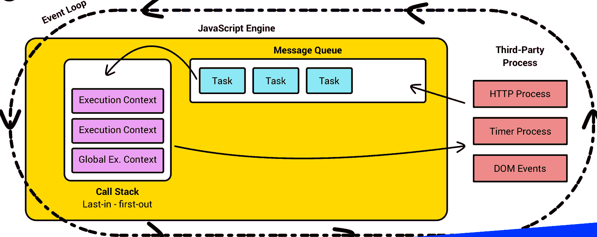
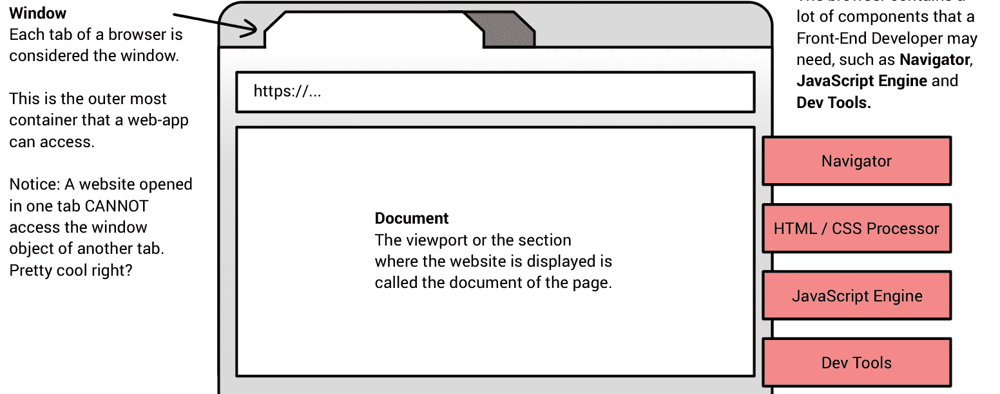

# JavaScript 速查表


# 七种（7）类型

1. String
2. Number
3. Boolean
4. Null
5. Undefined
6. Symbol
7. Object
   - Array
   - Function

```
"Any text"
123.45
true or false
null
undefined
Symbol('something')
{ key: 'value' }
[1, "text", false]
function name() { }
```

# 基础词汇

**Variable（变量）**
对值的命名引用就是变量。

**Operator（运算符）**
运算符是执行值和变量操作的保留字。
示例：+ - = * in === typeof != ...

```
var a = 7 + "2";
```

**Statement（语句）**
完成一项任务的一组单词、数字和运算符。

**Keyword / reserved word（关键字 / 保留字）**
作为编程语言词汇一部分的任何单词称为关键字（又称保留字）。
示例：var = + if for...

**Expression（表达式）**
一个引用、值，或引用与值通过运算符组合后产生单一值的结果。

**注意：** var、let 和 const 都是声明变量的有效关键字。它们之间的区别在本速查表第 7 页有介绍。

# Object（对象）

对象是 JavaScript 中的一种数据类型，用于以简单的键值对组合存储数据。就这么简单。

**Key（键）**
这些是 user 对象中的键。

```
var user = {
  name: "Aziz Ali",
  yearOfBirth: 1988,
  calculateAge: function(){
    // some code to calculate age
  }
}
```

**Value（值）**
这些是 user 对象中对应键的值。

**Method（方法）**
如果某个键的值是函数，则称之为方法。

# Function（函数）

函数就是将一组代码打包在一个区块中。这组代码**只有**在函数被调用时才会运行。函数可以将代码组织成区块，并实现代码复用。

使用函数**只有**两个部分：（1）声明/定义函数，以及（2）使用/运行函数。

# 函数名称

就这么简单，就是给函数起个名字。提示：让函数名称具有描述性，说明函数的功能。

# Return（返回，可选）

函数可以选择性地"吐出"或"返回"一个值，在它被调用时。一旦函数返回，函数内部将不再执行后续代码。

```
// 函数声明 / 函数语句
function someName(param1, param2){

    // 根据需要编写的代码...
    var a = param1 + "love" + param2;
    return a;
}

// 调用（运行 / 执行）函数
someName("Me", "You")
```

# 调用函数

调用、呼叫或运行函数都是同一个意思。当我们写下函数名称，在本例中是 someName，后跟括号符号 ()，像这样 someName()，函数内部的代码就会被执行。

# 向函数传递参数（可选）

在调用函数时，可以向函数代码传递参数。

# Parameters / Arguments（参数，可选）

函数可以选择性地接收参数（又称实参）。函数随后可以在其代码中使用这些信息。

# 代码块

花括号 { ... } 内的任何代码称为"代码区块"、"代码块"或简称"块"。这个概念不仅限于函数。"if 语句"、"for 循环"和其他语句也会使用代码块。

# 变量与作用域相关词汇

**Variable Declaration（变量声明）**
创建变量。

**Scope（作用域）**
变量存在的范围。

```
var a;
```

```
var a = "global";
```

**Variable Initialization（变量初始化）**
为变量赋予初始值。

**Global scope（全局作用域）**
最外层的作用域称为全局作用域。

```
a = 12;
```

```
function first(){
  var a = "fresh";

  function second(){
    console.log(a);
  }
}
```

**Functional scope（函数作用域）**
函数内部的任何变量都处于该函数的作用域中。

**Variable Assignment（变量赋值）**
为变量赋值。

```
a = "me";
```

**Lexical Environment (Lexical scope)（词法环境 / 词法作用域）**
变量或函数声明的物理位置（作用域）就是其词法环境（词法作用域）。

**Scope chain（作用域链）**
作用域的嵌套层级称为作用域链。JS 引擎会在作用域链中向上查找变量（在其祖先作用域中查找，直到找到）。

**Hoisting（提升）**
变量会自动声明在函数顶部，并在运行时才初始化。

```
console.log(a);
var a = "me";
```

**规则：**
（1）外层作用域中的变量可以在嵌套作用域中访问；但嵌套作用域中的变量**不能**被外层作用域访问。（又称私有变量。）

（2）变量从其词法环境中获取。

# JavaScript 速查表

# 6 运算符

JavaScript 运算符完整列表 https://developer.mozilla.org/en-US/docs/Web/JavaScript/Reference/Operators

运算符是执行值和变量操作的保留字。

**Arithmetic（算术）**
+ 加
- 减
* 乘
/ 除
% 取余
** 指数

**Relational / Comparison（关系 / 比较）**
>= 大于或等于
<= 小于或等于
!= 强制转换后不相等
!== 不相等

**Operator Precedence（运算符优先级）**
当表达式中使用多个运算符时，"运算符优先级"决定哪个运算符会先执行。优先级越高，越早执行。

**Assignment（赋值）**
= 赋值
+= 加后赋值
-= 减后赋值
*= 乘后赋值

**Increment / Decrement（递增 / 递减）**
++ 后缀递增
-- 后缀递减

++ 前缀递增
-- 前缀递减

**Operator Associativity（运算符结合性）**
当多个运算符优先级相同时，"结合性"决定代码将按哪个方向解析。

运算符优先级和结合性表见：
http://bit.ly/operatortable

**Logical（逻辑）**
|| 或
&& 与

**Others（其他）**
typeof
instanceof
()
...spread-operator
.
.[.]
new
delete
(.. ? .. : ..)

# 7 Coercion（强制转换）

当尝试比较不同的"类型"时，JavaScript 引擎会尝试将一种类型转换为另一种类型，以便比较两个值。

类型强制转换优先级：
1. String
2. Number
3. Boolean

**强制转换实例**
这说得通吗？

**Equality（相等性）**
=== 相等
== 带强制转换的相等

**Conversion（转换）**
+ 转换为数字
- 转换为数字后取反
! 转换为布尔值后取反

```
2 + "7";  // "27"
true - 5  // -4
```

# 条件语句

条件允许程序仅在满足特定条件时运行特定代码。例如，假设我们有一个购物应用。我们可以告诉程序，如果购物车为空，则隐藏"结账"按钮。

**If-else Statement（if-else 语句）**：如果满足某个条件，就运行特定代码。如果不满足条件，则运行 "else" 区块中的代码（如果有）。

```
if (a > 0) {
    // run this code
} else if (a < 0) {
    // run this code
} else {
    // run this code
}
```

# Truthy / Falsy（真值 / 假值）

JavaScript 中有某些值，当被强制转换为布尔值时返回 true。这类值称为 **truthy（真值）**。另一方面，有些值被强制转换为布尔值时返回 false。这些值称为 **falsy（假值）**。

**Switch Statement（switch 语句）**：接收单个表达式，并运行表达式匹配的 "case" 中的代码。**"break"** 关键字用于结束 switch 语句。

```
switch (expression) {
    case choice1:
        // run this code
        break;
    case choice2:
        // run this code
        break;
    default:
        // run this code
}
```

| Truthy Values（真值） | Falsy Values（假值） |
| :--- | :--- |
| true | false |
| "text" | " " |
| 72 | 0 |
| -72 | -0 |
| Infinity | NaN |
| -Infinity | null |
| {} | undefined |
| [] | |

**Ternary Operator（三元运算符）：** 如果表达式为真值，则返回第一个值，否则返回第二个值。

```
(expression)? ifTrue: ifFalse;
```

# 循环语句

循环用于重复执行某些操作。例如，假设我们从数据库中获取了 50 篇博客文章，想要将它们的标题打印到页面上。与其将代码写 50 次，不如使用循环来实现。

**For loop（for 循环）**

```
for (initial-expression; condition; second-expression){
  // run this code in block
}
```

步骤 1：执行初始表达式。
步骤 2：检查条件是否满足。如果满足，继续；否则结束循环。
步骤 3：运行区块中的代码。
步骤 4：执行第二个表达式。
步骤 5：返回步骤 2。

**While loop（while 循环）**

```
while (i<3){
  // run this code in block
  i++;
}
```

步骤 1：如果条件为真，继续；否则结束循环。
步骤 2：运行区块中的代码。
步骤 3：返回步骤 1。

**Do while loop（do while 循环）**

```
do {
  // run this code in block
  i++;
} while (i<3);
```

步骤 1：运行区块中的代码。
步骤 2：如果条件为真，继续；否则结束循环。
步骤 3：返回步骤 1。


 ## 创建变量的方式

在 JavaScript 中有 3 种创建变量的方式：
`var`、`let` 和 `const`。使用 `var` 创建的变量是函数作用域（如果在全局作用域中声明则为全局作用域）；`let` 变量是块级作用域；`const` 变量类似于 `let`，但它们的值不能被重新赋值。

```
var a = "some value";    // 函数或全局作用域
let b = "some value";    // 块级作用域
const c = "some value";  // 块级作用域 + 不能被赋予新值
```

# 事件循环



# 13 浏览器

网络浏览器是一款相当先进的软件，包含许多组件。其中许多组件对 Web 开发人员是可访问的，因此我们可以创建复杂的 Web 应用程序。同时，出于安全目的，许多组件对 Web 开发人员是不可访问的。例如，作为 Web 开发人员，我们可以获取用户的*位置*，但无法访问用户保存的密码或浏览历史记录。**下面我们来看看浏览器的结构：**



## DOM - 文档对象模型

### 查询/获取元素

```
// 推荐方式：
document.querySelector('css-selectors')
document.querySelectorAll('css-selectors', ...)
```

```
// 旧方式，仍然有效：
document.getElementsByTagName('element-name')
document.getElementsByClassName('class-name')
document.getElementById('id')
```

### 创建 / 克隆元素

```
document.createElement('div')
document.createTextNode('some text here')
node.cloneNode()
node.textContent = 'some text here'
```

### 将节点添加到文档

```
parentNode.appendChild(nodeToAdd)
parentNode.insertBefore(nodeToAdd, childNode)
```

### 获取元素详情

```
node.nextSibling
node.firstChild
node.lastChild
node.parentNode
node.childNodes
node.children
```

### 修改元素

```
node.style.color = 'red'
node.style.padding = '10px',
node.style.fontSize = '200%'

node.setAttribute('attr-name', 'attr-value')
node.removeAttribute('attr-name')
```

### 获取和修改元素类

```
node.classList
node.classList.add('class-name', ...)
node.classList.remove('class-name', ...)
node.classList.toggle('class-name')
node.classList.contains('class-name')
node.classList.replace('old', 'new')
```

### 移除节点

```
parentNode.removeChild(nodeToRemove)
// 移除自身的技巧
nodeToRemove.parentNode.removeChild(nodeToRemove)
```

### "节点"是什么？
（在 DOM 的上下文中）

**节点：** DOM 树中的每个项目都称为节点。节点有两种类型——文本节点和元素节点：

**文本节点：** 包含文本的节点。

**元素节点：** 包含元素的节点。

**子节点：** 作为另一个节点的子节点的节点。

**父节点：** 拥有一个子节点的节点。

**后代节点：** 嵌套在树深处的节点。

**兄弟节点：** 共享同一父节点的节点。

### 事件

```
node.addEventListener('event-name', callback-function)
node.removeEventListener('event-name', callback-function)
```

事件列表：https://developer.mozilla.org/en-US/docs/Web/Events
或在 Google 搜索 "Mozilla event reference"

## 自动继承的属性

当你在 JavaScript 中创建一个值时，某些属性会自动被该值继承。这种神奇的现象是因为每个**类型**都有一个**构造函数**，其中包含一个名为 **prototype** 的特殊属性。**原型**上的所有方法都会自动被该**类型**创建的新值继承。看看右侧的一些方法。

```
const thing = "some text";
```

```
const num = 123.45;
```

Google 搜索 'Mozilla String' 查找文档

Google 搜索 'Mozilla Number' 查找文档

Google 搜索 'Mozilla Array' 查找文档

Google 搜索 'Mozilla Boolean' 查找文档

- `.concat()`
- `.charAt()`
- `.indexOf()`
- `.startsWith()`
- `.endsWith()`
- `.split()`
- `.slice()`

- `.toFixed()`
- `.toPrecision()`
- `.toString()`

- `.filter()`
- `.map()`
- `.find()`
- `.every()`
- `.some()`
- `.sort()`
- `.slice()`
- `.splice()`
- `.reduce()`
- `.forEach()`

- `.toString()`

## 内置对象

JavaScript 为我们提供了大量有用的内置对象，让我们的生活更轻松。**Date** 和 **Math** 对象在日常使用中非常有用。看看右侧它们的一些特性。

JavaScript 内置对象的完整列表，请访问 https://developer.mozilla.org/en-US/docs/Web/JavaScript/Reference/Global_Objects

Google 搜索 'Mozilla Math' 查找文档

Google 搜索 'Mozilla Date' 查找文档

```
Math.pow(2, 3) // 8
Math.sqrt(16) // 4
Math.min(7, 8, 6) // 6
Math.max(7, 8, 6) // 8
Math.floor(123.45) // 123
Math.ceil(123.45) // 124
Math.round(123.45) // 123
Math.random() // 0.45..
```

```
const d = new Date('9/17/1988');
d.getDay()
d.getFullYear()
d.getMonth()

Date.now()
自 1970 年 1 月 1 日以来的毫秒数
```

# 17 Promise（Promise）

**什么是 Promise？**

Promise 是一个在处理异步任务时提供有用构造的对象。Promise 被称为"Promise"，是因为它保证在该任务成功或失败时执行。

使用 Promise 包括两个部分：（A）创建 Promise，和（B）使用 Promise。

**什么是异步任务？**

异步任务是指由第三方进程执行的任务。

示例：

- 向数据库请求/发送数据
- 通过 HTTP 协议请求/发送数据
- 操作计算机的文件系统

```
// (A) 创建 Promise
const p = new Promise((resolve, reject)=>{
  // 执行一些异步任务
  setTimeout(()=>{
    if(condition){
      resolve('Successful login');
    } else {
      reject('Login failed');
    }
  }, 2000)
})
```

```
// (B) 使用 Promise
p.then((res)=>{
  console.log(res)
})
.catch((err)=>{
  console.log(err)
})
```

**注意：** 90% 的时间你会使用预先存在的 Promise。"创建 Promise"的步骤会由你使用的库、框架或环境为你完成。Promise 的示例：fetch

# 18 'this' 关键字

this 关键字在函数内部使用。this 关键字仅仅是对另一个对象的引用。

this 关键字指向什么取决于场景或函数的实现方式。以下是 3 个需要记住的场景。

## 场景 #1：函数内的 this

this 关键字指向全局对象。

## 场景 #2：方法内的 this

this 关键字指向方法所属的对象。

## 场景 #3：使用 call、bind 或 apply 运行函数时

当使用 .call(param) .bind(param) 或 .apply(param) 方法调用函数时，第一个参数成为 this 关键字所引用的对象。

**重要提示：**
在浏览器中，全局对象是 window 对象。
在 Node.js 中，全局对象是 global 对象。

```
var name = " Fatema";

function fun(){
    // 此处的一些代码
    console.log(this.name);
}

const user = {
    name: "Marium",
    yearOfBirth: 1999,
    calcAge: function(){
        const currentYear = (new Date()).getFullYear();
        return currentYear - this.yearOfBirth;
    }
}

fun();           // 'this' 是全局的。输出 "Fatema"
user.calcAge();  // 'this' 是 user 对象
fun.call(user);  // 'this' 是 user 对象。输出 "Marium"
```

# 19 构造函数（Constructor）

**什么是构造函数？**
在 JavaScript 中，构造函数是一种特殊的函数，充当创建新对象的模具。

JavaScript 中有许多内置构造函数，例如 `String`、`Number`、`Promise`、`Date`、`Array`、`Object` 等等。

如果需要，我们可以创建自己的自定义构造函数。

构造函数的一个绝佳用途是在创建多个相同类型的对象时。

使用构造函数包括两个部分：

1. **定义构造函数**
   创建自定义构造函数时

2. **使用构造函数**
   使用 "new" 关键字

```
// 定义构造函数
function Car(make, model, year){
  this.make = make;
  this.model = model;
  this.year = year;

  this.setMiles = function(miles){
    this.miles = miles
    return miles;
  }
}

// 使用构造函数
const car1 = new Car('Toyota', 'Prius', 2016);
const car2 = new Car('Hyundai', 'Sonata', 2018);

// 向构造函数原型添加方法
Car.prototype.age = function(){
  return (new Date()).getFullYear() - this.year;
}

car1.age(); // 2
```

> **经验法则：**
A) 在构造函数内设置属性。

B) 在 prototype 属性内设置方法。

> **"new" 关键字**
new 关键字用于从构造函数创建新对象（实例）。

> **"prototype" 属性**
prototype 是每个对象上的特殊属性。附加到 prototype 属性的属性（方法或值）会被继承到构造函数的每个实例。
