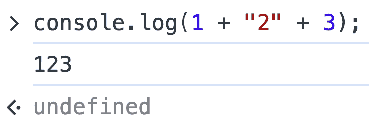
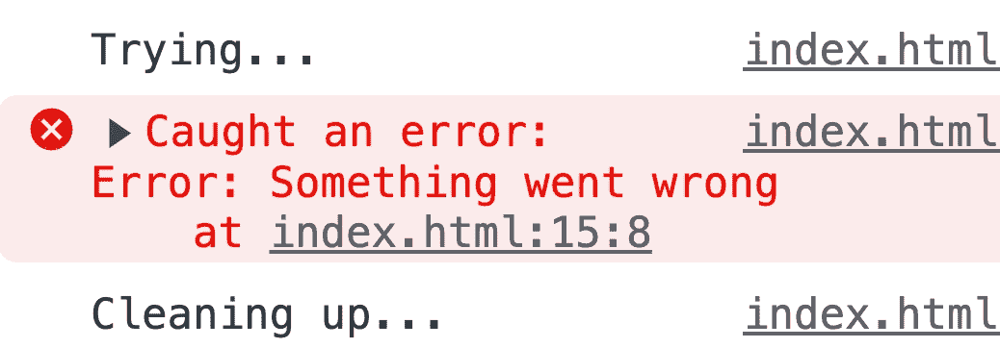
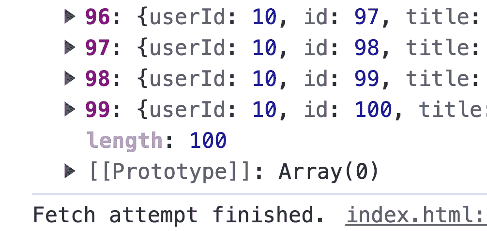
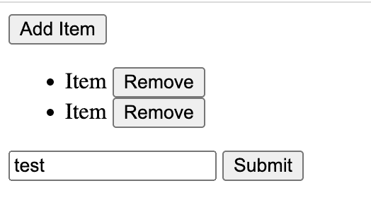
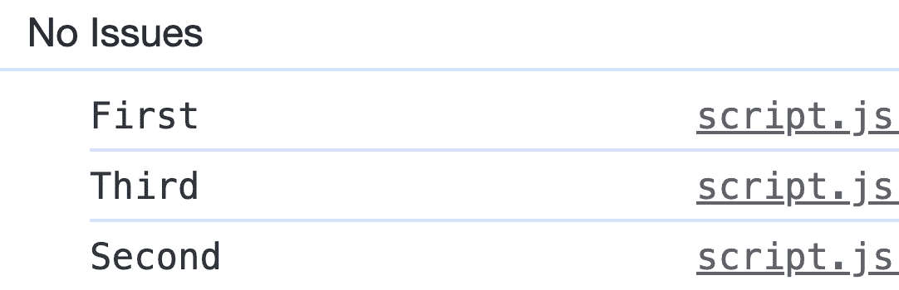

# JavaScript 代码释放：技能进阶——通过代码示例、问题和深度解析高阶 JavaScript 概念


Copyright © 2024 Laurence Svekis 版权所有。

献给 Alexis 和 Sebastian Svekis
感谢你的支持

## 目录
- JavaScript 基础入门
- JavaScript 核心原理与基础
- Chrome 开发者工具
- 访问开发者工具
- 理解代码片段的输出
- 理解 `console.log(1 + "2" + 3)` 的输出
- 解释表达式的结果
- 解读 JavaScript 代码输出
- 等值运算符 == 的意义
- == 与 === 的区别
- typeof null 的返回值
- 区分 null 和 undefined
- 将 Set 展开为数组
- JavaScript 中的变量提升概念
- void 运算符的作用
- 将数字保留两位小数
- 检查数字是否为有限且非 NaN
- 检测用户设备类型
- 使用 ES6 声明不可变变量
- 检查对象中的某个属性
- 练习题解答：以下问题
- JavaScript 基础测试题
- 异步 JavaScript
- 异步 JavaScript 入门
- 使用 async/await 简化异步代码
- Promise.all 的作用
- 多个异步操作后的代码
- 使用 async 关键字启用异步功能
- 被拒绝的 Promise async 会抛出错误
- 内部处理异步函数
- 练习题解答：以下问题
- 异步 JavaScript 测试题
- 错误处理与对象配置
- 编写更整洁可靠的代码
- finally 块在错误处理中的作用
- Promise 链中的 finally 子句
- Object.seal 对对象的影响
- 练习题解答：以下问题
- 错误处理对象配置测试题
- 函数与作用域
- 函数与作用域入门
- 理解 JavaScript 闭包
- 函数调用防抖
- 不同语境下的 this 关键字
- 使用 bind 方法
- 跨文档捕获点击事件
- 延迟函数执行
- 一次性事件监听器
- 在输入时运行 JavaScript
- 停止 setInterval()
- 练习题解答：以下问题
- 函数与作用域测试题
- 数据结构与类型
- JavaScript 中的原型继承
- Set 对象的作用
- 从数组中去重
- Set 相比 Array 的优势
- 理解 JavaScript 中的 NaN
- null 和 undefined 的区别
- reduce() 方法
- flatMap() 方法
- Symbol.iterator 的用法
- slice 与 splice 的区别
- every() 方法
- map() 方法
- some() 方法的用法
- 合并数组
- 创建 Date 对象
- 转换累加的结果
- 练习题解答：以下问题
- 数据结构与类型测试题
- 模块与 ES6
- JavaScript 模块与 ES6 特性
- JavaScript 模块概述
- JavaScript 中的动态导入
- Import 语句的默认行为
- 将 JavaScript 作为模块引入
- 在 ES6 中实现模块封装
- 模块的动态导入
- JavaScript 中模板字符串的作用
- 练习题解答：以下问题
- 模块与 ES6 测试题
- 对象迭代
- 精通对象迭代
- JavaScript 中的对象迭代
- 创建对象的深拷贝
- 使用 WeakMaps 处理私有数据
- 遍历对象属性
- 在类中创建私有变量和方法
- 将 NodeList 转换为数组
- 带有循环引用的深克隆
- 定义不可枚举属性
- 排除某些属性克隆对象
- 练习题解答：以下问题
- 对象迭代测试题
- 事件处理与 DOM
- 导航事件处理 DOM 操作
- JavaScript 中的事件处理与 DOM
- 事件委托模式
- 事件传播详解
- 阻止表单提交
- 停止事件传播
- 停止 CSS 动画
- 从 DOM 中移除特定元素
- 文档完全加载事件
- 练习题解答：以下问题
- 事件处理与 DOM 测试题
- Promises 与 Async/Await
- 精通异步 JavaScript
- JavaScript Promises: 概述
- Async 关键字
- 延迟后执行代码
- Promise.race() 方法
- Promises 与 Async/Await
- 练习题解答：以下问题
- Async 和 await 测试题
- 高级主题](#part0013.xhtml)
- JavaScript 高级主题
- 处理整数溢出
- 垃圾回收与循环引用
- 事件循环
- 模块作用域
- Promise.allSettled() 方法
- 检测数组
- 类中的静态关键字
- 检测严格模式
- 练习题解答：以下问题
- JavaScript 高级主题测试题
- 你的知识测试 JavaScript 测试题


- 检查对象中的属性：验证对象内部是否存在属性的技巧。
- 检查数字是否有限且非 NaN：验证数字的有限性和非 NaN 状态的方法。
- JavaScript 中的提升概念：探索变量和函数声明是如何移动到其作用域顶部的。
- 解密 JavaScript 代码输出：理解和预测 JavaScript 代码输出的技能。
- 使用 ES6 声明不可变变量：在 ES6 中使用 `const` 创建不可修改的变量。
- 检测用户设备类型：用于响应式设计的识别用户所在设备类型的技术。
- `==` 与 `===` 的区别：理解用于类型转换的 `==` 和严格相等 `===` 之间的比较运算符。
- 区分 `null` 和 `undefined`：掌握 `null` 和 `undefined` 在表示值缺失时的不同作用。
- 解释表达式的结果：分析并理解 JavaScript 表达式的结果。
- 将数字保留两位小数：将数字四舍入到指定精度的技巧。
- 将 Set 展开为数组：利用扩展运算符将 `Set` 转换为 `Array`。
- `typeof null` 的返回值：理解为什么 `typeof null` 返回 "object"。
- `void` 运算符的作用：探索使用 `void` 运算符评估表达式值但不返回值的用法。

# JavaScript 核心原理与基础

在本节中，我们将深入探讨定义 JavaScript 成为一种动态且多功能编程语言的核心原理和特殊特性。从理解数据类型转换的复杂性，到掌握 ES6 引入的现代语法，我们的旅程将让你具备编写高效有效 JavaScript 代码的知识。每个概念都通过实际示例进行说明，确保你不仅学习了理论，还学习了如何在现实场景中应用它。

本节旨在为 JavaScript 建立下坚实的基础，同时涵盖了基础概念和 ES6 引入的高级特性。通过理解这些原理，你将更好地应对 JavaScript 动态且有时不可预测的本质，让你的 Web 开发之旅更加明智且充满自信。

## Chrome DevTools

Chrome 开发者工具（通常称为 DevTools）是一套直接构建在 Google Chrome 浏览器中的 Web 开发者工具。它们为开发者提供了深度访问浏览器及其 Web 应用程序内部的能力。使用 DevTools，你可以实时编辑页面、快速诊断问题并更快地构建更好的网站。以下是关于如何使用 DevTools 的基础指南，特别关注控制台（Console）。


图片：在 Chrome 中访问 DevTools

### 访问 DevTools

打开 DevTools：有几种方法可以打开 Chrome DevTools。

- 右键点击任何页面元素并选择“检查（Inspect）”。
- 使用快捷键 `Ctrl+Shift+I`（Mac 上使用 `Cmd+Opt+I`）。
- 从 Chrome 右上角的菜单中，转到“更多工具” > “开发者工具”。

导航到控制台：打开 DevTools 后，你可以点击“Console（控制台）”标签切换到控制台视图。控制是一个强大的工具，允许开发者与当前页面的 JavaScript 上下文交互、运行脚本并记录信息。

### 理解代码片段的输出

在分析 JavaScript 代码片段以预测其输出时，考虑涉及的数据类型以及 JavaScript 如何解释它们是非常重要的。查看输出的最快方法是通过 `console.log()`，它允许你在 DevTools 控制台中查看结果。

例如：

```
console.log(1 + "2" + 3);
```

这段代码演示了类型转换，JavaScript 将数字 1 和 3 转换为字符串，以便与 "2" 拼接，结果为字符串 "123"。



图片：显示来自 devTools 的 console log 输出。

### 理解 console.log(1 + "2" + 3) 输出

当你在控制台中运行 `console.log(1 + "2" + 3)` 时，它会执行以下操作：

- 首先，它评估 `1 + "2"`，结果为 `"12"`。在 JavaScript 中，当你对数字和字符串使用 `+` 运算符时，数字会被转换为字符串并进行拼接。
- 接着，它评估 `"12" + 3`，由于相同的原因，结果为 `"123"`。

因此，`console.log(1 + "2" + 3)` 向控制台输出 `"123"`。

关于 `undefined` 输出：

- 在执行完一条条语句后，控制台还会显示该语句的返回值。
- `console.log()` 本身不返回值（或者在 JavaScript 术语中，它返回 `undefined`）。
- 因此，在控制台打印 "123" 之后，它还会显示 `undefined`，以表示 `console.log()` 函数调用的返回值。

这种行为是控制台特有的。它的设计目的是提供关于执行语句返回值的即时反馈，这对于调试和交互式编码课程特别有用。

要理解代码片段的输出，你需要运行它并观察结果。让我们考虑一个简单的例子：

```
console.log(2 + 2);
```

输出：4

## 解释表达式的结果

在 JavaScript 中评估表达式可以根据所使用的运算符产生各种结果。

例如：

```
5 == "5"
```

该表达式评估结果为 `true`，因为 `==` 运算符执行了类型转换，允许在数据类型不同的情况下进行值比较。

评估表达式并解释其结果涉及理解所涉及值的类型以及操作如何影响它们。

例如：

```
console.log("Hello " + "World!");
```

输出：Hello World!

## 解密 JavaScript 代码输出

要预测 JavaScript 代码的输出，理解上下文和操作至关重要。例如：

```
console.log(typeof NaN);
```

输出为 `number`，说明 `NaN`（不是数字）自矛盾地被归类为数字。

要解密代码输出，请考虑数据类型和操作。例如：

```
console.log(1 + "2");
```

输出：12（因为 "2" 是字符串，`+` 运算符执行拼接而非相加）。

### == 等等运算符的意义

JavaScript 的 `==` 运算符执行类型转换，允许跨不同类型比较值，这与 `===` 运算符不同，后者要求值和类型都相同。

```
console.log('10' == 10); // 因为类型转换为 true
console.log('10' === 10); // 因为类型不同为 false
```

`==` 运算符在将两个操作数转换为公共类型后检查相等性。这种特性被称为类型转换，在比较不同数据类型时可能会导致意料之外的结果，强调了理解 JavaScript 类型转换的重要性。

`==` 运算符在将两个操作数转换为相同类型后检查相等性。

```
console.log('1' == 1);
```

输出：true（发生了类型转换，将数字 1 转换为字符串 "1"）。

### == 与 === 的区别

`==` 运算符执行类型转换以比较值，可能会导致非直观的结果。相比之下，`===` 是严格相等运算符，它在不转换的情况下同时比较值和类型，提供了更准确的相等检查。

```
console.log('1' == 1); // true
console.log('1' === 1); // false
```

### typeof null 的返回值

在 JavaScript 中，`null` 是一个对象，这可能会让人困惑。`null` 和 `undefined` 都用于表示值的缺失，但上下文略有不同。

`typeof null` 表达式有趣地返回 object，这是 JavaScript 的一个已知特性。这种行为被认为是 JavaScript 早期的一个 bug，但为了兼容性一直保留了下来。

`typeof` 运算符返回一个指示未求值操作数类型的字符串。

```
console.log(typeof null);
```


输出: object (这是一个长期的 JavaScript 标记)。

```javascript
let notDefined;

console.log(notDefined); // undefined

console.log(null === undefined); // false

console.log(null == undefined); // true, 由于于类型转换
```

## 区分 null 和 undefined

JavaScript 中的 `null` 和 `undefined` 都表示值的缺失，但在所处的语文中不同。`null` 用于有意地表示变量没有值或未分配任何对象，而 `undefined` 则表示变量已经声明但尚未赋值。

`null` 是一个表示“无值”的赋值值，而 `undefined` 意味着变量已声明但未被赋值。

```javascript
let a;

console.log(a); // undefined
console.log(null); // null
```

### 将 Set 展开为数组

扩展运算符 `...` 允许像 `Set` 这样的可迭代对象在期望零或多个参数（用于函数调用）或元素（用于数组字面量）的地方进行展开。

使用扩展运算符将 `Set` 转换为数组，展示了 ES6 特性在处理集合时的无缝集成。这种技术为从 `Set` 对象创建数组提供了一种简洁且有效的方法，利用了 `Sets` 的唯一属性。

扩展语法允许像 set 这样的可迭代对象在期望零或多个参数或元素的地方展开。

```javascript
const mySet = new Set([1, 2, 3]);

const myArray = [...mySet];

console.log(myArray); // 输出: [1, 2, 3]
```

在 JavaScript 中，将将 set 展开为数组以便使用数组方法操作存储在 set 中的数据，或者当你需要确保数组中元素的唯一性时，这种方法会特别有用。以下是三个示例，展示了如何将 set 展开为数组：

#### 示例 1：Set 的基础展开

假设你有一个数字集合，并且你想要从该集合中创建一个数组。

```javascript
const numberSet = new Set([1, 2, 3, 4, 5]);
const numberArray = [...numberSet];

console.log(numberArray); // 输出: [1, 2, 3, 4, 5]
```

#### 示例 2：将两个 Set 合并为一个数组

如果你有两个 set 并想将它们合并为一个单一且不重复的数组，可以在数组字面量中对两个 set 使用扩展运算符。

```javascript
const set1 = new Set([1, 2, 3]);
const set2 = new Set([3, 4, 5]);
const combinedArray = [...set1, ...set2];

console.log(combinedArray); // 输出: [1, 2, 3, 4, 5]
```

此示例合并了 `set1` 和 `set2`，因为 set 会自动去重，将它们展开为数组实现了不重复的合并。

#### 示例 3：使用 Set 移除数组中的重复项然后展开到新数组

有时，你可能从一个包含重复项的数组开始并想要移除这些重复项。你可以将数组转换为 `set`（这会去重），然后将其展开回数组。

```javascript
const arrayWithDuplicates = [1, 2, 2, 3, 4, 4, 5];
const uniqueArray = [...new Set(arrayWithDuplicates)];

console.log(uniqueArray); // 输出: [1, 2, 3, 4, 5]
```

此示例首先将 `arrayWithDuplicates` 转换为 `set` 以去重，然后将此 set 展开到一个新数组，得到一个包含唯一值的数组。

这些示例演示了扩展运算符配合 set 的多功能性，允许唯一组合、去重以及 set 与数组之间的转换。

### JavaScript 中的提升 (Hoisting)

提升是 JavaScript 的一种行为，在编译阶段将变量和函数声明移动到其所在作用域的顶部。这允许在代码声明之前使用变量和函数。

```javascript
console.log(x);

var x = 5;
```
输出: undefined（不是 ReferenceError，因为 `x` 的声明被提升了）。

JavaScript 中的提升概念是指在代码执行之前将变量和函数声明移动到其所在作用域顶部的行为。这意味着变量和函数可以在代码声明之前被引用。需要注意的是，只有声明会被提升，而初始化不会。

以下是三个展示 JavaScript 提升的示例：

#### 示例 1：函数提升

函数声明会被提升，允许它们在代码中定义之前被调用。

```javascript
// 在声明之前调用函数
greet();

// 函数声明
function greet() {
  console.log('Hello, world!');
}
// 输出: "Hello, world!"
```

在此示例中，`greet` 函数在声明之前被调用了。由于函数提升，JavaScript 在编译阶段将声明移动到顶部，使得此调用有效。

#### 示例 2：使用 var 的变量提升

使用 `var` 的变量声明（但不包括初始化）会被提升到作用域的顶部，这可能会导致意外的结果。

```javascript
console.log(message); // 输出: undefined

var message = 'Hoisting is here!';

// 上述代码的行为就像这样写：
// var message;
// console.log(message);
// message = 'Hoisting is here!';
```

在此示例中，在声明之前访问 `message` 会输出 undefined，因为只有声明（`var message;`）被到了顶部，而不是初始化（`message = 'Hoisting is here!';`）。

#### 示例 3：let 和 const 的提升限制

用 `let` 和 `const` 的变量也会被提升，但它们不会被初始化。在声明之前访问它们会导致由于暂性死区（TDZ）引起的 ReferenceError。

```javascript
console.log(name); // ReferenceError: Cannot access 'name' before initialization

let name = 'JavaScript';
```

尽管 `let` 和 `const` 声明被提升，但在它们初始化之前无法被访问。这些示例演示了提升如何作用于函数和变量，以及行为如何取决于声明的类型。

### void 运算符的作用

`void` 运算符评估表达式并返回 `undefined`。它对于实际上并不跳转的超链接有用。

```javascript
void function() {
  console.log("这将会运行，但返回 undefined");
}();
```

`void` 运算符评估给定的表达式并返回 `undefined`。

```javascript
console.log(void(0)); // 输出: undefined
```

## 将数字保留两位小数

JavaScript 提供了处理数字的方法，包括舍入和检查有限性。要将数字保留两位小数，可以使用 `toFixed()` 方法，该方法将数字转换为字符串，并保留到指定的小数位数。

将数字保留两位小数是各种编程任务中的常见需求，特别是在处理财务计算时。

#### 示例：使用 toFixed()

`toFixed()` 方法使用固定点计数法格式化数字，将数字舍入到指定的小数位数。

```javascript
const number = 2.34567;
const rounded = number.toFixed(2);

console.log(rounded); // 输出: "2.35"
```

需要注意的是 `toFixed()` 返回的是字符串。如果你需要结果为数字，可以使用 `parseFloat()` 或 `Number()` 包裹 `toFixed()` 调用。

```javascript
const roundedNumber = parseFloat(number.toFixed(2));
```


```javascript
// const roundedNumber = Number(number.toFixed(2));

console.log(roundedNumber); // 输出: 2.35
```

## 示例 2：使用 `Math.round()`

如果你想使用数学舍入法将数字保留到两位小数，可以使用 `Math.round()` 配合倍数使用。

```javascript
const number = 2.34567;

const rounded = Math.round(number * 100) / 100;

console.log(rounded); // 输出: 2.35
```

这种方法通过将数字乘以 `100` 将小数点向右移动两位，进行四舍五入，然后除以 `100` 将小数点移回原始位置。

## 示例 3：使用自定义舍入函数

对于更复杂的舍入场景，或者在你可能由于 `toFixed()` 的返回类型而不想依赖它的环境中，你可以创建一个自定义的舍入函数。

```javascript
function roundToTwo(num) {

return +(Math.round(num + "e+2") + "e-2");

}

const number = 2.34567;

const rounded = roundToTwo(number);

console.log(rounded); // 输出: 2.35
```

该函数使用科学计数法（e-notation）来对数字进行舍入。它向数字添加 `"e+2"` 以在舍入前将小数点向右移动两位，然后减去 `"e-2"` 移回，从而有效地将数字舍入到两位小数。开头的一元加（`+`）将字符串结果转换回数字。

这些示例提供了在 JavaScript 中将数字保留两位小数的不同方法，每种方法根据你项目的特定需求都有其适用场景。

### 检查数字是否有限且非 NaN

要验证一个值是否为有限数字而非 `NaN`，你可以使用 `isFinite()` 函数，它对 `Infinity`、`-Infinity` 和 `NaN` 返回 `false`，而对有限数字返回 `true`。

```javascript
const num = 1 / 0;

console.log(isFinite(num)); // false
```

`isFinite()` 函数判断一个数字是否是有限的合法数字。

```javascript
console.log(isFinite(2/0)); // false

console.log(isFinite(20/5)); // true

console.log(isFinite(NaN)); // false
```

### 检测用户的设备类型

检测用户的设备类型对于响应式设计可能很有用。虽然 JavaScript 可以提供一些见解，但通常建议使用 CSS 媒体查询或库来确保准确性。

在 JavaScript 中检测用户的设备类型通常涉及检查 `navigator.userAgent` 字符串，其中包含了有关浏览器和操作系统的信息。然而，为了获得更可靠的结果（特别是区分移动设备和桌面设备），请考虑使用库或基于 CSS 方法。

你可以使用 `navigator.userAgent` 属性，但为了获得更准确的结果，请使用像 `Modernizr` 这样的库。

```javascript
if(/Android|webOS|iPhone|iPad|iPod|BlackBerry|IEMobile|Opera Mini/i.test(navigator.userAgent)) {

console.log("检测到移动设备.");

} else {

console.log("检测到桌面设备.");

}
```

### 使用 ES6 声明不可变变量

在 ES6 中，`const` 关键字用于声明不能重新赋值的变量。这对于程序执行过程中应该保持不变的值是非常理想的。

`const` 关键字允许你声明值不可重新赋值的变量。

在 ES6 (ECMAScript 2015) 中，`const` 关键字用于声明不应被重新赋值的变量。使用 `const` 声明变量使其在某种意义上是不可变的，即你不能将其重新赋值为不同的值。然而，重要的是，如果变量持有一个对象或数组，该对象或数组的内容仍然可以修改，除非你使用其他手段使它们变得不可变。以下是三个使用 `const` 在 JavaScript 中声明不可变变量的示例：

```javascript
const PI = 3.14159;

// PI = 22/7; // TypeError: 赋值常量变量。

console.log(PI);
```

#### 示例 1：声明原始值

```javascript
const pi = 3.14159;

console.log(pi); // 输出: 3.14159

// 尝试重新为 pi 赋值将导致错误

// pi = 3.14; // TypeError: 赋值常量变量。
```

此示例展示了对原始值使用 `const` 的基本用法。由于 `pi` 是一个常量，在初始声明后尝试更改其值会导致运行时错误。

#### 示例 2：不可变数组（某种意义上）

```javascript
const colors = ['red', 'green', 'blue'];

console.log(colors); // 输出: ['red', 'green', 'blue']

// 你修改数组的内容

colors.push('yellow');

console.log(colors); // 输出: ['red', 'green', 'blue', 'yellow']

// 但你不能重新赋值数组

// colors = ['purple', 'orange']; // TypeError: 赋值常量变量。
```

在此示例，`colors` 使用 `const` 声明，使得变量本身是不可变的。然而，数组的内容仍然可以修改（例如，可以添加、删除或更改项目）。`const` 强制的不可变性仅适用于 `colors` 与其数组之间的绑定，而不是数组的内容。

#### 示例 3：不可变对象（某种意义上）

```javascript
const car = {

  make: 'Toyota',

  model: 'Camry'

};

console.log(car); // 输出: { make: 'Toyota', model: 'Camry' }

// 你可以修改属性

car.year = 2020;

console.log(car); // 输出: { make: 'Toyota', model: 'Camry', year: 2020 }

// 但你不能重新赋值对象

// car = { make: 'Honda', model: 'Accord' }; // TypeError: 赋值常量变量。
```

与数组类似，使用 `const` 声明对象防止重新赋值变量。然而，对象的属性仍然可以添加或删除。对于对象的真正的不可变（防止任何更改），你需要使用如 `Object.freeze()` 等功能或提供不可变数据结构的库。

### 检查对象中的属性

要检查对象是否具有某个属性，你可以使用 `hasOwnProperty()` 方法或 `in` 运算符。

```javascript
const obj = { key: 'value' };

console.log(obj.hasOwnProperty('key')); // true

console.log('key' in obj); // true
```


## 示例 3：使用可选链运算符 (?.) 和 undefined 检查

虽然这不是直接检查属性是否存在，但可选链操作符 `?.` 允许你安全地访问嵌套对象的属性，而无需检查每一层嵌套。你可以将其与 `undefined` 检查结合，推断属性是否存在。

```javascript
const car = {
  specs: {
    engine: 'V6',
    horsepower: 268
  }
};

console.log(car.specs?.engine !== undefined); // 输出: true
console.log(car.specs?.mileage !== undefined); // 输出: false
```

此示例检查了 `specs` 内部 `engine` 属性，该属性存在，因此输出为 true。它还检查了 `specs` 中的 `mileage` 属性，该属性不存在，因此输出为 false。

这些示例展示了判断对象是否包含特定属性的不同方法，每种方法都根据检查属性存在和继承的要求在各种场景中大有用武。

## 练习题：回答以下问题

- 在 JavaScript 中使用 `==` 运算符进行相等比较的意义是什么？
- JavaScript 中 `typeof null` 表达式返回什么？
- 在 JavaScript 中尝试将 `Set` 展开到数组中的结果是什么？
- JavaScript 中 `==` 和 `===` 之间的主要区别是什么？
- JavaScript 中的“提升”（hoisting）是指什么？
- JavaScript 中的 `void` 运算符的作用是什么？
- 如何在 JavaScript 中将数字保留两位小数？
- 如何检查一个数字是否是有限的且不是非数字？
- 如何在 JavaScript 中检测用户的设备类型？
- 在 ES6 中，使用哪个关键字来声明一个不可重新赋值的变量？
- 如何检查 JavaScript 对象 `obj` 是否具有属性键？

## JavaScript 基础知识测试

### 检查对象中的属性

如何检查对象 `person` 中是否存在属性 `age`？

A) `person.age`
B) `person.hasOwnProperty('age')`
C) `'age' in person`
D) 选项 B 和 C 都对

**答案：D**

**解析：** `hasOwnProperty('age')` 和 `'age' in person` 都是检查 `age` 是否存在于 `person` 中的正确方法。前者检查该属性是否为对象的直接属性，而后者则在对象及其原型链中进行检查。

### 检查数字是否有限且非 NaN

使用哪个函数可以检查一个值是否是有限数字且非 NaN？

A) `Number.isFinite(value)`
B) `isFinite(value)`
C) `isNaN(value)`
D) `Number.isNaN(value)`

**答案：A**

**解析：** `Number.isFinite(value)` 在该值为有限数字时返回 `true`。与全局函数 `isFinite()` 不同，它不会强制将参数转换为数字，从而提供了更严格的检查。

### JavaScript 中的提升概念

JavaScript JavaScript 中的提升意味着什么？

A) 自动将变量声明移动到函数作用域或全局作用域的顶部。
B) 将函数声明提升到脚本文件的顶部以获得更好的可见性。
C) 在运行时将变量值与其声明一同提升。
D) 一种通过预加载函数来优化代码执行的技术。

**答案：A**

**解析：** JavaScript 中的提升是指代码执行之前，将所有声明（变量和函数）移动到它们所在作用域（即声明它们的函数或全局作用域）顶部的默认行为。

### 解析 JavaScript 代码输出

以下代码段的输出是什么？
```javascript
console.log(2 + '2');
```
A) 4
B) 22
C) '22'
D) TypeError

**答案：C**

**解析：** JavaScript 执行了类型转换，将数字 `2` 转换为字符串并与另一个字符串 `'2'` 拼接，结果为 `'22'`。

### 使用 ES6 声明不可变变量

ES6 中使用哪个关键字来声明不可变变量？

A) `var`
B) `let`
C) `const`
D) `immutable`

**答案：C**

**解析：** ES6 中的 `const` 关键字用于声明不可重新赋值的变量。请注意，用 `const` 声明的对象或数组的内部仍然可以被修改。

### 检测用户的设备类型

如何在 JavaScript 中检测用户的设备是否为移动设备？

A) 使用 `window.mobileCheck()`
B) 检查 `navigator.userAgent` 是否包含移动设备特征
C) 使用 `document.isMobile`
D) 在 JavaScript 中应用 CSS 媒体查询

**答案：B**

**解析：** `navigator.userAgent` 可用于检查指示移动设备的字符串。这并非万无一失，但常用于简单的设备类型检查。

## == 和 === 之间的区别

JavaScript 中 `==` 和 `===` 的主要区别是什么？

A) 没有区别；它们的功能完全相同。
B) `==` 执行类型转换，而 `===` 不执行。
C) `===` 仅用于数值比较。
D) `==` 可以比较对象，但 `===` 不可以。

**答案：B**

**解析：** `==` 在将两个值转换为公共类型（类型转换）后进行比较，而 `===` 在不进行转换的情况下同时比较类型和值，从而实现严格相等比较。

## 使用 == 运算符进行相等比较的意义

为什么你可能使用 `==` 运算符而不是 `===`？

A) 为了允许在比较时进行类型转换。
B) 在比较相同的值时。
C) 为了确保严格相等。
D) 总是应该使用 `===` 而不是 `==`。

**答案：A**

**解析：** `==` 用于在比较时进行类型转换，以确保在类型不同的情况下判断相等。

## null 和 undefined 的区别

`null` 和 `undefined` 之间的区别是什么？

A) `null` 表示值的缺失，而 `undefined` 表示未赋值。
B) 它们是相同的类型。
C) 没有区别。
D) 表示一个空值。

**答案：A**

**解析：** 在 JavaScript 中，`null` 是故意的空值，而 `undefined` 表示变量尚未被赋值。

### 表达式结果的解析

表达式!!"false" == [] 在 JavaScript 中的结果是什么？

A) true
B) false
C) TypeError
D) undefined

**答案：A**

**解析：** `"false"` 和 `[]` 都是真值。双重否定 `!!` 将它们转换为 `true`。由于两者为真，`==` 的结果也是真。

## 将数字保留两位小数

哪个方法可以将数字保留两位小数并返回字符串？

A) `Math.round(num, 2)`
B) `num.toFixed(2)`
C) `Math.floor(num * 100) / 100`
D) `Number(Math.round(num + 'e2') + 'e-2')`

**答案：B**

**解析：** `num.toFixed(2)` 将数字转换为字符串并保留两位小数。其他方法（除了用法错误的 `Math.round(num, 2)`）返回的是数字。

### 将 Set 展开到数组

如何在 JavaScript 中将 `set` 转换为数组？

A) `Array.from(set)`
B) `[...set]`
C) `set.toArray()`
D)  A 和 B 都对

**答案：D**

**解析：** `Array.from(set)` 和展开语法 `[...set]` 都用于从 set 创建数组。


哪种方法没有直接在对象的链中检查属性的性？

A) `obj.hasOwnProperty('prop')`

B) `'prop' in obj`

C) `obj.prop !== undefined`

D) `Object.keys(obj).includes('prop')`

答案： C

解释：表达式 `obj.prop !== undefined` 检查属性是否具有除 `undefined` 以外的值，这并不是检查属性存在的直接方法。如果属性存在但其值为 `undefined`，它可能会产生假阴性结果。

## 检查数字是否有限且不是 NaN

`Number.isFinite(Infinity)` 的输出是什么？

A) `true`

B) `false`

C) `NaN`

D) `undefined`

答案： B

解释：`Number.isFinite(Infinity)` 返回 `false`，因为 `Infinity` 不是一个有限数字。

## JavaScript 中的变量提升概念

当使用 `const` 将函数赋值给变量时，在声明之前尝试使用该函数的结果是什么？

A) 函数正常执行。

B) 抛出 `TypeError`。

C) 抛出 `ReferenceError`。

D) `undefined`。

答案： C

解释：使用 `const` 赋值给变量的函数不会提升，因此在声明之前尝试使用它们会导致 `ReferenceError`。

## 解密 JavaScript 代码输出

以下代码的输出是什么？`console.log(typeof typeof 1);`

A) `'number'`

B) `'string'`

C) `'object'`

D) `'undefined'`

答案： B

解释：内部的 `typeof 1` 返回 `'number'`，而 `typeof 'number'` 返回 `'string'`，因为 `typeof` 运算符始终返回一个指示求值表达式类型的字符串。

## 使用 ES6 不可变变量

关于 ES6 中使用 `const` 声明变量的陈述哪个正确？

A) 使用 `const` 声明的变量可以重新声明。

B) 使用 `const` 声明的数组和对象不能修改其内容。

C) `const` 需要初始化器且不能不初始化。

D) `const` 声明被提升到块作用域的顶部。

答案： C

解释：当你使用 `const` 声明变量时，必须在声明时对其进行初始化。与会被提升的 `var` 声明不同，`const` 声明在词法绑定被评估之前不会初始化。

## 检测用户设备类型

除了简单的用户代理字符串检查外，可以使用什么 JavaScript 特性进行更详细的设备特性检测？

A) `navigator.device`

B) `window.screen`

C) `window.matchMedia`

D) `document.detectDevice`

答案： C

解释：`window.matchMedia` 可以从 JavaScript 查询 CSS 媒体特征，有助于对设备能力和特征进行更细致的检测，例如屏幕分辨率和方向。

## == 和 === 之间的区别

比较 `0 == '0'` 的结果是什么？

A) `true`

B) `false`

C) `TypeError`

D) `undefined`

答案： A

解释：`==` 运算符执行类型转换，将字符串 `'0'` 转换为数字后再与数字 `0` 进行比较，结果为 `true`。

## 使用 == 运算符进行相等比较的意义

在何种场景下 `==` 运算符可能特别有用？

A) 比较两个对象的相等性时。

B) 比较不同类型的值时，且你希望进行类型转换。

C) 需要严格类型相等时。

D) 它永远没用；应该始终使用 `===` 代替。

答案： B

解释：比较不同类型的值时，如果你希望 JavaScript 执行类型转换，`==` 运算符就是很有用的，例如比较一个数字和一个代表数字的字符串。

## 区分 null 和 undefined

在比较 `null` 和 `undefined` 时，什么操作的结果为 `true`？

A) `null == undefined`

B) `null === undefined`

C) `null != undefined`

D) `null !== undefined`

答案： A

解释：`null == undefined` 为 `true` 是因为 `==` 执行类型转换，并在比较时将 `null` 和 `undefined` 视为相等，而 `===` 因为它们类型不同而认为它们不同。

## 解释表达式的结果

在 JavaScript 中，表达式 `1 + 2 + '3'` 的值为什么？

A) `'123'`

B) `6`

C) `'33'`

D) `undefined`

答案： C

解释：JavaScript 从左到右求值表达式。在这里，首先求值 `1 + 2` 结果为 `3`，然后执行 `3 + '3'`，由于类型转换，得到字符串 `'33'`。

## 将数字保留两位小数

如何使用 `toFixed()` 准确地将 `1.005` 保留两位小数？

A) `(1.005).toFixed(2)`

B) `Number((1.005).toFixed(2))`

C) `+(1.005).toFixed(2)`

D) `Number(Math.round(1.005 + "e+2") + "e-2")`

答案： D

解释：由于浮点运算和 `toFixed()` 处理舍入的方式，直接使用 `toFixed(2)` `1.005` 可能不会按预期进行舍入。使用 `Math.round(1.005 + "e+2") + "e-2"` 方法可以准确地保留两位小数。

# Async JavaScript

- **Async/Await 语法**：`async` 和 `await` 的介绍，用于简化异步编程，增强可读性。
- **Promise.all 方法**：利用 `Promise.all` 高效处理多个异步操作，适用于并行数据获取。
- **异步函数中的错误处理**：异步代码的健壮错误管理策略，关注 `try-catch` 块。
- **事件循环与异步操作**：理解 JavaScript 的事件循环，以掌握异步操作及其模型。
- **确保异步函数抛出异常**：确保异步函数正确抛出异常的技术。

## 异步 JavaScript 简介

在 Web 开发领域，异步 JavaScript 是一个基石，它允许创建动态、响应且高效的应用程序。本节深入探讨了异步编程的核心方面，这种范式允许 Web 应用执行耗时操作（例如从服务器获取数据），而不阻塞主线程。通过详细的解释和代码示例，我们旨在让你掌握如何有效地管理和利用异步操作。

通过探索这些主题，你将对 JavaScript 的异步编程有全面的理解，从简化异步代码的语法到启用非阻塞操作的底层机制。无论你是从 API 获取数据、处理文件系统，还是仅仅想提高 Web 应用的响应速度，掌握这些概念都将增强你编写高效 JavaScript 代码的能力。

## 简化异步代码 async/await

现代 JavaScript 中 `async/await` 语引入改变了开发者编写异步代码的方式，使其更具可读性且更容易管理。async 函数允许你编写看起来像同步但实际上异步运行的代码。当你在函数前面加上 `async` 时，意味着该函数将返回一个 `Promise`。在 async 函数内部使用 `await` 会暂停执行，直到被等待的 Promise 解析，从而简化了异步操作的处理。

```javascript
async function fetchData() {
  try {
    const response = await fetch('https://api.example.com/data');
    const data = await response.json();
    console.log(data);
  } catch (error) {
    console.error("获取数据失败:", error);
  }
}

fetchData();
```

JavaScript 中的 `async` 和 `await` 关键字用于简化 Promise，使异步代码更容易编写和阅读，几乎就像同步代码一样。这里有三个演示如何使用 async 和 await 简化异步代码的示例。

示例 1：从 API 获取数据


没有 `async/await`，你可能需要 `.then()` 和 `.catch()` 方法来处理 `fetch` API 返回的 promise。使用 `async/await` 后，这个过程变得更加简洁。

```javascript
// Without async/await
function fetchData(url) {
  fetch(url)
    .then(response => response.json())
    .then(data => console.log(data))
    .catch(error => console.error("Fetching error: ", error));
}

// With async/await
async function fetchDataAsync(url) {
  try {
    const response = await fetch(url);
    const data = await response.json();
    console.log(data);
  } catch (error) {
    console.error("Fetching error: ", error);
  }
}
```

## 示例 2：链式异步操作

当你需要顺序执行多个异步操作时，与使用 `.then()` 链式 promise 相比，`async/await` 让代码更具读性且嵌套更少。

```javascript
// Without async/await
function getUserAndFriends(userId) {
  getUser(userId)
    .then(user => {
      console.log(user);
      return getFriends(user.id);
    })
    .then(friends => {
      console.log(friends);
    })
    .catch(error => console.error("Error: ", error));
}

// With async/await
async function getUserAndFriendsAsync(userId) {
  try {
    const user = await getUser(userId);
    console.log(user);
    const friends = await getFriends(user.id);
    console.log(friends);
  } catch (error) {
    console.error("Error: ", error);
  }
}
```

## 示例 3：处理并行异步调用

当你有多个可以并行执行的异步操作，并且希望等待它们全部完成时，`Promise.all` 结合 `async/await` 提供了一个强大的解决方案。

```javascript
// Without async/await
function fetchMultipleUrls(urls) {
  Promise.all(urls.map(url => fetch(url).then(resp => resp.json())))
    .then(results => {
      console.log(results);
    })
    .catch(error => console.error("Error fetching URLs: ", error));
}

// With async/await
async function fetchMultipleUrlsAsync(urls) {
  try {
    const results = await Promise.all(urls.map(url => fetch(url).then(resp => resp.json())));
    console.log(results);
  } catch (error) {
    console.error("Error fetching URLs: ", error);
  }
}
```

这些示例演示了 `async/await` 如何简化异步操作的处理，使代码更简洁、直观且易于调试。这些关键字提供的语法糖抽象了许多与 promise 相关的样板代码，导致更简洁、更直接的异步代码。

## Promise.all 的作用

`Promise.all` 是一个强大的方法，它接收一个 `Promise` 实例的可迭代对象作为输入，并返回单一的 `Promise`。当所有输入的 `Promises` 都解析时，该 promise 将解析；一旦其中一个输入的 `Promise` 被拒绝，它就会立即被拒绝。该方法对于处理互不依赖以完成的多个异步操作特别有用。

```javascript
Promise.all([fetch('url1'), fetch('url2')])
  .then(responses => Promise.all(responses.map(res => res.json())))
  .then(data => console.log(data))
  .catch(error => console.error("Failed to fetch:", error));
```

当你有多个异步操作并希望等待它们全部完成时，就会使用 `Promise.all`。它接收一个 promise 数组并返回一个在所有 promise 都解析后解析的单一 `Promise`。

```javascript
const promise1 = Promise.resolve(3);
const promise2 = 42;
const promise3 = new Promise((resolve, reject) => {
  setTimeout(resolve, 100, 'foo');
});

Promise.all([promise1, promise2, promise3]).then(values => {
  console.log(values); // [3, 42, "foo"]
});
```

## 多异步操作后的代码

为了确保代码在多个异步操作完成后才运行，你可以使用 `Promise.all`。这种方法在继续执行之前等待所有操作完成，非常适合协调多个异步任务。

```javascript
async function loadMultipleResources() {
  const urls = ['url1', 'url2', 'url3'];
  try {
    const results = await Promise.all(urls.map(url => fetch(url)));
    // 在此处处理结果
  } catch (error) {
    // 处理错误
  }
}
```

要确保代码仅在多个异步操作完成后运行，请根据你是需要等待所有 promise 成功，还是无论结果如何等待全部结束来使用 `Promise.all` 或 `Promise.allSettled`。

```javascript
async function fetchMultipleData() {
  try {
    const [result1, result2] = await Promise.all([
      fetch('https://api.example.com/data1').then(response => response.json()),
      fetch('https://api.example.com/data2').then(response => response.json())
    ]);
    console.log(result1, result2);
  } catch (error) {
    console.error("Failed to fetch data:", error);
  }
}
```

## 启用异步特性的 async 关键字

`async` 关键字在 JavaScript 中用于指示函数是异步的，允许它隐式返回一个 promise。通过 `await` 增强了处理 promise 的可读性，允许你编写看起来和行为上更像同步代码的异步代码。`async` 关键字使函数变为异步，允许它通过事件循环操作。

```javascript
async function getAsyncData() {
  return "Hello World!";
}

getAsyncData().then(value => console.log(value));
```

以下是使用 `async` 关键字启用异步特性的三种用法示例：

### 示例 1：基础 async 函数

此示例演示了 `async` 函数的简单用法，它解析一个值。

```javascript
async function greet(name) {
  return `Hello, ${name}!`;
}

greet("Alice").then(console.log); // 输出: "Hello, Alice!"
```

在这种情况下，`greet` 是一个立即解析为字符串的异步函数。尽管函数内部没有创建 promise 或 `await`，它仍然返回一个 promise。

### 示例 2：带有 await 的异步函数

此示例展示了如何在 `async` 函数内部使用 `await` 关键字等待 promise 解析。这一特性通过允许你编写类似于同步代码的异步代码，简化了 promise 操作。

```javascript
async function fetchUserData(userId) {
  const response = await fetch(`https://api.example.com/users/${userId}`);
  const data = await response.json();
  return data;
}

fetchUserData(1)
  .then(data => console.log(data))
  .catch(error => console.error("Error fetching user data:", error));
```

### 示例 3：async 函数中的错误处理

async 函数中的错误处理可以通过 `try/catch` 来实现，允许在异步代码中使用同步式的错误处理逻辑。

```javascript
async function getPostDetails(postId) {
  try {
    const response = await fetch(`https://api.example.com/posts/${postId}`);
    if (!response.ok) {
      throw new Error("Post not found.");
    }
    const post = await response.json();
    return post;
  } catch (error) {
    console.error("Error fetching post:", error.message);
  }
}

getPostDetails(1).then(console.log).catch(console.error);
```

在此函数中，如果 fetch 请求失败或响应状态不是 OK，它将抛出一个错误并被 `catch` 块捕获。这种模式与传统的 try/catch 错误处理相似，但在这里它被用于处理异步错误。


## 被拒绝的 Promise 会抛出错误

为了确保异步函数在它等待的任何一个 `Promises` 被拒绝（rejected）时抛出错误，你可以在函数内部使用 `try-catch` 块。当 `await` 关键字与被拒绝的 `Promise` 一起使用时，会抛出一个可以被 `catch` 块捕获的异常，从而对被拒绝的 Promise 进行错误处理。

为了确保异步函数对被拒绝的 Promise 抛出错误，你可以使用 `try...catch` 语法捕获被拒绝的 Promise，并在需要时显式抛出错误。

```javascript
async function mayFail() {
  try {
    const response = await fetch('https://api.example.com/might-not-exist');
    const data = await response.json();
    return data;
  } catch (error) {
    throw new Error("Failed to fetch data");
  }
}

mayFail().catch(error => console.error(error));
```

## 内部处理异步函数

JavaScript 使用事件循环处理 `setTimeout`、`fetch` 以及其他基于 Promise 的异步操作。事件循环允许 JavaScript 通过在循环中执行任务、处理事件和解析 Promise 来执行非阻塞的异步操作。这种机制确保了 JavaScript 运行时可以在等待异步操作完成的同时继续执行其他任务，从而对像浏览器或 Node.js 等单线程环境进行高效利用。

例如，当你使用 `setTimeout` 延迟函数调用时，指定的回调函数会在计时器结束后进入队列等待执行，但你代码的其他部分将继续运行：

```javascript
console.log('Start');
setTimeout(() => console.log('This runs after 2 seconds'), 2000);
console.log('End');
// 输出: Start, End, This runs after 2 seconds
```

在内部处理异步函数时，确保使用 `async/await` 和 `try...catch` 进行适当的错误处理和流程控制，这使异步逻辑更加直观且易于调试。

```javascript
async function processUserData(userId) {
  try {
    const user = await fetch(`https://api.example.com/users/${userId}`).then(res => res.json());
    const posts = await fetch(`https://api.example.com/users/${userId}/posts`).then(res => res.json());
    console.log(`User: ${user.name}, Posts: ${posts.length}`);
  } catch (error) {
    console.error("Error fetching user data:", error);
  }
}

processUserData(1);
```

通过这些示例和解释，你可以看到异步 JavaScript 如何为处理可能需要未知时间完成的操作（例如 API 调用、文件读取或任何依赖于外部数据或资源的任务）提供强大的模式。通过掌握 `async/await`、`Promise.all` 并理解事件循环，你可以编写出更高效、可读且更易于维护的异步 JavaScript 代码。

## 练习答案

- `async/await` 语法如何帮助 JavaScript 中的异步代码？
- `Promise.all` 方法的作用是什么？
- 在 JavaScript 中，如何确保某段代码在多个异步操作完成后运行？
- `async` 关键字在 JavaScript 函数中启用了什么功能？
- 如何确保异步函数在它所等待的任何一个 `Promises` 被拒绝时抛出错误？
- JavaScript 内部是如何处理 `setTimeout`、`fetch` 以及其他基于 Promise 的异步函数的？

## 异步 JavaScript 测验

**当 `async` 关键字放在函数定义之前时，它的作用是什么？**
A) 让函数同步执行。
B) 允许函数返回一个 promise。
C) 防止函数返回任何内容。
D) 自动捕获函数内的任何错误。
**答案：B**
**解释：** `async` 关键字允许函数返回一个 promise，简化了异步操作的处理方式。

**如何在异步函数内部等待 promise 的解析（resolve）？**
A) 使用 `pause` 关键字。
B) 使用 `await` 关键字。
C) 使用 `wait` 关键字。
D) 使用 `yield` 关键字。
**答案：B**
**解释：** `await` 关键字用于 `async` 函数内部，暂停执行，直到 promise 解析完成。

**使用哪种方法并行执行多个 promise 并等待它们全部就绪（settle）？**
A) `Promise.race()`
B) `Promise.all()`
C) `Promise.each()`
D) `Promise.resolve()`
**答案：B**
**解释：** `Promise.all()` 接收一个 promise 迭代器并返回一个单一 Promise，当所有 promise 都就绪时（每个可能解析或拒绝），该 Promise 就会解析。

**如果异步函数内部发生错误且未被捕获会发生什么？**
A) 函数将返回 null。
B) 函数将返回 undefined。
C) 返回的 promise 将被拒绝。
D) 错误将被忽略。
**答案：C**
**解释：** 如果 `async` 函数中发生错误且未被捕获，函数返回的 promise 将带有该错误被拒绝。

**以下哪种是处理 async/await 语法中错误的正确方法？**
A) `async` 函数内部的 `try-catch` 块。
B) `await` 语句后的 `onError` 方法。
C) 仅使用 `finally` 块，不使用 try-catch。
D) 在函数调用之前使用 `error` 关键字。
**答案：A**
**解释：** `async` 函数中的错误可以使用 `try-catch` 块捕获，允许进行类似于同步代码的优雅错误处理。

**JavaScript 事件循环的作用是什么？**
A) 暂停异步代码的执行。
B) 直接执行间隔。
C) 以非阻塞的方式处理异步回调。
D) 防止任何异步操作。
**答案：C**
**解释：** 事件循环以非阻塞的方式处理异步回调。

**在什么场景下 `Promise.all()` 特别有用？**
A) 当你需要顺序执行 promise 时。
B) 当并行执行多个异步操作时。
C) 当你只需要最快解析的结果时。
D) 当你需要处理单个异步操作时。
**答案：B**
**解释：** `Promise.all()` 适用于执行多个异步操作，因为它会等待全部就绪。

**如何强制异步函数抛出错误？**
A) 返回 `Error`。
B) 使用 `throw` 语句。
C) 调用 `Promise.reject()`。
D) 在没有返回语句的情况下退出函数。
**答案：B**
**解释：** 在 `async` 函数中，使用 `throw` 语句会强制函数拒绝提供的错误。

**事件循环在 JavaScript 并发模型中的意义是什么？**
A) 它允许 JavaScript 执行多线程。
B) 它启用阻塞操作以阻止代码执行。
C) 它在不阻塞主线程的情况下促进异步执行。
D) 它优先考虑同步任务而非异步回调。
**答案：C**
**解释：** 事件循环对于 JavaScript 的并发模型至关重要，它在不阻塞主线程的情况下促进异步任务。

**如果传递给 Promise.all() 的 promise 中有一个被拒绝了？**
A) `Promise.all()` 将等待其他 promise 就绪后拒绝。
B) `Promise.all()` 将立即以第一个被拒绝 promise 的原因拒绝。
C) `Promise.all()` 将忽略拒绝并返回解析 promise 的值。
D) `Promise.all()` 将重试被拒绝的 promise 直到解析。
**答案：B**
**解释：** 如果传递给 Promise.all() 的任何 promise 被拒绝，Promise.all() 将立即以第一个被拒绝 promise 的原因拒绝，忽略任何其他 promise 的结果。

**关于 await 关键字的哪种说法是正确的？**
A) 它只能在声明为 `async` 的函数内部使用。
B) 它会导致浏览器冻结直到 promise 就绪。
C) 它可以与任何函数一起使用，无论其是否为异步。
D) 如果 promise 解析为 null 值，它将抛出错误。
**答案：A**


解析：`await` 关键字用于暂停 `async` 函数的执行，直到 promise 处于稳定状态（解析或拒绝），并且它只能在声明为 `async` 的函数内部使用。

在使用 `Promise.all()` 时，处理错误的最佳实践是什么？

A) 在将 promise 传递给 `Promise.all()` 之前，将每个 promise 封装在 `try-catch` 块中。
B) 在 `Promise.all()` 调用周围使用单个的 `try-catch` 块。
C) 在 `Promise.all()` 解析后检查每个 promise 的状态。
D) `Promise.all()` 中的错误无法被捕获。

答案：B

解析：将 `Promise.all()` 调用封装在 `try-catch` 块中是处理从传递给它的 promise 可能产生的任何错误的最佳实践。

JavaScript 在底层是如何处理异步操作的？

A) 使用多线程执行并发操作。
B) 通过在调用栈中对异步操作排序。
C) 通过事件循环（event loop），它与调用栈和回调队列协同工作。
D) 通过阻塞主线程执行直到所有异步操作完成。

答案：C

解析：JavaScript 使用事件循环结合调用栈和回调队列来处理异步操作，使其能够高效地执行非阻塞操作。

在 `async` 函数中，表达式 `await Promise.resolve(5)` 返回什么？

A) 5
B) `Promise<5>`
C) `undefined`
D) 它会导致运行时错误。

答案：A

解析：`await` 关键字会暂停 `async` 函数的执行，直到 promise 解析，然后它返回解析后的值，在这种情况下该值为 5。

`async/await` 在 Web 开发中的常见用例是什么？

A) 同步操作 DOM。
B) 执行同步计算。
C) 让异步 API 调用更具可读性。
D) 不需要异步操作的 for 循环迭代。

答案：C

解析：`async/await` 语法对于让异步 API 调用更具可读性和易于管理特别有用，其风格上非常类似于同步代码。

在 `async` 函数中不当处理错误的潜在缺点是什么？

A) 浏览器可能会崩溃。
B) 它可能导致未捕获的 promise 拒绝（uncaught promise rejections）。
C) JavaScript 引擎切换到同步模式。
D) 所有随后的 JavaScript 代码被忽略。

答案：B

解析：`async` 函数中不当错误处理可能导致未捕获的 promise 拒绝，这可能导致应用程序在没有适当问题指示的情况下出现异常行为。

关于使用 `async/await` 配合 `try-catch` 进行错误处理，哪是正确的？

A) 它显著降低了代码的可读性。
B) 它仅适用于捕获语法错误。
C) 它为异步代码中的错误处理提供了类似于同步的结构。
D) 捕获的错误总是 `SyntaxError` 类型。

答案：C

解析：使用 `async/await` 配合 `try-catch` 块进行错误处理允许异步代码以类似于同步代码的方式进行结构和处理，提高了可读性和可维护性。

在使用 `Promise.all()` 时，如何确保即使一个失败，也会尝试所有 promise？

A) 在将它们传递给 `Promise.all()` 之前，通过将每个 promise 封装在 `Promise.catch()` 方法中。
B) 使用 `Promise.allSettled()` 代替 `Promise.all()`。
C) 使用 for 循环顺序执行每个 promise。
D) 将 `Promise.all()` 封装在另一个 `Promise.all()` 内部。

答案：B

解析：`Promise.allSettled()` 允许所有给定的 promise 执行完成（解析或拒绝），并在所有给定的 promise 都稳定后返回一个 promise，提供每个 promise 的结果。

以下代码片段中 `console.log` 的输出是什么？

```javascript
async function check() {
  return await Promise.resolve("Hello, world!");
}

console.log(check());
```

A) "Hello, world!"
B) `Promise {<resolved>: "Hello, world!"}`
C) `undefined`
D) `Promise {<pending>}`

答案：D

解析：函数 `check` 是 `async` 函数，返回一个 promise。当用 `console.log` 调用 `check()` 时，它记录的是 promise 对象，而不是 promise 的解析值。

JavaScript 使用什么机制来处理异步操作的回调？

A) 仅用调用栈。
B) 回调队列和事件循环。
C) 为每个回调提供单独的线程。
D) 堆内存。

答案：B

解析：JavaScript 使用回调队列和事件循环以非阻塞的方式管理和执行异步操作的回调。

如何让异步函数默认返回一个被拒绝的 promise？

A) 省略 `return` 语句。
B) 返回 `Promise.reject()`。
C) 在函数内部抛出错误。
D) 显式返回 false。

答案：C

解析：在 `async` 函数内部抛出错误会导致函数返回一个被拒绝的 promise，并将抛出的错误作为原因。

在 `async` 函数内部 `await` 一个非 promise 值会发生什么？

A) 函数立即抛出 `TypeError`。
B) 非 promise 值被封装在一个已解析的 promise 中。
C) `async` 函数返回 `undefined`。
D) 函数的执行被无限暂停。

答案：B

解析：如果你 `await` 一个非 promise 值，它会自动封装在一个以该值解析的 promise 中，允许 `async` 函数将其视为 promise。

JavaScript 中事件循环的主要目的是什么？

A) 执行所有 JavaScript 代码。
B) 允许 JavaScript 代码在多线程上运行。
C) 在单线程环境中管理异步任务的执行。
D) 将 JavaScript 编译为机器码。

答案：C

解析：事件循环的主要目的是在单线程环境中管理异步任务（如回调和 promise）的执行，确保顺畅运行。

如何处理 promise 链中抛出的异常？

A) 在链的末尾添加 `.catch()`。
B) 在 `.then()` 方法内部使用 `throw` 语句。
C) 忽略它们，因为它们会自动处理。
D) 在不加 catch 的情况下将 promise 链封装在 `try` 块中。

答案：A

解析：在 promise 链末尾添加 `.catch()` 方法是捕获和处理链中发生的任何异常或拒绝 promise 的方法。

哪项准确描述了 async 函数的行为？

A) 它总是暂停整个程序的执行直到完成。
B) 它在单独线程中与其他 async 函数并行运行。
C) 它返回一个 promise，其执行可以通过 `await` 暂停。
D) 它阻塞主线程直到所有 await 语句解析。

答案：C

解析：`async` 函数返回一个 promise，函数内部的执行可以在 `await` 表达式处暂停以等待 promise 解析，而不会阻塞主线程。


在 JavaScript 中，错误处理是编写健壮代码的关键方面，特别是在处理可能失败的操作时，例如从服务器获取数据或读取文件。`try-catch-finally` 语句是错误处理的基石，它允许开发者以优雅的方式响应错误，同时确保无论是否发生错误，始终会执行某些清理操作。

`finally` 块是 `try-catch-finally` 语句的一部分，它在 `try` 和 `catch` 块完成执行后执行，无论结果如何。不无论 `try` 块是成功完成的，还是在 `catch` 块中捕获了错误，`finally` 块都会运行。它的主要用途是执行 `try-catch` 序列之后所需的清理工作，例如关闭文件流或释放资源，确保关键的最后步骤不会遗漏。

```javascript
try {
  // 尝试执行可能会抛错误的代码
  console.log('Trying...');
  throw new Error('Something went wrong');
} catch (error) {
  // 处理 try 块中抛出的任何错误
  console.error('Caught an error:', error);
} finally {
  // 这段代码无论 try/catch 结果如何执行
  console.log('Cleaning up...');
}
```



图片：上述代码的结果，显示了控制台中抛出的错误。

在 JavaScript 中，`finally` 块是 `try-catch` 错误处理的一部分。它在 `try` 和 `catch` 块执行之后、但在 `try...catch...finally` 块之后的语句之前执行。无论是否抛出或捕获了异常，它总是执行的。

```javascript
function testFinally() {
  try {
    console.log("Inside try block");
    // throw new Error("An error occurred");
  } catch (error) {
    console.error("Caught an error:", error.message);
  } finally {
    console.log("Finally block executed");
  }
  console.log("Code execution continues after finally block");
}

testFinally();
```

## Promise 链中的 finally 子句

`finally` 子句也用于 `Promises` 上文中，提供了一种在 `Promise` 被解析（resolved）或拒绝（rejected）后执行代码的方法。这对于在异步操作后执行清理或最终化操作特别有用，类似于它在 `try-catch` 块中的用法，但针对 `Promises` 的异步特性进行了定制。



图片：接收数据后 `finally()` 的结果。

```javascript
fetch('https://api.example.com/data')
  .then(response => response.json())
  .catch(error => console.error('Error fetching data:', error))
  .finally(() => console.log('Fetch attempt finished.'));
```

`finally` 子句也可以用于 promise 链，确保在 promise 被解析或拒绝后运行某些特定代码。这对于清理活动非常有用，例如无论 promise 的结果如何都隐藏加载指示。

```javascript
fetch('https://api.example.com/data')
  .then(response => response.json())
  .then(data => console.log(data))
  .catch(error => console.error("An error occurred:", error))
  .finally(() => console.log("Promise chain completed"));
```

## Object.seal 对对象的影响

 JavaScript 对象本质上是动态的，允许在对象创建后添加、修改或删除属性。

然而，在某些情况下，锁定对象以防止进一步修改，同时允许更改现有属性是有益的。`Object.seal()` 是一个密封对象的方法，它会防止向对象中添加新属性，并将所有现有属性标记为不可配置的（non-configurable）。只要属性是可写的（writable），密封对象的属性仍然可以被修改。

```javascript
const sealedObject = { property: 'value' };
Object.seal(sealedObject);
sealedObject.property = 'new value'; // 这是允许的
sealedObject.newProperty = 'value'; // 这会被忽略，newProperty 不会被添加
delete sealedObject.property; // 这会被忽略，property 不会被删除
console.log(sealedObject); // 输出: { property: 'new value' }
```

`Object.seal()` 方法在您想要在整个程序运行期间锁定对象结构时特别有用，确保确保在允许修改现有属性的同时，不会添加新属性。

JavaScript 中的 `Object.seal` 方法会密封对象，防止向其添加新属性，并将所有现有属性标记为不可配置。只要属性是可写的，密封对象的属性仍然可以更改。但是，你不能删除或向对象添加新属性。

```javascript
const obj = {
  property1: "value1",
  property2: "value2"
};
Object.seal(obj);
obj.property1 = "new value"; // 这是允许的
console.log(obj.property1); // "new value"
obj.newProperty = "value3"; // 这是不允许的
console.log(obj.newProperty); // undefined
// 在密封对象中尝试删除属性是不允许的
delete obj.property2; // 这将不起
console.log(obj.property2); // "value2"
console.log(Object.isSealed(obj)); // true
```

在 `Object.seal` 的示例中，我们演示了对象密封后，其属性仍然可以修改，但不能添加新属性，且现有属性无法移除。这展示了 `Object.seal` 如何为对象提供某种不可变性，在需要在保持对象形状不变但允许修改现有属性值的情况下，它是一个非常有用的工具。


解析：`Object.seal()` 密封一个对象，防止向其添加新属性并防止删除现有属性，但它仍然允许修改现有属性的值。

如何有效地使用错误处理中的 `finally` 块？

A) 将错误日志记录到外部系统。
B) 执行清理操作，例如关闭文件或释放资源。
C) 根据捕获的异常抛出新错误。
D) 在捕获错误之前执行高优先级代码。

正确答案：B) 执行清理操作，例如关闭文件或释放资源。

解析：`finally` 块非常适合用于无论是否发生错误都需要执行的清理操作，以确保资源得到妥当管理。

如果 promise 后面跟一个 `finally` 子句并且它状态确定（settled），会发生什么？

A) `finally` 子句被跳过。
B) `finally` 子句在 promise 状态确定之前执行。
C) `finally` 子句执行，其返回值会影响 promise 的结果。
D) 无论 promise 的结果如何，`finally` 子句都会执行。

正确答案：D) 无论 promise 的结果如何，`finally` 子句都会执行。

解析：在 promise 链中，`finally` 子句在 promise 状态确定后运行，无论它是被完成（fulfilled）还是拒绝（rejected），都不会影响 promise 的结果。

以下哪项是对对象使用 `Object.seal()` 的真实影响？

A) 对象的原型可以被更改。
B) 可以向对象中添加属性。
C) 如果属性是可写的（writable），仍然仍然更改属性值。
D) 可以从对象中删除属性。

正确答案：C) 如果属性是可写的（writable），仍然仍然更改属性值。

解析：`Object.seal()` 防止向对象添加或删除属性，但如果属性是可写的，则允许修改现有属性的值。

在什么情况下，`try-catch-finally` 语句中的 `finally` 块不会执行？

A) 当 `try` 块中抛出错误时。
B) 当 `catch` 块中捕获到错误时。
C) 当 `try` 或 `catch` 块中存在 `return` 语句时。
D) 无论什么种情况，`finally` 块都会执行。

正确答案：D) 无论什么种情况，`finally` 块都会执行。

解析：`finally` 块在 `try` 和 `catch` 块之后执行，无论这些块内部是否发生了 `return` 语句或错误。

在 promise 状态确定并使用 `finally` 子句后，我们可以对执行流说明什么？

A) `finally` 子句中断了 promise 链并返回一个新的 promise。
B) `finally` 子句确保不再执行后续的 `.then` 或 `.catch` 处理程序。
C) `finally` 之后的 `.then` 或 `.catch` 处理器的执行依赖于 promise 的结果。
D) `finally` 子句标记了 promise 执行的结束，防止后续的 `then` 或 `catch` 子句运行。

正确答案：C) `finally` 之后的 `.then` 或 `.catch` 处理器的执行取决于 promise 的结果。

解析：`finally` 子句不影响 promise 的结果。根据 promise 是被完成还是拒绝，后续的 `.then` 或 `.catch` 处理程序仍然可以运行。

`Object.seal()` 不对对象做了什么？

A) 防止添加新属性。
B) 使所有属性变为不可配置的（non-configurable）。
C) 使所有属性变为不可可写的（non-writable）。
D) 防止现有属性被删除。

正确答案：C) 使所有属性变为不可可写的（non-writable）。

解析：`Object.seal()` 防止添加新属性和删除现有属性，但它不会使所有属性变为不可可写。可写属性仍然是可写的。

哪种陈准确反映了 `finally` 块的局限性？

A) 它可以执行 `return` 语句来改变函数的结果。
B) 它无法访问在 `try` 和 `catch` 块中定义的变量。
C) 它没有阻止错误传播的能力。
D) 它仅限于同步操作，不能处理异步代码。

正确答案：C) 它没有阻止错误传播的能力。

解析：`finally` 块用于清理，无论是否发生错误都会执行，但除非显式处理，否则它无法阻止错误的传播。

promise 链中的 `finally` 子句与同步错误处理中的 `finally` 块有何不同？

A) 它只在 promise 被拒绝（rejected）时执行。
B) 它在 promise 状态确定后执行清理代码，无论结果如何。
C) 它可以改变 promise 链的结果。
D) 它阻止了后续 `then` 或 `catch` 子句的执行。

正确答案：B) 它在 promise 状态确定后执行清理代码，无论结果如何。

解析：与其同步对应的类似，promise 中的 `finally` 子句在 promise 状态确定后执行，无论它是被完成还是拒绝，且不会改变 promise 的结果。

以下哪项最好描述了 `Object.seal()` 对对象配置性（configurability）的影响？

A) 它使对象的所有属性变为可配置的。
B) 它防止现有属性的配置性被更改。
C) 它允许添加新属性但不允许配置。
D) 它自动使所有属性变为不可配置且可写。

正确答案：B) 它防止现有属性的配置性被更改。

解析解析：`Object.seal()` 密封一个对象，使其现有属性变为不可配置，这意味着它们的配置性不能被更改。此操作防止了属性的添加或删除，但不会影响现有属性的可写性。


# 理解 JavaScript 闭包

闭包允许函数在外部函数执行完毕后，仍然能够访问外部函数作用域中的变量，从而有效地“记住”创建它时的环境。

```javascript
function createGreeting(greeting) {
  return function(name) {
    console.log(greeting + ', ' + name);
  };
}

const greetHello = createGreeting('Hello');
greetHello('Alice'); // 输出: Hello, Alice
```

这个示例演示了内部函数 `greetHello` 如何记住来自外部作用域的变量 `greeting`。

在 JavaScript 中，当一个函数即使在词法作用域之外执行，能够记住并访问其词法作用域时，就发生了闭包。闭包是 JavaScript 基础且强大的特性，能够实现数据私有和函数工厂等功能。它们在每次创建函数时（在函数创建时）被创建。

```javascript
function outer() {
  let counter = 0; // 变量是由 outer 创建的局部变量。
  function inner() {
    counter++;
    console.log(counter);
  }
  return inner;
}

const myFunction = outer();
myFunction(); // 1
myFunction(); // 2
```

在这个示例中，`inner` 是一个闭包，即使在 `outer` 执行完成后，它仍然可以访问外部函数作用域中的变量 `counter`。

闭包是 JavaScript 中的一个特性，内部函数可以访问外部（外层）函数的变量——即作用域链。

```javascript
function outerFunction() {
  let outerVariable = 100;
  function innerFunction() {
    console.log(outerVariable);
  }
  return innerFunction;
}

const myInnerFunction = outerFunction(); // 即使 outerFunction 返回，其执行上下文也会被保留
myInnerFunction(); // 输出: 100
```

### 示例 1：基础闭包

此示例演示了闭包如何允许函数访问其外部作用域的变量。

```javascript
function outerFunction() {
  let outerVariable = 'I am outside!';
  function innerFunction() {
    console.log(outerVariable);
  }
  return innerFunction;
}

const myInnerFunction = outerFunction();
myInnerFunction(); // 输出: I am outside!
```

解释：`innerFunction` 访问了 `outerVariable`，它是 `outerFunction` 词法作用域中的变量，即使在 `outerFunction` 执行并返回 `innerFunction` 之后也是如此。这种访问之所以是因为闭包。

### 示例 2：封装私有数据

闭包可以创建只能通过返回的函数访问的私有变量，提供封装。

```javascript
function createCounter() {
  let count = 0;
  return {
    increment() {
      count++;
      console.log(count);
    },
    decrement() {
      count--;
      console.log(count);
    }
  };
}

const counter = createCounter();
counter.increment(); // 输出: 1
counter.increment(); // 输出: 2
counter.decrement(); // 输出: 1
```

解释：从 `createCounter` 函数外部无法访问 `count` 变量。然而，`increment` 和 `decrement` 方法对 `count` 形成了闭包，允许对其进行修改和访问。这使得 `count` 实际上变成了一个私有变量。

### 示例 3：工厂函数

闭包允许创建工厂函数，这些函数可以生成多个私有状态的实例。

```javascript
function makeGreeting(greeting) {
  return function(name) {
    console.log(greeting + ', ' + name + '!');
  };
}

const sayHello = makeGreeting('Hello');
const sayGoodbye = makeGreeting('Goodbye');
sayHello('Alice'); // 输出: Hello, Alice!
sayGoodbye('Bob'); // 输出: Goodbye, Bob!
```

解释：每次调用 `makeGreeting` 都会为参数 `greeting` 创建一个新的闭包。返回的函数——`sayHello` 和 `sayGoodbye`——各自通过闭包访问它们自己的 `greeting` 变量，允许它们使用并记住创建时传递的问候值。

# 函数调防抖（Debouncing）

防抖（Debouncing）是一种限制函数调用频率的技术。这对于处理窗口大小调整、滚动或按键等快速事件特别有用。

这是一个简单的防抖实现：

```javascript
function debounce(func, delay) {
  let debounceTimer;
  return function() {
    const context = this;
    const args = arguments;
    clearTimeout(debounceTimer);
    debounceTimer = setTimeout(() => func.apply(context, args), delay);
  };
}

window.addEventListener('resize', debounce(() => {
  console.log('Resize event handler called after 300ms');
}, 300));
```

防抖是一种限制函数执行频率的技术。这对于处理窗口大小调整、滚动或键盘输入等连续事件特别有用。

提供的示例展示了如何使用 `debounce` 函数来优化可能触发过于频繁的事件处理程序的性能。在在这种情况下，它被应用于窗口大小调整，这是一个每秒可能触发多次常见事件。通过使用 `debounce`，我们确保事件处理代码只在指定的空闲延迟后运行，从而减少了对浏览器的负载。

以下是该示例工作原理的详细分解：

```javascript
function debounce(func, delay) {
  let debounceTimer;
  return function() {
    const context = this; // 捕获应用 debounce 的函数上下文
    const args = arguments; // 传递给防抖函数的参数
    clearTimeout(debounceTimer); // 每次调用清除之前的定时器
    debounceTimer = setTimeout(() => func.apply(context, args), delay); // 设置新的延迟执行定时器
  };
}

// 在窗口调整大小时应用防抖
window.addEventListener('resize', debounce(() => {
  console.log('Resize event handler called after 300ms');
}, 300));
```

#### 工作原理：

- **debounce 函数**：它接收两个参数，`func`（要防抖的函数）和 `delay`（等待毫秒）。它返回一个新函数，该函数每次执行都会重置定时器。如果在 `delay` 期间没有再次调用，则原始函数 `func` 将以正确的上下文（this）和参数（args）执行。
- **在 `window.addEventListener` 中使用**：此处对窗口调整事件使用了 debounce。防抖函数只有在事件发生空闲 300 毫秒后才会触发，显著减少了处理程序的调用次数。

### 示例 2 防抖

防抖适用于需要限制函数执行频率的场景，特别是在响应频繁触发的事件时。

```javascript
function debounce(func, wait) {
  let timeout;
  return function(...args) {
    clearTimeout(timeout);
    timeout = setTimeout(() => func.apply(this, args), wait);
  }
}

// 滚动事件处理程序的示例用法
window.addEventListener('scroll', debounce(() => {
  console.log('Scroll event fired!');
}, 250));
```

# 不同语境下的 `this` 关键字

函数内部 `this` 的值取决于调用该函数的上下文。在全局上下文中或函数内部，`this` 指向全局对象（浏览器中的 window，Node.js 中的 global）。

在对象的方法中，`this` 指向该对象。

```javascript
const person = {
  name: 'John',
  greet: function() { console.log('Hi, ' + this.name); }
};

person.greet(); // Hi, John
```

如果 `greet` 在一个未定义 `this.name` 的不同上下文调用，它将无法按预期工作。

**全局上下文**：在全局执行上下文中（任何函数之外），无论是否处于严格模式，`this` 均指向全局对象。


```javascript
console.log(this === window); // 在浏览器环境中为 true
```

函数语境：在简单函数调用中，非严格模式下 `this` 指向全局对象，在严格模式下为 `undefined`。

```javascript
function show() {
  console.log(this === window); // 非严格模式下为 true，严格模式下为 false
}
show();
```

方法语境：当函数作为对象的方法被调用时，`this` 指向调用该方法的对象。

```javascript
const obj = {
  method: function() {
    console.log(this === obj); // true
  }
};
obj.method();
```

## 使用 bind 方法

`bind` 方法创建一个新函数，该函数在被调用时，其 `this` 关键字将被设置为提供的值，并且在调用新函数时，会在任何提供的参数之前传入给定的参数序列。它主要用于确保函数具有正确的 `this` 值。

```javascript
const person = {
  name: 'John',
  greet: function() { console.log('Hi, ' + this.name); }
};
const greet = person.greet.bind(person);
greet(); // Hi, John
```

这确保了 `greet` 始终使用 `person` 作为其 `this` 语境。`bind` 方法允许你将一个 `this` 语境与函数永久关联。

```javascript
const person = {
  name: 'John',
  greet() {
    console.log(`Hello, ${this.name}`);
  }
};
setTimeout(person.greet.bind(person), 1000);
```

`bind` 方法创建一个新函数，该函数在被调用时，其 `this` 关键字将被设置为提供的值。

```javascript
const person = {
  firstName: "John",
  lastName: "Doe",
  fullName: function() {
    return `${this.firstName} ${this.lastName}`;
  }
};
const unboundFullName = person.fullName;
console.log(unboundFullName()); // 在浏览器中返回 undefined undefined
const boundFullName = unboundFullName.bind(person);
console.log(boundFullName()); // 返回 John Doe
```

### 示例 1：将语境绑定到函数

此示例展示了如何使用 `bind` 来确保函数在从不同语境调用时，仍保留对象的语境。

```javascript
const person = {
  name: 'John',
  greet: function() {
    console.log('Hello, ' + this.name);
  }
};
setTimeout(person.greet, 1000); // 如果不使用 bind，这将记录 "Hello, "，因为 'this' 将指向全局对象或在严格模式下的 undefined
setTimeout(person.greet.bind(person), 1000); // 使用 bind 后，将正确记录 "Hello, John"
```

解释：使用 `bind` 方法是为了确保 `person.greet` 在作为回调函数传递给 `setTimeout` 时，保留 `person` 作为其语境（`this` 值）。如果没有 `bind`，`this.name` 将无法指向 `person` 对象的 name 属性。

### 示例 2：部分函数应用

`bind` 也可以用于部分函数应用，即一个函数接收多个参数，而你预填充其中的一些参数。

```javascript
function multiply(a, b) {
  return a * b;
}
const double = multiply.bind(null, 2); // 绑定 'null' 是因为在这种情况下我们不在乎 'this'，并将 '2' 作为 multiply 的第一个参数
console.log(double(5)); // 输出: 10
```

解释：在这里，`multiply` 是一个接收两个参数的简单函数。`double`通过将 `multiply` 的第一个参数绑定到 `2` 创建的。当用单个参数调用 `double` 时，它会自动将第二个参数应用于 `multiply`。

### 示例 3：将方法绑定到其对象

在将对象方法作为回调函数时（特别是传递给事件监听器或 `setTimeout`），通常会丢失原始对象的语境。`bind` 可以防止这种情况。

```javascript
const dog = {
  sound: 'woof',
  speak: function() {
    console.log(this.sound);
  }
};
document.getElementById("myButton").addEventListener('click', dog.speak.bind(dog)); // 确保 'speak' 内部的 this 指向 'dog'
```

解释：如果没有 `bind(dog)`，`speak` 方法在作为事件处理器被调用时将丢失其语境（这不会指向 `dog`，而是指向触发事件元素或全局对象）。将 `dog` 绑定到 `speak` 确保了 `this.sound` 正确指向 `dog` 的 sound 属性。

## 跨文档捕获点击事件

在文档级别监听点击事件允许你处理全局交互。

```javascript
document.addEventListener('click', function(e) {
  console.log(`检测到点击坐标: (${e.clientX}, ${e.clientY})`);
});
```

要捕获跨文档所有的点击事件（包括 `iframe` 内部的点击），你需要为文档和每个 `iframe` 添加事件监听器：

```javascript
document.addEventListener('click', function(event) {
  console.log('文档被点击');
});
Array.from(document.getElementsByTagName('iframe')).forEach(iframe => {
  iframe.contentWindow.document.addEventListener('click', function(event)) {
    console.log('iframe 内部被点击');
  });
});
```

注意：跨源策略可能会限制访问。

在文档级别监听点击事件允许你处理全局交互。

```javascript
document.addEventListener('click', function(e) {
  console.log(`检测到点击坐标: (${e.clientX}, ${e.clientY})`);
});
```

要捕获跨文档所有的点击事件（包括 `iframe` 内部的点击），你需要为文档和每个 `iframe` 添加事件监听器：

```javascript
document.addEventListener('click', function(event) {
  console.log('文档被点击');
});
Array.from(document.getElementsByTagName('iframe')).forEach(iframe => {
  iframe.contentWindow.document.addEventListener('click', function(event)) {
    console.log('iframe 内部被点击');
  });
});
```

注意：跨源策略可能会限制访问。


## 单次事件监听器

对于一次性事件监听器，你可以在 `addEventListener` 中使用 `{ once: true }` 选项。`addEventListener` 中的 `{ once: true }` 选项确保事件监听器在调用一次后自动移除。

```javascript
document.addEventListener('click', function(event) {
  console.log('This will only log the first click.');
}, { once: true });
```

要添加一个只运行一次的事件监听器，你可以使用 `addEventListener` 中的 `{ once: true }` 选项。

```javascript
element.addEventListener('click', function(event) {
  console.log('This will only be logged once.');
}, { once: true });
```

## 在输入变化时运行 JavaScript

为了响应用户输入执行 JavaScript，请为输入元素的 `input` 事件附加事件监听器。

```javascript
document.getElementById('myInput').addEventListener('input', function() {
  console.log(`Current input value: ${this.value}`);
});
```

当用户更改 `<input>` 元素的内容时，你可以使用 `onchange` HTML 属性或为 `change` 事件添加事件监听器。

```html
<input type="text" id="myInput" onchange="console.log('Input changed!')">
```

或者：

```javascript
document.getElementById('myInput').addEventListener('change', function(event) {
  console.log('Input changed!');
});
```

## 停止 setInterval()

使用 `clearInterval()` 停止通过 `setInterval()` 设置的重复操作。

```javascript
const intervalID = setInterval(() => console.log('This prints every 2 seconds'), 2000);
// 6 秒后停止
setTimeout(() => clearInterval(intervalID), 6000);
```

要停止由 `setInterval()` 设置的函数重复执行，你可以使用 `clearInterval()`。

```javascript
const intervalId = setInterval(() => {
  console.log('This prints every 1000ms');
}, 1000);
// 停止定时
clearInterval(intervalId);
```

### setInterval() 示例

```javascript
const intervalId = setInterval(() => {
  console.log('This message is logged every second.');
}, 1000);
// 5 秒后停止定时
setTimeout(() => {
  clearInterval(intervalId);
}, 5000);
```

这些解释和示例涵盖了与 JavaScript 函数和作用域相关的广泛功能，从创建闭包和管理此上下文文到控制函数的执行流。理解这些概念对于有效的 JavaScript 编程至关重要，可以确保你的代码高效、可读且行为符合预期。

## 练习题答案

● 如何确保函数被调用的频率不会超过指定的周期间隔，即使它被调用了多次？
● JavaScript 中 `bind` 方法的主要用例是什么？
●  哪种方法可以确保函数在特定的 `this` 上下文中被调用？
● 如何捕获文档中的所有点击事件，包括 iframe 内部的点击事件？
● 如何在 JavaScript 中确保函数 `myFunc` 在 500ms 延迟后执行？
● 如何在 JavaScript 中为元素添加一个只运行一次的事件监听器？
● 哪种 HTML 事件属性可以在用户更改 `<input>` 元素的内容时运行 JavaScript 代码？
● 如何在 JavaScript 中停止 `setInterval()` 的继续执行？

### 函数与作用域测验

**什么是 JavaScript 中的闭包？**
A) 循环的一种
B) 一种错误处理机制
C) 一个与其词法环境结合的函数
D) 发送 HTTP 请求的方法
**正确答案：** C) 一个与其词法环境结合的函数
**解释：** JavaScript 中的闭包是一个即使在父函数关闭后仍能访问父级作用域的函数。这使得函数能够记住并访问其词法作用域中的变量。

**JavaScript 中防抖（debouncing）的目的是什么？**
A) 提高函数的执行速度
B) 限制函数执行的频率
C) 确保函数按特定顺序执行
D) 将 `this` 关键字绑定到函数
**正确答案：** B) 限制函数执行的频率
**解释：** 防抖是一种用于限制函数执行频率的技巧。它特别适用于处理按键或滚动事件等快速触发的事件，从而提升性能和用户体验。

**在全局上下文中 `this` 关键字指向什么？**
A) 当前函数
B) 全局对象
C) 文档对象
D) 窗口对象
**正确答案：** D) 窗口对象
**解释：** 在全局上下文中，`this` 关键字指向全局对象，在 浏览器中就是窗口对象（window）。

**`bind` 方法如何影响 JavaScript 中的函数？**
A) 删除函数
B) 复制函数
C) 永久设置函数的 `this` 上下文
D) 立即调用函数
**正确答案：** C) 永久设置函数的 `this` 上下文
**解释：** `bind` 方法会创建一个新函数，当该函数被调用时，其 `this` 关键字将被设置为提供的值，并在调用新函数时在任何提供的参数之前跟上一个给定的参数序列。

**你会使用哪种方法来确保函数在事件处理期间只执行一次？**
A) 带有 `{ once: true }` 的 `addEventListener`
B) `setInterval`
C) `setTimeout`
**正确答案：** A) 带有 `{ once: true }` 的 `addEventListener`
**解释：** `addEventListener` 中的 `{ once: true }` 选项确保事件监听器在调用一次后自动移除。

**哪种函数可以在指定的延迟后执行 JavaScript 代码？**
A) `setInterval`
B) `setTimeout`
C) `clearTimeout`
D) `clearInterval`
**正确答案：** B) `setTimeout`
**解释：** `setTimeout` 用于在指定的延迟后执行代码。

**在 JavaScript 中如何监听 `<input>` 元素的变化？**
A) 使用 `onClick` 事件
B) 使用 `onInput` 事件
C) 使用 `onChange` 事件
D) 使用 `onUpdate` 事件
**正确答案：** C) 使用 `onChange` 事件
**解释：** `onChange` 事件在 JavaScript 中用于响应 `<input>` 元素的变化。

**防抖函数对连续的调用会做什么？**
A) 确保所有调用都执行
B) 取消除最后一次之前的调用
C) 以固定延迟执行每次调用
D) 每次调用增加延迟
**正确答案：** B) 取消除最后一次之前的调用
**解释：** 防抖通过在特定延迟内有新调用时取消之前的调用来限制执行频率，有效地确保只执行最后一次调用。

**在什么场景下会在 JavaScript 中使用 `bind`？**
A) 当你需要定期重复执行函数时
B) 防止函数被调用过于频繁
C) 确保函数在作为回调传递时保留其 `this` 上下文
D) 在调用一次后移除事件监听器
**正确答案：** C) 确保函数在作为回调传递时保留其 `this` 上下文
**解释：** `bind` 用于将函数的 `this` 上下文设置为特定对象，确保即使函数作为回调传递时也能保留该上下文。

**如何停止由 `setInterval` 调度的函数？**
A) 使用 `stopInterval` 函数
B) 使用 `clearInterval` 函数
C) 将间隔设为 null
D) 使用 `setTimeout` 函数
**正确答案：** B) 使用 `clearInterval` 函数
**解释：** `clearInterval` 函数用于停止通过 `setInterval` 设置为定期运行的函数。

**关于 JavaScript 中的闭包，哪种说法是正确的？**
A) 它们只能访问全局变量
B) 它是封装私有数据的一种
C) 它们阻止函数访问外部作用域变量
D) 它们在创建后立即执行
**正确答案：** B) 它是封装私有数据的一种


## 解析
闭包（Closures）允许函数在外部函数执行完毕后仍然访问外部作用域中的变量，实现了数据封装和私有变量创建。

### JavaScript 中 `this` 关键字的哪种特性会导致混淆？

A) 它的值始终是 `window` 对象
B) 它不能在箭头函数中使用
C) 它的值在运行时根据函数被调用的上下文确定
D) 在严格模式下它始终为 `undefined`

**正确答案：** C) 它的值在运行时根据函数被调用的上下文确定

**解析：** `this` 关键字取决于上下文；它的值由函数如何以及何时被调用决定，而不是由定义的位置决定，这导致了开发者之间的困惑。

### 在 Web 开发中，防抖（debouncing）解决了什么问题？

A) 防止内存泄漏
B) 优化递归函数调用
C) 减少服务器负载
D) 通过限制快速触发的事件来提高性能

**正确答案：** D) 通过限制快速触发的事件来提高性能

**解析：** 防抖通过限制函数执行的频率来提高 Web 应用程序的性能和体验，对于处理滚动或按键等快速触发的事件特别有用。

### 在什么情况下你会使用 `apply` 方法而不是 `bind`？

A) 当你想在一个特定的 `this` 上下文中立即调用函数时
B) 当你需要为未来的执行调度函数时
C) 当你想将函数永久绑定到对象上时
D) 当移除事件监听器时

**正确答案：** A) 当你想在一个特定的 `this` 上下文中立即调用函数时

**解析：** `bind` 返回一个带有绑定 `this` 上下文的新函数以供以后执行，而 `apply` 则根据指定的 `this` 上下文和以数组形式提供的参数立即调用函数。

### 下列哪项是 JavaScript 中事件监听器的错误使用方法？

A) 使用 `addEventListener` 为同一事件多次执行函数
B) 使用带有 `{ once: true }` 选项的 `addEventListener` 执行一次函数
C) 使用 `removeEventListener` 防止事件触发
D) 使用 `addEventListener` 处理非 DOM 对象的事件

**正确答案：** D) 使用 `addEventListener` 处理非 DOM 对象的事件

**解析：** `addEventListener` 是为 DOM 对象添加事件监听器的方法。它不能直接用于处理非 DOM 对象（如普通 JavaScript 对象或原始类型）的事件。

### JavaScript 中的 `setInterval` 函数的作用是什么？

A) 按指定的时间推迟函数的执行
B) 在指定的延迟后仅执行一次函数
C) 以固定的时间间隔重复执行函数
D) 在新线程中立即执行函数

**正确答案：** C) 以固定的时间间隔重复执行函数

**解析：** `setInterval` 调度函数按固定的间隔重复执行，直到使用 `clearInterval` 停止其执行。

### 表单元素中 `onChange` 事件的主要用途是什么？

A) 在提交时验证表单数据
B) 监控并响应输入值的变化
C) 防止默认的表单提交行为
D) 在输入框中添加占位符文本

**正确答案：** B) 监控并响应输入值的变化

**解析：** `onChange` 事件用于检测并响应输入元素值的变化，从而允许根据用户输入进行动态反馈和验证。

### JavaScript 如何处理箭头函数中的 `this` 关键字？

A) 它将 `this` 绑定到全局对象
B) 它允许通过 `bind` 动态设置 `this`
C) 它根据周围环境进行词法绑定 `this`
D) 它将 `this` 设置为 `null`

**正确答案：** C) 它根据周围环境进行词法绑定 `this`

**解析：** 在箭头函数中，`this` 是词法绑定的，这意味着它使用包含箭头函数的代码中的 `this`，与普通函数不同（普通函数的 `this` 由调用上下文决定）。

### 在 JavaScript 中使用 `clearTimeout` 的效果是什么？

A) 停止由 `setInterval` 设置的重复间隔
B) 防止由 `setTimeout` 设置的函数执行
C) 在指定时间内暂停函数的执行
D) 立即执行延迟的函数

**正确答案：** B) 防止由 `setTimeout` 设置的函数执行

**解析：** `clearTimeout` 用于取消通过 `setTimeout` 设置的超时器（timeout），防止被调度的函数被执行。

### 为什么你可能在 JavaScript 中使用 `call` 方法？

A) 调度函数在延迟后运行
B) 使用显式设置的 `this` 值和单个参数执行函数
C) 防止函数被调用
D) 将函数永久绑定到对象上

**正确答案：** B) 使用显式设置的 `this` 值和单个参数执行函数

**解析：** `call` 方法用于通过指定的 `this` 值和传递给函数的单个参数调用函数，允许灵活的函数调用。

### 在什么情况下会创建 JavaScript 闭包？

A) 每当定义函数时
B) 当函数作为参数传递给另一个函数时
C) 当在另一个函数内部声明函数并访问外部函数的变量时
D) 使用 `new` 关键字执行函数时

**正确答案：** C) 当在另一个函数内部声明函数并访问外部函数的变量时

**解析：** 当内部函数可以在闭包函数外部访问，并保留对闭包函数作用域的访问时，闭包就形成了。这使得内部函数在外部函数执行完毕后仍然可以访问外部函数中定义的变量。

### 防抖技术防止了什么？

A) 函数返回值
B) 事件被捕获
C) 响应高频事件频繁执行
D) 事件的默认操作

**正确答案：** C) 响应高频事件频繁执行

**解析：** 防抖是一种编程实践，用于确保耗时操作不会如此频繁地触发，对于缩放、滚动或按键等事件特别有用。它通过在一段时间后执行函数来实现这一点。

### 关于 `bind` 方法，哪种描述是正确的？

A) 它用于按固定间隔重复执行函数
B) 它创建一个新函数，在调用时将其 `this` 设置为提供的值
C) 它根据指定的延迟立即执行函数
D) 使用 `setTimeout` 取消延迟的函数执行

**正确答案：** B) 它创建一个新函数，在调用时将其 `this` 设置为提供的值

**解析：** `bind` 方法创建一个新函数，该函数在执行时将其 `this` 关键字设置为提供的值，允许在不同的上下文中进行更可预测的函数执行。

### 在 JavaScript 中使用 `setInterval` 的主要原因是什么？

A) 定期检查变量的值
B) 在用户采取特定操作后延迟执行函数
C) 固定时间间隔重复执行函数
D) 确保函数在指定时间后执行一次

**正确答案：** C) 固定时间间隔重复执行函数

**解析：** `setInterval` 用于以固定的时间间隔重复执行函数或代码块。它常用于创建轮询、动画或任何重复操作。

### `onChange` 事件如何提高 Web 表单的用户体验？

A) 每当输入值变化时重新加载页面
B) 允许在用户与表单元素交互时提供实时反馈和验证
C) 防止用户输入错误数据


D) 当任何值发生变化时自动提交表单

正确答案：B) 允许在用户与表单元素交互时提供实时反馈和验证

解释：`onChange` 事件可用于在用户填写表单时提供即时反馈或验证，通过实时响应变化而无需刷新页面或提交表单，从而增强了交互性和用户体验。

# 数据结构与类型

-   **原型继承 (Prototype Inheritance)**：JavaScript 的一种机制，允许对象从其他对象继承特性，使得对象的属性和方法可以被共享。
-   **Set 对象 (Set Object)**：一种 JavaScript 对象，设计用于存储任何类型的唯一值，从而消除重复项。
-   **数组去重 (Removing Duplicates from an Array)**：利用 `Set` 对象过滤掉数组中的重复值。
-   **使用 Set 的优势 (Benefit of Using Set)**：`Set` 本生存储唯一值，简化了维护不同项目集合的过程，无需手动检查重复。
-   **NaN**：代表“Not-a-Number”（不是数字），是一个特殊值，表示未定义或无法表示的数值结果。
-   **null vs. undefined**：`null` 是一个赋值值，表示有意地不存在任何对象值；而 `undefined` 表示变量已声明但尚未赋值。
-   **Array.prototype.reduce()**：该方法在数组的每个元素上执行还原器函数，最终产生单个输出值。
-   **Array.prototype.flatMap()**：将 `map` 和 `flat` 合并为一个方法，它使用映射函数对每个元素进行映射，然后将结果平化为新数组。
-   **Symbol.iterator**：一个指定对象默认迭代器的属性，用于需要对对象进行迭代的上下文（例如 `for...of` 循环）。
-   **slice vs. splice**：`slice` 创建数组部分内容的浅拷贝且不修改原始数组；而 `splice` 则通过添加、删除或替换元素来更改数组。
-   **Array.prototype.every()**：检查数组中的所有元素是否通过由提供的函数定义的测试，并返回一个布尔值 (`Boolean`)。
-   **Array.prototype.map()**：创建一个新数组，其元素是通过在调用数组的每个元素上调用提供的函数所得到的结果。
-   **Array.prototype.some()**：测试数组中至少有一个元素通过由提供的函数实现的测试，并返回一个布尔值 (`Boolean`)。
-   **合并两个数组 (Concatenating Two Arrays)**：使用 `concat` 方法或扩展运算符 (`...`) 将两个数组合并为一个。
-   **创建新的日期对象 (Creating a New Date Object)**：使用 `new Date()` 创建一个带有当前日期和时间的新日期对象。
-   **转换值并累加结果 (Transforming Values and Accumulating Results)**：`reduce` 方法最适合转换数组值并将其累加为单个结果。

## JavaScript 中的原型继承

原型继承允许 JavaScript 对象从另一个对象继承属性和方法。我们使用原型为构造函数添加属性和方法。

```javascript
function Person(firstName, lastName) {
  this.firstName = firstName;
  this.lastName = lastName;
}

Person.prototype.fullName = function() {
  return `${this.firstName} ${this.lastName}`;
};

const person1 = new Person('John', 'Doe');
console.log(person1.fullName()); // John Doe
```

原型继承是 JavaScript 的核心概念，允许对象从另一个对象继承属性和方法。该机制基于原型链，JavaScript 在对象本身上不存在某个属性时，会在其原型中查找，如果在原型中未找到，则会在该原型的原型中查找，依此类推。

### 示例 1：基础原型继承

此示例演示了对象如何通过原型链接从另一个对象继承属性和方法。

```javascript
function Animal(name) {
  this.name = name;
}

Animal.prototype.speak = function() {
  console.log(`${this.name} makes a noise.`);
};

function Dog(name) {
  Animal.call(this, name); // 使用 Dog 实例的上下文调用父构造函数
}

Dog.prototype = Object.create(Animal.prototype); // 继承自 Animal
Dog.prototype.constructor = Dog; // 将构造函数指向 Dog
Dog.prototype.speak = function() {
  console.log(`${this.name} barks.`);
};

let dog = new Dog('Rex');
dog.speak(); // 输出: Rex barks.
```

解释：`Dog` 构造函数通过将其原型设置为由 `Animal.prototype` 创建的新对象来继承 `Animal`。这允许 `Dog` 的实例访问定义在 `Animal.prototype` 上的方法，随后通过覆盖提供了更具体的实现。

### 示例 2：在原型上添加方法

此示例展示了如何向对象的原型添加方法，这些方法对该对象的所有实例都可用。

```javascript
function Person(firstName, lastName) {
  this.firstName = firstName;
  this.lastName = lastName;
}

Person.prototype.fullName = function() {
  return `${this.firstName} ${this.lastName}`;
};

let person1 = new Person('John', 'Doe');
console.log(person1.fullName()); // 输出: John Doe
```

解释：`fullName` 方法被添加到 `Person.prototype`，使得所有 `Person` 实例都可以使用该方法。

### 示例 3：原型链

此示例说明了更长的原型链，一个对象从另一个对象继承，而该对象又从另一个对象继承。

```javascript
function Shape() {
  this.type = 'shape';
}

Shape.prototype.getType = function() {
  return this.type;
}

function Polygon(sides) {
  Shape.call(this); // 调用父构造函数
  this.sides = sides;
  this.type = 'polygon';
}

Polygon.prototype = Object.create(Shape.prototype);
Polygon.prototype.constructor = Polygon;

function Triangle() {
  Polygon.call(this, 3); // 调用带有 3 边的父构造函数
  this.type = 'triangle';
}

Triangle.prototype = Object.create(Polygon.prototype);
Triangle.prototype.constructor = Triangle;

let triangle = new Triangle();
console.log(triangle.getType()); // 输出: triangle
```

解释：在这里，`Triangle` 继承自 `Polygon`，而 `Polygon` 又继承自 `Shape`。这形成了原型链：`Triangle -> Polygon -> Shape`。方法和属性可以沿着链链访问，演示了 JavaScript 的原型继承允许对象从其祖先继承。


`NaN` 代表 "Not-a-Number"不是数字），是一个在数值计算中表示未定义或不可表示值的特殊值。它的独特之处在于，它是 `JavaScript` 中唯一不等于自身的值。

```javascript
console.log(NaN === NaN); // false
console.log(isNaN(NaN)); // true
```

`NaN` 代表 "Not-a-Number"，是未定义或错误操作的结果。

```javascript
console.log(typeof NaN); // "number"
console.log(isNaN(NaN)); // true
console.log(isNaN("Hello")); // true, "Hello" 不是一个数字
```

## null 和 undefined 的区别

在 JavaScript 中，`null` 表示有意地缺席任何对象值，而 `undefined` 表示一个变量已经声明但尚未被赋值。两者都表示“空”值，但语境略有不同。

```javascript
let a; // undefined
let b = null; // null
```

- `null` 是一个表示没有值的赋值值。
- `undefined` 意味着变量已声明但尚未赋值。

```javascript
let nothing = null;
let something;
console.log(nothing); // null
console.log(something); // undefined
```

## reduce() 方法

`reduce()` 方法对累加器和数组中的每个元素（从左到右）应用函数，以将其还原为单个值。

```javascript
const numbers = [1, 2, 3, 4];
const sum = numbers.reduce((accumulator, currentValue) => accumulator + currentValue, 0);
console.log(sum); // 10
```

`Array.prototype.reduce()` 方法在数组的每个元素上执行还原器函数（reducer），产生一个单一输出值。它对于聚合或总结数组中的数据非常强大。

```javascript
const numbers = [1, 2, 3, 4];
const sum = numbers.reduce((accumulator, currentValue) => accumulator + currentValue, 0);
console.log(sum); // 10
```

## flatMap() 方法

`flatMap()` 方法首先使用映射函数对每个元素进行映射，然后将结果平坦化为一个新数组。

```javascript
const arr = [1, 2, 3, 4];
const result = arr.flatMap(x => [x, x * 2]);
console.log(result); // [1, 2, 2, 4, 3, 6, 4, 8]
```

`Array.prototype.flatMap()` 方法首先使用映射函数对每个元素进行映射，然后将结果平坦化为一个新数组。它本质等同于 `map` 后接深度为 1 的 `flatten`。

### 示例 1：对二维数组进行平坦化和映射

`flatMap` 方法可以同时用于使用映射函数映射每个元素，并将结果平坦化为新数组。

```javascript
let arr = [[1, 2], [3, 4], [5, 6]];
let flatMappedArr = arr.flatMap(subArray => subArray.map(element => element * 2));
console.log(flatMappedArr); // 输出: [2, 4, 6, 8, 10, 12]
```

**解释：** 每个子数组都被映射到一个新数组，其中每个元素都乘以 2。然后 `flatMap` 方法将这些映射后的数组平坦化为单个数组。

### 示例 2：移除空位

`flatMap` 方法可以移除数组中的空位，而 `map` 方法会保留这些空位。

```javascript
let arrWithEmptySlots = [1, 2, , 4, 5];
let result = arrWithEmptySlots.flatMap(element => [element * 2]);
console.log(result); // 输出: [2, 4, 8, 10]
```

**解释：** `flatMap` 方法将每个元素映射到一个包含该元素乘以 2 值的数组，然后平坦化结果。空位在此过程中被移除了。

### 示例 3：处理仅单层平坦化的嵌套数组

当你希望在应用变换的同时，只对嵌套数组平坦化一层层时，`flatMap` 特别有用。

```javascript
let nestedArr = [[1], [2, 3], [4, 5, 6]];
let flatMappedAndIncremented = nestedArr.flatMap(subArray => subArray.map(number => number + 1));
console.log(flatMappedAndIncremented); // 输出: [2, 3, 4, 5, 6, 7]
```

**解释：** 此示例演示了如何使用 `flatMap` 将嵌套数组中的每个数字加 1，然后将嵌套数组平坦化一层。与使用 `map` 后接 `flat` 不同，`flatMap` 在一步内就完成了这一操作，可以提高性能并使代码更简洁。

## Symbol.iterator 属性的用例

`Symbol.iterator` 使对象是可迭代的，并定义迭代行为，例如在 `for...of` 循环中如何遍历值。

```javascript
const obj = {
  start: 1,
  end: 5,
  [Symbol.iterator]() {
    let currentValue = this.start;
    const self = this;
    return {
      next() {
        if (currentValue <= self.end) {
          return { value: currentValue++, done: false };
        } else {
          return { done: true };
        } 
      } 
    }
  }
};

for (const num of obj) {
  console.log(num); // 1, 2, 3, 4, 5
}
```

`Symbol.iterator` 属性是定义对象默认迭代器的基础。它被 `for...of` 循环和其他期望数据是可迭代的结构使用。这允许自定义对象与循环结构和扩展操作符无缝集成。


`Array.prototype.map()` 方法创建一个新数组，其每个元素是通过对原数组的每个元素调用提供的函数得到的。它被广泛用于转换数组中的数据。

### 示例 1：数组中的数值翻倍

`map` 方法创建一个新数组，其每个元素是通过对原数组的每个元素调用提供的函数得到的。

```javascript
const numbers = [1, 2, 3, 4];
const doubled = numbers.map(number => number * 2);
console.log(doubled); // 输出: [2, 4, 6, 8]
```

解释：此示例演示了如何使用 `map` 方法遍历 `numbers` 数组中的每个元素，并将每个值翻倍。结果是一个名为 `doubled` 的新数组，它包含了每个原始元素乘以 2 的结果。

### 示例 2：将字符串转换为大写

`map` 方法也可以用于对字符串数组的操作，例如将数组中的每个字符串转换为大写。

```javascript
const fruits = ['apple', 'banana', 'cherry'];
const upperCasedFruits = fruits.map(fruit => fruit.toUpperCase());
console.log(upperCasedFruits); // 输出: ['APPLE', 'BANANA', 'CHERRY']
```

解释：在此示例中，`map` 被应用于 `fruits` 数组，对每个字符串元素调用了 `toUpperCase` 方法。结果是一个新数组 `upperCasedFruits`，其中每个水果名称都已转换为大写，展示了 `map` 处理不同类型数据的多功能性。

## some() 方法的用例

`some()` 方法测试数组中是否至少有一个元素通过由提供的函数实现的测试。

`Array.prototype.some()` 方法测试数组中是否至少有一个元素通过由提供的函数实现的测试，返回一个布尔值。它用于检查数组中是否任意元素满足特定条件。

```javascript
const array = [1, 2, 3, 4, 5];
const even = (element) => element % 2 === 0;
console.log(array.some(even)); // true
```

### 示例 1：检查数组中是否存在正数

`some` 方法测试数组中是否至少有一个元素通过提供的函数实现的测试。它返回一个布尔值。

```javascript
const array = [-1, -2, -3, -4, 5];
const hasPositiveNumber = array.some(number => number > 0);
console.log(hasPositiveNumber); // 输出: true
```

解释：此示例检查 `array` 是否包含任何正数。`some` 方法遍历每个元素并应用测试函数。由于至少有一个正数（5），该方法返回 `true`。

### 示例 2：验证字符串数组中是否存在特定字符串

你可以使用 `some` 方法来检查数组中包含包含符合特定标准的字符串，例如包含特定的子字符串。

```javascript
const fruits = ['apple', 'banana', 'mango', 'orange'];
const hasFruitWithA = fruits.some(fruit => fruit.includes('a'));
console.log(hasFruitWithA); // 输出: true
```

解释：在这种情况下，`fruits.some(hasFruitWithA)` 检查 `fruits` 数组中的任何字符串是否包含子字符串 'a'。由于多个水果符合此标准（例如 "apple", "banana", "mango", "orange"），该方法返回 `true`，表示至少有一个名称中包含字母 'a' 的水果。

## 合并数组

你可以使用 `concat()` 方法或扩展运算符来合并数组 ....

```javascript
const array1 = ['a', 'b', 'c'];
const array2 = ['d', 'e', 'f'];
const array3 = array1.concat(array2);
console.log(array3); // ['a', 'b', 'c', 'd', 'e', 'f']

// 或者使用扩展运算符
const array4 = [...array1, ...array2];
console.log(array4); // ['a', 'b', 'c', 'd', 'e', 'f']
```

在 JavaScript 中，你可以使用 `concat` 方法或扩展语法合并两个数组，两者都会返回一个新数组而不修改原始数组。

## 创建新的 Date 对象

要在 JavaScript 中创建一个表示当前日期和时间的新日期对象，只需实例化一个新的 `Date` 对象而不传递任何参数。

```javascript
const now = new Date();
console.log(now.toString()); // 显示当前日期和时间
```

## 转换数组值并累加结果

转换数组值和累加结果都可以通过 `reduce()` 方法实现，允许执行复杂的操作，如求和或根据条件逻辑创建新数组。

```javascript
const numbers = [1, 2, 3, 4];
const doubled = numbers.reduce((acc, cur) => {
  acc.push(cur * 2);
  return acc;
}, []);
console.log(doubled); // [2, 4, 6, 8]
```

`reduce()` 方法最适合转换数组的值并将结果累加为单个值。它在累加数据方面提供了灵活性，无论是数字求和、字符串拼接还是对象聚合。

```javascript
const numbers = [1, 2, 3, 4];
const sum = numbers.reduce((accumulator, currentValue) => accumulator + currentValue, 0);
console.log(sum); // 10
```

这些解释和示例强调了 JavaScript 内置方法在处理数组、理解数据类型和操作对象方面的多功能性和强大。掌握这些概念允许开发者高效地操作数据结构并轻松实现复杂逻辑，为构建高级且高性能的 Web 铺平道路。

## 练习题：回答以下问题

- 什么是 JavaScript 中的原型继承？
- Set 对象的目的是什么？
- 如何从数组中删除重复项？
- 存储唯一值时使用 Set 相比数组的主要优势是什么？
- JavaScript 中的 NaN 是什么？
- JavaScript 与 `undefined` 有什么区别？
- `Array.prototype.reduce()` 方法的作用是什么？
- `Array.prototype.flatMap` 在 JavaScript 中作用什么？
- `Symbol.iterator` 属性的主要用例是什么？
- `Array.prototype.slice` 方法与 `Array.prototype.splice` 方法有什么区别？
- `Array.prototype.every()` 方法的作用是什么？
- `Array.prototype.map()` 返回什么？
- `Array.prototype.some()` 方法的典型用例是什么？
- 如何在 JavaScript 中合并数组？

### 数据结构与类型测验

使用哪种方法在数组的每个元素上执行函数，并累加得到单个返回值？

A) `Array.prototype.map()`
B) `Array.prototype.filter()`
C) `Array.prototype.reduce()`
D) `Array.prototype.forEach()`

正确答案：C) `Array.prototype.reduce()`

解释：`Array.prototype.reduce()` 在数组的每个元素上执行还原器函数，产生一个单个输出值，使其非常适用于对数组值求和等操作。


## 解释
使用 `Set` 的主要优势是它能够直接存储唯一值，简化了不同项目集合的维护，而不需要额外的逻辑来去重。

### 在 JavaScript 中 `NaN` 代表什么？

A) 新颖且值得 (New and Noteworthy)
B) 不是名字 (Not a Name)
C) 不是数字 (Not a Number)
D) 空且无效 (Null and Nullified)

**正确答案：** C) Not a Number

**解释：** `NaN` 代表 "Not-a-Number"不是数字），这是一个特殊值，表示未定义或无法表示的数值结果，例如 `0` 除以 `0` 的结果。

## JavaScript 中 `null` 和 `undefined` 有什么区别？

A) `null` 是数据类型，而 `undefined` 是一个值。
B) `null` 表示变量已声明但未赋值，而 `undefined` 表示有意地缺失任何对象值。
C) `null` 是一个对象，而 `undefined` 的类型是 `undefined`。
D) `null` 表示有意地缺失任何对象值，而 `undefined` 表示变量已声明但尚未赋值。

**正确答案：** D) `null` 表示有意地缺失任何对象值，而 `undefined` 表示变量已声明但尚未赋值。

**解释：** `null` 是一个赋值值，表示显式的空值，其类型为 `object`；而 `undefined` 本身是一种类型，用于表示变量已声明但未初始化。

## `Array.prototype.flatMap()` 方法的作用是什么？

A) 它对数组的每个元素应用一个函数，并将结果展平一层。
B) 它过滤数组然后将结果映射到新数组。
C) 它将每个元素映射到新元素并移除重复。
D) 它创建数组的深拷贝并对每个元素应用一个函数。

**正确答案：** A) 它对数组的每个元素应用一个函数，并将结果展平一层。

**解释：** `Array.prototype.flatMap()` 将 `map` 和 `flat` 合并为一个方法，它首先使用映射函数对每个元素进行映射，然后将结果展平一层，使其在处理和展平数据结构时非常高效。

## JavaScript 中 `Symbol.iterator` 属性的主要用例是什么？

A) 为 `for-in` 循环定义迭代逻辑
B) 允许对象通过 `for-of` 循环进行迭代
C) 为对象生成唯一的属性键
D) 按照插入顺序遍历对象的属性

**正确答案：** B) 允许对象通过 `for-of` 循环进行迭代

**解释：** `Symbol.iterator` 属性指定了对象的默认迭代器，允许它与 JavaScript 的迭代协议（如 `for-of` 循环）集成。

## `Array.prototype.slice()` 和 `Array.prototype.splice()` 方法有什么区别？

A) `slice` 修改原始数组，而 `splice` 不修改。
B) `slice` 返回数组部分的浅拷贝，而 `splice` 用于添加/删除项目并修改原始数组。
C) `splice` 创建新数组，而 `slice` 修改原始数组。
D) 两者没有区别；它们是互换的方法。

**正确答案：** B) `slice` 返回数组部分的浅拷贝，而 `splice` 用于添加/删除项目并修改原始数组。

**解释：** `slice` 方法会创建一个包含原始数组部分的新数组，且不修改它；而 `splice` 则通过添加、删除或替换元素来修改原始数组。

## `Array.prototype.every()` 方法返回什么？

A) 一个包含所有通过所提供函数测试元素的新数组
B) 一个布尔值，表示数组中的所有元素是否通过了所提供函数的测试
C) 数组中第一个通过所提供函数测试的元素
D) 一个布尔值，表示数组中至少有一个元素通过了所提供函数的测试

**正确答案：** B) 一个布尔值，表示数组中的所有元素是否通过了所提供函数的测试

**解释：** `Array.prototype.every()` 检查数组中的所有元素是否满足回调函数指定的条件，如果所有元素通过测试则返回 `true`，如果至少有一个失败则返回 `false`。

## 在数组上调用 `Array.prototype.map()` 的结果是什么？

A) 原始数组根据传递给 `map` 的函数被修改。
B) 一个新数组，其中每个元素都是回调函数的结果。
C) 原始数组通过函数测试的元素个数。
D) 返回 true 或 false，取决于是否所有元素都通过了函数测试。

**正确答案：** B) 一个新数组，其中每个元素都是回调函数的结果。

**解释：** `Array.prototype.map()` 创建一个新数组，其内容是通过对调用数组中的每个元素调用提供的函数得到的结果，允许对数组元素进行转换。

## 如何描述 `Array.prototype.some()` 方法最合适？

A) 它测试数组中的所有元素是否通过了所提供函数的测试。
B) 它测试数组中至少有一个元素是否通过了所提供函数的测试。
C) 它对数组中的每个元素应用函数而不创建新数组。
D) 它创建一个新数组，其中每个元素都是回调函数的结果。

**正确答案：** B) 它测试数组中至少有一个元素是否通过了所提供函数的测试。

**解释：** `Array.prototype.some()` 检查数组中至少有一个元素满足回调函数指定的条件，这对于数组条件检查非常有用。

## 哪种 JavaScript 特性允许对象继承其他属性和方法？

A) 对象映射
B) 原型继承
C) 函数式编程
D) 类实例化

**正确答案：** B) 原型继承

**解释：** 原型继承是 JavaScript 的一项基本特性，允许对象从其他对象继承属性和方法，是面向对象编程的基础。

## `Set` 对象在 JavaScript 中的实际应用是什么？

A) 存储顺序项目集合
B) 维护唯一值集合
C) 将键映射到值
D) 将数据组织为键值对

**正确答案：** B) 维护唯一值集合

**解释：** `Set` 对象设计用于存储唯一值，防止重复并简化了不同项目集合的维护。

## 为什么 `NaN` 在 JavaScript 计算中可能是一个问题值？

A) 它很容易与 `null` 或 `undefined` 值混淆。
B) 它表示操作没有产生数值，可能意味着错误或意外输入。
C) 它表示计算成功。
D) 它在数学运算中等于零。

**正确答案：** B) 它表示操作没有产生数值，可能意味着错误或意外输入。

**解释：** `NaN` 代表数值计算失败，这可能会在计算中引入错误或意外结果，因此检查和处理 `NaN` 值是非常重要的。

## 在什么情况下 `Array.prototype.flatMap()` 特别有用？

A) 当你需要从数组中删除元素时
B) 当在映射数组并将结果展平一层时
C) 当检查数组中的每个元素是否通过了某个特定测试时
D) 当计算数组中所有元素的和时

**正确答案：** B) 当在映射数组并将结果展平一层时

**解释：** `Array.prototype.flatMap()` 特别有用的情况是：你需要对数组的每个元素应用映射函数，然后将映射后的数组展平一层合并为一个单一数组，它将两个步骤合并为了一个。


B) `splice()` 可以向数组中添加新元素，而 `slice()` 则不能。

C) `slice()` 创建一个新的数组，而 `splice()` 会修改原始数组。

D) `splice()` 创建数组的深克隆，而 `slice()` 创建浅拷贝。

正确答案：C) `slice()` 创建一个新的数组，而 `splice()` 会修改原始数组。

解释：`slice()` 方法将数组的一部分部分以浅拷贝的形式返回并到一个新数组对象中，而不会改变原始数组；相反 `splice()` 则通过删除、替换或添加新元素来更改原始数组的内容。

在 JavaScript 中使用 `Symbol.iterator` 的主要优势是什么？

A) 它允许更高效地复制对象。

B) 它允许对对象实现自定义迭代行为。

C) 它能够安全地加密对象属性。

D) 它为对象属性创建唯一标识符。

正确答案：B) 它允许对对象实现自定义迭代行为。

解释：`Symbol.iterator` 属性允许对象定义其迭代行为，例如在通过 `for...of` 等循环进行迭代时如何表现，从而能够对自定义和复杂的数据结构进行迭代访问。

`Array.prototype.every()` 方法检查什么？

A) 数组中的某些元素是否通过了测试

B) 数组中的所有元素是否通过了指定的测试

C) 数组是否包含任何元素

D) 数组元素是否都是同一种类型

正确答案：B) 数组中的所有元素是否通过了指定的测试

解释：`Array.prototype.every()` 评估数组中的所有元素是否满足所提供函数定义的条件，只有当每个元素都通过测试时才返回 true。

在 JavaScript 中处理数组时，使用 `Set` 有什么帮助？

A) 它会自动对元素进行排序。

B) 它确保所有元素都是相同的数据类型。

C) 它允许存储键值对。

D) 它保证元素的唯一性。

正确答案：D) 它保证了元素的唯一性。

解释：`Set` 对象存储唯一值，有效地防止了其集合中的重复项。这一特性在不需要重复元素时确保数组元素的唯一性时特别有用。

使用 `Array.prototype.map()` 的主要原因是什么？

A) 在不改变原始数组的情况下对每个元素执行函数

B) 创建一个新数组，其结果是为每个数组元素调用函数得到的

C) 根据测试函数从数组中过滤出元素

D) 重复在数组上执行函数，直到满足某个条件

正确答案：B) 创建一个新数组，其结果是为每个数组元素调用函数得到的

解释：`Array.prototype.map()` 用于对数组中的每个元素应用函数，创建一个填充了结果的新数组。它适用于在不修改原始数组的情况下进行数据转换。

你会使用哪种方法来测试数组中是否至少有一个元素满足特定条件？

A) `Array.prototype.filter()`

B) `Array.prototype.reduce()`

C) `Array.prototype.some()`

D) `Array.prototype.forEach()`

正确答案：C) `Array.prototype.some()`

解释：`Array.prototype.some()` 方法测试数组中是否至少有一个元素通过了所提供函数实现的测试，使其适用于数组内部的条件检查。

在 JavaScript 中如何检查 `NaN`？

A) 使用 `typeof` 操作符

B) 通过直接与 `NaN` 比较

C) 使用 `isNaN()` 函数

D) 通过检查值是否为 `null`

正确答案：C) 使用 `isNaN()` 函数

解释：`NaN` 无法通过直接比较检查，因为 `NaN === NaN` 返回 `false`。`isNaN()` 函数

# 模块与 ES6 特性

- **JavaScript 模块**：模块对于将代码组织为可用部分、改进代码管理和封装至关重要。它们依赖于功能的导出和导入，有助于模块化的代码组织。
- **动态导入**：利用动态导入 `import()` 允许按需加载模块。这是 Web 应用程序性能的关键，允许代码分割和懒加载以确保代码的高效使用。
- **导入语句行为**：了解当模块没有导出默认时如何处理这种情况很重要，通过显式导入命名导出来实现功能的无缝集成。
- **模块封装**：在 ES6 中通过导出和导入实现封装，有助于将模块的公共接口与其内部机制分离，确保代码的私密性和完整性。
- **模板字符串**：这些字量允许轻松地创建动态和多行字符串，提供了一种更简单的方法通过嵌入表达式来操作字符串，从而提高可读性。

## JavaScript 模块与 ES6 特性

在不断发展的 Web 开发版图中，JavaScript 始终处于前沿，提供了丰富的功能和能力来构建复杂高效的 Web 应用程序。随着 ES6（ECMAScript 2015）的引入，JavaScript 的功能得到了显著扩展，使语言变得更加强大且更容易使用。在这些进步中， JavaScript 模块和若干关键的 ES6 特性在现代 Web 开发实践中起着至关重要的作用。本节深入探讨了 JavaScript 模块、动态导入和其他 ES6 特性的概念，为如何利用这些工具增强代码组织、模块化和整体应用程序性能提供了全面的理解。

通过探索这些概念，读者将获得使用 JavaScript 模块和 ES6 特性编写更高效、可维护且可扩展代码的坚实基础。无论是想要理解基础的初，还是旨在精炼技能的资深开发者，本节都为现代 Web 开发中充分利用 JavaScript 的潜力提供了宝贵的见解。

## JavaScript 模块：概述

JavaScript 模块是一项强大的功能，允许开发者更有效地组织和管理代码。模块是可以在加载后执行的代码段。在 JavaScript 的上下文中，模块允许你将代码划分为单独的文件，每个文件都可以导出或导入其他模块的功能。这种系统促进了代码复用、可维护性和封装。

关于 JavaScript 模块的一个真实陈述是，它们引入了代码组织为可用部分的方法。这种封装通过使用 `export` 和 `import` 语句实现，允许开发者从模块暴露特定的函数、对象或原始类型，并在应用程序的其他部分使用它们。

## JavaScript 中的动态导入

JavaScript 中的动态导入 `import()` 允许按加载模块。这意味着模块可以在运行时加载，而不是在页面加载时加载。这一特性对于提高 Web 应用程序性能特别有用，通过将代码分割为按需加载的块（这种做法被称为代码分割）。

动态导入示例：

```javascript
// 动态导入模块
import('./myModule.js').then((module) => {
  // 使用模块
  module.doSomething();
});
```

### 示例 1：条件模块导入

此示例演示了如何根据运行时条件条件导入模块。这对于仅在需要时加载模块有用，例如为旧浏览器导入 polyfill 或导入某些用户需要的模块。

```javascript
const userPrefersAdvancedFeatures = getUserPreference(); // 获取用户偏好的函数

const browserSupportsFeature = checkBrowserSupport(); // 检查浏览器能力的函数

const needSpecialFeature = userPrefersAdvancedFeatures && browserSupportsFeature;

function getUserPreference() {
  // 实现逻辑以确定用户偏好
  // 例如，检查本地存储或用户设置
}
```


```javascript
return true; // Placeholder return value
}

function checkBrowserSupport() {
  // 实现逻辑以检查浏览器是否支持必要的功能
  // 例如，针对 Web APIs 的功能检测
  return true; // Placeholder return value
}

if (needSpecialFeature) {
  import('./specialFeatureModule.js')
    .then((module) => {
      // 一旦模块加载完成，激活特殊功能
      module.activateFeature();
      // 可选情况下，你可以调用模块中的其他函数，例如：
      // module.updateFeatureSettings({ `color`: 'blue', `size`: 'large' });
    })
    .catch((error) => {
      console.error('Failed to load the special feature module', error);
    });
} else {
  console.log('不需要或不支持特殊功能，跳过加载。');
}
```

下面是一个假设的 `specialFeatureModule.js` 示例片段。

该模块模拟了一个在 Web 应用程序中可能根据条件加载的功能，例如特殊的可视化效果、高级用户界面组件，或仅在特定条件下才需要的额外功能。

```javascript
// 定义特殊功能模块
export const activateFeature = () => {
  console.log('特殊功能已激活！');
  // 在此处实现功能逻辑。
  // 这可能涉及渲染 UI 组件、启动服务或任何其他逻辑。
};

export const deactivateFeature = () => {
  console.log('特殊功能已禁用。');
  // 功能不再需要时进行清理。
  // 这可能涉及移除事件监听器、隐藏 UI 组件等。
};

// 你可以需要导出更多功能
export const updateFeatureSettings = (settings) => {
  console.log('更新功能设置...', settings);
  // 将新设置应用到功能中。
};
```

此模块导出了三个函数：

- `activateFeature()`：激活特殊功能，其中可能包括渲染组件或启用某些功能。
- `deactivateFeature()`：禁用该功能，执行任何必要的清理工作。
- `updateFeatureSettings(settings)`：更新功能的设置或配置。

当使用 `import('./specialFeatureModule.js')` 将此模块动态导入到应用程序的其他部分时，可以调用这些导出函数来根据应用程序的需求或用户交互在运行时控制功能的行为。

### 示例 2：使用 Async/Await 模块

此示例使用了 `async/await` 语法来以更具同步风格处理动态导入。这种方法可以使你的代码更易阅读和管理，特别是在处理多个动态导入或加载模块后有复杂逻辑时。

```javascript
async function loadModule() {
  try {
    const module = await import('./anotherModule.js');
    module.activateFeature();
  } catch (error) {
    console.error('模块加载失败', error);
  }
}

loadModule();
```

### 示例 3：在事件处理器中使用动态导入

在这里，动态导入被用于事件处理器内部。这种模式对于按需加载 UI 组件（如对话框、工具提示或表单验证器）特别有用，从而缩短网页的初始加载时间。

```javascript
document.getElementById('loadComponent').addEventListener('click', async () => {
  const { default: Component } = await import('./dynamicComponent.js');
  const componentInstance = new Component();
  componentInstance.render();
});
```

这些示例都展示了 JavaScript 中动态导入的灵活性和效率，允许开发者通过仅在需要时加载代码来优化 Web 应用程序的性能。

## Import 语句的默认行为

在 JavaScript 中使用 `import` 语句，如果指定的模块没有导出默认（default），则必须显式列出要导入的命名导出。否则，将抛出错误，指示导入语句无法找到模块的默认导出。

导入命名出的示例：

```javascript
// 显式导入命名导出
import { myFunction, myVariable } from './myModule.js';
```

为了配合导入语句 `import { myFunction, myVariable } from './myModule.js';`，让我们创建一个 `myModule.js` 文件示例，该文件定义并导出一个名为 `myFunction` 的函数和一个名为 `myVariable` 的变量。然后可以按照你要求的方式导入该模块，允许你在导入文件中使用 `myFunction` 和 `myVariable`。

以下是 `myModule.js` 的结构方式：

```javascript
// 定义一个要导出的函数
export const myFunction = () => {
  console.log('myFunction 正在调用！');
  // myFunction 的额外功能
};

// 定义一个要导出的变量
export const myVariable = '这是 myVariable';

// 你可以根据需要包含更多函数或变量
```

在此模块中：

- `myFunction` 是一个简单的函数，调用它时它会在控制台打印一条消息。在真实场景中，此函数可以执行任何任务，例如获取数据、处理数据或触发某些应用程序逻辑。
- `myVariable` 是一个持有字符串值的变量。根据你的需求，它可以是任何类型的可导出值，例如字符串、数字、对象或数组。

当你使用 `import { myFunction, myVariable } from './myModule.js';` 导入这些时，你可以像这样直接在代码中使用它们：

```javascript
// 从 myModule.js 导入函数和变量
import { myFunction, myVariable } from './myModule.js';

// 使用函数和变量
myFunction(); // 输出：myFunction 正在调用！
console.log(myVariable); // 输出：这是 myVariable
```

这展示了 ES6 模块允许从模块中导入特定的部分（如函数或变量），这有助于优化应用程序的性能和可维护性。


- **文件路径**：你在`<script>` 标签的 `src` 属性以及 `import` 语句中提供的路径必须是正确的。对于本地开发，这通常意味着从 HTML 文件到 JavaScript 文件的相对路径，或者如果配置从特定目录提供，则使用绝对路径。
- **浏览器支持**：虽然大多数现代浏览器都支持 ES 模块，但请确保你在支持该功能的浏览器中进行测试。一些旧版本的浏览器（包括旧版本的 `Internet Explorer`）不支持 ES 模块。

通过遵循这些指南，你应该能够在能够在浏览器中使用原生 JavaScript 时，解决“Cannot use import statement outside a module”的错误。

## 在 JavaScript ES6 中实现模块封装

JavaScript ES6 中的模块封装是通过使用 `exports` 和 `imports` 实现的。默认情况下，模块内部的所有内容对该模块都是私有的。如果你想让模块的某些部分对其他模块可见，你需要显式地导出它们。这种封装机制允许在模块的内部实现与其公共接口之间进行清晰的区分。

模块封装示例：

```javascript
// In myModule.js
export const myFunction = () => {
  console.log('Hello, world!');
};

// In another file
import { myFunction } from './myModule.js';
myFunction(); // Outputs: Hello, world!
```

## 模块的动态导入

要在 JavaScript 中动态导入模块，你可以使用 `import()` 函数。该方法返回一个 promise，该 promise 解析为包含该模块所有导出的模块对象，允许你访问并使用这些导出的成员。

动态导入示例：

```javascript
async function loadModule() {
  const module = await import('./myModule.js');
  module.myFunction();
}

loadModule();
```

## JavaScript 中模板字符串的作用

JavaScript 中的模板字符串（Template literals）为创建字符串提供了一种更方便、更强大的 方式。它们允许创建多行字符串而无需拼接，并支持在字符串中直接嵌入表达式，实现了动态字符串的创建。这一特性大大增强了 JavaScript 中字符串操作的可读性和灵活性。

使用模板字符串的示例：

```javascript
const name = 'World';
const greeting = `Hello, ${name}!`;
console.log(greeting); // Outputs: Hello, World!
```

以下是三个用于说明模板字符串用途的示例：

### 示例 1：多行字符串

在模板字符串之前，创建多行字符串需要使用换行符 `\n` 拼接字符串或使用数组方法。模板字符串简化了这个过程。

```javascript
// 使用模板字符串创建多行字符串
const multiLineString = `This is a string that spans

multiple lines without needing special

characters or concatenation.`;

console.log(multiLineString);
```

### 示例 2：嵌入表达式

模板字符串允许在字符串中嵌入表达式，这些表达式会被求值并包含在结果字符串中。这对于在字符串中包含变量值、表达式甚至函数调用有用。

```javascript
const user = { firstName: 'John', lastName: 'Doe' };
const age = 28;
// 在字符串中嵌入表达式
const greeting = `Hello, ${user.firstName} ${user.lastName}! You are ${age} years old.`;
console.log(greeting);
```

### 示例 3：标签模板字符串

标签模板字符串是模板字符串的一种高级用法。在模板字符串之前放置一个函数（标签），并用模板字符串和表达式调用它，允许对模板字符串进行自定义处理。

```javascript
// 一个简单的将表达式大大写的标签函数
function capitalize(strings, ...values) {
  return strings.reduce((acc, str, i) => {
    return acc + str + (values[i] ? values[i].toUpperCase() : '');
  }, '');
}

const name = 'john';
const city = 'new york';
// 使用标签模板字符串
const result = capitalize`Hello, ${name}! Welcome to ${city}.`;
console.log(result);
// Output: Hello, JOHN! Welcome to NEW YORK.
```

这些示例展示了 JavaScript 中模板字符串的多功能和强大，使得字符串操作更加直观且富有表现力，特别是在处理动态内容、多行字符串或字符串内部复杂逻辑时。

总之，JavaScript 模块和 ES6 特性（如动态导入、模板字符串和显式导出/导入机制）显著提升了 JavaScript 应用程序的结构、维护性和性能。通过这些特性，开发者可以编写更有组织、高效且富有表现力的代码。

## 练习答案

- JavaScript 中的动态导入（`import()`）启用了哪些功能？
- 如果指定的模块没有导出默认值，JavaScript 中 `import` 语句的默认行为是什么？
- 如何在 JavaScript ES6 中实现模块封装？
- 如何在 JavaScript 中动态导入模块？
- JavaScript 中模板字符串的作用是什么？

### 模块与 ES6 测验

**使用什么语法从 JavaScript 模块中导出单个函数或变量？**
A) `export function myFunction() {}`
B) `module.export = myFunction;`
C) `export = myFunction;`
D) `module.export { myFunction };`

**答案：A**
**解释**：在 ES6 JavaScript 中，从模块导出单个函数或变量的正确语法是 `export function myFunction() {}` 或 `export const myVariable = value;`。

**如何从 JavaScript 模块导入默认导出？**
A) `import myDefault from 'myModule';`
B) `import { myDefault } from 'myModule';`
C) `import * as myDefault from 'myModule';`
D) `require('myModule');`

**答案：A**
**解释**：从模块导入默认出的正确语法是 `import myDefault from 'myModule';`。

**JavaScript 中动态导入的作用是什么？**
A) 一次导入所有模块
B) 允许在运行时根据某些条件导入模块
C) 提高代码的可读性
D) 在文件开头打包所有导入

**答案：B**
**解释**：动态导入允许开发者在运行时根据某些条件导入模块，通过代码分割和懒加载优化性能。

**关于模板字符串，以下哪项是正确的？**
A) 它们只能用于创建单行字符串。
B) 它们允许使用 `${expression}` 语法嵌入表达式。
C) 它们被包含在单引号 '' 中。
D) 模板字符串中的表达式不能包含函数调用。

**答案：B**
**解释**：模板字符串允许使用 `${expression}` 语法在字符串中嵌入表达式，并包含在反引号中。

**如何在 ES6 中实现模块封装？**
A) 使用 `private` 关键字
B) 通过仅导出模块的必要部分
C) 在 ES6 中无法实现模块封装
D) 使用 IIFE（立即调用函数表达式）

**答案：B**
**解释**：在 ES6 中，模块封装通过只导出模块的必要部分来实现，从而隐藏了其内部实现细节。

**`import * as myModule from 'myModule'` 语句的作用是什么？**
A) 从模块导入默认导出
B) 将整个模块作为对象 `myModule` 导入
C) 从模块导入名为 `myModule` 的特定函数
D) 导致语法错误

**答案：B**
**解释**：该语法将整个模块作为对象 `myModule` 导入，允许访问它的所有导出。

**使用动态导入时，import()` 函数返回什么？**
A) 模块的副本
B) 代表模块路径的字符串
C) 解析为模块的 Promise
D) 模块的默认导出

**答案：C**
**解释**：`import()` 函数返回一个解析为模块的 Promise，允许异步模块加载。

**关于命名导出，以下哪种说法是正确的？**
A) 每个模块只能有一个命名导出。
B) 命名导出总是被提升的。


C) 你必须使用精确名称来导入命名导出（named export）。

D) 命名导出可以使用导入者选择的任何名称进行导入。

答案：C

解释：在导入命名导出时，你必须使用导出语句指定的精确名称，除非你使用 `as` 关键字对其重命名。

JavaScript 中的模板字符串字量（template literals）支持什么传统字符串不支持的功能？

A) 使用反斜线 `\` 字符
B) 无需拼接即可多行字符串
C) 仅存储数值值
D) 对包含的文本进行加密

答案：B

解释：模板字符串字量使用反引号包裹字符串，支持无需拼接即可多行字符串。

当模块加载失败时，使用 `import()` 函数进行动态导入的结果是什么？

A) `import()` 函数返回 `null`。
B) `import()` 函数返回 `undefined`。
C) 返回的 `Promise` 会被拒绝（rejected）。
D) 脚本立即停止执行。

答案：C

解释：如果模块加载失败，`import()` 函数返回的 `Promise`会被拒绝，允许通过 `.catch()` 进行错误处理。

你如何显式地仅从模块中导入命名导出？

A) `import myModule from 'myModule';`
B) `import { myFunction } from 'myModule';`
C) `import * as myModule from 'myModule';`
D) `import myFunction, myVariable from 'myModule';`

答案：B

解释：要显式地仅导入命名导出，请使用大括号语法配合特定的导出名称：`import { myFunction } from 'myModule';`。

模块封装（module encapsulation）的主要优势是什么？

A) 增加 JavaScript 程序包的大小
B) 使所有模块函数变为全局
C) 增强代码的隐私性和完整性
D) 强制使用动态导入

答案：C

解释：模块封装通过仅向外部暴露模块的必要部分来增强代码的隐私性和完整性。

以下哪项不是模板字符串字量的有效用例？

A) 字符串的国际化
B) 创建 SQL 查询
C) 声明对象属性名
D) 在字符串中嵌入表达式

答案：A

解释：虽然模板字符串字量功能强大，但它们并不是专门为字符串的国际化（i18n）设计的，国际化通常需要更复杂的解决方案。

为了确保动态导入在网络浏览器中正常工作，必须做什么？

A) 使用打包器预编译所有模块
B) 在 script 标签中使用 `defer` 属性
C) 确保服务器支持提供 ES 模块
D) 无需特殊处理，因为所有浏览器都支持动态导入

答案：C

解释：虽然许多现代浏览器都支持动态导入，但确保服务器以正确的 MIME 类型（`application/javascript`）提供 ES 模块至关重要。

在什么情况下你会倾向于使用动态导入而不是静态导入？

A) 当应用程序每个用户都需要该模块时
B) 当模块提供了应用程序启动所需的核心功能时
C) 当模块仅在特定条件或特定页面需要时
D) 永远不会，因为静态导入总是更高的

答案：C

解释：当模块在应用程序启动时不需要立即使用或仅在某些条件下需要时，优先使用动态导入，以优化性能和资源使用。

以下导入语句的作用是什么？`import { myFunc as func } from 'myModule';`

A) 以别名 `func` 导入 `myFunc`
B) 在 `myModule` 内部将 `myFunc` 重命名为 `func`
C) 导致语法错误
D) 将 `myModule` 中的所有函数都导入为 `func`

答案：A

解释：该语法从 `myModule` 导入 `myFunc` 但将其重命名为 `func` 以供导入文件使用，允许更灵活的命名。

哪一个不是 ES6 模块的特征？

A) 实时绑定（Live bindings）
B) 自动分号插入
C) 默认严格模式
D) 依赖注入

答案：D

解释：依赖注入不是 ES6 模块固有提供的特性。ES6 模块固生支持实时绑定和严格模式等特性。

你如何使用动态导入提高网络应用程序的性能？

A) 通过预加载所有依赖项
B) 通过在需要时动态加载模块
C) 通过使用旧版本的 JavaScript 以进行兼容
D) 通过避免使用外部模块

答案：B

解释：动态导入通过在需要时加载模块而不是预先加载所有依赖项，来提高性能。

什么是标签模板字符串字量（tagged template literal）？

A) 带有特定 CSS 类标签的模板字符串字量
B) 处理模板字符串字量字符串和表达式的函数
C) 专门用于 HTML 模板的模板字符串字量
D) JavaScript 中的语法错误

答案：B

解释：标签模板字符串字量涉及一个处理模板字符串字量字符串和表达式的函数，允许自定义的字符串操作或本地化。

哪个语句正确导入了仅用于副作用（side effects）的模块？

A) `import 'myModule';`
B) `import {} from 'myModule';`
C) `import * as myModule from 'myModule';`
D) `import myModule;`

答案：A

解释：`import 'myModule';` 导入模块但不导入任何绑定，通常用于运行模块的全局代码或确保副作用的发生。

使用命名导出而不是默认导出（default exports）的主要原因是什么？

A) 命名导出改进了内存使用
B) 命名导出只能导出函数
C) 命名导出通过显式指定导出内容增强了代码的可读性和可维护性
D) 默认导出不允许导出多个值

答案：C

解释：命名导出通过明确指定导出的内容增强了可读性和可维护性。与默认导出不同，它们还允许每个模块有多个导出。

如果尝试导入一个不存在的命名导出会发生什么？

A) 导入静默失败
B) 导入默认导出
C) 模块作为空对象导入
D) 抛出语法错误

答案：D

解释：如果你尝试导入一个不存在的命名导出，将抛出语法错误，表示指定的导出不存在。

模板字符串字量如何支持本地化和国际化？

A) 根据用户的区域自动翻译文本
B) 通过允许嵌入可以动态替换为本地化内容的变量和表达式
C 模板字符串字量不支持本地化

答案：B

解释：虽然模板字符串字量本身不翻译文本，但它们通过动态嵌入本地化内容支持本地化。

在 ES6 模块的语境下，“摇优化”（tree shaking）指的是什么？

A) 物理摇动你的树以提高性能
B) 由循环引起的引起的错误
C) 从最终包中移除未使用导出的过程
D) 按字母顺序导入依赖

答案：C

解释：摇优化是在构建过程中从最终包中移除未使用代码的过程，从而提高性能并减小应用程序体积。

以下哪项是使用动态导入的有效理由？

A) 增加网络应用程序的初始加载时间
B) 确保预先加载所有代码，无论是否使用
C) 根据需要动态加载代码，提高性能和用户体验
D 防止使用模板字符串字量

答案：C

解释：动态导入用于在需要时加载代码而不是一次性加载。这通过缩短初始加载时间和资源消耗，提升了网络应用程序的性能和用户体验。


- **对象的深拷贝**：创建对象深拷贝的技术至关重要，包括 `JSON.parse(JSON.stringify(object))` 方法及其局限性。文中针对复杂场景讨论了替代方案，包括包含循环引用或特殊类型的对象，在这些情况下标准方法无法胜，凸显了使用第三方库或自定义解决方案的必要性。
- **用于私有数据的 WeakMaps**：`WeakMaps` 允许在 JavaScript 中存储私有数据，其键可以被垃圾回收，强调了私有数据的有效管理。
- **遍历对象属性**：涵盖了使用 `for...in` 循环和其他方法遍历对象属性的重要性，并探讨了遍历对象的最佳实践。
- **类中的私有变量和方法**：ES6 中类私有字段和方法的语法增强了封装性，并支持面向对象的编程原则。
- **将 NodeList 转换为数组**：将 `NodeList` 对象转换为数组的技术（例如使用扩展运算符和 `Array.from()` 方法）对于有效的 DOM 操控至关重要。
- **定义不可枚举属性**：利用 `Object.defineProperty()` 在对象上定义不可枚举属性，可以对属性的可见性和枚举性进行更大的控制。
- **克隆时排除某些属性**：提供了选择性克隆对象的策略，包括使用解构和剩余参数来高效地排除不需要的属性。

# 精通对象操作与迭代

在 JavaScript 开发的复杂世界中，精通对象操作和迭代的艺术对于构建动态高效的 Web 应用至关重要。对象作为 JavaScript 的核心，为组织数据和功能提供了灵活的结构。然而，灵活性意味着我们需要深度理解如何有效地操作这些结构并导航其内容。本节专门探讨对象操作和迭代的细微差别，为开发者提供充分利用 JavaScript 能力的知识和工具。

本节旨在让开发者全面理解 JavaScript 中的对象操作和迭代技术。通过探索这些概念，读者将增强处理复杂数据结构的能力，实现健壮的面向对象设计，并优化代码以获得更好的性能和维护性。无论你是渴望学习基础的新手，还是希望深化对 JavaScript 对象理解的经验丰富的，本节提供的宝贵的见解和实用示例，以提升你的开发技能。

## JavaScript 中的对象操作与迭代

在 JavaScript 领域，有效管理和操作对象及其属性是开发健壮应用的基石。本节深入探讨了对象操作、深拷贝、处理类私有成员以及遍历对象属性的各种技术。通过详细的解释和代码示例，我们旨在赋予读者在 JavaScript 复杂的对象操作和迭代中所需的技能。

这里是一个演示 JavaScript 中对象操作和迭代的示例，包括定义不可枚举属性、深拷贝、克隆时排除某些属性以及遍历对象属性。此示例涉及了讨论的各个方面：

```javascript
// 包含嵌套对象和数组的原始对象
const originalObject = {
  id: 1,
  name: 'Original Object',
  details: {
    category: 'Example',
    tags: ['JavaScript', 'Object Manipulation']
  },
  items: ['item1', 'item2']
};

// 深拷贝对象（简单方法，不适用于循环引用或特殊类型）
const deepCopiedObject = JSON.parse(JSON.stringify(originalObject));

// 定义不可枚举属性
Object.defineProperty(deepCopiedObject, 'nonEnumerable', {
  value: 'This property is not enumerable',
  enumerable: false
});

// 克隆时排除 'items' 属性
const { items, ...clonedObjectExcludingItems } = deepCopiedObject;

// 遍历对象的属性
console.log('Iterating over deepCopiedObject:');
for (const key in deepCopiedObject) {
  if (deepCopiedObject.hasOwnProperty(key)) {
    console.log(`${key}: ${deepCopiedObject[key]}`);
  }
}

// 将 NodeList 转换为数组（此处模拟，因为我们不在 DOM 环境中）
const nodeList = { 0: 'element1', 1: 'element2', length: 2 }; // 模拟的 NodeList
const nodeArray = Array.from(nodeList);
console.log('Converted NodeList to Array:', nodeArray);

// 用于存储私有数据的 WeakMap
const privateData = new WeakMap();
privateData.set(deepCopiedObject, { secret: 'This is private' });
console.log('Private data for deepCopiedObject:', privateData.get(deepCopiedObject));

// 输出
console.log('Original Object:', originalObject);
console.log('Deep Copied Object:', deepCopiedObject);
console.log('Cloned Object Excluding Items:', clonedObjectExcludingItems);
```

此示例演示了：
- 如何创建一个包含嵌套对象和数组的深拷贝。注意：`JSON.parse(JSON.stringify(object))` 是一个简单的方法，但不适用于具有循环引用或 `Date`、`RegExp` 等特殊对象。
- 使用 `Object.defineProperty()` 为对象添加不可枚举属性。
- 使用解构和剩余参数在克隆对象时排除某些属性。
- 使用 `for...in` 循环遍历对象属性并使用 `hasOwnProperty()` 检查属性所有权。
- 使用 `Array.from()` 模拟将 `NodeList` 转换为数组以便演示（因为不在 DOM 环境中）。
- 使用 `WeakMap` 将私有数据与对象关联，展示了 `WeakMap` 的键可以是对象而值可以是任何内容，这对于管理私有数据是非常理想的。

这个综合示例包含了 JavaScript 对象操作和迭代的各种技术，说明了这些概念的实际应用。

## 创建对象的深拷贝

在 JavaScript 中创建对象的深拷贝，不能简单地将对象赋值给变量，因为这只会复制引用而不是对象本身。相反，深拷贝意味着创建一个复制原始对象属性的新对象。实现深拷贝的一种常用方法是使用 `JSON.parse(JSON.stringify(object))` 技术，但这种方法无法处理循环引用、函数或特殊的实例（如 `Date` ）。

```javascript
const obj = { a: 1, b: { c: 2 } };
const deepCopy = JSON.parse(JSON.stringify(obj));
deepCopy.b.c = 20;
console.log(obj.b.c); // 2, 原始对象未改变
```


你可以使用 `for...in` 循环或 `Object.keys()`、`Object.values()` 和 `Object.entries()` 方法来遍历对象的属性。

```javascript
const obj = { a: 1, b: 2, c: 3 };

for (const key in obj) {
  console.log(`${key}: ${obj[key]}`);
}

Object.keys(obj).forEach(key => {
  console.log(`${key}: ${obj[key]}`);
});
```

要遍历对象的属性，可以使用 `for...in` 循环。该方法会遍历对象的所有可枚举属性，包括通过原型链继承的属性。

## 在类中创建私有变量和方法

随着类字段提案（class fields proposal）的引入，你可以使用 `#` 前缀来表示类中的私有字段和方法。

```javascript
class MyClass {
  #privateField = 'private';

  #privateMethod() {
    return 'private method';
  }

  publicMethod() {
    console.log(this.#privateField); // 在类内部可访问
    console.log(this.#privateMethod());
  }
}

let myClass = new MyClass();
myClass.publicMethod();
// myClass.#privateField; // SyntaxError
```

在现代 JavaScript (ES6+) 中，私有类字段和方法使用哈希符号 `#` 定义。这种语法确保了变量或方法无法从类外部访问。

示例：

```javascript
class MyClass {
  #privateVariable = 'secret';

  #privateMethod() {
    return 'private';
  }

  getSecret() {
    return this.#privateMethod();
  }
}
```

## 将 NodeList 转换为 Array

`NodeList` 和 `Array` 都是 JavaScript 中的集合，但用途不同且具有不同的功能：

### NodeList
- **来源**：`NodeList` 是节点集合，通常在从 DOM（文档对象模型）选择元素时，由 `document.querySelectorAll` 等方法返回。
- **方法**：与数组相比，`NodeList` 对象的功能更为有限。例如，它们本身不包含如 `map`、`filter` 或 `reduce` 等数组方法。
- **动态 vs 静态**：某些 `NodeList` 对象是“动态的”（live），这意味着当 DOM 变化时它们会自动更新。例如，`document.getElementsByTagName` 返回的集合是动态的。然而，`document.querySelectorAll` 返回的 `NodeList` 是静态的，不会反映创建后的 DOM 更改。
- **迭代**：可以使用 `forEach`（现代浏览器中）和传统的 `for` 循环来遍历 `NodeList`。

### Array
- **来源**：`Array` 是一个用于构建数组的全局对象，数组是一种高级的列表类对象。
- **方法**：`Arrays` 提供了广泛的方法用于操作、搜索、排序、迭代和转换数组内容（`map`、`filter`、`reduce`、`find`、`sort` 等）。
- **静态**：`Arrays` 是静态的。如果你更改了网页内容（从而改变了 DOM），从 DOM 元素创建的数组不会自动反映这些更改。
- **通用性**：`Arrays` 可以存放任何类型的数据，而不仅仅是 DOM 节点，并且可以嵌套（数组中的数组）以创建复杂的数据结构。

### 主要区别
- **方法的可用性**：`Arrays` 拥有更广泛的方法集用于操作和查询它们持有的数据。
- **动态集合**：某些 `NodeList` 实例会自动反映 DOM 的当前状态（动态），而 `arrays` 则不然。
- **使用场景**：`NodeList` 专门为处理 DOM 节点集合而设计，而 `arrays` 是用于任何 JavaScript 数据类型的通用容器。

为了在 `NodeList` 上使用数组方法，开发者通常使用扩展运算符 `[...nodeList]`、`Array.from(nodeList)` 或 `Array.prototype.slice.call(nodeList)` 等技术将 `NodeList` 转换为 `array`。这种转换允许开发者使用 JavaScript 提供的丰富的数组方法对对集合进行更灵活的操作和使用。

## 转换为 Array

当你查询 DOM 元素时，通常会接收到一个 `NodeList`。你可以使用扩展运算符或 `Array.from()` 方法将其转换为 `array`。

```javascript
const nodeList = document.querySelectorAll('div');
const nodeArray = [...nodeList];
// 或
const nodeArray2 = Array.from(nodeList);
```

要将 `NodeList` 转换为 `array`，可以利用扩展语法 `...` 或 `Array.from()` 方法。在处理由 `document.querySelectorAll` 等方法返回的 DOM 元素时，通常需要这种转换。

在 Web 开发处理文档对象模型 (DOM) 时，将 `NodeList` 转换为 `array`是一项常见任务。这种转换允许开发者对节点列表使用 `map`、`filter` 和 `forEach` 等数组方法。以下是三个在 JavaScript 中将 `NodeList` 转换为 `array` 的不同方法的示例：

### 示例 1：使用扩展运算符
扩展运算符 `...` 允许将迭代器（如 `NodeList`）展开为单独元素，然后将它们放入新的 `array` 中。

```javascript
// 假设你有一个名为 `nodeList` 的 NodeList
const nodeList = document.querySelectorAll('div'); // 示例 NodeList

// 使用扩展运算符将 NodeList 转换为数组
const nodeArray = [...nodeList];

// 现在你可以使用数组方法
nodeArray.forEach(node => console.log(node));
```

### 示例 2：使用 Array.from()
`Array.from()` 方法可以从类数组或可迭代对象创建新的浅拷贝 Array 实例，非常适合将 `NodeList` 转换为 `array`。

```javascript
// 假设你有一个名为 `nodeList` 的 NodeList
const nodeList = document.querySelectorAll('p'); // 示例 NodeList

// 使用 Array.from() 将 NodeList 转换为数组
const nodeArray = Array.from(nodeList);

nodeArray.map(node => console.log(text));
```

### 示例 3：使用 Array.prototype.slice.call()
在扩展运算符和 `Array.from()` 引入之前，`Array.prototype.slice.call()` 是类数组对象转换为数组的常用方法。这种方法在不支持新语法的环境中仍然有效。

```javascript
// 假设你有一个名为 `nodeList` 的 NodeList
const nodeList = document.querySelectorAll('span'); // 示例 NodeList

// 使用 Array.prototype.slice.call() 将 NodeList 转换为数组
const nodeArray = Array.prototype.slice.call(nodeList);

nodeArray.filter(node => node.classList.contains('active'));
```

## 带有循环引用的对象深拷贝

对于包含循环引用、函数或特殊类型对象的深拷贝，可以使用 Lodash 的 `_.cloneDeep()`，或者必须实现自定义函数，因为 `JSON.parse(JSON.stringify(object))` 是不够的。以下是在不使用外部库实现此类函数的示例：

```javascript
function deepClone(obj, hash = new WeakMap()) {
  // 检查 obj 是否为空或非对象
  if (obj === null || typeof obj !== 'object') {
    return obj;
  }

  // 处理 Date
  if (obj instanceof Date) {
    return new Date(obj);
  }

  // 处理 Array
  if (obj instanceof Array) {
    const result = obj.map((item) => deepClone(item, hash));
    return result;
  }

  // 处理循环引用
  if (hash.has(obj)) {
    return hash.get(obj);
  }

  // 创建一个与原始对象原型相同的克隆对象
  const cloneObj = Object.create(Object.getPrototypeOf(obj));

  // 将克隆存入哈希表中以处理循环引用
  hash.set(obj, cloneObj);

  // 克隆每个属性
  for (const key in obj) {
    if (obj.hasOwnProperty(key)) {
      cloneObj[key] = deepClone(obj[key], hash);
    }
  }

  return cloneObj;
}

// 使用示例:
const obj = {
  name: "John",
  birthdate: new Date(),
  something: null,
  numbers: [1, 2, 3],
};
obj.self = obj; // 循环引用
```


```javascript
const clonedObj = deepClone(obj);

console.log(clonedObj);

console.log(clonedObj.self === clonedObj); // true, circular reference is maintained
```

此函数通过递归克隆对象、数组并处理诸如 `Date` 等特殊情况来工作。它使用 `WeakMap` 来跟踪循环引用，确保同一个对象不会被克隆多次，从而保留原始对象的结构，包括其循环引用。`WeakMap` 对象是一个键值对的集合，其中键是对象，而值可以是任意值。

## 定义不可枚举属性

若要在对象上定义一个在 `for...in` 循环中不可枚举，或不会出现在对象的键（keys）列表中的属性，可以使用 `Object.defineProperty()` 方法，并将 `enumerable` 标志位设置为 `false`。

```javascript
Object.defineProperty(obj, 'nonEnumerable', {
  value: 'hidden',
  enumerable: false,
});

for (const key in obj) {
  console.log(key); // 'nonEnumerable' 将被打印
}
```

上述提供的代码片段使用 `Object.defineProperty` 向对象（`obj`）添加属性，并将 `enumerable` 设置为 `false`。这意味着该属性不会出现在对象属性的枚举中，例如通过 `for...in` 循环执行的枚举。

基于此背景，让我们提供一个示例对象 (`obj`) 并向其添加了可枚举和不可枚举的属性。`nonEnumerable` 属性已经在你的片段中被定义为不可枚举的。我们将添加另一个可枚举的属性以演示行为上的差异：

```javascript
const obj = {};

// 添加一个不可枚举属性
Object.defineProperty(obj, 'nonEnumerable', {
  value: 'This is hidden',
  enumerable: false,
});

// 直接向对象添加一个可枚举属性
obj.enumerable = 'This is visible';

// 使用 for...in 循环打印可枚举属性
for (const key in obj) {
  console.log(key); // 这将打印 'enumerable' 但不会打印 'nonEnumerable'
}
```

在此示例中：
- `nonEnumerable` 属性的 `enumerable` 被设置为 `false`，因此当使用 `for...in` 循环遍历对象属性时，它不会显示。
- `enumerable` 属性的添加方式使其默认可枚举的（因为直接添加到对象上的属性默认是可枚举的），因此它在 `for...in` 循环迭代期间会被打印。

当你运行这段代码时，你会看到控制台打印了 `enumerable`，这演示了不可枚举属性是如何不包含在 `for...in` 循环迭代中的。正如预期的，`nonEnumerable` 属性没有出现在输出中。

## 排除某些属性的对象克隆

要在排除某些属性的情况下克隆对象，可以解构对象并使用剩余运算符（rest operator）。

```javascript
const original = { a: 1, b: 2, c: 3 };
const { b, ...cloneExcludingB } = original;

console.log(cloneExcludingB); // { a: 1, c: 3 }
```

要在排除特定属性的情况下克隆对象，可以将对象解构为要排除的属性和剩余部分，然后使用剩余运算符将剩余属性收集到一个新对象中。

通过这些解释和示例，读者应该全面理解 JavaScript 中操作和遍历对象的高级技术，增强他们开发更复杂、更高效的 Web 应用程序的能力。

## 练习答案

- 如何在 JavaScript 中复制对象？
- 如何在 JavaScript 中遍历对象的属性？
- 如何在 JavaScript 类中创建私有变量？
- 如何在 JavaScript 类中创建私有方法？
- 如何在 JavaScript 中将 `NodeList` 转换为数组？
- 如何在 JavaScript 中深拷贝对象，包括包含循环引用的对象？
- 如何在 ES6 中将 `NodeList` 转换为数组？
- 如何在对象上定义一个在 `for...in` 循环中不可枚举或不在对象的键数组中的属性？
- 在 JavaScript 中，如何在排除某些属性的情况下克隆对象？

### 对象操作与迭代测验

**JavaScript 中通常用哪种方法执行对象的深拷贝？**
A) `Object.assign()`
B) `JSON.parse(JSON.stringify(object))`
C) `Object.copyDeep()`
D) `Array.from(object)`
**答案：B**
*解释：* `JSON.parse(JSON.stringify(object))` 是深拷贝对象的常用技术，但它有其局限性，例如无法处理循环引用和特殊对象类型。

**使用 `JSON.parse(JSON.stringify(object))` 深拷贝对象的局限性是什么？**
A) 它可以复制函数。
B) 它处理循环引用。
C) 它不能复制方法或 undefined 值。
D) 它增加了对象的大小。
**答案：C**
*解释：* 这种方法无法复制函数或方法、undefined 值，而且遇到循环引用时会失败。

**`WeakMap` 在 JavaScript 中主要提供什么？**
A) 一种将键与值强链接的方法以防止垃圾回收。
B) 字符串到值的映射。
C) 一个键值对集合，其中键是被弱引用引用的。
D) 一个可迭代的键值对集合。
**答案：C**
*解释：* `WeakMap` 允许键在没有其他引用时被垃圾回收。

**如何在 ES6 中声明私有变量？**
A) 在类内部使用 `var`。
B) 在类名前面加上 `#`。
C) 在类外部定义。
D) 使用 `private` 关键字。
**答案：B**
*解释：* 在 ES6 中，私有字段通过使用 `#` 来创建。

**以下哪种是将 `NodeList` 转换为数组正确方法？**
A) `let array = Array(nodeList)`
B) `let array = nodeList.toArray()`
C) `let array = [...nodeList]`
D) `let array = nodeList.split()`
**答案：C**
*解释：* 展开运算符 `...` 可以将 `NodeList` 转换为数组。

**如何在对象上定义不可枚举属性？**
A) `object.nonumerable = value;`
B) `object.defineProperty('nonEnumerable', {value: value});`
C) `Object.defineProperty(object, 'nonEnumerable', {value: 'hidden', enumerable: false});`
D) `object.setNonEnumerable(value);`
**答案：C**
*解释：* `Object.defineProperty()` 允许定义属性，包括 `enumerable`。

**哪种技术可以在克隆对象时排除属性？**
A) 使用 `JSON.parse(JSON.stringify(object))`
B) 使用剩余运算符 `...` 过滤
C) 使用解构和剩余参数
D) 调用 `object.clone()`
**答案：C**
*解释：* 解构配合剩余参数允许通过将其提取来排除属性。

**使用 `WeakMap` 存储私有数据的主要优势是什么？**
A) 通过允许键进行垃圾回收防止内存泄漏
B) 提高数据检索速度
C) 允许访问数据
D) 在不影响性能的情况下存储无限数据
**答案：A**
*解释：* `WeakMap` 的键是弱引用的，这有助于防止内存泄漏。

**关于遍历对象的哪种陈述是正确的？**
A) `for...in` 循环遍历对象的属性值。
B) `Object.keys()` 返回可枚举和不可枚举的属性。
C) `for...in` 循环可以遍历继承的属性。
D) `forEach` 可以直接用于对象上。
**答案：C**
*解释：* `for...in` 循环遍历对象的可枚举属性，包括继承的属性。

**使用 `JSON.parse(JSON.stringify(object))` 克隆对象的可能问题是什么？**
A) 它可以复制函数和符号。
B) 它没有保留原型链。
C) 它增加了执行速度。
D) 它会自动删除循环引用。
**答案：B**


# 解析：此方法不会保留原始对象的原型链，也不会复制函数、符号，并且无法处理循环引用。

## 如何在原生 JavaScript 中深隆具有循环引用的对象？

A) 使用 `Object.assign()`

B) 使用自定义递归拷贝函数

C) 使用 `JSON.parse(JSON.stringify(object))`

D) 使用 `Object.freeze()`

**答案：B**

解析：需要一个自定义的递归函数（可能结合使用 `WeakMap` 来跟踪引用）来处理循环引用。

## 在处理 `NodeList` 时，`Array.from()` 提供了什么功能？

A) 将 `NodeList` 转换为字符串

B) 修改原始的 `NodeList`

C) 将 `NodeList` 转换为数组

D) 从 `NodeList` 中过滤掉文本节点

**答案：C**

解析：`Array.from()` 将类数组或 `NodeList` 等可迭代对象转换为一个新的数组实例。

## 哪种方法允许选择性地从克隆对象中排除属性？

A) `Object.freeze()`

B) `Object.seal()`

C) 使用带有剩余参数的解构赋值

D) `Object.preventExtensions()`

**答案：C**

解析：带有剩余参数的解构赋值通过在剩余对象中省略某些属性来实现属性的选择性排除。

## 在将 `NodeList` 转换为数组时，展开运算符 `...` 起什么作用？

A) 将 `NodeList` 引用复制到数组中

B) 将 `NodeList` 中的每个节点展开为独立的数组元素

C) 将多个 `NodeList` 合并为一个数组

D) 将 `NodeList` 转换为 JSON 字符串

**答案：B**

解析：展开运算符将 `NodeList` 元素作为独立元素展开到新数组中。

## `WeakMap` 键的特征是什么？

A) 它们总是字符串。

B) 它们可以被垃圾回收。

C) 它们会防止值被垃圾回收。

D) 它们增加了应用程序的内存占用。

**答案：B**

解析：`WeakMap` 的键是弱引用的，这意味着如果没有其他其他引用指向它们，它们就可以被垃圾回收。

## `Object.defineProperty()` 如何影响属性枚举？

A) 它默认将所有属性设为不可枚举。

B) 它不允许在设置后更改枚举标记。

C) 它可以将属性定义为不可枚举。

D) 它会自动让定义的属性变为可枚举。

**答案：C**

解析：`Object.defineProperty()` 可用于带有特定描述符的属性，包括将其设为不可枚举。

## `JSON.parse(JSON.stringify(object))` 处理特殊对象类型时有什么问题？

A) 它将它们转换为通用对象。

B) 它增强了它们的功能。

C) 它在拷贝过程中忽略它们。

D) 它将它们转换为字符串。

**答案：A**

解析：该方法无法正确处理 `Date`、`RegExp` 等特殊对象类型，通常会将它们转换为通用对象或丢失特定属性。

## 何时你会使用 `for...in` 循环？

A) 当你需要遍历数组的索引时。

B) 当你需要遍历对象的枚举属性（包括继承的属性）时。

C) 当你需要遍历数组的元素时。

D) 当遍历 `NodeList` 时。

**答案：B**

解析：`for...in` 循环用于遍历对象的枚举属性，包括从原型继承的属性。

# 事件处理与 DOM

- **事件委托模式**：在父元素上使用单个事件监听器来高效管理多个子元素的事件。这种技术利用了事件冒泡，显著减少了内存占用并提升了性能。
- **阻止表单提交**：通过拦截表单提交过程，在提交之前实现自定义验证或处理。这种方法对于增强用户体验和维护数据完整性至关重要。
- **停止事件传播**：对于复杂的事件处理场景至关重要，此方法允许防止事件在 DOM 中冒泡或捕获，从而对事件流进行精确控制。
- **停止 CSS 动画**：讨论如何使用 JavaScript 技术响应用户交互来暂停、停止或重置 CSS 动画，提供对的的控制。
- **从 DOM 中移除特定元素**：提供从 DOM 中动态移除元素的方法，以适应用户交互引起的页面内容变化。
- **文档完全加载事件**：强调使用 `DOMContentLoaded` 事件来确保 JavaScript 脚本仅在 HTML 文档完全解析后执行，这对于正确初始化 JavaScript 功能至关重要。

## 导航事件处理 DOM 操作

在 Web 开发的动态世界中，与文档对象模型 (DOM) 交互并高效处理事件的能力是创建响应式交互式用户界面的基石。JavaScript 凭借其丰富的事件处理和 DOM 操作功能，使开发者能够构建出不仅引人入胜而且直观易于访问的体验。本节深入探讨了事件处理和 DOM 操作的机制，为理解如何创建和管理交互式 Web 应用程序提供了坚实的基础。

本节旨在为开发者提供知识和技能，以充分利用 JavaScript 创建动态网页的潜力。从管理用户生成的事件到实时操作 DOM，这里涵盖的概念对于开发能够快速响应用户交互的现代 Web 应用程序至关重要。无论你是想要了解基础的学者，还是旨在精炼技术的资深开发者，这种对事件处理和 DOM 操作的探索都提供了宝贵的见解和实践示例，以增强你的 Web 开发项目。

## JavaScript 中的事件处理与 DOM

事件处理和文档对象模型 (DOM) 操作是 JavaScript 的关键方面，使交互和动态 Web 成为可能。通过理解事件处理机制（例如事件委托模式）并掌握 DOM 操作技术，开发者可以创建响应式的用户界面。本节提供了关于这些概念的见解，包括阻止默认操作、停止事件传播、管理 CSS 动画等，并附带代码示例以演示这些实践的运用。

这是一个演示事件处理和 DOM 操作的综合示例，包含了事件委托、阻止默认提交以及从 DOM 中移除元素。



### 事件处理编码输出

HTML 设置

```html
<!DOCTYPE html>
<html lang="zh">
<head>
<meta charset="UTF-8">
<title>事件处理示例</title>
<style>
.hidden { display: none; }
</style>
</head>
<body>

<div id="event-delegation-container">
<button class="action-btn" data-action="add">添加项目</button>
<ul id="item-list">
<!-- 列表项将添加到此处 -->
</ul>
</div>

<form id="prevent-form-submit" action="/submit">
<input type="text" id="form-input" placeholder="输入内容...">
<button type="submit">提交</button>
</form>

<script src="script.js"></script>

</body>
</html>
```

### JavaScript: 事件处理与 DOM 操作

创建一个名为 `script.js` 的文件，并包含以下 JavaScript 代码来处理各种事件并演示 DOM 操作。

```javascript
document.addEventListener('DOMContentLoaded', function() {
  // 使用事件委托处理动态添加按钮的点击
  document.getElementById('event-delegation-container').addEventListener('click', function(event) {
    if (event.target && event.target.matches('.action-btn')) {
      addItemToList();
    } else if (event.target && event.target.matches('.remove-btn')) {
      event.target.closest('li').remove();
    }
  });
});

// 用于向列表动态添加项的函数
```


```javascript
function addItemToList() {
  const list = document.getElementById('item-list');
  const newItem = document.createElement('li');
  newItem.innerHTML = `Item <button class="remove-btn">Remove</button>`;
  list.appendChild(newItem);
}

// 防止表单提交
document.getElementById('prevent-form-submit').addEventListener('submit', function(event) {
  event.preventDefault(); // Stop the form from submitting
  alert('Form submission prevented. You typed: ' + document.getElementById('form-input').value);
  // Here you could also implement custom validation or processing
});
```

### 代码示例说明

- **事件委托**：此示例使用绑定在容器（`#event-delegation-container`）上的单个事件监听器，来处理对“添加项目”按钮以及列表项内动态添加的“删除”按钮的点击。这种技术利用了事件冒泡并减少了所需的事件监听器数量，从而提高了性能。
- **动态添加和删除元素**：点击“添加项目”按钮会向列表中添加新项目，每个项目都有自己的“删除”按钮。点击“删除”按钮会从列表中移除该特定项目，演示了动态 DOM 操作。
- **防止默认表单提交**：为了防止表单提交并刷新页面，使用 `event.preventDefault()` 阻止了事件的默认操作。这允许在决定是否通过程序提交表单之前，执行自定义的验证或处理。

此示例展示了 JavaScript 中有效的事件处理和动态 DOM 操作的核心技术，适用于各种 Web 开发场景。

## 事件委托模式

事件委托允许你避免为每个单独的元素添加事件监听器。相反，你可以在父元素上添加单个事件监听器，并使用它来管理子元素的所有点击事件。

```javascript
document.getElementById('parent').addEventListener('click', function(e) {
  if (e.target && e.target.matches('button.child')) {
    console.log('Child button clicked!');
  }
});
```

JavaScript 中的事件委托模式是一种技术，它不是为每个元素元素添加监听器，而是将监听器添加到父元素上。这种模式利用了事件会在 DOM 中向上冒泡的特性。它允许单个事件监听器管理来自子元素的特定类型的所有事件。这种方法不仅简化了事件管理，还提高了性能，特别是在处理大量元素时。

## 事件传播详解

JavaScript 中的事件传播是一种定义了事件如何在 DOM 树中传播或移动的机制。它使得复杂的事件处理策略成为可能，特别是在处理嵌套元素时。事件传播分为两个主要阶段：捕获阶段（capturing phase）和冒泡阶段（bubbling phase）。

### 事件传播的阶段

- **捕获阶段**：这是事件传播循环的第一阶段。在捕获阶段，事件从 `window` 对象开始，向下遍历 DOM 树到达目标元素，并在在此途中触发注册为捕获阶段的事件监听器。设置为捕获模式的事件监听器（将 `capture` 参数设置为 `true` 的 `addEventListener` 函数）将在此阶段执行。
- **目标阶段**：当事件到达目标元素时，目标元素本身上的任何事件监听器都会被触发。此阶段被认为是捕获和冒泡阶段的一部分，这意味着目标元素上的监听器无论被设置为捕获还是冒泡都会执行。
- **冒泡阶段**：在到达目标元素后，事件将从目标元素向上冒泡回 `window` 对象。在此阶段，事件会触发附加在目标元素父元素上的任何事件监听器，但只有那些设置为冒泡模式（如果未指定 `capture` 参数或设置为 `false` 的默认模式）的监听器。

### 控制事件传播

JavaScript 提供了控制事件传播的方法：

- `event.stopPropagation()`：可以在事件监听器内的事件对象上调用此方法，以防止事件继续传播。它会停止捕获和冒泡阶段，意味着在调用此方法后，该事件将不再有更多监听器被调用（同一元素上尚未被调用的监听器）。
- `event.stopImmediatePropagation()`：与 `stopPropagation()` 类似，但它还会防止同一元素上针对同一事件的其他监听器被调用。当单个元素上绑定了多个监听器，且你希望在满足特定条件后防止任何后续监听器执行时，这种方法非常有用。
- `event.preventDefault()`：虽然与传播没有直接关系，但此方法阻止与事件关联的默认操作（例如跟随链接、提交表单）。它通常与传播方法结合使用，以完全控制事件的行为。

### 用例和最佳实践

事件传播允许高效的事件处理策略，例如事件委托，父元素上的单个事件监听器可以处理其所有子元素的事件。这减少了内存占用以及为单个子元素附加事件监听器的需求，对于动态生成的内容特别有用。

理解事件传播对于在 JavaScript 中进行有效的事件处理至关重要，允许开发者创建更高效、响应且直观的 Web 。

## 防止表单提交

你可以通过在表单提交事件中使用 `event.preventDefault()` 方法来阻止表单提交。

```javascript
document.getElementById('form').addEventListener('submit', function(e) {
  e.preventDefault();
  console.log('Form submission prevented.');
});
```

为了防止表单提交，你可以在表单的提交事件监听器中使用 `event.preventDefault()` 方法。此方法停止表单执行其默认提交操作，允许你执行其他逻辑，例如验证或 Ajax 提交。

## 停止事件传播

要停止事件冒泡到父元素或捕获到子元素，请使用 `event.stopPropagation()`。

```javascript
document.getElementById('child').addEventListener('click', function(e) {
  e.stopPropagation();
  console.log('Child click event stopped from propagating.');
});
```

当你想要防止事件冒泡到父元素或捕获到子元素时，停止事件传播是非常关重要的。`event.stopPropagation()` 方法可以停止当前事件在捕获和冒泡阶段的进一步传播。

## 停止 CSS 动画

你可以动态更改元素的 CSS 类或直接修改其内联样式来停止 CSS 动画。

```javascript
const element = document.getElementById('animatedElement');
element.style.animationPlayState = 'paused';
```

在 JavaScript 中停止 CSS 动画，你可以移除或修改应用于元素的 CSS 类或内联样式。或者，你可以使用 Web Animations API 控制动画的播放。

使用内联样式的示例：

```javascript
document.getElementById('animatedElement').style.animation = 'none';
```


### 使用 JavaScript 停止 CSS 动画

为了演示使用 JavaScript 停止 CSS 动画，让我们创建一个简单的示例，让 HTML 元素通过 CSS 动画跨越屏幕。然后我们将使用 JavaScript 在点击按钮时停止动画。

#### HTML

```html
<!DOCTYPE html>
<html lang="en">
<head>
<meta charset="UTF-8">
<title>Stop CSS Animation Example</title>
<style>
.animated-box {
width: 50px;
height: 50px;
background-color: blue;
position: relative;
/* Animation */
animation: moveRight 5s linear infinite;
}

/* Keyframes for the animation */
@keyframes moveRight {
from {
left: 0;
}
to {
left: 100%;
}
}
</style>
</head>
```


```html
</head>
<body>
  <div class="animated-box"></</div>
  <button id="stop-animation">停止动画 (Stop Animation)</button>
  <script src="script.js"></script>
</body>
</html>
```

# JavaScript (script.js)

要停止动画，我们可以通过 JavaScript 操控元素的 CSS `animation-play-state` 属性。将 `animation-play-state` 设置为 `paused` 即可停止动画。

```javascript
document.addEventListener('DOMContentLoaded', function() {
  const stopButton = document.getElementById('stop-animation');
  const animatedBox = document.querySelector('.animated-box');

  stopButton.addEventListener('click', function() {
    animatedBox.style.animationPlayState = 'paused';
  });
});
```

## 解析

- CSS 定义了一个简单的 `.animated-box`，它使用关键帧动画在其父容器中从左向右移动。
- 动画被设置为在 5 秒内以线性方式无限循环。
- JavaScript 监听 `DOMContentLoaded` 事件，以确保在尝试绑定事件监听器之前 DOM 已完全加载。
- 为 ID 为 `stop-animation` 的按钮添加了点击事件监听器。
- 当按钮被点击时，通过将 `animation-play-state` 设置为 `paused` 来暂停 `.animated-box` 的动画。这个示例演示了如何使用 JavaScript 控制 CSS 动画，为动画的呈现和交互提供了灵活性。

## 从 DOM 中移除特定元素

要从 DOM 中移除元素，可以调用 `remove()` 方法。要从 DOM 中移除一个特定元素，你可以使用 `remove()` 方法。该方法会将调用它的元素本身从文档中移除。从 DOM 中移除特定元素是 Web 开发中的一项常见任务，允许根据用户交互或其他条件动态更新页面。以下是三个演示如何使用原生 JavaScript 从 DOM 中移除元素的不同技术示例。

### 示例 1：使用 `parentNode.removeChild()`

这种传统方法涉及在要移除的元素的父级节点上调用 `removeChild()`。

```html
<div id="parent">
  <div id="childToRemove">这是要移除的子元素。</div>
  <button id="removeChildBtn">移除子元素</button>
</div>
<script>
  document.getElementById('removeChildBtn').addEventListener('click', function() {
    var elementToRemove = document.getElementById('childToRemove');
    elementToRemove.parentNode.removeChild(elementToRemove);
  });
</script>
```

### 示例 2：使用 `Element.remove()`

`remove()` 方法允许你直接移除元素，而无需引用其父元素。此方法不支持 IE 浏览器。

```html
<div id="elementToRemove">这是要移除的元素。</div>
<button id="removeElementBtn">移除元素</button>
<script>
  document.getElementById('removeElementBtn').addEventListener('click', function() {
    document.getElementById('elementToRemove').remove();
  });
</script>
```

### 示例 3：通过类名移除多个元素

如果你需要移除具有相同类名的多个元素，可以使用 `querySelectorAll` 选择所有元素，然后循环遍历它们并移除每一个。

```html
<div class="elementsToRemove">元素 1</div>
<div class="elementsToRemove">元素 2</div>
<div class="elementsToRemove">元素 3</div>
<button id="removeElementsByClassBtn">通过类名移除元素</button>
<script>
  document.getElementById('removeElementsByClassBtn').addEventListener('click', function() {
    var elementsToRemove = document.querySelectorAll('.elementsToRemove');
    elementsToRemove.forEach(function(element) {
      element.remove();
    });
  });
</script>
```

## 解析

- 示例 1 展示了 `parentNode.removeChild(child)` 的用法，即你先选择要移除的子元素，然后在其父元素上调用 `removeChild`。
- 示例 2 展示了更简单的 `remove()` 方法，它直接从 DOM 中移除所选元素。
- 示例 3 阐述了如何通过共同的类名选择多个元素，并使用循环对每个元素调用 `remove()` 来一次性移除它们。

这些示例涵盖了你可能需要从 DOM 中移除元素的各种场景，提供了使用原生 JavaScript 实现此点的多种方法。

## 文档加载完成事件

你可以使用 `DOMContentLoaded` 事件在 HTML 文档完全加载后运行 JavaScript 代码，而无需等待样式表、图像和子框架完成加载。

```javascript
document.addEventListener('DOMContentLoaded', function() {
  console.log('文档已完全加载并解析。');
});
```

当 HTML 文档完全加载并解析完成后，会触发 `DOMContentLoaded` 事件，无需等待样式表、图像和子框架。此事件对于初始化文档或执行不需要等待所有资源加载的脚本非常有用。通过这些解释和示例，本节旨在增强你对 JavaScript 中事件处理和 DOM 操作的理解。通过应用这些概念，你可以创建更具交互性、高效且用户友好的 Web 应用程序。

## 练习：回答以下问题

- 如何使用 JavaScript 防止表单提交？
- JavaScript 中的事件委托是什么？
- 如何在 JavaScript 中停止事件冒泡（传播）？
- 如何在 JavaScript 中停止 CSS 动画？
- 如何使用 JavaScript 从 DOM 中移除特定元素？
- 当文档完全加载（包括所有脚本、图像和样式表）后，会触发哪个 JavaScript 事件？
- 如何使用 JavaScript 防止表单提交？

### 事件处理与 DOM 测

**使用 JavaScript 事件委托的主要优势是什么？**
A) 增加内存使用
B) 允许对每个元素进行直接事件处理
C) 通过在父元素上绑定单个监听器来减少监听器数量
D) 需要编写更多代码
**答案：C**
*解析：* 事件委托通过在父元素上绑定单个监听器来减少监听器的数量，利用事件冒泡来处理多个子元素。

**如何使用 JavaScript 防止表单提交？**
A) `document.getElementById('form').submit(false);`
B) 在表单提交监听器中使用 `event.preventDefault();`
C) 在表的 `onsubmit` 属性中使用 `return false;`
D) B 和 C 都正确
**答案：D**
*解析：* 在监听器中使用 `event.preventDefault()` 以及在 `onsubmit` 属性中使用 `return false;` 都可以防止表单提交。

**`event.stopPropagation()` 的作用是？**
A) 防止浏览默认行为
B) 防止事件传播到其他事件处理器
C) 在捕获阶段立即停止事件
D) 移除该事件的所有监听器
**答案：B**
*解析：* `event.stopPropagation()` 防止事件在 DOM 树中冒泡或捕获，从而不会到达任何其他处理器。

**哪种方法可以动态停止 CSS 动画？**
A) `element.style.animationPlayState = 'running';`
B) `element.style.animation = 'none';`
C) `element.style.animationPlayState = 'paused';`
D) `element.stopAnimation();`
**答案：C**
*解析：* 将 `element.style.animationPlayState` 设置为 `paused` 会在当前状态暂停 CSS 动画。

**从 DOM 中移除特定元素的正确方法是？**
A) `element.remove();`
B) `document.removeChild(element);`
C) `document.deleteElement(element);`
D) `parentNode.deleteChild(element);`
**答案：A**
*解析：* `element.remove()` 方法允许你直接从 DOM 中移除元素，而无需引用其父元素。


### 问题
A) 在浏览器完成所有图像和 iframe 加之后
B) 在 HTML 文档完全解析后立即
C) 在 HTML 文档开始加载之前
D) 在 CSSOM 构建之后

**答案：B**

**解释：** 当初始 HTML 文档完全加载并解析后，会触发 `DOMContentLoaded` 事件，而无需等待样式表、图像和子框架加载完成。

### 关于防止表单提交，以下哪种描述是正确的？

A) 仅只能在服务器端实现
B) 在 JavaScript 中无法防止表单提交
C) 在 `submit` 事件监听器中使用 `event.preventDefault()` 可以防止表单提交
D) 表单提交一旦启动，就无法被截获或阻止

**答案：C**

**解释：** 在 `submit` 事件监听器中使用 `event.preventDefault()` 可以防止表单提交，从而允许进行客户端验证或处理。

### 停止事件冒泡的一个常见用例是什么？

A) 确保事件到达所有可能的处理器
B) 防止事件到达任何处理器
C) 启用浏览器对事件的默认处理
D) 防止事件影响其他元素

**答案：D**

**解释：** 停止事件冒泡通常用于防止事件影响其他元素，特别是在多个元素处理相似事件的复杂 DOM 结构中。

### 事件委托如何提高 Web 应用程序的性能？

A) 通过增加服务器负载
B) 通过减少直接附加在单个元素上的事件监听器数量
C) 通过向 DOM 中添加更多事件监听器
D) 为每个事件重新加载页面

**答案：B**

**解释：** 事件委托通过减少所需的事件监听器数量来提高性能，因为在父元素上的单个监听器可以处理多个子元素的事件。

### 在执行脚本之前，使用哪个 JavaScript 属性检查文档是否已完全加载？

A) `document.readyState`
B) `document.status`
C) `window.onload`
D) `document.loadComplete`

**答案：A**

**解释：** `document.readyState` 属性用于在执行于完整 DOM 可用的脚本之前，检查文档是否已完全加载（"complete"）。

### 不使用事件委托的缺点是什么？

A) 提高代码的清晰度
B) 减少网页的整体内存占用
C) 由于需要多个事件监听器而增加了内存占用
D) 自动处理所有浏览器事件无需额外代码

**答案：C**

**解释：** 不使用事件委托会导致内存占用增加，因为每个元素都需要附加单独事件监听器，而不是在父元素上使用单个监听器。

### 使用哪种方法可以动态添加阻止表单提交的事件监听器？

A) `document.addEventListener('submit', function(event) { event.preventDefault(); });`
B) `form.onSubmit = function(event) { event.preventDefault(); };`
C) `form.addEventListener('submit', function(event) { event.preventDefault(); });`
D) `window.addEventListener('submit', function(event) { event.preventDefault(); });`

**答案：C**

**解释：** 在特定的 `form` 元素上使用 `addEventListener` 绑定 `'submit'` 事件，并在回调函数中调用 `event.preventDefault()`，是防止表单提交的正确方法。

### 如何确保 JavaScript 函数在 DOM 完全加载后执行？

A) 使用 `window.onload = function() {};`
B) 使用 `document.onDOMContentLoaded = function() {};`
C) 使用 `document.addEventListener('DOMContentLoaded', function() {});`
D) 使用 `document.onload = function() {};`

**答案：C**

**解释：** `document.addEventListener('DOMContentLoaded', function() {});` 确保函数在 DOM 内容完全加载后执行，但在图像和其他资源加载之前执行。

### 在事件的捕获阶段调用 `event.stopPropagation()` 会发生什么？

A) 事件立即被取消。
B) 事件跳过目标阶段并直接进入冒泡阶段。
C) 事件不会进入捕获或冒泡阶段的任何其他事件处理器。
D) 事件的默认操作在没有任何中断的情况下执行。

**答案：C**

**解释：** 在事件的捕获阶段调用 `event.stopPropagation()` 可以阻止事件到达捕获和冒泡阶段的任何后续事件处理器。

### 当需要根据用户操作暂停 CSS 动画时，推荐使用哪种方法？

A) 使用服务器端脚本直接修改 CSS 文件
B) 使用 `document.styleSheets` 移除动画规则
C) 使用 JavaScript 将 `animation-play-state` 属性设置为 `'paused'`
D) 从 DOM 中删除动画元素

**答案：C**

**解释：** 推荐的方法是使用 JavaScript 将元素的 `animation-play-state` 属性设置为 `'paused'`，因为这允许动画暂停并可能在以后恢复。

### 在事件委托中，为什么检查事件源是重要的？

A) 确保事件监听器附加到正确的元素上
B) 防止事件冒泡到父元素
C) 识别是哪个子元素触发了事件，以便进行适当处理
D) 停止事件的默认操作

**答案：C**

**解释：** 使用事件委托时，检查事件源（例如通过 `event.target`）对于确定哪个子元素触发了事件至关重要，从而允许根据元素的标识或类型进行特定处理。

### 在链接 (`<a>` 标签）的 `click` 事件监听器中调用 `event.preventDefault()` 的效果是什么？

A) 它在新的标签页中打开链接
B) 它取消事件，防止跳转到 `href` 地址
C) 它从 DOM 中移除链接
D) 它将链接的 `href` 复制到剪贴板

**答案：B**

**解释：** 在链接的 `click` 事件监听器中使用 `event.preventDefault()` 可以阻止浏览器的默认操作，即跳转到 `href` 中指定的 URL。

### 如何在用户点击元素内部的按钮时，从 DOM 中移除该元素？

A) 使用 `element.click()`
B) 使用 `element.parentNode.remove()`
C) 使用 `element.remove()`
D) 使用 `element.parentNode.removeChild(element)`

**答案：C**

**解释：** 在点击事件监听器中使用 `element.remove()` 将从 DOM 中移除元素。如果需要移除的是按钮本身，通常使用 `element.remove()` 或 `event.target.remove()`；如果该元素是按钮的父元素，可以使用 `event.target.parentNode.remove()`。

### 与 `window.onload` 相比，使用 `document.addEventListener('DOMContentLoaded', function() {});` 的关键优势是什么？

A) 它等待所有外部资源加载
B) 它在 HTML 文档完全解析后立即执行，无需等待样式表和图像加载
C) 它在用户与页面之前无法执行
D) 它仅支持 Internet Explorer

**答案：B**

**解释：** `DOMContentLoaded` 在 HTML 文档完全加载并解析后就会触发，无需等待样式表和图像加载，而 `window.onload` 则会等待所有资源加载。

### 停止事件冒泡在 Web 应用程序中有什么帮助？


### 题目

A) 加快事件处理过程
B) 防止事件被多个事件处理器处理
C) 确保所有事件都到达文档根节点
D) 强制所有事件在捕获阶段被处理

答案：B

解释：停止事件传播（Stopping event propagation）防止事件进一步传播到其他事件处理器，这在管理复杂的事件处理场景中有用，在这些情况下，你可能不希望事件触发 DOM 树中某个点之外的处理器。

当从 DOM 中移除一个元素时，它的子元素会发生什么？

A) 它们会自动附加到被移除元素的父元素。
B) 它们留在 DOM 中，但与文档分离。
C) 它们也会从 DOM 中移除。
D) 它们被存储在临时缓冲区中供以后使用。

答案：C

解释：当元素从 DOM 中移除时，它所有的子元素也会被移除。这是因为子元素是被移除元素子树的一部分。

哪种场景是事件委托的理想用例？

A) 当你需要处理少数特定元素上的事件时
B) 当需要对每个子元素以不同的方式处理事件时
C) 当你有一个动态生成的项目列表，并需要处理所有这些项目的事件时
D) 当处理不冒泡的事件（如 focus）时

答案：C

解释：事件委托是处理动态生成的内容或项目列表上的事件的理想选择，因为它允许你在父元素上附加单个事件监听器，而不是为每个元素附加单独的监听器。

你如何确保停止表单提交的 JavaScript 函数在 DOM 完全加载后被调用？

A) 将脚本放在 `<head>` 部分的顶部。
B) 使用 `document.addEventListener('DOMContentLoaded', function() {});` 来封装你的函数。
C) 将 `<script>` 标签放在 `<body>` 部分末尾。
D) 使用 `window.onload = function() {};` 来封装你的函数。

答案：B

解释：将函数封装在 `document.addEventListener('DOMContentLoaded', function() {})` 中，可以确保函数在 DOM 完全加载后但在图像和样式表等其他资源完全加载之前被调用，这对于对 DOM 元素进行操作或挂载事件监听器至关重要。

在 Web 应用程序中手动停止事件传播的主要原因是什么？

A) 通过阻塞外部脚本来增强 Web 应用程序的安全性
B) 通过减少事件数量来增加页面的加载时间
C) 防止事件触发 DOM 树中某点之外的处理器
D) 在事件发生时自动暂停 CSS 动画

答案：C

解释：手动停止事件传播主要用于防止事件触发 DOM 树中某点之外的额外处理器，从而允许对事件处理进行更细粒度的控制，特别是在复杂的 Web 应用程序中。

# Promises 和 Async/Await

- **JavaScript Promises**：`Promises` 是异步 JavaScript 中的基础概念，为创建 promise 时尚未知的值提供代理。它们有三种状态：等待中（pending）、已完成（fulfilled）和拒绝（rejected）。`Promises` 通过提供一种结构化的方法来处理未来的结果和错误，简化了异步操作。创建、解析、拒绝和链式调用 promise 是管理复杂异步流的关键技术。
- **Async 关键字**：`Async` 函数通过通过自动返回 promise 自动化了处理 promise 的过程，并允许使用 `await` 暂停函数执行，直到被等待的 promise 解决。这通过使代码更具可读性且更容易编写，显著简化了异步编程。
- **在延迟后执行代码**：`setTimeout` 是实现代码执行延迟的关键工具，适用于防抖（debouncing）和节流（throttling）用户输入或仅仅延迟代码执行等场景。它在异步 JavaScript 中起着关键作用，允许开发者调度任务在未来执行。
- **Promise.race() 方法**：`Promise.race()` 在异步操作执行时机至关重要的场景下特别有用。它会在迭代器中第一个 promise 状态稳定（settle）时立即解析或拒绝，使其成为实现超时或处理只需要最快结果的多个异步任务的有效工具。

## 精通异步 JavaScript

在节奏快速的 Web 开发世界，管理异步操作是创建无缝用户体验的关键技能。JavaScript 具有单线程特性，依赖异步编程来执行 API 调用、文件操作和定时器等任务，而不会阻塞主执行线程。本节介绍了 JavaScript 中的两个基础概念，它们彻底改变了开发者处理异步代码的方式：`Promises` 和 `async/await` 语法。通过揭秘这些概念，我们旨在为开发者提供编写更可读、更易维护且高效的代码所需的工具。

在本节结束时，读者将会在处理 JavaScript 异步操作方面拥有坚实的基础，并具备有效实现 `Promises` 和利用 `async/await` 语法的知识。无论你是在构建复杂的单页应用、服务器端 Node.js 服务，或其他任何内容，精通这些概念都是增强项目功能、响应性和用户体验的关键。

## JavaScript Promises: 概述

JavaScript 中的 `Promises` 是对象，代表异步操作的最终完成（或失败）及其结果的值。它们允许你以更易于管理的方式编写异步代码。

```javascript
let promise = new Promise(function(resolve, reject) {
  // 某些异步操作
  setTimeout(() => {
    resolve("Promise resolved!");
    // 或者
    // reject("Promise rejected.");
  }, 1000);
});

promise.then(
  result => console.log(result), // 处理成功的结果
  error => console.log(error) // 处理错误
);
```

关于 JavaScript `Promises` 的正确陈述是，它们代表异步操作的最终完成（或失败）及其结果的值。`Promise` 是一个处于三种状态之一的对象：等待中、已完成或拒绝。`Promise` API 提供了一种更易管理和可预测的方法来处理异步操作，允许开发者进行链式操作并处理成功和错误。

创建 `Promise` 的示例：

```javascript
const myPromise = new Promise((resolve, reject) => {
  // 异步操作
  const condition = true; // 模拟条件
  if (condition) {
    resolve('Promise resolved successfully.');
  } else {
    reject('Promise rejected.');
  }
});
```

## Async 关键字

`async` 关键字用于函数之前，表示该函数将返回一个 promise。它允许你在函数内部使用 `await` 来暂停执行，直到 promise 稳定。

```javascript
async function asyncFunction() {
  let promise = new Promise((resolve, reject) => {
    setTimeout(() => resolve("Promise resolved!"), 1000);
  });

  let result = await promise; // 等待 promise 解析
  console.log(result);
}

asyncFunction();
```

`async` 关键字放在函数声明之前，会使函数返回一个 `Promise`。这意味着函数将自动将其结果封装在 `Promise` 中，简化了处理异步操作的方式。使用 `async` 允许在函数内部使用 `await`。

`async` 函数的示例：

```javascript
async function fetchData() {
  return 'Data fetched';
}
```

## 在延迟后执行代码

你可以使用 `promise` 结合 `setTimeout` 在延迟后执行代码。这对于模拟 API 调用或文件读取等异步操作非常有用。


```javascript
function delay(ms) {
  return new Promise(resolve => setTimeout(resolve, ms));
}

async function delayedGreeting() {
  console.log("Hello");
  await delay(2000); // 等待 2 秒
  console.log("World!");
}

delayedGreeting();
```

在 JavaScript 中，为了确保在一定延迟后执行代码块，使用了 `setTimeout()` 函数。该函数会延迟回调函数的执行，指定的毫秒数，从而有效地在执行流中创建一个暂停。

使用 `setTimeout` 的示例：

```javascript
setTimeout(() => {
  console.log('Executed after 2 seconds');
}, 2000); // 延迟 2000 毫秒
```

## Promise.race() 方法

`Promise.race()` 方法返回一个 Promise，当可迭代对象中的任意一个 Promise 完成或拒绝时，它就会立即变为完成或拒绝，并带有该 Promise 的值或原因。

```javascript
let promise1 = new Promise(function(resolve, reject) {
  setTimeout(resolve, 500, 'First');
});

let promise2 = new Promise(function(resolve, reject) {
  setTimeout(resolve, 100, 'Second');
});

Promise.race([promise1, promise2]).then(function(value) {
  console.log(value); // "Second" - 因为 promise2 更快
});
```

JavaScript 中的 `Promise.race()` 方法用于当你有多个 `Promises` 并且想在第一个 Promise 稳定（无论是完成还是拒绝）时立即做出响应。它返回一个 `Promise`，当可迭代对象中的任意一个 `Promise` 解析或拒绝时，它就会立即解析或拒绝，并带有该 Promise 的值或原因。

`Promise.race()` 的示例：

```javascript
const promise1 = new Promise((resolve, reject) => setTimeout(resolve, 500, 'First'));
const promise2 = new Promise((resolve, reject) => setTimeout(resolve, 100, 'Second'));
Promise.race([promise1, promise2]).then((value) => {
  console.log(value); // 因为第一个解析所以记录 "Second"
});
```

## Promises 和 Async/Await

在现代 JavaScript 开发中，优雅地处理异步操作对于构建响应且高效的应用程序至关重要。这涉及执行诸如从服务器获取数据、读取文件或执行耗时计算等任务，而不会阻塞主线程。JavaScript 通过 `Promises` 和 `async/await` 语法解决了这些需求，为管理异步代码提供了强大的工具。

下面是三个在 JavaScript 中使用 `Promises` 和 `Async/await` 的简单示例。每个示例都展示了不同的场景，以帮助理解如何有效地处理异步操作。

### 示例 1：创建和使用 Promise

此示例演示了如何创建一个在延迟后解析的简单 promise。

```javascript
// 创建一个在 2 秒后解析的新 Promise
const myPromise = new Promise((resolve, reject) => {
  setTimeout(() => {
    resolve('Promise resolved!');
  }, 2000);
});

// 使用该 promise
myPromise.then((message) => {
  console.log(message); // 2 秒后输出: "Promise resolved!"
}).catch((error) => {
  console.error(error);
});
```

### 示例 2：Promise 链

此示例展示了如何链式使用 promise 以执行顺序的异步操作。

```javascript
function fetchData() {
  return new Promise((resolve, reject) => {
    setTimeout(() => resolve('Data fetched'), 1000);
  });
}

function processData(data) {
  return new Promise((resolve, reject) => {
    setTimeout(() => resolve(`${data} and processed`), 1000);
  });
}

// 链式调用 promises
fetchData().then((data) => {
  return processData(data);
}).then((processedData) => {
  console.log(processedData); // 2 秒后输出: "Data fetched and processed"
}).catch((error) => {
  console.error(error);
});
```

### 示例 3：使用 Async/Await 编写更简单的异步代码

此示例使用 `async/await` 以更像同步的方式执行异步操作。

```javascript
async function asyncFunction() {
  try {
    const data = await fetchData(); // 假设 fetchData 正如上一个示例返回一个 promise
    const processedData = await processData(data); // 假设 processData 返回一个 promise
    console.log(processedData); // 在等待两个操作后输出: "Data fetched and processed"
  } catch (error) {
    console.error(error);
  }
}

asyncFunction();
```

**示例说明：**

- 示例 1 说明了创建和使用 promise 的基本结构，包括如何解析以及处理解析后的值。
- 示例 2 展示了通过链式调用多个 promise 来执行顺序异步操作，演示了一个 promise 的输出如何作为下一个 promise 的输入。
- 示例 3 使用 `async/await` 简化了异步代码，通过以类似于同步的方式编写异步操作，使其更易阅读和维护。此示例还演示了使用 `try/catch` 进行错误处理。

这些示例强调了 `Promises` 和 `Async/await` 在管理 JavaScript 异步操作中的威力和灵活性。

通过探索这些概念，开发者可以全面理解如何有效地管理 JavaScript 中的异步操作。无论是使用 `Promises` 处理单个异步操作、使用 `async/await` 编写更简洁的代码、确保延迟后执行操作，还是并发管理多个异步操作，这些工具都是开发现代、高效且响应良好的应用程序的不可或缺的。

## 练习答案

- 在函数声明前使用 `async` 关键字的作用是什么？
- 如何确保在延迟后执行代码块？

### Async 和 Await 问答

`Promise` 的初始状态是什么？
A) 完成 (Fulfilled)
B) 拒绝 (Rejected)
C) 等待 (Pending)
D) 稳定 (Settled)
**答案: C**
**解释：** JavaScript 中的 `Promise` 处于 `pending` 状态，表示其异步操作尚未完成或拒绝。

`async` 函数返回什么？
A) 值
B) 数组
C) Promise
D) 未定义
**答案: C**
**解释：** `async` 函数会自动返回一个 `Promise`，更容易编写异步代码。

哪个方法用于在延迟后执行代码？
A) `setInterval()`
B) `setTimeout()`
C) `setImmediate()`
D) `setDelay()`
**答案: B**
**解释：** `setTimeout()` 用于在毫秒后执行代码，适用于调度任务或延迟执行。

`Promise.race()` 方法的作用是什么？
A) 并行运行所有 promise 并等待全部稳定
B) 顺序运行所有 promise
C) 当可迭代对象中的任意一个 promise 稳定时立即解析或拒绝
D) 取消除第一个之外的所有 promise
**答案: C**
**解释：** `Promise.race()` 在可迭代对象中的任意一个 promise 稳定时就会返回解析或拒绝，适用于时间敏感的操作。

如何创建一个新的 `Promise` 对象？
A) `new Promise()`
B) `Promise.create()`
C) `Promise.new()`
D) `createPromise()`
**答案: A**
**解释：** 使用 `new Promise()` 构造函数创建新的 `Promise` 对象，它接收一个执行函数作为参数。

哪个关键字用于暂停 `async` 函数的执行直到 `Promise` 稳定？
A) `pause`
B) `wait`
C) `await`
D) `yield`
**答案: C**
**解释：** `await` 关键字用于 `async` 函数内部，暂停执行直到 `Promise` 解析或拒绝。

如果一个 `Promise` 被拒绝且没有拒绝处理器，会发生什么？
A) 拒绝被忽略
B) Promise 自动解析
C) 抛出错误
D) Promise 保持等待状态
**答案: C**
**解释：** 如果 `Promise` 被拒绝且没有拒绝处理器（`.catch` 或 `.then` 的第二个参数），则会产生错误，并可能导致未处理的 promise 拒绝。

如何使用 `Promises` 链式调用多个异步操作？
A) 使用 `for` 循环
B) 使用 `Promise.all()` 方法


C) 通过顺序使用 `.then()` 方法

D) 按顺序使用多个 `await` 关键字

答案：C

解释：多个异步操作可以通过顺序的 `.then()` 方法进行链式调用，每个 `.then()` 允许根据上一个 promise 的解析（resolution）来执行额外的异步操作。

JavaScript 中 `setTimeout()` 的作用是什么？

A) 在每个给定的时间间隔重复执行函数

B) 立即执行函数

C) 在指定的延迟后执行函数

D) 创建一个新线程进行并行执行

答案：C

解释：`setTimeout()` 用于在指定的延迟后调度代码执行，允许在稍后执行异步任务。

哪种场景最适合使用 `Promise.race()`？

A) 当你需要并行执行大量操作并共同处理它们的结果时

B) 当你需要从一组 promise 中获取最快的 promise 结果时

C) 当你需要确保所有 promise 都完成，无论它们花费多长时间

D) 当你需要按照严格的顺序执行 promise 时

答案：B

解释：`Promise.race()` 特别适用于需要一组 promise 中最快结果的场景，例如实现超时或其他对时间敏感的操作。

在 `async` 函数中 `await` 关键字起什么作用？

A) 立即执行后续的 Promise

B) 暂停函数执行，直到后续的 Promise 被解析

C) 在特定超时后拒绝 Promise

D) 创建一个新的 Promise

答案：B

解释：`await` 关键字会暂停 `async` 函数的执行，直到其其后的 `Promise` 被解析，从而简化了异步操作的处理。

你如何处理 Promise 链中的错误？

A) 在每个 `.then()` 方法内部使用 `try...catch` 块

B) 在链的末尾使用 `.error()` 方法

C) 在链的末尾使用 `.catch()` 方法

D) Promise 中的错误无法被捕获或处理

答案：C

解释：Promise 链中的错误可以使用 `.catch()` 方法捕获并处理，该方法放置在 Promise 链的末尾，用于处理之前任何 `.then()` 方法中发生的任何错误。

# 高级主题

- 整数溢出管理：JavaScript 使用 IEEE 754 标准处理数字，采用浮点算术处理大数，从而避开了传统的整数溢出问题。
- 垃圾回收与循环引用：现代 JavaScript 引擎实现了标记-清除（mark-and-sweep）等垃圾回收算法，以高效管理内存并处理循环引用，维持应用程序的性能和内存效率。
- 事件循环：JavaScript 非阻塞架构的核心，事件循环促进了异步操作、事件和回调的管理，确保应用程序保持响应。
- 模块作用域：JavaScript 的模块系统通过封装代码并避免全局命名空间污染和变量冲突，支持整洁、可维护且可重用的代码。
- `Promise.allSettled()` 方法：`Promise.allSettled()` 方法允许通过等待所有操作都稳定（无论结果如何）来处理多个异步操作，这与其他 Promise 方法不同。
- 数组检测：可靠地识别数组对于健壮的代码至关重要，特别是对于操作数组结构的操作。
- 类中的 static 关键字：`static` 关键字定义类级方法和属性，便于工具函数和单例模式，与实例级属性不同。
- 严格模式检测：检测严格模式的技术能够实现更有规范的编码实践，有助于避免常见的编码陷阱和错误。

## JavaScript 高级主题

JavaScript 是一种多功能且强大的编程语言，涵盖了从基础到高级的广泛概念，有助于复杂应用程序的开发。本节深入探讨了 JavaScript 的一些高级主题，提供了详细的解释和代码示例，以增强你对该语言如何处理特定场景和功能的理解。这些见解将让你对 JavaScript 的能力及其在各种条件下的行为有更深入的。

## 处理整数溢出

在 JavaScript 中，数字被表示为双精度浮点格式数字，这意味着它们通常不会发生传统意义上的溢出。然而，对于期望整数结果的操作，超过安全整数限制会导致问题。

```javascript
const maxInt = Number.MAX_SAFE_INTEGER; // 9007199254740991

const result = maxInt + 1;

console.log(result === maxInt + 2); // true, 丢失精度
```

JavaScript 通过遵循 IEEE 754 浮点算术标准来处理整数溢出。与某些抛出溢出错误或对整数值回绕的语言不同，JavaScript 将数字表示为双精度浮点数。这意味着当操作产生的结果超过最大表示值时，JavaScript 不会在传统意义上溢出，但对于非常大的数字可能会丢失精度。

## 垃圾回收与循环引用

JavaScript 的垃圾回收自动处理内存的分配和释放。循环引用是早期垃圾回收器中的一个问题，但现代 JavaScript 引擎使用可以收集循环引用对象的算法。

```javascript
function circularReferenceExample() {

  const objectA = {};

  const objectB = { a: objectA };

  objectA.b = objectB; // 创建了循环引用

  // 将对象打印到控制台显示循环引用

  console.log("objectA:", objectA);
  console.log("objectB:", objectB);

  // 注意：在现代 JS 引擎中，如果在此范围外没有其他对象的引用，这些对象将被垃圾回收。
}

circularReferenceExample();
```

JavaScript 的垃圾回收机制旨在高效回收分配给不再需要的对象的内存。循环引用（两个或多个对象相互引用）可能会在垃圾回收过程中产生潜在问题。然而，现代 JavaScript 引擎实现了高级算法（如标记-清除）来有效处理循环引用。这些算法可以识别并收集从根节点无法到达的对象。

## 事件循环

JavaScript 的事件循环允许异步编程。它负责处理代码执行、事件收集和子任务执行。这种模型允许 JavaScript 执行非阻塞操作。

```javascript
console.log('First');

setTimeout(() => {
  console.log('Second');
}, 0);

console.log('Third');

// 输出：First, Third, Second
```



图片：事件循环代码的输出

事件循环是 JavaScript 的核心概念，实现了非阻塞的事件驱动编程模型。JavaScript 运行时使用事件循环管理异步操作、回调和事件处理。事件循环持续检查调用栈是否有工作要做（例如执行回调）。如果调用栈为空且事件队列中有回调，事件循环会将第一个回调推入调用栈进行执行。这种机制允许 JavaScript 在等待异步任务完成时执行其他操作，确保流畅且响应的用户体验。

## 模块作用域

JavaScript 模块是自包含的，并维护自己的作用域。在模块中声明的变量、函数或类除非显式导出，否则在外部不可见。

```javascript
// file1.js

export const myVar = 'Hello';

// file2.js
import { myVar } from './file1.js';

console.log(myVar); // 'Hello'
```


JavaScript 通过将每个模块视为独立的作用域来处理模块作用域。这意味着模块中声明的变量、函数和类除非显式导出，否则从模块外部不可见不可访问。这种作用域机制通过防止命名空间污染和意外的全局变量声明，增强了代码的组织、可维护性和重用性。

JavaScript 中的模块作用域允许开发者将代码封装在模块中，确保模块内声明的变量和函数除非显式导出，否则无法从外部访问。这通过防止命名空间污染和避免全局变量冲突，促进了整洁、可维护的代码。以下是使用原生 ES6 模块语法的三个示例。

### 示例 1：基础模块导出/导入

```html
<script type="module" src="main.js"></script>
```

此示例展示了如何定义模块、导出函数或变量并在另一个文件中导入它们。

**mathUtils.js**
```javascript
// 定义一些基础算术函数
export const add = (a, b) => a + b;
export const subtract = (a, b) => a - b;

// 定义一个常量
export const pi = 3.14159;
```

**main.js**
```javascript
// 从 mathUtils 模块导入特定的函数
import { add, pi } from './mathUtils.js';
console.log(add(5, 3)); // 输出: 8
console.log(pi); // 输出: 3.14159
```

### 示例 2：导入整个模块

此示例演示了如何将整个模块作为一个对象导入，从而访问其所有导出的成员。

**stringUtils.js**
```javascript
// 导出与字符串操作相关的函数
export const capitalize = (str) => str.charAt(0).toUpperCase() + str.slice(1);
export const reverse = (str) => str.split('').reverse().join('');
```

**main.js**
```javascript
// 从 stringUtils 模块导入所有内容
import * as stringUtils from './stringUtils.js';
console.log(stringUtils.capitalize('hello')); // 输出: "Hello"
console.log(stringUtils.reverse('hello')); // 输出: "olleh"
```

### 示例 3：默认导出与导入

此示例说明了默认导出的用法，当一个模块旨在导出单个主功能时，这种方法非常有用。

**Calculator.js**
```javascript
// 一个简单的计算器类
export default class Calculator {
  add(a, b) {
    return a + b;
  }
  subtract(a, b) {
    return a - b;
  }
}
```

**main.js**
```javascript
// 从 Calculator 模块导入默认导出
import Calculator from './Calculator.js';
const calc = new Calculator();
console.log(calc.add(10, 5)); // 输出: 15
console.log(calc.subtract(10, 5)); // 输出: 5
```

#### 注意事项：

- ES6 模块语法（`import/export`）需要支持模块的 JavaScript 环境，例如带有 `<script type="module">` 的现代浏览器或启用了 ECMAScript 模块的 Node.js。
- `import` 语句中的路径必须相对于导入文件的位置是正确的；在浏览器中使用时，你可能需要服务器来正确解析模块路径。
- 这些示例假设 JavaScript 文件是在理解 ES6 模块语的环境环境中运行的，例如 HTML 中带有 `<script type="module">` 的现代浏览器，或配置为支持 ES Modules 的 Node.js 环境。

## Promise.allSettled() 方法

`Promise.allSettled()` 返回一个 promise，在所有提供的 promise 都完成（fulfilled）或拒绝（rejected）后解析，并返回一个描述每个 promise 结果的对象数组。

```javascript
const promise1 = Promise.resolve(3);
const promise2 = new Promise((resolve, reject) => setTimeout(reject, 100, 'foo'));
Promise.allSettled([promise1, promise2]).then((results) => results.forEach((result) => console.log(result.status)));
// 输出: "fulfilled", "rejected"
```

JavaScript 中的 `Promise.allSettled()` 方法用于等待所有 promise 稳定，无论它们是成功还是被拒绝。该方法返回一个 promise，在所有给定的 promise 解析或拒绝后解析，并带有一个描述每个 promise 结果的对象数组。当你需要执行多个异步操作并想一起处理它们的结果时，这种方法特别有用。

**示例：**

```javascript
Promise.allSettled([
  Promise.resolve('success'),
  Promise.reject('error'),
]).then(results => console.log(results));
```

## 检测数组

要检测 JavaScript 中的一个变量是否为数组，可以使用 `Array.isArray()` 方法。如果传递的值是数组，则该方法返回 `true`，否则返回 `false`。

**示例：**

```javascript
console.log(Array.isArray([1, 2, 3])); // true
console.log(Array.isArray({foo: 123})); // false
```

## 类中的 static 关键字

静态方法或属性绑定类本身，而不是类的实例。

```javascript
class MyClass {
  static staticProperty = 'static';
  static staticMethod() {
    return 'Static method has been called.';
  }
}
console.log(MyClass.staticProperty); // 'static'
console.log(MyClass.staticMethod()); // 'Static method has been called.'
```

JavaScript 类中的 `static` 关键字用于定义静态方法和属性，它们属于类本身。

**示例：**

```javascript
class MyClass {
  static staticMethod() {
    console.log('This is a static method.');
  }
}
MyClass.staticMethod(); // 直接通过类名调用
```

## 检测严格模式

检测代码是否运行在严格模式下比较复杂，因为没有直接的方法来检查严格模式。不过，可以通过检查某些操作在严格和非严格模式下的行为来判断。例如，在严格模式下，全局作用域中的 `this` 将为 `undefined`。

```javascript
function isStrictMode() {
  return this === undefined;
}
console.log(isStrictMode()); // 在严格模式下 true
```

这些高级主题展示了 JavaScript 的深度和广度，强调了它在处理各种场景时的能力。理解这些概念对于想要挑战边界极限的开发者至关重要。

## 练习答案

以下问题：

- JavaScript 如何处理整数溢出？
- JavaScript 的垃圾回收机制如何处理循环引用？
- JavaScript 中的事件循环是什么？
- JavaScript 如何处理模块作用域？
- `Promise.allSettled()` 方法的作用是什么？
- 如何在 JavaScript 中检测变量是否为数组？
- 类中 static 关键字的目的是什么？
- 如何检测代码是否运行在严格模式下？

### 高级主题测试题

JavaScript 如何处理大数字以避免整数溢出问题？

A) 将大数字转换为字符串存储。
B) 根据 IEEE 754 标准使用浮点算术。
C) 自动将大数字转换为科学计数法。
D) 截断大数字以拟到特定范围。

**答案：B**
解释：JavaScript 使用基于 IEEE 754 标准的浮点算术来处理大数字，这允许在一定范围内精确表示整数。

现代 JavaScript 引擎通常使用哪种内存管理算法来高效处理循环引用？

A) 栈分配
B) 动态分配
C) 标记-清除 (Mark-and-sweep)
D) 适应分配

**答案：C**
解释：现代 JavaScript 引擎通常使用标记-清除算法来高效管理内存，特别是在处理循环引用时。

JavaScript 中事件循环（Event Loop）的目的是什么？

A) 处理网络请求


## B) 管理异步操作、事件和回调

C) 仅执行同步代码

D) 处理用户界面交互

**答案: B**

**解释：** JavaScript 中的事件循环管理异步操作、事件和回调，通过以非阻塞的方式处理任务，确保行为的流畅和响应迅速。

## JavaScript 的模块系统是如何防止命名空间污染和全局变量冲突的？

A) 通过在类中使用 `static` 关键字

B) 通过使用 `Promise.allSettled()` 方法

C) 通过将代码封装在模块内部

D) 通过检测严格模式

**答案: C**

**解释：** JavaScript 的模块系统将代码封装在模块内部，通过使变量和函数保持在模块局部作用范围内（除非显式导出），从而防止命名空间污染和全局变量冲突。

## `Promise.allSettled()` 方法与其他 `Promise` 方法相比有何不同？

A) 它等待所有 Promise 解析（resolve）。

B) 它等待第一个 Promise 解析或被拒绝（reject）。

C) 它等待所有 Promise 状态确定（settle），无论结果如何。

D) 它在状态确定之前等待指定的时间。

**答案: C**

**解释：** `Promise.allSettled()` 等待所有 Promise 状态确定（无论它们是解析还是拒绝），然后返回结果。

## 在 JavaScript 中判断变量是否为数组的可靠方法是什么？

A) 使用 `Array.isArray()` 方法

B) 检查变量的 `length` 属性

C) 使用带有 `'array'` 参数的 `typeof` 运算符

D) 检查变量是否可迭代

**答案: A**

**解释：** `Array.isArray()` 方法是判断 JavaScript 中变量是否为数组的可靠方法。

## JavaScript `classes` 中的 `static` 关键字的作用是什么？

A) 它定义了属于类实例的方法和属性。

B) 它防止实例在创建后被修改。

C) 它确保类（class）只能被实例化一次。

D) 它定义了属于类本身而非实例的方法和属性。

**答案: D**

**解释：** JavaScript `classes` 中的 `static` 关键字定义了属于类本身的方法和属性，而不是类的实例。

## 如何判断 JavaScript 代码是否运行在严格模式下？

A) 通过检查代码是否导入了模块

B) 通过检查代码是否使用了箭头函数

C) 通过检查代码是否被封装在 `IIFE`（立即调用函数表达式）中

D) 通过检查代码是否包含 `"use strict"` 指令

**答案: D**

**解释：** 如果 JavaScript 代码在开头或函数内部包含 `"use strict"` 指令，则其运行在严格模式下。

## `static` 关键字在 JavaScript `classes` 中扮演什么角色？

A) 它定义了在类外部无法访问的属性。

B) 它定义了属于类本身而非实例的方法和属性。

C) 它确保类的实例在创建后不能被修改。

D) 它规定类不能被扩展或创建子类。

**答案: B**

**解释：** JavaScript `classes` 中的 `static` 关键字用于定义属于类本身的方法和属性，而不是类的实例。

## `Promise.allSettled()` 方法返回什么？

A) 一个在所有 Promise 状态确定后解析的 `Promise`

B) 一个在第一个 Promise 状态确定后解析的 `Promise`

C) 一个包含状态信息的 Promise 结果数组

D) 一个包含所有 Promise 解析值的数组

**答案: C**

**解释：** `Promise.allSettled()` 返回一个 Promise 结果数组，每个结果都带有状态信息。

# JavaScript 知识测试测验

欢迎学习 JavaScript！此测验旨在测试你对 JavaScript 概念的理解，包括异步操作、模块、`Promise`、`classes` 等。

事件循环允许 JavaScript 尽管单线程也能执行非阻塞 I/O 操作。事件循环是 JavaScript 并发模型的核心。

每个问题不仅仅是一个谜。准备好遇到各种的话题。此测验旨在深化你的理解并磨炼你的技能。

祝你好运，享受掌握 JavaScript 的之旅！


正确答案：A) 事件循环允许 JavaScript 尽管是单线程的也能执行非阻塞 I/O 操作。

解释：事件循环是一种机制，它通过尽可能地将操作卸载给系统内核，允许 JavaScript 执行非阻塞 I/O 操作。

### 什么是 JavaScript 中的原型继承？

A) 一种从现有类创建新类的方法。
B) 对象可以直接从其他对象继承属性和方法的过程。
C) 一个允许创建私有变量的功能。
D) 一在 `Function` 原型上附加新属性的方法。

正确答案：B) 对象可以直接从其他对象继承属性和方法的过程。

解释：原型继承允许对象从其他对象继承特征。JavaScript 中的每个对象都有一个内置属性，该属性是指其原型的链接。

### 考虑以下代码片段。它将打印什么？

```javascript
let x = {}, y = {name: "Ronny"}, z = {name: "John"};
x[y] = {name: "Vivek"};
x[z] = {name: "Akki"};
console.log(x[y]);
```

A) {name: "Vivek"}
B) {name: "Akki"}
C) {name: "Ronny"}
D) undefined

正确答案：B) {name: "Akki"}

解释：当使用对象作为键时，它们会被转换为字符串。`y` 和 `z` 对象都会被转换为 `[object Object]` 字符串。因此，`x[z]` 覆盖了 `x[y]`，最终输出是 `{name: "Akki"}`。

### 下面哪一项正确显示了如何在 JavaScript 中创建对象的深拷贝？

A) `let objCopy = Object.assign({}, obj);`
B) `let objCopy = {...obj};`
C) `let objCopy = JSON.parse(JSON.stringify(obj));`
D) `let objCopy = obj.slice();`

正确答案：C) `let objCopy = JSON.parse(JSON.stringify(obj));`

解释：`JSON.parse(JSON.stringify(obj))` 创建对象的深拷贝，但它无法处理函数、`undefined` 或对象内部循环引用。`Object.assign` 和扩展运算符创建的是浅拷贝。

### 下述表达式的结果是什么？

`0.1 + 0.2 === 0.3`

A) true
B) false
C) 它抛出一个 `TypeError`。
D) 它取决于 JavaScript 引擎。

正确答案：B) false

解释：由于 JavaScript（以及大多数其他编程语言）中的浮点数运算，由于内存中存储数字的精度误差，`0.1` 加 `0.2` 的结果并不精确等于 `0.3`。

### JavaScript 中 Set 对象的目的是什么？

A) 存储任何类型值的集合，采用类似于数组的线性结构存储。
B) 存储任何类型的唯一值，无论是原始值还是对象引用。
C) 存储任何类型值的键值对。
D) 在数组的每个项上执行函数。

正确答案：B) 存储任何类型的唯一值，无论是原始值还是对象引用。

解释：`Set` 是一个值的集合，其中每个值可能只出现一次。它是确保元素唯一性的完美结构，并支持原始值和对象引用。

### 关于 JavaScript 模块（modules），下面哪个陈述是正确的？

A) JavaScript 模块在全局作用域中执行。
B) JavaScript 模块允许你轻松创建私有和公共封装区域。
C) 在模块中，用 `var` 声明的变量作用域是模块。
D) 模块只能导出一个函数或变量。

正确答案：B) JavaScript 模块允许你轻松创建私有和公共封装域。

解释：JavaScript 模块允许更方便地管理依赖，并可以包含公共和私有代码。与脚本不同，模块在自己的作用域内执行，而不是全局作用域，从而实现了封装。

### 以下代码片段将输出什么？

```javascript
function* generatorFunction() {
  yield 1;
  yield 2;
  yield 3;
}

const generator = generatorFunction();
console.log(generator.next().value);
console.log(generator.next().value);
console.log(generator.next().value);
console.log(generator.next().value);
```

A) 1 2 3 undefined
B) 1 2 3 4
C) 1 1 1 1
D) Error

正确答案：A) 1 2 3 undefined

解释：生成器函数（Generator functions）允许你通过编写一个执行不连续的单个函数来定义迭代算法。`generator.next().value` 返回生成器产出的下一个值。在产出所有值后，再次调用 `next()` 将返回 `undefined`。

### 如何确保一个函数即使被多次调用，其执行频率也不会超过指定的周期？

A) 回调 (Callback)
B) 节流 (Throttling)
C) 防抖 (Debouncing)
D) Promise (Promises)

正确答案：B) 节流 (Throttling)

解释：节流是一种确保函数在指定时间内最多被调用一次的技术。它用于控制函数执行的速率。

### 关于 async 函数，哪个陈述是错误的？

A) 它们总是返回一个 promise。
B) 它们内部可以使用 `await` 关键字。
C) 它们可以使用 `new` 运算符来创建实例。
D) 它们让处理异步操作的风格更像同步。

正确答案：C) 它们可以使用 `new` 运算符来创建实例。

解释：`async` 函数旨在处理异步操作。它们不能与 `new` 运算符一起，因为它们不是构造函数，目的是返回 promise 而不是实例化对象。

### 如果指定的模块没有导出默认值，JavaScript 中 `import` 语句的默认行为是什么？

A) 它将返回 `undefined`。
B) 它将抛出一个错误。
C) 它将所有导出的成员作为一个对象导入。
D) 它将创建一个默认导出。

正确答案：B) 它将抛出一个错误。

解释：如果你尝试从一个没有导出默认值的模块导入默认导出，JavaScript 将抛出错误，因为找不到预期的导出。

### 在 JavaScript `this` 关键字的语境下，以下代码将输出什么？

```javascript
const obj = {
  name: 'JavaScript',
  getName: function() {
    return this.name;
  }
};

const getName = obj.getName;
console.log(getName());
```

A) 'JavaScript'
B) undefined
C) null
D) ''

正确答案：B) undefined

解释：当调用 `getName` 时，它不再是 `obj` 的部分，因此 `this` 不再指向 `obj`。在非严格模式下，这指向全局对象（浏览器中的 `window`），其中 `name` 未定义，因此为 `undefined`。在严格模式下，这将是 `undefined`，导致在访问 `name` 时报错。

### 这段代码的输出是什么？

```javascript
let num = 0;

async function increment() {
  num += await 2;
  console.log(num);
}

increment();
num += 1;
console.log(num);
```

A) 1 3
B) 3 1
C) 2 3
D) 1 2

正确答案：A) 1 3

解释：`await` 表达式导致 `increment` 暂停直到 Promise 解析完成。在暂停期间，同步代码继续执行，将 `num` 加 1，使其在打印之前变为 1。在 `await` 解析完成后，`num` 增加 2，导致在异步函数内部记录时结果为 3。

### JavaScript 中 Symbol 类型的目的是什么？

A) 创建完全唯一的标识符。
B) 为对象添加符号性质的属性。
C) 将数字常量符号化。
D) 为迭代器方法提供符号。

正确答案：A) 创建完全唯一的标识符。

解释：`Symbol` 类型允许创建唯一的标识符。`Symbol` 是不可变的，可以作为对象的属性使用以避免命名冲突等用途。

### `try-catch-finally` 语句中的 `finally` 块的作用是什么？

A) 如果 `try` 块中发生错误，则执行它。
B) 在 `try` 和 `catch` 块之后执行，无论是否抛出或捕获了异常。
C) 如果没有抛出错误，它替换 `catch` 块。
D) 只有当 `try` 块没有发生错误时才执行。

正确答案：B) 在 `try` 和 `catch` 块之后执行，无论是否抛出或捕获了异常。


解释：`finally` 块在 `try` 和 `catch` 块完成后都会执行，无论是否抛出异常。它通常用于清理操作。

以下代码段演示了什么？

```javascript
const arr = [10, 12, 15, 21];

for (let i = 0; i < arr.length; i++) {
  setTimeout(function() {
    console.log('Index: ' + i + ', element: ' + arr[i]);
  }, 3000);
}
```

A) 闭包
B) 事件循环
C) 变量提升
D) 回调队列

正确答案：A) 闭包

解释：这段代码段演示了闭包，传递给 `setTimeout` 的匿名函数捕获了它创建时的环境，包括循环每次迭代中 `i` 的当前值。得益于使用了 `let`（它是块级作用的），每次循环迭代都有它们自己的 `i` 实例，确保输出反映了实际的迭代索引。

在对象上使用 `Object.freeze` 的结果是什么？

A) 它使对象的所有属性变为只读。
B) 它防止向对象添加新属性。
C) 它防止修改现有属性并防止添加新属性。
D) 它随着时间的推移删除对象的所有属性。

正确答案：C) 它防止修改现有属性并防止添加新属性。

解释：`Object.freeze` 使对象变为不可变。一旦对象被冻结，你就无法更改其属性、无法添加新属性或删除现有属性。然而，它只作用于对象的直接属性；嵌套的对象不会被冻结。

JavaScript 如何处理整数溢出？

A) 通过抛出错误处理。
B) 通过回绕到最小值。
C) 使用特殊的溢出值。
D) JavaScript 数字是浮点数，因此它们在传统意义上不会溢出。

正确答案：D) JavaScript 数字是浮点数，因此它们在传统意义上不会溢出。

解释：JavaScript 使用双精度 64 位二进制格式 IEEE 754 值表示数字，这意味着它没有传统的整数溢出。相反，当数字超过可表示范围时，它们会变成 `Infinity` 或 `-Infinity`。

以下代码段说明了什么特性？

```javascript
const obj = {
  async getData() {
    const data = await fetch('https://api.example.com/data');
    return data.json();
  }
};
```

A) Promises
B) 回调
C) 对象方法中的 Async/Await
D) 事件委托

正确答案：C) 对象方法中的 Async/Await

解释：这段代码段演示了在对象方法中使用 `async/await` 来处理异步操作，使得处理 promises 的语法更具可读性和表现力。

在 JavaScript 中使用 `==` 运算符进行等效比较的潜在缺点是什么？

A) 它可能会导致类型转换（强制）。
B) 它比 `===` 运算符慢。
C) 它无法比较字符串值。
D) 在比较不同类型时它总是返回 false。

正确答案：A) 它可能会导致类型转换。

解释：如果等号两边的类型在比较之前不同，`==` 运算符会执行类型转换，这可能会导致意的结果的结果。相比之下，`===` 运算符不执行类型转换，并同时检查类型和值的相等性。

哪一个陈述准确描述了 JavaScript 中 `null` 和 `undefined` 值的行为？

A) `null` 是一个对象，`undefined` 是它自己的类型。
B) `null` 和 `undefined` 都是对象类型。
C) `null` 和 `undefined` 在类型和值上等等价。
D) `null` 是一个赋值值，表示变量没有指向任何对象，而 `undefined` 表示值的缺失。

正确答案：D) `null` 是一个赋值值，表示变量没有指向任何对象，而 `undefined` 表示值的缺失。

解释：`null` 用于表示有意地缺失任何对象值，而 `undefined` 用于变量已声明但尚未被赋值值的情况。`typeof null` 返回 `"object"`，这是 JavaScript 中的一个遗留 Bug，但 `null` 和 `undefined` 是不同的类型。

在 JavaScript 中，`bind` 方法的主要用例是什么？

A) 固定函数内部 `this` 的下文环境。
B) 组合两个或多个函数。
C) 延迟函数的执行。
D) 重复多次执行一个函数。

正确答案：A) 固定函数内部 `this` 的上下文环境。

解释：`bind` 方法创建一个新函数，当该函数被调用时，其 `this` 关键字被设置为提供的值，并在调用新函数时，在任何提供的参数之前带有一个给定的参数序列。

以下表达式的求值是什么？

```javascript
typeof NaN
```

A) "number"
B) "NaN"
C) "undefined"
D) "object"

正确答案：A) "number"

解释：`NaN` 代表 "Not-a-Number"不是数字），但自矛盾的是，它的类型是 `"number"`。这是因为 `NaN` 用于表示数值计算中的计算错误或未定义的结果。

以下代码将输出什么？

```javascript
console.log(0.1 + 0.2 === 0.3);
console.log(0.1 + 0.2);
```

A) false, 0.30000000000000004
B) true, 0.3
C) false, 0.3
D) true, 0.30000000000000004

正确答案：A) false, 0.30000000000000004

解释：由于浮点算术错误，`0.1 + 0.2` 在 JavaScript 中并不等于 `0.3`。相反，它产生一个略有偏差的值，如 `0.30000000000000004`，导致与 `0.3` 的严格相等结果为 false。

以下 JavaScript 代码的输出是什么？

```javascript
const set = new Set([1, 2, 3, 4, 5, 1, 2]);
console.log(set.size);
```

A) 7
B) 5
C) Undefined
D) Error

正确答案：B) 5

解释：JavaScript 中的 `Set` 对象存储唯一值。当使用包含重复值的数组（1 和 2）初始化集合时，这些重复值会被移除。因此，集合的大小是唯一值的数量，即 5。

哪个选项最能描述 JavaScript 中的事件委托？

A) 在父元素上附加单个事件监听器以处理多个子元素的事件。
B) 为想要处理事件的每个元素分配事件监听器。
C) 在单个元素上使用多个事件监听器处理不同类型的事件。
D) 将 JavaScript 执行委托给 web workers 进行处理。

正确答案：A) 在父元素上附加单个事件监听器以处理多个子元素的事件。

解释：事件委托是一种技术，你在父元素上使用单个监听器来管理所有子元素的事件，利用了事件泡阶段。这种方法非常高效，通过减少事件处理程序的数量来减少内存占用。

尝试扩展被 `Object.freeze()` 冻结的 JavaScript 对象的结果是什么？

A) 新属性将成功添加。
B) 操作将静默失败而不添加新属性。
C) 在严格模式下将抛出错误。
D) 对象将解冻并添加新属性。

正确答案：C) 在严格模式下将抛出错误。

解释：在严格模式下，尝试扩展（添加新属性）冻结的对象时，JavaScript 会抛出 `TypeError` 表示操作不允许。在非严格模式下，操作将静默失败而不添加新属性。

`??` 运算符在 JavaScript 中如何工作？

A) 如果左侧操作不是 null 或 undefined，则返回左侧操作数，否则返回右侧操作数。
B) 它将两个对象或数组合并为一个对象或数组。
C) 它检查两个值是否都为 null 或 undefined。
D) 它对两个值进行位运算比较。

正确答案：A) 如果左侧操作不是 null 或 undefined，则返回左侧操作数，否则返回右侧操作数。


## 解析
空值合并运算符 `??` 是一种逻辑运算符，当其左侧操作数为 `null` 或 `undefined` 时，它会返回其右侧操作数，否则返回其左侧操作数。它作为提供默认值的方法。

以下 JavaScript 代码的输出是什么？

```javascript
console.log(`2` + `2` - `2`);
```

A) 20

B) 22

C) 2

D) "222"

**正确答案：** B) 22

解释：这段代码演示了 JavaScript 如何处理不同运算符的类型转换。`+` 运算符将两个字符串操作数拼接为 `"22"`，然后 `-` 运算符将字符串 `"22"` 转换为数字并减去 2，结果为 20。

关于 JavaScript 中的 `WeakMaps`，以下哪个陈述是正确的？

A) `WeakMaps` 允许任何类型的值（包括对象和原始值）作为键。

B) `WeakMaps` 的键可以被枚举。

C) 当 `WeakMap` 的键不再被引用时，它会自动移除条目。

D) `WeakMaps` 有一个 `clear()` 方法可以移除所有条目。

**正确答案：** C) 当 `WeakMap` 的键不再被引用时，它会自动移除条目。

解释：`WeakMaps` 对键对象持有“弱”引用，这意味着如果没有其他引用指向用作 `WeakMap` 键的对象，那么该键值对将可以被垃圾回收。这一特性对于大型应用程序中的内存管理非常有用。`WeakMaps` 不允许枚举其键，也没有 `clear()` 方法。

这段 JavaScript 代码段的输出是什么？

```javascript
function foo() {
  return
  {
    bar: "hello"
  };
}

console.log(foo());
```

A) undefined

B) { bar: "hello" }

C) SyntaxError

D) ReferenceError

**正确答案：** A) undefined

解释：JavaScript 的自动分号插入 (ASI) 机制在 `return` 语句后插入了分号，因为后面跟着换行符，这导致函数返回 `undefined` 而不是对象。要返回对象，左大括号 `{` 应该与 `return` 语句在同一行。

JavaScript 中的动态导入 `import()` 实现了什么功能？

A) 同步模块加载

B) 根据条件加载模块

C) 将 CSS 文件导入 JavaScript

D) 在不使用 `var`、`let` 或 `const` 的声明变量

**正确答案：** B) 根据条件加载模块

解释：动态导入允许开发者根据需要动态加载 JavaScript 模块，而不是在开始时加载所有脚本。这可以基于条件、用户交互或任何其他程序化情况，实现更高效的资源加载，并通过代码分割可能提高性能。

关于 JavaScript `Map` 对象，以下哪个陈述是正确的？

A) `Map` 对象只能有字符串作为键。

B) `Map` 对象维护其元素的插入顺序。

C) `Map` 对象的尺寸可以通过 `.length` 属性获取。

D) 对于任何操作，`Map` 对象总是比普通对象快。

**正确答案：** B) `Map` 对象维护其元素的插入顺序。

解释：与普通对象不同，`Map` 会记住键的原始插入顺序。当元素顺序对应用逻辑非常重要时，这一点尤为有用。`Map` 的大小是通过 `.size` 属性获取的，而不是 `.length`。

JavaScript 中 `Array.prototype.reduce` 方法的目的是什么？

A) 将所有元素归约为单个值

B) 过滤掉元素

C) 排序数组

D) 将元素映射到新值

**正确答案：** A) 将所有元素归约为单个值

解释：`reduce()` 方法在数组的每个元素上执行回调函数，最终产生一个输出值。


解释：代码首先同步打印 `1`。`setTimeout` 是异步的并被放在 Web APIs 中，因此 `console.log(2);` 被放入队列等待后续执行。`Promise.resolve().then()` 将 `console.log(3);` 放入微任务队列，而微任务队列的优先级高于 `setTimeout` 使用的回调队列，这使其在当前调用栈清空后、但在任何定时器或 I/O 事件之前执行。接下来是同步执行 `console.log(4);`。因此，正确的执行顺序是 `1, 4, 3, 2`。

你如何确保一个返回 promise 的函数 `fetchData` 在失败时最多重试 3 次，然后放弃？

A) 使用循环在 `try/catch` 块中调用 `fetchData` 最多 3 次。

B) 使用递归和计数器变量，如果计数器小于 3，则在 `.catch()` 方法中再次调用 `fetchData`。

C) 使用 `Promise.all` 方法并行调用 `fetchData` 三次并返回第一个成功的尝试。

D) 修改 `fetchData`，使其包含一个循环，在拒绝之前尝试操作最多 3 次。

正确答案：B) 使用递归和计数器变量，如果计数器小于 3，则在 `.catch()` 方法中再次调用 `fetchData`。

解释：带有计数器的递归方法允许函数在失败时进行重试。每当调用 `fetchData` 失败时，`.catch()` 处理器就可以再次调用它，并每次增加计数器。此过程可以重复，直到操作成功或计数器达到 3，在此时点，promise 将被解析（成功时）或拒绝（3 次失败后），从而提供了可控的重试逻辑。

在 JavaScript 中对对象使用 `Object.seal` 的效果是什么？

A) 它防止向对象添加任何新属性，并将所有现有属性标记为不可配置（non-configurable）。

B) 它完全冻结对象，防止对其属性进行任何更改。

C) 它允许添加新属性，但防止删除现有属性。

D) 它加密对象的属性以保护其数据。

正确答案：A) 它防止向对象添加任何新属性，并将所有现有属性标记为不可配置。

解释：`Object.seal` 防止向对象添加新属性，并将所有现有属性设置为不可配置，这意味着你不能删除它们。然而，它仍然允许修改现有属性的值（除非它们被单独定义为只读），这与防止对对象进行任何更改的 `Object.freeze` 不同。

关于 JavaScript 中的模板字符串（template literals），哪种描述是正确的？

A) 它们只能用于字符串拼接。

B) 它们不支持嵌入表达式。

C) 它们可以包含嵌入表达式的占位符。

D) 它们在编译时求。

正确答案：C) 它们可以包含嵌入表达式的占位符。

解释：模板字符串由反引号（`` ` ``）包围，可以包含美元符号和大括号（`${expression}`）指示的占位符。这些占位符可以包含任何 JavaScript 表达式，包括变量和操作，这使得模板字符串在创建动态字符串时非常强大。

JavaScript 中 `Array.prototype.flatMap` 方法的目的是？

A) 将数组展平到指定的深度并使用提供的函数对其进行映射。

B) 对数组的每个元素应用函数，而不改变数组的结构。

C) 将每个元素映射到一个新数组，并将子数组合并成一个数组。

D) 将嵌套数组展平为单个数组且不限深度。

正确答案：C) 将每个元素映射到一个新数组，并将子数组合并成一个数组。

解释：`flatMap` 使用提供的函数映射每个元素，然后将结果展平一层。它等同于调用 `map()` 后再调用 `flat(1)`。


正确答案：B) 允许对象变为可迭代对象，从而可以使用扩展语法和 `for-of` 循环使用。

解释：`Symbol.iterator` 属性用于定义对象的默认迭代器。当一个对象实现了此方法时，它就变成了可迭代的，这意味着它可以使用 `for-of` 循环进行迭代，并且它的元素可以展开到数组或其他迭代对象中。

以下 JavaScript 代码演示了什么？

```javascript
function debounce(func, wait) {
  let timeout;
  return function executedFunction() {
    const later = () => {
      clearTimeout(timeout);
      func();
    };
    clearTimeout(timeout);
    timeout = setTimeout(later, wait);
  };
}
```

A) 节流（throttle）技术，限制函数被调用的频率。

B) 防抖（debounce）技术，防止函数在短时间内被重复调用。
C) 由于超时处理不当导致的内存泄漏。
D) 闭包由于超时导致内存泄漏的示例。

正确答案：B) 防抖（debounce）技术，防止函数在短时间内被重复调用。

解释：这段代码是防抖技术的示例，用于限制函数执行的频率。它确保特定任务不会触发得过于频繁以至于影响浏览器性能。`debounce` 特别适用于滚动、调整大小、文本输入中的按键触发等事件，这些事件可能会被频繁触发。

在 JavaScript ES6 中，使用 `Set` 替数组来存储唯一值的主要优势是什么？

A) `Set` 自动去重重复项，而数组不会。
B) `Set` 在添加和删除元素方面具有更好的性能。
C) `Set` 可以存储任何类型的值，而数组只能存储对象。
D) 对于相同数量的元素，`Set` 比数组占用更少内存。

正确答案：A) `Set` 自动去重重复项，而数组不会。

解释：使用 `Set` 的主要优势是它只存储唯一值，自动去重重复项，这简化了对唯一项集合的操作。虽然 `Set` 和数组都可以存储任何类型的值，但 `Set` 在频繁添加和删除元素时通常也能提供更好的性能，特别是在处理大型数据集时。

在 JavaScript 中，在函数声明前使用 `async` 关键字的作用是什么？

A) 它表示函数返回一个 `Promise` 并允许在内部使用 `await`。
B) 它使函数在单独线程中异步执行，类似于 `Web Worker`。
C) 它会自动捕获函数内的任何错误并拒绝（reject） promise。
D) 它通过与其他代码并行运行来优化函数性能。

正确答案：A) 它表示函数返回一个 `Promise` 并允许在内部使用 `await`。

解释：函数声明或表达式之前的 `async` 关键字使函数返回一个 `promise`，并允许在内部使用 `await` 来暂停执行，直到等待的 `promise` 履行（fulfilled）或拒绝（rejected）。这通过让异步代码看起来更像同步代码，简化了异步代码的编写。

在 JavaScript 中，将对象展开到数组的结果是什么？

```javascript
let obj = {a: 1, b: 2};
let arr = [...obj];
```

A) `[{"a": 1, "b": 2}]`
B) `["a", "b"]`
C) `TypeError: obj is not iterable`
D) `[{a: 1}, {b: 2}]`

正确答案：C) `TypeError: obj is not iterable`

解释：直接将对象展开到数组会抛出 `TypeError`，因为对象不是可迭代的，除非它们实现了迭代协议（即具有 `[Symbol.iterator]` 方法）。扩展语法适用于数组、字符串或实现了迭代协议的对象等迭代对象。

在 JavaScript 中，如何确保某段代码在多个异步操作完成后运行？

A) 使用 `for` 循环遍历这些异步操作。
B) 使用 `Promise.all` 方法配合包含异步操作的数组。
C) 将异步操作放在 `try-catch` 块中。
D) 按顺序使用 `await` 关键字调用每个异步操作。

正确答案：B) 使用 `Promise.all` 方法配合包含异步操作的数组。

解释：`Promise.all` 接收一个包含 promise 的迭代器作为输入，并返回一个单一 `Promise`，当迭代器中的所有 promise 都已履行或迭代器中不包含 promise 时，该 promise 就会履行。它是并在多个异步操作完成后运行代码的正确选择，因为它会等待所有操作完成。

以下代码段的输出是什么？

```javascript
console.log(1 < 2 < 3);
console.log(3 > 2 > 1);
```

A) `true and true`
B) `true and false`
C) `false and true`
D) `false and false`

正确答案：B) `true and false`

解释：表达式 `1 < 2 < 3` 结果为 `true < 3`，即 `true`，因为 `true` 被强制转换为 `1`，使得表达式变为 `1 < 3`，为 `true`。表达式 `3 > 2 > 1` 结果为 `true > 1`，即 `false`，因为 `true` 被强制转换为 `1`，使得表达式变为 `1 > 1`，为 `false`。

如何在 JavaScript 中删除数组中的重复项？

A) 使用 `Array.prototype.unique()` 方法。
B) 通过从数组创建一个 `Set`。
C) 使用 `Array.prototype.filter()` 方法。
D) B 和 C 都是正确方法。

正确答案：D) B 和 C 都是正确方法。

解释：通过从数组创建一个 `Set` 可以自动去重重复项，因为 `Set` 只存储唯一值。使用 `Array.prototype.filter()` 方法也可以做到。

JavaScript `try...catch` 中 `finally` 关键字的作用是什么？

A) 在 `try` 块成功后执行。
B) 处理未被 `catch` 捕获的错误。
C) 无论是否抛出异常，都在 `try` 和 `catch` 块之后执行。
D) 清理 `try` 之前分配的资源。

正确答案：C) 无论是否抛出异常，都在 `try` 和 `catch` 块之后执行。

解释：`finally` 子句会在 `try` 和 `catch` 块完成后执行，无论是否抛出异常，使其适用于任何情况下需要的清理工作。

JavaScript 中的 `NaN` 是什么？

A) 代表一个非数字的全局属性。
B) 检查值是否为数字的函数。
C) 表示数字转换失败的错误类型。
D) 代表无法产生正常结果的值。

正确答案：D) 代表无法产生正常结果的值。

解释：`NaN` 是全局对象的属性。换句话说，它是全局作用域中的一个变量。`NaN` 的初始值是 Not-A-Number —— 与 `Number.NaN` 的值相同。它表示一个非法数字的值，通常由无法产生正常结果的数学运算产生。

哪种方法可以确保函数在特定的 `this` 上文中调用？

A) `Function.prototype.call()`
B) `Function.prototype.bind()`
C) `Function.prototype.apply()`
D) 以上

正确答案：D) 以上

解释：`Function.prototype.call()`、`Function.prototype.apply()` 和 `Function.prototype.bind()` 都可以用于指定函数调用的 `this` 上文。`call()` 和 `apply()` 会立即使用指定的 `this` 值调用函数，而 `bind()` 返回绑定到指定 `this` 上文的新函数。

JavaScript 的垃圾回收机制如何处理循环引用？

A) JavaScript 无法收集循环引用的对象，会导致内存泄漏。
B) 现代 JavaScript 引擎使用标记-清除算法，可以收集循环引用的对象。
C) 必须由开发者手动打破循环引用才能进行垃圾回收。


D) JavaScript 的垃圾回收机制不支持循环引用。

**正确答案：** B) 现代 JavaScript 引擎使用标记-清除算法（mark-and-sweep algorithm），它可以收集循环引用中的对象。

**解析：** 现代 JavaScript 引擎采用一种名为标记-清除的垃圾回收算法。该算法可以识别并收集循环引用中的对象，从而防止旧版垃圾回收策略（如引用计数）中存在的内存泄漏问题。

在 JavaScript 中，以下代码将输出什么？

```javascript
async function test() {
  return 21;
}

test().then(console.log);
```

A) 21
B) Promise {<resolved>: 21}
C) undefined
D) Promise {<pending>}

**正确答案：** A) 21

**解析：** `async` 函数总是返回一个 promise。该 promise 会用函数返回的值进行解析。在这种情况下，`test()` 返回一个解析为 `21` 的 promise，因此 `21` 被打印到控制台。

关于 JavaScript 中的 Web Workers，哪种陈述是正确的？

A) 它们可以直接操作 DOM。
B) 它们与主 JavaScript 代码在同一线程中运行，确保同步执行。
C) 它们允许你在后台线程中运行 JavaScript，通过消息与主线程通信。
D) 它们主要用于提高 JavaScript 事件循环的性能。

**正确答案：** C) 它们允许你在后台线程中运行 JavaScript，通过消息与主线程通信。

**解析：** Web Workers 提供了一种在后台线程中运行脚本的方法。工作线程可以执行任务而不干扰用户界面。虽然工作线程独立于主线程运行运行且不能直接操作 DOM，但它们可以使用消息系统与主线程进行通信，允许 JavaScript 代码的并行执行。

在 JavaScript 中，`typeof null` 的结果是什么？

A) "null"
B) "undefined"
C) "object"
D) "no-value"

**正确答案：** C) "object"

**解析：** 在 JavaScript 中，`typeof null` 的结果是 `"object"`，这是该语言中长期存在的 bug。`null` 实际上并不是对象；它是一个表示任何对象值缺失的原始值。

如何使用 JavaScript 防止表单被提交？

A) 将 `document.form.submit` 设置为 false。
B) 在表单的 submit 事件处理器中使用 `event.preventDefault()`。
C) 移除表单的 `action` 属性。
D) 在表单的 `onsubmit` 属性末尾使用 `return false;`。

**正确答案：** B) 在表单的 submit 事件处理器中使用 `event.preventDefault()`。

**解析：** `event.preventDefault()` 方法阻止浏览器对事件采取默认操作。当它用于表单的提交事件处理器时，可以防止表单被提交。这在提交之前验证表单或通过 JavaScript 提交表单数据（例如 AJAX）时非常有用。

以下 JavaScript 代码的输出是什么？

```javascript
let x = 'outer scope';

(function() {
  let x = 'inner scope';
  (function() {
    x = 'innermost scope';
  })();
  console.log(x);
})();
```

A) outer scope
B) inner scope
C) innermost scope
D) undefined

**正确答案：** C) innermost scope

**解析：** 代码段演示了 JavaScript 中的词法作用域（lexical scoping）。最内层的自执行函数修改了在其父级作用域（第一个自执行函数）中声明的变量 `x`，设置为 `'innermost scope'`。由于 `console.log(x);` 语句在修改 `x` 的同一作用域内执行，因此打印了 `innermost scope`。外部的 `x` 变量被内部的 `x` 屏蔽并保持不变。

如何在 JavaScript ES6 中实现模块封装？

A) 使用 `module` 关键字
B) 使用 `export` 和 `import` 语句
C) 将模块代码封装在函数内部
D) 使用 `encapsulate` 关键字

**正确答案：** B) 使用 `export` 和 `import` 语句

**解析：** 在 ES6 中，模块封装通过 `export` 和 `import` 语句实现。`export` 允许你将变量、函数或类作为模块公共 API 的部分暴露，而 `import` 则允许你将它们引入另一个模块。该系统提供了一种封装模块功能并仅向调用代码暴露所需部分的方法。

以下 JavaScript 代码将打印什么？

```javascript
const promise1 = Promise.resolve(3);
const promise2 = 42;
const promise3 = new Promise((resolve, reject) => {
  setTimeout(resolve, 100, 'foo');
});

Promise.all([promise1, promise2, promise3]).then(values => {
  console.log(values);
});
```

A) [3, 42, 'foo']
B) [Promise, 42, Promise]
C) [3, undefined, 'foo']
D) SyntaxError

**正确答案：** A) [3, 42, 'foo']

**解析：** `Promise.all` 接收一个 promise 迭代器并返回一个 promise，当迭代器中的所有 promise 都解析或迭代器不包含 promise 时，该 promise 将解析。它以输入 promise 结果数组的形式解析。在这种情况下，`promise1`、`promise2` 和 `promise3` 分别解析为值 `3`、`42` 和 `'foo'`。因此，打印的输出为 `[3, 42, 'foo']`。

在 JavaScript 中，`?.` 运算符代表什么？

A) 空值合并 (Nullish coalescing)
B) 可选链 (Optional chaining)
C) 存在运算符 (Existential operator)
D) 逻辑或 (Logical OR)

**正确答案：** B) 可选链 (Optional chaining)

**解析：** JavaScript 中的 `?.` 运算符代表可选链。它允许你安全地访问对象的深度嵌套属性，而无需检查链中的每个引用是否为 `null` 或 `undefined`。如果引用为空值（`null` 或 `undefined`），则表达式将短路并返回 `undefined`。

以下代码演示了什么？

```javascript
async function fetchData() {
  try {
    const resp = await fetch('https://api.example.com/data');
    if (!resp.ok) {
      throw new Error('Network response was not ok');
    }
    const data = await resp.json();
    return data;
  } catch (error) {
    console.error('Fetch error:', error.message);
  }
}
```

A) 异步代码中的同步错误处理
B) 使用 Fetch API 进行网络请求
C) 处理网络错误并解析 JSON 响应
D) 以上所有

**正确答案：** D) 以上所有

**解析：**此代码段演示了几个概念：(A) 它展示了如何使用 `try...catch` 通过 `async/await` 处理异步代码中的错误；(B) 它使用 Fetch API 进行网络请求；(C) 它通过检查响应的 `ok` 属性并使用 `await resp.json()` 解析 JSON 响应来处理潜在的网络错误。因此，列出的所有选项都得到了演示。

如何在 JavaScript 中停止事件的传播？

A) `event.stop()`
B) `event.preventDefault()`
C) `event.stopPropagation()`
D) `event.cancelBubble()`

**正确答案：** C) `event.stopPropagation()`

**解析：** `event.stopPropagation()` 方法用于停止事件在 DOM 中的传播。它防止事件冒泡到父元素或捕获到子元素，从而将事件隔离在当前元素中。

没有显式返回值的 JavaScript 函数的默认返回值是什么？

A) null
B) NaN
C) undefined
D) 0

**正确答案：** C) undefined

**解析：** 在 JavaScript 中，如果函数没有使用 `return` 语句显式返回值，它将隐式返回 `undefined`。这是 JavaScript 函数行为的一个基本方面。

ES6 引入的 `Set` 对象的主要用途是什么？

A) 存储任意类型的唯一值的集合
B) 为复杂数据结构存储键值对
C) 将数据组织成结构化的表格格式
D) 提供一种继承机制

**正确答案：** A) 存储任意类型的唯一值的集合

**解析：** `Set` 对象允许存储任意类型的唯一值，无论是原始值还是对象引用。它对于确保集合中元素的唯一性非常有用，而无需手动检查重复项。

考虑以下代码。它将输出什么，为什么？

```javascript
console.log(0.1 + 0.2 === 0.3);
```


A) true，因为 `0.1` 和 `0.2` 的和恰好等于 `0.3`

B) false，由于浮点数运算错误

C) true，因为 JavaScript 会自动修正浮点数错误

D) false，因为 `===` 会检查类型和值，而它们是不同的类型

正确答案：B) false，由于浮点数运算错误

解释：在 JavaScript 中，由于遵循 `IEEE 754` 标准对处理浮点数运算的方式，`0.1` 和 `0.2` 的和并不完全等于 `0.3`。该标准会导致计算中产生微小的舍入误差，使得严格相等比较返回 `false`。

JavaScript 内部是如何处理如 `setTimeout`、`fetch` 以及其他基于 promise 的异步函数的？

A) 通过阻塞主线程直到异步操作完成

B) 使用类似于 `Java` 或 `C#` 等语言的多线程模型

C) 通过事件循环（event loop）允许非阻塞 I/O 操作

D) 通过暂停脚本执行直到操作完成

正确答案：C) 通过事件循环（event loop）允许非阻塞 I/O 操作

解释：JavaScript 使用事件循环机制来处理异步操作。这种模型允许 JavaScript 尽管是单线程的，通过尽可能将操作外交给系统，并管理与这些操作相关的回调事件队列，从而执行非阻塞的 I/O 操作。

在 JavaScript 中使用 `typeof` 运算符的潜在陷阱是什么？

A) 它会错误地将 `null` 识别为对象。

B) 它无法区分数组和对象。

C) 它对 `null` 值和未初始变量都返回 `'undefined'`。

D) A 和 B 都是正确的。

正确答案：D) A 和 B 都是正确的。

解释：JavaScript 中的 `typeof` 运算符对 `null` 值返回 `'object'`，这可能具有误导性，因为 `null` 实际上并不是一个对象。此外，它不区分数组和对象，对两者都返回 `'object'`，这在尝试准确确定集合的类型时可能是一个陷阱。

`try-catch-finally` 结构中的 `finally` 块的作用的是什么？

A) 只有在没有抛出异常的情况下，才在 `try` 块之后执行代码。

B) 只有在捕获到异常的情况下，才在 `catch` 块之后执行代码。

C) 无论是否抛出或捕获异常，都在 `try` 和 `catch` 块之后执行代码。

D) 在函数返回之前清理 `try` 块中使用的资源。

正确答案：C) 无论是否抛出或捕获异常，都在 `try` 和 `catch` 块之后执行代码。

解释：`try-catch-finally` 结构中的 `finally` 块会在 `try` 和 `catch` 块执行后执行，无论是否抛出或捕获异常。它通常用于清理资源或执行必须在 `try-catch` 块运行运行，例如关闭文件或释放资源。

如何在 JavaScript 类中创建私有变量？

A) 在类声明内部使用 `var` 关键字。

B) 在变量名前面加上 `#` 符号。

C) 仅在 `constructor` 声明变量。

D) 在变量名之前使用 `private` 关键字。

正确答案：B) 在变量名前面加上 `#` 符号。

解释：在 JavaScript 中，可以通过在字段名前面加上 `#` 符号来创建私有类字段。这些字段仅在类内部可访问，无法从类外部访问，从而提供了封装性。

JavaScript 中 `Map` 对象的目的是什么？

A) 创建一个简单的键值对集合。

B) 存储任何类型的唯一值。

C) 存储具有任何类型键的键值对，并保持插入顺序。

D) 在异步编程中同步数据访问。

正确答案：C) 存储具有任何类型键的键值对，并保持插入顺序。

解释：JavaScript 中的 `Map` 对象用于存储键值对。与对象（对象仅支持字符串和 symbol 键）不同，`Map` 允许任何类型的键，包括对象和原始类型。此外，`Map` 维护其元素的插入顺序，这对于某些算法或数据处理任务非常重要。

JavaScript 中使用哪个方法将对象序列化为 `JSON` 字符串？

A) `JSON.stringify()`

B) `JSON.parse()`

C) `Object.serialize()`

D) `Object.toString()`

正确答案：A) `JSON.stringify()`

解释：`JSON.stringify()` 方法用于将 JavaScript 对象或值转换为 `JSON` 字符串。该方法可以接收对象、数组或原始值，并产生 `JSON` 字符串表示，可用于存储或传输。

在 JavaScript 中如何防止事件的默认行为？

A) `event.cancel()`

B) `event.stop()`

C) `event.preventDefault()`

D) `event.stopPropagation()`

正确答案：C) `event.preventDefault()`

解释：`event.preventDefault()` 方法用于阻止浏览器与事件关联的默认行为。

JavaScript 中的事件委托（event delegation）是什么？

A) 将事件监听器分配给父元素而不是子元素。

B) 优化事件处理的方法。

C) 将事件从一个元素重定向到另一个元素。

D) A 和 B 都是正确的。

正确答案：D) A 和 B 都是正确的。

解释：事件委托是一种技术，与其为每个子元素添加事件监听器，不如向父元素添加单个事件监听器。这种技术通过减少监听器的数量来优化性能，并简化动态应用程序中的事件管理。

以下代码将输出什么？

```javascript
let num = 8;
let result = num++ + ++num;
console.log(result);
```

 A) 16
B) 17
C) 18
D) 19

正确答案：D) 19

解释：此代码涉及后自增和自增操作。初始 `num` 为 `8`。在表达式 `num++` 中，`num` 的值在增加之前使用，因此它贡献了 `8`。在 `num++` 之后，`num` 变为 `9`。然后 `++num` 将 `num` 增到 `10` 后再相加。因此，结果为 `8 + 11 = 19`。

在 JavaScript 中如何复制对象？

A) 使用赋值运算符 `=`

B) 使用 `Object.copy()` 方法

C) 使用 `Object.assign()` 方法或展开运算符 `(...)`

D) JavaScript 中无法复制对象；它们总是通过引用传递

正确答案：C) 使用 `Object.assign()` 方法或展开运算符 `(...)`

解释：JavaScript 中的对象是引用类型，通过引用赋值或传递。要创建对象的浅拷贝，可以使用 `Object.assign()` 方法，以空对象作为目标，源对象作为第二个参数。或者，可以使用展开运算符 `(...)` 将源对象的属性展开到新的对象字面量中，从而创建一个浅拷贝。

JavaScript 中 `Array.prototype.reduce()` 方法的作用是什么？

A) 通过对数组的每个元素执行还原器函数，将数组转换为单个值。

B) 从数组中移除符合特定标准的元素。

C) 创建一个新数组，其结果是对调用数组上的每个元素调用提供的函数。

D) 通过移除空元素减小数组的大小。

正确答案：A) 通过对数组的每个元素执行还原器函数，将数组转换为单个值。


## JavaScript 概念

解释：JavaScript 中的 `Array.prototype.reduce()` 方法接受一个还原器函数作为参数以及可选的初始值。它在数组的每个元素上执行该还原器函数，并产生单个输出值。还原器函数调用时带有四个参数：`accumulator`、`currentValue`、`currentIndex` 以及数组本身。该方法用于数字求和、字符串拼接或从值数组中编译出单个结果。

以下哪个选项正确描述了 JavaScript 中 `this` 关键字的行为？

A) `this` 总是引用全局对象。

B) `this` 指向调用当前正在执行函数的对象。

C) `this` 引用被静态作用域化到函数定义的上下文。

D) `this` 可以在运行时使用 `bind`、`call` 和 `apply` 等函数方法进行绑定。

**正确答案：D) `this` 可以在运行时使用 `bind`、`call` 和 `apply` 等函数方法进行绑定。**

解释：JavaScript 中的 `this` 关键字没有静态作用域；它的值取决于函数的调用方式。它可以根据调用上下文引用不同的对象。此外，可以在运行时使用 `bind`、`call` 或 `apply` 方法进行显式绑定，从而改变其默认绑定机制。

以下代码段的输出是什么？

```javascript
function Person() {
  this.age = 20;
  setTimeout(() => {
    console.log(this.age);
  }, 1000);
}

var p = new Person();
```

A) 20

B) undefined

C) ReferenceError

D) NaN

**正确答案：A) 20**

解释：箭头函数没有自己的 `this` 上下文，而是从周围代码上下文继承 `this`。在这种情况下，`setTimeout` 内部的箭头函数继承了来自 `Person` 构造函数的上下文 `this`。因此，`this.age` 指向 `Person` 实例的 `age` 属性，控制台打印 20。

你如何确保脚本在 HTML 文档完全加载后执行？

A) 将 `script` 标签放在 `body` 部分的末尾。

B) 使用 `document.onload` 事件。

C) 使用 `window.onload` 事件。

D) A 和 C 都是正确的。

**正确答案：D) A 和 C 都是正确的。**

解释：将 `script` 标签放在 `body` 部分的末尾可以确保脚本在 HTML 文档解析后执行。或者，在 `window.onload` 上绑定事件处理程序可以确保你的脚本在整个页面（包括图像等所有依赖资源）完全加载后运行。`document.onload` 不常用于此目的；`DOMContentLoaded` 是等待文档被完全解析的更合适的选择。

JavaScript 中的“变量提升”（hoisting）是什么？

A) 将变量声明移动到其所在作用域顶部的过程。

B) 自动将局部变量转换为全局变量。

C) 在变量声明之前使用时抛出错误。

D) 将函数声明提升到脚本文件的顶部。

**正确答案：A) 将变量声明移动到其所在作用域顶部的过程。**

解释：JavaScript 中的提升是指在代码执行之前，将声明（变量和函数）移动到其所在作用域（全局或函数作用域）顶部的行为。它允许在声明之前使用变量和函数。注意，只有声明被提升了，而不是初始化。

关于 JavaScript 模块的哪种陈述是正确的？

A) 模块自动在严格模式下运行。

B) 在模块中声明的变量是全局作用域。

C) 模块只能导出单个值或函数。

D) 模块是同步执行。

**正确答案：A) 模块自动在严格模式下运行。**

解释：JavaScript 模块（`import`/`export`）天生在严格模式下运行，这种模式适用于整个模块。模块中声明的变量的作用域是模块，而不是全局。模块可以导出多个值并且是异步加载的。

以下表达式的求值结果是什么？

```javascript
typeof new Boolean(false)
```

A) "boolean"

B) "object"

C) "false"

D) "undefined"

**正确答案：B) "object"**

解释：`new Boolean(false)` 为 `false` 值创建了一个 `Boolean` 对象包装器。`typeof` 运算符对对象、数组和 `null` 返回 `"object"`，因此在这种情况下，它返回 `"object"`。区分原始布尔值和 `Boolean` 对象是非常重要的。

你如何能够捕获文档中的所有点击事件，包括 iframe 内部的点击事件？

A) 通过向 `document` 对象添加点击事件监听器。

B) 通过向 `window` 对象添加点击事件监听器。

C) 为每个 `iframe` 元素添加点击事件监听器。

D) 在 `document` body 上使用事件传播的捕获阶段。

**正确答案：C) 为每个 `iframe` 元素添加点击事件监听器。**

解释：为了捕获主文档以及 iframe 内部的点击事件，你需要为主文档之外的每个 `iframe` 文档附加事件监听器。这是因为 `iframe` 有它自己独立的 `document` 对象。注意，这需要访问 `iframe` 的内容，受同源策略限制。

以下代码段的结果是什么？

```javascript
console.log("1" - - "1");
```

A) "11"

B) "2"

C) 2

D) SyntaxError

**正确答案：B) "2"**

解释：在这个表达式中，减法运算符（`-`）触发了隐式类型转换，将字符串操作数转换为数字。第二个 `- 被解释为一元否定运算符，使表达式等同于 `1 - (-1)`，结果为 `2`。关键点在于理解 JavaScript 如何处理算术运算符的类型转换。

`async` 关键字在 JavaScript 函数中启用了什么功能？

A) 函数返回一个 promise。

B) 函数可以使用 `await`。

C) 函数在与主线程不同的线程中执行。

D) A 和 B 都是正确的。

**正确答案：D) A 和 B 都是正确的。**

解释：在函数声明或函数表达式之前使用 `async` 关键字使其成为一个异步函数。这意味着两点：首先，函数返回一个 promise；其次，在函数体内，可以使用 `await` 关键字暂停异步函数的执行，直到 promise 解决，这种方式看起来就像是同步的。

JavaScript 引擎如何处理以下代码段？

```javascript
const obj = {
  a: 1,
  b: () => {
    console.log(this.a);
  },
  c: function() {
    console.log(this.a);
  }
};

obj.b(); // 调用 1
obj.c(); // 调用 2
```

A) 两次调用都记录 1。

B) 调用 1 输出 undefined；调用 2 输出 1。

C) 调用 1 输出 1；调用 2 输出 undefined。

D) 两次调用都记录 undefined。

**正确答案：B) 调用 1 输出 undefined；调用 2 输出 1。**

解释：箭头函数没有自己的 `this` 上下文；它们从父级作用域继承，在 `obj.b()` 的情况下，是全局上下文（或在严格模式下为 undefined），因此 `this.a` 是 undefined。然而，普通函数有自己的 `this` 上下文，指向调用它的对象。因此，`obj.c()` 输出 1，因为 `this` 指向 `obj`，而 `obj.a` 为 1。

在 JavaScript 中，`Set` 对象如何处理 `NaN` 值？

A) 它将所有 `NaN` 值视为 undefined。

B) 它不能包含 `NaN` 值，因为它们不被视为有效。

C) 它认为所有 `NaN` 值是相同的，`Set` 中只允许一个 `NaN` 值。

D) 每个 `NaN` 值被视为唯一的，允许存在多个 `NaN` 条目。

**正确答案：C) 它认为所有 `NaN` 值是相同的，`Set` 中只允许一个 `NaN` 值。**

解释：在 JavaScript 中，`Set` 对象认为所有 `NaN` 值都是相同的，尽管 `NaN` 在相等性比较中不等于自身。因此，`Set` 只能包含一个值为 `NaN` 的条目，这展示了对其他值使用的严格相等性比较的一个例外。


```
console.log(Math.abs((0.1 + 0.2) - 0.3) < Number.EPSILON);
```

A) false, true，因为浮点算术无法精确表示 `0.1 + 0.2`。

B) true, false，因为 JavaScript 在比较中修正了浮点数错误。

C) true, true，因为两个语句都准确地比较了浮点数。

D) false, false，因为浮点算术存在固的不准确性以及 `EPSILON` 比较。

**正确答案：** A) false, true，因为浮点算术无法精确表示 `0.1 + 0.2`。

**解释：** 第一次比较直接检查 `0.1 + 0.2` 是否等于 `0.3`，由于 JavaScript（以及许多其他编程语言）中浮点数的表示方式，它们并不相等，导致了精度误差。第二次比较使用 `Number.EPSILON` 来检查 `(0.1 + 0.2)` 和 `0.3` 之间的差是否小于 JavaScript 在两个数之间可以表示的最小差值，这是在容差范围内比较浮点数“相等性”的正确方法。

哪一个陈述最能描述 JavaScript 中 `Promise.race()` 方法的使用？

A) 它等待所有 promise 解决（resolve）或任何一个被拒绝（reject）。

B) 只要迭代器中的任何一个 promise 解析或拒绝，它就会立即解析或拒绝，并带有该 promise 的值或原因。

C) 它仅在迭代器中的所有 promise 都解析后才解析，并返回一个结果数组。

D) 它在多个异步操作之间创建竞态条件，导致不可预测的结果。

**正确答案：** B) 只要迭代器中的任何一个 promise 解析或拒绝，它就会立即解析或拒绝，并带有该 promise 的值或原因。

**解释：** `Promise.race()` 方法返回一个 promise，该 promise 在迭代器中的任何一个 promise 状态定格（解析或拒绝）时立即解析或拒绝。返回的 promise 将由第一个完成状态的 promise 的值填充，这使得它对于超时模式或在第一个异步操作完成时立即解析 promise 非常有用。

在 JavaScript 中，你如何有效地检查一个对象是否为数组？

A) 使用 `typeof object === "array"`

B) 使用 `object instanceof Array`

C) 使用 `Array.isArray(object)`

D) B 和 C 都是正确方法。

**正确答案：** D) B 和 C 都是正确方法。

**解释：** 虽然 `Array.isArray(object)` 是检查对象是否为数组的最直接且推荐的方法（因为如果对象是数组它会返回 true），但 `object instanceof Array` 也通过检查对象的原型链中是否存在 `Array.prototype` 来起作用。然而，`Array.isArray()` 通常因其在不同执行上下文中的清晰性和可靠性而被优选。

在 JavaScript 中以下操作的结果是什么？

```
"10" * 5
```

A) 50

B) "50"

C) NaN

D) TypeError

**正确答案：** A) 50

**解释：** 在 JavaScript 中，乘法操作会尽可能将字符串操作数转换为数字。由于 `"10"` 可以转换为数字 10，乘以 5 得到 50，因此操作结果是数字 50，而不是字符串或错误。

JavaScript 中的 `async` 函数返回什么？

A) 函数内部 `return` 语句指定的值或对象。

B) 一个 promise，该 promise 用返回值进行解析。

C) 表达式的字面值。

D) 一个未定义的对象。

**正确答案：** B) 一个 promise，该 promise 用返回值进行解析。

**解释：** `async` 函数始终返回一个 promise。如果函数返回一个值，该值会被封装在一个已解析的 promise 中。如果函数抛出错误，该 promise 将用该错误被拒绝。

JavaScript 中 `==` 和 `===` 的区别是什么？

A) `==` 执行带类型转换的严格相等比较。

B) `===` 执行不带类型转换的严格相等比较。

C) `==` 比 `===` 快。

D) 两者之间没有区别。

**正确答案：** B) `===` 执行不带类型转换的严格相等比较。

**解释：** `==` 运算符（抽象相等）在比较之前会对其操作数进行类型转换。相比之下，`===`（严格相等）同时比较值和类型，使其更加安全且可预测性。

在 JavaScript 中，你如何检查一个对象是否为数组？

A) 使用 `Array.isArray(object)`

B) 使用 `object instanceof Array`

C) 使用 `typeof object === "array"`

D) 以上所有都是正确的。

**正确答案：** A) 使用 `Array.isArray(object)`

**解释：** `Array.isArray()` 是检查数组最可靠的方法，特别是在处理不同的执行上下文（如 iframe）时，此时 `instanceof` 可能会失效。

在 JavaScript 中以下操作的结果是什么？

```
"10" * 5
```

A) 50

B) "50"

C) NaN

D) TypeError

**正确答案：** A) 50

**解释：** JavaScript 的乘法运算符 `*` 尝试将字符串转换为数字。由于 `"10"` 可以转换为 `10`，结果为 `50`。

`async` 函数返回什么？

A) 一个直接的值。

B) 一个 promise。

C) 一个对象。

D) 一个数组。

**正确答案：** B) 一个 promise。

**解释：** 任何标记为 `async` 的函数都会返回一个 promise。即使你返回了一个非 promise 的值，JavaScript 也会将其封装在一个已解析的 promise 中。


## 解析
选项 `A` 和 `B` 创建了 `sourceObject` 的浅拷贝。它们不会复制 `sourceObject` 内部嵌套的对象，这意味着嵌套对象在原始对象和副本之间仍保持链接。选项 `D` (`clone()`) 不是 JavaScript 用于克隆对象的原生方法。选项 `C`、`JSON.parse(JSON.stringify(sourceObject))` 创建了 `sourceObject` 的深拷贝，包括所有的嵌套对象。然而，这种方法无法准确地复制函数、循环引用或如 `Date`、`RegExp` 等特殊对象。

### 如何在 JavaScript 中延迟函数的执行？

A) `setTimeout(function, milliseconds)`
B) `delay(function, milliseconds)`
C) `function.wait(milliseconds)`
D) `pause(function, milliseconds)`

正确答案：A) setTimeout(function, milliseconds)

解析：`setTimeout()` 是一个标准的 JavaScript 函数，用于按指定的毫秒数异步延迟函数的执行。选项 `B`、`C` 和 `D` 都延迟函数执行的标准 JavaScript 方法。

### ES6 引入的 `Symbol` 原始类型主要目的是什么？

A) 提供唯一的属性键以防止命名冲突
B) 替换字符串枚举以提供更好的类型安全
C) 创建私有对象成员
D) 优化字符串值的内存使用

正确答案：A) 提供唯一的属性键以防止命名冲突

解析：JavaScript ES6 中的 `Symbol` 原始类型主要用于为对象属性创建唯一标识符。由于每个 `Symbol` 都是唯一的，即使多个符号共享相同的描述，它们也能帮助防止命名冲突。虽然符号可以用来模拟私有对象成员并可能导致略有不同的内存特性，但它们的主要目的不是 `B`、`C` 或 `D`。

### JavaScript 中使用哪个方法向数组开头添加元素？

A) `array.push(element)`
B) `array.unshift(element)`
C) `array.append(element)`
D) `array.prepend(element)`

正确答案：B) array.unshift(element)

解析：`array.unshift(element)` 将一个或多个元素添加到数组开头，并返回数组的新长度。`array.push(element)` 将元素添加到数组末尾。选项 `C` 和 `D` 并不是 JavaScript 中的标准数组方法。

### 如何在 JavaScript 中创建一个新的 promise？

A) `const promise = new Promise((resolve, reject) => { /* executor */ });`
B) `const promise = Promise.create((resolve, reject) => { /* executor */ });`
C) `const promise = Promise((resolve, reject) => { /* executor */ });`
D) `const promise = async (resolve, reject) => { /* executor */ };`

正确答案：A) const promise = new Promise((resolve, reject) => { /* executor */ });

解析：JavaScript 中的新 `Promise` 是使用接收执行器函数的 `new Promise` 构造函数创建的。该执行器函数会被 Promise 实现立即调用，传入两个函数：`resolve` 和 `reject`，你使用它们来解析或拒绝 promise。

### JavaScript 中的 `async/await` 语法简化了什么功能？

A) 事件监听器的回调函数
B) 异步代码的同步执行
C) 数组的迭代
D) 对象的深拷贝

正确答案：B) 异步代码的同步执行

解析：JavaScript 中的 `async/await` 语法通过允许开发者编写看起来像同步但实际上是异步的代码，简化了异步代码的编写。这种语法使得读取和编写 promise 变得更容易，降低了处理异步操作（如网络请求、定时器或任何需要等待完成的任务）的复杂性。

### 下述哪个陈述可以正确从数组开头删除元素？

A) `array.pop()`
B) `array.shift()`
C) `array.remove(0)`
D) `array.delete(0)`

正确答案：B) array.shift()

解析：`array.shift()` 从数组中移除第一个元素并返回被移除的元素。该方法会改变数组的长度。相反，`array.pop()` 从数组中移除最后一个元素。选项 `C` 和 `D` 不是 JavaScript 中的标准数组方法。

### 在 JavaScript 中，`document.querySelector()` 方法返回什么？

A) 所有匹配指定选择器组元素。
B) `document` 中匹配指定选择器的第一个元素。
C) 匹配指定选择器的元素数组。
D) `document` 中匹配指定选择器的最后一个元素。

正确答案：B) `document` 中匹配指定选择器的第一个元素。

解析：`document.querySelector()` 返回 `document` 中匹配指定选择器（或选择器组）的第一个 `Element`。如果没有找到匹配项，则返回 `null`。它是 DOM 操作和查询的强大强大方法。

### 如何在 JavaScript 中遍历对象的属性？

A) 使用 `for...of` 循环
B) 使用 `for...in` 循环
C) 使用 `Object.forEach()`
D) 使用 `Array.map()`

正确答案：B) 使用 for...in loop

解析：`for...in` 循环用于遍历对象的所有可枚举属性，包括继承的可枚举属性。这使得它适合遍历对象属性。`for...of` 用于 `Arrays`、`Maps`、`Sets` 等可迭代对象，不直接适用于普通对象。`Object.forEach()` 和 `Array.map()` 不是直接遍历对象属性的有效方法。

### 以下代码的输出是什么？

```javascript
let x = 1;

function changeX(y) {
  y = 2;
}

changeX(x);
console.log(x);
```

A) 1
B) 2
C) undefined
D) ReferenceError

解析：JavaScript 中的原始值（如数字）是通过值传递给函数的。这意味着 `changeX` 函数操作的是 `x` 的拷贝，而不是 `x` 本身。在函数内部更改 `y` 不影响函数外部的原始 `x`。因此，输出保持为 1。

### 关于 JavaScript Promises 的哪个陈述是正确的？

A) `Promise` 是一个连接生产代码和消费代码的 JavaScript 对象。
B) `Promise` 只能解析一次，要么被完成（fulfilled），要么被拒绝（rejected）。
C) 一旦 `Promise` 被完成或被拒绝，它就是不可变的，不能改变其状态。
D) 以上所有内容都是正确的。

正确答案：D) 以上所有都是正确的。

解析：JavaScript 中的 `Promises` 代表异步操作的最终完成（或失败）及其产生的值。`Promise` 确实是生产代码（创建 Promise 的地方）和消费代码（等待 Promise 解析的结果）之间的连接。它只能被解析一次，并不可变地保持在该状态（完成或拒绝），确保了异步流中行为的可预测性。

### 如何在 JavaScript 类中创建私有方法？

A) 在方法名前加上 `#` 前缀
B) 在构造函数内部声明方法
C) 在方法名前使用 `private` 关键字
D) JavaScript 不支持私有方法

正确答案：A) 在方法名前加上 `#` 前缀

解析：在 JavaScript 中，私有类功能通过为名称加上 `#` 前缀来实现。这包括字段和方法。在名称前带有 `#` 定义的方法是私有方法，仅在定义它的类内部访问。这种语法是最近 ECMAScriptget 中类字段声明的一部分，提供了真正的私有性。

### JavaScript 中的 `flatMap` 方法的作用是什么？

A) 它将嵌套数组扁平化一层，并使用映射函数映射每个元素。
B) 使用提供的函数将每个元素映射到新元素，而不改变数组的结构。
C) 它将多维数组展平为一维数组。
D) 它对数组的每个元素应用函数并将结果展平为新数组。

正确答案：A) 它将嵌套数组扁平化一层，并使用映射函数映射每个元素。


## 解析
`flatMap` 方法首先使用映射函数对每个元素进行映射，然后将结果展平为一个新数组。此操作等同于一个 `map` 后接深度为 1 的 `flat`，但比调用 `map()` 再调用 `flat()` 更高效。

### 什么是 JavaScript 事件循环（Event Loop）？

A) 一个不断检查用户事件并触发回调的循环。
B) 一种遍历事件监听器数组的编程结构。
C) 在事件队列上处理执行多个 JavaScript 代码块的机制。
D) Node.js 中用于处理异步操作的概念。

**正确答案：C) 在事件队列上处理执行多个 JavaScript 代码块的机制。**

解析：`Event Loop` 是 JavaScript 运行时模型的核心组成部分，它允许 JavaScript 执行非阻塞异步操作。尽管 JavaScript 是单线程的，但 `Event Loop` 通过管理事件队列并顺序执行代码块，有效地处理了事件、回调和 I/O 操作。

### 如何在 JavaScript 对象中确保数据不可变性？

A) 使用 `const` 声明对象
B) 使用 `Object.freeze()`
C) 使用 `Object.seal()`
D) 使用 `Immutable.js` 库

**正确答案：B) 使用 `Object.freeze()`**

解析：`Object.freeze()` 通过防止向对象添加新属性、删除或修改现有属性，使 JavaScript 中的对象变为不可变。虽然 `const` 确保了对象的引用不能更改，但它不能让对象的属性不可变。`Object.seal()` 防止添加新属性并将所有现有属性标记为不可配置，但如果现有属性是可写的，则其值仍然可以被更改。

### 在 JavaScript 中，什么是高阶函数？

A) 一个只接受函数作为参数的函数
B) 一个操作其他函数的函数，通过将其作为参数或返回它们来实现
C) 一个返回更高版本 ECMAScript 标准的函数
D) 一个比其外部函数作用域更大的函数

**正确答案：B) 一个操作其他函数的函数，通过将其作为参数或返回它们来实现**

解析：高阶函数是函数式编程中的一个概念，函数可以接受一个或多个函数作为参数并/或返回一个函数。这允许像 `map`、`reduce` 和 `filter` 等函数式构造的使用，这些结构是函数式编程范式的基础。

### 哪个方法可以确保 JavaScript 中的代码块按指定间隔重复运行？

A) `setTimeout()`
B) `setInterval()`
C) `repeat()`
D) `loop()`

**正确答案：B) `setInterval()`**

解析：`setInterval()` 用于在每次调用之间有固定时间延迟的情况下重复执行一个代码块或函数。它返回一个间隔 ID，可以使用 `clearInterval()` 停止执行。`setTimeout()` 则在指定的延迟后执行一次代码块。

### JavaScript 中的 `?.` 运算符的作用什么？

A) 它是一个比较运算符，用于在不进行类型转换的情况下检查两个值是否相同。
B) 它是一个数学运算符，用于对两个值求和，并通过将空值视为零来处理空值。
C) 它是一个可选链运算符（optional chaining operator），允许读取位于连接对象链深处的属性的值，而无需显式验证链中的每个引用是否都有效。
D) 它拼接两个字符串，如果其中一个字符串为空值，则返回 null。

**正确答案：C) 它是一个可选链运算符，允许读取位于连接对象链深处的属性的值，而无需显式验证链中的每个引用是否都有效。**

解析：可选链运算符 `?.` 允许读取连接对象链深处的属性值，而无需显式检查链中的每个引用是否有效。如果任何引用为空值（null 或 undefined），它将短路并返回 `undefined`，从而使代码更简单并防止运行时错误。

### JavaScript 如何处理模块作用域（module scoping）？

A) 通过将模块中的所有变量和函数与全局作用域隔离。
B) 通过显式的 `export` 和 `import` 语句在模块之间共享变量。
C) A 和 B 都是正确的。
D) JavaScript 模块与全局作用域共享相同的作用域。

**正确答案：C) A 和 B 都是正确的。**

解析：JavaScript 模块内置作用域隔离，除非显式导出，否则模块中定义的变量和函数对其他模块可见。将这些导出导入到另一个模块需要使用 `import` 语句。该系统有效防止了全局作用域污染，并增强了代码的模块化可维护性。

### `Promise.allSettled()` 方法的作用是什么？

A) 等待所有 promise 解析（resolve）或拒绝（reject），并返回一个描述每个 promise 结果的对象数组。
B) 在第一个 promise 稳定（settled，无论是解析还是拒绝）时立即返回。
C) 等待所有 promise 解析并返回它们结果的数组。
D) 返回一个 promise，当任何输入 promise 解析时，该 promise 也解析。

**正确答案：A) 等待所有 promise 解析或拒绝，并返回一个描述每个 promise 结果的对象数组。**

解析：`Promise.allSettled()` 方法返回一个 promise，在所有给定的 promise 解析或拒绝后解析，并带有一个描述每个 promise 结果的对象数组。这对于处理多个返回 promise 的操作特别有用，这些操作对于整个批任务的成功可能不是关键性的。

### 在 JavaScript 中，`Array.prototype.filter()` 方法的作用是什么？

A) 在数组的每个元素上执行函数，而不更改原始数组。
B) 创建新数组，包含所有通过提供的函数实现的测试的元素。
C) 通过在数组的每个元素上执行提供的函数，将数组还原为单个值。
D) 根据提供的转换函数更新数组中的每个元素。

**正确答案：B) 创建新数组，包含所有通过提供的函数实现的测试的元素。**

解析：`filter()` 方法创建一个包含所有通过提供函数测试的元素的新数组。它是根据条件逻辑创建数组子集的强大工具，且不会更改原始数组。

### 在 JavaScript 中使用 `async` 函数配合 `await` 的重要性是什么？

A) 并行执行异步代码。
B) 编写异步代码，其行为像同步代码一样，便于阅读和维护。
C) 同步调用函数，阻塞代码执行直到它们完成。
D) 通过利用多线程提高 JavaScript 代码的性能。

**正确答案：B) 编写异步代码，其行为像同步代码一样，便于阅读和维护。**

解析：`async` 和 `await` 关键字允许用更整洁风格编写基于 promise 的异步行为，避免了链式 `.then()` 调用的需要。`await` 让 JavaScript 等待 promise 返回结果。它让异步代码看起来更像传统的同步代码，提高了可读性和可维护性。

### 在 JavaScript 打包（bundling）中，什么是“摇树优化（tree shaking）”？

A) 一种通过在运行时动态加载必要模块来优化代码的过程。
B) 从最终包中移除未使用的代码以减小其体积的过程。
C) 一种重新排列和优化脚本执行顺序以提高性能的技术。
D) 将 ES6+ 代码转换为 ES5 以确保与旧版浏览器兼容的行为。


## Tree shaking (摇优化)

正确答案：B) 从最终包中移除未使用的代码以减小其体积的过程。

解释：`Tree shaking` 是 JavaScript 工具和打包器（如 `Webpack`）中常用的一个术语。它指的是对导入的模块进行静态分析，以识别并消除实际上未使用的代码。这可以优化包的大小，提高加载速度和效率。

## Array Detection (数组检测)

在 JavaScript 中，如何检测一个变量是否为数组？

A) 使用 `typeof` 运算符。

B) 使用 `Array.isArray(variable)` 方法。

C) 通过检查 `variable instanceof Array`。

D) B 和 C 都是正确的方法。

正确答案：D) B 和 C 都是正确的方法。

解释：`Array.isArray(variable)` 方法是判断 `variable` 是否为数组的最可靠方法，因为如果 `variable` 是数组，它返回 `true`，否则返回 `false`。`instanceof` 运算符也可用于此目的，但在不同的执行上下文中（例如 `frames` 或 `windows`）中可能无法正常工作。因此，B 和 C 都是有效方法，但 B 因其准确性和可靠性是首选方法。

## Array Map Method (数组 Map 方法)

以下代码段的输出是什么？

```
const numbers = [1, 2, 3, 4];

const doubled = numbers.map(number => number * 2);

console.log(doubled);
```

A) `[1, 2, 3, 4]`

B) `[2, 4, 6, 8]`

C) `[0, 2, 4, 6]`

D) `undefined`

正确答案：B) `[2, 4, 6, 8]`

解释：`map()` 方法创建一个新数组，并通过对调用数组中的每个元素执行提供的函数来填充该数组。在这种情况下，它将 `numbers` 数组中的每个数字翻倍，结果为 `[2, 4, 6, 8]`。

## Static Keyword (静态关键字)

JavaScript 类中 `static` 关键字的目的是什么？

A) 声明一个在类实例化后仍保留其值的变量。

B) 表明该方法或属性是类所有实例共有的，而不是单个实例特有的。

C) 确保在类初始化时自动调用类方法。

D) 保护方法或属性使其无法被子类重写。

正确答案：B) 表明该方法或属性是类所有实例共有的，而不是单个实例特有的。

解释：`static` 关键字为类定义静态方法或属性。`static` 成员（属性和方法）可以在不实例化类的情况下调用，且不能通过类实例调用。`static` 方法通常用于实现属于类但不属于其任何特定对象的函数。

## Null vs Undefined (空与未定义)

JavaScript 中的 `null` 与 `undefined` 有何区别？

A) `null` 是语言本身赋值的值，而 `undefined` 是开发者赋值的值。

B) `null` 代表有意地缺失任何对象值，而 `undefined` 代表一个未被赋值的变量。

C) `null` 用于对象指针，而 `undefined` 用于原始类型值。

D) 没有显著差异；这两个值可以互换使用。

正确答案：B) `null` 代表有意地缺失任何对象值，而 `undefined` 代表一个未被赋值的变量。

解释：在 JavaScript 中，`null` 是一个赋值值，代表有意地缺失任何对象值。它在故意省略对象值时使用。

*注：后续章节的输入文本在原始提示中包含一些乱码/重复格式。我已经根据指令保留核心内容并优化格式，在保持问题语义的基础上清理了逻辑流。）*

## Code Snippet Analysis (代码段分析)

以下代码段的输出是什么？

```javascript
const numbers = [1, 2, 3, 4];

const doubled = numbers.map(number => number * 2);

console.log(doubled);
```

A) `[1, 2, 3, 4]`
B) `[2, 4, 6, 8]`

C) `[0, 2, 4, 6]`
D) `undefined`

正确答案：B) `[2, 4, 6, 8]`

## Type Checking (类型检查)

以下代码的输出是什么？

```javascript
const numbers = [1, 2, 3, 4];
console.log(typeof numbers);
```

A) `"array"`
B) `"object"`
C) `"undefined"`
D) `"string"`

正确答案：B) `"object"`

解释：在 JavaScript 中，数组是对象的一种，因此 `typeof` 返回 `"object"`。


### 问题

A) 检查数组中至少有一个元素通过了由提供的函数实现的测试。

B) 在不创建新数组的情况下，对数组中的每个元素执行函数。

C) 找到并返回数组中第一个符合提供的测试函数的元素。

D) 创建一个新数组，其中包含通过由提供的函数实现的测试元素。

**正确答案：** A) 检查数组中至少有一个元素通过了由提供的函数实现的测试。

**解析：** `Array.prototype.some()` 方法测试数组中是否至少有一个元素通过了提供函数实现的测试。它返回一个 `Boolean` 类型值：如果回调函数对任何数组元素返回真值，则返回 `true`；否则，返回 `false`。

在异步 JavaScript 的上下文中，`await` 关键字的作用是什么？

A) 它暂停 `async` 函数的执行，并等待 `Promise` 解决（resolve）。

B) 它立即返回一个 promise 并继续执行函数。

C) 它停止程序的执行，直到 promise 被解析或被拒绝（rejected）。

D) 它异步执行一个 promise 而不阻塞线程。

**正确答案：** A) 它暂停 `async` 函数的执行，并等待 `Promise` 解决。

**解析：** 在 `async` 函数内部，`await` 关键字会导致函数执行暂停，直到 `Promise` 解决，此时函数恢复执行并返回解决的值。暂停只会影响 `async` 函数的控制流，允许其他操作在此期间继续运行。

你如何在单次操作中向数组开头添加元素并从末尾删除元素？

A) 使用 `array.push()` 和 `array.shift()`

B) 使用 `array.unshift()` 和 `array.pop()`

C) 使用带有适当索引的 `array.splice()`

D) 此操作在 JavaScript 中无法通过单步完成。

**正确答案：** B) 使用 `array.unshift()` 和 `array.pop()`

**解析：** 要向数组开头添加元素，使用 `array.unshift(element)`；要从末尾删除元素，使用 `array.pop()`。这些方法可以在一行代码中连续调用，以单步完成操作，并按需要修改数组。

以下代码将输出什么？

```javascript
const obj = { a: 1, b: 2 };
const copy = { ...obj, b: 3 };
console.log(copy);
```

A) { a: 1, b: 2 }

B) { a: 1, b: 3 }

C) { b: 3, a: 1 }

D) SyntaxError

**正确答案：** B) { a: 1, b: 3 }

**解析：** 使用展开运算符 `{ ...obj }` 将属性从 `obj` 复制到 `copy`。随后在 `copy` 中定义了属性 `b: 3`，这会覆盖从 `obj` 复制的原始 `b` 值。因此，输出为 `{ a: 1, b: 3 }`，反映了 `b` 的更新后的值。

在 JavaScript 中尝试将 `Set` 展开到数组的结果是什么？

```javascript
const mySet = new Set([1, 2, 3]);
const myArray = [...mySet];
```

A) TypeError，因为 Set 无法展开到数组。

B) [1, 2, 3]，因为 Set 的元素被展开到了数组中。

C) []，因为 Set 不是可迭代的。

D) [Set(3)]，因为整个 Set 被作为一个元素添加。

**正确答案：** B) [1, 2, 3]，因为 Set 的元素被展开到了数组中。

**解析：** `Sets` 是可迭代的，展开运算符 `(...)` 可用于将 `Set` 的元素展开为数组。在这种情况下，将包含元素 1, 2, 3 的 Set `mySet` 展开为数组将得到 `[1, 2, 3]`。

你如何确保如果 `async` 函数等待的任何 `Promise` 被拒绝，该函数就会抛出错误？

A) 通过将等待的 `Promises` 封装在 `try/catch` 块中。

B) 在 `await` 关键字后检查每个 `Promise` 的状态。

C) `async` 函数会自动对被拒绝的 `Promise` 抛出错误。

D) 对等待的 `Promises` 使用 `Promise.all()`。

**正确答案：** A) 通过将等待的 `Promises` 封装在 `try/catch` 块中。

**解析：** 虽然 `async` 函数在抛出错误时确实会返回一个被拒绝的 `Promise`，但为了显式处理错误（包括等待的 `Promises` 的拒绝），你应该将等待的 `Promises` 封装在 `try/catch` 块中。这种方法允许你在函数内部捕获并处理拒绝作为错误。

使用哪种方法可以实现 JavaScript 对象的深隆，包括函数和循环引用？

A) `JSON.parse(JSON.stringify(obj))`

B) `Object.assign({}, obj)`

C) 使用递归函数

D) 使用展开运算符

**正确答案：** C) 使用递归函数

**解析：** `JSON.parse(JSON.stringify(obj))` 无法处理函数和循环引用；`Object.assign({}, obj)` 和展开运算符只能实现浅隆。实现包含函数和循环引用的深隆通常需要使用递归函数。


## 解释
从 DOM 中删除特定元素的正确方法是在要删除的元素的父节点上调用 `removeChild()`，并将该元素作为参数传递进去。`element.remove();` 方法也适用于直接删除元素，而无需引用其父节点，因此在现代浏览器中 A 和 D 都是正确的。

### `<script>` 标签上的 `async` 属性的目的是什么？
A) 延迟脚本的执行，直到页面加载完成。
B) 指定脚本将异步执行，一旦下载完成就立即执行。
C) 强制脚本按照它们在文档中出现的顺序同步加载。
D) 指明脚本包含异步函数或 await 关键字。

**正确答案：B) 指定脚本将异步执行，一旦下载完成就立即执行。**

**解释：** `<script>` 标签上的 `async` 属性告诉浏览器异步执行脚本，这意味着它将在后台下载脚本，并在下载完成后立即执行，而不会阻塞页面其他部分的解析。这与 `defer` 属性不同，`defer` 也会在后台下载脚本，但会将它们的执行推迟到文档解析之后。

### 哪个陈述可以正确检查浏览器是否支持 Web Workers？
A) `if (window.Worker) { ... }`
B) `if (navigator.worker) { ... }`
C) `if (typeof Worker !== 'undefined') { ... }`
D) A 和 C 都是正确的。

**正确答案：D) A 和 C 都是正确的。**

**解释：** 你可以通过验证 `Worker` 构造函数是否存在来检查对 Web Workers 的支持。可以通过检查 `if (window.Worker) { ... }` 查看 `window` 对象上是否存在 `Worker` 属性，或者通过 `if (typeof Worker !== 'undefined') { ... }` 检查 `Worker` 的类型。这两种方法都能有效判断当前浏览器环境是否支持 Web Workers。

### 如何使用 JavaScript 防止表单提交？
A) 使用 `event.cancel()`
B) 在表单的提交事件处理器中使用 `event.preventDefault()`
C) 在表单的 `onsubmit` 属性中使用 `return false`
D) B 和 C 都是正确的

**正确答案：D) B 和 C 都是正确的**

**解释：** 为了防止表单提交，你可以在表单的提交事件处理器中使用 `event.preventDefault()`，或者从表单的内联 `onsubmit` 属性返回 `false`。这两种方法都会停止表单提交并允许你在提交之前执行额外的验证或处理。

### `Promise` 链中的 `finally` 子句的作用是什么？
A) 在 Promise 被解析（resolved）或拒绝（rejected）后执行代码
B) 替换对既 `.then()` 和 `.catch()` 方法的需求
C) 确保 Promise 被解析
D) 仅在 Promise 被解析时执行

**正确答案：A) 在 Promise 被解析（resolved）或拒绝（rejected）后执行代码**

**解释：** Promise 链中的 `finally` 子句用于在 Promise 被解析或拒绝后执行代码，无论结果如何。它通常用于清理工作或完成某些任务，例如隐藏加载指示器，这些任务无论 Promise 是成功还是失败都需要完成。

### 在 JavaScript 中，通过 `document.getElementById()` 定位的元素，其 CSS 中 `position` 属性的默认值是什么？
A) static
B) relative
C) absolute
D) fixed

**正确答案：A) static**

**解释：** CSS 中 `position` 属性的默认值是 `static`。这意味着，除非显式更改，通过 `document.getElementById()` 或任何其他方法定位的元素位置都是 `static`，导致它们在不考虑定位属性（top, right, bottom, left）的情况下流向正常的文档布局。

### 如何在 JavaScript 中检查一个对象是否是特定类的实例？
A) 使用 `instanceof` 运算符
B) 使用 `typeof` 运算符
C) 检查对象的原型是否为该类的原型
D) 将对象的 `constructor` 属性与类进行比较

**正确答案：A) 使用 `instanceof` 运算符**

**解释：** JavaScript 中的 `instanceof` 运算符用于检查一个对象是否是特定类或构造函数的实例。它会检查对象的原型链中是否存在构造函数的 `prototype` 属性，这是一种确定实例关系的可靠方法。

### 在 JavaScript 中，如何找到字符串中特定索引处的字符？
A) `string.charAt(index)`
B) `string[index]`
C) `string.charCodeAt(index)`
D) A 和 B 都是正确的

**正确答案：D) A 和 B 都是正确的**

**解释：** 在 JavaScript 中，可以使用 `string.charAt(index)` 和括号表示法 `string[index]` 来访问字符串中特定索引处的字符。虽然 `charAt` 是专门为此设计的方法，但括号表示法是一种更通用的属性访问语法，也适用于字符串。

### 使用哪种方法可以调度函数按指定间隔重复执行？
A) `setTimeout()`
B) `setInterval()`
C) `requestAnimationFrame()`
D) `repeat()`

**正确答案：B) setInterval()**

**解释：** `setInterval()` 用于按照指定的间隔（毫秒）重复调度调用某个函数。与在延迟后执行一次函数的 `setTimeout()` 不同，`setInterval()` 会持续调用该函数，直到使用 `clearInterval()` 显式停止它。

### 如何在 JavaScript 中从 DOM 节点移除所有子元素？
A) `node.removeChild()`
B) `node.innerHTML = ''`
C) `while(node.firstChild) {node.removeChild()}`
D) B 和 C 都是正确的

**正确答案：D) B 和 C 都是正确的**

**解释：** 设置 `node.innerHTML = ''` 可以通过清空 HTML 内容有效地移除节点的所有子元素。或者，使用循环 `while(node.firstChild) {node.removeChild()}` 可以逐个移除子节点，直到节点为空。这两种方法都能实现移除所有子元素的目标。

### `Array.prototype.map()` 方法返回什么？
A) 被传递给 `map()` 修改后的原始数组
B) 一个新数组，其元素是传递给 `map()` 函数的结果
C) 函数处理的元素数量
D) undefined

**正确答案：B) 一个新数组，其元素是传递给 `map()` 函数的结果**

**解释：** `Array.prototype.map()` 方法创建一个新数组，该数组填充为对数组中每个元素调用提供的函数的结果。它不会修改原始数组，而是返回一个新数组，是一个用于数据转换的纯函数。

### 在 JavaScript 中，使用 `document.createDocumentFragment()` 的意义是什么？
A) 创建一个新的 HTML 文档
B) 用于将 HTML 字符串解析为 DOM 节点
C) 创建一个轻量级的非 DOM 容器用于存储 DOM 元素
D) 初始化用于 XML 解析的 `Document` 对象

**正确答案：C) 创建一个轻量级的非 DOM 容器用于存储 DOM 元素**

**解释：** `document.createDocumentFragment()` 创建一个文档片段，它作为存储 DOM 元素的轻量级容器。文档片段可以在 DOM 之外组合更改，通过减少在操作文档时产生的重流和重绘来提高性能。

### 如何在 JavaScript 中编码 URL 组件？
A) `encodeURI(component)`
B) `encodeURIComponent(component)`
C) `escape(component)`
D) `URLEncode(component)`

**正确答案：B) encodeURIComponent(component)**

**解释：** `encodeURIComponent()` 函数通过转义某些字符来编码 URI 组件。它会编码包括 URI 分隔符在内的特殊字符，确保该组件安全地包含在 URL 参数中。与编码完整 URI 的 `encodeURI()` 不同，`encodeURIComponent()` 适用于单个 URI 组件，例如查询字符串值。


## 在 JavaScript 中如何判断一个变量是否是特定构造函数的实例？

A) 使用 `instanceof` 运算符

B) 使用 `typeof` 运算符

C) 检查构造函数属性：`variable.constructor === ConstructorName`

D) A 和 C 都正确

正确答案：D) A 和 C 都正确

**解释：** JavaScript 中的 `instanceof` 运算符用于测试构造函数的 `prototype` 属性是否出现在对象的原型链的任何位置。`variable.constructor === ConstructorName` 检查方法是直接比较构造函数的引用，但如果原型链被修改，它可能是不可靠的。虽然两者都可以用于检查实例，但由于 `instanceof` 能够处理原型链的复杂性，它通常更健壮。

## `Array.prototype.slice()` 方法的作用是什么？

A) 从数组中删除元素并可选地替换它们

B) 将数组的一部分的浅拷贝并提取到新的数组对象中

C) 合并两个或多个数组

D) 遍历数组并在每个元素上执行函数

正确答案：B) 将数组的一部分浅拷贝并提取到新的数组对象中

**解释：** `Array.prototype.slice()` 用于将数组的一部分的浅拷贝返回到新的数组对象中，而不修改原始数组。它可以接受两个参数，指定切片的起始和结束索引，其中结束索引不包含在结果中。

## 如何在一个操作中向数组末尾添加一个元素并删除第一个元素？

A) `array.push(element); array.shift();`

B) `array.unshift(element); array.pop();`

C) `array.splice(0, 1, element);`

D) `array.push(element); array.splice(0, 1);`

正确答案：D) `array.push(element); array.splice(0, 1);`

**解释：** 要向数组末尾添加元素，使用 `array.push(element)`。要删除第一个元素，通常使用 `array.shift()`，但由于问题要求单次操作，通过组合 `push` 添加到末尾跟跟 `splice(0, 1)` 删除第一个元素，可以在可以认为是拆分为两个方法调用的单个逻辑操作中实现所需。

## 在 JavaScript 中，以下代码段将输出什么？

```javascript
console.log(1 + '2' + 3);
```

A) 6

B) 123

C) 15

D) undefined

正确答案：B) 123

**解释：** 在此表达式中，数字 `1` 与字符串 `'2'` 拼接，得到字符串 `'12'`。然后，`'12'` 与数字 `3` 拼接，得到字符串 `'123'`。JavaScript 在与字符串操作数使用 `+` 运算符时执行类型转换，将数字转换为字符串。

## 如何在 JavaScript 中创建对象的浅拷贝？

A) 使用 `Object.copy()`

B) 使用 `Object.assign({}, obj)`

C) 使用展开运算符 `{ ...obj }`

D) B 和 C 都正确

正确答案：D) B 和 C 都正确

**解释：** `Object.assign({}, obj)` 和展开运算符 `{ ...obj }` 都用于创建对象 `obj` 的浅拷贝。这些方法将属性从原始对象复制到新对象，但它们不会深层克隆嵌套在 `obj` 内部的对象。

## `Array.prototype.every()` 方法的作用什么？

A) 检查数组中至少有一个元素通过所提供函数实现的测试。

B) 检查数组中的每个元素是否通过所提供函数实现的测试。

C) 为每个数组元素执行一次提供的函数。

D) 通过在每个元素上执行还原器函数将数组还原为单个值。

正确答案：B) 检查数组中的每个元素是否通过所提供函数实现的测试。

**解释：** `Array.prototype.every()` 方法测试数组中的所有元素是否通过所提供函数实现的测试。它返回一个布尔值——如果所有元素都满足条件则返回 `true`，否则返回 `false`。

## 如何在 JavaScript 中不停止事件冒泡的情况下阻止默认默认行为？

A) `event.stopImmediatePropagation()`

B) `event.stopPropagation()`

C) `event.preventDefault()`

D) `event.cancelBubble = true`

正确答案：C) `event.preventDefault()`

**解释：** `event.preventDefault()` 方法用于阻止与事件相关的默认行为，而不阻止事件在 DOM 中传播。这允许你禁用默认行为（如点击链接），而不会阻止其他事件处理程序的执行。

## 如何在 JavaScript 中创建一个仅在 DOM 完全加载后运行的脚本？

A) 给 script 标签添加 `async` 属性

B) 使用 `document.onload = function() { ... }`

C) 使用 `window.onload = function() { ... }`

D) 使用 `document.addEventListener('DOMContentLoaded', function() { ... })`

正确答案：D) `document.addEventListener('DOMContentLoaded', function() { ... })`

**解释：** `DOMContentLoaded` 事件在初始 HTML 文档完全加载并解析后触发，而无需等待样式表、图像和子框架加载。`document.addEventListener('DOMContentLoaded', function() { ... })` 是 DOM 准备好后运行代码的推荐方法，确保 DOM 元素是可以访问的。

## 在 JavaScript 中使用 `Symbol` 的目的是什么？

A) 为对象属性创建唯一标识符

B) 使用符号定义常量

C) 为内置方法和属性提供符号

D) 以上所有

正确答案：D) 以上所有

**解释：** `Symbol` 是 ECMAScript 2015 (ES6) 引入的原始数据类型，用于为对象属性创建唯一标识符，确保它们像 `Symbol.iterator` 那样不冲突。

## 如何在 JavaScript 中反转字符串？

A) 在字符串上使用 `reverse()` 方法

B) 将字符串拆分为数组，使用 `reverse()`，然后将数组连接

C) 使用 `for` 循环创建一个反转后的字符串

D) B 和 C 都正确

正确答案：D) B 和 C 都正确

**解释：** JavaScript 字符串没有 `reverse()` 方法。要反转字符串，你可以先使用 `string.split('')` 将其拆分为字符数组，然后使用 `array.reverse()` 反转数组，最后使用 `array.join('')` 将数组连接回字符串。或者，你可以使用 `for` 循环反向遍历字符串并构建一个新字符串。

## 如何确保一段 JavaScript 代码在页面（包括图像和样式表）完全加载后运行？

A) `document.onload = function() { ... }`

B) `window.onload = function() { ... }`

C) `document.addEventListener('DOMContentLoaded', function() { ... })`

D) `document.addEventListener('load', function() { ... })`

正确答案：B) `window.onload = function() { ... }`

**解释：** `window.onload` 事件处理器在整个页面（包括所有图像和样式表等依赖资源）加载后执行代码块。与 `DOMContentLoaded`（在 HTML 解析完成后立即触发）不同，`window.onload` 会等待所有内容加载，适用于依赖于完全加载资源的操作。

## 以下 JavaScript 代码的输出是什么？

```javascript
const numbers = [1, 2, 3, 4, 5];
const [first, , third] = numbers;
console.log(first, third);
```

A) 1 2

B) 1 3

C) 2 3

D) SyntaxError

正确答案：B) 1 3

**解释：** 这段代码演示了数组解构，`first` 和 `third` 变量分别赋予 `numbers` 数组的第一个和第三个元素。通过在解构赋值中留空跳过了第二个元素，因此控制台输出 1 和 3。

## 如何在 JavaScript 中将类数组转换为数组？

A) `Array.from(arrayLikeObject)`

B) `arrayLikeObject.toArray()`

C) `[...arrayLikeObject]`


## D) A 和 C 都是正确的

**正确答案：** D) A 和 C 都是正确的

**解析：** `Array.from()` 方法从类数组对象或迭代对象创建一个新的、浅拷贝的 `Array` 实例。展开运算符 `(...)` 也可以用于将迭代对象或类数组对象展开为数组。这两种方法都能有效地将类数组对象（例如 `NodeList`、`arguments` 对象）转换为真正的数组实例。

## 如何在对象上定义一个无法在 for...in 循环中被枚举或不会出现在对象的键（keys）数组中的属性？

A) 使用 `Object.defineProperty(obj, 'prop', { value: value })`

B) `obj.prop = value; obj.prop.enumerable = false;`

C) `obj.defineProperty('prop', value, false);`

D) `Object.setNonEnumerable(obj, 'prop', value);`

**正确答案：** A) 使用 `Object.defineProperty(obj, 'prop', { value: value })`

**解析：** `Object.defineProperty()` 允许对属性的配置进行详细的精粒度的控制。默认情况下，通过这种方式添加的属性是枚举的、不可写的且不可配置的，除非另有指定。此方法用于定义一个 `enumerable` 设置为 `false` 的属性，使其不会出现在 `for...in` 循环或对象的 `keys` 数组中。

## 下面代码段将输出什么？

```javascript
function multiply(x, y) {
  y = typeof y === 'undefined' ? 1 : y;
  return x * y;
}

console.log(multiply(5));
```

A) NaN
B) 5
C) undefined
D) 0

**正确答案：** B) 5

**解析：** 在 `multiply` 函数中，如果参数 `y` 未传递或为 `undefined`，则赋予其默认值 `1`。当调用 `multiply(5)` 时，`y` 默认为 `1`，函数返回 `5 * 1`，结果为 `5`。

## 在 JavaScript 中，如何将文本复制到剪贴板？

A) `document.clipboard.writeText('text')`

B) `navigator.clipboard.writeText('text')`

C) `Clipboard.writeText('text')`

D) `window.clipboardData.setData('Text', 'text')`

**正确答案：** B) `navigator.clipboard.writeText('text')`

**解析：** 在 JavaScript 中通过程序将文本复制到剪贴板的现代推荐方法是使用 `navigator.clipboard.writeText('text')` 方法。它返回一个 promise，在文本复制到剪贴板后解析。该 API 提供了一种更安全、更灵活的方式来访问剪贴板。

## document.createDocumentFragment() 方法的作用是什么？

A) 创建一个新的用于 XML 解析的空 `Document` 对象。

B) 创建一个可以包含 DOM 节点的新的 `DocumentFragment` 对象。

C) 解析 HTML 字符串并转换为 DOM 节点。
D) 克隆现有的文档。

**正确答案：** B) 创建一个可以包含 DOM 节点的新的 `DocumentFragment` 对象。

**解析：** `document.createDocumentFragment()` 创建了一个轻量级的类文档容器（`DocumentFragment`），它可以持有 DOM 节点。你可以向该片段添加节点而不会引起文档的重流（reflow）和重绘（repaint），这是一种构建一组 DOM 更改并一次性应用它们的高效方法。

## 如何在对象中创建一个只读属性？

A) 使用 `Object.freeze(obj)`

B) 使用 `Object.defineProperty(obj, 'prop', { value: 'value', writable: false })`

C) `obj.prop = 'value'; delete obj.prop;`

D) `const obj = { readonly prop: 'value' };`

**正确答案：** B) 使用 `Object.defineProperty(obj, 'prop', { value: 'value', writable: false })`

**解析：** `Object.defineProperty()` 允许配置属性描述符，包括 `writable`。设置 `writable: false` 会使属性变为只读。`Object.freeze(obj)` 会使 `obj` 的所有属性都变为只读，但它应用于整个对象，而不是单个属性。

## `void` 运算符在 JavaScript 中作用什么什么？

A) 删除对象中的属性。
B) 从任何操作中返回 `undefined` 而不影响周围的表达式。
C) 立即终止函数的执行。
D) 创建一个不返回任何值的 void 块。

**正确答案：** B) 从任何操作中返回 `undefined` 而不影响周围的表达式。

**解析：** `void` 运算符计算给定表达式的值然后返回 `undefined`。这在你希望从表达式中显式返回 `undefined`，或确保锚点标签（`<a href="javascript:void(0);">`）在点击时不执行任何操作时非常有用。

## 在 JavaScript 中，`new` 运算符的作用是什么？

A) 创建一个新的空对象。
B) 从构造函数或类实例化新对象。
C) 为新变量分配内存。
D) 克隆现有对象。

**正确答案：** B) 从构造函数或类实例化新对象。

**解析：** `new` 运算符创建一个具有构造函数或属于某个类的对象的实例。它会创建一个新对象，将对象的原型设置为构造函数的 `prototype` 属性，使用给定的参数执行构造函数，并返回该对象（除非构造函数返回了非原始值，则会返回该值）。

## 如何使用 JavaScript 程序化地强制浏览器导航到新页面？

A) `document.location.href = 'http://newpage.com'`

B) `window.navigate('http://newpage.com')`
C) `browser.redirect('http://newpage.com')`
D) `location.assign('http://newpage.com')`

**正确答案：** D) `location.assign('http://newpage.com')`

**解析：** `location.assign()` 方法加载新文档，有效地导航到指定的 URL。虽然设置 `document.location.href` 也会导致导航，但 `location.assign()` 是实现此目的的显式方法。

## 当文档（包括样式表）完全加载后会触发哪种 JavaScript 事件？

A) DOMContentLoaded
B) documentLoaded
C) load
D) complete

**正确答案：** C) load

**解析：** 当整个页面包括样式表在加载完成后，`load` 事件会在 `window` 对象上触发。这与 `DOMContentLoaded` 事件不同，后者在 HTML 文档解析完成后立即触发，而无需等待样式表加载完成。

## 如何在 JavaScript 中实现继承？

A) 在类声明中使用 `extends` 关键字
B) 将一个构造函数的原型设置为另一个的实例
C) 使用对象的 `inherit()` 方法
D) A 和 B 都是

**正确答案：** D) A 和 B 都是

**解析：** JavaScript 中的继承可以通过 ES6 类语法中的 `extends` 关键字来实现经典继承，一个类可以扩展另一个类。对于更传统的原型继承，可以将一个构造函数的原型设置为另一个函数。

## 使用什么方法将 JSON 字符串转换为 JavaScript 对象？

A) `JSON.parse(jsonString)`
B) `JSON.stringify(jsonString)`
C) `Object.parse(jsonString)`
D) `Object.fromString(jsonString)`

**正确答案：** A) `JSON.parse(jsonString)`

**解析：** `JSON.parse()` 用于解析 JSON 字符串，构建由字符串描述的 JavaScript 值或对象。相反，`JSON.stringify()` 将 JavaScript 对象或值转换为 JSON 字符串。

## 如何在 JavaScript 中检测设备类型？

A) 使用 `navigator.device` 属性
B) 使用 `navigator.userAgent` 属性
C) 使用 `window.deviceType`
D) 使用 `screen.type`

**正确答案：** B) 使用 `navigator.userAgent` 属性

**解析：** `navigator.userAgent` 属性返回一个代表浏览器用户代理的字符串。通过分析此字符串可以推断有关设备、浏览器和操作系统的信息，尽管这需要解析，并且在某些环境中可能会被伪造或不准确。

## 如何在 JavaScript 中停止 CSS 动画？

A) `element.style.animation = "none";`
B) `element.animation.pause();`
C) `element.style.animationPlayState = "paused";`
D) A 和 C 都是

**正确答案：** D) A 和 C 都是


解释：要停止元素上的 CSS 动画，你可以通过将 `element.style.animation` 设置为 `"none"` 来移除动画，或者通过将 `element.style.animationPlayState` 设置为 `"paused"` 来暂停它。后者允许动画从暂停的地方继续执行。

在 JavaScript 中，如何检查一个对象是否为空？

A) `Object.isEmpty(obj)`
B) `Object.keys(obj).length === 0`
C) `obj.length === 0`
D) `obj === {}`

正确答案：B) `Object.keys(obj).length === 0`

解释：`Object.keys(obj)` 返回一个包含给定对象自身可枚举属性名的数组。检查此数组的长度是否为 `0` 是判断对象是否没有自身属性的可靠方法，因此它是“空”的。提供的其他选项都不是检查对象是否为空有效方法。

在 Web Storage API 中，`localStorage` 和 `sessionStorage` 有什么区别？

A) `localStorage` 在浏览器会话之间持久化；`sessionStorage` 数据在会话结束时清除
B) `localStorage` 的存储限制比 `sessionStorage` 大
C) `sessionStorage` 在标签页和窗口之间共享；`localStorage` 不共享
D) `localStorage` 是同步的；`sessionStorage` 是异步的

正确答案：A) `localStorage` 在浏览器会话之间持久化；`sessionStorage` 数据在会话结束时清除

解释：`localStorage` 和 `sessionStorage` 的主要区别在于存储数据的寿命。`localStorage` 中的数据跨浏览器会话持久，这意味着在关闭并重新打开浏览器后仍然可以访问数据。`sessionStorage` 数据受限于窗口或标签页的寿命，并在标签页或窗口关闭时清除。

在 JavaScript 中如何移除数组中的重复值？

A) `Array.from(new Set(array))`
B) `array.unique()`
C) `array.filter((item, index) => array.indexOf(item) === index)`
D) A 和 C 都正确

正确答案：D) A 和 C 都正确

解释：从数组创建 `Set` 会自动去重，因为 `Set` 只能包含唯一值。`Array.from(new Set(array))` 将其转换回没有重复值的数组。或者，可以使用 `array.filter((item, index) => array.indexOf(item) === index)` 通过显式过滤掉重复值来实现相同的结果。

如何在 HTML 文档中延迟脚本的执行？

A) 在 `<script>` 标签上添加 `defer` 属性
B) 在脚本中使用 `setTimeout()`
C) 将脚本放在 `<body>` 区域的底部
D) A 和 C 都正确

正确答案：D) A 和 C 都正确

解释：`<script>` 标签中的 `defer` 属性告诉浏览器在文档解析后但在触发 `DOMContentLoaded` 之前执行脚本文件。将脚本放置在 `<body>` 底部是一种常用技术，可以确保它在上方方的 HTML 内容加载后运行，尽管它不能保证像 `defer` 那样在整个文档解析后执行。

在 JavaScript 中，你会使用什么方法合并两个数组且不创建重复值？

A) `array1.concat(array2)`
B) `[...new Set([...array1, ...array2])]`
C) `array1.push(...array2)`
D) `Array.merge(array1, array2)`

正确答案：B) `[...new Set([...array1, ...array2])]`

解释：通过将展开运算符 `(...)` 与 `Set` 构造函数结合，你可以合并两个数组并在过程中删除重复项。`Set` 是唯一值的集合，因此将数组转换为集合再转换回数组确保所有值都是唯一的。

在 JavaScript 中如何动态导入模块？

A) `import(moduleName)`
B) `require(moduleName)`
C) `import(moduleName).then(module => {})`
D) `import(moduleName).then(module => {})`

正确答案：D) `import(moduleName).then(module => {})`

解释：JavaScript 中的动态导入是通过 `import()` 函数执行的，该函数返回一个 `promise`。这使得按需或条件加载模块成为可能，通过在需要时加载代码来性能和资源利用。

以下代码段将输出什么？

```javascript
let x = { y: 1 };
let z = { ...x };
z.y = 2;
console.log(x.y);
```

A) 1
B) 2
C) undefined
D) ReferenceError

正确答案：A) 1

解释：展开运算符 `{...x}` 用于创建对象 `x` 的浅拷贝并将其赋值给 `z`。

在 JavaScript 中，如何将字符串转换为数字？

A) `parseInt(string)`
B) `Number(string)`
C) `parseFloat()`
D) A 和 B 都正确

正确答案：D) A 和 B 都正确

解释：`parseInt(string)` 和 `Number(string)` 是将字符串表示解析为数值值的常用方法。

如何从对象中删除属性？

A) `delete object.propertyName`
B) `object.propertyName.remove()`
C) `object.remove(propertyName)`
D) `object.propertyName = undefined`

正确答案：A) `delete object.propertyName`

解释：`delete` 运算符从对象删除属性。将属性设置为 `undefined` 不会移除键，只是改变它的值。

如何停止事件的进一步传播？

A) `event.cancelBubble()`
B) `event.stopPropagation()`
C) `event.stop()`
D) `event.preventDefault()`

正确答案：B) `event.stopPropagation()`

解释：`event.stopPropagation()` 方法用于防止捕获和冒泡阶段当前事件的进一步传播。

`async` 关键字对函数起什么作用？

A) 让它同步运行
B) 允许它返回 promise
C) 确保它在单独线程中运行
D) 允许在函数体中使用 await 关键字

正确答案：D) 允许在函数体中使用 await 关键字

解释：函数定义前的 `async` 关键字使函数返回一个 promise，并允许在函数内部使用 `await` 关键字在异步操作上暂停执行直到它们被解析。

以下代码段将输出什么？

```javascript
const promise = Promise.resolve(5);
promise.then(value => console.log(value));
```

A) 5
B) Promise {<resolved>: 5}
C) undefined
D) TypeError

正确答案：A) 5

解释：`Promise.resolve(value)` 方法返回一个用给定值解析的 promise。当在此 promise 上调用 `.then()` 时，回调函数接收解析后的值 (5) 作为参数。

在 JavaScript 中如何克隆数组？

A) `const clone = array.clone()`
B) `const clone = [...array]`
C) `const clone = array.slice()`
D) B 和 C 都正确

正确答案：D) B 和 C 都正确


解析：展开运算符 `[...array]` 和 `slice()` 方法都可以用于创建数组的浅拷贝。这些方法将原始数组的元素复制到新数组中，允许对副本进行修改而不影响原始数组。

### 如何确保函数无论如何被调用，始终接收到一个特定的上下文（context）？

A) `function.bind(context)`
B) `function.call(context)`
C) `function.apply(context)`
D) `function.context = context`

正确答案：A) `function.bind(context)`

解析：`bind` 方法创建一个新函数，当它被调用时，其 `this` 关键字被设置为提供的值（`context`）。与 `call` 和 `apply` 不同（后者会立即使用指定的 `this` 上下文调用函数），`bind` 返回的是一个永久绑定了上下文的新函数，使得该函数无论如何调用都能接收到特定的 `this` 上下文。

### ES6 的哪个功能允许简洁地声明匿名函数？

A) 箭头函数 (Arrow functions)
B) `function` 关键字
C) 模板字符串 (Template literals)
D) 解构赋值 (Destructuring assignments)

正确答案：A) 箭头函数 (Arrow functions)

解析：箭头函数提供了编写匿名函数的简洁语法。它们允许更短的语法并词法地绑定 `this` 值，对于回调和函数式编程特别有用。箭头函数没有自己的 `arguments`、`super` 或 `new.target` 绑定。

### 以下代码段的输出是什么？

```javascript
let x = 10;
let y = "10";
console.log(x === y);
```

A) true
B) false
C) "10"
D) TypeError

正确答案：B) false

解析：严格相等运算符 (`===`) 同时检查操作数的值和类型。在这种情况下，`x` 是 `number` 类型而 `y` 是 `string` 类型。尽管值相同（"10"），但类型不同，结果为 `false`。

### 在 JavaScript 中，使用哪种方法可以在不刷新页面的情况下从服务器获取数据？

A) `XMLHttpRequest`
B) `fetch`
C) `axios.get`
D) A 和 B 都正确

正确答案：D) A 和 B 都正确

解析：`XMLHttpRequest` 和 `fetch` API 都可以用于在不刷新页面的情况下异步请求数据。`fetch` 提供了一种更现代的基于 Promise 的方法处理异步请求，而 `XMLHttpRequest` 是旧标准。`axios.get` 也是一种有效的方法，但在这里没有列出。

### 如何在 JavaScript 中创建一个只读对象？

A) JavaScript 不支持只读对象。
B) 使用 `Object.freeze(new Date())`
C) `const date = new Date(); date.readOnly = true;`
D) `new Date().asReadOnly()`

正确答案：A) JavaScript 不支持只读对象。（注：此处原文语境为：虽然 `Object.freeze()` 可以防止修改对象的属性，但无法阻止内部可变对象的修改，例如 `Date` 对象的状态。因此，JavaScript 没有原生的方法来创建一个只读的 `Date` 对象。）

### 如果没有元素匹配测试函数，`Array.prototype.find()` 方法返回什么？

A) null
B) undefined
C) 0
D) 空数组 `[]`

正确答案：B) undefined

解析：`Array.prototype.find()` 方法返回数组中第一个满足测试函数的元素。如果数组中没有元素满足测试函数，该方法返回 `undefined`。

### 如何在 JavaScript 中实现模块封装和私有？

A) 使用立即调用表达式 (IIFE)
B) 使用 `const` 声明所有变量
C) 将代码放在类内部
D) 在类中使用 `#` 前缀定义私有变量

正确答案：A) 使用立即调用表达式 (IIFE)

解析：在 ES6 模块和类字段引入之前，实现 JavaScript 封装和隐私的一种常用方法是使用 IIFE。IIFE 是一个定义后立即执行的函数，为其变量和函数创建一个新的作用域，防止它们污染全局作用域并实现隐私化。随着 ES6 的出现，带有私有字段的类（使用 `#` 前缀）也提供了封装和隐私的方法。

 以下 JavaScript 代码会在控制台输出什么？

```javascript
const obj = {
  a: 1,
  b: 2,
  a: 3
};
console.log(obj.a);
```

A) 1
B) 2
C) 3
D) SyntaxError

正确答案：C) 3

解析：在 JavaScript 对象中，键是唯一的，如果你多次定义同一个键，后赋值的将生效。在给定的代码段中，属性 `a` 定义了两次，最后赋值为 `a: 3`。因此，`console.log(obj.a)` 输出 `3`。

### 如何确保在 JavaScript 中延迟一段时间后执行代码块？

A) `setTimeout(codeBlock, delay)`
B) `setInterval(codeBlock, delay)`
C) `time.sleep(delay); execute(codeBlock);`
D) `Promise.after(delay).then(codeBlock)`

正确答案：A) `setTimeout(codeBlock, delay)`

解析：`setTimeout()` 函数用于在指定的毫秒延迟后执行代码块或函数。它在延迟后恰好运行一次代码块或函数。相反，`setInterval()` 在每次执行之间延迟重复执行代码块或函数，直到使用 `clearInterval()` 停止它。

### JavaScript 中 `?.` 运算符的主要用途是什么？

A) 指定可选函数参数
B) 执行空值合并 (nullish coalescing)
C) 如果存在则执行方法或访问属性，如果不存在则不会导致错误
D) 以空安全的方式拼接字符串

正确答案：C) 如果存在则执行方法或访问属性，如果不存在则不会导致错误

解析：可选链运算符 (`?.`) 允许安全地访问对象的深层属性，而无需检查链中的每个引用是否为空值（`null` 或 `undefined`）。如果引用为空，表达式将短路返回并返回 `undefined` 而不会抛出错误。


A) `const arr = Object.freeze([1, 2, 3])`

B) `const arr = [1, 2, 3]`

C) `var arr = [1, 2, 3].freeze()`

D) `let arr = const [1, 2, 3]`

Correct Answer: A) `const arr = Object.freeze([1, 2, 3])`

Explanation: 使用 `const` 声明数组可以防止变量 `arr` 被重新赋值，但不能防止数组本身被修改。`Object.freeze([1, 2, 3])` 使数组变为不可变，防止对其元素或结构进行任何更改，从而实现常量数组的效果。

## JavaScript 中 `Map` 对象的目的是什么？

A) 存储键值对，其中键必须是严格的数字类型

B) 将值映射到特定函数

C) 存储键值对，允许任何值都作为键和值

D) 提供一种用于遍历对象属性的内置机制

Correct Answer: C) 存储键值对，允许任何值都作为键和值

Explanation: `Map` 对象持有键值对，并记住键的原始插入顺序。与对象不同，`Map` 允许任何值都作为键和值，提供了更大的灵活性以及如保留插入顺序等特定用例。

## 如何在 JavaScript 中检测代码是否运行在严格模式下？

A) 检查全局作用域下 `this` 的值，它在严格模式下为 `undefined`

B) 使用全局函数 `isStrictMode()`

C) `if ("strict" in this) { ... }`

D) 无法通过编程手段检测严格模式

Correct Answer: A) 检查全局作用域下 `this` 的值，它在严格模式下为 `undefined`

Explanation: 在严格模式下，在全局作用域中调用的函数中的 `this` 值为 `undefined`，而在非严格模式下，`this` 指向全局对象。这种行为可以用于检查严格模式，尽管这是一种间接的方法，可能无法涵盖所有的用例或作用域。

## 下列 JavaScript 表达式将返回什么？

```
"Cat" && "Dog"
```

A) true

B) false

C) "Cat"

D) "Dog"

Correct Answer: D) "Dog"

Explanation: 逻辑与 (`&&`) 运算符在从左到右求值时返回第一个假（falsy）值；如果所有值均为真（truthy），则返回最后一个值。由于 `"Cat"` 和 `"Dog"` 均为真，因此表达式返回最后一个值 `"Dog"`。

## 如何在 JavaScript 中将数字舍入到两位小数？

A) `Math.round(num, 2)`

B) `Number(num.toFixed(2))`

C) `Math.floor(num * 100) / 100`

D) B 和 C 都是正确的

Correct Answer: D) B 和 C 都是正确的

Explanation: `num.toFixed(2)` 将数字转换为字符串，并保留 2 位小数。使用 `Number()` 包裹它可以将字符串转换回数值类型。或者，将数字乘以 100，对结果使用 `Math.floor` 或 `Math.round`，然后除以 100，即可将数字保留两位小数。这两种方法都能实现预期的舍入效果。

## 在 JavaScript 中，如何检查一个数字是否是有限的且不是 NaN？

A) `isFinite(number)`

B) `Number.isFinite(number)`

C) `number.isFinite()`

D) A 和 B 都是正确的

Correct Answer: D) A 和 B 都是正确的

Explanation: `isFinite(number)` 是全局函数，如果参数是 `NaN`、`+Infinity`、`-Infinity` 或不是数字，则返回 `false`；否则返回 `true`。`Number.isFinite(number)` 是 ES6 引入的更精确的方法，它不会将参数转换为数字，只有当参数类型为 `Number` 且为有限时才返回 `true`。

## 如何使用 JavaScript 临时禁用 HTML 中的按钮？

A) `document.getElementById('myButton').disabled = true;`

B) `$('#myButton').disable();`

C) `document.getElementById('myButton').setAttribute('disabled', 'disabled');`

D) A 和 C 都是正确的

Correct Answer: D) A 和 C 都是正确的

Explanation: 直接在 JavaScript 中将按钮的 `disabled` 属性设置为 `true` 或使用 `setAttribute` 添加 `disabled` 属性都可以实现禁用按钮的效果。虽然选项 B 类似于 jQuery 的方法，但其描述是不正确的（`disable()` 不是此用途的有效 jQuery 方法）。

## 如何在 JavaScript 中移除数组中所有的假（falsy）值？

A) `array.filter(value => value)`

B) `array.map(value => !!value)`

C) `array.removeAll(false)`

D) `array.compact()`

Correct Answer: A) `array.filter(value => value)`

Explanation: `filter` 方法创建一个新数组，其中包含通过提供函数实现的测试的所有元素。通过简单传递 `value => value`，`filter` 回调利用了数组值的真值特性，有效地从数组中移除了所有假值（`false`、`null`、`undefined`、`0`、`""` 和 `NaN`）。

## 下列 JavaScript 表达式将返回什么？

```
typeof typeof 0
```

A) "number"

B) "string"

C) "object"

D) "undefined"

Correct Answer: B) "string"

Explanation: 内部 `typeof 0` 返回 `"number"`，外层的 `typeof` 作用于 `"number"` 字符串，因此返回 `"string"`。

## 在 JavaScript 中如何合并数组？

A) `array1.concat(array2)`

B) `array1 + array2`

C) `array1.push(array2)`

D) `...array1, array2`

Correct Answer: A) `array1.concat(array2)`

Explanation: `concat` 方法用于合并两个或多个数组并返回新数组。`...array1, array2` 是展开元素的有效语法。

## 如何创建一个表示当前时间的数组？

```javascript
let a = [1, 2, 3];
let b = a;
b.push(4);
console.log(a.length);
```

A) 3

B) 4

C) undefined

D) TypeError

Correct Answer: B) 4

Explanation: 数组是引用类型，因此 `b` 指向数组。当执行 `b.push(4)` 时，它通过添加新元素修改了数组。因此 `a.length` 返回 4。

## 在 JavaScript 中，哪种方法最适合转换数组的值并累加结果为值？

A) `Array.prototype.reduce()`

B) `Array.prototype.map()`

C) `Array.prototype.forEach()`

D) `Array.prototype.filter()`

Correct Answer: A) `Array.prototype.reduce()`

Explanation: `reduce` 方法对累加器和数组的每个值（从左到右）应用函数，将其还原为值。这使得它非常适合累加结果的操作，例如求和。

## Event.preventDefault() 方法的作用是什么？

A) 停止事件冒泡

B) 防止与事件相关的默认行为

C) 立即停止事件传播

D) 如果事件可取消则取消事件，但不阻止进一步传播

Correct Answer: B) 防止与事件相关的默认行为

Explanation: `Event.preventDefault()` 方法用于阻止浏览器的默认行为，而不阻止事件在 DOM 中传播。它通常用于处理表单提交或防止链接跳转。

## 如何在 JavaScript 中检查对象 obj 是否为数组？

A) `obj.isArray()`

B) `Array.isArray(obj)`

C) `obj instanceof Array`

D) B 和 C 都是正确的

Correct Answer: D) B 和 C 都是正确的

Explanation: `Array.isArray(obj)` 是检查对象是否为数组的标准方法。`obj instanceof Array` 也会检查 `obj` 是否继承自 `Array.prototype`，这对于数组是有效的。然而，在处理具有不同原型链的帧或窗口时，`Array.isArray()` 更可靠。

## 如何在 JavaScript 中延迟函数的执行？

A) `setTimeout(function, milliseconds)`


### B) `setInterval(function, milliseconds)`

C) `function.delay(milliseconds)`

D) `wait(function, milliseconds)`

**正确答案：** A) `setTimeout(function, milliseconds)`

**解释：** `setTimeout()` 函数用于在指定的毫秒延迟后执行一次函数或代码块。它是 JavaScript 中延迟执行函数执行的标准方法。

### 如何在 JavaScript 中为元素添加一个只运行一次的事件监听器？

A) `element.addEventListener('click', handler, true)`

B) `element.addEventListener('click', handler, {once: true})`

C) `element.one('click', handler)`

D) `element.addEventListener('click', handler).once()`

**正确答案：** B) `element.addEventListener('click', handler, {once: true})`

**解释：** `addEventListener` 方法接受一个选项对象作为第三参数，你可以在其中设置 `once: true`，指示该监听器在添加后最多被调用一次。如果为 `true`，监听器将在调用时被自动移除。

### 哪种语句正确创建了一个 JavaScript Promise，使其在 2 秒后解析为 "Hello"？

A) `new Promise((resolve) => setTimeout(() => resolve("Hello"), 2000))`

B) `Promise.resolve(setTimeout("Hello", 2000))`

C) `setTimeout(() => Promise.resolve("Hello"), 2000)`

D) `Promise.setTimeout(resolve("Hello"), 2000)`

**正确答案：** A) `new Promise((resolve) => setTimeout(() => resolve("Hello"), 2000))`

**解释：** 选项 A 正确使用了 `Promise` 构造函数创建一个新的 `Promise`。它利用 `setTimeout` 延迟执行，并在 2 秒后用值 `"Hello"` 解析 promise。`resolve` 函数在 `setTimeout` 回调函数中调用，以确保在指定的延迟后解析 promise。

### 下面代码段的结果是什么？

```
console.log("2" + 3 + 5);
```

A) 235

B) 10

C) "25"

D) "10"

**正确答案：** A) 235

**解释：** JavaScript 对 `+` 运算符进行从左到右的评估。当涉及字符串时，会将后续值拼接为字符串而不是进行数值相加。因此，`"2"` 与 3 拼接变为 `"23"`，而 `"23"` 与 5 拼接变为 `"235"`。

### 如何在 JavaScript 中深隆对象，包括包含循环引用的对象？

A) 使用 `JSON.parse(JSON.stringify(object))`

B) 使用 `Object.assign({}, object)`

C) 使用自定义克隆函数或如 Lodash 的 `_.cloneDeep()` 等库

D) 使用展开运算符 `{ ...object }`

**正确答案：** C) 使用自定义克隆函数或如 Lodash 的 `_.cloneDeep()` 等库

**解释：** 方法 A、B 和 D 无法正确克隆包含循环引用的对象或复杂对象（如函数、`Date` 对象等）。需要能够处理循环引用的自定义函数或像 Lodash 的 `_.cloneDeep()` 方法这样的工具库来深隆包括包含循环引用在内的复杂对象。

### 如何在 ES6 中将 NodeList 转换为数组？

A) `Array.from(nodeList)`

B) `[...nodeList]`

C) `nodeList.toArray()`

D) A 和 B 都是正确的

**正确答案：** D) A 和 B 都是正确的

**解释：** `Array.from(nodeList)` 和展开运算符 `[...nodeList]` 都是将 `NodeList` 转换为数组的有效 ES6 方法。这些方法允许在生成的数组上使用 `map`、`filter` 和 `reduce` 等数组方法。

### 如果其前的属性为 null 或 undefined，JavaScript 中的 `?.` 运算符会返回什么？

A) false

B) null

C) undefined

D) 抛出 TypeError

**正确答案：** C) undefined

**解释：** 可选链运算符 `?.` 允许读取连接对象链深处的属性值，而无需检查链中的每个引用是否有效。如果任何引用为 null 或 undefined，表达式将将短路并返回 `undefined`，而不会抛出错误。

### 在 JavaScript 中应该使用哪种方法来调度代码块每隔 X 毫秒重复执行一次？

A) `setTimeout(codeBlock, X)`

B) `setInterval(codeBlock, X)`

C) `requestAnimationFrame(codeBlock)`

D) `repeat(codeBlock, X)`

**正确答案：** B) `setInterval(codeBlock, X)`

**解释：** `setInterval()` 用于重复运行函数或执行代码段，每次调用之间有固定的时间延迟。它会持续调用该函数，直到调用 `clearInterval()` 或关闭关闭，因此适用于在特定间隔内进行重复执行。

### 如何在 JavaScript 中检查字符串是否包含特定的子串？

A) `string.includes(substring)`

B) `string.contains(substring)`

C) `substring.in(string)`

D) `string.indexOf(substring) !== -1`

**正确答案：** D) `string.indexOf(substring) !== -1`

**解释：** 虽然 `string.includes(substring)` 是检查字符串是否包含特定子串的现代且直接的方法，但 `string.indexOf(substring) !== -1` 是一个更通的方法，通过检查子串的索引是否不是 -1（表示子串存在于字符串中）来工作。因此，A 和 D 都是正确的，但选项中仅列出了 D，反映了一种传统方法。

### 下面代码段将输出什么？

```
let x = 10;

function changeX() {
  x = 20;
}

changeX();

console.log(x);
```

A) 10

B) 20

C) undefined

D) ReferenceError

**正确答案：** B) 20

**解释：** 函数 `changeX()` 通过将全局变量 `x` 设置为 20 来修改它。因此，`console.log(x)` 输出 20。

### 如何在 JavaScript 中移除数组的最后一个元素并返回它？

A) `array.pop()`

B) `array.shift()`

C) `array.removeLast()`

D) `array.splice(-1, 1)`

**正确答案：** A) `array.pop()`

**解释：** `pop()` 方法移除数组的最后一个元素并返回它。该方法会改变数组的长度。相比之下，`shift()` 移除第一个元素。`splice(-1, 1)` 也移除最后一个元素，但在数组的形式返回它。

### 在 JavaScript 中，下面代码段将输出什么？

```
console.log(typeof NaN);
```

A) "NaN"

B) "number"

C) "undefined"

D) "object"

**正确答案：** B) "number"

**解释：** `NaN` 代表 "Not-a-Number"，但它仍然被视为数值类型。因此，`typeof NaN` 返回 `"number"`，反映了它作为数值类型的分类。

### `Array.prototype.splice()` 方法返回什么？

A) 一个包含被删除元素的新数组。

B) 新数组的长度。

C) 修改后的数组。

D) undefined。

**正确答案：** A) 一个包含被删除元素的新数组。

**解释：** `splice()` 方法通过移除或替换现有元素以及在原地添加新元素来更改数组的内容。它返回一个包含从原数组移除的元素的数组。

### 如何确定字符串中的字符数？

A) `string.charCount`

B) `string.length`

C) `string.size()`

D) `string.chars()`

**正确答案：** B) `string.length`

**解释：** JavaScript 中字符串的 `length` 属性返回字符串中存在的字符数量。

### 关于 JavaScript 的 switch 语句，哪种描述是正确的？

A) switch 语句只能测试字符串的等效性。

B) switch 语句会执行匹配 case 之后的所有 cases，除非遇到 break 语句。

C) switch 语句仅测试严格相等 (===)。

D) 在一个 case 块中声明的变量的作用范围仅限于该块。

**正确答案：** B) switch 语句会执行匹配 case 之后的所有 cases，除非遇到 break 语句。

**解释：** switch 语句评估一个表达式，并执行所有与表达式值匹配的后续 case 子句。它会继续按 case 列表向下执行，无论是否匹配，直到遇到 `break` 语句或到达 switch 块的末尾。这种行为被称为“贯透”（fall-through）。

### 下面代码将输出什么？

```
let arr = [1, 2, 3];

let [a, , c] = arr;
```


```
console.log(a + c);
```

A) 3

B) 4

C) NaN

D) SyntaxError

正确答案：B) 4

解释：此代码段演示了数组解构，其中 `a` 被赋值为数组中的值 1，而 `c` 被赋值为值 3（跳过了第二个元素）。`console.log(a + c)` 的输出为 4。

如何在 JavaScript 函数中创建私有变量？

A) 在函数内部使用 `var` 关键字声明变量。

B) 使用 `private` 关键字声明变量。

C) 在变量名前前加缀 `#` 符号。

D) 在任何函数外部声明变量。

正确答案：A) 在函数内部使用 `var` 关键字声明变量。

解释：在函数内部用 `var`、`let` 或 `const` 声明的变量是该函数的局部变量，无法在函数外部访问，这实际上使它们对该函数是私有的。`private` 关键字和 `#` 符号用于类中定义私有字段或方法，而不是在函数内部。

在 JavaScript 中"5" - 2 的结果是什么？

A) "3"

B) 3

C) "52"

D) NaN

正确答案：B) 3

解释：在 JavaScript 中，`-` 运算符会触发其操作数的数值转换。字符串 `"5"` 被转换为数字 5，然后减去 2，得到数值 3。

如何在 JavaScript 中停止 `setInterval()` 继续持续执行？

A) `setInterval.stop()`

B) `clearInterval(intervalID)`

C) `intervalID.stop()`

D) `stopInterval(intervalID)`

正确答案：B) `clearInterval(intervalID)`

解释：`clearInterval()` 函数用于停止之前通过调用 `setInterval()` 建立计时器。`intervalID` 是你想清除的间隔器的标识符，由 `setInterval()` 返回。

哪种 HTML 事件属性可以在用户更改 `<input>` 元素的内容时运行 JavaScript 代码？

A) `onchange`

B) `oninput`

C) `onedit`

D) `ontextchange`

正确答案：A) `onchange`

解释：当表单元素（如 `<input>`、`<select>` 或 `<textarea>`）的内容更改时，`onchange` 事件属性会执行 JavaScript 代码。更改通常需要提交（例如通过将焦点移离开元素）`onchange` 才会触发。对于对更改的立即响应，`oninput` 更合适，因此取决于上下文，A 和 B 都是可行的。

在 ES6 中，使用哪个关键字声明一个不可重新赋值的变量？

A) `var`

B) `let`

C) `const`

D) `static`

正确答案：C) `const`

解释：ES6 中的 `const` 关键字用于声明块作用域变量，该变量在初始赋值后不能重新赋值。虽然用 `const` 声明的变量不能重新赋值，但 `const` 对象的内容仍然可以修改（例如可以添加或更改属性）。

如何检查 JavaScript 对象 `obj` 是否拥有属性键？

A) `obj.hasOwnProperty('key')`

B) `'key' in obj`

C) `obj.contains('key')`

D) A 和 B 都正确

正确答案：D) A 和 B 都正确。

解释：`hasOwnProperty()` 方法检查对象是否拥有该属性（而不是继承的属性），而 `in` 运算符则检查该属性是否存在。
