# JavaScript 编码与 JavaScript 练习：初学者基础指南


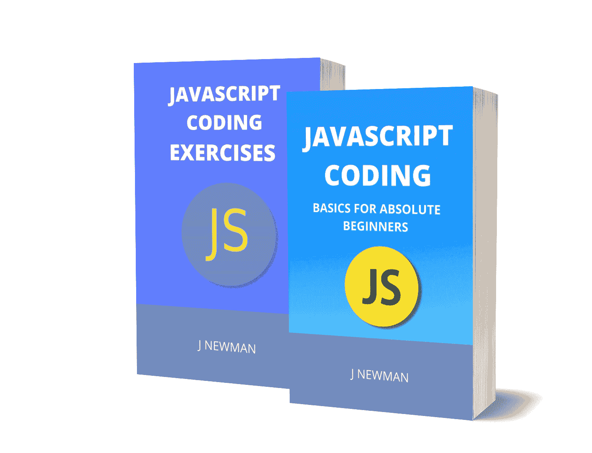


## 学习 JavaScript

JavaScript 是一种轻量级、跨平台的基于对象的脚本语言。

JavaScript 是一种翻译型语言，而不是编译型语言。JavaScript 解析器（内置在浏览器中）负责为网络浏览器翻译 JavaScript 代码。

JavaScript (`js`) 是一种轻量级的面向对象的编程语言，被许多网站用于编写网页。

当应用于 HTML 文档时，它是一种解释型的、功能齐全编程语言，能够实现网站的动态交互。它首次发布于 1995 年，允许用户在 Netscape Navigator 浏览器的网页中添加程序。

从那时起，所有其他图形浏览器都接纳了它。用户可以使用 JavaScript 创建现代 Web 应用，实现实时交互，而无需每次都重新加载页面。`Js` 用于标准网站以提供各种交互性和简易性。另一方面，JavaScript 与 Java 语言没有关系。

## JavaScript 的特性

由于内置了环境，所有流行的网络浏览器都支持 JavaScript。

JavaScript 的语法和结构基于 C 语言语言。因此它归类为结构化编程语言。JavaScript 是一种弱类型语言，对某些类型具有隐式转换（取决于操作）。JavaScript 是一种通过原型而非类进行继承的面向对象的编程语言。它是一种简单的解释型语言。该语言区分大小写。JavaScript 支持 Windows、macOS 和 Linux 在内的多种操作系统。它赋予了用户对浏览器的完全控制。


### JavaScript 示例
```javascript
<script>
document.write("Hello by JavaScript");
</script>
```

### JavaScript 注释

JavaScript 注释是传递信息的有效手段。它用于包含代码相关信息，例如警告或建议，以便终端用户理解。内置在浏览器中的 JavaScript 引擎忽略注释。

#### 优点 - JavaScript 注释

为了使其更易理解，它可以用于解释代码以便让终端用户理解。为了避免编写不必要的代码，它还可以防止代码运行。我们有时会添加代码来执行某些操作，但过一段时间后可能需要禁用这些代码。在这种情况下，利用注释是更好的。

## JavaScript 注释 - 类型

1. 单行注释
2. 多行注释

### 单行注释

双斜杠 (`//`) 用于指示此类注释。在语句之前之后使用它都是适当的。让我们来看单行注释的示例，即放置在语句之前的注释。

```javascript
<script>
//这是单行注释
document.write("javascript");
</script>
```

示例
```javascript
<script>
var a=10;
var b=20;
var c=a+b;//加上 a 和 b 的值
document.write(c);//打印 10 和 20 的和
</script>
```

### 多行注释

它可以用于创建单行和多行注释。因此它更实用。它的符号是正斜杠后跟星号，然后是另一个正斜杠。它可能出现在语句之前、之后或中间。

```javascript
<script>
/*这是多行注释。
这些内容不会被显示*/
document.write("example of javascript multiline comment");
</script>
```

# JavaScript 变量

JavaScript 变量仅仅是存储位置的名称。在 JavaScript 中，有两种变量：局部变量和全局变量。在声明 JavaScript 变量时，有一些需要遵循的指南（也称为标识符）。

名称必须以字母（a 到 z 或 A 到 Z）、下划线 (`_`) 或美元符号 (`$`)开头。我们可以在初始字母后放置数字（0 到 9），例如 `value1`。JavaScript 中的变量区分大小写，所以 `x` 和 `X` 是两个独立的变量。

## 正确的 JavaScript 变量
```javascript
var x = 10;
var _value="sonoo";
```

## 错误的 JavaScript 变量
```javascript
var 123=30;
var *aa=320;
```

### 示例 - JavaScript 变量
```javascript
<script>
var x = 10;
var y = 20;
var z=x+y;
document.write(z);
</script>
```
#### 输出
30

## JavaScript 局部变量

JavaScript 中的局部变量在块或函数内部。只能从函数或块内部访问。考虑以下场景：

```javascript
<script>
function abc(){
var x=10;//局部变量
}
</script>
```
或者，
```javascript
<script>
If(10<13){
var y=20;//JavaScript 局部变量
}
</script>
```

## JavaScript 全局变量

JavaScript 中的全局变量可以从任何函数访问。全局变量是在函数外部或使用 window 对象声明的变量。考虑以下场景：

```javascript
<script>
var data=200;//全局变量
function a(){
document.writeln(data);
}
function b(){
document.writeln(data);
}
a();//调用 JavaScript 函数
b();
</script>
```


JavaScript 中的全局变量是在函数外部声明的，或者通过 `window` 对象声明。你可以从任何函数访问它。

让我们来看一个简单的全局变量 JavaScript 示例。

```javascript
<script>  
  var value=50;//全局变量  
  function a(){  
  alert(value);  
  }  
  function b(){  
  alert(value);  
  }  
</script>
```

### 在 JavaScript 函数内部声明全局变量

你必须利用 `window` 对象在函数内部声明 JavaScript 全局变量。考虑以下场景：

1.  `window.value=90;`

现在它可以在任何函数内部声明，并从任何函数内部访问。考虑以下场景：

```javascript
function m(){  
  window.value=100;//通过 window 对象声明全局变量  
}  
function n(){  
  alert(window.value);//从其他函数访问全局变量  
} 
```

### 在 JavaScript 中，全局变量的内部机制

当你在函数外部声明变量时，它会被添加到 `window` 对象中。你也可以使用 `window` 对象来访问它。考虑以下场景：

```javascript
var value=50;  
function a(){  
  alert(window.value);//访问全局变量  
} 
```

# JavaScript 数据类型

JavaScript 提供了不同的数据类型来存储各种类型的值。在 JavaScript 中，有两种数据类型。

1. 原始数据类型（Primitive data type）
2. 非原始（引用）数据类型

JavaScript 是一种动态类型语言，这意味着你不需要指定变量的类型，因为 JavaScript 引擎动态地使用它。要指定数据类型，必须使用 `var`。它可以存储任何类型的值，包括数字、字符串等。考虑以下场景：

```javascript
var a=40;//存储数字  
var b="Rahul";//存储字符串  
```

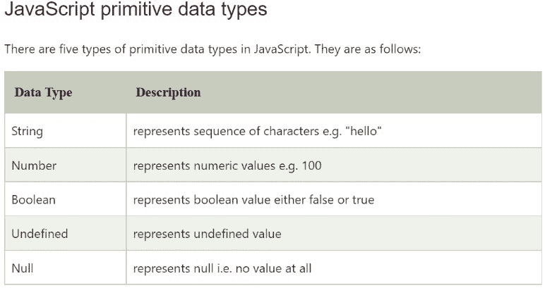
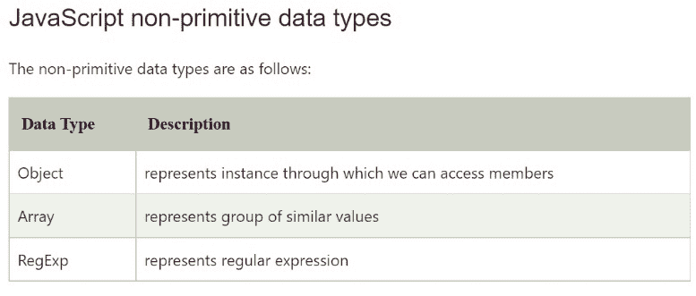

# JavaScript 运算符

JavaScript 中的运算符是用于对操作数执行操作的符号。考虑以下场景：

```javascript
var sum=10+20;  
```

在这里，`+` 是算术运算符

而 `=` 是赋值运算符。

JavaScript 中运算符的类型。

1. 算术运算符
2. 比较（关系）运算符
3. 位运算符
4. 逻辑运算符
5. 赋值运算符
6. 特殊运算符

## JavaScript 算术运算符

为了对操作数进行算术操作，使用了算术运算符。JavaScript 算术运算符是下面列出的运算符。

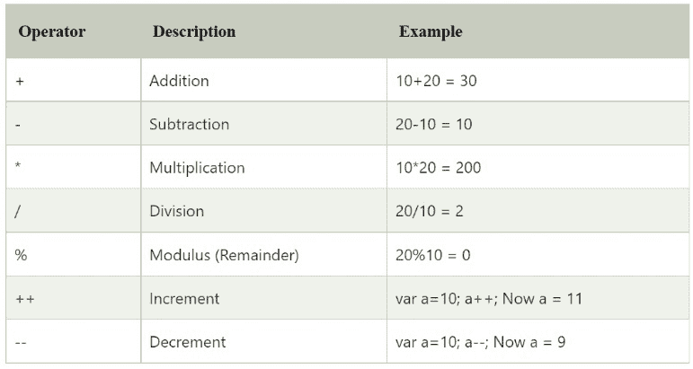

## JavaScript 比较运算符

JavaScript 中的比较运算符比较两个操作数。以下是比较运算符：

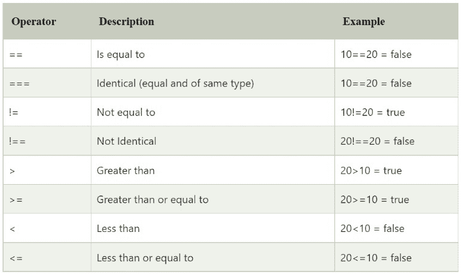

## JavaScript 位运算符

在操作数上，位运算符执行按位操作。以下是位运算符：

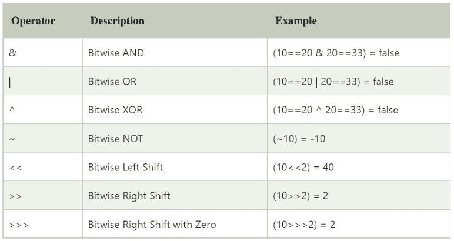

## JavaScript 逻辑运算符

JavaScript 逻辑运算符是下面列出的运算符。

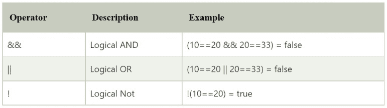

## JavaScript 赋值运算符

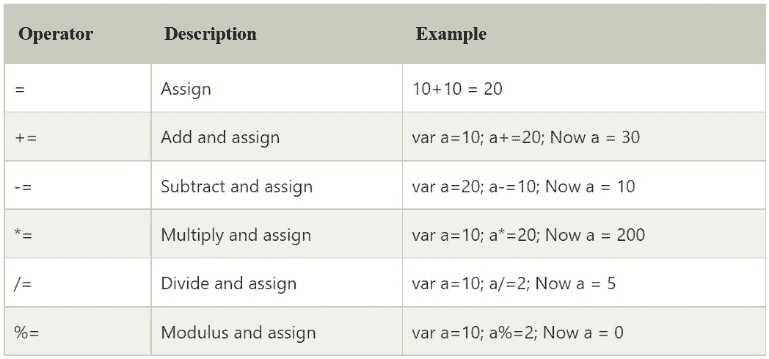

## JavaScript 特殊运算符

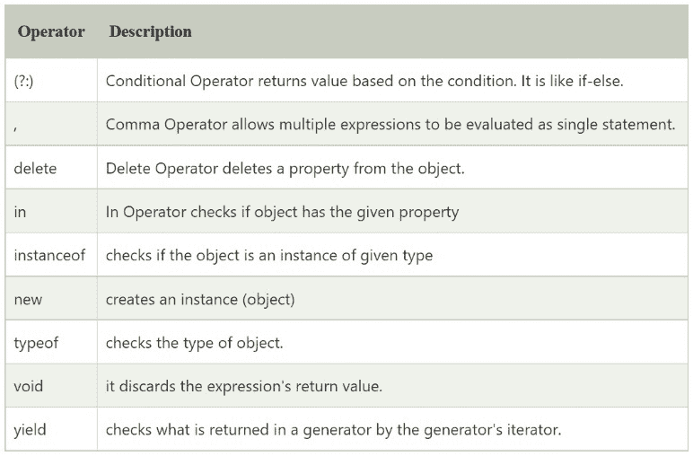

# JavaScript If-else

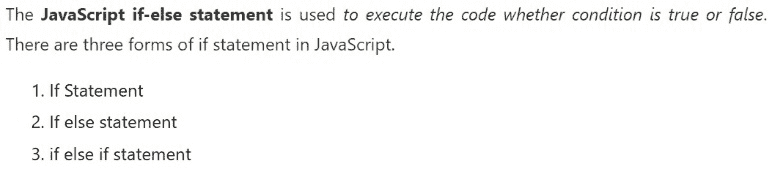

### JavaScript If 语句

只有当 if 表达式为真时，它才会评估内容。JavaScript 中的 `if` 语句具有以下签名。

```javascript
if(expression){  
//要评估的内容  
}  
```

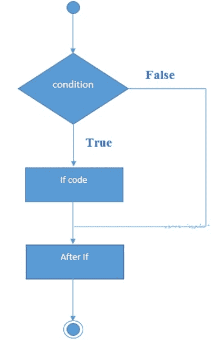

示例

```javascript
<script>  
  var a=20;  
  if(a>10){  
  document.write("value of a is greater than 10");  
  }  
</script>
```
输出
value of a is greater than 10

### JavaScript If...else 语句

它通过评估内容来确定条件是真是假。JavaScript 中 `if-else` 语句的语法所示：

```javascript
if(expression){  
//如果条件为真，则评估的内容  
}  
else{  
//如果条件为假，则评估的内容  
}  
```

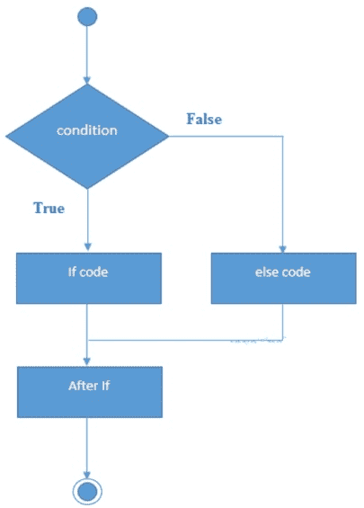
示例

```javascript
<script>  
  var a=20;  
  if(a%2==0){  
  document.write("a is even number");  
  }  
  else{  
  document.write("a is odd number");  
  }  
</script>
```
输出
a is even

### If...else 语句 – 在 Javascript 中

当一个或多个表达式为真时，它会分析内容。JavaScript 中的 `else if` 语句具有以下签名。

```javascript
if(expression1){  
//如果 expression1 为真，则评估的内容  
}  
else if(expression2){  
//如果 expression2 为真，则评估的内容  
}  
else if(expression3){  
//如果 expression3 为真，则评估的内容  
}  
else{  
// 如果没有表达式为真，则评估的内容  
}  
```

示例

```javascript
<script>  
  var a=20;  
  if(a==10){  
  document.write("a is equal to 10");  
  }  
  else if(a==15){  
  document.write("a is equal to 15");  
  }  
  else if(a==20){  
  document.write("a is equal to 20");  
  }  
  else{  
  document.write("a is not equal to 10, 15 or 20");  
  }  
</script>
```
输出
a is equal to 20

# JavaScript Switch

`switch` 语句用于将多个表达式组合到一起代码中。它与我们在上一页学过的 `else if` 语句相同。然而，它比 `if..else..if` 更用，因为它可以用于整数、字符和其他变量。

`switch` 语句的签名所示：

```javascript
switch(expression){  
  case value1:  
  要执行的代码;  
  break;  
  case value2:  
  要执行的代码;  
  break;  
  ......
  default:  
  如果上述值都不匹配，则执行的代码；  
}  
```

简单示例 - switch 语句 - javascript。

```javascript
<script>  
  var grade='B';  
  var result;  
  switch(grade){  
    case 'A': result="A Grade";  
    break;  
    case 'B': result="B Grade";  
    break;  
    case 'C': result="C Grade";  
    break;  
    default:  
    result="No Grade";  
  }  
  document.write(result);  
</script>
```
输出
B Grade

switch 语句的行为

```javascript
<script>  
  var grade='B';  
  var result;  
  switch(grade){  
    case 'A':  
    result+="A Grade";  
    case 'B':  
    result+="B Grade";  
    case 'C':  
    result+="C Grade";  
    default:  
    result+="No Grade";  
  }  
  document.write(result);  
</script>
```
输出
undefined B Grade No Grade

# JavaScript 循环

`for`、`while`、`do while` 和 `for-in` 循环用于在 JavaScript 中迭代代码段。它减少了代码的大小。它们最出现在数组中。

1. for 循环
2. while 循环
3. do-while 循环
4. for-in 循环

## 1) JavaScript For 循环

JavaScript 中的 `for` 循环按照指定的次数迭代组件。如果迭代次数已知，则应该使用它。`for` 循环的语法所示：

```javascript
for(initialization; condition; increment) {  
  要执行的代码  
} 
```

示例

```javascript
<script>  
  for (i=1; i<=5; i++) {  
  document.write(i + "<br/>")  
  }  
</script>
```
输出：
1
2
3
4
5

## 2) JavaScript while 循环

JavaScript 中的 `while` 循环无限次迭代组件。如果迭代次数未知，则应该使用它。`while` 循环的语法所示：

```javascript
while(condition) {  
  要执行的代码  
} 
```

示例

```javascript
<script>  
  var i=11;  
  while (i<=15) {  
  document.write(i + "<br/>");  
  i++;  
  }  
</script>
```
输出
11
12
13
14
15

## 3) Do while 循环

JavaScript `do while` 循环与 `while` 循环一样，无限迭代元素。无论条件是真是假，代码都至少执行一次。以下是 `do while` 循环的语法：

```javascript
do{
  要执行的代码
} 
```


```javascript
}while (condition);
```

### 示例

```html
<script>
  var i=21;
  do{
    document.write(i + "<br/>");
    i++;
  }while (i<=25);
</script>
```

**输出:**
21
22
23
24
25

## 4) JavaScript for in 循环

JavaScript 的 `for in` 循环用于遍历对象的属性。

# JavaScript 函数

为了执行操作，需要 JavaScript 函数。为了重用代码，我们可以多次调用 JavaScript 函数。

### 使用 JavaScript 的优势

JavaScript 函数主要有两个优势：

 ** **代码的可重用性**：因为我们可以多次调用函数，所以可以节省编码时间。
- **更少的代码**：更少的代码意味着我们的程序更紧凑。为了完成一项常见任务，我们不需要每次都编写许多行代码。

### JavaScript 函数语法

```javascript
function functionName([arg1, arg2, ...argN]){
  //要要执行的代码
}
```

### 示例

```html
<script>
  function msg(){
    alert("hello! this is message");
  }
</script>
<input type="button" onclick="msg()" value="call function"/>
```

### JavaScript 函数参数

```html
<script>
  function getcube(number){
    alert(number*number*number);
  }
</script>
<form>
  <input type="button" value="click" onclick="getcube(4)"/>
</form>
```

### 带返回值的函数

我们可以通过调用在程序中使用返回返回值的函数。让我们看一个返回返回值的函数作为示例。

```html
<script>
  function getInfo(){
    return "hello javatpoint! How r u?";
  }
</script>
<script>
  document.write(getInfo());
</script>
```

**输出**
hello javatpoint! How r u?

### JavaScript 函数对象

JavaScript 中的 `Function Object() { [native code] }` 用于生成一个新的 `Function` 对象。它在全局范围内运行代码。然而，当我们直接调用函数 `Object() { [native code] }` 时，会动态构建一个函数，但是不安全的。

### 语法

```javascript
new Function ([arg1[, arg2[, ....argn]],] functionBody)
```

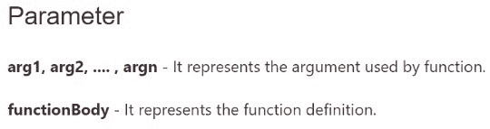
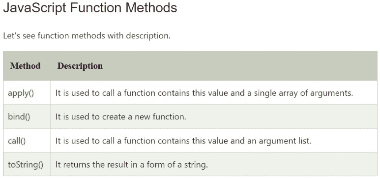

### JavaScript 函数对象

### 示例

```html
<script>
  var add=new Function("num1","num2","return num1+num2");
  document.writeln(add(2,5));
</script>
```
**输出:**
7

### 示例 2

```html
<script>
  var pow=new Function("num1","num2","return Math.pow(num1,num2)");
  document.writeln(pow(2,3));
</script>
```
**输出:**
8

# JavaScript 对象

JavaScript 对象是一个基于状态和行为的实体（属性和方法）。例如，汽车、笔、自行车、椅子、玻璃杯、键盘和显示器。

JavaScript 是一种面向对象的编程语言。在 JavaScript 中，一切皆都是对象。

JavaScript 是一种基于模板的语言，而不是基于类的。要获取对象，我们不需要构建类。然而，我们直接指导对象的创建。

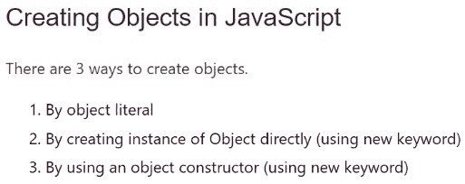
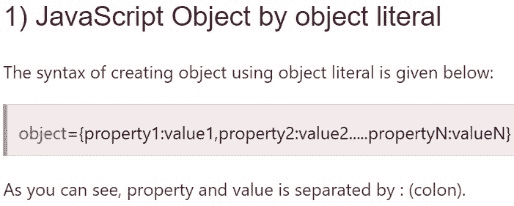

**示例**

```html
<script>
  emp={id:102,name:"Shyam Kumar",salary:40000}
  document.write(emp.id+" "+emp.name+" "+emp.salary);
</script>
```
**输出**
102 Shyam Kumar 40000

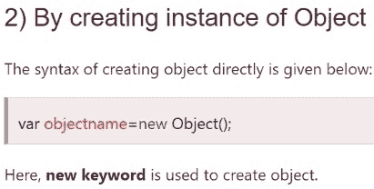

**示例**

```html
<script>
  var emp=new Object();
  emp.id=101;
  emp.name="Ravi Malik";
  emp.salary=50000;
  document.write(emp.id+" "+emp.name+" "+emp.salary);
</script>
```
**输出**
101 Ravi Malik 50000

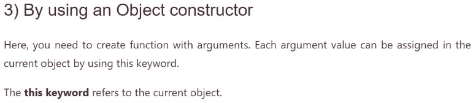

**示例**

```html
<script>
  function emp(id,name,salary){
    this.id=id;
    this.name=name;
    this.salary=salary;
  }
  e=new emp(103,"Vimal Jaiswal",30000);
  document.write(e.id+" "+e.name+" "+e.salary);
</script>
```
**输出**
103 Vimal Jaiswal 30000

## 定义方法 - JavaScript 对象

在 JavaScript 对象中，我们可以指定方法。然而，在定义方法之前，我们必须向函数添加一个与方法同名的属性。

**示例**

```html
<script>
  function emp(id,name,salary){
    this.id=id;
    this.name=name;
    this.salary=salary;
    this.changeSalary=changeSalary;
    function changeSalary(otherSalary){
      this.salary=otherSalary;
    }
  }
  e=new emp(103,"Sonoo Jaiswal",30000);
  document.write(e.id+" "+e.name+" "+e.salary);
  e.changeSalary(45000);
  document.write("<br>"+e.id+" "+e.name+" "+e.salary);
</script>
```
**输出**
103 Sonoo Jaiswal 30000
103 Sonoo Jaiswal 45000

## JavaScript 对象

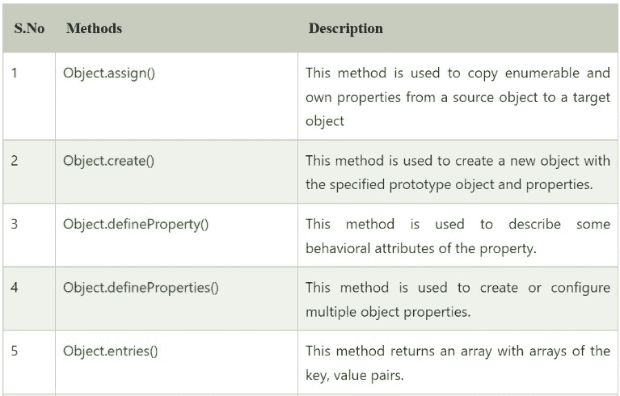
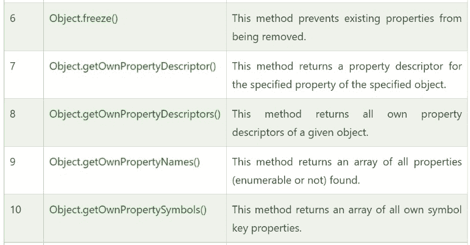
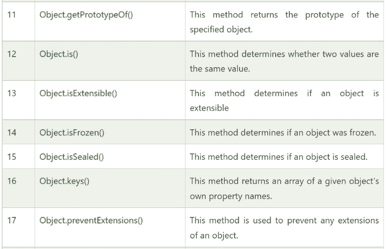
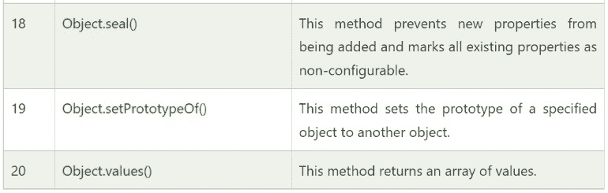

# JavaScript 数组

JavaScript 数组是一个表示相同类型对象的对象。在 JavaScript 中，有三种创建数组的方法：
1. 数组字面量
2. 直接（`new` 关键字）
3. 数组构造函数

### 1) 数组字面量

双引号用于构建字符串字面量。以下是使用数组字面量创建数组的语法：

```javascript
var arrayname=["value1","value2"...valueN];
```

**示例**

```html
<script>
  var emp=["Sonoo","Vimal","Ratan"];
  for(i=0;i<emp.length;i++){
    document.write(emp[i]+"<br>");
  }
</script>
```
**输出:**
Sonoo
Vimal
Ratan

### 2) 直接创建数组

`new` 关键字用于创建数组实例。以下是直接创建数组的语法：

```javascript
var arrayname=new Array();
```

**示例**

```html
<script>
  var emp=new Array();
  emp[0]="Arun";
  emp[1]="Varun";
  emp[2]="John";
  for(i=0;i<emp.length;i++){
    document.write(emp[i]+"<br>");
  }
</script>
```
**输出:****

### 3) 数组构造函数

为了不需要显式提供值，你必须通过向函数 `Array() { [native code] }` 传递参数来创建数组实例。

```javascript
var emp=new Array("value1","value2","value3");
```

**示例**

```html
<script>
  var emp=new Array("Jai","Vijay","Smith");
  for(i=0;i<emp.length;i++){
    document.write(emp[i]+"<br>");
  }
</script>
```
**输出:**
Jai
Vijay
Smith

## JavaScript 数组方法

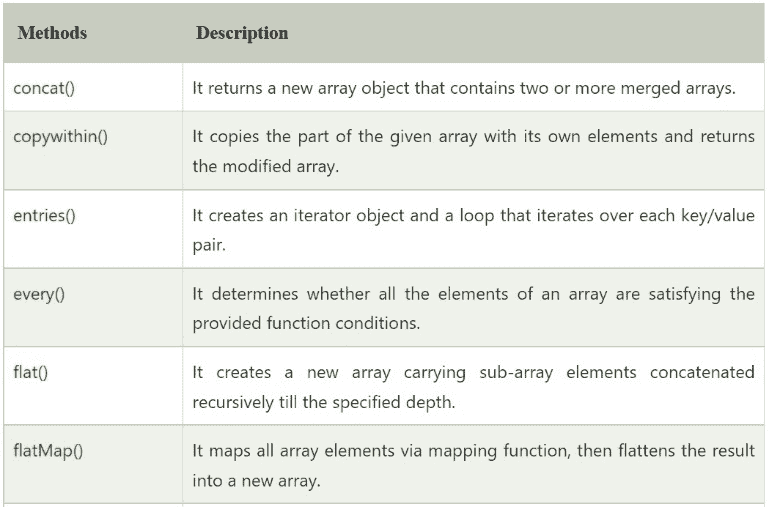
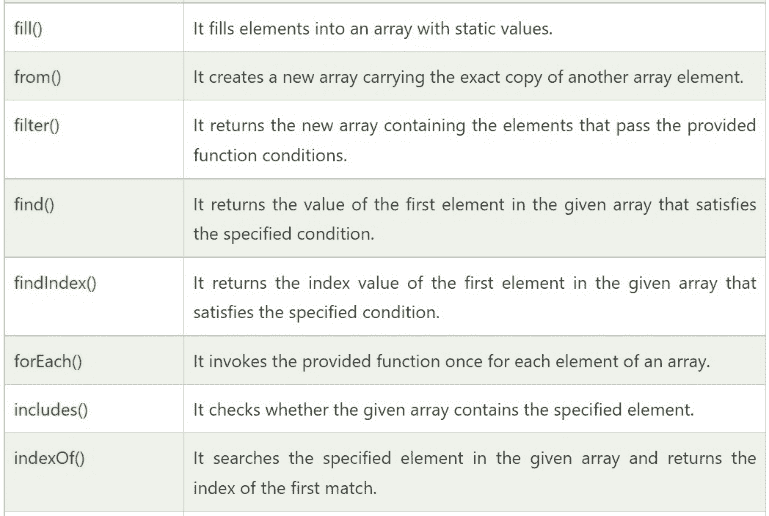
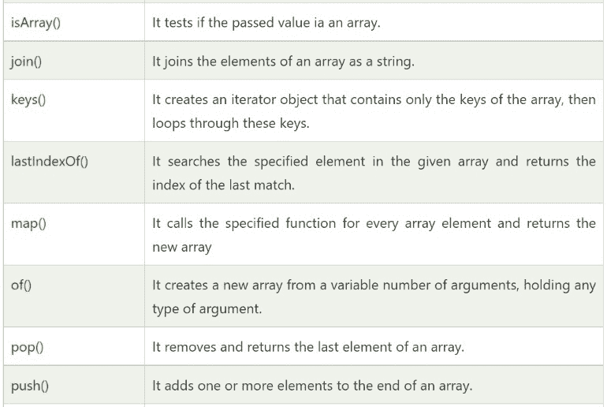
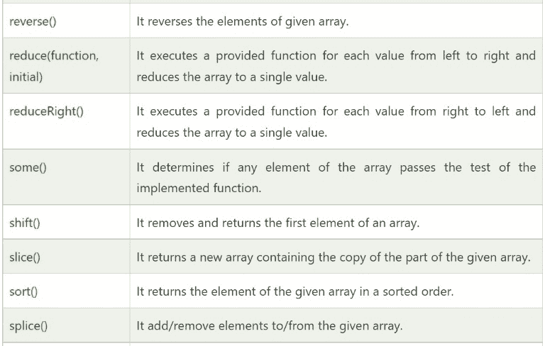
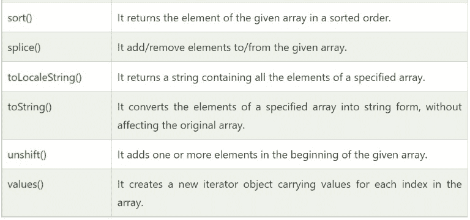

# JavaScript 字符串

JavaScript 字符串是表示字符字符串的对象。在 JavaScript 中，有两种方法字符串：
1. 字符串字面量
2. 字符串对象（使用 `new` 关键字）

### 1) 字符串字面量

双引号用于构建字符串字面量。以下是使用字符串字面量创建字符串的语法：

```javascript
var stringname="string value";
```

**示例**

```html
<script>
  var str="This is string literal";
  document.write(str);
</script>
```
**输出:**
This is string literal

### 2) 字符串对象（使用 `new` 关键字）

以下是使用 `new` 关键字创建字符串对象的语法：

```javascript
var stringname=new String("string literal");
```

**示例**

```html
<script>
  var stringname=new String("hello javascript string");
  document.write(stringname);
</script>
```
**输出:**
hello javascript string

## JavaScript 字符串方法

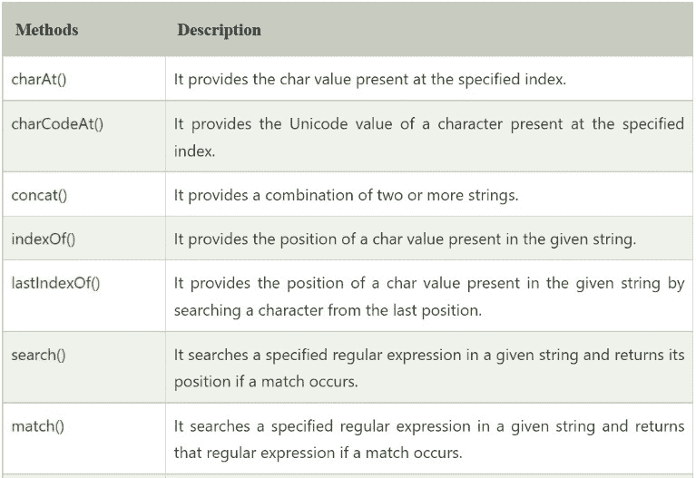
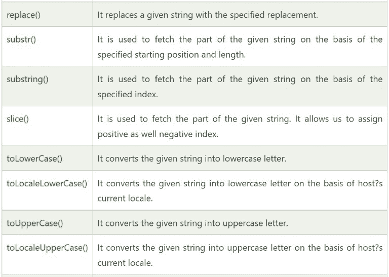
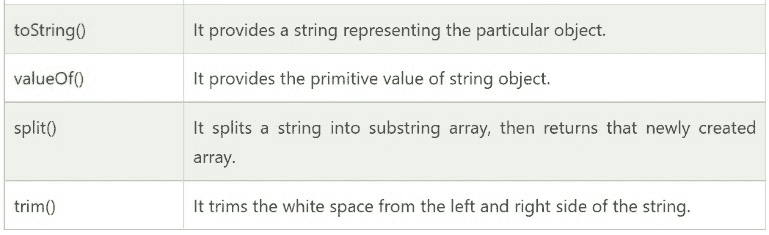

# JavaScript Date 对象

你可以使用 JavaScript Date 对象获取年份、月份和日期。JavaScript Date 对象可以在网页上显示计时器。


要生成日期对象（date object），你可以使用多种 `Date` 构造函数。它具有获取和设置日、月、年、小时、分钟和秒的方法。

## 构造函数

4 种 `Date` 构造函数的变体：

1. `Date()`
2. `Date(milliseconds)`
3. `Date(dateString)`
4. `Date(year, month, day, hours, minutes, seconds, milliseconds)`

## JavaScript Date 方法

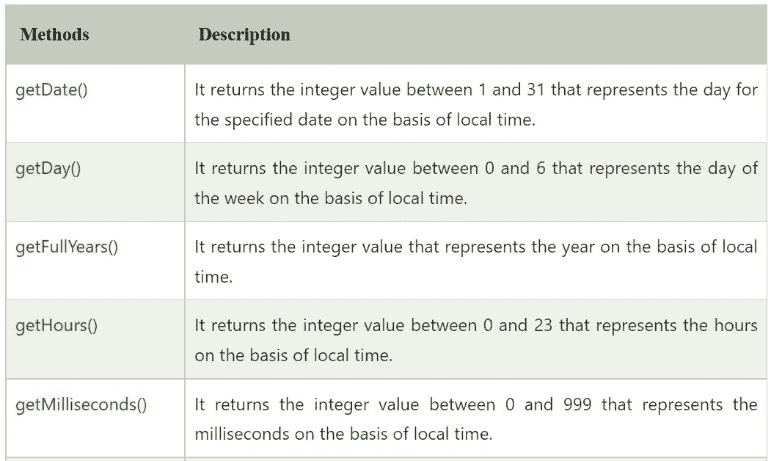
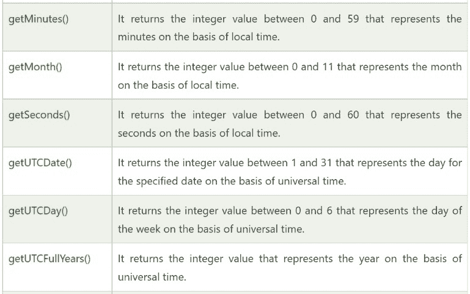
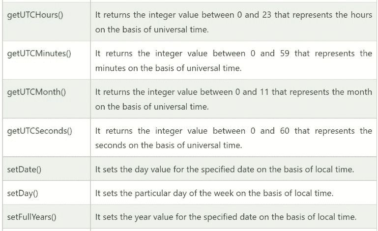
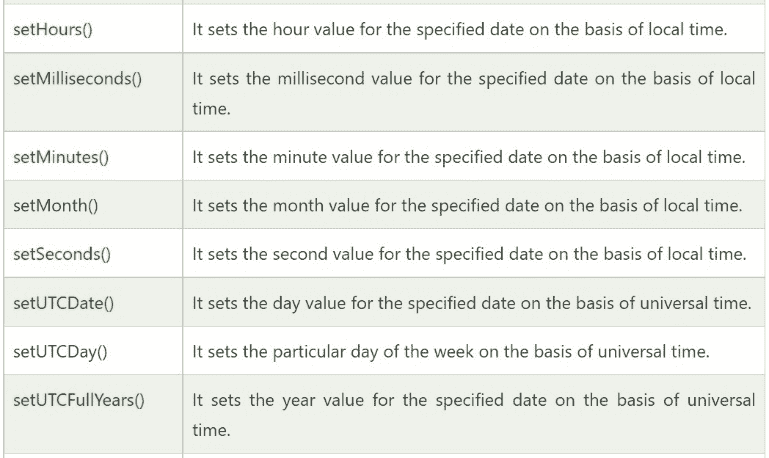
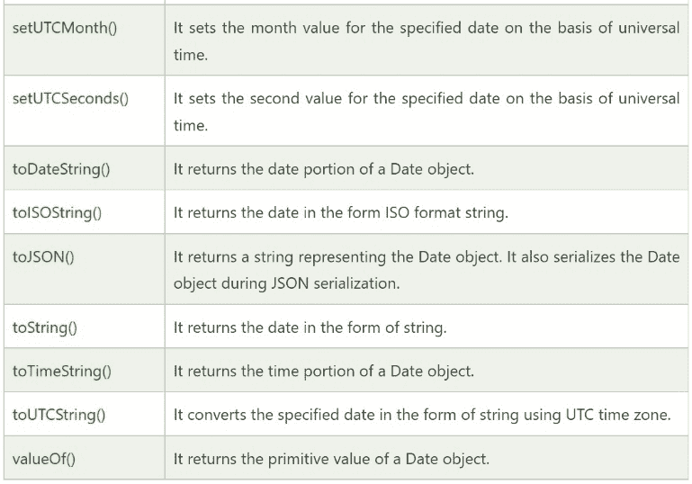

### JavaScript Date 

1. 当前日期和时间：<span id="txt"></span>

2. <script>
```javascript
var today=new Date();
document.getElementById('txt').innerHTML=today;
```
</script>

输出

Current Date and Time: Sat Feb 12 2022 23:47:52 GMT+0530 (India Standard Time)

示例 2

1. <script>
```javascript
var date=new Date();
var day=date.getDate();
var month=date.getMonth()+1;
var year=date.getFullYear();
document.write("<br>Date is: "+day+"/"+month+"/"+year);
```
</script>

### JavaScript 当前时间示例

1. 当前时间：<span id="txt"></span>

2. <script>
```javascript
var today=new Date();
var h=today.getHours();
var m=today.getMinutes();
var s=today.getSeconds();
document.getElementById('txt').innerHTML=h+":"+m+":"+s;
```
</script>

### 数字钟示例

让我们来看一个使用 JavaScript 日期对象显示数字钟的简单示例。

在 JavaScript 中，你可以使用 `setTimeout()` 或 `setInterval()` 方法指定间隔时间。

示例

1. 当前时间：<span id="txt"></span>

2. <script>
```javascript
window.onload=function(){getTime()}
function getTime(){
  var today=new Date();
  var h=today.getHours();
  var m=today.getMinutes();
  var s=today.getSeconds();
  // 在数字小于 10 时前面加一个零
  m=checkTime(m);
  s=checkTime(s);
  document.getElementById('txt').innerHTML=h+":"+m+":"+s;
  setTimeout(function(){getTime()},1000);
}
//setInterval("getTime()",1000);//另一种方法
function checkTime(i){
  if (i<10){
    i="0" + i;
  }
  return i;
}
```
</script>

### JavaScript Math

为了进行数学运算，JavaScript `math` 对象提供了各种常量和方法。与日期对象不同，它没有构造函数。

### JavaScript Math 方法

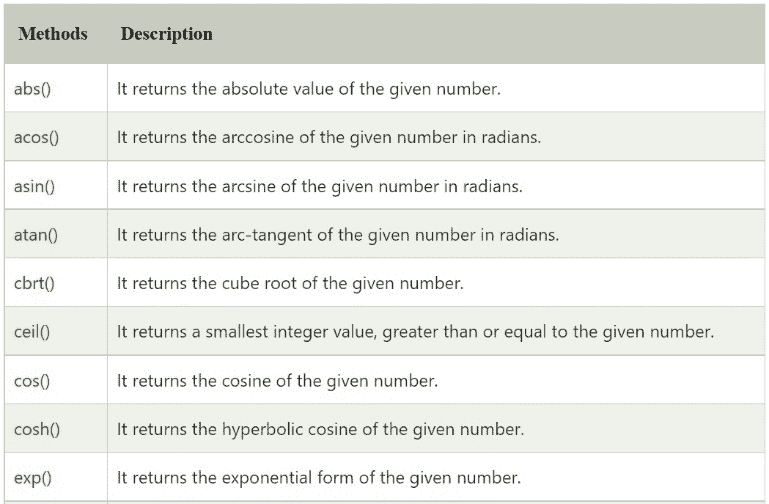
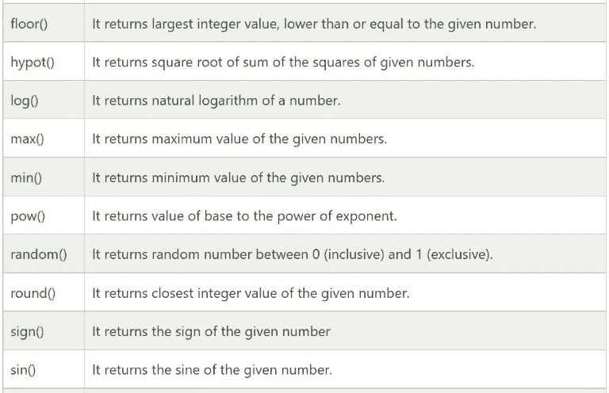
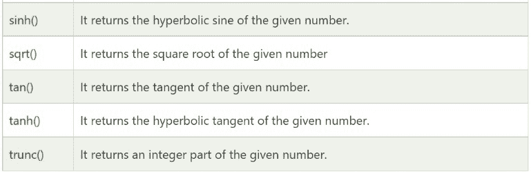

### Math.sqrt(n)

`math.sqrt(n)` 方法返回数的平方根。

1. 17 的平方根是：<span id="p1"></span>

2. <script>
```javascript
document.getElementById('p1').innerHTML=Math.sqrt(17);
```
</script>

输出：

17 的平方根是：4.123105625617661

### Math.random()

JavaScript 中的 `math.random()` 方法返回一个 0 到 1 之间的随机数。

1. 随机数是：<span id="p2"></span>

2. <script>
```javascript
document.getElementById('p2').innerHTML=Math.random();
```
</script>

输出：

随机数是：0.02157876559753591

### Math.pow(m,n)

1. 3 的 4 次方是：<span id="p3"></span>

2. <script>
```javascript
document.getElementById('p3').innerHTML=Math.pow(3,4);
```
</script>

输出：

3 的 4 次方是：81

### Math.floor(n)

`math.floor(n)` 方法返回数的最小整数。例如，3.7 返回 3，5.9 返回 5，以此类推。

1. 4.6 的向下取整是：<span id="p4"></span>

2. <script>
```javascript
document.getElementById('p4').innerHTML=Math.floor(4.6);
```
</script>

输出：

4.6 的向下取整是：4

### Math.ceil(n)

JavaScript 中的 `math.ceil(n)` 方法返回给定值的最大整数。例如，3.7 返回 4，5.9 返回 6，以此类推。

1. 4.6 的向上取整是：<span id="p5"></span>

2. <script>
```javascript
document.getElementById('p5').innerHTML=Math.ceil(4.6);
```
</script>

输出：

4.6 的向上取整是：5

### Math.round(n)

JavaScript 中的数学运算。`round(n)` 方法为提供的数字提供最近的舍入整数。如果小数部分等于或大于 0.5，则赋值为较大的值 1；否则，赋值为较小的值 0。例如，3.7 返回 4，3.3 返回 3，5.9 返回 6，以此类推。

1. 4.3 的四舍五入是：<span id="p6"></span>
2. 4.7 的四舍五入是：<span id="p7"></span>

3. <script>
```javascript
document.getElementById('p6').innerHTML=Math.round(4.3);
document.getElementById('p7').innerHTML=Math.round(4.7);
```
</script>

输出：

4.3 的四舍五入是：4
4.7 的四舍五入是：5

### JavaScript Number

`Number` 对象表示整数或浮点数。它用于转换和解析字符串表达式。`Number()` 构造函数返回指定参数的数值。如果参数无法转换为数字，则返回 `NaN`。

`isNaN()` 方法判断值是否为 `NaN`。`Number.isFinite()` 方法判断值是否为有限数字。`Number.isInteger()` 方法判断值是否为整数。`Number.parseInt()` 和 `Number.parseFloat()` 方法分别将字符串解析为整数和浮点数。

`Number.toString()` 方法返回数字的字符串表示。`Number.toFixed()` 方法返回带有小数点后指定数字数的数字字符串。

`Number.prototype.toPrecision()` 和 `toExponential()` 方法用于格式化数字。`Number.MAX_VALUE` 和 `Number.MIN_VALUE` 常量代表最大和最小的数值。`Number.MAX_SAFE_INTEGER` 和 `Number.MIN_SAFE_INTEGER` 常量代表安全整数的范围。

`Number.PI` 常量提供圆周长与直径比的值。`Number.E` 常量提供欧数的值。

`Number.Object()` 用于创建 `Number` 对象。`Number.from()` 用于从数组或迭代对象创建数字。`Number.reverse()` 用于反转数组。`Number.sort()` 用于排序数组。`Number.map()` 用于映射数组。`Number.filter()` 用于过滤数组。`Number.reduce()` 用于归约数组到单个值。`Number.find()` 用于查找数组元素。`Number.findIndex()` 用于查找数组元素的索引。`Number.some()` 用于检查数组是否至少有一个元素通过测试。`Number.every()` 用于检查数组是否所有元素都通过测试。`Number.slice()` 用于提取数组部分。`Number.splice()` 用于修改数组。`Number.push()` 用于向数组添加元素。`Number.pop()` 用于移除最后一个元素。`Number.shift()` 用于移除第一个元素。`Number.unshift()` 用于在数组开头添加元素。`Number.concat()` 用于合并数组。`Number.join()` 用于将数组连接成字符串。

（注：原文后续部分存在大量重复的描述，翻译时已根据要求进行处理并保留核心逻辑）


#### 输出

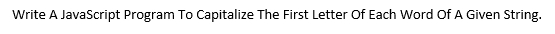

### 拼接两个字符串

### 排除它们的第一个字符

#### HTML CODE

```html
<!DOCTYPE html>
<html>
<head>
  <meta charset="utf-8">
  <meta name="viewport" content="width=device-width">
  <title>除第一个字符外拼接两个字符串的 JavaScript 程序</title>
</head>
<body>
</body>
</html>
```

#### JAVASCRIPT CODE

```javascript
function concatenate(str1, str2) {
  str1 = str1.substring(1, str1.length);
  str2 = str2.substring(1, str2.length);
  return str1 + str2;
}
console.log(concatenate("PHP","JS"));
console.log(concatenate("A","B"));
console.log(concatenate("AA","BB"));
```

#### Output:
HPS
AB

### 创建一个新字符串 

#### HTML CODE

```html
<!DOCTYPE html>
<html>
<head>
  <meta charset="utf-8">
  <meta name="viewport" content="width=device-width">
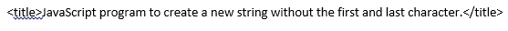
</head>
<body>
</body>
</html>
```

#### JAVASCRIPT CODE

```javascript
function without_first_end(str) {
  return str.substring(1, str.length - 1);
}
console.log(without_first_end('JavaScript'));
console.log(without_first_end('JS'));
console.log(without_first_end('PHP'));
```

#### Output:
avaScrip
H

### 第一次未重复的字符

## 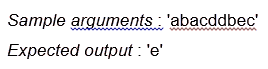

#### HTML CODE

```html
<!DOCTYPE html>
<html>
<head>
  <meta charset="utf-8">
  <title>查找第一个未重复的字符</title>
</head>
<body>
</body>
</html>
```

#### JAVASCRIPT CODE

```javascript
function find_FirstNotRepeatedChar(str) {
  var arra1 = str.split('');
  var result = '';
  var ctr = 0;
  for (var x = 0; x < arra1.length; x++) {
    ctr = 0;
    for (var y = 0; y < arra1.length; y++) {
      if (arra1[x] === arra1[y]) {
        ctr+= 1;
      }
    }
    if (ctr < 2) {
      result = arra1[x];
      break;
    }
  }
  return result;
}
console.log(find_FirstNotRepeatedChar('abacddbec'));
```

#### 输出
e

### 统计字符串内元音的数量

### 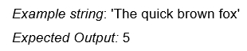

#### HTML CODE

```html
<!DOCTYPE html>
<html>
<head>
  <meta charset=utf-8 />
  <title>统计字符串内元音的数量</title>
</head>
<body>
</body>
</html>
```

#### JAVASCRIPT CODE

```javascript
function vowel_count(str1) {
  var vowel_list = 'aeiouAEIOU';
  var vcount = 0;
  for(var x = 0; x < str1.length ; x++) {
    if (vowel_list.indexOf(str1[x]) !== -1) {
      vcount += 1;
    }
  }
  return vcount;
}
console.log(vowel_count("The quick brown fox"));
```

#### 输出
5

### 查找字符串内最长的单词

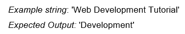

#### HTML CODE

```html
<!DOCTYPE html>
<html>
<head>
  <meta charset=utf-8 />
  <title>查找字符串内最长的单词</title>
</head>
<body>
</body>
</html>
```

#### JAVASCRIPT CODE

```javascript
function find_longest_word(str) {
  var array1 = str.match(/\w[a-z]{0,}/gi);
  var result = array1[0];
  for(var x = 1 ; x < array1.length ; x++) {
    if(result.length < array1[x].length) {
      result = array1[x];
    }
  }
  return result;
}
console.log(find_longest_word('Web Development Tutorial'));
```

#### 输出
Development

### 检查数字是否为质数

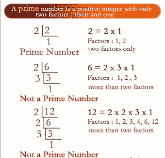

#### HTML CODE

```html
<!DOCTYPE html>
<html>
<head>
  <meta charset=utf-8 />
  <title>检查数字是否为质数</title>
</head>
<body>
</body>
</html>
```

#### JAVASCRIPT CODE

```javascript
function test_prime(n) {
  if (n===1) {
    return false;
  } else if(n === 2) {
    return true;
  }else {
    for(var x = 2; x < n; x++) {
      if(n % x === 0) {
        return false;
      }
    }
    return true; 
  }
}
console.log(test_prime(37));
```

#### 输出
True

### 从数组中找到第二小的和第二数

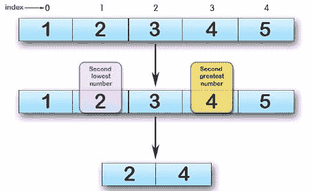

#### HTML CODE

```html
<!DOCTYPE html>
<html>
<head>
  <meta charset=utf-8 />
  <title>从数组中找到第二小的和第二大的数</title>
</head>
<body>
</body>
```

#### JAVASCRIPT CODE

```javascript
function Second_Greatest_Lowest(arr_num) {
  arr_num.sort(function(x,y) {
    return x-y;
  });
  var uniqa = [arr_num[0]];
  var result = [];
  for(var j=1; j < arr_num.length; j++) {
    if(arr_num[j-1] !== arr_num[j]) {
      uniqa.push(arr_num[j]);
    }
  }
  result.push(uniqa[1],uniqa[uniqa.length-2]);
  return result.join(',');
}
console.log(Second_Greatest_Lowest([1,2,3,4,5]));
```

#### 输出
2,4

### 获取数据类型

#### HTML CODE

```html
<!DOCTYPE html>
<html>
<head>
  <meta charset=utf-8 />
  <title>检测数据类型</title>
</head>
<body>
</body>
</html>
```

#### JAVASCRIPT CODE

```javascript
function detect_data_type(value) {
  var dtypes = [Function, Number, String, Object], x, len;
  if (typeof value === "object") {
    for (x = 0; x < dtypes.length; x++) {
      if (value instanceof dtypes[x]) {
        return dtypes[x];
      }
    }
  }
  return typeof value;
}
console.log(detect_data_type(12));
console.log(detect_data_type('w'));
console.log(detect_data_type(false));
```

#### 输出
number
string
boolean

### 将给定的两位正整数的两个数字相和

#### HTML CODE

```html
<!DOCTYPE html>
<html>
<head>
  <meta charset="utf-8">
  <title>将给定的两位正整数的两个数字相加的 JavaScript 程序</title>
</head>
<body>
</body>
</html>
```

#### JAVASCRIPT CODE

```javascript
function add_two_digits(n) {
  return n % 10 + Math.floor(n / 10);
}
console.log(add_two_digits(25));
console.log(add_two_digits(50));
```

#### 输出:
7
5

### 检查给定的正数是否是 3 的倍数或 7 的倍数

## 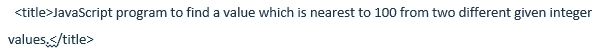

#### HTML CODE

```html
<!DOCTYPE html>
<html>
<head>
  <meta charset="utf-8">
  <meta name="viewport" content="width=device-width">
  <title>检查给定的正数是否是 3 的倍数或 7 的倍数的 JavaScript 程序</title>
</head>
<body>
</body>
</html>
```

#### JAVASCRIPT CODE

```javascript
function test37(x) {
  if (x % 3 == 0 || x % 7 == 0) {
    return true;
  } else {
    return false;
  }
}
console.log(test37(12));
console.log(test37(14));
console.log(test37(10));
console.log(test37(11));
```

#### 输出:
true
true
false
false


### HTML
<html
<head>
  <meta charset="utf-8">
  <meta name="viewport" content="width=device-width">
  <title>检查字符串是否以 'Java' 开头否则返回 false 的 JavaScript 程序</title>
</head>
<body>
</body>
</html>

#### JAVASCRIPT 代码
```javascript
function start_spec_str(str)
{
  if (str.length < 4)
  {
    return false;
  }
  front = str.substring(0, 4);
  if (front == 'Java')
  {
    return true;
  }
  else
  {
    return false;
  }
}
console.log(start_spec_str("JavaScript"));
console.log(start_spec_str("Java"));
console.log(start_spec_str("Python"));
```
#### 输出:
true
true
false

### 寻找接近 100 的值
#### HTML 代码
```html
<!DOCTYPE html>
<html
<head>
  <meta charset="utf-8">
  <meta name="viewport" content="width=device-width">
  
</head>
<body>
</body>
</html>
```
#### JAVASCRIPT 代码
```javascript
function near_100(x, y) {
  if (x != y)
  {
    x1 = Math.abs(x - 100);
    y1 = Math.abs(y - 100);
    if (x1 < y1)
    {
      return x;
    }
    if (y1 < x1)
    {
      return y;
    }
    return 0;
  }
  else
    return false;
}
console.log(near_100(90, 89));
console.log(near_100(-90, -89));
console.log(near_100(90, 90));
```
#### 输出:
90
-89
false

### 给定的两个整数值 - 检查
## 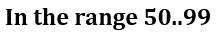
#### HTML 代码
```html
<!DOCTYPE html>
<html
<head>
  <meta charset="utf-8">
  <meta name="viewport" content="width=device-width">
  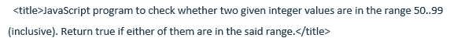
</head>
<body>
</body>
</html>
```
#### JAVASCRIPT 代码
```javascript
function check_numbers(x, y)
  {
  if ((x >= 50 && x <= 99) || (y >= 50 && y <= 99))
  {
    return true;
  }
  else
  {
    return false;
  }
}
console.log(check_numbers(12, 101));
console.log(check_numbers(52, 80));
console.log(check_numbers(15, 99));
```
#### 输出
false
true
true

### 正数 - 检查
## 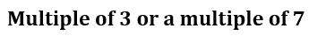
#### HTML 代码
```html
<!DOCTYPE html>
<html
<head>
  <meta charset="utf-8">
  <meta name="viewport" content="width=device-width">
  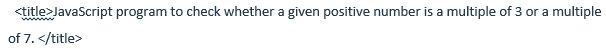
</head>
<body>
</body>
</html>
```
#### JAVASCRIPT 代码
```javascript
function test37(x)
{
  if (x % 3 == 0 || x % 7 == 0)
  {
    return true;
  }
  else {
    return false;
  }
}
console.log(test37(12));
console.log(test37(14));
console.log(test37(10));
console.log(test37(11));
```
#### 输出:
true
true
false
false

### 两个数的乘法和除法
#### HTML 代码
```html
<!DOCTYPE html>
<html>
<head>
<meta charset=utf-8 />

<style type="text/css">
body {margin: 30px;}
</style>
</head>
<body>
<form>
第 1 数字 : <input type="text" id="firstNumber" /><br>
第 2 数字: <input type="text" id="secondNumber" /><br>
<input type="button" onClick="multiplyBy()" Value="Multiply" />
<input type="button" onClick="divideBy()" Value="Divide" />
</form>
<p>结果为 : <br>
<span id = "result"></span></p>
</body>
</html>
```
#### JAVASCRIPT 代码
```javascript
function multiplyBy()
{
  num1 = document.getElementById("firstNumber").value;
  num2 = document.getElementById("secondNumber").value;
  document.getElementById("result").innerHTML = num1 * num2;
}
function divideBy()
{
  num1 = document.getElementById("firstNumber").value;
  num2 = document.getElementById("secondNumber").value;
  document.getElementById("result").innerHTML = num1 / num2;
}
```
#### 输出


### 字符串以 'Java' 开头 - 否则返回 false
#### HTML 代码
```html
<!DOCTYPE html>
<html>
<head>
  <meta charset="utf-8">
  <meta name="viewport" content="width=device-width">
  <title>检查字符串是否以 'Java' 开头否则返回 false 的 JavaScript 程序</title>
</head>
<body>
</body>
</html>
```
#### JAVASCRIPT 代码
```javascript
function start_spec_str(str)
{
  if (str.length < 4)
  {
    return false;
  }
  front = str.substring(0, 4);
  if (front == 'Java')
  {
    return true;
  }
  else
  {
    return false;
  }
}
console.log(start_spec_str("JavaScript"));
console.log(start_spec_str("Java"));
console.log(start_spec_str("Python"));
```
#### 输出:
true
true
false

### 转换温度
## 
#### HTML 代码
```html
<!DOCTYPE html>
<html>
<head>
  <meta charset="utf-8">
  <title>编写一个在摄氏度和华氏度之间转换温度的 JavaScript 程序</title>
</head>
<body>
</body>
</html>
```
#### JAVASCRIPT 代码
```javascript
function cToF(celsius)
{
  var cTemp = celsius;
  var cToFahr = cTemp * 9 / 5 + 32;
  var message = cTemp+'xB0C is ' + cToFahr + ' \xB0F.';
  console.log(message);
}
function fToC(fahrenheit)
{
  var fTemp = fahrenheit;
  var fToCel = (fTemp - 32) * 5 / 9;
  var message = fTemp+'xB0F is ' + fToCel+'xB0C.';
  console.log(message);
}
cToF(60);
fToC(45);
```
#### 输出


