# Javascript 编码：绝对初学者基础指南：快速学习编码的步步指南

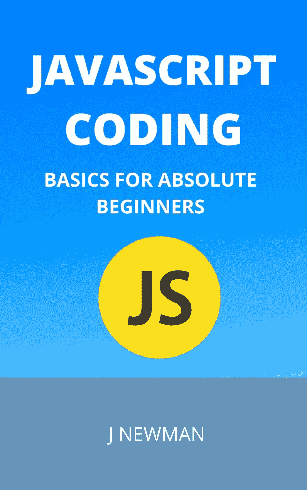

## 学习 JavaScript

JavaScript 是一种轻量级、跨平台的基于对象的脚本语言。

JavaScript 是一种译译型语言，而不是编译型语言。JavaScript 翻译器（内置在浏览器中）负责为 Web 浏览器翻译 JavaScript 代码。

JavaScript (`js`) 是一种轻量级的面向对象的编程语言，被许多网站用于编写网页脚本。

当应用于 HTML 文档时，它是一种解释型的、功能完备的编程语言，能够实现网站上的动态交互。它首次发布于 1995 年，允许用户在 Netscape Navigator 浏览器中向网页添加程序。

从那时起，所有其他图形网络浏览器都接受了它。用户可以使用 JavaScript 创建现代 Web 应用，实现即时交互，而无需每次都重新加载页面。Js 用于标准网站，以提供各种类型的交互性和简单性。

另一方面，JavaScript 与 Java 编程语言没有关系。

### JavaScript 的特性

- 由于它们内置了执行环境，所有流行的网络浏览器都支持 JavaScript。

- JavaScript 的语法和结构基于 C 语言语言。因此，它被归类为结构化语言。

- JavaScript 是一种弱类型语言，并对某些类型进行隐式转换（取决于具体操作）。

- JavaScript 是一种面向对象的编程语言，通过原型而非类进行继承。

- 它是一种简单且可解释的语言。

- 该语言对大小写敏感。

- JavaScript 兼容多种操作系统，包括 Windows、macOS 和 Linux。

- 它让用户对浏览器拥有完全控制权。

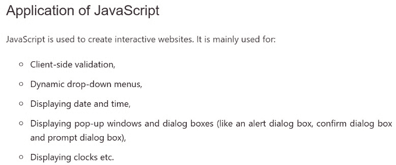

### JavaScript 示例

```javascript
<script>
  document.write("Hello JavaScript by JavaScript");
</script>
```

## JavaScript 注释

JavaScript 注释是传递信息的有效手段。它用于包含代码相关信息，如警告或建议，以便终端用户能够理解。

集成在浏览器中的 JavaScript 引擎会忽略 JavaScript 注释。

### 优点 - JavaScript 注

- 使代码更易于理解：它可以解释代码，以便终端用户能够理解。

- 避免编写不需要的代码：它也可以用于防止代码运行。我们有时添加代码来执行某些操作，但一段时间后可能需要禁用这些代码。在这种情况下，利用注释更为优。

## JavaScript 注释 - 类型

1. 单行注释

2. 多行注释

### 单行注释

使用双正斜杠 (`//`）来表示这种注释。在句子之前之后使用它都是合适的。

让我们来看一个单行注释的示例，即在语句之前的注释。

```javascript
<script>
  // 这是一个单行注释
  document.write("hello javascript");
</script>
```

### 示例

```javascript
<script>
  var a=10;
  var b=20;
  var c=a+b;//相加变量 a 和 b 的值
  document.write(c);//打印 10 和 20 的和
</script>
```

### 多行注释

它可以用于创建单行和多行注释。因此，它更具实用。

它的符号是一个正斜杠后跟星号，然后另一个正斜杠。考虑以下场景：

```javascript
/* 在此处输入你的代码 */
```

它可能出现在语句之前、之后或中间。

```javascript
<script>
  /* 这是一个多行注释。
  它将不会显示 */
  document.write("example of javascript multiline comment");
</script>
```

## JavaScript 变量

JavaScript 变量仅仅是存储位置的名称。在 JavaScript 中，有两种变量：局部变量和全局变量。

在声明 JavaScript 变量时，有一些需要遵循的指南（也称为标识符）。

- 名称必须以字母（a 到 z 或 A 到 Z）、下划线 (`_`) 或美元符号 (`$`) 开始。

- 可以在初始字母后放置数字（0 到 9），例如 `value1`。

- JavaScript 中的变量对大小写敏感，因此 `x` 和 `X` 是两个不同的变量。

### 正确的 JavaScript 变量

```javascript
var x = 10;
var _value="sonoo";
```

### 错误的 JavaScript 变量

```javascript
var 123=30;
var *aa=320;
```

### 示例 - JavaScript 变量

```javascript
<script>
  var x = 10;
  var y = 20;
  var z=x+y;
  document.write(z);
</script>
```

### 输出

30

## JavaScript 局部变量

JavaScript 中的局部变量在块或函数内部声明。它只能从函数或块内部访问。考虑以下场景：

```javascript
<script>
  function abc(){
    var x=10;//局部变量
  }
</script>
```

或者，

```javascript
<script>
  If(10<13){
    var y=20;//JavaScript 局部变量
  }
</script>
```

## JavaScript 全局变量

JavaScript 中的全局变量可以从任何函数访问。全局变量是在函数外部或使用 `window` 对象声明的变量。考虑以下场景：

```javascript
<script>
  var data=200;//全局变量
  function a(){
    document.writeln(data);
  }
  function b(){
    document.writeln(data);
  }
  a();//调用 JavaScript 函数
  b();
</script>
```

### JavaScript 全局变量

JavaScript 中的全局变量在函数外部或使用 `window` 对象声明。可以从任何函数访问它。

让我们来看一个全局变量的简单示例。

```javascript
<script>
  var value=50;//全局变量
  function a(){
    alert(value);
  }
  function b(){
    alert(value);
  }
</script>
```

### 在函数内部声明 JavaScript 全局变量

你必须利用 `window` 对象在函数内部声明全局变量。考虑以下场景：

```javascript
window.value=90;
```

它现在可以在任何函数内部声明，并从任何函数内部访问。考虑以下场景：

```javascript
function m(){
  window.value=100;//通过 window 对象声明全局变量
}
function n(){
  alert(window.value);//从其他函数访问全局变量
}
```

## JavaScript 数据类型

JavaScript 提供了不同的数据类型来存储不同类型的值。在 JavaScript 中，有两种数据类型。

1. 原生数据类型

2. 非原生数据类型（引用类型）

JavaScript 是一种动态类型语言，这意味着你不需要指定变量的类型，因为 JavaScript 引擎会动态地使用它。要指定数据类型，你必须使用 `var`。它可以存储任何类型的值，包括数字、字符串等。考虑以下场景：

1. `var a=40;//持有数字`

2. `var b="Rahul";//持有字符串`

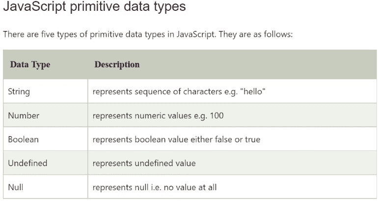

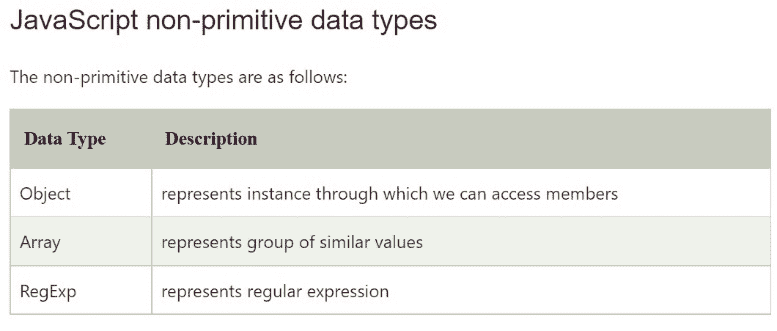

## JavaScript 运算符

JavaScript 中的运算符是对操作数执行操作的符号。考虑以下场景：

1. `var sum=10+20;`

在这里，`+` 是算术运算符

而 `=` 是赋值运算符。

JavaScript 运算符的类型：

1. 算术运算符

2. 比较（关系）运算符

3. 位运算符

4. 逻辑运算符

5. 赋值运算符

6. 特殊运算符

### JavaScript 算术运算符

为了对操作数进行算术运算，需要使用算术运算符。JavaScript 算术运算符是下面列出的运算符。

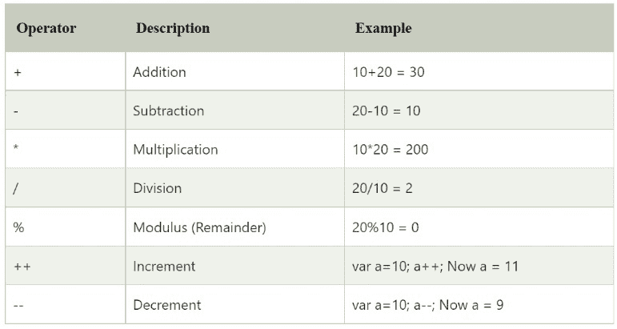

### JavaScript 比较运算符

JavaScript 中的比较运算符用于比较两个操作数。以下是比较运算符：

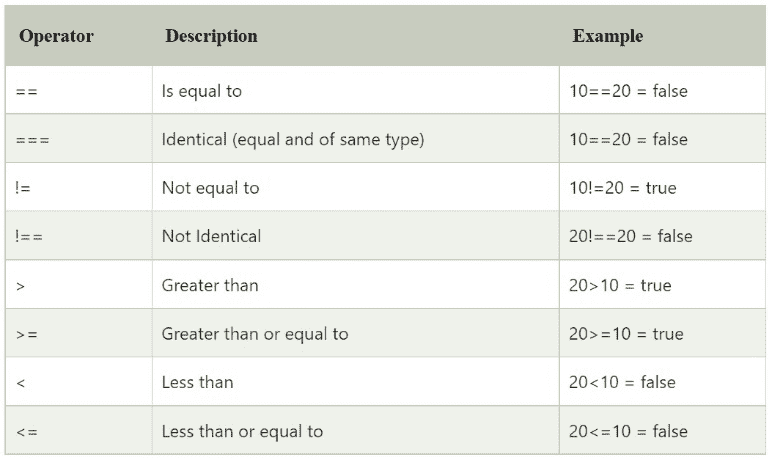

### JavaScript 位运算符

位运算符在操作数上执行位位操作。以下是位运算符：

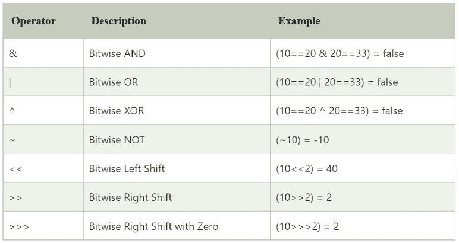

### JavaScript 逻辑运算符

JavaScript 逻辑运算符是下面列出的运算符。

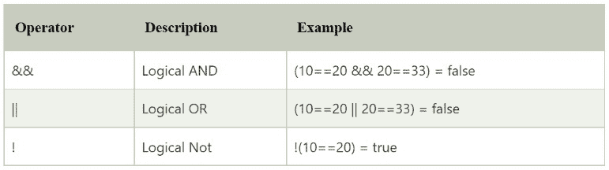

### JavaScript 赋值运算符

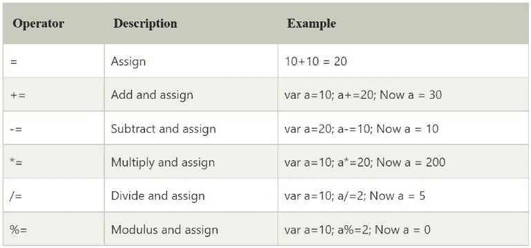

### JavaScript 特殊运算符

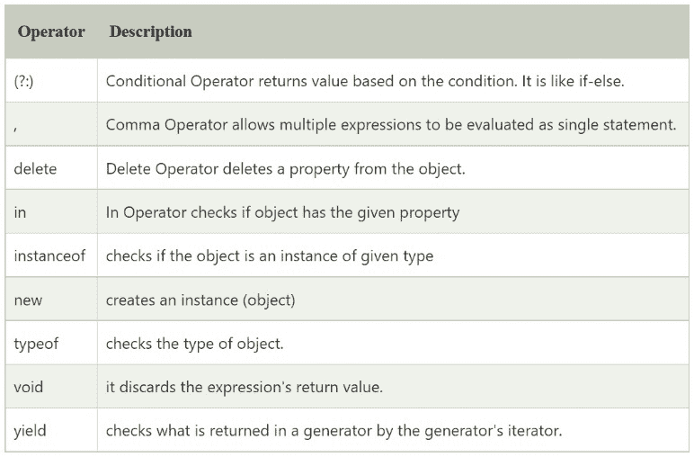

## JavaScript If-else

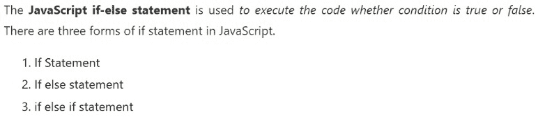

### JavaScript If 语句

只有当表达式为真时，才会评估内容。JavaScript 中的 `if` 语句具有以下签名。

```javascript
if(expression){
  //要评估的内容
}
```

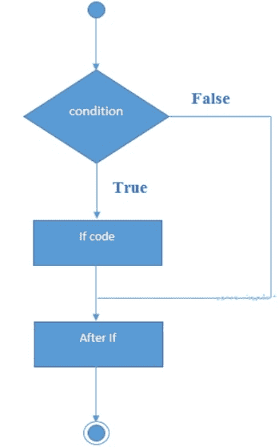

示例

```javascript
<script>
var a=20;
if(a>10){
  document.write("value of a is greater than 10");
}
</script>
```

输出

value of a is greater than 10

### JavaScript If...else 语句

它通过评估内容来确定条件是真是假。JavaScript 中 `if-else` 语句的语法所示。

```javascript
if(expression){
  // 如果条件为真，则评估的内容
}
else{
  // 如果条件为假，则评估的内容
}
```

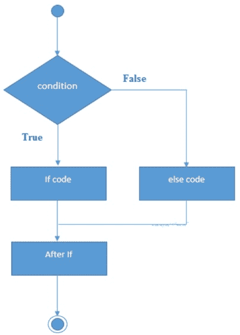

示例

```javascript
<script>
var a=20;
if(a%2==0){
  document.write("a is even number");
}
else{
  document.write("a is odd number");
}
</script>
```

输出

a is even number

### JavaScript 中的 If...else if 语句

只有当一个或多个表达式为真时，它才分析内容。JavaScript 中的 `if else if` 语句具有以下签名。

```javascript
if(expression1){
  // 如果 expression1 为真，则评估的内容
}
else if(expression2){
  // 如果 expression2 为真，则评估的内容
}
else if(expression3){
  // 如果 expression3 为真，则评估的内容
}
else{
  // 如果没有表达式为真，则评估的内容
}
```

示例

```javascript
<script>
var a=20;
if(a==10){
  document.write("a is equal to 10");
}
else if(a==15){
  document.write("a is equal to 15");
}
else if(a==20){
  document.write("a is equal to 20");
}
else{
  document.write("a is not equal to 10, 15 or 20");
}
</script>
```

输出

a is equal to 20

## JavaScript Switch

`switch` 语句用于将多个表达式组合到单代码中。它与我们在上一页学到的 `else if` 语句相同。然而，它比 `else..if` 更用，因为可以与整数、字符和其他变量一起。

`switch` 语句的签名所示。

```javascript
switch(expression){
  case value1:
    要执行的代码
    break;
  case value2:
    要执行的代码
    break;
  default:
    // 如果未匹配到上述值，则执行的代码；
}
```

简单示例 - switch - javascript。

```javascript
<script>
var grade='B';
var result;
switch(grade){
  case 'A': result="A Grade"; break;
  case 'B': result="B Grade"; break;
  case 'C': result="C Grade"; break;
  default: result="No Grade";
}
document.write(result);
</script>
```

输出

B Grade

switch 语句的行为

```javascript
<script>
var grade='B';
var result;
switch(grade){
  case 'A': result+="A Grade";
  case 'B': result+="B Grade";
  case 'C': result+="C Grade";
  default: result+="No Grade";
}
document.write(result);
</script>
```

输出

undefined B Grade C Grade No Grade

## JavaScript 循环

`for`、`while`、`do while` 和 `for-in` 循环用于在 JavaScript 中迭代代码。它减少了代码的大小。它最出现在数组中。

1. for 循循环

2. while 循环

3. do-while 循环

4. for-in 循环

### 1) JavaScript For 循环

JavaScript 中的循环按指定的次数迭代组件。如果迭代次数已知，则应该使用它。`for` 循环的语法所示。

```javascript
for (initialization; condition; increment){
  要执行的代码
}
```

示例

```javascript
<script>
for (i=1; i<=5; i++){
  document.write(i + "<br/>")
}
</script>
```

输出：

1

2

3

4

5

### 2) JavaScript while 循环

JavaScript 中的 `while` 循环无限次迭代组件。如果迭代次数未知，则应该使用它。`while` 循环的语法所示。

```javascript
while (condition){
  要执行的代码
}
```

示例

```javascript
<script>
var i=11;
while (i<=15){
  document.write(i + "<br/>");
}
</script>
```

输出：

11

12

13

14

15

### 3) Do while 循环

`do while` 循环像 `while` 循环一样迭代元素。无论条件是真是假，代码至少都会执行一次。以下是 `do while` 循环的语法。

```javascript
do{
  要执行的代码
}while(condition);
```

示例

```javascript
<script>
var i=21;
do{
  document.write(i + "<br/>");
  i++;
}while(i<=25);
</script>
```

输出

21

22

23

24

25

### 4) JavaScript for in 循环

`for in` 循环用于遍历对象的属性。

## JavaScript 函数

为了执行操作，需要 JavaScript 函数。为了重用代码，我们可以多次调用 JavaScript 函数。

使用 JavaScript 的好处

代码的可重用性：因为我们可以多次调用函数，所以可以节省编码时间。

更少的代码意味着我们的程序更紧凑。为了完成常见任务，我们每次不需要编写许多行代码。

### JavaScript 函数语法

```javascript
function functionName([arg1, arg2, ...argN]){
  //要执行的代码
}
```

示例

```javascript
<script>
function msg(){
  alert("hello! this is message");
}
</script>
<input type="button" onclick="msg()" value="call function"/>
```

### JavaScript 函数参参数

```javascript
<script>
function getcube(number){
  alert(number*number*number);
}
</script>
<form>
  <input type="button" value="click" onclick="getcube(4)"/>
</form>
```

### 带返回值的函数

我们可以通过调用在程序中使用返回返回值的函数。让我们看一个返回返回值的函数示例。

```javascript
<script>
```

```javascript
function getInfo(){
  return "hello javatpoint! How r u?";
}
</script> 
<script>
  document.write(getInfo());
</script>
```

OUTPUT

hello javatpoint! How r u?

### JavaScript 函数对象

JavaScript 中的 `Function` `Object() { [native code] }` 用于生成新的 `Function` 对象。它在全局范围内运行代码。然而，当我们直接调用函数 `Object() { [native code] }` 时，会动态构建一个函数，但是不安全的。

#### 语法

`new Function ([arg1[, arg2[, ....argn]],] functionBody)`

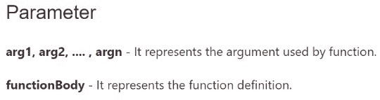

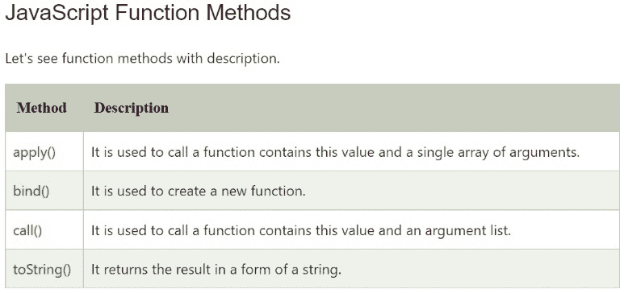

### JavaScript 函数对象

#### 示例

```javascript
<script>
  var add=new Function("num1","num2","return num1+num2");
  document.writeln(add(2,5));
</script>
```

Output:

7

#### 示例 2

```javascript
<script>
  var pow=new Function("num1","num2","return Math.pow(num1,num2)");
  document.writeln(pow(2,3));
</script>
```

Output:

8

## JavaScript 对象

JavaScript 对象是一个基于状态和行为的实体（属性和方法）。例如，汽车、笔、自行车、椅子、玻璃杯、键盘和显示器。

JavaScript 是一种面向对象的编程语言。在 JavaScript 中，一切都是对象。

JavaScript 是一种基于模板的语言，而不是基于类的。获取对象时我们不需要构建类。但是，我们直接创建对象。

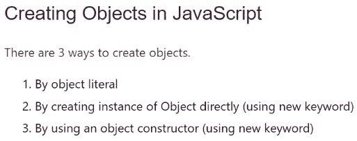

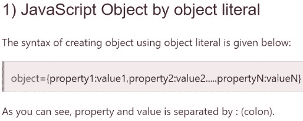

### 示例

```javascript
<script>
  emp={id:102,name:"Shyam Kumar",salary:40000}
  document.write(emp.id+" "+emp.name+" "+emp.salary);
</script>
```

OUTPUT

102 Shyam Kumar 40000

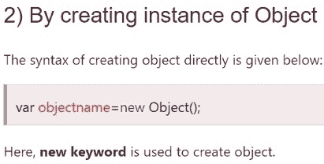

### 示例

```javascript
<script>
  var emp=new Object();
  emp.id=101;
  emp.name="Ravi Malik";
  emp.salary=50000;
  document.write(emp.id+" "+emp.name+" "+emp.salary);
</script>
```

OUTPUT

101 Ravi 50000

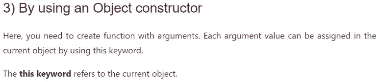

### 示例

```javascript
<script>
  function emp(id,name,salary){
    this.id=id;
    this.name=name;
    this.salary=salary;
  }
  e=new emp(103,"Vimal Jaiswal",30000);
  document.write(e.id+" "+e.name+" "+e.salary);
</script>
```

OUTPUT

103 Vimal Jaiswal 30000

### 定义方法 - JavaScript 对象

在 JavaScript 对象中，我们可以指定方法。然而，在定义方法之前，我们必须向函数添加一个与方法同名的属性。

#### 示例

```javascript
<script>
  function emp(id,name,salary){
    this.id=id;
    this.name=name;
    this.salary=salary;
    this.changeSalary=changeSalary;
    function changeSalary(otherSalary){
      this.salary=otherSalary;
    }
  }
  e=new emp(103,"Sonoo Jaiswal",30000);
  document.write(e.id+" "+e.name+" "+e.salary);
  e.changeSalary(45000);
  document.write("<br>"+e.id+" "+e.name+" "+e.salary);
</script>
```

OUTPUT

103 Sonoo Jaiswal 30000

103 Sonoo Jaiswal 45000

### JavaScript 对象方法

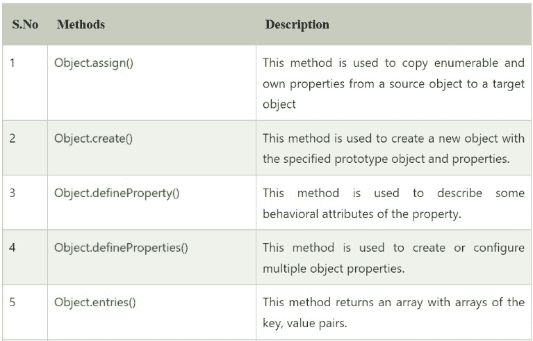

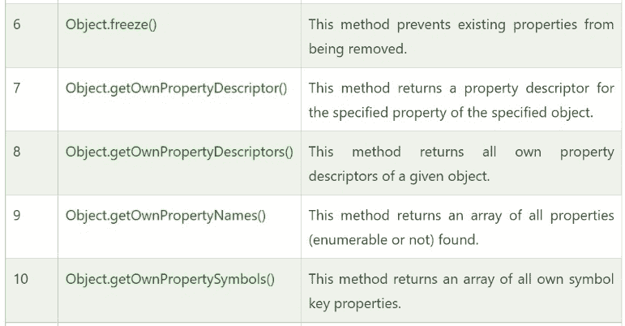

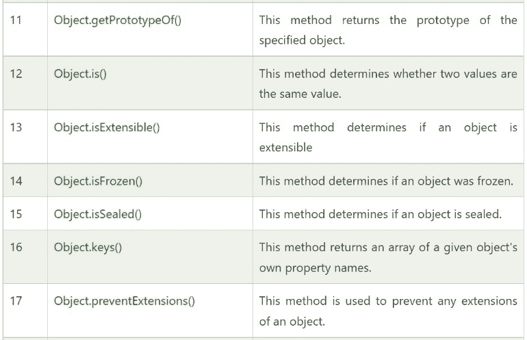

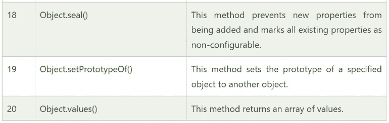

## JavaScript 数组

JavaScript 数组是一个表示相同类型对象组的对象。在 JavaScript 中，创建三种数组的方法：

1. 通过数组字面量

2. 直接创建 `Array` 实例（使用 `new` 关键字）

3. 通过使用 `Array` 构造函数（使用 `new` 关键字）

### 1) JavaScript 数组字面量

以下是使用数组字面量生成数组的语法：

`var arrayname=[value1,value2.....valueN];`

值包含在 `[]` 中并用逗号分隔。让我们来看一个 JavaScript 中创建和使用数组的简单示例。

```javascript
<script>
  var emp=["Sonoo","Vimal","atan"];
  for(i=0;i<emp.length;i++){
    document.write(emp[i]+"<br/>
  }
</script>
```

Output

Sonoo

Vimal

atan

### 2) JavaScript 直接创建数组

以下是创建数组的语法：

`var arrayname=new Array();`

在这种情况下，使用 `new` 关键字创建日期对象。让我们看看使用 `new` 关键字创建数组的示例。

```javascript
<script>
  var i;
  var emp=new Array();
  emp[0]="Arun";
  emp[1]="Varun";
  emp[2]="John";
  for(i=0;i<emp.length;i++){
    document.write(emp[i]+"<br>");
  }
</script>
```

Output

Arun

Varun

John

### 3) JavaScript 构造函数

这样我们通过传递参数给 `Array()` 来创建数组。

```javascript
<script>
  var i;
  var emp=new Array("Jai","Smith");
  for(i=0;i<emp.length;i++){
    document.write(emp[i]+"br>");
  }
</script>
```

Output

Jai

Smith

### JavaScript 数组方法

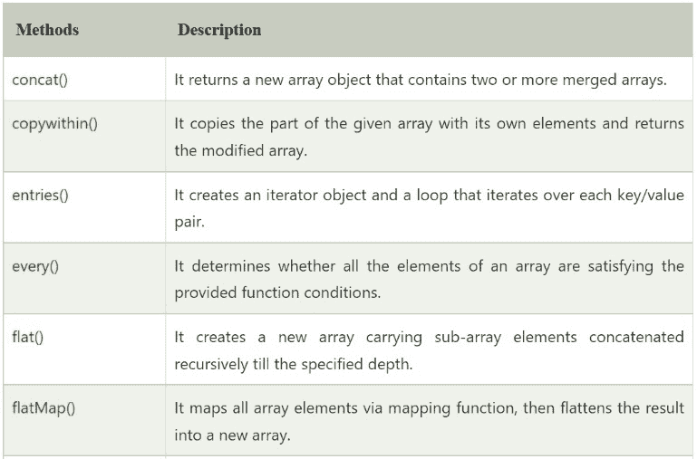

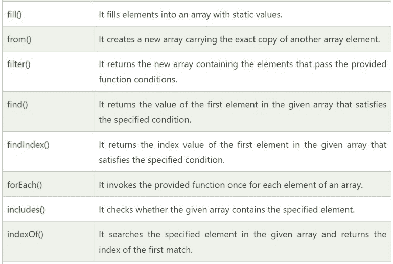

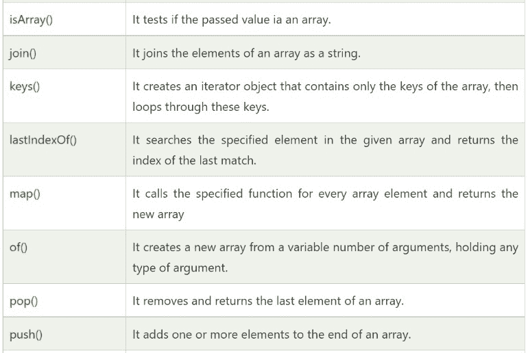

## JavaScript 字符串

JavaScript 字符串是表示字符的对象。在 JavaScript 中，有两种方法可以制作字符串：

1. 字符串字面量

2. 字符串对象（使用 `new` 关键字）

### 1) 字符串字面量

以下是使用字符串字面量生成字符串的语法：

`var stringname="value";`

值包含在双引号中。让我们来看一个 JavaScript 中创建和使用字符串的简单示例。

```javascript
<script>
  var str="This is";
  document.write(str);
</script>
```

Output

This is

### 2) 字符串对象（使用 `new` 关键字）

以下是使用 `new` 关键字创建字符串的语法：

`var stringname=new String("value");`

`new` 关键字用于创建字符串实例。让我们看看使用 `new` 关键字创建字符串的示例。

```javascript
<script>
  var str=new String("hello string");
  document.write(str);
</script>
```

Output

hello string

### JavaScript 字符串方法

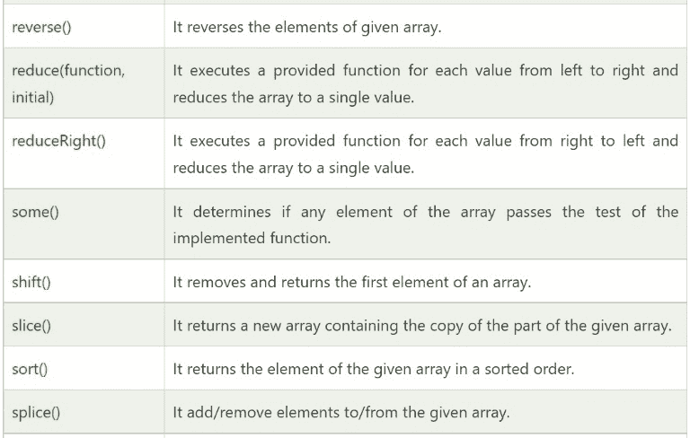

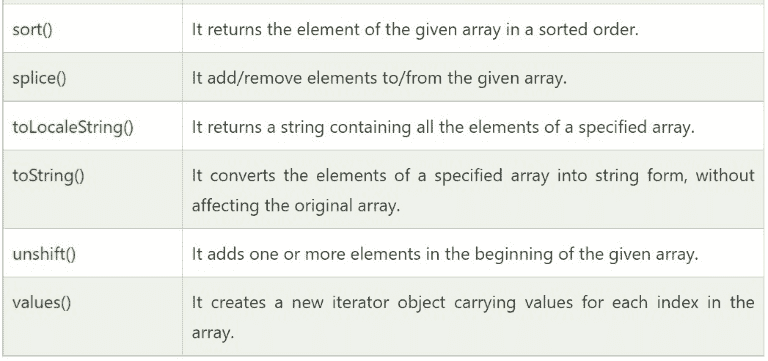

## JavaScript Date 对象

你可以使用 Date 对象获取年份、月份和日期。Date 对象可以用于在网页上显示计时器。要生成日期对象，你可以使用多种 `Date` 构造函数。它具有获取和设置日、月、年、小时、分和秒的方法。

### 构造函数

`Date` 构造函数的 4 种变：

1. `Date()`

2. `Date(milliseconds)`

3. `Date(dateString)`

4. `Date(year, month, day, hours, seconds, milliseconds)`

### JavaScript Date 方法

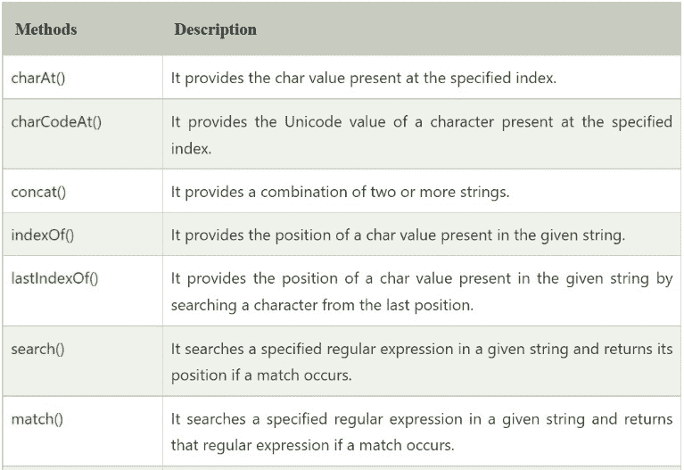

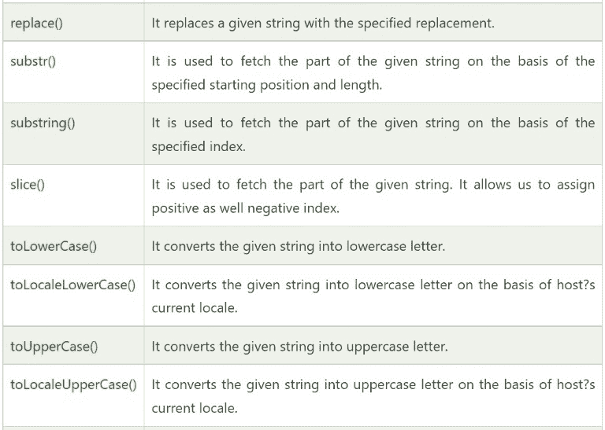

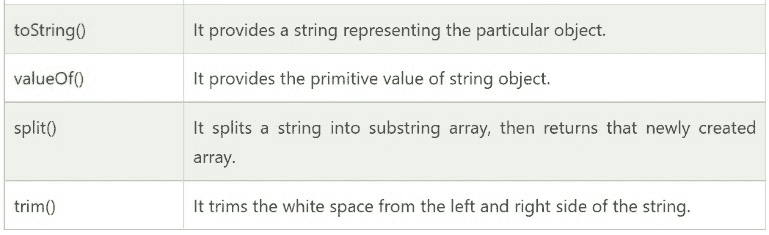

#### JavaScript Date 示例

```javascript
<script>
  var today=new Date();
  document.getElementById('txt').innerHTML=today;
</script>
```

OUTPUT

Current Date and Time: Sat Feb 12 2022 23:47:52 GMT+0530 (India Standard Time)

#### 示例 2

```javascript
<script>
  var date=new Date();
  var day=date.getDate();
  var month=date.getMonth()+1;
  var year=date.getFullYear();
  document.write("<br>Date is: "+day+"/"+month+"/"+year);
</script>
```

#### JavaScript 当前时间示例

```javascript
<script>
  var today=new Date();
  var h=today.getHours();
  var m=today.getMinutes();
  var s=today.getSeconds();
  document.getElementById('txt').innerHTML=h+":"+m+":"+s;
</script>
```

#### 数字时钟示例

让我们来看一个使用 JavaScript 日对象显示数字时钟的简单示例。在 JavaScript 中，你可以使用 `setTimeout()` 或 `setInterval()` 方法来指定间隔。

1. 当前时间：<span id="txt"></span>

```javascript
<script>
  window.onload=function(){getTime();}
  function getTime(){
  var today=new Date();
  var h=today.getHours();
  var m=today.getMinutes();
  var s=today.getSeconds();
  // add a zero in front of numbers<10 
  m=checkTime(m);
  s=checkTime(s);
  document.getElementById('txt').innerHTML=h+":"+m+":"+s;
  setTimeout(function(){getTime()},1000);
}
//setInterval("getTime()",1000);//another way
function checkTime(i){
  if (i<10){
    i="0" + i;
  }
  return i;
}
</script>
```

## JavaScript 数学

为了进行数学运算，JavaScript math 对象暴露了各种常量和方法。与 date 对象不同，它没有构造函数。

### JavaScript 数学方法

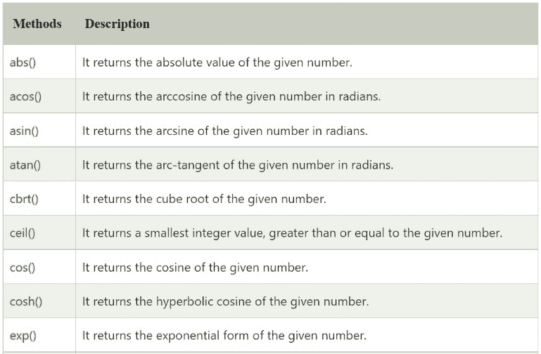

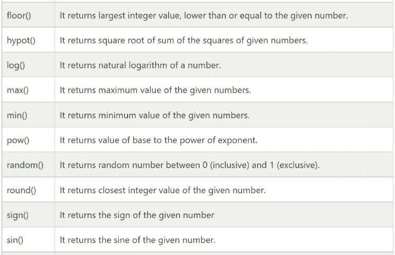

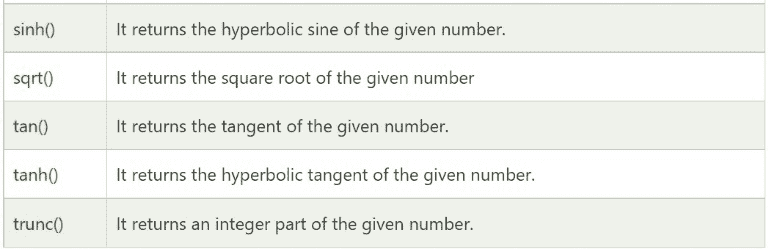

### Math.sqrt(n)

JavaScript `math.sqrt(n)` 方法返回数字的平方根。

1. 17 的平方根是：<span id="p1"></span>

```javascript
<script>
  document.getElementById('p1').innerHTML=Math.sqrt(17);
</script>
```

输出：

17 的平方根是：4.123105625617661

### Math.random()

JavaScript 中的 `math.random()` 方法返回一个 0 到 1 之间的随机数。

1. 随机数是：<span id="p2"></span>

```javascript
<script>
  document.getElementById('p2').innerHTML=Math.random();
</script>
```

输出：

随机数是：0.02157876559753591

### Math.pow(m,n)

1. 3 的 4 次方是：<span id="p3"></span>

```javascript
<script>
  document.getElementById('p3').innerHTML=Math.pow(3,4);
</script>
```

输出：

3 的 4 次方是：81

### Math.floor(n)

JavaScript `math.floor(n)` 方法返回数字的最小整数。例如，3.7 返回 3，5.9 返回 5，以此此类推。

1. 4.6 的取整是：<span id="p4"></span>

```javascript
<script>
  document.getElementById('p4').innerHTML=Math.floor(4.6);
</script>
```

输出：

4.6 的取整是：4

### Math.ceil(n)

JavaScript `math.ceil(n)` 方法返回给定值的最大整数。例如，3.7 返回 4，5.9 返回 6，以此此类推。

1. 4.6 的向上取整是：<span id="p5"></span>

```javascript
<script>
  document.getElementById('p5').innerHTML=Math.ceil(4.6);
</script>
```

输出：

4.6 的向上取整是：5

### Math.round(n)

JavaScript 中的数学运算。`round(n)` 方法为提供的数字提供最近的四舍五入整数。如果小数部分大于或等于 0.5，则赋值为较大的值 1；否则赋值为较小的值 0。例如，3.7 返回 4，3.3 返回 3，5.9 返回 6，以此此类推。

1. 4.3 的四舍五入是：<span id="p6"></span><br>

2. 4.7 的四舍五入是：<span id="p7"></span>

```javascript
<script>
  document.getElementById('p6').innerHTML=Math.round(4.3);
  document.getElementById('p7').innerHTML=Math.round(4.7);
</script>
```

输出：

4.3 的四舍五入是：4

4.7 的四舍五入是：5

## JavaScript Number 对象

你可以使用 JavaScript number 对象表示数值。它可以是整数或浮点数。JavaScript number 对象遵循表示浮点数的 IEEE 标准。

在 JavaScript 中，你可以使用 `Number()` 函数创建数字对象 Object() { [native code] }。考虑以下场景：

1. `var n=new Number(value);`

如果该值无法转换为数字，它将返回 `NaN`（不是数字），可以使用 `isNaN()` 方法进行验证。

你也可以直接将数字赋值给变量。考虑以下场景：

1. `var x=102;//整数值`

2. `var y=102.7;//浮点数值`

3. `var z=13e4;//指数值，输出：130000`

4. `var n=new Number(16);//通过数字对象的整数值`

输出：

102 102.7 130000 16

### JavaScript Number 常数

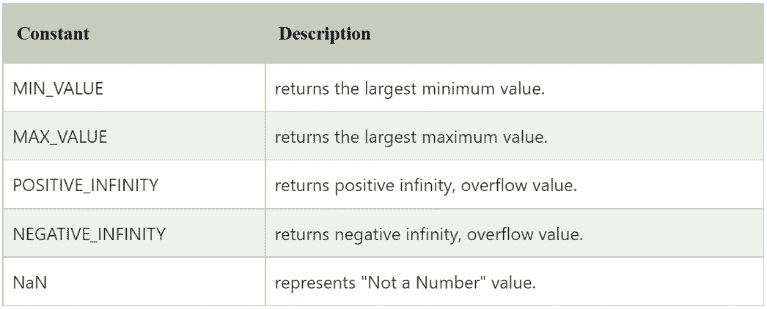

### JavaScript Number 方法

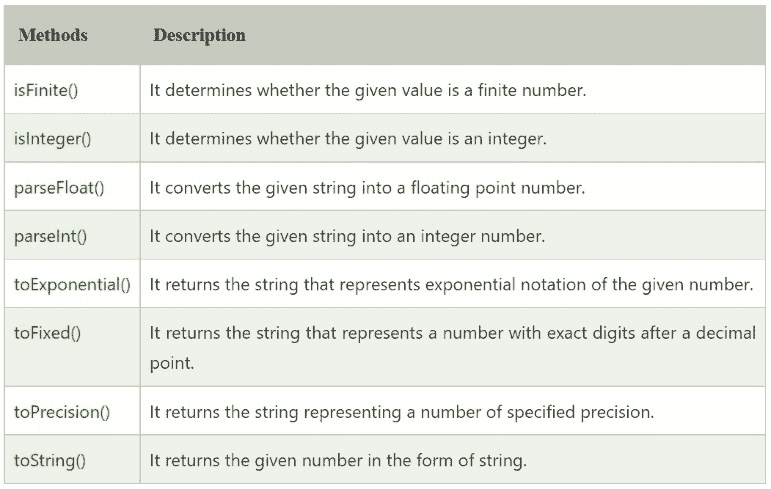

## JavaScript 布尔

JavaScript 中的 Boolean 对象表示两种状态之一的值：真（true）或假（false）。JavaScript 中的 `Boolean()` 函数 Object() { [native code] } 可用于构建 JavaScript 布尔对象，如下所示：

1. `Boolean b=new Boolean(value);`

### JavaScript 布尔示例

```javascript
<script>
  document.write(10<20);//true
  document.write(10<5);//false
</script>
```

### 布尔属性

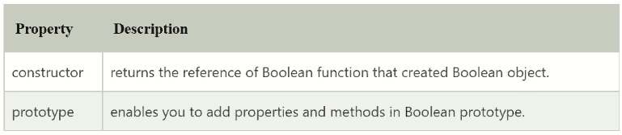

### 布尔方法

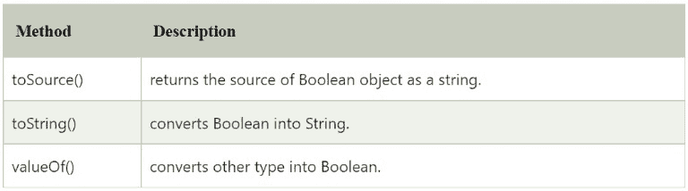
