# JavaScript 编码基础

这本 JavaScript 教程让初学者和专家都能轻松学习 JavaScript。

学习 JavaScript，你只需要对计算机有基础的了解。

# JAVASCRIPT 示例

```html
<!DOCTYPE html>
<html>
<body>
  <h2>欢迎来到 JavaScript</h2>
  <script>
    document.write("Hello Friends");
  </script>
</body>
</html>
```

可以通过在代码中添加 JavaScript 语句来实现 JavaScript。

`<script>...</script>`。

```html
<!DOCTYPE html>
<html>
<body>
  <script type="text/javascript">
    document.write("Hello World");
  </script>
</body>
</html>
```

## JavaScript 代码可以在 JavaScript 中写在 3 个地方：

1. 在 HTML 的 `<body>`...`</body>` 标签之间。

2. 在 HTML 的 `<head>`...`</head>` 标签之间。

3. 在 `.js` 文件中（外部 JavaScript）。

### 示例（在 body 标签之间编写代码）

```html
<!DOCTYPE html>
<html>
<body>
  <script type="text/javascript">
    alert("Hello world");
  </script>
</body>
</html>
```

### 示例 2（在 head 标签之间编写代码）

我们将在下例中创建一个函数 `msg()`。在 JavaScript 中，你必须在函数名后编写函数体来构造函数。要调用一个方法，我们必须先创建一个实例。在这个例中，我们使用点击事件来调用 `msg()` 函数。

```html
<!DOCTYPE html>
<html>
<head>
  <script type="text/javascript">
    function msg() {
      alert("Hello world");
    }
  </script>
</head>
<body>
  <p>欢迎来到 Javascript</p>
  <form>
    <input type="button" value="click" onclick="msg()"/>
  </form>
</body>
</html>
```

### 外部 JavaScript 文件

我们可以构建一个可以在 HTML 文件中使用的 JavaScript 文件。

由于单个 JavaScript 文件可以在多个 HTML 页面中使用，因此它允许代码的复用。

它提高了网页的效率。

该文件必须具有 `.js` 扩展名。

```html
<!DOCTYPE html>
<html>
<head>
  <script type="text/javascript" src="message.js"></script>
</head>
<body>
  <p>Hello world</p>
  <form>
    <input type="button" value="click" onclick="msg()"/>
  </form>
</body>
</html>
```

# JavaScript 注释

JavaScript 中的注释用于描述代码。它用于添加代码相关的内容，例如警告或建议，以便最终用户能够理解。

## JavaScript 注释的类型

JavaScript 注释有两种类型：

1. 单行注释

2. 多行注释

### 单行注释

双正斜杠（`//`）用于表示单行注释。在程序运行时，双正斜杠（`//`）到行尾之间的任何文本都会被忽略。

例如：在语句之前添加注释。

```html
<!DOCTYPE html>
<html>
<body>
  <script>
    // 单行注释 //
    document.write("hello world");
  </script>
</body>
</html>
```

例如：在语句之后添加注释。

```html
<!DOCTYPE html>
<html>
<body>
  <script>
    var a=10;
    var b=20;
    var c=a+b; // 相变量 a 和 b 的值
    document.write(c); // 打印 10 和 20 的和
  </script>
</body>
</html>
```

### 输出

30

## 多行注释

单行和多行注释也可以用于多行注释。跨越多行的注释以 `/*` 开始，以 `*/` 结束。JavaScript 将忽略它们之间的文本。

### /* 在此处编写注释 */

### 示例

```html
<!DOCTYPE html>
<html>
<body>
  <script>
    /* 这是一个多行注释。 
    它不会被显示 */
    document.write ("Example of JavaScript multi line comment");
  </script>
</body>
</html>
```

# JavaScript 变量

值（`name="Ram"`）和表达式（`Sum=x+y`）存储在变量中。

在使用变量之前，我们必须先声明它。要声明一个变量，我们使用关键字 `var`，如下：

`var name;`

变量有两种类型：

1. 局部变量

2. 全局变量

局部变量——它在函数或块内部声明。

### 示例

```javascript
functionabc() {
  var x=10; // 局部变量
}
```

全局变量——它具有全局作用域，意味着它可以在 JavaScript 代码的任何地方指定。

在函数外部声明变量。

### 示例

```html
<!DOCTYPE html>
<html>
<body>
  <script>
    var data=200; // 全局变量
    function a() {
      document.writeln(data);
    }
    function b() {
      document.writeln(data);
    }
    a();
    b();
  </script>
</body>
</html>
```

### 在函数内部声明全局变量

我们需要使用 `window` 对象在函数内部声明全局变量。

### 示例

```html
<!DOCTYPE html>
<html>
<body>
  <script>
    function a() {
      window.value=50; // 使用 window 对象声明全局变量
    }
    function b() {
      alert(window.value);// 从另一个函数访问全局变量
    }
    a();
    b();
  </script>
</body>
</html>
```

# JavaScript 数据类型

它有多种数据类型来存储各种类型的值。

在 JavaScript 中，有两种数据类型。

1. 基本数据类型（原始）。

2. 非基本数据类型（引用）。

### 由于 JavaScript 是一种动态语言，我们不需要定义变量的类型，因为 JavaScript 引擎动态地使用它。在这种情况下，数据类型使用 `var` 定义。它可以存储任何类型的值，包括数字、字符串和对象。

### 示例

```javascript
var a="Ram"; // 字符串
var b=20; // 数字
var x={FirstName:'Ram', lastName:'Doe'}; // 对象
```

### JavaScript 基本数据类型

JavaScript 中有 5 种基本数据类型。

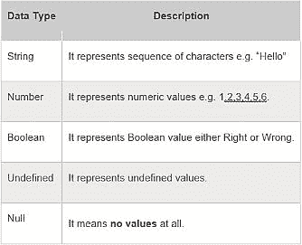

## JavaScript 非基本数据类型

有 3 种非基本数据类型如下：

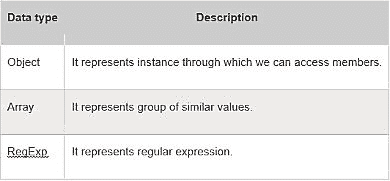

# 运算符

运算符是 JavaScript 中用于对操作数执行操作的符号。通俗来说，3+2 等 5。这里的操作数是 3 和 2，运算符是 +。

以下是 JavaScript 中使用的运算符：

1. 算术运算符。

2. 比较（关系）运算符。

3. 位运算符。

4. 逻辑运算符。

5. 赋值运算符。

6. 特殊运算符。

## 算术运算符

我们在算术运算符中对操作数进行算术运算。

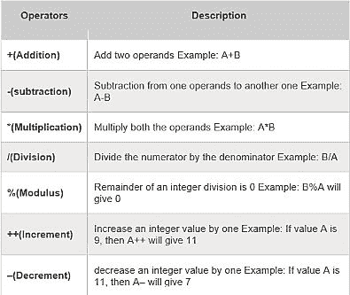

## 比较运算符

在比较运算符中，会比较两个操作数 `A` 和 `B`。

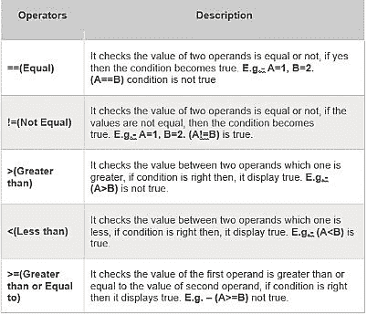

## 赋值运算符

JavaScript 支持以下赋值运算符。

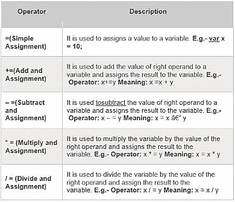

### 按位运算符

JavaScript 提供了以下按位运算符：

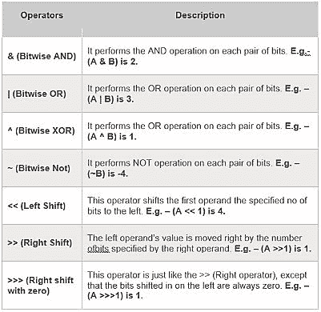

## 逻辑运算符

布尔值常用于逻辑运算符。

逻辑运算符如下：

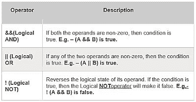

# Javascript If Else

JavaScript 中的条件语句用于根据条件执行各种任务。

在 JavaScript 中，有三种类型的语句：

1. `if` 语句。

2. `if else` 语句。

3. `if else if` 语句。

## if 语句

如果条件为真或假，在 JavaScript 中使用 `if` 语句来执行代码。

```javascript
if (condition){   
    //待评估的内容
}
```

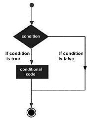

### 示例

```html
<!DOCTYPE html>
<html>
<body>
<script>
var x=50;
if(x>30){
  document.write("value of x is greater than 30");
}
</script>
</body>
</html>
```

### 输出

Value of x is greater than 30

## if else 语句

如果其中一个条件为真或假，则使用 `if else` 语句。

### 语法

```javascript
if(condition)
{
  // 语句组
}
else
{
  // 语句组
}
```

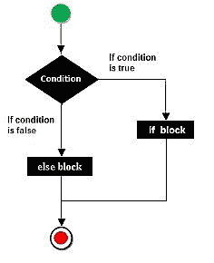

### 示例

```html
<!DOCTYPE html>
<html>
<body>
<script>
var x=20;
if(x%2==0){
  document.write("x is even number");
}
else{
  document.write("a is odd number")
}
</script>
</body>
</html>
```

### 输出

X is even number

## If else if

它只是通过多个表达式检查材料，以判断表达式是否有效。`else if` 是 `if else` 语句的更高级的版本。

### 语法

```javascript
if (condition1)
{
  // 如果 condition 1 为真，执行的语句
}
else if (condition 2)
{
  // 如果 condition 2 为真，执行的语句
}
else if (condition 3)
{
  // 如果 condition 3 为真，执行的语句
}
else
{
  // 如果没有条件为真，执行的语句
}
```

### 示例

```html
<!DOCTYPE html>
<html>
<body>
<script>
var x=50;
if (x==10){
  document.write("x is equal to 10");
}
else if(x==50){
  document.write("x is equal to 50");
}
else if(x==30){
  document.write("x is equal to 30");
}
else{
  document.write("a is not equal to 10, 50 or 30");
}
</script>
</body>
</html>
```

### 输出

x is equal to 50

# Javascript Switch 语句

在 JavaScript 中，`switch` 语句用于在不同条件下执行单个代码。它与 `else if` 语句相同。

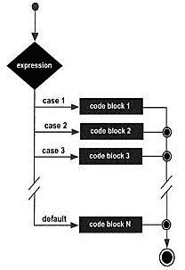

```javascript
switch (expression)
{
  case 1: statement(s)
  break;
  case 2: statement(s)
  break;
  ...
  case n: statement(s)
  break;
  default:statements(s)
}
```

### 示例

```html
<!DOCTYPE html>
<html>
<body>
<script>
var grade='B';
var result;
switch(grade){
  case 'A':
    result="A Grade";
    break;
  case 'B':
    result="B Grade";
    break;
  case 'C':
    result="C Grade";
    break;
  default:
    result="No Grade";
}
document.write(result);
</script>
</body>
</html>
```

### 输出

B Grade

# JavaScript 函数

## 在 `<script>.....</script>` 标签内部构建新函数的能力是 JavaScript 的一项基本功能。`function` 关键字用于在 JavaScript 中声明函数。

## 为了复用文件，我们多次调用 JavaScript 函数。

## 优点 - JavaScript 函数

1. 代码复用性：我们多次使用相同的功能来节省时间和代码量。

2. 减少代码量：结果是我们的软件被压缩了。当我们执行常规操作时，不需要编写大量的代码。

### 语法

```javascript
function Name(parameter)
{
}
```

### 示例

```html
<!DOCTYPE html>
<html>
<body>
<script>
function msg() {
  alert("Hello!");
}
</script>
</body>
</html>
```

### 输出

Hello!

## 带参数的函数

### 通过参数调用函数。

```html
<!DOCTYPE html>
<html>
<body>
<script>
function cube(number) {
  alert(number*number);
}
</script>
</body>
</html>
```

### 输出

27

### 示例

```html
<!DOCTYPE html>
<html>
<body>
<script>
function name() {
  alert("Welcome " + prompt("Enter Name"));
}
</script>
</body>
</html>
```

## 带返回值的函数

### 调用返回值的函数并在程序中使用它。

```html
<!DOCTYPE html>
<html>
<body>
<script>
function getInfo() {
  return "How are you?";
}
</script>
<script>
document.write(getInfo());
</script>
</body>
</html>
```

### 输出

How are you?

## Function() 构造函数

函数语句不仅用于定义函数，还可以使用 `Function()` 构造函数动态地定义函�。

### 语法

```javascript
var variename = new Function(Arg1, Arg2..., "Function Body");
```

### 示例

```html
<!DOCTYPE html>
<html>
<head>
<script>
var func=new Function("a", "b", "return a+b");
function secondFunction(){
  var result;
  result=func(50,50);
  document.write(result); 
}
</script>
</head>
<body>
<p>Click the function</p>
<form>
<input type="button" onclick="secondFunction()" value="Call Function">
</form>
<p>Use different parameters inside the function and try yourself...</p>
</body>
</html>
```

## 函数字面量

函数字面量的定义（这是描述函数的另一种方式）在 JavaScript 1.2 中引入。它是一个描述无名函数的表达式。

函数字面量的语法与函数语句相似，区别在于它用作表达式而不是语句，并且不需要函数名。

### 语法

```javascript
var variename = function (Argument List){
  Body
};
```

### 示例

```html
<!DOCTYPE html>
<html>
<head>
<script>
var func=function(a,b){return a+b};
function secondFunction(){
  var result;
  result=func(10,20);
  document.write(result); 
}
</script>
</head>
<body>
<p>Click the button to call the function</p>
<form>
<input type="button" onclick="secondFunction()" value="Call Function">
</form>
</body>
</html>
```

# Javascript 对象

对象是一个包含状态和行为的实体。JavaScript 是一种关注对象的脚本语言。虽然 JavaScript 是基于模板的而非基于类的，但它允许我们直接构建对象。

### 语法

```javascript
objectName.objectProperty = propertyValue;
```

为了在文本上写入一些内容，我们使用文档属性上的 `write()` 方法。

```javascript
Document.write("Hello world")
```

### 示例

```html
<!DOCTYPE html>
<html>
<head>
<title>用户定义对象</title>
<script type="text/javascript">
var book = new Object(); // 创建了对象
book.subject = "5 points someone"; // 将属性赋值给对象
book.author = "ChetanBhagat";
</script>
</head>
<body>
<script type="text/javascript">
document.write("Book Name is : " + book.subject + "<br>");
document.write("Book Author is : " + book.author + "<br>");
</script>
</body>
</html>
```

### 输出

Book Name is: 5 points someone

Book Author is: Chetan Bhagat

## 对象的方法

### 示例

```html
<!DOCTYPE html>
<html>
<head>
<title>用户定义对象</title>
<script type="text/javascript">//定义一个将作为方法工作的函数 
function addPrice(amount){
this.price = amount;
}
function book(title, author){
this.itle = title;
this.author = author;
this.addPrice = addPrice; // 将该方法作为属性赋值。
}
</script>
</head>
<body>
<script type="text/javascript">
varmyBook = new book("5 Points Someone", "ChetanBhagat");
myBook.addPrice(150);
document.write("Book Title is : " + myBook.title + "<br>");
document.write("Book Author is : " + myBook.author + "<br>");
document.write("Book Price is : " + myBook.price + "<br>");
</script>
</body>
</html>
```

### 输出

Book Title is: 5 Points Someone

Book Author is :ChetanBhagat

Book Price is : 150

# Javascript 数组

数组用于描述单个单元或内存位置中的一组元素。

任何进入数组的元素将以从零开始的唯一索引存储在数组中。我们可以借助索引存储数据。

在 JavaScript 中，我们必须使用 `new` 关键字来声明数组。我们使用 `new Array` 来生成一个数组 (`n`）。

序列中的槽位数量由 `n` 表示。

### 语法

```javascript
myarray = new array(n);
```

注意：如果在 JavaScript 中生成数组时不指定大小，则数组对象的大小将为零。

### 示例

```html
<!DOCTYPE html>
<html>
<body>
<script>
var i;
var emp = new Array();
emp[0] = "Ajay";
emp[1] = "Abhay";
emp[2] = "Arun";
emp[3] = "Shipra";
for (i=0; i<emp.length; i++)
{
document.write(emp[i] + "<br>");
}
</script>
</body>
</html>
```

### 输出

Ajay

Abhay

Arun

Shipra

## 示例 2

```html
<!DOCTYPE html>
<html>
<head>
<script type="text/javascript">
function array()
{
num = new Array(5)
num[0] = 10;
num[1] = 20;
num[2] = 30;
num[3] = 40;
num[4] = 50;
sum = 0;
for (i=0; i<num.length; i++)
{
sumsum = sum + num[i];
}
alert(sum)
}
</script>
</head>
<body>
<input type="button" onclick="array()" value="click here">
</body>
</html>
```

### 数组中的函数

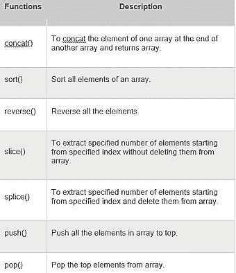

# Javascript 字符串

`String` 对象用于与字符字符串交互。它是用于存储和操作文本的工具。在 JavaScript 中，有两种创建字符串的方法：

1. 字符串字面量

2. 使用 `new` 关键字

### 语法

```javascript
var string="value";
```

### 示例

```html
<!DOCTYPE html>
<html>
<body>
<script>
var str="Hello";
document.write(str);
</script>
</body>
</html>
```

### 输出

String

## 使用 new 关键字

### 语法

```javascript
var string=new String("Hello");
```

### 输出

```html
<!DOCTYPE html>
<html>
<body>
<script>
var string=new String("Hello");
document.write(string);
</script>
</body>
</html>
```

### 输出

String

## 属性

有字符串属性列表及其描述：

1. `constructor`: 它返回对对象的引用。

2. `length`: 字符串中字符的数量。

3. `prototype`: 允许任何对象拥有属性（`Number`、`String` 等）。

### 语法

```javascript
string.constructor
string.length
string.prototype
```

## 方法


### charAt()

这是一个从给定索获取字符的方法。

```html
<!DOCTYPE html>
<html>
<body>
<script>
var str=new String("Hello");
document.write("charAt(0) : " + str.charAt(0));
document.write("charAt(1) : " + str.charAt(1));
document.write("charAt(2) : " + str.charAt(2));
document.write("charAt(3) : " + str.charAt(3));
document.write("charAt(4) : " + str.charAt(4));
</script>
</body>
</html>
```

### concat()

该方法在添加一个或多个字符串后返回一个新字符串。

```html
<!DOCTYPE html>
<html>
<body>
<script>
var x="Hello";
var y="World";
var z=x+y;
document.write(z);
</script>
</body>
</html>
```

### indexOf(str)

`indexOf(str)` 过程返回字符串给定字符串的位置。

```html
<!DOCTYPE html>
<html>
<body>
<script>
var x="Tutorialbyexample";
var y=x.indexOf("by");
document.write(y);
</script>
</body>
</html>
```

### lastIndexOf(str)

`lastIndexOf(str)` 方法返回字符串的最后一个位置。

```html
<!DOCTYPE html>
<html>
<body>
<script>
var x="TutorialbyExamole";
var y=x.lastIndexOf("by");
document.write(y);
</script>
</body>
</html>
```

### match()

```html
<!DOCTYPE html>
<html>
<body>
<script>
var str="To more detail, see Chapter 2.5.4";
var re=(chapter \d+(\.\d)*)/i;
var find=str.match(re);
document.write(find);
</script>
</body>
</html>
```

### toLowerCase()

它返回给定字符串的小写版本。

```html
<!DOCTYPE html>
<html>
<body>
<script>
var x="HELLO WORLD";
var y=x.toLowerCase();
document.write(y);
</script>
</body>
</html>
```

### toUpperCase()

返回提供的字符串的大写字母形式。

```html
<!DOCTYPE html>
<html>
<body>
<script>
var x="hello world";
var y=x.toUpperCase();
document.write(y);
</script>
</body>
</html>
```

```html
document.write(y);
</script>
</body>
</html>
```

## valueOf()

它返回字符串对象的原始值。

```html
<!DOCTYPE html>
<html>
<body>
<script>
var str = new String("Hello world");
document.write(str.valueOf());
</script>
</body>
</html>
```

# JavaScript 日期

Date 对象（期期对象）是 JavaScript 语言中内置的一种数据类型。新的 `Date` 对象用于构建数据对象 `()`。时间中的单个时刻由 JavaScript `Date` 实例表示。创建 JavaScript 日对象的唯一方法是使用 JavaScript 作为构造函数。

### 语法

`Date()` 构造函数可以使用以下语法生成 `Date` 对象：

- `new Date();`

- `new Date(value);`

- `new Date(dateString);`

- `new Date(year, month, day, hours, minutes, seconds, milliseconds);`

注意：括号内的参数始终是可选的。

### 描述

### year

年份由一个整数表示。对于 2000 年到 2099 年，值的映射范围为 0 到 99。

### Month

从 0（1 月）开始到 11（12 月）结束，这个整数代表月份。

### Date

这是一个可选参数。月份的日期由一个整数表示。

### Hours

这是一个可选参数。一天中的小时由一个整数表示。

### Minutes

这是一个可选参数。时间中的分钟部分由一个整数表示。

### Seconds

这是一个可选参数。秒段由一个整数表示。

### Milliseconds

这是一个可选参数。时间的毫秒段由一个整数表示。

### Date 示例

```html
<!DOCTYPE html>
<html>
<body>
<script>
var date=new Date();
var day=date.getDate();
var month=date.getMonth()+1;
var year=date.getFullYear();
document.write("<br>Date: "+day+"/"+month+"/"+year);
</script>
</body>
</html>
```

### 当前时间 - 示例

```html
<!DOCTYPE html>
<html>
<body>
Current Time: <span id="txt"></span>
<script>
var today=new Date();
var h=today.getHours();
var m=today.getMinutes();
var s=today.getSeconds();
document.getElementById('txt').innerHTML=h+":"+m+":"+s;
</script>
</body>
</html>
```

# JavaScript 数学

Math 是一个内置对象，具有用于数学函数和常数的属性和方法。它可以对数字执行数学运算。

### 语法

1. `varpi_val = Math.PI;`

2. `varsin_val = Math.sin(30);`

### 示例

### Math.pow()

`Math.pow(x,y)` 返回 `x` 的 `y` 次方值：

```html
<!DOCTYPE html>
<html>
<body>
<h2>JavaScript Math.pow()</h2>
<p>Math.pow(x,y) 返回 x 的 y 次方值：</p>
<p id="demo"></p>
<script>
document.getElementById("demo").innerHTML = Math.pow(6,2);
</script>
</body>
</html>
```

### Math.sqrt()

`Math.sqrt(x)` 返回 `x` 的平方根。

```html
<!DOCTYPE html>
<html>
<body>
<h2>JavaScript Math.sqrt()</h2>
<p>Math.sqrt(x) 返回 x 的平方根：</p>
<p id="demo"></p>
<script>
document.getElementById("demo").innerHTML = Math.sqrt(81);
</script>
</body>
</html>
```

### Math.ceil()

`Math.ceil(x)` 返回 `x` 向上五入到最近的整数的值：

```html
<!DOCTYPE html>
<html>
<body>
<h2>JavaScript Math.ceil()</h2>
<p>Math.ceil() 将数字向上五入到最近的整数：</p>
<p id="demo"></p>
<script>
document.getElementById("demo").innerHTML = Math.ceil(6.8);
</script>
</body>
</html>
```

# JavaScript 数字

`Number` 对象是一个包装对象，允许你操作数值。`Number()` 构造函数用于构建数字对象。它可以是整数也可以是浮点数。

### 语法

- `var n=new Number(value);`

### 示例

```html
<!DOCTYPE html>
<html>
<body>
<script>
var x=100;//整数值
var y=100.7;//浮点数值
var z=12e5;//指数值，输出: 1200000
var n=new Number(20);//通过数字对象的整数值
document.write(x+" "+y+" "+z+" "+n);
</script>
</body>
</html>
```

### 输出

100 100.7 1200000 20

### 描述

数字对象通常用于以下用途：

1. 如果值无法转换为数字，则返回 `NaN`（不是数字）。

2. `Number` 可用于非构造函数上下文中执行类型转换（即不使用 `new` 运算符）。

### JavaScript 数字常量

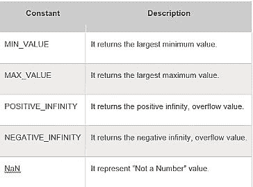
