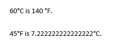

# JavaScript 编码练习：零基础学者基础指南

## 小时与分钟

### HTML 代码
```html
<!DOCTYPE html>
<html>
<head>
  <meta charset="utf-8">
  <meta name="viewport" content="width=device-width">
</head>
<body>
</body>
</html>
```

### JAVASCRIPT 代码
```javascript
function time_convert(num) {
  var hours = Math.floor(num / 60);
  var minutes = num % 60;
  return hours + ":" + minutes;
}
console.log(time_convert(71));
console.log(time_convert(450));
console.log(time_convert(1441));
```

### 输出
```
1:11
7:30
24:1
```

## 统计元音

### HTML 代码
```html
<!DOCTYPE html>
<html>
<head>
  <meta charset="utf-8">
  <meta name="viewport" content="width=device-width">
  <title>统计给定字符串中元音数量的 JavaScript 程序</title>
</head>
<body>
</body>
</html>
```

### JAVASCRIPT 代码
```javascript
function vowel_Count(str) {
  return str.replace(/[^aeiou]/g, "").length;
}
console.log(vowel_Count("Python"));
console.log(vowel_Count("html.com"));
```

### 输出
```
1
5
```

## 将给定字符串每个单词的首字母大写

### HTML 代码
```html
<!DOCTYPE html>
<html>
<head>
  <meta charset="utf-8">
  <meta name="viewport" content="width=device-width">
</head>
<body>
</body>
</html>
```

### JAVASCRIPT 代码
```javascript
function capital_letter(str) {
  str = str.split(" ");
  for (var i = 0, x = str.length; i < x; i++) {
    str[i] = str[i][0].toUpperCase() + str[i].substr(1);
  }
  return str.join(" ");
}
```

### 输出
 (Images/image0061.jpeg)

## 合并两个字符串并排除第一个字符

### HTML 代码
```html
<!DOCTYPE html>
<html>
<head>
  <meta charset="utf-8">
  <meta name="viewport" content="width=device-width">
  <title>合并除第一个字符外字符串的 JavaScript 程序</title>
</head>
<body>
</body>
</html>
```

### JAVASCRIPT 代码
```javascript
function concatenate(str1, str2) {
  str1 = str1.substring(1, str1.length);
  str2 = str2.substring(1, str2.length);
  return str1 + str2;
}
console.log(concatenate("PHP","JS"));
console.log(concatenate("A","B"));
console.log(concatenate("AA","BB"));
```

### 输出
```
HPS
AB
AB
```

## 创建新字符串

### HTML 代码
```html
<!DOCTYPE html>
<html>
<head>
  <meta charset="utf-8">
  <meta name="viewport" content="width=device-width">
</head>
<body>
</body>
</html>
```

### JAVASCRIPT 代码
```javascript
function without_first_end(str) {
  return str.substring(1, str.length - 1);
}
console.log(without_first_end('JavaScript'));
console.log(without_first_end('JS'));
console.log(without_first_end('PHP'));
```

### 输出
```
avarip
J
H
```

## 第一个非重复字符

### HTML 代码
```html
<!DOCTYPE html>
<html>
<head>
  <meta charset="utf-8">
  <title>查找第一个重复的字符</title>
</head>
<body>
</body>
</html>
```

### JAVASCRIPT 代码
```javascript
function find_FirstRepeatedChar(str) {
  var arra1 = str.split('');
  var result = '';
  var ctr = 0;
  for (var x = 0; x < arra1.length; x++) {
    ctr = 0;
    for (var y = 0; y < arra1.length; y++) {
      if (arra1[x] === arra1[y]) {
        ctr += 1;
      }
    }
    if (ctr < 2) {
      result = arra1[x];
      break;
    }
  }
  return result;
}
console.log(find_FirstRepeatedChar('abacdd'));
```

### 输出
```
e
```

## 统计字符串中的元音数量

### HTML 代码
```html
<!DOCTYPE html>
<html>
<head>
  <meta charset="utf-8">
  <title>统计字符串中的元音数量</title>
</head>
<body>
</body>
</html>
```

### JAVASCRIPT 代码
```javascript
function vowel_count(str1) {
  var vowel_list = 'aeiouAEU';
  var vcount = 0;
  for (var x = 0; x < str1.length; x++) {
    if (vowel_list.indexOf(str1[x]) !== -1) {
      vcount += 1;
    }
  }
  return vcount;
}
console.log(vowel_count("The quick brown fox"));
```

### 输出
```
5
```

## 查找字符串中的最长单词

### HTML 代码
```html
<!DOCTYPE html>
<html>
<head>
  <meta charset="utf-8">
  <title>查找字符串中的最长单词</title>
</head>
<body>
</body>
</html>
```

### JAVASCRIPT 代码
```javascript
function find_longest_word(str) {
  var array1 = str.match(/\w[a-z]{0,}/gi);
  var result = array1[0];
  for(var x = 1 ; x < array1.length ; x++) {
    if(result.length < array1[x].length) {
      result = array1[x];
    }
  }
  return result;
}
console.log(find_longest_word('Web Development Tutorial'));
```

### 输出
```
Development
```

## 检查数字是否为质数

### HTML 代码
```html
<!DOCTYPE html>
<html>
<head>
  <meta charset="utf-8">
  <title>检查数字是否为质数</title>
</head>
<body>
</body>
</html>
```

### JAVASCRIPT 代码
```javascript
function test_prime(n) {
  if (n===1) {
    return false;
  }
  else if(n === 2) {
    return true;
  }else {
    for(var x = 2; x < n; x++) {
      if(n % x === 0) {
        return false;
      }
    }
    return true;
  }
}
console.log(test_prime(37));
```

### 输出
```
True
```

## 查找数组中的第二小和第二

### HTML 代码
```html
<!DOCTYPE html>
<html>
<head>
  <meta charset="utf-8">
  <title>查找数组中的第二小和第二</title>
</head>
<body>
</body>
</html>
```

### JAVASCRIPT 代码
```javascript
function Second_Greatest_Lowest(arr_num) {
  arr_num.sort(function(x,y) {
    return x-y;
  });
  var uniqa = [arr_num[0]];
  var result = [];
  for(var j=1; j < arr_num.length; j++) {
    if(arr_num[j-1] !== arr_num[j]) {
      uniqa.push(arr_num[j]);
    }
    result.push(uniqa[1],uniqa[uniqa.length-2]);
  }
  return result.join(',');
}
console.log(Second_Greatest_Lowest([1,2,3,4,5]));
```

### 输出
```
2,4
```

## JavaScript: 获取数据类型

### HTML 代码
```html
<!DOCTYPE html>
<html>
<head>
<meta charset="utf-8" />
<title>检测 JavaScript 数据类型</title>
</head>
<body>
</body>
</html>
```

### JavaScript 代码
```javascript
function detect_data_type(value) {
  var dtypes = [Function, RegExp, Number, String, Boolean, Object], x, len;
  if (typeof value === "object" || typeof value === "function") {
    for (x = 0, len = dtypes.length; x < len; x++) {
      if (value instanceof dtypes[x]) {
        return dtypes[x];
      }
    }
  }
  return typeof value;
}
console.log(detect_data_type(12));
console.log(detect_data_type('w3resource'));
console.log(detect_data_type(false));
```

### 输出
```
number
string
Boolean
```

## 相加两个数字

### 对于给定的正整数

### 长度为两位

### HTML 代码
```html
<!DOCTYPE html>
<html>
<head>
  <meta charset="utf-8">
  <meta name="viewport" content="width=device-width">
  <title>计算给定两位正整数两个数字之和 JavaScript 程序</title>
</head>
<body>
</body>
</html>
```

### JavaScript 代码
```javascript
function add_two_digits(n) {
  return n % 10 + Math.floor(n / 10);
}
console.log(add_two_digits(25));
console.log(add_two_digits(50));
```

### 输出
```
7
5
```

## 检查给定的正整数

### HTML 代码
```html
<!DOCTYPE html>
<html>
<head>
  <meta charset="utf-8">
  <meta name="viewport" content="width=device-width">
  <title>检查给定的正整数是否是 3 的倍数或 7 的倍数的 JavaScript 程序</title>
</head>
<body>
</body>
</html>
```

### JavaScript 代码
```javascript
function test37(x) {
  if (x % 3 == 0 || x % 7 == 0) {
    return true;
  }
  else {
    return false;
  }
}
console.log(test37(12));
console.log(test37(14));
console.log(test37(10));
console.log(test37(11));
```

### 输出
```
true
true
false
false
```

## 闰年检查

### HTML 代码
```html
<!DOCTYPE html>
<html>
<head>
<meta charset="utf-8" />
<title>查找闰年</title>
</head>
<body>
</body>
</html>
```

### JavaScript 代码
```javascript
function leapyear(year) {
  return (year % 100 === 0) ? (year % 400 === 0) : (year % 4 === 0);
}
console.log(leapyear(2016));
console.log(leapyear(2000));
console.log(leapyear(1700));
console.log(leapyear(1800));
console.log(leapyear(100));
```

### 输出
```
true
true
false
false
false
```

## 字符串以 'Java' 开头 - 检查

### 否则为 false

### HTML 代码
```html
<!DOCTYPE html>
<html>
<head>
  <meta charset="utf-8">
  <meta name="viewport" content="width=device-width">
  <title>检查字符串是否以 'Java' 开头的 JavaScript 程序，否则为 false</title>
</head>
<body>
</body>
</html>
```

### JavaScript 代码
```javascript
function start_spec_str(str) {
  if (str.length < 4) {
    return false;
  }
  front = str.substring(0, 4);
  if (front == 'Java') {
    return true;
  }
  else {
    return false;
  }
}
console.log(start_spec_str("JavaScript"));
console.log(start_spec_str("Java"));
console.log(start_spec_str("Python"));
```

### 输出
```
true
true
false
```

## 查找最 100 的值

### HTML 代码
```html
<!DOCTYPE html>
<html>
<head>
  <meta charset="utf-8">
  <meta name="viewport" content="width=device-width">
</head>
<body>
</body>
</html>
```

### JavaScript 代码
```javascript
function near_100(x, y) {
  if (x != y) {
    x1 = Math.abs(x - 100);
    y1 = Math.abs(y - 100);
    if (x1 < y1) {
      return x;
    }
    if (y1 < x1) {
      return y;
    }
  }
}
console.log(start_spec_str("JavaScript"));
console.log(start_spec_str("Java"));
console.log(start_spec_str("Python"));
```

### 输出
```
true
true
false
```

## 温度转换

### HTML 代码
```html
<!DOCTYPE html>
<html>
<head>
<meta charset="utf-8">
<title>编写一个 JavaScript 程序，在摄氏度和华氏度之间进行温度转换</title>
</head>
<body>
</body>
</html>
```

### JAVASCRIPT 代码
```javascript
function cToF(celsius) {
  var cTemp = celsius;
  var cToFahr = cTemp * 9 / 5 + 32;
  var message = cTemp+'\xB0C is ' + cToFahr + ' \xB0F.';
  console.log(message);
}
function fToC(fahrenheit) {
  var fTemp = fahrenheit;
  var fToCel = (fTemp - 32) * 5 / 9;
  var message = fTemp+'\xB0F is ' + fToCel + '\xB0C.';
  console.log(message);
}
cToF(60);
fToC(45);
```

### 输出

