# 青少年 JavaScript 编码：网站与游戏开发初学者指南

Copyright © 2021 by Rockridge Press, 加利福尼亚州埃默利维尔。未经出版者书面许可，本书不得以任何形式或通过手段（电子、机械、复印、录制、扫描或其他）进行复制、存储在检索系统中或传输，除非符合 1976 年美国版权法第 107 节或 108 节的规定。向出版者申请许可的请求请发送至：Permissions Department, Rockridge Press, 6005 Shellmound Street, Suite 175, Emeryville, CA 94608。

责任限制/免责声明：出版者和作者对本作品内容的准确性或完整性不作任何陈述或保证，并明确拒绝所有保证，包括但不限于对特定用途的适用性的保证。销售或促销材料不得创建或扩展任何保证。本文包含的建议和策略可能不适用于所有情况。本书的销售基于以下理解：出版者并未从事医疗、法律或其他专业建议或服务工作。如果需要专业协助，应寻求能力出色的专业人士的服务。出版者和作者均由此产生的损害不承担责任。书中提到某个人、组织或网站作为引用和/或进一步信息的潜在来源，并不意味着作者或出版者认可该个人、组织或网站可能提供的信息或其/它可能提出的建议。此外，读者应注意，书中列出的网站在本书编写与阅读之间可能已经更改或消失。

有关我们其他产品和服务的通用信息，或要获取技术支持，请联系我们的美国客户服务部门，电话 (866) 744-2665；美国境外请拨 (510) 253-0500。

Rockridge Press 以多种电子和印刷格式出版其书籍。印刷版中出现的某些内容可能在电子书中可用，反之亦然。

商标：Rockridge Press 和 Rockridge Press Logo 是 Callisto Media Inc. 及其/关联公司在美国和其他国家的商标或注册商标，未经书面许可不得使用。所有其他商标均为其所有者的财产。Rockridge Press 与书中提到的任何产品或供应商均无关联。

内页及封面设计：Lisa Schreiber

艺术制作：Janice Ackerman

编辑：Andrea Leptinsky

制作经理：Martin Worthington

插图 ©2021 Carl Wein

平装本 ISBN：978-1-64876-111-9

电子书 ISBN：978-1-64876-112-6

R0

我将本书献给 Frank 和 May Yueh，感谢他们在向编程职业转型期间对我的支持。

## 函数表达式

第二种语法是使用 `var` 声明将 `function` 关键字赋值给变量。建议加上分号。这种声明风格仅在进行面向对象编程时使用。

```javascript
var functionNameOfYourChoosing = function () {
  // 在此处编写代码
};
```

## 函数调用

函数名末后的括号会运行其内部的操作。正式术语是调用（invoke）。这种语法对于两种类型的函数声明都是相同的。

```javascript
functionNameOfYourChoosing();
```

## 返回语句

在原生情况下，函数不会向外部世界暴露它计算的数据。

```javascript
function add() {
  var computed = 5 + 5;
}

add(); // undefined
```

那是因为你没有告诉 JavaScript 你想要它！通过使用 `return` 关键字，函数可以暴露一段数据。

```javascript
function add() {
  var computed = 5 + 5;
  return computed
}

add(); // 10
```

## 函数参数

在上一个示例中，`add` 函数只能将 5 和 5 相加。如果你可以接受任何两个数字并将它们加在一起，不是更好吗？这就是参数发挥作用的地方。

参数是预备的变量。这使得函数能够适应许多情况。

```javascript
function add(num1, num2) {
  return num1 + num2;
}
```

你告诉 JavaScript 在调用期间可以传入两个变量，`num1` 和 `num2`。有了参数，这个 `add` 函数就可以处理任何数字。

```javascript
add(10, 5); // 15
add(20, 30); // 50
```

### 使用 Return 提前终止

`return` 关键字实际上同时承担两个作用：

1. 它从函数输出一个值。

2. 它停止函数的执行。

你可能会发现自己不想在某个特定点之后执行代码，或者想做一个决定并停止所有后续操作。

### 极客提示

当你看到一个重复但值不同的算法时，考虑将该操作转换为带有参数的函数。

### 保护 add 免受类型转换

让我们完善你的 `add` 函数并保护它免受错误输入的影响。记得类型转换和 `+` 运算符吗？

```javascript
function add(num1, num2) {
  return num1 + num2;
}

add('10', '5'); // '105'
add(20, '30'); // '2030'
```

你的加法函数可以进行字符串拼接。但你总是想要相加，至少尝试尝试。让我们用提前返回来保护它。如果使用的数据不是数字，函数应该返回 `NaN`。

```javascript
function add(num1, num2) {
  // 如果 num1 不是数字 或者 num2 不是数字
  if (typeof num1 !== 'number' || typeof num2 !== 'number') {
    return NaN;
  }
  return num1 + num2;
}

add('10', 5); // 'NaN'
add(20, '30'); // 'NaN'
```

使用提前返回，你保护了函数免受类型转换或其他任何错误输入的影响。

## 作用域

现在是讨论使用函数时变量可用性的好时机。在编码术语中，变量可用性被称为作用域（scope）。此后将大量编写函数。了解你需要的特定数据在代码的特定区域是否可用很重要。

### VAR: 函数作用域

声明的位置现在很重要了。在函数内部声明的变量仅在函数内部可用。

这段代码将产生意外之外的行为：

```javascript
function sampleFunc() {
  var innerVariable = '我仅在该函数中可用';
  console.log(innerVariable);
}

function otherSampleFunc() {
  console.log(innerVariable);
}

sampleFunc();
otherSampleFunc();
```

运行 `otherSampleFunc()` 时发生错误。这是 JavaScript 实现作用域的结果。

### 词法作用域

不同的编程语言在作用域方面有自己的规则。JavaScript 使用词法作用域（lexical scope）。词法作用域是指变量在其内部及其内部作用域可用，但在外部作用域不可用。让我们来看例子。

#### 嵌套函数

函数可以写在其他函数内部！这创建了两层作用域。一个是内部作用域，另一个是外部作用域。

在外部作用域声明的变量在任何内部作用域中都可用。

```javascript
function outerScopeFunc() {
  var outerVar = '我是外部作用域的！我在两个作用域中存在';
  function innerScopeFunc() {
    console.log(outerVar);
  }
  innerScopeFunc();
}

outerScopeFunc();
```

但内部作用域在它们上方的作用域中不可用。

```javascript
function outerScopeFunc() {
  function innerScopeFunc() {
    var innerVar = '我是内部作用域的！我只在这里存在';
  }
  console.log(innerVar);
}

outerScopeFunc();
```

理解作用域是编写函数的关键。有时变量在需要的地方可用，反之亦然。始终注意作用域。

## 电竞选手表现

使用函数让你能够以优雅的方式解决困难挑战。让我们在解决问题的能力上迈出一大步！Electro 是来自 Undersea（一款热门电脑游戏）的全球顶尖电竞队。他们在全球舞台上拥有优异的记录。凭借丰富的才华选手阵容，他们会轮换谁上场，谁坐替补席。

### 选手参赛了吗？

你的第一个挑战是检查选手在比赛中的参赛情况。这个函数应该能够处理任何选手和任何比赛结果。它们必须是参数。我们将函数命名为 `playedInTournament`，并将参数命名为 `tournament` 和 `player`。

```javascript
function playedInTournament(tournament, player) {

}
```

在此练习中，`tournament` 参数将具有以下结构。它是一个只有一个键 `players` 的对象数据结构。与键关联的值是一个玩家名称数组。

```javascript
{
  players: ['smirk', 'knight', 'fly']
};
```

现在，你需要找到某个玩家是否参加过某场比赛。对象中有一个 `players` 键。目标是检查该玩家是否存在于数组中。你立刻知道需要一个 for 循环。该数组嵌套在对象中，因此必须通过它的键名 `players` 来访问。还需要检查该玩家是否参加了该比赛。用编程术语来表达，这需要一个 `if` 条件。

```javascript
function playedInTournament(tournament, player) {

  var players = tournament.players;

  for (var i = 0; i < players.length; i++) {

    var currentPlayer = players[i];

    if (currentPlayer === player) {

    }
  }

}
```

如果 `currentPlayer` 是要检查的玩家，则返回 `true`。但在什么时候应该返回 `false` 呢？如果检查完了数组中的所有玩家，这意味着该玩家完全没有被找到。在函数的最后，返回 `false`。

```javascript
// tournament.js

function playedInTournament(tournament, player) {

  var players = tournament.players;

  for (var i = 0; i < players.length; i++) {

    var currentPlayer = players[i];

    if (currentPlayer === player) {

      return true;

    }
  }

  return false;

}
```

是时候验证代码了。为了做到这一点，你需要一个 `console.log` 来让函数数据出现在终端。我将文件命名为 `tournament.js`。

```javascript
var sampleTournament = {

  win: true,

  players: ['smirk', 'knight', 'fly']
};

console.log(playedInTournament(sampleTournament, 'smirk')); console.log(playedInTournament(sampleTournament, 'superb'));
```

看起来不错！在 `sampleTournament` 对象中，`smirk` 参加了比赛，但 `superb` 没有。

从文件中删除两个 `console.log` 语句和数据结构 `sampleTournament`。今后它们将不再需要了。

## 黑客提示

为了防止混淆，写一个表格来跟踪每次迭代中发生的情况。

#### 数据结构嵌套数据结构

对于随后的练习，需要一个比赛结果列表。在每个比赛结果中，我们还需要一个参加该比赛的玩家列表。

将此数据结构添加到文件中。

```javascript
var tournaments = [

  { win: true, players: ['smirk', 'knight', 'fly'] },

  { win: true, players: ['superb', 'san', 'tired'] },

  { win: true, players: ['smirk', 'knight', 'tired'] },

  { win: false, players: ['san', 'superb', 'fly'] },

  { win: true, players: ['smirk', 'san', 'fly'] },

  { win: false, players: ['superb', 'knight', 'tired'] },
];
```

### 参加比赛的次数

玩家参与的数据在 `tournaments` 数组中。对于一个数据数组，显然需要一个循环。

```javascript
function tournamentsPlayed(tournaments, player) {

  var playCount = 0;

  for (var i = 0; i < tournaments.length; i++) {

    var currentTournament = tournaments[i];

  }

  return playCount;

}
```

这一次，你需要检查玩家是否参加了该比赛。不仅如此，你必须记录这种情况发生的次数。确定一个玩家是否参加了某场特定的比赛是一项大量工作。每个比赛条目都需要搜索内部数组。但这个问题已经在 `playedInTournament` 中解决了。可以重用该函数。

```javascript
var currentTournament = tournaments[i];

var playerDidPlay = playedInTournament(currentTournament, player);

if (playerDidPlay) {

  playCount += 1;

}
```

通过 `console.log` 运行并验证代码。

```javascript
console.log(tournamentsPlayed(tournaments, 'smirk'));

console.log(tournamentsPlayed(tournaments, 'superb'));
```

看起来不错。`smirk` 和 `superb` 都参加了三场比赛。现在这些 `console.log` 语句可以删除了。

### 赢得比赛的次数

现在，更进一步。检查并查看特定玩家参加过团队获胜比赛的次数。为了清楚地做到这一点，你需要：

1. 一个循环

2. 一个累加变量来跟踪获胜的比赛次数

```javascript
function tournamentsWon(tournaments, player) {

  var winCount = 0;

  for (var i = 0; i < tournaments.length; i++) {

    var currentTournament = tournaments[i];

  }

  return winCount;

}
```

与 `gamesPlayed` 相比情况有点不同。需要两个条件：

1. 玩家参加了比赛

2. 团队获胜了

幸运的是，`playedInTournament` 可以用于第一个条件。对于第二个条件，每个条目都有比赛结果，位于键 `win` 中。只有当该特定玩家参加时，两个条件都为真，才能将该场比赛计为胜利。在这一

```javascript
function tournamentsWon(tournaments, player) {

  var winCount = 0;

  for (var i = 0; i < tournaments.length; i++) {

    var currentTournament = tournaments[i];

    var playerDidPlay = playedInTournament(currentTournament, player);

    var tournamentWon = currentTournament.win;

    if (playerDidPlay && tournamentWon) {

      winCount += 1;

    }
  }

  return winCount;

}
```

用 `console.log` 验证代码。

```javascript
console.log(tournamentsWon(tournaments, 'smirk'));

console.log(tournamentsWon(tournaments, 'superb'));
```

看起来不错！看起来 `smirk` 赢得了三场比赛，而 `superb` 赢了一场。

### 玩家胜率

现在你对确定胜率感兴趣。要解决这个问题，将获胜次数除以比赛次数。需要编写的算法很容易，因为两者都已经解决了！为了输出更整洁，将使用 `parseInt`。它将小数转换为整数。

```javascript
function playerWinRate(tournaments, player) {

  var total = tournamentsPlayed(tournaments, player);

  var won = tournamentsWon(tournaments, player);

  var percentage = (won / total) * 100;

  return parseInt(percentage);
}
```

让我们验证。

```javascript
console.log(playerWinRate(tournaments, 'smirk'));

console.log(playerWinRate(tournaments, 'superb'));
```

看起来 `smirk` 有完美的胜率，而 `superb` 是 33%。

### 谁应该参加？

噢不！看起来两个玩家之间存在争议。看起来 `smirk` 和 `superb` 都想参加下一场比赛，但位置只有一个。为了解决这个问题，管理层决定检查相应玩家参赛时的表现。管理层不是程序员，他们不想看到两个数字。他们想看到关于谁应该参加、谁应该替补的消息。

到目前为止，你解决了许多挑战。许多简单的函数被编写并组合在一起解决棘手的挑战。最后一个！

已经有一个计算每个玩家胜率的函数。只需比较胜率即可发现谁参加下一场比赛。这次需要三个参数：

1. 团队的比赛表现及其活跃玩家

2. 一个玩家

3. 另一个用于比较的玩家

```javascript
function whoShouldPlay(tournaments, player1, player2) {

  var player1WinRate = playerWinRate(tournaments, player1);

  var player2WinRate = playerWinRate(tournaments, player2);
}
```

这一次，你想要打印两个漂亮的消息。跟踪谁将成为替补，谁将成为活跃玩家。如果 `player1` 的胜率更高，他们应该是活跃玩家，而 `player2` 应该是替补。

```javascript
function whoShouldPlay(tournaments, player1, player2) {

  var player1WinRate = playerWinRate(tournaments, player1);

  var player2WinRate = playerWinRate(tournaments, player2);

  var benchedPlayer;

  var activePlayer;

  if (player1WinRate > player2WinRate) {

    activePlayer = player1;

    benchedPlayer = player2;

  }

}
```

但这还不够，因为还需要处理相反的情况。在这种情况下，你不需要 `else if`。只有两个选项。一个 `else` 语句将完美工作。

为了满足管理层的要求，为每个玩家的状态添加一个带有友好消息的 `console.log`。

```javascript
function whoShouldPlay(tournaments, player1, player2) {
  var player1WinRate = playerWinRate(tournaments, player1); 
  var player2WinRate = playerWinRate(tournaments, player2); 
  var benchedPlayer;
  var activePlayer;

  if (player1WinRate > player2WinRate) {
    activePlayer = player1;
    benchedPlayer = player2;
  } else {
    activePlayer = player2;
    benchedPlayer = player1;
  }

  console.log(activePlayer + ' should play in the next tournament');
  console.log(benchedPlayer + ' should be benched');
}

whoShouldPlay(tournaments, 'smirk', 'superb');
```

结果已经出来了，差异显而易见。看来 smirk 是更好的玩家，而 superb 将被下场。

## 回顾

这次练习整合了你到目前为止学 JavaScript 的每一个技术方面。但你可能已经注意到，你解决问题的方法同样重要。你将一个大挑战拆解成了五个更容易处理的挑战：

1. 比较两个玩家之间的胜率。

2. 计算玩家的胜率。

3. 计算玩家参加的比赛总场次。

4. 计算玩家的获胜场次。

5. 检查玩家是否参加了比赛。

所有这些部分的总和创造了一个复杂问题的简单解决方案。

破解代码

这一章是“买一送二”的。你不仅学习了函数，还略略体验了程序员用来用简单方法解决挑战性问题的策略类型。

1. 哪些品质让函数在编程时时变得备受青睐？

2. 函数需要什么关键字才能输出暴露在函数之外的值？

3. 如果没有显式的返回，函数会输出什么？

4. 什么是作用域？

5. JavaScript 使用什么种类型的作用域？用你自己的话解释。

## 调试

程序员有一个名为单元测试的秘密武器。拆解问题允许你以增量的方式检查代码的正确性。每个函数都很小，所以很容易测试。如果每个小函数都能正常工作，那么整个挑战应该没有任何问题地运行！

```javascript
// 重要！此函数将不支持数据结构
// 和对象。仅适用于字符串、数字、null、布尔值和 undefined 
function test(description, actual, expected) {
  console.log(description);
  if (actual === expected) {
    console.log(' pass!');
  } else {
    console.log(' fail!');
    console.log(' received: ', actual);
    console.log(' expected: ', expected);
  }
}
```

这是一个非常基础的函数，让你：

1. 为自己快速写一条关于将测试什么的消息。

2. 比较两个值。

3. 知道你是否得到了预期的结果。如果没有，打印出你计算的结果与你预期的结果。

在开始处理真正的调试问题之前，是时候让这个测试函数投入行动了。为了这样做，你将故意创建一个错误的 `add` 函数，并看看你的测试函数会给你什么输出。

```javascript
function add(num1, num2) {
  return num1 - num2;
}

test('add test #1', add(10, 20), 30);
test('add test #2', add(10, 15), 25);
```

很好！你不仅让 JavaScript 检查你的代码是否正确，而且当函数出错时，还让它向你展示你的计算结果。

## 猜猜我猫的名字

让我们用函数在终端里玩一个快速的小游戏。这并不容易！你需要将问题拆解为许多子问题，并将算法封装在函数中。

将输入一个字符，然后将收到关于猜测进展的反馈。当你正确猜出所有字符后，程序将打印全名并退出。

现在，你的程序运行得并不好。事实上，它根本没有运行。以下是你的错误代码：

```javascript
var prompt = require("readline-sync");

// 重要！此函数将不支持数据结构
// 和对象。仅适用于字符串、数字、null、布尔值和 undefined 
function test(description, actual, expected) {
  console.log(description);
  if (actual === expected) {
    console.log(' pass!');
  } else {
    console.log(' fail!');
    console.log(' received: ', actual);
    console.log(' expected: ', expected);
  }
}

function includes(arrOrStr, item) {
  for (var i = 0; i < arrOrStr.length; i++) {
    var currItem = arrOrStr[i];
    if (currItem !== item) {
      return true;
    }
  }
  return false;
}

// ... (其余的逻辑)
```

`parseInt` 函数接收一个数字并将其转换为整数。从技术上讲，它不会四舍五入或向下取整。它移除了数字中的小数部分。然而，更重要的是，它是将字符串形式的数字转换为实际数据类型数字的方法。

```javascript
parseInt(1322.23423); // 1322
parseInt('1322.23423'); // 1322
```

### PARFLOAT

与 `parseInt` 解析数字和字符串形式数字一样，`parseFloat` 也这样做，但它保留了原始数字中所有的小数值。

```javascript
parseFloat(1322.23423); // 1322.23423
parseFloat('1322.23423'); // 1322.23423
```

### 字符串

在本书范围内，大多数字符串操作将予以省略。但仍有两个重要的操作需要注意。

#### 通过索引访问

对于某些算法，逐个元素地检查字符串是非常重要的。这可以通过索引访问每个字符来实现。字符串和数组通过索引访问元素的方式是相同的。

```javascript
var dog = 'Misu';
dog[0]; // 'M'
dog[2]; // 's'
```

#### 转小写和大大写

将字符转换为全小写或全大写可以分别使用 `toLowerCase` 和 `toUpperCase` 完成。

```javascript
var dog = 'Misu';
dog.toLowerCase(); // 'misu'
dog.toUpperCase(); // 'MISU'
```

等等！为什么在变量名后面使用了这个函数？嗯，从技术上讲，这是一个方法（method）。我们将深入探讨这种差异的目的和原因。目前，只需知道方法是用这种语法调用的。

### 数组

修改数组是非常常见的的操作，因此 JavaScript 包含了许多内置操作来按我们所需的方式修改它们。

#### 插入

数组中的项通过索引访问。

```javascript
var animals = ['dog', 'cat', 'horse', 'bird'];
animals[0]; // 'dog'
```

访问数组项的相同语法也可用于将新值赋值给索引。

```javascript
var animals = ['dog', 'cat', 'horse', 'bird'];
animals[0] = 'pig';
animals[0]; // 'pig'
```

#### PUSH

一种常见操作是在数组末尾插入。数组方法名是 `push`。

```javascript
var sampleArray = [];
sampleArray.push(10);
sampleArray; // [10]
```

#### POP

另一个常见操作是使用方法 `pop` 删除数组的最后一项。

```javascript
var sampleArray = [2, 10];
sampleArray.pop();
sampleArray; // [2]
```

#### SHIFT

可以使用 `shift` 方法删除数组的第一个元素。

```javascript
var sampleArray = [2, 10];
sampleArray.shift();
sampleArray; // [10]
```

#### UNSHIFT

最后一种数组操作是 `unshift`，它将元素插入到数组前端。

```javascript
var sampleArray = [2, 10];
sampleArray.unshift(5);
sampleArray; // [5, 2, 10]
```

### 对象

与数组相比，对象的修改程度并不相同。这是出于更高级的技术原因。但对象仍然支持插入、替换和删除。

#### 插入和替换

对象值的插入是通过等号完成的。

```javascript
var animals = {};
animals.dog = 'sparky';
animals; // { dog: 'sparky' }
```

插入的语法与替换相同。如果键（key）已经存在，它将替换该值。

```javascript
var animals = {
  dog: 'sparky'
};
animals.dog = 'not sparky';
animals; // { dog: 'not sparky' }
```

#### 删除

从对象中删除元素是一个不常用的操作。`delete` 运算符删除对象中的键值对。

```javascript
var animals = {
  dog: 'sparky'
};
delete animals.dog;
animals; // { }
```

### 变异

修改数据类型而非总是创建新版本的想法被称为“可变性”（mutability）。操作可以是变异的，这意味着它修改了现有的数据。数据也可以被称为“不可变的”（immutable），意味着它从根本上无法被修改。

在下面的示例中，当使用数组和对象操作时，我们没有向新变量赋值或重新赋值。这是因为 `push`、`pop`、`shift` 和 `unshift` 是修改现有数组的操作。所展示的操作是改变现有数据结构的操作。

```javascript
var animals = ['dog', 'cat', 'horse', 'bird'];
animals.push('lizard');
animals; // ['dog', 'cat', 'horse', 'bird', 'lizard'];
```

事实上，重新赋值是非常糟糕的。它可以创建出非常不直观的代码。

```javascript
var animals = ['dog', 'cat', 'horse', 'bird'];
animals = animals.push('lizard');
animals; // 5
```

返回值为 5 是因为在将 lizard 推入之后，新数组的长度。但这可能不是想要的输出。更有可能，想要的输出是数组本身。

#### 字符串是不可变的

```javascript
var animal = 'd';
animal += 'og';
animal; // 'dog'
```

你有没有注意到你一直在使用重新赋值运算符？那是因为字符串是不可变的。现有的字符串无法被更新。必须通过重新赋值来创建一个全新的字符串。

```javascript
var animal = 'd';
animal + 'dog';
animal; // 'd'
```

由于 JavaScript 的字符串是不可变的，字符串拼接不会修改 `animal`。

### 数据操作实战

当你看到数据操作运行时，理解它会变得容易得多。我们还将介绍你将遇到最常见的数据操作策略。让我们开始吧！

#### 构建新数组

获取一个数组并以某种形式对其进行修改，是所有程序中最常见的操作之一。在许多情况下，构建一个全新的数组比修改现有数组更有优势。

给定以下数组，创建一个技能水平高于 5 的玩家名称数组。

```javascript
var players = [
  { name: 'superb', skill: 3 },
  { name: 'smirk', skill: 7 },
  { name: 'tired', skill: 6 },
  { name: 'ANS', skill: 9 }
];
```

这是预期的输出：

```javascript
['smirk', 'tired', 'ANS']
```

为了使代码更容易管理，你把算法放在函数中。

```javascript
function getSkilledPlayers(allPlayers) {
  var skilledPlayers = [];
  for (var i = 0; i < allPlayers.length; i++) {
    var player = allPlayers[i];
    if (player.skill > 5) {
      skilledPlayers.push(player.name);
    }
  }
  return skilledPlayers;
}
```

将所有内容整合，这是你的代码和预期的输出：

```javascript
var players = [
  { name: 'superb', skill: 3 },
  { name: 'smirk', skill: 7 },
  { name: 'tired', skill: 6 },
  { name: 'ANS', skill: 9 }
];

function getSkilledPlayers(allPlayers) {
  var skilledPlayers = [];
  for (var i = 0; i < allPlayers.length; i++) {
    var player = allPlayers[i];
    if (player.skill > 5) {
      skilledPlayers.push(player.name);
    }
  }
  return skilledPlayers;
}

console.log(getSkilledPlayers(players));
```

为了保险起见，可以写一个表格来查看每次迭代后值是如何变化的。

`PLAYER.NAME`

`PLAYER.SKILL`

`PLAYER.SKILL > 5`

`SKILLEDPLAYERS`

| 名称 | 技能 | 条件 | 结果 |

|---|---|---|---|

| 1 | superb | 3 | false | [] |

| 2 | smirk | 7 | true | `['smirk']` |

| 3 | tired | 6 | true | `['smirk', 'tired']` |

| 4 | ANS | 9 | true | `['smirk', 'tired', 'ANS']` |

## 黑客提示 (HACK HINT)

如果你发现自己需要使用 `delete` 运算符，那么你的算法可能应该使用数组来解决。

## 在数组中更新对象

假设你有一个对象，其键是玩家名称和他们的年龄。将这些数据合并到一个单一的数据结构中是有意义。你可以使用已经学过的策略来实现。

```javascript
var players = [
  { name: 'superb', skill: 3 },
  { name: 'smirk', skill: 7 },
  { name: 'tired', skill: 6 },
  { name: 'ANS', skill: 9 }
];

var playerAges = {
  superb: 21,
  smirk: 21,
  tired: 22,
  ANS: 21
};
```

这是预期的输出。

```javascript
[
  { name: 'superb', skill: 3, age: 21 },
  { name: 'smirk', skill: 7, age: 21 },
  { name: 'tired', skill: 6, age: 22 },
  { name: 'ANS', skill: 9, age: 21 }
];
```

与上一个问题一样，显然需要迭代。

```javascript
function playerWithAges(players, ages) {
  var playerData = [];
  for (var i = 0; i < players.length; i++) {
    var player = players[i];
  }
  return playerData;
}
```

但这一次，返回值不是字符串数组。它是一个对象数组。

在每次迭代中，创建一个包含数据的新对象，并将其推入数组中。

将所有内容整合在一起，文件和输出应该如下。

```javascript
var players = [
  { name: 'superb', skill: 3 },
  { name: 'smirk', skill: 7 },
  { name: 'tired', skill: 6 },
  { name: 'ANS', skill: 9 }
];

var playerAges = {
  superb: 21,
  smirk: 21,
  tired: 22,
  ANS: 21
};

function playerWithAges(players, ages) {
  var playerData = [];
  for (var i = 0; i < players.length; i++) {
    var player = players[i];
    var playerEntry = {
      name: player.name,
      skill: player.skill,
      age: ages[player.name]
    };
    playerData.push(playerEntry);
  }
  return playerData;
}

console.log(playerWithAges(players, playerAges));
```

非常棒！如果这个问题的任何部分让你感到困惑，请写一个表格。

## 破解代码 (Crack the Code)

通过这一章，你终于涵盖了编程的基础。但还没有结束。事实上，这只是一个开始！

### 1. 在此代码运行后，`players` 是一个包含 "smurf" 和 "ANS" 的数组吗？为什么或者为什么不是？

```javascript
var players = ['superb', 'smirk', 'ANS'];
players = players.shift();
```

### 2. 什么是可变性 (mutability)？哪些数据类型是变的？

### 3. 为什么字符串修改需要重新赋值，而数组修改不需要？

### 4. 哪些数组方法可以减少数组的大小？

### 5. 哪些数组方法可以增加数组的大小？

### 6. 为以下函数画一个表格。在每次迭代和 `array.length > 0` 时，数组会什么样？

```javascript
function destroyArray(array) {
  var i = 0;
  while (array.length > 0) {
    array.pop();
    i++;
  }
}
var arr = [10, 20, 12, 30, 25];
destroyArray(arr);
```

### 7. 下列代码的输出是什么？如有必要请画一个表格。

```javascript
function modifyString(str) {
  var newStr = '';
  for (var i = 0; i < str.length - 1; i++) {
    newStr += str[i];
  }
  return newStr;
}
modifyString('abcdef')
```

### 8. 用你自己的话描述这个用途。为什么它对字符串和数组都有效？为每次函数调用画一个表格。

```javascript
function mysteryFunc(arrOrStr, item) {
  for (var i = 0; i < arrOrStr.length; i++) {
    var currItem = arrOrStr[i];
    if (currItem === item) {
      return true;
    }
  }
  return false;
}

mysteryFunc('cat', 'a'); // true
mysteryFunc('cat', 'b'); // false
mysteryFunc([30, 11], 11); // true
mysteryFunc([30, 11], 30); // false
```

### 9. `count` 的值是多少？

```javascript
var count = 0;
function increment() {
  count += 1;
}
increment();
increment();
```

## 调试 (Debugging)

这段代码有很多问题！`playerAboveSkillAndAge` 函数应该返回高于指定技能和年龄的玩家。

```javascript
var players = [
  { name: 'super', skill: 1, age: 20 },
  { name: 'smurf', skill: 8, age: 24 },
  { name: 'ANS', skill: 6, age: 27 },
  { name: 'faker', skill: 10, age: 17 },
  { name: 'shroud', skill: 9, age: 26 }
];

function playersAboveSkill(players, skill) {
  var skilledPlayers = players;
  for (var i = 0; i < players.length; i++) {
    var objectKey = 'skill';
    if (players[i][objectKey] < skill) {
      skilledPlayers.push(players[i]);
    }
  }
  return skilledPlayers;
}

function playersAboveAge(players, age) {
  var agedPlayers = players;
  for (var i = 1; i < players.length; i++) {
    var objectKey = 'age';
    if (players[i][objectKey] < age) {
      agedPlayers.push(players[i]);
    }
  }
  return agedPlayers;
}

function playerAboveSkillAndAge(players, skill, age) {
  var skilledPlayers = playersAboveSkill(players, skill);
  var skilledAgedPlayers = playersAboveAge(skilledPlayers, age); 
  return skilledAgedPlayers;
}

console.log(playerAboveSkillAndAge(players, 6, 19));
// 预期：[
  { name: 'smurf', skill: 8, age: 24 },
  { name: 'shroud', skill: 9, age: 26 }
];

console.log(playerAboveSkillAndAge(players, 2, 16));
// 预期：[
  { name: 'smurf', skill: 8, age: 24 },
  { name: 'ANS', skill: 6, age: 27 },
  { name: 'faker', skill: 10, age: 17 },
  { name: 'shroud', skill: 9, age: 26 }
];
```

## 程序员检查清单 (CODER’S CHECKLIST)

你走过了很长的路！你现在正式完成了编程基础的学习。未来，你将学习更多特定于 JavaScript 的特性。这意味着面向对象编程和网站编程。

# 将狗作为 JavaScript 对象

刚才介绍的理念在编程中具有相同的相似之处。一个狗对象将有很多关于它自身的属性，并有许多它可以调用的方法。

### 对象属性 (OBJECT PROPERTY)

在 JavaScript 中，访问狗的年龄看起来如下。

```javascript
sparky.age; // 10
```

## 对象方法 (OBJECT METHOD)

如果 Sparky 想汪汪，就会调用一个名为 `bark` 的方法。

```javascript
sparky.bark(); // 'ruff ruff!'
```

注意 `bark` 看起来像函数调用？那是因为方法实际上就是函数！方法是特定于对象实例的函数。它们不能用于其他任何东西。

## JavaScript 对象实现

为了利用对象的威力，我们必须学习完整的 JavaScript 语法来编写它们。

### 构造函数 (CONSTRUCTOR FUNCTION)

在 JavaScript 中，函数是双重用途的。它们可以被当作普通函数来执行代码（你已经学过了），也可以被当作构造函数。构造函数是用来调用创建对象实例的函数。

在这里，大驼命名法（pascal case，每个单词的首字母大写）是通用的约定。

```javascript
function Dog() {

}
```

对于对象实例，在函数调用前面需要 `new` 关键字。

```javascript
var sparky = new Dog();
```

### 对象属性 (OBJECT PROPERTY)

添加对象属性本质上与添加键值对相同。不同在于它是在构造函数中完成的。

```javascript
function Dog() {
  this.age = 10;
}

var sparky = new Dog();

sparky.age; // 10
```

等等！这个变量 `this` 是什么？嗯，它是由函数自动创建的秘密变量。在涉及面向对象编程时，它具有一些重要的属性。最重要的是，`this` 可以被分配键值对。

### 对象方法 (OBJECT METHODS)

在 JavaScript 中，函数还有一个名为 `prototype` 的秘密属性。它的职责是存储函数将供对象实例可用的方法。创建方法需要使用函数表达式语法。

```javascript
function Dog() {

}

Dog.prototype.bark = function() {
  console.log('ruff ruff!');
};

var sparky = new Dog();

sparky.bark(); // 'ruff ruff!'
```

### 实例变量 (INSTANCE VARIABLE)

现在你已经了解基础语法，我们应该谈谈秘密变量 `this`。它在构造函数中是可用的。键值对添加到 `this`。添加到 `this` 中的键值对通常被称为实例变量。

```javascript
function Dog() {
  this.name = 'sparky';
}

Dog.prototype.speak = function() {
  console.log('ruff ruff, my name is' + this.name);
};

var sparky = new Dog();

sparky.speak(); // 'ruff ruff, my name is sparky'
```

现在，忽略这只狗会说英语的事实。你感兴趣的是在构造函数中创建的 `this.name` 竟然神奇地在方法中可用。

记住这一点至关重要：任何分配给 `Dog.prototype` 的方法都可以使用变量 `this`。

### 实例变量的修改 (INSTANCE VARIABLE MODIFICATION)

由于这在每个方法中都是可用的，实例变量也可以在方法中被。

```javascript
function Dog() {
  this.name = 'sparky';
  this.age = 0;
}

Dog.prototype.growOlder = function() {
  this.age += 1;
};

var sparky = new Dog();

sparky.age // 0

sparky.growOlder();

sparky.age // 1
```

### 极客提示 (HACKER HINT)

实例变量也可以在方法中创建，但并不鼓励这样做。在大多数情况下，代码有更好的写法编写方式。

## 实战中的面向对象编程 (Object-Oriented Programming in Action)

眼见为实，所以通过一个 JavaScript 狗来建立对面向对象编程的理解，它的能力将与现实中的狗匹配。

### 狗的属性 (DOG PROPERTIES)

为了创建一个对象实例，需要构造函数。

```javascript
function Dog() {

}

var sparky = new Dog();
```

这非常无聊，并没有告诉你太多关于狗的知识。狗有很多方面是你可能想让你的对象了解的。可以通过将它们变为实例变量来实现。狗的名字、年龄、重量和 `legCount` 可以被存储。典型的狗有 4 条腿。但名字、年龄和重量在狗之间各不同。将它们作为参数添加到我们的构造函数中。

```javascript
function Dog(name, age, weight) {
}
```

为了跟踪每个 `Dog` 实例的数据，将这些值作为键值对添加到 `this`。

```javascript
function Dog(name, age, weight) {
  this.name = name;
  this.age = age;
  this.weight = weight;
  this.legCount = 4;
}

var sparky = new Dog('sparky', 4, 20);
var misu = new Dog('misu', 10, 15);

sparky.name; // 'sparky'

sparky.weight; // '20'

misu.name; // 'misu'

misu.weight; // 15
```

太棒了！现在你理解了如何使用构造函数创建对象实例，你有了两只独立的狗，它们有各自的名字、年龄和重量。

### 狗的方法 (DOG METHODS)

目前，这些狗不知道如何做什么。为了改变这一点，添加几个方法。

首先，狗应该能够吃食物。添加一个 `eat` 方法。

```javascript
Dog.prototype.eat = function() {
  console.log('nom nom nom');
};

var sparky = new Dog('sparky', 4, 20);

sparky.eat(); // 'nom nom nom'
```

当狗吃得太多时，体重会增加。可以写一个方法来表示。就像任何函数一样，方法可以接受参数。

然后，添加一个代表因过食增加重量的参数。

```javascript
Dog.prototype.eatTooMuch = function(weightGain) {
  console.log('ugh... ' + this.name + ' doesn\'t feel so good');
  this.weight += weightGain;
};

var sparky = new Dog('sparky', 4, 20);

sparky.weight; // 20

sparky.eatTooMuch(2); // 'ugh . . . sparky doesn't feel so good'

sparky.weight; // 22
```

记住这一点至关重要：`this` 在所有分配给构造函数的方法中都是可用的。`eatTooMuch` 方法可以修改狗的体重。

记住这一点至关重要：`this` 在所有分配给构造函数的方法中都是可用的。`eatTooMuch` 方法可以修改狗的体重。

```javascript
Dog.prototype.ageInYears = function(weightGain) {
  return this.age * 7;
};

var sparky = new Dog('sparky', 4, 20);

sparky.ageInYears(); // 28
```

方法可以在其他方法内部调用。为了表达犬类的顽皮本，还可以显示额外的 `console.log` 消息。

```javascript
Dog.prototype.eat = function() {
  console.log('nom nom nom');
};

Dog.prototype.stealCatFood = function() {
  this.eat();
  console.log('Yuck, cat food is gross!');
};

var sparky = new Dog('sparky', 4, 20);

sparky.stealCatFood();
// 'nom nom nom'
// 'Yuck, cat food is gross!'
```

在另一个方法内部调用方法时，永远不要引用 `prototype`。它是 `this.eat`。而不是 `this.prototype.eat`。

### 极客提示 (HACKER HINT)

创建方法是拆分复杂方法的直接方法。鼓励创建新的、更小的方法，即使该方法本身没有在其他地方或被任何对象实例使用。

### 4. 在方法内部调用另一个方法的语法是什么？

### 5. 创建构造函数的语法是什么？

### 6. 什么是对象实例？

### 7. 初始化对象实例的语法是什么？

## 调试

一个基础的聊天程序在运行时出现了问题。`printLog` 方法应该打印聊天记录。这个任务有点棘手，因为有两个对象正在相互交互。你正在以高级的方式使用数据结构，所以不要害怕使用 `console.log` 来检查变量的值。

```javascript
function Person(name) {
  this.name = name;
}

function ChatProgram() {
  this.chatLog = [];
}

ChatProgram.prototype.message = function (person, message) {
  var messageEntry = {
    person: person,
    message: message
  };
  this.chatLog(messageEntry);
};

ChatProgram.prototype.parseMessageEntry = function (chatEntry) {
  return chatEntry.person.name + ': ' + chatEntry.chat;
};

ChatProgram.prototype.getLog = function () {
  var allMessages = [];
  for (var i = 0; i < this.chatLog.length; i++) {
    var chatEntry = this.chatLog[i];
    var parsedMessage =
      this.prototype.parseMessageEntry(chatEntry);
    allMessages.pop(parsedMessage);
  }
  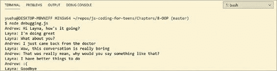
  return allMessages;
};

ChatProgram.prototype.printLog = function () {
  var allMessages = this.getLog;
  for (var i = 0; i < allMessages.length; i++) {
    console.log(allMessages[i]);
  }
};

var layna = new Person('Layna');
var andrew = new Person('Andrew');
var chat = new ChatProgram();
chat.message(andrew, 'Hi Layna, how's it going?');
chat.message(layna, 'I\'m doing great');
chat.message(layna, 'What about you?');
chat.message(andrew, 'I just came back from the doctor'); chat.message(layna, 'Wow, this conversation is really boring'); chat.message(andrew, 'That was really mean, why would you say something like that?');
chat.message(layna, 'I have better things to do');
chat.message(andrew, ':(');
chat.message(layna, 'Goodbye');
chat.printLog();
```

这是预期的输出。

## 编码检查清单

编码检查清单 » 让我们回顾一下涵盖过的的话题。面向对象编程并不是 JavaScript 特有的，但它是第一个一个在所有编程语言中并不通用的主题（实现方式不同）。面向对象编程是解决编程挑战的众多策略之一。随着你在编程工具箱中积累了更多技术，你将发现解决问题有多种方法。发现最佳解决办法需要经验和直觉。如果你有一个不确定的主意，尽管去尝试一试吧！编程的核心就在于从过去的错误中学习。以下是本章中所学内容的快速回顾。

- 什么是对象

- 什么是对象实例

- 如何创建实例变量

- 如何创建方法


# 第 9 章：JavaScript 与 Web

（虽然无聊的）HTML 能做的一切，都可以使用 JavaScript 来——而且如此！为了证明这一点，在本章中，你将从网页上的 HTML 开始，展示如何用 JavaScript 实现相同的功能，然后进一步超越 HTML 的能力。这是你第一次体验现代 JavaScript 的魅力以及它大放异彩的地方。我你像我一样兴奋！

### Web 的抽象级别

与你的标准终端相比，网站处于完全不同的抽象层级。如果说 `console.log` 的抽象级别像比骑自行车，那么 JavaScript 及其 Web 开发功能就像是开车。

对于本章，你不需要担心这些工具是如何工作的。你只需要关注利用这些工具在浏览器中执行有意义的任务的能力。

### HTML：超文本标记语言

你将非常依赖 JavaScript，但仍然需要少量的超文本标记语言，即 `HTML` 来与网页进行交互。现代网站使用了大量的 JavaScript 来操作它。

### HTML 文件

就像 JavaScript 有自己的文件扩展名 `.js` 一样，`HTML` 也有自己的文件扩展名 `.html`。创建一个 HTML 文件。这是某个东西被视为网页的最低要求。我将我的命名为 `index.html`，这是第一个 HTML 文件的标准名称。

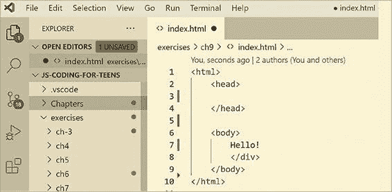

#### HTML 标筓

注意单词周围的角括号了吗？那是 `HTML` 语法。

```<valid-html-tag-name-here>```

一个被角括号包围，另一个有一个角括号和一个斜杠。

只有角括号的标签被称为起始标签，而另一个带有斜杠的被称为结束标签。一个起始标签必须有一个对应的结束标签。

```html

<html>

</html>

```

在起始标签和结束标签之间可以放置任何数量的内容。`HTML` 变得可以变得得极其复杂！

#### 我们将使用的 HTML 标签

由于本书的重点是 JavaScript，所以只会涵盖少数几个 `HTML` 标签。

```html

<html>

<head>

</head>

<body>

<div>

Hello!

</div>

</body>

</html>

```

`html` 标签是主标签，它包裹了文件中的所有 `HTML` 内容。`head` 标签是多用途的。它通常是插入非视觉 `HTML` 的地方。`body` 标签是放置视觉元素的地方。`div` 是一个没有重要作用角色的标签。它仅被用于封装其内部的元素。

#### HTML 属性：CLASS AND ID

有很多不同的 `HTML` 属性。应用它们的语法是属性名、等号和值（双引号）。作为一种概念，它与对象数据结构中的键值对非常相似。

```html

<div class="container">

I am content in a div

```

`class` 和 `id` 属性在 `HTML` 中非常重要。在与 JavaScript 协作时，常用的策略是通过它们的类或 `id` 查找 HTML 元素。

## Web 浏览器

在开始之前，确保已安装 Web 浏览器 Google Chrome。并不是所有浏览器都构造相同，Google Chrome 非常擅长运行 JavaScript。

搜索引擎查询：“google download”

当前 URL：[`google.com/chrome`](http://google.com/chrome)

### 浏览器开发者工具

安装后，打开 Google Chrome。导航到设置（右上三个点） -> 更多工具 -> 开发者工具。开发者控制台将会。作为 JavaScript 程序员，这是魔法发生的地方。JavaScript 可以写在这里。

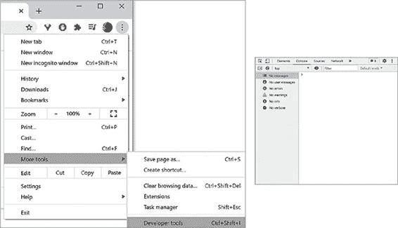

记得那个基础的 `index.html` 吗？在你的操作系统（PC 或 Mac）文件系统中找到它。最简单的方法是在 VS Code 中右键点击文件并选择“在文件管理器中显示”。对于 Mac，是“在访达中显示”。代码将打开文件所在的目录。


如果文件已经有了 Google Chrome 图标，双击文件打开。文件也可以拖放到浏览器窗口。

注意位置不是互联网 URL？那是指向 HTML 文件的目录路径。在确认文件运行后，修改 HTML。

```html

<html>

<head>

</head>

<body>

<div>

Hello!

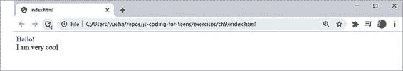


</div>

<div class="container">

I am EXTREMELY cool

</div>

</body>

</html>

```

修改后，页面没有变化。为什么浏览器不承认我们非常酷这一实？那是因为浏览器加载了文件的旧版本。为了看到更新，请刷新页面。

刷新后，我们看到了更新。非常棒！


在浏览器中，有一个自动创建的变量名为 `document`。将其输入开发者控制台。该变量是一个 JavaScript 对象，引用整个页面。展开后，所有的 HTML 都会显示出来。使用你的鼠标光标悬停在 `document` 变量上。注意网页是如何变成蓝色的？

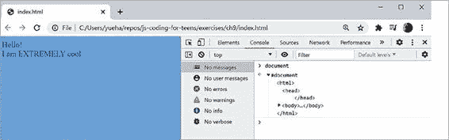

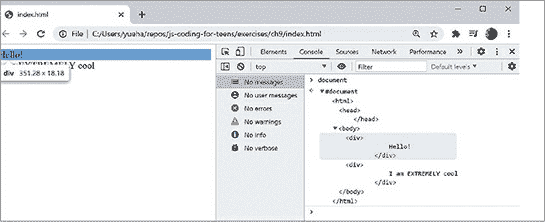

开发者控制台会高亮光标悬停过的 HTML。为了进一步证明这一点，展开 `body` 并悬停在一个被高亮的 `div` 元素上。

## HTML 选择器 (#index_split_000.html_p7)

JavaScript 有许多与浏览器相关的函数可以使用。`document` 是一个对象，意味着它拥有方法。可用的方法可以修改 HTML。整个 Web 开发社区严重依赖于这几个方法和函数。

### DOCUMENT.GETELEMENTSBYCLASSNAME

`document` 对象上一个被广泛使用的方法是 `document.getElementsByClassName`。如果我们让 `div` HTML 元素带有 `class` 属性，`document.getElementsByClassName` 就能施展它的魔法！

```html

<html>

<head>

</head>

<body

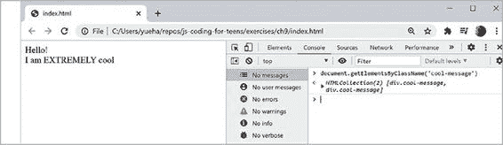

<div class="cool-message">

Hello!

</div>

<div class="cool-message">

I am EXTREMELY cool

</div>

</body>

</html

```

`document.getElementsByClassName` 接受一个参数。它是类的字符串名称。类 `cool-message` 被添加到了 `div` 元素中。该属性将用于识别 HTML 元素。在开发者控制中使用以下代码。运行代码后，输入变量名以在控制台中显示其值。

```javascript

var divElements = document.getElementsByClassName('cool-message');

```

运行代码后，再次在控制台中输入变量名 `divElements` 以显示其值。

太棒了！看起来该语句返回了包含我们两个 HTML 元素的数组！严格来说，它是一个被称为 `HTMLCollection` 的数据结构。以后，`HTMLCollections` 将被称为类数组数据结构。但别担心，因为数组和类数组数据结构之间的区别对你没有影响。

循环可以在 `HTMLCollections` 上运行。

### DOCUMENT.GETELEMENTBYID

与 `document.getElementsByClassName` 通过 `class` 属性获取 HTML 元素一样，`document.getElementById` 通过 `id` 属性选择元素。为了让元素被 `document.getElementById` 选中，请修改 HTML。添加一个带有 `id` 属性的 `div` 元素。

```html

<html>

<head>

</head>

<body

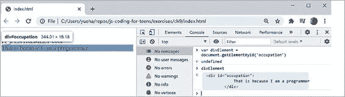

<div class="cool-message">

Hello!

</div>

<div class="cool-message">

I am EXTREMELY cool

</div>

<div id="occupation">

That is because I am a programmer

</div>

</body>

</html

```

刷新页面。在开发者控制台中输入以下代码。再次在控制台中输入变量后，返回值应该指向第三行文本。

```javascript

var divElement = document.getElementById('occupation');

```

注意 `document.getElementById` 返回的是一个单个元素。它没有返回像 `document.getElementsByClassName` 那样的类数组数据结构。这是因为 `document.getElementById` 每次只能选择一个元素。

## HTML 操作 (#index_split_000.html_p7)

HTML 元素内部有许多方法和属性，就像 `document` 对象一样。这些方法和属性赋予我们修改特定 HTML 元素的能力。

### 使用 INNERHTML 获取文本

在页面上编写文本将其封装在 HTML 中时，`div` 是最简单的标签。当 JavaScript 使用选择器指向 HTML 时，它被表示为一个 JavaScript 对象。该对象有一个名为 `innerHTML` 的键。它保存 HTML 元素内部的文本。回到你的示例 HTML 可以看到这一点。

使用 `document.getElementById` 获取 `id` 为 `occupation` 的 `div` 内部的文本

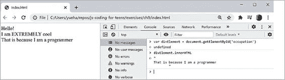

```html

<html>

<head>

</head>

<body>

<div class="cool-message">

Hello!

</div>

<div class="cool-message">

I am EXTREMELY cool

</div>

<div id="occupation">

That is because I am a programmer

</div>

</body>

</html

```

```javascript

var divElement = document.getElementById('occupation');

divElement.innerHTML;

```

### 使用 INNERHTML 注入新文本

`innerHTML` 是对象上的一个属性。就像对象上的任何键值对一样，它可以被重新赋值。这允许修改内部的文本。

```javascript

var divElement = document.getElementById('occupation');

divElement.innerHTML += ' and love building things';

```

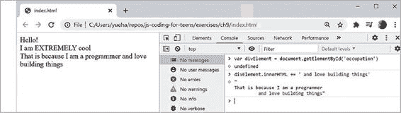

使用自加运算符，额外的文本被追加到了 `div` 元素的 `innerHTML` 中。恭喜！你已经迈入了 Web 开发世界的第一步。

### 更新属性 ID

就像 `innerHTML` 可以更新一样，`class` 和 `id` 属性也可以更改。更新 HTML 元素的 `id` 很容易的。关键是 `id`。

```javascript

var divElement = document.getElementById('occupation');

divElement.id = 'new-id';

```

### 更新属性 CLASS

更新 `class` 比 `id` 更复杂。这是因为通常会分配多个类。回到 HTML 文件。现在，`div` 元素只有一个 `class`。

```html

<html>

<head>

</head>

<body>

<div class="cool-message">

Hello!

</div>

<div class="cool-message">

I am EXTREMELY cool

</div>

<div id="occupation">

That is because I am a programmer

</div>

</body>

</html

```

向现有 HTML 元素添加类的方法是 `classList.add`。它接受一个参数，即要追加的类名。

```javascript

var divElements = document.getElementsByClassName('cool-message');

```

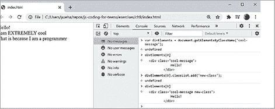


```javascript

divElements[0].classList.add('new-class');

```

移除类的方法是 `classList.remove`，它接受一个要移除的类的参数。

```javascript

var divElements = document.getElementsByClassName('cool-message');

divElements[0].classList.remove('new-class');

```

### 修改类的目的

到目前为止，你一直在学习如何更改 HTML 元素的类。当你处理 CSS 时，这变得非常重要。本书将不会涵盖 CSS，但只要更新属性是触发视觉变化的常用方法。

## 创建 HTML 元素 (#index_split_000.html_p7)

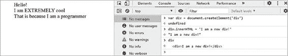

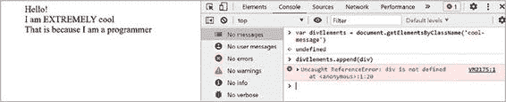

`document` 对象也有创建 HTML元素的方法。当你制作游戏时，这将变得特别重要！

### DOCUMENT.CREATEELEMENT

使用 `document.createElement`，JavaScript 可以创建 HTML。它接受一个参数，即 HTML 标签的字符串名称。因为我们没有学习太多 HTML，我们将使用 `document.createElement` 创建 `div` 元素。

```javascript

var div = document.createElement('div');

div.innerHTML = 'I am a new div!';

```

已经通过 `innerHTML` 创建了：“I am a new div!” 但在哪里？你创建了它，但还没有把它放在任何地方！

### 将 HTML 添加到页面

用 JavaScript 创建的 HTML 元素需要手动添加到页面。这就是使用 `append` 方法的地方。它存在于使用任何 HTML 选择器获取的 HTML 对象上，例如 `document.getElementsByClassName` 和 `document.getElementById`。

```javascript

var div = document.createElement('div');

div.innerHTML = 'I am a new div!';

var divElements = document.getElementsByClassName('cool-message');

divElements.append(div);

```

哎呀！为什么这不起作用？那是因为 `document.getElementsByClassName` 返回一个类数组数据结构。

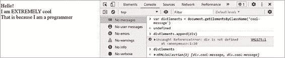

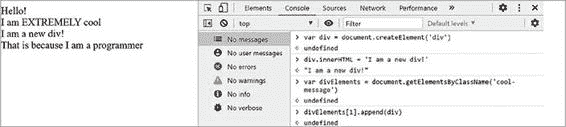

可以通过索引访问类数组数据结构中的元素。

```javascript

var div = document.createElement('div');

div.innerHTML = 'I am a new div!';

var divElements = document.getElementsByClassName('cool-message');

divElements[1].append(div);

```

你刚刚用纯 JavaScript 制作了 HTML！我觉得这很酷。

### 从页面移除 HTML


JavaScript 也可以用于移除 HTML 元素。修改 HTML 文件，添加一个新的 `div` 元素，该元素具有一个 `id` 属性和一些 `innerHTML`。

```html

<html>

<head>

</head>

<body>

<div class="cool-message">

Hello!

</</div>

<div class="cool-message">

I am EXTREMELY cool

</div>

<div id="occupation">

That is because I am a programmer

</div>

<div id="untrue-message">


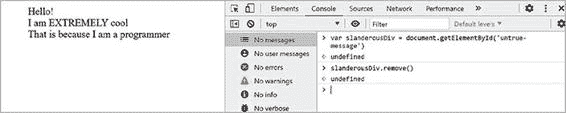

Just kidding, programmers are losers

</div>

</body>

</html>


程序员（Programmers）是失败者？看到这个虚假的陈述让我热血沸腾。我要求从页面移除该 `div`。包含该语句的 `div` 有一个 `id`。这意味着可以使用 `document.getElementById` 来指向该 HTML 元素。

`var slanderousDiv = document.getElementById('untrue-message');` 操作变量 `slanderousDiv` 的方法是 `remove`，它没有参数。

`var slanderousDiv = document.getElementById('untrue-message'); slanderousDiv.remove();`

太棒了！该 `div` 及其内部内容已被彻底无情地毁灭。

### 在 HTML 中运行 JavaScript (#index_split_000.html_p7)

到目前为止，页面的更新是在开发者控制台中完成的。但显然，这并不是程序员构建网站的方式！为了运行成千上行的代码，程序员需要能够将 JavaScript 写入文件并让代码自动运行。

#### HTML SCRIPT 标签

HTML `script` 标签允许你将 JavaScript 代码放置在 HTML 文件中。起始标签和结束标签之间的代码会在页面加载时自动运行。为了获得最最一致的结果，请将脚本放在 `body` 标签下。


```html

<html>

<head>

</head>

<body>

<div class="cool-message">

Hello!

</div>

<div class="cool-message">

I am EXTREMELY cool

</div>

<div id="occupation">

That is because I am a programmer

</div>

<script>

console.log('Hi! I have been automatically invoked in the browser')

</script>

</body>

</html>

```

刷新页面。你会发现，通过在 `script` 标签中封装 JavaScript 代码，代码 `console.log` 已经被自动调用。

将 JavaScript 放入 HTML 文件的能力赋予了程序员创建动态网站的能力。浏览器确实是 JavaScript 大放异彩的地方

#### 批量更新 HTML (#index_split_000.html_p7)

在了解如何在页面加载时运行代码后，你已经准备好编写有意义的代码。首先，移除 HTML 文件中的所有视觉内容。只留一个带有 `id` 的空 `div`。

```html

<html>

<head>

</head>

<body>

<div id="container">

</div>

</body>

<script>

</script>

</body>

</html>

```

在 `script` 标签内部，你可以利用数据结构、循环和 HTML 操作的理解来重新创建你最初硬编码的内容。第一步是创建一个函数，它将创建带有 `innerHTML` 文本内容的 `div` 元素。

```javascript

function createDivWithText(text) {

  var div = document.createElement('div');

  div.innerHTML = text;

  return div;

}

```

接下来 是一个要添加到页面的文本数组。

`var htmlText = ['Hello!', 'I am EXTREMELY cool', 'That is because I am a programmer'];`

此时，有了一个创建 HTML 的函数和一个文本数组。听起来你需要一个 `for` 循环，不是吗？

```javascript

for (var i = 0; i < htmlText.length; i++) {

  var newDiv = createDivWithText(htmlText[i]);

}

```

但你要对这个 `newDiv` 做什么？你需要一个地方插入它！这就是使用 `document.getElementById` 的地方。

记得那个 `id` 为 "container" 的空 `div` 吗？用 JavaScript 指向该 `div`，然后逐一个追加新创建的 `div` 元素。

```javascript

function createDivWithText(text) {

  var div = document.createElement('div');

  div.innerHTML = text;

  return div;

}

var htmlText = ['Hello!', 'I am EXTREMELY cool', 'That is because I am a programmer'];

var container = document.getElementById('container');

for (var i = 0; i < htmlText.length; i++) {

  var newDiv = createDivWithText(htmlText[i]);

  container.append(newDiv);

}

```

将所有内容整合在一起，HTML 文件看起来如下：

```html

<html>

<head>

</head>

<body>

<div id="container">

</div>

</body>

<script>

function createDivWithText(text) {

  var div = document.createElement('div');

  div.innerHTML = text;

  return div;

}

var htmlText = ['Hello!', 'I am EXTREMELY cool', 'That is because I am a programmer'];

var container = document.getElementById('container');

for (var i = 0; i < htmlText.length; i++) {

  var newDiv = createDivWithText(htmlText[i]);

  container.append(newDiv);

}

</script>

</body>

</html>

```

整合在一起后，HTML 文件看起来是这样：

刷新页面。你会发现，通过在 `script` 标签中封装 JavaScript 代码，代码 `console.log` 已经被自动调用。

将 JavaScript 放入 HTML 文件的能力赋予了程序员创建动态网站的能力。浏览器确实是 JavaScript 大放异彩的地方

#### 批量更新 HTML (#index_split_000.html_p7)

在了解如何在页面加载时运行代码后，你已经准备好编写有意义的代码。首先，移除 HTML 文件中的所有视觉内容。只留一个带有 `id` 的空 `div`。

```html

<html>

<head>

</head>

<body>

<div id="container">

</div>

</body>

<script>

</script>

</body>

</html>

```

在 `script` 标签内部，你可以利用对数据结构、循环和 HTML 操作的理解来重新创建你最初硬编码的内容。第一步是创建一个函数，它将创建带有 `innerHTML` 文本内容的 `div` 元素。

```javascript

function createDivWithText(text) {

  var div = document.createElement('div');

  div.innerHTML = text;

  return div;

}

```

接下来 是一个要添加到页面的文本数组。

`var htmlText = ['Hello!', 'I am EXTREMELY cool', 'That is because I am a programmer'];`

此时，有了一个创建 HTML 的函数和一个文本数组。听起来你需要一个 `for` 循环，不是吗？

```javascript

for (var i = 0; i < htmlText.length; i++) {

  var newDiv = createDivWithText(htmlText[i]);

}

```

但你要对这个 `newDiv` 做什么？你需要一个地方插入它！这就是使用 `document.getElementById` 的地方。

记得那个 `id` 为 "container" 的空 `div` 吗？用 JavaScript 指向该 `div`，然后逐一个追加新创建的 `div` 元素。

```javascript

function createDivWithText(text) {

  var div = document.createElement('div');

  div.innerHTML = text;

  return div;

}

var htmlText = ['Hello!', 'I am EXTREMELY cool', 'That is because I am a programmer'];

var container = document.getElementById('container');

for (var i = 0; i < htmlText.length; i++) {

  var newDiv = createDivWithText(htmlText[i]);

  container.append(newDiv);

}

```

将所有内容整合在一起，HTML 文件看起来如下：

```html

<html>

<head>

</head>

<body>

<div id="container">

</div>

</body>

<script>

function createDivWithText(text) {

  var div = document.createElement('div');

  div.innerHTML = text;

  return div;

}

var htmlText = ['Hello!', 'I am EXTREMELY cool', 'That is because I am a programmer'];

var container = document.getElementById('container');

for (var i = 0; i < htmlText.length; i++) {

  var newDiv = createDivWithText(htmlText[i]);

  container.append(newDiv);

}

</script>

</body>

</html>

```

整合在一起后，HTML 文件看起来是这样：

刷新后，点击按钮将弹出一个警框，正如预期那样。


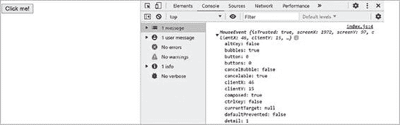

`addEventListener` 方法的第二个参数是一个函数，它有自己的参数。这通常被称为事件对象。要查看它是什么样的，可以在函数内部使用 `console.log`。

```javascript

// index.js

var button = document.getElementById('clickable-button'); button.addEventListener('click', function (event) {

console.log(event);

});

```

哇，信息量真大！不用担心事件中存在的信息。目前，只需要知道 `addEventListener` 提供了关于点击事件的信息即可。

## 黑客提示

点击事件是 JavaScript 中可用的许多事件类型之一。如果你想了解更多可用的事件，可以通过在线资源找到它们。

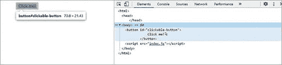

## 使用 CSS 隐藏元素

CSS 与 JavaScript 的配合工作得非常好。在页面上创建元素有两种方法：一种是手动创建它们，另一种是显示隐藏的元素。

#### 将 CSS 应用到 HTML

将 CSS 样式应用到页面有两种方法。一种是使用 `style` 标签。CSS 可以封装在其中，样式将通过属性类应用。在这里，为按钮添加了 `hide` 类名，并关联相应的 CSS 使按钮不可见。

```html

<html

<head>

<style>

.hide {

opacity: 0;

}

</style>

</head>

<body>

<button id="clickable-button" class="hide"> Click me!

</button>

<body>

<script src="index.js"></script>

</html>

```

在浏览器中检查此内容，按钮现在消失了！但如果你检查页面，按钮仍然在那里！它只是不可见。

另一种方法是导入 CSS 文件，这种方法更常用。这是通过使用 `link` 标签并为标签赋予 `rel` 和 `href` 属性来实现。`rel` 的值始终是“stylesheets”，而 `href` 是文件名。让我们修改一下，让样式位于单独的文件中，但仍然应用到页面上。

创建一个带有 `.css` 扩展名的新文件。我的文件名为 `styles.css`。

```css

.hide {

opacity: 0;

}

```

然后使用 `link` 标签导入它。什么都不应该发生变化！

```html

<html

<head>

<link rel="stylesheet" href="styles.css">

</head>

<body>

<button id="clickable-button" class="hide"> Click me!

</button>

<body>

<script src="index.js"></script>

</html>

```

## 使用 CSS 显示和隐藏元素

CSS 可以用于隐藏元素，而 JavaScript 可以操作 HTML，包括类和 `ids`。这意味着你可以使用代码显示和隐藏元素！让我们就这样做。添加一个带有 `hide` 类和 `id` 的 HTML 元素，以便可以使用 `getElementById` 获取它。

```html

<html

<head>

<link rel="stylesheet" href="styles.css">

</head>

<body>

<button id="clickable-button">

Click me!

</button>

<div class="hide" id="content"> Content!

</div>

<body>

<script src="index.js"></script>

</html>

```

然后，在 JavaScript 文件中，为按钮事件监听器添加行为，从 HTML 元素中移除该类。

```javascript

// index.js


var button = document.getElementById('clickable-button'); button.addEventListener('click', function () {

var hiddenElement = document.getElementById('content'); hiddenElement.classList.remove('hide');

});

```

点击按钮后，隐藏的内容应该显示出来。

## 浏览器特定的 JavaScript 实战

现在你已经通了 JavaScript 如何与浏览器和 HTML 交互，是时候升级你的迎接更大的挑战了！

### 在页面上输入

在此练习中，你将让你的网站检测按键并将其放在页面上！

需要一个带有 `div` 的 HTML 文件。这个 `div` 将包含用户输入的按键。还需要一个指向 `index.js` 文件的 `script` 标签。

```html

<html

<head>

</head>

<body>

<div id="text">

</div>

<body>

<script src="index.js"></script>

</html>

```

在 `index.js` 中，添加用于记录按键事件监听器。在之前的事件监听器示例中，你需要将监听器附加到按钮上。但在这里，位置并不重要。所有的按键都应该被记录。事件监听器应该添加到整个 `document`。

```javascript

// index.js

document.addEventListener('keydown', function(event) {

console.log(event);

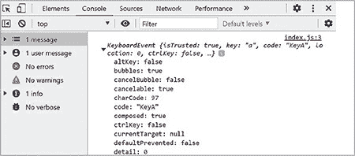

});

```

刷新页面并按下“a”键后，可以在开发者控制台中看到按键事件的事件对象。

事件对象包含大量信息，但 `key` 属性包含了重要信息。它包含了按键名称。

```javascript

// index.js

document.addEventListener('keydown', function(event) {

console.log(event.key);

});

```

通过 `console.log`，可以在开发者控制台中看到按键事件的事件对象。通过 `console.log`，可以在开发者控制台中看到按键事件的事件对象。

等待，刷新页面并按下“a”键后，可以在开发者控制台中看到按键事件的事件对象。

```javascript

// index.js

document.addEventListener('keydown', function(event) {

console.log(event.key);

var div = document.getElementById('text');

div.innerHTML += event.key;

});

```


```javascript

var div = document.getElementById('delete-all');

div.innerHTML = '';

});

```

## 编码检查清单 » 让我们复习一下涵盖过的主题

自`第 1 章`以来，你已经走了很长一段路，不是吗？通过建立编程基础的先备知识，你终于开始接近现代程序员所面临的工作和挑战！以下是你在本章中学到的内容。

*   HTML 基础，包括标签、页面上的文本和属性
*   如何在页面加载时运行 JavaScript 代码
*   开发者控制台
*   JavaScript HTML 选择器
*   使用 JavaScript 修改 HTML 元素
*   事件监听器


# 第 10 章

## 游戏时间

你做到了！你的工具箱现在包含了编程基础、面向对象编程和 Web 特定的 JavaScript。你已经涵盖了这本书所提供的所有基础知识。尽管如此，如果你不对这些知识做任何事情，它们又有什么用处呢？让我们通过创建一个游戏来结束课程——一个运行在浏览器上的游戏。

### 浏览器上的吊单词游戏

我们选择的游戏是“吊单词”。当然，你已经在终端里做过吊单词了。基础知识是不变的。但当涉及到浏览器时，某些实现部分是棘手的！

### 吊单词游戏：终端 vs 浏览器

浏览器和终端之间的主要区别在于图形。不再使用 `console.log`，而是需要修改 HTML。例如，判断玩家是否输了的方法是完全相同的。

```javascript

Hangman.prototype.playerLost = function () {

  return this.remainingBadGuesses === 0;

};

```

另一方面，显示已猜字符的方式将完全不同。在浏览器上，一个 `console.log` 可再也不够了！

```javascript

Hangman.prototype.showGuessedCharacters = function() {

  var str = '';

  for (var i = 0; i < this.charactersGuessed.length; i++) {

    var currChar = this.charactersGuessed[i];

    str += currChar;

    str += ' ';

  }

  console.log('你目前猜了以下字符：');

  console.log(str);

};

```

内容必须使用 HTML 进行视觉化表达。就像你需要使用巧妙的技巧来解决算法一样，你需要发挥创意来操纵 HTML。

### 吊单词游戏的实现

吊单词游戏的任何规则都没有改变。之前章节中大多数较小的挑战都是那样的。区别在于实现方式。

在开始之前，重新回顾游戏条件。这是一个来自`面向对象编程`章节的完全相同的模板。

**需要跟踪的变量：**
*   秘密单词
*   已猜字符
*   输掉游戏之前的错误猜测总数

**终止条件：**
*   如果玩家犯了六次错误猜测，则玩家输了。
*   如果玩家猜中了秘密单词中的所有字符，则玩家赢。

**吊单词游戏循环：**
*   显示已猜的字符。
*   提示玩家猜一个字符。
*   将猜到的字符添加到字符库中。
*   揭示秘密单词中猜对的字符。

**游戏边界：**
*   防止重复猜测。
*   防止非字母猜测。
*   在猜词时忽略大小写。

## 游戏图形

你需要向玩家显示他们在玩游戏时正在发生什么。之前在终端上用原始文本完成的所有操作，现在必须在浏览器上通过 HTML 操作完成。为了做到，你将实现以下规则：

1.  **当游戏开始时**
    *   a. 为秘密单词留出空格
    *   b. 显示已猜字母的空间
    *   c. 用于向玩家显示游戏反馈的消息栏
    *   d. 绳子上的吊单词进度
2.  **当玩家猜一个字符时**
    *   a. 如果字符正确
        *   使用消息栏中的消息通知他们
        *   在秘密单词区域揭示该字符
        *   添加到已猜字符列表
    *   b. 如果字符错误
        *   使用消息告诉他们
        *   在人物身上添加一个身体部位
        *   添加到已猜字符列表
    *   c. 如果字符之前猜过
        *   使用消息告诉他们
        *   忽略该猜测
3.  **检查玩家是赢了还是输了**
    *   a. 如果既没赢也没输，继续游戏
    *   b. 如果赢了，打开游戏结束界面并告诉他们赢了
    *   c. 如果输了，打开游戏结束界面并告诉他们输了
    *   d. 如果赢了或输了，允许重置游戏

### HTML 文件

在编码之前，需要一个 HTML 文件，否则 JavaScript 将无物可操纵！这里是完整的文件。这包含了 CSS 和 JavaScript 的导入，使用了 `link` 和 `script` 标签。每个部分将分别单独检查。

```html

<html>

<head>

<link rel="stylesheet" href="hangman.css">

<link rel="stylesheet" href="person.css">

</head>

<body>

<div>

  <div id="rope">

  |

  </div>

  <div id="pole">

  </div>

</div>

<div>

<div id="person">

  <div id="head" class="appendage intact"> o

  </div>

```

（注：原文提供的 HTML 代码块在 `</div>` 处截断，我将严格按照原文内容进行输出且不翻译代码。）


var originalText = getTodoText(parentDiv);

var currentHTMLHeight = getHtmlElementHeight(parentDiv);

var editingTextArea = createEditableTextAreaWithHeight(originalText, currentHTMLHeight);

destroyInnerContent(parentDiv);

parentDiv.append(editingTextArea);

var updateButton = createUpdateButton();

var cancelButton = createCancelButton(originalText);

parentDiv.append(updateButton);

parentDiv.append(cancelButton);

editingTextArea.focus();

});

return editButton;

}

```

## 在编辑后更新文本

看起来你的待办事项条神奇地变成了一个可编辑元素。但如果一个 `textarea` 没有能力恢复到不可编辑状态，它又有什么用呢？让我们使用 `createUpdateButton` 函数添加一个更新按钮。目前，按钮什么都没做。添加一个事件监听器来改变这一点。在销毁 textarea HTML 元素之前，将内部文本保存到变量变量中。

```javascript

function createUpdateButton() {

var updateButton = document.createElement('div');

updateButton.innerHTML = 'update';

updateButton.classList.add('update-button');

updateButton.addEventListener('click', function () {

var parentDiv = getParentDiv(updateButton);

var updatedText = getTodoText(parentDiv);

});

return updateButton;

}

```

现在你准备好操作页面上的 HTML 了。销毁 `textarea`，用内部的文本重新创建不可编辑的待办事项，并将其插入到之前 textarea 所在的精确的位置。非常酷！

```javascript

function createUpdateButton() {

var updateButton = document.createElement('div');

updateButton.innerHTML = 'update';

updateButton.classList.add('update-button');

updateButton.addEventListener('click', function () {

var parentDiv = getParentDiv(updateButton);

var updatedText = getTodoText(parentDiv);

destroyInnerContent(parentDiv);

var textDiv = createTextDiv(updatedText);

var closeButton = createCloseButton();

var editButton = createEditButton();

parentDiv.append(textDiv);

parentDiv.append(closeButton);

parentDiv.append(editButton);

});

return updateButton;

}

```

## 取消文本更新

但如果用户改变主意并想要取消更新呢？你需要一个按钮。这个网站已经有一个名为 `createCancelButton` 的函数。你需要为它添加行为。这意味着是添加另一个事件监听器了！

当点击取消时，文本需要恢复到原始状态。但用户开始在 `textarea` 中输入时，你会丢失文本值。如何解决这个问题呢？

你需要发挥一点创意！这次给 `createCancelButton` 添加一个参数。这个参数将在函数内部存储原始文本。

```javascript

function createCancelButton(originalText) {

var cancelButton = document.createElement('div');

cancelButton.innerHTML = 'cancel';

cancelButton.classList.add('cancel-button');

return cancelButton;

}

```

当取消按钮被点击时，事件监听器将销毁 `textarea`，创建不可编辑的 div，并重新插入之前保存的文本。尝试你改进后的待办事项列表。

```javascript

function createCancelButton(originalText) {

var cancelButton = document.createElement('div');

cancelButton.innerHTML = 'cancel';

cancelButton.classList.add('cancel-button');

cancelButton.addEventListener('click', function () {

var parentDiv = getParentDiv(cancelButton);

destroyInnerContent(parentDiv);

var textDiv = createTextDiv(originalText);

var closeButton = createCloseButton();

var editButton = createEditButton();

parentDiv.append(textDiv);

parentDiv.append(closeButton);

parentDiv.append(editButton);

});

return cancelButton;

}

```

## 恭喜！

你已经成功掌握了 JavaScript 的基础！这本书从最原始的基础开始，缓慢而坚定地让你学习了足够构建 JavaScript 游戏和网站的知识。书中有些非常有挑战性的章节，我祝贺你到达了终点！

话虽如此，你的旅程并没有此结束。书中涵盖的基础知识只是冰山一角。我希望你在读这本书的过程中，像我写这本书时一样开心！我热爱编程，真诚地希望你在未来几年里继续提升你的编码员技能。

## 答案页

### 第 3 章答案

### 破解密码 (CRACK THE CODE)

### 1. 注释什么时候有用？
注释可以用于很多情况。它们可以解释代码在做什么、编写算法的目的以及一般的自我备注。

### 2. 声明和赋值有什么区别？
声明是准备一个变量。赋值是将部分数据与它相关联。

### 3. `var` 单词可以作为变量名吗？为什么可以或为什么不行？
不可以，因为它是保留关键字。

### 4. 本章涵盖了哪些关键字？
涵盖了：`var`、`true`、`false`、`null`、`undefined`。

### 5. 自增运算符和赋值运算符的主要区别是什么？
自增运算符不需要赋值。赋值是重新赋值。

### 6. 如何访问数组中的值？
通过它们在数组中的数字位置（从 0 开始）访问。这是通过括号运算符实现的。

### 7. 如何访问对象中的值？
通过它们的键名使用点运算符或括号运算符访问。如果使用括号运算符，键名必须是字符串。

### 8. 访问数组不存在的索引会输出什么？
输出 `undefined`。

### 9. 访问对象不存在的键会输出什么？
输出 `undefined`。

### 10. 什么时候访问对象的值时必须使用括号表示而不是点运算符？
当使用变量作为键名时，必须使用括号表示。

### 调试 (DEBUGGING)

### 1. 尽管变量进行了自增，但值似乎没有变化。
自增不应该赋值。
```javascript

var num = 0;

num++;

console.log(num); // 1

```

### 2. 两个数字相加不起正常。
其中一个数字是字符串。两者都必须是 `number` 类型。
```javascript

var num1 = 10;

var num2 = 2;

console.log(num1 + num2); // 12

```

### 3. 尝试使用键 `pug` 访问你的狗的名字 `Max` 输出了 `undefined`。
使用变量作为键时，必须使用括号表示。
```javascript

var dogs = {

pug: 'Max',

terrier: 'Appa'

};

var myDog = 'pug';

console.log(dogs[myDog]); // 'Max'

```

### 4. 访问数组的最后一个元素输了 `undefined`。
索引 3 超出了数组范围。对于数组，索从 0 开始。
```javascript

var meanPeople = ['Layna', 'Layna again', 'Layna one more time'];

console.log(meanPeople[2]); // 'Layna one more time'

```

### 5. 当尝试打印此字符串时发生了致命的运行时错误。

在预期的消息中间有一个撇号：`Layna’s`。JavaScript 认为字符串在该处结束了，导致了运行时错误。在字符串中间使用引号需要使用转义符。

```

console.log('Layna\'s favorite hobby is being mean to Andrew');

```

## 第 4 章答案

### 破译代码题 (CRACK THE CODE)

### 1. 等等运算符和严格相等运算符之间的区别是什么？

如果数据类型不同，等等运算符将使用类型转换。而严格相等运算符则永远不会使用类型转换。

### 2. `typeof` 运算符可以正确检查哪些数据类型？

`typeof` 运算符可以用于字符串、数字、`null`、`undefined` 和布尔值。`typeof` 运算符不能用于检查数组和对象。

### 3. 什么数据类型使用 `instanceof` 运算符进行正确检查？

`instanceof` 运算符可以用于检查数据类型是否为数组。

### 4. 下列代码的输出是什么？

`false`，因为 `true && false` 结果为 `false`，且右侧已经是 false 了。

### 5. 下列代码的输出是什么？

`true`，因为 `!false` 结果为 `true`。右侧的结果为 `false`，但 OR 运算符（双竖线）只需要一侧为真。

### 6. 为什么 `array[index] !== undefined` 是检查数组内是否存在该索引的有效方法？

如果尝试访问的数组不存在该索引，输出将是 `undefined`。

### 调试 (DEBUGGING)

### 1. 代码说数组是一个对象。

`typeof` 运算符不能用于检查项目是否为数组。必须使用 `instanceof` 运算符。

```javascript

var item = [];

if (item instanceof Array) {

  console.log('I am an array');

} else {

  console.log('I am not an array');

}

```

### 2. 《超级意大利兄弟 2》已经连续 10 多次获得驴博士的“年度游戏”奖。它绝对是一部杰作。但代码却并非如此。

在 `if` 条件判断中，值比较符是错误的。它应该是大于 `>`，而不是小于 `<`。

```javascript

var game = 'superItalianBrosTwo';

if (donkeysGameScores[game] > 95) {

  console.log(game + ' is a masterpiece');

} else {

  console.log(game + ' is not a masterpiece');

}

// superItalianBrosTwo is a masterpiece

```

### 3. 如果分数在 30 到 80 之间，我认为这是一个平庸的游戏。《最后的守卫者》就是一个平庸的游戏。但它并不糟糕。提示：用简单的英语写出复杂的条件很有帮助！

在 `else if` 条件中，`AND` 运算符的左侧是错误的。在错误版本中，该条件是：如果分数大于 80 且分数大于 30。它应该是：如果分数小于 80 且分数大于 30。

```javascript

var game = 'theLastDefender';

var score = donkeysGameScores[game];

if (score >= 80) {

  console.log(game + ' was a fun game');

} else if (score < 80 && score > 30) {

  console.log(game + ' was an ok game');

} else {

  console.log(game + ' was a bad game');

}

// theLastDefender was an ok game

```

## 第 5 章答案

### 破译代码题 (CRACK THE CODE)

### 1. 在处理循环时，终止条件为什么很重要？

一个带有永远不会变为 false 的终止语句的循环将无限循环。

### 2. 使用 `for` 循环遍历数组时，变量（通常为 `i`）被初始化为 0。当该变量作为循环终止条件的一部分时，它的作用是什么？

对于终止条件，变量 `i` 用于跟踪循环的索引。

### 3. 使用 `for` 循环遍历数组时，变量（通常为 `i`）被初始化为 0。在循环内部对数组使用时，它的作用是什么？

变量 `i` 用于访问数组内部的值。

### 4. 为以下循环列出表格。

| 迭代 | I | 条件 | 品种 |
| :--- | :--- | :--- | :--- |
| 1 | 0 | 0 < 3 | pug |
| 2 | 1 | 1 < 3 | golden retriever |
| 3 | 2 | 2 < 3 | german shepherd |

### 5. 为以下循环列出表格。

| 迭代 | I | 条件 | 品种 |
| :--- | :--- | :--- | :--- |
| 1 | 0 | 0 < 4 | super |
| 2 | 1 | 1 < 4 | smurf |
| 3 | 2 | 2 < 4 | sleepy |
| 4 | 3 | 3 < 4 | moth |

### 6. 为以下循环列出表格。

| 迭代 | I | 条件 | 品种 |
| :--- | :--- | :--- | :--- |
| 1 | 0 | 0 < 7 | Maine Coon |
| 2 | 1 | 1 < 7 | ragdoll |
| 3 | 2 | 2 < 7 | Persian |
| 4 | 3 | 3 < 7 | Siamese |
| 5 | 4 | 4 < 7 | Beagle |
| 6 | 5 | 5 < 7 | Beagle |
| 7 | 6 | 6 < 7 | Boxer |

### 调试 (DEBUGGING)

### 1. 代码说数组是一个对象。

`typeof` 运算符不能用于检查项目是否为数组。必须使用 `instanceof` 运算符。

```javascript

var item = [];

if (item instanceof Array) {

  console.log('I am an array');

} else {

  console.log('I am not an array');

}

```

### 2. 《超级意大利兄弟 2》已经连续 10 多次获得驴博士的“年度游戏”奖。它绝对是一部杰作。但代码却并非如此。

在 `if` 条件判断中，值比较符是错误的。它应该是大于 `>`，而不是小于 `<`。

```javascript

var game = 'superItalianBrosTwo';

if (donkeysGameScores[game] > 95) {

  console.log(game + ' is a masterpiece');

} else {

  console.log(game + ' is not a masterpiece');

}

// superItalianBrosTwo is a masterpiece

```

### 3. 如果分数在 30 到 80 之间，我认为这是一个平庸的游戏。《最后的守卫者》就是一个平庸的游戏。但它并不糟糕。提示：用简单的英语写出复杂的条件很有帮助！

在 `else if` 条件中，`AND` 运算符的左侧是错误的。在错误版本中，该条件是：如果分数大于 80 且分数大于 30。它应该是：如果分数小于 80 且分数大于 30。

```javascript

var game = 'theLastDefender';

var score = donkeysGameScores[game];

if (score >= 80) {

  console.log(game + ' was a fun game');

} else if (score < 80 && score > 30) {

  console.log(game + ' was an ok game');

} else {

  console.log(game + ' was a bad game');

}

// theLastDefender was an ok game

```

## 第 5 章答案

### 破译代码题 (CRACK THE CODE)

### 1. 在处理循环时，终止条件为什么很重要？

一个带有永远不会变为 false 的终止语句的循环将无限循环。

### 2. 使用 `for` 循环遍历数组时，变量（通常为 `i`）被初始化为 0。当该变量作为循环终止条件的一部分时，它的作用是什么？

对于终止条件，变量 `i` 用于跟踪循环的索引。

### 3. 使用 `for` 循环遍历数组时，变量（通常为 `i`）被初始化为 0。在循环内部对数组使用时，它的作用是什么？

变量 `i` 用于访问数组内部的值。

### 4. 为以下循环列出表格。

| 迭代 | I | 条件 | 品种 |
| :--- | :--- | :--- | :--- |
| 1 | 0 | 0 < 3 | pug |
| 2 | 1 | 1 < 3 | golden retriever |
| 3 | 2 | 2 < 3 | german shepherd |

### 5. 为以下循环列出表格。

| 迭代 | I | 条件 | 品种 |
| :--- | :--- | :--- | :--- |
| 1 | 0 | 0 < 4 | super |
| 2 | 1 | 1 < 4 | smurf |
| 3 | 2 | 2 < 4 | sleepy |
| 4 | 3 | 3 < 4 | moth |

### 6. 为以下循环列出表格。

| 迭代 | I | 条件 | 品种 |
| :--- | :--- | :--- | :--- |
| 1 | 0 | 0 < 7 | Maine Coon |
| 2 | 1 | 1 < 7 | ragdoll |
| 3 | 2 | 2 < 7 | Persian |
| 4 | 3 | 3 < 7 | Siamese |
| 5 | 4 | 4 < 7 | Beagle |
| 6 | 5 | 5 < 7 | Beagle |
| 7 | 6 | 6 < 7 | Boxer |

### 调试 (DEBUGGING)

### 1. 代码说数组是一个对象。

`typeof` 运算符不能用于检查项目是否为数组。必须使用 `instanceof` 运算符。

```javascript

var item = [];

if (item instanceof Array) {

  console.log('I am an array');

} else {

  console.log('I am not an array');

}

```

### 2. 《超级意大利兄弟 2》已经连续 10 多次获得驴博士的“年度游戏”奖。它绝对是一部杰作。但代码却并非如此。

在 `if` 条件判断中，值比较符是错误的。它应该是大于 `>`，而不是小于 `<`。

```javascript

var game = 'superItalianBrosTwo';

if (donkeysGameScores[game] > 95) {

  console.log(game + ' is a masterpiece');

} else {

  console.log(game + ' is not a masterpiece');

}

// superItalianBrosTwo is a masterpiece

```

### 3. 如果分数在 30 到 80 之间，我认为这是一个平庸的游戏。《最后的守卫者》就是一个平庸的游戏。但它并不糟糕。提示：用简单的英语写出复杂的条件很有帮助！

在 `else if` 条件中，`AND` 运算符的左侧是错误的。在错误版本中，该条件是：如果分数大于 80 且分数大于 30。它应该是：如果分数小于 80 且分数大于 30。

```javascript

var game = 'theLastDefender';

var score = donkeysGameScores[game];

if (score >= 80) {

  console.log(game + ' was a fun game');

} else if (score < 80 && score > 30) {

  console.log(game + ' was an ok game');

} else {

  console.log(game + ' was a bad game');

}

// theLastDefender was an ok game

```


```javascript

for (var i = 0; i < arrOrStr.length; i++) {

  var currItem = arrOrStr[i];

  if (currItem === item) {

    return true;

  }

}

return false;

}

```

test('includes #1', includes('cat', 'a'), true);
test('includes #2', includes('cat', 't'), true);
test('includes #3', includes('cat', 'f'), false);

### createHint

在 `else` 块中，它不应该是一个赋值语句。这个函数的目的是增量地构建字符串，但使用等号会覆盖之前对字符串的所有构建。它应该是一个自增赋值（累）。

```javascript

function createHint(actualName, allUserGuesses) {

  var output = '';

  for (var i = 0; i < actualName.length; i++) {

    var currChar = actualName[i];

    if (includes(allUserGuesses, currChar)) {

      output += currChar + ' ';

    } else {

      output += '_ ';

    }

  }

  return output;

}

```

test('createHint #1', createHint('charlie', 'chle'), 'c h _ _ l _ e ');
test('createHint #2', createHint('cat', ''), '_ _ _ ');
test('createHint #3', createHint('cat', 'a'), '_ a _ ');

### correctlyGuessed

这个函数正在检查 `actualName` 中的每个字符是否存在于 `allUserGuesses` 中。如果 `currChar` 不存在于所有猜测的字符串中，我们立即知道游戏还没有结束，可以停止循环。

但逻辑应该是相反的，这需要使用非逻辑运算符 `!`。

```javascript

function correctlyGuessed(actualName, allUserGuesses) {

  for (var i = 0; i < actualName.length; i++) {

    var currChar = actualName[i];

    if (!includes(allUserGuesses, currChar)) {

      return false;

    }

  }

  return true;

}

```

test('correctlyGuessed #1', correctlyGuessed('charlie', 'chle'), false);
test('correctlyGuessed #2', correctlyGuessed('cat', 'tac'), true);
test('correctlyGuessed #3', correctlyGuessed('cat', 'cat'), true);

### isMultiCharGuess

检查一个猜测是否是多个字符应该检查长度是否等于 1。

```javascript

function isMultiCharGuess(guess) {

  return guess.length !== 1;

}

```

test('isMultiCharGuess #1', isMultiCharGuess('a'), false);
test('isMultiCharGuess #2', isMultiCharGuess('av'), true);
test('isMultiCharGuess #3', isMultiCharGuess('c'), false);

# 第 7 章答案

## 破解密码

### 1. 运行此代码后，players 是否是一个包含‘smurf’和‘ANS’的数组？为什么或为什么不？

两个名字都存在。`shift` 操作移除了数组中的第一个项目，即 `'super'`。

### 2. 什么是可变性？哪些数据类型是可变的？

可变性是在不创建新版本的情况下修改一段数据的概念。对象和数组是可变的。所有其他数据类型都是不可变的。

### 3. 为什么字符串修改需要重新赋值，而数组和对象的修改不需要？

在 JavaScript 中，字符串是不可变的。为了创建一个包含两个组合值的新字符串，必须使用某种类型的赋值操作。

### 4. 哪些数组方法会减小数组的大小？

`shift` 和 `pop` 方法会移除数组中的项目。它们分别从头部和尾部移除项目。

### 5. 哪些数组方法会增加数组的大小？

`unshift` 和 `push` 方法向数组中添加项目。它们分别在头部和尾部添加项目。

### 6. 为以下函数画一个表格。写出每次迭代时数组的样子以及 `array.length > 0` 的情况。

| 迭代 | I | 条件 | 数组 |
| :--- | :--- | :--- | :--- |
| 1 | 0 | 5 > 0 | [10, 20, 12, 30, 25] |
| 2 | 1 | 4 > 0 | [10, 20, 12, 30] |
| 3 | 2 | 3 > 0 | [10, 20, 12] |
| 4 | 3 | 2 > 0 | [10, 20] |
| 5 | 4 | 1 > 0 | [10] |

### 7. 下列代码的输出是什么？如有必要，画一个表格。

| 迭代 | I | 条件 | NEWSTR |
| :--- | :--- | :--- | :--- |
| 1 | 0 | 0 < 6 | 'a' |
| 2 | 1 | 1 < 6 | 'ab' |
| 3 | 2 | 2 < 6 | 'abc' |
| 4 | 3 | 3 < 6 | 'abcd' |
| 5 | 4 | 4 < 6 | 'abcde' |
| 6 | 5 | 5 < 6 | 'abcdef' |

### 8. 用你自己的话描述这个函数的目的。这个函数正在检查 `actualName` 中的每个字符是否存在于 `allUserGuesses` 中。如果 `currChar` 不存在于所有玩家猜测的字符串中，我们立即知道游戏还没有结束，可以停止循环。

### 9. `count` 的值是多少？

`count` 的值为 2。

# 第 8 章答案

### 1. 定义什么是对象数据结构。

对象数据结构是一种可以包含任意数量值的数据类型。它们以键值对的形式存储在内部。

### 2. 在面向对象编程中，定义什么是对象。

对象是一个内部包含数据和函数的实体。它是设计代码的一种方式，以便更容易理解和推理。

### 3. 什么变量在所有方法中都可用？

实例变量作为键值对赋值给 `this` 在对象的所有方法中都是可用的。

### 4. 在内部调用另一个方法的语法是什么？

是 `this.methodName()`。

### 5. 制作构造函数的语法是什么？

函数可以作为构造函数来初始化对象实例。

### 6. 什么是对象实例？

对象实例是对象的唯一实体。它单独持有源于其他实例的所有数据。

### 7. 初始化对象实例的语法是什么？

在函数调用前使用 `new` 关键字会创建一个对象实例。

### ChatProgram.prototype.parseMessageEntry

消息对象中没有 `chat` 键。聊天记录中的文本在 `message` 键中。

```javascript

ChatProgram.prototype.parseMessageEntry = function (chatEntry) {

  return chatEntry.person.name + ': ' + chatEntry.message;

};

```

### ChatProgram.prototype.getLog

向数组添加条目的 `pop` 方法是错误的。在调用另一个方法时，`this.prototype.parseMessageEntry` 应该是 `this.parseMessageEntry`。

```javascript

ChatProgram.prototype.getLog = function () {

  var parsedMessages = [];

  for (var i = 0; i < this.chatLog.length; i++) {

    var chatEntry = this.chatLog[i];

    var parsedMessage = this.parseMessageEntry(chatEntry);

    parsedMessages.push(parsedMessage);

  }

  return parsedMessages;

};

```### ChatProgram.prototype.printLog

方法 `this.getLog` 没有被调用。

```javascript

ChatProgram.prototype.printLog = function () {

  var allMessages = this.getLog();

  for (var i = 0; i < allMessages.length; i++) {

    console.log(allMessages[i]);

  }

};

```

# 第 9 章 解决方案

## 破解代码

1. **HTML 文件更新并保存后，浏览器没有立即更新。为什么？**
浏览器当前拥有旧版本的 HTML 文件。刷新页面将会更新。

2. **`document` 对象是什么？**
`document` 对象是 JavaScript 对网页的表示。

3. **`document.getElementsByClassName` 和 `document.getElementById` 的用途是什么？**
这些函数用于 JavaScript 操作 HTML 元素。

4. **`document.getElementsByClassName` 和 `document.getElementById` 有什么区别？**
`document.getElementsByClassName` 搜索类的实例并返回一个类数组的数据结构；而 `document.getElementById` 只查找一个。

5. **HTML 元素中包含什么属性？**
包含文本的属性是 `innerHTML`。

6. **什么是事件监听器（event listener）？**
事件监听器是一个被创建并在后台等待某种交互的 JavaScript 函数，其范围从按键到点击。一旦发生交互，JavaScript 将运行其内部的代码。

7. **在我们的示例中，点击事件监听器是应用于按钮的。为什么？**
事件监听器应该应用于按钮，因为用户可以在页面上的任何地方点击。只要用户在页面上点击，`document` 的事件监听器就会触发。

8. **使用 HTML 脚本标签运行 JavaScript 代码的两种方法是什么？**
HTML 脚本标签可以包含 JavaScript 代码，也可以带有 `src` 属性。

## 调试

事件监听器附加到了错误的元素。添加到 `document` 的事件监听器将处理任何点击。正确的 `id` 应该是 `'text'`。

```javascript

var button = document.getElementById('delete-all');

button.addEventListener('click', function() {

  var div = document.getElementById('text');

  div.innerHTML = '';

});

```

## 术语表

- **抽象 (abstraction)**: 通过隐藏实现细节使复杂操作变得容易。
- **累加器 (accumulator)**: 用于在循环中缓慢构建值的变量分类。
- **逻辑与运算符 (AND operator)**: 符号 `&&`，要求两个值都为真才能为真。
- **算术赋值 (arithmetic assignment)**: 用于数学运算或自组合字符串的语法。
- **数组 (array)**: 存储数据的数据结构；通过索引访问数据。
- **赋值 (assignment)**: 将数据关联到变量的过程。
- **布尔 (boolean)**: 表示真或假的数据类型。
- **括号表示法 (bracket notation)**: 通过键访问对象数据结构中值的语法；也用于通过索引访问数组中的值。
- **break**: 循环中完全退出的关键字。
- **驼峰命名法 (camelCase)**: 第一个单词小写，后续单词首字母大写。
- **注释 (comment)**: 代码中不执行的文本。
- **编译器 (compiler)**: 一次分析并打包大组代码的程序。
- **合并 (concat)**: 合并两个数组或字符串的过程，“concatenation”的缩写。
- **条件语句 (conditional statement)**: 结果为真或假的语句。
- **构造函数 (constructor function)**: 使用 `new` 关键字初始化对象实例的函数。
- **继续 (continue)**: 循环中停止后续操作并进入循环下一次迭代的关键字。
- **约定 (convention)**: 社区认可的编码风格。
- **CSS**: 级联样式表，一种视觉增强 HTML 的样式语言。
- **数据结构 (data structure)**: 指存储任意数量数据类型的统术语。
- **声明 (declare)**: 创建变量。
- **递减 (decrement)**: 将数据类型为数字的变量值减 1。
- **document**: 浏览器内部的变量，JavaScript 对网站表示。
- **点运算符 (dot operator)**: 访问实例变量或方法的语法。
- **转义字符 (escape character)**: 用于字符串；一种特殊字符，反斜线表示键符号应被忽略并视为字符串。
- **相等运算符 (equality operator)**: 比较数据片段是否相同的运算符；相等运算符使用类型转换。
- **事件监听器 (event listener)**: 创建并在后台等待某种类型交互的函数。
- **for 循环 (for loop)**: 一直运行直到其终止条件为假的循环类型；在语法中它还包含初始化和后置句。
- **函数 (function)**: 可将语句组合在一起的实体；代码可以根据需要随时执行。
- **高级语言 (high-level language)**: 类似于人类操作和逻辑的编程语言。
- **HTML**: 超文本标记语言，一种在 Web 浏览器中渲染内容的模板语言。
- **HTMLCollection**: 从 `getElementsByClassName` 返回的类数组数据结构。
- **if...else if...else**: 允许条件执行代码的特性。
- **不可变 (immutable)**: 无法修改的数据。
- **递增 (increment)**: 将数据类型为数字的变量值加 1。
- **索引 (index)**: 数组中元素的位置；在 JavaScript 中，数组索引从 0 开始。
- **实例变量 (instance variable)**: 存储在对象实例内部作为属性的变量；使用括号或点运算符访问。
- **解释器 (interpreter)**: 逐行分析代码的程序。
- **调用 (invoke)**: 使用括号运行的过程。
- **关键字 (keyword)**: JavaScript 保留的特殊字符（字符组合）。
- **长度 (length)**: 数组中的条入数量。
- **词作用域 (lexical scope)**: 变量在声明它们的函数内，以及在其内部的作用域可用。
- **链接标筓 (link tag)**: 用于运行 CSS 文件代码的 HTML 标签。
- **循环 (loop)**: 允许重复执行代码的语言特性。
- **方法 (method)**: 存储在对象中的函数；只能通过对象实例访问。
- **数字 (number)**: JavaScript 中的数据类型；表示数字。
- **NaN**: 表示非逻辑数字的数字类型。
- **逻辑非运算符 (NOT operator)**: 符号 `!`，反转布尔值。
- **对象 (object)**: 1) 以键值对形式存储数据的数据结构；2) 内部包含数据和函数的实体。

- **对象实例 (object instance)**: 内部包含数据的对象实体；这些值不会与其他对象实例之间共享。

- **面向对象编程 (object-oriented programming)**: 某些编程语言的特性，赋予程序员创建内部包含自身函数和数据的实体。

- **或运算符 (OR operator)**: 关键符号 `||`，要求至少有一个值为真，其评估结果才为真。

- **参数 (parameter)**: 为函数创建的变量，在函数被调用时可以传递其值。

- **驼峰命名法 (pascal case)**: 每个单词的首字母均大写。

- **属性 (property)**: 通过键访问的数据片段（包括方法）；适用于对象数据结构和对象实例。

- **伪代码 (pseudo code)**: 用纯英语编写的计算机算法。

- **关系运算符 (relational operator)**: 比较两个数据之间数值的运算符。

- **作用域 (scope)**: 代码脚本中变量和函数可用范围的规则。

- **标签 (tag)**: 用于从 JavaScript 文件中运行代码的 HTML 标签。

- **严格相等运算符 (strict equality operator)**: 比较相等性但绝不使用类型转换的运算符。

- **字符串 (string)**: 代表字符的数据类型。

- **类型转换 (type coercion)**: JavaScript 的一种过程，通过在评估期间更改数据类型来尝试协调不逻辑的操作。

- **单元测试 (unit testing)**: 为程序的各个部分编写测试的过程。

- **变量 (variable)**: 可以与数据数据关联的名字。

- **while 循环 (while loop)**: 一种循环，直到终止条件评估为假为止都会持续运行。

## 资源

### 网站 (WEBSITES)

- **LeetCode** ([LeetCode.com](http://LeetCode.com)) 一个在线编程题库。他们为所有技能水平的程序员提供了练习题。
- **现代 JavaScript 教程 (The Modern JavaScript Tutorial)** ([JavaScript.info](http://JavaScript.info)) 对 JavaScript 各方面的高级概述。这是我的收藏，但它不适合胆小的人！
- **Mozilla MDN Web Docs** ([Developer.Mozilla.org/en-US)](http://Developer.mozilla.org/en-US)) 为 JavaScript 和 Web 开提供了全面的文档。它非常详细，主要供专业人士使用。
- **Stack Overflow** ([StackOverflow.com](http://StackOverflow.com)) 一个为程序员提供的社区驱动帮助论坛。你对编程的大多数问题已经由该网站的人回答了！

### 书籍 (BOOKS)

- **《清洁代码：敏捷软件手术手册》(Clean Code: A Handbook of Agile Software Craftsmanship)**，Robert C. Martin 等，是一本关于编码风格的高级指南。请随手备。如果你花时间学习 JavaScript 提供的一切，这将是将你的程序员能力提升到新水平的方法。

## 致谢

感谢 Jae Bradley，一位出色的同事。他以及他的激情激励我突破边界，努力成为更好的自己。


## 关于作者

Andrew Yueh 是一位专业的软件开发人员，专攻 JavaScript 和现代网站技术。他拥有德克萨斯农业机械州立大学的工程硕士学位，他的论文奠定了他对 Web 开发的热情。

Andrew 曾在多家科技公司工作。他曾担任富国银行一个团队的技术主管，在那里指导过多名开发人员提高他们的编程能力。

在空余时间，他辅导高中生学习各个科目，包括 JavaScript 基础。作为一名业余程序员，他还致力于多个用 JavaScript 编写的个人编码项目。

# 文档大纲 (Document Outline)

- 标题页
- 版权所有页
- 献辞
- 目录
- 引言
- 第 1 章：欢迎 JavaScript 编程
    - 为什么选择 JavaScript?
    - 什么是程序?
    - 网站是计算机程序吗？
    - 基础知识
    - 需要掌握的词汇
- 第 2 章：JavaScript：设置
    - 编写程序
    - 文本编辑器 (VS Code)
    - JavaScript 运行时 (Node.js)
    - 下载方法
    - Windows (PC) 环境设置
    - Mac 环境设置
    - 使用代码编辑器
    - 设置你的终端
    - 编写你的第一段代码
    - Bug
- 第 3 章：变量与类型
    - 结结构
    - 变量
    - 类型
    - 布尔值
    - null
    - undefined
    - 类型转换
    - 对象
    - 数组
    - 变量
    - 实例
    - 调试
- 第 4 章：条件判断
    - 验证
    - 相等运算符
    - 关系运算符
    - 逻辑运算符
    - 条件语句
    - 分支
    - 实例
    - 调试
- 第 5 章：循环
    - 为什么需要循环
    - while 循环
    - for 循环
    - 循环修改
    - 实例
    - 代码
    - 调试
- 第 6 章：函数
    - 为什么要用函数
    - 创建函数
    - 调用函数
    - 返回语句
    - 函数参数
    - 通过返回提前结束
    - 作用域
    - 电竞选手表现
    - 代码
    - 调试
- 第 7 章：数据操作
    - 数字
    - 字符串
    - 数组
    - 对象
    - 突变
    - 实例
    - 更新数组中的对象
    - 破解代码
    - 调试
    - 程序员检查清单
- 第 8 章：面向对象编程
    - 作为实体的对象
    - 作为 JavaScript 对象
    - JavaScript 对象实现
    - 实战中的面向对象编程
    - 破解代码
    - 调试
    - 程序员检查清单
- 第 9 章：JavaScript 与 Web
    - Web 的抽象层次
    - HTML：超文本标记语言
    - 浏览器
    - 文档
    - HTML 选择器
    - HTML 操作
    - 创建 HTML 元器
    - 在 HTML 中运行 JavaScript
    - 批量更新 HTML
    - `script` 标签导入
    - JavaScript 事件监听器
    - 使用 CSS 隐藏元素
    - 实战特定浏览器 JavaScript
    - 破解代码
    - 调试
    - 程序员检查清单
- 第 10 章：游戏时间
    - 浏览器中的挂钩游戏
    - 挂钩游戏：终端 vs 浏览器
    - 挂钩游戏实现
    - HTML 文件
    - Game CSS 文件
    - 游戏 CSS
    - 游戏伪代码
    - 游戏实现
- 第 11 章：终点：网站升级
    - 不完整的待办事项代码
    - 辅助函数
    - 删除待办事项条目
    - 编辑待办事项条目
    - 编辑后的文本
    - 取消文本更新
    - 恭喜！
    - 答案页
    - 第 3 章答案
    - 第 4 章答案
    - 第 5 章答案
    - 第 6 章答案
    - 第 7 章答案
    - 第 8 章答案
    - 第 9 章答案
- 术语表
- 资源
- 致谢
- 关于作者
