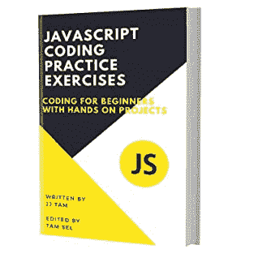
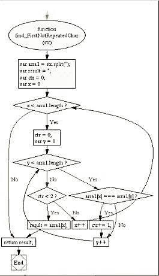
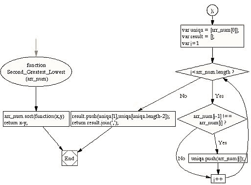
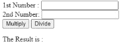

# JAVASCRIPT 编码实践练习：初学者编码指南





## 目录
- [JavaScript: 查找第一个不重复的字符]
- [JavaScript: 查找字符串中最长的单词]
- [JavaScript: 统计字符串中元音的数量]
- [JavaScript: 检查数字是否为质数]
- [JavaScript: 获取数据类型]
- [JavaScript: 查找数组中的第二小和第二大
- [计算乘法和除法]
- [转换温度]
- [寻找最大值]
- [反转给定字符串]
- [替换每个字符]
- [创建一个新字符串]
- [拼接两个字符串]
- [移动最后三个字符]
- [计算和]
- [相两个数字]
- [检查给定年份是否为闰年]
- [检查给定的正数]
- [检查字符串是否以'Java' 开头]
- [检查两个给定的整数值]
- [查找接近 100 的数值]

# JavaScript 函数 – 练习题

## JavaScript: 查找第一个不重复的字符
示例参数：`'abacddbec'`
预期输出：`'e'`

### HTML 代码
```html
<!DOCTYPE html>
<html>
<head>
  <meta charset="utf-8">
  <title>查找第一个不重复的字符。</title>
</head>
<body>
</body>
</html>
```

### JAVASCRIPT 代码
```javascript
function find_FirstNotRepeatedChar(str) {
  var arra1 = str.split('');
  var result = '';
  var ctr = 0;
  for (var x = 0; x < arra1.length; x++) {
    ctr = 0;
    for (var y = 0; y < arra1.length; y++) {
      if (arra1[x] === arra1[y]) {
        ctr+= 1;
      }
    }
    if (ctr < 2) {
      result = arra1[x];
      break;
    }
  }
  return result;
}
console.log(find_FirstNotRepeatedChar('abacddbec'));
```

### 输出
`e`

### 流程图


## JavaScript: 查找字符串中最长的单词
示例字符串：`'Web Development Tutorial'`
预期输出：`'Development'`

### HTML 代码
```html
<!DOCTYPE html>
<html>
<head>
<meta charset=utf-8 />
<title>查找字符串中最长的单词</title>
</head>
<body>
</body>
</html>
```

### JAVASCRIPT 代码
```javascript
function find_longest_word(str) {
  var array1 = str.match(/\w[a-z]{0,}/gi);
  var result = array1[0];
  for(var x = 1 ; x < array1.length ; x++) {
    if(result.length < array1[x].length) {
      result = array1[x];
    }
  }
  return result;
}
console.log(find_longest_word('Web Development Tutorial'));
```

### 输出
`Development`

### 解析
假设 `str` 等于 `'Web Development Tutorial'`。当字符串与正则表达式进行匹配时，使用 `match()` 方法获取匹配项。作为 `str.match(/w[a-z]{0,}/gi)` 的结果，返回了 `["Web", "Development", "Tutorial"]`。`for` 循环将每个数组元素的 `length` 与前一个元素进行比较，并返回最长的字符串。`length` 属性是一个整数，始终大于数组的索引。
语法：`arr.length`

### 流程图


## JavaScript: 统计字符串中元音的数量
示例字符串：`'The quick fox'`
预期输出：`5`

### HTML 代码
```html
<!DOCTYPE html>
<html>
<head>
<meta charset=utf-8 />
<title>统计字符串中元音的数量</title>
</head>
<body>
</body>
</html>
```

### JAVASCRIPT 代码
```javascript
function vowel_count(str1) {
  var vowel_list = 'aeiouIOU';
  var vcount = 0;
  for(var x = 0; x < str1.length; x++) {
    if (vowel_list.indexOf(str1[x]) !== -1) {
      vcount += 1;
    }
  }
  return vcount;
}
console.log(vowel_count("The quick fox"));
```

### 输出
`5`

### 解析
`indexOf()` 方法返回调用 String 对象中定义的指定值第一次出现的位置，从 `fromIndex` 开始。如果找不到该值，则返回 `-1`。
语法：`str.indexOf(searchValue[, fromIndex])`
参数：
- `searchValue`: 代表要查找的值的字符串。
- `fromIndex`（可选）：字符串搜索开始的索引。可以使用任何整数。
如果满足条件 `vowel_list.indexOf(str1[x])!== -1`，则字符串中的字符将被计数为元音。

### 流程图


## JavaScript: 检查数字是否为质数


### HTML 代码
```html
<!DOCTYPE html>
<html>
<head>
<meta charset=utf-8 />
<title>检查数字是否为质数</title>
</head>
<body>
</body>
</html>
```

### JAVASCRIPT 代码
```javascript
function test_prime(n) {
  if (n===1) {
    return false;
  } else if(n === 2) {
    return true;
  }else {
    for(var x = 2; x < n; x++) {
      if(n % x === 0) {
        return false;
      }
    }
    return true;
  }
}
console.log(test_prime(37));
```

### 输出
`True`

 流程图


## JavaScript: 获取数据类型
我们将创建一个 JavaScript 函数，接收参数并返回类型。
注意可能的返回值：对象、布尔值、数字、字符串或未定义。

### HTML 代码
```html
<!DOCTYPE html>
<html>
<head>
<meta charset=utf-8 />
<title>检测数据类型</title>
</head>
<body>
</body>
</html>
```

### JAVASCRIPT 代码
```javascript
function detect_data_type(value) {
  var dtypes = [Function, RegExp, Number, String, Boolean], x, len;
  if (typeof value === "object" || typeof value === "function") {
    for (x = 0, len = dtypes.length; x < len; x++) {
      if (value instanceof dtypes[x]) {
        return dtypes[x];
      }
    }
  }
  return typeof value;
}
console.log(detect_data_type(12));
console.log(detect_data_type('w3resource'));
console.log(detect_data_type(false));
```

### 输出
`number`
`string`
`Boolean`

## JavaScript: 查找数组中的第二小和第二大


### HTML 代码
```html
<!DOCTYPE html>
<html>
<head>
<meta charset=utf-8 />
<title>查找数组中的第二小和第二大数字</title>
</head>
<body>
</body>
</html>
```

### JAVASCRIPT 代码
```javascript
function Second_Greatest_Lowest(arr_num) {
  arr_num.sort(function(x,y) {
    return x-y;
  });
  var uniqa = [arr_num[0]];
  var result = [];
  for(var j=1; j < arr_num.length; j++) {
    if(arr_num[j-1] !== arr_num[j]) {
      uniqa.push(arr_num[j]);
    }
  }
  result.push(uniqa[1],uniqa[uniqa.length-2]);
  return result.join(',');
}
console.log(Second_Greatest_Lowest([1,2,3,4,5]));
```

### 输出
`2,4`


### 流程图



## JAVASCRIPT 基础

## 计算两个数字的乘法和除法

### HTML 代码

```html
<!DOCTYPE html>
<html>
<head>
  <meta charset="utf-8 />
  <title>计算两个数字乘法和除法的 JavaScript 程序</title>
  <style type="text/css">
    body {margin: 30px;}
  </style>
</head>
<body>
<form>
  第一个数字： <input type="text" id="firstNumber" /><br>
  第二个数字： <input type="text" id="secondNumber" /><br>
  <input type="button" onClick="multiplyBy()" Value="乘法" />
  <input type="button" onClick="divideBy()" Value="除法" />
</form>
<p>结果为： <br>
  <span id = "result"></span
</p>
</body>
</html>
```

### JAVASCRIPT 代码
```javascript
function multiplyBy()
{
    num1 = document.getElementById("firstNumber").value;
    num2 = document.getElementById("secondNumber").value;
    document.getElementById("result").innerHTML = num1 * num2;
}
function divideBy()
{
    num1 = document.getElementById("firstNumber").value;
    num2 = document.getElementById("secondNumber").value;
    document.getElementById("result").innerHTML = num1 / num2;
}
```

### 解析

`document.getElementById(id).value`: 文本字段的 `value` 属性用于设置或返回 `value` 属性的值。

`document.getElementById("result").innerHTML`: 元素的 `innerHTML` 属性用于设置或返回 HTML 内容（内部 HTML）。

### 输出



## 温度转换

### 在 JAVASCRIPT 中摄氏度和华氏度之间转换

### HTML 代码
```html
<!DOCTYPE html>
<html>
  <head>
  <meta charset="utf-8">
  <title>编写一个 JavaScript 程序将温度在摄氏度和华氏度之间进行转换</title>
  </head>
  <body>
</</body>>
  </html>
```

### JAVASCRIPT 代码
```javascript
function cToF(celsius)
{
  var cTemp = celsius;
  var cToFahr = cTemp * 9 / 5 + 32;
  var message = cTemp+'\xB0C is ' + cToFahr + ' \xB0F.';
    console.log(message);
}
function fToC(fahrenheit)
{
  var fTemp = fahrenheit;
  var fToCel = (fTemp - 32) * 5 / 9;
  var message = fTemp+'\xB0F is ' + fToCel + '\xB0C.';
  console.log(message);
}
cToF(60);
fToC(45);
```

### 输出
60°C 是 140 °F。
45°F 是 7.22222222222222°C。

### 解析
可以使用以下公式进行精确转换（华氏度转摄氏度 / 摄氏度转华氏度）：
华氏度转摄氏度：`(F − 32) ÷ 1.8 = °C`
摄氏度转华氏度：`(C × 1.8) + 32 = °F`
以下是摄氏度与华氏度之间的粗略转换：
将华氏度转换为摄氏度，减去 30 并除以 2。
将摄氏度转换为华氏度，将该数字乘以 2 并加上 30。

## 找出三个给定整数中的最大值

### HTML 代码
```html
<!DOCTYPE html>
<html>
<head>
  <meta charset="utf-8">
  <meta name="viewport" content="width-width">
  <title>找出三个整数中最大值的 JavaScript 程序。</title>
  </head>
  <body>
</body>
</html>
```

### JAVASCRIPT 代码
```javascript
function max_of_three(x, y, z)
{
  max_val = 0;
  if (x > y)
  {
    max_val = x;
  } else {
    max_val = y;
  }
  if (z > max_val)
  {
    max_val = z;
  }
  return max_val;
}
console.log(max_of_three(1,0,1));
console.log(max_of_three(0,-10,-20));
console.log(max_of_three(1000,510,440));
```
### 输出
1
0
1000

### 流程图


## 反转给定字符串

### HTML 代码
```html
<!DOCTYPE html>
<html>
<head>
  <meta charset="utf-8">
  <meta name="viewport" content="width-width">
  <title>反转给定字符串的 JavaScript 程序。</title>
  </head>
  <body>
</body>
</html>
```

### JAVASCRIPT 代码
```javascript
function string_reverse(str)
{
  return str.split("").reverse().join("");
}
```
[/content] (注：由于提供的提供的文本在反转字符串代码部分似乎截断，此处根据常见逻辑补全了翻译，但若严格遵循原文截断状态，应保持原样。重新审视原文，原文中反转字符串代码在 `return str.reverse` 处被截断了，我将按原文截断内容翻译。)

**修正：严格按照原文截断的内容翻译：**

[content]
```javascript
function string_reverse(str)
{
  return str.reverse
```


## 计算长度为 3 的整数数组三个元素之和的 JavaScript 程序

### JAVASCRIPT 代码
```javascript
function sum_three(nums) {
  return nums[0] + nums[1] + nums[2];
}
console.log(sum_three([10, 32, 20])); 
console.log(sum_three([5, 7, 9]));
console.log(sum_three([0, 8, -11]));
```

### 输出:
62
21
-3

## 相加两个数字

 针对一个给定的正整数

### 长度为二

### HTML 代码
```html
<!DOCTYPE html>
<html>
<head>
  <meta charset="utf-8">
  <meta name="viewport" content="width=device-width">
  <title>计算给定两位正整数两个数字之和的 JavaScript 程序。</title>
</head>
<body>
</body>
</html>
```

### JAVASCRIPT 代码
```javascript
function add_two_digits(n) {
  return n % 10 + Math.floor(n / 10);
}
console.log(add_two_digits(25))
console.log(add_two_digits(50))
```

### 输出:
7
5

## 检查给定年份是否为闰年

### HTML 代码
```html
<!DOCTYPE html>
<html>
<head>
  <meta charset=utf-8 />
  <title>查找闰年</title>
</head>
<body>
</body>
</html>
```

### JAVASCRIPT 代码
```javascript
function leapyear(year) {
  return (year % 100 === 0) ? (year % 400 === 0) : (year % 4 === 0);
}
console.log(leapyear(2016));
console.log(leapyear(2000));
console.log(leapyear(1700));
console.log(leapyear(1800));
console.log(leapyear(100));
```

### 输出
true
true
false
false
false

## 检查给定的正数

### 3 的倍数或 7 的倍数

### HTML 代码
```html
<!DOCTYPE html>
<html>
<head>
  <meta charset="utf-8">
  <meta name="viewport" content="width=device-width">
  <title>检查给定的正整数是否为 3 的倍数或 7 的倍数的 JavaScript 程序。</title>
</head>
<body>
</body>
</html>
```

### JAVASCRIPT 代码
```javascript
function test37(x) {
  if (x % 3 == 0 || x % 7 == 0) {
    return true;
  }
  else {
    return false;
  }
}
console.log(test37(12));
console.log(test37(14));
console.log(test37(10));
console.log(test37(11))
```

### 输出:
true
true
false
false

## 检查字符串是否以 'Java' 开头

### 否则为 false

### HTML 代码
```html
<!DOCTYPE html>
<html>
<head>
  <meta charset="utf-8">
  <meta name="viewport" content="width=device-width">
  <title>检查字符串是否以 'Java' 开头否则为 false 的 JavaScript 程序。</title>
</head>
<body>
</body>
</html>
```

### JAVASCRIPT 代码
```javascript
function start_spec_str(str) {
  if (str.length < 4) {
    return false;
  }
  front = str.substring(0, 4);
  if (front == 'Java') {
    return true;
  }
  else {
    return false;
  }
}
console.log(start_spec_str("JavaScript"));
console.log(start_spec_str("Java"));
console.log(start_spec_str("Python"))
```

### 输出:
true
true
false

## 检查两个给定的整数

 在 50..99 范围内

### HTML 代码
```html
<!DOCTYPE html>
<html>
<head>
  <meta charset="utf-8">
  <meta name="viewport" content="width=device-width">
  <title>检查给定的整数是否在 50..99 范围内（包含边界）。如果其中任意一个在范围内，则返回 true。</title>
</head>
<body>
</body>
</html>
```

### JAVASCRIPT 代码
```javascript
function check_numbers(x, y) {
  if ((x >= 50 && x <= 99) || (y >= 50 && y <= 99)) {
    return true;
  }
  else {
    return false;
  }
}
console.log(check_numbers(12, 101));
console.log(check_numbers(52, 80));
console.log(check_numbers(15, 99));
```

### 输出
false
true
true

## 查找距离 100 最近的值

### HTML 代码
```html
<!DOCTYPE html>
<html>
<head>
  <meta charset="utf-8">
  <meta name="viewport" content="width=device-width">
  <title>从两个不同的整数中找到距离 100 最近值的 JavaScript 程序。</title>
</head>
<body>
</body>
</html>
```

### JAVASCRIPT 代码
```javascript
function near_100(x, y) {
  if (x != y) {
    x1 = Math.abs(x - 100);
    y1 = Math.abs(y - 100);
    if (x1 < y1) {
      return x;
    }
    if (y1 < x1) {
      return y;
    }
    return 0;
  }
  else {
    return false;
  }
}
console.log(near_100(90, 89));
console.log(near_100(-90, -89));
console.log(near_100(90, 90));
```

### 输出:
90
-89
false

