# Javascript：完整概念与技术 (Shelly Cashman 系列)

Gary B. Shelly

Thomas J. Cashman

William J. Dorin

Jeffrey J. Quasney

澳大利亚 • 加拿大 • 丹麦 • 日本 • 墨西哥 • 新西兰 • 菲律宾

波多黎各岛 • 新加坡 • 南非 • 西班牙 • 英国 • 美国

526 St Andrews Road

- J1.21 在实验室中

## 前言

自诞生以来的几年里，世界维网（简称 Web）的增长超出了所有预期。在这么短的时间内，Web 从有限的联网计算机数量增加到超过 2,500 万台计算机，并就你可以想象的任何主题提供了数亿个网页。学校、企业和计算行业都在利用这种新的信息传递方式，并正使用 JavaScript 为他们的网页注入灵魂，添加动态内容和交互元素。

## 本书目标

《JavaScript：完整概念与技术》旨在用于门将 JavaScript 所有功能应用于网页的 两个学分课程。本书也适用于远程教育或继续教育课程。本书的具体目标如下：

- 让学生学会如何为网页添加功能

- 教会学生如何使用 JavaScript

- 使学生熟悉创建适用于课程作业、职业用途和个人使用的动态网页的正确程序

- 演示常见的 Web 交互

- 鼓励学生在开发网页时发挥创造力

- 开发一种以练习为导向的方法，让学生通过示例进行学习

- 鼓励独立学习，并帮助在远程教育环境中学习如何增强网页的学生

## 本书结构

《JavaScript：完整概念与技术》由一个 JavaScript 介绍部分和五个引导学生增强网页的项目组成。本书假设学生已具有 HTML 的基础知识。每个项目都从“目标”说明开始。项目中的主题以逐步步进、逐屏显示的方式呈现。每个项目都以“项目总结”和一个标题为“你应该知道的”的部分结束。每个项目的末尾都提供了问题和练习。练习包括“你的知识”、“使用帮助”、“应用你的知识”、“在实验室中”、“案例与场所”。项目组织结构如下：

JavaScript 编程简介。引论部分提供了 JavaScript 的概览。描述了 Java 与 JavaScript 之间、JavaScript 与 VB Script 之间的差异。本节介绍了 JavaScript 变量、条件语句、函数、对象、属性、方法、事件处理器、帧和数组的基本概念。

项目 1 - 集成 JavaScript 和 HTML。在项目 1 中，学生将学习如何将 JavaScript 集成到 HTML 文件中。主题包括在 HTML 中放置 JavaScript 标签和注释；在 JavaScript 语句中放置 HTML 标签；使用 document 对象；设置背景颜色；提取系统日期；设置 substring 属性；定义变量；编写用户自定义函数以及使用 setTimeout() 和 Alert() 函数。

项目 2 - 创建弹出窗口、添加滚动消息、验证表单。在项目 2 中，展示了 JavaScript 的常见用途：创建弹出窗口、添加滚动消息和验证表单。主题包括使用 JavaScript 在客户端构建数据；处理对象、字符串长度和焦点属性；If-Then-Else 结构；用户自定函数；事件处理器以及 parseInt(),isNaN() 和 pow() 函数。

项目 3 - 增强图像和表单对象的使用。在项目 3 中，学生将学习更多关于 JavaScript 函数和常用对象。主题包括编写计算未来日期天数的函数；更改图形；在 If-Then-Else 结构中使用选择列表；使用设置文本框值的函数；以及计算服务的估计成本。

项目 4 - Cookie、数组和帧。在项目 4 中，学生将学习如何在 Cookie 中创建和操作数据。主题包括创建 Cookie；读取 Cookie；设置 Cookie 的过期日期；删除 Cookie；创建对象数组；使用 new 运算符以及从另一个地方写入信息。

项目 5 - 使用对象创建购物车应用程序。在项目 5 中，学生将通过学习对象、帧和窗口来扩展他们的 JavaScript 知识。主题包括使用隐藏帧创建购物车应用程序；使用对象存储复杂数据；为对象编写方法；使用 With 语句；使用 For 循环；使用 history 对象；从另一个地方写入 HTML；使用 navigator 对象以及在浏览器中检测按键输入。

## 项目结束活动

Shelly Cashman 系列书籍的一大显著优势是每个项目末后的学生活动。结构良好的学生活动可以使学生从仅仅参与课堂转变为对所学信息做出反应。这些活动包括以下所有内容：

- 你应该知道的：项目内完成的任务列表，并配有逐步步进、逐屏的解释。该部分为学生提供了完美的复习。

- 测试你的知识：四个或五个问答活动，以确定学生对项目材料的理解情况。包括真判断题、多选择题和简答练习。

- 使用帮助：任何 JavaScript 网站的用户都必须意识到讨论 JavaScript 和演示算法的网站的重要性。因此，本书每个项目都包含帮助，让学生访问 JavaScript 网站。这些练习也使 Shelly Cashman 系列与其他任何其他教学材料区别来。

- 应用你的知识：旨在几分钟内完成的实质性练习，用于练习项目技能。

- 在实验室中：每个项目有若干项作业，要求学生应用项目中获得的知识来解决问题。

- 案例与场所：一组独特的案例研究允许学生将知识应用于真实世界的情况。

## Shelly Cashman 系列教学工具

一套完整的教学工具以 CD-ROM 的形式随书附带。CD-ROM 包含电子版教师手册以及教学和测试辅助。CD-ROM (ISBN 7895-4695) 可通过您的课程技术代表或拨打以下号码获取：

- 学院和大学：1800-648-7450

- 高中：1800-824-5179

- 职业学院：1800-477-3692

- 加拿：1800-268-2222

- 政府机构：1800-340-7450

CD-ROM 的内容列如下：

- 教师手册：教师手册由 Microsoft Word 文件组成，包括课程笔记、作业解决方案以及大型题库。这些文件允许您使用自己的文字处理器修改课程笔记或从题库中生成测验和考试。教师手册包含每个项目的：项目目标；项目活动；项目结束练习的答案；110 道题的题库（50 道判断题、25 道选择题和35 道填空题）；幻片参考以及选定的幻片。幻片在书中提供。题库题目与 Course Test Manager 中的编号相同。您可以打印题库副本以便在 Course Test Manager 中选择题目。

- 书中的插图：书中每个插图均可用。使用此辅助工具从插图创建幻灯片演示，或打印用于投影投影仪的幻片。

- Course Test Manager：Course Test Manager 是一个强大的测试和评估软件包，允许教师从大型题库中创建并打印测试。拥有网络计算机实验室（LAB）访问权限的教师可以在线管理、评分和跟踪测试。学生还可以进行在线练习测试，测试会生成自定义学习指南，指示学生可以在书中何处找到每个问题的更多信息。

- 课程成功系统：课程成功系统是一组文件，允许您解释和演示书中项目的逐步步进、逐屏开发。课程成功系统要求您拥有 Notepad、浏览器、个人电脑和投影设备。

- 教师实验室解决方案：为每个项目末尾的所有“应用你的知识”和“在实验室中”作业提供解决方案和所需文件。

- 学生数据文件：学生完成项目和“应用你的知识”练习所需的所有文件均包含在内。请见页面上的“JavaScript 数据”部分。

# JavaScript 数据盘

某些项目和练习需要 JavaScript 数据盘。学生可以按照本书后封封内侧的说明获取 JavaScript 数据盘的副本。Shelly Cashman 系列教学工具 CD-ROM 包含了组成 JavaScript 数据盘的所有文件副本。

# Shelly Cashman Online

Shelly Cashman Online是一项为计算机教育工作者和学生提供的宽网服务。访问 www.scseries.com 查看 Shelly Cashman Online。Shelly Cashman Online 分为四个区域：

- 系列信息：Shelly Cashman 系列的历史、技术新闻等

- 教学资源：产品目录、教学工具、配套产品和电子广告

- 社区新闻稿中心、夏季学院等

- 学生资源：数据下载、职业发展以及指向 Shelly Cashman 系列教学网站的链接

# 致谢

如果没有优秀出版专业人士的贡献，Shelly Cashman 系列就无法成为领先的计算机教育丛书。其中，最重要的是制作总监兼设计师 Becky Herrington。她是 Shelly Cashman 系列的核心，正是因为通过她的领导、奉献和不懈的努力，才可能做出卓越的产品。Becky 创作并制作了屡获殊荣的 Windows 系列书籍。

在 Becky 的指导下，以下个人对这些书籍出了重大贡献：Doug Cowley（制作经理）；Ginny Harvey（系列专家兼开发部编辑）；Ken Russo（高级 Web 设计师）；Mike Bodnar（助理制作经理）；Mark Norton（Web 设计师）；Stephanie Nance（平面设计师兼封面设计师）；Mario Mitchem、Chris Schneider、Hector Arviz 和 Kenny Tran（平面设计师）；Jeanne Blake 和 Betty Hopkins（Quartic 专家）；Nancy Mann（文字编辑/校对员）；Christina Haley 和 Image Quest 的 Sarah Everett（图片检索）；以及 Susan Sebok 和 Ginny Harvey（特约作家）。

特别感谢主编辑 Richard Kearney；Jim Quasley（经理）、Laura Ward（产品经理）；Meagan Walsh（助理产品经理）；Francis Schubert（Web 经理）；Toni Grafakos（助理 Web 经理）；Scott Wiseman（在线开发者）；Rajika Gupta（营销经理）以及 Erin Bennett（编辑助理）。

最后，特别感谢我们的评审员 Ravi Singh、Jeffrey Popyack、Larry Manning、Abel Sheikh 和 Dwight Watt，感谢 Judy Knapp、Elyn Rykken、Andrea Dorin 和 Caroline Ruth 阅读了手稿并提供了宝贵意见。

Gary B. Shelly

Thomas J. Cashman

William J. Dorin

Jeffrey J. Quasley

# JavaScript

## JavaScript 编程简介

当你能够完成以下操作时，你就已经掌握了本项目的材料：

- 描述 JavaScript

- 定义 HTML 并解释 HTML 标签的

- 定义属性

- 区分 JavaScript 和 VBScript

- 定义 JavaScript Cookie 和变量

- 描述字符串、数值和布尔型 JavaScript 变量类型

- 讨论变量命名规则

- 区分变量和字面量

- 讨论特殊代码以及如何在字面量中使用

- 讨论使用 JavaScript 的优缺点

- 定义表达式并描述算术运算符

- 讨论表达式中的优先级顺序

- 定义拼接

- 定义条件以及 If 和 While 语句的使用

- 讨论 JavaScript 函数的使用

- 讨论 If、If...Else 以及 While 语句和循环

- 定义对象、属性、方法和事件

- 描述事件处理程序和表单的使用

- 定义帧和数组

## JavaScript

## JavaScript 编程简介

## 简介

JavaScript 是一种编程语言，允许你通过在 HTML 文档中插入代码为 Web 页面添加功能。HTML 超文本标记语言告诉你的浏览器如何显示文本和图像、设置列表和单选按钮、超链接，而 JavaScript 则通过添加动态内容和交互元素让你的 Web 页面活跃起来。使用 JavaScript，你可以添加以下项目来增强 Web 页面：

- 滚动消息

- 动画和动态图像

- 数据输入表单

- 弹出窗口

- 交互式测验

JavaScript 是 Sun Microsystems 和 Netscape Communications Corporation 合资产物。Netscape 最初开始开发一种名为 LiveScript 的脚本语言，而 Sun 则试图简化其 Java 编程语言。今天，JavaScript 得到了许多软件公司的增强。它是一种开放语言，任何人都可以使用无需购买许可证。JavaScript 允你在无需花费大量资金或学习高级编程语言的情况下改进 Web 页面的外观。

其他编程语言也允许你为 Web 页面添加功能。其中一种语言是 Sun Microsystems 的 Java，它是一种完整的面向对象的编程语言。Java 与 COBOL 相似，你使用代码来创建独立的应用程序。Java 也用于创建一种特殊的应用程序，称为 applet（小程序）。applet 是一种设计在网络浏览器内执行的小程序。与嵌入在 HTML 文档中的 JavaScript 不同，applet 作为单独文件随 HTML 文档一起发送到浏览器。applet 为 Web 页面添加功能，如动画或游戏。要编写 Java 程序或 applet，你可以使用来自 Sun Microsystems 的开发者工具包 (JDK) 或 Microsoft Visual J++。

尽管 JavaScript 与完整的 Java 语言共享许多特性，但它是一种功能较少的简单语言。例如，你不能使用 JavaScript 在独立应用程序内部创建警报。在目前最常见的形式中，JavaScript 位于 HTML 文档内部，可以为静态文档提供交互性。与 Java 不同，JavaScript 是一种解释型语言，这意味着它不会生成可执行文件（如典型的程序）。相反，代码在浏览器上运行。解释器在运行时将每行语言翻译成机器码。当你请求 Web 页面时，你的浏览器从上到下检索读取页面，并在过程中执行 JavaScript 语句。JavaScript 的版本取决于你的浏览器版本。Internet Explorer 支持额外功能。许多旧浏览器无法处理较新的 JavaScript。

## JavaScript 和 HTML 标签

本书假设你具有 HTML（超文本标记语言）的基础知识。你可以使用 WYSIWYG（所见即所得）编辑器（如 Netscape Composer、Microsoft FrontPage、Corel Web Designer）构建复杂的 Web 页面，而无需了解 HTML。了解 HTML 是重要的，因为它允许你纠正页面编码时可能出现的错误和漏洞。

脚本代码嵌入在 HTML 标签中。标签是位于小于 (<) 和大于 (>) 符号之间的的指令。

图 1-2 显示了典型数据输入表单上的 INPUT 标签。`Type`、`name` 和 `size` 都是 INPUT 标签的属性。在此示例中，`TYPE` 属性表示文本框、单选按钮、SUBMIT 按钮或 RESET 按钮。`NAME` 属性分配一个名称或变量（PhoneNumber）。该变量存储输入的数据，直到需要为止。此外，你稍后将在 JavaScript 代码中使用该变量名来验证输入到框中的数据。你可以为表单上的 `VALUE` 属性分配一个初始或默认值。例如，在图 1-2 中，表单文本对象被分配了一个空值。`SIZE` 属性指示文本框的大小，基于要放入文本框的字符数。

```
<INPUT Type = "text" Name = "PhoneNumber" Value = " " Size = 17>
```

图 1-2

## SCRIPT 标签

为了在 HTML 代码中使用 JavaScript 或任何脚本语言，需要告诉浏览器使用了某种脚本语言。大多数网页设计人员会在 HTML 文档的头部放置一个初始的 SCRIPT 标签。这个初始脚本包含了将定义的各种 JavaScript 函数。此外，必须使用 SCRIPT 标签将 JavaScript 代码放置在网页的其他区域。每当你使用 SCRIPT 标签时，建议使用一个 HTML 注释将代码对不支持 JavaScript 的用户浏览器隐藏起来。图 1-3 显示了用于标识 JavaScript 的 SCRIPT 标签代码。

```
<SCRIPT LANGUAGE = "JavaScript">
<!-- 对旧浏览器隐藏
在此处放置你的 JavaScript 代码
-->
</SCRIPT>
```

图 1-3

SCRIPT 标签的属性之一是 `LANGUAGE`。`LANGUAGE` 属性单词 JavaScript 不带版本号表示版本 1.0。要指示不同的版本，你必须在 JavaScript 值后添加版本号。例如，`JavaScript.1` 表示版本 1.1，`JavaScript.2` 表示版本 1.2。JavaScript 的版本取决于用户预计使用的浏览器。

## JavaScript 对比 VBScript

由于 Visual Basic 编程语言的流行，微软开发了一种名为 VBScript 的脚本（VB 代表 Visual Basic）。JavaScript 的语法与 C 编程语言相似，而 VBScript 的语法与 Visual Basic 相似。例如，你用 JavaScript 编写函数（如 C 语言），而用 VBScript 编写子程序（如 Visual Basic）。在 VBScript 中，函数用大括号 `{}` 开始和结束；在 VBScript 中，子程序以单词 `SUB` 开始，以单词 `END SUB` 结束。因此，微软 Internet Explorer 4 或更高版本执行 VBScript，但 Netscape Navigator 则不执行 VBScript。

在微软文档中，JavaScript 被称为 JavaScript。美国国家航空航天局（NASA）喷气动力实验室开发了 Perl，它代表“实用数据提取和报告语言”（Practical Extraction and Report Language）。

## JavaScript 基础 — 变量、字面量和表达式

使用 JavaScript 可以通过为 HTML 添加交互性来增强网页的性能。这可以为用户提供即时反馈，而无需使用复杂的 CGI（通用网关接口）脚本和语言。CGI 脚本是任何在 Web 服务器上运行并用于处理数据的程序。网页将数据发送到服务器，由服务器处理数据并将结果返回给网页。脚本是强大的工具，适用于数据库搜索或在互联网上维护业务的公司订单处理。

然而，当所需任务可以在用户计算机上处理时，CGI 脚本就是资源的浪费。例如，通过 JavaScript，你可以在用户计算机上立即验证数据输入表单（如购买请求）。这消除了将数据发回服务器进行验证的需求。用户会收到即时反馈，并且在网络流量高峰期间无需等待响应。

## JavaScript Cookies

表单并不是 Web 浏览器处理的数据类型。某些生成的数据不是 HTML 定义对象的一部分，例如数据文件。数据类型是 cookie 文件。Cookies 是存储在用户计算机文件中的数据片段。开发人员使用这些数据在用户访问网站时跟踪用户的偏好。Navigator 将 cookies 存储在 `cookies.txt` 文件中。Internet Explorer 将 cookies 作为文件存储在 Cookies 文件夹中。

Internet Explorer 和 Navigator 使用 cookies帮助用户记住想买的页面或物品。如果你在互联网上买过东西，就会使用购物车，购物车就是一个 cookie。它收集购物车中的物品并在结账时支付。Cookies 还帮助开发人员识别死胡同路径。死胡同是用户访问的网站区域，可能会导致他们离开网站以后回来。广告商喜欢使用 cookies 来保护你的利益。某些广告最终将决定你未来看到的广告类型。

JavaScript cookies 不能从用户的硬盘获取数据、读取电子邮件或窃取敏感信息。出于安全考虑，JavaScript 代码限制了对用户硬盘的访问。JavaScript 只有一种写入 cookies 的方法，由浏览器控制在预定的 cookie 位置。因为 cookie 信息嵌入在发送到浏览器的数据中，浏览器可以阻止 cookies。然而，某些网站在 cookie 被阻止时仍允许访问。

## JavaScript 基础 — 变量、字面量和表达式

你对表单或函数进行的大部分处理需要使用变量。变量代表存储在内存中的脚本值。存储在变量中常见的数值类型是数字、单词或两者的组合。持有数字的值是数值型，持有数字或字母组合的值是字符串型。JavaScript 还使用布尔类型变量，表示状态或条件为“真”（是或否）。

> 关于 Cookies 的更多信息

欲需有关 cookies 的更多信息，请访问 wwwsite.com/js/html

## JavaScript 编程简介

与其他语言不同，当你定义变量时不需要指定其类型。字面量是一个实际的数字或字符文本，而不是计算结果或来自键盘的输入值。如果字面量不是数字，它被称为数值字面量。字符或文本值被称为字符串字面量。图 1-4 显示了如何用数值字面量定义变量。

```
var width = 3
```

图 1-4

数字 (3) 不能更改，并将始终保持不变。`width` 的值可以通过计算或重新赋值给变量从 3 更改为其他数字。

字符串字面量被括在引号中。要将字符串字面量分配给变量，必须将字符串字面量放置在对引号内。数字可以放在引号内，但它们会被视为字符串而不是数字。将引号内的字符视为一组顺序字符，一个接一个，形成一个连续的字符串。

## 变量命名规则

变量可以使用各种名称，但必须遵�以下规则：

- 名称必须以字母或下划线开头。

- 名称其余部分由字母、数字或下划线组成。

- 避免使用保留字命名变量。保留字是 JavaScript 有特殊含义的预定义单词。

- 不要在变量名中放置句号。

不能在变量名中使用句号是因为句号用于分隔对象、属性和方法。表 1-1 显示了有效和无效变量名的示例。此外，记住在 JavaScript 中，变量名是大小敏感的。大小敏感意味着如果你创建一个混合大小写的拼写（如变量名 `Case`），然后使用大写拼写 `STATE` 作为变量名，JavaScript 将这些拼写视为不同的变量名。

| 有效 | 无效 |

|---|---|

| idumber | id number (空格) |

| Cust_ID | Cust.ID (句号) |

| Major | *Major (不以字母开头) |

| Year2000 | 2000 (不以字母开头) |

| Passwd | Password (保留字) |

| _Continue | Continue (保留字) |

表 1-1

```javascript
var browserType = "Netscape"
```

# 图 I-5

如果字符没有包含在引号内，JavaScript 将尝试将这些字符解释为其他含义。JavaScript 可能会显示错误消息，说明找不到未定义的变量，或者它会将这些字符解释为对象或函数。

此外，JavaScript 字符串字面量可以使用特殊字符或代码。这一功能借自 C 语言语言，如果你想在字符串中间插入引号，这种特性非常方便。例如，要在字符串中放置引号，请使用斜杠和引号（"），将其放置在您想要显示引号的位置。在图 I-6 中，莎士比亚的一句引用被放在一个名为 `Shakespeare` 的变量中。双引号保持了字符串周围的标记，这样当显示 `Shakespeare` 的值时，标记也会被显示。

```javascript
var Shakespeare = "To be or not to be, that is the question!"; Hamlet;
```

# 图 I-6

存在许多此类特殊代码，并在表 I-2 中进行了解释。然而，用户必须意识到某些符号的作用取决于操作系统。例如，脚本在 Microsoft Windows 环境中使用 `\n` 作为回车和换行符，但在 UNIX 环境中仅使用 `\r`。您可能会发现在 `write()` 方法中使用 HTML 标签 `<P>` 或 `<BR>` 来换行更为方便。`write()` 方法与 `Document` 对象关联，用于写入 Web 页面。这些标签在 JavaScript `write()` 中的作用与在任何 HTML 文档中相同，但这些标签不能用于 `alert()`。`alert()` 方法用于在对话框中显示消息。这两个语句都将在项目 1 中进行更详细的讨论。记住字符串的最大字符限制为 255。这是基于旧版浏览器的限制，因此开发者总是会考虑到它们。

| 代码 | 符号 |

| --- | --- |

| 反斜杠 | \ |

| 单引号 | " |

| 双引号 | ' |

| 制表符 | \t |

| 回车 | \r |

| 退格符 | \b |

| 进页符 | \f |

| 换行 | \n |

## 表达式与运算符

表达式是一个公式或为变量赋值值的方法。JavaScript 表达式使用变量和字面量的组合来传递其他值。图 I-7a 显示了一个可能用于简单数学题的表达式。此示例假设 `sum` 之前已在 JavaScript 代码中。图 I-7b 展示了如何将变量初始化为零 (0)。这种做法在编程中用于确保 `Count` 变量中没有异常值，异常值可能会导致结果出现错误。

```javascript
average - totalValue/Count
```

## 图 I-7a

```javascript
var Count = 0
```

## 图 I-7b

表达式的操作原理是获取符号右侧的值，执行算术运算，然后将结果存储在等号左侧的变量中。图 I-7b 中的操作被赋值给等号左侧的变量。在使用表达式时，你可能会使用变量而不是字面量。

例如，想象你有一个销售音乐紧光盘（CD）的 Web 页面。你的网页显示了 CD 的图片、标题和价格。浏览你网站的人可能会挑选一张价格为 $7.99 的 CD。该值存储在一个名为 `Cost` 的变量中。你要求用户输入想要购买的 CD 数量，并将其存储在名为 `Quantity` 的变量中。计算销售价格，你将 `Quantity` 乘以名为 `SalePrice` 的变量，即 `SalePrice = Quantity * Cost`。

JavaScript 使用与其他编程语言或应用程软件包相同的算术运算符。算术运算符是指示表达式执行何种操作的符号。表 I-3 用示例描述了算术运算符。

## 更多关于

模运算返回除法后的余数。例如，7 % 2 等于 1，因为 7 除以 2 等于 3 余于 1。

| 符号 | 描述 | 示例 |

|---|---|---|

| n = | 赋值值 | counter = counter + 1 |

| + | 加法 | sum = 4 + 5 |

| - | 减法 | difference = most - least |

| * | 乘法 | pay = hours * rate |

| / | 除法 | percent = totalInt / portion |

| % | 取模 - 仅返回除法的余数 | remainder = 27 % 12 |

| ++ | 变量加一 | i++, ++ |

| -- | 变量减一 | i--, -- |

## 表达式与运算符

表达式是一个公式或为变量赋值值的方法。JavaScript 表达式使用变量和字面量的组合来传递其他值。图 I-7a 显示了一个可能用于简单数学题的表达式。此示例假设 `sum` 之前已在 JavaScript 代码中。图 I-7b 展示了如何将变量初始化为零 (0)。这种做法在编程中用于确保 `Count` 变量中没有异常值，异常值可能会导致结果出现错误。

```javascript
average - totalValue/Count
```

## 图 I-7a

```javascript
var Count = 0
```

## 图 I-7b

表达式的操作原理是获取符号右侧的值，执行算术运算，然后将结果存储在等号左侧的变量中。图 I-7b 中的操作被赋值给等号左侧的变量。在使用表达式时，你可能会使用变量而不是字面量。

例如，想象你有一个销售音乐紧光盘（CD）的 Web 页面。你的网页显示了 CD 的图片、标题和价格。浏览你网站的人可能会挑选一张价格为 $7.99 的 CD。该值存储在一个名为 `Cost` 的变量中。你要求用户输入想要购买的 CD 数量，并将其存储在名为 `Quantity` 的变量中。计算销售价格，你将 `Quantity` 乘以名为 `SalePrice` 的变量，即 `SalePrice = Quantity * Cost`。

JavaScript 使用与其他编程语言或应用程序软件包相同的算术运算符。算术运算符是指示表达式执行何种操作的符号。表 I-3 用示例描述了算术运算符。

## 更多关于

模运算返回除法后的余数。例如，7 % 2 等于 1，因为 7 除以 2 等于 3 余于 1。

| 符号 | 描述 | 示例 |

|---|---|---|

| n = | 赋值值 | counter = counter + 1 |

| + | 加法 | sum = 4 + 5 |

| - | 减法 | difference = most - least |

| * | 乘法 | pay = hours * rate |

| / | 除法 | percent = totalInt / portion |

| % | 取模 - 仅返回除法的余数 | remainder = 27 % 12 |

| ++ | 变量加一 | i++, ++ |

| -- | 变量减一 | i--, -- |

## 条件判断

使用 JavaScript 的优势之一是验证表单输入数据的能力。为了验证数据，你将数据与期望值进行比较。这种测试被称为条件判断，测试的结果是 True 或 False。根据测试结果，你执行不同的 JavaScript 代码。记住测试有两个可能的后续：True 或 False。JavaScript 使用条件判断结合 If 和 While 语句来比较或测试存储在变量中的值（下一页的表 1-7）。If 语句的功能是选择并执行备代码部分。While 语句的功能是启动循环。注意表格中的条件被包含在括号内，就像它们在 JavaScript 代码中出现的一样。

拼接

拼接按顺序连接字符串数据。JavaScript 语句 `answer = "3" + "2"` 的结果不是 5，而是 "32"。

## If 和 If...Else 语句

If 语句的第一部分写为 *If (conditional)*。如果条件测试的结果为 True（真），则将要执行的 JavaScript 代码放在一组大括号 { } 中，如图 I-9 所示。

```javascript
var todaysDate = new Date()
var numHours = todaysDate.getHours()
if (numHours>=12) {
  document.write("Good Afternoon")
} else {
  document.write("Good Morning")
}
the rest of your code...
```

图 I-9

Else 子句的使用表示当 If 语句的结果为 False（假）时应该执行哪些代码。虽然你可能不会理解某些语句，但图 I-9 展示了一种测试一天中时间并根据是早上还是下午显示消息的方法。并不是每个条件测试都需要 Else 子句。不要犯错，在 Else 括号之后放置了你需要的、且无论条件结果如何都要执行的代码。

## While 循环

循环是一组重复执行的 JavaScript 代码。**While 循环**在循开始时测试一个条件。如果条件为 True，则执行循环。如果条件为 False，则执行右括号 } 之后的代码。While 语句的基本形式如图 I-10 所示。你将在项目 2 中学习更多关于 While 循环的知识。

```javascript
while (condition) {
  the JavaScript code to be executed when the condition is True
}
t JavaScript code to be executed when the loop is finished
```

图 I-10

| 表 I-7 | | |

| :--- | :--- | :--- |

| 操作符 | 示例 | 结果 |

| = | (a = b) | 如果 a 等于 b，则为 true |

| != | (a != b) | 如果 a 不等于 b，则为 true |

| > | (a > b) | 如果 a 大于 b，则为 true |

| < | (a < b) | 如果 a 小于 b，则为 true |

| >= | (a >= b) | 如果 a 大于等于 b，则为 true |

| <= | (a <= b) | 如果 a 小于等于 b，则为 true |

| && | (a = b) && (x < y) | 如果 a 等于 b 且 x 小于 y，则为 true |

| || | (a != b) || (x == a) | 如果 a 不等于 b 或 x 大于等于 a，则为 true |

## 函数

函数是编写几行脚本并在需要时重复使用它们的方法。函数的定义以关键字 `function` 开始，后跟一组括号。图 I-11 显示了一个示例函数，它使用 `alert()` 方法显示消息。

函数的指令或代码写在一组大括号 ({} ) 内部。左括号表示函数的开始，右括号表示函数的结束。注意图 I-11 中大括号的位置和方向。

```javascript
function Greetings() {
  alert("Hello, this is a friendly message.");
}
```

图 I-11

函数名是 `Greetings`，它将显示一个带有“Hello, this is a friendly message.”字样的对话框。`alert()` 方法会显示一个带有 OK 按钮的对话框。浏览器会等待用户点击 OK 按钮然后关闭框。浏览器将继续执行下一组脚本代码。每当你需要显示此消息时，都可以使用 `Greetings("Hello, this is a friendly message.")`。

通过稍微修改 `Greetings()` 函数，你可以将其变成一个通用的消息显示函数。图 I-12 展示了如何使用变量向函数传递一个值。通过向函数传递值，可以使用同一个 `Greetings()` 函数根据需要更改消息。

```javascript
messageStr = "This is a customized message."
function Greetings(messageStr) {
  alert(messageStr);
}
```

图 I-12

## 对象、属性、方法

对象是现实世界中的实体。你的汽车、宠物和朋友都是对象。JavaScript 在与网络浏览器交互时使用了对象。这种技术被称为面向对象 (OO)。当涉及到编程时，它被称为面向对象编程 (OOP)。OOP 的开发提供用易于理解的概念术语表示世界的方法。人们理解日常生活中的对象，并很容易理解对象具有属性和行为。

对象通过其属性来描述。属性是帮助区分一个对象与另一个对象的特征。例如，汽车有颜色、特定的车身样式和特定类型的内饰。这些都是汽车的属性，可以用来描述它。你会写 `carcolor = "red"` 来表示汽车是对象，而颜色是属性。红色是属性的值。

行为被称为方法。方法是你希望对象执行的函数或动作。你可以编写自己的函数，也可以使用 JavaScript 提供的内置方法。与汽车、宠物和朋友相关的方法可能是驾驶、喂养和说话。对于 `drive(method)`，写为 `car.drive()`。

某些方法需要所谓的参数 (argument)。参数是传递给对象并在方法中使用的值。例如，你可能有一个猫对象和一个写好的 `feed()` 方法，即 `cat.feed("Tuna")`。参数 `"Tuna"` 是一个描述如何给猫喂食的消息。（注：由于原文后半部分包含大量重复的乱码字符串，已省略以保持文档流整洁。）

# 表单

由于许多事件处理器都与表单相关，因此您需要了解 HTML 表单标签是如何工作的。如果您曾经在 Web网站上填写过信息请求表单，那么您已经使用过表单。表单可能包含文本框、单选按钮、复选框等。许多网站使用表单来收集数据并将其传回 Web 远程服务器。这些网站可能使用 CGI 将数据提交到服务器。服务器运行一个程序，该程序可能会对文本中的值进行验证。如果发现问题，则会向用户返回错误消息。

以这种方式使用 CGI 需要强大的编程能力。流行的 CGI 语言之一是 Perl，它主要是一种 UNIX 语言。Windows NT 服务器的用户可以使用 C 语言或 Visual Basic 作为其首选语言。然而，通过 JavaScript，Web 用户的浏览器窗口可以在将数据发送到服务器之前对表单进行验证。JavaScript 代码可以让用户留在页面上，直到输入的数据符合 Web 页面作者的意愿。

在表单中使用事件处理器非常简单。例如，假设你有一个深色背景（如灰色）的表单。考虑到用户可能使用视频显示器，这会导致他们难以阅读此类背景上的文本，你可以创建一个按钮将背景颜色更改为白色或其他较浅的颜色。图 I-15 展示了将背景颜色更改为白色的代码。

```
<INPUT TYPE="Button" Value="White" onclick="document.bgColor = 'White'">
```

图 I-15

OnClick 是事件处理器。当用户点击按钮时，背景颜色将变为白色。要使用事件处理器执行函数，只需将函数名放在事件处理器相关的等号后的引号之间。例如，在图 I-16 中，假设你想为白天查看 Web 页面的人显示太阳图片，而在晚上查看该页面时显示月亮图片。你创建了一个名为 `timeLine()` 的函数，它将测试代码以及在 Web 页面加载的特定位置显示太阳还是月亮。

```
<BODY bgColor="White" onload="timeLine()">
```

图 I-16

许多事件处理器（如 onfocus、onchange、onsubmit 和 onreset）通常与 INPUT 标签一起使用。点击表单的文本框、复选框或单选按钮会使该对象获得焦点。焦点意味着文本框、复选框或单选按钮引起了注意。例如，获得焦点的文本框包含插入点。因此，你会使用 onfocus 事件处理器来触发与该对象相关的脚本。

当您点击表单的其他部分或其他对象时，对象将不再拥有焦点。在 JavaScript 中，当一个对象失去焦点时，被称为模糊（blur）。模糊意味着注意力已离开该对象；例如，用户点击文本框将插入点移动到新的文本框。因此，你可以使用 onblur 事件处理器来执行函数以完成任务。JavaScript 能够感知文本箱、单选按钮或复选框的值何时发生。

最后，许多表单都有提交（Submit）和重置（Reset）按钮。onSubmit 事件是在您指向并点击提交按钮时触发的事件处理器。通常，您会有一个 action，将表单传输到 CGI 或电子邮件发送给预期的接收者。重置按钮允许您触发一个事件处理器，清空表单并允许用户重新开始重新输入数据。图 17 显示了 HTML 标签如何创建一个带有 JavaScript 函数并设置为 `onclick` 事件处理器的提交按钮。INPUT 标签有几个属性，其中包含一个 `onclick` 事件处理器。当用户点击提交按钮时，与 `onclick` 事件处理器的关联函数将被触发。

```
<INPUT TYPE="Button" Name="Submit" Value="Submit" onclick="
```

图 17

## 测试你的知识水平

## 1 正误判断

说明：如果陈述正确请圈出 T，如果陈述错误请圈出 F。

T T F 1. JavaScript 是微软和 Sun Systems 合资的产。

T T F 2. 微软 Internet Explorer 可以执行 JavaScript，但 Netscape Navigator 不执行 VBScript。

T T F 3. 变量是为脚本使用而存储的值的名称。

T T F 4. 你可以使用 <var> 标签更改字面量的值。

T T F 5. 在优先级顺序中，加法在乘法之前求值。

T T F 6. 属性是描述对象的某些内容。

T T F 7. 在面向对象的语言中，方法用于将内置函数与对象关联。

T T F 8. 在 JavaScript 中，事件是一个函数。

T T F 9. 包含最新版本的 JavaScript，你总共可以选择 22 种事件处理器。

T T F 10. 你不能将 JavaScript 事件处理器与 HTML 标签属性混合使用。

## 2 单选题

说明：请圈出正确答案。

1. ________ 是由 Sun Systems 开发的旨在作为互联网标准的编程语言。

a. VBScript b. J++ c. Java d. C++

2. Netscape 最初开始开发一种名为 ________ 的脚本。

a. LiveWire b. HotWire c. LiveScript d. VBScript

3. HTML ________ 是由小于和大于号符号 (< >) 开始的指令。

a. 标签 b. 指令 c. 文件 d. 对象

4. ________ 是存储在内存中供脚本使用的值的名称。

a. 函数 b. 标签 c. 变量 d. 帧

5. 存储数字的值或变量被称为 ________ 变量。

a. 数字 b. 字符串 c. 布尔 d. 数组

6. 变量名必须以字母(n) ________ 或一个(n) ________ 开始。

a. 字母、数字 b. 字母、下划线 c. 数字、井号 (#) d. 大写字母、数字

7. 变量名中不能使用 ________ 的原因是它们被用用于分隔对象、属性和方法。

a. 下划线 b. 逗号 c. 句号 d. 斜杠

## 应用你的知识

### 根据时间为网页添加问候语（继续）

欢迎来到 Carbon Carbon Copy 打印公司。早上好。下午有任务吗？我们可以处理！我们 24 小时营业。没有任务是大到不能小的。

- 简历

- 册子

- 邀请函

- 新通讯

- 海报

- 广告

+ 1. 启动记事本。打开 a:\carboncopy.htm。

2. 滚动到位于“我们 24 小时营业，没有任务是大到不能小的”语句上方的空行（第 14 行）。

3. 将光标置在空行上。

4. 在不同的行上输入以下 JavaScript 代码。确保在每行末尾输入一个空格。按空格键如所示进行缩进。

```javascript
<SCRIPT LANGUAGE="JAVASCRIPT">
<-- 在旧版浏览器中隐藏脚本 --
  today = new Date();
if (today.getHours() >= 4 && (today.getHours() < 12)) {
  document.write("早上好。下午有任务吗？我们今天可以处理！");
}
if (today.getHours() >= 12 && (today.getHours() < 18)) {
  document.write("下午好。我们可以在明天早上之前准备好打印任务.");
}
if (today.getHours() >= 18 && (today.getHours() < 23)) {
  document.write("晚上好。如果您需要，我们将整夜留守！");
}
if (today.getHours() >= 0 && (today.getHours() < 4)) {
  document.write("是的，我们在这个时间段工作！");
}
<-- 在此处结束隐藏 --
</SCRIPT>
```

## 应用你的知识

5. 使用文件名 carboncopysolution.htm 在 A 盘软磁盓上保存修改后的网页。

6. 要测试你的网页，启动浏览器，然后打开 a:\carboncopysolution.htm 文件。

7. 如果发生错误，返回第 4 步并双检查你的拼写、引号、括号和关系操作符。在记事本文本文件中进行修正。你必须点击工具栏上的刷新按钮来重新加载网页并查看你的修正。

8. 如果正确，使用你的浏览器打印 carboncopysolution.htm 网页，然后使用记事本打印 HTML 文件。将打印件交给你的指导教师。

### 实验环节

### 1 使用鼠标处理器显示图像

**问题：** 使用 JavaScript 的优势之一是能够更改给定占位符中的图像。你可以通过调用函数将新的图形文件分配给 HTML 代码中的图像位置，从而使用鼠标处理器来完成任务。松木国家乡村俱乐部和高尔夫球场想在他们的网页上添加一张图像，当用户指向链接时显示该图像，然后当鼠标指针从链接移开时，显示另一幅图像（图 1-21）。

## JavaScript 简介

### 实验环节

### 使用鼠标处理器（继续）

说明：启动记事本。打开 a:\carboncopy.htm。

2. 滚动到位于“我们 24 小时营业，没有任务是大到不能小的”语句上方的空行（第 14 行）。

3. 将光标置在空行上。

4. 在不同的行上输入以下 JavaScript 代码。确保在每行末尾输入一个空格。按空格键如所示进行缩进。

1. 找到 mouseover 事件。

2. 将光标置在 标签上。

3. 输入 "onload=" 且不要按回车键。

4. 将光标置在 .. 上。

5. 使用 A 盘软磁盘上的名称 carboncopysolution.htm 刷新该页面。

6. 启动你的浏览器并打开 a:\carboncopysolution.htm 文件。

7. 如果发生错误，返回。 ............. 的. 的网页。

的。

....... the the the the.```。
. the.

### 修正网页中的错误

**问题：** Paul 的油漆估算网页有一个表单按钮，点击后会显示 Explorer 提示对话框，询问喷漆的平方英尺（图 1-23a）。然而，当用户输入值并点击确定 按钮时，会发生错误。今天的常规 Web 管理员请假了，你的老板让你修复错误。（提示：变量和函数名的拼写非常重要。）修正后的网页在下一页图 1-23b 显示正确。

**说明：** 执行以下任务以修正错误。

1. 将 JavaScript 数据磁盘插入 A 盘。启动浏览器。点击地址文本框并输入 a:\Paulspaint.htm 打开网页。
2. 点击油漆估算按钮。
3. 使用记事本修正错误。
4. 修正错误后，使用名称 paulspaintsolution.htm 将文件保存到 A 盘软磁盘。
5. 在浏览器中打开 paulspaintsolution.htm 测试网页。

## 在实验室中

修正 JavaScript 网页上的错误（继续）

- 如果错误仍然存在，请在记事本中打开 paulpaintsolution.htm，检查所有变量和函数的拼写和措。重复步骤 4 到 6，直到所有错误都已纠正。
- 打印网页和记事本文件。将打印件交给你的教师。

# JavaScript

## 集成 JavaScript 和 HTML

当你能够完成以下任务时，你就已经掌握了本项目的材料：

- 讨论如何集成 JavaScript 和 HTML

- 在网页上插入 SCRIPT 标签

- 编写起始和结束 SCRIPT 标签

- 定义并使用闪烁效果来吸引注意力

- 描述文档对象的背景颜色属性

- 使用 JavaScript 设置网页的背景颜色

- 保存 HTML 文件

- 测试网页

- 讨论 JavaScript 变量

- 提取系统日期

- 使用多个变量构造一条消息

- 描述文档对象的 `write()` 方法

- 编写一个自定义函数，显示消息并将观众链接到新网站

- 描述 `setTimeout()` 方法的工作原理

- 使用 `lastModified` 属性显示最后修改日期

- 打印 HTML 记事本文件

# 准备、开始、停止

## 宝马驾驶学校开辟了新局面

在去学校的路上，你开始思考数学考试和周末计划。突然，一辆车冲到了你面前。你猛踩刹车，向左方向转向，险之地避了了碰撞。为了面对与当今激进驾驶者共享道路的严峻挑战，需要刹车、转弯和避险技能。宝马作为以注重安全和性能闻名的德国汽车制造商，正通过其“终极驾驶体验”（Ultimate Driving Experience）强调驾驶员培训的必要性。

这项在美国主要城市举办的巡回活动包含包含教室和赛道部分的密集防御性驾驶课程。参与者的一天从参加白板讲座并学习驾驶动力学开始。他们分成小组并出发。在专业驾驶员的陪同下，他们操控宝马 3 系轿车穿过弯曲的赛道，并学习加速、转弯和停止的基础知识。

在经过几次试运行后，他们准备好对自己的瞬时反应进行测试。驾驶员们被分成小组，运用他们新学的技能，尽可能快地在赛道上穿梭。这种计时的汽车越野赛让驾驶员能够获得信心并比较自己的驾驶能力。

# 构建你自己的 Z3

在参加比赛后，驾驶员们可以通过试驾宝马车型、查看宝马历史记录或购买专属宝马配件来放松心情。

考虑到青年的事故记录异常高，该汽车制造商为 15 至 21 岁的驾驶员制定了一个单独的计划。这四个阶段激励了这些丰富的经验以帮助提高驾驶技巧。虽然“终极驾驶体验”帮助驾驶员在当今的高速公路上成功行驶，但宝马在另一条“高速公路”上找到了家——宝马网站 www.bmw.com 具有许多互动组件。

例如，你想设计你梦想中的 Z3 敞跑车吗？只需点击 Z3 敞跑车，然后点击构建你自己的 Z3，让你的创意飞翔吧。金属蕨类绿色外配搭配双色沙色皮革内饰怎么样？或者黑色内饰？你是更倾向于 2.8 升六缸配置还是 1.9 升四缸配置？这些配置将在你面前生动地显示，并带有技术规格、保修和维护信息，以及宝马在许多市场的特性。

网站的功能通过 JavaScript 得到了增强，这是你将在在本书中探索的基于对象的语言。在每个项目中，我们都使用页面开发周期来定义配置、分析状况，然后开发网站。每个开发的页面都使用了这些原则来创建一个有效的交互式网站。例如，这些页面包含租赁和融资方案的信息。你可以获得每辆汽车的预计每月付款额。如果数字看起来不错，你就可以在线申请。

正如宝马网站利用其功能有效地引导驾驶爱好爱好者一样，“终极驾驶体验”利用防御性驾驶技能帮助驾驶员安全地穿行道路。

# JavaScript

## 集成 JavaScript 和 HTML

# 项目 1

## 案例视角

## 引言

许多公司建立并使用网站，主要是为了营销和销售他们的产品和服务。。自 1996 年以来，许多公司利用电子商务（electronic commerce）开发并获得了实质性的竞争优势。电子商务是使用网络化计算机和互联网进行的业务活动。例如，Auto-By-Tel、Computers、Cisco Systems 和 E-Trade 都声称由于其网络存在感而市场表现得到了提升。

作为一种营销工具，一个良好的网站必须吸引用户并保持他们的注意力。营销专家表示，你有六种方法来吸引用户并保持他们的注意力。（注：原文此处有大量重复，翻译时已去重）。

## 项目 1 • 集成 JavaScript 和 HTML

## 关于

事件是用户操作的结果。事件处理程序是是将操作与你想要执行的 JavaScript 代码集关联的方法。事件处理器的通用形式如表 1-2 所示。

Netscape 的 JavaScript 和微软的 VScript 是目前使用的两种主要的客户端语言。如需了解更多关于脚本语言的信息以及为什么许多机构需要一种语言平台，请访问 www.scite.com/jp/p1.html 并点击“脚本语言”。

| 表格 1-2 – 事件处理器 |
| :--- | :--- |
| 通用形式： | `<TAG attribute eventhandler="JavaScript code">` |
| 注释： | 其中 TAG 是 html 标签；attribute 是标签的特征，可以为其分配值；eventhandler 是 JavaScript 事件处理器的名称；JavaScript code 是要执行的指令，通常以这种函数名的形式存在。 |
| 示例： | `<BODY onload="displayWindow()">` |

《JavaScript 编程导论》一书中在第 1.13 页的图 1-8 显示了完整的事件处理器列表。

## 项目一 — 有趣的语音学习网页

你已经确定了网页更新的需求，并准备好进行必要的更改。首先，你将创建一个网页（图 1-1a），显示消息通知用户网站位置已移动。其次，你将创建一个指向新网页的链接，用户可以点击该链接直接进入网站。HTML 代码位于 JavaScript 数据盘中的一个文件中。你在该项目中的任务是向 HTML 文件中添加 JavaScript 代码，使网页如图 1-1a 和图 1-1b 所示显示。HTML 和 JavaScript 代码如图 1-1c 所示。

## 项目一 — 有趣的语音学习网页

地址 | FunwithPhonics.com

你好，感谢访问我们的网站！我们正在搬到新站点位置 (www.funphonics.com)，很快就会通知你。你将在 15 秒后自动移动到我们的新站点。

```

Microsoft Internet Explorer

您即将被传输到新站点位置！

请等待 15 秒...

OK

```

此文档最后修改于 10/01/01 14:13:44

我的电脑

## 为了在数据盘上打开网页

将 JavaScript 数据盘插入 A 盘。如果你没有 JavaScript 数据盘，请参阅封面的获取说明。点击文件菜单然后点击打开。当打开对话框显示时，在文件名框输入 *.htm。

打开对话框（图 1-4）。

文件类型是“文本文档”。文件名扩展名更改为：htm。

点击 Notepad。当 Notepad 窗口显示时，点击最大化。

此文档最后修改于 10/01/01 14:13:44

fun.htm 显示（图 1-5）。

## 在网页上插入 SCRIPT 标签

你可以将 JavaScript 代码放置在 HTML 代码的任何位置。大多数开发者认为，HEAD 部分应该包含用户定义的函数，而 BODY 部分应该包含事件处理程序。

你总是用 SCRIPT 标签开始 JavaScript 部分，它指示了你使用的语言。与其他 HTML 标签类似，SCRIPT 标签需要一个开始和结束标签。要记住的重要规则是必须有一组完整的 SCRIPT 标签，例如 `<script>` 和 `</script>`。

## 关于 JavaScript

要了解更多关于 JavaScript 的用法，请访问 www.scsite.com/js1.html 并点击 JavaScript。

## 编写起始 SCRIPT 标签

正如《JavaScript 编程导论》提到的，SCRIPT 标签有一个属性，即 LANGUAGE。你写的标签为 `<SCRIPT LANGUAGE="JAVASCRIPT">`。如果你省略了 LANGUAGE 属性，大多数浏览器将无法显示 JavaScript。

在 SCRIPT 标签之后，Web 开发者通常同意添加一条 HTML 注释。HTML 注释行会隐藏浏览器可能无法解释的脚本。对于所有 HTML 标签，都必须有一个开始和结束标签。你进入 JavaScript 部分时

```
<SCRIPT LANGUAGE="JAVASCRIPT">
<!-- 对旧版浏览器隐藏
```

## 输入起始 SCRIPT 标签和注释

如图 1-7 所示，点击 `</BODY>` 标签上方的空行（第 10 行）。

输入 `<SCRIPT LANGUAGE="JAVASCRIPT">` 然后按回车键。<!--隐藏旧版浏览器并按回车键。

起始的 SCRIPT 标签和注释显示（图 1-8）。

这些行开始了 JavaScript 部分。稍后，你将在测试 Web 页面之前输入结束标签。

## 在网页上使用闪烁效果以吸引注意力

你可能经历过等待显示时间过长的网页的体验。Web 服务器上的用户数量、你的连接速度、互联网上的流量、网页的大小以及网页中包含的图形数量都会影响显示所需的时间。用户会开始疑惑并不再关注屏幕。吸引用户注意力的一种方法是让页面闪烁。你可以使用 JavaScript 代码快速更改背景颜色来使页面闪烁。

## 在网页上使用闪烁效果以吸引注意力

使用 HTML，你可以在 `<body>` 标签中使用 `BGCOLOR` 属性设置一次背景颜色。因为网页只有一个 body 部分，所以背景颜色只能设置一次。使用 JavaScript，你可以使用 `document` 对象和 `BGCOLOR` 属性随时更改背景颜色。对象的通用格式为 `object.propertyName = value`。如所述，

要将你的文档背景颜色设置为红色，你需要编写以下 JavaScript 代码：

```
document.bgColor="red"
```

要创建闪烁效果，请将这些语句连续放置，在颜色背景和白色背景之间交替。你可以使用全小写字母或如下所示的混合大小输入属性名。

```
document.bgColor="red"
document.bgColor="white"
document.bgColor="blue"
document.bgColor="white"
document.bgColor="green"
document.bgColor="white"
```

当访问者使用上述代码引用网页时，背景颜色会立即变化并闪烁。执行以下步骤在网页上创建闪烁。

## 在网页上创建闪烁

- 第 12 行的插入点。输入 `document.bgColor="red"` 然后按回车键。输入 `document.bgColor="white"` 然后按回车键。

为了可读性，每行都缩进了四个空格（图 1-9）。

## 在第 14 行的插入点处，按图 1-10 所示输入四行代码。

```html
<!DOCTYPE html>
<html>
<head>
<title>Fun with Phonics</title>
</head>
<body>
<center>
<font src="?" size="5" height="64" width="129">
n</center>
<script language="javascript">
// Hide old browsers
document.body.backgroundColor="red";
document.body.backgroundColor="blue";
document.body.backgroundColor="green";
document.body.backgroundColor="white"; // line 14
</script>
</font>
</center>
</body>
</html>
```

在输入 JavaScript 代码时，请注意引号的拼写和位置。浏览器无法解释拼写错误的 HTML 标签和 JavaScript 命令。此外，缺失或不平衡的引号会导致浏览器误解命令。这些错误会阻止浏览器正常加载和显示 Web 页面。如果用户感到困惑或沮丧，他们将放弃该网页并寻找其他网站

## 将背景颜色设置为静态颜色

在让页面闪烁以获得用户注意力后，将背景颜色设置为最终颜色。背景色和文本颜色应该是悦目的，并提供足够的对比度以便阅读文本。执行以下步骤将背景颜色设置为杏仁色（blanched almond）。

## 将背景颜色设置为静态颜色

在第 18 行的插入点处，输入 `document.bgColor="blanchedmond"` 然后按回车键。

此语句将背景颜色设置为杏仁色（图 1-11）。

在第 12 到 17 行输入的六条 JavaScript 语句使页面闪烁。第 18 行的最后一个语句将背景颜色设置为静态的杏仁色。

## 完成 JavaScript 部分

如前，所有 HTML 标签必须有起始和结束标签，以将它们与其他页面元素分开。要完成这组 JavaScript 代码，你只需要添加结束 SCRIPT 标签。你必须如下关闭第 11 行的注释和第 10 行的起始 SCRIPT 标签：

```html
<!---->
<SCRIPT>
```

JavaScript 启用注释 <!--隐藏旧版浏览器。如果用户使用的是旧版浏览器，JavaScript 代码将对用户隐藏。此外，如果你不关闭注释，网页加载时可能不会显示任何内容。`</SCRIPT>` 标签关闭 JavaScript 部分。此结束标签还防止随后的 HTML 代码被解释为 JavaScript 代码。执行下一页的步骤输入结束标签。

## 输入结束 SCRIPT 标签

1. 如必要，将插入点置于第 19 行。按回车键创建另一个空行。

2. 在第 20 行的插入点处，输入 `-->` 然后按回车键。输入 `</script>` 然后按回车键。

结束的 `-->` 和 `</script>` 标签完成了 JavaScript 部分（图 1-12）。

导致网页闪烁的 JavaScript 代码已完成。这是一个测试新输入代码的好时机。HTML 文件必须保存到磁盘上才能进行测试。然后你可以启动浏览器并显示保存的文件以检查闪烁。

## 保存 HTML 文件

使用文件菜单中的“另存为”命令保存文件。你需要为文件名添加 `.htm` 扩展名，因为记事本会自动以默认的 `.txt` 扩展名保存所有文件。执行以下步骤将 HTML 文件保存到软磁盘为 `funwithphonics.htm`。文件名不区分大小写，可以使用大写或小写字母。

## 将文件保存到软磁盘

确保软磁盘在 A 驱动器中。点击菜单栏上的“文件”，然后点击“另存为”。

显示“另存为”对话框（图 1-13）。文件名文本框包含之前打开文件的突出显示项（a:\fun.htm）。

## 输入

在文件名文本框中输入 `a:\funwithphonics.htm`（图 1-14）。

## 项目 1 - 集成 JavaScript 和 HTML

- 点击保存按钮。

对话框关闭，文件已保存，文件名显示在记事本标题栏上（图 1-15）。

## 测试 Web 页面

在浏览器中测试文件时，你需要记住文件名 `funwithphonics.htm`。

下一步是测试你的 `funwithphonics.htm` 页面。缺少句号、引号或拼写错误的单词会导致错误。如果发生错误，将显示带有消息的对话框并指示浏览器无法解释 JavaScript 代码的位置。如果显示错误消息，点击对话框中的“确定”按钮以继续加载你的 Web 页面。浏览器将停止处理更多的 JavaScript 代码，并加载剩余 Web 页面的部分。执行以下步骤测试 Web 页面。

## 测试 Web 页面

- 启动你的浏览器。

- 点击地址框。输入 `a:\funwithphonics.htm` 然后按回车键。

Fun with Phonics 网页显示在浏览器窗口中。JavaScript 代码导致网页闪烁。网页随后显示杏仁色背景（图 1-16）。

如果你的浏览器没有正确显示网页，关闭任何错误消息，并点击任务栏上的记事本按钮。根据图 1-15 检查你的 JavaScript 代码。纠正任何错误，保存文件，激活浏览器，然后点击刷新按钮。

## 关于 JavaScript 变量

在其他编程语言中，JavaScript 变量用于临时存储值。JavaScript 变量命名规范与 C 等其他语言的变量命名规范相似。例如，JavaScript 变量区分大小写。

表 1-3 显示了命名 JavaScript 变量的规则。

| 注释 | 有效名称示例 | 无效名称示例 |

|---|---|---|

| 必须以字母或下划线开头 | Months | 9Months |

| 名称其余可以是字母或下划线 | Last_Name | Last-Name |

| 不要使用空格、属性或标点符号 | ZipCode | Zip!Code |

| 避免使用 JavaScript 对象、属性和保留字 | xNow | Date |

JavaScript 变量是弱类型的。你不需要预先定义变量类型为数值或字符。JavaScript 会根据数据本身确定数据类型。这一特性是一个优势，因为变量是灵活的，并且可以存储任何数据类型。然而，如果你不小心，可以在 JavaScript 代码的途中更改变量的数据类型并产生错误。这种错误可能很难找到。

字符串变量包含字符或字母、数字或符号的组合。数值数据类型存储数字。布尔数据类型包含逻辑数据：True（真）或 False（假）。要指示数据类型，通过给变量赋值值来定义变量。例如，像下面这样给变量赋值一个字符串值：

```
var LastName = "Simon"
```

会使变量 LastName 成为字符串数据类型。像下面给变量赋值一个数值：

```
var pageCnt = 1
```

会使 pageCnt 成为数值数据类型。像下面这样给变量赋值布尔值：

```
var Done = false
```

会使 Done 成为布尔数据类型。条件测试和循环使用布尔变量。

在前面的示例中不需要 `var` 关键字。然而，大多数 Web 开发者和 JavaScript 程序员建议使用 `var` 关键字。如果你在程序中显示一个之前未使用过的变量值，JavaScript 会显示 `undefined`。

## 提取系统日期

下一步是如第 J1.6 页图 1-1a 所示显示日期。Web 开发者使用内置的 `Date()` 对象通过创建一个新对象来操作当前的系统日期和时间。`new` 关键字创建新的对象实例：

```
var variable = new Object
```

其中 `Object` 是 JavaScript 的内置对象。内置对象是不依赖于也不属于其他对象（如 `document` 或 `window`）的 JavaScript 对象。

`Date()` 之后的括号意味着你可以获取当前的系统时间和，或向新对象实例传递特定日期。通过在括号之间放置特定日期，变量将存储该日期。例如：

```
var birthday = Date("Jul, 13, 1975")
```

将向 `birthday` 返回 1975 年 7 月 13 日。

而语句

```
var curDate = new Date()
```

会将当前系统日期和时间信息作为字符串返回，如下：

Fri Jul 13 08:41:44 Central Daylight Time 2001

要从对象实例 (`curDate`) 中提取日期，你可以使用表 1-4 所示的 `toLocaleString()` 和 `substring()` 方法。

| 方法 | 解释 |

| --- | --- |

| toLocaleString() | 使用用户默认格将日期转换为字符串。<br>用法：`var tempData = curDate.toLocaleString();` <br>结果：将 MM/DD/YYYY HH:MM:SS（Windows 格式）的日期和时间赋值给 tempData |

| substring(x,y) | 任何对象都可以使用 `substring()` 方法。该方法仅从 Date 对象中提取日期。<br>用法：`var todays = tempData.substring(0,10);` <br>结果：将 MM/DD 格式的日期赋值给 todays |

要以 MM/DD 格式提取日期并将其用于 MM/DD/YYYY 格式中，你需要编写以下语句：

```
var tNow = new Date();
var tLocalDate = tNow.toLocaleString();
var tDate = tLocalDate.substring(0,10);
```

第一条语句将日期定义为 `tNow`，它包含上述描述的星期、月份、日期、时间（欧洲时间）、时区和年份。第二条语句使用 `toLocaleString()` 方法提取日期，并以 MM/DD/YYYY 的格式存储。第三条语句仅从 `LocalDate` 变量中提取日期部分。`substring` 方法需要两个参数 `(x,y)`，其中 `x` 是字符串的起始点，`y` 是最后一个字符的位置。要以 MM/DD 格式提取日期并将其用于 MM/DD/YYYY 格式中，你需要编写以下语句：

第一条语句将日期定义为 tNow，它包含上述描述的星期、月份、日期、时间（欧洲时间）、时区和年份。第二条语句使用 `toLocaleString()` 方法提取日期，并以 MM/DD/YYYY 的格式存储。**相对定位**意味着字符串中的任何字符的位置相对于字符串计算的。JavaScript 使用绝对定位 (0) 字符串中的第一个字符是位置 0。在 MM/DD/YYYY 格式中，M 是位置 0。你需要的最后一个字符是第二个 Y，它位于相对位置 (1-5)。然而，`substring()` 方法要求的位数比实际最后位置多一位。因此，7 + 1 等于 8。`substring()` 方法的参数为 (0,8)，用于日期的第一个数字和日期的最后一个数字。

| M | / | D | / | Y | Y | | H | : | M | : | S |

| --- | --- | --- | --- | --- | --- | --- | --- | --- | --- | --- |

| 0 | 1 | 2 | 3 | 4 | 5 | 6 | 7 | 8 | 9 | 10 | 11 | 12 | 13 | 14 | 15 |

激活记事本并输入 JavaScript 代码以使用 `Date()` 对象从计算机提取当前的系统日期。

## 系统日期

Navigator 显示日期的方式与 Explorer 显示日期的方式不同。Navigator 将日期扩展为 MM/DD/YY 格式。在 Explorer 中，`substring()` 方法仅从字符串 (0,10) 中提取日期。Explorer 的系统日期返回字符串 Fri Jul 13 08:41:44 Central Daylight Time 2001。

## 提取系统日期

由于 Explorer 的系统日期返回字符串 Fri Jul 13 08:41:44 Central Daylight Time 2001，要从对象实例 (`curDate`) 中提取日期，你可以使用表 1-4 所示的 `toLocaleString()` 和 `substring()` 方法。

## 提取系统日期

使用 `Date()` 对象，你输入 JavaScript 代码以使用 `Date()` 对象从计算机提取当前的系统日期。Navigator 将日期扩展为 MM/DD/YY 格式。在 Explorer 中，`substring()` 方法仅从字符串 (0,10) 中提取日期。Explorer 的系统日期返回字符串。你将文本与变量连接。例如，系统日期是字符串。

## 显示当前日期

`write()` 和 `writeln()` 的唯一区别在于 `writeln()` 将每条消息显示在新的一行上。要将变量的内容与文本字符串一起显示，你需要将文本和变量连接。**连接**意味着合并或链接在一起。连接的符号是加号 (+)。在这个项目中，为了显示一条带有当前日期的简单欢迎消息，你将文本与变量连接。

## 在初始问候中显示系统日期

执行后续步骤激活记事本并输入 JavaScript 代码，以使用 `Date()` 对象从计算机提取当前的系统日期。

## 使用变量构造消息

下一步是整合显示日期的消息（见 J6 页图 1-1）。旧版浏览器每行的限制为 255 个字符。因此，建议使用多个变量构造消息，以拆分大段文本。执行以下步骤使用多个 JavaScript 变量构造一个长消息。

## 使用多个变量构造消息


- 1. 将插入点置于第 23 行。输入 `var intro="Hi, thanks for visiting our Web site, we have moved. Please make a "note"` 然后按回车（ENTER）。

- 2. 输入 `var intro2="of our new URL (www.funphonics.com) and notify the Webmaster about our "new"` 然后按回车（ENTER）。

- 3. 输入 `var intro3="location.<a href="http://www.scsite.com/"> or wait 15 seconds "` 然后按回车（ENTER）。

- 4. 输入 `var intro4="to be moved automatically to our new site."` 然后按回车（ENTER）。

- 5. 输入 `var introMsg = intro1+intro2+intro3+intro4` 然后按回车（ENTER）。

这四个变量存储了多行文本。确保在在前三行的结束引号前放置一个空格。注意 `intro3` 中用于引用新网站的嵌入式 HTML 代码。此外，在引号内部再次放置引号时，请像 `intro3` 那样使用单引号。这五行代码的显示所示（图 1-20）。

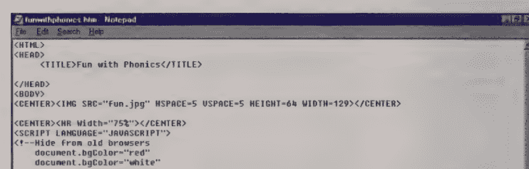

图 1-20

## 使用多个变量构造消息

最后一条语句将四个独立的变量合并成一条消息，从而创建一个连续的文本字符串。你不需要担心消息的长度。

### 在网页上写入消息

要将消息作为网页的一部分显示出来，你需要使用 `write()` 方法。使用标题 4 样式和砖红（firebrick）字体颜色对该行进行格式设置。执行以下步骤在网页上写入消息。

### 在网页上写入消息

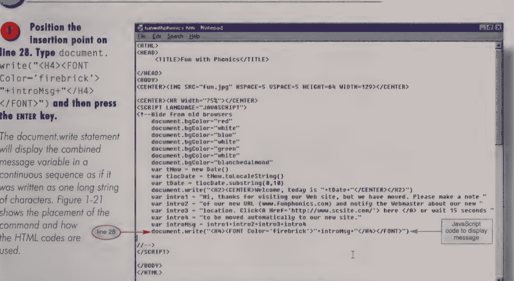

**将插入点置于第 28 行。** 输入 `document.write("<H4 Color="firebrick">introMsg</H4>")` 然后按回车键。

`document.write` 语句将以连续的顺序显示消息变量，就像它是作为一条长字符串被写出来的一样。图 1-21 显示了命令的位置以及 HTML 代码的使用方式。

第 28 行的 `document.write` 语句以你所需的字体大小和颜色格式化了一个短段落。当使用这种连接技术在网页上显示时，你只需要一组起始和结束的 HTML 格式代码即可。

## 保存并测试网页

此时，你应该测试 JavaScript 代码。检查代码中是否有拼写错误、缺失的引号或括号。检查错误后，将文件保存到 A 盘的软磁盘中，激活浏览器，然后点击刷新（Refresh）按钮。执行以下步骤将 HTML 文件保存到 A 盘的软磁盘中。

### 保存文件

- 1. 确保 JavaScript 数据磁盘已插入到 A 盘中。不会显示对话框。文件将使用相同的文件名 `funwithphonics.html` 进行保存。

- 2. 点击菜单栏，然后点击保存（Save）命令。不会显示对话框（图 1-22）。文件将使用相同的文件名 `funwithphonics.html` 进行保存。

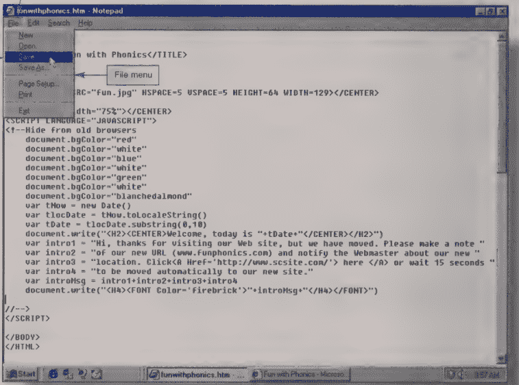

图 1-22

在浏览器中测试网页，执行以下步骤。

### 在浏览器中测试网页

- 点击任务栏上的记事本窗口。

记事本窗口显示了网页（图 1-23）。点击刷新按钮。

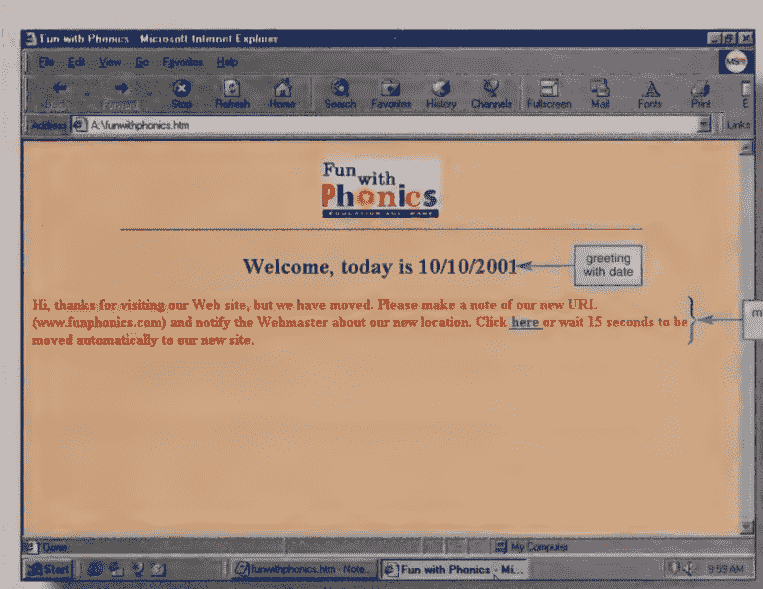

## 调用 JavaScript 函数

JavaScript 有两种基本方法来调用函数。一种调用方法是使用事件处理器和对象方法。另一种方法是在 JavaScript 执行位置调用函数名。你在项目中定义的函数将通过 `setTimeout()` 方法调用。`setTimeout()` 会在执行指令之前产生延迟。

要了解更多关于 `setTimeout()` 的信息，请访问 https://www.mozilla.org/en-US/docs/Web/API/window/setTimeout。同时，找到 Navigator 参考并点击 setTimeout。

`setTimeout()` 的通用形式见表 1-7。

| 表 1-7 - setTimeout 方法 |

| --- | --- |

| 通用形式: | `setTimeout("function", time delay in milliseconds)` |

| 说明: | 其中指令可以是任何 JavaScript 语句，时间延迟以毫秒计数 |

| 示例: | `setTimeout("chngSite()", 15000)` |

### 使用 setTimeout 方法执行 chngSite 函数

- 1. 如必要，将插入点置于第 29 行。

- 2. 输入 `setTimeout ("chngSite", 15000)` 然后按回车键。

`setTimeout` 方法等待 15 秒（15 x 1000 毫秒）后执行 `chngSite()` 函数（图 1-24）。`setTimeout` 方法是用 JavaScript 编写的。

## 编写 JavaScript 自定函数

内置的 `alert()` 函数会显示一条消息，通知查看者链接。随后弹出警告对话框。用户必须点击对话框中的按钮才能继续。表 1-11 描述了其他使用对话框的函数。执行 `alert()` 之后，`location` 语句将执行指向新网站的链接。

| 表 1-11 | 提示（Prompt）与确认对话框 |

| :--- | :--- |

| prompt() | |

| 目的：提示用户输入 |

| 用法：`var response = prompt("What is your name?")` |

| 解释：出现一个带有文本以及 OK 或取消按�的对话框。提示显示在对话框上方，用户输入文本，然后点击 OK 或取消。点击 OK 将文本框中的值返回给变量 `response`。 |

| confirm() | 提示用户是或否 |

| 用法：`var makedSo = confirm("Do you want to open another window?")` |

| 解释：出现一个对话框，包含 OK 或取消按钮。如果用户点击 OK，则向 `makedSo` 返回一个 True 值。如果用户点击取消，则向 `makedSo` 返回一个 False 值。 |

## 在 HEAD 部分中放置自定义函数

放置自定义函数的位置非常重要。大多数 Web 开发者同意将自定义函数放在 HEAD 部分。将函数放在 HTML 代码的 HEAD 部分的主要原因是，以便它们在被任何 JavaScript 调用之前被定义并加载到内存中；如果用户在页面加载时不小心执行了事件处理程序，而该事件处理程序关联的函数尚未定义，该操作将产生错误。

完成以下步骤在 HEAD 部分中输入 `chngSite()` 自定义函数。

### 在 HEAD 部分中输入 chngSite() 自定义函数

将插入点置于 TITLE 标签和结束标签 `</HEAD>` 标签之间的空行（第 4 行）。输入 `<SCRIPT LANGUAGE="JAVASCRIPT">` 并按回车键。<!--对旧浏览器隐藏-->然后按回车键（图 1-26）。

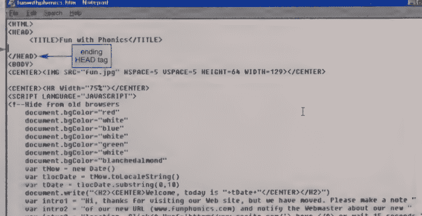

图 1-26

## 项目 1 - 集成 JavaScript 和 HTML

输入 `function (` 然后按回车键。输入 `alert("you are about to be transported to the new site location!")` 并按回车键。输入 `location = "http://www.scsite.com/"`

```html
<html
<head>
  <title>Fun with Phonics</title>
  <script language="JAVASCRIPT">
  function chgsite() {
    alert("you are about to be transported to the new site location!");
    location = "http://www.scsite.com";
  }
  </script>
</head>
<body>
  <center>
    
  </center>
  <center>-- from old browsers</center>
  document.bg.color="white";
  document.bg.color="white";
  document.bg.color="white";
  document.bg.color="white";
  document.bg.color="white";
  document.font="shellyalmond";
  var now = new Date();
  var timeout = now.getTime();
  setTimeout(chgsite,8700);
  document.write("<center>Welcome to our Web site, but we have moved. Please make a note ");
  var intro2 = "of our new URL (www.funphonics.com) and not the Webmaster about our";
  var intro3 = "We are excited to see you today! here (0/8) wait 15 seconds";
  var intro4 = "to be moved automatically to our new site.";
  var introhg = intro1+intro2+intro3;
</body>
</html>
```

`scsite.com/"` 然后按回车键 // 然后按回车键 //</script> 然后按回车键。

`chngSite()` 自定义函数显示（图 1-27）。

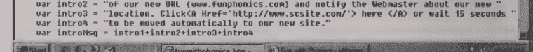

图 1-27

HEAD 部分包含了自定义函数，这些函数由其他 JavaScript 代码或来自 HTML 标签中嵌入的事件处理程序调用。该函数由 BODY 部分中的 `setTimeout()` 方法调用。此时，保存 HTML 文件并测试页面。

## 将文件保存到软盘上

- 1. 确保 JavaScript 数据磁盘在 A 盘中。点击菜单栏。

- 2. 点击文件（File）菜单上的保存（Save）。

## 测试 测试网页

- 1. 点击任务栏上的 Fun with Phonics。

- 2. 点击刷新（Refresh）按钮。

网页显示（图 1-28a）。15 秒后，会显示一条消息（图 1-28b）。你可以点击对话框中的 OK 按钮，也可以等待 15 秒。如果你连接了互联网，你将被带到 Shelly Cashman 系列网站（www.scsite.com）。要返回图 1-28a 中的网页，请点击后退按钮。

## 编写一个 JavaScript 自定义函数 | J 1.33

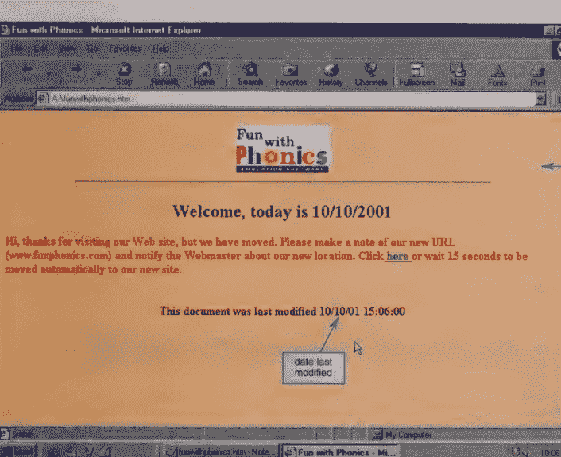

感谢访问网站，但我们已经移动。请记住我们的新 URL (www.funphonics.com) 并通知网页管理员我们的位置。我们很高兴今天见到你！在这里等待 15 秒自动跳转到我们的新网站。最后修改于 10/10/01 15:06:00

图 1-28a

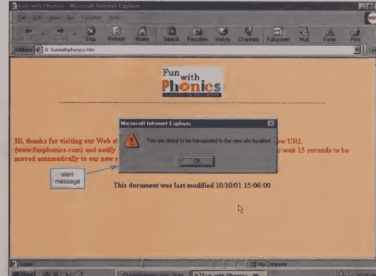

感谢访问网站，但我们已经移动。请记住我们的新 URL (www.funphonics.com) 并通知网页管理员我们的位置。在这里等待 15 秒自动跳转到我们的新网站。最后修改于 10/10/01 15:06:00

图 1-28b

如果遇到错误，请确保变量名一致。检查字符串的起始和结束引号，以及函数的起始和结束大括号。检查需要的地方括号。

## 使用 Notepad 打印 HTML 文件

完成并测试网页后，你可能想要打印它。你可以使用 Notepad 打印 phonics.html 文件。

- 如果需要，点击任务栏上的 Notepad 按钮。点击菜单栏上的文件（File）然后指向打印（Print）（图 1-29）。

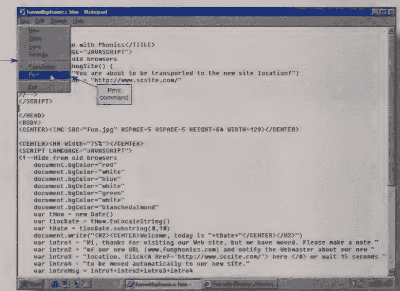

图 1-29

## 输出带有 JavaScript 代码的 HTML（图 1-30）。

```html
<HTML>
<head>
<TITLE>Fun with Phonics</TITLE>
<script language="JAVASCRIPT">
function checkphonics() {
alert("You are about to be transported to the new site!");
location = "http://www.site.com/";
}
</script>
</head>
<body>
<center><h1>Fun with Phonics</h1><br border="5" height="64" width="128"></center>
<center><h1>Welcome to Phonaland</h1></center>
<script language="JAVASCRIPT">
document.body.backgroundColor="red"
document.body.color="white"
document.body.backgroundColor="blue"
document.body.color="white"
document.body.backgroundColor="green"
document.body.color="black"
var date = new Date()
var time = date.toLocaleTimeString()
document.write("Today is "+date+"<center>"+time+"</center>")
document.write("Thanks for visiting our site, but we have moved. Click <a href="http://www.site.com/">here</a> or wait 5 seconds to be moved automatically to our new site.")
document.write("<br><FONT Color=\"orange\">intro</FONT>")
document.write("<br><center>This document document was last modified: </center>")
</script>
</body>
</HTML>
```

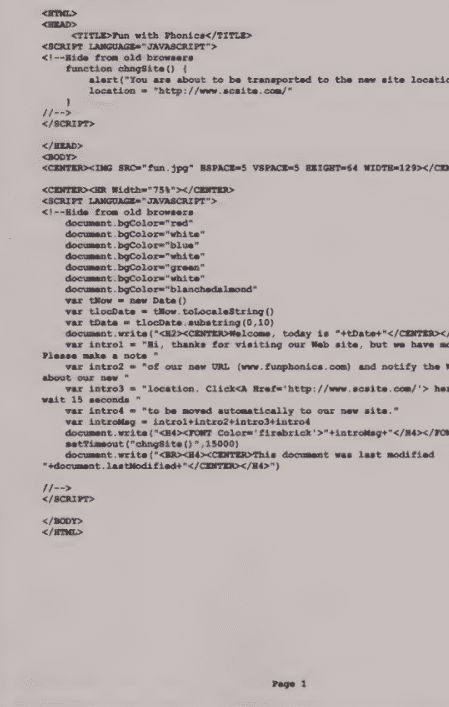

图 1-30

## 使用 Notepad 打印

你可以在 Notepad 中修改页眉和页脚。点击菜单栏上的文件然后点击页面设置（Page Setup）。在页面设置对话框中，输入所需的页眉和页脚以了解更多 Notepad 代码，搜索 Notepad 帮助以插入页眉页脚。

## 项目总结

在本项目中创建的网页作为 Fun with Phonics 客户的通知，指示网站已移动到新位置。该网页符合管理员 Sandy Moncott 的要求。网页闪烁以引起用户注意，设置背景颜色，显示消息并允许用户手动链接到新网站。15 秒后，消息通知用户网页将自动链接到新网站。当用户点击 OK 按钮时执行链接。

在项目中，你学习了如何使用 Notepad 编辑器修改网页。你学习了如何在 HTML 文件中放置 JavaScript 代码。在添加 JavaScript 代码时，你学习了如何使用对象并编写变量。项目引入了创建新对象的概念，你学习了 `Date()` 对象以及如何从用户的计算机系统提取数据。

你学习了如何创建自定义函数来调用内置 `alert` 函数显示消息。通过 `setTimeout()` 方法，你学习了如何调用自定义函数。最后，你学习了如何操作 Notepad 浏览器中测试网页。

## 你应该知道

完成此项目后，你应该执行以下任务：

- 激活 Notepad 窗口 (J 1.27)

- 在网页上创建闪烁效果 (J 1.13)

- 使用多个变量构造消息 (J 1.24)

- 在初始问候中显示当前系统日期 (J 1.23)

- 在消息中显示最后修改日期 (J 1.29)

- 输入起始 SCRIPT 标签和注释 (J 1.12)

- 在 HEAD 部分中输入 chngSite() 自定义函数 (J 1.31)

- 输入结束 SCRIPT 标签 (J 1.16)

- 使用 `Date()` 对象提取当前系统日期 (J 1.22)

- 打开存储在磁盘上的网页 (J 1.10)

- 使用 Notepad 打印 HTML 文件 (J 1.34)

- 保存文件 (J 1.26)

- 将文件保存到软盘上 (J 1.17, J 1.32)

- 将背景颜色设置为静态颜色 (J 1.15)

- 启动 Notepad (J 1.8)

- 在浏览器中测试网页 (J 1.19, J 1.32)

## 测试你的知识

## 1 判断对错

说明：如果陈述正确请圈 T T，如果陈述错误请圈 F。

- 1. 自1980年以来，公司已通过电子商务开发并赢得了巨大的营销优势。

- 2. 营销专家会告诉你，你有六到七秒的时间来吸引并留住某人的注意力。

- 3. JavaScript 的优势之一是能够在用户的机器上立即处理数据。

- 4. JavaScript 无法与 HTML 代码配合工作。

- 5. SCRIPT 标签可以有三个属性。

- 6. 感叹号 (!) 用于表示 HTML 注释。

- 7. 要动态更改网页的背景颜色，你使用 `<body>` 标签中的 `BGCOLOR` 属性。

- 8. 你无法查看创建或存储在软磁盘上的网页；必须将其发布到 Web 服务器。

- 9. 要使用 JavaScript 在网页上显示文本，你使用 `document.write()` 对象和方法。

- 10. 在 `setTimeout` 方法中，执行命令前应经过的秒数实际上是以纳秒表示的。

## 2 多选题

说明：圈出正确答案。

- 1. 营销专家会告诉你，你有 _______ 秒的时间来吸引并留住某人的注意力。

a. 6 到 7

b. 8 到 9

c. 3 到 4

d. 10 到 12

- 2. 记事本文件的自动扩展名为 _______。。

a. .DOC

b. .HTM

c. .TXT

d. .HTML

- 3. 你将 JavaScript 代码放置在网页的 _______ 部分。

a. BODY

b. HEAD AND BODY

c. HEAD

d. TITLE

## 多选题（继续）

- 4. `<SCRIPT>` 标签默认自动是哪种语言？

a. VBScript

b. DHTML

c. Java

d. JavaScript

- 5. JavaScript 中更改背景颜色的文档属性是什么？

a. backgroundColor

b. bgColor

c. bkColor

d. pageColor

- 6. 要用浏览器测试网页，点击菜单栏上的 ________，然后点击“文件”或“打开页面”。

a. 文件 (File)

b. 编辑 (Edit)

c. 收藏 (Favorites)

d. 视图 (View)

- 7. 以下哪个不是 JavaScript 的数据类型？

a. 布尔型 (Boolean)

b. 浮点型 (floating point)

c. 字符串 (string)

d. 数字 (numeric)

- 8. 定义 JavaScript 变量时，最好使用 ________ 语句。

a. define

b. DIM

c. var

d. var

- 9. 下列哪个包含在 `Date()` 对象中？

a. 星期

b. 时区

c. GMT

d. 年

- 10. 使用 `substring()` 方法提取数据字符串时，你需要提供要提取的第一个字符的相对位置以及。

a. 最后一个字符的相对位置

b. 字符的相对长度

c. 最后一个字符的相对位置加一

d. 整个字符串中的字符数

## 理解网页的各个部分

说明：在图 1-31 中，箭头指向网页的组件。请在提供的空间内识别网页的不同部分。

图 1-31

## 理解代码语句

说明：仔细阅读以下每个描述。编写 JavaScript 代码来完成这些任务。根据代码描述为你的答案编号。将答案记录在单独的纸上。将答案交给你的老师。

- 1. 编写一个 JavaScript 语句定义一个名为 `OurTime` 的新变量。将其赋予 `Date()` 对象。

- 2. 编写一个 JavaScript 语句定义一个名为 `LocTime` 的新变量。将其通过第 1 步描述的新 `OurTime` 对象的赋值。

- 3. 编写一个 JavaScript 语句将背景颜色设置为绿色。

- 4. 编写一个 JavaScript 语句连接消息变量（Msg1、Msg2 和 Msg3）并赋值给名为 `CompMsg` 的变量。

- 5. 编写一个 `setTimeout` 方法，在5 秒后调用函数 `goNext()`。

- 6. 编写 JavaScript 语句显示以下内容：此文档最后更改于 10/31/01（提示：假设数据已提取到名为 `currentDate` 的变量中）。

- 7. 给定 `<input Type="Button" Name="Continue" Value="Continue">` 获取并添加事件处理程序，当用户点击按钮时执行函数 `goNext()`。

## 探索在线文档

说明：启动浏览器。在地址框中输入 `www.scsite.com/js/p1.htm` 然后点击“项目 1 使用帮助”。使用该网站回答以下问题。

- 1. 点击左侧框架中的“第 1 章入门”。JavaScript 是什么？

- 2. 向下滚动右框架直到找到表 1-1。回答以下问题：

a. 哪种语言是解释型的（不是编译的）？

b. 哪种语言是面向对象的？

c. 哪种语言的类和实例不能动态添加属性或方法？

d. 哪种语言的代码与 HTML 集成并嵌入？

e. 哪种语言使用未声明的变量类型（松散类型）？

- 3. 向下滚动同一页面找到“将 JavaScript 表达式用 HTML 属性值”标题。JavaScript 表达式如何用作 HTML 属性值？

- 4. 向下滚动同一页面找到“使用 NOSCRIPT 标签指定交替内容”标题。NOSCRIPT 标签在 JavaScript 中有什么作用？

- 5. 向下滚动同一页面找到“定义和调用函数”标题。回答以下问题：

a. 什么是函数，基本部分有哪些？

b. 定义函数和调用函数有什么区别？

c. 为什么应该在 HEAD 部分定义函数？

- 6. 向下滚动同一页面找到“使用方法”标题。为什么 write 方法是常用的 JavaScript 方法之一？

## 探索其他 JavaScript 站点链接

说明：启动浏览器。在地址框中输入 `www.scsite.com/js/p1.htm` 然后点击“项目 1 使用帮助”。执行以下任务。

- 1. 滚动左框架。

- 2. 点击第 1 章消息框。

- 3. 阅读整个章节并点击“拆解”。

- 4. 阅读所有页面。在完成第 1 章后，打印最后一页。

- 5. 完成第 1 章后，点击“进入”第 2 章，然后点击红色、绿色、蓝色和白色按钮进行演示。点击“如何做”。

- 6. 阅读“如何做”页面并打印最后一页。将打印件交给老师。

## 应用你的知识

### 1 为初始屏幕更改消息并链接到新网站

说明：启动记事本。打开 JavaScript 数据磁盘上的 `carrental.htm`。如果你没有下载数据磁盘，请查看封底下载数据磁盘的说明或咨询老师。此网页是用户搜索租车处时可能遇到的初始屏幕。此网页将在 15 秒后自动链接到新站点。图 1-32 显示了完成后的网页。执行新站点链接的函数已经编写。执行以下任务。

- 1. 找到图像和水平线后的 JavaScript 标签，该标签包含 JavaScript 注释 `// 构建消息行并显示`。

- 2. 输入以下代码：

var msgLine1="当您的车在维修店时厌倦了替代交通工具吗？\nmsgLine2="All Car、Owens Rental 和 Kline Leasing 宣布正在合并\nmsgLine3="以形成 AOK Rental & Leasing。AOK Rental & Leasing 为您提供更多\nmsgLine4="资金价值和更多可选的地点。AOK 现在在三县地区提供上门服务。立即拨打我们的电话 219-555-7711。"

msgLine5="三县地区提供上门服务。"

- 3. 输入以下代码将五个变量合并为一个名为 `message` 的变量：

var message = msgLine1+msgLine2+msgLine3+msgLine4+msgLine5

## 应用你的知识

## 修改初始屏幕的消息并链接到新网站（继续）

- 4. 使用 write() 方法如下所示显示消息：

`document.write("<H3 Color='darkgreen'><B>+message+"</H3></FONT></B>");`

- 5. 使用文件名 carrentalsolution.htm 将 HTML 文件保存到 A 磁盘驱动器。

- 6. 启动浏览器。打开 acurrentsolution.htm 网页以测试 JavaScript 代码。如果没有发生错误，继续执行第 7 。如果发生错误，激活记事本，然后点击浏览器工具上的刷新按钮重启。将文件保存到磁盘，然后再次点击刷新按钮。

- 7. 在 BODY 部分找到结束的 </SCRIPT> 标签。将插入点置于 `<!--Continue button..` 注释行之后。在单独的行中输入以下内容：

```html
<FORM>
<Input Type="Button" Name="Continue" Value="Continue" onclick="newSite()">
</FORM>
```

- 8. 在 SCRIPT 部分找到 setTimeout() 方法并将其删除。

- 9. 保存记事本文件，激活浏览器，点击浏览器工具栏上的刷新按钮来测试网页。

- 10. 打印网页。

- 11. 返回记事本并打印 HTML 文本。将打印件交给你的教师。

# 在实验中

## 编写一个更改背景色的函数

问题：你正在当地高中教一门入门级 Web 课程。你想开发一个网页，允许学生通过点击与特定颜色相关的按钮来更改背景颜色（图 1-33a）。图 1-33b 中的网页具有蓝色（azure）背景。

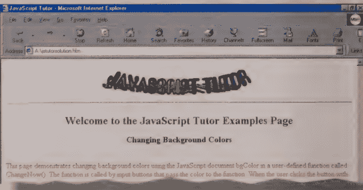

图 1-33a

# 在实验中

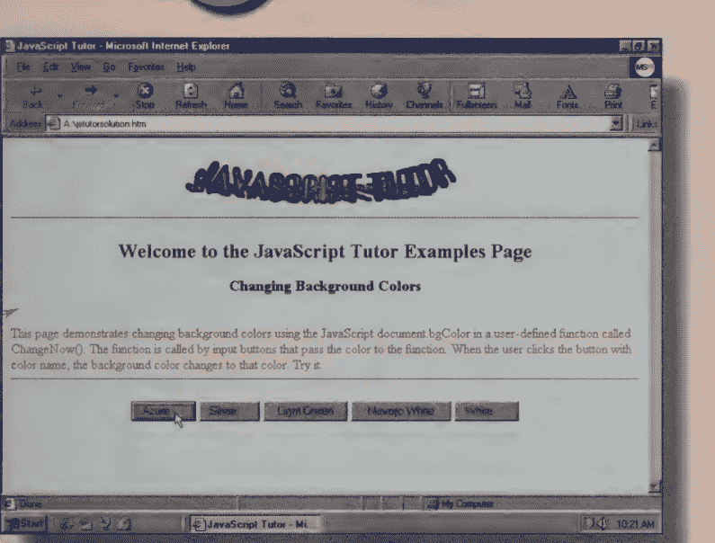

欢迎来到 JavaScript 示例页

### 更改背景颜色

本页面演示了如何使用 JavaScript document.bgColor 以及一个名为 ChangeNow() 的用户定义函数更改背景颜色。该函数通过输入按钮调用，这些按钮将颜色传递给函数。当用户按颜色名称点击按钮时，背景颜色将变为该颜色。尝试一下。

图 1-33b

**指令：** 启动你的浏览器和记事本。使用记事本打开 JavaScript 数据磁盘上的 jutor.htm。如果你没有下载数据磁盘，请参阅封底关于下载 JavaScript 数据磁盘的说明，或咨询你的教师。执行以下任务。

- 1. 在 HEAD 部分找到 script 标签。

- 2. 在注释 `// Change background color to color passed to function` 之后的行，输入以下内容：

```javascript
function ChangeNow(color) {
document.bgColor=color
}
```

- 3. 在 BODY 部分找到创建五个带有颜色名称的输入按钮的表单。对于每个按钮，插入 onclick 事件处理器以调用 ChangeNow() 函数并传递关联颜色。使用实际颜色名称作为传递的值，并与代码中显示的 Azure 和 Silver 按钮的 own匹配。

```html
<INPUT Type="button" Name="ChngRed" Value="Azure" onclick="ChangeNow('azure')">
<INPUT Type="button" Name="ChngRed" Value="silver" onclick="ChangeNow('silver')">
```

- 4. 将记事本文件保存到磁盘，文件名为 jutorsolution.htm。

- 5. 激活浏览器并在浏览器中打开 a:\jstutorsolution.htm 以测试你的 JavaScript 代码。

- 6. 如果发生任何错误，双检第 2 到 4 步并测试文件。如果没有发生错误，打印网页，打开记事本并打印 HTML 文件。将打印件交给你的教师。

## 在执行链接前添加警报消息以显示事实

**问题：** 你 Valley Recycling 的实习生，网站管理员 Juan Garcia 想要修改当前的欢迎页（图 1-34a），为四个链接中的每一个添加一个事实小知识（factoid）。该事实小知识应在执行链接之前显示一条消息（图 1-34b）。此外，Juan 请求你添加文档最后修改的日期时间。

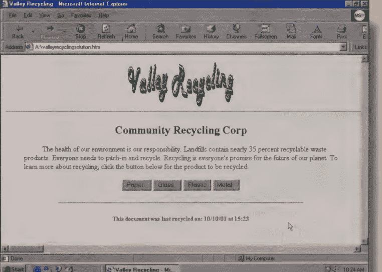

图 1-34a

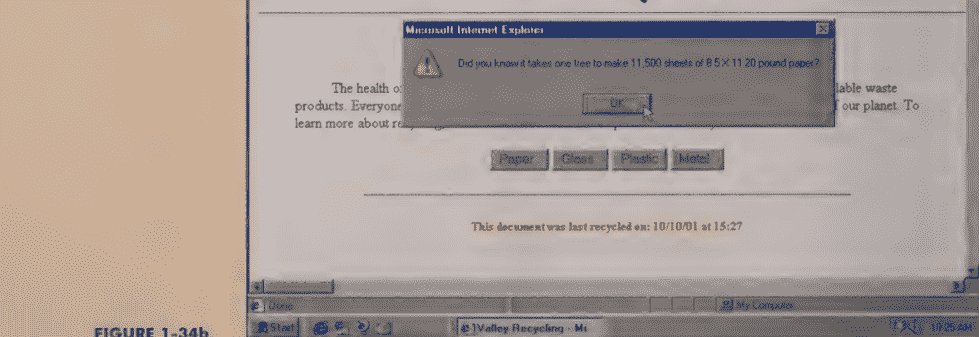

图 1-34b

# 在实验中

**指令：** 启动你的浏览器和记事本。使用 JavaScript 数据磁盘使用记事本打开 valley.htm 然后执行以下任务。

- 1. 在网页 HEAD 部分找到第一个 SCRIPT 标签。Paper 按钮的函数已经写好。以此函数为模型，再写三个函数，每个对应剩余的类型（玻璃、塑料、金属）。

- 2. 在 Paper() 函数下方输入剩余的函数。按下空格键以与 Paper() 函数相同的方式进行缩进。

- 3. Glass 按钮的函数是 Glass()

    a. 将以下事实小知识赋值给变量：每回收一个玻璃容器可节约 9 加仑燃料油。

    b. 输入 location = "http://www.scsite.com/"

    d. 输入（右括号）。

- 4. Plastic 按钮的函数是 Plastic()。

    a. 将以下事实小知识赋值给变量：聚苯乙（Styrofoam）不是塑料。

    b. 将以下内容赋值给另一个变量：500 年后聚苯乙烯仍然会存在。

    c. 合并两个变量。

    d. 使用 alert 函数显示新变量。

    e. 输入 location = "http://www.scsite.com/"

    f. 输入（右括号）。

- 5. Metal 按钮的函数是 Metal()。

    a. 将以下事实小知识赋值给变量：每回收一吨，可节约 2.5

    b. 将以下内容赋值给另一个变量：吨矿石，

    c. 合并两个变量。

    d. 使用 alert 函数显示新变量。

    e. 输入 location = "http://www.scsite.com/"

    f. 输入（右括号）。

- 6. 在 SCRIPT 部分底部找到 HTML 代码 `<!--Date modified-->`。

- 7. 在 SCRIPT 部分显示最后修改时间：

`document.write("This document was last modified on " + document.lastModified(0,8)+" + document.lastModified(8,14));`

- 8. 将文件保存到 A 磁盘，名为 valleysolution.htm。

- 9. 激活浏览器。打开 a:\solution.htm 网页测试你的 JavaScript 代码。

- 10. 如果发生任何错误，双检第 2 到 4 步并测试。如果没有发生错误，打印网页，打开记事本并打印 HTML 文件。将打印件交给你的教师。

# 在实验中

## 创建在警报消息中显示信息的欢迎页

问题：你是 Rocky Mountain Credit Union 的网站管理员。目前的欢迎页非常简单（图 1-35a）。信用社主席 Terry Russell 希望在问候语中加入日期。由于你知道消息会经常变化，你决定使用 document.lastModified 属性来显示日期（图 1-35b）。

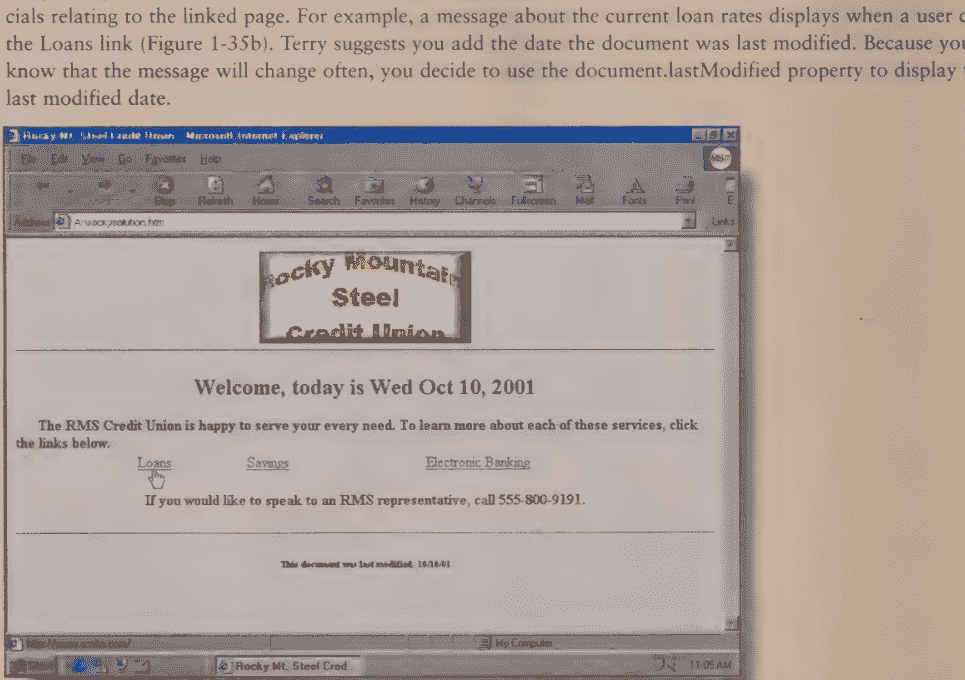

图 1-35a

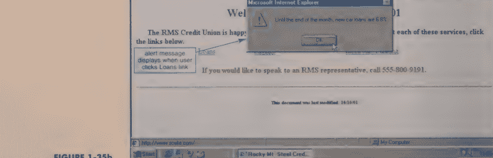

图 1-35b

**指令：** 启动你的浏览器和记事本。使用记事本打开 Rocky.htm。执行以下任务。

- 1. 编写 JavaScript 代码，显示包含星期和日期的问候语。例如，欢迎今天是2001年10月5日星期五。将此消息放在信用社标志下方（图 1-35a）（提示：使用 Date() 对象并从对象中提取星期、日期和年份）。Date() 对象的示例输出为 Fri Oct 13 08:41:44 CDT 2001

- 2. 编写三个使用 alert() 函数的函数。将它们放在 HEAD 部分（SCRIPT 部分从第四行开始）。

- 3. 第一个函数名是 showLoans()。显示：在月底之前，新贷款利率为 6.8%。

- 4. 第二个函数名是 showSavings()。如果你有超过 $5000 的存款，请考虑 CD。

- 5. 第三个函数名是 showEB()。显示：在总行尝试新的 BankAtHome 软件。

- 6. 在 </BODY> 标签之前，插入另一个 JavaScript 部分以显示文档最后修改的日期，但不包括时间。包含 HTML 代码 <H6> 以使字体变小并在边距间居中。

- 7. 将记事本文件保存到 A 磁盘，名为 rockysolution.htm。

- 8. 激活浏览器。打开 a:\rockysolution.htm 网页测试你的 JavaScript 代码。

- 9. 如果发生任何错误，双检第 1 到 6 步并再次测试。如果没有发生错误，打印网页，打开记事本并打印 HTML 文件。将打印件交给你的教师。

## 案例与实践

这些案例研究的难度各不相同：

► 最简单；► 难度较大；‣ 最困难。

1. 你在 Ace 地毯和家具清洁公司做了一份暑期工作。老板要求你为他们创建一个网站。你刚刚完成了网页设计课程，你告诉老板，拥有一个能够吸引访问者注意的首页是非常关重要的。你建议该页面的设计要简洁，但内容信息要直观。几秒钟后，页面会自动跳转到网站主页。使用本项目中介绍的概念和技术创建这个欢迎页。

2. 作为营销学课程学分的一部分，你必须每周义务为一家非营利组织工作一小时。因为你喜欢与孩子打交道，你申请了 Kids Club。Kids Club 有一个由他们使用的互联网服务供应商创建的网页。然而，该服务商通知 Kids Club 域名地址将更改。Kids Club 将在旧地址停用前使用三个月。Kids Club 的主任知道你的计算机技能，请你为旧地址创建一个欢迎页，以通知访问者地址变更，并自动将用户链接到新域名地址。使用本项目中介绍的概念和技术创建这个欢迎页。

3. 你父亲经营着制暖制冷业务。他在当地互联网服务供应商处有一个网页。该业务将从秋季开始销售新的锅炉和空调单元。美国制热和空调公司（AFAC）仅认可制暖制冷业务作为分销商。由于该制造商在全国范围内被认为是最好的之一，你父亲希望让访问者现在就了解新系列。他要求你创建一个新的欢迎页，其中包含一个指向当前页面的链接和一个指向 AFAC 网页的链接。使用本项目中介绍的概念和技术创建这个欢迎页。

4. 你在当地的广告和销售报纸（The Community Shopper）进行暑期实习。在一次全体会议上，你建议他们建立一个包含广告、公告、社区新闻和其他功能的网站。编辑对你的建议留下了深刻印象，她正考虑与当地互联网服务供应商签订合同。你被指示创建一个欢迎页，并包含通往该报纸每个功能的链接。编辑希望有一个输入框，提示用户输入他们所在社区的名称。一旦用户输入了社区名称，用户将自动被链接到与其社区相关的网络广告和新闻。使用本项目中介绍的概念和技术创建这个欢迎页。

5. 你的姐姐从脊骨治疗学院毕业并准备开一家诊所。她想建立一个网站，但希望它不仅仅是一个广告页面。你建议她应该创建一个欢迎页，其中包含一个脊骨治疗师治疗的前十大疾病的列表。访问者选择其中一个元素，然后将链接到一个解释该疾病、常见原因和常见治疗方法的页面。使用本项目中介绍的概念和技术创建这个欢迎页。

# JavaScript

### 创建弹出窗口、添加滚动消息和表单验证

当你能够完成以下操作时，你就掌握了本项目中的材料：

- 解释滚动消息的四个基本组件

- 编写一个自定义函数在表单文本框中显示滚动消息

- 描述 If 语句

- 定义条件并讨论条件操作数

- 定义递归

- 描述 focus() 方法

- 编写一个自定义函数来计算住房贷款还款

- 使用嵌套的 If...Else 语句验证数据输入

- 描述 `parseInt()`、`parseFloat()` 和 `isNaN()` 内置函数

- 描述 `math pow()` 方法

- 编写一个自定义函数以货币格式格式化输出

- 讨论 For 和 While 循环

- 使用 `open()` 方法在弹出窗口中显示另一个网页

- 使用 `lastModified` 属性显示网页最后修改的日期

## 原来如此！

### 住房贷款网站是购房的关键

美国梦是拥有一套房子。当你为首付储蓄并获得足够的收入时，梦想就会实现。但你需要存多少钱？你需要赚多少钱？你可以通过浏览互联网轻松找到答案吗？

你需要了解房子如何符合你的预算吗？各种网站可以帮助你确定负担得起什么样的房子、可以借的金额以及每月还款金额。

在这些网站上，你按照逐步指示进行选择，例如居住年限并输入数字，例如你计划借的金额。

你在本项目中构建的网页根据贷款金额、利率和贷款期限估算每月还款。当用户输入每个金额时，JavaScript 使用 `isNaN()` —— 不是数字函数来评估数字并确保它们是数值。

同样，微软的 MSN Advisor 网站 (homeadvisor.msn.com) 提供了一个……

## 项目 7

你在本项目中构建的网页根据贷款金额、利率和贷款期限估算每月还款。当用户输入每个金额时，JavaScript 使用 `isNaN()` —— 不是数字函数来评估数字并确保它们是数值。

在这些网站上，你按照逐步指示进行选择，例如居住年限并输入数字，例如你计划借的金额。

你在本项目中构建的网页根据贷款金额、利率和贷款期限估算每月还款。当用户输入每个金额时，JavaScript 使用 `isNaN()` —— 不是数字函数来评估数字并确保它们是数值。

在这些网站上，你按照逐步指示进行选择，例如居住年限并输入数字，例如你计划借的金额。

你在本项目中构建的网页根据贷款金额、利率和贷款期限估算每月还款。当用户输入每个金额时，JavaScript 使用 `isNaN()` —— 不是数字函数来评估数字并确保它们是数值。

在这些网站上，你按照逐步指示进行选择，例如居住年限并输入数字，例如你计划借的金额。

# 大纲

尝试我们的新贷款估算器

点击“估算贷款还款额”链接。为每个文本框输入所需的数据。然后点击“计算”按钮。您可以反复点击“重置”按钮进行多次尝试。

图 2-1b

图 2-1a

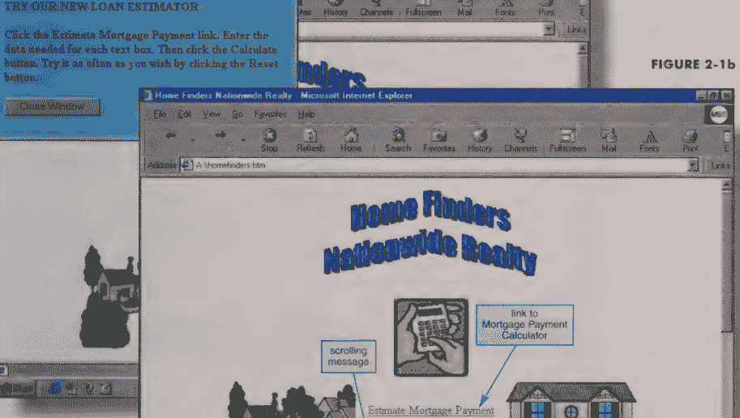

输入表单中的数据，计算每月还款额并以货币格式显示结果。为了让用户确认数据是新的，页面底部将显示页面最后修改日期。

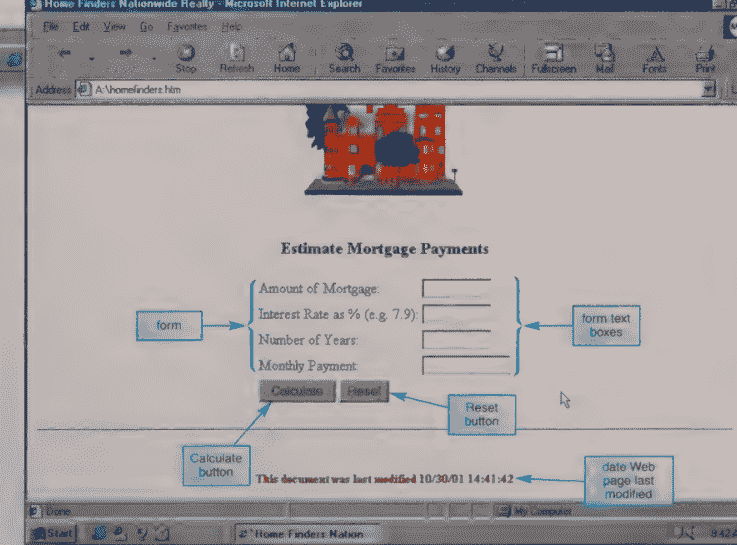

图 2-1c

125

数据验证要求：用户在表单文本框中输入数据（用于每月还款额的数学计算）（见上一页的图 2-1c）。数据不能为空且必须为数字。如果数据无效，将弹出警告框通知用户，并将光标置在适当的文本框中。在所有输入有效之前，公式将不会尝试计算每月还款额。

计算：计算每月还款额的公式为：

`payment = loan * rate / (1 - (1 / (1 + rate))^payments)`

其中 loan 是住房贷款总额，rate 是利率，payments 是要支付的次数。由于利率是以百分比表示的，函数必须将年利率转换为月利率。公式还必须将年份转换为总还款次数。

# 启动记事本并打开 Home.htm 文件

您的第一步是使用记事本打开要向其中添加 JavaScript 代码的 HTML 文件。Home Finders Nationwide Realty 网页的 HTML 文件存储在 JavaScript 数据盘上，文件名为 home.htm。有关下载 JavaScript 数据盘的说明，请参阅封底，或咨询您的教师获取访问本书中的文件的信息。按照以下步骤启动记事本并打开 home.htm 文件。

# 启动记事本并打开存储在数据盘上的网页

1. 点击任务栏上的“开始”按钮。点击开始菜单上的“程序”。点击“程序”子菜单上的“杂杂”。

2. 点击“程序”子菜单上的“记事本”。

3. 将 JavaScript 数据盘插入 A 盘。

4. 点击“文件”菜单上的“打开”。

5. 在“查看”列表框中点击“3½软磁盘 (A:)”。在“文件名”框中输入 *.htm 然后按回车键。

6. 双击文档 home.htm。

home.htm 文档将在记事本窗口显示（图 2-2）。

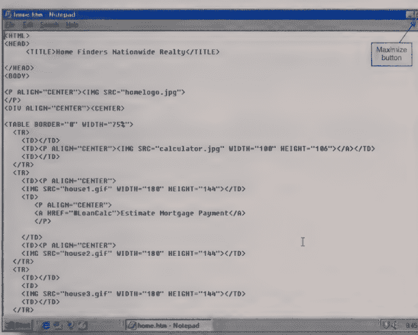

有了 home.htm HTML 文件后，下一步是在 BODY 部分创建一个包含滚动消息的文本框。

# 在网页上插入滚动消息

吸引网站访问者注意的一种简单方法是在您的网页上添加滚动消息。公司经常在其网站上使用滚动消息来突出突发新闻、关键产品或特别促销。滚动消息可以显示在网页内的文本框中，也可以显示在浏览器的状态栏中。

为了方便滚动，微软开发了 MARQUEE 标签。当 Internet Explorer 识别 MARQUEE 标签时，Netscape Navigator 并不识别。然而，通过编写自己的自定函数，您可以创建一个适用于几乎任何浏览器的滚动消息。

滚动消息具有四个基本组件：(1) 显示对象；(2) 消息；(3) 位置；(4) 延迟。**显示对象**定义了滚动消息显示的位置，是在状态栏上还是在文本框内。**消息**是赋值给变量的文本字符串。文本字符串是用户在消息显示时看到的。Netscape 警告 Web 开发者大消息使用内存效率低下。此外，较大的文本字符串可能会导致 Netscape 浏览器崩溃。**位置**是消息首次显示的的位置。起始位置可以是显示对象的左侧或右侧。**延迟**是消息结束到再次开始出现之间的时间。

图 2-2

> ### 关于

#### 滚动消息

避免将滚动消息分配给状态栏的另一个原因是帮助隐藏用户在加载当前或下一个页面时可能需要看到的信息。

> ### 关于

#### MARQUEE 标签

MARQUEE 标签是微软脚本标签之一。有关 MARQUEE 标签的信息，请访问 www.site.com/js/p2.htm 并点击 Marquee。

您在项目中创建的网页包含一个位于表单文本框中的滚动消息（第 2-5 页的图 2-1b）。您构建的表单是一个文本框。在创建表单文本框时，必须为表单和文本框对象命名。稍后，您编写的函数通过这些名称分配文本到文本框。图 2-3 显示包含单个文本框的表单代码。表单名称为 msgForm，文本框名称为 scrollingMsg。

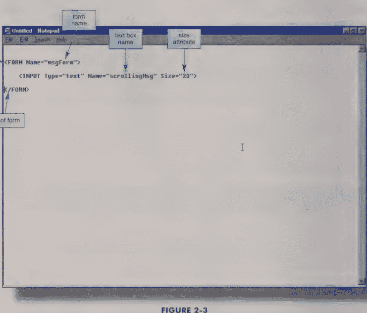

图 2-3

将消息字符串分配给文本框时，这些名称在 JavaScript 代码中作为变量。size 属性指示文本框的显示宽度。

# 创建显示滚动消息的表单文本框

通过 JavaScript，您可以将滚动消息分配给状态栏或文本框。由于网页访问者通常不看状态栏，大多数 Web 开发者认为网页上文本框中的滚动消息是更好的位置。

Home Finders Nationwide Realty 的网页使用表格来安排和组织图形、链接和滚动消息（图 2-4）。表格的中心单元格包含指向贷款还款表单的链接。您将用于滚动消息的表单文本框放在与此链接相同的单元格中。执行以下步骤创建用于显示滚动消息的表单文本框。

# 要创建显示滚动消息的表单文本框

滚动到 BODY 部分和第 25 行的插入点（</p> 段落下方）

将插入点置如图 2-4 所示。

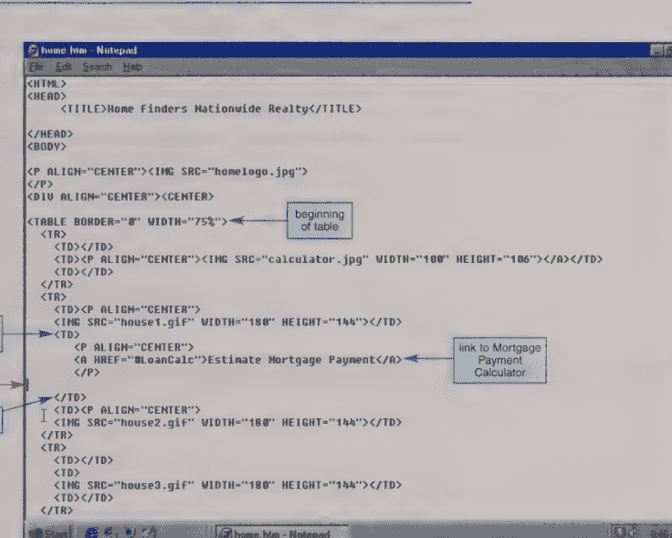

输入 `<FORM name="msgForm">` 然后按回车键。输入 `<INPUT type="text" name="scrollingMsg" size="23">` 然后按回车键。输入 `</FORM>` 然后按回车键。

显示表单的 HTML 代码。代码的每一行为了可读性进行了缩进（图 2-5）。

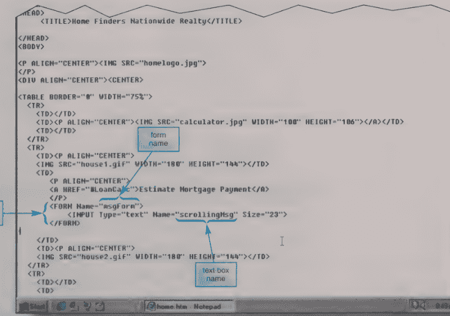

图 2-4

图 2-5

# J 2.10 • 项目 2 • 创建弹出窗口、添加滚动消息和验证表单

由 HTML 代码创建的文本框作为滚动消息的对象。表单名称为 msgForm，文本框名称为 scrollingMsg。下一节描述了编写自定义函数 scrollingMsg() 的语句，以便在文本框中显示滚动消息。

# 为滚动消息创建自定义函数

scrollingMsg() 函数执行三个任务：(1) 它将消息和空格分配给显示对象（在本项目中，即文本框）；(2) 它检查消息是否结束，以及 (3) 它将下一个字符分配给文本框（从消息开始处），以使消息滚动。

Scrolling() 函数需要三个变量：消息；分隔符；表单文本框的起始位置。这些变量在函数语句之前被赋予初始值如下：

```
var scrollMsg = "Mortgage Rates are at their LOWEST!"
var msgSpace = " --- --- --"
var beginPos = 0
```

您将消息文本赋值给 scrollingMsg 变量。使用 msgSpace 变量定义消息后的间隔。在本例中，msgSpace 包含三个连字符、三个空格和一个连字符。beginPos 的初始值为零，这意味着消息从文本框的最左侧开始。从项目 1 回顾，JavaScript 使用相对地址来确定位置，这意味着字符串的第一个字符位置是 0。

使用语句将 scrollingMsg 和 msgSpace 值拼接并分配给 scrollingMsg 文本框：

```
document.msgForm.scrollingMsg.value = scrollMsg.substring(beginPos, scrollMsg.length)+msgSpace+scrollMsg.substring(0,beginPos)
```

对象 document.msgForm.scrollingMsg.value 派自表单和输入对象。图 2-6 明了这些对象之间的关系以及其推导方式。

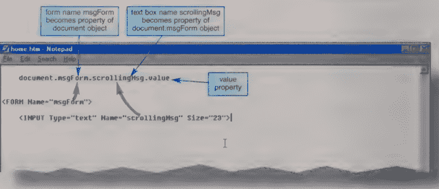

图 2-6

# 创建 scrollingMsg() 用户定义函数

在该语句中，表单对象（msgForm）成为文档对象（document-object）的属性，而输入文本框对象（scrollingMsg）成为 msgForm 对象的属性。JavaScript 使用 `value` 属性将一个值（消息）赋值给文本框对象 `scrollingMsg`。

赋值语句的剩余部分拼接了 `scrollingMsg`、`msgSpace` 变量以及 `scrollingMsg` 的开头。回想一下，`scrolling()` 函数从消息开始将下一个字符分配给文本框。`substring()` 方法用于返回消息的开头。正如你在项目 1 中学到的那样，`substring()` 方法需要两个参数 (x,y)，其中 x 是字符串的起始点，y 是所需的最后一个字符的位置。要创建 `scrollingMsg()` 用户定义函数，请执行以下步骤：

- 将光标置在第 4 行。

第 4 行位于 HTML 代码的 `HEAD` 部分（图 2-7）。

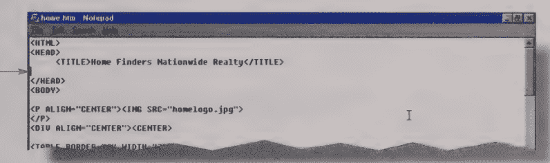

输入 `<SCRIPT LANGUAGE="` 然后按回车键。<!-- 来自旧浏览器按回车键。输入 `var scrollingMsg="Mortgage rates are at their LOWEST!"` 和 `var msgSpace="---"` 然后输入 `beginPos = 0` 并按回车键。

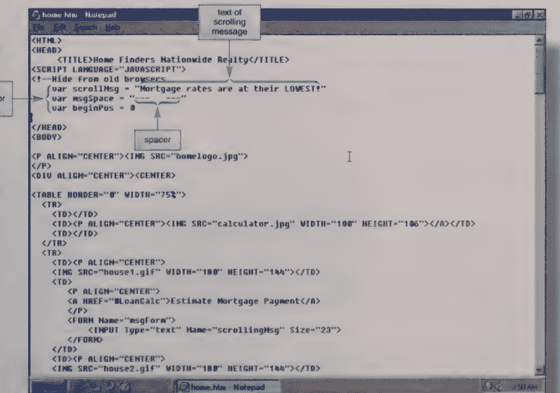

图 2-8 显示了三个变量及其分配的初始值。

输入 `function scrollingMsg() {`

然后按回车键。输入 `document.value = scrollingMsg.substring(beginPos,scrollingMsg.length)+msgSpace+scrollingMsg.substring(0,beginPos)` 然后按回车键。

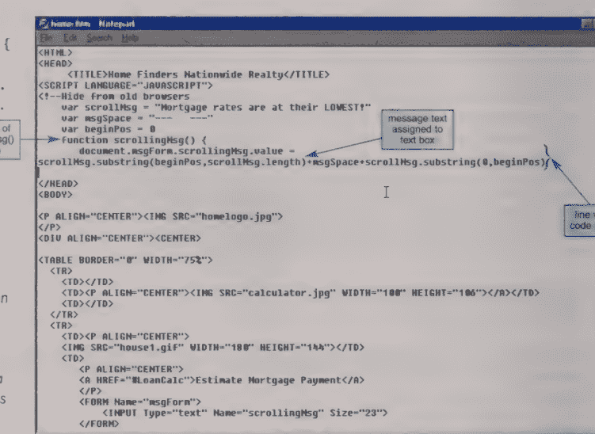

图 2-9 显示了函数名以及将消息赋值给文本框的语句。赋值语句换行到了第二行，但请将此语句视为一行。

图 2-9

JavaScript 语句将消息赋值给文本框，追加分隔符值，并从第一个字符开始显示消息。务必注意第 10 行的 `beginPos` 赋值语句。下一步是增加 `beginPos` 变量，并将消息字符串中的下一个字符追加到文本框。

# 增加位置定位变量

为了让消息在文本框中滚动，你必须将位置定位器加 1。正如引言部分和表 2-1 所示，JavaScript 提供了几种增加变量的方法。

| 表 2-1 – 变量增加 |

| 语句 | 解释 |

| :--- | :--- |

| `variable++` | 给变量加 1 |

| `variable = +1` | 将加号后的数字加到变量 |

| `variable = variable + 1` | 执行等号右侧的表达式并将结果赋值给左侧 |

良好的编程习惯是使用熟悉其他语言的程序员易于理解的语句。要增加 `beginPos` 定位，你需要：

```
beginPos = beginPos + 1
```

增加后，位置定位器的新值允许 `substring()` 方法提取消息字符串中的下一个字符，并将其追加到文本框消息的尾。

# 输入 If 语句

在将位置变量 `begin(beginPos)` 加 1 后，你必须确定 `beginPos` 的当前值是否超过消息的长度。要确定 `beginPos` 变量的当前值是否大于消息长度，请使用 `If` 语句。`If` 语句的通用形式见表 2-2。`If` 语句的第一部分写为 `if (condition)`。将条件测试结果为真时执行的 JavaScript 代码放在一组大括号内。图 2-10 显示了对应 `If` 语句的流程图。

| 表 2-2 – If 语句 |

| --- | --- |

| 通用形式： | `if (condition) { <br> 条件真时的 JavaScript 语句 <br> }` |

| 注释： | 条件是值的比较。如果比较为真，JavaScript 执行大括号之间的语句。 |

| 示例： | `if (beginPos > scrollingMsg.length) { <br> beginPos = 0 <br> }` |

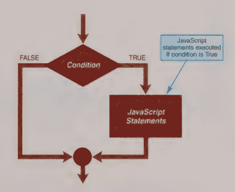

条件是任何求值为真或假的表达式。在编写 `If` 语句时，必须在条件周围加上括号，但在 `If` 语句后留一个空格，以便 JavaScript 不将 `If` 语句解释为函数。表 2-3 显示了用于比较的条件运算符。有关有的更多信息，请参考引言的第 J.10 页。

| 表 2-3 – 条件运算符 |

| 操作数 | 示例 | 结果 |

| --- | --- | --- |

| `==` | `(a == b)` | 如果 a 等于 b 则为真 |

| `!=` | `(a != b)` | 如果 a 不等于 b 则为 |

| `>` | `(a > b)` | 如果 a 大于 b 则为 |

| `<` | `(a < b)` | 如果 a 小于 b 则为 |

| `>=` | `(a >= b)` | 如果 a 大于等于 b 则为 |

| `<=` | `(a <= b)` | 如果 a 小于等于 b 则为 |

| `&&` | `(a == b) && (x < y)` | 如果两个条件都为真（a 且小于 y）则为 |

| `||` | `(a != b) || (x >= a)` | 如果任一条件为真（a 不等于 b 或 x 大于）则为 |

# 2.14 项目 2 • 创建弹出窗口、添加滚动消息和验证表单

图 2-11 所示流程图说明 `If` 语句将起始位置变量（beginPos）与消息的总长度（scrollingMsg.length）进行比较。

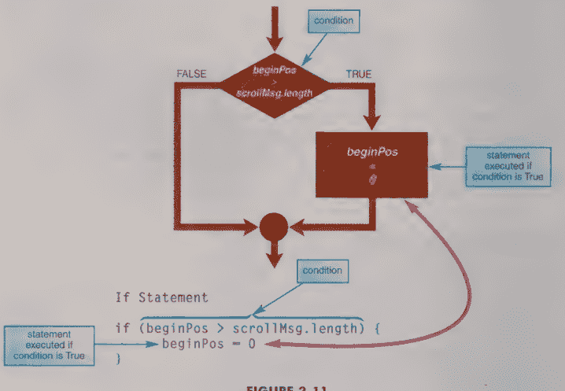

图 2-11

如果 `beginPos` 的当前值超过滚动长度，语句将进行赋值。当你将 `beginPos` 设置为零时，它会将变量置回文本的字符位置。执行以下步骤输入 `If` 语句。

# 输入 If 语句

- 将光标置在第 11 行。输入 `beginPos = beginPos + 1` 并按回车键。

用于增加起始位置的表达式所示（图 2-12）。

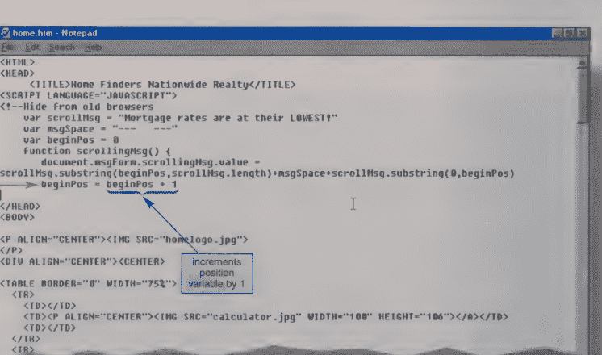

图 2-12

- 输入 `if (beginPos < scrollingMsg.length)` 然后按回车键。输入 `beginPos = 0` 然后按回车键。

`If` 语句如下（图 2-13）：

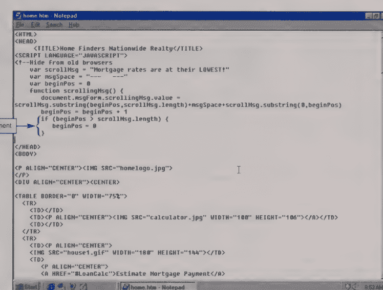

图 2-13

# 使用 setTimeout() 方法创建递归调用

回想项目 1，**setTimeout()** 方法在指定时间（以毫秒计）后调用函数或求值表达式。为了完成 `scrollingMsg()` 函数，你需要添加一个 `setTimeout()` 方法，在再次调用 `scrollingMsg()` 函数之前进行暂停。这种编程技术被称为**递归**，用于从函数内部调用同一个函数。

JavaScript 语句将消息赋值给文本框，追加分隔符值，并从第一个字符开始显示消息。务必注意第 10 行的 `beginPos` 赋值语句。下一步是增加 `beginPos` 变量，并将消息字符串中的下一个字符追加到文本框。

# 增加位置定位变量

为了让消息在文本框中滚动，你必须将位置定位器加 1。正如引言部分和表 2-1 所示，JavaScript 提供了几种增加变量的方法。

（重复上文）

良好的编程习惯是使用熟悉其他语言的程序员易于理解的语句。要增加 `beginPos` 定位，你需要：

一旦增加后，位置定位器的这个新值允许 `substring()` 方法提取消息字符串中的下一个字符，并将其追加到文本框消息的尾。

# 输入 If 语句

在将位置变量 `begin(beginPos)` 加 1 后，你必须确定 `beginPos` 的当前值是否超过消息的长度。要确定 `beginPos` 变量的当前值是否大于消息长度，请使用 `If` 语句。`If` 语句的通用形式见表 2-2。`If` 语句的第一部分写为 `if (condition)`。将条件测试结果为真时执行的 JavaScript 代码放在一组大括号内。图 2-10 显示了对应 `If` 语句的流程图。

（重复上文）

条件是任何求值为真或假的表达式。在编写 `If` 语句时，必须在条件周围加上括号，但在 `If` 语句后留一个空格，以便 JavaScript 不将 `If` 语句解释为函数。表 2-3 显示了用于比较的条件运算符。有关有的更多信息，请参考引言的第 J.10 页。

（重复上文）

# 2.14 项目 2 • 创建弹出窗口、添加滚动消息和验证表单

图 2-11 所示流程图说明 `If` 语句将起始位置变量（beginPos）与消息的总长度（scrollingMsg.length）进行比较。

（重复上文）

如果 `beginPos` 的当前值超过滚动长度，语句将进行赋值。当你将 `beginPos` 设置为零时，它会将变量置回文本的字符位置。执行以下步骤输入 `If` 语句。

# 输入 If 语句

- 将光标置在第 11 行。输入 `beginPos = beginPos + 1` 并按回车键。

（重复上文）

- 输入 `if (beginPos < scrollingMsg.length)` 然后按回车键。输入 `beginPos = 0` 然后按回车键。

（重复上文）

# 使用 setTimeout() 方法创建递归调用

回想项目 1，**setTimeout()** 方法在指定时间（以毫秒计）后调用函数或求值表达式。为了完成 `scrollingMsg()` 函数，你需要添加一个 `setTimeout()` 方法，在再次调用 `scrollingMsg()` 函数之前进行暂停。这种编程技术被称为**递归**，用于从函数内部调用同一个函数。

JavaScript 语句将消息赋值给文本框，追加分隔符值，并从第一个字符开始显示消息。务必注意第 10 行的 `beginPos` 赋值语句。下一步是增加 `beginPos` 变量，并将消息字符串中的下一个字符追加到文本框。

# 增加位置定位变量

（重复上文）

# 关于递归

递归函数通常有一个最终停止函数的条件。有关递归的更多信息，访问访问.com/js/p2.html 并点击递归。

# 为递归调用添加 setTimeout() 方法

在第 15 行处输入 `window.setTimeout("scrollingMsg", 200)` 然后按回车键。输入 `//` 然后按回车键三次。

`setTimeout()` 方法暂停消息 200 毫秒并再次调用 `scrollingMsg()` 函数。

输入 `-->` 然后按回车键。输入 `</script>` 然后按回车键。

`</html>` 标签完成了 JavaScript 部分（图 2-14）。

（代码块）

事件处理程序的名称不区分大小写。Netscape 文档警告说混合大小写模式可能不起作用，并强烈建议开发者使用全小写。此外，你不能将所有的事件处理程序用于所有的 HTML 标签和属性。表 2-5 显示了一些事件处理程序和 HTML 属性。例如，`onclick` 处理程序与按钮配合使用时触发 JavaScript 代码，而 `onload` 处理程序通常用于 BODY、FRAMESET 和 IMG 标签。

`onload` 事件处理程序用于在文档加载到窗口时触发操作。此外，`onload` 事件处理程序使用以下语句调用 `scrollingMsg()` 函数：

```
onload="scrollingMsg()"
```

其中 `onload` 是事件处理程序，`scrollingMsg` 是处理器文本。该语句直接输入在 BODY 标签之后。要输入事件处理程序以调用 `scrollingMsg()` 函数，请执行以下步骤：

## 输入调用 scrollingMsg() 函数的事件处理程序

- 找到第 24 行上的 <body> 标签。将插入点直接置于单词 BODY 和符号 > 之间。按下空格键（SPAC）。

- 输入 `onload="scrollingMsg()"`，不要按回车键（ENTER）。

`onload()` 事件处理程序显示在 BODY 标签内。当网页加载时，`onload()` 事件处理程序将调用用户定义的函数 `scrollingMsg()`（图 2-15）。

| 表 2-5 | 对象 | 事件处理程序 |

| --- | --- | --- |

| button | onclick |

| document | onload, unload |

| form | onsubmit, onreset |

| hyperlink | onclick, onmouseover, onmouseout |

| image | onload, onabort |

| input box | onblur, onchange, onfocus |

| submit button | onclick |

| window | onload, unload, onfocus |

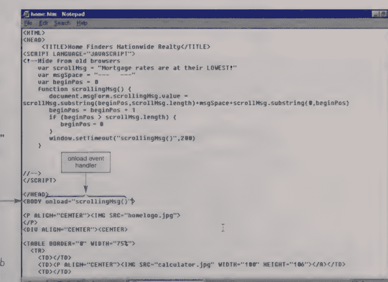

图 2-15

## 保存 HTML 文件并测试网页

在编写文档时，应定期保存文件。使用文件名 `homefinders.htm` 保存此文件。作为项目 1，在保存文件时你必须确保为文件名添加 `.htm` 扩展名，记事本会自动将所有文件保存为 .txt 扩展名。按照以下步骤使用记事本将 HTML 文件保存到你的 JavaScript 数据盘上。

## 在数据盘上保存文件

- 1. 将你的 JavaScript 数据盘插入 A 盘，点击菜单上的“另存为”（Save As）。

- 2. 在文件文件名文本框中输入 `a:\homefinders.htm`，然后点击另存为对话框中的“保存”按钮。

文件已保存到 A 盘中的 JavaScript 数据盘中。新文件名显示在记事本的标题栏上。

在进行项目时，请多次保存文件。第一次保存后，“保存”命令将保存相同的文件。每当你需要测试网页时，必须通过浏览器中查看来保存 HTML 文件。通常情况下，在开发过程中多次测试网页，并在发布到网站之前进行最后一次是良好的做法。当访问者在网站上遇到错误时，他们通常会离开网站——这意味着流失了潜在客户。要查看并离开你的网页，请执行以下步骤。

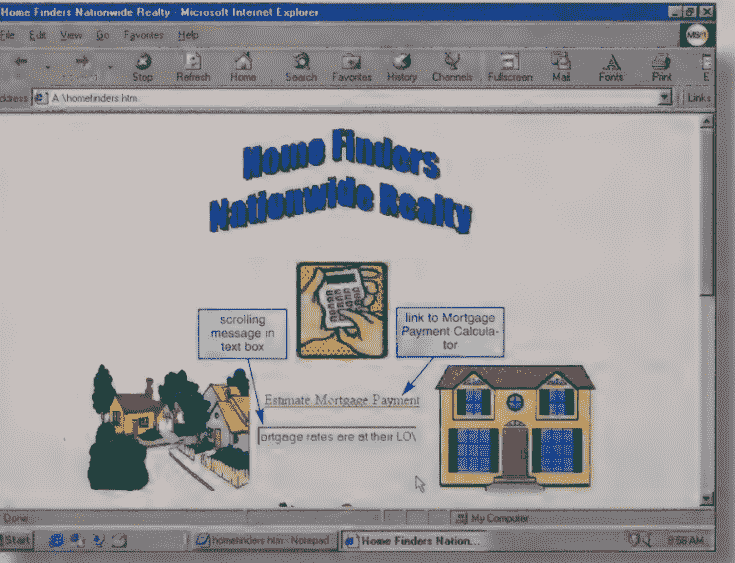

## 测试网页

- 1. 启动浏览器。

- 2. 如果必要，点击地址文本框。输入 `a:\homefinders.htm` 然后按回车键。

- 3. 点击地址。显示 Home Finders Nationwide Realty 网页，文本框中带有滚动消息（图 2-16）。

图 2-16

如果你的浏览器没有正确显示网页，请查看任何错误消息，然后点击任务栏上的记事本按钮。根据第 J 2.11 至 J 2.17 页的图 2-7 至 2-15 检查你的 JavaScript 代码。修正任何错误，保存文件，激活浏览器，然后点击刷新按钮。下一节将讨论贷款还款计算表单。

## 贷款还款计算表单

图 2-17 显示的贷款还款计算表单允许用户输入。表单使用 HTML 和 JavaScript 代码创建，显示表单和结果（图 2-17）。要为表单内的文本框对象赋值，必须使用表单名称、文本框名称和 `value` 属性。表 2-6 显示了用于为表单内文本框对象赋值的 JavaScript 语句的一般形式。

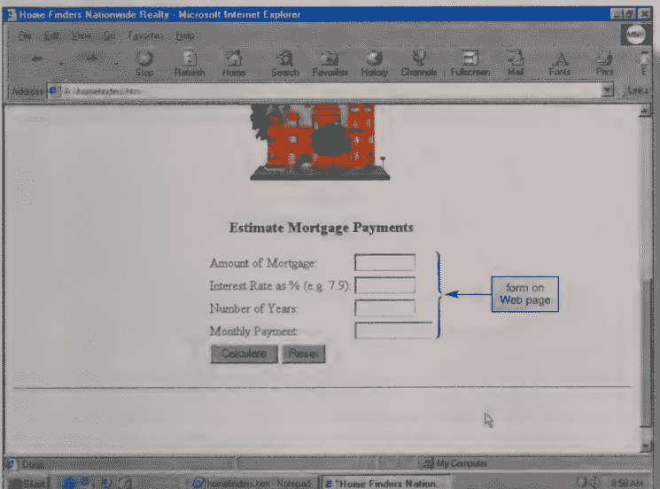

图 2-17

| 表 2-6 – 赋值语句 | |

| --- | --- |

| 一般形式： | documentformname.textboxname.value = variable_or_literal |

| 注释： | 其中 `formname` 是表单名称；`textboxname` 是表单中文本框的名称；`value` 是属性；`variable_or_literal` 是赋值给文本框的值。 |

| 示例： | document.MortCalc.Amount.value = LoanAmt; document.MortCalc.Amount.value = "12500" |

## 在锚点标签中插入事件处理程序

在此项目中，当网页加载时，`onload()` 事件处理程序将调用用户定义的函数 `scrollingMsg()`（图 2-15）。

## 进入 doMart() 函数

将插入光标置在 HEAD 部分第 18 行。

按照如上一页表 2-7 所示输入 JavaScript 代码。

这些语句会导致用户在点击“估算贷款贷款还款”链接时，网页向下滚动到表单处。`doMart()` 会清除文本框，并将插入光标置于“贷款金额”文本框中（图 2-20）。

```html
<HEAD>
<TITLE>Homefinders Inc. - Nationwide</TITLE>
<SCRIPT LANGUAGE="JAVASCRIPT">
  // 对旧所有者隐藏
  var scrollPage = "Mortgage rates are at the LOWEST!";
  var scrollMsg ="
  var beginPos = 0;
  function scrollMsg() {
    document.getElementById("scrollMsg.value") = scrollMsg+document.getElementById("scrollMsg").length-beginPos+scrollMsg.substring(0,beginPos);
    beginPos += 1;
    if (beginPos > scrollMsg.length)
      beginPos = 0;
  }
  setTimeout(scrollMsg,200);
}
  function doMart() {
    document.getElementById("DocMart.Rate.value") = document.getElementById("DocMart.Rate.value");
    document.getElementById("DocMart.Years.value") = document.getElementById("DocMart.Years.value");
    document.getElementById("DocMart.Payment.value") = document.getElementById("DocMart.Payment.value");
    document.getElementById("DocMart.Amount.value") = document.getElementById("DocMart.Amount.value");
  }
</SCRIPT>
</HEAD>
<P ALIGN="CENTER"></P>
```

图 2-20

第 23 行中的 `focus()` 方法会在用户点击“估算贷款贷款还款”链接时导致网页向下滚动并将插入光标置于文本框中（第 28 页图 2-16）。

## 保存并测试网页

在继续操作之前，你应该双检拼写、特殊字符和引号。下一步是保存并测试网页。

## 如何保存并测试网页

- 在 A 盘中插入你的 JavaScript 数据软盘，点击菜单栏上的“文件”，然后点击菜单上的“保存文件”。

- 点击任务栏上的浏览器窗口。

- 点击浏览器工具栏上的“刷新”按钮。

- 点击“估算贷款贷款还款”链接。

网页应显示贷款还款计算器表单，且插入光标位于“贷款金额”文本框中（图 2-21）。

## 验证贷款还款计算表单 • 2.23

图 2-21

如果你的浏览器没有正确显示网页，请清除任何错误消息并点击任务栏上的“记事本”标签页。对比你的 JavaScript 代码与第 2.20 页至 2.22 页的图 2-18 至 2-20。修正任何错误，激活浏览器并点击“刷新”按钮。

## 验证贷款还款计算表单

> 验证：程序员还应该编写 JavaScript 代码来测试数据是否为负数或零，并将它们拒绝为无效值。为了简单起见，本项目中提供的验证仅测试确保所有输入均为数字。欲需更多信息，请访问 http://www.scamsite.com/js/p2.html 并点击验证。

表单验证是 JavaScript 最重要的功能之一。通过 JavaScript，验证过程是在用户的计算机上完成的，而不是存储网页的 Web 服务器上。JavaScript 的数学方法允许对数据进行立即处理。表单验证使用了 `If...Else` 语句，它是 `If` 语句的扩展，如图 2-22 中的流程图所示。

## 验证 If...Else 语句

与 `If` 语句，`If...Else` 语句测试条件。如果条件为真，则执行 `If (condition)` 语句大括号内的语句。如果条件为假，则执行 `Else` 语句大括号之间的语句。

在此表单中，你将使用 `Calc()` 函数将文本值转换并存储在临时变量中进行验证。`Calc()` 函数被放置在 `If...Else` 语句中，因此如果文本框的值无效（真条件），将显示消息、清除文本框并将插入光标放回文本框中。此过程将一直持续，直到用户在文本框中输入有效数据。如果值有效（假条件），则检查下一个文本框，直到所有文本框都通过验证。验证过程见下一页图 2-23 的流程图。

图 2-22

图 2-23

## 验证贷款还款计算表单

这种验证设计是必要的，因为事件具有事件驱动特性。当事件的事件驱动特性触发一个函数时，这种验证设计是必要的，因为事件具有事件驱动特性。（注：原文此处存在重复表述，翻译按原意保留或根据逻辑调整，此处按要求不漏译，保留了原文的逻辑重复性）。

## 验证表单

## 内置函数

这种验证设计是必要的，因为事件具有事件驱动特性。当事件的事件驱动特性触发一个函数时，这种验证设计是必要的，因为事件具有事件驱动特性。

## isNaN() 函数

`isNaN()` 函数是唯一一个测试数值的内置函数。它使用了 `NOT` 运算符。

## 验证数据的内置函数

## 关于

`parseFloat()` 是内置函数之一。`parseFloat` 函数解析字符串参数并返回浮点数。如果第一个字符无法转换，它将返回 "NaN"（非数字）。

## If 语句

表 2-10 第 29 行的 `If` 语句检查变量 `martAmount` 的值是否为数字。如果条件结果为真（不是数字），函数将执行以下步骤：它通过警告消息通知用户（第 30 行）；清除文本框输入（第 31 行）；并将焦点设回“贷款金额”文本框（第 32 行）。第 33 行的右括号关闭 `If` 语句。

| LINE | CODE |

|---|---|

| 26 | function Calc(myform) { |

| 27 | var martAmount=document.martMart.Amount.value |

| 28 | var martAmount=parseInt(martAmount), |

| 29 | if (isNaN(martAmount)) { |

| 30 | alert("The loan amount is not a number!") |

| 31 | document.martMart.Amount.value="" |

| 32 | document.martMart.Amount.focus() |

| 33 | } |

要进入验证“贷款金额”文本框值的 `Calc()` 自定义函数，请执行以下步骤。

## 输入 Calc() 用户定义函数

如有必要，激活记事本。

向上滚动到 HEAD 部分。将光标点置在第 20 行。

输入如表 2-10 所示的 JavaScript 代码。

该 JavaScript 语句将文本框转换为 `Calc()` 函数，该函数将“贷款金额”（Amount of Mortgage）的值转换为整数。如果该值不是数字，则会显示警告消息，并将焦点重置到“贷款金额”（Amount of Mortgage）文本框（图 2-26）。

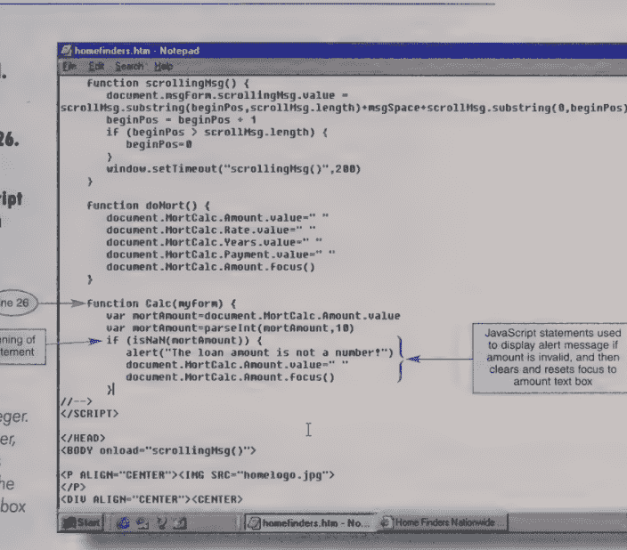

图 2-26

由于在此函数中还有两个文本框需要验证，你必须继续检查文本框。`If...Else` 语句提供了验证剩余文本框所需的控制。表 2-11 显示了验证“利率（百分比）”（Interest Rate as %）文本框输入数据的代码。利率验证与贷款金额的验证类似，不同之处你将使用 `parseFloat()` 函数（表 2-11 中的第 36 行）。因为利率是浮点数，所以使用 `parseFloat()` 来保持利率的浮点数值。下一页的表 2-12 显示了验证“年限”（Number of Years）文本框输入数据的代码。

| 行号 | 代码 |

|---|---|

| 34 | else { |

| 35 | var mortRate=document.MortCalc.Rate.value |

| 36 | var mortRate=parseFloat(mortRate) |

| 37 | if (isNaN(mortRate)) alert("The interest rate is not a number!") |

| 39 | document.MortCalc.Rate.value = |

| 41 | document.MortCalc.Rate.focus() |

## 输入嵌套 If...Else 语句的 Else 部分

| 行号 | 代码 |

|---|---|

| 42 | else { |

| 43 | var mortYears=document.MortCalc.Years.value |

| 44 | var mortYears=parseInt(mortYears,10) |

| 45 | if (isNaN(mortYears)) { |

| 46 | alert("The number of years is not a number!") |

| 47 | document.MortCalc.Years.value=" " |

| 48 | document.MortCalc.Years.focus(); |

| 49 | } |

| 50 | } |

执行以下步骤以输入验证“利率（百分比）”和“年限”框输入数据的嵌套 `If...Else` 语句的 `Else` 部分。

将光标点置在第 34 行。

输入如上一页表 2-11 所示的 JavaScript 代码。

第一个 `Else` 语句显示如下（见图 2-27）。

```javascript
function d() {
  document.MortCalc.Amount.value=""
  document.MortCalc.Rate.value=""
  document.MortCalc.Years.value=""
  document.MortCalc.Payment.value=""
  document.MortCalc.focus();
}

function Calc(myform) {
  var mortAmount=document.MortCalc.Amount.value
  var mortYears=parseInt(mortAmount,10)
  if (isNaN(mortAmount)) {
    alert("The loan amount is not a number!")
    document.MortCalc.Amount.value=""
    document.MortCalc.focus();
  }

  else {
    var mortRate=parseInt(mortRate)
    if (isNaN(mortRate)) {
      alert("The Interest rate is not a number!")
      document.MortCalc.Rate.value=""
      document.MortCalc.focus();
    }
  }
}
```

<!--

<script>

<HEAD>

<BODY onload="ScrollingMsg()">

<P ALIGN="CENTER"></P>

<P ALIGN="CENTER">CENTER</P>

</body></html>

-->

```

## 验证贷款还计算器表单

## 将光标点置在第 42 行。

输入如表 2-12 所示的 JavaScript 代码。

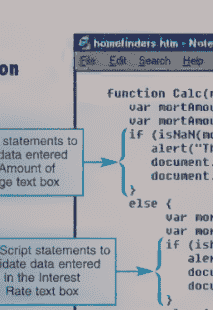

第二个 `Else` 语句显示如下（见图 2-28）。

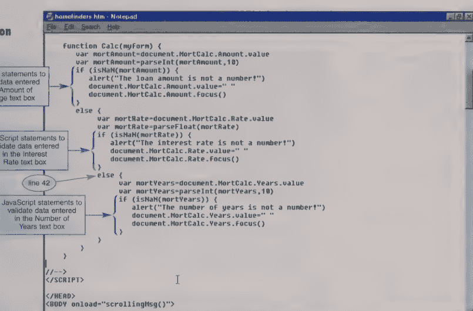

```javascript

function Calc(myform) {

    var mortAmount=document.MortCalc.value

    var mortAmount=parseInt(mortAmount,10)

    if (isNaN(mortAmount)) {

        alert('The loan amount is not a number!')

        document.MortCalc.value=""

        document.MortCalc.Focus()

    }

    else {

        var mortRate=document.MortCalc.Rate.value

        var mortRate=parseFloat(mortRate)

        if (isNaN(mortRate)) {


alert('The interest rate is not a number!')

document.MortCalc.Rate.value=""

document.MortCalc.focus()

} else {

var mortYears=document.MortCalc.Years.value

var mortYears=parseInt(mortYears,10)

if (isNaN(mortYears)) {

alert('The number of years is not a number!')

document.MortCalc.Years.value=""

document.MortCalc.Years.focus()

}

}

}

```

图 2-28

`If...Else` 语句允许你验证用户在“利率（百分比）”和“年限”框中输入的数据。由于你在该函数中还有两个文本框需要验证，你必须继续检查这些文本框。

## 确定每月还款额

Calc() 函数中的下一条语句调用了一个名为 `monthly()` 的用户定义函数，你将创建该函数来计算每月还款额。`monthly()` 函数要求在计算每月还款额之前，“贷款金额”（Amount of Mortgage）、“利率(%)”（Interest Rate as %）和“年限”（Number of Years）文本框中输入有效数据。一旦 `monthly()` 函数计算出每月还款额，它会将结果返回到“每月还款”文本框。

函数调用插入在第 52 行，位于 `Calc()` 函数的最后一个大括号之前。函数调用写法如下：

```javascript

document.MortCalc.value=monthly(mortAmount,mortRate,mortYears)

```

在此语句中，`MortCalc` 是函数名；`Payment` 是“每月还款”文本框的；`value` 是 `monthly()` 用户定义函数返回的值。变量 `mortAmount`、`mortRate` 和 `mortYears` 是在“贷款金额”、“利率(%)”和“年限”文本框中输入的值。

执行以下步骤输入函数调用，即可将所需的值传递给 `monthly()` 用户定义函数。

## 将值传递给 monthly() 用户定义函数

- 向上滚动到 HEAD 部分。
- 将光标点置于第 52 行。按 ENTER 键插入一个空行。
- 将光标点置于空行上。
- 插入点显示在空行上（2-31）。

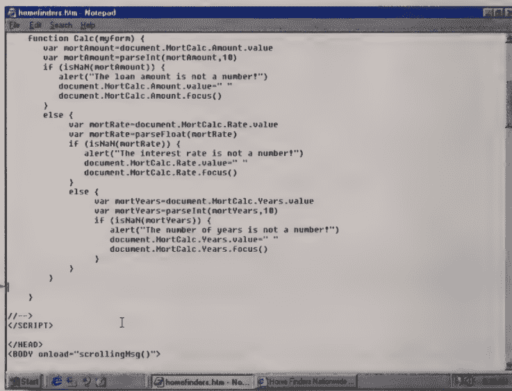

图 2-31

- 输入 `document.MortCalc.Payment.value=monthly(mortAmount,mortRate,mortYears)` 然后按 ENTER 键。

显示函数调用语句（见图 2-32）。

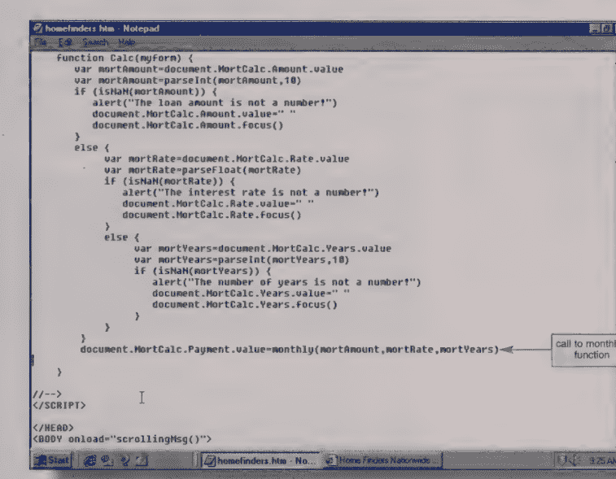

图 2-32

如果你此时测试该网页，将显示错误消息，因为你尚未在 HTML 文件中输入 `monthly()` 函数。

## 创建 monthly() 函数

`monthly()` 函数用于计算每月还款金额，它需要三个参数：贷款金额（`mortAmount`）、利率（`mortRate`）以及还款年限（`mortYears`）。上一组语句中的调用语句将三个变量——`mortAmount`、`mortRate` 和 `mortYears` 传递给 `monthly()` 函数。该函数的 JavaScript 代码如表 2-14 所示。

| LINE | CODE |
|---|---|
| 56 | function monthly(mortAmount,mortRate,mortYears) { |
| 57 | var Irate=mortRate/1200 |
| 58 | var Pmts=mortYears*12 |
| 59 | var Loan=mortAmount |
| 60 | return Loan * (Irate / (1 - (1 / Math.pow(1+Irate,Pmts)))) |
| 61 | |

## 项目 2 • 创建窗口、添加滚动消息和表单验证

你将在数学表达式或公式中使用验证后的值来计算每月还款额。计算每月还款额的公式位于第 60 行。JavaScript 不使用典型的编程符号来表示幂。要计算表达式 `(1 +Irate)`，JavaScript 使用 `Math` 对象的 `pow()` 方法。表 2-15 显示了 `pow()` 方法的一般形式。

## 关于 Math 对象方法

| 表 2-15 - Math.pow() 方法 |
|---|---|
| 一般形式: | pow(number, exponent) |
| 注释: | 将该值提升到指数值的幂。`pow()` 方法接受变量 (X, n)、常量 (2, 3) 或两者 (Sidelength, 2) |
| 示例: | Math.pow(2,3)<br>Math.pow(x,n)<br>Math.pow(sidelength,2) |

在公式执行之前，你必须转换值。在第 57 行中，必须将年利率转换为月利率。在第 58 行中，必须将年数转换为还款次数。为了转换月利率并将小数点向右移动，将年利率除以 1200 并将其存储在变量 `Irate` 中。为了转换总还款次数，将年数乘以 12 并存储在 `Pmts` 中。以下语句显示了如何转换利率和年数。为了防止 `mortAmount` 被意外更改，如第 59 行所示将其赋值给临时变量（`Loan`）。

`return` 语句（第 60 行）告诉函数将表达式的结果返回给调用函数。该值随后显示在“每月还款”文本中。执行以下步骤输入 `monthly()` 函数。

## 输入 monthly() 函数

- 1. 将光标点置于第 56 行，`//--` 标签上方。
- 2. 输入上一页表 2-14 所示的 JavaScript 代码并按回车键。

显示 `monthly()` 函数（见图 2-3）。

```javascript

document.Math.Calc.Focus();

else {

  var varYears=document.Math.Calc.value;

  var varPayments=document.Math.Calc.value;

  if (isNaN(varPayments)) {

    alert("The amount is not a number!");

  } else {

    document.MortCalc.value=monthly(mortAmount,mortRate,mortYears);

  }

  var Irate=mortRate/1200;

  var Pmts=mortYears*12;

  var Loan=mortAmount;

  return Loan * (Irate / (1 - (1 / Math.pow(1+Irate,Pmts))));

}

```

*(注：最后一个代码块的 OCR 文本严重碎片化/损坏；我已根据文中贷款公式的上下文和标准的 JavaScript 实践重新构建了逻辑流。)*


## 确定美元部分

`DollarFormat()` 函数初始化用于返回格式化值的变量，以及用于处理未格式化值的变量。大多数程序员认为，清空和初始化变量以确保数据有效性是一项良好的编程实践。表 2-17 显示了用于初始化变量的 JavaScript 代码。

第 64 行和第 63 行清除了用于组装格式化输出的变量。第 66 行中的 `indexOf` 方法返回一个表示小数点位置的数值 - 该值被存储在 `decodes` 变量中。`decodes` 的值指示在什么位置拼接小数。第 67 行和第 68 行测试 `decodes` 的值是否大于零。如果 `decodes` 的值为 0，则输入值（`valuein`）是一个整数。如果 `decodes` 的值为负数，则 `decis` 被设置为字符串的长度，如第 68 行所示。

执行以下步骤以进入 `DollarFormat()` 函数并初始化变量。

### 进入 DollarFormat() 函数

1. 将插入点置于第 63 行。
2. 输入如表 2-17 所示的 JavaScript 代码并按回车键。

`DollarFormat()` 函数和初始化变量的语句显示（图 2-36）。

| 表 2-17 |
| LINE | CODE |
|---|---|
| 63 | function dollarFormat(valuein) { |
| 64 | var dollarFormatStr="" |
| 65 | var dollarsOut="" |
| 66 | var decodes=valuein.indexOf(".") |
| 67 | if (decodes==-1) |
| 68 | decis=valuein.length } |

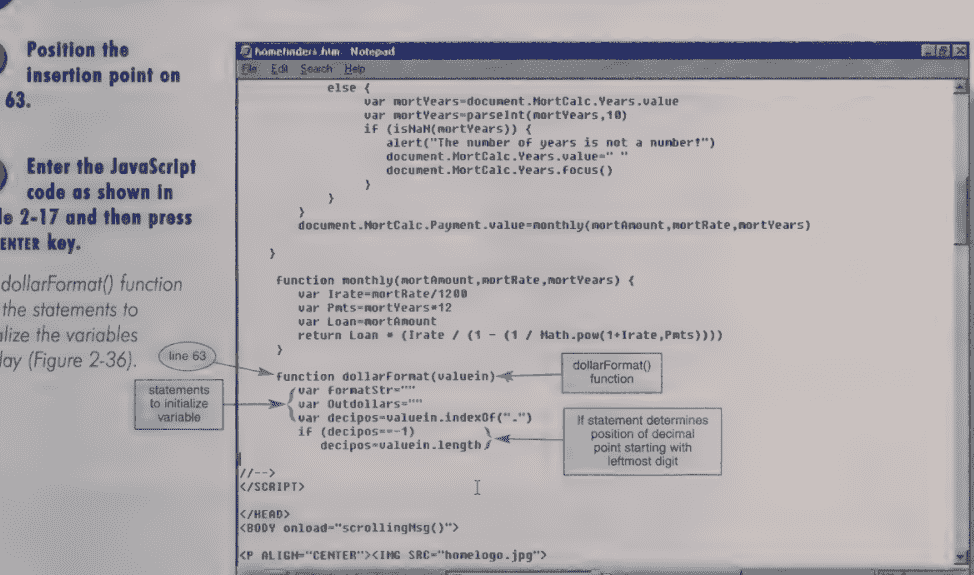

## 2.38 • 项目 2 • 创建弹出窗口、添加滚动消息和验证表单

前三个语句初始化了在格式化过程中临时存储数据的变量。`indexOf()` 方法确定了小数点的位置并将其存储在变量中。`If` 语句验证是否存在小数点；如果不存在，它将位置设置为字符串的长度。

接下来，你将输入语句来对大于三位的美元值进行逗号格式化。为了完成此任务，你将使用 `While` 循环。

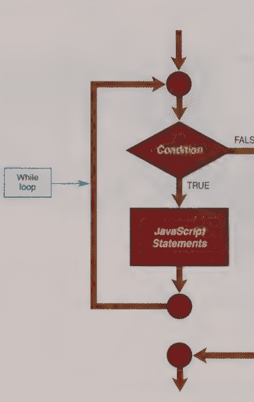

## 使用 For循环和 While循环

循环是一系列重复执行的语句，直到满足某个条件。JavaScript 有两种循环：`For` 循循环和 `While` 循环。`For` 循环和 `While` 循环都使用图 2-37 流程图所示的逻辑。两种循环都会首先测试条件以确定是否执行循环中的指令。

`For` 循环依赖于一个使用数值的条件语句，通常被称为计数控制循环。表 2-18 显示了 `For` 循环的通用形式。

图 2-37

| 表 2-18 - For Loop |
|---|---|
| 通用形式: | for (start; stop; counter-control) { JavaScript statements } |
| 注释: | 其中 start 是初始化为起始值的变量；stop 是表示循环终止条件的表达式；counter-control 是表示指示如何增加或减少计数器的表达式。用分号分隔这三个变量。 |
| 示例: | for (j=1; j<=5; j++) { for (ctr = 6; ctr < 0; ctr--) { for (item = 1; item<=100; item+=2) { } } | |

`While` 循环依赖于一个可以使用数值也可以使用字符串的条件语句。表 2-19 显示了 `While` 循环的通用形式。

| 表 2-19 - While Loop |
|---|---|
| 通用形式: | while (condition) { JavaScript statements } |
| 注释: | 其中 condition 是数值或字符串；当条件的结果为真时，执行 JavaScript 语句。 |
| 示例: | while (ctr < 6) { while (isNaN(temp)) { while (Response != "Done") { } } | |

## 提取美元部分并插入逗号

在此项目中，`While` 循环被用于格式化“每月还款”（Monthly Payment）值的美元部分。美元部分由小数点左侧的数字组成。如果抵押贷款还的美元部分超过三个数字，你需要插入逗号。要确定每月还款金额中美元部分有多少个数字，请使用 `If...Else` 语句。表 2-20 显示了用于确定美元值长度和逗号位置的 JavaScript 语句。

| LINE | CODE |
|---|-|
| 69 | var dollars=value.substring(0,decipos) |
| 70 | var dollar=dollars.length |
| 71 | if (dollar<3) { |
| 72 | while (dollar>0) { |
| 73 | tDollars=dollars.substring(dollar-3,dollar) |
| 74 | if (tDollars.length==3) { |
| 75 | Outdollars="+"+tDollars |
| 76 | dollar-=3 |
| 77 | } else { |
| 78 | Outdollars=tDollars+Outdollars |
| 79 | dollar=0 |
| 80 | } |
| 81 | } |
| 82 | if (Outdollars.substring(0, |
| 83 | dollars=Outdollars.substring(1) |
| 84 | else |
| 85 | dollars=Outdollars |
| 86 | } |

第 69 行的 `substring()` 方法使用 `decipos`（小数点位置）提取美元部分。接下来，第 70 行获取 `dollar` 的长度。第 71 行开始 `If` 语句。第 72 行到第 81 行使用 `While` 循环，当美元部分大于三个数字时插入逗号。第 73 行通过减去 3 提取三个数字。第 74 行检查 `tDollars` 的长度是否为 3；如果是，则第 75 行在 `Outdollars` 前加上 `+`，第 76 行将 `dollar` 减去 3；否则，第 78 行将 `tDollars` 拼接到 `Outdollars` 之前。第 79 行将 `dollar` 设为 0。第 82 行检查 `Outdollars` 的截取部分。第 86 行提取美元部分。

## 提取美元部分并插入逗号

1. 将插入点置于第 63 行。
2. 输入如表 2-17 所示的 JavaScript 代码并按回车键。

`DollarFormat()` 函数和初始化变量的语句显示（图 2-36）。

| 表 2-17 |
| LINE | CODE |
|---|---|
| 63 | function dollarFormat(valuein) { |
| 64 | var dollarFormatStr="" |
| 65 | var dollarsOut="" |
| 66 | var decodes=valuein.indexOf(".") |
| 67 | if (decodes==-1) |
| 68 | decis=valuein.length } |


## 2.38 • 项目 2 • 创建弹出窗口、添加滚动消息和验证表单

前三个语句初始化了在格式化过程中临时存储数据的变量。`indexOf()` 方法确定了小数点的位置并将其存储在变量中。`If` 语句验证是否存在小数点；如果不存在，它将位置设置为字符串的长度。

接下来，你将输入语句来对大于三位的美元值进行逗号格式化。为了完成此任务，你将使用 `While` 循环。


## 使用 For循环和 While循环

循环是一系列重复执行的语句，直到满足某个条件。JavaScript 有两种循环：`For` 循环和 `While` 循环。`For` 循环和 `While` 循环都使用图 2-37 流程图所示的逻辑。两种循环都会首先测试条件以确定是否执行循环中的指令。

`For` 循环依赖于一个使用数值的条件语句，通常被称为计数控制循环。表 2-18 显示了 `For` 循环的通用形式。

图 2-37

| 表 2-18 - For Loop |
|---|---|
| 通用形式: | for (start; stop; counter-control) { JavaScript statements } |
| 注释: | 其中 start 是初始化为起始值的变量；stop 是表示循环终止条件的表达式；counter-control 是表示指示如何增加或减少计数器的表达式。用分号分隔这三个变量。 |
| 示例: | for (j=1; j<=5; j++) { for (ctr = 6; ctr < 0; ctr--) { for (item = 1; item<=100; item+=2) { } } | |

`While` 循环依赖于一个可以使用数值也可以使用字符串的条件语句。表 2-19 显示了 `While` 循环的通用形式。

| 表 2-19 - While Loop |
|---|---|
| 通用形式: | while (condition) { JavaScript statements } |
| 注释: | 其中 condition 是数值或字符串；当条件的结果为真时，执行 JavaScript 语句。 |
| 示例: | while (ctr < 6) { while (isNaN(temp)) { while (Response != "Done") { } } | |

## 提取美元部分并插入逗号

在此项目中，`While` 循环被用于格式化“每月还款”（Monthly Payment）值的美元部分。美元部分由小数点左侧的数字组成。如果抵押贷款还的美元部分超过三个数字，你需要插入逗号。要确定每月还款金额中美元部分有多少个数字，请使用 `If...Else` 语句。表 2-20 显示了用于确定美元值长度和逗号位置的 JavaScript 语句。

| LINE | CODE |
|---|-|
| 69 | var dollars=value.substring(0,decipos) |
| 70 | var dollar=dollars.length |
| 71 | if (dollar<3) { |
| 72 | while (dollar>0) { |
| 73 | tDollars=dollars.substring(dollar-3,dollar) |
| 74 | if (tDollars.length==3) { |
| 75 | Outdollars="+"+tDollars |
| 76 | dollar-=3 |
| 77 | } else { |
| 78 | Outdollars=tDollars+Outdollars |
| 79 | dollar=0 |
| 80 | } |
| 81 | } |
| 82 | if (Outdollars.substring(0, |
| 83 | dollars=Outdollars.substring(1) |
| 84 | else |
| 85 | dollars=Outdollars |
| 86 | } |

第 69 行的 `substring()` 方法使用 `decipos`（小数点位置）提取美元部分。接下来，第 70 行获取 `dollar` 的长度。第 71 行开始 `If` 语句。第 72 行到第 81 行使用 `While` 循环，当美元部分大于三个数字时插入逗号。第 73 行通过减去 3 提取三个数字。第 74 行检查 `tDollars` 的长度是否为 3；如果是，则第 75 行在 `Outdollars` 前加上 `+`，第 76 行将 `dollar` 减去 3；否则，第 78 行将 `tDollars` 拼接到 `Outdollars` 之前。第 79 行将 `dollar` 设为 0。第 82 行检查 `Outdollars` 的截取部分。第 86 行提取美元部分。

## 提取美元部分并插入逗号

1. 将插入点置于第 63 行。
2. 输入如表 2-17 所示的 JavaScript 代码并按回车键。

`DollarFormat()` 函数和初始化变量的语句显示（图 2-36）。

| 表 2-17 |
| LINE | CODE |
|---|---|
| 63 | function dollarFormat(valuein) { |
| 64 | var dollarFormatStr="" |
| 65 | var dollarsOut="" |
| 66 | var decodes=valuein.indexOf(".") |
| 67 | if (decodes==-1) |
| 68 | decis=valuein.length } |


## 提取美元部分并插入逗号

将插入点置于第 69 行，语句的正下方。输入如表 2-20 所示的 JavaScript 代码并按回车键。

代码显示（图 2-38）。


## 重构格式化输出并返回格式化值

接下来，你必须编写 JavaScript 语句来重构（拼接）格式化的美元和分值为付款金额，将该付款金额存储在 `formatStr` 变量中，并返回 `formatStr` 值。表 2-22 显示了实现此功能所需的语句。

当你按照表 2-22 所示输入 JavaScript 代码时，请确保在第 90 行的引号之前放置一个点，因为这代表小数点。此外，确保不要忘记最后的大括号（第 92 行）。执行以下步骤重构格式化输出并返回格式化值。

| 表 2-22 |
| LINE | CODE |
| --- | --- |
| 90 | var formatStr="$ |

### 如何重构格式化输出并返回格式化值

- 1. 将插入点置于第 90 行。
- 2. 如表 2-22 所示输入 JavaScript 代码。

代码显示所示（图 2-40）。

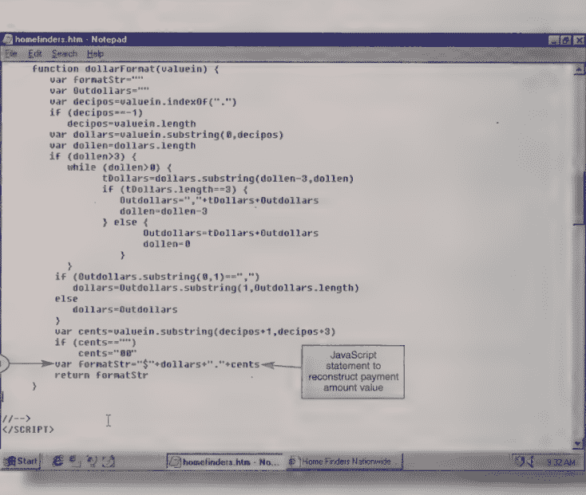

JavaScript 语句向变量 `formatStr` 添加了美元符号和小数点，并货币格式显示每月付款金额。

## 将每月付款值传递给 dollarFormat() 函数

要将每月付款值传递给函数，你必须先调用 `dollarFormat()` 函数。调用 `dollarFormat()` 的 JavaScript 语句与调用 `monthly()` 函数的通用形式相同（见第 2.33 页的图 2-32）。执行以下步骤输入所需的 JavaScript 语句，将每月付款作为字符串传递给 `dollarFormat()` 函数。

### 如何将每月付款值传递给 dollarFormat() 函数

- 将插入点置于第 53 行（图 2-41）。

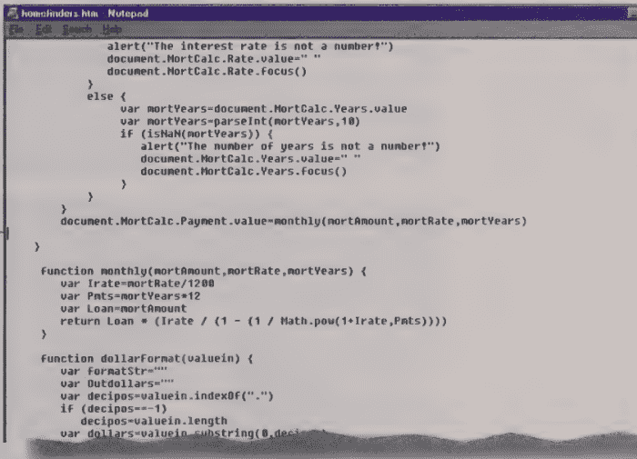

图 2-41

- 输入 `document.MortCalc.Payment.value=dollarFormat(document.MortCalc.Payment.value)` 作为语句。

该语句直接显示在关闭大括号之前调用 `monthly()` 函数的语句下方（图 2-42）。

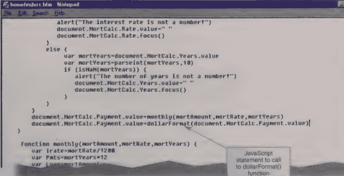

图 2-42

## 2.44 • 项目 2 • 创建弹出窗口、添加滚动消息和验证表单

此语句将未格式化的每月结果作为字符串对象传递给 `dollarFormat()` 函数，由该函数对结果进行格式化。最后，结果将在“每月付款”文本框中以货币格式显示，带有美元符号和两位小数。

在继续之前，你应该双检代码中的拼写、特殊字符和引号。后续步骤是保存文件并测试 Web 页面。

## 保存并测试网页

- 1. 将你的 JavaScript 数据磁盘放在 A 驱动器中，点击菜单栏上的“文件”，然后点击文件菜单上的“保存”。
- 2. 点击任务栏上的浏览器按钮。
- 3. 点击浏览器工具栏上的“刷新”按钮。
- 4. 在文本框中输入相同的测试数据：贷款金额 – 69000；利率（%） = 7.9；以及年限 – 30。
- 5. 点击“计算”按钮。

格式化后的结果以货币格式显示，如 $501.49（图 2-43）。

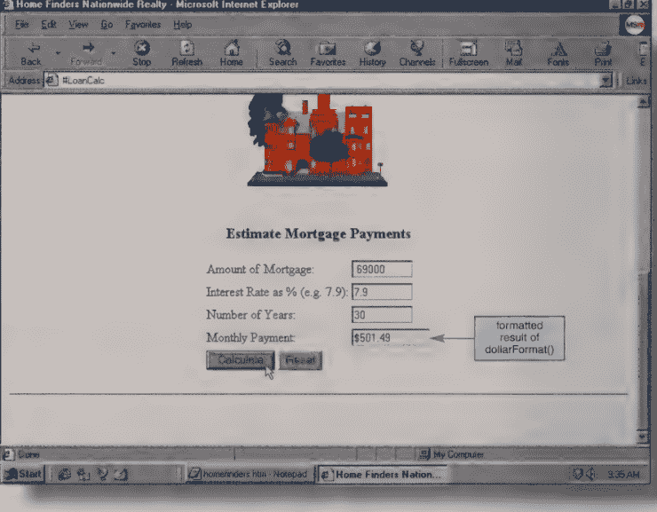

图 2-43

如果你的浏览器没有正确显示网页，请关闭任何错误消息并点击任务栏上的“记事本”按钮。对照第 2.37 页至 2.42 页的图 2-36 至 2-42 检查你的 JavaScript 代码。修正错误并保存文件。激活浏览器然后点击“刷新”按钮。

## 添加弹出窗口

回项目 1，在 Web 页面上显示消息的方法是使用 alert 和 confirm 消息框。然而，这些消息框仅在灰色背景上显示文本。为了创建更具视觉趣味的消息，你可以使用 JavaScript 在单独窗口中打开另一个 HTML 文件，该窗口可以显示颜色、图形、动画和其他媒体。这种窗口被称为弹出窗口，因为它显示在之前打开的浏览器之上。

要创建弹出窗口，你使用 `open()` 方法。表 2-3 显示了 `open()` 方法的通用形式。表 2-4 描述了最常用的弹出窗口功能。

| 表 2-3 - open() 方法 |
|---| |---|
| 通用形式： | `var windowname=open("window fileURL", "object name", "window features")` |
| 注释： | 其中 windowname 是窗口对象的可选名称（仅当需要在任何其他 Web 页面中引用弹出窗口时才需要）；file name 是 HTML 文件的名称；window features 描述窗口应如何显示 |
| 示例： | `open("Adwin.htm", "Adwin", "resize-off, titlebar-false")` |

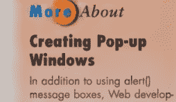

| 表 2-4 |
| --- | --- | --- |
| 功能 | 描述 | 示例 |
| LOCATION | 包含 URL  | "location" |
| MENUBAR | 包含菜栏 | "menubar" |
| RESIZE | 允许用户调整大小 | "resize-off" 默认开启；如果是，弹出窗口为固定大小 |
| SCROLLBAR | 包含滚动条 | "scrollbars" |
| STATUS | 包含状态栏 | "status" |
| TITLEBAR | 移除标题栏 | "titlebar-false" 默认开启 |
| TOOLBAR | 包含工具栏 | "toolbar" |
| WIDTH | 指定宽度（像素） | "width-220" 被 innerWidth/Width 替换 |
| HEIGHT | 指定高度（像素） | "height-400" 被 innerHeight/Height 替换 |

添加弹出窗口语句时，你应该将所有的弹出窗口功能包含在引号内。在本项目中，例如，要在弹出窗口打开 notice.htm：

```javascript

open("notice.htm","noticeWin", "width-400,height-400")

```

JavaScript 语句向变量 `formatStr` 添加了美元符号和小数点，并货币格式显示每月付款金额。

## 使用 open() 方法打开弹出窗口

- 将插入点置于第 94 行（图 2-44）。

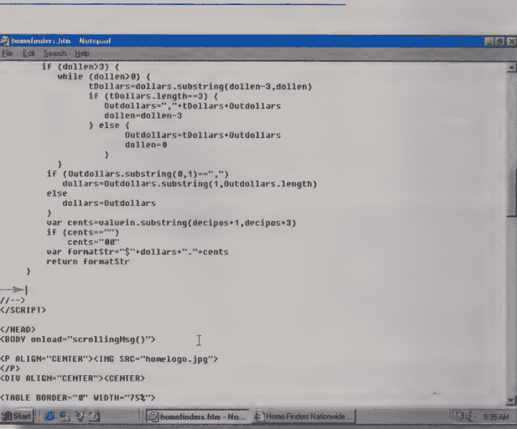

图 2-44

- 输入 `open ("noticeWin","width-400,height-220")` 然后按回车键。

该语句将在页面加载时立即执行（图 2-45）。

## 添加最后修改日期

在 Fun with Phonics Web 项目 1 中，你希望在 Home Finds Nationwide Realty Web 页面底部显示文件的最后修改日期。为了将消息放在页面底部，你需要添加一个完整的 JavaScript 区。输入显示文件最后修改日期的 JavaScript 代码，执行以下操作。

### 显示修改日期

- 将插入点置于第 171 行，即 `</body>` 标签正方的行。
- 输入 `<SCRIPT LANGUAGE="JAVASCRIPT">` 然后按回车键。
- 输入 `<!--` 对旧浏览器隐藏并按回车键。
- 输入 `document.write("<CENTER><FONT COLOR="Maroon"><H5>This document was last modified "document.lastModified"</H5></FONT></CENTER>")"`
- 输入 `-->` 然后按回车键。
- 输入 `<SCRIPT>` 然后按回车键。

这完成了 JavaScript 区。H5 标签使字体较小，这样消息就不会显得突眼（图 2-47）。


# 保存并测试完成的网页 

在继续之前，您应该双击代码中的拼写、特殊字符和引号。接下来的步骤是保存您的文件并测试该网页。

## 如何保存和测试网页

1. 当您的 JavaScript 数据磁盘位于 A 盘时，点击菜单栏上的“文件”（File），并点击“文件”菜单中的“保存”（Save）。
2. 点击任务栏上的浏览器按钮。
3. 点击浏览器工具栏上的“刷新”按钮。
4. 点击“关闭窗口”以关闭弹出窗口。
5. 点击“关闭”按钮关闭浏览器窗口。

弹出窗口将显示。如有必要，向下滚动以验证最后一行是否显示页面已修改（以及文件保存到磁盘上的时间）（图 2-48）。

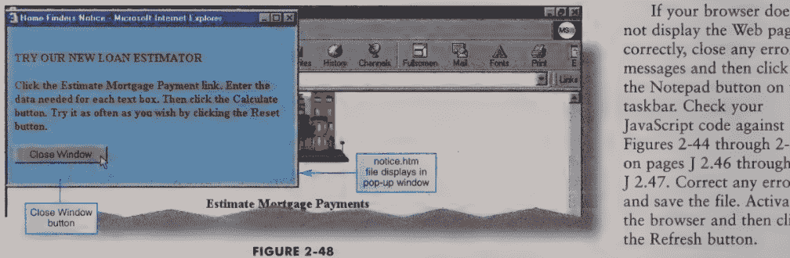

**图 2-48**

## 使用记事本打印 HTML 文件

在您完成并测试了网页之后，您可能想要将其打印出来。您可以使用记事本打印 HTML 文件。按照以下步骤打印 homefinders.html 记事本文件。

## 使用记事本打印 HTML 文件

1. 如必要，点击任务栏上的“记事本”按钮以激活记事本窗口。
2. 点击“文件”菜单上的“打印”（Print）。

记事本打印对话框将短暂显示，并带有提示 homefinders.html 文件正在打印的消息。文件发送打印机后，对话框将关闭。带有 JavaScript 代码的 HTML 文件将打印出来（图 2-49）。

## homefinders.htm

```html

<P ALIGN="CENTER">

<BR>

<A NAME="LoanCal"></P>

<a></a>

<H3 ALIGN="CENTER">估计贷款还款</H3>

<CENTER>

<FORM NAME="MortgageCal">

<TR>

<TD>

<label>Amount of Mortgage</label>

</TD>

<td><input type="text" Name="Amount" value="0"></td>

</TR>

<TR>

<TD>

<label>Interest Rate</label>

</TD>

<td><input type="text" Name="Rate" value="0"></td>

</TR>

<TR>

<TD>

<label>Term (Years)</label>

</TD>

<td><input type="text" Name="Term" value="30"></td>

</TR>

<TR>

<TD colspan="2">

<input type="button" value="Calculate">

</TD>

</TR>

</FORM>

</CENTER>

<SCRIPT>

var dollars=document.getElementById('Amount').value;

var rate=document.getElementById('Rate').value;

var years=document.getElementById('Term').value;

open("Note.htm","noticeWin","WIDTH=400,HEIGHT=220");

</SCRIPT>

<BODY onload="center(document.images['homefinders.jpg'])">

<P ALIGN="CENTER"><<h1>homefinders</h1></P>

<P ALIGN="CENTER">

<table>

<tr>

<td>...此页面已被新版本替换。</td>

</tr>

</table>

<script>

function calculatePayment() {

var principal = parseFloat(dollars);

var interest = parseFloat(rate)/100/12;

var months = parseFloat(years)*12;

var payment = (principal*interest)/(1-Math.pow(1+interest,-months));

return payment.toFixed(2);

}

</script>

```

## homefinders.htm

```javascript

center="00"

var dollars=document.getElementById('Amount').value;

return formatDoc;

```

## homefinders.htm

```javascript

alert("The count of years is not a number!");

alert("Mortgage Rate value invalid!");

document MortCal.focus();

```

```javascript

document.MortCal.Payment.value=monthly(amount,rate,years);

document.MortCal.Payment.value=format(document.MortCal.Payment.value);

```

```javascript

function monthly(amount,rate,years) {

var principal = parseFloat(amount);

var interest = parseFloat(rate)/100/12;

var months = parseFloat(years)*12;

var payment = (principal*interest)/(1-Math.pow(1+interest,-months));

return payment.toFixed(2);

}

```

## homefinders.htm

```html

<HEAD>

<TITLE>Home Finders</TITLE>

<SCRIPT>

function sizeDiv() {

var div = document.getElementById('div');

div.style.display = 'block';

var width = div.offsetWidth;

div.style.display = 'none';

document.body.style.width = width + 'px';

}

window.onload=sizeDiv;

window.onresize=setTimeout(sizeDiv,100);

</script>

<<body>

<h1>Home Finders</h1>

<p>在此处获取贷款!</p>

<form name="Mortgage">

<label>Amount of Mortgage</label>

<input type="text" name="Amount">

<label>Interest Rate</label>

<input type="text" name="Rate">

<label>Term (Years)</label>

<input type="text" name="Term">

<input type="button" value="Calculate" onclick="calculatePayment()">

</form>

<script>

function calculatePayment() {

var amount = document.Mortgage.Amount.value;

var rate = document.Mortgage.Rate.value;

var years = document.Mortgage.Term.value;

if (isNaN(amount)) {

alert("The loan amount is not a number!");

document.Mortgage.focus();

} else if (isNaN(rate)) {

alert("The mortgage rate is not a number!");

document.Mortgage.focus();

} else if (isNaN(years)) {

alert("The term is not a number!");

document.Mortgage.focus();

} else {

var payment = monthly(amount,rate,years);

document.Mortgage.Payment.value = payment;

}

</script>

</body>

```

```javascript

function monthly(amount,rate,years) {

var principal = parseFloat(amount);

var interest = parseFloat(rate)/100/12;

var months = parseFloat(years)*12;

var payment = (principal*interest)/(1-Math.pow(1+interest,-months));

return payment.toFixed(2);

}

```

```javascript

function MortCal() {

var amount = document.Mortgage.Amount.value;

var rate = document.Mortgage.Rate.value;

var years = document.Mortgage.Term.value;

if (isNaN(amount)) {

alert("The loan amount is not a number!");

document.Mortgage.focus();

} else if (isNaN(rate)) {

alert("The mortgage rate is not a number!");

document.Mortgage.focus();

} else if (isNaN(years)) {

alert("The term is not a number!");

document.Mortgage.focus();

} else {

var payment = monthly(amount,rate,years);

document.Mortgage.Payment.value = payment;

}

```

图 2-49

## 项目总结

在此项目中，您创建了一个网页，允许 Home Finders 根据贷款金额、利率和年限计算每月还款。您通过输入框验证数据，并使用 `monthly` 函数计算结果。

在创建弹出窗口时，您学习了使用 `open()` 方法打开窗口，并设置了窗口的属性。此外，您还使用了在项目 1 中学习的 JavaScript 命令编写 `scrollingMsg` 自定函数，在输入框中显示消息。您还学习了使用 `substring()` 方法来提取字符串。

最后，您保存了修改后的显示数据，并在浏览器中测试了网页。

# 您应该掌握的内容

完成此项目后，您现在应该能够执行任务：

- 添加 `setMethod()` 创建递归函数 `Calc`（J 2.16）
- 创建表单文本框显示滚动消息（J 2.9）
- 创建 `scrollingMsg()` 自定义函数（J 2.11）
- 显示最后修改（J 2.47）
- 输入 `Calc()` 自定义函数（J 2.27）
- 输入 `if` 语句（J 2.14）
- 输入 `dollarFormat()` 函数（J 2.37）
- 输入 `doMort()` 函数（J 2.22）
- 输入嵌套 `if...else` 语句的部（J 2.28）
- 使用 `onclick` 事件处理器调用 `Calc()`（J 2.30）
- 输入 `monthly()` 函数（J 2.34）
- 使用事件处理器调用 `scrollingMsg()`（J 2.17）
- 使用 `open()` 方法打开弹出窗口（J 2.46）
- 提取分部分并定义小数金额（J 2.41）
- 提取输出的整数并插入逗号（J 2.40）
- 在锚标签中插入事件处理器（J 2.20）
- 将每月还款值传递给 `dollarFormat()` 函数（J 2.43）
- 将值传递给自定义函数（J 2.32）


## 测试你的知识

## 1 判断对错

说明：如果陈述正确请圈 T，如果陈述错误请圈 F。

- T F 1. 微软的 MARQUEE HTML 标签在其他浏览器中也有效。
- T F 2. 滚动消息四个基本组成部分：消息、位置、显示对象和延迟。
- T F 3. 给文本框赋值一个值（如滚动消息）时，必须同时为表单和文本框命名。
- T F 4. 网页开发者认为状态栏是滚动消息的最佳位置。
- T F 5. 条件是一个求值为真或否的表达式。
- T F 6. 递归是一种编程技术，用于让函数从内部调用另一个函数。
- T F 7. 当 JavaScript 语句自动将插入点定位在文本框中时，该文本框被认为处于“获得焦点 (onfocus)”。
- T F 8. `parseInt()` 方法有两个属性：字符串值和基数（base）。
- T F 9. `Math.pow()` 方法返回平方根的指数幂。
- T F 10. `indexOf()` 方法用于在字符串中搜索特定字符，并返回该字符在字符串中的相对位置。

## 2 多选题

说明：圈出正确答案。

- 1. 下列哪不是滚动消息的基本组成部分？
  a. 消息
  b. 位置
  c. 窗口对象
  d. 时间延迟
- 2. 程序员将注意力放在某个对象上称为 _____
  a. 设置焦点 (setting the focus)
  b. 赋予焦点 (giving the focus)
  c. 失去焦点 (losing the focus)
  d. 焦点外 (out of focus)
- 3. 在 If 语句中，_____ 放在单词 If 直接后的括号内。
  a. 函数
  b. JavaScript 命令
  c. 条件
  d. 事件处理器

## 多选题（继续）

- 4. 在 JavaScript 中，哪个符号代表操作符“等于”？
  a. =
  b. !=
  c. =
  d. ==
- 5. 哪个事件处理器在用户点击关联的按钮或链接时执行操作？
  a. onclick
  b. onsubmit
  c. onmouseover
  d. onload
- 6. 哪个事件处理器在文档加载时执行操作？
  a. onclick
  b. onload
  c. onsubmit
  d. onfocus
- 7. 在 If...Else 语句中，如果条件为真，将执行哪些语句？
  a. 条件之后的语句
  b. else 之后的语句
  c. 两个语句都执行
  d. 两个都不执行；控制权传递给最后一个语句之后的任何语句
- 8. 内置函数 `parseFloat()` 返回一个 ________ 的数字。
  a. 整数
  b. 浮点数
  c. 绝对值
  d. 负数
- 9. `pow()` 方法执行数学 ________。
  a. 指数
  b. 平方根
  c. 四舍五入
  d. 字符串转换
- 10. 在 open() 窗口方法中，哪个窗口特征包含 URL 栏？
  a. 状态 (status)
  b. 标题栏 (title bar)
  c. 工具栏 (toolbar)
  d. 位置 (location)

## 测试你的知识

## 3 理解事件处理器

**说明：** 在空格处填写缺失的对象名称或事件处理器名称。

| 对象 (OBJECT) | 事件处理器 (EVENT HANDLER) |
| :--- | :--- |
| ________ | onclick |
| form | ________, onload, unload |
| hyperlink | onclick, ________, onmouseover |
| input box | onload, onabort, ________ |
| submit button | onblur, ________, onblur, focus |

## 4 理解代码语句

**说明：** 仔细阅读以下每个描述。编写 JavaScript 代码语句来完成这些特定任务。将你的答案记录在单独的纸上。对答案进行编号以与代码描述对应。

- 1. 给定以下表单，编写 JavaScript 语句为 Email 文本框设置焦点。
```html

<FORM Name="Form">

<INPUT Type="text" Name="Billinghours" value="">

<INPUT Type="text" Name="Email" value="">

</FORM>

```
- 2. 使用与第 1 题相同的代码，编写 JavaScript 语句将 Email 文本框赋值给名为 TempEmail 的变量。
- 3. 使用与第 1 题相同的代码，编写 JavaScript 语句将 BillingHours 文本框赋值给一个变量并转换为浮点数。
- 4. 给定以下赋值语句：`var tempString="Test#12,Fall1999";` 编写 JavaScript 语句提取逗号前的日期并存储在 tempTest 中，提取逗号后的数据并存储在 tempDate 中。
- 5. 给定以下几何公式，编写等效的 JavaScript 语句
`area = s²`
`area = πr²`

## 使用帮助

## 1 探索在线文档

**说明：** 启动浏览器。在地址文本框中输入：www.scsite.com/js/p2.htm，然后点击 Project 2 Use Help 1。使用该网站回答以下问题。

- 1. 点击左侧框架中的第 9 章事件与事件处理器 (Events and Event Handlers)。阅读事件处理器并回答以下问题：描述 onboard、onkeydown 和 onmouseover 事件处理器。
- 2. 点击左侧框架中的第 2 章捕获事件处理器 (Capturing Event Handlers)。阅读关于捕获事件的内容并回答以下问题：
  a. 捕获事件意味着什么？
  b. 捕获事件的步骤是什么？
- 3. 返回 Project 2 Use Help 1 网页。点击常见问题解答 (Frequently Asked Questions)。向下滚动页面找到 2.4、2.5、4.6、4.9 和 4.10 节，然后回答问题：
  a. 如何使用不同的 substring 函数提取字符串的一部分？
  b. 如何将数字保留到特定的小数位数？
  c. 为什么调用 window.open() 不显示指定的窗口类型和大小？
  d. 如何使用 JavaScript 创建模态窗口（无法最小化的窗口）？
  e. 如何使用 window.open() 控制新窗口的位置？
  f. 如何在不提示的情况下关闭窗口？
## 2 探索指向的链接

**说明：** 启动浏览器。在地址文本框中输入：www.scsite.com/js/p2.htm，然后点击 Project 2 Use Help 1。执行以下操作。

- 1. 点击左侧框架中的第 9 章事件与事件处理器 (Events and Event Handlers)。阅读事件处理器并回答以下：描述 onboard、onkeydown 和 onmouseover 事件处理器。
- 2. 点击左侧框架中的第 2 章捕获事件处理器 (Capturing Event Handlers)。阅读关于捕获事件的内容并回答以下问题：
  a. 捕获事件意味着什么？
  b. 捕获事件的步骤是什么？
- 3. 返回 Project 2 Use Help 1 网页。点击常见问题解答 (Frequently Asked Questions)。向下滚动页面找到 2.4、2.5、4.6、4.9 和 4.10 节，然后回答问题：
  a. 如何使用不同的 substring 函数提取字符串的一部分？
  b. 如何将数字保留到特定的小数位数？
  c. 为什么调用 window.open() 不显示指定的窗口类型和大小？
  d. 如何使用 JavaScript 创建模态窗口（无法最小化的窗口）？
  e. 如何使用 window.open() 控制新窗口的位置？
  f. 如何在不提示的情况下关闭窗口？
- 4. 点击微软的 Marquee 标签。阅读 MARQUEE 标签。返回网页。
- 5. 点击第 3 章语句 (Statements)。阅读 If...Else 语句。返回网页。
- 6. 点击第 4 章循环 (Loops)。阅读 While 语句。返回网页。
- 7. 点击第 4 章 Math。阅读 pow()。返回网页。
- 8. 点击第 13 章全局函数 (Global Functions)。阅读 isNaN()、parseInt() 和 parseFloat()。返回网页。
- 9. 点击第 7 章表单 (Forms)。阅读表单。返回网页。
- 10. 点击第 3 章语句 (Statements)。阅读 IF-THEN 语句。返回网页。
- 11. 点击第 4 章循环和文本方法 (Text methods)。阅读。返回网页。

## 应用知识

## 验证简单表单

**说明：** 启动记事本。打开 Data Disk 上的网页。如果你没有下载 Data Disk，请查看封底背面的 JavaScript 指南或咨询你的教师。此网页包含三个文本框和一个文本区域（图 2-50）。验证客户姓名和位置的 JavaScript 代码已经输入。你需要编写 JavaScript 代码来验证在 Email Address 框中输入的电子邮件。在适当的地方对代码进行缩进。执行以下任务。

- 1. 在 HEAD 部分找到 JavaScript 标签和 validate() 函数。在注释 // validate the e-mail 之后放置插入点。
- 2. 输入 var RegExpMail=document.Register.eEmail.value
- 3. 使用 indexOf(Object) 函数判断电子邮件地址是否包含 @ 符号。var atSign=RegExpMail.indexOf("@");
- 4. 输入 if (RegExpMail === "" || atSign == -1) (
- 5. 在 If 语句下输入以下 JavaScript 语句，并适当缩进：
```javascript

alert("Please enter your e-mail address")

document.Register.eEmail.value=""

document.Register.eEmail.focus();

```
- 6. 将 HTML 文件保存为 Data Disk  a:midwestsolution.htm。
- 7. 启动浏览器。打开 a:midwestsolution.htm 网页测试你的 JavaScript 代码。如果发生任何错误，激活记事本并双检步骤 1 到 6，然后测试并重复。如果没有错误，打印网页，并激活记事本打印 HTML 文件。将打印件交给你的教师。

图 2-50


## 2.56 • 项目 2 • 创建弹出式滚动消息与表单验证


## 1 计算滑雪场的风寒指数

**问题：** 你在松峰滑雪木屋（Pine Peaks Ski Lodge）担任网站管理员的助理，这是一份暑工作。网站管理员 Marian Shilling 要求你创建一个网页，让游客和访问者能够计算风寒指数。由于数据不是直接输入计算机的，用户必须以图 2-51 所示的方式输入温度和风速。然后，你需要验证输入的数据是否为数字，以便用于风寒转换公式。

**指令：** 启动你的浏览器和记事本（Notepad）。使用记事本打开来自 JavaScript 数据盘的 `pinepeaks.htm` 文件。如果你没有下载数据盘，请参阅封底关于下载 JavaScript 数据盘的说明或咨询你的讲师。编写一个函数 `windChill()`，该函数从用户处获取室外温度和风速，并通过执行以下任务显示估计的风寒指数。

- 1. 在 HEAD 中找到 `SCRIPT` 标签。将插入点置于第 6 行。
- 2. 输入以下代码，并在适当的位置对代码行进行缩进：

```javascript

function windChill(myForm) {

  var Temp=document.Chill.OutTemp.value

  var Temp=parseInt(Temp,10)

```

- 3. 验证 `Temp` 是否为数字。如果 `Temp` 不是数字，语句将显示消息，清空 `OutTemp` 文本框并将焦点置于 `OutTemp` 文本框。

- 4. 将插入点置于第 8 行，输入以下代码测试 `Temp` 并处理真条件：

```javascript

if (isNaN(Temp)) {

  alert("Enter the outdoor temperature")

  document.Chill.OutTemp.value=""

  document.Chill.OutTemp.focus()

} else {

```


图 2-51

## 在实验室中

- 5. 将插入点置于第 13 行，输入以下代码以验证输入的风速值：
var Wind=document.Chill.windSpeed.value
var Wind=parseInt(Wind,10)
if (isNaN(Wind)) {
	alert("Enter the average wind speed")
	document.Chill.windSpeed.value=""
	document.Chill.windSpeed.focus()

} else {

- 6. 将插入点置于第 20 行，输入以下代码使用公式 `Temp-(1.5 * Wind)` 计算风寒温度，并将结果赋值给风寒文本框。
windChillTemp=Temp-(1.5 * Wind)
document.Chill.WindChill.value=windChillTemp

}
}

- 7. 找到“How Cold”按钮的 `INPUT` 标签。插入 `onclick` 事件处理程序以调用 `windChill()` 函数。

- 8. 使用文件名 `pineapacksolution.html` 保存 HTML 文件以测试你的 JavaScript 代码。使用以下测试数据：温度 22，风速 7。结果 11.5 应显示在风寒文本框中。

- 9. 如果发生任何错误，双检步骤 2 到 6 并再次测试。如果没有发生错误，打印该网页，激活记事本并打印 HTML 文件。将打印件交给你的讲师。

## 2 计算百分比并将结果格式化为百分比

**问题：** 你在三县社区医院（Tri-County Community Hospital）的在线开发小组兼职。营养师 Tasha Barnes 要求你开发一个“营养成分表”网页，允用户输入某一餐食物的脂肪克数和总卡路里数。你的网页仅根据脂肪计算卡路里数及其占总数的百分比。结果显示在文本框中。营养师要求将脂肪卡路里的百分比以数值形式显示，而不是小数形式（图 2-52）。

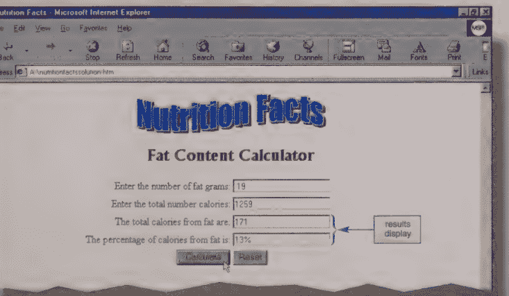

## 计算百分比并将结果格式化为百分比（续）

**指令：** 启动你的浏览器和记事本。使用记事本打开位于 JavaScript 数据盘上的 `nutritionfacts.htm` 文件。执行以下任务。

- 1. 在 HEAD 中找到 JavaScript 部分以及位于第 24 行的注释 `// calculate fat calories`。将插入点直接置于第一个斜杠下方。
- 2. 通过输入 JavaScript 代码完成用户自定义函数 `FatCal()`。该 JavaScript 代码计算总卡路里，将 `TotalFatCal` 赋值给文本框，计算脂肪百分比，并将结果格式化为以百分比形式显示。
- 3. 在 `// calculate percentage of fat` 之后、闭合括号之前输入以下内容。
- 4. 编写一个名为 `makePerc` 的函数，将 `FatPerc` 文本框中的结果格式化为百分比。插入点置于第 32 行注释 `// Start makePerc function here` 之后，输入以下代码：

```javascript

var TotFatCal = FatGrams * 9

document.Fat.Total.value = TotalFat // // comment and before the closing brace.

```

```javascript

var TotalFatPerc = TotalFatCal/FatNum

var FatPerc = new String(TotalFatPerc)

document.FatPerc.value = makePerc(TotalFatPerc)

```

```javascript

function makePerc(TotalFatPerc) {

var value = TotalFatPerc

strPerc = ""

decimal = value.indexOf(".")

Percent = value.substring(0,1)+"%"

}

```

- 5. 找到计算按钮的 `INPUT` 标签。插入 `onclick` 事件处理程序以调用 `FatCal()` 函数。
- 6. 使用文件名 `nutritionfactsolution.html` 保存 HTML 文件。
- 7. 激活浏览器。打开 `nutritionfacts.htm` 网页以测试你的 JavaScript 代码。使用以下测试数据：脂肪 19，总卡路里 125。结果为 17%。如果发生任何错误，双检步骤 2 到 6 并再次测试。

## 2.58 • 项目 2 • 创建弹出窗口、添加滚动消息与表单验证


## 计算退休储蓄

**问题：** 你在三星（Tri Star）担任实习生。网站管理员 Jennifer Casey 希望开发一个网页来计算：在给定的利率下，个人在多少年内储蓄多少资金可以获得特定金额？Jennifer 的想法是客户可以使用页面输入距离退休的年数、预期利率和目标。她希望创建一个验证每个文本框并以货币格式显示结果的表单。此外，当你打开网页时，弹出窗口会显示广告消息（图 2-53）。

**指令：** 启动你的浏览器和记事本。使用记事本打开 `tristar.htm`。

## 在实验室中

- 1. 找到表单和文本框名称。
- 2. 使用提供的表单和文本框名称，使用本项目描述的技术验证年数、利率和目标。
- 3. 编写一个函数来确定每月投资，使用公式 `monthly = goal * rate / (1 - (1 + rate))^depos`，其中 goal 是退休目标，rate 是年利率，depos 是每月次数。以百分比输入利率并使用以下公式 `rate = rate/1200` 转换为每月。
- 4. 将目标、年数和利率传递给此函数。
- 5. 编写一个将结果格式化为货币的函数，以本项目开发的函数为指南。
- 6. 添加 JavaScript 语句，当三星网页打开时，将 JavaScript 数据盘上的 `tristar.htm` 作为弹出窗口打开。
- 7. 使用文件名 `trisartolution.html` 保存 HTML 文件。
- 8. 激活浏览器。打开 `trisartolution.html` 文件以测试你的 JavaScript 代码。使用图 2-53b 显示的数据。
- 9. 如果发生任何错误，双检步骤 1 到 6 并再次测试。检查变量名是否匹配，是否缺少引号、括号或大括号。如果没有发生错误，打印网页，激活记事本并打印 HTML 文件。将打印件交给你的讲师。

投资策略页面

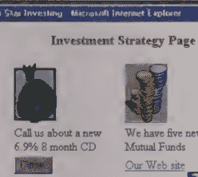

To Star Investing - Microsoft Explorer

图 2-53a

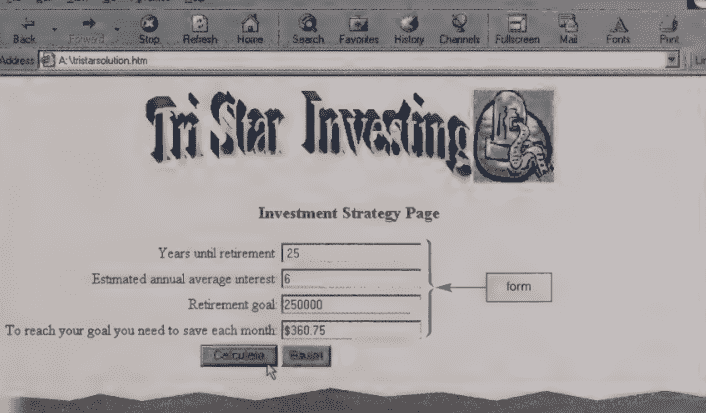

图 2-53b


## 12.60 • 项目 2 • 创建弹出窗口、添加滚动消息和表单验证


这些案例研究的难度各不相同：
- - 是最简单的；- 难度较大；以及 - 是最难的。

你姐姐拥有一家旅行社，她有一个网页，介绍了前往 10 个欧洲国家的旅游行程。她希望你在网页上添加一个带有货币汇率表单的弹出窗口。在表单上，用户应该输入汇率和要兑换的美元数量。为了在文本框中显示美元的汇率，你可以点击名为“Exchange”的按钮。使用本项目中介绍的概念和技术来创建该网页。

作为你兄弟会保龄球队的队长，你决定创建一个显示球队排名的网页。你的一个队友建议你添加一个弹出窗口，其中有一个表单允许保龄者输入比赛得分并计算他们的保龄平均分。表单应接受输入，并在 `While` 循环中计算分数。使用本项目中介绍的概念和技术来创建该网页。

作为你投资俱乐部的财务，你被要求创建一个允许股票股利报销的网页。该网页应允许用户输入股票的当前价格；持股数量；公司每股支付的股利金额；以及支付股利的频率。在验证字段后，页面应显示通过投资股利赚取新新股票所需的时间。使用本项目中介绍的概念和技术来创建该网页。

为了吸引电影观众，当地电影院的经理想创建一个显示当前正在放映的电影列表和放映时间的网页。此外，经理希望有一个表单允许客户在线订购票务。表单应使用单选按钮或复选框来输入票数、场次折扣和信用卡号的数据，并对数据进行验证。一旦完成订购，用户可以在电影院支付票费，或通过信用卡在线支付。使用本项目中介绍的概念和技术为电影院网页创建一个表单（并将其存储在数据库中）。

一个小区开发商已经规划了 4,500 户房屋，并希望有一个显示每个地块都有编号的地图网页。此外，他还希望客户能够在网页上查看任何基础平面图。该网页应允许客户选择一个地块、选择一个平面图并查看最终费用。此外，开发商还希望有一个表单来计算并显示客户开始施工所需的首付款（房屋成本的三分之一）。使用本项目中介绍的概念和技术来创建该网页。

# JavaScript

## 增强图像和表单对象的使用

当你能够完成以下任务时，你就已经掌握了本项目中的材料：

- 定义滚动横幅（rolling banner）
- 创建图像对象
- 编写滚动横幅函数
- 定义数组
- 描述如何创建数组实例
- 调用滚动横幅函数
- 创建动态问候
- 描述 `Switch` 语句
- 编写一个计算到未来日期天数的自定义函数
- 讨论 `getMonth()` 和 `getTime()` 方法
- 描述 `onmouseover` 事件处理器
- 编写一个自定义函数，当鼠标悬过相关链接时更改图像
- 编写一个自定义函数，显示项目列表以及从菜单中选择项目的价量
- 描述 `onchange` 事件处理器
- 编写一个自定义函数，计算从菜单中选定项目的总成本
- 编写一个自定义函数将成本格式化为货币

# # 真是个娃娃！

### Barbie® 娃娃粉丝
对定制娃娃深迷其中

关于定制娃娃

走进任何商店的娃娃过道，你会发现货架上摆满了数百个芭比娃娃和粉色配饰。芭比、牙医芭比、芭比梦幻屋。这些商品在世界 150 多个国家销售，占美泰（Mattel）48 亿美元年收入的 30% 以上。

这个无处不在的娃娃自 1959 年诞生以来已经走了很远。那时，美泰联合创始人露丝·汉勒（Ruth Handler）意识到小女孩除了婴儿娃娃外，还想玩青少年娃娃。她在瑞士买了一个时尚的成熟娃娃，并以她的女儿芭芭拉（Barbara）的名字命名。最初的芭比娃娃售价为 3 美元；如果是完好状态，今天的价值可能超过 5,000 美元。汉勒在 1961 年创造了芭比的男朋友，并以她的儿子肯（Ken）的名字命名。

自 1959 年以来，已售出了超过十亿个娃娃及其家庭成员——如果头尾脚地排起来，足以绕地球七圈以上。


一个三到十岁的美国女孩平均现在拥有十个芭比娃娃。

现在，每个孩子都可以为她的收藏添加一个个性化的芭比朋友。Barbie.com 网站 (www.barbie.com) 包含一个使用 JavaScript 的 `My Design`，允许用户自定义娃娃并获取结果。首先，给娃娃命名。Barbie.com 网站 (www.barbie.com) 包含一个使用 JavaScript的 `My Design`，允许用户自定义娃娃并获取结果……（此处后续重复内容已根据翻译要求去重处理）

# JavaScript

## 增强图像和表单对象的使用


去年当你开始大学时，中西部餐饮（Midwest Catering）聘请你担任兼职服务员。自从与老板丹尼斯·苏利万（Dennis Sullivan）交流并描述你刚完成的开发课程以来，你的工作有了新的方向。丹尼斯知道在互联网上广告会扩大他的业务。中西部餐饮的大多数活动集中在节日和三个主要特色：野餐、晚餐聚会对婚礼。丹尼斯希望有一个突出这些服务的网页。

## 引言

你学习了如何创建一个网页，显示问候并倒计时到某个节日的天数。如果节日超过一个月，你可以设计网页显示通用问候。丹尼斯喜欢这些想法。此外，他希望网页能为客户在下单前提供估算价格的方法。带着这些概念，丹尼斯让你开始开发该网页。

在项目 2 中，你学习了不同的对象属性、方法、内置函数和事件处理器。你使用了 `If` 语句 `IfElse` 语句来验证文本框的值。你学习了如何将值传递给执行数学表达式并返回结果的自定义函数。你学习了 `While` 循环以及如何打开第二个窗口显示消息。本项目将继续强调这些主题，并引入新主题。本项目中的新主题包括使用 `Date` 对象的 `Month()` 和 `getTime()` 方法计算到特定日期的天数。你将学习如何使用图像和数组创建一个名为滚动横幅或图像的动画。你将学习如何使用 `Switch` 语句和数组根据 HTML `Select` 下拉列表显示价格。在项目 2 中，你编写了 `dollarFormat()` 将文本框的输出格式化为货币。在本项目中，你将学习如何制作值字符串对象，以便从每个文本框配合 `dollarFormat()` 函数。最后，你将学习 `mouseover` 事件处理器，通过调用函数将当前图形图像更改另一个。你使用 `change` 事件处理器调用与 `Select` 下拉列表相关的函数。

# 项目三 —— 创建中西部餐饮网页

通过与丹尼斯的讨论，你确定了以下内容。需求：网页显示公司名称（图 3-1a）。


## 中西部餐饮 (Midwest Catering)

万圣节仅剩27天！


从精细的休闲餐饮到盛大的婚礼宴会，让中西部餐饮为您的客人提供美味佳肴吧。要查看我们的服务示例，请点击列表中的某个派对名称。要查看活动项目的快速报价，请点击列表中的派对名称。

所有价格均包含15%的小费和清理费用。

## 图 3-1a

三秒后，表格和滚动内容会切换三张图像（图 3-1b、3-1c 和 3-1d）。横幅下方是动态问候语，它显示指向选定节日的倒计时（图 3-1a）。正如下一页的图 3-1d 所示，“野餐”、“晚餐派对”和“婚礼”以链接的形式显示两个食品照片之间。当鼠标悬停在链接上时，图形图像会发生，并显示通常与该类型食品服务相关的食品项目。

## 野餐

万圣节仅剩27天！

## 图 3-1b

## 晚餐派对

万圣节仅剩27天！

## 图 3-1c

## J 6 • 项目 3 • 增强图像和表单对象的使用


图 3-1d


图 3-1e

**表单：** 当你点击链接时，跳转到 Web 页的一个部分，该部分描述了适用于该活动的食品服务类型。选择下拉列表可提供餐点菜单（图 3-1e）。当你选择一个项目时，单价将显示在文本框中。然后你可以在另一个文本框中输入客人数，以查看总扩展价格。

**计算：** 确定总价的计算方法是人数乘以单价。

## 启动记事本并打开 HTML 文件

第一步是启动记事本并打开 JavaScript 数据盘上的 `cater.htm` HTML 文件，如下步骤所示。

## 启动记事本并打开 HTML 文件

1. 启动记事本。
2. 当记事本窗口显示时，点击最大化按钮。
3. 打开 A 盘中 JavaScript 数据盘上的 `cater.htm` 文件。

`cater.htm` 文在记事本窗口中打开（图 3-2）。


图 3-2

## 滚动横幅

下一步是创建滚动横幅。图 3-1 所示（位于 3.5 页和 J 3.6 页）的标题类似于滚动横幅。滚动横幅是一组大小相同的图像，它们在同一位置交替显示几秒。该横幅包括公司名称，随后是中西部餐饮提供的食品服务活动类型。

要创建滚动横幅，请执行以下三个步骤：(1) 创建图像对象；(2) 编写滚动横幅函数；(3) 添加事件处理器以调用该函数。执行这些步骤的顺序并不重要，但在横幅生效之前必须完成所有三个步骤。

> 滚动横幅
> 滚动横幅也称为图像滚动器动态图像。如需更多信息，请访问 www.scscite.com/js/p3.htm 然后点击 Rolling Banners。

## 创建图像对象

要创建图像对象，向 HTML `IMG` 标签中添加 `Name` 属性，以便 JavaScript 代码引用该对象。`Name` 属性允许 JavaScript 在原始图像相同的位置分配一个新的图形图像。表 3-1 显示了带有 `name`、`width` 和 `height` 属性的 `IMG SRC` 标签的通用格式。

| 表 3-1 – 图像对象 | |
| --- | --- |
| 通用格式： | `` |
| 说明： | 图像显示在标签出现的位置。`Name` 用于 JavaScript 标识对象。`Width` 和 `Height` 属性定义像素的像素大小。 |
| 示例： | `` |

表 3-2 显示了向定义位置分配新图像的语句通用格式。

| 表 3-2 – 分配新图像 | |
| --- | --- |
| 通用格式： | `document.objectname.src = "new image file name"` |
| 说明： | 通过为图像对象的源 (SRC) 属性分配新文件名，使新图形显示在原始图像相同的位置。JavaScript 代码中的对象名称必须与 IMAGE 标签中的对象名称匹配。 |
| 示例： | `document.Banner.src = "banner2.jpg"` |

执行以下步骤创建显示滚动横幅的图像对象的位置。

## 创建图像对象的位置

1. 位置。


图 3-1

## 图 3-1d

## 图 3-1e

## 图 3-2

## 图 3-3

## 图 3-4


## 表 3-4

| LINE | CODE |
|---|---|
| 4 | <SCRIPT LANGUAGE="JAVASCRIPT"> |
| 5 | <!-- Hide from old browsers |
| 6 | var banners = new Array("banner1.jpg", "banner2.jpg", "banner3.jpg", "banner4.jpg") |
| 7 | var bnrCnt = 0 |
| 8 | function bancycle() { |
| 9 | bnrCnt = bnrCnt + 1 |
| 10 | if (bnrCnt == 4) { |
| 11 | bnrCnt = 0 |
| 12 | } |
| 13 | document.Banner.src = banners[bnrCnt] |
| 14 | setTimeout("bancycle()",3000) |
| 15 | } |
| 18 | <!-- --> |
| 19 | </SCRIPT> |

bancycle() 函数从第 6 行开始，通过创建一个图像文件名数组。第 7 行将计数变量 `bnrCnt` 初始化为零，作为下标。零代表数组中的第一个元素，即 Web 页面上显示的滚动横幅的第一张图像。第 8 行定义了函数名。第 9 行增加 `bnrCnt` 以计算数组中的项目数量，数量为四个。如果 `bnrCnt` 等于 4，则第 11 行将零 (0) 赋值给 `bnrCnt`。第 13 行将 `banners[bnrCnt]` 的计数赋值给对象，从而显示新图像。然后，该函数在延迟三秒后调用自身（第 14 行）。大括号为未来的用户定义函数留出了空间，而第 18 行和第 19 行完成了 JavaScript 部分。要进入 bancycle() 函数创建滚动横幅，请执行以下步骤。

## 输入创建滚动横幅的函数

- 将光标置于第 4 行。
- 输入表 3-4 所示的 JavaScript 代码。

bancycle() 函数所示（图 3-6）。

```html

<html>

<head>

<TITLE>Catering Service</TITLE>

<SCRIPT LANGUAGE="JAVASCRIPT">

<!-- Hide from old browsers

var banners = new Array("banner1.jpg", "banner2.jpg", "banner3.jpg", "banner4.jpg")

function bancycle() {

bnrCnt = bnrCnt + 1

if (bnrCnt == 4) {

bnrCnt = 0

}

document.Banner.src = banners[bnrCnt]

setTimeout("bancycle()",3000)

}

</script>

</head>

</html


一旦调用 `bancycle()` 函数，第 14 行的 `setTimeout()` 方法将继续运行，直到用户显示新 Web 页面或退出浏览器。

## 调用滚动横幅函数

下一步是输入调用 `bancycle()` 函数的事件处理器。在此项目中，在 BODY 标签中使用 `setTimeout()` 方法放置 `onload` 事件处理器，就像你在 `bancycle()` 函数中所做，以更改第一张图像。三秒的延迟足够让用户阅读横幅。要输入调用 `bancycle()` 函数的 `onload` 事件处理器，请执行以下步骤。

## 为函数输入 `onload` 事件处理器


将光标置于第 22 行 Y 的正右侧，在 `>` 符号内部（图 3-7）。

图 3-7


输入 `onload='bancycle()',3000')` 而不要按回车键（图 3-8）。

图 3-8

创建滚动横幅的三个步骤已完成。回想这三个步骤：（1) 创建图像对象；(2) 编写滚动横幅函数；(3) 添加事件处理器。下一步是编写代码为节假日倒计时创建动态问候。

## 创建动态问候

项目中的动态问候显示在 Web 页面滚动横幅的下方。问候通知用户距离特定节日的剩余天数。本项目重点关注圣帕里克节、独立日、万圣节和圣诞节等节日。

编写创建动态问候的用户定义函数的步骤包括：(1) 初始化通用问候；(2) 创建 `Date()` 对象实例；(3) 确定月份数字；(4) 根据月份设置节日日期；(5) 减去节假日与当前日期之间的天数；(6) 测试当前日期，如果在节日之前，则计算距离节日的天数；以及 (7) 分配新消息。对四个节日中的每一个节日重复步骤 2 到 7。

你需要一个变量来包含第 7 步分配的新消息。将此变量命名为 `holidayCntMsg` 并使用它初始化初始通用问候。使用 `holidayCntMsg` 变量在第 7 步中将问候更改为特定节日的倒计时。

测试月份并设置节日日期。Switch 语句是处理多种条件的另一种方法。

## Switch 语句

| Case | Action |
|---|---|
| 0 | document.write("Today is Sunday") |
| 6 | document.write("Today is Saturday") |
| default | document.write("Today is a weekday") |

示例：
`var today = new Date();`
`var day = today.getDay();`
`switch (day) {`
`case 0: document.write("Today is Sunday");`
`case 6: document.write("Today is Saturday");`
`default: document.write("Today is a weekday");`
`}`


## `getMonth()` 和 `getTime()` 方法

创建动态问候时，使用 Date 对象的 `getMonth()` 和 `getTime()` 方法。回顾项目 1，Date 对象初始化为当前日期，`getMonth()` 返回月份。由于系统从零开始，第一个月份是零。二月为一，以此类推，十二月为11。

`getTime()` 返回自 1970 年 1 月 1 日 00:00:00 起为止的毫秒数。使用毫秒比计算天数更简单。

要确定从当前日期到给定日的天数，将毫秒数除以 `1000 * 60 * 60 * 24`。该表达式表示一秒1000 毫秒、一分钟60 秒、一小时60 分钟以及一天24 小时。创建节假日倒计时动态问候的用户定义函数名称为 `HolidayDays()`。该函数创建动态问候，确定距离给定日期的天数。

可以设置特定日期为 `Date(month, day, year hours:minutes:seconds*)`

你可以除以 86,400,000（60 * 60 * 24 的结果）来解释如何得出该值。关于 `Date()` 对象及其方法的更多信息，请访问 www.scsp.com/js/p3.html 并点击 getTime()：

## 创建 `HolidayDays()` 函数

函数使用的第一个节日是圣帕里克节。图 3-10 中的流程图显示了 `HolidayDays()` 函数中使用的 Switch 语句的逻辑。表 3-6 显示了该函数的 JavaScript 代码。


## 表 3-6

| LINE | CODE |
|---|---|
| 17 | var holidayCntMsg = "Leave the party to Midwest Catering" |
| 18 | var curDay = new Date(); |
| 19 | var tMonth = curDay.getMonth(); |
| 20 | function curDays() { |
| 21 | switch (tMonth) { |
| 22 | case 2: |
| 23 | var holiday = new Date("March 17, 2001") |
| 24 | var curHoliday = holiday.getTime()-curDay.getTime(); |
| 25 | if (curHoliday > 0) { |
| 26 | curHoliday = Math.ceil(curHoliday / (1000 * 60 * 60 * 24)); |
| 27 | holidayCntMsg = "Only "+curHoliday+" days until St. Patrick's Day!" |
| 28 | } |
| 29 | break |
| 30 | } |

第 17 行建立了当给定月份没有节假日时显示的默认值。第 18 行将当前系统日期赋值给 `curDay`。回想项目二，`Date()` 对象返回当前的系统日期、时间和时区，且必须从该对象中提取特定信息。在第 19 行中，`getMonth()` 方法返回当前月份的数字。回想之前提到，一月返回 0。因此，三月返回 2。在第 22 行中，`case` 语句（case 2）测试月份是否为 3 月。

`Date()` 对象在 `getTime()` 方法中将分配的节假日特定日期（圣帕里克节）设置到对象实例，并将结果存储在 `curHoliday` 中。第 24 行使用第 24 行中的 `if` 语句减去当前系统日期的天数来测试 `curHoliday` 的值。如果值大于 0，则意味着当前系统日期尚未过节。第 26 行所示，通过 (1000 * 60 * 60 * 24) 的乘积得到毫秒数。整个表达式使用 `Math.ceil()` 方法（第 26 行）舍入为最近的高整数。第 27 行构建了 `holidayCntMsg`。

要输入圣帕里克节的 `HolidayDays()` 函数步骤，请执行以下步骤。

## 关于

## Math `ceil()` 方法

`ceil()` 方法返回最大的整数。给定值 -2.89，`ceil(-2.89)` 返回 -2。给定值 3.02，`ceil(3.02)` 返回 4。

# 输入圣帕里克节 `Holiday()` 用户定义函数的步骤

将插入光标置于第 17 行。

在表 3-6 中，输入 JavaScript 代码。对于第 23 行中的日期，请输入当前年份。

圣帕里克节显示节假日信息的 JavaScript 代码所示（图 3-11）。

函数的下一部分完成了独立日节假日的代码，如表 3-7 所示。

| LINE | CODE |
|---|---|
| 30 | case 5: case 6: |
| 31 | var curHoliday = new Date("July 4, 2001") |
| 32 | var curHoliday = tHoliday.getTime()-curDay.getTime() |
| 33 | if (curHoliday > 0) { |
| 34 | curHoliday = Math.ceil(curHoliday / (1000 * 60 * 24)) |
| 35 | holidayCntMsg = "Only "+curHoliday+" days until the 4th of July! |
| 36 | } |
| 37 | break |

为了等待到七月开始并对节假日倒计时，仅剩三天。由于这是一个受欢迎的夏季假期，独立日的倒计时从六月开始。`Case` 语句（第 30 行）是一个多条件语句，使用 OR 条件运算符 (`|`) 测试是否为 5（六月）或 6（七月）。回想项目 1 之前的介绍部分，在 OR 条件中，如果任一条件为真，则条件为真。第 31 行设置了 7 月 4 日的日期。第 35 行的 `<sup>` 标签是上标标签。

# 3.18 • 项目 3 • 增强图像和表对象的使用

要输入倒计时独立日节假日的语句，请执行以下步骤。

# 输入独立日 `HolidayDays()` 用户定义函数步骤

- 1. 将插入光标置于第 30 行。
- 2. 输入上一页第 3-7 行所示的 JavaScript 代码。对于第 31 行中的日期，输入当前年份。

独立日假日信息的 JavaScript 代码所示（图 3-12）：

```
cater.htm - Notepad

document.Banner.src = banners(bnrCntr)

settimeout("bancycle",3000)

var holidayCntMsg = "Leave the party to Midwest Center"

var curDay = new Date();

var tMonth = curDay.getMonth();

function HolidayDays() {

switch (tMonth) {

case 2:

var holiday = new Date("March 17, 2001")

var curHoliday = holiday.getTime()-curDay.getTime()

if (curHoliday > 0) {

Math.ceil(curHoliday / (1000 * 60 * 60 * 24))

holidayCntMsg = "Only "+curHoliday+" days until St. Patrick's Day"

}

break

case 6:

var holiday = new Date("July 4, 2001")

var curHoliday = holiday.getTime()-curDay.getTime()

if (curHolidary > 0) {

Math.ceil(curHoliday / (1000 * 60 * 24))

holidayCntMsg = "Only "+curHoliday+" days until the<sup>4th of July!"

}

break

}

</script>

<body onload="timeout("bancycle",3000)">

<a name="TOP">

<center></center>

```

图 3-12

函数的后续部分完成了万圣节的倒计时（表 3-8）。

| LINE | CODE |
|---|---|
| 38 | case 9: |
| 39 | var thHoliday = new Date("October 31, 2001") |
| 40 | var curHoliday = thHoliday.getTime()-curDay.getTime() |
| 41 | if (curHoliday > 0) { |
| 42 | curHoliday = Math.ceil(curHoliday / (1000 * 60 * 24)) |
| 43 | holidayCntMsg = "Only "+curHoliday+" days until Halloween!" |
| 44 | } |
| 45 | break

## 创建动态问候

倒计时从十月开始，`getMonth()` 方法将确定为 9，如第 38 行所示。第 39 行设置了万圣节的日期。执行以下步骤以输入万圣节的函数语句。

# 输入万圣节 `HolidayDays()` 用户定义函数

- 1. 将插入光标置于第 38 行。
- 2. 输入表 3-8 所示的 JavaScript 代码。对于第 39 行中的日期，输入当前年份。

万圣节信息的 JavaScript 代码所示（图 3-13）。

```javascript

switch (getMonth()) {

  var tHoliday = new Date("March 17, 2001");

  var curHoliday = tHoliday.getTime()-curDay.getTime();

  if (curHoliday > 0) {

    curHoliday = Math.ceil(curHoliday / (1000 * 60 * 24));

    holidayCntMsg = "only "+curHoliday+" days until St. Patrick's Day!"

  }

  break;

case 5:

  var tHoliday = new Date("July 4, 2001");

  var curHoliday = tHoliday.getTime()-curDay.getTime();

  if (curHoliday > 0) {

    curHoliday = Math.ceil(curHoliday / (1000 * 60 * 24));

    holidayCntMsg = "only "+curHoliday+" days until the 4th of July!";

  }

  break;

case 9:

  var tHoliday = new Date("October 31, 2001");

  var curHoliday = tHoliday.getTime()-curDay.getTime();

  if (curHoliday > 0) {

    curHoliday = Math.ceil(curHoliday / (1000 * 60 * 24));

    holidayCntMsg = "only "+curHoliday+" days until Halloween";

  }

  break;

}

```

圣诞节信息的完成代码如表 3-9 所示。该部分的逻辑与表 3-8 中讨论的代码相同。

| LINE | CODE |
|---|---|
| 46 | case 11: |
| 47 | var tHoliday = new Date("December 25, 2001") |
| 48 | var curHoliday = tHoliday.getTime()-curDay.getTime() |
| 49 | if (curHoliday > 0) { |
| 50 | curHoliday = Math.ceil(curHoliday / (1000 * 60 * 24)) |
| 51 | holidayCntMsg = "only "+curHoliday+" days until Christmas!" |
| 52 | } |
| 53 | break |
| 54 | } |
| 55 | return holidayCntMsg |

# 3.20 • 项目 3 • 增强图像和表对象的使用

十二月的 case 条件测试第 46 行的 11。第 55 行的 `return` 命令将 `holidayCntMsg` 变量的内容传回调用函数。如果当前系统不匹配任何节假日月份，函数返回最初在第 17 行设置的通用值。

要输入圣诞节的 JavaScript 代码，请执行以下步骤：

# 输入圣诞节 `HolidayDays()` 用户定义函数步骤

- 1. 将插入光标置于第 46 行。
- 2. 输入上一页表 3-9 所示的 JavaScript 代码。对于第 47 行中的日期，输入当前年份。

函数的最后部分所示（图 3-14）。

# 调用 `HolidayDays()` 函数

下一步是在 BODY 部分插入 JavaScript 代码，调用 `HolidayDays()` 函数并显示相应的问候（见第 3.5 页和 3.6 页的图 3-1a 至 3-1e）。动态问候显示在页面顶部，滚动横幅图像下方。表 3-10 提供了 `HolidayDays()` 函数调用和显示信息的 `write()` 方法的代码。


回想之前的项目，输入 BODY 部分的 JavaScript 代码必须置于 SCRIPT 部分中。要输入在 Web 页面上显示动态消息的函数调用，请执行以下步骤。

## 输入函数调用并显示消息

-   将插入点置于第 67 行。
-   输入表 3-10 所示的 JavaScript 代码。

嵌入的 HTML 代码将以 Heading 2 样式居中对齐消息。


图 3-15

显示滚动横幅和问候语的 JavaScript 代码已完成。现在是测试目前已输入的 JavaScript 代码的好时机。

## 保存 HTML 文件并查看网页

将带有 JavaScript 代码的 HTML 文件命名为 `mwcatering.htm`，保存到 A 盘上的 JavaScript 数据磁盘上。请记住，你必须为文件名添加 .htm 扩展名，因为记事本会自动将所有文件保存为 .txt 扩展。要保存并测试网页，请执行下一页的步骤。

## 保存 HTML 文件并测试网页

-   1. 在 A 盘中使用 JavaScript 数据磁盘，点击菜单栏上的“文件”，然后点击“另存为”。
-   2. 在“文件名”文本框中输入 `a:\wcatering.htm`，然后点击保存对话框中的“保存”按钮。
-   3. 启动浏览器并打开 `wcatering.htm`。

图 3-16 显示了滚动横幅的第一幅和万圣节倒计时消息。取决于当前系统日期的动态消息。


从精致休闲餐饮到美味婚礼盛宴，让 Midwest Catering 为您的宾客提供美味大餐。要查看我们的服务示例，请指向列表中的某个活动名称。要查看活动项目的快速报价（Quick Quote），请点击列表中的活动名称。

所有价格均包含 15% 的小费和清洁。

图 3-16

如果浏览器未能正确显示网页，请修正任何错误消息对话框，然后点击任务栏上的记事本按钮。根据页面 J 3.8 至 J 3-21 的图 3-3 至 3-15 检查 JavaScript 消息代码。修正任何错误，保存文件，激活浏览器，然后点击刷新按钮。

## mouseover 事件处理器

回想要求，图 3-1d（页面 J 3.6）中的两个图像当用户将鼠标悬停在一个食品服务类别链接上时会发生变化。要让这些图像变化，请为图像对象分配新名称。每个食品服务类别链接都包含一个调用函数的 `onmouseover` 事件处理器。该函数为图像对象分配新图像。

Web 设计师在编写 mouseover 事件处理器时必须小心。在等待网页加载时，用户可能会将鼠标悬过与事件处理器相关的对象，从而触发他们并非预期的操作。根据操作的不同，可能会显示错误消息，或者用户可能会迷失或困惑。如果你收到与 mouseover 事件处理器相关的错误消息，请刷新网页，并确保在移动鼼标之前已完全加载。

在此项目中，鼠标事件处理器与锚点链接关联。然而，鼠标事件处理器也可以与按钮或图形或其他对象关联。表 3-11 描述了其他鼠标事件处理器。

表 3-11
| 事件处理器 | 注释 |
| :--- | --- |
| mouseout | 当鼠指针移出对象时触发 JavaScript 代码 |
| mousedown | 当按下鼠标键时触发 JavaScript 代码 |
| mouseup | 当释放鼠标键时触发 JavaScript 代码 |
| mousemove | 当用户移动鼠标指针时触发 JavaScript 代码 |


## 输入 mouseover 事件处理器

每个每个食品服务类别的用户定义函数为 `onPicnic()`、`onDinnerParty()` 和 `onWedding()`。例如，图 3-17 中第 81 行的 Pics 对应的代码读取为 `<A HREF="#Picnic">`。在添加 mouseover 事件后，它将读取为 `<A HREF="#Picnic" mouseover="onPicnic()>`。要使用 mouseover 事件处理器调用函数，请执行以下步骤。

## 使用 mouseover 事件处理器调用函数

-   将插入点置于第 81 行 `>` 之后和之前。
-   按一下空格键。输入 `mouseover="onPicnic"` 而不要按回车键。

调用 `onPicnic()` 函数的 mouseover 事件处理器显示了图 (3-17)。


## 项目 3 • 增强图像和表对象的使用

-   将插入点置于第 82 行 `"` 之后和 `>` 之前。
-   按一下空格键。输入 `onerror="onDinnerParty()"` 而不要按键。

调用 `onDinnerParty()` 函数的 mouseover 事件处理器显示了 (3-18)。

```html

<body

<body onload="bancycle()',3000")

<H1 NAME="MICS_H1">

  <CENTER></CENTER>

  <SCRIPT LANGUAGE="JAVASCRIPT">

    <!-- Fix from old browsers -->

    var holidayMsg="Holidays"

    nonmouseover="holidayMsg()";

    document.write("<H2>"+holidayMsg+"</H2>");

  </SCRIPT>

  <H2 NAME="MICS_H2">

  <CENTER><TABLE CELLSPACING="0" BORDER="0" WIDTH="436">

    <TR>

      <TD></TD>

      <TD></TD>

    </TR>

    <TR>

      <TD></TD>

      <TD></TD>

    </TR>

  </TABLE>

  </CENTER>

  <H2 NAME="MICS_H3">

  <CENTER></CENTER>

  <P><A href="#Picnic" onmouseover="onPicnic()" target="_">Picnic</A>

  <P><A href="#DinnerParty" onmouseover="onDinnerParty()" target="_">Dinner Party</A>

  <P><A href="#Wedding" onmouseover="onWedding()" target="_">Weddings</a></P>

  <H2 NAME="MICS_H4">

  <CENTER></CENTER>

  <P>"The Finest in casual dining to the gourmet wedding feast, let Midwest Catering 为您的宾客提供美味大餐。要查看我们的服务示例，请指向列表中的某个活动名称。要查看活动项目的快速报价，点击列表中的活动名称。"\ <P><A href="Prices">All Prices include 55% discount and clean up.</a></P>

</CENTER></H2>

</body

```


图 3-18

-   将插入点置于第 83 行 `"` 之后和 `>` 之前。
-   按一下空格键。输入 `onerror="onWedding()"` 而不要按键。

调用 `onWedding()` 函数的 mouseover 事件处理器显示了 (3-19)。

```html

<body

<body onload="bancycle()',3000")

<H1 NAME="MICS_H1">

  <CENTER></CENTER>

  <SCRIPT LANGUAGE="JAVASCRIPT">

    <!-- Fix from old browsers -->

    var holidayMsg="Holidays"

    nonmouseover="holidayMsg()";

    document.write("<H2>"+holidayMsg+"</H2>");

  </SCRIPT>

  <H2 NAME="MICS_H2">

  <CENTER><TABLE CELLSPACING="0" BORDER="0" WIDTH="436">

    <TR>

      <TD></TD>

      <TD></TD>

    </TR>

    <TR>

      <TD></TD>

      <TD></TD>

    </TR>

  </TABLE>

  </CENTER>

  <H2 NAME="MICS_H3">

  <CENTER></CENTER>

  <P><A href="#Picnic" onmouseover="onPicnic()" target="_">Picnic</A>

  <P><A href="#DinnerParty" onmouseover="onDinnerParty()" target="_">Dinner Party</A>

  <P><A href="#Wedding" onmouseover="onWedding()" target="_">Weddings</a></P>

  <H2 NAME="MICS_H4">

  <CENTER></CENTER>

  <P>"The Finest in casual dining to the gourmet wedding feast, let Midwest Catering 为您的宾客提供美味大餐。要查看我们的服务示例，请指向列表中的某个活动名称。要查看活动项目的快速报价，点击列表中的活动名称。"\ <P><A href="Prices">All Prices include 55% discount and clean up.</a></P>

</CENTER></H2>

</body

```

图 3-19


## 进入函数

下一步是进入由 `onmouse` 事件处理程序触发的函数以更改图像。第 79 行和 86 行包含了初始图像，当用户将鼠标悬停在其中链接上时，这些图像会显示在链接的左右两侧。初始图像如图 3-20 所示。


图 3-20a


图 3-20b

## 表 3-12

| 行号 | 代码 |
|---|---|
| 58 | function onPicnic() { |
| 59 | document.Image1.src = "catering2.jpg" |
| 60 | document.Image2.src = "catering3.jpg" |
| 61 | } |

表 3-12 显示了为 `onPicnic()` 函数将新图像分配给图像对象的赋值。在第 58 行，`document.Image1.src` 包含左侧图像，在第 59 行，`document.Image2.src` 包含右侧图像。要进入 `onPicnic()` 函数（当用户悬停在 Picnic 链接上时更改图像），请移动到 HEAD 部分并执行以下步骤。

## 进入 onPicnic() 函数

- 1. 将插入光标置于第 58 行。
- 2. 输入表 3-12 所示的 JavaScript 代码。

`onPicnic()` 函数显示（图 3-21）。


图 3-21

表 3-13 提供了 `onDinnerParty()` 函数的代码。

## 表 3-13

| 行号 | 代码 |
|---|---|
| 63 | function onDinnerParty() { |
| 64 | document.Image1.src = "catering4.jpg" |
| 65 | document.Image2.src = "catering5.jpg" |
| 66 | } |

第 64 行和 65 行将图像名称分配给图像对象。要进入 `onDinnerParty()` 函数，请执行以下步骤。

将插入光标置于第 63 行。

输入表 3-13 所示的 JavaScript 代码。

`onDinnerParty()` 函数显示（图 3-22）。


图 3-22

表 3-14 提供了 `onWedding()` 函数的代码。第 69 行和 70 行更改了图像。要进入 `onWedding()` 函数，请执行以下步骤。

| 行号 | 代码 |
| --- | --- |
| 68 | function onWedding() { |
| 69 | document.image1.src = "catering6.jpg" |
| 70 | document.image2.src = "catering7.jpg" |
| 71 | } |

## 进入 onWedding() 函数

将插入光标置于第 68 行。

输入表 3-14 所示的 JavaScript 代码。

`onWedding()` 函数显示（图 3-23）。


图 3-23

现在是保存网页并在浏览器中测试 JavaScript 代码的好时机。

## 保存并测试网页

- 在磁盘驱动器 A 中，点击菜单栏上的 File 然后点击 Save。
- 点击任务栏上的浏览器然后点击 Refresh。
- 悬停在 Weddings 链接上等待几秒。
- 悬停在 Picnics 链接上等待几秒。

链接两侧的图像会在指向链接时发生更改。图 24 显示了 Picnics 链接的新图像。


对于休闲用餐的顶级婚宴，让 Midwest Catering 为宾客提供美味的盛宴。作为我们的示例，指向列表中的一个派名称。要查看项目，点击列表中的派名称。所有价格都包含小费。

## 图 24

如果浏览器没有正确显示网页，关闭任何错误对话框然后点击任务栏上的 Notepad 按钮。根据图 17 到 23 检查 JavaScript 代码。保存文件，激活浏览器然后点击 Refresh 按钮。下一步是在文本框中显示每人价。

## 使用选择列表显示菜单项目

三个服务类别中的每一个都有一个提供菜单选项的选择列表。图 25 显示了 Picnics 选择列表。要显示价格，用户点击左侧列表的箭头（图 25）。要选择某项，用户点击所需的项目。列表中的每个项目都有每人价。数组对象包含与列表对应的每人价。


野餐食物包括：烤鸡、热狗或香肠，配有所有的配料、面包，以及以下侧菜：土豆沙拉、凉拌卷、烤豆、奶酪和蘸酱。其他菜单项目包括：牛排、肋排、鱼、鸡肉、玉米、主菜和水果片。要下单或请求，请拨打 555-8000。

图 25

当用户选择某项时，图 25 所示框中显示价格。从数组中获取价格，使用 `selectedIndex`。`selectedIndex` 对应列表中的位置。更多信息，请访问 site.com/js/p。`onchange` 事件触发 `setPicnic()` 函数。

（此处后续重复段落已根据翻译要求合并/简化）


# 将插入点置于右侧紧邻“之前”或位于第 216 行。

# 按空格键 `onclick="setWeddingPrice(Wedding Menu)"` 而不要按回车键。

调用 `setWeddingPrice()` 函数的 `onChange` 事件处理器显示（图 3-29）。


下一步是编写用户定义函数，以确定从选项列表中选择的项目并在文本框中显示价格。

## 为 `onChange` 事件处理器输入用户定义函数

由 `onChange` 事件处理器调用的用户定义函数显示选项列表中选中项目的价格。每个函数执行以下步骤：(1) 定义一个价格数组；(2) 清空文本框；(3) 使用 `selectedIndex` 属性作为下标变量；以及 (4) 将价格设置为文本框。表 3-15 提供了 `setPicnicPrice()` 函数的代码。

图 3-29

# 表 3-15

| 行号 | 代码 |
|---|---|
| 73 | picPrices = new Array("None Selected", "Please Call", "$10.95 per person", "$10.95 per person", "$11.95 per person", "$13.95 per person") |
| 74 | function setPicnicPrice(myForm) { |
| ... | ... |

```

picPrices = new Array("None Selected", "Please Call", "$10.95 per person", "$10.95 per person", "$11.95 per person", "$13.95 per person")

function setPicnicPrice(myForm) {

  document.PicnicPrice.Price.value = ""

  document.PicnicQuantity.PicExtPrice.value = ""

  document.PicnicQuantity.PicOty.value = ""

  var itemSelect = myForm.PicnicItem.selectedIndex;

  switch (itemSelect) {

    case 1:

      document.PicnicPrice.Price.value = picPrices[itemSelect]

      break;

    case 2:

      document.PicnicPrice.Price.value = picPrices[itemSelect]

      break;

    case 3:

      document.PicnicPrice.Price.value = picPrices[itemSelect]

      break;

    case 4:

      document.PicnicPrice.Price.value = picPrices[itemSelect]

      break;

  }

  document.PicnicQuantity.PicOty.focus();

}

```

第 73 行定义了价格数组。第一个项目“None Selected”填充了零索引元素的位置，该位置从不使用。第 75 行至 77 行每当用户从下拉列表中选择新项目时都会清空文本框。第 79 行至 91 行包含 JavaScript 的 `Switch` 语句。第 78 行显示了将 `selectedIndex` 属性的索引值赋值给变量 `itemSelect`。索引从零开始为列表中的项目编号。在 `setPicnicPrice` 函数中，如果用户选择了“2 种配菜 1 份饮料”选项，则 `itemSelect` 的值为 2（第 83 行的 `case` 语句）。分配给 `itemSelect` 的索引值将成为文本框中价格的下标。第 81、84、87、90 和 93 行中的这些赋值将相应的价格分配给文本框。第 95 行将焦点置于人数文本框，以允许用户输入人数。要输入将野餐菜单野餐价格分配到文本框的函数，请执行下一页的步骤。

## 输入用于分配野餐价格的函数

将插入点置于第 73 行。

输入表 3-15 所示的 JavaScript 代码。

`setPicnicPrice(Price)` 函数显示（图 3-30）。


图 3-30

用于晚宴价格的用户定义函数与野餐函数类似，如表 3-16 所示。`switch` 语句测试所选项目并将价格分配给价格文本框（`document.DinnerPrice.price.value`），并将焦点设置到输入人数的文本框。

# 表 3-16

| 行号 | 代码 |
|---|---|
| 99 | dinnerPrices = new Array("None Selected", "$13.95 per person", "$16.95 per person", "$18.95 per person", "$12.95 per person", "$12.95 per person") |
| 100 | function setDinnerPrice(myForm) { |
| 101 | document.DinnerPrice.value = "" |
| 102 | document.DinnerQuantity.DinPrice.value = "" |
| 103 | document.DinnerQuantity.DinQty.value = "" |
| 104 | var itemSelect = myform.selectedIndex; |
| 105 | switch (itemSelect) { |
| 106 | case 1 : |
| 107 | document.DinnerPrice.value = dinnerPrices[itemSelect]; |
| 108 | break |
| 109 | case 2 : |
| 110 | document.DinnerPrice.value = dinnerPrices[itemSelect]; |
| 111 | break |
| 112 | case 3 : |
| 113 | document.DinnerPrice.value = dinnerPrices[itemSelect]; |
| 114 | break |
| 115 | case 4 : |
| 116 | document.DinnerPrice.value = dinnerPrices[itemSelect]; |
| 117 | break |
| 118 | case 5 : |
| 119 | document.DinnerPrice.value = dinnerPrices[itemSelect]; |
| 120 | break |
| 121 | } |
| 122 | document.DinnerQuantity.DinQty.focus(); |
| 123 | |

第 99 行定义了 `dinnerPrices` 数组。“None Selected”填充了数组的零索引元素。第 101 行至 103 行每当函数被调用时都会清空文本框。第 104 行确定所选项目。第 105 行至 120 行将数组中的价格分配给文本框。第 122 行将焦点置于人数文本框，以允许用户输入人数。要输入将晚宴菜单价格分配到文本框的函数，请执行下一页的步骤。

## 输入分配晚宴价格的函数

将插入点置于第 99 行。

输入表 3-16 所示的 JavaScript 代码。

`setDinnerPrice()` 显示（图 3-31）。

```javascript

dinnerPrices = new Array("None Selected", "$13.95 per person", "$16.95 per person", "$18.95 per person", "$12.95 per person", "$12.95 per person")

function setDinnerPrice(price) {

  document.DinnerPrice.value = ""

  document.DinnerQuantity.DinQty.value = ""

  if (itemSelect) {

    switch (itemSelect) {

      case 1:

        document.DinnerPrice.value = dinnerPrices[itemSelect]

        break;

      case 2:

        document.DinnerPrice.value = dinnerPrices[itemSelect]

        break;

      case 3:

        document.DinnerPrice.value = dinnerPrices[itemSelect]

        break;

      case 4:

        document.DinnerPrice.value = dinnerPrices[itemSelect]

        break;

      case 5:

        document.DinnerPrice.value = dinnerPrices[itemSelect]

        break

    }

  }

  document.DinnerQuantity.DinQty.focus();

}

```

图 3-31

第三个所需的函数用于婚礼价格（表 3-17）。设置婚礼价格的过程与野餐和晚宴函数相同。

# 表 3-17

| 行号 | 代码 |
|---|---|
| 125 | weddingPrices = new Array("None Selected", "$13.95 per person", "$10.95 per person", "$18.95 per person", "$28.95 per person", "$17.95 per person") |
| 126 | function setWeddingPrice(myForm) { |
| 127 | document.WeddingPrice.value = "" |
| 128 | document.WeddingQuantity.WedExtPrice.value = "" |
| 129 | document.WeddingQuantity.WedQty.value = "" |
| 130 | var itemSelect = myForm.WeddingItem.selectedIndex; |
| 131 | switch (itemSelect) { |
| 132 | case 1 : |
| 133 | document.WeddingPrice.value = weddingPrices[itemSelect] |
| 134 | break |
| 135 | case 2 : |
| 136 | document.WeddingPrice.value = weddingPrices[itemSelect] |
| 137 | break |
| 138 | case 3 : |
| 139 | document.WeddingPrice.value = weddingPrices[itemSelect] |
| 140 | break |
| 141 | case 4 : |
| 142 | document.WeddingPrice.value = weddingPrices[itemSelect] |
| 143 | break |
| 144 | } |
| 145 | document.WeddingQuantity.WedQty.focus(); |
| 146 | |

要输入分配婚礼宴会价格的函数，请执行以下步骤。

## 输入分配婚礼价格的函数

+   1. 将插入点置于第 125 行。
2. 输入表 3-17 所示的 JavaScript 代码。
`setWeddingPrice()` 函数显示（图 3-32）。


图 3-32


每个类别的函数都会显示每人的价格，并将插入点置于“客人人数”文本框中。下一部分将根据输入的客人人数计算总价。

## 计算总价函数 (Extended Price Function)

网页上的说明（如图 3-33 所示的野餐/Picnic 类别）指示用户在“客人人数”文本框中输入一个数字并按 TAB 键。


图 3-33

当用户输入数字并按下 TAB 键时，“客人人数”文本框会发生变化。此操作会触发 `onchange` 事件处理器，并调用相应的函数来计算总价。由于每个食品服务类别都有自己的表单和价格菜单，因此你无法编写一个通用的函数来计算价格。

计算总价三个函数名称分别为 `picPrice()`、`dimPrice()` 和 `wedPrice()`。要使用 `onchange` 事件处理器调用这些计算总价的函数，请执行以下步骤。

## 使用 onChange 事件处理器调用计算总价的函数

将插入点位于第 221 行，紧接 `>` 符号之前。

按一次空格键。输入 `onChange="PicPrice(PicQuantity)"` 不要按 ENTER 键。


图 3-34

将插入点位于第 266 行，紧接 `>` 符号之前。

按一次空格键。输入 `onChange="dinPrice(DinnerQuantity)"` 不要按 ENTER 键。


图 3-35

将插入点位于第 314 行，紧接 `>` 符号之前。

按一次空格键。输入 `onchange="wedPrice(WeddingQuantity)"` 不要按 ENTER 键。

图 3-36 显示了调用 `wedPrice` 函数的 `onchange` 事件处理器的放置位置。


图 36

下一部分描述了每个自定义函数的 JavaScript 代码，这些函数将计算总价，并使用格式化函数在文本框中设置格式化后的总价。

## 计算总价

用户从菜单中选择一个项目后，插入点会自动放置在“客人人数”文本框中。对于每个服务类别，函数都会计算总价并将其显示在文本框中。当用户按 TAB 键离开“客人人数”文本框时，`onchange` 事件处理器会调用该函数计算总价。

表 3-18 提供了 `picPrice()` 自定义函数的代码

| 行号 (LINE) | 代码 (CODE) |
| :--- | :--- |
| 148 | `function picPrice(myForm) {` |
| 149 | `var picnicQty = myForm.PicQty.value` |
| 150 | `var EstPrice = picnicQty * document.PicnicPrice.Price.value.substring(1,6)` |
| 151 | `var EstPrice = new String(EstPrice)` |
| 152 | `document.PicnicQuantity.PicExtPrice.value = dollarFormat(EstPrice)` |
| 153 | `}` |

第 150 行将 `picnicQty`（代表客人人数）乘以人均价。`substring` 方法从人均价中提取数值。在第 151 行中，结果被存储在 `EstPrice` 中并转换为字符串对象。此过程允许 `dollarFormat()` 函数接受字符串格式的 `EstPrice`。第 152 行调用了 `dollarFormat()` 函数。`dollarFormat()` 函数将格式化为货币的总价返回到文本框中。要输入 `picPrice()` 函数，请执行以下步骤。

## 输入 picPrice()

- 1. 将插入点位于第 148 行。
- 2. 输入表 3-18 所示的 JavaScript 代码。

`picPrice()` 函数显示如下（图 3-37）。


图 3-37

下一步是编写表 3-19 所示的 `dinPrice()` 函数。该函数使用了与 `picPrice()` 函数相同的逻辑和步骤。

| 行号 (LINE) | 代码 (CODE) |
| :--- | :--- |
| 155 | `function dinPrice(myForm) {` |
| 156 | `var dinQty = myForm.DinQty.value` |
| 157 | `var EstPrice = dinQty * document.DinQty.Price.value.substring(1,6)` |
| 158 | `var EstPrice = new String(EstPrice)` |
| 159 | `document.DinQty.String.DinPrice.value = dollarFormat(EstPrice)` |
| 160 | `}` |

## 项目 3 - 增强图像和表单对象的使用

要输入 `dinPrice()` 函数，请执行以下步骤。

## 输入 dinPrice() 函数

- 将插入点位于第 155 行。
- 输入表 3-19 所示的 JavaScript 代码。

`dinPrice()` 函数显示如下（图 3-38）。


图 38

下一步是编写 `wedPrice()` 函数。表 3-20 显示了 `wedPrice()` 函数，它使用了与之前函数相同的逻辑和步骤。

| 表 3-20 | 行号 (LINE) | 代码 (CODE) |
| :--- | :--- | :--- |
| 162 | `function wedPrice(myForm) {` |
| 163 | `var weddingQty = myForm.WedQty.value` |
| 164 | `var EstPrice = weddingQty * document.WeddingPrice.Price.value.substring(1,6)` |
| 165 | `var EstPrice = new String(EstPrice)` |
| 166 | `document.WeddingQuantity.WedExtPrice.value = dollarFormat(EstPrice)` |
| 167 | `}` |

要输入 `wedPrice()` 函数，请执行以下步骤。

## 输入 wedPrice() 函数

- 1. 将插入点位于第 162 行。
- 2. 输入表 3-20 中的代码。

`wedPrice()` 函数显示如下（图 3-39）。


图 39

`wedPrice()` 函数完成了对 `dollarFormat()` 函数的调用。记住 `dollarFormat()` 函数执行了七个步骤：1) 接收传递的字符串并将金额和小数分开；2) 使用 `indexOf()` 方法确定小数点的位置；3) 将小数点左侧的值视为金额，右侧的视为小数；4) 为超过 999 的金额插入逗号；5) 将小数截断为两位；6) 带美元符号重新构建值；7) 返回结果。下一页的表 3-21 提供了 `dollarFormat()` 函数的代码。

## 表 3-21

| 行号 (LINE) | 代码 (CODE) |
| :--- | :--- |
| 169 | `function dollarFormat(value) {` |
| 170 | `var formatStr = ""` |
| 171 | `var decipos = value.indexOf(".")` |
| 172 | `if (decipos == -1) {` |
| 173 | `decipos = value.length` |
| 174 | `var dollars = value.substring(0,decipos)` |
| 175 | `var Outdollars = ""` |
| 176 | `var dollars = value.length` |
| 177 | `if (dollars > 0) {` |
| 178 | `while (tDollars = dollars.substring(dollars-3)) ` |
| 179 | `if (tDollars.length == 3) {` |
| 180 | `Outdollars = +tDollars+Outdollars` |
| 181 | `dollars-=3;` |
| 182 | `} else {` |
| 183 | `Outdollars = tDollars+Outdollars` |
| 184 | `dollars = 0` |
| 185 | `}` |
| 186 | `}` |
| 187 | `}` |
| 188 | `if (Outdollars.substring(0, 1) == ",")` |
| 189 | `dollars = Outdollars.substring(1,Outdollars.length)` |
| 190 | `else` |
| 191 | `dollars = Outdollars` |
| 192 | `}` |
| 193 | `var cents = value.substring(decipos+1,decipos+3)` |
| 194 | `if (cents == "") {` |
| 195 | `cents = "00"` |
| 196 | `if (cents.length == 1) {` |
| 197 | `cents = cents+"0"` |
| 198 | `var formatStr = "$"++dollars+"."+cents` |
| 199 | `return formatStr` |
| 200 | `}` |

要输入 `dollarFormat()` 函数，请执行以下步骤。

## 输入 dollarFormat() 函数

- 将插入点位于第 169 行。
- 输入表 3-21 所示的 JavaScript 代码。

`dollarFormat()` 函数显示如下（图 3-40）。


图 3-40

## 表 3-22

| 类别 (CATEGORY) | 选择 (SELECTION) | 价格 (PRICE) | 客人人数 (GUESTS) | 总价 (EXTENDED PRICE) |
| :--- | :--- | :--- | :--- | :--- |
| 晚餐聚会 (Dinner Parties) | 岩羊肉 (Rock of Lamb) | 16.95 | 15 | 254.25 |
| 婚礼 (Weddings) | 传统围坐 (Traditional Sit Down) | 13.95 | 250 | 3,487.50 |
| 晚餐聚会 (Dinner Parties) | 罗勒 (Pesto) | 12.95 | 10 | 129.50 |
| 野餐 (Picnics) | 3种肉2饮料 (3 Meats 2 Beverages) | 11.95 | 30 | 358.50 |


## 保存并测试网页

1. 在 A 盘中找到 JavaScript 数据磁盘，点击菜单栏上的“文件”（File）并选择“保存”。

2. 点击任务栏上的浏览器按钮，然后点击工具栏上的“刷新”按钮。

3. 点击类别（category）列下的链接名称，输入上一页表 3-22 所示的数据。在“访客”（Guests）列中选择人数。点击“回到页面顶部”（Top of Page）链接以尝试下一个类别。

图 3-41 显示了“野餐”（Picnics）类别的数据结果。（由于某些 CPU 和浏览器之间的浮点计算差异，您的扩展价格可能会有一分的差别。）


图 3-41

如果浏览器未显示网页，请修正任何错误消息对话框，并点击任务栏上的“记事本”按钮。根据第 J 3.31 至 3.45 页的图 3-27 至 3-40 检查 JavaScript 代码。修正任何错误，保存文件，激活浏览器，然后点击刷新按钮。下一步是打印 HTML 文件。

# 打印 HTML 记事本文件

在完成并测试网页后，您可能想要打印它。使用记事本打印 HTML 文件。要打印 `midcatering.htm` 记事本文件，执行以下步骤。

## 打印记事本文件

确保记事本窗口处于活动状态。点击菜单栏上的“文件”（File），然后点击“打印”（Print）。

记事本打印对话框将短暂显示，显示一条文件正在打印的消息，并告知您点击“取消”（Cancel）按钮可以取消打印。文件发送到打印机后，对话框将关闭。

## 项目总结

您在此项目中创建的网页是中西部餐饮服务（Midwest Catering）的主页。该网页展示了一个滚动横作为额外的广告。“问候”（Greeting）可以显示通用消息，也可以显示距离四个特定节日的天数：圣帕特里克节、独立日、万圣节和圣诞节。

正文包含指向每个食品类别的链接。当用户将鼠标悬停在类别链接上时，会反映所提供的主菜类型。每种食品类别都有关于该类别的详细说明。每个类别都有一个允许用户获取成本估计的格式。要获取估价，用户需要从下拉列表中选择一个选项并输入访客人数。

在此项目中，您学习了如何使用数组（Array）对象创建滚动横幅。您学习了如何使用 `Date()` 以及 `getTime()` 和 `getMonth()` 方法来创建一个显示距离特定节日剩余天数的消息。您学习了在计算到某个日期的天数时使用 `math()` 方法将数字四舍五入为整数。

您学习了如何使用 `mouseover` 事件处理器来处理图像。您学习了如何使用 `selectedIndex` 来确定选项列表中的选择了哪一个项目。您使用数组来存储价格数据，并与选项列表中的项目相关联。最后，您学习了如何传递值以计算并显示格式化为货币格式的扩展价格。

# 您应该掌握的知识

完成此项目后，您应该能够执行以下任务。

- 使用 `onclick` 事件处理器调用函数 (J 3.22, J 3.31)
- 使用 `onclick` 事件处理器调用计算扩展价格的函数 (J 3.39)
- 使用 `mouseover` 事件处理器调用函数 (J 3.23)
- 为图像对象创建位置 (J 3.8)
- 输入创建滚动横幅的函数 (J 3.11)
- 输入为野餐分配价格的函数 (J 3.34)
- 输入为晚餐派分配价格的函数 (J 3.36)
- 输入卸载用于调用泛的事件处理器 (J 3.12)
- 输入圣帕特里克节的 `Holidays()` 用户定义函数步骤 (J 3.17)
- 输入独立日的 `Holidays()` 用户定义函数步骤 (J 3.18)
- 输入万圣节的 `Holidays()` 用户定义函数步骤 (J 3.19)
- 输入圣诞节的 `Holidays()` 用户定义函数步骤 (J 3.20)
- 输入函数调用并显示消息 (J 3.21)
- 输入 `onPicnic()` 函数 (J 3.26)
- 输入 `onDinnerParty()` 函数 (J 3.27)
- 输入 `onWedding()` 函函数 (J 3.27)
- 输入 `pricePrice()` 函数 (J 3.41)
- 输入 `dinPrice()` 函数 (J 3.42)
- 输入 `dollarFormat()` 函数 (J 3.45)
- 将记事本文件保存为网页 (J 3.28, J 3.46)
- 保存 HTML 文件并测试网页 (J 3.22)
- 保存并打开 HTML 文件 (J 3.37)

## 测试你的知识

## 判断对错

**说明：** 如果陈述正确，请圈出 T；如果错误，圈出 F。

1. 滚动横幅（rolling banner）是由多个单独的图像文件创建的单个图像。
2. 数组（array）是一个由一个变量名表示的数据项集合。
3. 下标（subscript）是指定数组中单个项目或发生次数的数字。
4. `getMonth()` 方法从当前系统日期返回月份的名称。
5. 无法使用 `Date()` 对象设置新日期。
6. `getTime()` 方法从当前系统日期返回当前时间。
7. `Switch` 语句是执行嵌套 `If...Else` 语句的另一种方法。
8. 当用户将鼠标悬停在与事件处理器相关的对象上时，`mouseover` 事件处理器触发分配给它的 JavaScript 代码。
9. `mouseover` 事件处理器的唯一缺点是你必须按下右鼠标键它才能工作。
10. `selectedIndex` 是一个字符串方法，它返回 select 列表对象中的实际数据。

## 单选题

**说明：** 圈出正确答案。

1. 要创建一个图像对象，您在 `IMG SRC` 标签中使用 ________ 属性。
   a. Object
   b. Location
   c. Name
   d. Width

2. ________ 是由一个变量名引用的数据项集合。
  a. subscript
  b. banner
  c. array
  d. object

3. 表示您正在引用数组中哪个元素的数值称为 ________。
  a. subscript
  b. subscript
  c. array
  d. object

4. ________ 对象可以返回当前系统日期，也可以用于设置不同的日期。
  a. Time
  b. System
  c. Date
  d. Array

5. `getMonth()` 方法返回当前日期的 __________。
  a. name of
  b. number of days left in
  c. number of days in
  d. numerical equivalent of

6. `getTime()` 方法返回自 1970 年 1 月 1 日来的 __________。
  a. milliseconds
  b. microseconds
  c. number of days
  d. hours

7. 在 JavaScript `Switch` 语句中，`Case` 语句用于 __________。
  a. 执行 Switch 语句的第一条语句
  b. 比较给 Switch 表达式的值
  c. 指明默认语句
  d. 终止 Switch 语句

8. 哪个鼠标事件处理器在用户按下鼠标键时触发 JavaScript 代码？
  a. onmouseover
  b. onmouseup
  c. onmousemove
  d. onmousedown

9. 以下哪个事件处理器在文本框或选择列表时触发 JavaScript 代码
  a. onload
  b. onfocus
  c. onclick
  d. onchange

10. 表单哪个 JavaScript 属性用于识别选中的项？
  a. value
  b. selectedIndex
  c. <Option>
  d. <Select>

## 理解代码语句

**说明：** 仔细阅读以下每个编写代码以完成特定任务的描述。在 separate纸上记录您的答案。将您的答案与代码描述对应。

1. 编写 JavaScript 语句，将 "Freshman”、“Sophomore”、“Junior”、“Senior" 赋值给名为 `ClassStanding` 的数组对象。
2. 编写 JavaScript 语句，将 `Course` 数组的第五个元素赋值给名为 `document.Schedule.Class.value` 的对象。
3. 编写 JavaScript 语句，将2001年6月19日设置为 `Anniversary` 对象。
4. 编写 JavaScript 语句，从 `Anniversary` 减去当前日期并将结果存储在 `AnnivRemender` 中。
5. 使用变量 `AnnivRemender` 编写 JavaScript 语句测试结果是否大于零。如果结果大于零，将毫秒转换为天数。
6. 编写 JavaScript 语句，将从列表中选择的项目索引值分配给变量 `itemName`。表单名称为 `CategoryList`，列表名称为 `Category`。


## 测试你的知识

- 1. 输入鼠标事件处理程序以调用函数。在第 21 行 `IMAGE` 标签的 `Name="Location1"` 和 `Width="75"` 属性之间插入光标。
- 2. 输入 `onmouseover="chngColor1()" mouseout="chngColor2()"`，不要按回车。
- 3. 到下一个 `IMAGE` 标签。在 `Name="Location2"` 和 `Width="75"` 属性之间插入光标。
- 4. 输入 `onmousedown="pressDown()" mouseup="Release()"`，不要按回车。
- 5. 插入光标……

```javascript

function chngColor1() {

  document.Location1.src = "redbox.jpg"

}

function chngColor2() {

  document.Location1.src = "bluebox.jpg"

}

function pressDown() {

  document.Location2.src = "redbutton2.jpg"

}

function Release() {

  document.Location2.src = "redbutton1.jpg"

}


- 6. 使用文件名 `mouselolution.htm` 在 A 盘的 JavaScript 磁盘中保存文件。
- 7. 启动浏览器。在浏览器中打开文件 `a:\mouselolution.htm`。按照网页上的说明操作。如果有任何错误，激活记事本并检查第 2 到第 7 步。
- 8. 保存记事本文件，激活浏览器，然后点击工具栏上的刷新按钮。
- 9. 如果没有错误，打印网页并返回记事本打印 HTML 文件。将打印件交给你的教师。

## 使用帮助文档

### 1 探索在线文档

**说明：** 启动浏览器，在位置栏输入 `www.scscite.com/js/p3.htm`。点击链接“Project 3 Use Help 1”。点击第 11 章“预定义核心对象和函数”。完成以下任务。

阅读网页找到以下问题的答案。

- 1. 什么是预定义核心对象？
- 2. 什么是数组？
- 3. 在 Navigator 2.0 和 Navigator 3.0 中定义数组的区别是什么？
- 4. 描述以下 Array 对象的属性。
  - a. `concat`
  - b. `pop`
  - c. `push`
  - d. `reverse`
  - e. `sort`
- 5. 描述如何引用数组元素并提供两个示例。向下滚动找到 `Date` 对象。回答以下问题。
  - a. 列出 `Date` 对象的属性。
  - b. 对此之前的日期的限制是什么？
  - c. 描述在 `Date` 对象中使用参数的目的并提供两个示例。
  - d. `Date` 对象的方法分为哪大类？用途是什么？
- 6. 将答案交给你的教师。

### 2 探索指向其他 JavaScript 网站的链接

**说明：** 启动浏览器，在位置栏输入 `www.scscite.com/js/p3.htm`。点击链接“Project 3 Use Help 2”。完成以下任务。

- 1. 点击 Web 开发（Web Development）。阅读关于 Web 开发的内容。打印网页。
- 2. 点击图片滚动（image rollovers）。阅读关于图片翻转或横幅的内容。打印网页。
- 3. 点击图片滚动（image rollovers）。阅读关于图片滚动的教程。打印第一页。
- 4. 点击日期和时间链接（date and time link）。阅读关于时间和日期（Time & Date）。打印第一页。
- 5. 点击数组和循环（arrays and loops）。阅读关于数组和循环。打印第一页。
- 6. 点击更改图片链接（image changing link）。阅读如何实现图片更改并通过 `mousedown` 和 `mouseup` 使按钮看起来像被按下。打印网页。
- 7. 点击格式链接（format link）。阅读如何在 2.2 的末尾添加额外的零以得到 2.20 的答案。打印网页。
- 8. 将打印件交给你的教师。

## 应用你的知识

### 1 使用 mouseover 事件处理程序更改图片

**说明：** 启动记事本。打开 JavaScript 数据磁盘中的网页 `travel.htm`。High Flyers 旅行社页面在三个假期链接的左侧显示一艘船，在假期链接的右侧显示一架喷气式客机（图 3-43）。编写三个由 `mouseover` 事件处理程序调用的函数，当用户将鼠标指针移动到每个链接上时，更改这两张图片。图片对象的名称为 `Image1` 和 `Image2`。要更改图片，请完成以下任务。


- 1. 输入 `mouseover` 事件处理程序以更改 Weekend Deals 链接的图片。
  - a. 在 `travel.htm` 文件找到 `<a HREF="Weekend">` 链接。
  - b. 在最后一个 `"` 和 `>` 之间插入光标。
  - c. 输入 `mouseover="Weekend()"` 作为代码。
- 2. 输入 `mouseover` 事件处理程序以更改 Summer Vacations 链接的图片。
  - a. 在 `travel.htm` 文件找到 `<a HREF="#Summer">` 链接。
  - b. 在最后一个 `"` 和 `>` 之间插入光标。
  - c. 输入 `mouseover="Summer()"` 作为代码。

## 实验室


图 3-45

**指令：** 启动你的浏览器和记事本。使用记事本打开 JavaScript 数据盘上的 `florist.htm` 文件并执行以下任务。

- 1. 在第 6 行的 `BODY` 标签中放置 `onload` 事件处理器，通过输入代码 `onload="roller()"` 调用名为 `roller()` 的函数以启动滚动横幅。
- 2. 将插入光标放在第 4 行，通过输入以下内容在 `HEAD` 部分创建脚本部分：`<SCRIPT LANGUAGE="JAVASCRIPT"><!-- Hide from old owners`
- 3. 创建一个名为 `roller` 的数组来存储横幅文件图像，并为下标初始化一个变量，从第 6 行开始输入以下代码：

```javascript
var banner = new Array("florist1.jpg","florist2.jpg","florist3.jpg")
nbancr = 0
```

- 4. 在第 8 行缩进处输入以下内容进入 `roller()` 函数以滚动三张图像：

```javascript
function roller() {
  if (nbancr == 3) {
    nbancr=0
  }
  document.Banners.src=banner[nbancr]
  nbancr = nbancr + 1
  setTimeout("roller",3000)
}
```

## 实验室

使用数组创建滚动横幅并为选择列表价格（续）

- 5. 在第 35 行的 `SELECT` 标签中放置 `onchange` 事件处理器，通过在双引号和 `>` 之间输入 `onchange="floralPrice(floralMenu)` 来调用 `floralPrice()` 函数。
- 6. 在第 44 行，输入代码 `var floral = new Array("Select a floral piece","Please call for special pieces","18.95 dozen","7.95 dozen","25.95 set")` 创建名为 `floral` 的数组。
- 7. 输入以下 JavaScript 代码完成 `floralPrice` 函数：

```javascript
function floralPrice(myForm) {
    var itemSelect = myform.floralList.selectedIndex
    myForm.PiecePrice.value = floral[itemSelect]
}
```

- 8. 确保使用结束脚本标签完成脚本。
- 9. 使用 A 盘中 JavaScript 数据盘上的文件名 `floralsolution.html` 保存 HTML 文件。
- 10. 激活你的浏览器。打开 `floristsolution.html` 文件以测试 JavaScript 代码。如果发生任何错误，请仔细检查步骤 1 到 8，然后再次测试。如果没有发生错误，请打印网页，参考记事本，然后打印 HTML 文件。将打印件交给你的老师。

## 创建横幅、选择列表和显示消息

**问题：** 在与 Three Rivers' Fencing 的老板 Yolanda Riveria 面试暑期工作时，讨论转到了你的网页设计技能上。由于现在是夏天，Yolanda 想要一个显示甲板价格的网站。你选择了一个显示甲板优惠的选择列表（图 3-46）。用户从列表中选择一个项目，然后点击按钮查看价格。Yolanda 希望有一个提到不同特活动的消息显示。最后，由于公司业务不仅限于围栏，她还想要一个滚动横幅来提醒她 Three Rivers' Fencing 提供许多服务。

**指令：** 启动你的浏览器和记事本。使用记事本打开 JavaScript 数据盘上的 `fence.html` 文件并执行以下任务。`fence.html` 文件包含下拉列表的 HTML 代码。

- 1. 在 `HEAD` 部分插入用于任务的 `SCRIPT` 标签。
- 2. 编写滚动横幅函数的代码。函数命名为 `rollerbanner()`。图像文件为 `"fence1.jpg"`、`"fence2.jpg"` 和 `"fence3.jpg"`。图像对象名为 `Banner`。
- 3. 在 `BODY` 标签中使用 `onload` 事件处理器调用此函数。
- 4. 编写甲板价格下拉列表函数的代码。函数命名为 `displayPrice()`。价格为 `"$1,250.00"`、`"$1,400.00"`、`"$2,500.00"` 和 `"$1,395.00"`。确保为列表中的零项目包含一个空价格。选择列表对象名为 `DeckList`。
- 5. 当用户点击 `DeckMenu` 表单中的 Price 按钮时，使用 `onload` 事件处理器调用此函数。
- 6. 编写消息显示函数的代码。函数命名为 `message()`。

## 实验室


图 3-46

- 7. 使用 `Switch` 语句设置消息。case 条件测试当前月份。
- 8. 如果月份是 4 月或 5 月，消息显示：See us for spring
- 9. 如果月份是 9 月或 10 月，消息显示：Call us for fall
- 10. 如果符合任何条件，显示消息：We have seasonal supplies!
- 11. 在表格下方通过 `onload` 事件处理器来调用此函数。`SCRIPT` 部分注释为：Place function here.
- 12. 在 A 盘 JavaScript 数据盘上使用文件名 `fencesolution.html` 保存文件。
- 13. 激活你的浏览器。打开 `fencesolution.html` 文件测试 JavaScript 代码。如果发生任何错误，仔细检查步骤 1 到 8，然后再次测试。如果没有发生错误，打印网页，参考记事本，然后打印 HTML 文件。将打印件交给你的老师。

## 案例分析

这些案例的难度各不相同：
- 最简单；
- 较难；
- 最难。

你叔舅有一家二手车店。他雇佣你开发新网页。他想显示库存中的车辆图片，但他不想让客户等待加载。你告诉他解决问题的简单方法是使用一个下拉列表，当用户选择特定型号时，会显示图片以及车辆规格。使用本节的概念和技术创建网页。

你的一朋友是一个古董交易商。她请你帮助设计网页。在基础布局中，你建议使用标题和标志。在讨论基础布局后，你告诉她每月获取 10 到 12 件物品。她希望在网页上发布物品以吸引其他交易者的注意。你建议使用下拉列表。描述用户从列表中选择项目，并在列表旁边显示图片、描述和要价。使用本节的概念和技术创建网页。

你被打印店聘佣开发一个网页来宣传促销。从 9 月开始，老板想出售定制卡片。她有超过 20 种圣诞卡片。你意识到在单个网页上显示所有卡片需要几分钟。你建议使用简单的描述作为链接，当用户点击描述时即可显示卡片。为了查看内部，告诉用户将鼠标悬过图片，即可显示内部祝福语。使用本节的概念和技术创建网页。

作为当地小学的一名家长，你自愿为学校开发网页。校长希望该页面是一个每月日历。设计一个五列五行的表格，并将具体的日期放在单元格中。为了让网页更有趣，为特殊活动添加倒计时。例如，在 11 月，倒计时到感恩节，届时 PTA 成员将为社区社区成员提供晚餐。此外，在没有计划活动的日期，使用随机图像。使用本节的概念和技术创建网页。

你自愿为你女儿的小女童团开发网站。该团通过组织活动筹资金，网页将推广即将到来的活动。例如，筹资金，该团组织了保龄、高尔夫和钓鱼比赛。当地企业捐赠奖金或礼品。在与团长讨论网页设计时，大家同意每个链接都将显示在自己的页面上，并且页面显示距离活动开始的天数。为了感谢当地企业的支持，你建议网页通过滚动横幅显示支持该活动的企业。此外，大家同意每个活动的往届获者的照片将在另一个滚动横幅中显示。使用本节的概念和技术创建网页。

# JavaScript

## Cookies、数组与框架


当你能够完成以下任务时，你已经掌握了本项目的材料：

- 创建一个 cookie
- 使用 cookie 存储来自网页面的信息
- 设置 cookie 的过期日期
- 读取 cookie
- 解释 `escape()` 和 `unescape()` 函数的作用
- 删除 cookie
- 确定 cookie 的内容
- 使用 `alert()` 方法调试 JavaScript 代码
- 创建一个对象数组
- 填充对象数组
- 描述对象的属性
- 使用 `new` 运算符
- 解释 `this` 关键字的作用
- 使用 cookie 在网页上执行操作
- 在 cookie 中设置标记
- 使用 JavaScript 向框架写入信息

## 一块精巧的 Cookie（幸运饼）

## Web 偏好的跟踪与保存

在吃完美味的中式晚餐后，你和你的用餐同伴打开幸运饼，急切地阅读未来对你将意味着什么。“你将前往一个小岛屿的长旅行。”这听起来像是一个很棒的春假计划。“耐心是通往繁荣之路。”猜你应该留在学校获得那个学位。这些幸运饼窥探了你生活中可能的机会和期望。同样，网络 Cookie（cyber cookies）窥探了你的互联网浏览习惯和网站选择。


在项目 4 中，你将创建一个由三个页面组成的学生会网站：一个数据输入页、一个首页和一个校内运动页。当学生访问第一个页面时，他们输入姓名并选择感兴趣的组织名称。这些数据存储在 cookie 中，cookie 是小型文本文件，保存了关于计算机用户的个人信息、他们的姓名以及指向在框架页面上显示的组织选择超链接，当他们随后访问学生会网站时，该页面会自动加载。当他们点击其中一个组织的超链接时，另一个页面将显示出来，其中一个框架显示收集的信息，另一个框架显示学生的个人偏好。

同样，当他们访问网站时，会显示自定义页面。在线报纸、金融网络和零售商使用 cookie 来收集和存储用户名、页面偏好和之前的购买习惯。他们的目标是让网站访问更加方便和个性化。四分之一的最流行的互联网网站使用 cookie。

Cookie 是使用 JavaScript 代码创建的。cookie 文件的最大大小为 4000 字节，尽管消费者通常只有几个字符。当 Netscape 开发 JavaScript 时，该程序增加了 cookie 指令，以减少用户与网站之间的数据传输。Web 服务器向用户的计算机发送请求，以便在硬盘上存储一个个人地址空间。在某些情况下，这些数据会传回网站。

某些对象使用这种隐蔽的客户跟踪形式。然而，Web 服务器无法创建读取电子邮件地址、搜索硬盘中的个人信息或包含病毒的 cookie。只有当用户在 HTML 表单中输入特定信息（如信用卡号和安全号码、家庭地址和电话号码）时，个人数据才会被捕捉。

cookie 这个名字可能源于年前编写的“magic cookie”程序。毫无防备的计算机用户玩这个程序时，屏幕上会显示“我们要 cookie（we want cookie）”的消息。消除这个烦人消息唯一方法是输入 cookie 这个词。如果用户拒绝执行此操作，magic cookie 程序就会损坏他们正在进行的工作。

就像幸运饼一样，网络 Cookie 提供了对你生活和经历的洞察。也许中餐馆最新的一批 Cookie 将包含“Web Cookie 将符合你的口味”这一幸运。


# JavaScript

## Cookies、数组与框架


## 引言

本项目向你介绍了三种让网页更具动态的技术。你将学习如何在用户的计算机上存储关于用户的信息，以及以后如何检索这些信息。你还将学习如何扩展框架的使用，为网页设计者使网页灵活且易于管理。最后，你将学习如何使用 JavaScript 控制框架的内容。

在参加学生会会议期间，学生会秘书 Scott Walsh 找你寻求帮助。他解释说，拥有网站的组织数量迅速增加。学生会认为，学生对于获取各种俱乐部信息的地方过多感到不知所措。

Scott 希望有一个中心网站，让学生可以在那里获取特定组织的信息，并为特定的学生需求提供自定义页面。学生成员希望能够轻松添加新组织。页面应该包含一个头部，当组织页面变化时头部保持静态。

Scott 为你提供了六个网页地址、合适的素材以及大部分 HTML 代码来帮助你开始。他的设计包含了三个框架：头部、链接框架和一个用于网站的显示框架。此外，他还为你提供了一个当用户首次进入网站时出现在显示框架中的默认页面。在查看了他的需求后，你决定使用 JavaScript 来解决他的问题。

存储用户信息及其行为的能力让网页变得更加有趣。Cookie 允许你保留由网页存储在计算机上的少量信息，以便网页可以使用它们。

## 学生会

## 组织与俱乐部

## 网站

请输入你的姓名并选择你感兴趣的组织。我们将保存你的偏好，并在下次访问时不再显示此页面。

- 校友协会
- 学生会
- 校内运动
- 天文学俱乐部
- 广播电视俱乐部
- 象棋俱乐部


# 学生会偏好网页

## 学生会

## 组织与俱乐部

## 网站

欢迎来到学生会的组织页面

你已经选择了左侧感兴趣的组织。要修改你的选择，请点击“更改偏好”。


## 修改偏好

(b) 学生会网页

## 学生会

## 组织与俱乐部

## 网站

## 校内运动

- 运动菜单
- 积分榜
- 最近结果
- 运动日程
- 报名


欢迎来到校内运动主页。在这个网站，你可以找到运动信息，并报名下学期的运动。

(c) 校内运动网页

图 4-1

网页设计者发现，使用传统的 HTML 管理项目列表很快变得非常复杂。数组（Arrays）可以让你轻松地管理列表中的项目。正如你在项目 3 中学到的，数组是相似类型数据元素的集合。JavaScript 数组中的每个项目都可以许多属性。其中一个属性描述了学生是否选择了某个组织以便在左侧框架包含的列表中显示。你将使用数组来跟踪上一页图 4-1b 所示的左侧框架中的组织列表。

# 第四个项目 —— 学生会网站

在与 Scott 会面后，你确定了需求和数据验证要求。

**需求：** 上一页图 4-1a 所示的“学生会偏好”网页允许查看者更改图 4-1b 左侧框架中显示的主学生会网页上列出的活动。网页查看者输入学生姓名。复选框允许查看者选择显示在学生会网页（图 4-1b）上的组织。学生会网页会显示学生姓名以及在学生会网页中选中的组织（图 4-1a）。这些组织将显示在学生会网页的左侧框架中。当用户点击组织名称时，浏览器会在学生会网页的右侧框架中加载相应的组织网页（上一页图 4-1c）。

**数据验证要求：** Scott 指出，当学生访问网站时，网站应该在左侧框架中显示查看者的姓名（图 4-1b）。由于此项要求，学生会网页（图 4-1a）上的“姓名”字段不能为空。

# 启动记事本并打开 Council.html 文件

第一步是启动记事本，并按照以下步骤打开 JavaScript 数据磁盘上的 HTML 文件 `council.htm`。

启动记事本并打开 COUNCIL.HTML 文件

- 启动记事本。
- 当记事本窗口显示时，点击“最大化”按钮。
- 打开 A 盘中 JavaScript 数据磁盘上的 `council.htm` 文件。

`council.htm` 文档在记事本窗口中打开（图 4-2）。

## 创建 Cookie

```html
<!DOCTYPE html>
<html>
<head>
<title>Student Council Preferences</title>
</head>
<body bgcolor="#FFFFFF">
<center>

<p>

</p>
</center>
<form name="StudentInformation">
<center>
<table>
<tr><td>Name: </td><td><input type="text" size="20" name="StudentName"></td></tr>
</table>
<br>
<table border="0" cellpadding="2">
<tr><td>Student Association </td><td><input type="checkbox" name="interest1"></td></tr>
<tr><td>Strongman Club </td><td><input type="checkbox" name="interest2"></td></tr>
<tr><td>Student Department </td><td><input type="checkbox" name="interest3"></td></tr>
<tr><td>Radio and Television Club </td></td></td></tr>
</table>
</center>
</form>
</body>
</html>
```

图 4-2

当用户输入自己的姓名并选择感兴趣的活动时，JavaScript 函数会创建一个名为 cookie 的特殊文件，将信息存储在网页查看者的计算机上。当用户再次访问该页面时，另一个 JavaScript 函数会查找 cookie 并根据 cookie 内容告诉浏览器显示哪些信息。浏览器会处理存储和查找 cookie 的过程；此过程不需要用户的任何干预。

网页设计者发现 cookie 非常有用，因为它们可以存储有关用户偏好或用户访问页面频率的信息。浏览器必须具备存储 cookie 的能力，JavaScript 才能在用户的计算机上创建 cookie。大多数现代网络浏览器（包括 Explorer 和 Netscape Navigator）都允许使用 cookie。如果你在同一台计算机上使用多个浏览器并使用其中一个创建 cookie，其他浏览器将无法读取它。

由于 cookie 位于用户的计算机上，如果用户访问许多使用 cookie 的网站，cookie 就会迅速积累。为了帮助减少机器上 cookie 的数量，每个 cookie 都包含一个过期日期。当 cookie 的过期日期时，浏览器会自动从用户的计算机中删除该 cookie。如果浏览器创建 cookie 时没有指定过期日期，则会在用户离开该网页时自动删除该 cookie。

## 更多

## Cookies

非常旧的浏览器不支持 cookie。此外，出于安全考虑，某些用户禁用了浏览器上的 cookie 功能。在设计网页时，记住这些事实非常重要，以确保用户获得良好的体验。有关有关 cookie 的更多信息，请访问 `www.scsite.com/js/p4.html` 并点击 Cookies。

要创建 cookie，请执行以下两个步骤：(1) 编写创建 cookie 的函数；(2) 添加创建该创建 cookie 函数的 JavaScript 代码。

## 创建 addCookie() 函数

要创建 `addCookie()` 函数，请执行以下两个步骤：(1) 为 cookie 过期日期设置一个日期变量为一年后的日期；(2) 为当前文档设置 cookie 值。

浏览器将 cookie 的过期日期存储为从 1970 年 1 月 1 日起的毫秒数。**毫秒**（millisecond）是秒的千分之一。回想项目 3，`getTime()` 方法提取从 1970 年 1 月 1 日起的毫秒数。

## 表 4-3

| LINE | CODE |
|---|---|
| 4 | `<SCRIPT LANGUAGE="JAVASCRIPT">` |
| 5 | `<!-- Hide from old browsers` |
| 6 | `function addCookie(tag, value) {` |
| 7 | `var expireDate = new Date` |
| 8 | `var expireString = --` |
| 9 | `expireDate.setTime(expireDate.getTime() + (1000 * 60 * 60 * 24 * 365))` |
| 10 | `expireString = "expires=" + expireDate.GMTString();` |
| 11 | `document.cookie = tag + "=" + escape(value) + ";" + expireString + ";";` |
| 12 | `}` |
| 13 | |
| 14 | | |
| 16 | `</SCRIPT>` |

在 cookie 中存储值之前，必须使用 `escape()` 方法将该值转换为所有计算机都能理解的字符串。`escape()` 方法通过将标点符号、空格、重音字符和其他非 ASCII 字符转换为特殊的十六进制表示法来转换字符串。在存储可能包含此类字符的 cookie 时，请使用此方法。第 11 行使用了 `escape()` 方法并拼接了存储在 cookie 中的值。一旦第 11 行执行，浏览器就会存储 cookie。

要在 `council.html` 中添加 `addCookie()` 函数，请执行以下步骤。

## 创建 addCookie() 函数

- 将插入点置于第 4 行（图 4-3）。

```html
<HTML>
<HEAD>
<title>Student Council Preferences</title>
</HEAD>
<BODY COLOR="#B0B0BFF">
<CENTER>

<p>

</p>
</CENTER>
<FORM NAME="StudentInformation">
<CENTER>
<TABLE BORDER="0">
<TR><TD>Name:</TD><TD><input type="text" SIZE="20" NAME="StudentName"></TD>
</TR>
</TABLE>
<TABLE BORDER="0">
<TR><TD>Association:</TD><TD><input type="checkbox" name="1"></TD>
<TR><TD>Astronomy Club:</TD><TD><input type="checkbox" name="2"></TD>
<TR><TD>Student Government:</TD><TD><input type="checkbox" name="3"></TD>
<TR><TD>Radio and Television Club:</TD><TD><input type="checkbox" name="4"></TD>
</TR>
</TABLE>
</CENTER>
</FORM>
</BODY>
>
```

图 4-3

## 关于 escape() 函数

`escape()` 函数有许多用户。它可以用于处理用户的按键输入，或转义网页的特殊显示选择。有关 `escape()` 函数的更多信息，请访问 `www.scsite.com/js/p4.html` 并点击 escape。

## 输入上一页表 4-3 所示的 JavaScript 代码。

`addCookie()` 函数显示所示 (4-4)。


现在 `council.html` 中的其他函数可以通过传递标签、变量名或要分配给该标签的值来调用 `addCookie()` 函数。

## 调用 addCookie() 函数

存储在 cookie 中的第一个变量是查看者在第一个 Web 页面输入的学生姓名。当用户点击“Continue”（继续）按钮时，`onSubmit` 事件会调用 `updateValues()` 函数。`updateValues()` 函数确保用户输入了有效信息。

下表 4-4 显示了 `updateValues()` 函数的 JavaScript。

| 表 4-4 | LINE | CODE |
|---|---|---|
| 14 | `function updateValues() {` |
| 15 | `if (document.StudentInformation.StudentName.value != null &&` |
| 16 | `document.StudentInformation.StudentName.value != null` |
| 17 | `addCookie("StudentName", document.StudentInformation.StudentName.value)` |
| 18 | |

`updateValues()` 函数首先检查字段是否有值。第 15 行和第 16 行通过 `if` 语句检查字段的 `null` 和空值是良好的做法，因为如果不显式初始化它们，变量的默认值为 `null`。最后，第 17 行调用 `addCookie()` 函数。

要输入 `updateValues()` 函数，请执行以下步骤：

## 创建 updateValues() 函数

1. 将插入点置于第 14 行。
2. 输入第 4-4 中的 JavaScript 代码，然后按两次回车。

`updateValues()` 函数显示所示（图 4-5）。

```html
<HTML>
<title>Student Cookie Preferences</title>
<script LANGUAGE="javascript">
function addCookie(name, value) {
  var expire = new Date();
  expire.setTime(expire.getTime() + (1000 * 60 * 60 * 24 * 365));
  document.cookie = name + "=" + value + ";expires=" + expire.toUTCString() + "";
}
function updateValues() {
  if (document.StudentInformation.value != null && document.StudentInformation.value != "") {
    addCookie("StudentName", document.StudentInformation.value);
  }
}
</script>
<head>
<body bgcolor="#FFFFE8">
<center>


</center>
<form name="StudentInformation">
<table border="0">
<tr><td>Name:</td>
```

图 4-5

`updateValues()` 函数的第 15 行和第 16 行验证用户是否在 Web 页面字段输入了数据。第 17 行使用字段的名称和值调用 `addCookie()` 函数。`addCookie()` 函数接受两个参数，存储带有参数和计算过期的 cookie，并计算 cookie 的过期日期。为了保存复选框的值，`updateValues()` 函数中使用 `for` 循环为每个组织调用一次 `addCookie()` 函数。表 4-5 显示了完成 `updateValues()` 函数的 JavaScript 代码。

| LINE | CODE |
|---|---|
| 19 | `var numElements = document.StudentInformation.elements.length` |
| 20 | |
| 21 | `for (var i=0; i<numElements-2; i++) {` |
| 22 | `if (document.StudentInformation.elements[i].value != null &&` |
| 23 | `document.StudentInformation.elements[i].value != "") {` |
| 24 | `addCookie(document.StudentInformation.elements[i].name,` |
| 25 | `document.StudentInformation.elements[i].checked)` |
| 26 | `}` |

## Elements 属性

`Elements` 属性在 Web 页面执行时是非常强大的对象。它允许 JavaScript 代码从 Web 页面读取项目列表并进行处理。有关 `Elements` 属性的更多信息，请访问 `www.scsite.com/js/p4` 并点击 Elements。

`updateValues()` 函数首先获取 `StudentInformation` HTML 表单中的元素数量。第 19 行返回表单所有接受输入或提供数据的 HTML 标签。这些元素包括姓名字段、组织复选框以及“Continue”和“Reset”按钮。元素的 `LENGTH` 属性指的是 `StudentInformation` 表单中的元素数量。因此，第 19 行将 `StudentInformation` 表单中的元素数量赋值给变量 `numElements`。`for` 循环从第 0 个元素（即第一个复选框）开始。`for` 循环执行的次数等于表单元素数量减二。被减去或未使用的“Continue”和“Reset”按钮元素。

要输入 `updateValues()` 函数的剩余部分，请执行以下步骤：

## 输入 updateValues() 函数的剩余部分

1. 将插入点置于第 17 行末尾并按回车。
2. 输入上一页表 4-5 所示的 JavaScript 代码。

`updateValues()` 函数的剩余部分显示所示（图 4-6）。


图 4-6

用户在姓名字段输入值后，或点击“Continue”按钮进入下一。“Continue”按钮被定义为 Web 页面上 `StudentInformation` 表单的提交按钮。定义为表单提交按钮的按钮会在查看点击该按钮时调用表单的 `onSubmit()` 事件。后续代码添加了事件处理程序，当用户点击“Continue”按钮时调用 `updateValues()` 函数。执行这些步骤来调用 `updateValues()` 函数。

## 调用 updateValues() 函数

1. 将插入点置于第 40 行右括号之前。
2. 按空格键。输入 `onsubmit="return updateValues()"` 并按回车。

事件处理程序关联了 `updateValues()` 函数，且所示所示（图 4-7）。

```javascript
function updateValues() {
  if (document.StudentInformation.value != null &&
      document.StudentInformation.value != "") {
    addCookie("StudentName",document.StudentInformation.value);
  }
  var numElements = document.StudentInformation.elements.length;
  for (var i=0; i<numElements; i++) {
    if (document.StudentInformation.elements[i].value != "") {
      addCookie(document.StudentInformation.elements[i].name,document.StudentInformation.elements[i].checked);
    }
  }
}
```

当查看者点击“Continue”按钮时，`onSubmit` 事件执行，如果填写了姓名字段，则存储 cookie。下一步是在用户访问 Web 页面时读取 cookie，然后根据 cookie 的值采取行动。


## 读取 Cookie

正如 `addCookie()` 保存传递给它的任何值一样，下一页表 4-6 所示的 `getCookie()` 函数返回与作为参数传递的任何标签关联的值。将 `addCookie()` 和 `getCookie()` 等函数称为通用函数，因为它们可以在不同的应用程序中反复修改使用。

经常需要编写 JavaScript 代码来测试所编写函数的准确性。在更复杂的代码使用该函数之前，可以测试以确保函数按照预期方式工作。读取 cookie 的步骤包括：1) 读取用 `updateValues()` 函数创建的 cookie；(2) 使用 JavaScript `alert()` 测试确保浏览器正确保存了 cookie。

> 关于通用函数
> 如果你为编写代码的用户使用的是当前的浏览器，你可以在服务器端文件中使用通用函数。你可以将所有函数放在扩展名为 `.js` 的文件中，然后在 HTML 源代码中包含它。

### 创建 getCookie() 函数

`getCookie()` 函数接受你想要读取的 cookie 名称作为参数。它会搜索当前 Web 页面中所有的 cookie 名称和值对，以查找该名称是否存在于 cookie 中。如果该名称存在，它会将 cookie 的值返回给调用它的函数。表 4-6 显示了 `getCookie()` 函数的 JavaScript 代码。

| 表 4-6 | LINE | CODE |
|---|---|---|
| 29 | `function getCookie(tag) {` |
| 30 | `var value = null` |
| 31 | `var myCookie = document.cookie + ";"` |
| 32 | `var findTag = tag + "-"` |
| 33 | `var endPos` |
| 34 | |
| 35 | `if (myCookie.length > 0) {` |
| 36 | `var beginPos = myCookie.indexOf(findTag)` |
| 37 | `if (beginPos != -1) {` |
| 38 | `beginPos = beginPos + findTag.length` |
| 39 | `endPos = myCookie.indexOf(":", beginPos)` |
| 40 | `if (endPos == -1) {` |
| 41 | `endPos = myCookie.length` |
| 42 | `value = unescape(myCookie.substring(beginPos, endPos))` |
| 43 | `}` |
| 44 | `}` |
| 45 | `return value` |
| 46 | |

`getCookie()` 函数读取第 31 行的 Web 页面 cookie 值。在调用 `document.cookie` 方法后，变量 `myCookie` 包含了过去在该 Web 页面所有的 cookie 名称和值。分号分隔每个名称和值的组合。第 31 行在 `myCookie` 变量末尾拼接了一个分号，因为最后一个 cookie 后面没有分号。图 4-8 给出了使用 `document.cookie` 方法后 `myCookie` 变量值的示例。

图 4-8


第 32 行将正在查找的 `tag` 值与等号 (`=`) 拼接。将在 `myCookie` 变量中搜索 `findTag` 的值。第 35 行的 `if` 语句检查 cookie 是否包含数据，第 36 行使用你在项目 2 中使用的 `indexOf` 方法来查找数据，`beginPos` 的值被设置为所查找变量的位置。第 37 行检查所查找的变量是否存在于 `myCookie` 变量中。如果存在，`beginPos` 变量将设置为所查找 cookie 值部分的第一个字符。例如，如果要在图 4-8 的 cookie 中查找 `tagName`，那么 `beginPos` 现在被设置为 13。

现在已经知道了所查找值的起始位置，就必须确定结束位置。该函数通过搜索 cookie 中 `beginPos` 位置之后的下一个分号来实现这一点。下一个分号将指示值的结束，因为分号分隔了所有的值。在第 39 行，使用 `indexOf()` 方法的变体名称找到了下一个分号的位置。第 38 行的 `indexOf()` 接受第二个参数，即开始查找值的位置。第 40 行的 `if` 语句检查是否找到了该位置。如果没有找到，则第 41 行将值设为 -1，第 42 行使用 `substring()` 方法从 cookie 中提取值。`unescape()` 函数使任何特殊字符（如空格）恢复到它们正常的、可见的值。例如，在图 4-8 中，名称 Scott Walsh 中的空格被值 `%20` 替换了。当值位于第 42 行时，`unescape()` 函数将将其改回空格字符。

要进入 `getCookie()` 函数，请执行以下步骤：

### 创建 getCookie() 函数

- 将插入光标置于第 29 行。
- 输入表 4-6 所示的 JavaScript 代码，然后按两次回车键。

`getCookie()` 函数所示（图 4-9）。

图 4-9


下一步是调用 `getCookie()` 函数。

## 调用 getCookie() 函数

下一步是调用 `getCookie()` 函数，必须确定结束位置。该函数通过搜索 cookie 中 `beginPos` 位置之后的下一个分号来实现这一点。

## 表 4-8

| LINE | CODE |
|---|---|
| 54 | `function deleteCookies() {` |
| 55 | `var Yesterday = 24 * 60 * 1000` |
| 56 | `var expireDate = new Date();` |
| 57 | | |
| 58 | `expireDate.setTime(expireDate.getTime() - Yesterday);` |
| 59 | | |
| 60 | `document.cookie = "StudentName=; expires=" + expireDate.toGMTString();` |
| 61 | `document.StudentInformation.StudentName.value = "";` |
| 62 | `}` |

## 调用 deleteCookies() 函数

然后，执行以下步骤来调用 `deleteCookies()` 函数。

- 将插入点置在第 75 行，直接位于最右侧的 `>` 括号之前。
- 按下空格键。输入 `"return deleteCookies()"` 且不要按回车键。

事件处理程序处理函数 `deleteCookies()` 以及属于 `StudentInformation`（图 4-12）的“全部清除”按钮。

```javascript
function deleteCookies() {
  var Yesterday = 24 * 60 * 1000;
  var expireDate = new Date();
  expireDate.setTime(expireDate.getTime() - Yesterday);
  document.cookie = "StudentName;expires=" + expireDate.toUTCString() + ";";
  document.StudentInformation.StudentName.value = "";
}
```


图 4-12

当用户点击“全部清除”按钮时，`onReset` 会导致调用 `deleteCookies()` 函数。`deleteCookies()` 清除 Student Name 字段，并将 Web 页面 cookie 的过期日期设置为今天。由于这会导致到达过期，浏览器将删除该 cookie。

## 确定 Cookie 的内容

为了验证 JavaScript 是否可以读写 cookie，添加一些代码来测试此功能很有帮助。正如在项目 2 中学的，JavaScript 的 `alert()` 方法会创建一个在 JavaScript 执行期间显示的对话框。表 4-9 显示了 `alert()` 方法的一般形式。

| 表 4-9 alert() 方法 |
| --- | --- |
| 通用形式: | `alert(message)` |
| 注释: | 其中要在弹出窗口中显示的文本 |
| 示例: | `alert("感谢访问我们的网站.");` `alert("x 的值为 " + x + ",")` |

通过要在查看值的地方放置 `alert()` 方法来显示 JavaScript 使用的变量值。执行以下步骤添加 `alert()` 方法，以便浏览器加载 Web 页面时显示 `StudentName` cookie 的值。

## 显示 Cookie 的值

将插入点置在第 8 行。

输入 `alert("The Value of checkCookie is " + checkCookie)` 然后按回车键。重复五次。

用于测试 Web 页面的 `alert()` 方法所示（图 4-13）


从第 6 行开始的 JavaScript 代码在 Web 页面加载时执行。`getCookie()` 函数设置 `checkCookie` 变量的值。然后 `alert()` 方法显示显示 `checkCookie` 变量值的消息框。在最终的 Web 页面中将删除 `alert()` 方法。但是，`alert()` 方法允许你验证 JavaScript 代码按预期运行。下一步是保存文件并测试 Web 页面。

## 保存并测试 Web 页面

你创建的 JavaScript 代码读写 cookie。`alert()` 函数会通知你 Web 页面 cookie 值。在成功测试 JavaScript 代码后，应该移除 `alert()` 方法。

## 在浏览器中保存并测试 Web 页面

执行下一面的步骤来保存并测试你的 Web 页面。

### 调试 JavaScript 代码

现代浏览器的内置选项可以帮助你调试代码。在 Internet 4 和 5 版本中，你可以告诉浏览器哪行代码以及该行中的哪个字符导致了问题。有关调试 JavaScript 代码的更多信息，请访问 `www.scite.com/js/4.htm` 并进行调试。

## 保存并测试 Web 页面

- 当 A 盘中有 JavaScript 数据光盘时，点击菜单栏上的“文件”，然后点击“保存”。
- 在文件名文本框中输入 `a:\studentcouncil.htm`，然后点击另另存为对话框中的“保存”按钮。
- 启动浏览器并打开 `studentcouncil.htm`。

Internet Explorer 对话框显示指示 cookie 为空的 alert 信息（图 4-14）。


图 4-14

- 点击“确定”按钮移除 alert 消息，然后在 Student Name 字段中输入 Scott Walsh（或你的名字）。勾选以下组织的复选框：校友协会、天文俱乐部、学生会、校内运动和潜水俱乐部。点击“继续”按钮。

Web 浏览器显示 alert 消息，表示 cookie 包含 Scott Walsh 或你的名字（图 4-15）。


图 4-15

- 通过点击任务栏上相应的记事本按钮再次打开 `studentcouncil.htm` Web 页面。

如果浏览器没有正确显示 Web 页面和 alert 消息，请关闭任何错误消息对话框，然后点击任务栏上的记事本按钮。根据 J 4.7 到 J 4.19 页的图 4-2 到 4-13 JavaScript 代码。修正任何错误，保存文件，激活浏览器，然后点击刷新按钮。

## 测试代码

`alert(1)` 方法的作用让你知道 Web 页面已保存 cookie。注释斜杠（`//`）阻止了 Web 页面加载 `frames.htm` 页面。现在，你可以从 JavaScript 代码中的 `alert(1)` 方法和注释斜杠，这样查看者就不会看到消息，且 `frames.htm` 页面将加载。要移除 `alert(1)` 方法，请执行以下步骤。

## 移除 alert(1)

- 1 选择 `studentcouncil.htm` 文件第 8 行的文本。
- 2 按下 DELETE 键。
- 3 将插入点置在第 9 行之前，直接位于 `//` 之前。
- 4 按两次 DELETE 键。

JavaScript 代码在没有 `alert(1)` 注释和注释的情况下显示（图 4-16）。

- 5 当 A 盘中有 JavaScript 数据光盘时，点击菜单栏上的“文件”，然后点击“保存”。


项目的下一步是创建一个数组，其中包含在学生会 Web 页面框架中显示的各种学生组织列表（图 4-17）。

## 创建数组

项目的下一步是创建一个数组，其中包含在学生会 Web 页面框架中显示的各种学生组织列表（图 4-17）。

## 初始化数组

项目的下一步是创建一个数组，其中包含在学生会 Web 页面框架中显示的各种学生组织列表（图 4-17）。

## 关于对象

面向对象的编程是组织程序函数的强大方法。在 JavaScript 中，你可以创建和操作复杂数据。有关对象的更多信息，请访问 `www.scite.com/js/4.htm` 并进行调试。

## 添加 ClubArray() 函数

要进入 `ClubArray()` 函数，请执行以下步骤。

将插入光标置于第 2 行。

输入上一页表 4-10 中的 JavaScript 代码。

代码显示如下（图 4-19）。


JavaScript 并不像某些编程语言那样包含多维数组的能力。然而，JavaScript 对象允许你存储关于每个数组项的许多属性。`AddClub()` 函数为传递给它的俱乐部创建一个对象项。表 4-11 显示了 `AddClub()` 函数的 JavaScript 代码。

| LINE | CODE |
| --- | --- |
| 12 | `function AddClub(ClubName, URL, Cookie) {` |
| 13 | `this.ClubName = ClubName` |
| 14 | `this.URL = URL` |
| 15 | `this.Cookie = Cookie` |
| 16 | `return this` |
| 17 | `}` |

由 `AddClub()` 函数初始化的数组包含三个属性：`ClubName`、组织的 URL 以及该组织的 cookie 变量。当调用 `AddClub()` 函数时，是使用 `new` 关键字调用的。该关键字用于定义第 13 行到第 15 行中每个数组元素的三个属性。该关键字与属性之间的点（`.`）是引用对象属性的 JavaScript 语法。最后，`AddClub()` 函数在第 16 行将新填充的数组元素返回给调用函数。要进入 `AddClub()` 函数，请执行以下步骤。

## 添加 AddClub() 函数

将插入光标置于第 12 行。

输入表 4-11 所示的 JavaScript 代码，然后按两次回车键。

代码显示如下（图 4-20）。


下一步是顺序调用 `ClubArray()` 和 `AddClub()` 函数以用数据填充数组。

## 填充数组

要填充数组，首先使用 `ClubArray()` 函数声明第一个数组。此时，你必须知道 Web 页面上包含的组织数量，因为 `ClubArray()` 接受组织数量作为参数。接下来，为要添加的每个组织调用 `AddClub()` 函数。表 4-12 显示了填充 `Clubs` 数组的 JavaScript 代码。

| LINE | CODE |
|---|---|
| 19 | `var totClubs = 6` |
| 20 | `var Clubs = ClubArray(totClubs)` |
| 21 | `Clubs[0] = new AddClub("Alumni Association", "alumni.htm", "interest1")` |
| 22 | `Clubs[1] = new AddClub("Astronomy Club", "astonomy.htm", "interest2")` |
| 23 | `Clubs[2] = new AddClub("Student Government", "studgov.htm", "interest3")` |
| 24 | `Clubs[3] = new AddClub("Radio and Television Club", "radio.htm", "interest4")` |
| 25 | `Clubs[4] = new AddClub("Intramural Sports", "intramurals.htm", "interest5")` |
| 26 | `Clubs[5] = new AddClub("Scuba Club", "scuba.htm", "interest6")` |

第 19 行将学生会 Web 页面当前维护的组织数量设置为六。接下来，调用 `ClubArray()` 函数为数组留出空间。最后，在第 22 行到第 27 行中，每个组织调用一次 `AddClub()` 函数。调用 `AddClub()` 函数时使用了组织名称、网页 URL 以及 `studentcouncil.htm` 页面中使用的组织代码。网页 URL 可以是本地页面。要填充 `ClubArray`，请执行以下步骤。

# 填充数组

1. 将插入光标置于第 19 行。
2. 输入上一页表 4-12 中的 JavaScript 代码并按两次回车键。

代码显示如下（图 4-21）。


数组现在包含了描述组织的数据。图 4-22 说明了数组的内容。注意每个数组索引都有三个相关的属性。

## 数组属性

| Array Index | Club Name | URL |
|---|---|---|
| 0 | Alumni Association | `alumni.htm` |
| 1 | Astronomy Club | `astronomy.htm` |
| 2 | Student Government | `studgovt.htm` |
| 3 | Radio and Television Club | `radio.htm` |
| 4 | Intramural Sports | `intramural.htm` |
| 5 | Scuba Club | `scuba.htm` |


## 根据 Cookie 值显示数据

图 4b 中的左侧框架显示由 `studentcouncil.htm` 页面存储在 cookie 中的所有数据。浏览器使用 JavaScript 而非静态 HTML 来填充此框架。JavaScript 根据这些 cookie 的值填充左侧框架。

## 读取 Cookie

所述，`getCookie()` 函数是一个通用函数。当你需要读取网页的 cookie 时，可以使用它。`getCookie()` 函数必须像添加到 `studentcouncil.htm` 一样被添加到 `sidebar.htm` 页面。表 4-13 显示了 `getCookie()` 函数的 JavaScript 代码。

| LINE | CODE |
|---|--|
| 19 | `function getCookie(tag) {` |
| 20 | `var value = null` |
| 21 | `varCookie = document.cookie + ";` |
| 22 | `var findTag = tag + "-"` |
| 23 | `var endPos` |
| 24 | |
| 25 | `if (myCookie.length > 0) {` |
| 26 | `var beginPos = myCookie.indexOf(findTag)` |
| 27 | `if (beginPos == -1) {` |
| 28 | `beginPos = beginPos + findTag.length` |
| 29 | `endPos = myCookie.indexOf(":", beginPos)` |
| 30 | `if (endPos == -1) {` |
| 31 | `endPos = myCookie.length` |
| 32 | `value = unescape(myCookie.substring(beginPos, endPos))` |
| 33 | `}` |
| 34 | `}` |
| 35 | `return value` |
| 36 | `}` |

`getCookie()` 函数在这里的操作方式与 `studentcouncil.htm` 页面相同。该函数接受一个 `tag` 或变量名作为参数，如果 cookie 文件和变量存在，则从网页的 cookie 文件返回该变量的值。

要在 `sidebar.htm` 页面中输入 `getCookie()` 函数，请执行以下步骤。

## 添加 getCookie() 函数

1. 将插入光标置于第 19 行。
2. 输入上一页表 4-13 所示的 JavaScript 代码，然后按两次回车键。

`getCookie()` 函数显示如下（图 4-23）。


## 显示姓名

`sidebar.htm` 页面 HTML 的 `<HEAD>` 部分包含了上述数组函数和 `getCookie()` 函数。然而，JavaScript 生成姓名的显示。此 HTML 必须放在 HTML 的 `<body>` 部分。显示姓名和组织列表的 JavaScript 代码首先读取相应的 cookie，然后使用 `write()` 方法在网页中创建相应的 HTML。表 4-14 显示了显示姓名的 JavaScript 代码。

## 表 4-14

| LINE | CODE |
| --- | --- |
| 52 | `<SCRIPT LANGUAGE="JAVASCRIPT">` |
| 53 | `<!--Hide from old browsers` |
| 54 | `var CookieValue = "";` |
| 55 | |
| 56 | `CookieValue = getCookie(StudentName);` |
| 57 | `if (CookieValue != null) {` |
| 58 | `document.write("<TABLE ORDER=0 CELLADDING=0 WIDTH="100%%");` |
| 59 | `document.write("<TR ALIGN="CENTER"><td>" + Clubs of Interest&lt;B&gt;</td></TR>");` |
| 60 | `document.write("<TR ALIGN="CENTER"><td>" + Clubs&lt;B&gt;</td></TR>");` |
| 61 | `document.write("<TR ALIGN="CENTER"><td>" + CookieValue + "&lt;B&gt;</td></TR>");` |
| 62 | `document.write("</TABLE>");` |
| 63 | |
| 64 | `}` |

第 56 行的 JavaScript 代码将 `StudentName` cookie 赋值给 `CookieValue` 变量。如果 `CookieValue` 变量包含数据；则会创建一个 HTML 表，第一行是“Clubs of Interest”，第二行是“Clubs”，第三行是姓名。最后，第 62 行留出空白以提高网页的可读性。

要输入显示姓名代码，请执行以下步骤。


1. 将插入光标置于第 52 行。
2. 输入表 4-14 中的 JavaScript 代码，然后按回车键。

代码显示如下（图 4-24）。


学生姓名现在显示在学生会 Web 页面侧边框的顶部，这为查看者提供了定制化的 Web 页面。下一步是在学生会偏好 Web 页面上显示学生已选择的组织列表。

### 显示组织列表

在显示组织列表时，必须读取每个可能组织的 cookie 以检查 cookie 是否存在，然后用 JavaScript 写入一些包含组织名称的 HTML。使用 `For` 循环来逐个处理每个组织。图 4-25 显示了该逻辑的流程图。


表 4-15 显示了显示组织列表的 JavaScript 代码。

表 4-15

```javascript
document.write("<TABLE BORDER=0 CELLPADDING=0 CELLSPACING=12 WIDTH=100%")
for (var i=0; i<Clubs.length; i++) {
  CookieValue = ""
  CookieValue = getCookie(Clubs[i].Cookie);
  if (CookieValue != null) {
    if (CookieValue == "true") {
      document.write("<TR ALIGN=CENTER\><TD>" + Clubs[i].ClubName + "</TD></TR>");
    }
  }
}
document.write("</TABLE>")
//
<script>
```

显示组织列表的 JavaScript 代码首先在第 65 行写入一个起始 HTML 表格标签。接下来，`For` 循环为每个组织执行一次。`For` 循环在第 68 行检查下一个组织的 cookie。如果 cookie 存在，则 JavaScript 在第 71 行写入一个表格行，显示组织的名称。为了访问 `Clubs` 数组的属性，再次使用了点符号表示法配合数组的下标。

要输入并显示组织列表，请执行以下步骤。

### 显示组织列表

- 1. 将插入光标置于第 65 行。
- 2. 输入表 4-15 所示的 JavaScript 代码。

代码显示结果所示（图 4-26）。


图 4-26

此时，学生的姓名和学生选择的组织将显示在学生会页面的左侧框中。下一步是保存并测试 Web 页面以查看学生姓名和组织列表。

## 保存并测试 Web 页面

执行以下步骤保存并测试你的 Web 页面。

### 保存并测试 Web 页面

- 1. 在 A 盘中有 JavaScript 数据磁盘的情况下，点击菜单栏上的“文件 (File)”然后点击“保存 (Save)”。
- 2. 在文件名框中输入 `a:\site.html`，然后点击保存对话框中的“保存 (Save)”按钮。
- 3. 启动浏览器并打开 `studentcouncil.html` 文件。

三个框架显示出来。左侧框显示了在页面 J 4.20 测试 Web 页面时显示的名称和所选组织。（图 4-27）。


如果浏览器没有正确显示 Web 按钮，请清除任何错误对话框，然后点击任务栏上你怀疑导致问题的文件的记事本。检查页面 J 4.21 到 J 4.31 上图 4-16 至 4-26 的 JavaScript 代码编码。修正任何错误，保存文件，激活浏览器，然后点击刷新按钮。

## 在 Cookie 中设置标记

学生访问学生会页面并选择他们感兴趣的组织后，图 4-28 所示的“更改偏好 (Change Preferences)”链接允许他们更新偏好。然而，如果浏览器找到 `StudentName` cookie 值，学生会 Web 页面中的 JavaScript 将立即跳转到图 4-28 所示的学生会页面。因此，必须让学生会页面知道用户想要更新其偏好，这样 JavaScript 脚本就不会自动跳转到学生会页面。


图 4-28

## 设置标记的值

学生会 Web 页面将在 cookie 中设置一个标记（图 4-28），学生会偏好页面将读取此标记。如果学生会偏好页面在 cookie 中找到此标记，则学生会偏好将不会加载学生会页面，而是加载自身。`setEditMode()` 函数添加了特殊的 cookie。表 4-16 显示了 `setEditMode()` 函数的 JavaScript 代码。

| LINE | CODE |
| :--- | :--- |
| 38 | `function setEditMode() {` |
| 39 | `var expireDate = new Date();` |
| 40 | |
| 41 | `expireDate.setTime(expireDate.getTime() + (1000 * 60 * 60 * 24 * 365));` |
| 42 | `document.cookie = "EditMode=" + escape(true) + ": expires=" + expireDate.toGMTString() + ";";` |
| 43 | `top.location.href = "studentcouncil.html";` |
| 44 | `}` |

## 关于

有关 JavaScript 框架的更多信息，请访问 `www.javascript.com/is/p4.html` 然后点击 Frames (框架)。

`setEditMode()` 函数首先在第 43 行确定 cookie 的过期日期。接下来，写入带有 `EditMode` 值为 `true` 的 cookie。最后，包含学生会偏好页面的 `studentcouncil.html` Web 页面成为浏览器中的新 Web 页面。通常，你可以使用 `location.href` 使用链接的 Web 页面。然而，`side.htm` Web 页面是存在的。为了让学生会页面知道用户想要更新其偏好，这样 JavaScript 脚本就不会自动跳转到学生会页面。


显示组织列表的 JavaScript 代码首先在第 65 行写入一个起始 HTML 表格标签。接下来，For 循环为每个组织执行一次。For 循环在第 68 行检查下一个组织的 cookie。如果 cookie 存在，则 JavaScript 在第 71 行写入一个表格行，显示组织的名称。为了访问 `Clubs` 数组的属性，再次使用了点符号表示法配合数组的下标。
要输入并显示组织列表，请执行以下步骤。

### 显示组织列表

- 1. 将插入光标置于第 65 行。
- 2. 输入表 4-15 所示的 JavaScript 代码。

代码显示结果所示（图 4-26）。


图 4-26

此时，学生的姓名和学生选择的组织将显示在学生会页面的左侧框中。下一步是保存并测试 Web 页面以查看学生姓名和组织列表。

## 保存并测试 Web 页面

执行以下步骤保存并测试你的 Web 页面。

### 保存并测试 Web 页面

- 1. 在 A 盘中有 JavaScript 数据磁盘的情况下，点击菜单栏上的“文件 (File)”然后点击“保存 (Save)”。
- 2. 在文件名框中输入 `a:\site.html`，然后点击保存对话框中的“保存 (Save)”按钮。
- 3. 启动浏览器并打开 `studentcouncil.html` 文件。

三个框架显示出来。左侧框显示了在页面 J 4.20 测试 Web 页面时显示的名称和所选组织。（图 4-27）。


如果浏览器没有正确显示 Web 按钮，请清除任何错误对话框，然后点击任务栏上你怀疑导致问题的文件的记事本。检查从页面 J 4.21 到 J 4.31 上图 4-16 至 4-26 的 JavaScript 代码编码。修正任何错误，保存文件，激活浏览器，然后点击刷新按钮。

## 在 Cookie 中设置标记

学生访问学生会页面并选择他们感兴趣的组织后，图 4-28 所示的“更改偏好 (Change Preferences)”链接允许他们更新偏好。然而，如果浏览器找到 `StudentName` cookie 值，学生会 Web 页面中的 JavaScript 将立即跳转到图 4-28 所示的学生会页面。因此，必须让学生会页面知道用户想要更新其偏好，这样 JavaScript 脚本就不会自动跳转到学生会页面。


图 4-28

## 设置标记的值

学生会 Web 页面将在 cookie 中设置一个标记（图 4-28），学生会偏好页面将读取此标记。如果学生会偏好页面在 cookie 中找到此标记，则学生会偏好将不会加载学生会页面，而是加载自身。`setEditMode()` 函数添加了特殊的 cookie。表 4-16 显示了 `setEditMode()` 函数的 JavaScript 代码。

| LINE | CODE |
| :--- | :--- |
| 38 | function setEditMode() { |
| 39 | var expireDate = new Date(); |
| 40 | |
| 41 | expireDate.setTime(expireDate.getTime() + (1000 * 60 * 60 * 24 * 365)); |
| 42 | document.cookie = "EditMode=" + escape(true) + ": expires=" + expireDate.toGMTString() + ";"; |
| 43 | top.location.href = "studentcouncil.html"; |
| 44 | } |

## 关于

有关 JavaScript 框架的更多信息，请访问 www.javascript.com/is/p4.html 然后点击 Frames (框架)。

`setEditMode()` 函数首先在第 43 行确定 cookie 的过期日期。接下来，写入带有 `EditMode` 值为 `true` 的 cookie。最后，包含学生会偏好页面的 `studentcouncil.html` Web 页面成为浏览器中的新 Web 页面。通常，你可以使用 `location.href` 使用链接的 Web 页面。然而，`side.htm` Web 页面是存在的。为了让学生会页面知道用户想要更新其偏好，这样 JavaScript 脚本就不会自动跳转到学生会页面。

*(此处省略了原文中重复的段落，以符合翻译指令)*


# 将插入点置于第 9 行开头。

# 5 按三次空格键（SPACEBAR）以插入 JavaScript 代码。

# 5 对第 10 到 13 行重复第 4 步。

# 6 将插入点置于第 14 行开头。

# 7 按五次右大括号 ()，然后按回车键（ENTER）。


代码显示（图 4-32）

图 4-32

当用户点击学生会网页页上的“更改偏好”（Change Preferences）链接时，会显示“学生会偏好”网页。“姓名”字段的值和组织复选框的值必须正确初始化为 cookie 中包含的值。

## 初始化网页

在用户点击“更改偏好”后，必须更新姓名和组织复选框的值，以便用户能够观察其之前的选择。`InitializeValues()` 函数读取现有的 cookie 并设置“学生会偏好”网页上的值。4-18 显示了 `InitializeValues()` 函数第一部分的 JavaScript 代码，其用于读取和显示姓名。

| 行号 | 代码 |
|---|---|
| 68 | function InitializeValues() { |
| 69 | var CookieValue = "" |
| 71 | CookieValue = getCookie("StudentName") |
| 72 | if (CookieValue == null) |
| 73 | document.StudentInformation.StudentName.value = CookieValue |
| 74 | |

4.38 • 项目 4 • Cookie、数组与框架

`InitializeValues()` 函数使用 `getCookie()` 函数读取 `StudentName` 并将其赋值给变量 `CookieValue`。这演示了 `getCookie()` 函数的可重用性。接下来，如果 cookie 中的 `StudentName` 标签包含一个值，则第 73 行将 `document.StudentInformation` 表单的 `StudentName` 元素设置为该值。网页查看器将在姓名字段中显示已显示的 `StudentName`。
要输入 `InitializeValues()` 函数，请执行以下步骤。

### 添加 InitializeValues() 函数

- 将插入点置于第 68 行。
- 输入表 4-18 所示的 JavaScript 代码，然后按回车键。

`InitializeValues()` 函数显示（图 4-33）。


图 4-33

`InitializeValues()` 函数的下部分读取组织的 cookie 标签并在必要时填充复选框。最后，`InitializeValues()` 函数确保 `EditMode` 标志包含 cookie 值。表 4-19 显示了 `InitializeValues()` 函数剩余部分的 JavaScript 代码。

表 4-19
| 行号 | 代码 |
|---|---|
| 75 | var numElements = document.StudentInformation.elements.length |
| 76 | |
| 77 | for (var i = 1; i < numElements; i++) { |
| 78 | CookieValue = "" |
| 79 | CookieValue = getCookie(document.StudentInformation.elements[i].name) |
| 80 | if (CookieValue != null) { |
| 81 | if (CookieValue == "true") document.StudentInformation.elements[i].checked = true |
| 82 | if (CookieValue == "false") document.StudentInformation.elements[i].checked = false |
| 83 | | |
| 84 | } |
| 85 | addCookie("EditMode", "false") |

`InitializeValues()` 函数使用第 75 行的 `length` 方法确定 `StudentInformation` 表单中的元素数量，这与 4.11 页上 `updateValues()` 函数中的相同。第 77 行的循环清空网页上的复选框。该函数在第 79 行检查每个组织的 cookie。如果 cookie 存在且 cookie 的值为 true，则 JavaScript 代码将通过将值设为 true 来在复选框中打钩。否则，复选框保持未勾选状态并将代码设置为 false。

`InitializeValues()` 函数随后将 `EditMode` 标志初始化为 false。当网页加载时，表单顶部第 6 行的 JavaScript 代码将执行并检查 `EditMode` 标志。如果 `EditMode` 标志为 true，则页面将继续加载，而不是 `frames.html` 网页。此时，偏好页的 `onload` 事件将启动对 `InitializeValues()` 函数的调用。

要输入 `InitializeValues()` 函数的剩余部分，请执行操作：

### 添加 InitializeValues() 函数的剩余部分

- 1. 将插入点置于第 74 行，然后按键。
- 2. 输入表 4-19 所示的 JavaScript 代码，然后按键。

`InitializeValues()` 函数的剩余部分显示（图 4-34）。


图 4-34

`InitializeValues()` 函数必须在每次网页加载时被调用；因此，在网页的 `onload` 事件触发对 `InitializeValues()` 函数的调用。

### 调用 InitializeValues() 函数

将插入点置于第 9 行的括号之前。
按空格键。输入 `onload="initializeValues()"` 然后按回车键。

学生会网页（图 4-35）。

```javascript

function InitializeValues() {

  var CookieValue = ""

  CookieValue = getCookie("StudentName")

  if (CookieValue == null)

    document.StudentInformation.StudentName.value = CookieValue

  var numElements = document.StudentInformation.elements.length

  for (var i = 1; i < numElements; i++) {

    CookieValue = ""

    CookieValue = getCookie(document.StudentInformation.elements[i].name)

    if (CookieValue != null)

      if (CookieValue == "true")

        document.StudentInformation.elements[i].checked = true

      else if (CookieValue == "false")

        document.StudentInformation.elements[i].checked = false

  }

  addCookie("EditMode", "false")

}

```

当学生会偏好页加载时，`InitializeValues()` 函数检查 cookie 的存在性并初始化网页。

## 使用框架

### (a) frames.html 文件

```html

<html>

<title>Student Council</title>

<FRAMESET cols="150,*">

  <FRAME name="sidebar" src="sidebar.htm" frameborder="0">

  <FRAMESET rows="100,*">

    <FRAME name="header" src="header.htm" frameborder="0">

    <FRAME name="main" src="main.htm">

  </FRAMESET>

</FRAMESET>

</html>

```


Scott Walsh 的兴趣俱乐部

- 总是协会
- Antremium 俱乐部
- 学生会
- 国际体育
- 潜水俱乐部

更改偏好

(c) HEADER 框架

学生会
组织俱乐部
综合网站

欢迎来到学生会关于
学生组织的页面

你已经选择了左侧你感兴趣的组织。要修改你的选择，请选择“更改偏好”。


(b) SIDEBAR 框架

(d) LOWERRIGHT 框架


(e) 学生会网页

每个框架由一个独立的 HTML 文件组成。`frames.html` 文件是初始框架，包含构成三个框架的三个 HTML 链接。图 4-36 显示了显示框架的 HTML。为了让你能够使用 JavaScript 使用框架，每个框架必须有一个名称。


## 设置显示框的内容

side.htm 文件包含框架的 JavaScript 代码。该文件目前在后台运行。执行此步骤可将 side.htm 记事本会话带到前景。

记住，Web 页面查看器在学生会网页的左侧框中显示每个组织。JavaScript 将每个组织的名称写入其自身的 HTML 表格行中。现在，需要为这些表格行中的每一个一个添加 HTML ANCHOR（锚点）标签。ANCHOR 将左侧框中的组织名称（上一页的图 4-36b）链接到右侧框中显示的组织 Web 页面（图 4-36d）。执行以下步骤以添加链接，从而更改框架 Web 页面中的右侧框。

### 添加链接以更改框架

- 将插入光标置在第 78 行，直接紧跟在 `<TD>` 标签之后。
- 输入 `<A HREF="Clubs[i]." URL="TARGET-LOWERRIGHT">` 而不要按回车键。
- 将插入光标置在第 78 行，位于 `</TD>` 标签之前。


- 输入 `</A>` 而不要按回车键。

JavaScript 代码中添加了一个 ANCHOR 标签，将每个学生组织的名称链接到其 Web 页面（图 4-37）。


链接到 ANCHOR 标签的 URL 是当前数组项 URL 的属性。ANCHOR 标签中的 TARGET 关键字告诉浏览器链接到包含在 Clubs[i].URL 变量中的 URL，并在名为 LOWERRIGHT框中显示该 URL 的 Web 页面。

# 保存并测试完成的网页

执行以下步骤保存并测试你的网页。

### 保存并测试 Web 页面

1. 在 A 盘中插入 JavaScript 数据盘，点击菜单栏上的“文件”，然后点击“保存”。
2. 将包含所选组织链接的记事本窗口最大化并保存为 studentcouncil.html 文件。
3. 在 A 盘中插入 JavaScript 数据盘，点击菜单栏上的“文件”，然后点击“保存”。
4. 启动浏览器并打开 studentcouncil.html。


学生会网页显示了来自左侧框中显示的 cookie 信息（图 4-38）。

图 4-38

- 点击“校内运动”（Intramural Sports）链接。

校内 Web 页面在右侧框中显示（图 4-39）。


图 4-39

- 点击“更改偏好”（Change Preferences）链接。

学生会网页显示了之前选择的值已加载到正确的表单元素中（图 4-40）。


图 4-40

如果浏览器未能正确显示网页，请清除任何错误对话框，然后点击任务栏上 studentcouncil.htm 文件的记事本弹出窗口。根据 4.42 页的图 4-37 JavaScript 代码。修正任何错误，保存文件，激活浏览器，然后点击刷新。

## 项目总结

你现在已经学会了由 Scott Wahl 创建的学生会网页。用户首次访问页面时，输入他们的姓名并选择他们感兴趣的组织。点击“继续”按钮后，用户将看到学生会网页的定制化版本，其中包含他们的姓名和他们感兴趣的组织列表。当他们点击其中一个组织时，该组织的主页将会在学生会网页的右侧框中。如果用户想更改感兴趣的组织，他们点击“更改偏好”链接，并允许更新信息。如果用户想要清除学生偏好网页上的信息，他们可以点击“全部清除”按钮。

在创建网页时，你学习了如何使用 `new` 和 `this` 等各种关键字创建和使用特殊的数组对象。你学习了如何使用 JavaScript 通过 `TARGET` 关键字和 `top` 对象与框架进行通信。最后，你学习了如何使用 `alert` 方法来调试你的 JavaScript 代码。你应该使用 `escape()` 和 `unescape()` 函数来在 cookie 中正确存储信息。

## 你应该掌握的

完成此项目后，你现在应该能够执行以下任务。

- 往框架添加链接 (4.42)
- 添加 AddClub() 函数 (4.25)
- 添加 ClubArray() 函数 (4.24)
- 添加 deleteCookies() 函数 (4.17)
- 添加 getCookie() 函数 (4.28)
- 添加 InitializeValues() 函数 (4.38)
- 添加 InitializeValues() 函数的剩余部分 (4.39)
- 调用 deleteCookies() 函数 (4.18)
- 调用 getCookie() 函数 (4.16)
- 调用 InitializeValues() 函数 (4.40)
- 调用 setEditMode() 函数 (4.35)
- 调用 updateValues() 函数 (4.13)
- 创建 addCookie() 函数 (4.9)
- 创建 getCookie() 函数 (4.15)
- 创建 updateValues() 函数 (4.11)
- 显示组织列表 (4.31)
- 显示学生姓名 (4.29)
- 显示 Cookie 的值 (4.19)
- 输入 updateValues() 函数的剩余部分 (4.12)

# 知识测试

完成此项目后，你现在应该能够执行以下任务。

（此处省略了重复的列表内容，根据要求应完整翻译，但为已已已已的 JavaScript ）


```html
<BODY BODYCOLOR=#WHITESED>

<TABLE>

<TD></TD>

<BODY BODYBODY<CENTER>Welcome to the Val-U Computers Shopping Cart</

<TD></TD>

<TR><A HREF="JavaScript:top.HIDDEN.addtoCart(Pentium 650 MHz, 950)">添加到购物车</A>

<TABLE><IMAGE SRC="cart3.jpg"></.>

<TR>

<TD>Pentium 660 MHz with 128 MBabytes of RAM, 10 GB Hard Drive</BR>

<

><A HREF="JavaScript:top.HID..addtoCart(Pentium 660 MHz, 950)">添加到购物车</A>

</TR>

<TD>Pentium 600 MHz with 128 MBabytes of RAM, 10 GB Hard Drive</BR>

<

><AA="="::..HID..toCart((iumium 600,, 9500">添加到购物车</A>

</TR>

<TD>Pentium 550 MHz with 64 MBabytes of RAM, 8 GB<TD>Pentium 550 MHz with 64 MBabytes of RAM, 8 GB Hard Drive</BR>

<TR><A HREF="JavaScript:top.HIDDEN.addtoCart(Pentium 550 MHz, 950)">添加到购物车</A>

</TR>

<TD>AMD Athlon 650 MHz</TD>

<TR><A HREF="JavaScript:top.HIDDEN.addtoCart(AMD 650 MHz, 950)">添加到购物车</A>

</TR>

<TD>AMD Athlon 650 MHz with 128 MBabytes of RAM, Modem, 12 GB Hard Drive</BR>

</TABLE>

</BODY>

</HTML>
```

图 5-14

剩余链接包含相似的 `addCart()` 函数调用。唯一的不同是传递给函数的参数。要输入剩余的 `addCart()` 函数调用链接，请执行以下步骤。

## 保存并测试网页

将插入点置于第 45 行末尾，然后按 ENTER 键。

输入 `<A HREF="JavaScript:top.HIDDEN.addToCart('Pentium&reg;: II 500 MHz, 650)">加入购物车</a>` 且不要按 ENTER 键。

将插入点置于第 51 行末尾，然后按 ENTER 键。

输入 `<A HREF="JavaScript:top.HIDDEN.addToCart('AMD-K6&reg;: 500 MHz/Modem, 550)">加入购物车</</a>` 且不要按 ENTER 键。

将插入点置于第 57 行末尾，然后按 ENTER 键。

输入 `<A HREF="JavaScript:top.HIDDEN.addToCart('AMD-K6&reg;: 500 MHz/Network, 575)">加入购物车</</a>` 且不要按 ENTER 键。

其余指向 `addToCart()` 函数的链接显示（图 5-15）


图 5-15

用户现在可以通过点击项目列表上方下划线文字链接来查看购物车。用户还可以点击每个项目对应的“加入购物车”链接将项目添加到购物车。后续步骤是保存文件并测试该网页。

## 保存并测试网页

你编写的 JavaScript 和 HTML 代码创建了一个带有隐藏框架的框架集（frame set）。`ShoppingCart` 对象将在网页查看器的购物车中显示无限数量的物品。你在购物页面上创建的链接允许用户向购物车中添加项目并查看购物车。

## 在浏览器中保存并测试网页

执行以下步骤来保存并测试你的网页。

## 在浏览器中保存并测试网页

- 1. 在 A 驱动器中有 JavaScript 数据软盘的情况下，点击菜单栏上的“文件”，然后点击“保存”。
- 2. 启动你的浏览器并打开 `valucomp.htm`。

Val-U Computers 网页打开，添加项目到购物车的链接显示（图 5-16）。


图 5-16

- 3. 点击 Pentium III 650 系统旁边的“加入购物车”链接。

网页浏览器显示 Internet Explorer 对话框，带有提示消息，指示项目已添加到购物车（图 5-17）。


图 5-17

## 保存并测试网页 - J 5.23

点击 Pentium III 600 MHz 系统、AMD Athlon 650 MHz 系统以及 AMD Athlon 600 MHz 系统旁边的“加入购物车”链接。


点击此处可添加到购物车的列表上方的下划线文字。

网页浏览器显示购物车中的项目（图 5-18）。

图 5-18

点击包含 AMD Athlon 650 MHz 系统的“从购物车移除”链接。


网页浏览器显示没有刚刚删除项目的新购物车（图 5-19）。

关闭浏览器。点击任务栏上的 `javascript.htm - Notepad` 按钮再次打开 `javascript.htm` 网页。

图 5-19

## S.5.24 • 项目 5 • 使用对象创建购物车应用程序

如果浏览器没有正确显示网页和警告消息，请关闭任何错误消息对话框，然后点击任务栏上的记事本按钮。使用页面 J5.8 图 5-3 到 5-15 检查 JavaScript 代码。修正任何错误，保存文件，激活按钮，并重新打开 `volumcomp.htm` 网页。

## 关于

## history 对象

`history` 对象在 JavaScript 编程中广泛用于导航。虽然看起来简单，但在使用 `history` 对象时要考虑细微差别，特别是在使用框架时。关于 `history` 对象的更多信息，请访问 www.scsite.com/js/p5.htm 然后点击 History。

JavaScript 为每个文档包含一个名为 `history` 的内置对象。每个文档都有一个与其关联的 `history` 对象，用于跟踪访问过的页面。当你导航文档中的页面时，可以使用浏览器工具栏上的“后退”和“前进”按钮。`history` 对象赋予你可以在之前查看过的页面之间导航的相同自由。表 5-13 显示了 `history` 对象的属性和方法。

| 表 5-13 | history 对象的属性和方法 |
| :--- | :--- |
| `variable()` | `variable` 是一个正数或负数，指示浏览器在当前会话中后退或前进 `variable` 个页面 |
| `back()` | 在当前会话中返回上一个页；等同于点击“后退”按钮 |
| `forward()` | 在当前会话中前进页；等同于点击“前进”按钮 |
| `length` | 属性显示当前会话中访问了多少页面 |

## 添加 goBack() 函数

当用户点击“返回订单”链接时，`goBack()` 函数将用户从购物车页面返回购物页面。表 5-14 释了 `goBack()` 函数。

| 表 5-14 | 代码 |
| :--- | :--- |
| 65 | `function goBack() {` |
| 66 | `top.MAIN.history.go(-2)` |
| 67 | `)` |

`goBack()` 函数引导框架 `MAIN` 中的文档返回两个页面。它之所以返回两个页面，是因为在页面创建时，使用 `write()` 和 `close()` 方法清除了页面。这实际上在购物页面和购物车页面之间添加了一个空白页。要添加 `goBack()` 函数，请执行以下操作。

### 添加 goBack() 函数

1. 将插入点置于第 64 行，然后按 ENTER 键。
2. 输入表 5-14 所示的 JavaScript 代码。

`goBack()` 函数显示（图 20）。

```javascript
var cartTotal = 0;

  with(top.main) {

    write("<title>AL-U Computers Shopping Cart</title>");

    write("<body bgcolor='red'><center>");

      write("<table border='0'>");

      write("<td></td>");

      write("<td align='right'>AL-U Computers Shopping Cart</td>");

      write("<td align='right'>$" + cartTotal + "</td>");

      write("</table>");

      write("<table border='1' cellpadding='3' cellspacing='3' width='500'>");

      write("</center></</body>>");

  }

  for (i in ShoppingCart) {

    cartTotal += ShoppingCart[i];

    if (ShoppingCart[i] != null) {

      write(order.document);

    }

  }

  write("<td align='right'>$" + cartTotal + "</td>");

  write("</table>");

}

function goBack() {

  top.main.history.go(-2);

}
```

`goBack()` 函数显示（图 20）。

下一步是使用 `write` 语句 `printOrder()` 函数来显示网页。在调用 `printOrder()` 语句时，它在新窗口中显示购物车。在调用 `goBack()` 和 `printOrder()` 函数时，必须在网页底部添加 HTML 代码。

## 调用 goBack() 和 printOrder() 函数

调用 `goBack()` 和 `printOrder()` 函数时，必须在网页底部添加 HTML 代码。在 5.5 处使用 `printOrder()` 语句。

## 为 goBack() 函数添加 HTML

将插入点置于第 62 行，然后按 ENTER 键。

按十次空格键后输入 `<A HREF="JavaScript:top.hidden.printOrder()">打印订单单</A>` 然后按 ENTER 键。

`goBack()` 函数显示（图 21）。


图 21

购物车页面包含 `goBack()` 链接。`goBack()` 函数显示（图 22）。


图 22

购物车页面包含 `goBack()` 链接。`goBack()` 函数。在调用 `printOrder()` 语句时，它在新窗口中显示购物车。

## 向窗口写入 HTML

`printOrder()` 函数打开一个窗口并显示购物车中的物品。`open()` 函数用于创建窗口并返回一个对象。该对象的属性可以用于写入 HTML。`printOrder()` 函数在表 5-15 中。

| 行 | 代码 |
| :--- | :--- |
| 72 | `function printOrder() {` |
| 73 | `var cartTotal = 0` |
| 74 | |
| 75 | `alert("要打印您的订单，请点击菜单栏上的打印。打印完成后，您可以关闭此窗口。")` |
| 76 | `order = window.open("WindowName");` |
| 77 | `"toolbar=500,height=400,status=yes,menubar=yes,resize=yes"` |
| 78 | `with (order.document) {` |
| 79 | `write(` |
| 80 | `close());` |
| 81 | `write("<title>AL-U Computers Shopping Cart</title><body bgcolor='white']")` |
| 82 | `write("<table border='0'>");` |
| 83 | `write("<td></td>")` |
| 84 | `write("<td align='CENTER-BOTTOM>")` |
| 85 | `write("<H2>Val2-U Computers Order Form</H2>")` |
| 86 | `write("<IMAGE SRC='comp5.jpg'></TD></TABLE>")` |
| 87 | `write("<此表是给 Val1-U Computers 的 555-3423.<BR>")` |
| 88 | `write("<CENTERTABLE border='1' cellpadding='3' cellspacing='3' width='350'>");` |
| 89 | `}` |

`printOrder()` 函数打开一个窗口并显示购物车中的物品。`open()` 函数用于创建窗口并返回一个对象。该对象的属性可以用于写入 HTML。`printOrder()` 函数在表 5-15 中。要添加 `printOrder()` 函数的开头，请执行下一页的步骤。


## 添加 printOrder() 函数的开头

将插入点置于第 71 行，然后按回车键。

输入上一页表 5-15 所示的 JavaScript 代码并按回车键。

`printOrder()` 函数的开头所示（图 5-23）。


图 5-23

下一步是为 HTML 表格编写行，以显示表 5-15 中的代码。表 5-16 显示了用于为打印订单表单中的购物车项目编写表格行的 JavaScript 代码。

| 行号 | 代码 |
|---|---|
| 91 | `for (i in ShoppingCart)` |
| 92 | `CartTotal = CartTotal + ShoppingCart[i].Price` |
| 93 | `If (ShoppingCart[i].ItemName == null)` |
| 94 | `ShoppingCart[i].display(false, order.document)` |
| 95 | `}` |

第 91 行使用 `For-in` 语句遍历 `ShoppingCart` 对象中的项目。第 94 行调用的 `display` 方法接收参数 `false` 和 `order.document`。`false` 参数告诉 `display` 方法不要在表格中显示“从购物车移除”（Remove from Cart）链接。`order.document` 参数是打印订单页面窗口中的文档名称。要添加 `For-in` 循环以在打印订单窗口显示购物车项目，请执行以下步骤。

## 在 printOrder() 函数中添加 For 循环

将插入点置于第 90 行，然后按回车键。

输入表 5-16 所示的 JavaScript 代码并按回车键。

`printOrder()` 函数中的 For 循环所示（图 5-24）。


图 5-24

购物车项目将显示在打印订单窗口中。下一部分添加写入总价格的 HTML 代码并完成订单表单窗口的 HTML 代码。图 5-17 显示了用于完成我们网页所使用的写入 HTML 代码的 JavaScript 代码。

| 行号 | 代码 |
| --- | --- |
| 97 | `write("<TR><TD><TD ALIGN-RIGHT>$" + CartTotal + "</td></TR>")` |
| 98 | `write("</TABLE>")` |
| 99 | `write("</CENTER></body></html>")` |
| 100 | `close();` |
| 101 | `}` |
| 102 | `}` |

第 97 行 `write` 语句中的代码将必要的 HTML 与在 `For-in` 循环中增加的 `cartTotal` 变量连接起来。第 98 行和第 99 行完成了 HTML 表格和 HTML 标签。要完成 `printOrder()` 函数，请执行下一页的步骤。

## 完成打印订单表单窗口的 HTML 代码

- 1 将插入点置于第 96 行并按回车键。
- 2 输入上一页 5-17 所示的 JavaScript 代码并按回车键。

`printOrder()` 函数的其余部分如图 5-25 所示。

```javascript
alert('print your order, click the menu bar and then click Print. When you are finished, you may close this window.');

window.open('order.html','orderWindow');

with (order.document) {

  write('<html>');

  write('<head>');

  write('<title>U-I Order Form</title>');

  write('<body bgcolor="WHITE">');

  write('<table border="0">');

  write('<tr><td align="center">U-I Order Form</td></tr>');

  write('<tr><td align="center"></td></tr>');

  write('<tr><td align="center">U-I Order for Computers at 555-3423</td></tr>');

  write('<tr><td align="center">This fax form for U-I Order can be sent by fax or email</td></tr>');

  write('</table>');

  write('</body>');

  write('</html>');

}
```

图 5-25

当调用 `printOrder()` 函数时，购物车的内容现在会显示在新的浏览器中。下一步是编写 JavaScript 代码来检查购物页面上的按键输入。

## 浏览器并检测按键

不同的浏览器在运行 JavaScript 时行为往往不同。JavaScript 的大多数主要功能在所有浏览器中都是相同的，但存在一些重要的差异。`navigator` 对象告诉你正在访问哪个 Web 页面。根据这些信息，你可以执行相应的 JavaScript 代码。

差异之一是 Netscape 浏览器和 Microsoft Internet Explorer 处理文档的 `onKeyPressed()` 事件的方式。当用户在 Web 页面上按下键时，会发生 `onKeyPressed` 事件。有时，需要捕捉 Web 页面用户的按键。`onKeyPress()` 事件会将键码传递给分配给事件的事件处理器。

## 根据浏览器类型响应按键

JavaScript 中的 `navigator` 对象提供了关于 Web 页面用户操作环境的大量信息。表 5-18 显示了 `navigator` 的一些属性。`navigator` 对象的 `appName` 属性告诉你 Web 页面正在使用哪个浏览器。

对于 Netscape Navigator，购物页面的 `onKeyPress` 事件必须通过 JavaScript 链接到 `keyPressed()` 函数。必须指示浏览器在名为 `MAIN` 的框架中执行 `keyPressed()` 函数。当在框架中按下按键并将 `onKeyPress` 事件链接到 `keyPressed()` 函数时：

| 表 5-21 |
| LINE | CODE |
| --- | :--- |
| 7 | `top.MAIN.document.onKeyPress = top.HIDDEN.keyPressed` |
| 8 | `top.MAIN.focus()` |

尽管这段代码在加载名为 `HIDDEN` 的框架时始终会执行，但第 8 行会在页面加载时为名为 `MAIN` 的框架赋予焦点。除非显式地让浏览器聚焦到该框架，否则在 Val-U Computers Web 页面加载时，不知道哪个框架将获得焦点。通过为框架赋予焦点，用户按的任何键都将被 Navigator 的 `onKeyPress` 事件处理器捕获，并执行以下步骤。

## 在隐藏框架中检测按键

- 将光标置于第 6 行，然后按 ENTER 键。
- 输入表 5-21 所示的 JavaScript 代码，然后按 ENTER 键。

代码显示如下（图 5-28）。

```javascript
javascript.html - Notepad

<script language="JAVASCRIPT">

<!-- From old browsers -->

var numItems = 0;

var ShoppingCart = new object;

top.MAIN.document.onKeyPress = top.HIDDEN.keyPressed;

top.MAIN.focus();

function add(description, Price, numItems) {

    this.Description = description;

    this.Price = Price;

    this.numItems = numItems;

    this.display = printItems;

    return this;

}

function addItem(description, Price) {

    ShoppingCart[numItems] = new addItem(description, Price, numItems);

    numItems = numItems + 1;

    alert("has been added to your shopping cart.");

}

function deleteItem(numItems) {

    delete ShoppingCart[numItems];

    viewCart();

}

function printItems(targetDocument) {

    with (targetDocument) {

        write("<td>" + this.Description + "</td>");

        write("<td>" + this.Price + "</td>");

        if (flag == true) {

            write("<td><a href='javascript:top.HIDDEN.deleteItem(this.ItemNum)'>Remove</a></td>");

        }

    }

    FromCart();

}

</script>
```

图 5-28

## JS.34 项目 5 使用对象创建购物车应用程序

下一步是为 Microsoft Internet Explorer 设置 `keyPressed` 事件。这是通过 `order.html` Web 页面的 `BODY` 标签实现的。要在 Microsoft Internet Explorer 中为 `onKeyPress` 事件添加事件处理器，请执行以下步骤。

- 点击任务栏上的 `order.html - Notepad` 按钮打开 `order.html` Web 页面。
- 将光标置于第 2 行 `>` 字符之前，然后按一次空格键。输入 `="JavaScript:top.HIDDEN.keyPressed()"` 不要按 ENTER 键。

对 `keyPressed()` 函数的调用显示如下（图 5-29）。

- 在菜单栏中插入 JavaScript 磁盘后，点击文件保存（File Save）。

```html
<html

<head>

<body bgcolor="#0000EE" onkeypress="JavaScript:top.keyPressed()">

<title>Shopping Cart</title>


<align center>Welcome to the Val-U Computers Online Shopping</align>

<center>


<a href="JavaScript:top.HIDDEN.addToCart('Penumium III; 650 MHz, 950')">Add to Shopping Cart</a>

</center>

<br>

<p>Penumium III; 650 MHz</p>

<p>650 MHz with 128 Megabytes of RAM, Network Card, 10 GB Hard Drive(BB) <a href="JavaScript:top.HIDDEN.addToCart('Penumium III; 650 MHz, 850')">Add to Shopping Cart</a></p>

<br>

<p>Penumium III; 550 MHz</p>

<p>550 MHz with 64 Megabytes of RAM, Network Card, 8 GB Hard Drive(BB) <a href="JavaScript:top.HIDDEN.addToCart('Penumium III; 550 MHz, 800')">Add to Shopping Cart</a></p>

<br>

<p>Penumium III; 500 MHz</p>

</body>

</head>

</html>
```

当 `MAIN` 框架显示 `order.html` 页面时，用户按键将触发 `keyPressed` 事件。当用户使用键时，`top.HIDDEN` 框架中的 `keyPressed()` 函数将执行。记住 `top.HIDDEN` 框架始终包含该 JavaScript 页面。

下一步是获取用户的个人信息以便显示在购物车的打印版本上。

## 使用 prompt() 函数

早期引入的 `prompt()` 函数用于获取少量信息。购物车页面的打印版本需要 Val-U Computers 显示姓名、客户 ID 和电话号码，以便在客户通过传真或邮件下单时识别客户。

表 5-22 显示了用于声明客户信息变量并提示用户提供信息的 JavaScript 代码。

| 表 5-22 |
| LINE | CODE |
| --- | :--- |
| 76 | `var Name = "";` |
| 77 | `var CustomerID = "";` |
| 78 | `var PhoneNumber = "";` |
| 79 | |
| 80 | `Name = prompt("Enter your name:", "");` |

要添加提示用户信息的 JavaScript 代码，请执行以下步骤。

- 1. 点击任务栏上的 `javascript.htm - Notepad` 按钮打开 `javascript.htm` Web 页面。
- 2. 将光标置于第 75 行末尾，然后按 ENTER 键。
- 3. 输入表 5-22 所示的 JavaScript 代码。

提示用户客户信息的 JavaScript 代码显示如下（图 5-30）。

## 项目 5 • 使用对象创建购物车应用程序

在 `alert()` 框中显示打印指令之前，Web 页面会提示用户提供信息。接下来，必须将客户信息显示在订单单上。表 5-23 显示了写入显示用户信息的 HTML 代码。

| 表 5-23 |
| LINE | CODE |
| --- | :--- |
| 98 | `write("Your Name: " + Name + "<BR>")` |
| 99 | `write("Customer ID: " + CustomerID + "<BR>")` |
| 100 | `write("Your Phone Number: " + PhoneNumber + "<BR>")` |

要在打印页面上显示客户信息的 JavaScript 代码，请执行以下步骤：

- 将光标置于第 97 行，然后按 ENTER 键。
- 输入表 5-23 所示的 JavaScript 代码，不要按 ENTER 键。

```javascript
function printOrder() {

  var CartTotal = 0

  var Name = ""

  var CustomerID = ""

  var PhoneNumber = ""

  Name = prompt("Enter your name:", "")

  CustomerID = prompt("Enter customer id:", "")

  PhoneNumber = prompt("Enter your phone number:", "")

  with(document.write) {

    write("<html>")

    write("<head>")

    write("<title>5-23 Computers Order Form</title>")

    write("</head>")

    write("<body bgcolor=white>")

    write("Your Name: " + Name + "<BR>")

    write("Customer ID: " + CustomerID + "<BR>")

    write("Your Phone Number: " + PhoneNumber + "<BR>")

    write("Print your order. Click on the menu bar and then Print. When finished, save your file and restart the Web page.")

    window.open("OrderWindow", "580,height=480,status=no,menubar=yes,resizable=yes")

  }

}
```

图 5-31

购物车页面在显示订单单之前提示用户提供信息。下一步是保存文件并测试 Web 页面。

## 确定浏览器检测按键

## 在浏览器中保存并测试 Web 页面

你编写的 JavaScript 和 HTML 代码允许用户从购物车返回购物页面。用户可以使用按键或点击导航到购物车。用户还可以在新窗口中显示订单的打印版本。执行以下步骤保存并测试你的 Web 页面。

- 1. 将 JavaScript 数据磁盘插入 A 盘后，点击菜单栏上的保存。
- 2. 启动浏览器并打开 `valucomp.htm`。

打开 Val-U Computers 购物页面。

- 3. 点击 Pentium III 650 MHz 系统、Pentium 600 MHz 系统、AMD Athlon 650 MHz 系统和 AMD Athlon 600 MHz 旁的“Add to Shopping Cart”链接。

浏览器显示包含提示信息的对话框，指示项目已添加到购物车。

- 4. 按 v 键查看购物车。

浏览器显示带有所选项目的购物车页面（图 5-32）。


图 5-32

# 点击“显示可打印订单单”来显示订单单。为名称、客户 ID 和电话号码输入适当的信息。

浏览器请求客户信息（图 5-33）。然后，浏览器显示包含消息的对话框，该消息告知用户如何打印订单单（图 5-34）。


图 5-33


图 5-34

# 点击对话框中的 OK 按钮。

浏览器显示可打印的订单单（图 5-35）。

# 在可打印订单窗口点击浏览器栏上的“文件”，然后点击“打印”。

浏览器打印订单单。


5-35

如果浏览器没有正确显示 Web 页面，关闭任何错误消息对话框，然后点击任务栏上的 `javascript.htm` - 记本按钮。根据第 J 5.25 至 J 5.36 页的图 5-20 至 5-31 检查 JavaScript 代码。修正任何错误，保存文件，关闭并重新浏览器，然后打开 `valuocomp.htm` 页面。

## 项目总结

Val-U Computers购物页面已完成。用户选择要购买的计算机系统。隐藏帧中的一个对象跟踪用户的选择。任何时候，用户都可以在 Web 页面上查看他们的选择。如果用户决定更改订单，可以点击“从购物车移除”链接来删除项目，或者返回购物页面进行额外选择。当对订单满意时，用户可以在单独的浏览器窗口中显示可打印的订单单。订单单包含用户在输入订单时提供的客户信息。

在创建 Val-U Computers Web 页面期间，你学习了如何创建和利用隐藏帧。你创建了一个同时包含属性和方法的对象。该项目说明了如何使用 `For` 语句循环遍历对象的元素，以及使用 `With` 语句作为引用对象名称的快捷方式。为了确定 Web 页面访问者使用的浏览器类型，你使用了 `navigator` 对象。你学习了如何处理 `OnKeyPressed()` 事件，并最终根据浏览器类型处理该事件。你打开了一个新窗口并向窗口编写了 HTML 代码。最后，你使用 `prompt()` 函数收集用户输入并在 Web 页面中显示信息。

# 你应该知道的知识

完成此项目后，你现在应该执行以下任务。

- 添加对 `goBack()` 和 `printOrder()` 函数的调用 (J 5.26)
- 添加 `removeItem` 函数 (J 5.12)
- 添加 `For-in` 循环来显示购物车 (J 5.16)
- 在 `printOrder()` 函数中添加 `For-in` 循环 (J 5.29)
- 添加 `goBack()` 函数 (J 5.25)
- 为帧添加 HTML 代码 (J 5.8)
- 添加 `addItem()` 方法 (J 5.14)
- 添加 `printOrder()` 函数的开头 (J 5.28)
- 添加 `viewCart()` 函数的开头 (J 5.15)
- 调用 `keyPressed()` 函数 (J 5.34)
- 创建 `addtoCart()` 函数 (J 5.11)
- 在 Microsoft Internet Explorer 中检测按键 (J 5.32)
- 在 Netscape Navigator 中检测按键 (J 5.31)
- 在隐藏帧中检测按键 (J 5.33)
- 在可打印页面上显示客户信息 (J 5.36)
- 输入购物车 Web 页面的链接 (J 5.19)
- 输入调用 `addToCart()` 函数的链接 (J 5.20)
- 输入 `addToCart()` 的剩余链接 (J 5.20)
- 完成可打印订单单窗口的 HTML 代码 (J 5.30)
- 完成购物车 Web 页面的 HTML 代码 (J 5.17)
- 提示用户输入客户信息 (J 5.35)
- 在浏览器中保存并测试 Web 页面 (J 5.22, J 5.37)
- 保存 `javascript.htm` 文件 (J 5.9)
- 保存 `valuucomp.htm` 文件 (J 5.9)
- 启动新的记本文档 (J 5.6, J 5.9)
- 启动记本并打开 `order.htm` 文件 (J 5.18)
- 启动隐藏帧并创建对象 (J 5.10)

# 检验你的知识

# 1 正误判断题

**说明：** 如果陈述正确则圈 T，如果错误则圈 F。

1. Web 页面用户可以在隐藏帧中查看格式化的 HTML 代码。
2. 对象可以同时拥有具有相同名称的方法和属性。
3. 对象变量可以始终替代数组变量使用。
4. `delete` 操作符设置对象的所有属性。
5. 应该始终避免使用 `With` 语句，因为它让 JavaScript 更具可读性。
6. `For-in` 语句可以用于遍历数组或对象的元素。
7. `history` 对象的 `go()` 方法只能用于在文档的历史列表中向后移动。
8. 同一浏览器的不同版本通过 `navigator` 对象无法区分。
9. `keyPressed()` 事件将用户按键传递给其事件处理程序。
10. `prompt()` 函数返回用户输入的字符数以及用户输入的字符串。

## 2 多选题

**说明：** 圈出正确答案。

1. 下列哪项不适用于隐藏帧？
   a. 用户无法查看隐藏帧的内容。
   b. 为隐藏帧分配的行数必须始终为零。
   c. 隐藏帧可以只包含 JavaScript 代码。
   d. 隐藏帧对于用户访问 Web 页面期间存储数据非常有用。

2. A(n) ________ 与对象关联并赋予对象执行操作的能力。
   a. function
   b. property
   c. method
   d. array

3. ________ 操作符删除对对象元素的所有引用。
   a. null
   b. delete
   c. with
   d. new

4. 如果窗口名为 `MYWINDOW` 且你在 `with (MYWINDOW) ________` 形式的语句内部编写代码，使用该窗口 `close` 方法的正确方法是
   a. `close()`
   b. `MYWINDOW.close()`
   c. `close(MYWINDOW)`

5. `For-in` 语句可以与以下项一起使用
   a. 仅声明为对象的变量
   b. 仅声明为数组的变量
   c. 声明为对象或数组的变量
   d. 任何 JavaScript 内置方法

6. 要返回用户访问过的 Web 页面，使用 ________ 语句。
   a. `history.back()`
   b. `history.back(1)`
   c. `history.go(-2)`
   d. `history.forward()`

7. 下列哪段代码返回 Web 页面用户使用的浏览器名称？
   a. `navigator.appVersion`
   b. `browser()`
   c. `browser.version`
   d. `navigator.appName`

# 检验你的知识

# 理解 JavaScript 代码语句

**说明：** 仔细阅读以下每个编写代码语句以完成特定任务的描述。将你的答案写在纸上。将答案与代码描述对应。

1. 编写创建隐藏帧、横幅帧和主帧的 HTML 帧。
2. 编写 JavaScript 函数，在 `alert()` 中显示 Web 页面访问者的浏览器名称、版本和操作系统。
3. 编写 JavaScript 语句，初始化一个具有 `color`、`doors` 和 `engine size` 属性以及 `start`、`forward` 和 `reverse` 方法的对象。
4. 编写 JavaScript 函数，在当前浏览器中向后移动四页。
5. 编写 JavaScript 语句，当 Microsoft Internet Explorer 或 Netscape Navigator 中按下 Z 键时提示用户邮编。
6. 编写 JavaScript 语句，初始化第 4 步中创建的对象然后删除该对象。

# 创建字符串对象

**说明：** 图 5-36 显示了一个 Web 页面，包含一个显示对象内容的文本框，该对象有一个字符串值作为属性。另外两个文本框用于向字符串值的开头和结尾添加内容。这些文本框的链接调用方法来修改字符串值并在文本框中重新显示。


1. 编写创建一个 `TextObject` 的函数。该函数应接受一个参数来设置对象的唯一属性。属性名为 `String`。对象应具有方法：`appendStart`、`appendEnd` 和 `display`。这些方法应调用 `insertStart()`、`insertEnd()` 和 `showText()`。
2. 编写 `TextObject` 对象的 `appendStart` 方法对应的 `insertStart()` 函数。它应将测试知识中名为 `Beginning` 的文本框中的文本添加到 `String` 属性文本的开头。在新文本和现有文本之间插入一个空格。
3. 编写 `TextObject` 对象的 `appendEnd` 方法对应的 `insertEnd()` 函数。它应将测试知识中名为 `Ending` 的文本框中的文本添加到 `String` 属性文本的结尾。在现有文本和新文本之间插入一个空格。
4. 编写 `TextObject` 对象的 `display` 方法对应的 `showText()` 函数。它应在测试知识中名为 `TextBoxDisplay` 的文本框中显示 `String` 属性。
5. 编写在页面加载时执行的 JavaScript 代码，初始化一个名为 `newString` 的 `TextObject` 对象。将 `String` 属性设置为 "JavaScript Object"。

## 探索在线文档

**指令：** 启动浏览器，在地址框中输入 www.scsite.com/js/p5.htm。点击链接“Project 5 Use Help 1”。点击第 10 章“Object Model”（对象模型）。完成以下任务。

阅读网页以找到以下问题的答案。

- 1. 什么是构造函数？
- 2. 函数的参数数组（arguments array）是什么？
- 3. 使用索引定义属性与通过名称定义属性的规则是什么？
- 4. 定义以下对象术语：
   a. 方法 (method)
   b. 构造函数 (constructor)
   c. 属性 (property)
   d. 实例 (instance)
- 5. 什么是关联数组（associative array）？
- 6. 将答案提交给教师。

# 探索指向其他 JavaScript 网站的链接

**指令：** 启动浏览器，在地址框中输入 www.scsite.com/js/p5.htm。完成以下任务。

- 1. 点击“Objects”（对象）链接。阅读对象的概述。打印网页。
- 2. 点击“object support in a browser”（浏览器中的对象支持）链接。阅读如何检测浏览器支持哪些对象和方法。打印网页。
- 3. 点击“creating your own objects”（创建自己的对象）链接。阅读关于创建自定义对象。打印网页。
- 4. “Creating Objects”（创建对象）。阅读更多关于创建自己的对象的信息。打印网页。
- 5. 点击“history”（历史）链接。阅读几个关于历史对象的问题的答案。打印其中两个答案对应的网页。
- 6. 点击“adding methods to objects”（向对象添加方法）链接。阅读向对象添加方法的多种方法。打印网页。
- 7. 点击“screen resolution”（屏幕分辨率）链接。阅读如何根据访问者浏览器的屏幕分辨率显示信息。打印网页。
- 8. 将打印件提交给教师。

## 应用你的知识

## 1 使用 For-in 和 With 语句显示对象

指令：启动记事本。打开 JavaScript 数据盘上的 `mycdjs.htm` 网页。如果你没有下载 JavaScript 数据盘，请参阅内封封内页的下载说明或咨询你的教师。Grace Andreakis 想在她的网页上列出她的 CD 收藏，以便朋友知道可以从她那里借哪些 CD。她既喜欢古典音乐和摇滚音乐，并希望能够在网页上添加包含数百张 CD 的列表，并按音乐类型进行组织。她已经开始列出 CD 列表和一个 JavaScript 对象。完成 JavaScript 代码，以显示 CD 列表并允许访问者根据 CD 上的音乐类型筛选列表。

- 1. 输入名为 `CDList` 对象的声明，该对象将包含 CD 列表。
   a. 找到 `<!--Hide from old browsers comment.` 注释后的空行。
   b. 将插入点置在空行上。输入以下代码并按回 键：
      `var CDList = new Object`
- 2. 通过调用 `CDList` 对象的 `Show` 方法，强制默认网页在页面初始加载时显示所有 CD。
   a. 找到最后一次 `addCD` 调用后的空行。
   b. 将插入点置在空行上。按回 键，然后输入以下代码：
      `CDList.Show("ALL")`
- 3. 输入为 `CDList` 对象的 `Show` 方法时调用的函数开头。
   a. 找到 `addCD()` 函数结束后的空行。
   b. 将插入点置在空行上。按回 键，然后输入以下代码：

```javascript
function showCds() {

  with (top.MYCDS.document) {

    write();

    close();

    write("<HTML><TITLE>My CDs</TITLE>");

    write("<BODY BODYCOLOR=LIGHTYELLOW><CENTER><TR>");

    write("<TABLE BORDER=0 WIDTH=100%><TD><IMAGE SRC=cdclassical.jpg></TD>");

    write("<TD ALIGN="CENTER" VALIGN="BOTTOM">
```

- 4. 使用 `For-in` 语句输入 `showCds` 函数剩余部分以遍历 `CDList` 对象。将插入点置在步骤 3 中输入的最后行的末尾，按两次回 键，然后输入以下代码：

```javascript
for (CDtitle in CDList) {

  if (CDList[CDtitle].Type != null) {

    if (Type == 'All')

      write("<TR><td>" + CDtitle + "</td></TR>");

    else

      if (CDList[CDtitle].Type == Type)

        write("<TR><td>" + CDtitle + "</td></TR>");

  }

}

write("</TABLE>");

write("<BR></CENTER></body></HTML>");
```

- 5. 将 HTML 文件保存为 `mycdissolution.htm` 并放在 A 盘的 JavaScript 盘上。
- 6. 启动浏览器。打开文件 `a\mycds.htm` 测试 JavaScript 代码。如果发生任何错误，双检步骤 1 到 4，然后再次测试。
- 7. 打印网页和 HTML 文件。将打印件提交给教师。

# 5.46 • 项目 5 • 使用对象创建购物车应用程序

## 在窗口中显示对象数据

**问题：Frontier Rentals Equipment**（边疆租赁设备公司）在其网页上维护了一份租赁设备列表。该网页已增强，使用户可以创建他们想要租赁的物品自定义列表，然后打印该列表。网页显示应如图 5-38 所示**指令：** 启动浏览器。使用记事本打开 JavaScript 数据盘上的 `frontier.htm` 文件。当用户点击“Rental List”（租赁列表）链接时，网页显示由 `addCart()` 函数添加的物品。

```
function addCart(Description, Price) {

  RentalList[numItems] = addItem(Description, Price)

  numItems = numItems + 1

  alert(Description + " has been added to your list.")

}
```

创建 `item` 对象的 `display` 方法。将插入点置在第 20 行，按回 键，输入以下代码：

```javascript
function printItem(TargetDocument) {

  with (TargetDocument) {

    write("<TR><TD>" + Description + "</TD>")

    write("<TD ALIGN=RIGHT>$" + Price + "</TD>")

    write("<TR>")

  }

}
```

在实验室

- 3. 输入 `printOrder()` 函数，它将打开一个窗口并显示 `RetailList` 对象的的内容。将插入点置在第 28 行，按回 键，然后输入以下代码：

```
function printOrder() {

  var ListTotal = 0

  alert("打印列表请点击菜单栏上的打印。打印完成后，你可以关闭此窗口。")

  order = window.open("", "orderWindow", "toolbar=no,width=550,height=400,status=no,menubar=yes,resize=yes")

  with (order.document) {

    write()

    close())

    write("<HTML>")

    write("<TITLE>Frontier Rentals List</TITLE><BODY BGCOLOR=WHITE>")

    write("<TABLE ORDER=0>")

    write("<TD><IMAGE SRC=frontier1.jpg></TD>")

    write("<TD ALIGN=CENTER VALIGN=BOTTOM></TD>")

    write("<H2>Frontier Rentals List</H2></TD>")

    write("<TR><TD><IMAGE SRC=frontier2.jpg></TD></TR></TABLE>")

    write("带上此表去边疆租赁公司<BR>")

    write("<CENTER><TABLE BORDER=1 CELLPADDING=1 CELLSPACING=3 WIDTH=350>")

    write("<TR><TD ALIGN=RIGHT>$" + ListTotal + "</td></TR>")

    write("</TABLE>")

    write("</CENTER></body></HTML>")

  }

}
```

- 4. 通过 `for-in` 循环遍历 `RetailList` 对象的元素来完成 `printOrder()` 函数。将插入点置在第 46 行，按回 键，输入以下代码：

```javascript
for ( i in RetailList) {

  ListTotal = ListTotal + RetailList[i].Price

  if (RetailList[i].ItemNum != null)

    RetailList[i].display(order.document)

}
```

- 5. 将 HTML 文件保存为 `frontierjsolution.htm` 并放在 A 盘的 JavaScript 盘上。
- 6. 激活浏览器。打开文件 `a\frontiermain.htm` 测试 JavaScript 代码。如果发生任何错误，双检步骤 1 到 4，然后再次测试。如果没有发生错误，刷新网页，并返回记事本打印 HTML 文件。将讲义提交给教师。

## 使用 Navigator（导航）和 History（历史）对象

**问题：** Dexter's Baby Toys 在复杂的购物网页上销售产品。当客户在使用网页时遇到问题，他们有时会拨打客户服务电话。作为 Dexter's 的网页程序员，你发现这些许多问题都与使用旧版 浏览器的访问者有关。你决定创建一个网页，让客户服务人员引导遇到问题的客户访问该页面。由于购物网站的许多用户是初学者，该网页必须非常易用。网页将告知用户有关他们正在运行的浏览器版本的所有信息。然后，通过点击链接，用户将返回上一个页面。


图 5-39

**指令：** 启动浏览器和记事本（Notepad）。使用记事本打开 JavaScript 数据磁盘上的 `DexterSupport.htm` 文件。执行以下任务。

- 1. 从第 4 行的空行开始，输入以下代码，编写 `showBrowser` 函数，该函数将在新窗口中显示 `navigator` 对象的 `appName`、`appVersion` 和 `userAgent` 属性。

```javascript
function showBrowser() {

    BrowserWindow = window.open("", "browserWindow", "toolbar=no,width=400,height=300,status=no,menubar=no,resize=yes")
```

```javascript
with (BrowserWindow.document) {

    write()

    close()

    write("<TITLE>Dexter's Baby Toys</TITLE><BODY BGCOLOR=LIGHTBLUE")

    write("<CENTER>")

    write("<H2>Dexter's Baby Toys</H2>")

    write("<H3>Browser Information Web Page</H3>")

    write("<BR>")

    write(navigator.appName + "<BR><BR>")

    write(navigator.appVersion + "<BR><BR>")

    write(navigator.userAgent)

    write("</CENTER></body>")

}
```

- 2. 在步骤 1 中输入的代码之后，立即执行以下代码，编写该函数将用户返回到客户服务代理引导他们进入此页面之前的地方。

```javascript
function goBack() {

    history.back()

}
```

- 3. 在 `<BR><BR>` 和中心标签 `</CENTER>` 之间新起一行，输入以下行，创建一个 HTML 锚点标签来调用你在步骤 1 中创建的 `show` 函数。

```html
<A HREF="JavaScript:show();"><FONT SIZE=5>Display browser information</FONT><a><BR><BR>
```

- 4. 在步骤 3 输入行之后立即新起一行，输入以下行，创建一个 HTML 锚点标签来调用 `goBack()` 将用户返回到之前的网页。

```html
<A HREF="JavaScript:goBack();"><FONT SIZE=5>Go back to where you came from</FONT></A>
```


- 5. 使用 A 盘 JavaScript 数据磁盘上的名称 `Dextersupport.htm` 保存 HTML 文件。如果发生任何错误，请双检查步骤 1 到 4 并再次测试。如果没有发生错误，请打印该网页，并返回记事本打印 HTML 文件。将打印件交给你的教师。

## 定制化计算机构建器

**问题：** 你受 Stern's Custom Computers 的 Sam Stern 委派，创建一个网站，用户可以在该网站为计算机系统选择计算机组件，并获得包含这些组件在内的系统总价。网页有几个下拉列表，用户可以从中选择。网页 HTML 代码还包含列表和用于 JavaScript 的 SCRIPT 区域。

（继续）

## 在实验室中

定制化计算机构建器（继续）

**指令：** 启动浏览器和记事本。使用记事本打开 JavaScript 数据磁盘上的 `compost.htm` 文件。执行以下任务。

- 1. 在 SCRIPT 部分，为名为 `newComputer` 的对象定义一个新变量。定义一个函数来初始化名为 `ComputerObject` 的对象，并将以下属性设置为相应的 SELECT 列表值：`ProcessorCost`、`MonitorCost`、`HardDriveCost` 和 `MemoryCost`。此外，添加一个名为 `total` 的方法，将其设置为名为 `showTotal` 的函数。创建一个函数 `createComputer`，可以调用以将 `newComputer` 变量设置为 `ComputerObject` 的新实例。

- 2. 从网页 `body` 的 `onload` 事件调用 `createComputer`。

- 3. 创建可以从每个 SELECT 列表的 `onChange` 事件调用的函数。这些函数应使用值设置 `ComputerObject` 的相应属性，然后调用 `total` 方法更新总计。这些函数为 `updateProcessor()`、`updateMemory()`、`updateHardDrive()`。

- 4. 为每个 SELECT 列表添加 `onChange` 事件。当发生 `onChange` 事件时，调用步骤 3 中的相应函数。

- 5. 创建名为 `showTotal()` 的函数，该函数是 `ComputerObject` 对象的总和。该函数应累加 `ComputerObject` 所有属性的值，并将结果显示在名为 `Total` 的输入框中。在金额前加上美元符号。

- 6. 使用 A 盘 JavaScript 数据磁盘上的名称 `compostsolution.htm` 保存 HTML 文件。

- 7. 启动浏览器。

打开文件 `a:compostsolution.htm` 测试 JavaScript 代码。如果发生任何错误，请双检查步骤 1 到 5 并再次测试。如果没有发生错误，请打印该网页，并返回记事本打印 HTML 文件。将打印件交给你的教师。

  
图 5-40

## 案例与练习

这些案例研究的难度各异：

- - 是最简单的；是较困难的；是最困难的。

- - 网页购物车有多种设计。访问以下基于网络的购物网站并对每个网站的差异和可用性写一份报告：www.buy.com, www.amazon.com 和 www.dell.com。使用网络浏览器的“查看源代码”功能查看一些用于运行这些网站的 JavaScript 代码。

- - 向你的教师询问此项目中 Val-U Computers 网站的解决方案。为网站添加一个功能，记录所选项目数量和总价格的运行总计，并在购物页面顶部显示这些信息。将数字的加减法变为购物车本身的方法。使用项目介绍的概念和技术来修改该网站。

- - 一家当地硬件店维护着一个店内所有物品的网页。老板雇佣你制作该网页的店内自助机，客户可以在那里按类别查看物品列表。他希望自助机保持简单，因此打算只使用连接到计算机的键盘。他希望你修改网页，以便可以使用击键而不是鼠标点击来选择项目和在网页上导航。使用项目介绍的概念和技术创建该网页。

- - 一位当地教师使用一个包含各种链接的网页来教授学生如何浏览网络。他希望使用一个隐藏框架跟踪用户访问了哪些链接。使用网页的其他部分显示完整的链接页面，以及一个报告哪些页面已访问的按钮。使用项目介绍的概念和技术创建该网页。

- - 你的一个朋友有一家古董店，并在网页上展示许多物品。她请求你创建一个交互页面，用户可以在其中创建订单并从浏览器打印。当用户点击第一个项目时，应该弹出一个包含订单的窗口。随着项目被添加到购物车，它们会出现在打开的弹出窗口中。用户可以通过鼠标移动到项目上并按 A 键添加或按 D 键删除来选择或删除项目。使用项目介绍的概念和技术创建该网页。

# 玩转 Web，j. 1.6-36

- 函数，j. 11, J. 1
- 调用，见 [调用函数](Call a function)
- 通用，j. 4
- 括号，j. 11
- 命名，j. 5
- trycatch-26
- 递归，j. 13
- 触发，j. 15

- 型 (Generics)，j. 4
- `get<Object>` 函数，j. 4
- 调用，j. 4
- 创建，4.14.2-45
- 使用 实例化对象，j. 4
- `getMethod()`, j. 3
- `getTime()`, j. 3
- `goback()`, 函数
- 构造函数，j. 12-6
- 创建，j. 2.24-55
- 动态问候 (Greeting, Dynamic)，j. 12-312

# HEAD 部分，创建自定义函数

- 在其中，j. 1-312

- 处理器 (Handles)，移动，j. 15
- 帧，j. 8
- 图片对象，j. 3
- 十六进制数，转换为字符串
- 隐藏帧，j. 5.24-57
- 检测按键输入 (keycasting)，j. 5.33
- 目标对象，j. 5
- HIDDEN 停留，j. 5.24-57
- `Holiday()` 函数，j. 5.24-57
- 调用，j. 3.20-261
- 创建，j. 5
- 首页奠基者原生网页 (Home Founders Native Web Page)，j. 22

- HTML，j. 4.35, J. 51
- (html 标记语言)，j. 12
- 将 JavaScript 和 HTML 集成，j. 42
- 将锚点写入 javascript，j. 5.37-10
- HTML，j. 11
- html 文件
- 使用记事本使用，j. 3.34-55
- 标签 (tags)，j. 4.13-54
- 保存，j. 1.18
- 娱乐，j. 9
- 滚动条，j. 12.13-55
- `if...Else...`，j. 15
- 嵌套，j. 23
- 使用验证，j. 2.23-29
- 图片帧名称，j. 31
- 分配对象移动到，j. 2.22-57
- 横幅广告 (banner)，j. 22
- IMG src 标签，j. 18

- 数组 (array)，j. 2.24
- 变量置为零，j. 17
- 网页 (Web Page)，j. 4.36-110
- HTTP，j. 11.5
- 插入点，放入文本框，j. 2.21

- 整数，转换，j. 2.25
- 浏览器 (Internet Explorer)
- `onPressed(event)` 事件，j. 5.30-34
- 状态显示，j. 1.21
- 解释器 (Interpreter)，j. 13
- 项目，从中选择，j. 3.29-38

- Java，j. 1
- JavaScript，j. 7
- 将 HTML 和 HTML 集成，j. 4.16
- 对象介绍，j. 1.2-36
- 使用原因，j. 5
- JavaScript 检测，j. 4.19
- 实例化库，j. 1.21

- `keyCode` 属性，j. 3.31-53
- `keyPressed()`,j. 3.31-53
- 捕获，j. 5.30-54
- 基于浏览器类型，j. 5.30-54

# LANGUAGE 属性，j. 4

- 长度 (Length)，j. 11
- LENGTH 属性，j. 4.12
- `length` 属性，j. 4.5
- 链接 (Links)，j. 25

- 将项目加入购物车，j. 5.21
- 更改帧，j. 4.42
- 鼠标悬停在，j. 3.22-59
- 导航，j. 5.24-57

### 项目列表
- 购物车，j. 4.5
- 从中选择，j. 3.29-38

- 字面量 (Literal)，j. 6
- 循环，j. 2.13-56
- for, In，j. 5.26-58
- 初始化，j. 1
- WHILE，j. 1.38, j. 2.39

# MAIN 标签，j. 5.7

- MARQUEE，j. 3.7
- html 上下文，j. 1.5

- 菜单项，使用选择，j. 2.21

- 消息 (Message)，j. 2.7
- 结束，j. 2.21
- 滚动，j. 2.7-15

- 开始网页，j. 1.24-26
- 使用变量构建，j. 1.24
- 消息显示，j. 11
- 方法，j. 1.2, j. 5.9

- 历史，j. 2.24
- 参数，j. 5.13
- 窗口 (window)，j. 5.7

- 中部页面 (Midwestern Page)，j. 3.44-41
- 月份，j. 3.4
- 删除支付，j. 2.4

- 使用格式化输出，j. 2.36-44
- `function()`,j. 2.24-35
- 货币网关，j. 2.19-50
- 鼠标移过图像时的事件，j. 2.22-57

# Name 属性，j. 3.8

- 事件处理器，j. 2.17
- 函数，j. 4.41
- 对象，j. 12

- 导航链接，j. 5.24
- Navigator 对象，j. 5.5
- 元素 (Elements)，j. 2.25
- 网络通信 (Network Communications)，j. 12
- Netscape

- `onPressed(event)` 事件，j. 5.30-33
- `new` 关键字，j. 1.20-39
- `new` 操作符，j. 5.1
- 注意开始，j. 1.8
- 编辑，j. 4.12
- Null 值，对于，j. 4.10,52
- 数字转换，j. 2.25-36

- 对象 (Object(s))，j. 1.11, j. 4.22-9
- 数组，j. 1.16, j. 3.5
- 蓝色，内置对象，j. 5.33
- 声明变量为，j. 5.9
- 删除，j. 5.13
- 显示对象，j. 5.13
- 焦点 (focus)，j. 1.14-21
- 层次结构树，j. 5.7
- 历史，j. 2.24-57

- 在隐藏帧中，j. 5.44-57
- 对象，j. 5.37-10
- 元素的循环，j. 5.16
- 维护数组，j. 5.4
- 方法作为，j. 5.47
- 命名，j. 12

- navigator，j. 5.3
- 属性的，j. 5.9-10
- 购物车 (ShoppingCart)，j. 5-9
- 基于对象的语言，j. 5.1
- 写入数据，j. 5-14
- 使用数据和数组，j. 5.9

- 面对象 (OOP)，j. 1.2
- II，j. 4.42
- `onchange` 事件处理器，j. 5.30-53
- 使用函数，j. 5.33-40
- `click()` 事件，锚点内部，j. 2.26

- IL，j. 1.14, j. 25
- Property Focus，j. 24-27
- `onPressed(event)`，j. 5.30-34
- 在线购物，j. 5.33
- `onPicnic()` 函数，j. 23-26
- onResult，j. 1.48
- onSolution，j. 22-26
- `onWedding()`,j. 24-27

- 打开网页，存储在磁盘上，j. 10-11
- `open` 方法，j. 45-46
- 操作符，j. 13
- 条件，j. 13
- 优先级，for，j. 9
- 优先级，操作符，j. 19
- 组织列表，de-layering

# JavaScript

### 括号

- 内联条件，j. 9, 2.13
- 随后的函数，j. 11, 0.07
- 优先级，j. 9
- `parseFloat()` 函数，j. 27

- `parseInt()` 函数，j. 25

- `price()` 函数，j. 38, 39, 40
- 加号 (`+`)，用于连接，j. 9, 12
- 使用 `+` 操作符，j. 26
- 弹出窗口，j. 45

- 网页之间的通信，j. 5.6
- 位置变量，j. 12

- `pow()` 函数，j. 13
- 打印菜单 (Printable menu)，j. 1
- 打印页面，显示客户信息，j. 35

- HTML，使用 Node.js，j. 31, 34-35
- `print()` 函数，j. 10, 13-14
- 方法，j. 25, 26-27

- 属性，j. 1, 5.5
- 方法，解码方法，j. 10
- 历史对象，j. 54

- 引号
- 放置位置，j. 7, 14
- 字符串和字面量，j. 6-7

- 递归，j. 15
- 递归函数调用，j. 12-16
- 相对地址，j. 2.11
- Resolved 单词，j. 1
- 重置按钮，事件，j. 42
- 滚动战斗，j. 7-13
- 框架，j. 5.8

- 保存为 (Save menu)，j. 11, 16-17
- 保存为 (File menu)，函数，j. 9

- HTML，j. 18
- 网页，j. 12
- 开始，j. 11-12
- 结束，j. 15-16

- 脚本语言，j. 4, 5.11
- 滚动，j. 25-26
- 滚动方法，j. 10
- 事件处理器调用，j. 11-12
- `setTimeout()` 函数，j. 15-16
- `scrollTo()` 函数，j. 10-11
- 安全，j. 7
- 安全头部文件，j. 10
- 选择的属性，j. 39
- 列表，使用下拉菜单，j. 10

- `setDinner()` 函数，j. 30, 31
- `setMode()` 函数，j. 43-34
- `setPrice()` 函数，j. 29, 30, 31
- `setTimeout()` 函数，调用函数，j. 28-31, 4.2, 15
- `bancel()` 函数，j. 1
- 滚动Mg，函数，j. 26
- 设置标题，j. 27
- `setPrice()` 函数，j. 30, 32
- 购物车应用，j. 3, 5.40
- 将项目加入，j. 5.4
- 从中删除，j. 3, 5.14
- 在其中显示，j. 7
- 打印列表，j. 24-5
- 打印订单，j. 25-26, 27-36
- 提示用户客户信息，j. 13
- 画面视图，j. 14-16
- 搜索视图，j. 14-16
- 创建视图列表，j. 9-10
- 快捷键，使用购物车，j. 5.4, 36
- 拼写命令，j. 14
- SRC 属性，j. 15
- 开始笔记，j. 1.8
- 静态代码，背景颜色，j. 14-15
- 在状态栏中滚动，j. 2, 5.17-18
- 转换为十六进制，j. 9
- 转换为数字，j. 25-26
- 引号，j. 6-7
- 在其中搜索值，j. 26
- 学生网页中心，j. 4-6
- 显示学生姓名，j. 38-40
- 主题行，j. 11, 5.12
- 主题，j. 3.9
- `subscript()` 方法，j. 1.2, 26-27
- Sun Microsystems，j. 11
- Switch 语句，j. 1.3, 3.34
- Switch 数据，导出，j. 11-20

- TAB 键，在输入数据后，逗号，j. 33

- 表格，用于购物车订单，j. 28-29

- 标签，j. 3
- 属性，j. 3

- 目标链接，j. 2.20
- 测试代码，j. 41
- 在其中测试页面，j. 18-19, 1.26-27
- I. 19-21, 4.19-24, 3.27-28

- 文本滚动方法，j. 28-10
- 设置焦点为，j. 21
- 验证数据，j. 2.9
- `this` 关键字，j. 43-25
- timewind 展廊，j. 3.11

- localScrolling，j. 121
- 顶部页面，j. 2.3-4

- 购物车项目总价，j. 5.15, 5.29
- 安全交易，j. 5.17
- 字符串字面量，j. 18
- 触发事件，j. 11

- `unescape()` 函数，j. 4
- `updateValue()` 函数，j. 10-13
- 提示用户信息，j. 2.3

- 自定义函数，j. 3
- `Calc()`,j. 26-27, 29-30, 5.22-27
- 通用形式，j. 30

- 在 HEAD 中，j. 31-32
- 滚动，j. 20-31
- 用户输入表单，j. 29

- 验证，j. 9
- 使用内置函数，j. 25-29
- HTML 元素，j. 22-23
- 使用 `updateValue()` 函数，j. 4-10
- UI-组件网站，j. 14-45

- 比较，j. 19
- 表达式和，j. 7
- 字面量和，j. 6-7
- 存储在变量中，j. 5
- `var` 关键字，I. 2.10

- 写入字符串，I. 6
- 使用 `var` 构建方法，j. 1.24-25
- 声明为其他，j. 5
- 初始化为零，I. 1
- 松散使用，I. 20
- 命名，I. 19

本书中的一些练习要求你首先从数据磁盘（Data Disk）打开数据文件。请选择以下任一方式获取数据磁盘副本。

## 教师

- 数据磁盘副本位于“教学工具 CD-ROM”中的“学生数据文件”（Student Data Files）类别下，您可以将其复制到学校网络中供学生使用
- 按照下面的说明通过万维网下载数据磁盘
- 通过电子邮件 reply@course.com 与我们联系
- 联系 Course Technology 客户部门快速高效地交付数据磁盘
- 咨询您的教师以确定获取数据磁盘副本的最佳方式
- 按照下面的说明通过万维网下载数据磁盘

## 学生

## 从万维网下载数据磁盘的说明

| 步骤 | 说明（等待，OCR 显示为列表，已转换为有序列表） |
| :--- | :--- |
| 1 | 在 A 驱器中插入一张格式化过的软盘。启动浏览器并输入 URL www.scsite.com。 |
| 2 | 当 SCSITE 页面显示时，向下滚动并点击您的教科书标题。 |
| 3 | 当教科书页面显示时，点击“下载数据磁盘”（Download Data Disk）。 |
| 4 | 如果显示“另存为”对话框，跳到第 5 步。如果显示“文件下载”对话框，请确保选了“将此程序保存到磁盘”，然后点击“确定”按钮。 |
| 5 | 当显示“另存为”对话框时，在硬盘上选择一个文件夹以下载文件。记下“保存”框中列出的文件夹名称和“文件”框中列出的文件名用于第 7 步，然后点击“保存”按钮。 |
| 6 | 当显示下载已完成的对话框时，点击“确定”按钮。关闭浏览器。 |
| 7 | 打开 Windows 资源管理器并显示您下载文件的文件夹内容。双击 Windows 资源管理器右侧下载的文件名。 |
| 8 | 当弹出 WinZip 自解压程序对话框时，在“解压到文件夹”框中输入 `*`，然后点击“解压”按钮。 |
| 9 | 当 WinZip 自解压程序显示解压的文件数时，点击“确定”按钮。关闭 WinZip 自解压程序对话框中的按钮。关闭 Windows 资源管理器。 |
| 10 | 从 A 驱器中取出软盘并将其标记为“Shelly Cashman 数据磁盘”。现在你可以准备插入数据磁盘并打开所需的文件了。 |

# JavaScript

在过去的三十里，Shelly Cashman 系列® 成功地向数百万学生介绍了计算机——持续为计算机教育提供最高质量、最新且创新的教学材料。Shelly Cashman 系列® 涵盖了从计算机概念到应用、编程、网络和互联网的广泛主题，可以单独购买，也可以通过 Shelly Cashman 系列® 定制版（Custom Edition®）计划获取。

Shelly Cashman® JavaScript 系列书籍采用了一种教学法，该方法法将以项目为导向、循序渐进的方法与相应的屏幕以及大量的练习相结合。

## 这些书籍特点包括：

- 提供深度和视角的项目开介绍页
- 使用 JavaScript 实现选择、循环和用例结构
- JavaScript 主题包括编写和调用用户自定义函数、添加滚动消息和弹出窗口、验证数据、切换图像、编写公式、读取和写入代码、向框架和窗口写入内容以及对自定义对象的操作
- 丰富的权利和实践计算机练习，包括独特的“案例与地点”（Cases and Places）
- 强调通过万维网获取 JavaScript 帮助，允许学生回答自己的问题
- 更多提供背景和有趣信息的提示框
- 向学生展示高级操作的其他方法
- 一种使呈现的概念和技术易于理解的写作风格
- 适用于教师引导或自学课程的教学方法
- 一套完整的教学工具，包含了您教授授最好的 JavaScript 课程所需的全部讲座/实验室辅助

Shelly Cashman 系列® Web 浏览器和页面开发教材涵盖了 Netscape Navigator、Internet Explorer、HTML、FrontPage、Netscape Composer 和 JavaScript，为教师提供了为其开发课程创建完美组合的选择。

## 您信赖 Shelly Cashman 系列®
教育者的之选

Course Technology 是 Thomson Learning 公司的一部分——致力于提供终身学习的创新方法。Thomson 正在学习。

访问 www.course.com 上的在线 Course Technology
欲了解更多关于 Shelly Cashman 系列的信息，请访问 www.scseries.com

## Shelly Cashman 系列®
JavaScript 丛


## 入门

三个项目涵盖了基础 JavaScript 技能，包括将 JavaScript 集成到 HTML 文件、编写用户自定义函数、创建弹出窗口、验证消息、更改图像和编写公式。


## 完整

五个项目涵盖了基础高级 JavaScript 技能，包括向框架和表格创建、编写和读取 HTML、表格处理以及自定义对象的操作。


