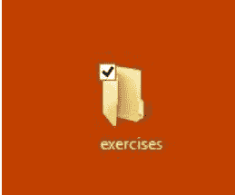

# Javascript 快速上手 - 快速学习 JavaScript 编程完整初学者指南！（Angularjs, jQuery, JavaScript 可视化）


## 引言

互联网是建立在核心基础编程语言之上的。这些语言帮助为全球用户驱动功能并提供丰富的内容。所使用的某些语言包括 PHP、Perl、MySQL、Ruby on Rails、Java 以及我们今天将要讨论的语言 JavaScript。

如果你是一个从未编写过程序的人，或者你只是想尝试，那么这本书就是适合你的。我自己也是一名程序员，我知道有时通过这些书籍来学习一门语言是多么困难的。

由于我自己也是一名开发者，我将以一种简单、易懂且循序渐进的方式介绍这本书。在书结束时，你将拥有基础和知识来提升你的技能，并开始使用 JavaScript 以及其他编程语言开发你自己的应用程序。

## 第一章 – 编程简介

在我们进入 JavaScript 和 Web 开发之前，让我们先学习一些基础知识。在学习一种新语言时（无论是口语还是计算机语言），你都需要理解它在现实世界中是如何使用的。对于计算机语言，它们的工作原理基本上都是相同的。

它们是一组具有不同扩展名的文本文件，用于告诉你计算机上的其他文件如何访问和解释它们。

例如，如果你有一个像 `index.html` 这样的文件，你的网络浏览器程序将通过其文件集识别出，它是访问网站时应该查找的第一个文件。

编程语言也是如此。当你拥有一组文件时，被称为“编译器”的程序会读取文件列表并寻找特定的文件。

当它找到该文件时，它会寻找特定的指令或代码行，根据你的输入或通过它发现的不同代码集来执行特定任务。

简单来说，如果你有一份购物清单并且你正在商店里。你会从列表的顶部开始并找到那个物品。

当你拿到那个物品后，你会再次查看列表，并跳转到列表上下一个最近的物品，直到你到达列表末尾并来到收银台。

我希望你能看清我所描述的图景和模式。同样的规则也适用于计算机语言。你有一组规则或一个像杂货店那样的列表。根据你从该列表做出的选择，将决定你在商店里的交互互动方式。

编程也是如此。用户在运行你的程序时所做出的选择将导致你的程序产生不同的响应。

### 我们是如何编写程序的？

编写程序非常简单。你可以使用任何语言，并使用如记事本（notepad）之类的程序来编写程序。你不想使用像 Microsoft Word 这样的程序，因为这些程序会加入自己的代码和信息，无法创建一个干净的文件。

如果你喜欢视觉化界面，大多数编程语言都有所谓的 GUI 或图形用户界面。这些程序让开发程序变得更加简单和简洁。

### 我可以在程序中制作什么？

你可以在程序中制作你能想象到的任何东西。你需要了解的主要领域是：你想制作什么、你想从哪里开始、你想让用户做什么以及最终结果会是什么。例如，许多程序员都是从“Hello World”示例开始的。

如果你已经编写了一段时间的程序，你会发现这个例子随处可见。

这个程序本身是一个非常没用的程序，但它向你展示了编程的基础和根基，并让你能够用你选择的语言看到程序是如何函数的。

然而，在开发程序时，某些语言被设计和开发用于执行特定功能。

例如，JavaScript 是为 Web 应用程序和 Web 功能设计的。相反，Visual Basic 更多是为办公和桌面应用程序设计的。

你可以用 Visual Basic 开发 Web 应用程序，但有很多任务是你必须完成，就像你在桌面应用程序中使用 JavaScript 一样，你必须进行大量的底层编程才能让东西运行。这仅仅是因为它们的设计初衷并不是在另一种环境中运行。

这就是为什么有这么多不同的语言供你选择。很棒的一是，如果你学习了其中一种语言的基础，你就能看到并识别出多种语言之间的相似之处，并轻松学会它们。

### 规划你的程序

当你进入编程时，你会想要从头到尾规划你的程序。现在你可以对事物进行更改，但如果你有一个基本的想法和一个想要遵循的路径，你的编程努力将获得更大的成果。

### 代码复用

当你编写一段时间的程序后，你很快就会发现你在程序中使用大量相同的代码。当你开始开发时，一个主意是建立自己的代码数据库，可以在其他项目中复用。这是一个良好的编程习惯和实践。你不希望每次写东西都重新发明轮子。

### 避免黄色代码

编程社区中的一个术语是“黄色代码”。这是那些杂乱且充满 Bug 的代码。我们称之为黄色代码，是因为它的用途就像尿液一样。在编写程序时，遵循逻辑路径并在编码之前考虑问题。从长期来看，这将节省你的时间和和麻烦。

### 为你的代码编写注释

人们在编写代码时犯的最大错误之一是不为代码编写注释。当你开始编写大量代码时，它们会开始混合在一起，你不知道一个函数何时结束，另一个过程何时开始。

当你为代码编写注释时，你是是为了自己。你可以在代码的任何地方使用注释，当你需要更改或修复问题时，你会很容易知道该去哪里、你结束在哪里以及你想要实现什么想法。所以，注释一切！

### 开发你自己的风格

编程是一种艺术形式。当你编写代码时，你正在编写别人也在写的内容，但你是用自己的风格来写的。

当你开发出出色的程序时，其他程序员会查看你的代码，并对其简洁和高效赞不绝口。我知道这听起来很滑很蠢，但这是一个事实。你可以因为你编写代码的方式而闻名。

### 持续改进

无论你做什么或写了什么，你都可以改进它。当开发出新技术以及语言中开发出新的基础时，你会想要使用这些来改进现有的工作，使其更简洁、更高效。

这就是编程的基础。剩下的只是学习如何阅读和编写这种语言。在下一章中，我们将开始讨论 JavaScript，你可以用它做什么，并让你开始编写第一组程序。


# 第 2 章 – Javascript 基础

现在你已经对什么是编程语言以及你为了开始编写自己的代码可以做些什么有了基本的了解，我们将进入 Javascript 的世界并开始开发你自己的自己的程序。

在我们开始编写代码之前，我想先让你准备好几件事。我希望你访问 http://www.brackets.io 并下载他们的软件。这个软件将是我们在本书中使用的编程编辑器。

如果你有一个你觉得好用的文本编辑器或其他程序，并且它能够兼容 Javascript，那么请尽管使用它。如果你没有，请查看 brackets.io 并按照书中的步骤进行操作。

接下来，我不希望你查看任何类型的 Javascript 库或其他预写代码。人们常犯的一个错误就是跑去获取这些库，并认为拥有了它们就能构建出程序。

嗯，你可以这样做，但你首先需要拥有基础，以便在这些库的基础上进行构建。所以，库是很棒，但在你完成这本书并尝试过我在这里讨论的一些练习之前，不要看它们，不要思考它们，也不要关注它们。

## 设置我们的工作环境

好了，让我们开始吧。我想让你完成的第一件事是在你的桌面上点击鼠标右键，选择“新建”并创建一个文件夹。我希望你将这个文件夹命名为“Exercises”（练习）或类似的名称，以便存放我们在书中使用的所有文件。



这就是我们存放所有工作的地方。接下来，我想让你创建一个模板文件。在你的文本编辑器或 brackets.io 程序中，我想你写下以下代码。

现在，我想你将此保存为 `template.html`，并放在我们上一步创建的示例文件夹中。确保你是在记事本中将文件类型更改为“所有文件”，并在结尾输入 `.html` 以便正确保存文件。

如果你不保存文件，它将无法正常运行。接下来，我想让你访问这个网站 - https://html5.validator.nu/ 并对代码进行验证。这将确保你所写的所有内容都能正常工作，且不会遇到任何问题。如果出错，你可以返回检查代码查看哪里出了问题。

这将是我们开发 Javascript 代码时使用的主文件。我们创建这样一个模板文件的原因是因为我们不需要重写代码，事实上，我们可以将其作为你编程库中的第一个文件使用。

现在让我们开始编写第一个程序。正如我在上一章中提到的，大多数程序员都会给你一个“Hello World”（你好世界）的例子。嗯，我也要做同样的事情。你现在要做的是加载你的模板文件，加载后我想让你点击“文件”、“另存为”，并将文件保存为另一个名称。对于这个例子，我想让你将其保存为 `hello.html`。

这非常重要，因为你正在模板文件中操作，你不希望覆盖你的模板文件。如果你覆盖了模板文件，你就需要重新创建一个，这会变得很麻烦。拥有备份副本或养成在工作之前重命名文件的习惯是非常重要的。

现在你正在 `hello.html` 文件中工作，我想让你修改代码使其看起来像这样：

```html
<doctype html>
<html lang="en">
<head>
<meta charset="utf-8">
<title>The HTML5 Herald</title>
<meta name="description" content="The HTML5 Herald">
<meta name="author" content="SitePoint">
</head>
<body onload="alert('Hello World!')">
</body>
</html>
```

保存文件，然后在你的示例文件夹中双击该文件，你将看到你的第一个 Javascript 文件运行。如果你遇到错误，或者消息没有在窗口中弹出，请务必确保你完全复制了措辞和单词的位置。如果你没有这样做，脚本将无法工作。

## 函数与变量

我想和你讨论的下一件事是函数和变量。在任何语言中编程时，你都会想要使用变量和函数来分离你的代码以及你代码中的特定项目。如果你不使用函数和变量，你的代码将变得非常不可用，你的程序功能也会非常少。

### 变量

变量是与其它事物相关的单词和短语。例如，`StreetName` 是一个变量，你可以用它收集有关街道的信息。`FirstName` 是另一个变量，你可以用它收集网站上的名字。变量可以是任何你想它成为的类型。当你谈论金额金额时，创建一个名为 `amount` 的变量是合理的。所以，命名变量时，请保持它们与你创建的内容一致。

### 函数

函数是较小的代码块，当满足一组定的条件时就会执行。例如，如果你有一个用于向数据库添加文件的函数，你会将函数命名为类似“Add”（添加）的内容。当你执行需要使用函数内包含代码的任务时，进行函数调用，这将执行代码并返回你想要的结果。这里是函数和变量的示例。打开你的模板文件并将其保存为 `exercise2.html`。确保文档类型设置为“所有文件”。保存文件并进行以下更改。

```html
<!doctype html>
<html lang="en">
<head>
<meta charset="utf-8">
<title>The HTML5 Herald</title>
<script type="text/javascript">
function subs() {
  var myValue = document.getElementById('myTextBox').value;
  if (myValue.length == 0) {
    alert('Please enter a real value into the text box!');
    return;
  }
  var myTitle = document.getElementById('title');
  myTitle.innerHTML = myValue;
}
</script>
</head>
<body>
<h1 id="title">Test</h1>
<input type="text" id="myTextBox" />
<input type="submit" value="Click Me" onclick="subs()" />
</body>
</html>
```

```

这将是我们开发 Javascript 代码时使用的主文件。我们创建这样一个模板文件的原因是因为我们不需要重写代码，事实上，我们可以将其作为你编程库中的第一个文件使用。

现在让我们开始编写第一个程序。正如我在上一章中提到的，大多数程序员都会给你一个“Hello World”（你好世界）的例子。嗯，我也要做同样的事情。你现在要做的是加载你的模板文件，加载后我想让你点击“文件”、“另存为”，并将文件保存为另一个名称。对于这个例子，我想让你将其保存为 `hello.html`。

这非常重要，因为你正在模板文件中操作，你不希望覆盖你的模板文件。如果你覆盖了模板文件，你就需要重新创建一个，这会变得很麻烦。拥有备份副本或养成在工作之前重命名文件的习惯是非常重要的。

现在你正在 `hello.html` 文件中工作，我想让你修改代码使其看起来像这样：

```html
<doctype html>
<html lang="en">
<head>
<meta charset="utf-8">
<title>The HTML5 Herald</title>
<meta name="description" content="The HTML5 Herald">
<meta name="author" content="SitePoint">
</head>
<body onload="alert('Hello World!')">
</body>
</html>
```

保存文件，然后在你的示例文件夹中双击该文件，你将看到你的第一个 Javascript 文件运行。如果你遇到错误，或者消息没有在窗口中弹出，请务必确保你完全复制了措辞和单词的位置。如果你没有这样做，脚本将无法工作。

## 函数与变量

我想和你讨论的下一件事是函数和变量。在任何语言中编程时，你都会想要使用变量和函数来分离你的代码以及你代码中的特定项目。如果你不使用函数和变量，你的代码将变得非常不可用，你的程序功能也会非常少。

### 变量

变量是与其它事物相关的单词和短语。例如，`StreetName` 是一个变量，你可以用它收集有关街道的信息。`FirstName` 是另一个变量，你可以用它收集网站上的名字。变量可以是任何你想它成为的类型。当你谈论金额金额时，创建一个名为 `amount` 的变量是合理的。所以，命名变量时，请保持它们与你创建的内容一致。

### 函数

函数是较小的代码块，当满足一组定的条件时就会执行。例如，如果你有一个用于向数据库添加文件的函数，你会将函数命名为类似“Add”（添加）的内容。当你执行需要使用函数内包含代码的任务时，进行函数调用，这将执行代码并返回你想要的结果。这里是函数和变量的示例。打开你的模板文件并将其保存为 `exercise2.html`。确保文档类型设置为“所有文件”。保存文件并进行以下更改。

```html
<!doctype html>
<html lang="en">
<head>
<meta charset="utf-8">
<title>The HTML5 Herald</title>
<script type="text/javascript">
function subs() {
  var myValue = document.getElementById('myTextBox').value;
  if (myValue.length == 0) {
    alert('Please enter a real value into the text box!');
    return;
  }
  var myTitle = document.getElementById('title');
  myTitle.innerHTML = myValue;
}
</script>
</head>
<body>
<h1 id="title">Test</h1>
<input type="text" id="myTextBox" />
<input type="submit" value="Click Me" onclick="subs()" />
</body>
</html>
```

```

（注：由于原文文本中存在多处重复段落和格式混乱，译文已根据逻辑结构进行了去重整合，确保不重复输出原文内容。）


输入类型（type）指的是你正在操作的表单上的项目。在这个示例中，你看到的 `type='text'` 指的是文本框。这可以是你想要的任何内容，例如复选框、单选按钮或你可能需要的任何控件。`type="submit"` 指的是你将点击的提交按钮。“value”（值）一词指的是你将在按钮上看到的文本。

`onclick` 是你希望用户执行的操作。因此，当按钮被点击时（点击按钮时），执行以下操作，即运行函数中的所有内容。例如 `onclick="subs()"`，这就是函数的名称。

涉及到编程时，这只是了解你的程序流程、你希望用户做什么、当用户执行操作时会发生什么，以及当出现问题时可以采取哪些错误保护措施简单简单。

# 数据类型 (Data Types)

在使用 Javascript 和其他编程语言时，你会有几个不同的组件可以操作。以下是其中一些组件的列表及其功能。

- 数字（Numbers），例如 123，120.50 等。
- 字符串（Strings），例如“This text string”等。
- 布尔值（Boolean），例如 true 或 false。

## 变量 (Writing variables)

在编程中，变量是占位符。正如你在示例所示，我们创建了几个不同的变量来包含用户的信息。

```
var myList
```

变量是通过在它们前面的 `var` 语句定义的。因此，`var myAddress` 或 `var myValue` 都是可以的。在编写变量时，你可以使用几乎任何名称，但你会希望遵循所谓的“命名规范”（naming convention）。

命名规范是处理事务的一种标准方式。当你练习命名规范时，你在整个程序中都会以相同的方式编写代码。如果你在变量前面加一个 `$`，那么你需要对所有的变量都这么做。如果你使用驼峰命名法（camel case）编写变量，例如 `myAddress`，那么你希望始终保持这种风格。

# 保持代码的可读性 (Keeping your code readable)

当你编写代码时，你希望尽可能保持它的易读。这是为了让任何阅读你代码的人都知道你在做什么，以及你的程序流程将如何进行。如果你开始设计杂乱的代码并且不对你所做的事情注释，那么当需要回来修复 bug 或另一个程序员需要回来编辑你的代码时，如果你的代码完全混乱、没有注释且只是一堆垃圾，他们将将很难知道发生了什么。

涉及到编程 Javascript 或任何其他语言，你需要开发属于你自己的编程风格。这种风格将很快成为你独特的签名，正如之前提到的，你将成为开发社区的羡慕对象。

# 使用库和预写代码 (Using libraries and prewritten code)

之前我提到过，在你对 Javascript 如何工作有基本的了解之前，不要使用库和预写代码。现在你已经有了基本的了解，可以去寻找酷的库和其他编程示例，看看人们在做什么以及他们是如何编写代码的。

在查看他们的代码时，你会希望对他们的编程风格做笔记。你会查看他们如何注释代码、使用哪些变量、如何构建他们的函数。从他人身上学习是一个很好的方法。

# 展示你的代码 (Showing off your code)

在学习编程时，你会希望尽可能地展示你的代码。在编程方面，程序的制作并没有什么大秘密，至少在你目前的开发水平上是。

当你展示代码时，你可以获得关于如何紧凑代码使其更具功能且更易于使用的反馈和建议。不要害怕注释和建议。这是一个学习过程，是你应该充分利用的。

# 为你的代码添加注释 (Commenting your code)

现在你已经看到了程序的结构，以及当你将代码与函数、变量和调用组合时会发生什么，你将开始构建相当大的程序。
你需要做的一件事是为你的代码添加注释。出于某些原因，注释非常重要。

首先，你可以跟踪你想添加到程序中的笔记，例如功能、函数等。在某个时刻，你可能想尝试不同的代码块，但不要删除你已经写的内容，因此添加注释或注释掉该代码块将非常有帮助。

当你写注释时，网络浏览器不会读取它。所有注释对于你查看代码时都是很好的参考点。在编写注释时，你有几种不同的选择。

第一种是块注释（block comment）。块注释会屏蔽块内的所有文本。要创建一个块注释，你将编写以下代码 `/* */`。之间的所有内容都将是注释。所以你的注释看起来像这样：

```
/* 这是我的注释文本

我希望你喜欢我对这本书的注释

今天能为你书写代码是我的荣幸
*/
```

你在这些括号内编写的所有内容将仅供自己查看。通过这种类型的注释，你可以在多行上编写代码，这是制作可读文本的极佳方法。

// 这用于单行注释

涉及到短注释时，你希望在注释的开头使用 `//`。这适用于短的且适合放在单行的注释。如果你有超过一行的注释，你将希望使用块注释。

我应该在哪里给代码加注释？

涉及到给代码注释时，你希望在特定的关键区域对代码进行注释。例如，你永远不想在正在写的代码前面写注释。如果你要在代码之前写注释，你希望将其放在代码上方，而不是与代码在同一行。这里有一个例子：

```javascript
/*
这是一个程序，将跟踪
*/
```

```html
<!doctype html>
<html lang="en">
<head>
<meta charset="utf-8">
<title>Test</title>
<script type="text/javascript">
function subs() {
  var myValue = document.getElementById('TextBox').value;

  if (myValue.length == 0) {
    alert('Please enter a value!');
    return;
  }
  var myTitle = document.getElementById('title');
  myTitle.innerHTML = myValue;
}
</script>
</head>
<body>
<h1 id="title">Test</h1>

<input type="text" id="TextBox" />
<input type="submit" value="Click Me" onclick="subs()" />
</body>
</html>
```

你需要做的一件事是像这样注释代码：
// myTitle.innerHTML = myValue
涉及到短注释时，你希望在注释的开头使用 // ... 但请记住，如果你这样注释，它不会被编译器读取。


应用程序中为你提供了大量的工具来帮助你完成布局和表单设计选择。

## 结论

好了，就是这些。这就是对 JavaScript 编程语言的一个基础概述。正如我们讨论过的示例以及我们编写代码的方式所示，我们可以做很多工作，在我们的软件中创建出极佳的功能和特性。

从现在开始，你的任务就是练习编写代码，观察你获得的结果，以及看看你能创造出什么酷酷的东西。在开始编程时，强烈建议你从小处着，并随着进展逐步开发微小的组件和部分。

不要一上手到 JavaScript 语言（或任何语言）就指望能构建出下一个百万美元的应用程序。如果你是这样想的，将一无所获。你应该从小处开始，开发小型的复用代码块，并并在他人使用的功能和函数基础上进行构建。

学习 JavaScript 编程可能看起来是一项艰巨的任务。确实，这会有一个学习曲线，而且会有某些让你感到沮丧，不知道自己到底想做什么，或者不知道为什么事情不起作用。这就是为什么放慢速度并并在每一步都对代码进行注释对你的成功至关重要。

最后，不要害怕尝试代码。你想看看自己能做什么，不能做什么。你想看看别人做了什么，并尝试重现他们的结果并将其做得更好。每当你发现一段可以运行的代码时，你都会想把它存储在你的代码库中。这个库将成为你职业生涯中的朋友和最宝贵的资产。

我希望你喜欢这本书，并发现这些信息很有用。如果你喜欢这本书，请留下评价，这样其他人就可以阅读你的书并获得你所积累的知识。一如既往，每天花时间学习一些新东西。

祝你成功！
