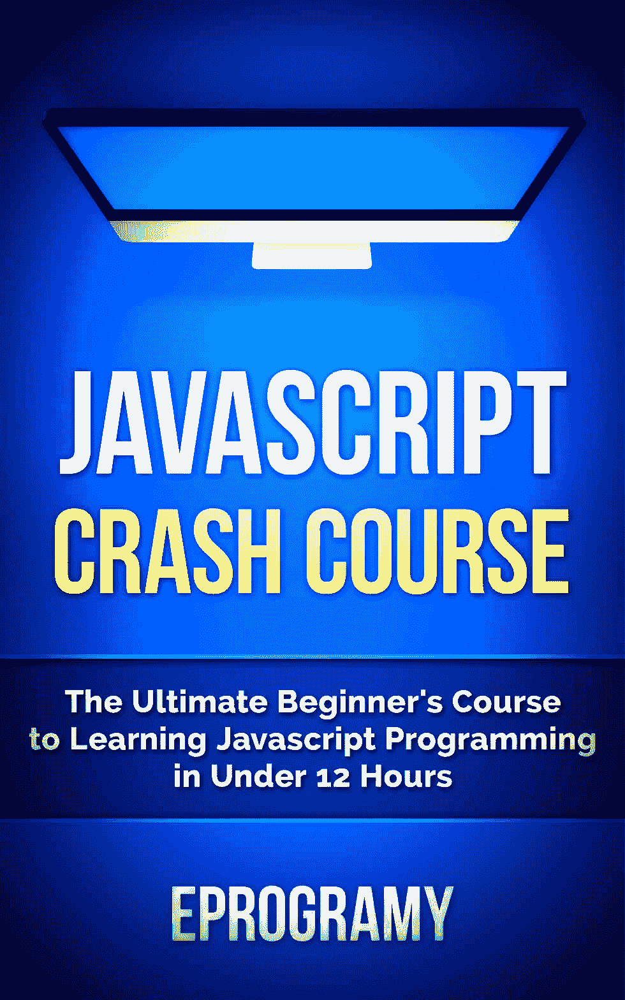

# JavaScript：速成课程 - 在 12 小时内学习 JavaScript 编程的终极初学者指南





© Copyright 2015
保留所有权利。未经出版者许可，不得以机械、电子或任何其他方式（包括复印）复制本书的任何部分。

## 免责声明
书中提供的信息旨在为讨论的话题提供有用信息。作者的书籍仅旨在为读者提供 JavaScript 编程的基础知识，对于学生是否能够吸收并应用所提供的所有信息，不作任何保证。尽管作者将尽最大努力分享其见解，但本书或作者的任何其他书籍均不构成读者将在特定时间内学会 JavaScript 编程的承诺。插图仅供参考。

# 目录
- 引言
- 第 1 章
    - [JavaScript 的历史]
    - [什么是 JavaScript?]
- 第 2 章
    - [HTML]
    - [标签]
    - [输出]
    - [CSS]
    - [外部 CSS]
- 第 3 章
- 第 4 章
- 第 5 章
    - [算术运算符]
    - [加法]
    - [减法]
    - [乘法]
    - [除法]
    - [模块]
    - [后自增]
    - [前自增]
    - [后自减]
    - [前自减]
    - [赋值运算符]
- 第 6 章
    - [if 语句]
    - [关系运算符]
    - [逻辑运算符:]
    - [组合运算符]
    - [赋值]
    - [答案与解释:]
- 第 7 章
    - [循环]
    - [for 循环]
    - [while 循环]
    - [continue 关键字]
    - [break 关键字]
    - [数组]
    - [多维数组]
- 第 8 章
- 第 9 章
- 第 10 章
- 第 11 章
- 第 12 章
- 第 13 章
- 第 14 章
- 第 15 章
- 第 16 章
- 第 17 章
- 第 18 章
- [JAVA 速成预览 - 在 12 小时内学习 Java 编程的终极入门课程]
- [关于作者]

## 引言
## 欢迎来到你的新编程语言
所以，你决定学习 JavaScript 编程了吗？很好，祝贺你，欢迎来到你的新编程语言！你会喜欢它的！

在 Eprogramy，我们相信良好教育的基础是提供能够开启未来之门的工具。毫无疑问，世界已经进入了一个一切触手可及的时代。社会需求发生了变化。因此，今天的沟通方式也发生了变化。沟通开启了大门，所以学习如何沟通是我们的挑战。在 Eprogramy，我们希望你学会用一种新语言交流：编程语言。这种语言允许我们使用电脑或笔记本电脑进行创作。

也许道路是困难艰难的，但我们将为读者提供工具，让学习变得愉快且富有成效。我们将展示学习编程所需的所有方面。从基础知识到解决最常见的编程问题，以及更多更多。我们将始终通过大量的示例提供帮助，这将有助于更好地理解。

我们知道自己在做什么，并相信你完全有能力吸收我们的教学。

未来的大门已经开启。让我们一起一步步来。

让我们开始吧！
Eprogramy 团队

# 第 1 章：JavaScript 编程语言
## JavaScript 的历史
自从万维网诞生以来，网站包含静态页面。进入不同的网页时，你看到的是那个时代允许的最基本形式（20 世纪 90 年代初）。页面交互是不可能的，但现在终于可以了，通过你将在本指南中学习的编程语言——`Javascript`。

通过使用 `Javascript`，你能够与按钮、文本字段、列表、表格等许多组件进行交互，因为你建立了一个基础设施来监听用户鼠标点击或键盘击键的交互，并根据对其编写的程序做出相应响应。`Javascript` 的核心思想是能够向你的网页发出指令，使其对不同的情况做出反应，或根据时间、动作以及用于触发 javascript 事件的各种其他元素按顺序执行操作。

两个流行的浏览器（即你用于访问万维网网页的程序）是 `Netscape Navigator` 和 `Internet Explorer`。`Netscape` 浏览器第一个推出编程语言的，使用户能够创建交互式网页。这在当时被命名为 `Livescript`，但当另一个名为 `Java` 的编程语言出现时，很快改名为 `Javascript`，因为他们发现了一个很好的机会，利用它的名字来增加自己语言的声誉。

尽管如此，在 1996 年，`Javascript` 编程语言交给了一个名为 `EMCA` 的国际标准组织，从那时起由他们处理该语言。

## 什么是 JavaScript?
让我们清除对 `Javascript`的一些误解——它不是 `Java`。许多人倾向于将两者混淆，并不完全理解其中的区别。这两种语言不仅在概念上不同，在设计上也不同，应该被视为两种完全不同的编程语言。


Javascript 是一种最常用于网站交互的编程语言。它可以用于让网页变得动态且可交互，甚至可以用 Javascript 和 HTML5 制作出游戏！Javascript 代码要么被放置在 HTML 文档中（HTML 是所有网页编写的格式，或者至少是你的浏览器翻译网页时使用的格式），要么是从 HTML 文档中引用的。如果你想更深入地了解这一点，请去寻找一个 HTML 教程。

Javascript 的执行方式不是通过任何特殊的第三方程序（比如编译器，如果你曾经学习过基于应用程序的编程语言），而是使用像 Chrome、Firefox、Internet Explorer 等主流网络浏览器对 Javascript 的内置支持。因此，你只需要将 Javascript 代码嵌入到 HTML 语言中，HTML 是浏览器用于解释网页内容（如文本和外观，在 CSS 的帮助下）的标准语言。

编写 Javascript 代码所需的工具非常简单，可以从最基础的记事本开始。对于本指南来说，我们将使用 Sublime Text，它是一款适用于 HTML/CSS 和 Javascript 等网络开发语言的优秀文本编辑器。如果你不喜欢 Sublime Text，另一个可选的文本编辑器是 Notepad++，它也是另一个编写与网络开发相关代码的优秀工具。

# 第 2 章

## 理解 HTML 和 CSS 基础的重要事项

## HTML

为了理解我们如何实现并使用 Javascript 语言，我们必须理解网页最基本形式的形式是如何运作的。HTML 全称为超文本标记语言（HyperText Markup Language）。它是用于创建静态网页的标准标记语言。这就是为什么在 Javascript 的帮助下，我们可以让这些网页变得更加动态和响应迅速。

### 标签 (Tags)

在 HTML 中，有一个标准的约定来开始和结束一个语句。在英语中，我们必须以大写字母开头句子并以句号结尾，以保持易于理解的标准写作流。那么，HTML 使用“标签”（Tags）的概念来理解你具体在写什么。在 HTML 中，你必须记住几个关键标签，并理解它们的用途。

在任何 HTML 文件中，都必须遵循一个标准的结构。这里有一个显示该示例的样本代码：

```html
<html>
<head>
    <title> 这是网页的标题 </title>
</head>
<body>
    这是网页的内容。
</body>
</html>
```

当你创建一个标签时，必须以“<”符号开头，然后标明标签名称，最后用“>”符号结束。然后，标签的“内部”部分或标签内将放置其余的代码。要结束标签，你采用与开始标签相同的约定，但以“/”结尾。这就是为什么你看到文档顶部是：`<html>`，而文档结尾是：`</html>`。

视觉演示：

```html
<tagname> 标签内的内容 </tagname>
```

现在让我们分析下下面的样本代码：

`<html>`
这个标签指示网站的 HTML 部分何时开始，因此它必须出现在每个 HTML 文档中。该标签在文档结束处关闭。因此，`<html>` 标签是内部所有标签（子标签）的父标签。

`<head>`
此标签在加载网页时包含所有的头部信息。此标签内的所有内容都不会显示给用户，主要用于初始化脚本以准备使用。例如，在头部部分设置一个 `script` 标签，为整个 HTML 文档的其余部分使用做准备。我们在学习 jQuery 库时将需要这样做。

`<title>`
此标签的内容将包含网页的标题。

`<body>`
这是网站的整个内容部分。就像任何文章一样，你有论点、正文和结论。这在标签形式上的这种理念是相同的。

HTML 中还有许多其他标签你可以在网上查询。让我们来看各种示例并识别一些有用的标签。

```html
<html>
    <head>
        <title> “<p>”标签的示例 </title>
    </head>
    <body>
        <p> 这是一个段落。 </p>
    </body>
</html>
```

上述示例中加粗的标签本质上描述了一个段落，并对其进行了格式化，使其具有正确的内边距/间距，而无需你操作。

```html
<html>
    <head>
        <title> “<p>”标签的示例 </title>
    </head>
    <body>
        <p> 这是一个段落。 </p>
    </body>
</html>
```

上述示例中加粗的标签本质上描述了一个段落，并对其进行了格式化，使其具有正确的内边距/间距，而无需你操作。


### 输出 (Output)

最后，让我们来看一下 HTML 中的注释概念。有时你可能编写某些代码但并不实际将其打印到屏幕上，只是想在代码中添加提醒。你可以通过以 `<!--` 开头并以 `-->` 结束来进行注释。

因此，如果我对某一行进行注释，我会这样做：

```html
<p> 这是段落 </p>
<!-- 这一行输出一个“这是段落” -->
```

HTML 中有很多标签，还有属性，属性包含的值用于确定标签内容如何显示或被 CSS 解释。在学习 Javascript 和 CSS 时需要注意两个属性是：`id` 和 `class`。

你可以将这些用于任何标签，例如 `<body>` 标签内的 `<p>` 标签。

属性的工作格式如下：

```html
<p id="content"> 这是网页的内容。 </p>
```

如示例所示，为了声明属性，你必须在第一个标签 `<p>` 内留空，然后标明已知属性，例如 `id`。然后为了给它赋值，你必须有一个等号，然后是两个引号以及引号内的值。在这种情况下，这个段落包含属性 `id`，其值为“content”——这可以通过你将要学习的选择器作为 CSS 和 Javascript 等语言的引用。

HTML 中仍有许多标签可以供你学习，但这些是你开始编写时需要的基础标签。此外，你现在应该理解 HTML 文档的基本结构了。

让我们回顾一下：

- `<html>` 和 `</html>` 定义 HTML 文档，标签本身仅仅是将其内部内容定义为 HTML 类型，以便浏览器能够解释。
- `<head>` 和 `</head>` 为文档提供信息并初始化任何外部脚本或样式表。
- `<title>` 和 `</title>` 仅为浏览器提供信息以显示 HTML 文档的标题。


`<body>` 和 `</body>` 标签包含了文档的所有内容，包括段落、导航栏、表格、图像等。

`<h1>` 和 `</h1>` 标签简单地将其之间的文本格式化为标题或段落的标题。

`<p>` 和 `</p>` 标签则相应地将其之间的文本格式化为段落。

## CSS 

CSS 代表“Cascading Style Sheets”（级联样式表），它本质上定义了 HTML 元素在网页浏览器中的显示方式。

现在，在我们继续之前，让我们快速回顾一下 CSS 中注释的工作原理。与 HTML 类似，注释是非常用的，也可以在 CSS 中实现，但它的语法不同。要在 CSS 中编写注释，你必须使用以下符号：

```css
/* 这是一个注释 */
```

斜杠和符号之间的文本不会被处理，仅供人类阅读。因此，开始注释必须使用 `/*`，结束注释必须使用 `*/`。

让我们来浏览一下关于如何编写 CSS 代码的概念。

### 示例：

```css
p {
    color: red;
    font-size: 14px;
}
```

在上面的示例中，关于上述 CSS 代码的格式，有几点关键内容需要注意。

编写 CSS 代码时必须指定的元素是标签名或选择器。

```css
p {
    color: red;
    font-size: 14px;
}
```

**粗体文本**表示选择器，即 `<p>` 标签，它处理文档的段落。如果你在 `<body>` 中的 `<p>` 之间放置任何文本，你现在将看到文本变为红色，字体变为 14 像素。让我们继续分析这段代码。

```css
p {
    color : red;
    font-size : 14px;
}
```

上述示例中的**粗体文本**表示属性。在每个选定的标签中，你必须指定该标签的属性，例如文本颜色、字体大小、字体样式、字体粗细等。你可以在互联网上查找任何你需要的属性。有许多属性，我们不会在本指南中介绍它们。不同的属性应用于不同的标签。对于本例中的“p”标签，我们可以引用 `color` 属性和 `font-size` 属性。在花括号内引用它们（这仅表示适用于选择器 `p` 的属性块），然后将其分配给特定值。

```css
p {
    color: red ;
    font-size: 14px ;
}
```

要给 `color` 属性分配特定值，你必须使用冒号符号（它仅用于分隔属性和值），然后输入相应的值。一旦你写完属性和值，请使用分号告诉浏览器你已经结束了该语句，以便它可以读取下一条。

在处理颜色时，与其使用标准的红色、蓝色、黄色等——你可以根据 `RGB` 值（红、绿、蓝）引用更具体的颜色，这些值可以通过 HTML 选择器获得。这是一个可以提供用于 CSS 的 HTML 代码的网站链接：http://html-color-codes.info/

为了回顾 CSS 语法，让我们查看以下：

1. `p`
2. `{`
3. `color:`
4. `red;`
5. `}`

上面的代码获取段落的颜色并将其更改为红色。每行都经过编号，但不会包含在代码中。编号是为了让我们扫描每一行并了解它的工作原理：

1. 选择器/标签
2. 表示属性的开始
3. 带有冒号的属性/特征以指示值
4. 属性/特征的值，然后用分号表示语句结束
5. 表示特定选择器（即 `p`）的属性结束

记住，你可以多次这样做，记住分隔选择器块，以防浏览器产生混淆。好了，让我们先看看你如何在 HTML 文档中实际开始编码。首先，你必须进入 `<head>` 标签之间并输入以下内容：

```html
<html>
<head>
    <title>此网页标题</title>
    <style type="text/css">
        p {
            color: red;
            font-size: 14px;
        }
    </style>
</head>
<body>
    <h1>这是标题文本</h1>
    <p id="content">这是网页的 own。</p>
</body>
</html>
```

为了在 HTML 文档中开始编写 CSS，你必须使用 `style` 标签，并借助 `type` 属性的帮助，`type` 属性引用了标准规范 `text/css`，每当你想在 HTML 文档中编写 CSS 时都必须使用它。在这个 `style` 标签内，是你的 CSS 代码，它成功引用了 HTML 文档中所有的 `p` 标签。

那么，如果你只想引用特定的段落呢？现在我喜欢称为 `p` 而不是标签的原因是因为“选择器”是一个通用术语，而放置在 `p` 位置的内容也是通用的。与其在 HTML 文档中引用一个实际的标签，你能够使用井号加上 id 名称来引用 id：

```css
#idname {
    color: red;
    font-size: 12px;
}
```

你也可以使用选择器引用带有特定名称 `class` 属性标签：

```css
.classname {
    color: red;
    font-size: 12px;
}
```

现在你可能怀疑 `id` 或 `class` 是否会有帮助。让我通过以下示例代码为你解疑：

```html
<html>
<head>
    <title>此网页标题</title>
    <style type="text/css">
        #content {
            color: red;
            font-size: 14px;
        }
    </style>
</head>
<body>
    <h1>这是标题文本</h1>
    <p id="content">这是网页的内容。</p>
</body>
</html>
```

在上面的示例中，你可以看到我们列出了特定的段落，受我们在 `<head>` 标签内 CSS 中列出的更改的影响。这是你使用 id 选择器的一种方法。使用 class 选择器（并没有太大区别，只是偏好不同）则是执行以下操作：

```html
<html>
<head>
    <title>此网页标题</title>
    <style type="text/css">
        .content {
            color: red;
            font-size: 14px;
        }
    </style>
</head>
<body>
    <h1>这是标题文本</h1>
    <p class="content">这是网页的内容。</p>
</body>
</html>
```


在上面的代码中，我们没有使用井号符号来选择具有特定 id 名称的属性，而是这次使用了类名。利用这些选择器的知识，我们可以使用 `Javascript` 引用特定的 HTML 元素，并通过添加属性或更改标签内的内容使其对用户交互产生动态，从而操作这些标签。

在 CSS 中，有不同的方法可以将样式语言实际实现到 HTML 中。我已经向你展示了一种方法，即在 `head` 标签中使用 `style` 标签。事实上，实现 CSS 的方法主要有三种类型：一种是内联（inline），另一种是内部（internal），也就是我们之前采用的方法；另一种是外部（external）。我们之前是直接在 `head` 中内部编写的。要实现外部引用，我们不再在标签内编写 CSS 代码，而是让 `style` 标签引用一个包含所有 CSS 代码的文件。

让我们简单看下每种方式的工作示例。请记住，如果你引用了某个文件（在此例中为 CSS 文件），如果你没有列出直接目录路径（例如 `C:\Program Files (x86)\Crazybump`）而只写名称，那么它将退而求其次，在你引用的 HTML 文件所在的根目录中查找。

### 外部 CSS

文件名：`Learn.html`

```html
<html>
    <head>
        <title> 这是网页标题 </title>
        <link rel="stylesheet" type="text/css" href="pageStyle.css">
        <!-- 这是在 head 标签中用于引用外部 CSS 文件的标准行。href 属性用于引用特定文件，它是你为 CSS 文件修改时唯一需要更改的内容。 -->
    </head>
    <body>
        <h1> 这是标题文本 </h1>
        <p id = "content"> 这是网页的内容。 </p>
    </body>
</</html>
```

文件名：`pageStyle.css`

```css
#content {
    color: red;
    font-size: 14px;
}
```

现在，既然我们已经看到了内部 CSS 和外部 CSS 引用的工作方式，我们可以查看最“廉价”的 CSS 方法：内联（Inline）。这种方法不被推荐，仅仅因为它看起来不整洁或不组织。尽管在对特定标签进行某些测试时，它是很有用的。为了实现内联，对于任何想要样式的标签，你必须添加 `style` 属性，并带有等号和引号来编写所有属性。然后对于每个属性，你必须用冒号分隔值，当你写完所有属性后，必须用分号结束。这里有一个示例：

```html
<p style = "color: red; font-size: 14px" id = "content"> 这是网页的内容。 <p>
```

上面是内联编码的示例。这里是完整的源代码：

```html
<html>
    <head>
        <title> 这是网页标题 </title>
    </head>
    <body>
        <h1> 这是标题文本 </h1>
        <p style = "color: red; font-size: 14px" id = "content"> 是网页的内容。 </p>
    </body>
</</html>
```

我们终于涵盖了 HTML 和 CSS 的基础知识，终于开始学习如何实现 `Javascript` 了！

# 第 3 章 JavaScript 结构

`Javascript`的工作原理是它可以放在 HTML 文档的 `body` 和 `head` 部分。根据你的情况，可以通过外部或内部方式完成。为了在 HTML 文档中插入 javascript 代码，你必须使用 `script` 标签。

示例：

```html
<script>
    alert("Javascript");
</script>
```

另一种这种方法是指定脚本类型：

```html
<script type = "text/javascript">
    alert("Javascript");
</script>
```

为了回顾具体发生了什么，我们只需要从一个 `script` 标签开始，并在其中编写 Javascript。在这种情况下，我们正在使用名为 `alert` 的构建，它只是简单地打印引号内的内容。需要注意的是，在通用的编程中，每当你处理文本（字符串）时，必须使用引号来指示它确实文本而不是其他，否则解释器在处理 `JS` 代码时会困惑。

`script` 标签的使用方式如下：

```html
<html>
    <head>
        <title> 这是网页标题 </title>
        <script type = "text/javascript">
            alert("Javascript");
        </script>
    </head>
    <body>
        <h1> 这是标题文本 </h1>
        <p style = "color: red; font-size: 14px" id = "content"> 这是网页的内容。 </p>
    </body>
</</html>
```

或者

```html
<html>
    <head>
        <title> 这是网页标题 </title>
    </head>
    <body>
        <h1> 这是标题文本 </h1>
        <p style = "color: red; font-size: 14px" id = "content"> 是网页的内容。 </p>
        <script type = "text/javascript">
            alert("Javascript");
        </script>
    </body>
</</html>
```

如两种情况所示，你可以选择在 `head` 或 `body` 中使用。现在，为了从外部实现，你必须使用 `script` 标签，但在此情况下，`script` 标签具有 `src` 属性，它仅包含目录。在这种情况下，没有提供目录。为了实际创建 `test.js`，你只需编写原始代码并带扩展名保存文件。

```html
<html>
    <head>
        <title> 这是网页标题 </title>
        <script src = "test.js"></script>
    </head>
    <body>
        <h1> 这是标题文本 </h1>
        <p style = "color: red; font-size: 14px" id = "content"> 是网页的内容。 </p>
    </body>
</</html>
```

拥有外部 javascript 代码的优点是缓存的 Javascript 文件能够加载更快，从而提高页面加载速度。使用外部 Javascript 文件的另一个大优点是它更容易维护，特别是对于大型项目。


现在让我们来回顾一些关于通用编程的常识。代码中的间距对于程序的运行与否完全没有影响，但保持适当的间距是符合惯例且高效的，这样其他程序员才能阅读你的代码，你自己在编写代码时也能读懂自己的代码。随着你不断地编程和实践，你将开始掌握如何理解标准的间距规范以及何时需要使用它们。最好的方法就是继续阅读本指南，并留意何时留有间距。

在编程中，你可能会看到一个名称，后面紧跟着大括号，如 `{"` 或 `"}"` —— 这些符号的作用仅仅是相互通信。你可以把 HTML 文档中的标签想象成 `<tag>`，当它结束时，会写成 `</tag>`，标签之间的所有内容都将根据标签的功能进行处理。在编程中，函数的情况也是如此的（我们稍后会学习更多内容）——第一个大括号 `{"` 用于引入代码块的开始，结束大括号 `"}` 则用于封口代码块。这现在可能听起来没意义，但当你学习函数和类时，你很快就会发现这一切都是有意义的。

编程中另一个需要理解的基础性知识是括号的使用 —— 它们用于接收参数或变量，这些变量将在函数内部被处理。例如，如果你还记得高中中学学过的函数，你会记得这意味着什么：

```
f(x) = 5x + 10
```

当 `x` 值被替换为像 `2` 的输入时，它会变成：

```
f(2) = 5(2) + 10
f(2) = 20
```

现在如果我们对编程中的函数应用同样的思想，我们可以看到，它所做的只是为函数提供接收值进行处理的能力。再次强调，这可能还难以理解，但我只是在为之后学习类、函数以及它们的结构如何工作做准备。

我们已经学习了 HTML 和 CSS 中的注释，而且令人惊讶的是—— Javascript 中也有注释！记住，注释是不会被执行的，浏览器会忽略这些行。在双斜杠 `//` 之后编写任何内容仅仅都是单行注释。

例如：

```
// This is a comment
```

现在，另一种注释方法是使用 `/*` 和 `*/`，注释被放在这两个符号之间，`/*` 是开头，`*/` 是结尾。这被认为是多行注释。

例如：

```
/* This is a multi-line
comment. */
```

就像写英文句子一样，要理解在结束一个语句时你会使用句号 —— 实际上，编程中也适用同样的惯例。记住在 Javascript 中创建的任何语句后面都要加一个分号 `;`。这里有少数例外，例如当你创建一个函数或类时，但这将在指南稍后部分讨论。

Javascript 语言结构中最后一个要涵盖的话题是**大小写敏感**。Javascript 中的所有内容对大小写都敏感，这意味着如果你创建一个变量（你将在下一节学习这一内容）或函数，它们的名称必须与编写时的格式完全一致，不能区分大写或小写字母。

# 第 4 章

## JavaScript 变量

变量本质上是一个存储特定类型数据的存储单元。它由程序员命名，并用于识别它存储的数据。变量通常可以在任何时间访问或更改。你可以向它写入信息，从它提取信息，甚至可以复制信息并添加到另一个变量中。在每种编程语言中，变量都持有特定的数据类型，无论是字符串（文本）、整数（integer）还是小数（float/double），这些都是编程时需要考虑的。有很多不同的数据类型，如数字、字符串、数组、对象等。

为了声明一个变量，你必须使用关键字 `var`，然后在后面加上变量名（你可以给它起任何喜欢的名字）。记住，Javascript 中的所有内容对大小写都是敏感。使用变量是为了存储一个值，以便在代码的后续被使用或处理。让我们来看几个变量声明的示例：

```javascript
var numberOfDogs = 16;
var nameOfDog = "Copper";
var hasDog = true;
var cars = ["First", "Second"];
var anObject = {myName:"Something"};
```

你可能还没有完全理解这些语句中是如何运作（比如数组或对象），但列出它们是为了说明它们是 Javascript 中四种主要数据类型中的两种。

# 第 5 章

## JavaScript 运算符

就像在数学课上，你学习了加法、减法、乘法、除法等。这些都是算术运算符，用于编程中接收数字、对其进行处理并进行相应的计算。让我们来看看编程中的这些运算符，因为它们是最重要的理解内容之一，也是最容易掌握的内容之一。


当你在浏览器中打开 HTML 文件时，你应该会看到一个黑色页面。大多数浏览器都应该某种形式的控制台，通常通过 `F12` 键激活。这在我们学习编程时非常有用。所以，让我们开始吧！首先，始终将你的代码放在 `script` 标签之间。接下来，`console.log()` 函数允许你查看括号内任何表达式或对象的值。目前，你只需要知道如何使用它，但稍后我会解释它的实际含义。这里有一些示例代码：

```
console.log(7);
```

这将在控制台中打印出 "7"。注意分号。它很重要。不要忘记它。

我将编程分为 4 个大类：表达式、语句、关键字和块。我将从表达式开始。表达式是计算机执行以创建一个单个数值的数学步骤。本质上，它们的工作方式与数学课上完全一样，尽管你需要了解某些特定内容的字符。在 Javascript 中，有 5 种运算：加法（`+`）、减法（`-`）、乘法（`*`，顺便说一下是星号）、除法（`/`，是斜杠）和取模（`%`，是百分号）。这些大部分你应该是熟悉的，尽管取模并不广为人知。取模意味着获取除法的余数。这里是一些示例：

```
6 % 3 = 0      7 % 3 = 1
8 % 3 = 2      9 % 3 = 0
```

这对于判断一个数字是否为偶数非常有用。只需对 `2` 取模，如果结果为 `0`，则数字为偶数，否则为奇数。这在尝试查找分钟（例如时钟）时也有用。只需将分钟除以 `60`（一小时 60 分钟），结果将是时钟的分钟计数。注意，当使用取模时，你只能得到从 `0` 到任何小于你运算符的数字（运算符也可以是小数）。

其他数学运算符如指数、根号、四舍五入等并不是默认操作，实际上是我们稍后将讨论的函数。请注意，表达式遵循 BEDMAS（或 PEMDAS，取决于你学的是哪种）。无论如何，这里是一些表达式及其对应的值：

```
7 * (3 % 2) = 7
(8 - 1 + 3) * 6 - 8 / (0 - 4) = 62
```

如果你想让计算机执行这些，你可以使用 `console.log` 打印它们，如下所示：

```
console.log(7 * (3 % 2));
```

数字 `7` 将出现在控制台中。这就是表达式。还有对象表达式，但将在稍后讨论。

关键字是编程的下一个分类。关键字有很多，我们会在学习编程的不同部分时遇到它们。一些常见的关键字有 `"var"`、`"for"`、`"while"`、`"return"`、`"function"` 和 `"break"`。计算机寻找这些特殊单词在你的代码中执行特定操作。这是一个非常通泛的描述，但它们的范围非常广。当你不打算使用某个词时，要小心不要写下它们。如果使用不当，不仅会导致代码执行错误，还可能因为语法错误导致你的代码根本无法运行。

语句是编程的下一个分类。语句始终以分号结尾（在非常特殊的情况下除外）。注意 `console.log` 以分号结尾，因此它是一个语句。这表明 `console.log` 是一个函数，但我们会讲到这一点。

让我们从一个非常常见且重要的语句开始。这与变量有关。变量是存储在内存中的值，供代码稍后重复使用，通常是多次。变量让我们对存储的值命名。想象变量像一个箱子，具体来说是一个搬家箱。当你把盒子拿出来时，你在箱子侧面写上它的名字，这样你就知道箱子里应该装什么。这被称为变量声明。你正在取出内存（箱子），给它一个变量名（在箱子侧面写字），并告诉它箱子应该放在哪里，或者说该变量具有什么种“作用域”，但我们会回到这个问题的。

## 算术运算符

### 加法

`5+5 = 10`

```
var x = 5;
var y = 5;
var sum = 0;
sum = x + y;
```

在上面的示例中，一个名为 `sum` 的变量正在对两个变量（`x` 和 `y`）进行加法运算，并将它们相加以产生数值为 `10` 的结果。

### 减法

`10-5 = 5`

```
var x = 10;
var y = 5;
var total = 0;
total= x - y;
```

在上面的示例中，一个名为 `total` 的变量正在对两个变量（`x` 和 `y`）进行减法运算，并将它们相减以产生数值为 `5` 的结果。

### 乘法

`5*4 = 20`

```
var x = 5;
var y = 4;
var total = 0;
total= x * y;
```

在上面的示例中，一个名为 `total` 的变量正在对两个变量（`x` 和 `y`）进行乘法运算，并将它们相乘以产生数值为 `20` 的结果。

### 除法

`20/5 = 4`

```
var x = 20;
var y = 5;
var total = 0;
total= x / y;
```

在上面的示例中，一个名为 `total` 的变量正在对两个变量（`x` 和 `y`）进行除法运算，并将它们相以以产生数值为 `4` 的结果。

### 取模

`6 % 3 = 0      7 % 3 = 1`
`8 % 3 = 2      9 % 3 = 0`

这对于判断一个数字是否为偶数非常有用。只需对 `2` 取模，如果结果为 `0`，则数字为偶数，否则为奇数。这在尝试查找分钟（例如时钟）时也有用。只需将分钟除以 `60`（一小时 60 分钟），结果将是时钟的分钟计数。注意，当使用取模时，你只能得到从 `0` 到任何小于你运算符的数字（运算符也可以是小数）。

其他数学运算符如指数、根号、四舍五入等并不是默认操作，实际上是我们稍后将讨论的函数。请注意，表达式遵循 BEDMAS（或 PEMDAS，取决于你学的是哪种）。无论如何，这里是一些表达式及其对应的值：

```
7 * (3 % 2) = 7
(8 - 1 + 3) * 6 - 8 / (0 - 4) = 62
```

如果你想让计算机执行这些，你可以使用 `console.log` 打印它们，如下所示：

```
console.log(7 * (3 % 2));
```

数字 `7` 将出现在控制台中。这就是表达式。还有对象表达式，但将在稍后讨论。

关键字是编程的下一个分类。关键字有很多，我们会在学习编程的不同部分时遇到它们。一些常见的关键字有 `"var"`、`"for"`、`"while"`、`"return"`、`"function"` 和 `"break"`。计算机寻找这些特殊单词在你的代码中执行特定操作。这是一个非常通泛的描述，但它们的范围非常广。当你不打算使用某个词时，要小心不要写下它们。如果使用不当，不仅会导致代码执行错误，还可能因为语法错误导致你的代码根本无法运行。

语句是编程的下一个分类。语句始终以分号结尾（在非常特殊的情况下除外）。注意 `console.log` 以分号结尾，因此它是一个语句。这表明 `console.log` 是一个函数，但我们会讲到这一点。

让我们从一个非常常见且重要的语句开始。这与变量有关。变量是存储在内存中的值，供代码稍后重复使用，通常是多次。变量让我们对存储的值命名。想象变量像一个箱子，具体来说是一个搬家箱。当你把盒子拿出来时，你在箱子侧面写上它的名字，这样你就知道箱子里应该装什么。这被称为变量声明。你正在取出内存（箱子），给它一个变量名（在箱子侧面写字），并告诉它箱子应该放在哪里，或者说该变量具有什么种“作用域”，但我们会回到这个问题的。

### 加法示例

`5+5 = 10`

```
var x = 5;
var y = 5;
var sum = 0;
sum = x + y;
```

在上面的示例中，一个名为 `sum` 的变量正在对两个变量（`x` 和 `y`）进行加法运算，并将它们相加以产生数值为 `10` 的结果。

### 减法示例

`10-5 = 5`

```
var x = 10;
var y = 5;
var total = 0;
total= x - y;
```

在上面的示例中，一个名为 `total` 的变量正在对两个变量（`x` 和 `y`）进行减法运算，并将它们相减以产生数值为 `5` 的结果。

### 乘法示例

`5*4 = 20`

```
var x = 5;
var y = 4;
var total = 0;
total= x * y;
```

在上面的示例中，一个名为 `total` 的变量正在对两个变量（`x` 和 `y`）进行乘法运算，并将它们相乘以产生数值为 `20` 的结果。

### 除法示例

`20/5 = 4`

```
var x = 20;
var y = 5;
var total = 0;
total= x / y;
```

在上面的示例中，一个名为 `total` 的变量正在对两个变量（`x` 和 `y`）进行除法运算，并将它们相以以产生数值为 `4` 的结果。

### 取模示例

`6 % 3 = 0`, `7 % 3 = 1`
`8 % 3 = 2`, `9 % 3 = 0`

这对于判断一个数字是否为偶数非常有用。只需对 `2` 取模，如果结果为 `0`，则数字为偶数，否则为奇数。这在尝试查找分钟（例如时钟）时也有用。只需将分钟除以 `60`（一小时 60 分钟），结果将是时钟的分钟计数。注意，当使用取模时，你只能得到从 `0` 到任何小于你运算符的数字（运算符也可以是小数）。

其他数学运算符如指数、根号、四舍五入等并不是默认操作，实际上是我们稍后将讨论的函数。请注意，表达式遵循 BEDMAS（或 PEMDAS，取决于你学的是哪种）。无论如何，这里是一些表达式及其对应的值：

```
7 * (3 % 2) = 7
(8 - 1 + 3) * 6 - 8 / (0 - 4) = 62
```

如果你想让计算机执行这些，你可以使用 `console.log` 打印它们，如下所示：

```
console.log(7 * (3 % 2));
```

数字 `7` 将出现在控制台中。这就是表达式。还有对象表达式，但将在稍后讨论。

关键字是编程的下一个分类。关键字有很多，我们会在学习编程的不同部分时遇到它们。一些常见的关键字有 `"var"`、`"for"`、`"while"`、`"return"`、`"function"` 和 `"break"`。计算机寻找这些特殊单词在你的代码中执行特定操作。这是一个非常通泛的描述，但它们的范围非常广。当你不打算使用某个词时，要小心不要写下它们。如果使用不当，不仅会导致代码执行错误，还可能因为语法错误导致你的代码根本无法运行。

语句是编程的下一个分类。语句始终以分号结尾（在非常特殊的情况下除外）。注意 `console.log` 以分号结尾，因此它是一个语句。这表明 `console.log` 是一个函数，但我们会讲到这一点。

让我们从一个非常常见且重要的语句开始。这与变量有关。变量是存储在内存中的值，供代码稍后重复使用，通常是多次。变量让我们对存储的值命名。想象变量像一个箱子，具体来说是一个搬家箱。当你把盒子拿出来时，你在箱子侧面写上它的名字，这样你就知道箱子里应该装什么。这被称为变量声明。你正在取出内存（箱子），给它一个变量名（在箱子侧面写字），并告诉它箱子应该放在哪里，或者说该变量具有什么种“作用域”，但我们会回到这个问题的。

## 赋值运算符

赋值运算符是在给变量赋值时使用的运算符，最常用的运算符是 (=)。这里是一些示例：

### 等号：`=`

```
var x = 5;
```

在上面的示例中，如果你打印 x，其值将是 5，因为你将变量 x 赋值为 5。

### 加等等号：`+=`

```
var x = 5;
x += 5;
```


在这个示例中，如果你打印 `x`，其值将是 10，因为你正在将 5 的值加到 `x` 的值上。这句话等同于 `x = x + 5` → `x += 5`。

### 减法赋值符号：`-=`

```javascript
var x = 5;
x -= 5;
```

在这个示例中，如果你打印 `x`，其值将是 0，因为你正在从 `x` 的值中减去 5 的值。这条语句等同于 `x = x - 5` → `x -= 5`。

### 乘法赋值符号：`*=`

```javascript
var x = 5;
x *= 5;
```

在这个示例中，如果你打印 `x`，其值将是 25，因为你正在将 5 的值乘以 `x` 的值。这条语句等同于 `x = x * 5` → `x *= 5`。

### 除法赋值符号：`/=`

```javascript
var x = 5;
x /= 5;
```

在这个示例中，如果你打印 `x`，其值将是 1，因为你正在将 `x` 的值除以 5 的值。这条语句等同于 `x = x / 5` → `x /= 5`。

### 取模赋值符号：`%=%`

```javascript
var x = 5;
x %= 5;
```

在这个示例中，如果你打印 `x`，其值将是 0，因为你正在寻找 `(5/5)` 的余数。这条语句等同于 `x = x % 5` → `x %= 5`。

在 Javascript 中处理数字时，另一个重要的点是，你如何声明数字很重要。如果你使用小数值声明，在进行除法时，如果不能整除，它将输出小数；而如果你声明的是整数（全数字），那么如果不能整除，它将进行除法并向下取整。

例如：

```javascript
var numberWithDecimal = 5.5;
var wholeNumber = 5;
```

现在我们已经学习了所有可以用于变量的运算符，让我们来看一些变量的特殊情况。首先，如果你想将两个字符串拼接在一起，方法就是将它们连接（join）在一起，操作方法就是简单地使用 `+` 运算符。

例如：

```javascript
var x = "Hello";
var y = "World";
var line = x + y;
```

在这种情况下，`line` 的值将是 `"Hello World"`（不带引号）。

下一个特殊情况是尝试将字符串和数字相加。例如：

```javascript
var line = 15 + "test";
```

变量 `line` 现在将持有值 `"15test"`（不带引号），因为因为它无法理解你为什么要尝试将一个数字加到字符串上，所以它在后台会自动将其处理为如下形式：

```javascript
var line = "15" + "test";
```

另一个需要考虑的因素是，Javascript 从左到右评估表达式，这意味着变量的顺序很重要。如果你执行以下操作：

```javascript
var line = 15 + 10 + "test";
```

这一行将产生 `"25test"`（不带引号），因为它会从左到右评估表达式。需要考虑的一点是，由于此示例中的两个变量是数字，它会将它们相加，但由于第三个变量是字符串，它会将评估后的数字视为字符串。请记住，运算规则将相应遵循 `BEDMAS` 或 `PEMDAS`，所以你可以使用括号。

下一个特殊情况是如果你执行以下操作：

```javascript
var line = "test" + 15 + 10;
```

在这个特定的示例中，输出将是 `"test1510"`（不带引号），因为因为它一看到第一个变量是字符串数据类型，就会将 `line` 评估为字符串类型，然后相应地将其之后的所有内容评估为字符串。

记住在 Javascript 中，你可以动态更新变量，例如：

```javascript
var x; // undefined
var x = 10; // x 是一个数字
var x = "This is text"; // x 现在是一个字符串
```

在整个指南中，你会看到我使用双引号表示字符串——这其实并不重要——你也可以使用单引号来声明字符串变量。单引号和双引号使用的陷阱在于，如果你在字符串变量外部使用双引号，并想在内部使用它，Javascript 会感到困惑，所以为了不让它困惑，你需要在让 Javascript 字符串变量困惑的双引号之前放置一个转义字符：`\"`，这会在输出字符串时直接跳过该双引号并忽略 `\`。另一种方法是直接用单引号包裹你的字符串变量，从而可以在字符串变量内部使用双引号而不会混淆 Javascript——反之亦然。

示例：

```javascript
var text = "It’s great to learn!" ;
```

## 布尔逻辑
布尔值（boolean）是一个持有真（true）或假（false）的变量。

## If 语句
`if` 语句允许你仅在条件为真时执行代码块。如果条件为假，块中的代码将不会运行。

### Else If
`else if` 语句允许在第一个 `if` 条件为假时检查另一个条件。你可以根据需要拥有尽可能多个 `else if` 语句。

### Else
`else` 语句在所有先前的 `if` 和 `else if` 条件都为假时执行。每个 `if` 块只能有一个 `else` 语句。

```javascript
var a = 10;
var b = 20;

if (a == b) {
    alert("a is equal to b");
} else if (a > b) {
    alert("a is greater than b");
} else {
    alert("a is not equal or greater than b");
}
```

此示例中使用的操作数（`==` 和 `>`）在下方解释：
- `==`: 检查两个值是否相等。
- `>`: 检查左侧的值是否大于右侧。

## 嵌套 If 语句
知道另一个 `if` 语句内部包含一个 `if` 语句也是重要的。这被称为嵌套 `if` 语句。

```javascript
var a = 20;
var b = 30;

if (a == 20) {
    if (a < b) {
        alert("a is less than b and it is equal to 20");
    }
}
```

在这个示例中，我们首先检查 `a` 是否等于 `b`。如果是，我们再检查 `a` 是否小于 `b`。如果该语句也返回真，我们就可以向控制台打印 `"a is less than b and it is equal to 20"`。


Javascript 支持 6 种不同的关系运算符，用于比较变量的值。它们如下：

### 关系运算符

`==`  此运算符检查两个整数的值是否相等。如果它们相等，运算符返回 `true`。如果不相等，则返回 `false`。

示例：
```javascript
var a = 10;
var b = 10;
if (a == b) {
    alert("they are the same");
}
```
这段代码检查 `a` 的值是否等于 `b` 的值。由于 `a` 的值等于 `b` 的值，括号内的值将为 `true`。这导致上述代码打印出语句“they are the same”。

`!=` 此运算符检查两个值是否**不相等**。如果两个值**不相等**，那么它将返回 `true`。如果它们**相等**，它将返回 `false`。

示例：
```javascript
var a = 10;
var b = 20;
if (a != b) {
    alert("they are not the same");
}
```
这段代码将检查 `a` 是否等于 `b`。由于 `a` 不等于 `b`，程序将在控制台中打印“they are not the same”。

`>` 此运算符检查一个值是否**大于**另一个值。如果它前面的变量的值大于后面变量的值，它将返回 `true`。如果前面变量的值小于后面变量的值，它将返回 `false`。

示例：
```javascript
var a = 10;
var b = 20;
if (a > b) {
    alert("a is larger than b");
} else {
    alert("a is not larger than b");
}
```
这个示例检查 `a` 是否大于 `b`。由于 `a` 不大于 `b`，这个 `if` 语句将返回 `false`。相反，它将打印“a is not larger than b”，因为代码通过了失败的 `if` 语句并调用了 `else` 语句。

`<` 此运算符检查一个值是否**小于**另一个值。如果运算符前的变量的值小于变量变量的值，则代码将返回 `true`；否则，它将返回 `false`。

示例：
```javascript
var a = 10;
var b = 20;
if (a < b) {
    alert("a is larger than b");
} else {
    alert("a is not larger than b");
}
```
这个示例与上一个相似，但运算符从“大于”变成了“小于”。因此，这次 `if` 语句返回 `true`。由于 `a` 的值小于 `b` 的值，程序将在控制台中打印“a is larger than b”。

`>=` 此运算符检查一个值是否**大于或等于**另一个值。如果它前面的变量的值大于或等于后面的变量，那么它将返回 `true`。如果后面的变量大于但不等于前面的变量，它将返回 `false`。

示例：
```javascript
var a = 20;
var b = 20;
if (a >= b) {
    alert("a is larger or equal to b");
} else {
    alert("a is not larger or equal to b");
}
```
在这个示例中，`a` 和 `b` 的值均为 20。虽然 `a` 不大于 `b`，但它**等于** `b`，因此该语句返回 `true`，代码最终打印出“a is larger or equal to b”。

`<=` 此运算符检查一个值是否**小于或等于**另一个值。如果它前面的变量的值小于或等于后面的变量，那么它将返回 `true`。如果后面的变量小于但不等于前面的变量，它将返回 `false`。

示例：
```javascript
var a = 20;
var b = 20;
if (a <= b) {
    alert("a is larger than b");
} else {
    alert("a is not larger than b");
}
```
这个示例与上一个相同，只是运算符从 `>=` 改变为了 `<=`。虽然运算符变了，但结果是相同的。由于 `a` 等于 `b`，这段代码将返回 `true`，打印“a is larger than b”。

### 逻辑运算符

Javascript 支持 3 种用于逻辑判断的逻辑运算符，它们通常与关系运算符配合使用。

`&&` 这被称为逻辑**与**（AND）运算符。如果该运算符前后的操作数都返回 `true`，则条件返回 `true`。如果两个操作数均为 `false`，或其中一个操作数为 `false`，则条件将返回 `false`。**两个**操作数都必须为 `true`，条件才会返回 `true`。

示例：
```javascript
var a = 20;
var b = 20;
if (a == 20 && a == b) {
    alert("a is equal to 20 and b");
} else {
    alert("a is not equal to 20 or is not equal to b");
}
```
在这个示例中，我们检查 `a` 是否等于 20，**且** `a` 是否等于 `b`。这两个条件被称为操作数。由于 `a` 等于 20 且等于 `b`，语句返回 `true`，我们在控制台中打印“a is larger than b”。

示例 2：
```javascript
var a = 20;
var b = 30;
if (a == 20 && a == b) {
    alert("a is equal to 20 and b");
} else {
    alert("a is not equal to 20 or is not equal to b");
}
```
在下一个示例中，我们检查与第一个示例完全相同的内容。然而这次的区别在于，我们将 `b` 的值从 20 改变为了 30。这意味着当我们运行这段代码时，`if` 语句将返回 `false`，因为虽然 `a` 等于 20，但它不等于 `b`。因此我们打印“a is not equal to 20 or is b”。

`||` 此运算符被称为逻辑**或**（OR）运算符。如果第一个操作数或第二个操作数返回 `true`，则语句将返回 `true`。这意味着如果第一个操作数返回 `false` 而第二个返回 `true`，语句将会返回 `true`，反之亦然。如果两个操作数均为 `true`，语句也会返回 `true`。本质上，使用或运算符时，至少有一个操作数必须返回 `true`。

示例：
```javascript
var a = 20;
var b = 30;
if (a == 20 || a == b) {
    alert("a is equal to 20 or b");
} else {
    alert("a is not larger than b");
}
```
在这个示例中，我们检查 `a` 是否等于 20，**或者** `a` 是否等于 `b`。在这种情况下，`a` 等于 20 而不等于 `b`。由于这些操作数中只要有一个为 `true`，整个语句将返回 `true`。因此程序将在控制台中打印“a is equal to 20 or b”。

示例 2：
```javascript
var a = 20;
var b = 20;
if (a == 20 || a == b) {
    alert("a is equal to 20 and b");
} else {
    alert("a is not equal to 20 or b");
}
```
在这个示例中，我将上一个示例中 `b` 的值从 30 改为 20。这意味着 `a` 等于 20 且 `a` 等于 `b`。两个操作数都返回 `true`，因此语句返回 `true`。这是因为或运算符要求一个或多个运算符为 `true`。该程序向控制台输出“a is equal to 20 and b”。

`!` 此运算符被称为逻辑**非**（NOT）运算符。它用于反转操作数的逻辑状态。该操作数可以与其他任何操作数一起以反转其输出。如果操作数返回 `true`，在应用逻辑非运算符后，操作数将返回 `false`。

示例：
```javascript
var a = 21;
var b = 20;
if (!(a == 20) && a > b) {
    alert("a is not equal to 20, and a is greater than b");
} else {
    alert("a is equal to 20, and a is not greater than b");
}
```


在这个示例中，我们检查 `a` 的值是否不等于 20，并检查 `a` 是否大于 `b`。由于 `a` 既不等于 20 又大于 `b`，我们可以向控制台输出“a 不等于 20, 且 a 大于 b”。

### 示例 2

```javascript
var a = 21;
var b = 20;
if ( !(a == 20 && a > b) ) {
    alert("a is not equal to 20, and a is greater than b ");
}
else {
    alert("a is equal to 20, and a is not greater than b ");
}
```

在这个示例中，我改变了非逻辑运算符括号的位置，将其扩展到两个操作数。现在，要使该语句为真，`a` 必须不不等于 20，且 `a` 必须不不大于 `b`。在这种情况下，该语句将返回 false，因为 `a` 大于 `b`。根据操作数的要求，它必须小于 `b` 语句才会返回 true。因此，此程序将向控制台返回“a is equal to 20, and a is not greater than b”。

## 组合运算符

在 Javascript 中，你可以在每个语句中使用任意数量的运算符。

## 示例

```javascript
var a = 21;
var b = 20;
if ( (a == 20 && a > b) || (a != 20 && a < b)) {
    alert("correct");
}
else {
    alert("wrong");
}
```

通过这个示例，我们可以看到如何实现更复杂的语句。在这里，我们应用了一个带有两个操作数的 OR（或）运算符，然而每个操作数也都包含了一个 AND（与）运算符。因此，要使该语句返回 true，`a` 必须等于 20 且大于 `b`，或者 `a` 不等于 20 且 `a` 必须小于 `b`。注意我们使用括号是为了使代码更易理解，并防止代码误读我们的逻辑。

### 示例 2

```javascript
var a = 21;
var b = 20;
if ( a == 20 && (a > b || a != 20) && a < b) {
    alert("correct");
}
else {
    alert("wrong");
}
```

在上面的示例中，我们仅通过切换一个括号的位置就显著改变了程序的逻辑。注意现在括号包围了两个内部操作数，而不是用两对括号包围每对外部操作数。要使该语句现在返回 true，必须有 3 个不同的条件返回真。变量 `a` 必须等于 20，并且，要么 `a` 必须大于 `b` 或者它不等于 20；并且 `a` 必须小于 `b`。根据这个新逻辑，第一个操作数必须为真，此外，第二个或第三个条件之一必须返回真。而且，`a` 必须小于 `b`。该语句将返回 false。它会失败第一个条件，因为 `a` 不等于 20。它会通过第二个条件，因为它大于 `b`，但它会失败最后一个条件，因为 `a` 不小于 `b`。由于这需要三个正确的条件，而现在只有一个，所以语句返回 false 并打印“wrong”。

### 赋值题

我们现在将完成另一个赋值题，以确保我们理解了运算符的所有内容。我们有 3 个朋友想知道他们的钱与其他人相比如何。我们将编写一个程序，输出谁比谁富。我们将三个名为 `bob`、`john` 和 `tom` 的整数。我们将给他们每个人分配一个不同的值，程序必须输出谁更富。它还必须告诉我们是否有人的钱数一样。

例如：
如果 `bob = 20`, `tom = 10`, 且 `john = 5`，输出必须是：“bob is richer than tom, who is richer than john”
但如果 `bob = 20`, `tom = 20`, 和 `john = 5`，输出必须是：“bob is as rich as tom, both are richer than john”

程序需要适用于每种结果。我强烈建议你自己尝试这个程序，并在查看答案之前尽可能地努力思考。编程的很大一部分是解决问题和理解代码，所以我建议你先自己想出来。

### 答案与解释

注意程序将通过代码进行解释。

```javascript
// 可以随意更改这些值
var tom = 0; // tom 拥有的钱数
var bob = 20; // bob 拥有的钱数
var john = 10; // john 拥有的钱数

// 我们首先检查每个人的钱数是否一样
// 我为什么没有检查 tom 是否等于 john，因为如果
// tom 等于 bob 且 bob 等于 john，那么显然
// tom 等于 john
if (tom == bob && bob == john) {
    alert("Everyone has the same amount of money");
}

// 如果第一个语句返回 false
// 我接下来检查 tom 和 bob 钱数相同但 john 不相等的特殊情况
else if (tom == bob && bob != john) {
    // 我现在检查 bob 是大于还是小于 john
    // 然后输出正确的答案
    if (bob > john) {
        alert("tom is as rich as bob, both are richer than john");
    }
    else if (bob < john) {
        alert("tom is as rich as bob, both are more poor than john");
    }
}

// 针对不同的人重复上语句的过程
else if (tom == john && john != bob) {
    if (john > bob) {
        alert("tom is as rich as john, both are richer than bob");
    }
    else if (john < bob) {
        alert("tom is as rich as john, both are more poor than bob");
    }
}

// 最后一种可能的名字组合，
// 与上语句相同的检查
else if (john == bob && bob != tom) {
    if (bob > tom) {
        alert("bob is as rich as john, both are richer than tom");
    }
    else if (bob < tom) {
        alert("bob is as rich as john, both are more poor than tom");
    }
}

// 现在我们检查每个人钱数都不同的最后可能的组合
// 接下来的 6 个语句涵盖了所有可能的结果
else if (tom > bob && bob > john) {
    alert("tom is richest, followed by bob, followed by john");
}
else if (tom > john && john > bob) {
    alert("tom is richest, followed by john, followed by bob");
}
else if (bob > tom && tom > john) {
    alert("bob is richest, followed by tom, followed by john");
}
else if (bob > john && john > tom) {
    alert("bob is richest, followed by john, followed by tom");
}
```


```javascript
alert("john is richest, followed by bob, followed by tom");
}
else if (john > tom && tom > bob) {
    alert("john is richest, followed by tom, followed by bob");
}
```

在编写代码时，对你的所有逻辑进行注释是非常重要的，这样没有写过代码的人就能轻松地理解并编辑它。我建议在编写代码时，根据你认为所需的程度进行尽可能多的注释。我也鼓励你尝试找到更好的方法来解决这个问题。也许有某种方法可以用四分之一的长度来编写它；在编程中，答案永远不止一个。

# 第 7 章

## 循环与数组

本指南的这一部分非常重要，因为涵盖了编程中最重要的概念之一。循环正如其名所示——它们仅仅是某些函数，允许你根据你的要求，对特定的代码块进行一定次数的循环执行。尽管这现在看起来可能没什么用，但当你开始将知识应用于真实的编程应用程序时，你会发现它们的用处。在介绍数组之前，让我们先回顾一下循环是如何工作的。

## 循环

Javascript 中的循环与许多其他编程语言相似。其语法也相当直观。在每个循环中，都有一个设置好的条件供循环检查该条件是否为真，直到情况相反，循环本身就会退出。例如，如果你创建一个循环并说我想让它在停止之前运行 10 次某个代码块，有几种方法可以实现这一点，因为有不同类型的循环。循环的大致思路如下：

```javascript
loop (condition) {
    // 代码块
}
```

为了在 Javascript 中创建循环——我们必须理解不同类型的循环以及它们何时有用。让我们来看看这些循环类型，然后我将在讲解过程中解释它们每一种是如何工作的，到最后，你应该对循环如何工作有一个良好的理解。

## For 循环

```javascript
for (x = 0; x < 10; x++) {
    alert("Hi " + x);
}
```

上面的示例中发生了很多事情，所以让我们逐行分析。第一行写道：

`for (x = 0; x < 10; x++)`

在上述语句中，这是 `for` 循环的习惯标准。我们必须首先声明变量，所以从声明变量 `x` 开始，让它成为从 0 开始的整数。接下来，让我们添加一个分号，通过添加条件来将 for 循环的特定部分隔离开。这就是为什么我写了 `x < 10`，它简单表示只要 `x` 小于 10，就运行大括号（`{` 和 `}`）下面的代码块。该语句现在由另一个分号隔开，以便进入 for 循环的最后一个元素。这部分是你告诉你声明的特定变量执行某种特定的算术操作。在这种情况下，我们告诉 `x` 在每次循环通过时递增。

让我们用伪代码的方法（英语可读）来过一遍：

```javascript
for (声明变量; 为变量创建条件; 影响变量) {
    // 执行此代码块
}
```

一旦运行了代码块，它将返回第一语句并检查条件是否仍然满足。它将跳过变量声明，因为它会注意到变量已经声明过了。然后它将跳到影响变量的操作，在检查条件是否满足之前。

这里有一个 for 循环或任何循环可以遵循的蓝图：

声明变量 → 检查条件 → 运行代码块 → 影响变量 → 检查条件 → 运行代码块 → 影响变量 → 检查条件 → 运行代码块 → 重复

现在让我们回看我们稍作修改创建的代码：

```javascript
for (x = 0; x < 10; x++) {
    alert("Current Number: " + x);
}
```

我们可以看到这个循环将 `x` 从 0 递增到 9，所以技术上是 10 次迭代，因为 0 是包含在。因此，循环会弹出以下内容：

Current Number: 0
Current Number: 1
Current Number: 2
Current Number: 3
Current Number: 4
Current Number: 5
Current Number: 6
Current Number: 7
Current Number: 8
Current Number: 9

记得我说的 for 循环的最后一个语句是变量的算术操作吗——变量也可以以你任何想要的方式受到影响。现在我们知道了 `for` 循环是如何工作的，那么理解 `while` 循环和 `do-while` 循环是如何工作的就会变得更容易。

## While 循环

`while` 循环与 `for` 循环唯一的区别在于它只带有循环的条件，而不包含变量。因此，你实际上必须在循环外部声明变量，然后在循环内部影响它，以执行某些条件。

```javascript
var x = 0;
while (x < 10) {
    alert("Current number: " + x);
    x++;
}
```

在上面的示例中，可以看到，`while` 循环只需检查一个条件，当条件满足时，运行代码块，然后影响变量 `x`，这样在代码块执行完成后它就会返回检查条件，并一直这样做直到 `x` 不再小于 10。输出与 `for` 循环相同：

Current Number: 0
Current Number: 1
Current Number: 2
Current Number: 3
Current Number: 4
Current Number: 5
Current Number: 6
Current Number: 7
Current Number: 8
Current Number: 9

这种 `while` 循环可能会出现问题，比如意外创建无限循环。

```javascript
var x = 0;
while (x < 10) {
    alert("Current number: " + x);
}
```

在上面的示例中，它执行了之前循环所做的一切，只是由于变量 `x` 从未被影响，输出（显示某些文本）将无限显示。

我们将涵盖的最后一种循环是 `do-while` 循环。这种循环执行 `while` 循环执行的一切，只是它在考虑条件之前，无论条件如何至少执行一次。

```javascript
var x = 0;
do {
    alert("Current number: " + x);
    x++;
} while (x < 10)
```

上面的示例在实际测试给出的条件之前，无论条件如何至少运行一次代码块的迭代。如果你希望循环在检查条件之前至少执行一次操作，这将非常有用。

## Continue 关键字

`continue` 关键字用于你想跳过循环的某次迭代。

```javascript
var x = 0;
while (x < 10) {
    if (x == 5) {
        continue;
    }
    alert(x);
}
```

在上面的示例中，我们正在检查 `x` 是否等于 5，如果是，我们做的就是跳过循环的迭代，这意味着这个循环的输出变为：

Current Number: 0
Current Number: 1
Current Number: 2
Current Number: 3
Current Number: 4
Current Number: 6
Current Number: 7
Current Number: 8
Current Number: 9

如上面的输出所示，循环跳过了 5，因为它在有机会机会弹出数字之前就被告知要跳过那次迭代。

## Break 关键字

`break` 关键字用于你想退出循环。

```javascript
var x = 0;
while (x < 10) {
    if (x == 5) {
        break;
    }
    alert(x);
}
```


在上面的示例中，我们正在检查 `x` 是否等于 `5`，如果是的话，我们做的就是跳出循环，这意味着该循环的输出变为：

Current Number: 0

Current Number: 1

Current Number: 2

Current Number: 3

Current Number: 4

如上面的输出所示，循环在达到第五次迭代时跳出，这意味着本质上停止了循环继续运行。

如果我们把对循环和数组的理解结合起来，我们编写复杂的代码——这就是为什么我们在查看可能用到的这些实际应用之前，会先学习数组，这样你就能更好地理解为什么循环和数组是有帮助的。即使现在看起来并不如此，但在编程时你会经常使用循环和数组。

## 数组 (Arrays)

编程中的数组非常有用，因为它们允许你创建字符串/数字/对象或你所想到的任何数据类型的列表。再次，这起初可能并不明显，但当你开始编程并意识到在某些情况下可能需要使用数组时，它就会显而易见。因此，数组基本上是一个包含多个可以单独访问的值的单个变量。让我们来看一下数组声明的语法。

为了声明一个变量，你必须执行以下操作：

```
var names = ["John”, “Bob”, “Tom"];
```

在上面的示例中，我们正在声明一个名为 `names` 的变量，然后给它赋值一个字符串类型的值列表。因此，为了给数组赋值，我们添加了方括号，这只是简单地为数组设置了边界。然后，我们通过给每个元素加上引号并在每个元素之间添加逗号，了数组的类型为字符串，逗号用于指示它是数组中不同的元素。

为了从数组中访问特定的元素值，我们使用以下语法：

```
alert(names[0]);
```

在上面的示例中，我们正在弹出数组索引为 `0` 的位置的值。在数组中，我们通过索引值来引用数组的值——索引值从 `0` 开始。因此，“John”是索引 `0`，“Bob”是索引 `1`，“Tom”是索引 `2`。数组本身的长度是 `3`。为了获取数组的长度，我们使用以下属性：

```
alert(names.length);
```

由于数组通来说是对象（objects）（你稍后会学习这意味着什么），它们拥有变量和函数，`length` 是数组的属性，因此可以通过 `names` 变量访问它，因为它是一个数组类型的变量。这段代码的输出将是 `3`，因为它会将数组的第一个元素计算为 `1`，然后是 `2`，以此此类推。

现在假设我们声明一个数组，但在代码之后不给它分配任何值。那么你可以这样做：

```
var names = []
names[0] = “John”;
names[1] = “ Bob”;
names[2] = “Tom”;
```

在上面的示例中，我们正在声明一个空数组并准备向其中添加元素，我们通过引用一个尚不存在的索引并赋予一个特定的值来实现。现在我们可以引用 `names` 数组的索引并检索分配给它的相应值。

```
alert(names[0]);
```

上面的示例现在返回“John”，因为它被赋值了字符串 John。需要注意的是，你可以通过简单地对想要覆盖的特定索引使用赋值运算符，然后给它分配其他值。

声明 JavaScript 数组的另一种方法是执行以下操作：

```
var anArray = new Array(30);
```

上面的代码的作用与之前声明变量的方法相同，实际上实际上优于这种方法，但告知你这种方法是为了防你出于某种原因想要使用它。在这个示例中，`anArray` 变量中有 `30` 个未定义的元素，并且可以像以前一样赋值。

```
var anArray = new Array(10, 20);
```

在上面的示例中，`anArray` 变量在它的数组中声明了两个元素：`10` 和 `20`——实际上创建变量的最佳方法且标准方法是我们在介绍 `new Array()` 之前教的方法，但无论如何都教了，只是为了让你知道还有第二种方法。

现在这确实很棒，拥有数组并能够存储姓名、社会安全号等大型数据库——但想象一下通过手动指向数组索引并检索值来手动打印所有这些值。嗯，让我们想想，如果我想从数组的多个不同的索引值打印出多个值，那么我必须弹出数组的所有不同索引，因此我可以得出，可以使用循环来影响索引变量，从而弹出并检索数组变量的值。

例如：

```
var names = ["John”, “Bob”, “Tom"];
for (i = 0; i < names.length; i++) {
    alert(names[i]);
}
```

在上面的示例中，`names` 被声明为“John”、“Bob”和“Tom”——一旦数组设置完成。代码的输出将是：

John

Bob

Tom

利用我们对循环和数组的理解，我们成功地输出了。结合循环和数组只是你可以使用的方法之一。这种想法来自于跳出框架决定如何操作。

## 多维数组 (Multidimensional Arrays)

多维数组是编程中的重要部分。它们允许我们在单个变量中定义大量的点。创建多维数组并不容易，但绝对可行。要创建多维数组，只需创建一个给定大小的数组，然后对每个维度如此操作。

```
var dim1 = 10;
var dim2 = 20;
var dim3 = 30;
var arr = new Array(dim1);
for(var x = 0; x < dim1; x++) {
    arr[x] = new Array(dim2);
    for(var y = 0; y < dim2; y++) {
        arr[x][y] = new Array(dim3);
        for(var z = 0; z < dim3; z++) {
            arr[x][y][z] = Math.floor(Math.random()*10);
        }
    }
}
```

与其总是搜索这些常用函数，不如记住它们会让编写你需要的变得容易。

# 第 8 章

## JavaScript 中的实用函数

有些 JavaScript 函数应该记在心里。让我们从一个基础函数开始。`getElementById`。它让我们从文档中获取 HTML 元素，访问并修改它们。要使用此函数，你必须访问 `document` 对象，后面跟着点，然后是 `getElementById`。此函数返回一个 DOM 对象，我们稍后会详细讨论它。此函数取决于是否存在一个 `id` 属性设置为第一个参数值的 HTML 元素。

```javascript
var x = document.getElementById(‘text1’);
x.innerHTML = “Hello World!”;
```


此调用会查找 id 为“text1”的元素。然后我们把该元素的 `innerHTML` 设置为“Hello World!”。这会将该内容写入屏幕。

`createElement` 函数也相当有用。它根据一个字符串创建元素，该字符串定义了要创建的元素类型。然后它返回该元素供你的代码使用。此函数也是 `document` 对象的一部分。

```
var x = document.createElement(“button”);
```

另一个实用的函数是 `appendChild` 函数。它可以在任何 `DOM` 对象上调用。此函数将设置第一个参数的值（该参数应该是一个 `DOM` 对象），将其设置为调用该函数的 `DOM` 对象的子元素。必须使用此函数才能将元素放到屏幕上。`createElement` 函数创建了元素，但没有将其附加到 `document` 上。而此函数可以。我们可以从 `document` 对象轻松访问 `document` 的 `body`。

```
var x = document.body.appendChild(document.createElement(“button”));
```

`Math` 对象包含了许多实用的函数。这包括诸如 `pow` 函数，用于计算幂；`sqrt` 函数，用于计算数字的平方根；`abs` 函数，用于获取数字的绝对值；`ceil` 函数，将小数向上舍入到整数；`floor` 函数，将小数向下舍入到整数；以及 `round` 函数，它按照数学课教你的方式对小数进行四舍五入：.5 及以上进位，小于则舍入。

```
var x = Math.pow(5, 4); // x = 625
var y = Math.sqrt(x); // y = 25
var z = Math.abs(-7); // z = 7
var i = Math.ceil(3.2); // i = 4
var j = Math.floor(3.2); // j = 3
var k = Math.round(3.2); // k = 3
```

另一个实用的函数是 `setInterval` 函数。此函数允许你每 x 毫秒调用一次函数。它接收两个参数：要调用的函数以及调用之间等待的毫秒数。它还返回一个数字，即间隔器 ID，可以用它来停止间隔。

```
var x = setInterval(function(){console.log(“Groundhog Day!”);}, 1000);
```

此示例将每秒打印一次 Groundhog Day!另一个实用的函数是 `clearInterval` 函数。它通过 ID 停止间隔。它接受一个参数，即间隔器的 ID。

```
clearInterval(x);
console.log(“Groundhog day is over!”);
```

# 第 9 章

## DOM 元素

DOM 元素是显示在你 HTML 文档上的内容。`DOM` 代表文档对象模型（Document Object Model）。`DOM` 元素包含类型（由创建它的标签定义）、属性（使元素更具唯一性）以及 `innerHTML`（定义其中包含哪些文本或元素）。让我们来看一个示例元素。这将放在你的 HTML 文件中。

```html
<div id=’x’ style=’border: black 1px solid’>
  This is part of the innerHTML.
  <button>Click Me!</button>
</div
```

我们可以看到这个元素的类型是由标签定义的“div”。这个“div”元素还设置了两个属性。首先是 `id` 属性，它让我们能够通过代码找到这个元素。其次是它的 `style` 属性，它更改了元素在屏幕上的显示方式。我们还可以看到这个元素的 `innerHTML` 被填充了内容，其中包含一些文本，甚至是另一个元素——一个按钮。使用这些元素，我们可以完成许多事情，如获取用户输入并为用户读取输出消息。

有几种不同类型的元素。有“div”元素，将页面分为若干区域；“input”元素，允许用户向你的代码提供输入；“a”元素，指向网站的链接；“li”元素，显示项目列表；“canvas”元素，允许开发者通过代码在屏幕上绘制图形；以及更多。

# 第 10 章

## AJAX

AJAX 代表异步 JavaScript 和 XML（Asynchronous Javascript And XML）。这是一种从服务器异步检索数据的方法，通常是某种 XML 文件，也像 HTML 文件一样。AJAX 可用于动态加载网页的部分内容，特别是那些需要在服务器端计算并发送到客户端的内容。例如，在 YouTube 上，你可以打开“我的订阅”页面，服务器将根据你的订阅计算你需要查看哪些视频，并加载这些视频的数据，包括名称、链接、图像、描述等。AJAX 的实现非常简单。第一步是确定你可以进行何种类型的请求。这是因为旧浏览器使用“ActiveXObject”，而现代浏览器使用“XMLHttpRequest”。

```javascript
var requestType;
if (window.XMLHttpRequest) {
  requestType = XMLHttpRequest;
} else {
  requestType = ActiveXObject;
}
```

现在你可以在整个代码中使用适当的请求，而无需每次都检查使用哪种请求。我们本质上是将 `requestType` 设置为这两个函数之一的值。现在让我们配置我们的请求。首先，我们创建对象。

```javascriptvar request = new requestType("Microsoft.XMLHTTP");
```

在这里，我们使用之前定义的 `requestType` 创建请求，参数为“Microsoft.XMLHTTP”。我们使用 `requestType` 创建了我们的请求。参数为“Microsoft.XMLHTTP”。这有点复杂，因为 `XMLHttpRequest` 默认没有参数。而 `ActiveXObject` 则有一个单个参数。这就是我们如何处理请求。下一步是定义当请求完成后应该做什么。要做到这一点，我们设置请求的 `onreadystatechange` 并将其设置为一个函数。

```javascript
request.onreadystatechange = function() {
  if(request.readyState == 4 && request.status == 200) {
    document.write(request.responseText);
  }
}
```

在这个函数中，我们首先检查两个值：`readyState` 和 `status`。`readyState` 检查请求处于什么状态，4 表示完成。`status` 检查服务器返回的代码，200 表示“成功”。`Status` 也可以其他值，如 404，意味着“未找到文件”。如果请求完成且状态为 200，我们就运行任何想要的代码，在此例中只是写入文本。AJAX 的最后一步是实际发送请求。这是该部分的代码。

```
request.open(“GET”, “目标文件的本地 url”, true);
request.send();
```


## NodeJS 简介

NodeJS 是常规 Apache 服务器的替代品。NodeJS 提供了实时服务器管理（而 Apache 服务器仅在客户端请求 PHP 代码时才运行 PHP 代码），并允许使用 Javascript 进行服务器端编程。通过 NodeJS，你可以完全自定义服务器响应请求的方式。这非常有用，例如，如果你希望每当客户端向服务器发送特定请求时，都返回一个随机的文件或一组数据。此外，你还可以让服务器执行许多实时任务，比如响应套字（sockets），甚至是套字之间的交互。这可以用于很多事情，但我们将从游戏的角度来它。

## 设置项目

第一步是下载并安装 NodeJS。现在让我们来设置项目。你可能想创建一个新文件夹来保持环境整洁。在这个文件夹中，创建一个名为 `package.json` 的新文件。你可能需要打开你选择的文本编辑器并“另存为” `package.json`。在该文件中，你编写以下内容：

```json
{
  "name": "在此处输入项目名称，不要有空格，但要用双引号括起来",
  "version": "项目版本号",
  "description": "项目的描述",
  "dependencies": {
    "mime": "¹.2.11",
    "socket.io": "¹.1.0"
  }
}
```

依赖项告诉我们将使用哪些 NodeJS 模块。这里有两个：Mime 和 SocketIO。`Mime` 用于返回正在发送的文件正确类型。`SocketIO` 允许我们连接用户并能够动态地向用户发送数据，这可以修改用户的会话并向他们显示新数据。这有点类似于 AJAX，区别在于套字是实时的。在 AJAX 中，你必须等待发送请求、服务器响应，最后才能获取数据。而在套字中，你甚至不需要发送请求即可获取数据。你可能需要连接到服务器，但在之后，即使你没有请求，服务器也可以向你发送数据。这在游戏中非常重要，假设另一台电脑上的用户移动了，你的电脑无法得知该用户移动了。服务器必须将该数据发送给你，让服务器在需要更新你时直接发送数据比让客户端不断发送请求简单得多，后者会浪费更多带宽。

## 简单服务器示例

一旦配置好 `package.json`，进入 `package.json` 所在的项目目录。然后输入 `npm install`。这将把 Mime 和 SocketIO 安装到你的项目中。下一步是创建一个新文件，随你意愿命名，扩展名为 `.js`。这将是你的主 Node 服务器代码，所以你可能想给它起一个类似的名字。让我们来看一些服务器代码。这是一个简单的示例。

```javascript
var http = require('http')
var server = http.createServer(handler);

server.listen(80, "127.0.0.1");

function handler(req, res) {
  res.writeHead(200, {'Content-Type': 'text/plain'});
  res.write('Hello World\n');
  res.end();
}
```

这段代码非常简单。首先，我们使用 `require` 方法加载 `http` 模块。`require` 方法可以用于加载模块，包括自定义模块。然后我们创建一个服务器，并为它提供一个 `handler` 函数。这个 `handler` 函数有两个参数：`req`——请求（requests）；和 `res`——响应（response）。`Request` 告诉我们关于用户请求的各种数据，包括 `url`、POST 数据或任何其他内容。`Response` 允许我们程序员用任何想要的数据响应用户的请求，无论这些数据是否与用户的请求有关。

在这个示例中，我们忽略了他们提出的任何请求，简单地返回状态码 `200`（意味着“良好”）和内容类型 `text/plain`（意味着我们正在向用户发送纯文本）。这是 `writeHead` 函数——我们正在写入响应的头部。另一方面，我们的正文需要使用 `write` 函数。这只是向我们的响应中写入文本，在本例中，我们简单地响应“Hello World”。最后我们调用 `end` 函数，结束我们的响应并发送给用户。这就是我们的 `handler` 函数。最后，一旦我们创建了服务器，我们就告诉它监听 `127.0.0.1` IP 的 `80` 端口。这就是我们非常简单的服务器。

## 复杂处理函数示例

现在让我们让 `handler` 变得复杂一些。首先，尝试复制一个 Apache 服务器。这里有一个实现此功能的 Node 服务器。

```javascript
var http = require('http');
var fs = require('fs');
var mime = require('mime');
var server = http.createServer(handler);

server.listen(80, "127.0.0.1");

function handler(req, res) {
  fs.lstat("public" + req.url, function(err, stats) {
    if(err) {
      res.writeHead(400, {'Content-Type': 'text/plain'});
      res.write("An error attempting to retrieve the file.");
      res.end();
      return;
    }
    if(stats.isDirectory()) {
      fs.readFile("public" + req.url + "/index.html", "utf8", function(err, data) {
        if(err) {
          res.writeHead(400, {'Content-Type' : 'text/html'});
          res.write("An error attempting to retrieve the file.");
          res.end();
          return;
        }
        res.writeHead(0, {'Content-Type' : 'text/html'});
        res.write(data);
        res.end();
      });
    } else {
      fs.readFile("public" + req.url, "utf8", function(err, data) {
        if(err) {
          res.writeHead(400, {'Content-Type' : 'text/html'});
          res.write("An error attempting to retrieve the file.");
          res.end();
          return;
        }
        res.writeHead(0, {'Content-Type' : mime.lookup(req.url)});
        res.write(data);
        res.end();
      });
    }
  });
}
```


这里到底发生了什么？首先，我们加载了两个新模块：`fs`（文件系统）和 `mime`（检测文件类型）。在我们的处理器（handler）中，我们做了很多操作。首先，我们获取 `url` 的统计信息，但在其后面附加了“public”。这意味着无论如何，处理器都只会查找名为“public”文件夹中的文件，而该文件夹必须存在于你的项目中（紧邻你服务器的 `.js` 文件）。这样做是为了防止人们看到公共内容以外的任何东西。如果人们能看到你的服务器代码，将非常不妙，因为他们可能更容易找到漏洞并利用它们。我们还为这个 `lstat` 方法提供了一个回调函数。这使得该方法是异步的。这些内容是异步的非常重要，否则你的整个服务器在检查文件数据时将会冻结。这是糟糕的，因为这意味着你的服务器在文件处理完成之前，将停止响应用户的请求。

在回调函数中，我们做的第一件事是检查是否存在错误，如果存在，向用户返回一个非常通用的错误消息（如果你想让它更好，可以根据收到的错误类型更改此错误消息，但这里应该保持简单），并且不再继续执行方法的其余部分。如果没有错误，我们检查正在查看的文件是否为目录。如果是目录，我们就尝试获取默认文件，即 `index.html` 文件。我们通过简单地追加 `/index.html` 并尝试读取该文件来实现。`readFile` 也有一个回调函数，意味着它也是异步的。在这个回调函数中，我们再次检查是否有错误，如果是，则返回一个通用错误消息。否则，我们使用数据并将其发送给客户端。

注意，我们假设索引文件只能是 html 文件。情况可能并不总是如此，但在大多数情况下，你可以有一个 html 文件，它只需通过 AJAX 加载其他动态数据。现在，如果原始请求不是目录（意味着它是一个文件），我们只需尝试加载该文件，检查是否有错误，并在可以的情况下进行响应。注意，对于“Content-Type”，我们使用了 `mime.lookup(req.url)`。该方法会为我们请求的文件找到适当的内容类型。这仅仅是为了避免混淆浏览器或任何其他向服务器请求的实体。现在，这离你能够制作的最复杂的处理器还差得远。你可以让它可能加载并运行 php 文件，还可以让错误处理变得更健壮，但作为一个简单的 Apache 服务器，这已经足够了。

我们将学习的下一步是 SocketIO。如上所述，套字（sockets）允许客户端和服务器之间传输实时数据。SocketIO 相当易用，我们不会深入探讨某些复杂性，但你可以利用所学的知识做很多非常花哨的东西。所以，让我们学习它吧！第一步是在你的服务器中加载该模块。

```javascript
var socketIOModule = require‘socket.io’);
```

下一步是创建一个 socketIO 对象。只需将 `socketIOModule` 当作一个函数调用，并使用我们上一个示例中的 `server` 作为第一个参数即可。

```javascript
var socketIO = socketIOModule(server);
```

最后，我们将为 SocketIO 的‘connection’（连接）事件创建一个处理器。这意味着每当用户通过 SocketIO 连接时，此处理器就会触发。

```javascript
socketIO.on(‘connection’, socketConnect)

function socketConnect(socket)
{

}
```

`socketIO` 对象意味着全局范围内，每当触发连接事件时，所有的 SocketIO 都会调用 `socketConnect` 回调。我们的回调有一个参数 `socket`，它可以被设置为以与 `socketIO` 对象响应事件相同的方式来响应事件——即使用 `on` 方法。该方法的第一个参数是事件名称。你可以创建自定义事件名称，只需在第一个参数中输入事件名称即可，每当服务器收到此事件（来自此 socket）时，它就会调用第二个参数——即回调函数。回调的参数取决于事件的类型，但所有自定义事件将只有一个“data”参数，它可以是任何对象。`Socket.emit` 是交换的另一侧。它实际上是向 socket 另一端的客户端或服务器发送一个事件。第一个参数是以字符串形式发送的要发送的事件。第二个参数是待发送的对象。

```javascript
socketIO.on(‘connection’, socketConnect)

function socketConnect(socket)
{
    socket.emit(‘greetClient’, {});
    socket.on(‘greetServer’, function(data){
        if(data.playerName == “Spykill”)
        {
            socket.emit(‘greetClient’, {});
        }
    });
}
```

在这个系统中，当用户连接时，服务器会发送一个“greetClient”事件。在客户端，我们将处理它，并可能会发送一个带有等级数据的“greetServer”事件。现在让我们来看代码。

```html
<!DOCTYPE html>
<<html>
<head>
    <title></title>
    <script src="https://cdn.socket.io/socket.io-2.0.js"></script>
    <script type="text/javascript">
        var socket = io();
        socket.on('greetClient', function(data){
            socket.emit('greetServer', {rank: ‘admin’});
        });
        socket.on(‘changeRank’, function(data){
            if(data.rank == ‘admin’)
            {
                document.write(“You are admin!”);
            }
        });
    </script>
</head>
<body>

</body>
</html>
```

我们需要做的第一件独特的事情，是从 socket.io 网站加载 `socket.io.js` 文件。你也可以从你的服务器加载它，但这并不重要。接下来，我们编写脚本。通过调用 `io()` 连接到我们的 SocketIO 服务器。然后，我们告诉该连接在收到 `greetClient` 事件时运行回调函数。在这个回调函数中，我们简单地发射（即发送）一个名为 `greetServer` 的返回事件，并将 `playerName` 设置为 “Spykill”，你回想起服务器将响应并发射 `changeRank` 事件。

### Canvas

使用 canvas 的第一步是创建元素。在 html 文件的主体中，任何你希望 canvas 出现的地方，只需使用 `<canvas>` 标签即可。

```html
<body>
    <canvas></canvas>
</body>
```

接下来我们需要为 canvas 设置一些尺寸。在第一个 canvas 标签中，添加 `width` 和 `height` 属性，并将它们设置为所需的值。你还应该设置 `id` 属性作为一个标识符，以便找到该元素。

```html
<canvas id=’ourCanvas’ width=’800’ height=’600’></canvas>
```


你可能还想添加某种边框来将背景与画布区分开来。这涉及到 CSS 领域，所以我将简要带过。只需将 style 属性设置为“border:black 1px solid”即可。这会在你的画布周围创建一个宽度为 1 像素的黑色边框。

```html
<canvas id=’ourCanvas’ width=’800’ height=’600’ style=’border:black 1px solid’></canvas>
```

现在我们已经设置好了画布，必须使用它。我们需要创建一个在画布加载后运行的函数。该函数要的第一件事是使用 id 找到画布。然后，它必须获取画布的 2d 上，用于在画布上进行绘制。

```javascript
function doCanvasStuff()
{
    var canvas = document.getElementById('ourCanvas');
    var context = canvas.getContext('2d');
}
```

在继续之前，我们必须对画布元素做最后的一件事才能继续操作。我们必须设置它的 `onload` 属性来执行我们的 `doCanvasStuff` 函数，这样一旦画布加载，它就会运行我们的画布代码。

```html
<canvas id=’ourCanvas’ width=’800’ height=’600’ style=’border:black 1px solid’ onload=’doCanvasStuff()’></canvas>
```

接下来，我们需要使用上下文（context）来绘制一些东西。首先让我们谈谈样式（Styles）。样式描述了计算机如何在画布上绘制。这可能意味着样式是实色，也可能是渐变。你可以使用样式做很多事情，但在此后的内容中，我们将重点关注实色。你可以设置两种样式：`fill style`（填充样式）和 `stroke style`（描边样式）。`fill style` 的作用顾如其名——填充形状。`stroke style` 基本上遵循形状的线条。你可以使用描边来勾勒形状的轮廓。要将样式设置为实色，只需将上下文的 `strokeStyle` 或 `fillStyle` 设置为 HTML 颜色值即可。该颜色值是十六进制的还是 `rgb` 函数的值并不重要。以下是两者的示例。

```javascript
context.strokeStyle = ‘#88888’;
context.fillStyle = ‘rgb(200, 45, 130)’
```

在这里，我们将描边样式设置为十六进制值（注意我们在十六进制值前面有一个井号 #），它的求值结果为灰色；我们将填充样式设置为 `rgb` 函数的值（注意这个函数带有引号，因为这不是一个 JavaScript 函数，而是 HTML 函数或 CSS 函数），其中红色值设置为 200，绿色设置为 45，蓝色设置为 130，最终看起来像粉粉色。现在，每当我们调用填充函数或描边函数时，这些颜色就会被使用。那么，我们到底是如何绘制图形的呢？让我们从矩形开始。创建矩形有多种方法。第一种是使用 `fillRect` 函数（或者 `strokeRect` 函数，允许你仅勾勒矩形的轮廓）。它接受四个参数，你可能已经猜到了：x 位置、y 位置、宽度和高度。请注意，x 和 y 位置是从左角的原点开始的。你可以使用负的 x 和 y 值，只是矩形的一部分会被切掉。所有这些值都以像素为单位。

```javascript
context.fillRect(100, 100, 200, 200);
```

这个矩形将从位置 (100, 100) 延伸到位置 (300, 300)。创建矩形的另一种方法（实际上更灵活，所以你可以修改它来创建其他形状）是使用路径（paths）。路径简单定义了一个形状，并有多种用途。要创建路径，只需调用 `beginPath` 函数。它不接受任何参数。接下来，我们需要开始形状。我们通过调用 `moveTo` 函数并传递 x 和 y 位置参数来实现。

```javascript
context.beginPath();
context.moveTo(100, 100);
```

接下来，我们使用 `lineTo` 函数定义矩形的边，参数为 x 和 y 位置。这将从我们当前的位置（即上次使用 `moveTo` 函数设置的位置）画一条线到参数定义的位置。请注意，在使用 `lineTo` 函数后，当前位置将被设置为参数定义的位置。

```javascript
context.beginPath();
context.moveTo(100, 100);
context.lineTo(300, 100);
context.lineTo(300, 300);
context.lineTo(100, 300);
context.lineTo(100, 100);
```

最后一个 `lineTo` 调用取决于你是否想对矩形进行描边。如果你不添加最后这个 `lineTo`，那么矩形的那侧实际上将没有一条线，这意味着描边不会在在那里画线。另一方面，填充无论如何都会填充该区域，因为为了创建一个实心形状，如果该处不存在线条，它必须将最后一点与第一点连接起来。

我们需要做的最后一件事是告诉计算机以某种方式实际绘制该形状。在这里，我们将同时进行描边和填充。注意顺序。你通常希望先描边后填充。


你也可以通过简单的赋值为对象添加新变量。你不需要编写 `var` 关键字。

```javascript
x.j.k = “new variable!”;
```

创建对象的另一种方法是使用函数。要做到这一点，只需取任何函数，并在其前面加上“new”来调用它。这个函数被称为构造函数。

```javascript
function Person()
{

}

var david = new Person();
```

在构造函数内部，我们可以使用 `this` 关键字。`this` 关键字指向正在运行该函数的对象。在构造函数的情况下，它指的是它正在创建的对象。通过使用 `this`，我们可以在对象创建时创建值。记住，构造函数仍然是一个函数，因此它可以拥有参数；同时记住对象仍然是一个对象，因此对象的所有特性（包括随时创建变量的能力）仍然有效。

```javascript
function Person(personName)
{
    this.name = personName;
}

var david = new Person(“David”);
david.age = 23;
console.log(david.name + “, ” + david.age);
```

我们还可以在这个对象中创建函数，并并在它们中使用 `this` 关键字。

```javascript
function Person(personName, personAge)
{
    this.name = personName;
    this.age = personAge;
    this.birthDay = function()
    {
        this.age++;
    };

    this.talkAbout = function()
    {
        console.log(this.name + “ is currently ” + this.age + “ year(s) old”);
    };
}

var david = new Person(“David”, 23);
david.talkAbout(); // David is currently 23
david.birthDay();
david.talkAbout(); // David is currently 24
```

在这里我们从对象内部更改了 `age` 的值。对象对于传输相关数据非常有用。但在尝试访问变量时要小心，因为如果变量未定义，它的“值”将是“undefined”，这可能会破坏你的代码。

对象的一个简洁特性是，当它们作为函数的参数传递时，是通过引用传递的，而不是通过值。这意味着如果你更改了对象中的值，原始对象也会发生改变。

```javascript
function modify(obj, val)
{
    obj.y = val;
}

var x = { y:9 };
modify(x, 4);
console.log(x.y); // 4
```

# 第 14 章

## JavaScript 函数

函数是一个代码块，可以通过单行代码在程序的中的任何一点运行，并且可以根据需要多次使用它。这允许你只编写一次代码块，然后在整个代码中尽可能多次使用它。要创建一个函数，只需编写“function”、一个变量名，然后是括号，后面是大括号，大括号中包含着你的代码。

```javascript
function printSomething()
{
    console.log(“Something I guess? I don’t know...”);
}
```

这是一个非常简单的函数。在普通括号之间，你可以放置变量名。这些被称为参数。这些参数允许你为代码赋值，从而可能给你不同的输出。

```javascript
function printSomething(times)
{
    for(var i = 0; i < times; i++)
    {
        console.log(“Mum!”);
    }
}
```

这个函数使用了一个名为 `times` 的变量，运行相应次数的循环，并在每次循环中打印“Mum!”。所以，如果你用值 7 运行这段代码，“Mum!”将打印 7 次。你可以拥有任意数量的参数（尽管越少越好）。只需用逗号分隔每个变量名即可。

```javascript
function printSomething(times, whatToPrint)
{
    for(var i = 0; i < times; i++)
    {
        console.log(whatToPrint);
    }
}
```

这个函数将根据设置的次数打印 `whatToPrint` 的值。那么，我们如何使用这段代码呢？要让它运行，只需输入函数名，后跟括号，括号内包含用逗号隔开的值，这些值应该与函数使用的内容相关。例如，对于我们的函数，第一个参数是 `times`，所以我们应该只为第一个参数提供一个数字值（尽管在这种情况下，数字是否为整数是重要的）。同样，对于第二个参数，我们应该放入我们想要打印的内容。这被称为“调用”函数。

```javascript
printSomething(7, "I like to move it, move it!");
```

我们可以在任何的时候、根据需要多次调用我们的函数。函数的一个特点是，你可以将函数作为值设置给变量，然后从这些变量调用它们。调用函数与将其作为值使用的区别在于，调用函数时在它们中使用括号，而将函数作为值使用时，你不放置括号。

```javascript
var aFunction = printSomething;
aFunction(3, "Strike!");
```

函数的一个重要特性是你可以“返回”值。这意味着函数在被调用时将作为返回的值表现。要返回一个值，只需使用 `return` 关键字，后跟一个值。这是一个示例。要使用返回值，只需想象函数调用即为返回的值即可。

```javascript
function calculateCircumference(radius)
{
    return Math.PI*radius;
}

var circumference = 2*calculateCircumference(7);
console.log(circumference);
```

在这个例子中，我们创建了一个函数，并返回了周长的一半（为什么要这样做我不知道，但为了示例，我们将这样做）。在函数外部，我们创建了一个变量，并将其设置为函数返回值的两倍，我们知道这是周长。返回还有一个次要功能是停止函数。这意味着假设你的函数中有一个运行很长的循环，但你希望在执行某个 if 语句后停止它。只需使用 `return` 关键字，它就会停止循环的运行。`return` 关键字也不需要返回值。你可以单独使用 `return` 关键字来结束函数的执行。

```javascript
function kindaUess(number)
{
    var i = 0;
    while(true)
    {
        i++;
        if(number == i)
        {
            console.log(i);
            console.log(“That wasn’t the best way to do that”);
            return;
        }
    }
}
```

这不是一个非常有用的示例，但它展示了语法。这个循环只要 true 为真就会一直运行。这种循环将无限运行。我们还有一个名为 `i` 的变量，它是我们定义的。在每次迭代中，我们检查要查找的数字是否等于我们的变量 `i`。如果是，我们就打印 `i`，并打印一些关于该函数的通用信息。最后，我们返回函数。由于函数在返回后停止执行，无限循环被跳出，我们的程序可以继续运行。这非常有用，特别是在你想限制迭代次数的情况下。例如，如果你在数组中搜索某个内容并找到了它，你可能想直接返回，以避免浪费更多迭代去寻找重复内容或其他内容。


函数极其有用，特别是当你的代码变得异常冗长时。与其在代码中到处写相似的代码，你不如使用函数，让代码只编写一次，并在需要运行的地方调用。函数还允许我们像注释一样让代码更清晰，只不过是以函数名的形式呈现的。例如，假设你有一些难以阅读或令人困惑的代码来打印你代码的输出。你可以创建一个名为 `printOutput` 的函数。这使得代码变得更容易读，因为你面对不再是一块代码，而是单行代码，直接告诉它在做什么：打印输出。

# 第 15 章

## 调试

有时在编程时，你的代码可能会输出错误的结果。这被称为逻辑错误。你的浏览器不会告诉你有任何错误，因为从技术上讲，你的代码遵循 Javascript 的规则。这就像用任何语言写作一样。你可能遵循了语言的规则（如语法、结构等），但你的段落并不一定合逻辑。最常用的调试方法就是简单的使用 `console.log` 并打印变量，以找到值从哪里开始不再合理。然后你就可以找到导致错误的行并对其进行调试。

优化可能被或不被视为调试。一旦你写完代码，你可能想直接放过它并继续其他任务，但这可能并不是你想要做的。如果你的程序得到了预期的结果，但花费了很长时间，那么它就是不好。话虽如此，并没有单一的策略来使代码优化。有时你的逻辑可能是执行某事的冗长方法，有时它可能实现了该功能。要小心创建未使用的变量，因为它们会占用处理时间。这是因为有一种被称为 `garbage collection`（垃圾回收）的系统。它遍历所有变量并移除不再有效的变量。例如，如果你创建了一个 `for loop`，在该变量之后不再有效，因此它应该被删除以节省内存。这会占用大量的处理时间。

这是一个示例。假设你想找到从一个点到另一个点的距离。`Math` 告诉我们使用勾哥拉斯定理。但这很慢。首先，计算机必须平方两边（这在性能上是非常昂贵的），然后将它们相加，最后开根。这计算出了两点之间的准确距离。然而，另一种解决方案可能是使用 `Manhattan distance`（曼哈顿距离）。这不能给你准确的距离，但在精确值不重要而速度更快的情况下，它是很有用的。要计算曼哈顿距离，只需对 `x` 和 `y` 分量取 `absolute`（这意味着使值变为正数，所以 `-7` 变成 `7`），然后将它们相加。这给你一个不准确的距离，但比对应的方法快得多。这在你猜测路线时特别好用。与其不断计算距离，曼哈顿距离是一种廉价的替代方案，并且能给你足够接近的距离。

# 第 16 章

## 异常处理

异常是在实际运行代码时产生的错误。这与语法错误（syntax error）不同。语法错误会停止你的代码运行，因为你的代码不符合逻辑。异常不同。异常停止你的代码运行是因为某些值破坏了你的代码。

另一个示例是你正在处理文件操作时，尝试读取不存在的目录中的文件。编译器此时会返回诸如 `FileNotFoundException` 的异常——有许多异常，但这种异常在许多语言的文件处理中经常被发现。

为了在你的代码中管理异常，你可以使用 `try-catch` 语句。这些语句的作用是检查代码块是否返回了异常，如果返回了，它不会停止整个程序的运行，而是捕获异常并尝试修复它，或者根据程序员编写的代码执行其他备选方案。以下是 `try-catch` 语句的使用：

```javascript
try {
    alert("Welcome guest!");
} catch (err) {
    alert("Error!")
}
```

`try` 语句不需要参数，但 `catch` 异常需要一个 `Exception` 对象的参数，当异常发生时，类型为 `Exception` 的变量 `err` 会获得数据，可以操作 `err` 变量来打印错误或执行其他操作。在上面的示例中，`alert` 不是一个真实的函数，因此会返回异常。现在有一个 `finally` 语句，无论 `try` 和 `catch` 的情况如何都会执行。

例如：

```javascript
try {
    alert("Welcome guest!");
} catch (err) {
    alert("Error!")
} finally {
    alert("Finished!")
}
```

# 第 17 章

## 示例

我们将以 `Pathfinding` 对象的形式展示 A* 路径算法。该对象有一个名为 `findPath` 的方法，它接收三个对象。第一个对象定义路径的起点，包含 `x` 和 `y` 变量。第二个对象定义路径的终点，包含 `x` 和 `y` 变量。第三个对象定义我们将进行路径寻的地图，这是一个二维数组，其中 `1` 是实体，`0` 是空闲。

```javascript
var Pathfinding = {
    findPath: function(start, end, map) {
        var time = new Date().getTime();
        var openList = new Array();
        var closedList = new Array();
        openList.push({x: start.x, y: start.y, g: 0, h: Math.abs(end.x-start.x) + Math.abs(end.y-start.y)});
        closedList.push({x: start.x, y: start.y, g: 0, h: Math.abs(end.x-start.x) + Math.abs(end.y-start.y)});
        // ... (后续代码逻辑保持原样)
    }
};
```


```javascript
if(i+1 < width && (map[i+1][j] != 1 || (i+1 == end.x && j == end.y))) { Pathfinding.tryPush(Pathfinding.calcTile(i+1, j, tile, false, end, reachedTarget, pathTile, openList, closedList), openList); }
if(j-1 >= 0 && (map[i][j-1] != 1 || (i == end.x && j-1 == end.y))) { Pathfinding.tryPush(Pathfinding.calcTile(i, j-1, tile, false, end, reachedTarget, pathTile, openList, closedList), openList); }
if(j+1 < height && (map[i][j+1] != 1 || (i == end.x && j+1 == end.y))) { Pathfinding.tryPush(Pathfinding.calcTile(i, j+1, tile, false, end, reachedTarget, pathTile, openList, closedList), openList); }
if(i-1 >= 0 && j-1 >= 0 && (map[i-1][j-1] != 1 || (i-1 == end.x && j-1 == end.y))) { Pathfinding.tryPush(Pathfinding.calcTile(i-1, j-1, tile, true, end, reachedTarget, pathTile, openList, closedList), openList); }
if(i+1 < width && j-1 >= 0 && (map[i+1][j-1] != 1 || (i+1 == end.x && j-1 == end.y))) { Pathfinding.tryPush(Pathfinding.calcTile(i+1, j-1, tile, true, end, reachedTarget, pathTile, openList, closedList), openList); }
if(i-1 >= 0 && j+1 < width && (map[i-1][j+1] != 1 || (i-1 == end.x && j+1 == end.y))) { Pathfinding.tryPush(Pathfinding.calcTile(i-1, j+1, tile, true, end, reachedTarget, pathTile, openList, closedList), openList); }
if(i+1 < width && j+1 < width && (map[i+1][j+1] != 1 || (i+1 == end.x && j+1 == end.y))) { Pathfinding.tryPush(Pathfinding.calcTile(i+1, j+1, tile, true, end, reachedTarget, pathTile, openList, closedList), openList); }

tryPush: function (obj, openList) {
    if(obj != undefined) {
        openList.push(obj);
    }
},
calcTile: function (x, y, parent, end, reachedTarget, pathTile, openList, closedList) {
    if(Path.findTileInList({x:x, y:y}, openList, closedList) == -1) {
        var i = end.x-x;
        var j = end.y-y;
        if(i == 0 && j == 0) {
            reachedTarget.value = true;
            //pathTile = { x: x, y: y, parent: parent, g: parent.g+(diagonal ? 1.414 : 1), h: Math.abs(i) + Math.abs(j) };
        pathTile.x = x;
        pathTile.y = y;
        pathTile.parent = parent;
        pathTile.g = parent.g + (diagonal ? 1.414 : 1);
        pathTile.h = Math.abs(i) + Math.abs(j);
        return { x: x, y: y, parent: parent, g: parent.g+(diagonal ? 1.414 : 1), h: Math.abs(i) + Math.abs(j) };
    } else {
        return undefined;
    }
},
findTileInList: function (tile, openList, closedList) {
    for(var i = 0; i < openList.length; i++) {
        if(openList[i].x == tile.x && openList[i].y == tile.y) {
            return i;
        }
    }
    for(var i = 0; i < closedList.length; i++) {
        if(closedList[i].x == tile.x && closedList[i].y == tile.y) {
            return i;
        }
    }
    return -1;
},
getPathFromLastTile: function(tile) {
    var path = new Array();
    path.push(tile);
    while(path[path.length-1].parent != undefined) {
        path.push(path[path.length-1].parent);
    }
    return path.reverse();
}
```


# A* 路径规划算法实现

由于我们的排序是升序的，因此开放列表（open list）中的第一个元素将感知成本最低，意味着它的值最高，因此我们将在本次迭代中使用该瓦格。我们调用一个函数，尝试将所有相邻的瓦格添加到开放列表中。在这个函数中，我们检查每个相邻坐标，以确定它是否在地图范围内，以及它是否为空或者是终点瓦格，因为即使终点瓦格被阻塞，我们也希望系统能够到达该瓦格。如果这些条件有效，我们就尝试计算该瓦格的所有值。

在 `calcTile` 函数中，我们检查正在尝试计算的瓦格是否在我们的开放列表或关闭列表（closed lists）中。如果不在，我们检查该瓦格是否为终点瓦格，如果是，我们将 `reachedTarget` 值设置为 `true`，并将 `pathTile` 的值设置为该终点瓦格的值。否则，我们计算该瓦格的值并返回新的瓦格对象。如果该瓦格已在开放列表或关闭列表中，我们返回 `undefined`。因此，我们获取 `calcTile` 函数的返回值并尝试将其推入开放列表。如果瓦格是 `undefined`（意味着它未被计算），我们就不将其推入数组。

回到主循环，在将所有相邻瓦格添加到开放列表后，我们将正在使用的瓦格移动到关闭列表，并从开放列表中移除，因为它现在已经过计算过了。最后，我们检查开放列表是否为空，这意味着我们已经检查了所有可能的路线，如果是，我们就根据其启发式值（即它到目标的距离）对关闭列表进行升序排序。这意味着如果我们无法找到通往目标的路径，就移动到我们找到的距离目标最近的瓦格。我们还会返回距离目标最近的瓦格路径。我们通过 `getPathFromLastTile` 函数实现了这一点。该函数接收一个瓦格作为参数。由于起始瓦格外，每个瓦格都有一个父节点，我们可以遍历每个瓦格，直到没有父节点，这意味着我们到达了起始瓦格。

我们如何做到这一点呢？嗯，第一步是创建一个存储路径的数组。我们首先将最后一个瓦格放入路径中。由于我们将从最后一个瓦格开始向起点移动，因此数组需要被反转。现在我们有一个 `while` 循环，检查路径中最新瓦格（即根据路径当前距离起点最近的瓦格）的父节点是否为 `undefined`。本质上，这检查了添加到列表的最后一个瓦格是否是起始瓦格。因此，在我们找到起始瓦格之前，我们将最新瓦格的父节点添加到列表中。这意味着基本上，它会向上级联，直到找到没有父节点的瓦格为止。最后，我们返回反转后的数组，使得起始瓦格位于索引 0，终点瓦格位于最后一个索引。

回到我们的主函数，如果 `while` 循环中断（意味着我们已经到达目标），我们就获取到 `pathTile` 的路径，这就是我们设为 `find` 结果的路径。

这被称为 A* 路径规划算法。它并不是一个完美的算法，它可能不能一直为你提供完美的路径，但对于快速解决方案来说，它在大多数情况下都能运行。该算法的实现没有检查不可能的目标，因此你可能希望检查它是否超过了某个时间限制，以避免检查整个地图来寻找一个不存在的解决方案。

这是另一个示例，它结合了许多特性来创建一个好看的风景。

```html
<!DOCTYPE html>
<html>
<head>
    <script type="text/javascript">
        var Main = {
            heights : undefined,
            nextHeights : undefined,
            starMap : undefined,
            nextStarMap : undefined,
            canvas : undefined,
            c : undefined,
            offset : 0,
            init : function() {
                Main.heights = Main.generateHeights();
                Main.nextHeights = Main.generateHeights();
                Main.starMap = Main.generateStarMap();
                Main.nextStarMap = Main.generateStarMap();
                Main.canvas = document.getElementById('canvas');
                Main.canvas.width = window.innerWidth;
                Main.canvas.height = window.innerHeight;
                Main.c = canvas.getContext('d');
                setInterval(Main.update, 5);
            },
            update : function() {
                if (Main.offset >= Main.canvas.width) {
                    Main.offset = 5;
                    Main.heights = Main.nextHeights;
                    Main.nextHeights = Main.generateHeights();
                    Main.starMap = Main.nextStarMap;
                    Main.nextStarMap = Main.generateStarMap();
                } else {
                    Main.offset += 5;
                }
                Main.drawHeights();
            },
            generateHeights : function() {
                var heights = [0];
                for(var iter = 0; iter < 10; iter++) {
                    var newHeights = [];
                    for(var i = 0; i < heights.length * 2; i++) {
                        if (i % 2 == 1) {
                            newHeights.push(heights[Math.floor(i / 2)]);
                        } else {
                            if (i === 0) {
                                newHeights.push(heights[Math.floor(i / 2)] / 2 + (Math.random()-0.5)*2/(Math.pow(2, iter)));
                            } else {
                                newHeights.push((heights[Math.floor(i / 2)-1] + heights[Math.floor(i / 2)]) / 2 + (Math.random()-0.5)*2/(Math.pow(2, iter)));
                            }
                        }
                    }
                    heights = newHeights;
                }
                return heights;
            },
            generateStarMap : function() {
                var starMap = [];
                for(var i = 0; i < 1000; i++) {
                    starMap.push({x: canvas.width * Math.random(), y: canvas.height * Math.random()});
                }
                return starMap;
            },
            drawHeights : function() {
                var grd = Main.c.createLinearGradient(Main.canvas.width/2, Main.canvas.height, Main.canvas.width/2, 0);
                grd.addColorStop(0, 'rgb(25, 160, 60)');
                grd.addColorStop(0.3, 'rgb(153, 25, 121)');
                grd.addColorStop(0.7, 'rgb(46, 50, 88)');
                grd.addColorStop(1, '#000000');
                Main.c.fillStyle = grd;
                Main.c.fillRect(0, 0, Main.canvas.width, Main.canvas.height);
                Main.c.fillStyle = "#FFFFFF";
                for(var i = 0; i < Main.starMap.length; i++) {
                    Main.c.fillRect(Main.starMap[i].x - Main.offset, Main.starMap[i].y, 1, 1);
                }
                for(i = 0; i < Main.nextStarMap.length; i++) {
                    Main.c.fillRect(Main.nextStarMap[i].x - Main.offset + Main.canvas.width, Main.nextStarMap[i].y, 1, 1);
                }
                Main.c.beginPath();
                Main.c.moveTo(-Main.offset, Main.canvas.height/2);
                for(i = 0; i < Main.heights.length; i++) {
```


```javascript
Main.c.lineTo((i + 1) / Main.heights.length * Main.canvas.width - Main.offset, (Main.canvas.height/2)*Main.heights[i] + Main.canvas.height / 2);
}
//Main.c.lineTo(Main.canvas.width - Main.offset, Main.canvas.height);
for(i = 0; i < Main.nextHeights.length; i++)
{
    Main.c.lineTo((i + 1) / Main.nextHeights.length * Main.canvas.width - Main.offset + Main.canvas.width, (Main.canvas.height/2)*Main.nextHeights[i] + Main.canvas.height / 2);
}
Main.c.lineTo(Main.canvas.width, Main.canvas.height);
Main.c.lineTo(0, canvas.height);
Main.c.fillStyle='#000000';
Main.c.fill();
}
};
```
</script>
</head>
<body style='overflow: hidden; position: fixed; margin:0; padding: 0' onload='Main.init();'>
<canvas id='canvas' width='1600' height='900' style='border: 1px solid black'></canvas>
</body>
</html>

让我们从 HTML 部分开始。我们创建了 HTML 标签以及 `head`，并将脚本放置在其中。在 `head` 之后，我们创建了 `body`。我们设置了样式，通过 `overflow` 属性防止出现滚动条等情况，并通过将其位置设置为 `fixed` 来防止滚动。我们还禁用了外边距（margin）和内边距（padding），以便让 `body` 紧贴左上角。最后，我们将 `body` 的 `onload` 事件设置为调用脚本的 `init` 函数，我们稍后会介绍这个函数。我们还定义了用于绘制风景的 `canvas`。我们给它分配了 `id="canvas"`，宽度为 `1600`，高度为 `900`。我们还设置了它的样式，使其具有 `1` 像素的黑色边框。

在我们的脚本中，我们创建了一个 `Main` 对象。如果我们以后想添加输入、路径规划或任何其他功能，这会让代码更加整洁。使用对象来分离不同功能，比将所有函数随机地组合在一起要整洁得多。它还增加了作用域元素，因此你可以在不同的对象中拥有同名但执行不同任务的变量。在这个 `Main` 对象中，我们“定义”了几个变量。我们将这些每个变量都设置为 `undefined`，这听起来像是一个自矛盾的——我们将变量定义为 `undefined`——但这允许我们记住稍后将要定义哪些值。我们有 6 个变量：`heights`，表示高度；`nextHeights`，表示下一个高度；`starMap`，表示星星；`nextStarMap`，表示下一组星星；`canvas`，存储画布；以及 `c`，存储上下文（context）。

在我们的 `init` 函数中，我们设置了 `heights` 和 `nextHeights`。该函数通过创建一个数组和一个循环开始。在每次迭代中，它生成一个随机高度并将其添加到 `heights` 数组中。然后它对 `nextHeights` 数组执行相同的操作。循环完成后，我们调用 `generateStarMap` 来填充 `starMap` 和 `nextStarMap` 数组。最后，我们调用 `drawHeights`。

`generateStarMap` 函数创建一个数组并循环 `1000` 次。在循环中，它向数组中添加一个星星对象，该对象包含 `x` 位置和 `y` 位置，这两个位置都是在 `canvas` 的宽度和高度之间随机生成的。最后，它返回这个数组。我们的 `init` 函数还获取了 `canvas` 元素及其上下文。最后，它设置了一个定时器，每 `25` 毫秒运行一次 `update` 函数。

在我们的 `update` 函数中，我们检查 `offset` 是否等于画布宽度（因为我们正在向右滚动），如果是，我们就改变 `offset` 重新从左侧开始，将 `nextHeights` 移动到 `heights`（因为我们已经向右滚动，导致旧的高度不再显示在视野内），并生成一组新的高度。

如果 `offset` 不等于画布宽度，我们简单地将其加上 `5`（这是摄像机的任意速度）。最后，无论情况如何，我们都使用 `drawHeights` 函数绘制场景。

在这个 `drawHeights` 函数中，我们绘制了一个渐变层作为我们的日落，因为日落很美。我们将 `canvas` 上下文的 `fillStyle` 设置为渐变，并用这个背景填充整个画布。之后，我们将 `fillStyle` 设置为 `white`，因为我们准备绘制 `starMap`。为了实现这一点，我们遍历 `starMap`，然后对于每一个星星，在它所在的位置填充一个 `1` x `1` 的矩形，但向左偏移了 `offset` 的量。这样做是为了随着 `offset` 的增加，整个地图都会向左移动。我们还绘制了 `nextStarMap`，方法与普通的 `starMap` 相同，只是我们额外将其向右偏移了画布宽度的距离。


绘制完星图后，我们开始一条路径，并从地图的左侧开始，这意味着偏移值向左移动到画布高度的一半，因为我们从 0 开始。然后，我们遍历 `heights` 数组，在每次迭代中，我们向每个 `height` 值绘制一条线，其中 `x` 值是我们正在查看的 `heights` 数组所占的百分比乘以画布宽度，这意味着 `heights` 将沿画布宽度均匀分布。高度是画布的一半乘以 `height`，所以如果 `height` 为 -1，它将处于最低高度；如果 `height` 为 1，它将处于最高高度。我们对 `nextHeights` 执行相同的操作，只是像位移 `nextStarMap` 那样对它进行位移。最后，我们通过绘制连接到画布右下角和左下角的线来完成地形绘制。然后我们用黑色填充它。这形成了一个非常漂亮、无限滚动且随机生成的地形。

# 第 18 章：结语

这是你作为 Javascript 程序员旅程的起点。通过本指南，你仅仅触及皮毛，因为学习一门语言的语法和约定只是开始。编程中最重要的部分是它的逻辑方面。当然，你可能知道如何遍历一个变量数组（如购物列表），但如果有人要求你利用你的编程知识来处理图像，并在 API 的帮助和一些思考下，你就能弄清楚如何反转图像颜色、翻转、旋转、缩放等。

真正的编程来自于大脑的逻辑部分。这与你学习任何其他语言相似，例如学习英语。你可能理解语法规则和约定（如在句末加句号），但能够写出清晰、逻辑、深思熟虑且结构化的文章才是真技能所在。这一概念同样适用于编程，编写代码的人必须知道如何应用他对所用语言（如 `Javascript`）规则的知识，并利用它为自己的优势，编写出整洁的程序。

编程的知识和理解真的是伟大的，因为它是最接近拥有一种的力量。你可以字面上地从一个空白记事本从零开始某些东西，并让它运行你想要实现的功能。无论是创建一个分析股票市场并做出预测的机器人，还是创建一个游戏。选择权在于你。

在本指南中，你学习了 `Javascript` 的基础知识。你还没有学习该语言可以使用的所有方法，但那并不是重点。本指南的重点是带你开启一段旅程去发现你所需的对象和方法，以帮助你创建你想要的程序。你已经获得了理解阅读 API 的最佳知识，并能够理解它所表达的内容并添加到你的代码中。

祝你，新出生的 Javascript 程序员好运！

Eprogramy

附：还有一件事。在 Eprogramy，我们想送你一份礼物。如果你像我们一样喜欢 `JavaScript`，那么你可能也会喜欢 Java。因此，在接下来的章节中，你将看到我们的“JAVA 速成班——在 12 小时内学习 Java 编程的终极学者课程”的预览。

我知道你会喜欢的！

你可以在亚马逊上找到它，就在我们的名字 Eprogramy 下，或者点击此链接：


http://www.amazon.com/Java-Ultimate-Beginners-Learning-Programming-ebook/dp/B00Y96U1D2

# JAVA 速成班——在 12 小时内学习 Java 编程的终极学者课程预览

## 引言

### 欢迎学习你的新编程语言

所以，你决定学习 Java 编程？很好，祝贺你并欢迎来到新编程语言！你会喜欢它的！

在 Eprogramy，我们相信良好教育的基础是提供能够开启未来之门的工具。不可否认，世界已经进入了一个一切触手可及的时代。社会需求发生了变化。因此，今天的沟通也发生了变化。沟通开启了大门，所以学习沟通是我们的挑战。在 Eprogramy，我们希望你学会用一种新语言进行交流：编程语言。这种语言允许我们使用电脑或笔记本进行创作。

也许道路是艰难的，但我们将为读者提供让学习变得有趣且富有成果的工具。我们将展示学习编程所需的所有方面。从软件安装到最常见编程问题的解决方案，以及更多更多。始终会有大量的示例，这将有助于更好地理解。

我们知道自己在做什么，并相信你完全有能力吸收我们的教学。

未来之门已经开启。让我们一起一步步前进。

让我们开始吧！

Tim Markus
Eprogramy 团队

# 第 1 章：Java 编程语言

## Java 的历史

Java 是一种编程语言，首次于 1995 年发布，由 Sun Microsystems (Sun) 的 James Gosling 于 1991 年创建。Sun Microsystems 后被 Oracle 收购，现在是负责该编程语言命运的公司。Java 随后在 GNU 通用公共许可证 (GPL) 下开源。

该语言的大部分语法源自 `C` 和 `C++`，但并没有它们那么强大，因为它对用户的要求更少。像垃圾回收（减少程序使用的内存的过程）这样的功能在 Java 中是自动化的。它最初设计用于交互式电视，但超越了当时数字电视行业的技术和设计。创建 Java 语言时使用了五个原则：

1. 它必须是“简单、面向对象且熟悉的”
2. 它必须是“健壮且安全的”
3. 它必须是“体系无关且可移植的”
4. 它必须以“高性能”执行
5. 它必须是“解释的、线程的且动态的”

另一个重要的设计目标是可移植性，这是 Java 迅速流行的关键因素。

## 什么是 Java？

Java 是一种具有多平台能力的编程语言，这意味着你可以为任何类型的设备编写 Java 程序，无论是安卓 手机、Windows 电脑还是苹果产品。由于 Java 的灵活性，它已成为全球许多程序员使用的最流行编程语言之一。Java 可用于创建 Web 应用程序、游戏、Windows 应用程序、数据库系统、Android 应用等。

Java 因其简单性和强大而与其他编程语言不同。这种结合使得 Java 编程语言非常好用。Java 是一种简单的编程语言，因为它在内存管理或处理相互继承的极其复杂的类层次方面对用户的要求并不多。


Java 程序通过 Java 虚拟机（`JVM`）运行，它本质上是一个操作系统的软件实现，用于执行 Java 程序。编译器（将代码转换为计算机可读指令的过程）分析 Java 代码并将其转换为字节码（byte code），使计算机能够理解程序员发出的指令并相应地执行。

在下载和安装 Java 时，该平台的发行方式有两种：Java 运行环境（`JRE`）和 Java 开发工具包（`JDK`）。`JRE` 本质上是 Java 程序运行的 Java 虚拟机（`JVM`）。另一方面，`JDK` 是一个功能全的 Java 开发工具包，包含了 `JRE`、编译器、工具等。

想要在自己的机器上运行 Java 程序的普通用户只需要安装 `JRE`，因为它包含了如前所述允许执行 Java 程序的 `JVM`。而与此相反，Java 程序员 mutut 必须下载 `JDK` 才能实际编写 Java 程序。

# 第 2 章：Java 的安装

为了在机器上安装 Java，你必须下载以下内容：

1. 适用于 Java 开发者的 IDE
2. Java `JDK`

下载这两个工具将开启你通往 Java 程序员的之路。IDE（集成开发环境）是程序员使用的一个软件包程序，因为它包含了处理和执行代码所需的工具。IDE 包含一个代码编辑器、一个编译器、调试器和一个图形用户界面（`GUI`）。有许多类型的 IDE，但最常用的是：

1. Netbeans
2. Eclipse

在本指南中，由于其简单易用的特性推荐使用 `Eclipse`。要下载 `Eclipse`，请使用以下链接：

[`eclipse.org/downloads/`](https://eclipse.org/downloads/)

进入该链接后，你将找到这个：


然后，根据你拥有的操作系统/处理器类型，选择 Windows 32 位操作系统或 Windows 64 位。

一旦安装好 IDE，我们将开始下载并安装 `JDK`，这将允许我们与代码编辑器交互以便执行和创建 Java 代码。

要下载 `JDK`，请访问以下链接：

[`www.oracle.com/technetwork/java/javase/downloads/index.html`](http://www.oracle.com/technetwork/java/javase/downloads/index.html)

进入该链接后，找到这张图：


一旦安装了 `JDK`，你就可以相应启动 `Eclipse`。

从 `Eclipse` 下载包中解出的文件夹将包含一个可以启动的 `eclipse.exe`。启动后，你将看到以下图片：


此提示只是要求你设置输出目录，用于保存你编写的所有代码。在相应选择该目录后，点击“OK”继续。

你现在应该处于这个屏幕（或类似的屏幕）：


操作步骤：

1. 点击 `File`（文件）
2. 点击 `New`（新建）→ `Java Project`（Java 项目）


3. 在“Project name:”（项目名称：）字段中输入项目名称
4. 点击“Finish”（完成）
5. 现在右键点击 `src` → `New`（新建）→ `Class`（类）


6. 在 name 字段中填写任何包含字母且不包含特殊字符的内容。例如：`ThisIsAClass`
7. 点击 Finish（完成）
8. 你现在将看到显示以下内容的屏幕：

```
public class ThisIsAClass {

}
```

你已成功完成 Java 的安装！

## 关于作者

 Eprogramy 学院由来自 IT 多个领域的专业人士创立，只有一个目标：提供 3.0 时代的知识。

教育正在发生变化，需求也是如此。在如今的信息时代，教育应该为解决 3.0 世界的问题提供工具。

Eprogramy 了解这一点，并致力于在这一背景下提供相应的应对。

基于这一目标，我们提供了多种课程来教授许多编程语言的基础知识。我们相信任何人都可以学习编程语言并运用所学知识解决问题。

