# JavaScript 入门指南

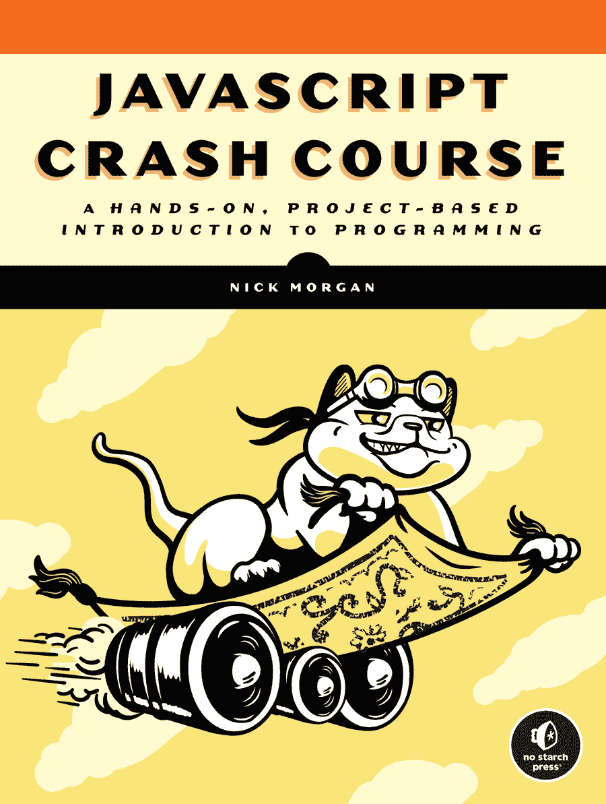

# 《JavaScript 快速入门》好评

“《JavaScript 快速入门》为那些只想卷起袖子从零开始学习基础知识的人们提供了一份完美且务实的指南。它跳过了许多让掌握 Web 编程变得复杂的干扰，如 UI 框架、构建工具和服务器技术，通过真实项目为渴望成为 Web 工程师奠定坚实的基础。”

—JED SCHMIDT，BROOKLYNJS 创始人

“《JavaScript 快速入门》是一次有趣、实用且注重手操作的介绍，我希望我自己在学习 JavaScript 时能有这本书。读者可以从最基础开始学习，一直制作出与‘现实世界’开发实践相关的真实游戏和应用程序。”

—CASSIDY WILLIAMS (@CASSIDOO)，CONTENDA 顾问兼首席技术官

“《JavaScript 快速入门》提供了关于如何思考和使用 JavaScript 的实用、务实且基于项目的教育。Nick Morgan 有丰富的经验，通过相互相接的示例向你介绍这门语言，并迅速进入真实项目的创建。当你深入阅读这本书时，你会发现你的构建模块就是互联网本身。你会发现自己正在使用音频和声音生成技术、使用 Canvas API 绘画以及引入第三方 JavaScript 库。当你完成这门快速课程时，你已经准备好开始自己的项目了。Nick 通过他的实战教学提供了一项极佳的服务，无论是在本书中还是在《儿童 JavaScript》中都是如此。我希望你像我一样喜欢这本书。”

—SCOTT HANSELMAN (@SHANSELMAN)，微软开发者社区副总裁

“Nick 成功地将 JavaScript 的基础概念浓缩成简洁、易懂的描述，让初学者也能上手。再加入一些关于图形和声音的趣味课程来创建一个游戏，你就得到了一本非常优秀且引人入胜的 JavaScript 书，非常值得花时间。”

—NICHOLAS C. ZAKAS (@SLICKNET)，ESLint 创建者及资深 JavaScript 书籍作者

献给 Lyra 和 Hazel

# 关于作者

Nick Morgan 是《儿童 JavaScript》（JavaScript for Kids, No Starch Press, 2014）的作者。他是 Airbnb 的软件工程师，负责维护网站运行的一些核心服务。在此之前，他曾在 Twitter 工作，从 Web 团队开始，编写 JavaScript 帮助构建主网站，随后转到后端的 Tweets 服务，在那里他帮助设计了“编辑推文”功能。Nick 在英国长大，拥有萨雷郡大学的音乐和音响录制学位。他住在科罗拉州，与妻子、两个女儿和三只猫住在一起。

# 关于评论员

Angus Croll 出于英国，现住在旧金山湾区，目前在 Netflix 负责所有性能相关的工作。作为文学小说和 JavaScript 的双重爱好者，他是《如果海明威写过 JavaScript》（If Hemingway Wrote JavaScript, No Starch Press, 2014）以及歌曲 Just 的创作者。

# 致谢

首先，感谢我的妻子 Philly 和我们的孩子们 Lyra 和 Hazel，让这一切变得值得。很抱歉我有这么多晚上都被写作占据了，我承诺至少一年内不会再写另一本书了！

感谢 Bill Pollock 信任我写第二本书；感谢我的编辑 Nathan Heidelberger 在塑造我的文本方面所付出的卓越工作（并忍受了我的延误！）；感谢 No Starch 的其他所有人，你们让这本书变成了现实。

感谢我的朋友和技术评论员 Angus Croll 的一切。Angus 向我推荐了 Twitter，后来又向我推荐了 Bill Pollock——如果没有他，我不会在这里写这些。

最后，感谢我的父母给了我好奇心和乐观态度，这最终促使我写了这本书。

# 引言


我清晰地记得第一次“写” JavaScript 的情景。当时我正在玩弄网页设计，从另一个网站复制并粘贴了一些代码，以便在鼠标悬停在页面某些部分时添加一些效果。我完全不知道这些代码在做什么，但通过不断尝试，我成功地让它运行了。

JavaScript 是一门非常宽容的语言——有时宽容得过头——这对我和其他许多人来说，它是一个非常温和的编程入门。许多人选择 JavaScript 作为第一门编程语言是因为它太容易上手了：它就在你的浏览器中等着你！

## 这本书适合谁看？

本书的目标是让你尽可能快地编写真实的 JavaScript 代码，教授所有要点，而不陷入语言的复杂细节中。我不指望你有任何先前的编程经验。如果你习惯于使用计算机完成浏览和编辑文档等日常任务，你就拥有了入门所需的一切。

`JavaScript Crash Course` 是为所有年龄段的人士编写的，旨在让他们通过实战示例和项目独立学习 JavaScript。你可能想转行计算机编程领域，或者想将编码作为一种爱好。也许你已经使用过其他编程语言，现在需要快速上手 JavaScript。如果你是一名老师，正在寻找一种简单的方法向学生介绍编程，那么 `JavaScript Crash Course` 对你来说也是一个很好的选择。

# 为什么选择 JavaScript？

有数百种编程语言可以选择，但有几点让 JavaScript 特别于众。最重要的是它与网页浏览器（如 Google Chrome、Safari、Microsoft Edge 和 Firefox）的关系。几乎每个网页浏览器都能运 JavaScript，这意味着你用 JavaScript 编写的代码可以在任何带有网页浏览器的计算机上运行。无需安装任何额外的特殊软件。几乎所有的智能手机浏览器也可以运行 JavaScript，所以你现在口袋或包里可能就有一个支持 JavaScript 的浏览器。

由于其与网页浏览的关系，JavaScript 是 Web 开发中至关重要的一部分。如果一个网站包含动态、交互式的功能，它很可能是用 JavaScript 创建的。例如，YouTube 使用 JavaScript 在你悬停在缩略图上时显示视频预览；Threads 使用 JavaScript 在你向下滚动页面时加载更多帖子；Amazon 使用 JavaScript 驱动其“内部查看”（Look Inside）功能。

除了在浏览器中的用途外，JavaScript 还被广泛用于网站的后端，即运行在服务器上的网站代码部分，向用户传递内容（与直接运行在用户设备上的前端代码相反）。这是通过名为 `Node.js` 的技术实现的。许多顶级网站都有 `Node.js` 后端，让你可以在网站的前端和后端使用同一种语言，甚至在两者之间共享代码。

最后，JavaScript 已经成为各种应用程序非常流行的脚本语言，从 Photoshop（你可以在其中自动化图像处理）到 Gmail（你可以在其中添加自动化来组织邮件）。通过一些 JavaScript 知识，你就可以让这些应用程序随心所欲！

虽然这种语言在所有这些领域都很有用，但本书将完全关注基于浏览器的 JavaScript。这有几个原因。首先，正如我已经提到的，在浏览器中运行 JavaScript 的巨大优势之一是不需要安装任何特殊物品即可开始。我不希望在书的开头写一个关于在计算机上安装 `Node.js` 的枯燥章节——这个章节在写完后可能就过时了。其次，虽然几乎所有的网站都使用 JavaScript 进行前端开发，但 JavaScript 只是编写后端代码的许多语言之一。浏览器是目前为止学习 JavaScript 最通用的环境。

我仍然强烈建议你在读完这本书并对该语言获得一些经验后去尝试 `Node.js` 以及 JavaScript 的其他用途。你应该将这本书看作一个跳板：是你 JavaScript 教育的起点，而不是终点。关于读完书后后续步骤的更多信息，请参阅后记。

# 你可以期待学习什么？

本书将教你基于浏览器的 JavaScript。除了学习 JavaScript 语言本身外，你还将学习在任何编程语言中都有帮助的技能，例如如何思考问题以及如何构建程序。你将建立起一套编程知识基础，这些基础将贯穿你的整个职业和个人编码活动。

本书的`第一部分` 概述了语言的基础。我对语言概念和特征的顺序安排非常有目的，确保每个新概念都建立在之前的概念之上，并且绝不引入任何没有坚实基础的内容。以下是你在书中这一部分发现的内容：

- `第 1 章：入门`：向你展示如何在网页浏览器和文本编辑器中编写第一行 JavaScript 代码。

- `第 2 章：基础`：介绍 JavaScript 程序的要素元素，如表达式、语句和变量，并解释如何使用简单数据类型表示数字、文本和真/假值。

- `第 3 章：复合数据类型`：讨论数组和对象，它们让你将多个数据项组合成更有意义的集合。

- `第 4 章：条件判断和循环`：教你使用控制结构为程序添加逻辑，这些结构可以做出决策并重复代码段。

- `第 5 章：函数`：向你展示如何用函数创建可重用的代码块。

- `第 6 章：类`：帮助你通过类和面向对象的编程原则为代码添加更多结构。

本书的`第二部分` 讨论了如何使用 JavaScript 与网页浏览器交互。这一部分探索了创建交互式 Web 应用的重要技术：

- `第 7 章：HTML、DOM 和 CSS`：解释如何使用超文本标记语言 (HTML) 编写网页，并使用文档对象模型 (DOM) 通过 JavaScript 修改其内容。你还将学习如何使用层叠样式表 (CSS) 为网页应用基础样式。

- `第 8 章：基于事件的编程`：展示如何响应鼠标点击和按键等用户行为触发 JavaScript 代码。

- `第 9 章：Canvas 元素`：教你如何使用 `Canvas API` 在浏览器中绘制图形和动画。

本书的`第三部分`让你通过一系列项目将你在`第一部分`和`第二部分`中学到的技能付实践。项目之间没有依赖，因此你可以按任何顺序处理它们，或者只研究你觉得感兴趣的项目。我建议完成所有项目，因为它们都介绍了一些非常有用的通用概念。每个项目跨两个章节：

- `项目 1：创建一个游戏`：引导你制作自己版本的经典雅达 *Pong*（乒球）。这个项目将运用你对 `Canvas API` 的技能，并将学到的关于数据结构、条件判断和函数整合在一起。在`第 10 章`开发游戏后，`第 11 章`将向你展示如何使用类和面向的设计原则重构代码。

- `项目 2：制作音乐`：探索如何使用 JavaScript 制作音乐。`第 12 章`解释了如何使用 `Web Audio API` 和一个名为 `Tone.js` 的库来生成声音。然后`第 13 章`将你所学的内容整合起来创作一首歌曲。

- `项目 3：数据可视化`：使用流行的 `D3` 库向你介绍数据可视化的世界。`第 14 章`教授了 `D3` 和可缩矢量图形 (SVG) 的基础知识，SVG 是浏览器中绘图 `Canvas API` 的替代方案。随后在`第 15 章`中，你将构建一个应用程序来动态可视化从互联网加载的数据。这个项目说明了如何通过第三方 `API` 请求数据。

本书包含许多实操练习，以便你练习所学到的内容。我鼓励你亲自尝试所有的练习，但如果你遇到困难或只是想检查答案，可以在 `https://codepen.io/collection/ZMjYLO` 在线查看解决方案。在那个页面上，你还可以找到书中项目的完整、可下载代码文件。

有关本书的更新和其他相关信息，请参阅 No Starch Press 网站：`https://nostarch.com/javascript-crash-course`。

# 第一部分 语言

本书的这一部分介绍了 JavaScript 语言的基础知识。你将学习任何 JavaScript 程序的各种基础构建块，包括许多与任何编程语言都相关的核心概念。

首先，我们将查看两种编写和执行 JavaScript 代码的方法：在浏览器的控制台中，或者在文本编辑器中（第 1 章）。然后，你将学习如何使用变量和常量来表示单个数据，以及如何通过语句和表达式操作这些数据（第 2 章）。接下来，你将看到如何使用 JavaScript 的复合数据类型——数组和对象，将单个值组合成更有意义的结构（第 3 章）。

第一部分的后续章节将向你展示如何为代码添加结构。首先，你将通过条件判断和循环将逻辑引入程序，它们共同使你能够做出决策并控制代码执行的流程（第 4 章）。然后，你将学习使用函数（第 5 章）和类（第 6 章）来复用和组织代码。

## 1 开始


在本章中，你将开始编写第一个 JavaScript 代码。首先，你将学习如何将代码直接输入网络浏览器，而无需安装任何专用软件。这种方法非常适合快速测试简单的代码序列。接下来，你将看到如何在单独的文本编辑器程序中编写 JavaScript，随着代码变得复杂，这种方法更为合适。在整本书中，我们将使用这两种技术来编写和执行 JavaScript 代码，因此本章将为你接下来的所有内容做好准备。

### 使用 JavaScript 控制台

运行 JavaScript 代码最快的方法是通过 `JavaScript` 控制台。这种方法允许你编写 JavaScript 并立即查看结果。我们将使用最流行的浏览器 Chrome。如果你还没有安装 Chrome，可以 `https://www.google.com` 下载并安装。

安装 Chrome 后，按照以下步骤操作：

1. 打开 Chrome，在地址栏输入 `about:blank`。

2. 在 Windows 上按下 `F12` 或在 macOS 上按下 `Option+Command+J`。

3. 你将看到控制台，正如图 1 所示。


<span class="SANS_Futura_Std_Book_Oblique_11">图 1：JavaScript 控制台</span>

在控制台中输入以下代码：

```javascript
alert("Hello, world!");
```

执行后，会弹出一个显示“Hello, world!”的对话框。你刚刚使用了 `alert` 函数，它接受一个参数——即要显示的文本。

### 使用文本编辑器

JavaScript 控制台适合测试几行代码，但对于我们之后要处理的程序，使用文本编辑器（专门用于编写文件的程序）更为实用。对于本书，我推荐使用 Visual Studio Code（简称 VS Code）。它在 Windows、macOS 和 Linux 上均免费可用。访问 `https://code.visualstudio.com` 并按照说明下载安装。

安装好 VS Code 后，在电脑上创建一个名为 `javascript_work` 的目录，用于存放书中的文件。然后按照以下步骤准备编写代码：

1. 打开 VS Code。

2. 通过 `文件` -> `新建文件` 创建新文件。

3. 系统会提示命名文件，输入 `hello.html`。

4. 接下来，系统会提示选择位置。选择你创建的 `javascript_work` 目录并点击`创建文件`。

5. 现在你应该处于编辑新文件的界面了。

文件名中的 `.html` 后缀表示这是一个 HTML 文件。HTML 是一种用于描述网页内容的标记语言。运行 JavaScript 代码的一种方法将其包含在 HTML 文件中，然后用浏览器打开该文件。这就是我们要做的。将列表 1-1 中的内容输入你的新文件：

```html
<html><body><script>
alert("Hello from hello.html!");
</script></body></html>
```

<span class="SANS_Futura_Std_Book_Oblique_11">列表 1-1：在文件中编写 JavaScript</span> <span class="SANS_Futura_Std_Book_11">hello.html</span>

当你开始打字时，你可能会注意到 VS Code 会尝试预测你输入的内容。这起初可能会让你感到困惑，但一旦习惯之后，你可能会发现它很有帮助。有些预测会自动插入，而另一些则需要你按下 `TAB` 键来插入。

Listing 1-1 的第一行和最后一行是 HTML 代码，是将 JavaScript 嵌入 HTML 文件所需的最少代码。我们将在第 7 章中详细探讨 HTML。现在，你只需要知道它涉及到用于标识网页不同组件的 `tags`。对于我们的目的而言，最重要的是第一行末尾的起始 `<script>` 标签和第三行开头的结束 `</script>` 标签。当你在浏览器中加载此文件时，这些标签之间的所有内容（Listing 1-1 中的第二行）都将被解释为 JavaScript。

文件的 JavaScript 部分是：

```
alert("Hello from hello.html!");
```

在这里，我们使用了 `alert` 函数，就像我们之前在控制台中做的那样。这次，我们提供了一个不同的消息 `"Hello from hello.html!"` 显示在对话框中。

当你完成代码输入后，保存该文件。现在你准备好在 Chrome 中打开文件并查看 JavaScript 代码的运行了。按照以下步骤操作：

1. 在 Chrome 中打开一个新标签页。

2. 在 Windows 或 Linux 上按下 `CTRL-O`，或在 macOS 上按下 `COMMAND-O` 打开打开对话框。

3. 找到你的 `hello.html` 文件，选择它并点击`打开`。

你现在应该能看到一个包含 `"Hello from hello.html!"` 消息的对话框弹出，如图 1-3 所示。


图 1-3：你好！浏览器识别了 HTML 文件中 `<script>` 和 `</script>` 标签之间的代码为 JavaScript 并执行了该代码，导致对话框出现。如果你没有看到对话框弹出，请双检查 `hello.html` 文件中的代码，确保它与 Listing 1-1 完全一致。

### 总结

在本章中，你学习了编写和执行 JavaScript 代码的两种方法。首先，你在 JavaScript 控制台中输入了代码。你将在接下来的章节中使用这种技术来测试短代码段。接下来，你使用文本编辑器将 JavaScript 嵌入到 HTML 文件中，然后在 Chrome 中打开该文件。你将在后面的章节中使用这种技术来开发更复杂的项目。

## 2 基础


在本章中，我将介绍构成任何 JavaScript 程序的某些基础。你将学习 JavaScript 代码的基本单元，这些单元允许你表示值并向计算机发出指令。你还将学到如何为值分配名称，以便以后在代码中引用它。

本章还展示了 JavaScript 如何根据值所代表的信息类型将值分类为不同的数据类型。我们将重点关注表示单个值的原始数据类型，例如单个数字或单个文本。你将在 JavaScript 控制台中练习处理不同的数据类型，并探索你可以应用应用于它们的一些操作。

### 表达式与语句

JavaScript 中最基础的构建块是 `expression`（表达式），它是表示单个值的代码片段。确定表达式值的过程被称为 `evaluation`（求值）。例如 `100 + 200` 是一个求值结果为 `300` 的表达式。

另一个重要的 JavaScript 构建块是 `statement`（语句），它是一个完整的思想，就像英语句子一样，指示计算机执行某些操作。每个 JavaScript 程序都由一系列语句组成。例如，在第 1 章中，我们使用语句 `alert("Hello, world!");` 来指示计算机显示一个包含文本 `"Hello, world!"` 的对话框。由于句子以句号结束，而 JavaScript 语句以分号结束。

你只需通过在表达式末尾添加分号即可将表达式转换为语句。例如 `100 + 200;` 是一个语句，指示计算机将两个数字加。打开 JavaScript 控制台并输入此语句。当你这样做时，它会求值语句中的表达式并打印结果：

```
100 + 200;
300
```

此语句中的主表达式 `100 + 200` 被称为 `compound expression`（复合表达式），因为它实际上包含了两个较小的表达式：`100` 和 `200`。这些是 JavaScript 表达式最简单形式 `literal`（字面量）的示例，字面量是代码中固定值的直接表示。具体而言，`100` 和 `200` 是 `number literals`（数字字面量），因为它们直接对应于它们所代表的数值 `100` 和 `200`。相比之下，复合表达式 `100 + 200` 不是字面量，因为它并不直接对应于它的值 `300`。此复合表达式中的 `+` 并不代表任何值。相反，它是一个 `operator`（运算符），用于组合或操作表达式的符号。

区分值（values，即程序中的底层数据单元）和表达式（expressions，即代码中告诉 JavaScript 值应该是什么表示法）是非常重要的。`300` 和 `100 + 200` 的值都是 `300`，但它们是两个不同的表达式——一个是字面量，一个是复合的——提供了表示该值的不同方式。

JavaScript 表达式和语句相辅相成。表达式有值，但表达式本身并不会实际*做*任何事情。相反，语句通过告诉计算机执行任务来发挥作用，但语句本身没有值；它们只是指令。编程的力量源于编写语句，通过使用和操作表达式的值来达到预期结果。

### 数字与运算符

JavaScript 使用 `number` 数据类型来存储数值。你已经在上一节中开始处理数字了，在其中你遇到了 `+` 运算符，它能将两个数字相加。JavaScript 还有用于其他数学计算的运算符，包括减法 (`-`)、乘法 (`*`) 和除法 (`/`)）。在 JavaScript 控制台中尝试它们吧：

```
100 + 200;
300
10000 - 999;
9001
999 * 111;
110889
99702 / 999;
998
```

在这种涉及运算符（如 `+` 或 `*`）的情况下，我们通常说运算符 `returns`（返回）一个值（而不是说表达式正在被 `evaluated`）。例如，`*` 运算符接收数字 `999` 和 `111` 并返回它们的积 `110889`。

### 运算优先级

你可以在单个表达式中组合多个数字和运算符，在这种情况下你需要考虑操作执行的顺序。考虑这个例子：

```
5 + 10 / 10 - 5;
1
```

当你有像这样的多个运算符时，JavaScript 使用标准的数学 PEMDAS 规则（括号、指数、乘、除、加、减）来确定计算顺序。此表达式中的除法操作首先进行，接着是加法和减法，产生 `1` 的值。

为了强制加法和减法先发生，使用括号：

```
(5 + 10) / (10 – 5);
3
```

这次，表达式产生了一个不同的值，因为括号改变了运算顺序。

### 浮点数

到目前为止，我们仅局限于整数，但 JavaScript 的数字数据类型也支持小数，在编程术语中被称为 `floating-point numbers`（浮点数）。这里是一个产生浮点数的表达式：

```
10 / 4;
2.5
```

浮点数的精度有限，因此小数部分不能无限延伸下去。相反，它们会被截断，如下例所示：

```
10 / 3;
3.3333333333333335
```

你可能会注意到浮点数运算中一些奇怪的特性，结果并不与你预期的完全一致。例如，`0.1 + 0.2` 的结果并不精确等于 `0.3`。相反，我们得到了几个额极的小数位：

```
0.1 + 0.2;
0.30000000000000004
```

这是由于计算机表示数字的数学原理（可以在网络上搜索“floating-point arithmetic”以获取更多信息）。通常情况下，这些特性不会影响到你，但在某些情况下可能会产生影响。例如，如果你正在编写一个处理货币数值的应用程序，如果 `$0.10` 和 `$0.20` 的和不正好等于 `$0.30`，就会出现问题。在这种情况下，通常的解决方案是在进行任何数学运算之前，将货币数值转换为分（或等值的最小单位）。例如，代表美元金额的数字 `0.10` 将变成代表分金额的 `10`。

### 绑定 (Bindings)

在 JavaScript 中，你可以将一个名称与一个值关联，以便以后在代码中方便地引用该值。这种关联被称为 `binding`（绑定）。绑ning是强大的工具，因为它们提供了一个存储表达式所生成的值的地方。没有它们，你的程序将无法记住它们已经完成的工作。

一种绑定是 `variable`（变量），允许你根据需要更新与特定名称关联的值。它们之所以被称为变量，是因为它们的值可以改变或变化。另一种绑定是 `constant`（常量），一旦给名称分配了值，你就无法更新该与之关联的值。该值保持固定，或称为常量。

将变量或常量想象成一个带有标签（名称）的盒子，里面放着一个物品（值）。你将一个值放入盒子，然后在需要再次使用时通过名称查找它。变量允许你向盒子中放入新值，而常量则始终包含相同的值。

绑定的名称也称为其 `identifier`（标识符），创建标识符被称为 `declaration`（声明）：即正在声明绑定的名称。在 JavaScript 中，声明是一种特殊的语句，用于生成新的标识符。让我们来看看如何声明和使用变量与常量。

#### 变量 (Variables)

JavaScript 有两个两个用于声声明变量的关键字：`var` 和 `let`。`keyword`（关键字）是 JavaScript 语言内置的、保留用于特定用途的单词。最初，`var` 关键字是唯一的选择，但后来添加了 `let` 来修复 `var` 的某些缺点。如今，`let` 是声明变量的首选关键字，因此我们将在本书中使用它，但如果你在查看旧代码时遇到 `var`，也不要感到意外。

这里有一个使用 `let` 声明变量的示例：

```
let age;
undefined
```

这个 `let` 声明创建了一个名为 `age` 的新变量。`let` 声明没有值，因此 JavaScript 控制台输出了特殊值 `undefined`。

现在我们已经创建了一个变量，让我们写一个表达式给它赋一个值：

```
age = 35;
35
```

给变量赋值被称为 `assignment`（赋值），你使用赋值运算符（`=`）来操作。在运算符的右侧，你输入一个表达式（在这种情况下是数字字面量 `35`），在左侧，你输入应该该表达式值的变量名称（在这种情况下是 `age`）。

使用 `=` 运算符的赋值是一个复合表达式，就像使用 `+` 和其他数学运算符的表达式一样。赋值表达式的值是变量的新值。在这种情况下，我们将 `age` 设置为 `35`，所以控制台输出了 `35`。

第一次为变量赋值被称为 `initialization`（初始化）。程序员通常将变量的声明和初始化合并在一行代码中。例如，在这里我们在同一条语句中创建了一个名为 `cats` 的新变量，并为它分配了值 `2`：

```
let cats = 2;
undefined
```

尽管我们在这里给变量赋了值，但通用的规则是 `let` 声明本身没有值，因此 JavaScript 控制台输出了 `undefined`。

为了确认赋值成功，只需在控制台中输入变量名，后跟一个分号：

```
cats;
2
```

在这里，`cats` 是一个表达式，它的结果是 `cats` 变量的当前值，所以控制台输出了该值。

因为 `cats` 是一个变量，我们可以使用新的赋值表达式自由更改它的值。在这里，我们将它的值更新为 `3`：

```
cats = 3;
3
```

变量的优点是你可以可以在需要的任何时候更改它们的值——例如，当你得到另一只猫时。

#### 常量 (Constants)

在 JavaScript 中声明常量，我们使用 `const`

关键字：

```
const PI = 3.141592653589793;
undefined
```

这创建了一个名为 `PI` 的新常量，并为其分配了值 `3.141592653589793`，这是数字 `π` 的近似值。

现在我们可以使用该常量根据直径计算圆的周长：

```
let diameter = 3;
undefined
let circumference = diameter * PI;
undefined
circumference;
9.42477796076938
```

在这里我们创建了一个名为 `diameter` 的变量并将其赋值为 `3`。然后我们创建了另一个变量 `circumference`，并将其赋值 `diameter * PI`。注意，我们正在使用由变量（`diameter`）、常量（`PI`）和数学运算（`*`）组成的复合表达式来设置变量的值。很多编程工作都是创建常量和变量，然后操作它们来创建其他常量和变量。

> **注意**

> *此后，为了防止书籍的代码列表过于混乱，我将不再显示控制台在变量或常量声明后打印的 undefined。*

与变量不同，一旦创建常量你就无法更改它的值。例如，如果你尝试更新 `PI` 的值，JavaScript 会给出一个错误：

```
PI = 5.378;
Uncaught TypeError: Assignment to constant variable.
  at <anonymous>:1:4
```

错误是 JavaScript 告诉你的代码有问题的方式。此错误信息的重要部分是 Assignment to constant variable（赋值给常量）。这表明我们错误地尝试给常量分配一个新值。

此外，与变量不同（变量可以分离声明和初始化），你必须在声明中给常量赋值。因此，这行代码无法工作：

```
const TAU;
Uncaught SyntaxError: Missing initializer in const declaration
```

此错误信息告诉我们常量声明缺少初始化器，意味着常量应该被赋予一个值。

#### 命名规范 (Naming Conventions)

你应该为变量和常量起具有描述性的名称，这样当你或其他人阅读你的代码时，就能清楚地知道你的变量和常量代表什么。例如，如果你正在编写用于控制汽车的代码，你可能需要一个变量来存储汽车以每英里为单位的速度。`speedInMilesPerHour` 这个名字有点太长，但考虑到 `MPH` 是每英里广为人熟知的缩写，一个较好的变量名应该是 `speedInMPH`。一个更短的名字如 `speed` 可能也可以，但只有当每个阅读你代码的人都能看出 `speed` 始终是以每英里为单位时才。（想象一下，如果一个来自德国的人读你的代码，并认为你是在说每小时公里的话。）这个变量的一个糟糕名称是 `s`，它没有向阅读者提供任何信息。

JavaScript 是区分大小写的，这意味着它能区分变量 `age`、`Age` 和 `AGE`。此外，标识符不能包含空格。为了解决这个问题，变量名的常用惯例是使用驼峰命名法（camelCase），即名称中的第一个单词以小字母开头，随后的每个单词以大写字母开头，如 `speedInMilesPerHour` 。（之所以被称为 `camelCase` 是因为中间的大写字母看起来像骆驼的驼峰。）

变量的另一种命名惯例是蛇形命名法（snake_case），其中所有内容均为小写，每个单词之间用下划线分隔。（我猜眯起眼睛看这看起来有点像一条蛇。）在 `snake_case` 中，我们会写成 `speed_in_miles_per_hour` 或 `speed_in_MPH`。

使用 `snake_case` 可以让变量名比 `camelCase` 稍微清晰，但也会让它们变得更长且更难快速输入。JavaScript 程序员倾向于使用 `camelCase`，因此我将在书中中使用这种方法。

常量的遵循与变量不同的命名惯例。常量有两种类型：真常量（true constants），它们的值无论你何时运行程序都永远不会改变（例如 `pi` 或一天中的小时数），以及你为了防止在代码中意外修改它们而将其设为常量的值（例如当前用户名）。对于真常量，习惯上使用全大写的 `snake_case`，如 `HOURS_IN_A_DAY`。对于你为了避免意外修改值而创建的常量，使用与变量相同的惯例。在这种情况下，唯一区别是绑定是通过 `const` 而不是 `let` 创建的。

## 递增与减少

在编写软件时，你经常需要将变量的值增加（increment，递增）或减少（decrement，递减）1 或或其他数字。例如，你可能会使用一个变量来计算文档中某个单词出现的次数。每当你看到那个单词时，就会将变量的值加 1。同样，你可能使用一个变量来跟踪游戏中玩家有多少钱，每当玩家赚取或花费时就增加或减少金额。

递增变量的一种方法是初始化它，然后将其值改为自身加 1：

```
let money = 100;
money = money + 1;
101
```

在这里，我们声明了一个名为 `money` 的新变量并将其初始化为 100。然后我们通过在其现有值上加 1 为 `money` 赋一个新值。看到像 `money = money + 1;` 这样的表达式可能看起来很矛盾，但这实际上是一种非常正常的编程模式。当 JavaScript 遇到这样的赋值表达式时，它首先计算赋值运算符右侧表达式的值，在本例中是 `money + 1`。因为 `money` 当前是 100，`money + 1` 的值为 101。然后 JavaScript 更新赋值运算符左侧变量的值，在本例中是同一个变量 `money`。

`string literal`（字符串字面量）是字符串值的直接表示。要创建一个字符串字面量，只需用双引号将某些文本括起来。引号之间的每一个字符都是字符串的一部分。例如，在这里我们将字符串字面量 `"Hello!"` 赋值给变量 `greeting` 的值。然后我们检查该变量的值：

```
let greeting = "Hello!";
greeting;
'Hello!'
```

你也可以使用单引号而不是双引号来编写字符串字面量。事实上，正如这个示例所示，当 Chrome 的 JavaScript 控制台输出字符串时，它会将字符串括在单引号中（即使你是用双引号编写的）。为了保持一致性，我在本书的后续编写字符串时将坚持使用双引号，尽管我也会使用单引号来准确反映控制台的输出。

通常情况下，字符串主要由字母组成，但正如我们的 `"Hello!"` 示例所示，它们也可以包含标点符号。字符串还可以包含空格以及数字，如下例所示：

```
let price = "5 dollars";
price;
'5 dollars'
```

创建一个只包含数字的字符串也是可能的，例如 `"123"`，但区分此字符串与实际数字非常重要。字符串字面量 `"123"` 是三个字符 1、2 和 3 组成的序列，而数字字面量 `123` 的数值为 123。

JavaScript 提供了许多操作字符串的方法。接下来我们将查看其中一些字符串操作。

### 并字符串

当 `+` 运算符应用于字符串而不是数字时，它会将字符串连接在一起。这样，你就可以组合各种字符串来构建一个更长的消息。这是一个示例：

```
let first = "First string";
let second = "Second string";
let joined = first + second;
joined;
'First stringSecond string'
```

在这里，我们将两个字符串赋值给变量 `first` 和 `second`。然后我们使用 `+` 连接字符串，并将结果存储在变量 `joined` 中。请注意，JavaScript 不会在连接的字符串之间添加空格——它只是直接将第二个字符串附加在第一个字符串的末尾。如果你想在中间添加一个空格，必须通过将空格视为自身的字符串来显式地添加：

```
first + " " + second;
'First string Second string'
```

在这个示例中，我们连接了三个字符串字面量：

1. `"First string"`

2. `" "`（由单个空格组成的字符串）

3. `"Second string"`

结果是，我们在 string 和 Second 之间得到了一个空格。

### 获取字符串的长度

你经常需要检查字符串的长度。例如，如果你正在制作一个评论网站，你可能想将评论长度限制在 1,000 个字符左右。要找到字符串中有多少个字符，请在字符串后添加 `.length` 以访问其长度属性。（`property`（属性）是你代码中关于某事的某种信息；我们将在第 3 章中详细地讨论属性。）在这里，我们使用 `.length` 来确认字符串 `"abc"` 有三个字符：

```
"abc".length;
3
```

在这种情况下，我们对字符串字面量使用了 `.length`，但你也可以对包含字符串的变量或常量使用它，如下所示：

```
let longString = "This is my very long string";
longString.length;
27
```

这段代码计算了绑定到变量名 `longString` 的字符串中的所有字符，包括空格。

### 从字符串中获取字符

要从字符串中获取单个字符，请使用该字符的 `index`（索引）。这是一个表示字符在字符串中位置的数字。JavaScript 总是从零计数，所以索引 `0` 指向字符串中的第一个字符，索引 `1` 指向第二个字符，依此类推。这被称为 `zero-based indexing`（基于零的索引）。

将所需的索引放在方括号中以访问该索引处的字符，如下所示：

```
let alphabet = "ABCDEFG";
alphabet[0];
'A'
alphabet[1];
'B'
```

在这里，`alphabet[0]` 获取存储在变量 `alphabet` 中的字符串的第一个字符，`alphabet[1]` 获取第二个字符。

如果你使用的索引超过了字符串的长度，表达式将求值为 `undefined`：

```
alphabet[10];
undefined
```

`alphabet` 中的字符串只有七个字符，索引从 0 到 6，因此 `alphabet[10]` 超出了范围。

### 从字符串中获取多个字符

要从字符串中获取一个多个字符的序列（也称为 `slice` 切片），而不仅仅是单个字符，请使用 `slice` 方法。`method`（方法）是附加到特特定值或数据类型的特殊函数。（正如我们在第 1 章中讨论过的样，函数是一段执行任务的命名代码。）

使用或“调用”（`calling`）方法的语法是：紧跟值或变量之后，写上方法名，然后是一组括号。在括号内部，你编写方法所需的任何值，并用逗号隔开。与其他函数一样，这些值被称为 `arguments`（参数）。方法还可以产生一个值，称为 `return value`（返回值）。

`slice` 方法接受两个参数：你想要提取的字符串的起始索引（包含）和结束索引（不包含），并返回包含指定范围的子字符串。这是一个示例：

```
let sentence = "My name is Nick.";
sentence.slice(3, 7);
'name'
```

在这里，我们将一个字符串存储在变量 `sentence` 中，然后通过编写 `sentence.slice(3, 7)` 在其上调用 `slice` 方法。括号中的第一个参数意味着我们从字符串索引 `3` 开始截取（第四个字符，name 中的 `n`）。第二个参数意味着我们截取到索引 `7` 处，但不包含它（name 之后的空格）。结果是，slice 方法返回了索引 3、4、5 和 6 的字符。

> *我们将在第 5 章](#chapter5.xhtml)中泛泛地讨论函数，并在第 6 章](#chapter6.xhtml)中专门讨论方法。*

### 去除字符串空白

`Whitespace`（空白字符）是指不需要打印的字符，例如空格或制表符。`trim` 方法移除字符串开头或结尾的任何空白并返回一个去除了这些空白的新字符串。这非常有帮助，例如如果你从用户那里获取输入，他们不小心在开头或结尾添加了一些空格，如下所示：

```
let inputText = " Here is my input  ";
inputText.trim();
'Here is my input'
inputText;
' Here is my input    '
```

存储在变量 `inputText` 中的字符串在单词 之前有一个空格，在 input 之后有三个额外的空格。当我们通过编写 `inputText.trim()` 调用 trim 方法时，得到了去除了这些空格的新字符串。请注意，单词之间的空格不受影响；只有字符串开头和结尾的空白会被修剪。`trim` 方法不需要任何参数，因此我们只需在方法名后写一组空括号即可。

由于 `trim` 方法返回的是新字符串，存储在 `inputText` 中的原始字符串保持不变。当我们在代码列表最后请求 `inputText` 的值时，可以看到这一点：输出仍然包含字符串开头和结尾的空格 ❶。

## 其他常用的字符串方法

除了 `slice` 和 `trim` 之外，JavaScript 还有许多其他字符串方法。我不会详细介绍所有的方法，但这里有一些实用的方法：

`str.toLowerCase()` 返回一个新字符串，将 `str` 中所有大写字符转换为小写。

`str.includes(otherStr)` 如果 `str` 包含作为参数 `otherStr` 给出的字符串，则返回 `true`。

`str.padStart(num, char)` 返回一个新字符串，其长度至少包含 `num` 个字符；如果字符串长度未达到 `num`，则会在开头按需要添加 `char` 字符直到达到长度。

`str.repeat(count)` 返回一个将 `str` 重复 `count` 次的新字符串。

## 转义序列

有时你可能想在字符串中放入特殊字符，例如使用换行符在字符串中间创建换行，或者使用制表符创建更宽的水平间距。JavaScript 允许你使用`转义序列` 来包含这些字符。转义序列是一系列字符，始终以反斜杠（\`）开头，会被另一个字符。例如，要在字符串中插入换行符，请使用 `\n` 转义序列：

```
"Hello\nWorld";
'Hello\nWorld'
```

无论好坏，当 Chrome 的 JavaScript 控制台评估带有特殊字符的字符串并输出结果时，该特殊字符仍保持其转义形式。要看到字符串在转义序列被正确解释后的样子，请将字符串作为参数传递给 `console.log` 方法。该方法将数据打印到控制台，包括任何必要的格式化。例如：

```
console.log("Hello\nWorld");
Hello
World
```

该方法的输出显示了 `\n` 转义序列是如何被解释为字符串中两个单词之间的换行符的。

[Table 2-1] 列出了你最经常使用的一些转义序列。

| 表 2-1: 常见转义序列 |

| --- |

| 转义序列 | 输出 |

| `\'` | 单引号 |

| `\"` | 双引号 |

| `\\` | 反斜杠 |

| `\n` | 换行 |

| `\t` | 制表符 |

如表所示，如果你想在字符串中包含实际的反斜杠字符，需要使用 `\\`。同样，如果你想在双引号字符串中包含一个双引号字符，需要使用 `\"`。例如：

```
console.log("This string has \"double quotes\" and a \\ backslash character");
This string has "double quotes" and a \ backslash character
```

当你在双引号内编写字符串时，如果需要单引号（例如作为缩写中的撇号），就不需要使用 `\'` 转义序列。你可以直接写单引号，如下所示：

```
console.log("You don't need to escape single quotes");
You don't need to escape single quotes
```

同样，当你在单引号内编写字符串时，不需要转义双引号。

# 模板字符串字量

`模板字符串字量`（template literal）是一种特殊的字符串，可以评估嵌入在其中的任何表达式。这让你具有了灵活性，可以使用变量的值、计算结果或其他代码来动态填充字符串，而无需精确地输入字符串的每一个字符，或使用 `+` 运算符将多个变量组合成字符串。

模板字符串字量被反引号（`` ```）包围，而不是引号。你使用`占位符语法`来引入代码，其格式如下：`${}`。占位符括号内的文本被视为一个表达式，并在最终字符串评估之前进行评估，如下所示：

```

let name = "Nick";

`Hello, ${name}!`;

'Hello, Nick!'

```

在这里，变量 `name` 的值被插入字符串中代替 `${name}` 占位符，导致字符串 "Hello Nick!"。如果我们更改了 `name` 的值，同一个模板字符串字量将产生不同的字符串：

```

name = "Dolly";

`Hello, ${name}!`;

'Hello, Dolly!'

```

你可以在占位符括号中放置任何表达式，而不仅仅是简单的变量。表达式将被评估，结果将插入到字符串中。例如：

```

`There are ${60 * 60 * 24} seconds in a day`;

'There are 86400 seconds in a day'

```

在这种情况下，JavaScript 计算 `60 * 60 * 24` 的值，将其转换为字符串，并将其整合到评估后的字符串中。

模板字符串字量有许多应用，例如从用户处获取文本输入并将其插入新字符串中。当你需要根据几个变量创建字符串时，它们特别有用用。例如，假设你正在构建一个 Mad Libs 类型的 Web 应用，它接收不同词性的单词并将它们组合成句子。用户输入了以下三个单词，你将它们存储在不同的变量中：

```

let noun = "moon";

let adverb = "strangely";

let adjective = "red";

```

如果没有模板字符串字量，你必须通过反复使用 `+` 运算符将变量组合成字符串：

```

"The " + noun + " was " + adverb + " " + adjective + ".";

'The moon was strangely red.'

```

这段代码写起来相当繁琐，尤其是当你想要在每个单词之间包含空格并在句末添加句号时。使用模板字符串字量要简单得多：

```

`The ${noun} was ${adverb} ${adjective}.`;

'The moon was strangely red.'

```

除了让代码更容易编写之外，模板字符串字量还让代码更容易读。可以明显看出这段代码正在向句子中插入自定义的名词、副词和形容词。

## Undefined 和 Null

在 JavaScript 中，值 `undefined` 和 `null` 有特殊的含义：它们代表*无*。当 JavaScript 对某些内容没有值时，它默认返回 `undefined`。例如，正如你在本章前面的部分所看到的，如果你创建一个变量而不给它赋值，JavaScript 会自动为该变量赋值为 `undefined`：

```

let nothing;

nothing;

undefined

```

当你在控制台中执行一个没有无用的返回值的函数时，你也会得到 `undefined`，例如我们在第 1 章中用于在浏览器中弹出对话框的 `alert` 函数：

```

alert("I have no value.");

undefined 

```

虽然 JavaScript 在某物没有值时会自动使用 `undefined`，但程序员通常使用 `null` 来显式地标记某些内容为空。例如，如果你正在编写一些接收地址作为用户输入的代码，而用户没有提供地址，你可以将地址变量设置为 `null`：

```

let address = null;

address;

null

```

从功能上来说，将 address 设置为 `null` 与保持变量为 `undefined` 并没有区别，但它让你的意图更加清晰。阅读你代码的人会看到你特意将 address 标记为空值，而不是它只是还没有定义。

## 布尔值

我们将考虑的最后一个原始数据类型是 `Boolean` 类型，它表示真/假值。只有两个布尔字面量：`true` 和 `false`。在这里，我们使用字面量创建一个布尔变量并确认其值：

```

let playing = true;

playing;

true

```

在这个示例中，我们声明了一个名为 `playing` 的新变量，并用布尔字面量 `true` 对其进行了初始化。你可以想象这是游戏中的某些代码，`playing` 变量告诉我们游戏当前是激活状态（`true`）还是暂停状态（`false`）。

布尔值（Booleans）是编程中不可或的一部分，因为它们为我们提供了讨论逻辑的方式。如果你希望程序根据特定条件有不同的行为，你需要能够判断该条件是否成立——即它是 `true` 还是 `false`。例如，如果你正在开发一个视频流媒体网站，你可能需要知道当前用户是否不满 18 岁。如果是的话，你可能会隐藏某些内容。在这种情况下，你会使用布尔值来决定是否隐藏这些内容。

布尔值有多种与之相关的运算符。它们分为两类：逻辑运算符，它们接收布尔值并返回布尔值；以及比较运算符，它们可以接受其他类型的值（如数字和字符串）并返回布尔值。

### 逻辑运算符
三个布尔逻辑运算符：`and`、`or` 和 `not`。`and` 运算符（`&&`）接收两个值，称为“操作数”（operands），只有当两个操作数都为 `true`时才返回 `true`。这对于任何需要两个条件同时成立才能发生的情况都非常有用。让我们继续游戏的例子，假设我们正在为一个平台跳游戏编写逻辑。在这个游戏中，你可以发射火球，但只有在你拥有道具 `and` 且正在跳跃时才可以。以下是代码中的这种表达方式：

```

let powerup = true;

let jumping = true;

powerup && jumping;

true

```

在这种情况下，`powerup` 是 `true` 且 `jumping` 是 `true`，所以 `powerup && jumping` 也是 `true`。然而，如果你将这两个变量中的一个（或两个）设置为 `false`，`powerup && jumping` 也将 `false`：

```

jumping = false;

powerup && jumping;

false

```

`or` 运算符（`||`）在其中一个操作数远 `true` 时返回 `true`。如果只需要满足几个条件中的其中一个成立就能触发某种行为，那么它就很有用。在我们的游戏中例如，假设如果你被火球命中 `or` 或者触碰到怪物，你就会死：

```

let hitByFireball = false;

let touchedMonster = true;

hitByFireball || touchedMonster;

true
```

因为两个操作数中的一个是 `true`，所以表达式 `hitByFireball || touchedMonster` 为 `true`。如果两个操作数都为 `true`，`||` 运算符也会返回 `true`。

`not` 运算符（`!`）只接收一个操作数并返回其值的反反，因此 `!true` 是 `false` 而 `!false` 是 `true`。如果你希望在条件不为 `true` 时发生某些情况，这特别有用。在我们的游戏中例如，我们可能有一个名为 `alive` 的变量，告诉我们玩家是否存活。当玩家死亡时游戏应该结束——即当 `!alive` 为 `true` 时（意味着 `alive` 本身为 `false`）：

```

let alive = false;

!alive;

true
```

不同的逻辑运算符经常组合在一起形成更复杂的逻辑表达式。例如，假设在我们的游戏中，只有在你没有提着箱子且没有在游泳时才能跳跃。在这种情况下，我们会使用两个布尔变量来表示提箱子和游泳，使用 `!` 反转这些每个变量的值，并使用 `&&` 同时检查这两个反转后的变量，如下：

```

let carryingBox = true;

let swimming = false;

!carryingBox && !swimming;

false
```

你没有游泳，但你*确实*在提着箱子，所以 `&&` 运算符返回 `false`，意味着你不能跳跃。

有时阅读复杂的逻辑表达式可能会困难，所以让我们看看 JavaScript 在评估 `!carryingBox && !swimming` 表达式时采取的步骤。首先，为了简化问题，将变量名替换为它们当前设置的布尔值：

```

!true && !false
```

接下来，将表达式 `!true` 和 `!false` 替换为它们的等值值，移除 `!` 运算符：

```

false && true
```

现在我们只需要记住 `&&` 只在两个操作数都为 `true`时才返回 `true`。在这种情况下，其中一个操作数是 `false`，所以我们知道这个表达式的评估结果为 `false`。

处理这类布尔表达式有一个实用的技巧。表达式 `!a && !b` 可以重写为 `!(a || b)`。将此理解为将原始描述从“没有提箱子且没有游泳”重新述为“不是（提着箱子或游泳）”。这个技巧被称为德·摩根定律（与名字无关！）。它也可以用于将 `!a || !b` 转换为 `!(a && b)`。

### 比较运算符
JavaScript 的比较运算符比较值并根据比较结果返回布尔值。例如，`===` 或“三等”运算符检查两个值是否相等。如果相等，则返回 `true`，如果不相等则返回 `false`。以下是 `===` 运算符运行的一些示例：

```

5 === 5;

true

6 === 7;

false

2 + 2 === 4;

true

"hello" === "goodbye";

false

"hello" === "hel" + "lo";

true

false === false;

true

true === false;

false
```

注意 `===` 检查两个值是否相等。`===` 的相反数是 `!==`。该运算符检查值是否不等。例如：

```

8 !== 8;

false

"apples" !== "oranges";

true
```

使用 `!==` 等同于使用 `===`，然后对结果应用 `!`：

```

!(8 === 8);
```

JavaScript 的比较运算符比较值并根据比较结果返回布尔值。例如，`===` 或“三等”运算符检查两个值是否相等。如果相等，则返回 `true`，如果不相等则返回 `false`。以下是 `===` 运算符运行的一些示例：

```

5 === 5;

true

6 === 7;

false

2 + 2 === 4;

true

"hello" === "goodbye";

false

"hello" === "hel" + "lo";

true

false === false;

true

true === false;

false
```

注意 `===` 检查两个值是否相等。`===` 的相反数是 `!==`。该运算符检查值是否不等。例如：

```

8 !== 8;

false

"apples" !== "oranges";

true
```

使用 `!==` 等同于使用 `===`，然后对结果应用 `!`：

```

!(8 === 8);
```

JavaScript 的其他比较运算符检查一个值是否大于或小于另一个值。这些包括标准的大于（`>`）、小于（`<`）、大于等于（`>=`）和小于等于（`<=`）。考虑这些示例：

```

1 > -1;

true

10 > 10;

false

10 >= 10;

true

-1 < 1;

true

10 < 10;

false

10 <= 10;

true
```

特别注意 `>` 或 `<` 相同的值返回 `false`，但使用 `>=` 或 `<=` 返回 `true`。

这些比较运算符也可以用于字符串。如果一个字符串在字典中出现在另一个字符串之后，则被认为“大于”另一个字符串。例如：

```

"cat" < "dog";

true

"abc" > "abbcdef";

true
```

第一次比较评估结果为 `true`，因为 cat 的第一个字母在字母表中位于 dog 的第一个字母之前。在第二次比较中，字符串的前两个字符相同，但观察第三个字符，c 在字母表中位于 b 之后，所以第一个字符串被认为更大。

### 类型转换
*类型转换*（Coercion）是指将一种数据类型的值转换为另一种数据类型的值的行为。JavaScript 在某些不同类型的值出现在同一个表达式的情况下会使用类型转换。例如，如果你在 `+` 运算符的一侧使用字符串，而在另一侧使用数字，JavaScript 会将数字转换为字符串，然后将这两个字符串连接起来：

```

"Current score: " + 10;

"Current score: 10"
```

注意 10 在输出中出现在引号内，这意味着它变成了一个字符串而不是数字。在某些上下文中，布尔值会被转换为数字，其中 `false` 变成 0，`true` 变成 1。例如：

```

100 + true;

101
```

在这里，我们在数学表达式中使用布尔字面量 `true` 与一个数字一起，因此 JavaScript 将其强制转换为 1，然后加上 100和 1，产生 101。

## 带有强制类型转换的相等性

之前我们使用三等运算符（======）来检查相等性。另一个运算符是双等运算符（====），它在检查相等性之前会对其操作数应用强制类型转换。例如，如果你使用 `==` 比较数字和布尔值，布尔值将首先强制转换为数字：

```

0 == false;

true
```

这个比较结果为 `true`，因为布尔值 `false` 首先被强制转换为 `0`。然而，如果你使用三等运算符进行相同的比较，结果将为 `false`，因为 `===` 不允许类型强制转换：

```

0 === false;

false
```

当使用 `==` 运算符时，可能很难猜测什么会被强制转换为什么。以下是一些其他示例：

```

"1" == 1;

true

undefined == null;

true

undefined == false;

false

"" == 0;

true

"" == false;

true
```

当你将一个数字与一个全数字组成的字符串（如 `"1"`）比较时，字符串会被强制转换为等效数字，因此 `"1" == 1` 变为 `1 == 1`，结果结果为 `true`。当 `undefined` 和 `null` 比较时，`==` 运算符也返回 `true`，但如果 `undefined` 或 `null` 与任何其他内容比较，则返回 `false`。同时，空字符串——即不包含任何字符的字符串，用一对中间空的引号表示（`""`）——认为等于数字 `0` 和布尔值 `false`。

`==` 的反面是 `!=` 运算符。它在经过任何适当类型转换后判断两个操作数是否不等。某些在使用严格 `!==` 运算符时为真的不等式，在使用强制转换的 `!=` 运算符时会变为为假。例如：

```

0 !== false;

true

0 != false;

false
```

在没有强制转换的情况下，`0` 不等于 `false`，所以 `0 !== false` 为 `true`。但通过强制转换，`false` 变为 `0`，所以 `0 != false` 为 `false`。

意识到 `==` 和 `!=` 运算符很重要，但由于控制类型强制转换的规则非常复杂，我建议尽可能坚持严格的 `===` 和 `!==` 运算符。这样你的代码中遇到意外行为的概率就会较低。

## 真值（Truthiness）

真值（Truthiness）是一种特殊的强制转换，它定义了非布尔值如何被视为布尔值处理。这使得逻辑运算符如 `&&` 和 `!` 可以用于任何类型的值。运算符的工作方式取决于 JavaScript 是否认为该值为真值（truthy，等于 `true`）或假值（falsy，等于 `false`）。假值包括 `undefined`、`null`、数字 `0` 和空字符串（`""`）。所有非零数字和非空字符串都是真值。

检查一个值是真值还是假值的简单方法是使用 `!!` 对其应用两次非操作，意味着“非非”，即双重否定。这之所以有效，是因为 `!` 运算符无论其应用于值的数据类型是什么，总是返回一个布尔值。例如，假设你想验证数字 `0` 是假值。单次 `!` 操作会将数字强制转换为布尔值，然后反转该布尔值，因此 `!0` 结果为 `true`：

```

!0;

true
```

添加第二个 `!` 会再次反转布尔值，给出原始值的布尔等效值：

```

!!0;

false
```

这证实了 `0` 等于 `false`，即假值。

你可以使用相同的 `!!` 技巧来检查我之前提到的其他真值规则：

```

!!1;

true

!!"hi";

true

!!"";

false

!!undefined

false

!!null;

false
```

输出证实了非零数字和非空字符串是真值，而空字符串、`undefined` 和 `null` 是假值。

当 `&&` 和 `||` 运算符应用于非布尔值时，它们不会返回 `true` 或 `false` 值。相反，它们返回原始操作数之一。在 `&&` 运算符的情况下，如果第一个操作数是真值，则返回第二个操作数；如果第一个操作数是假值，则返回第一个操作数。以下是一些示例：

```

15 && 17;

17

0 && 20;

0

undefined && null;

undefined
```

在第一情况下，`15` 是真值，所以返回 `17`。在另外两种情况下，第一个操作数是假值，因此分别返回 `0` 和 `undefined`。

`||` 运算符的工作方式相反。如果第一个操作数是假值，它返回第二个操作数；如果第一个操作数是真值，它返回第一个操作数，如下：

```

"" || "hello";

'hello'

"hello" || "goodbye";

'hello'
```

在第一情况下，第一个操作数是空字符串，它是假值，所以返回第二个操作数。在第二情况下，第一个操作数是非空字符串，它是真值，所以返回第一个操作数。

## 真值的用途

你可以多种方式利用 `&&` 和 `||` 在真值和假值上的行为。例如，`||` 运算符可以在未提供值时给变量赋一个默认值。在下面的示例的开始处，`name` 被创建但没有赋值：

```javascript

let name;

name = name || "No provided";

'No provided'
```

由于第一个操作数是假值，返回了第二个操作数。另一方面，如果提供了 name，它会被视为真值，并且会保留其值：

```javascript

let name = "Nick";

name = name || "No provided";

'Nick'
```

同样，你可以使用 `&&` 或 `||` 来短路（或跳过）一个表达式。对于 `&&`，如果第一个操作数是假值，则该操作数会被计算并返回，这意味着 JavaScript 会忽略第二个。当操作数只是简单值时，我们并不在乎它们是否被计算；我们关心的是返回哪个值。例如，在表达式 `1 || 2 + 2` 中，JavaScript 是否计算 `2 + 2` 的结果并不重要，因为我们知道第一个操作数 `1` 将被返回。但如果表达式具有某种副作用，那么计算它是有意义的，这意味着它会产生除返回值以外的结果。例如，`alert` 函数返回 `undefined`，但更重要的是具有显示对话框的副作用。但如果我们只想在某些情况下显示对话框呢？例如，假设我们想在游戏中使用 `alert` 显示玩家的分数，但只有在分数不为零时显示。我们可以让 `score` 变量和 `alert` 函数成为 `&&` 表达式的操作数：

```javascript

let score = 0;

score && alert(`Your score is ${score}!`);

0
```

这里 `score` 为 `0`，所以 `&&` 表达式中的第一个操作数为假值。因此 `&&` 运算符返回该值并忽略第二个操作数，这意味着 `alert` 未调用。我们短路了函数调用。

现在考虑分数增加会发生什么：

```javascript

++score;

1

score && alert(`Your score is ${score}!`);

undefined
```

在这里我们使用 `++` 增加 `score`，将其改为 `1`。这使得 `score` 变为真值，因此 `&&` 表达式中的第二个操作数被计算，执行了 `alert` 函数。函数返回 `undefined`，但也具有（预期的）副作用，即显示带有玩家分数的对话框（参见图 2-1）。


本质上，我们正在使用 `&&` 运算符来根据条件（`score` 是否为 0）决定是否运行某些代码（`alert` 函数）。在第 4 章中，我们将介绍诸如 `if` 语句之类的控制结构，它们提供了一种更显式的方法来控制代码何时以及如何运行。

### 总结

本章向你介绍了 JavaScript 编程的一些基础构建模块。你学习了语句（statement）是 JavaScript 中一个完整的思想，以分号结尾，用于指示计算机执行某些操作，并且语句可以由一个或多个表达式（表示值的代码单元）组成。你了解了如何使用绑定（bindings）为值命名以便以后使用，可以作为变量（这种情况下值以后可以更新），也可以作为常量（这种情况下值将保持不变）。

你还学习了 JavaScript 中的三种原始数据类型：数字、字符串和布尔值。你对数字应用了数学运算，包括使用 `++` 和 `--` 等简写符号进行递增或减，并练习了使用各种方法操作字符串，包括切片和修剪空格。对于布尔值，你学习了如何使用逻辑运算符，如与（`&&`）、或（`||`）和非（`!`），并看到了如何使用 `===` 和 `!==` 等比较运算符生成布尔值。最后，你学习了 JavaScript 有时将值从一种数据类型转换为另一种类型，包括非布尔值如何被视为真（truthy）或假（falsy），并探索了这些情况的用途，例如用于表达式短路。

## 3 复合数据类型


在上一章中，我们讨论了 JavaScript 的原始数据类型，它们代表单个数据，如数字或字符串。现在我们将查看 JavaScript 的复合数据类型——数组和对象，它们将多个数据组合成一个单元。复合数据类型是编程中不可或的一部分，因为它们允许我们组织并处理任何大小的数据集。你将学习如何创建和操作数组与对象，以及如何将它们组合成复杂的数据结构。

### 数组

JavaScript `array` 是一种复合数据类型，存储一个有序的值列表。数组的元素可以是任何数据类型。它们不必都是相同的类型，尽管通常是相同的。例如，一个数组可以作为待办事项列表，存储一系列描述需要执行的任务的字符串；或者它可以存储一组数字，代表从特定地点定期获取的温度读数。

数组非常适合这类结构，因为它们将相关的值收集在一个地方，并且具有随着值的添加或删除而进行增长或收缩的灵活性。如果你有固定数量的待办事项——例如四个——那么你可能会使用单独的变量来存储它们，但使用数组允许你持有数量不受限制且不断变化的条目，并保持它们的固定顺序。此外，一旦你将元素整合在一个数组中，你就可以编写代码高效地对数组中的每个项依次操作，正如你在第 4 章中看到的那样。

#### 创建和索引

要创建一个数组，在方括号内列出它的元素并用逗号隔开：

```

let primes = [2, 3, 5, 7, 11, 13, 17, 19];

primes;

```

此数组包含前八个质数，并存储在变量 `primes` 中。当你输入 `primes;` 时，Chrome 控制台应该打印数组的长度 (8)，然后是它的元素。

数组中的每个元素都有一个与其相关的索引数字。和字符串一样，数组是从零开始索引的，所以第一个元素位于索引 0，第二个元素位于索引 1，以此此类推。要访问数组的单个元素，在数组名称后的方括号中放入其索引数字。在这里，我们访问 `primes` 数组的第一个元素：

```

primes[0];

2
```

由于数组是从零开始索引的，数组最后一个元素的索引比数组的长度少 1。因此，我们的八元素数组 `primes` 数组的最后一个元素位于索引 7：

```

primes[7];

19
```

如果你不知道数组有多长并想获取它的最后一个元素，可以先使用点符号访问它的 `length` 属性并查找数组的长度，正如我们在第 2 章中对字符串做的那样：

```

primes.length;

8

primes[7];

19
```

或者，为了在一个语句中完成此操作，你可以简单地从长度减 1 以得到最后一个索引处的元素，如下所示：

```

primes[primes.length - 1];

19
```

如果你使用了数组范围之外的索引，JavaScript 将返回 `undefined`：

```

primes[10];

undefined
```

要替换数组中的元素，使用索引语法为元素分配一个新值：

```

primes[2] = 1;

primes;
```

在这里，我们在 `primes` 的第三位置（索引 2）添加了 1，替换了之前在该索引处的值。控制台输出确认了 1 是数组中新的第三个元素。

####数组数组

数组可以包含其他数组。这些*多维数组*通常用于表示二维点网格或表格。为了说明这一点，让我们做一个简单的井字棋游戏。我们将创建一个数组（我们称之为*外层*数组），其中包含三个元素，每个元素都是另一个数组（我们称之为*内层*数组），代表井字棋棋盘的某一行。

```

let ticTacToe = [

  ["", "", ""],

  ["", "", ""],

  ["", "", ""]

];
```

为了让代码更易读，我将每个内部数组放在了新行上。通常当你按下回车键（开始新行）时，JavaScript 控制台会运行你输入的代码行，在这种情况下，它足够聪明能够意识到第一行尚未结束，因为没有闭合括号来匹配开启括号。它会将直到最后一个括号和分号之前的所有内容解释为单个语句，即使你包含了额外的括号和回车符。

> *Chrome 控制台会自动对内部数组进行缩进，以指示它们嵌套在外层数组内部。Chrome 和 VS Code 默认对每层缩进使用四个空格，但这取决于个人喜好。在整本书中，我将使用两个空格作为缩进，这既因为这在现代 JavaScript 代码中更常见，也因为这有助于某些较大的列表适应页面。*

我可以将此数组写在一行，如下所示，但这样很难看出它的二维特性：

```

let ticTacToeOneLine = [["", "", ""], ["", "", ""], ["", "", ""]];
```

现在让我们看看向控制台请求 `ticTacToe` 变量的值时会发生什么：

```

ticTacToe;

(3) [Array(3), Array(3), Array(3)]
```

在这种情况下，数组的长度显示为 (3)，表示它是包含三个元素的数组。数组的每个元素都是 `Array(3)`，这意味着每个内部数组都是另一个包含三个元素的数组。

要展开视图并查看内部数组中的内容，点击左侧的箭头：

```

(3) [Array(3), Array(3), Array(3)]

  0: (3) ['', '', '']

  1: (3) ['', '', '']

  2: (3) ['', '', '']

   length: 3

  [[Prototype]]: Array(0)
```


前三行显示了内部数组在索引 0、1 和 2 处的值。之后，显示了外部数组的 `length` 属性，其值为 3。最后一个属性 `[[Prototype]]` 是数组内置方法的来源所在（更多信息请参阅第 6 章）。

我们已经创建了井字棋盘，但它是是空的。让我们在右上角设置一个 X。第一个内部数组代表顶行；我们通过 `ticTacToe[0]` 访问它。右上角是该行的第三个元素，即内部数组中索引为 2 的元素。由于 `ticTacToe[0]` 返回的是一个数组，我们只需要在末尾加上 `[2]` 即可访问  访问我们想要的元素：`ticTacToe[0][2]`。通过此方法，我们可以按照如下方式将该元素设置为 "X"：

```

ticTacToe[0][2] = "X";
```

现在让我们再次查看 `ticTacToe` 的值，点击箭头展开外部数组：

```

ticTacToe;

(3) [Array(3), Array(3), Array(3)]

  0: (3) ['', '', 'X']

  1: (3) ['', '', '']

  2: (3) ['', '', '']

   length: 3

  [[Prototype]]: Array(0)
```

井字棋盘的右上角现在有一个 X。

接下来，让我们在左下角设置一个 O。底行是外部数组的索引 2，该行最左侧的方格是内部数组的索引 0，因此我们输入如下：

```

ticTacToe[2][0] = "O";

ticTacToe;

(3) [Array(3), Array(3), Array(3)]

  0: (3) ['', '', 'X']

  1: (3) ['', '', '']

  2: (3) ['O', '', '']

   length: 3

  [[Prototype]]: Array(0)
```

现在画面的左下角有一个 O。

总结一下，如果你想访问嵌套数组中的元素，请使用一组方括号选择外部数组中的元素（这将返回其中一个内部数组），然后使用第二组方括号选择内部数组中的元素。

### 数组方法

JavaScript 具有许多处理数组的有用方法。在本节中，我们将查看一些重要的方法。其中某些方法会修改涉及的数组，这被称为*变异*（mutation）。变异示例包括添加或删除数组元素或更改元素的顺序。其他方法则创建并返回一个新数组，同时保持原始数组不变，如果你仍然需要原始数组用于其他用途这将非常有用。

意识到你正在使用的方法是否会变异数组是非常重要的。例如，假设有一个按时间顺序列出的全年月份数组，但程序的某部分需要它们按字母顺序排列。你需要确保按字母排序不会无意中改变原始的时间顺序数组，否则程序的其他部分可能会开始认为四月是年的第一个月份。另一方面，如果你有一个代表待办事项列表的数组，你可能希望在添加或删除任务时原始数组本身被更新，而不是创建一个新数组。

### 向数组中添加元素

`push` 方法通过将提供的元素添加到数组末尾来变异数组。`push` 方法的返回值是数组的新长度。例如，让我们用 `push` 来构建一个编程语言数组：

```

let languages = [];

languages.push("Python");

1

languages.push("Haskell");

2

languages.push("JavaScript");

3

languages.push("Rust");

4

languages;

(4) ['Python', 'Haskell', 'JavaScript', 'Rust']


首先，我们创建一个名为 `languages` 的新数组并将其初始化为 `[]`（一个空数组）。第一次调用 `push` 方法时，我们传递了值 `"Python"`。该方法返回 `1`，意味着数组现在有一个元素。我们又重复了三次，最后通过输入 `languages;` 获取 `languages` 的值。这返回了我们添加到数组中的四种语言，顺序与我们添加的顺序相同。

将元素添加到数组开头而不是末尾，请使用 `unshift` 方法，如下：

```javascript
languages.unshift("Erlang");
5
languages.unshift("C");
6
languages.unshift("Fortran");
7
languages;
(7) ['Fortran', 'C', 'Erlang', 'Python', 'Haskell', 'JavaScript', 'Rust']
```

在这里我们在 `languages` 数组的前面添加了三个语言。由于每个元素都被添加到数组的开头，它们最终的顺序与添加顺序相反。与 `push` 类似，调用 `unshift` 返回数组的新长度。

### 从数组中删除元素

要通过删除最后一个元素来变异数组，请使用 `pop` 方法。在这里我们对 `languages` 数组调用 `pop` 方法，删除它的最后一个元素：

```javascript
languages.pop();
'Rust'
languages;
(6) ['Fortran', 'C', 'Erlang', 'Python', 'Haskell', 'JavaScript']
```

该方法返回被删除元素的值，在这种情况下为 `"Rust"`。当我们检查数组时，它包含六个元素。

由于 `pop` 方法返回被删除的元素，如果你想对该元素进行某些操作，这将特别有用。例如，在这里从 `languages` 数组中删除另一个元素并将其用于消息：

```javascript
let bestLanguage = languages.pop();
let message = `favorite language is ${bestLanguage}.`;
message;
'favorite language is JavaScript.'
languages;
(5) ['Fortran', 'C', 'Erlang', 'Python', 'Haskell']
```

这次我们调用 `languages.pop()` 将返回值存储在 `bestLanguage` 变量中，并使用模板字符串将其包含。这是被删除的元素，现在剩下五个。

要从数组中删除第一个元素而不是最后一个，请使用 `shift` 方法。与 `pop` 类似，`shift` 方法返回被删除的元素：

```javascript
let worstLanguage = languages.shift();
message = `least favorite language is ${worstLanguage}.`;
message;
'least favorite language is Fortran.'
languages;
(4) ['C', 'Erlang', 'Python', 'Haskell']
```

与之前的示例一样，我们将调用 `shift` 的结果保存在变量中，这次名为 `worstLanguage`，并用于模板字符串。我们目前为止看到的四种方法 `pop`、`unshift`、`push` 和 `shift` 通常用于实现更专门的数据结构，例如队列。*队列*是一种类似于队列的数据结构，新项被添加到末尾，而从开头移除并处理。当你希望按照到达顺序处理数据时，这非常有用。例如，想象一个问答应用，许多用户可以提问。你可以使用数组来存储问题列表，用 `push` 方法将每个新问题添加到数组末尾。当回答者准备好回答问题时，他们将使用 `shift` 获取数组中的第一个元素并从数组中移除。这确保了数组中只有未回答的问题，并且它们是按照接收顺序进行回答的。

### 合并数组

`concat` 方法（concatenate 的缩写）将两个数组相加。在这里，例如，我们从两个数组 `fish` 和 `mammals` 开始，并将它们合并为一个新数组，保存到 `animals` 变量中：

```javascript
let fish = ["Salmon", "Cod", "Trout"];
let mammals = ["Sheep", "Cat", "Tiger"];
let animals = fish.concat(mammals);
animals;
aos(6) ['Salmon', 'Cod', 'Trout', 'Sheep', 'Cat', 'Tiger']
```

当你在数组上调用 `concat` 时，会创建一个新数组，其中包含第一个数组（即调用 `concat` 的数组）的所有元素，紧接着是第二个数组的所有元素（即作为 `concat` 参数传递的数组）。原始数组保持不变，因为与我们目前看到的其他方法不同，`concat` 不是一个变异方法（mutating method）。这在这里非常有用，因为我们不希望我们的鱼类数组突然包含哺乳动物的元素！

要合并三个或更多个数组，可以将多个数组作为参数传递给 `concat`，如下例所示：

```javascript
let originals = ["Hope", "Empire", "Jedi"];
let prequels = ["Phantom", "Clones", "Sith"];
let sequels = ["Awakens", "Last", "Rise"];
let starWars = prequels.concat(originals, sequels);
starWars;
// ['Phantom', 'Clones', 'Sith', 'Hope', 'Empire', 'Jedi', 'Awakens', 'Last', 'Rise']
```

在这里我们创建了三个独立的数组 `originals`、`prequels` 和 `sequels`，分别代表三部*星球大战*电影。然后我们使用 `concat` 将它们合并为一个包含九个元素的 `starWars` 数组。注意，合并数组中的元素出现顺序与数组作为参数传递的顺序一致。

### 查找数组中元素的索引

要查找特定元素在数组中的位置，请使用 `indexOf` 方法。该方法返回指定元素首次出现的索引。如果数组中未找到该元素，`indexOf` 将返回 -1：

```javascript
let sizes = ["Small", "Medium", "Large"];
sizes.indexOf("Medium");
1
sizes.indexOf("Huge");
-1
```

在这个示例中，我们想要检查 "Medium" 在 `sizes` 数组中的位置，我们得到了答案 1。然后，因为 "Huge" 不在数组中，我们得到了答案 -1。

如果数组中包含多个给定值的实例，`indexOf` 仅返回第一个匹配元素的索引。例如，这里有一个包含阿根廷国旗颜色颜色的数组：

```javascript
let flagOfArgentina = ["Blue", "White", "Blue"];
flagOfArgentina.indexOf("Blue");
0
```

尽管在数组中发现了两次 "Blue"，但 `indexOf` 只返回第一次出现的索引。

### 将数组转换为字符串

`join` 方法将数组转换为单个字符串，将所有元素连接在一起，如下例所示：

```javascript
let beatles = ["John", "Paul", "George", "Ringo"];
beatles.join();
'John,Paul,George,Ringo'
```

注意 `beatles` 数组中独立的字符串是如何合并成一个字符串的。默认情况下，`join` 在每个元素之间放置一个逗号以形成返回的字符串。要更改这一点，你可以将自己的分隔符作为 `join` 的参数。例如，如果你希望每个元素之间没有任何内容，请传递一个空字符串作为参数：

```javascript
beatles.join("");
'JohnPaulGeorgeRingo'
```

你可以传递任何有效字符串作为分隔符。在下一个示例中，我们传递了一个空格、一个和符号和一个换行转义字符，以便每个元素单独占一行。正如你在第二章中学到的，我们必须使用 `console.log` 才能让换行在 Chrome 中正确显示：

```javascript
console.log(beatles.join("&\n"));
John&
Paul&
George&
Ringo
```

请记住，分隔符只出现在数组元素*之间*，而不是每个元素之后。这就是为什么 Ringo 之后没有额外的和符号和换行符的原因。

如果你在包含非字符串值的数组上使用 `join`，这些值将被转换为字符串，如下例所示：

```javascript
[100, true, false, "hi"].join(" - ");
'100 - true - false - hi'
```

与之前的 join 一样，结果是一个由分隔符（在本例中为 " - "）连接起来的长字符串。区别在于，非字符串值（数字 100 和布尔值 `true` 和 `false`）在 `join` 之前必须自动转换为字符串。这个示例还展示了如何直接在数组字面量上调用数组方法，而不需要先将数组保存到变量中。

### 其他实用数组方法

这里是你可能想尝试的其他实用数组方法：

- `arr.includes(elem)`：根据给定的 `elem` 是否在 `arr` 数组中返回 true 或 false。
- `arr.reverse()`：反转数组中元素的顺序。这是一个变异方法，因此它会修改原始数组。
- `arr.sort()`：对数组元素进行排序，修改原始数组。如果元素是字符串，则按字母顺序排序。否则，排序将按照元素被转换为字符串的方式进行。
- `arr.slice(start, end)`：通过从索引 `start` 开始到不包括索引 `end` 的从原始数组中提取元素，来创建一个新数组。此方法等于上一章引入的字符串的 `slice` 方法。
- `arr.splice(index, count)`：从 `index` 开始从数组中删除 `count` 个元素。

### 对象

*对象*（Objects）是 JavaScript 中的另一种复合类型。它们与数组的相似之处在于都持有值的集合，但不同在于对象使用字符串*键*（keys）而不是数字索引。数组通常用于存储相同数据类型的有序列表，而对象通常用于存储关于单个实体的多个信息。例如，代表一个人的对象可能包含如姓名（字符串）、年龄（数字）、是否结婚（布尔值）等信息。对于这种目的，对象比数组更合适，因为每条信息都赋予了一个有意义的名字——它的键，而不是通用的索引。

#### 创建对象

创建对象的方法之一是使用*对象字面量*（object literal），它由一对括号（`{` 和 `}`）包围一系列由逗号隔开的键值对组成。每个键值对的键和值之间必须有一个冒号。例如，这里有一个 `casablanca` 对象字面量，包含了一些关于该电影的信息：

```javascript
let casablanca = {
  "title": "Casablanca",
  "released": 1942,
  "director": "Michael Curtiz"
};
casablanca;
// {title: 'Casablanca', released: 1942, director: 'Michael Curtiz'}
```

在这里我们创建了一个带有三个键的新对象："title"、released" 和 "director"。每个键都有关联的值。我将每个键值对写在单独的一行以便对象字面量更易读，但这并非严格必要。正如你在稍后的示例中看到的，键值对也可以全部写在同一行。

所有对象的键都是字符串，但如果你的键是一个有效标识符（valid identifier），通常会省略引号。*有效标识符*是任何可以作为 JavaScript 变量名的字符序列。标识符可以由字母、数字以及 `_` 和 `$` 字符组成，但不能以数字开头。它不能包含其他符号，如 `*`、`(` 或 `#`，也不能包含空白字符（如空格和换行符）。这些其他字符*允许*出现在对象的键中，但前提是键被引号括围。例如：

```javascript
let obj = { key1: 1, key_2: 2, "key 3": 3, "key#4": 4 };
obj;
// {key1: 1, key_2: 2, key 3: 3, key#4: 4}
```

这里的 `key1` 和 `key_2` 是有效的标识符，因此它们不需要引号。然而，`key 3` 包含空格，`key#4` 包含哈号，使得它们成为无效的标识符。它们必须括在引号中才能作为对象的键。

### 访问对象值

要获取与键关联的值，请在方括号中使用字符串键来调用对象名：

```javascript
obj["key 3"];
3
casablanca["title"];
'Casablanca'
```

这与访问数组元素的语法相似，但使用的不是数字索引，而是字符串键。

对于有效标识符的键，你可以使用点符号表示（dot notation）代替方括号，键名位于点符号之后：

```javascript
obj.key_2;
2
```

这对于不是有效标识符的键不起作用。例如，你不能写 `obj.key 3`，因为对 JavaScript 来说，这看起来像是 `obj.key` 后面跟着空格数字字面量 `3`。

注意，这种点符号表示看起来就像我们用于访问字符串 `length` 属性（在第 2 章）和数组（在本章前面）时使用的语法。这是因为它们是同一回事！属性只是键值对的另一个名称。在底层， JavaScript 将字符串视为对象，而数组实际上也是一种特殊的对象。当我们写类似 `[1, 2, 3].length` 的代码时，我们说是在访问数组的 `length` 属性，但也可以说是在获取与数组 `length` 键关联的值。同样，当我们写类似 `casablanca.title` 时，我们通常说是在访问对象的 `title` 属性，而不是与其 `title` 键关联的值。

### 设置对象值

要向对象添加新的键值对，请使用与查找值时相同的括号或点符号表示法。例如，我们设置了一个空的字典对象，然后添加了两个定义：

```javascript
let dictionary = {};
dictionary.mouse = "A small rodent";
dictionary["computer mouse"] = "A pointing device for computers";
dictionary;
{mouse: 'A small rodent', computer mouse: 'A pointing device for computers'}
```

我们首先使用一对空括号创建一个新的空对象。然后我们设置了两个新键 "mouse" 和 "computer mouse"，并为每个键赋予了一个定义值。和之前一样，我们可以对有效标识符 `mouse` 使用点符号表示，但对 `"computer mouse"` 需要使用括号表示，因为它包含空格。

更改已存在键的关联值遵循相同的语法：

```javascript
dictionary.mouse = "A furry rodent";
dictionary;
{mouse: 'A furry rodent', computer mouse: 'A pointing device for computers'}
```

输出确认了 `mouse` 的定义已更新。

### 操作对象

JavaScript 许多许多处理对象的方法；我们在这里检查其中几个最常用的方法。与数组不同（方法是直接在要操作的数组上调用的），对象方法是通过输入 `Object.methodName()` 作为静态方法来调用的，并将要操作的对象作为参数传递到括号内。这里，`Object` 是一个*构造函数*，一种用于创建对象的函数类型，而*静态方法*是直接定义在构造函数上的方法，而不是某个特定对象上的方法。我们将在第 6 章更详细地讨论构造函数。

#### 获取对象的键

要获取对象所有键的数组，请使用静态方法 `Object.keys`。例如，以下是获取我猫的名字的方法：

```javascript
let cats = { "Kiki": "black and white", "Mei": "tabby", "Moona": "gray" };
Object.keys(cats);
(3) ['Kiki', 'Mei', 'Moona']
```

`cats` 对象有三个键值对，其中每个键代表一个猫的名字，每个值代表那只猫的颜色。`Object.keys` 仅返回键，格式为字符串数组。

在以下情况下 `Object.keys` 非常有用，即你从对象中需要的信息是键的名称。例如，你可能有一个跟踪欠朋友金额的对象，其中键是朋友的名字，值是欠款金额。通过 `Object.keys`，你可以只列出你正在跟踪的朋友的名字，让你对欠谁的钱有个大致的了解。

你可能在奇怪为什么 `keys` 是一个静态方法——也就是说，为什么我们需要通过 `Object.keys(cats)` 调用它，而不是 `cats.keys()`。为了理解为什么如此，请考虑这个钢琴对象：

```javascript
let piano = {
  make: "Steinway",
  color: "black",
  keys: 88
};
```

该对象有一个名为 `"keys"` 的属性，代表钢琴键的数量。如果像 `keys` 这样的方法可以直接直接在 `piano` 对象本身上调用，那么属性名和方法名就会发生冲突，这是不允许的。除了 `keys`，JavaScript 还有许多内置对象方法，如果必须记住它们的所有名称以确保它们不会与你的任何对象的属性名冲突，将非常麻烦。为了避免这个问题，语言设计者将这些对象方法设为静态。它们被附加到整个 `Object` 构造函数上，而不是 `cat` 或 `piano` 等单个对象上，因此没有命名冲突的可能性。

> **注意**：数组没有这个问题。方法名必须是有效标识符，意味着它们不能以数字开头。因此，数组方法不会与数组的数字索引冲突。

#### 获取对象的键和值

要获取对象键*和*值的数组，请使用 `Object.entries`。此静态方法返回一个包含双元素数组的数组，每个内部数组的第一个元素是键，第二个元素是它的值。它的工作原理如下：

```javascript
let chromosomes = {
  koala: 16,
  snail: 24,
  giraffe: 30,
  cat: 38
};
Object.entries(chromosomes);
(4) [Array(2), Array(2), Array(2), Array(2)]
```

我们创建了一个具有四个键值对的对象，显示了各种动物有多少条染色体。`Object.entries(chromosomes)` 返回一个包含四个元素的数组，每个元素都是一个双元素数组。要展开外部数组并查看其完整内容，请点击箭头：

```javascript
(4) [Array(2), Array(2), Array(2), Array(2)]
  0: (2) ['koala', 16]
  1: (2) ['snail', 24]
  2: (2) ['giraffe', 30]
  3: (2) ['cat', 38]
```

这显示每个内部数组包含原始对象的键作为第一个元素，并将关联的值作为第二个元素。

使用 `Object.entries` 将对象转换为数组更容易遍历对象所有的键值对，并对每一个进行操作。我们将在第 4 章学习如何进行操作。

### 合并对象

`Object.assign` 方法允许你将多个对象合并为一个。例如，假设你有两个对象，一个提供书籍的物理属性，另一个描述它的内容：

```javascript
let physical = { pages: 208, binding: "Hardcover" };
let contents = { genre: "Fiction", subgenre: "Mystery" };
```

通过 `Object.assign`，你可以将这些分离的对象合并为一个总的书籍对象：

```javascript
let book = {};
Object.assign(book, physical, contents);
book;
{pages: 208, binding: 'Hardcover', genre: 'Fiction', subgenre: 'Mystery'}
```

`Object.assign` 的第一个参数是 `target`（目标），即其他对象的键将被赋值到的那个对象。在这种情况下，我们使用一个名为 `book` 的空对象作为目标。剩余的参数是 `sources`（源对象），即那些键值对将被复制到目标中的对象。你可以根据需要在初始目标参数之后传递任意数量的源对象——我们在这里使用了两个。该方法会修改并返回目标对象，该对象对象包含了从源对象复制而来的键值对。源对象本身保持不变。

你并不非要创建一个新的空对象作为 `Object.assign` 的目标，但如果你不这样做，你最终会修改了你的其中一个源对象。例如，我们可以从之前的调用中移除第一个参数 `book`，仍然可以得到一个具有相同四个键值对的对象：

```javascript
Object.assign(physical, contents);
physical;
{pages: 208, binding: 'Hardcover', genre: 'Fiction', subgenre: 'Mystery'}
```

这里的问题是，`physical` 现在变成了目标对象，因此它被修改了，获得了来自 `contents` 的所有键值对。这通常不是你想要的，因为原始的独立对象通常对应用程序的其他部分很重要。出于这个原因，使用一个空对象作为 `Object.assign` 的第一个参数是一种常见的做法。

## 嵌套对象和数组

与数组一样，我们可以在对象中嵌套对象。我们也可以在数组中嵌套对象，或在对象中嵌套数组，以创建更复杂的数据结构。例如，你可能想要创建一个代表人的对象，其中包含一个 `children` 属性，该属性包含一个代表该人的孩子的数组。我们通过两种方式构建这些嵌套结构：通过创建一个包含嵌套对象或数组字面量的对象或数组字面量；或者创建内部元素并将其保存到变量，然后使用这些变量构建复合结构。我们在这里将检查这两种技术。

### 使用字面量嵌套

首先，让我们使用字面量构建一个嵌套结构。我们将创建一个表示不同书籍三部曲的对象的数组：

```javascript
let trilogies = [
  {
    title: "His Dark Materials",
    author: "Philip Pullman",
    books: ["Northern Lights", "The Subtle Knife", "The Amber Spyglass"]
  },
  {
    title: "Broken Earth",
    author: "N. K. Jemisin",
    books: ["The Fifth Season", "The Obelisk Gate", "The Stone Sky"]
  }
];
```

变量 `trilogies` 包含一个拥有两个元素的数组，❶ 和 ❷，每个都是一个包含特定三部曲信息的对象。注意，每个对象都有相同的键，因为我们想为每个三部曲存储相同的信息。这些键中的一个键 `books` 本身包含一个字符串数组，代表该三部曲中的书名。因此，我们拥有一个嵌套在对象中的数组，而对象又嵌套在数组之中。访问这些内部数组中的元素需要结合数组索引和对象点表示法：

```javascript
trilogies[1].books[0];
'The Fifth Season'
```

在这里，`trilogies[1]` 意味着我们需要外部数组中的第二个对象，`.books` 意味着我们想要该对象 `books` 键的值（这是一个数组），而 `[0]` 意味着我们想要该数组的第一个元素。合起来，我们得到了外层数组中第二个三部曲的第一本书。

### 使用变量嵌套

创建嵌套结构的另一种技术是创建包含内部元素的对象，将这些对象分配给变量，然后使用这些变量构建外部结构。例如，假设我们想要创建一个模拟口袋零钱变化的数据结构。我们创建了四个代表分币、镍币、角币和季币的对象，并将每个分配给它自己的变量：

```javascript
let penny = { name: "Penny", value: 1, weight: 2.5 };
let nickel = { name: "Nickel", value: 5, weight: 5 };
let dime = { name: "Dime", value: 10, weight: 2.268 };
let quarter = { name: "Quarter", value: 25, weight: 5.67 };
```

接下来，我们使用这些变量来创建一个代表口袋中特定硬币组合的数组。例如：

```javascript
let change = [quarter, quarter, dime, penny, penny, penny];
```

注意，某些硬币对象在数组出现了多次。这是在创建外部数组之前将内部对象分配给变量的优点之一：对象可以在数组中重复，而不需要每次都手动写出对象字面量。

再次访问其中一个内部对象的值同样需要结合数组索引和对象点表示法：

```javascript
change[0].value;
25
```

在这里，`change[0]` 为我们提供了第一个元素（一个季币对象），`.value` 为我们提供了它的值。

这样从变量构建数组的一个有趣结果是，重复元素共享相同的身份。例如，`change[3]` 和 `change[4]` 指向同一个分币对象。如果美国政府决定更新分币的重量，我们可以更新分币对象的重量，该更新将反映在所有的 `change` 数组中：

```javascript
penny.weight = 2.49;
change[3].weight;
2.49
change[4].weight;
2.49
change[5].weight;
2.49
```

在这里，我们将 `penny` 的 `weight` 属性从 `2.5` 更新为 `2.49`。然后，我们检查数组中每个分币的重量，确认更新已生效。

### 在控制台中探索嵌套对象

Chrome 控制台可以轻松地探索嵌套对象，就像我们在在本章稍之前使用嵌套数组所做的那样。为了说明，我们将创建一个深度嵌套的对象并尝试查看其内部：

```javascript
let nested = {
  name: "Outer",
  content: {
    name: "Middle",
    content: {
      name: "Inner",
      content: "Whoa…"
    }
  }
};
```

我们的嵌套对象包含三层对象，每层都有一个 `name` 和 `content` 属性。外层和中间层 `content` 的值是另一个对象。获取最内部对象的 `content` 属性的值需要长长的点表示法链：

```javascript
nested.content.content.content;
'Whoa…'
```

这等同于请求最外对象的 `content` 属性的 `content` 属性的 `content` 属性。

现在尝试查看 `nested` 的整体：

```javascript
nested;
{name: 'Outer', content: {…}}
```

控制台仅给了一个简写版本，外部对象 `content` 属性的值显示为 `{…}`，暗示这里有一个对象，但没有空间显示它。点击箭头展开外部对象的视图。现在，下一个嵌套对象（名为 "Middle"）以简写形式显示。再次点击箭头展开此对象，再点击一次展开名为 "Inner" 的对象。现在你应该可以在控制台中看到对象的完整内容：

```javascript
{name: 'Outer', content: {
  content: {
    content: "Whoa…"
    name: "Inner"
  },
  [[Prototype]]: Object,
  name: "Middle"
},
[[Prototype]]: Object
}
```

`[[Prototype]]` 属性引用 `Object` 构造函数，我们之前曾用它来调用 `Object.keys` 和 `Object.assign` 等对象方法。我们将在第 6 章 中详细讨论原型。

像这样使用控制台（console）来查看复杂对象是一个非常有用的调试工具。你经常会处理来自不同 JavaScript 库的对象，或者包含你从服务器获取的数据，而你并不一定知道数据的“形状”——即对象包含哪些属性、它们有多少层嵌套等等。通过控制台，你可以交互式探索对象并查看它们的内容。

### 使用 JSON.stringify 打印嵌套对象

查看嵌套对象的另一种方法是将其转换为 JSON 字符串。`JSON`（或 `JavaScript Object Notation`，即“JavaScript 对象表示法”）是一种基于 JavaScript 对象和数组字面量的文本数据格式，被广泛应用于网络及其他领域，用于存储和交换信息。`JSON.stringify` 方法将 JavaScript 对象转换为 JSON 字符串。让我们把嵌套对象作为示例传递给它：

```javascript
JSON.stringify(nested);
'{"name":"Outer","content":{"name":"Middle","content":{"name":"Inner","content":"Whoa…"}}}'
```

结果是一个字符串（被包含在单引号中），包含了嵌套对象的 JSON 表示形式。从本质上说，它等同于我们用于创建 `nested` 时使用的原始对象字面量。就像 JavaScript 一样，JSON 使用大括号包围对象，使用冒号分隔键和值，使用逗号分隔不同的键值对。这种表示形式中缺失的是我们为了清晰对象字面量嵌套结构而使用的原始换行和缩进。为了重新创建这些内容，我们可以向 `JSON.stringify` 传递另一个参数，表示每个新嵌套对象的缩进空格数：

```javascript
nestedJSON = JSON.stringify(nested, null, 2);
console.log(nestedJSON);
{
  "name": "Outer",
  "content": {
    "name": "Middle",
    "content": {
      "name": "Inner",
      "content": "Whoa…"
    }
  }
}
```

`JSON.stringify` 的第二个参数允许你定义一个替换函数（replacer function），该函数可以通过替换键值对来修改输出，但我们在这里不需要它，所以我们传递了 `null`。为第三个参数传递 `2` 会修改 `JSON.stringify` 的行为，使其在每个属性以及打开的大括号和括号之后添加换行，并为每一层额外的嵌套添加两个额外的空格缩进。如果我们直接在控制台中查看结果，会看到所有的换行符对应的一堆 `\n` 转义字符。相反，我们将结果存储在变量 `nestedJSON` 中并将其传递给 `console.log`，从而获得对象嵌套层级的良好格式视图。

像这样调用 `JSON.stringify` 有助于快速获取对象的视觉化表示，而无需反复点击控制台中的箭头来展开每个嵌套层。该方法对非嵌套对象也有效，但在那种情况下，控制台中对象的普通视图通常足够了。

### 总结

本章为你介绍了 JavaScript 的复合数据类型，这些类型允许你将多个值组合成单个单元。通过这种方式组织数据，你可以更有效地处理无限制数量的信息。你学习了数组，数组是由数值索引标识的有序值集合，通常具有相同的数据类型；并学习了对象，对象是键值对的集合，其中每个键都是字符串，而值通常具有不同的数据类型。你已经看到数组对于存储相似值的列表非常有用，例如质数列表或编程语言列表。同时，对象对于收集关于单个实体的多个信息有用，例如关于某特定书籍或电影的信息。

## 4 条件判断与循环

`条件语句`（Conditionals）和`循环`（loops）是编程中的基本元素。它们通过允许代码根据特定条件做出决策，为你的程序添加了逻辑和结构。条件语句和循环合称为`控制结构`（control structures），因为它们让你控制代码部分何时以及以多大的频率运行。通过条件语句，你可以只有在特定条件为真时才运行特定的代码。同时，循环允许你只要条件保持为真就重复运行某段代码。

在本章中，你将学习如何使用 `if` 语句条件条件执行代码，以及如何使用 `while` 和 `for` 语句循环代码。你还将学习遍历复合数据类型内部元素的循环技巧。如果你需要对数组或对象的每个元素执行某种操作，这会特别有用。

当我们开始处理控制结构时，我们将开始编写更复杂的脚本，这些脚本不太适合直接输入到控制台中，因为在控制台中每条语句一输入就会执行。由于由于原因，我们将在本章中切换到将 JavaScript 代码嵌入 HTML 文件中，然后在浏览器中打开这些文件。这允许你一次性运行整个程序，并让你轻松地进行更改并重新运行整体。要复习如何操作，请参阅第 1 章中的“使用文本编辑器”。

### 使用条件语句做出决策

条件语句允许在你设置的某个条件被判定为真时运行代码块。例如，你可能只想在银行余额低于某个阈值时显示警告消息，或者在游戏玩家被敌人击中时失去一条生命。你通常使用我们在第 2 章中讨论过的比较运算符（如 `===` 和 `>`）来创建这些条件。你还可以使用逻辑运算符（如 `&&` 和 `||`）组合多个条件。关键是整体条件应该求值为真或假。

条件语句主要有两种类型：`if` 语句和 `if…else` 语句。我们将逐一考虑每种类型。

#### if 语句

`if` 语句在某个设置的条件为真时运行代码，在条件为假时跳过该代码。例如，让我们创建一个程序，当值大于某个阈值时向控制台打印消息。打开 VS Code，创建一个名为 `if.html` 的新文件，并输入列表 4-1 的内容。

```html
<html><body><script>
let speed = 30;
console.log(`Your current speed is ${speed} mph.`);
❶ if (speed > 25) {
  console.log("Slow down!");
}
</script></body></html>
```

列表 4-1：if 语句

此代码开头和结尾使用了我们在第 1 章中用于将 JavaScript 代码嵌入 HTML 文件的相同标签。JavaScript 本身首先初始化变量 `speed` 为 30，并使用 `console.log` 将该值打印到控制台。然后我们使用 `if` 语句❶ 检查 `speed` 的值，如果值大于 25 则打印另一个消息。

`if` 语句以 `if` 关键字开始，包含两个部分：写在括号内的*条件*，以及在条件为真时运行的代码，称为*体*（body），写在大括号之间。在这里，条件是 `speed > 25`，如果为真则运行的代码是 `console.log("Slow down!")`。由于我们将 `speed` 设置为大于 25，因此条件为真，所以体中的代码将运行。因此，如果你在浏览器中打开 *if.html*，你应该在 JavaScript 控制台中看到以下输出：

```
Your current speed is 30 mph.
Slow down!
```

我们的条件通过了，因此 `Slow down!` 信息被记录到了控制台中。然而，如果条件为假，`if` 语句体中的代码将不会执行。要亲手验证，请尝试更新 `if.html`，将 `speed` 初始化为 20 而不是 30。然后保存文件并重新加载页面。这一次，你应该只会看到以下输出：

```
Your current speed is 20 mph.
```

因为 `speed > 25` 现在的结果为假，所以大括号内部的代码不会执行。然而，`if` 语句体外部的代码仍然会执行，因此得益于第一次 `console.log` 调用，我们仍然能打印出 `speed` 的值。

### if…else 语句

通常你可能希望在条件为真时运行一段代码，在条件为假时运行另一段代码。为此，我们使用 `if…else` 语句。要尝试一下，创建一个名为 `ifElse.html` 的新文件，并输入列表 4-2 中的内容。

```html
<html><body><script>
let speed = 20;
console.log(`Your current speed is ${speed} mph.`);
if (speed > 25) {
  ❶ console.log("Slow down!");
} else {
  ❷ console.log("You're obeying the speed limit.");
}
</script></body></html>
```

列表 4-2：一个 if…else 语句

这段代使用 `if…else` 语句来检查 `speed` 是否大于 25。正如列表 4-1 所示，条件以 `if` 关键字开头，后跟着括号中的条件。然而，与列表 4-1 不同，`if…else` 语句有两个体而不是只有一个，它们之间有 `else` 关键字。如果条件为真，则运行第一个体 ❶；如果条件为假，则运行第二个体 ❷。每个体都包含在自己的大括号对中。在这种情况下，由于 `speed` 为 20，条件求值为为假，因此运行第二个体。当你在 Chrome 中打开该文件时，你应该看到以下输出：

```
Your current speed is 20 mph.
You're obeying the speed limit.
```

来自 `else` 体的消息已记录到控制台中。然而，如果你尝试将 `speed` 设置为更高的值（例如 30），则记录的将是来自 `if` 体的消息。

### 更复杂的条件

通过引入逻辑运算符，可以使用更复杂的布尔表达式作为条件。例如，假设你只想在学校期间检查驾驣的速度。假设你有一个包含当前小时（使用 24 小时制）的 `hour` 变量，你可以这样做：

```javascript
if (speed > 25 && hour > 7 && hour < 16) {
```

只有当 `speed` 大于 25 且 `hour` 大于 7 但小于 16 时，该 `if` 语句的体才会运行。换句话说，如果不在学校期间，速度超过 25 将不会导致 `if` 语句体执行。

如果你的条件变得太复杂，读你的 `if` 语句可能会变得很困难。在这种情况下，最好的方法通常是单独编写布尔表达并将其赋值给新变量。然后你可以使用该变量作为 `if` 语句的条件。例如，之前的条件可以重写为：

```javascript
let tooFastForSchool = speed > 25 && hour > 7 && hour < 16;
if (tooFastForSchool) {
```

在这里，我们将相同的复杂布尔表达式赋值给 `tooFastForSchool` 变量，然后将该变量提供给 `if` 语句。由于使用了有意义的变量名，条件现在读起来几乎就像句子：“如果对学校来说太快了，[执行某些操作]。”

如果将速度和小时测试合并到一个布尔变量中看起来很奇怪，那么折中方案可以是仅将小时检查放入变量中，如下所示：

```javascript
let schoolHours = hour > 7 && hour < 16;
if (speed > 25 && schoolHours) {
```

现在，`schoolHours` 变量根据是否在学校期间持有真或假，`if` 语句将此变量与速度测试相结合。根结底，你选择的方法取决于你如何看待代码的易读性这一主观问题。

### 链式 if…else 语句

如果你需要代码在三个或更多可能的分支之间做出选择，你可以链联多个 `if…else` 语句。例如，你可以使用这种技术根据 `speed` 变量的值记录三个可能的消息之一。创建一个名为 `ifElseIf.html` 的新文件，并使用列表 4-3 所示的代码。

```html
<html><body><script>
let speed = 20;
console.log(`Your current speed is ${speed} mph.`);
if (speed > 25) {
  console.log("Slow down!");
} else if (speed > 15) {
  console.log("You're driving at a good speed.");
} else {
  console.log("You're driving slowly.");
}
</script></body></html>
```

列表 4-3：带有三个体的 if…else 语句

此脚本与列表 4-2 中的 `if…else` 语句非常相似，但现在有三个部分：`if`、`else if` 和 `else`。它的工作原理如下：

1. 首先，我们使用 `if` 检查 `speed` 是否大于 25。如果是，则运行第一个体，将 "Slow down!" 记录到控制台，并跳过剩余条件。
2. 接下来，我们使用 `else if` 添加第二个条件，测试 `speed` 是否大于 15，如果是则记录一条消息。如果代码运行到这里，是因为 `speed > 25` 已经被判定为假，所以 `speed > 15` 是在测试速度是否在 15 到 25 之间。我们可以将其显式化，但我们没必要这样做。
3. 最后，如果之前的任何条件都不为真，我们使用 `else` 记录第三条消息。在这种情况下，我们将 `speed` 设置为 20，因此只应该运行 `else if` 分支，产生以下输出：

```
Your current speed is 20 mph.
You're driving at a good speed.
```

尝试尝试不同的 `speed` 值来触发 `if` 和 `else` 分支。

你可以在初始的 `if` 和最后的 `else` 之间链联任意数量的 `else if` 子句，如列表 4-4 所示，从而在你的条件结构中创建任意数量的可能分支。

```javascript
if (speed > 25) {
  console.log("Slow down!");
} else if (speed > 20) {
  console.log("You're driving at a good speed.");
} else if (speed > 15) {
  console.log("You're driving a bit too slowly.");
} else if (speed > 10) {
  console.log("You're driving slowly.");
} else {
  console.log("You're driving far too slowly!");
}
```

列表 4-4：带有五个体的链式 if…else 语句

这个链式 `if…else` 语句有五个可能的体，取决于 `speed` 是否大于 25、20、15、10 或都不大于这些值。与上一个例子一样，条件的顺序在这里很重要。从大到小的顺序进行比较允许我们定义 `speed` 的五个可能取值范围，而不需要显式地定义范围的边界。例如，对于第三个分支，我们可以写 `else if (speed > 15)` 而不是 `else if (speed > 15 && speed <= 20)`，因为到那时我们已经确认 `speed` 不大于 20。表 4-1 显示了列表 4-4 中每个分支的完整条件。

| 表 4-1：列表 4-4 每个分支的完整条件和输出 |
| --- |
| 条件 | 输出 |
| :--- | :--- |
| speed > 25 | 慢点！ |
| speed > 20 && speed <= 25 | 你的行驶速度很好。 |
| speed > 15 && speed <= 20 | 你的行驶速度有点慢了。 |
| speed > 10 && speed <= 15 | 你开得太慢了。 |
| speed <= 10 | 你开得太慢了！ |

注意，我们可以反转条件和体的顺序而达到相同的效果。反转后，条件将变为 `speed <= 10`、`speed <= 15`、`speed <= 20` 和 `speed <= 25`。`speed > 25` 的情况将在 `else` 块中处理。重要的是要意识到条件是按顺序逐一个检查的，因此检查第二个条件意味着第一个条件为假。此外，注意 `>` 的相反数是 `<=`（想看如果 `speed` 恰好是 10，会命中哪种情况）。

### 使用循环重复代码

循环是 JavaScript 中另一种控制结构，允许你根据需要重复运行相同的代码。例如，你可以使用循环来打印购物列表上的每个项目。如果没有循环，这是无法实现的，因为你并不一定预先知道列表中有多少项目。当你想要持续运行某段代码直到某个条件变为真时，循环也非常有用；例如，反复要求用户输入出生日期，直到他们提供有效日期。

你将在本章中学习四种循环：`while` 循、`for` 循环、`for…in` 循环和 `for…of` 循环。让我们从 `while` 循环开始。

### while Loops

与 `if` 语句类似，`while` 循环取决于条件测试。就像 `if` 语句一样，如果最初发现条件为假，`while` 循环将完全跳过代码执行。但与 `if` 语句不同，只要条件为真，`while` 循环就会一直运行体内的代码，并在每次新的重复之前重新检查条件。换句话说，只要某个条件为真，它就会反复运行代码块代码*。这在你需要多次执行一段代码时非常有用，允许你的程序根据需要持续运行，而不是只运行一次就停止。

要查看 `while` 循环是如何工作的，请创建一个名为 `while.html` 的新文件并输入[Listing 4-5]中的内容。

```html
<html><body><script>
let speed = 30;
❶ while (speed > 25) {
  console.log(`Your current speed is ${speed} mph.`);
  speed--;
}
❷ console.log(`Now your speed is ${speed} mph.`);
</script></body></html>
```

Listing 4-5: 一个 while 循环*

此脚本将 `speed` 设置为 30，然后使用 `while` 循环 ❶ 将速度降至范围内。我们使用 `while` 关键字编写 `while` 循环，后面跟着括号中的条件和花括号中的体，就像 `if` 语句一样。在这里，我们的条件检查 `speed` 是否大于 25。我们的体将 `speed` 的值打印到控制台，然后使用递减运算符（----）将 `speed` 减 1。这为我们下一次循环测试提供了一个新的 `speed` 值。`while` 循环将不断重复体，直到条件为假，产生以下输出：

```
Your current speed is 30 mph.
Your current speed is 29 mph.
Your current speed is 28 mph.
Your current speed is 27 mph.
Your current speed is 26 mph.
Now your speed is 25 mph.
```

让我们思考这段代码运行时会发生什么。第一次遇到 `while` 循环时，`speed` 为 30，所以条件 `(speed > 25)` 为真。这意味着 `while` 循环的体运行一次，输出 `Your current speed is 30 mph.` 并将 `speed` 从 30 减到 29。在循环体结束时，我们回到开头再次检查条件。由于 `speed` 现在是 29，条件仍然为真，所以再次运行体，打印 `Your current speed is 29 mph.` 并将 `speed` 减到 28。然后我们再次回到开头检查条件，依此类推。最后，在循环的第五次执行中，`speed` 从 26 减到 25。当我们第六次检查条件时，它的求值结果为假（25 不大于 25）。这导致 JavaScript 停止循环并跳转到 `while` 循环后的第一行代码 ❷，它输出最后一行文本。

### for Loops

`for` 循环是另一种更结构化的 JavaScript 循环样式。与 `while` 循环一样，`for` 循环只要条件为真就会不断重复。但与 `while` 循环不同，在 `for` 循环中，管理重复的代码出现在循环的开头，与循环体分离。

通常情况下，循环有一个特定的*循环变量*来跟踪循环的状态。一种常见的模式是将循环变量设置为起始值，以某种方式更新它，并根据循环变量检查某些条件以决定是否应该停止重复。例如，我们在[Listing 4-5]中的 `while` 循环遵循了这种模式，`speed` 作为循环变量。我们在进入循环之前将 `speed` 设置为 30，在每次循环时递减 `speed`，并持续循环，直到 `speed` 不再大于 25。

`for` 循环只是编写这种模式的一种更方便的方法。通过 `for` 循环，我们将设置和更新循环变量的代码移动到循环的第一行，位于与编写循环条件相同的括号内。为了说明这一点，让我们重写之前的示例，使用 `for` 循环代替 `while` 循环。将[Listing 4-6]的内容保存为 `for.html`。

```html
<html><body><script>
for (let speed = 30; speed > 25; speed--) {
  console.log(`Your current speed is ${speed} mph.`);
}
</script></body></html>
```

Listing 4-6: 一个 for 循环*

我们使用 `for` 关键字声明 `for` 循环，后面跟着包含三个组件的括号，每个组件都有自己的循环管理：
1. 初始化循环变量（`let speed = 30`）。
2. 设置循条件（`speed > 25`）。
3. 更新循环变量（`speed--`）。更新将在每次循环重复后发生。

这三个组件由分号分隔。

在循环体内，我们有一条语句将 `speed` 的值打印到控制台。注意，我们不再需要像在 `while` 循环中那样作为循环体的一部分来减 `speed`；这由括号中循环管理代码的第三部分涵盖了。

运行此脚本将产生与[Listing 4-5]中的 `while` 循环大部分相同的输出：

```
Your current speed is 30 mph.
Your current speed is 29 mph.
Your current speed is 28 mph.
Your current speed is 27 mph.
Your current speed is 26 mph.
```

唯一的区别是我们无法在循环结束后像在 `while` 循环中那样记录最终速度。这是因为 `speed` 变量被声明为循环本身代码的一部分，而不是在循环之前。因此，`speed` 被限制在循环的*作用域*内，这意味着循环外部的代码无法访问它。这实际上是 `for` 循环的优势之一：循环变量仅为循环存在，而不会在代码的其他部分被意外使用或更改。

### for…of 循环

`for…of` 循环会遍历数组中的项。`while` 循环或 `for` 循环在某些条件为真时会持续循环，而 `for…of` 循环则会逐个地遍历数组中的每个项，并在用完所有项后停止。这非常有用，因为我们通常需要对数组中的每个成员执行相同的操作。例如，如果你有一个数字数组，可以通过遍历这些数字并为每个数字在屏幕上绘制一个矩形（使用该数字设置矩形的高度，像素）来创建一个条形图。同样，如果你有一个关于电影的对象数组，你可以遍历这些电影并打印它们的标题。

让我们来看 `for…of` 循环的实际运行。创建一个名为 `forOf.html` 的新文件，包含列表 4-7 的内容。

```html
<html><body><script>
let colors = ["Red", "Green", "Blue"];
for (let color of colors) {
  console.log(`${color} is a color.`);
}
</script></body></html>
```

列表 4-7：使用 for…of 循环遍历数组。

此代码会为数组 `colors` 中的每种颜色打印一条句子，然后停止。我们首先创建一个包含字符串 "Red"、Green" 和 "Blue" 的数组。然后，我们使用 `for (let color of colors)` 语句将循环变量 `color` 设置为 `colors` 中的每个元素，一次一个。在循环第一次执行时，`color` 被设置为 "Red"。第二次时，它被设置为 "Green"。最后，在第三次循环时，它被设置为 "Blue"。当数组中没有更多项时，循环结束。该脚本应该输出以下内容：

```
Red is a color.
Green is a color.
Blue is a color.
```

也可以使用普通的 `for` 循环来遍历数组中的项，如列表 4-8 所示。

```javascript
for (let index = 0; index < colors.length; index++) {
  console.log(`${colors[index]} is a color.`);
}
```

列表 4-8：使用 for 循环代替 for…of 循环遍历数组。

在这里，循环变量 `index` 代表数组中每个项的索引。我们的循环设置代码将 `index` 初始化为 0，并递增它直到它不再小于 `colors` 数组的长度（记住，长度为 `N` 的数组的最高索引将是 `N – 1`）。在循环体内，我们使用 `colors[index]` 访问当前颜色。

长期以来，这种 `for` 循环样式是 JavaScript 中遍历数组的唯一方法。识别这种样式是值得的，因为你可能会在很多旧代码中看到它。如今，`for…of` 样式更为常见。然而，旧 `for` 循环技术的一个优点是它可以让你访问数组索引。这很有帮助，因为有时知道你当前正在处理数组的哪个元素是很重要的。例如，你可能想对偶数元素和奇数元素执行不同的操作，或者只想连同值一起打印索引形成编号列表。你也可以通过 `for…of` 循环来实现这一点，只需使用数组的 `entries` 方法。要查看它是如何工作的，创建一个新的 `forOfEntries.html` 文件并输入列表 4-9 的内容。

```html
<html><body><script>
let colors = ["Red", "Green", "Blue"];
for (let [index, item] of colors.entries()) {
  console.log(`${index}: ${item} is a color.`);
}
</script></body></html>
```

列表 4-9：使用 entries 配合 for…of 循环访问数组中的索引。

在上一章中，你看到对对象应用 `Object.entries` 方法会得到一个由数组组成的数组，其中每个内部数组包含该对象的一个键及其关联值。在这里，对 `colors` 数组调用 `entries` 执行了类似的操作，得到数组 `[[0, "Red"], [1, "Green"], [2, "Blue"]]`。`let [index, item]` 语法被称为*解构赋值*（destructuring assignment）。它将 `colors.entries` 返回的每个包含两个元素的数组（例如 `[0, "Red"]`）拆分为两个独立的变量：`index` 用于索引数字，`item` 用于对应的值。这样我们就可以将索引整合到日志消息中，创建如下输出：

```
0: Red is a color.
1: Green is a color.
2: Blue is a color.
```

注意，在普通的赋值语句中（`for…of` 循环之外）也可以使用解构赋值将数组拆分成单独的变量。例如，你可以将表示 RGB 颜色值的三个数字数组转换为单个 `r`、`g` 和 `b` 变量，如下：

```javascript
let rgbcolor = [125, 100, 0];
let [r, g, b] = rgbcolor;
```

得益于解构赋值，`r` 现在的值为 125，`g` 的值为 100，`b` 的值为 0。我们在这书中不会经常使用这种语法，但能够识别它是好的。

### for…in 循环

`for…in` 循环遍历对象的键。它与 `for…of` 循环相似，会逐个取出键并在没有更多键时停止。区别在于 `for…in` 循环应用于对象，遍历的是键。将列表 4-10 的内容保存为 `forIn.html` 以进行尝试。

```html
<html><body><script>
let me = {
  "first name": "Nick",
  "last name": "Morgan",
  "age": 39
};
for (let key in me) {
  console.log(`My ${key} is ${me[key]}`);
}
</script></body></html>
```

列表 4-10：使用 for…in 循环遍历对象的键。

在这里我们创建一个 `me` 对象，包含三个键值对（你可以填写自己的名字和年龄）。然后我们使用 `for…in` 循环遍历键。类似于 `for…of` 循环，编写 `for (let key in me)` 会创建一个循环变量 `key` 并一次将其设置为 `me` 中的每个键。在循环第一次执行时，`key` 被设置为 "first name"，第二次被设置为 "last name"，依此类推。在循环体内，我们使用 `me[key]` 访问与当前键关联的值，并整合到消息中。输出应该如下：

```
My first name is Nick.
My last name is Morgan.
My age is 39.
```

我们也可以使用 `Object.entries(me)` 获取键值数组，并使用 `for…of` 循环遍历它们来实现相同结果。如既往，这主要是个人的选择。

### 总结

本章展示了如何使用条件语句和循环为代码添加逻辑和结构。这些控制结构允许你决定代码何时以及运行几次。条件语句（如 `if` 和 `if…else`）根据条件是否真来运行代码。某些循环（如 `while` 和 `for`）在满足特定条件之前重复执行相同的代码。其他循环（如 `for…of` 和 `for…in`）则用于遍历元素。

## 5 函数


正如你在第 1 章中所学习的，*函数*是执行特定任务的自包含代码块。我们已经使用了 JavaScript 的一些内置函数，例如 `alert` 和 `console.log`，但你也可以创建自定�函数来执行特定于应用程序的任务。然后你可以*调用*这些函数来运行关联的代码。通过这种方式将代码封装成函数可以让你的编程更高效，因为你每次需要使用它时不需要重复代码。

在本章中，你将学习编写自定义函数的各种技术。你将看到如何向函数提供输入并从它们那里接收输出。你还将看到函数如何像数字或字符串一样，被视为普通的值。特别，我们将探索函数如何作为其他高阶函数的输入或输出。

### 声明声明和调用函数

在使用自定义函数之前，你必须先确定该函数的名称以及它的功能。一种方法是使用 `function declaration`（函数声明），这是一种定义函数的代码块。为了说明这一点，我们将声明一个名为 `sayHello` 的简单函数，它接收一个人的名字作为输入，并向控制台中为该人员打印一条自定义的问候语。请在 Chrome 中打开 JavaScript 控制台并输入以下内容：

```javascript
function sayHello(name) {
  console.log(`Hello, ${name}!`);
}
```

一个函数声明包含四个部分。首先，我们使用 `function` 关键字告诉 JavaScript 我们正在创建一个函数。接下来，我们给函数起一个名字——在本例中为 `sayHello`。之后，我们提供一个用逗号分隔的函数参数列表，并包裹在括号中。`Parameters`（参数）是函数执行其任务所需的信息。在本例中，我们的函数有一个参数 `name`，表示函数为了创建问候语需要提供一个某人的名字。（如果函数没有参数，我们只需写一对空括号即可。）最后，我们编写函数体，并包裹在大括号中。这是在函数被调用时应该执行的代码。在我们的示例中，函数体包含对 `console.log` 的调用以打印问候语，并通过模板字字量（template literal）插入了 `name` 参数的值。

现在我们已经声明了 `sayHello` 函数，可以在任何需要问候某人的时候调用它。每次调用函数时，我们都需要为 `name` 参数提供一个值。该值被称为 `argument`（实参），并在调用函数时在括号中指定。通过向函数传递不同的参数，我们可以创建不同的自定义问候语。例如：

```javascript
sayHello("Nick");
Hello, Nick!
undefined

sayHello("Mei");
Hello, Mei!
undefined
```

我们第一次调用 `sayHello` 函数时，在函数名后的括号中传递 `"Nick"` 作为参数。结果是消息 `Hello, Nick!` 被打印到控制台中。第二次调用函数时，我们传递 `"Mei"` 作为参数，因此消息 `Hello, Mei!` 被打印。在每情况下，参数的值都会绑定到函数的 `name` 参数上，并且函数体在 `name` 参数设置为该值的情况下运行。本质上，你可以将 `name` 视为函数内部的一个变量，它在函数被调用时会获取相应实参的值（例如 `"Nick"` 或 `"Mei"`）。

参数（parameters）和实参（arguments）之间的区别细微但非常重要。参数是函数输入的通用名称，而实参是在你调用函数时传递给函数的实际输入值。每个函数只有一组参数，但每当你调用函数时，它都可以有一组新的实参。通过这种方式，参数使你的函数具有高度的可定制性。例如，`sayHello` 函数有一个参数 `name`，但每次调用时可以使用不同的参数。我们已经看到它通过 `sayHello("Nick")` 和 `sayHello("Mei")` 被调用，但可能性是无限的：`sayHello("Kitty")`、`sayHello("Dolly")`、`sayHello("world")` 等。

注意，每次调用 `sayHello` 都会输出 `undefined` 以及自定义的问候语。这一行额外的输出是函数的返回值。`sayHello` 返回 `undefined` 是因为我们没有显式地给它一个返回值；我们接下来将查看如何这样做。

### 返回值

`return value`（返回值）是函数产生的、供代码中其他地方使用的值。在很多情况下，你可能希望函数使用参数接收一些输入，以某种方式处理这些输入，并输出结果。该输出就是返回值。例如，让我们声明一个接收两个数字并返回它们的和的函数：

```javascript
function add(x, y) {
  return x + y;
}
```

这个 `add` 函数有两个参数 `x` 和 `y`。函数体由 `return` 关键字以及后面的表达式 `x + y` 组成。当函数被调用时，JavaScript 将评估这个表达式，将 `x` 和 `y` 相加并返回结果，如下所示：

```javascript
add(1, 2);
3
```

我们使用实参 `1` 和 `2` 调用 `add`，它们分别成为参数 `x` 和 `y` 的值。（实参按照给出的顺序与参数匹配。）函数对两个实参求和并返回结果值 `3`。

当我们在 Chrome 控制台中调用函数时，它的返回值会自动打印出来——但重要的是要区分函数显式向控制台打印文本（正如我们之前看到的 `sayHello` 所做的）与函数返回值（正如这里的 `add` 正在做的）。当函数使用 `console.log` 打印一个值时，该值唯一存在的地方是在日志中；我们无法在之后再次使用它。相反，当函数返回一个值时，我们可以在稍后的代码中使用该值。返回值也显示在控制台中这一事实在很大程度上无关紧要。

举例来说，到目前为止一直在使用 `add` 函数来将数字相加，但没有什么能阻止我们用它来拼接两个字符串：

```javascript
add("Hello, ", "world!");
'Hello, world!'
```

在这里，我们将两个字符串作为参数传递给函数，因此函数体中的 `+` 运算符被解释为字符串拼接而不是数值相加。因此，该函数组合字符串并返回结果。

扩展来说，我们还可以传递其他类型的参数，甚至在同一次函数调用中混合数据类型：

```javascript
add(true, false);
1
add(1, '1');
'11'
```

在这些情况下，JavaScript 关于类型转换的规则（在第 2 章中讨论过）就会发挥作用。当我们尝试用 `add(true, false)` 相加两个布尔值时，JavaScript 在相加之前会将布尔值转换为数字 `1` 和 `0`，产生数字 `1`。当我们尝试用 `add(1, "1")` 相加一个数字和一个字符串时，JavaScript 会将两个操作数都转换为字符串并将它们拼接，产生字符串 "11"。

动态类型为 JavaScript 带来了很大的灵活性，但如果你不小心，它也会为一些令人困惑的漏洞开启大门。明确你正在使用的类型至关重要，以确保你没有将字符串传递给一个期望数字的函数（例如）。

### 副作用

*副作用*（side effect）是指函数除了返回值之所所做的任何对函数外部产生影响的操作。副作用可以是故意的，也可以是无意的，包括更新在函数外部定义的变量值、修改在函数外部定义的数组或对象，或向控制台输出字符串。

某些函数（如我们的 `add` 函数）没有副作用，仅为了其返回值而被调用。其他函数（如 `sayHello`）没有返回值，仅为了其副作用而被调用。也可以编写既有有返回值*又*有副作用的函数。例如，我们可以重新定义 `add`，使其在返回参数之和的同时，还能向控制台记录一些信息并更新一个变量：

```javascript
let addCalls = 0;
function add(x, y) {
  addCalls++;
  console.log(`x was ${x} and y was ${y}`);
  return x + y;
}
```

在这里，我们声明了变量 `addCalls`，用它来跟踪 `add` 函数调用的次数。然后我们写了更新后的 `add` 函数声明。该函数现在增加 `addCalls` 并将参数的值记录到控制台，然后像以前一样返回参数的和。

让我们尝试调用修改后的函数：

```javascript
let sum = add(Math.PI, Math.E);
x was 3.141592653589793 and y was 2.718281828459045
addCalls;
1
sum;
5.859874482048838
```

函数调用的副作用是在相加之前将这两个值记录到控制台。它还有更新 `addCalls` 变量的副作用，将其值从 `0` 变为 `1`。此外，该函数还有一个（非副作用）结果，返回参数之和，我们将其存储在 `sum` 变量中。

如果我们对 `add` 进行进一步调用，`addCalls` 变量每次都会递增，从而给我们一个函数调用次数的计数。你通常不需要这样跟踪函数调用的次数，尽管你可以使用这种机制来限制程序调用某些需要大量计算能力的函数的频率（这种技术被称为*速率限制*，rate limiting）。你可以通过定期重置计数器（也许每分钟一次）并在计数器超过某些阈值时跳过函数调用来实现这一点。

### 将函数作为参数传递

在 JavaScript 中，函数是*一等公民*（first-class citizens），这意味着它们可以像任何其他值（如数字或字符串）一样使用。例如，你可以将函数存储在变量中，或将函�数作为参数传递另一个函数。后者特别常见，因为有很多函数会将工作委托给其他函数。当函数作为参数传递时，它通常被称为*回调*（callback），因为接收它的函数被认为通过执行它来“回掉”它。

我们将用 JavaScript 内置的 `setTimeout` 函数来说明这一点，它允许你延迟调用另一个函数。它接受两个参数：要调用的函数，以及在调用该函数之前等待的毫秒数（ms）。它的工作原理如下：

```javascript
function sayHi() {
  console.log("Hi!");
}
setTimeout(sayHi, 2000);
1
Hi!
```

首先，我们创建一个没有参数的简单函数 `sayHi`，它只调用 `console.log`。然后我们调用 `setTimeout`，将 `sayHi` 函数和数字 `2000`（表示 2000 毫秒，即 2 秒）作为参数传递。一旦按下回车键，`setTimeout` 应该立即返回一个*超时 ID*——在这种情况下为 1——你可以根据需要取消延迟函数调用的唯一标识。然后两秒后，`sayHi` 函数被调用，控制台输出字符串 "Hi!"。

> **注意**
> 要取消使用 `setTimeout` 延迟的函数调用，请调用 `clearTimeout` 函数并将超时 ID 作为参数。

注意，当我们把函数作为参数传递时，不带括号写它的名称：在这种是 `sayHi` 而不是 `sayHi()`。不带括号的函数名只是*引用*该函数，而带括号的函数名实际上是在*调用*函数。我们可以在 JavaScript 控制台中看到这种区别：

```javascript
❶ sayHi;
f sayHi() {
  console.log("Hi!");
}
❷ sayHi();
Hi!
undefined
```

仅执行不带括号的 `sayHi` ❶ 会打印函数定义但不调用它。然而，执行带括号的 `sayHi()` ❷ 会调用函数，打印 "Hi!" 并返回 undefined。

### 其他函数语法

到本章为止，我们一直关注于使用函数声明（function declarations）创建函数，但 JavaScript 也支持其他创建函数的方法。函数声明遵循简单的格式，并使用的语法与许多其他语言（如 C++ 和 Python）中定义的方式相似。当你编写打算直接调用的函数时（例如我们讨论过的 `sayHello` 和 `add` 函数），它们是完全没。但一旦你开始通过传递参数等方式将函数视为值，其他创建函数的样式就会变得有用。我们现在转向这些样式，从函数表达式开始。

### 函数表达式

*函数表达式*（function expression），也称为*函数字面量*（function literal），其值为函数的代码字面量，就像 `123` 是值为数字 `123` 的字面量一样。函数声明创建一个函�并将其绑定到一个名称，而函数表达式是一个求值为（返回）函�的表达式，你可以随心所欲使用它。

在语法上，函数表达式看起来与函数声明非常相似，有两个主要区别。第一，函数表达式不必包含名称，尽管你也可以可以包含一个。没有名称的函数表达式也被称为*匿名函数*（anonymous functions）。第二，函数表达式不能写在代码行的开头，否则 JavaScript 会认为它是函�声明；在 `function` 关键字之前必须有一些代码。这就是为什么函数表达式经常用于需要将函�视为值处理的语境。

例如，你可以在一个语句中定义一个函�表达式并将其赋值为变量的值，如下所示：

```javascript
let addExpression = function (x, y) {
  return x + y;
};
```

`function` 关键字出现在赋值语句的右侧，而不是行的开头，因此 JavaScript 将其视为一个函�表达式（function expression）。在这种情况下，我们将该函�表达式赋值给 `addExpression` 变量。该函�本身是匿名的，因为我们没有在 `function` 关键字后面提供名称（你将在下一页的“命名函�表达式”框中看到一个我们这样做的示例）。它有两个参数，`x` 和 `y`，并在括号中指定，就就像我们最初的 `add` 函数一样。函�体返回参数之和，并被括在大括号中，这与函�声明的函�体相似，但请注意，我们需要在右大括号后加一个分号，以表示将函�赋值给变量的语句结束。

虽然函�本身在技术上是匿名的，但它现在已经绑定到 `addExpression` 变量上了。因此，我们可以在变量名后加上一对包含必要参数的括号来调用该函�，就像调用任何命名函�一样：

```javascript
addExpression(1, 2);
3
```

输入 `addExpression(1, 2)` 会调用该函�，并返回两个参数之和。

在许多方面，函�表达式和函�声明（function declarations）是可以互换的，因此在这两种方法之间进行选择通常只是风格问题。例如，我们将两个两个数字的函�定义为函�表达式并赋值给变量，这与我们最初使用函�声明定义它是大体相同的。然而，在将函�作为参数传递时，函�表达式具有某些优势。例如，之前我们声明了 `sayHi` 函数，然后将其名称作为参数传递给 `setTimeout`。更常见的方法是直接在 `setTimeout` 函数的参数列表中编写等效函�表达式，而无需将其赋值给变量：

```javascript
setTimeout(function () {
  console.log("Hi!");
}, 2000);
2
Hi!
```

之前我们调用了 `setTimeout(sayHi, 2000)`，将函�名作为第一个参数传递，但这次我们传递的是一个函�表达式。该函�表达式定义了一个匿名函�，向控制台打印 "Hi!"（等同我们之前声明的 `sayHi` 函数）。注意，`function` 关键字并不是代码行中的第一个内容（这是函�表达式的要求），并且右大括号后面跟着逗号，因为该函�表达式是参数列表的一部分。

像一样，调用 `setTimeout` 返回一个超时 ID，这次是 2。然后，当我们的匿名函�两秒后被调用时，Hi! 出现在控制台中。在这种情况下，使用函�表达式更加简洁，因为我们不需要在传递给 `setTimeout` 之前单独定义延迟函�。

### 箭头函数

JavaScript 还有另一种定义函数的语法，称为箭头函数表达式（arrow function expressions），简称箭头函数。箭头函数是函数表达式的紧凑版本，在大多数情况下，两者之间的选择纯粹是风格上的。你可以在任何普通函数表达式有效的地方使用箭头函数，并在过程中节省一些输入时间。例如，这里是使用箭头函数语法创建一个相两个数字的函数：

```javascript
let addArrow = (x, y) => {
  return x + y;
};
```

箭头函数不使用 `function` 关键字。相反，它从参数列表开始——在这种情况下是 `(x, y)`——后面跟着一个箭头（`=>`）和函数体。在这里，我们将箭头函数赋值给 `addArrow` 变量，这让我们像调用其他函数一样调用它：

```javascript
addArrow(2, 2);
4
```

我们使用块体语法（block body syntax）定义了 `addArrow`，其中体放在大括号之间，体内的每个语句都写在自己的缩进行上。然而，如果体只包含一条语句，则有一种更简单的语法，称为简洁体（concise body）：

```javascript
let addArrowConcise = (x, y) => x + y;
```

在这里，体与语句的其余部分写在同一行，并且没有被大括号包围。此外，`return` 关键字是隐含的，这意味着体中的表达式（在这种情况下为 `x + y`）被自动理解为函数的返回值。这种简洁体语法非常适合编写简单函数，但如果你的函数体涉及多个语句，你将必须使用块体语法（并且如果函数有显式的返回值，则包含 `return` 关键字）。

如果箭头函数恰好有一个参数，你可以通过省略参数名周围的括号来进一简化语法：

```javascript
let squared = x => x * x;
squared(3);
9
```

这个箭头函数接收一个数字 `x`，并返回它的平方（`x * x`）。由于 `x` 是函数的唯一参数，我们不需要把它放在括号里。这对于块体和简洁体语法都有效。

与函数表达式一样，箭头函数提供了一种定义作为参数传递函数的有效方法。为了说明，我们将考虑 JavaScript 内置的 `setInterval` 函数。像 `setTimeout` 一样，它接受另一个函数和毫秒时间作为参数，但与 `setTimeout` 不同，它会重复调用提供的函�，在每次调用之间等待指定的时间。在这里，我们向 `setInterval` 传递了一个箭头函�，该函�向控制台打印字符串 "Beep"：

```javascript
setInterval(() => {
  console.log("Beep");
}, 1000);
3
Beep
```

我们的箭头函数不接受参数，因此它从一个空参数列表开始。体结尾的大括号后面跟着逗号，以分隔箭头函�和下一个参数 `setInterval`，后者指定了重复之间的一秒暂停（1000 ms）。

当我们执行这段代码时，它首先返回一个取消重复的间隔 ID——在这种情况下是 3。然后，在一秒延迟后记录第一个 "Beep"。之后，控制台输出的左侧会出现一个数字，每秒递增一次，显示 `console.log("Beep")` 被调用了多少次。Chrome 使用这种技巧防止控制台被重复的输出行填充。当你准备好让代码停止 Beep 时，刷新浏览器页面或调用 `clearInterval` 函数并传递间隔 ID。在我们的示例中，将是 `clearInterval(3)`。

### 剩余参数

有时你希望函数能够接受任意数量的参数。例如，假设你想创建一个函数，接收某人的名字和他们喜欢的颜色，并将它们打印在一个句子中。你无法预知用户将输入多少种颜色，因此你希望你的函数足够灵活，可以处理传入的颜色。在 JavaScript 中，你可以使用剩余参数（rest parameter）来实现，这是一种特殊的参数类型，可以将任意数量参数收集到一个数组中。

剩余参数适用于任何风格的函数定义。在这里我们使用它创建一个列出用户喜欢的颜色的箭头函数：

```javascript
let myColors = (name, ...favoriteColors) => {
  let colorString = favoriteColors.join(", ");
  console.log(`My name is ${name} and my favorite colors are ${colorString}.`);
};
myColors("Nick", "blue", "green", "orange");
My name is Nick and my favorite colors are blue, green, orange.
```


剩余参数（rest parameter）看起来像普通参数，但前面有三个点，并且它必须是函数定义中的最后一个参数。当调用函数时，首先列出的任何普通参数将按顺序与提供的参数进行匹配。然后，剩余参数将剩余参数封装成一个数组。在我们的示例中，`name` 是一个普通参数，而 `favoriteColors` 是剩余参数。当我们调用该函数时，参数 `"Nick"` 被赋值给 `name` 参数。剩余的参数 `"blue"`、`"green"` 和 `"orange"` 被收集到一个数组中，并赋值给 `favoriteColors` 参数。由于 `favoriteColors` 是一个数组，我们可以使用 `join` 方法将其转换为字符串，用逗号和空格分隔每个颜色。然后，我们使用模板字面量（template literal）将颜色字符串整合更大的字符串中，并使用 `console.log` 将其打印。

由于 `favoriteColors` 是剩余参数，我们可以根据需要使用一个或多个颜色调用该函数：

```
myColors("Boring", "gray");

My name is Boring and my favorite colors are gray.

myColors("Indecisive", "red", "orange", "yellow", "green", "blue", "indigo", "violet");

My name is Indecisive and my favorite colors are red, orange, yellow, green, blue, indigo, violet.
```

无论我们提供多少参数，该函数都能工作。

这里另一个使用剩余参数的示例，这次是为了求和作为参数提供的所有数字：

```
function sum(...numbers) {
  let total = 0;
  for (let number of numbers) {
    total += number;
  }
  return total;
}

sum(1, 2, 3, 4, 5);
15

sum(6, 7, 8, 9, 10, 11, 12, 13);
76
```

这次我们使用了函数声明而不是箭头函数，并且函数的唯一参数就是剩余参数。由于没有其他参数，所有参数都被收集到一个数组中并赋值给剩余参数 `numbers`。然后，我们使用 `for...of` 循环将这些数字相加。

### 高阶函数（Higher-Order Functions）

高阶函数是指接收另一个函数作为参数的函数，或者将另一个函数作为返回值的函数。你已经在这一章中看到了两个高阶函数：`setTimeout` 和 `setInterval`，它们都接受一个回调函数作为参数以便稍后执行。JavaScript 还有许多其他内置的高阶函数。我们在这里考虑其中一些，并讨论如何编写自己的高阶函数。

#### 接收回调函数的数组方法

有许多用于处理数组的内置方法可以接收回调函数。请记住，方法是一种操作在对象（如数组）上的函数类型。在大多数情况下，传递给这些高阶数组方法的回调会在数组的每个项上被调用一次。让我们来看几个例子。

##### 查找数组元素

`find` 数组方法查找数组中符合某些标准的第一个元素。你通过一个回调函数来指定标准，该函数返回一个布尔值（true/false）。例如，如果我们想找到购物列表中第一个长度超过六个字符的项，可以如下操作：

```
let shoppingList = ["Milk", "Sugar", "Bananas", "Ice Cream"];
shoppingList.find(item => item.length > 6);
'Bananas'
```

我们传递给 `find` 的回调函数是 `item => item.length > 6`。这个回调利用了箭头函数的两个实用语法特性。首先，因为我们的函数只有一个参数 `item`，我们可以省略参数列表周围的括号。其次，因为函数体只涉及一条语句 `item.length > 6`，我们可以使用简洁的体语法，省略 `return` 关键字和函数体周围的大括号。这些特征让我们能够尽可能紧凑地定义查找元素的逻辑，使得箭头函数成为编写简单回调的理想选择。

`find` 方法会依次对数组中的每个元素运行回调。回调接收元素，并根据该元素的长度是否超过六个字符返回 true 或 false。如果回调对某个元素返回 true，则 `find` 方法将返回该元素并停止搜索。在这种情况下，方法返回的是 `"Bananas"` 而不是 `"Ice Cream"`，因为 `"Bananas"` 在数组中的位置更靠前。

如果没有找到符合标准的项，`find` 方法将返回 `undefined`：

```
shoppingList.find(item => item[0] === "A");
undefined
```

这次我们传递给 `find` 一个回调函数，该回调函数用于检查元素是否以字母 `A` 开头。购物列表中的项没有一个是以该字母开头的，因此方法返回 `undefined`。

##### 过滤数组元素

`filter` 方法返回一个包含原始数组中所有符合标准元素的新数组。与 `find` 方法一样，标准是使用回调来指定的。为了说明，我们将通过将方法名改为 `filter` 来更新原始的 `find` 示例。这将带给我们所有长度超过六个字符的项的列表，而不仅仅是通过此测试的第一项：

```
let shoppingList = ["Milk", "Sugar", "Bananas", "Ice Cream"];
shoppingList.filter(item => item.length > 6);
(2) ['Bananas', 'Ice Cream']
```

这过滤掉了字符长度太短的数组元素，同时在结果数组中保留了 `"Bananas"` 和 `"Ice Cream"`。

##### 转换数组的每个元素

有时你想转换数组中的每个元素，并将结果存储在一个新数组中。例如，你可能有一组都需要以相同方式处理的数字。你可以使用我们在第 4 章中讨论过的 `for...of` 循环来实现此，但更简洁的技巧是使用 `map` 数组方法。它对数组的每个元素应用相同的回调函数，并返回一个包含结果的新数组。在这里，我们使用 `map` 接收一个数字数组并产生一个这些数字的立方数组：

```
let numbers = [1, 2, 3, 4, 5, 6, 7, 8, 9, 10];
let cubes = numbers.map(x => x * x);
cubes;
(10) [1, 8, 27, 64, 125, 216, 343, 512, 729, 1000]
```

我们的回调函数 `x => x * x` 接收数组元素并对其进行立方。`map` 方法对 `numbers` 数组中的每个元素应用此回调，返回一个新的数组的同时保持原始数组不变。比较向 `map` 箭头函数的简洁语法与使用 `for...of` 循环的等效代码：

```
let numbers = [1, 2, 3, 4, 5, 6, 7, 8, 9, 10];
let cubes = [];
for (let x of numbers) {
  cubes.push(x * x);
}
cubes;
(10) [1, 8, 27, 64, 125, 216, 343, 512, 729, 1000]
```

结果是相同的，但通过 `map`，我们可以在一行代码中声明并填充 `cubes` 数组，而不是先声明一个空数组 `cubes`，然后在 `for...of` 循环的体中填充它。

如果你有一个相似对象的数组，并且想从每个对象中提取相同的信息，那么 `map` 方法也非常有用。例如，假设你有一组表示商店物品的对象数组，每个对象都有 `name` 和 `price` 属性，你想获取仅包含价格的数组。你</think>[content]
可以向 `map` 传递一个访问每个对象 `price` 属性的回调函数，如下：

```
let stockList = [
  {name: "Cheese", price: 3},
  {name: "Bread", price: 1},
  {name: "Butter", price: 2}
];
let prices = stockList.map(item => item.price);
prices;
(3) [3, 1, 2]
```

在这里，回调函数是 `item => item.price`，它接收一个项并返回该项 `price` 属性的值。`map` 函数依次对原始数组中的每个对象应用回调函数，并创建一个包含所有价格的新数组。

通常情况下，只要可能，尽可能使用 `map` 而不是等价的循环，既是为了 `map` 方法的简洁性，也是为了代码的`自解释性`（self-documenting）特质（`map` 方法名意味着你正在创建一个新数组，它复制并修改来自另一个数组的元素，而无需额外的注释）。当你的需求更具定制性时，循环更为合适，例如如果输出数组的元素数量与原始数组的数量不匹配。

### 接收回调函数的自定义函数

要创建一个自己接收回调函数作为参数的高阶函数，只需在函数的参数列表中为回调指定一个名称，就像为任何其他参数命名一样。然后，当你想要在函数体内部调用该回调时，在参数名后添加括号，就像调用任何其他函数一样。让我们通过声明一个 `doubler` 函数来演示这一点，它接收一个回调并调用它两次：

```
function doubler(callback) {
  callback();
  callback();
}
doubler(() => console.log("Hi there!"));
Hi there!
Hi there!
```

当我们定义 `doubler` 函数时，我们给它提供了一个 `callback` 参数。然后，在函数体内，我们写了两次 `callback()` 来对传递给该参数的函数进行两次调用。当我们调用 `doubler` 时，我们传递了一个向控制台打印“Hi there!”的函数，因此这条消息打印了两次。注意，这个回调函数不需要任何参数，因此我们在箭头符号之前写了一组空括号。

正如我们讨论过的，JavaScript 对函数参数没有集合（set）数据类型的概念，因此没有任何阻止我们尝试将一个非函数的值作为参数传递给 `doubler`。然而，如果我们这样做，当 JavaScript 尝试调用该非函数时，将会得到一个错误：

```
doubler("hello");
Uncaught TypeError: callback is not a function
    at doubler (<anonymous>:2:5)
    at <anonymous>:1:1
```

在这里，我们向 `doubler` 传递了一个字符串而不是函数，因此我们得到了 `TypeError`。

我们传递给 `doubler` 的回调不需要任何参数，但你也可以设置一个高阶函数，使其回调接收参数。例如，我们在这里创建一个调用另一个函数若干次的函数，并将当前的次数传递给回调：

```
function callMultipleTimes(times, callback) {
  for (let i = 0; i < times; i++) {
    callback(i);
  }
}
```

我们声明 `callMultipleTimes` 函数有两个参数：一个要调用的函数（`callback`）和一个调用次数（`times`）。（注意，与回调作为第一个参数的 `setTimeout` 和 `setInterval` 不同，我们的函数遵循更常见的 JavaScript 惯例，即将回调作为最后一个参数。）函数体由一个 `for` 循环组成，我们在其中调用 `callback(i)`，将循变量 `i` 作为参数传递给回调。

由于回调函数接收一个单一参数，我们知道传递给 `callMultipleTimes` 的回调函数应该有一个单一参数。例如：

```
callMultipleTimes(3, time => console.log(`This was time: ${time}`));
This was time: 0
This was time: 1
This was time: 2
```

在这里，我们传递了一个箭头函数作为回调。它有一个单一的 `time` 参数。该函数将 `time` 整合到打印到控制台的消息中。每当执行此回调时，`time` 都会取循环变量 `i` 的当前值，分别在打印的消息中插入数字 0、1 和 2。

### 返回函数的函数

到目前为止，我们关注的是接收函数作为参数的高阶函数，但高阶函数也可以输出一个函数作为其返回值。例如，假设你想创建各种向字符串末尾添加后缀的函数，比如在末尾添加“!!!”让字符串看起来更兴奋，或者添加“???”让它看起来更令人困惑。与其为添加每种可能的后缀手动定义单独的函数，或者创建一个带有文本和后缀参数的函数并在每次调用它时都提供后缀，你也可以定义一个高阶函数，它接收一个后缀并返回一个将将该后缀附加到字符串的函数：

```
function makeAppender(suffix) {
  return function (text) {
    return text + suffix;
  };
}
```

这里有两个 `return` 关键字。第一个由高阶函数 `makeAppender` 用于返回一个匿名函数。紧随其后的是 `function` 关键字，表示我们正在定义一个要返回的函数。第二个 `return` 关键字位于匿名函数内部。当该函数被调用时，它返回匿名函数的参数 `text` 与 `makeAppender` 函数的参数 `suffix` 拼接后的。

为了能够调用内部函数，我们必须通过调用外部函数来获取它：

```
let exciting = makeAppender("!!!");
exciting("Hello");
'Hello!!!'
```

调用 `makeAppender("!!!")` 返回一个新函数，将其赋值给变量 `exciting`。该变量现在包含了从 `makeAppender` 返回的函数表达式，该函数接收一个字符串作为参数。当我们调用 `exciting("Hello")` 时，我们得到了字符串“Hello!!!”，这是“Hello”和“!!!”字符串拼接的结果。

我们的高阶函数 `makeAppender` 的优势在于，我们可以使用它来生成除“!!!”之外的其他后缀的函数。例如：

```
let puzzling = makeAppender("???");
puzzling("Hello");
'Hello???'
let winking = makeAppender(" ;-)");
winking("Hello");
'Hello ;-)'
```

在这里，`makeAppender` 返回了两个函数，我们将它们赋值给变量 `puzzling` 和 `winking`。我们只需要定义一个高阶函数，但现在我们有三个后缀附加函数供选择，并且可以随心欲地重复使用：

```
winking("Goodbye");
'Goodbye ;-)'
puzzling("Goodbye");
'Goodbye???'
exciting("Goodbye");
'Goodbye!!!'
```

注意，我们从 `makeAppender` 返回的每个函数都记得我们传递的 `suffix` 值，这就是它能够持续附加相同后缀的原因。这些函数每一个都定义在 `makeAppender` 的作用域内，因此即使对 `makeAppender` 的调用已经完成，它返回的内部函数能够保留该作用域中的其他值，包括 `suffix`。

我们在第四章中讨论过作用域，例如定义在 `while` 或 `for` 循内的变量无法在循环外访问。同样，在函数内部定义的变量作用域仅限于该函数，因此它们通常在函数调用结束时消失。然而，作用域在嵌套函数中变得更有趣，就像本例一样。你可能认为外部 `makeAppender` 函数的作用域在我们调用它后会“消失”，但只要我们保留对内部函数的引用（我们通过变量 `exciting`、`puzzling` 和 `winking` 实现了这一点），内部函数就能保留访问该作用域变量和参数的能力。保留其闭包作用域变量和参数的函数被称为*闭包*（closures），因为它们“封闭”了它们的环境。（想象内部函数上方覆盖有一个穹顶，保留了其作用域内所有的变量。）

在本章中，你学习了如何通过创建和使用自定函数来使代码更易读、更简洁。你学习了定义函数的种主要样式——函数声明、函数表达式和箭头函数，并尝试了块级体和简洁体体语法。你学习了如何通过向参数传递值作为参数来向函数提供输入，并学习了如何通过函数的返回值、副作用或这两者来利用函数的工作结果。你还了解了如何将函数作为值赋值给变量，以及它们如何被传递给高阶函数或从高阶函数返回。

## 6 类


`Classes`（类）是一种强大的编程工具，用于生成具有共享特征和行为的多个对象。它们是`object-oriented programming`（面向对象编程）的核心，这种编码风格围绕创建对象展开，对象包含了数据以及用于操作这些数据的函数。例如，在一个面向对象的多人游戏中，你可能将每个玩家表示为 `Player` 类的一个对象，将每个敌人表示为 `Enemy` 类的一个对象。类将规定玩家或敌人应该拥有什么类型的数据，并包含让玩家或敌人执行操作（如移动或攻击）的函数。

在本章中，你将学习如何创建 JavaScript 类，以及如何使用这些类来创建单个对象。你还将学习如何利用`inheritance`（继承）在不同类之间共享行为。这样使用类和面向对象编程可以为你的代码提供结构，并使其更容易阅读、编写和理解，特别是当程序涉及许多具有共同行为的实体时。

### 创建类和实例

`class`（类）就像是制作标准化对象的模板。在第 3 章中，我们讨论了对象是由键值对组成的复合数据类型，你学习了如何通过手动编写对象字面量来创建对象。类自动化了这一过程，允许你使用类似于调用函数的语法来创建对象。

一个类定义了两个主要内容：

1. 该类的每个对象应该拥有哪些属性。（记住 `property`（属性）是对象中键值对的另一个术语。）
2. 对象应该能够访问哪些函数。（当函数作为类的一部分被定义和调用时，它们被称为 `methods`（方法）。）

例如，游戏中的 `Player` 类可能包括玩家名称、健康值、在环境中的位置等属性。它可能拥有移动、开火、捡取物品等方法。该类可以用于创建多个不同的玩家。

从类创建的对象被称为该类的 `instances`（实例）。例如，游戏中的每个玩家角色都是 `Player` 类的一个实例。每个实例都用其特定的细节填充了类的通用模板。一个特定的 `Player` 实例将拥有它自己的名称、健康值和位置，且与其他 `Player` 实例有所不同。然而，所有实例都可以使用类的方法。

为了了解这是如何工作的，我们将为一个假设的 2D 游戏创建一个简单的 `Player` 类。目前，我们只给玩家设置一个由一组 `x` 和 `y` 坐标定义的位置，以及一个改变这些坐标的移动方法。在 JavaScript 控制台中输入以下内容来声明类：

```javascript
class Player {
  constructor(startX, startY) {
    this.x = startX;
    this.y = startY;
  }
  move(dx, dy) {
    this.x += dx;
    this.y += dy;
  }
}
```

我们以 `class` 关键字开头，表示正在声明一个新类，随后是类名 `Player`。类名习惯上大写字母开头。接下来是类体，封装在括号中，就像函数体一样。在体内部，我们定义了两个方法：`constructor` ❶ 和 `move` ❷。声明类方法类似于声明函数，但我们不使用 `function` 关键字。

如果类有一个名为 `constructor` 的方法（如我们的 `Player` 类），那么每当你创建该类的实例时，该方法都会被自动调用。`constructor` 会为正在创建的对象执行任何必要的设置，包括接收定义实例的任何参数并规定对象应该拥有哪些属性。在这种情况下，我们 `Player` 类的 `constructor` 接收两个参数 `startX` 和 `startY` 并将并将赋值给新实例的 `x` 和 `y` 属性，这两个属性共同跟踪玩家在 2D 游戏中的位置。`this` 关键指向正在创建的实例，因此 `this.x = startX` 意味着“取 `startX` 的值并赋值给新 `Player` 对象的 `x` 属性”。注意，我们使用了与在其他地方相同的点符号来访问对象的属性；这里的区别在于它用作新对象名称的占位符。

`move` 方法通过根据提供的 `dx` 和 `dy` 参数更改 `x` 和 `y` 属性来更新玩家的位置。`dx` 和 `dy` 中的 `d` 是希腊字母 `delta` 的缩写，它通常指的是某物的变化量，例如“x 值的变化”和“y 值的变化”。

现在我们已经声明了 `Player` 类，可以创建它的实例了。例如：

```javascript
let player1 = new Player(0, 0);
```

我们使用 `new` 关键字后跟类名来创建 `Player` 类的新实例。在类名之后，我们写下一组括号，就像调用函数一样。括号包含任何需要传递给类的 `constructor` 方法的参数。

当你使用 `new` 创建类的的新实例时，会发生一些神奇的事情。首先，会创建一个新的、空对象。然后，会创建一个从该对象到类的隐藏链接，JavaScript 正借此能够判断是哪个类创建了该对象以及该对象应该访问哪些方法。接下来，类的 `constructor` 方法会被自动调用。在 `constructor` 内部，可以通过 `this` 关键字访问正在创建的新对象，允许你在对象上设置属性。

你在括号中提供的任何参数都会传递给 `constructor` 方法的参数。在 `constructor` 方法被调用后，会返回新对象。

现在我们可以与新对象交互了。在这里，我们查看它的位置，告诉它移动，然后再次查看位置以确认 `move` 方法已生效：

```javascript
player1.x;
0
player1.y;
0
player1.move(3, 4);
player1.x;
3
player1.y;
4
```

我们使用 `player1.x` 和 `player1.y` 分别访问对象的 `x` 和 `y` 属性。它们都显示 0，因为这是我们传递给 `constructor` 的值。接下来，我们调用 `move` 方法，这是我们在 `Player` 类中定义的。因为实例与创建它的类有隐藏链接，所以它们能够调用类定义的方法。我们使用点符号来调用方法，就像调用与字符串或数组关联的内置方法一样。

当你在对象上调用方法时，方法定义内部的 `this` 关键字会被设置为当前对象（接收者）。例如，当我们调用 `player1.move(3, 4)` 时，`move` 方法体内部的 `this` 将绑定到 `player1` 对象。这就是为什么一个方法能够被多个对象共享：`this` 会变成在任何时刻接收方法调用的那个对象。

`move` 方法通过在其属性的当前值上加上 `dx` 和 `dy` 来更新对象的 `x` 和 `y` 属性。例如，当我们调用 `player1.move(3, 4)` 时，我们将 `x` 设置为 `0 + 3` 并将 `y` 设置为 `0 + 4`。当我们再次查看对象的 `x` 和 `y` 属性时，我们可以发现这起作用了：`player1.x` 已经变成了 `3`，`player1.y` 已经变成了 `4`。如果我们再次对 `move` 进行调用，例如 `player1.move(2, 2)`，`x` 将变为 `5`，`y` 将变为 `6`。

### 继承

`继承`（Inheritance）是面向对象编程中用于定义不同类之间关系的机制。就像孩子从父母那里继承基因一样，“子”类从“父”类继承属性和方法，从而获得父类的属性和方法。当你有多个类应该共享一组通用行为，同时每个类又有自己的一些独特行为时，这种方法就非常有用。你可以将通用行为定义为父类的一部分，父类也称为 `superclass`（超类）。然后你可以定义子类，也称为 `subclasses`（子类），来继承这些行为并用其他专门的行为对其进行扩展。这可以避免了在定义每个子类时重复编写通用代码。

为了说明这一点，在我们的 2D 游戏中，人类控制的玩家和计算机控制的敌人可能有很多共同点。例如，它们都需要表示位置的 `x` 和 `y` 属性，并且它们都需要一个 `move` 方法来改变位置。然而，它们也有一些不同之处。也许敌人在玩家靠得近时具有攻击玩家的能力，但反之则——游戏的目标是让玩家躲避而不是杀死敌人。

我们可以使用继承用最少的代码来实现这一方案。我们将创建一个名为 `Actor` 的新类代表游戏中的任何参与者。它将包含玩家和敌人应该拥有的通用代码，例如 `move` 方法。然后我们将 `Player` 和 `Enemy` 定义为 `Actor` 的子类。它们将分别继承 `Actor` 超类的通用代码，同时添加只属于玩家或敌人的特定代码。

首先，是 `Actor` 类的定义。它大部分是之前之前 `Player` 类的拷贝，但换了一个新名字。我们还添加另一个名为 `distanceTo` 的方法，它用于计算游戏中两个参与者之间的距离：

```javascript
class Actor {
  constructor(startX, startY) {
    this.x = startX;
    this.y = startY;
  }
  move(dx, dy) {
    this.x += dx;
    this.y += dy;
  }
  distanceTo(otherActor) {
    let dx = otherActor.x - this.x;
    let dy = otherActor.y - this.y;
    return Math.hypot(dx, dy);
  }
}
```

`distanceTo` 方法接收另一个 `Actor`（或任何具有 `x-` 和 `y-` 坐标的对象）作为参数，并返回到该对象的距离。将对象这样传递给其他对象的方法是非常常见的。距离通过计算水平距离（`otherActor.x - this.x`）和垂直距离（`otherActor.y - this.y`），然后使用内置的 `Math.hypot` 方法找到由这两个距离构成的三角形的斜边长度来确定。这是基于勾股定理寻找 2D 平面上点之间距离的标准数学技术。

尽管在技术上可以创建 `Actor` 类的实例，但它并不是真的为了被实例化的。像 `Actor` 这样仅旨在供子类扩展的类有时被称为 `abstract classes`（抽象类），因为它们代表了一种抽象的概念，比如游戏中的通用实体。同时，旨在被实例化的类（例如我们稍后定义的 `Player` 类和 `Enemy` 类）有时被称为 `concrete classes`（具体类），因为它们代表了实实在在地，例如真实的玩家或敌人。

接下来，我们将重新定义 `Player` 类以继承自 `Actor`。我们将为玩家添加一个特有的新属性 `hp`（代表生命值），代表玩家的健康水平——`Enemy` 类不需要这个属性，因为只有玩家可以被攻击，而不是敌人：

```javascript
class Player extends Actor {
  constructor(startX, startY) {
    super(startX, startY);
    this.hp = 100;
  }
}
```

当我们调用 `player1.move(3, 4)` 时，`move` 方法体内部的 `this` 将绑定到 `player1` 对象。这就是为什么一个方法能够被多个对象共享：`this` 会变成在任何时刻接收方法调用的那个对象。

`move` 方法通过在其属性的当前值上加上 `dx` 和 `dy` 来更新对象的 `x` 和 `y` 属性。例如，当我们调用 `player1.move(3, 4)` 时，我们将 `x` 设置为 `0 + 3` 并将 `y` 设置为 `0 + 4`。当我们再次查看对象的 `x` 和 `y` 属性时，我们可以发现这起作用了：`player1.x` 已经变成了 `3`，`player1.y` 已经变成了 `4`。如果我们再次对 `move` 进行调用，例如 `player1.move(2, 2)`，`x` 将变为 `5`，`y` 将变为 `6`。

### 继承

`继承`（Inheritance）是面向对象编程中用于定义不同类之间关系的机制。就像孩子从父母那里继承基因一样，“子”类从“父”类继承属性和方法，从而获得父类的属性和方法。当你有多个类应该共享一组通用行为，同时每个类又有自己的一些独特行为时，这种方法就非常有用。你可以将通用行为定义为父类的一部分，父类也称为 `superclass`（超类）。然后你可以定义子类，也称为 `subclasses`（子类），来继承这些行为并用其他专门的行为对其进行扩展。这可以避免了在定义每个子类时重复编写通用代码。

为了说明这一点，在我们的 2D 游戏中，人类控制的玩家和计算机控制的敌人可能有很多共同点。例如，它们都需要表示位置的 `x` 和 `y` 属性，并且它们都需要一个 `move` 方法来改变位置。然而，它们也有一些不同之处。也许敌人在玩家靠得近时具有攻击玩家的能力，但反之则——游戏的目标是让玩家躲避而不是杀死敌人。

我们可以使用继承用最少的代码来实现这一方案。我们将创建一个名为 `Actor` 的新类代表游戏中的任何参与者。它将包含玩家和敌人应该拥有的通用代码，例如 `move` 方法。然后我们将 `Player` 和 `Enemy` 定义为 `Actor` 的子类。它们将分别继承 `Actor` 超类的通用代码，同时添加只属于玩家或敌人的特定代码。

首先，是 `Actor` 类的定义。它大部分是之前之前 `Player` 类的拷贝，但换了一个新名字。我们还添加另一个名为 `distanceTo` 的方法，它用于计算游戏中两个参与者之间的距离：

```javascript
class Actor {
  constructor(startX, startY) {
    this.x = startX;
    this.y = startY;
  }
  move(dx, dy) {
    this.x += dx;
    this.y += dy;
  }
  distanceTo(otherActor) {
    let dx = otherActor.x - this.x;
    let dy = otherActor.y - this.y;
    return Math.hypot(dx, dy);
  }
}
```

`distanceTo` 方法接收另一个 `Actor`（或任何具有 `x-` 和 `y-` 坐标的对象）作为参数，并返回到该对象的距离。将对象这样传递给其他对象的方法是非常常见的。距离通过计算水平距离（`otherActor.x - this.x`）和垂直距离（`otherActor.y - this.y`），然后使用内置的 `Math.hypot` 方法找到由这两个距离构成的三角形的斜边长度来确定。这是基于勾股定理寻找 2D 平面上点之间距离的标准数学技术。

尽管在技术上可以创建 `Actor` 类的实例，但它并不是真的为了被实例化的。像 `Actor` 这样仅旨在供子类扩展的类有时被称为 `abstract classes`（抽象类），因为它们代表了一种抽象的概念，比如游戏中的通用实体。同时，旨在被实例化的类（例如我们稍后定义的 `Player` 类和 `Enemy` 类）有时被称为 `concrete classes`（具体类），因为它们代表了实实在在地，例如真实的玩家或敌人。

接下来，我们将重新定义 `Player` 类以继承自 `Actor`。我们将为玩家添加一个特有的新属性 `hp`（代表生命值），代表玩家的健康水平——`Enemy` 类不需要这个属性，因为只有玩家可以被攻击，而不是敌人：

```javascript
class Player extends Actor {
  constructor(startX, startY) {
    super(startX, startY);
    this.hp = 100;
  }
}
```

当我们调用 `player1.move(3, 4)` 时，`move` 方法体内部的 `this` 将绑定到 `player1` 对象。这就是为什么一个方法能够被多个对象共享：`this` 会变成在任何时刻接收方法调用的那个对象。

`move` 方法通过在其属性的当前值上加上 `dx` 和 `dy` 来更新对象的 `x` 和 `y` 属性。例如，当我们调用 `player1.move(3, 4)` 时，我们将 `x` 设置为 `0 + 3` 并将 `y` 设置为 `0 + 4`。当我们再次查看对象的 `x` 和 `y` 属性时，我们可以发现这起作用了：`player1.x` 已经变成了 `3`，`player1.y` 已经变成了 `4`。如果我们再次对 `move` 进行调用，例如 `player1.move(2, 2)`，`x` 将变为 `5`，`y` 将变为 `6`。

首先，我们在位置 (1, 2) 和 (3, 4) 分创建了每个类的实例。`Player` 对象初始时是满血状态，如 `player.hp` 所示。这两个对象之间的距离约为 2.8 个单位，我们通过调用 `enemy.distanceTo(player)` 确认了这一点。此时，敌人的距离足够成功攻击玩家，因此我们使用 `enemy.attack(player)` 调用了它的攻击方法。该方法返回 `true`，表示命中，检查 `player.hp` 显示攻击将玩家的生命值降低到了 90。接下来，我们在 x 和 y 方向上移动了玩家 5 个单位。这次移动让玩家超出了敌人的范围，因此敌人的第二次攻击未成功，返回 `false`。最后检查 `player.hp`，显示玩家的生命值仍保持在 90。

注意这段代码，我们在 `Enemy` 对象上调用了 `distanceTo` 方法，在 `Player` 对象上调用了 `move` 方法。这些方法都是在 `Actor` 类中定义的，但在 `Enemy` 和 `Player` 类中同样可用，这证明了子类成功继承了它们的父类。我们也可以使用 `instanceof` 关键字来验证这一点，它用于测试一个对象是否是特特定类的实例。在这里，我们对 `player` 对象进行了尝试：

```
player instanceof Player;
true
player instanceof Actor;
true
player instanceof Enemy;
false
```

正如你所预期的，`player` 是 `Player` 的实例。可能让你惊讶的是，`player` 也是 `Actor` 的实例。当像 `Player` 这样的子类继承 `Actor` 这样的父类时，子类的实例也被视为父类的实例。另一方面，`player` 并不是 `Enemy` 的实例，尽管 `Player` 和 `Enemy` 类共享同一个共同父类。

在这个示例中，我们使用了单级继承：一个 `Actor` 父类以及两个 `Player` 和 `Enemy` 子类。更复杂的游戏可能会使用多级继承来创建玩家和敌人的不同类型。例如，可能会有 `Witch`（女巫）、`Elf`（精灵）和 `Centaur`（半人马）类，它们都是 `Player` 的子类（而 `Player` 又是 `Actor` 的子类）。这些子类将共享一些在 `Player` 父类上定义的共同能力（以及在 `Actor` 上定义的任何方法），同时在各自的子类中定义自己的专门能力。同样，`Enemy` 也可能有 `Troll`（巨魔）、`Demon`（魔鬼）和 `Harpy`（鹰妖）等子类。

## 基于原型的继承

当 JavaScript 最初创建时，并没有类，但它仍然可以通过基于原型的继承（prototype-based inheritance）在对象之间共享行为。这种旧系统今天仍与类系统并存，它依赖于两个机制：

1. 一个 `constructor`（构造）函数，用于创建并返回新对象。在这种语境下，构造函数只是一个普通的、独立的函数（不是定义在类内部的函数），但它是使用 `new` 关键字来调用的。
2. 一个 `prototype`（原型），这是一个示例对象，构造函数将其作为所创建对象的模型。新创建的对象从原型对象继承方法和属性。

JavaScript 是少数几个使用基于原型的继承而非类的主流语言之一。意识到这一点的开发语言的委员会最终决定添加对类的支持，以便让 JavaScript 对拥有其他现代编程语言背景的新手来说更容易接受。然而，当他们添加类时，他们是在对基于原型继承的现有支持之上构建这一新功能的。换句话说，JavaScript 的类继承本质上是基于原型继承的替代语法。（这有时被称为语法糖，因为它让语法更易读。）

如果你已经习惯了使用类，那么并不必须学习基于原型的继承。但是，由于类是 JavaScript 的较新特性，在旧代码中遇到基于原型的继承仍然很常见，因此了解它的工作原理是有的。探索基于原型的继承还能揭示 JavaScript 的某些内部机制，包括你在 Chrome 控制台中看到的神秘的 `[[Prototype]]` 属性的意义。即使你最终没有使用基于原型的继承进行编程，理解这些底层细节也可以让你更容易使用类。

### 使用构造函数和原型

正如我提到的，基于原型的继承涉及一个创建对象实例的构造函数，以及一个实例从中继承方法和属性的原型对象。之所以之所以有效，是因为 JavaScript 在构造函数、原型和正在创建的新实例之间建立了联系。让我们来看实际操作。我们将创建一个名为 `Cat` 的新构造函数，并在它的原型上添加一个名为 `sayHello` 的方法。这将允许我们创建拥有 `sayHello` 方法的 `Cat` 对象：

```
function Cat(name) {
  this.name = name;
}
Cat.prototype.sayHello = function () {
  console.log(`Miaow! My name is ${this.name}.`);
};
```

我们首先创建了一个带有 `name` 参数的构造函数 `Cat`。构造函数像类名一样，通常以大字母开头。构造函数体使用 `this.name = name` 将新对象的 name 属性设置为所提供的 name 参数的值。与类相同一样，构造函数中的 `this` 关键字指的是正在产生的对象。

当 `Cat` 构造函数被创建时，它会被赋予一个名为 `prototype` 的属性。函数可以拥有属性听起来很奇怪，但 JavaScript 函数实际上是一种对象；`Cat` 函数可以像人对象一样拥有 `prototype` 属性。可以通过 `Cat.prototype` 访问该属性，使用与访问任何对象属性时相同的点表示法。

`Cat.prototype` 的值本身是一个对象，是 `Cat` 实例应该遵循的原型。通过向此原型上添加方法，我们可以控制任何 `Cat` 实例将继承哪些方法。在这种情况下，我们使用 `Cat.prototype.sayHello` 向原型添加了 `sayHello` 方法。该方法向控制台输出一个包含 `this.name` 值的问候。当 `sayHello` 作为特定实例的方法被调用时，方法定义中的 `this` 指向该实例——就像在类上定义的方法中一样——因此 `this.name` 指向实例 name 属性的值。

注意 `Cat.prototype.sayHello` 链联了多个点表示法：`Cat.prototype` 指向存储在 `Cat` 函数 `prototype` 属性中的对象，而 `.sayHello` 指向该对象的 `sayHello` 属性。该属性尚不存在，所以我们正将其添加到对象中并将其值设置为函数表达式。

我们已经创建了一个 `Cat` 构造函数并向其原型添加了方法。现在，让我们使用构造函数创建一个继承自原型的新实例：

```
let kiki = new Cat("Kiki");
kiki.sayHello();
Miaow! My name is Kiki.
undefined
```

在这里，我们通过使用 `new` 关键字调用 `Cat` 构造函数来创建一个新对象，并将 `"Kiki"` 作为参数传递给构造函数的 `name` 参数。我们将结果对象存储在变量 `kiki` 中。请注意，如果我们将 `Cat` 为一个类而不是构造函数，创建对象的语法将完全相同：`new Cat("Kiki")`。唯一的区别在于我们是将 `Cat` 视为函数的名称还是类的名称。

接下来，我们在新实例上调用 `sayHello` 方法。由于 `kiki` 是使用 `Cat` 构造函数创建的，它有一个指向 `Cat.prototype` 的隐藏链接，JavaScript 使用该链接来定位 `sayHello` 的定义。由于 `sayHello` 是作为 `kiki` 对象的方法被调用的，`sayHello` 的 `this` 关键字被设置为 `kiki`。

尽管我将实例与原型之间的链接称为“隐藏”的，但 Chrome 控制台允许你通过特殊的 `[[Prototype]]` 属性来检查它。让我们看看能发现 `kiki` 的什么信息。在控制台中输入 `kiki;` 并点击侧边的箭头进行检查：

```
kiki;
Cat {name: 'Kiki'}
  name: "Kiki"
  [[Prototype]]: Object
```

输出的第一行告诉我们 `kiki` 是用 `Cat` 构造函数创建的。接下来，我们看到 `kiki` 有一个值为 `"Kiki"` 的 `name` 属性（这是在调用构造函数时赋值的）。我们还看到 `kiki` 有一个值为对象的 `[[Prototype]]` 属性。这就是我一直提到的、指向该实例继承自的原型的“隐藏”链接。它与 `Cat.prototype` 指向的是同一个对象（`Cat` 构造函数函数的 `prototype` 属性）。点击箭头展开 `[[Prototype]]` 查看其内部内容：

```
Cat {name: 'Kiki'}
  name: "Kiki"
  [[Prototype]]: Object
    sayHello: f ()
    constructor: f Cat(name)
 ❶ [[Prototype]]: Object
```

我们可以看到原型对象有三个属性。第一个 `sayHello` 的值是一个函数，如 `f ()` 所示。这就是我们添加到原型上的 `sayHello` 方法。第二个 `constructor` 指向 `Cat` 构造函数。这巩固了构造函数与该构造函数用于创建新实例的原型之间的链接。最后，原型本身也有它自己的 `[[Prototype]]` 属性 ❶，我们稍后会对其进行探索。

### 比较构造函数和类

在基于原型的继承中，从实例到其原型、从原型到其构造函数的引用链，是 JavaScript 知道去哪里查找该实例的方法和属性的方式。事实证明，类也使用了这些技术。为了演示，让我们创建一个 `Dog` 类，镜像我们 `Cat` 构造函数的功能：

```javascript
class Dog {
  constructor(name) {
    this.name = name;
  }
  sayHello() {
    console.log(`Woof! My name is ${this.name}.`);
  }
}
```

这里的 `constructor` 方法等于 `Cat` 构造函数，而 `sayHello` 方法等于 `Cat.prototype.sayHello`。现在让我们创建一个 `Dog` 实例，并通过展开 `[[Prototype]]` 属性将其与 `kiki` 实例进行比较：

```
let felix = new Dog("Felix");
felix;
Dog {name: 'Felix'}
  name: "Felix"
  [[Prototype]]: Object
    constructor: class Dog
    sayHello: f sayHello()
    [[Prototype]]: Object
kiki;
Cat {name: 'Kiki'}
  name: "Kiki"
  [[Prototype]]: Object
    sayHello: f ()
    constructor: f Cat(name)
    [[Prototype]]: Object
```

如你所示，在两种情况下，`sayHello` 方法都是通过 `[[Prototype]]` 链接找到的。只是一些细微的。例如，对于 `kiki`，构造函指向一个函数，而对于 `felix`，它指向一个类。此外，`felix` 的 `sayHello` 方法有一个名称，而 `kiki` 没有（因为我们使用匿名函数定义了 `sayHello`）。

注意，如果你想在代码中直接访问对象的 `[[Prototype]]` 属性，可以通过 `__proto__` 名称来访问它：

```
kiki.__proto__;
{sayHello: f, constructor: f}
```

尽管该属性在技术上被称为 `__proto__`，但我们将继续称其为 `[[Prototype]]` 属性，因为它在 Chrome 控制台中是这样显示的。

### 探索 Object.prototype

任何不是用显式构造函数创建的对象都是隐式使用 JavaScript 内置的 `Object` 构造函数创建的。该构造函数引用的原型（通过 `Object.prototype` 可用）包含了所有对象应该继承的基本方法。这个原型对象标记了原型引用链的终点。所有对象最终都会追溯到 `Object.prototype`。

例如，虽然我们的 `kiki` 对象是用 `Cat` 构造函数创建的，但它的原型 `Cat.prototype` 从未用构造函数显式创建。相反，JavaScript 隐式地使用 `Object` 构造函数创建了这个对象，因此它的原型是 `Object.prototype`。这就是我们在之前的代码列表中 `kiki` 视图内部的 `[[Prototype]]` 属性告诉我们的内容。我们可以展开那个内部的 `[[Prototype]]` 属性来检查 `Object.prototype`：

```
Cat {name: 'Kiki'}
  name: "Kiki"
  [[Prototype]]: Object
    sayHello: f ()
    constructor: f Cat(name)
    [[Prototype]]: Object
   ❶ constructor: f Object()
      hasOwnProperty: f hasOwnProperty()
      isPrototypeOf: f isPrototypeOf()
      propertyIsEnumerable: f propertyIsEnumerable()
      toLocaleString: f toLocaleString()
      toString: f toString()
      --snip--
```

值得注意的是，这个内部原型对象有一个 `constructor` 属性，其值为 `Object` 函数 ❶，显示它是 JavaScript 内置 `Object` 构造函数的原型属性。其余属性对应于所有对象继承的许多默认方法。例如，`hasOwnProperty` 是一个检查对象是否在自身上定了属性（而不是在原型上）的方法，而 `toString` 是一个返回对象字符串表示的方法。

当你使用对象字面量创建对象时，你并不是用显式构造函数创建它的，因此它也是隐式地用 `Object` 构造函数创建的，并获得 `Object.prototype` 作为其原型。当我们第 3 章在控制台中检查对象并看到它们具有 `[[Prototype]]` 属性时，我们看到的就是这个。现在让我们再看一眼：

```
let person = {name: "Nick", age: 39};
person;
{name: 'Nick', age: 39}
  age: 39
  name: "Nick"
  [[Prototype]]: Object
    constructor: f Object()
    hasOwnProperty: f hasOwnProperty()
    isPrototypeOf: f isPrototypeOf()
    propertyIsEnumerable: f propertyIsEnumerable()
    toLocaleString: f toLocaleString()
    toString: f toString()
    --snip--
```

在这里我们使用对象字面量声明了一个基础 `person` 对象，这意味着它在后台使用默认的 `Object` 构造函数创建。在控制台中检查该对象，我们可以看到它的 `[[Prototype]]` 属性的内容与 `kiki` 对象的内部 `[[Prototype]]` 完全相同。两个对象追溯到 `Object.prototype`：`kiki` 通过其自身的原型（`Cat.prototype`）间接实现，而 `person` 直接。

### 遍历原型链

当你从对象请求属性或方法时，JavaScript 首先在对象本身查找。如果在那里找不到，会在对象的原型上查找。如果 JavaScript 仍然找不到，它将继续检查原型的原型，以此此类推，直到遇到 `Object.prototype`。这个过程被称为*遍历原型链*。让我们查找一些会遍历 `kiki` 对象原型链的属性和方法：

```
kiki.name;
'Kiki'
kiki.sayHello();
Miaow! My name is Kiki.
undefined
kiki.hasOwnProperty("name");
true
kiki.madeUpMethodName();
Uncaught TypeError: kiki.madeUpMethodName is not a function
    at <anonymous>:1:6
```

首先，我们访问 `name` 属性，它是直接设置在 `kiki` 上的。其次，我们调用 `sayHello` 方法，该方法位于 `kiki` 对象的原型上。为了调用此方法，JavaScript 首先检查 `kiki`，在未找到后，再检查它的原型。第三，我们调用了 `hasOwnProperty`，这是来自 `Object.prototype` 的方法，它是 `kiki` 对象的原型的原型。（该方法返回 true，因为 `name` 属性是直接设置在 `kiki` 上的。）最后，我们调用了 `madeUpMethodName`，这是一个不存在的方法。在遍历了整个原型链后（从 `kiki` 到 `Cat.prototype` 再到 `Object.prototype`），JavaScript 确定无法找到该方法并抛出错误。

图 6-1 显示了 `kiki` 对象原型链以及相关的构造函数 `Cat` 和 `Object` 的视觉化表示。

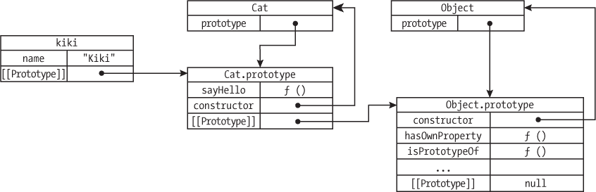

<samp class="SANS_Futura_Std_Book_Oblique_I_11">图 6-1：kiki 的原型链</samp>

图中的每个框代表一个对象，以对象的名称作为标题。每个框的左侧列显示对象的属性名称，右侧列显示这些属的值。例如，`kiki` 对象的 `name` 属性值为 "Kiki"，而 `Cat.prototype` 对象的 `sayHello` 属性是一个函数，用 `f()` 表示（记住，方法只是作为对象属性的函数）。

某些属性值指向或引用其他对象。例如，所有构造函数都有一个 `prototype` 字段，指向将用作该构造函数创建的实例的原型的对象。因此，`Cat` 构造函数的 `prototype` 字段指向 `Cat.prototype`。同样，对象通过它们的 `[[Prototype]]` 属性链接到原型。例如，`kiki` 的 `[[Prototype]]` 属性链接到 `Cat.prototype`，因为 `kiki` 是用 `Cat` 构造函数创建的。所有的原型对象都有一个 `constructor` 字段，链接回它们所属的构造函数。如你所见，`Cat.prototype` 的 `constructor` 字段连接回 `Cat`，而 `Object.prototype` 的 `constructor` 字段连接到 `Object`。像 `kiki` 这样的实例并没有直接在其上定义 `constructor` 字段。相反，通过遍历原型链在实例的原型上查找 `constructor`。

正如我们在 `Dog` 示例中看到的，类在底层使用相同的原型机制，因此这种遍历原型链的技术也是在类实例上查找属性和方法的方法。

### 重写方法

理解 JavaScript 如何通过遍历原型链来定位对象的方法是非常重要的，因为这允许我们重写对象本应从其原型继承的方法定义。当我们希望一个对象从原型继承大部分行为，但又想给它提供一些独特行为时，这种技术就非常有用。当你调用一个方法时，JavaScript 会在遍历原型链时使用找到的该方法的第一个定义，因此如果我们直接在对象上定义了一个方法，且该方法的名称与对象原型上定义的方法同名，那么对象本身的方法将优先优先。

例如，假设你想要一个新的的 `Cat` 对象，其打招呼的方式与 `Cat.prototype` 上定义的方法不同。你可以直接在那个新猫上设置一个单独的 `sayHello` 方法，如下所示：

```javascript
let moona = new Cat("Moona");
moona.sayHello = function () {
  console.log(`HELLO!!! I'M ${this.name.toUpperCase()}!`);
};
moona.sayHello();
❶ HELLO!!! I'M MOONA!
kiki.sayHello();
❷ Miaow! My name is Kiki.
```

在这里，我们用 `Cat` 构造函数定义了一个新实例并命名为 `moona`。然后我们在 `moona` 本身定义了一个 `sayHello` 方法，输出全大写的问候语。当我们随后调用 `moona.sayHello()` 时，从输出中可以看到直接设置在 `moona` 上的 `sayHello` 定义于 `Cat.prototype` 上的 `sayHello` 定义 ❶。这也被称为屏蔽（shadowing），因为局部方法在原型方法上投了一层影子。但注意，`Cat.prototype` 上的原始 `sayHello` 方法仍然保持完好，正如从我们在 `kiki` 上调用它时看到的输出 ❷。

### 总结

在本章中，你学习了类，它可以帮你通过在多个对象之间共享功能来组织代码。你学习了如何创建类、如何使用它们创建实例，以及如何通过创建子类和父类的层次结构来扩展类。你还学习了基于原型的继承，这是 JavaScript 允许对象继承属性和方法的原始系统。你探索了基于原型的继承与较新的类系统之间的比较，并学会了如何在控制台中通过 `[[Prototype]]` 属性追踪对象的继承链。

# 第二部分 交互式 JAVASCRIPT

现在你已经学习了语言的基础知识，本书的第二部分将向你展示如何使用 JavaScript 与网络浏览器进行交互。这将极大地扩展该语言的可能性，允许你编写交互式的图形应用程序。

首先，你将探索 HTML 和 CSS（除了 JavaScript 之外 Web 开发的两个支柱），你将看到如何使用 DOM ([第 7 章]) 动态地修改网页的内容和外观。接下来，你将练习编写响应用户驱动事件的 JavaScript 代码，例如按键和鼠标点击 ([第 8 章])。最后，你将学习如何使用 JavaScript 和 Canvas API 生成静态和动画图形 ([第 9 章])。

## 7 HTML、DOM 和 CSS


为了开发你自己的交互式 Web 应用程序，你需要学习一些 HTML 和 CSS，这些是用于创建网页和改变其外观的语言。对这些语言的全面介绍出了本书的范囿，但本章将教你足够入门的知识。我们还将讨论文档对象模型 (DOM) 及其应用程序接口 (API)，它们为我们提供了使用 JavaScript 修改网页的方法。

### HTML

HTML 代表 *HyperText Markup Language*（超文本标记语言）。*Hypertext*（超文本）是链接到其他文本或文档的文本，而*markup*（标记）是一种对文档文本进行注释的系统。因此，HTML 是一种用于注释相互链接的文档文本的语言。在第 1 章中，我简要将其介绍为描述网页的语言。从这个角度来看，网页是相互链接的文档，而注释是告诉浏览器如何显示页的指令。

HTML 注释以标签的形式存在。简单来说，HTML 标签是封装在角括号中的名称。例如，定义文档主体的标签（它识别网页的所有可见内容）看起来如下所示：`<body>`。大多数标签都是成对出现的，包含一个开始标签和一个结束标签：例如 `<body>` 和 `</body>`。结束标签看起来和开始标签一样，但在起始角括号后有一个斜杠。

每一对标签都定义了一个 `element`（元素）。每个 HTML 元素代表网页的某个方面，例如标题、图像或段落。一个 HTML 文档包含一组嵌套的元素，用于描述文档的结构。在这种语境下，`nesting`（嵌套）意味着元素包含在其他元素之中，而这些元素又可能包含在其他元素之中，就像俄罗斯娃娃一样。

元素起始标签和结束标签之间的所有内容被称为该元素的 `content`（内容）。例如，图 7-1 显示了一个基础的 `p` 元素，它是 `paragraph`（段落）的写，代表网页上的标准文本段落。

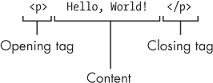

<samp class="SANS_Futura_Std_Book_Oblique_I_11">图 7-1：HTML 元素的结构</samp>

`p` 元素的内容位于起始 `<p>` 标签和结束 `</p>` 标签之间，它是将将出现在段落中的实际文本——在本例中为 Hello, World!

### 创建 HTML 文档

让我们创建第一个真实的 HTML 文档。它将是一个带有标题和短段落的简单网页。打开你的文本编辑器并创建一个名为 `helloworld.html` 的新文件（如果你需要复习创建新文件，请参考第 1 章）。输入列表 7-1 中的内容。

```
❶ <!DOCTYPE html>
❷ <html>
❸ <head>
    <title>Hello, World!</title>
  </head>
❹ <body>
    <h1>Hello!</h1>
    <p>Welcome to my document.</p>
  </head>
</html>
```

<samp class="SANS_Futura_Std_Book_Oblique_I_11">列表 7-1：一个基础的 HTML 文档</samp>

第一行，即 `doctype` ❶，说明这是一个 HTML 文档。为了让浏览器能够正确显示这些文档，这一行是必不可少的（尽管我们在第 1 章中编写最简单的 HTML 骨架时跳过了它）。之后是起始 `<html>` 标签 ❷。文件中的其他所有内容都包含在该标签和结束 `</html>` 标签之间。每个 HTML 文档都应该有一组 `<html>` 和 `</html>` 标签，定义一个总的 html 元素。所有其他元素都嵌套在 `html` 元素内部。

在我们的 `html` 元素内部有一个 `head` 元素 ❸ 和 `body` 元素 ❹。注意，我们的文档遵循通用约定，使用缩进来表示元素在元素元素嵌套。由于 `head` 和 `body` 嵌套在 `html` 元素中，它们的标标签被缩进了。VS Code 和许多其他文本编辑器会自动应用这种缩进；就像在 JavaScript 中一样，这不是强制要求的，但它有助于可读性。

`head` 元素包含 `metadata`（元数据），或关于页的信息。在本例中，它包含一个元素 `title`。由于它嵌套在 `head` 内部，按照惯例，它获得了额外一层的缩进。`title` 元素的文本内容 Hello, World! 是网页的名称。该名称不会

DOM 并不真正关心起始标签和结束标签，这些仅仅是 HTML 以文本格式描述文档结构的方式。从浏览器的角度来看，重要的细节是元素以及它们的父、子、兄弟关系。图 7-3 展示了这种更抽象的文档结构视视图。你可以一眼看出 `h1` 和 `p` 元素嵌套在 `body` 元素中，而 `body` 元素又嵌套在 `html` 元素中。

## DOM API

Web 浏览器允许你使用 `DOM API` 通过 JavaScript 修改 DOM。正如本章开头提到的，API 是 `application programming interface`（应用程序接口）的缩写，它是通过代码与系统或对象交互的方法。正如你在更新 `h1` 元素时看到的，修改 DOM 就会修改网页，而且你所做的任何更改通常都会立即生效。这意味着 `DOM API` 为我们提供了一种编写代码的方法，可以为页面的访问者提供即时的视觉反馈。

API 提供了一组用于与 DOM 交互的方法和属性。其中许多方法和属性可以在 `document` 对象上找到，该对象是由 `DOM API` 提供的代表当前文档（即网页）的对象。例如，`document.title` 允许你获取和设置当前标签页的标题。让我们现在试一下。在 `helloworld.html` 的 JavaScript 控制台中运行以下代码：

```javascript
document.title;
'Hello, World!'
document.title = "Hello, JavaScript!";
'Hello, JavaScript!'
```

当你运行这些代码时，你应该能看到浏览器标签页中的标题从 Hello, World! 变为 Hello, JavaScript!

## 元素标识符

我们可以使用 `DOM API` 修改页面上的任何元素，甚至添加新元素。要修改一个元素，我们需要一种从代码中访问它的方法。JavaScript 提供了许多访问 HTML 元素的方法。最简单是通过元素的 `id` 属性来引用元素。

HTML 属性（如 `id`）是我们可以添加到 HTML 元素中的键值对。`id` 属性为元素提供了一个唯一的标识符。在 HTML 文档中，属性始终附加在元素的起始标签上；也就是说，它们出现在元素名称之后、右括号之前。让我们回到文本编辑器，为 `helloworld.html` 文档中的 `h1` 元素添加一个 `id` 属性。这将使得该元素很容易通过 `DOM API` 访问。按照 列表 7-3 所示更新文档。未更改的代码已灰显。

```html
<!DOCTYPE html>
<html>
  <head>
    <title>Hello, World!</title>
  </head>
  <body>
    <h1 id="main-heading">Hello!</h1>
    <p>Welcome to my document.</p>
  </body>
</html>
```

列表 7-3：添加 id 属性

我们将属性置于起始标签名 `h1` 之后。属性名和属性值之间用等号分隔，值应该被引号括起来。在这种情况下，我们把 `id` 属性设置为值 `"main-heading"`。

如果你重新加载页面，应该会发现没有变化；默认情况下，`id` 属性对元素的显示没有影响。为了确认页面已更新，右键点击“Hello!”标题并从菜单中选择**检查**（Inspect）。这将在 Elements（元素）选项卡中高亮 `h1` 元素，包括其新增的 `id` 属性，如 图 7-4 所示。

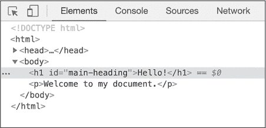

图 7-4：Chrome 在 Elements 标签页中高亮 h1 元素

现在由于 h1 元素有了 ID，我们可以使用 JavaScript 轻松地引用它。在你的浏览器中，切换到 `helloworld.html` 的 **Console**（控制台）标签页并输入以下内容：

```javascript
let heading = document.getElementById("main-heading");
```

`getElementById` 方法接收对应 HTML 元素 `id` 属性的字符串。它返回带有指定 ID 的 HTML 元素的表示。我们将该元素存储在变量 `heading` 中。由于标识符应该是唯一的，`getElementById` 只返回一个元素。如果未找到 ID，该方法将返回 `null`。如果你违反了规则设置了多个具有相同 ID 的元素，浏览器通常会返回带有该 ID 的第一个元素，但这属于 `undefined behavior`（未定义行为），意味着该行为未被规定，并且未来可能会发生变化。

现在让我们询问控制台 `heading` 的值：

```
heading;
  <h1 id="main-heading">Hello!</h1>
```

控制台显示了 `h1` 元素的 HTML 表示。此外，如果你用鼠标悬停在输出上，浏览器会高亮页面上的该元素，如 图 7-5 所示。

现在我们已经将标题元素绑定到变量，可以对其进行操作。例如，我们可以如下获取并设置元素的文本：

```javascript
heading.innerText;
'Hello!'
heading.innerText = "Hi there…";
'Hi there…'
```

`innerText` 属性代表元素的文本。如示例所示，它可以既用于获取文本也用于更改文本。当你更新 `innerText` 的值时，页面上的元素也会随之更新。再次提醒，这只是对 DOM 的修改，而不是 HTML 文件本身。如果你刷新页面，更改将会消失。

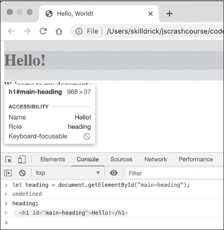

图 7-5：Chrome 在页面上高亮 h1 元素

在 JavaScript 控制台中编写代码可以让你在更新 DOM 时立即看到结果，但如果你想让别人在查看网页时更新 DOM 呢？你无法在别人的计算机上通过控制台输入代码，但你可以将 JavaScript 代码直接嵌入 HTML 文档，以便任何查看页面的人都能看到代码的结果。这就是我们接下来要做的

### script 元素

如果你要在 HTML 文档中包含 JavaScript，必须使用 `script` 元素。使用 script 元素有两种技术：要么在起始和结束标签之间包含 JavaScript 代码，要么将代码保存在单独的 JavaScript 文件并将文件名作为 script 元素的属性引入。将 JavaScript 直接包含在 HTML 文件中的优点是它可以将所有内容放在一起。相反，将 JavaScript 放在单独文件中意味着你可以在多个页面使用同一个 JavaScript 文件。当项目包含大量 HTML 和 JavaScript 时，维护单独的文件可能更易管理。

你已经见过一个带有内容的 script 元素：我在第 1 章 中介绍过它作为在 HTML 文件中编写 JavaScript 的方法。现在来看第二种技术。我们将创建一个包含 script 元素的 HTML 页面，并让该元指向一个 JavaScript 文件。在 JavaScript 文件中，我们将编写代码向控制台打印消息，以证明脚本已包含在网页中。

由于我们的 HTML 和 JavaScript 将位于不同的文件中，如果将它们放在一个新的目录（Windows 中称为文件夹）中将更容易跟踪这两个文件。创建一个名为 *chapter7* 的新目录，在该目录下创建一个名为 *index.html* 的新 HTML 文件。这是目录中主 HTML 文件的习惯命名。

将列表 7-4 所示的代码输入到 *index.html*。

```html
<!DOCTYPE html>
<html
  <head>
    <title>Hello, JavaScript!</title>
❶ <script src="script.js"></script>
  </head>
  <body>
    <h1 id="main-heading">Hello, JavaScript!</h1>
  </body>
</html>
```

<samp class="SANS_Futura_Std_Book_Oblique_I_11">列表 7-4：一个包含指向 JavaScript 文件的 script 元素的 HTML 文件</samp>

我们在 `head` 元素内部 ❶ 包含了一个 `script` 元素。按照惯例，我们将其放在那里，因为脚本不会对页面的视觉内容产生影响，尽管在技术上我们也可以将其放在 `body` 中。`script` 元素有一个 `src` 属性（`source` 的缩写），它告诉浏览器要加载的 JavaScript 文件的的文件名。当给出一个简单的文件名时，浏览器会在与 HTML 文件相同的目录中查找。你也可以为 JavaScript 文件提供一个路径，例如 `"/scripts/myscript.js"`，但只要 HTML 和 JavaScript 文件在同一个目录下，只需要文件名就足够了。

我们的 HTML 文件现在还无法，因为我们还没有创建引用的脚本文件。在 `chapter7` 目录中创建一个名为 `script.js` 的新文件，并输入列表 7-5 所示的代码。

```javascript
console.log("Hello, HTML!");
```

<samp class="SANS_Futura_Std_Book_Oblique_I_11">列表 7-5：一个简单的</samp> <samp class="SANS_Futura_Std_Book_11">script.js</samp> <samp class="SANS_Futura_Std_Book_Oblique_I_11">文件</samp>

现在在 Chrome 中打开 `index.html`。当你打开 JavaScript 控制台时，你应该能看到控制台上打印了字符串 Hello, HTML!。如果没有，请仔细检查代码，并确保文件名完全匹配。

### CSS <samp class="SANS_Futura_Std_Bold_B_11">CSS</samp>

现代网页由三种语言组成：HTML、JavaScript 和 CSS。在基础层面，HTML 定义了页面的`content`（内容），JavaScript 定义了页面的`behavior`（行为），而 CSS（`Cascading Style Sheets` 的缩写）定义了页面的`appearance`（外观）。正如我们所看到的，网页浏览器显示各种 HTML 元素（如标题和段落）有默认方式。CSS 让我们对这些元素的外观有更多控制，允许我们覆盖元素的默认外观，例如它们的尺寸、颜色和字体。

由于这是一本 JavaScript 书，我们不会深入研究 CSS。然而，当我们开始制作动态网页时，了解 CSS 的基础知识将很有帮助。此外，我们将要用到的一些 DOM API 方法依赖于 CSS 选择器语法，我们稍后会讨论这种语法。理解这种语的来源将帮助你有效地使用这些方法。

#### link Elements <samp class="SANS_Futura_Std_Bold_Condensed_Oblique_BI_11">link 元素</samp>

在本节中，我们将创建一个 CSS 文件并包含在页面中，并使用该文件来覆盖某些元素的样式。包含 CSS 文件与包含 JavaScript 文件类似，但你需要使用一个不同的 HTML 元素，称为 `link`。`link` 元素是在页面上包含外部资源的通用方法。要为我们即将编写的 CSS 文件创建链接，请在文本编辑器中打开 `index.html` 并添加列表 7-6 中高亮显示的行。

```html
<!DOCTYPE html>
<html>
  <head>
    <title>Hello, JavaScript!</title>
    <script src="script.js"></script>
    <link href="style.css" rel="stylesheet">
  </head>
  <body>
    <h1 id="main-heading">Hello, JavaScript!</h1>
  </body>
</html>
```

<samp class="SANS_Futura_Std_Book_Oblique_I_11">列表 7-6：使用 link 元素添加 CSS 文件</samp>

我们在 `link` 元素上设置了两个属性：`href`（`hypertext reference` 的缩写）和 `rel`（`relationship` 的缩写）。`href` 属性的工作方式与 `script` 元素上的 `src` 属性相同：你将链接的文件指定为属性的值。`rel` 属性指指定你所链接的文件类型以及它与文档的关系。在这里我们提供了字符串 `"stylesheet"`，这意味着链接的文件应该被解释为页面的样式表，其中包含元素应该如何显示的信息。

注意，与我们目前看到的 HTML 元素不同，`link` 元素不需要闭合标签 `</link>`。这是因为虽然其他元素可能包含内容，但 `link` 元素永远不会包含。因此，不需要闭合标签来标记内容的结束。

#### Rulesets <samp class="SANS_Futura_Std_Bold_Condensed_Oblique_BI_11">规则集</samp>

一个 CSS 文件由一个或多个 `rulesets`（规则集）组成，建立了文档中元素应该如何样式。我们现在编写一个基础规则集。在 `chapter7` 目录中创建一个名为 `style.css` 的文件，并输入列表 7-7 的内容。

```css
h1 {
  color: red;
  font-style: italic;
}
```
<samp class="SANS_Futura_Std_Book_Oblique_I_11">列表 7-7：样式化</samp> <samp class="SANS_Futura_Std_Book_Oblique_I_11">h1 元素</samp> <samp class="SANS_Futura_Std_Book_Oblique_I_11">在 CSS</samp> <samp class="SANS_Futura_Std_Book_11">文件中的</samp>

>

这段 CSS 代码说明 h1 元素应该是红色的。在浏览器中刷新 `index.html`，你应该看到样式。一个规则集具有两个部分：一个 `selector`（选择器，在本例中 h1）和一系列 `declarations`（声明）。选择器告诉浏览器要操作哪些元器，而声明告诉它对这些元素做什么。也就是说，选择器是一种模式，浏览器匹配这些元素。在这种情况下，h1 是匹配所有 h1 元素的选择器。每个声明由一个属性名、一个冒号和一个属性值组成。例如，color 是属性名，而 red 是该属性的值。

#### Selectors <samp class="SANS_Futura_Std_Bold_Condensed_Oblique_BI_11">选择器</samp>

我们在列表 7-7 中的选择器针对所有该类型的元素，但 CSS 也允许你创建更具体的选择器。为了利用它们，我们首先必须向 HTML 文件添加一些代码。按照列表 7-8 所示更新 `index.html`。

```html
<!DOCTYPE html>
<html>
  <head>
    <title>Hello, JavaScript!</title>
    <script src="script.js"></script>
    <link href="style.css" rel="stylesheet">
  </head>
  <body>
    <h1 id="main-heading">Hello, <strong>JavaScript</strong>!</h1>
    <p class="highlight">这是我的第一个<strong>段落</strong>。</p>
    <p>这是我的第二个<strong>段落</strong>。</p>
    <h1>这是另一个标题</h1>
    <p class="highlight">这是我的第三个<strong>段落</strong>。</p>
  </body>
</html>
```

<samp class="SANS_Futura_Std_Book_Oblique_I_11">列表 7-8：让我们的 HTML 更有趣</samp>

在这个扩展的 HTML 中有两个新概念。首先，我们把部分文本包裹在 `strong` 元素中。该元素将其内容标记为某种方式的重要。默认情况下，浏览器会将 `strong` 元素的内容加粗。其次，我们为两个 `p` 元素添加了 `class` 属性。`class` 属性与 `id` 属性相似，虽然 ID 应该是唯一的，但你可以将相同的类名应用于多个元素。当我们想要相同的方式处理一组元素时就会使用类——例如高亮某些段落的文本。

> <samp class="SANS_Dogma_OT_Bold_B_21">注意</samp>

*`strong` 元素被称为内联 元素，因为你可以将其应用于行的一部分，而不是由它定义单独的一行。*

刷新页面，你应该看到新的文本。标题中的单词 *JavaScript* 看起来没有任何不同，因为 `h1` 元素默认已经设置了加粗样式，但三个 *paragraph* 单词都会因为 `strong` 元素而加粗。

我们添加类属性尚未产生任何影响，但一旦我们针对 `highlight` 类添加一些 CSS，情况就会发生变化。现在就来这样做。将列表 7-9 所示的新代码添加到 `style.css` 中，指定一些新的 CSS 规则集，使用不同类型的选择器来定位新的 HTML。

```
h1 {
  color: red;
  font-style: italic;
}
#main-heading {
  font-size: 48px;
}
strong {
  color: blue;
}


p strong {

  font-size: 24px;

}

.highlight {

  background-color: yellow;

}

.highlight strong {

  background-color: orange;

}

```

<samp class="SANS_Futura_Std_Book_Oblique_I_11">列表 7-9：向</samp> <samp class="SANS_Futura_Std_Book_11">`style.css`</samp> 添加更多规则集

这段 CSS 代码使用了几种不同类型的选择器。第一个新选择器 `#main-heading` 是一个 ID 选择器。`ID 选择器`选取具有特定 `id` 属性的 HTML 元素。它使用哈希标记（#）后跟你想要匹配的 ID，因此 `#main-heading` 匹配 `id="main-heading"` 的元素。在这里，我们使用该选择器使主标题比 `h1` 元素的默认尺寸更大。注意，CSS 中的数字大小需要一个单位；在这种情况下，我们使用的是 `px`，代表像素。

带有 `strong` 选择器的规则集匹配任何 `strong` 元素并将其文本设置为蓝色。`p strong` 选择器则稍微有趣一些。它是一个`后代选择器`（`descendant selector`），只有当指定的元素是另一个指定元素的后代时，它才会匹配。在我们的示例中，`p strong` 意味着“匹配任何作为 `p` 元素后代的 `strong` 元素”。因此，选择器将调整 `p` 元素内部 `strong` 元素的文本大小，但忽略 `h1` 元素内部的 `strong` 文本。

如果你愿意，可以将多个后代选择器链在一起。例如，`html body p strong` 是一个有效的后代选择器（尽管有些多余，因为所有页面内容都是 `html` 和 `body` 的后代）。这将匹配任何作为 `p` 元素后代的 `strong` 元素，而该 `p` 元素又是 `body` 元素的后代，本身又是 `html` 元素的后代。

接下来是针对 `.highlight` 的规则集，它是一个`类选择器`（`class selector`）。这种选择器匹配所有具有给定 `class` 属性的元素。类名位于点号之后，因此 `.highlight` 将匹配任何 `class="highlight"` 的元素。在这里，我们使用类选择器设置黄色背景，创建高亮效果。最后，`.highlight strong` 将类选择器与后代选择器结合。它意味着“匹配任何作为带有 `highlight` 类元素后代的 `strong` 元素”。每当你使用类选择器或 ID 选择器时，都可以选择在它前面包含一个元素名称且无需空格。例如，`p.highlight` 意味着“选择任何带有 highlight 类的 `p` 元素”，而 `.highlight` 意味着“选择任何带有 highlight 类的元素”。同样，`h1#main-heading` 匹配 id 为 main-heading 的 `h1` 元素。在这种情况下，元素名称是多余的，因为 ID 是唯一的，但你可能想包含它以提醒读者 `#main-heading` 是一个 `h1` 元素。你也可以将你的 CSS 文件应用于两个不同的 HTML 文件，其中一个具有 id 为 `main-heading` 的 `h2` 元素，在这种情况下，`h1#main-heading` 只会在一个页面上匹配。

在网页浏览器中刷新页面，你应该看到一种糟糕的样式混合，类似于图 7-6。

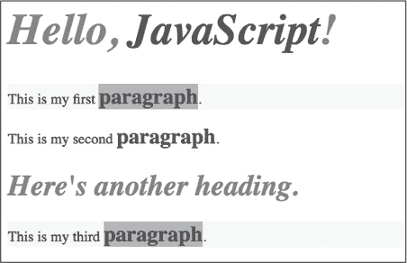

<samp class="SANS_Futura_Std_Book_Oblique_I_11">图 7-6：我们的 CSS 样式实验结果</samp>

我们不会因为这个页面获得任何设计奖，但它帮助我们看到各种 CSS 选择器是如何工作的。例如，注意所有的 `strong` 元素（通过 `strong` 选择）都被染成了蓝色，但只有 `p` 元素内部的 `strong` 元素（通过 `p strong` 选择）尺寸被设置为 24 像素。如果这种尺寸应用到*所有* `strong` 元素，顶部标题中的 `JavaScript` 单词将会变小。同时，被分配给 highlight 类的第一和第三段具有橙色背景。

事件是浏览器告诉 JavaScript DOM 中发生了某些情况的方式。这就像是每当鼠标移动过窗口或按下某个按键时，浏览器都在大喊：“嘿，鼠标移动了！按键被按下了！”这些大喊一直在发生，但只有当你显式告诉 JavaScript 代码去监听它们时，它才能对它们做出响应。你通过编写一个 JavaScript 事件处理器来实现这一点，该处理器会在特定类型的事件发生时执行某些操作。

`event handler`（事件处理器）是一个由特定元素上的特定事件类型触发的函数。例如，你可以为某个特定的 `h1` 元素附加一个处理器，用于处理该元素的点击事件。让我们现在来试一下。我们将创建一个带有标题的简单网页，并使用事件处理器在点击标题时向控制台记录一条消息。

### HTML Setup
首先，你需要一个 HTML 文件。创建一个名为 `chapter8` 的新目录，并在该目录下创建一个名为 `index.html` 的新文件。输入 Listing 8-1 所示的内容。

```

<!DOCTYPE html>

<html>

  <head>

    <title>Event Handlers</title>

  </head>

  <body>

    <h1 id="main-heading">Hello <em>World!</em></h1>

    <script src="script.js"></script>

  </body>

</html>

```
<samp class="SANS_Futura_Std_Book_Oblique_I_11">Listing 8-1: 用于探索事件处理器的</samp> <samp class="SANS_Futura_Std_Book_11">index.html</samp> <samp class="SANS_Futura_Std_Book_Oblique_I_11">文件</samp>

一如既往，我们的 HTML 文件包含包含一个单一的 `html` 元素，其中包含带有一些元数据的 `head` 和包含一些内容的 `body`。具体来说，`body` 包含一个 ID 为 `main-heading` 的 `h1` 元素，标题文本的一部分被封装在 `em` 元素中（*emphasis* 的缩写），它默认情况下会将该部分文本设为斜体。它还包含一个指向 `script.js` 文件的 `script` 元素。稍后，我们将在那里为事件处理器编写代码。

总的来说，这个文件与我们在 Chapter 7 中创建的 `index.html` 文件非常相似，唯一的区别是 `script` 元素位于 `body` 元素内部，而不是 `head` 元素。这是为了绕过浏览器读取网页方式的一种小技巧。如上一节所述，浏览器构建一个名为 DOM 的页面模型。它通过从上到下读取 HTML 文件来增量构建 DOM。每当浏览器遇到 `script` 元素时，它都会在继续之前执行整个脚本。这意味着如果我们将 `script` 元素放在 `head` 中，并在该脚本中查找 `h1` 元素，那么此时 `h1` 元素还没有 DOM 中！通过将 `script` 元素放在 `body` 的末尾，我们可以确保在运行 JavaScript *之前*，所有页面内容已加载到 DOM 中。

### Implementing the Handler
现在，在 HTML 代码相同的目录下创建一个名为 `script.js` 的文件，并输入 Listing 8-2 所示的脚本。该脚本为用户点击 `h1` 元素的情况添加了一个事件处理器。

```

let heading = document.querySelector("#main-heading");

heading.addEventListener("click", () => {

  console.log("You clicked the heading!");

});

```
<samp class="SANS_Futura_Std_Book_Oblique_I_11">Listing 8-2: 在 script.js 中创建</samp> <samp class="SANS_Futura_Std_Book_11">事件处理器</samp>

使用 DOM API 的 `querySelector` 方法，我们获取了 ID 为 `main-heading` 的元素并保存为变量 `heading`。你可能还从 Chapter 7 回记得，此方法返回匹配选择器的第一个元素。在我们的情况下，只有一个 `main-heading` 元素，所以我们知道该方法将选择我们想要的元素。然后，我们在 `heading` 元素上使用 `addEventListener` 方法为该元素附加一个事件处理器。`addEventListener` 告诉 JavaScript 监听元素上发生的特定事件，并在事件发生时执行某些函数。

> <samp class="SANS_Dogma_OT_Bold_B_21">NOTE</samp>
> 虽然 DOM API 使用 *listener*（监听器）一词，但 *handler*（处理器）一词更常用于描述对事件响应的函数。

`addEventListener` 方法有两个必需参数。第一个是事件类型。这是一个表示要响应的事件类型的字符串，例如 `"click"`（用于鼠标点击）、`"keydown"`（用于键盘按下）或 `"scroll"`（用于窗口滚动）。我们指定了 `"click"`。第二个参数是在指定的事件发生时要执行的函数。该函数就是事件处理器。每当在调用 `addEventListener` 的元素上发生事件时，该函数就会被调用。在这种情况下，这个向控制台记录消息的函数将在每次有人点击标题元素时被调用。

> <samp class="SANS_Dogma_OT_Bold_B_21">NOTE</samp>
> 正如 Chapter 5 所解释的，当一个函数作为参数传递给另一个函数时，它被称为 *callback function*（回调函数），或简单称为 *callback*（回调）。所有的事件处理器都是回调函数，因为它们是作为参数传递的。

在浏览器中打开 `index.html` 并打开控制台。当你点击标题时，你应该会在控制台中看到消息 "You clicked the heading!"。恭喜：你制作了第一个交互式页面。

#### Event Bubbling
#### <samp class="SANS_Futura_Std_Bold_Condensed_Oblique_11">Event Bubbling</samp>

当事件在元素上被触发时，它也会在所有祖先元素上触发（即元素的父元父元素、父元素的父元素等等）。例如，当你点击上一个例子中的 `h1` 元素时，你也点击了 `body` 元素。这直觉上是合理的；如果你点击盒子中的某些文本，你也点击了盒子。这种从子元素到祖先元素的事件传播被称为 *event bubbling*（事件冒泡）。

让我们通过向网页中的 `em` 和 `body` 元素添加事件处理器来利用冒泡。与我们的 `h1` 事件处理器一样，这些新处理器会在它们的元素被点击时向控制台记录一条消息。由于 `em` 是 `h1` 的子元素，而 `h1` 是 `body` 的子元素，点击 `em` 应该触发所有三个处理器。

将 Listing 8-3 中的代码添加到 `script.js` 的末尾。

```

--snip--

document.querySelector("em").addEventListener("click", () => {

  console.log("You clicked the em element!");

});

document.querySelector("body").addEventListener("click", () => {

  console.log("You clicked the body element!");

});

```
<samp class="SANS_Futura_Std_Book_Oblique_I_11">Listing 8-3: 向 script.js 添加更多</samp> <samp class="SANS_Futura_Std_Book_11">处理器</samp>

这段代码添加了两个处理器，一个给 `em` 元素，一个给 `body` 元素，但我们的做法与在 Listing 8-2 中创建处理器略有不同。我们没有将每个元素保存到变量，而是直接在 `document.querySelector` 方法的结果上调用 `addEventListener`。这种在另一个方法的返回值上直接调用方法的技术被称为 *method chaining*（方法链式）：我们将多个方法调用链在一起，使得链中第一个链接的结果被用作下一个方法调用的对象。我在 Listing 8-2 中使用较长的方法是因为它更显式地说明了 `addEventListener` 是在元素上调用的，但链式技术因其简洁而受青睐。

重新加载 `index.html` 并打开控制台。当你点击 *World!* 单词时，你应该看到以下输出：

```

You clicked the em element!

You clicked the heading!

You clicked the body element!

```


当你点击 `em` 元素时，该元素上的处理函数会第一个被调用。之后，`h1` 元素上的处理函数会被调用，然后是 `body` 元素上的处理函数。这是因为事件会通过 DOM “冒泡”，从最内层的元素冒泡到最外层的元素。如果你点击标题的非斜体部分，你只会看到 `main-heading` 和 `body` 处理函数被触发。

## 事件委托

事件冒泡较常用的用途之一是`事件委托`（event delegation），这是一种允许你使用单个处理函数来响应多个子元素或其他后代元素事件的技术。例如，假设你有一个单词列表，其中每个列表项都是独立的 HTML 元素，并且你想以相同的方式处理每个项的点击事件。通过在列表项的父元素上添加单个处理函数，你只需要几行代码就能捕获每个项的事件。

为了说明事件委托，我们将编写一个简单的应用程序，它将根据你在列列表中点击的单词来构建并显示一个句子。首先，我们将更新 HTML 文件，包含一个单词列表和一个空的 `p` 元素，我们将动态地用你选择的单词填充该元素。然后，我们将使用 JavaScript 编写必要的事件处理函数，获取点击的单词并将其添加到 `p` 元素中显示。最后，我们将添加一些 CSS 规则，使应用程序更容易交互。

HTML 中有两种类型的列表：有序列表（编号列表）和无序列表（符号列表）。我们将使用用 `ul` 元素创建的无序列表。列表中的每个单独项目都封装在 `li` 元素中。因此，点击任何 `li` 元素产生的事件都将冒泡到父元素 `ul` 元素。

如 Listing 8-4 所示更新 `index.html`。

```html

<!DOCTYPE html>

<html>

  <head>

    <title>Event Handlers</title>

  </head>

  <body>

    <h1 id="main-heading">Hello <em>World!</em></h1>

    <ul id="word-list">

      <li>The</li>

      <li>Dog</li>

      <li>Cat</li>

      <li>Is</li>

      <li>Was</li>

      <li>And</li>

      <li>Hungry</li>

      <li>Green</li>

    </ul>

    <p id="sentence"></p>

    <script src="script.js"></script>

  </body>

</html>

```
Listing 8-4: 在 `index.html` 中添加列表

这在文档中添加了一个单词无序列表以及一个空的 `p` 元素，我们将用 JavaScript 修改它。

接下来，我们将为 `ul` 元素编写一个事件处理函数，以处理对任何列表项的点击。该处理函数将获取被点击的单词并将其添加到 `p` 元素中，允许你逐单词地构建句子。删除 `script.js` 中的所有代码，并将其替换为 Listing 8-5。

```javascript

let wordList = document.querySelector("#word-list");

let sentence = document.querySelector("#sentence");

wordList.addEventListener("click", event => {

  let word = event.target.textContent;

  sentence.textContent += word;

  sentence.textContent += " ";

});

```

Listing 8-5: 事件委托

首先，我们使用 `document.querySelector` 查找我们关心的两个元素：带有列表的 `ul` 和空的 `p` 元素。接下来，我们为 `ul` 元素添加一个 `click` 处理器。这个例子与我们的处理函数有点不同，因为回调函数有一个参数，我们称其为 `event`。如果给处理函数一个单一参数（在本例中为 `event`，但名称并不重要），该参数代表一个对象，DOM API 通过该对象传递刚刚发生的事件的信息。这些信息（包括被点击的元素、元素的文本内容等）可以在回调函数可以使用。

在我们的示例中，我们使用 `event` 对象来确定点击了哪个单词，并将其存储在变量 `word` 中。我们通过 `event` 的 `target` 属性找到点击的是哪一个特定元素。当你点击其中一个 `li` 元素时，`event.target` 将是你点击的那个 `li` 元素，而不是 `ul`（`ul` 元素可以通过 `currentTarget` 属性获取）。然后我们使用 `textContent` 属性，它返回该元素的文本。整合起来，如果你点击第一个 `li` 元素，`event.target.textContent` 将返回 "The"，而该字符串将成为 `word` 的值。

现在我们有了用户点击的 `word`，可以将其添加到 `sentence` 中。我们使用 `+=` 运算符将单词附加到 `sentence` 元素的文本内容。你可能记得 `sentence.textContent += word` 实际上等同于 `sentence.textContent = sentence.textContent + word`。换句话说，我们获取 `sentence` 元素的现有文本内容，将存储在 `word` 中的字符串添加到结尾，并将该文本重新赋值给元素的文本内容。然后，在单词添加到 `sentence` 后，我们使用相同的 `+=` 技巧在 `sentence` 的末尾添加一个空格，为下一个添加的单词做准备。

再次在浏览器中打开 `index.html`。你应该看到单词列表。你看不到空的 `p` 元素，因为它还没有内容。当你点击列表中的单词时，你应该看到它们被添加到 `p` 元素中。

为了完成我们的应用程序，我们需要添加少量的 CSS。JavaScript 和 CSS 通常是相辅相成的，因为样式可以向用户提供提示，说明某些元素是可以交互的。在这种情况下，我们将通过 CSS 添加两个提示：我们将修改列表项，当鼠标悬停在其上方时将鼠标指针变为手指，以便它们看起来更“可点击”；我们将为当前鼠标指针下方的元素添加下划线，以便更容易判断你正准备点击哪个单词（当鼠标位于单词之间的垂直空间时，这并不总是明显的）。

创建一个名为 `style.css` 的新 CSS 文件，并添加 Listing 8-6 所示的两个 CSS 声明。

```css

li {

  cursor: pointer;

}

li:hover {

  text-decoration: underline;

}

```
Listing 8-6: 在 `style.css` 中添加样式

要更改 `li` 元素的光标，我们使用 `cursor: pointer`。这会将鼠标悬停在 `li` 元素上时的光标从默认箭头变为带有手指的手，就像悬停在网页链接上一样。`li:hover` 选择器使用了 `:hover` 伪类。**伪类**是一种仅在元素处于特定状态时才应用的选择器：`li:hover` 匹配鼠标当前悬停的任何 `li` 元素。当指针悬停在 `li` 元素上时，我们使用 `text-decoration: underline` 为该元素的文本添加下划线。

要在页面上包含此 CSS，在 `index.html` 文件的头部添加一个 `link` 元素，如 Listing 8-7 所示。

```html

<!DOCTYPE html>

<html>

  <head>

    <title>Event Handlers</title>

    <link rel="stylesheet" href="style.css">

  </head>

  <body>

--snip--

```
Listing 8-7: 在 `index.html` 中引入 `style.css`

现在，当你悬停在列表项上时，光标会变化，当前悬停的单词将带有下划线，如 Figure 8-1 所示。

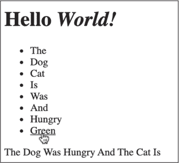

图 8-1: 使用 CSS 给用户提供提示


通过这些样式，我们的句子构建器就构建完成了！事件委托简化了我们编写的 JavaScript 代码，因为它允许我们只附加一个事件处理器，而不是为每个列表项使用一个单独的处理器。

### 鼠标移动事件

当鼠标移动时，DOM 会产生事件，事件名为 `mousemove`。这些 `mousemove` 事件会在鼠标移动过某个元素时在该元素上触发，我们可以像处理鼠标点击那样使用 `addEventListener` 方法来监听它们。让我们设置一个简单的 `mousemove` 处理器来查看它的运行效果。该处理器会在鼠率在网页上移动时，将鼠标的位置记录到控制台中。

在你的 `chapter8` 项目文件夹中，将列表 8-8 代码代码添加到 `script.js` 的末尾。

```

--snip--

document.querySelector("html").addEventListener("mousemove", e => {

  console.log(`mousemove x: ${e.clientX}, y: ${e.clientY}`);

});

```

列表 8-8：mousemove 事件处理器

在在此列表中，我们为 `html` 元素添加了一个 `mousemove` 事件处理器。由于 `html` 元素包含了整个网页，因此此处理器将响应鼠标在浏览器窗口内任何位置的移动。处理器会将消息记录到控制台中，其中包含了事件的 `clientX` 和 `clientY` 属性，这些属性告诉我们鼠标相对于浏览器窗口的 x 和 y 坐标。在这个示例中，我为事件参数使用了较短的名称 `e`，而不是像列表 8-5 中使用的 `event`。记住，参数的名称并不重要；如果事件处理器回调函数只有一个参数，那么该参数将携带有关事件的信息。

在浏览器中刷新 `index.html`，并将鼠标指针移动到页面上。你应该能看到控制台中打印了类似下所示的消息：

```

mousemove x: 434, y: 47

mousemove x: 429, y: 47

mousemove x: 425, y: 48

mousemove x: 421, y: 51

mousemove x: 416, y: 51

mousemove x: 413, y: 54

mousemove x: 408, y: 55

```

在观察控制台时，有两重要的点需要注意。首先，坐标从浏览器窗口左上角的 0 开始，随着你向右和向下移动而增加。x 坐标随着向右移动而增加，y 坐标随着向下移动而增加。这符合计算机图形的标准规范。

其次，存在“间隙”，即鼠标似乎跳过的位置。这是因为 `mousemove` 事件并不是连续触发的，而是每秒触发有限的次数。具体次数取决于鼠标、浏览器和计算机，但通常在几百次左右。因此，如果你移动鼠标得足够快，屏幕上就会出现鼠标似乎跳过的位置，因为事件触发得不够快。

现在你已经见证了 `mousemove` 事件的运行效果，我们可以尝试用它们做一些稍微有趣一点的操作。在接下来的示例中，我们将让一个框在页面上移动并跟随你的光标。为了这一点，我们需要修改 HTML、CSS 和 JavaScript 文件。HTML 的更改非常简单。将列表 8-9 中的新行添加到 `index.html`。

```

--snip--

    <p id="sentence"></p>

    <div id="box"></</div>

    <script src="script.js"></script>

  </body>

</html

```

列表 8-9：在 index.html 中添加 div

在这里我们使用了一个名为 `div` 的新 HTML 元素，它是 *content division*（内容分区）的缩写。它将成为我们页面上移动的框。`div` 元素是 HTML 的通用容器元素。这意味着它可以包含其他元素，但默认没有外观，也没有特定的含义（不像表示列表的 `ul` 或表示标题的 `h1`）。接下来，我们将使用 CSS 为 `div` 元素赋予一种外观。将列表 8-10 的内容添加到 `style.css` 的末尾。

```css

--snip--

#box {

  position: fixed;

  left: 0px;

  top: 0px;

  width: 10px;

  height: 10px;

  background-color: hotpink;

}

```

列表 8-10：使用 CSS 为 div 设置样式

在这里，我们使用 `#box` 来选择 ID 为 `box` 的元素。该规则集中有多个声明。第一个声明 `position: fixed` 告诉浏览器将此元素放在后续由 `left` 和 `top` 声明指定的位置。我们将两者都指定为 `0px`，这告诉浏览器将元素置于浏览器*视口*（viewport）的最左上角，即浏览器显示内容的部分。我们指定元素的 `width` 和 `height` 均为 10 像素。最后，我们为这个 10×10 的框设置了一个非常显眼的背景颜色：亮粉色（hot pink）。

现在刷新页面，你会看到左上角出现了一个小粉色正方形。现在是时候编写一个事件处理器，以便你用鼠标移动这个正方形了。按照列表 8-11 所示修改 `script.js`。

```javascript

let wordList = document.querySelector("#word-list");

let sentence = document.querySelector("#sentence");

wordList.addEventListener("click", event => {

  let word = event.target.textContent;

  sentence.textContent += word;

  sentence.textContent += " ";

});

let box = document.querySelector("#box");

document.querySelector("html").addEventListener("mousemove", e => {

  box.style.left = e.clientX + "px";

  box.style.top = e.clientY + "px");

```

列表 8-11：使用 JavaScript 移动 div

这里的第一个添加是通过 `document.querySelector` 找到框，并将元素的引用保存到变量 `box` 中。接下来，我们修改之前编写的 `mousemove` 事件处理器。为了让框移动，我们正在修改它的 `style` 属性，该属性是一个代表应用于元素的 CSS 的对象。例如，为 `box.style.left` 设置值。

### 键盘事件

键盘事件在按下键盘上的按键时触发。我们将关注一个键盘事件 `keydown`，它在按键按下时触发。（正如你预期的那样，还有一个对应的事件为 `keyup`，它在释放按键时触发。）

我们将为我们的网页添加一个处理器，在 `keydown` 事件发生时简单地记录到控制台中。将列表 8-12 中的代码添加到 `script.js` 的末尾。

```javascript

--snip--

document.querySelector("html").addEventListener("keydown", e => {

  console.log(e);

});

```

列表 8-12：记录 keydown 事件


尝试重新加载以查看处理器的运行效果。你需要打开控制台，然后点击文档内部使其获得 `focus`（焦点）。这意味着按键将将发送到你的网页，而不是控制台的文本输入框。只要设置正确，你应该会在打字时看到事件被记录在控制台中，如下所示：

```

KeyboardEvent {isTrusted: true, key: "h", code: "KeyH", location: 0, ctrlKey: false, …}

KeyboardEvent {isTrusted: true, key: "e", code: "KeyE", location: 0, ctrlKey: false, …}

KeyboardEvent {isTrusted: true, key: "l", code: "KeyL", location: 0, ctrlKey: false, …}

KeyboardEvent {isTrusted: true, key: "l", code: "KeyL", location: 0, ctrlKey: false, …}

KeyboardEvent {isTrusted: true, key: "o", code: "KeyO", location: 0, ctrlKey: false, …}

```

点击其中一个事件旁边的箭头，查看每个事件拥有的属性。如你所见，属性非常多，但我们主要关心的是按了哪个键，我们可以通过 `key` 属性找到它。接下来我们将使用此信息通过键盘移动粉色方框。

为了移动方框，我们将创建两个新变量来跟踪它的 x 和 y 位置。然后，当按下特定按键时，我们将使用事件处理器更新这些变量。按照代码列表 8-13 所示更新 `script.js`。（注意，在此列表中移除了 `mousemove` 处理器。）

```javascript

let wordList = document.querySelector("#word-list");

let sentence = document.querySelector("#sentence");

wordList.addEventListener("click", event => {

  let word = event.target.textContent;

  sentence.textContent += word;

  sentence.textContent += " ";

});

let box = document.queryctor("#box");

let currentX = 0

let currentY = 0

document.querySelector("html").addEventListener("keydown", e => {

  if (e.key == "w") {

    currentY -= 5;

  } else if (e.key == "a") {

    currentX -= 5;

  } else if (e.key == "s") {

    currentY += 5;

  } else if (e.key == "d") {

    currentX += 5;

  }

  box.style.left = currentX + "px";

  box.style.top = currentY + "px";

});

```

代码列表 8-13: 使用 keydown 事件移动方框

我们创建了两个名为 `currentX` 和 `currentY` 的变量来存储方框的位置。然后我们修改了 keydown 处理器，包含一个 `if…else` 语句，用于检查事件的 `key` 属性是否匹配 "w","a","s" 或 "d" 中的任何一个。如果是，则表示这四个键中的一个被按下了（我使用这些键是因为它们通常被用于游戏中的移动）。根据按了哪个键，我们在 `currentX` 或 `currentY` 上加或减 5，对应于方框向上、向下、向左或向右移动 5 像素。在更新相应的变量后，我们像在代码列表 8-11 中那样，通过 `box.style.left` 和 `box.style.top` 更新方框的样式。然而，这次我们使用 `currentX` 和 `currentY` 的值来更改 CSS。

当你重新加载页面时，尝试按住 S 或 D 键，让方框向下或向右移动。你会注意到，按住键会导致方框继续移动，因为键盘会发送重复的 keydown 事件。这是计算机键盘在你按住键时的正常行为。精确的重复速度由你的操作系统控制。

### 总结

在本章中，你学习了 DOM 事件和事件处理的基础知识。DOM 事件是浏览器告诉你的代码页面上发生了某些的方式。你可以使用事件处理器来响应这些事件，事件处理器是当特定事件发生在特�定 DOM 元素上时执行的 JavaScript 函数。事件处理器允许你创建对用户操作做出交互式响应的网页。特别是，你学习了如何编写由点击、鼠标移动和按键触发的事件处理器。

## 9. CANVAS 元素

HTML 中交互性较强的元素之一是 canvas 元素。该元素就像画家的画布：它为你在浏览器窗口内使用 JavaScript 绘制图像提供了空间。此外，通过反复擦除旧图像并绘制新图像，你可以在画布上创建动画。从这个意义上说，canvas 元素更像电影院的屏幕，图像每秒更新多次以产生运动的错觉。

在本章中，你将学习如何创建 canvas 元素以及如何使用 Canvas API，Canvas API 为你提供了通过 JavaScript 操作画布的方法。你将编写 JavaScript 在画布上绘制静态图象。然后，你将构建一个简单的交互式绘画应用程序。最后，你将学习在画布上创建 2D 动画的基础知识。

### 创建 Canvas

要在网页上包含 canvas 元素，你只需将其添加到页面 `index.html` 文件的 `body` 元素中。你只需要起始和结束 HTML 标签 `<canvas></canvas>`，因为 canvas 元素没有任何强制性属性。不过，给 canvas 给一个 `id` 是一个好主意，这样你就可以使用 JavaScript 轻松访问它。设置元素的 `width` 和 `height` 属性也是常见的做法，以便确定画布的大小。

出现在 canvas 中的图像是使用 JavaScript 生成的，而不是使用 HTML。起始和结束标签之间的任何 HTML 只有在浏览器不支持 canvas 元素时才会显示，因此这可以作为旧版或纯文本浏览器的备选方案。

让我们创建一个包含 canvas 元素的 HTML 文件。我们还将包含一个链接到 JavaScript 文件的 `script` 元素，其中我们将编写代码在画布上生成图像。我们将在整个章节中使用同一个 HTML 文件来绘制各种类型的图像。创建一个名为 `chapter9` 的新目录，在该目录下创建一个名为 `index.html` 的新文件。输入代码列表 9-1 所示的内容。

```html

<!DOCTYPE html>

<html>

  <head>

    <title>Canvas</title>

  </head>

  <body>

    <canvas id="canvas" width="300" height="300"></canvas>

    <script src="script.js"></script>

  </body>

</html>

```

代码列表 9-1: 包含 canvas 元素的 index.html 文件

这是我们熟悉的 HTML 模板，与我们在之前章节中创建的 `index.html` 文件类似，但用一个 canvas 元素代替了 h1 元素。`width` 和 `height` 属性以像素为单位指定画布的大小。默认情况下，画布是透明的，所以如果你加载页面，实际上看不到任何内容。

### 绘制静态图形

现在我们有了一个 canvas 元素，准备好使用 JavaScript 和 Canvas API 在上面绘制了。我们将从绘制一个实心矩形开始。然后我们将如何创建其他静态图形。在 `chapter9` 目录中创建一个名为 `script.js` 的新文件，并输入代码列表 9-2 所示的代码。

```javascript

let canvas = document.querySelector("#canvas");

let ctx = canvas.getContext("2d");

ctx.fillStyle = "blue";

ctx.fillRect(10, 10, 200, 100);

```

代码列表 9-2: 在 script.js 中绘制矩形


首先，我们使用 `document.querySelector` 方法获取 canvas 元素的引用。canvas 元素有一个名为 `getContext` 的方法，我们用它来获取画布的*绘制上下文*（drawing context）。绘制上context 是一个对象，它将整个 Canvas API 作为一组方法和属性提供出来（例如 `fillRect` 和 `fillStyle`，这两者在代码清单 9-2 中均有使用）。这些方法和属性正是我们将用来在画布上绘制图像。在这种情况下，我们向 `getContext` 方法传递字符串 `"2d"`，以请求二维绘制上下文。

> <samp class="SANS_Dogma_OT_Bold_B_21">注意</samp>

> 你也可以通过向 `getContext` 方法传递字符串 "webgl" 或 "webgpu" 而不是 "2d" 来在画布上绘制 3D 图形，但这两者都比 2D 图形复杂得多，并且超出了本书的范围。

接下来，我们使用 `fillStyle` 属性告诉绘制上下文，我们希望新元素的填充颜色为蓝色。最后，我们使用 `fillRect` 方法使用当前填充颜色绘制一个填充矩形。该方法接受四个参数：矩形左上角的 x 坐标和 y 坐标，以及矩形的像素宽度和高度。这些坐标的工作方式与整个浏览器窗口的坐标相同：x 值随着你从画布左向右移动而增加，y 值从上向下增加，`(0, 0)` 代表画布的左上角。

在浏览器中打开 `index.html`。你应该能看到一个实蓝色矩形，如图 9-1 所示。

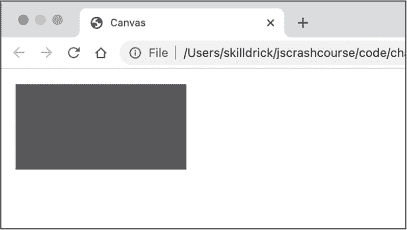

<samp class="SANS_Futura_Std_Book_Oblique_I_11">图 9-1：蓝色矩形</samp>

任何对 `fillRect` 的后续调用将使用相同的 `fillStyle`，因此它们也会产生蓝色矩形（除非你设置了新的 `fillStyle`）。你可以通过在画布上绘制更多矩形来确认这一点。

### 绘制轮廓矩形

除了使用 `fillRect` 创建填充颜色的矩形外，Canvas API 还提供了 `strokeRect` 方法来绘制矩形的轮廓（*描边*）。若要尝试一下，请按照代码清单 9-3 所示修改 `script.js`。

```javascript

let canvas = document.querySelector("#canvas");

let ctx = canvas.getContext("2d");

ctx.lineWidth = 2;

ctx.strokeStyle = "red";

ctx.strokeRect(10, 10, 200, 100);

```

<samp class="SANS_Futura_Std_Bold_Condensed_Oblique_BI_11">代码清单 9-3：使用</samp> <samp class="SANS_Futura_Std_Book_Oblique_I_11">strokeRect 绘制矩形轮廓</samp>

首先，我们通过 `lineWidth` 属性指定轮廓宽度，将其设置为 2 像素宽。然后，我们使用 `strokeStyle` 和 `strokeRect` 而不是 `fillStyle` 和 `fillRect` 来创建一个没有填充颜色的轮廓矩形。`strokeRect` 方法接受与 `fillRect` 相同的参数：左上角的 x 坐标和 y 坐标，以及矩形的宽度和高度。

当你重新加载 `index.html` 时，你应该会看到矩形现在是红色轮廓，且没有填充，如图 9-2 所示。

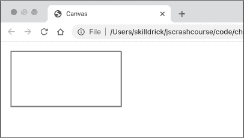

<samp class="SANS_Futura_Std_Book_Oblique_I_11">图 9-2：红色轮廓矩形</samp>

当你在绘制上下文上设置样式（例如线宽或线色）时，这些设置仅适用于后续添加到画布的内容。也就是说，它们不会追溯地影响已经绘制的内容。从这个意义上说，画布确实非常像物理画布，当前样式由你正在使用的颜料颜色和画笔类型决定。为了演示这一点，我们将绘制几个不同颜色的矩形。将代码清单 9-4 中的代码添加到 `script.js` 的末尾，位于绘制红色矩形的代码之后。

```javascript

--snip--

ctx.strokeStyle = "orange";

ctx.strokeRect(20, 20, 180, 80);

ctx.strokeStyle = "yellow";

ctx.strokeRect(30, 30, 160, 60);

ctx.strokeStyle = "green";

ctx.strokeRect(40, 40, 140, 40);

ctx.strokeStyle = "blue";

ctx.strokeRect(50, 50, 120, 20);

```

<samp class="SANS_Futura_Std_Book_Oblique_I_11">代码清单 9-4：绘制更多矩形</samp>

这段代码绘制了一系列嵌套的矩形，每个矩形比上一个偏移 10 像素，且每个比上一个小 20 像素。在绘制每个连续矩形之前，我们通过更新 `strokeStyle` 属性来更改轮廓颜色。

刷新 `index.html`，你应该看到类似图 9-3 中图像的内容。

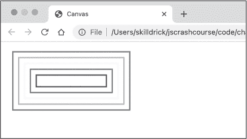

<samp class="SANS_Futura_Std_Book_Oblique_I_11">图 9-3：同心矩形</samp>

每个矩形都是不同的颜色，这表明样式变化没有影响已经绘制的内容。

### 使用路径绘制其他形状

矩形之外的所有其他形状都是作为*路径*（paths）绘制在画布上的。路径是一系列由直线或曲线连接的点，然后对其进行轮廓描边或用颜色填充。作为例如，我们将在三个不同的点之间绘制一条路径，然后填充它以制作一个红色三角形。将 `script.js` 的内容替换为代码清单 9-5 中的代码。

```javascript

let canvas = document.querySelector("#canvas");

let ctx = canvas.getContext("2d");

ctx.fillStyle = "red";

ctx.beginPath();

ctx.moveTo(100, 100);

ctx.lineTo(150, 15);

ctx.lineTo(200, 100);

ctx.lineTo(100, 100);

ctx.fill();

```

<samp class="SANS_Futura_Std_Book_Oblique_I_11">代码清单 9-5：使用路径方法绘制三角形</samp>

绘制路径分三个步骤。首先，你使用 `beginPath` 声明你想开始一条新路径。然后，你使用各种方法定义路径的位置。最后，你使用 `fill` 或 `stroke` 来填充或描边路径。

在这种情况下，我们使用两个方法来定义路径：`moveTo` 和 `lineTo`。`moveTo` 方法将虚拟笔移动到画布上由 x 坐标和 y 坐标定义的特定点，而不画线。我们使用此方法来定义路径的起点 `(100, 100)`，这将是三角形的左下角。`lineTo` 方法与 `moveTo` 相同，但它会在移动时画一条线。因此，`lineTo(150, 15)` 从 `(100, 100)` 画一条线到 `(150, 15)`，以此此类推。最后，我们使用 `fill` 方法填充形状。当你刷新页面时，你应该看到一个红色三角形，如图 9-4 所示。

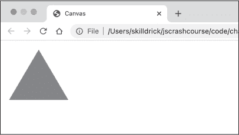

<samp class="SANS_Futura_Std_Book_Oblique_I_11">图 9-4：绘制填充三角形</samp>

绘制圆形遵循类似的模式，但使用的是方法 `arc` 而不是 `moveTo` 和 `lineTo`。`arc` 方法绘制一个*弧*，即圆周的一小部分。你可以使用 `arc` 方法产生任何长度的弧，但在这里我们将它用来产生一个完整的圆。

使用代码清单 9-6 中的代码更新 `script.js`。路径绘制代码的第一和第三步相同，但我们将第二步替换为绘制圆而非三角形的代码。

```javascript

let canvas = document.querySelector("#canvas");

let ctx = canvas.getContext("2d");

ctx.fillStyle = "red";

ctx.beginPath();

ctx.arc(150, 100, 50, 0, Math.PI * 2, false);

ctx.fill();

```

<samp class="SANS_Futura_Std_Book_Oblique_I_11">代码清单 9-6：使用路径方法绘制圆形</samp>


`arc` 方法接收了多达六个惊人的参数。前两个参数是圆心的 `x-` 和 `y` 坐标。在这种情况下，我们将圆心设置在坐标 `(150, 100)`处。第三个参数是以像素为单位的圆半径，我们设置为 `50`。接下来的两个参数提供了以弧度为单位的起始和结束角度：我们为起始角度提供 `0`，为结束角度提供 `Math.PI * 2` 以生成一个完整的圆。最后一个参数指定从起始角度到结束角度应该是顺时针（`false`）还是逆时针（`true`）绘制。在这种情况下，我们选择了顺时针，但由于我们画的是一个完整的圆，所以方向并不重要。

> **注意**：弧度是测量角度的一种方式。在角度中，圆的一周是从 0 到 360 度。在弧度中，一周是从 0 到 2π。

现在当你刷新页面时，你应该能看到一个红圆，如图 9-5 所示。

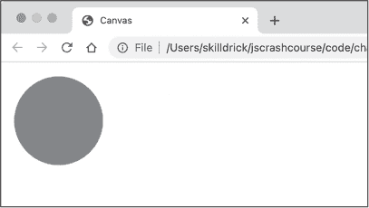

图 9-5: 绘制填充圆

你可以通过 `stroke` 方法而不是 `fill` 方法使用相同的技术绘制描边圆。此外，你可以通过组合调用 `lineTo` 和 `arc` 方法来创建圆角矩形之类的复合形状。Canvas API 还允许通过 `quadraticCurveTo` 和 `bezierCurveTo` 方法绘制更复杂的曲线。可以在 Mozilla 开发者网络 (MDN) Web 文档 ([`developer.mozilla.org`](https://developer.mozilla.org)) 查询这些其他方法的更多细节。

### 与 Canvas 交互

当用户可以与画布进行交互时，画布就会变得有趣得多。`canvas` 元素本身并没有内置任何交互概念。然而，我们可以通过 JavaScript 编写事件处理程序来添加这种交互性，监听某些用户操作并触发 Canvas API 方法来相应更新画布。

在本节中，我们将使用一个带有点击处理程序的 `canvas` 元素构建一个非常基本的绘制应用程序。该处理程序将监听画布上的点击事件，并调用方法在点击发生的位置绘制圆。我们还将创建一个滑块，让用户可以设置圆的透明度，以及一个清除画布的按钮。

首先，让我们添加必要的 HTML 元素来创建一个滑块和一个按钮。对 `index.html` 进行如列表 9-7 所示的修改。

```html

<!DOCTYPE html>

<html>

  <head>

    <title>Canvas</title>

  </head>

  <body>

    <canvas id="canvas" width="300" height="300"></canvas>

    <div>

      <button id="clear">Clear</button>

      <input id="opacity" type="range" min="0" max="1" value="1" step="0.1">

      <label for="opacity">Opacity</label>

    </div>

    <script src="script.js"></script>

  </body>

</html>

```

列表 9-7: 在 `index.html` 中添加一些额外的元素

在这里，我们添加了一个新的 `div` 元素，其中包含三个其他 HTML 元素。`div` 元素的作用是将其内部的元素分组，并将它们放置在画布下方（如果没有 `div`，它们将出现在画布的右侧）。

`div` 内部的第一个元素是 `button` 元素。它创建了一个可点击的按钮。起始和结束标签之间的任何内容将作为文本显示在按钮上，因此我们的按钮将显示 `Clear` 文字。稍后我们将编写一个 JavaScript 函数，当用户点击按钮时清除画布上的任何圆。

接下来 `div` 内部是 `input` 元素，用于从用户那里获取值。`input` 元素不允许任何子元素，因此不需要结束标签。在这种情况下，输入元素的类型是 `range`，这意味着它将显示为滑块。此滑块将用于设置在画布上绘制的新圆的透明度。它有几个属性定义了其功能：`min` 定义了滑块产生的最小值，`max` 定义了最大值，`value` 定义了滑块的初始值，`step` 是每次移动的大小（允许你控制允的值的数量）。此滑块设置的范围从 0 到 1，步长为 0.1，并且起始值为 1，这对应于完全不透明。

`div` 中的最后一个元素是 `label` 元素，它为另一个元素应用标签。`label` 的 `for` 属性决定了标签应应用于哪个元素；其值必须与另一个元素的 `id` 匹配。在这种情况下，我们通过指定 `opacity` 为目标 id 将标签分配给滑块。这将导致滑块标记为 `Opacity`，这是 `label` 元素的文本内容。得益于 `label` 元素的 `for` 属性，浏览器理解标签和 `input` 元素是相关的，在标签上执行的某些操作将应用于输入。例如，如果你悬停在标签上，input 将显示为悬停状态；如果你点击标签，input 将获得键盘焦点（在这种情况下，按左或右箭头键将分别减少或增加滑块的值）。

在浏览器中加载 `index.html`，你应该能看到与图 9-6 类似的内容（这些元素的具体外观取决于你的浏览器和操作系统）。

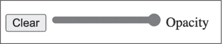

图 9-6: 新的按钮和输入元素

现在我们已经有了 HTML 元素，可以编写 JavaScript 使此应用程序具有交互性。首先，我们将添加一些通用声明以及当用户点击画布时绘制圆的代码。使用如列表 9-8 所示的代码更新 `script.js`。

```javascript

let canvas = document.querySelector("#canvas");

let ctx = canvas.getContext("2d");

let width = canvas.width;

let height = canvas.height;

let opacity = 1;

function drawCircle(x, y) {

  ctx.fillStyle = `rgba(0, 255, 0, ${opacity})`;

  ctx.beginPath();

  ctx.arc(x, y, 10, 0, Math.PI * 2, false);

  ctx.fill();

}

canvas.addEventListener("click", e => {

  drawCircle(e.offsetX, e.offsetY);

});

```

列表 9-8: 点击时绘制圆


在 Canvas API 中，你使用字符串 `"rgba(…)"` 设置 RGBA 颜色，括号内包含四个值并用逗号分隔。例如，将 `fillStyle` 设置为字符串 `"rgba(0, 255, 0, 0.9)"` 会生成略微透明的亮绿色圆形。在我们的案例中，我们将 RGBA 字符串封装在反引号中，这样我们就可以为 alpha 值使用占位符，允许用户通过滑动块更改不透明度。

最后，我们使用 `addEventListener` 为画布 元素添加点击事件处理程序。该处理程序会调用我们刚刚创建的 `drawCircle` 函数，并将点击事件的 `offsetX` 和 `offsetY` 属性作为函数的参数传递。`offsetX` 和 `offsetY` 属性提供了点击事件相对于被点击元素左上角的距离（而不是相对于整个浏览器窗口的左上角），因此它们非常适合确定点击发生在画布上的精确位置。

在浏览器中重新加载 `index.html` 并尝试点击画布。无论你点击哪里，都应该出现一个绿色绿色圆形，如图 9-7 所示。

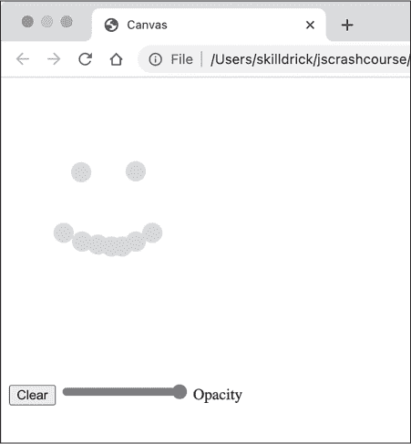

图 9-7：使用鼠标点击绘制绿色圆形

为了完成此绘图应用程序，我们需要连接清除（Clear）按钮和不透明度滑动块。将代码列表 9-9 中的代码添加到 `script.js` 的末尾。

```

--snip--

document.querySelector("#clear").addEventListener("click", () => {

  ctx.clearRect(0, 0, width, height);

});

document.querySelector("#opacity").addEventListener("change", e => {

  opacity = e.target.value;

});

```

代码列表 9-9：连接清除和不透明度控件

首先，我们为清除按钮添加一个点击事件处理程序。这会调用名为 `clearRect` 的 Canvas API 方法，该方法会清除画布上的矩形区域。就像绘制矩形一样，你通过要清除矩形左上角的 `x-` 和 `y-` 坐标，随后是其 `width` 和 `height` 来定义要清除的矩形。在这里我们使用 `(0, 0, width, height)` 来指定我们要清除一个从画布左上角开始、且宽高度与画布相同的矩形。因此，`ctx.clearRect(0, 0, width, height);` 清除了了整个画布。

接下来，我们为不透明度滑动块添加一个更改事件处理程序。当输入元素的值发生变化时会触发更改事件，因此每当滑动块被设置到新位置时，该处理程序就会被调用。我们通过 `e.target` 获取输入元素，并通过 `.value` 获取元素的当前值。然后用此值更新 `opacity` 变量。由于 `drawCircle` 函数使用 `opacity` 的值作为 RGBA 颜色的 alpha 分量，任何新圆形都将使用不透明度滑动块设置的最新值。

现在，当你重新在浏览器加载 `index.html` 时，你应该拥有了一个功能完全（尽管是基础）的绘图应用程序！你可以使用不透明度滑动块来更改新圆形的不透明度，并使用清除按钮清除画布重新开始绘制。尝试在不透明度滑动块设置为一半时绘制重叠圆形，看看它们是如何叠加的。

### 使画布动画

正如在本章开头提到的，你可以通过在画布上进行绘制并每秒更新多次图像来实现画布动画化。在本节中，我们将编写一个简单的动画来展示这种工作原理的基本。

画布动画化通常遵循此基本模式：

1. 更新状态
2. 清除画布
3. 绘制图像
4. 等待短时间
5. 重复

这里的 `State` 指存储动画当前帧信息的某些变量。这可以是运动中对象的当前位置、对象移动的方向等。在我们的示例中，状态将是圆形的 `x-` 和 `y-` 坐标。当需要更新状态时，我们将 `x-` 和 `y-` 坐标各加 1，这意味着圆的位置将逐渐向右下方移动。绘制图像将涉及以更新后的 `x-` 和 `y-` 坐标为中心绘制一个小圆。在绘制圆形之前，我们会清除画布，以确保移除上一个循环的图像。我们将通过使用 `setInterval` 函数每 100 毫秒（即每秒 10 次）调用一次我们的代码来处理最后两个步骤（等待和重复）。

我们可以继续使用相同的 HTML 和 JavaScript 文件。对 `index.html` 的唯一更改是移除我们在代码列表 9-7 中添加的 `div` 及其嵌套元素，因为它们不再需要了。移除这些元素后，根据代码列表 9-10 中的代码更新 `script.js`。

```

let canvas = document.querySelector("#canvas");

let ctx = canvas.getContext("2d");

let width = canvas.width;

let height = canvas.height;

let x = 0;

let y = 0;

function drawCircle(x, y) {

  ctx.fillStyle = "rgb(0, 128, 255)";

  ctx.beginPath();

  ctx.arc(x, y, 10, 0, Math.PI * 2, false);

  ctx.fill();

}

function update() {

  x += 1;

  y += 1;

}

function draw() {

  ctx.clearRect(0, 0, width, height);

  drawCircle(x, y);

}

setInterval(() => {

  update();

  draw();

}, 100);

```

代码列表 9-10：创建一个动画

我们创建了两个变量 `x` 和 `y`，代表我们要动画化的圆形的位置。这些变量存储了动画的当前状态，并会定期更新。`drawCircle` 函数本身几乎没有变化，尽管 `fillStyle` 有所不同。现在我们不再设置不透明度，可以使用更简单的 `rgb(…)` 格式字符串来设置红、绿、蓝值。使用 `"rgb(…)"` 时，颜色的不透明度始终为 100%。

在 `drawCircle` 之后，我们声明了 `update` 函数，其中我们更新 `x` 和 `y` 变量，每个加 1。接下来我们声明了 `draw` 函数，它清除画布然后调用 `drawCircle` 在当前的 `x-` 和 `y-` 坐标处绘制圆形。最后，我们调用 `setInterval` 来调度动画。你可能记得在第 5 章中 `setInterval` 接受一个函数和一个以毫秒为单位的时间间隔，并在每个时间间隔重复调用该函数。在这里，我们每 100 毫秒调用一次匿名函数。该匿名函数本身调用了 `update` 和 `draw`。

在浏览器中重新加载 `index.html`，你应该看到一个小圆从画布的左上角逐渐移动到右下方。即使圆形离开了画布，`x-` 和 `y-` 坐标也会继续增加，但画布会忽略任何在边界之外绘制的内容。

### 总结

在本章中，你学习了在画布元素上绘图的基本知识，以及使用画布创建交互式应用程序和动画的某些技巧。在本书的后面部分，当我们学习如何制作基于画布的游戏时，将基于这些技术继续深入。


在这个项目中，你将通过制作经典游戏 `Pong` 的自己的版本来扩展你对数据结构、条件语句、函数以及 Canvas API 的知识。你将开发该游戏的两种实现：一种使用独立函数（第 10 章），另一种则使用类和面向对象的设计原则（第 11 章）。这将展示组织代码的不同方式。

## 项目 2：制作音乐

该项目介绍了基础音频编程和声音合成技术（第 12 章），然后利用这些技术使用 JavaScript 编写一首歌（第 13 章）。你将学习 Web Audio API 和 `Tone.js` 库，后者简化了生成声音的过程。这将让你练习如何将第三方 JavaScript 库集成到应用程序中。

## 项目 3：数据可视化

该项目将引导你使用流行的 D3 JavaScript 库开发交互式数据可视化。你将探索如何使用可缩放矢量图形 (SVG) 进行绘图，并使用 `D3` 将 SVG 形状组织成柱状图（第 14 章）。然后，你将通过 GitHub Search API 从互联网获取数据并构建动态可视化（第 15 章）。将 API 请求整合到应用程序中是一项非常常见的编程任务，因此该项目将帮助你编写与真实世界数据交互的代码。

你可以在 [`codepen.io/collection/ZMjYLO`](https://codepen.io/collection/ZMjYLO) 找到所有项目的完整下载代码，以及“尝试一试”练习题的答案。

# 项目 1 创建游戏

## 10 PONG（乒乓球）


在第一个项目中，你将使用 JavaScript 重新创建最早的街机视频游戏之一：雅达（Atari）经典的 `Pong`。`Pong` 是一个简单的游戏，但它将教你游戏设计中的一些重要方面：游戏循环、玩家输入、碰撞检测和计分。我们甚至还会使用一些基础的人智能来编写电脑对手。

### 游戏

`Pong` 开发于 1972 年，并在当年作为非常成功的街机机器发布。它是一个非常基础的游戏，类似于乒乓球，由一个球和位于屏幕左右两侧的两个挡板组成，玩家可以上下移动挡板。如果球击中屏幕顶部或底部边缘，它会反弹；但如果它击中左侧或右侧边缘，对面的玩家就会得分。球通常会从挡板上反弹，除非它击中了挡板靠近顶部或底边缘，在这种情况下反弹角度会改变。

在本章中，我们将制作自己的 `Pong` 版本，并将其命名为 `Tennjs`（类似于 `Tennis` 网球，但带有 `JS`，懂吗？）。在我们的游戏中，左侧挡板由电脑控制，右侧挡板由人类玩家控制。在原始游戏中，挡板是通过旋转旋钮控制器控制的，但在我们的版本中，我们将使用鼠标。电脑不会尝试预测球将反弹到哪里，而只会尝试始终匹配球的垂直位置。为了给人类玩家一个机会，我们将为电脑移动挡板的速度设置上限。

### 设置

我们将从设置项目的文件结构开始，并创建一个用于显示游戏的画布。像往常一样，该项目需要一个 HTML 文件和一个 JavaScript 文件。我们从 HTML 文件开始。创建一个名为 `tennjs` 的目录，并在该目率下创建一个名为 `index.html` 的文件。然后输入列表 10-1 所示的内容。

```

<!DOCTYPE html>

<html>

  <head>

    <title>Tennjs</title>

  </head>

  <body>

    <canvas id="canvas" width="300" height="300"></canvas>

    <script src="script.js"></script>

  </body>

</html>

```

列表 10-1：我们游戏的 index.html 文件

这与我们在第 9 章 中创建的 HTML 文件几乎一完全一样，所以不应该没有任何惊喜。`body` 元素包含一个 `canvas` 元素（我们将在其中绘制游戏）以及一个引用文件 `script.js` 的 `script` 元素（我们的游戏代码将在那里）。

接下来，我们将编写一些 JavaScript 来设置画布。创建 `script.js` 文件，并输入列表 10-2 所示的代码。

```

let canvas = document.querySelector("#canvas");

let ctx = canvas.getContext("2d");

let width = canvas.width;

let height = canvas.height;

ctx.fillStyle = "black";

ctx.fillRect(0, 0, width, height);

```

列表 10-2：在 script.js 中设置画布

这段代码应该也让人熟悉。我们首先通过 `document.querySelector` 获取画布的引用并获取画布的绘制上下文。然后我们将画布的宽度和高度保存到名为 `width` 和 `height` 的变量中，以便在代码中访问。最后，我们将填充样式设置为黑色，并绘制一个与画布大小相同的黑色正方形。这样画布看起来就有黑色背景。

在浏览器中打开 `index.html`，你应该能看到类似图 10-1 的内容。

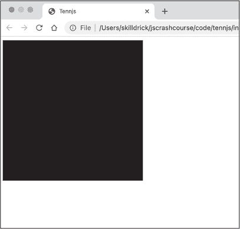

图 10-1：我们的黑色正方形

我们现在有一个空白的黑色画布，可以在其中创建我们的游戏。

### 球

接下来，我们将画球。将列表 10-3 中的代码添加到 `script.js` 的末尾。

```

--snip--

ctx.fillStyle = "black";

ctx.fillRect(0, 0, width, height);

const BALL_SIZE = 5;

let ballPosition = {x: 20, y: 30};

ctx.fillStyle = "white";

ctx.fillRect(ballPosition.x, ballPosition.y, BALL_SIZE, BALL_SIZE);

```

列表 10-3：绘制球

这段代码使用 `fillRect` 方法在画布的左上角绘制一个小的白色正方形。与原始 `Pong` 游戏一样，球是正方形而不是圆形。这给了游戏一种复古的感觉，并将简化检测球与墙壁或挡板发生碰撞的任务。球的大小存储在一个名为 `BALL_SIZE` 的常量中。我们使用全大写的常量样式来命名标识符，因为球的大小在程序运行过程中不会改变。在调用 `fillRect` 方法绘制球时，我们可以直接使用值 5 而不是 `BALL_SIZE`，但我们在整个程序中将需要多次引用球的大小。给大小命名将使需要知道球大小的代码变得更容易理解。这种方法的另一个好处是，如果我们以后改变了主意并决定球应该更大或更小，我们只需要更新一处代码：`BALL_SIZE` 常量的定义。

我们使用一个包含 x 和 y 坐标的对象来跟踪球的位置，该对象是通过对象字面量创建的 ❶。在第 9 章](#chapter9.xhtml)中，我们使用独立的变量来存储绘制圆形的 x 和 y 坐标，但将这两个变量存储在一个对象中更整洁，特别是这个程序将变得更长、更复杂。


刷新 `index.html`，你应该能看到白色球位于画布的左上角，如图 10-2 所示。

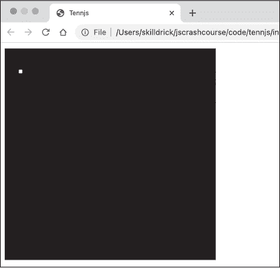

<samp class="SANS_Futura_Std_Book_Oblique_I_11">图 10-2：球</samp>

现在球是静止的，但很快我们就会编写代码让它移动起来。

### <samp class="SANS_Futura_Std_Bold_B_11">重构</samp>

接下来我们将进行一次简单的重构。`Refactoring`（重构）是一个软件开发术语，在不改变程序行为的情况下修改代码，通常是为了让代码更容易于理解或更新。随着项目代码变得越来越复杂，重构有助于保持其条理清晰。

在这种情况下，我知道我们将想要在画布上多次绘制，而不仅仅是一次。事实上，我们最终希望每 30 毫秒重新绘制一次画布，以使游戏产生运动效果。为了更容易实现这一点，我们将进行重构，使所有当前的绘制代码都成为一个名为 `draw` 的函数的一部分。这样，我们就可以我们需要重新绘制画布时简单地调用 `draw` 函数。

使用 Listing 10-4 中所示的更改来更新 `script.js`。

```

let canvas = document.querySelector("#canvas");

let ctx = canvas.getContext("2d");

let width = canvas.width;

let height = canvas.height;

const BALL_SIZE = 5;

let ballPosition = {x: 20, y: 30};

❶ function draw() {

  ctx.fillStyle = "black";

  ctx.fillRect(0, 0, width, height);

  ctx.fillStyle = "white";

  ctx.fillRect(ballPosition.x, ballPosition.y, BALL_SIZE, BALL_SIZE);

}

❷ draw();

```

<samp class="SANS_Futura_Std_Book_Oblique_I_11">Listing 10-4：重构绘制代码</samp>

这里的唯一变化是将所有的绘制代码分组到一个名为 `draw` 的单个函数 ❶ 中，然后我们立即调用它 ❷。因为这是重构，程序的行为实际上没有发生任何变化。你可以刷新 `index.html` 来确认一切看起来和以前一样。

### <samp class="SANS_Futura_Std_Bold_B_11">游戏循环</samp>

几乎所有的游戏都包含一个 `game loop`（游戏循环），它协调游戏每帧中必须发生的所有事情。游戏循环类似于动画循环，比如我们在第 9 章中看到的那个，但增加了一些额外的逻辑。以下是大多数游戏中游戏循环的一般形状：

1. 清空画布
2. 绘制图像
3. 获取玩家输入
4. 更新状态
5. 检查碰撞
6. 等待一段时间
7. 重复

获取并处理玩家（或多个玩家）的输入是区分游戏与动画的主要特征。`Collision detection`（碰撞检测）是大多数游戏的另一个重要方面：检查游戏中的两个物体何时相遇并做出相应的响应。碰撞检测防止你穿过墙壁或通过另一辆汽车——在这种情况下，它将使球从墙壁和挡板上反弹。除了玩家输入和碰撞检测元素外，游戏循环中的步骤与动画循环大体相同：我们清空画布，绘制图像，更新游戏状态将物体移动到新位置，暂停并重复。

我们不会尝试一次性编写整个游戏循环，而是逐步构建它。使用 Listing 10-5 中的内容更新 `script.js`，这将是我们游戏中游戏循环的开始。这段代码移动球（即更新球的状态），重新绘制画布，暂停并重复。

```

--snip--

const BALL_SIZE = 5;

let ballPosition = {x: 20, y: 30};

❶ let xSpeed = 4;

let ySpeed = 2;

function draw() {

  ctx.fillStyle = "black";

  ctx.fillRect(0, 0, width, height);

  ctx.fillStyle = "white";

  ctx.fillRect(ballPosition.x, ballPosition.y, BALL_SIZE, BALL_SIZE);

}

❷ function update() {

  ballPosition.x += xSpeed;

  ballPosition.y += ySpeed;

}

❸ function gameLoop() {

  draw();

  update();

    // 在后再次调用此函数

  setTimeout(gameLoop, 30);

}

❹ gameLoop();

```

<samp class="SANS_Futura_Std_Book_Oblique_I_11">Listing 10-5：游戏循环</samp>

这里的第一个变化是初始化两个新变量 ❶，`xSpeed` 和 `ySpeed`。我们将使用它们来控制球的水平和垂直速度。新的 `update` 函数 ❷ 使用这两个变量来更新球的位置。每一帧，球都会沿着 x 轴移动 `xSpeed` 像素，沿着 y 轴移动 `ySpeed` 像素。这两个变量初始值为 4 和 2，因此每帧球都会向右移动 4 像素并向下移动 2 像素。

`gameLoop` 函数 ❸ 调用 `draw` 函数，然后调用 `update` 函数。然后它调用 `setTimeout(gameLoop, 30)`，这将在 30 毫秒后再次调用 `gameLoop` 函数。这与我们在第 9 章中使用的 `setInterval` 技术几乎完全一样。你可能记得 `setTimeout` 在超时后只调用一次函数，而 `setInterval` 会反复调用其函数。我们在这里使用 `setTimeout` 是为了对是否继续循环有更多控制；稍后我们将添加一些条件逻辑来决定调用 `setTimeout` 或结束游戏。

注意 `setTimeout` 调用上方上方以双斜杠（//）开头的行。这是一个 `comment`（注释）的示例，是嵌入程序中的写你自己（或阅读你代码的人）的笔记。

### <samp class="SANS_Futura_Std_Bold_B_11">反弹</samp>

在上一节中，你让球动了起来，但它直接飞出了边缘。接下来你将学习如何让它从画布边缘反弹。使用 Listing 10-6 中的代码更新 `script.js`，这为我们的游戏添加了 `checkCollision` 函数。

```

--snip--

function update() {

  ballPosition.x += xSpeed;

  ballPosition.y += ySpeed;

}

function checkCollision() {

❶ let ball = {

    left: ballPosition.x,

    right: ballPosition.x + BALL_SIZE,

    top: ballPosition.y,

    bottom: ballPosition.y + BALL_SIZE

  }

❷ if (ball.left < 0 || ball.right > width) {

    xSpeed = -xSpeed;

  }

❸ if (ball.top < 0 || ball.bottom > height) {

    ySpeed = -ySpeed;

  }

}

function gameLoop() {

  draw();

  update();

❹ checkCollision();

  // 在后再次调用此函数

  setTimeout(gameLoop, 30);

}

gameLoop();

```

<samp class="SANS_Futura_Std_Book_Oblique_I_11">Listing 10-6：墙碰撞检测</samp>


接下来，我们执行实际碰撞检测。如果球的左边缘小于 0，或者球的右边缘大于画布的宽度 ❷，我们就知道球碰撞了左墙或右墙。在这两种情况下，数学逻辑是相同的：`ySpeed` 的新值应该是当前值的负数（即对其取反）。例如，当球第一次撞击右边缘时，`ySpeed` 将从 4 变为 -4。同时，`xSpeed` 保持不变。结果是，球以相同的速度继续向下移动，但现在它是向左移动而不是向右移动。

球的顶部碰撞顶墙或球的底部碰撞底墙 ❸ 时也会进行类似的检查。在上述两种情况下，我们都会取反 `ySpeed`：当球撞击上边缘时，它从 2 变为 -2；当球撞击底部时，它从 -2 变为 2。

代码中唯一的其他变化是在 `gameLoop` 函数的执行列表中添加对 `checkCollision` 的调用 ❹。现在，当你刷新 `index.html` 时，你应该看到球在游戏区域内不断移动。如果你一直在关注，可能会发现球本不应该在左右墙上反弹。一旦我们有了移动的挡板，我们将修改碰撞检测，使其仅在挡板或上下墙上反弹。

### 挡板

我们的下一个任务是绘制两个挡板。为了实现，，我们将引入一些常量来建立挡板的尺寸以及它们相对于画布侧边的水平位置，以及一些定义它们垂直位置的变量（挡板只能上下移动不能左右移动，因此只有它们的垂直位置需要是变量）。根据列表 10-7 中的更改更新 `script.js`。

```

let xSpeed = 4;

let ySpeed = 2;

const PADDLE_WIDTH = 5;

const PADDLE_HEIGHT = 20;

const PADDLE_OFFSET = 10;

let leftPaddleTop = 10;

let rightPaddleTop = 30;

function draw() {

--snip--

```

### 列表 10-7：定义挡板

首先，我们设置定义挡板的常量。`PADDLE_WIDTH` 和 `PADDLE_HEIGHT` 定义两个挡板的宽度均为 5 像素，高度均为 20 像素。`PADDLE_OFFSET` 指挡板距离游戏区域左边缘或右边缘的距离。

变量 `leftPaddleTop` 和 `rightPaddleTop` 定义了每个挡板顶部的垂直位置。最终，`leftPaddleTop` 将通过我们编写的跟随球的函数由计算机控制，而 `rightPaddleTop` 将在玩家移动鼠标时更新。现在，我们简单地将这些值分别设置为 10 和 30。

接下来，我们更新 `draw` 函数，使用我们刚刚定义的信息来显示挡板。我还在代码中添加了注释，以澄清 `draw` 函数中每一步发生的情况。请按照列表 10-8 所示修改代码。

```

function draw() {

  // 用黑色填充画布

  ctx.fillStyle = "black";

  ctx.fillRect(0, 0, width, height);

  // 其他所有内容将是白色

  ctx.fillStyle = "white";

  // 绘制球

  ctx.fillRect(ballPosition.x, ballPosition.y, BALL_SIZE, BALL_SIZE);

  // 绘制挡板

  ctx.fillRect(

    PADDLE_OFFSET,

    leftPaddleTop,

    PADDLE_WIDTH,

    PADDLE_HEIGHT

  );

  ctx.fillRect(

    width - PADDLE_WIDTH - PADDLE_OFFSET,

    rightPaddleTop,

    PADDLE_WIDTH,

    PADDLE_HEIGHT

  );

}

```

<samp class="SANS_Futura_Std_Book_Oblique_I_11">Listing 10-8：绘制挡板</samp>

现在刷新 `index.html`，你应该能看到类似图 10-3 的内容。

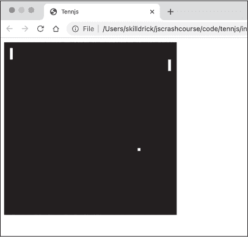

图 10-3：挡板

我们现在有了一个带有球和挡板的游戏。接下来，我们将添加玩家输入，使右侧挡板能够响应鼠标移动。使用 Listing 10-9 中的代码更新 `script.js`。

```

--snip--

function update() {

  ballPosition.x += xSpeed;

  ballPosition.y += ySpeed;

}

function checkCollision() {

  let ball = {

    left: ballPosition.x,

    right: ballPosition.x + BALL_SIZE,

    top: ballPosition.y,

    bottom: ballPosition.y + BALL_SIZE

  }

  if (ball.left < 0 || ball.right > width) {

    xSpeed = -xSpeed;

  }

  if (ball.top < 0 || ball.bottom > height) {

    ySpeed = -ySpeed;

  }

}

function gameLoop() {

  draw();

  update();

  checkCollision();

  // 在后再次调用此函数

  setTimeout(gameLoop, 30);

}

gameLoop();

```

<samp class="SANS_Futura_Std_Book_Oblique_I_11">Listing 10-9：玩家输入</samp>

这里的唯一变化是在 `update` 函数中添加一行代码，用于更新右侧挡板的位置。我们将 `rightPaddleTop` 设置为鼠标的 y 坐标减去挡板高度的一半，以使挡板居中于鼠标位置。由于我们使用的是 `clientY`（相对于浏览器窗口的坐标），我们需要减去挡板高度的一半来补偿。我们还需要确保挡板不会超出画布边界，因此我们使用 `Math.max` 和 `Math.min` 来限制其位置。

现在，当你刷新 `index.html` 并移动鼠标时，你应该看到右侧挡板随着鼠标移动而上下移动。左侧挡板仍然由电脑控制，保持静止。

### <samp class="SANS_Futura_Std_Bold_B_11">电脑对手</samp>

为了使游戏更具挑战性，我们将为左侧挡板添加一个简单的电脑对手。电脑不会尝试预测球将反弹到哪里，而只会尝试始终匹配球的垂直位置。为了给人类玩家一个机会，我们将为电脑移动挡板的速度设置上限。使用 Listing 10-10 中的代码更新 `script.js`。

```

--snip--

function update() {

  ballPosition.x += xSpeed;

  ballPosition.y += ySpeed;

  // 电脑对手：左侧挡板跟随球的垂直位置

  leftPaddleTop = ballPosition.y - PADDLE_HEIGHT / 2;

  // 限制电脑挡板的移动速度

  if (leftPaddleTop < 0) {

    leftPaddleTop = 0;

  } else if (leftPaddleTop > height - PADDLE_HEIGHT) {

    leftPaddleTop = height - PADDLE_HEIGHT;

  }

}

function checkCollision() {

  let ball = {

    left: ballPosition.x,

    right: ballPosition.x + BALL_SIZE,

    top: ballPosition.y,

    bottom: ballPosition.y + BALL_SIZE

  }

  if (ball.left < 0 || ball.right > width) {

    xSpeed = -xSpeed;

  }

  if (ball.top < 0 || ball.bottom > height) {

    ySpeed = -ySpeed;

  }

}

function gameLoop() {

  draw();

  update();

  checkCollision();

  // 在后再次调用此函数

  setTimeout(gameLoop, 30);

}

gameLoop();

```

<samp class="SANS_Futura_Std_Book_Oblique_I_11">Listing 10-10：电脑对手</samp>

这里的唯一变化是在 `update` 函数中添加了两行代码。第一行计算左侧挡板的理想位置，使其与球的垂直位置匹配。第二行和第三行限制挡板的位置，确保它不会超出画布边界。

现在，当你刷新 `index.html` 并玩游戏时，你应该看到左侧挡板会尝试跟随球的垂直位置，但受到速度限制。这使得游戏更具挑战性，因为人类玩家需要更精确地控制挡板才能击中球。

### <samp class="SANS_Futura_Std_Bold_B_11">碰撞检测</samp>

到目前为止，我们的碰撞检测仅检查球是否击中了画布边缘。然而，为了使游戏真正可玩，我们需要检查球是否击中了挡板。使用 Listing 10-11 中的代码更新 `script.js`，这将为我们的游戏添加挡板碰撞检测。

```

--snip--

function update() {

  ballPosition.x += xSpeed;

  ballPosition.y += ySpeed;

  // 电脑对手：左侧挡板跟随球的垂直位置

  leftPaddleTop = ballPosition.y - PADDLE_HEIGHT / 2;

  // 限制电脑挡板的移动速度

  if (leftPaddleTop < 0) {

    leftPaddleTop = 0;

  } else if (leftPaddleTop > height - PADDLE_HEIGHT) {

    leftPaddleTop = height - PADDLE_HEIGHT;

  }

}

function checkCollision() {

  let ball = {

    left: ballPosition.x,

    right: ballPosition.x + BALL_SIZE,

    top: ballPosition.y,

    bottom: ballPosition.y + BALL_SIZE

  }

  // 检查球是否击中左侧或右侧墙壁

  if (ball.left < 0 || ball.right > width) {

    xSpeed = -xSpeed;

  }

  // 检查球是否击中顶部或底部墙壁

  if (ball.top < 0 || ball.bottom > height) {

    ySpeed = -ySpeed;

  }

  // 检查球是否击中左侧挡板

  if (

    ball.left < PADDLE_OFFSET + PADDLE_WIDTH &&

    ball.right > PADDLE_OFFSET &&

    ball.top < leftPaddleTop + PADDLE_HEIGHT &&

    ball.bottom > leftPaddleTop

  ) {

    xSpeed = -xSpeed;

  }

  // 检查球是否击中右侧挡板

  if (

    ball.right > width - PADDLE_OFFSET - PADDLE_WIDTH &&

    ball.left < width - PADDLE_OFFSET &&

    ball.top < rightPaddleTop + PADDLE_HEIGHT &&

    ball.bottom > rightPaddleTop

  ) {

    xSpeed = -xSpeed;

  }

}

function gameLoop() {

  draw();

  update();

  checkCollision();

  // 在后再次调用此函数

  setTimeout(gameLoop, 30);

}

gameLoop();

```

<samp class="SANS_Futura_Std_Book_Oblique_I_11">Listing 10-11：挡板碰撞检测</samp>

这里的唯一变化是在 `checkCollision` 函数中添加了两个新的条件块。第一个条件块检查球是否击中左侧挡板。它检查球的左边缘是否小于左侧挡板的右边缘（`PADDLE_OFFSET + PADDLE_WIDTH`），球的右边缘是否大于左侧挡板的左边缘（`PADDLE_OFFSET`），球的顶部是否小于左侧挡板的底部（`leftPaddleTop + PADDLE_HEIGHT`），以及球的底部是否大于左侧挡板的顶部（`leftPaddleTop`）。如果所有这些条件都满足，则球击中了左侧挡板，我们将 `xSpeed` 取反。

第二个条件块检查球是否击中右侧挡板。它检查球的右边缘是否大于右侧挡板的左边缘（`width - PADDLE_OFFSET - PADDLE_WIDTH`），球的左边缘是否小于右侧挡板的右边缘（`width - PADDLE_OFFSET`），球的顶部是否小于右侧挡板的底部（`rightPaddleTop + PADDLE_HEIGHT`），以及球的底部是否大于右侧挡板的顶部（`rightPaddleTop`）。如果所有这些条件都满足，则球击中了右侧挡板，我们将 `xSpeed` 取反。

现在，当你刷新 `index.html` 并玩游戏时，你应该看到球会从挡板上反弹。如果球击中了挡板靠近顶部或底部边缘，反弹角度会改变，使游戏更具趣味性。

### <samp class="SANS_Futura_Std_Bold_B_11">计分</samp>

为了使游戏更完整，我们将添加一个简单的计分系统。每当球击中左侧或右侧边缘时，对面的玩家就会得分。使用 Listing 10-12 中的代码更新 `script.js`。

```

--snip--

let leftScore = 0;

let rightScore = 0;

function update() {

  ballPosition.x += xSpeed;

  ballPosition.y += ySpeed;

  // 电脑对手：左侧挡板跟随球的垂直位置

  leftPaddleTop = ballPosition.y - PADDLE_HEIGHT / 2;

  // 限制电脑挡板的移动速度

  if (leftPaddleTop < 0) {

    leftPaddleTop = 0;

  } else if (leftPaddleTop > height - PADDLE_HEIGHT) {

    leftPaddleTop = height - PADDLE_HEIGHT;

  }

}

function checkCollision() {

  let ball = {

    left: ballPosition.x,

    right: ballPosition.x + BALL_SIZE,

    top: ballPosition.y,

    bottom: ballPosition.y + BALL_SIZE

  }

  // 检查球是否击中左侧或右侧墙壁

  if (ball.left < 0 || ball.right > width) {

    // 右侧玩家得分

    rightScore++;

    // 重置球的位置

    ballPosition.x = width / 2;

    ballPosition.y = height / 2;

    // 重置球的速度

    xSpeed = 4;

    ySpeed = 2;

  }

  // 检查球是否击中顶部或底部墙壁

  if (ball.top < 0 || ball.bottom > height) {

    ySpeed = -ySpeed;

  }

  // 检查球是否击中左侧挡板

  if (

    ball.left < PADDLE_OFFSET + PADDLE_WIDTH &&

    ball.right > PADDLE_OFFSET &&

    ball.top < leftPaddleTop + PADDLE_HEIGHT &&

    ball.bottom > leftPaddleTop

  ) {

    xSpeed = -xSpeed;

  }

  // 检查球是否击中右侧挡板

  if (

    ball.right > width - PADDLE_OFFSET - PADDLE_WIDTH &&

    ball.left < width - PADDLE_OFFSET &&

    ball.top < rightPaddleTop + PADDLE_HEIGHT &&

    ball.bottom > rightPaddleTop

  ) {

    xSpeed = -xSpeed;

  }

}

function gameLoop() {

  draw();

  update();

  checkCollision();

  // 在后再次调用此函数

  setTimeout(gameLoop, 30);

}

gameLoop();

```

<samp class="SANS_Futura_Std_Book_Oblique_I_11">Listing 10-12：计分</samp>

这里的唯一变化是在 `checkCollision` 函数中添加了两个新的变量 `leftScore` 和 `rightScore`，以及在球击中左侧或右侧边缘时增加对应玩家的得分。我们还重置了球的位置和速度，以便游戏可以继续进行。

现在，当你刷新 `index.html` 并玩游戏时，你应该能看到得分在变化。每当球击中左侧边缘时，右侧玩家得分；每当球击中右侧边缘时，左侧玩家得分。

### <samp class="SANS_Futura_Std_Bold_B_11">显示得分</samp>

为了让玩家能够看到得分，我们将在画布上绘制得分。使用 Listing 10-13 中的代码更新 `script.js`。

```

--snip--

let leftScore = 0;

let rightScore = 0;

function draw() {

  // 用黑色填充画布

  ctx.fillStyle = "black";

  ctx.fillRect(0, 0, width, height);

  // 其他所有内容将是白色

  ctx.fillStyle = "white";

  // 绘制球

  ctx.fillRect(ballPosition.x, ballPosition.y, BALL_SIZE, BALL_SIZE);

  // 绘制挡板

  ctx.fillRect(

    PADDLE_OFFSET,

    leftPaddleTop,

    PADDLE_WIDTH,

    PADDLE_HEIGHT

  );

  ctx.fillRect(

    width - PADDLE_WIDTH - PADDLE_OFFSET,

    rightPaddleTop,

    PADDLE_WIDTH,

    PADDLE_HEIGHT

  );

  // 绘制得分

  ctx.font = "20px Arial";

  ctx.fillText(leftScore, width / 4, 30);

  ctx.fillText(rightScore, width * 3 / 4, 30);

}

function update() {

  ballPosition.x += xSpeed;

  ballPosition.y += ySpeed;

  // 电脑对手：左侧挡板跟随球的垂直位置

  leftPaddleTop = ballPosition.y - PADDLE_HEIGHT / 2;

  // 限制电脑挡板的移动速度

  if (leftPaddleTop < 0) {

    leftPaddleTop = 0;

  } else if (leftPaddleTop > height - PADDLE_HEIGHT) {

    leftPaddleTop = height - PADDLE_HEIGHT;

  }

}

function checkCollision() {

  let ball = {

    left: ballPosition.x,

    right: ballPosition.x + BALL_SIZE,

    top: ballPosition.y,

    bottom: ballPosition.y + BALL_SIZE

  }

  // 检查球是否击中左侧或右侧墙壁

  if (ball.left < 0 || ball.right > width) {

    // 右侧玩家得分

    rightScore++;

    // 重置球的位置

    ballPosition.x = width / 2;

    ballPosition.y = height / 2;

    // 重置球的速度

    xSpeed = 4;

    ySpeed = 2;

  }

  // 检查球是否击中顶部或底部墙壁

  if (ball.top < 0 || ball.bottom > height) {

    ySpeed = -ySpeed;

  }

  // 检查球是否击中左侧挡板

  if (

    ball.left < PADDLE_OFFSET + PADDLE_WIDTH &&

    ball.right > PADDLE_OFFSET &&

    ball.top < leftPaddleTop + PADDLE_HEIGHT &&

    ball.bottom > leftPaddleTop

  ) {

    xSpeed = -xSpeed;

  }

  // 检查球是否击中右侧挡板

  if (

    ball.right > width - PADDLE_OFFSET - PADDLE_WIDTH &&

    ball.left < width - PADDLE_OFFSET &&

    ball.top < rightPaddleTop + PADDLE_HEIGHT &&

    ball.bottom > rightPaddleTop

  ) {

    xSpeed = -xSpeed;

  }

}

function gameLoop() {

  draw();

  update();

  checkCollision();

  // 在后再次调用此函数

  setTimeout(gameLoop, 30);

}

gameLoop();

```

<samp class="SANS_Futura_Std_Book_Oblique_I_11">Listing 10-13：显示得分</samp>

这里的唯一变化是在 `draw` 函数中添加了两行代码，用于在画布上绘制得分。我们使用 `ctx.font` 设置字体和大小，然后使用 `ctx.fillText` 绘制得分。左侧得分绘制在画布宽度的四分之一处，右侧得分绘制在画布宽度的四分之三处，两者都位于 y 坐标 30 处。

现在，当你刷新 `index.html` 并玩游戏时，你应该能看到得分在画布上实时显示。

### <samp class="SANS_Futura_Std_Bold_B_11">总结</samp>

在本章中，你学习了如何使用 JavaScript 创建一个简单的 `Pong` 游戏。你学习了游戏循环、玩家输入、碰撞检测和计分。你还学习了如何使用 Canvas API 在画布上绘制图形，以及如何使用事件处理器响应用户输入。通过这些技术，你可以创建更复杂的游戏和交互式应用程序。


PADDLE_WIDTH,

PADDLE_HEIGHT

);

}

function update() {

--snip--

```

### 列表 10-8：绘制挡板

除了有助于记录程序的额外额外注释外，新代码还包含两次 `fillRect` 调用，一次用于绘制左挡板 ❶，一次用于绘制右挡板 ❷。我将参数分成了多行，是因为标识符非常长。请记住 `fillRect` 的参数是 `x`、`y`、`width` 和 `height`，其中 `x` 和 `y` 是矩形左上角的坐标。左挡板的 `x` 坐标是 `PADDLE_OFFSET`，因为我们用它表示挡板距离画布左边缘的距离，而左挡板的 `y` 坐标只是 `leftPaddleTop`。宽度和高度参数是 `PADDLE_WIDTH` 和 `PADDLE_HEIGHT` 常量。

右挡板的绘制稍微复杂一些：为了获取挡板左上角的 `x` 坐标，我们需要用画布的 `width` 减去挡板宽度以及挡板距离右边缘的偏移。考虑到画布的 `width` 为 500，挡板宽度和偏移均为 10，这意味着右挡板的 `x` 坐标是 480。

当你刷新 `index.html` 时，除了弹跳的球，还应该看到两个挡板，如图 10-3 所示。

### 图 10-3：挡板和球

注意，球目前会穿过挡板，因为我们还没有设置碰撞。我们将在本节稍后讨论这一点。

### 通过玩家输入移动挡板

挡板根据 `leftPaddleTop` 和 `rightPaddleTop` 给出的垂直位置绘制，因此要让挡板上下移动，只需要更新这些变量的值。现在我们只关注右挡板，它将由人类玩家控制。

为了让玩家控制右挡板，我们将在 `script.js` 中添加一个监听 `mousemove` 事件的事件处理器。列表 10-9 显示了如何实现。

```

let leftPaddleTop = 10;

let rightPaddleTop = 30;

document.addEventListener("mousemove", e => {

  rightPaddleTop = e.y - canvas.offsetTop;

});

function draw() {

--snip--

```

### 列表 10-9：添加事件处理器移动右挡板

此代码遵循了你在第 8 章首次看到的事件处理模式。我们使用 `document.addEventListener` 来检查鼠标移动。当检浨到移动时，事件处理器会根据 `mousemove` 事件的 y 坐标（`e.y`）更新 `rightPaddleTop` 的值。y 坐标相对于页面顶部，而不是画布顶部，因此我们从 y 坐标中减去 `canvas.offsetTop`（画布顶部到页面顶部的距离）。这样，分配的 `rightPaddleTop` 值将基于鼠标距离画布顶部的距离，挡板就能准确地跟随鼠标。

刷新 `index.html`，你应该看到右挡板随着鼠标的上下移动而垂直移动。图 10-4 显示了它应该有的样子。

### 图 10-4：随鼠标移动的右挡板


```javascript

--snip--

function checkCollision() {

  let ball = {

    left: ballPosition.x,

    right: ballPosition.x + BALL_SIZE,

    top: ballPosition.y,

    bottom: ballPosition.y + BALL_SIZE

  }

  let leftPaddle = {

    left: PADDLE_OFFSET,

    right: PADDLE_OFFSET + PADDLE_WIDTH,

    top: leftPaddleTop,

    bottom: leftPaddleTop + PADDLE_HEIGHT

  };

   let rightPaddle = {

    left: width - PADDLE_WIDTH - PADDLE_OFFSET,

    right: width - PADDLE_OFFSET,

    top: rightPaddleTop,

    bottom: rightPaddleTop + PADDLE_HEIGHT

  };

  if (ball.left < 0 || ball.right > width) {

--snip--

```

<samp class="SANS_Futura_Std_Book_Oblique_I_11">列表 10-10: 定义挡板的边缘</samp>

`leftPaddle` 和 `rightPaddle` 对象包含四个属性作为其各自挡板的边缘：`left`、`right`、`top` 和 `bottom`。正如列表 10-8 所示，确定右挡板边缘的位置需要更多的数学计算，因为我们必须考虑到画布的宽度、挡板的偏移以及挡板的宽度。

接下来我们需要一个函数，我们称之为 `checkPaddleCollision`，它接收 `ball` 对象其中一个挡板对象，如果球与该挡板交叉，则返回 `true`。函数定义如列表 10-11 所示。

```javascript

--snip--

function update() {

  ballPosition.x += xSpeed;

  ballPosition.y += ySpeed;

}

function checkPaddleCollision(ball, paddle) {

  // 检查挡板和球在垂直和水平方向上是否重叠

  return (

    ball.left   < paddle.right &&

    ball.right  > paddle.left &&

    ball.top    < paddle.bottom &&

    ball.bottom > paddle.top

  );

}

function checkCollision() {

--snip--

```

<samp class="SANS_Futura_Std_Book_Oblique_I_11">列表 10-11: checkPaddleCollision 函数</samp>

该函数将在传入 `ball` 和之前定义的每个挡板对象时调用。它使用一个长布尔表达式，由四个子表达式组成，所有它们都通过 `&&` 连接在一起，因此只有当四个子表达式都为 `true` 时，它才会返回 `true`。（我为每个子表达式添加了空格，以便操作数垂直对齐；这只是为了让代码更容易读。）在英语中，这些子表达式的意思是：

1. `ball` 的 `left` 边缘必须在挡板 `right` 边缘的左侧。
2. `ball` 的 `right` 边缘必须在挡板 `left` 边缘的右侧。
3. `ball` 的 `top` 边缘必须在挡板 `bottom` 边缘的上方。
4. `ball` 的 `bottom` 边缘必须在挡板 `top` 边缘的下方。

如果前两个条件为 `true`，则球在水平方向上交叉；如果最后两个条件为 `true`，则球在垂直方向上交叉。只有当四个条件都为 `true` 时，球才真正与挡板交叉。为了说明这一点，请参见图 10-5。

图中显示了我们可能会检查的四种场景。在所有场景中，挡板边界边界：`{left: 10, right: 15, top: 5, bottom: 25}`。

在图 10-5(a)中，`ball` 的边界为 `{left: 20, right: 25, top: 30, bottom: 35}`。在这种情况下，`ball.left < paddle.right` 为 `false`（球的左侧不在挡板右侧的左侧），但 `ball.right > paddle.left` 为 `true`。同样，`ball.top < paddle.bottom` 为 `false`，而 `ball.bottom > paddle.top` 为 `true`。球既没有在垂直方向上也没有在水平方向上与挡板交叉。

在图 10-5(b)中，`ball` 的边界为 `{left: 20, right: 25, top: 22, bottom: 27}`。这次，`ball.top < paddle.bottom` 和 `ball.bottom > paddle.top` 均为 `true`，这意味着球在垂直方向上与挡板交叉，但在水平方向上没有。

在图 10-5(c)中，`ball` 的边界为 `{left: 13, right: 18, top: 30, bottom: 35}`。在这种情况下，球在水平方向上与挡板交叉，但在垂直方向上没有。

最后，在图 10-5(d)中，`ball` 的边界为 `{left: 13, right: 18, top: 22, bottom: 27}`。现在球在水平和垂直方向上都与挡板交叉。四个子表达式均为 `true`，因此 `checkPaddleCollision` 返回 `true`。

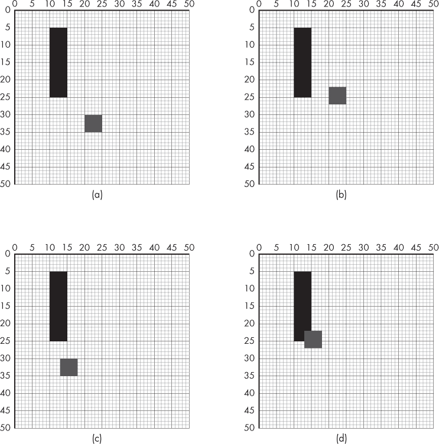

<samp class="SANS_Futura_Std_Book_Oblique_I_11">图 10-5: 碰撞检测条件</samp>

现在是在 `checkCollision` 函数内部实际调用 `checkPaddleCollision` 函数了，每个挡板调用一次，并处理函数返回 `true` 的情况。你可以在列表 10-12 中找到这些代码。

```javascript

--snip--

  let rightPaddle = {

    left: width - PADDLE_WIDTH - PADDLE_OFFSET,

    right: width - PADDLE_OFFSET,

    top: rightPaddleTop,

    bottom: rightPaddleTop + PADDLE_HEIGHT

  };

  if (checkPaddleCollision(ball, leftPaddle)) {

    // 左挡板发生碰撞

  ❶ xSpeed = Math.abs(xSpeed);

  }

  if (checkPaddleCollision(ball, rightPaddle)) {

    // 右挡板发生碰撞

  ❷ xSpeed = -Math.abs(xSpeed);

  }

  if (ball.left < 0 || ball.right > width) {

    xSpeed = -xSpeed;

  }

  if (ball.top < 0 || ball.bottom > height) {

    ySpeed = -ySpeed;

  }

}

--snip--

```

<samp class="SANS_Futura_Std_Book_Oblique_I_11">列表 10-12: 检查挡板碰撞</samp>

记住 `checkPaddleCollision` 接收一个代表球的对象和一个代表挡板的对象，如果两者交叉，则返回 `true`。如果 `checkPaddleCollision(ball, leftPaddle)` 返回 `true`，我们将 `xSpeed` 设置为 `Math.abs(xSpeed)` ❶，其的效果是将其设置为 `4`，因为在我们的游戏中，`xSpeed` 只有 `4`（向右移动时）或 `-4`（向左移动时）。

#### <samp class="SANS_Futura_Std_Book_Oblique_BI_11">在挡板边缘反弹</samp>

我在本章开头提到过，在 *Pong* 中，你可以通过击中挡板的顶部或底部来改变球的反弹角度。我们现在来实现该功能。首先，我们在 `checkCollision` 之前添加一个名为 `adjustAngle` 的新函数。它检查球是否位于挡板的顶部或底部，如果是，则更新 `ySpeed`。代码参见列表 10-13。

```javascript

--snip--

function adjustAngle(distanceFromTop, distanceFromBottom) {

❶ if (distanceFromTop < 0) {

    // 如果球击中挡板顶部，减小 ySpeed

    ySpeed -= 0.5;

❷ else if (distanceFromBottom < 0) {

    // 如果球击中挡板底部，增加 ySpeed

    ySpeed += 0.5;

  }

}

function checkCollision() {

--snip--

```

<samp class="SANS_Futura_Std_Book_Oblique_I_11">列表 10-13: 调整反弹角度</samp>


`adjustAngle` 函数有两个参数，`distanceFromTop` 和 `distanceFromBottom`。它们分别代表球的顶部到挡板顶部的距离，以及挡板底部到球底部的距离。该函数首先检查 `distanceFromTop` 是否小于 `0` ❶。如果是，那么意味着在碰撞时，球的顶部边缘位于挡板顶部边缘之上，这就是我们对“靠近挡板顶部”的定义方式。在这种情况下，我们从 `ySpeed` 中减去 `0.5`。如果球在击中挡板顶部附近时向屏幕下方移动，那么 `ySpeed` 为正值，减去 `0.5` 就会减小垂直速度。例如，在游戏开始时，`ySpeed` 为 `2`。如果你对齐挡板使球击中顶部，`ySpeed` 在反弹后将变为 `1.5`，从而有效地减小反弹角度。然而，如果球正在向向上移动，那么 `ySpeed` 为负值。在这种情况下，在击中挡板顶部附近后减去 `0.5` 将增加球的垂直速度。例如，`-2` 的 `ySpeed` 将变为 `-2.5`。

如果球击中挡板底部附近 ❷，情况则相反。在这种情况下，我们给 `ySpeed` 加上 `0.5`，如果球向屏幕下方移动，则增加垂直速度；如果球向屏幕上方移动，则减小速度。

接下来，我们需要更新 `checkCollision` 函数，在两个挡板的碰撞检测逻辑中调用新的 `adjustAngle` 函数。Listing 10-14 显示了这些更改。

```

--snip--

  let rightPaddle = {

    left: width - PADDLE_WIDTH - PADDLE_OFFSET,

    right: width - PADDLE_OFFSET,

    top: rightPaddleTop,

    bottom: rightPaddleTop + PADDLE_HEIGHT

  };

  if (checkPaddleCollision(ball, leftPaddle)) {

    // 左侧挡板发生碰撞

    let distanceFromTop = ball.top - leftPaddle.top;

    let distanceFromBottom = leftPaddle.bottom - ball.bottom;

    adjustAngle(distanceFromTop, distanceFromBottom);

    xSpeed = Math.abs(xSpeed);

  }

  if (checkPaddleCollision(ball, rightPaddle)) {

    // 右侧挡板发生碰撞

    let distanceFromTop = ball.top - rightPaddle.top;

    let distanceFromBottom = rightPaddle.bottom - ball.bottom;

    adjustAngle(distanceFromTop, distanceFromBottom);

    xSpeed = -Math.abs(xSpeed);

  }

--snip--

```
Listing 10-14: 调用 adjustAngle

在每个挡板的 `if` 语句中，我们声明了 `distanceFromTop` 和 `distanceFromBottom`，这是 `adjustAngle` 函数所需的参数。然后像之前一样，在更新 `xSpeed` 之前调用 `adjustAngle`。

现在尝试运行游戏，看看你能否击中挡板边缘附近的球！

### 评分

当你可以赢或输时，游戏通常更有趣。在 *Pong* 中，如果你击中了对手挡板背后的墙壁，就会得分。当这种情况发生时，球将重置为它的起始位置和速度，以进行下一回合游戏。我们将在节中也会处理这部分，但首先，为了跟踪分数，我们需要创建一些新变量。使用 Listing 10-15 中的代码更新 `script.js`。

```

--snip--

let leftPaddleTop = 10;

let rightPaddleTop = 30;

let leftScore = 0;

let rightScore = 0;

document.addEventListener("mousemove", e => {

  rightPaddleTop = e.y - canvas.offsetTop;

});

--snip--

```
Listing 10-15: 用于跟踪分数的变量

在这里我们声明了两个新变量 `leftScore` 和 `rightScore`，并将它们都设为 `0`。稍后我们将添加逻辑，在得分时增加这些变量的值。

接下来，我们将显示分数的的代码添加到 `draw` 函数的末尾。如 Listing 10-16 所示更新函数。

```

--snip--

  ctx.fillRect(

    width - PADDLE_WIDTH - PADDLE_OFFSET,

    rightPaddleTop,

    PADDLE_WIDTH,

    PADDLE_HEIGHT

  );

  // 绘制分数

  ctx.font = "30px monospace";

  ctx.textAlign = "left";

  ctx.fillText(leftScore.toString(), 50, 50);

  ctx.textAlign = "right";

  ctx.fillText(rightScore.toString(), width - 50, 50);

}

function update() {

--snip--

```
Listing 10-16: 绘制分数

这段代码使用了一些我们还没有见过的新 canvas 属性和方法。首先，我们使用 `ctx.font` 设置即将绘制的文本的字体。这类似于 CSS 字体声明。在这种情况下，我们将字体设置为 30 像素高且为 `monospace` 样式。`Monospace` 意味着每个字符占据相同的宽度，通常用于代码，正如本书中的代码列表一样。它看起来像。有很多 `monospace` 字体，但由于操作系统可能安装了不同的字体，我们只提供一个通用的字体样式（`monospace`），这意味着操作系统应该使用该字体样式的默认字体。在大多数操作系统中，Courier 或 Courier New 是默认的 `monospace` 字体。

接下来，我们使用 `ctx.textAlign` 设置文本的对齐方式。我们选择 `"left"` 对齐，但由于我们只想让它应用于左侧分数，在绘制右侧分数之前，我们将对齐方式改为 `"right"`。这样，如果分数变成两位数，数字将向屏幕中间延伸，保持视觉上的平衡。

要显示左侧分数，我们使用 `ctx.fillText` 方法。该方法有三个参数：要绘制的文本，以及绘制它的 `x` 和 `y` 坐标。第一个参数必须是字符串，因此我们对 `leftScore` 调用 `toString` 方法将其从数字转换为字符串。我们使用 `50` 作为 `x` 和 `y` 坐标，将文本放在画布的左上角附近。

> **注意**：`fillText` 的 `x`坐标参数的含义取决于文本的对齐方式。对于左对齐文本，`x` 指定左边缘，而对于右对齐文本它指定右边缘。

右侧分数的处理方式与左侧类似：设置文本对齐，然后调用 `fillText` 显示分数。这次我们将 `x` 坐标设置为 `width - 50`，使其像左侧分数距离左侧一样距离右侧。

当你刷新 `index.html` 时，你应该看到渲染出的初始分数，如 Figure 10-6 所示。

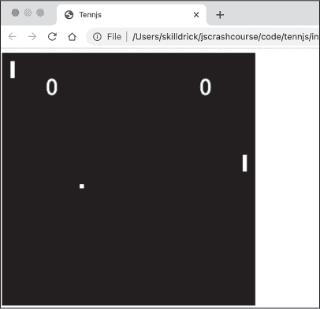
Figure 10-6: 显示分数

现在我们需要处理球击中侧壁的情况。而不是反弹，应该增加相应的分数，并将球重置为原始速度和位置。首先我们将再次进行重构并编写一个重置球的函数。这还需要对球的速度和位置变量的处理方式进行一些更改。Listing 10-17 显示了这些更改。

```

--snip--

const BALL_SIZE = 5;

❶ let ballPosition;

let xSpeed;

let ySpeed;

function initBall() {

❷ ballPosition = {x: 20, y: 30};

  xSpeed = 4;

  ySpeed = 2;

}

const PADDLE_WIDTH = 5;

--snip--

```
Listing 10-17: initBall 函数


在这里，我们将小球状态变量（`ballPosition`、`xSpeed` 和 `ySpeed`）的声明与这些变量的初始化分离。例如，`ballPosition` 在程序的顶层 ❶ 处声明，但在新的 `initBall` 函数 ❷（“initialize ball”的缩写）中进行初始化。`xSpeed` 和 `ySpeed` 也是如此。这样做是为了让我们能够随时通过调用 `initBall` 来将小球重置为初始位置和速度，而不需要在程序中到处复制粘贴小球状态变量的值。具体来说，我们现在可以在程序开始时调用 `initBall` 来首次设置小球，也可以在小球碰到左墙或右墙时随时调用它，将小球重置为原始状态。

注意，我们不能在 `initBall` 函数内部同时声明和初始化小球状态变量——例如，在函数内部放置 `let ballPosition = {x: 20, y: 30};`——因为 `let` 关键字会在`当前作用域内`定义一个新变量，在这种情况下，该作用域就是 `initBall` 的函数体。因此，这些变量将仅在 `initBall` 内部可用。我们希望变量在整个程序范围内可用，所以我们在程序的顶层（任何函数体体之外）使用 `let` 声明它们。然而，由于我们想要多次初始化这些变量，因此我们在 `initBall` 函数中为它们赋值，该函数可以被重复调用。

接下来，我们必须修改 `checkCollision` 函数中的碰撞检测代码，以便在碰到左墙或右墙时增加分数并重置小球。Listing 10-18 显示了如何实现。

```

--snip--

  if (checkPaddleCollision(ball, rightPaddle)) {

    // 右球板碰撞发生

    let distanceFromTop = ball.top - rightPaddle.top;

    let distanceFromBottom = rightPaddle.bottom - ball.bottom;

    adjustAngle(distanceFromTop, distanceFromBottom);

    xSpeed = -Math.abs(xSpeed);

  }

❶ if (ball.left < 0) {

    rightScore++;

    initBall();

  }

❷ if (ball.right > width) {

    leftScore++;

    initBall();

  }

  if (ball.top < 0 || ball.bottom > height) {

    ySpeed = -ySpeed;

  }

}

--snip--

```

<samp class="SANS_Futura_Std_Book_Oblique_I_11">Listing 10-18: 墙壁碰撞时得分</samp>

之前，我们在一个 `if` 语句中检查左右墙的碰撞并让小球反弹，但我们必须单独处理左右墙，因为根据撞击到的是哪一面墙，不同的玩家会得分。因此，我们将 `if` 语句拆分为两个。如果小球碰到左墙 ❶，`rightScore` 增加，并通过调用我们新的 `initBall` 函数来重置小球。如果小球碰到右墙 ❷，`leftScore` 增加并重置小球。与顶部和底部墙碰撞的逻辑保持不变。

最后，由于我们把小球状态变量的初始化移动到了 `initBall` 函数中，我们需要在游戏循环开始之前调用该函数，以便首次设置小球。滚动到 `script.js` 的底部，并按照 Listing 10-19 所示更新代码，在调用 `gameLoop` 之前添加对 `initBall` 的调用。

```

--snip--

function gameLoop() {

  draw();

  update();

  checkCollision();

  // 在超时后再次调用此函数

  setTimeout(gameLoop, 30);

}

initBall();

gameLoop();

```

<samp class="SANS_Futura_Std_Book_Oblique_I_11">Listing 10-19: 首次调用 initBall</samp>

现在当你刷新 `index.html` 时，你应该能看到小球碰到侧墙时分数增加，并且小球在碰到侧墙后应该重置为原始速度和位置。当然，现在击败电脑很容易，因为它还没有移动它的球板！

### 计算机控制

现在让我们给游戏增加一些挑战吧！我们想让计算机控制的对手移动左球板并尝试击中小球。实现这一点有多种方法，但在我们简单的方法中，我们将让计算机始终匹配小球当前的位置。计算机的逻辑将非常简单：

*   如果小球的顶部在球板的顶部上方，则球板向上移动。
*   如果小球的底部在球板的底部下方，则球板向下移动。
*   否则，什么都不做。

使用这种方法，如果计算机可以以任何速度移动，它将永远不会错过。由于这对我们人类来说没好玩，我们将为计算机设置一个速度限制。Listing 10-20 显示了如何实现。

```

let canvas = document.querySelector("#canvas");

let ctx = canvas.getContext("2d");

let width = canvas.width;

let height = canvas.height;

const MAX_COMPUTER_SPEED = 2;

const BALL_SIZE = 5;

--snip--

```

<samp class="SANS_Futura_Std_Book_Oblique_I_11">Listing 10-20: 限制计算机的速度</samp>

我们将计算机的速度限制声明为一个常量 `MAX_COMPUTER_SPEED`。通过将其设置为 2，我们意味着计算机不被允许在游戏的每一帧中将球板移动超过 2 像素。

接下来，我们将定义一个名为 `followBall` 的函数，应用一些非常基础的人工智能来移动计算机的球板。新函数在 Listing 10-21 所示。将将其添加到代码中 `draw` 函数和 `update` 函数之间。

```

--snip--

function followBall() {

❶ let ball = {

    top: ballPosition.y,

    bottom: ballPosition.y + BALL_SIZE

  };

❷ let leftPaddle = {

    top: leftPaddleTop,

    bottom: leftPaddleTop + PADDLE_HEIGHT

  };

❸ if (ball.top < leftPaddle.top) {

    leftPaddleTop -= MAX_COMPUTER_SPEED;

❹ else if (ball.bottom > leftPaddle.bottom) {

    leftPaddleTop += MAX_COMPUTER_SPEED;

  }

}

function update() {

  ballPosition.x += xSpeed;

  ballPosition.y += ySpeed;

❺ followBall();

}

--snip--

```

<samp class="SANS_Futura_Std_Book_Oblique_I_11">Listing 10-21: 计算机控制球板</samp>

在 `followBall` 函数内部，我们定义了代表小球 ❶ 和左球板 ❷ 的对象，每个对象都有表示边界的顶部和底部属性。然后我们实现移动移动逻辑：如果小球的顶部在球板上方 ❸，通过减去 `MAX_COMPUTER_SPEED` 让球板向上移动。同样，如果小球的底部在球板下方 ❹，通过加上 `MAX_COMPUTER_SPEED` 让球板向下移动。

我们在 `update` 函数中调用新的 `followBall` 函数 ❺。这样，移动左球板就变成了游戏循环每次迭代更新状态的一部分。

刷新页面，看看你是否对电脑得分！

### 游戏结束

创建游戏的最后一步是让它可赢（或可输）。为了实现这一点，我们必须添加某种游戏结束条件，并在那里停止游戏循环。在这种情况下，一旦某个玩家达到 10 分，我们就停止游戏循环，然后显示“GAME OVER”。

首先，我们需要声明一个变量来跟踪游戏是否结束。我们将使用该变量来决定是否重复 `gameLoop` 函数。Listing 10-22 显示了需要做的更改。

```

--snip--

let leftScore = 0;

let rightScore = 0;

❶ let gameOver = false;

document.addEventListener("mousemove", e => {

--snip--

function checkCollision() {

--snip--

  if (ball.right > width) {

    leftScore++;

    initBall();

  }

❷ if (leftScore > 9 || rightScore > 9) {

    gameOver = true;

  }

  if (ball.top < 0 || ball.bottom > height) {

    ySpeed = -ySpeed;

  }

}

--snip--

```

<samp class="SANS_Futura_Std_Book_Oblique_I_11">Listing 10-22: 添加 gameOver 变量</samp>


在 `script.js` 的顶部，我们声明了一个名为 `gameOver` 的变量，用于记录游戏是否结束❶。我们将其初始化为 `false`，以免游戏在开始之前就结束。然后，在 `checkCollision` 函数中，我们检查其中一个分数是否超过了 9 ❷。如果是，我们将 `gameOver` 设置为 `true`。这个检查可以在任何地方发生，但我们将其放在 `checkCollision` 中，以便将增加分数的逻辑和检查分数的逻辑保持在一起。

接下来，我们将添加一个用于写入“GAME OVER”文本的函数，并修改游戏循环，使其在 `gameOver` 为 `true` 时结束。列表 10-23 展示了具体实现方法。

```javascript

--snip--

  if (ball.top < 0 || ball.bottom > height) {

    ySpeed = -ySpeed;

  }

}

function drawGameOver() {

  ctx.fillStyle = "white";

  ctx.font = "30px monospace";

  ctx.textAlign = "center";

  ctx.fillText("GAME OVER", width / 2, height / 2);

}

function gameLoop() {

  draw();

  update();

  checkCollision();

if (gameOver) {

    draw();

    drawGameOver();

  } else {

    // Call this function again after a timeout

    setTimeout(gameLoop, 30);

  }

}

```

<samp class="SANS_Futura_Std_Book_Oblique_I_11">列表 10-23: 结束游戏</samp>

我们在 `checkCollision` 函数之后定义了 `drawGameOver` 函数❶。它在画布的中央用大号白色字体绘制“GAME OVER”文本。为了将文本置于画布中间，我们将文本对齐方式设置为 `"center"`，并使用画布宽度和高度的一半作为文本的 x 和 y 坐标。（在居中对齐的情况下，x 坐标指的是文本的水平中点。）

在 `gameLoop` 函数中，我们将对 `setTimeout` 的调用封装在一个条件语句中，该语句检查 `gameOver` 变量的值。如果是 `true` ❷，游戏结束了，因此我们调用了 `draw` 和 `drawGameOver` 函数。（需要 `draw` 函数来显示最终分数；否则，获胜者将停留在 9 分。）如果 `gameOver` 为 `false` ❸，游戏可以继续：我们通过使用 `setTimeout` 在 30 毫秒后再次调用 `gameLoop` 来以前一样继续循环。

一旦 `gameOver` 变为 `true` 且游戏循环结束，游戏就会停止。在“GAME OVER”文本之后，屏幕上将不再绘制其他内容——至少在刷新页面并在程序从头开始运行之前如此。现在去试试吧：刷新 `index.html` 看看能不能打败电脑！一旦有人超过 9 分，你就会看到“GAME OVER”文本，如图 10-7 所示。

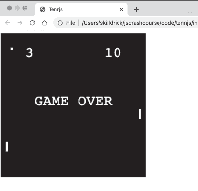

<samp class="SANS_Futura_Std_Book_Oblique_I_11">图 10-7: 游戏结束</samp>

我希望你赢了电脑，但没赢也不用担心——游戏相当难。这里你可以做一些让它更容易的事情：

*   增加 `gameLoop` 中帧之间的间隔时间。
*   让挡板变得更高。
*   降低电脑的最大速度。
*   让更容易击中挡板边缘。
*   增加击中挡板边缘对 `ySpeed` 产生的影响。

现在你已经有了一个可以运行的游戏，可以进行任何你更改。如果你已经是一个 `Pong` 高手，你可能想让它变得更难；以下练习提供了一些建议。你也可以尝试自定义外观，或者更改画布的大小——现在是你的游戏了。

### 完整代码

为了方便起见，列表 10-24](#chapter10.xhtml_Lis10-24) 显示了整个 `script.js` 文件。

```javascript

let canvas = document.querySelector("#canvas");

let ctx = canvas.getContext("2d");

let width = canvas.width;

let height = canvas.height;

// ... (其余逻辑)

```


在本章中，你从零开始创建了一个完整的游戏。游戏循环、碰撞检测和渲染的基础知识具有广泛的适用性，因此凭借在这里学到的知识，你可以开始创建各种 2D 游戏。例如，你可能会尝试实现一个你自己的版本的 `Breakout`（炸块）或 `Snake`（吃蛇）。如果你在逻辑方面需要帮助，网上有很多教程可以遵循。祝你玩得开心！

## 11 面向对象的乒乓球


在上一章中，我们构建了自己版本的`Pong`（乒乓球）游戏。之前的第 6 章中，你学习了 JavaScript 中的类和面向对象编程。你可能会奇怪，为什么我们在实现 `Pong` 时没有使用任何类。主要原因是我想让游戏代码尽可能简单，不包含任何不必要的概念，以便更容易看出游戏实际在做什么。然而，随着程序变得越来越大复杂，为它们提供更多的结构会有帮助，而实现的一种常用方法就是使用面向对象编程。

为了帮助你更好地理解如何以面向对象的风格设计软件，在本章中，我们将介绍面向对象版本的 `Pong`。游戏的逻辑不会发生任何变化，但代码的结构和组织方式将不同。例如，处理球的代码将全部存储在一个名为 `Ball` 的类中。我们将使用这个类来跟踪球的位置，并确定球在撞击墙或拍板时应该如何反弹。同样，所有处理拍板的代码将存储在一个名为 `Paddle` 的类中。通过让 `Ball` 和 `Paddle` 类继承自一个共享的父类，我们可以轻松共享适用于球和拍板的通用代码。

本章将探索面向对象的 `Pong` 程序的通用结构，但我们不会进入代码的每一个细节；根据上一章的内容，你应该对它的工作原理有了很好的了解。考虑到这一点，在本章中，我们不会增量地构建游戏，而是将逐节遍历完整代码。因此，在你输入所有代码之前，代码将无法正确运行或执行任何操作。但在进入代码本身之前，让我们先更广泛地观察如何设计面向对象的计算机程序。

### 面向对象设计

以面向的方式编写代码通过将代码组织成代表程序各个层面的类，为计算机程序增加了结构。这种结构使得其他程序员（甚至是以后的你）更容易理解你的代码是如何工作的。对面向对象设计技术进行全面处理将超出本书的范围，但在本节中，我们将介绍面向对象编程核心的几个原则。

面向对象设计中重要的第一步是建模你的领域，或者说你程序的世界。程序中有哪些不同的元素？它们需要做什么？它们之间是如何相互关联和交互的？在这种情况下，领域是 `Pong` 游戏，游戏中有几个可见元素：球、拍板和分数。虽然有两个拍板，但它们的行为方式基本相同，所以我们可以创建一个单一的 `Paddle` 类并带有两个自定义实例。同时，球的独特性足以让它拥有自己的类。我们还必须建模这些元素是如何交互的。例如，我们如何建模球与拍板的碰撞？这段代码必须存在于某处。正如你看到的，在我的设计中，我决定代码应该位于 `Ball` 类中。换句话说，球应该“知道”在撞击拍板和墙壁时如何反弹。

面向对象编程的另一个重要方面是`封装`。这意味着将类的内部细节从程序的其余部分隐藏起来，并提供一个简单的接口供其用于与类交互。封装这些细节使得以后更改它们更容易而不影响程序的其他部分。例如，`Ball` 类不需要向程序的其余部分暴露它的速度或位置。如果我们决定更改速度表示方式（例如，使用角度和速度代替 `xSpeed` 和 `ySpeed`），我们不需要更改程序其他部分的运行方式。

> 注意
> 从技术上讲，`xSpeed` 和 `ySpeed` 在 `Ball` 类外部是可以访问的，但我们不会访问，因此可以将其视为封装的细节。JavaScript 确实有一种声明属性为私有的方法，这意味着它们不能在类之外访问，但在编写时这是一个新功能，尚未在所有浏览器中可用。

面向对象编程的终极关键方面是`多态`，这种想法是：如果一个方法预期接收特定类的对象，那么它也可以接收该类的子类的实例对象。例如，在本章中，你会看到一个拥有 `draw` 方法的 `Entity` 类以及它的两个子类：`Paddle` 和 `Ball`。根据多态性，任何使用 `draw` 方法的代码都应该接收任何类型的 `Entity` 作为参数，而无需担心我们传递的是一个 `Ball` 还是一个 `Paddle`。

最后，面向对象设计与其说是一门科学，不如说有很多不同的实实现方法。你应该将本章中的设计视为解决问题的一种可能方法，而不是处理事情的“正确方法”。考虑到这一点，让我们深入研究面向对象的 `Pong` 代码。

### 文件结构

面向对象版本 `Pong` 的 HTML 与上一章完全相同，但 JavaScript 完全不同。如果你愿意，可以为 `tennjs` 目录创建一个副本，删除 `script.js` 文件，并使用后续章节中所示的代码创建一个新的 `script.js` 文件。或者，你只需要删除现有 `tennjs` 目录中 `script.js` 文件中的所有代码，将其替换为新的面向对象代码。无论哪种方式，更新后的 `script.js` 文件将由一系列类声明组成，随后是一些启动游戏的额外代码。我们将顺序查看代码的每个部分。

### GameView 类

我们将声明的第一个类是 `GameView`。这个类负责玩家的游戏视图，或者说游戏如何显示。由于游戏使用画布进行渲染，`GameView` 类负责画布和绘图上下文环境。该类还负责在画布上绘制物体（例如球和拍板）以及显示“GAME OVER”文本。代码请参见列表 11-1。

```

class GameView {

  ❶ constructor() {

    let canvas = document.querySelector("#canvas");

    this.ctx = canvas.getContext("2d");

    this.width = canvas.width;

    this.height = canvas.height;

    this.offsetTop = canvas.offsetTop;

  }

  ❷ draw(…entities) {

    // Fill the canvas with black

    this.ctx.fillStyle = "black";

    this.ctx.fillRect(0, 0, this.width, this.height);

  ❸ entities.forEach(entity => entity.draw(this.ctx));

    }

  ❹ drawScores(scores) {

    this.ctx.fillStyle = "white";

    this.ctx.font = "30px monospace";

    this.ctx.textAlign = "left";

    this.ctx.fillText(scores.leftScore.toString(), 50, 50);

    this.ctx.textAlign = "right";

    this.ctx.fillText(scores.rightScore.toString(), this.width - 50, 50);

  }

  ❺ drawGameOver() {

    this.ctx.fillStyle = "white";

    this.ctx.font = "30px monospace";

    this.ctx.textAlign = "center";

    this.ctx.fillText("GAME OVER", this.width / 2, this.height / 2);

  }

}

```

列表 11-1：GameView 类

`GameView` 的 `constructor` ❶ 获取了 `canvas` 及其绘图上文的引用，并将它们分别保存为名为 `canvas` 和 `ctx` 的属性。它还存储了一些用于绘制的值：`canvas` 的 `width` 和 `height`，以及 `canvas` 距离浏览器视口顶部的偏移量（offsetTop`）。

`draw` 方法 ❷ 使用了第 5 章中引入的剩余参数。通过这种方式，你可以向 `draw` 传递多个参数，所有参数都将被收集到一个名为 `entities` 的数组中。每个参数将是一个代表游戏中其中一个元素的对象：球和两个挡挡板。该方法首先绘制一个黑色矩形以清除画布，然后遍历元素数组，依次调用每个元素自身的 `draw` 方法 ❸，并将绘图上下文作为参数传递。只有当传递给 `GameView.draw` 的每个对象都有自己的 `draw` 方法时才能生效；我们将在下一节介绍它是如何实现的。`GameView` 上的 `draw` 方法在游戏循环的每次迭代中负有画布的最终责任，但它将实际绘制游戏元素的责任委托给了代表这些元素的对象。实际上，游戏中的每个元素都“知道”如何绘制自己，而 `GameView.draw` 只是负责协调调用。

`drawScores` 方法 ❹ 接收一个包含两个分数的对象并将其绘制到画布上。这与上一章中的分数绘制代码非常相似。主要区别在于，它不再依赖全局变量获取画布宽度，而是通过引用 `this.width` 使用 `GameView` 类中的 `width` 属性。

`drawGameOver` 方法 ❺ 与上一章中的对应函数也大部分相同，但它同样是从 `GameView` 获取宽度和高度，而不是从全局变量。

### 游戏元素

接下来，我们将实现代表三个主要游戏元素的类：两个挡板和一个球。我们将从一个名为 `Entity` 的超类开始，它将成为子类 `Paddle` 和 `Ball` 的父类。`Entity` 类的存在是为了共享挡板和球通用的通用代码。这包括跟踪元素尺寸和位置的代码、计算碰撞检测的元素边界的代码，以及绘制元素的代码。由于所有游戏元素都是矩形，无论我们处理的是挡板还是球，这些代码都是相同的。这展示了面向对象编程的优之处：我们可以在超类中写一次所有通用代码，并让子类继承它。

列表 11-2 包含了 `Entity` 类的代码。

```

class Entity {

  ❶ constructor(x, y, width, height) {

    this.x = x;

    this.y = y;

    this.width = width;

    this.height = height;

  }

  ❷ boundingBox() {

    return {

      left: this.x,

      right: this.x + this.width,

      top: this.y,

      bottom: this.y + this.height

    };

  }

  ❸ draw(ctx) {

    ctx.fillStyle = "white";

    ctx.fillRect(this.x, this.y, this.width, this.height);

  }

}

```

列表 11-2：Entity 类

`Entity` 的 `constructor` ❶ 接收 `x`、`y`、`width` 和 `height`，即实体左上角的坐标以及尺寸的 `width`和 `height`。这些被保存为属性。`boundingBox` 方法 ❷ 返回一个包含实体 `left`、`right`、`top` 和 `bottom` 边界的对象。在上一章中，我们在 `checkCollision` 函数中手动创建了这些对象。`Entity` 超类为球和挡板提供了一种通用的计算方式。`draw` 方法 ❸ 接收绘图上下文并使用构造函数中定义的属性绘制一个白色矩形。`GameView` 上的 `draw` 方法将调用每个项（`Entity` 的子类）。

### 挡板

`Paddle` 类继承 `Entity` 类。它在列表 11-3 中定义。

```

class Paddle extends Entity {

  ❶ static WIDTH = 5;

  static HEIGHT = 20;

  static OFFSET = 10;

  ❷ constructor(x, y) {

    super(x, y, Paddle.WIDTH, Paddle.HEIGHT);

  }

}

```

列表 11-3：Paddle 类

该类包含了三个静态属性，这些属性赋值给类本身而不是类的实例。静态属性的值将在类的所有实例间共享。在这种情况下，虽然每个 `Paddle` 实例都需要自己的 `x` 和 `y` 坐标，但每个 `Paddle` 对象应具有相同的宽度和高度，以及距离画布边缘相同的偏移。因此，我们将这些值定义为静态属性 `WIDTH`、`HEIGHT` 和 `OFFSET`，它们对应于上一章的 `PADDLE_WIDTH`、`PADDLE_HEIGHT` 和 `PADDLE_OFFSET` 常量。

> 注意：类中没有定义静态常量的方法，因此上一章的常量现在实际上是变量。它们的名称全大写是为了表示它们应该被视为常量

使用 `static` 关键字声明静态属性。例如，我们使用 `static WIDTH = 5` 声明了 `WIDTH` 静态属性。静态属性通过点符号访问，就像访问实例属性一样，只是在点的左侧使用类名，而不是 `this` 或实例名称。例如，`Paddle.WIDTH` 访问 `WIDTH` 静态属性。

`Paddle` 的 `constructor` ❷ 只有两个参数：`x` 和 `y`。它使用 `super` 调用父类（`Entity`）的构造函数，传递 `x` 和 `y` 参数，并将 `Paddle.WIDTH` 作为宽度参数、`Paddle.HEIGHT` 作为高度参数。

### 球

接下来是 `Ball` 类。它与 `Paddle` 类相似，都自自 `Entity`，但 `Ball` 有自己的根据速度更新位置以及进行碰撞检测的逻辑。列表 11-4 显示了该类的部分代码。

```javascript

class Ball extends Entity {

❶ static SIZE = 5;

❷ constructor() {

    super(0, 0, Ball.SIZE, Ball.SIZE);

  ❸ this.init();

  }

❹ init() {

    this.x = 20;

    this.y = 30;

    this.xSpeed = 4;

    this.ySpeed = 2;

  }

❺ update() {

    this.x += this.xSpeed;

    this.y += this.ySpeed;

    }

❻ adjustAngle(distanceFromTop, distanceFromBottom) {

    if (distanceFromTop < 0) {

      // 如果球击中挡板顶部附近，减少 ySpeed

      this.ySpeed -= 0.5;

    } else if (distanceFromBottom < 0) {

      // 如果球击中挡板底部附近，增加 ySpeed

      this.ySpeed += 0.5;

    }

  }

}

```

<samp class="SANS_Futura_Std_Book_Oblique_I_11">示例 11-4：Ball 类的开头</samp>

该类有一个名为 `SIZE` 的静态属性，用于定义球的宽度和高度 ❶。接下来是它的构造方法 ❷。与 `Paddle` 构造方法一样，`Ball` 构造方法执行的第一件事是调用其父类 `Entity` 的构造方法，这次向 `x` 和 `y` 参数传递 `0`，向宽度和高度参数传递 `Ball.SIZE`。这些 `0` 只是占位符；事实上，球在每个回合的开始时都处于相同的位置 `(20, 30)`。这种定位由 `Ball` 类的 `init` 方法处理，该方法在构造方法中被首次调用 ❸。`init` 方法本身被定义为设置球的初始位置和速度 ❹，就像上一章中的 `initBall` 函数一样。每当需要将球重置为初始位置时（得分后），就会调用此方法。

下一个方法 `update` 使用球的当前速度来更新其 `x` 轴和 `y` 轴位置 ❺。随其后的是 `adjustAngle` 方法 ❻，它等同于上一章描述的 `adjustAngle` 函数。它根据球击中挡板的位置来改变球的垂直速度（反射角度）。

`Ball` 类的定义在 示例 11-5 中继续，包含了碰撞检测的方法。

```javascript

class Ball extends Entity {

--snip--

  checkPaddleCollision(paddle, xSpeedAfterBounce) {

  ❶ let ballBox = this.boundingBox();

    let paddleBox = paddle.boundingBox();

    // 检查球和挡板在垂直和水平方向上重叠

  ❷ let collisionOccurred = (

      ballBox.left   < paddleBox.right &&

      ballBox.right  > paddleBox.left &&

      ballBox.top    < paddleBox.bottom &&

      ballBox.bottom > paddleBox.top

    );

    if (collisionOccurred) {

      let distanceFromTop = ballBox.top - paddleBox.top;

      let distanceFromBottom = ballBox.bottom - paddleBox.bottom;

    ❸ this.adjustAngle(distanceFromTop, distanceFromBottom);

    ❹ this.xSpeed = xSpeedAfterBounce;

    }

  }

  checkWallCollision(width, height, scores) {

    let ballBox = this.boundingBox();

    // 击中左墙

  ❺ if (ballBox.left < 0) {

      scores.rightScore++;

      this.init();

    }

    // 击中右墙

  ❻ if (ballBox.right > width) {

      scores.leftScore++;

      this.init();

    }

    // 击中顶部或底部墙

    if (ballBox.top < 0 || ballBox.bottom > height) {

    ❼ this.ySpeed = -this.ySpeed;

    }

  }

}

```

<samp class="SANS_Futura_Std_Book_Oblique_I_11">示例 11-5：Ball 类的其余部分</samp>

`checkPaddleCollision` 方法与上一章中的 `check Collision` 和 `checkPaddleCollision` 函数有一定的重复。该方法接受两个参数：一个代表挡板的对象以及 `xSpeedAfterBounce`。后者代表如果球从其中一个挡板上反弹，我们应该为 `xSpeed` 设置的新值，它允许我们配置球是预期始终向右反弹（从左挡板）还是向左反弹（从右挡板）。与上一章一样，我们强制要求与左挡板碰撞时球向右反弹，反之亦然，以避免球在挡板“内部”反弹的奇怪情况。

我们使用父类 `Entity` 的 `boundingBox` 方法获取球和挡板的边界框 ❶，并将它们存储为 `ballBox` 和 `paddleBox`。接下来，我们比较各种边界框边缘以判断球和挡板之间是否发生了碰撞，并将结果保存在布尔变量 `collisionOccurred` ❷ 中。如果 `collisionOccurred` 为真，我们根据从边界框确定的相应距离调用 `adjustAngle` 方法 ❸，然后将球的 `xSpeed` 设置为 `xSpeedAfterBounce` ❹。

最后，`checkWallCollision` 方法检查球与墙之间是否发生了碰撞。它接受游戏区域的 `width` 和 `height` 以及一个代表 `scores` 的对象。如果球击中左墙 ❺ 或右墙 ❻，相应的得分将会增加，并通过调用 `init` 重置球。


`Game` 构造函数首先实例化了 `GameView`、`Ball` 和 `Paddle` 类。`leftPaddle` 实例使用 `Paddle.OFFSET` 设置其 x 坐标 ❶。右侧实例则使用 `Paddle.OFFSET`、`Paddle.WIDTH` 和 `this.gameView.width` 来确定其 x 坐标 ❷，这与我们在上一章中计算右侧挡板的位置类似。

在类内部实例化其他类是面向对象代码的常见特性。这种技术被称为 `composition`（组合），因为我们正在其他实例内部组合了多个实例。

接下来，`Game` 构造函数实例化了 `Scores` ❸ 并将 `gameOver` 布尔值设置为 `false`。最后，它设置了一个 `mousemove` 事件监听器 ❹，当用户移动鼠标时更新右侧挡板的位置。在类构造函数中设置的事件监听器工作方式与我们在书中看到的其他事件监听器一样：只要应用程序运行，它就会有效，并且每当检测到事件时，就会触发其处理函数。

构造函数之后是 `Game` 类的 `draw` 方法，它负责绘制游戏的所有视觉部分。首先，该方法调用 `this.gameView.draw` ❺，传入三个主要的游戏元素：`this.ball`、`this.leftPaddle` 和 `this.rightPaddle`。这是对我们在 Listing 11-1 中看到的 `GameView` 类 `draw` 方法的调用，该方法接受数量数量的对象作为参数并在每个对象上调用 `draw` 方法。最终结果是 `game.draw` 调用 `gameView.draw`，后者调用 `ball.draw`、`leftPaddle.draw` 和 `rightPaddle.draw`。这看起来可能有些迂回，但你经常会在面向对象代码中遇到这种情况，为了让代码保持在逻辑位置，需要绕一些弯。在这种情况下，`game.draw` 负责知道*哪些*对象被绘制（因为 `Game` 类跟踪了所有的游戏元素）；`gameView.draw` 负责绘制上下文、清除画布并调用元素的 `draw` 方法；而每个游戏元素的 `draw` 方法则负责知道如何绘制自己。

在绘制完所有实体后，`draw` 方法调用了 `this.gameView.drawScores`，传入了 `this.scores` 对象 ❻。

`Game` 类继续在 Listing 11-8 中提供了其余方法。

```javascript

class Game {

--snip--

  checkCollision() {

    this.ball.checkPaddleCollision(this.leftPaddle,

                                 ❶ Math.abs(this.ball.xSpeed));

    this.ball.checkPaddleCollision(this.rightPaddle,

                                 ❷ -Math.abs(this.ball.xSpeed));

  ❸ this.ball.checkWallCollision(

      this.gameView.width,

      this.gameView.height,

      this.scores

    );

  ❹ if (this.scores.leftScore > 9 || this.scores.rightScore > 9) {

      this.gameOver = true;

    }

  }

❺ update() {

    this.ball.update();

    Computer.followBall(this.leftPaddle, this.ball);

  }

❻ loop() {

    this.draw();

    this.update();

    this.checkCollision();

  ❼ if (this.gameOver) {

      this.draw();

      this.gameView.drawGameOver();

    } else {

      // 在超时后再次调用此方法

    ❽ setTimeout(() => this.loop(), 30);

    }

  }

}

```

Listing 11-8: Game 类的剩余

`Game` 类的 `checkCollision` 方法协调所有的碰撞检测逻辑。首先，它调用两次球的 `checkPaddleCollision` 方法，检查球与每个挡板之间的碰撞。回想 Listing 11-5，该方法接受两个参数：一个 `Paddle` 对象和一个新的、反弹后的 `xSpeed` 值。对于左侧挡板，我们知道想要球向右反弹，因此我们通过对当前 `xSpeed` 取 `Math.abs` ❶ 来使新的 `xSpeed` 为正数。对于右侧挡板，我们想要球向左反弹，所以通过对 `Math.abs(xSpeed)` 的结果取反 ❷ 来使新的 `xSpeed` 为负数。

接下来，`checkCollision` 方法调用 `ball.checkWallCollision` 来处理墙碰撞 ❸。该方法接受宽度和高度（因为 `Ball` 对象不知道游戏区域有多大）以及分数（这样在撞击侧壁时可以增加分数）。最后，该方法检查任意分数是否超过了阈值 ❹，如果是，则将 `this.gameOver` 设置为 `true`。

`Game` 对象的 `update` 方法 ❺ 控制游戏循环每次重复之间的状态变化。它调用球的 `update` 方法来移动球，然后使用 `Computer.followBall` 静态方法根据球的新位置告诉电脑移动左侧挡板。

`Game` 类的最后一个方法 `loop` 定义了游戏循环 ❻。我们按顺序调用 `this.draw`、`this.update` 和 `this.checkCollision`。然后我们检查 `this.gameOver` 是否为真。如果是，❼ 我们再次调用 `draw` 并调用 `gameView.drawGameOver`；否则，我们使用 `setTimeout` 在 30 毫秒后 ❽ 再次调用 `loop`。

### 游戏

最后要做的一件事是通过实例化 `Game` 类来启动游戏，如 Listing 11-9 所示。

```javascript

let game = new Game();

game.loop();

```

Listing 11-9: 启动游戏


本章将介绍 Web Audio API 以及基于其构建的 JavaScript 库 Tone.js。这将是你首次接触广阔的第三方 JavaScript 库世界，这些库是预写代码的集合，你可以利用它们来简化复杂的任务。与 Web Audio API 相比，Tone.js 提高了抽象级别，让你以更自然的方式思考并实现音乐概念。一旦你熟悉了它的工作原理，在第 13 章中，你将把所学知识付诸实践，制作一首你可以自定义甚至重写的歌曲。

### Web Audio API

本节介绍了 Web Audio API 的基础知识，它提供了一种使用 JavaScript 在浏览器中创建和处理声音的方法。Google Chrome 在 2011 年引入了 Web Audio API，不久后它被作为 W3C 标准发布（W3C，即世界维网联盟，是一个开发 Web 标准的组织）。要使用它，你需要创建节点并将它们连接在一起。每个 `node` 代表声音的某个方面——一个节点可能生成一个基础音色，第二个节点可能用于设置其音量，第三个节点可能会对音色应用混响或失真等效果，以此类推。通过这种方案，你可以产生几乎任何你需要的声音。

### 设置

一如既往，我们从一个简单的 HTML 文件开始。该文件将赋予用户播放由 Web Audio API 生成的声音的能力。创建一个名为 `music` 的新目录，并将列表 12-1 中的内容输入名为 `index.html` 的新文件中。

```

<!DOCTYPE html>

<html>

  <head>

    <title>Music</title>

  </head>

  <body>

  ❶ <button id="play">Play</button>

  ❷ <p id="playing" style="display: none">Playing</p>

    <script src="script.js"></script>

  </body>

</html>

```

列表 12-1：用于探索 Web Audio API 的 `index.html` 文件

此列表创建了两个视觉元素：一个播放按钮 ❶和一个包含“Playing”文本的段落 ❷。该段落使用了内联样式属性（style），这允许我们直接从 HTML 文件向元素添加 CSS 声明。在这种情况下，我们把 `display` 设置为 `none`，从而隐藏该元素。稍后，我们将使用 JavaScript 移除样式并在音频播放时显示该元素。

接下来，我们将开始编写 JavaScript。在包括 Google Chrome 在内的许多浏览器中，在用户与页面进行交互之前，Web Audio API 不播放任何声音。我们使用播放按钮作为我们的交互元素，它将触发我们的音频代码。由于我们只需要按钮被点击一次，因此在被点击后我们将将其隐藏。

在与 HTML 文件相同的目录下创建 `script.js`，并添加列表 12-2 所示的内容。这段代码在用户点击按钮时会隐藏播放按钮并显示“Playing”文本。注意，我们现在还没有编写任何 Web Audio API 代码——这只是在设置按钮。

```

❶ let play = document.querySelector("#play");

let playing = document.querySelector("#playing");

❷ play.addEventListener("click", () => {

  // Hide this button

  play.style = "display: none";

  playing.style = " ";

});

```

列表 12-2：在鼠标点击时切换元素的可见性

首先，我们使用 `document.querySelector` 方法 ❶ 获取两个元素的引用。然后，我们为播放按钮添加一个点击事件监听器 ❷。当用户点击它时，我们的事件监听器为按钮添加 `display: none` 的内联样式属性，并将段落的内联样式设置为空字符串，从而有效地移除了在 HTML 文件中作为属性设置的内联样式。这段代码的最终效果是，点击播放按钮将隐藏按钮并显示段落。这有两个目的：它让用户知道现在应该播放音乐了，并且移除了按钮以便其无法被再次点击。

### 使用 Web Audio API 生成音色

完成设置后，我们现在可以编写一些 Web Audio API 代码了。为了开始，我们将生成一个单音，即音频版的“Hello, world!”。生成音色的代码如列表 12-3 所示。正如我之前提到的，除非由用户事件（如鼠标点击）触发，否则音音频将不会播放，因此所有的音频代码都位于点击处理程序内部。

```

--snip--

play.addEventListener("click", () => {

  // Hide this button

  play.style = "display: none";

  playing.style = " ";

❶ let audioCtx = new AudioContext();

❷ let oscNode = audioCtx.createOscillator();

  oscNode.frequency.value = 440;

❸ let gainNode = audioCtx.createGain();

  gainNode.gain.value = 0.5;

❹ oscNode.connect(gainNode);

  gainNode.connect(audioCtx.destination);

❺ oscNode.start(audioCtx.currentTime);

  oscNode.stop(audioCtx.currentTime + 2);

});

```

列表 12-3：使用 Web Audio API 播放单音

我们做的第一件事是创建 `audio context`（音频上下文）❶。这是我们与 Web Audio API 交互的对象，类似于 `canvas` 元素的绘图上下文。接下来，我们创建第一个节点，一个振荡器 ❷。在电子和信号处理术语中，`oscillator` 是一种按规律反复上升下降信号的设备。Web Audio API 输出的默认波形是正弦波，如图图 12-1](#chapter12.xhtml_fig12-1) 所示。当波振荡得足够快并连接到扬声器时，它就会产生可听的音色。在这个示例中，我们将频率设置为 440 赫兹 (Hz)，或每秒 440 次。换句话说，振荡器输出的信号每秒共从 0 到 1 再回到 0 变换 440 次。这意味着波的一个周期持续 1/440 秒，即 2.27 毫秒。我在这里使用 440 Hz 是因为它是音乐调音的标准参考频率。该频率对应于中 C 之上的 A 音。

接下来，我们创建一个增益节点 ❸ 并将其值设置为 0.5。在信号处理中，`gain` 指信号幅度或其取值范围的增加或减少。从实际角度来说，增益起着音量控制的作用。增益 2 会使幅度翻倍，使声音更大；增益 0.5 会使幅度减半，使声音更小；而增益 1（增益节点的默认值）对幅度没有影响。对图 12-1](#chapter12.xhtml_fig12-1) 所示的正弦波应用 0.5 的增益，将产生一个最大值为 0.5、最小值为 –0.5 的正弦波，如图 12-2](#chapter12.xhtml_fig12-2) 所示。


到目前为止，我们有两个节点：一个振荡器节点和一个增益节点。为了实际上将增益应用于振荡器信号，我们需要将这些节点连接起来。我们使用振荡器节点的 `connect` 方法❹将振荡器节点的输出连接到增益节点的输入。然后，为了能够听到结果，我们将增益节点的输出连接到主输出，我们可以通过音频上下文的 `ctx.destination` 获取。这些连接意味着振荡器信号通过了增益节点，然后传递到输出端，如果开启声音，它最终将传到你的耳机或扬声器。图 12-3 展示了这些连接。

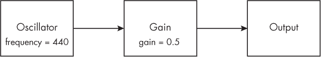

<samp class="SANS_Futura_Std_Book_Oblique_I_11">图 12-3：节点图</samp>

在我们告诉振荡器开始之前，振荡器节点实际上不会创建信号。要做到这一点，我们在振荡器上调用 `start` 方法，并将 `audioCtx.currentTime` 作为参数传递 ❺。`currentTime` 属性对应于音频上下文处于激活状态的秒数。通过将 `audioCtx.currentTime` 传递给 `start` 方法，我们是在告诉振荡器立即播放。然后我们调用 `stop` 方法，传递 `audioCtx.currentTime + 2`。这告诉振荡器在启动两秒后停止。

所有这些代码的效果是，当你浏览器中加载 `index.html` 页面并点击播放按钮时，应该会播放一个 440 Hz 的音调，持续两秒。如果你没有听到任何声音，请确保电脑和浏览器已启用声音——例如，播放一个 YouTube 视频。如果仍然不起，请检查控制台确保没有任何错误。

你可能在想为了一个非常简单的示例你刚刚写了大量的代码，你是对的！Web Audio API 非常强大，但你必须在非常底层面使用极其基础的构建模块进行工作。为了简化问题，接下来我们将注意力转移到一个流行的、高级的音频库，称为 Tone.js。

### Tone.js 库

Tone.js 库构建在 Web Audio API 之上。它的设计是为了让使用 API 创建音乐变得更容易。例如，与其费力折腾振荡器和增益节点，Tone.js 让你可以使用带有音量控制的电子乐。与其使用频率，你可以使用音符名称。与其使用秒来控制事件发生的时间，你可以使用小节（bars）和拍（beats）。

Tone.js 网站 `https://tonejs.github.io` 提供了安装和使用该库的详细信息。最简单的选项是使用托管在内容分发网络（CDN）上的预构建文件，例如 `https://unpkg.com`，我们在这里也将这样做。这样，你访问该库只需要在 HTML 文件的 `<script>` 元素中直接引用 URL 即可。只要你在工作时可以访问互联网，就不需要下载库副本。

#### 使用 Tone.js 生成音调

让我们改用 Tone.js 库重新创建我们的 Web Audio API “Hello, world!”示例。除了为库添加新的 `<script>` 标签外，我们可以保持所有 HTML 均不变，如列表 12-4 所示。

```

--snip--

    <p id="playing" style="display: none">Playing</p>

    <script src="https://unpkg.com/tone@14.7.77/build/Tone.js"></script>

    <script src="script.js"></script>

  </body

</html

```

<samp class="SANS_Futura_Std_Book_Oblique_I_11">列表 12-4：在</samp> <samp class="SANS_Futura_Std_Book_11">index.html</samp> <samp class="SANS_Futura_Std_Book_Oblique_I_11">文件中引入 Tone.js</samp>

我们将新 `<script>` 元素的 `src` 设置为来自 `unpkg.com` 的文件，该文件包含完整 Tone.js 库的单个 JavaScript 文件。

接下来，我们将编写 JavaScript。由于 Tone.js 底层使用 Web Audio API，我们仍然面临需要用户输入才能开始播放音频的限制。因此，我们仍然需要点击事件处理器，但 `script.js` 中的其他内容都将改变。列表 12-5。

```

--snip--

play.addEventListener("click", () => {

  // 隐藏此按钮

  play.style = "display: none";

  playing.style = " ";

  Tone.start();

  let synth = new Tone.Synth({

    oscillator: {type: "sine"},

    envelope: {attack: 0, decay: 0, sustain: 1, release: 0},

    volume: -6 

 }).toDestination();

  synth.triggerAttackRelease("A4", 2, 0);

});


列表 12-5：使用 Tone.js 播放单音

我们需要做的的第一件事是调用 `Tone.start`。这触发 Tone.js 库在点击处理器内部启动，确保浏览器允许播放音频。接下来，我们创建一个新的 `Tone.Synth` 对象。`Synth` 是 `synthesizer`（合成器）的缩写，是一种电子乐器，通常带有键盘，可以生成（合成）各种声音。`Tone.Synth` 是这种乐器的简单代码版本。

`Tone.Synth` 构造函数接受一个对象作为参数，允许我们配置合成器的各个方面。在这种情况下，我们告诉合成器使用生成正弦波的振荡器。我们还给合成器提供了一个简单的幅度包络和 `-6` 的音量。我将在下一节解释这些设置的含义，但目前，这就是我们匹配列表 12-3 中 Web Audio API 振荡器的内容。构造函数之后，我们链调用 `toDestination` 方法，将合成器的输出连接到音频上下文的输出。

最后，我们告诉合成器使用其 `triggerAttackRelease` 方法播放单个音符。该方法接收音符名称、持续时间以及播放音符的时间。我们传递 `"A4"` 作为音符名称，它等同于 440 Hz，并告诉它立即播放两秒。当你重新加载浏览器并点击播放按钮时，你应该能听到与运行列表 12-3 时相同的声音。

正如你可能看到的，使用 Tone.js 库简化了使用 Web Audio API 制作音乐的过程。与其为声音的不同方面（音高、增益等）每个都创建单独的节点，一切都整合在一个 `Synth` 对象下。如果你有任何音乐知识，你还会发现该库使用的概念比 API 更接近你的理解，例如，使用音符名称而不是频率。随着你学习更多 Tone.js，你将看到更多这样的例子。

#### 理解 Tone.Synth 选项

让我们仔细观察一下在列表 12-5 中传递给 `Tone.Synth` 构造函数的对象。第一个属性 `oscillator` 定义了生成信号的振荡器的选项。在这种情况下，我们只是使用 `type` 属性将振荡器类型设置为正弦波。

下一个属性定义了 `amplitude envelope`（幅度包络）的选项，它决定了音符音量在其持续时间内的变化。大多数硬件和软件合成器都允许你配置幅度包络。最常见的包络类型是 `ADSR envelope`，`attack, decay, sustain, release`（起始、衰减、维持、释放）的缩写。`attack`（起始）是从音符触发（例如当你按下合成器上的键时）到音符达到最大音量之间的时间。`decay`（衰减）是从起始结束到音符维持部分之间的时间。`sustain`（维持）是一个增益值，定义了在按键期间音符在起始和衰减后保持的音量。通常这是包络起始部分实现的全音量的一个比例。`release`（释放）定义了在释放按键后，音符幅度恢复到零所需的时间。图 12-4 以图形形式展示了这些不同的值。

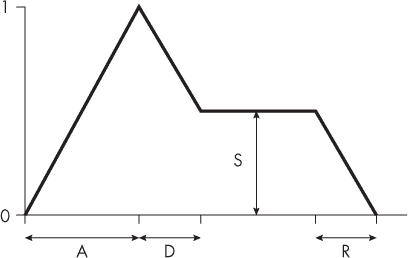

图 12-4：ADSR 包络的组成部分

ADSR 包络是许多乐器工作方式的近似。例如，当你拉小提琴时，音符需要一些时间才能达到最大音量——也就是说它的很长的起始时间。相比之下，当你按下钢琴键时，起始时间非常短。同样，当你停止拉奏小提琴音符时，琴弦需要一点时间才能停止振动，而钢琴音符的释放则更为直接。合成的 ADSR 包络仍然非常简单——它们并不是现实乐器的完美模拟——但它们为原本无聊的音色增了许多表现力。

尽管如此，我们为合成器使用的 ADSR 包络是非常无聊的。我们将起始、衰减和释放值设置为 0，将维持值设为 1，这意味着音色在整个持续时间内都保持全音量。这与我们在 代码列表 12-3 中对 Web Audio API 振荡器所的操作一致，这也是生成的音色听起来如此机械合成的原因之一。

合成器选项对象的最后一个属性 `volume` 以分贝（dB）设置合成器的整体音量。分贝是描述增益的另一种方式，在某些方面更符合我们思考增益的方式。0 分贝设置等于 1 的增益（音量不变），–6 分贝等于 0.5 的增益（即一半音量），–12 分贝对应 0.25 的增益（即四分之一音量），依此类推；每增加 6 分贝音量翻倍，每减少 6 分贝则减半。我们的耳朵对声音之间的相对音量敏感，因此每当电平减半或翻倍时，在我们听来就像是下降或上升了一个固定量。这个“固定量”是一个固定的增加或减少的分贝数值，这就是为什么使用分贝设置音量更简单。在这种情况下，我们传递了 –6 dB 以匹配 代码列表 12-3 中的 0.5 增益。

现在你已经知道这些选项了，让我们尝试玩玩它们吧！首先，我们将修改振荡器的类型。目前振荡器被设置为生成正弦波，但我们将切换到方波。图 12-5 显示了方波单个周期的波形。

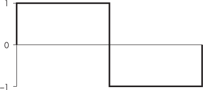

图 12-5：方波

注意，方波在幅度值之间有突然的过渡，而不是正弦波的平滑曲线。切换到方波振荡器的代码更改如 代码列表 12-6 所示。

```
--snip--
  let synth = new Tone.Synth({
    oscillator: {type: "square"},
    envelope: {attack: 0, decay: 0, sustain: 1, release: 0},
    volume: -6
  }).toDestination();
--snip--
```

代码列表 12-6：将振荡器类型更改为方波

当你重新在浏览器中加载代时，你应该听到一种非常不同的音色。方波比正弦波更响、更亮。你可以尝试的振荡器类型其他值还有“triangle”（三角波）和“sawtooth”（锯齿波）。图 12-6 显示了这者的波形。

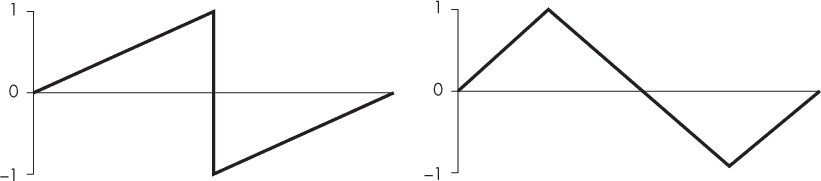

图 12-6：锯齿波和三角波

想想这些其他振荡器类型与“sine”和“square”有什么不同。每个振荡器的独特声音被称为它的 `color`（颜色）或 `timbre`（音色）。

接下来，让我们尝试更改包络。我们在 代码列表 12-5 中有意使用了非常基础的包络，以匹配 代码列表 12-3 中没有包络的 Web Audio API 示例。现在我们将这些值设置为一些听起来更有音乐感的数值，如 代码列表 12-7 所示。

```
--snip--
  let synth = new Tone.Synth({
    oscillator: { type: "square" },
    envelope: {attack: 0.8, decay: 0.3, sustain: 0.8, release: 1},
    volume: -6
  }).toDestination();
--snip--
```

代码列表 12-7：将振荡器类型更改为方波

起始、衰减和释放的值均以秒为单位，而维持是 0 到 1 之间的一个数字，代表要保持的幅度电平。在这里，我们将起始设置为 0.8 秒，衰减设置为 0.3 秒，维持设为 0.8，释放设置为 1 整秒。当你重新加载页面并播放声音时，你应该听到音符缓慢淡入到最大音量，然后略微减少。两秒后，音符被释放并在一秒内淡出。

最后一个可以尝试的参数是音量。正如我之前解释的，每减去 6 dB，电平就减半；每增加 6 dB，就翻倍。在这里尝试一些不同的值，例如 –12、–18 或 –24。你也可以反向操作，直到 0 dB。

### 顺序播放更多音符

我们的合成器目前只播放单个音符，但我们可以轻松播放更多音符。Tone.js 中的音符频率可以用 Hz 或音符名称（如 A4）给出，就像我们在代码列表 12-5 中做的那样。这些音符名称对应于键盘上的键，如图 12-7 所示。

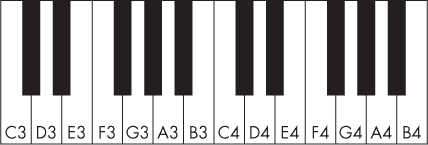

图 12-7：键盘上的音符名称

C4 被称为 `middle C`（中音），位于大多数钢琴键盘的中间。键盘上从每个 C 到上方的 B 的每个八度都被赋予了一个数字。例如，图 12-7 最左侧的键是 C3，上面的一个八度是 C4。如之前提到的，440 Hz 对应 A4，即 C4 之上的 A。黑键被称为 `accidentals`（变音符号），它们比左边的键高一个半音，或者比右边的键低一个半音。例如，C4 右侧的黑键可以称为 C♯4 或 D♭4（♯ 是升号 `sharp`，意味着高一个半音，而 ♭ 是降号 `flat`，意味着低一个半音）。在 Tone.js 中编写音符名称时，我们使用井号 (#) 表示升，使用字母 b 表示降。

> <samp class="SANS_Dogma_OT_Bold_B_21">注意</samp>
> *B 和 C 之间以及 E 和 F 之间没有黑键，因为这些音符只差一个半音。*

我们将播放从 A3 到 A4 的大调，它由音符 A3、B3、C♯4、D4、E4、F♯4、G♯4 和 A4 组成。更新你的 *script.js* 以包含代码列表 12-8 中的代码以实现此音阶。

```
--snip--
  let synth = new Tone.Synth({
    oscillator: {type: "square"},
    envelope: { attack: 0.1, decay: 0.3, sustain: 0.8, release: 0.1 },
    volume: -6
  }).toDestination();

  synth.triggerAttackRelease("A3", 0.9, 0);
  synth.triggerAttackRelease("B3", 0.9, 1);
  synth.triggerAttackRelease("C#4", 0.9, 2);
  synth.triggerAttackRelease("D4", 0.9, 3);
  synth.triggerAttackRelease("E4", 0.9, 4);
  synth.triggerAttackRelease("F#4", 0.9, 5);
  synth.triggerAttackRelease("G#4", 0.9, 6);
  synth.triggerAttackRelease("A4", 0.9, 7);
--snip--
```

列表 12-8: 播放音阶

这与 列表 12-5 非常相似，不同在于我们一个接一个触发多个音符。注意我们更新了 `envelope`，使其具有更短的攻击（attack）和释放（release）时间。特别是释放时间需要更短，这样每个音符的结束才与下一个音符的开始重叠。

正如我之前提到的，`triggerAttackRelease` 的第二个参数是音符的持续时间（秒），第三个参数是播放该音符的时间（同样是秒）。第一个音符 `A3` 播放 `0.9` 秒，从时间零开始（即立即）。`0.1` 秒的释放发生在 `0.9` 秒持续时间之后，因此每个音符总共将播放 1 秒。下一个音符 `B3` 有相同的持续时间，但第三个参数 `1` 意味着它比第一个音符晚一秒开始。第三个音符设置为比第一个音符晚两秒，以此类推。在浏览器中运行它，你应该听到一个八度的 A 大调音阶。

### 同时播放多个音符

我们目前为止使用的合成器是一个`单音合成器`（monophonic synth），这意味着它一次只能播放一个音符。要同时播放多个音符，我们需要创建一个`多音合成器`（polyphonic synth）。在 列表 12-9 中，我们更新代码来创建一个新的多音合成器，并同时播放两个或三个音符。

```
--snip--
  Tone.start();
  let synth = new Tone.PolySynth(
    Tone.Synth,
    {
      oscillator: { type: "square" },
      envelope: { attack: 0.1, decay: 0.3, sustain: 0.8, release: 0.1 },
      volume: -6
    }
  ).toDestination();

  synth.triggerAttackRelease(["A3", "C#4"], 0.9, 0);
  synth.triggerAttackRelease(["B3", "D4"], 0.9, 1);
  synth.triggerAttackRelease(["C#4", "E4"], 0.9, 2);
  synth.triggerAttackRelease(["D4", "F#4"], 0.9, 3);
  synth.triggerAttackRelease(["E4", "G#4"], 0.9, 4);
  synth.triggerAttackRelease(["F#4", "A4"], 0.9, 5);
  synth.triggerAttackRelease(["G#4", "B4"], 0.9, 6);
  synth.triggerAttackRelease(["E4", "A4", "C#5"], 1.9, 7);
--snip--
```

列表 12-9: 创建并播放多音合成器

在这里我们调用 `new Tone.PolySynth` 而不是 `new Tone.Synth` 来创建一个多音合成器对象。`Tone.PolySynth` 构造函数接受两个参数：一个单音合成器（在此例中为 `Tone.Synth`）和一个包含通常传递给该单音合成器构造函数的选项的对象（在此例中，我们在列表 12-8 中传递给 `Tone.Synth` 构造函数的相同合成器选项）。

### Tone.js 传输器

Tone.js transport 为我们提供了一种简单定义音乐循环的方法，包括它们何时开始和何时结束。最简单的 `Tone.Loop` 定义了一种持续产生音符的方法。让我们通过每隔四分音符播放一个单音符来尝试。修改 `script.js` 以使用列表 12-10 中的代码。

```
--snip--
  let synth = new Tone.Synth().toDestination();
  new Tone.Loop((time) => {
    synth.triggerAttackRelease("C4", "16n", time);
  }, "4n").start("0:0:0");
  loop.stop("4:0:0");
  Tone.Transport.start();
--snip--
```

列表 12-10: 循环

*在我们之前的列表中，我们使用的是数字作为持续时间，这些是以秒为单位的持续时间。使用“4n”（四分音符）或“16n”（十六分音符）等音符长度持续时间的优势在于，当我们更改 BPM 时，它们会自动调整。例如，将 BPM 加倍将使每个四分音符的持续时间减半。*

我们传递给 `Tone.Loop` 的回调函数体调用了 `synth` 上的 `triggerAttackRelease` 方法，播放一个持续时间为十六分音符的 C4 音符。`triggerAttackRelease` 方法的第三个参数 `time` 代表播放音符的时间。`Tone.Loop` 对象每次调用回调函数时都会提供一个新的 `time` 值，并将其填充为传输控制器（transport）上相应的位置。

最后，我们对 `Tone.Loop` 构造函数返回的循环对象调用 `start` 和 `stop` 方法，传入我们希望该循环开始和停止的 `time`，随后调用 `Tone.Transport.start` 启动传输器从头开始播放。我们从“0:0:0”（第一小节的开头）开始，在“4:0:0”（第五小节的开头）停止，这意味着这段代码将持续四个完整的小节，每个小节四拍。我们的循环在每个节拍上重复一次，每次播放一个音符，因此总共将播放 16 个音符。尝试重新加载页面看看！你可以像音乐家那样这样数数小节和节拍：“*one* 二二三四，*two* 二二三四，*three* 二二三四，*four* 二二三四”。注意 `Tone.js` 不会在时间点“4:0:0”处播放第十七分音符，因为循环的结束点是不包含在内的。

Listing 12-11 显示了创建我们在 Listing 12-10 中编写相同循环的另一种方法。这次我们把 `start` 和 `stop` 方法直接链式到 `Tone.Loop` 构造函数上。

```
--snip--
  let synth = new Tone.Synth().toDestination();
  new Tone.Loop(time => {
    synth.triggerAttackRelease("C4", "16n", time);
  }, "4n").start("0:0:0").stop("4:0:0");
  Tone.Transport.start();
--snip--
```

<samp class="SANS_Futura_Std_Book_Oblique_I_11">Listing 12-11: 使用更少的代码进行循环</samp>

使用这种表示法，我们不需要创建一个变量来持有 `Tone.Loop` 对象，通过链式调用 `start` 和 `stop` 方法节省了几行代码。我们在本节的剩余部分将使用这种模式。

`Tone.Loop` 虽然很基础，但也非常多功能。你你可以在回调中运行任何任意代码，因此你可以做的不仅仅是反复播放同一个音符。例如，你可以选择每次播放一个新的随机音符。Listing 12-12 显示了如何通过随机从五音阶（五个音符的音阶）中播放音符来生成一段短曲（我在这里选择五音阶是因为五音阶中任何音符的组合听起来通常都是悦耳的）。

```
--snip--
  Tone.start();
  let synth = new Tone.PolySynth(
    Tone.Synth,
    {
      oscillator: { type: "triangle" },
      volume: -9
    }
  ).toDestination();
  let notes = ["C4", "D4", "E4", "G4", "A4", "C5"];
  new Tone.Loop(time => {
    for (let i = 0; i < 3; i++) {
      if (Math.random() < 0.5) {
        let note = notes[Math.floor(Math.random() * notes.length)];
        synth.triggerAttackRelease(note, "32n", time);
      }
    }
  }, "8n").start("0:0:0").stop("8:0:0");
  Tone.Transport.start();
--snip--
```

<samp class="SANS_Futura_Std_Book_Oblique_I_11">Listing 12-12: 使用 Tone.Loop 生成随机音乐</samp>

在这个示例中，我们切换到了多音合成器，这样我们可以同时播放多个音符。`notes` 数组包含一个大调五音阶的八度，包括来自下一个八度的 C 音。在 `Tone.Loop` 回调内部，我们使用 `for` 循环运行某些代码三次。每次循环，我们调用 `Math.random()`，它返回一个 0 到 1 之间的随机数，用来决定是否播放音符。如果值小于 0.5，我们就播放一个音符；否则，跳过该音符。音符名称通过在 `notes` 数组中选取随机索引来确定，使用代码 `Math.floor(Math.random() * notes.length)`。

`Tone.Loop` 对象每隔八分音符（"8n"）调用一次此代码，持续八小节（"0:0:0"到"8:0:0"）。这一切的效果是，每个八分音符都会播放来自数组的最多三个音符（不保证唯一性，所以同一个音符可能会同时播放两次或三次，导致该音符声音更大）。对于三个音符中的每一个，都有二分之一的概率播放，因此总来说，在任何给定的八分音符上没有任何音符的概率是八分之一。

#### Tone.Sequence

在本节中，我们将查看另一个 Tone.js 工具，称为 `Tone.Sequence`。它允许你提供一个音符列表，并按固定间隔安排播放。你可以根据需要重复整个序列任意次数。作为一个示例，我们将创建一个包含四个音符的重复模式：一个 G4 后面跟着三个 C4。使用 Listing 12-13 中的代码更新 *script.js*。

```
--snip--
  Tone.start();
  let synth = new Tone.Synth().toDestination();
  new Tone.Sequence((time, note) => {
    synth.triggerAttackRelease(note, "16n", time);
  }, ["G4", "C4", "C4", "C4"], "4n").start("0:0:0").stop("4:0:0");
  Tone.Transport.start();
--snip--
```

<samp class="SANS_Futura_Std_Book_Oblique_I_11">Listing 12-13: 使用 Tone.Sequence 创建序列</samp>

这与我们的 12-10 示例非常相似，但有两个不同：首先，回调函数接受两个参数而不是一个 `time`。其次，回调后面有一个额外的参数，它包含一个音符列表。`Tone.Sequence` 的第三个参数给出了回调之间的持续时间。在这种情况下，我们使用了 "4n"，意味着每四拍播放一个音符。如果我们手动写出所有的 `synth.triggerAttackRelease` 调用而不是依赖 `Tone.Sequence`，它们看起来是这样的：

```
.triggerAttackRelease("G4", "16n", "0:0:0");
synth.triggerAttackRelease("C4", "16n", "0:1:0");
synth.triggerAttackRelease("C4", "16n", "0:2:0");
synth.triggerAttackRelease("C4", "16n", "0:3:0");
synth.triggerAttackRelease("G4", "16n", "1:0:0");
synth.triggerAttackRelease("C4", "16n", "1:1:0");
synth.triggerAttackRelease("C4", "16n", "1:2:0");
synth.triggerAttackRelease("C4", "16n", "1:3:0");
synth.triggerAttackRelease("G4", "16n", "2:0:0");
synth.triggerAttackRelease("C4", "16n", "2:1:0");
synth.triggerAttackRelease("C4", "16n", "2:2:0");
synth.triggerAttackRelease("C4", "16n", "2:3:0");
synth.triggerAttackRelease("G4", "16n", "3:0:0");
synth.triggerAttackRelease("C4", "16n", "3:1:0");
synth.triggerAttackRelease("C4", "16n", "3:2:0");
synth.triggerAttackRelease("C4", "16n", "3:3:0");
```

注意小节分音符表示法中的第二个数字是如何增加的，是因为我们使用了 "4n"（但在实际操作中，`Tone.Sequence` 传递的是秒数而不是小节分音符表示法。）如果你想要一个带有某些间隙（音乐术语中的*休止符*）的序列，你可以在音符数组中使用 `null` 代替音符名称。使用 Listing 12-14 中的代码修改 *script.js* 以查看效果。

```
--snip--
  new Tone.Sequence((time, note) => {
    synth.triggerAttackRelease(note, "16n", time);
  }, ["C4", null, "B3", "C4", "G3", "A3", null, "B3"], "8n")
    .start("0:0:0")
    .stop("4:0:0");
  Tone.Transport.start();
--snip--
```

<samp class="SANS_Futura_Std_Book_Oblique_I_11">Listing 12-14: 使用 null 添加休止符</samp>

现在我们有一个更长的音符序列，其中穿插了一些 `null` 以在序列中插入暂停。我们将持续时间从 "4n" 改为了 "8n"，这意味着音符播放的速度比之前快了一倍。当你运行这个更新后的示例时，你应该能听到更有有趣的音符序列，其中包括休止符。

我们将最后查看的传输辅助工具是 `Tone.Part`。它是所有辅助工具中最灵活的一个，因为它允许我们指定每个播放音符的精确时机。通过 `Tone.Part`，我们不再传递一个音名数组，而是传递一个时间/音符对数组。例如，`[["0:0:0", "C4"], ["0:1:0", "D4"], ["0:1:2", "E4"]]` 将在指定的三个时间播放三个音符 `C4`、`D4` 和 `E4`。这样一来，与 `Tone.Loop` 和 `Tone.Sequence` 不同，音符不需要以等的时间间隔进行播放。此外，默认情况下 `Tone.Part` 不循环循环，因此数组中的音符序列只会播放一次。请参考 Listing 12-15 中的代码查看示例。

```
--snip--
  Tone.start();
  let synth = new Tone.PolySynth(Tone.Synth).toDestination();
  new Tone.Part((time, note) => {
    synth.triggerAttackRelease(note, "16n", time);
  }, [
    ["0:0:0", ["C3", "E4"]],
    ["0:0:3", "D4"],
    ["0:1:0", "C4"],
    ["0:1:2", "D4"],
    ["0:2:0", ["E3", "E4"]],
    ["0:2:2", "E4"],
    ["0:3:0", "E4"],
    ["1:0:0", ["G3", "D4"]],
    ["1:0:2", "D4"],
    ["1:1:0", "D4"],
    ["1:2:0", ["E3", "E4"]],
    ["1:2:2", "G4"],
    ["1:3:0", "G4"]
  ]).start("0:0:0");
  Tone.Transport.start();
--snip--
```

Listing 12-15: 使用 Tone.Part 播放旋律

我们在这里做的第一个更改是针对 `synth`。这次我们回到了使用多音合成器，因此我们可以同时播放多个音符。除了合成器有所不同外，回调函数的主体是相同的。我们仍然在调用 `synth.triggerAttackRelease` 并传递 `note` 和 `time` 参数，`Tone.Part` 会自动填充这些参数。接下来是时间/音符对的数组。你可能会注意到，其中某些音符本身就是数组；例如，列表中的第一个“音符”是 `["C3", "E4"]`。这对音符将保持原封不动地传递给 `triggerAttackRelease` 方法，其效果是同时播放两个音符，就像我们其他的多音合成器示例一样。

最后，我们调用了 `.start("0:0:0")`，它的效果是立即播放此部分。例如，如果我们改用 `.start("1:0:0")`，那么旋律将在一个小节的停顿后开始。为每个时间/音符对给的时间是相对于传递给 `start` 方法的时间。

当你运行这个示例时，你应该能听到“玛丽有一只小羊”的开头。

### 制作鼓声

大多数电子音乐都有某种鼓点节奏。用于制作节奏的鼓声可以来自音频文件，也可以是合成的。在这里我们将使用后一种技术。鼓点节奏的核心围绕三个组件构建：大音鼓（“boom”声）、小军鼓（“bah”声）和镲片（“ti”声）。在本节中，你将学习合成这些声音的技术。

#### 镲片合成

现实世界中的镲片由两个面对面的镲片组成。顶部的镲片连接到一个踏板上，这样鼓手可以让两个镲片接触或分开。我们在这里追求的是一种闭合（镲片接触）的声音。当你用鼓棒击打闭合镲片时，它们会发出一种迅速消失的高频噪音。

我们将通过使用一种不同的合成器 `NoiseSynth` 来生成白噪声，而不是带音高的音符，来近似这一点。在信号处理中，`white noise` 是在所有频率上都具有等强度分量的随机信号。我们将给 `NoiseSynth` 提供一个幅度包络，以模拟用棒击打镲片时的突然冲击。最后，我们将噪声通过 `filter` —— 一种允许某些频率通过同时降低其他频率水平的设备 —— 来消除低频，并使其听起来更高、更像镲片。

首先，我们将设置 `NoiseSynth` 和包络，并在循环中播放镲片声。使用 Listing 12-16 中的代码更新你的 `script.js`。

```
--snip--
  Tone.start();
  let hiHat = new Tone.NoiseSynth({
    envelope: {
      attack: 0.001, decay: 0.1, sustain: 0, release: 0
    },
    volume: -6
  }).toDestination();
  new Tone.Loop(time => {
    hiHat.triggerAttackRelease("16n", time);
  }, "8n").start("0:0");
  Tone.Transport.start();
--snip--
```

Listing 12-16: 镲片声的开始

我们首先设置 `NoiseSynth` 和包络，并在循环中播放镲片声。我们首先创建一个新的 `NoiseSynth`，带有一个包络和 -6 分贝的音量。由于 sustain 和 release 都被设置为 0，声音在初始攻击（0.001 秒）和衰减（0.1 秒）后会立即结束。接下来，我们使用 `Tone.Loop` 播放八分音符。注意 `Noise` 的 `triggerAttackRelease` 不接受音名，因为噪声没有音高。它在“0:0”处开始。

当你运行这个示例时，你应该听到一段镲片声。它听起来还不完美，因为我们还没有添加滤波器。我们将在[Listing 12-17]中完成这一点。

```
--snip--
  Tone.start();
  let hiHatFilter = new Tone.Filter(15000, "bandpass").toDestination();
  let hiHat = new Tone.NoiseSynth({
    envelope: {
      attack: 0.001, decay: 0.1, sustain: 0, release: 0
    },
    volume: -6
  }).connect(hiHatFilter);
  new Tone.Loop(time => {
    hiHat.triggerAttackRelease("16n", time);
  }, "8n").start("0:0");
--snip--
```

Listing 12-17: 为镲片应用滤波器

首先，我们使用 `Tone.Filter` 创建了一个带通滤波器。这种滤波器只允特定频率周围的频率通过。在这种情况下，我们告诉滤波器通过 15000 Hz（即 15 kHz）周围的频带，同时消除其他频率。人类的听觉范围大约是 20 Hz 到 20 kHz，因此我们的滤波器允许噪声的高频部分通过。

在[Listing 12-16]中，我们对 `NoiseSynth` 使用 `toDestination()` 直接连接到输出。在[Listing 12-17]中，我们改为将滤波器连接到输出，然后将合成器连接到滤波器。这意味着合成器的声音在通过扬声器或耳机输出之前经过了滤波。

#### 小军鼓合成

在本节中，我们将合成小军鼓。小军鼓有一组靠在底部鼓面的金属丝（称为 *snare*），在击打鼓面时它们会对着鼓面响动。这使其产生了一个相对复杂的声音，由一些噪音一些更具音色的声音组成。为了模拟这一点，我们将使用两个独立的声源：一个噪声合成器和一个固定频率的普通合成器。两者都将具有短促的幅度包络以营造打击感，我们还将通过带通滤波器处理声音的噪声部分，使小军鼓听起来比镲片低。我们将创建一个新的 `Snare` 类来封装这些细节，如 Listing 12-18 所示。

```
--snip--
  new Tone.Loop(time => {
    hiHat.triggerAttackRelease("16n", time);
  }, "8n").start("0:0:0").stop("4:0:0");
  class Snare {
    constructor() {
      this.noiseFilter = new Tone.Filter(5000, "bandpass").toDestination();
      this.noiseSynth = new Tone.NoiseSynth({
        envelope: {
          attack: 0.001, decay: 0.1, sustain: 0, release: 0
        },
        volume: -12
      }).connect(this.noiseFilter);
      this.synth = new Tone.Synth({
        envelope: {
          attack: 0.0001, decay: 0.1, sustain: 0, release: 0
        },
        oscillator: {type: "sine"},
        volume: -12
      }).toDestination();
    }
    triggerAttackRelease(duration, when) {
      this.noiseSynth.triggerAttackRelease(duration, when);
      this.synth.triggerAttackRelease("G3", duration, when);
    }
  }
  let snare = new Snare();
  new Tone.Loop(time => {
    snare.triggerAttackRelease("16n", time);
  }, "2n").start("0:1:0").stop("4:0:0");
  Tone.Transport.start();
--snip--
```

Listing 12-18：合成小军鼓

从高层级来看，`Snare` 类有两个方法：`constructor` 和 `triggerAttackRelease`。`constructor` 创建了一个滤波器和两个合成器。`triggerAttackRelease` 方法调用这两个合成器的 `triggerAttackRelease` 方法以让它们同时播放。

在 `constructor` 中，我们首先创建了滤波器和 `noiseSynth`。这与我们创建 `hi-hat`（镲片）的方式非常相似，只是我们对 `bandpass` 滤波器使用了 `5,000` Hz 的频率，以反映小军鼓较低的声音。接下来，我们创建了带音高的合成器，它使用的幅度包络与 `noiseSynth` 类似，但攻击时间更短，以模拟小军鼓的声音（在真实的小军鼓中，军鼓弦是由鼓皮的震动触发的，因此它们会略后于鼓声）。`synth` 配置了一个 `sine` 正弦波振荡器。由于我们要同时播放这两个合成器，我们给每个合成器设置了 `–12` 的音量，产生的整体音量与 `hi-hat` 相似。

`triggerAttackRelease` 方法只需要一个 `duration`（时长）和一个 `when` 参数。这些参数被传递给底层合成器的 `triggerAttackRelease` 方法。当我们触发音高合成器时，我们给它一个音名 `"G3"`，这是我为小军鼓调定的音高。音高合成器的加入虽然微妙，但它让鼓声听起来更真实。

接下来，我们实例化该类，最后创建了一个新的 `Tone.Loop` 对象。这个循环的长度是 `hi-hat` 循环的四倍（使用 `"2n"` 而不是 `"8n"`，或者说用二分符代替八分符），并且在四分音符后开始。这意味着每个小节的第二拍和第四拍都会有一个小军鼓击声。当你运行这个示例时，你应该每隔八分音符听到一次 `hi-hat`，每两个四分音符听到一次小军鼓。

### 底鼓合成

最后一个要合成的鼓声是底鼓。底鼓比小军鼓大得多，而且它没有那种会产生嘈杂声的军鼓弦。底鼓的声音相当复杂，但幸运的是 `Tone.js` 有一个名为 `MembraneSynth` 的合成器，可以很好地模拟它。这个合成器获取一个普通的振荡器并在短时间内降低其频率，当设置正确时，它听起来就非常像底鼓。`Listing 12-19` 展示了如何实现。

```
--snip--
  new Tone.Loop(time => {
    snare.triggerAttackRelease("16n", time);
  }, "2n").start("0:1:0").stop("4:0:0");
  let kick = new Tone.MembraneSynth({
    pitchDecay: 0.02,
    octaves: 6,
    volume: -9
  }).toDestination();
  new Tone.Loop(time => {
    kick.triggerAttackRelease(50, "16n", time);
  }, "2n").start("0:0:0").stop("4:0:0");
  Tone.Transport.start();
--snip--
```

Listing 12-19：合成底鼓

`MembraneSynth` 的选项包括 `pitchDecay`（音高衰减）❶，它以秒为单位指定频率变化的速度；以及 `octaves`（八度），它指定了在该时间内频率下降的几个八度。在我们的循环中，我们以 `50` Hz 的频率触发合成器。这个循环与小军鼓循环具有相同的 `"2n"` 时长，但从时间零开始，这意味着底鼓声和小军鼓声将每隔四分音符交替出现，产生经典的摇滚鼓点。当你运行这个示例时，你可能会识别出它是许多歌曲的基础鼓点模式。

### 回混

`reverb`（`reverberation` 的缩写）是一种让音乐听起来像是在房间或更大的封闭空间内播放的效果。现实世界的声音在房间墙壁间反射时产生的随机回声正是这种混响的来源。混响让每个声音需要一点时间才会消失，这会让我们的鼓声听起来更真实。我们可以通过 `Tone.Reverb` 添加混响，正如你在 `Listing 12-20` 中看到的那样。

```
--snip--
  Tone.start();
  let reverb = new Tone.Reverb({
    decay: 1,
    wet: 0.3
  }).toDestination();
  let hiHatFilter = new Tone.Filter(15000, "bandpass").connect(reverb);
  let hiHat = new Tone.NoiseSynth({
    envelope: {
      attack: 0.001, decay: 0.1, sustain: 0, release: 0
    },
    volume: -6
  }).connect(hiHatFilter);
  new Tone.Loop(time => {
    hiHat.triggerAttackRelease("16n", time);
  }, "8n").start("0:0:0").stop("4:0:0");
  class Snare {
    constructor() {
      this.noiseFilter = new Tone.Filter(5000, "bandpass").toDestination();
      this.noiseSynth = new Tone.NoiseSynth({
        envelope: {
          attack: 0.001, decay: 0.1, sustain: 0, release: 0
        },
        volume: -12
      }).connect(this.noiseFilter);
      this.synth = new Tone.Synth({
        envelope: {
          attack: 0.0001, decay: 0.1, sustain: 0, release: 0
        },
        oscillator: {type: "sine"},
        volume: -12
      }).toDestination();
    }
    triggerAttackRelease(duration, when) {
      this.noiseSynth.triggerAttackRelease(duration, when);
      this.synth.triggerAttackRelease("G3", duration, when);
    }
  }
  let snare = new Snare();
  new Tone.Loop(time => {
    snare.triggerAttackRelease("16n", time);
  }, "2n").start("0:1:0").stop("4:0:0");
  let kick = new Tone.MembraneSynth({
    pitchDecay: 0.02,
    octaves: 6,
    volume: -9
  }).toDestination();
  new Tone.Loop(time => {
    kick.triggerAttackRelease(50, "16n", time);
  }, "2n").start("0:0:0").stop("4:0:0");
  Tone.Transport.start();
--snip--
```

Listing 12-20：添加混响

首先我们创建混响效果。`decay` 设置描述了声音停止后混响持续的时间（以秒为单位）。这个数字越大，回声越明显。`wet` 设置指定了与原始声音相比的混响声比例。在这种情况下，`0.3` 意味着效果的输出是 30% 的混响和 70% 的原始声音。`wet` 设置越高，混响效果就越突出。

`Listing 12-20` 中的其余更改是将所有的 `toDestination()` 替换为 `connect(reverb)`。这样，所有的鼓声在发送到输出设备之前都会经过混响效果的处理。当你运行这个示例时，鼓声听起来会更像是在房间里播放的。你可以通过增加 `wet` 的值（例如改为 `0.6`）或增加 `Tone.Reverb` 设置中的 `decay` 来使效果更加显著。

### 鼓点循环

现在我们已经设置好了鼓声，如果能有一个更简单的方法来触发它们就好了。理想情况下，我们希望通过编写类似下面的代码来创建一个鼓点：

```
kick:  x…x…
snare: ..x…x.
hiHat: xxxxxxxx
```

然后我们可以让 JavaScript 来工作，将该表示法转换为 `Tone.js` 可以理解的代码。在这里，每个 `x` 代表音符，每个点（`.`）代表空白，每一列代表一个八分音符。例如，在第一个八分音符中，`kick` 和 `hi-hat` 播放，第二个中只有 `hi-hat` 播放，第三个中 `snare` 和 `hihat` 播放，依此类推。这里显示的模式与我们在前面的章节中构建的鼓点节奏相匹配。

为了实现这一点，我们将创建一个辅助函数，将由 `x` 和点组成的字符串转换为 `Tone.Sequence` 传输辅助函数可以使用的值数组。回想一下，`Tone.Sequence` 接收音符名称数组并按顺序重复播放它们，其中 `null` 用于表示止符。我们的函数应该将点转换为 `null`，而保持 `x` 不变。

> <samp class="SANS_Dogma_OT_Bold_B_21">NOTE</samp>
> *由于鼓声没有音符名称，任何字符串实际上对 `Tone.Sequence` 来说都可以代表一次鼓击打击（我们只是为了方便而使用 `x`）。唯一重要的是它不是 `null`。*

列表 12-21 显示了该函数的定义。将其添加到你的 `script.js` 文件中，放在现有的鼓点代码之前。

```
--snip--
  Tone.start();
  // 将字符串转换为音符或 null 的数组。
  // 字符串中的点变成数组中的 null 并保持静音。
  function mkSequence(pattern) {
    return pattern.split(" ").map(value => {
      if (value == ".") {
        return null;
      } else {
        return value;
      }
    });
  }
  let reverb = new Tone.Reverb({
--snip--
```

<samp class="SANS_Futura_Std_Book_Oblique_I_11">列表 12-21: mkSequence 辅助函数</samp>

`mkSequence` 函数接收像 `"x…x…"` 这样的字符串并将其转换为字符串和 `null` 的数组，例如 `["x", null, null, null, "x", null, null, null]`，这是 `Tone.Sequence` 需要的格式。它使用 `split` 方法将字符串拆分为单个字符数组，并使用数组的 `map` 方法通过为每个字符调用函数创建一个新数组。如果字符是 `.`，它在新数组中将其替换为 `null`。否则，它原样传递该字符。

接下来，我们将创建传递此函数的字符串，如列表 12-22 所示。在 `mkSequence` 函数定义之后添加此代码。

```
--snip--
  }
  let drumPattern = {
    kick:  "x…x…",
    snare: "..x…x.",
    hiHat: "xxxxxxxx",
  };
  let reverb = new Tone.Reverb({
--snip--
```

<samp class="SANS_Futura_Std_Book_Oblique_I_11">列表 12-22: 定义 drumPattern</samp>

我们将这三个字符串存储在一个名为 `drumPattern` 的对象中以便保持整齐。我添加了空格来对齐字符串，以便更容易查看模式。

最后，我们将使用辅助函数和 `Tone.Sequence` 来替我们现有的三个 `Tone.Loop` 调用，如列表 12-23 所示。

```
--snip--
  }).connect(hiHatFilter);
  new Tone.Sequence(time => {
    hiHat.triggerAttackRelease("16n", time);
  }, mkSequence(drumPattern.hiHat), "8n").start("0:0:0").stop("4:0:0");
  class Snare {
--snip--
  let snare = new Snare();
   new Tone.Sequence(time => {
    snare.triggerAttackRelease("16n", time);
  }, mkSequence(drumPattern.snare), "8n").start("0:0:0").stop("4:0:0");
  let kick = new Tone.MembraneSynth({
    pitchDecay: 0.02,
    octaves: 6,
    volume: -9
  }).connect(reverb);
   new Tone.Sequence(time => {
    kick.triggerAttackRelease(50, "16n", time);
  }, mkSequence(drumPattern.kick), "8n").start("0:0:0").stop("4:0:0");
  Tone.Transport.start();
--snip--
```

<samp class="SANS_Futura_Std_Book_Oblique_I_11">列表 12-23: 在 Tone.Sequence 中使用 mkSequence</samp> <samp class="SANS_Futura_Std_Book_Oblique_I_11">替代 Tone.Loop</samp>

在这里，我们用新的 `Tone.Sequence` 调用替换了每个 `Tone.Loop` 调用。在每种情况下，我们都调用 `mkSequence` 并传递 `drumPattern` 对象中的一个字符串，这将创建一个由 `x` 和 `null` 的数组。该调用的结果被传递给 `Tone.Sequence` 辅助函数，我们用它来触发相应的鼓声。再次，`Tone.Sequence` 将将任何字符串（如 `"x"`）解释为鼓击打击的相应音符名称，而 `null` 代表静音。`Tone.Sequence` 的最后一个参数 `"8n"` 意味着鼓点模式字符串中的每个点或 `x` 代表一个八分音符。

如果你现在重新加载页面，应该能听到与之前相同的鼓点节奏。这看起来似乎为了获得相同的输出做了很多工作，但现在我们有了更大的灵活性来编写不同的鼓点模式，并且根据需要方便地修改它们。尝试在 `drumPattern` 的字符串中添加一些额外的军鼓或底鼓音符，听听效果如何。

### <samp class="SANS_Futura_Std_Bold_B_11">使用采样</samp>

电子音乐的重要部分是*采样*（sampling）：使用现有音频片段来构建一首新作品。一种常用技术是修改采样的播放速度来改变其音高，这样单个采样就可以用于多个音符。如果你曾经加速过某人声音的录音让它听起来像松鼠一样高频，或者减慢速度让它听起来低沉...

```
--snip--
  Tone.start();
  let sampler = new Tone.Sampler({
    urls: {
      C5: "trumpet-c5.mp3",
      D5: "trumpet-d5.mp3",
      E5: "trumpet-e5.mp3",
      F5: "trumpet-f5.mp3",
      G5: "trumpet-g5.mp3"
    },
    baseUrl: "https://example.com/samples/",
    attack: 0,
    release: 1,
    volume: -24,
    onload: () => {
      sampler.triggerAttackRelease(["C5", "E5", "G5"], "4n", 0);
    }
  }).toDestination();
--snip--
```

列表 12-24：创建一个采样器

我们通过将一个配置对象传递给 `Tone.Sampler` 构造函数创建一个采样器。在这个示例中，配置对象包含五个属性。第一个属性 `urls` 包含一个将音名名称映射到文件名的对象。例如，我们表示音名 `C5` 对应文件名 `trumpet-c5.mp3`。接下来，`baseUrl` 定义了所有 URL 的共享前缀，这避免了我们为每个样本编写完整的 URL。所有的 URL 都在同一个 S3 桶中，因此我们可以使用它作为基础 URL，然后只需在 `urls` 中提供文件名。

采样器乐器在播放样本时不会应用完整的 ADSR 包络，但它确实允许你设置攻击时间（attack，淡入速度）和释放时间（release，淡出速度）。我们使用了瞬时攻击（因为样本本身已经有了自己的攻击时间）以及长达一秒的释放时间。我们还把 `volume` 设置为 `-24 dB`，以免采样器的声音太大。最后，`onload` 属性允许我们在所有样本下载完成后指定要执行的操作。在本示例中，我们调用 `triggerAttackRelease` 来播放一个三音和弦。注意，`Tone.Sampler` 默认是多声的，因此它可以同时播放多个样本。

当你运行这个示例时，仍然会听到鼓声。一旦样本加载，你还应该听到由小号采样器播放的 C 大和弦。这里值得注意的一个有趣点是，尽管我们为音符 `C5` 提供了样本，但我们没有为 `E5` 或 `G5`（C 大和弦中的其他音）提供样本。当我们告诉采样器播放这些音符时，它会选择最提供的样本，并通过改变播放速度来移动其音高。例如，距离 `G5` 最近的样本音高是 `F5`，因此该样本将稍微加快速度，使其听起来像 `G5`。只要我们尝试播放的音符与提供的样本不是太远，听起来就会很正常。然而，如果我们推得太远，结果将不会那么真实。例如，尝试通过将音符设置为 `C6`、`E6` 和 `G6` 来提高音高一个八度。它们现在听起来会开始有些滑稽。此外，由于样本是以两倍速度播放的，它们的持续时间减半，因此它们无法持续应有的整个小节（高音会因为播放得快而提前结束）。你也可以反过来操作，将音符设置为 `C4`、`E4` 和 `G4`。这次持续时间就不是问题了，因为样本为了降低音高而播放得较慢，但音符听起来仍然不会那么真实。

### 总结

在本章中，你学习了如何使用 Web Audio API 制作声音和音乐，并了解了使用像 `Tone.js` 这样的库如何通过隐藏许多底层细节来让你的生活变得简单得多。你还学习了许多使用 `Tone.js` 库进行声音合成和采样的技巧。如果某些音乐细节你没听懂，不要担心。这里最重要的是习惯与新的 JavaScript API 和库一起工作。我们将在下一章中运用这些内容，届时我们将使用在本章中创建的乐器编写一首真正的歌曲！

## 13 编写一歌曲


你已经学习了足够关于 `Tone.js` 基础和声音合成的知识，可以编写一首简单的歌曲了。我们的歌曲将由几个乐器组成：我们在上一章中开发的鼓、小号采样器、两个不同的合成器贝斯部分以及在另一个合成器上播放的一些和弦。

### 组织工作

我们的歌曲将重用上一章的大部分代码，但我们将对其重新组织，以便更容易跟踪歌曲是如何构建的。`index.html` 文件与第 12 章完全相同，但我们将从一个新的 `script.js` 文件开始，并将其组织为四个逻辑部分：

- **Instruments（乐器）**：用于实例化和设置乐器
- **Sequencing（序列）**：用于创建要播放的循环音符序列
- **Song（歌曲）**：用于调度每个序列的开始和结束
- **Event Handling（事件处理）**：处理启动歌曲播放的点击事件的代码

我们将用多行注释标记这四个部分中的每一个部分，以便 `script.js` 文件更易导航。列表 13-1 显示了这些注释的样子。你现在可以按顺序将它们添加到文件中。

```
/////////////////
// Instruments //
/////////////////
////////////////
// Sequencing //
////////////////
//////////
// Song //
//////////
////////////////////
// Event Handling //
////////////////////
```


列表 13-1：界定 script.js 主要部分的注释

在整个章节中，随着我们构建歌曲，我会要求你将每段新代码添加到特定部分的末尾。这些注释将使你能够快速地找到新代码应该放在的位置。

### Event Handling（事件处理）

让我们从编写 `script.js` 的事件处理部分开始。这段代码与我们在上一章开头编写的代码几乎完全相同：它创建了一个点击事件监听器，当用户点击按钮时切换 Play 按钮和“Playing”段落的样式，并执行启动歌曲所需的 `Tone.js` 调用。请在事件处理部分中输入列表 13-2 的内容。

```
////////////////////

// Event Handling //

////////////////////

let play = document.querySelector("#play");

let playing = document.querySelector("#playing");

play.addEventListener("click", () => {

  // 隐藏此按钮

  play.style = "display: none";

  playing.style = " ";

  Tone.start();

  // 修改此处以从歌曲的不同部分开始播放

  Tone.Transport.position = "0:0:0";

  Tone.Transport.start();

});

```

列表 13-2：事件处理代码

这段代码与列表 12-2 相比的一个重要区别是，我们在调用 `Tone.Transport.start()` 之前使用 `Tone.Transport.position` 来设置传输的起始位置。在这里我们将起始位置设置为 `"0:0:0"`，这是默认值，所以这个调用并不是严格必要的。然而，包含这行代码使得当你每次向歌曲添加新元素时不需要听整首歌就能轻松修改起始位置。例如，如果你想跳过前 20 小节，可以将 `Tone.Transport.position` 的值改为 `"20:0:0"`。

与上一章不同，创建乐器和序列的所有都位于事件处理程序之外。这些代码可以在用户按下 Play 之前执行。只有 `Tone.start()` 调用必须在处理程序内部，以确保歌曲正常工作。如果我们愿意，可以将 `Tone.Transport` 的行移动到处理程序之外，但让它们出现在 `Tone.start` 之后感觉更自然。

### 制作鼓点（Making the Drumbeat）

现在让我们创建一个作为歌曲背景的鼓点。我们将使用在上章中创建的同样的镲片、军鼓和底鼓声。首先我们声明这些乐器，如列表 13-3 所示。将此代码添加到 `script.js` 的 Instruments 部分。

```
/////////////////

// Instruments //

/////////////////

function mkDrums() {

  let reverb = new Tone.Reverb({

    decay: 1,

    wet: 0.3

  }).toDestination();

  let hiHatFilter = new Tone.Filter(15000, "bandpass").connect(reverb);

  let hiHat = new Tone.NoiseSynth({

    envelope: {

      attack: 0.001, decay: 0.1, sustain: 0, release: 0

    },

    volume: -6

  }).connect(hiHatFilter);

  class Snare {

    constructor() {

      this.noiseFilter = new Tone.Filter(5000, "bandpass").connect(reverb);

      this.noiseSynth = new Tone.NoiseSynth({

        envelope: {

          attack: 0.001, decay: 0.1, sustain: 0, release: 0

        },

        volume: -12

      }).connect(this.noiseFilter);

      this.synth = new Tone.Synth({

        envelope: {

          attack: 0.0001, decay: 0.1, sustain: 0, release: 0

        },

        oscillator: {type: "sine"},

        volume: -12

      }).connect(reverb);

    }

    triggerAttackRelease(duration, when) {

      this.noiseSynth.triggerAttackRelease(duration, when);

      this.synth.triggerAttackRelease("G3", duration, when);

    }

  }

  let snare = new Snare();

  let kick = new Tone.MembraneSynth({

    pitchDecay: 0.02,

    octaves: 6,

    volume: -9

  }).connect(reverb);

  return {hiHat, snare, kick};

}

let drums = mkDrums();

--snip--
```

<samp class="SANS_Futura_Std_Book_Oblique_I_11">示例 13-3: 声明鼓组</samp>

这段代码与我们在上一章中编写的代码完全相同，但为了保持代码整洁，我将所有的鼓组设置代码（包括混响效果）移动到了名为 `mkDrums`（代表“制作鼓”）的单一函数中 ❶。该函数返回一个包含三个鼓的对象 ❷。我们正在使用创建这种对象的新语法，称为`对象字面量简写语法`。使用这种简写语法，我们不需要输入 `{hiHat: hiHat, snare: snare, kick: kick}`，只需要输入 `{hiHat, snare, kick}`。这只有在属性名与变量名相同时才有效。

现在我们已经声明了鼓组，将创建实际的鼓点模式。我们将使用在上一章中开发的相同的单小节模式，其中镲片在每个八分符上响，底鼓和军鼓声每隔四分符交替一次。在代码的序列化部分添加 示例 13-4 。

```
--snip--

////////////////

// Sequencing //

////////////////

// 将字符串转换为音符或 null 数组。

// 字符串中的点会变成数组中的 null 并是静音的。

❶ function mkSequence(pattern) {

  return pattern.split(" ").map(value => {

    if (value == ".") {

      return null;

    } else {

      return value;

    }

  });

}

❷ let drumPattern = {

  kick:  "x…x…",

  snare: "..x…x.",

  hiHat: "xxxxxxxx",

};

let hiHatSequence = new Tone.Sequence(time => {

  drums.hiHat.triggerAttackRelease("16n", time);

}, mkSequence(drumPattern.hiHat), "8n");

let snareSequence = new Tone.Sequence(time => {

  drums.snare.triggerAttackRelease("16n", time);

}, mkSequence(drumPattern.snare), "8n");

let kickSequence = new Tone.Sequence(time => {

    drums.kick.triggerAttackRelease(50, "16n", time);

}, mkSequence(drumPattern.kick), "8n");

--snip--
```

<samp class="SANS_Futura_Std_Book_Oblique_I_11">示例 13-4: 鼓点序列</samp>

再次，这与我们在第 12 章中编写的代码相同。我们从一个辅助函数 `mkSequence` ❶ 开始，它接收一个由 x 和点组成的模式，并转换为 `Tone.Sequence` 可以使用的音符信息。然后，我们将需要的模式存储在 `drumPattern` 对象 ❷ 中，并使用 `Tone.Sequence` 为每个乐器生成序列。

创建鼓点剩下的要做的工作是调度序列在歌曲的大部分时间内循环播放，如 示例 13-5 所示。将此代码添加到 `script.js` 文件的 Song 部分。

```
--snip--

//////////

// Song //

//////////

hiHatSequence.start("0:0:0").stop("44:0:0");

snareSequence.start("0:0:0").stop("44:0:0");

kickSequence.start("0:0:0").stop("44:0:0");

--snip--
```

<samp class="SANS_Futura_Std_Book_Oblique_I_11">示例 13-5: 调度鼓点序列</samp>

在这里我们告诉鼓组从歌曲开始开始并持续播放 44 小节。加载页面并点击**播放**，你应该能听到与之前相同的鼓声，但持续时间长得多。当你听腻了，刷新页面以停止鼓声播放。

### 添加贝斯线型

接下来，我们将添加两个贝斯合成器，并让它们播放两条独立的贝斯线型。首先，我们通过将 示例 13-6 中的代码添加到 Instruments 部分的末尾（紧接 Sequencing 部分之前）来创建合成器。

```
--snip--

let lowBass = new Tone.FMSynth({

  oscillator: {

  ❶ type: "triangle"

  },

  envelope: {

    attack: 0.0001, decay: 0.5, sustain: 0, release: 0

  },

  volume: -3

}).toDestination();

let highBass = new Tone.FMSynth({

  oscillator: {

  ❷ type: "square"

  },

  envelope: {

    attack: 0.0001, decay: 0.5, sustain: 0, release: 0

  },

  volume: -9

}).toDestination();

--snip--
```

<samp class="SANS_Futura_Std_Book_Oblique_I_11">示例 13-6: 创建贝斯合成器</samp>

在这里我们声明了两个贝斯乐器 `lowBass` 和 `highBass`。它们都使用了一种我们尚未见过的合成器 `FMSynth`。`FM` 是频率调制的缩写，而 `FM 合成` 涉及到使用一个振荡器来调制或修改另一个振荡器的频率。这种合成方式比纯振荡器产生的声音更丰富。`FMSynth` 中有很多可以修改的参数（例如调制量、两个振荡器之间的频率关系、两个振荡器的波形等），但我们将主要使用默认值。我们要做的只是设置振荡器类型（`lowBass` 为 `"triangle"` ❶，`highBass` 为 `"square"` ❷），以及音量。

为了生成贝斯序列，我们将使用一种与我们目前的 `mkSequence` 辅助函数稍不同的技术。该辅助函数非常适合鼓组，因为你只需要一个字符来判断是否播放音符，但它对于需要提供音符名称的贝斯线（音符至少有两个字符，如 `C3` 或 `F#4`）来说并不适用。我们可能选择的一种符号类似于：

```

"C3|  |  |C3|  |  |G2|B2"

```

竖线用于分隔，每对管道之间我们要播放的音符或代表静音的空格。（这里的序列是《Stand by Me》贝斯线的开头。）

示例 13-7 给出了 `mkPipeSequence` 的定义，我们将用它来处理贝斯序列。它接收一个字符串并转换为音符名称和 null 数组将此函数插入 `script.js` 的 Sequencing 部分，位于 `mkSequence` 的定义之后。

```
--snip--

// 将字符串转换为音符或 null 数组。

// 字符串中管道之间的空格会变成数组中的 null 并是静音的。

function mkPipeSequence(pattern) {

  return pattern.split("|").map(value => {

    if (value.trim() == " ") {

      return null;

    } else {

      return value;

    }

  });

}

--snip--
```

<samp class="SANS_Futura_Std_Book_Oblique_I_11">示例 13-7: mkPipeSequence 函数</samp>

此函数使用 `split("|")` 通过管道符来分割字符串。以“Stand by Me”为例，这将得到数组 `["C3", " ", " ", "C3", " ", " ", "G2", "B2"]`。然后我们对这些每个值进行映射（map）。`trim` 方法 ❶ 会移除字符串开头或结尾的任何空白字符，因此 `" ".trim()` 的结果是 `" "`，一个空字符串。我们将返回数组中的任何空字符串替换为 `null`，并将音名原样传递，最终得到的返回值为 `["C3", null, null, "C3", null, null, "G2", "B2"]`。

接下来，我们要为两条低音斯线条创建实际的序列（这里我们不会借用“Stand by Me”的内容）。将[Listing 13-8]中的代码添加到 `Sequencing` 部分的末尾。

```
--snip--

let lowBassSequence = new Tone.Sequence((time, note) => {

  lowBass.triggerAttackRelease(note, "16n", time, 0.6);

}, mkPipeSequence("G2|  |G2|  |  "), "8n");

let highBassSequence = new Tone.Sequence((time, note) => {

  highBass.triggerAttackRelease(note, "16n", time, 0.3);

}, mkPipeSequence("G3|F3|D3|G2|D3|D3"), "8n");

--snip--
```

Listing 13-8: 低音序列

有两个低音部分：低音部分每小节播放三个八分音符，而高音部分则连续播放八分音符。

最后，我们需要根据传输器（transport）调度这些序列，如[Listing 13-9]所示。这段代码应该被添加到 `Song` 部分的末尾。

```
--snip--

lowBassSequence.start("0:0:0").stop("47:3:0");

highBassSequence.start("4:0:0").stop("47:3:0");

--snip--
```

Listing 13-9: 调度低音序列

低音序列从开始开始，高音序列在四小节后开始。两者都持续到第 48 小节的中间。这样，低音部分在鼓声停止后还会持续几小节。如果你现在刷新页面并点击播放，你将听到歌曲的开头！我们不仅有鼓和低音，还有了一些基础结构，第二条低音线出现在四小节后，且鼓声结束。结尾的那段低音独奏是目前歌曲中最戏剧性的部分。要听那部分，你可以修改 `Event Handling` 部分中 `Tone.Transport.Position` 的值。如果你将其设置为 `"40:0:0"` 并重新加载，将跳到歌曲的最后八小节。

### 添加和弦

接下来，我们将用一些和弦来填充这首歌。这首歌有两个独立的和弦，我们将在歌曲中的不同时间调度它们，以增加其结构性和多样性。

首先，我们需要创建一个播放和弦的乐器。相应的代码在[Listing 13-10]中；将其插入到 `Instruments` 部分的末尾。

```
--snip--

let chordSynth = new Tone.PolySynth(Tone.Synth, {

  oscillator: {

    type: "triangle"

  },

  volume: -12

}).toDestination();

--snip--
```

Listing 13-10: 和弦合成器

我们需要一个 `PolySynth`，因为该乐器将同时播放多个音符（这就是和弦的定义）。`PolySynth` 基于普通的 `Synth`，使用默认的振幅包络和三角波发生器。

接下来，我们将为和弦创建序列代码。我们不是在每次想在序列中播放和弦时手动编写和弦，而是创建一些命名的和弦，然后使用这些名称创建序列。将[Listing 13-11]中的代码添加到 `Sequencing` 部分的末尾。

```
--snip--

let chords = {

  1: ["D4", "G4"],

  2: ["E4", "G4"],

  3: ["C4", "E4", "G4"],

  4: ["B3", "F4", "G4"],

};

function playChord(time, chordName) {

  let notes = chords[chordName];

  chordSynth.triggerAttackRelease(notes, "16n", time, 0.6);

}

let chordSequence1 = new Tone.Sequence((time, chordName) => {

  playChord(time, chordName);

}, mkSequence("1…2…3..4…3…2…3..4"), "8n");

let chordSequence2 = new Tone.Sequence((time, chordName) => {

  playChord(time, chordName);

}, mkSequence("3…2…4..1"), "8n");

--snip--
```

Listing 13-11: 和弦序列化

我们第一步创建一个名为 `chords` 的对象，包含我们要调度的四个和弦。我们可以为它们任意命名，但为了简单，我使用了数字 `1`、`2`、`3` 和 `4` 来引用这些和弦（请注意这些是对象键，数字会被解释为字符串）。每个和弦数字对应一个音名数组，这是我们的 `PolySynth` 所要求的格式。两个和弦序列将只是这四个和弦的不同排列组合。

接下来是一个用于播放和弦的辅助函数。这个 `playChord` 函数接收播放和弦的 `time` 和作为字符串的和弦名称（1 到 4 之间的数字之一）。然后它在 `chords` 对象中查找并根据给定的 `chordName` 获取音符数组。该函数通过调用 `chordSynth` 的 `triggerAttackRelease` 并传递音名数组来结束。因为是 `PolySynth`，我们的 `chordSynth` 乐器能够同时播放和弦中的所有音符。

最后，我们创建了两个序列 `chordSequence1` 和 `chordSequence2`。这两个序列的回调函数都是我们的 `playChord` 函数。我们仍然使用了之前调度鼓声时相同的 `mkSequence` 辅助函数，但在这种情况下字符串中的值要么是点（静音），要么是和弦名称。与低音线条不同，`mkSequence` 在这里可以工作是因为每个和弦名称都是单个字符，而且我们有 `playChord` 函数来将和弦名称重新解释为音高。与鼓声一样，我们将 `"8n"` 作为最后一个参数传递给 `Tone.Sequence`，这意味着每个点或和弦名称都是八分音符。第一个序列长度为 32 个八分音符，即 4 小节。第二个序列长度为 16 个八分音符，即 2 小节。

现在我们实际来根据传输器调度这些序列。将[Listing 13-12]中的代码添加到 `Song` 部分的末尾。

```
--snip--

chordSequence1.start("8:0:0").stop("24:0:0");

chordSequence2.start("24:0:0").stop("32:0:0");

chordSequence1.start("32:0:0").stop("40:0:0");

--snip--
```

Listing 13-12: 调度和弦序列

```
--snip--

// Samples from freesound.org:

// https://freesound.org/people/MTG/sounds/357432/

// https://freesound.org/people/MTG/sounds/357336/

// https://freesound.org/people/MTG/sounds/357546/

let sampler = new Tone.Sampler({

  urls: {

    "C5": "trumpet-c5.mp3", 

    "D5": "trumpet-d5.mp3", 

    "F5": "trumpet-f5.mp3" 

  },

  baseUrl: "https://skilldrick-jscc.s3.us-west-2.amazonaws.com/",

  attack: 0,

  release: 1,

  volume: -24

}).toDestination();

--snip--
```

列表 13-13：声明小号采样乐器

在这里，我们正在创建一个 `Tone.Sampler` 乐器，使用了与上一个章节相同的三个样本。请注意，我们不再使用采样器的 `onload` 属性来告诉它在样本下载完成后该做什么。这有点像“投机径”，但我知道小号不会在歌曲开始时播放，我是在赌一个事实：等到它们出现时，样本已经下载完成。正确的做法是在样本下载完成之前隐藏“播放”按钮，但这会给这个项目增加额外的复杂性。

列表 13-14 显示了用于曲律音符编排的代码。将此代码添加到“序列（Sequencing）”部分的末尾。

```
--snip--

let trumpetPart = new Tone.Part((time, note) => {

  sampler.triggerAttackRelease(note, "1n", time);

}, [

  ["0:0:0", "G5"],

  ["0:2:0", "C5"],

  ["1:0:0", "G5"],

  ["2:0:0", "D5"],

  ["2:2:0", "C5"],

  ["3:0:0", "B4"],

  ["4:0:0", "G5"],

  ["4:2:0", "C5"],

  ["5:0:0", "G5"],

  ["6:0:0", "D5"],

  ["6:2:0", "C5"],

  ["7:0:0", "B4"],

  ["7:2:0", "D5"],

  ["8:0:0", "C5"],

  ["8:2:0", "E5"],

  ["9:0:0", "F5"],

  ["9:2:0", "D5"],

  ["10:0:0", "C5"],

  ["10:2:0", "E5"],

  ["11:0:0", "D5"],

  ["12:0:0", "C5"],

  ["12:2:0", "E5"],

  ["13:0:0", "F5"],

  ["13:2:0", "D5"],

  ["14:0:0", "C5"],

  ["14:2:0", "E5"],

  ["15:0:0", ["B4", "G5"]]

]);

--snip--
```

列表 13-14：曲律的编排

提醒一下，`Tone.Part` 构造函数接受两个参数：一个为每个时间/音符对执行的回调函数，以及一个时间/音符对列表。在这里，回调函数为每个时间/音符对在小号采样器上播放一个长音（"1n"，或一整个小节）。第一个音符在 "0:0:0" 播放，第二个音符在两个拍子后的 "0:2:0" 播放。因为音符的长度约为四拍，它们将会重叠——我故意这样做是为了给曲律增加一些趣味。

曲律还没有播放，因为我们还没有规定*何时*播放它。尽管每个音符都有时间，但这些时间是相对于该部分计划开始的时间的。要调度该部分，我们只需要在“歌曲（Song）”部分的末尾添加一些代码，如列表 13-15 所示。

```
--snip--

trumpetPart.start("16:0:0");

--snip--
```

列表 13-15：调度小号部分

与我们目前调度的序列不同，该部分不会循环，因此不需要停止时间。我们告诉 `Tone.js` 在 16 个小节后开始小号部分，这意味着部分中给出的所有时间都是相对于 "16:0:0" 的。我们可以将两个时间相加，得到每个音符被调度的实际时间（例如，"4:2:0" + "16:0:0" 是 "20:2:0"）。

现在你可以听整首歌曲了！在刷新页面之前，别忘记将 `Tone.Transport.position` 重置为 "0:0:0"。

### 完整代码

我们在整个文件中都添加了代码，以防你弄混了，或者你只是想看看它最终应该是什么样子，列表 13-16 提供了 `script.js` 的全部内容。

```
/////////////////

// 器 //

/////////////////

function mkDrums() {

  let reverb = new Tone.Reverb({

    decay: 1,

    wet: 0.3

  }).toDestination();

  let hiHatFilter = new Tone.Filter(15000, "bandpass").connect(reverb);

  let hiHat = new Tone.NoiseSynth({

    envelope: {

      attack: 0.001, decay: 0.1, sustain: 0, release: 0

    },

    volume: -6

  }).connect(hiHatFilter);

  class Snare {

    constructor() {

      this.noiseFilter = new Tone.Filter(5000, "bandpass").connect(reverb);

      this.noiseSynth = new Tone.NoiseSynth({

        envelope: {

          attack: 0.001, decay: 0.1, sustain: 0, release: 0

        },

        volume: -12

      }).connect(this.noiseFilter);

      this.synth = new Tone.Synth({

        envelope: {

          attack: 0.0001, decay: 0.1, sustain: 0, release: 0

        },

        oscillator: {type: "sine"},

        volume: -12

      }).connect(reverb);

    }

    triggerAttackRelease(duration, when) {

      this.noiseSynth.triggerAttackRelease(duration, when);

      this.synth.triggerAttackRelease("G3", duration, when);

    }

  }

  let snare = new Snare();

  let kick = new Tone.MembraneSynth({

    pitchDecay: 0.02,

    octaves: 6,

    volume: -9

  }).connect(reverb);

  return {hiHat, snare, kick};

}

let drums = mkDrums();

let lowBass = new Tone.FMSynth({

  oscillator: {

    type: "triangle"

  },

  envelope: {

    attack: 0.0001, decay: 0.5, sustain: 0.3, release: 0.1

  },

  volume: -3

}).toDestination();

let highBass = new Tone.FMSynth({

  oscillator: {

    type: "square"

  },

  envelope: {

    attack: 0.0001, decay: 0.1, sustain: 0.3, release: 0.1

  },

  volume: -9

}).toDestination();

let chordSynth = new Tone.PolySynth(Tone.Synth, {

  oscillator: {

    type: "triangle"

  },

  volume: -12

}).toDestination();

// Samples 来自 freesound.org:

// https://freesound.org/people/MTG/sounds/357432/

// https://freesound.org/people/MTG/sounds/357336/

// https://freesound.org/people/MTG/sounds/357546/

let sampler = new Tone.Sampler({

  urls: {

    "C5": "trumpet-c5.mp3", 

    "D5": "trumpet-d5.mp3", 

    "F5": "trumpet-f5.mp3" 

  },

  baseUrl: "https://skilldrick-jscc.s3.us-west-2.amazonaws.com/",

  attack: 0,

  release: 1,

  volume: -24

}).toDestination();

//////////

// 序列化 //

//////////

// 将字符串转换为音符或 null 的数组。

// 字符串中的点变成数组中的 null 并保持静音。

function mkSequence(pattern) {

  return pattern.split(" ").map(value => {

    if (value == ".") {

      return null;

    } else {

      return value;

    }

  });

}

// 将字符串转换为音符或 null 的数组。

// 字符串中管道符之间的空格会变成数组中的 null 并保持静音。

function mkPipeSequence(pattern) {

  return pattern.split("|").map(value => {

    if (value.trim() == " ") {

      return null;

    } else {

      return value;

    }

  });

}

let drumPattern = {

  kick:  "x…x…",

  snare: "..x…x.",

  hiHat: "xxxxxxxx",

};

let hiHatSequence = new Tone.Sequence(time => {

  drums.hiHat.triggerAttackRelease("16n", time);

}, mkSequence(drumPattern.hiHat), "8n");

let snareSequence = new Tone.Sequence(time => {

  drums.snare.triggerAttackRelease("16n", time);

}, mkSequence(drumPattern.snare), "8n");

let kickSequence = new Tone.Sequence(time => {

  drums.kick.triggerAttackRelease(50, "16n", time);

}, mkSequence(drumPattern.kick), "8n");

let lowBassSequence = new Tone.Sequence((time, note) => {

  lowBass.triggerAttackRelease(note, "16n", time, 0.6);

}, mkPipeSequence("G2|  |  |G2|G2|  |  |  "), "8n");

let highBassSequence = new Tone.Sequence((time, note) => {

  highBass.triggerAttackRelease(note, "16n", time, 0.3);

}, mkPipeSequence("G3|F3|E3|D3|G2|D3|G3|D3"), "8n");

let chords = {

  1: ["D4", "G4"],

  2: ["E4", "G4"],

  3: ["C4", "E4", "G4"],

  4: ["B3", "F4", "G4"],

};

function playChord(time, chordName) {

  let notes = chords[chordName];

  chordSynth.triggerAttackRelease(notes, "16n", time, 0.6);

}

let chordSequence1 = new Tone.Sequence((time, chordName) => {

  playChord(time, chordName);

}, mkSequence("1…2…3..4…31…2…3..4.343"), "8n");

let chordSequence2 = new Tone.Sequence((time, chordName) => {

  playChord(time, chordName);

}, mkSequence("3…2…4..1.213"), "8n");

let trumpetPart = new Tone.Part((time, note) => {

  sampler.triggerAttackRelease(note, "1n", time);

}, [

  ["0:0:0", "G5"],

  ["0:2:0", "C5"],

  ["1:0:0", "G5"],

  ["2:0:0", "D5"],

  ["2:2:0", "C5"],

  ["3:0:0", "B4"],

  ["4:0:0", "G5"],

  ["4:2:0", "C5"],

  ["5:0:0", "G5"],

  ["6:0:0", "D5"],

  ["6:2:0", "C5"],

  ["7:0:0", "B4"],

  ["7:2:0", "D5"],

  ["8:0:0", "C5"],

  ["8:2:0", "C5"],

  ["9:0:0", "F5"],

  ["9:2:0", "D5"],

  ["10:0:0", "C5"],

  ["10:2:0", "E5"],

  ["11:0:0", "D5"],

  ["12:0:0", "C5"],

  ["12:2:0", "E5"],

  ["13:0:0", "F5"],

  ["13:2:0", "D5"],

  ["14:0:0", "C5"],

  ["14:2:0", "E5"],

  ["15:0:0", ["B4", "G5"]]

]);

//////////

// 歌曲 //

//////////

hiHatSequence.start("0:0:0").stop("44:0:0");

snareSequence.start("0:0:0").stop("44:0:0");

kickSequence.start("0:0:0").stop("44:0:0");

////////////////////

// 事件处理 //

////////////////////

let play = document.querySelector("#play");

let playing = document.querySelector("#playing");

play.addEventListener("click", () => {

  // 隐藏此按钮

  play.style = "none";

  playing.style = " ";

  Tone.start();

  // 修改此处从歌曲的不同部分开始播放

  Tone.Transport.position = "0:0:0";

  Tone.start();

});
```

### 列表 13-16：完整代码

### 总结

在本章中，你用 JavaScript 编写了一首歌曲！现在你已经熟悉了 Tone.js，可以使用它来创作你自己的歌曲。另一个有趣的尝试是算法音乐，即不是编写固定的歌曲，而是编写代码让每次运行时随机产生新的音乐。尝试这种方法的简单方法是列出一组好听的和弦，然后在任何给节拍上随机选择一个进行播放。

本章将向你介绍 D3 的基础知识，为下一章做好准备。在下一章中，你将通过从外部 API 加载数据创建一个交互可视化。D3 主要使用一种名为可缩矢量图形（SVG）的 Web 图形技术，因此在深入 D3 之前，我们将先对 SVG 进行快速上手。

### SVG 图形格式

SVG 是一种使用点、线和曲线来定义图像的方法，而不是像素。这些图像被称为`矢量图形`。由于你定义的是图像的`形状`而不是单个像素本身，因此你可以调整 SVG 图像的大小或进行放大，而不会出现像素化（这就是名称中“可缩”一部分的含义）。

SVG 基于可扩展标记语言（XML），这是一种用于存储数据的语言，与 HTML 一样，它依赖于具有起始标签和结束标签的嵌套元素结构。SVG XML 看起来与 HTML 相似，但它有一套自己的直接对应视觉元素的标签（相比之下，HTML 中的标签用于定义结构和内容）。SVG 文件可以是独立的 XML 文件，也可以使用 HTML 的 `svg` 元素嵌入 HTML 文件中，从而方便在网页中添加 SVG 图形。

在 Web 上渲染交互式图形时，SVG 相比 Canvas API 的优势是：SVG 绘制的每个元素都由网页上的 DOM 元素表示，这意味着可以使用 CSS 对其进行样式设置，并使用 JavaScript 添加事件处理程序来响应点击或悬停等鼠标事件。另一方面，基于 Canvas 的图形渲染速度更快，因此像游戏等需要高帧率的应用倾向于使用 Canvas API 而不是 SVG。

让我们编写第一个 SVG。创建一个名为 `svg` 的新目录，并在该目录下创建一个 `index.html` 文件，其中包含[Listing 14-1]的内容。我们将 SVG 嵌入到此 HTML 文件中。同时在同一目录下创建两个空文件，分别名为 `style.css` 和 `script.js`——我们将在准备好对 SVG 进行样式设置并使其具有交互性后填充它们的内容。

```
<!DOCTYPE html>

<html>

  <head>

    <title>SVG</title>

    <link rel="stylesheet" href="style.css">

  </head>

  <body>

  ❶ <svg width="600" height="600"></svg>

    <script src="script.js"></script>

  </body>

</html>
```

Listing 14-1：用于探索 SVG 的 `index.html` 文件

[Listing 14-1] 中的代码遵循我们的标准 HTML 模板，添加了一个空的 `svg` 元素 ❶。`svg` 元素被赋予了 600 像素的 `width` 和 `height`。当你在浏览器中加载页面时，它是空白的，因为我们还没有向 SVG 添加内容。

现在让我们添加一些图形。我们将在 `svg` 元素中添加一个矩形和一些文本，如[Listing 14-2]所示。

```
--snip--

  <body>

    <svg width="600" height="600">

    ❶ <rect width="95" height="20" x="5" y="5"

        stroke="red" fill="none"></rect>

    ❷ <text x="10" y="20" font-family="sans-serif">Hello, SVG!</text>

    </svg>

    <script src="script.js"></script>

--snip--
```

Listing 14-2：在 `svg` 元素中添加图形

`<svg>` 和 `</svg>` 标签内部的内容都是 SVG XML，它有一套自己的标签名。在示例中，我们使用了 `rect` ❶ 和 `text` ❷ 元素。`rect` 元素根据元素属性设置的规范绘制矩形。我们将 `width` 和 `height` 分别设置为 95 像素和 20 像素，并将其 `x-` 和 `y-`坐标（矩形左上角的位置）设置为 (5, 5)。我们使用 `stroke` 属性将轮廓设置为红色，且不设置 `fill` 颜色（默认的 `fill` 颜色为黑色）。`rect` 元素不包含任何内容，因此起始标签紧接着就是结束标签。

同样，我们使用 `text` 元素向图形中插入文本。`text` 元素也使用 `x` 和 `y` 属性来设置其位置，但在这种情况下，它们指的是文本`baseline`（基线）的起点。在排版中，基线是贯穿大多数字母底部的隐形线，但不包括像 `p` 或 `g` 这样带有下伸部件的字母。默认情况下，`x` 属性给出文本起始的水平位置。我们使用 `font-family` 属性将文本的 `font` 设置为默认无衬线字体。`text` 元素的内容是将被绘制的实际文本，在本例中为“Hello, SVG!”

当你刷新页面时，你应该看到这段文本被一个红框矩形包围，如[Figure 14-1]所示。

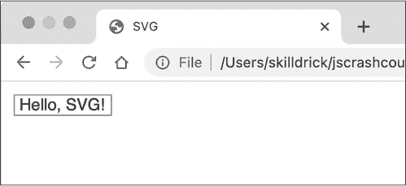

Figure 14-1：我们的第一个 SVG 图

尝试放大页面（在 Windows 或 Linux 上使用 CTRL-+，在 macOS 上使用 COMMAND-+）。即使放大图像，矩形和文本也应该保持清晰。

### 元素分组

你可以通过将多个 SVG 元素嵌套在一个 `g`（代表 group）元素内部来分组。这很有用，因为设置在 `g` 元素本身上的任何属性都适用于所有的子元素。为了演示这一点，请按照[Listing 14-3]所示更新你的 `svg` 元素的内容。

```
--snip--

<svg width="600" height="600">

❶ <g font-family="sans-serif" fill="blue">

    <text x="0" y="20">Always</text>

    <text x="0" y="40">Be</text>

    <text x="0" y="60">Coding</text>

  </g>

</svg>

--snip--
```

Listing 14-3：使用 `g` 元素分组

在此示例中，我们创建了一个包含三个文本元素的组，每个元素一个单词。元素具有相同的 x 坐标但不同的 y 坐标，因此单词将垂直堆叠。父元素 `g` 的属性（`font-family` 和 `fill`）适用于所有子元素。刷新页面，你应该看到所有单词都是蓝色的无衬线字体。

使用 `g` 元素创建分组允许你对组内所有元素应用`变换`。SVG 支持多种变换，包括平移、旋转、缩放和倾斜。我们将使用 `translate` 按固定量移动所有元素。通过对起始 `g` 标签进行以下更改更新 `index.html`：

```
--snip--

  <g transform="translate(100, 50)" font-family="sans-serif" fill="blue">

--snip--
```

`transform` 属性接受多个变换，用空格分隔。在这里我们传递了单个变换：`translate(100, 50)`。这意味着将组中的所有元素沿 x 轴移动 100 像素，沿 y 轴向下 50 像素。

我们还可以在 `translate` 变换之后添加 `scale` 变换来调整组的大小：

```
--snip--

  <g transform="translate(100, 50) scale(2, 3)" font-family="sans-serif" fill="blue">

--snip--
```

平移之后，元素现在水平方向缩放 2 倍，垂直方向缩放 3 倍，如[Figure 14-2]所示。

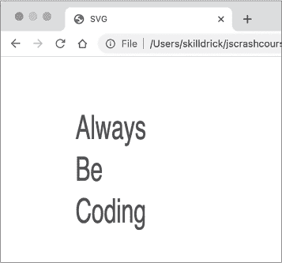

Figure 14-2：对分组元素的变换

所有的变换都相对于原点 (0, 0)，除非之前的平移移动了原点。这意味着缩放会影响元素的位置，也会影响它们的尺寸。例如，当你缩放一个左上角为 (10, 10)、右下角为 (30, 30) 的正方形 2 倍时，新的角点将位于 (20, 20) 和 (60, 60)。相对于原点的 x 和 y 坐标都翻了一倍。

### 绘制圆形

你可以使用 `circle` 元素绘制 SVG 圆形。属性 `cx` 和 `cy` 设置圆心的中心坐标，而 `r` 设置半径。要尝试一下，请将 `svg` 元素的内容替换为代码列表 14-4 中的代码。

```
--snip--

<svg width="600" height="600">

❶ <circle fill="#faa0a0" r="100" cx="124" cy="130"></circle>

❷ <g stroke="#944e30" stroke-width="3">

    <rect width="8" height="100" x="120" y="90" fill="#e1704d"></rect>

    <circle fill="#acd270" r="18" cx="124" cy="150"></circle>

    <circle fill="#fdfce2" r="18" cx="124" cy="120"></circle>

    <circle fill="#f8c9dc" r="18" cx="124" cy="90"></circle>

  </g>

</svg>

--snip--
```

<samp class="SANS_Futura_Std_Book_Oblique_I_11">代码列表 14-4：绘制圆形</samp>

在这个示例中，我们使用了新的 `circle` 元素，以及 `g` 和 `rect` 元器。第一个圆形 ❶ 的填充颜色为 `#faa0a0`（三文肉粉），半径为 100 像素，中心坐标为 (124, 130)。注意，我们在这里使用了十六进制颜色——请查看下一页的“十六进制颜色”框以获取更多信息。接下来，我们使用一个组 ❷ 为矩形和三个较小的圆形应用标准的边框颜色（栗子色）和宽度（3 像素），它们的填充颜色分别为绿色、黄色和玫瑰色。所有这些效果共同构成了一幅日本樱花团子（hanami dango，一种在日本樱樱花季节流行的甜点）的可爱插图，如图图 14-3 所示。

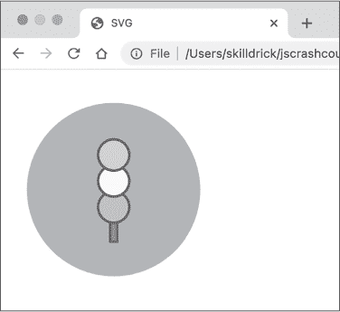

<samp class="SANS_Futura_Std_Book_Oblique_I_11">图 14-3：使用 SVG 圆形绘制樱花团子的插图</samp>

注意元素声明的顺序决定了它们的绘制顺序。三个小圆是从下到上声明的，因此在重叠的地方，上方的圆形显示在顶部。同样，由于大圆先声明的，它被视为插图其余部分的背景。

### 定义路径

`path` 元素是所有 SVG 元素中最强大的，它允许你通过在不同点之间绘制直线或曲线（即“路径”）来创建自定�形状。`path` 元素的 `d` 属性（data 的缩写）是一个包含路径定义的字符串，该字符串是路径命令列表。此字符串的语法经过优化，尽可能紧凑，因此可以使用较短的字符串表示复杂的路径。这对于计算机来说是有利的，但对人类来说并不友好；不要期望这些字符串是易读的。

在下一个示例中，我们将使用 `path` 元素重新创建 HTML5 标志，从外层盾牌形状开始。将 `index.html` 中 `svg` 元素的内容替换为代码列表 14-5 中的代码。

```
--snip--

<svg width="600" height="600">

  <path fill="#e44d26" d="M 0 0 H 182 L 165 185 L 90 206 L 17 185 Z"/>

  <path fill="#f16529" d="M 91 15 H 165 L 151 173 L 91 190 Z"/>

</svg>

--snip--
```

<samp class="SANS_Futura_Std_Book_Oblique_I_11">代码列表 14-5：绘制 HTML5 标志盾牌</samp>

在我们深入研究路径定义之前，如果知道结果应该是什么样会有帮助。刷新页面，你应该能看到图 14-4 所示的盾牌设计。

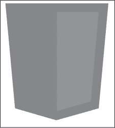

<samp class="SANS_Futura_Std_Book_Oblique_I_11">图 14-4：HTML5 标志盾牌</samp>

此设计由两个路径组成，一个用于深色的主盾牌形状，另一个用于盾牌形状右半部分较浅的高亮部分。让我们来看深色部分的路径定义：

```

M 0 0 H 182 L 165 185 L 90 206 L 17 185 Z

```

这里有六条指令：

* `M 0 0`
* `H 182`
* `L 165 185`
* `L 90 206`
* `L 17 185`
* `Z`

将这些命令想象成在屏幕上移动虚拟画笔：`M 0 0` 移动到 (0,0)；`H 182` 水平移动到 182；`L 165 185` 连到 (165, 185)；`L 90 206` 连到 (90, 206)；`L 17 185` 连到 (17, 185)；`Z` 结束路径。`M` 命令接收一个 (x, y) 坐标对但不绘制任何内容。`H` 命令接收一个 x 坐标并从当前位置画一条水平线。`L` 命令接收一个 (x, y) 坐标对并从当前位置画到该位置。最后，`Z` 命令关闭路径，将画笔回到起点。在英语中，这些命令的意思是：“移动到 (0,0)，画一条水平线到 182，连到 (165,185)，连到 (90,206)，连到 (17,185)，然后关闭路径”。

由于我们可以使用相对坐标，`path` 元素也可以相对于当前位置进行绘制。例如，使用小写字符 `m`、`h`、`l` 表示相对于当前位置的移动或绘制。而大写字母 `M`、`H`、`L` 则使用绝对坐标。事实上，这个路径定义可以写得更紧凑：

```

m0 0h182l-17 185l-75 21l-73

```

空格是为了避免歧义，但在其他情况下是可选的。得益于负数，我们能够移除大部分数字。此外，如果连续多次使用相同的命令，可以只包含一次。例如，`l-17 185-75 21` 是 `l` 的紧凑版本。**注意**：[SvgEditor](https://yqnn.io/svg-editor) 是一个非常有用的工具，用于实验路径以及转换绝对和相对命令。将这些命令想象成在屏幕上移动虚拟画笔：`m` 命令接收一个 (x, y) 坐标对但不绘制任何内容。`h` 命令接收一个 x 坐标并从当前位置画一条水平线。`l` 命令接收一个 (x, y) 坐标对并从当前位置画到该位置。最后，`z` 命令关闭路径，将画笔回到起点。在英语中，这些命令的意思是：“移动到 (0,0)，向右画线 182 单位，连到 (-17,185)，连到 (-75,21)，然后关闭路径”。SVG 还有几个额外的路径命令，主要用于绘制各种曲线。我们在这里不深入介绍，但你可以在 MDN 上找到完整列表：[developer.mozilla.org/SVG](https://developer.mozilla.org/SVG)。

现在你理解了路径的工作原理，我们可以添加更多路径来填充 HTML5 标志的剩余部分。按照代码列表 14-6 所示更新 `svg` 元素的内容（如果你觉得这太复杂，我也不会因此怪你）。

```
--snip--

<svg width="600" height="600">

  <path fill="#e44d26" d="M 0 0 H 182 L 165 185 L 90 206 L 17 185 Z"/>

  <path fill="#f16529" d="M 91 15 H 165 L 151 173 L 91 190 Z"/>

  <path fill="#ebebeb" d="m 34 38 h 57 v 23 h-32 l 2 24 h 30 v 23 h-51 z"/>

  <path fill="#ebebeb" d="m 41 118 h 23 l 2 18 l 25 7 v 24 l-47 -13 z"/>

  <path fill="#fff" d="m 148 38 h-57 v 23 h 55 z"/>

  <path fill="#fff" d="m 143 85 h-52 v 23 h 28 l-3 30 l-25 5 v 24 l 47 -13 z"/>

</svg>

--snip--
```

我在这里使用相对路径命令，部分是为了增加多样性，部分是因为相对数字较小，可以使代码行变得更短。当你重新加载页面时，你应该能看到完整的 HTML5 标志，如图 14-5 所示。填充颜色为 `#ebebeb`（浅灰色）的两个路径绘制了数字“5”左侧两个部分，而填充颜色为 `#fff`（白色）的两个路径绘制了数字“5”右侧两个部分。

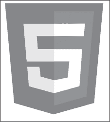

<samp class="SANS_Futura_Std_Book_Oblique_I_11">图 14-5：完整的 HTML5 标志</samp>

通常情况下，你在创建数据可视化图形时，不需要手动编写自己的路径定义。D3 会为你创建它们。尽管如此，理解这些语法是有帮助的，这样当你调试时，就能看出发生了什么。

### 使用 CSS 为元素设置样式

当你将 SVG 嵌入到 HTML 文件中时，每个 SVG 元素都会成为 DOM 的一部分，因此可以使用 CSS 进行样式设置。为了了解它的工作原理，我们将绘制一些 SVG 形状并为它们都分配类名。将 svg 元素的内容替换为列表 14-7 中的代码。

```
--snip--

<svg width="600" height="600">

  <circle class="boring" r="40" cx="50" cy="50"></circle>

  <rect class="boring" x="120" y="10" width="80" height="80"></rect>

  <path class="boring" d="M 230 90 l 40 -80 l 40 80 z"></path>"

  <circle class="fun" r="40" cx="50" cy="180"></circle>

  <rect class="fun" x="120" y="140" width="80" height="80"></rect>

  <path class="fun" d="M 230 220 l 40 -80 l 40 80 z"></path>"

</svg>

--snip--
```

<samp class="SANS_Futura_Std_Book_Oblique_I_11">列表 14-7：带有类名的某些 SVG 元素</samp>

在这里我们绘制了一个圆、一个正方形和一个三角形，然后是另一个圆、正方形和三角形。注意三角形是用路径（paths）绘制的——没有像 `rect` 或 `circle` 那样专门的三角形元素。前三个形状的类名为 `boring`，后三个的类名为 `fun`。当你重新加载页面时，你应该看到两行每行三个形状，它们都具有相同的默认黑色填充色，如图 14-6 所示。

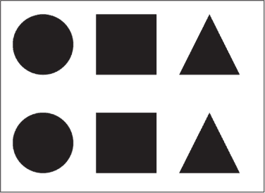

<samp class="SANS_Futura_Std_Book_Oblique_I_11">图 14-6：没有样式的 SVG 形状</samp>

现在我们将为这些形状设置样式。因为它们都有类名，所以我们可以在 CSS 中选择它们，就像我们选择 HTML 元素一样。将列表 14-8 中的代码添加到你的 `style.css` 文件中。

```
.boring {

  fill: none;

  stroke: black;

  stroke-width: 3px;

}

.fun {

  fill: hotpink;

  stroke: greenyellow;

  stroke-width: 5px;

  stroke-dasharray: 10,5;

  stroke-linejoin: round;

}

```

<samp class="SANS_Futura_Std_Book_Oblique_I_11">列表 14-8：形状的样式</samp>

在这个列表中，我们为类设置了不同的样式：`.boring` 获得黑色边框，而 `.fun` 获得粉红色填充。注意 SVG 元素的属性名与 HTML 元素不同。例如，HTML 元素使用 `background-color`，而 SVG 元素使用 `fill` 和 `stroke`。

使用 CSS 的优势有两点：首先，样式信息集中在一个地方，因此它们是易于的；其次，你只需要更改一个定义，就可以更改所有使用该类的元素的样式。当你重新加载页面时，你会看到形状现在具有不同的样式，如图 14-7 所示。

还可以通过伪类如 `:hover` 为 SVG 元素设置悬停效果。将列表 14-9 中的代码添加到 `style.css` 的末尾来尝试一下。

```
--snip--

.fun:hover {

  fill: greenyellow;

  stroke: hotpink;

}

```

<samp class="SANS_Futura_Std_Book_Oblique_I_11">列表 14-9：悬停效果</samp>

在这里，当鼠标悬停在元素上时切换填充颜色和边框颜色。这是使用 SVG 相比 Canvas 的巨大优势之一：浏览器知道鼠标悬停在哪些元素上。

### 使用 JavaScript 添加交互性

我们可以使用 JavaScript 为我们的 SVG 元素添加交互性，就像可以使用 CSS 设置它们的样式一样。再次，这是因为每个 SVG 元素都是 DOM 的一部分。首先，我们将编写一个选择元素并将它们打印到控制台的脚本。将列表 14-10 中的代码添加到 `style.css`。

```javascript

document.querySelectorAll(".fun").forEach(element => {

  console.log(element);

});

```

<samp class="SANS_Futura_Std_Book_Oblique_I_11">列表 14-10：选择元素</samp>

在这个列表中，我们使用 `querySelectorAll` 方法选择所有类名为 `fun` 的元素。然后我们使用 `forEach` 方法遍历元素并将它们打印到控制台。当你运行这段代码时，你应该会在控制台中看到这些元素。

```javascript

document.querySelectorAll(".fun").forEach(element => {

  element.setAttribute("data-offset", 0);

  element.addEventListener("click", event => {

    let offset = Number(event.target.getAttribute("data-offset"));

    if (event.shiftKey) {

      offset -= 5;

    } else {

      offset += 5;

    }

    event.target.setAttribute("data-offset", offset);

    event.target.setAttribute("transform", `translate(${offset}, 0)`);

  });

});

```

<samp class="SANS_Futura_Std_Book_Oblique_I_11">列表 14-11：点击移动 SVG 元素</samp>

我们使用事件上的 `shiftKey` 属性来判断在点击鼠标时是否按下了 `SHIFT` 键。如果是，我们就从 `offset` 中减 5；否则，我们就给 `offset` 加 5。然后，我们使用 `setAttribute` ❹ 将更新后的值赋值给 `data-offset` 属性。最后，我们再次使用 `setAttribute` 方法，但这次是为了设置 `transform` SVG 属性 ❺。正如你在本章早期看到的，我们可以使用字符串 `translate(x, y)` 通过 `transform` 将元素平移一段距离。在这里，我们将平移的 `x` 值设置为 `offset` 的值，将平移的 `y` 值设置为 `0`。这意味着如果 `offset` 是正值，元素将向右移动；如果是负值，元素将向左移动。

当你重新加载页面时，那些彩色的 SVG 元素现在应该会在点击它们时移动。如果你右键点击其中一个元素并选择“检查”，你会在 `Elements` 面板中看到该元素。当你点击浏览器视口中不同的元素时，你应该看到 `Elements` 面板中的 `data-offset` 和 `transform` 属性发生更新。

### D3 库

现在你已经了解了 SVG 的基础知识，可以开始学习 D3 库，它利用 SVG 和 JavaScript 来创建数据可视化。`D3` 是 `Data-Driven Documents`（数据驱动文档）的缩写，让你能够创建内容由数据驱动的文档。它通过被称为“数据绑定”（data binding）的技术，将你想可视化的底层数据的各个部分与页面上的单个元素关联。这样，如果数据发生变化，元素也会随之变化。你将在本节后续部分看到它是如何工作的。

### 设置

我们将创建一组新文件来探索 D3。创建一个名为 `data` 的新目录，包含一个空的 `script.js` 文件和一个包含 Listing 14-12 中内容的 `index.html` 文件。

```
<!DOCTYPE html>

<html>

  <head>

    <title>Data</title>

  </head>

  <body>

  ❶ <svg width="600" height="600">

      <circle cx="50" cy="50" r="10"></circle>

      <circle cx="100" cy="50" r="10"></circle>

      <circle cx="150" cy="50" r="10"></circle>

    </svg>

  ❷ <script src="https://unpkg.com/d3@7.4.4/dist/d3.js"></script>

    <script src="script.js"></script>

  </body>

</html>
```

Listing 14-12: 用于处理 D3 的新 index.html

首先我们创建一个 `svg` 元素 ❶ 并画三个圆。然后我们使用 `script` 元素链接到托管在 `https://unpkg.com` 的 D3 库副本 ❷，就像我们在音乐项目中使用 Tone.js 所做的那样。现在，你可以在 `script.js` 文件中使用来自 D3 的代码了。当你加载页面时，你应该看到三个黑圆。很快，我们将用 D3 来操控这些圆。

### 选择

D3 的基本构建块之一是“选择”（selection），这是一种选取一组元素的方法，以便你对这些元素应用某些操作。让我们使用 D3 选择这三个 SVG 圆并将它们的填充颜色改为亮粉色（hot pink）。将 Listing 14-13 中的代码添加到 `script.js` 中。

```
d3.selectAll("circle").attr("fill", "hotpink");
```

Listing 14-13: 选择圆

`d3.selectAll` 方法接收一个 CSS 选择器（在本例中为元素名 `circle`），并返回 D3 选择，你可以在其上链式调用更多方法。这些链式方法调用将应用于所有匹配选择器的元素。在这里，我们将选择中每个元素的 `fill` 属性都设置为 `hotpink`。当你重新加载页面时，你应该看到那些黑圆现在变成了粉色。

在更新选择集中的元素时，也可以使用函数而不是值。当你这样做时，函数会被调用，其返回值将作为更新这些元素时的值。这赋予了你动态修改元素的能力。使用 Listing 14-14 中的更改更新 `script.js` 代码以查看它是如何工作的。

```
d3

  .selectAll("circle")

  .attr("fill", "hotpink")

❶ .attr("r", (d, i) => 10 + i * 5);
```

Listing 14-14: 使用函数计算值

对于像这样长的方法链，通常会将代码拆分成多行以提高可读性。与之前一样，我们正在选择所有的圆并将填充颜色设置为亮粉色，但这次我们还更新了每个圆的半径 ❶。此处用于生成值的函数有两个参数：`d` 和 `i`。我们将在下一节介绍 `d` 参数（它是 `datum` 的缩写）。`i` 是 `index` 的缩写，是元素在选择集中的索引（第一个圆的索引为 0，第二个为 1，依此类推）。我们使用代码 `10 + i * 5` 根据它们的索引数字给每个圆一个不同的半径。具体来说，这些圆的半径分别为 10、15 和 20。当你重新加载页面时，你应该看到这三个圆的大小现在都不相同了。

> 注意：D3 选择修改方法（如 `.attr`）返回选择集本身。这让我们能够继续链式调用修改方法，就像我们在 Listing 14-14 中两次调用 `.attr` 一样。

如果你想选择单个元素而不是一组，请使用 `d3.select` 方法代替 `d3.selectAll`。例如，要在 HTML 的 `body` 元素中插入一个 `h1` 元素，你可以将 Listing 14-15 中的代码添加到 `script.js` 文件的末尾。

```
--snip--

d3

  .select("body")

  .insert("h1", "svg")

  .text("Hello, D3!");

```

Listing 14-15: 使用 select 选择单个元素

在这个示例中，我们首先选择 `body` 元素。然后该选择上调用 `insert`，传递两个参数 `"h1"` 和 `"svg"`。第一个参数是要插入的元素类型，第二个参数是要插入在其之前的元素。`insert` 方法返回一个包含插入元素的新选择，而 `text` 方法向该选择中的元素添加文本内容（在本例中，即单个 `h1` 元素）。当你重新加载页面时，你应该会在 SVG 元素上方看到一个文本为“Hello, D3!”的标题。这个示例也说明了 D3 选择可以同时应用于 HTML 和 SVG 元素。

### 数据绑定

D3 最重要的特性或许是它的数据绑定概念。在基于 D3 的应用程序中，你会有一些尝试可视化的数据。每一条单独的数据（称为 datum）都将绑定到页面上的单个元素（通常是 SVG 元素）。你使用 `datum` 来设置所绑定元素的某些属性，以便元素在视觉上反映 `datum`。

首先，我们将查看如何将数据绑定到现有的 SVG 元素。保留 `index.html` 中的圆，并将 `script.js` 的内容替换为 Listing 14-16 中的代码。

```
let numbers = [3, 2, 1];

d3

  .selectAll("circle")

❶ .data(numbers)

  .attr("r", (d, i) => d * 5);
```

Listing 14-16: 将数据绑定到我们的圆

我们首先创建一个数字数组作为数据。然后，我们创建所有圆形元素的集合。`data` 方法 ❶ 将数字数组逐个绑定到圆形集合上，因此第一个圆形元素绑定了值 3，第二个绑定了 2，第三个绑定了 1。最后，我们使用 `attr` 方法根据绑定的数据将每个圆形的半径设置为一个计算出的值。正如你在上一节中看到的，如果你使用函数而不是值来设置属性，则会调用该函数来计算集合中每个元素的值。函数的 `d` 参数对应绑定到当前元素的数据。

当你重新加载页面时，你应该能看到三个从左到右逐渐变小的黑圆。为了确认一切运行正常，请右键点击第一个圆圈并选择 `Inspect`（检查），以在 Elements（元素）面板中显示该元素。你应该会看到它的 `r` 属性被设置为 15，这正是我们预期的 `d * 5` 的结果，其中 `d` 为 3。

使用“检查”工具也可以直接查看元素上设置的数据，这对于调试非常有帮助，特别是当你的数据比简单的数字复杂时。你只需要获取元素的引用，这可以通过 Chrome 控制台轻松获得。再次，右键点击第一个圆圈并选择 `Inspect`。你会看到类似图 14-8 的内容。

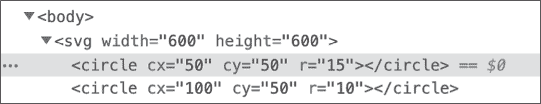

图 14-8：在 Elements 面板中选择圆形元素

在所选行的末尾，你应该看到文本 `== $0`。这表示圆形元素的引用存储在名为 `$0` 的全局变量下。要验证这一点，请打开 JavaScript 控制台并输入 `$0`：

```
$0

<circle cx="50" cy="50" r="15"></circle>
```

控制台打印了你选择的圆形元素，表明 `$0` 确实是该元素的引用。现在你已经有了该引用，可以使用 `__data__` 属性查看绑定在上面的数据：

```
$0.__data__

3
```

这告诉你该圆形绑定了值 3，即我们数组中的第一个数字，正如我们预期的那样。`$0` 始终引用当前选中的元素，所以如果你右键检查另一个圆圈，再次在控制台输入 `$0.__data__` 将得到绑定到另一个圆圈的数据。

### 数据连接 (Data Joins)

你并不总是确切知道数据有多长，因此很难始终准备好数量完全正确的 SVG 元素来绑定你的数据。D3 通过 `joins` 概念解决了这个问题。在 D3 中，你使用连接来添加或删除必要的元素以匹配正在绑定的数据。

我们可以通过连接扩展列表 14-16 中的示例，这样就可以根据数字数组的长度按需要添加或移除 SVG 圆形元素。如列表 14-17 所示所示更新 `script.js` 文件。

```
❶ let numbers = [3, 2, 1, 2, 3];

d3

❷ .select("svg")

  .selectAll("circle")

  .data(numbers)

❸ .join("circle")

  .attr("r", (d, i) => d * 5);
```

列表 14-17：连接额外的元素

在这里我们创建了一个更长的数字数组 ❶。我们还添加了一行，在选择其中的圆形元素之前先选择 svg 元素 ❷。这是必要的，因为 D3 需要添加新的圆形元素，并且它需要知道将它们添加到哪个容器元素中。最后，我们添加了对 `join` 方法的调用 ❸。该方法接收集合中的元素名称，以添加或移除匹配数据。在这种情况下，我们的意思是如果 svg 元素中的圆形元素不足以包含数据中的所有项，那么 D3 应该添加更多（反之，如果太多了，D3 应该移除一些）。

如果你重新加载页面，你会发现这似乎并不完全如你预期的那样。新圆形都出现在绘图区域的左上角。这是因为这些新圆形与 `index.html` 中定义的初始三个圆不同，它们没有设置 `cx` 或 `cy` 属性。要修复这个问题，我们需要使用 D3 设置这两个属性，如列表 14-18 所示。

```
let numbers = [3, 2, 1, 2, 3];

d3

  .select("svg")

  .selectAll("circle")

  .data(numbers)

  .join("circle")

  .attr("cx", (d, i) => (i + 1) * 50)

  .attr("cy", 50)

  .attr("r", (d, i) => d * 5);
```

列表 14-18：设置 cx 和 cy 属性

`cx` 属性基于数据的索引。第一个元素应该在 50 位置，第二个在 100 位置，以此此类推。计算式 `(i + 1) * 50` 为我们提供了正确的值。由于圆排成一行，所以 `cy` 属性只是一个常量。现在当你重新加载页面时，你应该看到五个排成一行的圆。

> **注意**：如之前所述，你可以使用相同的连接技术在元素过多时移除它们。如果你将数字数组更改为只包含两个元素并重新加载页面，你只会看到两个圆。

既然我们现在使用 D3 的 `join` 方法根据数据需要创建新的 SVG 元素，就没有理由在 HTML 文件中创建它们了。如列表 14-19 所示修改 `index.html`，移除所有圆形元素，然后重新加载页面。

```html

--snip--

  <body>

    <svg width="600" height="600"></svg>

    <script src="https://unpkg.com/d3@7.4.4/dist/d3.js"></script>

    <script src="script.js"></script>

  </body>

```

列表 14-19：移除圆形元素

此时一切应该仍然可以正常工作，因为 `join` 方法会添加所需的所有圆形元素。注意 `script.js` 中仍然需要 `.selectAll("circle")` 行，即使第一次调用时没有元素可供选择。

### 更新 (Real-Time Updates)

如果底层数据发生变化，我们需要再次执行连接以更新可视化。为了实现这一点，我们将数据和连接代码移动。我们可以通过在页面上添加一些按钮来向 `numbers` 数组的开头或结尾添加随机值，或者从数组中删除数字。如列表 14-20 所示更新 `index.html`。

```html

--snip--

  <body>

    <div>

      <button id="prepend">Prepend</button>

      <button id="append">Append</button>

      <button id="drop">Drop</button>

    </div>

    <svg width="600" height="600"></svg>

--snip--
```

列表 14-20：在 index.html 中添加按钮

刷新页面，你应该会在顶部看到三个按钮。接下来，我们将更新可视化的代码移动到一个单独函数中。用列表 14-21 中的内容替换 `script.js` 中的代码。

```javascript

let numbers = [3, 2, 1];

❶ function update(data) {

  d3

    .select("svg")

    .selectAll("circle")

❷ .data(data)

    .join("circle")

    .attr("cx", (d, i) => (i + 1) * 50)

    .attr("cy", 50)

    .attr("r", (d, i) => d * 5);

}

❸ update(numbers);
```

列表 14-21：将更新代码移动到单独函数

这里没有功能上的变化——我们只是创建了一个更新函数来为我们处理 SVG 更新 ❶，然后调用它 ❸。注意我们将函数参数 `data` 传递给 `.data` 方法 ❷，而不是直接传递 `numbers` 数组。

接下来，我们将添加处理按钮点击的代码，这段代码会将一个 1 到 5 之间的随机浮点数插入到 `numbers` 数组的开头或结尾，或者删除数组中的最后一个元素。将列表 14-22 中的代码添加到 `script.js` 的末尾。

```
--snip--

update(numbers);

❶ function getRandomNumber() {

  return 1 + Math.random() * 4;

}

❷ d3.select("#append").on("click", () => {

  numbers.push(getRandomNumber());

  update(numbers);

});

❸ d3.select("#prepend").on("click", () => {

  numbers.unshift(getRandomNumber());

  update(numbers);

});

❹ d3.select("#drop").on("click", () => {

  numbers.pop();


update(numbers);

});

```

列表 14-22：点击按钮时更新

首先，我们声明了一个用于生成随机数的辅助函数 ❶，因为我们在两个地方需要此操作。然后，我们声明了三个按钮的处理器。注意，我们没有像在书中之前的那样使用普通的 DOM API 方法来添加点击处理程序，而是使用 `d3.select` 来选择按钮，并使用 `on` 方法来添加事件处理器。普通的 DOM API 方法同样有效，但使用 D3 方法更加简洁，并且与文件中其他的 D3 代码保持风格一致。

第一个处理器由点击 Append 按钮触发 ❷：它将一个随机数推（push）到 `numbers` 数组的末尾，然后我们调用 `update` 函数重新绘制可视化图形，增加一个圆圈。第二个处理器由点击 Prepend 按钮触发，它将一个随机数移（unshift）到 `numbers` 数组的前端 ❸。第三个由点击 Drop 按钮触发；它从数组中弹出（pop）最后一个数字 ❹。在执行完这些操作后，我们都调用了 `update` 函数。

刷新页面并尝试不同的按钮。你应该看到元素根据需要被添加或移除。

### 过渡与关键函数

与其在每次数据变化时突然地更新 D3 可视化图形，你可以使用*过渡（transitions）*来允许元素在属性改变时执行动画效果。过渡是 D3 中一个非常有用的功能，因为如果处理得当，它们能让你看到数据是如何演变的。让我们给 `update` 函数添加一个过渡，来看看它是如何工作的。按照列表 14-23 所示所示进行更改。

```

--snip--

function update(data) {

  d3

    .select("svg")

    .selectAll("circle")

    .data(data)

    .join("circle")

    .transition()

    .duration(500)

    .attr("cx", (d, i) => (i + 1) * 50)

    .attr("cy", 50)

    .attr("r", (d, i) => d * 5);

}

--snip--

```

列表 14-23：添加过渡

在这样的链式调用中使用 `transition` 方法意味着后续每一个属性变化将从当前值动画到新值。`duration` 方法设置以毫秒为单位的动画长度。这意味着每个圆圈的位置和半径将花费半秒（500 毫秒）从当前值动画到新值。新圆圈的每个属性都从默认值 0 开始，因此它们将从 SVG 的左上角过渡进入。

遗憾的是，按照我们编写 `update` 函数的方式，动画效果可能不会像你预期的那样完美。刷新页面并点击几次 **Prepend**。你应该看到一些奇怪的现象。


你可以通过传递三个函数来定制 `join` 方法，这三个函数会在这三种可能的元素变化中的每一种被调用一次。通过这种方式，你可以指定三种不同的行为：一种用于进入元素，一种用于正在更新的元素，另一种用于退出的元素。要测试此功能，请如列表 14-25 所示修改你的更新函数。首先，这些更改产生的结果与我们在上一个列表中通过简单 join 方法获得相同。

```

--snip--

  .data(data, d => d)

  .join(

    enter => enter.append("circle"),

    update => update,

    exit => exit.remove()

  )

  .transition()

--snip--

```
列表 14-25：带有 enter、update 和 exit 函数的 join 方法。

这个更高级的 `join` 方法版本接收三个函数。第一个函数带有一个名为 `enter` 的单一参数，它是每个新进入元素的临时占位符的选取集。为了获得与简单的 `.join("circle")` 版本相同的行为，我们只需使用 `append` 方法为每个 `enter` 占位符添加一个圆。注意，`enter` 占位符本身并不是 DOM 中的元素。它们只是 D3 提供的一个句柄，以便在它们被添加到 DOM 之前提供添加新进入元素的地方。例如，如果有五个新元素需要进入，`enter.append("circle")` 将创建五个新的圆元素并将它们放置在 `svg` 元素内部。

第二个函数带有一个名为 `update` 的单一参数，它是包含所有已绑定到数据的现有元素的选取集。为了获得与之前相同的行为，我们只需原样返回该选取集。

第三个函数带有一个名为 `exit` 的单一参数，它是包含所有不再具有相应数据而应该移除的元素的选取集。为了获得与之前相同的行为，我们在选取集上调用 `remove` 方法，这将从 DOM 中移除每个退出的元素。

当你重新加载页面时，你应该看到与之前相同的行为；到目前为止，此更改没有任何任何功能上的影响。不过，既然我们已经让它运行起来，就可以改进动画以添加一些精致感。目前更新选取集中元素的向右移动动画是没问题的，但进入的元素目前从左上角飞入，而退出的元素直接消失了。让我们让进入的元素从它们的正确位置生长到到位，而退出的元素在当前位置收缩至消失。实现该行为的更改如列表 14-26 所示。

```

--snip--

function update(data) {

  d3

    .select("svg")

    .selectAll("circle")

    .data(data, d => d)

    .join(

      enter => enter

      ❶ .append("circle")

        .attr("cx", (d, i) => (i + 1) * 50)

        .attr("cy", 50)

        .transition()

        .duration(500)

      ❷ .attr("r", (d, i) => d * 5),

      update => update

        .transition()

        .duration(500)

      ❸ .attr("cx", (d, i) => (i + 1) * 50),

      exit => exit

        .transition()

        .duration(500)

      ❹ .attr("r", 0)

      ❺ .remove()

    );

}

update(numbers); 

--snip--

```
列表 14-26：精修动画。

在更新后的代码中，我们将所有过渡移动到了单独的 `enter`、`update` 和 `exit` 函数中，而不是为所有元素使用单个过渡调用。`enter` 函数添加一个圆元素 ❶，然后立即设置其位置（`cx` 和 `cy` 属性），但没有设置它的半径。一旦设置了位置，我们就使用 `transition` 方法将半径从零（默认值）动画到从数据计算出的值 ❷。这里的顺序很重要：链式调用中在调用 `transition` *之前*的任何内容都将立即发生，而在调用 `transition` *之后*的任何内容都将产生动画效果。这意味着任何新圆都将立即出现在正确的位置，而尺寸的变化（从零到所需的半径）将执行动画。这比之前的版本看起来可能更自然，在之前的版本中，所有三个属性都从零开始动画化，导致圆从角落飞入。

`update` 函数必须只对圆的 `cx` 属性进行动画处理 ❸，将其滑动到更新后的位置。对于现有元素，所有其他属性应保持不变。最后，`exit` 函数在移除元素 ❺ 之前将圆的半径动画化回零 ❹。如果在调用 `transition` 之后调用 `remove`（在此处所示），实际的元素移除将在动画完成后才会发生。

当你重新加载页面时，你应该看到新的且改进的动画：新元素在适当的位置展开，被移除的元素收缩消失。

### 创建条形图

现在你已经学习了 D3 的基础知识，让我们把它们应用到一个小型项目中：创建一个可视化文本框中字符频率的条形图。当有新文本输入或粘贴到框中时，该条形图将随之更新。创建此可视化工具将让你练习数据连接，教你一些新技术（如绘制坐标轴为数据提供上下文），并为下一章更重大的项目做好准备。

### 设置

要开始，创建一个名为 `frequency` 的新目录，并添加空的 `script.js` 和 `style.css` 文件。然后创建一个 `index.html` 文件，并将列表 14-27 中的代码加入。

```html

<!DOCTYPE html>

<html>

  <head>

    <title>Character Frequency</title>

    <link rel="stylesheet" href="style.css">

  </head>

  <body>

    <div>

    ❶ <textarea rows="5" cols="70"></textarea>

    </div>

    <script src="https://unpkg.com/d3@7.4.4/dist/d3.js"></script>

    <script src="script.js"></script>

  </body>

</html>

```
列表 14-27：用于字符频率项目的 index.html 文件。

此 HTML 文档遵循了我们在一整本书中一直使用的模式。唯一新增的内容是 `textarea` 元素 ❶，它创建了一个多行文本输入。`rows` 和 `cols` 属性设置了文本区域的行数和宽度（以固定宽度字符为单位）。

注意，文档不包含 `svg` 元素。我们将使用 JavaScript 创建它。这是因为我们需要多次引用 `svg` 元素的宽度和高度，以确定可视化中元素的放置位置，因此在 JavaScript 中定义这些参数比在 HTML 文件中更有意义。而且既然我们将在 JavaScript 中定义宽度和高度，我们也可以在 JavaScript 中创建 `svg` 元素本身。我们现在就这么做。将列表 14-28 中的代码添加到 `script.js`。

```javascript

const width = 600;

const height = 600;

// 向页面添加 svg 元素

let svg = d3

  .select("body")

  .append("svg")

  .attr("width", width)

  .attr("height", height);

```
列表 14-28：使用 JavaScript 创建 svg 元素。

我们首先声明 `svg` 元素的 `width` 和 `height` 常量。然后我们使用 D3 选择 `body` 元素并为其添加一个 `svg` 元素，在此过程中设置 `width` 和 `height` 属性。我们将创建元素的结果保存到变量 `svg` 中，因为我们以后会需要它。

#### 计算字符频率


接下来，我们将添加从文本区域读取文本并统计每个字符出现次数的代码。这为可视化生成了底层数据。每当文本发生变化时，我们需要更新数据并重绘图表。不过，目前我们只需要读取文本，计算字符频率，并将输出记录到控制台。请将 列表 14-29 中的代码代码添加到 `script.js` 的末尾。

```javascript

--snip--

d3.select("textarea").on(❶ "input", e => {

❷ let frequencies = {};

❸ e.target.value.split(" ").forEach(char => {

    let currentCount = frequencies[char] || 0;

    frequencies[char] = currentCount + 1;

  });

  console.log(frequencies);

});

```

**列表 14-29：计算字符频率**

`input` 事件 ❶ 在文本区域的内容发生变化时随时触发，无论是通过输入、删除、粘贴还是其他操作。我们在事件处理函数中做的第一件事是初始化一个新对象来跟踪字符频率 ❷。这个 `frequencies` 对象将使用字符作为键，并将该字符出现的次数作为值。然后，我们获取事件的目标（文本区域），获取其值（文本），并将其拆分为单个字符 ❸。对于每个字符，我们确定该字符的当前计数，如果尚未见过该字符，则默认为 0。然后我们将该计数加 1，并将新计数存回对象中。一旦完成了所有字符的计数，我们将 `frequencies` 对象打印到控制台，以便检查所有运行情况是否符合预期。请注意，我们每当文本变化时都会重新计算 `frequencies` 对象，而不是仅仅尝试跟踪添加或删除的字符。这使得处理一次性添加或删除多个字符的情况变得简单得多，例如当文本被粘贴到框中时。

加载页面，你应该能看到文本区域（`svg` 元素是不可见的，但如果你想检查它是否存在，可以在“元素”面板中看到它）。当你向文本区域输入文本时，你应该会在每次击键时看到控制台中都记录了对象，每次都包含文本区域中字符的频率。例如，如果你输入单词 *hello*，在输入完最后一个 *o* 后，你将得到这个对象：

```json

{"h": 1, "e": 1, "l": 2, "o": 1}

```

一个包含所有字符及其频率的单个对象对于记录到控制台效果良好，但我们使用 D3 渲染时，我们需要一个对象数组，每个对象描述单个字符及其相关的频率。这样，数组中的每个条目将绑定到我们柱状图中每个条形的数据（datum）。为了让图表更易读，数组应该按字符的字母顺序排序。继续以单词 *hello* 为，而不是之前显示的对象，我们需要类似这样的内容：

```json

[

  {"char": "e", "count": 1},

  {"char": "h", "count": 1},

  {"char": "l", "count": 2},

  {"char": "o", "count": 1}

]

```

要将数据放入此数组格式，请按照 列表 14-30 所示修改 `script.js` 的末尾。

```javascript

--snip--

    frequencies[char] = currentCount + 1;

  });

❶ let data = Object.entries(frequencies).map(pair => {

    return {char: pair[0], count: pair[1]};

  });

❷ data.sort((a, b) => d3.ascending(a.char, b.char));

  console.log(data);

});

```

**列表 14-30：将频率数据转换为数组**

首先，我们使用 `Object.entries` 将 `frequencies` 对象转换为一个由双元素数组组成的数组 ❶，其中第一个元是键，第二个元素是值。我们将该数组映射为一个对象数组，其中键存储在属性 `char` 下，而值存储在属性 `count` 下。接下来，我们想要按字符对数据进行排序。`sort` 方法 ❷ 通过对每对元素 `a` 和 `b` 应用比较函数对数组中的元素进行排序，决定 `a` 应该排在 `b` 之后还是反之。这里我们使用 `d3.ascending` 比较函数，传递 `a.char` 和 `b.char`，这意味着数组将根据每个对象的 `char` 属性按字母升序排序。

重新加载页面，现在你应该能看到当文本区域中的文本变化时，这个新的数据数组会被记录。

### 绘制柱状图

现在我们已经有了所需格式的数据，可以将其渲染为柱状图。我们目前将从一个基础、原始的渲染开始，即简单的创建宽度与字符频率成比例的 `svg rect` 元素。我们将在此基础上逐步构建出一个包含更多信息的可视化结果。按照 列表 14-31 所示修改 `script.js`。

```javascript

--snip--

// 向页面添加一个 svg 元素

let svg = d3

  .select("body")

  .append("svg")

  .attr("width", width)

  .attr("height", height);

❶ function update(data) {

  svg

    .selectAll("rect")

    .data(data)

  ❷ .join("rect")

    .attr("width", (d, i) => d.count * 5)

    .attr("height", 10)

    .attr("x", 20)

    .attr("y", (d, i) => i * 20);

}

d3.select("textarea").on("input", e => {

--snip--

  data.sort((a, b) => d3.ascending(a.char, b.char));

❸ update(data);

});

```

**列表 14-31：定义更新函数**

我们在这里声明了一个 `update` 函数 ❶，它每当文本变化 ❸ 时就会被调用。该函数根据我们之前学习的将数据绑定到选择（使用 `data` 方法）并使用简单版本的 `join` 方法连接必要的元素的相同模式，来创建、更新或删除渲染数据所需的 SVG 元素。

`join` 方法返回一个包含所有当前 `rect` 元素的选择 ❷，包括任何刚添加的元素。每个 `rect` 现在都绑定到单个 `datum`，它代表单个字符和该字符出现的次数。我们设置合适的 `width`、`height`、`x` 和 `y` 属性来创建一个水平方向的柱状图。`width` 属性设置为字符计数的 5 倍，因此每个字符的每个实例都会让条形宽 5 像素。`height` 属性是一个常量值 10（所有条形高度相同），`x` 属性是一个常量值 20（所有条形从 `svg` 元素的左侧 20 像素处开始）。`y` 属性设置为 `datum` 索引的 20，这意味着每 20 像素有一个条形，每个条形之间留有 10 像素的空间。

重新加载页面并在文本区域中输入单词 *hello*。当你输入每个字母时，你应该看到条形在 `svg` 元素中出现或更新，最后结果类似于 图 14-9。

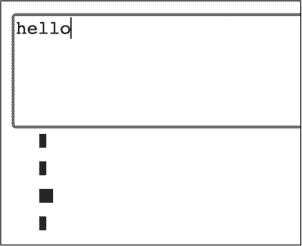

**图 14-9：基础柱状图**

到为止一切良好，但我们还有路路要走。这里有两个主要问题。首先，没有轴或标签，所以我们不知道每个条形代表哪个字符，也不知道条形的宽度对应什么。其次，条形的宽度和高度没有进行自动缩放，这意味着在条形无法放入 600×600 像素的 `svg` 元素之前，我们目前有 30 个不同字符和每个字符 116 次的计数限制。幸运的是，这两个问题都可以用 D3 轻松地解决。

### 缩放条形


D3 中的 `scale`（比例尺）是将某些数据值转换为视觉值的一种方法。例如，之前我们将字符频率图中条形形的宽度设置为数据值的五倍，这是缩放的一种简单形式。在这种情况下，我们手动设置了缩放因子，但 D3 也可以根据数据的最小值和最大值（称为 `domain`，域）以及显示的最小值和最大值（称为 `range`，范围）自动确定缩放。

例如，假设你正在绘制一张人体年龄图。你的数据值范围从 0 到 105，而渲染这些值的空间从 SVG 的左侧的 30 到 330 像素。你的 `domain` 是 `[0, 105]`，`range` 是 `[30, 330]`。数据域中的值 0 映射到视觉范围中的 30，而值 105 映射到 330。请参阅图 14-10 以查看此映射的视觉化表示。

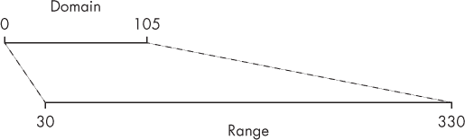

<samp class="SANS_Futura_Std_Book_Oblique_I_11">图 14-10: 将域 [0, 105] 的值缩放到范围 [30, 330]</samp>

D3 缩放的精妙之处在于，缩放因子可以根据 `domain` 的变化而动态改变。这样，即使最大数据值发生变化，当前的最大数据值也可以始终映射到整个视觉范围。为了为我们的条形图实现这种动态缩放，我们需要跟踪所有数据中的最大计数值，并将其用作 `domain` 的上边界。结果是，如果最大计数增加，未达到最大计数的条形都将相应缩小，而达到最大计数的条形将继续占据整个水平范围。例如，假设我们条形形的视觉范围为 `[0, 500]`，我们有以下数据：

```

[

  {"char": "a", "count": 1},

  {"char": "b", "count": 1},

  {"char": "c", "count": 2}

]

```

我们数据的 `domain` 将是 `[0, 2]`。"c" 条形宽为 500 个单位，而 "a" 和 "b" 条形每个宽 250 个单位。如果我们再添加两个 c，“c" 条形仍为 500 个单位宽，但现在 "a" 和 "b" 条形每个将变为 125 个单位宽。

现在让我们来实现这种动态水平缩放。请使用列表 14-32 所示的代码修改你的脚本。

```

--snip--

// 在页面上添加 svg 元素

let svg = d3

  .select("body")

  .append("svg")

  .attr("width", width)

  .attr("height", height);

let margin = {top: 20, right: 10, bottom: 20, left: 50};

function update(data) {

❶ let xScale = d3.scaleLinear()

    .domain([0, d3.max(data, d => d.count)])

    .range([margin.left, width - margin.right]);

  svg

    .selectAll("rect")

    .data(data)

    .join("rect")

  ❷ .attr("width", (d, i) => xScale(d.count) - xScale(0))

    .attr("height", 10)

  ❸ .attr("x", xScale(0))

    .attr("y", (d, i) => i * 20);

}

--snip--

```

<samp class="SANS_Futura_Std_Book_Oblique_I_11">列表 14-32: 为条形宽度创建比例尺</samp>

首先，在 `update` 函数定义正之前，我们创建了一个描述条形图表边距（margins）的对象。这些值指示了图表主体距离 SVG 元素边缘有多远。如图 14-11 所示，到那个时候，我们将使用这些边距来决定在哪里绘制条形和坐标轴。

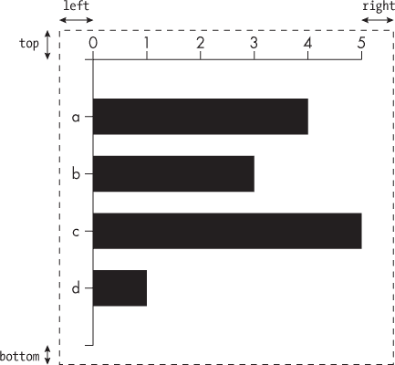

<samp class="SANS_Futura_Std_Book_Oblique_I_11">图 14-11: 如何使用边距在 SVG 元素中定位图形（虚线）</samp>

在 `update` 函数内部，我们使用 `d3.scaleLinear` 方法创建一个比例尺 ❶。这意味着输入值线性地映射到输出值（而不是对数地映射，例如）。我们使用 `d3.max` 辅助函数将 `domain` 从 0 设置到最大计数。该辅助函数接收一个数据数组和一个从数据项中返回返回值的函数，并返回最大值。在这种情况下，它返回的是最大计数值。`range` 设置为 `margin.left` 到 `width - margin.right`，这给了我们最长条形右侧的位置。

`scaleLinear` 辅助函数为我们提供了一个从数据域映射到视觉范围的函数，将其赋值给变量 `xScale`。（正如第 5 章中所过的，高阶函数可以返回另一个函数，正如 `scaleLinear` 在此处所做的那样。）我们修改 `width` 属性设置，调用该 `xScale` 函数并传递每个数据项的计数 ❷。在这里，`xScale(0)` 提供条形左侧的水平位置，对应于域值 0，而 `xScale(d.count)` 提供条形右侧的水平位置。要获得条形的宽度，我们需要从 `xScale(d.count)` 减去 `xScale(0)`，因为宽度只是条形左侧和右侧之间的距离。这将根据每个数据项的计数和最大计数提供适当的条形宽度。我们将条形的 `x` 属性设置为 `xScale(0)` 以强制执行左边距 ❸。

刷新页面并在文本区域中开始输入。当你第一次输入字符时，会出现一个最大宽的单条形。尝试输入 *abccc*。


图 14-12：我们在两个维度上都缩放过的柱形图

尝试输入不同的文本，感受柱条随数据变化而更新的情况。接下来，我们将添加带有标签的轴，这些标签将随缩放一起更新，以显示数据的实际范围。这将使图表变得更容易理解。

### 添加带有标签的轴

`D3` 轴辅助函数允许你沿着图表的侧边绘制轴。`D3` 中的轴包含一条水平或垂直线，以及垂直于该线绘制的小刻度线（tick marks）和每个刻度对应的数值，如图 14-13 所示。轴允许你看到数据域（data domain）中的值。

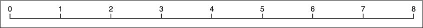

图 14-13：用于数字 0 到 8 的轴

轴与比例尺（scales）紧密相关，事实上，你需要一个比例尺来创建轴。例如，图 14-13 中的轴宽度为 540 像素，包含从 0 到 8 的数字。该轴是使用域为 `[0, 8]` 范围为 `[0, 540]` 的比例尺创建的。

要绘制轴，你首先必须定义一个包含轴元素的 `g` 元素。然后，你使用其中一个 `D3` 轴辅助函数创建一个轴生成器对象，最后使用该生成器对象将轴元素绘制到 `g` 元素中。

我们的图表将有两个轴：一个用于显示计数值的顶部轴，以及一个用于显示字符值的左侧轴。首先，我们将添加 `g` 元素，如代码列表 14-34 所示。

```

--snip--

let margin = {top: 20, right: 10, bottom: 20, left: 50};

// Top axis container

❶ let topContainer = svg

  .append("g")

  .attr("id", "top")

  .attr("transform", ❷ `translate(0, ${margin.top})`);

// Left axis container

❸ let leftContainer = svg

  .append("g")

  .attr("id", "left")

  .attr("transform", ❹ `translate(${margin.left}, 0)`);

function update(data) {

--snip--

```

代码列表 14-34：添加包含顶部和左侧轴的 g 元素

我们通过向 `svg` 元素添加一个 `g` 元素并赋予其 id 为 `"top"` 来创建顶部轴容器 ❶。由于我们定义了 `xScale` 的范围为 `[margin.left, width - margin.right]`，这同时也定义了轴的视觉范围。然而，`xScale` 并不感知垂直位置，这就是为什么我们必须将其向下平移 `margin.top` ❷。我们将元素选择存储在名为 `topContainer` 的变量中，以便在稍后将轴绘制到容器时引用它。左侧轴容器以类似的方式创建的 ❸，但这次我们必须将其向右平移 `margin.left` ❹，因为 `yScale` 不感知水平位置。

现在我们已经有了容器，就可以绘制轴了。对 `update` 函数进行如代码列表 14-35 所示的修改。

```

--snip--

  let yScale = d3.scaleBand()

    .domain(data.map(d => d.char))

    .range([margin.top, height - margin.bottom])

    .padding(0.5);

  let topAxis = d3.axisTop(xScale);

  let leftAxis = d3.axisLeft(yScale);

  topContainer

    .call(topAxis);

  leftContainer

    .call(leftAxis);

  svg

    .selectAll("rect")

    .data(data)

    .join("rect")

--snip--

```

代码列表 14-35：绘制轴

在这里我们调用了 `d3.axisTop` 并传入 `xScale`，调用了 `d3.axisLeft` 并传入 `yScale`。这给了我们两个轴生成器：`topAxis` 和 `leftAxis`。轴生成器接收元素选择并在该元素中绘制轴。然而，我们并没有向轴生成器传递选择，而是将生成器本身传递给一个名为 `call` 的 `D3` 方法。该方法当链到选择上（在此情况下为 `topContainer` 或 `leftContainer`）时，会在当前选择上调用提供的函数。因此，编写 `topContainer .call(topAxis);` 等同于编写 `topAxis(topContainer);`，两种语句都会绘制柱形图的顶部轴。使用 `call` 被认为更符合惯用法（idiomatic），这使得更容易在语句上链用其他方法。

刷新页面并在文本区域中输入一些文本。你将看到轴，如图 14-14 所示。

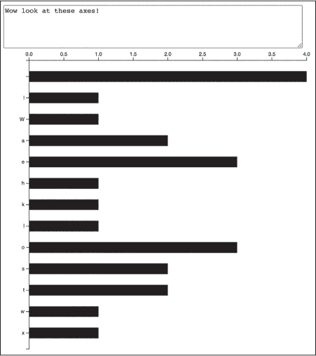

图 14-14：我们现在带有轴的柱形图

如果你在网页检查器中检查轴，你会发现它们是由 `g`、`path`、`text` 和 `line` 元素组成的。`line` 元素类似于 `path`，但它仅通过 `x1`、`x2`、`y1` 和 `y2` 属性定义起点和终点。这些属性在 SVG 规范中默认值为 0，这在绘制这些轴时通常完全足够，因此你会在检查器中发现许多 `line` 属性并没有被显式设置。

目前顶部轴有两个地方不太对。首先，如你在图 14-14 所示，标签包含了带有小数点的数字（例如 2.5），但我们只关心整数（你不可能有一个半字符）。因此，我们需要找到一种方法只渲染整数（也称为 integers）。其次，如果你输入 15 个相同的字符字符串（例如，*aaaaaaaaaaaaaaa*），那么标签将只显示从 0 到 14 的偶数，而不会有 15 的标签，如图 14-15 所示。随着最大计数的增加，你将继续看到这个问题，特别是在超过 30 之后，刻度会切换为 5 的倍数。

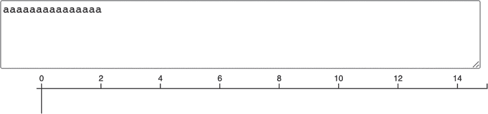

图 14-15：最大计数为 15 时的顶部轴

我们在这里更希望域扩展到 16，以便给出一个更好好看的轴。幸运的是，第二个问题很容易修复。`D3` 比例尺有一个很好的方法，可以将它们的域扩展到下一个“圆整”数字，在这种情况下，这意味着下一个会绘制刻度的数字。代码列表 14-36 显示了如何引入这种方法。

```

--snip--

  let xScale = d3.scaleLinear()

    .domain([0, d3.max(data, d => d.count)])

    .range([margin.left, width - margin.right])

    .nice();

--snip--

```

代码列表 14-36：让我们的 x 比例尺“nice”

当你刷新页面并再次输入 15 个相同的字符时，你会发现轴现在扩展到了 16。只渲染整数需要更多的努力。这里的基本方法是获取刻度值，过滤它们只保留整数，然后在轴上设置这些刻度值。此外，我们还希望更改数字渲染以排除小数点，因此我们渲染 1 而不是 1.0。这些更改在代码列表 14-37 所示。

```

--snip--

  let yScale = d3.scaleBand()

  .domain(data.map(d => d.char))

  .range([margin.top, height - margin.bottom])

  .padding(0.5);

❶ let topAxisTicks = xScale.ticks()

    .filter(tick => Number.isInteger(tick));

  let topAxis = d3.axisTop(xScale)

  ❷ .tickValues(topAxisTicks)

  ❸ .tickFormat(d3.format("d"));

  let leftAxis = d3.axisLeft(yScale); 

--snip--

```

代码列表 14-37：在顶部轴上渲染整数刻度


首先，我们必须获取刻度（ticks），这可以通过 `xScale` 生成器的 `ticks` 方法获取 ❶。然后，我们使用 `Number.isInteger` 将刻度过滤为整数值。这将把类似 `[0, 0.5, 1, 1.5, 2, 2.5, 3, 3.5, 4]` 的数组转换为 `[0, 1, 2, 3, 4]`。接下来，我们使用 `tickValues` 方法在顶端轴上设置过滤后的刻度值 ❷。最后，我们使用 `tickFormat` 方法为数字设置渲染格式 ❸。该方法接受一个格式化函数，用于对每个刻度值格式格式。在这种情况下，`d3.format("d")` 返回一个格式化数字且不带小数点的函数。

刷新页面并再次输入一些文本；你应该能看到渲染出的不带小数点的整数。

### 使用 CSS 和正则表达式进行样式设计

接下来，我们将使用一些 CSS 样式改进图表的外观。为了更好地区分不同类型的字符，我们将根据条形是否是小写字母、大写字母、数字还是其他字符，为它们赋予不同的颜色。为了实现这一点，我们需要一个能够区分这些类型字符的函数。该函数将使用`正则表达式`（regular expressions），这是一种在文本字符串中指定模式并然后判断其他字符串是否匹��这些模式的方法。

> **注意**

> JavaScript 的正则表达式功能非常强大，但我们将只考虑此项目需要的特性。要了解更多信息，请访问网站 [`www.regular-expressions.info`](https://www.regular-expressions.info)，或者在 MDN 中搜索“regular expressions”。

JavaScript 拥有一种正则表达式字面量语法，由正斜杠分隔。例如，`/hi/` 是一个正则表达式字面量，用于匹配任何包含字符序列 `hi` 的字符串。`hi` 可以出现在字符串的任何位置。例如，正则表达式 `/hi/` 会匹配单词 `hither`、`Chicken` 和 `sushi`。你可以通过添加特殊字符来更精确地定义正则表达式的模式。例如，表达式开头的脱符号（`^`）表示字符序列应该出现在字符串的开头，因此 `/^hi/` 匹配任何以 `hi` 开头的字符串。同样，表达式末尾的美元符号（`$`）表示字符序列应该出现在字符串的结尾，因此 `/hi$/` 匹配任何以 `hi` 结尾的字符串。

你可以使用正则表达式的 `test` 方法来查看特定字符串是否匹配。以下是 JavaScript 控制台中的示例：

```

/^hi/.test("hi there");

true

/^hi/.test("Chicken");

false

```

字符串 "hi there" 通过了测试，因为 `hi` 出现在字符串的开头，而 "Chicken" 则没有通过。

你可以结合使用 `^` 和 `$` 创建一个必须匹配整个字符串的正则表达式。例如，`/^hi$/` 将仅匹配字符串 "hi" 而不匹配其他任何内容，如下所示：

```

/^hi$/.test("hi");

true

/^hi$/.test("him");

false

```

要匹配字符范围而不是单个字符，请使用方括号和连字符描述该范围。例如，`/[a-z]/` 匹配从 `a` 到 `z` 的任何小写字母。正则表达式 `/^[A-Z][a-z]$/` 匹配包含一个大写字母后跟一个小写字母且没有有其他字符的字符串。在你的控制台中尝试一下：

```

/^[A-Z][a-z]$/.test("Hi");

true

/^[A-Z][a-z]$/.test("iH");

false

/^[A-Z][a-z]$/.test("Hip");

false

```

对于此项目，我们需要三个正则表达式：`/^[a-z]$/`（匹配单个小写字母）、`/^[A-Z]$/`（匹配单个大写字母）和 `/^[0-9]$/`（匹配单个数字）。如果一个字符不匹配其中任何一个表达式，我们就知道它是其他类型的字符，比如空格或标点符号。查看列表 14-38 中新的 `getClass` 函数，它使用这些正则表达式为给定字符的条形选择 CSS 类名。将此函数添加到 `script.js` 中，紧邻更新函数之前。

```

--snip--

// 左侧轴容器

let leftContainer = svg

  .append("g")

  .attr("id", "left")

  .attr("transform", `translate(${margin.left}, 0)`);

function getClass(char) {

  if (/^[a-z]$/.test(char)) {

    return "lower";

  } else if (/^[A-Z]$/.test(char)) {

    return "upper";

  } else if (/^[0-9]$/.test(char)) {

    return "number";

  } else {

    return "other";

  }

}

function update(data) {

--snip--

```

**列表 14-38: getClass 函数**

该函数根据提供的正则表达对字符进行测试，并返回相应的类名："lower"、upper"、number" 或 "other"。接下来，我们将更新渲染代码，使用此函数为每个 `rect` 元素设置类名，如列表 14-39 所示。

```

--snip--

  svg

    .selectAll("rect")

    .data(data)

    .join("rect")

    .attr("width", (d) => xScale(d.count))

    .attr("height", yScale.bandwidth())

    .attr("x", (d) => xScale(d.char))

    .attr("y", (d) => yScale(d.char))

    .attr("class", (d) => getClass(d.char));

--snip--

```

**列表 14-39: 根据字符应用类名**

现在每个 `rect` 元素都将根据字符拥有一个类名。最后一步是编写 CSS，为每个类名设置不同的填充颜色。将列表 14-40 中的 CSS 代码添加到 `style.css` 中。

```css

.lower {

  fill: purple;

}

.upper {

  fill: orangered;

}

.number {

  fill: green;

}

.other {

  fill: #555;

}

```

**列表 14-40: 定义不同的样式**

现在当你刷新页面并输入不同的字符时，你应该看到类似图 14-16 的效果。

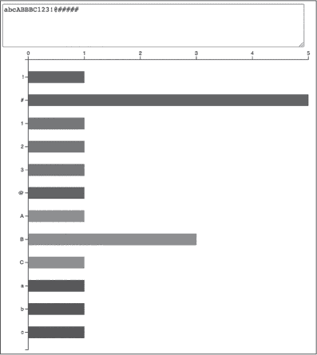

**图 14-16: 颜色编码条形**

条形将根据输入的字符分配不同的颜色。

### 数据清洗

通常需要通过修复数据包含的错误或不规则之处来清洗数据集。例如，我们目前条形图方法的一个问题是，不同的空白字符显示为不同的条形，且每个标签都是不可见的（因为标签的内容只是空白）。这些空白字符包括空格、换行符、制表符以及通过不同组合组合输入的各种其他空格（例如不换行空格，在 macOS 上使用 OPTION-space，在 Windows 上使用 CTRL-SHIFT-space）。为了修复这个问题，我们在字符计数之前将所有空白字符转换为相同的 `"<space>"` 字符串，这样所有空白将由一个具有可读标签的条形可视化。如列表 14-41 所示更新你的 `script.js` 文件。这些更新位于文件末尾。

```

--snip--

function standardizeSpace(char) {

❶ if (char.trim() == " ") {

    return "<space>";

  } else {

    return char;

  }

}

d3.select("textarea").on("input", e => {

  let frequencies = {};

  e.target.value.split(" ").forEach(char => {

  ❷ let standardized = standardizeSpace(char);

    let currentCount = frequencies[standardized] || 0;

    frequencies[standardized] = currentCount + 1;

  });

--snip--

```

**列表 14-41: 标准化空白字符**


我们首先声明一个 `standardizeSpace` 函数，它接收一个字符并对其调用 `trim` 方法 ❶。`trim` 方法会移除字符串开头或结尾的空白字符，因此如果它返回空字符串，我们就知道该字符是空白字符。在这种情况下，我们返回字符串 `"<space>"`。否则，我们原样返回字符。然后我们必须修改文本处理代码，在将这些字符作为 `frequencies` 对象的键之前，调用我们的函数并标准化空白字符 ❷。

现在，当你文本区域中输入各种类型的空白字符时，你应该看到一个标记为 `<space>` 的单个条形，而不是多个标签为空的条形。

## 为更改动画

我们的最后一个任务是为轴和柱状图添加动画。这将更容易看到新元素的添加以及现有元素计数的变化。要为轴添加动画，我们只需要在 `update` 函数内部的 `topContainer` 和 `leftContainer` 选择中添加对 `transition` 的调用，如 Listing 14-42 所示。

```

--snip--

let leftAxis = d3.axisLeft(yScale);

topContainer

  .transition()

  .call(topAxis);

leftContainer

  .transition()

  .call(leftAxis);

--snip--

```

Listing 14-42：为轴添加动画

现在，当轴范围更新以适应新数据时，现有的刻度将动画到它们更新后的位置，新刻度将淡入。

我们为柱状图添加过渡效果有两种选择：我们可以保留现有的 join 代码并仅添加单个 `transition` 调用，或者我们可以使用之前描述的高级 join 技术，这允许我们根据元素是进入（entering）、更新（updating）还是退出（exiting）来定制过渡。正如你可能猜到的，我们将采用高级版本！你可以在 Listing 14-43 中找到更新后的 update 代码。

```

--snip--

  leftContainer

    .transition()

    .call(leftAxis);

  svg

    .selectAll("rect")

  ❶ .data(data, d => d.char)

    .join(

    ❷ enter => enter

        .append("rect")

        .attr("x", xScale(0))

        .attr("y", (d, i) => yScale(d.char))

        .attr("class", d => getClass(d.char))

        .transition()

        .attr("width", d => xScale(d.count) - xScale(0))

        .attr("height", yScale.bandwidth()),

    ❸ update => update

        .transition()

        .attr("width", d => xScale(d.count) - xScale(0))

        .attr("height", yScale.bandwidth())

        .attr("y", (d, i) => yScale(d.char)),

    ❹ exit => exit

        .transition()

        .attr("width", 0)

        .attr("height", 0)

        .remove()

    );

}

--snip--

```

Listing 14-43：为柱状图添加动画

我们必须做的第一件事是设置一个 key 函数 ❶，告诉 D3 使用数据的 `char` 属性作为其标识符。接下来，我们切换到高级 join 技术，类似于 Listing 14-25。`enter` 函数 ❷ 在调用 `transition` 之前先添加 `rect` 元素并设置其 `x`、`y` 和 `class` 属性，这意味着这些属性不会有动画。`width` 和 `height` 属性在 `transition` 调用之后，因此这些属性将会有动画。这样，新元素将从左轴原地生长。

`update` 函数 ❸ 再次对 `width` 和 `height` 执行动画，同时也对 `y` 属性执行动画。这意味着当添加新元素时，现有元素将滑动到新位置。

最后，`exit` 函数 ❹ 在删除元素之前将 `width` 和 `height` 变为 0，导致元素在之前的位置收缩消失。

重新加载页面并尝试在文本区域中添加和删除字符。享受观察元素进入、退出或更新的过程。

### 总结

在本章中，你学习了 SVG 的基础知识，以及如何使用 D3 根据数据集的实时变化创建、更新和删除 SVG 元素。到目前，你应该对如何在 D3 中构建基于数据的应用程序有了很好的理解。在下一章中，我们将通过构建一个从 API 读取数据并将其渲染为交互式图表的应用程序来运用这些知识。

## 15 从 GitHub Search API 可视化数据


在这个最后一个项目中，你将构建一个应用程序，从公共 API 读取数据并使用 D3 根据这些数据构建交互式柱状图。我们将从 GitHub Search API 读取数据。该 API 允许你在 GitHub 上搜索数据，这是一个托管 Git 仓库的服务（Git 是一种用于跟踪软件项目源代码的流行版本控制系统）。该 API 使用 HTTPS 协议并根据你编码到 URL 中的搜索查询返回 JSON 格式的数据。

如果你以前没有用过 GitHub，请访问 `https://github.com` 查看它的样子。在页面顶部，你会看到一个搜索框，可以用它来搜索公共的开源仓库（即源代码供任何人阅读和使用的仓库）。与其手动使用该搜索框，GitHub Search API 允许我们通过程序化的方式执行搜索——例如使用 JavaScript。该 API 可以搜索 GitHub 上的各种项目，如仓库、用户和问题（issues）。我们将使用仓库搜索功能来查找顶部的 JavaScript 仓库。然后我们将绘制一个 D3 柱状图，按流行程度对仓库进行排名。观众可以通过悬停在其条形上来更多地了解每个仓库。我们还将通过允许观众根据软件许可证隐藏或显示仓库来增加一些交互性。

这个项目将让你获得处理来自 JSON API 的真实数据的经验。大量的编程工作归结为向第三方 API 发起请求并对返回的数据进行一些处理，正如你在这里练习的那样。你还将运用第 14 章中学会的所有 D3 知识，构建更有趣的交互式图表，并学习创建更丰富可视化的技术。

### 设置

开始之前，创建一个名为 `github` 的新目录，并添加空的 `style.css` 和 `script.js` 文件。然后创建一个 `index.html` 文件并添加 Listing 15-1 中的代码。

```

<!DOCTYPE html>

<html>

  <head>

    <title>GitHub</title>

    <link rel="stylesheet" href="style.css">

  </head>

  <body>

    <script src="https://unpkg.com/d3@7.4.4/dist/d3.js"></script>

    <script src="script.js"></script>

  </body>

</</html>

```

Listing 15-1：用于我们的 GitHub Search API 可视化的 index.html 文件

这是我们在第 14 章中使用的相同的基础 HTML 文件。它通过链接到 `https://unpkg.com` 上库副本的 script 元素允许我们访问 D3。

### 获取数据

现在让我们尝试从 GitHub Search API 获取一些数据。为了做到，我们需要将数据请求格式化为 URL 的一部分。访该 URL 即可获取数据。整个 URL（包括我们将使用的搜索查询）如下（注意为了适应页面，它被分成了两行）：

```

https://api.github.com/search/repositories?q=language%3Ajavascript%20stars%3A

%3E10000&per_page=20&sort=stars

```


然而，我们不会手动输入 URL，而是将使用 JavaScript 来构建它，这样更容易理解和修改。

URL 包含两个部分：基础 URL（base URL），它让我们访问 API；以及查询字符串（query string），我们在其中指定想要的数据。这两个部分由一个问号（`?`）分隔。查询字符串包含键值对，用于向 API 发送有关我们所做查询的信息。每个键和值之间通过等号（`=`）连接，每个键值对之间通过连符号（`&`）分隔。在这个 URL 中，键为 `q`（搜索查询）、`per_page`（每页结果数）和 `sort`（结果排序方式）。查询字符串中的键和值允许包含一组有限的字符：a–z、A–Z、0–9、连字符（`-`）、点（`.`）、下划线（`_`）、波浪号（`~`）以及少量其他特殊字符。所有其他字符必须使用 `URL encoding` 系统表示，这也是 URL 中所有百分号（`%`）字符来源。例如，冒号（`:`）被编码为 `%3A`，空格被编码为 `%20`。

为了简化操作，我们将编写一个函数，它接收一个包含未编码查询字符串参数的对象，并将其转换为格式正确且编码后的 URL。将 Listing 15-2 中的代码添加到 `script.js`。

```javascript

function getUrl() {

❶ let baseUrl = "https://api.github.com/search/repositories";

❷ let params = {

    q: "language:javascript stars:>10000",

    per_page: 20,

    sort: "stars"

  };

❸ let queryString = Object.entries(params).map(pair => {

    return `${pair[0]}=${encodeURIComponent(pair[1])}`;

  }).join("&");

❹ return `${baseUrl}?${queryString}`;

}

let url = getUrl();

console.log(url);

```

<samp class="SANS_Futura_Std_Book_Oblique_I_11">Listing 15-2: 创建 URL</samp>

创建 URL 的代码位于 `getUrl` 函数中。该函数首先设置基础 URL（查询字符串之前的部分） ❶。接着，为了构建查询字符串，我们从创建一个 `params` 对象 ❷ 开始，其中搜索查询 `q` 使用了 GitHub 的搜索查询格式。具体来说，我们正在搜索语言为 JavaScript 且星数超过 10,000 的仓库（GitHub 用户可以“点星”仓库以备后之用，因此星数是受欢迎程度的粗略衡量标准）。如果你想，可以在 `https://github.com` 的搜索框中尝试此查询。

接下来，我们对 `params` 中的键值对进行映射（map），为每对创建一个格式为 "key=value" 的字符串 ❸。键不需要进行 URL 编码——未加引号的对象的键不包含任何特殊字符，因此它们在 URL 中已经是有效的了——但我们使用内置函数 `encodeURIComponent` 对值进行编码，该函数会将任何不允许的字符替换为它们的百分比编码版本。然后，我们将字符串连接在一起，并用 `&` 字符分隔，通过组合基础 URL、`?` 字符和查询字符串来构建并返回最终的 URL ❹。我们通过调用 `getUrl` 函数并将结果打印到控制台来结束脚本。

当你加载页面并打开控制台时，你应该能看到之前打印的 URL。如果你复制该 URL 并将其粘贴到浏览器的地址栏中，你应该看到大量的 JSON 数据。如果不是，请确保 URL 与上一页的 URL 匹配，如果不匹配请检查你的代码。如果 URL 看起来是正确的但你没有获取数据，或者收到了错误消息，可能是 GitHub 更改其 API 的工作方式。请查看后续的“已认证与未认证 API”框以获取在这种情况下的操作指导。

要将 JSON 数据引入你的应用程序，你可以使用 D3 的 `json` 辅助方法，它可以从指定的 URL 获取 JSON。如 Listing 15-3 所示更新 `script.js` 的末尾。

```javascript

--snip--

let url = getUrl();

d3.json(url).then(data => {

  console.log(data);

});

```

<samp class="SANS_Futura_Std_Book_Oblique_I_11">Listing 15-3: 获取 JSON 数据</samp>

从 API 获取大量数据可能需要一些时间，因此 `d3.json` 方法返回一个 `Promise`，这是一种代表未来可用内容的对象类型。`then` 方法接收一个函数，该函数会在数据准备绪时调用。D3 将 JSON 响应字符串转换为 JavaScript 对象，因此 `data` 将是一个对象。在这里，我们只是将其打印到控制台。

当你重新加载页面并在等待几秒后，你应该会在控制台中看到数据。花点时间检查它。你应该看到三个顶层属性：`incomplete_results`、`items` 和 `total_count`。如果查询时间过长导致 API 只能返回部分结果，`incomplete_results` 将为 `true`；否则为 `false`。`total_count` 属性给出该搜索查询的结果数（这是搜索找到的结果总量，其中仅返回了前 20 个）。`items` 数组包含当前调用的结果；它应该包含 20 个项目。每个项目都是一个包含特定仓库信息的对象，包括其名称、描述和其他各种详细信息。其中几个字段本身就是 GitHub API URL，可以通过它们来获取有关仓库的额外信息。例如，`languages_url` 是一个 API URL，告诉你仓库使用了哪些编程语言，并按每种语言的代码数数细分。

在这个项目中，我们将使用每个项目中的几个字段：`full_name`、`stargazers_count`、`html_url` 和 `license`。`full_name` 字段持有仓库所有者的名称和仓库名称，用斜杠连接：例如 "facebook/react"。`stargazers_count` 字段给出用户为仓库点数的次数。`html_url` 字段持有仓库在 GitHub 上的 URL。最后，`license` 包含关于仓库使用的软件许可证的数据。

> <samp class="SANS_Dogma_OT_Bold_B_21">注意</samp>

*开源代码所有使用软件许可证来告诉用户可以做什么和不能做什么。例如，某些许可证非常严格，规定不能用于代码本身开源的应用程序。其他许可证则宽松得多，允许你对代码做任何事情。*

### 基础可视化

现在我们有了数据，将创建一个基础柱状图，显示数据集中的每个仓库收到了多少星。为了实现这一点，我们将创建所需的 SVG 元素、绘制轴，然后绘制条形。稍后我们将改进这个基础图表，使其更具信息量、更美观且具有交互性。

### 创建元素

为了创建图表，我们首先必须创建一个包含它的 `svg` 元素以及两个轴的 `g` 元素。在这种情况下，轴位于底部和左侧。将 Listing 15-4 中的代码添加到 `script.js` 的开头，位于 `getUrl` 函数之前。

```javascript

const width = 600;

const height = 400;

let svg = d3

  .select("body")

❶ .append("svg")

  .attr("width", width)

  .attr("height", height);

❷ let margin = {top: 20, right: 10, bottom: 20, left: 50};

// 底部轴容器

let bottomContainer = svg

❸ .append("g")

  .attr("id", "bottom")

  .attr("transform", `translate(0, ${height - margin.bottom})`);

// 左侧轴容器

let leftContainer = svg

❹ .append("g")

  .attr("id", "left")

  .attr("transform", `translate(${margin.left}, 0)`);

function getUrl() {

--snip--

}

```


就像我们在第 14 章中为字符频率表做的那样，我们在页面上添加一个 `svg` 元素 ❶ 并设置其宽度和高度。然后创建一个边距对象 ❷，并将 `g` 元素用于包含底部 ❸ 和左侧 ❹ 轴，我们根据边距对它们进行定位。

### 绘制坐标轴

创建好元素后，我们就可以开始编写更新函数，该函数将绘制可视化图形。首先，我们将根据数据创建比例尺并绘制坐标轴。按照代码列表 15-5 所示对 `script.js` 进行修改。

```javascript

--snip--

// Left axis container

let leftContainer = svg

  .append("g")

  .attr("id", "left")

  .attr("transform", `translate(${margin.left}, 0)`);

function update(items) {

❶ let xScale = d3.scaleBand()

    .domain(items.map(d => d.full_name))

    .range([margin.left, width - margin.right])

    .padding(0.3);

  let yScale = d3.scaleLinear()

  ❷ .domain([0, d3.max(items, d => d.stargazers_count)])

    .range([height - margin.bottom, margin.top])

    .nice();

❸ let bottomAxis = d3.axisBottom(xScale);

  let leftAxis = d3.axisLeft(yScale);

❹ bottomContainer.call(bottomAxis);

  leftContainer.call(leftAxis);

}

function getUrl() {

--snip--

d3.json(url).then(data => {

❺ update(data.items);

});

```

代码列表 15-5: 绘制坐标轴

更新函数接收 API 响应中的 `items` 数组。我们的条形图将为每个仓库创建一个垂直条形，因此我们使用 `scaleBand` 辅助函数创建水平的 `xScale`，以便均匀地分布条形 ❶。域（domain）是每个仓库的 `full_name`。由于每个仓库的全名都是唯一的，因此这将产生 20 个分带。垂直的 `yScale` 用于可视化每个仓库拥有的星标数量，因此它的域从零到最大 `stargazers_count` ❷。我们在这里使用 `nice` 将比例尺的顶部舍入到下一个刻度值。在创建比例尺后，我们创建了坐标轴生成器 ❸，然后使用这些生成器将坐标轴绘制到容器 ❹，就像我们在字符频率项目中所做的那样。

这里要做的最后件事是在 `d3.json` 回调内部调用我们的 `update` 函数，传递 `items` 数组 ❺。我们能够直接从获取数据跳转到调用 `update`，因为 GitHub Search API 方便地返回了渲染所需的数据格式。不需要像在字符频率示例那样对数据进行处理（在那个例子中源数据只是一个字符串，我们需要一个描述每个字符及其计数的排序对象数组）。

当你重新加载 `index.html` 时，现在应该能看到坐标轴，如图 15-1 所示。我们稍后会修复底部轴标签；它们现在一团糟，因为 D3 正在尝试渲染每个仓库的全名。此外，取决于你运行此代码时最流行的 JavaScript 项目有多少颗星，你的左轴刻度可能会高于图中显示的 200,000。在写本文时，`facebook/react` 拥有 GitHub 上任何 JavaScript 项目中最多的星，大约 196,000 个。

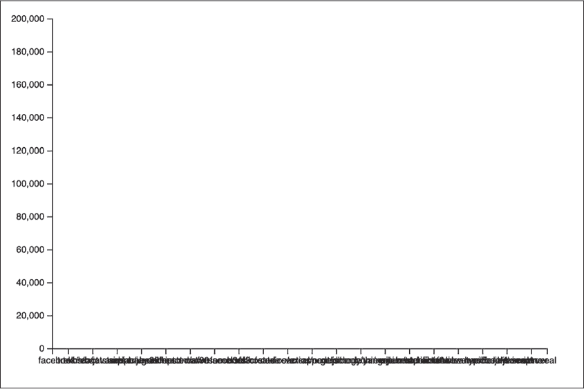

图 15-1: 坐标轴

鉴于我们在这里处理如此巨大的数字（而且每天都在增大），可以使用 SI 前缀（如用 `k` 表示 1,000）来提高可读性。在 D3 中通过正确的数字格式可以轻松实现。在进行此更改的同时，我们还将移除底部轴的刻度。请参代码列表 15-6 查看这些更改。

```javascript

--snip--

  let yScale = d3.scaleLinear()

    .domain([0, d3.max(items, d => d.stargazers_count)])

    .range([height - margin.bottom, margin.top])

    .nice();

  let bottomAxis = d3

    .axisBottom(xScale)

  ❶ .tickValues([]);

  let leftAxis = d3

    .axisLeft(yScale)

  ❷ .tickFormat(d3.format("~s"));

  bottomContainer.call(bottomAxis);

  leftContainer.call(leftAxis);

--snip--

```

代码列表 15-6: 清理比例尺

对于底部轴，我们将刻度值更新为空列表 ❶，这有效地移除了刻度。对于左侧轴，我们使用格式指定化符 `~s` 添加了刻度格式 ❷，例如，它会将数字 200,000 渲染为 200k，将 1,000,000 渲染为 1M。图 15-2 显示了更新后的坐标轴现在的样子。

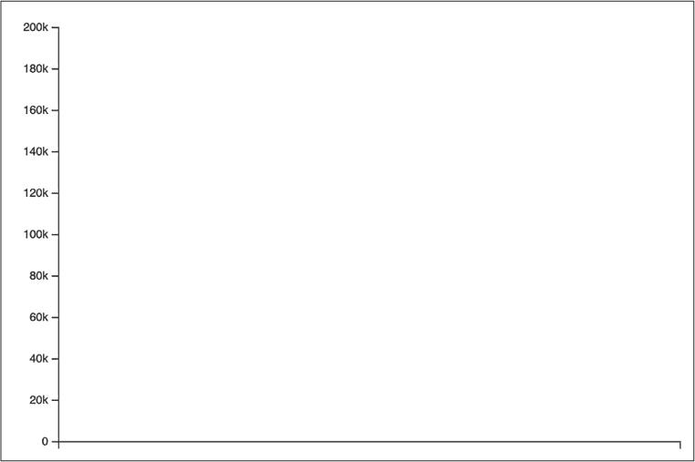

图 15-2: 清理后的坐标轴

左轴中的数字现在更容易一眼看了，底部轴不再是文本的杂乱组合。

### 绘制条形

现在坐标轴已经绘制完毕，我们需要绘制条形本身。将代码列表 15-7 中的代码添加到更新函数的末尾。

```javascript

--snip--

  bottomContainer.call(bottomAxis);

  leftContainer.call(leftAxis);

  svg

    .selectAll("rect")

    .data(items, ❶ d => d.full_name)

    .join("rect")

    .attr("x", d => xScale(d.full_name))

  ❷ .attr("y", d => yScale(d.stargazers_count))

    .attr("width", xScale.bandwidth())

  ❸ .attr("height", d => yScale(0) - yScale(d.stargazers_count));

}

function getUrl() {

--snip--

```

代码列表 15-7: 绘制条形

与字符频率项目一样，我们 正在绘制一组 `rect` 元素。关键函数 ❶ 提取了 `full_name` 属性，我们在这里将其作为每个仓库的唯一标识符。目前，我们使用简单的 `join` 技术，没有对进入、更新和退出元素进行单独处理（那将在稍后进行）。

`x` 属性根据在 `xScale` 中查找 `full_name` 来设置，宽度则根据 `xScale` 的 `bandwidth` 方法。这次 `y` 和 `height` 属性要复杂一些，需要一些解释。如果你回看代码列表 15-5 中 `yScale` 的定义，你会发现域是 `[0, d3.max(items, d => d.stargazers_count)]`，范围是 `[height - margin.bottom, margin.top]`。根据我们设置的值，该范围扩大到 `[380, 20]`。范围从高到低，这意味着域中的高值映射到范围中的低值，反之亦然。这是因为计算机图形中的 y 值是从屏幕顶部向下计数的，但在我们的图表中，我们希望 y 值向上计数。


## 改进可视化效果

我们现在已经运行了一个基础的可视化，但它提供的信息并不多。在本节中，我们将实现一些改进来使可视化更有意义。我们将一种方法来查看有关每个仓库的更多信息。我们还将对条形进行颜色编码，以显示每个仓库的许可证类型，并确保轴标签标记正确。

### 显示仓库信息

目前的图表没有提供任何识别每个条形代表哪个仓库的方法。解决这个问题有多种方法（例如，垂直或倾斜方向的刻度标签，或者某种类型的 `tooltip`，即悬停在条形上时弹出的文本字段），但对于本项目，我们将添加一个永久的侧边栏，当你悬停在条形上时它会显示该条形的更多信息。首先，我们将在 `index.html` 中添加侧边栏的 HTML，如列表 15-8 所示。

```

--snip--

  <body><body>

    <div id="sidebar">

      <div id="info" class="box">

        <p class="repo">

          <span class="label">Repository（仓库）</span>

        ❶ <span class="value"><a target="_blank"></a></span></span>

        </p>

        <p class="license">

          <span class="label">License（许可证）</span>

          <span class="value"></span>

        </p>

        <p class="stars">

          <span class="label">Stars（星数）</span>

          <span class="value"></span>

        </p>

      </div>

    </div>

    <script src="https://unpkg.com/d3@7.4.4/dist/d3.js"></script>

    <script src="script.js"></script>

  </body></body>

--snip--

```

### 列表 15-8：向 index.html 添加侧边栏 HTML

在这里我们设置了一个名为 `info` 的 `div`，包含了显示仓库信息所需的元素。它嵌套在另一个名为 `sidebar` 的 `div` 内部。这个外部 `div` 现在看起来是多余的，但稍后我们将向侧边栏添加另一个 `div` 元素，因此我们需要父 `div` 元素来包含这两个侧边栏 `div` 元素。

`info` `div` 将显示仓库名称、许可证类型和星数。我们使用 `span` 元素来包裹文本的部分。`span` 是一个像 `div` 一样的容器元素，但与创建新块的 `div` 元素不同，`span` 是一个内联元素，因此它可以包含行文本的一部分而不产生新行。稍后，当你在悬停在条形上时，我们将更新 `value` spans 的内容，以显示与该条形相关的信息。

其中一个 `span` 元素包含一个 `a` 元素 ❶，它创建指向另一个页面或网站的超链接。链的 URL 通过 `href` 属性指定，我们将稍后动态地设置它。`target="_blank"` 属性指示浏览器在新标签页或窗口中打开链接。

侧边栏在现阶段看起来有点丑，所以让我们添加一些 CSS。将列表 15-9 中的代码添加到 `style.css` 中。

```

body {

❶ display: flex;

  align-items: flex-start;

  font-family: Arial, Helvetica, sans-serif;

}

.box {

  padding: 0px 15px 0px 15px;

  border: 1px solid #888;

  margin-bottom: 15px;

}

#info .label {

  font-weight: bold;

  display: block;

}

#info a {

  text-decoration: none;

}

#info a:hover {

  text-decoration: underline;

}

```

### 列表 15-9：侧边栏样式设置

对于本项目，我们使用一种名为 `flexbox` ❶ 的 CSS 技术，这是 CSS 规范中较新的添加。Flexbox 使定义布局变得容易得多，特别是那些可以在各种屏幕和视口大小上灵活工作的布局。Flexbox 布局有两个主要组件：`flex container`（弹性容器）和 `flex items`（弹性项目）。`flex container` 是父元素，定义了它的子弹性项目（容器的直接子元�的大小以及它们的流向方式。在我们的情况下，`flex container` 是 `body` 元素，而 `flex items` 是 `svg` 元素和 `#sidebar` 元素。默认情况下，项目从左到右排列（这意味着 `#sidebar` 元素将出现在屏幕左侧，其右侧是 `svg` 元素）。声明 `align-items: flex-start;` 表示项目将对齐到父容器的顶部。

> **注意**

> 如果你想学习更多关于 flexbox 的知识，请查看 [`css-tricks.com/snippets/css/a-guide-to-flexbox/`](https://css-tricks.com/snippets/css/a-guide-to-flexbox/)。

目前 `svg` 元素被追加到 body 元素，这意味着它位于侧边栏之后，由于布局原因，我们希望它在之前。为了实现这一点，我们在创建 `svg` 元素时需要从 `append` 方法切换到 `insert` 方法，因为后者允许我们指指定插入到某个元素之前。`script.js` 的相应更改如列表 15-10 所示。

```

--snip--

let svg = d3

  .select("body")

  .insert("svg", "#sidebar")

  .attr("width", width)

  .attr("height", height);

--snip--

```

### 列表 15-10：在侧边栏之前插入 svg 元素

现在侧边栏将出现在图表的右侧，因为 `svg` 元素现在在 `flex container` 中出现在侧边栏之前。

在我们编写在侧边栏显示仓库详情的代码之前，我们需要一个函数来获取仓库的许可证。访问其他信息将非常简单，但并不是所有仓库都有许可证，因此我们的函数必须处理没有可用数据的情况。在 `script.js` 中 `update` 函数之前插入以下代码。

```

--snip--

// 左轴

let leftContainer = svg

  .append("g")

  .attr("id", "left")

  .attr("transform", `translate(${margin.left}, 0)`);

function getLicense(d) {

❶ let license = d.license?.name;

❷ if (!license) {

    return "No License";

  } else {

    return license;

  }

}

function update(items) {

--snip--

```

### 列表 15-11：getLicense 函数

如果仓库有许可证，则许可证名称将作为 `d.license.name` 可，但如果它没有许可证，`d.license` 将是 `undefined`。我们使用 `?.` 运算符测试这种情况，该运算符被称为 `可选链运算符` ❶。与普通的 `.` 运算符一样，`?.` 尝试获取运算符左侧指定的对象并访问运算符右侧指定的方法或属性。然而，与普通的 `.` 运算符不同，如果左侧的对象为 `null` 或 `undefined`，`?.` 将返回 `undefined`。因此，如果 `d.license` 是 `undefined`（意味着仓库没有许可证），我们的 `license` 变量将被设置为 `undefined`，但如果 `d.license` 是一个对象（意味着仓库有许可证），那么 `license` 将设置为 `d.license.name`。如果 `license` 最终为 `undefined` ❷，我们的 `getLicense` 函数将返回字符串 "No License"。否则，返回 `license` 的值。

现在我们可以添加在悬停在条形上时更新侧边栏的代码。我们将通过向 `rect` 元素添加 `mouseover` 事件处理程序来实现。使用列表 15-12 中的代码更新 `script.js`。这段代码位于 `update` 函数的末尾。

```

--snip--

    .attr("width", xScale.bandwidth())

    .attr("height", d => yScale(0) - yScale(d.stargazers_count))

    .on("mouseover", (e, d) => {

      let info = d3.select("#info");

      info.select(".repo .value a").text(d.full_name).attr("href", d.html_url); 1

      info.select(".license .value").text(getLicense(d));

      info.select(".stars .value").text(d.stargazers_count);

    });

}

function getUrl() {

--snip--

```


# 列表 15-12: 悬停时更新侧边栏

D3 事件处理器在调用时带有两个参数：事件对象（`e`）和绑定到触发事件元素上的数据（`d`）。我们在处理器中执行的第一件事是选择 `#info` 元素，因为我们想要修改的所有元素都是该元素的子元素。然后，我们更新 `.repo` 元素内部 `.value` 元素内部的 `a` 元素❶（参考列表 15-8 或查看 `index.html` 以回想 HTML 结构）。我们正在同时设置该元素的文本内容和 `href` 属性。这样做的效果是创建一个指向仓库的链接，并将仓库的完整名称作为链接文本。类似的，我们将 `.value .license` 元素的文本设置为 `getLicense` 函数针对该数据项返回的任何内容，并将 `.stars .value` 元素的文本设置为星数数量。

重新加载页面并尝试悬停在一些条形图上。你应该能看到类似图 15-4 的效果。

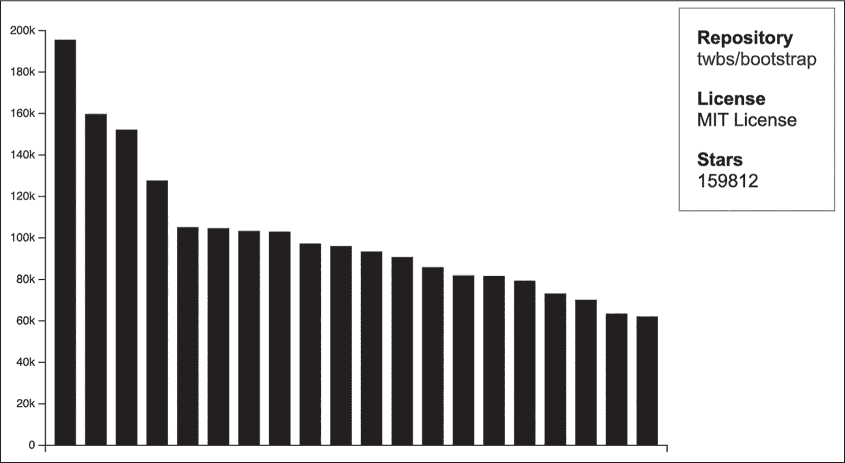

<samp class="SANS_Futura_Std_Book_Oblique_I_11">图 15-4：显示某个仓库详情的侧边栏</samp>

对于你悬停的每个条形，该仓库的详情都应该出现在新的侧边栏中。如果你点击仓库名称，浏览器应该打开新标签页并带你进入仓库的 GitHub 。

### 条形的颜色编码

为了在视觉上传递额外信息，我们将根据许可证类型对条形进行颜色编码。D3 允许你创建标尺，其输入（域）是值，输出（范围）是颜色。你将在列表 15-13 中看到如何实现这一点。

```javascript

--snip--

function update(items) {

❶ let licenses = new Set(items.map(d => getLicense(d)));

❷ let colorScale = d3.scaleOrdinal()

    .domain(licenses)

    .range(d3.schemeCategory10);

  let xScale = d3.scaleBand()

--snip--


列表 15-13：为许可证创建颜色标尺

首先，我们需要收集所有唯一的许可证名称。为了做到这一点，我们对 `items` 进行 `map` 操作，并为每一项调用我们的 `getLicense` 函数❶。这产生了一个许可证名称数组。在同一行中，我们将结果数组传递给 `Set` 构造函数。在编程术语中，`set` 是唯一项目的集合，因此 `Set` 构造函数可以接收项数组并过滤掉任何重复项。在 JavaScript 中，集合会像数组一样维护顺序。

`d3.scaleOrdinal` 辅助函数❷ 创建了一个具有离散输入和离散输出的标尺。在这里，输入是唯一的许可证名称，输出是颜色名称。对于标尺的范围，我们使用了 `d3.schemeCategory10`，这是一个包含 10 个十六进制颜色字符串的数组。你可以在控制台中查看它：

```javascript
d3.schemeCategory10;
```

输出：
```
(10) ['#1f77b4', '#ff7f0e', '#2ca02c', '#d62728', '#9467bd', '#8c564b', '#e377c2', '#7f7f7f', '#bcbd22', '#17becf']
```

集合中的每个许可证将根据索引映射到这些颜色中的一种。如果许可证超过 10 个，颜色将循环回到开头（第 11 和第 12 个许可证将使用与第一个和第二个相同的颜色）。

接下来，我们必须根据许可证和颜色标尺设置条形的颜色。列表 15-14 显示了如何在 `update` 函数的末尾进行该更改。

```javascript
--snip--
  svg
    .selectAll("rect")
    .data(items, d => d.full_name)
    .join("rect")
    .attr("x", d => xScale(d.full_name))
    .attr("y", d => yScale(d.stargazers_count))
    .attr("fill", d => colorScale(getLicense(d)))
    .attr("width", xScale.bandwidth())
    .attr("height", d => yScale(0) - yScale(d.stargazers_count))
--snip--
```

列表 15-14：设置 rect 的填充颜色

在将许可证名称传递给 `colorScale` 之前，我们必须在 `d` 上调用 `getLicense` 函数来获取许可证名称（因为可能是 "No License"）。这为我们设置 `rect` 的 `fill` 属性提供了颜色值。

通过这种颜色编码，你确实需要一个图例让用户知道每个颜色的含义。我们将该图例作为侧边栏中的另一个框，位于仓库信息框下方。它将包含与相应许可证名称并排颜色块。首先，我们需要更多的 HTML。使用列表 15-15 中的更改更新 `index.html`。

```html
--snip--
        <p class="stars">
          <span class="label">Stars</span>
          <span class="value"></span>
        </p>
      </div>
      <div id="key" class="box">
        <h1>Key</h1>
      </div>
    </div>
--snip--
```

列表 15-15：为许可证图例添加 div 和标题

在这里我们在侧边栏 `div` 内部创建了名为 `key` 的另一个 `div` 并给它一个 `h1`。我们将使用 JavaScript 创建 `key` 的其他元素。

接下来是用于设置这些新元素以及我们将用 JavaScript 添加的子元素的 CSS。将列表 15-16 中的代码添加到 `style.css` 的末尾。

```css
--snip--
#info a:hover {
  text-decoration: underline;
}
#key h1 {
  font-size: 1.5em;
}
#key .color {
  display: inline-block;
  width: 10px;
  height: 10px;
  margin: 0px 10px 0px 10px;
}
```

列表 15-16：设置图例样式

此处 `h1` 元素的字体大小设置为 `1.5em`，这意味着父元素字体大小的 1.5 倍。这确保了此标题将比其他文本大 1.5 倍。`#key .color` 规则集用于设置作为图例一部分的颜色块。这些将是 `div` 元素，但 `display: inline-block` 意味着它们将表现像内联元素（如 `span`）那样不会强制换行，又像块级元素（如 `div`）那样可以具有固定尺寸。（内联元素无法设置宽度和高度，因为它们根据内容调整大小，而在这种情况下颜色块没有内容。）

现在我们可以添加生成图例的 JavaScript 了。这将在 `update` 函数末尾涉及一个新的新的数据连接，将许可证连接到渲染它们的元素上。使用列表 15-17 中的更改更新 `script.js`。

```javascript
--snip--
    .on("mouseover", (e, d) => {
      let info = d3.select("#info");
      info.select(".repo .value a").text(d.full_name).attr("href", d.html_url);
      info.select(".license .value").text(getLicense(d));
      info.select(".stars .value").text(d.stargazers_count);
    });
  d3.select("#key")
    .selectAll("p")
    .data(licenses)
    .join(
      enter => {
      ❶ let p = enter.append("p");
      ❷ p.append("div")
          .attr("class", "color")
        ❸ .style("background-color", d => colorScale(d));
      ❹ p.append("span")
          .text(d => d)
        return p;
      }
    ); 
}
function getUrl() {
--snip--
```

列表 15-17：生成图例

在这里，我们使用 `#key` 元素作为新加入项的容器，并加入了一系列 `p` 元素以绑定到每个许可数据（datum）。我们使用了高级的 join 技巧，但仅带了一个 `enter` 函数；我们不需要为更新或退出项定义自定义行为。（在这里我们不能使用常规的 join 技术，因为那样每当调用 `update` 时都会发生元素添加操作。）首先，我们为每条新数据创建一个 `p` 元素 ❶，然后向 `p` 元素中添加一个 `div` 元素，我们将在该处显示颜色的方块 ❷。为 `div` 添加 `color` 类意味着它将具有来自列表 15-16 的样式。为了给它设置正确的颜色，我们使用 `style` 方法 ❸，它会在元素上设置一个内联 CSS 样式。我们使用 `colorScale` 为该数据设置相应的颜色值。最后，我们为 `p` 元素添加一个 `span` 元素来存放许可的实际名称 ❹。

刷新页面，你应该能看到类似图 15-5 的效果。

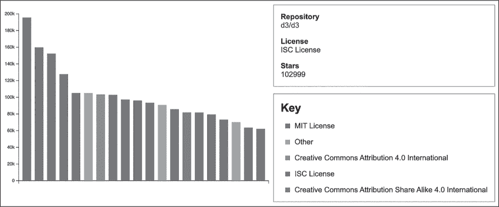

图 15-5：带有键的颜色编码条形

我们的可视化结果现在有一个完整的键，显示每种颜色映射的许可，这使得颜色意义大得多。

### 标记左轴

图中暗示图表的左轴显示了每个仓库拥有的星标数量，但图表中并未明确说明。为了修复这个问题，我们将添加一个 `text` 元素来标记左轴。这部分代码在列表 15-18 中。将此代码添加到 `getLicense` 函数之前。

```javascript
--snip--
// 左轴容器
let leftContainer = svg
  .append("g")
  .attr("id", "left")
  .attr("transform", `translate(${margin.left}, 0)`);

let chartHeight = (height - margin.bottom) - margin.top;
let midPoint = margin.top + chartHeight / 2;

svg
  .append("text")
  .text("Stars")
  .style("font-size", "14px")
❶ .attr("text-anchor", "middle")
❷ .attr("transform", `translate(12, ${midPoint}) rotate(270)`);

function getLicense(d) {
--snip--
```

列表 15-18：添加左轴标签

首先，我们需要计算在何绘制标签。它的垂直位置应该在图表的中间。我们根据总高度和两个边距计算图表的高度，然后通过加上顶部边距和图表高度一半来计算中点。

接下来，我们向 `svg` 元素添加一个带有 *Stars* 单词的 `text` 元素。我们在早些的 *style.css* 中通过对 `body` 元素应用 `font-family` 设置了字体。将 `text-anchor` 属性设置为 `middle` ❶ 会使文本围绕其计算出的位置居中。我们还指定了两个变换 ❷：一个 `translate` 后跟一个 `rotate`。`translate` 将标签中心移动到正确位置，`rotate` 将其逆时针旋转 90 度（或顺时针旋转 270 度）。

### 添加交互性

我们的可视化已经具有一定的交互性，即悬停在条形上会在侧边栏显示有关该仓库的详情。添加另一个允许用户过滤数据的交互元素会很有趣。例如，既然我们现在有了一个列出不同许可类型的键，可以使用它来选择性地显示或隐藏带有相应许可的仓库。我们现在实现这个交互功能，同时添加动画来平滑图表的变化。

### 按许可过滤数据

为了让用户能够按许可类型过滤数据，我们将为键中的每个项添加一个复选框。然后我们将使用这些复选框来决定哪些仓库应（临时）从图中排除。这需要跟踪我们想要隐藏的许可，并在渲染之前移除任何使用这些许可的仓库。

首先，我们添加复选框。按照列表 15-19 所示修改 `script.js` 以实现此操作。

```javascript
--snip--
    d3.select("#key")
      .selectAll("p")
      .data(licenses)
      .join(
        enter => {
        let p = enter.append("p");

        p.append("input")
         .attr("type", "checkbox")
         .attr("checked", true)
         .attr("title", "Include in chart");

         p.append("div")
         .attr("class", "color")
         .style("background-color", d => colorScale(d));
--snip--
```

列表 15-19：添加复选框

在 HTML 中，复选框是一个 `type` 属性值为 `checkbox` 的 `input` 元素。在代码中，我们在键中每个 `p` 元素的开头添加一个这样的元素。`checked` 属性决定复选框是否被选中；我们默认将其设置为选中，因此当可视化首次加载时将显示所有仓库。`title` 属性会在悬停在元素上时提供带有辅助文本的工具提示。

接下来，我们需要创建一个机制来跟踪哪些许可应该被隐藏。这部分代码在列表 15-20 中。

```javascript
--snip--
function getLicense(d) {
  let license = d.license?.name;

  if (!license) {
    return "No License";
  } else {
    return license;
  }
}

❶ let hiddenLicenses = new Set();

function update(items) {
  let licenses = new Set(items.map(d => getLicense(d))); 
--snip--
        p.append("span")
         .text(d => d)
        return p;
      }
    );

❷ d3.selectAll("#key input").on("change", (e, d) => {
    if (e.target.checked) {
    ❸ hiddenLicenses.delete(d);
    } else {
    ❹ hiddenLicenses.add(d);
    }

    console.log(hiddenLicenses);
  ❺ update(items);
  });
}
function getUrl() {
--snip--
```

列表 15-20：跟踪隐藏的许可

## 列表 15-21：确定具有隐藏许可证的仓库

为了过滤项目列表，对于每个项目，我们使用集合的 `has` 方法检查其许可证名称是否在 `hiddenLicenses` 集合中。如果名称不在集合中，则它将出现在过滤后的列表中。否则，它会被过滤掉。

最后，我们需要切换到使用 `filtered` 数组而不是 `items` 数组进行渲染。新图表将只渲染过滤后的数据，因此我们需要更改比例尺和条形绘制代码以处理过滤后的数据。另一方面，我们不应该过滤 `licenses` 集合，因为为了保持一致的颜色方案并渲染图例，无论某些许可证当前在条形图中是否被隐藏。列表 15-22 显示了 `update` 函数中所有需要更改为使用 `filtered` 代替 `items` 的地方。

```javascript
--snip--
  let xScale = d3.scaleBand()
  ❶ .domain(filtered.map(d => d.full_name))
    .range([margin.left, width - margin.right])
    .padding(0.3);

  let yScale = d3.scaleLinear()
  ❷ .domain([0, d3.max(filtered, d => d.stargazers_count)])
    .range([height - margin.bottom, margin.top])
    .nice();

--snip--
  svg
    .selectAll("rect")
  ❸ .data(filtered, d => d.full_name)
    .join("rect")
    .attr("x", d => xScale(d.full_name))
    .attr("y", d => yScale(d.stargazers_count))
--snip--
```

## 列表 15-22：用 `filtered` 替换 `items` 以渲染条形图

我们更新了创建底部 ❶ 和左轴 ❷ 比例尺的代码，以及绘制条形 ❸ 的代码，在每情况下都将 `items` 更改为 `filtered`。刷新页面并取消选择图例中的某些许可证。你现在应该看到相应的条形从条形图中消失了。这些之所以被渲染，是因为正如你在 列表 15-20 中看到的，我们在复选框的更改事件处理器中调用了 `update`。

### 动画效果

为了锦上添花，让我们添加一些动画。这将更容易在许可证显示或隐藏时看到条形的变化，并且让可视化看起来更酷炫。我们将对图表的两个部分制作动画：左轴和条形。要做到这一点，请按照 列表 15-23 所示进行更改。

```javascript
--snip--
  let leftAxis = d3
    .axisLeft(yScale)
    .tickFormat(d3.format("~s"));

  bottomContainer.call(bottomAxis);

  leftContainer
  ❶ .transition()
    .call(leftAxis);

  svg
    .selectAll("rect")
    .data(filtered, d => d.full_name)
    .join(
      enter => enter
        .append("rect")
        .attr("x", d => xScale(d.full_name))
        .attr("y", d => yScale(d.stargazers_count))
        .attr("fill", d => colorScale(getLicense(d)))
        .attr("width", xScale.bandwidth())
        .attr("height", d => yScale(0) - yScale(d.stargazers_count))
      ❷ .style("opacity", 0)
        .transition()
      ❸ .style("opacity", 1),
      update => update
        .transition()
      ❹ .attr("x", d => xScale(d.full_name))
        .attr("y", d => yScale(d.stargazers_count))
        .attr("width", xScale.bandwidth())
        .attr("height", d => yScale(0) - yScale(d.stargazers_count)),
      exit => exit
        .transition()
      ❺ .style("opacity", 0)
      ❻ .remove()
    )
    .on("mouseover", (e, d) => {
      let info = d3.select("#info");
      info.select(".repo .value a").text(d.full_name).attr("href", d.html_url);
      info.select(".license .value").text(getLicense(d));
      info.select(".stars .value").text(d.stargazers_count);
    });
--snip--
```

## 列表 15-23：添加动画

为左轴制作动画非常简单：我们只需要在绘制轴之前在其容器上调用 `transition` ❶，这样左轴就会在每次比例尺发生变化时进行过渡（这只有在最大的条形被隐藏或取消隐藏时才会发生，这会改变范围的上限）。

要为条形制作动画，我们遵循标准做法，切换到高级 join 技术并为进入（entering）、更新（updating）和退出（exit）元素添加过渡。进入元素开始时设置了所有属性且透明度为 0（意味着它们是 100%透明的）❷。然后我们调用 `transition` 并动画到 100%不透明 ❸，这实现了进入元素淡入的效果。更新元素保持相同的颜色和透明度，但它们的位置和尺寸可能会发生，因此我们对所有这些进行动画 ❹。这会将更新的元素拉伸并滑动到它们的新尺寸和位置。退出元素与进入元素相反，会淡出，我们通过将它们的透明度过渡回 0 ❺ 来实现。记住，在过渡完成后我们还必须对任何退出元素调用 `remove` ❻。

重新加载页面并尝试隐藏和取消隐藏各种许可证。图例中的第一个许可证始终对应于 Star 数最多的仓库（因为仓库是按此排序的，而且我们按顺序从仓库中提取许可证名称），所以如果你想看到左轴调整大小，你需要关闭该许可证。你应该看到带有该许可证的仓库淡出，其他仓库扩展以填充空间和重新计算的比例尺。图 15-6(a) 显示了显示所有许可证的图表，图 15-6(b) 显示了隐藏了 MIT 许可证（编写时，数据集中最流行的许可证）的图表。

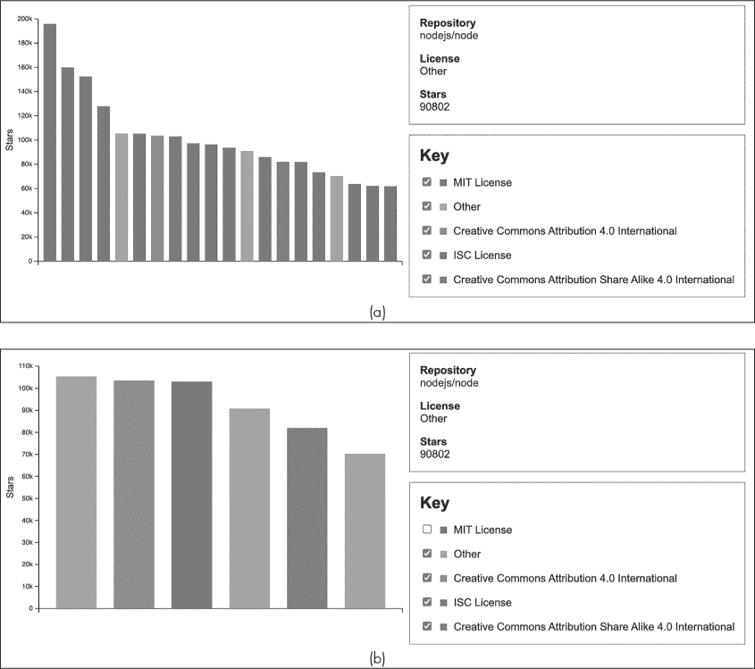

## 图 15-6：显示所有许可证 (a) 和隐藏顶部许可证 (b) 的最终图表

尝试显示和隐藏不同的许可证，以感受动画是如何工作的。你对它们有任何想修改的地方吗？还可以如何让可视化更有趣？

### 完整代码

如果你想查看完整的 `script.js` 文件应该什么样，可以在 列表 15-24 中找到完整代码。

```javascript
const width = 600;
const height = 400;

let svg = d3
  .select("body")
  .insert("svg", "#sidebar")
  .attr("width", width)
  .attr("height", height);

let margin = {top: 20, right: 10, bottom: 20, left: 50};

// Bottom axis container
let bottomContainer = svg
  .append("g")
  .attr("id", "bottom")
  .attr("transform", `translate(0, ${height - margin.bottom})`);

// Left axis container
let leftContainer = svg
  .append("g")
  .attr("id", "left")
  .attr("transform", `translate(${margin.left}, 0)`);

let chartHeight = (height - margin.bottom) - margin.top;
let midPoint = margin.top + chartHeight / 2;

svg
  .append("text")
  .text("Stars")
  .style("font-size", "14px")
  .attr("text-anchor", "middle")
  .attr("transform", `translate(12, ${midPoint}) rotate(270)`);

function getLicense(d) {
  let license = d.license?.name;

  if (!license) {
    return "No License";
  } else {
    return license;
  }
}

let hiddenLicenses = new Set();

function update(items) {
  // Items with the hidden licenses removed
  let filtered = items.filter(d => !hiddenLicenses.has(getLicense(d)));

  let licenses = new Set(items.map(d => getLicense(d)));
  let colorScale = d3.scaleOrdinal()
    .domain(licenses)
    .range(d3.schemeCategory10);

  let xScale = d3.scaleBand()
    .domain(filtered.map(d => d.full_name))
    .range([margin.left, width - margin.right])
    .padding(0.3);

  let yScale = d3.scaleLinear()
    .domain([0, d3.max(filtered, d => d.stargazers_count)])
    .range([height - margin.bottom, margin.top])
    .nice();

  let bottomAxis = d3
    .axisBottom(xScale)
    .tickValues([]);

  let leftAxis = d3
    .axisLeft(yScale)
    .tickFormat(d3.format("~s"));

  bottomContainer.call(bottomAxis);

  leftContainer
    .transition()
    .call(leftAxis);

  svg
    .selectAll("rect")
    .data(filtered, d => d.full_name)
    .join(
      enter => enter
        .append("rect")
        .attr("x", d => xScale(d.full_name))
        .attr("y", d => yScale(d.stargazers_count))
        .attr("fill", d => colorScale(getLicense(d)))
        .attr("width", xScale.bandwidth())
        .attr("height", d => yScale(0) - yScale(d.stargazers_count))
        .style("opacity", 0)
        .transition()
        .style("opacity", 1),
      update => update
        .transition()
        .attr("x", d => xScale(d.full_name))
        .attr("y", d => yScale(d.stargazers_count))
        .attr("width", xScale.bandwidth())
        .attr("height", d => yScale(0) - yScale(d.stargazers_count)),
      exit => exit
        .transition()
        .style("opacity", 0)
        .remove()
    )
    .on("mouseover", (e, d) => {
      let info = d3.select("#info");
      info.select(".repo .value a").text(d.full_name).attr("href", d.html_url);
      info.select(".license .value").text(getLicense(d));
      info.select(".stars .value").text(d.stargazers_count);
    });

  d3.select("#key")
    .selectAll("p")
    .data(licenses)
    .join(
      enter => {
        let p = enter.append("p");

        p.append("input")
          .attr("type", "checkbox")
          .attr("checked", true)
          .attr("title", "Include in chart");

        p.append("div")
          .attr("class", "color")
          .style("background-color", d => colorScale(d));

        p.append("span")
          .text(d => d)

        return p;
      }
    );

  d3.selectAll("#key input").on("change", (e, d) => {
    if (e.target.checked) {
      hiddenLicenses.delete(d);
    } else {
      hiddenLicenses.add(d);
    }

    console.log(hiddenLicenses);
    update(items);
  });
}

function getUrl() {
  let baseUrl = "https://api.github.com/search/repositories";

  let params = {
    q: "language:javascript stars:>10000",
    per_page: 20,
    sort: "stars"
  };

  let queryString = Object.entries(params).map(pair => {
    return `${pair[0]}=${encodeURIComponent(pair[1])}`;
  }).join("&");

  return `${baseUrl}?${queryString}`;
}

let url = getUrl();
let backupUrl = "https://skilldrick-jscc.s3.us-west-2.amazonaws.com/gh-js-repos.json";

// Replace url with backupUrl in following line if needed
d3.json(url).then(data => {
  update(data.items);
});
```

列表 15-24：此项目的完整 `script.js` 文件

### 总结

在最后一个项目中，你使用来自 GitHub 的数据了一个交互式图表。然而，我们只接触了该库提供的极小部分功能；它还有许多类型，如数据绑定、比例尺（scales）和过渡动画（transitions）。网站 https://d3js.org 是一个极佳的起点。

# 结记

你已经学习了语言的核心内容，完成了三个项目，现在你可能不知道该怎么办。好消息（或者坏消息，取决于你的观点）是，学习无止境。以下是一些关于后续步骤和工具的建议。

### 项目

现在你应该对如何设置新项目有了相当好的理解，那么为什么不尝试构建新东西呢？一个选择是制作自己的游戏。一些简单的街机游戏包括《乒乓》（Pong）、《太空入侵者》（Space Invaders）、《俄罗斯方》（Tetris）和《炸砖》（Breakout）。或者你可以尝试完全不同的，制作一个文字游戏，如 Wordle 或猜字游戏（Hangman）。

你还可以尝试在书中学到的知识的基础上创作你自己的音乐作品。在音乐方面，你可能想尝试制作一个鼓机，或者一个无限音乐生成器。你还可以利用所学知识为你的一个游戏添加音效。在数据可视化方面，还有无数其他 API 可以你尝试用于获取其他服务的数据。正如第 15 章所述，许多 API 需要某种形式的身份验证，这在浏览器端应用程序中是不可行的；但通过 Node.js，你也可以尝试构建你自己的应用程序。

### Node.js

本书仅解释了如何编写在浏览器中运行的 JavaScript，但通过 Node.js，你也可以在后端 Web 服务器上运行 JavaScript。访问 https://nodejs.dev/en/learn/ 可以获取学习 Node.js 的绝佳指南。一旦你的应用有了了后端，你就可以开始做更有趣的事情，例如代表用户存储数据、使用密钥访问经过身份验证的第三方 HTTP API 等等等。

有很多种类型的工具可以在你继续编程之旅的过程中为你提供帮助。本节介绍了其中一些工具，但绝非涵盖所有内容。

### Git

Git 是一个流行的版本控制系统，允许你跟踪代码的更改并返回到早期的版本。当我刚开始编程时，我经常发现自己修改了代码却弄坏了某些功能，然后又不知道是从哪里弄坏的，也无法恢复之前的状态。为了避免这种情况，我开始对代码进行备份，以便返回到早期的版本。Git 是实现这一目标的一种更好方法。通过 Git，你可以创建 `commits` 来存储代码在特定时间点的状态。每个提交都构建在之前的提交之上，同时跟踪了发生变化的内容。

网上有很多用于学习 Git 的在线资源。你可以在 `https://git-scm.com/doc` 找到其中许多资源。

### GitHub

一旦在计算机上安装了 Git，使用 GitHub（这是我们在第 15 章中获取数据的服务）将是一个极佳的下一步。GitHub 提供了一种上传和共享本地 Git 仓库的方法，以便在可以在任何地方访问它们。

GitHub 还让你能够访问数百万个开源仓库，你可以对其进行 `fork`（创建自己的副本）并随心所欲地修改。例如，要查看我所有的公共仓库，请访问 `https://github.com/skilldrick`。

### CodePen

要他人分享你的项目，你需要一种让它们通过网页访问的方法。你可以建立自己的 Web 托管，但一个简单得选项是使用 CodePen (`https://codepen.io`)。这也是用于托管本书配套资源的工具，地址为 `https://codepen.io/collection/ZMjYLO`。

通过 CodePen，你可以创建并共享使用 HTML、`CSS` 和 `JavaScript` 构建的项目。代码在页面上的独立面板中完全可见。例如，图 A-1 显示我制作的一个示例 Pen，每当你点击文本时，它都会额外添加一个感叹号。你可以在在线访问 `https://codepen.io/skilldrick/pen/abKaQpo` 查看该 Pen。

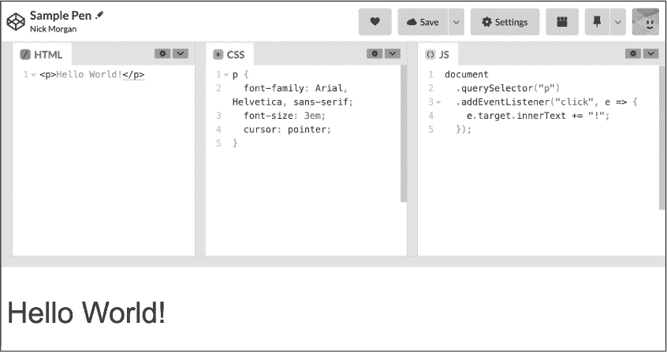

图 A-1：CodePen 上的示例 Pen

在 `HTML` 面板中，只需要 `body` 元素的内容。CodePen 会自动提供其余 `HTML` 结构。你也可以通过设置对话框轻松地引入外部 `JavaScript` 库。

### Glitch

像 CodePen 一样，Glitch 是一个为你托管代码并让你与世界共享的服务。Glitch 的独特之处在于它运行前端和后端代码的能力。它不仅仅为 `HTML`、`CSS` 和 `JavaScript` 提供面板，还允许你定义一个包含所有所需文件的完整目录结构。你甚至可以添加 `SQLite` 数据库来存储数据。访问 `https://glitch.com` 了解更多，或查看 `https://glitch.new` 从启动应用程序列表中进行选择。

## Web 开发

虽然本书的重点是 `JavaScript`，但在此过程中你也学习了一些通用的 Web 开发技能。如果这激发了你的兴趣，你可能想花更多时间学习 Web 开发的其他方面。

### HTML 和 CSS

`HTML` 是绝大多数网页编写的语言，因此对其细节有更深入的理解是有价值的。要了解更多信息，请查看 `https://developer.mozilla.org/HTML` 上的 MDN 文档。`CSS` 用于网页样式化，如果你想让页面看起来好看，那么理解它的工作原理至关重要。在 `https://developer.mozilla.org/CSS` 上的 MDN 上学习更多。

### JavaScript 框架和库

今天的 Web 开发非常复杂，Web 应用通常包含数以千行的 `HTML`、`CSS` 和 `JavaScript`。为了大幅减少编写一个功能完整的现代 Web 应用所需的代码量，许多开发者使用 `JavaScript` 框架和库。在本书编写期间，最流行的两个工具是 `React` 和 `Vue.js`。了解这些工具并非必须，但它们可以极大地简化构建复杂网站和前端应用程序的过程。你可以在 CodePen 中尝试 `React` 和 `Vue.js`，或者查看它们的网站：

- React: `https://reactjs.org`
- Vue.js: `https://vuejs.org`
- CodePen 上的 React: `https://codepen.io/topic/react/templates`
- CodePen 上的 Vue.js: `https://codepen.io/topic/vue/templates`

## 测试

对于程序员来说，一个必备工具是自动化测试框架。自动化测试设计为定期在你的代码上，以确认它符合你的预期。编写代码时的一个常见问题是在添加新功能时，没有意识到该更改弄坏了程序的某些部分。通过编写良好的测试并定期运行它们，你可以识别出东西坏掉的时刻并修复它。你还可以放心地对代码进行大规模重构，因为你知道只要测试通过，就不太可能弄坏了任何东西。

`JavaScript` 有大量的测试库和框架。在本书编写期间，最流行的之一是 `Jest`：可以在 `https://jestjs.io` 查看它。

## 更多 JavaScript！

如果你想加深对 `JavaScript` 的知识，有很多资源可供你使用。以下是一些关于入门的建议：

- MDN `JavaScript` 门户：`https://developer.mozilla.org/JavaScript`
- *Eloquent JavaScript*, 第 3 版，Marijn Haverbeke 著（No Starch Press, 2018）
- *JavaScript: The Definitive Guide*, 第 7 版，David Flanagan 著（O’Reilly Media, 2020）

## 其他语言

你现在可能决定拓宽你的编程知识，而不是深入研究 `JavaScript`。去尝试吧！你学习的每种语言都能让你对通用编程提供宝贵的见解，所以这实际上是提高 `JavaScript` 能力的一种极方法。

### TypeScript

人们对 `JavaScript` 产生的问题之一是它的弱类型、动态类型，这允许值根据周围的代码隐式转换为不同的数据类型。例如，如果另一个操作数是字符串，`+` 运算符会将数字操作数转换为字符串；而如果另一个操作数是数字，`-` 运算符会将字符串操作数转换为数字。

TypeScript 语言正尝试为 JavaScript 添加静态类型。`Static typing` 意味着某个特定类型的变量只能包含该类型的值，且类型之间的转换必须是显式的。TypeScript 在语法上是 JavaScript 的超集，这意味着一个有效的 JavaScript 程序也是一个有效的 TypeScript 程序。可以使用 TypeScript 编译器将 TypeScript 代转换为 JavaScript。

使用静态类型使得编写出带有某些特定 bug 的代码变得不再可能。例如，在 JavaScript 中，你可能会从文本框中获取一个值，假设它是一个数字，并将其与另一个数字相加。遗憾的是，文本框中的任何值都被视为字符串，因此另一个数字也会被隐式地转换为字符串，你最终将得到两个字符串的拼接结果。TypeScript 不允许这样做。它知道来自文本框的值是字符串，并强迫你决定是想将两个操作数都转换为字符串进行拼接，还是将两个操作数都转换为数字进行相加。

TypeScript 的缺点是，有时编写本认为应该可以运行的代码会变得困难。这有时被称为`与编译器斗争`（`fighting the compiler`）。

如果你想了解更多信息，这里有一些书籍和其他资源可以帮助你开始学习 TypeScript：

*   TypeScript 手册：[`www.typescriptlang.org/docs/handbook/intro.html`](https://www.typescriptlang.org/docs/handbook/intro.html)
*   `Effective TypeScript`，Dan Vanderkam 著（O’Reilly Media, 2019）
*   `Learning TypeScript`，Josh Goldberg 著（O’Reilly Media, 2022）

## Python

Python 是一种脚本语言，与 JavaScript 类似，但它有不同的哲学。该语言采用了“电池内置”的方法，这意味着它的标准库功能完备，包含了广泛的功能（相比之下，JavaScript 的标准库非常有限）。与 JavaScript 类似，Python 是动态类型的，因此同一个变量可以持有不同数据类型的值。但 JavaScript 是弱类型，而 Python 是`strongly typed`（强类型），这意味着没有隐式转换。在语法上，Python 看起来非常不同，它使用缩进（这是强制的而不是可选的）而不是括号来定义嵌套的代码块。

Python 是 Web 服务器以及科学和数值编程的流行语言。如果你想扩展自己的技能，它是一个很好的选择。接下来的这本书（与 `JavaScript Crash Course` 同一系列）是该语言的极佳介绍，它的项目突出了 Python 发挥优势的一些领域：

*   `Python Crash Course`，第 3 版，Eric Matthes 著（No Starch Press, 2023）

## Rust

我今天最感到兴奋的语言之一是 Rust。和 TypeScript 一样，它是一种静态类型语言，但它的类型系统比目前使用的大多数语言都要强大。Rust 旨在取代旧的语言 `C` 和 `C++` 来开发高性能代码。

`C` 和 `C++` 都是没有`garbage collection`（垃圾回收）的语言，即告诉哪些值和对象不再被使用以释放内存的过程。相反，`C/C++` 程序员必须手动释放不再使用的数据——这个过程很容易出错并经常会导致 bug。这些语言通常用于对性能敏感的环境，由于它们不使用垃圾回收是因为垃圾回收会降低软件性能。Rust 通过编译时的 `borrow checker`（借用检查器）避免这个问题，它会跟踪在任何时刻哪些对象正在使用，以及被程序的哪些部分使用。

Rust 还被用作编译为 WebAssembly 的源语言，这是一个在浏览器中运行极其高效高性能代码的兴奋的新技术。以下是一些学习更多信息的资源：

*   `The Rust Programming Language`，第 2 版，Steve Klabnik 和 Carol Nichols 著（No Starch Press, 2023）
*   Rust and WebAssembly：[`rustwasm.github.io/docs/book/`](https://rustwasm.github.io/docs/book/)

# INDEX

## SYMBOLS

*   `+=` (加法赋值运算符),18, 132
*   `+` (加法运算符),10, 20, 77
*   `&&` (与运算符),27, 33–34
*   `=` (赋值运算符),13
*   `\` (反斜杠),23
*   `` ` `` (反引号),24
*   `^` (脱字符符号),292
*   `--` (递减运算符),17, 64
*   `/=` (除法赋值运算符),18
*   `/` (除法运算符),11
*   `$` (美元符号),292
*   `==` (双等号),31
*   `"` (双引号),19
*   `//` (双斜杠),165, 292
*   `>` (大于符号),30
*   `>=` (大于等于符号),30
*   `#` (哈号),122, 215
*   `++` (递增运算符),17
*   `<` (小于符号),30
*   `<=` (小于等于符号),30
*   `*=` (乘法赋值运算符),18
*   `*` (乘法运算符),11
*   `!` (逻辑非运算符),28
*   `||` (逻辑运算符),27, 33–34
*   `()` (括号),79
*   `%` (百分号),301
*   `.` (点),123
*   `|` (竖线),241
*   `${}` (占位符语法)
*   `24` (pg_24)
*   `?` (问号)
*   `;` (分号),10
*   `'` (单引号),19
*   `[]` (方括号),21, 48–49
*   `!==` (严格不等等运算符),32
*   `=` (减法赋值运算符),18
*   `-` (减法运算符),11
*   `===` (三等号运算符),29

## A

*   `absolute positions`,262–263
*   `abstract classes`,98
*   `accidentals`,215
*   `addEventListener method`,129
*   `add function`,75–76
*   `addition assignment operator (+=)`,18, 132
*   `addition (+) operator`,20, 77
*   `adjustAngle function`,174
*   `ADSR envelope`,211–212
*   `AI (artificial intelligence)`,181
*   `alert function`,5
*   `Amazon S3 (Simple Storage Service)`,233
*   `ancestors`,114
*   `and operator (&&)`,27, 33–34
*   `animating`
*   `bar graphs`,296–297, 322–324
*   `canvas elements`,152–153
*   匿名函数, 80, 153
*   APIs (应用编程接口), 115
*   身份验证过的 APIs, 302–303
*   Canvas API, 144, 256
*   DOM API, 115–116, 129
*   GitHub Search API, 299–328
*   JSON API, 300
*   Web Audio API, 206–209
*   追加的元素, 275
*   arc 方法, 146–147
*   参数, 21
*   定义, 5
*   参数对比, 75
*   将函数作为传递, 74, 78–79
*   数组, 38–47
*   二维数组, 39–41
*   创建和索引, 38–39
*   方法, 41–47
*   向数组添加元素, 42
*   合并数组, 44–45
*   查找数组中元素的索引, 45
*   从数组中删除元素, 43–44
*   将数组转换为字符串, 45–46
*   嵌套
*   在控制台中中探索嵌套对象, 54–55
*   使用字面量, 52–53
*   使用 `JSON.stringify` 打印嵌套对象, 55–56
*   使用变量, 53–54
*   接收回调函数, 85–87
*   `arr.includes(elem)` 方法, 46
*   箭头函数, 82–83
*   `arr.reverse()` 方法, 46
*   `arr.slice(start, end)` 方法, 46–47
*   `arr.sort()` 方法, 46
*   `arr.splice(index, count)` 方法, 47
*   人工智能 (AI), 181
*   赋值运算符 (`=`), 13
*   攻击, ADSR, 211–212, 234
*   属性, 116–118
*   `attr` 方法, 269
*   音频上下文, 207–208
*   身份验证过的 APIs, 302–303
*   轴
*   绘制, 305–307
*   标记, 288–291
*   左侧标记, 318–319
## B
*   后端代码, 303
*   反斜杠 (`\`), 23
*   反引号 (``), 24
*   球, Pong, 161–162, 195–197
*   带通滤波器, 226
*   带宽方法, 287
*   柱状图, 279–297, 304–319
*   动画变化, 296–297
*   计算字符频率, 280–282
*   清理数据, 295
*   柱子上编码, 314–318
*   创建元素, 304–305
*   绘制, 282–291
*   轴, 305–307
*   柱子, 308–309
*   标记的轴, 288–291
*   缩放柱子, 284–288
*   标记左轴, 318–319
*   设置, 279–280
*   显示仓库信息, 310–314
*   使用 CSS 和正则表达式进行样式化, 292–295
*   基线, 257
*   低音线, 240–242
*   每分钟拍数 (BPM), 217
*   `bezierCurveTo` 方法, 147
*   绑定, 12–16
*   常量, 14–15
*   命名规范, 15–16
*   变量, 13–14
*   块体, 82–83
*   结构的主体, 59
*   函数, 74
*   body 元素, 113
*   布尔值, 26–30
*   比较运算符, 29–30
*   作为条件, 60–60
*   逻辑运算符, 27–28
*   使用表面, 171
*   靠近末端, 174–175
*   概述, 165–166
*   BPM (每分钟拍数), 217
*   大括号, 63
*   冒泡事件, 130
## C
*   回调函数, 85–87** 自定义函数, 88–89
*   定义, 78
*   事件处理器, 129
*   调用函数, 74
*   参数类型, 75
*   返回值, 76–77
*   副作用, 77–78
*   调用, 21
*   `call` 方法, 289
*   驼峰命名法, 15
*   C 和 C++, 334
*   Canvas API, 144, 256
*   Canvas 元素, 141–144
*   动画, 152–153
*   创建, 144–145
*   绘制 Pong, 160–161
*   交互, 147–151
*   绘制静态图形, 142–147
*   使用路径绘制形状, 145–147
*   绘制矩形, 144–145
*   插入符号 (caret/caret) 符号 (`^`), 292
*   级联样式表. 参见 CSS
*   大小写敏感, 15
*   CDN (内容分发网络), 210
*   链式...else 语句, 61–63
*   链式方法, 130, 269
*   变化事件处理器, 151–152
*   字符, 280–282
*   来自字符串, 21–22
*   `checkCollision` 函数, 165–166
*   子元素, 114
*   和弦, 240–242
*   Chrome
*   访问 JavaScript 控制台, 4
*   在控制台中调用函数, 75–76
*   在控制台中探索嵌套对象, 54–55
*   缩进, 40
*   Web Audio API, 206
*   圆形元素, 260–261
*   高级连接, 276–279
*   数据绑ning, 270–271
*   数据连接, 271–273
*   类属性, 122
*   类, 93–108
*   创建实例和, 94–97
*   继承, 97–101
*   基于原型的继承, 101–108
*   比较构造函数和类, 104–105
*   探索 `Object.prototype`, 105–106
*   覆盖方法，107–108
*   使用构造函数和原型，102–104
*   遍历原型链，106–107
*   类选择器，123
*   清理数据，295
*   `clearInterval` 函数，83
*   `clearRect` 方法，151
*   点击处理器，148
*   时钟, JavaScript, 220–221
*   闭包，90
*   CodePen, 331
*   强制转换，30–35, 77
*   相等于，31–32
*   真值，32–35
*   碰撞检测
*   弹跳，165–166
*   定义，163–164
*   在面向对象的乒乓球游戏中，195–197
*   用于挡板，170–173
*   颜色
*   颜色编码条形，314–318
*   RGBA 颜色，150
*   RGB 颜色，261
*   振荡器声音作为，213
*   合并数组，44–45
*   合并对象，51–52
*   注释，165
*   比较运算符，29–30
*   完整代码
*   GitHub Search API，325–328
*   乒乓球，185–188
*   歌曲创作，247–252
*   组合，199
*   复合数据类型，37–56
*   数组，38–47
*   数组的数组，39–41
*   创建和索引，38–39
*   方法，41–47
*   嵌套对象和数组，52–56
*   在控制台中探索嵌套对象，54–55
*   使用字面量，52–53
*   使用 `JSON.stringify` 打印嵌套对象，55–56
*   使用变量，53–54
*   对象，47–52
*   在...访问访问，48
*   创建，47–48
*   为...赋值，49
*   使用，49–52
*   复合表达式，10
*   `Computer` 类，197–198
*   计算机控制，180–182
*   `concat` 方法，44
*   简洁体语法，82–83
*   具象类，98
*   控制结构中的条件，58
*   条件语句，57–63
*   链式 if…else 语句，61–63
*   复杂条件，60–61
*   if…else 语句，59–60
*   `if` 语句，58–59
*   `console.log` 方法，23
*   常量
*   命名规范，15–16
*   概述，14–15
*   静态，194
*   `const` 关键字，13, 16
*   构造函数，49, 95, 102–104
*   比较类与，104–105
*   定义，101
*   内容，元素，112
*   内容交付网络 (CDN),210
*   控制结构
*   条件语句，57–63
*   链式 if…else 语句，61–63
*   复杂条件，60–61
*   if…else 语句，59–60
*   `if` 语句，58–59
*   循环，63–71
*   `for…in` 循环，70–71
*   `for` 循环，65–66
*   `for…of` 循环，67–69
*   `while` 循环，63–64
*   CSS (层叠样式表),120–124
*   flexbox 布局，311–312
*   link 元素，120
*   规则，121
*   选择器
*   概述，121–124
*   在 JavaScript 中使用，124–125
*   为条形图设置样式，292–295
*   为元素设置样式，264–266
*   D3 库，255–297
*   高级，276–279
*   条形图，279–297
*   数据绑定，270–271
*   数据连接，271–273
*   实时更新，273–275
*   选择器，269–270
*   设置，268
*   SVG 格式，256–268
*   在 JavaScript 中使用，266–268
*   路径，261–264
*   绘制圆，260–261
*   分组，259–261
*   属性，267–268
*   转换，275–276
*   数据驱动文档。*See* D3 库
*   D3 库，255–297
*   高级，276–279
*   条形图，279–297
*   数据绑定，270–271
*   数据连接，271–273
*   实时更新，273–275
*   选择器，269–270
*   设置，268
*   SVG 格式，256–268
*   在 JavaScript 中使用，266–268
*   路径，261–264
*   绘制圆，260–261
*   分组，259–261
*   属性，267–268
*   转换，275–276
*   GitHub Search API，299–328
*   添加交互性，319–324
*   基础可视化，304–309
*   完整代码，325–328
*   获取数据，300–304
*   改进可视化，310–319
*   设置，300
*   衰减、ADSR，211–212
*   分贝 (dB),212
*   声明
*   定义，13
*   在规则集中，121
*   与初始化分离，178–179
*   声明函数，74–78
*   参数类型，77
*   返回值，75–76
*   侧效应，77–78
*   递减，16–19
*   加和减法赋值，18
*   乘法和赋值，18
*   递减运算符 (`--`), 17, 64
*   事件委托, 131–134
*   德·摩根律，28
*   descendants, 114
*   后代选择器, 123
*   解构赋值, 69
*   distanceTo 方法, 98–100
*   div 元素, 135, 148
*   除法赋值运算符 (`/=`), 18
*   doctype, 113
*   document 对象, 115
*   文对象模型 (DOM), 114–118
*   DOM API, 115–116
*   元素标识符, 116–118
*   document.querySelectorAll 方法, 124
*   document.querySelector 方法, 160–161
*   美元符号 (`$`), 292
*   域, 284
*   DOM API, 115–116, 129
*   点表示法, 48–49
*   双等号 (`==`) 运算符, 31
*   双引号 (`"`), 19
*   doubler 函数, 88
*   drawCircle 函数, 149–150
*   draw 函数, 163
*   绘图上下文, 143
*   draw 方法, 192
*   鼓声, 224–232
*   鼓点循环, 230–232
*   镲片合成, 224–226
*   底鼓合成, 228
*   制作鼓点, 237–240
*   混响, 228–230
*   军鼓合成, 226–227
*   动态类型编程语言, 77
*   动态可视化, 256
## E
*   八分音符, 217
*   元素
*   这里的基础可视化, 304–305
*   定义, 112
*   游戏, 193–197
*   球, 195–197
*   挡板, 194
*   else if 子句, 61–62
*   em 元素, 128
*   空字符串, 31–32
*   封装, 190–191
*   enter 元素, 277
*   实体超类, 194
*   带有类型转换的相等性, 31–32
*   错误消息, 14–15
*   转义序列, 23–24
*   求值, 10
*   基于事件编程, 127–139
*   事件处理器, 128–134
*   事件冒泡, 130
*   事件委托, 131–134
*   键盘事件, 137–138
*   鼠标移动事件, 134–136
*   exit 元素, 277
*   表达式, 10
*   可扩展标记语言 (XML), 256
## F
*   假值, 32–33
*   获取数据, 300–304
*   fillRect 方法, 143, 161–162
*   fillStyle 属性, 143
*   通过许可证过滤数据, 319–322
*   filter 方法, 86
*   find 数组方法, 85–86
*   一等公民, 78
*   flat, 215
*   flexbox 布局, 311–312
*   浮点数, 11–12
*   FM (频率调制), 240
*   FM 合成, 240–241
*   焦点, 137
*   for...in 循环, 70
*   for 循环, 65–66
*   for...of 循环, 67–69
*   正向斜杠 (`/`), 165–166, 292
*   频率, 280–282
*   频率调制, 240
*   前端代码, 303–304
*   函数声 declaration, 74–79
*   函数表达式 (字面量), 80–82
*   函数关键字, 74
*   箭头函数, 73–81
*   这里的, 77–78
*   返回值, 75–76
*   侧效应, 70
*   定义的,
*   高阶函数, 85–90
*   接收回调函数, 85–87
*   接收回调的自定义函数, 88–89
*   接收回调的函数, 89–90
*   这里的,
*   传递, 84
*   基础, 214
## G
*   节点, 208–214
*   游戏类, 198–201
*   面向对象, 189–190
*   设计, 190–191
*   文件结构, 191
*   游戏类, 193–197
*   游戏元素, 195–197
*   挡板类, 194
*   这里的游戏, 198–201
*   碰撞, 159–162
*   完整代码, 185–188
*   控制, 180–182
*   绘图球, 161–162
*   游戏循环, 163–165
*   游戏结束, 182–184
*   概述, 159–160
*   挡板, 166–175
*   重构, 162–163
*   评分, 176–180
*   设置, 160–161
*   游戏循循环, 163–165
*   游戏结束, 182–184
*   游戏视图类, 191–193
*   g 元素, 258–259
*   获取上下文, 143
*   按 ID 获取元素, 117
*   Git, 330
*   GitHub, 331
*   GitHub 搜索 API, 299–328
*   添加交互性, 319–324
*   动画化变化, 322–324
*   绘制轴，305–307
*   绘制柱图，308–309
*   完整代码，325–328
*   获取数据，300–304
*   改进可视化，310–319
*   柱状图颜色编码，314–318
*   给左轴标记标签，318–319
*   显示仓库信息，310–314
*   设置，300
*   Glitch，331
*   Google Chrome。查看 Chrome
*   大于 (`>`)，30
*   大于等于 (`>=`)，30
*   元素分组，258–259
## H
*   处理器，事件，128–134
*   事件冒泡，130
*   事件委托，131–134
*   歌曲创作，236–237
*   和声，214
*   井号标记 (`#`)，122–123, 215
*   `hasOwnProperty` 方法，105
*   head 元素，113, 119
*   进制颜色（十六进制颜色语法），260–261
*   隐藏许可证，319–322
*   高阶函数，85–90
*   接收回调的数组方法，85–87
*   接收回调的自定�函数，88–89
*   返回函数的函数，89–90
*   镲帽合成，224–226
*   `:hover` 伪类，133
*   `href` 属性，119
*   HTML（超文本标记语言），111–125, 332
*   创建 HTML 文档，112–113
*   CSS，120–124
*   链接元素，120
*   规则集，121
*   选择器，121–124
*   定义，5–6
*   DOM，114–118
*   DOM API，115–116
*   元素标识符，116–118
*   嵌套关系，114
*   script 元素，118–119
*   在 JavaScript 中使用 CSS 选择器，124–125
## I
*   `id` 属性，116
*   标识符，13
*   `ID` 选择器，122
*   if…else 语句
*   链式，61–63
*   包括 keydown 处理器，138
*   概述，59–60
*   if 语句，58–59, 179–180
*   递增，16–19
*   加/减法赋值，18
*   乘/除法赋值，18
*   递增运算符 (`++`)，17
*   缩进，40, 113
*   数组中的索引，38–39
*   在数组中查找元素的索引，45
*   字符串中，21–22
*   `indexOf` 方法，45
*   无限循环，65
*   继承，97–101
*   初始化，13, 178–179
*   内联元素，122
*   `innerText` 属性，117
*   输入元素，148
*   `instanceof` 关键字，100
*   实例，创建，94–97
*   交互性，319–324
*   动画变化，322–324
*   使用 canvas 元素，147–151
*   过滤数据，319–322
*   可视化，256
## J
*   为 SVG 添加交互性，266–268
*   绑定，12–16
*   常量，13–14
*   命名规范，15–16
*   变量，14
*   布尔值，26–30
*   比较运算符，27–29
*   逻辑运算符，29–30
*   类，93
*   创建实例，94–97
*   继承，97–101
*   基于原型的继承，101–108
*   类型转换，30–35
*   复合类型，37–56
*   数组，38–47
*   嵌套对象数组，52–56
*   对象，47–52
*   条件判断，57–63
*   转义序列，23–24
*   表达式和语句，10
*   框架和库，332
*   函数，73–91
*   箭头函数，82–83
*   声明与调用，74–78
*   函数表达式，80–82
*   高阶函数，85–90
*   传递参数，78–79
*   剩余参数，84–85
*   递增和递减，16–19
*   加/减法赋值，18
*   乘/除法赋值，18
*   循环，63–71
*   数字和运算符，10–12
*   浮点数，11–12
*   运算顺序，11
*   字符串，19–23
*   获取长度，20–21
*   获取字符，21
*   获取多个字符，21–22
*   合并，20
*   去除空白，22
*   模板字符串量，24–26
*   未定义和空，26
*   在使用 CSS 选择器时，124–125
## K
*   键盘事件，137–138
*   keydown 事件，137–138
*   key 函数，275–276
*   键，对象
*   定义, 47
*   获取, 49–50
*   获取值和, 50–51
*   键值对, 47
*   关键字, 13
*   踢鼓合成, 228
## L
*   有标签轴, 288–291
*   标签 元素, 148–149
*   左对齐文本, 177
*   length 属性, 20–21
*   小于 (<), 30
*   小于等于 (<=), 30
*   let 关键字, 13, 16
*   许可证
*   通过过滤数据, 319–322
*   名称, 315–318
*   li 元素, 131
*   lineTo 方法, 146
*   link 元素, 120
*   监听器, 事件, 129
*   字面量
*   定义, 10
*   与...嵌套, 52–53
*   逻辑运算符, 27–28
*   前瞻时间, 221
*   循环变量, 65–66
*   循环, 63–71
*   for…in 循环, 70–71
*   for 循环, 65–66
*   for…of 循环, 67–69
*   while 循环, 63–64
## M
*   makeAppender 函数, 90
*   map 数组方法, 86–87
*   匹配元素, 121
*   Math.hypot 方法, 98
*   MDN (Mozilla Developer Network) Web Docs, 147, 263, 292
*   元数据, 113
*   方法
*   数组的, 41–47
*   向数组添加元素, 42
*   合并数组, 44–45
*   在数组中查找元素索引, 45
*   从数组中移除元素, 43–44
*   将数组转换为字符串, 45–46
*   链式调用, 130, 269
*   定义, 21
*   函数对比, 94
*   覆盖, 107–108
*   中音 C, 215
*   单音合成器, 216
*   等宽字体, 177
*   鼠标移动事件, 134–136, 169
*   move 方法, 95–97
*   moveTo 方法, 146
*   Mozilla Developer Network (MDN) Web Docs, 147, 263, 292
*   多维数组, 39
*   乘法赋值运算符 (*=), 18
*   音乐项目, 205–252
*   制作声音, 224–232
*   鼓点循环, 230–232
*   镲合成, 224–226
*   踢鼓合成, 228
*   回响, 228–230
*   小军鼓合成, 226
*   采样, 232–234
*   歌曲创作, 235–252
*   添加低斯线, 240–242
*   添加和弦, 242
*   完整代码, 247–252
*   事件处理, 236–237
*   组织, 235–236
*   制作鼓点, 237–240
*   播放旋律, 244–246
*   Tone.js 库, 210–217
*   使用...生成音色, 210
*   在序列中播放更多音符, 215–216
*   同时播放多个音符, 216–217
*   Tone.Synth 参数, 211–215
*   Tone.js 传输, 217–224
*   Tone.Loop, 218–220
*   Tone.Part, 223–224
*   Tone.Sequence, 211–222
*   Web Audio API, 206–209
*   使用...生成音色, 210–210
*   设置, 206–207
*   变异, 41
## N
*   命名函数, 81
*   命名规范，15–16
*   类, 95
*   构造函数, 102
*   关系, 114
*   嵌套, 52–56
*   元素, 112
*   在控制台中中对象, 54–55
*   使用字面量, 52–53
*   使用 `JSON.stringify` 打印嵌套对象, 55–56
*   变量, 53–54
*   new, 96
*   方法, 291
*   Node.js, 303
*   NodeList, 124–125
*   节点, 206
*   在序列中播放, 215–216
*   同时播放多个音符, 216–217
*   `!` 运算符, 28
*   null 值, 26
*   字面量, 10–12
*   浮点数, 11–12
*   顺序, 11
## O
*   `Object.assign` 方法, 51–52
*   `Object` 构造函数, 105
*   `Object.entries` 方法, 71
*   `Object.keys` 方法, 49–50
*   对象字面量, 47
*   字面量简写语法, 238
*   面向对象 Pong, 189–202
*   设计, 190–191
*   文件结构, 191
*   `Game` 类, 198–201
*   游戏元素, 193–197
*   球, 195–197
*   挡板, 194
*   `GameView` 类, 191–193
*   分数和电脑类, 197–198
*   开始游戏, 201
*   面向对象编程, 93
*   `Object.prototype`, 105–106
*   对象, 47–52
*   在...中值, 48
*   创建, 47–48
*   获取对象的键和值，50–51
*   `offsetX` 和 `offsetY` 属性，150
*   开源代码所有者，304
*   开源仓库，299
*   操作数，27
*   运算符，10–12
*   定义，10
*   浮点数，11–12
*   运算符优先级，11
*   可选链运算符，313
*   运算符优先级，11
*   或运算符 (`||`），27–28, 33–34
*   振荡器，208
*   轮廓矩形，绘制，144–145
*   方法重写，107–108
*   泛音，214
## P
*   挡挡板，Pong 游戏，166–175
*   在边缘附近反弹，174–175
*   碰撞检测，170–173
*   元素，194
*   随输入移动，169–170
*   参数，74
*   参数与参数，75
*   函数，77
*   剩余参数，84–85
*   父元素，114
*   括号 `()`，79
*   路径元素 (path)，261–264
*   使用路径绘制形状，145–147
*   p 元素，112
*   PEMDAS 规则，11
*   五声音阶，219
*   百分比 (`%`) 字符，301
*   周期 (`.`),123
*   管道字符 (`|`)，241–242
*   占位符语法 (`${}`),24–25
*   玩家输入，移动挡板，169–170
*   多态，191
*   多音节合成器，216–217
*   Pong 游戏，159–202
*   反弹，165–166
*   完整代码，185–188
*   计算机控制，180–182
*   绘制球，161–162
*   游戏循环，163–165
*   游戏结束，182–184
*   面向对象的 Pong 游戏，189–202
*   设计，190–191
*   文件结构，191
*   `Game` 类，198–201
*   游戏元素，193–197
*   `GameView` 类，191–193
*   `Scores` 和 `Computer` 类，197–198
*   启动游戏，201
*   概述，159–160
*   挡挡板，166–175
*   在边缘附近反弹，174–175
*   碰撞检测，170–173
*   随输入移动，169–170
*   重构，162–163
*   评分，176–180
*   设置，160–161
*   `pop` 方法，43
*   后置自增与自减，17
*   前置自增与自减，17
*   前置元素，275
*   打印嵌套对象，55–56
*   项目
*   数据可视化
*   D3 库，255–297
*   GitHub Search API，299–328
*   游戏创建
*   面向对象的 Pong 游戏，189–202
*   Pong 游戏，159–188
*   制作音乐
*   生成声音，205–252
*   歌曲创作，235–252
*   属性，定义，20
*   基于原型的继承，101–108
*   比较构造函数和类，104–105
*   探索 `Object.prototype`，105–106
*   方法重写，107–108
*   使用构造函数和原型，102–104
*   遍历原型链，106–107
*   `Prototype` 属性，55
*   伪类，133, 266
*   `push` 方法，42
*   Python 语言，334
## Q
*   `quadratic` 方法，147
*   `querySelectorAll` 方法，124
*   问号 (?)，301
## R
*   范围，284
*   频率限制，78
*   React 语言，332
*   实时更新，273
*   接收，94
*   矩形，绘制，144–145
*   重构，162–163
*   正则表达式，292–295
*   关系，97
*   相对位置，262–263
*   返回，119
*   释放，211–212
*   剩余参数，84–85
*   剩余，228–230
*   `return` 关键字，89
*   返回值，75–76
*   副作用，77–78
*   `RGBA` 颜色，150
*   `RGB` 颜色，261
*   旋转，177
*   规则，121–124
## S
*   采样，232–234
*   D3 中的条形图，284–288
*   SVG 支持，258
*   作用域，67–79
*   `Scores` 类，197–198
*   评分，176–180
*   脚本元素，6–118
*   选择，269–270
*   概述，121–124
*   在 JavaScript 中使用，124–125
*   自文档化，87
*   分号 (;),10
*   `Set` 构造函数，315
*   `setInterval` 函数，83
*   `setTimeout` 函数，79–82
*   阴影，108
*   使用路径绘制形状，145–147
*   锐利，215
*   `shiftKey` 属性，267
*   `shift` 方法，43–44
*   短路, 34
*   兄弟节点, 114
*   侧边栏, 310–314
*   侧效应, 77–78
*   简单存储服务 (Amazon S3), 233
*   正弦波, 208
*   单引号 ('), 19
*   十六六音符, 217
*   倾斜, 258
*   `slice method`, 21–22
*   滑块, 148
*   snake_case, 15
*   军军器合成, 226–227
*   歌曲创作, 235–252
*   添加贝斯线, 240–242
*   添加和弦, 242–244
*   完整代码, 247–252
*   事件处理, 236–237
*   整理思路, 235–236
*   制作鼓点, 237–240
*   演奏曲律, 244–246
*   span 元素, 310–311
*   方括号 ([]), 21, 48–49
*   src 属性, 119
*   开始游戏, 201
*   状态, 152
*   语句, 10
*   静态类型语言, 77
*   静态绘制, 142–147
*   轮廓矩形, 144–145
*   使用路径, 145–147
*   静态方法, 49, 198
*   静态属性, 194
*   严格不等于运算符 (!==), 32


-   `str.includes(otherStr)` 方法, 23

-   字符串字面量, 19

-   字符串, 19–23

-   从...获取字符, 21

-   从...获取多个字符, 21–22

-   合并, 20

-   去除空白符, 22

-   将数组转换为, 45–46

-   `strokeRect` 方法, 144

-   strong 元素, 122–123

-   `str.padStart(num, char)` 方法, 23

-   `str.repeat(count)` 方法, 23

-   `str.toLowerCase()` 方法, 23

-   子类, 97

-   子表达式, 171

-   减赋值运算符 (-=), 18

-   父类, 97

-   super 关键字, 99

-   持续, ADSR, 211–212

-   SVG (可缩放矢量图形)格式, 256–268

-   使用 JavaScript 增加交互性, 266–268

-   定义路径, 261–264

-   绘制圆形, 260–261

-   元素分组, 258–259

-   使用 CSS 样式化元素, 264–266

-   SvgPathEditor, 263

-   语法糖, 101

## T

-   标筓, 6, 112

-   模板字面量, 24–26

-   测试, 332–333

-   文本编辑器, 5–6

-   this 关键字, 95–97

-   井字棋游戏, 39–41

-   音色, 213

-   时间, Web Audio API, 220–221, 296–297, 29, [153–154](#chapter9.xhtml_pg_153

-   URL 编码, [301–301](#chapter15.xhtml_pg_301

-   URL, [300](#chapter15.xhtml_pg_30

## V

-   有效标识符, [48–49](#chapter3.xhtml_pg_48

-   访问, [48–49](#chapter3.xhtml_pg_48

-   设置, [49](#chapter3.xhtml_pg_49

-   命名规范, [15–16](#chapter2.xhtml_pg_15

-   嵌套, [53–54](#chapter3.xhtml_pg_53

-   变量, [13–14](#chapter2.xhtml_pg_13

-   `var` 关键字, [13](#chapter2.xhtml_pg_13

-   矢量图形, [256](#chapter14.xhtml_pg_256

-   可视化, [304–309](#chapter15.xhtml_pg_304

-   D3 库, [255–257](#chapter14.xhtml_pg_255

-   高级连接, [276–277](#chapter14.xhtml_pg_276

-   柱状图, [279–297](#chapter14.xhtml_pg_279

-   数据绑定, [270–271](#chapter14.xhtml_pg_270

-   数据连接, [271–273](#chapter14.xhtml_pg_271

-   实时更新, [273–275](#chapter14.xhtml_pg_273

-   选择器, [269–270](#chapter14.xhtml_pg_269

-   设置, [268](#chapter14.xhtml_pg_268

## W

* W3C (World Wide Web Consortium), 206

* 遍历原型链, 106–107

* Web Audio API, 206–209

* 使用...生成音频, 207–209

* 设置, 206–207

* Web 开发, 332

* while 循环, 63–64

* 白噪声, 224

* 空格, 22, 295

* 世界维网联盟 (W3C), 206

## X

* XML (可扩展标记语言), 256

## Z

* 零基础索引, 21, 38, 218
