# Javascript：创建动态交互式网页

创建彩色动态交互式网页


通俗易懂 • 全图解 • 易于上手

# JavaScript 术语

| 术语 | 说明 |
|---|---|
| 脚本块 (Script block) | HTML `<script>` 和 `</script>` 标签之间的所有 JavaScript 代码和注释 |
| 变量 (Variable) | JavaScript 代码中用于存储数字、文本字符串或布尔值（true/false）的容器 |
| 初始化 (Initialize) | 为 JavaScript 变量分配初始值 —— 可以在声明时或稍后在脚本中进行 |
| 调用 (Call) | 在脚本中引用函数名来调用 JavaScript 函数 |
| 函数 (Function) | 在脚本块中定义一次的 JavaScript 代码，但可以多次调用 |
| 参数 (Argument) | 调用者传递给函数的值，供待执行的代码使用 |
| 表达式 (Expression) | 使用 JavaScript 运算符结合两个变量或字面量以产生结果的代码 |
| 语句 (Statement) | 始终以分号结束的单个完整 JavaScript 指令 |
| 语句块 (Statement block) | 每次被函数调用时要执行的语句 |
| For 循环 (For loop) | 按指定次数重复执行某些 JavaScript 代码的语句 |
| While 循环 (While loop) | 只要测试条件满足，就会在 JavaScript 中重复执行某些代码的语句 |
| 条件分支 (Conditional branching) | 仅在测试条件满足时执行某部分代码，否则执行另一部分代码的语句 |
| 多路分支 (Multi-way branching) | 评估给定表达式并执行与该结果相关的代码或执行某些默认代码的语句 |
| 返回 (Return) | JavaScript 函数中执行语句的最终结果，并传回给调用者 |
| 截止日期 |  |
| - for - in 循环 | 37 |
| - do - while 循环 | 39 |
| - 添加更多元素 | 47 |
|  |  |
| - 当前时间 | 57 |
| - 时区 | 59 |
| - 取消计时器 | 63 |
|  |  |
|  |  |
| - 字符串中的变量 | 85 |
|  |  |
| - 历史记录 | 99 |
| - 聚焦 | 101 |
| - 弹出窗口功能 | 103 |
| - 获取大小 | 105 |
| - 设置 cookie | 111 |
| - 图片数组 | 113 |
| - 动态内容 | 115 |
| - 坐标 | 117 |
| - JavaScript 协议 | 121 |
| - 弹出菜窗口 | 126 |
| - 刷新 | 128 |
| - 表单元素 | 130 |
| - 复选框 | 132 |
| - 文本区域 | 136 |
| - 重置 | 138 |
| - 电子邮件验证 | 140 |
| - 加载和卸载 | 149 |
| - 聚焦和失焦 | 150 |
| - 动态选项 | 167 |
| - 获取客户详情 | 172 |
| - 确认订单 | 174 |
| - 接下来做什么？ | 176 |

# 介绍 JavaScript

欢迎来到 JavaScript 世界。本章介绍了 JavaScript 语言，并说明了如何将其添加到 HTML 文档中。列出了所有的关键字，并解释了函数和变量的基础。

- 数据类型 14
- 函数 16
- 多个函数 18
- 多个参数 20

# 第一章

## 引言

JavaScript 是一种解释型编程语言，其解释器嵌入在 Microsoft Internet Explorer 和 Netscape Navigator 等网络浏览器软件中。这意味着每当网页文档加载到浏览器窗口时，其中的脚本就可以被浏览器的 JavaScript 引擎读取。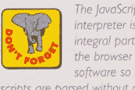 通过这种方式，网页文档可以对用户的操作做出响应并执行动态视觉效果。JavaScript 不应与 Sun 公司的编译型编程语言 Java 混淆，尽管两者某些相似之处，但它是完全不同的语言。JavaScript 语言包含许多令人深刻的功能，但出于安全考虑，它不能读取或写入文件，用于存储少量数据的 cookie 文件除外。本书关注创建交互式网页时最有用的 JavaScript 核心和客户端功能。学习基础知识是重要的，因此首先通过示例章节涵盖了语言机制，解释了如何编写 JavaScript 程序。然后，介绍了浏览器的文档对象模型 (DOM)，以说明所有网页都包含可以使用 JavaScript 操作的对象及其属性。将 JavaScript 与 DOM 知识相结合，可以创建强大的动态 HTML (DHTML) 效果。本书的最后一部分包含了使用 JavaScript 创建流行 DHTML 效果的示例，并附带完整的源代码，可用于任何网页。

## 在 HTML 中引入 JavaScript

为了在 Web 文档中引入 JavaScript，可以在 HTML 代码中定义脚本块（script block）。

脚本块可以定义在 HTML 代码的任何位置，尽管通常位于文档的 `head` 部分，即 `<head>` 和 `</head>` 标签之间。

当浏览器加载文档时，它会按顺序读取（解析）。因此，将脚本块放在文档的 `head` 中可以确保 JavaScript 代码在其余 HTML 代码和文档 `body` 内容之前被解析。

脚本块看起来像这样：

```
<script type = "text/javascript">
</script>
```

实际代码可以添加到 HTML 的 `<script>` 和 `</script>` 标签之间。

或者，也可以将所有的 JavaScript 代码写在一个 JavaScript 文件中，从而将 JavaScript 代码与 HTML 代码分离。这仅仅是一个文本文档，以 `.js` 扩展名保存，且不包含任何 HTML 标签。

脚本引用仍应放置在文档的某个部分，并使用 `src` 属性将浏览器指向 JavaScript 文件的 URL 地址，如下例所示：

```
<script type = "text/javascript" src = "mycode.js">
</script>
```


注意，仍然需要 `<script>` 闭合标签。

这种方法比在 HTML 文档的脚本块中编写代码更好，因为它使代码更易维护，避免了 JavaScript 和 XML 之间的冲突，并允许 JavaScript 代码被多个 HTML 文档访问。

本书中列出的所有 JavaScript 示例都编写在 JavaScript 文件中，文件名与其对应的 HTML 文件相同。例如，`hello.html` 调用 `hello.js` 中的 JavaScript 代码。

要显示 JavaScript 警告对话框，只需调用内置的 JavaScript `alert()` 函数，如下：

```javascript
alert("Hello World");
```


现在可以通过添加指定类型和 URL 地址的 `<script>` 元素将此脚本包含在 HTML 文档中：

```html
<head>
  <title>Hello World</title>
  <script type="text/javascript" src="hello-alert.js"></script>
</head>
```

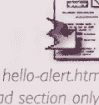

当此文档加载到 Web 浏览器时，JavaScript 引擎会执行 JavaScript 代码中包含的指令。

在这种情况下，JavaScript 代码会导致浏览器打开一个 `alert()` 对话框，带有括号内包含的消息。

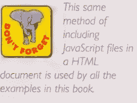

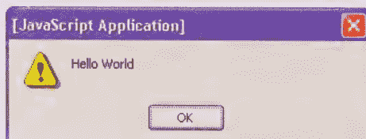

括号内的引号不会作为消息的一部分出现，因为它们仅被 JavaScript 用于表示字符字符串，该字符串是消息本身的文本内容。

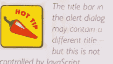

JavaScript 中的所有文本字符串都是以这样包含的。

## 语法规则

注意，每个 JavaScript 语句末尾都有分号，以符合所需的语言规则——就像英语规则中使用句号来结束句子一样。最重要的是，JavaScript 是一种区分大小写的语言，"ALERT"Alert" 和 "alert" 被视为不同的单词。所有的 JavaScript 关键字仅全小写，因此在代码中使用 `ALERT("Hello World")` 或 `Alert("Hello World")` 不会调用 JavaScript `alert()` 函数。空格、制表符和换行统称为空白字符，JavaScript 完全忽略它们，因此可以对代码进行格式化和缩进，使其易于阅读。通过在整个代码中使用小写可以避免大小写问题。添加注释作为说明通常很有用。解析器将 `//` 到该行结束之间的任何文本视为单行注释，并会忽略它。同样，`/*` 和 `*/` 之间的一个或多行的任何文本也被作为多行注释被忽略。

```javascript
/* 这里是对此脚本代码的介绍 */
// 这是一个单行注释
// 显示问候语
alert("Hello World");
```


应避免过度的注释——这会大大增加 JavaScript 文件的大小。

### 关键字

下表包含了 JavaScript 语言的关键字。在为变量、函数或标签选择标识符名称时，不能使用这些词：

| break | do | function | null | typeof |
|---|---|---|---|---|
| case | else | if | return | var |
| continue | export | import | switch | void |
| default | false | in | this | while |
| delete | for | new | true | with |

此外，JavaScript 预留了下表列出的所有单词以备未来纳入 JavaScript 语法——虽然需要避免的单词看起来很多，但这很少是一个真实的问题——这只是需要记住的一。

| abstract | debugger | goto | package | synchronized |
|---|---|---|---|---|
| boolean | double | implements | private | throw |
| byte | enum | instanceof | protected | throws |
| catch | extends | int | public | transient |
| char | final | interface | short | try |
| class | finally | long | static | |
| const | float | native | super | |

### 变量

在命名变量时，可以使用任何字母、数字和下划线字符 `_`，但变量名不能与数字开头。这些都是有效的变量名：

```javascript
abc
my_first_variable
var123
```

使用 JavaScript `var` 关键字创建一个新变量：

```javascript
// 创建一个变量并赋值一个字符串
var message = "My First JavaScript Variable";
// 显示存储在变量中的值
alert( message );
```

文本字符串存储在名为 `message` 的变量中。在调用 JavaScript `alert()` 函数时使用了该变量名，打开警告对话框显示存储在 `message` 变量中的字符串。

### 数据类型

JavaScript 是一种弱类型语言，因此它的变变量可以存储数字、文本字符串或布尔值（即 true 或 false）。这不像 C++ 和 Java 等编程语言，它们需要声明特定类型的变量才能存储相应类型的数据。

```javascript
// 初始化数字变量
var a = 0.06;
// 初始化字符串
var b = "JavaScript in easy steps";
// 初始化布尔变量
var c = false;
// 显示每个变量的数据类型
alert(typeof a + "\n" + typeof b + "\n" + typeof c);
```

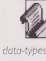

注意，JavaScript 不区分整数和浮点数。上面的示例创建了 JavaScript 支持的三类型变量。这三个值首先传递给 `alert()` 函数，然后使用 JavaScript 关键字 `typeof` 返回它们的数据类型以便在对话框中显示。括号内的代码 `"\n"` 用于在对话框中换行显示每个值的输出。

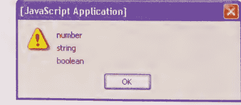

### 转义序列

当字符串中的字符前面有一个 `\` 字符时，它会对紧随其后的字符产生特殊影响。这被称为转义序列，因为它允许该字符逃逸对 JavaScript 语法部分的识别。下表列出了更多转义序列：

| | |
|---|---|
| \b | 退格符 |
| \f | 分页符 |
| \n | 换行符 |
| \r | 回车 |
| \' | 单引号 |
| " | 双引号 |
| \ | 单反斜杠字符 |

转义序列 `"` 有助于在字符串内部包含引号而不会导致字符串本身终止，如下例：

```javascript
// 显示带有转义引号的字符串
alert ("We all say \"JavaScript is great!\" " );
```

### 函数

函数是一段可以被 JavaScript 应用执行一次或多次的 JavaScript 代码。函数和变量构成了所有 JavaScript 编程的基础。

函数的格式如下：

```javascript
// 一个在警报对话框中显示消息的函函数
function call_alert() {
    alert("My First JavaScript Function");
}
```

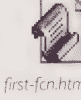

始终尝试为函数和变量赋予有意义的名字，描述它们的用途。

使用 JavaScript 的 `function` 关键字后跟给定的标识符名称来创建一个新函数。该名称在脚本中必须是唯一的，并遵循与变量命名相同的命名规范。

名称后面总是跟着一对圆括号，然后是一对包含要执行代码的大括号。

在示例中，该函数被命名为 `call_alert()`，要执行的代码将调用 JavaScript 的 `alert()` 函数来显示一个包含消息的 `alert()` 对话框。

该函数可以在 JavaScript 文件或 HTML 文档的任何地方调用，以执行其包含的语句。

例如，HTML `<body>` 标�的 `onload` 属性可以在文档加载到浏览器时调用该函数，如下：

```html
<body onload = "call_alert()">
```

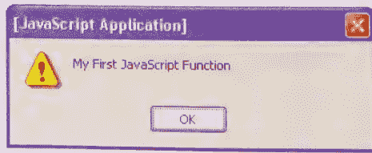


记住在引用函数时包含圆括号。

### 函数参数

所有函数名称后的圆括号可以包含用于要执行代码的数据。就像 JavaScript `alert()` 函数的括号包含了它创建的 `alert()` 对话框中要显示的字符串一样。

括号内包含的数据被称为函数“参数”（argument）。

在下例示例中，函数调用将一个文本字符串传递给 `call_alert()` 函数中的参数 `str`，用于要执行的代码：


```javascript
// 一个显示传递的参数值值的函数
function call_alert( str )
{
  alert( str );
}
```

需要注意的是，调用此函数时内部的字符串包含在单引号中，以区别于用于包含整个调用的双引号：

```html
<body onload = "call_alert('Passed Value')">
```


`str` 在 JavaScript 中用作字符串的变量名。

对两者都使用双引号意味着 `onload` 属性的值将变为 `"call_alert("`，因为字符串会被第二个双引号终止。这将导致浏览器错误且函数将不会执行。

这种单引号和双引号的使用在 JavaScript 编程中以多种方式贯穿。

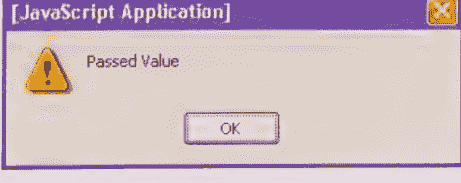

# 多个函数

JavaScript 函数在执行代码期间可以调用其他函数，就像之前的示例调用 JavaScript `alert()` 函数一样。

接下来的示例演示了如何使用多个函数来操作和显示一个整数参数：

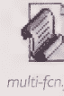

```javascript
// 一个调用第二个函数的函数
// 并显示返回的结果
function call_alert( num )
{
  var new_number = make_double( num);
  alert(" The Value Is " + new_number);
}

// 一个将值翻倍的函数
// 并结果返回给调用者
function make_double( num )
{
  var double_num = num + num;
  return double_num;
}
```

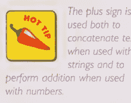

参数值通过 `call_alert( 4 )` 函数从调用者传递给 `make_double()` 函数：

```html
<body onload = "call_alert( 4 )">
```

该值通过函数体中的代码进行处理，结果使用 JavaScript 的 `return` 关键字返回给 `call_alert()` 函数中的 `new_number` 变量。最后调用 `alert()` 函数显示 `new_number` 变量。

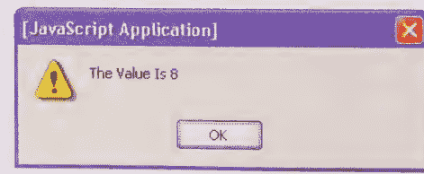

18 | JavaScript 入门 **

### 变量作用域

对页示例中使用的变量都在函数内部声明，因此它们被称为局部变量。局部变量只能由声明它的函数使用。

相反，全局变量声明在函数外部，可以被同一文档中的任何函数访问。

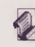

```javascript
// 创建全局变量
var stored_num;

// 一个调用第二个函数的函数
// 并显示返回的结果
function call_alert( num )
{
  stored_num = num;
  make_triple();
  alert("The Value Is " + stored_num );
}

// 一个将值翻倍的函数
// 并结果返回给调用者
function make_triple()
{
  stored_num = stored_num + stored_num + stored_num;
}
```


所有变量都可以仅声明而不使用值进行初始化。

此示例将参数值传递给全局变量：

```html
<body onload = "call_alert( 5 )">
```

第二个函数在调用 `alert()` 显示新值之前，处理了全局变量的值。

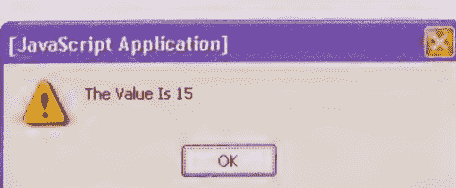

### 多个参数

如果 JavaScript 函数之间用逗号隔开，则包含多个参数。

在声明函数时定义的参数数量必须与该函数的任何调用中包含的参数数量完全匹配。

此示例声明了一个包含三个参数的函数——因此任何对它的调用必须包含三个参数值：


```javascript
// 创建三个变量
var a, b, c;

// 一个显示三个连接参数的函数
function call_alert(str1, str2, str3) {
    a = str1;
    b = str2;
    c = str3;
    alert(a + b + c);
}
```

multi-args.js

> 热门提示：可以使用 `var` 关键字通过逗号分隔变量名来声明多个变量。

调用者向函数传递了三个字符串，尽管第二个字符串的值仅仅是一个空格：

```html
<body onload = "call_alert('Great', ' ', 'JavaScript')">
```

函数将参数值分配给三个全局变量，然后调用 `alert(c)` 将全局值作为单个连接字符串显示。

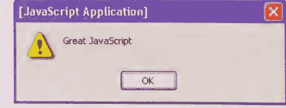

### 执行操作

本章详细介绍了所有常用的 JavaScript 运算符，通过示例说明了如何进行算术运算、如何赋值以及如何进行比较。逻辑运算符也进行了解释和演示，以及条件运算符。

## 第二章

### 算术运算符

JavaScript 中使用的算术运算符列如下表所示，并说明了它们执行的操作：

| 运算符 | 操作 |
|---|---|
| + | 加法（并拼接字符串） |
| - | 减法 |
| * | 乘法 |
| / | 除法 |
| % | 取模 |
| ++ | 自增 |
| -- | 自减 |

注意 `+` 运算符根据给定的操作数有两种类型。它会将两个数值相加并得到加法结果。它还可以合并两个字符串值并返回后的字符串，正如对面页的示例所示。


使用取模运算符判断偶值的示例可以在32页的 `if` 语句中找到。

`% 取模运算符会将第一个数字除以第二个数字并返回操作的余数。这对于判断一个数字是奇数还是偶数最有用。

`++` 自增和 `--` 自减运算符会将给定值改变1并返回得到的新值。这些最常用于循环计数。

所有其他运算符的作用都符合预期，但在使用多个运算符的表达式中，应注意使用括号来明确操作：

```javascript
a = b * c - d % e / f ;           // 这不清晰
a = (b * c) - ((d % e) / f );               // 这更清晰
```

### 算术示例

```javascript
var addnum = 20 + 30; addition
var addstr = "I love " + "JavaScript"; // concatenation
var sub = 35.75 - 28.25; // subtraction
var mul = 8 * 50; // multiplication
var mod = 65 % 2; // modulus
var inc = 5; inc = ++inc; // increment
var dec = 5; dec = --dec; // decrement
var result = "Addnum is " + addnum + "\n";
result += "Addstr is " + addstr + "\n";
result += "Sub is " + sub + "\n";
result += "Mul is " + mul + "\n";
result += "Mod is " + mod + "\n";
result += "Inc is " + inc + "\n";
result += "Dec is " + dec + "\n";
alert(result);
```

自增运算符和自减运算符也可以也可以用在操作数之后。请注意，在这些情况下，它们会执行操作，但只返回未操作的值。

2. 执行操作

### 逻辑运算符

JavaScript 中可以使用的三个逻辑运算符如下表所示：

| 运算符 | 操作 |
|:---|:---|
| && | 逻辑与 (AND) |
| || | 逻辑或 (OR) |
| ! | 逻辑非 (NOT) |

逻辑运算符用于布尔值为 true 或 false 的操作数——或者可以转换为 true 或 false 的值。

逻辑 && 运算符会评估两个操作数，只有当两个操作数本身为 true 时才返回 true。否则，&& 运算符将返回 false。

这通常用于条件分支，通过测试两个条件来确定 JavaScript 程序的走向。如果两个条件都满足，脚本将进入某个方向，否则脚本将进入另一个方向。

与需要两个操作数都为 true 的 && 运算符不同，|| 运算符会评估它的两个操作数，如果其中一个操作数返回 true，它就会返回 true。如果两个操作数都不返回 true，则 || 将返回 false。这在 JavaScript 应用中非常有用，可以在满足任一测试条件时执行特定操作。

第三个逻辑运算符 ! 是一个一元运算符，用在单个操作数之前。它返回给定操作数的反值，因此，如果变量 a 的值为 true，则 !a 的值就是 false。这在 JavaScript 应用中很有用，可以使用语句 a=! 在连续的循环迭代中切换变量的值。这将确保在每次通过时值都会发生变化，就像开关灯泡一样。

### 逻辑示例

```javascript
var a = true, b = false;
var test1 = (a && a); // 测试两个操作数是否为 true
var test2 = (a && b);
var test3 = (b && b);
var test4 = (a || b); // 测试任一操作数是否为 true
var test5 = (a || b);
var test6 = (b || b);
var test7 = !a; test8 = !b; // 取反值
var result = "AND \n";
result += "1: " + test1 + " 2: " + test2 + " 3: " + test3 + "\n";
result += "\nOR\n";
result += "4: " + test4 + " 5: " + test5 + " 6: " + test6 + "\n";
result += "\nNOT\n7: " + test7 + " 8: " + test8;
alert(result);
```

使用 \n 换行转义符和空格来格式化输出字符串。

2. 执行操作

### 赋值运算符

JavaScript 中常用的用于赋值的运算符都列在下表中。除了简单的 = 赋值运算符外，所有的都是长表达式的简写，因此为了清晰起见，也给出了每个等效表达式。

| 运算符 | 示例 | 等效于 |
|:---|:---|:---|
| = | a = b | a = b |
| += | a += b | a = (a + b) |
| -= | a -= b | a = (a - b) |
| *= | a *= b | a = (a * b) |
| /= | a /= b | a = (a / b) |
| %= | a %= b | a = (a % b) |

将 = 运算符理解为“赋值”而不是“等于”是非常重要的，以避免与 == 等值运算符混淆。

在表格的示例中，名为 a 的变量被赋值了变量 b 中包含的值，成为其新值。

+= 运算符最有用，在早的示例中已用于向现有字符串添加第二个字符串。在表格示例中，+= 运算符将变量 a 中的值加到变量 b 中的值上，然后将结果赋值为变量 a 中包含的新值。

表格中的所有其他运算符工作原理相同——先在两个值之间进行算术运算，然后将结果赋值给第一个变量以成为其新值。

### 赋值示例

```javascript
var a = "JavaScript", b = " Code"; // 赋值字符串值
a += b; // 拼接字符串并赋值给 a
var c = 8, d = 4; // 赋值整数值
c += d; // 加数字并将结果赋值给 c
var e = 7.5, f = 2.25; // 赋值浮点值
e -= f; // 从 e 中减去 f并将结果赋值给 e
var g = 8, h = 4; // 赋值整数值
g *= h; // 乘数字并将结果赋值给 g
var i = 8, j = 4; // 赋值整数值
i /= j; // i 除以 j并将结果赋值给 i
var k = 8, l = 4; // 赋值整数值
k %= 1; // k 除以 1并将余数赋值给 k
```

结果使用 alert() 函数显示，但为了节省空间省略了代码。

2. 执行操作

### 比较运算符

JavaScript 中常用的用于比较值的运算符均列在下方：

| 运算符 | 比较 |
|:---|:---|
| == | 等于 |
| != | 不等于 |
| > | 大于 |
| < | 小于 |
| >= | 大于等于 |
| <= | 小于等于 |

如果两个操作数相等，== 运算符将返回 true。如果操作数不相等，则 != 运算符将返回 true。

如果第一个操作数大于第二个操作数，> 运算符将返回 true。如果第一个操作数小于第二个操作数，< 运算符将返回 true。

如果第一个操作数大于或等于第二个操作数，>= 运算符将返回 true。如果第一个操作数小于或等于第二个操作数，<= 运算符将返回 true。

### 比较示例

```javascript
// 比较字符串
var teststrings1 = ("JavaScript" == "JavaScript");
var teststrings2 = ("JavaScript" == "javascript");

// 比较数字
var testnumbers1 = (100 < 200);
var testnumbers2 = (100 <= 100);

// 比较布尔值
var testboolean1 = (true == true);
var testboolean2 = (false == false);
```

### 条件运算符

JavaScript 最喜欢的比较运算符可能是条件运算符。它首先评估一个表达式的 true 或 false 值，然后根据评估结果执行两个语句中的一个。

条件运算符的语法如下：

```javascript
(test expression) ? if-true-do-this : if-false-do-this ;
```

该运算符通常用于在运行浏览器识别程序后，运行特定 Web 浏览器的脚本函数。下面的示例根据浏览器类型显示欢迎消息：

```javascript
// 浏览器是 Internet Explorer 吗？
var is_ie = browser_id();

// 显示适当的问候
( is_ie ) ? greet_ie() : greet_other();
```

## 语句

语句在 JavaScript 中用于推进 JavaScript 应用程序的执行。它们可以在代码中定义循环，也可以是待评估的简单术语。本章将检查条件测试和不同类型的循环，并附带它们的用法示例。

- 条件 if | 32
- If - prompt 示例 | 33
- If - else 语句 | 34
- switch 语句 | 35
- For 循环 | 36
- for - in 循环 | 37
- While 循环 | 38
- do - while 循环 | 39
- Break 语句 | 40
- Continue 语句 | 41
- 使用 with 语句 | 42


### 条件 if

`if` 关键字用于执行基础的 JavaScript 条件测试，以评估一个表达式的布尔值。评估随后的语句仅在表达式返回 `true` 时才会执行。`if` 语句的语法如下：

```
if (test expression) statement-to-execute-when-true;
```

如果代码被包含在一对大括号内形成语句块，则要执行的代码可以包含多个语句。

在下面的示例中，待测试的表达式使用取模运算符来确定名为 `num` 的变量所包含的值是否能被 2 整除。该语句包含两个部分——一个是给变量赋值字符串值，另一个是调用 JavaScript 函数。

```javascript
// 创建两个变量
var msg, num;
num = 7;

// 测试数字是否不能被 2 整除
if ( num % 2 != 0 ) {
  msg = num + " is an odd number.";
  alert( msg);
}
```


> 该表达式可以使用 `(num%2==1)` 来检测奇数。

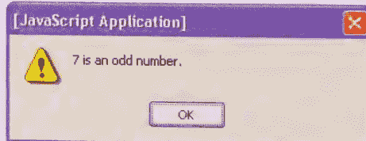

此示例调用的 JavaScript `prompt()` 函数需要调用者提供两个参数。第一个参数是要要的消息的消息，第二个是输入字段中的默认条目——在此情况下是一个空字符串。

用户输入被赋值给 `username` 变量，如果字符串不再为空，则将通过 `alert()` 函数显示。


```javascript
// 用 null 值初始化一个变量
var username = null;
if ( username == null ) {
    // 询问用户他们的姓名
    username = prompt("Please Enter Your Name", "");
    // ... 或者通过名字问候用户
    if ( username != "" ) alert("Welcome " + username);
}
```


prompt 对话框打开时带有一个空输入字段，但此处显示的是用户输入后的状态。

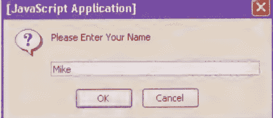

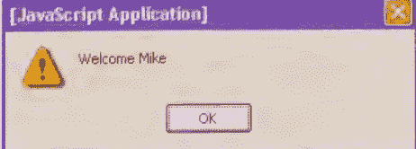

### If - else 语句

JavaScript 的 `else` 关键字可以与 `if` 语句一起使用，在测试表达式返回 `false` 时提供备的可执行代码。

这被称为条件分支，其语法如下：

```
if (test expression) do-this; or-else-do-this;
```

当真表达式随后的代码执行时，可能会测试多个表达式，直到找到真值为止。需要注意的是，`if-else` 语句中包含的任何后续代码都会被忽略。

因此，在下面的示例中，第三次测试调用 `alert()` 函数之后的任何代码都将被完全忽略：

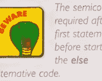

```javascript
var num = 2, bool = false;
// 数字是 1 且布尔值为 true 吗
if (num == 1 && bool == 1) alert("TEST1 bool: " + bool);
else
// 数字是 2 且布尔值为 true 吗
if (num == 2 && bool == 1) alert("TEST2 bool: " + bool);
else
// 数字是 3 且布尔值为 false 吗
if (num == 3 && bool == 0) alert("TEST4 bool: " + bool);
```


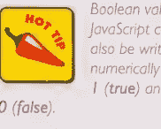

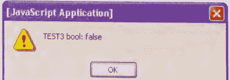

### switch 语句

当测试表达式评估一个变量的值时，使用 `switch` 语句比使用 `if-else` 语句执行条件分支可能更高效。

`switch` 语句的工作方式比较特殊——它首先评估一个给定的表达式，然后寻找一个匹配结果结果的标签。与匹配标签关联的代码将被执行，或者如果没有找到匹配项，则语句将执行默认代码。

`case` 关键字用于标记标签，`default` 关键字表示默认代码。


有关 `break` 语句的更多详细信息，请参阅第 40 页。

所有标签代码都必须由 `break` 语句终止。标签可以是数字、字符串或布尔值，但类型必须全部相同，例如这个使用数字的示例：


```javascript
var num = 2;
switch(num)
{
  case 1: alert("This is 1"); break;
  case 2: alert("This is 2"); break;
  case 3: alert("This is 3"); break;
  default: alert("This is default");
}
```

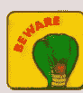

省略 `break` 语句将允许 `switch` 语句执行后续代码。

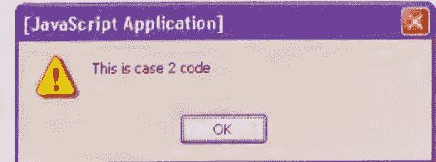

### For 循环

`for` 循环通常是 JavaScript 中最频繁使用的循环类型，其语法如下：

```
for (初始化; 测试; 递量)
```

初始化用于设置循环的起始值。当测试表达式返回 `true` 时，循环执行。当测试表达式返回 `false` 时，循环停止。在循环的每次迭代中，递量部分都会执行。下面的示例显示了循环执行 5 次的情况：

```javascript
var a = 0, b = 0;
// 计数器增加 5
for (var i = 0; i < 5; i++) {
  a++;
}
// 显示最终的 a 和 b 值
alert("A is " + a + "\nB is " + b);
```


`for` 循环也可以通过递减变量来计数：

```javascript
var a = 10, b = 0;
// 计数器递减到 0
for (var i = a; i > 0; i--) {
  b++;
}
// 显示循环结束后的 a 和 b 值
alert("A is " + a + "\nB is " + b);
```

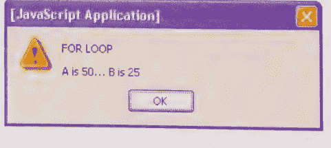

### For - in 循环

`for-in` 循环用于枚举对象中的所有属性。这种循环在常规 JavaScript 中很少使用，但在这里包含了以遍历窗口对象的属性：

```javascript
var a = "";

// 列出所有属性
for ( property in window ) {
  a += property + "...";
}
// 显示属性列表
alert(a);
```


列出的属性会随浏览器和版本而异。


通过此脚本显示的属性属于文档对象模型 (DOM)，它在第 8 章中有所描述。

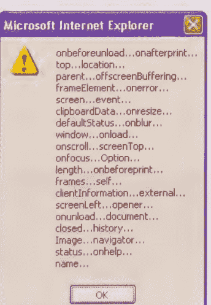

### While 循环

另一种循环使用 JavaScript `while` 关键字后跟一个待评估的表达式。

如果评估结果为 `true`，则语句块中的代码将被执行。代码执行后，将再次对表达式进行评估，循环将持续直到返回 `false` 为止。

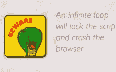

语句块必须包含影响测试表达式的代码，以便改变评估结果返回 `false`——否则将导致无限循环。

需要注意的是，如果测试表达式在第一次评估时返回 `false`，则语句块中的代码将永远不会执行。

此示例在每次迭递中递减一个变量。计数器增加直到达到 10，当评估返回 `false` 循环结束。

```javascript
var i = 0, num = 50;
// 循环直到计数器达到 10
while(i < 10 )
{
  num--;
  i++;
}
// 显示最终的计数器和数字值
alert("Loop stopped at " + i + "\nnum is now " + num);
```

while.js

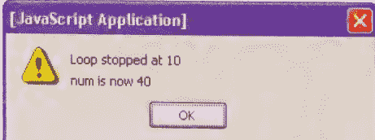

### do-while 循环

JavaScript **do** 关键字用于表示 **do-while** 循环的开始，后面跟着一个包含循环要执行代码的语句块。

语句代码之后是 JavaScript **while** 关键字和一个用于评估为布尔值 **true** 或 **false** 的表达式。

如果评估结果为 **true**，则循环从 **do** 关键字处重新开始，直到结果返回 **false** 为止。

需要注意的是，与简单的 **while** 循环不同，**do-while** 循环的语句代码至少会被执行一次，因为在循环结束之前是遇到测试表达式的。

下面的示例将永远不会循环，因为计数器值在语句代码的第一次执行中被加了 1，所以第一次评估将返回 **false**：

```javascript
var i = 0, num = 50;

// 循环直到计数器达到 1
do {
  num--;
  i++;
} while( i < 1 );
```

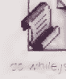

**while** 循环通常比 **do-while** 循环更合适。

```javascript
// 显示最终的计数器和数值
alert("Loop stopped at " + i + "\num is now " + num);
```

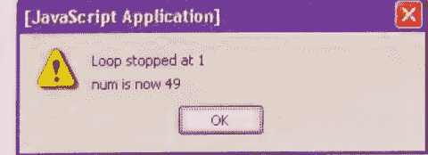

3. 语句 | 39

### break 语句

JavaScript break 关键字用于提前终止循的执行。

break 关键字位于包含循环应执行代码的语句块内部，并在其前面有一个条件测试。

当满足测试条件时，break 语句会立即终止循环，不再进行后续迭代。

注意下方的 alert() 输出，计数器值仍然是三，因为最后一次迭代中的增操作没有被应用。

在下面的示例中，当计数器值达到三时，条件测试将返回 true：


```javascript
var i= 0;
// 循环直到计数器达到 6
while (i < 6)
{
  if( i == 3 ) break;
  i++;
}
// 显示最终的计数器值
alert("BREAK\nLoop stopped at " + i);
```


break 关键字也用 switch 语句的终止符。

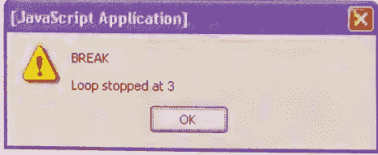

### continue 语句

JavaScript continue 关键字用于中断循环的当前迭代。

与 break 关键字一样，continue 关键字位于包含循环应执行代码的语句块内部，并在其前面有一个条件测试。

当满足测试条件时，continue 关键字会立即停止循环的当前迭代，但在循环结束之前仍会进行后续迭代。

在下面的示例中，当计数器达到三时满足测试条件，因此该迭代中的字符串拼接未被应用，但循环继续进行：

```javascript
var i = 0, str = "";
// 计数器达到 5
while(i < 5)
{
  i++;
  if( i == 3 ) continue;
  str += i + " ";
}
// 显示最终计数器
// 以及所有的序列号
alert("CONTINUE\n\n stopped:"+i+"\nSeries:"+str);
```

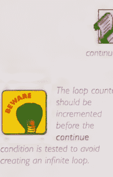

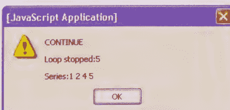

### 使用 with 语句

JavaScript **with** 关键字用于引用属性，无需在每个属性名前添加对象对象。这在编写产生动态效果的 JavaScript 应用时非常有用，因为脚本经常引用 document 对象。

例如，每个 Web 页面包含一个 **document** 对象，该对象反过来有一个 **forms** 属性来引用表单。表单可以通过分配给 **id** 属性的值引用。单个表单可以通过分配给 **name** 属性的值引用，JavaScript 可以设置它们的值。在此示例中，脚本设置了 **order** 表单的 **user** 和 **city** 字段：

```javascript
document.forms.order.user.value = "Mike";
document.forms.order.city.value = "New York";
```

这些赋值可以使用像这样的 **with** 语句更清晰地表示：

```javascript
with (document.forms.order) {
  user.value = "Mike";
  city.value = "New York";
}
```


关于 document 对象和属性的更多信息请参见第 10 章。

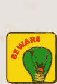

`<script>` 元素必须出现在 HTML 文件中的表单之后——这样在脚本尝试设置它们的值之前，表单已经创建。


with.js

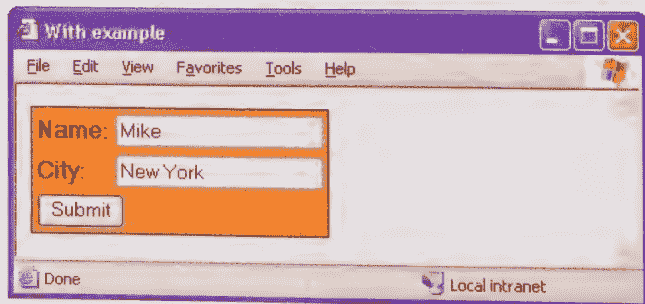

### 使用数组

本章专门介绍数组，并通过示例说明了它们是什么以及如何使用。示例包含了将数组预加载到 Web 浏览器的实际用法。


- 创建数组 | 44
- 数组元元素 | 45
- 填充元素循环 | 46
- 添加元素 | 47
- 元素的字符串 | 48
- 反转元素顺序 | 49
- 子数组 | 50
- 元素元素 | 51
- 预加载数组 | 52

### 创建数组

数组就像可以包含多个值的变量——与可能只包含单个值的变量不同。

使用 JavaScript new 关键字配合 JavaScript Array() 构造函数为变量赋予数组状态。

可以使用数组名称配合从零开始的索引（放在方括号内）为数组分配多个数据值，如下例所示：

```javascript
// 创建新数组
var a = new Array();

// 为前三个数组元素赋值
a[0] = "First"
a[1] = "JavaScript"
a[2] = "JavaScript"
```

（注：按照要求，保留了 a[2] 的原始文本，尽管它似乎是一个拼写错误。）

需要注意的是，索引是从零开始的。

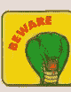

现在可以像使用变量一样使用数组值。初始化数组通常这样做方便：

```javascript
// 创建三个数组
var a = new Array("Jan", "Feb", "Mar");
```

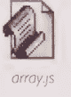

### 数组元素

数组中的每个值被称为元素。当使用 JavaScript new 关键字为变量赋予数组状态时，它也获得了属性。最有用的属性之一是 `length` 属性，它可以报告当前包含的元素数量。注意，由于索引从零开始，数组最后一个元素的索引仅为 2。

```javascript
var a = new Array();
a[0] = "JAVASCRIPT";
a[1] = "ARRAY";
a[2] = "LENGTH";
// 显示最终计数器
arraysize = a.length;
alert(a[0]+a[1]+a[2]+"No.ofelements is "+arraysize);
```

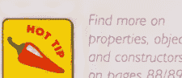

### 填充元素循环

所有类型的循环都可以用于向数组元素中填充大量数据值。这是数组的主要吸引力之一，而且只需要很少的代码即可实现。

下面的示例首先创建一个数组，然后在每次迭代中，`for` 循环为每个数组元素填充一个字符串值，并加上当前的计数器值。

每个元素的值在显示在 `alert()` 对话框之前，都会会在名为 `str` 的变量中进行拼接：

```javascript
var str = "FILL ELEMENTS LOOP\n\n";
// 创建新数组
var arr = new Array();

// 填充八个数组元素
for(var i = 0; i < 8; i++) {
  arr[i] = "Number is " + i + "\n";
  str += arr[i];
}

// 显示存储在每个数组元素中的值
alert(str);
```

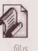


通过将条件值 8 改为 100，此代码可以轻松地用于填充 100 个元素。

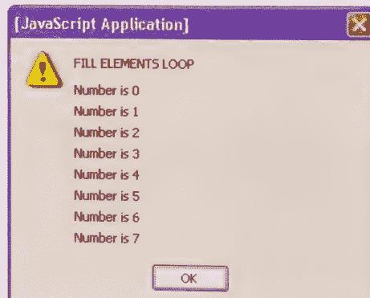

### 添加更多元素

可以使用 `array.length` 属性找到下一个空空元素，在不指定实际索引数字的情况下向数组添加额外元素。

由于 `array.length` 的值比最后一个索引大一，当它被用作索引（方括号之间）时，它始终指向下一个空元素。

下面的示例说明了如何将整数 4 赋值给名为 **a** 的数组中的下一个空元素。

**b** 数组元素被初始化，然后 **for** 循环成功地将 **b** 数组元素值分配给 **a** 数组中的每个空元素。

最后，通过 `array.concat()` 方法以连接的形式由 `alert()` 函数显示 **a** 数组的所有元素。

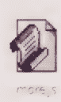

```javascript
var a = new Array(1, 2, 3 );
// 在下一个空元素中插入一个整数
a[a.length] = 4; // a.length 为 3

var b = new Array(5, 6, 7 );
// 将每个 b 元素值复制到 a 空元素中
for(var i = 0; i < b.length; i++) {
  a[a.length] = b[i];
}
// 显示所有 a 元素值
alert( a.concat() );
```

`array.concat()` 方法将显示数组中的所有元素值，并用逗号分隔


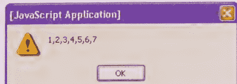

### 元素字符串

JavaScript array.join() 方法将所有数组元素转换为字符串并拼接。

如果不带参数使用，它将返回由逗号分隔的所有数组元素值列表，类似于上一页的 array.concat() 方法。

但 array.join() 方法可以接受一个可选参数，用于指定替代默认逗号分隔符的备分隔符。

非常有用的是这可以是空格，这样 array.join() 方法的结果将是一个带有空格分隔符的单一字符串，如下例所示：


```javascript
创建一个新数组
var a = new Array();

// 在七个数组元素中放入单词
a[0] = "It"
a[1] = "isn\t"
a[2] = "rocket"
a[3] = "science -"
a[4] = "it's"
a[5] = "just"
a[6] = "JavaScript"

// 显示数组中的所有单词，用空格分隔
alert(a.join(" "));
```

使用反斜杠 \ 转义单引号以避免错误。

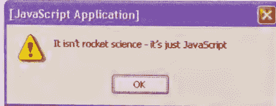

### 反转元素顺序

数组可以用于每个元素中包含文件名或完整 URL，用于 Web 页面中的动态功能。

一个流行的用途是用于 JavaScript 幻灯片，它以指定的间隔旋转一系列图像。

使用数组将每个图像的 URL 存储在元素中，以便脚本可以通过数组索引轻松引用它们。

如果要求幻灯片在显示最后一张图像后反转而不是从第一张图像重新开始，可以通过反转数组内部元素的顺序来实现。

下面的示例创建了一个仅包含三个图像的初始数组，在最后图像显示且 rev 变量设置为 true 之后，其顺序将反转：


```javascript
// 创建一个新的图像 URL 数组
var imgs = new Array("img1.gif", "img2.gif", "img3.gif");
```


```javascript
// 控制变量
var rev = false;
```

```javascript
// 当幻灯片显示最后一张图像时
// 反转顺序
rev = true;
```

```javascript
if (rev == true) {
  imgs.reverse();
}
```


```javascript
// 显示反转后的元素顺序
alert(imgs.join(" - ") + " - ");
```

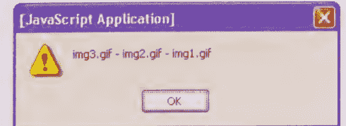

### 子数组

JavaScript array.slice() 方法非常有用，可以使用一些现有元素值从现有数组创建一个新数组。

该方法接受两个可选参数，用于指定原始数组中新数组元素开始和结束的元素索引数字。

第二个参数可以是负值，表示从数组末尾计算的元素位置。

如果只指定一个参数，它将用作第一个元素的索引数字，该方法将返回从该位置开始的所有元素的新数组。

这些示例说明了 array.slice() 方法的不同用法：

```javascript
// 创建并初始化一个数组
var nums = new Array(1, 2, 3, 4, 5, 6, 7, 8);

// 获取 #2 到 #4 的元素
var str = "Slice A: " + nums.slice(2, 4) + "\n";

// 获取 #1 到倒数第一个元素
str += "Slice B: " + nums.slice(1, -1) + "\n";

// 获取 #3 到结束的元素
str += "Slice C: " + nums.slice(3 ) + "\n";

// 显示三个切片
alert(str);
```

数组元素取自但不包含第二个参数索引。


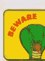

### 元素排序

JavaScript array.sort() 方法允许对元素进行排序。

有时需要按升序排列数组，如下例所示：

```javascript
// 创建整数数组
var integers = new Array(3, 8, 1, 9, 7, 5, 4, 6);
integers.sort();

// 创建浮点数数组
var floats = new Array(0.5, 0.8, 0.12, 0.75, 0.2);
floats.sort();

// 创建字符串数组
var strings = new Array("Michael", "Andrew", "David");
strings.sort();

// 用连字符分隔元器
var str = "Integers array: " + integers.join(" - ");
str += "\nFloats array: " + floats.join(" - ");
str += "\nStrings array: " + strings.join(" - ");
// 显示结果
alert(str);
```


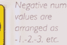

## 获取日期和时间

日期和时间在 JavaScript 中经常用于自定义 Web 页面的性能。例如，脚本可以根据当前时间向用户发送适当的问候：

此应用程序的脚本包含在第 56 页的示例中。

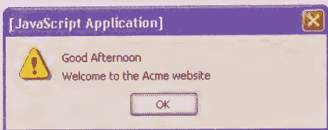

JavaScript 中使用的日期时间和来自于运行加载脚本的浏览器应用程序的主系统时钟和日历。

要访问系统时钟信息，脚本必须创建一个 `Date` 对象。

实现方法与创建 `Array` 对象的方法相同，使用 JavaScript 的 `new` 关键字，但现在使用的是 JavaScript 的 `Date()` 构造函数。下面的示例创建并显示了一个新的 `Date` 对象：

```javascript
// create a new Date object
var now = new Date();

// display the Date object's date and time information
alert(now);
```

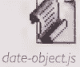

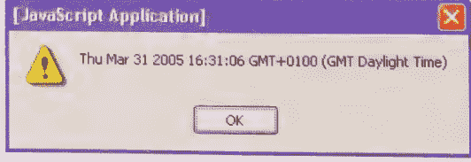

### 日期信息

`Date` 对象拥有特殊方法，可以获取日期信息的各个部分。

某些方法以索引数字的形式返回日期信息，这需要脚本进行转换。

`Date.getDay()` 方法返回星期几的索引值，范围从 0（星期日）到 6（星期六）。

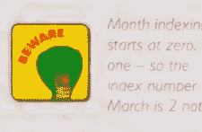

此外，`Date.getMonth()` 方法返回月份的索引值，范围从 0（1月）到 11（12月）。

下面的示例说明了 `Date` 对象的方法，并使用数组来显示星期和月份名称：

```javascript
// create an array of day names
var days = new Array("Sun", "Mon", "Tue", "Wed", "Thu", "Fri", "Sat");

// create an array of month names
var months = new Array("Jan", "Feb", "Mar", "Apr", "May", "Jun", "Aug", "Sep", "Oct", "Nov", "Dec");

var now = new Date(); // create a new Date object
var yy = now.getYear(); // get the year
if(yy < 2000) yy += 1900; // adjust year for Netscape
var mm = now.getMonth(); // get the month
var monthName = months[mm]; // convert month number to name
var dd = now.getDate(); // get day number in the month
var dy = now.getDay(); // get day number in the week
var dayName = days[dy]; // convert day to name
```


Netscape 报告年份为自 1900 年以来过的年数——因此在这种情况下，一行脚本向报告的日期加上了 1900。

```javascript
// display the extracted date and day information
alert(dayName + " " + monthName + " " + dd + " " + yy);
```


### 时间信息

`Date` 对象拥有特殊方法来访问其包含的时间信息。下面的示例从主时钟获取当前的小时、分钟、秒和毫秒，并显示与一天时间段匹配的欢迎消息：


小时以 24 小时制的数字 0-23 返回。

```javascript
// create a new Date object
var now = new Date();

// extract the time information
var hh = now.getHours();
var mn = now.getMinutes();
var ss = now.getSeconds();
var ms = now.getMilliseconds();

// default welcome message
var hi = "Good Morning";

// welcome message if after noon
if( hh > 11 ) hi="Good Afternoon";

// welcome message if after 6 p.m.
if( hh > 17 ) hi="Good Evening";

// display welcome message and the current time
var tim = hi + "\n";
tim += "Hours: " +hh+ "\n";
tim += "Minutes: " +mn+ "\n";
tim += "Seconds: " +ss+ "." +ms;
alert(tim);
```


### 当前时间

JavaScript `Date.getTime()` 方法可以用于数值比较两个 `Date` 对象。

该方法返回一个数字，表示日期对象值与 1970 年 1 月 1 日午夜之间的毫秒差（有时称为“纪元”）。

下面的示例在运行循环前后各创建了一个 `Date` 对象，然后比较 `Date.getTime()` 方法返回的值，以计算执行循环所需的实际时间：

```javascript
// create a new Date object then get the current time
var start = new Date();
var msec1 = start.getTime();

// run a loop counting up to 250,000
var num = 0;
for(var i = 0; i < 250000; i++) {
  num++;
}

// get another Date object and get the time now
var stop = new Date();
var msec2 = stop.getTime();

// subtract the start time from the stop time to cover the amount of time between the two points
var diff = ( msec2 - msec1 ) / 1000;

// display the elapsed time
alert("Time elapsed: " +diff+" seconds");
```


elapsed-time.js

根据你的浏览器调整循环计数的数字。

img/5f5106681c8c7072e64c4ea87c891513_58_1.png)

### 通用时间

通用时间是标准时钟。`Date` 对象拥有一系列方法可以将本地时间转换为通用时间。下面的示例调用了本地时间和通用时间信息：

```javascript
// create a new Date object
var now = new Date();

// get the local time in hours
var hh = now.getHours();

// get the universal time in hours
var utc = now.getUTCHours();

// get the universal time in minutes
var mn = now.getUTMinutes();

// get the universal time in seconds
var ss = now.getUTCSeconds();

// ensure there are two digits for minutes
if(mn < 10) mn = "0" + mn;

// display both times
alert("Local time: " + hh + ":" + mn + ":" + ss);
alert("UTC time: " + utc + ":" + mn + ":" + ss);
```

`Date.getTimeOffset()` 方法返回本地时间与通用时间之间的分钟差。下面的示例显示了偏移量：

```javascript
// create a new Date object
var now = new Date();
var offset = now.getTimezoneOffset();

var msg = "";
switch(offset) {
  case 240: msg = "East Coast"; break;
  case 300: msg = "Central"; break;
  case 360: msg = "Mountain"; break;
  case 420: msg = "Pacific"; break;
  default: msg = "all";
}

alert("The offset is " + offset + " minutes for " + msg);
```


### 时区

`Date.getTimeOffset()` 方法返回本地时间与通用时间之间的分钟差。如果本地时区位于 UTC 之后，值为正；如果位于 UTC 之前，则值为负。

下表显示了一些时区的偏移量：

| 时区 | 偏移量（分钟） |
|:---|:---|
| UTC | 0 |
| GMT | 0 |
| 东部时间 (EST) | 300 |
| 中心时间 (CST) | 360 |
| 山地时间 (MST) | 420 |
| 太平洋时间 (PST) | 480 |
| 中欧时间 (CET) | -60 |
| 东欧时间 (EET) | -120 |
| 日本标准时间 (JST) | -540 |

某些浏览器的 Bug 不会修正偏移量。


### 日期字符串

在许多情况下，必须将 Date 对象的信息转换为字符串，以便存储或使用这些信息。

上一页中的 `Date.toString()` 方法可以实现此功能，但通常更倾向于将这些信息存储为标准的 UTC 时间。

JavaScript 提供了 `Date.toGMTString()` 方法，它既可以将信息转换为字符串，又将其转换为 GMT 时区。

> 关于使用此方法设置 cookie 的完整示例，可以参考第 10 章第 114 页。

使用这种方法存储日期信息可以避免时间混淆，并通常在设置 cookie 文件的生命周期时作为标准使用。

这个简单的示例展示了 `Date.toGMTString()` 方法在位于日本东京的浏览器中执行转换的过程：

```
创建一个新的 Date 对象
var now = new Date();

//存储本地时间
var jpn = "Tokyo Time:\n" +now.toString() + "\n\n";

//存储 GMT 时间
var gmt = "UTC Time:\n" + now.toGMTString();

//显示本地时间和 GMT 时间
alert(jpn + gmt);
```


### 使用系统时钟

当需要 JavaScript 窗口在 Web 浏览器中重复创建动作时，可以使用系统时结合窗口对象的 `setTimeout()` 方法。

`window.setTimeout()` 方法可以在指定的间隔后运行函数。它需要两个参数，分别指定要调用的函数名称以及以毫秒为单位的间隔时间。该方法通常用于函数的末尾，以便在设置延迟后递归地调用同一个函数。

第 166 页有一个使用此方法的幻灯片脚本。

该方法在创建动态效果方面有许多用途。例如，在幻灯片脚本中，函数按给定的间隔显示连续图像。

此处的示例使用 `window.setTimeout()` 方法每隔 10 秒显示一次 `alert()` 对话框：


```
创建并初始化计数器变量
var num = 0;

// 一个显示消息的递归函数
function timeout() {
    // 增加计数器
    num++;
    // 显示消息
    alert("This is 10-Second Message No: " +num);
    // 在再次调用此函数之前设置间隔
    window.setTimeout("timeout", 10000);
}
```


调用函数启动程序

timeout();


### 取消计时器

上一页包含 JavaScript 的网站的不幸访问无疑会对不断弹出的 alert 框消息感到恼恼。只显示几次消息然后停止调用 `timeout()` 函数可能会更好。

可以使用 `window.clearTimeout()` 方法轻松取消 `window.setTimeout()` 方法。

为了正确清除计时器，有必要将原始的 `window.setTimeout()` 调用赋值一个变量——这样该变量就可以作为 `window.clearTimeout()` 调用的参数传递。

以下示例显示两次消息，然后在计时器清除后显示最后一条消息：


变量名 `tim` 通常用于命名计时器变量。

```
创建一个计数器变量和一个计时器变量
var num = 0, tim;

function timeout() {
  num++;
  if ( num == 3 ) {
    alert("OK - I told you twice");
    window.clearTimeout( tim ); // 取消计时器
  }
  else {
    alert("This is 10-Second Message No : " + num);
    tim = window.setTimeout("timeout()", 10000 );
  }
}
time();
```


# JavaScript 钟

利用 Date 对象结合计时器可以创建一个每秒更新一次的时间显示，从而产生一个时钟。

下面的示例在名为 `clock` 的 HTML 表单文本输入框中动态显示本地时间——表单 ID 简单名为 `f`：

```
function tick() {
  // 创建一个新的 Date 对象
  var now = new Date();

  // 提取当前的时、分、秒
  var hh = now.getHours();
  var mn = now.getMinutes();
  var ss = now.getSeconds();

  // 确保每个组件都有两位数
  if (hh < 9) hh = "0" + hh;
  if (mn <= 9) mn = "0" + mn;
  if (ss <= 9) ss = "0" + ss;

  // 将当前时间赋值给表单
  document.forms.f.clock.value = hh + ": " + mn + ": " + ss;

  // 将间隔为一秒
  window.setTimeout("tick", 1000);
}
```


需要通过从 HTML `<body>` 中调用 `tick()` 函数来启动时钟——`<body onload="tick()">` 确保在 JavaScript 尝试将时间赋值给时钟字段之前，表单已经创建。


## 数学运算

本章专门介绍 JavaScript Math 对象，并描述了用于执行数学计算的常量值和方法。涵盖了随机数生成的主题并进行了说明。

### 内容

- Math 常数
- Math 方法
- 舍入
- 随机数
- 浮点数

### Math 常数

`Math` 对象包含了用于引用的数值。下面的表格列出了这些值：

| | 描述 |
|:---|:---|
| Math.E | e 常数约为 2.718281828459045 |
| Math.LN2 | 2 的自然对数约为 0.693147180559945 |
| Math.LN10 | 10 的自然对数约为 2.30258509299405 |


| `Math.LOG2` | 以2为底的对约为 1.442695040888963 |

| `Math.LOG10` | 以10为底的对约为 0.43429448933245 |

| `Math.PI` | π 常数约为 3.141592653589793 |

| `Math.SQRT2` | 2 的平方根约为 0.7071067811865476 |

| `Math.SQRT1` | 2 的平方根约为 1.414213562373095 |

`Math` 常数可以在脚本的任何地方使用。大多数 Math 常数仅用于具有特定数学目的 JavaScript 应用程序，但上方提供了完整列表。`Math.PI` 常数创造了有趣的可能性。下面的示例动态旋转一个名为 `div` 的层：

### 使用 pi


```
var pos = 0;

//  id 为 "d1" 的 div
function spin() {
  // 获取 div 的样式对象
  var obj_style = document.getElementById("d1").style;
  // 期望的半径和 x, y 偏移
  var radius = 40;
  var x_offset = 50;
  var y_offset = 50;

  // 获取新位置
  pos += 10;
  var x = radius * Math.cos(pos * Math.PI/180);
  var y = radius * Math.sin(pos * Math.PI/180);

  x += x_offset;
  y += y_offset;
  // 将 div 到新坐标
  obj_style.left = x + "px";
  obj_style.top = y + "px";
  // 设置再次调用此函数的间隔
  setTimeout(spin(), 100);
}
```

`Math.cos()` 和 `Math.sin()` 函数用于计算弧度角的余弦和正弦值。这些被用于计算圆的坐标。

该程序通过在 HTML `<body>` 标签的 `onload` 属性在页面加载时调用 `spin()` 函数来启动。

### 数学方法

JavaScript Math 对象有许多方法——它们都列在下表中：

| 方法 | 描述 |

|---|---|

| `Math.abs()` | 返回绝对值 |

| `Math.acos()` | 返回反余弦 |

| `Math.asin()` | 返回反正弦 |

| `Math.atan()` | 返回反正正切 |

| `Math.atan2()` | 返回从 X 轴到某点的角度 |

| `Math.ceil()` | 向上舍入数字到整数 |

| `Math.cos()` | 返回余弦值 |

| `Math.exp()` | 返回常数 e 的幂 |

| `Math.floor()` | 向下取整到整数 |

| `Math.log()` | 返回自然对数 |

| `Math.max()` | 返回两个数中的较大值 |

| `Math.min()` | 返回两个数中的较小 |

| `Math.pow()` | 返回幂值 |

| `Math.random()` | 返回随机数 |

| `Math.round()` | 四舍五入到最近的整数 |

| `Math.sin()` | 返回正弦值 |

| `Math.sqrt()` | 返回平方根 |

| `Math.tan()` | 返回正切值 |

`Math.random()` 在网页中有许多用途，用于提供多样化的页面内容。

上述列表中最常用的 Math 方法将在后续页面中进行详细介绍。

### 舍入浮点数

JavaScript 中的 `Math.round()` 方法既可以将浮点数四舍五入到最近的整数，也可以将长浮点数转换为更短的舍入版本。通常这会将一个长浮点数保留两位小数。

如果作为方法参数的浮点值恰好处于两个整数的中间，该方法将向上舍入到最近的整数。

下面的示例说明了 `Math.round()` 方法如何处理正值和负半点值的舍入，并展示了如何用它将长浮点数转换为两位小数：

```javascript
var a = 7.5;
a = Math.round(a);
a = "Rounded Positive : "+a+" \n";

var b = -7.5;
b = Math.round(b);
b = "Rounded Negative : "+b+" \n";
```

舍入 -7.5 不会得到结果 -8.0，因为那将是一个更大的数字，那样属于向下取整。

```javascript
var c = 3.764638467915;
c = c * 100; // 向左移动两位
c = Math.round(c); // 执行舍入
c /= 100; // 移回 2 位
c = "Commuted Long Float : "+c;
alert(a+b+c);
```

### 强制转换浮点数

作为上一页详细介绍的 `Math.round()` 方法的替代，脚本可能需要将浮点数选择性地强制转换为最近的整数（向上或向下）。

JavaScript 提供了 `Math.ceil()` 方法强制向上舍入到最近的整数，以及 `Math.floor()` 方法向下取整到最近的整数。

下面的示例展示了两种方法对正值和负值的应用：

```javascript
var a = 7.5;
var a1 = "a1" : + Math.ceil(a);
var a2 = "a2" : + Math.floor(a);
var b = -7.5;
var b1 = "b1" : + Math.ceil(b);
var b2 = "b2" : + Math.floor(b);
var rup = "ROUNDING UP\n" + a1 + "\n" + b1 + "\n";
var rdn = "ROUNDING DOWN\n" + a2 + "\n" + b2;

alert( rup + rdn );
```

### 比较数字

Math 对象有两个方法允许比较两个数字，并返回较大或较小的值。

`Math.max()` 接受两个比较值作为参数，并返回这两个值中的较大者。

`Math.min()` 方法的工作原理相同，返回两个给定值中的较小者。

在下面的示例中，使用 `Math.pow()` 方法来创建平方和立方值，然后用 `Math.max()` 和 `Math.min()` 进行比较。

`Math.pow()` 方法需要两个参数来指定该数字的幂次数：

```javascript
var sq = Math.pow( 5, 2 );
var cb = Math.pow( 3, 3 );
var hi = "Round up : " + Math.max( sq, cb );
var lo = "Round Down : " + Math.min( sq, cb );
var ng = "Round Negative : " + Math.max( -5, -7.5 );
alert("MAX\n" + hi + "\n" + lo + "\n" + ng);
```

### 随机生成器

可以使用 `Math.random()` 方法生成一个 0.0 到 1.0 之间的浮点值。该方法可以创建一系列随机选择（如抽票），并用于在网页内产生随机效果，非常流行。

乘以随机数可以指定更宽的范围，例如，乘以 10 将创建一个现在 0.0 之间的随机数。为了让生成的随机数有用，最好的做法是将浮点数向上舍入，使范围变为整数值。将使用 `Math.ceil()` 方法将随机数向上舍入到 1 到 10 之间的整数。下面的代码说明了这一点：

```javascript
// 获取从 0.0 到 1.0 的随机数
var rand1 = Math.random();
// 乘以 10 使其处于 0.0 到 10 之间
var rand2 = rand1 * 10;
// 向上舍入使其处于 1 到 10 之间
var rand3 = Math.ceil(rand2);

// 将每个部分添加到字符串中
var str = "Random float [rand1]: " + rand1 + " \n";
str += "Specify range [rand2]: " + rand2 + " \n";
str += "Random integer [rand3]: " + rand3;
// 显示字符串
alert(str);
```

#### JavaScript 应用

Random float [rand1]: 0.88847652642702

Specify range [rand2]: 8.88847652642702

Random integer [rand3]: 9

### 乐票选择器

此示例使用 `Math.random()` 在 1 到 49 的范围内生成一系列随机数，这些数字可以作为英国国家乐票的选择：

```javascript
// 创建变量
var i, rand, temp, str;
// 创建一个包含50个元素的新数组
var nums = new Array(50);

// 用数字 1-49 填充元素 1-49
for(i = 1; i < 50; i++) nums[i] = i;

// 随机化这些数字的算法
for(i = 1; i < 50; i++)
{
  rand = Math.ceil(Math.random() * 49);
  temp = nums[i];
  nums[i] = nums[rand];
  nums[rand] = temp;
}
 // 将前六个元素添加到字符串
str = "Your six lucky numbers are:\n\n";
for(i = 1; i < 7; i++)
{
  str += nums[i];
  if(i != 6) str += " - ";
}
// 显示字符串
alert(str);
```

### 随机图片

下面的示例中使用 `Math.random()` 方法从六张图片中随机选择一张显示在网页中。JavaScript 为一个 id 为 pic 的 HTML `` 标签显示图像。要显示的图像是在每次页面加载并执行脚本时确定的。

请记住，包含此 JavaScript 的 `<script>` 元素必须出现在 HTML 文档 body 中 `` 标签之后，否则代码将无法找到任何 id 为 pic 的元素，因此无法分配随机选择的图像。

```javascript
// 创建新数组并为6个元素分配图像
var pix = new Array();
pix[0] = "pic0.gif";
pix[1] = "pic1.gif";
pix[2] = "pic2.gif";
pix[3] = "pic3.gif";
pix[4] = "pic4.gif";
pix[5] = "pic5.gif";
```

文档属性和方法在第10章中有详细解释。

```javascript
// 获取 0 到 5 之间的随机整数
var rand = Math.floor(Math.random() * 6);

// 将随机图像分配给 id 为 pic 的 HTML  标签
document.getElementById("pic").src = pix[rand ];
```

使用此脚本网页上随机显示横幅。

### 字符串操作

本章解释了字符串特性，并通过示例演示了如何使用 JavaScript 代码处理文本字符串。

## 

- 字符串长度 | 76

- 字符串中的字符 | 77

- 合并字符串 | 78

- 搜索字符串 | 79

- 分离单词 | 80

- 子字符串 | 81

- 转换为字符串 | 82

- 转换大小 | 83

- 字符串中的数字 | 84

- 字符串中的变量 | 85

- 字符串编码 | 86

### 字符串长度

JavaScript 中的字符串简单来说是包含在引号内的零个或多个字符，因此这些都是字符串：

```
var str1 = "My First String";
var str2 = "";
var str3 = "2";
var str4 = "null";
```

`str2` 中的空引号将该变量定义为**字符串**（string）数据类型，无论字符串值是否为空。赋值给 `str3` 的数值在被引号包裹时会自动转换为**字符串**类型，而 JavaScript 的 `null` 关键字在被引号包裹时只是一个字符串字面量。


本质上，字符串是字符的集合，每个字符都包含自己的数据，就像定义数组中的元素一样。

将字符串视为字符数组并在使用字符串时应用数组特性是符合逻辑的。

下面的示例将 **array.length** 属性与 **string.length** 属性进行了对比：

```javascript
// 创建并初始化字符串变量
var a = "JavaScript Strings";
// 显示字符串的长度
alert("String length is " + a.length);
```


### 字符串中的字符

字符串就是数组，其中每个元素都是字符，并且可以像普通数组元素一样被引用。

所以，和数组一样，第一个字符是元素 0（零）。

可以使用 `string.charAt()` 方法查找字符，该方法接受元素索引作为唯一参数。

下面的示例读取字符串中的字符，并根据找到的字符进行更改：


```javascript
// 创建并初始化两个字符串变量
var str = "longer in", var newstr = ""
// 获取 str 变量的首字母和最后一个
var a = "First letter: " + str.charAt(0);
var z = "Final letter: " + str.charAt(str.length - 1);
// 提取每个字符并复制到 newstr
for(var i = 0; i < str.length; i++) {
    if(str.charAt(i) != "i") newstr += str.charAt(i);
    else newstr += "o";
}
```


上述代码的结果将是 str 的字母：

```javascript
var result = "STRING: " + newstr;
result = "New string: " + newstr;
alert(result);
```


### 拼接字符串

+ 运算符用于连接字符串，并在本书中广泛使用。它会创建一个新字符串，该字符串由第一个字符串紧接着第二个字符串组成。

下面的示例将多个值拼接成单个字符串，而不论原始数据类型如何，因为 JavaScript 会执行自动类型转换：

```javascript
// 创建并初始化一个整数变量
var num = 9;
// 创建并初始化一个浮点数变量
var flt = 8.6;
// 创建并初始化一个布尔变量
var bool = true;
// 创建并初始化几个字符串变量
var str1 = "Although ";
var str2 = " is cited as ";
var str3 = " the ";
var str4 = " range is from about ";
var str5 = " to.";
// 显示拼接后的字符串
alert(str1+flt+str3+bool+str4+num+str5);
```


如果字符串内部包含引号，请对引号进行转义。


### 搜索字符串

JavaScript 可以搜索字符串以找到作为 `string.indexOf()` 方法参数的字符或子字符串。如果匹成功，该方法将返回匹配的字符或子字符串在搜索字符串中首次出现的位置起始位置。如果未找到匹配，`string.indexOf()` 方法返回值 -1。

以下示例使用 `string.indexOf()` 方法在电子邮件地址字符串中查找点和 @ 字符，以执行简单的格式验证：

```javascript
// 初始化一个用于搜索的字符串
var str = "mailme@domain.com";
// 在搜索中查找 @、点和 # 字符
var att = str.indexOf("@");
var dot = str.indexOf(".");
var hsh = str.indexOf("#");
```

```javascript
// 只有在找到 @ 和点时有效
var fmt = ((att != -1) && (dot != -1)) ? "valid":"invalid";
```

```javascript
// 显示搜索结果
var res = "Format is " + fmt;
res += "\n@ at " + att;
res += "\nDot in " + dot;
res += "\nHash is " + hsh;
alert(res);
```

可选的第二个整数参数可以指定开始搜索的位置。


## 7. 字符串操作

### 分离单词

字符串的内容 JavaScript 的 `string.split()` 方法进行分离。单个参数应指定一个公共字符作为分隔符，字符串将在这些点被分离。最常见的情况是单个空格字符，这样带有正常间距的短语将被拆分成单单词的数组。

然后可以使用分割字符串数组的索引数字来引用每个单词，就像处理其他数组一样。

下面的示例说明了 `string.split()` 方法的这种用法，以及另一个数据库中的项目可能使用管道符（|）作为分隔符的实例：

```javascript
// 创建并初始化字符串变量
var str = "JavaScript in easy steps";

// 将单词按空格分离为数组元素
var ss = str.split(" ");

// 创建并初始化另一个字符串变量
var bk = "JavaScript in easy steps|Mike McGrath";

// 将单词按管道符分离为数组元素
var bks = bk.split("|");

// 显示一些分离的元素
var res = "Topic: " + ss[0];
res += "\nTitle: " + bks[0];
res += "\nAuthor: " + bks[1];
alert(res);
```


数据通常以逗号分隔的字符串存储。


### 子字符串

可以使用 `substring()` 方法从现有字符串中提取子字符串，该方法需要两个参数。第一个参数指定起始位置，第二个指定长度。另一种提取子字符串的方法是使用 `substr()` 方法。下面的示例演示了两种方法：

```javascript
// 创建并初始化字符串
var str = "JavaScript in";

// 使用 substring() 获取两个子字符串
var subl = str.substring(14,19) + str.substring(0,11);

// 使用 substr() 获取两个子字符串
var sub2 = str.substr(14,5) + str.substr(0,10);

// 显示结果
var res = "Substring method : " + subl;
res += "\nSubstr method : " + sub2;
alert(res);
```


### 转换为字符串

可以通过调用 `object.toString()` 方法手动调用用于将其他数据类型转换为字符串的 JavaScript 函数。这是一个基本函数，并将尝试返回所查询对象的字符串表示，即使它本身不是字符串。

在这个示例中，首先是两个整数的直接相加，然后是字符串与整数的拼接（其中整数转换为字符串值）。最后通过不同的数据类型演示 `object.toString()` 方法，以说明生成的输出将显示对象类型。

```javascript
// 创建整数变量并加上另一个整数
var num = 9;
var nostr = num + 9;

// 创建 num 整数的字符串版本
var adstr = num.toString() + 9;

// 创建一个新的 Image 对象
var img = new Image();

// 显示变量的字符串值
var res = "No strings : " + nostr;
res += "\nAdded strings : " + adstr;
res += "\nImage : " + img.toString();
alert(res);
```


### 转换大小写

可以使用 `string.toUpperCase()` 或 `string.toLowerCase()` 方法更改字符串字符的大小，以强制所有字符转换为统一的大小写。

这些方法在比较用户输入时非常有用，可以确保字符格式与比较格式一致。


在下面的示例中，通过将函数名赋值给按钮的 `onclick` 属性，当用户点击按钮时调用该函数，如下：

```
<input type="button" value="Check Input" onclick="check_input()"/>
```

`string.toLowerCase()` 方法将表单文本字段中的大写输入转换为小写字符串值，以便进行比较。

```javascript
function check_input() {
    // 从表单的文本框中获取用户输入作为 f
    var entry = document.forms.f.textfield.value;
    
    // 比较输入并显示适当的消息
    if(entry.toLowerCase() == "castle") alert("Accepted");
    else alert("Refused");
}
```


7. 处理字符串 | 83

### 从字符串提取数字

可以使用 `parseInt()` 和 `parseFloat()` 方法从字符串的开头提取数字。

`parseInt()` 方法解析字符串并返回找到的整数值。`parseFloat()` 方法的工作相同，但返回的是浮点数。

如果解析器在返回数字之前发现任何非数字字符，它将返回特殊的 `NaN` 值，该值用于表示“不是数字”（Not-a-Number）。

此示例演示了 `parseFloat()` 和 `parseInt()` 方法，并说明了 JavaScript 的 `isNaN()` 函数如何测试 NaN 值：

```javascript
// 创建以数字开头的字符串
var str = "66.6% PASS RATE";

// 提取初始整数值
var res = "Integer : " + parseInt(str);

// 提取初始浮点值
res += "\nFloat : " + parseFloat(str);

// 创建以字母开头的字符串
var badstr = "PASS RATE 66.6%";

// 尝试提取初始整数值
res += "\nNon-numeric : " + parseInt(badstr);
res += "\nFound : " + isNaN(parseInt(badstr)) ? "Character" : "Number";
alert(res);
```


`NaN` 值无法用 `==` 等等运算符进行测试。


### 字符串中的变量

JavaScript 的 `eval()` 函数接受一个包含 JavaScript 代码的字符串作为参数，并对其进行求值，然后返回结果。

如果代码字符串包含语句，它们将由 `eval()` 函数执行，然后返回最终值。

虽然此函数是 JavaScript 语言的一个强大特性，但它最常用于将变量值引入字符串中。

在下面的示例脚本中，将字符串值赋值给表单中的文本输入框，该表单的 id 为 `f`。HTML `<input>` 元素命名为 `textField`。

包含此 JavaScript 的 `<script>` 元素必须出现在 HTML 文档中表单元素之后，这样脚本之前创建的文本框才能为其赋值。

文本框和显示字符串存储在变量中，并由 `eval()` 函数进行求值。


```javascript
// 存储文本输入名称
var input = "textField";
```

```javascript
// 存储要赋值的字符串
var inputtext = "JavaScript Text";
```

```javascript
// 求值赋值表达式
eval("document.forms.f." + input + ").value=" + inputtext);
```


记得转义字符串内部引号以避免错误消息。

现在文本字符串显示在文本框中，因为该表达式求值结果为：

```javascript
document.forms.f.textField.value = "JavaScript Text";
```


7. 处理字符串 | 85

### 字符串编码

所有字符都有 Unicode 数值表示，可以通过 `string.charCodeAt()` 方法为字符串中的每个单独字符返回该值。该方法需要字符在字符串中的索引作为其参数。

相反，可以使用 JavaScript `String.fromCharCode()` 函数从 Unicode 提取字符，该函数接受 Unicode 值作为参数。

下面的示例显示了一个字符串并返回其 Unicode 值：

```javascript
// 创建一个字符串
var str = "ABC";
var enc = "";

// 遍历字符串并获取字符编码
for (var i = 0; i < str.length; i++) {
  enc += str.charCodeAt(i) + " ";
}
console.log(enc);

// 将字符编码转换回字符
var codes = "65 66 67";
var dec = "";

// 遍历编码并获取字符
for (var i = 0; i < 3; i++) {
  dec += String.fromCharCode(codes.split(" ")[i]);
}
console.log(dec);
```


7. 处理字符串 | 86

### 页面地址

- 后续字符串 | 87

- JavaScript 字符串 | 88

- 对象构造函数 | 89

- 属性继承 | 90

- Facing on | 91

- Cross- | 92

- Java- | 93

- Plugin- | 94

- JavaScript with | 95

### 对象构造函数

JavaScript 语法使用名称后紧跟一个点号。在这种情况下，属性和值被赋值给对象。


可以使用 `new` 关键字轻松创建新对象。下面的示例创建了一个汽车对象，然后赋予它属性：

```javascript
// 创建新对象
var car = new Object();

// 创建并初始化 maker 属性
car.maker = "Porsche";

// 创建并初始化 model 属性
car.model = "Boxster";

// 创建并初始化 color 属性
car.color = "Red";

// 显示所有汽车属性
alert(car.color + " " + car.maker + " " + car.model);
```


### 属性继承

通过将新创建的自定义对象赋值给另一个自定义对象的属性，可以为示例添加进一步灵活性。

在这种情况下，赋值对象的属性被第二个自定对象继承。通过在属性地址后添加点号和继承的属性名称来访问。

在处理网页中的对象和属性时，理解这种关系非常有帮助。下面的示例演示了如何将新对象赋值给第二个自定对象的属性，以及如何访问继承属性：

```javascript
// 创建带有赋值属性的新对象
var suv = new Object();
suv.badge = "Explorer";
suv.type = "4X4";
suv.doors = 4;
suv.color = "Red";
suv.engine = "4.0 liters";
```


在赋值给另一个对象的属性之前，必须先在脚本中创建对象。

```javascript
// 创建另一个继承自第一个对象
var car = new Object();
car.maker = "Ford";
car.model = suv;
```

```javascript
// 显示唯一值和继承的属性值
alert(car.maker + " " + car.model.badge + " " + car.model.type);
```


### DOM 层级结构

浏览器文档对象模型（DOM）是 Web 浏览器中的一组对象，可以通过 JavaScript 对其进行访问，以影响 HTML 文档的性能。


这些对象遵循严格的层级结构，其中 window 对象处于最顶层。由于 window 是叶子节点形式的“根”对象，在地址语法中可以省略该对象。例如，存储当前窗口背景颜色值的 `window.document.bgColor` 属性可以简单地访问为 `document.bgColor`。

某些 DOM 对象具有包含该 Web 页面元素数组的属性。例如，通过 `document.images[]`，`images[]` 数组是 对象的属性，它将存储该 Web 页面包含的每个图像的 URL 地址。HTML 代码中第一张图片的 URL 存储在数组 `document.images[0]` 中，后续图片的 URL 则存储在递增的数组索引中。

下方示例中的 `set_bg()` 函数从 HTML `<body>` 标签的 `onload` 属性中调用，在文档加载后为 `document.bgColor` 赋值。这会将文档的背景颜色设置为指定值。


```javascript
// 用于设置文档背景颜色的函数
function set_bg() {
  document.bgColor = "orange";
}
```


### 显示页面对象

下面的脚本示例显示了 Internet Explorer 6.0 和 Netscape 7.0 中的默认 window 对象属性。

```javascript
// 显示所有窗口属性
for(propertyName in window) {
  document.write(propertyName + ", ");
}
```


Window 属性 - Internet Explorer

onbeforeunload, onafterprint, top.location, parent, offscreenBuffering, frameElement, erroror, screen, event, clipboardData.Onresize, defaultStatus, onblur, window, onload, scroll, scrollTop, onfocus, Option, length, onbeforeprint, frames, self, clientinformation, external, screenLeft, opener, unload, document, closed, history, Image, navigator, status, onhelp, name.

Window 属性 - Netscape

navigator, document, window, parent, top, scrollbars, name, scrollX, scrollY, getSelection, scrollByLines, scrollByPages, sizeToContent, dump, setTimeout, setinterval, clearTimeout, clearInterval, setResizable, captureEvents, releaseEvents, routeEvent, enableExternalCapture, disabledEnableCapture, prompt, open, openDialog, frames, find, self, screen, history, content, sidebar, menu, toolbar, locationbar, toolbar, statusbar, directories, closed, crypto, pks11, controls, operator, status, defaultStatus, location, innerWidth, outerWidth, outerHeight, screenX, y, pageOffset, pageOffsetY, length, fullscreen, alert, confirm, focus, blur, forward, home, stop, print, moveTo, moveBy, resizeTo, resizeBy, scroll, close, updateCommands, escape, unable, atop, btoa, removeEventListener, dispatchEvent, getComputedStyle,

### 浏览器 ID

navigator 对象具有提供有关用于查看文档的浏览器相关信息的属性。

浏览器名称通过 `navigator.appName` 属性显示，而特定版本的描述可以通过 `navigator.userAgent` 属性获取。

除了版本号外，`navigator.userAgent` 属性还包含其他细节，例如主机平台类型。

在下方示例中，`navigator.userAgent` 属性显示了运行在 Windows XP 平台（NT5.1）上的 Internet Explorer 6.0 (MSIE 6.0) 和 Netscape 7.0 浏览器。


```javascript
// 获取浏览器名称
var browser = navigator.appName;
// 获取浏览器描述
var description = navigator.userAgent;
// 显示浏览器名称和版本
alert( browser + "\n\n" + description );
```


### 跨浏览器兼容性

为了让 Web 页面按预期显示，有时需要识别该浏览器支持的文档对象模型（DOM）。

Netscape 和 Internet Explorer 浏览器的 4.0 版本都对动态 HTML (DHTML) 的 DOM 支持。为了这一目的，Netscape 引入了 `document.layers` 属性，微软引入了 `document.all` 属性。

最近，Netscape 的 6.0 版本和 Internet Explorer 的 5.0 版本引入了对世界 Web 联盟（W3C）设计的 DOM 的支持。关键在于，这增加了一个名为 `document.getElementById()` 的方法，可以通过分配给 `id` 属性的页面名来引用 HTML 元素。例如，`document.getElementById("pic")` 可用于引用 id 值为 "pic" 的 HTML 元素。例如 ``

由于 Web 浏览器是免费软件，现在使用的大多数浏览器都支持 W3C DOM。


测试 `document.layers`、`document.all` 和 `document.getElementById()` 是否存在以发现浏览器支持哪种 DOM 是方便的。


```javascript
// 跨浏览器 DOM 测试
if(document.getElementById) alert("W3C DOM Supported");
else
if (document.all) alert("MSIE 4 DOM Supported");
else
if (document.layers) alert("NN 4 DOM Supported");
else alert("This is a really old Web browser");
```

dom-test.js


### 平台检查

由于对页面内容的某些支持缺失，Web 页面的性能可能会受到运行浏览器的操作系统的影响。

例如，运行在 Linux 平台上的 Web 浏览器不支持 Microsoft ActiveX 控制。因此，任何包含 ActiveX 控制的 Web 页面在该平台上都无法按预期运行。

可以类似于用于浏览器特定脚本的方法，通过 `navigator.platform` 属性实现平台特定的脚本。

该属性包含表示用户操作系统的短字符串，可以通过读取它来分支脚本以适应任何平台限制。

下方示例输出了 `navigator.platform` 的值：

```javascript
// 获取操作系统类型
var os = navigator.platform;
document.write("Operating system is " + os);
```

ActiveX 控制是在 Web 文档上创建界面特征的一种方法。

`document.write()` 方法用于让 JavaScript 动态向页面写入内容——它也可以写入 HTML 标签。


### 插件信息

对于 Netscape/Mozilla 浏览器，可以使用 JavaScript 通过 `navigator.plugins` 属性发现浏览器中安装的任何插件的信息。


`navigator.plugins` 在 Internet Explorer 中存在但未实现。安装在 Netscape/Mozilla 浏览器中的每个插件都作为元素添加到 `navigator.plugins` 数组中。例如，如果安装了 Macromedia Shockwave 插件，则存在 `navigator.plugins["Shockwave Flash"]` 元素。

插件有一个 `name` 属性，存储该插件的名称和版本，以及一个 `description` 属性，包含关于插件的信息。

在下面的示例中，JavaScript 代码首先检查 `navigator.appName` 是否为 Netscape，然后显示 `navigator.plugins` 数组中第一个插件的名称和描述：

```javascript
// 仅限 Netscape/Mozilla 浏览器
if (navigator.appName == "Netscape") {
    // 针对第一个插件元素
    with(navigator.plugins[0])
    {
        // 显示其名称和描述
        document.write("<html>"+name+"</html>");
        document.write("<p>"+description+"</p>");
    }
}
```


Mozilla 浏览器以 Netscape 名称标识。


此脚本的输出将根据浏览器安装的插件而异。

| 列出插件 - Mozilla |

| :--- |

| QuickTime Plug-in 6.0.2 |

| QuickTime 插件允许你在 Web 页面中查看多种媒体内容。欲需更多信息，请访问 QuickTime 网站。 |

### Java 检测

可以使用 `navigator.javaEnabled()` 方法对浏览器进行评估，以发现其是否启用了 Java。该方法返回 `true` 或 `false` 的布尔值，取决于检测结果。

`navigator.javaEnabled()` 方法可以确定是否应该加载包含 Java applet 的页面，或者应该加载替代的非 Java 页面——例如所示：

```javascript
// 测试浏览器中是否启用了 Java
if ( navigator.javaEnabled() ) {
    window.location = "javapage.html"; // 如果为真跳转到这里
}
else {
    window.location = "nojavapage.html"; // 否则跳转到这里
}
```


`window.location` 存储当前页面的 URL —— 为其分配新 URL 将在浏览器中加载该页面。关于此属性的更多信息请参阅第 100 页。


96 | 快速上手 JavaScript

本章演示了 `window` 对象的属性和方法。说明了如何创建弹出窗口，并讨论了框架页面（framed pages）的使用，同时结合了如何访问其他框架中对象的示例。

| 属性 | 页码 |

| :--- | :--- |

| Confirm (确认) | 98 |

| Prompt (输入) | 99 |

| Location (位置) | 100 |

| History (历史) | 101 |

| Onload (加载) | 102 |

| Status (状态) | 103 |

| Pop-up window (弹出窗口) | 104 |

| Pop-up features (弹出特性) | 105 |

| Close pop-up (关闭弹出窗) | 106 |

| Get size (获取尺寸) | 107 |

| Frames array (框架数组) | 108 |

| Frame objects (框架对象) | 109 |

| Error handling (错误处理) | 110 |

### Confirm (确认)

在书中代码示例中广泛使用的 `alert()` 函数实际上是顶层窗口对象的一个方法，因此可以正确地书写为 `window.alert()`。

`window.confirm()` 方法是另外两个窗口方法中的第一个，在调用时会产生对话框。

它用于从对话框中获取用户确认。对话框包含一个 `OK` 按钮（向脚本返回 `true`）和一个 `Cancel` 按钮（向脚本返回 `false`）。

该方法应传递一个文本字符串作为参数，其中包含供用户确认的问题。

此示例演示了 `window.confirm()` 方法如何执行条件分支，以确定写入哪个消息字符串——取决于用户在确认对话框中点击了哪个按钮：

```javascript
// 创建一个变量来存储对话响应
var ask = confirm("Do you wish to proceed ?" );

// 创建一个变量来存储回复
var msg;

// 分配相应的回复消息
if(ask) msg = "OK button was pushed";
else msg = "Cancel button was pushed";

// 显示回复消息
document.write( msg );
```


在此示例中，`(ask)` 仅仅是 `(ask == true)` 的简写。


### Prompt (输入)

`window.prompt()` 方法用于通过对话框获取用户的键盘输入，对话框中包含一个文本框以及 `OK` 和 `Cancel` 按钮。

`window.prompt()` 方法需要两个字符串参数，分别指要显示的消息和默认文本框值。如果脚本不需要默认文本框值，则第二个参数应为空字符串。

当用户按下 `OK` 按钮时，对话框会返回文本框的值。此示例利用用户输入来个性化页面：


```javascript
// 请用户输入姓名
var user = prompt("Please enter your name...", "");
// 如果字段留空，则提供默认名称
if(user == null || user == "" ) user = "visitor";
// 显示带有用户名的消息
document.write("Hi " +user+ ", welcome to this page");
```


### Location (位置)

`window.location` 对象包含当前在浏览器中加载的文档的完整 URL 地址。

在 `window.location.href` 属性中存储实际完整 URL，为该属性或 `window.location` 对象本身分配新值将把指定的 URL 加载到浏览器。

一个典型的 URL 地址可能包含这些部分：

```
protocol: // host / pathname ? # hash
```

存储在 `window.location` 对象中的 URL 地址的每个部分都可以使用相应的 `location` 属性单独访问——如示例所示：


```javascript
// 将当前位置的每个部分分配给变量
var loc = "Href: " + location.href;
var prot = "Protocol: " + location.protocol;
var host = "Host: " + location.host;
var path = "Path: " + location.pathname;
var hash = "Hash: " + location.hash;

// 显示变量值
alert(locn+"\n"+prot+"\n"+host+"\n"+path+"\n"+hash);
```

为 `location.hash` 分配新值将浏览器位置移动到页面中指定位置。

location.js


### History (历史)

`window.history` 属性包含浏览器会话期间之前访问过的 URL 地址数组。出于安全考虑，这些地址无法直接读取，但它们被用于导航回之前的页面。

`window.history` 对象的 `back()` 和 `forward()` 方法模拟浏览器的“后退”和“前进”按钮。

`window.history.go()` 方法通常提供更灵活的导航，它接受一个单一参数来通过相对位置指定位置。例如，参数值 `-1` 将重新访问上一个页面，值 `-2` 将重新打开上上之前的页面。

location.js


```javascript
// 后退函数
function back() {
  history.go(-1);
}

// 分配处理器
window.onunload = back;
```


### Onload (加载)

`window.onload` 事件可以在页面完全加载后执行代码。


当页面包含可能需要一些下载的图像时，这特别有用。


```javascript
// 显示退出消息的函数
function goodbye() {
	alert("Thanks - Come back soon");
}

// 指定处理器
window.onload = goodbye;
```


### Status (状态)

`window.status` 对象用于在状态栏中显示消息，直到显示文档的其他部分设置新的状态消息或状态栏返回默认状态。

可以使用 `window.defaultStatus` 对象指定要显示的消息。

要在鼠标悬停在超链接上时显示消息，HTML `mouseover` 属性应指定要的消息。它还必须返回 `true` 以防止像通常那样在状态栏出现链接 URL。

此示例在 HTML 标签中使用 JavaScript，指定了默认消息并在链接上添加了 `mouseover` 属性。当光标停留在上方时会显示另一个消息：


```html
<body onload = "window.defaultStatus = 'Status Demo'>
<p><a href="nextpage.html" onmouseover="window.status='Click Here';return true">超文本链接</a></p>
</body>
```


### 弹出窗口

JavaScript 提供的最用的浏览器功能之一是打开一个显示另一个 URL 网页的第二个浏览器窗口。

可以使用 `window.open()` 方法实现该功能，它接受三个参数来指定在弹出窗口中加载的 URL、弹出窗口的名称以及所需的尺寸特征。

这些弹出窗口通常比原始窗口小，并有许多用途，包括从缩略图大小的图像显示大图。

下面的示例在第一个窗口完全加载后打开一个次弹出窗口：


```javascript
// 一个打开弹出窗口的函数
function popup() {
    window.open("popup-2.html", "",
    "top=40,left=40,width=250,height=100");
}

// 设置 onload 对象
window.onload = popup;
```

如果没有为弹出窗口命名，则第二个参数必须为空字符串。


### 弹出特征

`window.open()` 方法的第三个参数可以根据下表中的列表指定新窗口中的许多特征：

| 特征 | 说明 |

| --- | --- |

| directories | 添加链接栏 |

| height | 设置文档区域的高度（像素值） |

| left | 窗口在屏幕上的 X 坐标 |

| location | 添加地址栏 |

| menubar | 添加标准菜单栏 |

| resizable | 允许调整窗口大尺寸 |

| scrollbars | 需要时启用滚动条 |

| status | 添加状态栏 |

| toolbar | 添加带有后退和前进按钮的工具栏 |

| top | 窗口在屏幕上的 Y 坐标 |

| width | 设置文档区域的宽度（像素值） |


`top`、`left`、`width` 和 `height` 特征需要像页面上的示例一样指定像素值。所有其他特征如果出现在参数中，其值可以是 `yes` 或 `no`；如果特征出现则假设为 `yes`，因此需要显式指定。

例如，要在页面上的代码中添加状态栏，需要在特征列表中添加 `status`：

```javascript
// 一个打开带状态栏的弹出窗口的函数
function popup() {
  window.open("popup-2.html", "",
  "top=40,left=40,width=250,status=yes");
}
```


### 关闭弹出窗口

窗口可以通过简单调用 `window.close()` 来关闭自己。关闭弹出窗口需要更多努力。应该将对 `window.open()` 方法的初始调用赋值一个变量以创建一个窗口对象。此新对象继承 `window.close()` 方法，该方法可以关闭弹出窗口。

此示例在关闭主窗口之前验证弹出窗口是否存在：

```javascript
// 创建一个变量来存储窗口对象
var popupwindow;

// 一个打开弹出窗口的函数
function popup() {
  popupwindow = window.open("popup-2.html", "",
  "top=40,left=40,width=250,height=100,menubar=yes");
}

// 一个关闭弹出窗口的函数
function close_popup() {
  if(popupwindow != null ) popupwindow.close();
}

// 设置 onload 和 onunload 对象
window.onload = popup;
window.onunload = close_popup;
```


此弹出页面与第104页示例相同，但现在 JavaScript 为此窗口添加了状态栏和菜单栏特征。


### 获取尺寸

有时让 JavaScript 从 **window.screen** 对象的 **width** 和 **height** 属性获取用户的屏幕分辨率是有用的的。因为窗口可能没有最大化到全屏尺寸，确定窗口的内部宽度也是很有帮助的。


`window.screen` 对象的 `availHeight` 和 `availWidth` 属性包含尺寸。Netscape 和 Internet Explorer 对象模型有不同的存储内部窗口尺寸的方法，因为需要特定浏览器的脚本。

在下面的示例中，窗口尺寸从每个浏览器的相应对象获取。该函数通过 HTML `<body>` 标签的 `onload` 属性调用，以确保在查找尺寸之前窗口已经创建。


```javascript
function get_sizes() {
  var win_w, win_h, scr_w, scr_h, res, inr;
  if(document.body.clientWidth) { // IE 和 Opera
    win_w = document.body.clientWidth;
    win_h = document.body.clientHeight;
  } else if(window.innerWidth) { // Netscape 和 Mozilla
    win_w = inner.innerWidth;
    win_h = inner.innerHeight;
  }
  scr_w = screen.width; scr_h = screen.height;
  // 显示尺寸信息
  res = "Resolution: " + scr_w + " x " + scr_h;
  inr = "Inner window : " + win_w + " x " + win_h;
  if(win_w == null) alert(res + "\n" + inr);
}
```


你可以调用 `window.print()` 方法在浏览器中打印文档


### Frames 数组

`window.frames` 对象包含一个在 HTML `<frameset>` 标签中定义的所有帧的数组。

JavaScript 可以在任何帧内部使用 `parent.window.frames[]` 数组语法访问这些帧。

单个帧可以使用数组中的索引数字访问，也可以通过 HTML `<frame>` 标签中赋值给 `name` 属性的值访问。因此，命名为 "main" 的帧可以在另一个帧内部通过 `parent.window.frames["main"]` 访问，或者简单地通过 `parent.window.frames.main`。

下面的脚本包含在一个 HTML 帧文件中。它查找 frameset 中帧的总数，并从父帧读取每个帧的名称：

```javascript
// 查找帧的总数
var framenums = "No. frames : " + parent.window.frames.length;

// 获取每个帧的名称
var framenames = "Frame 1 : " + parent.window.frames[0];
framenames += "Frame 2 : " + parent.window.frames[1];
framenames += "Frame 3 : " + parent.window.frames[2];

// 这是一个故意的错误
alert(framenums + framenames);
```


提示：始终使用 JavaScript 检查该名称是否存在。


### Frame 对象

`window.frames` 对象允许访问窗口内的不同帧。页面上的示例展示了如何使用这些属性更改帧的位置。

此函数通过按钮的 `onClick` 属性调用，向 Banner 帧写入文本：

```javascript
function next() {
  parent.frames.Page.location = "nextpage.html";
  parent.frames.Banner.document.write("Frame 2");
}
```

## 文档属性

本章说明了 `window.document` 对象的属性和方法。演示了图像切换滚停效果（rollovers）并解释了 cookie。还概述了在 JavaScript 中如何使用层（layers）。

- 设置颜色 | 112

- JavaScript 创建 | 113

- 设置 cookie | 114

- 获取 cookie | 115

- 图像数组 | 116

- 暂停 | 117

- 动态内容 | 118

- 最后修改时间 | 119

- XYZ 坐标 | 120

- 动态层 | 121

- 透明层 | 122

### 设置颜色

`window.document` 对象的属性和方法允许 Web 页面文档在运行时进行更改。使用 JavaScript 为 `window.document` 对象的属性分配新值，会导致 浏览器根据新值更新 Web 页面的外观。

地址栏中的 `window.` 部分可以省略，因为 `window` 是顶层 DOM 对象。

这可以通过给 `document.bgColor` 和 `document.fgColor` 属性分配新值来简单地说明，从而更改页面的背景颜色和前景颜色。

在本示例中，当用户点击按钮时，会在 HTML 的 `onclick` 属性中调用 `set_colors()` 函数：


```javascript
// 设置页面颜色的函数
function set_colors() {
    window.document.bgColor = "red";
    window.document.fgColor = "yellow";
}
```


注意 `bgColor` 和 `fgColor` 的大小写情况。


### JavaScript 创建

`window.document` 对象的 `write()` 方法是一个极其强大的功能，允许 JavaScript 在加载 Web 页面时动态创建内容。

该方法接受一个字符串参数，其中包含要写入页面的内容，并可以包含 HTML 标签以格式化内容。


通常，`document.write()` 方法出现在 HTML 文档 `<body>` 部分的脚本中，并将在一个条件测试后选择内容。

需要注意的是，在运行时调用此方法将导致指定的内容被写入新的空白文档，从而替换当前页面。

变量值也可以与字符串参数拼接，以便将变量值引入 Web 页面的内容中。

此示例首先生成一个随机数，然后进行测试以确定数字是奇数还是偶数。根据测试结果将选定的内容添加到页面：


```javascript
// 获取 1 - 100 之间的随机整数
var n = Math.ceil( Math.random() * 100 );
// 判断数字是奇数还是偶数
type = ( n % 2 == 0 ) ? "Even" : "Odd";

// 写入数字的描述
document.write("<html>Number " +n+ " is " +type+"</html>");
```


### 设置 cookie

Cookie 是小文件，可以通过 JavaScript 写入并在本地硬盘上存储少量数据。cookie 的使用有局限性，将其大小限制为 4 千字节，且 Web 浏览器不需要为每个 Web 服务器保留超过 20 个 cookie。通常，一个 cookie 经常可以在跨 Web 页面或后续访问网站时保留用户数据。


转义值以包含空格、逗号和分号。

cookie 数据存储在 `window.document.cookie` 对象中，以 `name=value` 对的形式——值不能包含任何分号、逗号或空格。可以通过对 `document.cookie` 对象进行进一步赋值来存储多个 `name=value` 对。

cookie 的寿命限制为当前浏览器会话长度，除非在第一次设置 cookie 时指定了过期日期。

通过修改当前 `Date` 到所需的未来日期，可以为命名键 `expires` 分配过期时间。


可以通过设置当前日期之前的过期日期来删除 cookie。过期日期应通过使用 `Date.toGMTString()` 方法转换 `Date` 对象，以 GMT 字符串表示。下面示例中的计算通过乘以日期、小时和毫秒，使 `Date` 对象精确增加 1 周。此示例将用户的姓名和账号存储存储在一个寿命为 7 天的 cookie 中：


```javascript
// 要存储在 cookie 中的数据
var user_account = "Mike McGrath,0456";
// 创建一个新的 Date 对象
var expiry = new Date();
// 设置 7 天后过期
expiry.setTime(expiry.getTime() + (7*24*60*60*1000));
// 创建 cookie
document.cookie = "cookie="+escape(user_account) + ";expires=" + expiry.toGMTString() + ";";
```

### 获取 cookie

如果设置了 cookie，`document.cookie` 对象将返回 `true`，JavaScript 可以测试 cookie 的存在。当定位 cookie 时，`document.cookie` 返回存储的字符串。可以通过对字符串的操作从之前的页面提取数据，这需要 HTML 方法：


```javascript
//
if(document.cookie) {
  // 转义 cookie
  var cookieata = unescape(document.cookie);
  // 分隔 name=value 对
  var userdata = cookieata.split("=");
  // cookie
  if(userdata[0] == "cookie") {
    // 逗号分隔数据
    var data = userdata.split(",");
    var username = data[0];
    var acct = data[1];
  }
  // 写入数据
  document.write("Welcome "+username+"<br/>");
  document.write("Account: "+acct);
}
```


多个 `name=value` 对可以通过对 `document.cookie` 对象进行进一步赋值来存储。

cookie 的寿命限制为当前浏览器会话长度，除非在第一次设置 cookie 时指定了过期日期。

通过修改当前 `Date` 到所需的未来日期，可以为命名键 `expires` 分配过期时间。


可以通过设置当前日期之前的过期日期来删除 cookie。过期日期应通过使用 `Date.toGMTString()` 方法转换 `Date` 对象，以 GMT 字符串表示。下面示例中的计算通过乘以日期、小时和毫秒，使 `Date` 对象精确增加 1 周。此示例将用户的姓名和账号存储在一个寿命为 7 天的 cookie 中：


### 图像数组

`document.images[]` 是包含 Web 页面中所有图像的数组，按在 HTML 中出现的顺序排列。

- `document.images` 属性可以返回页面上的图像数组。

- `document.images.length` 属性可以返回图像的总数。

- `document.images[i]` 可以通过索引访问特定图像。

- `document.images[i].src` 可以获取图像的源地址。

- `document.images[i].name` 可以获取图像的名称。

此示例首先生成一个随机数，然后测试以确定数字是奇数还是偶数。根据测试结果将选定的内容添加到页面：


```javascript
// 获取 1 - 100 之间的随机整数
var n = Math.ceil( Math.random() * 100 );
// 判断数字是奇数还是偶数
type = ( n % 2 == 0 ) ? "Even" : "Odd";

// 写入数字的描述
document.write("<html>Number " +n+ " is " +type+"</html>");
```


### 动态内容

使用 JavaScript 为 `window.document` 对象的属性分配新值，会导致 浏览器根据新值更新 Web 页面的外观。

地址栏中的 `window.` 部分可以省略，因为 `window` 是顶层 DOM 对象。

这可以通过给 `document.bgColor` 和 `document.fgColor` 属性分配新值来简单地说明，从而更改页面的背景颜色和前景颜色。

在本示例中，当用户点击按钮时，会在 HTML 的 `onclick` 属性中调用 `set_colors()` 函数：


```javascript
// 设置页面颜色的函数
function set_colors() {
    window.document.bgColor = "red";
    window.document.fgColor = "yellow";
}
```


注意 `bgColor` 和 `fgColor` 的大小写情况。


 动态层（layers）

变量值也可以与字符串参数拼接，以便将变量值引入 Web 页面的内容中。

此示例首先生成一个随机数，然后测试以确定数字是奇数还是偶数。根据测试结果将选定的内容添加到页面：


```javascript
// 获取 1 - 100 之间的随机整数
var n = Math.ceil( Math.random() * 100 );
// 判断数字是奇数还是偶数
type = ( n % 2 == 0 ) ? "Even" : "Odd";

// 写入数字的描述
document.write("<html>Number " +n+ " is " +type+"</html>");
```


### JavaScript 创建

`window.document` 对象的 `write()` 方法是一个极其强大的功能，允许 JavaScript 在加载 Web 页面时动态创建内容。

该方法接受一个字符串参数，其中包含要写入页面的内容，并可以包含 HTML 标签以格式化内容。


通常，`document.write()` 方法出现在 HTML 文档 `<body>` 部分的脚本中，并将在一个条件测试后选择内容。

需要注意的是，在运行时调用此方法将导致指定的内容被写入新的空白文档，从而替换当前页面。

变量值也可以与字符串参数拼接，以便将变量值引入 Web 页面的内容中。

此示例首先生成一个随机数，然后测试以确定数字是奇数还是偶数。根据测试结果将选定的内容添加到页面：


```javascript
// 获取 1 - 100 之间的随机整数
var n = Math.ceil( Math.random() * 100 );
// 判断数字是奇数还是偶数
type = ( n % 2 == 0 ) ? "Even" : "Odd";

// 写入数字的描述
document.write("<html>Number " +n+ " is " +type+"</html>");
```


### 设置 cookie

Cookie 是小文件，可以通过 JavaScript 写入并在本地硬盘上存储少量数据。cookie 的使用有局限性，将其大小限制为 4 千字节，且 Web 浏览器不需要为每个 Web 服务器保留超过 20 个 cookie。通常，一个 cookie 经常可以在跨 Web 页面或后续访问网站时保留用户数据。


转义值以包含空格、逗号和分号。

cookie 数据存储在 `window.document.cookie` 对象中，以 `name=value` 对的形式——值不能包含任何分号、逗号或空格。可以通过对 `document.cookie` 对象进行进一步赋值来存储多个 `name=value` 对。

cookie 的寿命限制为当前浏览器会话长度，除非在第一次设置 cookie 时指定了过期日期。

通过修改当前 `Date` 到所需的未来日期，可以为命名键 `expires` 分配过期时间。


可以通过设置当前日期之前的过期日期来删除 cookie。过期日期应通过使用 `Date.toGMTString()` 方法转换 `Date` 对象，以 GMT 字符串表示。下面示例中的计算通过乘以日期、小时和毫秒，使 `Date` 对象精确增加 1 周。此示例将用户的姓名和账号存储在一个寿命为 7 天的 cookie 中：


```javascript
// 要存储在 cookie 中的数据
var user_account = "Mike McGrath,0456";
// 创建一个新的 Date 对象
var expiry = new Date();
// 设置 7 天后过期
expiry.setTime(expiry.getTime() + (7*24*60*60*1000));
// 创建 cookie
document.cookie = "cookie="+escape(user_account) + ";expires=" + expiry.toGMTString() + ";";
```

### 获取 cookie

如果设置了 cookie，`document.cookie` 对象将返回 `true`，JavaScript 可以测试 cookie 的存在。当定位 cookie 时，`document.cookie` 返回存储的字符串。可以通过对字符串的操作从之前的页面提取数据，这需要 HTML 方法：


```javascript
//
if(document.cookie) {
  // 转义 cookie
  var cookieata = unescape(document.cookie);
  // 分隔 name=value 对
  var userdata = cookieata.split("=");
  // cookie
  if(userdata[0] == "cookie") {
    // 逗号分隔数据
    var data = userdata.split(",");
    var username = data[0];
    var acct = data[1];
  }
  // 写入数据
  document.write("Welcome "+username+"<br/>");
  document.write("Account: "+acct);
}
```


### 图像数组

`document.images[]` 是包含 Web 页面中所有图像的数组，按在 HTML 中出现的顺序排列。

- `document.images` 属性可以返回页面上的图像数组。

- `document.images.length` 属性可以返回图像的总数。

- `document.images[i]` 可以通过索引访问特定图像。

- `document.images[i].src` 可以获取图像的源地址。

- `document.images[i].name` 可以获取图像的名称。

此示例首先生成一个随机数，然后测试以确定数字是奇数还是偶数。根据测试结果将选定的内容添加到页面：


```javascript
// 获取 1 - 100 之间的随机整数
var n = Math.ceil( Math.random() * 100 );
// 判断数字是奇数还是偶数
type = ( n % 2 == 0 ) ? "Even" : "Odd";

// 写入数字的描述
document.write("<html>Number " +n+ " is " +type+"</html>");
```


### 滚停

如果一个图像在 HTML 代码中被命名，通过给 `` 标签的 id 属性赋值值，也可以通过 JavaScript 的 `document.images.name` 访问。

给图像的 `src` 属性分配新值会导致浏览器替换图像。通常在滚停时鼠标悬停在图像上时会被第二个图像替换，当鼠标离开时返回原始图像。HTML `` 标签必须包含 `onmouseover` 和 `onmouseout` 属性来创建滚停效果，如下：

```html

```


这些属性每当 onmouseover 和 onmouseout 事件发生时调用 JavaScript 图像切换函数：

```javascript
function swap(n) {
  if (n == 0 )document.images.click.src = "off.gif";
  if (n == 1 )document.images.click.src = "over.gif";
}
```

### 动态内容

`window.document.open()` 方法打开一个新的 HTML 文档，可以使用熟悉的 `window.document.write()` 方法对其进行写入，以创建动态内容。

当内容写入后，应该通过 `window.document.close()` 方法关闭文档流。


下面的示例基于上一章节的弹出窗口示例，通过从 JavaScript 内容而不是简单地加载现有的 HTML 文档。


```
// 创建动态弹出窗口的函数
function popup() {
  // 创建弹出窗口
  var popwindow =
  window.open("", "", "top=40,left=30,width=250,height=125");
  // 打开弹出窗口的 HTML 文档
  popwindow.document.open();
  // 在弹出窗口中写入内容
  popwindow.document.write("<title>Pop-up</title>");
  popwindow.document.write("Dynamic Pop-up Page<br/>");
  popwindow.document.write("");
  // 记得最后关闭 HTML 文档
  popwindow.document.close();
}
```


| 动态弹出窗口示例 | | |

|---|---|---|

| 文件 编辑 查看 收藏 帮助 | | |

| 弹出窗口 | | |

| 动态弹出页面 | | |

| 完成 | 本地内网 | |

### 最后修改时间

`document.lastModified` 对象可以提供 Web 页面最后更新的日期和时间。这些数据通常由 Web 服务器发送的 HTTP 文件头提供给 `document.lastModified`。在某些情况下，Web 服务器可能会省略此信息，在这种情况下 `document.lastModified` 将返回零。

通常，此数据用于指示 Web 页面最近更新更新，以便使用户知道该页面上的信息有多新。通常这些信息显示在页面的底部，字体比页面正文较小。

接下来的示例首先测试 `document.lastModified` 是否已提供日期，然后将数据写入 HTML 文档：

```
// 检查是否存在 lastModified 日期
if( Date.parse(document.lastModified) != 0 )
```

```javascript
// 如果存在，则写一条消息说明该日期是什么
document.write
("页面最后更新时间: " + document.lastModified );
```


包含此脚本代码的 `<script>` 块通常位于 HTML 文档 `<body>` 部分的最末尾。


| 最后修改时间示例 |

| 文件 | 编辑 | 查看 | 收藏 | 工具 | 帮助 |

|---|---|---|---|---|---|

| PERL 是由 Larry Wall 在1987年发明的通用编程语言。实用查询和报告语言 (PERL) 全球拥有超过百万用户，是服务器端脚本的主要语言。对于许多人来说，它是 Wide Web 开发的首选语言。 | |

| 页面最后更新时间: 04/06/2005 12:52:53 | |


### XYZ坐标

显示窗口中内容的物理位置可以使用称为 X、Y 和 Z 的坐标引用。

X 坐标指定距离窗口最左边缘的像素距离。

Y 坐标指定距离窗口最顶边缘的像素距离。

Z 坐标通过索引号指定位于底部窗口层级之上的层的堆叠位置：


> 贴士：为了区分坐标，请记住 "cross" (X) 意味着“跨越”(across)。

窗口左边缘的 X 坐标为零，窗口顶边缘的 Y 坐标也为零。

X=50  Y=30 的位置将指向距离左边缘 50 像素、距离顶边缘 30 像素的位置。

底部窗口层的 Z 坐标索引值为零。层可以放置在此层级之上，就像透明片一样，并被赋予唯一的 Z-index 值。

一个窗口可能有许多层，但顶层将始终具有最高的 Z-index 值。其下方的每个后续层将具有递减的较低 Z-index 值。

### 动态层

JavaScript 可以通过向 HTML 文档的 body 部分写入必要的 HTML 代码和样式表规则来动态创建层。这允许控制每一层的位置和外观。

最重要的是，如果层发生重叠，它们的堆叠顺序由分配给它们的 `z-index` 属性的值决定——数字越大，层在堆栈中的位置越高。

下面的示例通过动态创建两个重叠层来模拟相反的情况。第二个（黄色）层在堆栈中的位置高于第一个（紫色）层。如果它们的 z-index 值反转，例如层 1 为 20 而层 2 为 10，则紫色层将覆盖黄色层。


```javascript
// 在 z-index 10 处写入层
document.write("<div id='layer1'
style='position:absolute; top:20px; left:20px;
width:80px; height:80px; background-color:purple;
color:white; z-index:10'>Layer #1</div>");

// 在 z-index 20 处写入层
document.write("<div id='layer2'
style='position:absolute; top:40px; left:40px;
width:80px; height:80px; background-color:yellow;
z-index:20'>Layer #2</div>");
```


### 透明层

除非另有说明，否则层通常将与文档主体具有相同的背景创建——因此看起来是透明的。或者，也可以通过将其 `background-color` 属性设置为 `transparent` 来显式地设置为透明。

当层包含具有透明部分的规则形状 GIF 图片时，层的透明度尤为重要。在透明层上，这些图像看起来悬浮在文档背景上。通过分配不同的 z-index 值来确定它们的堆叠顺序，即使层重叠，多张图片也可以相邻出现。

下面的脚本创建了两个这样的层——仅有一个透明的，以说明每张图像显示方式的。

```javascript
// 创建一个透明层
document.write('<div id='transparent-layer' style='position: absolute; top:20px; left:230px; width:75px; height:110px; background-color:transparent'></div>');
```

```javascript
// 创建一个白色层
document.write('<div id='transparent-layer' style='position: absolute; top:20px; left:315px; width:75px; height:110px; background-color:white'></div>');
```


此示例使用的图像是 GIF 格式，并将其绿色设置为透明。该图像实际上看起来是这样：


## 表单属性

本章说明了 JavaScript 如何操作 HTML 表单元素的输入。提供了所有常见表单元素（包括单选按钮和框）的示例。

- 表单对象 | 126

- 表单元素 | 128

- 点击按钮 | 129

- 切换值 | 130

- 文本框 | 131

- 密码框 | 132

- 单选按钮 | 133

- 复选框 | 134

- 复选框轮询 | 135

- 选择列表 | 136

- 文本区域 | 137

- 清空表单 | 138

- 发送表单 | 139

- 修改表单 | 140

- 邮箱验证 | 141

### 表单对象

`window.document.forms` 对象包含 HTML 文档中的所有表单，按照它们在 HTML 代码中的顺序索引。

例如，`window.document.forms[0]` 指向 页面 HTML 代码中的第一个表单。

如果 `<form>` 元素的 `id` 属性已赋值，则可以通过名称引用表单。因此表单 f 可以简单地表示为 `document.forms.f`。

`<form>` 标签中分配的所有其他属性也是该表单对象的属性。例如，对于此表单...


```html
<form id = "f" method = "post" action = "mailto:a@b.com" enctype = "text/plain">
```

...可以从 HTML `<body>` 的 `onload` 属性调用以下 JavaScript 函数来显示表单属性：

```javascript
function form_info() {
 // 获取表单名称
  var msg = "Name: " + document.forms.f.id;

 // 获取表单方法、动作和编码
  msg += "\nMethod: " + document.forms.f.method;
  msg += "\nAction: " + document.forms.f.action;
  msg += "\nEnctype: " + document.forms.f.encoding;
  alert(msg);
}
```


### 表单元素

`window.document.forms[].elements` 对象包含表单内所有元素的数组，并按照它们在 HTML 代码中出现的顺序进行索引。例如，对于一个命名为 `f` 的表单，`document.forms.f.elements[0]` 指向表单中出现的第一个元素。

如果元素的 `name` 属性已赋值，则可以通过名称访问该元素。因此，此表单中的元素 `btn1` 可以简单地通过 `document.forms.f.btn1` 来访问……

```html
<form id="f" method="post">
<input type="button" name="btn1" value="Click Me"
onclick="alert('Hi - I am a button')" />
</form>
```

其他属性可以作为该元素的属性访问——如下例所示：

```javascript
function element_info() {
    // 获取元素类型
    var msg = "Element Type: "+document.forms.f.btn1.type;
    // 获取元素值
    msg += "\nElement Value: "+document.forms.f.btn1.value;
    // 获取元素的 onclick 事件
    msg += "\nElement Onclick: "+document.forms.f.btn1.onclick;
    alert(msg );
}
```


除非另有说明，本章所有的示例函数都是从 HTML `<body>` 标�的 `onload` 属性调用的——表单字段在创建之前无法被更改。


### 点击按钮

HTML 代码中赋值的值可以通过 JavaScript 重新赋值，以便按钮执行不同的操作。

在下例示例中，HTML 的 `onclick` 方法指定在按下按钮时将调用 `first()` 函数：

```html
<form id="f" method="post">
  <input type="button" name="btn1" value="Click Me"
  onclick="first()"
</form>
```

`first()` 函数将字符串赋值给变量，然后为按钮的 `onclick` 属性指定一个名为 `second()` 的新事件处理函数。随后按下按钮将调用 `second()` 函数并执行其包含的语句。


```javascript
// 创建全局变量
var msg;

// 用于存储初始消息的函数
function first() {
  msg = "This message was left by the first function";
  // 将另一个函数赋值给按钮
  document.forms.f.btn1.onclick = second;
}
```


赋值事件处理函数时，只赋值名称——不要带任何括号。

```javascript
// 用于存储第二个消息并显示两个消息的函数
function second() {
  msg += "\nHi, I'm the second function";
  alert(msg);
}
```


### 切换值

如果一个按钮执行双重操作，通过其 `value` 属性更改显示在按钮上的标签是有用的。

在以下示例中，按钮调用 `stopgo()` 函数来启动或停止计数器。计数器每隔 1 秒增加一次整数变量，并在窗口的状态栏中显示计数。

按钮标签通常显示为 "Start"（开始），但如果计时器 `count()` 函数正在运行，它会变为 "Stop"（停止）。


```javascript
var running = false, num = -1, tim; // 创建全局变量

function count() // 计数函数
{
  if(running) {
    num++; // 计数计数
    window.status = "Seconds elapsed: " + num;
    tim = setTimeout("count()", 1000);
  } else {
    num = -1; clearTimeout(tim); // 或者停止
  }
}

function stopgo() // 控制函数
{
  running = !running; // 切换计数器
  count();
  document.forms.f.btn1.value = (running)? ? "Stop" : "Start"; // 更改标签
}
```

`num` 变量初始化为 -1，这样在第一次增加时计数器将从零开始。


在这里使用该运算符将布尔变量更改为其当前值的反值。


II. 表单属性 | 127

### 文本框

HTML `<input>` 文本中显示的文字可以通过 JavaScript 简单地为该表单元素的 `value` 属性分配新字符串来轻松更改。

从历史角度看，文本框曾限制仅以一种固定字体显示文本，但现代浏览器允许选择字体、大小和颜色。

下例在文本框中显示一个字符串，并为字体、前景颜色和背景颜色添加样式特征：

```javascript
// 设置表单文本字段文本的函数
function set_text() {
    // 针对表单 f 中的文本字段 txt1
    with(document.forms.f.txt1) {
        // 设置文本值
        value = "JavaScript in easy steps";

        // 设置样式特征
        style.fontFamily = "comic sans ms";
        style.fontSize = "16pt";
        style.color = "yellow";
        style.backgroundColor = "red";
    }
}
```


| 表单字段 | |

|---|

| 文本框 | |

| JavaScript入门 |

### 密码框

HTML `<input type="password">` 是一种文本框，它用星号代替字符显示。此示例将名为 `pwd` 的输入转换为小写。如果匹配，浏览器将加载页面；否则将显示警告。


```javascript
验证密码的函数
function validate() {
  // 将输入转换为小写
  var entry = document.forms.f.pwd.toLowerCase();
  // 如果输入正确
  if (entry == "admin") {
    window.location = "page";
  } else {
    // 密码错误
    alert("Password - incorrect");
    // 清空字段
    document.forms.f.pwd.value = "";
  }
}
```


| 密码字段 | |

|---|

| 密码框 | |

| 密码错误 |

### 单选按钮

具有相同的单选按钮组允许其中一个被选中。此对象包含了在 HTML 中出现的所有按钮。在下例中，JavaScript 通过索引检查单选按钮：


```javascript
// 获取单选信息的函数
function radio_info() {
  // 选择单选按钮
  document.forms.f.radii[1].checked = true;

  // 获取两个单选的值
  var msg = "1st Radio Value: " + document.forms.f.radii[0].value;
  msg += " 2nd Radio Value: " + document.forms.f.radii[1].value;
  document.forms.f.txt1.value = msg;
}
```


### 单选轮

单选按钮重要的特性是它是否被选中。这可以通过单选按钮的 `checked` 属性来确定，如果单选选中则返回布尔值 `true`，如果未选中则返回 `false`。

JavaScript 可以遍历所有单选按钮数组以测试 `checked` 属性，然后使用被选中的单选按钮的值。

在下例中，该函数是从推送按钮 `<input>` 的 `onclick` 属性调用的。它遍历单选按钮数组以发现哪个按钮被选中了。当某个按钮被选中时，其关联的值将被脚本用于为页面应用新的背景颜色。


```javascript
// 发现哪个单选按钮被选中的函数
function radio_poll() {
  // 遍历所有单选按钮
  for(var i=0; i < document.forms.f.radl.length; i++) {
    // 如果单选被选中，使用其值
    if( document.forms.f.radl[i].checked )
      document.bgColor=document.forms.f.radl[i].value;
  }
}
```


### 复选框 (Checkboxes)

与单选按钮不同，复选框的操作与其他复选框独立运行，因此所有复选框都应该通过其 HTML 代码中的 `name` 属性进行唯一命名。

每个复选框都会创建一个带有给定名称的 `document.form` 对象，并且像单选按钮一样有一个 `checked` 属性。

在下面的示例中，按钮的 HTML `onclick` 属性调用了 JavaScript 函数，该函数设置三个复选框的 `checked` 属性：


```javascript
// 全选框的函函数
function checkall() {
  // 在名为 f 的表单中
  with(document.forms.f) {
    // 选中复选框 chk1, chk2 和 chk3
    chk1.checked = true;
    chk2.checked = true;
    chk3.checked = true;
  }
}
```


只有被选中的复选框在提交表单时，其 `name=value` 对才会被发送到服务器。


## 复选框轮 (Checkbox polling)

复选框对象的 `checked` 属性最重要的，JavaScript 可能会测试复选框并使用它们关联的值。

下面的示例测试了所有复选框的 `checked` 属性，并将选中项的值赋值给字符串，以便在 `alert()` 对话框中显示：


```javascript
// 获取哪些复选框被选中的函数
function checkbox_poll() {
  // 为结果创建一个字符串
  var str = "Color choice is ";

  // 遍历所有复选框
  for(var i=1; i<4; i++) {
    if(eval("document.forms.f.chk" + i).checked) {
      str += eval("document.forms.f.chk" + i).value + " ";
    }
  }
  alert(str);
}
```


使用 `eval()` 函数来组合表单属性名和数字。

| 复选框轮 | 文件 编辑视图 收藏 帮助 |

| :--- | :--- |

| 红色 | Microsoft Internet Explorer |

| 绿色 | 颜色是红色 |

| 蓝色 | 好 |

| 复选框 | 完成 |

### 选项列表 (Option lists)

 HTML `<select>` 列表中的 `<option>` 项目对每个显示的字符串标签都有一个 `text` 属性和一个关联的 `value` 属性。这些等同于 `<select>` 列表中每个 `<option>` 元素的 HTML `name` 和 `value` 属性。

当提交表单时，此 `name=value` 对会被发送到服务器。

所有的菜单项存储在 `<select>` 对象的 `options[]` 数组中，文本标签及其关联的值都可以由 JavaScript 动态写入。

此示例动态设置了下拉列表中所有选项项目的标签名称和关联值。表单的 `id` 为 `f`，`<select>` 元素的 `id` 为 `menu`。


`<option>` 元素必须由 HTML 代码初始创建。

```javascript
// 设置列表选项名称和值的函数
function set_options() {
  with(document.forms.f.menu) {
    options[0].text = "One"; options[0].value = "1";
    options[1].text = "Two"; options[1].value = "2";
    options[2].text = "Three"; options[2].value = "3";
  }
}
```


### 选中索引 (Selected index)

`options[]` 数组有一个名为 `selectedIndex` 的属性，它包含当前选中项目的索引数字。

JavaScript 可以方便地获取当前选择的值来实现动态效果。

此示例提取了当前选择的值显示在文本框中。表单的 `id` 为 `f`，`<select>` 元素的 `id` 为 `city`。当用户点击按钮时，通过按钮的 `onclick` 属性调用该函数。


> 热贴士

> 此示例可以使用 `with` 语句使脚本更加简洁。

```javascript
// 获取列表中选中项的函数
function get_selected() {
  // 用于存储选中索引号的变量
  var pick = document.forms.f.city.selectedIndex;

  // 将选中元素的值赋值
  // 给 id 为 txt1 的文本字段
  document.forms.f.txt.value =
  document.forms.f.city.options[pick].value;
}
```

### 选中选项

| 文件 编辑 视图 收藏 帮助 |

| :--- | :--- |

| 纽约 | 显示选中：纽约 |

| 伦敦 | |

| 纽约 | |

| 巴黎 | |

| 悉尼 | |

### 文本区域 (Text areas)

 HTML `<textarea>` 元素类似于滚动文本输入，其值可以被 JavaScript 读取和写入。

#### JavaScript 简单

下面的示例在文档加载后通过为其 `value` 属性赋值字符串向文本区域写入内容。使用这种方法时需要注意——如果脚本包含在 HTML 的 `<head>` 部分，`<body>` 标签中的 `onload` 属性可能会覆盖它。


通常最好使用 HTML `<body>` 元素的 `onload` 属性来调用 `onload` 函数。


```javascript
// 在文本区域写入文本的函数
function write_text() {
  // 为 textarea 赋值字符串
  document.forms.f.txtarea.value = "Computers in the future may weigh 1 ton. forecasting the development of technology";

  // 定义 onload 函数
  window.onload = write_text;
}
```


### 清空表单 (Clear form)

表的 `reset()` 方法将重置表单内的所有值并恢复原始状态——就像用户点击了重置按钮一样。应该谨慎使用 `reset()` 方法以避免用户重复输入。下面的示例使用 `javascript` 协议调用内置的 `reset()` 函数。这允用户点击图像来重置表单，而不是使用传统的重置按钮。可以将一些短小的 JavaScript 插入此类 HTML 中——不需要任何其他脚本：参见第 138 页使用 `onreset` 事件的重置按钮示例。


```html
<form id="f" method="post" action="">
  <input type="checkbox" name="chk1" value="fun"/>
  Fun JavaScript<br/>
  <input type="checkbox" name="chk2" value="great"/>
  Great JavaScript<br/>
  <input type="checkbox" name="chk3" value="easy"/>
  Easy JavaScript<br/>
  
</form>
```

reset.html (部分内容)


关于 `javascript` 协议的更多信息请参见第 160 页。


### 发送表单 (Send form)

当表单提交到服务器时，分配给每个表表元素的 `name` 和 `value` 属性的值将 `name=value` 对的形式发送。

表的 `submit()` 方法可将表单发送到服务器，方式与用户点击 HTML 提交按钮完全相同。

下面的示例使用 `javascript:` 协议调用内置的 JavaScript `submit()` 函数。这允许用户点击图像提交表单，而不是使用传统的提交按钮。


```html
<form id="f" method="post" action="parser.cgi">
  <p>
    <input type="checkbox" name="chk1" value="fun"/>
    JavaScript<br/>
    <input type="checkbox" name="chk2" value="great"/>
    Great JavaScript<br/>
    <input type="checkbox" name="chk3" value="easy"/>
    Easy JavaScript<br/>
    
  </p>
</form>
```


### 修改表单 (Amend form)

表单对象的 `onsubmit` 属性可以用于表单数据发送到服务器之前执行 JavaScript 函数。这可能发生在用户点击 HTML 提交按钮时，或者使用表单对象的 `submit()` 方法发送表单时。

函数将先执行，然后表单将提交到服务器。很有用的是，这允许 JavaScript 修改表单，以便接收端 CGI 脚本更好地使用 `name=value` 对。

在下面的示例中，`<form>` 元素的 HTML `onsubmit` 属性在表单数据发送到服务器之前调用 `add_zeros()` 函数。该函数确保任何文本输入元素都获得一个零值：


```javascript
// 给空文本字段赋值零的函数
function add_zeros() {
  with(document.forms.f) {
    if(txt1.value == "") txt1.value = "0";
    if(txt2.value == "") txt2.value = "0";
    if(txt3.value == "") txt3.value = "0";
  }
}
```

### 邮箱地址验证

表单元素的值在提交表单之前，可以通过正确的格式进行验证。

在下面的示例中，JavaScript 测试文本输入字符串的格式是否包含 @ 字符和点 字符，只有当邮箱地址验证看起来正确时，才会提交表单：


```javascript
// 验证邮箱地址的函数
function send_if_valid() {
  if (document.forms.f.email.value.indexOf("@") == -1)
    fail("地址中缺少 @");
  else {
    var adr = document.forms.f.email.value.split("@");
    if (adr[0].length < 1) fail("用户地址不存在");
    else if (adr[1].indexOf(".") == -1) fail("缺少点");
    else if (adr[1].length < 3) fail("域名不正确");
    else document.forms.f.submit();
  }
}

// 显示错误消息的函数
function fail(msg) {
  alert("邮箱地址错误:\n" + msg);
}
```

该函数 `send_if_valid()` 是从示例中按钮的 HTML `onclick` 属性调用的。

| 邮箱地址验证 |

| :--- |

| 文件 编辑 视图 收藏 工具 帮助 |

| 输入邮箱地址: |

| mike@noplace [提交表单] |

| Microsoft Internet Explorer [邮箱地址错误: 缺少点 [确定]] |

| 完成 本地域网 |

用户操作（如按下按键或点击鼠标）会创建 JavaScript 可用于与用户交互的事件。本章描述了常见的事件，并说明了它们如何被 JavaScript 事件处理器器使用。

## 目录

- 鼠标点击 | 142

- 捕捉鼠标 | 143

- 鼠标移入和鼠标移出 | 144

- 鼠标按下和鼠标抬起 | 146

- 鼠标按钮 | 147

- 按键按下和按键释放 | 148

- 键码 | 149

- 加载和卸载 | 150

- 焦点获得和失去 | 152

- 改变 | 154

- 重置 | 155

- 提交 | 156

- 取消 | 157

- 调整大小 | 158

### 鼠标点击

最常见的交互事件是用户在 Web 文档的表单按钮上点击左鼠标键时创建的 `Click` 事件。

`onclick` 事件处理器通常通过 HTML `onclick` 属性分配给按钮的 HTML `<input>` 标签。

通常，分配给 `onclick` 属性的值将是对一个 JavaScript 函数的调用，该函数将执行语句。

```html
<input type="button" value="Do Click" onclick="do_click('JavaScript in easy steps')">
```

在用于赋值字符串的双引号内部内部使用单引号。


这个简单的示例在用户点击按钮时调用 JavaScript 函数，并传递一个字符串参数供被调用的函数使用：

```javascript
// 响应 CLICK 事件的函数
function do_click(str) 
{
    // 显示传递的字符串参数
    alert(str);
}
```


### 捕捉鼠标

在 DHTML 脚本中处理 JavaScript 时，知道光标的位置是非常有用的。

每当用户移动鼠时，就会发生 `MouseMove` 事件，这可以被 JavaScript 捕获并用于 `onmousemove` 事件处理器。


示例中的第一个脚本语句是在 Netscape 中拦截鼠标移动 - 替换必须完全一致。

下面的示例提供了一种在开发 DHTML 脚本时确定 x,y 屏幕坐标的实用方法。

捕获 `MouseMove` 事件后，`onmousemove` 事件处理器在名为 `txt` 的文本字段中动态地显示光标的 x,y 坐标：


Netscape - 替换必须完全一致。

```javascript
// // Netscape/Mozilla 捕获事件指令
if(navigator.appName == "Netscape")
  window.captureEvents (Event.MOUSEMOVE);
```


```javascript
// 响应 MOUSEMOVE 事件的函数
function track(e) {
  var x = (document.all) ? event.x : e.pageX;
  var y = (document.all) ? event.y : e.pageY;
  document.forms.f.txt.value = "X: " + x + " Y: " + y;
}
```


`document.all` 属性存在于 Internet Explorer但在 Netscape/Mozilla 中 - 因此应用特定浏览器的代码是有用的。

```javascript
// 指定 onmousemove 事件处理器
document.onmousemove;
```


Netscape 和 Internet Explorer 的 DOM 使用不同的对象名称来表示光标的 x,y 位置。

| MouseMove 事件 |

| :--- |

| 文件 编辑 视图 收藏 帮助 |

| X 200 Y: 60 |

| 完成 本地域网 |

| 12. 事件处理器 | 143 |

### 鼠标移入

当用户将光标置在 Web 上的对象上方时，会发生 `MouseOver` 事件。锚点 `<a>` 元素可以通过将 JavaScript 函数分配给 HTML `onmouseover` 属性来指定 `MouseOver` 事件，如下：

```html
<a href="target.html" onmouseover="mouseover()">
```

通常事件处理器会在光标置于图像上时交换图像，如下所示在文本框中：

```javascript
// 响应 MOUSEOVER 事件的函数
function mouseover() {
  // 显示鼠标进入
  document.forms.f.txt.value = "Mouse Over";
}
```


### 鼠标移出

当用户光标离开 Web 上的对象时，会发生 `MouseOut` 事件。锚点 `<a>` 元素可以通过将 JavaScript 函数分配给 HTML `onmouseout` 属性来指定 `MouseOut` 事件，如下：

```html
<a href="target.html" onmouseout="mouseout()">
```

通常事件处理器会在光标离开图像时交换图像，如下所示在文本框中：

```javascript
// 响应 MOUSEOUT 事件的函数
function mouseout() {
  // 显示鼠标移出
  document.forms.f.txt.value = "Mouse Out";
}
```


### 鼠标按下和鼠标抬起

当用户按下鼠标键时发生 `MouseDown` 事件，当释放它时发生 `MouseUp` 事件。通常将它们结合使用，实现单次点击，如下：

```html
<input type="button" value="Switch" onmousedown="light(1)" onmouseup="light(0)">
```

这个示例在释放按钮时恢复到原始状态：

```javascript
// 响应 MOUSEDOWN AND MOUSEUP 事件的函数
function light(n) {
  if (n == 1 ) {
    document.images.bulb.src = "bulbon.gif";
    document.forms.f.txt.value = "Button Down";
  }
  if (n == 0 ) {
    document.images.bulb.src = "bulboff.gif";
    document.forms.f.txt.value = "Button Up";
  }
}
```


### 鼠标按钮

JavaScript 属性可以通过检查 `MouseDown` 事件来确定按下哪个鼠标按钮。在 Internet Explorer 中，左鼠标键在 `event.button` 属性中存储整数值 1，右鼠标键存储整数值 2，如果存在中间键，则存储整数值 3。

此处该属性用于抑制用户按下右鼠标键时正常出现的 Internet Explorer 键菜单：

```javascript
// 存储默认消息
var msg = "右键菜单已禁用"
// 停止 IE 菜单的函数
function stopmenu(e) {
  // 针对 Internet Explorer 浏览器
  if(navigator.appName == "Microsoft Internet Explorer"
  && (event.button == 2 || event.button == 3)) {
      alert( msg);
      return false;
  }
}
```

```javascript
// 指定 onmousedown 事件处理器
document.onmousedown = stopmenu;
```


### 按键按下与松开

当用户按下键盘按键时会发生 KeyDown 事件，当释放按键时会发生 Key 事件。通常，这些事件被一起使用，以便单个按键按下操作会使用两个事件处理器。

此示例在按下键盘按键时切换图像并更改文本框的值，并在释放按键时将两者都恢复到原始状态：

```javascript
Netscape/Mozilla capture events instruction
if (navigator.appName == "Netscape") 
window.captureEvents ( Event.KEYDOWN, Event.KEYUP );
```

#### 一个响应 KEYDOWN 事件的函数

```javascript
function isdown()
{
document.images.bulb.src = "bulbon.gif";
document.forms.f.txt.value = "Key is Down";
}
```

#### 一个响应 KEYUP 事件的函数

```javascript
function isup()
{
document.images.bulb.src = "bulboff.gif";
document.forms.f.txt.value = "Key is Up";
}
```

### 定义事件处理器

```javascript
document.onkeydown = isdown;
document.onkeyup = isup;
```


注意此脚本的前两行如何捕获 Netscape/Mozilla 浏览器的 KeyDown 和 KeyUp 事件。


| 松开与按下 | |

| 文件 | 编辑 | 视图 | 收藏 |

| 键已按下 | |

| 完成 | |

| 松开与按下 | |

| 文件 | 编辑 | 视图 | 收藏 |

| 键已松开 | |

| 完成 | |

148 | JavaScript 快速入门

## 键键码

KeyDown 事件也可用于获取按键按下时的 Unicode 字符编码数字。

此示例查找 Y 和 N 字符编码（包括大和小写），然后根据值对脚本进行分支处理。


```javascript
if( navigator.appName == "Netscape"
window.captureEvents( Event.KEYDOWN );
```

```javascript
function showkey(e) {
  var msg = "", fwd = "Y pressed", hlt = "N pressed";
  // Netscape/Mozilla 浏览器中的键码
  if( navigator.appName == "Netscape") {
    if( e.which == 89 || e.which == 121 ) msg = fwd;
    if( e.which == 78 || e.which == 110) msg = hlt;
  }

  // Internet Explorer 中的键码检查
  if( navigator.appName == "Microsoft Internet Explorer") {
    if(event.keyCode==89 || event.keyCode==121)msg= fwd;
    if(event.keyCode==78 || event.keyCode==110)msg= hlt;
  }

  if( msg != "") alert(msg);
  // 绑定事件处理器
  document.onkeydown=showkey;
}
```


### 加载 (Load)

在 Web 页面上所有的 HTML 元素完全加载之前，Load 事件不会发生。这意味着 onload 事件处理器只有在所有元素存在后才会运行。

如果 JavaScript 要修改文档 `<body>` 部分的元素，这些元素必须已经加载，以避免接收脚本错误。

通常，onload 事件处理器会调用一个名为 `init()` 的 JavaScript 函数，该函数将初始化多个值。

```javascript
// 一个响应 LOAD 事件的函数
function init() {
  // 设置前景颜色和背景颜色
  document.bgColor = "orange";
  document.fgColor = "blue";

  // 存储字符串然后在表单字段中显示
  var str = "The Page is Loaded";
  document.forms.f.txt.value = str;
}

// 指定 onload 事件处理器
window.onload = init;
```


分配给 `<body>` 标签 `onload` 属性的 HTML 事件处理器将替换脚本中分配的那个。


### 卸载 (Unload)

当浏览器从窗口或框架中卸载文档时（通常是用户导航到新 URL 时），会发生 Unload 事件。

onclick 事件处理器可以调用一个最终的 JavaScript 函数，在文档卸载之前运行。当框架页面被卸载时，每个框架的 onload 事件处理器可能会调用一个最终函数。

onclick 事件处理器用于将该页面数据的最终状态保存到 cookie 中或通过提交到服务器。

它还用于打开包含用户可能感兴趣的进一步信息的弹出窗口。

下面的示例说明了如何使用 onload 事件处理器打开一个新的弹出窗口：


```javascript
// 一个响应 UNLOAD 事件的函数
function leaving()
{
  // 在弹出窗口中打开 HTML 文档
  var win = window.open("finally.html", "", "top=50,left=50,width=300,height=100");
}

// 指定 onload 事件处理器
window.onunload = leaving;
```


| 卸载事件 | |

| 文件 | 编辑 | 视图 | 收藏 |

| 转到 | |

| 访问 | |

### 焦点 (Focus)

当浏览器焦点移动到某个元素时会发生 Focus 事件，onfocus 事件处理器可以调用 JavaScript 函数。

可以将 onfocus 方法添加到 HTML 元素中以接收焦点。


```html
<input type="text" name="txt1" value="Enter here" onfocus="wipe(this)">
<input type="text" name="txt2" value="Enter here" onfocus="wipe(this)">
```

在接下来的示例中，用户会被提醒他们刚刚离开了该字段。

```javascript
// 一个清空输入的函数
function wipe(obj) {
  if (obj.value == "") {
    alert("Please enter data");
  }
}
```


### 失去焦点 (Blur)

当浏览器焦点离开某个元素时会发生 Blur 事件。onblur 事件处理器对于必须只读的文本框很有用。

在下面的示例中，用户已经离开了字段：

```javascript
// 一个检查传递参数的函数
function is_entry(val) {
  if (val == "") {
    alert("Please enter data");
  }
}
```


12. 事件处理器 | 155

### 改变 (Change)

当文本输入的值更改或用户选择选项列表中的项时，会发生 Change 事件。onchange 事件处理器可以在事件发生时调用 JavaScript 函数来执行某些代码。

下面的示例设置初始选择为绿色，然后分配一个在选择更改时将关联值显示在文本框中的事件处理器：

```javascript
// 设置列表选中项的函数
function init() {
  document.forms.f.s.options[1].selected = true;
  // 指定 onchange 事件处理器
  document.forms.f.s.onchange = show_selected;
}

// 一个显示选中列表项的函数
function show_selected() {
  document.forms.f.txt.value = document.forms.f.s.options(document.forms.f.s.selectedIndex).value;
}

// 指定 onload 事件处理器
window.onload = init;
```


## 重置 (Reset)

当用户点击表单的重置按钮或 JavaScript 执行 `form.reset()` 方法时，会触发 Reset 事件。

`onreset` 事件处理器可以在 Reset 事件发生时调用一个 JavaScript 函数。

在例示例中，有两个 HTML 表单，命名为 f1 和 f2。第一个表单包含三个单选按钮和一个重置按钮。在第一个 `<form>` 标签的 HTML `onreset` 属性上分配了一个事件处理器。当点击重置按钮时，第二个单选按钮的值会发生改变，其值会在第二个函数中的文本框中显示。


```
// 用于设置单选按钮值的函数
function show_value() {
    // 设置值
    document.forms.f1.r[0].value = "Salmon";
    // 显示设置的值
    document.forms.f2.txt.value = document.forms.f1.r[0].value;
}
```

可以通过给属性 `document.forms.f1.r[0].checked` 赋值来用 JavaScript 第一个单选按钮。


## 提交 (Submit)

当用户点击表单中的提交按钮时，会触发 **Submit** 事件。`onsubmit` 事件处理器可以在提交前调用函数来执行表单验证。

如果 **onsubmit** 事件处理器返回 `false`（例如当表单验证失败时），表单数据将不会发送。

此示例执行了基本的电子邮件地址验证，并在验证失败时向用户提供 `alert()` 消息。该函数由 `<form>` 标签的 HTML `onsubmit` 属性调用。


```javascript
// 验证基本电子邮件格式的函数
function validation() {
  // 在地址中查找 @ 字符
  if(document.forms.f.email.value.indexOf("@") == -1) {
    // 如果不存在则显示消息
    alert("电子邮件地址不存在或不正确");
    // ...并且不提交表单
    return false;
  }
}
```


`onsubmit` 事件处理器不会通过 JavaScript 中的 `form.submit()` 方法被触发。


## 中止 (Abort)

Internet Explorer 允许为 **Abort** 事件指定事件处理器，该事件发生在用户取消图像下载时——通常是通过点击浏览器工具栏上的**停止**按钮。当图像下载被取消时，**onabort** 事件处理器可能会调用一个 JavaScript 函数。

为了识别图像名称，必须在 HTML `` 元素为其指定 **id** 属性，如下：

```html

```

可以为图像的 **onabort** 属性分配一个事件处理器。在下面的示例，事件处理器直接创建一个 `alert()` 消息，确认下载已取消：


```javascript
// 仅针对 Internet Explorer 设置中止事件处理器
document.getElementById("big-pic").onabort = abort_msg;
```

```javascript
// 用于显示确保信息的函数
function abort_msg() {
    alert("图像下载已中止");
}
```


包含此脚本的`<script>` 元素必须出现在 HTML 身体中 `<>` 元素*之后*——在图像对象存在之前无法设置事件处理器。

| 中止事件 | 文件 | 编辑 | 收藏 | 帮助 |

| :--- | :--- | :--- | :--- | :--- |

| Microsoft Internet Explorer | | | | |

| 图像下载已中止 | 好 | 本地局域网 | | |


此功能适用于将源切换到低分辨率版本。

## 调整大小 (Resize)

当用户调整浏览器窗口大小时会触发 **Resize** 事件，**onresize** 事件处理器可以执行函数以使页面适应新的窗口大小。

这对于重新定位 DHTML 页面组件最为有用，如下例所示。该示例创建了一个 `id` 为 "lyr" 的居中 `<div>` 元素，当窗口调整大时它将重新居中：

```javascript
// 居中 <div> 元素的函数
function set_pos() {
  var width;
  // 获取窗口宽度
  if (navigator.appName == "Netscape")
    width = innerWidth; // 针对 Netscape
  else
    width = document.body.clientWidth; // 针对 IE

  // 窗口宽度的一半减去 div宽度
  var left_pos = parseInt(width / 2) - 50;
  
  // 设置 <div> 元素的左位置
  document.getElementById("lyr").style.left = (left_pos+"px");
}

// 指定 onresize 事件处理器
window.onresize = set_pos;
```


该 `<div>` 最初通过从 HTML `<body>` 元素调用 `set_pos()` 函数来实现初始居中。


## DHTML 中的 JavaScript

本章描述了如何使用 JavaScript 控制和操作 HTML 文档的组件。许多示例说明了位置、内容和可见性的特征如何进行动态更改，以创建一个有趣的交互式 Web 页面。

- JavaScript: 协议 | 160

- 图层属性 | 161

- 切换可见性 | 162

- 动态内容 | 164

- 幻灯片 | 166

- 跟踪层 | 168

- 滚动层 | 170

- 弹出层 | 172

- 动态菜单 | 174

- 新颖选项 | 176

- DOM 引用 | 178

## JavaScript: 协议 (protocol)

可以将 `javascript:` 协议分配给 HTML `<a>` 锚点元素的 `href` 属性，使 JavaScript 函数成为超链接的目标。

函数名称应遵循协议标识符以识别要执行的脚本代码，或者可以在 `alert` 之后内联包含短代码，例如：

```html
<a href="javascript:alert('内联代码')">链接 #1</a>
<a href="javascript:respond()">链接 #2</a>
```

此示例同时包含内联代码和函数调用。当用户点击相关超链接时，每个都将执行：

```javascript
// 显示简单消息的函数
function respond() {
  alert("JavaScript 代码");
}
```


要创建一个没有目标的锚点，可以使用 `javascript://`，这样就可以使用 `onmouseover` 等属性。


## 图层属性 (Layer attributes)

DHTML 中使用的 `<div>` 元素最重要的样式属性可能是 id、top、z-index、visibility 和 background-color。

可以通过给它们分配新值来动态更改这些样式属性。

示例演示了通过列出名为 lyr 的 `<div>` 元素来访问这些属性：

```javascript
// 获取 <div> 属性的函数
function get_styles() {
  var obj = document.getElementById("lyr");
  var str = "ID: " + obj.id;
  str += "\nTop: " + obj.style.top;
  str += "\nZ-Index: " + obj.style.zIndex;
  str += "\nVisibility: " + obj.style.visibility;
  str += "\nBackground: " + obj.style.backgroundColor;
  str += "\nForeground: " + obj.style.color;
  alert(str);
}
```


## 切换可见性 (Toggle visibility)

确定如何用 JavaScript 访问样式后，可以通过 JavaScript 代码动态更改其值来增加趣味。例如，将可见性样式值改为 `hidden` 会导致图层从视图中消失。

相反，初始可见性样式值为 `hidden` 的图层可以通过将值改为 `visible` 来显示。

下面的脚本使用 `mouseover` 和 `mouseout` 事件处理器切换单个图层的可见性，如下：

```html
<a href="javascript:*" onmouseover="show_apple()" onmouseout="hide_apple()">苹果链接</a>
```


```javascript
// 显示图层的函数
function show_apple() {
    // 通过 id 图层
    var obj = getElementById("layer")
    // 显示图层
    obj.style.visibility= "visible";
}

// 隐藏图层的函数
function hide_apple() {
    // 通过 id 图层
    var obj = getElementById("layer")
    // 隐藏图层
    obj.style.visibility= "hidden";
}
```

### ...续

javascript 协议标识符将出现在状态栏中，取代目标 URL 地址。

13. DHTML 中的 JavaScript

### 动态内容

JavaScript 可以向层写入内容，而不影响页面上其他部分的元素。

层的位置将保持不变，但如果内容无法适应现有的层大小，层的高度将自动增加。

此外，文本将在层边界处进行智能自动换行；单词不会被拆分。

此功能的 JavaScript 示例将创建一个层，然后当用户点击输入按钮时，动态地将用户输入的的文本写入到该层中。

尽管此示例使用了来自用户输入的文本，但 JavaScript 可以从任何函数调用中写入层。

write-js

```html
<div id='lyr' style='position:absolute;top:90px;left:10px;width:200px;height:10px;z-index:10;background-color:orange;'></div>
```

```javascript
function write-js() {
  // 获取字符串输入
  var str = document.forms.f.txt.value;

  // 通过 id 引用层
  var obj = document.getElementById("lyr");

  // 打开层文档
  obj.document.open();

  // 写入字符串
  obj.document.write(str);

  // 关闭层文档
  obj.document.close();
}
```

在 HTML 文档的 body 部分插入 `<script>` 元素，以包含在 body 写入层的 JavaScript。

对应的插图演示了当用户在文本字段中输入字符串并点击按钮时，此脚本的效果。

..续

13. HTML 中的 JavaScript

### 幻灯片

JavaScript 可以旋转图像以创建自动幻灯片，它会在预定的时间间隔后更新当前图像。

在此脚本中，预加载程序首先将所有图像下载到浏览器缓存中，以便随时显示。

以毫秒为单位的旋转速度通过赋值变量 `pause` 的值指定。

变量 `n` 是计数器，由 `rotate()` 定时函数增加，并用于显示 `imgs[]` 数组中对应索引的图像。

所有图像应具有相同的尺寸且文件较小，这对于避免下载延迟很重要。


```javascript
// 将间隔存储在变量中
var pause = 3000;
// 创建并初始化计数器
var n = 0;
// 创建图像文件名的数组
var imgs = new Array ("butterfly.gif", "globe.gif", "fish.gif", "clock.gif");

// 预加载所有图像
var preload = new Array();
for(var i = 1; i < imgs.length; i++) {
  preload[i] = new Image();
  preload[i].src = imgs[i];
}
```

只需向 `imgs[]` 数组添加更多图像文件名即可扩展幻灯片，无需进一步编码。

```javascript
// 在设定间隔内显示每张图像的函数
function rotate() {
  document.images.pic.src = imgs[n];
  n = (n < imgs.length - 1) ? n++ : 0;
  setTimeout("rotate()", pause);
}

// 指定 onload 事件处理器
window.onload = rotate;
```

配合 JavaScript 幻灯片使用的 HTML 代码为原始图像分配了名称 `pic`——因此脚本可以通过 `document.images.pic` 访问图像对象：

```html

```

确保所有图像均为实际显示的尺寸，这样浏览器就无需调整它们的大小。

### 换向层

层对象样式的左坐标可以通过 JavaScript 修改，以便在 X 轴上对层进行重新定位。

以下示例移动了一个 id 为 `boat` 的 `<div>` 层。该层包含一幅位于窗口左边缘的帆船图像。一个定时函数让帆船横跨屏幕。

当帆船从窗口右侧边缘消失时，JavaScript 将图像切换为预先加载的、朝向相反方向的帆船版本。然后，脚本将引导它从右向左再次横跨屏幕。

当帆船从窗口左侧边缘消失时，图像将恢复为原始版本，该版本将继续向右侧航行，帆船继续往回换向行驶。

`go_right` 变量决定移动方向。它最初设置为 `true`，但在每个极端位置处都会反转。

`ext` 变量根据运行的脚本存储窗口宽度。

`set_sail()` 函数最初从脚本调用以启动程序，然后从函数内部递归调用。

```javascript
// 预加载图像
var preload = new Image(); preload.src = "sail_1.gif";
// 设置初始方向为右侧
var go_right = true;

// 跨越页面移动 <div> 的函数
function set_sail() {
  // 获取 div 对象
  var obj = document.getElementById("boat");

  // 获取窗口宽度
  var ext;
  if(document.body.clientWidth) ext = document.body.clientWidth;
  if(window.innerWidth) ext = window.innerWidth;

  // 按方向移动 1 像素
  if(go_right) 
    obj.style.left = (parseInt(obj.style.left)+1)+"px";
  else
    obj.style.left = (parseInt(obj.style.left)-1)+"px";

  // 在右极点改变方向
  if(parseInt(obj.style.left) >= (ext + 5)) {
    go_right=false;
    document.images.boat_image.src = "sail_1.gif";
  }

  // 在左极点改变方向
  if(parseInt(obj.style.left) <= -75) {
    go_right = true;
    document.images.boat_image.src = "sail_r.gif";
  }

  // 设置调用此函数的间隔
  window.setTimeout("set_sail()", 50);
}

// 启动程序
set_sail();
```

此脚本必须包含在 HTML 文档的 <body> 部分，位于创建 `<div>` 元素之后。

位置像素值末尾附加了 "px"（例如 left="70px"），因此需要 `parseInt()` 方法来提取整数部分进行操作。

tack.js

### 滚动层

上一个示例修改了层对象样式的 `left` 属性，而此示例操纵层的 `top` 属性以便在 Y 轴上向上或向下移动。

此示例移动了一个 id 为 `chopper` 的 `<div>` 层。该层包含一张简单的直升机图像。

HTML 代码增加了悬停链接，这些链接调用 JavaScript 函数但目标为空。

当用户将光标悬停在“Soar”链接上时，一个定时函数增加 `top` 属性的值，使层在窗口中垂直向上移动。

将光标悬停在“Sink”链接上会产生相反的效果，使层在窗口中垂直向下移动。

在每情况下，当光标离开链接时，定时函数会被取消，层的移动也会停止。

### ...接上


用于存储计时器的变量

```javascript
var timer;
// 一个让 <div> 层向上页面移动的函数
function soar() {
  // 获取 div 对象
  var obj = document.getElementById("chopper");

  // 向上移动 1 像素
  obj.style.top = (parseInt(obj.style.top)-1)+"px";

  // 设置调用此函数的间隔
  timer = window.setTimeout(soar(), 50);
}
```

scroll.js


需要使用 `parseInt()` 方法来提取层顶部的 top 值。

```javascript
// 一个让 <div> 层向下页面移动的函数
function sink() {
  // 获取 div 对象
  var obj = document.getElementById("chopper");

  // 向下移动 1 像素
  obj.style.top = (parseInt(obj.style.top)+1)+"px";

  // 设置调用此函数的间隔
  timer = window.setTimeout(sink(), 50);
}
```


更改计时器延迟从 50 来调整滚动速度。

```javascript
// 一个取消计时器的函数
function stop() {
  clearInterval(timer);
}
```

鼠标悬停效果（rollovers）的 HTML 代码如下：

```html
<a href="javascript://" onmouseover="soar()" onmouseout="stop()">上升</a>

<a href="javascript://" onmouseover="sink()" onmouseout="stop()">下降</a>
```

---

### 弹出层 (Pop-up layers)

此示例在之前的可见性切换脚本的基础上，通过使用图像映射（image map）切换多个层的可见性来实现。

当光标悬停在图像映射超链接上时，JavaScript 函数将显示相应的层，当光标移离开链接时将隐藏该层。

两个层都在 HTML 代码中创建，且其 `visibility` 属性被设置为 `hidden` —— 因此它们初始时是不可见的。将光标置在图像的活动区域上会触发 `onmouseover` 事件调用 `talk()` 函数。该函数调用传递一个字符串参数来标识是哪个活动区域的调用者。这决定了要操作哪一个层对象。

`talk()` 函数将相应层对象的 `visibility` 样式设置为 `visible` —— 使其变为可见。光标离开活动区域会触发 `onmouseout` 事件，再次传递一个字符串标识符。这再次将相应层对象的 `visibility` 样式设置为 `hidden` —— 使其变为不可见。

这种动态脚本可以非常有效地用于导航菜单的悬停效果。


---

### 快速入门 JavaScript (JavaScript in easy steps)

```javascript
// 开启可见性的切换函数
function talk(str) {
  // 用于存储对象的变量
  var obj;

  // 获取相应的 div 层
  if (str == "sal") obj = document.getElementById("sal");
  if (str == "har") obj = document.getElementById("har");

  // 显示层
  obj.style.visibility = "visible";
}

// 关闭可见性的函数
function hush(str) {
  // 用于存储对象的变量
  var obj;

  // 获取相应的 div 层
  if (str == "sal") obj = document.getElementById("sal");
  if (str == "har") obj = document.getElementById("har");

  // 隐藏层
  obj.style.visibility = "hidden";
}
```


如果层重叠，请让 `z-index` 值不同。避免创建相邻的活动区域 —— 留出一个小间隙，以便鼠标悬停事件在启动另一个事件之前触发。在此示例中，层覆盖了图像。图像的 HTML 代码如下：

```html

<map id="couple" name="couple">
  <shape shape="rect" href="javascript://41,26,138,143" onmouseover="talk('sal')" onmouseout="hush('sal')">
  <shape shape="poly" href="javascript:244,69,138,202,185,227,205,297,178,310,247,65" onmouseover="talk('har')" onmouseout="hush('har')">
</map>
```

---

此示例使用鼠标坐标来切换层的可见性，并使用样式表来指定主栏和层的特征：

```javascript
// Netscape 捕获事件
if (navigator.appName == "Netscape") {
  window.captureEvents(Event.mousemove);
}
// 指定 onmousemove 处理器
document.onmousemove = track;

// 获取层对象
var m1 = document.getElementById("menu_1");
var m2 = document.getElementById("menu_2");
var m3 = document.getElementById("menu_3");

// 响应 MOVE 事件的函数
function track(e) {
  // 获取当前的 x,y 坐标
  var x = (document.all) ? event.x : e.pageX;
  var y = (document.all) ? event.y : e.pageY;

  // 边界外的菜单 1
  if(x<0 || x>60 || y<53 || y>123)
    m1.style.visibility = "hidden";
  // 边界外的菜单 2
  if(x<0 || x>130 || y<53 || y>123)
    m2.style.visibility = "hidden";
  // 边界外的菜单 3
  if(x<0 || x>200 || y<53 || y>123)
    m3.style.visibility = "hidden";
}

// 显示层的函数
function reveal(menu) {
  if (menu == 1) m1.style.visibility = "visible";
  if (menu == 2) m2.style.visibility = "visible";
  if (menu == 3) m3.style.visibility = "visible";
}
```


记住为 Netscape 用户捕获 Move 事件。菜单标题和菜单描述的不同宽度需要更改此示例中使用的边界。

---

### ...接上

栏和单个菜单的 HTML 代码如下...

```html
<div id="menu_1">
  <a href="javascript:void" onmouseover="reveal(1)" onmouseout="hide(1)">菜单 1</a>
</div>
<div id="menu_2">
  <a href="javascript:void" onmouseover="reveal(2)" onmouseout="hide(2)">菜单 2</a>
</div>
<div id="menu_3">
  <a href="javascript:void" onmouseover="reveal(3)" onmouseout="hide(3)">菜单 3</a>
</div>
```


栏和菜单的 CSS 规则如下...

```css
.menu {
  position: absolute;
  left: 0px;
  top: 30px;
  display: none;
  width: 150px;
  height: 150px;
  background-color: #F0F0F0;
  font-family: Verdana;
  color: black;
  border: 1px solid #CCC;
}
.menu {
  position: absolute;
  width: 100px;
  height: 30px;
  background-color: #F0F0F0;
  font-family: Arial;
  visibility: hidden;
  border-color: white;
  z-index: 999;
}
```


| 动态菜单 | 编辑 | 视图 | 帮助 |

|---|---|---|---|

| 快速入门 JavaScript | | | |

| JavaScript 菜单脚本 | | | |

| 菜单 1 | 菜单 2 | 菜单 3 | |

| 项目 1 | | | |

| 项目 2 | | | |

| 项目 3 | | | |

---

# 新新选项 (Fresh options)

在此示例中，JavaScript 根据选中的单选按钮更改菜单选项及其关联值。此示例中的 HTML `<select>` 元素 id 为 `city`，并包含四个 `<option>` 元素。


```javascript
// 判断选中了哪个单选按钮的函数
function set_cities(n) {
  if(document.forms.f.rad[0].checked) jap();
  if(document.forms.f.rad[1].checked) usa();
}
```

```javascript
// 显示所选列表选项的函数
function show_value()
document.forms.f.txt.value =
document.forms.f.city.options
[document.forms.f.city.selectedIndex].value;
```

```javascript
// 分配美国城市选项的函数
function usa() {
  // 设置选项 0
  with(document.forms.f.city.options[0]) {
    selected = true;
    text = "选择城市...";
    value="";
  }

  // 设置选项 1
  with(document.forms.f.city.options[1]) {
    text="纽约"; value="new york";
  }

  // 设置选项 2
  with(document.forms.f.city.options[2]) {
    text="洛杉矶"; value="los angeles";
  }

  // 设置选项 3
  with(document.forms.f.city.options[3]) {
    text="华盛顿"; value="washington";
  }
}
```


### 续

```javascript
// 一个分配日本城市选项的函数
function jap() {
    set option 0
    with(document.forms.f.city.options[0])
    {
        selected = true;
        text = "Select City...";
        value="";
    }

    set option 1
    with(document.forms.f.city.options[1])
    {
        text="Kyoto"; value="kyoto";
    }

    set option 2
    with(document.forms.f.city.options[2])
    {
        text="Osaka"; value="osaka";
    }

    set option 3
    with(document.forms.f.city.options[3])
    {
        text="Tokyo"; value="tokyo";
    }
}
```


JavaScript 只能操作 HTML 代码中存在的 <option> 元素 - 它无法创建新的选项。


13. DHTML 中的 JavaScript | 17

## DOM 引用

下表说明了文档对象模型 (DOM)的重要部分，用以解释网页中的对象之间的关系。标记有 * 的部分是 Microsoft Internet Explorer 特有的，在其他浏览器中无法找到。


## 电子商务中的 JavaScript

最后一章展示了如何将早的一些示例应用于电子商务应用程序，并说明了框架（frames）如何存储数据以便供其他框架后续使用。

# 目录

- 产品页面 | 180

- 隐藏表单 | 181

- 获取客户详情 | 182

- 生成订单号 | 183

- 确认订单 | 184

- 提交订单 | 185

- 接下来做什么？ | 186

### 产品页面

本章中的示例遵循了一个在线订单的开发过程，从一个用户可以在其中选择订购商品数量的页面开始。

该页面由两个框架组成：左侧名为 menu 的面板，和右侧名为 main 的较大框架。

通常情况下，menu 框架将保持持续显示，而 main 框架将在用户在网站中导航时显示不同的页面。

表单底部添加了一个按钮，该按钮将用户引导到订单流程的下一个阶段。

在下方所示的表单中，用户已经为某些示例的产品输入了数量需求：


此示例的框架文档名为 e-commerce.html。它在 menu 框架中显示 menu.html，并在（初始）main 框架中显示 products.html - 如上所示。

### 隐藏表单

menu 框架中的页面包含一个名为 m（代表记忆内存）的隐藏表单，当 main 框架中的页面更改时，它将保留订单数据。


它由输入项组成，这些项与产品页面上名为 f 的表单相同，并带有客户姓名、账号和订单号的输入框。


```html
<!-- 用用于存储订单数据的表单 -->
<form id="m" action="" method="post">
<input type="hidden" name="customer" value="" />
<input type="hidden" name="accountnumber" value="" />
<input type="hidden" name="ordernumber" value="" />
<input type="hidden" name="ball" value="" />
<input type="hidden" name="hoop" value="" />
<input type="hidden" name="cone" value="" />
</form>
```

产品页面上按钮的 onclick 属性会调用一个 JavaScript 函数，将用户在产品页面 f 中输入的值填充到隐藏表单 m 中。然后它会在 main 框架中加载一个新页面。


```javascript
// 在另一个框架中存储订令数据的函数
function populate() {
  // 表单的变量
  var m = parent.document.forms.m;
  var f = document.forms.f;

  // 拷贝值
  m.ball = f.value;
  m.hoop = f.value;
  m.cone = f.value;

  // 将新页面加载到此框架
  window.location = "customer.html";
}
```

### 获取客户详情

当用户点击此页面上的按钮时，其 onclick 属性调用一个 JavaScript 函数，填充 menu 框架中隐藏表单 m 的值。此页面请求客户姓名和账号。


```javascript
// 在另一个框架中存储值的函数
function populate() {
  // 表单的变量
  var m = parent.document.forms.m;
  var f = document.forms.f;

  // 拷贝值
  m.ball = f.value;
  m.hoop = f.value;
  m.cone = f.value;

  // 将新页面加载到此框架
  window.location = "customer.html";
}
```

### 生成订单号

最后的页面 e-commerce 为用户生成订单号。该页面使用了 menu 框架中隐藏表单 m的数据。

```javascript
// 生成订单号
var d = new Date();
var yr = d.getFullYear().toString();
var mo = d.getMonth().toString();
var hr = d.getHours().toString();
var mn = d.getMinutes().toString();
var sc = d.getSeconds().toString();
var onun = yr + mo + hr + mn + sc;
```


### 确认订单

confirm.html 页面包含订单号、客户姓名和账号。用户在此页处确认订单。

```javascript
// 输出订单号
document.write("Order No. " + m.ordernumber);

// 输出客户详情
document.write("<br>/For " + m.customer);
document.write("<br/>Account No. " + m.accountnumber);

// 输出任何已订产品
document.write("<hr/>");
if (m.ball != "")
document.write(m.ball+" Balls @ $7.99<br/>");
if (m.hoop != "")
document.write(m.hoop+" Hoops @ $3.99<br/>");
if (m.cone != "")
document.write(m.cone+" Cones @ $5.99<br/>");
```

confirm.js（续）

将此脚本包含在 HTML 文档的体中，位于详情出现的位置。


添加一个返回订单页的功能，以便用户在需要时修改订单。


### 提交订单

- 一个将另一个框架中隐藏表单的值复制到本地隐藏表单的函数

- 然后将本地表单提交到服务器

```javascript
function send_order() {
  copy the values from form m to form f
  f.customer.value = m.customer.value;
  f.accountnumber.value = m.accountnumber.value;
  f.ordernumber.value = m.ordernumber.value;
  f.ball.value = m.ball.value;
  f.hoop.value = m.hoop.value;
  f.cone.value = m.cone.value;
  submit form f to the server
  f.submit();
}
```

此程序可以直接提交另一个框架中的隐藏表单，但服务器的响应将出现在那个框架中。

在本示例中，`<form>` 元素的 `action` 属性指定了表单数据应由名为 `parser.cgi` 的 CGI 脚本处理。该服务器端脚本只需向浏览器返回一个 HTML 页面，列出它接收的所有表单数据键。

### 接下来做什么？

随着 SVG 文件格式用于显示可缩矢量图形的引入，JavaScript 的未来充满光明。

这种文件格式在 XML 文档中以文本形式存储矢量图形信息。

与 GIF 和 JPG 图像相比，SVG 图像的文件大小非常小，其优势是图像可以放大而不会增加文件大小。

同样重要的是，图像的元素可以通过 JavaScript 进行操作，以创建动画和交互效果。

这个显示文本、星形和投影投影效果的插图是使用 SVG 格式写在文本文件中的。

可以通过 W3C 网站 http://www.w3.org 了解更多关于 SVG 文件格式的信息。

Paint Shop Pro 的创建者 Jasc Software 拥有一个名为 WebDraw 的程序，它可以创建作为 SVG 图像的矢量图形，并可从其网站 http://www.jasc.com 访问。

现代版本的 Adobe Illustrator 支持 SVG，并包含一个交互色板（Interactivity Palette），用于使用 JavaScript 创建动态 SVG。

Adobe 还创建了支持 SVG 格式的 PC 浏览器插件，该插件可以自动安装在不具备 SVG 能力的浏览器上，并可以在 http://www.adobe.com/svg/viewer/install/ 免费获取。

浏览器 DOM 的进一步扩展结合 SVG 领域的这些令人兴奋的发展，将确保 JavaScript 继续为未来的网站增添魔法。

切换 127, 162, 172

切换可见性 162

工具栏 105

顶部 105, 161, 170

透明度 120

真 14

类型 14

窗口状态 105

窗口工具栏 105

窗口顶部 105

换行 164


X轴 168

XML 186

Unicode 86

通用时间 58

卸载 151

Url 100


Y轴 170

传递值 17

Var 13

变量 13

可见性 161


Z轴 161

Z-index 属性 121


什么事件 147, 149

宽度 105, 107

窗口捕获事件 149

窗口关闭 106

窗口特性 105

窗口高度 105

窗口左侧 105

窗口位置 105

窗口菜单栏 105

窗口打开 104

窗口可调整 105

窗口滚动条 105

192 | JavaScript 快速入门

## 领先的计算机书籍系列


| 标题 | ISBN |

| :--- | :--- |

| C++ 编程 | 1-84078-233-I |

| Photoshop 元素 | 1-84078-250-I |

| 数字摄影 | 1-84078-199-8 |

| PHP | 1-84078-207-2 |

| Dreamweaver MX | 1-84078-230-7 |

| Project 2002 | 1-84078-249-8 |

| Excel 2002 | 1-84078-142-2 |

| Visual Basic | 1-84078-029-0 |

| Flash MX | 1-84078-229-3 |

| Visual Basic .Net | 1-84078-131-9 |

| FrontPage 2002 | 1-84078-144-0 |

| Web 图形 | 1-84078-231-5 |

| HTML | 1-84078-254-4 |

| 网页设计 | 1-84078-253-6 |

|  | 1-84078-214-5 |

| Windows XP | 1-84078-236-6 |

| Windows XP 技巧与技巧 | 1-84078-232-3 |

| JavaScript | 1-84078-255-2 |

| Works 7 | 1-84078-148-3 |

| Office XP 专业 | 1-84078-235-8 |

| XHTML | 1-84078-125-4 |

| Photoshop 7 | 1-84078-218-8 |

| XML | 1-84078-124-6 |

## 在 @easysteps.com 查看完整系列

## JavaScript 全彩版

你是否

- 是一个寻求快速结果的专业人士？

- 一个预算有限的学生？

- 一个需要简单学习辅助的家庭用户？

- 一个没有时间参加正式培训的自雇者？

- 正在为你的员工寻找性价比高的培训？

- 渴望在计算机上提高工作效率？

如果你对上述任何一个问题的回答是“是”，那么这本书就是为你准备的。使用它，快速轻松地掌握要点。

“快速入门”是领先的计算机书籍系列。该系列用简洁的语言、易于遵循的布局和快速的步骤，解释了日常使用的所有重要内容以及更多！

旨在节省您的时间，并保证为您提供最大的价值。

在全球范围内被成功用于自学，并是极具价值的参考书。


快速入门系列书籍受好评

> “简单的解释和实用的用法值得掌声……” Computer Active

> “它非常易读，布局很好地利用了截图，并为许多主要功能提供了逐步步进的演示……” Internet.Works

> “这是一个极佳的参考工具，无论你对软件有多熟悉……” What Computer

> “优秀、实用、文字清晰、物有所值。” 《星期日报》

> “这是最好的……之一……” PC Home

让这些图标让它变得更简单……


