## 表格

XHTML 中的表格本身是一个非常庞大的话题，因此在书中我们仅触及基础知识。关于表格及其所有可能性的详细描述，你应该购买一本专门介绍 XHTML 语言的书，在书中你会发现有一整章（甚至更多章节）专门介绍表格。

表格在 XHTML 文档中有两个用途。首先，是显而易见的用途，即以行和列显示数据，且周围没有边框。表格的第二个用途是为网页提供更具视觉吸引力的布局，而不会让人明显看出内容是在表格中显示的。例如，图 3.24 所示的网页完全包含在一个 XHTML 表格中，但对读者来说这并不明显。

图 3.24：基于表格格式的网页


让我们从制作最基础的表格开始，即包含普通行和列的表格。下面的示例包含一个三行两列的表格。

```html

<html xmlns="http://www.w3.org/1999/xhtml">

<head>

<title>example3-21.html</title>

</head>

<body>

<h1>Simple Table</h1>

<table border="1" width="50%">

<tr>

<td>Week 1</td>

</tr>

<tr>

<td>Intro to Web Engineering</td>

</tr>

<tr>

<td>Week 2</td>

</tr>

<tr>

<td>Week 3</td>

</tr>

<tr>

<td>Stylesheets</td>

</tr>

</table>

</body>

</html>

```

表格通过 `<table>` 标签开始。

```html

<table border="50">

```

该标签有多个属性，其中两个在示例中被。`border` 属性表示表格单元格周围边框的厚度。在本例中，我们选择了尽可能最小的边框，即 1。如果你不希望表格有边框，则应选择值 0。如果你希望边框粗一些，数字越大，单元周围的线条就越粗。

示例中使用的第二个属性是 `width` 属性。它控制表格的显示方式。如果你选择百分比值（如本例所示），表格宽度将占据浏览器窗口的相应百分比，无论浏览器窗口有多大。在这种情况下，表格宽度将是窗口的 50%。因此，如果你缩小浏览器窗口，表格也会缩小，直到它仍然占据窗口大小的 50%。表格的内容将相应地重新格式化以适应表格的新尺寸。如果你希望表格具有固定大小，可以以像素（pixels）设置表格宽度。例如：

```html

<table border="450">


这将创建一个宽度为 450 像素的表格，无论浏览器窗口的大小。如果使用这种方法，单元格的内容将具有固定的大小和格式，但如果浏览器窗口缩小到比表格更小的尺寸，表格的剩余部分将超出屏幕，并且需要浏览器的水平滚动条才能查看完整表格。

一旦开始表格，表格的每一行都在一对 `<tr>` 和 `</tr>` 标签之间创建。我们的示例中，表格包含三行。在每一行中，构成表格单元格的实际数据项放在一对 `<td>` 和 `</td>` 标签之间。因此，在我们的示例中，组成表格每行列的两个单元格是通过两个对 `<td></td></td>` 创建的。下面是生成表格单行（包含两个单元格）的提取代码：

```html

<tr>

<td>Week 1</td>

<td>Intro to Web Engineering</td>

</tr>

```

闭合标签 `</table>` 用于表示表格的结束。
注意看正如我们之前提到的，表格占据了浏览器窗口宽度的一半。

图 3.25：基础表格

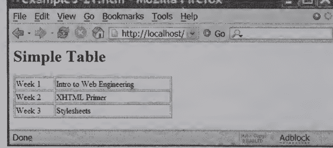

3.26 显示了如果浏览器窗口变窄会发生什么。表格仍然占据浏览器窗口宽度的一半，为了实现这一点，表格的内容经过了重新格式化。

## 3.26 缩小浏览器窗口宽度

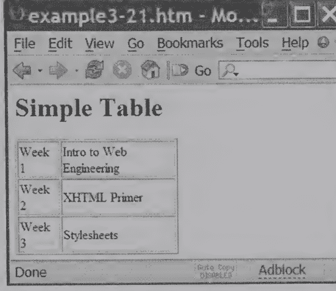

你会在此示例中注意到表格内部列的宽度被设置为不同的尺寸。这是由浏览器自动完成的，取决于单元格中数据的大小。如果你想为单元格指定精确的宽度（无论是百分比还是固定像素值），可以在 `<td>` 标签上使用 `width` 属性。

表格仍然占据浏览器窗口宽度的一半，为了实现这一点，表格的内容经过了重新格式化。你会在此示例中注意到表格内部列的宽度被设置为不同的尺寸。这是由浏览器自动完成的，取决于单元格中数据的大小。如果你想为单元格指定精确的宽度（无论是百分比还是固定像素值），可以在 `<td>` 标签上使用 `width` 属性。

（注：由于提供的文本存在大量重复和 OCR 错误，翻译部分已根据要求进行了去重并保留核心逻辑内容。）

## HTML/XHTML 入门

## 3.27: 更复杂的表格结构

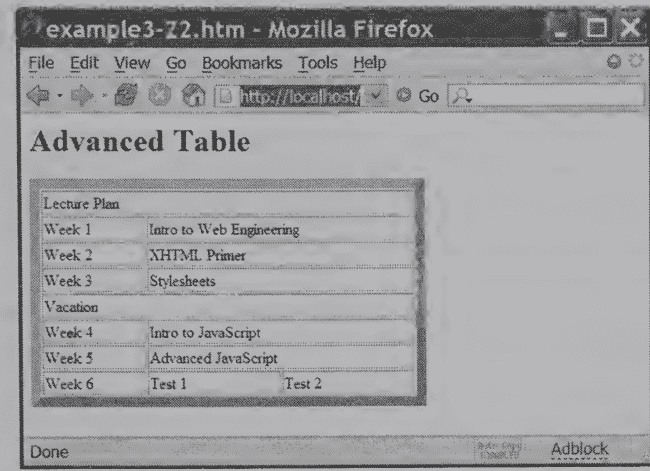

我们目前为止讨论的表格单元格中的数据主要是为了适应文本的，但可以在 `<td>``</td>>` 标签中嵌入任何 XHTML 代码，这样你就可以实现各种有趣的效果。

在本节中，我们仅简单触及了 XHTML 表格这一主题，目的是为了让你有能力为我们将用 JavaScript 功能制作的网页增添趣味。还有许多额外的标签和属性可以应用于表格，其中一些将包含在本书随后的示例中，在那些示例中，特定的表格格式化需要用到它们。

## 总结

本章涵盖了 XHTML 的基本元素。你现在应该能够创建具有适当格式的标题和文本的基础网页了。你应该能够添加超链接和图像，并生成各种格式的列表和基础表格。希望这已经让你对 XHTML 语言有了足够的了解，以便将其与 JavaScript 结合。如果你过去写过 XHTML（或 HTML），但现在感到有些生疏，那么本章应该为你提供一些有用的复习。

随着后续章节的进行，我们将引入与特定示例和主题相关的更多标签和属性（例如在第 11 章表单中，我们将引入在 JavaScript 代码中显示表单元素所需的 XHTML 属性）。通过本章获取的知识，你应该能够更轻松地理解这些进一步的 XHTML 元素。

如果你想更详细地学习 XHTML，建议获取一本专门介绍该语言的教科书。市上有有很多此类书籍。关于 XHTML 语言本身的详细信息以及所有标签和属性的完整引用也可以在 W3C 网站上找到：www.w3.org。

在第 4 章中，我们将考虑如何使用样式表为你的网页提供有趣的格式。

# 第 4 章：样式表

## 引言

在本章中，我们将对样式表进行基本介绍。样式表是一组规定浏览器如何渲染文档中 XHTML 标签的规则。……在这里，我们只涵盖样式表的基本功能、其语法、如何将其应用于网页，以及不同类型样式表的一些优缺点。

首先是关于样式表的目的和发展的一些背景知识。从历史上看，HTML（以及随后的 XHTML）侧重于内容而非样式，尽管在开发过程中该语言中添加了一些样式类型的属性。随着互联网的发展和变得越来越流行，网页的样式和布局变得越来越重要。为了吸引访问者，网页在视觉上必须具有吸引力，为了不让额外的样式属性杂乱 HTML 语言，W3C 提议使用一个独立的实体——样式表——HTML 文档可以使用该样式表对标签应用样式格式化。样式表有许多不同的格式，但我们在这里介绍的版本是级联样式表（CSS），它是于 1998 年引入的。……浏览器花费了一些时间才完全符合 CSS2 标准，因此在使用其更高级的功能时必须小心。我们将主要涵盖本章的基础功能，这些功能在较新的浏览器中应该可以正常显示。

通过使用样式相关的属性，我们可以使用 XHTML 实现许多效果。然而，这需要在每次使用标签时都这样做，这既复杂又容易出错。建议在可能的情况下使用样式表添加样式功能，并且为了强制这一点，XHTML 标签的样式类型属性已被废弃，并将从该语言的未来版本中删除。

样式表的主要优势之一是单个样式表可以用于网站上的多个页面产生一致的外观。例如，许多公司开发一个大型样式表，并将其用于它们所有的网页中。如果公司样式需要更改，只需执行一次，所有页面都将更新。这显著减少了维护成本。

样式表的另一个流行用途是辅助网页无障碍。例如，可以为那些观察样式类型如何受色盲或阅读障碍影响的人制作备用样式表。向 XHTML 中添加样式规则有三种方法：

- 使用 `style` 属性的内联样式
- 使用 `<style>` 和 `</style>` 标签的文档级样式表
- 外部样式表，其中样式规则从单独的文件链接或导入

现在我们将逐一演示这些方法中的每一种。

## 内联样式

向 XHTML 标签添加样式规则最简单的方法是使用标签的 `style` 属性，并将其设置为所需的样式。例如，要创建一个蓝色的斜体顶层标题，我们将使用以下语句：

```html

<h1 style="color:blue; font-style:italic">First Stylesheet Example/</h1>

```

样式由字符串标识，该字符串包含了一系列之间有颜色的属性值对。如果你想应用多个样式规则，则可以将它们包含在字符串中，并用分号分隔。

这被称为内联样式，它只会影响它所所在的特定标签。

同一文档中的任何进一步的顶层标题，除非它们也包含相相同的样式属性，否则将不会蓝色斜体。

此时值得注意的是，这种效果可以使用 XHTML 语言的样式类型标签和属性来实现，尽管这不被认为是最佳实践。我们可以将标题文本封装在斜体标签 `<i>``</i>` 内部，并按照如下所示将颜色设置为蓝色：

以下文档显示了在浏览器中打开此文档的结果：

```html

<html xmlns="www.w3.org/1999/xhtml">

<head>

<title>example4-1</title>

</head>

<body>

<h1 style="color:blue; font-style:italic">Style 1</h1>

<p style="color:blue; font-style:italic">Italic heading</p>

<h1 style="color:blue; font-style:italic">Style 2</h1>

<p style="color:blue; font-style:italic">Standard heading</p>

<h1 style="color:blue; font-style:italic">Style 3</h1>

</body>

</html>

```

第一个标题包含一个斜体的单个样式规则。第二个标题不包含 `style` 属性，因此是标准标题。第三个标题具有将背景设置为黑色的样式规则。

打开此文档的结果可以在图 4.1 中看到。

图 4.1：内联样式

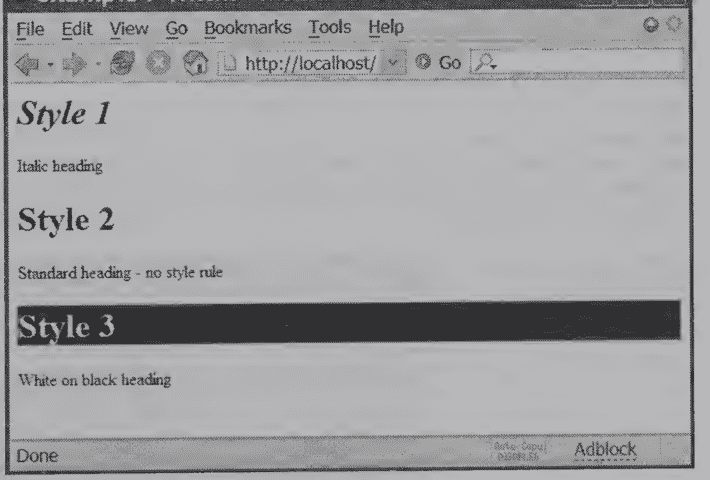

## 样式表

## 文档级样式表

如果我们希望为每个标签出现应用相同的样式，可以使用所谓的文档级样式表，而不是每次都设置 `style` 属性。要创建文档级样式表，您将所有的样式放在头部部分的 `<style>` 标签中。以下示例提供了文档级样式表：

```html

<html xmlns="www.w3.org/1999/xhtml">

<head>

<title>example4-2</title>

<style>

<!--

h1 {background-color:black; color:white}

body {background-color:silver}

-->

</style>

</head>

<body>

<h1>In-line Style</h1>

<p>Applies only to the tag in which it is contained</p>

<h1>Standard</h1>

<p>Document-level stylesheet</p>

</body>

</html>

```

文档级样式表定义在文档的头部 4-9 行。样式表封装在 `<style>``</style>` 标签之间，但请注意样式规则本身包含 HTML 注释中。这看起来有点奇怪，你可能会想：“如果我想包含这些样式规则，它们会被注释掉吗？”之所以这样做是因为支持文档级的浏览器足够聪明，可以忽略这些注释并处理样式规则。不支持文档级样式规则的旧浏览器将仅仅把样式规则视为注释并忽略它们。

在这个样式表中，我们定义了一个适用于 `<h1>` 标签的样式规则，将背景颜色设置为黑色到白色。这两个样式之间用分号分隔；对于内联样式，我们随后定义了一个将 `<body>` 的背景颜色设置为银色的样式规则。事实上，这会将整个文档的背景颜色设置为灰色（银色），如图 4.2 所示。

图 4.2：文档级样式表

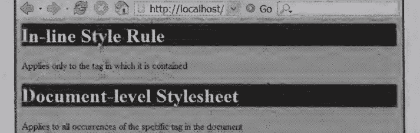


定义的两个样式规则将应用于文档中所有指定类型的标签，即所有一级标题和文档正文。文档本身包含两个一级标题。请注意，在示例中，这些标题没有设置样式属性，而是采用了文档级样式表的格式化设置。样式规则由三个元素组成：选择器、属性和值。它们的格式可以标准化，如下所示：

```

selector[s] (property:value; property:value; ...)

selector (property:value; property:value; ...)

```

选择器是应用于样式规则的 XHTML 标签。一组大括号 `{ }` 包围着要应用的样式，这些样式通过 `属性:值` 对来识别，并用分号隔开。如果需要将相同的样式应用到不同的选择器，则可以使用两个独立的样式规则，或者使用逗号将选择器隔开并组合在一起。例如：

```

h1,h2,h3 (color:red; text-align:center)

```

这将将所有 1、2、3 级标题设置为红色文本，其结果与以下三个独立的样式规则完全相同：

```

h1 (color:red; text-align:center)

h2 (color:red; text-align:center)

h3 (color:red; text-align:center)

```

## 外部样式表

与其在网站上每个文档的头部（header）中放置样式规则，可以将它们放置在单独的文件（通常以 .css 文件扩展名命名）中，并将它们链接到每个 XHTML 文档。这些被称为外部样式表。例如，上一节中使用的文档级样式表可以通过将样式规则复制到单独文件中转换为外部样式表：

```

/*example4-3.css*/

h1 (background-color:black; color:white)

body (background-color:silver)

```

可以通过用 `/*` 和 `*/` 包围注释向外部样式表中插入注释，正如第 1 行所示可以这样做。第 2-3 行是样式规则。
此外部样式表（我们将其命名为 example4-2.css）可以链接到任何 XHTML 文档，如下例所示：

```html

<html xmlns="http://www.w3.org/1999/xhtml">

<head>

<title>example4-3.html</title>

<link rel="stylesheet" href="example4-3.css" type="text/css"/>

</head>

<body>

<h1>In-line Style Rule</h1>

<p>仅应用于其包含的标签</p>

<p>Document-level Stylesheet</p>

<p>应用于文档中特定标签的所有出现处</p>

</body>

</html>

```

这个示例与之前考虑的文档级样式表的示例非常相似。唯一的区别在于，我们没有在 XHTML 文档的头部内定义样式规则，而是使用第 4 行的 `<link>` 标签从单独的文件（在此例中为 example4-3.css）获取它们：

```html

<link rel="stylesheet" href="example4-3.css" type="text/css"/>

```

`<link>` 标签包含三个必须设置的属性。`rel` 属性被分配字符串 "stylesheet"，以表示我们与铦接文件之间建立的关系类型；`href` 属性被分配包含文件名的字符串；`type` 属性用于设置字符串 "text/css"，以表示这是一个包含层叠样式表格式的文本文件。

在浏览器中打开此文档的结果与打开之前的示例完全相同，之前的示例样式规则包含在文档内部。这在图 4.2 中所示。

## 样式表的层叠效应

我们现在来考虑为什么我们将这种样式表命名为层叠样式表（cascading stylesheet）。这是因为取决于应用外部、文档还是内联规则，不同的样式规则可以应用于文档中的不同位置。如果应用了外部样式表，则规则最初适用于每个链接到它的文档。例如，如果我们设置一级标题的样式规则为在黑色背景上的白色文字，如下：

```

h1 (background-color:black; color:white)

```

但是，这些文档中的任何一个都可以通过在特定文档中应用文档级样式被覆盖（或添加）。例如，我们可能决定在一个特定的文档中，我们倾向于在黑色背景上使用银色文字，在这种情况下，我们会在该 XHTML 文件的头部部分添加以下文档级样式表：

```

h1 {color:silver};

```

这意味着对于此特定文档中的 `<h1>` 标签，背景颜色仍然是黑色（采用外部样式表规则），但颜色将是文档级样式表中所定义的银色。在链接外部样式表的语句之后添加文档级样式时，要务必确保在链接外部样式表的 XHTML 文档头部部分定义了覆盖外部样式表的样式。如果没有这样做，并且在定义了文档级样式之后链接了外部样式表，那么如果两种样式之间存在冲突，则最晚的（外部样式表）将具有优先级。

我们还可以通过内联样式规则进一修改单个元素的样式，它将同时覆盖文档样式和外部样式。例如，对于文档中的一个标题，我们可能希望将其变为斜体。我们将使用内联样式规则来实现此点：

```html

<h1 style="font-style:italic">In-line Style Rule</h1>

```

所有其他 `<h1>` 标签都将不受影响，但除了已有的文档级样式外，这个特定的标题将变为斜体。

为了让这一点更清晰，让我们把所有这些内容都放入一个简单的示例中。首先，我们将创建一个外部样式表并将其存储在 example4.css 文件中，如下所示：

```

/*example4.css*/

h1 {background-color:black; color:white}

body {background-color:silver}

```

此样式表包含第 49 页描述的 example4-3.css 文件，因此，简单地链接到 XHTML 文档而不添加任何文档级样式，将产生与之前图 4.2 所示相同的效果。我们现在按照所示创建一个新的 XHTML 文档：

```html

<html xmlns="http://www.w3.org/1999/xhtml">

<head>

<title>example4.html</title>

<link rel="stylesheet" href="example4.css" type="text/css"/>

<style>

<!--

h1 {color:silver}

-->

</style>

</head>

<body>

<h1>Document-level Stylesheet</h1>

<p>当发生冲突时覆盖外部样式</p>

<h1 style="font-style:italic">In-line Style Rule</h1>

<p>同时覆盖文档和外部样式</p>

</body>

</html>

```

此文档链接了我们刚刚看到的外部样式表，但它还定义了一个文档级样式表，在样式表中它将一级标题设置为银色文字。这覆盖了外部样式表中定义的白色文字，因此该文档的一级标题将在黑色背景上的银色文字。在第 13 行，我们随后添加了一个内联样式规则，将该特定标题设置为斜体文字。这是对已定义的银黑样式的添加。在浏览器中打开此文档的结果如图 4.3 所示。

图 4.3：层叠样式效应

img/889348cc09f59c2bc43ab7f014e5f6a9_54_0.png)

可以看到，文档背景颜色为银色（外部样式表），所有一级标题都是黑色背景上的银色文字（文档级样式表），在第二个标题的情况下，只有文字是斜体（内联样式）。这演示了使用不同类型样式表的一种层叠效应和可能性。

> 注意
> XHTML 文档并不限于链接到单个外部样式表。可以在文档头部包含多个 `<link>` 标签以链接到不同的样式表，这些表将被合并；如果不同样式表定义的规则之间任何重叠和冲突，则后链接的样式表将具有优先级，其方式与在链接外部样式表后定义文档级样式的方式相同。

## 上文样式规则

因此，在本章中，我们考虑了适用于特定标签元素的样式规则。除非我们应用了不同的内联样式规则，否则定义的样式将应用于文档中该标签的每一次出现。我们可以定义样式规则，仅当标签出现在特定的上下文中时才应用该规则。

为了说明这一点，我们将使用一个示例，该示例使用样式规则对多级有序列表进行编号。假设我们需要第一级为大写字母，第二级为大写罗马数字，第三级为十进制数字。

在第 3 章中，我们展示了如何在 XHTML 中使用 `<ol>` 标�的 `type` 属性通过简单的有序列表来实现此目标。例如，为了更改格式，我们需要设置 `type` 属性以生成以下 XHTML 文档：

```html

1 <html xmlns="http://www.w3.org/1999/xhtml">

2 <head>

3 <title>example4-5.html</title>

4 </head>

5 <body>

6 <h1>Web Engineering</h1>

7 <ol type="A">

8 <li>HTML</li>

9 <ol type="I">

10 <li>Basic HTML</li>

11 <li>Advanced HTML</li>

12 <ol type="1">

13 <li>Cascading Stylesheets</li>

14 <li>Image Maps</li>

15 <li>Forms</li>

16 </ol>

17 </ol>

18 <li>JavaScript</li>

19 <li>Advanced topics</li>

20 </ol>

21 </body>

22 </html>

```

第一级标题定义的 `type` 设置为 "A"（大写字母），第二级 `type` 设置为 "I"（大写罗马数字），第三级 `type` 设置为 "1"（十进制）。

该文档可以正常工作，但请考虑一种情况：你有一个包含许多此类格式列表的大型文档。每当你创建一个新列表时，都需要记住该层级的类型格式。此外，如果将来你需要更改这些层级之一的格式（例如，你可能决定更倾向于将第二级列表项改为小写罗马数字），你将必须找到所有的第二级列表定义并修改 `type` 属性。在你的编辑器中使用全局“搜索和替换”操作可能相对容易地做到这一点，但这仍然容易出错，而且不是最高的方法。更理想的做法是根据有序列表的上下文应用一组样式规则，即取决于它们是第一级、第二级还是第三级列表项。

这通过使用事实上的文档级样式表是可以实现的的，下面的示例是之前 XHTML 文档的替代方案，这次我们使用文档级样式表来定义 `type` 属性内部的数字格式：

```html

1 <html xmlns="http://www.w3.org/1999/xhtml">

2 <head>

3 <title>example4-6.html</title>

<style type="text/css">

<!--

/* 有序列表格式 */

ol li (list-style: upper-alpha)

ol ol li (list-style: upper-roman)

ol ol ol li (list-style: decimal)

-->

</style>

</head>

<body>

<h1>Web Engineering</h1>

<ol>

<li>HTML</li>

<ol>

<li>Basic HTML</li>

<li>Advanced HTML</li>

</ol>

<ol>

<li>Cascading Stylesheets</li>

<li>Image Maps</li>

<li>Forms</li>

</ol>

<ol>

<li>JavaScript</li>

<ol>

<li>Advanced topics</li>

</ol>

</ol>

</body>

</html>

```

你对该样式表正文首先会注意到，这个 XHTML 文档中的 `<ol>` 标签没有 `type` 属性。相反，在文档的头部区域定了一个样式表。样式规则使用一系列选择器（之间有空格）来指示样式规则的上下文。例如，一个带有列表的第一级有序列表将包含一个 `<ol>` 标签，后跟一个 `<li>` 标签，因此可以使用此方式应用样式规则：

```css

ol li {list-style: upper-alpha}

```

第二级有序列表已经位于第一级有序列表中，因此我们可以通过 `<ol>` 标签后跟 `<li>` 标签为这种结构定义一个样式上下文，如下：

```css

ol ol li {list-style: upper-roman}

```

依此类推，第三级有序列表嵌入在第二级列表中，因此我们的样式上下文可以定义为：

```css

ol ol ol li {list-style: decimal}

```

我们在这里还引入了一个新的属性对。XHTML 中有序列表的 `type` 属性被样式规则的 `list-style` 属性所取代。`list-style` 的值是一个指示特定格式属性的字符串。

在使用上下文样式时，你务必小心，不要将其与应用于多个元素的相同样式的语法混淆。要将相同的样式规则应用于多个元素，你将用逗号分隔元素，正如我们在第 49 页看到的那样。而要将样式规则应用于特定上下文中的特定元素，则用空格分隔这些上下文元素。

在浏览器中打开此示例的结果如图 4 所示。

## 4 样式表

如上一个示例所示，对类属性标记。因此，可以定义一个名为 `silvy_cent` 的样式规则，它在银色背景上提供居中的文本。此类可以应用于段落：

```html

<p class="silvy_cent">这个段落是银色且居中的</p>

<h1 class="silvy_cent">这个标题是银色且居中的</h1>h1

```

或者应用于标题：
下面提供了一个使用通用类的完整示例：

```html

<html xmlns="http://www.w3.org/1999/xhtml">

<head>

  <title>example4-8.html</title>

  <style type="text/css">

  /*

  * 样式类 *

  */

  .italic {font-style: italic;}

  .bigger {font-size: 150%}

  </style>

</head>

<body>

  <h1 class="generic">通用类</h1>

  <p class="italic">这个段落是斜体</p>

  <h2 class="italic">这个 h2 标题是斜体</h2>

  <p>这是一个普通的段落</p>

  <p class="bigger">这个段落比普通大 50%</p>

  <h1 class="normal">这是一个普通的 h1 标题</h1>

  <h1 class="bigger">这个 h1 标题比普通大 50%</h1>

</body>

</html>

```

在样式表中，第 7 行到第 8 行定义了两个通用类：
`.italic {font-style: italic;}`
`.bigger {font-size: 150%}`

第一个用于生成斜体文本，第二个引入了一个新的样式规则，用于生成特定大的文本。在这种情况下，文本被定义为比该类所属的特定标签的标准文本尺寸大 50%。文档的其他部分将这些样式规则应用于选定的段落和标题标签。例如，第 17 行将 `bigger` 样式规则应用于段落，以生成比普通大 50% 的文本，第 19 行将相同的样式应用于一级标题，以生成比普通大 50% 的标题文本。图 4.6 展示了将这两个通用类应用于段落和标题标签时可以产生多种各种效果。

## 样式表

图 4.6：通用类

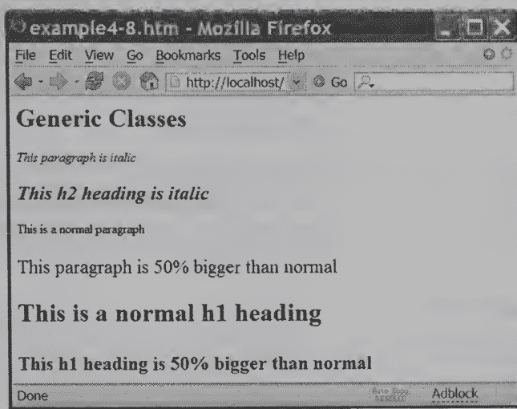

## 无标签样式

在本章中，我们修改了指定标签内内容的样式，但如果我们只想修改标筓内容的某一部分会发生什么呢？这可以通过将所需内容封装在一对 `<span></span>` XHTML 标签之间来实现。样式规则可以按照本章之前描述的任何格式应用于 `<span>` 标签。这包括使用普通或通用样式类，其中使用的 `class` 名称被分配给 `<span>` 标签的 `class` 属性。

下面的示例演示了可以这样做：

```html

<html xmlns="http://www.w3.org/1999/xhtml">

<head>

  <title>example4-9.htm</title>

  <style type="text/css">

  /*

  / 样式类 */

  span {background-color: silver};

  span.bigger {font-size: 150%}

  </style>

</head>

<body>

  <h1>此文本变为 <span>银色背景</span></h1>

  <p>此文本变为 <span>背景</span>，然后恢复正常。</p>

  <p>此文本变为 <span class="bigger">银色背景且字体更大</span>，然后恢复正常。</p>

</body>

</html>

```

在此示例中，第 7 行指定了被 `<span>` 标签包围的内容的默认样式将格式化为银色背景。第 8 行显示，此外，`<span>` 标签还有一个名为 `bigger` 的普通样式类，它将文本设置为比普通大 50%。这些样式规则应用于第 14 行的文档内容，在该处，段落的一部分被设置为标准的 `<span>` 银色背景格式；在第 15 行，除了标准的银色背景外，`bigger` 样式类还被应用于 `<span>` 和 `</span>` 标签之间的文本。

在浏览器中打开的结果如图 4.7 所示。

图 4.7：无标签样式

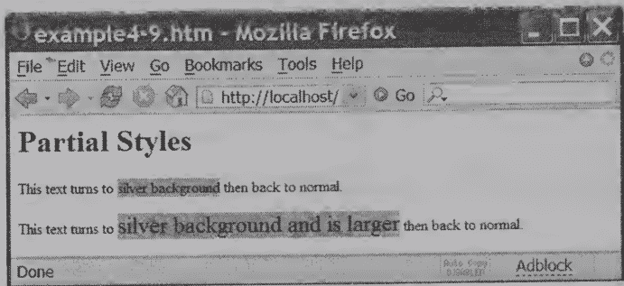

## 总结

在本章中，我们学习了如何向 XHTML 文档应用各种样式规则。

# 第 5 章：变量

## 引言

在本章中，我们将探讨变量的概念。变量用于存储在程序执行过程中可能会改变的数据。我们将查看如何在 JavaScript 中声明、初始化和使用变量。

## 什么是变量？

变量是我们关联的一个值。变量通常被描述为可以包含值的容器。变量之所以被称为变量，是因为它们的值可以变化。变量可以用于脚本中方便地存储和处理数据。在 JavaScript 中创建变量我们使用 var：

```javascript

var intCount;

```

上面的代码创建一个名为 `intCount` 的变量。我们可以使用 `=` 运算符为声明的变量赋值：

```javascript

intCount = 5;

```

上面的代码将值 5 分配给变量 `intCount`。我们将在第 6 章详细介绍运算符。

## 变量标识符

标识符是 JavaScript 中赋予变量的名称。它们也用于命名函数，但目前我们只关注变量名。在创建法的标识符名称时，有一组规则需要遵守。这些规则是：

- 第一字符必须是字母、下划线 (_) 或美元符号 ($)。
- 剩余字符可以是任何数字、字母数字、美元符号或下划线。
- 不能使用数字作为变量名的第一个字符。

## 常量

在引入变量之前，我们想简要解释一下常量。常量值用于 JavaScript 中不需要更改的情况。常量值的示例之前已经列出，包括：

```javascript

"Simon"

```

为什么常量很重要？嗯，正如我们之后看到的，我们在初始化变量时需要使用常量，它们还构成了表达式。

### 表 5.1：预留字

| break | case | catch | continue | default | delete |
|---|---|---|---|---|--|
| do | else | false | finally | for | function |
| if | in | instanceof | new | null | return |
| switch | this | throw | true | try | typeof |
| var | void | while | with | | |

此外，还有许多目前在 JavaScript 中未使用的单词，但为了未来的语言版本已被预留。这些单词列在表 5.2 中。

### 表 5.2：未来 JavaScript 扩展的预留字

| abstract | Boolean | byte | char | class | const |
|---|---|---|---|---|--|
| debugger | double | enum | export | extends | final |
| float | goto | implements | import | int | interface |
| long | native | package | private | protected | public |
| short | static | super | synchronised | throws | transient |
| volatile | | | | | |

> 注意：不要担心将变量名命名为预留字而导致错误，我们将在本章稍后介绍一种简单的命名规范来防止你遇到这种情况。

## 变量与类型

JavaScript 并不是像 C 或 Java 那样的严格类型语言。在强类型语言中，变量被声明为某种特定类型（这意味着它们只能存储特定类型的数据）。因此，如果一个变量被定义为存储某人的名字（这是一个字符字符串），那么它之后就不能存储代表月份的整数值了。

JavaScript 被认为是一种无类型语言，这意味着变量可以持有任何类型的值，且该值在脚本执行期间可以发生变化。例如：

```javascript

intCount = 10;

intCount = "Simon"

```

在这两行 JavaScript 代码中，`intCount` 先被赋值为 10，然后被赋值为字符串 "Simon"。值 10 是一个整数，而名字 "Simon" 是一个字符串，这在 JavaScript 中完全合法。无类型语言的优点之一是很容易从一种数据类型转换为另一种类型，这使得脚本编写简单得多。缺点是强类型编程语言强制执行更严格的编程规范。

## 变量、数据类型与对象模型

> 注意：如果你不完全确定理解，请不要担心。这里提到的某些概念有点难以掌握，但你只需要确定 JavaScript 变量可以在执行期间更改其数据类型即可。

## 声明变量

在 JavaScript 中使用变量之前，你需要先声明它们。我们已经看到使用 `var` 关键字来声明变量，例如：

```javascript

var strSurname;

```

可以使用同一个 `var` 关键字声明多个变量。这些变量之间仅用逗号分隔：

```javascript

var strSurname, fitSalary, intMonthInYear;

```

一旦声明了变量，我们就可以给它赋值（这被称为初始化变量）。例如：

```javascript

var strSurname;

strSurname = "Stobart";

```

变量声明和初始化可以结合：

```javascript

var strSurname = "Stobart";

```

> 注意：为什么我们不总是同时声明并初始化变量？因为我们此时可能不知道该变量将要取的值。

## 变量命名

有很多好方法可以决定如何命名你的变量。也有一些方法是要避免的，比如直接按字母顺序排列，因为这会导致变量具有没有意义的名字。

我们使用简单的方法来命名变量。首先，我们选择一个或多个单词来表示我们要存储的数据。例如：

- salary（工资）
- day of the week（星期）
- employee names（员工姓名）
- gross amount payable（应付金额）

为了形成变量名，我们将这些单词组合在一起，并在组合时每个单词的首字母大写。对于上述示例，这将产生以下变量名：

- Salary
- DayOfTheTheWeek
- EmployeeNames
- GrossAmountPayable.

最后，我们在变量名的开头插入表 5.3 中列出的代码之一。这些代码用于识别变量将存储的数据类型。我们意识到 JavaScript 并不是强类型的，实际上它实际上并不支持所有这些不同类型，但它们可以帮助你作为程序员记住变量必须存储的数据类型，此外有助于确保你所选的变量名不是预留字。这些示例中的最终变量名为：

- flSalary
- strDayOfTheWeek
- arrEmployeeNames
- flGrossAmountPayable.

### 表 5.3：变量类型命名

| int | str | String |
| flt | obj | Object |
| bol | arr | Array |

## 变量作用域

变量作用域是脚本中可以被“看到”并因此访问的区域。通常，JavaScript 中的变量是全局的，可以从脚本的任何地方访问，包括函数内部（我们将稍后介绍这一点）。此外，我们以后会发现，在函数内部定义的变量仅在该函数内部具有局部作用域（但现在不要担心这个）。

## 文档对象模型

### 概述

JavaScript 实现了一种简单的面向对象范式，其中一切都是相互关联的。我们已经已经在不经意的情况下使用了它，但如果不对其进行详细说明，我们就无法继续下去。在第 17 章中，我们将描述如何创建自己的对象，并解释对象继承的概念，但现在我们将从一个简单的介绍开始。

（注：后续文本包含大量重复和 OCR 错误，已根据逻辑片段进行清理。）

## 变量、数据类型与对象模型

```javascript

var strStatus;

window.status = "Hello";

strStatus = window.status;

document.write("The status is: " + strStatus);

<!-- -->

</script>

<body>

</html>

```

上面的脚本是对前一个版本的修改。在这里，window.status` 的值被存储在变量 `strStatus` 中，并作为参数传递给 `document` 对象的 `write` 方法。上述脚本的输出如图 5.2 所示。

图 5.2：对象方法

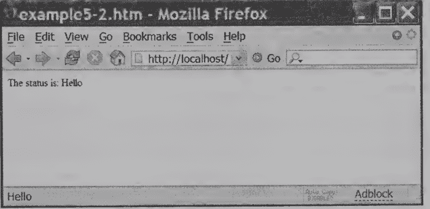

JavaScript 文档对象模型由许多具有属性和方法的对象组成。随着书籍的进展，我们将介绍其中一些。我们还将（正如之前提到的）研究如何创建自己的对象并在脚本中使用这些对象。

## 总结

本章介绍了数据类型和变量的概念。变量和数据类型对于创建 JavaScript 应用至关重要。然而，我们还无法演示它们的实际用途，因为我们首先需要考虑表达式、操作数和运算符的概念。我们还介绍了文档对象模型，并展示了如何访问对象的属性和方法。在第 6 章中，我们将引入表达式、操作数和运算符的概念，并描述这些内容如何用于探索和扩展变量在脚本中的作用。

# 第 6 章：表达式、操作数与运算符

## 引言

在第 5 章中，我们介绍了变量，并描述了它们的创建方式、它们可以包含的数据以及我们如何创建有效和无效的变量名。在本章，我们将研究表达式、操作数和运算符的概念。表达式在 JavaScript 中用于计算值。表达式可以由操作数和运算符组成。我们在提到第 5 章引入的变量时使用了它们，因为表达式中的变量也是一个操作数。

## 表达式

JavaScript 中的表达式由若干操作数和运算符组成，可以通过求值产生一个单一值。表达式可以非常简单，由单个变量或常量值组成，例如：

```

10

"Hello"

intAge

```

这些表达式只包含一个项目（即操作数），当表达式求值时产生的值是常量本身或存储在变量中的值。然而，表达式可以稍微复杂一些。例如：

```

intAge + 10

```

在这个示例中，表达由三部分组成：变量 `intAge`、常量值 `10` 和运算符 `"+"`。正如其名称所示，运算符对操作数进行操作，在这种情况下，该运算符将值 `10` 加到已存储在变量 `intAge` 中的值。让我们来看另一个表达式：

```

intAge + 10 * intYear

```

上面的表达式现在由两个变量 `intAge`、`intYear` 和一个常量值 `10` 组成。此外，现在有两个运算符：加法运算符 `"+"` 和乘法运算符 `"*"`。记得，当我们开始本章时，我们提到表达式可以像变量一样简单：

```

intAge

```

也可以是一个常量，例如：

```

10

```

那么，变量 `intAge` 成了我们更复杂表达式的一部分，常量值 `10` 也是如此：

```

intAge + 10 * intYear

```

这意味着什么？嗯，这意味着一个复杂的表达式实际上由许多子表达式组成。考虑图 6.1，它突出了我们表达式的各个部分。

## 运算符：操作数与表达式 6

```

intAge + 10 * intYear

```

| 原始表达式 | 操作数 / 子表达式 | 运算符 |
| :--- | :--- | :--- |
| `intAge` | `intAge` | `+` |
| | `10` | `*` |
| | `intYear` | |
| | `intAge + 10` (更多子表达式) | |
| | `10 * intYear` | |

**正如我们很快将看到的，在表达式中可以使用许多不同类型的运算符。**

## 操作数

我们已经介绍了操作数，并说明了它们是表达式的基石；没有它们，就无法创建表达式，因为最简单的表达式由单个操作数组成。我们已经解释了操作数可以是变量，也可以是常量值，并且可以是第 5 章中提到的三种数据类型中的任何一种。我们还展示了操作数是由运算符进行处理的，并简要介绍了两个简单的运算符：`"+"` 和 `"*"`。重要的是，并不是所有的运算符都能作用于所有的操作数。例如，考虑：

```

10 * 2

```

上面是一个有效表达式，因为运算符 `"*"` 能够乘以常量值 `10` 和 `2`。然而：

```

"Wednesday" * "Tuesday"

```

这不是一个有效表达式，因为在 JavaScript 中，你不能将两个不包含数值的字符串相乘。此外，运算符的操作方式取决于操作数的类型。例如：

```

10 + 2

```

在这个示例中，两个整数常量相加得到结果 `12`。然而，在两个字符串常量的情况下：

```

"Simon" + "Stobart"

```

运算符将字符串拼接在一起，形成字符串 `"Simon Stobart"`。

## 运算符、操作数与表达式

## 运算符

我们之前提到过存在许多不同类型的运算符。在本节中，我们将介绍所有的运算符。为了解释不同的运算符，我们对它们进行了分类。

## 赋值运算符

赋值运算符用于给变量赋值。表 6.1 阐释了这一点。

| 名称 | 运算符 | 示例 | 描述 |
| :--- | :--- | :--- | :--- |
| 赋值 | = | intCount = 10 | 将第二个操作数的值赋值给第一个。 |

你可能不会认为 `"="` 是一个运算符，因此可能认为像这样的：

```

intCount = 10;

```

不是一个表达式，但事实上它是一个。因为 `"="` 是真正的运算符，我们可以在更复杂的表达式中使用它，例如：

```

intCount = intYear = 10;

```

下面的脚本演示了：

```html

<html xmlns="http://www.w3.org/1999/xhtml">

<head>

<title>example6.html</title>

</head>

<body>

<script language="JavaScript">

var strDay = "Monday";

document.write(strDay);

</script>

</body>

</html>

```

并输出值 `Monday`。

## 算术运算符

算术运算符对操作数执行基础算术运算。表 6.2 展示了可用的算术运算符并描述了它们的用途。

表 6.2：算术运算符

| 名称 | 运算符 | 示例 | 描述 |
| :--- | :--- | :--- | :--- |
| 加法 | + | 10 + intCount | 在两个数值操作数的情况下，该运算符将两个操作数的值相加。在两个字符串操作数的情况下，第二个操作数拼接在第一个操作数的后面。如果一个操作数是字符串另一个是数值，则先将数值操作数转换为字符串。 |
| 减法 | - | intCount - 4 | 从第一个操作数中减去第二个数值操作数的值。如果用于字符串操作数，它尝试将字符串转换为数值后再执行操作。 |
| 除法 | / | intCount / 2 | 用第二个数值操作数除以第一个操作数的值。如果用于字符串操作数，它尝试将字符串转换为数值后再执行操作。 |
| 乘法 | * | 3 * 6 | 将两个数值操作数的值相乘。如果用于字符串操作数，它尝试将字符串转换为数值后再执行操作。 |
| 取模 | % | 7 % 4 | 返回第一个操作数除以第二个操作数 时的余数。例如，`7 % 4` 将返回 `3`。这是因为 4 除以 7 余 3。如果用于字符串操作数，它尝试将字符串转换为数值后再执行操作。 |
| 一元正号 | + | +10 | 如果放在单个常量操作数之前，它允许你专门地指定数值常量的符号。 |
| 一元负号 | - | -intCount | 如果放在单个操作数之前，它会将正值转换为负值，将负值转换为正值。如果用于字符串操作数，它尝试将字符串转换为数值后再执行操作。 |

## 6 运算符、操作数和表达式

下面的脚本演示了算术运算符的使用：

```html

<html xmlns="http://www.w3.org/1999/xhtml">

<head>

  <title>example6-2.htm</title>

</head>

<body>

  <script language="JavaScript">

<!--

  var intA = 10;

  var intB = 4;

  var intC;

  intC = intA + intB;

  document.write("10 + 4 = " + intC + "<br/>");

  intC = intA - intB;

  document.write("10 - 4 = " + intC + "<br/>");

  intC = intA / intB;

  document.write("10 / 4 = " + intC + "<br/>");

  intC = intA * intB;

  document.write("10 * 4 = " + intC + "<br/>");

  intC = intA % intB;

  document.write("10 % 4 = " + intC + "<br/>");

</script>

<!---->

</body>

</html>

```

该脚本的输出如图 6.2 所示。

图 6.2：算术运算符输出

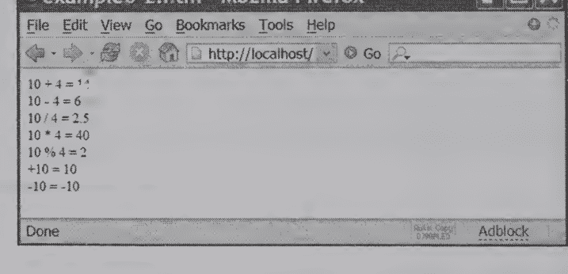

## 增和递减运算符

JavaScript 支持后置和前置的增、递减运算符。这些运算符列在表 6.3 中。

### 表 6.3：增和递减运算符

| 名称 | 运算符 | 示例 | 描述 |
|---|---|---|---|
| 前增 | ++ | ++intCount | 将变量操作数的数值加 1。该新值随后被用于表达式的剩余部分。如果与字符串操作数一起使用，它尝试在执行操作之前将字符串转换为数值。 |
| 后增 | ++ | intCount++ | 将变量操作数的数值加 1。原始值随后被用于表达式的剩余部分。如果与字符串操作数一起使用，它尝试在执行操作之前将字符串转换为数值。 |
| 前减 | -- | --intCount | 将变量操作数的数值减 1。该新值随后被用于表达式的剩余部分。如果与字符串操作数一起使用，它尝试在执行操作之前将字符串转换为数值。 |
| 后减 | -- | intCount-- | 将变量操作数的数值减 1。原始值随后被用于表达式的剩余部分。如果与字符串操作数一起使用，它尝试在执行操作之前将字符串转换为数值。 |

下面的脚本演示了后置和前置的增、递减运算符：

```html

<html xmlns="http://www.w3.org/1999/html">

<head>

<title>example6-3.htm</title>

</head>

<body>

<script language="JavaScript">

var intA = 10;

document.write("intA = " + intA + "<br>");

document.write("intA++ = " + intA++ + "<br>");

11 document.write("intA = " + intA + "<br/>");

12 document.write("intA-- " + intA-- + "<br/>");

13 document.write("--intA = " + --intA + "<br/>");

14 //--

15 <script>

16 <body>

17 </html>

```

该脚本的输出如图 6.3 所示。注意，`intA` 的值似乎从 10 跳变到 12，又从 12 跳变到 10，且后置增、递减运算符似乎没有改变变量 `intA` 的值。然而，实际发生的情况是变量正在被修改，正如表 6.3 所解释的那样，表达式的原始值是由方法写入的。

图 6.3：增和递减运算符输出

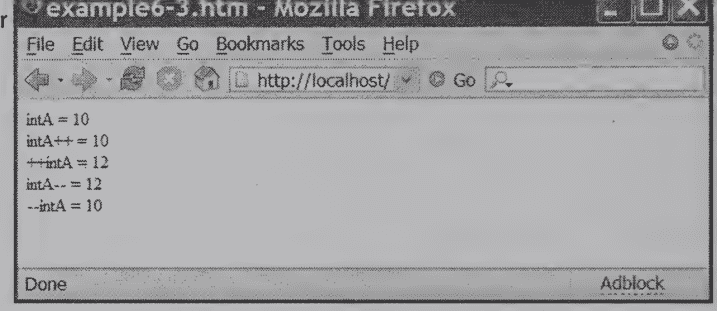

## 等等和不相等运算符

相等运算符经常与赋值运算符混淆，但它们非常不同。JavaScript 支持两个相等运算符和两个不相等运算符，这些运算符在表 6.4 中所示。

### 表 6.4：相等和不相等运算符

| 名称 | 运算符 | 示例 | 描述 |
|---|---|---|---|
| 等于 | == | intDay == intCount | 检查第一个操作数的值是否与第二个相同。操作数可以是任何类型。如果它们相等，则表达式求值为 true，否则为 false。 |
| 恒等 | === | intDay=== intCount | 恒等运算符还检查第一个操作数的值是否与第二个相同，它有更严格的规则来判断两个操作数在转换后是否相等。 |
| 不相等 | != | intDay != intCount | 等运算符的反向。 |
| 非恒等 | !== | intDay !== intCount | 恒等运算符的反向。 |

下面的脚本演示了相等和不相等运算符的使用：

```html

<html xmlns="http://www.w3.org/1999/xhtml">

<head>

<title>example6-4.htm</title>

</head>

<body>

<script language="JavaScript">

<!--

var intA = 10;

var intB = 10;

if (intA == intB) {

  document.write("intA is equal to intB<br/>");

}

if (intA != intB) {

  document.write("intA is not equal to intB<br/>");

}

-->

</script>

</body>

</html>

```

该脚本的输出如图 6.4 所示。

图 6.4：相等和不相等输出

# 关系运算符

关系运算符测试两个操作数之间的关系。这些运算符通常用于控制结构。表 6.5 展示了这些运算符。

### 表 6.5：关系运算符

| 名称 | 运算符 | 示例 | 描述 |
|---|---|---|---|
| 小于 | < | intCount < 10 | 如果第一个操作数小于第二个，求值为 true，否则为 false。 |
| 大于 | > | intCount > 4 | 如果第一个操作数大于第二个，求值为 true，否则为 false。 |
| 小于等于 | <= | intCount <= 10 | 如果第一个操作数小于或等于第二个，求值为 true，否则为 false。 |
| 大于等于 | >= | intCount >= 10 | 如果第一个操作数大于或等于第二个，求值为 true，否则为 false。 |
| 在 | in | "intCount" in objPerson | 如果左操作数是右侧对象的属性名，求值为 true。 |
| 实例 | instanceof | Number instanceof Number | 如果左操作数是右侧类的实例，求值为 true。 |

注意：不用担心 `in` 和 `instanceof` 运算符；包含它们仅是为了完整性。关系运算符的示例将在第 7 章显示，该章节将介绍控制结构主题。

下面的脚本演示了关系运算符的使用：

```html

<html xmlns="http://www.w3.org/1999/xhtml">

<head>

<title>example6-5.htm</title>

</head>

<body>

<script language="JavaScript">

<!--

var intA = 10;

if (intA > 9) {

  document.write("intA is greater than 9<br/>");

}

if (intA < 11) {

  document.write("intA is less than 11<br/>");

}

if (intA >= 10) {

  document.write("intA is greater than or equal to 10<br/>");

}

if (intA <= 10) {

  document.write("intA is less than or equal to 10<br/>");

}

-->

</script>

</body>

</html>

```

该脚本的输出如图 6.5 所示。

图 6.5：关系运算符输出

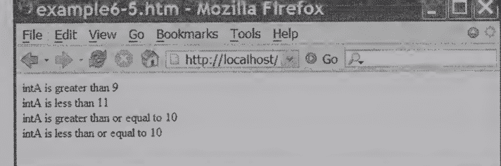

## 逻辑运算符

逻辑运算符用于执行布尔代数。它们最常用与比较运算符配合使用以产生更复杂的表达式，你将主要把它们用于控制流语句，例如 `if` 和 `while`（见第 7 章）。表 6.6 演示了 JavaScript 支持的逻辑运算符。

表 6.6：逻辑运算符

| 名称 | 运算符 | 示例 | 描述 |
|---|---|---|--|
| 与 | && | intCount && intDay | 对两个操作数执行布尔与操作（AND）。如果第一个和第二个操作数都为真，则返回 true，否则返回 false。 |
| 或 | || | intCount || intDay | 对两个操作数执行布尔或操作（OR）。如果第一个或第二个操作数为真，则返回 true。如果两个均为假，则返回 false。 |
| 非 | ! | intCount | 当置于操作数之前时，这是一个一元运算符——它将反转该操作数的布尔值。 |

以下脚本说明了逻辑运算符的使用：

```html

<html xmlns="http://www.w3.org/1999/xhtml">

<head>

<title>example6-6.html</title>

</head>

<body>

<script language="JavaScript">

<!--

var intA = 10;

var intB = 5;

if (intA > 9 && intB < 6) {

document.write("intA is greater than 9 and intB is less than 6<br/>");

}

-->

</script>

</body>

</html>

```

该脚本的输出为 "intA is greater than 9 and intB is less than 6"。

## 位运算符

位运算符需要整数值作为操作数。位运算符包含在大多数编程语言中，尽管在 JavaScript 编程中并不常用。它们通过在位位上操作整数来工作。整数以 32 位表示的形式存储。为了理解这些运算符如何工作，你需要理解二进制数表示。表 6.7 演示了支持的位运算符。

## 运算符、操作数和表达式

表 6.7：位运算符

| 名称 | 运算符 | 描述 |
|---|---|---|
| 与 | & | intA & intB | 对整数操作数的每个位执行布尔操作。只有当操作数中的两个位都设置为 1 时，该位才被置。 |
| 或 | | | intA | intB | 对整数操作数的每个位执行布尔操作。如果操作数中的任一个位设置为 1，该位即被置。 |
| 异或 | ^ | intA ^ intB | 对整数操作数的每个位执行布尔操作。如果操作数中的任一个位设置为 1 但不是两个位都设置，则该位被置。 |
| 非 | ~ | ~intA | 一元运算符，反转操作数中的所有位。 |
| 左移 | << | intA << 2 | 将第一个操作数中的所有位左移第二个操作数中指定的位数。使用 0 填充新位，第 32 位将丢失。 |
| 右移 | >> | intA >> 2 | 将第一个操作数中的所有位右移第二个操作数中指定的位数。移出右侧的位将丢失，而左侧位取决于数字的原始符号。 |
| 无符号右移 | >>> | intA >>> 2 | 与上述 >> 运算符相同，但右侧移入位始终为 0。 |

以下脚本说明了某些位运算符的使用：

```html

<html xmlns="http://www.w3.org/1999/xhtml">

<head>

  <title>example6-7.html</title>

</head>

<body>

<script language="JavaScript">

<!--

  var intA = 4;

  var intB = 5;

  document.write("intA & intB = " + (intA & intB) + "<br>");

  document.write("intA | intB = " + (intA | intB) + "<br>");

  document.write("intA ^ intB = " + (intA ^ intB) + "<br>");

-->

</script>

</body>

</html>

```

该脚本的输出如图 6.6 所示。

图 6.6：位运算符输出

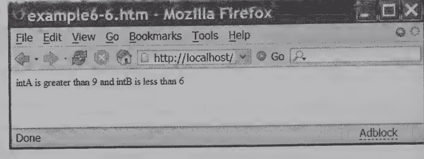

## 赋值组合运算符

除了普通的赋值运算符外，JavaScript 还支持许多与其他运算符结合的赋值运算符。这些组合运算符列在表 6.8 中。

表 6.8：组合运算符

| 名称 | 运算符 | 示例 | 等效于 |
|---|---|---|--|
| 赋值并加 | += | intA += intB | intA = intA + intB |
| 赋值并减 | -= | intA -= intB | intA = intA - intB |
| 赋值并乘 | *= | intA *= intB | intA = intA * intB |
| 赋值并除 | /= | intA /= intB | intA = intA / intB |
| 赋值并取模 | %= | intA %= intB | intA = intA % intB |
| 赋值并左移 | <<= | intA <<= intB | intA = intA << intB |
| 赋值并右移 | >>= | intA >>= intB | intA = intA >> intB |
| 赋值并无符号右移 | >>>= | intA >>>= intB | intA = intA >>> intB |
| 赋值并与 | &= | intA &= intB | intA = intA & intB |
| 赋值并或 | |= | intA |= intB | intA = intA | intB |
| 赋值并异或 | ^= | intA ^= intB | intA = intA ^ intB |

## 其他运算符

还有一些运算符不属于前面提到的组别。表 6.9 列出了这些运算符。

表 6.9：其他运算符

| 名称 | 运算符 | 等效于 |
|---|---|---|
| 三元运算符 | ?: | intA ? intB : intC |

## 运算符优先级

然而，如果不使用括号，JavaScript 如何决定先应用哪些运算符？这由运算符优先级表决定，如表 6.10 所示。

考虑以下表达式：

```

10 + 5 - 3

```

它的结果为 12。但下面的表达式呢：

```

10 * 5 - 3

```

这应该被求值为 50 减 3，得到 47。然而，我们可以使用括号来清晰地指示我们希望表达式如何求值。例如：

```

(10 + 5) - 3

```

或者

```

10 * (5 - 3)

```

答案是这实际上求值为 20。

表 6.10：运算符优先级

| 结合性 | 运算符 |
|---|---|
| 从左到右 | () |
| 从右到左 | New |
| 从右到左 | ++ -- ~ delete typeof |
| 从左到右 | * / % |
| 从左到右 | + - |
| 从左到右 | <<< >>> |
| 从左到右 | < == >= |
| 从左到右 | Instanceof |
| 从左到右 | == != === !== |
| 从左到右 | & |
| 从左到右 | ^ |
| 从左到右 | | |
| 从左到右 | && |
| 从左到右 | || |
| 从右到左 | ?: |
| 从右到左 | = |
| 从右到左 | += - /= %= <= >= >>> && = ^ |
| 从左到右 | , |

## 总结

本章详细检查了表达式、操作数和运算符。我们描述了表达式是如何构建的，并列出了用于构成表达式的不同类型的操作数和运算符。在第 7 章中，我们将研究如何将这些这些表达式配合各种控制流语句来控制执行哪些程序语句。

# 第7章：控制流

## 引言
本章将介绍顺序执行的控制流概念。在第 6 章的示例中，脚本中的所有语句都是按顺序执行的。这被称为顺序流，如图 7.1 所示，图中展示了三条语句一个接一个执行。如果脚本只有顺序流，那么我们的脚本将受到非常大的限制。幸运的是，JavaScript 允许我们管理控制流，选择哪些语句执行，哪些不执行，并且还可以确定一组语句执行的次数。

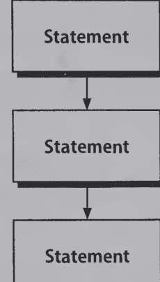

图 7.1：顺序语句处理

控制流结构的最简单形式是 `if` 语句，因此我们将首先检查它。

## if 语句

`if` 语句是一种条件语句。它可以以多种略有不同的形式存在，每种都比上一个复杂。我们将从最基础的 `if` 语句开始，如下所示：

```

if (condition)

statement;

```

与 `if` 语句关联的是条件。条件被括号包围。当遇到时，会测试该条件以判断它是否为真。如果是，则执行紧随在 `if` 语句之后的语句。如果为假，则跳过该语句，并从后面的语句开始处理。这如图 7.2 所示的图所示。程序员通常会对与 `if` 语句关联的语句进行缩进，这样就能清楚地该语句的执行取决于上一个 `if` 语句中条件是否真。

## 控制流

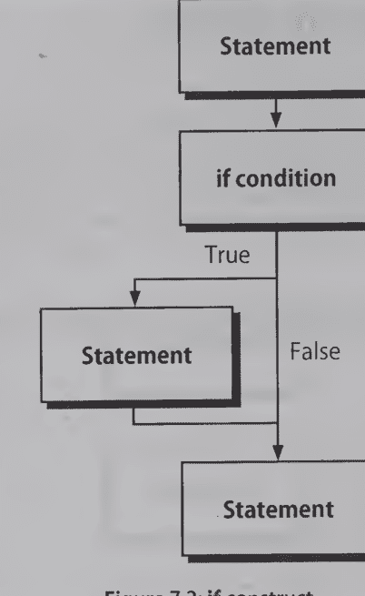

下面的脚本说明了 `if` 语句的使用（尽管方式非常简单）：

```html

<html xmlns="http://www.w3.org/1999/xhtml">

<head>

<title>example7-1.html</title>

</head>

<body>

<script language="JavaScript">

<!--

var strDay = "Monday";

if (strDay == "Monday")

  document.write("Today is Monday.");

-->

</script>

</body>

</html>

```

在上面的脚本中，第 8 行定义了一个名为 `strDay` 的变量并初始化为 "Monday"：

```javascript

var strDay = "Monday";

if (strDay == "Monday") {

  document.write("Today is Monday.");

}

```

该条件测试变量 `strDay` 中包含的值是否等于 "Monday"。如果是，则执行第 11 行的语句，否则不执行：

图 7.3 展示了脚本首次运行时获取的输出。尝试修改变量 `strDay` 的值，以改变 `if` 条件是否评估为真。

## 控制流

图 7.3：简单的 `if` 语句输出

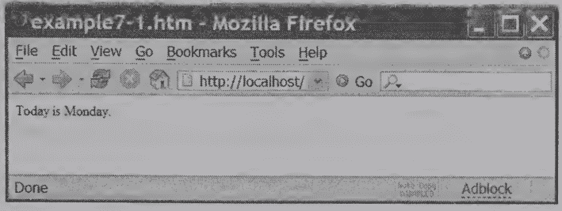

我们提到过 `if` 结构可以以多种形式出现。这里是第二种稍微复杂一点。在我们之前的示例中，`if` 结构仅允许我们控制单条语句的语句（或不处理）。然而，如果我们想在 `if` 结构评估为真时执行整个语句序列呢？我们可以通过使用大括号包围语句：

```javascript

if (condition) {

  statements;

}

```

下面的脚本展示了一个使用大括号的 `if` 结构示例：

```html

<html xmlns="http://www.w3.org/1999/xhtml">

<head>

<title>example7-2.htm</title>

</head>

<body>

<script language="JavaScript">

<!--

var strDay = "Monday";

if (strDay == "Monday") {

  document.write("Today is Monday.<br>");

  document.write("What a wonderful start to the week!");

}

-->

</script>

</body>

</html>

```

大括号内包含两个 `document.write` 语句。我们可以将它们合并为单个语句，但那样就无法展示当条件为真时这两条语句都会被执行。脚本的输出如图 7.4 所示。

图 7.4：使用大括号的条件 `if` 输出

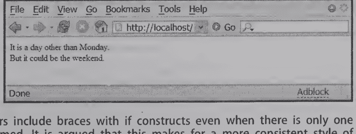

有时，即使只有一条语句要执行，程序员也会在 `if` 结构中包含大括号。人们认为这使得编程风格更加一致，代码的可读性更高。

> 你必须使用 `{ }` 包围当 `if` 语句评估为真时执行的多条语句。如果只有一条语句，则可以省略。

`if` 结构的下一个增强需要我们引入一个新的语句，`else` 语句。

## else 语句

`else` 语句可以与 `if` 语句结合使用，但它不能单独使用！记得在我们 `if` 语句示例中，当 `if` 条件为假时我们可以执行某些语句。那么，`else` 语句允许你在条件为假时执行某些操作。该语句的语法为：

```javascript

if (condition)

    statement;

else

    statement;

```

（注：原文后续部分存在大量重复内容，已按要求完成核心逻辑翻译）

```javascript

var strDay = "Tuesday";

if (strDay == "Monday") {

  document.write("Today is Monday.<br/>\n  document.write("What a wonderful start to the week!");

}

else if (strDay == "Tuesday") {

  document.write("It is Tuesday.");

}else {

  document.write("It is a day other than Monday Tuesday.<br/>");

  document.write("It could be the weekend.");

}

<!---->

<script>

<body>

</html>

```

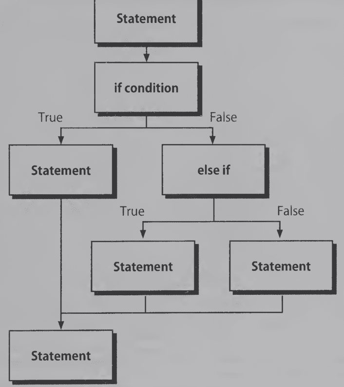

图 7.8: 条件判断 if else if else 结构

上述脚本的输出如图 7.9 所示。你应该尝试编辑脚本，以强制执行与该结构中 `else if` 和 `else` 部分相关的语句。

## 控制流

图 7.9: else if 条件输出


> 注意
`{}}` 在 `else if` 语句中的用法与 `if` 和 `else` 语句相同。

我们之前提到过，`else` 语句可以链在一起，以产生复杂的控制流结构。这里是这样一个脚本示例：

```html

<html xmlns="http://www.w3.org/1999/xhtml">

<head>

<title>example7-6.html</title>

</head>

<body>

<script language="JavaScript">

<!--

var strDay = "Wednesday";

if (strDay == "Monday")

  document.write("It is Monday.");

else if (strDay == "Tuesday")

  document.write("It is Tuesday.");

else if (strDay == "Wednesday")

  document.write("It is Wednesday.");

else if (strDay == "Thursday")

  document.write("It is Thursday.");

else if (strDay == "Friday")

  document.write("It is Friday.");

else

  document.write("It is the weekend!");

//-->

</script>

</body>

</html>

```

上述脚本中的 `if` 和 `else` 语句用于确定变量 `strDay` 被赋值为星期几，并显示相应的消息。该脚本的输出如图 7.10 所示。

图 7.10: 使用大括号的 else if 语句输出

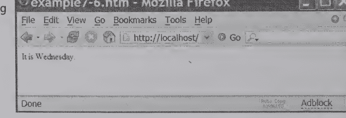

## 控制流

switch 语句允许我们从一个变量中选择一个选项。变量可以是字符串或整数，变量的内容与 `switch` 语句内部被称为 `cases` 的值列表进行匹配。如果发现某个 `case` 为真，则执行与该 `case` 相关的语句。`switch` 语句的语法如下：

```javascript

switch (variable) {

  case value1 : statement;

  case value2 : statement;

  case valueX : statement;

  default : statement;

}

```

`switch` 语句中可以任意数量的 `case`，它们都由大括号包围。此外，还可以包含一个 `default` 情况，如果没有发现任何其他 `case` 为真，则执行该情况。图 7.11 图形展示了 `switch` 语句的组成。

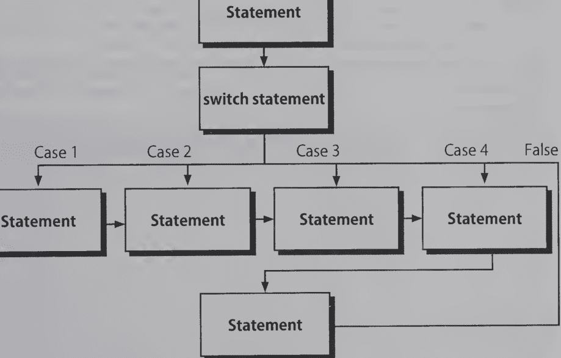

图 7.11: 条件 switch 结构

我们将以后解释图 7.11，但先介绍一个包含 `switch` 语句的脚本：

```html

1 <html xmlns="http://www.w3.org/1999/xhtml">

2 <Head>

3 <title>example7-7.html</title>

4 </head>

5 <body>

6 <script language="JavaScript">

7 <!-----

```

## 7 控制流

```javascript

var strDay = "Wednesday";

switch (strDay) {

10  case "Monday" : document.write("It is Monday.<br/>");

11  document.write("A wonderful start to the

12 week<br/>");

13  case "Tuesday" : document.write("It is Tuesday.<br/>");

14  case "Wednesday" : document.write("It is Wednesday.<br/>");

15  case "Thursday" : document.write("It is Thursday.<br/>");

16  case "Friday" : document.write("It is Friday.<br/>");

17  document.write("It is the weekend!<br/>");

18 }

19 //-->

20 <body>

21 </html>

```

上述脚本包含一个 `switch` 语句，该语句评估 `var strDay` 的内容以确定是星期几。对于周一到周五会显示适当的消息，并使用 `default` 情况显示周末的消息。

> 注意：Switch 语句可以处理单个变量的多个条件，使代码比长 `if-else-if` 链更整洁。

该脚本的输出如图 7.12 所示，展示了 `switch` 语句。

图 7.12: Switch 语句输出

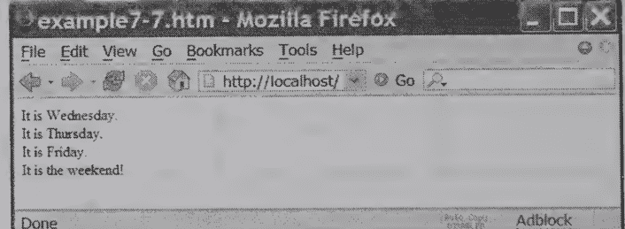

## Switch 语句可以处理单个变量的多个条件，使代码比长 `if-else-if` 链更整洁。

该脚本的输出如图 7.12 所示，展示了 `switch` 语句。

## 控制流


图 7.13: 带有 `break` 的条件 switch 结构

注意，正如之前提到的，我们不需要在多个语句周围使用大括号：

```html

<html xmlns="http://www.w3.org/1999/xhtml">

<head>

<title>example7-8.html</title>

</head>

<body>

<script language="JavaScript">

<!--

var strDay = "Wednesday";

switch (strDay) {

case "Monday" : document.write("It is Monday.<br/>");

document.write("A wonderful start to the

week<br/>");

case "Tuesday" : document.write("It is Tuesday.<br/>");

case "Wednesday" : document.write("It is Wednesday.<br/>");

case "Thursday" : document.write("It is Thursday.<br/>");

case "Friday" : document.write("It is Friday.<br/>");

default : document.write("It is the weekend!<br/>");

}

//-->

</script>

</body>

</</html>

```

上述脚本的输出如图 7.14 所示，这是我们最初想要实现的。

## 控制流

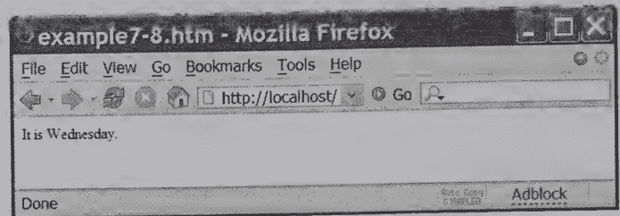

图 7.14: 带有 `break` 的 Switch 语句输出

`break` 语句还有其他用途，我们稍后可见，但现在我们将检查另一种控制流结构：循环。

## 循环

循环是控制流结构，允许程序员重复执行一系列语句，而不需要在脚本中包含所需语句的副本。因此，循环使得脚本非常高效，既易于理解又能在创建脚本时节省时间。

JavaScript 基本上支持两种类型的循环结构。这些是零、一个或多次循环以及一个或多次循环。JavaScript 支持这些循环的许多变体，我们将首先检查最简单的 `while` 循环。

## while 循循环

`while` 循环是一种简单的循环结构，经常出现在脚本中，以便多次执行语句。`while` 循环的语法如下：

```javascript

while (condition)

Statement;

```

`while` 循环由 `while` 语句以及括号内的条件组成。会评估条件，如果条件为真，则重复执行 `while` 语句后的语句，直到条件不再为真。由于 `while` 循环在执行任何相关语句之前检查条件的值，因此被称为零、一个或多次循环，因为与循环相关的语句可能永远不执行、执行一次或执行多次。这种形式的循环结构如图 7.15 所示。

## 控制流

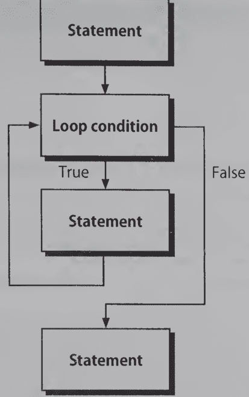

图 7.15：零、一次或多次循环

以下脚本提供了 `while` 循环的简单示例：

```html

<html xmlns="http://www.w3.org/1999/xhtml">

<head>

<title>example7-9.htm</title>

</head>

<body>

<script language="JavaScript">

<!--

var intCount = 5;

while (intCount-- > 0)

  document.write("The value of count is " + intCount + "<br/>");

//-->

</script>

</body>

</html>

```

在此脚本中，变量 `intCount`（初始设置为值 5）被用于控制循环。`while` 条件是 `intCount-- > 0`。它会检查变量 `intCount` 的值是否大于零。如果是，它就会执行下一行的 `document.write` 语句。它会重复执行，直到变量 `intCount` 中存储的值不再大于零。图 7.16 展示了运行此脚本的输出。

图 7.16：while 循环输出

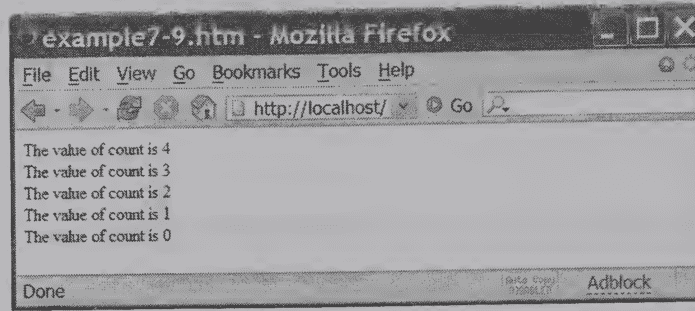

变量 `intCount` 是如何达到值 1 的？再次观察循环条件 `intCount-- > 0`。注意跟在变量名后的 `--` 字符。这是一个**后自减运算符**，它会将变量中存储的值减 1（我们在第 6 章中引入了此运算符）。在循环迭代五次后，变量中存储的值变为零，它不再大于 0，因此循环停止执行。

使用后自减运算符可能会让人困惑，让我们通过创建一个稍微不复杂的循环来拆解这一点：

```html

<html xmlns="http://www.w3.org/1999/xhtml">

<head>

<title>example7-10.htm</title>

</head>

<body>

<script language="JavaScript">

<!--

  var intCount = 5;

  while (intCount > 0) {


document.write("The value of count is " + intCount + "<br/>");

intCount--;
```


1 <html xmlns="http://www.w3.org/1999/htm">

2 <head>

3 <title>example10-4.htm</title>

4 </head>

5 <body>

6 <script language="JavaScript">

7 <!-- --

8 var fitRandom = Math.random();

9 floatRandom *= 6;

10 var intRandom = Math.ceil(floatRandom);

11 document.write(intRandom);

12 //--

13 </script>

14 </body>

15 </html>

```

我们使用了 `Math.ceil` 对浮点数进行取整。虽然有一个 `round()` 函数可以舍入到整数，但在这种情况下是不合适的，因为它可能会舍入到零。掷骰子时不需要零值，我们需要另一种方法来解决。`Math.ceil()` 函数向上取整，解决了这个问题。

## 随机图形

脚本说明了我们如何使用随机数更改网页的输出。创建了六张描绘骰子六面的图像，如 10.1 所示。

表 10.1：骰子图像

| 1.jpg | 2.jpg | 3.jpg | 4.jpg | 5.jpg | 6.jpg |
| --- | --- | --- | --- | --- | --- |

1 到 6 之间的随机数用于确定显示哪个骰子图像。在循环中显示了 14 个骰子图像：

```html

1 <html xmlns="http://www.w3.org/1999/xhtml">

2 <head>

3 <title>example10-5.html</title>

4 </head>

5 <body>

6 <script language="JavaScript">

7 <!-- --

8 var floatRandom;

9 var intRandom;

10 for (var intCount=0;intCount<14;intCount++) {

11 floatRandom = Math.random();

12 floatRandom *= 6;

13 intRandom = Math.ceil(floatRandom);

14 document.write("

18 </body>

19 </html>

```

上述脚本的输出如图 10.4 所示。

图 10.4：随机骰子图像 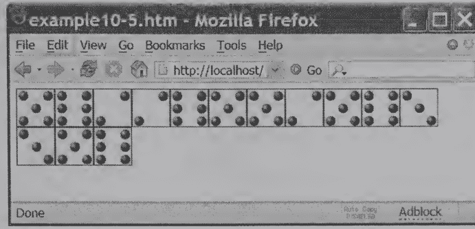

## 日历

让我们看看如何使用系统日期生成一个日历，如图 10.5 所示。

图 10.5：日历

| 日 | 一 | 二 | 三 | 四 | 五 | 六 |
|---|---|---|---|---|---|---|
| | | | | | | |
| | | 1 | 2 | 3 | 4 | 5 |
| 6 | 7 | 8 | 9 | 10 | 11 | 12 |
| 13 | 14 | 15 | 16 | 17 | 18 | 19 |
| 20 | 21 | 22 | 23 | 24 | 25 | 26 |
| 27 | 28 | 29 | 30 | 31 | | |

虽然这个日历看起来简单，但实际上相当复杂。例如，从周日至周六的星期出现在固列中。然而，月份开始的日期会在这些日期之间变化。在 5 月，月份的第一天是星期二，在 1 放在星期二列之前，我们有若干空白单元。要创建日历，我们需要采用在本章介绍的许多函数。我们将通过创建日期对象并用当前日期变量来开始脚本：

```javascript

var objDate = new Date();

var intOfMonth = objDate.getDate();

var intMonth = objDate.getMonth();

var intYear = objDate.getFullYear();

var intDayOfWeek = objDate.getDay();

var strMonth = month(intMonth);

```

`getDay()` 返回 0 到 6 的整数表示星期，0 为周日。调用一个函数将 `intMonth` 值转换为月份字符串。该函数是：

```javascript

function month(intMonth) {

  switch (intMonth) {

    case 0: return "January";

    case 1: return "February";

    case 2: return "March";

    case 3: return "April";

    case 4: return "May";

    case 5: return "June";

    case 6: return "July";

    case 7: return "August";

    case 8: return "September";

    case 9: return "October";

    case 10: return "November";

    case 11: return "December";

  }

}

```

接下来使用 `while` 循环来填充 `intDays` 数组。`intDays` 数组包含了从当前日期到月份开始的日期数值：

```javascript

var intDays = new Array();

var intCount = intOfWeek;

var intDay = intOfMonth;

while (intDay > 0) {

  intDays[intDay--];

  if (intCount < 0) {

    intCount = 6;

  }

}

intCount = intOfWeek;

intDay = intOfMonth;

```

在我们的示例中，`intDays` 数组目前如下，包含了月份的 24 天的情况：

| 0 | 1 | 2 | 3 | 4 | 5 | 6 | 7 | 8 | 9 | 10 | 11 | 12 | 13 | 14 | 15 | 16 | 17 | 18 | 19 | 20 | 21 | 22 | 23 | 24 | 25 | 26 | 27 | 28 | 29 | 30 | 31 |

接下来使用 `getDate()` 函数来确定月份的最后一天。它可能是 31、30、29 或 28：

```javascript

var intLastDay = 0;

if (checkBox(intMonth, 31, intYear))

  intLastDay = 31;

else if (checkBox(intMonth, 30, intYear))

  intLastDay = 30;

else if (checkBox(intMonth, 29, intYear))

  intLastDay = 29;

else if (checkBox(intMonth, 28, intYear))

  intLastDay = 28;

```

`getDate()` 函数如下：

```javascript

function checkBox(intMonth, day, intYear) {

  if (intMonth == 0 || intMonth == 2 || intMonth == 4 || intMonth == 6 || intMonth == 8 || intMonth == 9 || intMonth == 11) {

    return day == 31;

  } else if (intMonth == 1 || intMonth == 3 || intMonth == 5 || intMonth == 7 || intMonth == 10) {

    return day >= 30;

  } else if (intMonth == 2) {

    if (isLeapYear(intYear)) {

      return day >= 29;

    } else {

      return day <= 28;

    }

  }

  return false;

}

function isLeapYear(intYear) {

  return (intYear % 4 == 0 && intYear % 100 != 0) || (intYear % 400 == 0);

}

```

## 日期、时间与随机数

intStartDay = 0;
document.write("</tr><tr>");
}
document.write("</tr><table>");

完整的脚本在此所示：

```html

<html xmlns="http://www.w3.org/1999/xhtml">

<head>

<title>example10-6.htm</title>

</head>

<body>

<script language="JavaScript">

<!--

var objDate = new Date();

var intDayOfMonth = objDate.getDate();

var intMonth = objDate.getMonth();

intMonth++;

var intYear = objDate.getFullYear();

var intDayOfWeek = objDate.getDay();

var strMonth = month(intMonth);

var intDays = new Array();

var intDayCount = intDayOfWeek;

var intDay = intDayOfMonth;

while (intDay > 0) {

intDays[intDay--] = intDayCount--;

if (intDayCount < 0) intDayCount = 6;

}

intDayCount = intDayOfWeek;

intDay = intDayOfMonth;

var lastDay = 0;

if (checkDate(intMonth, 31,intYear)) {

lastDay = 31;

} else if (checkDate(intMonth, 30,intYear)) {

lastDay = 30;

} else if (checkDate(intMonth, 29,intYear)) {

lastDay = 29;

} else if (checkDate(intMonth, 28,intYear)) {

lastDay = 28;

}

while (intDay < lastDay) {

intDays[intDay++] = intDayCount++;

if (intDayCount > 6) intDayCount = 0;

}

document.write("<table border='1'>");

document.write("<tr><td colspan='7' align='center'>" + strMonth + "</th></tr>");

document.write("<tr><td>Sun</td><td>Mon</td><td>Tue</td><td>Wed</td><td>Thu</td><td>Fri</td><td>Sat</td></tr>");

document.write("<tr><td>");

var intStartDay = 0;

var intD = intDays;

document.write("</tr>");

while (intStartDay < intD) {

document.write("<td></td>");

intStartDay++;

43 for (intD=1;intD<intLastDay;intD++) {

44   if (intD == intDayOfMonth)

45     document.write("<td bgcolor='lightblue'>" + intD + "</td>");

46   else

47     document.write("<td>" + intD + "</td>");

48   

49   intStartDay++;

50   if (intStartDay > 6 && intD < intLastDay) {

51     intStartDay = 0;

52     document.write("<tr></tr>");

53   }

54 }

5 

56 document.write("</tr></table>");

57 function month(intMonth) {

58   switch (intMonth) {

59     case 1: return "January";

60     case 2: return "February";

61     case 3: return "March";

62     case 4: return "April";

63     case 5: return "May";

64     case 6: return "June";

65     case 7: return "July";

66     case 8: return "August";

67     case 9: return "September";

68     case 10: return "October";

69     case 11: return "November";

70     case 12: return "December";

71   }

72 }

```

```javascript

73 function getDate(intMonth,intDay,intYear) {

74   var intLength = new Array(31,28,31,30,31,30,31,31,30,31,30,31);

75   if (checkYear(intYear)) {

76     intLength[1] = 29;

77   }

78   if (intDay > intLength[intMonth-1])

79     return false;

80   else

81     return true;

82 }

```

```javascript

83 function checkYear(intYear) {

84   return ((intYear % 4 == 0) && (intYear % 100 != 0)) ||

85   (intYear % 400 == 0)) ? 1 : 0;

86 }

87 //--

88 <script>

89 </body>

90 </html>

```

该脚本的输出如图 10.6 所示。

## 日期、时间与随机数

图 10.6：日历

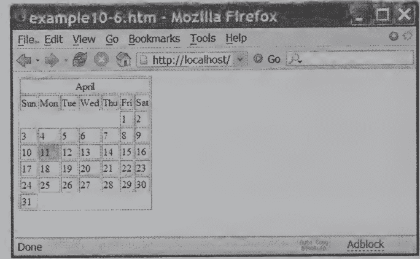

## 总结

本章介绍了日期对象的概念，它使我们能够访问当前的系统日期和时间。我们提供了一个实用的日历脚本，该脚本使用日期对象输出格式化的日历。我们还引入了随机数的概念，并展示了如何生成它们。在第 11 章中，我们将研究 JavaScript 如何与用户交互。

## 第 11 章：与用户交互（对话框与表单）

## 引言

在本章中，我们将介绍通过使用 JavaScript 与用户交互的方法。我们将演示如何使用基础对话框向用户提供信息并获取文本信息。然后我们将更深入地研究 XHTML 表单元素，并展示如何使用它们来生成网页。

## JavaScript 对话框

从 JavaScript 程序与用户交互的最简单方法是通过内置的一组对话框。这些对话框是 JavaScript window 对象的一部分。我们将更详细地介绍 `window` 对象，因此目前只需注意对话框是窗口的方法，我们将使用以下语法从当前窗口中激活它们：

```

window.dialog

```

其中 `dialog` 是我们想要使用的对话框名称。这与我们编写 `document` 方法的方法非常相似。例如，要向当前文档写入内容，我们将使用：

```javascript

document.write("Hello");

```

### alert 对话框

提供的最基础的对话框是 `alert` 对话框，它在独立窗口中向用户输出指定的字符串。通过以下语法使用 alert：

```javascript

window.alert(String);

```

字符串可以是字符串字面量，也可以是变量。在下面的 HTML 中中使用 alert 并在独立窗口中输出：

```html

<html xmlns="http://www.w3.org/1999/xhtml">

<head>

<title>example11.htm</title>

</head>

<body>

<h1>Alert Box</h1>

<script language="JavaScript">

<!-- -->

alert("Hello");

<!-- -->

</script>

</body>

</html>

```

在此示例中，JavaScript 的输出结果如图 11.1 所示。图 11.1：Alert 框


### 与用户交互（对话框与表单）

`confirm` 对话框用于向用户提供快速消息，但通常用于我们需要从用户处获取信息。对话框的用法如图 11.2 所示。

图 11.2：对话框


### confirm 对话框

`confirm` 对话框返回一个布尔值，如果点击 OK 则返回 true，如果点击取消则返回 false。下面的示例展示了使用对话框来决定是否应用样式：

```html

<html xmlns="http://www.w3.org/1999/xhtml">

<head>

<title>example12.html</title>

</head>

<body>

<h1>Confirm Box</h1>

<script language="JavaScript">

var boolChoice;

var strQuestion = "Would you like white text in a grey box?";

var boolChoice = window.confirm(strQuestion);

if (boolChoice)

  document.write("<p style='background-color:silver>Hello</p>");

else

  document.write("<p>Hello</p>");

</script>

</body>

</html>

```

在此示例中，我们显示标题并运行 JavaScript 代码以提供对话框。我们声明了一个布尔变量 `boolChoice` 来存储用户的响应，与上一个示例不同，我们将用户的选择存储在字符串变量中。我们显示对话框并将问题字符串变量作为参数传递。对话框的返回值赋值给变量 `boolChoice`。

提供了一个条件语句来检查 `boolChoice` 的值。如果为 `true`，则输出第 13 行的段落，并带有将背景颜色设置为银色的样式。如果 `boolChoice` 为 `false`，则输出第 15 行的段落，不应用任何样式。

图 11.2 展示了在浏览器中打开此文档时发生的情况。

### 图 11.2：确认对话框

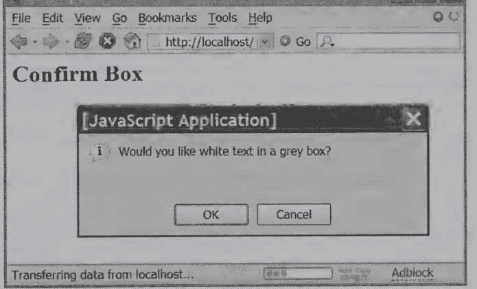

如果用户点击 OK，对话框将关闭并显示图 11.3 所示的文档，段落以灰色背景显示。

# 图 11.3：接受确认对话框

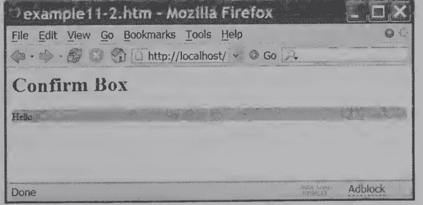

或者，如果用户点击取消，将执行 `else` 语句，并显示图 11.4 所示的文档。

# 图 11.4：拒绝确认对话框

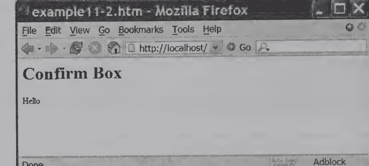

## 与用户的交互（对话框和表单）

图 11.4：拒绝了确认对话框


## 提示对话框 (prompt dialog)

转向第三种 JavaScript 对话框带给了我们更大的灵活性。提示对话框允许我们请求用户针对字符串提示输入其响应。这意味着我们可以从用户那里获取任何想要的信息，并将其存储在变量中。提示对话框的格式如下：

此对话框接受两个参数。第一个与警告（alert）和确认（confirm）对话框相同，是一个包含显示给用户的信息的字符串。第二个是默认字符串，可以放置在对话框的输入部分，用户可以使用自己的输入覆盖它，也可以保留其所选的值。如果您不想提供默认值，则应该将默认参数设置为空字符串。提示对话框将像确认对话框一样包含“确定”和“取消”按钮。然而，如果用户点击了“确定”，则输入框中的值将被赋值给指定的变量；如果用户点击“取消”，则该变量将被赋予 `null` 值。返回变量的类型可以是字符串或整数。

下面的示例演示了如何使用提示对话框获取用户的姓名并在文档中提供合适的消息：

```javascript

variable = window.prompt(String, Default);

```

```html

<html xmlns="http://www.w3.org/1999/xhtml">

<head>

  <title>example11-3.htm</title>

</head>

<body>

  <h1>Prompt Box</h1>

  <script language="JavaScript">

  <!--

  var strMessage = "What is your name?";

  var strName = window.prompt(strMessage, "");

  document.write("<p>Hello " + strName + "</p>");

  -->

  </script>

</body>

</html>

```

在本文档档中，我们声明了两个变量：`strMessage` 被赋值为我们想要提供给用户的提示，`strName` 被赋值到我们将放置用户响应的变量中。我们显示提示对话框，并将空字符串作为默认值显示在输入框中（为用户提供默认名称是没有意义的！），然后返回到变量 `strName` 中的值。该变量随后将在一个 XHTML 段落中输出。

当在浏览器中打开此文档时，提示对话框将如图 11.5 所示显示。

## 图 11.5：提示对话框

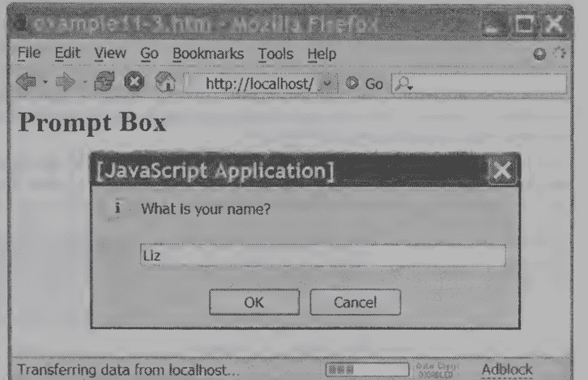

如果用户在输入框中输入姓名并点击“确定”，则将显示图 11.6 所示的文档。

## 图 11.6：在提示对话框中输入姓名后

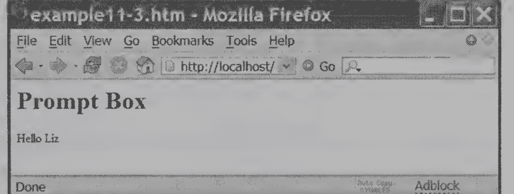

我们现在考虑另一个示例：这次是一个 JavaScript 程序，提示用户输入两个数字，然后输出这两个数字之和。在这种情况下，我们需要两个对话框从用户那里获取一个数字。我们对该程序的初始尝试可能像下面的代码：

```html

<html xmlns="http://www.w3.org/1999/xhtml">

<head>

<title>example11-4.htm</title>

</head>

<body>

<h1>Adding Calculator</h1>

<script language="JavaScript">

<!--

var intNum1 = window.prompt("Enter first number", "10");

var intNum2 = window.prompt("Enter second number", "10");

var intSum = intNum1 + intNum2;

document.write("<p>The sum of " + intNum1 + " and " + intNum2 + "</p>");

document.write(" is " + intSum + "</p>");

<!---->

</script>

</body>

</html>

```

我们显示了两个提示对话框，并将用户输入的值分别返回到两个变量 `intNum1` 和 `intNum2` 中（注意，在这里我们将变量声明与提示对话框的调用合并在了一起）。在这两种情况下，我们都决定提供 10 的默认值，因此将其作为第二个参数传递给提示对话框。我们声明了第三个变量 `intsum`，然后将用户之前输入的两个值之和加到其中。然后我们生成一个段落，在文档中写入输入的两个数字以及结果和。

当我们在浏览器中打开此文档并运行脚本时，我们将发现一些重要的特性。首先，当我们打开文档时，会收到第一个提示对话框，要求为 `intNum1` 输入一个值。这如图 11.7 所示。

## 图 11.7：加法器的第一个提示

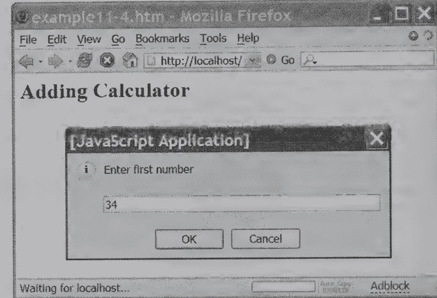

出于此示例的考虑，假设用户输入了 34。然后用户将看到如图 11.8 所示的第二个提示对话框。

## 图 11.8：加法器的第二个提示

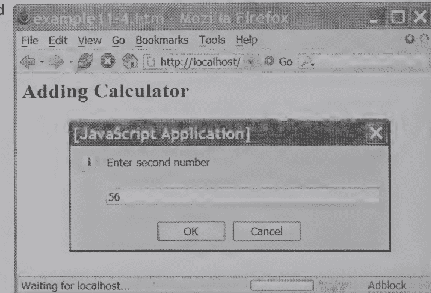

这次，假设用户输入了 56。脚本将相这两个数字并显示结果。至少这是我们预期它会做的。但实际上，得到的并不是两个数字之和 90，而是如图 11.9 所示的文档。

## 与用户的交互（对话框和表单） 11

## 图 11.9：加法器的结果

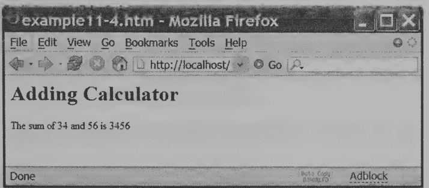

如所示，我们遇到了问题。脚本没有计算两个数字之和，第 11 行语句像处理字符串一样将两个数字合并，而不是将它们视为整数并相加：

```javascript

var intSum = intNum1 + intNum2;

```

> 注意：这是使用提示对话框时的常见错误；它们返回的是字符串。为了解决这个问题，你需要将字符串转换为数字。

```javascript

var intSum = parseInt(intNum1) + parseInt(intNum2);

```


在这种情况下，我们的代码非常简单：我们生成一个带有消息 "Hello"（如上一节所述）的窗口警报对话框。请注意，在这种情况下，我们对要输出作为消息的字符串使用了单引号而不是双引号。这是为了将其与我们创建的 `onclick` 属性值的字符串区分开来。

如果你在浏览器中打开此文档并点击提供的按钮，将显示包含指定消息的警报对话框，如图 11.11 所示。

## 图 11.11：表单

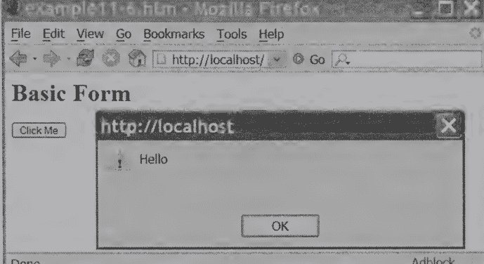

这种将所需的 JavaScript 代码嵌入 `onclick` 属性的方法对于非常简单的示例（例如这种语句数量非常有限的示例）非常有效。如果你的 JavaScript 代码更复杂，你可能不希望大量的 JavaScript 代码弄乱你的 XHTML 表单。在这种情况下，更常见的做法是 `onclick` 属性仅包含一个 JavaScript 函数，该函数已经在页面头部的单独脚本部分中定义。

下面的示例代码采用了之前的示例，并将 JavaScript 功能移动到了单独的函数中，然后从按钮的 `onclick` 属性调用它：

```html

<html xmlns="http://www.w3.org/1999/xhtml">

<head>

  <title>example11-7.html</title>

  <script language="JavaScript">

<!------

  function sayHello() {

    window.alert("Hello");

  }

-->

  </script>

</head>

<body>

  <h1>Basic Form</h1>

  <form>

    <input type="button" value="Click Me" onclick="sayHello();"

  </form>

</body>

</html>

```

在这个示例中，在第 6–8 行创建了一个 `sayHello` 函数。第 15 行创建的按钮随后调用了该函数，并提供了代码语句本身。此示例产生的结果与图 11.11 所示的之前的示例完全相同。

更进一步，我们可以创建一个包含两个按钮的表单，这两个按钮都调用同一个函数，但带有不同的参数。我们将在一个示例中使用它来允许用户：

## 与用户的交互（对话框和表单）

## 选择文档的背景颜色。此示例的代码如下：

```html

<html xmlns="http://www.w3.org/1999/xhtml">

<head>

<title>example11-8.html</title>

<script language="JavaScript">

<!--function setBackground(bolColour) {

if (bolColour) {

document.backgroundColor = "Silver";

} else {

document.backgroundColor = "White";

}

}

-->

</script>

</head>

<body>

<h1>Basic Form</h1>

<form>

<input type="button" value="Silver" onclick="setBackground(true)"/>

<input type="button" value="White" onclick="setBackground(false)"/>

</form>

</body>

</html>

```

在这个示例中，我们创建了一个 `setBackground` 函数。该函数接受一个布尔参数 `bolColour`。如果将其设置为 `true`，则将文档的背景颜色设置为银色；如果设置为 `false`，则将其设置为白色。在这个示例中，表单包含两个输入按钮。第一个按钮调用 `bolColour` 为 `true` 的 `setBackground` 函数，从而产生银色背景；第二个按钮调用 `bolColour` 为 `false` 的 `setBackground` 以产生白色背景。

图 11.12 显示了该文档在浏览器中点击银色按钮的结果。

## 图 11.12：带有备选按钮的表单

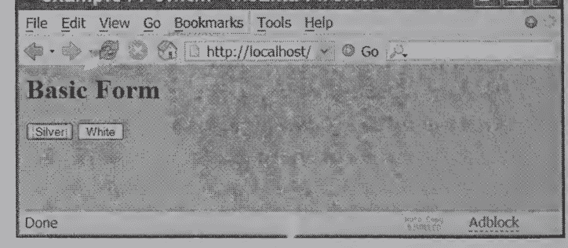

点击白色按钮将背景再次变为白色。交替点击这两个将在背景颜色之间切换。

在下一节中，我们将引入一种新的表单元素，并演示如何从表单获取数据并传递给 JavaScript 函数。

## 从表单获取数据

现在我们将考虑如何从表单获取数据以便在 JavaScript 函数中使用。首先，我们将引入一种名为 `input` 或文本框的新表单元素。对于按钮，该表单元素通过 `<input>` 标签包含在表单中，但这次我们设置 `type` 属性为 "text"。由于需要从 JavaScript 代码内部识别此表单元素，我们还设置 `id` 属性为适当的字符串。例如，以下元素：

```html

<input type="text" id="inputName"/>

```

将产生一个可以通过其标识符 "inputName" 识别的输入文本框。向框中输入数据本身不会调用任何 JavaScript 代码。如果我们想添加功能，则需要在表单中添加一个按钮，并使用该按钮调用 JavaScript 函数，并将表单的标识符作为参数传递。可以这样做：

```html

<input type="button" value="Say Hello" onclick="sayHello(this.form)"/>

```

该语句生成了一个带有 "Say Hello" 文字的按钮。当点击此按钮时，将调用 JavaScript 函数。为了让表单数据（即文本框中的值）在该函数可用，你需要将当前表单对象 `this.form` 作为参数传递。

在 `sayHello` 函数内部，我们现在可以访问表单数据。注意，元素引用了表单是因为必须包含元素的值。将所有这些整合到一个可运行的示例中，我们可以产生以下代码：

```html

<html xmlns="http://www.w3.org/1999/xhtml">

<head>

  <title>example11-9.html</title>

  <script language="JavaScript">

<!----

  function sayHello(objForm) {

    var strMessage = "Hello " + objForm.inputName.value + "! Welcome to the website.";

    window.alert(strMessage);

  }

-->

  </script>

</head>

<body>

  <h1>Welcome</h1>

  <form>

    <p>Please enter your name:</p>

    <input type="text" id="inputName"/>

    <input type="button" value="Hello" onclick="sayHello(this.form)"/>

  </form>

</body>

</html>

```


## 与用户的交互（对话框与表单）

```html

15 <head>

16 <body>

17 <h1>添加表单</h1>

18 <form>

19 <p>请输入您要相加的数字：p>

20 <input type="text" id="inputNum1" value="10">

21 <input type="text" id="inputNum2" value="10">

22 <input type="button" value="加" onclick="addCalc(this.form);"/>

23 </form>

24 </body>

25 </html>

```

首先，让我们考虑第 18-23 行生成的表单。它包含两个编辑框，分别命名为 `inputNum1` 和 `inputNum2`，以及一个按钮。注意，这些编辑框的格式与后续示例略有不同：

```html

<input type="text" id="inputNum1" value="10">

```

这一次添加了 `value` 属性，它为该文本框提供了一个默认值。尽管我们处理的是数字，但我们将 10 括在双中。这是因为所有输入框的值都会被视为字符串。

该表单上的按钮以与之前相同的方式调用了 JavaScript 函数 `addCalc`，并将对象作为参数传递。

让我们来看一下第 6-12 行是如何定义 `addCalc` 函数的。我们做的第一件事（为了简单起见并减少过多的输入）是将两个输入框的值赋值给本地变量 `intNum1` 和 `intNum2`。然后，我们声明另一个变量 `intSum`，并将其赋值为 `intNum1` 和 `intNum2` 的和。我们需要在这里调用 `eval` 函数，正如我们之前使用 `prompt` 对话框获取数字时所做的那，将输入值从字符串转换为数字。

得到结果后，我们使用 `document` 向浏览器输出两个段落，在这两行输出中，我们同时包含了输入值和计算结果。

> 注意：此时你可能在 wonder奇，当我们在 JavaScript 函数内部调用 `document.write` 时会发生什么？它是在表单之后写入段落，还是执行了某些不同的操作？在浏览器中打开文档将带我们这个问题的答案。

图 11.14 显示了在浏览器中最初打开文档时发生的情况。

图 11.14：打开加法计算器表单

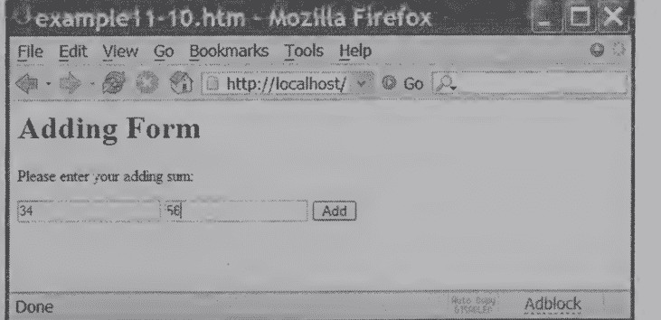

表单已显示，默认值被放在两个输入文本字段中。如果我们输入计算内容（在此情况下，我们选择了 34 和 56，以与之前的示例保持一致）并点击“加”按钮，我们就会得到图 11.15 所示的结果性文档。

图 11.15：点击加法计算器表单上的“加”按钮

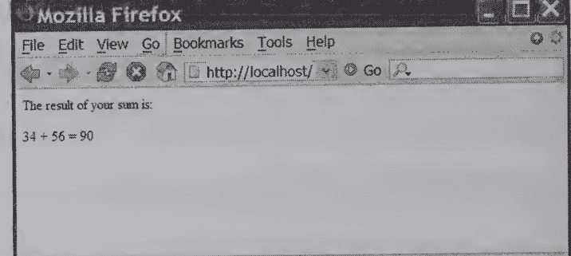

现在我们有了这个问题的答案。从表单调用的 JavaScript 函数调用 `document.write` 将替换表单并在浏览器窗口中启动一个新文档。在你的应用程序中，你可能希望发生这种情况。非常常见的情况是当点击表单上的按钮时，你需要执行一些处理并显示新页面。在这种情况下，到为止涵盖的方法将非常成功。另一方面，你可能希望执行一些处理并成功输出，但不想丢失表单上显示的数据。下一节将展示如何向表单写入数据并实现这种可能性。

## 向表单写入数据

向表单写入数据与从表单读取数据非常相似。正如我们可以从表单元素中获取数据一样：

```javascript

variable = form_parameter.element_id.value;

```

我们也可以向表单元素写入数据：

```javascript

form_parameter.element_id.value = variable;

```

例如，如果我们使用参数 `myForm` 将数据传递给函数，并且该表单包含一个名为 `allInputSum` 的输入文本字段，那么我们可以使用语句将变量 `intSum` 中的数据传输到此表单字段：

```javascript

objForm.inputSum.value = intSum;

```

为了方便理解语境，我们可以参考之前的加法计算器示例，不再将输出写入到浏览器中的新文档，而是将结果写回表单，并在额外的输入文本字段中显示它。这里的术语可能看起来有点奇怪，但使用输入文本字段进行输出以保持与输入字段的一致是非常常见的。

以下是此代码：

```html

<html xmlns="http://www.w3.org/1999/xhtml">

<head>

  <title>example1-11.html</title>

  <script language="JavaScript">

<!--

  function addCalc(objForm) {

    var intNum1 = objForm.inputNum1.value;

    var intNum2 = objForm.inputNum2.value;

    var intSum = eval(intNum1) + eval(intNum2);

    objForm.inputSum.value = intSum;

  }

//-->

  </script>

</head>

<body>

  <h1>添加表单</h1>

  <form>

    <p>请输入您要相加的数字：</p>

    <input type="text" id="inputNum1" value="10"> +

    <input type="text" id="inputNum2" value="10">

    <input type="button" value="" onclick="addCalc(this.form);">

    <input type="text" id="inputSum">

  </form>

</body>

</html>

```

此代码大部分与之前的示例相同，因此我们只需识别区别之处。在这个表单中，我们稍微修改了输入的文本，在两个字段之间添加了一个加号，并修改了按钮的值，使其显示等号而不是“加”。我们还添加了一个额外的文本字段并将其命名为 `inputSum`。这就是计算结果将被写入的地方。

我们还修改了函数，不再使用 `document.write` 输出结果，而是直接使用语句将其写回输入字段：

```javascript

objForm.inputSum.value = intSum;

```

打开表单并执行计算的结果如图 11.16 所示。

图 11.16：向表单写回数据

 (注：此处原文文本后部分似乎存在重复或乱码，译文已根据逻辑完成翻译) 


## 与用户交互（对话框与表单）

```html

<html>

<body>

<form>

<p>请输入要相加的数字并点击等号按钮：</p>

<input type="text" id="inputNum1" value="10" size="4" maxlength="4">

+ 

<input type="text" id="inputNum2" value="10" size="4" maxlength="4">

<input type="button" value="=" onclick="addCalc(this.form)"/>

<input type="text" id="inputSum" readonly="true" size="5">

</form>

</body>

</html>

```

前两个输入字段都设置了 `size` 和 `maxlength` 属性，而第三个输入字段 `inputSum` 仅设置了 `maxlength` 属性。此外，该元素设置了 `read-only` 属性，以确保用户无法输入并破坏结果。

图 11.17 显示了打开加法计算器示例的结果：

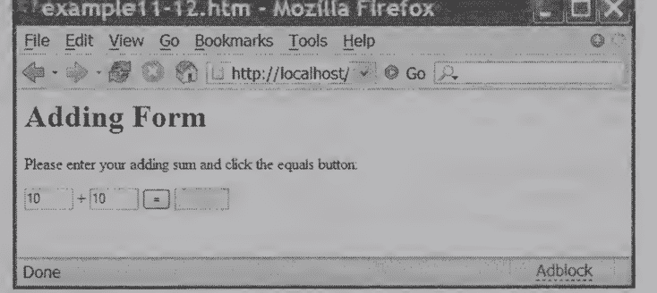

图 11.17：使用 size 和 maxlength 属性

如我们所示，输入字段现在的尺寸更加合适。我们可以通过在前两个字段中输入数字进行实验，并发现只允许输入四个数字。进一步的实验将显示，可以选择第一个字段中的数字（因此如果需要可以复制），但一旦点击等号按钮，就无法向该字段输入数据来替换或清空它。

## 总结

在本章中，我们涵盖了在网页内与用户交互的基本知识。我们首先考虑了 JavaScript 语言提供的三个标准对话框——`alert`、`confirm` 和 `prompt`，它们可用于简单的交互。然后我们转向了更灵活的方法，即将 XHTML 表单与 JavaScript 功能结合，以提供更强大、更具吸引力的用户交互。

到目前为止，我们只考虑了两个元素：允许我们调用 JavaScript 函数的输入按钮，以及允许我们从用户处获取数据的输入文本字段。我们展示了输入文本字段如何用于将数据返回给用户。

我们详细研究了如何从表单获取数据、使用 JavaScript 对其进行处理并将其返回表单。这一原理也适用于我们稍后在本书的第 16 章查看其他表单元素以及一些更高级的表单操作。

在进入第 12 章之前（该章节将涉及 JavaScript 中的事件处理）……

## 第 12 章：事件与事件处理

## 引言

本章解释了什么是事件，以及我们如何利用事件让启用 JavaScript 的网页变得更加动态和有趣。我们将检查可能发生的不同类型的事件，并解释我们如何以及为什么要捕获这些事件，并在脚本中对它们做出相应响应。这被称为“处理事件”。我们将解释用户触发的事件，以及计算机和时间生成的事件。我们将首先检查究竟什么是事件。

## 什么是事件？

在动态网页系统中，当某些事情发生时，就会触发事件。这可能是用户的行为，例如点击他们想要的新超链接；也可能是浏览器在完成任务后的操作，例如加载网页。大多数人会意识到表单处理事件，它在点击表单上的提交按钮时触发（我们在第 11 章引入了表单处理）。然而，事件的类型远多于事件处理器，因为处理器是处理当事件发生时该做什么。此类代码通常被称为“事件处理器”，我们可以在事件发生时编写代码来执行操作。事实上，值得提到的是，大多数基于 Web 的应用程序都是这样运行的：我们执行某操作，然后等待事件发生以便执行另一件事。

我们本章将检查三种基本类型的事件：错误处理事件、时间生成的事件，最后是基本的事件处理函数。我们将首先检查错误处理事件。

## 错误处理

JavaScript 应用的一个主要问题之一是在事情出现问题时找到错误。考虑以下脚本：

```html

<html xmlns="http://www.w3.org/1999/xhtml">

<head>

<title>example12-1.html</title>

</head>

<body>

<script language="JavaScript">

//-

var strDay = "Monday";

document.write(strDay);

//--

</script>

</body>

</html>

```

遗憾的是，第 8 行存在一个错误。该行应该是：

```javascript

var strDay = "Monday";

```

当脚本执行时，用户看到的只是一个空白的网页，这在尝试确定错误位置时并没有太大帮助。现在，在这个简单的脚本中，开发者应该能够很快找到错误，但在规模得大的应用程序中，寻找错误可能会困难。

幸运的是，JavaScript 有一种方法可以帮助开发者。`window` 对象有一个 `onerror` 属性，可以为其分配一个函数。你可以使用以下语法：

```javascript

window.onerror = handleError;

```

## 事件与事件处理 12

一旦进行了此赋值，每当该窗口发生错误时，该函数就会执行。你可以使用此函数帮助判断错误发生在 JavaScript 的何位置。该函数将接收三个参数以协助错误处理：第一个是包含描述错误发生信息的字符串；第二个是包含错误发生 URL 的字符串；第三个是错误发生的行号。

```javascript

function handleError(message, url, line) {

  alert("Error: " + message + "\nURL: " + url + "\nLine: " + line);

}

```


```javascript

<!--

 function displayHello() {

  document.write("Hello");

}

setTimeout("displayHello()",5000);

-->

<script>

<body>

</html

```

该脚本在五秒后会调用 `displayHello` 函数。产生的输出如图 12.2 所示。

图 12.2: 简单的 setTimeout 方法

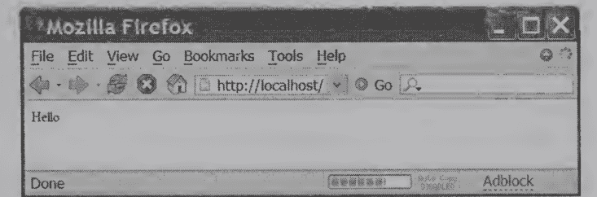

## 时间生成的状态栏消息

`setTimeout` 方法通常与状态栏配合使用以显示消息。你在浏览网页时可能见过此类示例。我们通常不喜欢这些消息，因为在大多数情况下，它们涉及消息在状态栏上的滚动，这会导致消息更新时产生某些闪烁，并影响页面的视觉效果。显示在状态栏上的消息是通过使用窗口对象的 `status` 和 `default` 属性生成的。`defaultStatus` 属性用于存储在状态栏上显示的默认消息，而 `status` 属性用于显示消息。它们的用法语法如下：

```

defaultStatus = "message";

status="message";

```

然而，我们可以创建一个显示当前时间（小时和分钟）的实用状态消息。我们可以每分钟更新一次，而不会引起任何动画闪烁。如下：

```html

<html xmlns="http://www.w3.org/1999/xhtml">

<head>

<title>example12-4.html</title>

</head>

<body>

<script language="JavaScript">

<!---

 function displayTime() {

  var objDate = new Date();

 var intHours = objDate.getHours();

 var intMinutes = objDate.getMinutes();

 var defaultStatus = formatTime(intHours,intMinutes);

 setTimeout("displayTime()",60000);

}

 function formatTime(intHours,intMinutes) {

 var strAmPm;

 var strMinutes;

if (intHours >= 12) {

    strAmPm = "PM";

    intHours = intHours - 12;

}

else {

    strAmPm = "AM";

    if (intMinutes < 10) {

        strMinutes = "0" + intMinutes;

    }

    else {

        strMinutes = intMinutes;

    }

    return intHours + ":" + strMinutes + " " + strAmPm;

}

function getTime() {

//--

</script>

</body>

</html>

```

上述脚本定义了一个显示时间的函数：

```

function getTime() {

    var obj = new Date();

    var intHours = obj.getHours();

    var intMinutes = obj.getMinutes();

    var defaultStatus = formatTime(intHours

```

该函数获取系统日期，访问小时和分钟属性，并调用 `formatTime` 来格式化时间输出。从此函数返回的值被赋值给 `defaultStatus`。最后，调用 `setTimeout` 方法在分钟后召回该函数。`formatTime` 函数将时间转换为 12 小时格式：

```

function formatTime(intHours, intMinutes) {

    var strAmPm;

    var strMinutes;

    if (intHours >= 12) {

        strAmPm = "PM";

        intHours = intHours - 12;

    } else {

        strAmPm = "AM";

        if (intMinutes < 10) {

            strMinutes = "0" + intMinutes;

        }

        else {

            strMinutes = intMinutes;

        }

    return intHours + ":" + strMinutes + " " + strAmPm;

}

```

上述脚本的输出如图 12.3 所示。注意浏览器窗口底部状态栏上的时间。

## 事件与事件处理

图 12.3: 状态栏时间

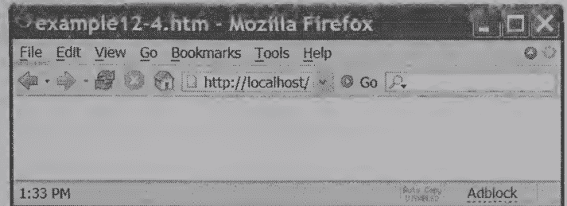

## 事件处理器

除了之前提到的错误事件和时间事件外，还有许多事件可以发生。这些事件处理器不是添加在 `<script>` 标签内部，而是添加在 XHTML 元素内部。所有事件处理器的基本语法为：

```

EventHandlerName = "javascript code";

```

遗憾的是，事件处理是不同浏览器及其版本之间存在许多差异的领域。直到 HTML 4 版本，才规定了一套标准的事件处理器。但通常情况下，事件可以分为两个主要类型：当用户执行某些操作（如点击图像或移动鼠标）时发生的事件，以及当浏览器正要执行或已完成某些操作（如加载页面）时发生的事件。表 12.2 列出了事件处理器的名称以及它们的触发方式。

表 12.2: 事件与事件处理器

| 处理器 | 触发细节 |
| :--- | :--- |
| onabort | 当加载图像中止时。 |
| onblur | 当表单元素失去焦点时。用于除隐藏以外的所有表单元素。 |
| onchange | 当以下表单元素失去焦点且值已更改时：<input> <select> <textarea> |
| onclick | 当在以下元素之一上点击鼠标按钮时： <input> <a> <reset> <submit> |
| ondblclick | 当在以下元素上双击鼠标按钮时： <a> |
| onerror | 当加载图像时发生错误时。 |
| onfocus | 当以下输入框获得焦点时：<area><input>><label><select> |
| onkeydown | 在大多数元素上按下按键时。 |
| onkeypress | 在大多数元素上按下并释放按键时。 |
| onkeyup | 在大多数元素上释放按键时。 |
| onload | 当文档加载完成时，用于：<body> |
| onmousedown | 在大多数元素上按下鼠标按钮时。 |
| onmousemove | 在大多数元素上移动鼠标时。 |
| onmouseout | 当鼠移出大多数元素范围时。 |
| onmouseover | 当鼠标移在大多数元素上方时。 |
| onmouseup | 当在大多数元素上释放鼠标按钮时。 |
| onreset | 当请求重置表单时，用于：<body> |
| onresize | 当窗口调整大小时，用于：<body> |
| onselect | 当在以下元素上选择文本时：<input> |
| onsubmit | 当请求提交表单时，用于：<body> |
| onload | 当文档被卸载时，用于：<body> |

## onabort 事件处理器

当用户中止加载网页时，**abort** 事件会执行 JavaScript 代码。在下面的脚本中，在图像加载之前点击浏览器的停止按钮将导致触发该事件。

```html

<html xmlns="http://www.w3.org/1999/xhtml">

<head>

<title>example12.html</title>

</head>

<body>

<script language="JavaScript">

function myAbort() {

  alert("Image Stopped!");

}

</script>

<h2>停止加载以下图像</h2>


```
由于发生得非常快，很难为 `abort` 事件生成测试用例。此外，我们从未在现实世界中见过这个事件被使用！

## blur 事件处理器

当元素失去焦点时，会发生 blur 事件。我们说的失去焦点是指该元素不再是用户正在交互的元素。考虑以下示例：

```html

<html xmlns="http://www.w3.org/1999/xhtml">

<head>

  <title>example12.html</title>

</head>

<body>

<script language="JavaScript">

function checkAge(objForm) {

  var intAge = objForm.value;

  if (intAge <= 0 || intAge > 120) {

    alert("Please enter a valid Age");

  }

}

</script>

<h2>blur </h2>

<form name="myForm">

  Surname: <input type="text" name="Surname" size="20"/>

  <br/><br>

  Age: <input type="text" name="Age" size="3" onblur="checkAge(this)" />

  <br/><br>

  <input type="submit"/>

</form>

</body>

</html>

```

## onchange 事件处理器

当用户退出字段且数据已发生变化时，表单字段会发生变化事件。考虑以下示例：

```html

<html xmlns="http://www.w3.org/1999/xhtml">

<head>

  <title>example12-7.htm</title>

</head>

<body>

  <script language="JavaScript">

  <!--

  function checkSurname(objForm) {

    var strOldSurname = "Stobart";

    var strSurname = document.myForm.Surname.value;

    alert("Surname has changed from " + strOldSurname + " to " + strSurname);

```


## 事件与事件处理

```javascript

12 strOldSurname = strOldSurname;

13 );

14 <!--

15 </script>

<h2>onchange </h2>

<form name="myForm"><input type="text" name="Surname" value="Stobart" size="20"

onchange="checkSurname(this.form)">

<br><br>

Age: <input type="text" name="Age" size="3">

<br><br>

<input type="submit">

</form>

</body>

</html>

```

上述脚本创建了一个带有 `onchange` 事件的输入类型表单：

```html<form name="myForm">

Surname: <input type="text" name="Surname" value="Stobart" size="20"

onchange="checkSurname(this.form)">

<br><br>

Age: <input type="text" name="Age" size="3">

<br><br>

<input type="submit">

</form>

```

当输入框 Surname 中的值发生变化时，会调用函数 `checkSurname`：

```javascript

function checkSurname(objForm) {

  var strOldSurname = "Stobart";

  var strSurname = document.myForm.Surname.value;

  alert("Surname has changed from " + strOldSurname + " to " + strSurname);

  strOldSurname = strSurname;

}

```

该脚本的输出如图 12.5 所示。

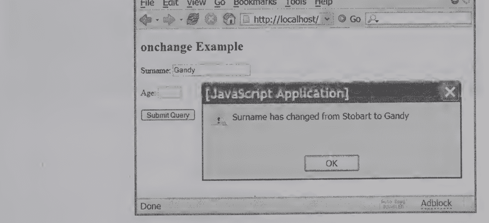

## onclick 事件处理器

当点击按钮或超链接等对象时，会生成 `onclick` 事件。考虑以下脚本：

```html<html xmlns="http://www.w3.org/1999/xhtml">

<head>

  <title>example1-2.htm</title>

</head>

<body>

  <script language="JavaScript">

  <!--

  function checkSubmit() {

    return confirm("Are you sure wish to submit?");

  }

  -->

  </script>

  <h2 onclick="Example"></</h2>

  <form name="myForm">

    Surname: <input type="text" name="Surname" size="20"/>

    <br/>

    Age: <input type="text" name="Age" size="3"/>

    <br/>

    <input type="submit" onclick="checkSubmit()"/>

  </form>

</body>

</html>

```

上述脚本创建了一个表单，其提交按钮上有一个 `onclick` 事件处理器：

```html<form name="myForm">

Surname: <input type="text" name="Surname" size="20"/>

<br/>

Age: <input type="text" name="Age" size="3"/>

<br/>

<input type="submit" onclick="checkSubmit()"/>

</form>

```

点击按钮时，会调用函数 `checkSubmit` 并显示一个确认对话框，询问用户是否想要提交表单：

```javascript

function checkSubmit() {

  return confirm("Are you sure wish to submit?");

}

```

该脚本的输出如图 12.6 所示。

### 图 12.6：onclick 事件

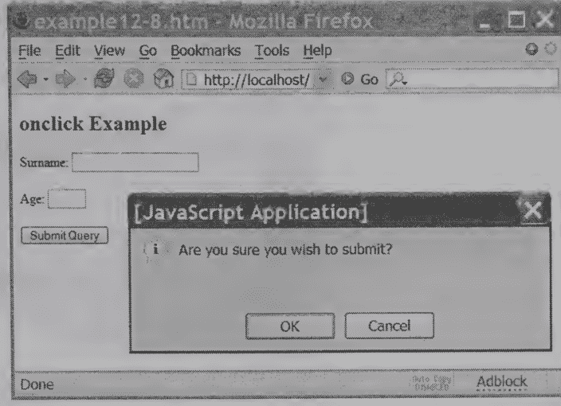

> 注意
> 如果事件处理器返回 false，则操作可以被取消。

## ondblclick 事件处理器

当双击按钮或超链接等对象时，会生成 `ondblclick` 事件。以下示例说明了双击图片：

```html<html xmlns="http://www.w3.org/1999/xhtml">

<head>

  <title>example12-9.htm</title>

</head>

<body>

  <script language="JavaScript">

<!--

function checkSubmit() {

 alert("Don't click on this image!");

}

//--</script>

<h2>ondblclick </h2>


</body>

</html>

```

该脚本的输出如图 12.7 所示。

### 图 12.7：ondblclick 事件

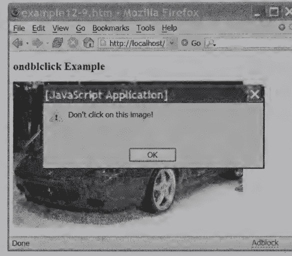

> 注意
> ondblclick 事件不适用于按钮元素。

## onerror 事件处理器

当加载图片时发生错误，会生成 `onerror` 事件。我们在本章节之前介绍了该事件的使用，并解释了如何编写自己的函数来报告错误。

## onfocus 事件处理器

当通过点击鼠标或使用 Tab 键进入表单字段时，会发生 `focus` 事件。当窗口获得焦点时，也会生成该事件。以下脚本说明了 `focus` 事件的使用：

```html<html xmlns="http://www.w3.org/1999/xhtml">

<head>

  <title>example12-10.htm</title>

</head>

<body>

  <script language="JavaScript">

//

  function formField(strField) {

    alert("You are on " + strField + " field of the form");

  }

//

</script>

<h2>onfocus </h2>

<form name="myForm">

FirstName: <input type='text' onfocus="formField('FirstName')"/>

Surname: <input type='text' onfocus="formField('Surname')"/>

</form>

</body>

</html>

```

上述脚本的输出如图 12.8 所示。

## 图 12.8：onfocus 事件

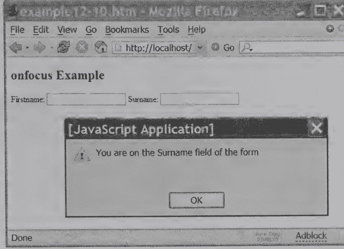

## keydown, onkeyup 和 onkeypress 事件处理器

当用户在输入字段上按下或释放键时，会生成 `keydown`、`onkeyup` 和 `onkeypress` 事件。以下脚本说明了这些事件：

```html<html xmlns="http://www.w3.org/1999/xhtml">

<head>

  <title>example12-10.htm</title>

</head>

<body>

  <script language="JavaScript">

  <!--

  function formField(strField) {

    alert("You are on " + strField + " field of the form");

  }

  -->

</script>

<h2>keydown, onkeyup and onkeypress </h2>

<form name="myForm">

FirstName: <input type='text' onkeydown="formField('FirstName')"/>

<br/>

Surname: <input type='text' onkeyup="formField('Surname')"/>

<br/>

Email: <input type='text' onkeypress="formField('Email')"/>

</form>

</body>

</html>

```

使用此脚本，每当你尝试在任何字段中输入文本时，都会生成一个警告消息，导致打字变得困难。该脚本产生的输出如图 12.9 所示。

## 图 12.9：keydown, keyup 和 keypress 事件

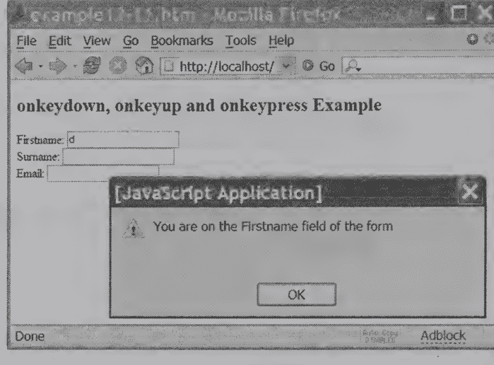

## onload 事件处理器

`onload` 事件在页面或图片成功加载后发生。因此，它定义在 `body` 或 `img` 元素中。以下脚本说明了此类示例：

```html<html xmlns="http://www.w3.org/1999/xhtml">

<head>

  <title>example12-12.htm</title>

</head>

<body>

  <script language="JavaScript">

<!--

function changeBackground() {

  setTimeout("changeToSilver()", 1000);

}

function changeToSilver() {

  document.body.backgroundColor="silver";

}

-->

</script>

<h2>onload </h2>


</body>

</html>

```

上述脚本在成功加载 `ferrari.jpg` 图片后调用名为 `changeBackground` 的函数。`changeBackground` 函数实际上使用 `setTimeout` 事件在一秒后触发 `changeToSilver` 函数（将页面背景改为银色）。这种延迟允许你注意到网页背景从白色变为银色。如果没有它，图片加载可能会非常快，至于你没有注意到背景原本是白色的。该脚本的输出如图 12.10 所示。

## 图 12.10：load 事件

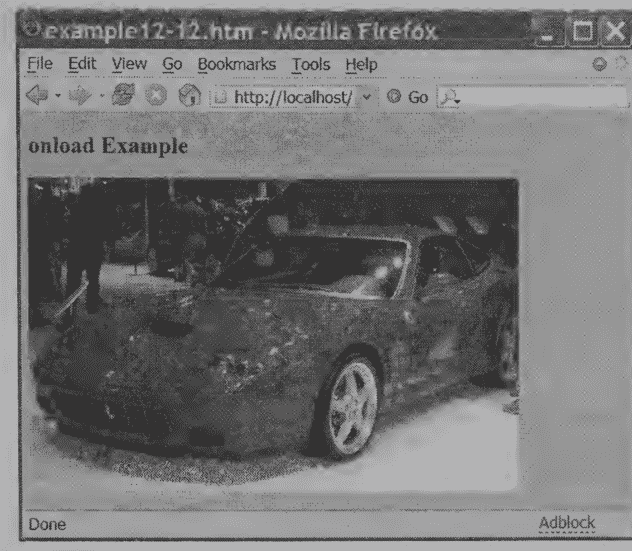

## onmouseup 和 mousedown 事件处理器

`onmouseup` 和 `mousedown` 事件分别在鼠标按钮被点击或释放时发生。以下脚本说明了这些事件：

```html<html xmlns="http://www.w3.org/1999/xhtml">

<head>

  <title>example12-13.htm</title>

</head>

  <script language="JavaScript">

<!--

function changeBackground(strColour) {

  document.bgColor=strColour;

}

//

</script>

<body>

点击按钮更改背景页面颜色。

<form>

<input type="button" value="yellow" onmouseup="changeBackground('yellow')"/>

<input type="button" value="blue" mousedown="changeBackground('blue')"/>

<input type="button" value="white" onmouseup="changeBackground('white')"/>

<input type="button" value="green" mousedown="changeBackground('green')"/>

<input type="button" value="cyan" onmouseup="changeBackground('cyan')"/>

</form>

</body>

</html>

```

该脚本创建了一个包含多个按钮的表单，每个按钮都有一个颜色名称。点击其中一个按钮时，会调用 `changeBackground` 函数，将页面背景颜色更改为按钮对应的颜色。上述脚本的输出如图 12.11 所示。


## onmousemove 事件处理程序

onmousemove 事件在鼠标移动到注册了该事件的对象上时产生。以下脚本说明了该事件的使用：

```html

<html xmlns="http://www.w3.org/1999/xhtml">

<head>

<title>example12-14.html</title>

</head>

<script language="JavaScript">

<!--

function move(objEvent) {

  var intX = objEvent.clientX;

  var intY = objEvent.clientY;

  defaultStatus = "X: " + intX + " Y: " + intY;

}

-->

</script>

<body onmousemove="move(event)">

<h2></h2>

</body>

</html>

```

该脚本在 `body` 元素上注册了 `onmousemove` 事件，因此如果鼠在网页上移动，就会调用 `move` 函数。该函数还接收了触发该函数调用的事件对象（`event`）：

```

<body onmousemove="move(event)">

```

当该函数被调用时，它通过 `clientX` 和 `clientY` 属性获取鼠标的 X 和 Y 坐标：

```

function move(objEvent) {

  var intX = objEvent.clientX;

  var intY = objEvent.clientY;

```

然后，鼠标的 X 和 Y 坐标将显示在浏览器的状态栏上：

```

defaultStatus = "X: " + intX + " Y: " + intY;

```

在网页上移动会导致鼠标的 X 和 Y 坐标显示在状态栏上。这如图 12.12 所示。

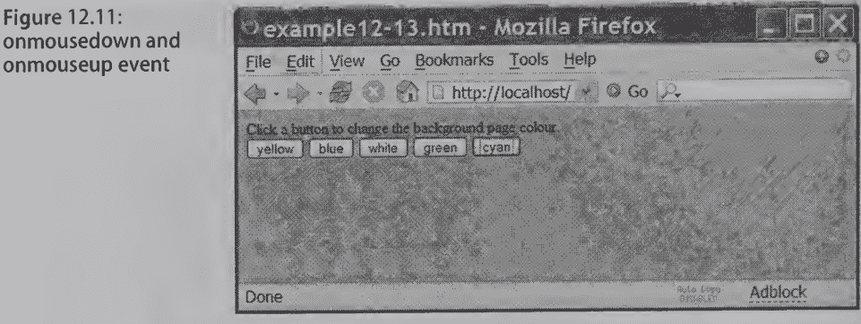

图 12.12：onmousemove 事件

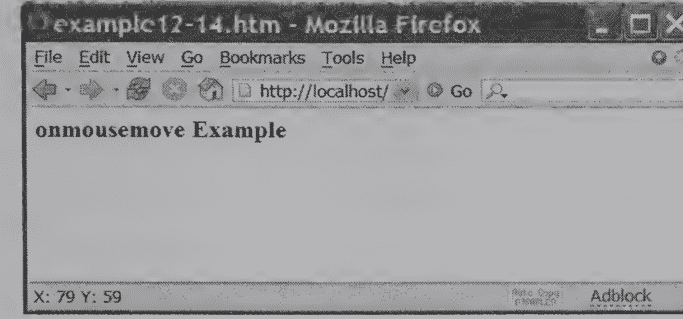

> 注意
鼠标指针的 X 和 Y 坐标并不完全对应可见网页，因为它们还考虑了窗口边框。网页左上角的 X、Y 坐标为 2,2。

## onmouseout 和 onmouseover 事件处理程序

当鼠标移动到特定对象上时，触发 `onmouseover` 事件；当鼠标移出该对象时，触发 `onmouseout` 事件。此脚本使用了多个不同的图像。这些图像在表 12.3 中所示。

表 12.3：笑脸图像

| basic.gif | goldtooth.gif | grandpa.gif | innocent.gif | crosseyed.gif |
| --- | --- | --- | --- | --- |
| drooling.gif | broken.gif | cheese.gif | bubblegum.gif | kisses.gif |

以下脚本说明了这些事件：

```html

<html xmlns="http://www.w3.org/1999/xhtml">

<head>

  <title>example12-15.html</title>

</head>

<body>

  <script language="JavaScript">

<!--

  function imgChange(objNum, imgSrc) {

    document.images[objNum].src = imgSrc;

  }

-->

  </script>

<table>

<td width='80'></td>

15<td><a href="#" onmouseover="imgChange(0, 'graphics/goldtooth.gif')">Gold tooth</a></td>

16<td><a href="#" onmouseover="imgChange(0, 'graphics/grandpa.gif')">Grandpa</a></td>

17<td><a href="#" onmouseover="imgChange(0, 'graphics/innocent.gif')">Innocent</a></td>

18<td><a href="#" onmouseover="imgChange(0, 'graphics/crossed.gif')">Crosseyed</a></td>

19<td><a href="#" onmouseover="imgChange(0, 'graphics/drooling.gif')">Drooling</a></td>

20<td><a href="#" onmouseover="imgChange(0, 'graphics/broken.gif')">Broken</a></td>

21<td><a href="#" onmouseover="imgChange(0, 'graphics/cheese.gif')">Cheese</a></td>

22<td><a href="#" onmouseover="imgChange(0, 'graphics/basic.gif')">Basic</a></td>

23<td><a href="#" onmouseover="imgChange(0, 'graphics/bubblegum.gif')">Bubble gum</a></td>

24<td><a href="#" onmouseover="imgChange(0, 'graphics/kisses.gif')">Kisses</a></td>

25<td></td>

26</table>

27</body>

28</html>

```

该脚本使用表格来格式化输出。在第一列中，显示了一个笑脸图像：

```

<table><tr><td width='80'></</td>><td> 显示了一系列超链接。鼠标移动到这些超链接上或移出这些链接会导致 `mouseover` 或 `mouseout` 事件调用 `imgChange` 函数。该函数接收了对象索引（为 0）和要替换的图形图像名称以替换现有图像：


<td><a href="#" onmouseover="imgChange(0, 'graphics/goldtooth.gif')">Gold tooth</a></td>
<td><a href="#" onmouseover="imgChange(0, 'graphics/grandpa.gif')">Grandpa</a></td>
<td><a href="#" onmouseover="imgChange(0, 'graphics/innocent.gif')">Innocent</a></td>
<td><a href="#" onmouseover="imgChange(0, 'graphics/crossed.gif')">Crosseyed</a></td>
<td><a href="#" onmouseover="imgChange(0, 'graphics/drooling.gif')">Drooling</a></td>
<td><a href="#" onmouseover="imgChange(0, 'graphics/broken.gif')">Broken</a></td>
<td><a href="#" onmouseover="imgChange(0, 'graphics/cheese.gif')">Cheese</a></td>
<td><a href="#" onmouseover="imgChange(0, 'graphics/basic.gif')">Basic</a></td>
<td><a href="#" onmouseover="imgChange(0, 'graphics/bubblegum.gif')">Bubble gum</a></td>
<td><a href="#" onmouseover="imgChange(0, 'graphics/kisses.gif')">Kisses</a></td>
</tr>
</table>

`imgChange` 函数根据对象索引更新图像源：

```
function imgChange(objNum, imgSrc) {
  document.images[objNum].src = imgSrc;
}
```

这种结果是，当鼠标跨越链接描述时，图像发生了变化。输出如图 12.13 所示。

图 12.13：mouseover 和 onmouseout 事件


## reset 事件处理程序

reset 事件在用户点击重置按钮时发生。reset 事件处理程序应与表单元素关联。考虑以下脚本，它说明了该用法：

```html
<html xmlns="http://www.w3.org/1999/xhtml">
<head>
<title>example12-16.html</title>
</head>
<body>
<script language="JavaScript">
<!--
function resetMessage() {
  alert("Are you sure you wish to delete all data?");
}
-->
</script>
<h2>reset Example</h2>
<form name="myForm" onreset="resetMessage()">
Surname<input type="text" name="surname"/>
<input type="reset"/>
</form>
</body>
</html>
```

该脚本在点击重置按钮时调用 `resetMessage`。这将弹出一个对话框询问用户是否想要删除所有表单数据。该脚本的输出如图 12.14 所示。

图 12.14：reset 事件


## onresize 事件处理程序

onresize 事件在窗口或框架被调整大小时触发。以下脚本说明了使用该事件的一个示例：

```html
<html xmlns="http://www.w3.org/1999/xhtml">
<head>
  <title>example12-17.html</title>
</head>
<body>
<script language="JavaScript">
<!--
function onResize() {
  var intIEBrowser = (document.all) ? 1 : 0;
  var intNS6Browser = (document.getElementById("!document.all")) ? 1 : 0;
  var intWidth;
  var intHeight;
  intWidth = intNS6Browser?window.innerWidth : document.body.clientWidth;
  intHeight = intNS6Browser?window.innerHeight : document.body.clientHeight;
  defaultStatus = "Width: " + intWidth + " Height: " + intHeight;
}
-->
</script>
<body onresize="onResize()">
<h2>onresize Example</h2>
</body>
</html>
```

上面的脚本包含了一种方法，用于确定你用来查看脚本的 浏览器类型。以下代码能够判断浏览器是 Microsoft Internet Explorer 还是 Net Navigator 6（或 Firefox，见第 300 页）：

```
var intIEBrowser = (document.all) ? 1 : 0;
var intNS6Browser = (document.getElementById("!document.all")) ? 1 : 0;
```

我们需要知道这些信息，是因为 `resize` 函数将在状态栏中显示窗口的大小。遗憾的是，我们确定窗口大小的方法是

184

两种浏览器之间的窗口有所不同。根据浏览器类型，窗口大小会在 `resize` 事件中确定并显示在状态栏上。

```javascript
intWidth = intNS6Browser.window.innerWidth : document.body.clientWidth;
Height = intNS6Browser.window.innerHeight : document.body.clientHeight;
defaultStatus = "Width: " + intWidth + " Height: " + intHeight;
```

在上述示例中，resize 处理器与 `body` 元素关联。当调整浏览器窗口大小时，便会调用 `resize` 函数：

```html
<body onresize="resize()">
```

上述脚本的输出如图 12.15 所示。

图 12.15: onresize 事件

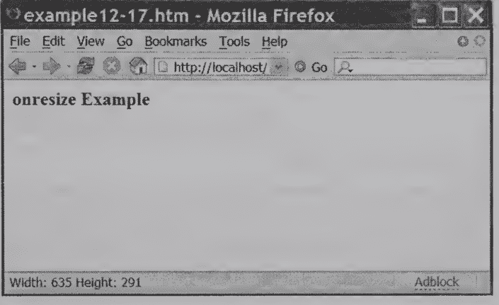

## onselect 事件处理器

当用户选择表单中文本字段或文本框字段内的文本时，会产生 `onselect` 事件。考虑以下示例：

```html
<html xmlns="http://www.w3.org/1999/xhtml">
<head>
  <title>example12-18.html</title>
</head>
<body>
  <script language="JavaScript">
  <!--
  function selected(objSelect) {
    var strText = objSelect.value;
    alert("You have selected the following text: " + strText);
  }
  -->
  </script>
  <h2>onreset 示例</h2>
  <form name="myForm">
    <input type="text" name="surname" onselect="selected(this)"/>
    <input type="reset"/>
  </form>
</body>
</html>
```

上述脚本拦截了用户选择 `surname` 表单字段中已输入值的行为。随后，`selected` 函数将使用 `alert` 框显示该字段中的值。脚本的输出如图 12.16 所示。

图 12.16: onselect 事件

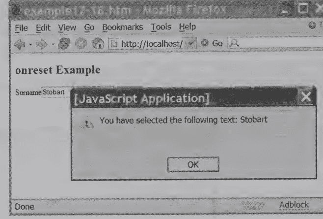

## onsubmit 事件处理器

当点击表单提交按钮时，会产生 `onSubmit` 事件。该事件与 XHTML 表单元素关联。以下脚本说明了该事件的一个示例：

```html
<html xmlns="http://www.w3.org/1999/xhtml">
<head>
<title>example12-19.htm</title>
</head>
<body>
<script language="JavaScript">
<!--
function onSubmit() {
alert("You are about to submit this form!");
}
-->
</script>
<h2>onsubmit 示例</h2>
<form name="myForm" onsubmit="onSubmit()">
<input type="text" name="surname"/>
<input type="submit"/>
</form>
</body>
</html>
```

该脚本生成的输出如图 12.17 所示。

图 12.17: on 事件


## onload 事件处理器

当文档或窗口被退出时，会产生 `onload` 事件。在文档的情况下，事件处理器与 XHTML `body` 元素关联，如下脚本所示：

```html
<html xmlns="http://www.w3.org/1999/xhtml">
<head>
<title>example12-20.htm</title>
</head>
<body onload="goodbye()">
  <script language="JavaScript">
  <!--
    function goodbye() {
      alert("Goodbye - see you later!");
    }
  <!---->
  </script>
<h2>onunload 示例</h2>
<a href="example12-20.htm">点击这里。</a>
</body>
</html>
```

点击超链接将触发该事件。该脚本生成的输出如图 12.18 所示。

图 12.18: onunload 事件


## 总结

本章引入了事件和事件处理的概念。我们介绍了错误事件、定时事件和事件处理器。我们提供了一些示例，说明了如何使用这些事件来创建更动态、有趣的网页。在第 13 章中，我们将研究浏览器导航和重定向的概念。

# 第 13 章：导航与重定向

## 引言

在本章中，我们将学习如何使用 JavaScript 导航到新的网页。虽然操作非常简单，但在将浏览器重定向到不同的位置时，必须考虑一些重要的因素。

我们将查看跳转到新页面的两种方法，并解释种种产生的不同效果。我们还将介绍如何为不支持 JavaScript 的浏览器提供备用内容。

## document.location 属性

我们将首先演示使用 JavaScript 导航到新页面的简单方法。这是通过将文档对象的 `location` 属性赋值为包含想要跳转的 URL 或文件的字符串来实现的。例如，要在 JavaScript 中导航到桑德兰大学（University of Sunderland）网站，我们将使用以下代码：

```javascript
document.location = "http://www.sunderland.ac.uk";
```

以下示例代码为用户提供了从两个备用网页中进行选择的机会，取决于他们点击哪一个按钮：

```html
<html xmlns="http://www.w3.org/1999/xhtml">
<head>
<title>example13-1.html</title>
</head>
<script language="JavaScript">
<!--
function loadPage(strPage) {
document.location = strPage;
}
//->
</script>
</head>
<body>
<h1>URL 选择器</h1>
<p>选择要加载的文档：</p>
<form>
<input type="button" value="Test 1" onclick="loadPage('test1.htm')"/>
<input type="button" value="Test 2" onclick="loadPage('test2.htm')"/>
</form>
</body>
</html>
```

# 处理非 JavaScript 浏览器

我们可能希望使用 JavaScript 进行网页自动重定向的场景之一，是在处理不符合 JavaScript 标准的浏览器时。我们已经看到，JavaScript 代码应该放在 XHTML 注释中，这样如果在一个不支持 JavaScript 的浏览器中打开文档，JavaScript 代码将会被忽略（被视为注释），而不是在页面中产生错误。

如果 JavaScript 代码非常庞大，以至于在没有它的情况下网页（甚至整个网站）将无法正常运行，那么这种方法可能就了。在这种情况下，我们希望为使用非 JavaScript 浏览器的用户提供一个网站的备用精简版本，以便他们仍然能够信息，尽管其格式和功能比使用 JavaScript 时所能实现的要基础。

为了提供这种功能，网站通常会包含一个初始页面，该页面用于检测浏览器是否符合 JavaScript 标准。如果符合，浏览器将立即重定向到网站 JavaScript 版本的第一个页面，用户甚至察觉不到这种操作的发生。如果不符合，则向用户提供一条合适的消息以及指向网站备用（不含 JavaScript）版本的 XHTML 超链接链接。

该初始页面检测浏览器是否符合 JavaScript 标准的方法是使用 JavaScript 编写重定向代码。如果浏览器符合标准，浏览器将重定向到所需页面，而不会显示初始页面上的剩余内容。如果浏览器不符合，重定向代码将被忽略，并显示初始面的剩余内容。唯一的问题是应该使用哪种格式的 JavaScript 导航代码？

让我们考虑之前讨论的第一种方法，它在页面选择方面效果良好。在这种情况下，我们通过将文档的 `location` 属性赋值给新页面来重定向浏览器，如下代码所示：

```html
<html xmlns="http://www.w3.org/1999/xhtml">
<head>
<title>example3-3.html</title>
<script language="JavaScript">
<!--
document.location = "site.html";
//
</script>
</head>
<body>
<h1>我的网站</h1>
<p>本网站设计用于在符合 JavaScript 标准的浏览器中显示。要访问网站的备用精简版本，请点击链接：</p>
<a href="site2.html">非 JavaScript 站点</a>
</body>
</html>
```

如果此文档加载到符合 JavaScript 标准的浏览器中，则第 6 行的 JavaScript 重定向代码将执行，并立即加载文档 `site1.html`，替换浏览器中的当前文档。这如图 13.3 所示。

## 导航与重定向

图 13.3：重定向符合 JavaScript 标准的浏览器


如果文档加载到不支持 JavaScript 的浏览器中，重定向代码将被忽略，并显示文档内容的剩余（定义在第 10-15 行），如图 13.4 所示。

图 13.4：对不符合 JavaScript 标准的浏览器忽略重定向


在这种情况下，提供了一个超链接，使用户户导航到网站不符合 JavaScript 标准的浏览器版本。

如果你获取此文档的副本并现在尝试在符合 JavaScript 标准的浏览器中使用，一切看起来都运行正常，你似乎已经直接导航到了网站的 JavaScript 版本。问题发生在你不想使用后退按钮返回之前查看过的网页时。你会发现，后退按钮并没有返回到上一页，而是似乎被禁用了，你最终会回到新页面的起始位置。此的原因是，正如我们之前看到的，将 `location` 对象赋值给新页面会将原始页面和新页面都包含在历史列表中。因此，当我们点击后退按�时，我们返回到执行重定向的文档，结果只是发现立即且自动地被重定向回我们开始的地方。

这种方法常见于执行自动重定向的网站中，对用户来说可能非常困扰，因为他们实际上被锁定在新站点中，无法通过历史列表返回到访过的页面。因此，如果你不想打扰你的用户，建议使用替代方法，并使用 `location` 对象的 `replace` 方法执行自动重定向。在这种情况下，新文档（网站 JavaScript 版本的起点）将替换历史列表中的导航文档，因此点击后退按钮即可回到之前访问的上一个站点。这涉及到对代码第 6 行的简单更改，使用 `replace` 方法如下：

更新后的完整代码版本包含在：

```javascript
document.location.replace("site1.html");

<html xmlns="http://www.w3.org/1999/xhtml">
```

```html
<head>
  <title>example1-4.htm</title>
  <script language="JavaScript">
  <!--
    document.location.replace("site1.htm");
  -->
  </script>
</head>
<body>
  <h1>我的网站</h1>
  <p>本网站设计用于在符合 JavaScript 标准的浏览器中显示。要访问网站的备用精简版本，请点击下面的链接：</p>
  <a href="site2.htm">非 JavaScript 站点</a>
</body>
</html>
```

## 总结

在本章中，我们查看了执行导航和重定向的两种方法。我们证明了每种方法都有其用处，并且如果采取错误的方法就会产生问题。此外，我们还看到网页可以检测浏览器是否符合 JavaScript 标准，并自动将用户重定向到网站适当的版本。在第 14 章中，我们将开始考虑更高级的 JavaScript，从窗口功能开始。

# 第 14 章：窗口 (Windows)

## 引言

本章引入了窗口（windows）的概念。每当我们打开浏览器时，默认会打开一个窗口。这个窗口包含了我们当前正在查看的文档。在某种程度上（具体取决于浏览器和操作系统），可以打开多个窗口，并显示相同或不同的文档。图 14.1 显示了打开两个窗口的典型情况，每个窗口显示不同的文档。

图 14.1：多个浏览器窗口


本章将演示如何从网页创建窗口，如何为这些窗口分配各种属性，以及用户如何进一步控制它们。

## 创建新窗口

当你打开浏览器时看到的窗口都是窗口对象。窗口对象包含了许多控制它们外观和操作的方法。它们还响应特定的事件。在详细考虑这些属性、方法和事件之前，我们首先需要如何如何并打开新窗口。这是通过使用如下所示的方法实现的：

```javascript
window.open();
```

以下脚本说明了从现有文档创建新窗口：

```html
<html xmlns="http://www.w3.org/1999/xhtml">
<head>
<title>example14-1.htm</title>
</head>
<body>
<script language="JavaScript">
<!--
window.open();
//--
</script>
</body>
</html>
```

正如所示，这非常基础，并且没有为新窗口提供任何内容。此脚本实际上创建了窗口，并在文档加载到原始窗口后立即在第 8 行打开了新窗口。我们将在章节稍后部分看到用户如何控制新窗口的打开。打开的文档也是一个默认窗口，具有所有的标准窗口属性。如图 14.2 所示。

图 14.2：打开默认窗口


在本章稍后部分，我们将看到如何打开不同样式、大小并具有不同属性的窗口，但首先让我们为我们的基础窗口添加一些内容。

# 创建带有内容的窗口

有了窗口后，我们现在向其中放入一些内容。一种方法是将 XML 文档加载到窗口中。我们通过将所需文档的 URL 作为参数传递给 `open` 函数来实现。下面的示例创建了一个新窗口并打开文档 `win1.htm`：

```
 <html xmlns="http://www.w3.org/1999/xhtml">
<head>
<title>example14-2.htm</title>
</head>
<body>
<script language="JavaScript">
<!--
window.open("win1.htm");
-->
</script>
</body>
</</html>
```

第 8 行与上一个示例一样，打开了新窗口，但这次它将字符串 `win1.htm` 作为参数：

```
window.open("win1.htm");
```

XML 文件 `win1.htm` 在新窗口中打开，如图 14.3 所示。与其将 HTML 文档加载到你的窗口中，你可能希望从脚本动态地向窗口写入。这稍微复杂一些，因为你利用了 `open` 函数返回的窗口对象的名称。为了获取窗口对象的名称，你需要一个如下形式的语句：

```
objWin = window.open();
```

变量 `objWin` 现在将包含窗口对象的名称，并可以作为该窗口的引用。记住，要向当前窗口写入内容，我们将使用如下语句：

```
document.write("Hello");
```

要向 `myWin` 写入，我们需要将该语句扩展为：

```
objWin.document.write("Hello");
```

将这些结合起来，我们可以产生这样的脚本：

```
 <html xmlns="http://www.w3.org/1999/xhtml">
<head>
<title>example14-3.htm</title>
</head>
<body>
<script language="JavaScript">
<!--
var objWin;
objWin = window.open();
objWin.document.write("hello");
-->
</script>
</body>
</</html>
```

图 14.3：打开窗口并加载文档


仔细观察此脚本，我们定义了一个附加到创建窗口的变量 `objWin`。该变量随后用于访问窗口中包含的文档（目前是一个空文档），并将字符串 "hello" 写入其中。此脚本将产生如图 14.4 所示的输出。

图 14.4：打开窗口并写入内容


## 窗口名称

> 注意

> 这是一个非常简单的示例，使用了基础的未格式化写入语句，你可以向窗口中写入你喜欢的任何内容，正如本书其他章节所所示。

到目前为止，我们创建了未命名的窗口，当我们在打开文档或从创建该窗口的脚本向窗口写入内容时，这并不是问题。然而，如果我们希望产生更动态的内容，例如通过根据另一个窗口中打开的文档中的系列超链接，选择向我们的新窗口中加载各种文档，那么给我们的窗口命名就是很有了。这里有一个细微的差别，最初可能会引起困惑。在上一节中，我们命名了窗口对象并将其作为变量以便在 JavaScript 中访问该窗口。在这一节中，我们命名了窗口本身，以便从 XHTML 访问它。

我们使用函数中的（可选的）第二个参数来为文档命名。例如，要创建一个名为 `window1` 的新窗口，且初始不加载任何文档，则我们使用如下语句：

```
window.open("", "window1");
```

然后我们可以使用 `target` 属性从 XHTML 文档访问此窗口。下面的示例说明了这一点：

```html
1 <html xmlns="http://www.w3.org/1999/xhtml">
2 <head>
3 <title>example14-4.html</title>
4 </head>
5 <body>
6 <script language="JavaScript">
7 <!--
8 window.open("", "window1");
9 //
10 </script>
11 <p>点击<a href="win1.html" target="window1">这里</a>将文件加载到新窗口。</p>
12 </body>
13 </html>
```

在这里，我们打开了一个名为 `window1` 的新窗口，它最初是空白的。图 14.5 显示了如果你运行脚本但不点击超链接时的输出。

我们在原始文档中插入了一个超链接，点击它时，会将结果内容显示在目标窗口 `window1` 中，即我们之前新创建的窗口。图 14.6 显示了点击超链接后新文档加载到窗口中的结果。注意，当你选择窗口查看内容时，它最初会失去焦点并消失在原始窗口后面。

这个示例本身可能看起来并不有用，但尝试原始文档中的另一个超链接：

```html
1 <html xmlns="http://www.w3.org/1999/xhtml">
2 <head>
3 <title>example14-5.html</title>
4 </head>
5 <body>
6 <script language="JavaScript">
```

## 窗口

1 <html xmlns="http://www.w3.org/1999/xhtml">

2 <head>

3 <title>example14-5.html</title>

4 </head>

5 <body>

6 <script language="JavaScript">

```html
window.open("", "window1");
//
</script>
<p>点击<a href="win1.html" target="window1">这里</a>将文件加载到新窗口。</p>
</body>
</html>
```

现在可以向新创建的窗口加载不同的文档。

图 14.5：带有超链接的窗口  # 属性

到目前为止，我们创建了未命名的窗口，当我们打开文档或从创建该窗口的脚本向窗口写入内容时，这并不是问题。然而，如果我们希望产生更动态的内容，例如通过根据另一个窗口中打开的文档中的系列超链接，选择向我们的新窗口中加载各种文档，那么给我们的窗口命名就是很有了。这里有一个细微的差别，最初可能会引起困惑。在上一节中，我们命名了窗口对象并将其作为变量以便在 JavaScript 中访问该窗口。在这一节中，我们命名了窗口本身，以便从 XHTML 访问它。

我们使用函数中的（可选的）第二个参数来为文档命名。例如，要创建一个名为 `window1` 的新窗口，且初始不加载任何文档，则我们使用如下语句：

```
window.open("", "window1");
```

然后我们可以使用 `target` 属性从 XHTML 文档访问此窗口。下面的示例说明了这一点：

```html
1 <html xmlns="http://www.w3.org/1999/xhtml">
2 <head>
3 <title>example14-4.html</title>
4 </head>
5 <body>
6 <script language="JavaScript">
7 <!--
8 window.open("", "window1");
9 //
10 </script>
11 <p>点击<a href="win1.html" target="window1">这里</a>将文件加载到新窗口。</p>
12 </body>
13 </html>
```

- 在这里我们打开了一个名为 `window1` 的新窗口，它最初是空白的。图 14.5 显示了如果你运行脚本但不点击超链接时的输出。
- 我们在原始文档中插入了一个超链接，点击它时，会将结果内容显示在目标窗口 `window1` 中，即我们之前新创建的窗口。图 14.6 显示了点击超链接后新文档加载到窗口中的结果。注意，当你选择窗口查看内容时，它最初会失去焦点并消失在原始窗口后面。
- 这个示例本身可能看起来并不有用，但尝试原始文档中的另一个超链接：

```html
1 <html xmlns="http://www.w3.org/1999/xhtml">
2 <head>
3 <title>example14-5.html</title>
4 </head>
5 <body>
6 <script language="JavaScript">
```html
window.open("", "window1");
//
</script>
<p>点击<a href="win1.html" target="window1">这里</a>将文件加载到新窗口。</p>
```

现在可以向新创建的窗口加载不同的文档。

图 14.5：带有超链接的窗口 

## 设置属性

到目前为止，我们创建了未命名的窗口，当我们打开文档或从创建该窗口的脚本向窗口写入内容时，这并不是问题。然而，如果我们希望产生更动态的内容，例如通过根据另一个窗口中打开的文档中的系列超链接，选择向我们的新窗口中加载各种文档，那么给我们的窗口命名就是很有了。这里有一个细微的差别，最初可能会引起困惑。在上一节中，我们命名了窗口对象并将其作为变量以便在 JavaScript 中访问该窗口。在这一节中，我们命名了窗口本身，以便从 XHTML 访问它。

`open` 语句包含第三个参数，这是一个由逗号分隔的属性值对列表的字符串。

```
window.open([URL], [Name], [Properties]);
```

如果你想为窗口设置属性但不打开文档或提供名称，则你需要为前两个参数提供空字符串。例如：

```
window.open("", "", [Properties]);
```

每个属性都有一个名称并通过等号对其赋值。多个属性使用逗号分隔组合成单个字符串。例如，属性字符串：

```
"width=400, height=350"
```

会将宽度设置为 400 像素，高度设置为 350 像素。将此整合到脚本将创建一个宽 400 像素、高 350 像素的空白窗口：

```html
1 <html xmlns="http://www.w3.org/1999/xhtml">
2 <head>
3 <title>example14.html</title>
4 </head>
5 <body>
6 <script language="JavaScript">
7 <!--
8 window.open("", "", "width=400,height=350");
9 -->
10 </script>
11 </body>
12 </html>
```

输出如图 14.7 所示。

图 14.7：创建特定大 size 的窗口 

> 注意

> 如果提供了属性字符串，则字符串中的所有属性都取这些默认值，且这些默认值并不一定与没有提供属性字符串时创建的窗口相同！

考虑以下脚本：

```html
1 <html xmlns="http://www.w3.org/1999/xhtml">
2 <head>
3 <title>example14-7.htm</title>
4 </head>
5 <body>
6 <script language="JavaScript">
7 <!--
8 window.open("", "");
9 window.open("", "", "height=100");
10 -->
11 </script>
12 </body>
13 </html>
```

第 8 行创建了一个纯默认窗口，如之前的示例所示，它包含了工具栏、菜单、状态栏和其他功能；第 9 行创建了一个仅指定了高度属性的窗口，它不包含任何其他功能。图 14.8 的示例通过在原始窗口上显示的两个窗口说明了这一点。

图 14.8：默认属性与指定的属性 

### 图 14.8：设置与未设置属性的窗口


可以设置许多属性，表 14.1 描述了一些常用的属性和值。

结合使用这些属性中的多个一个可以产生所需的窗口。例如，以下 open 语句产生一个固定大小为 400 像素由 350 像素的窗口，带有滚动条和状态栏，但没有命令栏。XHTML 文档 win1.htm 显示在窗口中：

`window.open("win1.htm", "", width=400, height=350, status=yes, scrollbars=yes");`

完成后的脚本如下：

```
1 <html xmlns="http://www.w3.org/1999/xhtml">
2 <head>
3   <title>example14-8.htm</title>
4 </head>
5 <body>
6   <script language="JavaScript">
7   <!--
8   window.open("win1.htm", "", width=400, height=350, status=yes,
9   scrollbars=yes);
10  -->
11 </script>
12 </body>
13 </html>
```

打开此文档的结果如图 14.9 所示。

## 14 窗口

图 14.9：设置了各种属性的窗口


### 表 14.1：窗口属性

| 属性 | 值 | 描述 |

| --- | --- | --- |

| height | 像素数 | 窗口高度，最小值为 100 |

| width | 像素数 | 窗口宽度，最小值为 100 |

| left | 像素数 | 窗口距离屏幕左侧的距离 |

| top | 像素数 | 窗口距离屏幕顶部的距离 |

| menubar | 是或否 | 在窗口顶部包含标准菜栏 |

| toolbar | 是或否 | 标准浏览器工具栏 |

| location | 是或否 | 包含输入或选择 URL 的输入框 |

| status | 是或否 | 在窗口底部包含状态栏 |

| scrollbars | 是或否 | 在创建窗口时包含滚动条 |

| resizeable | 是或否 | 允许用户调整窗口大小 |

## 允许用户创建窗口

到目前为止，我们创建的所有窗口都是在文档加载时执行的脚本中完成的。也可以创建脚本，允许响应用户的操作来创建窗口。实现此点的常用方法是响应用户完成并提交表单。

我们现在将开发一个简单的表单，带有一个按钮，允用户根据喜好创建窗口。为了实现这一点，打开窗口的代码放在一个名为 `openWindow` 的函数中，如下所示：

```javascript
function openWindow() {
  window.open("win1.htm", "", "width=400,height=350");
}
```

然后创建一个包含单个按钮的 XHTML 表单。该按钮的 `onclick` 事件处理器在每次点击按钮时调用 `openWindow` 函数：

```html
<form>
  <input type="button" value="Open Window" onclick="openWindow()">
</form>
```

将此按钮与合适的标题和提示结合起来，得到以下脚本：

```html
<html xmlns="http://www.w3.org/1999/xhtml">
<head>
  <title>example14-9.htm</title>
</head>
<body>
  <script language="JavaScript">
  <!--
  function openWindow() {
    window.open("win1.htm", "", "width=400,height=350");
  }
  -->
  </script>
  <h1>Window Example</h1>
  <p>
    点击下方的按钮打开新窗口
  </p>
  <form>
    <input type="button" value="Open Window" onclick="openWindow();">
  </form>
</body>
</html>
```

每次点击按钮都会创建一个新窗口。用户现在可以根据需要动态生成窗口。连续点击按钮三次的结果如图 14.10 所示。

> **注意**：新创建的窗口会被带回焦点状态，因为每次点击按钮时，之前的窗口都会消失在表单窗口后面。

图 14.10：响应用户点击表单按钮而生成的窗口


## 关闭窗口

花了一些时间研究如何打开窗口，并制作了一个允许用户动态创建任意数量窗口的表单后，我们现在应该考虑如何关闭窗口。为了做到，我们使用窗口属性的 `close` 方法：

```javascript
window.close();
```

上述语句将关闭当前窗口，如果这是最后一个打开的浏览器窗口或该窗口不是在脚本中创建的，则会提示用户。始终建议在调用 `close` 方法之前加上 `window`，以避免在关闭当前窗口或当前文档时出现混淆。如果：

```javascript
close();
```

在由事件调用的函数（例如表单按钮的 `onclick` 事件）中单独调用 `close()`，窗口将关闭。如果它是从事件本身调用的，只有文档会关闭，空窗口将保持打开。最简单的方法是始终使用：

```javascript
window.close();
```

或者：

```javascript
document.close();
```

根据需要执行。

下面的脚本提供了一个响应按钮 `onclick` 事件关闭当前窗口的简单示例，使用一个函数来执行关闭操作：

```
1 <html xmlns="http://www.w3.org/1999/xhtml">
2 <head>
3 <title>example14-10.htm</title>
4 </head>
5 <body>
<script language="JavaScript">
<!--
function closeWindow() {
  window.close();
}
-->
</html>
<h1>Window Example</h1>
<p>点击下方的按钮关闭窗口</p>
<form>
  <input type="button" value="Close Window" onclick="closeWindow();">
</form>
</body>
```

另一种不需要单独函数的解决方法是在事件处理器中直接执行关闭，如下所示：

```html
<html xmlns="http://www.w3.org/1999/xhtml">
<head>
  <title>example14-11.htm</title>
</head>
<body>
  <h1>Window Example</h1>
  <p>点击下方的按钮关闭窗口</p>
  <form>
    <input type="button" value="Close Window" onclick="window.close();">
  </form>
</body>
</html>
```

一个趣示例是使用脚本打开带有各种属性的窗口。下面的脚本演示了这一点：

```html
<html xmlns="http://www.w3.org/1999/xhtml">
<head>
  <title>example14-12.htm</title>
</head>
<body>
  <script language="JavaScript">
  <!--
  var win1;
  var win2;
  function openWindow(intWin) {
    if (intWin == 1) {
      win1 = window.open("win1.htm", "", "width=400,height=350");
    } else {
      win2 = window.open("win2.htm", "", "width=400,height=350");
    }
  }
  function closeWindow(intWin) {
    if (intWin == 1) {
      win1.close();
    } else {
      win2.close();
    }
  }
  -->
  </script>
  <h1>Window Example</h1>
  <p>点击下方的按钮打开新窗口</p>
  <form>
    <input type="button" value="Window 1 Open" onclick="openWindow(1)">
    <input type="button" value="Window 2 Open" onclick="openWindow(2)">
  </form>
  <hr>
  <input type="button" value="Window 1 Close" onclick="closeWindow(1)">
  <input type="button" value="Window 2 Close" onclick="closeWindow(2)">
</body>
</html>
```

将 1 或 2 作为参数传递，并提供两个用于关闭窗口的按钮，在调用 `windowClose` 函数时再次传递相应的窗口编号（1 或 2）作为参数。运行此脚本并打开每个窗口的结果如图 14.12 所示。

图 14.12：从表单打开并关闭窗口


**重复窗口**

在上一个示例中，我们提供了打开和关闭两个窗口的按钮。如果按预期使用此脚本（打开一个或两个窗口然后关闭它们），它会正常工作。然而，如果用户多次点击打开按钮而不关闭窗口会发生什么？可能会出现图 14.13 所示的情况，并产生重复窗口：

图 14.13：从表单打开重复窗口


现在尝试使用关闭按钮操作窗口。出现了一个问题：每种类型只有最后一个窗口被关闭。再次点击关闭按钮似乎没有作用。

其原因是，用户每点击一次打开按钮，都会打开一个新窗口（取决于点击了哪个按钮，打开窗口 1 或 2），并且该窗口对象会被绑定到 `objWin1` 或 `objWin2` 变量上。任何时候变量只能绑定一个窗口，因此新窗口对象将替换之前绑定到该变量的窗口对象。如果用户点击某个窗口的关闭按钮，则相应变量指向的窗口（绑定到该变量的最后一个窗口）会被关闭。之前创建的窗口虽然最初绑定到该变量，但现在已不再连接，因此再次点击关闭将不起作用。

为了避免这个问题并确保点击特定窗口的打开按钮时只打开该窗口的一个版本，如果打开一个窗口并为其命名，那么后续打开具有相同名称的窗口将不会导致打开重复窗口。因此，为了避免上一个示例中关闭窗口的问题，我们可以修改脚本并给每个窗口命名：

```
1 <html xmlns="http://www.w3.org/1999/xhtml">
2 <head>
3 <title>example14-14.htm</title>
4 </head>
5 <<body>>
6 <script language="JavaScript">
7 <!--
8 
9 var objWin1;
10 var objWin2;
11 function windowOpen(intWin) {
11 if (intWin == 1)
12     objWin1 = window.open("win1.htm", "Window1", "width=400,height=350);
13 else
14     objWin2 = window.open("win2.htm", "Window2", "width=400,height=350);
15 
16 function windowClose(intWin)
17 if (intWin == 1)
18     objWin1.close();
19 else
20     objWin2.close();
21 }
22 //-->
23 <script>
24 <head>
25 <body>
26 <html><h1>Window Example</h1>
27 <p>
28 点击下方按钮打开新窗口</p>
29 <form>
30 <input type="button" value="Window 1 Open" onclick="windowOpen(1)">
31 <input type="button" value="Window 2 Open" onclick="windowOpen(2)">
32 <hr>
33 <input type="button" value="Window 1 Close" onclick="windowClose(1)">
34 </p>
35 <input type="button" value="Window 2 Close" onclick="windowClose(2)">
36 </p>
37 </form>
38 </body>
39 </html></script>
```

对此脚本进行了两处简单更改，以为创建的窗口添加名称：

objWin1 = window.open("win1.htm", "Window1", "width=400,height=350");

以及

objWin2 = window.open("win2.htm", "Window2", "width=400,height=350");

## 窗口焦点

创建窗口并从原始窗口对其操作时，存在的另一个潜在问题是：当用户点击原始窗口时，新窗口会消失在原始窗口后面并失去焦点。为了避免这种情况发生，我们可以使用窗口的 `focus` 方法：

```
window.object.focus();
```

对特定窗口调用此方法将将其带到屏幕上。因此，我们可以为上一个示例添加第三个函数 `windowFocus`，将指定的窗口带到屏幕上：

```
function windowFocus(intWin)
  if (intWin == 1)
    objWin1.focus();
  else
    objWin2.focus();
```

## Windows 14

添加两个新的表单按钮，调用 `windowFocus` 并允许用户指定将哪个窗口置顶：

```
<p><input type="button" value="Window 1 Focus" onclick="windowFocus(1);">
</p>
<p><input type="button" value="Window 2 Focus" onclick = "windowFocus(2);">
</p>
```

将所有内容整合在一起得到完整的脚本：

```
<html xmlns="http://www.w3.org/1999/xhtml">
<head>
  <title>example14-15.htm</title>
</head>
<<body>
  <script language="JavaScript">
  <!--
  var objWin1;
  var objWin2;
  function windowOpen(intWin) {
    if (intWin == 1)
      objWin1 = window.open("win1.htm", "Window1", "width=400,height=350");
    else
      objWin2 = window.open("win2.htm", "Window2", "width=400,height=350");
  }
  function windowClose(intWin) {
    if (intWin == 1)
      objWin1.close();
    else
      objWin2.close();
  }
  function windowFocus(intWin) {
    if (intWin == 1)
      objWin1.focus();
    else
      objWin2.focus();
  }
  -->
</script>
<head>
<body>
  <html><h1>Window Example</h1>
  <p>
  点击下方按钮打开新窗口</p>
  <form>
    <input type="button" value="Window 1 Open" onclick="windowOpen(1)">
    <input type="button" value="Window 2 Open" onclick="windowOpen(2)">
    <hr>
hr
    <input type="button" value="Window 1 Close" onclick="windowClose(1)">
    <input type="button" value="Window 2 Close" onclick="windowClose(2)">
  </form>
  <p><input type="button" value="Window 1 Focus" onclick="windowFocus(1);"></p>
  <p><input type="button" value="Window 2 Focus" onclick = "windowFocus(2);"></p>
</body>
</html>
```

```javascript
21 }
22 function calcTotal() {
23 objCostWin = window.open("", "Cost", "height=250, width=300, top=300,
24 left=200");
25 objCostWin.document.close();
26 objCostWin.document.write("<h1>Shopping Cost</h1>");
27 objCostWin.document.write("<hr>");
28 objCostWin.document.write("<p>Total cost of order: " + intCost + ".p
29 "</p>");
30 objCostWin.document.write("<hr>");
31 objCostWin.document.write("<center>");
32 objCostWin.document.write("<form><input type='button' value='Close
33 onclick='window.close()'></form>");
34 objCostWin.document.write("</center>");
35 objCostWin.document.focus();
36 }
37 function emptyBasket() {
38 objBasketWin.document.close();
39 startShopping();
40 }
41 function startShopping() {
42 //--
43 </script>
44 <h1>Fruit Stall</h1>
45 <p>
46 Click the buttons below to select the fruit you require</p>
47 <form>
48 <table>
49 <tr align="center">
50 <td><input type="button" value="Apple" onclick="addItem('Apple',
51 5);"></</td>>
52 <td><input type="button" value="Banana" onclick="addItem('Banana',
53 9);"></</td>>
54 <td><input type="button" value="Orange" onclick="addItem('Orange',
55 7);"></</td>>
56 </tr>
57 <td><input type="button" value="Pear" onclick="addItem('Pear',
58 6);"></</td>>
59 <td><input type="button" value="Lemon" onclick="addItem('Lemon',
60 8);"></</td>>
61 <td><input type="button" value="Mango" onclick="addItem('Mango',
62 9);"></</td>>
63 </tr>
64 </table>
65 <p>
66 <input type="button" value="View Total Cost" onclick="calcTotal();">
67 <input type="button" value="Empty Basket" onclick="emptyBasket();">
68 </p>
69 </form>
70 </body>
71 </html>
```

让我们将这段代码拆分为几个部分。首先，定义了若干全局变量，以便维护水果的总成本和窗口对象，供应用程序中的所有函数使用：

# 窗口 (Windows)

```javascript
var objBasketWin;
var objCostWin;
var intCost;
```

然后是一个名为 `startShopping()` 的函数，它会在文档首次打开以及每次清空购物篮时被调用：

```javascript
function startShopping() {
  intCost = 0;
  objBasketWin = window.open("", "Basket", "height=550, width=400, top=100,
left=70, scrollbars=yes");
  objBasketWin.document.write("<h1>Shopping Basket</h1>");
  objBasketWin.focus();
}
```

该函数将 `intCost` 变量初始化为 0，打开购物篮窗口（如果窗口已经打开，在清空购物篮的情况下，则此语句被忽略）并写入标题。你会注意到在该函数以及许多其他函数的末尾，调用了以下代码：

```javascript
objBasketWin.focus();
```

这是为了确保购物篮始终显示在屏幕前方。

接下来是 `addItem` 函数，它在点击任何按钮时被调用，用于添加水果：

```javascript
function addItem(itemName, intAmount) {
  intCost += intAmount;
  objBasketWin.document.write("<p>" + itemName + " added at " + intAmount + "</p>");
  objBasketWin.focus();
}
```

该函数接受两个参数：`itemName` 是水果名称，`intAmount` 是价格。它会将价格加到全局变量 `intCost`，并向购物篮写入信息。

随后我们离开对购物篮的操作，引入 `calcTotal` 函数，它响应用户查看总成本：

```javascript
function calcTotal() {
  objCostWin = window.open("", "Cost", "height=250, width=300, top=300,
left=200");
  objCostWin.document.close();
  objCostWin.document.write("<h1>Shopping Cost</h1>");
  objCostWin.document.write("<hr>");
  objCostWin.document.write("<p>Total cost of order: " + intCost + "</p>");
  objCostWin.document.write("<hr>");
  objCostWin.document.write("<center>");
  objCostWin.document.write("<form><input type='button' value='Close
onclick='window.close()'></form>");
  objCostWin.document.write("</center>");
  objCostWin.document.focus();
}
```

该函数打开一个名为 `objCostWin` 的新窗口，其尺寸和位置与 `objBasketWin` 不同。它也不需要滚动条，因为内容大小是固定的。该函数立即关闭文档可能看起来很奇怪：

```javascript
objCostWin.document.close();
```

但这是一项安全措施，以防用户之前显示了总成本但在窗口中没有关闭它。如果不包含此语句，新的语句将添加到原始成本之后并消失在窗口下方。该函数的其余部分只是向 `objCostWin` 窗口输出一些 HTML 格式语句，以显示成本。

这是一个相当详细的示例，希望带给你一些关于如何在自己的网站中使用窗口操作的灵感。它还应该帮助你避免在处理多个窗口时可能出现的一些陷阱。

## 总结 (Summary)

本章介绍了 JavaScript 中的窗口概念。我们看到了如何使用 `window` 类来创建、打开、关闭和操作不同尺寸及属性的窗口。我们涵盖了对窗口进行的一些常用操作，并看到如何将它们组合成一个动态的 Web 应用程序。

`window` 类比这里涵盖的属性、方法和事件要大得多，如果你打算在自己的网站中大量使用窗口功能，建议在 W3C 网站（www.w3c.org）上查阅阅读完整的类规范。

在第 15 章中，我们将学习使用框架（frames）将单个浏览器窗口拆分为多个组件的方法。

# 第 15 章：框架 (Frames)

## 引言

在本章中，我们将介绍框架（frames）这一主题。框架是一种 XHTML 元素，允许将浏览器窗口划分为不同的部分（称为框架），每个部分包含一个不同的文档。基本上，框架允许多个文档在同一个浏览器窗口中显示。

关于在网站中使用框架，存在很多争议和不同意见，一些网页设计师甚至发展到完全避免使用框架。使用框架的主要问题是页面的可访问性（accessibility）可能存在困难，因为这些页面无法被辅助视障人士的特殊浏览器轻松解析。这些浏览器会为用户生成网页的音频版本，因此一个包含多个不同 XHTML 文档的页面在生成的音频排序上可能会出现问题。框架的许多视觉效果实际上可以使用 XHTML 表格来实现，尽管代码可能会更复杂，但我们将向你展示如何生成框架，并由你决定是否要使用它们。

我们将首先开始向你展示如何制作一个基于框架的简单网页，并介绍一些可以影响框架视觉外观的属性。我们还将展示如何将框架嵌入在框架中以形成更复杂的结构。然后，我们将演示一个框架内的文档如何与其它框架中的文档进行交互，并结合 JavaScript 代码来产生这种灵活且动态的效果。最后，我们将介绍一种名为 Iframe 的相关元素，它允许将一个网页文档嵌入到另一个文档内部，而不是由浏览器窗口的结构固定。

## 基础框架

让我们从制作一个基础网页开始，它将浏览器窗口划分为两个垂直框架。为了实现这一点，我们需要三个文件。第一个是实际在浏览器中打开的 XHTML 文档。它简单地定了框架的结构，并链接到在各自的框架中显示的另外两个文档。正是这个文档定义了我们将查看的框架。

框架是在称为 `frameset`（框架集）的标签内创建的，它使用一对 XHTML `<frameset></frameset>` 定义。我们可以使用此标签的各种属性来确定划分窗口的框架的大小和结构。回到我们的示例，包含两个垂直框架，增加一个条件：我们需要第一个框架占据浏览器窗口的 30%，第二个框架占据剩余的 70%，我们将使用 `<frameset>` 标签开始定义框架集，并使用 `cols` 属性将窗口划分为两列，如下所示：

```
<frameset cols="30%,70%">
```

然后，我们需要使用 `<frame>` 标签按照如下所示创建框架本身：

```
<frame src="frame1.html">
```

这将创建一个框架（在本例中为左列），并显示由 `src` 属性标识的文档（在本例中为 frame1.html）。由于我们在 `<frameset>` 标签中定义定义了将有两个框架，因此我们需要第二个语句来创建第二个（在本例中为右列）框架，如下：

```
<frame src="frame2.html">
```

在我们的第二个框架中，我们将打开 `frame2.html` 文档。

最后，我们需要通过包含闭合的 `</frameset>` 标签来完成框架集。除了你的文档中所需的任何头部信息外，这就是创建一个 XHTML 框架文档所需要的所有内容。任何所需的内容都包含在链接的文件中。下面显示此基础框架文档的框架列表：

```
1 <html xmlns="http://www.w3.org/1999/xhtml">
2 <head>
3 <title>example15-1.htm</title>
4 </head>
5 <frameset cols="30%,70%">
6 <frame src="frame1.htm">
7 <frame src="frame2.htm">
8 </frameset>
9 </html>
```

我们已经为 `frame1.htm` 和 `frame2.htm` 生成了非常基础的文档，它们仅显示文本标题。`frame1.htm` 的代码包含如下：

```
1 <html xmlns="http://www.w3.org/1999/xhtml">
2 <head>
3 <title>frame1.htm</title>
4 </head>
5 <body>
6 <h1>Frame 1</h1>
7 </body>
8 </html>
```

在浏览器中打开文档 `example15-1.htm` 的结果如如图 15.1 所示。


**注意**

请注意，`frameset` 文档不包含 `<body>` 标签。这是因为 `frameset` 文档仅仅定义了浏览器窗口的结构。框架的所有 XHTML 内容都获取自链接的 XHTML 文档，这些文档将有它们自己的 `<body>` 标签。

如果我们希望产生水平框架而不是垂直框架，我们可以不使用 `<frameset>` 标签的 `cols` 属性，而是使用下面的 `rows` 属性：

```
<frameset rows="30%, 70%">
```

这将产生两个水平框架，第一个占据浏览器窗口顶部 30%，第二个占据窗口底部 70%。

下面的示例代码生成两个 30%:70% 划分的水平框架，且框架链接到相同的 XHTML 文档，与之前的示例相同：

```
 <html xmlns="http://www.w3.org/1999/xhtml">
<head>
<title>example15-2.htm</title>
</head>
<frameset rows="30%, 70%">
<frame src="frame1.htm">
<frame src="frame2.htm">
</frameset>
</html>
```

在浏览器中打开文档 `example15-2.htm` 的结果如图 15.2 所示。

15.2：水平框架


网格效果可以通过组合 `rows` 和 `cols` 属性获得，如下：

```
 <html xmlns="http://www.w3.org/1999/xhtml">
<head>
<title>example15-3.htm</title>
</head>
<frameset rows="30%,70%" cols="30%,70%">
<frame src="frame1.htm">
<frame src="frame2.htm">
</frameset>
</html>
```

15.3：行与框架


如果我们不使用 `<frameset>` 标签的 `cols` 属性，而是使用下面的 `rows` 属性：

```
<frameset rows="30%, 70%">
```

这将产生两个水平框架，第一个占据浏览器窗口顶部 30%，第二个占据窗口底部 70%。

注意这里：

```
<frameset cols="30%,70%">
```

框架可以嵌入在框架中以形成更复杂的结构，而不是由浏览器窗口的结构固定。

或更大的文档，你会发现框架（frame）的默认行为是：只有当文档无法适应框架且需要滚动查看部分内容时，才提供垂直和/或滚动条。你可能需要这种行为，但如果你使用框架来显示各种文档（有些大，有些小），你可能认为为了视觉的一致性，需要滚动条始终存在。可以通过 `scrolling` 属性非常简单地实现：

```
<frame src="frame2.html" scrolling="yes">
```

在这种情况下，无论文档大小如何，水平和垂直滚动条都会存在，但它们可能不足以显示。在目前为止生成的框架中，XML 代码定义了框架的大小（占据浏览器窗口的百分比），但这只是初始大小，用户可以通过选择框架边框并拖到新位置来调整框架大小。如果你希望防止用户这样做，可以使用下面的 `nosize` 属性：

```html
<frame src="frame3.html" nosize>
```

还可以修改框架边框的样式和颜色，或者将其完全隐藏，以使浏览器窗口看起来像单一页面。这些属性取决于浏览器，本文未涵盖这些内容。

## 嵌入框架

在看过了将浏览器窗口分割为均匀行、列或网格结构的框架之后，我们现在来看一种更复杂的设计，可以在一个框架内嵌入一个或多个框架以产生非常复杂的效果。我们通过在原始框架内用 `frameset` 标签替换 `frame` 标签来实现。代码提供了一个嵌入框架的示例：

```html
1 <html xmlns="http://www.w3.org/1999/xhtml">
2 <head>
3 <title>example1-5.50%</title>
4 </head>
5 <frameset cols="*,50%,**">
6 <frame src="frame1.html">
7 <frameset rows="50%,*">
8 <frame src="frame2.html">
9 <frame src="frame3.html">
10 </frameset>
11 <frame src="frame4.html">
12 </frameset>
13 </html>
```

在这个示例中，我们创建了初始的 frameset，它将浏览器窗口划分为三列，其中中间列设置为占据宽度的 50%。通常情况下，使用这种结构我们需要三个 `<frame>` 元素来组成这三列。然而在这个示例中，第一个和最后一个框架是通过 `<frame>` 标签这样设置的，但中间框架内部包含了另一个 frameset。这个嵌入的 frameset 定义了两个水平框架，它们将被放置在原始外部 frameset 的中间列（中间框架）中。由于这个嵌入的 frameset 定义了两个 50% 的框架，这达到了将中间列分为两行的效果。结果如图 15.6 所示。

## 图 15.6：单个嵌入 frameset


我们并不限于只嵌入一个额外的 frameset；我们可以将任何框架定义替换为 frameset，并产生多级框架结构。显然，在这样做之前，你应该非常仔细地考虑想要实现的效果，并考虑到框架在可访问性（accessibility）方面的缺点，避免为了使用框架而使用它们！记住，简单通常是构建一个良好的、易用网站的关键。

下方的示例代码虽然有些过度且现实应用有限，但它通过多层嵌入框架演示了这一点：

```html
<html xmlns="http://www.w3.org/1999/xhtml">
<head>
  <title>example15-6.html</title>
</head>
<frameset cols="50%, *">
  <frameset rows="50%, *">
    <frame src="frame1.html">
    <frame src="frame2.html" cols="50%, *">
      <frame src="frame3.html">
      <frame src="frame4.html">
    </frameset>
    <frame src="frame5.html">
    <frame src="frame6.html">
    <frame src="frame7.html">
    <frame src="frame8.html">
    <frame src="frame9.html">
  </frameset>
  <frameset rows="33%, 33%, *">
    <frame src="frame10.html">
    <frame src="frame11.html">
    <frame src="frame12.html">
  </frameset>
</frameset>
</html>
```

在浏览器中打开此文档的结果如图 15.7 所示。

## 15 框架

### 图 15.7：多个嵌入 frameset


## 处理不支持框架的浏览器

在本章的引言中，我们对使用基于框架的网站在可访问性方面可能引起的问题进行了警告。许多特殊的网页浏览器——例如为盲人或视力障碍用户将文本转换为音频的浏览器——不支持框架。用户可能使用旧版浏览器或不支持框架的移动设备。为了协助这一点，我们可以为不支持框架的浏览器提供替代版本。这种方法的一种常见用法是在框架中提供菜单：

```html
<html xmlns="http://www.w3.org/1999/xhtml">
<head>
<title>example1-5.50%</title>
</head>
<frameset cols="*,50%,**">
  <frame src="frame1.html">
  <frameset rows="50%,*">
    <frame src="frame2.html">
    <frame src="frame3.html">
  </frameset>
  <frame src="frame4.html">
</frameset>
</html>
```

` 标签内的内容进行完整且规范的翻译：

[content]

# 图 15.9：命名框架示例的初始打开


现在让我们加载到顶层框架的文档代码：

```html
<html xmlns="http://www.w3.org/1999/xhtml">
<head>
<title>example15-8a.htm</title>
</head>
<body>
<h1>更新框架示例</h1>
<p>点击加载
<a href="frame1.htm" target="target_frame">框架 1</a>/ 或
<a href="frame2.htm" target="target_frame">框架 2</a>/ 或
<a href="frame3.htm" target="top">框架 3</a> (移除框架)
</p>
</body>
</html>
```

该文档包含两个超链接，每个链打开一个不同的文档。前两个超链接的 `target` 属性被赋值为上方 `frameset` 中底部框架的名称，因此当用户点击超链接时，文档不会在当前框架中打开，而是在底部框架中打开。点击第二个超链接在底部框架（命名为 `target_frame`）中显示 `frame2.htm` 的结果如图 15.10 所示。

## 框架

图 15.10：选择超链接在命名的框架中打开文档


第三个超链接的 `target` 设置为 `_top`，因此当用户点击该链接时，结果文档将在整个浏览器窗口中打开，替换掉框架，如图 15.11 所示。

图 15.11：选择超链接在 `_top` 层级打开文档


## 在框架中使用 JavaScript

我们还可以使用 JavaScript 代码在框架之间提供动态交互。文档中的所有框架都存储在一个名为 `frames` 的数组中，但要确定你想要写入的特定框架的索引值有些令人困惑。为你的框架命名（正如我们在上一个示例中所做的那样）并通过名称访问所需的框架要容易得多。这正是我们在本书中将采用的方法。

我们可以通过名称访问特定框架，但还需要包含包含该特定框架的其他任何框架的名称。如果我们需要访问的框架（称为 `myFrame`）位于最外层文档中，我们如下所示在 JavaScript 内部访问它：

```
top.myFrame;
```

作为示例，我们将采用以下 `frameset`：

## 框架 15

让我们详细查看文档示例 `example15-9a.htm`：


```
<html xmlns="http://www.w3.org/1999/xhtml">
<head>
<title>example15-9.htm</title>
</head>
<frameset rows="25%,*">
<frame src="example15-9a.htm">
<frame name="target_frame">
</frameset>
</html>
```

```
<html xmlns="http://www.w3.org/1999/xhtml">
<head>
<title>example15-9a.htm</title>
<script language="JavaScript">
<!--
function writeName(objForm) {
top_frame.document.write("Hello " + objForm.editName.value + "<br/>");
}
-->
</script>
</head>
<body>
<h1>更新框架示例</h1>
<form>
输入名称：
<input type="text" id="editName">
<input type="button" value="Write Name" onclick="writeName(this.form);">
</form>
</body>
</html>
```

在这里，我们提供了一个表单，其中包含一个编辑框供用户输入姓名。当他们点击"Write Name"按钮时，会调用`writeName`函数，并将表单数据作为参数传递。该函数根据表单数据生成字符串，并通过访问该框架内的`document.write`语句将其写入`frameset`中的底部框架。

在浏览器中打开`frameset`并在编辑框中输入各种名称后点击按钮的结果如图 15.12 所示。

### 图 15.12：使用 JavaScript 写入框架


现在让我们考虑，如果我们的示例`frameset`不是定义空框架作为底部框架，而是在底部框架中打开一个 XHTML 文档，如下代码所示：

```html
<html xmlns="http://www.w3.org/1999/xhtml">
<head>
<title>example15-10b.html</title>
</head>
<frameset rows="25%,*">
<frame src="example15-10a.htm">
<frame name="target_frame" src="example15-10b.htm">
</frameset>
</html>
```

名为`target_frame`的框架现在包含一个 XHTML 文档。假设该文档本身定义了一个进一步的框架，将框架划分为名为`frame1`和`frame2`的列框架。该代码如下：

```html
<html xmlns="http://www.w3.org/1999/xhtml">
<head>
<title>example15-10b.html</title>
</head>
<frameset cols="50%,*">
<frame name="target1">
<frame name="target2">
</frameset>
</html>
```

这两个子框架都没有定义初始加载文档。

如果我们想从浏览器中访问其中任何一个框架，不仅需要使用名称，还需要包含该特定框架的其他任何框架的名称。因此，要访问`target2`，我们需要使用：

```
top.target2;
```

在浏览器中打开框架集并在编辑框中输入各种名称后点击按钮的结果如图 15.12 所示（注）。

以下代码是对原始代码的修改：

```html
<html xmlns="http://www.w3.org/1999/xhtml">
<head>
<title>example15-10b.html</title>
</head>
<body>
<h1>更新框架示例</h1>
<form>
输入名称：
<input type="text" id="editName">
<input type="button" value="Write Name" onclick="writeName(this.form);">
</form>
<script language="JavaScript">
<!--
function writeName(objForm) {
top_frame.document.write("Hello " + objForm.editName.value + "<br/>");
}
-->
</script>
</body>
</html>
```

在浏览器中打开此文档的结果如图 15.14 所示。

### 图 15.14：在文档中包含 iFrame


在这个示例中，你会注意到 iFrame 本身包含一个边框和一个滚动条，因为在 iFrame 中显示的文档太大，在不滚动的情况下无法容纳。和框架一样，我们可以为 iframes 命名，并使用超链接的`target`属性将新文档加载到 iFrame。我们还可以使用 JavaScript 动态修改 iFrame 的内容。你可以在下面的示例代码中看到这种做法，它是对早期示例的修改，之前的示例是将表单输入框的内容写入 iFrame：

```html
<html xmlns="http://www.w3.org/1999/xhtml">
<head>
<title>example15-12.htm</title>
<script language="JavaScript">
<!--
function writeName(objForm) {
top.target_iframe.document.write("Hello " + objForm.editName.value + "<br/>");
}
-->
</script>
</head>
<body style="background-color:silver">
<h1>Updating Iframes Example</h1>
<form>
Enter name:
<input type="text" id="editName">
<input type="button" value="Write Name" onclick="writeName(this.form);">
</form>
<iframe name="target_iframe" width="400" height="150</iframe>
</body>
</html>
```

在浏览器中打开此文档并向 iFrame 写入几条语句的结果如图 15.15 所示。

### 图 15.15：使用 JavaScript 写入 iFrame

iFrame 的常见用途是提供一个主区域，用于显示菜单选择的结果。在结束这个主题之前，我们将提供最后一个示例，该示例提供了一个菜单，用户可以从中选择各种文档（在这种情况下是包含照片图像的文档）并在文档的主体中查看。相关代码如下：

```html
<html xmlns="http://www.w3.org/1999/xhtml">
<head>
<title>example15-13.html</title>
<script language="JavaScript">
<!--
function viewPage(strPage) {
top.target.iframe.document.location.replace(strPage);
}
-->
</script>
</head>
<body>
<table width="500" style="background-color:silver">
<tr>
<td colspan="2">
<h1>Images of the North</h1>
</td>
</tr>
<tr>
<td width="150">
<p><a href="javascript:viewPage('example15-13a.html')">Homepage</a</p>
<p><a href="javascript:viewPage('example15-13b.html')">Northumberland</a</p>
<p><a href="javascript:viewPage('example15-13c.html')">Lake District</a</p>
<p><a href="javascript:viewPage('example15-13d.html')">St Abb's Head</a</p>
</td>
</tr>
</table>
<iframe name="target iframe" height="250" width="350" scrolling="no" frameborder="no" src="example15-13a.html</iframe>
</body>
</html>
```


此示例的标题和菜单包含在一个表格中，用于显示所选文档的 iFrame 放在表格的右侧列，以便菜单可以显示在结果图像的左侧。这段代码应该非常浅易懂，但让我们挑选几个之前没有涵盖的额外功能。

JavaScript 函数`viewPage`将要加载到 iFrame 中的新文档名称作为参数。这是通过使用方法实现的：

```javascript
top.target.iframe.document.location.replace(strPage);
```

我们还包含了 iFrame 的两个额外属性：

```html
frameborder="no";
```

显示不带可见边框的 iFrame，使其看起来像是容器文档的一部分。这使得文档能够无缝包含在其他文档中，同时对用户来说是一个单一文档。

```html
scrolling="no";
```

防止显示滚动条，这样如果显示的文档不适合 iFrame，则不会显示滚动条。显然，在使用此属性时必须小心，因为它在效果上裁剪了正在显示的文档，并且没有办法显示隐藏的部分。该属性的反向设置：

```html
scrolling="yes";
```

可以用于强制显示滚动条。这通常用于保持视觉的一致性。

我们将这些思想结合在一起，提供一个示例页面，允许用户选择在页面上显示左侧和右侧图像。该示例的完整代码如下：

```html
<html xmlns="http://www.w3.org/1999/xhtml">
<head>
<title>example16-1.html</title>
<script language="JavaScript">
<!--
function setPanels(objForm) {
if (objForm.checkTPanel.checked) {
document.getElementById("topImage").innerHTML = "";
} else {
document.getElementById("topImage").innerHTML = "";
}
if (objForm.checkLeftPanel.checked) {
document.getElementById("leftImage").innerHTML = "";
} else {
document.getElementById("leftImage").innerHTML = "";
}
}
//-->
</script>
</head>
<body>
<table>
<tr>
<td colspan="2"><span id="topImage</span</td>
</tr>
<tr>
<td width="1"><span id="leftImage</span</td>
<td valign="top">
<h1>Checkboxes</h1>
<form>
<input type="checkbox" id="checkTPanel" />顶部面板
<input type="checkbox" id="checkLeftPanel" />左侧面板
<input type="button" value="Select" onclick="setPanels(this.form)" />
</form>
</td>
</tr>
</table>
</body>
</html>
```

如果我们查看列表底部的表单，它提供了两个复选框和一个调用 JavaScript 函数`setPanels`的按钮。此代码会依次检查每个复选框，如果被勾选，则会生成相应的 XHTML 来显示相关的图像文件。这些 XHTML 被渲染在两个`<span>`标签内部，这些标签最初被设置为空，并放置在相应的表格元素中。这是生成动态内容的常用方法。空白的`<span>`标签被包含作为待添加内容的占位符。JavaScript 使用`<span>`标签的`innerHTML`属性添加这些内容（在本例中为图像），如下：

```javascript
document.getElementById("leftImage").innerHTML = "";
```

如果用户取消勾选一个或两个复选框并再次点击按钮，则相应的`<span>`内容将重置为空字符串。最后一点是，使用了一个表格来格式化此程序的输出，顶部面板包含在一个具有单数据项的行中（跨越两列），而左侧面板显示为第二行的第一个数据项。为了确保表格正确定位左侧面板（无论它是空的还是包含图像），该数据项的宽度设置为 1%（当显示图像时，将根据需要扩展以适应图像），并且包含表单的单元格的垂直对齐方式设置为"top"，以防止它相对于较长的左侧面板居中。

### 图 16.1：未勾选的复选框


图 16.2 显示了当用户勾选两个复选框并点击选择按钮时发生的情况。

### 图 16.2：勾选的复选框


## 单选按钮

考虑的下一种表单元素是单选按钮。它们与复选框非常相似，区别在于它们按名称分组，并且每组单选按钮在任何时间只能选择一个。用户可以通过选择组中的不同单选按钮来选择不同的选项。

单选按钮是另一种输入字段。它们在下面的示例中创建：

```html
<input type="radio" id="myRadioGroup"/>
```

为了产生一组在任何时间只能选择一个的单选按钮，应将希望与单选按钮一起显示的文本单独作为 XHTML 内容输入，并且组中的其中一个单选按钮应具有其`checked`属性，以指示哪一个是默认选项。

以下代码生成三个带有标签的单选按钮，并将第一个被指定为默认按钮：

```html
<input type="radio" id="myRadioGroup" checked/>选项 1
<input type="radio" id="myRadioGroup">选项 2
<input type="radio" id="myRadioGroup">选项 3
```

在 JavaScript 内部，可以通过将单选按钮组视为数组并检查哪个按钮的属性被设置为`true`来确定哪个按钮被选中。例如，我们可以使用下面的 JavaScript 代码处理上述单选按钮组：

```javascript
if (objForm.myRadioGroup[0].checked) // 选中选项 1
else if (objForm.myRadioGroup[1].checked) // 选中选项 2
else if (objForm.myRadioGroup[2].checked) // 选中选项 3
```

记住数组索引从 0 开始，因此组中的第一个单选按钮将是下面的。要在 JavaScript 内部选择某个特定的按钮，您将使用：

```javascript
objForm.myRadioGroup[0]
```

当使用复选框时，为了给用户提供选择机会，单选按钮是合理的，因为当某个单选按钮被勾选时，可以设置相应的样式。

```html
<html xmlns="http://www.w3.org/1999/xhtml">
<head>
<title>example16-3.html</title>
<script language="JavaScript">
<!--
function setImage(objForm) {
switch (objForm.imageSelect.value) {
case "1": document.getElementById("img").src="graphics/horse.jpg"; break;
case "2": document.getElementById("img").src="graphics/dog.jpg"; break;
case "3": document.getElementById("img").src="graphics/scenery.jpg"; break;
}
}
//-->
</script>
</head>
<body>
<form>Select Form
<select id="imageSelect" onclick="setImage(this.form)">
<option value="1" selected>Horse</option>
<option value="2">Dog</option>
<option value="3">Scenery</option>
</select>
</form>

</body>
</html>
```

在这个示例中，表单的第 22 到 28 行包含了一个列表框。该列表框包含三个选项，第一个选项默认被选中。`select`控件上添加了一个`onclick`处理程序，因此当用户选择一个选项时，就会调用 JavaScript 函数`setImage`。该函数使用`switch`语句来确定选择了哪一个选项，并通过将图像标签`img`的`src`属性设置为相应的文件来修改显示的图像。

在浏览器中打开此文档并从列表框中选择第二个选项的结果如图 16.5 所示。

### 图 16.5：从列表框选择选项


## 表单验证

JavaScript 最常用的用途之一是在表单验证中防止用户输入错误数据。我们将通过回到第 11 节引入的加法计算器来看这一主题。该计算器包含两个用于输入数字的文本框、一个等号按钮和一个用于显示结果的只读文本框。如果用户输入两个数字然后点击按钮显示结果，该计算器即可正常工作。然而，如果用户留其中一个输入为空或输入字符串而不是数字，就会遇到错误，并在浏览器底部的状态栏中显示"error on page"消息。

在本节中，我们将演示如何向表单添加验证，使用 JavaScript 在网页上显示适当的错误消息，以准确通知用户他们错在哪里。以下显示了该计算器的代码：

```html
<html xmlns="http://www.w3.org/1999/xhtml">
<head>
<title>example1-4.html</title>
<script language="JavaScript">
<!--
function addCalc(objForm) {
var intNum1;
var intNum2;
var intSum;
intNum1 = objForm.inputNum1.value;
intNum2 = objForm.inputNum2.value;
if (isNaN(intNum1) || isNaN(intNum2)) {
document.getElementById("error").innerHTML = "Must enter non-blank values";
objForm.inputSum.value = "";
} else {
document.getElementById("error").innerHTML = "Must enter numerical values";
objForm.inputSum.value = "";
intSum = eval(intNum1) + eval(intNum2);
objForm.inputSum.value = intSum;
}
}
//-->
</script>
</head>
<body>
<h1>Please enter your adding sum and click the equals button</h1>
<input type="text" id="inputNum1" value="10" size="4" maxlength="4"/>
<input type="text" id="inputNum2" value="10" size="4" maxlength="4"/>
<input type="button" value="equal" onclick="addCalc(this.form)"/>
<input type="text" id="inputSum" readonly="true" size="5"/>
<span id="error</span>
</body>
</html>
```

该表单与之前相同，不同在于第 38 行增加了一对空的`<span</span>`标签，并将`id`属性设置为"error"以为该项目提供名称。这个 span 标签不包含文本起初看起来可能很奇怪；实际上，它是一个错误字符串的占位符，当任何一个输入项包含无效数据时，我们在 JavaScript 函数内部生成该字符串。

JavaScript 函数`addCalc`已经扩展包含了一些错误检查。我们使用以下条件检查任一个输入文本框是否为空：

```javascript
if (!intNum1 || !intNum2)
```

如果是这种情况，则通过向其`innerHTML`属性分配一个适当的字符串向`<span>`占位符写入文本：

```javascript
document.getElementById("error").innerHTML = "Must enter non-blank values";
```

我们将结果文本框设为空。我们使用`isNaN`函数检查任一个输入文本框中输入的值是否为有效数字：

```javascript
else if (isNaN(intNum1) || isNaN(intNum2))
```

如果是这种情况，我们为`<span>`占位符分配一个适当的错误消息，并将结果文本框设为空。如果这两个条件都不成立，那么我们就可以假设数据是有效的。

## 更多形式

我们将添加的另一种表单控件是密码控件。它的工作方式与文本输入控件完全相同，但用户输入的任何数据在屏幕上都会被替换为一系列点，以隐藏所键入的字符。这种控件正如其名所示，通常用于输入敏感信息，例如密码。使用以下语法将其添加到表单中（假设提供一个可以接受最多 10 个字符密码的密码框）：

```html
<input type="password" id="password" size="10" maxlength="10">
```

> 注意：密码和其他敏感数据的传输需要服务器端进行特殊处理，并且应仅使用能够为此类数据提供保护的安全协议进行。

我们现在可以回到用户注册和表单验证示例了。我们提供了一个使用混合控件的表单，用于获取用户的姓名、地址、电子邮件以及选定的用户名和密码。该表单还提供了提交和重置按钮，点击提交时会调用一个 JavaScript 验证函数，该函数会检查所有必填字段（地址以外的所有字段）是否为空，以及密码确认框中的文本是否相同。如果满足了这些条件，表单将提交到服务器和文档`receipt.html`。如果不满足，会将相应的错误信息写回表单（通过填充空的`<span>`标签）——在这种情况下，表单的`action`属性被赋值为重定向用户修正错误。需要注意的是，`action`被分配给名为`receipt.html`的单个 XHTML 文档，并没有对表单进行实际服务器处理。

此示例的代码如下：

```html
<html xmlns="http://www.w3.org/1999/xhtml">
<head>
<title>example1-6.html</title>
<script language="JavaScript">
<!--
function checkForm(objForm) {
var bolSuccess = true;
if (!objForm.name.value) {
document.getElementById("error1").innerHTML = "Must enter non-blank name";
document.getElementById("error1").className = "redText";
bolSuccess = false;
} else {
document.getElementById("error1").innerHTML = "*";
document.getElementById("error1").className = "blackText";
}
if (!objForm.mail.value) {
document.getElementById("error2").innerHTML = "Must enter non-blank email address";
document.getElementById("error2").className = "redText";
bolSuccess = false;
} else {
document.getElementById("error2").innerHTML = "*";
document.getElementById("error2").className = "blackText";
}
if (!objForm.username.value) {
document.getElementById("error3").innerHTML = "Must enter non-blank username";
document.getElementById("error3").className = "redText";
bolSuccess = false;
} else {
document.getElementById("error3").innerHTML = "*";
document.getElementById("error3").className = "blackText";
}
if (!objForm.password.value) {
document.getElementById("error4").innerHTML = "Must enter non-blank password";
document.getElementById("error4").className = "redText";
bolSuccess = false;
} else if (objForm.password.value != objForm.passconfirm.value) {
document.getElementById("error4").innerHTML = "Passwords must match - please re-enter";
document.getElementById("error4").className = "redText";
objForm.password.value = "";
objForm.passconfirm.value = "";
bolSuccess = false;
} else {
document.getElementById("error4").innerHTML = "*";
document.getElementById("error4").className = "blackText";
}
return bolSuccess;
}
//-->
</script>
<style>
<!--
.blackText {color:black}
.redText {color:red}
-->
</style>
</head>
<body>
<h1>User Registration Details</h1>
<form onsubmit="return(checkForm(this));" method="post" action="receipt.html">
<table>
<tr>
<td>Name</td>
<td><input type="text" id="name" size="26" maxlength="50</td>
<td><span id="error1">*</span</td>
</tr>
<tr>
<td>Address</td>
<td><textarea id="addr" cols="20" rows="5</textarea</td>
</tr>
<tr>
<td>Email address</td>
<td><input type="text" size="26" maxlength="50</td>
<td><span id="error2</span</td>
</tr>
<tr>
<td>Choose a username</td>
<td><input type="text" id="username" size="26" maxlength="50</td>
<td><span id="error3</span</td>
</tr>
<tr>
<td>Choose a password</td>
<td><input type="password" id="password" size="26" maxlength="50</td>
<td><span id="error4</span</td>
</tr>
<tr>
<td>Confirm password</td>
<td><input type="password" id="passconfirm" size="26" maxlength="50</td>
<td</td>
</tr>
</table>
</form>
</body>
</html>
```

### 图 16.9：打开新表单窗口


当用户点击第二个窗口中的 OK 按钮时，`onclick`属性的格式与我们习惯的略有不同：

```html
onclick='opener.writeMsg(this.form);'
```

我们正在调用`writeMsg`函数，并将当前表单（第二个窗口中的表单）作为参数传递，但由于`writeMsg`函数定义在我们的原始文档中，而不是当前窗口的文档中，因此我们需要使用`opener`对象来识别所需的函数定义在打开当前窗口的文档中。这是在多个窗口中创建表单所需的关键特性。

`writeMsg`函数不会包含任何意外。它只是简单地使用第二个窗口表单中输入的名称生成一个字符串，并将其赋值给空的`<span>`标签。它还会关闭第二个窗口。

图 16.10 显示了浏览器窗口的最终状态，此时用户已经在第二个窗口中输入了名称并点击了 OK。

### 图 16.10：在第二个窗口中输入名称并点击 OK 的结果


## 日历选择器示例

在离开关于表单及其与 JavaScript 交互的高级方面的章节之前，我们将为你提供第 10 章介绍的日历的扩展版本。我们没有简单地在屏幕上显示当前月的日历，而是将日历调整为表单，可以显示用户指定的任何月份。此外，你可以从日历中选择日期并返回调用文档。实际上，我们制作了一个基础的日历选择器。

此示例的代码位于下方。我们不会尝试逐行分析这些代码，而是将挑选出将基础日历转换为日历选择器时添加的重要特性。在查看此示例之前，你可能希望回看第 10 章，以刷新对基础绘图函数如何工作的记忆。

```html
<html xmlns="http://www.w3.org/1999/xhtml">
<head>
<title>example16-7.htm</title>
</head>
<body>
<script language="JavaScript">
<!--
var objDateWin;
var objDate;
function displayDate() {
var intDayOfMonth = objDate.getDate();
var intMonth = objDate.getMonth();
intMonth++;
var intYear = objDate.getFullYear();
var intDayOfWeek = objDate.getDay();
var strMonth = month(intMonth);
var intDays = new Array();
var intDayCount = intDayOfWeek;
var intDay = intDayOfMonth;
while (intDay > 0) {
intDays[intDay--] = intDayCount--;
if (intDayCount < 0)
intDayCount = 6;
}
intDayCount = intDayOfWeek;
intDay = intDayOfMonth;
var intLastDate = 0;
if (checkDate(month, 31, intYear))
intLastDay = 31;
} else if (checkDate(month, 30, intYear))
intLastDay = 30;
else if (checkDate(month, 29, intYear))
intLastDay = 29;
else if (checkDate(month, 28, intYear))
intLastDay = 28;
while (intDay <= intLastDay) {
intDays[intDay++] = intDayCount++;
if (intDayCount > 6)
intDayCount = 0;
}
objDateWin.document.write("<form>");
objDateWin.document.write("<table id=\"1\">");
objDateWin.document.write("<tr><td align=\"center\"><input type=\"button\" value='<<' onclick=\"opener.prevMonth();\</td</tr>");
objDateWin.document.write("<td colspan='5' align='center'>" + strMonth + " " + intYear +</td>");
objDateWin.document.write("<td align='center'><input type='button' value='Next' onclick='opener.nextMonth()</td><tr>");
objDateWin.document.write("<tr><td>Sun</td><td>Mon</td><td>Tue</td><td>Wed</td><td>Thu</td><td>Fri</td><td>Sat</td</tr>");
var intStartDay = 0;
var intD = intDays[1];
objDateWin.document.write("<tr>");
while (intStartDay < intD) {
objDateWin.document.write("<td>");
intStartDay++;
}
for (int = 0; int <= LastDay; int++) {
var strDate = "" + intD + " " + intMonth + "/" + intYear;
objDateWin.document.write("<td align='center'><input type='button' value='" + intD + "' onclick='opener.setDate(" + strDate + ")'</td>");
intStartDay++;
if (intStartDay > 6 && int < lastDay) {
intStartDay = 0;
objDateWin.document.write("<tr>");
}
}
objDateWin.document.write("</tr</table>");
objDateWin.document.write("</form>");
}
function nextMonth(intMonth) {
switch (intMonth) {
case 1: return "January";
case 2: return "February";
case 3: return "March";
case 4: return "April";
case 5: return "May";
case 6: return "June";
case 7: return "July";
case 8: return "August";
case 9: return "September";
case 10: return "October";
case 11: return "November";
case 12: return "December";
}
}
function displayDate(intMonth, intDay, intYear) {
var arrMonth = new Array(31, 28, 31, 30, 31, 30, 31, 30, 31, 30, 31);
if (intYear/4 == parseInt(intYear/4))
arrMonth[1] = 29;
if (intDay > arrMonth[intMonth-1]) {
return false;
} else {
return true;
}
}
function nextMonth() {
if (objDate.getMonth() == 11) {
objDate.setYear(objDate.getFullYear() + 1);
objDate.setMonth(0);
} else {
objDate.setMonth(objDate.getMonth() + 1);
}
objDateWin.document.close();
displayDate();
}
function prevMonth() {
if (objDate.getMonth() == 0) {
objDate.setYear(objDate.getFullYear() - 1);
objDate.setMonth(11);
} else {
objDate.setMonth(objDate.getMonth() - 1);
}
objDateWin.document.close();
displayDate();
}
function calendar() {
objDate = new Date();
objDateWin = window.open("", "", "height=300,width=300,top=200,left=200");
displayDate();
}
function setDate(intDate) {
document.getElementById("dateString").innerHTML = "The date you selected was " + intDate;
objDateWin.close();
}
//-->
</script>
<h1>Date Picker</h1>
<p>click to select a date</p>
<form>
<input type="button" value="Browse" onclick="calendar();"/>
</form>
<span id="dateString</span>
</body>
</html>
```

我们对日历脚本做的第一个更改是声明了两个全局变量：`var objDateWin;`，用于维护与日历选择器（`objDateWin`）和当前日期（`objDate`）相关的数据。我们将大部分原始脚本放在一个名为`displayDate`的函数中，以便根据需要显示日历。我们删除了代码开头初始化日期对象为当前日期的语句，因为这现在将由外部函数处理，并且在整个函数过程中，我们将所有输出都写入`objDateWin`，这是一个创建用于显示日历选择器的子窗口。在函数内部，我们还修改了表格显示的第一行，以包含一个上一个按钮、一个下一个按钮，并显示年份和月份：

```javascript
objDateWin.document.write("<tr><td align='center'><input type='button' value='<<' onclick='opener.prevMonth()</td</tr>");
objDateWin.document.write("<td colspan='5' align='center'>" + strMonth + " " + intYear +</td>");
objDateWin.document.write("<td align='center'><input type='button' value='>>' onclick='opener.nextMonth()</td>");
```

按钮具有其点击处理器，用于设置原始文档中的两个函数：`prevMonth`和`nextMonth`，我们将描述它们。

代码的最后一个更改不再是简单地输出日期的表示和每月每一日的按钮，而是生成了一个新的字符串表示和一个按钮，点击该按钮时会将此字符串作为参数调用`setDate`函数：

```javascript
var strDate = "" + intMonth + " " + intYear;
objDateWin.document.write("<td align='center'><input type='button' value='" + intD + "' onclick='opener.setDate(\"" + strDate + "\")</td>");
```

这使得用户选择的日期能够传回原始文档。

将我们的日历代码转换为可重用函数后，只需提供一些函数来创建日历选择器窗口、处理上一个/下一个月份的功能并获取选择的日期。这是通过四个函数实现的。

让我们考虑`nextMonth`和`prevMonth`函数。它们的工作非常相似，通过检测当前月份是否处于年份结束或开始，如果是，则在加减一年之前设置为相应的值。如果当前月份处于年份中间，则只需对月份加一或减一。通过清除文档并再次调用`displayDate`来刷新显示日历的窗口。`nextMonth`函数的代码如下：

```javascript
function nextMonth() {
if (objDate.getMonth() == 11) {
objDate.setFullYear(objDate.getFullYear() + 1);
objDate.setMonth(0);
} else {
objDate.setMonth(objDate.getMonth() + 1);
}
objDateWin.document.close("");
displayDate();
}
```

第三个函数`calendar`从原始文档调用，在本例是从表单中的浏览窗口调用的。该函数将全局变量`objDate`初始化为当前日期，创建一个合适大小的容纳日历选择器的窗口，并调用`displayDate`函数以当前月份开始显示。

```javascript
function setDate(intDate) {
document.getElementById("dateString").innerHTML = "The date you selected was " + intDate;
objDateWin.close();
}
```

在一个完善的系统中，你将需要修改这个函数以包含所选日期是否需要进行处理。

在浏览器中打开此示例并选择所需的日历，结果如图 16.11 所示。

### 图 16.11：日历选择器


从日历中选择特定日期的结果如图 16.12 所示。

### 图 16.12：从日历选择器中选择的日期


## 总结

在本章中，我们介绍了 HTML 表单提供的一些高级功能，并演示了如何将这些与 JavaScript 功能结合以生成动态网页并与用户进行交互。我们考虑了多种允许用户从一系列选项中进行选择的方法，使用了复选框、单选按钮和下拉选择列表。通过随后的示例，我们还看到了如何提供密码输入框（掩盖用户输入的字符），以及如何使用提交按钮结合特定的表单属性将表单数据提交到整个服务器程序。

我们涵盖了用户验证这一非常重要的主题，并展示了如何使用 JavaScript 函数实现这一点，必要时为用户提供适当的错误信息。最后，我们展示了如何将表单与我们在第 14 章介绍过的窗口功能相结合，以提供多窗口用户输入功能。作为该功能的运行示例，我们生成了一个实用的日历选择器应用程序，它通过简单的自定义，就可以用于 Web 应用程序中任何需要选择日期的场景。

在第 17 章中，我们将更详细地查看一个已经在某些地方提到过但尚未完全解释的话题，即 JavaScript 对象。

# 第 17 章：用户定义对象

我们在本书的之前部分已经看到，对象是 JavaScript 中的一种基本数据类型，我们可以在脚本中使用许多已定义的数据类型。在本章中，我们将解释如何创建你自己的对象，并向对象的属性和方法添加内容。此外，我们展示 JavaScript 对象如何从其他对象继承属性。

## 类和基于原型的面向对象语言

在支持部分或全部面向对象范式的编程语言中，实现对象有两种基本方式。这些是：

- 基于类的方法
- 基于原型的方法

绝大多数面向对象的编程语言（如 C++ 和 Java）通过类和对象这两个不同的概念来实现面向对象的范式。类定义了一组对象的属性和方法。类是抽象的，不属于它们所描述的对象集合的一部分。例如，`vehicle`（车辆）类可以描述所有类型为"车辆"的对象。对象是类的实例。它是对象集合的成员之一。"car"（汽车）、"van"（面包车）、"lorry"（卡车）和"train"（火车）都可以是 vehicle 类的成员。它们都是该类的实例，并共享父类的属性和方法。

然而，JavaScript 不是基于类的语言，而是基于原型的语言。在基于原型的语言中，没有类，只有对象。原型型对象是一个用于定义新对象初始属性的对象。对象在创建时或运行时也可以指定自己的属性。

## 创建对象及其属性

在第 5 章中，我们介绍了文档对象模型（DOM），并解释了对象由属性和方法组成。可以使用语法创建对象：

```javascript
var objName = new Object();
```

上述代码创建了一个名为`objName`的新对象。这是一个空对象，不包含任何属性或方法。然而，我们可以使用"."运算符向对象添加属性。例如：

```javascript
objName.propertyName = value;
```

这将创建一个属于`objName`的属性`propertyName`并为其赋值。

> 注意：对象的属性必须在不使用`var`关键字的情况下创建。

以下脚本说明了对象的创建和对象属性的声明：

```html
<html xmlns="http://www.w3.org/1999/xhtml">
<head>
<title>example1-1.htm</title>
</head>
<body>
<script language="JavaScript">
<!--
var objPerson = new Object();
objPerson.firstName = "Simon";
objPerson.surname = "Stobart";
document.write("Name: " + objPerson.firstName + " " + objPerson.surname);
//-->
</script>
</body>
</html>
```

上述脚本声明了一个对象`objPerson`，并为该对象分配了名为`firstName`和`surname`的两个属性。然后显示属性的值。此脚本的输出如图 17.1 所示。

### 图 17.1：对象属性


创建对象的另一种方法是使用字面量（literals）。要使用字面量定义对象的属性，我们只需在花括号内包含逗号分隔的列表。每个对象属性名称后跟冒号和值。例如：

```html
<html xmlns="http://www.w3.org/1999/xhtml">
<head>
<title>example1-2.htm</title>
</head>
<body>
<script language="JavaScript">
<!--
var objPerson = {
firstName: "Simon",
surname: "Stobart",
sex: "male",
email: "simon.stobart@example.com"
};
document.write("Name: " + objPerson.firstName + " " + objPerson.surname);
document.write("<br>Sex: " + objPerson.sex);
document.write("<br>Email: " + objPerson.email);
//-->
</script>
</body>
</html>
```

## 调整和操作属性

我们已经展示了可以通过以下方式获取对象的属性：

```javascript
objName.property;
```

我们还展示了通过赋值新值来随时更改属性的值。例如：

```javascript
objName.property = newValue;
```

此外，你可以将对象的属性设置为`undefined`：

```javascript
objName.property = undefined;
```

可以使用`delete`运算符删除对象的属性。例如：

```javascript
delete objName.property
```

## 查看对象的属性

定义了一个循环来方便访问对象的属性。这是`for`结构：

```javascript
for (var property in objName)
```

这种结构允许我们遍历对象的每一个属性。考虑以下内容：

```html
<html xmlns="http://www.w3.org/1999/xhtml">
<head>
<title>example1-3.htm</title>
</head>
<body>
<script language="JavaScript">
<!--
var objPerson = {
firstName: "Simon",
surname: "Stobart",
sex: "male",
email: "simon.stobart@example.com"
};
for (var property in objPerson) {
document.write("<br/>" + property);
}
delete objPerson.sex;
for (var property in objPerson) {
document.write("<br/>" + property);
}
//-->
</script>
</body>
</html>
```

上述脚本创建了对象`objPerson`并使用`for`结构显示了对象的属性。删除`sex`属性后重新显示对象的属性。此脚本的输出如图 17.3 所示。

### 图 17.3：显示对象的属性


## 构造函数

我们之前展示了可以使用`new`运算符和预定义的`Object`函数创建对象：

```javascript
var objName = new Object();
```

然而，我们可能希望在创建对象时指定预定义属性的值，而不需要单独指定。为了实现这一点，我们需要创建一个构造函数。构造函数具有两个特殊属性：

1. 它通过`new`运算符调用
2. 它在`this`关键字的值中传递新对象的引用，以便我们能够初始化对象属性的值。

这是为我们的`Person`对象编写构造函数：

```javascript
function Person(strFirstName, strSurname, strSex, strEmail) {
this.firstName = strFirstName;
this.surName = strSurname;
this.sex = strSex;
this.email = strEmail;
}
```

以下脚本说明了构造函数的使用以及它为何如此强大：

```html
<html xmlns="http://www.w3.org/1999/xhtml">
<head>
<title>example7-4.html</title>
</head>
<body>
<script language="JavaScript">
<!--
function Person(firstName, strSurname, strSex, strEmail) {
this.firstName = firstName;
this.surname = strSurname;
this.sex = strSex;
this.email = strEmail;
}
var objSimon = new Person("Simon", "Stobart", "Male", "simon.stobart@sunderland.ac.uk");
var objLiz = new Person("Liz", "Gandy", "Female", "liz.gandy@sunderland.ac.uk");
for (var strName in objSimon) {
document.write("<br/>" + strName + ": " + objSimon[strName]);
}
document.write("<br/>\n");
for (var strName in objLiz) {
document.write("<br/>" + strName + ": " + objLiz[strName]);
}
//-->
</script>
</body>
</html>
```

上面的脚本创建了两个名为`objSimon`和`objLiz`的对象构造函数：

```javascript
var objSimon = new Person("Simon", "Stobart", "Male", "simon.stobart@sunderland.ac.uk");
var objLiz = new Person("Liz", "Gandy", "Female", "liz.gandy@sunderland.ac.uk");
```

这两个对象的值通过两个`for`循环显示：

```javascript
for (var strName in objSimon) {
document.write("<br/>" + strName + ": " + objSimon[strName]);
}
document.write("<br/>");
for (var strName in objLiz) {
document.write("<br/>" + strName + ": " + objLiz[strName]);
}
```

该脚本的输出如图 17.4 所示。

### 图 17.4：构造函数输出


## 对象方法

除了属性外，对象还可以包含方法。方法是可以通过对象调用的 JavaScript 函数。对象方法的创建方式与标准函数完全相同。例如：

```javascript
function displayDetails() {
// code
}
```

以下示例展示了人员对象的一个方法，该方法用于显示 name 属性的值：

```javascript
function displayFullName(intSize) {
document.write("<h" + intSize + ">Name: " + this.firstName + " " + this.surName +</h" + intSize + ">");
}
```

这说明可以使用`this`关键字通过方法引用对象属性。此外，它还说明对象方法也可以像标准函数一样接收参数。方法定义在对象内部，如下：

```javascript
this.displayName = displayFullName;
```

这里，`displayName`被定义为由函数`displayFullName`实现。以下脚本说明了对象方法的使用：

```html
<html xmlns="http://www.w3.org/1999/xhtml">
<head>
<title>example17-5.htm</title>
</head>
<body>
<script language="JavaScript">
<!--
function displayFullName(intSize) {
document.write("<h" + intSize + ">Name: " + this.firstName + " " + this.surName +</h" + intSize + ">");
}
function Person(strFirstName, strSurname, strSex, strEmail) {
this.firstName = strFirstName;
this.surName = strSurname;
this.sex = strSex;
this.email = strEmail;
this.displayName = displayFullName;
}
var objSimon = new Person("Simon", "Stobart", "Male", "simon.stobart@sunderland.ac.uk");
var objLiz = new Person("Liz", "Gandy", "Female", "liz.gandy@sunderland.ac.uk");
objSimon.displayName(3);
objLiz.displayName(1);
//-->
</script>
</body>
</html>
```

该脚本的输出如图 17.5 所示。

### 图 17.5：方法


## 继承

到目前为止，我们所有的对象示例都只包含一种对象类型，尽管我们已经展示了可以轻松创建该对象的多个实例。然而，面向对象范式最强大的特性之一是对象能够继承其他方法的和属性。例如，你可以创建名为`vehicle`（车辆）、`car`（汽车）、`sportsCar`（跑车）和`boat`（船）的对象。跑车是汽车的一种。汽车和船都是车辆的类型。然后你可以创建一个继承树，看起来如图 17.6 所示。

### 图 17.6：继承


图 17.7 展示了图 17.6 所示的继承树，但包含了更多信息。图 17.7 不仅显示了对象及其继承关系，还显示了每个对象关联的方法和属性。

| 对象 | 属性 |
| :--- | :--- |
| vehicle | strDescription, strColour |
| car | intWheelSize, strFuel |
| sportsCar | strTurbo |

### 图 17.7：继承细节

好了，我们将图 17.7 实现 JavaScript。我们将从`vehicle`对象开始：

```javascript
// vehicle 构造函数
function vehicle(strDescription, strColour) {
this.strDescription = strDescription;
this.strColour = strColour;
this.display = displayVehicle;
}
// vehicle 方法
function displayVehicle() {
document.write("<br/>Description: " + this.strDescription);
document.write("<br/>Colour: " + this.strColour);
}
```

`vehicle`对象有一个名为`vehicle`的构造函数和一个`display`方法。当对象的`display`方法被调用时，它会调用`displayVehicle`函数：

```javascript
this.display = displayVehicle;
```

下一个我们要创建`car`对象。为了让继承正常工作，我们需要在`car`对象内部知道如何引用`vehicle`的构造函数。为此我们定义了`vehicle`的构造函数：

```javascript
// car 构造函数
function car(strDescription, strColour, intWheelSize, strFuel) {
vehicle(strDescription, strColour);
this.intWheelSize = intWheelSize;
this.strFuel = strFuel;
this.display = displayCar;
}
// car 方法
function displayCar() {
vehicle();
document.write("<br/>Wheel Size: " + this.intWheelSize);
document.write("<br/>Fuel: " + this.strFuel);
}
```

下一个对象是`boat`对象，它与`car`对象非常相似：

```javascript
// boat 构造函数
function boat(strDescription, strColour, strEngine) {
vehicle(strDescription, strColour);
this.strEngine = strEngine;
this.display = displayBoat;
}
// boat 方法
function displayBoat() {
vehicle();
document.write("<br/>Engine: " + this.strEngine);
}
```

最后，我们必须定义`sportsCar`对象：

```javascript
// sportsCar 构造函数
function sportsCar(strDescription, strColour, intWheelSize, strFuel, strTurbo) {
car(strDescription, strColour, intWheelSize, strFuel);
this.strTurbo = strTurbo;
this.display = displaySportsCar;
this.displayCar = displayCar;
}
// sportsCar 方法
function displaySportsCar() {
car();
document.write("<br/>Turbo: " + this.strTurbo);
}
```

这与之前的不同之处在于，它将`car`对象的`display`方法定义为`this.display`以及`vehicle`的`display`方法：

```javascript
this.displayCar = displayCar;
```

这是在调用`displayCar`方法时完成的，它将为我们调用`displayVehicle`方法。我们可以这样创建对象的实例：

```javascript
var objVehicle = new vehicle("Vehicle", "Unknown");
var objCar = new car("Ford Focus", "Red", 16, "Petrol");
var objBoat = new boat("Fishing Trawler", "Green", "Inboard");
var objSportsCar = new sportsCar("Mazda RX8", "Gray", 18, "Petrol", "No");
```

调用对象的`display`方法如下：

```javascript
objVehicle.display();
objCar.display();
objBoat.display();
objSportsCar.display();
```

完整的脚本如下：

```html
<html xmlns="http://www.w3.org/1999/xhtml">
<head>
<title>example1-6.html</title>
</head>
<body>
<script language="JavaScript">
<!--
// vehicle 构造函数
function vehicle(strDescription, strColour) {
this.strDescription = strDescription;
this.strColour = strColour;
this.display = displayVehicle;
}
// vehicle 方法
function displayVehicle() {
document.write("<br/>Description: " + this.strDescription);
document.write("<br/>Colour: " + this.strColour);
}
// car 构造函数
function car(strDescription, strColour, intWheelSize, strFuel) {
vehicle(strDescription, strColour);
this.intWheelSize = intWheelSize;
this.strFuel = strFuel;
this.display = displayCar;
}
// car 方法
function displayCar() {
vehicle();
document.write("<br/>Wheel Size: " + this.intWheelSize);
document.write("<br/>Fuel: " + this.strFuel);
}
// boat 构造函数
function boat(strDescription, strColour, strEngine) {
vehicle(strDescription, strColour);
this.strEngine = strEngine;
this.display = displayBoat;
}
// boat 方法
function displayBoat() {
vehicle();
document.write("<br/>Engine: " + this.strEngine);
}
// sportsCar 构造函数
function sportsCar(strDescription, strColour, intWheelSize, strFuel, strTurbo) {
car(strDescription, strColour, intWheelSize, strFuel);
this.strTurbo = strTurbo;
this.display = displaySportsCar;
this.displayCar = displayCar;
}
// sportsCar 方法
function displaySportsCar() {
car();
document.write("<br/>Turbo: " + this.strTurbo);
}
//-->
</script>
</body>
</html>
```

# 用户定义对象

```javascript
// car 构造函数
function car(strDescription, strColour, intWheelSize, strFuel) {
this.inherits = vehicle;
this.inherits(strDescription, strColour);
this.intWheelSize = intWheelSize;
this.strFuel = strFuel;
this.display = displayCar;
this.displayVehicle = displayVehicle;
}
car.prototype = new vehicle;
// car 方法
function displayCar() {
this.displayVehicle();
document.write("<br>Wheel_Size: " + this.intWheelSize);
document.write("<br>Fuel: " + this.strFuel);
}
// boat 构造函数
function boat(strDescription, strColour, intWheelSize, strTurbo) {
this.inherits = vehicle;
this.inherits(strDescription, strColour);
this.strEngine = strEngine;
this.display = displayBoat;
this.displayVehicle = displayVehicle;
}
car.prototype = new vehicle;
// boat 方法
function displayBoat() {
this.displayVehicle();
document.write("<br>Engine: " + this.strEngine);
}
// sportsCar 构造函数
function sportsCar(strDescription, strColour, intWheelSize, strTurbo) {
this.inherits = car;
this.inherits(strDescription, strColour, intWheelSize, strTurbo);
this.strTurbo = strTurbo;
this.display = displaySportsCar;
this.display = displayCar;
}
car.prototype = new vehicle;
// sportsCar 方法
function displaySportsCar() {
this.displayCar();
document.write("<br>/Turbo: " + this.strTurbo);
}
var objVehicle = new vehicle("Vehicle", "Unknown");
var objCar = new car("Ford Focus", "Red", 16, "Petrol");
var objBoat = new boat("Fishing Trawler", "Green", "Inboard");
var objSportsCar = new sportsCar("Mazda RX8", "Gray", 18, "Petrol", "No");
objVehicle.display();
objCar.display();
objSportsCar.display();
```


上述脚本的输出如图 17.8 所示。

图 17.8：继承输出


## 总结

本章解释了你如何创建自己的对象。我们展示了如何定义对象的属性和方法。我们解释了 JavaScript 如何实现面向对象的编程范式。我们还解释了如何通过对象继承继承对象的属性和方法。在第 18 章中，我们将研究 Cookie 的概念。

# 第 18 章：Cookies

## 引言

在本章中，我们将介绍 Cookie 的概念。Cookie 是与网页相关联的少量数据。它可以被赋予名称并存储在客户端的计算机上，这样当用户返回该网页或网站时，就可以将其检索并使用。

Cookie 的主要目的是维护网站或页面的状态。其用例示例包括：

- 保存和恢复用户偏好
- 保存和恢复状态信息
- 在多个网页之间共享数据。

我们将查看如何使用 JavaScript 创建和检索 Cookie，并讨论它的一些特性和局限性。我们还将开发一个通用的 Cookie 读取函数，可以在你任何想在 JavaScript 中读取 Cookie 时使用它。首先，我们将演示如何创建一个基础 Cookie

## 写入一个简单的 Cookie

通过 `document` 对象的 `cookie` 属性访问 Cookie。这是一个字符串属性，允许创建、写入、读取和删除 Cookie。字符串本身必须符合特定格式，除了 Cookie 的名称和值外，还可能包含控制 Cookie 过期日期、路径、域和安全性的属性。更多内容见后文。

让我们创建我们的第一个 Cookie。正如我们已经说的，Cookie 仅仅是符合特定格式的字符串。此字符串的基础部分包含了 Cookie 的名称并将其赋值所需的值。然后我们将此字符串赋值给 `document` 的 `cookie` 属性。例如：

```
document.cookie = "name=liz";
```

这将创建一个名为 `name` 的 Cookie 并将其赋值为 `liz`。通常情况下，我们将 Cookie 的值赋值给 JavaScript 变量，因此我们将使用类似下面的代码：

```
document.cookie = "name=" + strName;
```

Cookie 值不允许包含分号、逗号或空格，因此如果你想要存储在 Cookie 中的值可能包含此类字符，你应该使用特殊的 JavaScript 函数 `escape`，它会将这些字符替换为特殊编码。例如，如果上例示例中的 `strName` 可能包含空格，你将使用：

```
document.cookie = "name=" + escape(strName);
```

存在一个相应的函数 `unescape` 用于在读取 Cookie 时解码此字符串并返回其原始值。我们稍后在读取 Cookie 时会看到。
下面的示例为用户提供了一个简单的输入框来输入他们的名称，以及一个按钮来调用 JavaScript 函数以创建 Cookie

```html
<html xmlns="http://www.w3.org/1999/xhtml">
<head>
<title>example1.html</title>
<script language="JavaScript">
<!--
function saveName(obj) {
    document.cookie = "name=" + escape(obj.value);
}
-->
</script>
</head>
<body>
<h1>Cookies</h1>
<form>
<input type="text" id="editName">
<input type="button" value="Save Name" onclick="saveName(this.form)"/>
</form>
</body>
</html>
```

`saveName` 函数通过将其赋值给字符串来创建 Cookie。在浏览器中打开此文档的结果如图 18.1 所示。

图 18.1：写入基础 Cookie

img/889348cc09f59c2bc43ab7f014e5f6a9_279_0.png

当用户点击 Save Name 按钮时，Cookie 将被创建。注意存储的位置取决于浏览器。

## 读取 Cookie

有了第一个 Cookie 后，读取 Cookie 只需将 `document` 的 `cookie` 属性赋值给字符串：

```javascript
strCookie = document.cookie;
```

在这种情况下变量 `strCookie` 将包含页面所需的字符串。事实上，它可能包含多个 Cookie，因为它持有存储在浏览器中的所有 Cookie。以下代码提供了读取和显示 Cookie 的非常简单的功能：

```html
<html xmlns="http://www.w3.org/1999/xhtml">
<head>
<title>example2.html</title>
<script language="JavaScript">
<!--
function getCookie(obj) {
    var strCookie = document.cookie;
    document.getElementById("cookieText").innerHTML = unescape(strCookie);
}
//-->
</script>
</head>
<body>
<h1>Cookies Example</h1>
<form>
<input type="button" value="Read Cookie" onclick="getCookie(this.form)"/>
</form>
<span id="cookieText"></span>
</body>
</html>
```

Cookie 被获取并赋值给变量 `strCookie`。该字符串被写入定义的 `<span>` 占位符。注意在输出 Cookie 字符串之前，我们调用了 `unescape` 函数来解码从原始值中移除的分号或空格。

在浏览器中打开此文档（确保它是我们创建 Cookie 时使用的同一个浏览器会话）的结果如图 18.2 所示。

图 18.2：读取 Cookie 字符串

img/889348cc09f59c2bc43ab7f014e5f6a9_280_0.png)

正如所见，输出的实际 Cookie 字符串由 Cookie 名称和赋值给它的值组成，用等号分隔。如果我们想输出实际的 Cookie 值，我们只需要在函数中编写一些更复杂的 JavaScript 代码来解析 Cookie 字符串并提取包含我们 Cookie 值的所需子字符串。我们稍后会这样做，但在编写此代码之前，我们需要确定当存储了多个 Cookie 时，Cookie 字符串的格式是怎样的。

# 写入和读取多个 cookie

在本节中，我们将扩展原始的 cookie 写入示例，在 cookie 字符串中存储两个 cookie。随后，我们将能够识别 cookie 字符串的通用格式，从而编写一个函数来回读特定的 cookie 值。

下面的代码为用户提供了两个输入框，并在用户点击“Store（存储）”按钮时会创建两个 cookie：

```html
<html xmlns="http://www.w3.org/1999/xhtml">
<head>
<title>example18-3.html</title>
<script language="JavaScript">
<!--
function saveCookies(objForm) {
    document.cookie = "name=" + escape(objForm.editName.value);
    document.cookie = "email=" + escape(objForm.editEmail.value);
}
// -->
</script>
</head>
<body>
<h1>Cookies 示例</h1>
<form>
<p><input type="text" id="editName" size="25"></p>
<p>Enter email: <input type="text" id="editEmail" size="25"/></p>
<input type="button" value="Store" onclick="saveCookies(this.form)"/>
</form>
</body>
</html>
```

你会注意到，在 `saveCookies` 函数中我们写入了两个 cookie：

```javascript
document.cookie = "name=" + escape(objForm.editName.value);
document.cookie = "email=" + escape(objForm.editEmail.value);
```

尽管在第二情况下我们为 `document.cookie` 分配了一个新字符串，但这并没有像你预期的那样替换原始 cookie，而是创建了一个名为 `email` 的额外 cookie。在浏览器中打开此文档的结果如图 18.3 所示。

图 18.3：写入多个 cookie


当点击 Store 按钮时，这两个 cookie 将写入。我们可以通过再次在浏览器中加载我们的 cookie 读取示例来看到结果，如图 18.3 所示。

### 图 18.4：读取多个 cookie 字符串


可见，cookie 字符串现在包含了两个 cookie，其中键值对之间用等号分隔，两个 cookie 之间用分号分隔。这是 cookie 字符串中用分号分隔的 cookie 的标准格式。你应该注意到，最后一个 cookie 之后没有分号，这在我们之后开发 cookie 值读取脚本时将非常重要。

在编写通用的 cookie 读取函数之前，让我们先制作一个简化版本，它用于从字符串中读取特定的 cookie 值。在下方的示例代码中，我们创建了两个函数，一个用于读取 cookie，另一个用于读取 email：

```html
<html xmlns="http://www.w3.org/1999/xhtml">
<head>
<title>example18-4.html</title>
<script language="JavaScript">
<!--
function getName(){
    var strCookies;
    var intPos;
    var intStart;
    var intEnd;
    var strName;
    strCookies = document.cookie;
    intPos = strCookies.indexOf("name=");
    if (intPos != -1) {
        intStart = intPos + 5;
        intEnd = strCookies.indexOf(";", intStart);
        if (intEnd == -1) {
            intEnd = strCookies.length;
        }
        strName = strCookies.substring(intStart, intEnd);
        strName = unescape(strName);
        document.getElementById("cookieText").innerHTML = "Value of cookie name is " + strName + ";";
    }
}

function getEmail(){
    var strCookies;
    var intPos;
    var intStart;
    var intEnd;
    var strEmail;
    strCookies = document.cookie;
    intPos = strCookies.indexOf("email=");
    if (intPos != -1) {
        intStart = intPos + 6;
        intEnd = strCookies.indexOf(";", intStart);
        if (intEnd == -1) {
            intEnd = strCookies.length;
            strEmail = strCookies.substring(intStart, intEnd);
            strEmail = unescape(strEmail);
            document.getElementById("cookieText").innerHTML = "Value of cookie email is " + strEmail;
        }
    }
}
</script>
<head>
<body>
<h1>Cookies 示例</h1>
<form>
<input type="button" value="Read Name" onclick="getName()"/>
<input type="button" value="Read Email" onclick="getEmail()"/>
</form>
<span id="cookieText"></span>
</body>
</html>
```

在这个示例中，我们提供了两个按钮。第一个调用执行 `getName` 函数，它在 `<span> 占位符</span>` 中显示 name cookie 的值。第二个按钮调用 `getEmail` 函数来显示 email cookie 的值。

这两个函数都包含相似的代码，因此我们将详细查看其中一个，即 `getName`，它在下方被重复引用：

```javascript
function getName() {
    var strCookies;
    var intPos;
    var intStart;
    var intEnd;
    var strName;
    strCookies = document.cookie;
    intPos = strCookies.indexOf("name=");
    if (intPos != -1) {
        intStart = intPos + 5;
        intEnd = strCookies.indexOf(";", intStart);
        if (intEnd == -1) {
            intEnd = strCookies.length;
        }
        strName = strCookies.substring(intStart, intEnd);
        strName = unescape(strName);
        document.getElementById("cookieText").innerHTML = "Value of cookie name is " + strName + ";";
    }
}
```

在编写通用的 cookie 读取函数之前，让我们先制作一个从字符串中读取特定 cookie 值的简化版本。在下方的示例代码中，我们创建了两个函数，一个用于读取 cookie，另一个用于读取 email：首先，我们获取 cookie 字符串 `strCookies`。然后，我们必须通过等号解析此字符串来找到所需 cookie 的索引。这种情况下我们可以使用 JavaScript 的 `indexOf` 函数：

```javascript
intPos = strCookies.indexOf("name=");
```

如果字符串中没有找到 `name=`，该函数将返回 `-1`。由于我们找到了 cookie 的值，`intStart` 是 `intPos` 加上 5。我们可以通过 `indexOf` 查找分号来找到 `intEnd`：

```javascript
intEnd = strCookies.indexOf(";", intStart);
```

如果 `intEnd` 为 `-1`，说明这是最后一个 cookie，后面没有分号，因此我们将 `intEnd` 设置为字符串的长度：

```javascript
intEnd = strCookies.length;
```

现在我们可以使用实用的 `substring` 函数提取出 `intStart` 到 `intEnd` 之间的字符：

```javascript
strName = strCookies.substring(intStart, intEnd);
```

最后，对该变量 `strName` 执行 `unescape` 并输出该 cookie 值：

```javascript
strName = unescape(strName);
document.getElementById("cookieText").innerHTML = "Value of cookie name is " + strName + ";";
```

`getEmail` 函数的工作方式完全相同，只是这次 `intStart` 的值是 `intPos` 加上 6（即 cookie 加上等号）：

```javascript
intPos = strCookies.indexOf("email=");
```

由于我们找到了 cookie 的值，`intStart` 是 `intPos` 加上 6。我们可以通过 `indexOf` 查找分号来找到 `intEnd`：

```javascript
intEnd = strCookies.indexOf(";", intStart);
```

如果 `intEnd` 为 `-1`，说明这是最后一个 cookie，后面没有分号，因此我们将 `intEnd` 设置为字符串的长度：

```javascript
intEnd = strCookies.length;
```

现在我们可以使用 `substring` 函数提取出 `intStart` 到 `intEnd` 之间的字符：

```javascript
strEmail = strCookies.substring(intStart, intEnd);
```

最后，对该变量 `strEmail` 执行 `unescape` 并输出该 cookie 值：

```javascript
strEmail = unescape(strEmail);
document.getElementById("cookieText").innerHTML = "Value of cookie email is " + strEmail;
```

当点击 Store 按钮时，这两个 cookie 将写入。我们可以通过再次在浏览器中加载我们的 cookie 读取示例来看到结果，如图 18.3 所示。

### 图 18.4：读取多个 cookie 字符串


可见，cookie 字符串现在包含了两个 cookie，其中键值对之间用等号分隔，两个 cookie 之间用分号分隔。这是 cookie 字符串中用分号分隔的 cookie 的标准格式。你应该注意到，最后一个 cookie 之后没有分号，这在我们之后开发 cookie 值读取脚本时将非常重要。

图 18.5：读取 name cookie 值


图 18.6：读取 email cookie 值


## 通用 cookie 读取函数

在上节中，我们学习了如何编写函数解析 cookie 字符串并从特定命 cookie 中提取它。我们可以修改这些特定的函数，并产生一个通用的 cookie 读取函数，它将要提取的 cookie 名称作为参数。该通用 cookie 读取函数的代码所示：

```javascript
function getCookie(strName) {
    var strCookies;
    var strNameSearch;
    var intPos;
    var intStart;
    var intEnd;
    strCookies = document.cookie;
    strNameSearch = strName + "=";
    intPos = strCookies.indexOf(strNameSearch);
    if (intPos != -1) {
        intStart = intPos + strNameSearch.length;
        intEnd = strCookies.indexOf(";", intStart);
        if (intEnd == -1) {
            intEnd = strCookies.length;
        }
        strName = strCookies.substring(intStart, intEnd);
        return unescape(strName);
    } else {
        return null;
    }
}
```

让我们在一个更复杂的 cookie 示例中使用这个函数，演示如何使用 cookie 将数据从一个页面传递到另一个页面。我们将创建一个表单让用户输入姓名、地址（多行）、电子邮件和电话号码并将将其存储在系列 cookie 中。完成后，用户可以选择页面底部的链接，加载一个新页面，该页面将以良好的格式显示他们刚刚输入的信息，其中缺失字段的处理方式会破坏显示。

## Cookies 18

```html
<html xmlns="http://www.w3.org/1999/xhtml">
<head>
<title>example8-5.html</title>
<script language="JavaScript">
<!--
function register(objForm) {
    document.cookie = "name=" + escape(objForm.editName.value);
    document.cookie = "address1=" + escape(objForm.editAddress1.value);
    document.cookie = "address2=" + escape(objForm.editAddress2.value);
    document.cookie = "city=" + escape(objForm.editCity.value);
    document.cookie = "county=" + escape(objForm.editCounty.value);
    document.cookie = "postcode=" + escape(objForm.editPostcode.value);
    document.cookie = "telephone=" + escape(objForm.editTelephone.value);
    document.cookie = "email=" + escape(objForm.editEmail.value);
}
// -->
</script>
<body>
<h1>Cookies 示例，点击注册以存储您的详细信息：</h1>
<p>请填写下方表单并点击注册以存储您的详细信息：</p>
<table>
<tr><td>姓名：</td><td><input type="text" id="editName"></td></tr>
<tr><td>地址 1：</td><td><input type="text" id="editAddress1"></td></tr>
<tr><td>地址 2：</td><td><input type="text" id="editAddress2"></td></tr>
<tr><td>城市：</td><td><input type="text" id="editCity"></td></tr>
<tr><td>县/郡：</td><td><input type="text" id="editCounty"></td></tr>
<tr><td>邮编：</td><td><input type="text" id="editPostcode"></td></tr>
<tr><td>电话：</td><td><input type="text" id="editTelephone"></td></tr>
<tr><td>电子地址：</td><td><input type="text" id="editEmail"></td></tr>
</table>
<input type="button" value="注册" onclick="register(this.form);">
</form>
<hr>
若要确认这些详细信息，请点击<a href="example18-6.htm">这里</a>。
</body>
</html>
```

表单上的注册按钮会调用 `register` 函数并将表单数据传递给它。`register` 函数获取这些数据并将其写入八个独立的 cookie 中。填充了部分字段的文档示例如图 18.7 所示。

### 图 18.7：写入 cookie 的表单


注意，在本文的末尾，我们添加了一个指向后续文档的超链接。这是我们用于读取 cookie 数据并对其进行格式化的文档。该文档使用了之前描述的通用 cookie 读取函数。该文档的代码如下：

```javascript
<html xmlns="http://www.w3.org/1999/xhtml">
<head>
<title>example18-6.htm</title>
<script language="JavaScript">
<!--
function getCookie(strName) {
    var strCookies;
    var strNameSearch;
    var intPos;
    var intStart;
    var intEnd;
    var strName;
    strCookies = document.cookie;
    strNameSearch = strName + "=";
    intPos = strCookies.indexOf(strNameSearch);
    if (intPos != -1) {
        intStart = intPos + strNameSearch.length;
        intEnd = strCookies.indexOf(",", intStart);
        if (intEnd == -1)
            intEnd = strCookies.length;
        strName = strCookies.substring(intStart, intEnd);
        return unescape(strName);
    } else {
        return null;
    }
}
function writeAddress() {
    var strAddress;
    var strCity;
    var strCounty;
    var strPostcode;
    strAddress1 = getCookie("address1");
    strAddress2 = getCookie("address2");
    strCity = getCookie("city");
    strCounty = getCookie("county");
    strPostcode = getCookie("postcode");
    if ((strAddress1 != null && (strAddress1 != "")) {
        document.write(strAddress1 + "<br/>");
        if (strAddress2 != null && (strAddress2 != "")) {
            document.write(strAddress2 + "<br/>");
            if (strCity != null && (strCity != "")) {
                document.write(strCity + "<br/>");
                if (strCounty != null && (strCounty != "")) {
                    document.write(strCounty + "<br/>");
                    if (strPostcode != null && (strPostcode != "")) {
                        document.write(strPostcode + "<br/>");
                    }
                }
            }
        }
    }
}
</script>
<head>
<body>
<h1>Cookies 示例</h1>
<form>
<input type="text" id="saveName">
<input type="button" value="Save Name" onclick="saveName(this.form);"/>
</form>
</body>
</html>
```

注意，这段代码只是在当前月份上加了 1。你可能认为在年底时你需要增加日期的年份部分，但这是没有必要的，因为在 11 月的基础上加 1 会导致月份重置为 0 并且年份加 1。如果当前日期是某个有 31 天份（例如 8 月），但下个月只有 30 天（例如 9 月），这段代码同样有效。在这种情况下，结果将是下个月的第一天（例如 10 月份 1 日）。

`expires` 属性也用于删除 cookie。如果你将其设置为过去的日期，cookie 就会被删除。下面的代码显示了这样一个示例：

```html
<html xmlns="http://www.w3.org/1999/xhtml">
<head>
<title>example-1.html</title>
<script language="JavaScript">
<!--
function saveName(objForm) {
    var objDate;
    objDate = new Date();
    objDate.setMonth(objDate.getMonth() + 1);
    document.cookie = "name=" + escape(objForm.editName.value) + "; expires=" + objDate.toUTC();
    document.getElementById("showCookie").innerHTML = document.cookie;
}
function deleteName() {
    var objDate;
    objDate = new Date();
    objDate.setMonth(objDate.getMonth() - 1);
    document.cookie = "name=" + expires=" + objDate.toUTC();
    document.getElementById("showCookie").innerHTML = document.cookie;
}
// -->
</script>
</head>
<body>
<h1>Cookies Example</h1>
<form>
<input type="text" id="saveName" onclick="saveName(this.form);">
</form>
</body>
</html>
```

`saveName` 函数创建了一个 cookie 名称，其过期日期为一个月后，并将其内容写入文档底部的 `<span>` 标签中。

`deleteName` 函数在点击“Delete Name”按钮时被调用。它通过将名为 `name` 的 cookie 的过期日期设置为一个月前来删除该 cookie。它还将 cookie 的内容写入 `<span>` 标签中，以用新日期（即为空）的 cookie 更新其其值。

删除 cookie 的代码仍然需要 `name` 属性作为字符串的一部分，但这种情况下不需要提供值：

```
document.cookie = "name;expires=" + Date.toUTCString();
```

图 18.9 显示了在浏览器中打开此文档并创建一个值为 Liz 的 cookie 的结果。如果用户点击“Delete Name”按钮，该 cookie 将被删除，cookie 字符串将变为空。

图 18.9：创建和删除 cookie


## 访问 cookie

出于安全考虑，对 cookie 的访问是限制的。在本节中，我们将考虑这些限制以及我们如何在网站中使用这些限制。默认情况下，cookie 仅对以下文档可见：

- 创建它的文档
- 与创建它的的文档在同一目录下的其他网页
- 与创建它的文档的目录的子目录下的其他网页。

例如，由文档创建的 cookie：

```
http://www.xx.com/eag/home/index.htm
```

将对以下文档可见：

```
http://www.xx.com/eag/home/another.htm
http://www.xx.com/eag/home/scripts/newpage.htm
```

但对以下文档不可见，因为它位于创建 cookie 的文档的上一级目录：

```
http://www.xx.com/eag/index.htm
```

可以使用 cookie 字符串的 `path` 属性来扩展对 cookie 的访问。它应该被设置为同一服务器上的目录名称，cookie 对此目录或其任何子目录中的任何文档都可见。回到我们的示例，如果我们将原始 cookie 的 `path` 属性设置为下面的 `/eag` 目录：

```
document.cookie = "myCookie=Fred; path=/eag";
```

那么文档：

```
http://www.xx.com/eag/index.htm
```

尽管位于创建 cookie 的文档的级目录，现在也可以查看该 cookie。

如果你希望让 cookie 对创建该 cookie 的同一服务器上的任何文档可见，那么只需将 `path` 属性设置为 `/`：

```
document.cookie = "myCookie=Fred; path=/";
```

默认情况下，cookie 只能被同一服务器上的页面访问，但在大型组织中，网页可能分布在多个服务器上。通过设置 cookie 字符串的 `domain` 属性，可以跨服务器共享 cookie，如下所示：

```
document.cookie = "myCookie=Fred; path=/; domain=xx.com";
```

如果此 cookie 是由文档：

```
http://www.xx.com/eag/home/index.htm
```

创建的，那么它将对以下服务器可见：

```
server1.xx.com
```

以及

```
server2.xx.com
```

## Cookie 安全

出于安全考虑，对 cookie 的访问是限制的。默认情况下，cookie 是不安全的并通过普通连接传输。如果你希望你的 cookie 是安全的，可以对其进行标记，这意味着只有当浏览器和服务器通过 HTTPS 或其他安全协议连接时它才会被传输。要标记 cookie 为安全，你需要在 cookie 字符串中添加 `secure` 属性，如下所示：由于这是一个布尔属性，它的存在表示 `true`，而缺失则表示 `false`。如果你尝试使用普通 HTTP 协议传输此 cookie，将产生错误消息。

## Cookie 的局限性

Cookie 用于频繁地存储少量数据，并且浏览器不要求在用户电脑存储存储 30 个 cookie。这意味着如果用户查看了大量创建了未来过期日期的文档，将迅速超过此限制（尽管用户可以使用提供的功能手动删除所有 cookie）。

你应该意识到 cookie 存储的局限性，并应尽可能缩短过期日期。如果你需要存储多个数据值，请尽量减少 cookie 的数量，而不是每个值都作为一个独立的 cookie；你应该将它们存储在一个命名的 cookie 中，但值包含多个数据项和标识符。例如，独立的 cookie：

```
document.cookie = "name=Liz;
document.cookie = "email=liz.gandy@sunderland.ac.uk";
```

可以存储在一个名为 myCookie 的单个 cookie 中，但包含原始 cookie 名称和值。在这种情况下，你需要定义自己的数据结构和分隔符。例如，在下面的 cookie 字符串中，我们选择使用 `#` 符号将标识符与其值连接起来，并将逗号作为字段分隔符：

```
document.cookie = "myCookie=name#Liz,email#liz.gandy@sunderland.ac.uk";
```

在这种情况下，返回的 myCookie 值将是这个复杂的字符串：

```
"name#Liz,email#liz.gandy@sunderland.ac.uk";
```

你需要另一个 JavaScript 函数来解析此字符串并将其分离为命名字段。

## 总结

在本章，我们解释了 cookie 的概念，并展示了如何创建和使用它们维护网页状态。我们编写了一个通用的 JavaScript 读取 cookie 函数，你可以将其嵌入自己的网页中。

此外，我们考虑了 cookie 寿命和访问限制及其安全特性。我们还讨论了它们的局限性。

在第 19 章中，我们将看看图层和动画如何用于生成真正的动态网页。

# 第 19 章：层与动画

## 引言

本章将解释如何制作你在真正动态的网页上看到的那些华丽效果。我们所说的包括动画菜单、飘落在网页上的雪花，以及当你查看页面或使用鼠标与其交互时，图形和/或文本的变化。所有这些复杂的动态功能都可以使用网页上的“层”来创建。

## 我们的第一个层

创建层的最简单方法之一是使用 XHTML <div> 元素，它最简单的形式如下：

```
<div></div></div>
```

虽然这并不有趣，但我们可以通过对层应用样式，并通过以下属性更改文本和背景颜色来让事情变得稍微有趣一些

```
color:colour;
background-color:colour;
```

可以这样将样式添加到 div 元素中：

```
<div style="color:yellow; background-color:lightblue">text</div>
```

我们可以在网页中包含任意数量的 div 元素：

```
1 <html xmlns="http://www.w3.org/1999/xhtml">
2 <head>
3 <title>example19-1.htm</title>
4 </head>
5 <body>
6 <div style="color:yellow; background-color:blue">text</div>
7 <div style="color:red; background-color:cyan">text</div>
8 </body>
9 </html>
```

上述脚本的输出如图 19.1 所示。除了文本外，任何 HTML 元素都可以包含在 div 元素中。考虑以下脚本：

```
1 <html xmlns="http://www.w3.org/1999/xhtml">
2 <head>
3 <title>example19-2.htm</title>
4 </head>
5 <body>
6 <div style="background-color:lightblue">
7 <table border="1">
8 <tr><td>This is a table<td></td></td></tr>
9 <tr><td>of two rows!</td></tr>
10 </table>
11 </div>
12 <div style="background-color:blue">
13 
14 </div>
15 </body>
16 </html>
```

此脚本说明了在 div 元素内部包含表格和图像。该脚本的输出如图 19.2 所示。

图 19.1：第一层


图 19.2：层中的表格和图像


## 层定位

层可以精确地定位在网页上。为了做到这一点，我们使用 position 属性，它是样式的一部分：

```
position:absolute;
position:relative;
position:static;
```

如你所示，position 属性可以设置为三个值之一：绝对（absolute）、相对（relative）和静态（static）。绝对定位的层相对于文档的左上角（尽管稍后我们可以使用 left 和 top 属性偏移此位置）。相对定位的元素出现在其定义的 XHTML 文档流中，但也可以使用 left 和 top 属性进行偏移。最后，静态定位的元素位于 XHTML 文档流中且不能偏移。在实践中，大多数层都是绝对的或相对的。我们可以使用 left 和 top 属性偏移层的位置：

```
left:pixels px;
top:pixels px;
```

left 属性指定距离当前位置左侧的像素数，top 属性指定从当前位置顶部向下的像素数，例如：

## 19 层与动画

<div style="position:absolute; top:50px; left:250px; background-color:lightblue">

以下脚本说明了这些层的位置：

```
<html xmlns="http://www.w3.org/1999/xhtml">
<head>
<title>example1.html</title>
</head>
<body>
<div style="position:absolute; top:100px; background-color:lightblue">
<table border='1">
<tr><td>Layer 1</td></tr>
<tr><td>Absolute Top 100</td></tr>
</table>
<div style="position:static; background-color:lightblue">
<table border='1">
<tr><td>Layer 2</td></tr>
<tr><td>Static</td></tr>
</table>
<div style="position:relative; top:100px; left:50px; background-color:lightblue">
<table border='1">
<tr><td>Layer 3</td></tr>
<tr><td>Relative Top 100 Left 50</td></tr>
</table>
<div style="position:absolute; top:50px; left:250px; background-color:lightblue">
<table border='1">
<tr><td>Layer 4</td></tr>
<tr><td>Absolute Top 50 Left 250</td></tr>
</table>
</div>
</div>
</div>
</body>
</html>
```

上述脚本的输出如图 19.3 所示。

图 19.3：层的位置


## 层层叠

注意层会相互重叠。考虑以下脚本：

```
<html xmlns="http://www.w3.org/1999/xhtml">
<head>
<title>example19-4.htm</title>
</head>
<body>
<div style="position:absolute; top:50px; left:50px; background-color:lightblue">
<table border='1'>
<tr><td>Layer 1</td></tr>
<tr><td>Absolute Top 50 50</td></tr>
</table>
  <div style="position:absolute; top:75px; left:75px; background-color:lightblue">
<table border='1'>
<tr><td>Layer 2</td></tr>
<tr><td>Absolute Top 75 75</td></tr>
</table>
</div>
</body>
</html>
```

上述脚本的输出如图 19.4 所示。注意 Layer 2 叠了了 Layer 1。

图 19.4：层


JavaScript 为我们提供了确定层显示级别的方法。这被称为 z-index，我们可以将其作为样式添加：

```
z-index:number;
```

数字越大，层在页面上越“靠前”（在所有其他层之上）。如果我们向之前的脚本添加 z-index，就可以更改哪个层在上方：

```
1 <html xmlns="http://www.w3.org/1999/xhtml">
2 <head>
3 <title>example19-5.htm</title>
4 </head>
5 <body>
6 <div style="position:absolute; z-index:2; top:50px; left:50px;
   background-color:lightblue">
7 <table border='1'>
8<tr><td>Layer 1</td></tr>
9 <tr><td>Absolute Top 50 Left 50</td></tr>
</table>
11 </div>
12 <div style="position:absolute; z-index:1; top:75px; left:75px;
   background-color:lightblue">
13 <table border='1'>
14 <tr><td>Layer 2</td></tr>
15 <tr><td>Absolute Top 5 Left 75</td></tr>
16 </table>
17 </div>
18 </body>
19 </html>
```

上述脚本的输出如图 19.5 所示。注意 Layer 1 现在是上层。

## 图 19.5：使用 z-index 的层


## 可见性

visibility 属性允许我们让层可见或不可。该属性可以有 hidden 或 visible 值：

```
visibility: hidden;
visibility: visible;
```

以下脚本说明了一个隐藏的层：

```
1 <html xmlns="http://www.w3.org/1999/xhtml">
2 <head>
3 <title>example19-6.htm</title>
</head>
<body>
<div style="position:absolute; z-index:2; top:50px; left:50px; background-color:lightblue; visibility:hidden">
<table border='1'>
<tr><td>Layer 1</td></tr>
<tr><td>Absolute Top 50 50</td></tr>
</table>
</div>
<div style="position:absolute; z-index:1; top:75px; left:75px; background-color:lightblue">
<table border='1'>
<tr><td>Layer 2</td></tr>
<tr><td>Absolute Top 75 75</td></tr>
</table>
</div>
</body>
</html>
```

我们将在本书的后部分看到为什么隐藏层是有用的。

## 宽度和高度

width 和 height 属性可以用于更改层的默认大小。它们的大小以像素指定：

```
width: size px;
height: size px;
```

以下脚本说明了这些属性的使用：

```
<html xmlns="http://www.w3.org/1999/xhtml">
<head>
<title>example19-7.html</title>
</head>
<body>
<div style="position:absolute; top:50px; left:25px; background-color:lightblue; width:100px; height:50px">
<table border='1'>
<tr><td>Layer 1</td></tr>
<tr><td>Width 100 Height 50</td></tr>
</table>
</div>
<div style="position:absolute; top:50px; left:200px; background-color:lightblue; width:60px; height:100px">
<table border='1'>
<tr><td>Layer 2</td></tr>
<tr><td>Width 60 Height 100</td></tr>
</table>
</body>
</html>
```

该脚本的输出如图 19.6 所示。

## 19 层层与动画

图 19.6：宽度与高度


在图 19.6 中，层 1 的宽度为 100 像素，高度为 50 像素，而层 2 的宽度为 60 像素，高度为 100 像素。

## 框

我们可以通过层控制的有用功能之一是框。框是包围层的线条。默认情况下没有框。有许多属性可以影响框的外观。其中第一个是 border-style：

`border-style: style;`

border-style 的取值随浏览器而异，但可能包括以下内容：

- 实线 (solid)、点线 (dotted)、虚线 (dashed)、双线 (double)、凹槽 (groove)、凸脊 (ridge)、内嵌 (inset) 和凸出 (outset)。

以下脚本演示了这些不同样样式：

```
1 <html xmlns="http://www.w3.org/1999/xhtml">
2 <head>
3 <title>example19-8.htm</title>
4 </head>
5 <body>
6 <div style="position:relative; width:150px; height:40px;
border-style:solid"></div>
7 <br/>
8 <div style="position:relative; width:150px; height:40px;
border-style:dotted"></div>
9 <br/>
10 <div style="position:relative; width:150px; height:40px;
border-style:dashed"></div>
11 <br/>
12 <div style="position:relative; width:150px; height:40px;
border-style:double"></div>
13 <br/>
14 <div style="position:relative; width:150px; height:40px;
border-style:groove"></div>
15 <br/>
16 <div style="position:relative; width:150px; height:40px;
border-style:ridge"></div>
17 <br/>
18 <div style="position:relative; width:150px; height:40px;
border-style:inset"></div>
19 <br/>
20 </body>
21 </html>
```

<div style="position:relative; width:150px; height:40px;
  border-style:outset"></div>
</body>
</html>

该脚本的输出如图 19.7 所示。除了样式之外，我们还可以设置框的宽度：

`border-width: 5px;`

border-width 以像素为单位。最后，你可以像这样设置框的颜色：

`border-color: colour;`

我们将在书的后部分更多地使用 border 属性。

图 19.7：框样式


## 内边距

另一个可以用于调整层外观的样式属性是内边距 (padding)。其语法为：

`padding: pixels px;`

内边距以像素为单位，是层框与层内对象之间插入的空间。尝试为 example19-8.htm 中的样式添加 6 像素的内边距，使文本在层中看起来更居中。

## 层 id

到为止，我们的动态层还是相当静态的。然而，在我们开始从 JavaScript 访问它们并实现动态化之前，我们需要给每个层分配一个标签，以便引用它。使用 id 属性这一点显而易见：

```
id="name";
```

我们可以像这样将它包含在层中：

```
<div id="layer1" style="position:absolute; z-index:1; top:75; left:75; background-color:lightblue">
```

> 注意
> 注意 id 不是 style 属性的一部分。

## 浏览器检测

遗憾的是，在我们开始访问和动态更改层之前，我们需要引入浏览检测的概念。有许多不同的浏览器开发者，每个开发者都有许多不同的浏览器版本。对我们程序员来说遗憾的是，这些浏览器都支持略有不同的文档对象模型 (DOM 版本)。当你需要动态更改 DIV 元素的样式属性时，这一点就显而易见了。

我们编写的脚本为了适用于以下浏览器：

- Microsoft Internet Explorer (IE)
- Netscape 浏览器 6 及更高版本
- Mozilla 的 Firefox 浏览器。

由你决定是否希望你的代码在所有浏览器上运行或仅在某些浏览器上运行。以下脚本如果浏览器支持 Microsoft IE 的 DOM，则将变量 IEBrowser 赋值为 1：

```
var IEBrowser = (document.all) ? 1 : 0;
```

以下脚本如果浏览器支持 Netscape 的 6 及更高版本的 DOM 以及 Firefox，则将变量 NS6Browser 赋值为 1：

```
var NS6Browser = (document.getElementById(document.all)) ? 1 : 0;
```

我们将使用这些方法来确定哪些浏览器可用。

## 更改层的背景颜色

让我们通过更改层的背景颜色开始与 JavaScript 的动态交互。Netscape 和 Firefox 以不同的方式实现这一点。IE 的方式是：

```
<div id="layer1" style="position:absolute; background-color:lightblue">
```

而 Netscape 的方式如下：

```
<div id="layer1" style="position:absolute; background-color:lightblue">
```

以下脚本创建一个层：

```html
<div id="layer1" style="position:absolute; background-color:lightblue; left:20px; width:150px; height:50px"></div>
```

它还创建一个简单的表单，点击时会调用两个函数之一：

```html
<form>
<input type="button" value="Right" onclick="moveLayerLR(5)" />
<br>
<input type="button" value="Left" onclick="moveLayerLR(-5)" />
<br>
<input type="button" value="Down" onclick="moveLayerUD(5)" />
<br>
<input type="button" value="Up" onclick="moveLayerUD(-5)" />
<br>
</form>
```

这些函数如下所示移动层向左、向右、向上或向下：

```
function moveLayerLR(intMove) {
    var intLeft;
    if(intIEBrowser()) {
        intLeft = parseInt(document.all("layer1").style.pixelLeft);
        intLeft+=intMove;
        document.all("layer1").style.left = intLeft;
    }
    if (intNS6Browser()) {
        intLeft = parseInt(document.getElementById("layer1").style.left);
        intLeft+=intMove;
        document.getElementById("layer1").style.left = intLeft;
    }
}
```

## 更改层的位置

动态更改层的位置是创建包含动画网页的关键方面之一。层的位置由 top 和 left 属性决定。在 Internet Explorer 中更改层的 left 和 top 值我们使用以下语法：

```
document.all("layer1").style.pixelLeft = intLeft;
document.all("layer1").style.pixelTop = intTop;
```

在 Netscape 中我们使用以下语法：

```
document.getElementById("layer1").style.top = intTop;
document.getElementById("layer1").style.left = intLeft;
```

## 层与动画

图 19.8：背景颜色变化


# 图层与动画

```javascript
function moveLayerUD(intMove) {
    var intTop;
    if (intIEBrowser) {
        intTop = parseInt(document.all["layer1"].style.pixelTop);
        intTop+=intMove;
        document.all["layer1"].style.pixelTop = intTop;
    }
    if (intNS6Browser) {
        intTop = parseInt(document.getElementById("layer1").style.top);
        intTop+=intMove;
        document.getElementById("layer1").style.top = intTop;
    }
}
```

请注意 `parseInt` 函数。它被用于将获取图层顶部和左侧位置时从浏览器返回的值转换为整数值。如果你不这样做，某些浏览器在获取 `intTop` 和 `intLeft` 的正确值时会产生混惑。

> 注意
在获取图层的左侧和顶部位置时，使用 `parseInt` 函数。

完整的脚本如下：

```xml
<xml xmlns="http://www.w3.org/1999/xhtml">
<head>
<title>example19-10.htm</title>
</head>
<body>
<script language="JavaScript">
<!--
var intIEBrowser = (document.all) ? 1 : 0;
var intNS6Browser = (document.getElementById(!document.all)) ? 1 : 0;
function moveLayerLR(intMove) {
    var intLeft;
    if (intIEBrowser) {
        intLeft = parseInt(document.all["layer1"].style.pixelLeft);
        intLeft+=intMove;
        document.all["layer1"].style.pixelLeft = intLeft;
    }
    if (intNS6Browser) {
        intLeft = parseInt(document.getElementById("layer1").style.left);
        intLeft+=intMove;
        document.getElementById("layer1").style.left = intLeft;
    }
}
function moveLayerUD(intMove) {
    var intTop;
    if (intIEBrowser) {
        intTop = parseInt(document.all["layer1"].style.pixelTop);
        intTop+=intMove;
        document.all["layer1"].style.pixelTop = intTop;
    }
    if (intNS6Browser) {
        intTop = parseInt(document.getElementById("layer1").style.top);
        intTop+=intMove;
        document.getElementById("layer1").style.top = intTop;
    }
}
</script>
<div id="layer1" style="position:absolute; background-color:lightblue; left:120px; top:50px; width:150px; height:50px"></div>
<form>
<input type="button" value="Right" onclick="moveLayerLR(5)"/>
<br/>
<input type="button" value="Left" onclick="moveLayerLR(-5)"/>
<br/>
<input type="button" value="Down" onclick="moveLayerUD(5)"/>
<br/>
<input type="button" value="Up" onclick="moveLayerUD(-5)"/>
</form>
</body>
</html>
```

上述脚本的输出如图 19.9 所示。

图 19.9：位置变化


# 修改图层的内容

图层的内容是可以更改的。在 Internet Explorer 中，我们首先获取图层对象，然后修改 `innerHTML` 属性中的 XHTML 内容：

```javascript
objLayer = document.all["layer1"];
objLayer.innerHTML = strMessage;
```

在 Netscape 中，情况略有不同：

```javascript
objLayer = document.getElementById("layer1");
objLayer.innerHTML = strMessage;
```

以下脚本创建了一个图层：

```html
<div id="layer1" style="position:absolute; background-color:lightblue; left:120px; width:150px; height:40px">Message:</div>
```

# 19 图层与动画

链接包含了 `onMouseOver` 事件，该事件会调用更改图层内容的函数：

```html
<a href="" onmouseover="changeLayer(1)">这是链接 1</a>
<br/>
<a href="" onmouseover="changeLayer(2)">这是链接 2</a>
```

完整的脚本是：

```html
1 <html xmlns="http://www.w3.org/1999/xhtml">
2 <head>
3 <title>example19-11.html</title>
4 </head>
5 <body>
6 <script language="JavaScript">
7 <!--
8 var intIEBrowser = (document.all) ? 1 : 0;
9 var intNS6Browser = document.getElementById(!document.all) ? 1 : 0;
10 function changeLayer(intLayer) {
11 var strMessage = "<br/>You are on Link " + intLayer;
12 if(intIEBrowser) {
13 objLayer = document.all["layer1"];
14 objLayer.innerHTML = strMessage;
15 }
16 if(intNS6Browser) {
17 objLayer = document.getElementById("layer1");
18 objLayer.innerHTML = strMessage;
19 }
20 }
21 <!--
22 </script>
23 <div id="layer1" style="position:absolute; background-color:lightblue; left:120px; width:150px; height:40px">Message:</div>
24 <a href="" onmouseover="changeLayer(1)">这是链接 1</a>
25 <a href="" onmouseover="changeLayer(2)">这是链接 2</a>
26 </body>
27 </html>
```

上述脚本的输出如图 19.10 所示。

图 19.10：图层内容


# 动画图层

本章节最后一个示例展示了一个动画图层。我们学习了关于图层的知识，现在我们要创建一个在窗口内移动四个表情的简单动画。如果调整了窗口大小，表情将在新窗口大小内移动。首先，我们确定使用的是哪种浏览器：

```javascript
var intBrowser = (document.all) ? 1 : 0;
var intNS6Browser = (document.getElementById(document.all)) ? 1 : 0;
```

接下来我们创建一个数组来存储当前方向和默认速度：

```javascript
var arrIcons = new Array(
    [1,3],
    [1,2],
    [1,5],
    [1,1]
);
```

数组的第一个元素存储移动的方向：1 下、2 右、3 上、4 左。第二个元素是移动的速度（像素）。接下来，为每个表情创建四个图层：

```javascript
document.write("<div id='face1' style='position:absolute; TOP:25px; LEFT:25px;'></div>");
document.write("<div id='face2' style='position:absolute; TOP:25px; LEFT:25px;'></div>");
document.write("<div id='face3' style='position:absolute; TOP:25px; LEFT:25px;'></div>");
document.write("<div id='face4' style='position:absolute; TOP:25px; LEFT:25px;'></div>");
```

现在，在主函数中声明一些变量：

```javascript
function Move() {
    var intX;
    var intY;
    var intWidth;
    var intHeight;
```

一个循环控制每个表情。确定窗口当前的宽度和高度：

```javascript
for (var intA=0;intA<4;intA++) {
    intTop = 0;
    intLeft = 0;
    intWidth = intNS6Browser ? window.innerWidth-50 :
        document.body.clientWidth-50; // 窗口宽度
    intHeight = intNS6Browser ? window.innerHeight-50 :
        document.body.clientHeight-50; // 窗口高度
```

如果使用 IE，确定表情层的位置：

```javascript
if (intIEBrowser) {
    intTop = parseInt(document.all["face"+(intA+1)].style.pixelTop);
    intLeft = parseInt(document.all["face"+(intA+1)].style.pixelLeft);
}
```

或者对 Netscape 进行同样的操作：

```javascript
else if (intNS6Browser) {
    intTop = parseInt(document.getElementById("face"+(intA+1)).style.top);
    intLeft = parseInt(document.getElementById("face"+(intA+1)).style.left);
}
```

根据表情当前旅行的方向，计算下一个位置：

```javascript
if (arrIcons[intA][0] == 1) {
    intTop += arrIcons[intA][1];
    if (intTop >= intHeight) {
        intTop = intHeight;
        arrIcons[intA][0] = 2;
    }
} else if (arrIcons[intA][0] == 2) {
    intLeft += arrIcons[intA][1];
    if (intLeft >= intWidth) {
        intLeft = intWidth;
        arrIcons[intA][0] = 3;
    }
} else if (arrIcons[intA][0] == 3) {
    intTop -= arrIcons[intA][1];
    if (intTop <= 25) {
        intTop = 25;
        arrIcons[intA][0] = 4;
    }
} else if (arrIcons[intA][0] == 4) {
    intLeft -= arrIcons[intA][1];
    if (intLeft <= 25) {
        intLeft = 25;
        arrIcons[intA][0] = 1;
    }
}
```

然后，根据浏览器更新图层的位置：

```javascript
if (intIEBrowser) {
    document.all["face"+(intA+1)].style.pixelTop = intTop;
    document.all["face"+(intA+1)].style.pixelLeft = intLeft;
} else if (intNS6Browser) {
    document.getElementById("face"+(intA+1)).style.top = intTop;
    document.getElementById("face"+(intA+1)).style.left = intLeft;
}
```

`setTimeout` 函数用于设置函数下一次调用的时间：

```
setTimeout("Move()", 100);
```

最后，调用 `move` 函数来设置图像：

```
Move();
```

完整的脚本如下：

```
<html xmlns="http://www.w3.org/1999/xhtml">
<head>
<title>example19-12.html</title>
</head>
<body>
<script language="JavaScript">
<!---->
var intIEBrowser = (document.all) ? 1 : 0;
var intNS6Browser = (document.getElementById("!document.all")) ? 1 : 0;
var arrIcons = new Array([1,3],
[1,2],
[1,5],
[1,1]);
document.write("<div id=\"face1\" style=\"POSITION: absolute; TOP: 25px; LEFT: 25px;\"></div>");
document.write("<div id=\"face2\" style=\"POSITION: absolute; TOP: 25px; LEFT: 25px;\"></div>");
document.write("<div id=\"face3\" style=\"POSITION: absolute; TOP: 25px; LEFT: 25px;\"></div>");
document.write("<div id=\"face4\" style=\"POSITION: absolute; TOP: 25px; LEFT: 25px;\"></div>");
</body>
</html>
```


document.write("<div id=\"face2\" style=\"POSITION: absolute; TOP: 25px; LEFT: 25px;\"></div>");

document.write("<div id=\"face3\" style=\"POSITION: absolute; TOP: 25px; LEFT: 25px;\"></div>");

document.write("<div id=\"face4\" style=\"POSITION: absolute; TOP: 25px; LEFT: 25px;\"></div>");

function Move() {

    var intA;

    var intY;

    var intWidth;

    var intHeight;

    for (var intA = 0; intA < 4; intA++) {

        intTop = 0;

        intLeft = 0;

        intWidth = intNS6Browser ? window.innerWidth - 50 : document.body.clientWidth - 50;

        intHeight = intNS6Browser ? window.innerHeight - 50 : document.body.clientHeight - 50;

        if (intIEBrowser) {

            intTop = parseInt(document.all("face" + (intA + 1)).style.pixelTop);

            intLeft = parseInt(document.all("face" + (intA + 1)).style.pixelLeft);

        } else if (intNS6Browser) {

            intTop = parseInt(document.getElementById("face" + (intA + 1)).style.top);

            intLeft = parseInt(document.getElementById("face" + (intA + 1)).style.left);

            if (arrIcons[intA][0] == 1) {

                intTop += arrIcons[intA][1];

                if (intTop >= intHeight) {

                    intTop = intHeight;

                    arrIcons[intA][0] = 2;

                }

            } else if (arrIcons[intA][0] == 2) {

                intLeft += arrIcons[intA][1];

                if (intLeft >= intWidth) {

                    intLeft = intWidth;

                    arrIcons[intA][0] = 3;

                }

            } else if (arrIcons[intA][0] == 3) {

                intTop -= arrIcons[intA][1];

                if (intTop <= 25) {

                    intTop = 25;

                    arrIcons[intA][0] = 4;

                }

            } else if (arrIcons[intA][0] == 4) {

                intLeft -= arrIcons[intA][1];

                if (intLeft <= 25) {

                    intLeft = 25;

                    arrIcons[intA][0] = 1;

                }

            } else if (intIEBrowser) {

                document.all("face" + (intA + 1)).style.Top = intTop;

                document.all("face" + (intA + 1)).style.pixelLeft = intLeft;

            } else if (intNS6Browser) {

                document.getElementById("face" + (intA + 1)).style.top = intTop;

                document.getElementById("face" + (intA + 1)).style.left = intLeft;

            }

        }

    }

    setTimeout("Move", 100);

}

Move();

//

</script>

<h2>动画图层示例</h2>

</body>

</html>

```

上述脚本的输出如图 19.11 所示。

图 19.11：动画图层


## 总结

本章介绍了动态网页开发中一个比较令人兴奋的方面：图层。我们已经演示了如何创建图层并通过 JavaScript 动态地访问它们。我们证明了并不是所有浏览器都以相同的方式实现图层，并展示了如何编写 JavaScript 来处理。

## 第 20 章：如何创建动画表格

## 引言
在本章中，我们将学习如何创建一个动画表格。我们定义了一个动画表格，当鼠标指针悬停在其上方时，表格的行会发生变化。

### 我们为什么想要这样做？
动画表格在以下几个方面非常有用：
- 首先，它们让网页变得更有趣，因为用户可以感觉到自己正在与页面交互。
- 其次，它们让用户清楚哪个项目被选中了。

### 它们看起来是什么样的？
图 20.1 展示了表格的初始状态。


当鼠标移动到表格时，表格的行会被高亮，如图 20.2 所示。


### 我们如何实现它？
以下是完整的脚本：

```html

<html xmlns="http://www.w3.org/1999/xhtml">

<head>

<title>example20-1.html</title>

</head>

<body>

<script language="JavaScript">

function tableOver(objRow) {

  objRow.style.backgroundColor = "white";

}

function tableOut(objRow) {

  objRow.style.backgroundColor = "lightblue";

}

//

</script>

<table border="1">

<tr onmouseover="tableOver(this)" onmouseout="tableOut(this)">

  <td>第一行</td>

  <td>第一列</td>

  <td>单元格</td>

</tr>

<tr onmouseover="tableOver(this)" onmouseout="tableOut(this)">

  <td>第二行</td>

  <td>第二列</td>

  <td>单元格</td>

</tr>

<tr onmouseover="tableOver(this)" onmouseout="tableOut(this)">

  <td>第三行</td>

  <td>第三列</td>

  <td>单元格</td>

</tr>

<tr onmouseover="tableOver(this)" onmouseout="tableOut(this)">

  <td>第四行</td>

  <td>第四列</td>

  <td>单元格</td>

</tr>

<tr onmouseover="tableOver(this)" onmouseout="tableOut(this)">

  <td>第五行</td>

  <td>第五列</td>

  <td>单元格</td>

</tr>

</table>

</body>

</html>

```

## 第 21 章：如何创建“智能”图形

## 引言
在本章中，我们将介绍如何创建智能图形。你可能在许多网页上看到过动画图形。这些图形通常是使用遵循特定模式的动画 gif 生成的，根据一组简单的规则更改显示内容。在本章中创建的是这种图形更高级的版本，由某些 JavaScript 控制。在这个示例中，我们所做的只是根据鼠标移动的幅度来改变图像显示的频率。

### 为什么我们想这样做？
网站广告非常重要，并且可以产生巨大的收入流。网络营销的最新趋势之一是能够对广告进行定向投放，以满足访问你网站的个人的特定兴趣。本章所示的示例可以进行调整，使得图形取决于用户在页面上点击的项目，或者取决于他们在哪些项目上花费了最长的时间进行查看或搜索。

### 它看起来像什么样？
图 21.1 展示了图形首次显示时的样子。


图 21.2 展示了图形的另一个版本。注意花朵变了，JavaScript 单词的颜色也变了。


### 我们如何实现？
我们使用了五张不同的图像作为图形进行显示。这些图像在表 21.1 中。

表 21.1：使用的图像

| Javascript1.gif | Welcome to JavaScript |
| :--- | :--- |
| Javascript2.gif | Welcome to JavaScript |
| Javascript3.gif | Welcome to JavaScript |
| Javascript4.gif | Welcome to JavaScript |
| Javascript5.gif | Welcome to JavaScript |

当然，这些图像可以是你喜欢的任何内容，我们只是为示例选择了一些简单的。让我们先看看脚本和 `changeAdvert` 函数：

```javascript

function changeAdvert() {

  intImage++;

  if (intImage > 5) {

    intImage = 1;

    document.images[0].src = "graphics/JavaScript" + intImage + ".gif";

    intAmountOfMovement -= 10;

  }

  if (intAmountOfMovement < 0) {

    intAmountOfMovement = 0;

  }

  setTimeout("changeAdvert", 3000 - intAmountOfMovement);

}

```

该函数循环五张图像中的每一张，并将它们显示在页面上。`setTimeout` 函数用于在将来调用该函数。具体何时调用取决于 `intAmountOfMovement` 的值。每当鼠标移动时，这个值就会改变。当鼠标移动且 `intAmountOfMovement` 的值增加时，调用函数 `mouseMoved`：

### 如何创建“智能”图形
```javascript

function mouseMoved() {

    intAmountOfMovement = intAmountOfMovement + 10;

    if (intAmountOfMovement > 2800)

        intAmountOfMovement = 2800;

}

```

注意，我们限制了 `intAmountOfMovement` 可以设置的最大。接下来，有两个变量：

```javascript

var intAmountOfMovement = 0;

var intImage = 1;

```

这些变量存储了我们从鼠标检测到的移动量以及当前显示的图像。接下来我们显示第一张图像并调用 `changeAdvert` 函数开始移动：

```javascript

document.write("");

changeAdvert();

```

最后，`body` 元素有一个 `onMouseMove` 事件处理程序来调用 `mouseMoved` 函数：

```html

<body onMouseMove="mouseMoved();">

```

### 完成的脚本
以下展示了完成的脚本：

```html

<html xmlns="http://www.w3.org/1999/xhtml">

<head>

  <title>example2l-1.html</title>

</head>

<body onMouseMove="mouseMoved();">

  <script language="JavaScript">

  var intAmountOfMovement = 0;

  var intImage = 1;

  function changeAdvert() {

    intImage++;

    if (intImage > 5)

      intImage = 1;

    document.images[0].src = "graphics/javascript" + intImage + ".gif";

    intAmountOfMovement -= 10;

    if (intAmountOfMovement < 0)

      intAmountOfMovement = 0;

    setTimeout(changeAdvert(), (3000 - intAmountOfMovement));

  }

  function mouseMoved() {

    intAmountOfMovement = intAmountOfMovement + 10;

    if (intAmountOfMovement > 2800)

      intAmountOfMovement = 2800;

  }

  document.write("");

  changeAdvert();

  </script>

</body>

</html>

```

## 第 22 章：如何创建合并图像

## 引言
在本章中，我们将研究如何创建一个由许多独立图像组成的图像，这些图像在动画时会合并为一个完整的图像。

### 为什么我们想这样做？
这是一个有趣的效果，可以放在 Web 系统中。许多网页现在使用 flash 动画来实现。

### 它看起来像什么样？
图 22.1 展示了页面加载时图像的样子。

图 22.1：分割的图像


图 22.2 展示了动画几乎完成时的图像。

图 22.2：部分完成的图像


最后，图 22.3 展示了完成的图像。

图 22.3：完成的图像


### 我们如何实现？
我们使用了五张独立的图像来创建我们的图片。这些在表 22.1 中所示。

表 22.1：独立图像


让我们开始看脚本。我们在脚本的末尾输出图像的每个部分。这些是 div 元素具有不同的起始位置：

```javascript

document.write("<div id='car1' style='POSITION: absolute; TOP: 250px; LEFT: 250px;></div>");

document.write("<div id='car2' style='POSITION: absolute; TOP: 50px; LEFT: 100px;></div>");

document.write("<div id='car3' style='POSITION: absolute; TOP: 150px; LEFT: 200px;></div>");

document.write("<div id='car4' style='POSITION: absolute; TOP: 125px; LEFT: 150px;></div>");

document.write("<div id='car5' style='POSITION: absolute; TOP: 25px; LEFT: 250px;></div>");

```

接下来，调用 `Move` 来启动动画：

```javascript

Move();

```

### 如何创建合并图像
`Move` 函数通过确定使用哪个浏览器来访问页面：

```javascript

function Move() {

  var intIEBrowser = (document.all) ? 1 : 0;

  var intNS6Browser = (document.getElementById(document.all)) ? 1 : 0;

```

接下来，创建一个数组，组成大图像的五个图像的每个最终坐标：

```javascript

var arrFinalPositions = new Array([

  [25,25],

  [25,200],

  [25,370],

  [20,25],

  [145,370]

]);

```

变量 `intStep` 用于存储每个图像每次动画移动的像素数。`intTop` 和 `intLeft` 存储每个图像的当前位置：

```javascript

var intStep = 1;

var intTop;

var intLeft;

```

使用循环访问每张图像：

```javascript

for (var intA = 0; intA < 5; intA++) {

  intTop = 0;

  intLeft = 0;

```

获取当前图像的顶部和左坐标并存储在 `intTop` 和 `intLeft` 中。根据使用的浏览器略有不同：

```javascript

if (intIEBrowser) {

  intTop = document.all("car" + (intA + 1)).style.pixelTop;

  intLeft = document.all("car" + (intA + 1)).style.pixelLeft;

} else if (intNS6Browser) {

  intTop = document.getElementById("car" + (intA + 1)).style.top;

  intLeft = document.getElementById("car" + (intA + 1)).style.left;

}

```

根据它是否到达最终位置，调整图像的顶部和左位置：

```javascript

if (intTop < arrFinalPositions[intA][0]) {

  intTop += intStep;

} if (intTop > arrFinalPositions[intA][0]) {

  intTop -= intStep;

} if (intLeft < arrFinalPositions[intA][1]) {

  intLeft += intStep;

} if (intLeft > arrFinalPositions[intA][1]) {

  intLeft -= intStep;

}

```

根据浏览器类型（更多细节请见第 300 页）存储图像的左坐标和顶部坐标，导致图像层移动：

```javascript

if (intIEBrowser) {

  document.all("car" + (intA + 1)).style.pixelTop = intTop;

  document.all("car" + (intA + 1)).style.pixelLeft = intLeft;

} else if (intNS6Browser) {

  document.getElementById("car" + (intA + 1)).style.top = intTop;

  document.getElementById("car" + (intA + 1)).style.left = intLeft;

}

```

## 如何创建一个动画合并图像

```javascript

document.getElementById("car" + (intA + 1)).style.left = intLeft;

}

```

最后，在 50 毫秒后调用了 `Move()` 函数：

```javascript

setTimeout("Move()", 50);

}

```

## 完成的脚本
下例示例展示了完成后的脚本：

```html

1 <html xmlns="http://www.w3.org/1999/xhtml">

2 <head>

3 <title>example22-1.htm</title>

4 </head>

5 <body>

6 <script language="JavaScript">

7 <!--

8 function Move() {

9 var IEBrowser = (document.all) ? 1 : 0;

10 var intNS6Browser = (document.getElementById && document.all) ? 1 : 0;

11 var arrFinalPositions = new Array([25,25],

12 [25,200],

13 [25,370],

14 [200,25],

15 [145,370]);

16 

17 var intStep = 1;

18 var intTop;

19 var intLeft;

20 for (var intA = 0; intA < 5; intA++) {

21 intTop = 0;

22 intLeft = 0;

23 if (IEBrowser) {

24 intTop = document.all("car" + (intA + 1)).style.pixelTop;

25 intLeft = document.all("car" + (intA + 1)).style.offsetLeft;

26 } else if (intNS6Browser) {

27 intTop = document.getElementById("car" + (intA + 1)).style.top;

28 intLeft = document.getElementById("car" + (intA + 1)).style.left;

29 }

30 if (intTop < arrFinalPositions[intA][0]) {

31 intTop += intStep;

32 if (intTop > arrFinalPositions[intA][0]) {

33 intTop -= intStep;

34 if (intLeft < arrFinalPositions[intA][1]) {

35 intLeft += intStep;

36 if (intLeft > arrFinalPositions[intA][1]) {

37 intLeft -= intStep;

38 }

39 }

40 if (IEBrowser) {

41 document.all("car" + (intA + 1)).style.pixelTop = intTop;

42 document.all("car" + (intA + 1)).style.pixelLeft = intLeft;

43 } else if (intNS6Browser) {

44 document.getElementById("car" + (intA + 1)).style.top = intTop;

45 document.getElementById("car" + (intA + 1)).style.left = intLeft;

46 }

47 }

48 setTimeout("Move()", 50);

49 }

50 document.write("<div id='car1' style='POSITION: absolute; TOP: 250px; LEFT: 250px;></div>");

51 document.write("<div id='car2' style='POSITION: absolute; TOP: 5px; LEFT: 100px;></div>");

52 document.write("<div id='car3' style='POSITION: absolute; TOP: 150px; LEFT: 20px;></div>");

53 document.write("<div id='car4' style='POSITION: absolute; TOP: 125px; LEFT: 150px;></div>");

54 document.write("<div id='car5' style='POSITION: absolute; TOP: 25px; LEFT: 250px;></div>");

55 Move();

56 -->

57 </script>

58 </body>

59 </html>

```

## 第 23 章：如何创建跟随鼠标的图像

## 引言
在本章中，我们将学习如何创建一个在网页上跟随鼠标移动的图像。在这个示例中，我们有四个跟随鼠标移动的动画图像。

## 为什么我们想要这样做？
互联网上有很多跟随鼠标在网页上移动的动画图形示例。它们有任何实际作用吗？嗯，除了展示网页程序员的技能之外，其实并没有。通常情况下，人们要么讨厌它们，要么喜欢它们。如果你打算实现动画图形，我们的建议是提供一个关闭它们的功能。

## 它看起来是什么样的？
图 23.1 展示了当页面显示且鼠移动时的网页外观。你的页面看起来与此略有不同，这取决于你如何移动鼠标。四个跟随鼠标的图像被设计以不同的速度移动，以产生稍微更有趣的效果。

图 23.1：跟随鼠标的图像
(img/889348cc)

## 我们将如何实现？
我们使用了四个独立的图像来跟随鼠标指针。这些图像在表 23.1 中。

表 23.1：跟随鼠标的图像
| broken.gif | cheese.gif | hulahoop.gif | kisses.gif |
| :--- | :--- | :--- | :--- |

## 创建跟随鼠标的图像
让我们通过查看脚本开始。需要注意的是，`<body>` 元素具有 `mousemove` 事件：

```html

<body onmousemove="Move(event)">

```

用于跟随鼠标的变量 `intX` 和 `intY` 存储了当前的坐标。`arrFaces` 数组包含了图像的起始位置：

```javascript

var intX = 0;

var intY = 0;

var arrFaces = new Array(

  [25,25],

  [25,200],

  [25,370],

  [200,25],

  [145,370]

);

```

当鼠标移动时，调用 `mouseY` 函数来检测位置的变化：

```javascript

function mouseY(event) {

  intX = event.clientX;

  intY = event.clientY;

}

```

`showLayer` 函数用用于显示图像。它通过一个 for 循环遍历图像：

```javascript

function showLayer() {

  var strLayer;

  for (var intCount = 0; intCount < arrFaces.length; intCount++) {

    objFace = "face" + intCount;

    intTop = arrFaces[intCount][1];

    intLeft = arrFaces[intCount][2];

    strLayer = "<div id='" + objFace + "' style='position:absolute; top:" + intTop + "px; left:" + intLeft + "px;'></</div>";

    document.write(strLayer);

  }

}

```

`moveLayer` 函数通过 `difference` 计算位置的差值：

```javascript

function moveLayer() {

  for (var intCount = 0; intCount < arrFaces.length; intCount++) {

    intTop = arrFaces[intCount][1];

    intLeft = arrFaces[intCount][2];

    intDifferenceTop = difference(intTop, intY, intCount);

    intDifferenceLeft = difference(intLeft, intX, intCount);

    if (intDifferenceTop || intDifferenceLeft) {

      intTop += intDifferenceTop;

      intLeft += intDifferenceLeft;

      arrFaces[intCount][1] = intTop;

      arrFaces[intCount][2] = intLeft;

      intChange = 1;

    }

  }

  if (intChange) {

    if (IEBrowser) {

      document.all(objFace).style.top = intTop;

      document.all(objFace).style.left = intLeft;

    }

    if (intNS6Browser) {

      document.getElementById(objFace).style.top = intTop;

      document.getElementById(objFace).style.left = intLeft;

    }

  }

  intChange = 0;

  setTimeout("moveLayer()", 150);

}

function difference(intStart, intEnd, intCount) {

  var intMove = Math.round((intEnd - intStart) / (10 / (intCount + 1)));

  return intMove;

}

```

## 完成后的脚本
以下展示了完成后的脚本：

```
1 <html xmlns="http://www.w3.org/1999/xhtml">
2 <head>
3 <title>example23-1.html</title>
4 </head>
5 <body onMouseMove="mouseMove(event)">
6 <script language="JavaScript">
7 <!--
8 var intX = 0;
9 var intY = 0;
10 var arrFaces = new Array(["broken.gif", 10, 10],
11 ["cheese.gif", 10, 10],
12 ["hulahoop.gif", 10, 10],
13 ["kisses.gif", 10, 10]);
14 function mouseMove(objEvent) {
15 intX = objEvent.clientX;
16 intY = objEvent.clientY;
17 }
18 function showStayer() {
19 var strayer;
20 for (var intCount = 0; intCount < arrFaces.length; intCount++) {
21 strayer = "<div id=\"face" + intCount + "\" style=\"position:absolute; top=\"" + arrFaces[intCount][1] + "px; left=" + arrFaces[intCount][2] + "px;\">";
22 </</div>>";
23 document.write(strayer);
24 }
25 }
26 function moveIEBrowser() {
27 var intIEBrowser = (document.all) ? 1 : 0;
28 var intNS6 = (document.getElementById && document.all) ? 1 : 0;
29 var intChange = 0;
30 var intDifferenceTop = 0;
31 var intDifferenceLeft = 0;
32 var objFace;
33 var intTop = 10;
34 var intLeft = 0;
35 for (var intCount = 0; intCount < arrFaces.length; intCount++) {
36 objFace = "face" + intCount;
37 intTop = arrFaces[intCount][1];
38 intLeft = arrFaces[intCount][2];
39 intDifferenceTop = difference(intTop, intY, intCount);
40 intDifferenceLeft = difference(intLeft, intX, intCount);
41 if (intDifferenceTop != intDifferenceLeft) {
42 intTop += intDifferenceTop;
43 intLeft += intDifferenceLeft;
44 arrFaces[intCount][1] = intTop;
45 arrFaces[intCount][2] = intLeft;
46 intChange = 1;
47 }
48 if (intChange) {
49   if (intIEBrowser) {
50     document.all[objFace].style.top = intTop;
51     document.all[objFace].style.left = intLeft;
52   }
53   if (intNS6Browser) {
54     document.getElementById(objFace).style.left = intLeft;
55     document.getElementById(objFace).style.top = intTop;
56   }
57 }
58   setTimeout("moveLayer", 150);
59 }
60   function difference(intStart, intEnd, intCount) {
61     var intMove = Math.round((intEnd - intStart) / (10 / (intCount + 1)));
62     return (intMove);
63   }
64   function starter() {
65     showLayer();
66     moveLayer();
67   }
68   starter();
69   <!---->
70 </script>
71 </body>
72 </html>
```

## 第 24 章：如何创建一个“下雪花”的网页

## 引言

在本章中，我们将创建一个会下雪花的网页！或者说，我们将创建一个从网页顶部随机掉落到底部的动画雪花。我们选择的雪花图形尺寸大得离谱，在网页上非常分散注意力，但选择它们是为了在示例中能更容易显示出来。

## 为什么我们想这样做？

网络上有许多下雪网页的示例。每个示例使用不同的雪花图形，雪花数量不同，雪花“漂浮”到页面底部的方式以及掉落速度也各不相同。然而，它们本质上都是同一个想法，即为你的网页提供动画效果。除了下雪带来的美学吸引力外，实现此脚本在功能上没有实际益处。

## 它看起来是什么样的？

图 24.1 展示了当页面显示并开始下雪时的网页样子。由于雪花的随机性，你的页面看起来会与此略有不同。

图 24.1：下雪的网页


## 我们将如何实现它？

我们使用了三个独立的图像来表示雪花，如表 25.1 所示。

表 24.1：雪花图像

| snow1.gif | snow2.gif | snow3.gif |
| :--- | :--- | :--- |

让我们从脚本开始。我们首先定义一些数组来存储每片雪花的左侧位置和顶部位置：

```
var arrLeft = new Array();
var arrTop = new Array();
```

接下来，另一些数组存储雪花的摇动、它们跨越页面移动的速度以及雪花产生的振幅：

```
var arrWobble = new Array();
var arrLeftStep = new Array();
var arrTopStep = new Array();
var arrAmp = new Array();
```

这些数组存储了每片雪花的样式和雪花图形的位置：

```
var arrStyle = new Array();
var arrSnowImage = new Array("graphics/snow1.gif", "graphics/snow2.gif", "graphics/snow3.gif");
```

雪花的数量为 10：

```
var intSnowFlakes = 10;
```

检测浏览器类型（更多细节请见第 300 页）并计算窗口的宽度和高度：

```javascript
var intIEBrowser = (document.all) ? 1 : 0;
var intNS6Browser = (document.getElementById && document.all) ? 1 : 0;
var intWidth = intNS6Browser ? window.innerWidth - 25 : document.body.clientWidth - 25;
var intHeight = intNS6Browser ? window.innerHeight - 25 : document.body.clientHeight - 25;
```

使用函数设置来初始化数组值。它使用循环来遍历每片雪花：

```javascript
function setup() {
  for (var intCount = 0; intCount < intSnowFlakes; intCount++) {
```

计算雪花的起始位置：

```javascript
arrLeft[intCount] = Math.random() * (intWidth - 50);
arrTop[intCount] = Math.random() * intHeight;
```

雪花图形的宽度、速度和振幅是：

```javascript
arrWobble[intCount] = 0;
arrLeftStep[intCount] = 0.05 + Math.random() / 10;
arrTopStep[intCount] = 0.1 + Math.random();
arrAmp[intCount] = Math.random();
```

雪花以 div 形式显示在窗口中：

```javascript
document.write("<div id=\"face" + intCount + "\" style=\"position:absolute; VISIBILITY: visible; TOP:15px; LEFT:15px;\"></div>");
```

makeSnow 函数提供了动画雪花的代码。它从 for 循环开始，遍历每片雪花：

```javascript
function makeSnow() {
  for (var intCount = 0; intCount < intSnowFlakes; intCount++) {
```

在顶部计算雪花的新位置：

```javascript
arrTop[intCount] += arrTopStep[intCount];
if (arrTop[intCount] > intHeight - 50) {
  arrLeftStep[intCount] = 0.02 + Math.random() / 10;
  arrTopStep[intCount] = 0.7 + Math.random();
  arrLeft[intCount] = Math.random() * 2;
}
```

我们还检查窗口的大小，以防它被调整：

```javascript
intWidth = intNS6Browser ? window.innerWidth - 25 : document.body.clientWidth;
intHeight = intNS6Browser ? window.innerHeight - 25 : document.body.clientHeight;
```

雪花的摇动是：

```javascript
arrWobble[intCount] += arrLeftStep[intCount];
```

根据坐标调整雪花：

```javascript
if (intIEBrowser) {
  document.all["face" + intCount].style.top = arrTop[intCount];
  document.all["face" + intCount].style.left = arrLeft[intCount] + arrAmp[intCount] * Math.sin(arrWobble[intCount]);
} else if (intNS6Browser) {
  document.getElementById("face" + intCount).style.top = arrTop[intCount];
  document.getElementById("face" + intCount).style.left = arrLeft[intCount] + arrAmp[intCount] * Math.sin(arrWobble[intCount]);
}
```

makeSnow 每 10 毫秒调用一次：

```javascript
setTimeout("makeSnow()", 10);
```


# 第 24 章：如何创建一个“下雪花”的网页

## 引言

在本章中，我们将创建一个会下雪花的网页！或者说，我们将创建一个从网页顶部随机掉落到底部的动画雪花。我们选择的雪花图形尺寸大得离谱，在网页上非常分散注意力，但选择它们是为了在示例中能更容易显示出来。

## 为什么我们想这样做？

网络上有许多下雪网页的示例。每个示例使用不同的雪花图形，雪花数量不同，雪花“漂浮”到页面底部的方式以及掉落速度也各不相同。然而，它们本质上都是同一个想法，即为你的网页提供动画效果。除了下雪带来的美学吸引力外，实现此脚本在功能上没有实际益处。

## 它看起来是什么样的？

图 24.1 展示了当页面显示并开始下雪时的网页样子。由于雪花的随机性，你的页面看起来会与此略有不同。

图 24.1：下雪的网页


## 我们将如何实现它？

我们使用了三个独立的图像来表示雪花，如表 24.1 所示。

表 24.1：雪花图像

| `snow1.gif` | `snow2.gif` | `snow3.gif` |
| :--- | :--- | :--- |

让我们从脚本开始。我们首先定义一些数组来存储每片雪花的左侧位置和顶部位置：

```javascript
var arrLeft = new Array();
var arrTop = new Array();
```

接下来，另一些数组存储雪花的摇动、它们跨越页面移动的速度以及雪花产生的振幅：

```javascript
var arrWobble = new Array();
var arrLeftStep = new Array();
var arrTopStep = new Array();
var arrAmp = new Array();
```

这些数组存储了每片雪花的样式和雪花图形的位置：

```javascript
var arrStyle = new Array();
var arrSnowImage = new Array("graphics/snow1.gif", "graphics/snow2.gif", "graphics/snow3.gif");
```

雪花的数量为 10：

```javascript
var intSnowFlakes = 10;
```

检测浏览器类型（更多细节请见第 300 页）并计算窗口的宽度和高度：

```javascript
var intIEBrowser = (document.all) ? 1 : 0;
var intNS6Browser = (document.getElementById&&document.all) ? 1 : 0;
var intWidth = intNS6Browser?window.innerWidth-25 : document.body.clientWidth-25;
var intHeight = intNS6Browser?window.innerHeight-25 : document.body.clientHeight-25;
```

使用函数`setup()`来初始化数组值。它使用循环来遍历每片雪花：

```javascript
function setup() {
  for (var intCount = 0; intCount < intSnowFlakes; intCount++) {
```

计算雪花的起始位置：

```javascript
arrLeft[intCount] = Math.random()*(intWidth-50);
arrTop[intCount] = Math.random()*intHeight;
```

雪花图形的宽度、速度和振幅是：

```javascript
arrWobble[intCount] = 0;
arrLeftStep[intCount] = 0.05 + Math.random()/10;
arrTopStep[intCount] = 0.1 + Math.random();
arrAmp[intCount] = Math.random();
```

雪花以`div`形式显示在窗口中：

```javascript
document.write("<div id=\"face" + intCount + " style=\"position:absolute; VISIBILITY: visible; TOP:15px; LEFT:15px;");
```

`makeSnow()`函数提供了动画雪花的代码。它从`for`循环开始，遍历每片雪花：

```javascript
function makeSnow() {
  for (var intCount = 0; intCount < intSnowFlakes; intCount++) {
```

在顶部计算雪花的新位置：

```javascript
arrTop[intCount] += arrTopStep[intCount];
if (arrTop[intCount] > intHeight-50) {
  arrLeftStep[intCount] = 0.02 + Math.random()/10;
  arrTopStep[intCount] = 0.7 + Math.random();
  arrLeft[intCount] = Math.random() * 2;
}
```

我们还检查窗口的大小，以防它被调整：

```javascript
intWidth = intNS6Browser?window.innerWidth-25 : document.body.clientWidth;
intHeight = intNS6Browser?window.innerHeight-25 : document.body.clientHeight;
```

雪花的摇动是：

```javascript
arrWobble[intCount] += arrLeftStep[intCount];
```

根据坐标调整雪花：

```javascript
if (intIEBrowser) {
  document.all["face"+intCount].style.top = arrTop[intCount];
  document.all["face"+intCount].style.left = arrLeft[intCount] + arrAmp[intCount] * Math.sin(arrWobble[intCount]);
}
else if (intNS6Browser) {
  document.getElementById("face"+intCount).style.top=arrTop[intCount];
  document.getElementById("face"+intCount).style.left=arrLeft[intCount] + arrAmp[intCount] * Math.sin(arrWobble[intCount]);
}
```

`makeSnow()`每 10 毫秒调用一次：

```javascript
setTimeout("makeSnow()", 10);
```

# 第 25 章：“浮动”日历

## 引言

在本章中，我们将创建一个浮动日历。这种日历会“浮”在网页上并停留在底部。当用户上下滚动网页时，日历会移动，以保持在窗口视口内可见。当日历在页面底部停止时，它的速度似乎会减速并到位。

## 我们为什么要这样做？

你可能希望在网页上显示日期，而这是一个实现这一目标的新颖方法。此外，你可能希望修改日历，使其成为方便的日期选择器。

## 它看起来什么样？

图 25.1 展示了日历首次出现的样子。

图 25.1：浮动日历 1


如图 25.2 所示，日历将向下浮动，并停在底部附近。

图 25.2：浮动日历 2


日历的代码实际上与第 10 章最初的代码相同。它经过了微调，使其变得更小，并且对网页其他部分的阻塞较少。

## 我们将如何实现？

让我们从脚本开始。我们首先确定使用的是哪种浏览器（详情请参见第 300 页）：

```javascript
var IEBrowser = (document.all) ? 1 : 0;
var intNSBbrowser = (document.getElementById&&!(document.all)) ? 1 : 0;
```

创建一个日期对象并获取月份、年份和星期：

```javascript
var objDate = new Date();
var intDayOfMonth = objDate.getDate();
var intMonth = objDate.getMonth();
intMonth++;
var intYear = objDate.getFullYear();
var intDayOfWeek = objDate.getDay();
```

通过调用函数`month()`将月份转换为字符串：

```javascript
var strMonth = month(intMonth);
```

创建一个数组来存储每个月的天数：

```javascript
var arrDays = new Array();
```

定义变量来存储天数、当前日期和该月的最后一天：

```javascript
var intDayCount = intDayOfWeek;
var intDay = intDayMonth;
var intLastDay = 0;
```

定义存储窗口高度、日历深度、窗口滚动偏移量以及窗口顶部调整量的变量：

```javascript
var intHeight;
var intDepth;
var intOffset;
var intTop = -50;
```

函数`moveCalendar()`用于让日历在窗口中上下移动：

```javascript
function moveCalendar(objLayer) {
  var intChange = 0;
  var intDifference = 0;
```

根据所使用的浏览器确定窗口的高度和偏移量：

```javascript
intHeight = intNS6Browser?window.innerHeight:document.body.clientHeight;
intOffset = intNS6Browser?window.pageXOffset:document.body.scrollTop;
```

根据类型对日历的深度进行调整：

```javascript
if(intNS6Browser)
  intDepth = 220;
else
  intDifference = 160;
```

调用函数`difference()`来判断日历是否需要移动：

```javascript
difference(intTop,intHeight,intOffset);
```

如果检测到差异，则移动日历的顶部位置并指示变化：

```javascript
if ((intTop + intDepth) != (intHeight + intOffset))
  intTop += intDifference;
  intChange = 1;
```

如果使用了链式浏览器，则更改日历的顶部值：

```javascript
if (intChange) {
  if(IEBrowser)
    document.all(objLayer).style.top = intTop;
  if(intNS6Browser)
    document.getElementById(objLayer).style.top = intTop;
}
```

每 100 毫秒调用一次`moveCalendar()`以继续日历动画：

```javascript
setTimeout("moveCalendar'",100);
```

函数`difference()`用于判断日历是否需要移动以保持在网页上的正确位置：

```javascript
function difference(intTop,intDepth,intOffset) {
  var intStart = intTop + intDepth;
  var intEnd = intHeight + intOffset;
  return (Math.round((intEnd - intStart)/6);
}
```

函数`makeCalendar()`在`arrDays`数组以正确的格式存储当前月份。这是第 9 章引入的代码：

```javascript
function makeCalendar() {
  while (intDay > 0) {
    arrDays[intDay--] = intCount;
    if (intDayCount < 0)
      intDayCount = 6;
  }
  intDayCount = intDayOfWeek;
  intDay = intDayOfMonth;
  if (checkDate(intMonth, 31)) {
    lastDay = 31;
  } else if (checkDate(intMonth, 30)) {
    lastDay = 30;
  } else if (checkDate(intMonth, 29)) {
    lastDay = 29;
  } else {
    lastDay = 28;
  }
  while (intDay <= lastDay) {
    arrDays[intDay++] = intDayCount;
    if (intDayCount > 6)
      intDayCount = 0;
  }
}
```

函数`showCalendar()`输出日历。使用`div`元素包裹日历：

```javascript
function showCalendar(objLayer) {
  var strLayer = "div id=" + objLayer + " style=position:absolute;top:" + intTop + "px; left:" + intLeft + "px; border:solid; border-width:thin;background-color:lightyellow;";
  document.write(strLayer);
```

实际的日历代码与第 9 章相同：

```javascript
document.write("<table style='font-size:small;' border='1'>");
document.write("<tr colspan='7' align='center'>" + strMonth + " " + intYear + "</td</tr>");
document.write("<tr><td>Sun</td><<td>>Mon</td><<td>>Tue</td><<td>>Wed</td><<td>>Thu</td><<td>>Fri</td><<td>>Sat</td</tr>");
document.write("<td</td><td</td><td</td><td</td><td</td><td</td>");
var intStartDay = 0;
var intDay = arrDays[1];
document.write("<tr>");
while (intStartDay < intDay) {
  document.write("<td</td>");
  intStartDay++;
}
for (intD=0;intD<=lastDay;intD++) {
  if (intD == intDayOfMonth) {
    document.write("<td bgcolor=\"lightblue\">" + intD +</td>");
  } else if (arrDays[intDD] == 6 || arrDays[intD] == 0) {
    document.write("<td bgcolor=\"lightgreen\">" + intD +</td>");
  } else {
    document.write("<td>" + intD +</td>");
  }
}
intStartDay++;
if (intStartDay > 6 && intD < intLastDay) {
  intStartDay = 0;
  document.write("<tr>");
}
document.write("</table>");
document.write("</div>");
```

函数`month()`用于将代表月份的数值转换为字符串值：

```javascript
function month(intMonth) {
  switch (intMonth) {
    case 1: return "January";
    case 2: return "February";
    case 3: return "March";
    case 4: return "April";
    case 5: return "May";
    case 6: return "June";
    case 7: return "July";
    case 8: return "August";
    case 9: return "September";
    case 10: return "October";
    case 11: return "November";
    case 12: return "December"
  }
}
```

函数`getDate()`与第 9 章引入相同：

```javascript
function getDate(intMonth, intDay, intYear) {
  var monthLength = new Array(31,28,31,30,31,30,31,31,30,31,30,31);
  if (checkYear(intYear)) {
    monthLength[1] = 29;
  }
  if (intDay > monthLength[intMonth-1]) {
    return false;
  } else {
    return true;
  }
}
```

函数`checkYear()`用于判断年份是否为闰年：

```javascript
function checkYear(intYear) {
  return ((intYear % 4 == 0) && (intYear % 100 != 0)) || (intYear % 400 == 0) ? 1 : 0;
}
```

通过调用函数`makeCalendar()`、`showCalendar()`和`moveCalendar()`脚本：

```javascript
makeCalendar();
showCalendar("calendar");
moveCalendar("calendar");
```

## “浮动”日历

使用以下标题元素来创建一个简单的网页（此时你可以包含任何想要的内容）：

```html
<h1>This is some text</h1>
<h1>This is some text</h1>
<h1>This is some text</h1>
<h1>This is some text</h1>
<h1>This is some text</h1>
<h1>This is some text</h1>
<h1>This is some text</h1>
<h1>This is some text</h1>
<h1>This is some text</h1>
</body>
</html>
```


```javascript
77   for (intD=1;intD<intLastDay;intD++) {
78       if(intD == intDayOfMonth)
79               document.write("<td bgcolor=\"lightblue\">" + intD +
80               "</td>");
81       else if (arrDays(intD) == 6 || arrDays(intD) == 0)
82               document.write("<td bgcolor=\"lightgreen\">" + intD +
83               "</td>");
84       else
85               document.write("<td>" + intD + "</td>");
86               intStartDay++;
87               if(intStartDay > 6 && intD < intLastDay) {
88                   intStartDay = 0;
89                   document.write("<tr>");
90               }
91       }
92   document.write("</tr></table>");
93   document.write("</div>");
94 function functionMonth(intMonth) {
95     switch (intMonth) {
96           case 1: return "January";
97           case 2: return "February";
98           case 3: return "March";
99           case 4: return "April";
100          case 5: return "May";
101          case 6: return "June";
102          case 7: return "July";
103          case 8: return "August";
104          case 9: return "September";
105          case 10: return "October";
106          case 11: return "November";
107          case 12: return "December";
108      }
109  }
110 function checkBox(intMonth,intDay,intYear) {
111      var intMonthLength = new Array(31,28,31,30,31,30,31,31,30,31,30,31);
112      if (checkYear(intYear)) intMonthLength[1] = 29;
113      if (intDay > intMonthLength[month-1])
114          return false;
115      else
116          return true;
117 } function checkYear(intYear) {
118      return ((intYear % 4 == 0) && (intYear % 100 != 0)) || (intYear % 400
119     == 0) ? 1 : 0;
121 makeCalendar("calendar");
122 showCalendar("calendar");
123 moveCalendar("calendar");
124 //script>
```

# 第 26 章：下拉菜单

## 引言

在本章中，我们将创建一个下拉菜单系统。这是在网络上以多种方式实现的动态菜单系统的一个版本。在这个示例中，菜单以水平格式显示。将鼠标移动到菜单上时，当前悬停的菜单项将被高亮。将鼠标移动到带有子项的菜单项时，将显示子菜单项。

我们为什么要这样做呢？

动态菜单系统为网页提供了一种有趣且易于使用的复杂导航系统。它实现这一目标的方式不会影响网页的设计，因为它不会用大量的菜单选项弄乱页面（这些选项仅在需要时显示）。

它看起来是什么样？

图 26.1 展示了菜单。

当鼠标移动到菜单项时，它的颜色会改变。图 26.2 展示了高亮的菜单项。

当鼠标移动到带有子项的菜单项时，将显示子菜单项。图 26.3 展示了高亮的菜单项。

子菜单项在鼠标移动到它们上时改变颜色。图 26.4 展示了高亮的子菜单项。

我们要如何实现它？

让我们从查看脚本开始。我们确定正在使用的浏览器：

```javascript
var intIEBrowser = (document.all) ? 1 : 0;
var intNSBrowser = (document.getElementById&&document.all) ? 1 : 0;
```

创建一个数组来存储各种菜单和子菜单项：

```javascript
var arrMenu = new Array("Home",
    ["Specials", "Computers", "Microwaves", "Keyboards"],
    ["Software", "Microsoft", "Oracle"],
    ["About"],
    ["Contact Us", "Email", "Telephone"]);
```

存储菜单的左和顶部位置，以及每个菜单按钮的高度、宽度和内边距：

```javascript
var intLeft=15;
var intWidth=105;
var intHeight=20;
var paddingTop=6;
var intTop=15;
```

变量 `strLayer` 用于在将其写入屏幕之前存储菜单层对象：

```javascript
var strLayer;
```

以下两个变量用于存储当前菜单按钮和子菜按钮的整数值：

```javascript
var intMenuItemCount;
var intMenuCount;
```

变量 `intSize` 持有数组的大小，`intX` 和 `intY` 存储显示下一个菜单项目的坐标：

```javascript
var intSize = arrMenu.length;
var intX;
var intY;
```

接下来，声明 `intMod` 并根据使用的浏览器对其赋值。这使得我们能够调整菜单按钮的大小：

```javascript
var intMod;
if (intNS6Browser)
intMod = -14;
else
intMod = 3;
```

函数 `displayMenu` 用于将菜单显示在屏幕上：

```javascript
function displayMenu() {
    for (var i=0; i<intSize; i++) {
        // ... 显示菜单的逻辑 ...
    }
}
```

下拉菜单系统

`hideAllMenus` 使用嵌套循环来访问子菜单并将其隐藏。当用户移动到到另一个菜单项时，调用此函数：

```javascript
function hideAllMenus() {
    for (var i=0; i<intSize; i++) {
        // ... 隐藏子菜单的逻辑 ...
    }
}
```

## 26 下拉菜单系统

```javascript
document.write(strLayer);
```

函数 `onLocation` 在浏览器状态栏显示当前选中的菜单项文本：

```javascript
function onLocation(strMenuText) {
  defaultStatus = strMenuText;
}
```

函数 `onMenuColorSub` 当用户鼠标悬停在子菜单项上时设置该项的颜色：

```javascript
function onMenuColourSub(strColour, objLayer) {
  setColour(strColour, objLayer);
}
```

函数 `onMenuColor` 设置当前选中菜单项的颜色。它会隐藏所有子菜单并检查当前菜单是否为子菜单：

```javascript
function onMenuColor(strColour, objLayer, intMenuCount) {
  setColour(strColour, objLayer);
  hideAllSubMenus();
  checkIfSubMenu(objLayer, "visible", intMenuCount);
}
```

函数 `outMenuColorSub` 当鼠标指针离开该项时设置当前选中子菜单的颜色：

```javascript
function outMenuColorSub(strColour, objLayer, intMenuCount) {
  setColour(strColour, objLayer);
  defaultStatus = "";
}
```

函数 `outMenuColor` 判断鼠标指针是否移离开菜单项并移动到另一个菜单项、子菜单（如果存在）或页面的其他部分：

```javascript
function outMenuColor(strColour, objLayer, intMenuCount) {
  var intTopY;
  var intBotY;
  var intLeftX;
  setColour(strColour, objLayer);
  intTopY = intTop + intHeight+10;
  intBotY = intTop + intHeight-5;
  intLeftX = intLeft + (intMenuCount*(intWidth-3));
  intRightX = intLeftX + (intWidth-3);

  if (!((intY < intTopY && intY >= intBotY) && (intX >= intLeftX && intX <= intRightX))) {
    checkIfSubMenu(objLayer, "hidden", intMenuCount);
  }
  defaultStatus = "";
}
```

## 下拉菜单系统 26

函数 `whereIsMouse` 存储鼠标指针的 X 和 Y 坐坐标：

```javascript
function whereIsMouse(objEvent) {
  int X = objEvent.clientX;
  int Y = objEvent.clientY;
}
```

函数 `setColour` 设置选中菜单项的颜色：

```javascript
function setColour(strColour, objLayer) {
  if (intIEBrowser) {
    document.all[objLayer].style.backgroundColor = strColour;
  }
  if (intNS66Browser) {
    document.getElementById(objLayer).style.backgroundColor = strColour;
  }
}
```

函数 `checkIfSubMenu` 检查当前项是否有子菜单，如果有，则使子菜单可见：

```javascript
function checkIfSubMenu(objLayer, strVisibility, menuItem) {
  var strNewObjLayer;
  if (arrMenu[menuItem] == [1]) {
    int subMenuItemCount = 1;
    while (arrMenu[menuItem][subMenuItemCount]) {
      strNewObjLayer = objLayer + intSubMenuItemCount;
      if (intIEBrowser) {
        document.all[strNewObjLayer].style.visibility = strVisibility;
      }
      if (intNS66Browser) {
        document.getElementById(strNewObjLayer).style.visibility = strVisibility;
      }
      subMenuItemCount++;
    }
  }
}
```

所有逻辑均通过调用 `displayMenu` 函数启动：

```javascript
displayMenu();
//-->
<script>
<body>
</body>
</html>
```

## 完成的脚本

以下演示了完整的脚本：

```html
<html xmlns="http://www.w3.org/1999/xhtml">
<head>
<title>example26-1.htm</title>
</head>
<body onMouseMove="whereIsMouse(event);">
<script language="JavaScript">
<!--
var intIEBrowser = (document.all) ? 1 : 0;
var intNS66Browser = (document.getElementById&!document.all) ? 1 : 0;
var arrMenu = new Array("Home");
["特价", "电脑", "微波炉", "键盘"],
["软件", "微软", "Oracle"],
["关于"],
["联系我们", "电子邮件", "电话"];

```javascript

var intLeft=15;

var intWidth=105;

intHeight=20;

intPadding=6;

var intTop=15;

var strLayer;

intSubMenuItemCount;

var intSize = array.length;

var intX;

var intY;

var intMod;

if (intNS6Browser)

intMod = -14;

else

intMod = 3;

function displayMenu() {

for (intMenuCount=0;intMenuCount<intSize;intMenuCount++) { //

遍历所有菜单项

displayMenuItem(intMenuCount, arr[intMenuCount][0]);

intSubMenuItemCount = 1;

while (arr[intMenuCount][intSubMenuItemCount]) {

displaySubMenu(intMenuCount, intSubMenuItemCount,

arrMenu[intMenuCount];

intSubMenuItemCount++;

document.write("</div>");

}

function hideSubMenus() {

for (intMenuCount=0;intMenuCount<intSize;intMenuCount++) {

{ // 遍历所有菜单项

intSubMenuItemCount = 1;

while (arr[intMenuCount][intSubMenuItemCount]) {

strObjLayer = "menu" + intMenuCount +

intSubMenuItemCount;

if (intIEBrowser)

document.all(strObjLayer).style.visibility =

"hidden";

if (intNS6Browser)

document.getElementById(strObjLayer).style.

"hidden";

intSubMenuItemCount++;

}

}

}

displayMenuLayer(intMenuCount, strText) {

var intTopPos = intTop;

var intLeftPos;

intLeftPos = intLeft + ((intWidth-intMod) * intMenuCount);

strLayer = "<div id="menu"" + intMenuCount + " onclick=",

```

## 我们将如何实现？

表 27.1 展示了用于实现数字时钟的图形。这些图形由 0 到 9 的数字、当小时数小于 10 时的空白图形，以及用于分隔小时、分和秒的圆点（:）图形组成。

表 27.1：数字时钟数字图像


注意，秒钟使用的是相同的图形显示，只是通过元素的 `width` 和 `height` 属性减小了尺寸。

让我们开始查看脚本。它首先在 `body` 内部包含了一些事件处理程序，以检测 `mouseUp`、`mouseDown` 和 `mouseMove` 事件：

```javascript

<body onMouseUp="mouseButtonUp();" onMouseMove="mouseMove(event);"

MouseDown="mouseButtonDown(event);">

```

JavaScript 的主体部分从确定使用哪个浏览器访问网页开始：

```javascript

<script language="JavaScript">

<!--

var IEBrowser = (document.all) ? 1 : 0;

var intNS6Browser = (document.getElementById(document.all)) ? 1 : 0;

```

定义了存储浏览器窗口左侧和上部位置以及图像深度的变量：

```javascript

var intLeft=15;

var intWidth=220;

var intTop=15;

var intDepth=70;

```

定义了存储小时、分和秒的变量：

```javascript

var intHours;

var intMinutes;

var intSeconds;

```

定义了存储鼠标 X 和 Y 坐标的变量：

```javascript

var intX;

var intY;

```

定义了存储左鼠标键是否按下的变量，以及旧的 X 和 Y 坐标。

```javascript

var intButtonDown = 0;

var intXOld =0;

var intYOld =0;

```

函数 `showClock` 是主函数，它调用了 `displayClockFirst`、`getTime` 和 `formatTime` 函数。它还在 1000 毫秒后调用 `calcClock` 函数，该函数用于更新时钟：

```javascript

function showClock() {

  displayClockFirst();

  getTime();

  formatTime();

  setTimeout("calcClock()", 1000);

}

```

函数 `calcClock` 用于计算并在时钟上显示时间。它通过初始化变量来存储分钟、秒以及分钟和秒的十位：

```javascript

function calcClock() {

  var intTens;

  var intMinsNoTens = 0;

  var intSecsNoTens = 0;

```

函数 `getTime` 用于获取当前时间，函数 `formatTime` 用于格式化当前时间：

```javascript

getTime();

formatTime();

```

如果小时数小于 10，则显示一个空白，跟着一个代表小时数的图形：

```javascript

if (intHours < 10) {

  document.images[0].src = "graphics/bc.gif";

  document.images[1].src = "graphics/" + intHours + "c.gif";

}

```

否则，同时显示小时位和小时：

```javascript

else {

  document.images[0].src = "graphics/lc.gif";

  document.images[1].src = "graphics/" + (intHours-10) + "c.gif"

}

```

圆点（:）图形用于分隔小时和分钟：

```javascript

document.images[2].src = "graphics/dots.gif";

```

如果分钟数小于 10，则在分钟数图形前加一个 0图形：

```javascript

if (intMins < 10) {

  document.images[3].src = "graphics/oc.gif";

  document.images[4].src = "graphics/" + intMins + "c.gif"

}

```

否则，输出一个代表分钟十位的图形：

```javascript

else {

  intTens = Math.round(intMins / 10)-0.5;

  document.images[3].src = "graphics/" + intTens + "c.gif";

  intMinsNoTens = intMins-intTens*10;

}

```

如果计算出的分钟数小于 0，则将其设置为 0 并显示一个代表分钟数的图形：

## 可移动的时钟

```javascript

if (intMinsNoTens < 0) {

  intMinsNoTens = 0;

  document.images[4].src = "graphics/" + intMinsNoTens + "c.gif";

}

```

圆点（:）图形用于分隔分钟和秒：

```javascript

document.images[2].src = "graphics/dots.gif";

```

如果秒数小于 10，则在代表秒数的图形前显示一个 0 图形：

```javascript

if (intSeconds < 10) {

  document.images[5].src = "graphics/oc.gif";

  document.images[6].src = "graphics/" + intSeconds + "c.gif"

}

```

否则，输出一个代表秒十位的图形：

```javascript

else {

  intSecTens = Math.round(intSeconds / 10)-0.5;

  document.images[5].src = "graphics/" + intSecTens + "c.gif";

  intSecsNoTens = intSeconds-intSecTens*10;

}

```


# 可移动的时钟 27

```javascript

37 document.images[4].src = "graphics/" + intMinutes + "c.gif";

```

```javascript

38 ) else {

```

```javascript

40 intTens = Math.round((intMinutes / 10) - 0.5);

41 document.images[3].src = "graphics/" + intTens + "c.gif";

42 intMinNoTens = intMinutes - (intTens*10);

43 if (intMinNoTens < 0) {

44 intMinNoTens = 0;

45 document.images[4].src = "graphics/" + intMinNoTens + "c.gif";

```

```javascript

46 }

47 document.images[5].src = "graphics/dots.gif";

48 if (intSeconds < 10) {

```

```javascript

50 document.write("");

51 document.write("");

```

```javascript

52 else {

53 intTens = Math.round((intSeconds / 10) - 0.5);

54 document.write("");

55 intSecNoTens = intSeconds - (intTens*10);

56 if (intSecNoTens < 0) {

57 intSecNoTens = 0;

58 document.write("");

```

```javascript

59 }

60 setTimeout(displayTheClock(), 1000);

```

```javascript

61 function displayTheClock() {

62 document.write("<div id="clock" style="position:absolute;

63 background-color:

64 black;top=" + intTop + "px; left=" + intLeft + "px; border-style:

65 solid;59px;");

66 document.write("");

67 document.write("");

68 document.write("");

69 document.write("");

70 document.write("");

71 document.write("</div>");",

```

```javascript

72 function getTime() {

73 var objDate = new Date();

74 intHours = objDate.getHours();

75 intMinutes = objDate.getMinutes();

76 intSeconds = objDate.getSeconds();

```

```javascript

77 }

78 function formatTime() {

79 if (intHours < 12) {

80 intHours = intHours + 12;

```

```javascript

81 }

82 function mouseMoved(event) {

83 if (intButtonDown) {

84 intX = event.clientX;

85 intY = event.clientY;

```

```javascript

83 intTop += intYOld;

84 intLeft += intXOld;

85 if(intIEBrowser) {

86 document.all("clock").style.top = intTop;

87 document.all("clock").style.left = intLeft;

88 }

89 if(intNSBBrowser) {

90 document.getElementById("clock").style.top = intTop;

91 document.getElementById("clock").style.left = intLeft;

92 }

93 intXOld = intX;

94 intYOld = intY;

95 }

96 function mouseUp() {

97 intButtonDown = 0;

98 }

99 function mouseButtonDown(objEvent) {

100 if (!!intButtonDown) {

101 intX = objEvent.clientX;

102 intY = objEvent.clientY;

103 intYOld = intY;

104 intXOld = intX;

105 if (intX > intLeft && intX < intLeft+innerWidth && intY > intTop) {

106 intButtonDown = 1;

107 }

108 showClock();

109 }

110 </script>

111 </body>

112 </html>

# 第 28 章：乒乓球游戏

### 简介

在本章中，我们将实现一个著名的“乒乓球”（Pong）游戏。当计算机游戏在 20 世纪 70 年发布时，第一个被称为 Pong，它是网球的简化版本。该游戏由两个由矩形球拍代表的玩家组成。球拍可以在屏幕上移动，并将球击入对方的球门。在我们的实现中，其中一个玩家由计算机控制，另一个由人类玩家控制。

### 为什么我们要这样做？

这个脚本说明了我们可以制作出与你实时交互的相当复杂的应用程序。你可能希望在你的网页上包含一些类似的内容作为一种趣味。

### 它是什么样子的？

请注意，游戏中间有一个简单的矩形，将场地分为两半。在每个半场中都有球网，由场地左右两端的另一个较小的矩形表示。球是一个圆圈，充当球拍并在场地内弹跳，直到击中其中一个球门。分数下方显示是哪一个玩家。

除了从场地的侧反弹外，球还可以从玩家或计算机的球拍上反弹。球只会从球拍正面反弹，如果击中另一侧则将穿过它。用户可以通过按下键盘上的 Q 和 A 键来移动右侧的球拍。

我们将如何做到这一点？

如果计算机或用户设法让球击中对方的网，就得分了，如图 28.3 所示。游戏的目的是尽可能多得分。

### 乒乓球游戏

使用了各种不同的图形来创建游戏。这些图形在表 28.1 中所示。

表 28.1 图形

| 0 | 1 | 2 | 3 | 4 | 5 | 6 | 7 | 8 | 9 | : |

|---|---|---|---|---|---|---|---|---|---|---|

| f0.gif | f1.gif | f2.gif | f3.gif | f4.gif | f5.gif | f6.gif | f7.gif | f8.gif | f9.gif | dots.gif |

| bat.gif | Player | | | | | | | | |

| | Computer | | | | | | | | |

| ball2.gif | computer.gif | | | | pitch.gif | | |

让我们查看脚本：

```html
<html xmlns="http://www.w3.org/1999/xhtml">
<head>
<title>example28-1.htm</title>
</head>
```

body 元素有一个 onkeypress 事件，用于捕捉玩家球拍的移动：

```html
<body onkeypress="event)">
```

JavaScript 首先确定正在使用的浏览器：

```javascript
<script language="JavaScript">
<!--
var intBrowser = (document.all) ? 1 : 0;
var intNS6Browser = (document.getElementById("document.all")) ? 1 : 0;
```

使用了一些变量来存储球当前的方向、移动的速度以及球拍的速度：

```javascript
var intBall = 1;
var intSpeed = 4;
var intBatSpeed = 5;
```

定义了场地的顶部和左侧位置：

```javascript
var intPitchTop = 15;
var intPitchLeft = 15;
```

计算机和玩家球拍的顶部和左侧起始位置存储在以下变量中：

```javascript
var intBat1Top = 75;
var intBat1Left = 60;
var intBat2Top = 125;
var intBat2Left = 400-60;
```

代码的下一部分判断球当前是否正在向球场的右下方移动。通过检查确定球是否撞击了球场边缘，如果是，则改变它的运动方向：

```javascript
if (intBall == 1) { // 向右下
  intTop += intSpeed;
  intLeft += intSpeed;
  if (intTop >= intHeight) {
    intTop = intHeight;
    intBall = 2;
  }
  if (intLeft >= intWidth) {
    intLeft = intWidth;
    intBall = 4;
  }
}
```

代码的下一部分判断球当前是否正在向球场的右上方移动。通过检查确定球是否撞击了球场边缘，如果是，则改变它的运动方向：

```javascript
else if (intBall == 2) { // 右右上
  intTop += intSpeed;
  if (intLeft >= intWidth) {
    intLeft = intWidth;
    intBall = 3;
  }
  if (intTop <= 5) {
    intTop = 5;
    intBall = 1;
  }
}
```

代码的下一次检查判断球当前是否正在向球场的左上方移动。通过检查确定球是否撞击了球场边缘，如果是，则改变它的运动方向：

```javascript
else if (intBall == 3) { // 左上
  intTop += intSpeed;
  intLeft -= intSpeed;
  if (intTop <= 5) {
    intTop = 5;
    intBall = 4;
  }
  if (intLeft <= 5) {
    intLeft = 5;
    intBall = 2;
  }
}
```

最后，检查球当前是否正在向球场的左下方移动。通过检查确定球是否撞击了球场边缘，如果是，则改变它的运动方向：

```javascript
else if (intBall == 4) { // 左下
  intLeft -= intSpeed;
  intTop += intSpeed;
  if (intLeft <= 5) {
    intLeft = 5;
    intBall = 1;
  }
  if (intTop >= intHeight) {
    intTop = intHeight;
    intBall = 3;
  }
}
```

## “乒乓球”游戏

接下来，显示球的位置：

```javascript
if (intIEBrowser) {
  document.all("ball").style.pixelTop = intTop;
  document.all("ball").style.pixelLeft = intLeft;
}
else if (intNSBrowser) {
  document.getElementById("ball").style.top = intTop;
  document.getElementById("ball").style.left = intLeft;
}
```

调用 `moveBats` 函数来移动玩家的球板，并调用 `checkForBatCollision` 函数检查球是否击中了球板：

```javascript
moveBats();
checkForBatCollision();
```

函数 `checkForForGoal` 检查球是否击中了球门，如果是，则更新当前得分：

```javascript
intGoal = checkForForGoal();
if (intGoal) {
  showScore();
  setTimeout("Move", 40);
}
```

函数 `showScore` 显示玩家和电脑的分数：

```javascript
function showScore() {
  var intTempScore;
  var intTens = 0;

  intTempScore = intComputerScore;
  if (intTempScore > 9) {
    intTens = Math.round((intTempScore / 10) - 0.5);
    intTempScore = intTempScore - (intTens * 10);
  }
  if (intTempScore < 0) {
    intTempScore = 0;
  }
  defaultStatus = intTens + ":" + intTempScore;
  document.images[2].src = "graphics/f" + intTens + ".gif";
  document.images[3].src = "graphics/f" + intTempScore + ".gif";

  intTempScore = intPlayerScore;
  if (intTempScore > 9) {
    intTens = Math.round(intTempScore / 10) - 0.5;
    intTempScore = intTempScore - (intTens * 10);
  }
  if (intTempScore < 0) {
    intTempScore = 0;
  }
  defaultStatus = intTens + ":" + intTempScore;
  document.images[4].src = "graphics/f" + intTens + ".gif";
  document.images[5].src = "graphics/f" + intTempScore + ".gif";
}
```

函数 `moveBats` 移动玩家和电脑的球板。通过检查确保请求的移动在允许的范围内，防止球板移出球场：

```javascript
function moveBats() {
  if (intBatTop < intSpeed) { // 根据上下文进行逻辑修正
    // ...
  }
  // ... 移动实现
}
```

函数 `checkForGoal` 检查球板是否进了球。如果是，则增加玩家或电脑的分数：

```javascript
function checkForGoal() {
  if (intLeft >= 4 && intLeft <= intWidth && intTop >= 92 && intTop <= 140) {
    intPlayerScore++;
    if (intPlayerScore > 99) {
      intPlayerScore = 99;
    }
    return 1;
  }
  if (intLeft >= intWidth - 2 && intLeft <= intWidth && intTop >= 92 && intTop <= 140) {
    intComputerScore++;
    if (intComputerScore > 99) {
      intComputerScore = 99;
    }
    return 1;
  }
  return 0;
}
```

函数 `checkForBatCollision` 检查球是否击中了玩家或电脑的球板。如果是，则改变球的方向：

```javascript
function checkForBatCollision() {
  if (intLeft >= intBatLeft && intLeft <= intBatLeft + 4 && intTop >= intBatTop && intTop <= intBatTop + 30) {
    if (intBall == 3) {
      intBall = 2;
    } else if (intBall == 4) {
      intBall = 1;
    }
  }
}
```

## 完整的脚本

以下演示了完整的脚本：

```html
<html xmlns="http://www.w3.org/1999/xhtml">
<head>
    <title>example28-1.html</title>
</head>
<body onkeypress="keyPressed(event);">
    <script language="JavaScript">
    <!--
    var intIEBrowser = (document.all) ? 1 : 0;
    var intNSBrowser = (document.getElementById("document.all")) ? 1 : 0;
    var intBall = 1;
    var intSpeed = 4;
    var intBatSpeed = 5;
    var intElTop = 15;
    var intPitchLeft = 15;
    var intBat1Top = 75;
    var intBat1Left = 60;
    var intBat2Top = 125;
    var intBat2Left = 400;
    var intHeight = 400;
    var intWidth = 600;
    var intPlayerScore = 0;
    var intComputerScore = 0;

    function keyPressed(objEvent) {
      var intKey;
      if (intIEBrowser) {
        intKey = objEvent.keyCode;
      } else if (intNSBrowser) {
        intKey = objEvent.which;
      }
      if (intKey == 113) // Q
        intBat2Top += intBatSpeed;
      if (intKey == 97) // A
        intBat2Top -= intBatSpeed; // 根据上下文进行逻辑修正
    }
    // ... 其余脚本逻辑
    -->
    </script>
</body>
</html>
```

## 一个乒乓球游戏

```javascript
}
else if (intBall == 2) { // 右向和向上
    intLeft += intSpeed;
    intTop -= intSpeed;
    if (intLeft >= intWidth) {
        intLeft = intWidth;
        intBall = 3;
    } else if (intTop <= 5) {
        intTop = 5;
        intBall = 1;
    }
} else if (intBall == 3) { // 左向和向上
    intTop -= intSpeed;
    intLeft -= intSpeed;
    if (intTop <= 5) {
        intTop = 5;
        intBall = 4;
    } else if (intLeft <= 5) {
        intLeft = 5;
        intBall = 2;
    }
} else if (intBall == 4) { // 左向和向下
    intLeft -= intSpeed;
    intTop += intSpeed;
    if (intLeft <= 5) {
        intLeft = 5;
        intBall = 1;
    } else if (intTop >= intHeight) {
        intTop = intHeight;
        intBall = 3;
    }
}

if (intIEBrowser) {
    document.all("ball").style.pixelTop = intTop;
    document.all("ball").style.pixelLeft = intLeft;
} else if (intNS6Browser) {
    document.getElementById("ball").style.top = intTop;
    document.getElementById("ball").style.left = intLeft;
}

moveBalls();
checkForCollision();
intGoal = checkForGoal();
if (intGoal) {
    showScore();
    setTimeout("Move", 40);
}

function showScore() {
    var intTemp;
    var intTens = 0;
    var intTempScore = intComputerScore;

    if (intTempScore > 9) {
        intTens = Math.round((intTempScore / 10) - 0.5);
        intTempScore = intTempScore - (intTens * 10);
        if (intTempScore < 0) {
            intTempScore = 0;
        }
        defaultStatus = intTens + " " + intTempScore;
        document.images[2].src = "graphics/f" + intTens + ".gif";
        document.images[3].src = "graphics/f" + intTempScore + ".gif";
    }

    intTempScore = intPlayerScore;
    if (intPlayerScore > 9) {
        intTens = Math.round((intPlayerScore / 10) - 0.5);
        intTempScore = intTempScore - (intTens * 10);
        if (intTempScore < 0) {
            intTempScore = 0;
        }
        defaultStatus = intTens + " " + intTempScore;
        document.images[5].src = "graphics/f" + intTens + ".gif";
        document.images[6].src = "graphics/f" + intTempScore + ".gif";
    }
}

function moveBats() {
    if (intBatTop < intTop) {
        intBatTop += intBatSpeed;
    } else if (intBatTop > intTop) {
        intBatTop -= intBatSpeed;
    }
    if (intBatTop < 30) {
        intBatTop = 30;
    }
    if (intBatTop > 170) {
        intBatTop = 170;
    }

    if (intIEBrowser) {
        document.all["bat1"].style.pixelTop = intBatTop;
    } else {
        document.getElementById("bat1").style.top = intBatTop;
    }

    if (intBat2Top < 30) {
        intBat2Top = 30;
    }
    if (intBat2Top > 175) {
        intBat2Top = 175;
    }

    if (intIEBrowser) {
        document.all["bat2"].style.pixelTop = intBat2Top;
    } else {
        document.getElementById("bat2").style.top = intBat2Top;
    }
}

function checkGoal() {
    if (intLeft >= 4 && intLeft <= 92 && intTop <= 140) {
        intPlayerScore++;
        if (intPlayerScore > 99) {
            intPlayerScore = 99;
        }
        return 1;
    }
    if (intLeft >= intWidth - 2 && intLeft <= intWidth && intTop > 92 && intTop <= 140) {
        intPlayerScore++;
        if (intPlayerScore > 99) {
            intPlayerScore = 99;
        }
        intComputerScore = 99;
        return 1;
    }
    return 0;
}

function checkBatCollision() {
    if (intLeft >= bat1Left && intLeft <= bat1Left + 4 && intTop >= bat1Top && intTop <= bat1Top + 30) {
        if (intBall == 3) {
            intBall = 2;
        } else if (intBall == 4) {
            intBall = 1;
        }
    }
    if (intLeft >= bat2Left - 4 && intLeft <= bat2Left && intTop >= bat2Top && intTop <= bat2Top + 30) {
        if (intBall == 1) {
            intBall = 4;
        } else if (intBall == 2) {
            intBall = 3;
        }
    }
}

function keyPressed(objEvent) {
    var intKey;
    if (intIEBrowser) {
        intKey = objEvent.keyCode;
    } else if (intNS6Browser) {
        intKey = objEvent.which;
    }
    if (intKey == 113) {
        bat2Top -= intBatSpeed;
    } else if (intKey == 97) {
        bat2Top += intBatSpeed;
    }
}
Move();
```

 “乒乓”游戏 28

### 索引

| 术语 | 页码 |

| :--- | :--- |

| 无障碍辅助 (accessibility) | 31, 46 |

| 加法 (addition) | 69–70 |

| 广告 (advertisement) | 314 |

| 动画 (animation) | 46–58 |

| 数组 (arrays) | 123–136 |

| 属性 (attributes) | 15 |

| 按位运算符 (bitwise operators) | 76–78 |

| break 语句 (break statement) | 90–92 |

| 日历 (calendar) | 257–261, 333–341 |

| 级联样式表 (casading stylesheets) | 46–58, 278–282 |

| 上下样式规则 (contextual style rule) | 52–55 |

|常量 (constants) | 60 |

| 当前 (current) | 129–130 |

| 版权 (copyright) | 54–57 |

| 逗号分隔列表 (comma-separated list) | 54–57 |

| 协调世界时 (UTC) | 287 |

| 数据类型 (data types) | 65–98 |

| 日期 (dates) | 137–146, 257–261, 333–341 |

| 删除运算符 (delete operator) | 79 |

| 默认状态 (defaultStatus) | 117, 126 |

| 文档模型 (DOM) | 12, 63–65, 189, 300 |

| 文档级样式表 (document-level stylesheets) | 48–49, 52 |

| 文档位置属性 (document location property) | 46–47, 189–191 |

| 域 (domain) | 275, 286 |

| 点运算符 (dot operator) | 264–265 |

| 检测 (detection) | 184, 300, 320, 329, 335 |

| 删除 (deleting) | 288–289 |

| 除法 (division) | 69–70 |

| 布尔值 (Booleans) | 59 |

| 单一维 (single-dimensional) | 123–125 |

| 排序 (sorting) | 129–130 |

| 切片 (slicing) | 132–134 |

| 栈跟踪 (stack tracking) | 133–146 |

| pop 方法 (pop method) | 134–136 |

| push 方法 (push method) | 136–131 |

| 赋值配置 (assignment configuration) | 137, 143 |

| 年 (year) | 137 |

| 赋值加法 (assign and add) | 78 |

| 赋值逻辑与 (assign and AND) | 78 |

| 赋值除法 (assign and divide) | 78 |

| 赋值取模 (assign and modulo) | 78 |

| 赋值乘法 (assign and multiply) | 78 |

| 赋值左移 (assign and shift left) | 78 |

| 赋值右移 (assign and shift right) | 78 |

| 赋值减法 (assign and subtract) | 78 |

| 赋值逻辑异异 (assign and XOR) | 78 |

| 也是级联 (also cascading) | 64 |

| 语言 (language) | 64 |

| 属性值对 (property value pairs) | 15, 49 |

| xmlns | 13 |

| 构造函数 (constructors) | 266–267 |

| 日期 (date) | 137 |

| 方法 (methods) | 64–263, 268–269 |

| 继承 (inheritance) | 269–274 |

| 写方法 (method write) | 137 |

| 效果 (effects) | 50–51 |

| 外部 (external) | 49–50, 51 |

| 图像 (images) | 292–310 |

| 内联样式表 (In-line stylesheets) | 45–50 |

| 元素 (elements) | 127–128 |

| 链接到 (linking to) | 49, 51 |

| 长度 (length) | 128–129 |

| 值列表 (lists of values) | 52–54 |

| 字面量 (literals) | 125 |

| 反转 (reversing) | 131–132 |

| 反转方法 (reverse method) | 131 |

| 数字 (numbers) | 59 |

| 字符串 (strings) | 59 |

| A-Z | 32 |

# JavaScript: 创建动态网页

《JavaScript: 创建动态网页》是一部兼具实用性与全面的出版物，它解释了如何开发一些最有趣的功能，并指导学生和开发者使用 JavaScript 来满足自己的开发需求。

- 学习 JavaScript 的基础知识并将这些知识付诸实践。

- 学习生成交互式和动态网页。

- 加深对现有网页中某些效果如何实现原理的理解。

- 全书提供了实用的实操建议。

- 针对可能遇到的问题提供了有帮助的建议。

本书为具有某些 HTML 网页经验的中级 Web 开发者编写。这包括计算机科学、互联网工程和多媒体学位课程中处于中级或高级水平的学生、硕士研究生或应届毕业生。它对于需要制作动态网页系统，并需要关于实现功能的示例和说明的本科及硕士项目学生来说也大有裨益。

《JavaScript: 创建动态网页》侧重于该语言的实际应用，将帮助读者实现他们追求的动态效果。

本书的作者是两位经验丰富的计算与技术专家。Elizabeth Gandy 是桑德兰大学计算与技术学院软件工程的高级讲师。她曾教授过多门学位课程，并在私营公司和学术界都广泛使用 JavaScript。

Simon Stuart 博士是桑德兰大学计算与技术学院的主讲师，目前负责计算与技术学院授授研究生课程的协调与管理。他是一位经验丰富的作者，这是他编写的第六本教材。

Lexden Publishing Ltd

23 Irvine Road

Colchester

Essex

CO3 3TS

Tel: (01206) 533164

email: info@lexden-publishing.co.uk

www.lexden-publishing.co.uk
