# JavaScript 创意指南


## 第 1 章

### 引言

在本书中，我们将深入 HTML5 和现代 JavaScript 的奇妙世界，探索沿途诸多不同的主题。我们将从大家可能已经熟悉的 canvas 开始，用它来制作两个示例：一个群集动画和一个涂色书应用。每一章都会向你展示每个主题如何在实际中应用；HTML5 和 JavaScript 如何结合使用来创建有用的应用程序，而不仅仅是为了制作游戏或炫酷的演示（尽管它对这些也有帮助）。本书分为三个主要项目，途中还有一些额外的示例。每个示例（尤其是主要项目）都旨在成为一个良好的起点，让你可以在此基础上玩耍和探索，因为尽管书籍的结构化学习方法很有用，但没有什么比你自己直接钻研代码更好的了。

在 canvas 之后，我们将在第 3 章深入探讨在 Web 上使用音频和视频；本章主要关注 Web Audio API，以及音频和视频 HTML 元素。该 API 功能极其强大，因此本章只是简要介绍，主要涉及音频可视化，这与第 2 章很好地衔接在一起——第 2 章以 canvas 作为图形的基础。然后我们转向 3D 图形，探索 Web 上的 3D 基础知识。我决定使用流行的 Three.js 库来处理 WebGL，因为纯粹的 WebGL “着色器代码”相当复杂，并且非常类似于 C 语言。在第 4 章中有多个示例，但主要示例是一个 3D 节点图，它展示了电影与演员/女演员之间的关系。我选择这个示例是因为数据可视化是一项极其有用的技巧，也是我非常感兴趣的领域之一，它也是展示这些新技术如何让我们在 Web 上原生实现这些功能的好方法。

在第 5 章，我们将稍作偏离，进入音乐理论的领域，因为第一个主要项目将是一个音乐播放器，包括 3D 可视化和音乐创作；这将很好地将到目前为止的所有章节联系在一起。本章在很大程度上基于第 3 章对 Web Audio API 的介绍，不过它不是进行可视化，而是生成声音（希望可以作为音乐创作的起点）。当然，与所有章节一样，这只是对一个庞大领域的窥探，因此我的目标是让它成为一个良好的起点，而不是一本全面的指南。第 3 章的音乐理论方面是本书名为 *JavaScript 创意编程* 的原因之一；它不关于设计，甚至不仅限于 canvas 能做什么——它关乎将 Web 技术创造性地应用于博客或在线商店之外的更多场景。

音乐播放器项目在第 6 章中组合完成。我使用 Backbone 来整合所有数据，当然，欢迎你将其转换并使用其他框架，如 Ember，或者干脆使用 ES6。

下一个项目由第 7 章和第 8 章组成。该项目是一个使用 WebRTC 和 Node.js 的视频聊天应用程序。第 7 章将简要介绍如何使用 Node.js 创建一个基于文本的聊天室，第 8 章将相当深入地探讨 WebRTC 的工作原理及其使用方法。这一章对许多人来说将很有用，因为视频聊天是人们想要制作的常见项目，尤其是在某些企业内部。该项目还将介绍 `getUserMedia`，这是最后一个项目（第 9 章和第 10 章）所需要的，该项目涉及使用网络摄像头进行运动和对象检测。

对象检测在 Web 行业中并非特别常见的领域，但它一直是我的兴趣所在，我们现在拥有访问网络摄像头的原生能力（甚至还有更复杂的技术，如 Web Workers，尽管本书不会使用它们），所以我在 Web 上进行计算机视觉研究是有道理的！最后一个涉及对象检测的项目可能不如其他项目有用，但更有趣，并且希望它能成为任何对该主题感兴趣的人的完美起点，同时展示 Web 平台的真正强大之处。大多数计算机视觉算法都基于数学且令人困惑，因此我选择了简单算法（易于理解，但有许多未涵盖的边界情况），并使用了一个库来进行更高级的对象检测，这样你可以在不被学术内容淹没的情况下获得介绍。

最后一个项目将所有章节整合在一起。它是一个实时的、多用户的、计算机生成的、手势控制的音乐乐队。这是一个雄心勃勃的项目，绝非完美。它是实践书中所有内容的好方法，并且（我希望）是一个有趣而独特的项目。生成的音乐不会很完美，可能会有延迟，音质也不会太好，但我认为这将是本书的完美结尾；毕竟，我写本书的主要目的是让你参与一些你甚至可能未曾想过的项目！

#### 你需要知道什么

既然你已经了解了我们将通过本书进行的旅程，那么能够开始它就很重要。本书被定位为需要 JavaScript 的工作知识。这相当正确，但本书的编写方式使得尽管有些代码相当复杂，但对于任何有一定编程背景的人来说都应该相当容易上手。

> **注意** 本章将侧重于基础知识，主要是调试，因此你们大多数人可能希望直接跳到第 2 章查看 canvas 的介绍。

##### CSS

我想说的是，需要 CSS 知识，但不是特别重要。我在某些章节中使用 CSS 来设置页面部分的样式，但我倾向于全书专注于代码，因此设计方面没有经过打磨，CSS 的使用也极简。即使完全不了解 CSS，你也能顺利学习，但请注意，如果我确实使用了一些 CSS，将不会进行解释。

###### 调试

调试，至少在我看来，是程序员最好的技能，因为代码常常不能按预期工作（尤其是在跨浏览器的情况下），而且即使可以工作，也总能改进。本书中的大多数代码都依赖于前沿技术，并且在我撰写本书的过程中，许多规范已经改变——因此，如果有什么不能正常工作，可能是因为我撰写代码后其实现已经改变，或者你使用的浏览器不支持它。

## 浏览器兼容性

首先要检查的是你的浏览器是否兼容正在使用的特性。如果你曾在生产环境中使用过任何现代技术，你应该已经熟悉这一点，因为许多用户仍然使用不支持这些技术的浏览器。当然，在这种情况下，你应该以“渐进增强”的方式编写代码，这样现代浏览器可以获得现代特性，但不会破坏旧版浏览器。然而，在本书中（因为它涉及前沿技术和特性），我不支持旧版浏览器，并且在撰写代码时，常常只有一两种浏览器能运行。除非另有说明，我使用 Google Chrome 31 测试所有代码。大部分代码也应该在 Mozilla Firefox 中运行。


如今浏览器的变化非常迅速，事实上，在我写这本书的时候，Chrome 将 Webkit 分支为了 Blink，这已经影响到了规范，因为它们不再总是走同一条路。所以我们需要一种方法来知道不同版本的浏览器何时改变了实现。遗憾的是，除了查看变更日志或缺陷跟踪器之外，无法知道某些内容是否已被更改。幸运的是，我们确实知道何时添加了功能（这对大多数情况来说已经足够了），这要归功于两个开源项目：[www.html5please.com](http://www.html5please.com) 和 [www.caniuse.com](http://www.caniuse.com)。HTML5 Please 用于轻松了解在生产环境中使用某个功能是否被推荐，而 Can I Use 则用于了解某个功能在哪些浏览器中受支持。

######## JavaScript 控制台

每个浏览器都有不同的开发者工具，有些相似，有些则大不相同，但所有浏览器的一个共同点是 JavaScript 控制台。这是所有错误被记录的地方，但它通常比单纯的错误日志要强大得多。我从 Google Chrome 的角度来讨论它，但大多数浏览器都有非常相似的命令。

######### 访问变量

通常你会想知道一个变量的值，以便验证它是否符合预期，或者只是为了解数据的结构（特别是对于对象）。为此，只需在 JavaScript 控制台中输入变量名，其值就会显示在名称下方，这对所有类型都有效，包括对象和数组。有几种方法可以通过控制台访问变量：

- 代码运行之后——如果你只对最终结果感兴趣，只需按照我上面解释的那样输入变量名。
- 断点——我将在稍后更详细地讨论断点，但与许多其他语言中的调试器一样，你可以添加断点，以便在断点处的代码执行时检查变量。
- 调试器语句——你可以通过在代码中写入 `debugger;` 来手动添加断点。使用断点通常更容易，但了解调试器语句也是值得的。
- 在代码内部——你可以从代码内部记录到控制台。使用断点通常更容易，但如果你愿意，可以通过在代码中写入 `console.log('foo');` 来记录。
- 表格形式——目前仅在 Google Chrome 和 Firebug 中可用，但这是非常实用的方式，可以将数组以表格数据的形式查看，每个索引为一行。通过从代码内部或控制台中运行 `console.table(array);`（我建议直接从控制台运行，在断点期间，因为它与其他浏览器不兼容）。

######### 提示符

控制台中可以输入的区域称为提示符，因为它的使用方式与 shell（命令行）提示符非常相似。这对于访问控制台 API 非常有用，例如 `console.log` 和 `console.table`。但它的功能要强大得多，因为它可以计算表达式。这些可以像简单的计算一样基础（答案会立即输出），也可以是针对你所在页面的更具体的内容，例如修改 DOM。事实上，你可以在提示符中编写任何 JavaScript，这使它成为调试的宝贵工具，因为例如，你可以获取一个未按预期工作的函数并进行修改，而不会影响脚本的其他部分。

######## 源代码

与控制台一样，大多数 JavaScript 调试工具（在浏览器和/或插件中）都有查看源代码的方法——这很合理，因为你通常需要查看代码才能理解和调试它——但它不仅仅是只读的。这些工具允许你逐行操作和调试代码。在 Google Chrome 中，它位于"Sources"选项卡下，尽管大多数功能在大多数其他工具中也都有。

######### 实时编辑

有时你能够编写一行代码或测试一个函数，这正是提示符的用途，但有时你想多次更改代码本身，并观察它如何影响代码库的其余部分。与其使用提示符或反复在文本编辑器中保存，你可以进入源代码选项卡直接编辑代码。这将在 JavaScript 虚拟机的新实例中运行它，以便你可以根据需要测试和调试，而无需覆盖原始文件（否则需要刷新，而且你可能会丢失有用的代码等）。

######### 断点

你可能已经熟悉基本断点了，无论是使用 JS 开发者工具还是之前的语言。它是开发者工具箱中最有用的工具之一。在代码视图中（Chrome 中的 sources 选项卡），你可以通过单击行号来添加断点，这会留下一个标记（断点）。正如我之前解释的，这种默认类型的断点会暂停 JavaScript，并允许你看到当前状态，包括变量的值。还有其他几种断点类型，并非所有调试器都能处理所有类型的断点，但它们在不同情况下可能很有用。

- **DOM 断点：** 这些让你在代码发生变化时暂停，例如属性修改或元素移除。在 Chrome 中，可以通过右键单击 DOM 节点并选择 "Break on..." 下列出的选项之一来找到此功能。
- **异常：** 很多时候，你会有设置为抛出异常的代码，但你不想在代码中处理它，而是想进行适当的调试并找出导致异常的原因。与其在每个异常处都设置断点（这很快就会让人厌烦），你可以将调试器设置为在所有异常或仅未捕获的异常时暂停。在 Chrome 中，可以通过单击带有六边形背景的暂停按钮来访问。颜色会根据设置的模式而改变。
- **事件：** 可以为事件触发时设置断点，例如 click 或 mousemove，这对于确保事件在应该触发的地方被触发并且按预期执行非常有用。在 Chrome 中，这些可以从 sources 面板下的 "Event Listener Breakpoints" 标题下找到。
- **条件断点：** 这些与默认断点相同，只是你可以设置断点暂停的条件，其工作方式与在 if 语句中放置断点相同。在我看来，这是最有用的断点类型，因为你可以用它们仅在结果不符合预期时暂停代码。要设置条件断点，请右键单击行号，它会给你一个文本字段来输入条件，如图 1-1 所示。

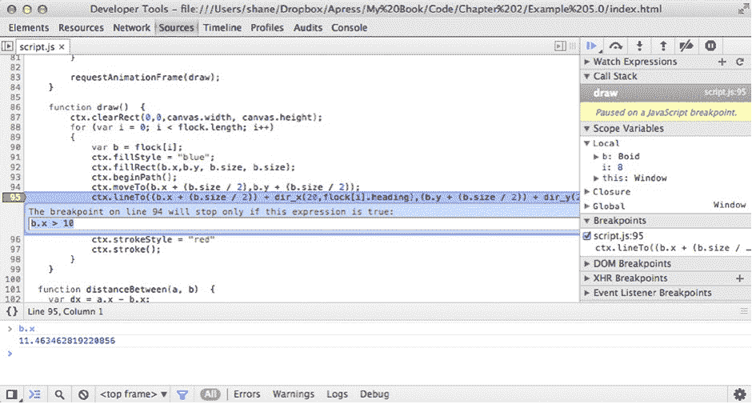

*图 1-1. 添加条件断点*

## 时间轴

到目前为止，我们已经讨论了调试器中允许你修复代码并确保其按预期工作的功能。然而，有时让代码工作只是容易的部分——让它变快往往要困难得多。我们仍在讨论调试器，但现在不是检查以确保代码的每个部分都在工作，而是需要记录整个过程，以便发现性能模式（查看代码的整体运行，而不是每个单独的函数/行）。这是一个足以填满整本书的主题，所以我将介绍基础知识，这应该能为你理解和提升性能提供一个良好的起点。

在 Chrome 中，我们用来测量代码性能的工具是时间轴。我应该注意，网络面板也是相关的，因为它让我们看到哪些资源造成了延迟。但我要关注的是代码的运行，而不是资源，因为对于常规网站来说，你更有可能有使用资源的经验，而对代码性能测试的经验较少（这对于更有创意的 Web 应用至关重要）。

要开始使用时间轴，你需要通过单击圆形按钮来记录代码的运行。一旦开始记录，你会注意到创建了一些图表。在撰写本文时，有三个方面被记录：Events、Frames 和 Memory；所有这些都是同时记录的，但只能通过选择它们来分别查看。在基本层面上，这些功能为你提供了一个测试代码各部分速度的好方法，因为它像堆栈一样分解代码，显示每个函数调用。这是发现瓶颈的相当简单的方法，但这只是时间轴功能的冰山一角。

它不仅能显示函数所花费的时间，还将其分为 loading、scripting、rendering 和 painting。这些对于了解函数为何耗时过长极为有用。loading 类别是进行任何 XHR (AJAX) 调用以及解析 HTML 的地方。函数内的逻辑包含在 scripting 类别中。rendering 是进行 DOM 操作的地方，主要是重新计算样式和布局。paint 是浏览器更新显示内容以匹配 rendering 结果的地方，包括对 canvas 和其他不直接相关 DOM 元素的更改。


## 第1章 引言

在第2章中，我们将使用canvas模拟鸟群（称为Boids），因此我录制了该过程，并使用时间线向你展示其工作原理。图1-2展示了事件时间线，它对于计时函数以及直观查看它们产生的调用栈非常有用。截图中只显示了两种不同的颜色。这是因为使用canvas时DOM元素非常少，因此不需要加载和渲染。缺乏DOM元素也是时间线中呈现这种模式的原因——如果我们记录的是常规网站的性能，我们可能会在滚动或悬停按钮时看到变化；因此，时间线的功能远不止于canvas动画！图1-3展示了帧时间线。它衡量页面的每秒帧数（FPS），因为低FPS会使网站或动画看起来“卡顿”，而不是人们期望的流畅体验。本节的第三张截图，图1-4，展示了内存时间线；你可以从峰值看出，内存存储的内容越来越多，直到垃圾回收器出现并清除存储旧数据的内存。你会注意到时间线下方有大量空白区域。这个区域用于显示DOM节点和事件处理器数量的图表（正如你在图1-5中所看到的，该图展示了一个我曾经制作的基础作品集网站的时间线）。

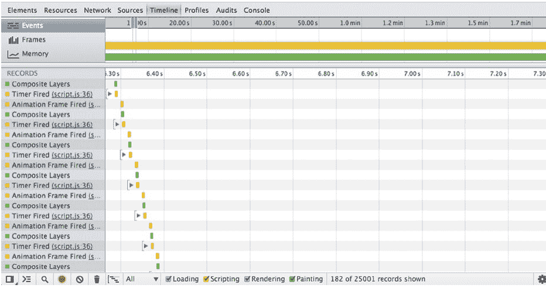

图1-2. 展示Chrome开发者工具的事件时间线

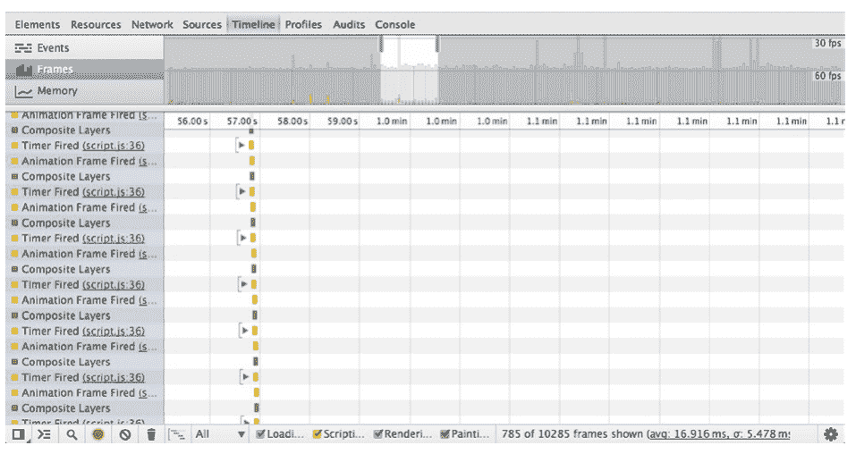

图1-3. 展示Chrome开发者工具的帧时间线

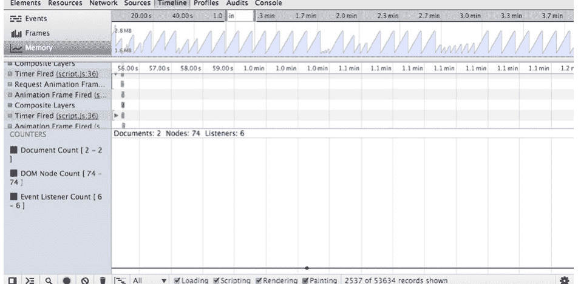

图1-4. 展示Chrome开发者工具的内存时间线

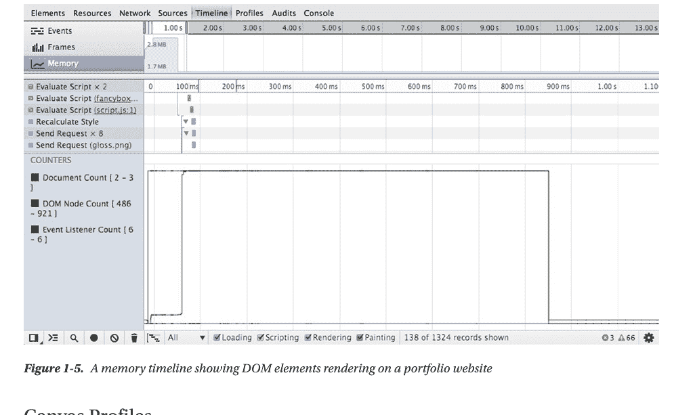

> **图1-5.** 展示作品集网站DOM元素渲染的内存时间线

### Canvas分析配置

时间线是一个极其强大的工具，但当调试canvas动画时，它常常让人感觉像在猜谜（因为大多数动画是通过脚本动态运行的，我们并不真正知道每个函数实际在做什么）。幸运的是，Chrome开发者工具中有一个全新的工具，可以让你捕获一个canvas帧（在撰写本文时，它仍仅在Chrome的Canary版本中可用）。你可以在“性能”（Profiles）标签页下找到它（你可能需要在开发者工具的设置中启用该实验性功能）。

捕获的帧配置文件与断点非常相似，区别在于它不是暂停代码，而是记录一个帧并允许你逐步执行每一次调用。这极其强大，因为它让你能够看到确切的执行顺序，并显示canvas在该特定步骤的状态，如图1-6所示。

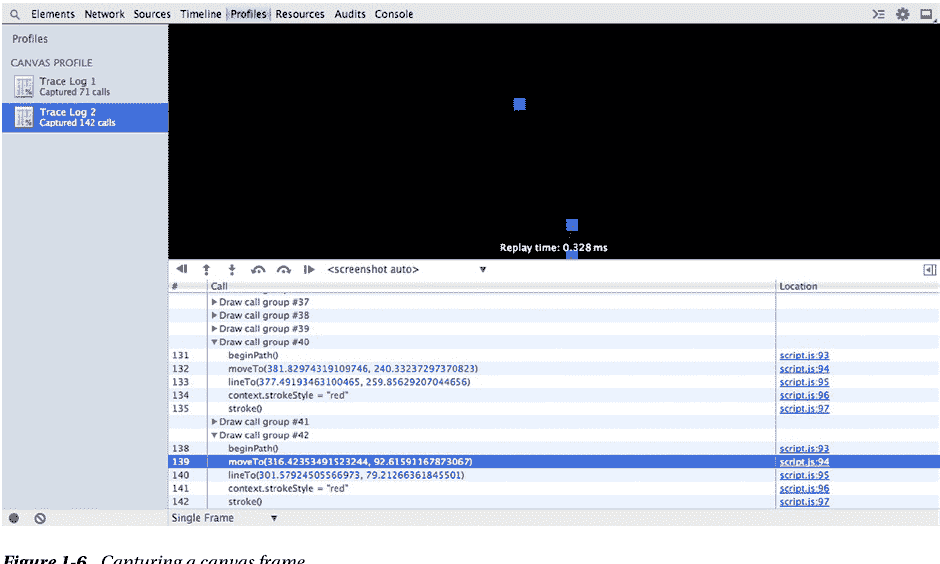

## 总结

希望这开篇章节能为你阅读本书其余部分做好准备。我坚信，仅仅通过阅读一本书是无法学会的，因此我采用了一种旨在引导你了解不同技术和学习每个主题的方法来写作，而不是写一本“操作指南”。因此，本章的调试部分在你阅读本书其余内容时应该对你非常有用，因为调试不仅仅是修复有问题的代码，更是探索代码实际工作原理以及如何改进它。

## 第2章

### Canvas与动画基础

在互动的世界里，一个简单的动画既可以是学习的绝佳入门，也对向用户传达信息非常有效。许多人认为网站上所有的互动功能都是游戏，但事实并非如此！我希望通过本章，你能对如何用一点不同的方式做事有所了解——如何用专业的动画从标准网站中脱颖而出。

如今，我们有很多方式可以添加动画，随着HTML和CSS技术日益强大，包括：变换（transforms）、canvas和SVG。本书将重点介绍canvas，因为它在整本书中被大量使用，不过你应该能够熟练使用这三种技术，并了解各自的优缺点。简而言之，你可以将canvas理解为光栅图形，SVG理解为矢量图形，而变换则用于操作DOM元素。

#### 什么是Canvas？

Canvas的命名非常贴切，因为它可以比作画家的画布，在你开始绘制之前它是空的。canvas本身与一个div没有区别——它是一个空的、非语义化的块级元素。然而，区别在于canvas有一个*上下文*，可以用来通过JavaScript进行绘图。这个上下文可以通过`var ctx = canvas.getContext('2d');`提取，其中canvas是包含canvas元素引用的变量。你可能已经注意到，我指定了一个2d上下文，getContext允许你在多个上下文之间选择。目前，2d上下文是最常见和最成熟的；但是，WebGL和其他技术可用于3d上下文。

由于canvas在旧版浏览器中不受支持，可以声明一个备选内容，以便显示其他内容——例如静态图像或flash动画。要添加备选内容，只需在canvas标签之间编写HTML即可。我建议你避免写“您的浏览器不支持Canvas”，因为网站的体验应该根据设备/浏览器的能力来量身定制，而不是批评用户的浏览习惯；不过，为了简单起见，我将在本书的许多练习中打破这一规则。

```
<canvas id="animation">
    
</canvas>
```

一旦你有了上下文，就可以开始绘图了。上下文的所有绘图功能都使用笛卡尔坐标系，该系统包含x轴和y轴。需要注意的是——与大多数基于计算机的图形一样——上下文使用的是右下象限，因此左上角是其原点(0,0)。

```
var ctx = canvas.getContext('2d');
//fillRect(x, y, width, height);
ctx.fillRect(10, 10, 50, 50);
```

前面的代码绘制了一个50px × 50px的矩形，距离左上角在每个轴上各10px。请注意，在canvas中，所有四边形状都称为矩形。默认情况下，该矩形是黑色的。由于绘制到上下文的过程是程序化的，因此我们需要在绘制对象之前更改颜色。更改颜色后，所有对象都将使用相同的颜色，直到再次更改为止。

```
// 这将填充颜色设置为红色
ctx.fillStyle = "#ff0000";

// fillRectangle(x, y, width, height);
ctx.fillRect(10, 10, 50, 50);
```

如图2-1所示，前面的代码只是用红色绘制了相同的矩形。


*图2-1. 一个简单的红色矩形*

现在，既然我们关注的是动画，那就让这个方块动起来吧！

#### RequestAnimationFrame

如果你曾经在JavaScript中需要执行重复性任务，比如轮询，那么你可能对`setInterval`和`setTimeout`有经验。这两个函数都不可靠，因为它们可能在超时后的任何时间触发，而不是精确地在超时时刻触发，这可能导致需要它们立即触发时出现问题（这对于平滑动画来说相当重要）。此外，许多浏览器具有约16ms的最小计时器分辨率，这可能导致意想不到的延迟。使用超时的另一个问题是你需要手动设置超时时间；因此，任何测试都将特定于该计算机。另一方面，`requestAnimationFrame`（rAF）可以用于在其运行的计算机的最佳时间触发。它不是固定的时间，而是每秒最多运行60帧，但在某些情况下（例如浏览器标签页在后台时）触发频率会降低。另一个可以使用的优化是第二个参数，它可以是一个DOM元素，用来约束rAF。

由于撰写本文时，一些浏览器对`requestAnimationFrame`的支持不足，建议使用一个垫片（shim），以便在支持其特定版本的浏览器中都能工作。我不会在代码示例中包含它，但在所有浏览器都正确支持该标准之前，你应该将其视为必需。

```
// RequestAnimationFrame的垫片
(function() {
  var requestAnimationFrame = window.requestAnimationFrame || window.mozRequestAnimationFrame ||
                              window.webkitRequestAnimationFrame || window.msRequestAnimationFrame;
  window.requestAnimationFrame = requestAnimationFrame;
})();
```


 ## 线性插值

我发现将代码分离开来很重要，所以尽管目前还不会使用任何特定的设计模式（因为代码量很小），但我鼓励你适当地组织代码。对于这一部分，我认为 logic() 和 draw() 是合适的函数名称。

```
// This is a way of selecting
var ele = document.querySelector("#animation");
var ctx = ele.getContext('2d');
var x = y = 10;
var width = height = 50;

function logic () {
    x += 10;
    if (x < ele.width - width) requestAnimationFrame(draw);
}

function draw() {
    ctx.clearRect(0, 0, ele.width, ele.height);

    // This sets the fill colour to red
    ctx.fillStyle = "#ff0000";

    // fillRectangle(x, y, width, height);
    ctx.fillRect(x, y, 50, 50);
}

requestAnimationFrame(draw);
setInterval(logic, 1000/60);
```

你会注意到我同时使用了 requestAnimationFrame 和 setInterval，这是因为动画很少需要全速运行（取决于计算机），所以这样可以在使用 requestAnimationFrame 提升渲染性能的同时，设定动画的速度。现在，我提到动画不一定要全速运行，但我还没有展示如何轻松改变这个速度——为此我们将使用**线性插值**。

线性插值（lerp）用于定义特定路径上的子坐标。这可以类比为长途旅行中途停下来吃饭。在动画中，它用于平滑路径，使其不会从一个点跳到另一个点，而是看起来在两者之间滑动（当然，实际上它只是进行了更小得多的跳跃）。

```
n = start + (end - start) * speed
```

上述代码公式用于计算插值的下一个点。这应该以迭代方式进行，使得每一帧的 start 变量都是上一帧的 n，因为它正在逐渐向终点移动（现在取决于设定的速度而非帧率）。

```
var ele = document.querySelector("#animation");
var ctx = ele.getContext('2d');
var startX = 10;
var startY = 10;
var endX = ele.width - 50;
var x = startX;
var y = startY;
var duration = 0;
var width = height = 50;

function lerp(start, end, speed) {
    return start + (end - start) * speed;
}

function logic () {
    duration += 0.02;
    x = lerp(startX, endX, duration);
    if (x < ele.width - width)
        requestAnimationFrame(draw);
}

function draw() {
    ctx.clearRect(0, 0, ele.width, ele.height);

    // This sets the fill colour to red
    ctx.fillStyle = "#ff0000";

    // fillRectangle(x, y, width, height);
    ctx.fillRect(x, y, 50, 50);
}
requestAnimationFrame(draw);
setInterval(logic, 1000/60);
```

这与之前的版本差别不大，只是我们现在有了一个与前面公式几乎相同的 lerp() 函数。我还定义了 duration、startX 和 startY 变量来传入函数。最大的变化是在 logic() 中。我没有直接调整 x（那样会导致跳跃），而是将 duration 增加了一个很小的量，然后直接将其传入 lerp() 函数来获得 x 的新值（它位于最终 x 目标的某个位置）。

#### 跟随鼠标

很多时候，你需要的是交互动画而不仅仅是视频。在 canvas 中增加交互性的常见方式是使用鼠标。首先，我将向你展示如何让你的小红方块跟随你的移动。

鼠标由操作系统处理，因此会触发一个所有程序都可以访问的事件，这意味着"鼠标"一词实际上指的是任何能够触发该事件的设备。对于这种情况，我们需要监听 'mousemove' 事件。为此，我们使用 addEventListener 将监听器添加到特定元素。

```
element.addEventListener(type, listener, useCapture boolean optional);
```

Type 是事件的名称（参见后面列出的鼠标相关事件列表）。Listener 可以通过两种方式实现，要么作为实现 EventListener 的对象，要么作为简单的回调函数。useCapture 是一个布尔值，如果事件应该在捕获阶段触发则为 true；否则它将在目标和冒泡阶段触发。useCapture 在现代浏览器中默认为 false，但某些旧版浏览器可能需要设置它。

- click
- dblclick
- mousedown
- mouseenter
- mouseleave
- mousemove
- mouseover
- mouseout
- mouseup

要让鼠标移动生效，你需要一个回调函数来根据鼠标位置设置新的起点和终点，如下所示：

```
ele.addEventListener('mousemove', function(evt) {
    startX = x;
    endX = evt.clientX;
});
```

这设置了方块的新路径，所以现在我们只需要稍微修改一下，使其平滑。我决定增加一些约束条件，确保方块不会试图离开画布，或者在鼠标设置的 x 值与方块正在前往的位置相同时出现闪烁。如果不满足这个约束，duration 就会被设置为 0。

```
function logic (evt) {
    var max = ele.width - width;
    duration += 0.02;
    var l = lerp(startX, endX, duration);
    if (l < max && l > 0 && endX != x)
    {
        x = l;
        requestAnimationFrame(draw);
    }
    else {
        duration = 0;
    }
}
```

这应该向你展示了几个微小的改变就能完全改变整个动画以及用户与它的交互方式。参见*清单 2-1*，了解所有部分是如何组合在一起的。

#### *清单 2-1.*

```
<!DOCTYPE html>
<html>
    <head>
        <title>Chapter 2 - Basics of Canvas</title>
    </head>
    <body>
        <canvas id="animation">
            <p>Fallback not supported.</p>
        </canvas>
        <script src="script.js"></script>
    </body>
</html>
```

## 第 2 章 CANVAS 与动画基础

```
// Polyfill for RequestAnimationFrame
(function() {
  var requestAnimationFrame = window.requestAnimationFrame || window.mozRequestAnimationFrame ||
                              window.webkitRequestAnimationFrame || window.msRequestAnimationFrame;
  window.requestAnimationFrame = requestAnimationFrame;
})();

var ele = document.querySelector("#animation");
var ctx = ele.getContext('2d');
var width = height = 50;
var startX = 10;
var startY = 10;
var endX;
var x = startX;
var y = startY;
var duration = 0;

function logic (evt) {
    var max = ele.width - width;
    duration += 0.02;
    var l = lerp(startX, endX, duration);
    if (l < max && l > 0 && endX != x)
    {
        x = l;
        requestAnimationFrame(draw);
    }
    else {
        duration = 0;
    }
}

function draw() {
    ctx.clearRect(0, 0, ele.width, ele.height);

    // This sets the fill colour to red
    ctx.fillStyle = "#ff0000";

    // fillRectangle(x, y, width, height);
    ctx.fillRect(x, y, 50, 50);
}

function lerp(start, end, speed) {
    return start + (end - start) * speed;
}

ele.addEventListener('mousemove', function(evt) {
    startX = x;
    endX = evt.clientX;
});

requestAnimationFrame(draw);
setInterval(logic, 1000/60);
```

### 弹跳的方块

现在我们已经了解了如何进行静态动画（从左到右移动）以及使用输入，我想再用方块做一个示例，为其添加一个动态元素。动画的工作方式有很多选择。最常见的是让物体在画布边界上反弹。这与前面的示例相比难度提升不大，但可以很好地与下一个示例衔接（那将是一个简易的**群体行为**实现）。

不是在当前位置和期望位置之间进行"插值"，要让方块反弹，我们需要让它朝特定方向移动直到碰到边缘。这意味着我们需要使用基本三角函数，以一个角度（初始为 360 度以内的随机角度）来求出位置。正如你从插值中了解到的，最好进行多次小步移动而非一大步，所以我们可以定义三角函数用来计算的距离。要求 x 方向，我们计算角度的余弦（弧度制）乘以距离；对于 y 方向，我们做同样的事但使用角度的正弦。

```
function degreesToRadians(degrees) {
    return degrees * (Math.PI / 180);
}

function dir_x(length, angle) {
    return length * Math.cos(degreesToRadians(angle));
}

function dir_y(length, angle) {
    return length * Math.sin(degreesToRadians(angle));
}
```

一旦实现了这些函数，就与前面的示例类似了。我们需要初始化 x 轴和 y 轴的距离以及方向（heading）变量。Distance 应以 0 开始，heading 需要是 360 度以内的随机角度。在 logic 中，最好先做简单检查，确保两个 heading 变量都在 −360 和 360 之间。然后我们需要检查物体是否在边界内，如果不在，就把它弹回。之后，我们只需在当前位置与通过上述角度和方向函数求得的位置之间进行插值即可。

```
var ele = document.querySelector("#animation");
ele.height = window.innerHeight;
ele.width = window.innerWidth;
var ctx = ele.getContext('2d');
var x = 10;
var y = 10;
var duration = 0;
var width = height = 50;
var heading_x = heading_y = Math.random() * 360;
var distance_x = distance_y = 0;

function logic () {
    if (heading_x > 360 || heading_x < -360) heading_x = 0;
    if (heading_y > 360 || heading_y < -360) heading_y = 0;

    if (x <= 0 || x >= ele.width - width) {
        heading_x = heading_x + 180;
    }
```

## 第 2 章 ■ 画布与动画基础

```
if (y <= 0 || y >= ele.height - height) {
    heading_y = -heading_y;
}

distance_x = dir_x(2, heading_x);
distance_y = dir_y(2, heading_y);
if (duration < 10) duration += 0.05;
x = lerp(x, x + distance_x, duration);
y = lerp(y, y + distance_y, duration);
requestAnimationFrame(draw);
```

以上就是这些。你可以在 Apress 网站的 [www.apress.com/9781430259442](http://www.apress.com/9781430259442) 或者我自己的网站 [www.shanehudson.net/javascript-creativity](http://www.shanehudson.net/javascript-creativity) 上的配套下载中找到所有示例的完整代码清单。

### “聪明的”动画

接下来我们要创建一个“聪明的”动画——也就是说，在弹跳盒子示例中发现的动态动画概念的基础上进行扩展，使对象能够感知周围环境。1986 年，Craig Reynolds 创建了一个令人难以置信的鸟类群飞模拟，他将其称为 Boids。它仅基于三条规则构建，这些规则让每个 boid（个体）能够负责自身的移动，同时也使其能够看到附近的邻居并向它们移动。我找到的对每条规则的最佳解释如下：

- **分离：** 转向以避免与附近的同伴过度拥挤
- **对齐：** 转向朝向附近同伴的平均航向
- **凝聚：** 转向朝向附近同伴的平均位置（质心）

我们的动画基于 Boids，不过为了简洁起见会做一些简化（我鼓励你修改我的代码以改进它——为此你可能需要使用向量）。我们将从通常的设置代码开始，getContext 等，以及创建一个 Boid 对象，用于保存关于 boid 位置、方向和大小的数据。完成之后，我们创建一个名为 setup() 的函数，它会（在每帧）随机的位置和方向将每个 boid（取决于我们设置的数量）添加到画布上。我做了一个简单的函数来包装 JavaScript 的 Math.random，只是为了让代码更整洁一些。

```
(function() {
    var canvas = document.querySelector("#flocking");
    var ctx = canvas.getContext('2d');

    canvas.height = window.innerHeight;
    canvas.width = window.innerWidth;
    var flock = [];

    var flockRadius = 250;
    var neighborRadius = 10;

    var Boid = function(x, y, heading, size) {
        this.x = x;
        this.y = y;
        this.heading = heading;
        this.size = size;
    };

    function setup() {
        for (var i = 0; i < 50; i++) {
            flock.push(new Boid(rand(canvas.width), rand(canvas.height), rand(360), 15));
        }
        setInterval(logic, 1000/60);
    }

    function logic () {
        for (var i = 0; i < flock.length; i++) {
            // Do something with each boid
        }
        requestAnimationFrame(draw);
    }

    function draw() {
        // Drawing goes here
    }

    function rand(max) {
        return Math.random() * max;
    }
    setup();
})();
```

你可能会注意到，对于方向我们没有使用“向上”或“向右”，而是使用了度数（0 到 360）。这使动画更加流畅，并且也允许我们稍后使用弧度数学。我们使用一个变量 flockRadius 来控制 boids 彼此能看到的距离（同样用于航向等等）。现在让我们向绘图方法添加一些代码。为此，我们首先需要每帧清除画布（如果你不这样做，你将只是在上一帧上继续绘制）。画布清除后，就可以绘制 boids 了！所以我们需要遍历 flock 数组，同时将当前 boid 存储在一个名为 b 的变量中，将每个 boid 绘制到画布上（即画布的上下文）中正确的位置。为了找到位置，我们使用 b.x 和 b.y，但我们需要再加上它大小的一半，因为该位置是 boid 的中心而不是其左上角。

```
function draw() {
    ctx.clearRect(0,0,canvas.width, canvas.height);
    for (var i = 0; i < flock.length; i++) {
        var b = flock[i];
        ctx.fillStyle = "blue";
        ctx.fillRect(b.x,b.y, b.size, b.size);
        ctx.beginPath();
        ctx.moveTo(b.x + (b.size / 2),b.y + (b.size / 2));
        ctx.lineTo((b.x + (b.size / 2)) + dir_x(20,flock[i].heading),(b.y + (b.size / 2)) + dir_y(20,flock[i].heading));
        ctx.strokeStyle = "red";
        ctx.stroke();
    }
}
```

在 lineTo 中，我使用了一些函数，这些函数用于在给定距离和方向的情况下获取位置。在这种情况下，我使用这些函数绘制一条指向每个 boid 航向方向 20 像素的线。在这里你可以看到这些辅助函数。它们使用基本的三角函数和勾股定理，因此应该相当容易理解。

```
function distanceBetween(a, b) {
  var dx = a.x - b.x;
  var dy = a.y - b.y;
  return Math.sqrt(dx * dx + dy * dy);
}

function angleBetween(x1, y1, x2, y2) {
  return Math.atan2(y1 - y2, x1 - x2) * (180.0 / Math.PI);
}

function angleDifference(a1, a2) {
  return ((((a1 - a2) % 360) + 540) % 360) - 180;
}

function degreesToRadians(degrees){
  return degrees * (Math.PI / 180);
}

function dir_x(length, angle){
  return length * Math.cos(degreesToRadians(angle));
}

function dir_y(length, angle){
  return length * Math.sin(degreesToRadians(angle));
}
```

不要被这些数学吓到——它只是让我们编写逻辑函数变得更加容易，我们现在就来编写！我们首先需要在 for 循环中设置一些变量，用于 boid 航向目标的位置。这被称为 centerx 和 centery，但它不是画布的中心（我将其视为“注意力中心”）。我还提供了一个变量 b，以便更轻松地访问 flock[i]。设置好这些变量后，我们现在可以再次循环遍历 boids 以查找邻居，即任何距离小于 flockRadius 的 boid。有了这些，我们可以找到平均位置（将每个 boid 的 x 和 y 加到 centerx 和 centery 上，然后除以该半径内 boid 的数量）。当然，如果 flock 中只有一个 boid，我们不妨给它一个随机位置作为目标。

```
for (var i = 0; i < flock.length; i++) {
  var centerx = 0;
  var centery = 0;
  var count = 0;

  var b = flock[i];

  for (var j = 0; j < flock.length; j++) {
    var distance = distanceBetween(b, flock[j]);
    if (distance < flockRadius) {
      centerx += flock[j].x;
      centery += flock[j].y;
      count++;
    }
  }

  if (count > 1) {
    centerx = centerx / count;
    centery = centery / count;
  } else {
    centerx = Math.random() * canvas.width;
    centery = Math.random() * canvas.height;
  }
  // Set heading and x/y positions
}
```

既然我们有了注意力中心/重心（我想重心是一个更好的词），我们就可以计算出 boid 需要转向以朝正确方向移动的角度。我们通过使用 angleBetween 和 angleDifference 辅助函数来获取所需的角度，然后对其进行线性插值，这样每次迭代都会更接近其目标点。当然，由于我们设置代码的方式，其目标点可能会根据它与邻居的接近程度而改变（请记住我们在嵌套循环中改变了中心点）。最后，为了让 boids 不会直接飞出页面，我们需要定义一个“环绕”效果，这样如果 boid 飞出画布，它就会出现在相对的一边（就像 Asteroids 或 Snake 那样）。

```
if (count > 1) {
    centerx = centerx / count;
    centery = centery / count;
} else {
    centerx = Math.random() * canvas.width;
    centery = Math.random() * canvas.height;
}

var angleToCenter = angleBetween(b.x,b.y,centerx,centery);
var lerpangle = angleDifference(b.heading, angleToCenter);

b.heading += lerpangle * 0.01;

headingx = dir_x(2,b.heading);
headingy = dir_y(2,b.heading);

b.x += headingx;
b.y += headingy;

if (b.x < 0) b.x = canvas.width;
if (b.y < 0) b.y = canvas.height;

if (b.x > canvas.width) b.x = 0;
if (b.y > canvas.height) b.y = 0;
```

如果你将上述代码放在之前代码注释的位置，你会发现现在你拥有了带有红线（表示方向）的蓝色 boids，它们在画布上飞行并组成群体。图 2-2 展示了它的样子。该动画可以通过多种方式进行改进，例如添加分离规则，这样它们会彼此相邻地飞行，而不是相互穿过。

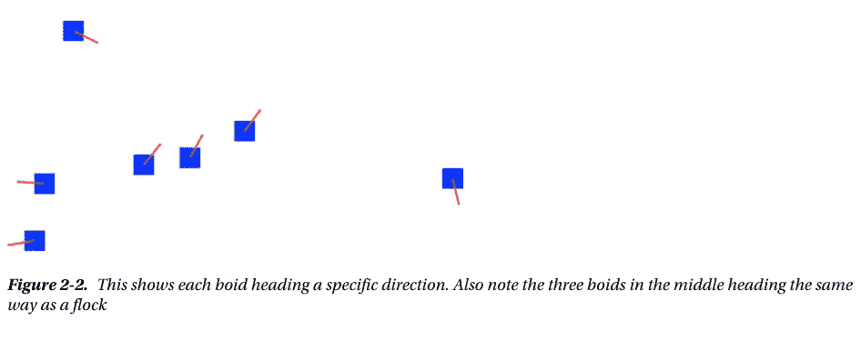

在代码清单 2-2 中，你可以看到此示例的完整代码，与前面的示例一样，可在线下载。

```
**Listing 2-2.**
(function() {
    var canvas = document.querySelector("#flocking");
    var ctx = canvas.getContext('2d');

    canvas.height = window.innerHeight;
    canvas.width = window.innerWidth;
    var flock = [];

    var flockRadius = 250;

    var Boid = function(x, y, heading, size) {
        this.x = x;
        this.y = y;
        this.heading = heading;
        this.size = size;
    };
```


```javascript
function setup() {
  for (var i = 0; i < 50; i++)
  {
    flock.push(new Boid(Math.random() * canvas.width, Math.random() * canvas.height, Math.random() * 360, 15));
  }
  setInterval(logic, 1000/60);
}

function logic () {

  for (var i = 0; i < flock.length; i++) {
    var centerx = 0;
    var centery = 0;
    var count = 0;

    var b = flock[i];

    for (var j = 0; j < flock.length; j++)
    {
      var distance = distanceBetween(b, flock[j]);
      if (distance < flockRadius)
      {
        centerx += flock[j].x;
        centery += flock[j].y;
        count++;
      }
    }

    if (count > 1) {
      centerx = centerx / count;
      centery = centery / count;
    }
    else  {
      centerx = Math.random() * canvas.width;
      centery = Math.random() * canvas.height;
    }

    var angleToCenter = angleBetween(b.x,b.y,centerx,centery);
    var lerpangle = angleDifference(b.heading, angleToCenter);

    b.heading += lerpangle * 0.01;

    headingx = dir_x(2,b.heading);
    headingy = dir_y(2,b.heading);

    b.x += headingx;
    b.y += headingy;

    if (b.x < 0) b.x = canvas.width;
    if (b.y < 0) b.y = canvas.height;
  }

  if (b.x > canvas.width) b.x = 0;
  if (b.y > canvas.height) b.y = 0;
}

requestAnimationFrame(draw);
}

function draw() {
  ctx.clearRect(0,0,canvas.width, canvas.height);
  for (var i = 0; i < flock.length; i++)
  {
    var b = flock[i];
    ctx.fillStyle = "blue";
    ctx.fillRect(b.x,b.y, b.size, b.size);
    ctx.beginPath();
    ctx.moveTo(b.x + (b.size / 2),b.y + (b.size / 2));
    ctx.lineTo((b.x + (b.size / 2)) + dir_x(20,flock[i].heading),(b.y + (b.size / 2)) + dir_y(20,flock[i].heading));
    ctx.strokeStyle = "red"
    ctx.stroke();
  }
}

function distanceBetween(a, b) {
  var dx = a.x - b.x;
  var dy = a.y - b.y;
  return Math.sqrt(dx * dx + dy * dy);
}

function angleBetween(x1, y1, x2, y2)
{
  return Math.atan2(y1 - y2, x1 - x2) * (180.0 / Math.PI);
}

function angleDifference(a1, a2)
{
  return ((((a1 - a2) % 360) + 540) % 360) - 180;
}

function degreesToRadians(degrees){
  return degrees * (Math.PI / 180);
}

function dir_x(length, angle){
  return length * Math.cos(degreesToRadians(angle));
}

function dir_y(length, angle){
  return length * Math.sin(degreesToRadians(angle));
}

setup();

})();
```

#### 介绍拖放功能

你经常会希望将拖放功能作为动画的一部分，或者作为应用程序的核心功能。这可能是为了在页面上拖动元素以触发事件，也可能是将文件从系统拖入浏览器。我将通过一个相当高级的应用程序来介绍拖放功能——它类似于一本涂色书，你可以将图像拖到画布上，生成用户可以填色的线条画。这两个例子都是很好的示范，展示了如何使用现代 HTML 创建令人印象深刻的界面，同时也证明了这些技术不仅仅适用于游戏开发！

如前所述，我将通过创建一个简易的涂色书 Web 应用来演示将本地文件拖入浏览器的技术——将图像拖到画布上后，会将其转换成可以填色的线条画。我之所以制作这样的应用，一方面是为了让大家思考一些更高级的技术，例如边缘检测；但更重要的是，我希望你拥有可以亲自操作、随心所欲扩展功能的工具——学习的唯一途径就是实践。因此，在这个小型项目以及整本书中，我都会提供思路并提及算法，供你思考和实现。

对于我们的涂色书，需要从一个全尺寸的画布开始。这通过 JavaScript 来实现，因为通过 CSS 设置 100% 的宽度和高度只会缩放画布，而不会增加画布的尺寸。我们还需要为 `'dragover'`、`'dragenter'` 和 `'drop'` 事件设置事件监听器。对于前两个事件，我们需要阻止浏览器的默认行为，所以我创建了一个简单的 `preventDefault` 函数，它在事件上调用同名方法。在**清单 2-3** 中，你可以看到设置画布以实现拖放功能的基础代码。

**清单 2-3.**

```html
<!DOCTYPE html>
<html>
    <head>
        <title>Coloring Book</title>
    </head>

    <body style="margin:0">
        <canvas id="drop"></canvas>
    </body>
    <script>

(function() {
    var drop = document.querySelector("#drop");
    var ctx = drop.getContext('2d');

    /* These are to set the canvas to full width */
    drop.height = window.innerHeight;
    drop.width = window.innerWidth;

    drop.addEventListener('dragover', preventDefault);
    drop.addEventListener('dragenter', preventDefault);
    drop.addEventListener('drop', handleDrop);

    function preventDefault(e) {
        if (e.preventDefault) {
            e.preventDefault();
        }
        return false;
    }

    function handleDrop(e) {
        e.stopPropagation();
        e.preventDefault();
        e.dataTransfer.dropEffect = "copy";
        // Code for drop will go here
    }

})();
    </script>
</html>
```

正如你在**清单 2-3** 中看到的，这提供了一个良好的起点，但现在我们需要将图像实际放入画布。我们需要使用的所有数据都存储在 `e` 中，即 `handleDrop` 的事件变量，因此我们可以使用 `e.dataTransfer.files[0]` 将文件本身移入它自己的变量中——我将其命名为 `'file'`，这为我们提供了拖放的第一个文件（因为在本示例中我们只使用一个）。当然，你可以扩展此功能，让每个拖放的文件都在单独的画布中打开，就像 Photoshop 那样。

由于实现方式的原因，要将图像绘制到画布，必须首先将其放入 HTML 元素中；这听起来有些奇怪，但一旦了解后就会发现很容易操作，而且幸运的是该元素不需要添加到 DOM 中。我们还需要一个 `FileReader` 来完成两件事：首先将文件转换为 base64 数据 URL，其次在文件加载完成后将该数据 URL 添加到图像元素的 `src` 属性中。

```javascript
var file = e.dataTransfer.files[0];
var image = new Image();

var reader = new FileReader();
reader.readAsDataURL(file);

reader.onload = (function() {
    return function(e)  {
        image.src = e.target.result;
    };
})();
```

现在图像已经存在并存在于 `image.src` 中，但我们还无法看到它，因为它既未添加到 DOM，也未绘制到画布。是时候解决这个问题了！就像 `reader` 拥有 `onload` 事件处理属性一样，`image` 也有。因此我们只需编写一个函数，将图像绘制到**画布的上下文**中画布左上角的位置（即 (0,0)）。代码如下所示：

```javascript
function handleDrop(e) {
  e.stopPropagation();
  e.preventDefault();
  e.dataTransfer.dropEffect = "copy";

  var file = e.dataTransfer.files[0];
  var image = new Image();

  var reader = new FileReader();
  reader.readAsDataURL(file);

  reader.onload = (function() {
    return function(e) {
      image.src = e.target.result;
    };
  })();

  image.onload = function() {
    ctx.drawImage(image, 0, 0);
  };
}
```

现在如果你将这段代码复制到模块中，你应该能够将图像拖放到页面上，并让它们显示在画布中！

接下来，我们将编写一个基于 Sobel 算子的"朴素"边缘检测滤镜，该滤镜的实现基于 HTML 规范中像素处理的一个示例（我们的版本将颜色简化为黑白线条）。还有一个更高级的版本使用 Sobel 算子，称为 Canny 边缘检测（由 John F. Canny 于 1986 年开发）。这是一个你可能想要自己添加的功能，因为它包括降噪，因此可以生成更高质量的线条画。

让我们首先创建一个名为 `findEdges` 的新函数，它接收一个名为 `originalData` 的参数，该参数应保存上下文的图像数据；即画布上当前显示内容的上下文状态的副本（在本例中，即我们的图像）。在函数内部，我们应该创建一个变量，称之为 `output`，用于保存临时的图像数据，我们将向其中写入每个像素，然后再将其放回上下文。现在，还有另一件你需要记住的奇怪事情：要向图像数据写入像素，你需要两个变量，一个用于 `'ImageData'`（我们的 `output` 变量），另一个用于 `'ImageData.data'`（我们称之为 `outputData`），这听起来很傻，但两者是紧密耦合的，所以你写入 `outputData`，然后将 `output`（自动包含正确的数据）放到画布上下文上。在我们进入边缘检测算法之前，我将向你展示所有这些设置代码。

```javascript
function findEdges(originalData) {
    var output = ctx.createImageData(drop.width, drop.height);

    var w = originalData.width, h = originalData.height;
    var inputData = originalData.data;
    var outputData = output.data;
    var threshold = 100;

    // edge detection goes here

    // put the image data back after manipulation
    ctx.putImageData(output, 0, 0);
}
```

要编写算法，你首先需要了解数据结构，它是一个 `Uint8ClampedArray`。尽管这个名字听起来很可怕，但它只是一个由 8 位无符号（仅正值）整数组成的数组（或者说我更喜欢称之为——字节大小的元素！），其组织方式非常简单，遵循"红、绿、蓝、透明度"的模式并不断重复，因此每个像素由四个数组元素组成。

要计算像素的位置 (i)，我们需要两个循环，一个用于图像的高度 (y)，另一个用于宽度 (x)。然后我们可以通过计算 y 乘以画布宽度来得到每个像素的第一种颜色（红色），因为数组是按行存储的，然后加上 x 以找到该行中的位置。当然，由于构成像素的颜色数量（包括透明度），这个结果还需要乘以 4。


## 第2章 ■ Canvas与动画基础

```
for (var y = 0; y < h; y += 1) {
  for (var x = 0; x < w; x += 1) {
    var i = (y * w + x) * 4;
  }
}
```

现在我们已经计算出了每个像素的位置，接下来需要计算加权平均值。具体做法是将所有相邻像素（包括水平、垂直和对角方向）的颜色值相加，然后减去当前颜色值的8倍，因为共有8个相邻像素。完成计算后，我们将该像素的所有颜色值（包括alpha通道）根据其与阈值的比较结果设为255或0。我早前将阈值设定为100，但你可以随意调整这个数字以获得最佳效果。之后，我们只需将输出结果（即ImageData）放到canvas的上下文中即可。

```
image.onload = function() {
  ctx.drawImage(image, 0, 0);
  var originalData = ctx.getImageData(0, 0, drop.width, drop.height);
  findEdges(originalData);
};
function findEdges(originalData) {
  var output = ctx.createImageData(drop.width, drop.height);

  var w = originalData.width, h = originalData.height;
  var inputData = originalData.data;
  var outputData = output.data;
  var threshold = 100;

  // 边缘检测
  for (var y = 0; y < h; y += 1) {
    for (var x = 0; x < w; x += 1) {
      var i = (y * w + x) * 4;
      outputData[i] = inputData[i - w*4 - 4]  +   inputData[i - w*4]  + inputData[i - w*4 + 4] +
                      inputData[i - 4]          - 8 * inputData[i]          + inputData[i + 4] +
      inputData[i + w*4 - 4] + inputData[i + w*4] + inputData[i + w*4 + 4];
      if (outputData[i] < threshold)
      {
        outputData[i] = 255;
        outputData[i+1] = 255;
        outputData[i+2] = 255;
      }
      else
      {
        outputData[i] = 0;
        outputData[i+1] = 0;
        outputData[i+2] = 0;
      }
      outputData[i + 3] = 255; // alpha通道
    }
  }
  // 处理完成后将图像数据放回原处
  ctx.putImageData(output, 0, 0);
}
```

现在当你将图片拖到canvas上时，应该会看到一个大致的轮廓。如果你愿意接受挑战，可以尝试提高轮廓的质量。正如我之前提到的，实现Canny算法可能是最好的选择，但也有一些更简单的改进方法。如果你有任何尝试改进算法的成果，请务必通过推文或邮件与我分享！

### 制作画笔

我们的下一个任务是制作一个画笔——一个圆形的画笔，而不是那种包含所有刷毛细节的现代Photoshop风格画笔。

和之前一样，我们需要确定哪些事件需要被触发。我认为应该使用`mousedown`来触发绘制，`mouseup`来停止绘制，而`mousemove`则在鼠标按下时进行绘制。我们可以使用一个名为'`drawing`'的布尔值来检查状态。在`mousedown`中，我们需要调用一个函数，我将其命名为`startPath`，用于开始路径；这需要单独处理，以免每次鼠标移动时都不断尝试开始新路径。在`startPath`中，我们需要使用`ctx.beginPath()`开始路径，然后将画笔移动到鼠标当前位置。在canvas中，实际上大多数其他计算机图形库也是如此，`moveTo`用于在不绘制的情况下移动画笔，而`lineTo`用于从当前位置绘制到新位置。我还在`startPath`中设置了画笔的大小和颜色。

```
drop.addEventListener('mousedown', startPath);
drop.addEventListener('mouseup', function() {
  drawing = false;
});
drop.addEventListener('mousemove', handleDrawing);

function startPath(e) {
  ctx.strokeStyle = "#0000ff";
  ctx.lineWidth = lineWidth;
  ctx.beginPath();
  ctx.moveTo(e.clientX + lineWidth, e.clientY + lineWidth);
  drawing = true;
}
```

从代码中可以看到，`mousemove`触发了一个名为`handleDrawing`的函数。该函数使用我之前提到的`lineTo`来绘制路径，并调用`stroke`来应用`startPath`中指定的大小和颜色。

```
function handleDrawing(e) {
  if (drawing == true)
  {
    ctx.lineTo(e.clientX + lineWidth, e.clientY + lineWidth);
    ctx.stroke();
  }
}
```

我们最后的任务是让这张图片可以下载。为此，我们在链接的`href`中使用`toDataURL`。为了让链接可以直接下载，我们可以使用`download`属性，这是一些现代浏览器中的新功能。在其他浏览器中，用户需要右键点击并手动保存图片。如果你愿意，可以在替代文本中添加相关说明以便使用。

```
var save = document.querySelector("#save");
save.addEventListener('click', saveCanvas);
```

## 第2章 ■ Canvas与动画基础

```
function saveCanvas() {
  var img = drop.toDataURL("image/png");
  save.href = img;
  save.download = "colouringBook.png";
}
```

```
<a id="save" class="button">Save</a>
```

你可以在下面的列表2-4中查看这个完整的示例。

#### *列表 2-4.*

```
<!DOCTYPE html>
<html>
  <head>
    <title>Coloring Book</title>
    <style>
      body {
        margin: 0;
        padding: 0;
      }
      #drop {
        display: block;
        position: absolute;
        right: 0;
        top: 0;
        z-index: 0;
      }
      .button {
        background-color: rgba(0,0,0,0.6);
        color: #fff;
        display: inline-block;
        font-family: sans-serif;
        font-size: 24px;
        font-weight: bold;
        margin: 10px 0 0 10px;
        padding: 5px;
        position: relative;
        text-transform: uppercase;
        z-index: 1;
      }
    </style>
  </head>
  <body>
    <a id="save" class="button">Save</a>
    <canvas id="drop"></canvas>
    <script src="script.js"></script>
  </body>
</html>
```

```
var colouringBook = (function() {
  var drop = document.querySelector("#drop");
  var save = document.querySelector("#save");
  var ctx = drop.getContext('2d');
  var drawing;
  var lineWidth = 5;

  /* 这些用于将canvas设置为全宽 */
  drop.height = window.innerHeight;
  drop.width = window.innerWidth;

  drop.addEventListener('dragover', preventDefault);
  drop.addEventListener('dragenter', preventDefault);
  drop.addEventListener('drop', handleDrop);

  drop.addEventListener('mousedown', startPath);
  drop.addEventListener('mouseup', function() {
    drawing = false;
  });
  drop.addEventListener('mousemove', handleDrawing);

  save.addEventListener('click', saveCanvas);

  function preventDefault(e) {
    if (e.preventDefault) {
      e.preventDefault();
    }
    return false;
  }

  function handleDrop(e) {
    e.stopPropagation();
    e.preventDefault();
    e.dataTransfer.dropEffect = "copy";

    var file = e.dataTransfer.files[0];
    var image = new Image();

    var reader = new FileReader();
    reader.readAsDataURL(file);

    reader.onload = (function() {
      return function(e) {
        image.src = e.target.result;
      };
    })();

    image.onload = function() {
      ctx.drawImage(image, 0, 0);
      var originalData = ctx.getImageData(0, 0, drop.width, drop.height);
      findEdges(originalData);
    };
  }
```

```
function findEdges(originalData) {
  var output = ctx.createImageData(drop.width, drop.height);

  var w = originalData.width, h = originalData.height;
  var inputData = originalData.data;
  var outputData = output.data;
  var threshold = 100;

  // 边缘检测
  for (var y = 0; y < h; y += 1) {
    for (var x = 0; x < w; x += 1) {
      var i = (y * w + x) * 4;

      outputData[i] = inputData[i - w*4 - 4] +   inputData[i - w*4] + inputData[i - w*4 + 4] +
        inputData[i - 4]      -    8*inputData[i]    + inputData[i + 4] +
        inputData[i + w*4 - 4] +   inputData[i + w*4] + inputData[i + w*4 + 4];

      if (outputData[i] < threshold)
      {
        outputData[i] = 255;
        outputData[i+1] = 255;
        outputData[i+2] = 255;
      }
      else
      {
        outputData[i] = 0;
        outputData[i+1] = 0;
        outputData[i+2] = 0;
      }
      outputData[i + 3] = 255; // alpha通道
    }
  }

  // 处理完成后将图像数据放回原处
  ctx.putImageData(output, 0, 0);
}

function startPath(e) {
  ctx.strokeStyle = "#0000ff";
  ctx.lineWidth   = lineWidth;
  ctx.beginPath();
  ctx.moveTo(e.clientX + lineWidth, e.clientY + lineWidth);
  drawing = true;
}

function handleDrawing(e) {
  if (drawing == true)
  {
    ctx.lineTo(e.clientX + lineWidth, e.clientY + lineWidth);
    ctx.stroke();
  }
}
```


 ```javascript
function saveCanvas() {
    var img = drop.toDataURL("image/png");
    save.href = img;
    save.download = "colouringBook.png";
  }

})();
```

**注意** 你可以在 Apress 网站 [www.apress.com/9781430259442](http://www.apress.com/9781430259442) 或我的个人网站 [www.shanehudson.net/javascript-creativity/](http://www.shanehudson.net/javascript-creativity/) 找到本书配套下载资源中的完整源代码。

现在你已拥有如图 2-3 所示的涂色书。

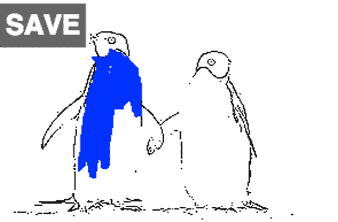

***图 2-3.*** 此图展示了一张企鹅照片，已被转换为线条画，并使用 canvas 进行了上色

### 小结

现在你应该对动画背后的部分数学原理（如线性插值）感到自信了。你也应该已经理解了 `requestAnimationFrame` 以及动画框架的一般搭建方式。我加入了一些拖放功能，因为我发现纯"画几条线"之类的绘图示例很无聊。希望这能让内容更丰富一些，并且对你有所帮助。涂色书示例和 boids 都有巨大的改进空间（以及优化空间），我鼓励你去探索。

在本章结束之际，我想让你思考一下动画，以及你可以用 canvas 和动画做些什么。我们生活在一个充满数据的世界里。噪音。无论是统计数据还是推文，都很难看出什么是重要的，什么不是。网页不必是线性的。以 Twitter 时间线为例……现在想象那些推文以 boids 的形式呈现，它们或许按作者或主题分组，或者按标签的热度分组。动画并非适用于所有场景，但它们既可以作为装饰，也可以非常实用。我很期待看到你能创造出什么！

## 第 3 章

### 音频和视频基础

如果我们谈论交互性，就会想要使用音频和视频。多年来，我们不得不使用 Flash 或 Silverlight 等" hack" 来为网页添加这些关键元素，但现在音频和视频已经直接内置于 HTML 中了。在本章中，我们将详细介绍这两个元素（即 &lt;audio&gt; 和 &lt;video&gt;），让你能够毫不犹豫地使用它们。我还会向你介绍一些新技术，如操控技术，我们还会涉及优化技术。在后续章节中，我们将深入探索音频创建，并在此过程中创建一个媒体播放器。本章将为你提供所需的基础知识。

#### 容器和编解码器

在使用音频和视频时，我们将面对各种浏览器实现和支持。每种格式都有其优缺点，有些经过良好优化，有些是免费许可的。因此，在深入实现细节之前，了解一些容器和编解码器、它们的局限性以及是否获得许可，是很有必要的。

##### 容器

容器是一种文件格式，用作一系列编解码器的包装格式。你可以将容器视为保存已经用编解码器编码的音频的文件，同时包含使用了哪种编解码器的信息。许多编解码器被多种容器所支持。

##### WebM

WebM 是一种由 Google 赞助的音视频容器。它是免版税的，由基于 Matroska 的容器中的 VP8 视频和 Vorbis 音频流组成。它在 BSD 许可下发布，所有用户都获得全球性的、非独家的、 royalty-free 的专利许可。

##### MP4

运动图像专家组（MPEG）标准化了许多容器和编解码器。他们可能最出名的是 MP3 音频编解码器，但 MP4 是最常用的视频格式之一。MP4 通常使用 H.264 作为视频编解码器，AAC 或 MP3 作为音频编解码器。MP4 格式受专利限制，这引发了浏览器之间关于非免版税格式是否适合用于网络的讨论。

##### QuickTime 文件格式

Safari 使用 QuickTime 播放浏览器原生不支持的格式，如 QuickTime 文件格式（称为 Mov）。MP4 基于 Mov 规范，因此支持与 MP4 相同的编解码器，但支持度较低，因为 MP4 是标准化的，而 Mov 不是。

##### AVI

微软于 1992 年发布了音频视频交错（AVI）；它是至今仍广泛使用的最古老的容器格式之一（与 Mov 并列）。由于 AVI 年代久远，与 MP4 和 Ogg 等更现代的容器相比存在诸多缺点。一些缺点包括缺乏元数据和压缩。由于这些缺点，AVI 不用于网页原生播放，但可与 Flash 视频播放器一起使用。

##### ASF

高级系统格式（ASF）是微软专门为流媒体创建的容器。ASF 通常包含 Windows Media Video（WMV）或 Windows Media Audio（WMA）。该规范是免费（如免费啤酒）提供的，但受专利限制。

##### Ogg

Ogg 是由 Xiph.Org 基金会维护的开源容器格式，在 BSD 许可下发布。该格式因其开放性而备受赞誉，但截至撰写本文时，Internet Explorer、Safari 和许多移动浏览器不支持它。尽管如此，通常建议将 Ogg 与其他格式一起使用。Ogg 支持许多编解码器，但通常与 Vorbis 音频编解码器和 Theora 视频编解码器一起使用。

##### Matroska

另一个完全开放的容器格式是 Matroska。它是一种通用格式，试图支持所有编解码器（在可能的情况下）。WebM 是 Matroska 的子集。这样，媒体播放器（包括浏览器）就可以说它们支持 WebM，而无需支持 Matroska 支持的每种编解码器。

##### WAV

波形音频文件格式（以其文件扩展名 WAV 而闻名）是由微软和 IBM 开发的容器。它是免专利的，且无损。通常，WAV 用作未压缩格式，但它可以与无损脉冲编码调制（LPCM）一起用于压缩。

#### 编解码器

编解码器用于编码数据，获取原始数据流（信号）并进行处理。大多数编解码器尝试压缩原始数据，有些是纯有损的（意味着压缩会损失质量），有些则是完全无损的。正是由编解码器创建的编码数据被保存在容器格式中。

##### MP3

这可能是最知名的音频格式，因此可能是一个很好的入门编解码器。MP3 被称为有损格式，而非无损格式，这意味着声音从原始录音压缩时会损失质量。然而，它经过良好优化，由于带宽使用率低，可以是网页音频的好选择。MP3 最大的缺点是它受专利保护，这意味着许多人（尤其是 Mozilla，他们曾拒绝支持该格式，直到 Firefox 21 才改变）反对该格式，转而选择使用免费可用的格式。

##### Vorbis

Vorbis 是最流行的开源、免专利、受许多浏览器支持的音频编解码器。它通常被称为 Ogg Vorbis，尽管 Ogg 是 Vorbis 经常使用的容器，而非该格式的名称。Vorbis 还有许多其他容器，但通常使用的容器是 Ogg、QuickTime MOV 或 WebM。

##### AAC

高级音频编码（AAC）特别有趣，因为它经常与 H.264 互补提供音频，并且是 3GP（常用于移动设备）容器中使用的主要音频编解码器（AMR 除外）。AAC 在大多数浏览器中得到支持（由于许可协议，Opera、OSX 上的 Firefox 以及某些 Linux 发行版除外）。

##### AC-3

AC-3 是由杜比实验室创建的音频编解码器，通常称为杜比数字。它在网页上很少使用，但在高清电影中广泛使用。

##### H.264

H.264 是由视频编码专家组（VCEG）和运动图像专家组开发的视频编解码器。该ACA用于蓝光光盘，在网页上也非常受欢迎，因为浏览器支持良好（由于许可问题，除 Opera 外的所有浏览器在可能的情况下都支持 H.264）。思科发布了 H.264 的开放实现，试图解决许可问题。

##### VP8

这是用于 WebM 中视频的编解码器。它归 Google 所有，但他们做出了不可撤销的专利承诺，允许任何人实现 VP8。

##### Theora

基于 VP3（VP8 的前身），Theora 是由 Xiph.Org 基金会维护的开放、有损视频编解码器。它通常与 Ogg 容器格式一起在网页上使用。


## 编码视频

现在，你可能想知道如何对视频进行编码。遗憾的是，浏览器无法自动完成此操作，因此你需要使用转换器。目前有许多转换器可用，但最受欢迎的似乎是 Handbrake 和 Miro。我个人使用 Miro，因为它设计精良、简单易用且开源。你可以在 `www.mirovideoconverter.com` 找到 Miro。

## 浏览器兼容性

在撰写本文时，Firefox 尚未添加对 MP3 的支持，Internet Explorer 和 Safari 均不支持 OGG 或 WebM。移动端的支持更是不足。

与 `<audio>` 类似，我们可以使用相当多的编解码器和容器格式。Chrome 和 Firefox 都已承诺支持 WebM，尽管 Internet Explorer 和 Safari 并不支持。一些旧版本的浏览器可能支持 `<audio>` 但不支持 WebM，因此也值得同时使用 OGG 和 MP4。我之前提到过，Vorbis 通常被称为 OGG Vorbis；对于视频，我们使用 OGG 容器格式，搭配 Vorbis 用于音频，Theora 用于视频。基于前面描述的专利原因，OGG 和 WebM 都比 MP4 更受青睐。要查看浏览器支持的当前状况，请查看 `www.docs.webplatform.org/wiki/html/elements/audio`。

## 使用 <audio> 和 <video> 元素

既然我们已经了解了容器格式、编解码器以及可能遇到的文件类型，接下来可以看看如何在网页中实现这些内容。

> **注意** 本章使用的音频来自 `www.incompetech.com/music/royalty-free`，视频来自 `www.bigbuckbunny.com`。

## <audio>

让我们从音频元素开始，这是我们在现代浏览器中用来播放声音的工具。这种声音可以是任何内容，从播客到音乐。在开始之前，我需要强调一点——请谨慎使用。不要在用户加载网站时突然播放声音。当 Flash 能做到这一点时我们就很讨厌它，现在依然如此。最基本的音频元素可以像 `img` 元素一样接受一个 `src` 属性：

```
<audio src="audio.mp3" >
```

只需将其添加到你的 HTML 文档中即可。这样做的问题在于，我们无法提供一系列文件，因为需要根据浏览器兼容性提供不同的音频编解码器。为解决此问题，我们在 `<audio>` 内部嵌套使用 `<source>` 元素。该元素允许你提供不同的文件，并让浏览器自动选择最佳方案。它像常规元素一样接受 `src` 属性，以及 `type` 属性。在 type 属性中，我们提供 MIME 类型（如你所料），这需要将容器作为主类型，并在分号后包含编解码器信息。如果认为有必要针对旧版浏览器，你还可以在 source 元素旁边提供 Flash 备选方案。以下是一个示例，音频文件可在上方链接的 Incompetech 网站以及本书的下载包中找到：

```
<audio>
   <source src='audio.ogg' type='audio/ogg; codecs=vorbis'>
   <source src='audio.mp3' type='audio/mpeg'>
</audio>
```

由于浏览器有算法来选择源，因此源的顺序和数量都不是问题。目前大多数人只使用 Vorbis 和 MP3，但随着时间的推移，这种情况可能会改变。WebM 容器格式很可能比 Ogg 容器格式更受欢迎，因为许多浏览器厂商都在大力推广它作为为网络打造的开放视频格式。同样值得注意的是，WebM 正与一种名为 WebP 的图像格式同步开发。

## <video>

视频元素 (`<video>`) 的实现方式与 `<audio>` 类似。与 `<audio>` 一样，你可以只指定一个视频文件，也可以使用 `<source>` 指定多个：

```
<video>
    <source src='../video.ogv' type='video/ogg;'>
    <source src='../video.mp4' type='video/mp4'>
    <source src='../video.webm' type='video/webm'>
</video>
```

同样地，与音频一样，浏览器会根据浏览器和操作系统的功能，通过算法来选择源。拥有多个源，无论顺序如何，都不是问题。示例中的三种格式——Ogg、MP4 和 WebM——在撰写本文时得到了最好的支持。

## 属性与特性

现在，我们知道了如何在 HTML 文档中实现音频和视频，接下来让我们看看这些元素可用的属性和特性。音频和视频元素之间存在大量重叠，大多数属性对两者都适用，因此我将一并解释，而不是分章节介绍。

## 控件

好的，现在我们的页面上有了音频——但我们还可以做得更多。目前浏览器可以选择一个文件来播放，但我们没有办法告诉它开始播放。当我们想用 JavaScript 控制音频或视频时，其当前状态很有用，但理想情况下它应该有一个媒体播放器。大多数浏览器都有一个内置播放器，只需通过向元素添加 `controls` 属性即可触发。如下所示：

```
<audio controls>
    <source src='audio.ogg' type='audio/ogg; codecs=vorbis'>
    <source src='audio.mp3' type='audio/mpeg'>
</audio>
```

同样地，对于视频，我们将使用以下代码：

```
<video controls>
    <source src='../video.ogv' type='video/ogg;'>
    <source src='../video.mp4' type='video/mp4'>
    <source src='../video.webm' type='video/webm'>
</video>
```

如果你在浏览器中运行此代码，现在应该能看到一个基本的音频（或视频）播放器。如果你想提供一个自定义播放器以适应你网站的风格，那么最好创建 DOM 元素，按照你的意愿设置样式，然后将其连接到一个未启用 `controls` 属性的 `<audio>`/`<video>` 元素。

> **注意** 一些浏览器使用 Shadow DOM，因此理论上你可以用 CSS 样式化默认控件，但截至撰写本文时，每个浏览器的实现差异很大，而且 Shadow DOM 仍然较新。我建议查看 www.caniuse.com 以了解当前各浏览器的实现状态。

## 自动播放

偶尔，你可能有正当理由希望音频或视频自动播放。虽然这通常不受欢迎，但实现起来很简单。与 `controls` 一样，你只需向元素添加 `autoplay` 属性。你也可以通过 JavaScript 设置此属性，使用 `element.autoplay = true`，如下所示：

```
<audio autoplay>
    <source src='audio.ogg' type='audio/ogg; codecs=vorbis'>
    <source src='audio.mp3' type='audio/mpeg'>
</audio>
```

对于视频，其工作方式基本相同：

```
<video autoplay>
    <source src='../video.ogv' type='video/ogg;'>
    <source src='../video.mp4' type='video/mp4'>
    <source src='../video.webm' type='video/webm'>
</video>
```

## 预加载

这比前两个属性稍显复杂，`preload` 用于在页面加载时尝试加载整个音频或视频文件或仅加载元数据（如时长）；这基于该属性的值。如果未设置 `preload`，则由浏览器决定（默认值通常是 `metadata`）。也就是说，即使设置了该属性，它也只是一个提示，被用作浏览器基于多个条件（这些条件在不同浏览器间有所变化）进行考虑的首选项。

`preload` 有三个可接受的值：

- **auto**：这将优先级交给浏览器，如果这样做合适的话。例如，如果网络连接良好，它可能会尝试下载整个文件。当 `preload` 设置为 `auto` 时，`readyState` 变量将从 0（未下载任何内容）递增到 4（可以无中断播放），一个完全预加载的文件的 `readyState` 将是 4。
- **metadata**：这是最常用的值，因为它是一种“折中方案”。它基本上让浏览器知道，了解文件信息（例如时长）会很好，但在用户点击播放之前不需要整个文件。当 `preload` 设置为 `metadata` 时，一旦元数据下载完成，`readyState` 将设置为 1（已具有元数据），并可能根据获取的积极程度移动到 2 或 3。
- **none**：这通过告诉浏览器在用户点击播放之前不需要任何信息来减轻服务器的压力。当然，正如我之前所说，这只是一个提示，因此浏览器可能仍然决定提供元数据或整个文件。


该属性的作用与其他示例中的 `preload` 一样，适用于 audio：

```
<audio preload='metadata'>
   <source src='audio.ogg' type='audio/ogg; codecs=vorbis'>
   <source src='audio.mp3' type='audio/mpeg'>
</audio>
```

以及 video：

```
<video preload='metadata'>
   <source src='../video.ogv' type='video/ogg;'>
   <source src='../video.mp4' type='video/mp4'>
   <source src='../video.webm' type='video/webm'>
</video>
```

> **注意**  该属性在大多数浏览器中都得到了良好的支持，但基于 Presto 的 Opera 浏览器除外，它使用的是旧的名称 `autobuffer`。

## 循环播放（Loop）

这是一个强制音频或视频文件在播放完成后回到开头重新播放的属性。这可以设置为属性（直接写在 HTML 中）或属性（通过 JavaScript）。将 `loop` 作为属性使用，可以检查其当前状态（`true` 或 `false`）。

```
<audio loop>
   <source src='audio.ogg' type='audio/ogg; codecs=vorbis'>
   <source src='audio.mp3' type='audio/mpeg'>
</audio>
```

你也可以对 video 做同样的事情：

```
<video loop>
   <source src='../video.ogv' type='video/ogg;'>
   <source src='../video.mp4' type='video/mp4'>
   <source src='../video.webm' type='video/webm'>
</video>
```

## 已播放部分（Played）

你通常希望知道媒体的哪些部分已经播放过，特别是在创建媒体播放器或某种广告时。`played` 是一个可以与 JavaScript 一起使用的属性，用于获取一个 `TimeRanges` 对象，该对象包含轨道中每个已播放部分的开始和结束时间。例如，如果我听了开头大约 20 秒，那么调用 `ele.played.start(0)` 会返回 0，因为它是开头，而 `ele.played.end(0)` 会返回 20；参数是索引，所以 0 表示第一个被听过的部分，1 表示第二个。你可以使用 `ele.played.length` 来找出已经听过多少个独立的部分。

```
var ele = document.querySelector('audio');
function log() {
  for (var i = 0; i < ele.played.length; i++)
  {
      console.log("Portion " + i);
      console.log("  Start: " + ele.played.start(i));
      console.log("  End: " + ele.played.end(i));
  }
}
```

要改为与视频一起工作，你只需要选择 `video` 而不是 `audio`：

```
var ele = document.querySelector('video');
```

在这个例子中，如果你从控制台运行 `log()`，那么你将看到音频或视频的每个已播放部分及其开始和结束时间（以秒为单位）。除了纯粹的演示目的或调试之外，`played` 属性在媒体播放器中非常有用，让用户可以看到他们已经听过的部分。

## 已缓冲部分（Buffered）

与 `played` 类似，我们能够获取文件已缓冲部分的 `TimeRanges` 对象。在制作媒体播放器时（我们将在后面的章节中这样做），了解文件的缓冲部分很有帮助，在这种场景下，我们可以不使用 `controls` 属性，而是创建一个自定义控件来显示音频文件的已缓冲区域。与 `played` 不同，`buffered` 可能有多个索引，例如用户移动了播放头时。

```
var ele = document.querySelector('audio');
// 或者：var ele = document.querySelector('video');

function log() {
   for (var i = 0; i < ele.buffered.length; i++)
   {
      console.log("Portion " + i);
      console.log("  Start: " + ele.buffered.start(i));
      console.log("  End: " + ele.buffered.end(i));
   }
}
```

## 时长（Duration）

要找出音频或视频文件的长度，我们可以使用 `duration` 属性，它返回以秒为单位的时长。如果音频或视频元素正在流式传输文件，那么时长将被设置为 `infinity`（具体来说，根据规范，是正的无穷大），除非流式传输停止。在这种情况下，时长将返回为已流式传输内容长度的秒数。如果时长发生变化，例如在流式传输的情况下，那么会触发 `durationchange` 事件，你可以使用事件监听器来触发样式或 DOM 更改，让用户知道文件已停止流式传输。

```
var ele = document.querySelector('audio');
// 或者：var ele = document.querySelector('video');
console.log(ele.duration);
```

## 音量（Volume）

`volume` 属性可用于获取和设置音量；它使用 0.0 到 1.0 之间的数字来控制。默认情况下，初始音量将为 1.0，这是浏览器允许的最大值（不一定是扬声器的最大值）。音量是一个简单的 setter/getter 属性，使得获取和修改变得容易：

```
var ele = document.querySelector('audio');
// 或者：var ele = document.querySelector('video');

var vol = 0.5; // 你想要设置的音量

console.log(ele.volume);

ele.volume = vol;

console.log(ele.volume);
```

## 播放速率（Playback Rate）

`playbackRate` 是音频/视频播放的速度。原始速度为 1.0，该速率是初始速度的乘数。例如，如果你将 `playbackRate` 改为 0.5，那么你会得到慢动作播放的音频或视频。另一方面，如果将速率改为 1.5，音频或视频将会快进。

```
var ele = document.querySelector('audio');
// 或者：var ele = document.querySelector('video');

function slowMotion() {
    ele.playbackRate = 0.5;
}

function fastForward() {
    ele.playbackRate = 1.5;
}
```

## 网络状态（Network State）

此属性用于确定网络活动。它返回 0 到 3 的 4 个数字，对应以下状态：

- 0. NETWORK_EMPTY – 这意味着元素尚未初始化。
- 1. NETWORK_IDLE – 这意味着已选择正确的音频/视频文件，但当前未使用网络。
- 2. NETWORK_LOADING – 音频/视频正在下载中。
- 3. NETWORK_NO_SOURCE - 给定的文件都不兼容，或者未提供任何文件。

与之前的许多属性不同，`networkState` 是一个只读属性。以下代码展示了如何使用它：

```
var ele = document.querySelector('audio');
// 或者：var ele = document.querySelector('video');

function logNetworkState()  {
    console.log(ele.networkState);
}
```

## Web Audio API

让我们继续深入音频分析的领域，我们将在后面的章节中使用它来创建音频的可视化效果。为此，我们将使用 Web Audio API。

该 API 基于节点的概念，每个节点获取当前音频（可以是原始版本，也可以已经经过任意数量的节点），然后对其进行某种处理。我说"某种"是有意含糊其辞的，节点可以以你想要的任何方式编码。一些默认的用法包括：声道分离与合并、振荡和增益控制。我特别喜欢的一个类比是 Stuart Memo 在他的"Web Audio API 简介"一文中解释的：API 节点的工作方式与在吉他上添加失真效果器和音箱完全一样，你可以移除任意节点或添加新节点，而无需做其他事情，只需更改连接线即可。现在，我们只需要使用 `AnalyserNode` 来看看音频内部到底发生了什么。从那里开始，我们将使用其他节点来了解发生了什么变化。

## 分析音频

首先，我们需要同时创建一个音频上下文和一个分析器，然后将它们连接在一起。上下文是一个接口，它提供对音频所有属性的访问，以及用于创建和连接节点的方法。

```
var ele = document.querySelector('audio');
var ctx = new AudioContext();
var analyser = ctx.createAnalyser();

var source = ctx.createMediaElementSource(ele);
source.connect(analyser);
analyser.connect(ctx.destination);
```

你会注意到，我在一个 `source` 变量中使用了 `createMediaElementSource`。这只是将 `<audio>` 元素中的音频重新路由到 API 中。这意味着你通过该元素播放的音频现在将由 API 的上下文图（节点连接方式）控制并作为其节点使用。这也意味着 Web Audio API 而非该元素正在控制音量和其他属性（除了控制音乐何时播放），所以如果你仍想使用元素控件，你需要使用 `GainNode` 进行连接，如下所示：

```
var ele = document.querySelector('audio');
var ctx = new AudioContext();
var analyser = ctx.createAnalyser();
```


 ```
var source = ctx.createMediaElementSource(ele);
var volumeControl = ctx.createGainNode();
source.connect(volumeControl);
volumeControl.connect(analyser);
analyser.connect(ctx.destination);

ele.addEventListener('onvolumechange', volumeChange, false);

function volumeChange()  {
    volumeControl.gain.value = ele.volume;
}

function log()  {
    freqData = new Uint8Array(analyser.frequencyBinCount);
    analyser.getByteFrequencyData(freqData);
    console.log(freqData);
}
```

> **注意** 在撰写本文时，onvolumechange 事件无法作为动态事件监听器正常工作，因此你需要在 <audio> 元素上包含 onvolumechange="volumeChange();"。

现在回到分析器。这个节点让我们能够访问来自快速傅里叶变换（FFT）的数据，FFT 是一种复杂的算法，可用于多种用途，包括音频分析。有两种类型的数据可用：频率和时域。频率数据可以通过 `getFloatFrequencyData` 或 `getByteFrequencyData` 获得（取决于你想要的数据类型，我们将使用第二种将数据存储在字节数组中），这两种方法都返回一个归一化频率的数组。之所以有两种方法，是因为浮点数组的分辨率（即质量）远高于字节数组。由于它是归一化的，我们需要遍历数组的每个索引，并将其乘以采样率除以 FFT 的大小。为了看到结果，让我们将其输出到控制台：

```
function log()  {
    freqData = new Uint8Array(analyser.frequencyBinCount);
    analyser.getByteFrequencyData(freqData);
    for (var i = 0; i < freqData.length; i++) {
        console.log(freqData[i] * ctx.sampleRate / analyser.fftSize);
    }
}
```

你现在应该会看到一系列数字，这些数字取决于你正在播放的音频。每个数字代表频率（440Hz 是最容易记住的频率，这是中央 C 上方的 A），我们将在后面的章节中更详细地介绍（在那里我会介绍一些音乐理论）。目前，只需查看这些数据，并思考你能用它做什么（甚至尝试去实现它们）。当然，一系列看似随机的数字对任何人都没用，可视化是理解任何类型数据的关键，因此我们现在将使用前一章学到的知识来创建可视化音乐的二维图表。

## 频率可视化

我们可以花整本书的时间来制作有趣的游戏或看起来很棒但不太有用的随机动画；相反，让我们看看当我们将 Web Audio API 和 canvas 结合使用时，可以制作什么样的工具。这个例子将是频率可视化，下一个将是频谱图。首先，让我们使用 `getByteFrequencyData` 的原始输出来生成一个简单的条形图风格的可视化，展示归一化频率（由于 255 的上限，这很容易绘制）。为此，我们需要设置变量来引用音频和 canvas 元素，以及各自的上下文和一个分析器节点。我还建议你像我们之前那样设置音量控制，这样你可以看到可视化如何随音量变化（同时也为了方便你能轻松调低音量），我觉得这很有趣。对于节点，我们需要将源连接到音量，然后连接到分析器，最后输出到扬声器（destination）。

```
var audioEle = document.querySelector('audio');
var audioCtx = new AudioContext();
var canvasEle = document.querySelector('canvas');
var canvasCtx = canvasEle.getContext('2d');

var analyser = audioCtx.createAnalyser();

var source = audioCtx.createMediaElementSource(audioEle);
var volumeControl = audioCtx.createGainNode();

source.connect(volumeControl);
volumeControl.connect(analyser);
analyser.connect(audioCtx.destination);
```

现在我们需要添加逻辑函数和绘制函数， alongside 我们之前使用的 `volumeChange` 函数。在逻辑函数中，我们只需获取频率数据并将其发送到绘制函数，由绘制函数将其绘制到 canvas 上。我认为用细线来可视化看起来不错，但你可以通过修改 x 位置来改变这一点（我选择 `i`，即当前频率，意味着它们都紧挨在一起）和宽度（我保持为 1 以保持细长）。当然，你需要记得调用逻辑函数，我对此使用了 `setInterval`。

```
function volumeChange() {
    volumeControl.gain.value = audioEle.volume;
}

function logic() {
    var freqData = new Uint8Array(analyser.frequencyBinCount);
    analyser.getByteFrequencyData(freqData);
    requestAnimationFrame(function() {
        draw(freqData);
    });
}

function draw(freqData) {
    canvasCtx.clearRect(0, 0, canvasEle.width, canvasEle.height);
    canvasCtx.fillStyle = "#ff0000";
    for (var i = 0; i < freqData.length; i++) {
        canvasCtx.fillRect(i, canvasEle.height, 1, canvasEle.height - freqData[i]);
    }
}

setInterval(logic, 1000/60);
```

图 3-1 显示了音频播放时频率可视化的结果。

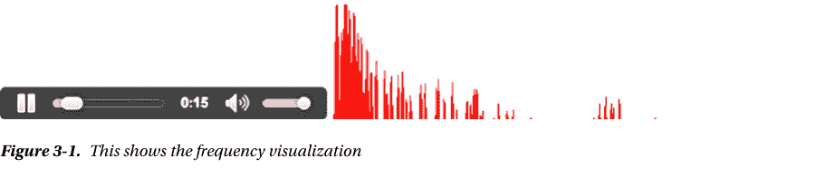

> 注意 你可能会看到一片红色；这可能是由于音量被静音了。调高音量以获得正确的可视化效果。

这一切都应该很容易理解，因为我们已经介绍过这些概念，比如音频处理节点和 canvas 绘制。你可以在清单 3-1 以及本书附带的文件中找到代码。

**清单 3-1.** 频率可视化的代码

```
<!DOCTYPE html>
<html>
    <head>
        <title>Chapter 3 - Frequency Visualisation</title>
    </head>

    <body>
        <audio controls onvolumechange="volumeChange();">
                <source src='../audio.ogg' type='audio/ogg; codecs=vorbis'>
                <source src='../audio.mp3' type='audio/mpeg'>
        </audio>
        <canvas>Canvas is not supported by your browser</canvas>
        <script src="script.js"></script>
    </body>
</html>

// Pollyfill for AudioContext
(function() {
    window.AudioContext = window.AudioContext || window.webkitAudioContext;
    var requestAnimationFrame = window.requestAnimationFrame || window.mozRequestAnimationFrame ||
                                window.webkitRequestAnimationFrame || window.msRequestAnimationFrame;
    window.requestAnimationFrame = requestAnimationFrame;
})();

var audioEle = document.querySelector('audio');
var audioCtx = new AudioContext();
var canvasEle = document.querySelector('canvas');
var canvasCtx = canvasEle.getContext('2d');
```

## 第 3 章 音频和视频基础

```
var analyser = audioCtx.createAnalyser();

var source = audioCtx.createMediaElementSource(audioEle);
var volumeControl = audioCtx.createGainNode();

source.connect(volumeControl);
volumeControl.connect(analyser);
analyser.connect(audioCtx.destination);

//audioEle.addEventListener('onvolumechange', volumeControl, false);

function volumeChange() {
    volumeControl.gain.value = audioEle.volume;
}

function logic() {
    var freqData = new Uint8Array(analyser.frequencyBinCount);
    analyser.getByteFrequencyData(freqData);
    requestAnimationFrame(function() {
        draw(freqData);
    });
}

function draw(freqData) {
    canvasCtx.clearRect(0, 0, canvasEle.width, canvasEle.height);
    canvasCtx.fillStyle = "#ff0000";
    for (var i = 0; i < freqData.length; i++) {
        canvasCtx.fillRect(i, canvasEle.height, 1, canvasEle.height - freqData[i]);
    }
}

setInterval(logic, 1000/60);
```

### 频谱图

通过前面的可视化，你可以轻松看到频率以及音频的变化方式，但只能在任何给定时刻看到。现在我们将使用频谱图，它展示了音频如何随时间变化，其中 x 轴是时间，y 轴是音频的一部分，颜色代表频率。这可用于多种用途，从简单的漂亮图案到语音识别。因为频谱图与之前的可视化类似，只是增加了时间这个维度，我们不妨从现有代码开始。我现在想介绍的一个事件是 `onaudioprocess`。该事件是 JavaScriptNode 的一部分，使用以下代码创建：

```
var logger = audioCtx.createJavaScriptNode(analyser.frequencyBinCount, 1, 1);
```

`onaudioprocess` 事件以与音频播放相同的速度工作，使其成为 `setInterval` 在音频逻辑中的完美替代品（同样地，我们使用 `requestAnimationFrame` 以更准确和动态的速度进行动画渲染）。我们还要创建一个名为 `x` 的变量来保存当前的时间位置，这样我们就知道要绘制多少迭代，直到到达当前位置。

```
var logger = audioCtx.createJavaScriptNode(analyser.frequencyBinCount, 1, 1);
logger.onaudioprocess = function () {
    logic();
}
```

```
var x = 0;

function logic() {
    if(!audioEle.paused) {
        x += 1;
        var freqData = new Uint8Array(analyser.frequencyBinCount);
        analyser.getByteFrequencyData(freqData);
        requestAnimationFrame(function() {
            draw(freqData);
        });
    }
}
```

这是相关代码，你可以看到它与之前的代码非常相似，只是它使用了 `onaudioprocess` 并检查了元素是否未暂停。这两项都是你可以对我们之前的代码做出的改进；我只是不想一次性把所有内容都塞进去。现在我们只需要绘制可视化效果了！但从哪里开始呢？很简单——我们先试着弄清楚我们在做什么。在这种情况下，我们想要绘制独立的列，其中每个像素代表频率（归一化后）作为颜色。为此我们将使用 **HSL** 而非 **RGB**，因为它允许我们将色调设置为 0 到 255 之间的数字（这正是我们从 `getByteFrequencyData` 获得的数据），而不需要逐个指定每种颜色。一旦它在 canvas 上绘制完每一列，我会将其清除并从开头继续，就像翻到新的一页；你可以通过滑动而非清除来改进这一点。

```
function draw(freqData) {
    if (x > canvasEle.width) {
        canvasCtx.clearRect(0, 0, canvasEle.width, canvasEle.height);
        x = 0;
    }

    for (var i = 0; i < freqData.length; i++) {
        canvasCtx.fillStyle = "hsl(" + freqData[i] + ",100%, 50%)";
        canvasCtx.fillRect(x, canvasEle.height - i, 1, 1);
    }
}
```

你现在应该能够理解如何利用频率数据生成各种可视化效果，而且它们也不必仅仅是纯粹装饰性的。图 3-2 展示了播放一些音频后的频谱图效果。一如既往，完整代码可以在本书附带的下载资源中找到。

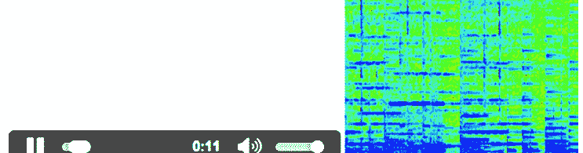

> **注意** 与前面的示例一样，你可能会看到一堵红色的墙；这可能是由于音量被静音了。调高音量以获得正确的可视化效果。

列表 3-2 展示了频谱图所需的完整代码，也可以在本书的下载资源中找到。

*列表 3-2.* 频谱图的代码

```
<!DOCTYPE html>
<html>
    <head>
        <title>Chapter 3 - Spectrogram</title>
    </head>
    <body>
        <audio controls onvolumechange="volumeChange();">
            <source src='../audio.ogg' type='audio/ogg; codecs=vorbis'>
            <source src='../audio.mp3' type='audio/mpeg'>
        </audio>
        <canvas>Canvas is not supported by your browser</canvas>
        <script src="script.js"></script>
    </body>
</html>

// Pollyfill for AudioContext
(function() {
    window.AudioContext = window.AudioContext || window.webkitAudioContext || window.mozAudioContext;
    var requestAnimationFrame = window.requestAnimationFrame || window.mozRequestAnimationFrame ||
                                window.webkitRequestAnimationFrame || window.msRequestAnimationFrame;
    window.requestAnimationFrame = requestAnimationFrame;
})();

var audioEle = document.querySelector('audio');
var audioCtx = new AudioContext();
var canvasEle = document.querySelector('canvas');
var canvasCtx = canvasEle.getContext('2d');

var analyser = audioCtx.createAnalyser();
analyser.smoothingTimeConstant = 0;

var logger = audioCtx.createJavaScriptNode(analyser.frequencyBinCount, 1, 1);

var source = audioCtx.createMediaElementSource(audioEle);
var volumeControl = audioCtx.createGainNode();

source.connect(volumeControl);
volumeControl.connect(analyser);
analyser.connect(audioCtx.destination);
logger.connect(audioCtx.destination);

//audioEle.addEventListener('onvolumechange', volumeControl, false);

logger.onaudioprocess = function () {
    logic();
}

function volumeChange() {
    volumeControl.gain.value = audioEle.volume;
}

var x = 0;

function logic() {
    if(!audioEle.paused) {
        x += 1;
        var freqData = new Uint8Array(analyser.frequencyBinCount);
        analyser.getByteFrequencyData(freqData);
        requestAnimationFrame(function() {
            draw(freqData);
        });
    }
}

function draw(freqData) {
    if (x > canvasEle.width) {
        canvasCtx.clearRect(0, 0, canvasEle.width, canvasEle.height);
        x = 0;
    }

    for (var i = 0; i < freqData.length; i++) {
        canvasCtx.fillStyle = "hsl(" + freqData[i] + ",100%, 50%)";
        canvasCtx.fillRect(x, canvasEle.height - i, 1, 1);
    }
}
```

### Web Audio API 节点

我们已经使用了一些 Web Audio API 节点，例如 MediaElementSource、GainNode 和 Analyser。以下是其他可用节点和方法的概览。

| 节点名称 | 描述 |
| --- | --- |
| AnalyserNode | 获取有关音频当前状态的数据，例如频率。 |
| AudioBufferSourceNode | 缓冲短音频资源，用作临但易于访问的存储。 |
| BiquadFilterNode | 处理基本滤波器（称为低阶滤波器），例如低通/高通，其中频率在低于或高于给定值时被截止。 |
| ChannelSplitterNode | 将每个声道拆分，以便你可以在进程图中单独使用它们以实现更精细的控制。 |
| ChannelMergerNode | 使用此合并节点合并任何已拆分（或需要合并）的声道。 |
| ConvolverNode | 应用线性卷积效果，这是声音可以被处理以模拟声学空间或高质量效果的方式。 |
| DelayNode | 将输出（传递到进程图中的下一个节点）延迟特定的时间量。 |
| GainNode | 通过将音频乘以增益属性来改变音频音量。 |
| MediaElementAudioSourceNode | 允许你将媒体元素连接到 Web Audio API。 |
| PannerNode | 在 3D 空间中特化声音。这通常在游戏中大量使用，但在其他地方也可能有用。 |
| WaveShaperNode | 用于非线性失真。 |

### 视频处理

遗憾的是，没有像 Web Audio API 那样用于视频的 API，因此你需要自行处理视频。当然，以与分析音频相同的方式分析视频要比使用 Web Audio API 困难得多。然而，创建基本滤镜并不是特别困难。我将介绍一个简单的反色滤镜，这样我们就不会陷入数学细节中。我们不会在本章中超越简单滤镜，因为第 9 章和第 10 章将通过在实时视频上使用物体检测作为输入来扩展本章内容，以控制我们将在第 5 章中创建的键盘。

反色的原理是我们遍历每个像素并将其反色，通过将当前颜色值从 255 中减去。此输出被绘制到 canvas 上并显示。在这个例子中，我将把 canvas 显示在视频元素旁边，但你可能更希望完全隐藏视频元素。

> **注意** 由于跨域资源共享策略，你可能需要在服务器（或 localhost）上运行此代码。

我们像往常一样，先设置元素和上下文的变量。完成后，我们就可以开始处理视频源的操纵函数。首先，你需要将视频的当前帧绘制到 canvas 上。

```
var canvasEle = document.querySelector('canvas');
var canvasCtx = canvasEle.getContext('2d');

var videoEle = document.querySelector('video');
var w = videoEle.clientWidth;
var h = videoEle.clientHeight;

canvasEle.width = w;
canvasEle.height = h;
```

然后我们需要获取图像数据并对其进行迭代，对于每个像素（记住，每个像素由 4 个独立的 RGBA 值组成），我们通过将当前值从 255 中减去来翻转它们，正如我之前解释的。完成后，我们可以将图像数据放回，然后使用 `requestAnimationFrame` 再次调用 draw 函数。

```
drawInvertedFrame();

function drawInvertedFrame() {
    canvasCtx.drawImage(videoEle, 0, 0, w, h);
    var manip = canvasCtx.getImageData(0, 0, w, h);
    var data = manip.data;

    // Iterate through each pixel, inverting it
    for (var i = 0; i < data.length; i += 4) {
        var r = data[i],
            g = data[i+1],
            b = data[i+2];
        data[i] = 255 - r;
        data[i+1] = 255 - g;
        data[i+2] = 255 - b;
    }

    canvasCtx.putImageData(manip, 0, 0);

    requestAnimationFrame(drawInvertedFrame);
}
```

下图（图 3-3）展示了反色视频与原始视频并排实时渲染的效果。

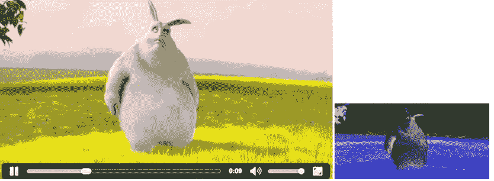

一如既往，此代码的完整列表可在本书附带的可下载文件中找到。


# 摘要

本章带你探索了网络上的音频和视频。你现在应该对不同编解码器有了扎实的理解，包括各自的优缺点。我也尝试深入讲解了 Web Audio API。希望通过与上一章的可视化内容相结合，而不是仅仅给你大量数字，能让你更好地理解并发现它的实用性。

我鼓励你多做 Web Audio API 的实验，也尝试一下视频处理——你可以创造出很多非常有趣的效果，可能会在一般的网页设计和开发中派上用场（尤其是作为视觉辅助和精美的细节）。除了简单的网站，还有很多空间可以做成更具网络应用性质的东西，比如我们即将创建的媒体播放器。

# 第4章 3D 入门

在开始创建媒体播放器之前，我想用一章的篇幅来讲解 3D，从基础形状到可视化。在接下来的章节中，我们将创建音乐可视化作为媒体播放器的一部分，但你需要对各种 3D 用途都感到得心应手，尤其是数据可视化。首先，让我们概览一下 3D 图形，然后再来使用一个叫 Three.js 的库。很多基础知识你应该都很熟悉，但我想从头开始，确保讲解得足够全面。

## 3D 基础

如你所知，3D 世界（就像我们自己的世界）由三个维度组成：x、y 和 z。这些维度可以简单地通过想象一个标准笛卡尔坐标系来可视化，其中有一个指向右边的轴代表 x，另一个向上的代表 y，第三个表示深度，即 z 轴。我说 z 代表深度，是因为感觉上是这样，但实际上正 z 是朝向你的，而负 z 是远离你的。你可以在图 4-1 中看到这个示例。

*图4-1. 3D 坐标轴*

在 3D 世界中，物体和形状使用网格来创建。一个*网格*可以是任意复杂的，从简单的立方体到用 3D 建模软件设计的物体（我们不会深入到那一步，但我会解释如何导入模型）。要给网格赋予外观，可以使用材质，这类似于现实世界，每种材质都有自己的一组属性，比如颜色和不透明度。我们会在本章稍后学习如何定义自己的材质。

除了网格和材质，我们还有相机和灯光。在 2D 动画中我们经常移动形状，而在 3D 动画中我们可以选择移动相机（即用户能看到的部分）来环绕场景。我提到了灯光，它们的作用显而易见，但不同照明类型的数量之多可能会让你惊讶。灯光和相机各自在本章都有专门的部分。仅仅通过改变灯光的类型或位置，就能彻底改变场景的氛围，这一点相当令人印象深刻。

## Three.js

Three.js 是一个让在浏览器中渲染 3D 变得更加容易的库。它允许你使用多种渲染器，包括 canvas 和 WebGL。我通常会建议避免使用库，但如果不用库来使用 WebGL，你需要用 GLSL 语言编写着色器（由于依赖 GPU，使用 WebGL 必须这样做），这种语言的语法类似于 C。学习 GLSL 对于本书的目标来说有些小题大做，而且会花上不止一章的时间！我将使用 Three.js 的第 56 版本，它也包含在可下载的源代码中，但你可以在 http://www.mrdoob.github.com/three.js/ 找到最新版本。

## 创建场景

你可以把场景想象成电影中的场景——这是你放置网格（物体）、灯光和相机的地方。场景就是你的舞台。设置场景非常简单，因为你只需要场景本身、相机和渲染器。当然，那样会是一个空场景！可以使用 `THREE.Scene()` 创建简单的场景对象，所以我们来创建一个基础的（空）场景吧。之后我们可以开始添加基础几何体，比如立方体或球体。

我们可以先创建宽度和高度的变量来存储渲染器的大小（即我们的视口），所以在这个例子中，我将每个变量设置为使用窗口的内部尺寸。我们还需要一个容器来放置渲染器，与前几章我们自己创建 canvas 不同，我们可以让 Three.js 来创建 DOM，这取决于我们选择的渲染器。现在我们需要选择渲染器，Three.js 的架构允许你创建自己的渲染器或使用第三方的渲染器，但你真正需要了解的只有 `CanvasRenderer` 和 `WebGLRenderer`。两者的区别在于 canvas 支持更广泛，但 WebGL 更高效。这是因为 WebGL 原生支持 3D（OpenGL ES 2），其中 3D 运算在 GPU 上运行，而 Canvas 没有 3D 支持（你必须自己编写），意味着它的 3D 运算在 JavaScript 中运行（慢得多）。所以我们现在先使用 WebGLRenderer，不过你也可以两个都试试来感受它们的区别（通常只是细微的差别）。选择渲染器后，我将其存储在一个名为 renderer 的变量中，我们可以设置尺寸并将其添加到 DOM 中。

```
var width = window.innerWidth,
    height = window.innerHeight;

var container = document.querySelector('#container');

var renderer = new THREE.WebGLRenderer();
renderer.setSize(width, height);
container.appendChild(renderer.domElement);
```

接下来我们需要创建相机。我会在本章稍后讲解如何使用多个相机，但先从一个开始。和渲染器一样，有几种默认的相机类，而且通过继承抽象的 `Camera` 类来编写自己的相机类型也非常容易。内置的相机有 `OrthographicCamera` 和 `PerspectiveCamera`，我们可以用它们来提供场景的不同视图；通常你可以把透视视图看作 3D 视图，而正交视图显示的是 2D 视图。在这个例子中我们选择透视相机，因为我们只是想看看场景里有什么（一开始会是什么都没有），而不是特定的视图（比如俯视）。我们的 PerspectiveCamera 有四个参数，根据文档说明它们是

- **fov**: 相机视锥体的垂直视野
- **aspect**: 相机视锥体的宽高比
- **near**: 相机视锥体的近裁剪面
- **far**: 相机视锥体的远裁剪面

如果你知道 frustum（视锥体）的含义，这就说得通了；在这里它简单地表示视野的部分。通常这些参数会存储为变量，但由于我们目前别处用不到它们，我决定直接将值作为参数写入，以减少代码行数。创建相机后，我们可以对其进行定位，现在先把相机的 z 轴设为 300，这样一旦我们添加一些网格，场景就能很好地呈现在视野中。

```
var camera = new THREE.PerspectiveCamera(45, width / height, 1, 1000);
camera.position.z = 300;
```

场景中有物体后，你可能会受益于调整这些数字，来感受它们如何影响场景的视图。正如我稍早提到的，要创建场景本身，你只需要创建 Scene 类的实例。场景创建后，我们可以将相机添加到其中。要渲染场景，我们使用 `renderer.render(scene, camera);`，这是不言自明的。我决定将其放入与第 2 章类似的设置中。这对于开发更高级的动画和渲染来说，是一个非常不错的基础模板。

```
var scene = new THREE.Scene();
scene.add(camera);

function logic()  {
    requestAnimationFrame(render);
}

function render() {
    renderer.render(scene, camera);
}

setInterval(logic, 1000/60);
```

## 添加网格

一个基础场景相当无聊，而且说实话，没什么用。所以让我们通过了解可用的网格类型来给场景增添一些趣味。不过首先，我们需要一些灯光，这样我们才能看到物体（这就像在黑暗的房间里——物体在场景中，但你看不见它们）。我会很快解释灯光的类型，但现在我们可以先使用简单的 DirectionalLight，它的用法就像台灯一样，指向特定方向而不是覆盖整个场景。我选择使用这种类型的灯光，是因为它能让我们很容易立即看到阴影。默认的方向灯是白色的，强度为 1；默认情况下灯光指向场景中心 (0,0,0)。需要注意的是，虽然方向灯有一个名为 position 的属性，但这只是灯光指向的方向，而光源本身并没有实际位置（它是无限的）。我决定将灯光向相机方向放置，这样我们就能在物体周围看到简洁漂亮的阴影。


 ```
var directionalLight = new THREE.DirectionalLight();
directionalLight.position.z = 10;
scene.add(directionalLight);
```

让我们从一个球体开始（类似于 Three.js 官方文档中的示例）。要创建任何基本对象，我们需要创建一个网格，其中包含几何体类型和材质。对于球体，我们可以使用 **THREE.SphereGeometry** 配合任意类型的材质，在这个示例中我将使用一种名为 **THREE.MeshLambertMaterial** 的材质（稍后马上会详细介绍）。

```
var radius = 100,
    segments = 50,
    rings = 50;

var sphereMaterial = new THREE.MeshLambertMaterial(
{
  color: 0xFF0000
});

var sphere = new THREE.Mesh(
  new THREE.SphereGeometry(
    radius,
    segments,
    rings),
  sphereMaterial);
scene.add(sphere);
```

正如你所见，我一开始设置了三个变量来控制球体的属性。你知道半径是球体大小/直径的一半。**segments** 和 **rings** 用于指定球体的质量——数值越低，质量越低。尝试将它们从 50 改为 10，你会看到锯齿边缘，而且很可能能够看出构成圆环和分段的线条所在。你可以将它们类比为纬度和经度；圆环是围绕球体水平方向的，而分段是垂直方向的。

> **注意**   如果你熟悉位图图像或数学几何，你就会明白不存在完美的曲线，因此不存在关于应该有多少圆环和分段的正确答案。只需选择在质量和优化之间感觉合适的数字即可。

如果你运行以下代码，应该会看到一个红色的球体。

```
<!DOCTYPE html>
<html>
  <head>
    <title>Shapes In Scene</title>
    <style>
      * { margin: 0; }
      canvas { background: #000;}
    </style>
  </head>
  <body>
    <div id="container"></div>
```

```
        <script src="../three.min.js"></script>
        <script src="script.js"></script>
    </body>
</html>
var width  = window.innerWidth,
height = window.innerHeight;

var container = document.querySelector('#container');

var renderer = new THREE.WebGLRenderer();
renderer.setSize(width, height);
container.appendChild(renderer.domElement);

var VIEW_ANGLE = 45,
    NEAR = 0.1,
    FAR = 10000;
var camera = new THREE.PerspectiveCamera(45, width / height, 1, 1000);
camera.position.z = 300;

var scene = new THREE.Scene();
scene.add(camera);

var directionalLight = new THREE.DirectionalLight();
directionalLight.position.z = 10;
scene.add(directionalLight);

var radius = 100,
    segments = 50,
    rings = 50;

var sphereMaterial = new THREE.MeshLambertMaterial(
{
  color: 0xFF0000
});

var sphere = new THREE.Mesh(
  new THREE.SphereGeometry(
    radius,
    segments,
    rings),
  sphereMaterial);
scene.add(sphere);

function logic() {
  requestAnimationFrame(render);
}

function render() {
  renderer.render(scene, camera);
}

setInterval(logic, 1000/60);
```

# 第四章 3D 入门

创建每种基本形状的方法都类似，因此我不再逐一指导你创建每种形状，下面是表 4-1，展示了各种形状的类型。请注意，除非另有说明，构造函数的每个参数都是可选的。许多几何体都基于 **PolyhedronGeometry**，因此参数 **detail** 用于确定用于创建形状的三角形数量。还要记住，所有构造函数都应加上 **THREE.** 前缀。

## 表 4-1. Three.js 中可用的几何体

| 名称 | 构造函数 | 说明 |
|------|-------------|-------|
| CircleGeometry | CircleGeometry (radius, segments, thetaStart, thetaLength) | theta 参数用于创建分段；通过修改它们，可以指定特定的圆弧。 |
| ConvexGeometry | ConvexGeometry (vertices) | |
| CubeGeometry | CubeGeometry (width, height, depth, widthSegments, heightSegments, depthSegment) | |
| CylinderGeometry | CylinderGeometry (radiusTop, radiusBottom, height, radiusSegments, heightSegments, openEnded) | |
| ExtrudeGeometry | ExtrudeGeometry (shapes, options) | 这个几何体有很多选项，我将在本表之后详细介绍。 |
| IcosahedronGeometry | IcosahedronGeometry (radius, detail) | |
| LatheGeometry | LatheGeometry (points, segments, phiStart, phiLength) | |
| OctahedronGeometry | OctahedronGeometry (radius, detail) | |
| ParametricGeometry | ParametricGeometry (parametricFunction, uSegments, ySegments, useTris) | |
| PlaneGeometry | PlaneGeometry (width, height, widthSegments, heightSegments) | |
| PolyhedronGeometry | PolyhedronGeometry (vertices, faces, radius, detail) | |
| RingGeometry | RingGeometry (innerRadius, outerRadius, thetaSegments, phiSegments, thetaStart, thetaLength) | |
| ShapeGeometry | ShapeGeometry (shapes, options) | |
| SphereGeometry | SphereGeometry (radius, widthSegments, heightSegments, phiStart, phiLength, thetaStart, thetaLength) | 我们已经介绍过球体了，但和圆形一样，也有一些偶尔可能有用的额外选项。 |
| TetrahedronGeometry | TetrahedronGeometry (radius, detail) | |
| TextGeometry | TextGeometry (text, parameters) | 用于创建 3D 文字，我将在本章后面介绍。 |
| TorusGeometry | TorusGeometry (radius, tube, radialSegments, tubularSegments, arc) | |
| TorusKnotGeometry | TorusKnotGeometry (radius, tube, radialSegments, tubularSegments, p, q, heightScale) | |
| TubeGeometry | TubeGeometry (path, segments, radius, radiusSegments, closed, debug) | |

## 挤出（Extrusion）

其中大多数形状对你来说都会很直观；然而 **ExtrudeGeometry** 的使用方式有所不同，且有很多选项。其用途是延伸一个形状，例如将 2D 形状转换为 3D，或在 3D 形状的某个面上进行构建。在这个示例中，我们将以一些点作为路径开始，这些点代表一个基本的 2D 直角三角形，我们将从该路径生成一个 2D 形状（即由路径中的点创建的平面）。形状创建完成后，我们需要对其进行挤出以形成棱柱。

> **注意** 为了简单起见，我使用了一个三角形。路径通常用于创建复杂的形状。

*路径*是一个点数组，使用 2D 向量创建（代表图形的坐标）。Three.js 提供了一个用于处理向量的实用库，这使得计算两点之间的距离和类似函数变得非常简单。要将路径转换为形状，只需将路径作为参数传递给 **THREE.Shape** 构造函数。

```
var path = [];
path.push( new THREE.Vector2( 0, 50 ) );
path.push( new THREE.Vector2( 50, 50 ) );
path.push( new THREE.Vector2( 50, 0 ) );
var shape = new THREE.Shape( path );
```

正如我之前提到的，**ExtrudeGeometry** 有很多选项来定义所需的挤出类型，如表 4-2 所示。

| 选项 | 说明 |
|--------|-------------|
| curveSegments | 路径上的点数，默认为 12。 |
| steps | 每次挤出中的细分数。默认为 32。 |
| amount | 这是要进行的挤出次数，基本上是形状的大小，默认为 100。 |
| bevelEnabled | 启用倒角，这会倒圆连接挤出边缘与形状表面的顶点。默认为 *true*。 |
| bevelThickness | 倒角的厚度，默认为 6。 |
| bevelSize | 这是倒角开始位置到边缘的距离。默认为 bevelThickness 减 2。 |
| bevelSegments | 倒角的分段数，类似于球体，控制倒角的质量。默认为 3。 |
| extrudePath | 形状中应进行挤出的特定路径。 |
| frames | 这是一个 Frenet 标架数组，暴露样条的切线、法线和副法线。这超出了本书的范围，但默认会自动生成标架。 |
| material | 这是正面和背面使用的材质索引，没有默认值。 |
| extrudeMaterial | 这是挤出面使用的材质索引，没有默认值。 |
| uvGenerator | 这允许你指定 UV 生成器。默认使用 **THREE.ExtrudeGeometry.WorldUVGenerator**。 |

> **注意** 这些选项可能会随着库的版本变化而变化，尤其是默认值。

以下代码创建了一个挤出几何体，展示了如何使用各种设置来产生一个相当复杂的形状。

```
var extrusionSettings = {
  size: 30, height: 4, curveSegments: 3,
  bevelThickness: 1, bevelSize: 2, bevelEnabled: false,
  material: 0, extrudeMaterial: 1
};

var extrude = new THREE.ExtrudeGeometry( shape, extrusionSettings );
var extrudedShape = new THREE.Mesh( extrude, material );
scene.add(extrudedShape);
```

现在，你可能会看着这段代码，看看屏幕上出现的内容，然后有点困惑。它应该是看起来像一个三角形的，别担心！之所以看起来那样，是因为相机的视角，所以让我们让形状旋转起来，这样你就能看到它全部的 3D 效果了。我非常喜欢围绕 x 轴和 y 轴旋转的效果。这有点产生一种八字形运动，有助于看到形状的各个侧面。这段代码为形状添加了旋转：

```
function logic() {
  extrudedShape.rotation.y += 0.05;
  extrudedShape.rotation.x += 0.05;
  requestAnimationFrame(render);
}
```


图 4-2 显示了添加了旋转后的拉伸形状。

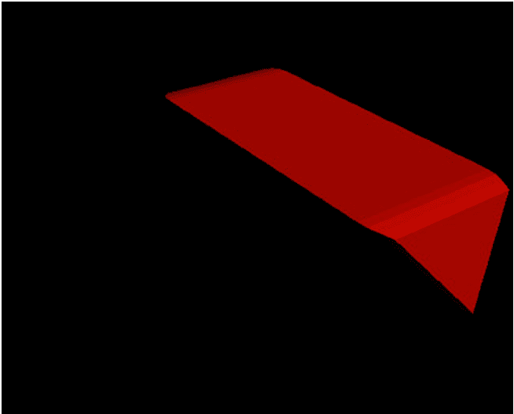

*图 4-2. 拉伸*

## 文字

有时你可能需要 3D 文字。这不是一个常见的用例，但也许你在制作类似电影标题或广告的东西。这也是很多人没有意识到可以轻松实现的事情，因此我想简要地了解一下。TextGeometry 建立在 ExtrusionGeometry 的基础之上，所以大部分内容会比较熟悉。让我们创建一个写着 "Hello World!" 的 3D 文字——因为人人都喜欢 Hello World——它会以与我们棱镜相同的形状进行旋转，以展示它们的相似之处（而且我觉得这种旋转非常令人着迷）。

> 警告 默认情况下，Three.js 使用一种名为 Helvetiker 的字体（这不是拼写错误），必须包含该字体，或者你应该使用其他字体，否则会出现错误。这种字体可以从 http://www.typeface.neocracy.org/ 下载，本书的源代码中也有包含。

我正在修改我们用于拉伸的代码，所以将重用光照和材质以及其余的设置代码。TextGeometry 与任何其他几何体没有什么不同，所以它需要先传递给 Mesh 才能被添加到场景中；这看起来可能显而易见，但我总是忘记！让我们从默认文字开始：

```
var text = new THREE.Mesh(new THREE.TextGeometry("Hello World!", {}), material);
scene.add(text);
```

我们还可以使用其他一些选项来自定义文字，如表 4-3 所示。

**表 4-3.** *显示 TextGeometry 可用的选项*

| 选项 | 描述 |
| --- | --- |
| size | 文字的大小，默认为 150。 |
| height | 拉伸文字的厚度。默认为 50。 |
| curveSegments | 曲线上的点数，默认为 12。 |
| font | 字体的名称。默认为 Helvetiker。 |
| weight | 这是字体的粗细。可以是任何有效的 CSS font-weight，例如 normal 和 bold。默认为 normal。 |
| style | 与 weight 类似，style 允许任何有效的 CSS font-style，例如 normal 和 italic。默认为 normal。 |
| bevelEnabled | 启用斜面，它会使连接拉伸边缘和形状面的顶点变圆。默认为 false。 |
| bevelThickness | 斜面的厚度，默认为 6。 |
| bevelSize | 这是从边缘开始斜面的距离；默认为 bevelThickness 减去 2。 |

这些选项应该很容易理解，因为它们大多来自我们已经讨论过的 CSS 字体选项或 ExtrudedGeometry。不过，我会向你展示一个如何使用这些选项的简单示例：

```
var options = {
  size: 20,
  height: 20,
  bevelEnabled: true,
  bevelThickness: 25
};

var text = new THREE.Mesh(new THREE.TextGeometry("Hello World!", options), material);
scene.add(text);
```

正如你所看到的，如果你把它当作另一种形状来对待，添加文字是非常简单的。

## 光照

光照是我发现真正能够"营造场景氛围"的东西（如果你能原谅我用了双关），因为整个场景都依赖于光照来决定哪些东西会显示（以及哪些会是阴影，这同样重要），还有整体的环境氛围。就像在电影中一样，光照可以用来完全改变用户的感受。我不会深入探讨用户体验设计，但这一点值得记住和思考！

我将介绍一些更常用的光照类型；当然还有其他类型，你也可以创建自己的光照，其中一些我们稍后可能会简要提及。每种类型的光都有许多属性和参数，虽然有些比其他的多，但这里有一些你应该熟悉的：

- **强度（Intensity）：** 光的强度表示其亮度，数值范围从 0 到 1，1 表示光的实际颜色，0 表示不可见（就好像它被关闭了一样）。通常默认为 1。有些光没有强度属性（至少在撰写本文时是这样），但你可以通过将每个 RGB 颜色乘以一个强度变量来模拟它。
- **十六进制颜色（Hex）：** 这是一个必须采用十六进制形式的颜色（例如白色为 0xffffff）。通常默认为白色。
- **阴影（Shadows）：** 关于阴影有很多属性，例如光源是否投射阴影。在我介绍完每种类型的光之后，我会讨论这些。

在本章中，我们一直使用 `DirectionalLight` 作为场景中唯一的光源。正如我之前解释的，`DirectionalLight` 是一种朝特定方向投射并影响该方向上每个对象的光源，无论距离光源多远。我还应该提醒你，我之前说过的 `DirectionalLight` 并没有实际的位置，你设置的位置实际上是它将光导向场景原点的位置。`DirectionalLight` 的语法是

```
THREE.DirectionalLight (hex, intensity)
```

另一方面，`PointLight` 向所有方向发射光，但如果设置了距离，则对对象的影响可能因距离光源的远近而有所不同。当距离设置为 0（默认情况下）时，光将像 `DirectionalLight` 那样影响所有对象。`PointLight` 的语法是

```
THREE.PointLight (hex, intensity, distance)
```

还有另一种光，称为 `SpotLight`，可以像 `DirectionalLight` 一样使用，但可以更精确地控制。`SpotLight` 和 `DirectionalLight` 之间的一个区别是角度。使用 `DirectionalLight` 时，光是向大致方向发射的，而 `SpotLight` 是在指定角度（默认为 pi/2）内定向发射光。它也可以像 `PointLight` 那样覆盖指定的距离。如果你想简单地照亮一个场景，通常可以使用其他两种光，但如果你想仔细地引导光照，那么这是理想的光源。`SpotLight` 的语法是

```
THREE.SpotLight (hex, intensity, distance, angle, exponent)
```

我提到过光照会营造一种氛围。恰好有一种专门用于此目的的光，正如你可能猜到的那样，它叫做 `AmbientLight`。这种光会影响场景中所有可以受光源影响的对象。因为它用于增强光照，所以它应该只与其他光照一起使用。`AmbientLight` 的语法是

```
THREE.AmbientLight (hex)
```

你可能会发现 `AmbientLight` 优先于所有其他光照，要解决这个问题，只需改变其强度，使其只是一种微弱的光（环境光）。更改强度的一个示例是

```
var light = new THREE.AmbientLight();
var intensity = 0.025;
scene.add(light);
light.color.setRGB( 20 * intensity, 0 * intensity, 255 * intensity );
```

你经常会想要确切地知道光正在做什么、它们的位置在哪里以及光的投射方向。有很多方法可以做到这一点——你可以使用控制台查看每个光的属性，但我建议使用更图形化的方式。对于许多光，Three.js 提供了辅助对象，使用线条显示方向。如果你有一个 `DirectionalLight`，那么你可以使用 `DirectionalLightHelper`，它以虚线显示其所指向的方向。你可以通过更改材质来更改线条的类型，例如颜色或虚线。大多数光都有辅助对象，例如可用于显示光线角度的 `SpotLightHelper`。

另一种查看光源的方法是在光源位置创建一个对象（例如球体），你可以在这里看到：

```
var lightDebug = new THREE.Mesh(new THREE.SphereGeometry(5), new THREE.MeshBasicMaterial());
lightDebug.position = light.position;
scene.add(lightDebug);
```

使用这种版本的一种方法（我更喜欢这种方法，我知道许多其他人也经常使用这种技巧）是使球体非常小，以便你能看到它，但它看起来更像是动画的一部分，而不是调试模式。

## 材质

你已经看到了一些使用的材质，例如 Phong、Lambert 和 Basic——但它们是什么呢？每种类型的材质都指定了所使用的着色类型。这是基于现实生活中的材质及其之间的差异，例如在相同的光照下，塑料瓶与闪亮的罐子由于反射、透明度等不同而呈现不同的外观。无法模拟我们在现实生活中发现的精确条件，但我们可以通过修改一些属性和使用不同的着色器来达到非常接近的效果。在撰写本文时，Three.js 为我们提供了表 4-4 中所示的内置材质。

| 材质 | 描述 |
|----------|-------------|
| `LineBasicMaterial` | `LineBasicMaterial` 用于创建直线，默认情况下为白色且 1 像素宽。 |
| `LineDashedMaterial` | 这与 `LineBasicMaterial` 类似，但用于创建虚线，对于调试很有用（但不限于此），如你所知，它不应是场景的一部分。 |
| `MeshBasicMaterial` | 根据 wireframe 属性（默认为 false），此材质用于绘制平面或线框面，并且不受光照影响。由于开销最小，通常在其他材质之上使用它来绘制线框。它也常用于应用纹理（图像）。 |
| `MeshDepthMaterial` | 此材质用于显示深度，通常用于后期处理。 |
| `MeshFaceMaterial` | 通常一个形状的每一面需要不同的材质，`MeshFaceMaterial` 实际上是一个材质数组。 |
| `MeshNormalMaterial` | 这是一种很有用的材质，特别是对于原型设计，因为它确保每个面都具有独特的颜色，并且不需要光照。 |
| `ParticleBasicMaterial` | 这是粒子系统使用的材质。颜色默认为白色。 |
| `ShaderMaterial` | 如果你想编写自己的着色器（本书不会涉及），那么这是你可以使用的材质。它提供了 GLSL 的属性，例如 `fragmentShader`、`vertexShader` 和 `uniforms`。 |


表 4-4 中还缺少两种材质：**MeshLambertMaterial** 和 **MeshPhongMaterial**。我将这两个材质单独拿出来讲解，因为它们比较相似，而且涉及很多渲染技术（不适合放在列表中）。我们已经使用过 Lambert 作为通用的 3D 材质，但我还没有解释它是什么。根据目前 Three.js 文档的简单说明，这两种材质的区别如下：

- **Lambert**：用于非光泽（朗伯）表面，按顶点计算。
- **Phong**：用于光泽表面，按像素计算。

这通常足以让你决定在不同情况下使用哪种材质，但我认为更完整的理解很重要，因此我将简要解释它们的技术差异，并鼓励你进一步了解它们的细节。

在计算机图形学中，有两种模型——可以结合使用——决定了物体的着色效果；它们就是光照和着色。光照使用环境光、漫反射和镜面反射来显示物体表面反射（或折射）的光线。着色的数学计算较为复杂，因为它无法被简化为各个组成部分，基本上它通过平面着色或插值来计算面的明暗（即亮度）。**MeshLambertMaterial** 使用高洛德着色和朗伯光照模型，默认情况下在每个顶点执行光照计算，然后在整个面上进行插值。**MeshPhongMaterial** 同时使用冯氏着色和冯氏光照模型，默认情况下顶点法线在整个表面上进行插值，光照在每个像素（更准确地说是纹理元素）上执行。

> **注意** Three.js 自主品牌并不完全按照算法进行实现，所以如果你对数学模型特别感兴趣，请将此考虑在内。

## 数据可视化

关于文档就先讲到这里，让我们继续前进，做一些有用的东西。数据可视化有很多种类型，从基本的条形图和饼图，到详细的地球仪，甚至是太阳系模型。所有这些都有其用途，通常是作为一种向公众展示数据的方式，但也用于数据分析。这是一个非常广阔的领域，因此我们只会触及你能可视化什么以及如何可视化的皮毛。

我们可以从任何地方开始，比如用基本的 3D 图形展示政府的财务数据，但这很快就会变得无聊，所以让我们制作一个 3D 节点图，展示曾经合作过的男演员和女演员们（灵感来自"凯文·贝肯的六度空间"）。在这种情况下，我们的节点是演员/女演员，边是电影。我提供了一些样本数据作为 JSON，以避免让你注册 API。这也意味着我可以对数据进行更多筛选，因为大部分数据是不需要的。

## 3D 节点图

与其直接使用数据，不如先从图本身开始。在这一节中，所有节点和边都是随机的，而且两个节点之间完全可能有多个相同的边。此刻我们不必为此担心（一旦有了真实数据，处理起来会容易得多）。

我们从所有场景的基本设置开始，这次同时使用定向光和 ambient light，以便每个节点（我们将用随机颜色的球体来表示）都有良好的效果。

```javascript
var width  = window.innerWidth,
    height = window.innerHeight;

var container = document.querySelector('#Container');

var renderer = new THREE.WebGLRenderer();
renderer.setSize(width, height);
container.appendChild(renderer.domElement);

var VIEW_ANGLE = 45,
    NEAR = 0.1,
    FAR = 10000;
var camera = new THREE.PerspectiveCamera(45, width / height, 1, 1000);
camera.position.z = 600;

var ambient = new THREE.AmbientLight( 0x050505, 2 );
directionalLight = new THREE.DirectionalLight( 0xffffff, 1 );
directionalLight.position.set( 2, 1.2, 10 ).normalize();

var scene = new THREE.Scene();
scene.add(ambient);
scene.add(directionalLight);
scene.add(camera);

// The rest of the code for this section will go here.

function logic() {
    requestAnimationFrame(render);
}

function render() {
    renderer.render(scene, camera);
}

setInterval(logic, 1000/60);
```

你知道如何创建球体，而且我相信你只需两秒钟就能想出如何随机定位它们。然而，我们需要做的是随机定位球体，并且还需要用线条随机连接它们作为边。为此，我们有一个 Node 对象，它存储名称和位置，然后生成随机边。因为我们目前还没有使用数据，名称默认为"Random Node"，并且有一个通过 edges 属性访问的 getEdges() 函数，返回要连接边的随机节点。要在 getEdges 中生成随机边，我们只需要将 `Math.random()` 乘以节点数量，然后向下取整（floor），因为索引从 0 开始而不是 1。

```javascript
var amount_nodes = 20;

var Node = function() {
    name = "Random Node",
    position = new THREE.Vector3();

    function getEdges() {
        return [Math.floor(Math.random()*amount_nodes), Math.floor(Math.random()*amount_nodes) ];
    }

    return {
        name: name,
        edges: getEdges()
    }
}
```

要绘制图形，我们需要三个函数：一个绘制节点，一个绘制节点的所有边，还有一个使用前面两个函数来绘制图形的函数。让我们从 `drawNode(n)` 开始，我们将节点作为参数传入，这样我们就可以方便地访问我们刚刚创建的节点对象。在函数内部，我们使用之前教的相同技术创建一个球体，材质为随机颜色的 Lambert 材质。随机颜色出奇地容易实现，由于十六进制（如 `0xffffff`）与其他任何数字的处理方式相同（毕竟，它只是数字在不同进制下的表示），我们可以在上面进行数学运算，在这种情况下就是将其乘以一个随机数。要确定位置，我们选择一个在我们指定区域内的随机数，然后从这个数中减去区域值，以保持图形居中。

```javascript
function drawNode(n) {
  var radius = 10,
      segments = 50,
      rings = 50;

  var material = new THREE.MeshLambertMaterial( { color: Math.random() * 0xffffff } );
  var draw_object = new THREE.Mesh(
    new THREE.SphereGeometry(
      radius,
      segments,
      rings),
    material);

  node.position.x = Math.floor(Math.random() * (area * 2 + 1) - area);
  node.position.y = Math.floor(Math.random() * (area * 2 + 1) - area);
  node.position.z = Math.floor(Math.random() * (area * 2 + 1) - area);

  var area = 300;
  n.position = node.position;
  scene.add(node);
}
```

现在节点已经绘制到场景中，是时候用边连接它们了。因为这些边是随机的，正如我之前所说，有些边很可能会重复，导致线条变粗。一旦我们添加了数据，这就不会发生了，因为我们可以用它来检查线条是否已经创建过。如你所知，从环境光中，要有透明度，你需要将 transparent 设置为 true，所以我在 LineBasicMaterial 中这样做了，因为如果边是 100% 白色且不透明的，它们会过于 overwhelming。要确定 machining lines 应该在哪里，我们需要遍历 node.edges（在创建新节点时随机生成），创建一个几何体，其顶点位于当前节点的位置和另一个节点（nodes[node.edges[i]]）的位置。一旦创建完成，我们只需使用这个几何体创建一条新线，然后将其添加到场景中。

```javascript
function drawEdges(node) {
 allo  var line_material = new THREE.LineBasicMaterial( { color: 0xffffff, transparent: true, opacity: 0.1, linewidth:0.5 } );
  for (var i = 0; i < node.edges.length; i++) {
    var tmp_geo = new THREE.Geometry();
    tmp_geo.vertices.push(node.position);
    tmp_geo.vertices.push(nodes[node.edges[i]].position);
    var line = new THREE.Line( tmp_geo, line_material );
    scene.add(line);
  }
}
```

最后，要完成项目的这一部分，我们只需要使用刚刚写的两个函数来绘制图形。你可能注意到我们一直在使用一个名为 nodes 的数组，节点是在 `drawGraph()` 中创建的。该函数的第一部分遍历节点数量（`amount_nodes`），在数组中创建一个新的 Node 对象，然后使用 `drawNode()` 绘制它。边必须在单独的循环中之后绘制，因为 `drawEdges()` 使用节点数组来查看哪些边是连接的。

```javascript
var nodes = [];
drawGraph();
function drawGraph() {
    // Draw nodes
    for (var i = 0; i < amount_nodes; i++) {
        nodes[i] = new Node();
        drawNode(nodes[i]);
    }

    // Draw edges, has to be done once we have the nodes in place
    for (var i = 0; i < amount_nodes; i++) {
        drawEdges(nodes[i]);
    }
}
```

如果你现在把所有内容放在一起，它应该会显示一个不错的 3D 节点图，节点颜色随机，不*代表*任何含义（见图 4-3）。这是各种可视化的一个良好起点，它应该让你对使用这些工具（即 Three.js）来制作不仅仅是简单形状感到自信。

# 第四章 3D 入门


**图 4-3.** 节点图

我鼓励你摆弄这些代码，将其变成自己的东西。以下是一些扩展该图的想法：

- 使用 API 来可视化实时数据（Twitter、政府开放数据等）。
- 根据数据更改节点的大小和/或颜色。
- 为悬停或点击节点和/或边时添加文本覆盖层。
- 改进导航。要导航一个包含数千个节点的图是很困难的。什么效果最好——方向键？鼠标？点击移动？这是一个探索规模的好方法。

有很多方法可以使用相机（其中一些在本章前面已经解释过）来导航图形。目前我只是使用了简单的相机旋转技术，这已经包含在代码中。

## 添加数据

我们有一个显示随机节点的节点图，它看起来不错，但背后确实没有任何含义。我创建了一个名为 data.js 的 JavaScript 文件（其中的 JSON 数据放在一个名为 data 的变量中，以便于访问），其中包含四位演员和三部影片。我们将使用它来创建一个小型节点图，将影片显示为演员节点之间的边。虽然数据不多，但这应该能让你很好地了解该图如何用于数据可视化。这是我们将要使用的数据：

```
var data = {
    "People": [
        {
            "Id" : 0,
            "Name": "Tom Cruise",
            "Films": [1, 2]
        },
        {
            "Id" : 1,
            "Name": "Morgan Freeman",
            "Films": [1,3,5]
        },
        {
            "Id" : 2,
            "Name": "Bruce Willis",
            "Films": [3, 4]
        },
        {
            "Id" : 3,
            "Name": "Mary-Louise Parker",
            "Films": [3]
        }
    ],
    "Films": [
        {
            "Id": 0,
            "Name": "Oblivion",
            "Cast": [0, 1]
        },
        {
            "Id": 1,
            "Name": "Mission: Impossible",
            "Cast": [0]
        },
        {
            "Id": 2,
            "Name": "RED",
            "Cast": [1, 2, 3]
        },
        {
            "Id": 3,
            "Name": "Die Hard",
            "Cast": [2]
        },
        {
            "Id": 4,
            "Name": "The Shawshank Redemption",
            "Cast": [1]
        }
    ]
}
```

为了创建图形，我们使用之前创建的代码，但需要对其进行修改以读取数据对象，以便根据演员出演过的影片在演员之间建立链接。尽管显示所有连接可能更有用，但我决定在这个示例中最好只显示它们是否连接，而不是为每部影片单独画一条线。我是通过检查该节点是否已经在另一个节点的边数组中来实现的。

这段代码与之前代码的主要区别在于 `drawGraph()` 函数，我们现在将人员数据分配给每个节点。一旦绘制完节点，我们需要遍历每部影片，并通过将每个人员与演职员数组中的前一个人员连接，在每个节点中为每部影片创建边，前提是它们尚未连接。

```
drawGraph();
function drawGraph() {
    var people = data["People"];
    var films = data["Films"];
    for (var i = 0; i < people.length; i++) {
        nodes[i] = new Node();
        nodes[i].name = people[i].Name;
        nodes[i].films = people[i].Films;
        drawNode(nodes[i]);
    }

    for (var i = 0; i < films.length; i++) {
        var cast = films[i]["Cast"];
        console.log(cast);
        if (cast.length > 1) {
            for (var j = 1; j < cast.length; j++) {
                if (nodes[cast[j-1]].edges.indexOf(cast[j]) == -1) {
                    console.log(j)
                    console.log(nodes[cast[j-1]]);
                    nodes[cast[j-1]].edges.push(cast[j]);
                }
            }
        }
    }

    for (var i = 0; i < nodes.length; i++) {
        drawEdges(nodes[i]);
    }
}
```

最后，应该显示每个节点对应的人员姓名。由于我们已经为每个节点创建了赋予其独特颜色的材质，我们可以用它来匹配文本颜色与节点。我给文本设置了大小和高度（挤出）为 10，但这只是一个看起来不错的任意数字——请随意更改。另外，正如我之前提到的，或许可以考虑在点击节点时显示文本，因为随着节点数量的增加，文本将变得更难阅读。这应该添加到 `drawNode` 函数的末尾：

```
var text_object = new THREE.Mesh(new THREE.TextGeometry(node.name, { size : 10, height: 10}), material);
text_object.position.x = draw_object.position.x;
text_object.position.y = draw_object.position.y;
text_object.position.z = draw_object.position.z;
scene.add(text_object);
```

图 4-4 展示了本章的最终成果，即表示数据并在节点旁边显示名称的节点图。

> **图 4-4。** *最终表示数据的节点图*

本章的完整代码一如既往地可以在 Apress 网站 [www.apress.com/9781430259442](www.apress.com/9781430259442) 或我自己的网站 [www.shanehudson.net/javascript-creativity](www.shanehudson.net/javascript-creativity) 上找到。

### 小结

在本章中，你从让对象出现的基础知识发展到使用它进行数据可视化，提升了 3D 技能。仅就数据可视化而言，就有各种各样的东西可以做，更不用说在 3D 世界中可以做的一切了。希望你现在对 Three.js 感到得心应手。我鼓励你扩展本章的示例并随意摆弄它们，特别是节点图。在第 5 章中，我们将使用 Web Audio API 和 SVG 在浏览器中创建音乐（至少是声音！）。

# 第 5 章

# 在浏览器中创建音乐

在第 3 章中，我们使用 Web Audio API 通过创建简单的可视化和频谱图来分析音频。本章通过使用该 API 来创作音乐，从而扩展第 3 章的内容。为此，我将介绍音乐理论并提供一些示例，然后创建一个 Web 应用程序，让用户使用基本合成器创建音乐片段，并能够在音轨上移动这些片段来创作自己的音乐。这个项目充满潜力，因此有很多途径可以修改它并使其成为你自己的，例如一个功能齐全的基于网页的数字音频工作站。

## 音乐理论

本书不是关于音乐理论的，但为了完成这个项目并理解（或至少使用）Web Audio API，理解音乐理论的基础知识是相当重要的。音乐是声音，而随机的声音只是噪音，但既然音乐不是噪音，是什么让音乐变得特别呢？有一些音乐的方面用来区分音乐和噪音。这些方面包括节奏和节拍，但更重要的是（至少从我们的角度来看）音高和音色是音乐的核心，它们是创造乐器本身的方面。我们不需要成为出色的音乐家就能创建可用于出色音乐的工具，我们只需要关注乐器本身的方面，而在本例中，我们的乐器是使用 Web Audio API 制作的，音高就是音符的频率。

那么我们从头开始，什么是音符？简单地说，音符是具有特定波长（导致音高的频率）的声波。音符按音高从 A 到 G 按字母顺序命名（嗯……算是吧），所以 D 比 C 高。我说"算是吧"是因为音符实际上是以八度从 C 到 C 循环的，所以 A 比同一个八度的 C 高，但比上面一个八度的 C 低。每个频率可以用赫兹（hz）表示（包括语言上和实践上）。由于在钢琴上的位置，频率为 261.63hz 的 C 被称为**中央 C**，通常用作计算相对值的标准音符。例如，一个容易记住的频率是 440hz 的"中央 C 之上的 A"。

因为每个八度都有相同音符的不同频率，而且我们已经知道音符本身就是一个频率，所以每个八度之间必定存在联系，否则它们本质上不可能是同一个音符。这个联系就是比率；每个八度的比率为 2:1，所以音符的波长是它前面八度的两倍。因此，从中央 C 之上的 A 到中央 C 之下的 A，我们可以简单地计算 440/2 = 220hz。这种关系是和声背后的基本概念。每个音符可以用一个代表八度的数字来标记，原因显而易见，例如中央 C 是 C3。

如果你想到钢琴，你会记得看到黑键以一定的模式分布在白键上方；这些键用来弹奏音符之间的半音（或半步），其比率为 2^(1/12)。高于某个音符的半音是它的**升音**，低于某个音符的半音是它的**降音**。所以 466.16 被称为 **A#**（A 升音）或 **Bb**（B 降音）。这些半音是"等音"最常见的例子，因为它们技术上是两个相同的音符，唯一的区别是音乐进行的方向。


我们没有钢琴，没有吉他，也没有任何其他乐器，那么我们如何计划制作音乐呢？当我解释什么是音符时，我将其频率称为*wavelength*（波长），因为它是由声波产生的。你可能知道，所有声波都是通过振动产生的。所以我们只需要最后一块拼图，一个振荡器；这是所有声音合成的基础，因为它允许我们仅用一个扬声器就能产生声波。*Sound envelope*（声音包络）是声音合成中常用的一个术语，它定义了波的声音，该术语涵盖了声音的四个组成部分：起音（attack）、衰减（decay）、延音（sustain）和释音（release）。通过操控声音包络，你可以开始控制声音。想想钢琴和三角铁的区别，它们都有相当高的延音（也就是说，它们会共鸣相当长一段时间），但三角铁听起来是"叮"的一声，而钢琴则持续更长时间（当然取决于你按音符的时间长短），所以钢琴的起音比三角铁更多。实际上，由于涉及的物理知识太多（例如木质钢琴的特性），很难完美地合成任何乐器，但通过操控每个音符，它为你提供了一种尝试通过简单地振荡你选择的波形来复制音乐声音的方法。

每个声波都有一个形状（波形），它以视觉方式表示音符随时间的振幅，这涉及很多我们不需要关心的物理知识，但基本上振幅就是扬声器需要如何移动才能产生声音。有四种基本波形，它们构成了所有声音的基础（见图 5-1）。

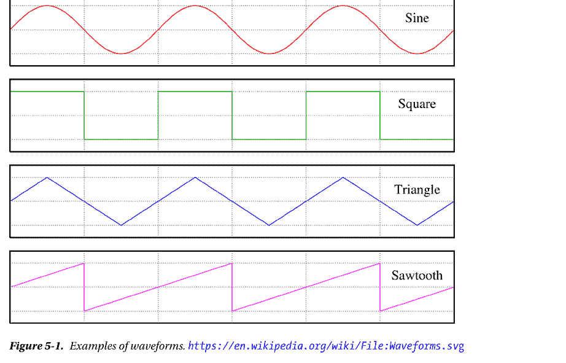

> ***图 5-1.*** *波形示例。https://en.wikipedia.org/wiki/File:Waveforms.svg*

这四种波形是

- **正弦波：** 这条曲线遵循数学函数正弦的形状。
- **方波：** 方波类似于二进制，因为它要么在一个频率上，要么在另一个频率上。
- **三角波：** 三角波与正弦波相似，但不够平滑。这会产生相当尖锐的声音。
- **锯齿波：** 这些波是以前所有波的组合。这种波具有三角波缓慢的尖锐声音，直到达到峰值，然后重置到原始频率，很像方波。

## 创建一个键盘

现在我们已经介绍了一些基本理论，让我们开始认真创建一个键盘。我们有很多方法可以做到这一点，比如使用 DOM 或 canvas，但因为键是基本的矩形，我决定最好的方式是使用 SVG，因为它是矢量图形。为了便于创建 SVG 并将事件绑定到键上（以便它们可以实际使用），我们将使用一个名为 svg.js 的库（可以在 [www.svgjs.com](http://www.svgjs.com) 找到）。钢琴有 88 个键（52 个白键和 36 个黑键），因为要在屏幕键盘上容纳这么多键实在太多，我决定只包含中间的 3 个八度，这样我们有 21 个白键。当然，让键盘只能由鼠标使用是没有意义的，因为你无法（除非在多点触摸屏上）在不使用键盘的情况下同时按下多个键。当然，QWERTY 键盘的中排只有九个字母，所以我决定将 S 到 K 作为可演奏的白键，用 A 或 L 来向下或向上移动一个八度。这不是一个完美的解决方案，因为你可能想同时演奏多个八度，但对于这个项目来说已经足够。

让我们从定义一个 SVG 开始，使用 `var keyboard = SVG('keyboard');` 这会创建一个 id 为 keyboard 的 SVG，可以通过相同名称的变量访问。SVG 创建完成后，我们现在可以开始添加键了，白键最简单，因为我们只需要创建宽度（和位置）为 SVG 除以所需键数的键。因为这些是白键，我们需要设置属性，使填充为白色，描边为黑色。另一个需要设置的属性是 id，以便我们以后可以修改键的背景（用于按键按下效果），这将设置为 "key"+i，以便我们可以通过遍历 21 个键来轻松访问每个键。

```
var keys = [];
for (var i = 0; i < 21; i++)  {
    keys[i] = keyboard.rect(width/21, height);
    keys[i].move(width/21 * i, 0);
    keys[i].attr({ fill: '#fff', stroke: '#000', id: "key"+i });
    // 事件处理程序放在这里
}
```

我们还需要为黑键添加矩形，但不同的是它们不是直接相邻的，而是分成 2 个和 3 个的组，此外这些键的高度只是键盘高度的一半多一点。为了将键分组，我决定保持简单，只检查 i 是否是组中的最后一个键。如果是，那么我们将白键的宽度（width/21）加到一个名为 prevKey 的变量中，我们用它来计算的键的位置。

```
var bkeys = [];
var prev = 0;
for (var i = 0; i < 15; i++)  {
    bkeys[i] = keyboard.rect(width/42, height / 1.7);
    bkeys[i].attr({ fill: '#000', stroke: '#000', id: "bkey"+i });
    bkeys[i].move(prev + (width/(21*1.3)), 0);
    prev = prev + width/21;
    if (i == 1 || i == 4 || i == 6 || i == 9 || i == 11)  {
        prev += width/21;
    }
    // 事件处理程序放在这里
}
```

现在你已经有一个绘制在屏幕上的键盘，如图 5-2 所示。

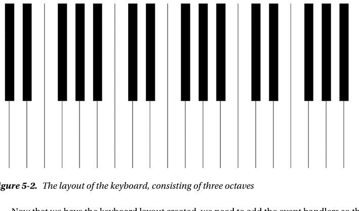

> ***图 5-2.*** *由三个八度组成的键盘布局*

现在我们已经创建了键盘布局，我们需要添加事件处理程序，以便在播放声音时高亮显示被按下的键。因为我们有两种输入类型（键盘和鼠标），所以需要相当多的事件处理程序。SVG.js 允许我们轻松地为每个键绑定事件处理程序，这使得通过绑定 mousedown 和 mouseup 到键来处理鼠标变得容易。keypress 和 keyup 事件是通过向 window 添加事件监听器来处理的，这是处理事件的正常方式。要将键绑定到音符，我们需要为顶行的黑键和中排的白键设置数组。我们还需要为每种键准备两个数组，因为 keypress 和 keyup 对每个键有不同的 id。为了获得正确的音符，因为电脑键盘上没有足够的键来对应所有音符，我们需要将音符位置（使用 S 到 K 作为一个八度）加到八度中的键数乘以当前八度上；这意味着对于黑键我们使用 i + octave * 5，对于白键我们使用 i + octave * 7。对于鼠标事件，我们需要使用闭包来保持计数器，因为我们需要在我们刚才制作的 for 循环中绑定每个键的事件，但如果我们不使用闭包就这样做，它会使用 i = 21 而不是正确的值。当键被按下时，它需要改变颜色，然后在键释放后变回（这在使用鼠标或键盘时都是如此）。对于声音，我们将使用名为 playSound(n) 和 stopSound(n) 的函数，其中 n 是闭包之前的 i 的计数。这些更改如清单 5-1 所示。

### 清单 5-1.

```
var keyboardKeys = [83,68,70,71,72,74,75];
var blackKeys = [69,82,89,85,73];

var keyboardPressKeys = [115,100,102,103,104,106,107];
var blackKeyPress = [101, 114, 121, 117, 105];

var octave = 1; // 其中 octave 1 = 中央 C

var keys = [];
for (var i = 0; i < 21; i++)  {
    keys[i] = keyboard.rect(width/21, height);
    keys[i].move(width/21 * i, 0);
    keys[i].attr({ fill: '#fff', stroke: '#000', id: "key"+i });
    keys[i].mousedown ((function(n) {
        return function()  {
            var key = SVG.get("key"+n);
            key.fill({ color: '#f06' });
            playSound(n, false);
        }
    })(i));

    keys[i].mouseup((function(n) {
        return function() {
            keys[n].fill({ color: '#fff' });
            stopSound(n, false);
        }
    })(i));
}

var bkeys = [];
var prev = 0;
for (var i = 0; i < 15; i++) {
    bkeys[i] = keyboard.rect(width/42, height / 1.7);
    bkeys[i].attr({ fill: '#000', stroke: '#000', id: "bkey"+i });
    bkeys[i].move(prev + (width/(21*1.3)), 0);
    prev = prev + width/21;
    if (i == 1 || i == 4 || i == 6 || i == 9 || i == 11) {
         prev += width/21;
    }

    bkeys[i].mousedown ((function(n) {
        return function() {
            var key = SVG.get("bkey"+n);
            key.fill({ color: '#f06' });
            playSound(n, true);
        }
    })(i));

    bkeys[i].mouseup((function(n) {
        return function() {
            bkeys[n].fill({ color: '#000' });
            stopSound(n, true);
        }
    })(i));
}

window.addEventListener('keypress', function(e) {
    for (var i = 0; i < keyboardPressKeys.length; i++)  {
        if (e.keyCode == keyboardPressKeys[i]) {
            var n = i + octave * 7;
            var key = SVG.get("key"+n);
            key.fill({ color: '#f06' });
            playSound(n, false);
        }
    }
    for (var i = 0; i < blackKeyPress.length; i++)  {
        if (e.keyCode == blackKeyPress[i]) {
```


```
        var n = i + (octave * 5);
        var key = SVG.get("bkey"+n);
        key.fill({ color: '#f06' });
        playSound(n, true);
    }
}
if (e.keyCode == 97 && octave > 0) --octave;
if (e.keyCode == 108 && octave < 2) ++octave;
});

window.addEventListener('keyup', function(e) {
    console.log(e.keyCode);
    for (var i = 0; i < keyboardKeys.length; i++) {
        if (e.keyCode == keyboardKeys[i]) {
            var key = SVG.get("key"+(i+octave*7));
            key.fill({ color: '#fff' });
            stopSound(i+octave*7, false);
        }
    }
    for (var i = 0; i < blackKeys.length; i++) {
        if (e.keyCode == blackKeys[i]) {
            var n = i + octave * 5;
            var key = SVG.get("bkey"+n);
            key.fill({ color: '#000' });
            stopSound(n, true);
        }
    }
});
```

要演奏每个音符，我们需要两个振荡器数组，一个用于黑键，一个用于白键。我们将每个振荡器连接到一个单独的增益节点，这样我们就可以拥有一个用于录制音乐以及调节音量的节点。显然，每个振荡器都需要以正确的频率运行。我们可以自动生成频率，但由于我们确切知道会使用哪些键（而且考虑到黑键之间的间隔，生成频率是相当棘手的），所以我们可以像下面这样在数组中指定它们：

```
var whiteNotes = [130.82, 146.83, 164.81, 174.61, 196, 220, 246.94, 261.63, 293.66, 329.63, 349.23, 392, 440, 493.88, 523.25, 587.33, 659.26, 698.46, 783.99, 880, 987.77];
var blackNotes = [138.59, 155.56, 185, 207.65, 233.08, 277.18, 311.13, 369.99, 415.3, 466.16, 554.37, 622.25, 739.99, 830.61, 932.33];
```

正如你在设置琴键的代码中看到的，`playSound` 和 `stopSound` 函数都接受 `i` 和 `black` 作为参数，这样我们就能知道正在演奏的音符的位置和包含该音符频率的数组。在 `playSound` 内部，我们选择振荡器并设置频率和类型，然后当然使用 `osc.noteOn(0)` 将其打开。

- Sine wave = 0
- Square wave = 1
- Sawtooth wave = 2
- Triangle wave = 3

我选择了锯齿波，出于个人偏好，但你可以都试试，看看你觉得哪个好！修改后的代码如下所示：

```
function playSound(i, black) {
    stopSound(i, black);
    var freq;
    if (black) freq = blackNotes[i];
    else freq = whiteNotes[i];
    if (black) osc = ob[i];
    else osc = o[i];
    osc.type = 3;
    osc.frequency.value = freq;
    console.log(freq);
    osc.connect(gainNode);
    osc.noteOn(0);
    if (black) ob[i] = osc;
    else o[i] = osc;
}
```

```
function stopSound(i, black)  {
    if (black) osc = ob[i];
    else osc = o[i];
    if (typeof(o[i]) != "undefined") {
        osc.noteOff(0);
        osc.disconnect();
        osc = ctx.createOscillator();
    }
    if (black) ob[i] = osc;
    else o[i] = osc;
}
```

这就是创建一个可演奏的键盘所需的全部内容！Web Audio API 处理了大部分低级别的声音管理，所以你只需要连接节点并演奏音符。我使用了 SVG.js，但你可以使用其他任何工具，从头开始创建，甚至使用 Adobe Illustrator 等矢量程序来导出 SVG。

## 录制音乐

现在我们有了一个可工作的键盘，我们希望能够录制它并回放输出。在本章的后面，我们将添加功能来在音轨上移动音乐片段，所以我们需要存储音乐。为了让它能作为一个独立的应用使用，不需要服务器，也不会因为要求用户下载和上传音乐而给用户带来麻烦，我们将使用本地存储（local storage）作为一种轻松存储和检索音乐的方式。本地存储使用键值对来工作，所以我们需要为音乐命名（这可以通过用户输入或根据本地存储的大小生成），而且我们还需要将音乐存储为值——这就是棘手的部分。

我不赞成重复造轮子（而且正如我所说，这相当棘手），所以为了将音乐录制为 WAV 编码的 blob，我决定使用 Matt Diamond 的 Recorder.js（可以在 [http://www.github.com/mattdiamond/Recorderjs](http://www.github.com/mattdiamond/Recorderjs) 找到）。这个库通过监视指定的 Web Audio API 通道来工作，而不是像平常那样连接，然后启用一些方法，包括我们将要使用的 `exportWAV` 方法，用于获取音频 blob。

CHAPTER 5 ■ CREATING MUSIC IN THE BROWSER

> **注意** 要使用 Recorder.js，你必须在 Web 服务器上，因为它使用 Web Worker 来提高性能。在电脑上这样做的一种方法是运行 `python -m SimpleHTTPServer`。

让我们开始设置录制器，让它监视我们之前创建的增益节点。在构造函数中完成这一步后，我们就开始录制。

```
var recorder = new Recorder(gainNode, { workerPath: "../recorderWorker.js"});
recorder.record();
```

如你所见，这使得监视从 `gainNode` 到输出硬件的任何音频变得非常容易。现在我们需要创建一个录制声音的函数以及一个播放声音的函数。当我们调用 `recordSound` 方法时，我们需要将 blob（即音频）存储为文本（因为 `localStorage` 不允许直接存储对象），所以我们使用 `window.URL.createObjectURL` 来转换对象。要播放音乐，我们动态创建一个新的 `Audio` 元素（不需要将它附加到 DOM），它的 `src` 链接到存储在 `localStorage` 中的 URL。为了使其可扩展，以便我们可以有很多音乐片段，每个函数都有一个名为 `name` 的参数，然后它成为 `localStorage` 的键（其中对象 URL 是值）。由于创建对象 URL 的方式，要使用它们，你需要将它们添加为音频元素的 `src`。由于对每个片段都这样做效率低下，所以最好是在录制时计算出持续时间，并将它与对象 URL 一起作为一个对象添加，然后使用 JSON 将其转换为字符串。

```
function recordSound(name) {
    recorder.exportWAV(function(blob) {
        var object = {
            file: window.URL.createObjectURL(blob),
            size: recordEnd - recordStart
        }
        localStorage[name] = JSON.stringify(object);
        drawTimeline();
    });
}

function playAudio(id) {
    var audio = new Audio(JSON.parse(localStorage[localStorage.key(id)]).file);
    audio.play();
}
```

使用 Recorder.js 可以让我们轻松录制 Web Audio API 产生的任何内容，无论是生成的音符还是吉他等输入。这使得在客户端存储录音和回放变得容易。

## 时间轴

现在我们有了可工作的键盘，并且已经为录制音频做好了设置，让我们来创建界面。为了避免使项目过于复杂，我们将保持简单，只用一个键盘和一个时间轴来放置音乐片段，以及用于录制、播放和停止时间轴的按钮。当页面加载时，`localStorage` 中的片段需要表示为矩形，其宽度与片段的持续时间成比例。

84

```
<!DOCTYPE html>
<html>
    <head>
        <title>Music Theory</title>
        <style>
            * { margin: 0; }
            body { background-color: #747e88; }
            a { color: #d4dfcf; cursor: pointer;}
            a:hover, a:focus  { color: #E4eee3; }

            .controls a { display: inline-block; padding: 10px; }
            .recording { background-color: #d68189; }
            #tracks  { height: 300px; width: 100%; }
            #keyboard  { height: 300px; position: relative; width: 100%; }
        </style>
    </head>
    <body>
        <div class="controls">
            <a id="record">Record</a>
            <a id="play">Play</a>
            <a id="stop">Stop</a>
        </div>

        <div id="tracks"></div>
        <div id="keyboard"></div>
        <script src="../svg.js"></script>
        <script src="../svg.draggable.js"></script>
        <script src="../recorder.js"></script>
        <script src="../recorderWorker.js"></script>
        <script src="script.js"></script>
    </body>
</html>
```

从页面顶部的按钮开始，每个按钮都需要一个用于点击事件的事件监听器，并带有执行其指定任务的回调函数。播放和停止按钮只需要简单地切换一个播放变量，我们将使用它来确定当前时间的时间轴线是否应该移动。录制按钮需要切换录制状态，这包括使用录制器来录制增益节点，以及在按钮上切换录制类和设置用于计算持续时间的 `recordStart` 和 `recordEnd` 变量。为了获取音乐片段的名称，我们使用提示框。这可以在界面中完成，但我使用提示框只是为了简便。

```
var toggleRecord = false;
var recordStart;
var recordEnd;
var recorder;
document.querySelector("#record").addEventListener('click', function() {
    if (!toggleRecord)  {
        recorder = new Recorder(gainNode, { workerPath: "../recorderWorker.js"});
        recorder.record();
        recordStart = Date.now();
        document.querySelector("#record").className = "recording";
        toggleRecord = !toggleRecord;
    }
}
```


```
else {
    recordEnd = Date.now();
    document.querySelector("#record").className = "";
    toggleRecord = !toggleRecord;
    recordSound(prompt("Name of sound clipping:"));
}
});

document.querySelector("#play").addEventListener('click', function() {
    play = true;
});

document.querySelector("#stop").addEventListener('click', function() {
    play = false;
});
```

按钮就绪后，让我们开始制作实际的时间轴。与键盘一样，这里也使用 SVG。一个空的时间轴只需要线条来表示每个轨道，因此我们需要一个变量来指定轨道数量（这样可以轻松更改所需数量），并且为了绘制这些线条，我们绘制的轨道数量需要加 1，这样才能有一个底部边框。trackPos 变量用于计算每个单独轨道的高度，以及将每个轨道定位到正确的位置。

```
var timelineWidth = document.querySelector("#tracks").clientWidth;
var timelineHeight = document.querySelector("#tracks").clientHeight;
var tracks = SVG('tracks');

var play = false;

var numOfTracks = 5;
var track = [];
var trackPos = timelineHeight/numOfTracks;

var clippings = [];
drawTimeline();
function drawTimeline() {
    tracks.clear();

    for (var i = 0; i <= numOfTracks; i++) {
        track[i] = tracks.line(0, timelineHeight/numOfTracks, timelineWidth, trackPos);
        track[i].move(0, trackPos * i);
        track[i].attr({ stroke: '#DAC8B0', id: "track"+i });
    }
    // Clippings go here
}
```

音乐片段是与时间轴相同的 SVG 上的矩形，因为它们是其一部分，这些矩形根据片段的时长来表示音乐。每个矩形都需要可拖动，以便它们可以在轨道之间移动。我们可以像在第 2 章那样使用事件监听器，但由于我们使用的是 SVG.js，我们可以直接使用位于 https://github.com/wout/svg.draggable.js 的插件。要使矩形可拖动，我们只需要 Uri，然后调用矩形上的 `.draggable()` 方法。由于矩形位于时间轴 SVG 内部，使其可拖动意味着它可以在该 SVG 内部拖动，而不会越过应用程序的其他组件。也就是说，它仍然可以被拖出 SVG 但无法被看到，因此我们需要阻止它超出边界。我们还需要让矩形在轨道之间对齐，为此我们需要检查矩形是否在每个轨道的边界内，如果不是，则取其位置的上限，使其对齐到其中一个轨道。每个矩形还需要一些文字（随其一起移动）来标注矩形的音乐名称。在图 5-3 中，你可以看到录制并放置了一些音频片段到时间轴后的样子。

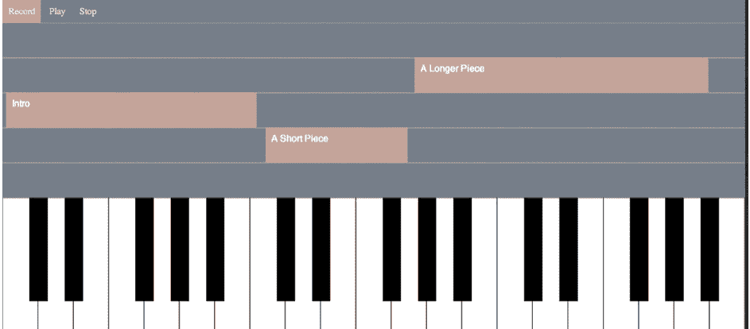

**图 5-3。** 完成的项目，展示了带有单独轨道中一些预录制音乐的时间轴

在清单 5-2 中，你可以看到使矩形可拖动并在时间轴上对齐所需的最终修改。

## 清单 5-2。

```
var clippings = [];
drawTimeline();
function drawTimeline() {
    tracks.clear();

    for (var i = 0; i <= numOfTracks; i++) {
        track[i] = tracks.line(0, timelineHeight/numOfTracks, timelineWidth, trackPos);
        track[i].move(0, trackPos * i);
        track[i].attr({ stroke: '#DAC8B0', id: "track"+i });
    }

    for (var i = 0; i < localStorage.length; i++) {
        var clipping = JSON.parse(localStorage[localStorage.key(i)]);
        clippings[i] = tracks.rect(timelineWidth/120 * clipping.size/120, trackPos);
        clippings[i].attr({ fill: "#C6A49A" });
        clippings[i].move(150, trackPos * 3);

        var text = tracks.text(localStorage.key(i)).move(clippings[i].x() + 10, clippings[i].y() + 10).front();
        text.attr({ fill: "#fff", id: "text"+i });

        clippings[i].draggable();
        clippings[i].dragend = (function(text)_vadd_pagination_0785
            return function() {
                if (this.y() < 0)
                    this.move(this.x(), 0);
                if (this.y() > timelineHeight - trackPos)
                    this.move(this.x(), height - trackPos);
                else
                    this.move(this.x(), Math.ceil(this.y() / trackPos) * trackPos);
                text.move(this.x() + 10, this.y() + 10);
            }
        })(text);

        clippings[i].dragmove = (function(text) {
            return function() {
                text.move(this.x() + 10, this.y() + 10);
            }
        })(text);
    }
}
```

本章的最终代码可以在通常的地方找到，即 Apress 网站上本书的可下载补充材料 [www.apress.com/9781430259442](http://www.apress.com/9781430259442)，或者在我的个人网站 [www.shanehudson.net/javascript-creativity](http://www.shanehudson.net/javascript-creativity)。

## 总结

我们现在已经有了一个音乐创作 Web 应用的雏形。从这里开始，有许多方向可以探索，例如改变音符的音调或添加静音轨道的功能。我们将在下一章创建的媒体播放器中集成这个音乐创作应用。希望这能让你对 Web Audio API 的功能有一个很好的了解准入体验，以及 SVG 和本地存储方面的一些经验。

# 第 6 章

# 音乐播放器

到目前为止，我们已经对曲折的声音和图形之路进行了一次简短的游览。我们从 canvas 开始，探索了 2D 和动画的世界；从那里我们进入了视频和音频 HTML 元素以及 Web Audio API 的世界，使用 canvas 通过创建频谱图等工具来可视化音乐。然后又是图形领域，一头扎进 3D 世界，在那里我们玩转了各种光照和材质类型，以了解事物如何相互影响。第 5 章似乎完全摒弃了图形（当然除了使用 SVG），纯粹专注于音乐，通过 JavaScript 生成音符，不需要任何插件或音频文件，只需要实现 Web Audio API 的浏览器。然而，我想更专注于音频文件，从第 3 章扩展（在那里我们研究了使用的编解码器并介绍了 Web Audio API），并创建我一直提到的那个媒体播放器。

本章将收拾前几章的所有松散线头。我们将制作一个媒体播放器，其中包含上一章的音乐创作功能，以及创建一个 3D 可视化器（基于 Steven Wittens 的 js1k 演示），它不像频谱图那样是一个工具，而更像是你可能在 Winamp 等媒体播放器上看到的艺术作品。

## 媒体播放器

我想从与前几章不同的角度来讲解这一章。早些时候我教你的是某个学科领域的部分内容，比如声音。与其说教，我更希望这一章感觉更像是一个可以动手做的项目。构建像这样的大型应用有很多方法，也有很多不同的功能，所以我将定义应用的规格说明，然后你可以选择按照我的方式来做，或者走不同的路线。

## 规格说明

我们的音乐播放器必须是纯客户端的，因此除了任何通过 URL 播放音乐的主机之外，不应依赖服务器。必须有选择音乐来源的选项，包括	local_278_v1机器和 Tomahawk 等服务。当然，与任何媒体播放器一样，必须有暂停、播放和停止按钮，以及至少一个播放列表的功能。正如我已经提到的，我们将把音乐创作应用和 3D 可视化器集成到媒体播放器中。这些功能将集成到应用中，但还有很大的空间可以进一步扩展应用，例如开发插件系统来分离功能。

## 从哪里开始

现在我们需要思考组织数据和界面的最佳方式，使它们不会过于紧密耦合，但又能相互影响。有很多方法可以实现这一点，但由于 Backbone 在这方面非常流行，我建议我们使用 Backbone。我不会假设你之前有任何相关知识，但这也不是关于它的教程，所以我会在需要时快速解释它的每个部分。


## 播放列表

音乐播放器的主要功能是播放播放列表中的曲目。因此，从这个功能开始是合理的，我们可以有多个命名的播放列表（示例使用的是拉丁和雷鬼），其中存储了曲目。曲目应有名称、艺术家姓名和 URL。URL 可用于播放本地和远程来源的音乐，也可用于我们在第 5 章中用来存储音乐的 Data URI。

## 模型

在 Backbone 中，可以使用 Backbone.Model.extend() 和 Backbone.Collection.extend() 分别创建模型类和集合类。*模型*本质上是一个经过 Backbone 功能增强的数组，而*集合*是存储多个模型的方式（这是许多编程语言中常见的概念，但在 JavaScript 中并非原生支持）。每个模型都可以有默认值，它们是简单的对象，以便当部分数据不完整时，可以使用默认值。集合有一个名为 model 的属性，用于定义应使用的模型类。我决定使用一个名为 backbone.localstorage.js 的 Backbone localStorage 插件，可以通过添加属性 localStorage: new Backbone.LocalStorage("playlists") 将其添加到集合中。

为此，我们需要将实体分离为模型，这样 Playlist 模型既有名称，又有 Tracks 数组，从而可以有一个播放列表列表，每个播放列表都包含自己的曲目和名称。每个 Track 模型具有前面提到的名称、艺术家和 URL。我们需要为每个播放列表创建模型，而不仅仅是曲目的集合，原因是集合无法命名，而播放列表的目的就是将曲目按有意义的分类（例如音乐流派）进行划分。

```
var Track = Backbone.Model.extend({
    defaults: {
        title: "Unknown",
        artist: "Unknown",
        url: "Unknown"
    }
});

var Playlist = Backbone.Model.extend({
    defaults: {
        title: "Untitled Playlist",
        tracks: []
    }
});

var Playlists = Backbone.Collection.extend({
    model: Playlist,
    localStorage: new Backbone.LocalStorage("playlists")
});

var playlists = new Playlists();
```

## 视图

我们使用 Backbone.View.extend() 创建视图来展示模型和集合。视图是一种封装模型所有方法和事件处理器的方式，使每个模型能够自行管理，而无需处理大量不同的数据。更重要的是，视图还是将模型中的数据连接到模板的方式，这些模板用于生成将数据呈现在页面上的 HTML。通常，一个视图对应一个模型，因此你只需定义一个模型和一个视图。遗憾的是，视图可以处理集合，但只能将其作为一个整体模型来处理。我们需要创建处理模型视图的列表视图，以便每个模型视图都可以绑定事件，而不是绑定到整个集合上。因此，要实现既包含播放列表名称列表又包含播放列表本身的界面，我们需要为两者各创建一个列表视图，并为每个单独的模型创建一个视图。我决定将列表视图命名为 PlaylistListView 和 TrackListView，以便清楚地表明它们是列表视图。当然，我必须选择 TrackList 而不是 Playlist，以免名称重复，并且这样其含义也稍微更明显一些。每个列表都有一个表示其模型的视图，即 PlaylistView 和 TrackView，每个列表视图中可以根据需要包含任意数量的模型视图。图 6-1 图形化地展示了这些视图之间的关系。

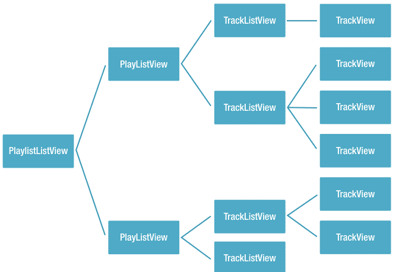

**图 6-1.** *一个示意图，显示了具有两个可点击列表项的列表界面所需的视图*

PlaylistListView 是按名称列出每个播放列表的视图，因此可以直接绑定到 id 为 playlists 的 div。该视图不负责任何要渲染到模板的数据，因此我们可以直接进行：在初始化过程中，将播放列表集合中的每个模型绑定到一个名为 renderItem 的函数，该函数为集合中的每个播放列表模型创建一个 PlaylistView 并将其渲染到屏幕上。当然，该视图还需要一个 render 函数，以便对每个模型调用 renderItem；我通过使用 Underscore 的 _.each 遍历模型来获取每个模型的 JSON，然后将其传递给 renderItem 函数。TrackListView 以相同方式工作，为播放列表的 tracks 数组中的每个 Track 模型渲染一个 TrackView。

```
var PlaylistListView = Backbone.View.extend({

    el: "#playlists",
    model: playlists,

    initialize: function() {
        this.listenTo(this.model, "change", this.render);
        this.bind('render', this.render);
        _.bindAll(this, "renderItem");
    },

    renderItem: function(model){
        var playlistView = new PlaylistView({model: model});
        playlistView.render();
        $(this.el).append(playlistView.el);
    },

    render: function(){
        $("#playlists").html('');
        var self = this,
            html = '';
        _.each(this.model.toJSON(), function(mod) {
            self.renderItem(mod);
        });
    }

});
```

```
var TrackListView = Backbone.View.extend({

    el: $("#tracks"),

    initialize: function(){
        this.bind('changePlaylist', this.changePlaylist);
        _.bindAll(this, "renderItem");
    },

    renderItem: function(model){
        var trackView = new TrackView({model: model});
        trackView.render();
        $(this.el).append(trackView.el);
    },

    render: function(){
        $("#tracks").html('');
        if (this.model) {
            var self = this,
                html = '';
            _.each(this.model.toJSON().tracks, function(mod) {
                self.renderItem(mod);
            });
        }
    },

    changePlaylist: function(current) {
        if (!this.model && current) {
            this.model = current;
        }
        this.render();
    }

});
```

单个视图的工作方式类似，但它们只需渲染自身，而无需渲染集合的内容。这些视图还使用 underscore 模板将数据渲染到页面。每个视图都有双击事件，会为 PlaylistView 触发一个名为 play 的函数。play 函数触发一个事件，使 App 播放播放列表中的第一首曲目，而 TrackView 上的 play 函数用于播放指定的曲目。

```
var PlaylistView = Backbone.View.extend({

   tagName: "li",
   template: _.template($('#playlist-template').html()),

   events: {
      "dblclick" : "play"
   },

   render: function() {
      var html = this.template(this.model);
      $(this.el).html(html);

      return this;
   },

   play: function() {
      this.trigger('play');
   }
});

var TrackView = Backbone.View.extend({

   tagName: "li",

   template: _.template($('#track-template').html()),

   events: {
      "dblclick" : "play"
   },

   render: function() {
      if(this.model)  {
         var html = this.template(this.model);
         $(this.el).html(html);
      }
      return this;
   },

   play: function() {
      console.log("Playing " + this.model.title);
      player.trigger("play", this.model);
   }

});
```

## Player 对象

你会注意到我在 player 上调用了一个函数，这个对象就是负责管理声音的对象。默认情况下，该对象将 el 存储为快速访问 $("#player")（即音频元素）的方式，它还将当前曲目的 id 存储为 track，默认值为 null。state 默认值为 "paused"，用于判断曲目是否正在播放。要更改曲目，我们只需要一个 setTrack 函数，将 track 设置为新的曲目 id。当然，播放器需要能够播放音乐，因此需要一个 play 函数；它需要将曲目 id 作为可选参数，这样就可以将其添加到音频元素的 src 中。

```
var Player = Backbone.View.extend({
    el : "#player",

    track : null,

    state : "paused",

    initialize: function()  {
      this.bind('play', this.play);
      this.bind('pause', this.pause);
    },

    setTrack : function(track)  {
      this.track = track;
    },

    play : function(track)  {
      // 如果设置了 track，则播放新歌曲；否则播放当前的 src（用于暂停后恢复）。
      if (track)  {
        this.setTrack(track);
        $(this.el).attr("src", track.url).appendTo($(this.el).parent());
      }
      $("#togglePlaying").html("Pause");
      this.state = "playing";
      this.el.play();
    },

    pause : function()  {
      $("#togglePlaying").html("Play");
      this.state = "paused";
      this.el.pause();
    }
});
var player = new Player();
```

## 主应用视图

好的，我们已经编写了大量代码来构建应用的基础，但目前它实际上还不能做任何事情，因为这些代码还没有关联在一起。正是这个视图负责了解当前播放列表，并管理所有视图之间（以及任何不在视图中的元素之间）的交互。由于页面上每种列表视图始终只有一个，因此 AppView 将列表视图作为单例处理，以确保每种列表视图在使用时只有一个实例。


到目前为止，我们只需要一个基本界面，包含每个视图的元素以及两个用于触发新建播放列表和添加曲目提示的链接。这些元素只是普通的 HTML 元素，可以像不使用 Backbone 时一样使用，唯一的区别是我们还需要将依赖项（包括 Backbone）作为脚本引入。

```
<div id="app">
    <a id="new-playlist">New Playlist</a>
    <a id="new-track">Add Track</a>
    <ul id="playlists"></ul>
    <ul id="tracks"></ul>
    <div id="player-controls">
      <a id="togglePlaying">Play</a>
    </div>
</div>

<audio id="player">

<script src="../vendor/jquery.min.js"></script>
<script src="../vendor/underscore.min.js"></script>
<script src="../vendor/backbone.min.js"></script>
<script src="../vendor/backbone.localStorage.js"></script>
<script src="js/app.js"></script>
```

数据使用 Underscore 的模板引擎来处理。模板在主 HTML 文件的 script 标签内定义。

```
<script type="text/template" id="playlist-template">
    <li><%= title %></li>
</script>

<script type="text/template" id="track-template">
    <li>
      <%= title %>
      <%= artist %>
    </li>
</script>
```

AppView 负责处理与 DOM 的交互；在 Backbone 中，事件通过定义事件类型、选择器来查找元素，然后是一个值，即应触发的函数名称。AppView 将使用我们之前在本章创建的模型（例如播放列表）。你可以在下面的代码中看到事件监听器是如何设置的，以及我们将用来开发 AppView 的结构。

```
var AppView = Backbone.View.extend({
    el: $("#app"),

    currentPlaylist: -1, // Index of the playlist,
    trackListView : new TrackListView(),
    playlistListView : new PlaylistListView(),

      events: {
        "click #clear-completed": "clearCompleted",
        "click #toggle-all": "toggleAllComplete",
        "click #new-playlist": "createPlaylist",
        "click #new-track": "createTrack",
        "click #togglePlaying" : "togglePlay"
      },
      initialize: function() { },
      changePlaylist: function(id) { },
      createPlaylist: function(e) { },
      createTrack: function(url) { },
      handleDrop: function(e) { },
      play: function()  { },
      preventDefault: function(e) { },
      render: function() { },
      renderTracks: function() { },
      renderPlaylists: function() { },
      togglePlay: function()  { }
  });
  var App = new AppView;
```

在 initialize 函数中，我们将设置 Backbone 事件（与 DOM 事件相对），当模型上触发事件时调用函数。第一个函数是 renderPlaylists，其目的是每当播放列表需要更改时，可以在 playlistListView 上渲染以更新页面上的播放列表。还有另一个用于渲染的函数叫做 render，它作为一个通用函数来同时渲染播放列表和曲目。render 函数调用 renderPlaylists 和 renderTracks。后者的作用是确保要渲染的播放列表（即播放列表中的实际曲目）具有 currentPlaylist 中保存的当前 id。然而，它应该始终已经是正确的，因为要在首先更改播放列表时，我们有一个 changePlaylist 函数，它既更改 currentPlaylist id，也更改 trackListView 的播放列表模型。

```
changePlaylist: function(id) {
  this.currentPlaylist = id;
  this.render();
},
render: function()  {
  this.renderTracks();
  this.renderPlaylists();
},
renderTracks: function() {
  if (this.currentPlaylist != -1) {
    var current = playlists.get(this.currentPlaylist);
    this.trackListView.trigger('changePlaylist', current);
  }
},
renderPlaylists: function() {
  this.playlistListView.trigger('render');
}
```

现在我们还剩两个函数要创建——用于添加新播放列表和曲目的函数。创建新播放列表非常简单，因为我们可以通过 prompt 获取播放列表名称，然后只需在播放列表集合上使用 Backbone 的 create 函数即可。然而，对于 createTrack 函数，我们有相当多的工作要做。我们需要获取 trackName、trackArtist 和 trackUrl，除了当 URL 被传递给函数时（例如我们即将添加的拖放功能），该 URL 被用作 trackUrl，其他情况我们都可以通过 prompt 来获取。然后我们需要检查是否有包含曲目的播放列表。如果 currentPlaylist 尚未设置，那么只要存在任何播放列表，我们就使用第一个。因为曲目存储在模型内的数组中，我们必须稍微绕过 Backbone 的默认行为，因为你可以替换数组但不能向其中添加。为此，我们检索当前的曲目数组，然后将新曲目添加到该数组中。有了数组中的新曲目，我们可以用包含该曲目的"新"数组来覆盖模型中的数组。完成后，现在就可以将曲目渲染到页面上了。

```
createPlaylist: function(e) {
  var playlistName = prompt("Playlist Name");
  playlists.create({title: playlistName});
},
```

```
createTrack: function(url) {
  var trackName = prompt("Track name");
  var trackArtist = prompt("Track artist");
  var trackUrl = (typeof(url) == "string") ? url : prompt("Track url");
  if (trackName && playlists.models[0]) {
    if (this.currentPlaylist==-1) this.currentPlaylist = playlists.models[0].id;
    var tracks = playlists.get(this.currentPlaylist).get("tracks");
    tracks.push({ title: trackName, artist: trackArtist, url: trackUrl });
    playlists.get(this.currentPlaylist).save({ tracks : tracks});
    this.renderTracks();
  }
},
```

## 拖放

如果你回顾一下第 2 章，你会记得我们在涂色书应用中使用了拖放功能。拖动文件是将文件导入应用的相当明显的方式，因此将其用作添加新曲目是很有意义的。这个版本将拖放的曲目添加到当前播放列表，但我建议你修改它，尝试通过将曲目拖放到播放列表名称上来添加到指定播放列表。我重新整理了第 2 章中的原始代码，以便你可以看到在其他类型的文件上使用拖放功能是多么相似。我们首先设置事件监听器，根据需要调用 preventDefault 和 handleDrop。handleDrop 函数用于从拖放的文件中选择第一个文件，并将其转发给 createTrack，这是主 App 视图中将曲目添加到播放列表的函数。这是一个很好的例子，说明如何利用已经写好的代码来轻松添加新功能！遗憾的是，我们不能直接使用 Backbone 事件，因为（在撰写本文时）无法阻止事件冒泡。为了获取曲目名称和艺术家，我决定使用 prompt 是最简单的方法。这里还有两个改进代码的机会，我鼓励你尝试一下：一是启用多文件拖放，二是改进界面以便不需要 prompt（或者你可以尝试从文件的元数据中获取数据）。

在 AppView 的 initialize 函数中，我们放置事件监听器：

```
window.addEventListener('dragover', this.preventDefault, false);
window.addEventListener('dragenter', this.preventDefault, false);
window.addEventListener('drop', this.handleDrop, false);
```

我们还需要在 AppView 中添加 handleDrop 和 preventDefault 函数：

```
handleDrop: function(e) {
    e.stopPropagation();
    e.preventDefault();
    var file = e.dataTransfer.files[0];

    reader = new FileReader();
    reader.readAsDataURL(file);
    reader.onload = (function(theFile) {
        return function(e) {
            App.createTrack(e.target.result);
        };
    })(file);
},
preventDefault: function(e) {
    if (e.preventDefault) {
        e.preventDefault();
    }
    return false;
},
```

## 集成音乐创作

现在让我们集成上一章的音乐创作功能，这样我们就可以创建自己的曲目并添加到播放列表中。这听起来很简单，而且大部分确实如此，但我们让创作器以这种方式工作：其中存储了播放列表的 localStorage 会把它搞乱（因为它使用计数器作为 id 而不是哈希）。所以我们需要先解决这个问题！

目前，音乐创作应用的每个 localStorage 记录的键都在一个计数器内使用，用于迭代和查找任何特定的剪辑。这通常是一种相当糟糕的方法，因为如果删除了一个 id，它可能会破坏循环，而且正如我刚才提到的，当存储中存在其他类型的键值对时，它也无法正常工作。如果你看一下使用 Backbone 插件生成的 localStorage，你会看到所有键都有一个字符串作为前缀，作为键的一种命名空间。还有一个与命名空间同名的单一键，其值是一个列表（即：JSON.stringify 后的数组），包含每个剪辑名称，这样我们仍然可以通过获取数组中的每个名称并找到相应的键来迭代所有键。

在 recordSound 函数中，我们需要更改它，使对象现在能正确存储，键前面带有命名空间。如前所述，它还需要将键添加到命名空间的值中，因此我们需要检查它是否存在，以便可以添加到其中或创建一个新的。每当需要访问数据时，可以使用 `JSON.parse(localStorage["clippings-" + clippingNames[i]])`。

```
function recordSound(name) {
    recorder.exportWAV(function(blob) {
        var object = {
            file: window.URL.createObjectURL(blob),
            size: recordEnd - recordStart
        }
        if (localStorage["clippings"]) {
            var clippings = JSON.parse(localStorage["clippings"]);
            clippings.push(name);
            localStorage["clippings"] = JSON.stringify(clippings);
        }
```

```
else {
    localStorage["clippings"] = JSON.stringify([name]);
}
localStorage["clippings-"+name] = JSON.stringify(object);
drawTimeline();
});
}
```

修改后的键盘最终版本可以在 Apress 网站 [www.apress.com/9781430259442](http://www.apress.com/9781430259442) 或我自己的网站 [www.shanehudson.net/javascript-creativity](http://www.shanehudson.net/javascript-creativity) 上的在线下载中找到。

## 音乐可视化

到目前为止，我们所讲的大部分内容都有规则可循，例如设计模式或音乐理论。但这一步不同。你可以将音乐可视化视为一种艺术，我们所使用的数学大多 loosely 基于三角函数等概念，通过调整数字来让可视化效果看起来有趣。我深受 Steven Wittens ([http://www.acko.net](http://www.acko.net)) 的启发，他一直都活跃在这个领域，撰写文章、在会议上演讲以及制作演示，所有这些都使用数学来创造有趣的效果。在这一节中，我修改了 Steven 的 js1k 参赛作品，以配合音乐播放器使用，因为他已经写了一篇深入的文章 ([http://ack(Math.sin(h + i + time * .15) + 1)) + "," + Math.round(distance * (h + Math.sin(i - 1) + 1)) + "," + Math.round(distance * (h + Math.sin(i - 1.3) + 1)) + ")";
                    if (z3 > 0.1) {
                        if (lastPointVisible) {
                            g.stroke();
                        }
                        else {
                            lastPointVisible = true;
                        }
                    }
                    else {
                        lastPointVisible = false;
                    }
                    g.beginPath();
                    g.moveTo(x,y);
                }
            }
        }
    }
}
```

```
function getAverage(freqData) {
    var average = 0;
    for (var i = 0; i < freqData.length; i++) {
        average += freqData[i];
    }
    average = average / freqData.length;
    return average;
}
```

```
function interpolate(a,b) {
    return a + (b-a) * 0.04;
}
```

开头部分只是像通常使用 canvas 时一样的设置代码，获取上下文和尺寸。然而在这些代码之后，有一行非常强大的代码：`g.globalCompositeOperation = "lighter"`。如果你有计算机图形技术层面的经验，或者在 Photoshop（或其他图形软件）中使用过混合模式，那么你就会对这是什么有所了解。合成操作是一种合成形式（与裁剪并列），用于根据多个形状的重叠方式来操作它们（基于许多常见算法）。合成操作本身被称为 Porter-Duff 算符（以其发明者命名），但在 canvas 中使用时有略微不同的名称。合成操作有很多种。这里我们使用的是 **lighter**，它使形状的任何重叠区域的颜色变为重叠形状的更亮混合。默认值是 source-over。表 6-1 是可用操作的完整列表（来自 canvas 规范）：

**表 6-1。**

| 操作名称 | Porter-Duff 算符 | 描述 |
| :--- | :--- | :--- |
| source-atop | A atop B | 在两幅图像都不透明的地方显示源图像。在目标图像不透明但源图像透明的地方显示目标图像。其他地方显示透明。 |
| source-in | A in B | 在源图像和目标图像都不透明的地方显示源图像。其他地方显示透明。 |
| source-out | A out B | 在源图像不透明且目标图像透明的地方显示源图像。其他地方显示透明。 |
| source-over | A over B | 在源图像不透明的地方显示源图像。其他地方显示目标图像。这是默认操作。 |
| destination-atop | B atop A | 与 source-atop 相同，但使用目标图像代替源图像，反之亦然。 |
| destination-in | B in A | 与 source-in 相同，但使用目标图像代替源图像，反之亦然。 |
| destination-out | B out A | 与 source-out 相同，但使用目标图像代替源图像，反之亦然。 |
| destination-over | B over A | 与 source-over 相同，但使用目标图像代替源图像，反之亦然。 |
| lighter | A plus B | 显示源图像和目标图像的和，颜色值趋近于 255（100%）为上限。 |
| copy | A（忽略 B） | 显示源图像而不是目标图像。 |
| xor | A xor B | 源图像和目标图像的异或。 |


接下来的代码部分使用一个比例来缩放和转换画布。严格来说，这并不是必需的。但我还是决定保留它，因为这是一个有趣的优化方法。基本上，我们不会绘制整个画布的坐标，而是将它们绘制在 –1 到 1 之间，这样性能会更好，因为转换画布比逐个绘制整个画布更简单、更快。`lastPointVisible` 这个布尔值是另一个轻微的优化，它只用于渲染前景，这样背景中看不到的部分就不会被渲染。从这里开始，我们需要使用 `requestAnimationFrame`，原因和之前一样，是为了保持流畅，并且只在需要时才进行处理（当然这是非常密集的代码）。RAF 调用一个 `draw` 函数来绘制每一帧。顺便问一下，你看到这些模式了吗？每个项目都可以简化为几种模式，这就是为什么我使用一些你可能永远不需要构建的示例——无论如何，这些概念都会很有用！

在 `draw` 函数中，我们获取频率数据。现在我们面临一个难题……如何使用这些数据？在这个示例中，我决定只使用平均频率来移动可视化中的线条，但有很多选项可以尝试。一个好主意可能是计算每分钟的节拍数，或者用不同的线条表示不同的频率范围。

完整的代码清单一如既往地可以在 Apress 网站 [www.apress.com/9781430259442](http://www.apress.com/9781430259442) 以及我自己的网站 [www.shanehudson.net/javascript-creativity](http://www.shanehudson.net/javascript-creativity) 上找到。

### 小结

那是一个特别长的项目，所以我确保只解释了那些不是很明显的概念或代码；希望你在过程中没有迷失方向。当然，音乐播放器的应用范围非常广泛，以至于本章只是触及了你能做到的内容的皮毛，所以我选择了那些能让你学到最多技能的特性，以便在其他项目中使用。我强烈建议你探索项目的其他方向，比如添加一个插件系统，或者将音乐可视化器转换为 3D（目前它呈现的是 3D 效果，但实际上只是以 2D 显示）。我略过了很多关于可视化的数学知识，因为我试图探索我们能用 JavaScript 制作的创意作品，而不是教数学，但我强烈推荐阅读 Steven Wittens 关于他 js1k demo 制作过程的文章：[http://acko.net/blog/js1k-demo-the-making-of](http://acko.net/blog/js1k-demo-the-making-of)。

# 第 7 章

# 使用 Node.js 实现实时协作

到目前为止，在整本书中，我们编写的所有代码都是客户端的，但尽管现在的客户端 JavaScript 非常强大，但通常还是需要一个服务器，这样数据就可以在线存储，可以将敏感的逻辑放在客户端之外，或者让用户可以在线彼此交流。你可能熟悉其他服务器端语言，如 PHP 或 Ruby（甚至可能是 Perl！），但 Node.js 的一个优点是，你可以使用 JavaScript 编写服务器端代码，所以它应该很容易上手，因为你已经有了客户端 JS 的经验。

## 制作聊天室

在本章中，我们使用 Node.js 配合 Socket.IO 创建一个实时聊天室 Web 应用，允许多个用户相互交谈。我将引导你在本地机器上安装 Node.js，因为大多数常用服务器（共享主机）不支持 Node.js，但请注意，某些服务（如 Heroku 和 Amazon Web Services）确实提供免费套餐。

### 安装 Node.js

显然，要使用 Node.js 编写任何东西，你需要先安装它。安装方法有很多种。你可以使用包管理器，例如 apt-get、yum 或 Homebrew（取决于你使用的操作系统），但这些并不总是最新的版本。在 Node.js 网站 [www.nodejs.org](http://www.nodejs.org) 上，你可以下载最新版本的可执行文件，或者从源代码构建。或者，你也可以使用 [www.github.com/creationix/nvm](http://www.github.com/creationix/nvm) 上的 Node Version Manager (nvm)，如果你正在处理许多并非都使用最新版本的代码库，这尤其有用。Node 自带一个名为 npm 的内置包管理器，它通过一个名为 package.json 的文件来处理依赖关系，因此你不需要自己安装 Express 和 Socket.IO，只需将其放入该文件即可。当你准备好安装包时，在包含 package.json 的文件夹中运行 npm install。

```
{
    "name": "javascript-creativity-chatroom",
    "description": "A chatroom made in chapter 7 of the JavaScript Creativity book.",
    "version": "0.0.1",
    "private": true,
    "dependencies": {
        "express": "3.x",
        "socket.io" : "0.9.x"
    }
}
```

与传统的 JavaScript 不同，Node.js 有一个模块系统，允许你在运行时加载 JavaScript 文件。每个模块都定义在一个文件中，通过 `module.exports` 对象导出变量和函数。在另一个文件中，你可以使用 `require` 函数来加载模块并获取其 `module.exports` 的内容。加载模块有三种不同的方式。

- `require()` 一个相对文件，例如 `require('./lib/utils.js')`。这会加载该单个文件并返回该文件中 `module.exports` 的值。如果你有大型的多文件项目，你会经常使用这种方法。
- `require()` 一个核心模块，它们是特殊关键字，例如 `require('http')` 用于加载核心 http 模块。Node.js 安装时附带了许多标准的核心模块，但默认情况下它们并未包含，这意味着你想用时需要 require 它们。你可以在 Node.js 文档（[www.nodejs.org/api/index.html](http://www.nodejs.org/api/index.html)）中看到完整的核心模块列表。
- `require()` 从 `node_modules` 文件夹中加载一个独立的模块，例如 `require('express')`。这是模块系统最强大的功能。你可以通过引用模块名来 require 整个独立的模块。其工作原理是：Node.js 对 `node_modules` 文件夹有特殊的处理。它会从当前脚本向上遍历目录树，查找 `node_modules/<name>/package.json` 或 `node_modules/<name>/index.js`。它首先查看 package.json，看看是否有一个 "main" 属性，该属性引用一个与 index.js 名称不同的 .js 文件来加载。假设你有一个文件 /www/myapp/index.js，在这个文件中你有 `require('express')`。Node.js 会在以下目录中查找该模块：

- /www/myapp/node_modules/express/(package.json 或 index.js)
- /www/node_modules/express/(package.json 或 index.js)
- /node_modules/express/(package.json 或 index.js)
- $NODE_PATH/express/(package.json 或 index.js)
- $HOME/.node_modules/express/(package.json 或 index.js)
- $HOME/.node_libraries/express/(package.json 或 index.js)
- $PREFIX/lib/node/express/(package.json 或 index.js)

这是 Node.js 查找的文件夹的完整列表；强烈建议你确保将你的模块放在本地的 `node_modules` 文件夹中，以保证速度和可靠性。其他文件夹主要在 `node_modules` 文件夹中的 Node.js 模块需要它们自己的模块时很有用，这样你就可以在项目和模块之间共享模块。

这正是 npm 介入并让事情变得更好的地方。由于 Node.js 中 `node_modules` 文件夹的特性，npm 会查看你 package.json 中的 "dependencies" 和 "devDependencies" 对象，并将每个依赖下载到你的 `node_modules` 文件夹。它还会下载你的模块的所有依赖，以及你的模块的模块的所有依赖，依此类推。"dependencies" 和 "devDependencies" 之间的区别在于，npm 不会安装其他模块的 devDependencies，只会安装 dependencies。默认情况下，npm 将所有内容安装到本地的 `node_modules` 文件夹中。这并不总是你想要的，所以如果你使用 `npm install -g <module>` 安装模块，那么它会全局安装（通常在 `$HOME/.node_modules/` 中）。这非常有用，因为你可以用它来安装用 Node.js 编写的命令行程序。例如，我在开发项目时使用 Remy Sharp 的 nodemon 作为运行 node 服务器的另一种方式，因为默认的 `node [文件名]` 方法在服务器运行时不会监视已更新的文件。要安装 nodemon，请运行 `npm -g install nodemon`，然后运行 `nodemon [文件名]` 通过 nodemon 运行服务器。有关 nodemon 的更多信息，请访问 [www.remy.github.io/nodemon/](http://www.remy.github.io/nodemon/)。


Node.js 最简单的例子当然是 Hello World。为了提供一个网页，我们需要 require 一个名为 http 的模块，它让我们能够处理 HTTP 的底层细节。该模块是一个核心模块，所以我们使用列表中的第一个定义。一旦 require 了 HTTP，我们就将其存储在一个名为 http 的变量中。然后我们使用 http 上的一个名为 createServer 的方法；它有一个回调函数，可以让你发送响应（也称为网页）。要创建被服务的网页，我们首先使用 response.writeHead 来写入响应头。需要提供的第一个参数是 HTTP 状态码 200（OK）。第二个参数是实际的响应头，在这个示例中我们只写入 "Hello World"，所以 Content-Type 可以是 text/plain，如果你想向页面中写入一些 HTML 内容，你也可以选择使用 text/html。要写入实际的内容，只需使用 response.write。写完响应后，使用 response.end() 来结束响应。现在你已经有了一个服务器，但要真正地提供页面，你需要告诉它在某个端口上监听活动（在本例中为 8080 端口）。

```
var http = require("http");
http.createServer(function(request, response) {
  response.writeHead(200, {"Content-Type": "text/plain"});
  response.write("Hello World");
  response.end();
}).listen(8080);
```

既然你已经知道了如何 require 一个模块并对其进行操作，接下来让我们编写一个简单的自定义模块，利用我之前提到的 module.exports。该模块会将我们的 Hello World 代码封装到一个名为 helloworld.js 的文件中，然后在 server.js 中将其作为一个名为 hello 的变量进行 require，并调用其中的 server 方法。

## helloworld.js

```
var http = require("http");

function hello() {
  http.createServer(function(request, response) {
    response.writeHead(200, {"Content-Type": "text/html"});
    response.write("Hello World");
    response.end();
  }).listen(8080);
}

module.exports.server = hello;
```

## server.js

```
var hello = require('./helloworld.js');
hello.server();
```

当然，这是一个非常简单的示例，但它很好地展示了如何 require 一个自定义模块，并根据模块导出时使用的名称（而不是函数本身的名称）来调用相应的方法。在这里有必要指出方法和函数之间的区别，因为很多人会不加区分地混用这两个术语（这倒也没什么问题，但我倾向于更精确地使用它们）。方法是基于某个对象使用的，而函数则独立于任何对象。

## Socket.IO 和 Express

我之前提到了 Socket.IO，它是我们从 package.json 中安装的包之一，但我没有解释它的作用。基本上，它是 WebSocket 的一个封装库，使得所有浏览器都能支持实时通信。

## 第 7 章 使用 Node.js 实现实时协作

> Socket.IO 的目标是让实时应用在每一种浏览器和移动设备上成为可能，抹平不同传输机制之间的差异。它是完全使用 JavaScript 实现的、无忧的实时通信方案。

Socket.IO 首页

Socket.IO 也非常易于使用。一旦安装完成，就需要在服务端文件中进行 require（类似于在 PHP 中 require 一个文件，但 Node 会自动定位其安装位置），然后将其设置为监听服务器。

当然，我们目前还没有创建服务器。像 PHP 这样的语言是按文件执行的，将文件内容翻译成输出，而 Node.js 不同，它是一个长时间运行的进程，可以多次为多个文件提供服务。Node.js 内置了一个 HTTP 模块（不过如果你愿意，也可以使用 apache 或 nginx），它使你能够自己创建一个简单的服务器——但在大多数情况下，你并不想与底层的服务器代码纠缠在一起。

Express.js 使你能够更轻松地进入网站开发中实际编写代码的阶段，而无需担心每个文件如何访问其余的文件结构等等。然而，Express.js 的观点并不强制：使用 Express.js 时，你可以选择任何你喜欢的范式（或工作方式）。你可以使用 Express 提供的工具编写简单的网站、博客、复杂的 Web 应用，或者 REST API。如果你更喜欢一种有强制约定的方法，Express 有一个官方的结构化工具叫做 express-generator，可以通过 npm 全局安装，以帮助你启动新项目，不过它并不会强制你一直使用同样的结构。

作为使用 Express 处理底层代码的一个简单示例，请看下面的两段代码片段。当你访问 localhost:8080/hello 时，它们都会在页面上输出 "Hello World!"；当你访问任何其他页面时，它们都会输出 "Goodbye cruel world!"。区别在于，第一个代码片段直接使用了 http，而第二个代码片段使用了 Express。当然，这只是 Express 能力的冰山一角，但它可以很好地向你展示 Express 无需处理诸如 HTTP 头之类的底层代码。

### 不使用 Express

```
var http = require('http');
http.createServer(function(request, response) {
    var url = request.url;
    response.writeHead(200, {"Content-Type": "text/html"});
    if (url == '/hello') {
        response.write("Hello World!");
    }
    else {
        response.write("Goodbye cruel world!");
    }
    response.end();
}).listen(8080);
```

### 使用 Express

```
var express = require('express');
var app = express();
app.get('/hello', function(request, response) {
    response.send("Hello World!");
});
app.get('/*', function(request, response) {
    response.send("Goodbye cruel world!");
});
app.listen(8080);
```

现在让我们使用 Express 开始编写聊天室的服务器端代码。在本章的开头有一个用于安装 Express 和 Socket.IO 的 package.json，如果你还没有安装这些包，那么现在就安装吧。使用 Socket.IO 与单独使用 Express 略有不同，因为它需要将一个 http.createServer 实例传递给 Socket.IO 的监听器。在 Express 3 版本之前情况有所不同，那时的 express() 函数返回的是一个 http.Server 实例。

```
var app = require('express')(),
    server = require('http').createServer(app),
    io = require('socket.io').listen(server);
server.listen(8080);
```

目前页面上什么都看不到，因为我们这次甚至没有写入 "Hello World"，所以让我们仅使用 HTML 来搭建一个最基本的页面。对于最基本的聊天室来说，我们只需要两个文本框来输入昵称和消息（你可以根据界面设计的需要以不同方式处理昵称），一个用于发送消息的按钮，以及一个用于展示消息的 div（你可以使用列表元素来获得更好的语义化效果）。该文件可以（但并非必须）保存为 index.html，并放在与服务端代码相同的目录下，这是一般的做法。

```
<!doctype html>
<html>
    <head>
        <title>Chatroom</title>
    </head>
    <body>
        <label for="nickname">Nickname:</label><input type="text" id="nickname"></input>
        <div id="messages"></div>
        <textarea id="message"></textarea>
        <a id="send">Send</a>
    </body>
</html>
```

现在你需要使用路由（正如我们在 Hello World 示例中所做的那样）来告诉浏览器去哪里获取内容。对于这个聊天室，我们希望可以访问多个房间，一个不错的做法是将聊天室的名称（或一个随机标识符）放在房间的 URL 中。Express 提供了一种简便的方法来获取这个名称，即作为路径段（也称为命名参数），但因为这个聊天室不需要多个视图，我们可以将所有页面都指向 index.html。我们也可以使用通配符来实现这一点，而不是使用命名参数，但使用命名参数是一个介绍“将路径用作参数”这一概念的好方法。它还能够强制要求包含聊天室 id，因为在没有 id 的情况下它不会提供该页面；这意味着如果想要添加一个主页，就需要使用单独的路由。

```
app.get('/:id?', function (req, res) {
    res.sendfile(__dirname + '/index.html');
});
```

当然，这是一个相当无用的聊天室。让我们编写用于处理消息的服务端代码。使用 Socket.IO 时，我们需要检查连接，使用 io.sockets.on('connection', function (socket) {}); 作为所有连接的事件处理器，然后加入 URL 路径段中命名的那个房间。与 Express 不同，获取标识符需要使用 var room = socket.handshake.headers.referer，因为 Express 的 .get 方法在路由完成之后就不可用了。获取标识符的其他方式包括：从客户端发送路径段过来，或者最初使用 res.local（作用域限定在请求/响应周期内的变量）来提供，并将其作为客户端的全局变量暴露出来。使用 socket.handshake 方式虽然代码比较长，但在本例中，它是一种避免从客户端发送信息的好方法。


```markdown
第7章 ■ 使用Node.js实现实时协作

将标识符存储在名为`room`的变量中后，我们现在可以使用`socket.join(room);`来加入一个与该ID同名的Socket.IO房间。这些房间本质上是将正确的消息发送给正确人员的一种方式，只有房间成员才能收到该特定房间的消息。

要检查消息或当用户离开房间时，我们使用`socket`上的事件处理器。通过Socket.IO的每次通信都被归类为一条消息，不要与聊天室中书写的那些消息混淆。发送消息被称为`emit`（发射）。为了让聊天室中的消息能够相互发送，我们首先在客户端（我很快会讲到）将消息`emit`到服务器，然后服务器再将其发送给连接到该房间的其他客户端。要向房间广播消息，我们使用`io.sockets.in(room).emit(key, value);`。对于聊天室消息，我们使用字符串`'message'`作为键（key），数据则作为值（value）通过事件监听器的`data`参数传递。对于离开房间，键是`'leave'`。

```
io.sockets.on('connection', function (socket) {
    var room = socket.handshake.headers.referer;
    socket.join(room);
    socket.on('message', function (data) {
        io.sockets.in(room).emit('message', data);
    });
    socket.on('leave', function (room) {
        socket.leave(room);
    });
});
```

这就是基础聊天室服务器的全部内容，你可以从清单7-1中看到代码是多么简洁。我们现在需要做的就是，在客户端设置事件处理器，在消息发送时进行`emit`，这样，利用Socket.IO房间的强大功能和我们刚刚编写的代码，它将自动实时地将消息发送给同一房间的任何人！无需担心AJAX或长轮询（long polling），Socket.IO使用的是当前可用的最佳方法（大多数现代浏览器使用Web Sockets，但其他浏览器会回退到相应的方法）。不使用AJAX是我在本章决定不使用jQuery或任何类似库的最大因素之一，尽管对于更大的项目，你可能需要使用它们。

清单7-1.

```
<script>
    var socket = io.connect('http://localhost');

    socket.on('message', function(evt) {
        document.querySelector("#messages").innerHTML += '<p><span class="nickname">'
+evt.nickname+': </span><span class="message">' + evt.message + '</span></p>';
    });

    sendButton = document.querySelector("#send");
    var messages = document.querySelector("#message");
    sendButton.addEventListener('click', function() {

        socket.emit('message', {
            "message": messages.value,
            "nickname": document.querySelector("#nickname").value || 'Guest'
        });

        messages.value = "";
    });
</script>
```

110

**注意** 要在客户端使用Socket.IO，你必须包含`<script src="/socket.io/socket.io.js"></script>`，不过你无需担心其位置，因为Node.js会自动处理它。

## 总结

许多Node.js初学者在面对学习一项与他们所习惯的技术如此不同的技术时，总会感到有些畏惧。我希望本章能让你轻松进入Node.js的世界，并让你发现制作一个实时多用户应用程序几乎简单得可笑。聊天室可以非常多样化，因此这个练习应该为你学习更多这门语言提供一个很好的起点。你可以通过使用你感兴趣的语言特性来增强你的聊天室，从而进一步提升它。在下一章中，我们将在聊天室中添加视频和音频流功能，作为一个会议风格的特性，这将带你进入Node专业知识的下一个层次。

## 第8章

## 使用WebRTC实现视频对视频

我们聊天室的自然发展是视频对视频（video-to-video），就像Skype和Google Hangouts使用的那种，但直到最近，这比听起来要困难得多。为什么？是的，你猜对了……需要插件（即Flash）。直到2012年，在网络开始近20年之后，来自网络摄像头的原生视频流才开始逐渐进入浏览器。既然WebRTC开始得到广泛支持，那么学习如何使用它就变得很有价值。我不会假装它很简单——它并不简单——但是，一旦你弄清楚了它的工作原理，它确实是有道理的。

### WebRTC简介

好的，我们知道WebRTC用于实现浏览器之间的通信，但它究竟是什么？WebRTC实际上是一套规范，它们通常一起使用来创建实时通信链路。这组规范中也包括数据规范，因此它不仅仅用于视频和音频（尽管在撰写本文时，数据规范尚未得到良好支持，但它正在积极开发中）。WebRTC的形成与TCP服务器非常相似，因为它需要使用正确的协议发送握手信号，而不是一个你习惯使用的通用API。还应该注意的是，WebRTC是对等（peer to peer）而非客户端/服务器（client/server）模式，这就是为什么它需要在客户端进行额外的网络配置。由于大多数Web开发人员可能从未需要编写TCP服务器，我认为我们应该从头开始。

### GetUserMedia()

在WebRTC出现之前，创建原生视频通信最困难的问题之一，并不是通信本身难以实现（尽管没有任何对等能力时，实现起来确实非常困难）。不，最困难的问题是访问网络摄像头！

幸运的是，我们现在有了`navigator.getUserMedia()`，这是一个方法，它允许我们从输入设备获取视频和音频，并使用回调函数对其进行处理。

```
navigator.getUserMedia( {audio: true, video: true},
    function(s) {
        vid.src = URL.createObjectURL(s);
        vid.play();
    }, function(error) {throw error;}
);
```

第一个参数是一个配置对象，让你选择要使用的输入类型。然后我们有两个回调函数，第一个用于输入成功给你一个流（stream）时该怎么做，第二个用于失败时。

就是这样。很简单，对吧？Web开发中最令人烦恼的问题之一，现在只需一个方法即可解决。

现在，虽然我们纯粹在讨论`getUserMedia`，但我想指出，你可以用它做任何可以用普通视频做的事情（因为它通过视频元素）。在接下来的几章中，我们将研究计算机视觉（computer vision），这是一个通常不被认为是与Web相关的巨大话题，我们将使用`getUserMedia`作为整个项目的基础，它将向你展示视频不仅仅用于电话会议。

### 规范

正如我在本章开头提到的，WebRTC是一套规范。它由以下三个API组成：

- 媒体流API（Media Stream API）
- 对等连接API（PeerConnection API）
- 数据通道API（DataChannel API）

媒体流API主要涵盖了我之前解释的`getUserMedia()`方法。它需要自己的规范，因为尽管它非常易于使用，但对于浏览器实现者来说却很复杂。对等连接也很复杂，因为HTML API中以前从未有任何类型的对等网络。它为我们提供了一个简单的API来使用，而不是陷入网络复杂的工作细节中。

使用该API，我们创建一个对等连接（Peer Connection）对象来处理所有对等通信。该对象包括一个ICE（交互式连接建立，Interactive Connectivity Establishment）代理、连接的状态和ICE状态。幸运的是，这也是通过API处理的！所以，我们不需要弄清楚正确的状态等等，只需使用`new RTCPeerConnection()`创建对象，它就会自己处理状态。

在撰写本文时，数据通道API是实现最少的，因为使用服务器传输简单数据比实时传输视频和音频要容易得多。数据通道可能比媒体流更重要，因为数据通道允许点对点传输数据，这有无数的可能性，例如用于制作不需要服务器的多人游戏（或者至少，服务器不需要承担全部负载）。正如我们将在接下来的章节中看到的，媒体流可能极其强大，但数据有更多常见的用途，因此能够不通过服务器传输数据是令人兴奋的！

### 服务器

对不起。是的，WebRTC不需要服务器——但它又确实需要。如果你从非常简单的角度考虑，你总是需要一种相互找到的方法。没有服务器，除非你手动输入IP地址，否则对等连接根本无法知道连接到哪里。所以我们使用服务器，在我们这里是Node.js，以便消息能到达正确的客户端。这被称为信令（signaling）。服务器的复杂性取决于你的需求。我们将编写一个相当基础的服务器来处理提议（offers）和候选（candidates），但将限于两个客户端。扩展服务器以启用更多连接会相当简单。我鼓励你尝试这样做，因为这是理解WebRTC及其网络结构复杂性的好方法。

### 从哪里开始？

如你所见，我们面前有一个相当大的任务。我认为我们应该从服务器开始，因为它是代码中最小的部分，并且可以作为我们的测试套件。我们正在扩展第7章的代码，我已将其包含在此处以供你回忆和比较。

```
var app = require('express')(),
server = require('http').createServer(app),
io = require('socket.io').listen(server);
io.set('log level', 1); // Removes debug logs
server.listen(8080);
```
```


```
app.get('/:id', function (req, res) {
    res.sendfile(__dirname + '/index.html');
});

io.sockets.on('connection', function (socket) {
    var room = socket.handshake.headers.referer;
    socket.join(room);
    socket.on('message', function (data) {
        io.sockets.in(room).emit('message', data);
    });
    socket.on('leave', function (room) {
        socket.leave(room);
    });
});
```

我们需要保留所有这些内容，尽管其中某些部分会被编辑。在诸如此类可能相当复杂的应用中，我倾向于为每个 socket 赋予一个唯一标识符。为此我使用了 node-uuid，所以我们需要在文件顶部导入它。然后在新 socket 连接的代码中，我们将 uuid.v1() 的输出赋给 socket.id。当然我们需要让客户端知道它已经被分配了一个 id，因此我们触发一个 'assigned_id' 消息，将该 id 发送给客户端。

```
var express = require('express'),
    http = require('http'),
    uuid = require("node-uuid"),
    app = express(),
    server = http.createServer(app),
    io = require('socket.io').listen(server);

io.sockets.on('connection', function (socket) {

    var room = socket.handshake.headers.referer;
    console.log('JOINED', room);
    socket.join(room);
    socket.id = uuid.v1();

    socket.emit('assigned_id', socket.id);

    // 其他所有代码都放在这里
});
```

客户端需要监听所发出的消息，并将其存储在客户端的 socket 中。

```
socket.on('assigned_id', function(data) {
    console.log('assigned id' + data);
    socket.id = data;
});
```

现在我们需要为信令（signaling）创建其结构。当客户端的摄像头成功启动时，它会将自己的媒体流添加到自身的对等连接（peer connection）中，然后创建一个 offer。在回调函数中，对等连接会被赋予本地描述（local description）。我们从回调中以参数形式获得这个描述。该描述包含了关于客户端的所有数据（以 SDP 格式），例如 IP 地址。在我们写完服务器代码后，我会解释该描述的确切格式；它大部分是浏览器所需的复杂数据，但其中有一部分是值得了解的。现在，客户端需要让服务器知道，是时候将 offer 发送给另一个客户端了。为避免混淆，我们将最初的客户端称为 c1，将与之连接的客户端称为 c2。因此，服务器需要将任何 'received_offer' 消息转发给正确的 socket，即 c2。它最终对 'received_candidate' 和 'received_answer' 也做同样的处理；这三种消息就是实现基本切换所需要的全部内容。

```
socket.on('received_offer', function(data) {
    console.log("received_offer %j", data);
    io.sockets.in(room).emit('received_offer', data);
});

socket.on('received_candidate', function(data) {
    console.log("received_candidate %j", data);
    io.sockets.in(room).emit('received_candidate', data);
});

socket.on('received_answer', function(data) {
    console.log("received_answer %j", data);
    io.sockets.in(room).emit('received_answer', data);
});
```

你必须记住，整个代码会在两个客户端上同时运行，所以 c1 会将 received_offer 发送给 c2，但 c2 同样也会将它发送给 c1。这正是我们判断双方都已就绪的方式。当 c2 收到 offer 时，它会将其对等连接的远端描述（remote description）设置为 c1 所发送的那个（c1 的本地描述成为 c2 的远端描述，反之亦然）。然后它会创建一个 answer，将其本地描述（同样从回调中获取）发送回去；这一步看起来似乎并不必要，因为双方都已经拥有了对方的描述，但它可以看作是一种确认。它还在客户端设置一个名为 connected 的布尔变量为 true，以避免此过程重复执行并导致无限循环。在每个客户端上，对等连接会在本地描述被设置完成后注册一个 ICE 候选（ICE candidate）就绪的事件；这会触发一个事件，由客户端通过 pc.onIceCandidate() 处理，然后通过触发之前提到的 'received_candidate' 消息将更多数据（以 SDP 形式，我稍后会解释）发送给服务器。当然，c2 现在会接收到该 SDP，并使用它将 c1 作为 ICE 候选添加到对等连接中。

如果一切按计划进行，c1 和 c2 现在就能够看到彼此了。嗯，前提是我们已经实现了客户端代码。我的解释可能看起来相当令人困惑，那是因为我想准确地解释它究竟是如何工作的，而不仅仅是说服务器需要传递一些消息。它基本上与第 7 章中介绍的概念相同，也是你在编写 node.js 代码时会经常使用的一种模式。代码清单 8-1 给出了服务器端的代码，其中包含一条用于平滑关闭连接的消息，以及另一条用于显示房间内客户端数量的消息：

**代码清单 8-1.** Server.js

```
var express = require('express'),
    http = require('http'),
    uuid = require ("node-uuid"),
    app = express(),
    server = http.createServer(app),
    io = require('socket.io').listen(server);
io.set('log level', 1); // 关闭调试日志
app.use(express.static('public'));
server.listen(8080);

app.get('/:id?', function (req, res) {
    res.sendfile(__dirname + '/index.html');
});
```

```
io.sockets.on('connection', function(socket) {
    var room = socket.handshake.headers.referer;
    console.log('JOINED', room);
    socket.join(room);
    socket.id = uuid.v1();

    socket.emit('assigned_id', socket.id);

    socket.on('debug_clients', function(data) {
        socket.emit('room_count', io.sockets.manager.rooms['/' + room].length);
    });

    io.sockets.in(room).emit('room_count', io.sockets.manager.rooms['/' + room].length);

    socket.on('received_offer', function(data) {
        console.log(" received_offer %j", data);
        io.sockets.in(room).emit('received_offer', data);
    });

    socket.on('received_candidate', function(data) {
        console.log(" received_candidate %j", data);
        io.sockets.in(room).emit('received_candidate', data);
    });

    socket.on('received_answer', function(data) {
        console.log(" received_answer %j", data);
        io.sockets.in(room).emit('received_answer', data);
    });

    socket.on('close', function() {
        console.log("closed %j", room);
        io.sockets.in(room).emit('closed', room);
    });

});
```

## WebRTC 背后的技术

好的，让我们暂时从代码中抽身出来。我已经描述了 WebRTC 客户端之间是如何连接的流程，但其中可能有许多你从未见过的术语。因此，在我们编写客户端代码之前，我想先介绍 WebRTC 背后的技术及其工作原理。这些内容有些超出了本书的范围，所以我鼓励你阅读更多相关资料。如果你对此并不特别感兴趣，那么可以放心地跳到下一节，我们将会在那里实现客户端代码。

## ICE

我已经多次提到过 ICE。它是 *Interactive Connectivity Establishment*（交互式连接建立）的缩写，根据 RFC 5245（[http://www.ietf.org/rfc/rfc5245.txt](http://www.ietf.org/rfc/rfc5245.txt)）的定义，它是 "A Protocol for Network Address Translator (NAT) Traversal for Offer/Answer Protocols"（用于 Offer/Answer 协议的网络地址转换器（NAT）穿透协议）。该 RFC 包含非常多的细节，其中一些人可能会觉得非常有趣，但我觉得摘要部分已经很好地概括了其目的。对某些人来说，这听起来可能完全是天书，所以希望在你阅读完我对 ICE 以及其他技术的简要介绍后，能够理解其含义。

> *本文档描述了一种用于基于 UDP 的多媒体会话（采用 offer/answer 模型建立）的网络地址转换器（NAT）穿透协议。该协议称为交互式连接建立（ICE）。ICE 利用了 NAT 会话穿透工具（STUN）协议及其扩展——使用中继 NAT 穿透（TURN）。ICE 可用于任何使用 offer/answer 模型的协议，例如会话发起协议（SIP）。*

RFC 5245 摘要

正如我在本章的 "规范" 一节中所解释的，每个 WebRTC 客户端都必须拥有的对等连接由多个组件组成，包括 iceConnectionState、iceGatheringState 和 ICE Agent。ICE Agent 是其中重要（却又简单）的部分。它是 WebRTC 在每个客户端上的端点，并负责使用信令协议与其他端点进行通信。我们之所以使用 ICE，是因为（正如摘要所述）它是一个用于 UDP 通信 NAT 穿透的标准化协议。这基本上意味着它是一种穿透防火墙等安全措施而不会被阻止的方式。ICE 通过并行检查所有可能的通信路径来工作，从而快速找到最佳路径。这些状态被用来（顾名思义）确定 ICE Agent 的状态，并且它们是只读的。

iceGatheringState 的可能状态包括：

- new（新建）
- gathering（收集中）
- complete（完成）

iceConnectionState 的可能状态包括：

- starting（启动中）
- checking（检查中）
- connected（已连接）
- completed（已完成）
- failed（失败）
- disconnected（已断开）
- closed（已关闭）

## NAT 穿透

NAT 是硬件路由器（以及一些商用交换机）背后的技术，它使得一个路由器后面的多台机器能够使用同一个 IP 工作。它接收传入的数据包，并根据其来源将其发送到正确的设备。它将内部网络地址（例如 192.168.1.123）转换为对外的 IP 地址，再转换回去。出于安全等多种原因，入站通信会受到限制，通常涉及一个端口白名单表，NAT 设备使用该表将内部地址与入站端口相关联（通常称为 *防火墙*）。

NAT 穿透 是对一组以用户友好的方式绕过这种限制的方法的统称。如果没有 NAT 穿透技术，用户将不得不在防火墙上手动打开端口以允许入站通信，并将该端口信息提供给其他连接方。一些常见的 NAT 穿透技术包括：反向代理（Reverse Proxies）、Socket Secure（SOCKS）、通用即插即用（UPnP）以及 UDP 打洞（UDP Hole Punching）。


## STUN/TURN

STUN（Session Traversal Utilities for NAT，NAT 会话穿透工具）和 TURN（Traversal Using Relays around NAT，使用中继穿透 NAT）都是信令协议，常被 ICE 用作 NAT 穿透的工具。如果你希望自行搭建服务器，它们各自都有开源实现。我在撰写本章时使用的两个（你只需要一个，但可以将它们组成一个数组以便备用）分别由 Google 和 Mozilla 运行，地址是 `stun:stun.l.google.com:19302` 和 `stun:stun.services.mozilla.com`。你会注意到这两个服务器都是 STUN。这主要是因为它们是我最先发现的可靠免费服务器。两者之间的主要区别在于，TURN 使用中继技术，因此数据是通过服务器中继转发到达客户端的。不过它的好处在于 TURN 构建在 STUN 之上，因此总是先尝试使用 STUN，如果失败再使用中继。TURN 的另一个优点是它能处理对称型 NAT（Symmetric NAT），而 STUN 不行。

## SDP

如果我说 ICE 协议的摘要令人费解，那么我简直找不到合适的词来形容 SDP。乍一看（甚至第二眼、第三眼也是如此），它让人望而生畏。但别担心，重要的部分其实很容易理解，其余部分都有文档说明（主要在 RFC4566 中）。SDP 代表会话描述协议（Session Description Protocol），是一种在客户端之间传输的数据形式。下面是一个 SDP 示例，它是在 localhost 下运行本章代码，并在两个 Google Chrome 标签页之间建立连接时得到的。SDP 的内容有非常多的可能形式，这在很大程度上取决于通信的阶段，所以如果你查看自己的 SDP 数据，不要期望它和这里一模一样。我只列出了前 11 行，因为其绝大部分内容在调试时并不常用，而且其中大部分与加密相关。

```
v=0
o=- 6888311506875211333 2 IN IP4 127.0.0.1
s=-
t=0 0
a=group:BUNDLE audio video
a=msid-semantic: WMS YuWoiIj3TGBXItoUd2iqCWMbt7FnkBqSNpP96
m=audio 1 RTP/SAVPF 111 103 104 0 8 107 106 105 13 126
c=IN IP4 0.0.0.0
a=rtcp:1 IN IP4 0.0.0.0
a=ice-ufrag:qbj6LYoXCSHnUUuq
a=ice-pwd:/eziXfWhziBTVpMy1TLU2M3
```

我知道这让人望而却步。让我们先从等号前面的字母开始说起。这个字母叫做类型（type），它始终只有一个字符，并且区分大小写。类型的顺序是预先定义好的，这主要是为了减少错误，并使解析器更易于实现。当然，这对调试也很方便，因为我们总会知道要找的数据应该出现在哪里！我只会解释前 4 行，因为它们是最有可能出错的，其余部分是可选的，因此不太可能出错（万一出错，更可能是浏览器的 bug，而不是你的代码）。请注意，属性采用 `<type>=<attribute>:<value>` 的形式。如果你有兴趣深入了解，大多数属性在网上都很容易找到相关资料，我也可能会在我的网站上写一篇配合本章的文章。

### 会话描述

- v= （协议版本）
- o= （发起者和会话标识符）
- s= （会话名称）
- i=* （会话信息）
- u=* （描述的 URI）
- e=* （电子邮件地址）
- p=* （电话号码）
- c=* （连接信息——如果包含在所有媒体中则不要求）
- b=* （零个或多个带宽信息行）
- 一个或多个时间描述（"t=" 和 "r=" 行；见下文）
- z=* （时区调整）
- k=* （加密密钥）
- a=* （零个或多个会话属性行）
- 零个或多个媒体描述

### 时间描述

- t= （会话处于活动状态的时间）
- r=* （零个或多个重复时间）

### 媒体描述（如果存在）

- m= （媒体名称和传输地址）
- i=* （媒体标题）
- c=* （连接信息——如果包含在会话级别则为可选）
- b=* （零个或多个带宽信息行）
- k=* （加密密钥）
- a=* （零个或多个媒体属性行）
- * 表示可选

这份类型指南取自 RFC 4566，功劳归于互联网协会（The Internet Society）。你可以很容易地看出 SDP 对象是如何被分成三个部分的。在撰写本文时，所有 SDP 对象都以 v=0 开头，因为目前还没有其他版本可用。在我的示例中，第二行（发起者和会话标识符）是 o=- 6888311506875211333 2 IN IP4 127.0.0.1。连字符表示没有用户名，因为我当时并没有使用私有的 TURN 服务器。这个长长的数字是该会话的唯一标识符。接下来是这一行中重要的部分，至少对于调试来说是这样——会话版本（session version）；它表示会话数据发生更改的次数（每次我们发送带有数据的新消息时，这个数字都会递增）。你可以使用会话版本来确保会话描述已被更新。IN 代表 Internet（互联网），它的存在是为了使协议能够适应未来发展。然后是 IP 类型，本例中是 IP 第 4 版（IPv4）。第二行最后是 IP 地址。我是在本地运行的，所以它报告的 IP 地址是 127.0.0.1（localhost）。

你可能会注意到，我的示例直接跳到了时间部分，这是实现上的一个决定（本例中由 Chrome 决定），因为其间的所有行都是可选的。第一个 0 表示开始时间，后面的 0 表示结束时间。由于两者都为 0，意味着该会话是永久的。

## 客户端代码

好的，刚刚是从代码中抽身出来的一个不错间歇，但我相信大家都已经准备好再次深入，带着更扎实的理解来看 WebRTC 究竟是如何工作的，以及我们发送的数据到底是什么。记得我们讲解过的信令是如何工作的吗？下面再次以列表的形式给出，方便实现：

1. 启动摄像头。
2. 将媒体流添加到对等连接（Peer Connection）中。
3. 发送包含本地描述的 received_offer 消息。
   a. 将本地描述添加到对等连接中。
4. 将收到的描述作为远程描述添加到对等连接中。
5. 创建应答（Answer）。
6. 将 connected 设为 true，以防止无限循环。
7. 添加 ICE 候选者（ICE Candidate）。
8. 加载摄像头。

你可能还记得，在本章开头我们提到过，启动摄像头的正确方法是使用 navigator.getUserMedia()。但很遗憾，由于撰写本文时浏览器的不同实现方式，我们使用了 Adapter.js，并去除了厂商前缀（vendor prefix），以便 RTC 能够在跨浏览器环境中工作。为了使视频能够快速加载，而不必担心用户界面等问题，我们将 getUserMedia 放进一个名为 broadcast() 的函数中，并在不使用 window.onload 的情况下调用它。在 getUserMedia 的回调函数中，我们需要将媒体流添加到对等连接中，然后使用 URL.createObjectURL()（我们在第 2 章中使用过）将媒体流添加到 video 元素中并播放视频。一旦服务器发送的房间人数大于 1 的消息到来，就该向服务器发送 offer 了。

```
var socket = io.connect('http://localhost');
var pc = new RTCPeerConnection(servers, mediaConstraints);
var initConnection = false;

socket.on('room_count', function(data) {
  room_count = data;
  console.log('ROOM COUNT', data);
  if (room_count > 1)
    initConnection = true;
});

function broadcast() {
  getUserMedia({audio: true, video: true}, function(s) {
    pc.addStream(s);
    console.log("GOT MEDIA");
    vid1.src = URL.createObjectURL(s);
    vid1.play();
    if (initConnection) start();
  }, function(error) {throw error;});
};

window.onload = function() {
  broadcast();
};
```

在 start() 中，我们需要创建 offer，这是通过对等连接的 pc.createOffer() 来实现的。该方法本身会通过参数提供可访问的 SDP，然后我们就可以使用它来设置本地描述，并向服务器发送一个包含该 SDP 的 'received_offer' 消息。

```
function start() {
  console.log('STARTING');
  // this initializes the peer connection
  pc.createOffer(function(description) {
    console.log(description);
    pc.setLocalDescription(description);
    socket.emit('received_offer', JSON.stringify(description));
  }, null, mediaConstraints);
};
```

你会注意到这里多了两个参数：第二个是用于错误处理的回调函数（为了简洁，我省略了）；第三个是我命名为 mediaConstraints 的变量。该变量同时包含了说明视频和/或音频是否可用的必填数据，以及可选数据（在本例中是 DtlsSrtpKeyAgreement），后者用于为那些默认未启用 DTLS（Datagram Transport Layer Security，数据报传输层安全）的浏览器（例如旧版 Chrome）启用该功能。

```
var mediaConstraints = {
  'mandatory': {
    'OfferToReceiveAudio':true,
    'OfferToReceiveVideo':true
  },
  'optional': [{'DtlsSrtpKeyAgreement': 'true'}]
};
```

这就把我们带到了第 4 步，将远程描述添加到对等连接中。我们从 "received_offer" 消息中获得这个描述，也就是我们之前发送的那一条（请记住，客户端 1 和客户端 2 都会相互发送这条消息）。这一步首先解析 SDP 的字符串化 JSON，并将其存储在一个名为 data 的变量中。然后我们通过访问 type 属性来检查数据确实是一个 offer，以此防止可能出现的边界情况。接着我们将该对等连接的远程描述设置为该数据对应的 RTCSessionDescription。完成之后，我们使用对等连接的 createAnswer()，方式与 createOffer() 大致相同。首先将本地描述设置为所提供的 data，然后再向服务器发送一条 "received_answer" 消息。

```
socket.on('received_offer', function(data) {
  data = JSON.parse(data);
  console.log('received offer');
  if (data.type == "offer") {
    pc.setRemoteDescription(new RTCSessionDescription(data));
    pc.createAnswer(function(data) {
      console.log('sending answer', data);
      pc.setLocalDescription(data);
      socket.emit('received_answer', data );
    }, null, mediaConstraints);
  }
});
```

当然，现在我们要处理 "received_answer"（当你把它拆解成各个部分来看，是不是觉得一切都简单多了？）。我们这里需要一个名为 connected 的变量，以便只尝试连接一次。如果该变量被设置为 false，并且数据确实是一个 answer，那么我们就再次使用 SDP 创建一个远程描述，并将其添加至对等连接中。然后我们只需将 connected 设置为 true，使其不会反复重连（同样，这是一个通常不应发生的边界情况）。

```
socket.on('received_answer', function(data) {
  console.log('received answer', data);
  if(!connected && data.type == "answer") {
    var description = new RTCSessionDescription(data);
```


```
console.log("Setting remote description", description);
pc.setRemoteDescription(description);
connected = true;
}
});
```

对等连接现在知道它有一个 ICE 候选者，因为在本地描述设置完成后，对等连接会“收集候选者”。当它获得一个 ICE 候选者时，我们会将自己的候选者（包括 id 和 label）作为 "received_candidate" 消息发送回去。因此，我们现在需要监听 "received_candidate" 并将该候选者添加到对等连接中。这个过程主要是为了确认每个候选者，当有不止两个客户端时，这才更成问题。清单 8-2 展示了 client.js 文件的当前状态。

### 清单 8-2. Client.js

```
socket.on('received_candidate', function(data) {
  console.log('received candidate', data);
  data = JSON.parse(data);

  var candidate = new RTCIceCandidate({
    sdpMLineIndex: data.label,
    candidate: data.candidate
  });
  pc.addIceCandidate(candidate);
});

pc.onicecandidate = function(e) {
  console.log("oniceCandidate", e);
  if(e.candidate) {
    socket.emit('received_candidate', JSON.stringify({
      label: e.candidate.sdpMLineIndex,
      id: e.candidate.sdpMid,
      candidate: e.candidate.candidate
    }));
  }
};
```

既然两个对等连接都已经拥有了所有需要的候选者，我们基本就要完成了。一旦一切就绪，addstream 事件将会被触发，让我们将远程视频流放入 video 元素中（在本例中，是 vid2）。

```
pc.onaddstream = function(e) {
  console.log('start remote video stream');
  console.log(e);
  vid2.src = URL.createObjectURL(e.stream);
  vid2.play();
};
```

值得注意的是，没有关闭连接的用户会看到远程视频冻结在最后一帧传送的画面上，你确认可以通过在 'close' 消息上设置事件处理器来显示连接已断开。代码的最终版本可以在 Apress 网站 www.apress.com/9781430259442 上找到，也可以在我自己的网站 shanehudson.net/javascript-creativity 上找到。

## 总结

希望你享受这一章，WebRTC 是那些一开始 quite confusing 的技术之一，而且在浏览器实现层面（如 SDP）非常复杂，但一旦你理解了它，实际上就相当简单了。它也极其强大。我们这里做了最明显的用例，因为这是最有用的入门方式，但 WebRTC（尤其如果你想放弃信令，而用其他方式寻找其他客户端）作为一种通用的对等 P2P 技术非常有用；例如，你可以在游戏中或原型应用中，希望用户连接而无需服务器的开销。访问用户的摄像头也极其强大，正如你将在下一章看到的，我们开始探索计算机视觉的领域。

## 第 9 章

## 运动检测

## 运动检测简介

到目前为止，本书中我们已经介绍了多种具有明显应用的技术，你可以不用太多创造力就能实现，这些技术以前可能不可能，但现在实现起来并不难，比如上一章的视频对视频聊天。我现在想深入探讨计算机视觉领域，这是我的个人兴趣之一，而且有多种应用方式。因为本书既不是关于高级计算机视觉，也不是面向学术界/研究实验室的，所以我们坚持使用相对基础的算法，避免任何需要训练的人工智能，比如人脸识别。

在本章中，我们重点讨论运动检测，因为它与 WebRTC 结合得很好，而且可能是基础计算机视觉中最有用的方面。在下一章中，我们将创建一个可以用运动检测来演奏的乐器，并且可以与其他人通过 WebRTC 一起演奏，这应该会很好地把整本书串联起来。不过现在，想想你还可以用运动检测做其他什么应用，比如家庭安防，甚至只是视觉效果。

## 视频操作样板代码

正如你现在已经注意到的，大多数这类项目都遵循类似的模式。我在这里快速介绍一下我们将在本章大部分（如果不是全部）代码中用于视频操作的模式。我们首先为 window.URL 和 navigator.getUserMedia 设置 shim，在本章中，我决定使用一个变量来存储与浏览器兼容的方法，而不是像上一章那样使用完整的 polyfill（因为完整的 WebRTC 堆栈比 getUserMedia 支持得更少）。

```
window.URL = window.URL || window.webkitURL;
navigator.getUserMedia = navigator.getUserMedia ||
                       navigator.webkitGetUserMedia ||
                       navigator.mozGetUserMedia ||
                       navigator.msGetUserMedia;

if (navigator.getUserMedia === undefined) {
    throw new Error("Browser doesn't support getUserMedia");
}
```

现在我们需要设置页面，在本例中，让 video 和 canvas 元素在浏览器窗口中为全尺寸。只需将 video 元素设置为自动播放，获取 canvas 的上下文，并初始化视频流。为了绘制帧，我们连接流并添加一个事件监听器，在视频准备就绪时调用 draw()（例如，'canplay'）。现在有一个小问题，正常情况下这可以正常工作，但某些版本的 Firefox（在撰写本文时都是相当常用的版本）存在一个 bug，会导致 drawImage 在视频帧大小设置之前运行。错误是 NS_ERROR_NOT_AVAILABLE，为了防止它，我们可以使用 try catch。当然，在生产代码中，建议进行彻底的错误处理，所以这应该不是什么大问题。

在 try catch 块内，我们需要将 video 元素的图像绘制到 canvas 上下文中。为了获取可以操作的数据，我们需要使用 ctx.getImageData(0, 0, w, h) 获取帧，它有一个 data 属性可用于检索和修改帧。以下是样板代码。注意，有一个注释显示了在哪里操作数据。

```
function setup() {
  videoElement = document.querySelector("video");
  videoElement.width = w = window.innerWidth;
  videoElement.height = h = window.innerHeight;
  videoElement.autoplay = true;

  canvas = document.querySelector('canvas');
  canvas.width = w;
  canvas.height = h;
  ctx = canvas.getContext('2d');

  navigator.getUserMedia({video: true}, function (stream) {
      videoElement.src = window.URL.createObjectURL(stream);
      videoElement.addEventListener('canplay', draw);
  }, function() {});
}

function draw() {
  if (videoElement.paused || videoElement.ended) {
      return;
  }
  try {
      ctx.drawImage(videoElement, 0, 0, w, h);
      manip = ctx.getImageData(0, 0, w, h);
      var data = manip.data;

      // Manipulate the frame by modifying data

      ctx.putImageData(manip, 0, 0);
      requestAnimationFrame(draw);
  }
  catch (e) {
      if (e.name == "NS_ERROR_NOT_AVAILABLE") {
          setTimeout(draw, 0);
      }
      else {
          throw e;
      }
  }
}
```

## 基本视频操作

你应该记得，早在第 3 章中，我们通过简单地遍历像素来操作视频，但因为那是在本书的开头，我将快速地再讲一遍。这次，让我们只是反转像素，这样我们就可以轻松地看到操作是如何工作的，而不用担心用于创建效果的确切算法。

反转帧的函数是 `invertFrame`，并以 `data` 作为参数，对 `invertFrame` 的调用应该放在样板代码中注释所在的位置，data 参数应该来自 data 变量。请注意，我们将返回 data 变量，以便它直接影响样板代码中的 `manip.data`（因为这是实际的帧）。我们以 `Uint8ClampedArray` 的形式开始处理数据。这意味着数组包含无符号整数（即正数），并且它们被限制为 8 位（一个字节），因为 2^8 是 256，所以数组中任何索引的最大数字是 255（当然，是由于从 0 开始计数）。

**注意** 数组由 RGBA 颜色组成，所以你应该每四个索引迭代一次，以获得每种颜色的开头。

所以当我们遍历数组时，我们从每种颜色的开头开始，因此需要（通常，除非你只想找红色）检查绿色和蓝色的索引（分别检查 `data[i+1]` 和 `data[i+2]`）。要反转颜色，我们需要用 255 减去每种颜色的当前值（例如，让白色变成黑色）。

```
function invertFrame(data) {

    // Iterate through each pixel, inverting it
    for (var i = 0; i < data.length; i += 4) {
        var r = data[i],
            g = data[i+1],
            b = data[i+2];
        data[i] = 255 - r;
        data[i+1] = 255 - g;
        data[i+2] = 255 - b;
    }

    return data;
}
```

参见清单 9-1，了解如何与样板代码结合。

*清单 9-1.*

```
window.URL = window.URL || window.webkitURL;
navigator.getUserMedia  = navigator.getUserMedia ||
                          navigator.webkitGetUserMedia ||
                          navigator.mozGetUserMedia ||
                          navigator.msGetUserMedia;
if (navigator.getUserMedia === undefined) {
    throw new Error("Browser doesn't support getUserMedia");
}
```

```javascript
var videoElement, canvas, ctx, manip, w, h;

window.addEventListener('DOMContentLoaded', setup);

function setup() {
    videoElement = document.querySelector("video");
    videoElement.width = w = window.innerWidth;
    videoElement.height = h = window.innerHeight;
    videoElement.autoplay = true;

    canvas = document.querySelector('canvas');
    canvas.width = w;
    canvas.height = h;
    ctx = canvas.getContext('2d');

    navigator.getUserMedia({video: true}, function (stream) {
        videoElement.src = window.URL.createObjectURL(stream);
        videoElement.addEventListener('canplay', draw);
    }, function() {});
}

function draw() {
    if (videoElement.paused || videoElement.ended) {
        return;
    }
    try {
        ctx.drawImage(videoElement, 0, 0, w, h);
        manip = ctx.getImageData(0, 0, w, h);
        var data = manip.data;

        data = invertFrame(data);

        ctx.putImageData(manip, 0, 0);
        requestAnimationFrame(draw);
    }
    catch (e) {
        if (e.name == "NS_ERROR_NOT_AVAILABLE") {
            setTimeout(draw, 0);
        }
        else {
            throw e;
        }
    }
}

function invertFrame(data) {
    // Iterate through each pixel, inverting it
    for (var i = 0; i < data.length; i += 4) {
        var r = data[i],
            g = data[i+1],
            b = data[i+2];

        data[i] = 255 - r;
        data[i+1] = 255 - g;
        data[i+2] = 255 - b;
    }

    return data;
}
```

## 运动检测

既然你已经复习了视频处理的相关知识，下面就让我们深入探讨视频中检测运动的第一个示例。这是一个计算机视觉任务，虽然（本例中）是完全朴素的——不涉及人工智能，也没有特别复杂的算法——但却非常实用。仔细想想，运动检测本质上就是显示帧之间的差异。我们可以让它变得更复杂，例如进行优化、跨多帧检测，或者追踪运动轨迹，但眼下我们先只找出差异部分。

这个操作相当简单：你获取当前帧的数据并存储起来，这样在下一帧时，你就同时拥有了新数据和旧数据。拥有这两份数据后，你就可以对它们进行比较，找出不同的像素。然而，如果你这么做，很快会发现摄像头每一帧看到的画面并不完全相同，看起来好像背景中也有大量的运动。为了规避这个问题，你可以使用一个阈值来调整检测精度。由于我们没有使用任何人工智能，这个阈值可以是任意一个效果不错的数值（我在测试时 15 这个值效果就很好）。在图 9-1 中，你可以看到由于我使用的这个任意阈值，所呈现出的我头部运动的轮廓。如果我们正在开发人工智能，它会尝试找到最有可能作为我们所寻找的运动类型的像素，比如手的轮廓，或者更简单地说是聚集在一起的像素群，而不是单个像素点（因为我们感兴趣的任何目标都不会只有一个像素大小！）。

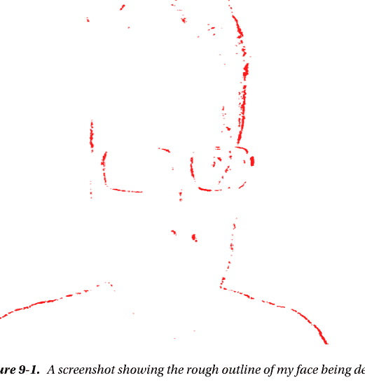

***图 9-1.*** *一张截图，展示了我在移动时被检测到的面部大致轮廓*

在 try 语句块内部，我们对样板代码稍作修改，让它检查 oldData 是否为 null（这应该是它的初始值）。如果它不为 null，则进行相应处理；如果为 null，则从 data.manip 赋值当前数据给它。

```javascript
bctx.drawImage(videoElement, 0, 0, w, h);
manip = bctx.getImageData(0, 0, w, h);
var data = manip.data;
if (oldData != null) {
    data = motionDetection(data, oldData);
    ctx.putImageData(manip, 0, 0);
    oldData = null;
}
else {
    oldData = manip.data;
}

requestAnimationFrame(draw);
```

motionDetection 函数的工作原理正如前面所解释的：它接收当前帧的数据以及前一帧的数据（尽管这可以通过多种方式进行优化或做得更复杂，所以不一定是仅仅前一帧），然后对它们进行比较，对每一个发生运动且在阈值范围内的像素，绘制一个红色像素。

```javascript
function motionDetection(data, oldData) {

    // Iterate through each pixel, changing to 255 if it has not changed
    for( var y = 0 ; y < h; y++ ) {
        for( var x = 0 ; x < w; x++ ) {
            var indexOld = (y * w + x) * 4,
                    oldr = oldData[indexOld],
                    oldg = oldData[indexOld+1],
                    oldb = oldData[indexOld+2],
                    olda = oldData[indexOld+3];
            var indexNew = (y * w + x) * 4,
                    r = data[indexNew],
                    g = data[indexNew+1],
                    b = data[indexNew+2],
                    a = data[indexNew+3];


            if (oldr > r - 15 || oldg > g - 15 || oldb > b - 15)
            {
                data[indexNew] = 255;
                data[indexNew+1] = 255;
                data[indexNew+2] = 255;
                data[indexNew+3] = 255;
                detected = true;
            }

            else
            {
                data[indexNew] = 255;
                data[indexNew+1] = 0;
                data[indexNew+2] = 0;
                data[indexNew+3] = 255;
            }
        }
    }

    return data;
}
```

## 运动追踪

好的，检测运动是一回事，但除非你正在打造一个报警系统或在进行艺术创作，否则单凭它本身用处不大。通常情况下，你希望要么让计算机足够智能以识别目标对象是什么（对于机器人来说尤其如此），或者更常见的是，仅仅想知道同一个对象的位置——这就叫做追踪。我们生成的图像能够显示运动，但它并没有尝试将运动归组为一个对象。实现这一点的方法有很多种，比如基于颜色进行校准，寻找具有正确平均颜色的区域，或者你可以使用人工智能，训练它去寻找特定的对象。

虽然颜色校准比使用人工智能更容易，但它会带来很多问题，而且如果你想要结果可靠，那涉及的数学很快就会变得过于复杂，远超书中一章所能涵盖的范围。因此，我们采取两种方法之间的折中方案，使用一个名为 js-objectDetect 的库（由 Martin Tschirsich 编写，可以在 GitHub 上找到：[https://github.com/mtschirs/js-objectdetect](https://github.com/mtschirs/js-objectdetect)），它基于 OpenCV 物体检测器构建，并可以使用已经训练好的分类器。在介绍代码之前，我们先来看看这个库实际的工作原理。

## 类 Haar 特征

大多数图像处理算法都需要一种在图像中检测特征的方法，而实现这一点的途径有很多种。最常见的（因为它们在 Viola-Jones 算法中的使用）是所谓的类 Haar 特征。它们以 Alfréd Haar 在 1909 年提出的原始 Haar 小波为基础。*小波*是一种将数据切分为不同频率，然后对数据进行缩放和分析以寻找模式的数学函数。它是信号处理中的一项重要工具，相较于傅里叶变换（我们在第 3 章使用过），它的优势在于能够对数据进行缩放。类 Haar 特征可以看作是 Haar 小波的一种更具体的表现形式，因为你可以使用不同大小的黑白矩形将它们可视化（如图 9-2 所示）。

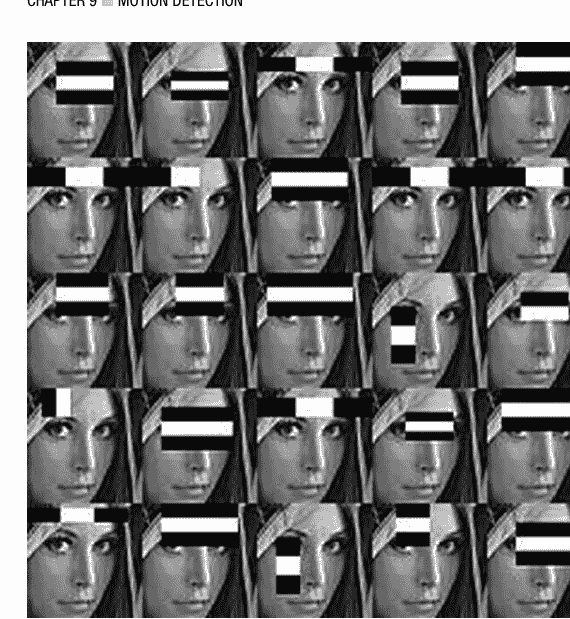

它们之所以使用黑白矩形，而不是设计成与所寻找的特征相似的形状，是因为大多数物体都具有共同的阴影模式（例如眼睛和鼻子之间的阴影）。它们通过使用区域求和表（summed area tables）来高效工作，生成所谓的积分图像（integral image），这样就可以快速查找矩形内所有像素的总和，而无需每次都进行重新计算。单独使用时，类 Haar 特征并不是特别有用，但当它们作为 Viola-Jones 算法（使用移动窗口进行搜索）的一部分时，便变得不可或缺。

## Viola-Jones

你或许已经从上一节中猜到了，为 js-objectDetect 和 OpenCV 物体检测器提供支持的算法，是基于 Paul Viola 和 Michael Jones 在 2001 年撰写的一篇论文（后来由 Rainer Lienhart 进行了改进），通常简称为 Viola-Jones。我不会深入探讨这个算法的细节，因为它相当复杂，但如果你对计算机视觉或人工智能有着浓厚的兴趣，那么阅读一下这篇论文也许是值得的。原文论文确实包含一些相当高深的数学内容，但它的表述方式并不至于让人难以理解。该算法的基本原理是：取两组图像——正样本和负样本；通过使用一个小型窗口遍历每一张图像，尝试将窗口中的内容与类 Haar 特征进行匹配，以此来训练算法。和所有训练一样，训练集越大，结果就会越准确。

这篇论文将该算法描述为一个"视觉目标检测框架"，因此它可以通过多种不同的方式实现。该论文包含三大主要贡献，它们可以被视为任何基于 Viola-Jones 的人脸检测算法的主要组成部分。第一个组成部分是积分图像，正如我之前所解释的，这是类 Haar 特征如此高效的原因。第二个组成部分是基于 AdaBoost 的学习算法。他们提出的、对人脸检测至关重要的最后一个组成部分是级联分类器，

which are used to quickly discard the background of the image. It is quite interesting to note that the algorithm used for detection is the same as the one used for training, so there is no extra step required to actually use the classifiers. The classifiers are the outcomes of the training and we will be using predefined cascades so that training is not required (because it needs a large data set and can take a long time). The js-objectDetect library includes some classifiers as samples (including mouth, eye, and hand classifiers, not just faces), so we shall be using those for this chapter. There are two types of cascade classifier, stump and tree. A stump is a single node of a tree and is usually best to use due to the balance between accuracy and efficiency, so the js-objectDetect library only works with stump cascades that are stored as JSON.

## Using js-objectDetect

The library makes it very easy to use the Viola-Jones algorithm, which is extremely powerful, without even needing to install OpenCV (a large C++ framework for computer vision). It is licensed under GPL so you can freely read the code and modify it. It is also well commented, so if you are interested in the implementation details of the Viola-Jones algorithm, then it is definitely a good place to start. In the next chapter we will be using object detection as input but for this chapter, to demonstrate tracking, we will be drawing a rectangle around a face instead. Facial detection is a common use of computer vision because it is the basis of most more advanced computer vision topics, such as facial recognition or eye tracking.

> **Note** As with motion detection, tracking is still dependent on the 2D image produced by the webcam, so it may not be completely accurate and does require good lighting and only one face to track.

It is actually extremely easy to use js-objectDetect for facial detection; it just requires the library to be included and a small bit of JavaScript to run it. It does not use canvas, so the getUserMedia can be set up directly with a video element rather than worrying about canvas contexts. The library is of course included in the download that complements this book. I have included a div with the class cursor; this is the box that surrounds the face that has been detected.

```html
<!DOCTYPE html>
<html>
<head>
    <title>Webcam Stuff</title>
    <style>
        html, body { margin: 0; padding: 0; }
        video { position: absolute; top: 0; left: 0; }
    </style>
</head>
<body>
    <video></video>
    <div class="cursor"></div>

    <script src="js-objectDetect/compatibility.js"></script>
    <script src="js-objectDetect/smoother.js"></script>

    <script src="js-objectDetect/objectdetect.js"></script>
    <script src="js-objectDetect/objectdetect.frontalface.js"></script>
    <script src="js-objectDetect/jquery.js"></script>
    <script src="js-objectDetect/jquery.objectdetect.js"></script>

    <script src="script.js"></script>
</body>
</html>
```

The JavaScript required (within script.js) is comprised of a set-up function that handles the dimensions of the video element as well as the getUserMedia that calls the draw function to run the detection on each frame. There is also a jQuery function that is used to actually draw the square around the face. This works by getting dimensions from the library and modifies the css of the div to fit it.

```javascript
window.URL = window.URL || window.webkitURL;
navigator.getUserMedia  =  navigator.getUserMedia ||
                          navigator.webkitGetUserMedia ||
                          navigator.mozGetUserMedia ||
                          navigator.msGetUserMedia;
if (navigator.getUserMedia === undefined) {
    if (console !== undefined) {
      console.log("Browser doesn't support getUserMedia");
    }
}

window.addEventListener('DOMContentLoaded', setup);

function setup()  {
    videoElement = document.querySelector("video");
    videoElement.width = w = window.innerWidth;
    videoElement.height = h = window.innerHeight;
    videoElement.autoplay = true;

    navigator.getUserMedia({video: true}, function (stream) {
        videoElement.src = window.URL.createObjectURL(stream);
        videoElement.addEventListener('canplay', draw);
    }, function() {});
}
```

```javascript
$.fn.highlight = function(rect, color) {
    $('.cursor').css({
      "border":  "2px solid " + color,
      "position": "absolute",
      "left":    ($(this).offset().left + rect[0]) + "px",
      "top":     ($(this).offset().top  + rect[1]) + "px",
      "width":   rect[2] + "px",
      "height":  rect[3] + "px",
      "z-index": 2
    });
}
```

```javascript
function draw() {
    $("video").objectdetect("all", {classifier: objectdetect.frontalface}, function(faces) {
        for (var i = 0; i < faces.length; ++i) {
            $(this).highlight(faces[i], "red");
        }
    });

    requestAnimationFrame(draw);
}
```

## Summary

I hope that from this chapter you have gained a deeper understanding of how to manipulate video in real time and use it to produce useful solutions. Motion detection and object tracking are the two key starting points of computer vision. Although there may not currently be many use-cases for computer vision on the web, we are starting to see more and more of it, such as detecting faces in photos to tag people. Some companies (*ahem* Facebook) are going as far as facial recognition, which has its basis in facial detection. Many people consider computer vision to be incredibly complicated, something that only academia need to be interested in, but that's just not the case. I highly recommend you to look further into this topic, much of it is beyond the scope of this book but if you take a look at the appendix you will find some extra information and useful resources for further reading. The next chapter builds on some of the concepts in this chapter, although we will be using a fairly naïve algorithm for detecting the movement of a finger so that we can use it to play a note on the keyboard that we built earlier in the book. Hopefully you can see that either by writing naïve algorithms or using libraries other people have already worked on, it is not as difficult to get started with computer vision as most people think it is and it is even more accessible now that it can be achieved, without relying on C++ or other more difficult languages, using HTML5 and JavaScript!

[content]
这些分类器的作用是快速舍弃图像的背景。有趣的是，用于检测的算法与用于训练的算法是相同的，因此实际使用分类器时不需要额外的步骤。分类器是训练的产物，我们将使用预定义的级联，这样就不需要进行训练（因为训练需要大量数据集，而且可能耗时很长）。js-objectDetect 库包含一些作为示例的分类器（包括嘴部、眼睛和手部分类器，而不仅仅是脸部），因此本章我们将使用这些示例。级联分类器有两种类型：stump 和 tree。stump 是树的一个单一节点，由于在准确性和效率之间的良好平衡，通常是最佳选择，因此 js-objectDetect 库仅适用于以 JSON 格式存储的 stump 级联。

## 使用 js-objectDetect

该库使得使用极为强大的 Viola-Jones 算法变得非常容易，甚至无需安装 OpenCV（一个用于计算机视觉的大型 C++ 框架）。它采用 GPL 许可证，因此你可以自由阅读和修改其代码。它的注释也很完善，所以如果你对 Viola-Jones 算法的实现细节感兴趣，那么它绝对是一个很好的起点。在下一章中，我们将使用目标检测作为输入，但在本章中，为了演示追踪，我们将改为在脸部周围绘制一个矩形。面部检测是计算机视觉中的一种常见应用，因为它是大多数更高级计算机视觉主题（如人脸识别或眼动追踪）的基础。

> **注意** 与运动检测一样，追踪仍然依赖于网络摄像头生成的 2D 图像，因此可能并不完全准确，并且需要良好的光照以及只能追踪一张人脸。

实际上，使用 js-objectDetect 进行面部检测非常简单；只需引入库并编写少量 JavaScript 代码即可运行。它不使用 canvas，因此 getUserMedia 可以直接与 video 元素一起设置，而无需担心 canvas 上下文。该库当然包含在本书配套的下载资源中。我包含了一个 class 为 cursor 的 div；这就是包围已检测到的人脸的方框。

```html
<!DOCTYPE html>
<html>
<head>
    <title>Webcam Stuff</title>
    <style>
        html, body { margin: 0; padding: 0; }
        video { position: absolute; top: 0; left: 0; }
    </style>
</head>
<body>
    <video></video>
    <div class="cursor"></div>

    <script src="js-objectDetect/compatibility.js"></script>
    <script src="js-objectDetect/smoother.js"></script>

    <script src="js-objectDetect/objectdetect.js"></script>
    <script src="js-objectDetect/objectdetect.frontalface.js"></script>
    <script src="js-objectDetect/jquery.js"></script>
    <script src="js-objectDetect/jquery.objectdetect.js"></script>

    <script src="script.js"></script>
</body>
</html>
```

所需的 JavaScript（在 script.js 中）由一个设置函数组成，该函数处理 video 元素的尺寸以及 getUserMedia，后者调用 draw 函数以对每一帧运行检测。还有一个 jQuery 函数用于实际在脸部周围绘制方框。它的工作原理是从库中获取尺寸，并修改 div 的 css 以使其适配。

```javascript
window.URL = window.URL || window.webkitURL;
navigator.getUserMedia  =  navigator.getUserMedia ||
                          navigator.webkitGetUserMedia ||
                          navigator.mozGetUserMedia ||
                          navigator.msGetUserMedia;
if (navigator.getUserMedia === undefined) {
    if (console !== undefined) {
      console.log("Browser doesn't support getUserMedia");
    }
}

window.addEventListener('DOMContentLoaded', setup);

function setup()  {
    videoElement = document.querySelector("video");
    videoElement.width = w = window.innerWidth;
    videoElement.height = h = window.innerHeight;
    videoElement.autoplay = true;

    navigator.getUserMedia({video: true}, function (stream) {
        videoElement.src = window.URL.createObjectURL(stream);
        videoElement.addEventListener('canplay', draw);
    }, function() {});
}
```

```javascript
$.fn.highlight = function(rect, color) {
    $('.cursor').css({
      "border":  "2px solid " + color,
      "position": "absolute",
      "left":    ($(this).offset().left + rect[0]) + "px",
      "top":     ($(this).offset().top  + rect[1]) + "px",
      "width":   rect[2] + "px",
      "height":  rect[3] + "px",
      "z-index": 2
    });
}
```

```javascript
function draw() {
    $("video").objectdetect("all", {classifier: objectdetect.frontalface}, function(faces) {
        for (var i = 0; i < faces.length; ++i) {
            $(this).highlight(faces[i], "red");
        }
    });

    requestAnimationFrame(draw);
}
```

### 小结

希望通过本章，你对如何实时操控视频并利用它产生实用的解决方案有了更深入的理解。运动检测和目标追踪是计算机视觉的两个关键起点。尽管目前网络上的计算机视觉用例可能还不多，但我们正看到越来越多的应用，例如在照片中检测人脸以便给人加标签。一些公司（*咳*，比如 Facebook）甚至更进一步做人脸识别，这正是建立在人脸检测基础上的。许多人认为计算机视觉极其复杂，是只有学术界才需要关注的东西，但事实并非如此。我强烈建议你进一步深入研究这个话题，其中很多内容超出了本书的范围，但如果你查看附录，你会发现一些额外的信息和有用的延伸阅读资源。下一章将基于本章的部分概念，尽管我们将使用一个相当朴素的算法来检测手指的移动，以便用它来演奏我们在本书前面构建的键盘上的一个音符。希望你能看到，无论是编写朴素算法还是利用他人已编写的库，开始学习计算机视觉并不像大多数人想象的那么困难，而且由于可以借助 HTML5 和 JavaScript 实现，而无需依赖 C++ 或其他更复杂的语言，它如今变得更加触手可及！

# 第 10 章

# 使用手势与浏览器交互

本章旨在整合你迄今学到的所有内容，打造一个雄心勃勃的音乐创作 Web 应用，它允许多个人同时使用计算机生成的音频演奏乐器，仅需 JavaScript、Node.js 以及一些 HTML5 API 即可实现。哦，还需要使用网络摄像头，让你用空中的手指进行输入。

我相信你能想象，这是一项非常庞大的任务。本章将带你完成该应用的一个基础版本，并允许你按自己的意愿对其进行扩展。例如，与其追踪所有手指以便正常演奏键盘，不如用一个光标，通过指向相应方向来实现左右移动，或者指向中间来模拟一次按键。

## 将键盘放在服务端

我们将基于第 5 章中的键盘来构建这个项目。目前，键盘的设置允许你同时演奏多个音符（这是一个不错的开始），但我们需要对其进行修改，使多人能够演奏多个音符。当然，即使两个人演奏同一个音符，它也只应播放一次。这是理想的，因为这意味着每个人只需要一组振荡器，因此当用户 B 开始演奏一个音符时，它将使用用户 A 正在使用的那组振荡器来演奏。

之前我们在 stopSound 中关闭振荡器，但这可能会引发竞态条件（即事情并不总是按你预期的顺序发生），并且由于无法重新启动一个已停止的振荡器，最好将其删除（在这种情况下，我们将其设置为 null）并创建一个新的（反正我们以前就是这样做的）。为了更方便地检查振荡器是否存在，我修改了数组初始化循环，将索引设置为 null，而不是一开始创建新的振荡器。

```javascript
// White Keys
var o = new Array(21);
for (var i = 0; i < 21; i++) {
    o[i] = null;
}

// Black Keys
var ob = new Array(15);
for (var i = 0; i < 15; i++) {
    ob[i] = null;
}
```


## 第10章 ■ 使用手势与浏览器交互

```
function stopSound(i, black)  {
    var osc;
    if (black) {
        osc = ob[i];
    } else {
        osc = o[i];
    }
    if ((black && ob[i] !== null) || (!black && o[i] !== null)) {
        osc.noteOff(0);
        osc.disconnect();
        if (black) {
            ob[i] = null;
        } else {
            o[i] = null;
        }
    }
}
```

`playSound` 函数现在需要仅在没有振荡器已经在该按键上时才播放新声音；否则会导致一些问题，例如无法停止其播放，或者只会播放很短的时间。我还稍微整理了一下代码，避免在不需要的情况下重复检查相同的条件。需要注意的是，我将 `ctx` 改为了 `actx`，这样它显然就是一个音频上下文（Audio Context），可以避免与计算机视觉中使用的画布上下文（Canvas Context）混淆。

```
var gainNode = actx.createGainNode();
gainNode.connect(actx.destination);
```

```
function playSound(i, black) {
    if ((black && ob[i] === null) || (!black && o[i] === null)) {
        var osc = actx.createOscillator();
        var freq;
        if (black)  {
            freq = blackNotes[i];
        }
        else  {
            freq = whiteNotes[i];
        }
        osc.type = 3;
        osc.frequency.value = freq;
        osc.connect(gainNode);
        osc.noteOn(0);
        if (black) {
            ob[i] = osc;
        } else {
            o[i] = osc;
        }
    }
}
```

138

现在键盘的设置稍微好了一些，我们可以编写服务器代码了。Socket.IO 允许你以非常好的方式定义客户端与服务器之间所有通信的结构；每一条消息都是一个任务，通常会被传递给其他客户端。键盘有两个任务：播放声音和停止播放声音。我们所需要的只是设置几个监听器来监听播放或停止声音的消息。

```
socket.on('play_sound', function (data) {
    data.color = socket.color;
    console.log("play sound %j", data);
    socket.broadcast.to(room).emit('play_sound', data);
});

socket.on('stop_sound', function (data) {
    console.log("stop sound %j", data);
    socket.broadcast.to(room).emit('stop_sound', data);
});
```

你可能已经注意到，我们向房间中的所有人发送了一个颜色；这样他们就能轻松看到其他人按下的按键。我没有使用数据库或其他方式来唯一地创建这些颜色，而是在套接字最初连接时生成一个随机颜色。我通过生成一个随机数并将其乘以 16777215 来实现这一点，这本质上等同于对白色的十六进制颜色（#ffffff）进行位移操作。

```
socket.color = '#'+ ('00000' + Math.floor(Math.random()*16777215).toString(16)).slice(-6);
```

就是这样！服务器端其余的代码与第7章中的相同。

*server.js*

```
var express = require('express'),
    http = require('http'),
    uuid = require('node-uuid'),
    app = express(),
    server = http.createServer(app),
    io = require('socket.io').listen(server);
io.set('log level', 1); // Removes debug logs
app.use(express.static('public'));
server.listen(8080);

app.get('/:id', function (req, res) {
    res.sendfile(__dirname + '/index.html');
});

io.sockets.on('connection', function (socket) {

    var room = socket.handshake.headers.referer;
    console.log('JOINED', room);
    socket.join(room);
    socket.id = uuid.v1();
    socket.color = '#'+ ('00000' + Math.floor(Math.random()*16777215).toString(16)).slice(-6);

    io.sockets.in(room).emit('room_count', io.sockets.manager.rooms['/' + room].length);

// WebRTC signalling
socket.on('received_offer', function(data) {
    console.log("received_offer %j", data);
    io.sockets.in(room).emit('received_offer', data);
});

socket.on('received_candidate', function(data) {
    console.log("received_candidate %j", data);
    io.sockets.in(room).emit('received_candidate', data);
});

socket.on('received_answer', function(data) {
    console.log("received_answer %j", data);
    io.sockets.in(room).emit('received_answer', data);
});

// Chatroom messages
socket.on('message', function (data) {
    io.sockets.in(room).emit('message', data);
});

// Music
socket.on('play_sound', function (data) {
    data.color = socket.color;
    console.log("play sound %j", data);
    socket.broadcast.to(room).emit('play_sound', data);
});

socket.on('stop_sound', function (data) {
    console.log("stop sound %j", data);
    socket.broadcast.to(room).emit('stop_sound', data);
});

// Close socket and let others know
socket.on('close', function () {
    console.log("closed %j", room);
    io.sockets.in(room).emit('closed', room);
    socket.leave(room);
});
```

在客户端，我们需要既要发送消息，也要处理接收到的消息。首先，让我们设置颜色。当收到 `'color'` 消息时（当你一步一步分解时，这真的很简单！），我们设置一个名为 `color` 的变量。

```
socket.on('color', function(data) {
    color = data;
})
```

当接收到播放或停止消息时，我们需要调用相应的函数；在播放时，我们还需要将特定按键的颜色设置为与发送该消息的人相关的颜色。在停止时，颜色应恢复为黑色或白色。

```
socket.on('play_sound', function(data) {
    if (data.black) {
        bkeys[data.i].fill({ color: data.color });
    } else {
        keys[data.i].fill({ color: data.color });
    }
    playSound(data.i, data.black);
});
```

```
socket.on('stop_sound', function(data) {
    if (data.black) {
        bkeys[data.i].fill({ color: '#000' });
    } else {
        keys[data.i].fill({ color: '#fff' });
    }
    stopSound(data.i, data.black);
});
```

要发送消息，我们只需发送 `i` 和 `black` 变量，以及颜色。这些变量需要在每次按键被按下时发送——包括通过鼠标、键盘和摄像头的输入。需要注意的是，我们不会仅在 `playSound` 或 `stopSound` 中发送消息，因为它们会在接收到消息时被调用，这会导致循环引用。在添加了发送的消息之后，所有输入的代码如下所示：

```
var keys = [];
var cursor = [];
for (var i = 0; i < 21; i++)  {
    keys[i] = keyboard.rect(width/21, height);
    keys[i].move(width/21 * i, 0);
    keys[i].attr({ fill: '#fff', stroke: '#000', id: "key"+i });
    keys[i].mousedown ((function(n) {
        return function()  {
            var key = SVG.get("key"+n);
            key.fill({ color: '#f06' });
            socket.emit('play_sound', { "i":n,"black":false});
            playSound(n, false);
        }
    })(i));

    keys[i].mouseup((function(n)  {
        return function() {
            keys[n].fill({ color: '#fff' });
            socket.emit('stop_sound', { "i":n,"black":false});
            stopSound(n, false);
        }
    })(i));

    cursor[i] = keyboard.circle(width/21);
    cursor[i].attr({ fill: '#ff0000' });
    cursor[i].move(width/21 * i, height / 1.5);
    cursor[i].hide();
}
```

```
var bkeys = [];
var prev = 0;
for (var i = 0; i < 15; i++) {
    bkeys[i] = keyboard.rect(width/42, height / 1.7);
    bkeys[i].attr({ fill: '#000', stroke: '#000', id: "bkey"+i });
    bkeys[i].move(prev + (width/(21*1.3)), 0);
    prev = prev + width/21;
    if (i == 1 || i == 4 || i == 6 || i == 9 || i == 11) {
        prev += width/21;
    }

    bkeys[i].mousedown ((function(n) {
        return function() {
            var key = SVG.get("bkey"+n);
            key.fill({ color: '#f06' });
            socket.emit('play_sound', { "i":n,"black":true});
            playSound(n, true);
        }
    })(i));

    bkeys[i].mouseup((function(n) {
        return function() {
            bkeys[n].fill({ color: '#000' });
            socket.emit('stop_sound', { "i":n,"black":true});
            stopSound(n, true);
        }
    })(i));
}
```

```
window.addEventListener('keypress', function(e) {
    for (var i = 0; i < keyboardPressKeys.length; i++) {
        if (e.keyCode == keyboardPressKeys[i]) {
            var n = i + octave * 7;
            var key = SVG.get("key"+n);
            key.fill({ color: '#f06' });
            socket.emit('play_sound', { "i":n,"black":false, "color":color});
            playSound(n, false);
        }
    }
    for (var i = 0; i < blackKeyPress.length; i++) {
        if (e.keyCode == blackKeyPress[i]) {
            var n = i + (octave * 5);
            var key = SVG.get("bkey"+n);
            key.fill({ color: '#f06' });
            socket.emit('play_sound', { "i":n,"black":true, "color":color});
```


 ```
playSound(n, true);
}
if (e.keyCode == 97 && octave > 0) {
    --octave;
}
if (e.keyCode == 108 && octave < 2) {
    ++octave;
}
});
```

```
window.addEventListener('keyup', function(e) {
    console.log(e.keyCode);
    for (var i = 0; i < keyboardKeys.length; i++)  {
        if (e.keyCode == keyboardKeys[i]) {
            var key = SVG.get("key"+(i+octave*7));
            key.fill({ color: '#fff' });
            socket.emit('stop_sound', { "i":i+octave*7,"black":false, "color":color });
            stopSound(i+octave*7, false);
        }
    }
    for (var i = 0; i < blackKeys.length; i++)  {
        if (e.keyCode == blackKeys[i]) {
            var n = i + octave * 5;
            var key = SVG.get("bkey"+n);
            key.fill({ color: '#000' });
            socket.emit('stop_sound', { "i":n,"black":true, "color":color });
            stopSound(n, true);
        }
    }
});
```

所以现在，每当在键盘上按下按键时，它就会播放给房间里的所有人。这是一个很好的例子，说明了你如何从一个简单的聊天室发展到更高级的东西，而实际工作原理上的差异却很小。图 11-1 展示了两个音符被演奏的示例，按键 Dimitry-Fedosov 琴键被填充上用户独有的颜色。

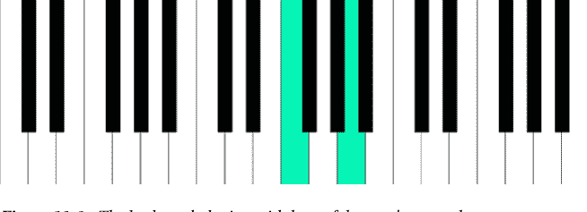

*图 11-1. 用用户自己的颜色演奏的键盘*

## 用网络摄像头控制音乐

为键盘添加运动控制只需要实现上一章的步骤。我们从捕获网络摄像头的两帧图像开始，并分析它们以找出两帧之间的运动。请记住，我们并没有使用任何人工智能来完成这项工作，所以你可能需要调整参数数字，以使其对你的光照条件和与屏幕的距离（以及你身后的运动）准确。

为了找到运动，我们遍历第二帧的像素并将它们与前一帧进行比较。如果它们不同，则将颜色改为黑色，否则将其设为白色。在这个示例 Product-service 中，我们只需要 X 轴上的运动，所以每当检测到运动时，我们加上与运动的 X 位置对应的宽度百分比。例如，`motionX += 100*(x/w);`。一旦所有内容都被检查完毕，我们可以将其除以计数来找到平均 X 位置。由于简单的数学运算，这并不完全准确，但足以找到运动的指示。根据画布的方向，你可能需要反转数字来正确镜像运动：`motionX = 100 - motionX`。

现在，我们可以检查 `motionX` 是否在我们正在寻找的特定运动范围内。在这个例子中，我们想要左右移动光标，如果运动在中间三分之一处则按下按键。所以如果 `motionX` 小于 100/3，则向左移动。如果在 100/3 和 (100/3)*2 之间，则按下按键，或者如果大于 (100/3)*2，则向右移动。

这个示例仅适用于白键，但你也可以很容易地将其扩展到包括黑键，通过同时查找 Y 轴上的运动。

```
function motionDetection(data, oldData) {
    var motionX = 0;
    var count = 0;

    // Iterate through each pixel, changing to 255 if it has not changed
    for( var y = 0 ; y < h; y++ ) {
        for( var x = 0 ; x < w; x++ ) {
            var indexOld = (y * w + x) * 4,
                oldr = oldData[indexOld],
                oldg = oldData[indexOld+1],
                oldb = oldData[indexOld+2],
                olda = oldData[indexOld+3];
            var indexNew = (y * w + x) * 4,
                r = data[indexNew],
                g = data[indexNew+1],
                b = data[indexNew+2],
                a = data[indexNew+3];

            if (oldr > r - 30 || oldg > g - 30 || oldb > b - 30)
            {
                data[indexNew] = 255;
                data[indexNew+1] = 255;
                data[indexNew+2] = 255;
                data[indexNew+3] = 255;
            }
            else
            {
                data[indexNew] = 0;
                data[indexNew+1] = 0;
                data[indexNew+2] = 0;
                data[indexNew+3] = 255;
            }
        }
    }
}
```

```
                    motionX += 100*(x/w); // motionX = The percentage of W than X is at
                    count++;
                }
            }
        }

        motionX = motionX / count;
        motionX = 100 - motionX;
        if (motionX > 0)  {
            if (motionX > 100/3 && motionX < (100救救我/3)*2)  {
                if (o[i] === null)
                    playSound(currentCursor, false);
                console.log('2');
            }
            if (motionX >  (100/3)*2)  {
                if (currentCursor + 1 < keys.length)  {
                    cursor[currentCursor].hide();
                    stopSound(currentCursor, false);
                    currentCursor++;
                    cursor[currentCursor].show();
                }
                console.log('3');
            }
            if (motionX < 100/3) {
                if (currentCursor - 1 >=0)  {
                    cursor[currentCursor].hide();
                    stopSound(currentCursor, false);
                    currentCursor--;
                    cursor[currentCursor].show();
                }
                console.log('1');
            }
        }
        return data;
    }
```

光标是一个红色的圆点，它与琴键同时创建；它不是沿着琴键移动光标，而是隐藏并只显示正确的那一个。

```
cursor[i] = keyboard.circle(width/21);
cursor[i].attr({ fill: '#ff0000' });
cursor[i].move(width/21 * i, height / 1.5);
cursor[i].hide();
```

现在，项目应该都能正常工作了。你可以在下面的清单 11-1 以及 Apress 网站 www.apress.com/9781430259442 或我自己的网站 www.shanehudson.net/javascript-creativity 上的下载中找到完整的代码。

## 第 10 章 使用手势与浏览器交互

**清单 11-1.** server.js

```
var express = require('express'),
    http = require('http'),
    uuid = require ("node-uuid"),
    app = express(),
    server = http.createServer(app),
    io = require('socket.io').listen(server);
io.set('log level', 1); // Removes debug logs
app.use(express.static('public'));
server.listen(8080);

app.get('/:id', function (req, res) {
    res.sendfile(__dirname + '/index.html');
});

io.sockets.on('connection', function (socket) {

    var room = socket.handshake.headers.referer;
    console.log('JOINED', room);
    socket.join(room);
    socket.id = uuid.v1();
    socket.color = '#'+ ('000000' + Math.floor(Math.random()*16777215).toString(16)).slice(-6);

    io.sockets.in(room).emit('room_count', io.sockets.manager.rooms['/' + room].length);

    // WebRTC signalling
    socket.on('received_offer', function(data) {
        console.log("received_offer %j", data);
        io.sockets.in(room).emit('received_offer', data);
    });

    socket.on('received_candidate', function(data) {
        console.log("received_candidate %j", data);
        io.sockets.in(room).emit('received_candidate', data);
    });

    socket.on('received_answer', function(data) {
        console.log("received_answer %j", data);
        io.sockets.in(room).emit('received_answer', data);
    });

    // Chatroom messages
    socket.on('message', function (data) {
        io.sockets.in(room).emit('message', data);
    });
```

### 第 10 章 ■ 使用手势与浏览器交互

```
// Music
socket.on('play_sound', function (data) {
    data.color = socket.color;
    console.log("play sound %j", data);
    socket.broadcast.to(room).emit('play_sound', data);
});

socket.on('stop_sound', function (data) {
    console.log("stop sound %j", data);
    socket.broadcast.to(room).emit('stop_sound', data);
});

// Close socket and let others know
socket.on('close', function () {
    console.log("closed %j", room);
    io.sockets.in(room).emit('closed', room);
    socket.leave(room);
});

});
```

### script.js

```
var socket = io.connect('http://localhost:8080');
try {
    if (! window.AudioContext) {
        if (window.webkitAudioContext) {
            window.AudioContext = window.webkitAudioContext;
        }
    }

    actx = new AudioContext();
}
catch(e) {
    console.log('Web Audio API is not supported in this browser');
}

window.URL = window.URL || window.webkitURL;
navigator.getUserMedia = navigator.getUserMedia ||
                         navigator.webkitGetUserMedia ||
                         navigator.mozGetUserMedia;
if (navigator.getUserMedia === undefined) {
    if (console !== undefined) {
        console.log("Browser doesn't support getUserMedia");
    }
}

var videoElement, canvas, ctx, manip, w, h;
var oldData = null;

window.addEventListener('DOMContentLoaded', setup);
```


```javascript
function setup() {
    videoElement = document.querySelector("video");
    videoElement.width = w = window.innerWidth;
    videoElement.height = h = window.innerHeight;
    videoElement.autoplay = true;

    canvas = document.createElement('canvas');
    canvas.width = w;
    canvas.height = h;
    ctx = canvas.getContext('2d');

    bcanvas = document.createElement('canvas');
    bcanvas.width = w;
    bcanvas.height = h;
    bctx = bcanvas.getContext('2d');

    navigator.getUserMedia({video: true}, function (stream) {
        videoElement.src = window.URL.createObjectURL(stream);
        videoElement.addEventListener('canplay', draw);
    }, function() {});
}

var width = window.innerWidth;
var height = window.innerHeight;
var keyboard = SVG('keyboard');

var keyboardKeys = [83,68,70,71,72,74,75];
var blackKeys = [69,82,89,85,73];

var keyboardPressKeys = [115,100,102,103,104,106,107];
var blackKeyPress = [101, 114, 121, 117, 105];

var octave = 1; // where octave 1 = middle C

var currentCursor = 10;
var color;

var keys = [];
var cursor = [];
for (var i = 0; i < 21; i++) {
    keys[i] = keyboard.rect(width/21, height);
    keys[i].move(width/21 * i, 0);
    keys[i].attr({ fill: '#fff', stroke: '#000', id: "key"+i });
    keys[i].mousedown ((function(n) {
        return function()  {
            var key = SVG.get("key"+n);
            key.fill({ color: '#f06' });
            socket.emit('play sound', { "i":n,"black":false});
            playSound(n, false);
        }
    })(i));

    keys[i].mouseup((function(n) {
        return function() {
            keys[n].fill({ color: '#fff' });
            socket.emit('stop_sound', { "i":n,"black":false});
            stopSound(n, false);
        }
    })(i));

    cursor[i] = keyboard.circle(width/21);
    cursor[i].attr({ fill: '#ff0000' });
    cursor[i].move(width/21 * i, height / 1.5);
    cursor[i].hide();
}

var bkeys = [];
var prev = 0;
for (var i = 0; i < 15; i++) {
    bkeys[i] = keyboard.rect(width/42, height / 1.7);
    bkeys[i].attr({ fill: '#000', stroke: '#000', id: "bkey"+i });
    bkeys[i].move(prev + (width/(21*1.3)), 0);
    prev = prev + width/21;
    if (i == 1 || i == 4 || i == 6 || i == 9 || i == 11) {
        prev += width/21;
    }

    bkeys[i].mousedown ((function(n) {
        return function() {
            var key = SVG.get("bkey"+n);
            key.fill({ color: '#f06' });
            socket.emit('play_sound', { "i":n,"black":true});
            playSound(n, true);
        }
    })(i));

    bkeys[i].mouseup((function(n) {
        return function() {
            bkeys[n].fill({ color: '#000' });
            socket.emit('stop_sound', { "i":n,"black":true});
            stopSound(n, true);
        }
    })(i));
}

window.addEventListener('keypress', function(e) {
    for (var i = 0; i < keyboardPressKeys.length; i++) {
        if (e.keyCode == keyboardPressKeys[i]) {
            var n = i + octave * 7;
            var key = SVG.get("key"+n);
            key.fill({ color: '#f06' });
            socket.emit('play_sound', { "i":n,"black":false, "color":color});
            playSound(n, false);
        }
    }
    for (var i = 0; i < blackKeyPress.length; i++) {
        if (e.keyCode == blackKeyPress[i]) {
            var n = i + (octave * 5);
            var key = SVG.get("bkey"+n);
            key.fill({ color: '#f06' });
            socket.emit('play_sound', { "i":n,"black":true, "color":color});
            playSound(n, true);
        }
    }
    if (e.keyCode == 97 && octave > 0) --octave;
    if (e.keyCode == 108 && octave < 2) ++octave;
});

window.addEventListener('keyup', function(e) {
    console.log(e.keyCode);
    for (var i = 0; i < keyboardKeys.length; i++) {
        if (e.keyCode == keyboardKeys[i]) {
            var key = SVG.get("key"+(i+octave*7));
            key.fill({ color: '#fff' });
            socket.emit('stop_sound', { "i":i+octave*7,"black":false, "color":color });
            stopSound(i+octave*7, false);
        }
    }
    for (var i = 0; i < blackKeys.length; i++)  {
        if (e.keyCode == blackKeys[i]) {
            var n = i + octave * 5;
            var key = SVG.get("bkey"+n);
            key.fill({ color: '#000' });
            socket.emit('stop_sound', { "i":n,"black":true, "color":color });
            stopSound(n, true);
        }
    }
});

var gainNode = actx.createGainNode();
gainNode.connect(actx.destination);

// White Keys
var o = new Array(21);
for (var i = 0; i < 21; i++) {
    o[i] = null;
}

// Black Keys
var ob = new Array(15);
for (var i = 0; i < 15; i++) {
    ob[i] = null;
}

var PI_2 = Math.PI*2;
var SAMPLE_RATE = 44100;

var whiteNotes = [130.82, 146.83, 164.81, 174.61, 196, 220, 246.94, 261.63, 293.66, 329.63, 349.23, 392, 440, 493.88, 523.25, 587.33, 659.26, 698.46, 783.99, 880, 987.77];
var blackNotes = [138.59, 155.56, 185, 207.65, 233.08, 277.18, 311.13, 369.99, 415.3, 466.16, 554.37, 622.25, 739.99, 830.61, 932.33];

function playSound(i, black) {
    if ((black && ob[i] === null) || (!black && o[i] === null)) {
        var osc = actx.createOscillator();
        var freq;
        if (black) {
            freq = blackNotes[i];
        }
        else  {
            freq = whiteNotes[i];
        }
        osc.type = 3;
        osc.frequency.value = freq;
        osc.connect(gainNode);
        osc.noteOn(0);
        if (black) ob[i] = osc;
        else o[i] = osc;
    }
}

function stopSound(i, black)  {
    var osc;
    if (black) osc = ob[i];
    else osc = o[i];
    if ((black && ob[i] !== null) || (!black && o[i] !== null)) {
        osc.noteOff(0);
        osc.disconnect();
        if (black) ob[i] = null;
        else o[i] = null;
    }
}

socket.on('color', function(data)  {
    color = data;
});

socket.on('play_sound', function(data) {
    if (data.black)
        b郁金[data.i].fill({ color: data.color });
    else
        keys[data.i].fill({ color: data.color });
    playSound(data.i, data.black);
});
```

## 第10章 ■ 使用手势与浏览器交互

```javascript
socket.on('stop_sound', function(data) {
    if (data.black)
        bkeys[data.i].fill({ color: '#000' });
    else
        keys[data.i].fill({ color: '#fff' });
    stopSound(data.i, data.black);
});

function draw() {
    if (videoElement.paused || videoElement.ended) {
        return;
    }
    try {
        bctx.drawImage(videoElement, 0, 0, w, h);
        manip = bctx.getImageData(0, 0, w, h);
        var data = manip.data;
        if (oldData != null) {
            data = motionDetection(data, oldData);
            ctx.putImageData(manip, 0, 0);
            oldData = null;
        }
        else {
            oldData = manip.data;
        }

        requestAnimationFrame(draw);
    }
    catch (e) {
        if (e.name == "NS_ERROR_NOT_AVAILABLE") {
            setTimeout(draw, 0);
        }
        else {
            throw e;
        }
    }
}

function motionDetection(data, oldData) {
    var motionX = 0;
    var count = 0;

    // 遍历每个像素，如果没有变化则将其设为255
    for (var y = 0; y < h; y++) {
        for (var x = 0; x < w; x++) {
            var indexOld = (y * w + x) * 4,
                oldr = oldData[indexOld],
                oldg = oldData[indexOld+1],
                oldb = oldData[indexOld+2],
                olda = oldData[indexOld+3];
            var indexNew = (y * w + x) * 4,
                r = data[indexNew],
                g = data[indexNew+1],
                b = data[indexNew+2],
                a = data[indexNew+3];

            if (oldr > r - 30 || oldg > g - 30 || oldb > b - 30)
            {
                data[indexNew] = 255;
                data[indexNew+1] = 255;
                data[indexNew+2] = 255;
                data[indexNew+3] = 255;
            }
            else
            {
                data[indexNew] = 0;
                data[indexNew+1] Clarify= 0;
                data[indexNew+2] = 0;
                data[indexNew+3] = 255;

                motionX += 100*(x/w); // motionX = X位置占宽度W的百分比
                count++;
            }
        }
    }

    motionX = motionX / count;
    motionX = 100 - motionX;
    var key = SVG.get("key"+currentCursor);

    if (motionX > 0)  {
        if (motionX > 100/3 && motionX < (100/3)*2)  {
            if (o[i] === null)  {
                key.fill({ color: '#f06' });
                playSound(currentCursor, false);
            }
            console.log('2');
        }
        if (motionX > (100/3)*2)  {
            if (currentCursor + 1 < keys.length)  {
                cursor[currentCursor].hide();
                key.fill({ color: '#fff' });
                stopSound(currentCursor, false);
                currentCursor++;
                cursor[currentCursor].show();
            }
            console.log('3');
        }
        if (motionX < 100/3)  {
            if (currentCursor - 1 >=0)  {
                cursor[currentCursor].hide();
                key.fill({ color: '#fff' });
                stopSound(currentCursor, false);
```


currentCursor--;
        cursor[currentCursor].show();
      }
      console.log('1');
    }
  }
  return data;
}

在图 11-2 中，你可以看到一个通过摄像头动作检测来控制光标（圆形）按下键盘按键的例子。

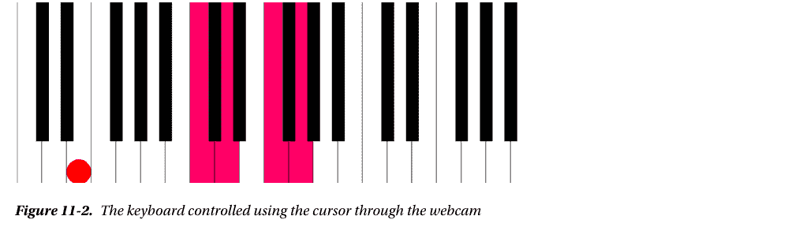

### 小结

本章主要讲的是将前面各章讲解的技术综合起来，因为之前的章节已经解释了各种技术。希望本章对你有所帮助，同时也让你了解到，只要循序渐进，完成一些相当酷的事情是多么容易。你从一个在画布中滑动的方块开始，到如今可以挥动双手让浏览器发出声音。

你有很多种方式可以改进这个项目，例如让摄像头也能控制黑键（你可以通过在 X 轴之外同时检测 Y 轴上的动作来实现）。或者你也可以直接去制作其他东西——但要记住，通过动手摆弄代码学到的东西最多，而不只是读书。希望你喜欢阅读本书。附录提供了一些被认为超出本书主体范围的额外信息，以及进一步阅读的建议。

# 附录

为本书筛选内容是一件困难的事，书名是 *JavaScript Creativity*，它可以无限延伸下去！因此这个附录的结构会比较松散，包含一些我想提及但无法放入本书主体部分的零散内容。

## 未来

我们正处于 web 的一个非常好的节点，不再受多年来习以为常的诸多限制（古老的浏览器、拨号上网等）的束缚，但更重要的是，我们现在能访问到的资源比以前更多。浏览器不仅有了更好的 CSS；它们现在还具备本地存储和设备 API 等功能。本书中我们大量使用了 Web Audio API 和 WebRTC，但还有很多其他的 API。我写这本书用的笔记本电脑（一台 Macbook Pro）配有一个加速度计，我可以用 JavaScript 读取它。这可能不是有史以来最有用的东西，但总有人能想出巧妙的用途（测量我写这本书时正在乘坐的火车的 G 力，也许？）。

我将本书命名为 *JavaScript Creativity*，并不是因为你可以在 canvas 中制作漂亮的东西（尽管这仍然是一个令人难以置信的功能），而是因为如今你可以用富有创意的方式来使用 web 技术。一个通过摄像头控制的钢琴，可以实时生成音符？它远非完美，但我们做到了！一个使用 GPS 为你提供所在地区相关新闻的网站？完全可以实现。在第 2 章中，我们将照片转换成了线条画，并将其变成了一个涂色书应用——就在几年前，这些事情还是完全不可能的。

有很多功能正在被添加到 web 中（或至少在规范中被讨论），它们并没有明确的使用场景。当然，每个功能被提出都是有原因的，但有些功能（例如设备近距离感应）可以用于许多有趣的非明显用途。这非常好，这就是"JavaScript 创意"。事实上，我见过能够导航建筑物、避开障碍物甚至飞行的机器人——所有这些都是用 JavaScript 编写的。

创造未来技术的关键——并且一直是——提出"如果……会怎样"的问题。如果我能用手指控制键盘会怎样？如果新闻网站知道我的位置会怎样？并非一切都有显而易见的答案，我过去甚至争论过并非所有东西都应该被造出来。但考虑各种情况和想法总是值得的，即使它们起初看起来荒诞不经。

## 延伸阅读

在撰写本书的过程中，我遇到了一些非常有趣的文章和书籍，你可能会感兴趣。它们并不都与本书的章节直接相关，但可能值得一读。有些非常技术性，例如 JavaScript 的复杂性或特定算法，而另一些则更具概念性。正如我在本书中所说的，你不应该学习如何制作特定项目，而应该学习如何在各种情况下运用这些技术，因此概念性和高层次的文章（尽管不在本书的直接范围内）值得一读。我会在我的网站 www.shanehudson.net/javascript-creativity/ 上保持更新的列表，以及本书的其他资源。

## 算法

本书通篇提到了许多算法，还有很多其他值得了解的算法，如果你对更理论性的一面感兴趣的话。通常情况下，你可以使用预先写好的算法，例如我们在第 9 章使用的 `js-objectdetect` 库，但你们中的许多人可能会（像我一样）渴望了解所用技术的来龙去脉。由于算法大多发表在学术期刊上，可能难以在网上获取，但通常有在线文章解释这些算法（常为大学讲座所写）。我将简要概述几个我建议你进一步了解的算法，但会避免触及数学方面的内容。

在第 2 章中，我们使用了一个简单的边缘检测算法将照片转换为线条画。我们通过计算每个像素的邻域平均值并将其与阈值比较来实现这一点。我相信你能想象到，这是非常低效的。最终效果够用了，但远非完美。在该章中我提到，有一种更好的方法叫做 Canny 边缘检测，由 John F. Canny 于 1986 年开发。这是一个五步算法。第一步是应用高斯滤波器，一种模糊形式，来平滑边缘以减少噪点；例如，这可以平滑桌子的木纹，使其更容易检测桌子的边缘。第二步是寻找梯度。这些梯度使用 Sobel 算子来找到，它可以帮助你找到梯度的大小和方向。下一步被称为"非极大值抑制"，本质上意味着将模糊的边缘转换为清晰的边缘；这基本上通过移除所有低梯度值来实现。第四步使用阈值。我们在简单的边缘检测算法中也使用了阈值；它们有助于降低噪点的可能性。我们的版本与 Canny 的区别在于，他使用两个阈值，称为双阈值，使非常高的值和非常低的值都算作边缘，但中间的任何值很可能是噪点。这使得它能够更准确地找到不明显的边缘。最后，为了尽可能排除噪点，只有与强边缘相连的弱边缘才会被计入。

说到算法，我想快速提醒你一下我们在第 3 章通过 Web Audio API 使用的快速傅里叶变换（FFT）。你不需要自己实现它，因为 FFT 是 Web Audio API 规范的一部分，所以我不会详细讲解（此外，它涉及大量数学），但值得记住，而且你们中的一些人可能热衷于深入研究傅里叶变换。本质上，这些变换在与音频一起使用时（还有许多其他应用），用于根据一小段音频获取频率数据。我们用音频可视化来展示它，但这只是对如此原始数据进行直接操作的冰山一角。

各章中提到的最后一个算法是 Viola-Jones 物体识别框架（它被归类为框架，因为原始论文没有描述算法的实现，只描述了所需组件），在解释它时我还简要描述了类 Haar 特征。这里我不会进一步解释，但请务必进一步了解 Viola-Jones，甚至尝试自己实现它。

## 链接

本书中我链接了各种资源，我将它们收集在这里以便查找。

-   [www.apress.com/9781430259442](www.apress.com/9781430259442)——这是本书在 Apress 的官方页面。源代码可以在这里下载。
-   [www.shanehudson.net/javascript-creativity](www.shanehudson.net/javascript-creativity)——这是我为本书制作的页面。我会尽量保持更新，作为本书的配套资源。源代码也可以在这里获取。

## 第 1 章

-   [www.html5please.com](www.html5please.com)——HTML5 Please 提供有用的建议，说明某个功能是否应该用于生产环境，或者是否有可用的 polyfill。
-   [www.caniuse.com](www.caniuse.com)——Can I Use 直接提供浏览器支持数据，精确到浏览器版本，以及实现与规范之间的不一致之处。


 ## 第3章
- www.incompetech.com/music/royalty-free – Incompetech 拥有丰富的免版税音乐资源。

## 第4章
- mrdoob.github.io/three.js/ – Three.js 是一个广泛使用的 WebGL 封装库，用于在网页中实现 3D 效果。
- typeface.neocracy.org – 在这里可以找到 Three.js 默认使用的 Helvetiker 字体。

## 第5章
- www.svgjs.com – 这是一个轻量级 SVG 库，我们在第5章中用它来创建音乐播放器中的时间轴。
- github.com/mattdiamond/Recorder.js – Matt Diamond 的 Recorder.js 是一个使用 Web Workers 来录制 Web Audio API 节点的脚本。

## 第6章
- www.acko.net – Steven Wittens 的网站本身就是一件杰作，充满了关于数学和网络图形的精彩文章。
- www.acko.net/blog/js1k-demo-the-making-of – Steven 的这篇文章是第6章的基础，我强烈推荐你阅读。

## 第7章
- www.nodejs.org – 这是 Node.js 的官方网站，本书中所有服务器端代码都使用该语言。
- www.github.com/creationix/nvm – 推荐使用 Node 版本管理器（NVM）来管理多个 Node.js 版本。
- www.nodejs.org/api/index.html – 这是 Node.js 文档，也可以从 Node.js 主站首页找到。

## 第8章
- www.ietf.org/rfc/rfc5245.txt – RFC 5245 详细介绍了交互式连接建立（ICE）。内容较为深奥，但在处理 WebRTC 时非常有用。

## 第9章
- www.github.com/mtschirs/js-objectdetect – 这个库由 Martin Tschirsich 编写，是基于 Viola-Jones 算法的 JavaScript 实现。它能让你轻松进行对象检测，而无需深陷实现细节。

## 索引

## A
- **算法**, 156
- **动画**, 11
  - 巧妙的动画
    - 群体行为（flocking boids）, 18, 22
    - 同伴（flockmates）, 18
    - flockRadius, 19
    - 辅助函数, 21
    - setup(), 18
- **音频与视频**
  - 属性与特性, 39
    - autoplay, 40
    - 缓冲部分, 42
    - controls, 39
    - duration 属性, 42
    - loop 属性, 41
    - 网络活动, 43
    - 播放速率, 43
    - played 属性, 41
    - preload, 40
    - volume 属性, 43
  - 音频实现, 38
  - 浏览器兼容性, 38
  - **编解码器**, 35-36
    - AC-3, 37
    - 高级音频编码（AAC）, 37
    - H.264, 37
    - MP3, 37
    - Theora, 37
    - Vorbis, 37
    - VP8, 37
  - 容器格式
    - 高级系统格式（ASF）, 36
    - 音视频交错格式（AVI）, 36
    - 定义, 35
    - Matroska, 36
    - MP4, 35
    - Ogg, 36
    - QuickTime 文件格式/MOV, 36
    - 波形音频文件格式（WAV）, 36
    - WebM, 35
  - 视频编码, 38
  - 视频实现, 39
  - **Web Audio API**
    - 音频分析, 44
    - createMediaElementSource, 44
    - 定义, 44
    - 快速傅里叶变换（FFT）, 45
    - 频率可视化, 46
    - getFloatFrequencyData/getByteFrequencyData, 45
    - 视频处理, 52
    - 节点, 51
    - 频谱图, 48
- 音视频交错格式（AVI）, 36

## B
- **断点**
  - 条件断点, 4
  - DOM 断点, 4
  - 事件, 4
  - 异常, 4
- 浏览器兼容性, 2

## C
- **Canvas**
  - 弹跳方块
    - 群体行为（flocking boids）, 17
    - 方向变量, 17
  - 笛卡尔坐标系, 11
  - 帧性能分析, 8
  - getContext, 11
  - 线性插值（lerp）, 13
  - mousemove
    - 回调函数, 14
    - 约束条件, 15
    - ctx.beginPath(), 29
    - 画笔, 29
    - 微小变化, 15
    - useCapture, 14
  - 矩形, 12
  - requestAnimationFrame（rAF）
    - 设计模式, 13
    - DOM 元素, 12
  - var ctx = canvas.getContext(), 11
- CSS, 2

## D
- 调试, 2
- 拖放
  - 样板代码, 25
  - e.dataTransfer.files[0], 26
  - FileReader, 26
  - findEdges 变量, 27
  - ImageData.data, 27
  - onload 事件处理器, 26
  - preventDefault 方法, 25
  - Uint8ClampedArray, 27

## E
- 发射（Emitting）, 110

## F, G, H
- 每秒帧数（FPS）, 6
- 未来展望, 155

## I
- 交互式连接建立（ICE）, 117
  - iceConnectionState, 118
  - iceGatheringState, 118

## J, K, L
- JavaScript 控制台
  - 提示符, 3
  - 源代码
    - 断点, 4
    - 实时编辑, 4
  - 变量, 3

## M
- 运动检测, 130
  - 帧, 129
  - Haar 小波, 131
  - js-objectDetect, 133
  - 跟踪, 131
  - 视频处理, 125
    - ctx.getImageData(0, 0, w, h), 126
    - invertFrame, 127
    - manip.data, 127
    - navigator.getUserMedia, 125
  - 基于 Viola-Jones 的人脸检测算法, 132
  - WebRTC, 125
- 运动跟踪, 131
- 音乐创作
  - 键盘
    - 客户端代码, 140
    - 全局 playSound 函数, 138
    - 服务器端代码, 139
    - Socket.IO, 139
    - stopSound 函数, 137, 141
  - 动作控制
    - 黑键, 144
    - 帧, 144
- 音乐播放器
  - AppView, 94-95
    - changePlaylist 函数, 96
    - createTrack 函数, 96
    - initialize 函数, 96
    - render 函数, 96
  - backbone, 89
  - 创建
    - localStorage 记录, 98
    - recordSound 函数, 98
  - 事件监听器, 97
  - handleDrop 函数, 97
  - player 对象, 94
  - 播放列表
    - 模型和集合类, 90
    - 视图, 90
  - 规格说明, 89
  - 可视化
    - draw 函数, 103
    - lastPointVisible 布尔值, 103
    - 操作, 102
    - 程序实现, 99
- 音乐理论
  - 键盘
    - mousemove, 80
    - 八度音阶, 80
    - 振荡器, 82
    - osc.noteOn(0), 82
    - 参数, 82
    - QWERTY 键盘, 79
    - 录制, 83
    - 声音管理, 83
    - 时间轴（参见 Timeline）
    - var keyboard = SVG('keyboard'), 79
  - 音高, 77
  - 节奏, 77
  - 速度, 77
  - 波形
    - 定义, 78
    - 锯齿波, 78
    - 正弦波, 78
    - 方波, 78
    - 三角波, 78
  - 波长
    - 频率, 77
    - 半音, 77
    - 声音包络, 78
  - Web Audio API, 77

## N, O
- 网络地址转换器（NAT）, 117
- Node.js
  - 聊天室消息, 109–110
  - 核心模块, 106
  - Lagos createServer, 107
  - 依赖项, 106
  - 开发依赖项（devDependencies）, 106
  - 独立模块, 106
  - 发射（Emitting）, 110
  - express() 函数, 109
  - Express.js, 108
  - index.html, 109
  - module.exports, 106–107
  - nodemon, 106
  - Node 版本管理器（NVM）, 105
  - package.json, 105
  - response.end(), 107
  - response.writeHead, 107
  - server 方法, 107
  - Socket.IO, 108, 110
- Node 版本管理器（NVM）, 105

## P
- 播放列表
  - Backbone.Collection.extend(), 90
  - 模型
    - Backbone.Model.extend(), 90
    - Playlist 模型, 90
    - Track 模型, 90
  - 视图
    - Backbone.View.extend(), 90
    - play 函数, 93
    - PlaylistListView, 91
    - renderItem, 91
    - TrackListView, 91

## Q, R
- QuickTime 文件格式/MOV, 36

## S
- 会话描述协议（SDP）, 119
- NAT 会话穿越工具（STUN）, 119

## T, U
- 3D, 55
  - 坐标轴, 55
  - 数据可视化, 67
    - 添加数据, 72
    - 数据表示, 74
    - drawEdges() 函数, 70
    - drawGraph() 函数, 73
    - drawNode() 函数, 70
    - 节点图, 67
  - 定义, 55
  - 网格, 56
  - 标准笛卡尔坐标图, 55
  - Three.js, 56（参见 Three.js）
    - 添加网格
      - 代码实现, 58
      - DirectionalLight, 57
      - PolyhedronGeometry, 61
      - THREE.MeshLambertMaterial, 58
      - THREE.SphereGeometry, 58
    - 内置材质, 66
    - ExtrudeGeometry, 63
      - 代码实现, 62
      - 选项, 62
      - 路径, 61
      - THREE.Shape 构造函数, 61
    - 几何体, 60
    - 光照, 64
      - AmbientLight, 65
      - DirectionalLight, 65
      - DirectionalLightHelper, 66
      - hex, 65
      - intensity, 65
      - PointLight, 65
      - 阴影, 65
      - SpotLightHelper, 66
    - MeshLambertMaterial, 67
    - MeshPhongMaterial, 67
    - 场景构建
      - CanvasRenderer, 56
      - 视锥体（frustum）, 57
      - OrthographicCamera, 56
      - PerspectiveCamera, 57
      - renderer.render, 57
      - WebGLRenderer, 56
    - TextGeometry
      - Hello World 创建, 63
      - 选项, 64
- 时间轴（Timeline）, 84
  - 音频片段, 87
  - DOM 操作, 5
  - draggable(), 87
  - 清空, 86
  - 事件, 6
  - 每秒帧数（FPS）, 6
  - 帧, 7
  - 内存, 7-8
  - 提示符, 85
  - 录制类, 85
- 通过 NAT 中继穿越（TURN）, 119

## V
- 基于 Viola-Jones 的人脸检测算法, 132

## W, X, Y, Z
- Web Audio API
  - 定义, 44
  - 频率可视化
    - 代码实现, 47
    - getByteFrequencyData, 46
    - setInterval, 46
    - volumeChange 函数, 46
  - 视频处理
    - 反色视频, 53
    - requestAnimationFrame, 52
  - 节点, 51
  - 频谱图
    - 代码实现, 50
    - onaudioprocess, 48-49
    - requestAnimationFrame, 48
- WebRTC
  - 客户端代码, 120
    - addstream 事件, 123
    - client.js.file, 123
    - createObjectURL() 方法, 121
    - getUserMedia() 方法, 121
    - mediaConstraints, 122
    - pc.createOffer() 方法, 121
    - received_answer 消息, 122
    - received_candidate, 123
    - received_offer 消息, 122
    - RTCSessionDescription, 122
  - 代码实现, 114
  - getUserMedia() 方法, 113
  - 服务器, 114
  - 规范
    - Data Channel API, 114
    - Media Stream API, 114
    - Peer Connection API, 114
  - 技术
    - 交互式连接建立（ICE）, 117
    - NAT 穿越, 118
    - 会话描述协议（SDP）, 119
    - STUN/TURN, 119


# JavaScript 创意编程

探索 JavaScript 与 HTML5 的现代能力

Shane Hudson

APress

JavaScript Creativity: Exploring the Modern Capabilities of JavaScript and HTML5

Copyright © 2014 by Shane Hudson

This work is subject to copyright. All rights are reserved by the Publisher, whether the whole or part of the material is concerned, specifically the rights of translation, reprinting, reuse of illustrations, recitation, broadcasting, reproduction on microfilms or in any other physical way, and transmission or information storage and retrieval, electronic adaptation, computer software, or by similar or dissimilar methodology now known or hereafter developed. Exempted from this legal reservation are brief excerpts in connection with reviews or scholarly analysis or material supplied specifically for the purpose of being entered and executed on a computer system, for exclusive use by the purchaser of the work. Duplication of this publication or parts thereof is permitted only under the provisions of the Copyright Law of the Publisher's location, in its current version, and permission for use must always be obtained from Springer. Permissions for use may be obtained through RightsLink at the Copyright Clearance Center. Violations are liable to prosecution under the respective Copyright Law.

ISBN-13 (pbk): 978-1-4302-5944-2

ISBN-13 (electronic): 978-1-4302-5945-9

Trademarks names, logos, and images may appear in this book. Rather than use a trademark symbol with every occurrence of a trademarked name, logo, or image we use the names, logos, and images only in an editorial fashion and to the benefit of the trademark owner, with no intention of infringement of the trademark.

The use in this publication of trade names, trademarks, service marks, and similar terms, even if they are not identified as such, is not to be taken as an expression of opinion as to whether or not they are subject to proprietary rights.

While the advice and information in this book are believed to be true and accurate at the date of publication, neither the authors nor the editors nor the publisher can accept any legal responsibility for any errors or omissions that may be made. The publisher makes no warranty, express or implied, with respect to the material contained herein.

- Publisher: Heinz Weinheimer
- Lead Editor: Louise Corrigan
- Technical Reviewer: Keith Cirkel
- Editorial Board: Steve Anglin, Mark Beckner, Ewan Buckingham, Gary Cornell, Louise Corrigan, Jim DeWolf, Jonathan Gennick, Jonathan Hassell, Robert Hutchinson, Michelle Lowman, James Markham, Matthew Moodie, Jeff Olson, Jeffrey Pepper, Douglas Pundick, Ben Renow-Clarke, Dominic Shakeshaft, Gwenan Spearing, Matt Wade, Steve Weiss
- Coordinating Editors: Christine Ricketts and Mark Powers
- Copy Editor: Linda Seifert
- Compositor: SPI Global
- Indexer: SPI Global
- Artist: SPI Global
- Cover Designer: Anna Ishchenko

 Distributed to the book trade worldwide by Springer Science+Business Media New York, 233 Spring Street, 6th Floor, New York, NY 10013. Phone 1-800-SPRINGER, fax (201) 348-4505, e-mail orders-ny@springer-sbm.com, or visit www.springeronline.com. Apress Media, LLC is a California LLC and the sole member (owner) is Springer Science + Business Media Finance Inc (SSBM Finance Inc). SSBM Finance Inc is a Delaware corporation.

For information on translations, please e-mail rights@apress.com, or visit www.apress.com.

Apress and friends of ED books may be purchased in bulk for academic, corporate, or promotional use. eBook versions and licenses are also available for most titles. For more information, reference our Special Bulk Sales–eBook Licensing web page at www.apress.com/bulk-sales.

Any source code or other supplementary material referenced by the author in this text is available to readers at www.apress.com. For detailed information about how to locate your book's source code, go to www.apress.com/source-code/.

Dedicated to my parents: John and Michelle

# 目录

- **关于作者** .................................................................................................. xiii
- **关于技术审校者** ................................................................................ xv
- **致谢** ...................................................................................................... xvii
- **前言** ........................................................................................................................ xix

- **第一章：引言** .............................................................................................. 1
  - 你需要了解的内容 .......................................................................................... 2
    - CSS ........................................................................................................................ 2
    - 调试 ............................................................................................................ 2
    - 浏览器兼容性 ....................................................................................... 2
    - JavaScript 控制台 .............................................................................................. 3
    - 来源 ................................................................................................................ 4
    - 时间线 ............................................................................................................... 5
    - Canvas 分析 .................................................................................................... 8
  - 小结 ...................................................................................................................... 9

- **第二章：Canvas 与动画基础** ........................................................... 11
  - 什么是 Canvas？ ........................................................................................................ 11
    - RequestAnimationFrame ..................................................................................... 12
    - 线性插值 .............................................................................................. 13
    - 跟随鼠标 .................................................................................................. 14
    - 弹跳盒子 ......................................................................................................... 17
  - "巧妙"的动画 ...................................................................................................... 18

## 第三章：音频与视频基础 ........................................................................................... 35

- 容器与编解码器 ................................................................................................................... 35
  - 容器 ............................................................................................................................... 35
  - 编解码器 ............................................................................................................................. 36
  - 视频编码 .................................................................................................................... 38
  - 浏览器兼容性 .......................................................................................................... 38
- 使用 `<audio>` 和 `<video>` 元素 ........................................................................... 38
  - `<audio>` ................................................................................................................................. 38
  - `<video>` ................................................................................................................................. 39
- 属性与特性 ............................................................................................................. 39
  - Controls ................................................................................................................................ 39
  - Autoplay ................................................................................................................................. 40
  - Preload ................................................................................................................................... 40
  - Loop ...................................................................................................................................... 41
  - Played ................................................................................................................................... 41
  - Buffered ................................................................................................................................. 42
  - Duration ................................................................................................................................ 42
  - Volume ................................................................................................................................ 43
  - Playback Rate ..................................................................................................................... 43
  - Network State ........................................................................................................................ 43
- Web Audio API ............................................................................................................................... 44
  - 音频分析 .................................................................................................................. 44
  - 频率可视化 ...................................................................................................... 46
  - 频谱图 .......................................................................................................................... 48
  - Web Audio API 节点 ........................................................................................................... 51
- 视频操作 ..................................................................................................................... 52
- 小结 ......................................................................................................................................... 54


# 目录

## 第4章：3D入门

- 3D基础
  - Three.js
  - 数据可视化
- 本章小结

## 第5章：在浏览器中创作音乐

- 音乐理论
  - 创建键盘
- 本章小结

## 第6章：音乐播放器

- 媒体播放器
  - 产品规格
  - 从何入手
  - 播放列表
  - 播放器对象
  - 主应用视图
  - 拖放功能
  - 集成音乐创作
  - 音乐可视化
- 本章小结

## 第7章：使用Node.js进行实时协作

- 创建聊天室
  - 安装Node.js
  - Socket.IO与Express
- 本章小结

## 第8章：使用WebRTC实现视频通话

- WebRTC简介
  - GetUserMedia()
  - 技术规格
  - 服务器
  - 从何入手？
- WebRTC背后的技术
  - ICE
  - NAT穿透
  - STUN/TURN
  - SDP
- 客户端代码
- 本章小结

## 第9章：运动检测

- 运动检测简介
  - 视频处理模板代码
  - 基础视频处理
  - 运动检测
- 运动追踪
  - 类Haar特征
  - Viola–Jones算法
  - 使用js-objectDetect
- 本章小结

## 第10章：使用手势与浏览器交互

- 将键盘功能移至服务端
- 用摄像头控制音乐
- 本章小结

## 第11章：附录

- 未来展望
- 延伸阅读
  - 算法

## 链接

- 第1章
- 第3章
- 第4章
- 第5章
- 第6章
- 第7章
- 第8章
- 第9章

## 索引

## 关于作者

**Shane Hudson**是一名Web开发者，对前沿Web技术和Web标准有着浓厚兴趣。他在JavaScript方面经验丰富，曾参与开发多个高度交互的网站和副业项目。他还对人工智能和计算机视觉领域感兴趣。你可以通过电子邮件[shane@shanehudson.net](mailto:shane@shanehudson.net)或在Twitter上[@ShaneHudson](https://twitter.com/ShaneHudson)联系他。

## 关于技术审校者

**Keith Cirkel**是来自英国伦敦的JavaScript顾问，专注于编写开源JavaScript库和相关文献。欲了解更多关于他的工作，请访问[http://keithcirkel.co.uk](http://keithcirkel.co.uk)，或通过GitHub[github.com/keithamus](github.com/keithamus)以及Twitter[twitter.com/keithamus](twitter.com/keithamus)联系他。

# 致谢

直到我写这本书，我才真正理解为什么每位作者的致谢都会说"没有……这本书就不可能完成"。如果没有这些在我写作过程中帮助我的人，我早就放弃了，也不会有这本书。

我首先要感谢Louise Corrigan，我出色的编辑，感谢她所做的一切。最初我只是随口问她应该找谁谈写书的事，短短几个月后我就签了合同。在整个过程中，她一直鼓励我（有很多次我都想停止写作），并帮助完善每一章的构思。没有Louise，我确信这本书只会是我脑海中的一丝幻想，而现在你正把它捧在手中。谢谢你，Louise，谢谢你对我的信任。

在开始写书之前，我完全不知道协调编辑这个职位意味着什么。Mark Powers和Christine Ricketts是我的两位协调编辑，他们都是了不起的人。我写这本书的时间远超预期，但Mark和Christine都出色地确保了整个过程尽可能顺利。

我还非常感谢Apress的另一位员工Linda Seifert，她对整本书进行了文字编辑。虽然我现在写了一本书，但我仍然是一名程序员，所以Lida就像魔术师一样，将我的文字串变成了值得出版的句子。

我知道还有很多人在幕后为这本书工作，我与他们的接触很少。 تک所以我也想对这些人说声谢谢。

Keith Cirkel是我整本书的技术审校者，我真的非常幸运。Keith是个很棒的人，也是一位出色的程序员。他不断给我提出建议，不仅改进代码，还改进章节的流畅度。很多代码都是深夜写就的，他能发现很多改进代码的方法，而不仅仅是测试代码是否能无错运行。

除了与我一起工作于本书的人，还有一些人值得对他们给予本书的各种支持表示感谢。首先是Ryan Lamvohee，一位来自澳大利亚的程序员。我从未与Ryan见过面，但他是我最早在网上认识的程序员，从那以后一直支持我。正是因为Ryan对编程创作音乐的兴趣，我才得以学到第5章中关于JavaScript音乐理论的许多内容。Ryan还在本书初期提供了很大帮助，为示例项目开发构思。

我当然还要感谢Jeremy Keith为本书撰写前言。我非常希望Jeremy来写这个前言，但没想到他真的会答应！他是一位出色的作家，思想深邃，是Web界真正的宝贵财富。当我问他想在自己的名字旁边放什么头衔时，我原以为会是与Clearleft相关的内容（他是创始人之一）。结果他要了"Web大使"。如果是其他人，我可能会对这个头衔有所保留——但Jeremy确实当之无愧。

Stuart Memo是第5章的另一位灵感来源，他曾做过一场题为"JavaScript是新朋克摇滚"的精彩演讲，我强烈推荐你去看看。Stuart还用Web Audio API做了很多其他有趣的事情，所以请访问他的网站：[www.stuartmemo.com](http://www.stuartmemo.com)。最初，我打算自己写一个3D音乐可视化，但无论我怎么做，都无法（至少在我拥有的时间内）超越Steven Wittens已经详细解释过的那个。所以当Steven允许我在书中使用他的可视化效果时，我非常感激。我强烈推荐你阅读他解释可视化背后数学原理的文章，以及Steven精彩网站上的其他文章：[www.acko.net](http://www.acko.net)。


# 致谢

马特·戴蒙德（Matt Diamond）和基思·诺曼（Keith Norman）对本书的撰写也提供了极大的帮助。马特编写了 Recorder.js 脚本，该脚本使得 Web Audio API 节点的录制成为可能，他还帮助我解决了一些使用过程中的问题。基思·诺曼编写了我在第 8 章中使用的 Web RTC 基础代码，并帮助审阅了我的代码。

在本书的撰写过程中，我得到了家人和朋友的大力支持，尤其是我的父母（我将此书献给他们）。每个人都为我感到高兴，并努力让我保持热情。我要特别感谢肯特大学计算机学院和普利茅斯海洋实验室遥感系的每一位同事，感谢他们一贯的支持。我还要感谢我的室友埃德·格里尔（Edd Greer）和西尔瓦娜·马略尔·霍亚（Silvana Mallor Hoya），他们忍受了我随时随刻的工作状态，并帮助我将这本书完成。还有许多人我希望能在此致谢，但最后的感谢要送给萨姆·哈钦斯（Sam Hutchings），他是我的一位朋友，我认为他是一位文字大师。他帮助我润色了一些措辞，也是帮助我保持热情的又一人，没有他，我无法完成这本书的写作。最后，感谢 Twitter 上每一位忍受了我写作过程中不断抱怨的人！

## 前言

万维网似乎永远在追赶。回想 90 年代，网络在与 CD-ROM 的竞争中显得力不从心——至少在技术所能实现的层面上。CD-ROM 提供着更丰富的交互性、更出色的视觉效果，以及使用音频的可能。但从长远来看，这并不重要。CD-ROM 根本无法与万维网那浩瀚无垠的规模相抗衡。

后来，Macromedia（以及后来的 Adobe）Flash 与网络正面交锋。网络似乎在动画、音频和视频方面再次无法与其竞争对手匹敌。然而，网络又一次比它那更加 flashy 的对手更持久。

最近，我们在移动领域看到了同样的故事重演。与原生应用相比，网页似乎无法提供同样丰富的交互体验。但即便如此，我怀疑当原生应用的热潮消退很久之后，网络依然会势头不减。

这些专有技术——CD-ROM、Flash、原生应用——每一种都可以被解读为对开放网络的威胁，但我更愿意将它们视为网络的*研发部门*。总会存在某种竞争技术在表面上看似要与网络争夺主导地位。实际上，这些技术恰恰展示了 Web 开发者希望从浏览器和标准机构获得什么样的功能。如果没有 Flash，我们甚至会有 CSS 动画吗？如果没有原生应用，是否会有如此多的精力投入到设备 API 的接入工作上？

网络永远会在某些技术上落后于其他技术，但这没有关系。随着时间的推移，网络的功能特性不断增长，同时始终保持着**向后兼容性**（这是那些竞争技术所严重欠缺的）。网络功能特性的增长有时可能显得 painfully slow，但偶尔退一步看看我们已走了多远，是非常值得的。

这本书就像一张快照，捕捉了如今浏览器所能实现的前沿技术。我们所取得的进步可能会让你感到惊讶。它确实让我感到惊讶。对于我们现在能够在音频、视频和动画方面取得的成就，我有些*目瞪口呆*。而没有人能比沙恩·哈德逊（Shane Hudson）更能让你感到震撼的了。他就像 Web 开发领域的*少年天才*。（回去问你的父母吧。）

所以，坐稳了，准备好迎接一场 wild ride。沙恩·哈德逊将带你到达技术的最前沿。

——杰里米·基思（Jeremy Keith）
网络大使
