# JavaScript + CSS + DOM 魔法（附 CD-ROM）

> "这本书充满了实用的技巧。书中对细节进行了详尽的剖析，让你理解所有巧妙的'诀窍'。这本书将是我为网站添加实用小工具时，第一个翻阅的资料。"
>
> ——鲍勃·斯坦 (Bob Stein)，VisiBone 国际色彩实验室首席技术探索员，www.visibone.com
>
> "太棒了，我终于找到了一本实用的 CSS 和 JavaScript 书。例子既酷又简单，技巧也很有趣。这本书会让我的生活轻松许多。"
>
> ——凯兰·麦肯齐 (Keran McKenzie)，Webmaster，www.studiowhiz.com
>
> "这本书是你的良师益友。它将引导你完成最新的 W3C 无障碍规范和前沿设计的实施过程，并涵盖 JavaScript 功能实现。还在认为自己会设计吗？读读这本书，再重新思考一下吧。"
>
> ——克里斯·科林奇 (Chris Collinge)，互联网开发者兼顾问，Harlequin Solutions，Media-i ltd. 总监

## 关于作者

**伊藤真纪子 (Makiko Itoh)** 是 PRODOK Engineering (www.prodok.com) 的负责人，这是一家位于瑞士苏黎世附近的开发与咨询公司，客户范围涵盖德国、瑞士和美国的小型企业、国际公司和政府机构。在转型从事网络开发之前，伊藤真纪子曾做了多年的印刷图形设计师。她将编写脚本和编程方面的知识（这对于交互性和动态呈现是必需的）与设计师在视觉方面的天生理解力相结合。伊藤真纪子为多家网络出版物撰稿，并担任 Wise-Women (www.wise-women.org) 的主编，这是一个致力于鼓励女性网络开发者和设计师的网站。

伊藤真纪子来自日本，现在在瑞士和美国两地生活，她经常在 Seybold Seminars 和 Web Design World 等各种技术会议上发表演讲。在业余时间，她喜欢旅行。你可以通过她的个人网站 www.makikoitoh.com 了解她的最新动态。

## 关于技术审阅者

这些审阅者在《JavaScript + CSS + DOM Magic》的整个开发过程中，贡献了他们丰富的实践经验。在本书撰写期间，这些敬业的专业人士审查了所有材料的技术内容、结构和流程。他们的反馈对于确保《JavaScript + CSS + DOM Magic》满足我们读者对最高质量技术信息的需求至关重要。

**苏西·阿诺德 (Suzi Arnold)** 是 think inkless (www.thinkinkless.com) 的创始人，这是一家成立于 2000 年的网络开发和数字设计工作室。自 1996 年起，她一直在开发网站。作为一家大型求职网站的第一名雇员，苏西在此后的几年里负责培训和管理其制作团队。她结束了在一家国际广告公司交互部门担任网络制作人的“企业”生涯。

**卡尔·亨德森 (Cal Henderson)** 是来自伦敦的网络应用开发者。白天，他是 emap (www.emap.com) 新项目的技术总监。晚上，他为众多网站和社区工作，包括 Javascript 和 DHTML playground、pixelflo (www.pixelflo.com)，以及他的个人网站 iam:cal (www.iamcal.com)。在业余时间，卡尔编写 Windows 软件 (www.iamcal.com/software)，并开发网络发布工具。

> 特别感谢 **克里斯·法尔维 (Chris Falvey)** (www.mediabasement.com) 提供的建议、熬夜工作、技术付出以及对 New Riders 和这个项目的绝对信任。
>
> ——New Riders

# 献辞

献给我的榜样，我的母亲*江比奈美智子*——我所认识的最勇敢的女性。

# 致谢

作为一名首次执笔的作者，我首先要感谢我的组稿编辑特蕾莎·吉恩和我的开发编辑金妮·贝斯·门罗，以及New Riders出版社的所有工作人员，感谢他们近乎无限的耐心和指导。

我最深切的感激之情献给我的技术编辑苏西·阿诺德和卡尔·亨德森，感谢他们敏锐的眼光和评论，让这本书变得更加出色；同时也要感谢奇斯·法尔维、彼得-保罗·科赫和臭氧博士早期的参与；感谢我亲爱的朋友雪莉·凯泽和卡罗尔·格文，感谢他们出色的设计。你们都很棒！

特别感谢莫莉·霍尔茨施拉格，她首先将我引向了这个项目；感谢我在Waterside Productions的经纪人戴维·富盖特的耐心和建议；感谢尼克·芬克让我开始了这次写作之旅；感谢列表妈妈多里·史密斯和Wise-Women邮件列表的精彩成员们。还要感谢所有在我努力完成这本巨著的过程中鼓励并推动我的朋友和家人……没有你们，这一切都不可能完成：旺达·卡明斯、我的妹妹们真由美和芽衣、我的父母、迈克尔·曼森，以及现在已在天堂的莎拉。

感谢负责背景娱乐的人们，在我创作这本书时，是他们让我或多或少保持了理智：感谢Panic Software提供了Audion，苹果公司制造了iPod，还有Pizzicato Five、Fantastic Plastic Machine、Ella Fitzgerald、Smoke City、松任谷由实、Billy Joel、Kiroro、aiko、Pink、Sugar Soul、Iron Chef、Radio FG、BBC，以及整个《星际迷航》系列。阿里嘎多！

最后但同样重要的是，感谢我的同伙麦克斯·维斯：没有任何言语能够充分表达我对您为我所做的一切的感受。

# 告诉我们您的想法

作为本书的读者，您是最重要的评论者和意见提供者。我们重视您的意见，想知道我们哪些地方做得好，哪些地方可以改进，您希望我们在哪些领域出版，以及您愿意分享的任何其他真知灼见。

作为New Riders出版社创意媒体团队的执行编辑，我欢迎您的评论。您可以传真、电子邮件或直接写信给我，告诉我您喜欢或不喜欢本书的哪些方面，以及我们如何让我们的书籍更加强大。

请注意，我无法为您提供与本书主题相关的技术问题的帮助，而且由于我收到的邮件数量庞大，我可能无法回复每一封邮件。

写信时，请务必包含本书的书名和作者，以及您的姓名、电话或传真号码。我会仔细审阅您的评论，并与参与本书工作的作者和编辑分享。

**传真：** 317-581-4663

**电子邮件：** steve.weiss@newriders.com

**邮件地址：** Steve Weiss

执行编辑

New Riders Publishing

201 West 103rd Street

Indianapolis, IN 46290 USA

## 访问我们的网站：www.newriders.com

在我们的网站上，您会找到关于我们其他书籍的信息、我们合作的作者、书籍更新和文件下载、促销活动、与其他用户和专家进行在线交流的讨论板，以及我们将参与的行业展会和其他专业活动日历。希望您常来看看。

## 通过我们的网站给我们发邮件

如果您有以下需求，请访问www.newriders.com并点击“联系我们”链接...

- 对本书有评论或疑问。

- 想要报告您在本书中发现的错误。

- 有书籍提案或有兴趣为New Riders撰稿。

- 希望我们向您发送作者工具包。

- 是计算机主题或技术方面的专家，并有兴趣成为审阅者或技术编辑。

- 想在您所在地区寻找我们图书的发行商。

- 是希望预览New Riders书籍用于课堂教学的教育工作者/讲师。请在正文/评论区域包含您的姓名、学校、系别、地址、电话号码、办公日期/时间、目前使用的教材以及您系的招生人数，并附上您对教师样书/考试样书或更多信息的需求。

# 引言

自从图形化网络浏览器问世以来，万维网突飞猛进。但可以说，过去的两到三年是作为网页设计师最令人兴奋，同时也最令人沮丧的一段时期。

自图形化网络浏览器出现以来，设计师们可以坚持使用纯粹的旧HTML进行编程，并微调他们的GIF和JPEG图像。然而现在，即使是纯粹的设计师也必须应对更多的事情。他们现在面临着令人眼花缭乱的可能性和技术。浏览器技术的最新进展以及网页用户和开发人员日益增长的需求，使得许多“久经考验”的创作方法即使没有过时，也正在走向过时。对网页设计师和开发人员来说，这确实是一个充满挑战的时代。

任何优秀网页的基础是格式良好的HTML或XHTML标记。让网页生动起来则是层叠样式表（CSS）负责视觉呈现，JavaScript负责动态效果的任务。而将一切粘合在一起的黏合剂是文档对象模型（DOM）。这些是万维网的核心客户端技术（即在浏览器中工作而非在服务器上运行的东西）。

本书充满了在真实网站上使用这些技术的实用示例。我非常强调向您确切展示CSS、DOM和JavaScript如何协同工作。如果您曾因所有这些技术而感到困惑甚至畏惧，本书将帮助您澄清一些困惑，并增强您提升网站和技能的信心。我的目标是让您将CSS、JavaScript和DOM视为能够增强您创造力、拓展您作为网页设计师范围的工具。

# 为什么自己动手？

随着可视化编辑器（如Macromedia Dreamweaver和Adobe GoLive）可用于创建网站，您可能会想，为什么还要费心去编写自己的脚本，更不用说自己的HTML或XHTML标记了。可视化编辑器是出色的工具，可以极大地加快您的创作过程。然而，仅仅依赖复制粘贴的脚本之类的东西，会在您和您的创作之间设置一道创意障碍。当您必须依赖现成的脚本来完成某项任务时，您就被迫使用脚本作者选择的方法。当您知道如何自己创建或至少修改脚本时，您就可以根据需要进行调整和更改。

对于CSS，您必须为您特定的网站或页面创建独特的样式表。如果不了解规则，您无法简单地复制他人的样式表。扎实掌握CSS和JavaScript的规则与语法，尤其是它们协同工作的方式，对于完全掌握网页创建艺术至关重要。它还将帮助您更有效地使用可视化编辑器。

秉承“魔法”系列丛书的目标，本书采用非常直观和“动手实践”的方法。如果您曾因大多数关于CSS、JavaScript和DOM的书籍更加详细但非直观的方法而感到畏惧，或者如果您对它们在“真实”网页上实际如何协同工作感到困惑，那么本书就是为您准备的。

此外，由于本书面向视觉设计师和创意人士，我主要专注于您可以使用JavaScript、CSS和DOM创建的视觉效果。例如，JavaScript是一种强大的脚本语言，可用于多种目的，但对于本书，我将重点放在网页构建中最可能属于设计师职责的部分，例如导航界面。

# 我是谁

我不是一名专业的全职作家。我以设计和构建网站为生，同时也受雇于其他公司，帮助他们以实用、可行的方式在网站或基于网络的应用程序中实施这些网络技术。我的背景是平面设计，因此我非常了解许多设计师对视觉反馈和控制的需求。虽然我总是关注新兴技术，但也始终意识到截止日期的压力和客户的要求。我希望我的经验和教训能帮助您在日常工作中创造出既美观又实用的网站。

# 如何使用本书

本书分为四个部分。每一部分的项目可以独立完成，但它们的呈现方式也使得在一个项目中介绍的原则和方法能够在后续项目中得到应用和发展。如果您对涵盖的任何主题不确定，通过系统地完成项目，您将从本书中获得最大收益。花时间完成项目并尝试它们，直到您理解其中的原理。

如果您更有经验，可以在本书中跳转。例如，如果您已经知道如何使用CSS控制文本外观，您可以跳过第1部分的项目1“现实生活中的CSS”；如果您可以轻松完成基本的JavaScript翻转效果并能控制框架集和窗口，可以跳过第2部分“JavaScript Level 1：基础JavaScript”。您也可以像使用食谱一样使用本书，快速找到解决紧急问题的方案。

# 您是谁

本书是为对HTML、设计原则和基本网站构建有相当好了解的网页设计师和创意专业人士撰写的。您很可能已经开始研究在您的网站上使用CSS，并且可能已经尝试修改了一些您从各处收集到的脚本书。这不是一本完全初学者的书，但也不假设您是编程高手。

## 本书内容概览

本书分为以下几个部分：

-   **第一部分，“实用CSS。”** 本部分从基础开始：有效、结构良好的HTML/XHTML标记。接着，你将学习如何在多个层面使用CSS，从基本的文本外观控制到CSS-P（使用CSS进行定位和布局）。

-   **第二部分，“JavaScript初级：基础JavaScript。”** 本部分涵盖了可在所有支持JavaScript的浏览器中运行的、用于增强页面的JavaScript。你将在这里找到用于图像交换（悬停效果）、处理框架和控制浏览器窗口的脚本。

-   **第三部分，“JavaScript进阶：动态HTML。”** 这些脚本适用于微软Internet Explorer和Netscape Navigator/Communicator的4.x及更高版本。这种JavaScript通常被称为DHTML。本部分探讨了不同浏览器的文档对象模型（DOM）、浏览器嗅探和脚本分支方法，并讨论了实现许多流行动态方法（如滚动“窗口”、弹出文本、下拉菜单等）的一些“最佳实践”。

-   **第四部分，“JavaScript高级：最新DOM方法。”** 本部分仅涵盖了支持万维网联盟（www.w3.org，也称为*W3C DOM*）推荐的DOM的最新浏览器的一些令人兴奋的脚本功能。这些脚本适用于微软Internet Explorer的5.x及更高版本、Netscape 6.x和Mozilla。你还将学习一些过渡策略，以便在更新你的网站构建方法以利用最新浏览器优势的同时，兼顾旧版浏览器。

-   **随书CD。** 本书附带的CD包含大量额外材料，包括所有用于项目实践的文件等。更多详情请查阅书末的“CD-ROM内容说明”附录。

## 配套网站

本书配有两个配套网站。你可以在 www.newriders.com 找到额外内容，包括示例章节和更多项目（含代码）。New Riders还提供勘误、链接、更新、资源以及更多信息。此外，还有一个由作者维护的本书配套网站，位于 www.createwebmagic.com。

## 编写本书的假设前提

我在编写本书时，基于以下几点假设：

-   **你已具备良好的HTML实用知识。** 在尝试阅读本书之前，你至少应该已经制作过几个网页。

-   **你不一定是以编程为职业的程序员。** 我不假设你有很多编程经验。当然，如果你做过一些编程工作，特别是本书中的面向对象项目，那将是一个很大的优势。

-   **你了解什么是好的设计原则。** 本书可以通过加深你对所用工具的理解，使你成为更好的设计师，但它并不能阻止你制作外观糟糕的页面。最终，要制作好的网页，你必须了解什么是视觉设计。

-   **你想要用于真实网站的实战项目。** 本书中的大多数项目都具有实际应用价值，可以立即在真实的网页上进行调整使用。

-   **你有兴趣创建跨浏览器、多平台的网站——在合理范围内。** 即使你只制作过一个网页，你也知道网页设计的一大难题是处理浏览器兼容性问题。在整本书中，我都会探讨特定的问题，尤其是那些与最新浏览器相关的问题。

此外，本书的重点在于那些至少在Netscape和微软最新版本的浏览器上有效，并且能在Windows、Mac和Unix/Linux平台上运行的方法。因此，对于那些仅在单一浏览器或特特定平台上有效的方法，本书不会过多讨论。

本书最重要的目标之一，是实际向你展示符合标准的标记和CSS是什么样子，并演示标准化的DOM如何简化脚本编写任务。浏览器对标准的支持正在大幅改善，但尚未达到100%——正如你将在本书中看到的许多特定于浏览器的解决方案。本书的另一个目标是尽可能消除跨浏览器不兼容带来的烦恼。

-   **你有兴趣了解和支持网络标准的浏览器，并为其编写代码。** 任何关于网站创建的书籍都无法回避网络标准这个话题。这一点需要进一步说明，你将在下一节中找到相关内容。

要阅读标准文档本身，请访问W3C网站：**www.w3c.org**。ECMA网站位于 **www.ecma.ch**。你可能还会对Web标准组织（**www.webstandards.org**）的活动感兴趣，这是一个致力于让浏览器制造商支持标标准的组织。

## 网络标准

有两个组织为各种网络相关技术创建标准化、开放的规范。主要的组织是万维网联盟，即W3C。W3C创建了标记（HTML/XHTML/XML）、CSS、DOM等的规范。另一个值得注意的组织是ECMA，它制定了名为ECMAScript的JavaScript/JScript标准化版本。

## 本书所需的工具

以下列表简要介绍了完成本书项目所需的内容：

然而，直到最近，浏览器制造商只是简单地将他们自己版本的CSS、JavaScript（或微软的JScript）和专有DOM整合进来。甚至专有HTML标记也曾出现过。没有什么比你在某个浏览器中精心创建的、运行良好的页面在另一个浏览器中完全无法显示更令人沮丧的了。最近，浏览器制造商终于开始倾听网站创建者的要求，支持一套共同的规范或标准。微软适用于Windows和Mac的最新版Internet Explorer，以及Netscape浏览器的最新版本，都支持W3C为CSS第一级（以及部分支持CSS第二级）；HTML 4.0（XHTML 1.0标记（当前推荐的标记语言）或HTML 1.0过渡型）；以及DOM第一级（以及部分支持DOM第二级）设定的标准规范。这些浏览器也支持最新版本的ECMAScript-262的一个变种。

-   **一个好的文本编辑器。** 用记事本或SimpleText编写脚本和样式表是可能的……但何必自讨苦吃？优秀的程序员文本编辑器价格不菲，却能为你节省无数额外工作时间和烦恼。CD包含了适用于Windows和Mac的几个最流行文本编辑器的试用版或精简版。本书中，Mac使用的是BBEdit，Windows使用的是Notepad Pro。

-   **一个图形程序。** 我使用Adobe Photoshop（配合Image Ready）或Macromedia Fireworks来创建本书中的图形，但你可以使用其他程序。书中也包含了一些关于如何在使用这些程序创建动态网页时发挥最大优势的提示。

-   **至少两个最流行浏览器的最新版本。** 为了跟随本书中的课程和项目学习，强烈建议你使用微软Internet Explorer（6.0或更高版本）或Netscape（6.0或更高版本）的最新版本。这两个浏览器的最新版本都包含在CD中。此外，强烈建议你从 **www.mozilla.org** 下载Mozilla的最新稳定版本。Netscape 6基于Mozilla，其他一些知名度较低的浏览器也是如此。

最新的浏览器比旧浏览器更严格地遵循W3C推荐的标准。我认为最好先熟悉事物应有的运作方式，然后再考虑处理旧浏览器所需的错误和变通方法。本书中的所有项目都在Windows和Mac上的Internet Explorer 5.0及更高版本，以及Netscape 6和Mozilla上进行了测试。

Opera和iCab等替代浏览器的粉丝可能会想知道为什么这些浏览器没有包含在测试浏览器列表中。有几个原因：首先，使用这些替代浏览器的人数非常少。其次，虽然这两个浏览器都提供了很多可能性，但它们对所有W3C标准的支持还不够——至少在本书撰写时是这样。例如，Opera提供了优秀的CSS支持，但不支持W3C DOM——这使得为该浏览器编写脚本相当困难。然而，浏览器领域不断变化，因此当你阅读本书时，情况可能已经发生了变化。始终在尽可能多的浏览器中测试你的网页，重点关注大多数网站访客使用的浏览器。

-   **你的想象力。** 编程可以像视觉设计一样富有创造性，尽管你需要使用大脑的其他部分。希望你能理解这里解释的概念，并创造出你自己的作品。

## 本书中使用的约定

每本计算机书籍都有自己呈现信息的方式。当你翻阅本书时，会注意到这里有一个有趣的版式设计。因为你们大多数人对图形都很感兴趣，所以每个项目的开篇都有一些吸引眼球的酷炫设计。项目的真正核心内容从下一页开始。请看。

在左栏，你会找到完成项目的分步说明，以及简洁但有价值的解释。数字旁边的文字是你需要执行的操作。在许多情况下，操作文本后面会有一段包含背景信息的段落。请注意，如果你想快速执行步骤而不需要任何背景信息，只需阅读步骤编号旁边的文字即可。

在右边的相应栏目中，你会找到代码和/或屏幕截图，以说明这些步骤。你还会找到“注意”和“提示”，它们将为你提供额外的背景信息或自定义技术。关于重要主题的扩展说明包含在“旁注”中。

在许多项目的末尾，你会找到独特的自定信息。每个*魔术*项目都设计为高度可定制和实用；因此，我提供了许多提示和示例，说明你可以用到目前为止学到的技术做些什么，以便你可以快速轻松地将它们应用到你自己的工作中。

最后，书中印刷的代码使用了代码续行（或换行）字符（↵），以指示一行代码在印刷页面上必须换行，但在你的文本编辑器中不应换行。请记住，代码只有在实际使用时才真正生效。我建议你将CD中的示例代码加载到文本编辑器中，在阅读每个项目时亲自尝试一下。

# 使用 CSS 设计页面

> "要保持敏锐，我们必须找到新的磨刀石，来磨砺和锐化我们的潜力，并让我们保持在最明亮、最敏锐的最佳状态。"
>
> 
> ——罗伯特·卡尔

## 将 CSS 样式应用于基本的 HTML 页面

使用 CSS 样式规则来改变基本 HTML 页面的外观。本项目将向你展示如何为一个虚构的爵士和摇摆乐队创建一个关于我们页面。如果你以前从未尝试在页面上使用 CSS，那么这是一个让你入门的理想项目。

### 项目 1

# 使用 CSS 设计页面

### 入门指南

在这个项目中，你将使用你可能已经熟悉的标签来创建一个格式良好的 HTML 页面。然后，你将应用层叠样式表（CSS）样式规则来改变文本外观、更改颜色和背景以及调整边距。最后，你将有机会添加一些额外的修饰来增强页面。请注意，本书仅为页面使用一张背景图形——所有其他外观更改都通过 CSS 完成。

## 创建格式良好的 HTML 页面

你的第一个任务是将一个基本的文本文档转换为格式良好的 HTML——这是应用 CSS 样式规则的基础。以下步骤将指导你完成此过程。

1. 创建网页的文案或检查你已有的文案。如果需要，请将其标记出来，以便你知道哪些行是标题，哪些部分是段落，等等。

## 创建适用于 HTML 标记的格式良好的 CSS

在你为页面应用 CSS 样式规则或创建 JavaScript 之前，打好坚实的基础至关重要。在 Web 术语中，这意味着使用 HTML 或 XHTML 创建格式良好的标记，并理解文档对象模型（DOM）。将标记想象成页面的框架，而 DOM 则是布线和管道。CSS 使页面看起来美观，而 JavaScript 为其增添活力。所有这些部分协同工作，共同创建一个设计精良、动态的网页。

创建适用于 CSS 的格式良好的 HTML 标记的关键如下：

1.  闭合已打开的 HTML 标签。

    除少数标签外，大多数 HTML 标签都应闭合。这意味着，如果你用 `<p>` 开始一个段落，就必须用 `</p>` 结束它。当将 CSS 样式规则应用于 HTML 元素时，未闭合的标签可能会导致样式显示不正确。

    HTML 标签不应仅仅被视为布局工具，而应被视为内容的包装器或“容器”。HTML 标签用于将网页的某些部分标识为可编写脚本和可设置样式的对象。

2.  注意不要重叠标记的元素。

    例如，这是不正确的：

    `<p>text<b>more text</p></b>`

    这是正确的：

    `<p>text<b>more text</b></p>`

3.  消除标记中的大多数表现性标签。

    这主要意味着避免使用 `<font>...</font>` 标签来指示文本的外观，但也可能意味着不在标签中使用样式属性，例如 `bgcolor`、`margin` 值和 `border` 值。对于本项目，我们已避免在 HTML 标签中使用所有这些属性。

4.  将文本文档转换为格式良好的 HTML 文档。使用熟悉的 HTML 标签，如 `<h1>`、`<2>` 和 `<p>` 来标识标题和段落。

    在此页面上，`<h1>` 标签用于顶级标题，`<h2>` 用于所有后续标题。使用内联元素，如 `<b>` 和 `<em>` 来标识需要突出显示的内联文本。确保所有标筏都正确闭合，以防止出现 CSS 问题。

```html
<!DOCTYPE HTML PUBLIC "-//W3C//DTD HTML 4.01//EN"
   "http://www.w3.org/TR/REC-html40/strict.dtd">
<html>
<head>
   <meta http-equiv="content-type" content="text/html;charset=ISO-8859-1">
   <title>About the E-Train</title>
</head>

<body>
<h1>About the E-Train Band</h1>

<h2>What's it about?</h2>

<p>The E-Train Band is about '50s rock-'n'-roll, swing and touch of roc
We're a group of cool hep cats.</p>

<h2>Who are the members?</h2>

<p><b>John</b> blows the sax and sings. He's a Jersey boy, born and bre
the oldest member. He's an artist and once spent 3
months in Paris painting.</p>
```

使用 HTML Tidy：检查页面是否格式良好的一个好方法是通过 HTML/XHTML lint 程序运行它们。HTML/XHTML lint 程序会解析文档，检查是否有未闭合的标签。

最受欢迎的 lint 程序是 Dave Raggett 开发的 HTML Tidy。它几乎适用于所有计算机平台，并且非常有用——而且是免费的。请访问 http://www.w3.org/People/Raggett/tidy/ 获取最适合你需求的版本。

你可能还想使用 HTML 验证程序来验证你的文档。有关验证如何工作的更多信息，请参阅本项目后面的“关于 DOCTYPE”部分。

在检查了格式良好的 HTML 后，页面就准备好使用 CSS 进行样式设计了。

> 注意：在此阶段，你不应担心页面的设计，因为这将在稍后通过 CSS 样式应用。这可能需要一些时间来适应，但它也教会你将页面内容和结构与页面的视觉设计分开考虑。确保页面在没有任何 CSS 的情况下可读，意味着页面内容可以使用非 CSS 浏览器（如文本浏览器）阅读。

```html
<p><b>Tim</b> plays the keys. Tim is from the Midwest, Des Moines to be exact. He has no idea how he ended up in New York City because his folks always told him how <em>it was a nice place to visit, but not a place to live</em>. He knows more about downtown New York than anyone on the planet now. He just got married to his girlfriend Melanie.</p>

<p><b>Lamar</b> plays a mean bass. The self proclaimed <em>coolest cat in the East</em> is from Jersey too, from Trenton. He played with a lot of locally famous bands before he settled in with the E-Train Band. He's been married to Joyce since they met at Rutgers in freshman year.</p>

<p><b>Nina</b> is from upstate New York, near Syracuse. Her mom wants us to mention that she has a degree in music education. Nina used to be a teacher until the E-Train Band took her away from the kiddies. She has two of her own, Matthew and Joshua. She's married to our long suffering manager, Bob, who also doubles as a babysitter.</p>

<h2>How did you start?</h2>

<p>The E-Train Band started out as a group of guys and gals at New York College in the mid-80s. We were all blues and jazz fans, and we used to go to all the clubs in the Village and Lower East Side together. Since we couldn't afford to pay for our drinks, we decided to try to get a band together and try to get some gigs. After a few months, we did. Our first gig was at the (in)famous <a href="http://www.example.com">Bottoms Up Club.</a></p>

<p>After college some of the members drifted away, but two of us stayed in the Village. John got a job as a stockbroker, and Tim managed a club, where he found Nina and stole her away from the band she was in. Lamar joined a year later.</p>

<p>In 1989 the stock market crashed and soon after John was "let go" from his Wall Street job. As he traded in his blue suits, we put on our zoot suits.</p>

<h2>Do you have a new CD?</h2>
<p>Yep. It's our 10<sup>th</sup> CD and it's called <b>Swing Low</b>, available from <a href="http://www.example.com">Artista Records.</a></p>

<h2>When's your next gig?</h2>

<p>Check out our <a href="http://www.example.com">World Tour Schedule.</a></p>
</body>
</html>
```

## 创建布局

在基本页面结构建立之后，就该设计页面的布局了。此页面需要一个简单的设计，采用让人联想到爵士时代的克制色彩。使用单列布局来呈现文本内容，以保持设计的简洁流畅。

**1** 使用你最喜欢的图形程序，制作页面的布局模型。

在本例中，结合使用了 Adobe Illustrator 和 Photoshop 来创建布局。

**2** 根据模型，创建一个调色板，并记下每种颜色的 RGB 颜色值。

此页面使用黑色作为基色，非常浅的灰色（RGB #eeeeee）作为前景色，金黄色（#ffcc00）作为标题和强调文本的颜色，以及橙色（#ff9900）作为第二种强调色。这种颜色组合旨在唤起一种精致的氛围，让人联想到 20 世纪 30 年代。

在 Photoshop 中创建一个模型。使用单列布局来放置文本。记下你稍后将在 CSS 样式表中使用的颜色的 RGB 值。

> **注意：** 在此阶段设置好你的调色板及其对应的 RGB 十六进制代码，会使创建统一外观变得容易得多。现在记下颜色值非常有用，因为你将在 CSS 样式表中使用它们。

**3** 创建一个页面横幅图形，用作页面的背景图像。将其宽度设置为 1200 像素。使用线条艺术作为标志元素的基础，并保持在页面的调色板范围内。将图形保存为 GIF 格式。

通过将图形的宽度设置为 1200 像素，你可以确保它足够宽，可以在大多数显示器上横跨浏览器窗口的顶部。通过保持调色板受限并使用线条艺术，你将能够保持文件大小较小——仅 9k。

> **注意：** 横幅图形的底部是黑色的，与最终页面的预期背景颜色相同。该图形将与背景无缝融合。

# 应用 CSS 字体样式

能够快速指定和更改整个页面的字体样式是使用 CSS 的主要优势之一。你将再也不想回到使用 `<font>` 标签的时代。

1.  在页面的 head 部分设置 `<style></style>` 标签。

```html
<head>
....other head tags....
<style type="text/css" media="Screen">
<!--
....style rules go here....
-->
</style>
</head>
```

注释标签 `<!-- -->` 用于在旧版浏览器中隐藏内容。CSS 样式规则将写在这些标签内。

2.  通过为 `<body>`、`<h2>`、`<p>` 和 `<div>` 元素的 `font-family` 属性指定相同的字体族值，为整个页面设置字体。

```css
body, h2, p, div {
  font-family: 'Gill Sans', verdana, helvetica, sans-serif;
}
```

这是为多个元素或选择器指定单一样式规则的简写方法。字体名称之间用逗号分隔，含有空格的字体名称需用引号括起来。

```css
body {
  font-family: 'Gill Sans', verdana, helvetica, sans-serif;
}
h2 {
  font-family: 'Gill Sans', verdana, helvetica, sans-serif;
}
p {
  font-family: 'Gill Sans', verdana, helvetica, sans-serif;
}
div {
  font-family: 'Gill Sans', verdana, helvetica, sans-serif;
}
```

也可以为每个元素（选择器）单独指定样式规则。

多个字体按优先级顺序列出。Gill Sans 是首选——如果用户安装了该字体，页面将以此字体显示。然而，由于 Gill Sans 并非普遍安装的字体，因此备选字体是 Verdana。最后指定的字体是默认的无衬线字体。未安装 Gill Sans 或 Verdana 的用户将看到浏览器默认的无衬线字体。

> **注意：** 当你想为整个页面指定相同的字体时，只需为 body 元素指定即可，因为所有现代浏览器都支持 CSS 继承（应用于父元素的样式规则会传递给子元素或嵌套在父元素内的元素）。然而，Netscape 4.x 对继承规则的支持并不完善。因此，像我们这里所做的那样，为页面上所有主要元素/选择器指定适用的样式规则会更安全。

在同时为多个元素/选择器指定相同的样式规则时，请使用这种简写方法。如果你愿意，也可以为每个元素/选择器分别指定 font-family 值，而不是使用这种简写方法。上述代码展示了两种方法。

3.  为各个选择器指定 **font-size** 和 **line-height** 规则。将这些样式应用于每个元素选择器。

在本页面中，**h2** 元素的 **font-size** 值为 15 像素，**p** 元素的 **font-size** 值为 11 像素，行距（**line-height**）值为 18 像素。

```css
p {
  font-size: 11px;
  line-height: 18px;
}
h2 {
  font-size: 15px;
}
```

以像素为单位指定 **font-size** 和 **line-height** 属性。在这种情况下，**p**（段落）元素/选择器的 **font-size** 为 11px，**line-height**（CSS 设计页面中每行文本基线到基线的间距）指定为 18px。**h2** 元素/选择器的大小为 15px。

### 注意

标签选择器和 font-family 名称不区分大小写。

当指定含有空格的特定字体名称（如 Gill Sans）时，需用引号将整个名称括起来。如果指定的是单字字体名称（如 Helvetica），则不需要引号。

4.  在你的主要测试浏览器中检查页面，并在必要时微调 **font-size** 和 **line-height** 值。

请注意，**h1** 元素尚未应用任何样式规则。我们将在后面为该元素应用特殊规则。

字体、字号和行距（**line-height**）在 Netscape 4.75（左侧）和 Internet Explorer 5.0（右侧）中看起来是一样的。**h2** 元素也未应用任何样式规则。

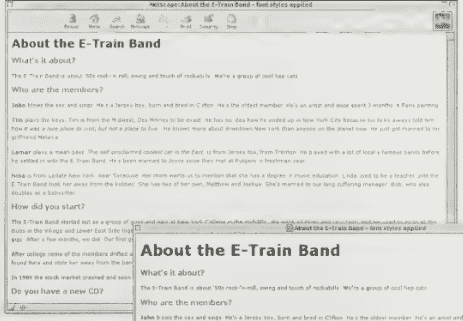

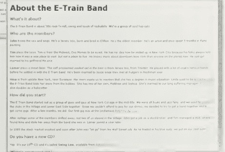

## 指定字体和行距大小

在本页面中，**font-size** 和 **line-height** 值以像素为单位指定。当你的目标是让页面在所有支持 CSS 的浏览器中尽可能保持一致时，以像素为单位指定这些值是最安全的选择。

**font-size** 使用奇数像素值可能会在 Windows 上的 Netscape 4.x 中导致问题，该浏览器通常会将其缩小一像素。在 Netscape 4.x 中检查你的页面，如果字体看起来太小，请将其调整为 12px 或更大。

永远不要用像素以外的单位指定 **line-height**，以避免遇到更多 Netscape 4.x 的问题。例如，用 em 单位指定 **line-height** 可能会在某些情况下导致行与行之间重叠。

## 应用颜色样式和背景图像

当你添加颜色值并添加背景横幅图形——通过应用 **background** 和 **color** 样式规则，你的页面开始初具雏形。

1.  根据基本调色板，为页面指定黑色背景（RGB 值 **#000000**）。将主要的 **p**（段落）文本设为浅灰色（RGB 值 **#eeeeee**）。注意你正在为 **body** 和 **p** 标签选择器同时添加 **background-color** 和 **color** 样式。

> **注意：** 为 **body** 和 **p** 元素/选择器同时指定 **background-color** 和 **color** 规则。虽然对于正确支持 CSS 继承的现代浏览器来说这不是必须的，但对于不支持继承的 Netscape 4.x 来说则是必要的。

```css
background-color: #000000;
color: #eeeeee;
```

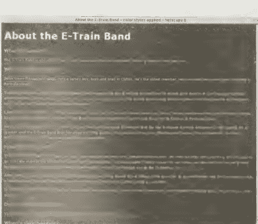

为标题、加粗文本和斜体文本应用颜色样式后的页面效果。

2.  为 h2、b 和 em 元素指定第一个强调色值（金黄色，RGB 值 #ffcc00）。

```css
color: #ffcc00;
```

## 指定颜色值

颜色值不区分大小写。你可以通过以下方式指定颜色值：

-   使用十六进代码，格式为 #rrggbb（其中 rr 是红色值的 2 位十六进制代码，gg 是绿色值，bb 是蓝色值）或 #rgb（红、绿、蓝十六进制代码的缩写形式，各取第一位字符）。

-   使用 rgb(red,blue,green) 格式。在括号内使用红、绿、蓝的正常整数值，而非十六进制值。

-   某些颜色可以通过名称指定。（除了 black 和 white 等颜色外，我从未觉得这种方式太实用，因为我总是记不住哪种颜色对应哪个名称。通过 RGB 值指定颜色也更精确，因为你可以确切地说明要使用哪种"红色"——粉红色还是棕红色！）

例如，这里使用的金黄色可以指定为 #ffcc00、#fc0 或 rgb(255,204,0)。

不要在颜色十六进制值周围使用引号。（一些对 HTML 友好的文本编辑器具有从调色板拖拽颜色到文档以自动插入颜色值的功能，但可能会同时插入引号。在 CSS 中使用颜色值时请记得删除这些引号。）

```css
p {
    font-size: 11px;
    line-height: 18px;
    color: #eeeeee;
}
h2 {
    font-size: 15px;
    color: #fc0;
}
b,em {
    color: #ffcc00;
}
body,p,
h2 {
    font-family: 'gill sans', verdana, helvetica, arial, sans-serif;
}
body {
    background-color: #000000;
    color: #eeeeee;
}
```

截至目前的 CSS 样式规则，包含颜色样式规则。

3.  为 a 元素添加颜色。在默认（未点击）状态下，将 a:link 伪元素设为交替强调色橙色（#ff9900）。

4.  指定另外两个 a 元素伪类 :visited 和 :hover 的外观。将 :visited 规则放在 :link 规则之前。对于 :hover 伪元素，使用浅黄色（#ffff99）的 background-color。

为 :hover 状态指定 background-color 值，以便在用户将鼠标悬停在其上时提供即时的视觉反馈。

> **注意：** 按以下顺序放置伪元素样式规则：:visited、:link，然后 :hover。由于 CSS 的层叠顺序规则，这是必须的。

5.  通过将 text-decoration: underline 规则应用于 :link 伪元素，指定链接文本应带有下划线。通过将 text-decoration: none 规则应用于 :visited 伪元素，指定已访问的链接不应带下划线。

```css
a:visited {
    text-decoration: none;
    color: #ffff99;
    background-color: black;
}

a:link {
    text-decoration: underline;
    color: #ff9900;
    background-color: black;
}

a:hover {
    color: black;
    background-color: #ffff99;
}
```

为 a:link（左侧，超链接文本的默认视图）、a:hover（中间）和 a:visited（右侧）设置不同的样式规则。已访问的链接没有下划线（text-decoration: none），颜色为浅黄色，使其在视觉上显得退后。

6.  将背景图像添加到 body 标签选择器，并将 background-repeat 值设为 no-repeat。

```css
body {
    background-image: url(etrainlogo.gif);
    background-repeat: no-repeat;
}
```

## 使用 TEXT-DECORATION 和 TEXT-TRANSFORM 转换超链接文本

超链接文本默认带有下划线。许多设计师倾向于移除下划线。为此，可设置 **text-decoration: none**。但请记住，Netscape Navigator 4.x 无法识别 **:hover** 伪元素。因此，如果你确实要去掉下划线，请确保通过其他方式清晰地标记超链接。

当前浏览器中可用的另一个 **text-decoration** 值是 **overline**。这会在文本上方添加一条线。单独使用时看起来颇为怪异，但你可以将其与 underline 结合，在文本上下方同时创建线条。

**Text-transform** 是另一个可用于使文本（如超链接文本）更加醒目的属性。该属性的可能值包括 **lowercase**（将所有字符转为小写）、**uppercase**（将所有字符转为大写）和 **capitalize**（仅将每个单词的首字母转为大写）。

以下样式规则展示如下：

```
a:link {
    text-decoration: overline underline;
}

a:hover {
    text-transform: uppercase;
}
```

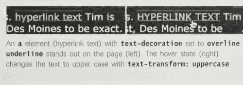

**background-repeat** 规则指定背景图像是否应在页面上重复（平铺）以及重复的方向。在本例中，背景图像不重复，因此 **background-repeat** 值设置为 **no-repeat**。

> **Note:** 请注意，第 4 版浏览器无法识别 **background-attachment**；不过，这不应过度影响页面设计。

**Note:** 背景样式规则可以逐一指定，如这里所示，也可以采用"简写"格式一次性指定。顺序如下：

```
selector {
    background: background-color url(path/to/
    background/image) background-repeat background-attachment
    background-position;
}
```

并非所有属性都需要指定。（我们将在本项目的后面部分介绍 **background-attachment**，并在项目 2 "将 CSS 融入基于表格的布局" 中介绍 **background-position**。）对于本页，我们可以如下指定背景样式：

```
body {
    background: black url(etrainlogo.gif) no-repeat;
}
```

7. 在浏览器中查看结果。文本与背景图像重叠，这是不理想的。下一步将对此进行修正。

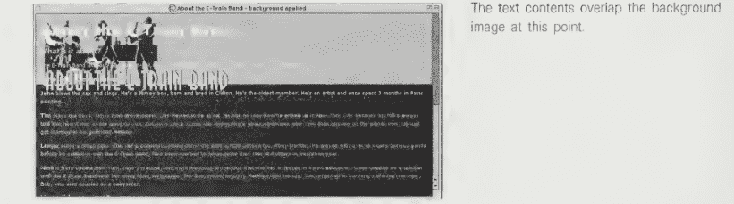

## 调整 Margin 和 Padding 以优化布局

通过添加 **margin**、**padding** 和 **border** 属性样式，你可以微调页面布局，而无需借助表格。

1. 将全部文本内容（包含在 `<body>...</body>` 标签内的所有内容）放入一个 **id** 为 main 的 **div** 元素中。

这将页面内容置于一个大的区块中。应用于该区块的 CSS 样式规则指定了边距、边框和内边距。

> **Note:** **id** 选择器区分大小写。请记住在 **id** 选择器名称前加上井号 **#**，但在 HTML 标签中的 **id** 属性前不要加。**div** 的 HTML 标签如下所示：

`<div id="main">...</div>`

2. 为 **#main** 选择器指定 **margin-top**、**margin-left** 和 **margin-right** 属性值。

3. 在文本块左侧添加醒目的 **border**。使用 **border-left-width**、**border-left-style** 和 **border-color** 属性指定左边框的宽度、样式和颜色。

> **Note:** **margin** 属性用于指定文本块与浏览器窗口顶部 left、right 和 bottom 边的距离。**margin-top** 的值应略大于横幅图形的高度。

请记住，这只会限制边距宽度，而非文本块的实际宽度。例如，如果浏览器窗口宽度为 800 像素，文本块宽度将为 550 像素；如果窗口宽度为 1100 像素，文本块宽度将为 850 像素。如果你想限制文本块本身的实际宽度，请设置 width 属性值，如下所示：**width:** 500px。

**margin-bottom** 属性也可用。但 Netscape 4.x 可能会错误地将 **margin-bottom** 值添加到元素顶部，导致上边距过大。因此，本页面不使用该属性。

> **Note:** 在这里使用 **border-left-color** 属性本是符合逻辑的，但遗憾的是 Netscape 4.x 无法识别该属性。如果你想在 Netscape 4.x 中显示边框，请改用 **border-color**。**border-style**（**border-left-style**、**border-right-style** 等）属性同样被 Netscape 4.x 忽略，该浏览器仅显示实线单线边框。

4. 指定 **padding-left** 值，在文本边缘与边框之间创建空白。

```
#main {
    margin-top: 200px;
    margin-left: 100px;
    margin-right: 150px;
    margin-bottom: 50px; /* 仅被少数浏览器识别 */
    width: 500px;

    border-left-width: 10px;
    border-left-style: double;
    border-color: #ffcc00;
    padding-left: 30px;
}
```

5. 通过指定 **text-indent** 属性值来缩进 **p** 元素。

缩进 **p** 元素可突出标题。

```
/* 缩进所有段落。 */
p {
    margin-left: 20px;
}
```

> **Note:** 要缩进（向右移动）整个文本块，请使用我们这里的 **margin-left** 属性。要仅缩进文本块的首行，请使用 **text-indent** 属性。

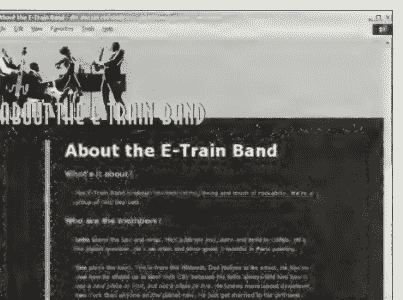

文本内容现在与图形形成了恰当的相对位置，左侧应用了双边框，突显了装饰艺术风格。

## 为文本阅读器提供支持并清理样式表

主标题文本 "About the E-Train Band" 和图像中的文本对于使用图形浏览器的用户（大多数网站访问者）来说是多余的。简单的解决方案是直接删除标题文本。然而，缺点是纯文本浏览器或屏幕阅读器将无内容可读，因为我们无法为背景图像提供 **alt** 文本。我们将使用 **display** CSS 属性来解决这个问题。

1. 通过设置 **display: none** 隐藏 h1 元素。

**display** 属性可用于完全隐藏任何元素，方法是将值设置为 **none**。这是在支持 CSS 的浏览器中隐藏冗余文本的好方法，同时为纯文本浏览器等非 CSS 浏览器提供替代文本。

```
/* 在支持 CSS 的图形浏览器中查看页面时，这将隐藏 h1 元素。 */
h1 {
    display: none;
}
```

2. 如有必要，清理并编辑最终样式表。在浏览器中检查结果并纠正任何错误。

最终样式表。

## 样式表故障排除技巧

```
<style media="screen" type="text/css">
<!--
p  {
    font-size: 11px;
    line-height: 18px;
    color: #eeeeee;
    margin-left: 20px;
}
h2 {
    font-size: 15px;
    color: #fc0;
}
h1    {
    display: none;
}
b,em {
    color: #ffcc00;
}
body,p,h2 {
    font-family: 'gill sans',verdana,helvetica,arial,sans-serif;
}
body {
    background-color: #000000;
    color: #eeeeee;
    background-image: url(etrainlogo.gif);
    background-repeat: no-repeat;
}
a:visited {
    text-decoration: none;
    color: #ffff99;
    background-color: black;
}
```

请确保你已使用适当的解决方案回答了这些问题，并注意这些常见的样式表错误：

- 所有括号是否正确闭合？

- 所有冒号和分号是否正确？

- 大多数 CSS 属性和选择器不区分大小写，但 ID 选择器区分大小写。

- 不要在颜色十六进制值周围加引号。

请记住，冒号结束属性名，分号结束每条样式规则（例如，**property: value;**）。

因此，如果你的 HTML 元素的 id 为 **myElement**，则样式表中对应的选择器必须是 **#myElement**——而不是 **#myelement** 或 **#MyElement！**

如果你已纠正所有这些问题，且除 Netscape 4.x 外所有浏览器显示都正常，请参阅项目 5 "JavaScript 翻转效果" 中的 Netscape 4 故障排除技巧。

待续

16

## 关于 E-Train 乐队

这是关于什么的？

成员是谁？

你们是如何开始的？

你们有新 CD 吗？

下一场演出是什么时候？

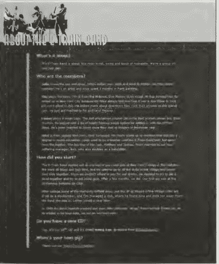

续

```css
a:link {
    text-decoration: underline;
    color: #ff9900;
    background-color: black;
}
a:hover {
    color: black;
    background-color: #ffff99;
}

#main {
    margin-top: 200px;
    margin-left: 100px;
    margin-bottom: 50px;
    margin-right: 150px;
    border-left-width: 8px;
    border-left-style: double;
    border-color: #ffcc00;
    padding-left: 30px;
}
-->
</style>
```

最终页面隐藏了“关于 E-Train 乐队”的文字。它看起来与原始文本版本大不相同，但结构完全相同。唯一的新增内容是样式表和背景图像。（整个页面大小在 12K 以下，其中单个图形为 9K，HTML + CSS 本身仅为 3.8K。）

## 关于 DOCTYPE

什么是 **DOCTYPE** 声明，它是如何工作的？直到最近，这对网页设计师来说仍然是一个相当无意义的问题，因为浏览器忽略了 **DOCTYPE** 声明。然而，这种情况在过去几年里已经改变。现在是时候弄清楚 **DOCTYPE** 是如何工作的了。

HTML 页面上的 **DOCTYPE** 元素用于声明文档使用的语言及其级别，以及该页面使用的文档类型定义（DTD）的类型。

有两种类型的 DTD：*宽松型* 或 *过渡型* 与 *严格型*。严格的 DTD 严格遵守既定标标准，不允许任何错误，而宽松的 DTD 允许更多的灵活性和互操作性。然而，在实践中，其工作方式如下：

**1** 严格的 HTML 或 XHTML **DOCTYPE** 声明：

这会使文档在严格模式下渲染，遵循 DTD。

```html
<!DOCTYPE HTML PUBLIC "-//W3C//DTD HTML 4.01//EN"
"http://www.w3.org/TR/html4/strict.dtd">

<!DOCTYPE html PUBLIC "-//W3C//DTD XHTML 1.0 Strict//EN"
"http://www.w3.org/TR/xhtml1/DTD/xhtml1-strict.dtd">
```

**2** 过渡型或宽松型 HTML **DOCTYPE** 声明（带 URL）：

这会使文档在严格模式下渲染，遵循 DTD——因为它指向了该 URL。

```html
<!DOCTYPE HTML PUBLIC "-//W3C//DTD HTML 4.01 Transitional//EN"
"http://www.w3.org/TR/html4/loose.dtd">
```

**3** 过渡型或宽松型 HTML **DOCTYPE** 声明（不带 URL）：

这会使文档在 *怪异* 模式下渲染——这意味着浏览器将尽其所能渲染页面。

```html
<!DOCTYPE HTML PUBLIC "-//W3C//DTD HTML 4.01 Transitional//EN">
```

**4** 如果完全没有 **DOCTYPE** 声明，文档将在怪异模式下渲染。

**5** 过渡型 XHTML **DOCTYPE** 声明：

这会使文档在过渡型 XHTML 模式下渲染。

```html
<!DOCTYPE html PUBLIC "-//W3C//DTD XHTML 1.0 Transitional//EN"
"http://www.w3.org/TR/2000/REC-xhtml1-20000126/DTD/
xhtml1-transitional.dtd">
```

> **注意：** 第一个按预期识别 **DOCTYPE** 声明的主要浏览器是用于 Macintosh 的 Microsoft Internet Explorer 5.0。目前 Netscape 6 和其他基于 Mozilla 的浏览器也识别 **DOCTYPE**，用于 Windows 的 Microsoft Internet Explorer 6.0 同样如此。

如果您致力于创建符合万维网联盟标准的网页，请尝试制作尽可能干净和规范的页面，指定严格的 DTD，验证页面，然后在符合标准的浏览器中查看页面。（目前，Netscape 6.x/Mozilla 或用于 Mac 的 Microsoft Internet Explorer 5.0 似乎是最符合标准的可用浏览器。）这将帮助您了解有效、标准的代码是什么样子。

> **注意：** 如果您使用 HTML，请使用 HTML 4.01 DOCTYPE，而不是旧的（4.0 和 3.2）DOCTYPE。HTML 4.01 是 HTML 规范的最终版本，包含了之前版本的所有 DTD。

然而，在日常生产环境中，使用怪异模式选项可能仍然是您的最佳选择——特别是如果您严重依赖基于表格的布局。因为网页必须在各种浏览器中都能正常工作和按预期显示，包括那些以古怪方式渲染标记的浏览器，除了实验性网站外，几乎不可能对所有网站都使用严格的 DTD。

例如，在一个使用基于表格的布局的页面中，常见的做法，如使用单像素 GIF 作为“间隔符”或在标签中包含 **width**、**height**、**bgcolor**、**colspan** 和 **rowspan** 属性，在指定严格 DTD 进行页面检查时，会引发验证器的许多抱怨。在符合 W3C 标准的浏览器（如 Netscape 6.x）中显示这样的页面可能会有问题。

## 尺寸单位问题

在这个项目中，我们对所有尺寸值都坚持使用绝对像素大小。像素大小对于控制外观是最可靠的，尤其是在 4.0 版本的浏览器中。使用像素的缺点是，在大多数浏览器中用户无法调整文本大小（Mac 上的 Internet Explorer 5.0+、iCab 2.51 及更高版本、Opera 和 Netscape 6/Mozilla 除外）。另一种选择是使用相对大小，例如 em。这不太可靠，但确实允用户调整文本大小。请谨慎使用，并在各种平台和浏览器上测试您的页面，以确保您不会得到不可接受的结果。

指定字体大小时避免使用磅（pt）。在 Mac 上的 4.0 版本及更早的浏览器中，显示分辨率为 72dpi（每英寸点数），而在所有 Windows 浏览器和 Mac 上的 5.0 及更高版本的浏览器中，它是 96dpi。这意味着 12 磅的字体在较旧的 Mac 浏览器中显示的大小要小得多。在小磅值时，文本变得难以阅读。对于屏幕显示，最好坚持使用像素。（如果您想知道，磅也是绝对单位。）

- 48pt Times New Roman - Netscape 4

- 48px Times New Roman - Netscape 4

- **48pt Times New Roman - MSIE**

- 48px Times New Roman - MSIE

> 注意：格式良好的标记（与“有效”标记相对）是为您的网页创建可靠基础的最重要方面。

Netscape 4.7 中的 48 磅文本（顶部）比 Internet Explorer 5.0 中的 48 磅文本（第三行）小，但 48 像素文本在两种浏览器中是相同的。

#### 在基于表格的布局中整合 CSS


> “仅仅在旧的界限内加大努力是行不通的。”

> ——卡尔·韦克

## 使用 CSS 为基于表格的布局添加样式

无论您是否喜欢，并非所有计算机用户都会立即将他们的浏览器升级到新版本。为了照顾仍然使用 4.0 版本浏览器的用户，使用表格进行页面布局仍然更安全。此外，网页设计师对使用表格创建页面更为熟悉。这个项目向您展示如何将 CSS 融入典型的基于表格的布局，利用每种方法的最佳特性。

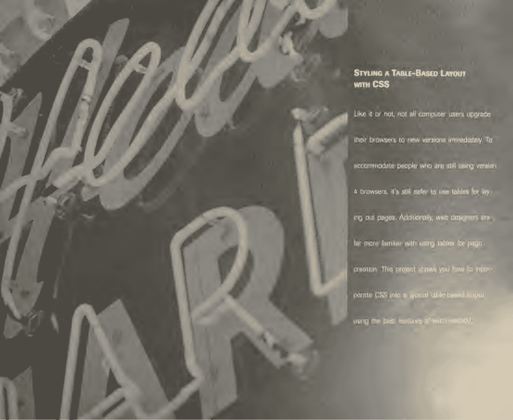

### 项目 2

#### 在基于表格的布局中整合 CSS

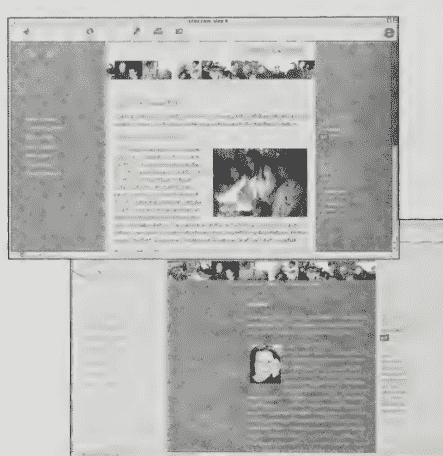

#### 开始

由于需要创建在 4.0 版本浏览器以及当前的 5.0 及更高版本浏览器中显示方式相同的页面，在现实情况下，设计师被迫使用基于表格的布局。然而，这并不意味着设计师不能很好地利用 CSS。

本项目中的示例使用了典型的 3 列布局。它有一个静态的“横幅”元素在顶部，内容在中间，导航和链接元素在两个外列。它结合了表格布局和“安全”的 CSS 属性和值。该设计有两个明显的颜色区域，因此 **class** 和 **id** 选择器用于 CSS 样式属性。

使用 CSS 使得更改和更新页面外观变得容易得多，而使用表格作为“骨架”意味着布局不会在对 CSS 标准支持不完整的浏览器中崩溃。如果您的客户要求他们的网站在 Netscape Navigator 4.08 到最新的浏览器中看起来都很好，请考虑这种方法。如果您对使用 CSS 持怀疑态度，这个项目将帮助您逐步适应，而无需放弃基于表格的布局。

在这个项目中，您将学习如何：

- 构建一个简化的表格布局，该布局在表格单元内使用 **div** 元素，而不是嵌套表格

- 使用 **class** 选择器为不同的 HTML 元素组定义单独的样式

- 使用 **id** 选择器为唯一元素定义样式

- 使用 CSS 完善和增强页面的外观

- 创建一个在 4.0 版本浏览器中仍然看起来不错，但在最新浏览器中得到增强的页面

## 规划基本布局

在规划使用 CSS 的基于表格的布局时，重要的是在设计原型阶段就理清逻辑，甚至在开始创建标记之前。尽量将嵌套的 **table** 元素数量保持在最低限度。在以前可能使用嵌套表格的地方，现在使用 **div** 或 **span** 元素。

1.  根据客户提供的需求列表，在你喜欢的图像编辑器中创建页面布局原型。如果需要，使用标尺和布局网格。在必要处添加备注。

    此处标注了基础图形的所需尺寸，以及在表格布局中使用 **rowspan** 的位置。

    此页面布局使用一个简单的 **table**，其中嵌套了 **div** 元素块。**div** 块在图中由黑色边框标出。**div** 块用于设计师以前可能使用嵌套表格来放置内容块的地方。

    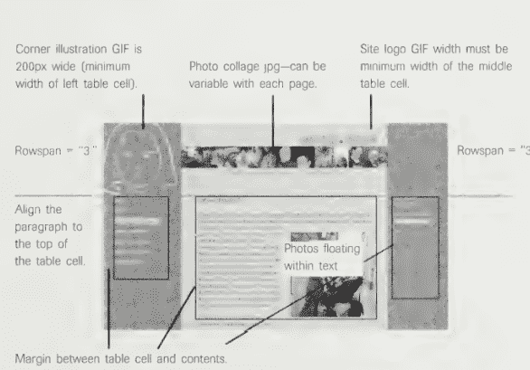

    > **注意：** 当你计划在必须在旧版浏览器中正常显示的基于表格的布局中使用 CSS 时，最稳妥的做法是计划将可定位的块级元素（例如 **div** 块）放置在表格单元格内。**div** 块比嵌套表格更灵活，因为可以为它们指定 **margin** 或 **padding** 样式规则，正如你将在本项目后续部分看到的。

2.  根据页面原型，创建基础图形。

    此页面包含六个基础图形：插图标志、站点标志、照片条、其下方的“连接人们”文本，以及主内容区域背后的背景“水印”图像。一个像素大小的透明“间隔”GIF 也用于某些表格单元格。

    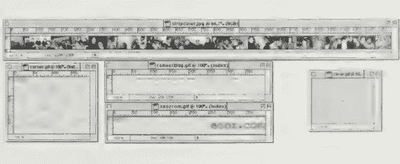

    角落插图的大小与将容纳它的表格单元格的最小尺寸完全一致。站点文本标志和“连接人们”文本图形的宽度与内部表格行的最小宽度（400 像素）相同，高度则与容纳它们的表格单元格相同。单像素透明 GIF 用于“撑开”任何在视觉上为空的表格单元格。

    > **注意：** 创建透明 GIF 时，为图形选择与图形将放置其上的背景颜色相匹配的哑光颜色。对于本项目中的面部插图图形，哑光颜色设置为中灰色，这与预期的背景颜色相匹配。

## 创建 HTML 表格布局和外部样式表

一旦布局设计敲定且基础图形创建完成，将其转换为基于 HTML 表格的布局。同时，设置一个将链接到 HTML 页面的外部样式表。

1.  使用 **table** 元素和 **div** 创建页面的“骨架”。将图像和占位文本放置在适当的位置。为 **table** 标签指定 **border="1"**，以便可以看到 **table** 元素的轮廓。（此边框只是临时的，以便我们可以清楚地看到表格的样子。它稍后将被删除。）

    避免在表格单元格（**<td>**）元素中使用任何 **bgcolor** 属性。

    将左侧、中间和右侧内容元素分别包裹在具有唯一 **id** 的 **div** 中：**left**、**main** 和 **right**。

    为了使 **div** 的位置更清晰，请为它们指定临时的 **div {border: 1px solid black}** 样式。这也将在稍后被删除。

    **#main div** 中的文本应包含在适当的标题（**<h1>…</h1>** 等）或段落（**<p>…</p>**）标签中。

    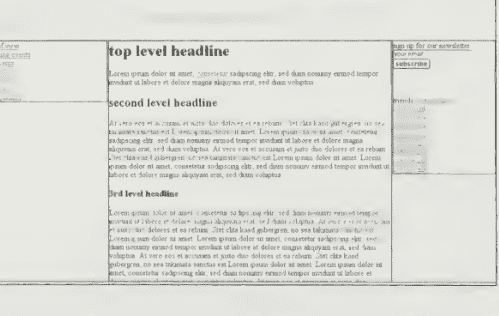

    使用表格创建页面的“骨架”。**table** 元素和 **div** 元素具有临时的、可见的边框，以便我们可以清楚地看到结构。

    ```
    <!DOCTYPE HTML PUBLIC "-//W3C//DTD HTML 4.01//EN"
        "http://www.w3.org/TR/1999/REC-html401-19991224/strict.dtd">
    <html>
    <head>
        <meta http-equiv="content-type" content="text/html; charset=iso-8859-1">
        <title>Project 2 example: step 1, without the stylesheet</title>

        <style type="text/css" media="Screen">
    <!--
    div {border: 1px solid black;}
    -->
    </style>
    </head>
    <body>
    <table width="100%" border="1" cellspacing="0" cellpadding="0">
    <tr>
    <td class="seccolor" rowspan="3" width="25%"></td>

    <td class="maincolor" width="55%" align="center"><div id="banner">
    </div></td>
    <td class="seccolor" rowspan="3" width="20%" height="50">
    </td>
    </tr>
    <tr><td class="maincolor" id="photos" width="55%"></td></tr>
    <tr><td class="maincolor" width="55%"></td></tr>
    <tr>
    <td class="seccolor" valign="top">

    <!-- left side navigation -->
    <div id="left">
    <a href="#">point of view</a><br>
    <a href="#">upcoming events</a><br>
    <a href="#">past events</a><br>
    <a href="#">photo album</a><br>
    <a href="#">about sooz</a><br>
    <a href="#">supporters</a><br>
    <a href="#">make contact!</a>
    </div>
    <!-- end left side navigation -->

    </td>
    <td class="maincolor">
    <!-- start main content -->
    <div id="main">

    <h1>top level headline</h1>
    <p>
    Lorem ipsum dolor sit amet, <a href="#">consetetur</a> sadipscing elitr, sed diam nonumy eirmod tempor invidunt ut labore et dolore magna aliquyam erat, sed diam voluptua.</p>
    <h2>second level headline</h2>
    <p>
    At vero eos et accusam et justo duo dolores et ea rebum. Stet clita kasd gubergren, no sea takimata sanctus est Lorem ipsum dolor sit amet. Lorem ipsum dolor sit amet, consetetur sadipscing elitr, sed diam nonumy eirmod tempor invidunt ut labore et dolore magna aliquyam erat, sed diam voluptua. At vero eos et accusam et justo duo dolores et ea rebum. Stet clita kasd gubergren, no sea takimata sanctus est Lorem ipsum dolor sit amet. Lorem ipsum dolor sit amet, consetetur sadipscing elitr, sed diam nonumy eirmod tempor invidunt ut labore et dolore magna aliquyam erat, sed diam voluptua.
    </p>

    <h3>3rd level headline</h3>

    <p>
    Lorem ipsum dolor sit amet, consetetur sadipscing elitr, sed diam nonumy eirmod tempor invidunt ut labore et dolore magna aliquyam erat, sed diam voluptua. At vero eos et accusam et justo duo dolores et ea rebum. Stet clita kasd gubergren, no sea takimata sanctus est Lorem ipsum dolor sit amet. Lorem ipsum dolor sit amet, consetetur sadipscing elitr, sed diam nonumy eirmod tempor invidunt ut labore et dolore magna aliquyam erat, sed diam voluptua. At vero eos et accusam et justo duo dolores et ea rebum. Stet clita kasd gubergren, no sea takimata sanctus est Lorem ipsum dolor sit amet. Lorem ipsum dolor sit amet, consetetur sadipscing elitr, sed diam nonumy eirmod tempor invidunt ut labore et dolore magna aliquyam erat, sed diam voluptua. At vero eos et accusam et justo duo dolores et ea rebum. Stet clita kasd gubergren, no sea takimata sanctus est Lorem ipsum dolor sit amet.
    </p>
    <h4>4th level headline</h4>
    <p>
    At vero eos et accusam et justo duo dolores et ea rebum. Stet clita kasd gubergren, no sea takimata sanctus est Lorem ipsum dolor sit amet.
    </p>
    <!--end main content -->

    </div>
    </td>
    <td class="seccolor" valign="top">

    <!-- right side bar -->
    <div id="right">
    <form method="post">
    sign up for our newsletter
    <input type="text" name="email" value="your email"><br>
    <input type="submit" name="submit" value="subscribe" src="images/go.gif" border="0">
    </form>
    <br><br>
    friends:
    <a href="#">outside link </a><br>
    <a href="#">outside link </a><br>
    <a href="#">outside link </a><br>
    <a href="#">outside link </a><br>
    <a href="#">outside link </a><br>
    <a href="#">outside link </a><br>
    <a href="#">outside link </a><br>
    <a href="#">outside link </a><br>
    </div>
    <!-- end right side bar -->

    </td>
    </tr>
    <tr>
    <td class="seccolor" colspan="3" height="30">
    <p>&copy;2000-2001 Susan Kaup, www.sooz.com. Used with permission.</p>
    </td></tr>
    </table>

    </body>
    </html>
    ```

    注意：为了指定 div 元素的临时边框样式，我们使用了指定边框样式的简写形式，即 border: 1px solid black。其语法是边框的宽度、边框的样式以及边框的颜色。

    注意：为了向后兼容，请在 td 单元格中使用 align=、valign=、height= 和 width= 属性，而不是使用 text-align、vertical-align、height 和 width CSS 属性。更多详情，请参阅本项目后面的“工作原理”部分。

## 2

建立两个类：maincolor 和 seccolor。在你的 HTML 标记中，为每个 <td>（表格单元格）应用相应的 class 属性。侧边栏和底部 <td> 将使用 seccolor 类，中间列 <td> 将使用 maincolor 类。

```
<td class="maincolor"……> 或 <td class="seccolor"……>
```

注意：务必将 class 属性应用于 <td> 元素，而不是 <tr> 或 <table> 元素，以避免在版本 4 浏览器中出现问题。

## 3

建立四个 id 选择器：photos、left、main 和 right。id photos 选择器用于将包含照片条图形的 <td>；left 用于包含左侧导航的 <div>；main 用于包含主内容的 <div>；right 用于包含右侧导航的 <div>。

```
<td id="photos"> 或 <div id="left"> <div id="main"> <div id="right">
```

注意：当你想将一组通用样式规则应用于多个元素时，请使用类选择器；当你想将一组样式规则应用于页面上的单个元素时，请使用 id 选择器。id 也用于在 JavaScript 中标识页面上的单个元素，正如你将在本书后续部分看到的。

## 使用外部样式表


创建一个外部样式表。新建一个不含 HTML 标签的空白文本文档。将其保存为文件名`main.css`。在 HTML 页面的`<head>`部分使用`<link>`标签链接到此样式表。

```
<link rel="Stylesheet" href="main.css" type="text/css" media="Screen">
```

通过使用外部样式表而非将 CSS 样式规则放在 HTML 页面内，可以一次性为整个网站定义样式。

外部样式表文件可以任意命名——它不一定需要有`.css`后缀，尽管在某些服务器上`.css`后缀会将其标识为`text/css`类型的文档。但是，它必须是纯 ASCII（文本）文件，不能包含任何 HTML 标签。不要在外部样式表中使用任何`<style>`标签或 HTML 注释标签（`<!-- -->`）。

通过插入注释来标注你的样式表是个好习惯。要在样式表中插入注释（无论该样式表是外部的还是包含在 HTML 页面中的），请将其用`/* */`标签括起来。

通常将外部样式表保存在单独的目录或文件夹中。如果你将外部样式表文档保存到网站上的另一个文件夹中，请务必在 HTML 文档的`<link>`标签的`href=`属性中指定正确的目录路径。此外，如果你在外部样式表中指向任何图像文件，请小心。为避免问题，最安全的做法是在外部样式表中指向图像或页面时使用绝对链接或完整服务器路径。

以典型网站的目录结构为例。外部样式表文件`styles.css`位于`includes`目录中。用作背景的图像`pattern.gif`位于`images`目录中。使用此样式表的名为`index.html`的 HTML 文件位于`content`目录中。

如果使用相对路径，`index.html`中的`<link>`标签和`styles.css`中的相关 CSS 样式规则如下所示：

```
<link rel="Stylesheet" href="../includes/styles.css">
body {
    background-image: url(../images/pattern.gif);
}
```

使用绝对路径时，`index.html`中的`<link>`标签和`styles.css`中的相关 CSS 样式规则如下所示：

```
<link rel="Stylesheet" href="/includes/styles.css">
body {
    background-image: url(/images/pattern.gif);
}
```

## 为类选择器创建样式规则

此页面有两种不同的背景：主色调为黄色，次色调为灰色。你将创建样式规则并使用类选择器将这些样式规则应用到页面上的多个元素。

- 1. 为类选择器`.maincolor`和`.seccolor`定义背景颜色和`color`属性样式。

```
.maincolor {
    background-color: #ffcc66;
    color: #333333;
}

.seccolor {
    background-color: #666666;
    color: #ffcc66;
}
```

> **注意：** 类选择器在 CSS 中以"."（句点）开头——也就是说，`.maincolor`。

- 2. 保存这些样式并在浏览器中预览你的 HTML 页面。

现在，两侧列的背景是灰色的，中间列是黄色的。

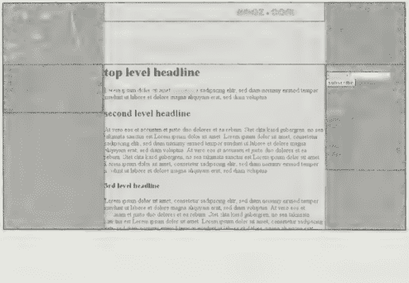

使用类选择器将相同的样式规则应用到页面上的多个元素。在此页面中，构成侧栏的`<td>`元素的`class`属性为`.seccolor`，构成中间列的`<td>`元素的`class`属性为`.maincolor`。

## 应用字体样式

接下来，你将把字体样式应用到页面上的文本元素。

- 1. 通过对页面上的所有元素应用相同的规则，为整个页面指定一种`font-family`样式。确保包含页面上可能包含任何文本的所有 HTML 元素。

当你必须支持第 4 版浏览器时，这种方法通常是最安全的。

```
p,h1,h2,h3,h4,ul,ol,li,div,blockquote,body,table,td {
    font-family: verdana, arial, helvetica, sans-serif;
}
```

- 2. 为所有标题元素（`<h1>`、`<h2>`、`<h3>` 和 `<h4>`）指定相同的`color`样式。为每个标题元素指定不同的`font-size`样式，并为`<p>`元素指定`font-size、line-height 和 color`样式。

```
p,h1,h2,h3,h4,ul,ol,li,div,blockquote,body,table,td {
    font-family: verdana, arial, helvetica, sans-serif;
}
h1, h2, h3, h4 {
    color: #336699;
}
h1 {
    font-size: 18px;
}
h2 {
    font-size: 16px;
}
h3 {
    font-size: 14px;
}
h4 {
    font-size: 12px;
}
p {
    color: #000000;
    font-size: 12px;
    line-height: 20px;
}
```

> **注意：** 使用绝对像素大小来指定`font-size`和`line-height`属性值——以避免在 Netscape 4.x 中出现任何问题。

此时查看 HTML 页面。

主区域中的文本看起来符合我们的预期。侧区域中的文本以我们指定的`font-family`显示，但字体大小尚未指定。

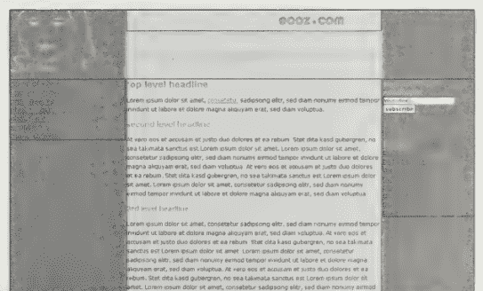

字体样式已应用到页面。

## 使用类选择器设置不同的链接文本

此设计使用文本导航而非图形按钮进行导航。但这并不意味着我们不希望导航在视觉上有所区别。为了使侧区域中的`<a>`元素（链接文本）与主内容中的`<a>`元素看起来不同，我们将使用`class`选择器。

- 1. 创建两个`class`选择器：`nav`用于左列中的`<a>`元素，`outside`用于右列中的`<a>`元素，这些链接主要指向外部网站（重要性低于主导航链接）。在每个`<a>`标签中插入适当的`class`属性到左列和右列。默认的`a`元素样式将用于主正文文本中的链接。

```
<!-- 左侧导航，显示插入到标签中的 class 属性。 -->
<div id="left">
<a class="nav" href="#">point of view</a><br>
<a class="nav" href="#">upcoming events</a><br>
<a class="nav" href="#">past events</a><br>
<a class="nav" href="#">photo album</a><br>
<a class="nav" href="#">about sooz</a><br>
<a class="nav" href="#">supporters</a><br>
<a class="nav" href="#">make contact!</a>
</div>
<!-- 左侧导航结束 -->
```

> **注意：** 出于实用目的，并非所有元素都需要指定`background-color`样式。但是，如果你不指定`background-color`，W3C CSS 验证器会报错。对于没有背景颜色的元素，指定透明的颜色值即可。不要使用`inherit`颜色值——这在 Netscape 4.x 中会显示为有趣的柠檬绿色。

## 保持可编辑区域中的 HTML 简洁

为什么不也为中间部分的`<a>`元素创建一个类呢？一方面，既然我们可以为默认的`<a>`元素定义样式规则，就没有必要。另一个不为主要内容中的 HTML 元素创建类的原因是，这通常是页面中会由客户频繁更新的部分，远在设计师完成网站之后。客户可能懂一点 HTML——或者你可以给他关于如何更新内容的说明——但他很可能会忘记在标签中添加任何额外的属性。即使你自己编辑页面，你也可能忘记在何处使用哪些类。

因此，通常最好将网页主要内容部分的标记标签保持尽可能基础，不附加任何`class`属性。此外，在构建页面时，要明确区分哪个区域是可编辑的，哪个区域不应由客户或其他人触碰。（使用注释标签是明确划分内容位置的好方法。）

- 2. 为三种不同的`<a>`元素样式创建样式规则。

```
a:link {
    color: #993333;
    background-color: transparent;
    font-weight: bold;
    text-decoration: none;
}

a:visited {
    background-color: transparent;
    color: #666666;
    text-decoration: none;
}

a:hover {
    background-color: transparent;
    color: #ffff99;
    background-color: #993333;
}

a.nav:link, a.nav:visited {
    color: #ffcc66;
    background-color: #666666;
    font-weight: bold;
    text-decoration: none;
}

a.nav:hover {
    color: #cccccc;
    background-color: #993333;
}

a.outside:link, a.outside:visited {
    color: #ffcc66;
    background-color: #666666;
    text-decoration: none;
    font-weight: normal;
}

a.outside:hover {
    text-decoration: underline;
    color: #ffcc66;
    background-color: transparent;
}
```

3. 再次在浏览器中检查页面。要查看“悬停”效果，请在版本5或更高的浏览器中，或在Microsoft Internet Explorer 4.x中检查页面。

> 注意：Netscape 4.x 不支持悬停效果。页面在没有悬停样式的情况下仍应可正常导航。

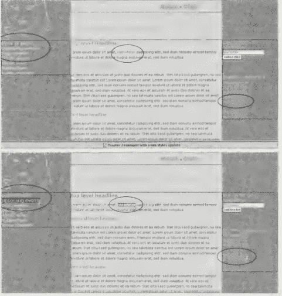

链接文本被圈出。上方的截图显示默认链接样式，下方的截图显示**悬停**样式。

## 为 div 和 body 应用外边距和内边距样式

页面使用**div**来容纳文本元素，而不是使用嵌套表格。使用**div**块而非嵌套表格的优势在于，可以为元素应用**外边距**、**内边距**和其他样式规则。

1. 为 id 选择器 `#left` 和 `#right` 创建样式规则。指定相同的 `margin-top` 值以及适当的 `margin-left` 和 `margin-right` 属性值。同时指定 `font-size` 和 `line-height` 属性值。

```
#left {
  margin-top: 40px;
  margin-left: 20px;
  font-size: 12px;
  line-height: 24px;
}

#right {
  margin-top: 40px;
  margin-left: 10px;
  margin-right: 20px;
  font-size: 11px;
  line-height: 16px;
}
```

2. 为 id 选择器 `#main` 创建样式规则。通过使用 `padding` 属性指定 div 内容周围的“空白区域”。这些样式规则将应用于 ID 为 `main` 的 `<div>` 元素。

```
#main {
    padding: 0px 10px 10px 20px;
}
```

> **注意：** 当像这样在一行内为元素的四个边指定不同的内边距或外边距值时（与分别指定每个边——例如 `margin-top、margin-left` 等——不同，就像我们为 `#left` 和 `#right` 选择器所做的那样），从上边开始，顺时针方向依次指定。（想象一个从12点开始，经过3点、6点和9点的时钟。）

3. 为 body 元素创建外边距属性样式规则。要消除浏览器默认的外边距，请将 `margin` 值设置为 0。当所有外边距值都相同时，如本例所示，你可以只指定一个数字。

```
body {
    margin: 0;
}
```

### 缺陷提示

为什么这里为 main div 元素使用 `padding` 属性？从技术上讲，使用 `margin` 属性更有意义，因为我们想要指定 `<div>` 块边缘与包含它的 `<td>` 边缘之间的间距。然而，Netscape 4.x 中存在一个缺陷：当你为包含长且未断行文本的 `<div>` 元素指定 `margin` 值时，会导致其宽度变得非常宽。因此，我们在这里使用了 `padding` 属性。在视觉效果上，两者是一样的。对于版本5及更高版本的浏览器，使用 `margin` 属性可以正常工作。

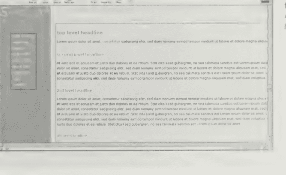

如果你在 Netscape 4 中为 main div 指定了 `margin` 值，div 会在水平方向上大幅拉伸。

> **注意：** 当一个元素的四个边都具有相同的 `padding` 或 `margin` 值时，你可以像这里一样只指定一个值。

0是唯一一个不需要指定测量单位（如 `px` 或 `pt`）的数字。

> **注意：** 为 `body` 元素指定 `margin` 值为 `0` 是消除浏览器默认偏移的简单 CSS 方法。然而，这在 Netscape 4.x 中不起作用。如果你想在 Netscape 4.x 中消除该默认浏览器偏移，最直接的方法是在 `<body>` 标签中使用 `marginwidth="0"` 和 `marginheight="0"` 属性。不过，这不是有效的 HTML 4.01 标记。

4. 在浏览器中查看 HTML。

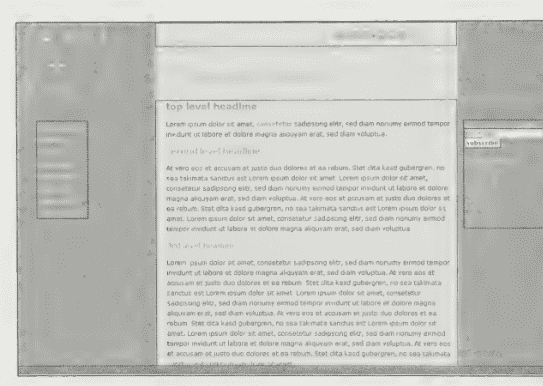

为 left、main 和 right `<div>` 元素设置了 `margin` 和 `padding` 值的页面。浏览器的默认外边距也已被消除。

## 为表单元素应用样式

表单元素在整体页面设计中经常被忽视，因为大多数设计师觉得它们很无聊。然而，通过 CSS 可以改善表单元素的外观。

> **注意：** Netscape 4.x 不识别表单元素的 CSS 样式。

1. 为 `input` 字段创建一个类 `textbox`，为 `submit` 按钮创建一个类 `submitbutton`。在 HTML 标记中为每个元素插入 `class` 属性。

```
<input class="textbox" type="text" name="email" size="30" value="your email">
<input class="submitbutton" type="submit" name="submit" value="subscribe" border="0">
```

此页面上有两个 `form` 元素：文本输入框和提交输入按钮。因为从 HTML 术语上讲两者都是 `input` 元素，所以有必要为每个元素设置单独的类来指定它们的 CSS 样式。

> **注意：** 即使此页面上只有一个提交按钮和一个文本输入框，表单元素仍使用 `class` 选择器而不是 `id` 选择器。这允许你在整个网站中使用此外部样式表。如果另一个页面上的表单有多个按钮和文本框，你可以为多个元素指定相应的 `class` 属性。

2. 为 `submitbutton` 和 `textbox` input `class` 选择器指定 CSS 样式规则。

对于 `submitbutton`，指定文本颜色（`color`）、背景颜色（`background-color`）、元素每边的边框样式（`border-top`、`border-bottom`、`border-left` 和 `border-right`）；文本样式（`font-family`、`font-weight` 和 `font-size`）；`height` 和 `width`；以及一个 `vertical-align` 值，使文本在按钮框中垂直居中。注意，我们指定的实线边框颜色与提交按钮的背景颜色相同——这是为了让按钮看起来稍微大一点。

对于 `textbox`，指定文本颜色（`color`）、背景颜色（`background-color`）、元素每边的边框样式（`border-top`、`border-bottom`、`border-left` 和 `border-right`）；文本样式（`font-family` 和 `font-size`）；`height` 和 `width`；一个 `vertical-align` 值，使文本在文本框中垂直居中；以及 `padding`，在文本与文本框上下边缘之间留出一点空间。注意，我们给文本框设置了一个虚线边框，其背景颜色与它将放置的页面区域的背景颜色相同。

```
input.submitbutton {
    color: #ffffff;
    background-color: #993333;
    border-top: 2px solid #993333;
    border-right: 2px solid #993333;
    border-bottom: 2px solid #993333;
    border-left: 2px solid #993333;
    font-family: arial, sans-serif;
    margin-top: 2px;
    font-size: 11px;
    font-weight: bold;
    height: 20px;
    width: 60px;
    vertical-align: middle;
}

input.textbox {
    color: #ffffff;
    background-color: #666666;
    font-family: arial, sans-serif;
    font-size: 11px;
    border-top: 1px dashed #ffffff;
    border-right: 1px dashed #ffffff;
    border-bottom: 1px dashed #ffffff;
    border-left: 1px dashed #ffffff;
    height: 18px;
    width: 80px;
    vertical-align: middle;
    padding: 2px 0px 0px 2px;
}
```

> **注意：** 边框样式是为每边分别指定的。这是因为如果你同时为所有边指定一个样式，即 `border: 1px dashed #ffffff;`，在 Netscape Navigator 4.x 中，你会看到一个小而分离的框浮动在你应用了 `border` 样式的输入元素附近。因为 Netscape Navigator 4.x 在为表单元素的每边分别指定边框样式时无法识别，它会忽略这些样式值。

> **注意：** 虽然我们在样式表中为每个 `form` 元素指定了 `height` 和 `width` 样式，但在文本框的 `<input>` 标签中仍需包含一个 `size` 属性值。这是为了在 Netscape 4.x（它不识别应用于 `form` 元素的 CSS 样式）中避免显示一个非常宽的文本框。在支持应用于表单元素的 CSS 样式的浏览器中，CSS 中指定的 `width` 值将覆盖 size 值。

**3** 在浏览器中检查结果。

在 Internet Explorer 5.0（左）、Netscape 6.2（中）和 Netscape 4.75（右）中显示的 `form` 元素。

在 Internet Explorer 5.x 及以上版本中，以及 Netscape 6 中，`form` 元素会有样式效果。在 Netscape 4.7 中则没有——但 Netscape 4.x 的访客可能不会意识到缺少了什么。

> 注意：如果你想在 Netscape 4.x 中显示彩色的 `submit` 按钮，可以使用类型为 image 的 `input` 元素，例如：

**<input type="image" src="somegraphic.gif">**

使用图像输入按钮的缺点在于它只能执行提交操作。例如，你无法使用图像作为重置按钮。

## 使用一张图片为多个页面创建不同的外观

细节在任何设计中都很重要，借助一些 CSS 样式规则，你可以让设计变得生动起来。例如，你可以在每个页面的表格单元格中使用同一张图片作为背景图像，但通过改变 `background-position` 来呈现不同的视图。由于这张图片在访客第一次访问页面时就已经加载，在后续的页面中图片会瞬间显示。创建更少的图片也意味着设计师的工作量减少。

**1** 删除 `div` 元素的临时边框样式规则，方法是删除 HTML 页面 `<head>` 部分中的整个 `<style></style>` 部分。通过将 `<table>` 标签中的 `border` 属性值改为 `0` 来消除表格边框。

```
<table width="100%" border="0" cellspacing="0" cellpadding="0">
```

**2** 创建一个名为 `photo` 的 `id` 选择器。将该 `id` 属性应用于页面顶部空的表格单元格。

```
<td class="photo".....>
```

+   3. 为 `photo` 选择器指定 `background` 属性样式。使用照片长条图片（`stripcolor.jpg`）作为 `background-image`。通过将 `background-repeat` 属性的值设为 `repeat-x`，指定图片仅在水平方向重复。将 `background-position` 的值指定为 `0% 0%`。

```
#photo {
    background-image: url(images/stripcolor.jpg);
    background-repeat: repeat-x;
    background-position: 0% 0%;
}
```

> **注意：** `background-position` 可以像这里所示那样通过 `x` 和 `y` 坐标来指定，也可以使用 `top`、`center`、`bottom`、`left`、`center` 或 `right` 等值来指定。指定 `x` 和 `y` 坐标更加灵活。

+   4. 更改每个页面的 `background-position` 属性值的 `x` 坐标，以显示图片的不同部分。为了让 `background-position` 覆盖"默认"的 `background-position`，将样式规则以内联方式放置在带有 ID `photo` 的 `<td>` 元素中。

```
<td class="maincolor" id="photo" width="55%"
style="background-position: 30% 0%"></td>
```

这样可以在每次不必加载单独图片的情况下改变设计。请注意，`background-position` 在版本 4 的浏览器中不被识别，但 Netscape 4.x 用户会看到背景图片处于默认位置——所以不会发现缺少了什么。

在 `table` 单元格中放置一个高度为 `height="50"`（与背景图片高度相同）的单像素透明 GIF，以保持单元格开启状态。背景图片会透过透明 GIF 显示出来。

以下是照片长条 `table` 单元格的修订代码。

> **注意：** 任何以内联方式指定的样式规则（作为 HTML 标签内的 `style` 属性）都会覆盖在其他地方指定的 `style` 规则，例如在外部样式表或页面的 `<head></head>` 部分中。

一张长条（1500 像素宽）图片用作表格单元格的背景图像，对于网站上不同的页面，`background-position` 设置为不同的值。从上到下依次为 `background-position: 0% 0%`；`background-position: 30% 0%`；以及 `background-position: 60% 0%`

## 使用 CSS 为页面列添加边框

适度使用边框可以增强页面设计的视觉效果。以前，只有通过复杂的嵌套表格和用作"垫片"的单像素 GIF 才能实现边框效果。使用 CSS，你可以轻松地添加或移除边框。

+   1. 为侧边面板创建两个名为 `seccolorleft` 和 `seccolorright` 的新类选择器。为了让这两个类与 `seccolor` 具有相同的 `color` 属性值，在样式规则中将它们组合在一起。仅为各个类指定 `border` 样式。

+   2. 在希望出现相应边框的表格单元格的 HTML 标记中，将 `class` 属性从 `seccolor` 更改为 `seccolorleft` 或 `seccolorright`。

+   3. 在浏览器中预览你的页面。

```
.seccolor, .seccolorleft, .seccolorright {
	background-color: #666666;
	color: #ffcc66;
}
.seccolorleft {
	border-right: 2px solid #cccccc;
}
.seccolorright {
	border-left: 2px solid #cccccc;
}
```

页面左右侧列添加了微妙的浅灰色边框。

## 为浮动图片元素创建样式

本网站的许多页面都会有与文本穿插的照片。使用 CSS 处理图片定位比使用复杂的表格布局要容易得多。

+   1. 为要放在文本左侧和右侧的图片分别创建两个类。将它们命名为 `picleft` 和 `picright`。

使用 `float` 属性为这两个 `class` 选择器定义样式。添加一些内边距，使图片周围有足够的"留白"。

```
.picright {
	float: right;
	padding: 10px;
}
.picleft {
	float: left;
	padding: 10px;
}
```

为标题元素指定 `clear` 属性值为 `both`。这是为了防止标题文本环绕已放置的图片。

```
h1, h2, h3, h4 {
	clear: both;
}
```

> **注意：** 样式规则 `clear: both` 意味着元素内容不会环绕放置在任何一侧的图片。如果只想指定文本不应在图片仅位于左侧或右侧时环绕，也可以使用 `clear: left` 和 `clear: right`。

在文本中放置一些图片，放在带有 `class` 属性 `picleft` 或 `picright` 的 `div` 元素中。

注意浮动的 `div` 不要嵌套在段落或标题内部，而是放在标签之间——以避免在版本 4 浏览器中出现问题。

为包含图片的 `div` 元素创建浮动样式规则之前（上）和之后（下）。使用 `float` 后，文本会在图片周围流动。

## 工作原理：处理版本 4 浏览器

本项目展示了 CSS 相当保守的用法，大多兼容版本 4 浏览器。关键在于使用简单的表格布局来定义页面的大区域，但使用 CSS 盒级元素（使用 `div`）来定义内部区域。只要 `div` 包含在表格单元内，它们通常在旧版浏览器中都能正常表现。

与其纠结于版本 4 浏览器对 CSS 支持的不足，不如学会与它们共存。正如这里的截图所示，页面在 Netscape Navigator 4.x 与版本 5 和 6 浏览器中的外观并非完全相同，但页面仍然可以接受，没有明显的问题。唯一缺少的只是一些小的视觉效果，例如边框和彩色的表单元素。

使用较旧的方法创建类似的页面（例如使用小表格单元格和嵌套表格来创建"边框"）需要大量的工作，同时也会增加页面的体积和复杂性。

在不同浏览器中查看的页面——从上至下：Netscape 4.75；Internet Explorer 5.0/Windows、Netscape 6.2 和 Internet Explorer 5.0/Mac。每个浏览器都有小的差异，但页面看起来仍然不错。

# 修改：创建另一种外观

通过更改样式表，可以快速为页面创建全新的外观。在此示例中，我们为网站的“关于”页面创建了一个替代布局，其中颜色进行了反转。该页面的完整样式表以及原始页面可从配套光盘以及配套网站 [http://www.createwebmagic.com](http://www.createwebmagic.com) 获取。

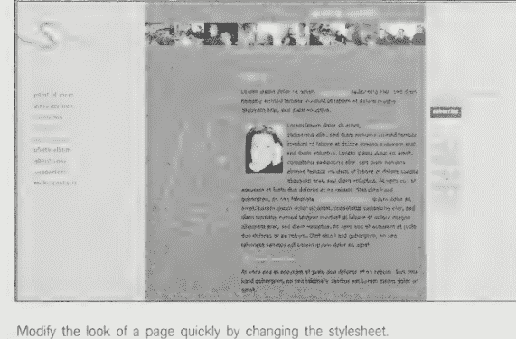

通过更改样式表，快速修改页面外观。


> “跌倒七次，爬起八次。”

—日本谚语

## 使用 CSS-P 创建简单布局


# BOOKS.PRODOX.NET 开页

CSS 的巨大前景在于其能够使用样式规则（CSS-P）在屏幕上定位元素。自第5版及更高版本浏览器推出以来，使用更多 CSS-P 来布局网页终于成为可能。此项目展示了当前使用 CSS-P 进行页面布局的可能性，以及一些缺点。

项目 3

## 使用 CSS-P 创建简单布局

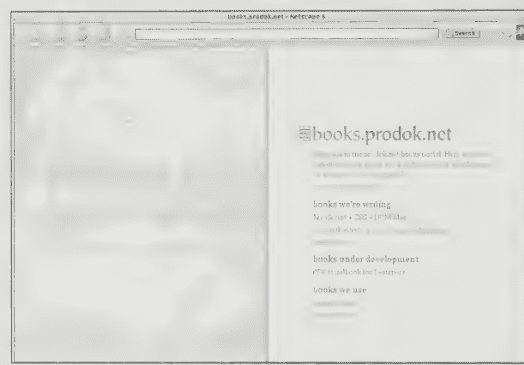

#### 开始

对于此项目，我设计了一个简单的双栏布局页面。该布局使用 CSS 创建，而不是依赖表格。通过实践，你将看到在当前可用浏览器中尝试使用 CSS 定位属性进行布局时可能遇到的各种问题。你还将学习一些应用于文本元素的更多样式规则。

在此项目中，你将学习

- XHTML 标记

- `position` 属性值及其在浏览器中的解释方式

- 使用 CSS 设置文本样式的更多方法

在此项目中，你将学习如何使用 CSS-P 创建简单的双栏布局。此页面的主要要求是它应该是流动且可缩放的——当浏览器窗口改变时，它应自动调整大小和重新定位。

## 创建 XHTML 基础

对于此项目，我们将使用 XHTML 标记而不是 HTML 标记。XHTML 与 HTML 标记非常相似，只有少许差异。

对于许多习惯使用表格和 `<font>` 标签创建布局的网页设计师来说，使用 CSS 的一个令人不安的方面是，在应用 CSS 之前，布局没有即时的可视反馈。然而，学习这种组装网页的方式对于充分利用 CSS 至关重要。首先创建并标记页面内容，将视觉布局留待以后处理。

1 使用 XHTML 1.0 Transitional DOCTYPE 打开一个新的 XHTML 页面。

将标题文本内容放在 `<h1>` 标签内，其他文本放在 `<p>` 标签内。关闭所有打开的标签：`<br>` 应为 `<br />`，`` 标签应以 `/>` 关闭。

注意：为确保页面在旧的、不支持 CSS 的浏览器中可读，始终建议使用常规的标题（`<h1>`、`<h2>` 等）、段落（`<p>`）和其他公认的 HTML 标签来标记文本内容的相关部分。

提示：在此页面上，我们指定了几种不属于216种网页安全色的颜色。你可以在许多图形程序（如 Fireworks 和 Photoshop）中使用“吸管”工具获取这些颜色的十六进制代码。

超出216种网页安全色板的颜色在只能显示最多256种颜色的低色深显示器上将无法正确显示。此类显示器的使用数量正在减少，但为安全起见，请在多种不同的颜色设置下测试你的设计。

```
<!DOCTYPE html PUBLIC "-//W3C//DTD XHTML 1.0 Transitional//EN" "http://www.w3.org/TR/xhtml1/DTD/xhtml1-transitional.dtd">
<html xmlns="http://www.w3.org/1999/xhtml">
<head>
<meta http-equiv="content-type" content="text/html; charset=iso-8859-1">
<title>books.prodok.net</title>
<style type="text/css" media="Screen">
<!--
the CSS will go here.
-->
</style>
</head>
<body>

<div id="leftbox">
<p>
There is no such thing as
a moral book or an immoral book.
     Books are well written or
     badly written. That is all.
</p>

<p>--Oscar Wilde</p>

</div>

<div id="rightbox">


<br />
```

## HTML 与 XHTML 之间的主要区别

以下是 HTML 与 XHTML 之间的区别列表：

- XHTML 需要 **DOCTYPE** 声明。对于大多数页面，使用此处所示的 XHTML Transitional DTD，它更灵活、对标记的容忍度更高，并且不严格满足 XHTML Strict DTD 的严格要求。

- `<html>` 标签有一个 `xmlns` 属性，指向 W3C 站点上的文档。

- HTML 不区分大小写，但 XHTML 区分（因为它是区分大小写的 XML 标记语言的子集）。所有标签必须为小写。

- 所有 XHTML 标签必须关闭。这包括替换标签，如 `<meta>`、`<br>` 和 ``，这些在 HTML 中通常不“关闭”。在 XHTML 中，这些标签现在看起来像这样：`<meta.../>`、`<br />` 和 ``。（标筓内最后一个属性与结束标签之间始终应有一个空格。）

所有 XHTML 文件应保存为 `.htm` 或 `.html` 后缀，而不是 `.xhtml`。

**2** 创建一个 `id` 为 `leftbox` 的 `div` 元素。将包含引文的 `<p>` 元素放在此 `div` 元素中。

这将是可定位的左侧区块。

*续*

```
<h1>Books we're writing</h1>

<p>Welcome to the prodok.net books portal. Here you will find links to the books we're writing, as well as to the ones we use, read and recommend.</p>

<p><a href="#">Check out what's new.</a></p>

<h1>books we're writing</h1>

<p>JavaScript + CSS + DOM Magic<br />
to be published by New Riders Publishing,<br />
spring 2002.</p>

<h1>books under development</h1>
<p>PDF Handbook for Designers</p>

<h1>books we use</h1>
<p><a href="#">newest review</a><br>
<a href="#">review index</a></p>

</div>

</body>
</html>
```

> **提示：** 将现有 HTML 标记转换为 XHTML 的一种简单方法是使用 HTML Tidy 解析它，并选择“Convert HTML to XML”选项。

3 创建一个 `id` 为 **rightbox** 的 `div` 元素。将开头的 `<div>` 标签放在剩余内容的顶部，并将结束的 `</div>` 标签放在末尾。这将是可定位的右侧内容块。

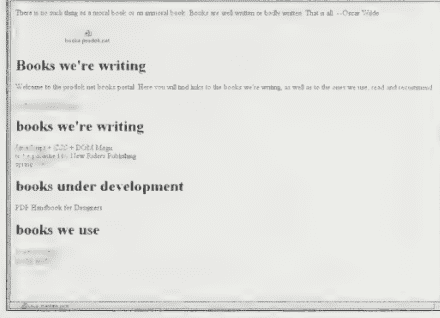

在此阶段在浏览器中检查页面，以确保在未应用任何样式时内容仍可读。此处图像也已关闭，以检查 **img** 元素中的 `alt` 文本。

> **注意：** **div** 元素是一个通用的块级元素，没有预定义的样式规则与之关联。因此，使用 **div** 来创建可定位的内容块是一个好主意。

## 创建正文和文本元素的样式规则

在页面上定位元素之前，让我们为 **p**、**h1** 和 **body** 选择器创建样式规则。

1 为 **p** 和 **h1** 元素以及 **a**（链接）伪元素创建字体样式。

> **注意：** 除了单独指定每种字体样式属性的类型外，还可以使用一种 CSS 简写方式一次性指定所有样式。语法如下：

**font: font-weight font-size line-height font-style font-family;**

无需指定所有属性值，但它们必须按正确的顺序列出。

在按顺序指定一系列 **font-family** 字体时，不一定非要坚持使用第一个字体选择作为默认字体样式类型。例如，此处 **p** 元素的第一个选择是 Georgia，一种衬线字体。但如果用户机器上没有 Georgia 字体，你可能更希望看到 Verdana 或另一种无衬线字体（如 Helvetica 或 Arial）显示出来。

```
p {
    font: normal .9em/1.3em georgia, verdana, arial, sans-serif;
    color: #333333;
}

h1 {
    font-family: georgia, verdana, sans-serif;
    font-size: 1.5em;
    color: #333333;
}

h2 {
    font-family: georgia, verdana, sans-serif;
    font-size: 1.2em;
    color: #333333;
}

a:visited {
    color: #333333;
    text-decoration: none;
}

a:link {
    color: #333333;
    text-decoration: none;
}

a:hover {
    text-decoration: underline;
}
```

### 使用 :first-letter 伪元素更改 <h1> 元素中第一个字母的颜色。

```css
h1:first-letter {
    color: #993333;
}
```

> **注意：** 伪元素让你无需使用 <span> 标签即可设置元素某一部分的样式。:first-letter 伪元素指的是任意给定元素文本内容中的第一个字符。这里用它来改变 h1 标题文本中第一个字符的颜色——增添一点 pizzazz（活力）。

### 为标记中的第一个 <p> 元素添加 quote 类属性。对 p.quote 类选择器应用 font-style: italic 规则使文本倾斜。此外，应用 white-space: pre 样式使文本精确按照输入时的样子显示。最后，应用独特的 line-height 样式和 color 样式。

```html
<p class="quote">
    There is no such thing as
    a moral book or an immoral book.
    Books are well written or badly written.
    That is all.</p>
<p class="author">--Oscar Wilde</p>
```

```css
p.quote {
    font-style: italic;
    line-height: 18px;
    white-space: pre;
    color: #7b686a;
}
p.author {
    font-style: italic;
    line-height: 18px;
    text-align: right;
    color: #7b686a;
}
```

### 为页面上的第二个 <p> 元素添加 author 类属性。对 p.author 类选择器应用与 p.quote 类选择器相同的 font-style、line-height 和 color 规则。此外，给该元素添加 text-align: right 样式。

> **注意：** white-space: pre 规则是 <pre> 标签的 CSS 替代方案。具有此样式的元素会精确按照输入时的样子显示。使用 white-space: pre 规则的唯一缺点是 Internet Explorer 5.5/Windows 及更早版本不能正确支持它，但这已在 Internet Explorer 6.0 中修复。text-align 属性将给定元素的内容对齐到元素的左侧、居中或右侧。在本例中，元素内容的文本向右对齐。

### 在目标浏览器中检查页面。如有需要，调整 CSS 样式中的字体大小。

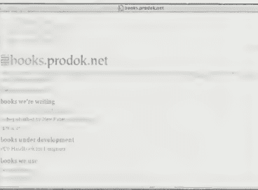

### 为 **body** 元素指定样式规则。添加 **margin: 0px** 样式规则以消除默认的浏览器窗口偏移。

由于背景图像应仅沿 **y** 轴（上下）重复，因此有必要指定样式规则。

```css
body {
  background-color: #eeeeee;
  background-image: url(images/bookscollage.jpg);
  background-repeat: repeat-y;
  margin: 0px;
}
```

> **注意：** 无需分别指定每种背景样式属性，可以使用一种 CSS 简写一次性指定所有样式。语法如下：

**background:** background-color background-image background-repeat background-attachment background-position;

对于本页面，background 属性的样式如下：

**background:** #eeeeee url(images/bookscollage.jpg) repeat-y;

注意，无需指定所有属性值，但值必须按正确的顺序指定。

## 元素的定位

使用 CSS 定位规则的组合来实现所需的布局。

1. 使用 **border** 样式规则为页面上的所有 **div** **元素**添加临时边框。

临时边框让我们在设计过程中能够看到要定位的元素的边界。一旦对结果满意，就会将其移除。

```css
/* 为所有 div 元素添加临时黑色边框。
稍后将被移除。 */
div {
    border: 1px solid black;
}
```

2. 对 **#leftbox** 选择器应用绝对定位值样式规则（**position: absolute**）。给 **#leftbox** 设置 **80px** 的 **top** 和 **left** 值，使该元素距离浏览器窗口左上角向下 80 像素、向右 80 像素。应用 **25%** 的 width 值，使其占据父元素（**body**）宽度的 25%。

```css
#leftbox {
    position: absolute;
    top: 80px;
    left: 80px;
    width: 25%;
    background-color: transparent;
}
```

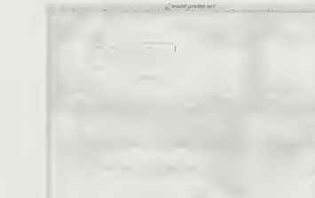

## 使用 position 和 float 属性放置元素

页面上所有元素的默认 **position** 值为 **static**。这仅仅意味着元素在页面上精确出现在它被输入的位置。当你想用 CSS 在页面上移动元素时，你将使用其他 **position** 值。**position: absolute** 和 **position: relative** 是你在 CSS-P 中最常使用的值。

**position: absolute** 元素在页面上保持"固定"位置，位于你为其指定的 left/top 坐标，某些情况下是 right/bottom 坐标。绝对定位的元素在其包含的父元素中绝对定位：也就是说，如果它包含在一个块级 **div** 元素内，而你指定了 **100px** 的 **top** 位置值，那么它将距离父元素顶部 100 像素。在本页面中，**#leftbox** div 的包含父元素是 body，因此它距离浏览器窗口顶部 80 像素、左侧 100 像素。

绝对定位的盒子从正常的"流"中移除。这意味着它们对页面上其他元素的布局没有影响，除了嵌套在该元素内的任何元素。在本页面中，你可以看到即使调整页面大小，**leftbox** div 仍保持在原位。

另一方面，**position: relative** 元素根据文档的流进行定位。如果元素的"正常"位置在点 x，而你指定了 **300px** 的 **left** 位置，那么元素的左上角会偏移 300 像素。

**float** 属性在项目 2"将 CSS 融入基于表格的布局"中介绍过，用于指定相对定位的元素应该被定位或"浮动"到父元素的左侧还是右侧。（**float** 的默认值是 **none**。）在本页面中，我们对相对定位的 **rightbox** div 应用了 **float: right** 值，将其定位到 body 的右侧。

1. 对 **#rightbox** 选择器应用相对定位值样式规则（**position: relative**）。指定 **float: right** 使该元素浮动到父元素（**body**）的右侧。指定 **margin-top**、**margin-right** 和 **margin-bottom** 属性的值指定为 **0px**，使该元素与浏览器窗口的顶部、右侧和底部对齐。

指定 **150px** 的 **padding-top** 值和 **60px** 的 **padding-left** 值，使 rightbox 元素的内容距离顶部边缘 150 像素、距离 rightbox 左侧 60 像素。

```css
#rightbox {
    position: relative;
    float: right;
    margin-top: 0px;
    margin-right: 0px;
    margin-bottom: 0px;
    padding-top: 150px;
    padding-left: 60px;
    width: 45%;
    height: 1200px;
    z-index: 10;
    background-color: #f7f7f7;
    border-left: 5px double #7b686a;
}
```

指定 **45%** 的 **width** 值，使 rightbox 元素的宽度为其父元素（**body**）宽度的 45%。

指定大于 **0** 或 **1** 的 **z-index** 值——这里我们将其设置为 **10**。**z-index** 属性指定页面上元素的三维堆叠顺序。将其设置为一个足够高的数字，以确保 rightbox 元素不会被页面上的任何其他元素重叠。

指定 **1200px** 的 height 值，以确保该元素在垂直方向上"拉伸"得足够长以填满浏览器窗口。

最后，应用 **background-color** 和 **border-left** 样式。这里我们指定了非常浅的灰色作为背景，并选择了从背景图像中提取的紫色作为边框颜色。

2. 在不同浏览器窗口宽度下在浏览器中检查页面。

> **注意：** 如果未指定 **z-index** 值，leftbox 元素可能会与 rightbox 元素重叠，这在当前情况下是不可接受的。

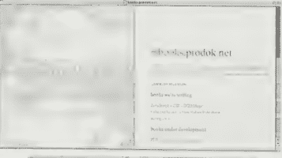


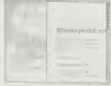

**注意：** 为 **height** 属性指定了 **1200px** 的绝对像素值，而不是 **100%** 这样的相对值。这是因为浏览器处理“100% 的什么？”这个问题的方式不同。

W3C CSS-2 规范仅说明，当元的高度指定为百分比值时，它应该是包含块总高度的百分比。我们通常假设，当为父元素是 body 的元素指定 100% 高度时，它应该是浏览器窗口高度的 100%。Windows 和 Mac 上的 Internet Explorer 5.x 就是这样解释的。然而，Netscape 6.x 将 100% 解释为 body 高度的 100%。body 高度在垂直方向上“拉伸”到刚好容纳内容。在像本页这样内容不多的页面上，您会看到 rightbox **div** 的底部在 Netscape 6 中被截断。

如果您的页面有足够的内容来“拉伸” **body** 的高度，这不是问题。另一个相当丑陋的解决方法是在文本内容底部插入大量换行符，配合不可见的非断行空格（**&nbsp;** HTML 实体）。

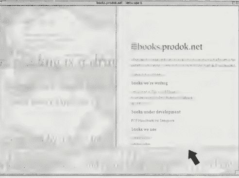

当 height 属性设置为 100% 时，rightbox **div** 的底部在 Netscape 6 中被截断。

## 完善布局

现在我们将通过为文本块添加外边距并更改其中一个段落的 **line-height** 值来进一步完善布局。

1. 在 XHTML 标记中，将 rightbox **div** 中的文本内容放入另一个 **id** 为 contents 的 **div** 中。为第一个 **p** 元素赋予 **class** 属性 **blurb**。

```
<div id="contents">

<p class="blurb">Welcome to the prodok.net books portal.
Here you will find links to the books we're writing, as
well as to the ones we use, read and recommend.
</p>
<!-- the rest of the contents go here. Omitted here
for clarity. -->
</div>
```

**2** 这将为与 contents **div** 对应的 **#contents** 选择器指定 CSS 规则。指定 **margin-left** 值为 **25px**，**margin-right** 值为 **70px**。这使得整个 contents **div** 块按指定的 **margin-left** 值缩进，同时在 **div** 块右侧相对于父元素（**rightbox div**）的边缘留出适当的空白。

```
#contents {
    margin-left: 27px;
    margin-right: 70px;
}
```

**3** 为 **p.blurb** 类选择器指定 CSS 规则。指定 **line-height** 值为 **18px**。所有带有 blurb 类的 **p** 元素将继承普通 **p** 元素选择器的样式规则，但 **line-height** 属性值（原本设置为 **24px**）将被新值覆盖。

```
p.blurb {
    line-height: 18px;
}
```

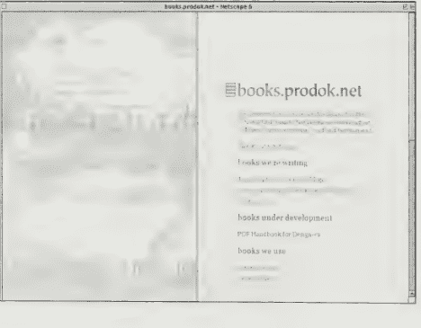

文本块现在有了更宽的左右边距，blurb 文本的行高更窄。

## 针对 Netscape 4.x 进行调整

使用这种双列布局方法在 Netscape 4.x 中或多或少能工作。然而，还需要一些额外的调整。

1. 将 JavaScript `onresize` 代码添加到 `<body>` 标签中。这会在浏览器窗口大小调整时导致页面重新加载自身。没有此代码，窗口调整大小时页面将完全崩溃。

2. 从 **#leftbox** 选择器中删除 `background-color: transparent` 样式。`background-color: transparent` 样式在 Netscape 4.x 中会错误地显示为黑色。

不要为任何 `div` 元素同时指定 `border` 样式和 `background` 样式。当为 `div` 元素指定 `border` 样式时，Netscape 4.x 会在背景颜色边缘和边框之间显示间隙。您可以指定边框或背景的颜色，但不能同时指定两者。

```
<body onresize="history.go(0)">
```

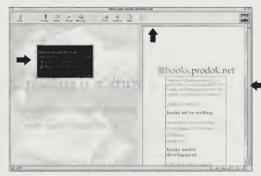

Netscape 4 CSS 缺陷：透明背景显示为黑色，背景颜色边缘和边框之间有间隙，页面调整大小时布局完全崩溃。此外，body 元素的零外边距值不被识别。

> 注意：实际上，在创建 Netscape 4.x 布局时，依赖纯 CSS-P 并不实际。在后续项目中，我将向您展示使用 JavaScript 和一些 CSS 技巧来解决这个问题的不同方法。

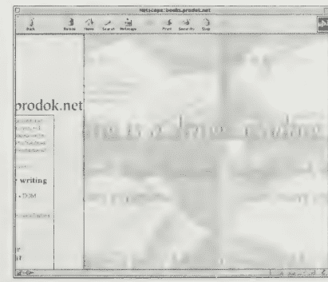

## 创建另一个双列布局

使用上述方法的缺点是，当浏览器窗口太窄时，右列块会与左列块重叠。创建一个两列都是流式的、但彼此不重叠的双列布局要复杂一些。

在这个例子中，左列添加了更多文本。

1. 从 **p.author** 类元素中删除 **white-space: pre** 样式规则，使文本正常显示。

2. 更改 **#leftbox** 选择器的样式规则。指定 **position: relative** 样式，**width** 值为 **45%**，**margin** 值为 **0** 以使盒子四边的外边距都为零。**padding-top** 值设置为 **50px**，使内容从 **div** 块的顶部边缘向下 50 像素处开始。

3. 将 **padding-left** 和 **padding-right** 值设置为 **2%**。指定 **float** 值为 **left**。更改 **background** 属性样式规则以使用书籍拼贴图形。（这是我们之前用于 **body** 元素的相同 **background** 样式规则。）

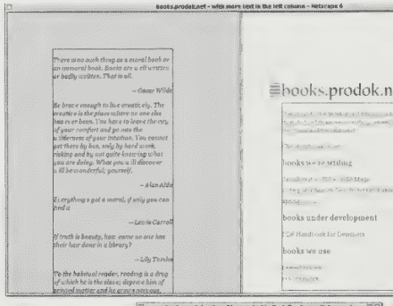

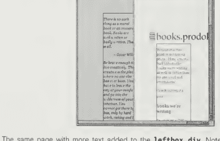

同一页面，在 **leftbox div** 中添加了更多文本。注意当浏览器窗口较窄时，rightbox 会与 leftbox 重叠。（为清晰起见，背景图片已省略。）

```
#leftbox {
    position: relative;
    width: 45%;
    margin: 0;
    padding-top: 50px;
    padding-left: 2%;
    padding-right: 2%;
    float: left;
    background: #eee url(images/bookscollage.jpg);
}
```

**4** 将 **#rightbox** 选择器的 **float** 属性值从 **right** 更改为 **left**。将 **padding-left** 和 **padding-right** 值分别更改为 **2%** 和 **3%**。

```
#rightbox {
    position: relative;
    float: right;
    margin-top: 0px;
    margin-right: 0px;
    margin-bottom: 0px;
    padding-top: 2%;
    padding-left: 3%;
    width: 45%;
    height: 1200px;
    z-index: 10;
    background-color: #f7f7f7;
    border-left: 5px double #7b686a;
}
```

**5** 将 **body** 的 **background** 属性值更改为与 **#rightbox** 选择器相同的背景颜色。

```
body {
    background: #f7f7f7;
    margin: 0px 0px 0px 0px;
    padding: 0;
}
```

**6** 在浏览器窗口中检查结果。

> **提示：** It's important to keep in mind that any border adds to the dimensions of the block if you use a temporary **div border** to mark the edges of **div** elements.

 repeat-y;
    }
    #leftbox {
    background-color: #f7f7f7;
}
```

3 将代码中指定的样式应用于 **body** 和 **#leftbox** 选择器。我们将此称为布局方法1。

这里的 **body** 外边距和内边距均为零。**div** 以相对方式定位，**宽度**为70%。**margin-left**、**margin-right**、**padding-left** 和 **padding-right** 属性均以百分比指定，所有这些属性值加上**宽度**的总和为98%。这可以防止浏览器窗口出现水平滚动条。

此方法在 Internet Explorer 5.0 和更早版本的浏览器中效果不佳。

```
body {
    background: #eee url(images/bookscollage.jpg);
    margin: 0;
    padding: 0;
}
#leftbox {
    position: relative;
    border: 5px double #7b686a;
    width: 70%;
    margin-top: 30px;
    margin-left: 7%;
    margin-right: 7%;
    margin-bottom: 30px;
    padding-top: 50px;
    padding-left: 7%;
    padding-right: 7%;
    background-color: #f7f7f7;
}
```

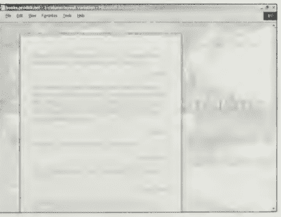

此方法在 Internet Explorer 5.0/Windows 中无效，列会向左偏移。

**4** 将代码中指定的样式应用于 **body** 和 **#leftbox** 选择器。我们将此称为布局方法2。

同样，**body** 的外边距和内边距均为零。**div** 以相对方式定位，**宽度**为 **70%**。**margin-left** 和 **margin-right** 属性值指定为 **auto**。这意味着浏览器将根据其他指定值自动决定外边距。

此方法的优点是直接且易于实现。此外，**padding** 值可以指定为绝对单位（像素），因为浏览器会计算所需的外边距。但是，此方法仅适用于支持 **auto** 值的最新浏览器——Internet Explorer 6.0/Windows、Internet Explorer 5.x/Mac 和 Netscape 6.x。

```
body {
    background: #eee url(images/bookscollage.jpg);
    margin: 0;
}

#leftbox {
    position: relative;
    width: 80%;
    margin-top: 50px;
    margin-bottom: 30px;
    margin-left: auto;
    margin-right: auto;
    border: 5px double #7b686a;
    padding-top: 50px;
    padding-left: 50px;
    padding-right: 50px;
    background-color: #f7f7f7;
}
```

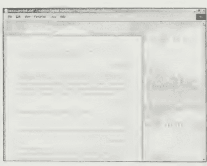

此方法在 Internet Explorer 5.0/Windows 中无效，列会固定在左侧。

将代码中指定的样式应用于 **body** 和 **#leftbox** 选择器。我们将此称为布局方法3。

对于此方法，采用了一种反向思维，为 **body** 指定 **padding** 样式。这会通过指定的 **padding** 值将包含在 **body** 内的任何元素从浏览器窗口边缘偏移。**padding-left** 和 **padding-right** 值已设置为 **15%**，这意味着在逻辑上，包含的 **div** 块始终为70%宽度。

令人惊讶的是，此方法在 Internet Explorer 5.0 中运行良好。

```
body {
	background: #eee url(images/bookscollage.jpg);
	margin: 0;
	padding-top: 50px;
	padding-bottom: 30px;
	padding-left: 15% ;
	padding-right: 15%;
}

#leftbox {
	position: relative;
	border: 5px double #7b686a;
	padding-top: 50px;
	padding-left: 50px;
	padding-right: 50px;
	background-color: #f7f7f7;
}
```

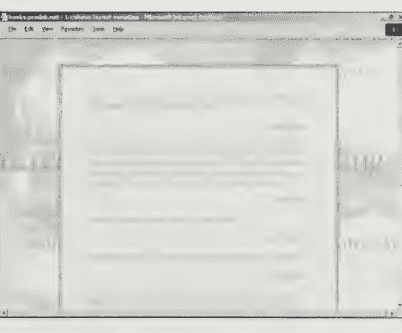

此方法在 Internet Explorer 5.0/Windows 中运行良好。

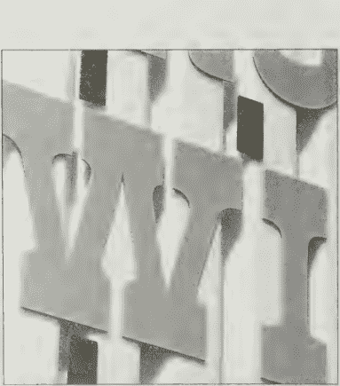

## 使用 CSS-P 创建复杂布局

> “不犯错误的人缺乏胆识和冒险精神。他们是进步车轮上的刹车。”

—DALE E. TURNER


## 包含嵌套元素的页面

即使在最新支持CSS的浏览器中，也存在需要规避的错误和陷阱。在这个项目中，你将学习如何在创建包含嵌套元素的复杂CSS-P布局时避免这些陷阱。

### 项目 4

## 使用 CSS-P 创建复杂布局

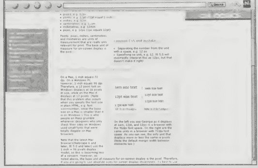

#### 开始

在创建包含多个嵌套元素的CSS-P布局时，即使在后期支持CSS的浏览器中，也存在许多需要规避的错误、疏漏和陷阱。我们将研究通过操控一些CSS规则来变通实现的各种方法。

在这个项目中，你还将学习：

- 使用 `@import` 方法链接外部样式表

- `position: fixed` 样式规则

- 层叠顺序和 `!important` 声明

- 文档“家族”树和继承

- 使用CSS设置列表元素的样式

## 创建 XHTML 基础并链接外部样式表

与之前的项目一样，当你创建一个将用CSS设计的页面时，在应用任何样式之前，拥有一个格式良好的标记文档基础至关重要。

1.  创建一个外部样式表。在文本编辑器中，打开一个空白文档。将文档保存为 **base.css**。注意，不需要 `<style>…</style>` 标签。

2.  使用 XHTML 1.0 Transitional `DOCTYPE` 声明创建一个新的 XHTML 页面。

**3** 在 XHTML 页面的 **&lt;head&gt;&lt;/head&gt;** 部分内创建 **&lt;style&gt;&lt;/style&gt;** 标签。使用 **@import** 声明链接外部样式表 **base.css**。**@import** 方法是将外部样式表关联到页面的一种替代方式。

> **注意：** 使用 **@import** 方法而不是 **&lt;link&gt;** 标签来链接外部样式表，是因为本项目中使用的CSS规则在旧版、部分支持CSS的浏览器（如 Netscape 4.x）中无法正常工作。由于这些旧浏览器不识别 **@import** 声明，整个外部样式表都会被忽略。这通常比让CSS规则错误地显示导致页面无法阅读要好。

**4** 创建主要的 **div** 元素“块”：左侧的导航栏、顶部的徽标和主要内容。为徽标元素分配 **id** 属性 **logodiv**，为导航栏元素分配 **id nav**，为主要文本块分配 **id main**。所有内容都将包含在 **main div** 元素中。

**5** 将所有文本内容包含在标准的HTML标签中，例如 **&lt;h1&gt;**、**&lt;h2&gt;** 和 **&lt;p&gt;**。使用 **&lt;ul&gt;**、**&lt;ol&gt;** 和 **&lt;li&gt;** 来表示列表。

这确保了内容在不支持CSS的浏览器中能正确显示。

```
<!DOCTYPE html PUBLIC "-//W3C//DTD XHTML 1.0 Transitional//EN"
    "http://www.w3.org/TR/xhtml1/DTD/xhtml1-transitional.dtd">
<html xmlns="http://www.w3.org/1999/xhtml">
<head>
<meta http-equiv="content-type" content="text/html; charset=iso-8859-1">
<title>Project 5</title>
<style type="text/css" media="Screen">
@import "base.css";
</style>
</head>
```

```
<body>

<!-- This div contains the site logo graphic  -->
<div id="logodiv">
  <a href="#"></a>
</div>

<!-- This div contains the navigation  -->
<div id="nav">
  <a href="#">CSS Introduction and Overview</a><br />
  <a href="#">What is CSS?</a><br />
  <a href="#">A Very Brief History of Web Design</a><br />
  <a href="#">Suggested tools and books</a><br />
  <a href="#">Lesson 1: HTML basics</a><br />
  <a href="#">Lesson 2: Diving into CSS</a><br />
  <a href="#">Lesson 3: CSS part 2</a><br />
  <a href="#">Lesson 4: CSS Positioning</a><br />
  <br />
  <a href="#">Appendices</a><br />
</div>

<!-- This div contains the main content  -->
<div id="main">

<!--contents go here... -->

</div>
</body>
```

显示使用 **@import** 方法关联外部样式的 XHTML 页面的 **head** 部分

显示主要 **div** 元素的 XHTML 页面的 **body** 部分

将将要放置在主文本侧边栏和突出显示框中的文本和/或图形元素分别放在各自的 **div** 元素中。为每个 **div** 元素指定 **class** 属性值为 `sidebar`。

记得将侧边栏 **div** 中的文本用适当的标签包裹起来，例如 **p** 和 **h1**。

> **注意：** 侧边栏和突出显示框是打破长文本文档、突出部分内容的好方法

在应用任何 CSS 规则之前，先在浏览器中检查页面。确认内容是否可读且易于理解。

```
<!-- This div contains the main content -->
<div id="main">
<h1>CSS Sizing issues</h1>

<p>CSS gives us a much wider choice of sizing units to work with. However, with this wider choice come more questions and problems for the web designer to work with.</p>

<h2>Absolute units of measurement, in numbers</h2>

<p>Elements with an absolute unit value do not scale: they are fixed in size. The absolute units you can use in CSS are as follows:</p>

<ul>
<li>pixels</li>
<li>points (72pt equal 1 inch)</li>
<li>inches</li>
<li>centimeters</li>
<li>millimeters</li>
<li>picas</li>
</ul>
```

**main div** 元素的部分内容。嵌套的 **div** 元素是侧边栏和突出显示框。所有这些 **div** 的 **class** 属性均为 `sidebar`。

```
<div class="sidebar">
<h4>Common CSS unit mistakes:</h4>
<ul>
<li>
Separating the number from the unit with a space, e.g. 12 px.</li>
<li>Specifying no unit, e.g. 12. IE 5.5 will incorrectly interpret this as 12px, but that doesn't make it right!</li>
</ul>
</div>
```

```
<div class="sidebar">
<br />
<br />
<p>On the left you see Georgia as it displays at 1em, 12pt, and 12px in a browser with the 96dpi font space. On the right are the same units in a browser with 72dpi font space. As you can see, the only unit that displays more or less the same is pixels. (Note the default margin width between elements too.)</p>
</div>
```

```
<!-- more content here... -->

</div>
</body>
```

### 为主要页面元素应用样式规则

页面的基本布局是通过对主要页面元素应用 CSS 样式规则来创建的：包括 **body**、**logodiv**、**nav** 和 **main div** 元素。

> **注意：** 在浏览器中测试页面时，有时外部样式表会"卡"在缓存中，导致你看不到所做的更改。即使你已将浏览器缓存值设置为零，这种情况也可能发生。有时，在按住 Shift 键的同时从浏览器菜单中选择刷新可以清除缓存——但这并不总是有效。Internet Explorer/Windows 的缓存似乎特别顽固。如果你仍然看不到样式编辑效果，请退出浏览器并重新加载页面。

> **提示：** 在 IE 5.0/Mac 中，将编辑后的样式表本身加载到浏览器窗口中，然后重新加载网页，将显示新的样式。

**1** 在外部样式表中，为 **body** 元素创建 CSS 样式规则。将 **margin** 值设置为 **0**。这将消除浏览器默认边距。指定 **background-color** 值。

```
body {
  background-color: #eeffee;
  margin: 0;
}
```

**2** 为 **#logodiv** ID 选择器创建样式规则。指定 **position: fixed** 样式规则以将 div "固定"在原地。应用 **!important** 声明，使该样式规则优先于任何其他 **position** 属性规则。指定 **right** 属性值为 **0**，以便将 div 定位在浏览器窗口的右上角。

#### **position: fixed 规则**

同时，为 **logodiv div** 元素指指定 **position: relative** 和 **float: right** 样式规则。这些样式旨在补偿不支持 **position: fixed** 的浏览器。使用 **float: right** 规则将 **div** 定位到页面右侧。

**position: fixed** 样式规则很少使用，因为它仅在少数浏览器中得到支持：Internet Explorer 5.0 及更高版本的 Macintosh 系统，以及 Windows 和 Macintosh 上的 Mozilla 0.91/Netscape 6.1+。然而，这是一个非常有用的样式规则，它允许元素在页面的某个位置保持"固定"和可见，例如徽标或导航栏。我在本页中以这种方式使用了这个样式规则，使网站徽标和导航始终保持可见。这模拟了框架集的功能，而没有使用框架的任何缺点。

为了补偿不支持 **position: fixed** 样式规则的浏览器（最值得注意的是 Windows 上的 Internet Explorer 5.0、5.5 和 6.0），指定备用的 **position** 值，并在 **fixed** 样式规则旁边放置 **!important**。不支持 **position: fixed** 的浏览器将使用 **fixed** 规则，而支持它的浏览器也会识别 **!important** 声明，并优先采用此规则而不是为 **position** 属性指定的任何其他规则。当 **!important** 应用于任何样式规范时，它将取代该特定属性的任何其他值。


请注意，`float` 属性仅适用于相对定位的元素，而 `position` 属性仅适用于固定定位或绝对定位的元素，因此需要同时使用这两个样式规则才能使 `logodiv div` 保持在浏览器窗口的右侧。（与绝对定位元素一样，固定定位元素会从页面的正常流中移除。要使用 `left、right、top、bottom` 属性为元素指定精确的位置坐标）。

## 使用 CSS 创建复杂布局

**3.** 继续为 `#logodiv` 选择器指定样式规则。指定 `z-index` 值为 `100`，以确保 `div` 始终位于其他元素之"上"。

`z-index` 样式属性用于指示元素的三维放置位置。`z-index` 属性值越高，它在元素"堆叠"中的位置就越高。

**4.** 最后，为元素指定 `background-color`、`width`、`height` 和 `border-bottom` 值。高度和宽度与包含在此 `div` 中的图形尺寸相匹配。

**5.** 为 `#nav` id 选择器创建样式规则。指定 `position` 值为 `fixed`，并加上 `!important` 声明。同时，指定 `position: absolute`，以补偿不支持 `fixed position` 值的浏览器。

指定 `width` 值为 `150px`，`top` 值为 `70px`。这将 `nav` 元素定位在距离页面顶部 70 像素处，宽度为 150 像素。

指定 `left` 值为 `0`。

应用 `background-color` 和 `color` 样式，以及 `border-left` 值。请注意，此边框与 `logodiv` 元素上的 `border-bottom` 相匹配。

为元素添加一些内边距，并指定默认字体样式。添加内边距是为了防止文本直接碰到 `div` 框的边缘。

```
#logodiv {
    position: fixed !important;
    right: 0;
    position: relative;
    float: right;
    z-index: 100;
    background-color: #339966;
    width: 271px;
    height: 34px;
    border-bottom: 6px solid #333333;
}
```

`logodiv` 元素的样式规则。为 `position` 属性指定了两个值，其中 `fixed` 规则声明为 `!important`。

```
#nav {
    position: fixed !important;
    position: absolute;
    font: 11px/16px verdana, sans-serif;
    background-color: #339966;
    color: #ffff99;
    top: 70px;
    left: 0;
    padding: 10px;
    width: 150px;
    border-left: 6px solid #333333;
}
```

`nav`（导航栏）元素的样式规则。为 `position` 属性指定了两个值——其中 `fixed` 更为 `!important`。

**注意：** 这是一个错误警报。尽管 Macintosh 上的 Internet Explorer 5.x 确实支持 `position: fixed`，但支持存在缺陷：在此浏览器中，光标形状在固定定位元素内的 `a`（链接）元素上不会变为"指针"形状。不幸的是，即使显式指定 `cursor` 样式也无法解决这个错误。因此，你可能希望避免对包含关键链接的元素（如本页上的导航栏）使用 `position: fixed`。

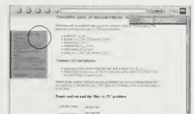

在 Netscape 6.2（上图）和 Macintosh 版 Internet Explorer 5.1（中图）中，`logodiv` 和 `nav` div 元素在页面上保持"固定"，即使窗口滚动时也是如此。然而，在 Macintosh 版 Internet Explorer 5.x 中，光标形状在链接元素上无法正确改变。在 Windows 版 Internet Explorer 6.0（下图）中，`logodiv` 和 `nav` 元素会随页面一起滚动。

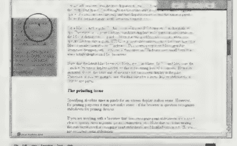

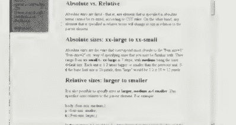

**6** 为 `main` div 元素创建样式规则。指定 `position` 值为 `absolute`。

使用 `absolute` 定位值是为了避免嵌套（子）元素出现问题。当指定 `relative` 或其他定位值时，嵌套元素的行为可能无法预测。

```
#main {
    position: absolute;
    background-color: #ffffff;
    border: 1px dashed #666666;
    width: 500px;
    padding: 15px;
    top: 70px;
    left: 200px;
    z-index: 1;
}
```

main 元素的样式规则

### 继续为 `main div` 元素指定样式规则。指定 `width` 值为 `500px`。指定 `left` 值为 `200px`。该值等于 `nav`（导航栏）`div` 的宽度加上 40 像素。

指定 `top` 位置值为 `70px`，使 `div` 与导航 `div` 顶部对齐。

将 `main div` 的 `z-index` 值设置为比 `logodiv div` 的 `z-index` 值更低的数字。最后，为 `main div` 指定一个与 `body` 背景色不同的 `background-color` 值，并添加一个装饰性 `border`。这样你就能确切地看到 `div` 在页面上的位置。

#### 注意：

虽然许多设计师喜欢保持页面上所有列“流动”且可调整大小，但在这一页上，`main`（内容）`div` 的宽度已设置为固定的 500 像素。多项研究表明，当长文本列过宽时，阅读起来会很困难。五百像素是一个任意的数字，但在典型的 800×600 像素或 1028×768 像素显示器尺寸的浏览器窗口中，它似乎能舒适地显示。

由于主要内容被“冻结”在固定位置，因此通过将 `logodiv div` 定位在页面右侧，使页面看起来更平衡且更具“流动性”。

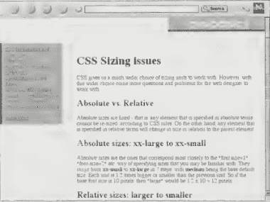

此时页面的基本布局已设定。虽然 `main div` 是固定位的，但页面仍具有“流动”特性，因为 logo 元素位于页面的右侧。

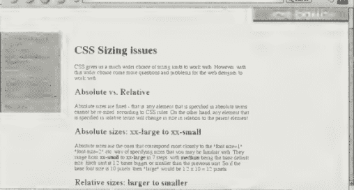

## 为 nav 元素内的 a 元素应用样式

对于此页面，我们将使用一种不同的方法来为特定父元素内的元素应用样式。我们不会为 `a` 元素指定 `class` 选择器，而是会指明 `nav` 元素内的任何 `a` 元素将以特定方式设置样式。

1. 使用以下语法为 `nav id` 内的所有 `a` 元素应用样式：

```
#nav a {
    ...style rules
}
```

2. 为 `nav` 元素内的所有 `a` 元素应用基本样式，然后为伪类样式 `:visited`、`:link`、`:hover` 和 `:hover:visited` 应用不同的样式。注意代码中使用的语法。

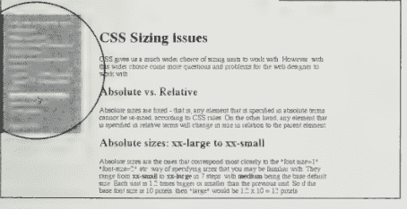

```
#nav a {
    color: #ffff99;
    background-color: #339966;
    text-decoration: none;
}

#nav a:visited {
    font-weight: bold;
    color: #ffff99;
    background-color: #339966;
    text-decoration: none;
}

#nav a:link {
    font-weight: bold;
    color: #ffff99;
    background-color: #339966;
    text-decoration: none;
}

#nav a:hover {
    color: #009966;
    background-color: #ffff99;
    text-decoration: underline;
}

#nav a:hover:visited {
    color: #009966;
    background-color: #ffff99;
    text-decoration: underline;
}
```

## 上下文选择器

这里使用的语法称为 *上下文选择器*。它用于将样式规则应用于包含在另一个元素内的元素。在此项目中，所有位于父级 `nav` 元素内的 `a` 元素都被声明为一组样式。

使用上下文选择器的优点在于，它消除了为每个元素指定 `class` 属性的需要。这使得 HTML 或 XHTML 标记保持简单且易于管理。

然而，上下文选择器仅在支持 CSS Level 2 规范的第 5 版及更高版本的浏览器中有效。在第 4 版浏览器中（如 Netscape 4.x），嵌套元素（在本例中为 `nav` 链接）将无法正确继承在父级 (`nav`) `div` 内设置的样式。对于这些旧版浏览器，仍然有必要使用类选择器。

## 创建浮动侧边栏 DIV 的样式

在本节中，我们将为侧边栏或呼出框构建 CSS 样式。这些框将在 `main div` 的内容流中“浮动”。

1. 在样式表中创建一个名为 `.sidebar` 的 `class` 选择器。将其 `float` 值设置为 `right`，使所有具有此 class 的元素浮动到父元素（`main div`）的右侧。

2. 为 `divs` 指定 `width`。在本例中，`width` 设置为 `40%`。这是父元素（`main div` 元素）宽度的 40%。如果未指定 `width`，文本将拉伸以填满父元素。

3. 指定 `padding` 和 `margin` 值。两者在每边都设置为 `10px`。

> 注意：请记住，`padding` 指的是从元素边缘向内的空间，而 `margin` 是元素边缘外部到父元素的空间。

4. 为 `.sidebar` 类指定其他样式规则。

```
.sidebar {
    float: right;
    width: 40%;
    padding: 10px;
    margin: 10px;
    border: 1px dotted #333333;
    background-color: #ccffcc;
    color: black;
}
```

`.sidebar` 类的样式规则。

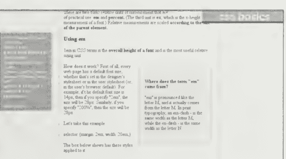

浮动侧边栏（呼出）框。

## 创建主要文本样式

当指定了主要文本的样式时，页面设计便成型了。与我们在之前的项目中所做的类似，我们将避免在主内容区域内的元素使用 `class` 或 `id` 选择器。

1. 为文本创建一个基础 `font-family` 样式规范。

```
body, h1, h2, h3, h4, p, ul, ol, li {
    font-family: verdana, helvetica, arial, sans-serif;
}
```

> **注意：** 同时为多个元素指定样式规则是简化样式表的好方法。它使以后能够更轻松地进行快速样式更改。

2. 为 `ul` 和 `ol` 元素指定文本（前景）`color`、`font-size` 以及左右 `margin` 值。指定 `padding` 值为 0，以补偿 Netscape 6.x 中应用于列表项的相当大的默认 padding 值。此外，使用 `list-style-type` 属性为每个列表指定项目符号样式，并使用 `list-style-position` 属性指定项目符号的位置。

```
ul {
    list-style-type: square;
    list-style-position: outside;
}

ol {
    list-style-type: lower-roman;
    list-style-position: outside;
}

ul,ol {
    font-size: 11px;
    color: #000000;
    margin-left: 2em;
    margin-left: 1em;
}
```

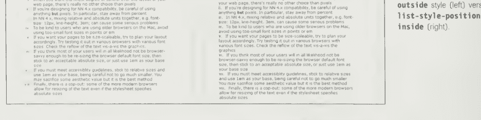

3. 为 `p` 元素指定文本（前景）`color`、`font-size` 和左 `margin`。

```
p {
    font-size: 11px;
    color: #000000;
    margin-left: 2em;
}
```

4. 将页眉（`h1`、`h2`、`h3` 和 `h4`）元素的 `clear` 属性值设置为 `both`。这可以防止页眉环绕侧边栏框。为所有页眉元素指定统一的文本（前景）`color`。

```
h1, h2, h3, h4 {
    color: #006633;
    clear: both;
}
```

## 样式化列表

`list-style-type` 规则用于指定项目符号（对于 `ul` 列表项）或数字（对于 `ol` 列表项）的样式。CSS2 规范中列出了 `list-style-type` 属性的几种项目符号和数字样式（参见 http://www.w3.org/TR/REC-CSS2/generate.html#propdef-list-style-type），尽管浏览器对这些样式的支持各不相同。也可以使用图形作为项目符号。请参阅 http://www.w3.org/TR/REC-CSS2/generate.html#propdef-list-style-image。

`list-style-position` 用于指示项目符号或数字是在列表的外部还是内部。通常，选择外部样式会使列表看起来更整洁。

1. 微调页眉之间的边距。通常，页眉行下方的边距或间隙过宽；通过将其设置为 `0`，可以使文本更紧凑。

2. 为页眉文本添加 `font-size` 和 `font-weight` 样式规则。

这里我们使用数字作为 `font-weight` 属性的值——以获得最大程度的控制。最粗或最粗的字重是 `900`，而 `100` 是最轻的字重。请注意，并非所有字体都能以这种方式进行精细控制——并且并非所有浏览器都以相同的方式显示。值 `400` 等效于“正常”字重。

```
h4 {
    font-size: 12px;
    font-weight: 900;
    margin-top: 0;
}

h3 {
    font-size: 14px;
    font-weight: 600;
    margin-top: 0;
}

h2 {
    font-size: 16px;
    font-weight: 600;
    margin-top: 0;
}

h1 {
    font-size: 18px;
    font-weight: 600;
    margin-top: 0;
}
```

## 完成外部样式表

在本节中，我们将通过为 `main` div 和 `logodiv div a`（链接）元素添加样式来完成外部样式表。

1 为基本的 `a` 元素设置样式规则。首先为所有 `a` 元素指定基础样式规则，然后为伪元素创建样式。

```css
a {
    color: #339966;
    background-color: transparent;
    text-decoration: underline;
}

a:visited {
    color: #339966;
    background-color: transparent;
}

a:link {
    color: #339966;
    background-color: transparent;
    text-decoration: underline;
}

a:hover {
    background-color: #ffff99;
}

a:visited:hover {
    background-color: #cccccc;
    color: #339966;
}
```

2 为包含在 `logodiv div` 元素中的 `a` 元素的 `a:hover` 伪元素创建一条样式规则，指定一个 `透明的背景色`。这是为了覆盖为基本 `a:hover` 伪元素指定的 `背景色` 样式。使用与指定 `nav div` 元素中 `a` 元素样式相同的语法。

```css
/* 此样式用于防止鼠标悬停在logo GIF图像上时出现背景色。 */

#logodiv a:hover {
    background: transparent;
}
```

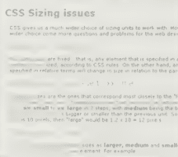

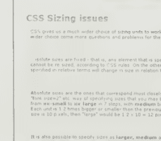

“默认”的 `a:hover` 样式会在用户将鼠标悬停在图片链接上时，在logo gif图片后面显示黄色背景色（左图）。要覆盖此效果，请指定一个值为 `transparent` 的 `background-color`。

76

## 使用内联样式优化设计

作为最后一步，我们将使用内联样式来微调设计。内联样式是直接通过 `style` 属性插入到标签中的样式规则。

内联样式会覆盖外部样式表或页面 `<head>` 部分的 `<style></style>` 标签中的所有样式规则，但带有 `!important` 声明的规则除外。

1 通过向 `ul` 元素标签添加一些内联样式，来更改第一个侧边栏中列表项目的外观。我们指定了 `margin-left` 和 `margin-right` 规则、`padding`、不同的 `list-style-type` 以及 `list-style-position`。这些内联样式会覆盖在外部样式表中为这些属性指定的样式规则。

```html
<div class="sidebar">
<h4>常见的CSS单位错误：</h4>
<ul style="margin-left: 10px; margin-right: 10px; padding: 0; list-style-type: disc; list-style-position: inside;">
<li>在数字和单位之间用空格分隔，例如 12 px。</li>
<li>未指定单位，例如 12。IE 5.5会错误地将其解释为12px，但这并不正确！</li>
</ul>
</div>
```

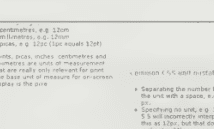

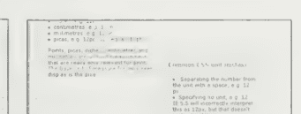

应用内联样式前（左）和后（右）的侧边栏

2 通过添加一个内联样式规则来更改第二个侧边栏的宽度。由于此侧边栏包含一个宽度为242像素的图形，新的宽度值被设置得比该值稍宽——250像素。

```html
<div class="sidebar" style="width: 250px">
<br />
......
</div>
```

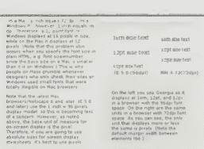

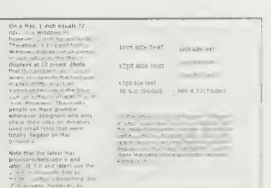

## 级联顺序基础

在CSS中，样式规则生效的先后顺序称为*级联顺序*。理解级联顺序对于掌握样式表的使用至关重要。

正如我们到目前为止所看到的，有三种方式可以指定CSS样式规则：在外部样式表中；在位于HTML或XHTML文档**head**部分`<style></style>`标签内的本地样式表中；以及使用`style`属性直接内联在元素标签本身中。在本项目中，我们既在外部样式表中指定了CSS样式规则，也使用了内联样式。

一般来说，最近指定的或本地指定的样式在级联顺序中具有最高优先级。因此，内联样式的优先级高于在文档head部分指定的样式，而后者又优先于在外部样式表中指定的样式。

要覆盖级联顺序，请使用`!important`声明。任何声明为`!important`的样式都会优先于其他规则，无论样式指定的顺序如何。在本项目中，我们使用了`!important`声明，使一个`position`属性值覆盖另一个。

我们将在后续项目中再次讨论级联顺序。

## 修改：三栏布局

此页面的布局可以转换为三栏布局，在5.0及更高版本的浏览器中显示效果良好。

1.  在XHTML文档中，在**main div**结束后创建一个新的id为**rightcol**的**div**元素。在此div中放入一些文本内容。这里，我们只是将**main div**中的一部分内容移动到了这个新的**div**中。

2.  在外部样式表中，修改**#main** id选择器的样式规则。使**width**变窄（350px），**left**位置稍微减小（190px而不是200px）。**padding**值也已减小，以适应更窄的**div**元素宽度。

```html
<div id="main">
.....main div的内容。
</div>
<div id="rightcol">
.....rightcol div的内容。
</div>
```

```css
#main {
    position: absolute;
    width: 350px;
    top: 70px;
    left: 190px;
    padding: 10px;
    z-index: 1;
    background-color: #ffffff;
    border: 1px dotted #666666;
}
```

3  在外部样式表中，为新的**#rightcol** id选择器创建样式规则。**position**值设置为**absolute**。请注意，**left**位置值等于**nav** div元素的宽度（150px）、**main** div元素的宽度（350px）加上额外的100px之和。这是为了给文本列之间的间距（空白）留出余地。

三个**div**元素加上任何间距余量的总宽度不应超过750像素——这是浏览器窗口在800×600像素显示器上最大化时的内部宽度。

```css
#rightcol {
    position: absolute;
    width: 170px;
    padding: 10px;
    top: 70px;
    left: 600px;
    z-index: 1;
    background-color: #ffffff;
    border: 1px dotted #666666;
}
```

> **注意：** 组成本页面的三个**div**元素的**position**值均为**absolute**。这意味着页面本身不是“流动”的（列是固定位置的）。如前所述，在CSS支持较差的浏览器（如Windows版Internet Explorer 5.0）中，绝对定位的元素显示问题更少。我们将在后续项目中探讨使用CSS-P创建多列布局的其他方法。

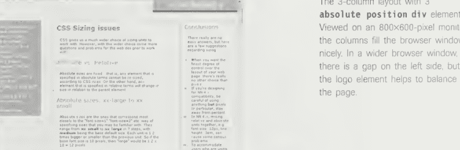

> **注意：** 本项目中使用的页面不仅是CSS样式规则的演示，它也作为一篇文章，探讨了在CSS中使用绝对或相对尺寸单位时涉及的问题。


使用CSS创建复杂布局

# JavaScript悬停效果

> “人类已知的最大乐趣之一，是飞入无知的领域以寻找知识。”

——罗伯特·林德

## 操控Img对象

图像悬停效果是JavaScript最常见的用途之一。它也是少数几种可以在旧版支持JavaScript的浏览器中安全使用的方法之一。本项目研究了当与基本JavaScript事件结合使用时，IMG SRC切换的工作原理。

### 项目5：JavaScript悬停效果


#### 开始

`img`对象是网页上的基本对象之一。“悬停”脚本基本上是切换`img`对象的`src`图形。

本项目中`img` `src`切换方法有两种用途：用于导航栏按钮和页面下方的金枪鱼“地图”。在导航栏上，鱼形图案用于指示当前查看的是哪个页面，并在用户将鼠标悬停在每个鱼形按钮上时提供视觉反馈。在金枪鱼“地图”上，用户可以将鼠标悬停在每个部分的名称上，查看由该部分鱼肉制成的寿司是什么样子。

如果你是JavaScript新手，请仔细遵循本项目。在本项目中，你将学习到

- 创建一个健壮的、适用于JavaScript的HTML标记基础

- 识别页面上用于脚本的元素

- 使用JavaScript访问`img`对象

- 创建基本的悬停脚本

- 创建更复杂的悬停脚本

对于本项目，使用了基于`table`的布局，而不是使用CSS-P定位的`div`元素，并且使用HTML而不是XHTML。这是为了与也能处理基本JavaScript但在正确渲染CSS或XHTML方面存在问题的旧浏览器保持向后兼容。

82

## 创建导航栏按钮的基础图形

导航栏按钮有三种状态——默认状态或关闭状态；鼠标悬停状态，即用户将鼠标悬停在按钮上时；以及开启状态，用于指示用户当前所在的页面部分。

请注意，我为所有部分使用了相同的三个按钮，但你也可以选择为每个部分创建一套独特的按钮。

- 1. 创建基础的静态按钮。

我使用了一个剪贴画鱼并在Adobe Illustrator中进行了修改。

- 2. 将基础鱼形按钮填充为白色。将用于"开启"和"页面指示器"状态的鱼形按钮图像填充为蓝色。旋转蓝色鱼的一个副本，制作页面指示器版本的按钮。

- 3. 将基础白色鱼形按钮导入到程序（如Adobe Photoshop）中，并将其保存为网页图形，杂边颜色设置为导航栏预期的背景颜色。将文件保存为**lilfish0.gif**。以同样方式保存翻转的蓝色鱼，文件名为**lilfish1.gif**。

- 4. 将另一个蓝色鱼副本导入到程序（如Adobe ImageReady或Macromedia Fireworks）中，并创建一个旋转动画GIF版本。

这将是按钮的"鼠标悬停"状态。将其保存为文件名**lilfish2.gif**。请注意，文件名对脚本至关重要。每个文件名都以"lilfish"开头，后跟数字0、1或2。

> 注意：在矢量图形应用程序（如Adobe Illustrator或Macromedia Freehand）中快速更改剪贴画的颜色要容易得多。或者，在将图像"固定"为位图图形之前，使用程序（如Macromedia Fireworks或Photoshop）的矢量功能。

## 创建导航按钮图形

在创建一套导航按钮图形时，请记住它们必须具有相同的尺寸。例如，如果默认状态的图形是100像素乘150像素，那么"鼠标悬停"状态和任何其他图形也必须是100像素乘150像素。

没有必要为所有按钮使用相同的图形格式。你可以混合使用GIF、JPEG和PNG，只要它们具有相同的尺寸即可。

在创建与JavaScript事件关联的动画GIF时，请制作一个连续循环的动画。否则，动画可能会显得在播放中途"卡住"。还要注意，动画速度在不同浏览器中可能不同——在Netscape中，动画速度比在Internet Explorer中快得多。

## 创建导航栏的HTML布局和CSS

在创建基于表格的复杂布局时，通常更方便的方法是先构建小的部分或区块，最后再组装起来。每个"构建块"将是一个独立的表格。我们将构建的第一个"构建块"是导航按钮栏。

- 1. 为导航栏的导航按钮部分创建HTML。

请注意，相同的基础图形（**lilfish0.gif**）被重复使用——每个图形下方都有描述性文本。图形和文本都被做成链接，以便用户可以点击任何一个来浏览网站。

> 导航按钮**表格**尚未设置背景颜色，且边框已"开启"。

> 注意：在创建**表格**布局时，开启边框以便立即看到任何问题很有帮助。

整个导航按钮部分作为单个表格创建。该表格将嵌套在组成导航栏的表格行中。

- 2. 为每个**img**对象分配唯一的**name**和**id**属性。此外，为每个**img**对象分配适当的**alt**属性。

**name**和**id**属性用于唯一标识元素，以便可以用JavaScript访问它们。每个**img**元素必须具有唯一的**id**/**name**，以便可以被访问。

```
<!-- 带有开启边框的导航按钮HTML基础代码 -->
<table border="1" cellpadding="0" cellspacing="0" align="center">
<tr>
<td align="center" height="60" width="100">
<a href="#"></a></td>
```

**alt**属性的用途是让导航功能在纯文本浏览器中也能工作。有关**alt**属性的更多信息，请参见项目4"使用CSS-P创建复杂布局"。

> **注意：** 即使每个图形看起来都一样，也必须记住每个**img**对象都必须被视为独立且唯一的，以便于脚本处理。这一点经常让注重视觉的设计感到困惑。同时分配**name**和**id**属性是为了浏览器兼容性。旧版浏览器不识别**id**属性，而较新的浏览器（如Netscape 6）使用**id**属性。**id**属性也得到万维网联盟（W3C）的推荐。两者都使用以实现向后和向前兼容。

*续*

```
<td align="center" height="60" width="100">
<a href="#"></a></td>
<td align="center" height="60" width="100">
<a href="#"></a></td>
<td align="center" height="60" width="100">
<a href="#"></a></td>
<td align="center" height="60" width="100">
<a href="#"></a></td>
<td align="center" height="60" width="100">
<a href="#"></a></td>
<td align="center" height="60" width="100">
<a href="#"></a></td>
</tr>
<tr>
<td align="center" height="20" valign="top">
<span class="navlink"><a class="navlinktext" href="#">news</a></span></td>
<td align="center" height="20" valign="top">
<span class="navlink"><a class="navlinktext" href="#">in-depth</a></span></td>
<td align="center" height="20" valign="top">
<span class="navlink"><a class="navlinktext" href="#">menus</a></span></td>
<td align="center" height="20" valign="top">
<span class="navlink"><a class="navlinktext" href="#">recipes</a></span></td>
<td align="center" height="20" valign="top">
<span class="navlink"><a class="navlinktext" href="#">sake</a></span></td>
<td align="center" height="20" valign="top">
<span class="navlink"><a class="navlinktext" href="#">about&nbsp;us</a></span></td>
<td align="center" height="20" valign="top">
<span class="navlink"><a class="navlinktext" href="#">contact</a></span></td>
</tr>
</table>
```

为链接文本**span**和**a**标签分配适当的**class**属性。链接文本**span**类为**navlink**，链接文本**a**类为**navlinktext**。

添加类属性是为了将CSS样式应用于这些元素。

> **注意：** 导航链接文本被包含在**span**标签中，这是因为Netscape 4.x中的一个CSS错误。应用到**td**元素的样式在此浏览器中无法被嵌套元素正确继承。如果支持Netscape 4.x不是问题，可以将**linktext**类直接应用于包含链接文本的**td**元素，并省略**span**标签。

为导航栏的其余部分创建HTML。

导航栏由三个表格单元格组成。我们在上一步创建的按钮栏表格将嵌套在导航栏的中间表格单元格中。左侧表格单元包含一个类为**bannerleft**的**div**元素；该div包含一个**img**对象。右侧表格单元格包含一个类为**bannerright**的**p**元素。这两个元素都应用了类，以便可以将CSS样式应用于它们。

```
<!-- 导航栏的HTML代码 -->
<table border="0" width="100%" cellpadding="0" cellspacing="0">
<tr>
<td bgcolor="#000066" width="20%" align="left">
<div class="bannerleft"></div>
</td>

<td bgcolor="#000066" width="60%" align="center">
<!-- 导航按钮表格放在这里 -->

</td>
<td bgcolor="#000066" width="20%">
<p class="bannerright">
Sushisay New York<br>
www.sushisay.com
</p>
</td>
</tr>
</table>
<!-- 导航栏结束 -->
```

为导航栏文本和链接创建适当的CSS样式。将文本链接的默认外观设置为白色且无下划线，悬停或鼠标悬停外观设置为蓝色（十六进制数**#99CCFF**以匹配鼠标悬停鱼形图形的颜色（lilfish2.gif）。

已完成的导航栏，边框"开启"（上）和"关闭"（下）。

```
/* 导航栏文本的CSS样式 */

.navlinktext {
    font-family: verdana, sans-serif;
    font-size: 10px;
}
```

由于正文中的链接不应是白色（在白色背景上），因此有必要为导航链接使用一个**类**选择器。我使用了**类**名称**fish**。导航栏 HTML 中的每个**a**链接元素都应声明相应的**class**属性，即 `<a class="fish" href=...>`。

为每个元素应用适当的 margin 和 padding 值。

> **注意：** 导航**a**链元素使用类选择器而非上下文选择器，是因为像 Netscape 4.x 这样的旧版浏览器对上下文选择器的处理不佳。

```css
font-weight: bold;
}

.bannerright {
    font-family: verdana, sans-serif;
    font-size: 10px;
    font-weight: bold;
    color: white;
    text-align: right;
    padding-right: 20px;
    }

/* 导航栏左侧单元格中 div 的 CSS 样式 */

.bannerleft { margin-left: 20px; }

/* 导航栏链接的 CSS 样式 */
a.fish:link {
    color: white;
    text-decoration: none;
    }
a.fish:visited {
    color: white;
    text-decoration: none;
    }
a.fish:hover {
    color: #99ccff;
    text-decoration: none;
    }
/* 正文文本链接的 CSS 样式 */
a:link {
    color: #990000;
    text-decoration: none;
    font-weight: bold;
    }
a:visited {
    color: #666666;
    }
a:hover {
    color: #990000;
    text-decoration: underline;
    }
```

### JAVASCRIPT 鼠标悬停效果

### 预加载图形

在创建任何类型的图像切换或鼠标悬停功能时，有必要将所使用的图形预加载到浏览器的内存中。如果不这样做，图像实际更改前会有轻微的延迟。对于较慢的连接或计算机，图像更改可能根本无法工作。

1.  在 HTML 文档的 `<head>...</head>` 标签内创建一个用于存放 JavaScript 的部分。包括 `type="text/javascript"` 和 `language="javascript"` 属性。

> 注意：当 JavaScript 直接包含在 HTML 页面中时，其语法类似于包含 CSS。不要使用 `<style>...</style>` 标签，而是使用 `<script>...</script>` 标签。无论页面上有多少 JavaScript 函数或声明，都只需要一对包含所有内容的 `<script>...</script>` 标签。

`<script>...</script>` 标签内的注释标签 `<!-- ... // -->` 用于确保脚本的实际文本在旧版、不支持 JavaScript 的浏览器中不可见。如果你认为目标受众不会使用此类浏览器，则无需包含注释标签。

要在脚本内插入注释，请使用 `/* ... */` 标签。如果只是单行注释，也可以在前面加上两个斜杠 (`//`)。在本项目的示例代码中，你会看到这两种注释类型。

```html
<head>
<script type="text/javascript" language="javascript">
<!--
/* 此页面的所有 JavaScript 都将显示在此处。 */
/* 注释应包含在 /* */ 中，或者 */
/* 单行注释可以在前面加上 //。 */
//-->
</script>
</head>
```

2.  创建将预加载用于鼠标悬停功能的图像的代码行。

```javascript
<script type="text/javascript" language="javascript">
<!--
/* 预加载导航用小鱼 */
lilFishPic0 = new Image;
lilFishPic0.src = "images/lilfish0.gif";
lilFishPic1 = new Image;
lilFishPic1.src = "images/lilfish1.gif";
... (代码已截断)
```

每个预加载声明如下所示：

```javascript
var 变量名 = new Image;
    变量名.src =
        "路径/到/图像/图像名.扩展名";
```

```javascript
lilfishPic2.src = "images/lilfish2.gif";

// 预加载结束
//-->
</script>
```

第一行将变量定义为一个新的 Image 对象。然后，第二行通过指定源图形在网站目录中的位置来定义 Image 对象的 src（源），以便脚本可以找到并调用它。请注意，图像文件的目录路径在引号内。

> 注意：将变量想象为表示一条数据的容器。例如，如果你定义一个名为 dog 的变量并希望 dog 保存 Rover 这个值，你可以像这样声明它：

这是一个基本的预加载定义，当需要定义的图像对象不多时，它效果很好。

```javascript
var dog = "Rover";
```

请注意，变量名被定义为 lilfishPic0、lilfishPic1 和 lilfishPic2，以数字结尾。lilfishPic0 是鱼按钮的“正常”状态，lilfishPic1 是“悬停”状态，lilfishPic2 是“当前位置”状态。（请注意，这些变量名与所用图形的文件名相对应。）

在 JavaScript 中，变量使用 `var` 定义，或者只需声明变量名并为其分配一个初始值即可，例如：

```javascript
dog = "Rover";
```

创建变量名时，请确保它们不以数字开头。名称也不能包含除下划线 (`_`) 之外的任何额外字符。此外，尽量避免使用与 JavaScript 内置函数或对象相同的名称。

一个好的经验法则是——始终使用和定义对你来说以后有意义的变量名。如果你使用晦涩的变量名，当你忘记它的含义时，以后修复或更改某些内容总是会更困难。

### 定义文档对象并创建鼠标悬停函数

简单来说，文档的对象模型（或 DOM）是在脚本中处理页面元素或对象的方式。对于任何脚本，正确定义 DOM 至关重要；否则，函数根本无法工作。

虽然有多种方法可以定义鼠标悬停，但使用内置的 JavaScript `eval` 方法非常方便，并且可以创建一个紧凑的函数，该函数可用于多个 JavaScript 事件。

1.  创建一个名为 **doc** 的变量，并为其分配字符串值 `"document."`。

```javascript
// 定义基础文档对象
var doc = "document.";
```

> **注意：** 因为我们在这个项目中仅使用基于表格的布局，所以文档对象模型很简单。要处理页面上的 **image** 对象，请使用以下地址方法之一：

>

> - **document**.imagename

> - **document**['imagename']

>

> 对于这个项目，使用 **document.imagename** 格式。

请注意，这仅在你*不*将图像对象或包含图像对象的表格嵌套在 **div** 或 **span** 元素内时才有效。如果你使用可视化 HTML 编辑器创建页面，请特别小心程序插入的任何 **\<div\>** 或 **\<span\>** 标签。

你将在本书的下一节中学习如何处理嵌套在 **div** 或 **span** 元内的图像对象。

2.  开始定义鼠标悬停函数（函数 **flipfish**）。

```javascript
function flipfish(num,obj) {
// 函数声明写在这里
// 在花括号之间
}
```

> **注意：** JavaScript 函数的声明方式与变量类似，只是必须在前面加上关键字 **function**。函数的所有元素都包含在括号 **{}** 中。有一个能识别语法着色的文本编辑器对此很有用。与变量一样，使用对你有意义的函数名。

在这个特定函数中，两个变量 **num** 和 **obj** 将用于在页面内每次调用函数时将一些值传递给脚本。

3.  声明一个名为 **fishobj** 的变量。为其分配一个通过求值 **doc** 的字符串值与 **obj** 的字符串值的连接字符串而得出的值。

```javascript
var fishObj = eval(doc + obj);
```

> **注意：** **eval** 是一个内置（预定义）的 JavaScript 方法，用于求值括号内包含的任何内容，无论是变量、文本字符串还是现有对象的属性。

>

> 在这种情况下，当**函数**被调用时，**eval** 返回传递给变量 **doc** 和 **obj** 的任何内容的字符串值。**doc** 总是被分配一个值为 `"document."`，这定义了 DOM 地址的开头。每个变量之间的 `+` 号将两个值连接（组合）在一起。当这个字符串被求值时，脚本就能理解正在处理页面上的哪个对象。

4.  再次使用 **eval** 函数为变量 **fishobj** 的 **.src**（图像源）分配一个值。

```javascript
fishObj.src = 'lilFishPic' + num + '.src';
```

这创建了基本的鼠标悬停（图像切换）函数。在下一节中，你将看到它是如何实现的。

> **注意：** 对于这一行，我们计算 **lilfishPic** 的字符串值加上传递给参数 **num** 的任何值，再加上字符串 `.src`。

### 调用函数以激活鼠标悬停效果

在本节中，你将把这些函数附加到导航栏的 **\<a\>** 标签上，以便在用户将鼠悬停在它们上面或单击它们时调用它们。像这样的基本鼠标悬停通过将鼠标事件关联到 **a** 链接元素来调用函数。

1.  通过将第一个鼠标悬停与 **onmouseover** 事件关联，然后与围绕第一个鱼按钮的 **a** 元素中的 **onmouseout** 事件关联来调用它。

```html
<!--第一个鱼按钮的 HTML -->
<a href="#" onmouseover="flipfish(2,'news')"
onmouseout="flipfish(0,'news')">

</a>
```

让我们仔细查看当函数被调用时具体发生了什么。在 **onmouseover** 事件上，调用 **flipfish** 函数，值 **"2"** 传递给 **doc** 变量，值 **"news"** 传递给 **obj** 变量。

当这些值与预定义字符串一起被求值时，就会发生以下情况。

我们来看第一个 **onmouseover** 调用：

```
onmouseover="flipfish(2,'news')"
```

现在我们来分析这个函数调用是如何执行的：

```
var fishObj = eval(doc + obj);
```

第一行对字符串 **"document.news"** 进行求值，也就是页面上通过 **name**（和/或 **id**）**"news"** 标识的对象，并将其赋值给变量 **fishObj**。

再看第二行：

```
fishObj.src = 'lilfishPic' + num + '.src';
```

字符串 **"lilfishPic2.src"** 被求值并赋值给变量 **fishObj** 的 **src** 属性。

其结果如下：

```
document.news.src = lilfishPic2.src;
```

如果你查看之前创建的预定义和预加载图像对象列表，你会看到 **lilfishPic2.src** 被定义为 **"images/lilfish2.gif"**。

当用户将鼠标悬停在名为 **news** 的 **img** 对象上时，图像会被替换为 **lilfish2.gif**。

类似地，当用户将鼠标移出名为 **news** 的 **img** 对象（触发 **onmouseout** 事件）时，图像会被替换为 **lilfish0.gif**。

> **注意：** 事件是指在相关网页上发生或针对其发生的某种情况。我们在这里使用的两个鼠标事件（鼠标动作）：**mouseover** 和 **mouseout**。**flipfish** 函数在 **onmouseover**（或当鼠标光标经过相关对象时）和 **onmouseout**（当鼠标光标离开对象时）被调用。


左侧按钮的 **mouseout** 或 **"关闭"** 状态和右侧按钮的 **"开启"** 状态。

92

2 将翻滚函数与鱼按钮下的链文本关联，以便当用户将鼠标悬停在文本上时触发它。

注意：同一个函数可以在页面上从不同对象触发多次。

3 从所有其他鱼按钮和相应的文本链接调用该函数，使用适当的参数。

```
<!-- 开始按钮栏表格 -->
<table border="0" cellpadding="0" cellspacing="0" align="center">
<tr>
<td align="center" height="60" width="100">
<a href="#" onmouseover="flipfish(2,'news')" onmouseout="flipfish(0,'news')" > </a></td>
<td align="center" height="60" width="100">
<a href="#" onmouseover="flipfish(2,'indepth')" onmouseout="flipfish(0,'indepth')" > </a></td>
<td align="center" height="60" width="100">
<a href="#" onmouseover="flipfish(2,'menus')" onmouseout="flipfish(0,'menus')" > </a></td>
<td align="center" height="60" width="100">
<a href="#" onmouseover="flipfish(2,'recipes')" onmouseout="flipfish(0,'recipes')" ></a></td>
<td align="center" height="60" width="100">
<a href="#" onmouseover="flipfish(2,'sake')" onmouseout="flipfish(0,'sake')" ></a></td>
<td align="center" height="60" width="100">
<a href="#" onmouseover="flipfish(2,'about')" onmouseout="flipfish(0,'about')" ></a></td>
<td align="center" height="60" width="100">
<a href="#" onmouseover="flipfish(2,'contact')" onmouseout="flipfish(0,'contact')" ></a></td>
</tr>
<tr>
<td align="center" height="20" valign="top">
<span class="navlink"><a class="navlinktext" href="#" onmouseover="flipfish(2,'news')" onmouseout="flipfish(0,'news')">news</a></span></td>
<td align="center" height="20" valign="top">
<span class="navlink"><a class="navlinktext" href="#" onmouseover="flipfish(2,'indepth')" onmouseout="flipfish(0,'indepth')">in-depth</a></span></td>
<td align="center" height="20" valign="top">
<span class="navlink"><a class="navlinktext" href="#" onmouseover="flipfish(2,'menus')" onmouseout="flipfish(0,'menus')">menus</a></span></td>
<td align="center" height="20" valign="top">
<span class="navlink"><a class="navlinktext" href="#" onmouseover="flipfish(2,'recipes')" onmouseout="flipfish(0,'recipes')">recipes</a></span></td>
<td align="center" height="20" valign="top">
<span class="navlink"><a class="navlinktext" href="#" onmouseover="flipfish(2,'sake')" onmouseout="flipfish(0,'sake')">sake</a></span></td>
<td align="center" height="20" valign="top">
<span class="navlink"><a class="navlinktext" href="#" onmouseover="flipfish(2,'about')" onmouseout="flipfish(0,'about')">about&nbsp;us</a></span></td>
<td align="center" height="20" valign="top">
<span class="navlink"><a class="navlinktext" href="#" onmouseover="flipfish(2,'contact')" onmouseout="flipfish(0,'contact')">contact</a></span></td>
</tr>
</table>
```

## 创建“章节指示器”函数

通常，在导航栏上显示用户当前所在的页面是一个好主意。这可以通过 JavaScript 轻松实现。

用于鼠标悬停效果的基本翻滚函数可以被修改，以创建一个“你在这里”的指示器。基本的翻滚加上章节指示器的组合通常被称为三态翻滚。

- 1 复制现有的 flipfish 函数，但给它另一个名字。我在这里称之为 **I am here**，但你可以使用任何你觉得合乎逻辑的名字。

```
// “I am here”函数
function hereIam(num,obj) {
    var fishObj = eval(doc + obj);
    fishObj.src = 'lilfishPic' + num + '.src';
}
```

- 2 创建一个名为 section 的新变量。为其指定适当的章节名称，对应于显示用户所在页面/章节的导航按钮的名称（id）。在这种情况下，章节/页面名称值是 indepth。

```
// 定义章节变量
var section = "indepth";
```

- 3 通过在 HTML body 标签中将其作为 onload 函数调用，在页面加载时激活此函数。

```
<body onload="hereIam(1,section)">
```

当页面加载时，indepth 导航按钮的 img src 将更改为 lilfish1.gif，以指示用户在该页面上。

### 使用条件语句修改原始函数

你可能会问自己，为什么章节指示器和基本的鼠标悬停或翻滚使用相同的函数。虽然这在页面初始加载时效果良好，但当用户再次将鼠标悬停在 indepth 按钮上时，翻滚函数会被激活，因此当鼠标光标离开触发元素时，img src 会恢复到“关闭”状态。我们希望发生的是该特定按钮保持不变。

为此，我们将使用条件语句修改原始的 flipfish 函数。

1 将高亮显示的条件语句添加到函数中。将代码放在大括号 {} 中。

> **注意：** 条件语句仅在满足特定条件时才执行。在这种情况下，只有当变量 **obj** 的值与变量 **section** 的值不匹配时，大括号内的脚本才会执行。

创建任何类型的嵌套条件语句时，请小心大括号匹配；否则，将出现 JavaScript 错误。

```
function flipfish(num,obj) {
    var fishObj = eval(doc + obj);
    if (obj != section) {
        fishObj.src = 'lilfishPic' + num + '.src';
    }
}
```

2 在浏览器中检查最终效果。

现在，当用户将鼠标悬停在 in-depth 按钮或链接上时，鱼不会旋转，而是保持在“你在这里”的位置。

> **注意：** 使三态按钮“固定”的另一种方法是简单地不在 HTML 中为相应的导航 **img** 调用 mouseover 翻滚函数。但是，这意味着你必须为每个页面或部分创建不同的 HTML。通过使用条件语句，可以在网站的所有页面上重用相同的 HTML，只需要在每个页面上更改一个变量。如果你使用服务器端包含来组装页面，这特别有用，因为它简化了页面制作过程。


“你在这里”指示器的实际效果。即使用户将鼠标悬停在 in-depth 按钮或文本链接上，按钮的外观也不会改变。

### 它是如何工作的：基本文档对象模型，或 DOM 0

文档的“对象模型”只是反映了页面上的元素或对象在脚本中被引用的方式。

编写脚本时最大的障碍之一是如何正确地引用页面上的特定对象。在较新版本的浏览器中，可以引用 HTML 页面上的每个元素。然而，在早期支持 JavaScript 的浏览器中，只能访问有限的一组元素，例如 **body**、**img** 和 **form**。这非正式地称为 *DOM level 0*。

本页采用了一种非常保守的方法，即不包含任何 **div**、**layer** 或 **span** 标签内的元素，从而允许你直接引用图像对象。后面的章节将描述随着页面变得更复杂，引用方法如何变化。

如果你只想创建具有基本翻滚效果的页面（如这里所示），请尝试将相关的 **img** 对象嵌套在 **div**、**layer** 或 **span** 标签中。

## 动态框架

> "我们称之为玫瑰的东西

> 换个名字闻起来一样香甜"

> ——威廉·莎士比亚

## 摄影师的作品集网站

一旦你了解了标签对象在基本网页上是如何被寻址的，那么征服基本文档对象模型（DOM）的下一步就是了解如何寻址和操作框架。

### 项目6

## 动态框架

### 入门指南

一个**框架集**是一组两个或多个独立网页的集合。一旦它们被组合在一起，它们就彼此关联——并且可以使用JavaScript来寻址**框架集**中其他页面上的对象。

这个项目是一个摄影师作品集网站的模拟。该页面设计简单，包含三个框架：顶部框架，持续显示摄影师的姓名和标志；中间的主要部分，用于展示照片；最后是底部的导航框架。对于像这样的视觉性很强的网站，框架特别有用，因为它们让设计师能够高度控制所显示页面的大小和外观。

在这个项目中，你将学习

- 关于框架和文档对象模型（DOM）

- 关于使用外部脚本

- 如何从一个**框架**寻址另一个

- 如何让页面在应该在的地方保持框架内，或者完全脱离框架

- 如何使用 `document.write` 动态创建框架集

- 关于使用条件性 **if...else** 语句

- 如何使用 **for** 循循环

- 关于从一个框架访问位于另一个框架中的**函数**

- 如何从一个框架读取和写入数据到另一个框架

98

### 组织网页并创建框架集

每当你创建一个带框架的网站时，提前准确规划需要创建哪些页面尤为重要。这是因为每个页面都必须是一个自包含的“构建块”。这些构建块被组装起来以创建框架集。我们在之前的项目中已经使用过这种构建块方法来创建和组装网页。框架也许是终极的构建块集合方法。

### 是否使用框架

在这个项目中，框架被呈现为扩展你对DOM理解的一种方式。

一个实际问题是，使用框架是否是个好主意。一般来说，当前的网页设计趋势是避免使用框架，因为它们在可访问性方面带来了一些问题（参见项目4，“使用CSS-P创建复杂布局”）。有些人也因为其他原因不喜欢框架。

然而，框架仍然可以用于创建在各种浏览器中都能工作的、严格控制的布局，就像我们在这里所做的那样。

1. 组织将构成框架集的页面。

   三个页面构成了起始框架集：顶部框架页面、中间框架页面和底部框架页面。

   需要两个额外的页面：一个额外的中间框架页面和一个底部框架页面。

2. 为构成起始框架集的各个页面创建HTML标记。为了尽可能保持文档结构简单，请使用表格来创建布局。

   与之前的项目一样，我们使用HTML而不是X/xhtml标记，并避免使用在旧版浏览器中引起问题的层叠样式表（CSS）规则。

```
<!-- 顶部框架页面的HTML -->
<!DOCTYPE HTML PUBLIC "-//W3C//DTD HTML 4.01 Transitional//EN"
"http://www.w3.org/TR/1999/REC-html401-19991224/loose.dtd">
<html>
<head>
    <title>top frame</title>
    <style type="text/css" media="Screen">
```

顶部框架页面是标志居中显示在页面上，使用嵌套表格。

主要（中间）框架页面由12个表格单元格组成，每个单元格包含一张全尺寸的照片图像——但仅以100×100像素显示。

底部框架页面包含一个站点地址的文本图形。

> **注意：** 一旦图形显示在页面上，它会在浏览器缓存中保留一段时间。如项目5“JavaScript鼠标悬停效果”中所述，如果图形文件未加载到缓存中，JavaScript操作（如鼠标悬停）将无法顺利运行。

对于这个项目，只使用了一套照片图像。你可能想知道为什么我们没有为首页的“缩略图”视图以及导航栏上的小图标创建缩小版本的大型照片。虽然加载这些小图像最初更快，但对于这个网站来说，无论怎样都必须将全尺寸照片加载到浏览器缓存中——以便照片库脚本工作。因此，通过在起始页面上显示它们，将它们加载到缓存中。这消除了对图形预加载脚本的需求。

这种方法的缺点是，初始起始页面的加载速度会相当慢，尤其是在带宽较低的连接上。除了它“预加载”了大型图像文件之外，这种方法的主要优点是，一套12张图像比三套各12张图像容易管理得多。

使用此技术时，请注意使用Adobe Photoshop等图形编辑工具时全尺寸图像的文件大小。在这种情况下，照片的尺寸相对较小，因为它们是灰度图像。

```
继续
<!--
a, a:link {
    outline: none;
}
body {
    background: #333333 url("images/stripe.gif");
    margin: 0;
}
-->
</style>
</head>
<body>
<table border="0" width="100%" height="100%" cellspacing="0" cellpadding="0">
<tr>
    <td align="center" valign="middle"></td>
</tr>
</table>
</body>
</html>
```

```
<!-- 起始中间（主要）框架页面的HTML。注意空的a href属性 - 这是JavaScript触发器将被插入的地方。 -->
<!DOCTYPE HTML PUBLIC "-//W3C//DTD HTML 4.01 Transitional//EN"
    "http://www.w3.org/TR/1999/REC-html401-19991224/loose.dtd">
<html>
<head>
    <title>main frame</title>
    <style type="text/css" media="Screen">
<!--
body {
    background-color: #333333;
    margin: 0;
}
-->
</style>
</head>
<body>
<table border="0" width="100%" height="100%" cellspacing="0" cellpadding="0">
<tr>
<td align="center" valign="middle"><table border="0" width="200" cellspacing="5" cellpadding="0">
<tr>
<td align="center" valign="middle"></td>
</tr>
</table></td>
</tr>
</table>
</body>
</html>
```

继续

100

```
<td width="100"><a href=""></a></td>
<td width="100"><a href=""></a></td>
<td width="100"><a href=""></a></td>
<td width="100"><a href=""></a></td>
</tr>
<tr>
<td width="100"><a href=""></a></td>
<td width="100"><a href=""></a></td>
<td width="100"><a href=""></a></td>
<td width="100"><a href=""></a></td>
</tr>
<tr>
<td width="100"><a href=""></a></td>
<td width="100"><a href=""></a></td>
<td width="100"><a href=""></a></td>
<td width="100"><a href=""></a></td>
</tr>
</table></td></tr></table>
</body>
</html>
```

```
<!-- 起始底部框架页面的HTML。 -->

<!DOCTYPE HTML PUBLIC "-//W3C//DTD HTML 4.01 Transitional//EN"
	"http://www.w3.org/TR/1999/REC-html401-19991224/loose.dtd">
<html>
<head>
	<title>base bottom frame</title>
	<style type="text/css" media="Screen">
<!--
body {background: #333 url("../images/stripe.gif"); margin: 0;}
-->
</style>
</head>
<body>
<table border="0" width="100%" height="100%" cellspacing="0" cellpadding="0">
<tr>
<td align="center" valign="middle"></td>
</tr>
</table>
</body>
</html>
```

 创建另外两页将用于此 **frameset** 的 HTML 标记。这两页分别是中间框架和底部框架的辅助页面。

第二个中间框架页面包含一张居中显示的大图片。第二个底部框架页面包含小型图形按钮，用于站点导航。每个按钮都使用照片图像文件（参见步骤 2 和边栏）。


主框架（中间框架）和底部框架中包含辅助页面的框架集。顶部框架保持不变。


```
<!-- 底部框架页面的 HTML。注意空的 a href
属性 — 这里将插入 JavaScript 触发器。 -->
<!DOCTYPE HTML PUBLIC "-//W3C//DTD HTML 4.01 Transitional//EN"
	"http://www.w3.org/TR/1999/REC-html401-19991224/loose.dtd">
<html>
<head>
	<title>bottom1</title>
	<style type="text/css" media="Screen">
<!--
a, img {
	border: 0;
	outline: none;
	}
body {
	background: #333333 url("images/stripe.gif");
	margin: 0;
	}
-->
</style>
</head>
<body>
<table border="0" width="100%" height="100%" cellspacing="0"
cellpadding="0">
<tr>
<td align="center" valign="middle"><table border="0" cellspacing="5"
cellpadding="0">
<tr>
<td width="30"><a href="">
<td width="30"><a href="">
<td width="30"><a href="">
<td width="30"><a href="">
<td width="30"><a href="">
<td width="30"><a href="">
<td width="30"><a href="">
<td width="30"><a href="">
<td width="30"><a href="">
<td width="30"><a href="">
<td width="30"><a href="">
<td width="30"><a href="">
</tr>
</table</td</tr</table>
</body>
```

### 创建基本 `frameset` 的 HTML 标记

这是一个三框架 `frameset`，顶部和底部框架为固定大小，中间框架为可变大小。所有框架都不应有滚动条或框架边框。

### 为 `frameset` 中所有三个 `frame` 赋予 `name` 和 `id` 值

这样可以使用 JavaScript 对框架进行寻址。

为每个 `frame` 和 `frameset` 同时给出 `id` 和 `name` 值，因为旧版浏览器只识别 `name` 值，而新版和未来浏览器可能只识别 `id` 值来标识对象。

```
<!-- 基本框架集页面代码 -->
<!DOCTYPE HTML PUBLIC "-//W3C//DTD HTML 4.01 Frameset//EN"
    "http://www.w3.org/TR/1999/REC-html401-19991224/frameset.dtd">
<html>
<head>
    <title>Max Wyss::Fotograf Home</title>
</head>
<!-- 基本框架集 -->
<frameset border="0" frameborder="0" framespacing="0" name="overall" id="overall"
rows="70,*,70">
<frame src="topframe.html" scrolling="no" frameborder="0" name="topframe" id="topframe"
noresize>
<frame src="mainframe1.html" name="mainframe" id="mainframe" frameborder="0"
scrolling="no" noresize>
<frame src="bottomframe1.html" scrolling="no" name="bottomframe" id="bottomframe"
frameborder="0" noresize>
</frameset>
</html>
```

## 防止网站被嵌套框架

第一个 JavaScript 脚本是一个基本的*框架控制器*。将此小脚本添加到任何您不希望被不知情地嵌套框架的页面中，例如另一个网站上的 `frameset` 中，是一个好主意。此外，任何应该在 `frameset` 中查看的页面都可以被"强制"放入正确的框架集中。

### 防止顶层页面（`frameset`）被嵌套到另一个 `frame` 中

此脚本通常称为*框架破坏器*。

将此代码放在基本 `frameset` 页面 `head` 部分的 `<script....</script>` 标签内。

注意，这里的 `top` 指的是浏览器窗口中包含的最顶层文档，`self` 指的是文档本身。代码查看文档的 `location` 值（URL）。如果浏览器窗口中 `top` 文档的 `location` 值（URL）与 `self` 或此文档的 `location` 值不匹配，这意味着该页面已被嵌套框架。因此，脚本强制将

```
if (top.location != self.location) {top.location = self.location};
```

`top` 文档变为 `self` 文档 — 从而防止页面被嵌套框架。

例如，如果您的 `frameset` 页面保存为文件名 `index.html`，并且该页面被加载到另一个名为 `outsideframe.html` 的 `frameset` 中，页面将"突破"另一个 `frameset`，并在浏览器窗口中重新加载为最顶层页面。

此代码可用于任何您不希望被嵌套框架的页面。

### 强制属于 `frameset` 的页面仅在 `frameset` 中显示

将此代码放在属于 `frameset` 的每个页面的 `head` 部分的 `<script...</script>` 标签内。

```
if (top.location == self.location) {top.location = 'index.html'};
```

此代码与步骤 1 的作用相反。如果浏览器窗口中最顶层文档的 `location` 值（URL）与文档（`self`）的 `location` 值匹配，则意味着页面未按应有的方式被嵌套框架。因此，正确的 `frameset`（在本例中为文档 `index.html`）将被加载到浏览器窗口中。

> **注意：** 步骤 1 和 2 中的语句使用 `if...else` 条件语句。如果 `( )` 括号内所述条件满足，则执行包含在 `{ }` 括号内的代码。

## 动态写入框架

我们希望用此 `frameset` 实现的效果是，当我们点击底部框架中的小照片图标时，中间部分会发生变化。

对于此方法，当点击底部框架中的链接时，中间页面将被动态即时写入 — 通过使用 `document.write` 方法逐字写出页面的 HTML。

> **提示：** 请参阅"工作原理"部分中的框架对象模型图，了解每个 `frame` 如何与 `frameset` 以及其他框架相关联。

此方法使用的框架集位于随附 CD 的项目 6 文件夹中的 `frameset4` 文件夹内。

### 1. 打开新的空白文本文档，并将其保存为名称 `writeframe.js`

我们将在此外部文档中创建函数，因为我们希望在多个页面上调用该函数。

### 2. 创建将写入中间框架的页面的基础 HTML

中间框架页面的 HTML 相当简单。实际上，这是我们之前为辅助中间框架页面创建的代码。

> 注意：在将 HTML 字符串转换为 `document.write` 语句之前，务必先将其作为纯 HTML 在浏览器中检查，确保一切布局符合您的预期。

### 3. 开始定义函数

将写入动态页面的函数名为 `writeframe`。每次调用时，我们都会向其传递一个变量（`picname`），该变量将保存要加载的图像的名称。

```
function writeframe(picname) {
    //function goes here
}
```

### 4. 将 HTML 代码转换为 `document.write` 语句

```
var writepage = "<html>";
writepage += "<body style=\"background: #333333; margin: 0; color: white;\">";
writepage += "<table border=\"0\" width=\"100%\" height=\"100%\" cellpadding=\"0\" cellspacing=\"0\">";
writepage += "<tr><td align=\"center\" valign=\"middle\">";
writepage += "<table border=\"0\" cellspacing=\"5\" cellpadding=\"0\">";
writepage += "<tr><td bgcolor=\"black\">";
writepage +=</table</td</tr</table>";
writepage +=</body</html>";
```

对于多行文本，通常更容易在多行上创建 `document.write` 语句，然后将它们连接起来。此外，字符串中的某些特殊字符必须进行转义以防止错误。

变量 `writepage` 将保存要写入的整个字符串。

> 注意：`document.write` 语句告诉浏览器将括号内的内容写出到页面上。基本语法如下：

```
document.write("string" + variable + "string");
```

```
document.close();
```

相同的引号：键入 `"` 或 `'` 来打开和关闭您的字符串，并转义所有其他出现的 `/`、`"` 和 `'`。

请注意，在函数的第六行，变量 `picname` 被插入到字符串中。

创建长 `document.write` 语句时，很容易出现语法错误。为了避免这种情况，通常最好将字符串拆分成更小、更易管理的部分，然后将它们连接起来。

字符串中的某些字符，特别是斜杠（`/`）和引号（`"` 或 `'`）字符，必须在其前面加上反斜杠（`\`）进行"转义"。这是因为这些字符被解释为结束标签。为了避免错误，请确保您使用的是

连接是一个编程术语，意思是小块数据被相互添加。在本例中，我们正在将小片段组装成一个更长的文本字符串。请注意，第一行声明了 `writepage = "<html>"` — 这初始化了 `writepage` 的值。后续行使用 `+=` 运算符，它告诉脚本 `""` 引号内的数据应该添加到先前的数据上。

### 5. 创建一个能够动态写入页面内容并保存文档的函数

完整的函数会使用 `document.write` 语句将整个 HTML 写入中间框架。中间框架的地址是 `parent.mainframe`。请务必使用 `document.close()` 关闭文档来结束该语句。

```
function writeframe(picname) {
    var writepage = "<html>";
    writepage += "<body bgcolor=\"#333333\" text=\"white\">";
    writepage += "<table border=\"0\" width=\"100%\" height=\"100%\" cellspacing=\"0\" cellpadding=\"0\">";
    writepage += "<tr><td align=\"center\" valign=\"middle\">";
    writepage += "<table border=\"0\" cellspacing=\"5\" cellpadding=\"0\">";
    writepage += "<tr><td bgcolor=\"black\">";
    writepage +=</td</tr>";
    writepage +=</table</td</tr</table>";
    writepage +=</body</html>";
    parent.mainframe.document.write(writepage);
    parent.mainframe.document.close();
}
```

### 6. 在你希望执行此函数的每个页面中调用外部 JavaScript 文件

在本例中，我们希望从 `mainframe.html`（起始的中间页面）和 `bottomframe.html`（底部导航框架）都执行该函数。

在每个页面的 `<head></head>` 标签内，放置以下代码。

```
<script src="writeframe.js" type="text/javascript</script>
```

> **注意：** 调用外部脚本文件时，请注意无需在 `<script></script>` 标签之间放置注释标签。

可以从一个页面调用多个外部脚本，也可以在单个外部脚本文档中包含多个函数。

### 7. 创建将调用该函数的 HTML 代码

我们希望在用户点击起始中间框架上的缩略图时，以及点击底部框架上的图标时，触发此代码。为此，你需要将代码放在每个 `` 对象周围的 `<a>` 链接标签中。

```
<a href="javascript:writeframe('name of graphic')">

<a href="javascript:writeframe('59thbr.jpg')">
```

> **注意：** JavaScript 函数通过 `javascript:` 方法直接调用。这等同于在 `onclick` 鼠标事件时调用函数。但是请注意，此方法不适用于禁用了 JavaScript 的浏览器用户，因此应仅在 JavaScript 至关重要的网站或页面上使用——或者像本例这样主要是图形化的网站。

> **注意：** 错误提醒！如果在 Macintosh 版 Internet Explorer 5.x 上使用刷新按钮重新加载此页面，底部框架页面会显示在主框架中。


当用户点击底部框架中的图标时，中间页面会被动态写入内容，显示与该图标对应的新图像。图标提供了大图像的微小预览。


## 在框架间读取和写入数据

在本节中，我们将使用一种方法，将一个数据从某个框架传递到另一个框架。此外，一个框架中的函数可以从另一个框架中读取。这比上一节概述的方法稍复杂一些，但灵活性要高得多。

此方法的框架集位于随附 CD 的 "Project 6" 文件夹中的 `frameset5` 文件夹内。

### 1. 在 `mainframe.html` 的 HTML 标记中，为 `img` 对象指定 `name` 和 `id` 值

这是必要的，因为我们将交换此 `img` 对象的 `src`。

```

```

以与步骤 1 相同的方式，为 `bottom.html` 的 HTML 标记中的每个 `img` 对象指定 `name` 和 `id` 值。为每个 `img` 对象分配以下 `name`/`id` 值：`five`、`bkb`、`cry`、`east`、`fire`、`emp`、`gwb`、`rock`、`roof`、`wtc1`、`wtc2` 和 `ny`。

```

```

每个标签的外观应如代码示例所示。

> **提示：** 你可以选择为 `img` 对象赋予与源图形文件名相同的 `name`/`id` 值。本示例中唯一的例外是文件 `59thbr.jpg`：你不能使用 `59thbr` 作为变量名，因为它以数字开头。

### 2. 在底部框架页面上创建一个隐藏的表单字段

```
<form name="theForm">
<input type="hidden" name="frameID" value="0">
</form>
```

这个隐藏的表单字段将保存一个将从一个框架传递到另一个框架的值。表单字段的初始值设置为 `0`。

> **注意：** 对于此方法，我们需要能够将一个值从 `frameset` 中的一个页面动态传递到同一 `frameset` 中的另一个页面。在较旧的（版本 4）浏览器中，唯一允许这样传递数据的对象是 `form` 字段。

### 3. 创建用于设置隐藏 `form` 字段值的函数

该函数放置在 `bottomframe.html` 页面的 `head` 部分的 `<script></script>` 标签内。

```
function setpicID(picID) {
    document.theForm.frameID.value = picID;
}
```

每当用户点击底部框架中的一个小图标时，都会通过一个 `onclick` 事件调用此函数。

请注意，表单字段的引用格式为 `document.formname.formfieldname`。

### 5. 继续在 `bottomframe.html` 的 `<script></script>` 标签内，声明将在 `img src` 交换函数中使用的 Image 对象变量

将相应的图形文件分配给每个 Image 对象的 `src`。（这是项目 5 中描述的图像预加载方法。）

```
/* preload the images */
pic0 = new Image;
pic0.src = "images/nybig.gif";
pic1 = new Image;
pic1.src = "images/59thbr.jpg";
pic2 = new Image;
pic2.src = "images/brooklynb.jpg";
pic3 = new Image;
pic3.src = "images/chryslerb.jpg";
pic4 = new Image;
pic4.src = "images/eastiver.jpg";
pic5 = new Image;
pic5.src = "images/firestairs.jpg";
pic6 = new Image;
pic6.src = "images/empstat.jpg";
pic7 = new Image;
pic7.src = "images/gwbridge.jpg";
pic8 = new Image;
pic8.src = "images/rockf.jpg";
pic9 = new Image;
pic9.src = "images/rooftop.jpg";
pic10 = new Image;
pic10.src = "images/wtc1.jpg";
pic11 = new Image;
pic11.src = "images/wtctower.jpg";
pic12 = new Image;
pic12.src = "images/nytext.gif";
picover = new Image;
picover.src = "images/arrow.gif";
pichere = new Image;
pichere.src = "images/reddot.gif";
```

> 注意：即使图形文件本身在加载第一页上的缩略图时已被预加载到浏览器缓存中，仍然有必要在 JavaScript 中将它们声明为 Image 对象，以便后续函数可以使用它们。

### 6. 继续在 `bottomframe.html` 的 `<script></script>` 标签内，创建一个函数，用于在主（中间框架）页面中交换 `img` 对象的 `src`（函数 `loadpic`）

此函数在中间框架中调用，并由 `onload` 事件触发。

该函数计算 `"pic"` 加上变量 `picID` 的值，并返回 `newpic.src` 的值。例如，当以 `picID` 值 `"1"` 调用时，会返回 `newpic1.src` 的值，即 `"images/59thbr.jpg"`。

```
/*load the pic.src, based on the value of picID.
this function is called from the middle (mainframe) frame with an onload event.
*/
function loadpic(picID) {
    var newpic = eval('pic'+picID);
    return(newpic.src);
}
```

### 7. 创建一个函数，该函数从底部框架调用 `loadPic` 函数，然后触发图像更改

此函数放置在 `main.html` 的 `<head></head>` 部分的 `<script>...</script>` 标签内。

请注意，函数以"保持在框架内"的代码开始。如果页面不在正确的框架集中，则会加载该框架集页面，并且函数会中止。

第二行获取底部框架中 `frameID` 表单字段的值。这是在第三行传递给 `loadPic(picID)` 函数的 `picnumber`。

```
function getPic() {
    if (top.location == self.location) {
        top.location = 'index.html';
        return;
    }
    picnumber = parent.bottomframe.document.theForm.frameID.value;
    document.pic.src = parent.bottomframe.loadpic(picnumber);
}
```

> 注意：要从框架集中的另一个框架引用表单字段，请参阅 `parent.framename.document.formname.formfieldname`。有关更多信息，请参阅侧边栏*工作原理：框架集与 JavaScript* 中的图表。

### 8. 插入必要的代码，以便在文档加载时触发此函数

方法是在 `mainframe.html` 的 HTML 标记的 `body` 标签中插入对该函数的调用。使用 `setTimeout()` 方法以微小的延迟调用该函数。

```
<body onload="setTimeout('getPic()',500)">
```

> 注意：函数是延迟调用的（在此例中，延迟 500 毫秒——即半秒），因为浏览器需要一点时间来识别每个框架集已被创建。如果不延迟，将会发生 JavaScript 错误。

### 9. 在文档 `bottomframe.html` 中，在每个 `a` 元素中插入 `onclick` 事件，该事件将触发 `setPicID()` 函数

每个函数的外观应如示例代码所示。为你希望通过每次点击设置的每个 `picID` 插入正确的值。例如，这里设置为 `11`，因此将在主框架中加载的图片将是 `pic11.src`，即 `"images/wtctower.jpg"`。

```
<a href="main.html" target="mainframe" onclick="setpicID(11)">
```

### 10. 在此点测试代码

视觉结果与上一节描述的方法相同。但是，你可能会发现图像加载稍微快一些。此外，在 Macintosh 版 Internet Explorer 5.x 上发现的页面刷新错误在此方法中不会发生。

## 扩展脚本以实现更多功能

先前的方法所产生的效果与我们讨论的第一个方法相似。不过，可以扩展这些方法以包含鼠标悬停效果以及"当前位置"指示器。

本方法的框架集位于随书CD中Project 6文件夹的 `frameset6` 文件夹内。

本节中的所有JavaScript都在 `bottombase.html` 页面中创建。

### 1. 创建一个名为 `currentIconID` 的变量，并将其初始值设为 `0`

```
var currentIconID = 0;
```

### 2. 创建基本的图像交换函数

此函数与前一个项目中使用的函数非常相似。请注意，只有当 `picID` 的值不等于 `0` 时（`0` 是默认值），才会调用该函数。

```
// basic image swapping function
function changeIcon(picID,picsrc_num) {
    if (picID != 0) {
        icon = eval('document.'+ picID);
        newicon = eval ('pic'+ picsrc_num);
        icon.src = newicon.src;
    }
}
```

### 3. 创建一个名为 `iconIDarray` 的新数组，用于保存图标 `img` 对象的 `name`/`id` 值

请记住，数组从 `0` 开始，因此给第一个数组项赋一个空值，即 `""`。

```
/* create an array that holds the value of the iconID. */
iconIDarray = new Array('','five','bkb','cry','east','fire','emp','gwb','rock',
    'roof','wtcl','wtc2','ny');
```

> **注意：** 数组是包含一组数据的对象。当项目被放入数组时，就像将它们放入一个顺序列表中。要引用数组中的任何项目，可以使用其索引编号。数组中的第一项实际上是第 `0` 项（因为计算机从 `0` 开始计数），第二项是第 `1` 项，依此类推。在此数组中，例如 `iconIDarray[3]` 就是 `cry`。

### 4. 创建名为 `hereIam()` 的函数

这是"我在这里"指示器函数，用于显示用户正在查看的图像。

```
function hereIam() {
    var hereID = nectararray[document.theForm.frameID.value];
    changeIcon(hereID, 'here');
    if (currentIconID != hereID) {
        for (var i = 0; i<=iconIDarray.length; i++) {
            if (iconIDarray[i] == currentIconID) {
                changeIcon(currentIconID,i);
            }
        }
        currentIconID = hereID;
    }
}
```

在第一行中，变量 `hereID` 被赋值为位于 `frameID` 字段中设置的索引编号处的数组对象的值。例如，如果 `frameID` 的值为 `4`，则 `hereID` 等于 `iconIDarray[4]`，即 `"east"`。

在下一行中，调用 `changeIcon` 函数，并将 `hereID` 的值赋给第一个变量。如果 `hereID` 为 `"east"`，则将 `img` 对象 `"east"` 的 `src` 替换为 `"here"` 图像 `reddot.gif`。

函数的下一部分检查 `currentIconID` 的值是否等于 `hereID`。如果不等于，则使用 `for` 循环遍历 `iconIDarray`。如果 `iconIDarray` 的值与 `currentIconID` 匹配，则将具有 `currentIconID` 的 `img` 对象恢复为"关闭"状态。

> **注意：** `for` 循环重复执行一个操作，使用一个计数器以指定的方式向上（或向下）计数指定的次数。

在此示例中，计数器变量 `(i)` 从 `0 (i=0)` 开始；继续向上计数，直到 `i` 的值小于或等于数组 `iconIDarray` 的长度 `(i<=iconIDarray.length)`，并以 `1 (i++)` 递增。

### 5. 在 HTML 标记中插入函数调用并组装页面

请注意，每个围绕图标 `img` 的 `a` 元素都包含以下内容：

```
<a href="main2.html" target="mainframe"
onmouseover="changeIcon('gwb','over')"
onmouseout="changeIcon('gwb','7');hereIam()"
onclick="setpicID(7);hereIam()">
```

- 一个 `onmouseover` 事件，触发 `changeIcon()` 函数。这会导致红色箭头出现。

- 一个 `onmouseout` 事件，再次触发 `changeIcon()` 函数，将图标 `img src` 恢复为"关闭"状态——以及 `hereIam()` 函数。

- 一个 `onclick` 事件，触发 `setpicID()` 函数以及 `hereIam()` 函数。

### 6. 在浏览器中测试框架集

当用户将鼠标悬停在其中一个图标上时，红色箭头会出现。当她移出鼠标时，红色圆点会出现在指示她正在中间框架中查看哪张图片的图标上。当她点击图标时，上方的图片会改变，红色圆点的位置也会改变。

本项目以不同的开发阶段呈现。请查看CD和配套网站上的项目文件。项目的最终版本位于 `frameset-final` 文件夹中。


当用户将鼠标悬停在其中一个图标按钮上时，会显示红色箭头图形（上图）。当用户点击图标时，主框架中的图像会改变，图标会变为红色圆点（下图），以指示这是正在查看的图像。


## 工作原理：框架集与 JavaScript

该图说明了如何从框架集内的另一个框架访问特定框架内的对象。

当尝试创建从框架集中的一个框架与另一个框架通信的函数时，需要考虑一些事情，如下列表所示：

- 在Internet Explorer中，框架集中的所有页面必须位于同一服务器上；否则，会产生"权限被拒绝"错误。（这不是错误，而是遵循了推荐的规范。）

- 如前面的示例所示，当创建必须在版本4及更旧版本的浏览器上工作的脚本时，在不使用浏览器cookie或诉诸 `document.write()` 的情况下，从一个框架向另一个框架可靠传递数据的唯一方式是通过表单字段。

- 在较旧的浏览器中，无法从一个框架直接触发另一个框架中的 `img src` 更改。因此，触发 `img src` 更改的函数必须与 `img` 对象位于同一页面上。


扩展的框架集对象模型。

## 修改

有时，无法像我们在本项目中那样，仅使用一组图片作为大照片、开场页面缩略图和小图标。如果大照片的文件大小过大，尤其如此。如果是这种情况，请制作中等大小（缩略图）和微小大小（图标）的图像，并在HTML标记或JavaScript预加载代码中适当调用它们。

在本项目中，我们已为框架集中的每个框架赋予 `name` 和 `id` 值，并通过 `name` 和 `id` 引用框架。访问框架集内框架的另一种方式是通过框架数组编号。加载到框架集中的第一个框架是 `parent.frames[0]`；（数组中的第一个框架）；第二个是 `parent.frames[1]`；依此类推。


> **注意：** 关于本项目中使用的照片的最后说明——这些照片是我的搭档Max Wyss在多次访问纽约市期间拍摄的。本项目中使用的模拟网站是在2001年9月11日的悲剧事件发生之前创建的。

我们曾考虑撤下世界贸易中心的照片，但我们决定保留它们。我们将永远铭记世界贸易中心，它不仅是一座美丽的建筑，而且已成为自由的象征。


# 使用浏览器窗口

> "人生最难知道的是该跨越哪座桥，该烧毁哪座桥。"
>
> ——DAVID RUSSEL

## 带弹出窗口的照片相册

在标签对象和框架之后，我们将学习如何使用JavaScript寻址和操作的第三个基本对象是浏览器窗口。

### 项目7：使用浏览器窗口


#### 入门

Web浏览器中的顶级对象是 `window` 对象。每个网页和框架集都有一个作为其顶级"父级"的相应 `window` 对象。

> **注意：** 在编程术语中，JavaScript中的 `object` 对象是最基本的单元或构建块。在客户端JavaScript（在Web浏览器中执行的JavaScript）中，`object` 对象之后的顶层对象是 `window` 对象。

> **注意：** 与框架一样，窗口可以用多种方式通过JavaScript进行操作，即使在版本3浏览器中也是如此。掌握对 `window` 对象的控制是更好地理解文档对象模型（DOM）的又一步。

本项目是一个使用多种窗口操作"技巧"的照片相册网站，具体取决于图像。虽然您可能不会在真实网站中使用所有这些方法，但了解用 JavaScript 打开新浏览器窗口时可以做的一些事情是很有用的。

在本项目中，您将学习以下内容：

- 浏览器窗口的解剖结构

- `window` 事件

- `window` 状态消息

- 如何使用JavaScript打开和关闭新窗口

- 如何控制新窗口的外观和位置

- 窗口之间的通信

## 打开一个基本窗口

作为第一步，我们将创建一个使用 JavaScript 打开新窗口的基本函数。

### 1. 创建一个基本的 JavaScript 函数，用于打开一个新的浏览器窗口

```
function plainWindow() {
    var newWin = window.open();
}
```

### 2. 创建一个纯 HTML 页面，并通过链接调用此函数

请注意，为了兼容旧版浏览器，本项目使用了 HTML 而非 XHTML，但你也可以使用 XHTML。

```
<html>
<head>
    <title>plain window tester</title>
    <script type="text/javascript">
<!--
function plainWindow() {
    var newWin = window.open();
    newWin.focus();
}

// -->
</script>
</head>
<body>

<a href="javascript:plainWindow()">click here to open a plain new window</a>

</body>
</html>
```

这个函数会创建一个新的 `window` 对象，名称为 `newWin`。注意，通过给新对象一个唯一的名称，就可以使用 JavaScript 直接引用它。这类似于在 `frameset` 中给一个 `frame` 一个唯一的名称，或给一个 `img` 对象一个唯一的名称。

在函数内部，通过 `newWin.focus();` 立即引用了 `newWin` 对象（将其置于前台）。

### 3. 在各种浏览器中试用此函数

这将打开一个新的空白窗口。你会看到在每个浏览器中，结果窗口都有所不同。这与你在首选项或 Internet 选项中设置的默认设置有很大关系，但也取决于每个浏览器如何解释该命令。

## 创建一个关闭窗口的函数

如果你打开了一个新窗口，迟早你会想要关闭它。

### 1. 创建用于关闭窗口的函数

`closeWindow()` 函数会检测对象 `newWin` 是否存在。如果 `newWin` 确实存在并且没有关闭，那么该函数就会关闭它。

```
function closeWindow() {
    if (newWin && !newWin.closed) {
        newWin.close();
    }
}
```

### 2. 将此函数插入你的测试页面

当点击"关闭窗口"链接时，如果新窗口存在，它就会被关闭。

```
<html>
<head>
    <title>plain window tester</title>

    <script type="text/javascript">
<!--
function plainWindow() {
    var newWin = window.open();
}

function closeWindow() {
    if (newWin && !newWin.closed) {
        newWin.close();
    }
}
// -->
</script>
</head>
<body>

<a href="javascript:plainWindow()">click here to open a plain new window</a>
<br>
<a href="javascript:closeWindow()">click here to close the new window</a>
</body>
</html>
```

## 将页面加载到新窗口中

在打开新窗口时，在大多数情况下，你会希望控制其外观和大小。为此，你需要使用窗口打开函数。

### 1. 声明 `basicWindow` 函数

它将接收三个参数：`url`，即要加载到新窗口中的页面 URL；`w`，即窗口宽度；`h`，即窗口高度。

```
function basicWindow(url,w,h) {
```

### 2. 创建一个字符串来指定窗口设置——以控制其外观

在这种情况下，我们想打开一个没有太多装饰的普通窗口。为 `w` 和 `h` 指定的值将被插入到字符串中。

```
settings = "toolbar=no, directories=no, menubar=no,scrollbars=no,resizable=no, status=no,width='+w+',height='+h+";
```

### 3. 调用 `closeWindow()` 函数，以防 `newWin` 已经存在

这不是必需的，但这是一个良好的实践，可以避免生成多个窗口——这可能会让用户感到困扰。

### 4. 打开新窗口，并传递 URL、窗口名称（这里我们使用了 `newWin`）和设置

```
var newWin = window.open(url,'newWin', settings);
```

> **注意：** 在 `window.open` 中组装指定窗口设置的字符串时需要小心，因为整个字符串必须用引号括起来。一个好的做法是使用双引号（`"`）来包裹字符串元素，使用单引号（`'`）来包裹设置本身。

在这个例子中，如果 `w` 是 `500`，`h` 是 `300`，将会弹出一个 500 像素宽、300 像素高的窗口。新窗口将没有菜单栏、滚动条或状态栏。此外，该窗口将不可调整大小。

将新窗口设为焦点（置于前台），并关闭函数。

```
newWin.focus();
}
```

```
/* 首先，声明将用于新窗口对象的变量 newWin，以便我们稍后可以引用它。 */
var newWin;

/* 基本窗口打开函数。 */
function basicWindow(url, w, h) {
    var settings = '"toolbar=no, directories=no, menubar=no,
scrollbars=no, resizable=no, status=no,
width='+w',height='+h'";
    closeWindow();
    var newWin = window.open(url, 'newWin', settings);
    newWin.focus();
}

/* closeWindow 函数 */
function closeWindow() {
    if (newWin && !newWin.closed) {
        newWin.close();
    }
}
```

在你的 HTML 中使用 `<a>` 链接调用此函数。

```
<a href="javascript:basicWindow('building.html',302,500)">click here to open a new window</a>
```

**注意：** 有关窗口可控制部分的列表，请参见本项目末尾的"工作原理：浏览器窗口剖析"部分。


点击链接会打开一个宽 302 像素、高 500 像素的新窗口，其位置取决于浏览器，可能位于打开它的浏览器窗口的左侧，或者屏幕的左上角。


**注意：** 新窗口包含一个"关闭窗口"链接。这是一个好的做法，因为有些用户不习惯使用窗口本身的关闭按钮，他们会寻找文档中的链接来关闭窗口。

要从窗口内部关闭它，只需在 `<a>` 链接中插入以下代码：

```
<a href="javascript:window.close()">close window</a>
```

或者，使用以下代码：

```
<a href="javascript:self.close()">close window</a>
```

如果新窗口加载的是框架集，请在其中一个框架页面中使用 `parent.window.close()` 或 `top.window.close()`。

链接可以是简单的文本链接，也可以是复杂的图形链接。

## 更改窗口状态消息

在某些情况下，更改浏览器窗口底部显示的默认窗口状态消息是很有用的。在示例页面上，当用户将鼠标悬停在图像链接上时，默认的状态消息显示了对 JavaScript 函数的调用。由于这对用户来说信息量不足，我们将把消息更改为更具描述性的内容。

### 1. 在你的 `<a>` 链接中，使用 `onmouseover` 事件调用窗口状态消息更改

```
onmouseover="window.status='a photo of a squatter\'s building';return true"
```

请注意，消息中的单引号 `'` 使用反斜杠（`\`）进行了转义。这是为了告诉脚本，后面的字符应按原样显示，而不是被解释为消息的结束引号。如果你不转义这个字符，可能会导致 JavaScript 错误，因为浏览器引擎会认为 `'` 之后的所有内容都是实际的 JavaScript 代码。

`return true` 语句对于显示消息是必需的。

### 2. 要将状态消息恢复为默认或空白状态，请使用 `onmouseout` 事件调用另一个窗口状态消息更改

```
onmouseout="window.status='';return true"
```


当用户将鼠标悬停在图像链接上时，窗口状态消息会发生变化。

## 打开居中的窗口

通常希望将窗口定位在屏幕中央——这样更有可能吸引用户的注意力。可以通过 JavaScript 测量用户显示器屏幕的尺寸来实现这一点。

### 1. 声明 `centeredWindow` 函数

它将接收四个参数：`url`，即要加载到新窗口中的页面 URL；`winname`，即此窗口的唯一名称；`w`，即窗口宽度；`h`，即窗口高度。

```
function centeredWindow(url,winname,w,h) {
```

### 2. 声明两个局部（仅函数内）变量 `windowleft` 和 `windowtop`

`windowleft` 变量将保存 `screen.width`（屏幕宽度）减去元素宽度后除以 2 的值。`windowtop` 变量将保存 `screen.height`（屏幕高度）减去元素高度后除以 2 的值。这应该能为我们提供正确的 `left` 和 `top` 值，以将窗口定位在显示器屏幕的中心。

```
windowleft = (screen.width - w)/2;
windowtop = (screen.height - h)/2;
```

> 注意：在许多情况下，代码中的计算结果可能返回像 `350.5` 这样的数字，而不是像 `350` 这样的整数。鉴于大多数浏览器会将数字四舍五入为整数，你通常不必担心这个问题。但是，如果你确实遇到了问题，可以使用 JavaScript 的 `Math.round()` 方法。`Math.round()` 将括号内的参数四舍五入到最接近的整数，如下所示：

```
windowleft = Math.round((screen.width - w)/2);
windowtop = Math.round((screen.height - h)/2);
```

### 3. 创建一个字符串来指定窗口设置，以控制其外观

`w`、`h`、`windowleft` 和 `windowtop` 指定的值会被插入到该字符串中。

```
settings = "'toolbar=no,directories=no,menubar=no,scrollbars=no,resizable=no,status=no,width='"+w+"',height='"+h+"',left='"+windowleft+"',top='"+windowtop+"'";
```

### 4. 调用 `closeWindow()` 函数，以防 `newWin` 已经存在

```
closeWindow();
```

### 5. 打开新窗口，并传入 `url`、窗口名称（此处我们使用 `newWin`）以及设置

```
newWin = window.open(url,winname,settings);
```

### 6. 使新窗口获得焦点（将其置于最前）并关闭函数

```
newWin.focus();
}
```

```
/* 首先，声明用于新窗口对象的变量 newWin，
   以便后续可以引用它。如果你在同一页上使用
   basicWindow() 函数，只需声明一次即可。
*/
var newWin;

/* 居中窗口打开函数。 */
function centeredWindow(url,winname,w,h) {
    windowleft = (screen.width - w)/2;
    windowtop = (screen.height - h)/2;
    settings = "'toolbar=no,directories=no,menubar=no,scrollbars=no,resizable=no,status=no,width='"+w+"',height='"+h+"',left='"+windowleft+"',top='"+windowtop+"'";
    closeWindow();
    newWin = window.open(url,winname,settings);
    newWin.focus();
}

/* closeWindow 函数。注意此函数也只需在同一页面出现即可 */

function closeWindow() {
    if (newWin && !newWin.closed) {
        newWin.close();
    }
}
```

### 7. 在你的 HTML 中，通过一个 `<a>` 链接调用此函数

为 `url` 和 `winname` 参数插入适当的值。在此例中，`url` 是 `angel.html`，`winname` 是 `angelWin`。

```
<a href="javascript:centeredWindow('angel.html','angelWin',500,470);">
link</a>
```

点击图像将在屏幕中央打开一个宽 500 像素、高 470 像素的新窗口。

## 更改父窗口的内容

当新窗口打开时，从中打开它的窗口可以被称作 `opener`（打开者）。此处我们将使用 Angel 图像窗口向父窗口加载不同的内容。

### 1. 在将在新弹出窗口中打开的 HTML 页面中，创建一个函数，该函数将向 `opener` 窗口加载不同的内容

我们将向它传递一个参数，即要加载的新 URL。

```
function changeParent(url) {
```

### 2. 检查是否存在 `opener`

如果存在，函数将继续执行。否则，函数将停止。

```
if (window.opener) {
```

### 3. 更改 `opener` 文档的 `location.href`（URL），然后关闭函数

```
window.opener.document.location.href = url;
```

```
function changeParent(url) {
    if (window.opener) {
        window.opener.document.location.href = url;
    }
}
```

### 4. 在新窗口加载页面的 `<a>` 链接中调用此函数

在此例中，该页面名为 `angel2.html`。

要前往新页面，

```
<a href="javascript:changeParent('http://www.makikoitoh.com/')">请点击此处</a><br><br>
```

点击链接（上方）可在父窗口（下方）中加载不同的网页。

## 将窗口推至后方并移动它

当新内容加载到 `opener` 窗口时，你希望小窗口本身更不显眼——将其推至窗口堆栈的后方，并置于屏幕左侧。

### 1. 将窗口推至后方是通过内置的 JavaScript `window.blur` 函数实现的

在加载新内容到 `opener` 窗口的 `<a>` 链接中，插入以下内容：

```
window.blur();
```

### 2. 要重新定位窗口，请使用以下内容

```
window.moveTo(0,0);
```

这会将窗口移动到屏幕上坐标为 `顶部` 0 和 `左侧` 0 的位置。

**注意：** `window.moveTo()` 将窗口移动到屏幕上指定的坐标。另一个内置函数 `moveBy` 也可用：它按指定的像素数移动窗口。

### 3. 创建一个函数，该函数将移动窗口，然后将其推回窗口堆栈中

```
function moveWindow(x,y) {
    window.moveTo(x,y);
    window.blur();
}
```

### 4. 在新窗口加载页面（在此例中为 `angel3.html` 页面）的 `<a>` 链接中调用此函数

```
<a href="javascript:changeParent('http://www.makikoitoh.com/');moveWindow(0,0)">click here</a><br><br>
```

> **注意：** `window.blur()` 将窗口推至窗口堆栈的最末尾。因此，如果用户已经打开了很多窗口，它可能会在窗口堆中丢失。

当用户点击相应的链接时，`opener` 窗口中的内容会发生变化，而小窗口本身会移动到左侧和后方。

## 打开多个窗口

有时，你可能希望一次打开多个窗口。执行此操作时，应注意不要让它们相互重叠。在此示例中，从基础窗口打开的新窗口会再生成另一个窗口。

### 1. 创建两个函数，使窗口相对于显示器屏幕的垂直中心进行定位

`placeWinTop()` 将新窗口置于垂直中心的上方，`placedWinBottom()` 将新窗口置于垂直中心的下方。

请注意，在这两种情况下，`windowtop` 数字都进行了微小调整，以考虑窗口边框的宽度。

```
function placeWinTop(url,winname,w,h) {
    windowleft = (screen.width-w)/2;
    centerver = screen.height/2;
    windowtop = centerver - h-20;
    settings = "toolbar=no,directories=no,menubar=no,scrollbars=no,resizable=no,\nstatus=no,width='+w+',height='+h+',left='+windowleft+',top='+windowtop+'"';
    
    newWindow1 = window.open(url,winname,settings);
    newWindow1.focus();
}

function placedWinBottom(url,winname,w,h) {
    windowleft = (screen.width-w)/2;
    centerver = screen.height/2;
    windowtop = centerver+10;
    settings = "toolbar=no,directories=no,menubar=no,scrollbars=no,resizable=no,\nstatus=no,width='+w+',height='+h+',left='+windowleft+',top='+windowtop+'"';
    newWindow2 = window.open(url,winname,settings);
    newWindow2.focus();
}
```

### 2. 从基础窗口的链接中调用 `placeWinTop()`

这将打开第一个（顶部）窗口。

```
<a href="javascript:placeWinTop('messagetop.html','m1',333,250);">link</a>
```

### 3. 在顶部窗口加载页面（在此例中为 `messagetop1.html`）的 HTML 中，在 `<body>` 标签中放置以下 `onload` 事件调用

```
<body onLoad="placedWinBottom('messagebottom.html','mes2',333,250)">
```

这将在第一个窗口加载后立即打开第二个窗口。

## 实时向新窗口写入内容

此序列中的第三个窗口是实时生成的。它展示了如何编写新窗口的内容并传递一个或多个参数。

### 1. 创建一个新的函数，将一个小窗口放置在之前打开的两个窗口的右侧

在此例中，我们将预定义 `w`（宽度）和 `h`（高度）值。

```
function placedWinSide(graphic) {
w = 100;
h = 100;
centerver = screen.height/2;
windowtop = centerver -50;
```

### 2. 要将元素定位在原始窗口的右侧，需要进行一点浏览器检测

这是因为虽然 Netscape（4.x、6 和 Mozilla 版本）识别 `window.outerWidth` 值，但 Internet Explorer 不识别。因此，我们将插入一个条件语句来检查正在使用的浏览器是否为 Internet Explorer。

它检查 `navigator.userAgent` 属性中是否存在文本字符串 `"MSIE"`。如果存在，则 `windowleft` 被定义为 `screen.width` 除以 2（水平中心），加上 `document.body.clientWidth`（打开窗口的内部尺寸）除以 2，再加上一个调整数。

```
if (navigator.userAgent.indexOf('MSIE') != -1){ windowleft = screen.width/2 + document.body.clientWidth/2 + 25;
}else {
	windowleft = (screen.width)/2 + window.outerWidth/2 + 20;}
```

### 3. 使用 `w`、`h`、`windowleft` 和 `windowtop` 的值指定设置，并将其插入字符串中

```
settings = '"toolbar=no,directories=no,menubar=no,scrollbars=no,resizable=no,status=no,width='+w+',height='+h+',left='+windowleft+',top='+windowtop+'"';
```

## 关闭多个窗口

由于我们是将三个窗口作为一组打开的，因此我们希望同时关闭它们。这通过反向"连锁反应"顺序来实现，即依次关闭 `自身`、`打开者`，然后是 `打开者的打开者`。

### 1. 注意我们之前在 `<a>` 链接元素中插入了以下内容

```
<a href="javascript:window.opener.close(); window.close();">
```

### 2. 在第二个打开的窗口的 `<body>` 标签中（本例中为 `messagebottom1.html`），调用一个函数，使该窗口关闭时关闭其打开者

```
<body... onunload="if (window.opener) {window.opener.close()}">
```

当用户点击第三个窗口中的"关闭窗口"图形时，它会关闭上一个窗口，然后该窗口再关闭第一个窗口。

> **注意：** 在引用新窗口的打开者时，你可以使用 `opener` 或 `window.opener`。因此，`opener.close()` 和 `window.opener.close()` 都是正确的。

## `window.history` 数组

每个浏览器窗口都包含一个 `history` 数组，其中存储了在该窗口内先前访问过的页面地址。以下是其一种使用方式。

### 1. 使用 `centeredWindow()` 函数打开一个居中于页面的新窗口

### 2. 在第二个和第三个要加载的页面上（本例中为 `rave2.html` 和 `rave3.html`）创建一个链接，点击该链接后跳转到 `window.history` 数组中的 `-1` 项

所使用的方法是 `history.go`。

```
<a href="javascript:centeredWindow('rave.html','raveWin',492,450)">link</a>
```

```
<a href="javascript:history.go(-1)">go back</a>
```

> **注意：** 在 `window.history` 数组中，`0` 表示当前页面。`-1` 表示之前访问过的页面，`-2` 表示再之前一页，依此类推。你可以使用 `history.go` 方法移动到该数组中的任何位置。

由于你永远无法确定用户之前在某个特定浏览器窗口中加载过哪些页面，因此 `window.history` 数组在导航方面并不可靠。但在受控环境中，它还是可以使用的。


点击第一个页面中的某个区域会加载新的 URL。"go back"页面会返回到 `window.history` 数组中的 `-1` 位置（即上一个页面）。

## 自动滚动窗口

有时你可能希望将窗口向上或向下滚动以显示页面的特定部分。以下是实现方法。

### 1. 打开一个居中于页面的新窗口——但要显示滚动条

这是修改了 `scrollbars` 值的 `centeredWindow()` 函数。

```
function centeredscrollingWindow(url,winname,w,h) {

    windowleft = (screen.width - w)/2;

    windowtop = (screen.height - h)/2;

    settings="toolbar=no,directories=no,menubar=no,scrollbars=yes,resizeable...

width='+w+',height='+h+',left='+windowleft+',top='+windowtop+'";

}
```

### 2. 创建一个滚动函数

首先，定义一个名为 `vPos`（表示垂直位置）的变量，并赋予初始值 `0`。

```
var vPos=0;
```

### 3. 开始定义函数本身

传递一个变量 `h` 表示窗口内容的高度。该函数的其余部分将在当前使用的浏览器识别 `window.scroll()` 方法时生效。

```
function scrollWindow(h) {

if (window.scroll) {
```

### 4. 添加滚动功能

该滚动函数使用 `do while` 循环实现窗口的上下滚动。函数的第一部分定义了当 `vPos` 的值小于或等于 `h`（高度）时将发生什么。然后，函数的第二部分会在 `vPos` 的值大于 `0` 时向上滚动窗口。在两种情况下，函数的前半部分将 `vPos` 的值递增 `1`，并以 `x` 值为 `0`、`y` 值为 `vPos` 来滚动窗口。在后半部分，窗口以 `x` 值为 `0`、`y` 值为 `-vPos` 来滚动，这将使窗口向上滚动。

```
do {

    vPos+=1;

    window.scroll(0,vPos);

} while (vPos <= h);

do {

    vPos -= 1;

    window.scroll(0,vPos);

} while (vPos > 0);

}

}
```

续

```
    closeWindow();

    newWin = window.open(url,winname,settings);

    newWin.focus();

}
```

```
/* 启动窗口滚动函数。首先将变量

   vPos 初始化为 0。

*/

var vPos=0;

/* 上下滚动函数 */

function scrollWindow(h) {

    if (window.scroll) {

        do {

            vPos+=1;

            window.scroll(0,vPos);

        } while (vPos <= h);

        do {

            vPos -= 1;

            window.scroll(0,vPos);

        } while (vPos > 0);

    }

}
```

## 将信息写回打开者窗口

我们已经了解了如何动态地将信息写入新窗口。在这个示例中，我们将了解如何将信息写回 `打开者` 或打开窗口。

### 1. 创建一个函数，用于将字符串写入表单字段

在子窗口中创建了一个 `文本` 值。该值被插入到一个字符串（`textstring`）中，然后传递回打开者窗口中的一个表单字段。该函数仅在 `打开者`（打开窗口）存在时执行。

执行时，该函数会组装一个文本字符串。

```
function insertname(text) {

	if (window.opener) {

		textstring = " Welcome, "+text + ". Please enjoy your stay.";

		opener.document.nameform.namefield.value=textstring;

	}

}
```

### 2. 在新页面上创建一个带有文本字段的表单，用户可以在其中输入其姓名

在 `onsubmit` 事件上调用 `insertname()` 函数。传递给该函数的值是此表单中名为 `visitorname` 的字段的值。（`this.visitorname.value`）。

```
<form name="visitorform" onsubmit="insertname(this.visitorname.value);window.close();return false;">

<p>What is your name?<br><br>

<input type="text" name="visitorname">

</p>

<input type="submit" name="submitbutton" value="submit">

</form>
```

### 3. 在 `打开者` 页面上创建一个带有空文本字段的表单

新的值将被插入到这里。

```
<form name="nameform">

<input type="text" name="namefield" size="50">

</form>
```

> **注意：** 在 Netscape 4.x 等较旧的浏览器中，只能将值传递到 `打开者` 窗口的表单字段中。在较新的浏览器中，可以将值传递给其他元素。有关最新 DOM 方法的更多信息，请参见本书的第4部分。

由于只能使用表单字段，设计者可能希望通过 CSS 尽可能地控制表单字段的外观。不幸的是，较旧的浏览器不识别表单元素的 CSS 样式规则。这真是个两难困境，不是吗？


用户输入其姓名（上）。当表单提交时，新的文本值被插入到打开者窗口的文本字段中（下）。


## 将所有内容整合：相册网站

窗口操作函数共同创建了相册迷你网站。你可以在 CD 和配套网站上项目7文件夹的 `相册` 文件夹中找到相册使用的所有文件。

前面的章节中已经描述了这些脚本。

### 1. 将页面中使用的所有函数放入一个外部 JavaScript 文件 `windows.js` 中

通过将以下代码放在每个页面的 `<head</head>` 部分，将此站点的所有 HTML 页面链接到此外部 JavaScript 文件。

```
<script src="windows.js" type="text/javascript</script>
```

### 2. 在打开页面上，创建将保存从小弹出窗口传递过来的文本字符串的表单字段

使用 `<body>` 标签中的 `onload` 事件调用打开子窗口的函数，用户将在其中输入其姓名。

```
<body onload="centeredWindow('formwindow.html', 'formwin',300,100)">
```


访客将其姓名输入到表单字段中，然后该值被输入到父窗口的表单字段中。请注意，父窗口上表单字段的边框已通过 CSS 设置为不可见。


### 3. 创建一个页面来调用各种窗口操作函数

在此页面上，缩略图图像是打开新窗口的链接。请注意，当用户将鼠标悬停在一个缩略图上时，浏览器窗口底部的状态消息会相应更改。


访客点击小的缩略图图像，这些图像是打开对应新窗口的链接。

## 工作原理：浏览器窗口剖析

了解在打开新窗口时，我们可以指定显示或隐藏窗口的哪些部分是很有用的。以下是广泛使用的主要浏览器中通用的窗口功能列表。

**表 7.1** 通用窗口功能

| 功能 | 指定 | 指定或显示 | 默认值 |
| :--- | :--- | :--- | :--- |
| 高度 | 数字 | 窗口的高度 | 请参阅注释 |
| 宽度 | 数字 | 窗口的宽度 | 请参阅注释 |

**注释：** 高度和宽度的默认值因浏览器而异。在 Windows 上的 Internet Explorer 5.x 中，第二个打开窗口的大小默认为与第一个相同，并且重新启动浏览器应用程序会加载一个与退出应用程序之前打开的窗口大小相同的窗口。

在 Netscape 4.x 中，第二个窗口的大小与第一个窗口大致相同。在 Mac 上的 Internet Explorer 5.x 中，它与最后打开的窗口大小相同。

**表 7.2**

| 功能 | 指定 | 指定或显示 | 默认值 |
| :--- | :--- | :--- | :--- |
| 上边距 (IE) | 数字 | 窗口的上边距位置 | 请参阅注释 |
| ScreenY (NS) | 数字 | 窗口的上边距位置 | 请参阅注释 |
| 左边距 (IE) | 数字 | 窗口的左边距位置 | 请参阅注释 |
| ScreenX (NS) | 数字 | 窗口的左边距位置 | 请参阅注释 |

**注释：** 默认情况下，窗口放置在屏幕的左上角。

**表 7.3**

| 功能 | 指定 | 指定或显示 | 默认值 |
| :--- | :--- | :--- | :--- |
| 位置栏 | 是/否 | 位置栏 | 是 |
| 菜单栏 | 是/否 | 菜单栏 | 是 |
| 可调整大小 | 是/否 | 窗口是否可调整大小 | 是 |
| 滚动条 | 是/否 | 垂直滚动条 | 是 |
| 状态栏 | 是/否 | 状态栏 | 是 |
| 工具栏 | 是/否 | 工具栏 | 是 |

此外，对于 Windows 上的 Internet Explorer 5.x 及更高版本，可以指定以下内容：

**表 7.4** Internet Explorer 5.x 及更高版本的规范

| 功能 | 指定 | 指定或显示 | 默认值 |
| :--- | :--- | :--- | :--- |
| 频道模式 | 是/否 | 是否以"剧场模式"显示窗口 | 否 |
| 目录按钮 | 是/否 | 目录按钮 | 是 |
| 全屏 | 是/否 | 是否以全屏模式显示窗口。全屏模式会消除窗口周围的所有"装饰"。因此，如果使用的话，应谨慎使用，因为它会移除用户的所有导航控件，直到她使用键盘（`ALT+F4`）关闭窗口。 | 否 |

## 窗口礼仪

不幸的是，使用 JavaScript 打开新窗口是目前网络上最被滥用的功能之一。你可能熟悉那些定期打开新窗口（通常包含广告）或在关闭一个窗口后继续不断生成新窗口的网站。甚至有程序专门捕获任何打开新窗口的尝试并阻止该操作。当一个网站依赖于将信息放入新窗口时，这可能会引发问题。

与任何技术一样，设计者应克制地使用 JavaScript 的这个非常有用的功能。


# 浏览器检测与动态元素显示

> "发明往往沦为精致的玩具，使我们的注意力从重要之事上转移。它们不过是为未改进的目的提供的改良手段。"
>
> ——亨利·大卫·梭罗


## 每日星座运势

在本项目中，我们将深入探讨4.0及以上版本浏览器的不同文档对象模型（DOM），同时创建一个显示每日星座运势的页面。在创建动态网页时，对各种浏览器特定DOM的深入理解至关重要。

## 项目 8：浏览器检测与动态元素显示


### 入门

DOM 是用来描述文档或网页中元素寻址方式的术语。目前，主要有三种图形浏览器在使用：Netscape 4.x 版本（4.08 及以上）、Internet Explorer 4.x 和 5.x 版本，以及或多或少严格遵循 W3C 制定的文档对象模型标准的最新浏览器。

在本项目中，你将学习如何

- 通过对象检测来识别主流浏览器
- 创建自定义文档对象
- 根据浏览器对代码进行分支
- 寻址并更改元素的可见性样式
- 创建持久变量
- 有效利用图像编辑器生成大量翻转图像
- 将文本动态写入页面

在本项目中，我们将了解如何检测当前使用的主要图形浏览器，以及如何编写脚本来适应每种浏览器之间的差异。

示例页面是一个每日星座运势页面。访问者可以点击自己的星座符号来查看当天的运势。运势内容包含在以"动态"方式显示的 `div` 元素中。通过根据点击情况显示和隐藏相应元素来实现这一效果。这种方法非常适合包含大量文本信息且需要更简洁外观的页面。

### 创建 HTML 基础

此页面由三个主要元素组成：包含被切割星座图形的左侧 `div`；显示当前日期的标题文本；以及星座运势文本本身。星座运势文本实际上包含在 13 个不同的 `div` 元素中。首先，我们来创建 HTML。

#### 1. 为每个将要替换 `src` 图形的 `img` 元素添加 `name` 和 `id` 属性值

适用此操作的 `img` 元素包括 12 个星座符号和指示星座名称及日期范围的中心图形。

`name` 和 `id` 应与星座对应，例如，`sag`（射手座）、`lib`（天秤座）等。将中间圆形 `img` 元素命名为 `mid`。

```
<!-- 每个星座图形的 IMG 标签应如下所示。 -->

<a href="">

<a href="">

<!-- 等等。中间圆形图形的 IMG 标签应为： -->


```

每个星座的 `img` 标签应如下所示。注意相应的 `name` 和 `id` 值以及 `alt` 标签。

#### 2. 用 `<a>`（链接）标签将每个星座 `img` 对象包裹起来

#### 3. 将包含被切割星座图形的表格放入 `id` 值为 `chart` 的 `div` 元素中

#### 4. 创建一个名为 `header` 的空 `div` 元素

它将存放动态生成的当前日期文本。

#### 5. 创建 13 个 `div` 元素，分别存放每个星座的运势文本（加上默认文本）

给所有这些 `div` 元素设置 `class` 值为 `horoscope`。

#### 6. 给每个星座 `div` 元素设置唯一的 `id`，对应相应的星座

这里分别命名为 `saghoroscope`（射手座）、`libhoroscope`（天秤座）等。


<!-- DIV 元素 -->

<div id="chart">

<!-- 存放星座图形表格，此处省略 -->

</div>

<div id="header">

<!-- 空的。将存放动态生成的当前日期文本。 -->

</div>

<div class="horoscope" id="defhoroscope"> <!-- 默认星座运势文本 -->

```

**div** 元素的 HTML 代码构成……续

```

<h1>What is in the stars today?</h1>

<p>What is awaiting you today? Is it wealth, health, love, good or bad luck? Just click on your astrological symbol to read your horoscope.</p>

</div>

```

```

<div class="horoscope" id="gemhoroscope">

<h1>Gemini</h1>

<p>You'll have a good day. A good day. A really really good day. You'll find love, wealth, a good job, and $50 under your sofa cushions.</p>

</div>

```

```

<div class="horoscope" id="saghoroscope">

<h1>Sagittarius</h1>

<p>You will meet a mysterious dark stranger today. You never know what will happen! Carry a red rose with you.</p>

</div>

```

```

<div class="horoscope" id="tauhoroscope">

<h1>Taurus</h1>

<p>You must call your mom. And call your dad too. Be nice to your dog. Stroke your cat. Smile politely to your neighbors. Watch out for oncoming traffic. Kiss your spouse.</p>

</div>

```

```

<div class="horoscope" id="scorhoroscope">

<h1>Scorpio</h1>

<p>Invite some friends over today for dinner and show off your cooking skills. Someone will come with one of your friends and that someone will be your future spouse.</p>

</div>

```

```

<div class="horoscope" id="arihoroscope">

<h1>Aries</h1>

<p>Someone that you now only think of as a friend may soon become something more. Do you know who that person is? If you do, invite them out for coffee.</p>

</div>

```

```

<div class="horoscope" id="libhoroscope">

<h1>Libra</h1>

<p>If you are looking for a new job, today is a good day to peruse the want ads. Your next phone call will lead to the job of your dreams.</p>

</div>

```

```

<div class="horoscope" id="pishoroscope">

<h1>Pisces</h1>

<p>Look out when you cross the street today because if you are not careful, you might get hit by a car.</p>

</div>

```

```

<div class="horoscope" id="virhoroscope">

<h1>Virgo</h1>

<p>Your financial luck is very good today to buy a lottery ticket. Who knows, you could win!</p>

</div>

```

```

<div class="horoscope" id="aquhoroscope">

<h1>Aquarius</h1>

<p>Today is the day to take action on that plan you've been holding off on for so long. Make your plans and carry them out.</p>

</div>

```

```

<div class="horoscope" id="leohoroscope">

<h1>Leo</h1>

<p>Someone close to you wants you to contact them. They are missing you a lot. Give them a call.</p>

</div>

```

```

<div class="horoscope" id="caphoroscope">

<h1>Capricorn</h1>

<p>You are working too hard and you feel tired and worn out. Take a break and plan for a vacation.</p>

</div>

```

```

<div class="horoscope" id="canhoroscope">

<h1>Cancer</h1>

<p>You might get into an argument with a coworker today, so watch out for any temper tantrums. Today is a good day to lay low.</p>

</div>

```

### 创建层叠样式表（CSS）

在这种包含突出图形且带有图形文本的布局中，最好以绝对单位（像素）来指定元素大小。CSS 控制的字体大小和字体类型应与图形文本相匹配。

1.  创建控制字体和外观的 CSS。注意 **font-size** 和 **line-height** 以像素为单位指定。

```

/* 控制外观的 CSS */

img {

    border: 0;

    display: block;

}

a {

    outline: none;

}

h1,h2 {

    color: #ffff33;

    background: transparent;

    font-family: georgia, serif;

    font-style: italic;

}

h1 {

    font-size: 20px;

}

h2 {

    font-size: 16px;

    line-height: 24px;

}

p {

    font-family: georgia, serif;

    color: #ffffff;

    background: transparent;

    font-size: 12px;

    line-height: 24px;

}

body {

    background: #000066;

    color: #ffffff;

    margin: 0px;

}

```

**注意：** 这里有两条 CSS 规则用于解决特定的 CSS 显示问题。

给 **img** 选择器的 **display: block** 规则指定所有 **img** 元素应显示为块级样式，而不是内联样式（内联是默认值）。这对于显示被切片并重新组合成表格的图形是必要的——尤其是在 Netscape 6.x 或 Mozilla 等较新的浏览器中。如果你在这些浏览器中查看切片图形时看到难看的“间隙”，这是因为根据 W3C 规范，**img** 元素的默认显示行为是内联的。display: block 样式规则将消除这些间隙。（请注意，只有在你声明了严格 HTML 或 XHTML DOCTYPE 时，“间隙”才会显示。）

给 **a** 元素的 **outline: none** 规则专门针对 Mac 上的 Internet Explorer 5。该浏览器的默认行为是为任何可点击元素（如 **a** 或 **area**）添加粗的彩色轮廓。由于在此页面上不希望出现这种情况，因此需要消除轮廓。遗憾的是，**outline: none** 规则并不能消除其他浏览器中的点状轮廓。

在 Netscape 6 中查看时，表格切片会显示间隙（顶部）。将 **display: block** 规则应用于 **img** 元素可以解决这个问题（底部）。

2 为 **div** 元素创建 CSS。

请注意，星座文本 **div** 的 **visibility** 值设置为 **hidden**。为了浏览器兼容性，它们被赋予 **position: absolute** 值。

**chart** **div** 被赋予负的 **top** 值，仅仅是因为从设计角度来看，图形在位置稍高时看起来更合适。而不是重新创建一个复杂的切片图形，它只是通过 CSS 重新定位了。

定义了所有 CSS 样式规则的页面。此时文本元素是不可见的。

星座文本 **div**（具有 **class** 选择器 **horoscope**）的 **left** 值设置为 **65%**。这意味着 **div** 将根据浏览器窗口宽度重新定位，但如果窗口调整为窄宽度，文本将与图形重叠。（因此，将文本 **div** 的 **z-index** 值设置得比 **chart div** 更高。）如果不需要这种行为，可以给一个绝对的 **left** 值，例如 **500px**，这样文本就不会重叠。

```

/* DIV 的 CSS */

#chart {

    position: absolute;

    top: -50px;

    left: 0px;

    z-index: 0;

    }

#header {

    position: absolute;

    z-index: 1;

    left: 510px;

    width: 200px;

    top: 110px;

    vertical-align: top;

    background: transparent;

    }

.horoscope {

    position: absolute;

    z-index: 2;

    left: 65%;

    width: 180px;

    top: 180px;

    visibility: hidden;

    background: transparent;

    }

```

### 检测浏览器中的对象支持

由于主要浏览器中的 JavaScript 实现各不相同，因此必须进行一些浏览器检测，以确保我们的脚本能正常工作。这里使用的方法展示了一个浏览器如何支持特定对象。此方法在大多数情况下效果良好。

- 1. 检测 Netscape Navigator 4.x 版本。

Netscape Navigator 4.x 支持一个名为 **layer** 对象的专有对象。因此，要检查浏览器是否为 Netscape Navigator 4.x，请使用此 **if**...条件语句：

```

if (document.layers) {....statements that will only be executed in NN 4.x }

```

- 2 检测 Internet Explorer 4.x 至 6.x。

Internet Explorer 4.x 至 6.x 使用一个名为 **document.all** 的专有属性来访问 DOM。因此，要检查浏览器是否为 Internet Explorer 4.x，请使用此 **if**...条件语句：

```

if (document.all) {....statements that will only be executed in IE 4.x and 5.x.}

```

- 3 检测符合 W3C DOM 的浏览器，例如 Netscape 6。

较新的符合 W3C DOM 的浏览器支持 **document.getElementById()** 方法来访访问 DOM。要检查浏览器是否符合 W3C DOM，请使用此 **if**...条件语句：

```

if (document.getElementById) {....statements that will be executed in W3C DOM compliant browsers... }

```

> **注意：** 虽然 Internet Explorer 5.x 及更高版本也大体上支持 W3C DOM，但 IE 使用的方法通常是专有的，并且/或者与 Netscape 6 和其他基于 Mozilla 的浏览器使用的方法不同。因此，在许多情况下，对于 Internet Explorer 4.x 及更高版本，使用 **document.all** 对象模型比使用 **document.getElementById()** 更为实用——除非你使用的是 W3C DOM 特定的方法。

### 创建自定义文档对象

通常，组装自定文档对象比反复输入每个浏览器的专有文档对象要方便得多。这个对象可以重复使用，以正确引用页面上的元素。

- 1 声明全局变量，这些变量将用作文档对象的组成部分。

```

var doc, doc2;

```

> **注意：** 全局或页面范围的变量是指页面上所有函数都可以访问的变量。要声明全局变量，请将 **var** 语句放在函数外部。

2 检测 Netscape Navigator 4.x、Internet Explorer 4.x/5.x 和符合 W3C DOM 的浏览器，并使用一系列 **if...else if** 语句为变量分配适当的值。

我们刚刚创建了四个全局变量，其中包含每个浏览器访问页面对象的正确代码。

分配给变量 **doc**、**doc2**、**doc3** 和 **sty** 的值将在此页面的许多函数中使用。

```

var doc, doc2, doc3, sty;

    if (document.layers) {

        // 如果是 Netscape 4

        doc = "document.";

        doc2 = "";

        doc3 = "";

        sty = "";

    } else if (document.all) {

        // 如果是 IE

        doc = "document.all.";

        doc2 = "";

        doc3 = "";

        sty = ".style";

    } else if (document.getElementById) {

        // 如果是符合 DOM 标准

        doc = "document.getElementById('";

        doc2 = "')";

        doc3 = "')";

        sty = ".style";

    }

```

> **注意：** **if...else if** 条件语句按顺序执行。此脚本仅检测主要版本 4 及更旧的浏览器。

### 创建加载图像对象并返回加载标志的函数

在这一步中，我们将创建一个函数来加载图像对象，并在图像加载后设置“已加载”标志。

- 1. 定义两个用于图像加载函数的全局变量。**loaded** 变量值（“图像是否已加载”的标志）初始设置为 **false**。

**imagedir** 变量被赋值为指向 **images** 目录路径的 **字符串** 值。这在你可能在网站内移动页面或在不同目录的页面上使用相同函数时很方便。只需更改这一个值，就可以更改页面上加载的所有图像的路径。

启动函数并检查 **document.images** 对象是否存在。如果使用的浏览器不支持此对象，则整个脚本将不会执行。

将交换到和从中间（中间圆圈）图像元素的 src 中的图像加载到一个数组中。数组中的每个项目都是一个已分配了 src 的 Image 对象。请注意，src 值是 imagedir 字符串加上图形名称。

> **注意：** 鉴于所有版本 4 及更高版本的浏览器都支持 **document.images** 对象，对于当前使用的图形 JavaScript 兼容浏览器，通常不再需要检查此对象。但是，如果你希望允许版本 3 浏览器用户，可以这样检查 images 对象的存在性。

请注意，仅文本和其他非 JavaScript 浏览器将简单地跳过任何脚本。

在函数结束时，将 loaded 变量的值设置为 **true**。

当 loaded 变量的值为 **true** 时，意味着所有 **Image** 对象都已加载到浏览器缓存中。

通过调用 **preload()** 脚本来触发它。

> **注意：** 使用图形程序创建和保存图形时，以易于在脚本中引用的方式命名文件非常重要。构成星座标志“翻转”的图像根据它们将代表的状态被赋予逻辑名称，即“off”（用于关闭状态的图像）、“over”用于鼠标悬停状态，“click”用于鼠标点击状态。

本项目中使用的图形是在 Adobe Photoshop 和 ImageReady 中创建的。大型图形在 ImageReady 中被切片，仔细隔离了那些会“翻转”的图形——12个星座按钮和中央圆圈。表格切片由 ImageReady 生成，翻转图形也是如此。用于翻转的图形文件在 ImageReady 中适当地、逻辑地命名，而不是依赖程序默认设置。（请注意，表格中未编写脚本的图形的文件名由程序默认设置决定，因为它们不会通过 JavaScript 访问。）

```

/* 为图像加载函数定义一些全局变量 */

var imgdir = "images/";

var loaded = false;

//预加载图像

function preload() {

if (document.images) {

midImg = new Array();

midImg[0] = new Image;

midImg[0].src = imgdir + "mid.jpg";

midImg[1] = new Image;

midImg[1].src = imgdir + "mid-sag.jpg";

midImg[2] = new Image;

midImg[2].src = imgdir + "mid-sco.jpg";

midImg[3] = new Image;

midImg[3].src = imgdir + "mid-tau.jpg";

midImg[4] = new Image;

midImg[4].src = imgdir + "mid-vir.jpg";

midImg[5] = new Image;

midImg[5].src = imgdir + "mid-leo.jpg";

midImg[6] = new Image;

midImg[6].src = imgdir + "mid-lib.jpg";

midImg[7] = new Image;

midImg[7].src = imgdir + "mid-pis.jpg";

midImg[8] = new Image;

midImg[8].src = imgdir + "mid-cap.jpg";

midImg[9] = new Image;

midImg[9].src = imgdir + "mid-can.jpg";

midImg[10] = new Image;

midImg[10].src = imgdir + "mid-gem.jpg";

midImg[11] = new Image;

midImg[11].src = imgdir + "mid-ari.jpg";

midImg[12] = new Image;

midImg[12].src = imgdir + "mid-aqu.jpg";

loaded = true;

}

}

preload();

```


continued

```

midImg[3].src = imgdir + "mid-lib.jpg";

midImg[4] = new Image;

midImg[4].src = imgdir + "mid-vir.jpg";

midImg[5] = new Image;

midImg[5].src = imgdir + "mid-leo.jpg";

midImg[6] = new Image;

midImg[6].src = imgdir + "mid-can.jpg";

midImg[7] = new Image;

midImg[7].src = imgdir + "mid-gem.jpg";

midImg[8] = new Image;

midImg[8].src = imgdir + "mid-tau.jpg";

midImg[9] = new Image;

midImg[9].src = imgdir + "mid-ari.jpg";

midImg[10] = new Image;

midImg[10].src = imgdir + "mid-pis.jpg";

midImg[11] = new Image;

midImg[11].src = imgdir + "mid-aqu.jpg";

midImg[12] = new Image;

midImg[12].src = imgdir + "mid-cap.jpg";

sag_off = new Image;

sag_over = new Image;

sag_click = new Image;

sag_off.src = imgdir + "sag.jpg";

sag_over.src = imgdir + "sag-over.jpg";

sag_click.src = imgdir + "sag-down.jpg";

sco_off = new Image;

sco_over = new Image;

sco_click = new Image;

sco_off.src = imgdir + "sco.jpg";

sco_over.src = imgdir + "sco-over.jpg";

sco_click.src = imgdir + "sco-down.jpg";

lib_off = new Image;

lib_over = new Image;

lib_click = new Image;

lib_off.src = imgdir + "lib.jpg";

lib_over.src = imgdir + "lib-over.jpg";

lib_click.src = imgdir + "lib-down.jpg";

vir_off = new Image;

vir_over = new Image;

vir_click = new Image;

vir_off.src = imgdir + "vir.jpg";

vir_over.src = imgdir + "vir-over.jpg";

vir_click.src = imgdir + "vir-down.jpg";

leo_off = new Image;

leo_over = new Image;

leo_click = new Image;

leo_off.src = imgdir + "leo.jpg";

leo_over.src = imgdir + "leo-over.jpg";

leo_click.src = imgdir + "leo-down.jpg";

can_off = new Image;

can_over = new Image;

can_click = new Image;

can_off.src = imgdir + "can.jpg";

can_over.src = imgdir + "can-over.jpg";

can_click.src = imgdir + "can-down.jpg";

gem_off = new Image;

gem_over = new Image;

gem_click = new Image;

gem_off.src = imgdir + "gem.jpg";

gem_over.src = imgdir + "gem-over.jpg";

gem_click.src = imgdir + "gem-down.jpg";

tau_off = new Image;

tau_over = new Image;

tau_click = new Image;

tau_off.src = imgdir + "tau.jpg";

tau_over.src = imgdir + "tau-over.jpg";

tau_click.src = imgdir + "tau-down.jpg";

ari_off = new Image;

ari_over = new Image;

ari_click = new Image;

ari_off.src = imgdir + "ari.jpg";

ari_over.src = imgdir + "ari-over.jpg";

ari_click.src = imgdir + "ari-down.jpg";

pis_off = new Image;

pis_over = new Image;

pis_click = new Image;

pis_off.src = imgdir + "pis.jpg";

pis_over.src = imgdir + "pis-over.jpg";

pis_click.src = imgdir + "pis-down.jpg";

aqu_off = new Image;

aqu_over = new Image;

aqu_click = new Image;

aqu_off.src = imgdir + "aqu.jpg";

aqu_over.src = imgdir + "aqu-over.jpg";

aqu_click.src = imgdir + "aqu-down.jpg";

cap_off = new Image;

cap_over = new Image;

cap_click = new Image;

cap_off.src = imgdir + "cap.jpg";

cap_over.src = imgdir + "cap-over.jpg";

cap_click.src = imgdir + "cap-down.jpg";

loaded = true;

}

}

//invoke the preload script

preload();

```

### 创建图像悬停脚本

具有悬停效果的图像对象嵌套在**div**元素内部。因此，在 Netscape 4.x 中需要使用不同的方式来访问它们，因为该浏览器处理嵌套对象的方式与其他目标浏览器不同。

**1** 为星座图像创建悬停脚本。

该函数接收两个参数：**obj**（对象 id/名称）和**state**（所需的悬停状态）。函数首先检查**loaded**的值是否为**true**（即所有图像对象是否已加载完毕）。

函数的第一行检查变量**loaded**的值。如果为**true**，则表示**image**对象已经预加载完成，函数将执行。这样可以防止用户在页面完成加载之前过早点击图像时函数执行。

脚本的下一部分使用**eval()**方法根据当前使用的浏览器组装不同的文档对象。如果浏览器是 Netscape 4.x，变量 source 被赋值为字符串**doc + 'chart' + doc2 + obj**的求值结果。这些变量我们之前已经声明过，因此该字符串为**document.chart.document.objectID**。

```

function rollit(obj,state) {

    if (loaded == true) {

        // if all image objects have loaded

        if (document.layers) {

            source = eval(doc + 'chart'

                +doc2+obj);

        } else {

            source = eval(doc + obj+doc2);

        }

        newpic = eval(obj + '_'+ state);

        source.src = newpic.src;

    }

}

```

如果浏览器是 Internet Explorer 4.x 及以上版本或符合 W3C DOM 的浏览器，则对字符串`doc + obj + doc2`进行求值。如果浏览器是 Internet Explorer，该字符串为`document.all.objectID`；如果浏览器是 Netscape 6，该字符串为`document.getElementById('objectID')`。这样就为每个浏览器创建了指向页面上正确对象的文档对象，或者说"指针"。

最后，脚本对字符串`obj + "_" + state`进行求值，并将其赋值给变量 newpic。`source`（文档对象）的`src`图像被切换为`newpic`的`src`图像。

### 正确访问页面元素

使用正确的 DOM，或者说正确的"地址"，来访问页面上的对象对于脚本的成功运行至关重要。

我们在这里使用的方法是动态组装"地址"，具体取决于访问页面所使用的浏览器。对于 Internet Explorer 和 Netscape 6，"地址"相对简单直接。当页面上的元素具有唯一 id 时，要在脚本中正确指向它，只需使用其 id 值即可。Internet Explorer 4.x 及以上版本使用`document.all.objectID`方法，而符合 W3C DOM 的浏览器（如 Netscape 6）则使用`document.getElementById('objectID')`。

在 Netscape 4.x 中，情况稍微复杂一些。要访问未嵌套在`div`或`span`元素中的元素，可以使用`document.objectID`方法。这就是我们在上一节中所做的——那时我们没有使用嵌套元素。（包含在表格单元格中的元素不被视为嵌套元素。）然而，当元素嵌套在`div`元素内部时，就需要从外层元素开始向内构建"地址"。在我们的页面中，`img`元素嵌套在`div`元素`chart`内。因此，我们必须从容器`div`的地址开始访问这些元素，即`document.chart.document.objectID`。

有经验的 JavaScript 程序员可能会认为这种组装浏览器特定文档对象的方式有些绕弯子。我使用这种方法是为了让你能够清楚地看到，根据不同的浏览器，"地址"或文档对象是如何被组装起来的。

让我们看看脚本在实际中是如何工作的。假设被访问的`img`对象的 id 是`sag`（射手座`img`）。在 Netscape 4.x 中，文档对象的"地址"看起来是这样的：

```

document.chart.document.sag

```

在 Internet Explorer 4.x 中，"地址"看起来是这样的：

```

document.all.sag

```

最后，在 Netscape 6 中，"地址"看起来是这样的：

```

document.getElementById('sag')

```

这三个"地址"都指向同一个`img`对象。

**2** 为中央图像（id 为 mid 的 img）创建悬停脚本。该函数与星座图像的悬停脚本类似，不同之处在于它引用的是 midImg 数组的索引值。

```

// the rollover function for the middle image

function midroll(index) {

    if (loaded ==true) {

        // if all image objects have loaded

        if (document.layers) {

            midsource = eval(doc + 'chart' +doc2+'mid');

        } else {

            midsource = eval(doc + 'mid'+doc2);

        }

        midsource.src = midImg[index].src;

    }

}

```

### 创建显示星座文本的脚本

在这一步中，我们将创建脚本，用于显示或隐藏与每个星座对应的、包含星座运势文本的适当 div 元素。

- **1.** 首先，定义一个名为 active 的全局变量，并将其初始值设置为 null。该变量将保存当前可见的 div 元素的值。

- **2.** 开始声明函数。该函数接收一个参数 signID，即应显示其星座运势的星座的 id 值。

- **3.** 创建函数的第一部分。只有当变量 active 的值不为 null 时才会执行，换句话说，如果已经有一个活动的（可见的）星座运势文本 div。如果是这样，则对活动的（可见的）div 元素的 DOM 进行求值，并将其赋值给变量 activelayer。然后通过将其 visibility 样式值更改为 "hidden" 使活动的（可见的）div 元素变为不可见。

```

/* the global variable "active" checks to see which layer is

currently active.

*/

var active = null;

function showHoroscope(signID) {

    /*first check if a layer is active and make it invisible */

    if (active != null) {

        activeLayer = eval (doc+active +"horoscope" +sty);

        activeLayer.visibility = "hidden";

    }

    /*now make the selected DIV visible */

    newLayer = eval (doc + signID + "horoscope" + sty);

    newLayer.visibility = "visible";

    /*set the new layer's ID to "active" */

    active = signID;

}

```


### 在文档中动态写入文本

我们想在页面上显示当前日期，因为我们正在展示每日星座运势。**writedate() 函数**会将当天的日期加上一些文本动态地写入页面。

> 注意：要加载外部 JavaScript 文件，请将以下代码放入 HTML 页面的 `<head>...</head>` 部分：
> `<script src="today.js" type="text/javascript" language="JavaScript"></script>`

> 注意：要生成日期字符串本身，我们将使用一个在单独的 JavaScript 页面 `today.js` 中定义的函数。此文件包含在随附光盘和配套网站中。我们没有深入探讨如何构造日期字符串，该字符串使用了内置的 `date()` 对象。你可以在任何希望包含当前日期和/或时间的页面上使用此脚本。如果你对日期字符串的构造方式感兴趣，请参阅 `today.js` 页面本身以及配套网站上的说明。

使用此脚本显示的当前日期和时间将是用户计算机上设置的日期/时间，而非服务器的日期/时间。这是一个重要的区别！如果用户的日期/时间设置不准确，显示的日期/时间也会不准确。对于日期/时间必须准确——或至少与你的记录匹配的情况（例如拍卖页面），不要使用客户端（JavaScript）日期/时间设置，因为你永远不知道用户的计算机设置是否准确。应改用服务器端日期/时间设置，并确保这些设置正确。

**1** 定义 **function writedate()**。

字符串 `doc + "header" + doc3` 会被求值。对于 Netscape 4，它是 **document.header**；对于 IE，它是 **document.all.header**；对于 Netscape 6，它是 **document.getElementById('header')**。它们都指向 id 为 **header** 的 div 元素。

```

/* 使用今天的日期写入标题。请注意，shortdateE 对象在外部 JavaScript 文件 today.js 中预先定义。 */

function writedate() {

    headerLayer = eval(doc + "header" + doc3);

    headertext = "<br>";

    headertext += "<h2>Your daily horoscope<br><small>for ";

    headertext += shortdateE;

    headertext += "</small></h2>";

    if (document.layers) {

        headerLayer.document.write(headertext);

        headerLayer.document.close();

    } else {

        headerLayer.innerHTML = headertext;

    }

}

```

**2** 定义变量 **headertext**。此变量将保存将被写入 div **header** 中的 HTML 文本字符串。

这里使用了预先在文件 `today.js` 中定义的 **shortdateE** 对象。它以“星期，月，日期，年”的格式显示当前日期。

请注意，HTML 文本字符串中的分隔符（`"`）已用反斜杠（`\`）转义。字符串已被分割成可管理的片段并进行了拼接。

**3** 为 Netscape 4 创建代码。

在此浏览器中，需要使用 **document.write()** 方法将文本写入 div header。

**4** 为 Internet Explorer 4.x 和 Netscape 6.x（Mozilla）创建代码。

### 使用 innerHTML 动态写入文本

对于这些浏览器，使用 **innerHTML** 属性。将 **div** header 的 **innerHTML** 设置为变量 **headertext** 的值。

**innerHTML** 方法最初由微软为 Internet Explorer 定义。这是一种将文本字符串写入页面元素的非常方便的方法。写入时，文本被识为 HTML，因此你可以在字符串中包含 HTML 标记。但是，**innerHTML** 不是 W3C 规范的一部分，因此在撰写本文时，支持此方法的浏览器只有 Internet Explorer 4.x 及更高版本，以及基于 Mozilla 的浏览器（如 Netscape 6.x）。（如果你想通过严格遵循 W3C 规范来生成动态文本，请参阅项目 14“动态更新页面”。）

在 Netscape Navigator 4.x 中，可以使用 **document.write()** 方法将一段文本动态写入 **div** 元素。但是，这仅当所讨论的 **div** 是绝对定位的元素时才可能，而本项目正是使用了这种定位方式。

### 补偿 Netscape Navigator 4.x 的窗口调整大小错误

在 Netscape Navigator 4.x 中，当浏览器窗口大小被调整时，任何 CSS 定位的 **div** 元素都会崩溃。在本节中，我们将定义一个函数来补偿此错误。

在任何包含定位元素的页面上包含此函数，无论这些元素是仅通过 CSS 样式规则定位，还是通过动态更改样式的 JavaScript 定位。

当窗口在 Netscape Navigator 4.x 中调整大小时，元素会崩溃。

1. 首先，在文档加载时检查 **window.innerWidth**（浏览器窗口的内部宽度）和 **window.innerHeight**（浏览器窗口的内部高度）的当前值。

```

//Netscape 调整大小问题

if (document.layers) {

    var win_width = window.innerWidth;

    var win_height = window.innerHeight;

}

function reloadpage() {

    if (document.layers) {

        if (window.innerWidth != win_width || window.innerHeight != win_height){

            location.reload();

        }

    }

}

```

2. 定义函数 **reloadpage()**。

只有在识别出 **document.layers** 对象时（仅在 Netscape Navigator 4.x 中），才会触发此函数。

当窗口大小被调整时，如果新的 **innerWidth** 不等于旧的 **innerWidth**，和/或新的 **innerHeight** 不等于旧的 **innerHeight**，则页面将重新加载。重新加载页面会使元素“恢复”到应有的位置。

### 在 HTML 中调用函数

为了完成页面，我们将在 HTML 标记中插入必要的函数调用。

1. 在 `<body>` 标签中，将 **preload()**、**writedate()** 和 **showdef()** 脚本作为 **onload** 事件调用。为 **showdef** 传递值 'def'（代表 defhoroscope，默认文本）。将 **reloadpage()** 函数作为 **onresize** 事件调用。

```

<body onload="writedate();showHoroscope('def')" onresize="reloadpage()">

```

2. 从围绕每个星座图片的 `<a>...</a>` 标签中调用翻转脚本和 **showdef()** 脚本。星座符号翻转脚本 **rollit()** 在 **onmouseover**、**onmouseout** 和 **onclick** 事件中调用；中间圆形图片翻转脚本 **midroll()** 在 **onmouseover** 和 **onmouseout** 事件中调用；而 **showdef()** 脚本在 **onclick** 事件中调用。

```

<!-- 示例标签。根据需要更改值。此示例用于双鱼座。 -->

<a href="#" onmouseover="rollit('pis','over');midroll(10)"

   onmouseout="rollit('pis','off');midroll(0)"

   onclick="rollit('pis','click');showHoroscope('pis');"></a>

```


 ## 工作原理：更改对象的 `src` 和 `style` 属性

在这个项目中，我们创建了两类脚本。第一类是鼠标悬停脚本，用于更改 **img** 对象的 **src**。这是你所熟悉的内容。

我们在这里创建的第二类脚本用于更改对象的 **style** 属性。这里，我们更改了星座文本 **div** 元素的 **visibility** 样式。大多数动态 HTML 都涉及使用 JavaScript 更改各种样式属性。网页设计师和程序员今天面临的一个问题是，较旧的浏览器不支持样式属性的脚本编写。例如，在 Netscape 4.x 中，只有极少数与样式相关的属性可以通过脚本控制。随着越来越多的人采用更新、更可脚本化的浏览器，这种情况将会改变。

当用户鼠标悬停在某个星座上时，该星座会高亮显示，中间的文字会改变。当用户点击时，星座会高亮显示，星座文字会改变。

### 动态定位元素

> "要非常、非常小心你放入头脑中的东西，因为你永远、永远无法将其取出。"
>
> ——托马斯·红衣主教·沃尔西

## 个人简介页面

在这个项目中，你将使用 JavaScript 在页面上定位元素。使用这种方法，可以创建精确的布局，完美适配浏览器窗口。

### 项目 9
动态定位元素

#### 开始

W3C 建议网页设计师放弃使用表格进行布局，转而使用 CSS 定位。理想情况下，这应该是可行的。然而，当前浏览器对 CSS 定位的支持还不够一致，无法实现许多设计师想要的精确控制。

解决此问题的一种方法是使用 JavaScript 在浏览器窗口中动态定位元素。这允许对布局进行比其他任何可用方法更精细的控制。

这个项目是一个单页设计，我将其创建为个人简介页面。JavaScript 动态定位方法非常适合这种风格化的页面。页面的主要元素包含在绝对定位的 div 元素中，然后根据浏览器窗口大小进行定位。

在这个项目中，你将学习

- 如何规划将动态定位的页面布局
- 如何获取浏览器窗口的内部尺寸
- 如何根据浏览器窗口大小动态移动元素到指定位置
- 如何使用警告消息在开发期间检查和调试脚本

## 规划页面布局

在过去几年中，网页设计师已经习惯于使用表格来布局页面。相比之下，这个项目页面使用 **div** 元素进行布局，这些元素只在 JavaScript 实现时才被移动到指定位置。因此，清楚地了解你打算创建的最终页面设计非常重要。

+ 1. 在 Photoshop 等图像编辑器中创建你的设计，并将主要元素用块包围。
2. 记录你希望元素的定位方式。
3. 如有必要，用标尺标记布局页面。

> **注意：** 在设计中附加注释或说明可能很有用，尤其是在团队协作环境中。这里的第二个截图显示了在 Photoshop 6.0 中使用注释功能标记的元素。

## 2

切分盘子图形以隔离盘子部分，使用图形编辑器的切片功能或手动完成。

对图形进行切片，因为图形的盘子部分将使用 `img src` 交换功能进行脚本编写。只隔离整个图形中将被交换的部分，而不是使用整个图形，这样可以使页面功能更加高效。

图形被切片，注意隔离盘子图像。注意顶部切片是空的。

## 3

使用图像编辑程序生成图像交换图形。为确保图形命名具有逻辑性以便于脚本编写，请单独命名图像编辑程序生成的每个悬停状态。这里，初始加载的"空"盘子图形命名为 plateplain.gif，带有小女孩图片的图形命名为 platemaki.jpg，等等。

悬停状态图形按逻辑命名。使用有助于简化以后脚本编写过程的文件名非常重要。注意，带有照片的图形保存为 JPG 而非 GIF。

## 4

从图像编辑程序生成切片表格代码。如有必要，请清理它，确保所有属性都有引号，并删除任何不必要的单元

例如经常生成的一像素宽的间隔 GIF 单元格。

对于此页面，我们已删除表格边缘的多余单像素 GIF，以及顶部的大空白单元格。

显示切分图形的表格边框可见，以展示表格单元格/切片。顶部图像显示从图像编辑程序生成的表格。它有一些单像素 GIF 单元格，顶部单元格是一个大的白色空白。底部图显示删除不必要单元后的相同图像。

> **注意：** 图像编辑程序生成的表格代码可能有些混乱或无效，这可能会"破坏"使用 CSS 布局的页面。因此，通常需要对其进行清理。需要注意的事项包括未加引号的属性值，例如 **width=700** 而不是 **width="700"**，以及缺失的 **alt** 标签。此外，如果你要将页面转换为 XHTML 并希望使用这些自动生成的切片表格，则必须将标签的大小写从大写转换为小写。这里有一个提示：使用 HTML "lint" 工具（如 HTML Tidy）可以自动化此过程。

```

<!-- ImageReady auto-generated table code -->

<TABLE WIDTH=700 BORDER=0 CELLPADDING=0 CELLSPACING=0>

    <TR>

        <TD COLSPAN=3>

            </TD>

    </TR>

    <TR>

        <TD ROWSPAN=2>

            </TD>

        <TD>

            </TD>

        <TD ROWSPAN=2>

            </TD>

    </TR>

    <TR>

        <TD>

            </TD>

    </TR>

</TABLE>

```

```

<!-- The same table code after cleanup. The plate graphic has been renamed, and alt tags (empty when the ALT text is irrelevant) have been added. The case has been changed to lower case also; while this is not totally necessary, it is a good habit to get into, especially if you intend to convert eventually to XHTML. -->

<table width="700" border="0" cellpadding="0" cellspacing="0">

<tr>

<td colspan="3"></td>

</tr>

<tr>

<td rowspan="2"></td>

<td></td>

<td rowspan="2"></td>

</tr>

<tr>

<td></td>

</tr>

</table>

```

### 创建 HTML 基础

这个项目的 HTML 代码是整个代码中最短的部分。因为所有主要布局块都将即时定位，所以它们将被包含在 **div** 元素中。

+ 1. 创建一个新的 HTML 页面。对于此页面，使用一个不指向 DTD URL 的 HTML 4.01 Transitional **DOCTYPE**。

```

<!DOCTYPE HTML PUBLIC "-//W3C//DHT HTML 4.01 Transitional//EN">

```

+ 2. 创建页面布局的 HTML 标记。

   为构成布局的每个"块"创建一个具有唯一 **id** 的 **div** 元素。

   页面上有四个始终可见的元素，以及四个将通过脚本显示和隐藏的文本元素。

+ 3. 将 **div** 元素按从上到下逻辑层次排列，以便页面可以在纯文本或不支持 JavaScript（或 CSS）的浏览器中轻松阅读。将表格切片 HTML 粘贴到 **id** 为 *mainbox* 的 **div** 中。

在添加任何 CSS 或 JavaScript 之前的纯 HTML 页面。此时检查页面始终是个好主意，以查看内容对于使用替代浏览器或旧浏览器的用户是否可读。


### 创建 CSS

CSS 在页面首次加载时为每个 **div** 元素指定样式规则。这些样式规则随后会通过 JavaScript 动态修改。

**1** 创建控制字体和链接外观的 CSS 样式规则。

在此页面上，所有包含文本的 **div** 元素将具有相同的字体外观，因此应用了适用于 **div** 元素的规则。由于这些元素将相对于彼此精确定位，因此尺寸使用绝对单位（像素）指定。

```css

div {

    font-family: verdana, helvetica, sans-serif;

    font-size: 10px;

    line-height: 13px;

    color: #336699;

}

body {

    background-color: #ffffff;

    margin: 0px;

}

a:visited {

    color: #ffcc33;

    text-decoration: none;

}

a:link {

    color: #cc9900;

    text-decoration: none;

}

a:active {

    color: #996600;

    text-decoration: underline;

}

a:hover {

    text-decoration: underline;

}

```

**2** 为可定位的 **div** 元素创建 CSS 样式规则，为每个 **div** 分配其唯一的 **id**。请注意以下几点：

-   所有元素的 **position: absolute** 值都相同，并且它们都从初始 **top** 和 **left position** 值 **0px** 开始。
-   **text1**、**text2**、**text3** 和 **text4** 的 div 元素 ID 选择器被组合在一起，因为它们都共享相同的 CSS 样式规则。这使代码更精简且更易于编辑。

应用了初始 CSS 规则，但脚本尚未使其生效的页面。它看起来还不太起眼，因为元素都聚集在左上角，且文本不可见。

**text1**、**text2**、**text3** 和 **text4** 这些 div 元素的 **z-index** 值高于主图形 div 元素（**mainbox**），因为它们将位于其上层。此外，文本 div 的 **visibility** 值为 **hidden**。当页面初始加载时，文本是不可见的。

```css

#topbanner {

    top: 0px;

    left: 0px;

    position: absolute;

    z-index: 2;

}

#tag {

    width: 300px;

    top: 0;

    left: 50px;

    position: absolute;

    z-index: 10;

}

#mainbox {

    text-align: left;

    width: 700px;

    height: 410px;

    top: 0px;

    left: 0px;

    position: absolute;

    z-index: 1;

}

#bottombanner {

    top: 0px;

    left: 0px;

    position: absolute;

    z-index: 3;

}

#text1, #text2, #text3, #text4 {

    width: 300px;

    top: 0px;

    left: 0px;

    position: absolute;

    z-index: 10;

    visibility: hidden;

}

```

> **注意：** 使用不指向 URL 的 **DOCTYPE** 声明，违背了我们在之前项目中创建标记的方式。正如我们在项目 1“用 CSS 设计页面”中所讨论的，这会使浏览器以“怪异”模式渲染页面——换句话说，它将尽其所能渲染页面。

我们需要这样做是因为我们将在完成页面的 `<body>` 标签中使用 **onresize** 事件调用。HTML 4.01 DTD 不承认 onresize 属性是有效的。因此，Windows 上的 Internet Explorer 6.0（唯一识别 **DOCTYPE** 声明的 Windows IE 版本）将“失败”该页面并无法正确渲染它。脚本将停止，元素将不会被定位。

调用 **onresize** 事件处理程序的正确方法是在文档头部的 `<script>...</script>` 标签内调用。但是，Netscape 4.x 完全不会识别这一点。

我们没有尝试为每个浏览器创建单独的页面，而是使用了怪异模式的 **DOCTYPE**。这样，Internet Explorer 6.0/Windows 就会按照我们的意图渲染页面。这是一种折衷，但也是实际可行的解决方案。

```html

<div id="topbanner"> <!-- 此 div 包含顶部横幅图形 -->


</div> <!-- 顶部横幅 div 结束 -->

<div id="mainbox"> <!-- 此 div 包含主图形表格 -->

<table width="700" border="0" cellpadding="0" cellspacing="0">

<tr>

<td rowspan="2"></td>

<td></td>

<td rowspan="2"></td>

</tr>

<tr>

<td></td>

</tr>

</table>

</div> <!-- mainbox div 结束 -->

<div id="bottombanner">

<!-- 此 div 包含底部横幅图形 -->


</div> <!--底部横幅 div 结束 -->

```

```html

<div id="tag"> <!-- 此 div 包含 "back" 链接文本 -->

<a href="/">&laquo;home&raquo;</a>

</div> <!-- 返回链接 div 结束 -->

<div id="text1">

<!-- 文本块 1 的内容。为清晰起见省略。 -->

</div> <!--text1 div 结束 -->

<div id="text2">

<!-- 文本块 2 的内容。为清晰起见省略。 -->

</div> <!--text2 div 结束 -->

<div id="text3">

<!-- 文本块 3 的内容。为清晰起见省略。 -->

</div> <!--text3 div 结束 -->

<div id="text4">

<!-- 文本块 4 的内容。为清晰起见省略。 -->

</div> <!--text4 div 结束 -->

```

## 检测浏览器并创建自定义文档对象

在此步骤中，我们将创建自己的文档对象，该对象可以重复使用，以正确地寻址页面上的元素。

1.  声明将用于保存浏览器检测值和文档对象片段的全局变量。

    变量 **n4**、**ie** 和 **n6** 将用于在脚本中创建特定于浏览器的条件“分支”。变量 **doc**、**doc2**、**doc3** 和 **sty** 将保存形成我们自己文档对象片段的文本字符串值。

2.  通过一系列 **if...else if** 语句，检测 Netscape Navigator 4.x、Internet Explorer 4.x/5.x 和符合 W3C DOM 的浏览器，并将相应的值分配给这些变量。

```javascript

var n4, ie, n6;

var doc, doc2, doc3, sty;

```

```javascript

if (document.layers) {

    doc = "document.";

    doc2 = ".document.";

    doc3 = "";

    sty = "";

    n4 = true;

}

else if (document.all) {

    doc = "document.all.";

    doc2 = "";

    doc3 = "";

    sty = ".style";

    ie = true;

}

else if (document.getElementById) {

    doc = "document.getElementById('";

    doc2 = "')";

    doc3 = "')";

    sty = "').style";

    n6 = true;

}

```

你会注意到，这与我们在上一个项目中使用的浏览器检测和文档对象创建代码相同，但我们添加了三个额外的变量。首先，根据使用的浏览器，构成文档对象片段的相应文本字符串值被分配给变量 **doc**、**doc2**、**doc3** 和 **sty**。

此外，如果对象 **document.layers** 被识别，则将布尔值 **true** 分配给变量 **n4**。如果识别出 **document.all** 方法，则变量 **ie** 的值被声明为 **true**。最后，如果识别出 **document.getElementById**，则变量 **n6** 的值被声明为 **true**。

> **注意：** 布尔值在代码中用作“是/否”检查器。如果满足特定条件，则布尔值为 **true**，否则值为 **false**。当一个变量被初始声明而未分配值时，其布尔值默认为 **false**，但在某些情况下，你可能想明确地将值定义为 **false**，只是为了清晰起见。

## 查找页面的尺寸

之前在项目 7 中，我们检测了用户显示器的大小来定位浏览器窗口。在本项目中，我们将检测浏览器窗口本身的内部尺寸，以在其中定位页面元素。为此，有必要创建一个函数，该函数检测正在使用的浏览器，然后使用特定于浏览器的方法获取该值来分配窗口的宽度和高度值。

1.  声明全局变量 **win_width** 和 **win_height**。这些变量将被分配窗口宽度和窗口高度的值。
2.  声明全局变量 **centerhor** 和 **centerver**。这些变量将分别被分配水平中心点和垂直中心点的值。


3 创建函数 **dimensions()**，该函数将检测浏览器窗口的尺寸。

该函数包含两个 **if...else** 条件语句。必须满足的第一个条件是 **if(n4 || n6)**，这意味着 **n4** 的布尔值为 **true** 或 **n6** 的布尔值为 **true**。如果当前使用的浏览器是 Netscape 4.x、Netscape 6.x 或 Mozilla，则满足此条件语句。如果满足，变量 **win_width** 将被赋值为 **window.innerWidth**，变量 **win_height** 将被赋值为 **window.innerHeight**。

```

// the variables for the window dimensions

var win_width,win_height;

var centerhor, centerver;

// Get dimensions of the window

function dimensions() {

    if(n4 || n6){

        win_width=window.innerWidth;

        win_height=window.innerHeight;

    } else if(ie) {

        win_width=document.body.clientWidth;

        win_height=document.body.clientHeight;

    }

    centerhor = win_width/2;

    centerver = win_height/2;

}

```

**if...else** 语句的第二部分检查 **ie** 的布尔值。如果 **ie** 为 true，则 **win_width** 被赋值为 **document.body.clientWidth**，**win_height** 被赋值为 **document.body.clientHeight**。

> **注意：** 浏览器窗口的尺寸（不包括“chrome”界面的内部尺寸）根据浏览器的不同有两种表示方式。在 Internet Explorer 中，高度是 **document.body.clientHeight**，宽度是 **document.body.clientWidth**；在 Netscape 4 和 6 以及 Mozilla 中，是 **window.innerHeight** 和 **window.innerWidth**。


浏览器窗口的内部尺寸是不包括周围“chrome”（地址栏、按钮栏等）的部分。

4 创建函数 **measurewindow()**，该函数将测试 **dimensions()** 函数，以查看窗口的宽度和高度是否被正确评估。该函数在一个警告框中显示宽度和高度值。

```

//the temporary alert() function that displays the window dimensions.

function measurewindow() {

alert('the window width is ' + win_width + '\n' +

```

你会注意到，这与我们之前在项目中使用的浏览器检测和文档对象创建代码相同，但我们添加了三个新变量。首先，根据使用的浏览器，构成文档对象各部分的相应文本字符串值被赋值给变量 **doc**、**doc2**、**doc3** 和 **sty**。

此外，如果识别到对象 **document.layers**，则将布尔值 **true** 赋值给变量 **n4**。如果识别到 **document.all** 方法，则变量 **ie** 的值被声明为 **true**。最后，如果识别到 **document.getElementById**，则变量 **n6** 的值被声明为 **true**。

```

sty = "";

n4 = true;

}

else if (document.all) {

    doc = "document.all.";

    doc2 = "";

    doc3 = "";

    sty = ".style";

    ie = true;

}

else if (document.getElementById) {

    doc = "document.getElementById('";

    doc2 = "')";

    doc3 = ")";

    sty = "').style";

    n6 = true;

}

```

**注意：** 布尔值在代码中用作“是/否”检查器。如果满足某些条件，则布尔值为 **true**；如果不满足，则值为 **false**。当一个变量最初被声明而没有赋值时，其布尔值默认为 **false**，尽管在某些情况下，你可能为了清晰起见，想要明确地将值定义为 **false**。

## 寻找页面的尺寸

之前在项目 7 中，我们检测了用户显示器的大小来定位浏览器窗口。在本项目中，我们将检测浏览器窗口本身的内部尺寸，以在其内部定位页面元素。为此，有必要创建一个函数来检测当前使用的浏览器，然后使用特定于浏览器的方法获取此值来分配窗口的 **width** 和 **height** 值。

- 1. 声明全局变量 **win_width** 和 **win_height**。这些变量将被赋值为窗口的宽度和高度值。

- 2. 声明全局变量 **centerhor** 和 **centerver**。这些变量将分别被赋值为水平中心点和垂直中心点的值。

创建函数 **dimensions()**，该函数将检测浏览器窗口的尺寸。

该函数包含两个 **if...else** 条件语句。必须满足的第一个条件是 **if(n4 || n6)**，这意味着 **n4** 的布尔值为 **true** 或 **n6** 的布尔值为 **true**。如果当前使用的浏览器是 Netscape 4.x、Netscape 6.x 或 Mozilla，则满足此条件语句。如果满足，变量 **win_width** 将被赋值为 **window.innerWidth**，变量 **win_height** 将被赋值为 **window.innerHeight**。

**if...else** 语句的第二部分检查 **ie** 的布尔值。如果 **ie** 为 **true**，则 **win_width** 被赋值为 **document.body.clientWidth**，**win_height** 被赋值为 **document.body.clientHeight**。

```

// the variables for the window dimensions

var win_width,win_height;

var centerhor, centerver;

// Get dimensions of the window

function dimensions() {

    if(n4 || n6){

        win_width=window.innerWidth;

        win_height=window.innerHeight;

    } else if(ie) {

        win_width=document.body.clientWidth;

        win_height=document.body.clientHeight;

    }

    centerhor = win_width/2;

    centerver = win_height/2;

}

```

**注意：** 浏览器窗口的尺寸（不包括“chrome”界面的内部尺寸）根据浏览器的不同有两种表示方式。在 Internet Explorer 中，高度是 **document.body.clientHeight**，宽度是 **document.body.clientWidth**；在 Netscape 4 和 6 以及 Mozilla 中，是 **window.innerHeight** 和 **window.innerWidth**。


浏览器窗口的内部尺寸是不包括周围“chrome”（地址栏、按钮栏等）的部分。

创建函数 **measurewindow()**，该函数将测试 **dimensions()** 函数，以查看窗口的宽度和高度是否被正确评估。该函数在一个警告框中显示宽度和高度值。

```

//the temporary alert() function that displays the window dimensions.

function measurewindow() {

    alert('the window width is ' + win_width + '\n' +

```

4 关闭函数。由于该函数中有许多括号，请仔细检查以确保括号正确配对。

```

//center the elements on the page.

function centerIt(elem,width,height) {

    docObj = eval(doc + elem + sty);

    if (n4 || n6 ) {

        docObj.left = (centerhor - (width/2));

        docObj.top = (centerver - (height/2));

    }

    if (ie) {

        docObj.pixelLeft = (centerhor - (width/2));

        docObj.pixelTop = (centerver - (height/2));

    }

}

```

## 在页面上任意定位元素

在这一步中，我们将创建一个函数，该函数将元素定位到窗口中指定的左侧和顶部坐标。请注意，文档对象创建方法与 **centerIt()** 函数中的相同。指定一个左侧和顶部位置。

- 1. 创建函数 **placeIt()**。该函数接收三个参数：**elem**，即要定位的元素的 id；**leftPos**，即元素的左侧位置；以及 **topPos**，即元素的顶部位置。

- 2. 组装表示文档对象地址的文本字符串，并使用内置的 eval() 函数计算此字符串。然后，将此值赋给变量 **docObj**。

- 3. 创建一个 if...else 条件语句。这是必要的，因为我们的每个目标浏览器使用不同的方法来引用元素的 **left** 和 **top** 样式规则。

```

//place the elements relative to the page.

function placeIt(elem,leftPos,topPos) {

    docObj = eval(doc + elem + sty);

    if (n4 || n6) {

        docObj.left = leftPos;

        docObj.top= topPos;

```


如果 **n4** 或 **n6** 为真，那么 **docObj** 的 **left** 属性将被赋值为 **leftPos**，**top** 属性将被赋值为 **topPos**。

如果 **ie** 为真，那么 **docObj** 的 **pixelLeft** 属性将被赋值为 **leftPos**，**pixelTop** 属性将被赋值为 **topPos**。

```

} else if (ie) {

    docObj.pixelLeft = leftPos;

    docObj.pixelTop = topPos;

}

}

```

## 显示和隐藏文本元素

此函数通过更改 **visibility** 样式属性来显示或隐藏相应的文本元素。要了解其详细工作原理，请参阅上一个项目。这在像本例这样精确控制元素位置的页面上特别有用：设计师不仅能更好地控制页面的外观，用户也无需上下滚动来阅读页面。

1.  创建函数 **showhide()**。该函数接收两个参数：**elem**，即要显示或隐藏的元素的 **id**；以及 **state**，即元素的 **visibility** 状态。
2.  创建文档对象，并通过计算 **doc** + **elem** + **sty** 字符串，将其赋值给变量 **docObj**，方法与我们在前两节中所做的相同。将 **state** 的值赋给 **docObj** 的 **visibility** 属性。例如，如果 **elem** 的值是 **text3**（**id 为 text3** 的 **div** 元素），**state** 的值是 **'hidden'**，那么 **text3** **div** 元素将被隐藏。

```

//显示或隐藏

function showhide(elem,state) {

    docObj = eval(doc + elem + sty);

    docObj.visibility = state;

}


## 图像预加载与图像切换函数

本节定义了用于预缓存图像并为盘子图像创建 **img src** 切换函数的代码。

有关图像切换如何工作的更多细节，请参阅上一个项目以及项目 6 “动态框架”。

1.  定义变量 `Loaded`，并将其值设置为 `false`。这将作为一个“标志”，用于检查图像对象是否已预缓存到浏览器缓存中。
2.  创建函数 `preload()`。该函数定义了将用于 img src 切换函数的 **Image** 对象，并将每个对象的 **src** 值定义为相应图形的路径。声明 Image 对象后，将 `Loaded` 的值设置为 `true`。注意每个变量的命名：`plate1`, `plate2`, `plate3` 和 `plate4`。这对于我们的切换函数很重要。

```javascript
// 预缓存图像切换图形的代码

var Loaded = false;

//预加载图像

function preload() {

    plate1 = new Image;

    plate1.src = "images/plateplain.gif";

    plate2 = new Image;

    plate2.src = "images/platemaki.jpg";

    plate3 = new Image;

    plate3.src = "images/platetib.jpg";

    plate4 = new Image;

    plate4.src = "images/platecube.jpg";

    Loaded = true;

}
```

3.  调用函数 `preload()` 来加载 **Image** 对象。
4.  定义图像 src 切换函数 `changeplate()`。该函数接收三个参数：`num`，即图像的编号（“plate1”中的“1”部分）；`container`，即父（容器）元素的 id；以及 `elem`，即要更改其 **src** 属性的 img 元素的 **id** 值。

对于此函数，if...else 条件语句首先检查 `n4` 的值。在此浏览器中，嵌套元素通过 `document.parentelementID.document.elementID` 格式访问，因此计算字符串 `doc + container + doc2 + elem` 以创建文档对象并将其值赋给变量 `plateObj`。

```javascript
// 调用图像预缓存函数。

preload();

//图像切换函数

function changeplate(num,container,elem) {

    if (Loaded) {

        if (n4) {

            plateObj = eval (doc + container + doc2 +elem);

        }

        if (ie || n6) {

            plateObj = eval (doc + elem + doc2);

        }

        plateObj.src = eval('plate' + num + '.src');

    }

}
```

然后函数检查 `ie` 和 `n6` 的 **true/false** 值是否为真。接着它计算字符串 `doc + elem + doc2` 以创建文档对象并将其值赋给变量 `plateObj`。对于 Internet Explorer，此字符串采用 `document.all.elementID` 格式；对于 Netscape 6，则采用 `document.getElementById('elementID')` 格式。

## 初始化页面并定位元素

**initialize()** 函数本质上是调用其他函数并适当地定位元素。

1.  调用我们之前定义的 `dimensions()` 函数，以获取窗口宽度、高度、水平中心和垂直中心。
2.  建立一些特定于元素的尺寸，并将它们分配给变量，如下所示：
    - `bottomtop` 被赋值为底部元素的顶部位置值。
    - `bottomleft` 被赋值为底部元素的左侧位置值减去其宽度。
    - `tagleft` 被赋值为标签元素的左侧位置值（水平中心左侧 300 像素）。
    - `tagtop` 被赋值为标签元素的顶部位置值（比窗口高度少 100 像素，换句话说，距离页面底部 100 像素）。
    - `textleft` 被赋值为 text1 到 text4 元素的左侧位置值（水平中心右侧 50 像素）。

```javascript
function initialize() {

    dimensions();

    var bottomtop = win_height - 30;

    var bottomleft = win_width - 342;

    var tagleft = centerhor - 300;

    var tagtop = win_height - 100;

    var textleft = centerhor + 50;

    centerIt('mainbox',700,430);

    placeIt('bottom',bottomleft,bottomtop);

    placeIt('tag',tagleft,tagtop);

    placeIt('text1',textleft,50);

    placeIt('text2',textleft,50);

    placeIt('text3',textleft,50);

    placeIt('text4',textleft,50);

    showhide('text1','visible');

    showhide('text2','hidden');

    showhide('text3','hidden');

    showhide('text4','hidden');

}
```

3.  按以下说明调用每个元素的定位函数：
    - **mainbox** div 元素被居中，其宽度和高度值作为参数传递给 **centerIt()** 函数。
    - 底部 div 元素通过 **placeIt()** 函数定位，`bottomleft` 和 `bottomtop` 值传递给该函数。
    - 标签 div 元素通过 **placeIt()** 函数定位，`tagleft` 和 `tagtop` 值传递给该函数。
    - text1 到 text4 div 元素通过 **placeIt()** 函数定位，`textleft` 值作为左侧位置传递，一个任意数字（50，或距离顶部 50 像素）作为顶部位置传递。
    - 最后，**text1** div 元素通过 **showhide()** 函数设为可见，所有其他文本元素被隐藏。

## 调整 HTML 以调用函数

最后，你将调整 HTML 以调用这些函数。

1.  在 `<body>` 标签中插入一个 onload 事件处理程序，调用 **initialize()** 函数。

```html
<body onload="initialize()" onresize="window.location.reload(false)">
```

2.  在 `<body>` 标签中插入一个 **onresize** 事件处理程序，调用 **window.location.reload(false)** 参数。

此 `window.location.reload()` 函数通常用于刷新浏览器窗口的内容。当你想从网络服务器加载新的 URL 时，你会将值放在括号内，例如 `window.location.reload('mypage.html')`。

然而，对于本项目，我们放置一个布尔值 `false` 作为参数放在括号中，以阻止窗口重新加载新页面。这将重新加载当前页面。因为这将再次调用 **initialize()** 函数，元素将根据新的窗口尺寸重新定位。

在文本框 **div** 元素底部的 `<a>` 导航链接元素中，使用 **onclick** 事件调用 `showhide()` 和 `changeplate()` 函数。

为了给页面增添更多效果，使用 **onmouseover** 和 **onmouseout** 事件调用 `window.status` 消息更改。

此处的代码显示了其中一个文本链接的标记。它将用户从 **text1** **div** 元素“推进”到 **text2** **div** 元素。它隐藏 **text1 div** 元素，使 **text2 div** 元素可见，并更改盘子图形的 **img** src。

```html
<a href="javascript://" onmouseover="window.status='next';return true" onclick="showhide('text1','hidden');showhide('text2','visible');changeplate('2','mainbox','plate')" onmouseout="window.status='';return true">链接文本</a>
```

## 工作原理：动态定位

在本项目中，我们向您展示了如何设置 **div** 元素的定位样式属性。请注意，我们使用的是绝对定位元素（**position: absolute**）。鉴于绝对定位元素独立于页面流进行放置，这使我们能够最大程度地控制元素的定位。

需要提醒的是：不要尝试使用此方法定位静态定位元素（position 属性值未定义的元素），因为这可能会导致 Netscape 4.x 崩溃。

这可能看起来是一种非常繁琐的页面布局方式。毕竟，使用基于表格的布局也可以实现类似的效果，而无需任何脚本。这种方法的一个优点是，它允许设计师摆脱表格单元格思维定式，同时仍然能够适应处理 CSS 定位规则不太好的旧版浏览器。它还实现了将页面内容和标记与布局分离的目标。然而，应该谨慎使用此方法，因为所有的脚本确实会使页面相当庞大。它最适合用于像本例这样高度风格化的页面。

## 下拉层级菜单

> "将简单的事物变得复杂是司空见惯的；而将复杂的事物变得简单，变得令人惊叹地简单，那才是创造力。"
> ——查尔斯·明格斯

## 表格布局页面上的动态元素

在本项目中，我们将创建一个带有下拉导航菜单的页面。该页面采用常见的基于表格的布局，并结合了动态脚本元素。

### 项目 10

## 下拉层级菜单

#### 入门

网站导航界面中一种流行的形式是下拉菜单。如果实现得当，下拉菜可以减少页面上的视觉杂乱。对于内容丰富、分类众多的网站，它们尤其有用。

在本项目中，我们将为一个音乐主题网站的原型设计实现一个两级、基于文本的下拉导航菜单。

基础布局基于表格。导航菜单使用了一些动态脚本方法，但作为一个独立的单元创建。使用表格而非 CSS 定位来创建页面布局仍然更加实用，因此了解如何在基础静态页面上添加正常运行的动态元素非常重要。

整个项目可能看起来很复杂，因为它涉及多个步骤，但如果你一直在按顺序学习本书中的项目，你会在这里看到一些熟悉的技术，例如：

- **div** 元素的动态定位
- 显示和隐藏 **div** 元素
- 图片源切换

此外，你还将学习：

- 将动态定位元素与静态页面元素结合使用
- 动态更改元素的颜色样式属性
- 使用全局变量保存在函数之间传递的值
- 使用 **setTimeout()** 和 **clearTimeout()** 方法调用和停止函数
- 创建可重用的代码

> 注意：页面设计由 SK Designs 的 Shirley Kaiser 提供（**www.skdesigns.com**）。

### 创建 HTML

对于本项目，基本页面布局是静态的且基于表格。下拉菜单元素将在页面加载时动态定位，与页面其余部分分开创建。

1.  创建基础页面 HTML。

基础页面包含一个顶部的 logo/横幅元素和一个双栏主文本区域。logo/横幅元素有一个背景图片。

整个基础页面包含在一个带有 **align="center"** 属性的 **div** 中。没有分配样式属性；特别是没有应用 **position:** 规则。默认情况下，这会创建一个静态定位的 **div** 元素，显示在其在页面上实际编写的位置。

顶部横幅包含在一个 **table** 中，后面是一个包含文本链接的 **p** 元素。页面主体包含在另一个 **table** 中，创建双栏布局。最后，版权声明位于页面底部的另一个 **p** 元素中。

显示表格边框可见（上）和不可见（下）的基础页面布局。

```html
<!-- plain (static position) DIV that holds the base banner and contents. -->

<div align="center">

<table width="750" border="0" cellpadding="0" cellspacing="0">

<tr><td background="images/topmast1.gif" valign="middle"

align="left"></td></tr></table>

<p class="textlinks"><br>

<b><a href="index.html" class="link">main</a> &nbsp;|&nbsp;

<a href="index.html" class="link">about iMusicHistory</a>

&nbsp;|&nbsp; <a href="subscribe.html" class="link">subscribe</a>

&nbsp;|&nbsp;

<a href="members.html" class="link">members</a> &nbsp;|&nbsp;

<a href="forums.html" class="link">forums</a> &nbsp;|&nbsp;

<a href="newsletter.html" class="link">newsletter</a> &nbsp;|&nbsp;

<a href="contact.html" class="link">contact us</a></b>

<table width="750" border="0" cellpadding="0" cellspacing="0">

<tr><td width="350" valign="top" align="left"><p>Lorem ipsum

amet, consetetur sadipscing elitr, sed diam nonumy eirmod

invidunt ut labore et dolore magna aliquyam erat, sed diam voluptua

eos et accusam et justo duo dolores et ea rebum. Stet clita kasd gubergren, no sea takimata sanctus est Lorem ipsum dolor sit amet.</p>

<p>At vero eos et accusam et justo duo dolores et ea rebum. Stet clita kasd gubergren, no sea takimata sanctus est ipsum dolor sit amet. Duis autem vel eum iriure dolor in hendrerit in vulputate velit esse molestie consequat, vel illum dolore <b><a href="subscribe.html" class="link">eu feugiat nulla facilisis</a></b>.<a href="subscribe.html"></a></p></td><td width="20">&nbsp;&nbsp;&nbsp;&nbsp;</td>

<td width="350" valign="top" align="left"><p>Lorem ipsum dolor sit amet, consetetur sadipscing elitr, sed diam nonumy eirmod tempor invidunt ut labore et dolore magna aliquyam erat, sed diam voluptua. At vero eos et accusam et justo duo dolores et ea rebum.</p> <p>Lorem ipsum dolor sit amet, consetetur sadipscing elitr, sed diam nonumy eirmod tempor invidunt ut labore et dolore magna aliquyam erat, sed diam voluptua. Stet clita kasd gubergren, no sea takimata sanctus est Lorem ipsum dolor <b><a href="listen.html" class="link">sit amet</a></b>.<a href="listen.html"></a></p></td></tr></table>

<p class="copyright">copyright &copy; 2001 iMusicHistory Publishers, Inc. all rights reserved.<br>design and graphics created by shirley kaiser, skdesigns<br>http://www.skdesigns.com</p>

</div>
```

2.  创建顶部菜单元素。

顶部菜单元素由 5 个图形按钮组成。它们放置在一个 table 中，而该 table 又放置在一个 id 为 mainmenu 的 div 元素中，该 div 将在页面加载时进行定位。每个图形按钮都放置在一个 `<a>` 链接元素中。

每个 img 元素都有唯一的 id 和 name，分别为 top_home、top_about 等。

图形本身是白色文字、透明背景，因为它们将显示在页面蓝色横幅背景之上。

请注意，每个 img 元素都有一个"开启"状态图形和一个"关闭"状态图形。

```html
<div id="mainmenu">

<table border="0" cellspacing="0" cellpadding="0">

<tr><td width="52"><a href="#"></a></td>

<td width="84"><a href="#"></a></td>

<td width="84"><a href="#"></a></td>

<td width="90"><a href="#"></a></td>

<td><a href="#"></a></td></tr></table>

</div>
```

**注意：** 在本示例中，所有菜单项中每个 `<a>` 链接的 href 属性都设置为 # 作为临时占位符。

顶部菜单表格——显示表格单元格边框可见的效果。顶部插图展示了图形在没有背景图片时的外观：它们是白色文字配透明背景。底部两幅插图展示了它们在深蓝色背景上的效果，该颜色与用作背景图片的图形颜色相近。

### 3 创建第一级子菜单

除了**首页**外，每个顶级菜单项都有一个对应的子菜单。每个子菜单由一个单列的表格组成，每个单元格行包含一个菜单选项。

每个子菜单 **div** 元素都有一个唯一的 **id** 属性。这些 **div** 元素将在页面加载时被动态定位。

请注意，每个 **<td>** 元素都有一个值为 "menu" 的 **class** 属性和一个唯一的 **id** 属性。这使得 CSS 和 JavaScript 可以控制这些 **<td>** 元素。

每个单元中的文本包含在 **<a>**（链接）元素中。

<!-- 第一级子菜单 -->

<div id="about">

<table border="0" cellspacing="0" cellpadding="0">

<tr><td class="menu" id="about1" width="100" height="15">

<a href="#">关于我们</a></td></tr>

<tr><td class="menu" id="about2" width="100" height="15">

<a href="#">我们的团队</a></td></tr>

</table>

</div>

<div id="subscribe">

<table border="0" cellspacing="0" cellpadding="0">

<tr><td class="menu" id="subscribe1" width="100" height="15">

<a href="#">信息资讯</a></td></tr>

<tr><td class="menu" id="subscribe2" width="100" height="15">

<a href="#">免费订阅</a></td></tr>

<tr><td class="menu" id="subscribe3" width="100" height="15">

<a href="#">高级订阅</a></td></tr>

</table>

</div>

<div id="members">

<table border="0" cellspacing="0" cellpadding="0">

<tr><td class="menu" id="members1" width="100" height="15">

<a href="#">在线收听</a></td></tr>

<tr><td class="menu" id="members2" width="100" height="15">

<a href="#">教师专区</a></td></tr>

<tr><td class="menu" id="members3" width="100" height="15">

<a href="#">学生专区</a></td></tr>

</table>

</div>

<div id="contact">

<table border="0" cellspacing="0" cellpadding="0">

<tr><td class="menu" id="contact1" width="100" height="15">

<a href="#">客户服务</a></td></tr>

<tr><td class="menu" id="contact2" width="100" height="15">

<a href="#">销售部门</a></td></tr>

<tr><td class="menu" id="contact3" width="100" height="15">

<a href="#">一般咨询</a></td></tr>

</table>

</div>

### 4 创建第二级子菜单

**"会员"** 类别的子菜单有一个第二级子菜单。它们的创建方式与第一级子菜单完全相同。每个子菜单元素是一个包含单行 **table** 的 **div**，每个表格单元包含一个菜单项。每个 **div** 元素都有一个唯一的 **id** 值，**td** 元素的 **class** 属性值为 **"menu"**。

> **注意：** 不要给这里的子菜单 **div** 元素的 **id** 值包含下划线或连字符，例如 members_music 或 members-music。使用连字符在 CSS 和 JavaScript 中是非法的。下划线是合法的，但 Netscape 4.x 不支持它们。

<!-- 第二级子菜单，用于“会员”类别 -->

<div id="membersmusic">

<table border="0" cellspacing="0" cellpadding="0">

<tr>

<td class="menu" id="membersmusic1" width="100" height="15">

<a href="#">- 中世纪</a></td></tr>

<tr><td class="menu" id="membersmusic2" width="100" height="15">

<a href="#">- 文艺复兴</a></td></tr>

<tr><td class="menu" id="membersmusic3" width="100" height="15">

<a href="#">- 巴洛克</a></td></tr>

</table>

</div>

<div id="membersteacher">

<table border="0" cellspacing="0" cellpadding="0">

<tr><td class="menu" id="membersteacher1" width="100" height="15">

<a href="#">- 课程辅助材料</a></td></tr>

<tr><td class="menu" id="membersteacher2" width="100" height="15">

<a href="#">- 测验</a></td></tr>

<tr><td class="menu" id="membersteacher3" width="100" height="15">

<a href="#">- 教师论坛</a></td></tr>

<tr><td class="menu" id="membersteacher4" width="100" height="15">

<a href="#">- 班级论坛</a></td></tr>

</table>

</div>

<div id="membersstudent">

<table border="0" cellspacing="0" cellpadding="0">

<tr><td class="menu" id="membersstudent1" width="100" height="15">

<a href="#">- 学习辅助材料</a></td></tr>

<tr><td class="menu" id="membersstudent2" width="100" height="15">

<a href="#">- 问老师</a></td></tr>

<tr><td class="menu" id="membersstudent3" width="100" height="15">

<a href="#">- 学生论坛</a></td></tr>

</table>

</div>

将前面四个步骤中创建的所有 HTML 片段组合起来，创建页面的基本 HTML 标记。将下拉菜单元素的 HTML 放在基础布局的 HTML 下方。这样做的目的是让不支持 CSS 的图形浏览器用户首先看到带有可见文本链接的主页面。子菜单元素仅在“折叠下方”或浏览器窗口的第二屏可见。这使得页面对于使用较旧图形浏览器的用户更加可用。

### 创建 CSS

CSS 指定了页面首次加载时每个 **div** 元素的样式规则。这些样式规则随后又会被 JavaScript 动态修改。

由于该网站计划包含多个页面，因此创建一个外部样式表更为合理，这样可以通过编辑它一次性更改网站的外观。

打开一个空白文本文档，将其命名为 dropdown_menus.css。将此文件保存在与 HTML 页面相同的目录中。

此样式表将链接到主页。

### 2 创建控制页面基础元素的字体、链接和颜色外观的 CSS 样式规则。

一个需要注意的元素是 **p** 元素的类 **.textlinks**。其 **visibility** 属性被设置为 **hidden**。这将在支持 CSS 的浏览器中隐藏文本链接，而在不支持 CSS 的浏览器中它们将是可见的。

```css
body {

    background-color: #ffffff;

    color: #000080;

}

h3, p {

    font-family: verdana, sans-serif;

}

h3 {

    font-size: 20px;

}

p {

    font-size: 12px;

    line-height: 20px;

}

p.textlinks {

    visibility: hidden;

}

p.footnote {

    font-size: 10px;

}

a.link:visited {

    text-decoration: underline;

    color: #990000;

    background-color: #ffffff;

}

a.link {

    text-decoration: underline;

    color: #666666;

    background-color: #ffffff;

}

a.link:hover {

    text-decoration: underline;

    color: #ffffff;

    background-color: #990000;

    font-weight: bold;

}

/* 这是为了消除 IE5.x/Mac 以及任何其他识别 outline:none 样式规则的浏览器中链接的默认轮廓。 */

a {

    outline: none;

}
```

### 3 创建 `menu` 类选择器并指定子菜单的整体外观。

子菜单中的每个 `<td>` 元素都有一个 `class="menu"` 属性。创建一个 `menu` CSS 选择器，为子菜单项指定外观。此外，为嵌套在具有 `class` 属性 `menu` 的元素内的任何 `a:link` 项创建样式规则。

```css
.menu a:link {

    color: black;

    text-decoration: none;

}

.menu a:visited {

    color: black;

    text-decoration: none;

}

td.menu {

    background-color: #6699cc;

    color: black;

    height: 20px;

    font-family: verdana, sans-serif;

    font-size: 10px;

    padding-left: 3px;

    border: 1px solid #003366;

}
```

### 4 创建菜单项 `div` 元素的 CSS 样式规则，为每个元素指定一个唯一的 `id`，该 `id` 对应于 HTML 中的 `id` 属性。

请注意以下几点：

- 所有菜单 `div` 元素都具有 `position: absolute` 值，因为它们将通过 JavaScript 动态定位。
- `#mainmenu` `div` 元素的 `left` 和 `top` 值被设置，即使这些值在页面加载时会通过 JavaScript 进行更改。这是为了确保至少顶部菜单在任何能处理 CSS 但可能在使用本页 JavaScript 时出现问题的浏览器（如 Opera）中都是可查看的。
- `#mainmenu` 的 `visibility` 被设置为 `visible`。

```css
#mainmenu {

    position: absolute;

    z-index: 1;

    left: 350px;

    top: 35px;

    height: 21px;

    visibility: visible;

    border: 2px solid #003366;

}

#about, #subscribe, #members, #contact {

    position: absolute;

    z-index: 2;

    width: 100px;

    visibility: hidden;

}

#membersmusic, #membersteacher, #membersstudent {

    position: absolute;

    z-index: 3;

    width: 100px;

    visibility: hidden;

}
```

-   第一级下拉菜单元素的 id 选择器被分组在一起，第二级下拉菜单项的 ID 选择器同样如此。子菜单 div 元素的**可见性**被设置为**隐藏**。
-   主菜单的 **z-index** 设置为 1。第一级子菜单的 **z-index** 设置为 2，第二级子菜单的 **z-index** 为 3。

5.  通过将 **&lt;link&gt;** 标签包含在 **head** 部分中，将外部样式表链接到 HTML 页面。

```html
<link rel="Stylesheet" rev="Stylesheet" href="dropdown_menus.css" media="Screen">
```

应用 CSS 样式规则后的页面。请注意，文本链接现在不可见，下拉菜单的子菜单元素也同样不可见。

### 创建下拉菜单脚本

下拉菜单脚本被分解为多个小函数。所有这些函数组合在一起，创建了使菜单生效的最终脚本。

你会注意到，我们重用了本书前几节项目中用过的许多函数。让你的代码可重用总是一个好主意。可重用代码是节省时间的最佳方式之一。

因为该网站计划有多个页面深度，所以创建可以一次性编辑以更改网站功能的外部 JavaScript 是更好的选择。

本节中的步骤在重用我们在前几个项目中已详细描述的代码时，不会深入细节。要查看每个重用函数是如何创建的，请参考所示的项目编号。

## 下拉层级菜单

1.  打开一个空白文本文档，并将其命名为 `drop-down_menus.js`。

    这个外部 JavaScript 文档将链接到 HTML 页面。

2.  检测浏览器并创建自己的文档对象。此步骤中使用的代码在项目 8“浏览器检测和动态显示元素”中有详细描述。此步骤对于所有跨浏览器脚本都是必要的。

```javascript
/* define variables for "if n4 (Netscape 4), if IE (IE 4.x),

and if n6 (if Netscape 6/W3C-DOM compliant)" */

var n4, ie, n6;

/* detecting browser support for certain key objects/methods

and assembling a custom document object */

var doc, doc2, doc3, sty;

if (document.layers) {

  doc = "document.";

  doc2 = ".document.";

  doc3 = "";

  sty = "";

  n4 = true;

}

else if (document.all) {

  doc = "document.all.";

  doc2 = "";

  doc3 = "";

  sty = ".style";

  ie = true;

}

else if (document.getElementById) {

  doc = "document.getElementById('";

  doc2 = "')";

  doc3 = ")";

  sty = "').style";

  n6 = "true";

}
```

3.  重用项目 8 中首次介绍的代码，以获取浏览器窗口尺寸并将页面上的元素相对于这些尺寸进行定位。我们将使用的函数是 **dimensions()** 和 **placeIt()**。不要忘记同时声明全局变量和函数。

    为了正确定位菜项，我们希望在页面加载时使用函数 **dimensions()** 检测浏览器窗口的尺寸。此函数在项目 9“动态定位元素”中有详细描述。

```javascript
// the variables for the window dimensions

var win_width, win_height;

var centerhor, centerver;

//Get dimensions of the window

function dimensions() {

    if(n4 || n6){

        win_width = window.innerWidth;

        win_height = window.innerHeight;

    } else if (ie) {

        win_width = document.body.clientWidth;

        win_height = document.body.clientHeight;

    }

    centerhor = win_width/2;

    centerver = win_height/2;

}

//place the elements relative to the page.

function placeIt(elem, leftPos, topPos) {

    docObj = eval(doc + elem + sty);

    if (n4 || n6) {

        docObj.left = leftPos;

        docObj.top = topPos;

    } else if (ie) {

        docObj.pixelLeft = leftPos;

        docObj.pixelTop = topPos;

    }

}
```

使用将预缓存顶部菜单图形按钮图像的函数。此处使用的 **preload()** 函数在项目 8 和 9 中创建并详细描述。只有变量名和 **src** 图像文件更改为此页面特定的值。

```javascript
// preload navigation images

var loaded = false;

var navdir = "images/nav/";

function preload() {

    top_home_off = new Image;

    top_home_off.src = navdir + "home-off.gif";

    top_home_on = new Image;

    top_home_on.src = navdir + "home-on.gif";

    top_about_off = new Image;

    top_about_off.src = navdir + "about-off.gif";

    top_about_on = new Image;

    top_about_on.src = navdir + "about-on.gif";

    top_subscribe_off = new Image;

    top_subscribe_off.src = navdir + "subscribe-off.gif";

    top_subscribe_on = new Image;

    top_subscribe_on.src = navdir + "subscribe-on.gif";

    top_members_off = new Image;

    top_members_off.src = navdir + "members-off.gif";

    top_members_on = new Image;

    top_members_on.src = navdir + "members-on.gif";

    top_contact_off = new Image;

    top_contact_off.src = navdir + "contact-off.gif";

    top_contact_on = new Image;

    top_contact_on.src = navdir + "contact-on.gif";

    loaded = true;

}
```

为顶级菜单按钮创建图像源切换函数。**onoff()** 函数切换 **img** 对象的源图形。三个参数传递给该函数：**container**，即 **img** 对象 **container** 元素的 **id** 值；**elem**，即 **img** 对象的 **id** 值；以及 **state**，表示使用“on”还是“off”状态图形。你会注意到这个函数与我们在项目 9 中创建的 **changePlate()** **img** **src** 切换函数几乎相同。我们只是更改了函数和变量名。

```javascript
// img swapping function

function onoff (elemparent, elem, state) {

	if (loaded) {

		newstate = eval(elem + "_" + state);

		if (n4) {

			menuObj = eval (doc + elemparent + doc2 + elem);

		} else if (ie || n6) {

			menuObj = eval (doc + elem + doc2);

		}

		menuObj.src = newstate.src;

	}

}
```

创建更改元素背景色的函数。

对于这个页面，我们希望当用户将鼠标悬停在包含每个下拉菜单文本链接的表格单元格上时，更改其背景色。这通过 **changecolor()** 函数实现，该函数更改元素的 **backgroundColor** 样式属性。

创建两个全局变量 **offcolor** 和 **oncolor**，用于保存相应的颜色值。

函数首先调用 **stopall()**。此调用特定于此页面，并在第 10 步中解释。

函数的其余部分仅在浏览器不是 Netscape 4 时执行，即 **if (!n4)**。这是因为 Netscape 4 不允许使用 JavaScript 更改 **&lt;td&gt;** 元素的背景色。

脚本计算字符串 **doc + divname + sty** 以创建 **menuObj** 对象。如果使用的是 Internet Explorer 浏览器，这将是：

```

document.all.divname.style

```

如果使用的是 Netscape 6 或 Mozilla 浏览器，则是：

```

document.getElementById('divname').style

```

最后，该函数更改元素的 **backgroundColor** 样式属性。

```javascript
// mouseover(on) and mouseoff(off) color values

var oncolor = "#99ccff";

var offcolor = "#6699cc";

function changecolor(divname, colorname) {

	stopall();

	if (!n4) {

		menuObj = eval(doc + divname + sty);

		menuObj.backgroundColor = colorname;

	}

}
```

重用函数 `showhide()`，该函数在项目 9 中创建，用于将 **id** 由 *divname* 指定的 **div** 元素的 **visibility** 样式属性更改为 *state* 指定的属性。

```javascript
//show or hide

function showhide(elem, state) {

	docObj = eval(doc + elem + sty);

	docObj.visibility = state;

}
```

**8** 创建关闭打开菜单的函数。

为了确保一次只有一个特定的下拉菜单可见，有必要创建一个函数来关闭打开的菜单。为此，我们将创建一个名为 `closeallmenus()` 的函数。

首先，定义四个全局变量：**active_submenu1**、**active_submenu2**、**active_menuelem** 和 **active_topelem**。**active_submenu1** 保存当前打开的一级子菜单的 **id** 值；**active_submenu2** 保存当前打开的二级子菜单的 **id** 值；**active_menuelem** 保存当前选中的菜单项元素的 **id** 值；**active_topelem** 保存当前选中的顶级菜单项元素的 **id** 值。所有四个变量值最初设置为 `null`。

函数本身检查每个变量的值。如果值不为 null (`!= null`)，则执行以下行。

如果 **active_submenu1** 不为 null，则调用 `showhide()` 函数，并将 **id** 为 **active_submenu1** 值的 **div** 元素的 **visibility** 设置为 **'hidden'**。

如果 **active_submenu2** 不为空，则调用 **showhide()** 函数，并将具有 **active_submenu2** 值 id 的 div 元素的可见性设置为 "hidden"。

如果 **active_menuelem** 不为空，则调用 **changecolor()** 函数，并将具有 **active_menuelem id** 的菜单项元素的背景色设置为 **offcolor** 值。

如果 **active_topelem** 不为空，则调用 **onoff()** 函数，并将具有 **active_topelem id** 的 img 元素的源设置为 'off' 图形。

```javascript
/* variables that hold the value of the currently active

(open) menu */

var active_submenu1 = null;

var active_submenu2 = null;

var active_menuelem = null;

var active_topelem = null;

/* function closes all active menus and turns back to 'off'

state */

function closeallmenus() {

	if(active_submenu1 != null) {

		showhide(active_submenu1, 'hidden');

	}

	if(active_submenu2 != null) {

		showhide(active_submenu2, 'hidden');

	}

	if(active_menuelem != null) {

		changecolor(active_menuelem, offcolor);

	}

	if(active_topelem != null) {

		onoff('mainmenu', active_topelem, 'off');

	}

}
```

9  创建一个函数，在 **timeout** 延迟后调用 **closeallmenus()** 函数。

指定一个全局变量 **menu_close_timeout** 用于保存超时函数，其初始值为 **0**。此函数将作为所有菜单项 **a**（链接）元素的 **onmouseout** 事件被调用。

此处的延迟变量值设置为 **500 毫秒**。这个值可以更长或更短。

**closeall()** 函数将超时函数赋值给 **menu_close_timeout** 变量。

```javascript
// the menu close timeout variable

var menu_close_timeout = 0;

// delay in milliseconds until the open menus are closed

var delay = 500;

// function calls the closeallmenus() function after a delay

function closeall() {

    menu_close_timeout = setTimeout('closeallmenus()',delay);

}
```

10 创建一个函数来取消 **timeout** 函数。

函数 **stopall()** 清除 **menu_close_timeout** 函数，从而阻止菜单关闭。

```javascript
// stop all timeout functions (stops menus from closing)

function stopall() {

    clearTimeout(menu_close_timeout);

}
```

### 11 创建控制子菜单打开和关闭的函数。

**controlsubmenus()** 函数是下拉菜单的关键函数。它调用 **closeallmenus()**、**stopall()**、**showhide()**、**changecolor()** 和 **onoff()** 函数来控制子菜单的打开和关闭。

向此函数传递四个值：**submenu1**、**submenu2**、**menuelem** 和 **topelem**。

首先，函数通过调用 **stopall()** 函数来取消任何当前活动的超时函数。

然后，它通过调用 **closeallmenus()** 函数来关闭任何打开（活动）的菜单。

如果 **submenu1** 的值不为空，则调用 **showhide()** 函数，将 **id** 值为 **submenu1** 的 **div** 元素的可见性设置为 **'visible'**。**active_submenu1** 的值被设置为 **submenu1** 的值。

如果 **submenu2** 的值不为空，则调用 **showhide()** 函数，将 **id** 值为 **submenu2** 的 **div** 元素的可见性设置为 **'visible'**。**active_submenu2** 的值被设置为 **submenu2** 的值。

如果 **menuelem** 的值不为空，则调用 **changecolor()** 函数，将 **id** 值为 **menuelem** 的菜单元素的背景色设置为 **oncolor** 值。**active_menuelem** 的值被设置为 **menuelem** 的值。

如果 **topelem** 的值不为空，则调用 **onoff()** 函数，将 **img src** 图形设置为 **'on'** 状态图形。**active_topelem** 的值被设置为 **topelem** 的值。

```javascript
// function controls submenus

function controlsubmenu(submenu1,submenu2,menuelem,topelem) {

    stopall();

    closeallmenus();

    if (submenu1 != null) {

        showhide(submenu1,'visible');

        active_submenu1 = submenu1;

    }

    if (submenu2 != null) {

        showhide(submenu2,'visible');

        active_submenu2 = submenu2;

    }

    if (menuelem != null) {

        changecolor(menuelem,oncolor);

        active_menuelem = menuelem;

    }

    if (topelem != null) {

        onoff('mainmenu',topelem,'on');

        active_topelem = topelem;

    }

}
```

## 下拉层级菜单

### 创建初始化菜单元素的函数

函数 **initialize()** 设置菜单元素的定位并预加载图像。此函数将通过 **onload** 事件调用。

1.  开始定义 **initialize()** 函数。调用 **preload()** 函数以预加载所有图像。

2.  调用 **closeallmenus()** 和 **stopall()** 函数以关闭所有菜单并取消任何 **timeout** 函数。

3.  调用确定菜单项定位的函数。调用 **dimensions()** 函数来确定浏览器窗口的宽度和高度。如果 **win_width**（窗口宽度）小于 **800**，则局部变量 **mainmenuleft** 的值被设置为比 **centerhor**（浏览器窗口的水平中心点）的值小 **80**。如果浏览器窗口宽度大于 **800**，则变量 **mainmenuleft** 的值被设置为比 **centerhor** 的值小 **50**。

    请注意，**mainmenuleft** 变量保存的是 **mainmenu div** 元素的左坐标（以像素为单位）的值。

    变量 **offset1** 到 **offset4** 保存了相对于 **mainmenuleft** 值的 **left** 偏移量（以像素为单位），并确定每组子菜单的左坐标（以像素为单位）。**offsetX** 值大致对应于顶部菜单图形按钮的宽度。

    **mainmenu div** 元素使用 **placeIt()** 函数定位，其左坐标值为 **mainmenuleft**，顶部坐标值为 **35**。

    每个子菜单 **div** 元素使用 **placeIt()** 函数定位，并根据偏移值加上 **mainmenuleft** 的值来确定左坐标。例如，如果 **mainmenuleft** 的值为 **300**，则 **about** 子菜单 div 元素的左定位为 **300 + offset1** 或 **405px**。

    顶部坐标值是任意设置的，以使相应的子菜单出现在正确的位置。

> **注意：** 如果你将此脚本应用于你自己的页面，你将需要调整每个子菜单元素的位置坐标，以适应你正在创建的菜单的具体情况。

## 调整 HTML 以调用函数

为了激活 JavaScript，我们将调整 HTML 标记以调用我们定义的各种函数。

1.  在页面的 `<head>...</head>` 部分中调用外部 JavaScript 文件和外部 CSS 文件。

```html
<head>

<script src="dropdown_menus.js"

type="text/javascript"></script>

<link rel="Stylesheet" rev="Stylesheet"

href="dropdown_menus.css">

</head>
```

2.  在 `<body>` 标签中插入一个 `onload` 事件处理程序来调用 `initialize()` 函数。此外，插入一个 `onresize` 事件处理程序，调用 `window.location.reload(false)` 方法，以阻止页面加载新页面，从而再次调用 `initialize()` 函数。此方法在项目 9 中有更详细的描述。

```html
<body onload="initialize()" onresize="window.location.reload(false)">
```

3.  在 `mainmenu` 元素的 `<a>` 标签中调用适当的函数。

    对于每个菜单元素，`controlsubmenu()` 函数在 `onmouseover` 时被调用，而 `closeall()` 函数在 `onmouseout` 时被调用。

    请注意，传递给 `controlsubmenu()` 函数的值不同。你还应该注意，主要区别取决于菜单按钮是否有对应的子菜单。

    对于没有子菜单的 'home' 按钮，传递的值是 `null`、`null`、`null` 和 `top_home`。这意味着当用户将鼠标悬停在 'home' 按钮上时，只有将 'home' 按钮图形切换为 'on' 状态的 `onoff()` 函数被调用，并且 `active_topelem` 的值被设置为 `top_home`。

```html
<!-- top level menu -->

<div id="mainmenu">

<table border="0" cellspacing="0" cellpadding="0">

<tr><td width="52"><a href="index.html"

onmouseover="controlsubmenu(null,null,null,'top_home')" onmouseout="closeall()"></a></td>

<td width="84"><a href="about.html"

onmouseover="controlsubmenu('about',null,null,'top_about')" onmouseout="closeall()"></a></td>

<td width="84"><a href="subscribe.html"

onmouseover="controlsubmenu('subscribe',null,null,'top_subscribe')" onmouseout="closeall()"></a></td>

<td width="90"><a href="members.html"

onmouseover="controlsubmenu('members',null,null,'top_members')" onmouseout="closeall()"></a></td>

<td><a href="contact.html" onmouseover="controlsubmenu('contact',null,null,'top_contact')" onmouseout="closeall()"></a></td></tr></table>

</div>
```

对于“关于”按钮，它确实有一个子菜单，因此传递了值 'about'、null、null 和 'top_about'。当用户将鼠标悬停在“关于”按钮上时，会调用使“关于”div元素可见的 **showhide()** 函数，并调用将“关于”按钮图形切换到“开启”状态的 **onoff()** 函数。**active_submenu1** 的值被设置为 'about'，**active_topelem** 的值被设置为 'top_about'。

其他三个按钮也有子菜单，因此与“关于”按钮一样，为第一个变量（**submenu1**）和第四个变量（**topelem**）传递了值。

当用户将鼠标移出按钮时，会调用 **closeall()** 函数。这会关闭任何已打开（激活）的子菜单，并将顶部菜单按钮图形恢复为“关闭”状态。此调用会使用一个短暂的 **timeout**，以便在用户立即将鼠标悬停到另一个菜单元素上时，可以通过 **controlsubmenu()** 函数内部调用的 **stopall()** 函数来取消关闭操作。

**4** 在子菜单元素的 `<a>` 标签中调用相应的函数。

如果子菜单元素会打开另一个子菜单，则通过 **onmouseover** 事件调用 **controlsubmenu()** 函数。另一方面，如果子菜单元素是底层元素（它不打开任何其他子菜单），则会调用 **changecolor()** 函数。

例如，**关于** 子菜单项不会打开更子菜单。因此，在 **onmouseover** 时调用 **changecolor()** 函数，通过 **stopall()** 函数关闭任何已打开的菜单，然后更改相应表格单元格的背景颜色。

```html
<!-- first level of submenus -->

<div id="about">

<table border="0" cellspacing="0" cellpadding="0">

<tr>

<td class="menu" id="about1" width="100" height="15"><a href="#" onmouseover="changecolor('about1',oncolor)" onmouseout="changecolor('about1',offcolor);closeall()">Our Company</a></td></tr>

<tr><td class="menu" id="about2" width="100" height="15"><a href="#" onmouseover="changecolor('about2',oncolor)" onmouseout="changecolor('about2',offcolor);closeall()">Our Staff</a></td></tr>

</table>

</div>

<div id="subscribe">

<table border="0" cellspacing="0" cellpadding="0">

<tr>

<td class="menu" id="subscribe1" width="100" height="15"><a href="#" onmouseover="changecolor('subscribe1',oncolor)" onmouseout="changecolor('subscribe1',offcolor);closeall()">Information</a></td></tr>

<tr><td class="menu" id="subscribe2" width="100" height="15"><a href="#" onmouseover="changecolor('subscribe2',oncolor)" onmouseout="changecolor('subscribe2',offcolor);closeall()">Free Newsletter</a></td></tr>

<tr><td class="menu" id="subscribe3" width="100" height="15"><a href="#" onmouseover="changecolor('subscribe3',oncolor)" onmouseout="changecolor('subscribe3',offcolor);closeall()">Premium Newsletter</a></td></tr>

</table>

</div>

<div id="members">

<table border="0" cellspacing="0" cellpadding="0">

<tr>

<td class="menu" id="members1" width="100" height="15"><a href="#"

onmouseover="controlsubmenu('members','membersmusic','members1',

'top_members')" onmouseout="closeall()">Online Listening</a></td></tr>

<tr><td class="menu" id="members2" width="100" height="15"><a href="#"

onmouseover="controlsubmenu('members','membersteacher','members2',

'top_members')" onmouseout="closeall()">Teachers' Area</a></td></tr>

<tr><td class="menu" id="members3" width="100" height="15"><a href="#"

onmouseover="controlsubmenu('members','membersstudent','members3',

'top_members')" onmouseout="closeall()">Students' Area</a></td></tr>

</table>

</div>

<div id="contact">

<table border="0" cellspacing="0" cellpadding="0">

<tr>

<td class="menu" id="contact1" width="100" height="15"><a href="#"

onmouseover="changecolor('contact1',oncolor)"

onmouseout="changecolor('contact1',offcolor);closeall()">Customer Service</a></td></tr>

<tr><td class="menu" id="contact2" width="100" height="15"><a href="#"

onmouseover="changecolor('contact2',oncolor)"

onmouseout="changecolor('contact2',offcolor);closeall()">Sales Dept.</a></td></tr>

<tr><td class="menu" id="contact3" width="100" height="15"><a href="#"

onmouseover="changecolor('contact3',oncolor)"

onmouseout="changecolor('contact3',offcolor);closeall()">General Inquiries</a></td></tr>

</table>

</div>
```

```html
<!-- second level of submenus, for 'members' category -->

<div id="membersmusic">

<table border="0" cellspacing="0" cellpadding="0">

<tr>

<td class="menu" id="membersmusic1" width="100" height="15">

<a href="#" onmouseover="changecolor('membersmusic1',oncolor)"

onmouseout="changecolor('membersmusic1',offcolor);closeall()">- Medieval</a></td></tr>

<tr><td class="menu" id="membersmusic2" width="100" height="15">

<a href="#" onmouseover="changecolor('membersmusic2',oncolor)"

onmouseout="changecolor('membersmusic2',offcolor);closeall()">- Renaissance</a></td></tr>

<tr><td class="menu" id="membersmusic3" width="100" height="15">

<a href="#" onmouseover="changecolor('membersmusic3',oncolor)"

onmouseout="changecolor('membersmusic3',offcolor);closeall()">- Baroque</a></td></tr>

</table>

</div>

<div id="membersteacher">

<table border="0" cellspacing="0" cellpadding="0">

<tr>

<td class="menu" id="membersteacher1" width="100" height="15">

<a href="#" onmouseover="changecolor('membersteacher1',oncolor)"

onmouseout="changecolor('membersteacher1',offcolor);closeall()">- Course Aids</a></td></tr>

<tr><td class="menu" id="membersteacher2" width="100" height="15">

<a href="#" onmouseover="changecolor('membersteacher2',oncolor)"

onmouseout="changecolor('membersteacher2',offcolor);closeall()">- Quizzes</a></td></tr>

<tr><td class="menu" id="membersteacher3" width="100" height="15">

<a href="#" onmouseover="changecolor('membersteacher3',oncolor)"

onmouseout="changecolor('membersteacher3',offcolor);closeall()">- Teacher Forum</a></td></tr>

<tr><td class="menu" id="membersteacher4" width="100" height="15">

<a href="#" onmouseover="changecolor('membersteacher4',oncolor)"

onmouseout="changecolor('membersteacher4',offcolor);closeall()">- Class Forum</a></td></tr>

</table>

</div>

<div id="membersstudent">

<table border="0" cellspacing="0" cellpadding="0">

<tr>

<td class="menu" id="membersstudent1" width="100" height="15">

<a href="#" onmouseover="changecolor('membersstudent1',oncolor)"

onmouseout="changecolor('membersstudent1',offcolor);closeall()">- Study

Aids</a></td></tr>

<tr><td class="menu" id="membersstudent2" width="100" height="15">

<a href="#" onmouseover="changecolor('membersstudent2',oncolor)"

onmouseout="changecolor('membersstudent2',offcolor);closeall()">- Ask a

Teacher</a></td></tr>

<tr><td class="menu" id="membersstudent3" width="100" height="15">

<a href="#" onmouseover="changecolor('membersstudent3',oncolor)"

onmouseout="changecolor('membersstudent3',offcolor);closeall()">- Student

Forum</a></td></tr>

</table>

</div>


# 无边框滚动窗口

> “当一扇门关闭时，另一扇门会打开；但我们常常如此长久而遗憾地注视着那扇关闭的门，以至于没有看到为我们打开的那扇。”
>
> ——亚历山大·格雷厄姆·贝尔

## 构造 JavaScript 对象

在这个项目中，我们将创建另一个流行的页面元素——一个使用 CSS 和 JavaScript 组合的滚动嵌入式“窗格”。在此过程中，我们将学习如何用 JavaScript 构造对象。

### 项目 11：无边框滚动窗口

## 开始使用

一种流行的网页功能是嵌入在整体浏览器窗口内的小型固定滚动框架。这使得浏览器窗口上的元素始终可见。虽然可以使用嵌套框架、Internet Explorer 中的 `iframe` 元素或（在最新浏览器的情况下）具有滚动条的 `div` 元素来创建这样的小滚动窗口，但这些框架或窗口的默认外观仍有不足之处。

通过使用 JavaScript 和 CSS，可以更富创意地设计滚动框架。上下滚动的“箭头”可以是任何形状，“框架”本身也可以是任何形状。

在这个项目中，我们将创建一个带有两个滚动“框架”的页面。从视觉上看，这些框架是圆形的，而不是常见的矩形，并且上下箭头直接位于滚动部分的上方和下方，而不是在右侧。

本项目涵盖以下主题：

- JavaScript **对象**和对象构造函数
- 使用 CSS `clip` 和 `overflow` 属性
- 使用 `setTimeout()` 方法进行循环函数

### JavaScript 对象构造函数

在编程术语中，JavaScript 中的 **object** 对象是最基本的单元或构建块。我们已经通过文档对象创建脚本创建了我们自己的自定义对象。在这个项目中，我们将进一步探讨 JavaScript 对象构造函数。将自定义对象想象成加强版的函数：一旦你知道如何创建自己的对象，你将极大地增强你的脚本能力。

`scroller` 对象构造函数是本项目的核心，有点复杂，因为它包含多个函数，而这些函数本身也是对象。

对象构造函数由**属性**和**方法**定义组成。属性定义对象的构造或框架，而方法是赋予对象“智力”或功能的函数。

我们为什么要费心创建自定义对象？通过创建一个包含所有这些内容以及所有相关方法（函数）的对象，可以更容易地在网页上生成该对象的多个实例。

换句话说，当你构造一个可重用的对象，其中包含所有可重用的属性（如文档对象模型）以及反复使用的值时，前期需要更多的脚本工作——但后期的工作量会大大减少。

请注意，在本项目中我们经常使用 *custom*（自定义）和 *built-in*（内置）这两个术语。内置属性或方法是在当前使用的浏览器支持的 JavaScript 版本中预定义的，而自定义属性或方法是我们自己定义的。

### 创建 HTML 基础

动态网页的 HTML 或 XHTML 标记是用于组装最终结果的所有文档中最简短的。因为所有布局元素块都将被动态定位，所以它们将被封装在 `div` 元素中。

**1** 在 HTML 文档的 **head** 部分，插入链接外部 CSS 和 JavaScript 文件所需的标签。

请注意，使用了 HTML 4.01 Transitional **DOCTYPE** 声明——没有 URL。这是为了绕过 Internet Explorer 6.0/Windows 中的一个怪癖，即指向过渡型 DTD URL 的 **DOCTYPE** 声明会像遵循严格型 DTD 一样进行渲染。因为此页面的标记是过渡型的，这将导致页面无法按预期显示。因此，省略了 URL。

```
<!DOCTYPE HTML PUBLIC "-//W3C//DTD HTML 4.01 Transitional//EN">

<html>

<head>

<meta http-equiv="content-type" content="text/html; charset=iso-8859-1">

<title>Scrolling &quot;frameless windows&quot; project demo</title>

<link rel="Stylesheet" rev="Stylesheet" href="inc/scrolling_boxes.css">

<script src="inc/docobj.js" type="text/javascript"></script>

<script src="inc/place.js" type="text/javascript"></script>

<script src="inc/scrolling_boxes.js" type="text/javascript"></script>

<script type="text/javascript"></script>

<!--

/* page-specific JavaScript will be inserted here. */

// --></script>

</head>

<body>
```

此页面关联三个外部文件：`scrolling_boxes.css`（外部样式表）；以及三个外部 JavaScript 文件：`docobj.js`、`place.js` 和 `scrolling_boxes.js`。所有链接的文件都将保存在子目录 `inc` 中。

**2** 为每个元素创建一个具有唯一 `id` 的 `div` 元素。此页面上的每个图形都被一个单独的 `div` 元素包围。每个 `div` 元素都将使用 JavaScript 进行定位。

```
<div id="logo">

</div>

<div id="aboutcircle">

</div>

<div id="newscircle">

</div>

<div id="splash">

</div>

<div id="backgroundimage">

</div>

<!-- the following 4 DIVs are the up/down arrows for each circle. -->
<div id="aboutup">
<a href="#"></a>
</div>

<div id="aboutdown">
<a href="#"></a>
</div>

<div id="newsup">
<a href="#"></a>
</div>

<div id="newsdown">
<a href="#"></a>
</div>
```

**3** 创建滚动文本框的标签。滚动文本框由两个 `div` 元素组成。包含文本本身的 `div` 元素嵌套在一个“容器” `div` 内。

```
<!-- 滚动文本框。 -->
<div id="newsbox">
    <div id="newstext">
        <!-- 新闻文本放在这里。为清晰起见已省略。 -->
    </div>
</div>

<div id="aboutbox">
    <div id="abouttext">
        <!-- 关于文本放在这里。为清晰起见已省略。 -->
    </div>
</div>

</body>
</html>
```

### 创建 CSS

CSS 为页面首次加载时每个 `div` 指定样式规则。随后，这些样式规则会通过 JavaScript 动态更改。

**1** 在文档 `scrolling_boxes.css` 中，为 `body` 和 `a` 元素创建基本 CSS 样式规则。

```
a {
    outline: none;
}

a:visited {
    color: #ffff00;
    background-color: transparent;
}

a:link {
    color: #ffff00;
    background-color: transparent;
    text-decoration: none;
}

a:hover {
    text-decoration: underline;
}

p {
    font-family: verdana, sans-serif;
    font-weight: bold;
    line-height: 14px;
    color: white;
    background: transparent;
}

body {
    margin: 0px;
    background-color: #ffffff;
    color: #000000;
}
```

**2** 为图形元素创建 CSS 规则，为每个 `div` 元素赋予其唯一的 `id`。此页面共有九个图形元素，每个都包含在一个 `div` 元素内。

请注意这些 `div` 元素以及后续步骤中解释的滚动文本框 `div` 元素的以下内容：

- 每个 `div` 元素的宽度和高度设置为其中包含的图像图形的大小。如果不设置这些值，在某些浏览器中 `div` 元素的宽度将默认为窗口的最大宽度。
- 所有元素都具有 `position: absolute` 值，因为只有绝对定位的元素才能通过 CSS 重新定位。
- 这些 `div` 元素的起始位置在页面的左上角。它们还初始设置为不可见，使用 `visibility: hidden` 规则，直到它们在页面上定位完成——否则，访问者将看到它们挤在页面的角落里。

> **提示：** 另一个可用的技巧是使用负的 `top` 和/或 `left` 值将元素定位在页面之外，例如 `top: -500px` 和 `left: -500px`。

- 确保适当设置每个元素的 **z-index** 值。例如，上/下箭头的 **z-index** 应该高于圆形——否则你将看不到它们！

ID 选择器 `#aboutup`、`#aboutdown`、`#newsup` 和 `#newsdown` 被分组在一起，因为它们的样式规则相同。

```
#logo {
    visibility: hidden;
    position: absolute;
    z-index: 100;
    top: 0px;
    left: 0px;
    width: 348px;
    height: 139px;
}

#splash {
    visibility: hidden;
    z-index: 100;
    position: absolute;
    top: 0px;
    left: 0px;
    width: 124px;
    height: 111px;
}

#aboutcircle {
    visibility: hidden;
    z-index: 2;
    top: 0px;
    left: 0px;
    position: absolute;
    width: 228px;
    height: 223px;
}

#backgroundimage {
    visibility: hidden;
    z-index: 1;
    position: absolute;
    top: 0px;
    left: 0px;
    width: 436px;
    height: 252px;
}

#newscircle {
    visibility: hidden;
    z-index: 2;
    top: 0px;
    left: 0px;
    position: absolute;
    width: 276px;
    height: 262px;
}

#aboutup, #aboutdown, #newsup, #newsdown {
    visibility: hidden;
    z-index: 3;
    position: absolute;
    top: 0px;
    left: 0px;
    width: 23px;
    height: 21px;
}
```

**3** 为滚动文本框 `div` 元素创建 CSS 规则，为每个元素赋予唯一的 `id`。在本例中，`id` 值为 `aboutbox`、`abouttext`、`newsbox` 和 `newstext`。

> **注意：** 对于稍后要用 JavaScript 操作的任何 `div` 元素，保持命名一致性非常重要。对于此项目，重要的 `div` 元素 ID 是与滚动文本框相关联的——`aboutbox`、`abouttext`、`aboutup`、`aboutdown`（上、下箭头）以及 `newsbox`、`newstext`、`newsup` 和 `newsdown`（上、下箭头）。

`…box` 元素是嵌套在其中的 `…text` 元素的“裁剪框”。

这里有两个 CSS 样式属性很重要：`overflow` 属性和 `clip` 属性。`overflow` 属性指定任何溢出或超过 `div` 元素框大小的内容将被隐藏。`clip` 属性指定此框内容的哪个区域可见，偏移量从容器的框开始按以下顺序指定：top、right、bottom 和 left（顺时针方向）。在大多数情况下，这两个属性如代码所示一起使用。如果 `clip` 值与元素的尺寸相同，如这里所示，则不必包含 `clip` 值，但如果希望 `clip` 区域更小，则需要定义它们。

```
#aboutbox {
    visibility: hidden;
    position: absolute;
    left: 0px;
    top: 0px;
    width: 140px;
    height: 130px;
    clip: rect(0px,140px,130px,0px);
    overflow: hidden;
    z-index: 3;
    background: transparent;
}

#abouttext {
    visibility: hidden;
    position: absolute;
    width: 138px;
    left: 0px;
    top: 0px;
    z-index: 3;
}

#newsbox {
    visibility: hidden;
    position: absolute;
    left: 0px;
    top: 0px;
    width: 140px;
    height: 150px;
    overflow: hidden;
    clip: rect(0px,140px,150px,0px);
    z-index: 3;
    background: transparent;
}

#newstext {
    visibility: hidden;
    position: absolute;
    width: 138px;
    left: 0px;
    top: 0px;
    z-index: 3;
}
```

此截图并非错误。这是应用 CSS 规则后页面的外观。元素在通过 JavaScript “激活”之前是不可见的。

### 创建基本文档对象创建脚本

在以下步骤中，我们将创建文档对象构造函数脚本。

**1** 创建一个新的文本文件并将其保存为 `docobj.js`，放在 `inc` 目录中。本文档将保存基本文档对象构造函数脚本。该脚本在浏览器中查找 `document.layers`、`document.all` 或 `document.getElementById` 对象，然后相应地定义用于创建文档对象的变量。

我们已经在其他项目中多次使用过此脚本。唯一的区别是现在我们将其放在单独的文件中，以实现模块化。我们可以在任何需要创建跨浏览器脚本的网页中使用此文件。

```
/* 定义 "if n4 (Netscape 4), if IE (IE 4.x), and if n6 (if Netscape 6/W3C-DOM compliant)" 的变量 */
var n4, ie, n6;

/* 检测浏览器对某些关键对象/方法的支持并组装自定义文档对象 */
var doc, doc2, doc3, sty;

if (document.layers) {
    doc = "document.";
    doc2 = ".document.";
    doc3 = "";
    sty = "";
    n4 = true;
}
else if (document.all) {
    doc = "document.all.";
    doc2 = "";
    doc3 = "";
    sty = ".style";
    ie = true;
}
else if (document.getElementById) {
    doc = "document.getElementById('";
    doc2 = "')";
    doc3 = "')";
    sty = "').style";
    n6 = true;
}
```

### 定义滚动脚本的全局变量

定义全局变量是创建本项目核心脚本的第一步——构建滚动文本框对象。

**1** 创建一个新的文本文档并将其保存为 `scrolling_boxes.js`，放在 `inc` 目录中。

**2** 定义并初始化关键全局变量。

首先，定义将要分配 `setTimeout()` 定时器函数的变量。通过将定时器函数分配给变量，可以使用 `clearTimeout()` 来清除定时器。

接下来，定义并初始化将控制文本框滚动速度的变量。数字越大，滚动越慢。在此项目中设置为 200 毫秒。

最后，定义并初始化将用作加载检查器的变量。它设置为 0；一旦对象创建并加载完成，该值将设置为 1。这可以防止脚本过早执行，否则会导致 JavaScript 错误。

```
// 定时器变量，用于后续清理。
var timer1, timer2;

// 滚动速度。数字越大，滚动越慢。
var scrollSpeed = 200;

// 初始化将用作'加载检查器'的变量
var loaded = 0;
```

### 创建对象构造函数

接下来，创建对象构造函数。

**1** 定义函数 `createObject`。这是基础对象构造函数。

两个参数传递给此函数：`elem`（将保存 `div` 元素唯一 `id` 值的一部分）和 `container`（保存您要处理的 `div` 嵌套其中的父 `div` 元素的唯一 ID）。请注意，`container` 仅对嵌套对象是必需的，且仅对 Netscape Navigator 4.x 版本是必需的。

```
// 对象构造函数的核心功能
function createObject(elem, container) {
```

**2** 函数的第一部分包含三个条件性的 `if-else` 语句，为对象的四个关键属性赋值。通过检测是否支持 `document.layers` 对象来定义第一个 `if-else` “分支”。如果是，则浏览器为 Netscape Navigator 4.x。

```
if (container) {
    container = doc + container + ".";
}
```

Netscape Navigator 4.x 版要求任何嵌套元素都必须使用 `document.parentelementid.document.elementid` 格式来引用。因此，如果目标元素是嵌套的（或位于某个“容器”元素内部），我们就需要构建相应的文档对象地址。

如果参数 `container` 存在，那么 `container` 的值将被设置为文本字符串 `document.container`。

**3** 创建代码段，用于在浏览器使用 Netscape 4.x 时为对象的某些关键属性赋值。

```
this.element = eval(container + doc + elem);
this.styleElem = eval(container + doc + elem);
this.elemheight = this.styleElem.document.height;
this.clipheight = this.styleElem.clip.height;
}
```

`this.element` 属性被赋值为字符串 `container` + `doc` + `elem` 的计算结果。例如，如果 `container` 的值是 `box1`，而 `elem` 的值是 `box2`，那么该字符串将是 `document.box1.document.box2`。这为我们提供了该元素的基本文档对象。

`this.styleElem` 属性被赋予相同的值。这为我们提供了该元素的样式对象——在 Netscape 4.x 的情况下，它与文档对象是相同的。

> **注意：** 在 JavaScript 中，术语 `this` 用于引用当前对象。然后，你可以使用 `this.xxxxx` 格式来定义对象的属性和方法。如你所见，我们可以声明和定义对象的自定义属性，就像我们可以创建自己的变量或函数一样。

一旦我们定义了自定义属性，就可以将其与内置属性结合来定义另一个自定义属性。例如，针对 Netscape 4.x 的 `this.clipheight` 属性的定义会查找 `clip.height` 属性，它是 `this.styleElem` 属性的内置属性，而 `this.styleElem` 是一个自定义定义的属性。

`this.elemheight` 属性被赋值为 `this.styleElem.document.height`。这为我们提供了对象的高度样式属性。

`this.clipheight` 属性被赋值为 `this.styleElem.clip.height`。这为我们提供了对象的裁剪高度属性。

用一个闭合括号结束 `if...else` 语句的这一部分。

**4** 创建代码段，用于在当前浏览器识别 `document.all` 对象（Internet Explorer 4.x 及更高版本）时定义此对象的方法和属性。请注意，内置属性是不同的。这就是为什么我们需要为每种正在使用的浏览器类型定义自定义属性。

```
else if (document.all) {
    this.element = document.all[elem];
    this.styleElem = this.element.style;
    this.elemheight = this.element.offsetHeight;
    this.clipheight = this.element.offsetHeight;
}
```

**5** 创建代码段，用于在当前浏览器识别 `document.getElementById` 对象（Internet Explorer 5.x 及更高版本，以及 Netscape 6.x / Mozilla）时定义此对象的方法和属性。

```
else if (document.getElementById) {
    this.element = document.getElementById(elem);
    this.styleElem = this.element.style;
    this.elemheight = this.element.offsetHeight;
    this.clipheight = this.element.offsetHeight;
}
```

**6** 创建 `if...else` 语句的最后部分，它将充当“如果所有其他都失败”时的后备。如果浏览器不识别 `document.layers`、`document.all` 或 `document.getElementById`，那么脚本将返回 `false` 值并终止。这可以避免在不支持这些方法中任何一种的浏览器中发生任何 JavaScript 错误。

```
else {
    return false;
}
```

**7** 将自定义函数定义为对象的方法。

既然我们已经完成了对象属性（即构造）的定义，现在将定义它的方法。对象方法是被分配给它的函数，这些函数使对象变得生动。我们将在后续步骤中定义的函数将作为此对象的方法被赋值。

```
this.scrollIt = scrollIt;
this.scrollup = scrollup;
this.scrolldown = scrolldown;
this.scroller = scroller;
this.hidearrow = hidearrow;
return this;
}
```

### 创建 `scrollIt()` 函数

`scrollIt()` 函数使内部文本框 `div` 元素上下移动指定的量。此函数由 `scrollUp()` 和 `scrolldown()` 函数调用。

**1** 定义函数 `scrollIt()`。该函数传递两个参数：`xpos` 和 `ypos`（文本框的左边距和上边距坐标）。

```
function scrollIt(xpos, ypos) {
```

**2** 定义两个属性：`this.x` 是参数 `xpos` 的值，`this.y` 是参数 `ypos` 的值。

```
this.x = xpos;
this.y = ypos;
```

**3** 将 `xpos` 的值赋给 `this.styleElem`（对象的样式属性）的 `left` 属性，将 `ypos` 的值赋给 `this.styleElem` 的 `top` 属性。

```
this.styleElem.left = xpos;
this.styleElem.top = ypos;
}
```

### 创建 `scrollUp()` 和 `scrollDown()` 函数

有两个函数调用 `scrollIt()` 函数：`scrollUp()` 和 `scrollDown()`。这两个函数又依次被 `scroll()` 函数调用。请注意，`scroll()` 函数将 `incr`、`containerbox` 和 `textbox` 的值作为参数传递给这两个函数。

**1** 定义全局变量 `var`、`minheight`、`containerbox` 和 `textbox`。

这些变量将在函数内被赋值。

```
var minheight, containerbox, textbox;
```

**2** 创建函数 `scrollDown()`。

这个函数将向上移动文本框 `div`，使用户看起来像是在向上滚动窗口。参数 `incr`（或滚动增量）从 `scroll()` 函数传递到此函数。

```
function scrollDown(incr) {
```

**3** 为变量 `minheight` 赋值。这是应该显示的最小高度——即元素的高度减去容器 `div` 元素的裁剪高度。

```
minheight = this.elemheight - containerbox.clipheight;
```

**4** 检查属性 `this.y` 或元素的 `top` 坐标的值。如果它大于 `minheight` 的负值，则调用 `this.scrollIt()` 方法，参数为 `0` 和 `this.y` 减去传入的 `incr` 值。

```
if (this.y > -minheight) {
    this.scrollIt(0, this.y - incr);
}
```

**5** 调用计时器函数。如果变量 `loop` 的值为 `1`，则会调用 `textbox.scrolldown` 方法（针对 `this.elem`），传递 `incr` 的值，并延迟 `scrollspeed` 的值。请注意，`loop` 和 `textbox` 的值将从 `scroller()` 函数传递给此函数。

```
if (loop == 1) {
    timer1 = setTimeout("textbox.scrolldown(" + incr + ")", scrollspeed);
}
}
```

> **注意：** 注意 `setTimeout()` 的声明方式。第一个参数实际上是一个字符串，其中包含要执行的方法或函数，并插入了相应的参数值。在这种情况下，组装好的字符串是 `textbox.scrolldown(incr)`。`setTimeout()` 函数会计算该字符串，然后在指定的延迟（在本例中是 `scrollspeed` 的值）之后执行它。

**6** 创建函数 `scrollup()`。`scrollup()` 函数与 `scrolldown()` 函数相同，只是方向相反。如果 `this.y` 的值小于 `0`，则调用 `this.scrollIt()` 方法，参数为 `0` 和 `this.y` 减去传入的 `incr` 值。

```
function scrollup(incr) {
    if (this.y < 0) {
        this.scrollIt(0, this.y - incr);
        if (loop == 1) {
            timer2 = setTimeout("textbox.scrollup(" + incr + ")", scrollspeed);
        }
    }
}
```

### 创建 `scroller()` 函数

`scroller()` 函数是使文本框移动的关键，我们将通过鼠标事件在网页中调用它。该函数在执行前还会检查页面是否已加载完成。

**1** 创建函数 `scroller()`。

它接收两个参数：`elem`（元素 ID 值的一部分）和 `incr`（元素应移动的增量值，以像素为单位）——此值越大，文本框滚动得越多。

```
/* 调用滚动函数。同时检查页面是否已加载。 */
function scroll(elem, incr) {
```

**2** 为变量 `containerbox` 赋值，其值为字符串 `"box" + elem` 的计算结果。为变量 `textbox` 赋值，其值为字符串 `"text" + elem` 的计算结果。

当页面初始化并创建对象时，此操作会将对象值赋给每个变量。

```
containerbox = eval("box" + elem);
textbox = eval("text" + elem);
```

**3** 检查变量 `loaded` 的值。如果其值为 `1`（即对象已创建），则将变量 `loop` 的值设为 `1`。

```
if (loaded == 1) {
    loop = 1;
```

**4** 调用函数 `hidearrow()`。如果文本框已滚动到顶部或底部极限，此函数将隐藏向上或向下箭头。此函数将在本项目的后续部分定义。传递给它的参数是 `elem`。

```
hidearrow(elem);
```

**5** 检查 `incr` 的值。如果为正值，则以 `incr` 的值为参数，调用文本框对象的 `scrolldown()` 方法；如果为负值，则调用文本框对象的 `scrollup` 方法。

```
if (incr > 0) {
    textbox.scrolldown(incr);
} else {
    textbox.scrollup(incr);
}
```

### 创建 `stopscroller()` 函数

`stopscroller()` 函数通过 `mouseout` 事件调用。它通过使用 `clearTimeout()` 方法清除我们在 `scroller()` 函数中调用的 `setTimeout()` 循环来停止滚动操作。

**1** 定义函数 `stopscroller()`。传递给它两个参数：`elem`（元素的 ID 值）和 `arrowdir`（箭头图形的方向）。

```
// 停止滚动（在鼠标移出时调用）
function stopscroll(elem, arrowdir) {
```

**2** 将变量 `loop` 的值设为 `0`。如果 `setTimeout()` 定时器 `timer1` 存在，则用 `clearTimeout()` 清除它。如果 `setTimeout()` 定时器 `timer2` 存在，则用 `clearTimeout()` 清除它。

```
loop = 0;
if (timer1) { clearTimeout(timer1); }
if (timer2) { clearTimeout(timer2); }
```

**3** 最后，调用 `hidearrow()` 函数，并用一个右花括号结束函数定义。

本节完成了 scroller 对象及其定义为方法的函数的定义。

```
hidearrow(elem, arrowdir);
}
```

### 创建 `hidearrow()` 函数

严格来说，`hidearrow()` 函数对于滚动框架的工作并非必需。然而，它确实增强了用户界面。当文本框滚动到其极限时——换言之，当没有更多内容可显示时，它会隐藏向上或向下箭头。

**1** 创建函数 `hidearrow()`。参数 `elem`（将包含元素 ID 值的一部分）作为参数传递。

```
/* 当没有更多可滚动内容时，使箭头消失的函数。 */
function hidearrow(elem) {
```

**2** 创建一个 `if...else` 语句，用于检测 `document.layers` 属性是否被识别——换言之，检测浏览器是否为 Netscape 4.x。

```
if (document.layers) {
    textelem_top = parseInt(eval(doc + elem + "box" + doc2 + elem + "text.height"));
}
```

**3** 获取高度值，然后用内置的 `parseInt()` 方法将其转换为整数。该值被赋给属性 `textelem_top`。

**4** 创建 `if...else` 语句的下一部分。

我们关注的其他浏览器允许直接寻址嵌套元素。我们需要查看的值是 `top` 样式值；这同样通过 `parseInt()` 方法转换为整数。

```
else {
    textelem = eval(doc + elem + "text" + sty);
    textelem_top = parseInt(textelem.top);
}
```

> **注意：** 内置的 `parseInt()` 方法用于将文本字符串数据转换为整数。因为 Netscape 浏览器返回的元素位置或大小值类似于 `"60px"` 而不是 `60`，所以你需要将其转换为整数才能进行任何数学运算。

需要注意的是，当你将文本放在引号内时，JavaScript 会将其视为文本类型数据——即使该文本是数字。例如，假设你这样声明一个变量：

```
var boxsize = "60";
```

即使在我们人类看来，`60` 像是一个数字，但对 JavaScript 来说，它是一个文本字符串。你必须像这样用 `parseInt()` 将其转换为整数：

```
var boxsizenum = parseInt(boxsize);
```

现在你可以对新的 `boxsizenum` 变量执行数学运算了。

**5** 使用 `eval()` 方法计算字符串 `doc + elem + "up" + sty` 的值，从而将文档对象赋给变量 `uparrow`。当 `elem` 的值为 `"about"` 时，该字符串在每个浏览器中的形式如下：

```
uparrow = eval(doc + elem + "up" + sty);
downarrow = eval(doc + elem + "down" + sty);
```

在 Netscape 4 中：`"document.aboutup"`

在 Internet Explorer 4.x 中：`"document.all.aboutup.style"`

在 Netscape 6/Mozilla 中：`"document.getElementById('aboutup').style"`

此地址在 Netscape 4.x 的情况下指向 `div` 元素 `aboutup`，在 Internet Explorer 4.x 和 Netscape 6.x/Mozilla 中指向 `div` 元素 `aboutup` 的 `style` 属性。

以相同方式将文档对象赋给变量 `downarrow`。

**6** 在一系列 `if...else` 语句中评估 `textelem.top` 属性的值。

如果该值小于 `0` 且大于变量 `minheight` 的负值，则 `uparrow` 可见。

如果它小于或等于 `minheight` 的负值，则两个箭头都可见。

否则（换言之，如果 `textelem_top` 为 `0`），`uparrow` 隐藏，`downarrow` 可见。

```
if (textelem_top < 0 && textelem_top > -minheight) {
    uparrow.visibility = "visible";
    downarrow.visibility = "visible";
}
else if (textelem_top <= -minheight) {
    uparrow.visibility = "visible";
    downarrow.visibility = "hidden";
}
else {
    uparrow.visibility = "hidden";
    downarrow.visibility = "visible";
}
```

### 创建 `toTop()` 函数

`toTop()` 函数简单地将文本框返回到位置 `0,0`。当用户点击向上箭头时调用它。

**1** 定义 `toTop()` 函数，传递参数 `elem`。

```
// 跳转到滚动文本的顶部。在点击时调用。
function toTop(elem) {
```

**2** 为变量 `textelem` 赋值，其值为文本字符串 `"text" + elem` 的计算结果。如果 `elem` 的值为 `"about"`，则结果字符串为 `"textabout"`；当此字符串被计算时，它指向 `textabout` 对象。

使用 `textelem.scrollIt()` 方法，参数为 `0,0`，使文本框滚动到顶部（左 `0`，上 `0`）。

至此，`toTop()` 函数完成，`scrolling_boxes.js` 脚本文件也完成了。

```
textelem = eval('text' + elem);
textelem.scrollIt(0, 0);
}
```

## 创建 `place.js` 文档

`place.js` 中的函数用于将 `div` 元素相对于浏览器窗口尺寸放置在网页上，还包括一个控制元素可见性的函数。这些函数已在项目 8“浏览器检测与动态显示元素”中详细说明，因此这里不再逐步描述。唯一的区别是我们将它们都放在一个外部文档中，以使所有内容模块化。

**1** 创建一个新文本文档，并将其与 `place.js` 一起保存在 `inc` 目录中。

**2** 将以下函数及其所需变量放入此文件中：

- `dimensions()`：获取浏览器窗口当前尺寸的函数。
- `centerIt()`：将元素在浏览器窗口中居中的函数。
- `placeIt()`：将元素放置在页面指定 `top`/`left` 坐标的函数。

确保此脚本与 `docobj.js` 一起使用，将两个文件都关联到基础 HTML 文档。`docobj.js` 文件包含文档对象构造函数，这些函数是 `place.js` 中函数的基础。没有它们，这些脚本将无法运行。

```
/* 将元素放置在页面上的函数。
   始终与 docobj.js 一起使用！
*/

// 窗口尺寸变量
var win_width, win_height;
var centerhor, centerver;

// 获取窗口尺寸
function dimensions() {
    if (n4 || n6) {
        win_width = window.innerWidth;
        win_height = window.innerHeight;
    } else if (ie) {
        win_width = document.body.clientWidth;
        win_height = document.body.clientHeight;
    }
}

// 将页面上的元素居中
function centerIt(elem, width, height) {
    docObj = eval(doc + elem + sty);
    if (n4 || n6) {
        docObj.left = (centerhor - (width / 2));
        docObj.top = (centerver - (height / 2));
    }
    if (ie) {
        docObj.pixelLeft = (centerhor - (width / 2));
        docObj.pixelTop = (centerver - (height / 2));
    }
}

// 将元素相对于页面进行放置
function placeIt(elem, leftPos, topPos) {
    docObj = eval(doc + elem + sty);
    if (n4 || n6) {
        docObj.left = leftPos;
        docObj.top = topPos;
    } else if (ie) {
        docObj.pixelLeft = leftPos;
        docObj.pixelTop = topPos;
    }
}

// 显示或隐藏元素
function showhide(elem, state) {
    docObj = eval(doc + elem + sty);
    docObj.visibility = state;
}
```

# 无框滚动窗口（续）

## 创建 `initialize()` 函数

`initialize()` 函数在页面加载时将一切整合在一起。首先，它创建滚动器对象。然后根据浏览器窗口的大小放置 `div` 元素。

**1** 在 HTML 页面 `<head>` 部分的 `<script>...</script>` 标签内创建函数 `initialize()`。首先声明函数中使用的全局变量，然后开始定义函数。

```
// 创建对象并放置所有元素的函数
var boxnews, textnews, boxabout, textabout;
function initialize() {
```

> **注意：** `initialize()` 函数放在 HTML 页面中而不是外部脚本文件中，因为它包含传递给函数的页面特定参数。通过保持外部脚本的通用性，并将页面特定函数放在 HTML 页面上，可以提高外部文档的可重用性。

**2** 创建定义滚动新闻文本框的对象（这出现在较大的圆形中）：`boxnews`，定义新闻文本的容器框；以及 `textnews`，定义文本框。

使用 `scrollIt(0,0)` 将 `textnews` 对象的位置重置为 left `0`, top `0`。这将滚动文本重置到顶部。

```
boxnews = new createObject('newsbox');
textnews = new createObject('newstext', 'newsbox');
textnews.scrollIt(0, 0);
```

> **注意：** 在这里，你可以看到你之前脚本编写工作的成效。创建具有滚动器对象所需属性和方法的新对象，只需输入以下内容：
`reference = new createObject(arguments);`

**3** 创建定义滚动关于文本框的对象（这出现在较小的左侧圆形中）：`boxabout`，定义关于文本的容器框；以及 `textabout`，定义文本框。

使用 `scrollIt(0,0)` 将 `textabout` 对象的位置重置为 left `0`, top `0`。

```
boxabout = new createObject('aboutbox');
textabout = new createObject('abouttext', 'aboutbox');
textabout.scrollIt(0, 0);
```

**4** 调用 `hidearrow()` 函数隐藏 `aboutup`（关于部分的上箭头）和 `newsup`（新闻部分的上箭头）`div` 元素。

```
hidearrow('about');
hidearrow('news');
```

**5** 将变量 `loaded` 的值设置为 `1`。这告诉脚本对象已创建并加载完毕。

```
loaded = 1;
```

**6** 启动 `initialize()` 函数的定位部分。首先调用 `dimensions()` 函数获取浏览器窗口的尺寸：

```
dimensions();
```

**7** 调用 `centerIt()` 和 `placeIt()` 函数，将所有元素放置在页面上。

你可能需要调整数字以适应你的布局。稍微调整一下数字，直到元素按你想要的位置放置。请记住，传递给 `placeIt()` 和 `centerIt()` 函数的第一个数字参数是 `left` 位置，第二个数字是 `top` 位置。

```
// 放置所有元素
centerIt('backgroundimage', 436, 252);
placeIt('logo', centerhor - 320, 20);
placeIt('newscircle', centerhor + 30, 50);
placeIt('newsbox', centerhor + 90, 100);
placeIt('newsup', centerhor + 250, 150);
placeIt('newsdown', centerhor + 250, 180);
placeIt('aboutcircle', centerhor - 250, centerver - 20);
placeIt('aboutbox', centerhor - 250 + 50, centerver + 30);
placeIt('aboutup', centerhor - 250 + 105, centerver);
placeIt('aboutdown', centerhor - 250 + 105, centerver + 170);
placeIt('splash', centerhor, centerver + 70);
```

元素放置在页面上后，使用 `showhide()` 函数使它们可见。

```
// 使所有元素可见
showhide('backgroundimage', 'visible');
showhide('logo', 'visible');
showhide('newscircle', 'visible');
showhide('aboutcircle', 'visible');
showhide('splash', 'visible');
showhide('newsdown', 'visible');
showhide('aboutdown', 'visible');
showhide('aboutbox', 'visible');
showhide('abouttext', 'visible');
showhide('newsbox', 'visible');
showhide('newstext', 'visible');
}
```

## 调整 HTML 以调用函数

要激活我们定义的对象和函数，请在 HTML 标记中调用这些函数。

**1** 在 `<body>` 标签中插入 `onload` 事件调用，调用 `initialize()` 函数，这将创建滚动对象。此外，插入 `onresize` 事件调用，如果浏览器窗口大小调整则强制页面重新加载。

```
<body onload="initialize()" onresize="window.location.reload(false)">
```

**2** 在围绕上下箭头 `img` 元素的 `a` 链接元素中插入 `onmouseover`、`onmouseout` 和 `onclick` 事件调用。

向上箭头：

```
<div id="aboutup">
<a href="javascript://" onmouseover="scroll('about', -7)" onmouseout="stopscroll('about', 'up')" onclick="toTop('about')"></a>
</div>

<div id="aboutdown">
<a href="javascript://" onmouseover="scroll('about', 7)" onmouseout="stopscroll('about', 'down')"></a>
</div>
```

- `scroller()` 函数在 `onmouseover` 时调用，传递适当的滚动部分名称（`'about'` 或 `'news'`）和负整数值作为参数。
- `stopscroll()` 函数在 `onmouseout` 时调用，传递适当的滚动器名称（`'about'` 或 `'news'`）和值 `'up'`（箭头方向）作为参数。
- `toTop()` 函数在 `onclick` 时调用，传递适当的滚动部分名称（`'about'` 或 `'news'`）作为参数。

向下箭头：

- `scroller()` 函数在 `onmouseover` 时调用，传递适当的滚动部分名称（`'about'` 或 `'news'`）和正整数值作为参数。
- `stopscroll()` 函数在 `onmouseout` 时调用，传递适当的滚动部分名称（`'about'` 或 `'news'`）和值 `'down'`（箭头方向）作为参数。

```
<div id="newsup">
<a href="javascript://" onmouseover="scroll('news', -7)" onmouseout="stopscroll('news', 'up')" onclick="toTop('news')"></a>
</div>

<div id="newsdown">
<a href="javascript://" onmouseover="scroll('news', 7)" onmouseout="stopscroll('news', 'down')" onmousedown="scroll('news', 100)"></a>
</div>
```

> **注意：** 作为 `incr`（增量）参数传递给 `scroller()` 函数的数字是文本框应移动的像素数——可以是正方向（向下）或负方向（向上）。数字越大，文本框移动得越快。

## 工作原理：滚动器实际运行

让我们在浏览器中加载页面，看看具体发生了什么。

**1** 页面加载时，`initialize()` 函数创建两个滚动“框架”所需的四个对象。每个滚动“框架”由一个容器框和一个文本框组成。

**2** 文本框的上部位置设置为 `0, 0`——或者说容器框的顶部。同时，上箭头被隐藏。这告诉用户没有可以向上滚动的文本。

> 页面加载时，元素被动态定位，文本框设置在 `0,0` 位置，即页面顶部。上箭头是不可见的。

**3** 将鼠标悬停在向下箭头上测试滚动功能。文本开始向上滚动——换句话说，文本框在向上移动。这给人一种用户在向下滚动“框架”的错觉。

当用户将鼠标悬停在向下箭头上时，文本开始滚动。

**4** 我们来看看这与 `clip` 值如何协同工作。由于容器框的 `clip` 尺寸是固定的，我们只能看到部分文本，任何 `overflow` 都被隐藏。这给人一种滚动“窗口”的错觉。实际上它是一个“孔洞”，我们通过它看到暴露出的部分文本框。

`clip` 如何与滚动函数协同工作。灰色部分是隐藏区域，白色部分显示可见的 `clip` 区域。当文本框通过滚动函数向上滚动（沿箭头方向）时，文本的不同区域变得可见，给人一种“框架”正在向下滚动的错觉。

**5** 一旦到达文本框的末尾，滚动停止。

**6** 当用户将鼠标移出箭头时，如果已到达文本框末尾，向下箭头会消失。如果还有更多内容可看，两个箭头都可见。

当用户将鼠标移出箭头时，如果还有更多文本可以滚动，两个箭头都可见。如果底部没有更多文本，向下箭头消失；如果顶部没有更多文本，向上箭头消失。图中显示了左侧还有更多内容可上下滚动的文本“框架”，以及右侧已经滚动到最底部的文本“框架”。

## NETSCAPE NAVIGATOR VERSION 4.X JAVASCRIPT/CSS LIMITATIONS

Netscape Navigator/Communicator 4.x 版是一款相当过时的浏览器。它的一个老化表现就是当遇到像本页这样包含多个脚本和大量 CSS 的页面时。虽然各个脚本本身可以工作且不会产生错误，但页面可能根本无法正确显示。

本项目就是这种情况。这些函数，包括对象构造函数，确实可以在 Netscape 4.x 版本中工作；但此页面似乎超出了浏览器单页可承载的极限。

唯一的解决方法似乎是将页面简化到浏览器的“耐受水平”。一些简化页面的方法包括：

- 减少动态定位元素的数量。
- 减少依赖超时循环语句的函数数量。
- 减少页面上的 JavaScript 函数数量。由于文本滚动器需要多个函数，如果你想生成多个滚动器窗口（即每个滚动器一个容器对象和一个文本框对象），你可能需要减少页面上使用的其他脚本。
- 采用基于表格的布局，并尽量减少 CSS 用量。基于表格的布局对此浏览器的负担似乎远小于主要依赖 CSS 的布局。请参阅上一个项目，了解如何在基于表格的布局中结合动态元素。

## 过渡性 CSS 和 JAVASCRIPT 策略

> “在生活中，永远做正确的事。这会让一些人高兴，让其他人惊讶。”
>
> — 马克·吐温

# 标签页界面

创建充分利用现代浏览器 CSS 和 JavaScript 功能的网站，同时仍兼容旧版浏览器，这是每个网站创建者都面临的难题。在本项目中，我们将探讨一些处理这个问题的方法。

## 项目 12：过渡性 CSS 和 JavaScript 策略

### 入门

使用标签页隐喻的网站导航界面非常常见。（也许最著名的使用标签页导航界面的网站是 Amazon.com。）然而在大多数情况下，导航标签页仅仅是从服务器加载其他页面的图形链接。

由于我们使用的是 CSS 和 JavaScript，只有较新的浏览器才能识别，因此我们也采取了措施确保页面在旧版浏览器中仍然可读。

在本项目中，我们将向你展示如何使用 CSS 和 JavaScript 的组合创建标签页“索引卡”类型的界面。所有“页面”实际上都包含在一个页面中；整个页面加载到浏览器后，用户可以非常快速地“翻阅”每个“页面”，而无需*重新加载服务器*。

以下是我们在本项目中涵盖的要点：

- 使用 CSS 和 JavaScript 的组合创建“优雅降级”的页面
- 模块化代码
- 使用数组来简化脚本
- 操作元素的堆叠顺序，即 `z-index`

### 优雅降级的页面

最新的高级图形浏览器提供了大量以前不可用或漏洞太多而不实用的 JavaScript 和 CSS 功能。更重要的是，这些现代浏览器终于（在很大程度上）遵循万维网联盟指定的通用标准。这对于我们这些万维网的创意人员来说是一个巨大的进步。

然而，还有一个棘手的问题需要面对：如何利用这些新方法和功能，同时仍然兼容第 4 版及更早版本的用户呢？浏览器使用统计数据不断变化，但截至本文撰写时，仍有少量但数量可观的网络冲浪者在使用第 4 版浏览器。

直到现在，你可能一直在使用“浏览器嗅探”方法来兼容旧版或替代浏览器，将他们重定向到其他页面，写入替代内容等等。然而，这会大大增加创建和维护网站所需的时间和成本。

在极端情况下，你甚至可能通过告诉旧版和替代浏览器的用户你的网站只能使用某些浏览器访问来排斥他们。这只会招致网站访问者的怨恨，他们可能永远不会再回来。

本项目介绍的方法称为**优雅降级**（graceful degradation）。本质上，这意味着虽然你可以将页面设计为针对现代浏览器优化，但同时你确保网站内容在旧版或非图形浏览器中可查看。目标是让同一页面能够被最广泛的受众查看和使用。请参阅本项目末尾的“工作原理”侧边栏，了解这是如何实现的。

### 创建标签页的基础图形并组装标签页表格

每个导航标签页由三个微小图形和标签文本组成，组装成一个小表格。

**1** 创建标签页的基本轮廓形状。使标签页内部透明，并将外部角设置成与页面背景色相同的颜色。

**2** 切割图像。你只需要获取两个侧边部分。将每个切片保存为带有透明度的 GIF。

注意标签页外部的角有白色背景。此背景色应与你打算在页面上使用的背景色匹配。

**3** 选择中间部分的 1 像素宽片段。将其保存为带有透明度的 GIF。

三个图形：标签页两侧，以及一像素宽的中心图形。网格区域是透明区域。

**4** 将标签页元素预先组装成 HTML/XHTML 表格。

标签页由一个小表格组成，包含三个表格单元格。每个表格单元格有不同的背景图像。左侧和右侧表格单元格有固定宽度，但中间表格“拉伸”以适应放入其中的文本。

图形 `dot.gif` 是一个 1×1 像素的透明 GIF，用于保持两侧 `td` 张开。

```
<!-- 标签页"表格" --->
<table cellpadding="0" cellspacing="0" border="0">
<tr>
<td background="images/tableft.gif"></td>
<td id="tabmiddle4" background="images/middle.gif">tab text</td>
<td background="images/tabright.gif"></td>
</tr></table>
```

> **注意：** 为什么不简单地将标签页图形作为 `img src` 文件使用，而是作为表格单元格的背景图像呢？这当然是可以的，但我们要使用一点 CSS 技巧使图形在旧版浏览器中不可见，稍后在本项目中你会看到。

标签页“表格”显示表格边框可见（左）、边框关闭（中）、以及设置背景色的情况。背景色“透过” GIF 的透明区域显示出来。

> **注意：** 通常，当你创建带有透明区域的 GIF 时，你会将实际图像周围的区域设为透明。然而，如果你将 GIF 的主区域设为透明，并将“背景”区域设为与页面背景色相同的颜色，“背景”区域本质上就充当了遮罩。然后你可以使用 CSS 给元素的主区域“着色”。这是创建可以反复使用的图形元素的好方法。

### 规划项目并将其划分为逻辑模块

本项目采用模块化设计。我们不把全部内容塞进一个文档，而是将每个具体任务放入各自的文档，最后再进行组装。CSS 被分成两个独立的样式表：一个包含兼容支持 CSS 的浏览器（第 4 版及更高版本）的规则，另一个包含仅在能识别更高级 CSS 规则的浏览器（Netscape 6.x、Mozilla 和 Internet Explorer 的 5.0 及更高版本）中生效的规则。JavaScript 也分为两部分：一部分包含两个文档对象构造函数，可重复用于许多项目；另一部分包含本项目专用的函数。标记本身采用 XHTML，符合 W3C 当前推荐标准。

**1** 创建一个新的文本文件，用于存放 XHTML 标记。将其作为 HTML/XHTML 文件保存在您网站的根目录下。这里我们将其命名为 `tabpage.html`。

**2** 在根目录下创建一个新的目录，命名为 `inc`。

**3** 在 `inc` 目录中，创建一个包含大多数支持 CSS 的浏览器都能识别的基本样式规则的新文本文件。将此文件保存为 `common.css`。

**4** 在同一目录中，创建一个包含更高级 CSS 样式规则的新文本文件，这些规则仅被最新的图形浏览器识别。将此文件保存为 `advanced.css`。

**5** 在同一目录中，创建一个包含基础文档对象构造函数 JavaScript 的新文本文件。将其保存为 `docobj.js`。

**6** 在同一目录中，创建一个包含标签页导航 JavaScript 的新文本文件。将其保存为 `tabs.js`。

### 创建 XHTML 基础

本项目采用 XHTML 而非 HTML 进行标记。（如果您对 XHTML 标记约定不太确定，请回顾项目 4，“使用 CSS-P 创建复杂布局”。）

**1** 在您的标记文档 `tabpage.html` 中，创建 XHTML 1.0 Transitional 的 **DOCTYPE** 声明。

在文档 `tabpage.html` 的 **head** 部分，插入链接外部 CSS 文件所需的标签。

请注意，上一步我们创建了两个外部样式表：`common.css` 和 `advanced.css`。由于 `advanced.css` 包含将仅适用于较新浏览器的规则，其中一些规则可能会在第 4 版浏览器中引发问题，因此我们将使用 `@import` 方法来链接外部样式表。对于 `common.css`，我们将使用 `<link>` 标签。

注意顺序：`@import` 位于 `<link>` 之前。这是因为任何 `@import` 规则都必须排在文档指定的所有其他样式规则之前。

```
<!DOCTYPE html PUBLIC "-//W3C//DTD XHTML 1.0 Transitional//EN"
    "http://www.w3.org/TR/2000/REC-xhtml1-20000126/DTD/xhtml1-transitional.dtd">
<html xmlns="http://www.w3.org/1999/xhtml" xml:lang="en" lang="en">
<head>
    <meta http-equiv="content-type" content="text/html; charset=iso-8859-1" />
    <title>Project 13: Tabbed interface demo</title>

    <style type="text/css" title="supplement">
    <!--
    @import "inc/advanced.css";
    -->
    </style>
    <link rel="Stylesheet" rev="Stylesheet" href="inc/common.css" />
</head>
```

> **注意：** 正如您在项目 4 中看到的，较旧的浏览器（如 Netscape 4.x）无法识别 `@import` 规则。我们在这里利用这个看似的缺陷来确保那些无法被正确解析的 CSS 样式规则与 Netscape 4.x 隔离。所有这些规则都被放在 `advanced.css` 样式表中。

有关 `@import` 规则的更多信息，请参阅 W3C 规范 http://www.w3.org/TR/REC-CSS2/cascade.html#at-import。

**3** 在标记文档 `tabpage.html` 的 **head** 部分，插入 `<script></script>` 标签以链接外部 JavaScript 文件。

```
<script src="inc/docobj.js" type="text/javascript"></script>
<script src="inc/tabs.js" type="text/javascript"></script>
```

**4** 在文档的 **body** 部分，创建内容的标记。

按逻辑排列内容，使其即使在使用无法识别 CSS 或 JavaScript 的浏览器时也能被轻松阅读。标签内的文本成为每个部分的标题。

构成标签的三个表格单元格分别具有 `class` 或 `id` 标识：左侧表格单元格的 `class` 属性值为 `tableft`；右侧表格单元格的 `class` 值为 `tabright`；中间部分的表格单元格的 `id` 值分别为 `tabmiddle1`、`tabmiddle2` 等。

每个 `div` 都具有一个唯一的 `id`。

```
<body>

<div id="tab1">
<table cellpadding="0" cellspacing="0" border="0">
<tr>
<td width="8" height="24" class="tableft"></td>
<td id="tabmiddle1">overview</td>
<td class="tabright"></td>
</tr></table>
</div>

<div id="box1">
<!-- content of the first text box. Omitted for clarity. -->
</div>

<div id="tab2">
<table cellpadding="0" cellspacing="0" border="0">
<tr>
<td width="8" height="24" class="tableft"></td>
<td id="tabmiddle2">background</td>
<td class="tabright"></td>
</tr></table>
</div>

<div id="box2">
<!-- content of the second text box. Omitted for clarity. -->
</div>

<div id="tab3">
<table cellpadding="0" cellspacing="0" border="0">
<tr>
<td width="8" height="24" class="tableft"></td>
<td id="tabmiddle3">best recipes</td>
<td class="tabright"></td>
</tr></table>
</div>

<div id="box3">
<!-- content of the third text box. Omitted for clarity. -->
</div>

<div id="tab4">
<table cellpadding="0" cellspacing="0" border="0">
<tr>
<td width="8" height="24" class="tableft"></td>
<td id="tabmiddle4">etcetera</td>
<td class="tabright"></td>
</tr></table>
</div>
```

### 创建主 CSS 样式表（`common.css`）

样式表 `common.css` 包含所有较旧浏览器——以及较新浏览器——都能识别的 CSS 样式规则。

**1** 创建控制页面上基本元素（如 `a`（链接）元素、`p`（段落）元素和 `h1`（标题）元素）文本外观的样式规则。

将 `h1` 和 `p` 选择器分组，以指定它们共有的样式规则，然后分别指定每个元素独有的样式规则。将选择器分组以共同指定任何通用样式规则，这是精简样式表的好方法——同时也便于在必要时一次性更改这些元素的样式。

将 ID 选择器 `#tabmiddle1`、`#tabmiddle2`、`#tabmiddle3`、`#tabmiddle4` 和 `#tabmiddle5` 分组，并一次性为它们指定样式规则。

> **注意：** 由于此页面上用作文本框的 `div` 元素和标签页都按像素精确设定尺寸，因此也请以像素为单位指定 `font` 和 `line-height` 大小，而非 `em` 或百分比等相对单位。


# 创建补充CSS样式规则（advanced.css）

样式表 `advanced.css` 包含仅被能识别 `@import` 的浏览器识别的样式规则。它包含页面的所有定位规则，以及一些覆盖 `common.css` 中规则的内容。

## 1. 为 p 和 h1 元素创建新的 `margin:` 属性样式规则

在 `common.css` 样式表中，我们为这些元素指定了 `3em` 的边距值，但在我们的"实际"布局中我们希望边距为 `0px`。因此，我们将通过创建声明为 `!important` 的新规则来覆盖之前在 `common.css` 中指定的规则。

```css
h1, p {
    margin: 0px !important;
}
```

## 2. 为 `.tableft` 和 `.tabright` 类选择器创建样式规则，分别为它们指定 `background-image` 属性规则

```css
.tableft {
    background-image: url(../images/tableft.gif);
}

.tabright {
    background-image: url(../images/tabright.gif);
}
```

## 3. 为 `#tabmiddle1`、`#tabmiddle2`、`#tabmiddle3`、`#tabmiddle4` 和 `#tabmiddle5` ID 选择器创建样式规则

这些是各选项卡表格的中间表格单元格。请注意，`font-size: 12px` 规则被指定为 `!important`。这覆盖了 `common.css` 中设置的 `font-size: 18px` 规则。

```css
#tabmiddle1, #tabmiddle2, #tabmiddle3, #tabmiddle4,
#tabmiddle5 {
    background-image: url(../images/middle.gif);
    text-align: center;
    font-size: 12px !important;
    font-weight: bold;
    color: #999999;
    cursor: arrow;
}
```

## 4. 为 `#tab1`, `#tab2`, `#tab3`, `#tab4` 和 `#tab5` 这些 `div` 元素创建样式规则

这些是**包含标签页表格的 div 元素**。注意，所有 **div** 元素都被指定为 **position:absolute**（绝对定位）。初始 **z-index** 被设置为 0。

```css
#tab1, #tab2, #tab3, #tab4, #tab5 {
    position: absolute;
    height: 24px;
    top: 77px;
    z-index: 0;
    background-color: #cccccc;
    color: #999999;
}

#tab1 {
    left: 60px;
}

#tab2 {
    left: 140px;
    z-index: 0;
}

#tab3 {
    left: 235px;
}

#tab4 {
    left: 335px;
}

#tab5 {
    left: 410px;
}
```

## 5. 为 ID 选择器 `#box1`, `#box2`, `#box3`, `#box4` 和 `#box5` 创建样式规则

这些是**包含主要内容的 div 元素**。所有内容框都有一个像素宽的黑色**边框**，并且像标签页框一样采用绝对定位。**高度**和**宽度**使用绝对值（像素）指定。

```css
#box1, #box2, #box3, #box4, #box5 {
    position: absolute;
    top: 100px;
    left: 50px;
    width: 415px;
    height: 320px;
    z-index: 0;
    padding: 10px;
    background-color: #ffffff;
    border: 1px solid #000000;
}
```

# 创建基本文档对象创建脚本 (docobj.js)

在本节中，我们将创建一个文档对象构造脚本，这是我们在先前 JavaScript 项目中使用过的一个脚本的微小变体。鉴于文档对象构造函数被定义为两个函数，这个脚本更具模块化。这些函数随后可以被后续函数调用，以创建必要的文档对象字符串。

## 1. 打开文件 `docobj.js`

## 2. 创建函数 `getDocObj()`

该函数返回一个文本字符串，该字符串根据正在使用的浏览器指出元素的正确文档对象。可以向函数传递两个参数：`elem`，即相关元素的 `id`，以及 `parent`，即如果元素是嵌套的，其父元素的 `id`。

```javascript
function getDocObj(elem, parent) {
    if (document.layers) {
        if (parent) {
            return "document." + parent + ".document." + elem;
        } else {
            return "document." + elem;
        }
    } else if (document.all) {
        return "document.all." + elem;
    } else if (document.getElementById) {
        return "document.getElementById('" + elem + "')";
    }
}
```

如果使用的浏览器是 Netscape 4.x 并且它识别 `document.layers` 属性，脚本随后会检查参数 `parent` 是否已指定。如果是，则返回字符串 `"document." + parent + ".document." + elem`。如果未指定 `parent`，则返回字符串 `"document." + elem`。

否则，如果使用的浏览器是 Internet Explorer 4.x 及更高版本，并且它识别 `document.all` 方法，则返回字符串 `"document.all." + elem`。

否则，如果使用的浏览器符合 W3C-DOM 标准（并且不是 Internet Explorer），则返回字符串 `"document.getElementById('" + elem + "')"`.

## 3. 创建函数 `getStyleObj()`

该函数返回一个指向元素 `style` 属性的字符串，具体取决于正在使用的浏览器。此函数与 `getDocObj()` 相同，只是它在 Internet Explorer 4.x 及更高版本和符合 W3C-DOM 标准的浏览器的情况下，在基础文档对象字符串中添加了 `.style` 字符串。请注意，Netscape 4.x 的字符串在两个函数中是相同的。

```javascript
function getStyleObj(elem, parent) {
    if (document.layers) {
        if (parent) {
            return "document." + parent + ".document." + elem;
        } else {
            return "document." + elem + ".style";
        }
    } else if (document.all) {
        return "document.all." + elem + ".style";
    } else if (document.getElementById) {
        return "document.getElementById('" + elem + "').style";
    }
}
```

# 重新审视跨浏览器文档对象构造器

要在其他函数中使用 **getDocObj()** 和 **getStyleObj()** 函数，请使用 **eval()** 方法来评估结果。这将获取实际的文档对象。例如：

```javascript
eval(getDocObj(elementid));
```

将返回指定 `id` 的元素的文档对象，而

```javascript
getDocObj(elementid);
```

将仅返回文本字符串。

将文档对象构造器放入函数中的优点是，它使你的代码模块化，并减少了你在定义其他函数时需要输入的代码量。任何面向对象语言的资深程序员都喜欢创建像这样的自定义可重用对象和函数库。

让我们以前一个项目中的 **placeIt()** 函数为例。这是旧代码。我们一直使用这种方法，以便你可以确切地看到如何组装自定义文档对象：

```javascript
function placeIt(elem, leftPos, topPos) {
    docObj = eval(doc + elem + sty);
    if (n4 || n6) {
        docObj.left = leftPos;
        docObj.top = topPos;
    } else if (ie) {
        docObj.pixelLeft = leftPos;
        docObj.pixelTop = topPos;
    }
}
```

现在这是使用 **getStyleObj()** 函数的新代码（更改的代码已高亮显示）：

```javascript
function placeIt(elem, leftPos, topPos) {
    docObj = eval(getStyleObj(elem)); // 更改了此处
    if (n4 || n6) {
        docObj.left = leftPos;
        docObj.top = topPos;
    } else if (ie) {
        docObj.pixelLeft = leftPos;
        docObj.pixelTop = topPos;
    }
}
```

随着你对 JavaScript 理解的加深，也尝试构建你自己的可重用对象和函数库。

对于本项目来说，Netscape 4.x 的文档对象文本字符串实际上并不需要，因为后续的 JavaScript 函数都不是为在该浏览器中工作而设计的。**getDocObj()** 函数在后续函数中也没有被使用。然而，我在这里提供了完整的 **getDocObj()** 和 **getStyleObj()** 函数，因为当你需要创建跨浏览器脚本时，它们非常有用。

# 创建标签页导航脚本 (tabs.js)

文件 `tabs.js` 包含使标签页导航工作的 JavaScript 代码。

标签页导航脚本基本上做两件事：它改变元素的层叠顺序或 `z-index`，并改变标签页的背景颜色和文本颜色。这是通过简单地改变元素的 `style` 属性值来完成的。

## 1. 打开文件 `tabs.js`

## 2. 定义数组 `tabArray` 和 `boxArray`

这些数组保存使用 `getStyleObj()` 函数获取的样式对象文本字符串，这些字符串将用于标签页导航函数中。

`tabArray()` 数组保存 `tab1` 到 `tab5` 这些 `div` 元素的样式属性字符串。`tabTextArray()` 数组保存 `tabmiddle1` 到 `tabmiddle5` 这些 `td` 元素的样式属性字符串。`boxArray()` 数组保存 `box1` 到 `box5` 这些 `div` 元素的样式属性文本字符串。

将数组值按正确的顺序排列很重要，因为我们稍后定义的函数将指向每个数组中的索引。

> **注意：** 每个数组中位置 0 的数据已被设置为 `null`。这仅仅是出于方便——所有数组都从索引号 0 开始，但我总是倾向于忘记这一点，因为我喜欢从 1 开始计数。但请记住，数组中的项目总数是 6。

将文本字符串定义为数组值可以使编写需要重复或循环语句的脚本变得更加高效。

```javascript
/* 标签页导航脚本。务必与 docObj.js 结合使用！ */

// 设置标签页元素样式属性字符串数组

var tabArray = new Array(6);
tabArray[0] = null;
tabArray[1] = getStyleObj('tab1');
tabArray[2] = getStyleObj('tab2');
tabArray[3] = getStyleObj('tab3');
tabArray[4] = getStyleObj('tab4');
tabArray[5] = getStyleObj('tab5');

var tabTextArray = new Array(6);
tabTextArray[0] = null;
tabTextArray[1] = getStyleObj('tabmiddle1');
tabTextArray[2] = getStyleObj('tabmiddle2');
tabTextArray[3] = getStyleObj('tabmiddle3');
tabTextArray[4] = getStyleObj('tabmiddle4');
tabTextArray[5] = getStyleObj('tabmiddle5');

// 设置文本框元素样式属性字符串数组
var boxArray = new Array(6);
boxArray[0] = null;
boxArray[1] = getStyleObj('box1');
boxArray[2] = getStyleObj('box2');
boxArray[3] = getStyleObj('box3');
boxArray[4] = getStyleObj('box4');
boxArray[5] = getStyleObj('box5');
```

## 定义一些在函数中使用的全局变量

变量 **active** 用作容器，用于查看哪个元素位于最上层。

其他变量保存颜色值，用于为标签页和标签页文本着色。

```javascript
var active = null;
var activebgcolor = "#993399";
var activetextcolor = "#000000";

var inactivebgcolor = "#cccccc";
var inactivetextcolor = "#999999";

var overbgcolor = "#cc99cc";
var overtextcolor = "#ffcc99";
```

## 开始定义函数 `tabcolor()`

该函数设置标签页的外观。

传递给该函数的三个参数分别是：**tabnum**（标签页的编号）、**color1**（标签页的背景色）和 **color2**（标签页的文本颜色）。

继续定义函数 **tabcolor()**。将局部变量 tab 的值声明为 **tabArray[tabnum]** 数组元素中值的计算结果。例如，如果 **tabnum** 的值为 3，则 **tabArray[tabnum]** 的值为 **getStyleObj('tab3')** 返回的结果。

将局部变量 tabtext 的值声明为 **tabTextArray[tabnum]** 数组元素中值的计算结果。如果 tabnum 的值为 3，则 **tabTextArray[tabnum]** 的值为 **getStyleObj('tabmiddle3')** 返回的结果。

继续定义函数 **tabcolor()**，将 **tab** 的 **backgroundColor** 属性设置为 **color1** 的值，将 **tabtext** 的 **color** 属性设置为 **color2** 的值。

最后，定义更改光标外观的代码。由于 **tabcolor()** 函数将与 td 元素关联的鼠标事件一起使用，光标默认不会更改其外观——这与 **a** 链接元素关联的鼠标事件不同。因此，我们将光标样式改为"指向手型"。由于 Internet Explorer 和 Netscape 6/Mozilla 的语法不同，我们使用分支语句：在 IE 中将 **cursor** 样式设置为 **"hand"**，在 Netscape 6 中设置为 **"pointer"**。

```javascript
function tabcolor(tabnum, color1, color2) {
    var tab = eval(tabArray[tabnum]);
    var tabtext = eval(tabTextArray[tabnum]);
    tab.backgroundColor = color1;
    tabtext.color = color2;

    if (document.all) {
        tabtext.cursor = 'hand';
    } else {
        tabtext.cursor = 'pointer';
    }
}
```

## 8 定义函数 `choosebox()`

这是核心函数，用于设置内容 **divs** 和标签页的 z-index。它还会调用 **tabcolor()** 函数。

传递给它的一个参数是 **tabnum**，该参数包含我们先前定义的三个数组的适当数组索引编号。

首先，检查正在使用的浏览器是否支持 **document.all** 或 **document.getElementById**。如果不支持，函数将不会继续执行。

接下来，检查变量 **active** 的值是否为 **null**。如果不是，则意味着其中一个图层处于"活动"状态——或者说是最后被选中的那个。因此，需要将"活动"元素重置为它们的"非活动"状态。

将局部变量 **activetablayer**、**activetabtext** 和 **activeboxlayer** 分别赋值为 **tabArray[active]**、**tabTextArray[active]** 和 **boxArray[active]** 数组元素的计算值。然后将 **activetablayer** 和 **activeboxlayer** 的 **zIndex** 属性值设置为 0，并通过调用 **tabcolor()** 函数重置 **tabTextArray[active]** 元素的 **backgroundColor** 和 **color** 值，将 **active**、**inactivebgcolor** 和 **inactivetextcolor** 作为参数传递。

### 将带连字符的 CSS 样式属性转换为 JavaScript

大多数 CSS 样式属性可以原样用于 JavaScript，但带连字符的样式属性除外，例如 **background-color**、**z-index** 和 **font-family**。我们不能在变量名、函数名、自定义属性名或方法名中使用连字符，因为连字符可能被解释为**减号**。

幸运的是，将此类 CSS 属性名转换为 JavaScript 的规则很简单：去掉连字符，并将连字符后单词的首字母大写。因此 **background-color** 变为 **backgroundColor**，**z-index** 变为 **zIndex**，依此类推。（请记住，虽然 CSS 不区分大小写，但 JavaScript 是区分大小写的！）

## 9 继续定义函数 `choosebox()`

该函数的此部分将新选中的元素设置为"活动"状态。

- 将局部变量 tablayer、tabtext 和 boxlayer 分别赋值为 tabArray[num]、tabTextArray[num] 和 boxArray[num] 数组元素的计算值。然后将 tablayer 和 boxlayer 的 zIndex 属性值设置为 10，并通过调用 tabcolor() 函数重置 tabTextArray[tabnum] 元素的 backgroundColor 和 color 值，将 tabnum、activebgcolor 和 activetextcolor 作为参数传递。

最后，将 active 的新值设置为 tabnum。这使当前选中的元素成为活动元素。

```javascript
// the central tab navigation function

function choosebox(tabnum) {
    if (active) {
        var activetablayer = eval(tabArray[active]);
        var activetabtext = eval(tabTextArray[active]);
        var activeboxlayer = eval(boxArray[active]);
        activetablayer.zIndex = 0;
        activeboxlayer.zIndex = 0;
        tabcolor(active, inactivebgcolor, inactivetextcolor);
    }

    var tablayer = eval(tabArray[tabnum]);
    var tabtext = eval(tabTextArray[tabnum]);
    var boxlayer = eval(boxArray[tabnum]);
    tablayer.zIndex = 11;
    boxlayer.zIndex = 10;
    tabcolor(tabnum, activebgcolor, activetextcolor);
    active = tabnum;
}
```

## 10 定义函数 `tabover()`

如果 tabnum 的值不等于 active 的值（换句话说，如果选中的元素不是当前在最上层或"活动"的那个），**tabover()** 函数将简单地调用 **tabcolor()** 函数。变量 **overbgcolor** 和 **overtextcolor** 的值将作为参数传递给 **tabcolor()**。**tabover()** 函数通过 mouseover 事件调用。

```javascript
function tabover(tabnum) {
    if (tabnum != active) {
        tabcolor(tabnum, overbgcolor, overtextcolor);
    }
}
```

## 11 定义函数 `tabout()`

**tabout()** 函数与 **tabover()** 函数完全相同，只是它传递变量 **inactivebgcolor** 和 **inactivetextcolor** 的值作为参数。该函数通过 mouseout 事件调用。

```javascript
function tabout(tabnum) {
    if (tabnum != active) {
        tabcolor(tabnum, inactivebgcolor, inactivetextcolor);
    }
}
```

# 修改 XHTML 标记以调用函数

要激活 JavaScript，我们将调整 XHTML 标记以调用我们定义的各种函数。

## 1. 在 `<body>` 标签中插入 **onload** 事件调用，调用 **choosebox()** 函数，并传递 1 作为参数

```html
<body onload="choosebox(1)">
```

页面首次加载时，第一个标签页（tab1）被设置为"活动"状态，第一个内容框（box1）位于最上层。

## 2. 在 div 之战 **tab1**、**tab2**、**tab3**、**tab4** 和 **tab5** 的元素中插入 **onmouseover**、**onmouseout** 和 **onclick** 事件调用

**tabover()** 函数在 onmouseover 时调用；**tabout()** 函数在 onmouseout 时调用；**choosebox()** 函数在 onclick 时调用。将适当的 tabnum 参数值传递给函数：**tab1** 为 1，**tab2** 为 2，依此类推。添加的事件调用在代码中高亮显示。

```html
<div id="tab1" onmouseover="tabover(1)"
     onmouseout="tabout(1)"
     onclick="choosebox(1)">
<table summary="" cellpadding="0"
       cellspacing="0" border="0">
<tr>
    <td width="8" height="24" class="tableft">
        </td>
    <td id="tabmiddle1">overview</td>
    <td class="tabright"></td>
</tr>
</table>
</div>
<div id="tab2" onmouseover="tabover(2)"
     onmouseout="tabout(2)"
     onclick="choosebox(2)">
<table summary="" cellpadding="0"
       cellspacing="0" border="0">
<tr>
    <td width="8" height="24" class="tableft">
        </td>
    <td id="tabmiddle2">overview</td>
    <td class="tabright"></td>
</tr>
</table>
</div>
```

继续

当用户将鼠标悬停在另一个标签上时，文本和背景颜色会发生变化。

当用户点击标签时，新的内容框会出现。因为整个页面已经加载完成，变化会立即发生。标签的外观会切换为"激活"状态。请注意标签是如何堆叠在内容框顶部的。

250

# 工作原理：使用 CSS 实现优雅降级的页面

在本项目中，我们通过两种方式处理了在旧版浏览器中创建优雅降级页面的问题。第一种是有计划地利用对 CSS 规则的不同支持程度。

回顾一下，我们本项目的主要目标是创建一个对所有用户可读、并且对部分支持 CSS 的浏览器用户来说足够美观的页面——同时避免在标记本身中使用如 **<font>** 等样式标签。

本页面的 CSS 被分离为两个文档。第一个文档包含 Netscape 4.x 能够识别的规则。这是为了让页面在该浏览器中看起来足够美观。通常来说，这些是字体外观以及背景和前景颜色的样式规则，还包括一些基本的外边距属性值。

第二个样式表 `advanced.css` 包含了 Netscape 4.x 或其他仅对 CSS 有基本支持的浏览器无法良好支持的规则。因为 `advanced.css` 是通过 **@import** 属性与基础 XHTML 文档关联的，那些不支持 **@import** 的浏览器会忽略整个样式表。`advanced.css` 中的一些规则通过将 `common.css` 中的规则声明为 **!important** 来覆盖它们。始终要记住，以逻辑清晰的方式组织标记内容，以便使用不支持 CSS 的浏览器的用户也能正常浏览。

# 工作原理：优雅降级页面与 JavaScript

在前面的项目中，我们创建的大多数函数都包含大量 **if...else** 语句，为不同的浏览器指定不同的代码。然而在本项目中，整个 `tabs.js` 脚本中只有两个浏览器特定的 **if...else** 语句。第一个位于 **tabcolor()** 函数中，处理 Internet Explorer 和 Netscape 6 在光标样式语法上的差异。第二个位于 **choosebox()** 函数的开头，规定该函数仅在使用的浏览器识别 **document.all** 或 **document.getElementById** 时才执行。

另一方面，**tabover()** 和 **tabout()** 函数没有任何用于"嗅探"浏览器的 **if...else** 语句。相反，这些函数是从 **div** 元素内部调用的，而不是从（链接）……浏览器允许从任何元素调用 JavaScript 事件……只有一部分……浏览器能够从有限的元素集合中调用 JavaScript 事件。例如，Netscape 4.x 会直接忽略 **div** 元素中的 **onmouseover**、**onmouseout** 和 **onclick** 事件调用……

在创建"优雅降级"网站时，访问者……不会觉得自己得到了一个较差的体验……永远不会知道自己错过了什么——当然，除非……换用另一个浏览器！

> "我们是杯子，不断地、安静地被注满。诀窍在于，知道如何将自己倾倒出来，让存在于我们脑海中的东西流溢而出。"
>
> — 雷·布拉德伯里

# 使用 W3C DOM 更改样式

本项目向你展示如何使用符合 W3C 标准的 XHTML 标记、CSS、DOM 和 JavaScript 来操作样式，从而创建折叠/展开菜单和用户友好的表格显示。

# 项目 13

## 折叠/展开菜单与增强表格

## 快速入门

本项目中的示例网站是一个虚构的玩具公司网站。这是一个电子商务网站，有大量商品在售。

折叠/展开菜单有助于组织商品，避免让用户被一长串选项淹没。以前，在浏览器中创建这样的菜单需要大量复杂的脚本甚至 Java 小程序。使用最新的符合 W3C 标准的方法，只需几行代码即可实现。显示大量信息的表格也可以通过几行脚本进行操作，使其更加用户友好。

本项目中展示的代码仅在支持最新 W3C 标准（包括标记、CSS 和 DOM）以及 JavaScript 的浏览器中才能按预期显示。不过，页面内容在旧版浏览器中仍然可读。

你将在本项目中学到的要点：

- 使用 W3C 标准方法创建页面。
- 提取页面中具有给定标签名和类名的所有元素。
- 更改具有相同标签名和类名的元素的给定属性的样式值。

254

## 什么标准，什么浏览器？

鉴于万维网联盟制定了一系列推荐规范，弄清楚"符合标准"的浏览器应该具备什么能力可能会令人困惑。在本项目和下一个项目中，我们将关注至少支持 W3C 为以下方面制定的大部分规范的浏览器：

- 使用 XHTML 1.0 Transitional 作为标记，替代 HTML 4.01。浏览器还应识别 **DOCTYPE** 声明。
- CSS 第一级和 CSS 第二级的大部分内容。
- DOM 第一级。

此外，浏览器还应支持一种在很大程度上符合最新 ECMAScript 标准版本（ECMA-262）的 JavaScript（或微软所称的 JScript）。

截至撰写本文时，Windows 上的 Internet Explorer 5.5 及以上版本、Mac 上的 Internet Explorer 5.x 以及 Netscape 6.x 满足这些条件，Mozilla 的最新"稳定"发行版（截至撰写本文时为 0.99 版）也满足。各种功能的支持并不统一——Mac 上的 Internet Explorer 对 CSS 的支持优于 Windows 上的 IE 5.5 或 6.0，但 Windows 上的 IE 6.0 在 DOM 第二级支持方面稍好一些。其他浏览器往往对某些功能支持良好，但对其他功能则不然——例如，Opera 对 XHTML 和 CSS 有出色的支持，但其 JavaScript/ECMAScript 和 DOM 支持略有不足。

由于浏览器格局不断变化，请访问本书网站获取最新信息。最重要的是，始终测试你的页面，尤其是在网站访问者可能使用的浏览器中进行测试。

# 创建折叠/展开菜单的标记和 CSS

折叠/展开菜单是模块化的——也就是说，它可以作为一个单元包含在任何页面中。让我们先单独创建这个菜单。

## 1 设置 XHTML 标记

菜单的每个部分都有一个带有类名 **toplevel** 的 **div** 元素（用于该部分的顶行）和一个带有类名 **sublevel** 的 **div** 元素。此外，每个子菜单 **div** 元素都有一个 **id** 值，分别为 **sub1**、**sub2** 等。

```html
<!-- the menu -->

<!-- menu section 1 -->

<div class="toplevel">

<span><a href="#">Vehicles</a></span>
</div>
```

顶级 div 元素包含一个带有小加号 GIF 的 img 元素，子级菜单以带有小"分支" GIF 的 img 元素开头。每个 img 元素的 class 值为 square，每个顶级 img 元素还有 id 值 sq1、sq2 等。

```html
<div class="sublevel" id="sub1">

<a class="submenu" href="#">Pull cart</a>
<br />

<a class="submenu" href="#">Tricycle</a>
<br />

<a class="submenu" href="#">Bicycle</a>
<br />

<a class="submenu" href="#">Scooter</a>
</div>

<!-- menu section 2 -->

<div class="toplevel">

<span><a href="#">Favorite Friends</a></span>
</div>

<div class="sublevel" id="sub2">

<a class="submenu" href="#">Rag Doll</a>
<br />

<a class="submenu" href="#">Teddy Bear</a>
<br />

<a class="submenu" href="#">Raggety Ann and Andy</a>
</div>

<!-- menu section 3 -->

<div class="toplevel">

<span><a href="#">Fun and Games</a></span>
</div>

<div class="sublevel" id="sub3">

<a class="submenu" href="#">Hula Hoop</a>

<a class="submenu" href="#">Croquet Set</a>
<br />

<a class="submenu" href="#">Balloons and Balloons</a>
<br />

<a class="submenu" href="#">Sandcastle Building Set</a>
</div>

<!-- menu section 4 -->

<div class="toplevel">

<span><a href="#">Learning Toys</a></span>
</div>

<div class="sublevel" id="sub4">

<a class="submenu" href="#">Classic Wood Blocks</a>
<br />

<a class="submenu" href="#">Learning Numbers</a>
<br />

<a class="submenu" href="#">Logic Puzzle</a>
</div>
```

将每个 **toplevel** 菜单文本包含在 `<span></span>` 标签和 `<a href=...></a>` 标签中。

将每个 **sublevel** 菜单文本行包含在 `<a href=...></a>` 标签中。为 **a** 元素设置 class 值为 **submenu**。

## 2. 设置菜单的 CSS

使用适当的样式指定每个元素的外观。注意两个 class 选择器的 **display** 属性值为 **block**。我们稍后将使用 JavaScript 来处理 **display** 样式属性。

> **注意：** **vertical-align** 样式属性值为 **middle**（应用于元素的 **square** class，即 **img**）使图形与文本的中心线对齐。

color 属性值以三个字符而非六个字符表示。你也可以使用六个字符——两种方法都符合 CSS 标准。

```css
body {
    font-family: verdana, sans-serif;
    font-size: 11px;
}

img.square {
    vertical-align: middle;
}

.toplevel {
    display: block;
    font-weight: normal;
    margin-bottom: 0;
}

.sublevel {
    display: block;
    font-weight: normal;
    margin-left: 20px;
    margin-top: 0;
    line-height: 14px;
}

a:visited {
    text-decoration: none;
    color: #f03;
    font-weight: bold;
}

a:link {
    text-decoration: none;
    color: #f03;
    font-weight: bold;
}

a:hover {
    color: #600;
}

a.submenu:visited {
    color: #000;
    text-decoration: none;
    font-weight: normal;
}

a.submenu:link {
    color: #000;
    text-decoration: none;
    font-weight: normal;
}

a.submenu:hover {
    color: #f03;
}
```

菜单的 CSS 样式规则。

# 创建表格的 XHTML 和 CSS

该表格展示了一系列在本站销售的产品。

## 1. 创建**表单**按钮的 XHTML 标记，这些按钮将触发 JavaScript 操作

为每个 input 按钮设置 class 值为 **button**。

表单按钮的 XHTML。

```html
<form action="">
<input class="button" type="button" value="show pictures" />
<input class="button" type="button" value="hide pictures" />
<input class="button" type="button" value="show only available items" />
<br />
<input class="button" type="button" value="show all items" />
<input class="button" type="button" value="highlight items on sale" />
<input class="button" type="button" value="undo highlight" />
</form>
```

> **注意：** 由于此表单不会提交到服务器端脚本，请将其 **action** 值设为空。你也可以使用 **button** 元素来代替。

## 2. 创建表格的 XHTML

为 **table** 设置 **id** 值为 **pricelist**。

表格包含一个 **thead**（表头），用于指示列标题：Item No.、Item Name、Picture、Price、Sale Price 和 Availability。为 Picture 的 **td** 元素设置 class 值为 **pic**。

表格的其余部分包含在 **tbody**（表体）中。为每个 Picture 列的 **td** 设置 class 值为 **pic**。为所有商品处于促销状态的表格行（**tr** 元素）设置 **class** 值为 **onsale**。为所有商品缺货的表格行（**tr** 元素）设置 **class** 值为 **na**（表示不可用）。

> **注意：** 虽然从显示角度来看并不一定要使用 **thead** 和 **tbody** 元素，但在真正的表格展示中使用它们在结构上是正确的。这还允许设计者仅为表头应用样式规则——我们将在下一步中看到示例。

表格的 XHTML 标记。

```html
<table id="pricelist" summary="Product List" cellspacing="2" cellpadding="0">
<thead>
<tr>
<td>Item No.</td>
<td>Item Name</td>
<td class="pic">Picture</td>
<td>Price</td>
<td>Sale Price</td>
<td>Availability</td>
</tr>
</thead>
<tbody>
<tr class="onsale">
<td>V12532</td>
<td>Pull Cart</td>
<td class="pic"></td>
<td>$250.00</td>
<td class="sale">$225.00</td>
<td>Available</td>
</tr>
<tr>
<td>V435325</td>
<td>Tricycle</td>
<td class="pic"></td>
<td>$350.00</td>
<td>N/A</td>
<td>Available</td>
</tr>
<tr class="na">
<td>V450323</td>
<td>Rocket Flyer Bicycle</td>
<td class="pic"></td>
<td>$525.00</td>
<td>N/A</td>
<td>On Order</td>
</tr>
<tr>
<td>V12532</td>
<td>Sandcastle Set</td>
<td class="pic"></td>
<td>$25.00</td>
<td class="sale">N/A</td>
<td>Available</td>
</tr>
<tr class="onsale">
<td>V102456</td>
<td>Scooter</td>
<td class="pic"></td>
<td>$400.00</td>
<td class="sale">$350.00</td>
<td>Available</td>
</tr>
<tr class="na">
<td>V12532</td>
<td>Tool Set</td>
<td class="pic"></td>
<td>$20.00</td>
<td class="sale">N/A</td>
<td>Out of Stock</td>
</tr>
<tr class="onsale">
<td>V12532</td>
<td>Croquet Set</td>
<td class="pic"></td>
<td>$150.00</td>
<td class="sale">$125.00</td>
<td>Available</td>
</tr>
</tbody>
</table>
```

## 3. 为表格和表单输入按钮创建 CSS 规则

第一条规则指定了 pricelist 表格内所有 td 元素应具有的样式。

页面表格部分的 CSS。

```css
#pricelist td {
    border: 1px solid #000;
    padding: 2px;
    font-family: verdana, sans-serif;
    font-size: 11px;
}

thead td {
    background-color: #ccc;
    font-weight: bold;
}

input.button {
    font: bold 11px verdana, sans-serif;
    background-color: #39f;
    color: #000;
    margin-top: 2px;
    margin-right: 5px;
    margin-bottom: 5px;
}
```

第二条规则指定了 thead 元素内所有 td 元素应具有的样式。

最后一条规则指定了带有 button 类的 input 元素的样式。

续

| 商品编号 | 商品名称 | 图片 | 价格 | 促销价 | 库存状态 |
|---|---|---|---|---|---|
| V12552 | 手推车 | [图片] | $250.00 | $275.00 | 有货 |
| V423325 | 三轮车 | [图片] | $350.00 | 无 | 有货 |
| V453223 | 火箭飞行器自行车 | [图片] | $152.50 | 无 | 订购中 |
| V102456 | 滑板车 | [图片] | $400.00 | $350.00 | 有货 |
| V12592 | 槌球套装 | [图片] | $150.00 | $125.00 | 有货 |
| V12532 | 沙堡套装 | [图片] | $82.50 | 无 | 有货 |
| V12532 | 工具套装 | [图片] | $20.00 | 无 | 缺货 |

应用 CSS 样式前（左）和应用后（右）显示的表格

# 创建折叠/展开 JavaScript

在这一步中，我们将创建用于操作菜单和表格的脚本。

## 1. 新建一个空白文本文档，并将其命名为 `display.js`

## 2. 定义一些用于浏览器检测的全局变量

由于 Internet Explorer 5.x/Mac、Internet Explorer 5.0 和 6.0/Windows、Netscape 6.x 和 Mozilla 解释某些样式属性值的方式不同，因此有必要进行一些浏览器检测，这一点我们稍后就会看到。

```javascript
/* 只需要一点点浏览器嗅探。 */
var ie = (document.all) ? true : false;
var isWin = (navigator.platform.indexOf("Win") != -1) ? true : false;
```

第一行检测 `document.all` 对象，若为真，则将变量 `ie` 的值设为 `true`。第二行检测 `navigator.platform` 属性中是否存在字符串 `Win`。若存在，则将变量 `isWin` 的值设为 `true`。

第三行将变量 `ieWin` 的值设为 `true`，条件是 `ie` 和 `isWin` 均为 `true`。

第四行检测 `navigator.appVersion` 属性中是否存在字符串 "MSIE 5.0"。若存在且 `isWin` 的值为 `true`，则将变量 `isWin50` 的值设为 `true`。

续

```javascript
var ieWin = (ie && isWin) ? true : false;

var ieWin50 = (isWin && (navigator.appVersion.indexOf('MSIE 5.0') != -1)) ? true : false;
```

> **注意：** 这里我们使用了 `?` 条件运算符，而不是 `if...else` 语句。条件运算符的语法如下：
>
> **condition**（`true` 或 `false`） ? `expression1` : `expression2`;
>
> 如果条件求值为 `true`，则返回 `expression1` 的值；如果条件求值为 `false`，则返回 `expression2` 的值。
>
> 由于此处的两个表达式都是 `true` 或 `false`，严格来说，没有必要将其写成条件语句。如果条件为真，则返回的值应为 `true`。我这样展示是为了清楚地表明，我们希望将 `true` 或 `false` 值赋给每个变量。

## 获取当前样式

如前所述，当你在样式表中指定样式属性规则时，在遵循 W3C DOM 规则的浏览器中获取该值有点棘手。如果你想避免我们在代码中使用的变通方法，那么在行内（在标记的元素标签中）指定任何样式将允许你获取当前样式值。

或者，你可以使用 W3C DOM Level 2 规范中提供的方法 `getComputedStyle()`。例如，这里我们可以使用：

```javascript
var submenuelem = document.getElementById(submenu);
var submenudisplay =
document.defaultView.getComputedStyle(submenuelem, "").getPropertyValue("display");
```

请注意，此方法仅适用于支持它的浏览器——Netscape 6.x、Mozilla 和 Windows 上的 Internet Explorer 6.x。我没有在函数中使用此方法，因为这意味着需要更多的浏览器检测和分支处理。

要在 Internet Explorer 5.x 及更高版本中获取当前样式，你可以使用 `currentStyle` 而不是 `style`。

然而，一旦样式通过脚本以编程方式设置，`style` 属性就可以在 Internet Explorer 5 及更高版本和 Netscape 6.x 中访问：

```html
<div style="display:none;">..</div>
```

## 3 定义名为 `togglemenu()` 的**函数**

**togglemenu()** 函数用于打开或关闭子菜单。该函数接收一个参数 **num**，表示菜单部分的编号。

第一部分设置两个局部变量。变量 **sub** 被赋值为字符串 **sub** 加上参数 **num** 的值，变量 **square** 被赋值为字符串 **sq** 加上参数 **num** 的值。例如，如果 **num** 为 **1**，则 **sub** 为 **sub1**（指向 **id** 为 sub1 的元素），**square** 为 **sq1**（指向 **id** 为 sq1 的元素）。

下一部分是针对严格遵循 W3C DOM 规范的浏览器（如 Netscape 6.x）的变通方法：当样式属性值在样式表中指定时（而非行内指定），样式值不会返回。为解决此问题，如果样式属性 **display** 的值为 **null** 或**空**，则将其值设为 **none**。

函数的最后部分是显示切换。如果子菜单元素的 **display** 样式值设为 **none**，则将其重置为 **display**，并将 **square img** 的 **src**（加号/减号 GIF）设为 **"minus.gif"**。如果子菜单元素的 display 样式值设为 **display**，则将其重置为 **none**，并将 **square img src** 设为 **"plus.gif"**。

```javascript
function togglemenu(num) {

    /* 设置局部变量。 */
    var submenu = "sub" + num;
    var square = "sq" + num;

    /* 如果值为 null，将显示样式设为 "none" */
    if (document.getElementById(submenu).style.display ==
    null) {
        document.getElementById(submenu).style.display =
        "none";
    }

    /* 切换部分。
    如果子菜单元素的 display 值为
    "none"，则将其设为 "block"；如果值为
    "block"，则将其设为 "none"。
    同时相应地重置加号/减号 GIF。
    */
    if (document.getElementById(submenu).style.display ==
    "none") {
        document.getElementById(submenu).style.display =
        "block";
        document.getElementById(square).src =
        "images/minus.gif";
    } else {
        document.getElementById(submenu).style.display =
        "none";
        document.getElementById(square).src =
        "images/plus.gif";
    }
}
```

## 4 定义函数 `getElementsByClassName()`

如前所述，在最新的符合 W3C DOM 的浏览器中，可以通过 **id**（getElementById）或元素标签名称（getElementsByTagName）访问页面上的所有元素。然而，由于某种原因，无法通过 **class** 名称访问元素。因此，我们将创建一个完全执行此操作的函数，并将其命名为 getElementsByClassName。

```javascript
/* 获取所有具有给定类名的元素 */

function getElementsByClassName(tagname, classname) {

    /* 仅在 5+ 浏览器中执行。如果浏览器无法
    识别 document.getElementById，则返回
    false。 */
    if (!document.getElementById) { return false; }
```

提示：请记住，在 JavaScript 中，所有函数、变量等都是区分大小写的！这对这个函数尤其重要。

该函数接收两个参数——**tagname** 和 **classname**。

函数的第一行在浏览器无法识别 **document.getElementById** 对象时通过返回 **false** 来阻止函数执行。这将阻止函数在所有不符合 W3C DOM 的浏览器（如版本 4 浏览器）中执行。

接下来，我们将获取所有标签名称为 **tagname** 的元素，存入数组对象 **TagElements**。例如，如果 **tagname** 为 **td**，它将返回页面上所有 **td** 元素的数组。

下一部分定义一个名为 **elementsByClassName** 的新数组对象。我们使用 **for** 循环遍历数组 **TagElements** 中的所有元素，查找任何类名为 **classname** 的元素。例如，如果标签名称为 **td** 且类名为 **pic**，则它将返回页面上所有类名为 **pic** 的 **td** 元素的数组。

```javascript
    /* 获取所有标签名称为 tagname 的元素。 */
    var TagElements = document.getElementsByTagName(tagname);

    /* 定义一个数组，用于保存具有类名 classname 的元素。 */
    var elementsByClassName = new Array();

    /* 查看 TagElements 中的所有元素，找出具有类名 classname 的元素。 */
    for (var i = 0; i < TagElements.length; i++) {
        if (TagElements[i].className == classname) {
            elementsByClassName[elementsByClassName.length] = TagElements[i];
        }
    }
    return elementsByClassName;
}
```

## 5 定义函数 `changestyle()`

此函数更改页面上具有给定标签名称和类名的所有元素的指定样式属性的值。

四个参数传递给此函数：**标签名称**、**类名**、**样式属性**和新的**样式值**。

变量 **tochange** 被赋值为函数 **getElementsByClassName()** 的返回值，将 **tagname** 和 **classname** 的值作为参数传递，以获取页面上所有元素的数组……

```javascript
/* 更改页面上具有给定标签名称和类名的所有元素的样式属性值。 */
function changestyle(tagname, classname, styleproperty, newstyle) {
    var tochange = getElementsByClassName(tagname, classname);
    for (k = 0; k < tochange.length; k++) {
        var currentelemstyle = eval("tochange[k].style." + styleproperty);
        currentelemstyle = newstyle;
    }
}
```

函数 **changeclassstyle()**

标签名称 **tagname** 和类名称 **classname**。

例如，如果 **tagname** 是 tr，**classname** 是 **onsale**，则会返回所有具有类名 **onsale** 的 **tr** 元素数组。

下一节使用 **for** 循环遍历 **tochange** 数组。对于数组中的每个元素，局部变量 **currentelemstyle** 被赋值为字符串 **tochange[k].style**.**styleproperty** 的求值结果，该字符串将返回该元素文档对象的样式属性。然后将参数 **newstyle** 的值赋给该样式属性。

例如，如果 **tagname** 是 td，**classname** 是 **onsale**，**styleproperty** 是 **backgroundColor**，**newstyle** 是 **yellow**，则脚本会将所有类为 **onsale** 的 **td** 元素的背景色更改为黄色。

> **提示：** 当 CSS 属性中包含连字符时，例如 **background-color**，在 JavaScript 中引用此属性时，需要去掉连字符并将第二个单词的首字母大写，如 **backgroundColor**。这是因为连字符在 JavaScript 中是减法运算符。

## 6 定义函数 `changecursor()`

此函数用于在用户将鼠标悬停在菜单中的加号/减号图片上时更改光标样式。

该函数接收一个参数 **num**，表示 **img** 元素的编号。局部变量 square 被赋值为字符串 "sq" + **num**。这是该函数所应用的 **img** 元素的 **id** 值。

```javascript
/* change the cursor style */
function changecursor(num) {
    var square = "sq" + num;
    if (ieWin50) {
        var cursorstyle = 'hand';
    } else {
        var cursorstyle = 'pointer';
    }
    document.getElementById(square).style.cursor =
        cursorstyle;
}
```

函数 **changecursor()**

该函数有两个 **if...else** 分支语句，分别为 Internet Explorer 5.0/Windows 和其他目标浏览器将不同的值赋给变量 **cursorstyle**。这是必要的，因为"指向手形"光标样式在 W3C CSS 规范中定义为 **"pointer"**，但 IE 5.0 Windows 将其定义为 **"hand"**。

最后，所指示元素的光标样式被更改为 **cursorstyle** 的值。

## 7 定义函数 `init()`

此函数初始化页面，并隐藏折叠菜单中的子菜单以及表格中包含产品图片的列。该函数仅在当前使用的浏览器支持 `document.getElementById` 方法时才会执行。

函数 `changeclassstyle` 被调用两次，第一次传递参数 `div`（tagname）、`sublevel`（classname）、`display`（styleproperty）和 `none`（newstyle）。这会隐藏所有子菜单。然后使用传递参数 `td`（tagname）、`pic`（classname）、`display`（styleproperty）和 `none`（newstyle）再次调用同一函数。

```javascript
function init() {
    if (document.getElementById) {
        changeclassstyle('div', 'sublevel',
            'display', 'none');
        changeclassstyle('td', 'pic',
            'display', 'none');
    }
}
```

函数 init()。

# 调整菜单的 XHTML

要激活折叠/展开菜单脚本，我们需要调整 XHTML 标记以调用相应的函数。

## 1. 通过在 `<head>` 部分添加相应的 `<script>` 标签，链接到外部 JavaScript 文件 `display.js`

```html
<script src="inc/display.js" language="Javascript"
    type="text/javascript"></script>
```

## 2. 在 `body` 标签中插入一个 `onload` 事件调用，调用函数 `init()`

```html
<body onload="init()">
```

## 3. 在每个加号/减号 GIF 的 `img` 标签中插入一个 `onclick` 事件调用，调用函数 `togglemenu`，并传递相应的菜单部分编号作为参数

在每个加号/减号 GIF 的 `img` 标签中插入一个 `onmouseover` 事件调用，调用函数 `changecursor()`。传递给函数的参数对应于相应 `img` 元素的 id 编号。

```html

```

菜单部分 1 的加号/减号 GIF 的 img 标签。

> **注意：** 当脚本事件在 `<a>` 以外的标签中调用时，请记住默认光标不会改变——因此用户可能会感到困惑。因此，最好将光标样式更改为指针，以指示该对象可以被点击。

有关光标样式属性的更多信息，请参阅 [http://www.w3.org/TR/REC-CSS2/ui.html#cursor-props](http://www.w3.org/TR/REC-CSS2/ui.html#cursor-props)

## 4. 在包围顶层菜单文本的 `<span>` 标签中插入一个 **onclick** 事件调用，调用函数 `togglemenu()`，并传递相应的菜单部分编号作为参数

```html
<span onclick="togglemenu(1)"><a href="#">Vehicles</a></span>
```

> **注意：** 为什么不直接在 `<a>` 标签中调用 `togglemenu()` 函数？这是因为此函数不应该在 Netscape 4.x 中被调用。Netscape 4.x 和其他较旧的浏览器无法"看到" a 元素以外的任何事件调用。这是一种从这些较旧的浏览器中完全"隐藏"函数的方式。

如果你确实选择从 `<a>` 标签中调用 `togglemenu()` 函数，请确保在 `togglemenu()` 函数中创建一个分支语句，以阻止该函数在较旧的浏览器中执行。

## 5. 在符合 W3C DOM 的浏览器（如 Netscape 6.x 或 Internet Explorer 6.x）中测试结果

# 调整表格的 XHTML

接下来，你将调整表格的 XHTML。

## 1. 为每个按钮插入相应的 **onclick** 事件调用

第一个值为 **show pictures** 的 **button** 调用 **changeclassstyle()** 函数，并传递参数 **td**（tagname）、**pic**（classname）、**display**（styleproperty）和 **block**（newstyle）（如果浏览器是 Internet Explorer/Windows），或传递参数 **td**（tagname）、**pic**（classname）、**display**（styleproperty）和 **table-cell**（displaystate）（用于其他符合 W3C DOM 的浏览器）。这会显示图片列。

第二个值为 **hide pictures** 的 **button** 调用 **changeclassstyle()** 函数，并传递参数 **td**（tagname）、**pic**（classname）、**display**（styleproperty）和 **none**（displaystate）。这会隐藏图片列。

第三个值为 **show only available items** 的 **button** 调用 **changeclassstyle()** 函数，并传递参数 **tr**（tagname）、**na**（classname）、**display**（styleproperty）和 **none**（newstyle）。这会隐藏缺货商品所在的行。

第四个值为 **show all items** 的 **button** 调用 **changeclassstyle()** 函数，并传递参数 **tr**（tagname）、**na**（classname）、**display**（styleproperty）和 **block**（newstyle）（如果浏览器是 Internet Explorer/Windows），或传递参数 **tr**（tagname）、**na**（classname）、**display**（styleproperty）和 **table-row**（displaystate）（用于其他符合 W3C DOM 的浏览器）。这会重新显示所有行，包括缺货的商品。

```html
<form action="">
<input class="button" type="button" value="show pictures" onclick="if (ieWin) {changeclassstyle('td','pic','display','block') } else {changeclassstyle('td','pic','display','table-cell')}" />
<input class="button" type="button" value="hide pictures" onclick="changeclassstyle('td','pic','display','none')">
<input class="button" type="button" value="show only available items" onclick="changeclassstyle('tr','na','display','none')" />
<br />
<input class="button" type="button" value="show all items" onclick="if (ieWin) {changeclassstyle('tr','na','display','block')} else {changeclassstyle('tr','na','display','table-row')}">
<input class="button" type="button" value="highlight items on sale" onclick="changeclassstyle('tr','onsale','backgroundColor', 'yellow')">
<input class="button" type="button" value="undo highlight" onclick="changeclassstyle('tr','onsale','backgroundColor', 'transparent')">
</form>
```

产品列表表格中附带的表单按钮的修订版 XHTML。新增的代码已高亮显示。

第五个按钮"高亮促销商品"调用 **changeclassstyle()** 函数，并传入参数 **tr**（标签名）、**onsale**（类名）、**backgroundColor**（样式属性）和 **yellow**（新样式）。这将通过为行设置黄色背景来高亮显示促销商品行。

第六个按钮"撤销"调用 **changeclassstyle()** 函数，并传入参数 **tr**（标签名）、**onsale**（类名）、**backgroundColor**（样式属性）和 **transparent**（新样式）。这将通过将行的背景色更改为透明来撤销促销商品行的高亮显示。

> 注意：Netscape 6、Mac 上的 Internet Explorer 5.0 以及其他严格遵循 W3C CSS-2 规范解释 display 属性规则的浏览器，如果使用 **display: block** 值，将无法正确显示表格单元格或行。在这些浏览器中使用 **display: block** 会使表格单元格或行发生错位。在这些浏览器中，请对列使用 **table-cell**，对行使用 **table-row**。但是，Windows 上的 Internet Explorer 5.x/6.0 不识别这些其他的 **display** 属性值，会导致 JavaScript 错误。因此，在 IE/Windows 中有必要使用 **display: block**。

## 2. 在兼容 W3C DOM 的浏览器（如 Netscape 6.x 或 Internet Explorer 6.x）中测试结果


页面加载时，产品照片列处于折叠状态。


点击显示图片按钮，产品照片列将显示出来。


点击隐藏图片按钮，该列将再次折叠。


点击"仅显示有货"按钮会隐藏缺货商品行。点击显示所有商品按钮将再次显示它们。

点击"高亮促销商品"按钮会将促销商品行的背景色更改为黄色。点击"撤销高亮"按钮会将背景色恢复为透明。


浏览器差异：如果在 Netscape 6 中使用 display: block 来显示表格单元格（左图）或表格行（右图），表格单元格将无法正确显示。

# 修改：添加章节指示器


接下来我们将菜单整合到一个实际的网页中。对`init()`函数进行补充，使其在加载相应章节或网页时打开对应的菜单章节。

- 1 在函数`init()`定义之前声明一个全局变量`section`。（这不是必需的，但考虑到该变量在`init()`函数中被引用，这样做是合理的。）在`init()`函数中添加一行代码来检查`section`的值。如果其值大于 0，则调用`togglemenu()`函数，并将`section`的值作为参数传入。

```
var section;
function init() {
	if (document.getElementById) {
		changeclassstyle('div','sublevel','display','none');
		changeclassstyle('td','pic','display','none');
		/* the new line */
		if (section > 0) { togglemenu(section); }
	}
}
```

- 2 修改`<body>`标签中的`onload`事件调用，并为变量`section`声明一个值。在此例中，`section`的值为`1`（对应 Vehicles）。

```
<body onload="section=1; init()">
```

- 3 在兼容 W3C DOM 的浏览器中测试该页面。页面加载时，相应的菜单章节会被打开。


页面加载时，对应的菜单章节被打开


## 动态更新页面

> "面对我们的任何事实都不如我们对它的态度重要，因为它决定了我们的成败。"

> — 诺曼·文森特·皮尔 博士

## 动态创建页面元素

支持 W3C DOM 的浏览器所提供的最强大功能之一，就是能够动态创建和删除元素。在本项目中，你将利用这一功能，从单一来源在多个页面上动态生成和更新页面内容。

## 项目 14

动态更新页面


### 入门

Nostalgic Toys 网站的产品数据库中有许多商品，需要在不同页面上以不同方式展示。其中一个页面是主页，每次有人访问网站时都会展示不同的特色商品。另一个页面则展示完整的产品列表及其描述。

到目前为止，以不同方式显示相同数据的唯一方法是在服务器端进行一些 HTML 解析。然而，在兼容 W3C DOM 的浏览器中，可以在客户端处理不同的显示任务。这有许多优势，因为网页界面设计师在控制和微调页面设计方面拥有更大的灵活性，而不必依赖服务器端程序员创建的模板。

本项目涵盖以下主题：

- 使用 JavaScript 数组创建客户端"数据库"

- 使用 W3C DOM 树动态替换页面内容

> 本项目不考虑兼容旧版浏览器。它仅适用于支持 W3C DOM 的浏览器。

## 创建产品数据库

第一个任务是创建一个小型"数据库"，用于存放将写入最终组装页面的数据。所有数据都包含在 JavaScript 数组中。

- 1. 打开一个新文本文件，将其保存为`inc`子目录中的`productdata.js`。

### 使用数组存储数据

我们在多个项目中使用数组来存储所需对象或数据的列表。请记住，可以通过引用索引号来访问数组中的每个元素。这意味着数组可以被用作简单的数据库。

在本项目中，数组被用作"迷你数据库"，用于存储将在页面上动态显示的数据。

- 2. 声明数组变量。

需要显示的每个数据类别都有一个数组：产品名称、产品描述、每个产品的"更多"或更详细描述、产品原始价格、每个产品的促销价格（如适用）、每个产品的小缩略图照片，以及每个产品的大详情照片。还有一个数组用于保存每张大照片的高度值。

```
/* the product names */
var productname = new Array();

/* product descriptions */
var productdesc = new Array();

/* "more" descriptions for each product */
var moredesc = new Array();

/* the original product price. */
var origprice = new Array();

/* the sale price if applicable */
var saleprice = new Array();

/* the small photo of each product */
var smallimg = new Array();

/* the large photo of each product */
var largeimg = new Array();

/* the height of the large photo of each product. */
var largeimght = new Array();
```

### 3 创建每个数组的值。

每个数组具有相同数量的项目；在此例中为`7`个。

> **注意：** 请记住，数组索引始终从`0`开始。

数组`productname`、`productdesc`、`moredesc`和`origprice`包含文本字符串。`saleprice`数组在商品有促销价格时也包含文本字符串，否则数组元素值为空文本字符串。

`smallimg`数组包含一个`Image`对象数组。每个`Image`对象都有一个`height`和`width`规格，与对应 JPEG 图形的尺寸一致。此外，数组中的每个`Image`对象都被分配了一个`src`。这实际上会将图形预加载到浏览器缓存中。

`largeimg`数组与`smallimg`数组不同。它不包含`Image`对象，而只是包含对应图像的 URL 作为文本字符串。这不会预缓存图形。你不希望预缓存大图形，因为它们的使用方式与小图形不同，稍后将会看到。

`largeimght`数组包含一个整数（数字）数组，即每张对应图形的`height`值。没有用于图形的`width`值数组，因为所有图形的宽度相同。

> **注意：** 在生产环境中，数组数据文件可能是从服务器上的数据库生成的。或者，数据文件也可以预先从任何 PC 上的数据库程序生成。如果你无法访问服务器上的数据库，这是一种绕过限制的方法。

```
var productname = new Array();
productname[0] = "Classic Red Pull Wagon";
productname[1] = "1940s Tricycle";
productname[2] = "Rocket Flyer Bicycle";
productname[3] = "Scooter";
productname[4] = "Croquet Set";
productname[5] = "Sandcastle Building Set";
productname[6] = "Tool Set";

/* product descriptions */
var productdesc = new Array();
productdesc[0] = "This traditional design was first created by the XYZ Company in the 1920s. Welded construction, hard-baked enamel finish.";

productdesc[1] = "Based on a classic design from the 1940s. Welded steel construction with hard fired enamel finish.";

productdesc[2] = "This streamlined bike was first introduced in 1955. The design is reminiscent of the cars of the period. Welded steel construction will never bend or warp. Uses standard bicycle tires.";

productdesc[3] = "Scooters are back in style, and we've brought back a classic design from the past.";

productdesc[4] = "Croquet, anyone? Associated with polite English society, croquet has been around since the early 19th century. Great fun for a party! This hand-turned hardwood set should last a lifetime and more.";

productdesc[5] = "The perfect set of tools for building that architectural masterpiece in the sand. Includes a pail, shovel, rake, and hoe/smoother. Sturdy plastic is guaranteed for 10 years.";

productdesc[6] = "The perfect make-believe construction kit for small children. Includes a wrench, spanner, screwdriver, hammer, pincers and gauge.";

/* "more" descriptions for each product */

var moredesc = new Array();
moredesc[0] = "Carts or wagons of this type made of steel have been made for more than 80 years, but the classic design looks temporary as if it were made yesterday. The original
```

`productdata.js`的内容。

## 为首页创建 XHTML 标记基础

网站的首页展示一个精选商品，包含产品名称、价格、促销价格（如适用）、产品照片和描述。页面标记主要由空的标记元素组成，内容将被动态插入。

1. 插入`DOCTYPE`声明和适当的`<html>`开始标签，以表明这是一个 XHTML 文档。

```
<!DOCTYPE html PUBLIC "-//W3C//DTD XHTML 1.0 Transitional//EN"
"http://www.w3.org/TR/xhtml1/DTD/xhtml1-transitional.dtd">
<html xmlns="http://www.w3.org/1999/xhtml" lang="en">
```

2. 在`<head>`部分中，创建必要的标记，将外部 CSS 样式表`styles.css`和外部 JavaScript 文件`productdisplay.js`及`productdata.js`链接到页面中。

```
<head>
...
t-type" content="text/html; charset=iso-8859-1" />
</title>
...reen">
```

注意：文件`styles.css`控制页面的外观。它在上一个项目中已创建。

```
<!-- @import "inc/styles.css"; //--></style> <script src="inc/productdisplay.js" language="Javascript" type="text/javascript</script> <script src="inc/productdata.js" language="Javascript" type="text/javascript</script></head>
```

3. 创建页面中将包含动态生成内容的部分的标记。在示例站点页面中，所有内容都包含在`id`为`main`的`div`中。

该部分的第一部分（页面标题和欢迎文本）是静态的。

之后是空元素，每个都有唯一的`id`值。

`id`为`featurehead`的`h2`元素将包含产品名称。

`id`为`featureprice`的`p`元素将包含商品的原价，以及促销价格（如适用）。

`id`为`productpic`的`div`元素将包含产品照片。

`id`为`featuredesc`的`p`元素将包含产品的简短描述。

`id`为`featuremore`的`p`元素将包含产品的附加描述。

在该部分的末尾是一个指向订购部分的静态链接。在实际场景中，这将指向一个订购页面；这里的标记使用`#`作为占位符。

```
<!-- this part is static --> <div id="main"> <h1>Welcome to Nostalgic Toys</h1> <p>Our company is dedicated re-creating the toys of yesterday. Using only the finest craftsmanship, we research the best designed toys from our childhood and bring them back for our own children</p> <h3>Featured Item</h3> <!-- end of static content. --> <!-- start dynamic section with "holders" for the dynamic content. --> <h2 id="featurehead</h2> <p id="featureprice" class="price</p> <div id="productpic</div> <p id="featuredesc</p> <p id="featuremore</p> <!-- end "dynamic" section --> <!-- static link --> <p> <a href="#">Order this item</a</p></div>
```

## 创建产品列表页面的标记

您将动态创建的第二个页面包含给定类别中的项目列表——在本示例中为车辆。

1 插入`DOCTYPE`声明和适当的`<html>`开始标记，以表明这是一个`XHTML`文档。

```
<!DOCTYPE html PUBLIC "-//W3C//DTD XHTML 1.0 Transitional//EN" 
    "http://www.w3.org/TR/xhtml1/DTD/xhtml1-transitional.dtd">
<html xmlns="http://www.w3.org/1999/xhtml" lang="en">
```

2 在`<head>`部分中，创建将外部 CSS 样式表`styles.css`链接到外部 JavaScript 文件`productdisplay.js`和`productdata.js`所需的标记。

此标记使用`@import`方法加载外部样式表`styles.css`，但您也可以选择使用`<link rel>`方法。

```
<head>
<meta http-equiv="content-type" content="text/html; charset=iso-8859-1" />
<title>Nostalgic Toys Inc. - Vehicles</title>
<style type="text/css" media="screen">
<!--
@import "inc/styles.css";
//-->
</style>
<script src="inc/productdisplay.js" language="Javascript" type="text/javascript</script>
<script src="inc/productdata.js" language="Javascript" type="text/javascript</script>

</head>
```

3 创建页面中将包含动态生成内容的部分的标记。在示例网站页面中，所有内容都包含在`id`为`main`的`div`元素中。

此部分的第一部分（页面标题和类别描述）是静态的。

```
<!-- static section -->

<div id="main">
<h1>Kids on the move</h1>

<h3>Children's vehicles with classic style</h3>

<p>These sturdy vehicles are all faithful recreations of classic designs of the 1930s
through the 60s. All have been updated in subtle ways to incorporate the latest safety
    features, while still keeping the streamlined shapes. Each comes with a 10-year unlimited
    warranty. All are individually constructed in the USA by skilled craftsmen</p>

<!-- static section -->
```

下一部分包含 4 个元素部分——每个部分对应您要显示的每个产品。每个部分包含以下内容：

- 一个空的`h2`元素，其`id`值为`head(number)`，其中`number`对应于您要显示的产品的数组索引。这将保存产品名称文本。

- 一个`div`元素，其中包含一个空的`img`元素，其`id`值为`img(number)`，其中`number`对应于您要显示的产品的数组索引。这将保存小型产品照片。

- 一个空的`p`元素，其`id`值为`p(number)`，其中`number`对应于您要显示的产品的数组索引。这将保存产品的简短描述文本。

- 一个空的`p`元素，其`id`值为`pr(number)`，其中`number`对应于您要显示的产品的数组索引。这将保存产品的价格，以及适用时的促销价格。

- 一个`p`元素，其`id`值为`detail(number)`，其中`number`对应于您要显示的产品的数组索引。其中包含一个静态链接元素。用于显示产品的附加描述文本。

- 一个包含指向"订购"部分的静态链接的`p`元素。

请注意为所有要列出的产品创建足够的静态元素部分。如果包含的部分不够，将会发生 JavaScript 错误。

```
<!-- begin dynamic section, with empty "holders" -->
```

```
<!-- first section -->
<h2 id="head0</h2>
<div class="floatleft">

<p id="p0</p>
<p id="pr0" class="price">
<span class="sale</span</p>
<p id="detail0">
<a href="javascript:showdetail(0)">
Details</a</p>
<p><a href="#">Order</a</p>
```

```
<!-- second section -->
<h2 id="head1</h2>
<div class="floatleft">

<p id="p1</p>
<p id="pr1" class="price">
<span class="sale</span</p>
<p id="detail1">
<a href="javascript:showdetail(1)">
Details</a</p>
<p><a href="#">Order</a</p>
```

```
<!-- third section -->
<h2 id="head2</h2>
<div class="floatleft">

<p id="p2</p>
<p id="pr2" class="price">
<span class="sale</span</p>
<p id="detail2">
<a href="javascript:showdetail(2)">
Details</a</p>
<p><a href="#">Order</a</p>
```

```
<!-- fourth section -->
<h2 id="head3</h2>
<div class="floatleft">

<p id="p3</p>
<p id="pr3" class="price">
<span class="sale</span</p>
<p id="detail3">
<a href="javascript:showdetail(3)">
Details</a</p>
<p><a href="#">Order</a</p>
</div>
```

## 创建动态内容生成脚本 productdisplay.js

此脚本可能看起来很长且复杂，但您会发现相同的方法被反复使用以创建不同的结果。

1. 打开一个新的空白文本文档，并将其保存为`productdisplay.js`。

2. 创建函数`newTextElement()`。这是用于创建然后插入页面上新文本元素的核心函数。

四个参数传递给该函数：`elemID`是要添加新文本的元素的`id`值；`arrayname`是要从中获取文本字符串数据的数组的名称；`num`是数组索引号；`prefix`是要插入到文本数据数组中文本之前的任何文本字符串。

下一行计算文本字符串`arrayname`。这将返回由字符串指示的对象。

下一行在页面上查找`id`值为`elemID`的对象，并将其赋给变量`element`。

下一行通过连接（添加）`prefix`的文本字符串加上具有索引值`num`的数组项中的文本字符串数据，创建一个新的`TextNode`对象。

最后，将新创建的`textNode`对象添加到页面上`id`值为`elemID`的对象中。

```
/* Create, then append, a new TextNode object. */
function newTextElement(elemID, arrayname, num, prefix) {
    arrayname = eval(arrayname);
    var newtext = document.createTextNode(prefix + arrayname[num]);
    document.getElementById(elemID).appendChild(newtext);
}
```

### 使用 DOM 树：createTextNode、createElement 和 appendChild

脚本`productdisplay.js`使用 W3C DOM 树来访问页面的各个部分。它使用了三种内置方法，这些方法是最新的 W3C DOM 兼容浏览器独有的：`createElement`、`createTextNode`和`appendChild`。

- `createElement`从头创建任何类型的新元素或对象。然后可以将新元素或对象动态插入到页面中的指定位置。

- `createTextNode`将文本字符串转换为新的`TextNode`对象，然后可以将其动态插入到页面中的指定位置。

- `appendChild`是将新的`TextNode`对象（或任何其他有效对象）添加到页面的方法之一。顾名思义，它将子元素附加到父元素。

有关 W3C DOM 树、节点、父节点、兄弟节点和子节点的更详细说明，请参阅本项目中后面的以下部分。

---

**3** 创建函数`showcase()`。此函数为首页创建动态内容。

参数`num`指示要显示的产品的数组索引号，它被传递给该函数。

第一行创建然后将新的`TextNode`对象附加到页面上`id`为`featurehead`的元素，其中包含`productname[num]`索引数组项的文本字符串值。

第二行创建然后将新的`TextNode`对象附加到页面上`id`为`featuredesc`的元素，其中包含`productdesc[num]`索引数组项的文本字符串值。

第三行创建然后将新的`TextNode`对象附加到页面上`id`为`featuremore`的元素，其中包含`moredesc[num]`索引数组项的文本字符串值。

第四行创建然后将新的`TextNode`对象附加到页面上`id`为`featureprice`的元素，其中包含文本`"Price: "`加上`origprice[num]`索引数组项的文本值。

下一部分检查`saleprice[num]`的值是否存在。如果是，脚本创建然后将新的`TextNode`对象附加到`featureprice`元素，其中包含文本`".....On Sale for"`加上`saleprice[num]`索引数组项的文本值。

```
/* Create the dynamic content for the front page. */
function showcase(num) {
    newTextElement("featurehead","productname",num,"");
    newTextElement("featuredesc","productdesc",num,"");
    newTextElement("featuremore","moredesc",num,"");
    newTextElement("featureprice","origprice",num,
        "Price: ");
    if (saleprice[num]) {
        newTextElement("featureprice","saleprice",
            num,".....On Sale for ");
    }
```

函数`showcase()`的第一部分

**4** 创建`showcase()`函数的后半部分。此部分定义一个新的`img`元素，然后将其附加到页面上的`productpic`元素。

在第一行，使用`createElement`方法创建了一个类型为`img`的新元素，并将其赋给变量`PicObj`。

```
var PicObj = document.createElement("IMG");
PicObj.id = "picture";
PicObj.width = 400;
PicObj.height = largeimg[num];
PicObj.src = largeimg[num];
document.getElementById('productpic')
    .appendChild(PicObj);

}
```

在下一行中，新元素的`id`属性被赋值为`picture`。我们可以为新元素指定固定的`id`属性值，因为该函数在页面上只被调用一次。

接下来，`width`属性被赋值为`400`。然后，`height`属性被赋值为`largeimgHt[num]`数组索引中包含的值。

接着，新元素的`src`被定义为`largeimg[num]`的 URL 文本字符串。

最后，新元素被追加到页面上`id`为`productpic`的元素中。

### 5 定义函数 randomize()。

这是一个生成两个数字之间随机整数的简单函数。在本例中，你需要一个随机数，以便在页面加载时随机显示产品。该函数使用 JavaScript 内置的`Math`方法。此处未详细定义该函数；如果你想了解其工作原理，请参阅配套网站（www.createwebmagic.com）。你可以在需要生成两个数字之间正随机数的任何情况下使用`randomize()`函数。

```
/* obtain a random number between n and m */

function randomize(lownum, highnum) {
return Math.floor(Math.abs(Math.random() * (highnum - lownum + 1) - 0.000000001)) + lownum;
}
```

### 6 定义函数 randomshowcase()。

该函数调用`showcase()`函数，通过`randomize()`函数向它传递一个 0 到`productdesc`数组长度减 1 之间的随机数。

```
/* Display a random product on the first page. */
function randomshowcase() {
    showcase(randomize (0, productdesc.length-1));
}
```

### 7 定义函数 createProductDesc()。

该函数为产品列表页面创建动态内容。

参数`num`（对应的产品数组索引号）被传递给该函数。

第一部分定义了指示适当`id`值的变量。例如，当参数`num`的值为`0`时，`headnum`变为`head0`（第一个标题元素的`id`），`picsrcnum`变为`img0`（第一个图像元素的`id`），依此类推。

下一部分调用`newTextElement`函数，传递适当的值来创建并追加每个产品列表的标题、描述和价格`TextNode`对象。

再下一部分检查`saleprice[num]`的值是否为`null`（没有促销价格）。如果不是，则创建并追加一个新的`TextNode`对象，其文本为`"......On Sale for"`加上`saleprice[num]`索引数组项的文本值，到价格元素中。

```
/* Create the dynamic content for the product listing page. */

function createProductDesc(num) {
    var headnum = "head" + num;
    var picsrcnum = "img" + num;
    var descnum = "p" + num;
    var pricenum = "pr" + num;
    newTextElement(headnum,productname,num,"");
    newTextElement(descnum,productdesc,num,"");
    newTextElement(pricenum,origprice,num,
        "Price: ");
    if (saleprice[num] != null) {
        newTextElement(pricenum,saleprice,num,
            "......On Sale for ");
    }
```

### 8 定义函数 createProductDesc() 的最后部分。

要显示适当的产品图片，只需交换`id`值为`img[num]`的元素的`src`图像，而不是创建新元素。

```
    document.getElementById(picsrcnum).src =
        smallimg[num].src;
}
```

### 9 定义函数 ProductList()。

该函数在页面上显示所有产品列表。

向它传递两个参数；`arraystart`是要列出的第一个产品的数组索引号，`arrayend`是要列出的最后一个产品的数组索引号。

然后该函数执行一个以 1 递增的`for`循环，并调用`createProductDesc`函数，将计数器变量`i + arraystart`的值传递给该函数。

```
/* display the product listings */

function ProductList(arraystart, arrayend) {
    for (i=arraystart; i <= arrayend; i++) {
        createProductDesc(i);
    }
}
```

### 10 定义函数 showdetail()。

当用户点击产品列表页面上的 Details 链接时，该函数显示`moredesc`（更详细的产品描述）文本。

同样，数组索引号作为参数传递给该函数。

变量`detailelem`被赋值为`detail`加`num`。例如，如果`num`的值为 0，则`detailnum`为`detail0`。

下一行检查`lastChild`（`id`为`detailnum`的元素的最后一个节点）的`nodeValue`是什么。如果`nodeValue`是空文本字符串，则调用`newTextElement()`函数来显示`moredesc[num]`数组索引值的文本字符串，前面加上文本字符串`":::"`。

```
function showdetail(num) {
    var detailelem = "detail" + num;
    var lastNodeValue = document.getElementById
        (detailnum).lastChild.nodeValue;
    if (lastNodeValue == null || lastNodeValue.charAt(0)
        == "" || lastNodeValue.charAt(0) == "\n" ||
        lastNodeValue.length < 3) {
            newTextElement(detailnum, moredesc, num,
                "::: ");
    }
}
```

## 空文本节点

Windows 和 Mac 上的 Internet Explorer，以及 Netscape 6 和 Mozilla 对空文本节点的处理方式不同。以这段标记为例：

```html
<p>A paragraph</p>
<p>Another paragraph</p>
```

两个段落之间的两个换行是一个空文本节点。Windows 上的 Internet Explorer 5+ 将其`nodeValue`解释为`null`字符串。Mac 上的 Internet Explorer 5+ 将其解释为一个字符的字符串。Netscape 6.x 和 Mozilla 将其解释为两个**字符**的字符串，包括一个`"\n"`（回车）字符。

再看下一个例子：

```html
<p>A paragraph <b>with a bolded segment</b</p>
```

在`</b>`和`</p>`之间也是一个空文本节点。在这种情况下，Mac 和 Windows 上的 Internet Explorer 5+ 都会将其`nodeValue`视为`null`，但 Netscape 6 和 Mozilla 会将其视为空文本字符串。请记住，`空文本字符串不是 null！`

为了处理所有这些不同的解释，本脚本中的`if()`条件首先检查`nodeValue`是否为`null`，然后检查它是否为空文本字符串，是否包含回车字符，最后检查其长度是否小于 3 个字符。请注意，对`null`的检查必须是第一个检查的条件，否则 Internet Explorer 中会发生 JavaScript 错误。

## 修改 XHTML 标记以调用函数

要激活 JavaScript，你需要调整 XHTML 标记以调用你定义的各种函数。

1. 在首页上，在`body`标签内使用`onload`调用`randomshowcase()`函数。

```html
<body onload="randomshowcase()">
```

2. 在支持 W3C DOM 的浏览器中显示结果，例如 Netscape 6.x、Internet Explorer 5.x/Mac 或 Internet Explorer 6.x/Windows。产品数据会动态显示。

每次加载页面时，都会动态显示新的产品描述。

3. 在产品列表页面上，在`body`标签内使用`onload`调用`ProductList()`函数，将要列出的项目的第一个和最后一个数组索引号作为参数传递。在本例中，你要显示项目`0`到`3`。

```html
<body onload="ProductList(0,3)">
```

4. 在支持 W3C DOM 的浏览器中显示结果。产品列表会动态显示。请注意，我们在两个页面上使用同一组数据。

加载页面时，产品会动态显示。

5. 在支持 W3C DOM 的浏览器中测试 Details 链接。点击链接时，会显示相应的"更多"描述文本。

点击链接时，会动态生成相应的附加描述文本。

6. 为了完成页面，请将主要的`div`标记放置在上一个项目中创建的布局中的菜单部分和右侧边栏部分之间。同时链接到上一个项目中创建的`display.js`脚本。


特色商品页面和产品列表页面，包含顶部横幅和侧边栏


## 工作原理：W3C DOM 树

在之前的项目中，我们探讨了网页的**父**与**子**模型。父子关系决定了 CSS 样式属性如何继承，以及某些元素（如框架和浏览器窗口）如何相互寻址。

较新的 W3C DOM 规范进一步扩展了家族树的概念。现在不仅有**父节点**和**子节点**，还有**兄弟节点**。并且，为了符合树的概念，还引入了**节点**。

如前所述，任何嵌套在另一个元素内的元素都是该元素的**子节点**。相反，容器元素就是**父节点**。**兄弟**元素是处于同一层级的元素。最后，**节点**是构成元素的各个部分。

这里的代码示例展示了一个小型网页的简化标记。该图展示了使用 DOMInspector（Mozilla 浏览器最新版本中包含的一个便捷工具，本文写作时为 0.99 版本——可从 <http://www.mozilla.org> 获取最新版本）查看该页面时的样子。您可以在任务（Tasks）– 工具（Tools）菜单中找到 DOMInspector。在屏幕截图中，DOM 树已被完全展开。

树的每个分支都是一个**节点**。每个标签和每段文本都是一个**节点**。处于同一层级（**兄弟**）的元素位于相同的节点级别，而嵌套元素则显示在其**父**元素的右侧或下方。

> **提示：** 要在 Mozilla DOM 树查看器中查看页面，请先在浏览器窗口中打开该页面，然后将 URL 复制粘贴到 DOM 树查看器窗口中。

```
<html>
<head>
    <title>Node page view</title>
</head>
<body>
<div id="main">
<h1>Kids on the move</h1>

<h3>Children's vehicles with classic style</h3>

<p>These sturdy vehicles are all faithful recreations of classic designs of the 1930s through the 60s. All have been updated in subtle ways to incorporate the latest safety standards, while still keeping the streamlined shapes. Each comes with a 10-year unlimited warranty.
</p>

<p>For more information, <a href="#">click here</a>. You'll be <b>really</b> glad you did</p>

</div>
</body>
</html>
```


关注此页面上的第二个`p`元素。这个`p`元素有五个直接子节点：第一段文本、`a`元素、第二段文本、`b`元素和第三段文本。其中两个子节点自身也有子节点——`a`元素有一个文本子节点，`b`元素也是如此。`p`元素的第一个子节点称为`firstChild`；最后一个子节点称为`lastChild`。


> 注意：对于本项目，我们使用了`appendChild`方法将（添加）一个文本节点附加到特定元素。在最新的 W3C DOM 兼容浏览器中，可以附加、删除和替换每个节点。

深入理解 DOM 树后，您就可以创建任意数量的酷炫脚本来动态更改网页——所有这些都无需访问任何服务器端数据。

## 修改：动态生成标记标签

在本项目中，您在 XHTML 页面上建立了静态标记元素，并创建了附加到静态元素的新文本节点。

> 注意：从头创建新的 HTML/XHTML 元素的过程有点像组装小型积木。每个标签元素和每个文本段都是一个单独的节点：每个节点必须单独创建，然后组装成最终元素。这是一个相当繁琐的过程，因此仅在动态生成多个元素的情况下使用此方法才有意义。例如，在首页上只有一个列表，因此标签元素可以是静态的，只有文本和图片会更改。然而，在列表页面上，创建包括标签元素在内的列表部分更有意义，因为您可能无法预先知道页面上将列出多少个项目。

1. 创建一个新的 XHTML 文档。将样式表`styles.css`以及 JavaScript 文件`productdata.js`和`productdisplay2.js`链接到该文档。在文档的`body`内，创建一个`id`为`main`的空`div`元素。

```
<!DOCTYPE html PUBLIC "-//W3C//DTD XHTML 1.0 Transitional//EN"
"http://www.w3.org/TR/xhtml1/DTD/xhtml1-transitional.dtd">
<html xmlns="http://www.w3.org/1999/xhtml">
<head>
<meta http-equiv="content-type" content="text/html; charset=utf-8" />
<title>Product Listing with dynamically generated elements</title>
```

2. 打开一个新的空白文本文档，并将其保存为`productdisplay2.js`。这将是原始`productdisplay.js`的编辑版本。

```
<style type="text/css" media="Screen">
@import "inc/styles.css";
</style>
<script src="inc/productdisplay2.js" type="text/javascript</script>
<script src="inc/productdata.js" type="text/javascript</script>
</head>
<body>
<div id="main">
</div>
</body>
</html>
```

3. 创建一个函数`newTagElement()`。此函数创建一个新的标记标签元素。

传递给此函数四个参数：`tagname`是要创建的 XHTML/HTML 标签名称，`elemname`是元素的完整或部分`id`值，`num`是数组索引号，`classVal`是要分配给元素`class`属性的值。

变量`newelement`被赋予一个使用`createElement()`方法创建的新元素。新元素的标签名为`tagname`。

接下来，为新创建的元素分配一个`id`值和一个`class`值。

最后，函数返回新创建的`newelement`对象。

```
function newTagElement(tagname, elemname, num, classVal) {
    var newelement = document.createElement(tagname);
    newelement.id = elemname + num;
    newelement.className = classVal;
    return newelement;
}
```

4. 创建函数`newTextElement2()`。这是一个用于创建新`TextNode`元素的函数。您可能会注意到，这是对您在原始`productdisplay.js`脚本中创建的`newTextElement()`函数的一个小修改。

传递给该函数三个参数：`arrayname`是应从中获取文本字符串数据的数组名称，`num`是数组索引号，`prefix`是任何应置于文本数据数组中文本之前的文本字符串。

```
function newTextElement2(arrayname, num, prefix) {
    arrayname = eval(arrayname);
    var newtext = document.createTextNode(prefix + arrayname[num]);
    return newtext;
}
```

下一行对文本字符串`arrayname`进行求值。这返回字符串所指示的对象。

下一行在页面上查找`id`值为`elemID`的对象，并将其赋值给变量`element`。

下一行通过连接（添加）文本字符串`prefix`和索引值为`num`的数组项中的文本字符串数据，创建一个新的`TextNode`对象。

最后，函数返回新创建的`newtext`对象。

5. 创建函数`createProductDesc2()`。这是为产品列表页面创建动态内容的函数。（同样，我们将其命名为`createProductDesc2()`以区别于原始的`createProductDesc()`函数。）

参数`num`（对应产品数组索引号）被传递给该函数。

首先，局部变量`maindiv`被赋予`document.getElementById('main')`对象——这指向页面上`id`为`main`的`div`元素。

6. 继续定义函数`createProductDesc2()`。对于要创建的每个元素，都会创建一个新的标签元素和一个`TextNode`元素。

从每个列表的标题开始。将局部变量`headelem`赋予一个新标签元素，参数为`"div"`、`"head"`、`num`和`""`（最后一个参数是空文本字符串，因为此元素没有`class`属性）。例如，如果`num`的值为`2`，它将创建一个`id`为`head2`的`div`元素。然后，将局部变量`headtext`赋予一个新的`TextNode`元素，参数为`productname`（指向`productdata.js`中的`productname`数组）、`num`和`""`（一个空文本字符串，因为此元素没有文本前缀）。接着，使用`appendChild`方法将`headtext`附加到`headelem`。

**注意：** 我们将此函数命名为`newTextElement2()`，以区别于原始的`newTextElement()`函数，避免在本项目中产生混淆。但是，您可以简单地将其命名为`newTextElement()`，因为此函数不会与原始`newTextElement()`函数出现在同一脚本中。本脚本中其他我们命名为`createProductDesc2()`等的函数也是同理。

```
function createProductDesc2(num) {
    var maindiv = document.getElementById('main');
    var headelem = newTagElement("h2","head",num,"");
    var headtext = newTextElement2(productname,num,"");
    headelem.appendChild(headtext);
    var picdiv = newTagElement("div","pic",num,"floatleft");
    var imgelem = newTagElement("img","img",num,"");
    imgelem.src = smallimg[num].src;
    picdiv.appendChild(imgelem);
    var descelem = newTagElement("p","p",num,"");
    var desctext = newTextElement2(productdesc,num,"");
    descelem.appendChild(desctext);
    var priceelem = newTagElement("p","pr",num,"price");
    var pricetext = newTextElement2(origprice,num,"Price: $")
    priceelem.appendChild(pricetext);
    if (saleprice[num]) {
```

对于产品照片，需要创建两个标签元素：`div`元素和`img`元素。将新的`div`元素赋值给局部变量`picdiv`，将新的`img`元素赋值给局部变量`imgelem`。将`smallimg[num].src`的值赋给`img`元素的`src`属性。这指向`productdata.js`文件中`smallimg`数组所指示的图形文件。然后，使用`appendChild`方法将新的`img`元素附加到`div`元素中。

要组装价格列表，首先创建`p`元素并将其赋值给局部变量`priceelem`。然后，创建第一个`TextNode`元素，即`productdata.js`中`origprice`数组的相应值，并将其附加到价格列表元素。接下来，检查`saleprice[num]`的值是否存在；如果存在，则添加一个新的`TextNode`元素，其值为`saleprice`数组中的`saleprice[num]`。这将被附加到价格列表元素。

要组装详情元素，首先创建`p`元素并将其赋值给局部变量`detailelem`。然后创建`a`元素并将其赋值给局部变量`alinkelem`。为此元素赋一个`href`属性值，即字符串`"javascript:showdetail2()"`，并将`num`的值插入括号内。这是对`showdetail()`函数的调用。然后，创建一个文本字符串为`"Details"`的`TextNode`元素。将`TextNode`附加到`a`元素，然后将`a`元素附加到`p`元素。

要组装订单链接元素，首先创建`p`元素并将其赋值给局部变量`orderelem`。然后创建`a`元素并将其赋值给局部变量`orderlinkelem`。为此元素赋一个`href`属性值，即指向订单页面的 URL 字符串（此处的标记仅使用`#`）。然后，创建一个文本字符串为`"Order"`的`TextNode`元素。将`TextNode`附加到`a`元素，然后将`a`元素附加到`p`元素。

最后，使用`appendChild`方法将整个产品列表按元素应出现的顺序附加到静态`div`元素`main`中。

```
var saletext = newTextElement2(saleprice,
    num,"......On Sale for ");
priceelem.appendChild(saletext);
}
var detailelem = newTagElement("p","detail",num,"");
var alinkelem = newTagElement("a","",num,"");
alinkelem.href = "javascript:showdetail2(" + num + ")";
var alinktext = document.createTextNode("Details");
alinkelem.appendChild(alinktext);
detailelem.appendChild(alinkelem);
var orderelem = newTagElement("p","order",num,"");
var orderlinkelem = newTagElement("a","",num,"");
orderlinkelem.href="";
var orderlinktext = document.createTextNode("Order");
orderlinkelem.appendChild(orderlinktext);
orderelem.appendChild(orderlinkelem);
maindiv.appendChild(headelem);
maindiv.appendChild(picdiv);
maindiv.appendChild(descelem);
maindiv.appendChild(priceelem);
maindiv.appendChild(detailelem);
maindiv.appendChild(orderelem);
}
```

7 创建函数`ProductList2()`。这与我们在`productdisplay.js`中创建的`createProductDesc()`函数完全相同，只是它调用函数`ProductDesc2()`而不是`ProductDesc()`。

```
/* display the product listings */

function ProductList2(arraystart, arrayend) {
    for (i=arraystart; i <= arrayend; i++) {
        createProductDesc2(i);
    }
}
```

8 创建函数`showdetail2()`。这与我们在`productdisplay.js`中创建的`showdetail()`函数非常相似；但是，由于函数`createTextElement2()`只创建`TextNode`，因此需要使用`appendChild`方法将其附加到`detailelem` `div`元素。

```
/* show detailed product description */

function showdetail2(num) {
    var detailelem = "detail" + num;
    var lastNodeValue = document.getElementById(detailelem).lastChild.nodeValue;
    if (lastNodeValue.length < 2) {
        var detailtext = newTextElement2(moredesc,num,": ");
        document.getElementById(detailelem).appendChild(detailtext);
    }
}
```

9 修改 XHTML 文档，在`body`标签内使用`onload`事件调用函数`ProductList2()`。

如果你想列出所有产品，请调用`ProductList2()`函数，并传递`0`和`productname.length - 1`作为参数。数组`productname`的长度为`7`；这将列出从数组索引`0`到`6`的所有产品。

```
<body onload="ProductList2(0,productname.length - 1)">
```

# 附录

## CD-ROM 内容

随附的 CD-ROM 包含各种练习文件和产品，帮助您使用本书以及 CSS 和 JavaScript。以下部分包含对 CD 内容的详细描述。

有关此 CD 的使用详情，请查看根目录中的`ReadMe.txt`文件。该文件包含重要的免责声明信息，以及有关安装、系统要求、故障排除和技术支持的信息。

> **技术支持问题：** 如果您在使用此 CD 时遇到任何困难，可以访问我们的网站 <http://www.newriders.com>。

## 系统要求

此 CD-ROM 配置用于 Windows NT Workstation、Windows 95、Windows 98、Windows 2000、Windows XP、Macintosh OS9 和 Macintosh OSX 系统。您的机器需要满足以下系统要求，以便此 CD 正常运行：

- **内存（RAM）。** 128MB。某些包含的软件演示可能需要更多内存。

- **显示器。** VGA，800 x 600 或更高分辨率，256 色或更高（Windows 建议使用高彩色（16 位）或更高；Macintosh 建议使用数千种颜色或更高）

- **存储空间。** 最低 10 MB（根据安装情况会有所不同。如果需要安装浏览器，您将需要更多空间。）

- **其他。** 鼠标或兼容的指针设备

**支持的浏览器：** 本书中的所有项目都经过测试，可在 Windows 98SE、Windows 2000、Mac OS 9 和 Mac OS X 上最新版本的 Microsoft Internet Explorer 和 Netscape 中运行。截至撰写本文时，这些版本是：Windows 版 Internet Explorer 6.0；Windows 版 Netscape 6.2；Mac 版 Internet Explorer 5.1；以及 Mac 版 Netscape 6.2。强烈建议您在这些浏览器之一或开源浏览器 Mozilla 浏览器的最新版本（www.mozilla.org）中打开项目文件，Mozilla 浏览器可用于多种平台。Netscape 6 基于 Mozilla。（请注意，Mozilla 未包含在 CD 中，因为截至撰写本文时 1.0 版本尚未发布。）

许多项目也经过测试并验证可在 Netscape Communicator 4.75 中运行。当某个项目被特意设计为不在 Netscape 4.x 中运行时，会明确注明。重要的是要知道，Netscape 4.x 及以下版本和 Netscape 6 是两个完全不同的浏览器，基于完全不同的引擎。

虽然许多项目也可以在其他浏览器（如 Opera 和 Konqueror）中运行，但由于时间限制，它们未经测试。虽然这些都是优秀的浏览器，但我们希望专注于在广泛使用的浏览器中有效的内容。请访问 www.createwebmagic.com 获取有关浏览器当前状态的最新新闻。

## 加载 CD 文件

要从 CD 加载文件，请将光盘插入 CD-ROM 驱动器。如果您的机器上启用了自动播放功能，则首次插入光盘时 CD-ROM 安装程序会自动启动。您可以将文件复制到硬盘，或直接从光盘使用。

> **注意：** 此 CD-ROM 使用长文件名和混合大小写文件名，需要使用保护模式 CD-ROM 驱动程序。

## 练习文件

此 CD 包含完成 *JavaScript + CSS + DOM Magic* 中练习所需的全部文件。这些文件可以在根目录的文件夹中找到。

## 第三方程序

此 CD 还包含来自领先行业公司的几个第三方程序和演示。这些程序经过精心挑选，旨在帮助您加强网站创建方面的专业技能，特别是 CSS 和 JavaScript 方面的技能。

请注意，此 CD-ROM 上包含的一些程序是共享软件——"先试后买"软件。如果您使用任何共享软件超过 30 天，请支持这些独立供应商，购买或注册该软件。有关在哪里以及如何注册产品的信息，请查看随软件提供的文档。

**适用于 Windows/PC：**

- Internet Explorer 6.0。www.microsoft.com

- Netscape 6.2。www.netscape.com

- Macromedia Homesite，试用版。Homesite 是许多网页设计师和开发人员首选的 HTML 编辑器。www.macromedia.com

- Notetab Lite。一款功能强大的文本编辑器，具有许多对开发人员和程序员有用的功能。此 Lite 版本将作为功能齐全的 Pro 版本运行 30 天，之后您可以继续免费使用其有限功能，或购买升级许可证。www.notetab.com

- Bradbury Topstyle Pro 试用版。Topstyle 是一款强大的 CSS 创建辅助应用程序。建议您在吸收项目课程后使用此程序。www.bradsoft.com。

- Adobe Photoshop with ImageReady，试用版。大多数专业设计师首选的图形程序。本书中的大部分图形都是使用 Photoshop 和 ImageReady 创建的。www.adobe.com。

- Macromedia Fireworks 试用版。一款专门用于生成 Web 图形的强大图形程序。本书中的几个项目也使用了 Fireworks。www.macromedia.com

**适用于 Mac：**

- Internet Explorer 5.1。www.microsoft.com

- Netscape 6.2。www.netscape.com

- BBEdit Lite。BBEdit Pro 的 Lite 版本，Mac 上排名第一的文本编辑器。www.barebones.com

- Pagespinner。Pagespinner 是一款文本编辑器，具有一些对网站创建者有用的特定功能。www.optima-system.com

- Adobe Photoshop with ImageReady，试用版。大多数专业设计师首选的图形程序。本书中的大部分图形都是使用 Photoshop 和 ImageReady 创建的。www.adobe.com

- Macromedia Fireworks 试用版。一款专门用于生成 Web 图形的强大图形程序。本书中的几个项目也使用了 Fireworks。www.macromedia.com

## 开放软件前请阅读此内容

打开 CD 包即表示您同意遵守以下协议：

您不得整体复制或再分发整个 CD-ROM。CD-ROM 上各个软件程序的复制和再分发受其各自版权持有者制定的条款管辖。

安装程序、代码和图像的版权归发布者和作者所有。

本软件按"原样"销售，不作任何明示或暗示的保证，包括但不限于对适销性和特定用途适用性的暗示保证。对于因使用本程序而引起的任何据称或实际损害，出版商及其经销商或分销商不承担任何责任。（某些州不允许排除暗示保证，因此排除条款可能不适用于您。）

> **注意：** 如需更多下载文件、勘误、增补章节和更新的书籍信息，请访问 *Javascript+CSS+DOM Magic* 的配套网站 www.createwebmagic.com

# 索引

## 符号

- `!important` 声明，67

    - 覆盖层叠顺序，78

- 三态鼠标悬停效果，94

- `?` 条件运算符，262

- `@import` 声明，链接外部样式表，65

## A

- `a` 链接元素，186

- `a` 元素（`nav` 元素），为其应用样式（复杂布局），71

- `a` 标签，86，201

- 关于我们页面，3

    - 背景图像，10–14

    - 边框，14–15

    - 清理 CSS 样式表，15–16

    - 颜色样式，10–14

    - 创建格式良好的 HTML，4–6

    - 字体样式，8–10

    - 布局，7

        - 修改，19

    - 外边距，14–15

    - 内边距，14–15

    - 文本阅读器，15–16

- 激活鼠标悬停效果，91–93

- 寻址元素

    - Internet Explorer，155

    - Internet Explorer 4.x，155

    - Netscape Navigator 4.x，155

    - 符合 W3C DOM 标准的浏览器，155

- `advanced.css` 样式表，过渡性 CSS 和 JavaScript 选项卡界面策略，241–242

- `alert()` 函数，174

- 浏览器窗口剖析，139

- `appendChild` 方法，282–291

- 应用程序

    - HTML Tidy，6

    - HTML/XHTML lint 程序，6

- 数组，111

    - `history`（浏览器窗口），133

    - JavaScript，创建产品数据库，275–276

- 属性，HTML 标签，5

## B

- `b` 标签，5

- `background-attachment` 值，13

- `background-repeat` 值，13

- 背景，为格式良好的 HTML 页面应用图像，10–14

- `basicWindow` 函数，121

- `bb` 代码值（蓝色），11

- 块级元素，将 CSS 应用于基于表格的布局，23

- `body` 元素

    - 为主要页面元素应用样式规则（复杂布局），67

    - 创建 CSS 样式规则，47–49

- `body` 标签，34，249

- 布尔值，172

- 边框，14–15

    - 将 CSS 应用于基于 HTML 表格的布局，为页面列添加边框，38

    - 属性，14

- `boxArray()` 数组，245

- 浏览器检测（DOM），143–144

    - 补偿 Netscape Navigator 4.x 窗口调整大小错误，159–160

    - 创建文档对象，150–151

    - 创建 HTML 基础，145

    - 创建脚本，156–157

    - CSS，147–149

    - 检测浏览器中的对象支持，149

    - 函数调用，160

    - 图像鼠标悬停脚本，154–156

    - 加载图像对象，151

    - 在浏览器窗口中动态定位元素，171–172

    - 设置"已加载"标志，151

    - 动态将文本写入文档，158–159

- 浏览器窗口，117

    - 剖析，139

    - 动态定位元素，168–170

        - 调整 HTML 以调用浏览器检测，171–172

        - 居中页面元素，174–176

        - 创建文档对象，171–172

        - 创建 CSS，170

        - 查找浏览器窗口尺寸，170

        - 图像预加载，170

        - 图像交换函数，170

        - 初始化图像数组，168

        - 规划创建 CSS，170

        - 规划页面布局，168

        - 定位元素，168

        - 显示和隐藏元素，176

        - 窗口对象，5

- 浏览器

    - Netscape 4.x，155

    - 像素尺寸，1

    - 版本 4，将 CSS 应用于基于 HTML 表格的布局，40

    - 符合 W3C 标准的浏览器，255

- 内置方法，对象构造函数，209

- 内置属性，对象构造函数，209

- 按钮，表单按钮（JavaScript 动作），258

## C

- 调用函数

    - 激活鼠标悬停效果，91-93

    - HTML，滚动无框架窗口，228-229

    - 在浏览器窗口中动态定位元素，180

    - XHTML，过渡性 CSS 和 JavaScript 选项卡界面策略，249，251

    - XHTML 标记，创建页面元素，287-289

- 提示框

    - 应用于（复杂布局），72

    - 分割长文本文档，66

- 层叠顺序（样式规则优先级的顺序），78

- 层叠样式表。参见 CSS

- 大小写敏感性，HTML 与 XHTML，46

- 居中窗口（浏览器窗口），打开，124-126

    - `centeredWindow` 函数，124，133

- 页面元素居中，在浏览器窗口中动态定位元素，174-176

- `centerIt()` 函数，174

- `changeclassstyle()` 函数，264

- `changecolor()` 函数，196，199，202

- `changecursor()` 函数，265

- `changeplate()` 函数，178，196

- `choosebox()` 函数，247

- `class` 属性，将 CSS 应用于基于 HTML 表格的布局，26

- `class` 选择器，将 CSS 应用于基于 HTML 表格的布局

    - 区分链接文本，30-32

    - 样式规则，28

- `classname` 参数

    - `changeclasstyle()` 函数，264

    - `getElementsByClassName()` 函数，264

- `clearTimeout()` 函数，205，213

- `clip` 属性（CSS），213

- 关闭窗口链接，123

- `closeall()` 函数，198-202

- `closeallmenus()` 函数，197-199

- `closeWindow()` 函数，120

- 关闭

    - HTML 标签，5

    - 多个窗口（浏览器窗口），132

    - 窗口（浏览器窗口），120

- 折叠/展开菜单，253-255

    - 激活脚本，调整 XHTML 标记以调用函数，266-267

    - 创建操作脚本，261

        - `changeclassstyle()` 函数，264

        - `changecursor()` 函数，265

        - `getElementsByClassName()` 函数，263-264

        - `init()` 函数，266

        - `togglemenu()` 函数，262-263

    - 创建 XHTML 标记，255-257

    - 修改，添加章节指示器，271

    - 设置 CSS，257

- 颜色样式（CSS），应用于格式良好的 HTML 页面，10-14

- 颜色

    - 将 CSS 应用于基于表格的布局，24

    - 十六进制值，11

    - 格式良好的 HTML 页面，7

- 注释标签，27，88

    - 应用 CSS 样式，8

- `common.css` 样式表，过渡性 CSS 和 JavaScript 选项卡界面策略，240

- 复杂布局（使用 CSS-P 创建），嵌套元素，63-64

    - 为主要页面元素应用样式规则，67-70

    - 为 `nav` 元素内的 `a` 元素应用样式，71

    - 完成外部样式表，75-76

    - 创建主要文本样式，73-75

    - 为浮动侧边栏 `div` 创建样式，72

    - 创建 XHTML 基础，64-66

    - 内联样式，77

    - 链接外部样式表，64-66

    - 修改，78-79

- 条件运算符，`?` 条件运算符，262

- 条件语句，修改原始函数（IMG SRC 交换），94-95

- 构造对象（滚动无框架窗口），207-208

    - 调整 HTML 以调用函数，228-229

    - 创建基本文档对象创建脚本，214

    - 创建对象构造函数，215-217

    - CSS，211-213

    - 为滚动脚本定义全局变量，214-215

    - `hidearrow()` 函数，221-223

    - HTML 基础，209-211

    - `initialize()` 函数，226-227

    - 修改，231

    - `place.js` 文档，224-225

    - `scrolldown()` 函数，218-219

    - 运行中的滚动器，229-230

    - `scroller()` 函数，220

    - `scrollIt()` 函数，218

    - `scrollup()` 函数，218-219

    - `stopscroller()` 函数，221

    - `toTop()` 函数，224

- `container` 函数，196

- 父窗口的内容（浏览器窗口），更改，126-127

- `controlsubmenu()` 函数，201-202

- `controlsubmenus()` 函数，199

- `createElement()` 方法，282，292

- `createObject` 函数，215

- `createProductDesc()` 函数，285

- `createProductDesc2()` 函数，293

- `createTextNode` 方法，282

- 创建

    - 页面元素。参见创建页面元素

    - 为 `class` 选择器创建样式规则（基于 HTML 表格的布局），28

    - 为浮动图片元素创建样式（基于 HTML 表格的布局），38-39

- CSS（层叠样式表），4

    - 背景，应用于格式良好的 HTML 页面，10-14

    - 浏览器检测，147-149

    - 层叠顺序，78

    - 清理样式表，15-16

    - `clip` 属性，213

    - 颜色样式，应用于格式良好的 HTML 页面，10-14

    - 为导航栏创建（IMG SRC 交换），84-87

    - 创建格式良好的 HTML 页面，4-6

        - HTML Tidy，6

        - 布局，7，14-15，19

    - 下拉层级菜单，189-192

    - 字体样式，8-10

    - 连字符样式属性，转换为 JavaScript，247

    - `overflow` 属性，213

    - 在浏览器窗口中动态定位元素，170

    - 滚动无框架窗口，211-213

    - 为折叠/展开菜单设置，257

    - 为用户友好的表格设置，260

    - 样式规则，3

        - 创建复杂布局，63-79

        - 页面布局，43-60

    - 基于表格的布局，21-22

        - 转换为基于 HTML 表格的布局，24-41

        - 规划布局，23-24

    - 文本阅读器，15-16

    - 过渡型策略（标签页界面）。参见过渡型策略（CSS 和 JavaScript 标签页界面）

- 样式表故障排除，16

- **CSS-P。参见样式规则（CSS）**

- `currentStyle` 属性，262

- 自定义方法，对象构造函数，209

- 自定义属性，对象构造函数，209

### D

- 声明

    - `@import` 声明，链接外部样式表，65

- `DOCTYPE`，18-19，46，169

- 设计，格式良好的 HTML 页面，7

    - 边框，14-15

    - 颜色，7

    - 图形，7

    - 外边距，14-15

    - 修改，19

    - 内边距，14-15

- `dimensions()` 函数，173，179，194，200

- `display` CSS 属性，15

- `display: block` 规则，148

- 显示文本元素，在浏览器窗口中动态定位元素，177

- `div` 元素，将 CSS 应用于基于表格的布局，23

    - `margin` 和 `padding` 属性，32-34

- `DOCTYPE` 声明，18-19，46，169


# JavaScript + CSS + DOM Magic

## 索引

### A-D

- **文档对象模型**。参见 `DOM`

- **文档对象**
  - 构造脚本，过渡型 CSS 和 JavaScript 标签页界面策略，243-244
  - 为浏览器检测创建，150-151
  - 创建脚本，滚动无框架窗口，214
  - 在浏览器窗口中动态定位元素，171-172

- **文档类型定义（DTD）**，18

- `document.all` 专有属性，150

- `document.close()` 方法，131

- `document.getElementById()` 方法，150

- `document.write` 语句，105

- `document.write()` 方法，131

- **DOM（文档对象模型）**，5，89
  - 浏览器检测。参见浏览器检测（DOM）
  - 浏览器窗口
    - 结构，139
    - 更改父窗口的内容，126-127
    - 更改窗口状态消息，123-124
    - 关闭窗口，120
    - 关闭多个窗口，132
    - 历史数组，133
  - 将页面加载到新窗口中，121-123
  - 打开基本窗口，119
  - 打开居中窗口，124-126
  - 打开多个窗口，129
  - Photo Album 站点，137
  - 将窗口推回并移动，127-128
  - 自动滚动窗口，133-135
  - 窗口对象，118
  - 向新窗口写入内容，130-132
  - 将信息写回打开者窗口，136-137
  - 框架，97-115
  - IMG SRC 交换，89-90
  - W3C 树（网页模型），289-291

- **DOM level 0**，95

- `do-while` 循环，134

- **下拉层级菜单**，183
  - 调整 HTML 以调用函数，201-205
  - 创建基础页面 HTML，185-189
  - 创建下拉菜单脚本，192-199
  - 创建初始化菜单元素的函数，200
  - CSS，189-192
  - 基于文本的菜单，184

- **DTD（文档类型定义）**，18

- **动态内容生成脚本，创建页面元素**，282-286

### E-F

- **E-Train Band**。参见 About Us 页面

- `em` 标签，5

- `eval()` 方法，91，244

- **事件，鼠标**，92

- **扩展脚本以实现功能（DOM）**，111-114

- **外部样式表**
  - 将 CSS 应用于基于 HTML 表格的布局，27
  - 完成，复杂布局，75-76
  - 链接，复杂布局，64-66

- **子菜单的第一级（下拉菜单）**，187

- `flipfish` 函数，92

- `float` 属性，51

- `float: right` 样式规则，将样式规则应用于页面元素，67

- **浮动**
  - 图片元素，将 CSS 应用于基于 HTML 表格的布局，38-39
  - 侧边栏，将样式应用于（复杂布局），72

- **字体样式（CSS）**。另见字体
  - 将 CSS 应用于基于 HTML 表格的布局，28-29
  - 应用于格式良好的 HTML 页面，8-10
  - 继承，8

- `font` 标签，5

- **字体**。另见字体样式（CSS）
  - Gill Sans，8
  - 高度，10
  - 名称，9
  - Sans-serif，8
  - Verdana，8

- **表单按钮（JavaScript 动作）**，258

- **表单元素，将 CSS 应用于基于 HTML 表格的布局**，34-36

- `for` 循环，112

- **框架破解器（JavaScript 脚本）**，103

- **框架控制器（JavaScript 脚本）**，103

- **无框架窗口，滚动**，207-208
  - 调整 HTML 以调用函数，228-229
  - 创建基础文档对象创建脚本，214
  - 创建对象构造函数，215-217
  - CSS，211-213
  - 定义滚动脚本的全局变量，214-215
  - `hidearrow()` 函数，221-223
  - HTML 基础，209-211
  - `initialize()` 函数，226-227
  - 修改，231
  - `place.js` 文档，224-225
  - `scrolldown()` 函数，218-219
  - 滚动器运行效果，229-230
  - `scroller()` 函数，220
  - `scrollIt()` 函数，218
  - `scrollup()` 函数，218-219
  - `stopscroller()` 函数，221
  - `toTop()` 函数，224

- **框架（DOM）**，97。另见框架集（DOM）

- **框架集（DOM）**，98-103
  - 扩展脚本以实现功能，111-114
  - 修改，115
  - 组织网页，99-104
  - 从一个框架读写数据到另一个框架，107-110
  - 动态写入框架，104-107

- **首页（页面元素），创建 XHTML 标记基础**，278-279

- **函数调用，浏览器检测**，160

- **函数（方法）**
  - 调整下拉菜单 HTML 以调用函数，201-204
  - `alert()` 函数，174
  - `basicWindow` 函数，121
  - `centeredWindow` 函数，124，133
  - `centerIt()` 函数，174
  - `changecolor()` 函数，196，199，202
  - `changecursor()` 函数，创建操纵性脚本，265
  - `changeplate()` 函数，178，196
  - `choosebox()` 函数，247
  - `clearTimeout()` 函数，205，215
  - `closeall()` 函数，198，202
  - `closeallmenus()` 函数，197，199
  - `closeWindow()` 函数，120
  - `container` 函数，196
  - `controlsubmenu()` 函数，201-202
  - `controlsubmenus()` 函数，199
  - `createElement()` 方法，282，292
  - `createObject` 函数，215
  - `createProductDesc()` 函数，285
  - `createProductDesc2()` 函数，293
  - `createTextNode` 方法，282
  - `dimensions()` 函数，173，179，194，200
  - `document.close()` 方法，131
  - `document.getElementById()` 方法，150
  - `document.write()` 方法，131
  - `eval()` 方法，91，244
  - `flipfish` 函数，92
  - `getDocObj()` 函数，243
  - `getElementsByClassName()` 函数，263-264
  - `getStyleObj()` 函数，243
  - `hidearrow()` 函数，221-223
  - `init()` 函数，266
  - `initialize()` 函数，179，200-201
    - 滚动无框架窗口，226-227
  - 初始化下拉菜单元素，200
  - `innerHTML` 方法，159
  - `insertnamer` 函数，136
  - JavaScript 函数，107
  - `link rel` 方法，280
  - `Math.round()` 方法（JavaScript），124
  - `measurewindow()` 函数，173
  - `moveBy` 函数，128
  - `newTagElement()` 函数，292
  - `newTextElement` 函数，285
  - `newTextElement2()` 函数，292
  - 对象构造函数，215-217
  - 对象构造函数，209，217
  - `onoff()` 函数，196
  - `parseInt()` 方法，222
  - `placeWinBottom()` 函数，129
  - `placeIt()` 函数，180，194，200
  - `placeWinTop()` 函数，129
  - `preload()` 函数，195
  - `ProtoTypeTest()` 函数，285，288
  - `randommin()` 函数，284
  - `randomshowcase()` 函数，284
  - 滚动无框架窗口。参见滚动无框架窗口
  - 区段指示函数，IMG SRC 交换，94
  - `setTimeout()` 函数，205，215
  - `showcase()` 函数，283
  - `showdetail()` 函数，286
  - `showdetail2()` 函数，295
  - `showhide()` 函数，180，197
  - `stopall()` 函数，196
  - `tabcolor()` 函数，246-247
  - `tabout()` 函数，248
  - `tabover()` 函数，248
  - `textelem.scrollIt()` 方法，224
  - 超时函数，205
  - 定时器函数，215
  - `togglemenu()` 函数，262-263
  - `window.blur()` 函数，128
  - `window.location.reload()` 函数，181
  - `window.moveTo` 函数，128
  - `writedate` 函数，158
  - `writeframe` 函数，105

### G

- 生成标记标签，291-295

- `getDocObj()` 函数，243

- `getElementsByClassName()` 函数，263-264

- `getStyleObj()` 函数，243

- `gg` 代码值（绿色），11

- Gill Sans，8

- **全局变量，为滚动脚本创建**，214-215

- **优雅降级（过渡型 CSS 和 JavaScript 标签页界面策略）**，233-235
  - `advanced.css` 样式表，241-242
  - 组装标签页表格，235-236
  - `common.css` 样式表，240
  - 为标签页创建基础图形，235-236
  - 将项目划分为模块，237
  - 文档对象构造脚本，243-244
  - 修改 XHTML 标记以调用函数，249-251
  - 标签页导航脚本，245-248
  - XHTML 基础，238-239

- **图形**
  - 将 CSS 应用于基于 HTML 表格的布局，23，36-37
  - 背景，应用于格式良好的 HTML 页面，7-14
  - 预加载（IMG SRC 交换），88-89

### H

- `h1` 标签，5，45，65

- `h2` 标签，5，65

- `head` 标签，88

- **高度，字体**，10

- **十六进制值，颜色**，11

- `hidearrow()` 函数，滚动无框架窗口，221-223

- **隐藏文本元素，在浏览器窗口中动态定位元素**，177

- **历史数组（浏览器窗口）**，133

- **悬停样式**，32

- **HTML**
  - 调用函数
    - 下拉菜单，201-205
    - 滚动无框架窗口，228-229
  - 创建基础
    - 下拉层级菜单，185-189
    - 在浏览器窗口中动态定位元素，168-169
    - 滚动无框架窗口，209-211
  - 为导航栏创建布局（IMG SRC 交换），84-87
  - 基于表格的布局，应用 CSS，24
    - 为页面列添加边框，38
    - `class` 属性，26
    - `class` 选择器，28-32
    - 外部样式表，27
    - 浮动图片元素，38-39
    - 字体样式，28-29
    - 表单元素，34-36
    - 图形，36-37
    - ID 选择器，26
    - `margin` 和 `padding` 属性，32-34
    - 修改，41
    - 4 版本浏览器，40
  - 标签。参见标签（HTML）
  - 与 XHTML 的对比，46
  - 格式良好的页面。参见格式良好的 HTML 页面

- `html` 标签，`xmlns` 属性，46

- **HTML Tidy**，6

- **HTML/XHTML lint 程序**，6

- **超链接**，13

- **连字符样式属性（CSS），转换为 JavaScript**，247

- **连字符，JavaScript 指示**，265

### I

- **ID 选择器**，14，26

- **id 值，框架（DOM）**，103

- **图片预加载，在浏览器窗口中动态定位元素**，177-178

- **图片翻转效果（JavaScript）**，81
  - IMG SRC 交换。参见 IMG SRC 交换（JavaScript 翻转效果）

- **图片交换函数，在浏览器窗口中动态定位元素**，177-178

### J

- **JavaScript**
  - 激活脚本，调整 XHTML 标记以调用函数，266–269
  - 数组，创建产品数据库，275–276
  - 创建用于折叠/展开菜单的操作脚本，261–266
  - 函数，107
  - 连字符，265
  - 鼠标悬停效果。参见鼠标悬停效果
  - 过渡策略（选项卡式界面）。参见过渡策略（CSS 和 JavaScript 选项卡式界面）

### K-L

- `largeimg` 数组，276

- `largeimgHt` 数组，276

- **图层对象**，Netscape Navigator 4.x 版本，149

### M

- **main div 元素**，为其应用样式规则（复杂布局），69

- **正文样式，创建（复杂布局）**，73–75

- **外边距属性，将 CSS 应用于基于 HTML 表格的布局**，32–34

- **外边距，属性**，14–15

- `Math.round()` 方法（JavaScript），124

- `measurewindow()`，函数，173

- `.menu` 类选择器，191

- **菜单脚本，创建下拉菜单脚本**，192–199

- **菜单**
  - 折叠/展开。参见折叠/展开菜单
  - 下拉层级式。参见下拉层级式菜单

- **方法**。参见函数

- **迷你数据库**，275

- **修改**
  - "关于我们"页面布局，19
  - 添加章节指示器，271
  - 应用 CSS 样式规则
    - 基于 HTML 表格的布局，41
    - 单栏居中布局，58–60
  - 使用 CSS–P 创建复杂布局，78–79
  - 创建页面元素、标记标签，291–295
  - DOM 框架，115
  - 滚动无边框窗口，231

- `moredesc` 数组，276

- **鼠标事件**，92

- `moveBy` 函数，128

### N

- **name 值，框架（DOM）**，103

- **名称**
  - 字体，9
  - 标签，9

- **nav 元素（复杂布局）**
  - 为其应用样式规则，68
  - 为其中的 a 元素应用样式，71

- **导航栏，为其创建 HTML 布局和 CSS（IMG SRC 切换）**，84–87

- **嵌套元素，使用 CSS–P 创建复杂布局**，63–64
  - 为主要页面元素应用样式规则，67–70
  - 为 nav 元素中的 a 元素应用样式，71
  - 完成外部样式表，75–76
  - 创建正文样式，73–75
  - 为浮动侧边栏 div 创建样式，72
  - 创建 XHTML 基础，64–66
  - 内联样式，77
  - 链接外部样式表，64–66
  - 修改，78–79

- **Netscape Navigator 4.x**
  - 访问元素，155
  - 应用 CSS 样式规则的调整，55
  - 浏览器检测，图层对象，149
  - 弥补窗口调整大小的缺陷，159–160
  - CSS 继承，8

- `newstyle` 参数（`changeclassstyle()` 函数），264

- `newTagElement()` 函数，292

- `newtextElement()` 函数，285

- `newtextElement2()` 函数，292

- **节点（W3C DOM 树）**，290

- `num` 参数
  - `changecursor()` 函数，265
  - `togglemenu()` 函数，263

### O

- **对象构造函数，滚动无边框窗口**，215–217

- **对象构造函数（滚动无边框窗口）**，207
  - 调整 HTML 以调用函数，228–229
  - 创建基础文档对象创建脚本，214
  - 创建对象构造函数，215–217
  - CSS，211–213
  - 定义滚动脚本的全局变量，214–215
  - `hidearrow()` 函数，221–223
  - HTML 基础，209–211
  - `initialize()` 函数，226–227
  - 方法，209，217
  - 修改，231
  - `place.js` 文档，224–225
  - 属性，209
  - `scrolldown()` 函数，218–219
  - 滚动器，209
  - `scroller()` 函数，220
  - `scrollt()` 函数，218
  - `scrollup()` 函数，218–219
  - `stopscroller()` 函数，221
  - `toTop()` 函数，224

- **对象**
  - 构造，207
  - 浏览器中的支持，浏览器检测，149

- `ol` 标签，65

- `onload` 事件，132

- `onoff()` 函数，196

- `onresize` 事件，169

- **父窗口（浏览器窗口），更改内容**，126–127

- **打开浏览器窗口**，119
  - 居中窗口，124–126
  - 多个窗口，129

- `origprice` 数组，276

- `outline: none` 规则，148

- `overflow` 属性（CSS），213

### P

- **p 元素类，textlinks**，190

- `p` 标签，5，45，65
  - 缩进元素，15

- **内边距**，14–15
  - 属性，将 CSS 应用于基于 HTML 表格的布局，32–34

- **页面栏，使用 CSS 添加边框**，38

- **页面尺寸，在浏览器窗口中动态定位元素**，172–174

- **页面元素**
  - 为其应用样式规则（复杂布局），67–70
  - 创建，273–274
  - 动态内容生成脚本，282–286
  - 修改，291–295
  - 修改 XHTML 标记以调用函数，287–289
  - 产品数据库，275–276
  - 产品列表页面，280–281
  - W3C DOM 树，289–291
  - 首页的 XHTML 标记基础，278–279

- **页面布局**
  - 应用 CSS 样式规则。参见样式规则（CSS）
  - 复杂布局。参见复杂布局

- **父窗口（浏览器窗口），更改内容**，126–127

- `parseInt()` 方法，222

- **相册网站（浏览器窗口）**，137

- `picname` 变量，105

- **像素，尺寸**，10，19

- `place.js` 文档，滚动无边框窗口，224–225

- `placeWinBottom()` 函数，129

- `placeIt()` 函数，180，194，200

- `placeWinTop()` 函数，129

- **规划页面布局**
  - 将 CSS 应用于基于表格的布局，23–24
  - 在浏览器窗口中动态定位元素，165–167

- **定位元素**
  - 应用 CSS 样式规则，50–53
  - 动态定位（浏览器窗口）。参见浏览器窗口，动态定位元素

- `position: absolute` 元素，51

- `position: fixed` 样式规则，为页面元素应用样式规则，67

- `position: relative` 元素，51

- `position: relative` 样式规则，为页面元素应用样式规则，67

- `pre` 标签，48

- `preload()` 函数，195

- **预加载图形，IMG SRC 切换**，88–89

- **产品数据库，创建页面元素**，275–276

- **产品列表页面，创建页面元素**，280–281

- `productdesc` 数组，276

- `ProductList()` 函数，285，288

- `productname` 数组，276

- **程序**。参见应用程序

- **属性**
  - 边框，14
  - `display` CSS 属性，15
  - 外边距，14–15
  - 对象构造函数，209

- **伪元素样式，顺序**，12

- **将窗口后移并移动（浏览器窗口）**，127–128

### Q-R

- `quotationmark` 字符串字符，105

- **Dave Raggett**，6

- `randomize()` 函数，284

- `randomshowcase()` 函数，284

- **在框架之间读写数据（DOM）**，107–110

- **优化页面布局，应用 CSS 样式规则**，53–54

- `rgb` 代码值（红、绿、蓝），11

- **鼠标悬停效果（JavaScript），IMG SRC 切换**，81–82
  - 调用函数以激活鼠标悬停效果，91–93
  - 创建"章节指示器"函数，94
  - 创建导航栏按钮的基础图形，83
  - 为导航栏创建 HTML 布局和 CSS，84–87
  - 定义文档对象，89–90
  - 定义鼠标悬停效果函数，90–91
  - 使用条件语句修改原始函数，94–95
  - 预加载图形，88–89

- `rr` 代码值（红色），11

### S

- `saleprice` 数组，276

- **无衬线字体**，8

- `script` 标签，88，226

- **脚本**
  - 激活，折叠/展开菜单，266–267
  - 浏览器检测，156–157
  - 下拉菜单脚本，192–199
  - 动态内容生成，创建页面元素，282–286
  - 框架破坏器，103
  - 框架控制器，103
  - 操作脚本，折叠/展开菜单和用户友好表格，261–266

- `scroller` 对象构造函数，209

- **滚动无边框窗口**，207–208
  - 调整 HTML 以调用函数，228–229
  - 自动滚动（浏览器窗口），133–135
  - 创建基础文档对象创建脚本，214
  - 创建对象构造函数，215–217
  - CSS，211–213
  - 定义滚动脚本的全局变量，214–215
  - `hidearrow()` 函数，221–223
  - HTML 基础，209–211
  - `initialize()` 函数，226–227
  - 修改，231
  - `place.js` 文档，224–225
  - `scrolldown()` 函数，218–219
  - 滚动器运行效果，229–230
  - `scroller()` 函数，220
  - `scrollt()` 函数，218
  - `scrollup()` 函数，218–219
  - `stopscroller()` 函数，221
  - `toTop()` 函数，224

- **第二级子菜单（下拉菜单）**，188

- **章节指示器**
  - 添加到折叠/展开菜单，271
  - 章节指示器函数，IMG SRC 切换，94

- `setTimeout()` 函数，110，205，215

- **设置"已加载"标志，浏览器检测**，151

- `showcase()` 函数，283

- `showdetail()` 函数，286

- `showdetail2()` 函数，295

- `showhide()` 函数，180，197

- **兄弟元素（W3C DOM 树）**，290

- **侧边栏**
  - 为其应用样式（复杂布局），72
  - 分隔长文本文档，66

- **斜杠字符串字符**，105

- `smallimg` 数组，276

- `span` 标签，48，86，257

- **src 图形，在 img 对象中切换**。参见 IMG SRC 切换

- **符合标准的浏览器（W3C）**，255

- **静态定位的 div 元素**，185

- **状态消息（浏览器窗口），更改**，123–124

- `stopall()` 函数，196

- `stopscroller()` 函数，221

- **严格 DTD**，18

- **字符串字符**，105

- **style 属性**，262
  - HTML 标签，5

- **样式规则（CSS）**，43
  - 类选择器，28
  - 创建复杂布局，63–64
    - 为主要页面元素应用样式规则，67–70
    - 为 nav 元素中的元素应用样式，71
    - 完成外部样式表，75–76
    - 创建正文样式，73–75
    - 为浮动侧边栏 div 创建样式，72
    - 创建 XHTML 基础，64–66
    - 内联样式，77
    - 链接外部样式表，64–66
    - 修改，78–79
  - 下拉层级式菜单，189–192
  - 页面布局，43–44
    - body 和文本元素，47–49
    - 修改，58–60
    - Netscape 4.x 调整，55
    - 定位元素，50–53
    - 优化布局，53–54
    - 双栏布局，56–58
    - XHTML 标记，45–47
  - 滚动无边框窗口，211–213

- **设置**
  - 展开/折叠菜单，257
  - 用户友好表格，260

- `style` 标签，27，65，88

- `styleproperty` 参数（`changeclassstyle()` 函数），264

- **样式表（CSS）**，16
  - `advanced.css`，过渡 CSS 和 JavaScript 选项卡式界面策略，241–242
  - 清理，15–16
  - `common.css`，过渡 CSS 和 JavaScript 选项卡式界面策略，240
  - 外部样式表，将 CSS 应用于基于 HTML 表格的布局，27
  - 故障排除，16

### T

- **选项卡导航脚本，过渡 CSS 和 JavaScript 选项卡式界面策略**，245–248

- **Tab 表格组装**，235–236

- `tabArray()` 数组，245

- **选项卡式界面，过渡 CSS 和 JavaScript 策略**，233–235
  - `advanced.css` 样式表，241–242
  - 组装 Tab 表格，235–236
  - `common.css` 样式表，240
  - 创建选项卡的基础图形，235–236
  - 将项目划分为模块，237
  - 文档对象构造脚本，243–244
  - 修改 XHTML 标记以调用函数，249–251
  - 选项卡导航脚本，245–248
  - XHTML 基础，238–239

- `tabcolor()` 函数，246–247

- **表格主体（tbody）**，259

- **表格代码，图像编辑程序**，167

- **表格标题（thead）**，259

- `table` 标签，36

- **基于表格的布局（CSS）**，21–22
  - 转换为基于 HTML 表格的布局，24–41
  - 规划布局，23–24

- **表格，用户友好的**，253–255
  - 调整 XHTML 标记以调用激活脚本的函数，268–269
  - 创建操作脚本，261–266
  - 创建 XHTML 标记，258–259
  - 修改，271
  - 设置 CSS，260

- `tabout()` 函数，248

- `tabover()` 函数，248

- `tabTextArray()` 数组，245

- `tagname` 参数
  - `changeclassstyle()` 函数，264
  - `getElementsByClassName()` 函数，264

- **标签（HTML）**，5
  - `a`，86，201
  - 作为容器，5
  - `b`，5
  - `body`，34，249
  - 闭合标签，5
  - 注释，8，27，88
  - `em`，5
  - `font`，5
  - `h1`，5，45，65
  - `h2`，5，65
  - `head`，88
  - `html`，`xmlns` 属性，46
  - `li`，65
  - `link`，27，192
  - 名称，9
  - `ol`，65
  - `p`，5，15，45，65
  - `pre`，48
  - `script`，88，226
  - `span`，48，86，257
  - `style`，27，65，88
  - `style` 属性，5
  - `table`，36
  - `ul`，65

- `tbody`（表格主体），259

- `td` 元素，187

- **文本元素，为其创建 CSS 样式规则**，47–49

- **基于文本的下拉菜单**，184
  - 调整 HTML 以调用函数，201–204
  - 引航页面 HTML，185–189
  - 创建下拉菜单脚本，192–199
  - 创建初始化菜单元素的函数，200
  - CSS，189–192

- `text-decoration` 值，超链接，13

- `text-indent` 属性，15

- `text-transform` 值，超链接，13

- `textelem.scrollIt()` 方法，224

- `textlinks`（P 元素类），190

- `thead`（表格标题），259

- `this` 属性，216

- **超时函数**，205

- **定时器函数**，215

- `togglemenu()` 函数，创建操作脚本，262–263

- **顶部菜单元素（下拉菜单）**，186

- `toTop()` 函数，滚动无边框窗口，224

- `transitional DTDs`，18

- **过渡策略（CSS 和 JavaScript 选项卡界面）**，233–235
  - `advanced.css` 样式表，241–242
  - 组装选项卡表格，235–236
  - `common.css` 样式表，240
  - 创建选项卡基础图形，235–236
  - 将项目划分为模块，237
  - 文档对象构建脚本，243–244
  - 修改 XHTML 标记以调用函数，249–251
  - 选项卡导航脚本，245–248
  - XHTML 基础，238–239

- CSS 样式表故障排除，16

- 双栏布局，应用 CSS 样式规则，56–58

### U-V

- `ul` 标签，65

- **用户友好型表格，253–255**
  - 激活脚本，调整 XHTML 标记以调用函数，268–269
  - 创建可操作的脚本，261–266
  - 修改，添加分区指示器，271
  - 设置 CSS，260
  - XHTML 标记，258–259

- **Verdana 字体，8**

- **第 4 版浏览器，将 CSS 应用于基于 HTML 表格的布局，40**

- `vertical-align` 样式属性，258

- `visibility` 元素，148

### W

- **W3C（万维网联盟）**，255
  - 符合 DOM 的浏览器，150, 155
  - DOM 树（网页模型），289–291
  - 符合标准的浏览器，255

- **Web 浏览器**。参见 **浏览器**

- **网页**
  - CSS 应用，8–16
  - 扩展脚本功能，111–114
  - 框架集，99–103
  - 防止网站被嵌入框架，103–104
  - 从一帧读取和写入数据到另一帧，107–110
  - 结构良好的 HTML。参见 **结构良好的 HTML 页面**
  - 动态编写框架，104–107

- **结构良好的 HTML 页面，4–6**
  - CSS 应用
    - 背景，10–14
    - 颜色样式，10–14
    - 字体样式，8
    - 样式表，15–16
  - DOCTYPE 声明，18–19
  - HTML Tidy，6
  - 布局，7
  - 边框，14–15
  - 边距，14–15
  - 修改，19
  - 内边距，14–15
  - 文本阅读器，15–16

- **window 对象（窗口浏览器）**，118
  - 浏览器窗口的解剖结构，139
  - 更改父窗口内容，126–127
  - 更改窗口状态消息，123–124
  - 关闭窗口，120
  - 关闭多个窗口，132
  - 历史数组，133
  - 将页面加载到新窗口，121–123
  - 打开
    - 基本窗口，119
    - 居中窗口，124–126
    - 多个窗口，129
  - 照片相册网站，137
  - 将窗口推后并移动，127–128
  - 自动滚动窗口，133–135
  - 向新窗口写入内容，130–132
  - 向打开者写回信息，136–137

- `window.blur()` 函数，128

- `window.location.reload()` 函数，181

- `window.moveTo` 函数，128

- **窗口**
  - 浏览器窗口。参见 **浏览器窗口**
  - 滚动无边框窗口。参见 **滚动无边框窗口**

- **万维网联盟**。参见 **W3C**

- `writedate` 函数，动态向文档写入文本，158

- `writeframe` 函数，105

- **写入**
  - 向新窗口写入内容（浏览器窗口），130–132
  - 动态编写框架（DOM），104–107
  - 向打开者写回信息（浏览器窗口），136–137
  - 动态向文档写入文本，浏览器检测，158–159

### X-Z

- **XHTML**
  - 基础
    - 调用函数，287–289
    - 创建页面元素，首页，278–279
    - 过渡 CSS 和 JavaScript 选项卡界面策略，238–239
    - 调用函数，过渡 CSS 和 JavaScript 选项卡界面策略，249–251
    - 为复杂布局创建基础，64–66
  - 标记
    - 调整以调用函数，266–269
    - 将 CSS 样式规则应用于页面布局，45–47
    - 创建用于折叠/展开菜单的标记，255–257
    - 创建用于用户友好型表格的标记，258–259
    - 与 HTML 对比，46

- `xmlns` 属性（`html` 标签），46

- **"你在这里"指示器，IMG SRC 交换**，94

- **z-index**
  - 选项卡导航脚本的效果，245
  - 样式属性，将样式规则应用于页面元素，68

- `transitional DTDs`

---

## 来自您熟知和信赖的专家的解决方案

www.informit.com

New Riders 与 InformIT.com 合作，将技术信息带到您的桌面。依托 New Riders 的作者和审阅者，为您感兴趣的主题提供额外信息，InformIT 提供在其他任何地方都找不到的免费、深入的信息。

- 掌握您需要的技能，在您需要的时候
- 调用来自业界一些顶尖专家的资源
- 在需要时获取答案，使用 InformIT 的综合图书馆或在线实时专家
- 超越 New Riders 图书中的内容，扩展您的知识

**专家访问。免费内容。**

作为 **InformIT** 的合作伙伴，**New Riders** 已与您在线分享了我们作者的智慧和知识。访问 **InformIT.com** 了解您错过了什么。

---

查看购物车 ☁

搜索 ◎

注册 已经是会员？登录。· 图书注册

- **Web 开发**
- **设计**
- **Photoshop**
- **新媒体**
- **3-D**
- **服务器技术**

我们的作者

新闻室

您已经知道 New Riders 为您带来 **Voices that Matter**。但这意味着什么？这意味着 New Riders 为您带来挑战您假设、将您的才能提升到更高水平，或只是帮助您更好地理解我们都在探索的复杂技术世界的声音。

教育工作者

关于我们

联系我们

访问 **www.newriders.com** 以找到：

- 特定图书购买的*折扣*
- 从未出版过的章节
- 样章和摘录
- 作者简介和访谈
- 竞赛和抽奖活动
- 最新的行业活动信息
- 书评
- 来自我们朋友和合作伙伴的特别优惠
- 关于如何加入我们的用户组计划的信息
- 让您的声音被听到的途径

WWW.NEWRIDERS.COM

---

## VOICES THAT MATTER

通过 Voices That Matter 进一步提升您的网页设计和开发技能。

| | |
|:---|:---|
| 0735710201 | Steve Holzner |
| | US$49.99 |
| 0735711399 | Molly Holzschlag |
| | US$34.99 |
| 0735711674 | William Sanders |
| | US$44.99 |
| 0735709726 | Lynda Weinman 和 |
| | William Weinman |
| | US$39.99 |

New Riders

www.newriders.com

---

## 如何联系我们

## 访问我们的网站

WWW.NEWRIDERS.COM

在我们的网站上，您可以找到关于我们的其他图书、作者、目录和图书勘误的信息。您还可以找到关于图书注册以及如何在国内外购买我们图书的信息。

## 给我们发电子邮件

请联系：**nrfeedback@newriders.com**

- 如果您对本书有意见或问题
- 报告您在本书中发现的错误
- 如果您有图书提案要提交或有意为 New Riders 撰稿
- 如果您是计算机主题或技术领域的专家，并有意成为技术编辑，为技术准确性审阅手稿

请联系：**nrreducation@newriders.com**

- 如果您是来自教育机构想要预览 New Riders 图书用于课堂教学的教师。电子邮件应包括您的姓名、职称、学校、系别、地址、电话号码、办公日/时间、使用中的教材和注册人数，以及您对样书/考试用书和/或额外信息的请求。

请联系：**nrmedia@newriders.com**

- 如果您是媒体成员，有兴趣审阅 New Riders 图书。请发送您的姓名、邮寄地址和电子邮件地址，以及您所工作的出版物或网站的名称。

## 给我们写信

New Riders Publishing

201 W. 103rd St.

Indianapolis, IN 46290-1097

## 致电/传真我们

免费电话 (800) 571-5840

美国境外 (317) 581-3500

请找 New Riders

传真：(317) 581-4663

## 批量采购/企业销售

本出版商在批量采购和特别销售时提供本书折扣。在美国境内销售，请联系：Corporate and Government Sales (800) 382-3419 或 **corpsales@pearson techgroup.com**。

美国境外，请联系：International Sales (317) 581-3793 或 **international@pearson techgroup.com**。

伊藤真纪子（Makiko Itoh）是 PRODOK Engineering（www.prodok.com）的负责人，这是一家位于瑞士苏黎世附近的开发与咨询公司，客户涵盖德国、瑞士和美国的小型企业、国际公司以及政府机构。

在转行从事 Web 开发之前，她曾做了数年的印刷平面设计师。伊藤真纪子将交互性和动态展示所需的脚本与编程知识，同她对设计师视觉需求的天然理解融于一体。

她为多家网络出版物撰稿，同时也是 Wise-Women（www.wise-women.org）的主编，该网站致力于鼓励女性 Web 开发者和设计师。

伊藤真纪子出生于日本，目前在瑞士和美国两地生活。她经常在 Seybold Seminars、Thunderlizard's Web Design World 等各类技术会议上发表演讲。闲暇之余，她更喜欢旅行。你可以通过她的个人网站 www.makikoitoh.com 了解她的最新动态。

# JavaScript + CSS + DOM

# MAGIC

**14 个 CSS 和 JavaScript 项目。实用。富有灵感。完全可定制。**这些项目由伊藤真纪子呈现——她是一位知名的讲师、设计师和开发者，是当今最优秀的 CSS 和 JavaScript 专业人士之一。**JavaScript + CSS + DOM Magic** 涵盖了从整合 CSS、JavaScript 和 DOM，到处理浏览器兼容性问题，再到构建符合万维网联盟（W3C）建议标准的网页等各种技巧。还有更多内容。只需按照步骤操作，查看图表说明，浏览附赠的 CD——其中包含完成每个项目所需的全部示例代码，以及 Macromedia Homesite™、Bradbury Topstyle Pro 和 Bare Bones BBEdit™ 的试用版软件演示。

每本 New Riders Magic 图书都是为你——计算机图形专业人士——量身打造的：完整的效果展示、灵活的解决方案、省时的技巧和实用的应用。因为计算机技术类图书——如同使用它们的人一样——各不相同。所以无论你是将技能移植到新技术、打磨设计功力、寻找实现某种效果的新方法，还是仅仅需要创意建议，翻开一本 Magic 图书，即刻开始。

# 14 个独特教程

**JavaScript + CSS + DOM Magic** 的内页设计简洁优雅、直击要点。双栏版式将文字与图片或代码框对齐排列。为了增强实用性，大多数章节末尾都设有侧栏或修改建议部分，为你提供运用所学技能的更多思路。

# 伊藤真纪子

> "任何想要真正突破界限的 Web 开发者或设计师，都应该拿起这本思路清晰、富有前瞻性的书。"
>
> **Nick Finck**
>
> Digital Web Magazine 主编
>
> www.digital-web.com

> "这本文笔流畅、简洁明了的书籍配有出色的插图，是学习的绝佳方式。我强烈推荐给所有希望学习 JavaScript 的人。"
>
> **Eddie Traversa**
>
> www.dhtmlnirvana.com

**类别：** Web 编程

**涵盖内容：** JavaScript、CSS、DOM

www.newriders.com

www.createwebmagic.com

$39.99 美国

$62.99 加拿大

£30.99 英国

（含增值税）
