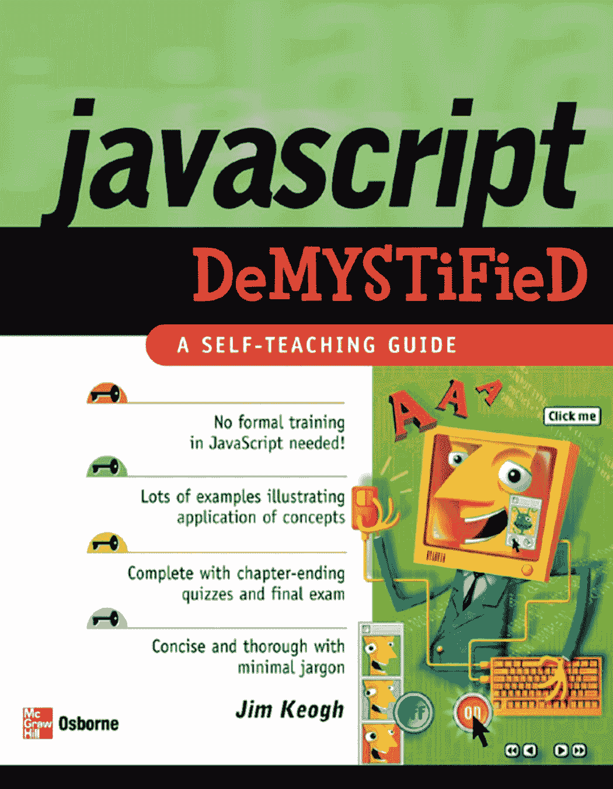
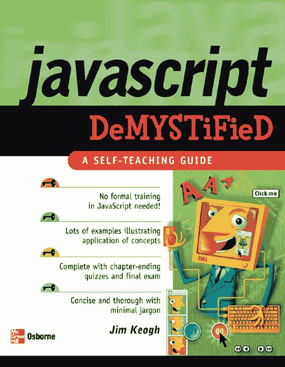
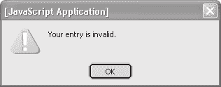
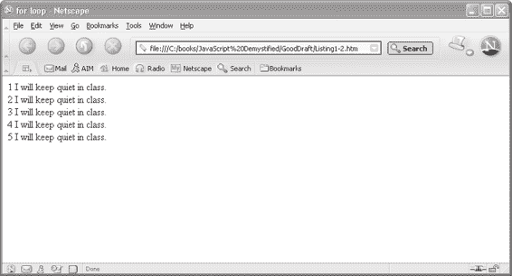
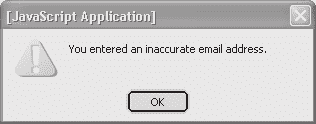
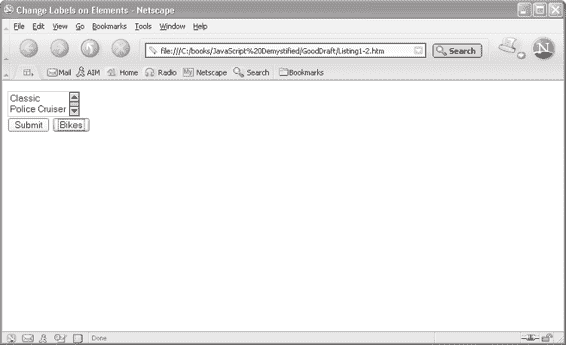
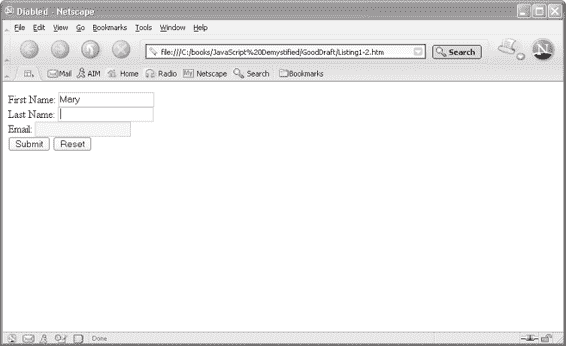
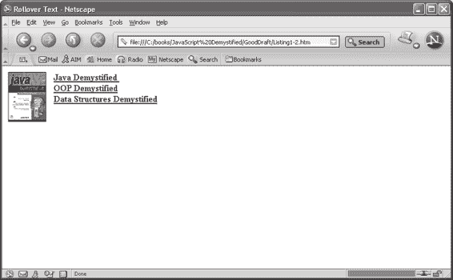
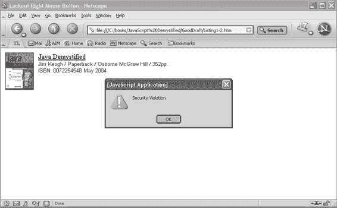

# JavaScript 揭秘：[自学指南；无需正式 JavaScript 培训！通过大量示例演示概念应用，语言简洁详尽且术语精简，包含章节末测和期末考试]





fm.indd i

fm.indd i

2005 年 5 月 3 日 下午 3:46:08

2005 年 5 月 3 日 下午 3:46:08

fm.indd i

fm.indd i

2005 年 5 月 3 日 下午 3:46:08

2005 年 5 月 3 日 下午 3:46:08

*本页特意留。*

fm.indd ii

fm.indd ii

2005 年 5 月 3 日 下午 3:46:13

2005 年 5 月 3 日 下午 3:46:13

fm.indd iii

fm.indd iii

2005 年 5 月 3 日 下午 3:46:13

2005 年 5 月 3 日 下午 3:46:13


版权所有 © 2005 The McGraw-Hill Companies。美国制造。除根据 1976 年《美国版权法》允许外，未经出版者事先许可，不得以任何形式或通过任何手段复制或发本出版物的任何部分，或将其存储在数据库或检索系统中。

0071471391

本电子书的内容也出现在该书的印刷版中：0-07-226134-X。

所有商标均为其各自所有者的商标。我们没有在每个商标名称出现时都加上商标符号，而是仅以编辑的方式使用这些名称，并为了商标所有者的利益，无侵犯商标的意图。

书中出现此类标识时，均采用首字母大写。

McGraw-Hill 电子书提供特殊批量折扣，用于赠品和销售促销，或用于企业培训计划。更多信息请联系 George Hoare（特销部），邮箱 george_hoare@mcgraw-hill.com 或电话 (212) 904-4069。

# 使用条款

本作品受版权保护，The McGraw-Hill Companies, Inc. (“McGraw-Hill”）及其许可方保留对该作品的所有权利。本作品的使用受这些条款限制。

除根据 1976 年《版权法》允许以及存储和检索一份作品副本的权利外，未经 McGraw-Hill 事先同意，您不得反编译、反汇、反向工程、复制、修改、基于此创建衍生作品、传输、分发、传播、销售、出版或转许可本作品或其任何部分。您可以将本作品用于您自己的非商业和个人用途；严禁对作品进行任何其他使用。未能遵守这些条款，您使用本作品的权利可能会终止。

本作品“按现状”提供。MGRAW-HILL 及其许可方对使用本作品所获得的准确性、充分性或完整性或结果不作任何保证或担保，包括通过超链接或其他方式通过作品访问的任何信息，并明确否认任何明示或暗示的保证，包括但不限于对适销性或适用于特定用途的暗示性保证。McGraw-Hill 及其许可方不保证或担保作品中包含的功能将满足您的需求，或其运行将不会中断或无错误。McGraw-Hill 及其许可方均不对您或任何其他人对作品中的任何不准确、错误或遗漏（无论原因如何）或对由此产生的损害承担责任。McGraw-Hill 对通过作品访问的任何信息的内容不负责。在任何情况下，McGraw-Hill 和/或其许可方对因使用或无法使用本作品而导致的任何间接、偶然、特殊、惩罚性、后果性的或类似的损害均不负责，即使其中任何一种已被告知可能此类损害。此责任限制适用于任何索赔或原因，无论此类索赔或原因是源于合同、侵权还是其他。

[DOI: 10.1036/007226134X](http://dx.doi.org/10.1036/007226134X)


# 想了解更多吗？

我们希望您喜欢这本 McGraw-Hill 电子书！如果您想了解更多关于此书、作者或相关书籍和网站的信息，[请点击此处。](http://dx.doi.org/10.1036/0071471391)

fm.indd i

fm.indd i

2005 年 5 月 3 日 下午 3:46:08

2005 年 5 月 3 日 下午 3:46:08

*本页特意留。*

fm.indd ii

fm.indd ii

2005 年 5 月 3 日 下午 3:46:13

2005 年 5 月 3 日 下午 3:46:13

*此书献给 Anne, Sandy, Joanne, Christine 和 Graff，*

fm.indd i

fm.indd i

2005 年 5 月 3 日 下午 3:46:08

2005 年 5 月 3 日 下午 3:46:08

# 关于作者

**JIM KEOGH** 任教于新泽西州泽西市的哥伦比亚大学。他在哥伦比亚大学工作了数十年，是 60 多本书的作者，包括*JavaScript Demystified*、*ASP Demystified*、*Data Structures Demystified* 等。

fm.indd iii

fm.indd iii

2005 年 5 月 3 日 下午 3:46:13

2005 年 5 月 3 日 下午 3:46:13

欲了解更多关于此书的信息，请点击此处。](http://dx.doi.org/10.1036/0071471391)

# 目录

## 第一章：JavaScript 简介

- JavaScript 内部视角

- 入门 JavaScript

- JavaScript 语法

- 增加 JavaScript 趣味

- 你的第一个 JavaScript

## 第二章：变量、运算符和表达式

- 值与变量

- 表达的组成部分

- 运算符类型

- 多重操作

## 第三章：条件语句

- if 语句

- if...else 语句

- else if 语句

- 嵌套 if 语句

- if 语句的其他变体

- switch...case 语句

- 循环语句

- for 循环

- while 循环

- do...while 循环

## 第四章：数组

- 什么是数组？

- 数组

- 初始化数组

- 定义元素

- 数组中有多少元素？

- 遍历数组

- 添加数组元素

- 排序数组元素

- 从现有数组创建新数组

- 将数组元素合并为字符串

## 第五章：函数

- 什么是函数？

- 定函数

- 编写函数定义

- 添加参数

- 变量和参数的作用域

- 调用函数

- 不带参数调用函数

- 带参数调用函数

- 从 HTML 调用函数

- 函数调用另一个函数

- 从函数返回值

## 第六章：字符串

- 为什么要处理字符串？

- 连接字符串

- 在字符串中查找

- 分割文本

- 复制子字符串

- 数字与字符串转换

- 数字转字符串

- 更改字符串的大小

- 字符串与 Unicode

## 第七章：表单与事件处理

- 表单的构建块

- 元素与 JavaScript

- 响应表单事件

# 表单对象与元素 141

# 节省时间的捷径 143

# 动态更改属性值 144

## 根据用户选择的值更改元素 146

## 动态更改选项列表 148

## 评估复选框选择 151

## 在表单提交之前元素 153

## 使用内置 JavaScript 函数 155

## 动态更改标签 156

## 禁用元素 159

## 只读元素 161

### 展望 162

### 测验 163

# 第 8 章：Cookies 165

## Cookie 基础 166

### 创建 Cookie 167

### 读取 Cookie 169

### 设置过期日期 171

### 删除 Cookie 172

### 使用 Cookie 个性化体验 174

### 展望 176

### 测验 176

# 第 9 章：浏览器窗口 179

## 请打开窗口！180

### 让新窗口获得焦点 182

### 将窗口置于屏幕位置 184

## 更改窗口内容 186

### 关闭窗口 187

### “魔术般”滚动网页 190

### 同时打开多个窗口 191

### 在新窗口中创建网页 192

### 展望 195

### 测验 196

# 第 10 章：正则表达式 199

## 什么是正则表达式？ 200

## 正则表达式的语言 201

### 寻找不匹配的字符 204

### 输入字符范围 205

### 匹配数字和非数字 205

### 匹配标点和符号 206

### 匹配单词 206

## 使用正则表达式替换文本 207

### 替换相似值 208

### 返回匹配的字符 209

### 电话号码匹配 210

## 正则表达式对象属性 213

### 展望 214

### 测验 215

# 第 11 章：JavaScript 与框架 217

## 你被框架了！218

### 不可见边框 220

### 调用子窗口的 JavaScript 函数 222

### 更改子窗口的内容 223

### 更改子窗口的焦点 226

### 从 JavaScript 向子窗口写入 226

### 访问另一个子窗口的元素 228

### 展望 228

### 测验 229

# 第 12 章：翻滚效果 (Rollovers) 231

## 准备舞台 232

### 创建翻滚效果 234

### 文本翻滚 237

### 翻滚效果的多个动作 239

### 更高效的翻滚效果 243

### 展望 245

### 测验 245

# 第 13 章：传递信息：状态栏、横幅与幻灯片 249

## 使用状态栏创造魔法 250

### 构建静态消息 250

### 使用翻滚效果更改消息 253

### 消息沿状态栏移动 256

## 横幅广告 268

### 加载和显示横幅广告 268

### 将横幅广告链接 URL 271

### 创建幻灯片 273

### 展望 275

### 测验 276

# 第 14 章：保护你的网页 279

## 隐藏你的代码 280

### 禁用右键 280

### 隐藏你的 JavaScript 283

### 隐藏你的电子邮件地址 286

### 展望 288

### 测验 288

# 第 15 章：菜单 291

## 创建下拉菜菜单 292

### 动态更改菜单 294

### 验证菜单选择 296

## 创建 DHTML 菜单 298

### 浮动菜单 299

### 链式选择菜单 299

### 标签菜单 300

### 弹出菜单 300

### 高亮菜单 301

### 折叠树形菜单 301

### Microsoft Outlook 栏样式菜单 302

### 右键菜单 303

### 可滚动菜单 303

### 侧边栏菜单 304

### 滑入菜单 304

### 展望 305

### 测验 306

# 第 16 章：DHTML 309

## 什么是 DHTML？ 310

## 学习 DHTML 310

### 层样式表 311

### 使用 DHTML 代码 313

### 通用拖放 313

### LCD 钟全部 316

### 水水印背景图 319

### 使用 iframe 的标签页查看器 319

###  iframe 内容 323

### 跨浏览器跑码 325

### 弹出日历 325

### 嵌入式内容框 325

### 广告框 326

### 测验 327

### 附录 329

期末考试 333

测验与答案 349

索引 361

# 引言

每个网络冲浪者在看到一个高质量网站时都能一眼认，因为它拥有引人注目的特征，使其在众多网站中脱颖而出。

这些网站的开发者之所以让冲浪者惊叹，并不是因为使用了花哨的动画或性图片，而是通过使用浮动菜单和可移动对象等巧妙技巧，并赋予网站智能，帮助冲浪者输入适当的信息并正确执行任务。

高质量的网站也会吸引开发者，他们就像观看顶尖魔术表演的魔术师，困惑多于惊讶，因为所看到的是技巧而非魔法。问题是，这是如何做到的？

无疑，当你访问一个伟大的网站时也产生过同样的问题，你可能尝试过使用 HTML 重新创建那些花哨的功能，但未能实现目标，让你怀疑自己漏了什么。现在，你将学习大师开发者用来赋予网站“惊效果”的秘密。

这个秘密就是 JavaScript。

JavaScript 是一种功能有限的编程语言，网页开发者用它来实现 HTML 无法做到的，例如构建动态网页、响应鼠标悬停等事件、创建交互式表单、验证访问输入表单的信息、控制浏览器等。

JavaScript 并不是 `Java`，这让许多不熟悉 JavaScript 的开发者感到困惑。两者都是面向对象的编程语言，且名称中都带有 `Java`，但这仅是它们相似之处。你将在第一章学习它们的区别。

是的，JavaScript 与 HTML 不同，但它们并没有不同到让你无法编写 JavaScript。

## 揭秘 JavaScript

`JavaScript Demystified`（揭秘 JavaScript）引言

JavaScript 是 DHTML 的关键组件，专业人士用它在无需使用插件的情况下创建类似 Flash 的效果。你只需要具备 HTML 的基础知识——以及 `JavaScript Demystified`——就能精通 JavaScript。

读到本书最后，你将能够创建一个属于自己的高雅网站，它甚至会让老练的网页浏览者为之惊叹，并让网页开发者抓着头思思：“这是怎么运作的？”

## 内容预览

学习 JavaScript 的学习可能具有挑战性，除非你遵循 `JavaScript Demystified` 书中使用的循序渐进的方法。主题的介绍顺序符合许多开发者喜欢的学习顺序——从基础组件开始，然后逐渐过渡到高级网站上常见的功能。

每一章都遵循一个经过时间检验的公式：首先以易读的风格解释主题，然后展示如何在一个运行的网页中使用它，你可以自己复制并加载该网页。然后，你可以将你的网页与章节中显示的网页图像进行对比，以确保你编写的代码是正确的。你几乎不会出错。

# 引言

## 第 1 章：深入了解 JavaScript

第 `1` 章通过介绍 `JavaScript` 的基本事实，为本书的其余部分奠定基础。你将探索 `JavaScript` 的基本概念，并学习 `JavaScript` 能做什么以及不能做什么。

最重要的是，你将创建你的第一个可以运行的 `JavaScript` 程序。它可能不会惊艳任何人（除了你自己），但你的第一个 `JavaScript` 突破了未知，让你向自己证明你可以创建一个可以运行的 `JavaScript` 程序。

## 第 2 章：变量、运算符和表达式

你将卷起袖子，深入钻研 `JavaScript`，学习如何在计算机内存中存储信息的细节，以及如何使用 `JavaScript` 处理这些信息。这听起来可能并不有趣，但你在本章中学到的技术用于你在浏览网页时看到的几乎每一个引人注目的网页中。

在本章中，你将学习到输入表单的日期、数字和文本等信息可以使用被称为 `变量` 的东西存储在计算机内存中。然后，`变量`和`运算符`被组合成一个`表达式`，告诉浏览器执行某些有趣的操作。一旦你掌握了第 `2` 章涵盖的技能，浏览器将任听你指遣。

## 第 3 章：条件语句

第 `3` 章将向你展示如何使用条件语句赋予网页所需的智能，以能够做出决策。条件语句是一种表达式，它告诉浏览器比较两个事物，如果它们相同则执行某些操作，如果不同则执行其他操作。

条件语句是几乎每个为访问者定制内容的高雅网站的关键元素。一旦掌�了本章的主题，你将能够编写一个 `JavaScript` 来验证和处理访问者在你的网站表单中输入的信息。

## 第 4 章：数组

你可能见过这样的网页显示着似乎无尽的横幅广告，在你扫描页面时它们在不断旋转。你可能注意到每个横幅广告在没有任何延迟的情况下就弹出。实现这种效果的秘密是将它们分组在一个`数组`中。

正如你在第 `4` 章中将学到的，`数组`是一组相似的信息，浏览器可以通过访问组中的每个成员来高效的访问它们，就像老师在收作业时在学生行之间移动。

## 第 5 章：函数

当你点披萨时，只需说“一个意大利肠披萨”。你不需要告诉厨师如何制作披萨，因为厨师遵循包含这些步骤渐进指令的配方。

你可能会好奇点披萨与 `JavaScript` 有什么关系。点披萨类似于在 `JavaScript` 中调用`函数`。将`函数` 想象成每次调用时都会遵循的一组指令。在这种情况下，通过说“一个意大利肠披萨”来调用函数。厨师遵循制作意大利肠披萨配方中定义的指令。

在第 `5` 章中，你将学习如何定义自己的`函数`，这些函数可以从 `JavaScript` 或直接从 HTML 调用，让浏览器执行一组指令。这赋予了你构建自己的 `JavaScript` 命令的力量。

## 第 6 章：字符串

你可能遇到过一个网页根据你的名字自动为你创建一个电子邮件地址。通过某种方式，网页将你的名字撕成碎片，然后将其重新组合成一个电子邮件地址，就像魔法师将报纸撕碎，然后魔术地将它们重新组合形成一张报纸。

如果你想学习如何将你的名字或任何系列字符切成碎片，然后将这些碎片重新组合成不同的单词，请阅读第 `6` 章。

专业的网页开发者在验证访问者向其网站提供的信息时会这样做。

## 第 7 章：表单和事件处理

表单对你来说并不陌生，因为它们是用 HTML 构建的。然而，并不是所有的表单都是相同的，特别是当 `JavaScript` 开发者创建表单时。`JavaScript` 可以让表单活起来，让它在向表单输入信息时与表单元素进行动态交互。

每当你根据从下拉列表中的选择让浏览器自动更改表单上的设置时，你都会体验到这一点。在后台，当下拉列表发生变化时，浏览器会调用 `JavaScript`。`JavaScript` 读取选择并确定其他表单元素的设置。

你将在本章中学习如何执行这项以及其他 `JavaScript` 技艺。

## 第 8 章：Cookie（饼干）

饼师、饼干怪兽（Cookie Monster）和 `JavaScript` 有什么共同点？饼干！饼师和 `JavaScript` 制作饼干。饼干怪兽和 `JavaScript` 吃饼干（也就是说，`JavaScript` 有某种程度上吃饼干——它实际上是读取饼干）。`cookie` 是网页复制到访问者计算机的一小块信息——这一点你可能已经知道了。在第 `8` 章中，你将学习如何制作自己的 `cookie`，以及如何读取 `cookie` 来为每个访问者个性化你的网页。

# 第 12 章：鼠标悬停 (Rollovers)

鼠标悬停将鼠光标变成魔棒，让访客通过在网页对象上移动鼠标光标来执行各种魔法。它们可以用一张图像替换另一张，让文本显示或消失，并完成开发者可以想象的任何其他任务。

每当检测到鼠标悬停时，浏览器都会调用 JavaScript 函数，告诉浏览器下一步要做什么。第 12 章将向你如何使用 JavaScript 在网页上实现这种魔法。

# 第 13 章：传达你的信息

## 状态栏、横幅和幻灯片

专业的 JavaScript 开发者使用各种技巧在访客扫描网页时吸引他们的注意力——他们使用旋转横幅、幻灯片和浏览器的状态栏来向访客传达信息。

在第 13 章中，你将学习这些技巧背后的秘密，并学习如何使用 JavaScript 构建你自己的注意力吸引器。

## 第 14 章：保护你的网页

除非你采取措施保护网页，否则你的 JavaScript 秘密是不安全的。

好奇的访客右键点击并选择“查看源代码”，从而在屏幕上弹出网页源代码，这非常常见。网页上使用的任何 JavaScript 也会变得可见。

你无法完全从窥探的目光中隐藏你的 JavaScript，但你可以阻止除了计算机高手以外的所有人访问你的 JavaScript。你将在第 14 章中看到如何实现。

## 第 15 章：菜单

当与人面对面时，你只有一次机会留下第一印象，你的网站也是如此。网络浏览者倾向于根据导航网站的难易程度来判断一个网站。你可以通过巧妙设计引人注目的菜单来简化他们的导航，并为他们对你的网站留下深刻的记忆。

在第 15 章中，你将学习如何使用 JavaScript 和 DHTML 创建动态的菜菜单。你已经在许多流行的商业网站上见过这些菜单。

## 第 16 章：DHTML

商业网站使用令人兴奋的特效，例如飞过网页的气气球或跟随鼠标光标的眼睛，来捕捉并留住客。他们通过使用动态 HTML (DHTML) 创建这些效果。

正如你将在第 16 章中学到的，DHTML 是 HTML、层样式表 (CSS) 和 JavaScript 的结合，使网页具有与桌面多媒体应用程序相同的的外和感受。本章从对层样式表的简要回顾开始，然后是来自 dynamicdrive.com 的实用 DHTML 示例，这些示例可以用于你的下一个项目。

## 第 1 章：JavaScript 内部探秘

任何构建过网页的人都会很快意识到超文本标记语言 (HTML) 的局限性。它没有提供创建复杂网页所需的控制功能，你无法用它创建交互式网页。然而，使用 JavaScript 脚本语言，你可以构建在许多专业网站上看到的交互式网页和功能。

你可能已经知道如何使用 HTML 组装网页。JavaScript 对你来说仍然是新的——否则你不会读这本书了。在本书中，你将从零学习 JavaScript，以获得构建高雅交互式网页所需的技能。如果你急于开始编写第一段 JavaScript，请等一下；你将在本章稍晚些时候完成这一点。在埋头学习之前，让我们花一点时间探索 JavaScript 的基本概念。

## JavaScript 揭秘

## 常见问题解答

### 关于 JavaScript

许多初接触 JavaScript 的开发者对这个名称感到困惑，因为他们读过关于脚本语言、编程语言、JavaScript、Java、VBScript 和 JScript 的误导信息。在进入使用它的细节之前，让我们先回答三个关于 JavaScript 的最常见问题。

### JavaScript 是脚本语言还是编程语言？

这是许多网页开发者在学习 JavaScript 时提出的第一个问题。事实是，JavaScript 既是脚本语言也是编程语言，因为脚本语言和编程语言从根本上做的是相同的事情——即它们都允许开发者指示浏览器执行某些操作，例如验证用户输入表单的信息。然而，它们在一个重要方面上有所不同：脚本语言通常不关心数据类型，而编程语言关心数据类型。`data type`（数据类型）是对程序中可以使用的数据值类型以及在这些值上可以执行的操作类型的定义，并且它指定了可以放在计算机内存特定位置的信息的大小和种类。

### JavaScript 和 Java 一样吗？

这通常是网页开发者问的第二个问题，简单的答案是不一样。

最初，Netscape 开发了一种名为 `LiveScript` 的脚本语言，以增强 Netscape Navigator 的功能。行业内的传闻是，Sun 微公司的新编程语言 `Java` 将彻底改变计算机行业，因为除此之外，`Java` 可用于创建名为 `applets` 的小型程序，这些程序可以在启用 Java 的 浏览器中运行。Netscape 很快发布了名为 Navigator 2 的版本，该版本支持 Java。`LiveScript` 被重命名为 `JavaScript`，希望开发者能随 `Java` 一起采用 `JavaScript`。

`Java` 是一种功能全面的编程语言（类似于 `C++`），用于构建客户端和服务器应用程序。`client-side application`（客户端应用程序）是你在计算机上直接交互的程序——例如，Microsoft Internet Explorer。`server-side application`（服务端应用程序）是你的客户端应用程序与之交互的程序，通常位于远端计算机或服务器上——例如，Java applet 或 Perl 脚本。

例如，你的浏览器就是一个你用来从 Web 服务器请网页的客户端应用程序。Web 服务器是与你的浏览器“通信”的服务端应用程序。

Java 可以在不同类型的计算机上运行而无需修改。这被称为 `cross-platform compatibility`（跨平台兼容）。简单来说，在 Windows 上运行的 Java 程序可以在 Mac 和 Sun 计算机上运行而无需修改程序。

如果你构建过网页，可能对 Java applet 熟悉。Java `applet` 是一个位于 Web 服务器上的 Java 程序，通过网页中的 `<applet>` 或 `<object>` HTML 标筓运行。浏览器从 Web 服务器下载 Java applet，然后在自己的窗口中运行它。Java applet 几乎可以做 Java 应用程序可以做的任何事情，某些安全限制除外，例如访问你的计算机硬盘。

与 `Java` 相比，JavaScript 是一种功能有限的编程语言。（请参见下一节，“JavaScript：功能有限的编程语言”）。JavaScript 程序称为 `scripts`，包含在网页的 `<script>` HTML 标签中。当下载网页时，浏览器会下载 JavaScript。

JavaScript 可以在静默运行而不显示任何内容，例如在执行计算时；也可以在显示 JavaScript 表单时接管整个浏览器窗口。JavaScript 程序无法访问你计算机的硬盘。

## JavaScript 和 VBScript 以及 JScript 相同吗？

简单的答案是不相等的。`VBScript` 和 `JScript` 是微软为了创建交互式网页而开发的。`JavaScript` 是网景（Netscape）的创造。

## JavaScript：一种功能有限的编程语言

你可以使用 JavaScript 许多许多仅使用 HTML 无法实现的事情。以下是其中一些：

* 构建动态网页

* 显示警报框

* 向浏览器状态栏写入消息

* 控制浏览器功能

* 打开新的浏览器窗口

* 自定义对鼠标操作和按键触发的响应

* 验证表单中的信息

* 执行计算

* 当光标悬停在屏幕对象上时显示消息

* 创建交互式表单

* 设置日期和时间

* 识别浏览器和 Flash 等浏览器插件

尽管 `JavaScript` 比 HTML 更强大，但 `JavaScript` 并不能做一切。以下是一些 `JavaScript` 无法做的常见事情：

* 向你的硬盘写入文件

* 从硬盘读取文件——cookie 除外

* 关闭除 `JavaScript` 程序打开之外的其他窗口

* 编写服务端应用程序，称为 *Common Gateway Interface (CGI)* 应用程序，这些必须使用 `Java`、`ASP`、`Perl` 和 `PHP` 等语言编写

* 从与 `JavaScript` 所在域名不同的网页中读取信息

## 深入学习 JavaScript

现在准备工作已经完成，让我们开始学习 `JavaScript` 的核心知识，从介绍 `JavaScript` 对象开始。你可能听过*面向对象的编程语言*这个术语，并想知道用通白的英语解释这意味着什么。面向对象的编程语言是一种使用对象来构建程序的编程语言。

当然，一个 `object` 是一个事物，例如文档、计算机、铅笔或汽车。我们周围几乎的一切都是对象。`JavaScript` 是一种使用对象来构建程序的面向对象编程语言。在编程中，`JavaScript` 最常用的对象是文档、表单、字段、单选按钮以及你在表单或用户界面上找到其他元素。窗口也是 `JavaScript` 程序使用的对象。当你开始编写 `JavaScript` 程序时，你将对对象非常熟悉。让我们更详细地探索对象。

### 对象名称

一个典型的网页包含许多对象，其中一些是同类型的对象。例如，一个网页可能包含两个表单。但尽管这些表单是同类对象，但根据表单中出现的字段、按钮和其他界面元素，它们可以是独特不同的。

每个对象必须通过你分配给对象的名称或 ID 来唯一标识，以便在你的 `JavaScript` 中引用它。例如，表单可以命名为 `form1` 和 `form2`。或者，你可以为表单分配标识每个表单用途的名称，例如 `OrderEntryForm` 和 `OrderDisplayForm`，这可以在你的 `JavaScript` 中更清晰地标识每个表单。

有时你的 `JavaScript` 需要快速访问许多对象，例如在幻灯片中显示多张图片时。在这种情况下，你使用 `array` 为每个对象命名。你将在下一章学习数组。现在，请将 `array` 想象成一个对象列表。列表上的第一个对象称为 `object 0`，下一个是 `object 1`，依此类推。你通过其数字访问每个对象。你将在第 4 章看到如何操作。

让我们进入对象的下一个部分，即对象的属性。

### 属性

一个 `property` 是与对象关联的值。取决于使用的对象类型，对象可以有许多值。例如，表单对象有一个标题、宽度和高度——这只是其中几个属性。窗口有背景颜色、宽度和高度。这些都是对象的属性。每种对象都有它们自己的属性。在介绍每个对象时，你将在整整本书中学习到这些属性。

### 方法

一个 `method` 是对象在接收到消息时执行的过程。一些 `JavaScript` 开发者喜欢将方法看作一个动词，因为本质上是一种动作。（另一方面，对象就像一个名词。）例如，表单上的 `Submit` 按钮是一个对象。它的 `Submit` 标签和按钮的尺寸是按钮对象的属性。如果你点击了 `Submit` 按钮，表单就会提交到服务端应用程序。换句话说，点击 `Submit` 按钮会导致按钮处理一个方法。

使用的方法类型不同，取决于它们所依附的对象类型。当你学习如何在你的 `JavaScript` 应用程序中使用 `JavaScript` 对象时，你将学到更多关于方法的知识。

## 点语法

你可以将对象认为为与某些类型的信息（属性）和某些类型的行为（方法）相关。例如，文档是一个具有特定背景颜色（属性）并且可以写入（方法）的对象。

你通过使用*点语法*（dot syntax）结合对象名称及其属性或方法来访问对象的属性和方法。例如，这里是如何识别文档的背景颜色和文档的写入方法的：`document.bgColor`

```
document.bgColor
document.write()
```

一旦理解了点语法的工作原理，这就很好理解了。每行都有两个部分：第一部分是对象的名称，即 `document`。第二部分是对象的属性（`bgColor`）或方法（`write`）。点将对象名称与属性或方法分开。

在这个示例中，第一行说：“我想访问文档对象的背景颜色。”第二行说：“我想向文档对象写入某些内容。”你可能会问，写什么内容呢？

在这个示例中，没有任何内容被写入文档。要告诉 JavaScript 要向文档写入什么信息，你需要在 `write()` 方法的括号之间输入信息。在本章的晚些时候，你将使用 `write()` 方法在你的第一个 `JavaScript` 中写入“Hello, world!”文本。

## 主事件

你需要理解的另一个基本概念是*事件处理*。一个*event*（事件）会导致你的 `JavaScript` 开始执行代码——例如当你点击 `JavaScript` 显示在屏幕上的表单上的鼠标按钮时。在你的 `JavaScript` 运行期间，发生的每一个事件都会被通知。某些事件对你的 `JavaScript` 特别重要，例如当有人点击表单上的 `Submit` 或 `Cancel` 按钮时。其他事件可能没那么重要，例如鼠标移动到表单上不包含信息的区域时。你应用程序的性质决定了事件是否重要。

## 第一章：JavaScript 内部详解

你的任务是确保你的 JavaScript 对重要事件做出响应。这被称为 `event handling`（事件处理）。你通过创建一个 `event handler`（事件处理器）来完成这一点，它是你的 JavaScript 中对重要事件做出响应的部分。例如，提交（Submit）按钮点击事件的事件处理器可能包含 JavaScript 指令，用于处理用户在表表单上输入的信息，而这些处理指令将确保用户已在表单上填写了所有必要信息。

目前，关于事件和事件处理，你只需要了解这些。以后，你将学习让你的 JavaScript 对重要事件做出所需的所有知识。

## 编写你的第一段 JavaScript

是时候编写你的第一段 JavaScript 代码了。遵循长期的编程传统，你的第一个脚本的目标是在文档对象中写入“Hello, world!”。诚然，写这段 JavaScript 写起来不是最有趣的，但更有趣的 JavaScript 还在后头。现在，重要的是学习如何编写基础的 JavaScript。

一个 JavaScript 由 JavaScript 语句组成，这些语句被放置在网页的 `<script>` HTML 标签内。这意味着你不需要任何特殊工来编写 JavaScript。你可以使用编写网页时相同的工具来编写 JavaScript。

你将包含 JavaScript 的 `<script>` 标签放在网页中的两个位置之一——在 `<head>` 标签内，或者在 `<body>` 标签内。

开发者将 `<head>` 标签内的脚本称为 `header scripts`（头部脚本），将放在 `<body>` 标签内的脚本称为 `body scripts`（主体脚本）。你将在本书的后面学习更多关于头部脚本和主体脚本之间的差异。

现在，到了你一直等待的时刻。你将创建图 1-1 所示的网页。

```html
<!DOCTYPE html PUBLIC
"-//W3C//DTD XHTML 1.0 Transitional//EN">
<html xmlns="http://www.w3.org/1999/xhtml">
<head>
<title>My First JavaScript</title>
</head>
<body>
<script type="text/javascript">
document.write("Hello, world!");
</script>
</body>
</html>
```

图 1-1 你的第一个 JavaScript

```html
<script language="Javascript" type="text/javascript">
<!--
document.write('Hello, world!')
-->
</script>
</body>
</html>
```

## 第 1 章：深入了解 JavaScript

## 为你的 JavaScript 加色

承认，你的第一个 JavaScript 看起来有点单调，因为文本缺乏在你使用 JavaScript 显示文本时所期的那种生艳感。你将在后面的章节中学习专业人士显示文本的技巧。现在，让我们通过在警报对话框中显示文本，为你简单的 Hello, world! JavaScript 增加一点润色。

警报对话框出现在屏幕上显示消息，并一直留在屏幕上，直到有人点击对话框中出现的确定 按钮。（你可能在尝试打印内容但忘记开启打印机时看到过警报对话框。对话框给了你一个礼貌的提醒。）你通过调用 `alert` 函数并传递你想要显示的文本来显示警报对话框。你将在第 5 章学习函数。每你想显示警报对话框时，就在你的 JavaScript 中插入以下语句。

```javascript
alert("message")
```

将单词 `message` 替换为你想要显示的文本。以下是修改后的 Hello, world! JavaScript。注意，`document.write()` 语句被替换为 `alert` 函数。当你运行此脚本时，你会看到警报对话框显示（图 1-2）。

```html
<!DOCTYPE html PUBLIC "-////W3C//DTD XHTML 1.0 Transitional//EN">
<html xmlns="http://www.w3.org/1999/xhtml">
<head>
<title>隐藏 Hello world! JavaScript</title>
</head>
<body>
<script language="Javascript" type="text/javascript">
<!--
alert('Hello, world!')
-->
</script>
</body>
</html>
```

**图 1-2** 警报对话框会一直留在屏幕上，直到点击确定按钮或关闭框。

## 揭秘 JavaScript

### 展望

现在，你已经对 JavaScript 是什么以及不是什么有了相当程度的了解。

JavaScript 是一种功能有限的编程语言，用于增强 HTML 并赋予网页智能，使其能够决策并执行专业网站中的复杂功能。JavaScript 不是 Java。

JavaScript 是一种面向对象的编程语言，允许你通过使用对象来构建应用程�。对象是出现在表单上的文档、按钮或其他项目。每个对象都有属性——关于该对象的信息，如尺寸和颜色。每个对象还有方法，即由对象执行的操作，例如在点击提交按钮时处理表单。

你通过使用对象的名称、后跟一个点、以及你想在 JavaScript 中使用的属性或方法名称，来访问对象的属性和方法。这被称为点语法。

JavaScript 应用程序会对应用程序运行期间发生的事件做出反应。

事件通常是使用你应用程序的人所的操作，例如有人点击提交或取消按钮。你通过定义事件处理器来让你的 JavaScript 对事件做出反应。事件处理器是应用程序的一部分，每当应用程序运行时发生特定事件时就会被调用。

JavaScript 放置在 HTML 页面的 `<script>` 标签内。`<script>` 标签可以放在页面的 `<head>` 或 `<body>` 标签内。将 JavaScript 代码放在`<script>` 标签内的 HTML 注释中是一个良好的做法，这样不支持 JavaScript 的旧浏览器就不会在屏幕上显示你的 JavaScript 代码。

现在你对 JavaScript 有了良好的总体了解并知道如何编写简单的 JavaScript 应用程序，是时候转向 JavaScript 更有趣的内容了。在下一章中，你将学习如何在 JavaScript 中存储和使用信息。

### 测验

1. JavaScript 是 的一个版本

a. Java

b. LiveScript

c. C++

d. VBScript

2. JavaScript 必须位于

a. `<object>` 标签

b. `<applet>` 标签

c. `<script>` 标签

d. `<cgi>` 标筓

3. 提交按钮是种类型的 

a. 对象

b. 方法

c. 属性

d. 变量

4. 文档的背景颜色是种类型的

a. 对象

b. 方法

c. 属性

d. 变量

5. `write()` 是种类型的

a. 对象

b. 方法

c. 属性

d. 变量

6. 点用于

a. 识别 JavaScript

b. 分隔行

c. 结束 JavaScript

d. 将对象名称与属性或方法分离

7. 当有人点击表单上的按钮时称为什么什么？

a. 事件

b. 反应

c. 鼠标悬停

d. 鼠标

8. 你的 JavaScript 哪部分对人们点击表单上的按钮做出反应？

a. 主程序

b. 事件

c. 下标

d. 上标

9. 你如何防止你的代码被旧浏览器显示？

a. 将 JavaScript 放在 `<script>` 中

b. 将 JavaScript 放在 `<head>` 中

c. 将 JavaScript 放在注释中

d. 将 JavaScript 放在 `<body>` 中

10. JavaScript 是

a. 一全功能编程语言

b. 一个功能有限的编程语言

c. ASP 的版本

d. ASP.NET 的版本

## 第 2 章：变量、运算符和表达式

你在浏览网页时可能见过很多复杂的网页，并好奇它们是如何构建的。这种复杂性的秘密在于 JavaScript 存储和处理信息的能力。这些是你仅用 HTML 无法做到的。

在构建令人兴奋的网页之前，你将学习如何使用 JavaScript 存储和处理信息的细致基础。在本章中，我们将探索 JavaScript 的幕后部分，这是几乎每个引人注目的网页的基础。这些是变量和表达式，它们告诉你的浏览器在 JavaScript 运行时如何决策。如果你知道如何计算 `1 + 1`，你就能轻松掌握本章的信息。

## 值和变量

网页包含大量信息，并散落着几张图片来吸引你的注意力。在 HTML 中，你将想要显示的信息放在各种 HTML 标签之间。你将“Hello, world!”放在开放的 `<h1>` 和关闭的 `</h1>` 标签之间，这会导致该消息显示在页面上。你放在网页代码或 JavaScript 中的信息被称为*值*。

例如，你在第 1 章的 JavaScript 中编写的“Hello, world!” 脚本就是一个值。*变量*基本上是一个占位符，为在程序执行期间可以更改的数据留出位置。

## 值

在 HTML 中，所有值都被视为文本。也就是说，当你输入 `10` 时，HTML 不会将其视为可用于计算的数字，而是将其视为你可能用于街道地址的数字，例如唐宁街 10 号。JavaScript 使用六种值：数字、字符串、布尔值、null、对象和函数。

**数字**

`number` 是一个可以用于计算的数值。

### 字符串 (String)

`string` 是包含在引号内的文本。它之所以被称为字符串，是因为字符被串联在一起形成文本。字符串也可以包含数字，但除非开发者对它们进行某些 JavaScript“魔法”处理，否则这些数字无法用于计算，你将在本书的后面部分学习这些内容。因此，“唐宁街 10 号”中的数字 10 是字符串的一部分，不能直接用于计算。

### 布尔值 (Boolean)

`Boolean` 是一个值为 `false` 或 `true` 的值，表示为零和/或非零。正如你推测的那样，布尔值用于帮助 JavaScript 决策，例如评估用户是否在订单表单中输入了她的电子邮件地址。

## 第 2 章：变量、运算符和表达式

### 空值 (Null)

`null` 值没有任何内容。真的——我是说什么都没有。这就是 `null` 的含义。

`null` 表示任何值的空缺。你可能会奇怪为什么需要使用这样的值，但当你开始编写编写复杂的 JavaScript 时，你会发现，某些时候你需要使用一个变量（值的占位符）来表示无值（`null`），直到你的 JavaScript 为该变量赋值。例如，你可能想先给用于客户姓名的变量赋值为 `null`，直到客户在表单上输入他们的名字。

### 对象 (Objects)

你已经在第 1 章中学习了对象。一个 `object` 是一个值。这意味着文档是一个值，窗口和表单也是。当你稍稍后开始在 JavaScript 中使用对象时，你会对它们变得非常熟悉。

### 函数 (Functions)

当你在 JavaScript 中调用函数时，`function` 会执行某个操作——例如你在第 1 章中调用 `alert()` 函数在屏幕上显示消息那样的。JavaScript 中使用了两种函数：预定义函数和自定义函数。预定义函是 JavaScript 已经为你创建好的，例如 `alert()` 函数。自定义函数是你创建的函数。

你将在第 5 章学习关于函数的全部知识，但让我们先预览一下你将要学习的内容。

下面是一个自定义函数定义，它会在屏幕上显示“Hello, world!”。`function definition` 是 JavaScript 的一部分，每当在 JavaScript 的其他地方调用该函数时，浏览器就会执行它。这个函数定义示例包含一个你在第 1 章中记忆过的语句。在这个示例中，该函数的名称是 `DisplayHelloWorld()`。这告诉浏览器执行 `DisplayHelloWorld()` 函数定义中的语句。

```javascript
function DisplayHelloWorld()
{
  alert('Hello, world!')
}
```

### 变量 (Variables)

如果你在编写 JavaScript 时已经知道该值，那么使用字面量（Literal values）是可以的。然而，有时值在你的 JavaScript 运行之前是未知的。

## 深度解析 (Demystified)

假设你的 JavaScript 正在计算商品价格的销售税。

你在编写 JavaScript 时可能已经知道销售税的百分比值，因此你可以将百分比的字面量写入你的 JavaScript 中。但在你的 JavaScript 运行并在客户选择商品之前，你不知道该商品的购买价格。这产生了一个困境：如何在不知道商品购买价格的情况下，将销售税计算逻辑写入你的 JavaScript 中呢？

解决方案是使用变量代替购买价格。你可以将 `variable` 想象成一个空纸箱。你在盒子上贴一个标签，并在上面写上名字。你把一个值放在盒子里。每当你想引用这个值时，只需引用盒的名字即可。

让我们回到销售税的例子来看看它是如何工作的。首先，我们需要一个用来存储购买价格的盒子。我们在盒子标签上写上 `PurchasePrice`（图 2-1）。我们可以在标签上写任何名字，但如果使用的名字能代表盒子里存储的值，就会不那么困惑。

接下来，我们将编写计算销售税的数学表达式（购买价格乘以 6% 的销售税率）：`PurchasePrice * .06`

注意，盒子标签上的名字（`PurchasePrice`，即变量）被用于在此次计算中引用购买价格。我们本可以使用实际的购买价格，但在用户向我们的应用程序输入购买价格之前，我们并不知道价格。在此之前，我们能做的就是引用该变量，浏览器将在价格输入到应用程序后将其存储在该变量中。

当浏览器在 JavaScript 中看到 `PurchasePrice` 时，浏览器知道 `PurchasePrice` 是一个变量的标签，该变量包含购买价格。然后浏览器复制用户输入的值，用该值替换 `PurchasePrice` 变量，并执行计算。

**图 2-1** 变量类似于一个包含某个值的纸箱。每当你想要使用盒子内的值时，只需引用盒子上的标签。

### 声明变量 (Declaring a Variable)

在使用变量之前，你必须告诉浏览器创建一个变量。你通过声明变量来实现这一点。每当你想要让浏览器做某事时，你需要在你的 JavaScript 中写一条语句（statement）。将 `statement` 想象成一句向浏览器发布命令的句子。

告诉浏览器创建一个变量的语句需要两个部分：

- 特殊单词，称为 `keyword`（关键字），它告诉浏览器你想让它创建一个变量。将关键字想象成 JavaScript 语言中浏览器能理解的单词。JavaScript 使用 25 个关键字（见表 2-1），你将在书中学习如何使用它们。你声明变量所需的单词是 `var`。

- `variable name`（变量名）由任何字母、数字和下划线组成，但不能以数字开头。一些新手 JavaScript 程序员使用字母如 `X`）作为变量名。虽然使用 `X` 没有问题，因为它是 JavaScript 中可以接受的变量名，但名字 `X` 并不能告诉我们关于变量中存储的值的任何信息。专业的 JavaScript 程序员会确保使用能够提示变量中存储的值类型的变量名。变量名不能是 JavaScript 关键字或 JavaScript 留字。JavaScript `reserved word`（见表 2-2）对浏览器有特殊含义，尽管它们不一定像 JavaScript 关键字那样是实际命令。如果你将 JavaScript 关键字或 JavaScript 留字作为变量名，会让浏览器感到无比困惑。

现在你已经知道了声明变量的规则，让我们为商品的购买价格声明一个变量。以下是一个告诉浏览器创建一个名为 `PurchasePrice` 变量的 JavaScript 语句。注意语句中的 `var` 部分是小写的。

```javascript
var PurchasePrice
```

**表 2-1** JavaScript 关键字

`break`, `do`, `function`, `null`, `typeof`, `case`, `else`, `if`, `return`, `var`, `continue`, `export`, `import`, `switch`, `void`, `default`, `false`, `in`, `this`, `while`, `delete`, `for`, `new`, `true`, `with`

**表 2-2** JavaScript 留字

`abstract`, `debugger`, `goto`, `package`, `synchronized`, `boolean`, `double`, `implement`, `private`, `throw`, `byte`, `enum`, `instanceof`, `protected`, `throws`, `catch`, `extends`, `int`, `public`, `transient`, `char`, `final`, `interface`, `short`, `try`, `class`, `finally`, `long`, `static`, `const`, `float`, `native`, `super`

## 初始化变量

我们在上一个示例中声明的 `PurchasePrice` 变量还没有值。这对于浏览器来说并不是问题，因为浏览器假设你的 JavaScript 稍后会出现另一个语句，告诉浏览器在变量中放置一个值。

专业的 JavaScript 程序员通常会在声明变量时给变量赋值。这被称为*变量的初始化*，因为这是分配给变量的第一个（初始）值。你通过在用于声明变量的语句中添加第三部分来初始化变量。这第三部分由一个赋值运算符（`=`）和一个初始值组成。让我们重写声明变量的语句来初始化该变量：

```javascript
var PurchasePrice = 100
```

这条语句告诉浏览器做两件事：首先，创建一个名为 `PurchasePrice` 的变量。其次，将值 `100` 赋值给 `PurchasePrice` 变量。从现在开始，每当浏览器在我们的 JavaScript 中看到 `PurchasePrice` 时，浏览器都会立即将该变量名替换为值 `100`。（虽然这里有一些例外，但将在第 5 章中介绍）。让我们回到销售税计算。注意，第一行声明了变量 `PurchasePrice` 并将其初始化为值 `100`。第二行声明了 `SalesTax` 变量并将其初始化为计算出的销售税。

```javascript
var PurchasePrice = 100
var SalesTax = PurchasePrice * .06
```

浏览器将变量名 `PurchasePrice` 替换为值 `100`，然后执行以下计算：

```javascript
var PurchasePrice = 100
var SalesTax = 100 * .06
```

## 给变量赋值

通常，变量的值在 JavaScript 运行期间会发生，变量的初始值会被另一个值替换。我们在示例中使用 `PurchasePrice` 变量就是如此。

我们使用 `100` 作为 `PurchasePrice` 变量的初始值，以模拟从使用你 JavaScript 的客户处接收购买价格。如果是真实的 JavaScript 应用程序，我们将使用 `0` 作为初始值，因为客户尚未购买商品。然后我们将 `0` 值替换为客户所选商品的购买价格（如几段落后的 JavaScript 所示）。

JavaScript 有一种非常简单的方法让你要求应用程序的用户向你的 JavaScript 输入信息——即通过调用 `prompt()` 函数。`prompt()` 函数在提示对话框（见图 2-2）中显示文本，然后等待用户输入信息并点击确定 按钮。用户输入的信息将随后返回给你的 JavaScript，以便你的脚本对其进行处理。

你可以使用 `prompt()` 函数让用户输入购买价格，然后我们在计算和显示销售税之前，将购买价格赋值给 `PurchasePrice` 变量。以下是调用 `prompt()` 函数的语法：`prompt('message', 'default <F102>value')`

**图 2-2** `prompt()` 函数显示一个提示对话框，用户在其中输入购买价格。

注意，调用 `prompt()` 函数的方式与你在第 1 章中调用 `alert()` 函数显示警报对话框的方式类似。你需要向 `prompt()` 函数提供两个信息：第一个是*消息*（message）——这是告诉用户他们应该在提示对话框中输入内容的文本。第二个信息是*默认值*（default value）——即如果用户没有在提示对话框中输入值，`prompt()` 函数将给你的 JavaScript 该值。在某些不使用默认值的情况下，你可以简单地添加空引号，如下例所示：

```html
<!DOCTYPE html PUBLIC
"-//W3C//DTD XHTML 1.0 Transitional//EN">
<html xmlns="http://www.w3.org/1999/xhtml">
<head>
<title>从用户处接收值</title>
</head>
<body>
<script language="Javascript" type="text/javascript">
<!--
var PurchasePrice = 0
PurchasePrice=
prompt('Please enter the purchase price.', ' ')
var SalesTax = PurchasePrice * .06
alert('Sales tax is $' + SalesTax)
-->
</script>
</body>
</html>
```

在注释字符（`<!--`）之后，第一行声明了 `PurchasePrice` 变量并将其初始化为 `0`，因为在我们编写 JavaScript 时，还不知道购买的价格。

下一行在赋值语句中调用 `prompt()` 函数，要求用户输入购买价格。*赋值语句*（assignment statement）告诉浏览器将变量的当前值替换为新值。赋值语句包含三个部分：变量名（`PurchasePrice`）、赋值运算符（`=`）和新值（即人员输入并由 `prompt()` 函数返回的值）。现在 `PurchasePrice` 的值是用户输入的值。

下一行声明了 `SalesTax` 变量，并将其初始化为用户输入的值乘以 `.06`（即销售税率）。

下一行通过调用 `alert()` 函数在屏幕上显示销售税。正如你在第 1 章所记得，`alert()` 函数要求你将要显示的消息放在括号内。在这个示例中，我们使用加运算符（`+`）将 `SalesTax` 变量的值放在文本“Sales tax is $”之后（见图 2-3）。

## 字符串

虽然我们的示例使用数字来展示如何初始化和变量赋值，但你也可以为变量初始化和赋值单词及符号。这样做正如之前的示例所示编写声明语句和赋值语句，只需将单词和符号包含在引号内。

提示 JavaScript 允使用单引号或双引号来指定字符串。不过，最好使用单引号，因为双引号可能会与 HTML 页面使用的双引号冲突。使用单引号可以避免任何冲突。

这是一个新示例。第一行声明了一个名为 `ProductName` 的变量，并将其初始化为文本 `Soda`。第二行将 `Water` 赋值给 `ProductName` 变量：

```javascript
var ProductName = 'Soda'
ProductName = 'Water'
```

**图 2-3** `alert()` 函数显示警报对话框，显示由 JavaScript 计算出的销售税。

## 运算符和表达式

到本章为止，你已经学习了 JavaScript 语句用于告诉浏览器执行某些操作。许多 JavaScript 语句包含一个数学表达式，告诉浏览器执行数学运算。

让我们在这里停一下，因为数学可能不是你的强项，但这不应该阻止你学习如何编写数学表达式。事实上，你已经知道如何做了。考虑以下简单的数学表达式：

```text
2 = 1 + 1
```

这里是你在本章中见过的另一个数学表达式：`PurchasePrice * .06`

现在让我们仔细观察表达式的写法。

## 表达式的部分

数学表达式由两部分组成：操作数和运算符。`operand` 是值。`operator` 是告诉浏览器如何评估数学表达式的符号。在下面的数学表达式中，数字就是操作数。加法符号 `+` 就是 `operator`。浏览器通过将运算符右侧的值加到运算符左侧的值上来评估这个数学表达式：

```
1 + 1
```

## 多次操作

你可能在好奇上一个例子中的赋值运算符 `=` 发生了什么。赋值运算符（assignment operator）是另一个需要浏览器执行另一项操作的运算符。赋值运算符的左侧必须是一个单一值。右侧可以是单个值，也可以是一个表达式，因此它可以包含多个值。让我们把赋值运算符插入数学表达式中，看看第二次操作是如何评估的：

```
= 1 + 1
```

现在浏览器被告诉要执行两个操作。第一个操作（数学运算）是将加号左侧的值加到右侧的值。在同一个数学表达式中执行多次操作可能会导致困惑——不是对浏览器，而是对开发者而言：操作是按什么顺序执行的？在上一个例子中执行了两次操作：加法 `+` 和赋值 `=` 操作。浏览器在执行赋值之前执行了加法。第二次操作使用了赋值运算符，即等号 `=`。赋值运算符告诉浏览器将右侧表达式的结果赋值给左侧的值。如果你能看到第一次操作完成后的数学表达式，它看起来会像这样：

```
= 2
```

## 运算符类型

JavaScript 使用五种类型的运算符：算术运算符、逻辑运算符、赋值运算符、比较运算符和条件运算符。我们将详细查看每种类型。

让我们从算术运算符开始，它们列在表 2-3 中。这些运算符大部分对你来说都是熟悉的，因为它们与你进行日常算术时使用的运算符相同。然而，最后三个运算符可能是你以前没过的。

### 表 2-3 算术运算符

| 运算符 | 说明 |

| :--- | :--- |

| `+` | 加法 |

| `-` | 减法 |

| `*` | 乘法 |

| `/` | 除法 |

| `%` | 取模（取） |

| `++` | 加 1 |

| `--` | 减 1 |

## 操作顺序

以下表达式的答案是 `56` 还是 `110`？

```
10 * 5 + 6
```

这取决于：

- 如果先执行加法后执行乘法，答案是 `110`。

- 如果先执行乘法后执行加法，答案是 `56`。

你可以想象当你编写包含多个表达式的 JavaScript 语句时可能会产生的困惑。你假设这些表达式是按照特定的顺序评估的，但浏览器可能会以不同的顺序评估表达式。你可以通过学习操作顺序（order of operation）来避免困惑，这是一组规定了浏览器评估表达式顺序的规则。这些与你在学校数学课上学到的实际计算中使用的规则相同。以下是操作顺序：

1. 计算必须从左到右执行。

2. 先执行括号内的计算。如果包含多组括号，则先执行内层括号中的表达式。

3. 接下来执行乘法和除法。如果表达式中同时包含这两个操作，则从左到右执行计算。

4. 接下来执行加法和减法。如果表达式中同时包含这两个操作，则从左到右执行计算。

如果你忘记了操作顺序也不也不太担心，因为你可以使用括号告诉浏览器按特定顺序评估表达式。括在括号内的表达式部分在括号外的部分之前被评估。

假设你写了以下表达式，并且你想在执行乘法之前执行加法，但你不确定操作顺序。通过在加法表达式周围加上括号，你强迫浏览器在执行乘法之前加上这些值。该表达式的值是 `110`：

```
10 * (5 + 6)
```

第一个是取模运算符 `%`，它告诉浏览器将取模运算符左侧的值除以取模运算符右侧的值。取模运算符返回余数。如下例所示：

23 % 10 等于 3

7 % 10 等于 7

表 2-3 中取模运算符下方是加 1 运算符（`++`），也称为递增运算符（incremental operator）。该运算符将操作数的值加 1。

让我们在下一个例子中看看它是如何运作的：

```
var a = 5
++a
```

这个例子的第一行应该让你很熟悉，因为它正在声明变量并用值 `5` 初始化变量。你在本章的早些时候过类似的内容。第二行使用递增运算符将分配给变量的值加 1。变量的值是 `6`。

你可能注意到递增运算符使用一个操作数——即一个值。你目前在本章中学到的其他运算符都使用两个值。使用一个值的运算符称为一元运算符（unary operator）。

下面的 JavaScript 显示了如何使用递增运算符：

```html
<!DOCTYPE html PUBLIC "-//W3C//DTD XHTML 1.0 Transitional//EN">
<html xmlns="http://www.w3.org/1999/xhtml">
<head>
<title>递增运算符</title>
</head>
<body>
<script language="Javascript" type="text/javascript">
var a = 5
++a
alert('The value of a is ' + a)
</script>
</body>
</html
```

你需要学习的最后一个算术运算符是递减运算符（`--`）。递减运算符（decremental operator）从操作数减 1。看这个例子：

```
var a = 5
--a
```

第一行与之前的例子相同。第二行使用递减运算符从变量的值中减 1。在操作完成后，变量的值是 `4`。

递增和递减运算符由于它们相对于变量的位置，使用起来可能会很棘手。如果运算符放在变量的左侧，变量的值加 1，然后赋值给变量。如果运算符放在变量的右侧，则先赋值，然后再对值进行递增。

这些细微的差异会对操作结果产生巨大的影响。在下一个例子中，变量 `a` 的值加 1。然后将结果赋值给变量 `b`。`b` 的值是 6。

```
var a = 5
var b
b = ++a
```

请看下一个示例。注意增量运算符位于变量 `a` 的左侧。这告诉浏览器将变量 `a` 的值赋值给变量 `b`，然后将变量 `a` 加 1。结果是，当两个操作完成后，`b` 的值为 5，`a` 的值为 6。

```javascript
var a = 5
var b
b = a++
```

接下来的 JavaScript 代码说明了在表达式中将增量运算符放在操作数左侧或右侧的效果。第一次使用增量运算符时，它被放在变量的左侧（图 2-5）；第二次时，它被放在变量的右侧（图 2-6）。

```javascript
var a = 5
var b
b = ++a
alert('The value of b = ++a is ' + a)
a = 5
b = a++
alert('The value of b = a++ is ' + a)
```

在离开算术运算符之前，让我们来看加法运算符（`+`）。你已经知道加法运算符会将运算符右侧的数字加到运算符左侧的数字上。然而，加法运算符也是`连接单词`（concatenate words）的快捷方式（尽管其他运算符也用于连接，你将在本书后面的部分学习）。`连接`意味着将一个单词与另一个单词合并。

**图 2-5** 增量运算符放在变量 `a` 的左侧。

**图 2-6** 增量运算符放在变量 `a` 的右侧。

让我们看看在下面的示例是如何实现的。

```javascript
var customer = 'Bob ' + 'Smith'
```

这条 JavaScript 语句声明了一个变量并初始化了该变量。在这种情况下，两个单词首先通过加法运算符连接在一起（拼接），组合后的单词成为 `customer` 变量的初始值。在此操作完成后，`customer` 的值为 `Bob Smith`。仔细观察第一个单词。注意在最后一个 `b` 和右侧引号之间出现了一个空格。这个空格是单词连接时用于区分名和姓的必要字符。这在接下来的 JavaScript 中得到了说明（图 2-7）。

```javascript
var customer = 'Bob ' + 'Smith'
alert('The customer is ' + customer)
```

## 逻辑运算符

`逻辑运算符`（表 2-4）用于将两个逻辑表达式合并为一个表达式。`逻辑表达式`是一个求值结果 `true` 或 `false` 的表达式。如果你还没有学习过编程语言，逻辑表达式的概念对你来说可能是全新的。

| 运算符 | 说明 |

| :--- | :--- |

| `&&` | 与 |

| `||` | 或 |

| `!` | 非 |

**表 2-4** 逻辑运算符

逻辑表达式在 JavaScript 中用于决策。你将在下一章看到如何实现，但现在假设你的 JavaScript 验证用户 ID 和密码。必须评估的第一个表达式是 `userID` 等于 `ScubaBob`。`ScubaBob` 是有效的用户 ID，而 `userID` 是输入 JavaScript 的用户 ID。

这是一个逻辑表达式，因为 `userID` 等于 `ScubaBob` 或者 `userID` 不等于 `ScubaBob`。也就是说，这个表达式根据 `userID` 的值为真或为假。

以下是我们在 JavaScript 中编写这个逻辑表达式的方式：

```javascript
userID == 'ScubaBob'
```

在这个示例中，`userID` 是一个变量，其值是输入 JavaScript 的用户 ID。双等号（`==`）被称为`等价运算符`，你将在本章的“比较运算符”部分学习它。等价运算符确定运算符左侧的操作数（即值）是否与运算符右侧的操作数相同。运算符的右侧是字符串 `'ScubaBob'`，在例中中它是有效的用户 ID。

现在你已经理解了逻辑表达式，让我们看看如何使用逻辑运算符将两个逻辑表达式合并为一个逻辑表达式。

通常情况下，验证用户 ID 的 JavaScript 还会验证与用户 ID 关联的密码。以下是你可以用于执行此操作的逻辑表达式：

```javascript
password == 'diving'
```

你可能理解这个示例，因为这个表达式与之前的逻辑表达式非常相似。这个表达式使用等价运算符来比较变量 `password` 的值与有效密码 `diving`。如果它们相同，则该逻辑表达式为 `true`；否则，逻辑表达式为 `false`。

通常，JavaScript 会同时评估用户 ID 和密码，然后在屏幕上显示消息说明用户的登录是否有效。只有当用户 ID 和密码有效时，用户的登录才是有效的。

验证用户登录最有效的方法是将验证用户 ID 的逻辑表达式与验证密码的逻辑表达式结合。

你通过使用与逻辑运算符（`&&`）来实现这一点，如下一个示例所示：

```javascript
userID == 'ScubaBob' && password == 'diving'
```

这个示例中有三个逻辑表达式。一个逻辑表达式验证用户 ID，另一个逻辑表达式验证密码，这两个你之前在本节中已经见过。第三个逻辑表达式是两个逻辑表达式的组合。

困惑吗？让我们逐步浏览器评估此示例的过程。逻辑表达式从左到右评估。首先，浏览器评估用户 ID 逻辑表达式。如果变量 `userID` 的值为 `ScubaBob`，则该表达式为真，看起来如下：`True && password == 'diving'`

接下来，浏览器评估用户 ID 逻辑表达式。如果变量 `password` 的值为 `diving`，则该表达式为真，看起来如下：`TRUE && TRUE`

最后，浏览器通过提问这些问题来评估剩余的逻辑表达式：与运算符右侧的值为真吗？与运算符左侧的值为真吗？如果两个答案都为真，那么第三个逻辑表达式为真。然而，如果其中任一为假，第三个逻辑表达式就为假。

使用`与逻辑运算符`时，与逻辑运算符两侧的两个逻辑表达式都必须为真，组合的逻辑表达式才为真；否则，组合的逻辑表达式为假。

你会在这段 JavaScript 中发现一些新内容。这是一个 `if…else statement`。`if…else statement` 告诉浏览器，如果表达式为真，则执行某些操作；否则，如果表达式为假，浏览器将执行其他操作。

## 第 2 章：变量、运算符和表达式

## if…else 语句

系统要求用户输入用户 ID。你将在下一章中学习 `if…else statement`。现在，你只需要知道，如果表达式为真，浏览器会在屏幕上显示“Logon valid”消息（图 2-10）。这意味着用户输入了 `ScubaBob` 和 `diving` 作为用户 ID 和密码。如果用户没有输入有效的表达式，将显示“Logon invalid”（图 2-11）。

```html
<!DOCTYPE html PUBLIC
"-//W3C//DTD XHTML 1.0 Transitional//EN">
<html xmlns="http://www.w3.org/1999/xhtml">
<head>
<title>Validate userID and Password</title>
</head>
<body>
<script language="Javascript" type="text/javascript">
<!--
var userID
var password
userID = prompt('Enter user ID',' ')
password = prompt('Enter password',' ')
if (userID == 'ScubaBob' && password == 'diving')
{
alert('Logon valid')
}
else
{
alert('Logon invalid')
}
-->
</script>
</body>
</html>
```

**图 2-10** 浏览器告知用户 ID 和密码是否有效。

## 逻辑运算符

`OR logical operator` (`||`) 也可以连接两个逻辑表达式。然而，只要 `OR logical operator` 右侧的逻辑表达式为真或左侧的逻辑表达式为真，组合后的逻辑表达式即为真。

让我们它是如何工作的。假设只有两个人可以使用你的 JavaScript，他们是 Mary 和 Sue。你的 JavaScript 提示用户输入她的名字，然后将其赋值给变量 `name`。接下，以下组合逻辑表达式将使用 `OR logical operator` 来判断名字是否为 Mary 或 Sue：`name == 'Mary' || name == 'Sue'`

以下是浏览器评估这些逻辑表达式的方式。假设在本例中，用户输入的名字是 `Sue`。首先，浏览器评估 `OR 运算符` 左侧的逻辑表达式。结果为假：`name == FALSE || 'Mary'` 

接下来，浏览器评估 `OR 运算符` 右侧的逻辑表达式。结果为真：`FALSE || TRUE`

最后，浏览器评估组合逻辑表达式。如果任何一个单独的逻辑表达式为真，组合表达式即为真。只有当两个逻辑表达式都为假时，组合表达式才为假。

表 2-4 中的最后一个逻辑运算符是 `NOT operator` (`!`)。`NOT operator` 与其他逻辑运算符的区别在于它不组合逻辑表达式。相反，`NOT operator` 反转逻辑表达式的逻辑。你可能听过朋友说：“我获得了一大加薪——并没有！”句子末尾的 `not` 反转了句子前半部分的逻辑。前半部分是“我获得了一大加薪”，这是一个肯定陈句。`not` 将肯定陈句反转为否定陈句。

## 赋值运算符

赋值运算符经常与算术运算符结合使用，如下：`+=` 将右侧的值赋值左侧的变量。

### 表 2-5：赋值运算符变体

| 运算符 | 描述 |

| :--- | :--- |

| `=` | 赋值 |

| `+=` | 加值后赋值 |

| `-=` | 减值后赋值 |

| `*=` | 乘值后赋值 |

| `/=` | 除值后赋值 |

| `%=` | 取模后赋值 |

表 2-5 中所示的其余运算符组合使浏览器执行与 `+=` 运算符基本相同的操作，只是每个运算符根据其符号使用的算术方法不同。例如，`-=` 运算符从 `a` 中减去 `b`，然后将差赋值给 `a`。

```javascript
var a = 10
var b = 2
a += b
alert('a += b is ' + a)
```

**图 2-12** `+=` 运算符通过变量 `b` 的值增加变量 `a` 的值，并将和赋值给 `a`。

## 比较运算符

*比较运算符*见表 2-6，用于比较两个值。比较的结果为真或假。你在学习逻辑运算符时已经学会了如何使用表中列出的第一个比较运算符——等价运算符 (`==`)。所示，等价运算符告诉浏览器比较等价运算符右侧的值与左侧的值。如果这些值相同，则表达式为真；否则，表达式为假。

```javascript
userID = 'ScubaBob'
```

## 不等于运算符

`!=` 是表中的下一个比较运算符。`不等于运算符`告诉浏览器判断运算符右侧的值是否与运算符左侧的值不等。如果这些值不同，则表达式为 `true`；否则，表达式为 `false`。下例说明这一点：

```
userID != 'ScubaBob'
```

在此示例中，浏览器被要求判断 `userID` 变量的值是否不等于 `ScubaBob`。如果 `userID` 不等于 `ScubaBob`，则表达式为 `true`。

## 大于运算符

比较运算符列表中的下一个是大于运算符（`>`）。`大于运算符`告诉浏览器判断运算符左侧的值是否大于运算符右侧的值。以下是大于运算符的工作方式：

```
var a = 10
var b = 2
a > b
```

此示例告诉浏览器判断变量 `a` 的值是否大于变量 `b` 的值。如果是，则表达式为 `true`；否则，表达式为 `false`。由于 `10` 大于 `2`，因此此表达式为 `true`。

## 小于运算符

下一个是小于运算符（`<`）。`小于运算符`告诉浏览器判断运算符左侧的值是否小于运算符右侧的值。如果是，则表达式为 `true`；否则，表达式为 `false`。下例的最后一行使用小于运算符判断变量 `a` 的值是否小于变量 `b` 的值。由于 `10` 不小于 `2`，因此此表达式为 `false`。

```
var a = 10
var b = 2
a < b
```

## 大于等于小于等于

两个比较运算符是大于等于运算符（`>=`）和小于等于运算符（`<=`）。这两个都告诉浏览器在评估表达式时进行两次判断。

首先，要求浏览器判断运算符左侧的值是否与运算符右侧的值相等。如果是，则表达式为 `true`。如果不是，则告诉浏览器针对另一个条件再次评估表达式。

浏览器进行的下一次评估取决于使用的是大于等于运算符还是小于等于运算符。如果使用的是大于等于运算符，浏览器会判断左侧的值是否大于右侧的值。如果是，则表达式为 `true`；否则，表达式为 `false`。如果使用的是小于等于运算符，浏览器会判断左侧的值是否小于右侧的值。如果是，则表达式为 `true`；否则，表达式为 `false`。

下例的最后一行，浏览器被要求判断变量 `a` 的值是否小于或等于变量 `b` 的值。由于 `10` 既小于也不等于 `2`，因此此表达式为 `false`。

```
var a = 10
var b = 2
a <= b
```

### 表 2-6：比较运算符

| 运算符 | 说明 |

| :--- | :--- |

| `!=` | 不等于 |

| `>` | 大于 |

| `<` | 小于 |

| `>=` | 大于等于 |

| `<=` | 小于等于 |

## 条件运算符

条件运算符（也称为三元运算符）（见表 2-7）与你在本章中学到的其他运算符不同。`条件运算符`告诉浏览器在评估一个表达式后采取特定的操作。

条件运算符包含三个部分：第一部分是`逻辑表达式`，你可能记得这是一个评估结果为 `true` 或 `false` 的表达式。第二部分是表达式为 `true` 时浏览器必须采取的操作。第三部分是表达式为 `false` 时浏览器必须采取的操作。条件运算符的前两个部分由问号（`?`）隔开，后两个部分由冒号（`:`）隔开。

为了理解条件运算符的最佳方法是看到它投入使用。下面的示例再次访问了 ID 和密码的有效性判断过程。

```
userID == 'ScubaBob' && password == 'diving' ? message = 'Approved' : message = 'Rejected'
```

看到条件运算符的第一件事是识别它的三个部分。第一部分出现在问号左侧。这是你之前看到的相同的表达式。条件运算符的第二部分出现在冒号右侧，将 `Approved` 赋值给 `message`。如果 `userID` 的值为 `ScubaBob` 且 `password` 的值为 `diving`，则表达式部分为 `true`。告诉浏览器执行条件运算符的第二部分，将 `Approved` 赋值给变量 `message`。如果 `userID` 的值不是 `ScubaBob` 且 `password` 的值不是 `diving`，则表达式部分为 `false`。告诉浏览器执行条件运算符的第三部分，将 `Rejected` 赋值给变量 `message`。第二部分不执行。

### 表 2-7：条件运算符

| 运算符 | 说明 |

| :--- | :--- |

| `expression ? value1 : value2` | 如果 `expression` 为 `true`，则使用 `value1`；否则使用 `value2` |

### 展望

在本章中，你学习了如何通过声明和初始化变量将数字或单词等字面值临时存储在内存中。变量就像一个盒子。你创建一个盒子（声明变量），给它贴上标签（命名变量），并将值放入盒子（初始化变量或给变量赋值）。

变量和字面值通过运算符构造表达式。

运算符是告诉浏览器如何评估表达式的符号。运算符告诉浏览器对运算符一侧或两侧的值或变量执行操作。这些值或变量被称为操作数。

算术运算符用于告诉浏览器执行算术。逻辑运算符用于组合两个表达式。赋值运算符用于将运算符左侧的值复制到运算符右侧的值（通常是一个变量）。比较运算符比较两个值。条件运算符告诉浏览器评估一个条件，并在条件为同时执行某些操作，在条件为假时执行另一种操作。

表达式可能会变得复杂，特别是当同一个表达式中执行了多次操作时。浏览器在评估表达式时遵循一套称为优先级顺序的规则。这些规则告诉浏览器如何评估复杂的表达式。你可以通过用括号包裹你想要浏览器首先执行的表达式部分来简化复杂表达式。

变量、运算符和表达式是 JavaScript 的核心内容。将它们想象成构建 JavaScript 应用的砖石。在接下来的章节中，你将使用变量、运算符和表达式来告诉浏览器如何做出决策，以及如何在 JavaScript 中重复执行 JavaScript 语句。

## 第 2 章：变量、运算符和表达式

### 测验

1. 你通过使用什么引用计算机内存？

a. 运算符

b. 变量名

c. 字面量值

d. 变量类型

2. 什么告诉浏览器执行某些操作？

a. 数学表达式

b. JavaScript 表达式

c. JavaScript 语句

d. 逻辑表达式

3. 在表达式 `1 + 1` 中，数字是表达式的哪个部分？

a. 操作数

b. 运算符

c. 取模

d. 增量

4. 在表达式 `1 + 1` 中，加号是表达式的哪个部分？

a. 操作数

b. 运算符

c. 取模

d. 增量


5. 在表达式 `++a` 中发生了什么？

a. `a` 的值增加了 2。

b. `a` 的值增加了 1。

c. `a` 的值乘以其本身。

d. 什么都没有发生；这不是一个有效的 JavaScript 表达式。

6. 求此表达式的值：`7 < 10 ? 'You win.' : 'You lose.'`

a. 10

b. You lose.

c. You win.

d. 7

7. `&&` 运算符的作用是什么？

a. 如果左侧和右侧的表达式都为真，则结果为真

b. 如果左侧或右侧的表达式为真，则结果为真

c. 如果左右表达式都不为真，则结果为真

d. 将右侧表达式与左侧表达式结合

8. 正确或错误：`++` 可以位于表达式的右侧 (`c = a++`) 或左侧 (`c = ++a`)，而不会对表达式产生任何影响。

a. 正确

b. 错误

9. 正确或错误。`x += y` 表达式将 `x` 和 `y` 的值相加并存储在 `x` 中。

a. 正确

b. 错误

10. 正确或错误。`!=` 运算符会将假变为真。

a. 正确

b. 错误

## 第 3 章：条件语句

你可以通过使用 JavaScript 为你的网页添加智能，让浏览器在用户浏览你的网站时能够动态做出决策。你已经在商业网站上见过无数次，那些页面是针对特定类型的访问者量身定制的。

在本章中，你将学习如何将此类动态功能整合到你的网页中的秘诀。

秘诀在于使用 JavaScript、条件语句以及你在第 2 章中学习了如何编写的条件表达式。这种组合允许你定义浏览器如何做出决策以及接下来会发生什么。在本章中，你将学习如何告诉浏览器评估一个条件，如果条件为真则执行某些 JavaScript 语句，如果条件为假则执行其他 JavaScript 语句。

*条件语句* 是 JavaScript 语句的一种，它告诉浏览器评估一个条件（例如用户 ID 和密码是否有效），并根据此评估结果执行或跳过 JavaScript 中的一个或多个语句。条件语句有三种类型：*if 语句*、*switch...case 语句*和*循环语句*。

`if 语句`告诉浏览器如果条件表达式为真，则执行一个或多个语句。你将在本章中看到 `if 语句`如何工作。`switch...case 语句`将一个值与一个或多个已知值进行比较。如果发生匹配，则执行与已知值相关的语句。你将在本章中看到如何实现。`循环语句`告诉浏览器只要条件为真，就重复执行语句。如果条件为假，则不执行语句。你将在本章中学习更多关于循环语句的知识。

## 注释

在我们开始分析语句之前，你应该了解一些如何在 JavaScript 中添加注释。在接下来的示例中，代码块包含 `if` 语句下方的一行。在整个章节中，当讨论 JavaScript 的形式（语法）时，注释行用于向你显示代码块语句将出现的位置。

```javascript
if (conditional expression)
//在此放置语句。
```

JavaScript 与 HTML 以及大多数其他语言一样，允许你在注释区域添加信息。在 JavaScript 中，注释以两个正斜杠 (`//`) 开始。浏览器会忽略正斜杠到行尾之间出现的字符。

另一种类型的 JavaScript 注释在注释开头使用 `/*`，在结尾使用 `*/`。浏览器会忽略这些符号之间出现的任何字符，即使这些字符出现在多行连续行中。

**提示**：下一个示例说明了如何在 JavaScript 中使用注释。浏览器将所有三行都视为一个注释。注意第二行不包含任何注释符号；它不需要，因为浏览器会将开启 (`/*`) 和关闭 (`*/`) 符号之间的所有内容视为注释。

```javascript
if (conditional expression)
{
/*在此处放置语句
这里还有更多语句。
这里还有更多的语句.*/
}
```

## if 语句

`if 语句` 是你在 JavaScript 中使用的最强大的语句之一，因为它允许在你的 JavaScript 运行时，只有在满足某些条件时才让浏览器执行某些语句。你可以使用四种版本的 `if` 语句。我们将从基本版本开始查看，因为其他版本基本上完全相同，只是提供了额外的功能。`if 语句`包含三个部分：`if` 关键字、一个条件表达式，以及当表达式为真时执行的代码块：

```javascript
if (conditional expression)
{
//这里是代码块出现的地方。
}
```

*条件表达式*是一个评估为真或假的表达式。在 `if` 语句中，条条件表达式必须封装在括号内。*代码块*包含当条件表达式为真时浏览器执行的语句。代码块由左括号和右括号 (`{}`) 定义，如前面的代码所示。

注意，如果当条件为真时只执行一条语句，你不需要包含大括号。你只需将该语句放在 `if (conditional expression)` 之下，如下所示：

```javascript
if (conditional expression)
//在此放置语句。
```

**提示**：即使只执行一条语句，包含大括号也是一种良好的习惯，因为这让你在阅读 JavaScript 时能清楚哪些语句是 `if` 语句的一部分。

## if 语句的实战

让我们通过回顾一个与第 2 章中编写的脚本类似的脚本，来看如何在 JavaScript 中使用 `if` 语句。该脚本提示用户输入用户 ID 和密码，然后对它们进行验证。

```html
<!DOCTYPE html PUBLIC "-////W3C//DTD XHTML 1.0 Transitional//EN">
<html xmlns="http://www.w3.org/1999/xhtml">
<head>
<title>验证 userID 和密码</title>
</head>
<body>
<script language="Javascript" type="text/javascript">
<!--
var userID
var password
userID = prompt('Enter user ID',' ')
password = prompt('Enter password',' ')
```

```javascript
if (userID == 'ScubaBob' && password == 'diving')
{
  alert('Logon valid')
}
```

前几行声明了两个变量（`userID` 和 `password`），并使用 `prompt()` 函数获取用户 ID 和密码，然后将它们赋值给相应的变量。随后使用 `if` 语句通过条件表达式对它们进行进行验证。请注意，该条件表达式包含三个部分：第一部分判断用户 ID 是否有效；第二部分判断密码是否有效；第三部分判断第一、二部分是否为真——也就是说，如果用户 ID 有效且密码有效，则条件表达式为真。如果用户 ID 或密码中任一无效，则条件表达式为假。

一旦浏览器评估了条件表达式，浏览器就会知道是否执行 `if` 语句代码块中的语句。

如果条件表达式为真，则通过 `alert()` 函数告诉用户登录有效。随后，浏览器将执行右大括号关闭之后的语句。在这个例中，脚本在右大括号关闭后结束。如果条件表达式为假，浏览器将跳过代码块中的语句，并执行右大括号之后的语句（如果存在的话）。

## if...else 语句

我们将看到的第一个 `if` 语句增强版本是 `if...else` 语句。`if...else` 语句简单地告诉浏览器：“如果条件为真，则执行这些语句，否则执行这些其他语句。”

### 第 3 章 条件语句

`if...else` 语句包含五个部分。前三部分与 `if` 语句相同。第四部分是 `else` 关键字。第五部分是一个代码块，其中包含了在条件表达式为假时执行的语句。

以下是构建 `if...else` 语句的方法：

```javascript
if (conditional expression)
{
  //在此处放置语句。
}
else
{
  //在此处放置语句。
}
```

`if…else` 语句的 `if` 部分和 `else` 部分都包含由左、右大括号定义的代码块。如果条件表达式为真，浏览器需要执行的语句将放在 `if` 代码块中。

如果条件表达式为假，浏览器需要执行的语句将放在 `else` 代码块中。

以下是上一节示例的修订。你会发现，这与你在第 2 章中编写的验证用户 ID 和密码的 JavaScript 代码相同。这个示例使用了 `if…else` 语句。如果条件表达式为假，则执行 `if…else` 语句中 `else` 部分代码块内的语句，并显示一个警报框，说明用户 ID 和密码无效。

```html
<!DOCTYPE html PUBLIC "-////W3C//DTD XHTML 1.0 Transitional//EN">
<html xmlns="http://www.w3.org/1999/xhtml">
<head>
<title>验证 userID 和密码</title>
</head>
<body>
<script language="Javascript" type="text/javascript">
<!--
var userID
var password
userID = prompt('Enter user ID',' ')
password = prompt('Enter password',' ')
if (userID == 'ScubaBob' && password == 'diving')
{
  alert('Logon valid')
}
else
{
  alert('Logon invalid')
}
-->
</script>
</body>
</html>
```

## if...else if 语句

我们将探索的下一个 `if` 语句版本是 `if...else if` 语句。这与 `if...else` 语句几乎相同，不同之处在于浏览器不是在条件表达式为假时执行语句，而是被告知去评估另一个条件表达式。`if...else if` 语句告诉浏览器：“如果条件为真，则执行这些语句，否则评估另一个条件。如果另一个条件为真，则执行这些其他语句。”

以下是 `if...else if` 语句的结构：

```javascript
if (conditional expression)
{
  //在此处处放置语句。
}
else if (conditional expression)
{
  //在此处处放置语句。
}
```

注意，`if...else if` 语句看起来有点像 `if...else` 语句。然而，该语句的 `else` 部分后面紧跟着 `if` 关键字和另一个条件表达式。只有当第二个条件表达式为真时，浏览器才会执行 `else if` 代码块中的语句。

让我们修改之前的示例，将 `if...else` 语句改为 `if...else if` 语句。在这个示例中，如果浏览器确定用户 ID 或密码任一无效，浏览器将移动到 `if...else if` 语句的 `else if` 部分，在那里它将判断 `userID` 变量的值是否等于 `ScubaBob`。如果这个条件表达式为真，则 `password` 变量的值是不正确的。浏览器被告知显示一条消息告知用户密码错误（图 3-1）。

```html
<!DOCTYPE html PUBLIC "-////W3C//DTD XHTML 1.0 Transitional//EN">
<html xmlns="http://www.w3.org/1999/xhtml">
<head>
<title>if...else...if 语句</title>
</head>
<body>
<script language="Javascript" type="text/javascript">
<!--
var userID
var password
userID = prompt('Enter user ID',' ')
password = prompt('Enter password',' ')
if (userID == 'ScubaBob' && password == 'diving')
{
  alert('Valid Login')
}
else if (userID == 'ScubaBob')
{
  alert('Invalid Password')
}
-->
</script>
<noscript>
<h1>需要 JavaScript</h1>
</noscript>
</body>
</html>
```

## if...else if...else 语句

`if` 语句的最后一个版本是 `if...else if...else` 语句。该语句与 `if...else if` 语句相同，但点点是语句中包含了另一个 `else` 部分。

`if…else if...else` 语句告诉浏览器：“如果条件为真，则执行这些语句，否则评估另一个条件。如果另一个条件为真，则执行这些其他语句，否则如果另一个条件为假，则执行这些语句。”

**图 3-1** 如果用户 ID 有效但密码无效，浏览器会告诉用户在 JavaScript 中输入了错误的密码。

以下是 `if...else if...else` 语句的结构：

```javascript
if (conditional expression)
{
  //在此处放置语句。
}
else if (conditional expression)
{
  //在此处放置语句。
}
else
{
  //在此处放置语句。
}
```

`if...else if....else` 语句包含三个代码块。第一个代码块中的语句在第一个条件表达式为真时执行。第二个代码块中的语句在 `else if` 部分的条件表达式为真时执行。第三个代码块中的语句在第一个和第二个条件表达式都不为真时执行。

# 第 3 章 条件语句

## 语句

```javascript
else
{
  alert('Invalid User ID')
}
```

此示例中 `if...else if...else` 语句的 `if` 部分和 `else if` 部分与上一个示例相同。然而，我们在 `if...else if...else` 语句的末尾插入了一个 `else` 关键字和 `else` 代码块，并在该代码块中，我们插入了在屏幕上显示“Invalid User ID”警告消息的语句。

以下是这段 JavaScript 代码的执行逻辑：

1. 浏览器将赋值给 `userID` 变量和 `password` 变量的值与有效的用户 ID 和密码进行比较。

- 如果它们相等，则显示有效的登录消息。

- 如果用户 ID 或密码中有任何是错误的，浏览器将跳过第一个代码块中的语句，并继续评估第二个条件表达式。

2. 接着，第二个条件表达式将 `userID` 变量的值与有效的用户 ID 进行比较。

- 如果该表达式为真，浏览器将告诉用户用户 ID 是有效的。

- 如果该表达式为假，则告诉用户用户 ID 是无效的（图 3-2）。

**图 3-2**：如果用户 ID 无效，则会显示 `else` 代码块中的语句，告诉用户用户 ID 是错误的。

## if 语句的其他变体

你可以在 `if` 语句中插入额外的 `else if` 部分，每个部分都有其自己的条件表达式和代码块，代码块中包含当条件表达式为真时执行的语句。下一个示例中展示了这一点，其中使用了另一个 `else if` 部分来确定密码是否有效。

```html
<!DOCTYPE html PUBLIC
"-//W3C//DTD XHTML 1.0 Transitional//EN">
<html xmlns="http://www.w3.org/1999/xhtml">
<head>
<title>if...else if...else if...else 语句</title>
</head>
<body>
<script language="Javascript" type="text/javascript">
<!--
var userID
var password
userID = prompt('Enter user ID',' ')
password = prompt('Enter password',' ')
if (userID == 'ScubaBob' && password == 'diving')
{
  alert('Valid Login')
}
else if (userID == 'ScubaBob')
{
  alert('Valid User ID. Invalid Password.')
}
else if (password == 'diving')
{
  alert('Invalid user id. Valid Password.')
}
else
{
  alert('Invalid User ID and Password')
}
-->
</script>
</body>
</html>
```

**图 3-3**：如果用户 ID 正确但密码错误，将显示此对话框。

**提示**：避免犯常见的新手错误。不要在 `if` 语句中使用过多的 `else if`，因为这会使 `if` 语句难以阅读——尽管浏览器执行它不会有问题。或者，如果条件非常简单，你应该使用 `switch...case` 语句（在本章稍后部分讨论）；否则，请坚持使用 `if...else if` 语句。

此示例使用了两个 `if...else if` 语句。第一个 `else if` 确定用户 ID 是否正确。如果是，则会显示一条消息，告诉用户 ID 正确但密码错误（图 3-3）。

第二个 `else if` 语句确定密码是否有效。如果是，则告诉用户用户 ID 是错误的但密码是正确的（图 3-4）。

如果用户 ID 和密码都无效，浏览器将显示 `else` 代码块中的语句，显示出图 3-5 所示的对话框。

**图 3-4**：如果用户 ID 错误但密码正确，浏览器将显示此对话框。

## 嵌套 if 语句

一旦你开始编写现实世界的 JavaScript 应用，你就会发现浏览器需要做出的决策比你在书中示例中看到的要复杂得多。（我们刻意保持示例简单，以免对你产生困惑。）

**图 3-5**：如果用户 ID 和密码都无效，将显示此对话框。

假设你编写了一个显示并处理订单单的 JavaScript。订单单要求客户输入有关订单的其他信息，包括国家和邮政编码。然后 JavaScript 将验证国家和邮政编码。

在 JavaScript 决定下一步做什么之前，必须满足以下问题：

- 用户是否输入了国家代码？

- 用户是否输入了邮编？

- 如果用户同时输入了国家代码和邮编，国家代码是否是有效的国家代码？

- 如果国家代码是有效的，邮编是否是该国有效的邮编？

你现在可能已经意识到，你将使用一系列 `if` 语句让 JavaScript 能够做出这些决策。然而，在 JavaScript 中放置每个 `if` 语句的位置可能是微妙的，因为只有在前一个条件为真时才会做出第二个决策；否则，第二个决策将被跳过。

以下是如何放置 `if` 语句来验证国家代码和邮政编码的。假设如果 `CountryCode` 变量和 `PostalCode` 变量的值小于 1，说明客户没有在订单表中输入它们。同样假设 JavaScript 中的另一个进程验证了国家代码和邮政编码，并给 `Valid` 变量赋值，以指示这些代码是否有效。

```javascript
if (CountryCode > 1)
{
  if (PostalCode > 1)
  {
    if (CountryCodeValid == Valid)
    {
      if (PostalCodeValid == Valid)
      {
        // 有效国家代码和有效的邮政编码
      }
      else
      {
        // 无效邮政编码
      }
    }
    else
    {
      // 无效国家代码
    }
  }
  else
  {
    // 邮政编码为空
}
else
{
  // 国家代码为空
}
```

这被称为*嵌套 if 语句*。最内层的 `if` 语句被称为嵌套在外部的 `if` 语句中。你通过像上面所示对齐每个代码块的括号并对每行进行缩进来避免混淆。

嵌套 `if` 语句遵循起来可能会混乱，因为一个 `if` 语句的代码块中包含了第二个 `if` 语句。这意味着在编写嵌套 `if` 语句时必须非常小心，避免错放开闭括号。即使是专业的 JavaScript 开发者也经常漏掉右括号，这会让浏览器产生困惑。

## 识别浏览器

这是嵌套 `if` 语句的另一个实际用途。你会在第一章记得，并不是所有的浏览器都是相同的。某些浏览器具有其他浏览器不具备的功能。你将在书中详细地学习这些功能。

JavaScript 开发者面临的问题是识别运行 JavaScript 的浏览器，并使用该浏览器可用的功能，同时关闭浏览器无法处理的功能。以下 JavaScript 识别了两种常用浏览器的名称和版本号。

```html
<!DOCTYPE html PUBLIC
"-//W3C//DTD XHTML 1.0 Transitional//EN">
<html xmlns="http://www.w3.org/1999/xhtml">
<head>
<title>识别浏览器</title>
</head>
<body>
<script language="Javascript" type="text/javascript">
<!--
if (navigator.appName ==
```

```javascript
if ('Microsoft Internet Explorer') {
    alert('Internet Explorer\n' + navigator.userAgent)
}
else {
    if (navigator.appName == 'Netscape') {
        alert('Netscape\n' + navigator.userAgent)
    }
    else {
        alert('Other Browser')
    }
}
```

这段 JavaScript 代码大部分对你来说应该熟悉，因为它与你在前两章学习编写的 JavaScript 非常相似。然而，你会注意到两个新项目：`navigator` 对象和嵌套的 `if` 语句。

**提示**：你在第 1 章中学习过对象，当时你接触了 `document` 对象。一个**对象**(object）可以拥有一个或多个属性和一个或多个方法。**属性**(property）是信息。**方法**(method）是对象所执行的操作，例如 `document` 对象的 `write()` 方法，它可以将信息写入 `document` 中。

# 第 3 章 条件语句

运行 JavaScript 的浏览器是一个名为 `navigator` 的对象。每当你想在 JavaScript 中引用浏览器时，都可以使用 `navigator` 这个名称。有两个属性可以标识浏览器，它们分别是 `appName` 和 `userAgent`。`appName` 属性包含浏览器的名称，例如 `Netscape` 或 `Microsoft Internet Explorer`。`userAgent` 属性包含浏览器的版本号。

注意这个示例包含一个嵌套的 `if` 语句。外部的 `if` 语句告诉浏览器将 `appName` 属性的值与 `Microsoft Internet Explorer` 进行比较。

- 如果它们相等，则 Internet Explorer 将显示在 `alert` 对话框的第一行，版本号显示在第二行。

在真实的 JavaScript 应用程序中，你不会显示浏览器的名称或版本号。相反，这些信息将用于 `if` 语句的条件表达式，用于开启或关闭浏览器支持或不支持的功能。

**提示**：使用换行符（`\n`）会导致浏览器在显示额外文本之前到下一行。

- 如果浏览器不是 `Microsoft Internet Explorer`，则执行 `else` 代码块中的语句。这就是嵌套（内部）`if...else` 语句所在的位置。

- 如果浏览器是 `Netscape`，则浏览器会在 `alert` 对话框中显示“Netscape”和浏览器版本号（图 3-6）。

- 如果浏览器既不是 `Microsoft Internet Explorer` 也 `Netscape`，则显示“Other Browser”。

**图 3-6** 浏览器名称包含在 `appName` 属性中，其版本在 `userAgent` 属性中。

**提示**：JavaScript 依赖浏览器使用 `appName` 和 `userAgent` 属性来标识自己。出于安全考虑，某些浏览器会故意错误识别身份，以向 JavaScript 隐藏其实际。

## switch...case 语句

`if` 语句非常强大，它让浏览器能够在 JavaScript 运行时做出复杂的决策。然而，如果需要根据单个值做出一系列决策，`if` 语句可能会变得臃肿。

想象正在开发一个 JavaScript，显示一个包含 15 个项目的菜单，用户从中选择 1 个项目。你需要编写 15 个 `if` 语句来处理这些选择，每个语句响应一个菜单项。专业的 JavaScript 开发人员通过使用 `switch...case` 语句来避免编写长系列的 `if` 语句。

`switch...case` 语句告诉浏览器将 switch 值与一系列 case 值进行比较。如果 switch 值与某个 case 值匹配，则浏览器将执行放在该 case 值下方的语句。`switch...case` 语句包含八部分：

- `switch` 关键字。

- 将 switch 值与 case 值进行比较；switch 值必须放在括号内。

- `case` 关键字。

- 将 case 值与 switch 值进行比较；case 值必须置于 `case` 关键字和冒号之间。

- case 语句位于 case 值下方，如果 case 值与 switch 值匹配，则执行它们。

- `break` 关键字（可选）告诉浏览器跳过所有其他 cases，并执行出现在 `switch...case` 语句结尾的语句。

- `default` 关键字（可选）包含在没有任何 case 值与 switch 值匹配时执行的语句。

- 开头和闭括号定义了 `switch...case` 语句的体。

以下是 `switch...case` 语句的结构：

```javascript
switch (value)
{
    case value1:
        //将语句放在此处。
        break;
    case value2:
        //将语句放在此处。
        break;
    default:
        //将语句放在此处。
}
```

以下是 `switch...case` 语句的运行机制：

1. 浏览器将 switch 值与第一个 `case` 值进行比较：

   - 如果它们匹配，则执行 case 值下方的语句。

   - 如果 `break` 是 case 值下方的最后一个语句，浏览器将跳过剩余的 case 值，并执行闭括号之后的语句。

   - 如果 `break` 不是最后一个语句，浏览器将 switch 值与第二个 `case` 值进行比较。

2. 只要没有匹配，浏览器就会继续按照 case 值在 `switch...case` 语句中出现的顺序，将 switch 值与 case 值进行比较。

3. 如果没有任何 case 值与 switch 值匹配，浏览器将执行 `default` 关键字下方的语句，然后退出 `switch...case` 语句并执行闭括号之后的语句。

4. 如果 `switch...case` 语句中没有 `default`，浏览器将退出 `switch…case` 语句，并继续执行闭括号之后的语句。

查看这个包含 `switch...case` 语句的 JavaScript：

```html
<!DOCTYPE html PUBLIC "-////W3C//DTD XHTML 1.0 Transitional//EN">
<html xmlns="http://www.w3.org/1999/xhtml">
<head>
    <title>switch...case</title>
</head>
<body>
<script language="Javascript" type="text/javascript">
<!--
var selection = prompt('Enter a number between 1 and 10.',' ')
switch(selection) {
    case '1':
        alert('You entered one.')
        break;
    case '2':
        alert('You entered two.')
        break;
    default:
        alert('Your entry is invalid.')
}
-->
</script>
</body>
</html>
```

JavaScript 的第一行声明了一个名为 `selection` 的变量，该变量由用户在 `prompt` 对话框中输入的响应初始化（图 3-7）。

**图 3-7** prompt 对话框要求用户输入一个数字。

**图 3-8** alert 对话框告诉用户他们输入了一个。

第二行是 `switch...case` 语句，将用户的响应与两个数字进行比较。如果用户输入 1，它将与第一个 case 语句匹配，导致浏览器显示消息“You entered one.”的 `alert` 对话框（图 3-8）。

如果用户输入 2，则第一个 case 内的语句将被跳过，因为没有匹配。然而，与第二个 case 匹配。浏览器显示消息“You entered two.”的 `alert` 对话框（图 3-9）。

如果用户输入的既不是 1 也不是 2，则执行 `default` 下的语句，导致在 `alert` 对话框中显示消息“Your entry is invalid”（图 3-10）。

注意每个 `case` 都使用了 `break`。这会导致浏览器在发生匹配后立即跳转到 `switch...case` 语句的末尾。你还会注意到 `default` 下方没有使用 `break`，因为 `switch...case` 结束之后没有跟随 `default` 下的语句。

**图 3-9** 一个警告对话框告诉用户其输入了两个。



## JavaScript 揭秘 (62)

**图 3-10** 一个警告对话框告诉用户输入了无效内容。

## 循环语句

你还可以通过循环来控制浏览器如何做出决策。`loop` 用于重复执行一个或多个语句，而无需在 JavaScript 中重复编写这些语句。

还记得小学里的日子吗？老师要求你在一张纸上写 25 遍“我会在教室里保持安静”？今天，你可以编写一段 JavaScript 代码，通过执行 `document.write("I will keep quiet in class.")` 语句来完成这一点。你不需要在 JavaScript 中写 25 次这条语句，只需要写一次，并将该语句放在循环中。循环告诉浏览器继续执行该语句 25 次。

你可以在 JavaScript 中使用四种循环：`for` 循环、`for in` 循环、`while` 循环和 `do...while` 循环。

### for 循环

`for loop` 告诉浏览器执行 `for loop` 内的语句，直到条件语句返回 `false`。然后浏览器将继续执行 `for loop` 下方的语句，直到测试条件为 `false`。

以下是 `for loop` 的结构：

```
for ( initializer; conditional expression ; post loop statements)
{
    //将语句放在此处。
}
```

`for loop` 由五部分组成：

* `for` 关键字。

* `initializer`（初始化器）保存浏览器执行循内语句的次数。

* `conditional expression`（条件表达式）设置浏览器何时停止执行循环语句的条件。

* `post loop statements`（循环后语句）在浏览器每次完成循环时增加或减少 `initializer` 的值。

* `code block`（代码块）包含浏览器在进入循环时执行的语句。

将 `initializer`、`conditional expression` 和 `post loop statements` 视为 `for loop` 的计数器。它们共同跟踪浏览器执行循环代码块中语句的次数，并决定浏览器何时应该退出循环。

`initializer` 声明并初始化了一个用用于存储计数的变量。按照传统，JavaScript 开发者通常将 `initializer` 命名为 `i` 并将其初始化为 `0`（零），如下所示：

```
i = 0
```

浏览器在执行循环代码块中的语句之前会评估 `conditional expression`。`conditional expression` 告诉浏览器何时停止执行循环。任何有效的条件表达式都可以用于 `for loop`。通常情况下，JavaScript 开发者使用小于运算符 `<` 告诉浏览器：只有只有当 `initializer` 变量的值小于条件表达式中指定的值时，才执行循环。

假设我们希望浏览器在 `for loop` 中执行语句 5 次。首先，我们给 `initializer` 变量赋值 `0`。接下来，我们编写以下条件表达式，它告诉浏览器只要 `i` 小于 `5`，就继续执行循环代码块中的语句：`i < 5`。

`post loop statements` 是任何在循环下一次迭代之前应该执行的语句。通常，此循环可能用于使用增量运算符 `++` 来增加循环计数器变量，这是你在第 2 章中学过的。增量运算符在每次循环迭代后将 `initializer` 变量的值加 1。

这意味着在浏览器第一次执行 `for loop` 块中的语句后，`i` 的值从 0 增加到 1。对于每次迭代，`i` 的值都会继续增加，直到 `i` 的值变为 `5`，此时测试表达式不再为真，导致浏览器跳过 `for loop` 并执行 `for loop` 下方的语句。

接下来的示例展示了如何在 JavaScript 中编写 `for loop`。这是一个特意编写的简单示例，以便你清楚地看到 `for loop` 是如何编写的。



**JavaScript 揭秘 (64)**

在本书中，你将在更有趣、更有用的 JavaScript 中编写 `for loops`。JavaScript 在文档上写了五次“I will keep quiet in class.”（见图 3-11）。仔细观察 `document.write()` 语句。

```html
<!DOCTYPE html PUBLIC "-//W3C//DTD XHTML 1.0 Transitional//EN">
<html xmlns="http://www.w3.org/1999/xhtml">
<head>
    <title>for loop</title>
</head>
<body>
<script language="Javascript" type="text/javascript">
    for (i = 0; i < 5; i++) {
        document.write((i + 1) + ' I will keep quiet in class.');
        document.write('<br>')
    }
</script>
</body>
</html>
```

**图 3-11** for loop 被用于执行单条语句五次。

## 第 3 章 条件语句 (65)

注意 `initializer` 变量包含在括号内。这告诉浏览器使用 `initializer` 的值。此外，注意 `initializer` 的值加了 1。

然而，`initializer` 的值是 0 而不是 1，所以我们加了 1 并告诉浏览器显示和，这样在浏览器第一次写入句子时，显示的结果是 1。这并没有改变 `initializer` 的值。只有 `for loop` 的增量部分改变了它的值。

出于某些特定于应用程序的原因，一些 JavaScript 开发者会将 `initializer` 变量和增量移到 `for loop` 顶部之外。你可能不需要这样做；但学习这些技术很有趣。

下面的代码段（一段需要其他语句才能运行的 JavaScript）使用 JavaScript 语句来声明并初始化一个作为 `for loop` `initializer` 的变量。注意，你仍然需要在 `for loop` 中包含分号：

```javascript
var i = 0
for ( ; i < 5; i++) {
    document.write((i + 1) + ' I will keep quiet in class.');
}
```

下一个代码段将增量移到了 `for loop` 的代码块。

确保不要从 `for loop` 中移除分号：

```javascript
var i = 0
for ( ; i < 5;) {
    document.write((i + 1) + ' I will keep quiet in class.');
    i++
}
```

另一种技术是从 `for loop` 中移除 `initializer variable`、`conditional expression` 和增量，如接下来的代码段所示。这看起来很奇怪，但它产生的结果与本章之前显示的 `for loop` 相同。这被称为*无限制 for 循环*（endless for loop），因为它缺少测试表达式，这意味着浏览器没有测试表达式可以评估来决定何时停止循环。

仔细观察代码块中的语句。这里没有新内容；你已经学习过这些语句。在变量 `i` 的值加 1 后，浏览器执行一个 `if` 语句。`if` 语句的条件表达式告诉浏览器将变量 `i` 的值与数字 `5` 进行比较。如果它们匹配，浏览器将跳出 `for` 循环。

```javascript
var i = 0

for( ; ;)

{

  document.write
  ( (i + 1) + ' I will keep quiet in class.')

  i++

  if (i == 5)

  {

    break

  }
}
```

## for in 循循环

`for loop` 是一种特殊的 `for` 循环，当你不知道浏览器应该循环多少次时，就可以使用它。当你想要获取对象的所有属性，但不知道对象关联了多少属性时，就会发生这种情况。

`for in loop` 告诉浏览器对列表中的每个项目执行代码块中的语句。如果列表有五个项目，浏览器就会执行五次语句。

`for in loop` 包含四个部分：

- `for` 关键字

- 放在括号之间的列表

- 定义代码块的左、右大括号

- 放在代码块中并为列表中的每个项目执行的语句

`for in loop` 的结构如下：

```javascript
for(list)
{
  //在此处放置语句。
}
```

## 第 3 章 条件语句

### 语句

以下示例展示了如何使用 `for in loop` 显示浏览器 `window` 对象中可用的属性（图 3-12）。注意，`for in loop` 使用属性 `in window` 作为列表。浏览器会为列表中出现的每个属性执行代码块中的语句。该语句将属性显示在屏幕上。每个属性后面都跟着一个换行符（`<br>`）。

```html
<!DOCTYPE html PUBLIC
"-//W3C//DTD XHTML 1.0 Transitional//EN">
<html xmlns="http://www.w3.org/1999/xhtml">
<head>
<title>for in loop</title>
</head>
<body>
<script language="Javascript" type="text/javascript">
<!--
for (property in window)
{
  document.write(property)
  document.write('<br>')
}
-->
</script>
</body>
</html>
```

**图 3-12** `for in loop` 用于显示 `window` 对象的属性。

## JavaScript 深度解密

### while 循环

`while loop` 告诉浏览器，只要 `while loop` 中定义的条件为真，就持续持续执行一个或多个语句。`while loop` 并没有指定语句重复执行的次数。

`while loop` 有四个部分：

- `while` 关键字。

- 条件表达式；如果为真，浏览器将执行代码块中的语句。

- 定义代码块的左、右大括号。

- 如果条件表达式为真，则放置在代码块中的语句将被执行。

以下是 `while loop` 的结构：

```javascript
while (conditional expression) {
  //在此处放置语句。
}
```

让我们来看一个简单的示例，它说明了如何使用 `while loop`。以下 JavaScript 在屏幕上显示数字 1 到 10（图 3-13）。这段 JavaScript 不会让你感到惊艳，但它足够简单，让你看到 `while loop` 是如何工作的。（在本书中，我们将使用 `while loop` 构建更复杂的 JavaScript。）

```html
<!DOCTYPE html PUBLIC
"-//W3C//DTD XHTML 1.0 Transitional//EN">
<html xmlns="http://www.w3.org/1999/xhtml">
<head>
<title>while loop</title>
</head>
<body>
<script language="Javascript" type="text/javascript">
<!--
var i = 1
while ( i <= 10 )
{
  // 注意
  document.write(i)
  document.write('<br>')
  i++
}
-->
</script>
</body>
</html>
```

**图 3-13** 此 `while loop` 用于显示数字 1 到 10。

这段 JavaScript 首先声明并初始化一个名为 `i` 的变量。接下来是 `while loop`。浏览器评估条件表达式。如果条件表达式为真，则浏览器执行代码块中的语句，并继续执行这些语句，直到条件表达式为假。

在这个示例中，只要变量 `i` 的值小于或等于 10，浏览器就会执行代码块中的语句。否则，浏览器将执行代码块右大括号之后的语句。

接下来，浏览器增加变量 `i` 的值，使其变为 2。然后浏览器返回到循环顶部并重新评估表达式。如果表达式为真，浏览器进入代码块并再次执行其语句。如果表达式为假，浏览器将退出 `while loop` 并执行 `while loop` 之后的第一个语句。

**注意** 记住这一点很重要：如果 `while loop` 表达式从未为真，则 `while loop` 代码块中的语句可能永远不会执行。新手 JavaScript 开发者经常忽略这一事实，并花费数小时试图找出为什么不执行。如果你想让代码块中的语句至少执行一次，你需要使用 `do...while`。

### do...while 循环

`do...while loop` 的操作与 `while loop` 类似，但代码块至少执行一次，因为浏览器直到代码块结束才会评估条件表达式。

`do...while loop` 包含四个部分：

- `do` 关键字

- 定义代码块的左、右大括号

- `while` 关键字

- 放在括号内的条件表达式 这里 `do...while loop` 的结构如下：

```javascript
do {
  //在此处放置语句。
} while (conditional expression)
```

以下示例使用 `do...while loop` 显示数字 1 到 10。

1. 声明并初始化变量 `i`。

2. 浏览器进入 `do...while loop` 的代码块并执行 `document.write()` 方法以显示数字。

3. 随后浏览器评估条件表达式：

   - 如果表达式为真，浏览器将回到代码块顶部并再次开始执行。

   - 如果表达式为假，浏览器执行 `do...while loop` 之后的语句。

```html
<!DOCTYPE html PUBLIC
"-//W3C//DTD XHTML 1.0 Transitional//EN">
<html xmlns="http://www.w3.org/1999/xhtml">
<head>
<title>do...while loop</title>
</head>
<body>
<script language="Javascript" type="text/javascript">
<!--
var i = 1
do
{
  document.write(i)
  i++
} while ( i <= 10 )
-->
</script>
</body>
</html>
```

### continue

除了 `do...while loop` 之外，循环告诉浏览器只有在条件为真时才执循环代码块中的 JavaScript 语句；否则，浏览器将跳到循环之后的语句。`do...while loop` 有所不同，因为它在判断条件是否为真之前至少执行代码块中的语句。

在某些情况下，你可能希望在浏览器执行循环内语句的任何时候停止执行这些语句并返回循环顶部重新评估条件表达式。

你可以使用 `continue` 关键字，在浏览器执行循环内语句的任何时候告诉浏览器返回循环顶部。

`continue` 关键指示浏览器立即停止执行循环内的语句，并跳转到循环顶部，就像浏览器到达循环结束一样。如果在使用 `for` 循环，浏览器会执行循环后的语句（这通常是递增或递减初始化变量），然后评估测试条件。如果使用 `while` 循环，浏览器会评估测试条件。如果条件表达式为真，浏览器将重新进入循环的代码块，并从第一条语句开始执行。

假设你想在屏幕上显示数字 `1`、`2`、`3` 和 `5`。你不想显示数字 `4`。以下是使用 `while` 循环和 `continue` 关键字实现：

```html
<!DOCTYPE html PUBLIC
"-//W3C//DTD XHTML 1.0 Transitional//EN">
<html xmlns="http://www.w3.org/1999/xhtml">
<head>
<title>continue</title>
</head>
<body>
<script language="Javascript" type="text/javascript">
<!--
var i = 0
while ( i < 5 )
{
i++
if ( i == 4 )
{
continue
}
document.write(i)
}
-->
</script>
</body>
</html>
```

只要变量 `i` 的值小于 `5`，浏览器就会执行代码块中的语句。由于变量 `i` 初始化为 `0`，浏览器进入循环并增加 `i` 的值，使其变为 `1`。然后，浏览器评估条件表达式，以确定变量 `i` 的值是否为 `4`。如果是，浏览器将执行 `if` 语句代码块中的 `continue` 语句。`continue` 语句告诉浏览器立即返回循环顶部并重新评估条件表达式。

浏览器执行 `while` 循环代码块中的第一条语句，将 `i` 的值从 `4` 增加到 `5`。浏览器再次评估 `if` 语句中的条件表达式。这一次，变量 `i` 等于 `5` 而不是 `4`，因此浏览器再次执行 `write()` 语句，将变量 `i` 的值（即 `5`）写入屏幕。

### 展望

在本章中，你学习了两个重要的 JavaScript 编程技术：如何使用 `if` 语句和 `switch...case` 语句让浏览器做出决策，以及如何让浏览器重复执行 JavaScript 语句而无需你重复代码。

`if` 语句包含一个条件表达式和一个代码块。如果条件表达式为真，浏览器就会执行代码块中的语句。你通过在 `if` 语句使用 `else` 为浏览器提供替代语句。如果条件语句为假，浏览器将执行 `else` 代码块中的语句。

有时，你可能希望在 `if` 语句中的条件表达式为假时让浏览器测试另一个条件。你通过使用 `if...else if` 语句告诉浏览器这样做。该语句的 `else if` 部分包含另一个条件表达式和代码块中的语句，如果第二个条件表达式为真，则执行该代码块中的语句。还有另一种版本的 `if` 语句是 `if...else if...else` 语句，它与 `if...else` 语句类似，当第一个和第二个条件表达式都不真时，将执行 `else` 代码块中的语句。

你还学习了如何使用 `switch...case` 语句让浏览器在你的 JavaScript 中做出决策。语句的 `switch` 部分包含一个值，该值将与语句的 `case` 部分的值进行比较。如果匹配，则执行 `case` 内部的语句。如果没有匹配，则跳过这些语句。

`switch...case` 语句中 `case` 部分的最后语句通常是 `break` 语句。`break` 语句告诉浏览器跳出 `switch...case` 语句，而不评估后续的 case 值。`break` 语句也可以用于告诉浏览器跳出任何循环而不必完成该循环。

如果 switch 值不匹配任何 case 值，浏览器将执行 `switch...case` 语句中 `default` 部分下的语句。`default` 部分是可选的。

浏览器可以通过将语句放在四种循环中重复语句：`for` 循环、`for in` 循环、`while` 循环和 `do...while` 循环。每个循环都有必须满足的条件表达式，浏览器才能进入并执行循环代码块中的语句。有一个例外：`do...while` 循环内的语句无论测试条件为真还是为假都会至少执行一次。

现在你已经知道如何让浏览器做出决策并重复执行语句，是时候继续学习如何存储和操纵信息列表（例如产品列表）了。你通过使用数组来实现，你将在下一章中学习数组。

### 测验

1. 哪种循环无论条件真真假都会执行语句？

   a. `do...while` 循环

   b. `while` 循环

   c. `for` 循环

   d. `for in` 循环

2. 正或错。`switch...case` 语句不能有默认 case。

   a. 正确

   b. 错误

3. 哪种循环要求浏览器在循环内至少执行一次？

   a. `do...while` 循环

   b. `while` 循环

   c. `for` 循环

   d. `for in` 循环

4. `for` 循环中的循环计数器用于

   a. 将表达式加 1

   b. 增加或减少循环计数器值 1

   c. 限制代码块内语句的数量

   d. 限制代码块内语句的输出

5. 正或错。`for` 循环可能会变成死循环。

   a. 正确

   b. 错误

6. 哪种循环用于遍历列表中未知数量的项目？

   a. `do...while` 循环

   b. `while` 循环

   c. `for` 循环

   d. `for in` 循环

7. 正或错。`if` 语句中的 `default` 子用于设置默认值。

   a. 正确

   b. 错误

8. `if...else` 语句中 `else` 的目的是什么？

   a. 包含在条件表达式为真时执行的语句

   b. 定义另一个条件表达式，当第一个条件表达式为假时浏览器会评估它

   c. 包含在条件表达式为假时执行的语句

   d. 用于嵌套 `if` 语句

9. 正或错。你必须在 `for` 循环中包含一个初始化器。

   a. 正确

   b. 错误

10. 正或错。即使标准匹配某个 case 值，也可以要求浏览器评估 `switch...case` 语句中的每个 case。

    a. 正确

    b. 错误

## 第 4 章：数组

你编写几乎每个 JavaScript 都会将信息临时存储在计算机内存中，直到 JavaScript 处理这些信息。信息通过将其赋值给变量来存储在内存中。你在第 2 章中学习了变量。

正如你从第 2 章所想到的，JavaScript 有时需要在内存中临时存储信息，时间仅到这些信息被使用为止。假设你在网页上显示了一个选项列表，使用你 JavaScript 的用户需要选择这些选项中的一个。在显示选项之前，你的 JavaScript 会声明如下的变量：`var selection`

此声明告诉浏览器在内存中预留一个位置并将该位置命名为 `selection`。之后，每你想引用该内存位置或引用该位置中存储的值时，就可以在 JavaScript 中中使用 `selection` 这个单词。

在运行你 JavaScript 的用户输入选择之前，该位置中没有存储任何内容。你将在下一章看到这是如何实现的。现在，我们简单地说，浏览器获取用户的选择，并将其存储在与单词 `selection` 关联的内存位置。每当你想要使用用户选择的内容时，就可以在你的 JavaScript 中使用 `selection` 这个单词。你在第 3 章中见过类似的操作。

数组与变量非常相似，数组告诉浏览器在内存中预留一个可以用于存储信息的位置。数组可以包含一个或多个元素。每个元素都像变量，因为数组元素指向一个可以临时存储信息的内存位置。

数组由一个唯一的名称标识，类似于变量名。一个称为 `index` 的数字标识数组元素。数组名称和索引的组合与变量名几乎相同。在你的 JavaScript 中，你使用数组名和索引来指定特定的内存位置。

### 声明数组

你通过在 JavaScript 中编写声明语句来创建数组，这与你声明变量的方式非常。。声明语句包含五个部分：第一部分是 `var` 语法；第二部分是你创建的数组名；第三部分是赋值运算符（=`）；第四部分是 `new` 运算符；第五部分是 `Array()` 构造函数。所有部分在此所示：`var products = new Array()`

当浏览器执行你的声明语句时，发生以下情况：

1. 首先，浏览器在内存中找到一个空位并为数组预留该位置。

2. 然后，浏览器将该内存位置与单词 `products` 关联。

3. 接下来，浏览器创建一个数组对象的实例。这听起来可能有点困惑，但记住第 1 章提到的，对象是一个实体（例如文档对象），你用它在屏幕上显示信息。在这种情况下，该对象就是一个数组。

你可能记得对象具有与其关联的属性（信息）和方法（动作）。文档对象有一个背景颜色属性和 `write()` 方法。数组对象也有属性和方法，你将在本章稍后部分学习。

你需要创建一个数组对象的拷贝。JavaScript 开发者将该拷贝称为数组对象的 `instance`（实例）。为了创建实例，你需要使用 `new` 运算符和 `Array()` 构造函数。将构造函数视为对象的一个创建实例的特殊方法。

赋值运算符（=`）告诉浏览器将数组对象的新实例存储在与 `products` 关联的位置。一旦完成，你的 JavaScript 就已声明了一个名为 `products` 的数组，但该数组没有任何任何数组元素。你需要在声明数组时对其进行初始化，或者在 JavaScript 中使用赋值语句来创建数组元素。

### 初始化数组

*初始化*（*Initialization*）是在声明变量或数组时分配值的过程。你在第 2 章中学习了如何初始化变量。初始化数组的过程与初始化变量略有不同。

记住在声明变量时，你使用赋值运算符（=`）为变量赋值。示例所示：`var selection = 1`

在初始化数组时，你将值放在 `Array()` 构造函数的括号内。以下示例用值 `'Soda'` 初始化 `products` 数组，该值被分配给数组的第一个元素：`var products = new Array('Soda')`

在现实世界中，数组通常包含多个数组元素，每个元素都有自己的值。因此，你会发现自己必须用多个值来初始化数组。这种方法如下：`var products = new Array('Soda', 'Water', 'Pizza', 'Beer')` 注意以下几点：

- 每个值都放置在 `Array()` 构造函数的括号内。

- 值必须是相同类型的信息。正如你在第 2 章所记得的，可以是字符串、数字、布尔和对象类型。前面的代码段使用了字符串（`'Soda'`, `'Water'`, `'Pizza'`, `'Beer'`）。JavaScript 不允许我们混合使用类型；所有值必须是同一种类型。

- 值值之间必须用逗号分隔。

### 定义数组元素

将数组想象成包含相同类型物品的列表——例如产品名称列表。列表上的每个项目由其出现的顺序数字标识。第一个项目是 0，然后是 1，依此类推。你可能在想为什么列表上的第二个项目编号为 1 而不是 2。这是因为十进制系统中的第一个数字是 0。十进制系统有 10 个数字，从 0 到 9。在现实中，我们通常从 1 开始计数，但在处理数组元素时，我们从 0 开始计数。这里有一个产品名称字符串列表以及每个字符串对应的数字：

- 0 'Soda'

- 1 'Water'

- 2 'Pizza'

- 3 'Beer'

这个列表合起来被称为数组。列表上的每个项目都与一个数组元素关联。我们的下一步是创建一个数组，然后将每个产品名称分配给相应的数组元素。你在本章之前已经学习了如何声明数组。要将产品名称分配给数组元素，你必须指定数组名称并加上数组元素的索引。索引必须放在方括号内。

首先，我们声明一个名为 `products` 的数组：`var products = new Array()`

接下来，指定该数组的第一个元素。在这个示例中，`products` 是数组名，0 是数组第一个元素的索引。（第二个元素看起来和第一个元素一样，只是索引是 1 而不是 0。）`products[0]`

你在 JavaScript 中对待数组元素的方式就像对待变量名一样：

- 你使用赋值运算符（=`）为数组元素赋值：`products[0] = 'Soda'`

- 你使用数组元素（数组名加索引）告诉浏览器你想使用与该数组元素关联的值。

这等同于使用变量名告诉浏览器你想使用与该变量关联的值：`document.write(products[0])`

## 数组中有多少元素？

这是专业 JavaScript 开发者在编写 JavaScript 时经常问的问题。这听起来可能是一个奇怪的问题，因为开发者正是创建数组的人。然而，你会发现，很多时候当你创建一个数组时，JavaScript 是在你的 JavaScript 运行时才创建该数组的元素的。

例如，假设你创建一个 JavaScript 应用程序，允许客户购买一组产品。客户可能会从一种产品购买到多种产品。在客户运行你的 JavaScript 之前，你并不知道将购买多少产品。每个产品都存储在数组元素中。

然而，你的 JavaScript 需要处理每个数组元素（即每个产品）。为了做到这一点，你需要知道数组元素的数量（即订购的产品数量）。数组元素的数量可以通过多种方式确定，但最简单且有效的方法是使用数组对象的 `length` 属性。记得在本章稍早之前，你学过数组是一个 JavaScript 对象。在第 1 章中，你学过 JavaScript 对象具有属性（信息）和方法（动作）。

数组对象的 `length` 属性包含数组中包含元素数量。以下是访问我们之前声明的 `products` 数组的 `length` 属性的方法：

```
var len = products.length
```

你指定数组对象的名称（`products`）和属性的名称（`length`），用点分隔来访问长度属性。在这段代码中，数组的长度被赋值给变量 `len`。

你不需要将长度属性赋值给变量。在表达式中使用数组长度的地方直接使用 `length` 属性是常见的。你将在本章稍后看到这是是如何操作的。

重要的是要记住，数组的长度是`数组元素`的**实际数量**，而不是最后一个数组元素的索引。看看下面的数组。此数组的长度是 4 个元素。新手倾向于认为 `length` 属的值是 3，因为数组中的最后一个元素的索引是 3。然而，这是一个错误，因为 `length` 属性等于数组中的元素数量（4）。

```
products[0] = 'Soda '
products[1] = 'Water'
products[2] = 'Pizza'
products[3] = 'Beer'
```

> **提示**：你不需要初始化每个元素。元素可以保持未赋值，被称为未定义元素（undefined element）。在稍后的 JavaScript 中，你可以为未定义元素赋值。

## 循环数组

到目前为止，你可能还没有看到使用数组代替变量的任何优点，你可以为数组的每个元素使用相同的名称。当你需要处理数组的每个元素时，使用数组的威力就显而易见了。你可以使用 `for` 循环（参见第 3 章）来访问每个数组元素。

让我们来看看是如何实现的。假设你需要在文档上显示所有数组元素。根据第 3 章，你记得将想要显示的信息放在 `document.write()` 方法的括号之间。如果你使用四个变量——每个产品一个——你将必须在 JavaScript 中编写四条不同的语句来编写 `document.write()` 方法。但如果你使用数组，你只需要在一个语句中编写一次 `document.write()` 方法。以下是实现方法：

```
for (var i = 0; i < products.length; i++)
{
    document.write(products[i])
}
```

正如你所记得，`for` 循环告诉浏览器，只要条件表达式为真，就继续执行 `for` 循环内部的语句。条件表达式表示变量 `i` 小于 `products` 数组的 `length` 属性的值。

循环通过将变量 `i` 初始化为 `0` 开始。记得 `length` 属性的值为 4，因为 `products` 数组中有四个元素。由于 `i` 的值小于 4，浏览器执行循环内部的语句。

该语句调用 `document` 对象的 `write()` 方法，并在文档上显示数组元素的值。你可能会问自己“哪一个数组元素？”仔细看，你会发现数组元素的索引是 `i`。浏览器将 `i` 替换为变量 `i` 的当前值。那么 `i` 的值是多少？根据 JavaScript 的规定，它是 0。因此，浏览器写入数组元素 0 的值。

浏览器回到 `for` 循环的顶部并增加（`i++`）`i` 的值，使其变为 1。浏览器评估条件表达式并决定是否再次执行 `for` 循环内部的语句。它决定执行该语句。

浏览器回到 `for` 循环的顶部并增加（`i++`）`i` 的值，使其变为 2。浏览器评估条件表达式并决定是否再次执行 `for` 循环内部的语句。它决定执行该语句。

浏览器回到 `for` 循环的顶部并增加（`i++`）`i` 的值，使其变为 3。浏览器评估条件表达式并决定是否再次执行 `for` 循环内部的语句。它决定执行该语句。

浏览器回到 `for` 循环的顶部并增加（`i++`）`i` 的值，使其变为 4。浏览器评估条件表达式并决定是否再次执行 `for` 循环内部的语句。它决定不执行该语句。

这是一个棘手的问题。为什么浏览器在达到长度时停止进入循环？乍一看，你会认为浏览器跳过了最后一个元素。但仔细观察你就会发现事实并非如此。记住 `length` 属性的值是元素的实际数量，在示例中是 4。

尝试以下 JavaScript：

```html
<!DOCTYPE html PUBLIC "-//W3C//DTD XHTML 1.0 Transitional//EN">
<html xmlns="http://www.w3.org/1999/xhtml">
<head>
<title>显示数组元素</title>
</head>
<body>

<script language="Javascript" type="text/javascript">
<!--
var products = new Array()
products[0] = 'Soda '
products[1] = 'Water'
products[2] = 'Pizza'
products[3] = 'Beer'

for (var i = 0; i < products.length; i++)
{
    document.write(products[i] + '<br>')
}
-->
</script>

<noscript>
<h1>需要 JavaScript</h1>
</noscript>

</body>
</html>
```

## 添加数组元素

在某些情况下，你的 JavaScript 需要在运行时增加数组的大小。让我们回到我们收集订单的 JavaScript 示例。在你编写 JavaScript 时，你并不知道客户将购买多少产品。这意味着你的 JavaScript 必须准备好在客户每次输入新产品时增加一个元素。

现在问题就在这里。你如何知道为新数组元素分配哪个索引？解决方案是使用数组的 `length` 属性，如下所示：

```
products[products.length] = 'chips'
```

记得在本章的前节中，`products` 数组有四个元素。因此，数组的 `length` 属性的值为 4。

这意味着值 'chips' 被赋值给 `products[4]` 元素。

现在数组中有五个元素了。

需要记住的一点是，数组 `length` 属性的值可以用作新数组元素的索引。你将在第 7 章中看到如何向数组增加一个元素，在那里你将学习如何创建一个订单输入表单。

## 第 4 章：数组

## 排序数组元素

数组元素的索引决定了在使用 `for` 循环显示数组时，值在数组中出现的顺序。有时，你希望值按排序顺序出现，这意味着字符串将按字母顺序呈现，而数字将按升序显示。

你可以通过调用数组对象的 `sort()` 方法将数组设置为排序状态。`sort()` 方法会重新排列分配给数组元素的值，而忽略赋值给该元素的索引。

要对数组进行排序，你需要执行以下操作：

1. 声明数组。

2. 给数组元素赋值。

3. 调用 `sort()` 方法。

接下来的 JavaScript 代码说明了这一点，其中产品列按字母顺序排序并显示在屏幕上（图 4-2）。

```html
<!DOCTYPE html PUBLIC
"-//W3C//DTD XHTML 1.0 Transitional//EN">
<html xmlns="http://www.w3.org/1999/xhtml">
<head>
<title>Display Array Elements Sorted</title>
</head>
<body>
<script language="Javascript" type="text/javascript">
<!--
var products = new Array()
products[0] = 'Soda '
products[1] = 'Water'
products[2] = 'Pizza'
products[3] = 'Beer'
products.sort()
for (var i = 0; i < products.length; i++)
{
document.write(products[i] + '<br>')
}
-->
</script>
<noscript>
<h1> JavaScript Required</h2>
</noscript>
</body>
</</html>
```

**注意：图 4-2** `products` 数组的值按排序顺序显示。

## 从现有数组创建新数组

假设你有一份很长的客户电话列表，但你希望你的 JavaScript 只处理电话区号相同的客户。与其浪费时间在不需要使用的电话号码列表中进行搜索，不如你可以创建一个只包含同一区号内客户的较短列表。

假设这个很长的客户电话列表存储在一个数组中。为了创建一个较短的列表，你需要将所需的客户电话号量复制到另一个数组中。你通过使用数组对象的 `slice()` 方法来实现这一点。

`slice()` 方法从一个数组复制连续数量的数组元素到一个新数组中。这意味着这些元素的值在两个数组中都存在。

**注意** 如果你更改了原始数组元素的值，该更改不会影响第二个数组中对应元素的值。然而，如果数组由对象的引用，那么在其中一个数组中的更改将影响另一个。

`slice()` 方法需要两个信息来将值复制到新数组中；JavaScript 开发者将这些称为参数（arguments）。参数是方法执行其工作所需的信息。参数放置在方法的括号之间。如果使用多个参数，每个参数之间必须用逗号隔开。根据方法的需要，方法可以没有参数，也可以有许多参数。

`slice()` 方法有两个参数，它们告诉 `slice()` 方法应该将哪些元素复制到新数组中。第一个元素告诉方法从何处开始复制，第二个元素告诉方法何处结束。第二个参数是待复制的最后一个元素之后的那个元素。

数组元素通过元素的索引来标识。

**注意** 第二个参数实际上是可选的——如果没有指定，则数组元素将从末尾开始复制。让我们看看使用 `slice()` 方法。这里是电话号码数组：

```
AllPhoneList[0] = '201 555-1000'
AllPhoneList[1] = '201 555-3000'
AllPhoneList[2] = '202 555-5000'
AllPhoneList[3] = '202 555-4000'
AllPhoneList[4] = '202 555-3000'
AllPhoneList[5] = '203 555-2000'
AllPhoneList[6] = '203 555-9000'
AllPhoneList[7] = '203 555-8000'
```

我们需要创建一个只包含 202 区号的数组。为了这样做，我们调用 `AllPhoneList` 的 `slice()` 方法。这个语句看起来很熟悉；它是从 `AllPhoneList` 数组中选择元素。第一个参数是我们要复制到新数组的元素索引，是 2。第二个参数是待复制的最后一个元素之后的索引，是 5。在执行 `slice()` 方法后，`PartialPhoneList` 数组看起来如下：

```
PartialPhoneList[0] = '202 555-5000'
PartialPhoneList[1] = '202 555-3000'
```

下面的 JavaScript 说明了如何使用 `slice()` 方法从完整的电话号码列表中选择一组电话号码（图 4-3）。

```html
<!DOCTYPE html PUBLIC
"-//W3C//DTD XHTML 1.0 Transitional//EN">
<html xmlns="http://www.w3.org/1999/xhtml">
<head>
<title>Display Array Elements Using Slice()</title>
</head>
<body>
<script language="Javascript" type="text/javascript">
<!--
var AllPhoneList = new Array()
AllPhoneList[0] = '201 555-1000'
AllPhoneList[1] = '201 555-3000'
AllPhoneList[2] = '202 555-5000'
AllPhoneList[3] = '202 555-4000'
AllPhoneList[4] = '202 555-3000'
AllPhoneList[5] = '203 555-2000'
AllPhoneList[6] = '203 555-9000'
AllPhoneList[7] = '203 555-8000'
var PartialPhoneList = AllPhoneList.slice(2,5)
for (var i = 0; i < PartialPhoneList.length; i++)
{
document.write(PartialPhoneList[i] + '<br>')
}
-->
</script>
<noscript>
<h1> JavaScript Required</h2>
</noscript>
</body>
</</html>
```

**注意：图 4-3** 显示了部分电话号码。

## 将数组元素合并为字符串

假设你有一份很长的客户电话列表，但你希望你的 JavaScript 只处理电话区号相同的客户。

（你可能从第 2 章记得字符串是文本。）下面的数组说明了：

```
products[0] = 'Soda '
products[1] = 'Water'
products[2] = 'Pizza'
products[3] = 'Beer'
```

每个数组元素包含一个产品名称。通过合并数组元素，我们创建一个如下所示字符串：

'Soda,Water,Pizza,Beer'

一旦产品名称合并为字符串，我们就可以在文档上显示（见第 1 章）或在 JavaScript 表单上显示（见第 7 章）。数组元素有两种合并方式：使用数组对象的 `concat()` 方法或 `join()` 方法。这两个方法的作用几乎完全相同——即它们连接了数组元素值的副本。数组中的这些值保持不变。

然而，`concat()` 方法和 `join()` 方法之间存在细微的。`concat()` 方法用逗号分隔每个值。`join()` 方法也使用逗号来分隔值，但你可以指定除逗号以外的任何字符作为分隔符。你通过将该字符放在 `join()` 方法的括号中来实现。

### 以下是使用 `concat()` 方法的方法：

```
var str = products.concat()
```

`str` 的值为

`'Soda,Water,Pizza,Beer'`

### 以下是使用 `join()` 方法的方法。在这个示例中，我们使用空格来分隔值：

```javascript
var str = products.join(' ')
```

在这种情况下，`str` 的值为

`'Soda Water Pizza Beer'`

接下来的 JavaScript 代码（见图 4-4）展示了 `concat()` 方法和 `join()` 方法的作用。你可以将 `join()` 方法中的值更改为任何你想要浏览器用于分隔这些值的字符。

```html
<!DOCTYPE html PUBLIC
"-//W3C//DTD XHTML 1.0 Transitional//EN">
<html xmlns="http://www.w3.org/1999/xhtml">
<head>
<title>Display Array Elements Using concat() and join()</title>
</head>
<body>
<script language="Javascript" type="text/javascript">
<!--
var products = new Array()
products[0] = 'Soda '
products[1] = 'Water'
products[2] = 'Pizza'
products[3] = 'Beer'
var str = products.concat()
document.write(str)
document.write('<br>')
var str = products.join(' ')
document.write(str)
-->
</script>
<noscript>
<h1> JavaScript Required</h1>
</noscript>
</body>
</html>
```

**图 4-4** 使用 `concat()` 和 `join()` 方法将数组元素组合成字符串。

### 修改数组的元素

我们大多数人都熟悉待办事项（to-do lists）。新任务被放置在列表底部，当其前面的所有任务都完成并从列表中移除时，它就会移动到顶部。数组可以作为待办事项列表。方法如下：

```javascript
var ToDoList = new Array()
ToDoList[0] = "Book the Waldorf for your birthday party."
ToDoList[1] = "Give the Donald a call and invite him to your party."
ToDoList[2] = "Leave word at the White House that you won't be available for dinner."
```

假设你已经预订了沃尔道夫酒店，因此你需要从列列表中移除第一个任务。你通过调用数组对象的 `shift()` 方法来实现这一点。`shift()` 方法会移除并返回数组的第一个元素，然后将其他任务在列表上移动。以下是调用 `shift()` 方法的方法：

```javascript
var task = ToDoList.shift()
```

调用 `shift()` 方法后 `ToDoList` 数组如下：

```javascript
ToDoList[0] = "Give the Donald a call and invite him to your party."
ToDoList[1] = "Leave word at the White House that you won't be available for dinner."
```

你调用数组对象的 `push()` 方法将新任务放置在待办列表的末尾。你将想要放置在待办列表中的任务放在 `push()` 方法的括号之间，如下所示：

```javascript
ToDoList.push("Wake up from your dream.")
```

`push()` 方法在数组末尾创建一个新元素，并将你放在括号之间的值赋值给新元素。调用 `push()` 方法后数组如下：

```javascript
ToDoList[0] = "Give the Donald a call and invite him to your party."
ToDoList[1] = "Leave word at the White House that you won't be available for dinner."
ToDoList[2] = "Wake up from your dream."
```


有时我们觉得想从待办列表的底部开始工作，从最后一个任务开始一直回溯到第一个任务。使用数组通过 `reverse()` 方法反转数组中值的顺序可以轻松实现这一点。以下是调用 `reverse()` 方法的方法：

```javascript
ToDoList.reverse()
```

调用 `reverse()` 方法后 `ToDoList` 数组如下：

```javascript
ToDoList[0] = "Wake up from your dream."
ToDoList[1] = "Leave word at the White House that you won't be available for dinner."
ToDoList[2] = "Give the Donald a call and invite him to your party."
```

我们中的一些人倾向于直接跳转到最后一个任务，而不是逐一处理长长的待办事项。这也可以通过数组使用 `pop()` 方法完成。`pop()` 方法返回并移除数组的最后一个元素。以下是其实现方式：

```javascript
var task = ToDoList.pop()
```

调用 `pop()` 方法后数组如下：

```javascript
ToDoList[0] = "Wake up from your dream."
ToDoList[1] = "Leave word at the White House that you won't be available for dinner."
```

### 展望

在本章中，你学习了如何使用数组将值分组在一起。数组有一个名称和一个或多个元素。元素的使用方式与 JavaScript 中使用变量的方式类似。每个元素都通过索引来标识。第一个元素的索引是 0，第二个元素的索引是 1，以此类推。

值可以通过两种方式赋值给元素：在声明数组时在 `Array()` 构造函数的括号之间放置值，或者在 JavaScript 语句中使用赋值运算符。

你可以通过数组对象的 `length` 属性来确定数组中的元素数量。通过指定数组名称后跟一个点和 `length` 单词来访问 `length` 属性。

你可以通过指定数组名称后在方括号内指定元素的索引来访问元素的值。如果你需要访问数组的所有元素，则请使用 `for` 循环。`for` 循环的初始化器（见第 3 章）被用作数组元素的索引。

数组对象有几个方法可以用来操作数组元素。例如，`sort()` 方法将元素按排序顺序排列。`slice()` 方法获取一组元素并使用它们创建一个新数组。`concat()` 方法和 `join()` 方法将元素转换为字符串。

你还可以使用 `shift()`、`push()`、`reverse()` 和 `pop()` 方法来移除、插入和重新组织元素。你现在已经对如何在 JavaScript 中存储和使用信息有了良好的实操知识。在下一章中，你将使用这些知识来创建复杂的表单，用于在用户屏幕上检索和显示信息。

### 测验

1. 正确或错误。这是 `products[1]` 的第一个元素。

   a. 正确

   b. 错误

2. 这个数组中有几个元素？`Products = new Array('Soda','Beer','Pizza')`

   a. 2

   b. 3

   c. 4

   d. 无

3. 你使用哪种方法从数组元素创建字符串并用连字符分隔这些元素？

   a. `shift()`

   b. `join()`

   c. `concat()`

   d. `strjoin()`

4. 使用哪种方法从数组的底部移除元素？

   a. `push()`

   b. `pop()`

   c. `reverse()`

   d. `shift()`

5. 使用哪种方法从数组中移除第一个元素？

   a. `push()`

   b. `pop()`

   c. `reverse()`

   d. `shift()`

6. 使用哪种方法将新元素放在数组的末尾？

   a. `push()`

   b. `pop()`

   c. `reverse()`

   d. `shift()`

7. 正确或错误。`sort()` 方法只将文本按排序顺序排列？

   a. 正确

   b. 错误

8. 正确或错误。数组的长度等于数组最后一个元素的索引。

   a. 正确

   b. 错误

9. 正确或错误。数组元素的使用方式与 JavaScript 中变量的方式相同。

   a. 正确

   b. 错误

10. 使用哪种方法使用另一个数组的元素创建新数组？

    a. `slice()`

    b. `div()`

    c. `splice()`

    d. `shift()`

## 第 5 章：函数

当你订购披萨时，你只需说“请给我一个披萨”，厨师就会完成制作披萨所需的所有任务。你不需要亲自执行这些任务；你只需要使用厨师等同于制作披萨步骤的词汇即可。厨师交付完成的披萨，你就可以尽情享受了。

在本书中，你将学习使用一些词汇，让浏览器执行与网页交互的任务；就像厨师一样，浏览器会执行这些任务，这样你就不必亲力为了。然后浏览器就会交付成果。你可能记得，当浏览器在 JavaScript 中看到 `document.write()` 词时，浏览器会执行在屏幕上显示某些内容的必要任务。你不需要担心这些任务，因为浏览器知道如何执行它们。你只需要知道在 JavaScript 中包含正确的词汇，以让浏览器在屏幕上显示某些内容或执行某些任务。

如果你能定义自己的词汇来让浏览器执行你特定的任务，那就太棒了。想象一下，你可以将单词 `Increase Salary`（增加工资）定义为一组为你加薪的任务——每当浏览器看到这些词时，它就会为你加薪。尽管即使是编写良好的 JavaScript 可能也无法帮你加薪，但你仍然定义自己的词汇来告诉浏览器该做什么。这被称为*定义函数*。你将在本章中学习如何定义一个函数并告诉浏览器使用该函数。

## 什么是函数？

把函数想象成 JavaScript 的一部分，它有一个名称并包含一个或多个语句。你为函数命名，并编写包含在函数中的语句。然后，当你想让浏览器执行这些语句时，就在 JavaScript 的其他地方使用该函数的名称。函数可以从 JavaScript 文件或 HTML 文档的任何地方调用。

假设你的 JavaScript 要求用户在访问应用程序其他部分之前先登录。登录是你的 JavaScript 许多部分之一。你可以将登录定义为一个函数。我们将在本章稍后的部分向你展示如何实现。现在，让我们确定创建函数所需的所有内容。

首先，我们需要一个名称。让我们称之为 `logon`，因为这个名字暗示了函数将要告诉浏览器做什么。接下来，我们需要当浏览器在 JavaScript 的其他部分看到 `logon` 名称时执行的语句。我们需要一条语句来提示用户输入 ID 和密码。我们需要一组语句来验证用户 ID 和密码，另一组语句来告诉用户登录是否有效。你将在本章稍后的部分看到如何编写这些语句。

这就是使用 JavaScript 定义登录函数所需的所有内容。每当我们想让用户登录时，只需在应用程序其他部分的语句中通过函数名——`logon`来调用 `logon` 函数。浏览器随后找到你 JavaScript 中的登录部分（`logon` 函数），并执行应用程序该部分包含的语句。

创建函数的过程被称为*定义函数*。使用函数的过程被称为*调用函数*。

## 定义函数

函数在 JavaScript 语句中被调用之前必须先被定义。如果你仔细考虑，这是很合理的，因为浏览器在语句中看到该词（函数调用）之前，必须先学习该词（函数名）的定义。

回想第 1 章，你可能记得你会在网页的两个地方插入 JavaScript：在 HTML 的 `<head>` 和 `<body>` 标签内。有时，JavaScript 开发人员会在网页中插入多个 JavaScript——一个在 `<head>` 标签中，另一个在 `<body>` 标签中。

定义函数的最佳位置是位于插入到 `<head>` 标签中的 JavaScript 的开头，这样网页上后续所有的 JavaScript 都会知道该函数的定义。浏览器在开始执行任何 JavaScript 之前，总是会加载 `<head>` 标签中的所有内容。

函数定义由四个部分组成：名称、括号、代码块以及可选的 `return` 关键字。

### 函数名

函数名是你分配给函数的名称。它位于函数定义的顶部，位于括号的左侧。只要遵循特定的命名规则，任何名称均可。名称必须是：

- 字母、数字或下划线字符

- 在你网页的 JavaScript 中是唯一的，因为没有两个函数可以有相同的名称

名称不能：

- 以数字开头

- 成为关键字（见第 2 章）

- 成为预留字（见第 2 章）

名称应该：

- 代表函数内语句所执行的操作

### 括号

括号位于函数定义顶部、函数名的右侧。括号用于向函数传递值；这些值被称为*参数*（*arguments*）。

假设你定义了一个函数来验证用户 ID 和密码。验证函数定义中的语句处理验证过程，但你并不知道要验证的 ID ID 和密码。处理登录的 JavaScript 应用程序部分在你的 JavaScript 运行时会调用验函数，并将用户 ID 和密码作为参数传递给它。

需要一个或多个值来执行其操作的函数，在其函数定义的括号内包含变量。这些变量在 JavaScript 运行时将被赋值由调用函数的语句传递过去的值。

并不是所有函数都有参数。拥有执行其操作所需所有值的函数不需要参数，因此它们的括号之间什么都不显示。你将在本章的“添加参数”部分学习更多关于参数的内容。

### 代码块

*代码块*（*code block*）是函数定义的一部分，你在其中插入当你的 JavaScript 应用程序的其他部分调用函数时执行的 JavaScript 语句。大括号 `{ }` 定义了代码块的边界。你想要执行的语句必须出现在大括号和小括号之间。这与你在第 1 章中学的用于定义 JavaScript 的代码块几乎完全相同。

### Return（可选）

`return` 关键字告诉浏览器从函数定义返回一个值给调用该函数的语句。例如，我们的验证函数测试提交给函数的用户 ID 和密码是否有效。如果是，函数返回一个表示该用户是用户的值。如果不是，函数返回一个表示该用户不是有效用户的值。

并不是所有函数都返回值。例如，一个在屏幕上显示消息的函数不需要向调用它的语句返回值。

因此，函数定义中不需要包含 `return` 关键字。你将在本章稍后的“从函数返回值”部分学习更多关于从函数返回值的内容。

## 编写函数定义

以下是一个简单的函数定义。它被称为 `IncreaseSalary()`，并告诉浏览器为为你加薪（至少在纸面上）所需的步骤。该函数包含了计算你新薪资所需的所有值；因此，不需要参数：

```javascript
function IncreaseSalary()
{
  var salary = 500000 * 1.25
  alert("Your new salary is " + salary)
}
```

## 第 5 章 函数

99

代码块中出现了两个语句。第一条语句与你已经在本书中使用过的语句类似。它声明了一个名为 `salary` 的变量，并用你的新薪资初始化该变量。

你现在的薪资是 $500,000（想得美）。在调用 `IncreaseSalary()` 函数后，你告诉浏览器将你的薪资增加 25%。我们将当前的薪资乘以 `1.25`（即 125%的小数等值），从而得到你的新薪资。然后将你的新薪资赋值给 `salary` 变量。

代码块中的最后一条语句在屏幕上的警告对话框中显示你的新薪资。

## 添加参数

函数通常需要数据来执行其任务。有时，你在定义函数时提供数据，例如上一个例子中的 `salary` 和薪资增长百分比。其他情况下，数据只有在你运行 JavaScript 时才已知。例如，我们可以要求用户输入薪资和薪资增长百分比，而不是将这些数据写入函数定义中。

函数执行任务所需但未写入函数定义的数据必须作为参数传递给函数。*参数*（argument）是在函数定义括号内声明的一个或多个变量。这在下面的代码示例中得到了阐释。`OldSalary` 是 `IncreaseSalary()` 函数的一个参数。

```javascript
function IncreaseSalary(OldSalary)
{
  var NewSalary = OldSalary * 1.25
  alert("Your new salary is " + NewSalary)
}
```

将参数想象成变量，这是你在第 2 章中学过的。你遵循与变量命名相同的规则来为参数命名。任何你可以对变量做的事情，你也可以对参数做。

你可能在想参数是如何被赋值的。这发生于通过 JavaScript 内部的语句或网页上的 HTML 代码调用函数时。你将在本章的下一节中看到如何调用函数。JavaScript 语句或 HTML 代码在调用函数时提供值。这被称为向函数*传递**值*（passing a value）。

目前，重要的是理解参数代表函数定义中的值。也就是说，你应该使用参数的名称，就像你使用实际值一样。

100

## 添加多个参数

你可以根据函数执行任务的需求使用任意数量的参数。

每个参数必须有唯一的名称，并且括号内的每个参数必须用逗号隔开。

让我们修改上一个例子，将薪资增长百分比变为一个参数。这里使用了两个参数：`OldSalary` 和 `PercIncrease`。

```javascript
function IncreaseSalary(OldSalary, PercIncrease)
{
  var NewSalary = OldSalary * (1 + (PercIncrease / 100)) 
  alert("Your new salary is " + NewSalary)
}
```

我们假设传递给 `PercIncrease` 的值是一个百分比，它必须转换为其小数等值，以便我们计算新薪资。将百分比除以 `100` 得到该百分比的小数等值。

如果我们将旧薪资乘以小数等值，得到的将薪资增加的金额。但这并不是我们想要知道的。我们想确切知道新薪资是多少。因此，我们必须将小数值加 1，然后用它来计算旧薪资。所以，如果你的加薪小数值是 `.25`，我们将旧薪资乘以 `1.25`。将此看作是将旧薪资乘以 125% 来确定新薪资。

## 变量和参数的作用域

变量可以在函数内部声明，例如 `IncreaseSalary()` 函数中的 `NewSalary` 变量。这被称为一个*局部变量*（local variable），因为该变量是函数局部的。你 JavaScript 的其他部分不知道该局部变量的存在，因为它在函数外部不可用。

但变量可以在函数外部声明。这种变量被称为*全局变量*（global variable），因为它对你 JavaScript 的所有部分都可用——也就是说，任何函数内部的语句和函数外的语句都可以使用全局变量。

让我们使用第 2 章中的纸箱例子。将变量想象成一个纸箱。如果纸箱在你的家里，只有你和你的家人可以向箱子里放东西或从里面取出东西。局部变量就是这样工作的。如果纸箱被放在路路边，你、你的家人以及任何其他人都可以向箱子里放东西或从里面取出东西。全局变量就是这样工作的。

JavaScript 开发人员使用*作用域*（scope）一词来描述 JavaScript 语句是否可以使用变量。如果语句可以访该变量，则认为该变量在*作用域内*（in scope）。如果语句无法访问该变量，则变量在*作用域外*（out of scope）。

假设 `IncreaseSalary()` 函数外部的语句尝试使用 `NewSalary` 变量。它不能这样做，因为 `NewSalary` 变量是 `IncreaseSalary()` 函数局部的，并且超出了该语句的作用域。然而，`NewSalary` 变量在函数内部语句的作用域内。作用域同样适用于循环或任何使用大括号的结构（作用域是大括号内部的代码）。

## 调用函数

当你希望浏览器执行函数代码块中的语句时，就会调用该函数。通过使用函数名后跟括号来调用函数。如果函数有参数，则将每个参数的值放在括号内。你必须按照参数在函数定义中列出的顺序来放置这些值。每个值之间必须用逗号隔开。

这里调用 `IncreaseSalary()` 函数的方式：`IncreaseSalary(500000, 6)`

注意，值（500000）是旧薪资，第二个值（6）是薪资增长的百分比。这些对应于上一个例子中 `IncreaseSalary()` 函数参数的顺序——即 `OldSalary` 和 `PercIncrease`。

如果我们像这里这样反转值的顺序会发生什么？

`IncreaseSalary(6, 500000)`

`6` 被赋值给 `OldSalary` 参数，`500000` 被赋值给 `PercIncrease` 参数。这是反的，说明了为什么你必须小心地按照参数在函数定义中列出的顺序来放置值；否则，你将得到意外的结果。

以下是一个定义和调用不带参数函数的示例。函数定义放置在 `<head>` 标签内，函数调用放置在 `<body>` 标签内。当函数被调用时，浏览器会进入函数定义处并执行函数代码块中的语句。第一条语句声明了 `salary` 变量，并用计算出的增加后的对其进行初始化。随后在警报框中显示 `salary` 的值（图 5-1）。

```html
<!DOCTYPE html PUBLIC
"-//W3C//DTD XHTML 1.0 Transitional//EN">
<html xmlns="http://www.w3.org/1999/xhtml">
<head>
<title>Functions</title>
<script language="Javascript" type="text/javascript">
<!--
function IncreaseSalary()
{
var salary = 500000 * 1.25
alert('Your new salary is ' + salary)
}
-->
</script>
</head>
<body>
<script language="Javascript" type="text/javascript">
<!--
IncreaseSalary()
-->
</script>
</body>
</html>
```

图 5-1：每次调用函数时都会显示新薪资。

## 第 5 章 函数

## 带参数调用函数

让我们修正之前的示例，并修改 `IncreaseSalary()` 函数，使其接受旧工资和增长百分比作为参数。这是你在本章早期看到过的同一个函数定义。

在调用此函数之前，我们提示用户输入旧工资（图 5-2）和增长百分比（图 5-3）。输入的值被用于初始化两个变量：`Salary` 和 `Increase`。这两个变量都是全局变量，因为它们定义在函数之外。

随后，`Salary` 和 `Increase` 变量被在函数调用的括号内，这告诉浏览器将这些值赋值给函数定义中相应的参数。函数计算并显示新薪资（图 5-4）。

```html
<!DOCTYPE html PUBLIC
"-//W3C//DTD XHTML 1.0 Transitional//EN">
<html xmlns="http://www.w3.org/1999/xhtml">
<head>
<title>Functions</title>
<script language="Javascript" type="text/javascript">
<!--
function IncreaseSalary(OldSalary, PercIncrease)
{
var NewSalary =
OldSalary * (1 + (PercIncrease / 100))
alert("Your new salary is " + NewSalary)
}
-->
</script>
</head>
<body>
<script language="Javascript" type="text/javascript">
<!--
var Salary = prompt('Enter old salary.', ' ')
var Increase =
prompt('Enter salary increase as percent.', ' ')
IncreaseSalary(Salary, Increase)
-->
</script>
</body>
</html>
```

图 5-2：要求用户输入旧工资。

在调用函数时，也可以传递字面量，而不是使用变量或直接从用户处输入。例如，你可以这样调用 `IncreaseSalary()` 函数：

`IncreaseSalary(500000, 6)`

两个参数都是数字。如果参数是字符串（例如用户 ID 或密码），你需要将参数括在引号中，如下所示：`ValidateLogon('ScubaBob', 'diving')`

虽然我们没有定义这个函数，但你可能通过名称意识到该函数是验证用户 ID 和密码的（你会在第 3 章中记得这些内容）。

第一个参数是包含用户 ID 的字符串，第二个参数是包含密码的字符串。

## 从 HTML 调用函数

函数可以从网页的 HTML 代码中调用。通常，函数会在响应某个事件时被调用，例如当浏览器加载或卸载网页时。

图 5-3：要求用户输入工资增长的百分比。

图 5-4：由 `IncreaseSalary()` 函数计算并显示新薪资。

你从 HTML 代码调用函数的方法与在 JavaScript 内部调用函数几乎相同，但在在 HTML 代码中，你将函数调用赋值为 HTML 标签属性的值。假设你想在浏览器加载网页时调用一个函数。在网页的 `<body>` 标签中你应该这样写：

`<body onload = "WelcomeMessage()">`

在用户离开到另一个网页之前调用该函数，你应该这样写：

`<body onunload = "GoodbyeMessage()">`

下一个示例展示了如何在网页中调用这些函数：

1. 我们在放置于 `<head>` 标签的 JavaScript 中定义每个函数。

2. 我们将对 `WelcomeMessage()` 函数的调用赋予 `<body>` 标签的 `onload` 属性。这会在浏览器加载网页时显示欢迎消息（图 5-5）。

3. 对 `GoodbyeMessage()` 函数的调用被赋予 `<body>` 标签的 `onunload` 属性。这会在浏览器卸载网页以为新网页腾出空间时显示告别消息（图 5-6）。

图 5-5：当浏览器加载网页时调用 `WelcomeMessage()` 函数。

图 5-6：当浏览器卸载网页时调用 `GoodbyeMessage()` 函数。

```html
<!DOCTYPE html PUBLIC
"-//W3C//DTD XHTML 1.0 Transitional//EN">
<html xmlns="http://www.w3.org/1999/xhtml">
<head>
<title>Calling a function from HTML</title>
<script language="Javascript" type="text/javascript">
<!--
function WelcomeMessage()
{
alert('Glad to see you.')
}
function GoodbyeMessage()
{
alert('So long.')
}
-->
</script>
</head>
<body onload="WelcomeMessage()"
onunload="GoodbyeMessage()">
</body>
</html>
```

## 创建弹出窗口

弹出窗口可能是可能是互联网上最令人讨厌的东西。你访问一个网站只是看到一个弹窗广告，当你离开该网站时，又看到了另一个弹窗广告。尽管如此，在创建网站时，弹出窗口可能是一种不可少的恶。你可以创建一个函数来显示你临时设计的弹出窗口。

下面的示例展示了如何实现。首先，我们定义两个函数：`WelcomePopup()` 和 `GoodbyePopup()`。每个函数都在窗口中打开并显示消息。新窗口看起来很空旷，但你可以通过结合后续章节中学习的 JavaScript 功能来增强其外观和功能。目前我们保持 JavaScript 的简单性，以便你掌握创建弹出窗口的技巧。

`WelcomePopup()` 函数在浏览器加载网页时调用。`GoodbyePopup()` 函数在浏览器加载下一个网页之前调用。这基本上使用了你之前在本章中学到的相同技术。

```html
<!DOCTYPE html PUBLIC
"-//W3C//DTD XHTML 1.0 Transitional//EN">
<html xmlns="http://www.w3.org/1999/xhtml">
<head>
<title>Calling a function from HTML</title>
<script language="Javascript" type="text/javascript">
<!--
function WelcomePopup()
{
window.open();
alert('Glad to see you.')
}
function GoodbyePopup()
{
window.open();
alert('So long.')
}
-->
</script>
</head>
<body onload="WelcomePopup()" onunload="GoodbyePopup()">
</body>
</html>
```

新窗口是通过调用窗口对象的 `window.open()` 方法打开的。`window.open()` 方法三个可选参数。对于你没有提供的任何参数，浏览器都会使用默认值，这些值通常是最新窗口适当的功能。

第一个参数是你想加载到新窗口的任何 URL。通常情况下，这是一个网页文件的 URL（例如 `myWebPage.htm`）或图形文件名（例如 `mypicture.gif`）。如果你省略了此参数，则会显示一个空白窗口。

第二个参数是你分配给新窗口的名称（例如 `myWindow`）。之后你可以在任何需要的地方 JavaScript 中引用该窗口可以使用该窗口名称——例如，如果你想在窗口打开后将图片加载到窗口中。

第三个参数列出了你在新窗口中展示的特性，如表 5-1 所示。以下是在参数中指定特性的方法：

`'width=200,height=300'`

此示例设置了两个特性：新窗口的宽度和高度。只要每个特性之间用逗号隔开，并且所有特性都包含在引号内，你可以列出任意数量的特性。

## 函数调用另一个函数

JavaScript 开发者通常将一个应用程序分为许多函数，每个函数处理应用程序的一个部分。正如你在本章较之前学到的，函数可以从任何 JavaScript 代码或网页本身的 HTML 代码中调用。这意味着函数也可以从另一个函数中调用。

假设你定义了一个登录函数（logon function），它处理用户登录你的应用程所需的所有任务。这包括显示对话框提示用户输入用户 ID 和密码。假设你还定义了另一个函数，其唯一任务是验证用户 ID 和密码，并报告登录信息是否有效。登录函数将用户 ID 和密码传递给验证函数，然后等待验证函数信号它们是否有效。随后，登录函数通过告诉用户登录是否来继续执行。

你将在下一节中看到是如何实现的。

### 表 5-1：你可以整合到新窗口中的特性

| 特性 | 值 | 描述 |

| :--- | :--- | :--- |

| directories | yes/no | 显示浏览器目录按钮 |

| height | number | 窗口的高度（像素为单位） |

| location | yes/no | 显示位置输入字段 |

| menubar | yes/no | 显示窗口顶部的菜单 |

| resizable | yes/no | 允许调整窗口大尺寸 |

| scrollbars | yes/no | 显示水平和垂直滚动条 |

| status | yes/no | 在窗口工具栏底部显示状态栏 |

| toolbar | yes/no | 显示浏览器工具栏 |

| width | number | 窗口的宽度（像素为单位） |

## 函数的返回值

函数可以设计为执行某些操作，并在完成后向调用它的语句报告结果——例如上一节中的验证函数，它验证用户 ID 和密码，然后报告它们是否有效。

函数通过使用 `return` 关键字后跟一个语句中的返回值，来向调用该函数的语句报告结果。其格式如下：

```
function name ()
{
    return value
}
```

在段代码段中，`return` 语句返回一个布尔值 `true`。你可以在 `return` 语句中返回任何值或变量。

返回值通常由调用函数的语句赋值给变量，然后由 JavaScript 中的其他语句使用。以下代码段对此：

```
valid = ValidateLogon('ScubaBob', 'diving')
```

该语句调用了 `ValidateLogon()` 并向其传递了用户 ID（第一个参数）和密码（第二个参数）。返回值（在此示例中为 `true` 或 `false`）随后赋值给变量 `valid`。

> **提示**：某些 JavaScript 开发者会从他们定义的几乎每个函数中返回一个值，即使该返回值仅表示函数是否成功完成了其任务。

调用函数的语句可以忽略返回值。对于一个验证登录信息或向 JavaScript 提供其他重要信息的函数，忽略其返回值是没有意义的。但是，如果返回值仅表示函数是否成功完成，特别是当函数失败几很小，或者函数失败时浏览器会显示错误消息时，你可能会忽略返回值。

这里有一个如何使用函数返回值的示例：

```html
<!DOCTYPE html PUBLIC "-//W3C//DTD XHTML 1.0 Transitional//EN">
<html xmlns="http://www.w3.org/1999/xhtml">
<head>
    <title>从函数返回一个值</title>
    <script language="Javascript" type="text/javascript">
    <!--
    function Logon()
    {
        var userID
        var password
        var valid
        userID = prompt('Enter user ID',' ')
        password = prompt('Enter password',' ')
        valid = ValidateLogon(userID, password)
        if ( valid == true)
        {
            alert('Valid Logon')
        }
        else
        {
            alert('Invalid Logon')
        }
    }
    function ValidateLogon(id,pwd)
    {
        var ReturnValue
        if (id == 'ScubaBob' && pwd == 'diving')
        {
            ReturnValue = true
        }
        else
        {
            ReturnValue = false
        }
        return ReturnValue
    }
    -->
    </script>
</head>
<body>
    <script language="Javascript" type="text/javascript">
    <!--
    Logon()
    -->
    </script>
</body>
</html>
```

在网页的 `<head>` 标签部分定义了两个函数。第一个函数名为 `Logon()`，负责捕获、验证和处理登录信息。第二个函数名为 `ValidateLogon()`，它接收登录信息作为参数，对其进行验证，并报告登录信息有效还是无效。

这些函数内部的语句对你来说可能熟悉，因为它们与我们在第 3 章示例中使用的相似。你可能记得那些 `if` 语句示例在一个 JavaScript 中接收、验证并处理了登录信息，而无需调用除 `prompt()` 和 `alert()` 函数之外的任何函数。

注意 `ValidateLogon()` 函数使用 `if...else` 语句来测试用户 ID 和密码是否有效。如果它们有效，则将 `true` 值赋值给 `ReturnValue` 变量；否则赋值为 `false`。然后，`return` 语句将 `ReturnValue` 变量的值返回给 `Logon()` 函数中调用 `ValidateLogon()` 的语句。`Logon()` 函数使用返回值来决定在屏幕上显示什么消息。

## “秘密”代码

某些 JavaScript 开发者为返回值分配特殊含义，以告诉调用函数的语句在处理请求时发生了什么。例如，返回值可能指示在处理请求期间发生的特定错误。JavaScript 开发者将其称为错误代码。其他情况下，该返回值表示成功处理请请求的多种结果之一，如接下来的 JavaScript 所示。

接下来的 JavaScript 与之前的 JavaScript 非常相似，它们都定义了两个函数：一个处理登录，另一个验证登录信息。

然而，以下 JavaScript 中的 `ValidateLogon()` 函数使用值 `1` 表示登录信息有效，并使用值 `2`、`3` 和 `4` 表示登录信息的部分无效。

—除非在那些示例中，JavaScript 在屏幕上显示适当的消息，而不是返回一个值。

```html
<!DOCTYPE html PUBLIC
"-//W3C//DTD XHTML 1.0 Transitional//EN">
<html xmlns="http://www.w3.org/1999/xhtml">
<head>
<title>Return value from a function Statement</title>
<script language="Javascript" type="text/javascript">
<!--
function Logon()
{
var userID
var password
var valid
userID = prompt('Enter user ID',' ')
password = prompt('Enter password',' ')
valid = ValidateLogon(userID, password)
switch (valid) {
case 1:
alert('Valid Logon')
break
case 2:
alert('Valid User ID. Invalid Password.')
break
case 3:
alert('Invalid user id. Valid Password.')
break
case 4:
alert('Invalid User ID and Password')
break
}
}
function ValidateLogon(id,pwd)
{
var ReturnValue
if (id == 'ScubaBob' && pwd == 'diving')
{
ReturnValue = 1
}
else if (id == 'ScubaBob')
{
ReturnValue = 2
}
else if (pwd == 'diving')
{
ReturnValue = 3
}
else
{
ReturnValue = 4
}
return ReturnValue
}
-->
</script>
</head>
<body>
<script language="Javascript" type="text/javascript">
<!--
Logon()
-->
</script>
<noscript>
<h1> JavaScript Required</h2>
</noscript>
</body>
</html>
```

# 展望未来

在本章中，你学习了如何将你的 JavaScript 应用程序分为若干组语句，每组语句执行一种类型的任务。这些组被称为 `functions`（函数）。当你需要在 JavaScript 中执行这些任务之一时，就会调用一个 `function`。

在调用 `function` 之前，你需要定义它。一个 `function` 的定义由函数名、括号和函数代码块组成，代码块就是你放置在函数被调用时执行的语句的地方。

一个 `function` 可以拥有执行任务所需的所有信息。其他函数则需要从调用它的语句传递额外的信息。传递给 `function` 的信息被称为 `argument`（参数）。

`argument` 放置在函数定义的括号之间，并在函数内部作为变量使用。可以使用多个参数；必须用逗号分隔每个参数。

`function` 可以通过 `return` 语句向调用它的语句返回一个值。`return` 语句由 `return` 关键字后跟函数返回的值组成。调用函数的语句可以将返回值赋值给变量、在表达式中使用返回值，或者忽略返回值。

你通过使用函数名后跟括号来调用 `function`。`function` 可以在 JavaScript 的任何地方或通过网页中的 HTML 代码被调用。

现在你已经掌握了函数，是时候继续学习了。下一章将讨论如何处理字符串。将字符串视为任何文本，而处理字符串被视为 JavaScript 处理文本的一种。

### 测验

1. 正确或错误。函数定义中的参数必须用逗号分隔。

   a. 正确

   b. 错误

2. 代码块用于：

   a. 函数调用

   b. 函数定义

   c. 返回值

   d. 参数

3. 变量的作用意味着：

   a. 变量的大小

   b. 变量的数据类型

   c. JavaScript 可以访问该变量的部分

   d. 变量被用作函数的返回值

4. 正确或错误。调用函数的语句可以忽略函数返回的值。

   a. 正确

   b. 错误

5. 全局变量可以被访问：

   a. 仅通过 JavaScript 内定义的函数

   b. 仅在函数外部

   c. 仅通过定义它的函数

   d. 从 JavaScript 的任何地方

6. 局部变量可以被访问：

   a. 仅通过 JavaScript 内定义的函函数

   b. 仅在函数外部

   c. 仅通过定义它的函数

   d. 从 JavaScript 的任何地方

7. 正确或错误。可以通过网页中的 HTML 代码调用函数。

   a. 正确

   b. 错误

8. 正确或错误。所有函数必须定义在 `<head>` 标签中。

   a. 正确

   b. 错误

9. 正确或错误。传递给函数的值必须与函数定义中参数的数据类型对应。

10. 变量超出范围意味着：

    a. 调用函数的语句忽略了函数返回的值

    b. 语句无法访问该变量

    c. 函数中没有定义该变量

    d. 变量被传递给函数

# 6 字符串

当你在线订购商品时，可能很少考虑订单是如何处理的。和我们大多数人一样，你先做出选择，输入信用卡信息，然后点击按钮。几天后，一辆送货车送到了你的包裹。就这样，对吧？

实际上，幕后发生了很多事情。必须从订单中提取信息并对其进行处理。你在第 2 章中学过，字符串就是字符串。

## 为什么要处理字符串？

在进入处理字符串的方法之前，理解为什么需要重新排列看似良好的文本是非常重要的。要找到这个问题的答案，你需要查看文本在典型的商业应用程序中使用。

对我们大多数人来说，文本是一系列单词，例如 *Bob Smith*，这是一个客户姓名。然而，商业应用程序并不使用文本。相反，它们使用 *data*（数据），数据定义为最小可用意义信息。起初，文本和数据之间的区别并不明显，但下面的示例应该消除任何困惑。

你可能记得当包含在 JavaScript 中时，'Bob Smith' 是文本字符串，因为单词被包含在引号中。你可以识别出这个字符串是一个人的名字。这个人的名字可以分为两个部分数据，通常称为 *data* *elements*（数据元素）。这些是名和姓，是人名文本字符串中最小的有意义信息。

如果你的应用程序所收集的信息要存储在 *database*（数据库）中，那么文本必须转换为数据元素，数据库就像一个用于存储数据的电子档案柜。商业应用程序在数据库中分别存储人的名（'Bob'）和姓（'Smith'），而不是存储全名（'Bob Smith'）。这意味着你必须编写语句，将 'Bob Smith' 分为 'Bob' 和 '* Smith*'。这被称为 *manipulating a string*（处理字符串），你将在本章中学习如何操作。

除了从文本创建数据元素外，操作字符串还有其他原因。例如，你有时需要将两个字符串合并为一个字符串，比如将 'Bob' 和 'Smith' 连接并创建 'Bob Smith'。这被称为`concatenating strings`（字符串连接）。你将在本章中学习这些技术。

## 拼接字符串

让我们通过连接两个字符串开始探索字符串操作。当你连接一个字符串时，通过将第二个字符串的副本放在第一个字符串副本后面，从两个字符串形成一个新的字符串。新字符串包含了第一个和第二个字符串的所有字符。

你使用连接运算符 `+` 来连接两个字符串，如下所示（注意，在此上下文中，`+` 是连接运算符，而不是加法运算符）：`NewString = FirstString + SecondString`

假设你需要在屏幕上显示客户的全名。然而，客户的名字在数据库中存储为两个名为 `FirstName` 和 `LastName` 的数据元素。你需要将姓和名连接成一个新的字符串，然后在屏幕上显示该新字符串。接下来的示例所示：

```html
<!DOCTYPE html PUBLIC "-////W3C//DTD XHTML 1.0 Transitional//EN">
<html xmlns="http://www.w3.org/1999/xhtml">
<head>
<title>Concatenating a string</title>
</head>
<body>
<script language="Javascript" type="text/javascript">
<!--
var newString = 'Bob' + 'Smith'
alert(newString)
-->
</script>
</body>
</html>
```

这段 JavaScript 与你在书中见过的其他脚本非常相似，因此我们将关注连接两个字符串的语句。脚本中的第一条语句声明了变量 `newString`，并用 `Bob` 和 `Smith` 的连接结果对其进行初始化。第二条语句调用 `alert()` 函数在屏幕上显示 `newString` 变量的值。

仔细查看 `alert()` 函数中显示的文本（图 6-1），你会发现一些奇怪的地方。你期望在 `Bob` 和 `Smith` 之间看到空格，但这里并没有出现空格。每当你连接两个字符串时，都是一个常见的问题；浏览器会完全按照你让它做去做，而不一定是你希望它做的事。

你告诉浏览器获取 `Smith` 并将其置于 `Bob` 之后。结果是 `BobSmith`。你需要告诉浏览器在这两个字符串之间添加一个空格字符，通过在 'Bob' 后面添加空格来实现。重写之前的脚本，并将空格作为字符串 'Bob' 的最后一个字符；然后重新加载网页（图 6-2）。

之前的示例连接的是字面量字符串。你也可以使用相同的技术连接两个变量或一个变量和一个字符串。以下是编写此类语句的方法：

`NewString = FirstString + VariableName`

**图 6-1** 浏览器显示连接后的字符串。

**图 6-2** 你必须将空格作为字符串 'Bob' 的最后一个字符，以确保在连接后的字符串的姓和名之间出现空格。

让我们重写之前的语句并将空格赋值给变量；然后我们将变量与 `Bob` 连接，并将 `Smith` 连接到变量上。以下是新的代码段：

```javascript
var space = ' '
var newString = 'Bob' + space + 'Smith'
```

这是另一种方法。在此代码段中，字符串被赋值给变量，然后我们连接所有三个变量：

```javascript
var FirstName = 'Bob'
var LastName = 'Smith'
var space = ' '
var newString = FirstName + space + LastName
```

## 在字符串中查找路径

你知道字符串是一个字符数组。你记得第 4 章中提到的，数组有一个或多个由索标识的元素。字符串中的每个字符都是一个可以通过其索引标识的数组元素。查看以下示例了解它是如何工作的：

```javascript
var FirstName = 'Bob'
```

你识别出 'Bob' 是赋值给变量 `FirstName` 的字符串。

这个变量实际上是一个数组。数组的第一个元素的值为 `B`。第二个元素的值为 `o`，最后一个元素的值为 `b`。记住第一个元素的索引是 `0` 而不是 `1`。因此，你使用索引 `0` 来引用 `B`，使用 `1` 来引用 `o`，使用 `2` 来引用 `b`。

你可以使用字符串对象的 `charAt()` 方法将字符从一个字符串复制到另一个字符串。`charAt()` 需要一个参数，即你想复制的字符的索引。下面的语句说明了如何使用 `charAt()` 方法：

```javascript
var SingleCharacter = NameOfStringObject.charAt(index)
```

下一个示例显示了如何通过调用 `charAt()` 方法显示字符串 'Bob' 的第一个字符（图 6-3）。

```html
<!DOCTYPE html PUBLIC "-////W3C//DTD XHTML 1.0 Transitional//EN">
<html xmlns="http://www.w3.org/1999/xhtml">
<head>
<title>Copy one character of a string</title>
</head>
<body>
<script language="Javascript" type="text/javascript">
<!--
var FirstName = 'Bob'
var Character = FirstName.charAt(0)
alert(Character)
-->
</script>
</body>
</html>
```

有时你可能不知道所需字符的索引，因为字符串是在脚本运行时运行时提供给你的 JavaScript 的。例如，当运行你 JavaScript 的人输入字符串时。你可以通过调用字符串对象的 `indexOf()` 方法来确定字符的索引。`indexOf()` 方法返回作为参数传递的字符的索引。

如果字符不在字符串中，该方法返回 `-1`。在执行此函数时，通常应该检查这一点。以下是使用该方法的方法：

```javascript
var IndexValue = string.indexOf('character')
```

下一个示例调用 `indexOf()` 方法返回 'Bob' 第二个字母的索引。然后将该索传递给 `charAt()` 方法将 *o* 复制到变量中。随后在屏幕上显示该索引（图 6-4）和字符（图 6-5）。

**图 6-3** 通过 `charAt()` 方法返回字符串的第一个字母。

**图 6-4** 通过调用 `indexOf()` 方法获取索引。

**图 6-5** 通过调用 `charAt()` 方法获取字符。

```html
<!DOCTYPE html PUBLIC "-////W3C//DTD XHTML 1.0 Transitional//EN">
<html xmlns="http://www.w3.org/1999/xhtml">
<head>
<title>Identifying the index of a character in a string</title>
</head>
<body>
<script language="Javascript" type="text/javascript">
<!--
var FirstName = 'Bob'
var IndexValue = FirstName.indexOf('o')
alert(IndexValue)
if(IndexValue != -1)
{
var Character = FirstName.charAt(IndexValue)
alert(Character)
}
-->
</script>
</body>
</html>
```

***注意***

如果你不知道你想要的字符（例如，如果它是由用户决定的），但你知道字符相对于字符串末尾的位置，你可以使用字符串对象的 `length` 值来计算字符的位置。方法如下：

```javascript
var LengthOfString = string.length
```

这是一个实际应用场景：假设你想使用个人社会安全号码的最后四位作为该人员的 ID。你可以将这些数字复制到一个新字符串中，但你需要知道这四个位数字中第一个数字的索引。你将在本章稍后的“复制子字符串”部分学习如何进行操作。现在，让我们看看如何使用字符串的长度（length）值来确定最后四位数字中第一个数字的索引。

**注意**：`length` 值包含字符字符串中字符的数量——但不要将其与最后一个字符的索引混淆。记住，索引从 0 开始而不是 1 开始，因此字符串最后一个字符的索引是 `length - 1`。

如果 `length` 的值为 3，你就知道该字符串有三个字符。另一方面，最后一个字符的索引是 2。

我们可以使用长度值来计算我们想要使用的字符的索引。以下是实现方法：

```javascript
var SSNumber = '123-45-6789'
var IndexOfCharacter = SSNumber.length - 4
```

`SSNumber` 的长度为 11。由于我们要获取最后四个数字中的第一个，所以我们从长度上减去 4，结果得到 7。这意味着最后四个数字中的第一个位于字符串的索引 7 。

社会安全号码只是许多标准化格式文本类型之一。只要你知道文本的格式，就可以使用长度值来计算文本中某个字符的索引。

## 分割文本

想象有一个由连接的数据元素组成的字符串，每个元素之间仅用逗号分隔；你的任务是将每个数据元素复制到自己的字符串中。查看以下代码段示例。在这里，每个人的名字都是一个数据元素，你的工作是将每个名字复制到自己的字符串中：

```javascript
var DataString = 'Bob Smith, Mary Jones, Tom Roberts, Sue Baker'
```

### JavaScript 解密

JavaScript 开发者将此称为“逗号分隔字符串”，因为逗号表示每个数据元素的开始和结束。传统上，数据元素以逗号分隔的格式在应用程序之间传输。接收字符串的应用程序随后使用逗号作为指南，将字符串分割为数据元素。

你的任务具有挑战性，但可以通过使用字符串对象的 `split()` 方法轻松完成。`split()` 方法会创建一个新数组，然后将字符串的部分（称为子字符串）复制到数组元素中。你必须告诉 `split()` 方法使用什么字符串（`delimiter`）来分隔字符串中的子字符串。你通过将该字符串作为参数传递给 `split()` 方法来实现这一点。在这个示例中，逗号就是分隔子字符串的字符串。以下是使用 `split()` 方法的方法：

```javascript
var NewStringArray = StringName.split('delimiter')
```

下面的 JavaScript 展示了 `split()` 方法如何使用逗号作为分隔符将子字符串分割为数组元素。包含所有名字的字符串和包含每个名字的数组元素都会显示在屏幕上（图 6-6）。

```html
<!DOCTYPE html PUBLIC "-//W3C//DTD XHTML 1.0 Transitional//EN">
<html xmlns="http://www.w3.org/1999/xhtml">
<head>
<title>将分隔字符串划分为子字符串</title>
</head>
<body>
<script language="Javascript" type="text/javascript">
<!--
var DataString = 'Bob Smith, Mary Jones, Tom Roberts, Sue Baker'
var NewArray = DataString.split(',')
document.write(DataString);
document.write('<br>')
for (i=0; i<4; i++) {
document.write(NewArray[i])
document.write('<br>')
}
-->
</script>
</body>
</html>
```

### 复制子字符串

现在你已经学会了如何使用 `split()` 方法和名为 `delimiter` 的字符串将字符串划分为许多子字符串。当你需要将包含数据元素的字符串分割为单独元素时，这非常有用。但如果你只需要复制一个子字符串，`split()` 方法对你就没太大用。对于这种情况，你需要使用另外两种方法之一：`substring()` 和 `substr()`。

例如，假设你构建了一个供销售人员用于跟踪与客户互动的客户端应用程序。该应用程序提示销售人员输入客户的电子邮件地址和公司网站 URL。然而，应用程序根据电子邮件地址猜测公司网站 URL，并将其作为输入公司网站提示的默认值。

以下是销售人员输入的包含电子邮件地址的字符串：

```javascript
EmailAddress = 'bsmith@xyz.com '
```

`www.xyz.com` 很有可能是该客户的公司网站。你的任务是从电子邮件地址中复制子字符串 `xyz.com`，然后将该子字符串与 `www.` 拼接形成新字符串 `www.xyz.com`。

### 使用 substring()

首先，我们将看看如何使用 `substring()` 方法来实现。`substring()` 是字符串对象的方法，它根据作为参数传递给 `substring()` 方法的起始和结束位置，从字符串中复制子字符串。

起始位置指定 `substring()` 方法返回的第一个字符——即子字符串中的第一个字符。结束位置指定 `substring()` 方法返回的最后一个字符之后的字符——即你想包含在子字符串中的最后一个字符之后的位置。

这理解起来有点困难，请再次查看电子邮件地址字符串：

`bsmith@xyz.com `

字符串的最后一个字符是空格。这是字符串中的第十五字符。我们需要子字符串 `xyz.com`（注意这里没有空格）。传递给 `substring()` 方法的结束位置是 `14`（基于索引），因为第十五字符是 `m` 之后的字符。

`m` 是我们要包含在子字符串中的最后一个字符。以下是编写 `substring()` 方法的方法：

```javascript
var NewSubstring = StringName.substring (StartingPosition, EndPosition)
```

下面的示例说明了如何使用 `substring()` 方法创建子字符串。将电子邮件地址赋值给变量。然后 `substring()` 方法将子字符串 `xyz.com` 复制到变量 `NewSubstring`，将其与 `www.` 拼接并赋值给变量 `GuessWebSite`。随后，`GuessWebSite` 用作 `prompt()` 函数的默认值，提示销售人员向应用程序输入客户的网站 URL（图 6-7）。

**图 6-7** 子字符串 `xyz.com` 与 `www.` 拼接形成客户的网站。

```html
<!DOCTYPE html PUBLIC "-//W3C//DTD XHTML 1.0 Transitional//EN">
<html xmlns="http://www.w3.org/1999/xhtml">
<head>
<title>使用 substring()</title>
</head>
<body>
<script language="Javascript" type="text/javascript">
<!--
var EmailAddress = 'bsmith@xyz.com '
var NewSubstring = EmailAddress.substring(7,14)
var GuessWebSite = 'www.' + NewSubstring
var WebSite = prompt('Enter the client web site.', GuessWebSite )
-->
</script>
</body>
</html>
```

在现实世界中，你可能不知道子字符串起始起始和结束位置，因为用户可以向你的应用程序输入任何长度的字符串。你可以通过使用 `substr()` 方法以及你在本章中已经学会如何使用的其他字符串对象方法来解决这个问题。

`substr()` 方法返回一个子字符串。你必须告诉它要包含在子字符串中的第一个字符的起始位置，以及你想从起始位置复制到子字符串的字符数量。这两个位置都作为参数传递给 `substr()` 方法。

以下是 `substr()` 方法的编写方式：

```
Var NewSubstring = StringName.substr(StartingPosition, NumberOfCharactersToCopy)
```

再次，我们来看这个电子邮件地址以理解 `substr()` 方法是如何工作的：

```javascript
EmailAddress = 'bsmith@xyz.com '
```

起始位置是 `7`，因为子字符串的第一个字符是 `x`（字符串中的第 8 个字符，索引从 0 开始）。我们希望 `substr()` 方法从编号为 7 的字符开始复制七个字符到子字符串中。结果得到的子字符串是 'xyz.com'。

下面的示例展示了如何使用 `substr()` 根据输入到应用程序中的电子邮件地址创建客户的网站 URL。这与另一个示例类似；但是我们会提示用户输入电子邮件地址，而不是在 JavaScript 中硬编码电子邮件地址（图 6-8）。然后将网站 URL 用作为 `prompt()` 函数的默认值，用于从销售代表处获取客户的网站。

```html
<!DOCTYPE html PUBLIC "-////W3C//DTD XHTML 1.0 Transitional//EN">
<html xmlns="http://www.w3.org/1999/xhtml">
<head>
<title>Using substr()</title>
</head>
<body>
<script language="Javascript" type="text/javascript">
var EmailAddress = prompt('Enter your clients email address.', ' '); var StartPosition = EmailAddress.indexOf('@') + 1
var NumCharactersToCopy = EmailAddress.length - StartPosition
var NewSubstring = EmailAddress.substr(StartPosition, NumCharactersToCopy)
var GuessWebSite = 'www.' + NewSubstring
var WebSite = prompt('Enter the client web site.', GuessWebSite )
</script>
</body>
</html>
```

**图 6-8** 可以输入任何客户电子邮件地址，应用程序将猜测客户的网站 URL。

# 第 6 章 字符串

仔细观察我们是如何确定起始位置和结束位置的。

由于我们不知道电子邮件地址，我们必须在不知道地址的情况下计算起始位置和结束位置。首先，让我们计算起始位置。

我们知道子字符串的第一个字符是电子邮件地址中 `@` 符号之后的字符。如果我们知道电子邮件地址中 `@` 的位置，就可以很容易地确定下一个字符的位置。回想本章前面的内容，字符串对象的 `indexOf()` 方法返回作为参数传递给 `indexOf()` 方法的字符的索引。

**注意** 记住字符串是字符数组，每个字符都是一个通过索引标识的数组元素。还要记住字符串中的第一个字符的索引为 `0`——而不是 `1`。这在计算子字符串的起始位置时是一个重要因素。

我们将 `@` 字符传递给 `indexOf()` 方法，如下：`EmailAddress.indexOf('@')`

这返回了销售代表输入到应用程序的电子邮件地址中 `@` 字符的索引。`indexOf()` 函数返回从 0 开始的索引，即字符位置。注意在应用程序脚本，我们在 `indexOf()` 方法返回的索引上加上了 `1`。这将成为子字符串第一个字符的字符的位置——换句话说，就是紧跟在 `@` 字符后面的字符。

接下来，我们需要告诉 `substr()` 方法从起始位置复制多少字符。我们必须通过从字符串长度减去起始位置来计算这个值。字符串包含字符串对象的 `length` 值中：

```javascript
var NumCharactersToCopy = EmailAddress.length - StartPosition
```

## 数字与字符串的转换

你可能记得第 2 章提到，数字和字符串是 JavaScript 中两种不同的数据类型。数字是一个可以用于计算的值；字符串是文本，可以包含数字，但这些数字不能用于计算。

如果你需要将字符串值转换为数值值，可以通过将字符串内的数字转换为可以用于计算的数值值来实现。

你通过使用字符串对象的 `parseInt()` 方法和 `parseFloat()` 方法来实现此。

`parseInt()` 方法将字符串中的数字转换为整数数值值，即一个全整数。你是这样编写 `parseInt()` 方法的：

```javascript
var num = parseInt(StringName)
```

这是一个示例。假设你有如下字符串：

```javascript
var StrCount = '100'
```

你不能在计算中使用这个数字，因为 '100' 是字符串而不是数值值——也就是说，浏览器将其视为文本而非数字。在计算中使用 100 之前，你必须将此字符串转换为数值值。

以下语句用于此转换：

```javascript
var StrCount = '100'
var NumCount = parseInt(StrCount)
```

`parseFloat()` 方法的使用方式与 `parseInt()` 方法类似，不同之处 `parseFloat()` 用于任何带有小数值的数字。（每当你看到 float 这个词时，就想成小数即可。）以下是使用 `parseFloat()` 方法的方法：

```javascript
var StrPrice = '10.95'
var NumPrice = parseFloat(StrCount)
```

**提示** 避免常见的初级错误。如果字符串包含小数值，请使用 `parseFloat()` 方法而不是 `parseInt()` 方法。如果你对小数值使用 `parseInt()` 方法而不是 `parseFloat()` 方法，则只有数字的整数部分会被转换。

## 数字转为字符串

正如你可能猜到的，在将数字用于字符串之前，你需要将数值值转换为字符串。你通过调用数字对象的 `toString()` 方法来实现。`toString()` 方法可以用于转换整数和小数值（浮点）。以下是将数值值转换为字符串的方法：

```javascript
Var NumCount = 100
var StrCount = NumCount.toString()
```

或者，你可以使用拼接运算符（`+`）来组合字符串和数字。拼接运算符会自动对数值值调用 `toString()` 方法将其转换为字符串。在此处进行了说明：

```javascript
var x = 500
var y = 'abc'
var z = x + y
```

变量 `z` 现在拥有值 '500abc' 并已转换为字符串。

## 更改字符串的大小写

你在第 3 章中学习了如何通过在 if 语句的条件表达式中使用等价运算符（`==`）来比较两个字符串，如下：

```javascript
if (userID == 'ScubaBob')
```

有时，你的应用程序本质需要字母和字母的大小写完全匹配。这通常是在验证用户 ID 和密码时的情况。你希望用户使用正确的大写和小写字母输入 ID 和密码。

或者，你可能需要指定一个全大写或全小写的字符串。例如，假设你正在比较两个字符串，每个字符串包含一个公司名称。这些名称除了大小写外都是相同的。其中一个可能写为 `FedEx`，另一个写为 `Fedex`。但浏览器会将 `FedEx` 和 `Fedex` 视为不同的实体，因为第一个名称中有大写字母 `E`，而第二个名称中有小写字母 `e`。

JavaScript 通过通过比较之前将两个字符串的大小写转换为全大写或全小写来避免与大小写相关的问题。这是通过使用字符串对象的 `toUpperCase()` 方法和 `toLowerCase()` 方法来实现的。这些函数返回一个全大写或全小写的新字符串。

原始字符串保持不变。

下面的代码段展示了如何使用 `toUpperCase()` 方法来实现这一操作，该方法将字符串转换为大写字符：

```javascript
var Comp1 = 'FedEx'
var Comp2 = 'Fedex'
if (Comp1.toUpperCase() == Comp2.toLowerCase())
```

下面的代码段使用 `toLowerCase()` 方法将字符串转换为小写字符：

```javascript
var Comp1 = 'FedEx'
var Comp2 = 'Fedex'
if (Comp1.toLowerCase() == Comp2.toLowerCase())
```

## 字符串与 Unicode

你可能已经知道计算机只理解数字，而不理解字符。你可能不知道，当你输入一个字符时（例如字母 `w`），该字符会自动转换为一个名为 `Unicode 数字` 的数字，你的计算机可以理解这种数字。Unicode 是一种标准，它能为计算机屏幕上显示的每个字符、数字和符号分配一个数字，包括用于所有语言的字符和符号。

在少数情况下，你可能需要知道某个字符的 Unicode 数字，或者分配给特定 Unicode 数字的字符。你可以通过 `charCodeAt()` 方法和 `fromCharCode()` 方法来确定 Unicode 数字或与 Unicode 数字关联的字符。两者都是字符串对象的方法。`charCodeAt()` 方法接受整数作为参数，表示你感兴趣的字符的索引。如果你不传递参数，它默认为索引 0。

`charCodeAt()` 方法返回字符串的 Unicode 数字：

```javascript
var UnicodeNum = StringName.charCodeAt()
```

以下是确定字母 `w` 的 Unicode 数字的方法：

```javascript
var Letter = 'w'
var UnicodeNum = Letter.charCodeAt()
```

`Letter.charCodeAt()` 方法返回数字 119，这是分配给字母 `w` 的Unicode 数字。每个字母的大写和小小写版本都有唯一的 Unicode 数字。

如果你需要知道分配给 Unicode 数字的字符、数字或符号，请使用 `fromCharCode()` 方法。`fromCharCode()` 方法需要一个参数，即 Unicode 数字。以下是如何使用 `fromCharCode()` 方法返回字母 `w`：

```javascript
var Letter = String.fromCharCode(119)
```

### 展望

在本章中，你学习了如何对字符串进行魔术。你学习了如何拼接两个字符串形成一个新字符串。你还学习了如何使用 `split()` 方法、`substring()` 方法和 `substr()` 方法提取字符串的一部分。`split()` 方法使用分隔符字符串将字符串划分为称为子字符串的部分。`substring()` 和 `substr()` 都用于将选定的字符从字符串复制到另一个字符串中。

# 第 6 章 字符串

你看到字符串实际上是一个字符数组，其中每个字符都是数组的一个元素，并通过索引进行标识。你可以使用 `charAt()` 方法从数组中复制特定的字符。`indexOf()` 方法用于确定特定字符的索引。

你还学习了如何使用字符串对象的 `length` 值来确定字符串的长度。你看到了如何使用 `parseInt()` 方法和 `parseFloat()` 方法将字符串转换为数字，或者使用 `toString()` 方法将数字转换为字符串。

下一章将向你展示如何从 JavaScript 控制和增强 HTML 表单。

### 测验

1. 判断对错。字符串数组的第一个字符是 `string[1]` 。

   a. 正确

   b. 错误

2. *浮点数* (float) 是

   a. 一个整数

   b. 一个全整数

   c. 一个小数

   d. 一个 Unicode 数字

3. 你使用哪种方法将由逗号分隔的数据字符串划分为数据数组？

   a. `parseFloat()`

   b. `split()`

   c. `parseInt()`

   d. `charCodeAt()`

4. `substring()` 方法中的结束位置参数表示什么？

   a. 复制到子字符串的最后一个字符的位置

   b. 复制到子字符串的第一个字符的位置

   c. 复制到子字符串的最后一个字符之后的字符的位置

   d. 子字符串中最后一个字符之前的字符的位置

5. `substr()` 方法中的第二个参数表示什么？

   a. 复制到子字符串的最后一个字符的位置

   b. 从字符串复制到子字符串的字符数

   c. 子字符串中最后一个字符之前的字符的位置

   d. 子字符串中最后一个字符之前的字符的位置

6. 字符串对象的 `length` 值是多少？

   a. 字符串中的字符总数

   b. 字符串中最后一个字符的索引

   c. 字符串长度减空格

   d. 去掉空格后的长度

7. 判断对错。字符串数组最后一个元素的索引与字符串长度相同。

   a. 正确

   b. 错误

8. 判断对错。`parseInt()` 方法不能用于混合数字（整数和小数）。

   a. 正确

   b. 错误

9. 判断对错。分隔符字符串用于 `split()` 方法创建数据数组。

   a. 正确

   b. 错误

10. Unicode 是

    a. 包含数值的字符串

    b. 代表屏幕上显示的字符、数字和符号的数值

    c. `substr()` 方法的结束位置

    d. `substring()` 方法的结束位置

表单用于各种目的。在企业中，表单用于从客户处收集订单信息。表单也用于在线调查。教师使用表单进行在线测试。当用户点击提交按钮时，输入表单的信息会被发送到 Web 服务器进行处理。

处理表单的程序被称为 `Common Gateway Interface (CGI)` 程序。`CGI` 程序用多种编程语言之一编写的，包括 `JSP`、`PHP`、`Perl` 和 `ASP`。`CGI` 程序通常与非 Web 应用程序交互，例如数据库和其他处理表单所需的系统。一旦处理完成，`CGI` 程序通常会动态创建另一个网页，并将该网页发送到发送表单的浏览器。

## 元素与 JavaScript

每个元素都有一个或多个属性，这些与元素相关的信息。例如，`value` 属性用于定义默认值，而不是用户输入的值。一个很好的例子是 `name` 属性，因为该属性被用于引用元素。在本章中，随着对每个元素的讨论，你将学习每个元素可用的不同类型的属性。

许多应用程序需要使用验证过程对表单包含的某些信息进行验证。验证表单信息的两种常用方法是使用 `CGI` 程序和 `JavaScripts`。`CGI` 程序在表单提交后验证信息。`JavaScript` 可以在表单显示在屏幕上时发生多个事件之一时验证信息。你将在本章的“响应表单事件”部分学习这些事件。

验证应该在客户端（通过 `JavaScript`）和服务器端（通过 `CGI` 程序）同时进行。客户端验证提供即时反馈并减少服务器的负载。在服务器上再次验证是一个良好的做法，因为你并不总是确定 `JavaScript` 在浏览器中执行得正常。如果你要求启用 `JavaScript` 才能使用网站，可以对此例外（但这更多是一个业务决策）。

除了验证信息外，`JavaScripts` 还可以在表单显示在屏幕上时动态更改表单。例如，`JavaScript` 可以用户在另一个元素中输入的值激活或禁用元素。你还可以根据用户在另一个元素中输入的值设置元素的默认值。

`JavaScript` 可以以多种方式与表单元素交互。你将在本章中学习这些内容。然而，你不会在这里学习如何创建表单；相反，你将看到用于说明 `JavaScripts` 的表单示例。如果你需要温习如何创建表单，可以购买 Thomas A. Powell 编写的 *HTML: The Complete Reference, Third Edition* 或 James H. Pence 编写的 *How to Do Everything with HTML*（两本书均由 McGraw-Hill/Osborne 出版）。

## 响应表单事件

`JavaScript` 执行响应单显示在屏幕上时发生的事件。事件是用户对表单的操作，例如点击按钮、选择单选按钮或将光标移出表单上的元素。页面从服务器加载完成后，浏览器也会触发事件。

每当表 7-1 列出的表单事件之一发生时，你都可以执行脚本。

事件作为元素起始标签内定义的属性与表单元素相关联。你为该属性分配你希望在事件发生时执行的 `JavaScript` 函数的名称。

假设你的表单有一个输入元素，用户在其中输入名、姓和电子邮件地址（图 7-1）。你希望 `JavaScript` 在用户光标移出输入元素时，通过检查地址是否包含 `@` 符号来验证电子邮件地址。你通过在起始 `<INPUT>` 元素标签中使用 `onblur` 事件属性，并将 `JavaScript` 函数的名称分配给 `onblur` 事件属性来实现此。当光标移出元素时会发生 `onblur` 事件，这被称为*失去焦点*。

下面的示例说明了如何操作。

```html
<!DOCTYPE html PUBLIC "-//W3C//DTD XHTML 1.0 Transitional//EN">
<html xmlns="http://www.w3.org/1999/xhtml">
<head>
<title>onblur event</title>
<script language="Javascript" type="text/javascript">
<!--
function ValidateEmail(EmailAddress)
{
    var Location = EmailAddress.indexOf('@')
if (Location == -1)
{
    alert('You entered an inaccurate email address.')
}
}
-->
</script>
</head>
<body>
<FORM action="http://www.jimkeogh.com" method="post">
<P>
First Name: <INPUT type="text" name="Fname"/><BR> 
Last Name: <INPUT type="text" name="Lname"/><BR> 
Email: <INPUT type="text" name="Email" onblur="ValidateEmail (this.value)"/><BR>
<INPUT name="Submit" value="Submit" type="submit"/>
<INPUT name="Reset" value="Reset" type="reset"/>
</P>
</FORM>
</body>
</html>
```

| 事件 |  |

| :--- | :--- |

| `onload` | 当浏览器完成加载窗口或窗口内的所有帧时执行 |

| `onunload` | 当浏览器从窗口中移除文档时执行 |

| `onclick` | 在元素上点击鼠标按钮时执行 |

| `ondblclick` | 在元素上双击鼠标按钮时执行 |

| `onmousedown` | 当光标在元素上时点击鼠标按钮时执行 |

| `onmouseup` | 当光标在元素上时释放鼠标按钮时执行 |

| `onmouseover` | 当鼠标光标移动到元素上时执行 |

| `onmousemove` | 当鼠标光标在元素上移动时执行 |

| `onmouseoutout` | 当鼠标光标移出元素时执行 |

| `onfocus` | 当元素接收焦点时执行 |

| `onblur` | 当元素失去焦点时执行 |

| `onkeypress` | 当按下并释放按键时执行 |

| `onkeydown` | 当按住按键时执行 |

| `onkeyup` | 当释放按键时执行 |

| `onsubmit` | 当提交表单时执行 |

| `onreset` | 当重置表时执行 |

| `onselect` | 在文本字段中选择文本时执行 |

| `onchange` | 当元素失去输入焦点且元素自自焦点以来发生变化时执行 |

**表 7-1** 表单事件（续）

当你从浏览器调用此网页时，将看到一个表单。该表单有五个元素：前两个元素是用于名姓的输入元素。第三个元素也是输入元素，用户在其中输入电子邮件地址。最后两个元素是按钮——将表单提交到 Web 服务器的提交按钮和清除表单数据的重置按钮。

注意，每个元素都有一个 `name` 属性，并分配了一个唯一的名称。

在 `JavaScript` 中可以引用 `name` 属性，尽管在本示例中没有引用 `name` 属性。

**图 7-1** 表单提示用户输入名、姓和电子邮件地址。


观察`Email`元素，你会发现我们在`INPUT`开放标签中包含了`onblur`事件。我们还为它分配了一个函数名，每当用户将光标移出`Email`输入元素时，就会调用该函数。该函数名为`ValidateEmail()`，定义在位于此网页脚本`<head>`部分的JavaScript代码中。`ValidateEmail()`函数接收一个参数，即`Email`输入元素的值。这个参数看起来可能有点奇怪，但你之前在章节中已经见过类似的用法。你会记得，每当你想在屏幕上显示某些内容时，你都会执行以下语句：

```
document.write('Display this text.')
```

在这里，对象的名称是`document`，而`write()`是与`document`对象关联的方法。这与传递给`ValidateEmail()`函数的参数本质上是相同的。

在`onblur`事件代码中，对象的名称被称为`this`——也就是说，`this`指当前对象，即`Email`输入元素。这就像是在说：

“这辆车的颜色是蓝色的。”假设大家都知道你在谈论哪辆车，因为它是你正在看的唯一辆车。因此，每当你想要引用当前对象的名称时，请使用`this`一词。

注意`value`是与`this`对象（`Email`输入元素）关联的属性。每当你使用属性名称（如`value`）时，你是在告诉浏览器使用该属性的值。在这种情况下，我们告诉浏览器使用`value`属性的值，即用户输入`Email`输入元素的信息。

假设用户在该表单的`Email`输入元素中输入了`jkeogh@mcgrawhill.com`。在这种情况下，`this.value`等于`jkeogh@mcgrawhill.com`，因为当用户在表单的`Email`输入元素中输入地址时，浏览器会将电子邮件地址赋值给`value`属性。

让我们看看网页`<head>`部分JavaScript中的`ValidateEmail()`函数定义。传递给`ValidateEmail()`函数的电子邮件地址被赋值给`EmailAddress`。函数内部的第一条语句声明了一个名为`Location`的变量，并将该变量初始化为`@`符号在`EmailAddress`中的索引。

你会从第6章中记得，`indexOf()`函数用于字符在字符字符串中的位置。如果字符串不包含该字符，`indexOf()`函数返回`-1`。`Location`变量的值要么是`-1`（如果`EmailAddress`中没有`@`符号），要么是一个索引值，这意味着电子邮件的格式可能是正确的。

（在尝试向该地址发送电子邮件之前，我们不知道它是否是一个有效的电子邮件地址。）



**第7章 表单与事件处理**

**141**

**图7-2** 如果电子邮件地址未输入`@`符号，则显示警告消息。

我们只关心`Location`变量的值是否为`-1`。因此，我们使用`if`语句（参见第3章）来判断用户是否输入`@`符号。如果没有输入`@`符号，将显示一个警报对话框，提示电子邮件地址无效（图7-2）。

## 表单对象与元素

当你查看网页中的表单时，你可能并不一定会考虑表单与你看到的其他内容之间的关系。然而，当你作为一个JavaScript程序员时，网页上的关系非常重要，因为你需要了解这些关系才能访问它们。

你在网站上看到的一切都被视为一个对象。你看到的第一个对象是`window`，在JavaScript中被称为`window`。窗口包含一个HTML文档，被称为`document`。在本书中，每当你调用`document.write()`函数时，你都引用了这个文档。一个文档可以有一个或多个表单，一个表单可以有一个或多个元素。

表单对象存储在一个名为`forms`的数组（参见第4章）中，并按照表单在文档中顺序出现。你可以通过表单的索引引用每个表单。假设你想引用第三个表单，你会写：

```
window.document.forms[2]
```

你正在告诉浏览器进入`window`对象，然后在`window`对象内部进入`document`对象，然后引用分配给`forms`数组索引值`2`的表单。（记住索引`2`引用的是第三个表单，因为第一个表单的索引是0。）

**提示** 虽然这是引用`window`对象的良好语法，但并不是必须的。你可以使用替代方案：

```
document.forms[2]
```

（可能值得提到……）表单按照每个表单在文档中出现的顺序分配给`forms`索引的元素。你可以使用索引而不是表单名称来引用表单。记住，表单的名称是分配给表单`name`属性的值。以下是使用表单名称引用表单的方法。在例例中，我们引用的是订单表单：

```
window.document.forms.order
```

**提示** 通过名称引用比通过索引是更好的做法，因为元素的显示和排序经常变化，如果通过名称引用，维护工作会更少。此外，通过名称引用让你的代码更容易被人类理解和维护。

下面的示例显示了如何访问表单的属性。我们在`<head>`标签内的JavaScript中定义了`display()`函数。该函数接收表单`Reset`元素的值并在警报对话框中显示它（图7-3）。该函数响应用户点击Reset按钮时触发的`onclick`事件而被调用。

```html
<!DOCTYPE html PUBLIC "-////W3C//DTD XHTML 1.0 Transitional//EN">
<html xmlns="http://www.w3.org/1999/xhtml">
<head>
<title>Accessing form attributes</title>
<script language="Javascript" type="text/javascript">
function display()
{
alert('Value: ' + document.forms.Reset.value)
}
</script>
</head>
<body>
<FORM action="http://www.jimkeogh.com" method="post" name="order">
<P>
First Name: <INPUT type="text" name="Fname"/><BR>
Last Name: <INPUT type="text" name="Lname"/><BR>
Email: <INPUT type="text" name="Email"/><BR>
<INPUT name="Submit" value="Submit" type="submit"/>
<INPUT name="Reset" value="Reset" type="reset" onclick="display()"/>
</P>
</FORM>
</body>
</html>
```

表单上的元素存储在一个名为`elements`的数组中，按照元素在表单上出现的顺序排列。以下是使用元素在`elements`数组中的索引访问元素的方法：

```
window.document.forms.order.elements[2]
```

这告诉浏览器进入`window`对象，并在`window`对象内部进入`document`对象。在`document`对象内部进入`forms`并访问名为`order`的表单。并在`order`表单内部访问索引为`2`的元素。

### 节省时间的快捷方法

这是一个JavaScript专家人士使用的一个技巧，用于减少在引用元素属性时需要输入的字符量。假设你想访问`email`元素的`value`属性。你会写下：

```
window.document.forms.order.email.value
```

假设你想访问email元素的多个属性。在编写JavaScript时，与其编写完整路径，不如使用`with`语句来减少击按键次数。以下是快捷方法：

```javascript
with(window.document.forms.order.email)
{
  alert('Email: ' + value)
}
```

**图7-3** 当点击Reset（重置）按钮时，alert对话框显示元素的属性。

在这个示例中，完整路径在`with`语句的顶部编写一次，然后会自动应用到`with`语句内的每个属性。你可以使用相同的技术来创建表单元素，如下所示：

```javascript
with(window.document.forms.order)
{
  alert('Email: ' + mail.value)
}
```

你可以在`with`语句中编写其他语句来引用order表单的其他元素，而无需编写完整路径。

## 动态更改属性值

你可以通过动态更改表单元素的属性来让任何表单变得丰富。假设你的用户/客户想要修改现有的订单。你的应用程序显示订单表，然后提示客户进行更改。你可以在客户做出更改后，通过更改元素的颜色、样式或字体来突出显示这些更改。这为客户提供了一种可见的方式来告知哪些信息发生了变化。

你可以通过在JavaScript函数内部为属性分配新值来更改元素的属性。当发生适当的事件时，就会调用该函数。在下一个示例中，我们将显示你在之前的示例中看到的表单，该表单允许用户输入名、姓和电子邮件地址。此示例显示了这些元素的默认值，就像是从文件中读取了现有的联系信息一样。每当用户更改默认值时，我们将用蓝色而不是黑色显示新值，并将背景颜色从白色改为银。

这是实现方法。首先，我们在`<head>`标签中定义一个名为`Highlight()`的函数。该函数接收一个参数，即调用函数的元素名称。将该名称与表单上每个元素的名称进行比较。当发生匹配时，`if`语句中的语句将通过给元素的样式分配新值，更改元素的文本颜色和背景颜色样式属性（图7-4）。

注意`Fname`元素、`Lname`元素和`Email`元素捕获了`onchange`事件。当光标移出元素（即元素失去输入焦点）且元素的值自上次光标置于该元素以来发生变化（即元素获得焦点）时，就会触发`onchange`事件。当用户更改元素并移动到另一个元素时，`onchange`事件发生。

**图7-4** 在用户更改元素值后，元素的颜色和背景颜色发生了变化。

`Highlight()`函数被调用并传递元素的名称。这也会非常耗费维护。相反，你可以传递元素本身，这样函数更具通用性。

```html
<!DOCTYPE html PUBLIC "-//W3C//DTD XHTML 1.0 Transitional//EN">
<html xmlns="http://www.w3.org/1999/xhtml">
<head>
<title>Dynamically Changing Element Attributes</title>
<script language="Javascript" type="text/javascript">
<!--
function Highlight(Element)
{
  Element.style.color = 'blue'
  Element.style.backgroundColor = 'silver'
}
-->
</script>
</head>
<body>
<FORM name="Contact" action="http://www.jimkeogh.com" method="post">
<P>
First Name: <INPUT value="Bob" type="text" name="Fname" onchange="Highlight(this)"/><BR>
Last Name: <INPUT value="Smith" type="text" name="Lname" onchange="Highlight(this)"/><BR>
Email: <INPUT value="bsmith@mcgrawhill.com" type="text" name="Email" onchange="Highlight(this)"/><BR>
<INPUT name="Submit" value="submit" type="submit"/>
<INPUT name="Reset" value="Method" type="reset"/>
</P>
</FORM>
</body>
</html>
```

## 根据用户选择的值更改元素

另一种让你的表单丰富的方法是根据表单中已经输入的信息自动填充信息。你可以在用户更改表单上的另一个元素后，为该元素的`value`属性分配新值来实现这一点。

这是它的运作原理。假设你想根据用户在表单中输入的名和姓，自动填充表单上的电子邮件地址。在这个示例中，电子邮件地址将由用户输入的名的首字母和完整的姓组成。因此，Mary Jones的电子邮件地址看起来像这样：`mjones@mycompany.com`。

下一个示例捕获了`Fname`和`Lname`元素的`onchange`事件，并调用了在文档`<head>`部分定义的`SetEmail()`函数。`SetEmail()`函数通过检查字符串的`length`属性来判断是否在表单中输入了名和姓（你在第6章中学过）。如果长度大于0，我们假设用户输入了名或姓。必须输入两个名字；否则函数不会设置电子邮件地址，因为电子邮件地址需要名和姓。

然而，如果两个名字都存在，函数将使用`charAt()`函数复制名的第一个字母。正如你在第6章中所回的的，字符串的每个字符都被赋值为数组的元素。第一个元素的索引为0。`charAt()`函数被告知返回索引0处的字符，即名值的第一个字母。

然后将域名拼接到姓的值之后，并将姓的值拼接到名的第一个字母之后，形成电子邮件地址。然后将该电子邮件地址赋值给`Email`元素的值（图7-5）。

```html
<!DOCTYPE html PUBLIC "-//W3C//DTD XHTML 1.0 Transitional//EN">
<html xmlns="http://www.w3.org/1999/xhtml">
<head>
<title>Dynamically Change Attribute Value</title>
<script language="Javascript" type="text/javascript">
<!--
function SetEmail()
{
  with (document.forms.Contact)
  {
    if (Fname.value.length >0 && Lname.value.length >0)
    {
      Email.value = Fname.value.charAt(0) + Lname.value + '@mycompany.com'
    }
  }
}
-->
</script>
</head>
<body>
<FORM name="Contact" action="http://www.jimkeogh.com" method="post">
<P>
First Name: <INPUT type="text" name="Fname" onchange="SetEmail()"/><BR>
Last Name: <INPUT type="text" name="Lname" onchange="SetEmail()"/><BR>
Email: <INPUT type="text" name="Email"><BR>
<INPUT name="Submit" value="Submit" type="submit"/>
<INPUT name="Reset" value="Reset" type="reset">
</P>
</FORM>
</body>
</html>
```

**图7-5** 当用户输入名和姓时，JavaScript自动填充电子邮件地址。

## 动态更改选项列表

正如你记得的，选项列表用户提供了两个或多个供选择的项目。选项列表上的项目通常是在创建列表时设置的。然而，你可以使用JavaScript函数动态更改选项列表的内容。

假设你想让用户可以选择选择汽车或摩托车，但不能两者都选。实现此点的方法是显示两个名为`Cars`和`Motorcycles`的单选按钮。当选中一个单选按钮时，另一个单选按钮会自动取消选中。换句话说，当选中`Cars`单选按钮时，`Motorcycles`单选按钮会被取消选中，因为这两个单选按钮属于同一个表单，并且具有相同的`name`属性值。

为了让用户惊艳，你可以更改选项列表中的项目以反映用户选择的任何单选按钮。也就是说，当选中`Cars`单选按钮时，选项列表显示汽车；当选中`Motorcycles`单选按钮时，同一个选项列表显示摩托车。你可以在每次单选按钮选择变化时调用JavaScript函数来动态更改选项列表中的项目。该函数随后会重置选项列表中的项目。

下面的示例展示了这是如何工作的。查看该表单，你会注意到一个包含两种型号摩托车的选项列表。

#### 第7章 表单与事件处理

图7-6：选项列表中的项目根据用户在表单上选的单选按钮发生变化。

选项列表有两个单选按钮：`Motorcycles`和`Cars`。默认选中`Motorcycles`单选按钮。每个单选按钮都通过调用`ResetOptionList()`函数来响应`onclick`事件，并传递单选按钮的值。

你会发现`ResetOptionList()`函数定义在页面的`<head>`标签部分。所选单选按钮的值被赋值给`ResetOptionList()`函数的`ElementValue`参数。根据此值，`ResetOptionList()`函数会重置选项列表项目的文本和值，以反映用户选择的单选按钮（图7-6）。注意，选项列表中的每个项目都有唯一的值；这使得CGI应用程序能够确定选择了哪个选项。

```html
<!DOCTYPE html PUBLIC "-////W3C//DTD XHTML 1.0 Transitional//EN">
<html xmlns="http://www.w3.org/1999/xhtml">
<head>
<title>Dynamically Change Option List</title>
<script language="Javascript" type="text/javascript">
<!--
function ResetOptionList(ElementValue)
{
with (document.forms.Contact)
{
if (ElementValue == 1)
{
OptionList[0].text = "Classic"
OptionList[0].value = 1
OptionList[1].text = "Police Cruiser"
OptionList[1].value = 2
}
if (ElementValue == 2)
{
OptionList[0].text = "Ford"
OptionList[0].value = 1
OptionList[1].text = "Chevy"
OptionList[1].value = 2
}
}
}
-->
</script>
</head>
<<body>
<FORM name="Contact" action="http://www.jimkeogh.com" method="post">
<P>
<select name="OptionList" size="2">
<option Value=1>Classic</option>
<option Value=2>Police Cruiser</option>
</select>
<BR>
<INPUT TYPE="radio" name="vehicles" checked="true" value=1 onclick="ResetOptionList(this.value)">Motorcycles
<INPUT TYPE="radio" name="vehicles" Value=2 onclick="ResetOptionList(this.value)">Cars
<BR>
<INPUT name="Submit" value="Submit" type="submit"/>
<INPUT name="Reset" value="Reset" type="reset">
</P>
</FORM>
</</body>
</</html>
```

## 评估复选框选择

复选框是许多表单中常见的元素，用于允许用户从一组已知项目中的选择一个或多个项目。你可以编写一个JavaScript函数来评估复选框是否被选中，然后根据应用程序的需求处理结果。

你将在下一个示例中看到是如何操作的，在该示例中，用户被提示使用复选框选择其教育程度。每个复选框项目显示一个教育水平，这些信息在用户点击表单底部的`Process`按钮时会进行处理（图7-7）。

`Process`按钮捕获`onclick`事件并调用JavaScript函数`Education()`，该函数定义在此页的`<head>`标签部分。

`Education()`函数通过评估每个复选框来确定该项目是否被勾选，然后在警报对话框中显示用户的教育情况（图7-8）。

`Education()`函数首先声明一个字符串，并用将出现在警报对话框中的文本的第一部分对其初始化。然后它评估每个复选框的`checked`属性。如果`checked`属性为true，则教育水平将连接到字符串中。你会注意到使用了`+=`运算符。正如你在第2章中所记得，该运算符将运算符右侧的值连接到运算符左侧的值（选择变量的值），然后将连接后的字符串赋值给该选择变量。

图7-8：`Education()`函数显示复选框的选择。

```html
<!DOCTYPE html PUBLIC "-////W3C//DTD XHTML 1.0 Transitional//EN">
<html xmlns="http://www.w3.org/1999/xhtml">
<head>
<title>Evaluating Checkboxes</title>
<script language="Javascript" type="text/javascript">
<!--
function Education()
{
var selection = "You selected: "
with (document.forms.Contact)
{
if (HS.checked == true)
{
selection += "high school"
}
if (AD.checked == true)
{
selection += ", associate degree"
}
if (BD.checked == true)
{
selection += ", bachelor degree"
}
if (MD.checked == true)
{
selection += ", masters degree"
}
if (DD.checked == true)
{
selection += ", doctorate degree "
}
}
alert(selection)
}
-->
</script>
</head>
<<body>
<FORM name="Contact" action="http://www.jimkeogh.com" method="post">
<P>
<INPUT TYPE="checkbox" name="HS" value="HS">High School
<BR>
<INPUT TYPE="checkbox" name="AD" value="AD">Associate Degree
<BR>
<INPUT TYPE="checkbox" name="BD" value="BD">Bachelor degree
<BR>
<INPUT TYPE="checkbox" name="MD" value="MD">Masters Degree
<BR>
<INPUT TYPE="checkbox" name="DD" value="DD">Doctorate Degree
<BR>
<INPUT name="Process" value="Process" type=reset onclick="Education()" >
</P>
</FORM>
</</body>
</</html>
```

## 在表单提交之前操纵元素

你可以在用户点击`Submit`按钮之后、表单实际提交到CGI应用程序之前，操纵表单上的元素。如果你需要验证表单上的信息，或者想向表单添加用户未输入的信息，这将非常有用。

图7-9：`SetEmail()`函数在表单提交处理之前创建电子邮件地址并将其赋值给`Email`元素。

你通过将JavaScript函数分配给`onsubmit`事件来实现这一点。你将在下一个示例中看到是如何操作的，在该示例中，当用户提交表单进行处理后，电子邮件地址会自动填充到表单中。

此表单与你在本章看到的其他表单相似，不同之处`Email`元素是一个隐藏元素（图7-9）。你可能在学习HTML时记得，`hidden element`与表单上的任何其他元素相似，只是该元素不会显示在屏幕上。隐藏元素具有名称和值，这些值会与表单的其他元素一起被发送到CGI程序进行处理。

当点击`Submit`按钮时，会调用`SetEmail()`函数。`SetEmail()`函数使用用户的姓和名创建一个电子邮件地址。然后，该函数将此电子邮件地址赋值给`Email`元素的值，并将表单提交给CGI程序。

```html
<!DOCTYPE html PUBLIC
"-//W3C//DTD XHTML 1.0 Transitional//EN">
<html xmlns="http://www.w3.org/1999/xhtml">
<head>
<title>Manipulate Elements Before A Form Is Submitted</title>
<script language="Javascript" type="text/javascript"> ch07.indd 154
ch07.indd 154
5/2/2005 3:51:50 PM
5/2/2005 3:51:50 PM
**CHAPTER 7 Forms and Event Handling** **155**
<!--
function SetEmail()
{
with (document.forms.Contact)
{
if (Fname.value.length >0 &&
Lname.value.length >0)
{
Email.value = Fname.value.charAt(0)
+ Lname.value + '@mycompany.com'
}
}
}
-->
</script>
</head>
<<body>
<FORM name="Contact"
action="http://www.jimkeogh.com" method="post">
<P>
First Name: <INPUT type="text" name="Fname"/> <BR> Last Name: <INPUT type="text" name="Lname"/><BR> Email: <INPUT type="hidden" name="Email"/><BR>
<INPUT name="Submit" value="Submit"
type="submit" onsubmit="SetEmail()"/>
<INPUT name="Reset" value="Reset" type="reset">
</P>
</FORM>
</body>
</html>
```

## 使用内置JavaScript函数

JavaScript有一组特殊的函数，称为`intrinsic`函数，它们模拟了表单中`Submit`按钮和`Reset`按钮的作用。你不需要定义内置函数，因为JavaScript已经为你定义好了。然而，你可以像调用你定义的函数一样来调用内置函数。

内置函数通常用于用自己的图形图像替换`Submit`按钮和`Reset`按钮，这些图像显示在表单上代替这些按钮。下一个示例所示。使用了两个``（图像）标签：一个用于显示`mysubmit.gif`，另一个用于显示`myreset.gif`。注意，每个标签都捕获了`onclick`事件并调用相应的内置函数。

这与在表单上插入`Submit`和`Reset`按钮然后点击它们具有相同的效果。你可以按照如下方式操作：

```html
<input type="image" src="mysubmit.gif"/>
```

内置函数通常会在JavaScript函数中调用。

```html
<!DOCTYPE html PUBLIC
"-//W3C//DTD XHTML 1.0 Transitional//EN">
<html xmlns="http://www.w3.org/1999/xhtml">
<head>
<title>Using Intrinsic JavaScript Functions</title>
</head>
<body>
<FORM name="Contact"
action="http://www.jimkeogh.com" method="post">
<P>
First Name: <INPUT type="text" name="Fname"/> <BR> Last Name: <INPUT type="text" name="Lname"/><BR> Email: <INPUT type="text" name="Email"/><BR>


</P>
</FORM>
</body>
</html>
```

## 动态更改标签

当元素的用途完成后，你可以通过重新标记元素标签来避免表单元素过于拥挤。这可以看作是重复使用一个元素。你可以使用JavaScript函数来重新标记元素的标签并更改它的任何属性。

让我们看看这是如何实现的。下一个示例与本章之前用于动态更改选项列表的示例相似。在这里，它显示一个包含摩托车或汽车的选项列表，取决于用户选择的类别。在之前的示例中，使用了单选按钮。根据用户选择的哪个单选按钮显示相应的选项列表。在这个示例中，用户通过点击按钮来更改选项列表。



**图7-10** 你可以使用JavaScript函数在表单使用期间更改元素（如按钮）的标签。

表单显示时，选项列表包含摩托车，按钮标签为`Cars`。用户通过点击`Cars`按钮将选项列表更改为显示汽车。这导致按钮重新标记为`Bikes`。当点击`Bikes`按钮时，选项列表再次显示摩托车，按钮重新标记为`Cars`。

按钮点击捕获`onclick`事件并调用`ResetOptionList()`函数，并将按钮的值传递给该函数。`ResetOptionList()`函数将值与两个可能的值`Cars`和`Bikes`进行比较，然后重置每个选项的文本和值属性，并重置按钮的值。`value`就是按钮的标签。

```html
<!DOCTYPE html PUBLIC
"-//W3C//DTD XHTML 1.0 Transitional//EN">
<html xmlns="http://www.w3.org/1999/xhtml">
<head>
<title>Change Labels on Elements</title>
<script language="Javascript" type="text/javascript">
<!--
function ResetOptionList(ElementValue)
{
with (document.forms.Contact)
{
if (ElementValue == 'Cars')
{
SwitchButton.value = 'Bikes'
OptionList[0].text = 'Classic'
OptionList[1].text = 'Police Cruiser'
}
if (ElementValue == 'Bikes')
{
SwitchButton.value = 'Cars'
OptionList[0].text = 'Ford'
OptionList[1].text = 'Chevy'
}
}
}
-->
</script>
</head>
<body>
<FORM name="Contact"
action="http://www.jimkeogh.com" method="post">
<P>
<select name="OptionList" size="2">
<option Value=1>Classic</option>
<option Value=2>Police Cruiser</option>
</select>
<BR>
<INPUT name="Submit" value="Submit" type="submit"/>
<INPUT name="SwitchButton" value="Bikes" type="reset"
onclick="ResetOptionList(this.value)">
</P>
</FORM>
</body>
</html>
```



## 禁用元素

显示某些元素禁用的表单是常见的，这可以防止用户向元素中输入信息。禁用的元素显示在表单上，但在启用之前无法向其中输入任何信息，通常在另一个元素中输入了必要信息之后。

你可以使用JavaScript函数禁用和启用表单上的元素。下一个示例所示。注意`Email`元素是禁用的（图7-11）。只有在用户输入了姓和名后，它才会变为启用，因为在这种情况下，电子邮件地址是由这两个名字组成的。

通过设置`disabled`属性的值来禁用和启用元素。初始，`Email`元素的`disabled`属性设置为`true`，这意味着`Email`元素是禁用的。每当姓或名元素发生变化时，都会调用`EnableEmail()`函数，该函数会检查`Fname`和`Lname`元素的内容。如果两个元素都输入了值，则通过将`disabled`属性重置为`false`来启用`Email`元素。

<title>已禁用</title>

<script language="Javascript" type="text/javascript">

<!--

function EnableEmail()

{

with (document.forms.Contact)

{

if (Fname.value.length >0

&& Lname.value.length >0)

{

Email.disabled = false

}

}

}

-->

</script>

</head>

<body>

<FORM name="Contact"

action="http://www.jimkeogh.com" method="post">

<P>

First 名: <INPUT type="text"

name="Fname" onchange=" EnableEmail()"/> <BR> 姓: <INPUT type="text"

name="Lname" onchange=" EnableEmail()"/><BR> 邮箱: <INPUT type="text"

name="Email" disabled=true/><BR>

<INPUT name="Submit" value="Submit" type="submit"/>

<INPUT name="Reset" value="Reset" type="reset">

</P>

</FORM>

</body>

</</html>

# 第7章 表单与事件处理

## 只读元素

你可以使用JavaScript函数来更改用户无法更改的元素（只读元素）。这可以通过设置元素的`readonly`属性来实现。如果`readonly`属性被设置为true，那么包括你的JavaScript函数在内的任何人都将无法更改元素的值。如果`readonly`属性被设置为false，那么任何人（包括在表单中输入信息的用户）都可以更改元素的值。

你可以在JavaScript函数内部更改`readonly`属性的值。接下来的示例中演示了这一点，该示例在章节早些时候用过，当时JavaScript函数根据用户的名和姓创建了电子邮件地址。

仔细观察，你会发现这个新的JavaScript有了新花样。注意`Email`元素被设置为`readonly`。这意味着用户无法输入电子邮件地址。每当`Fname`和`Lname`元素的值发生变化时，`SetEmail()`函数就会被调用。该函数会检查`Fname`和`Lname`元素，如果两个名字都已输入，它就会创建一个电子邮件地址。

然而，在将电子邮件地址赋值给`Email`元素之前，该函数先会将`readonly`属性重置为false，从而允许函数向`Email`元素写入内容。在将电子邮件地址赋值给`Email`元素之后，该函数会将`readonly`属性设回true，从而防止用户更改电子邮件地址。

```html
<!DOCTYPE html PUBLIC
"-//W3C//DTD XHTML 1.0 Transitional//EN">
<html xmlns="http://www.w3.org/1999/xhtml">
<head>
<title>只读</title>
<script language="Javascript" type="text/javascript">
<!--
function SetEmail()
{
with (document.forms.Contact)
{
if (Fname.value.length >0
&& Lname.value.length >0)
{
Email.readonly = false
Email.value = Fname.value.charAt(0)
+ Lname.value + '@mcgrawhill.com'
Email.readonly = true
}
}
}
-->
</script>
</head>
<body>
<FORM name="Contact"
action="http://www.jimkeogh.com" method="post">
<P>
First 名: <INPUT type="text"
name="Fname" onchange="SetEmail()"/><BR> 姓: <INPUT type="text"
name="Lname" onchange="SetEmail()"/><BR> 邮箱: <INPUT type="text"
name="Email" readonly=true/><BR>
<INPUT name="Submit" value="Submit" type="submit"/>
<INPUT name="Reset" value="Reset" type="reset">
</P>
</FORM>
</body>
</html>
```

### 展望

你可以使用少量JavaScript让表单活跃起来。表单由元素组成，例如单选按钮和复选框，用于从用户那里收集信息。元素包含一个或多个属性，例如名称以及可以通过JavaScript语句更改的其他值。

当用户在表单中输入信息时，发生事件时可以执行JavaScript。事件是用户对表单的操作，例如点击按钮、选择复选框或将光标移离开元素。在本章中，你学习了表单显示在屏幕上时发生的各种事件。

你通过在受影响的元素的起始标签中使用事件名称来标识你想要响应的事件。你必须指定在事件发生时想要调用的JavaScript函数名称。

可以调用两种类型的JavaScript函数：由JavaScript定义的内置函数（例如`submit()`和`reset()`），以及你通常在页面的`<head>`标签定义的函数。你可以从JavaScript函数内部访问并修改元素的任何方面。

在下一章中，我们将查看Cookie——不是你吃的那种，而是你可以写入并从用于查看你网页的计算机中读取的一小部分信息。正如你将学到的，Cookie用于许多目的，包括识别以前访问过你网站的用户。

### 测验

1. 对或错。复选框是表单的一个元素。

   a. 对

   b. 错

2. 处理表单的程序是什么？

   a. 通用网关接口 (Common Gateway Interface)

   b. 通用程序接口 (Common Program Interface)

   c. 通用网络服务器接口 (Common Web Server Interface)

   d. 通用网络服务器网关 (Common Web Server Gateway)

3. 当元素获得焦点时发生什么事件？

   a. onblur

   b. onfocus

   c. onselect

   d. onchange

4. 当元素失去焦点时发生什么事件？

   a. onblur

   b. onfocus

   c. onselect

   d. onchange

5. 当用户在文本字段中高亮文本时发生什么事件？

   a. onblur

   b. onfocus

   c. onselect

   d. onchange

6. `with`语句的目的是？

   a. 标识脚本中使用的变量

   b. 标识脚本中使用的元素

   c. 标识完整的文档路径

   d. 标识当前元素

7. 对或错。除了名称属性外，所有属性都可以被JavaScript更改。

   a. 对

   b. 错

8. 对或错。一旦用户点击提交按钮，元素的值就无法更改。

   a. 对

   b. 错

9. 对或错。JavaScript函数只能更改元素的属性。

   a. 对

   b. 错

10. 内置函数

    a. 必须在`<head>`标签中定义

    b. 必须在`<body>`标签中定义

    c. 由程序员定义，用于提交或重置表单

    d. 不是程序员定义的

# 第8章 Cookie

在学习如何在JavaScript中使用cookie之前，让我们花一点时间清除你可能对cookie产生的任何疑问。当JavaScript指令要求这样做时，浏览器会将cookie写入你的硬盘。作为开发者，你根据你的JavaScript应用程序的性质来决定Cookie明文文本的内容。

有些开发者在用户成功登录其网站后，会将用户ID和密码数据存储在Cookie中。该Cookie随后用于后续的登录。其他开发者则使用Cookie来存储用户上次访问网站的日期。Cookie有无数种用法，其限制仅取决于你的想象力以及浏览器设置的任何限制。

Cookie的文本必须包含一个`name-value pair`（键-值对），即信息的名称和值。当你编写JavaScript时，由你来决定名称和值。例如，假设一个Cookie被用于存储用户ID；`userid`是信息的名称，`ScubaBob`是值。以下是该键-值对存储在Cookie中的方式：

```
userid='ScubaBob'
```

在名称或值中，你不能包含分号、逗号或空格，除非在这些字符前面加上转义字符（`\`）。`escape character`告诉浏览器分号、逗号或空格是名称或值的一部分，而不是特殊字符。

### Cookies

Cookie有两种类型：`session cookies`（会话Cookie）和`persistent cookies`（持久性Cookie）。会话Cookie在浏览器会话期间留在内存中。浏览器会话开始于用户启动浏览器，结束于用户退出浏览器。即使户浏览到另一个网站，Cookie也会留在内存中。然而，当用户退出浏览器应用程序时，Cookie会被自动删除。

持久性Cookie是分配了过期期的Cookie（参见本章稍后的“设置过期日期”）。持久性Cookie被写入计算机硬盘，并一直留在那那里直到到达过期日期；之后它会被删除。

每个Cookie都包含创建它的服务器地址。这意味着只有来自你服务器的网页才能读取你的Cookie，浏览器会禁止来自另一个服务器的JavaScript读取该Cookie。因此，你无法读取由另一个JavaScript应用程序写入的Cookie，另一个JavaScript应用程序无法读取你的Cookie。

你可以通过设置过期日期来延长Cookie的寿命，该日期在Cookie写入用户硬盘时会成为Cookie的一部分。开发者通常会设置几个月后或几年后的过期日期，以跟踪计算机对网站的后续访问。

注意，Cookie中包含的信息标识的是访问你网站的`computer`，而不是使用该电脑访问你网站的`person`。如果你和另一个人使用同一台电脑从在线书店订书，可能已经注意到了。在线书店创建的Cookie包含有关上次购买的信息。当你访问该网站时，在线书店假设访问网站的人与上次购买购买的人是同一个人。然后它会利用Cookie根据上次购买记录推荐标题来定制网页，除非特定用户使用ID和密码登录网站。在这种情况下，将使用用户配置文件中的Cookie，追踪不是通过计算机完成，而是通过个人用户完成的。

你不能在Cookie中存储大量信息，因为它们被限制为4千字节（kilo-bytes）。此外，浏览器软件通常不会为每个Web服务器保留超过20个Cookie。这意味着你存储在硬盘上的Cookie被限制为20个，尽管某些浏览器可能存储超过20个。

### 创建Cookie

创建Cookie是一件相当简单的事。你只需将Cookie赋值给`window.document.cookie`对象。当浏览器在你的JavaScript中读取此赋值语句时，会自动将Cookie写入内存，除非你为Cookie设置了过期日期，这会导致Cookie被写入计算机硬盘。

每个Cookie都有四个部分：一个名称、一个赋值运算符、一个值和一个分号。分号是一个分隔符，而不是值的一部分。`delimiter`（分隔符）是指示某物结束位置的字符，在这种情况下，它是Cookie的结束。

此语句创建了一个Cookie，其中`CustomerName`是名称，`ABC`是值：

```
window.document.cookie = "CustomerName= ABC;"
```

让我们看看此语句在真实的JavaScript应用程序中使用的。下一个示例说明了如何编写一个在浏览器会话结束时过期的Cookie。此示例中的网页显示了一个包含客户名称输入框的表单，这是表单上唯一的元素。用户被提示输入名称，然后该名称将成为Cookie的值。

当元素的值改变时，会执行`WriteCookie()`JavaScript函数。

`WriteCookie()`函数包含一条告诉浏览器将Cookie写入硬盘的语句。该函数以`with`语句开始（参见第7章），其中包含两个语句：第一个语句导致Cookie被写入。名称是`CustomerName`，Cookie的值是表单中客户元素的值，即人员在表单中输入的名称。注意，加运算符（`+`）用于拼接字符串部分以形成Cookie的明文。`with`语句中的第二个语句会导致显示警报对话框，表示Cookie已写入。你可以在JavaScript应用程序中排除此语句，因为在写入Cookie时显示任何内容都是必要的。在这里包含此语句仅仅是为了告诉你Cookie是什么时候被写入的。

```html
<!DOCTYPE html PUBLIC
"-//W3C//DTD XHTML 1.0 Transitional//EN">
<html xmlns="http://www.w3.org/1999/xhtml">
<head>
<title>Write Cookie</title>
<script language="Javascript" type="text/javascript">
<!--
function WriteCookie()
{
with (document.CookieWriter)
{
document.cookie =
"CustomerName="+ customer.value+";"
alert("Cookie Written")
}
}
-->
</script>
</head>
<body>
<form name="CookieWriter" action="" > Enter your name:
<input type="text" name="customer"
onchange="WriteCookie()"/>
</FORM>
</body>
</html>
```

### 读取Cookie

读取Cookie与写入一样简单，因为`window.document.cookie`标的值*就是*Cookie。当浏览器在JavaScript中看到`window.document.cookie`语句时，会将Cookie复制到`window.document.cookie`对象中。你可以在需要访问Cookie时使用`window.document.cookie`。

下面的示例显示了如何编写读取Cookie的JavaScript。你会注意到一个名为`CookieReader`的表单，其中包含两个元素：一个包含Cookie值的文本框和一个点击后会执行`ReadCookie()`函数的按钮，该函数会读取Cookie。

```html
<!DOCTYPE html PUBLIC
"-//W3C//DTD XHTML 1.0 Transitional//EN">
<html xmlns="http://www.w3.org/1999/xhtml">
<head>
<title>Read Cookie</title>
<script language="Javascript" type="text/javascript">
<!--
function ReadCookie()
{
with (document.CookieReader)
{
if (document.cookie == "")
{
cookiecontent.value = "No cookies"
}
else
{
cookiecontent.value =
document.cookie.split('=')[1]
}
}
}
}
-->
</script>
```

## 第8章 Cookies

## Cookies

`ReadCookie()`函数以`with`语句开始，该语句包含了读取和显示cookie所需的其他语句。`with`语句中的第一个语句通过将cookie对象的值与`""`比较来判断是否存在cookie，`""`是`NULL`的另一种表达方式——或者说是“无”。如果没有找到cookie，则`cookiecontent`文本框的值被设置为`No Cookies`；否则，则存在cookie，且浏览器会将cookie的键-值对赋值给cookie对象。

你可能可能在导致读取cookie的语句中注意到某些奇怪的地方：`split('=')[1]`。这看起来可能很奇怪，但你实际上在第6章已经学习过`split`。让我们来复习一下记忆吧。

`document.cookie`由浏览器赋值cookie。cookie是纯文本，即一个字符串。`split()`是一个字符串方法，它根据传递给`split()`方法的字符将字符串分为一个包含两个元素的数组。

在这种情况下，`split()`方法被指示在cookie中查找`=`字符，然后取`=`左侧的所有字符并将它们存储在数组元素`[0]`中。接下来，`split()`方法取`=`右侧直到不包括分号的所有字符，并把这些字符赋值给数组元素`[1]`。然后它获取直到下一个`=`之前的所有内容，包括分号。分号分隔不同的cookie，而等号分隔cookie的名称与cookie的值。你需要先在分号处分割，然后根据`=`分割，以获取所有值。

这里是cookie：

`"CustomerName=ScubaBob;"`

`split()`函数将cookie的文本分为以下内容：

`Array[0] = "CustomerName"`

`Array[1] = "ScubaBob"`

该语句将`Array[1]`的值赋值给表单上`cookiecontent`文本框的值。结果是在文本框中显示`ScubaBob`，假设ScubaBob是cookie的值。

### 设置过期日期

通过设置过期日期并将有效期保存在cookie中，你可以将cookie的寿命延长到当前浏览器话之外。过期日期通常是当前日期的增加。例如，你可以说cookie在创建之日起三个月后过期。

日期存储在`Date`数据类型的变量中。你将在下一个代码示例中看到如何实现这一点。`Date`变量包含多种方法，允许你访问日期的各种组件，例如月份和年份。

现在，我们关注关注这些方法中的三个，我们将在下一个示例中使用它们来设置从当前月份起三个月后的过期日期。

这些方法是`getMonth()`、`setMonth()`和`toGMTString()`。

`getMonth()`方法根据运行JavaScript的计算机系统时钟返回当前月份。`setMonth()`方法将月份赋值给`Date`变量。`toGMTString()`方法将`Date`变量的值返回为格林尼治标准时间时间格式的字符串，然后赋值给cookie。

让我们使用这三个方法为cookie设置一个过期日期。你会注意到，这基本上与你创建第一个cookie时使用的示例相同；然而，在`WriteCookie()`JavaScript函数中使用了几条新语句来创建和写入过期日期。

```html
<!DOCTYPE html PUBLIC "-////W3C//DTD XHTML 1.0 Transitional//EN">
<html xmlns="http://www.w3.org/1999/xhtml">
<head>
<title>Write Cookie with Expiration Date</title>
<script language="Javascript" type="text/javascript">
<!--
function WriteCookie()
{
var expireDate = new Date
expireDate.setMonth(expireDate.getMonth()+3)
with (document.CookieWriter)
{
var CustomerName = customer.value
document.cookie =
"CustomerName1="+ CustomerName+";expires="
+expireDate.toGMTString()

alert("Cookie Written")
}
}
-->
</script>
</head>
<body>
<form name="CookieWriter" action="" > Enter your name: <input type="text" name="customer" onchange="WriteCookie()" />
</form>
</body>
</html>
```

`WriteCookie()`函数内部的第一条语句声明了一个名为`expireDate`的变量，并为其赋值了一个指向新`Date`数据类型的引用。只有日期可以赋值给此变量。

第二个语句调用`getMonth()`方法返回当前月份，然后增加三个月。（例如，如果当前月份是5月，那么新的月份设置将是8月）。新的月份设置传递给`setMonth()`方法，该方法设置当前日期起三个月后的过期日期。然后，`expireDate`的值被转换为GMT格式的字符串。

`toGMTString()`方法将`expireDate`的值转换为GMT格式的字符串。

注意创建cookie的语句（`document.cookie`）。cookie的键-值对出现在`expires`之后。这是`toGMTString()`方法。

浏览器随后将`document.cookie`写入磁盘。只要计算机时钟不改变，cookie将留在磁盘上三个月。

### 删除Cookie

cookie在浏览器会话结束或到达过期日期时会自动删除。然而，你可以通过将过期日期设置为早于当前日期的日期随时删除cookie。这将强制浏览器删除cookie。

重置过期日期的有效方法是使用`Date`对象的`getDate()`方法，从返回的日期中减去1，然后将差异赋值给`Date`变量。

这是实现方法。假设`expire`变量是一个`Date`变量。

`getDate()`方法返回运行JavaScript的计算机系统日期。我们从当前日期减去1并将其传递给`setDate()`方法，该方法将新日期赋值给`expireDate`变量。然后`expireDate`变量转换为字符串并连接到cookie字符串中，最后由浏览器写入磁盘。

```javascript
expireDate.setDate(expireDate.getDate()-1)
```

下面的示例演示了如何删除cookie。它首先显示一个包含按钮的表单。点击按钮时，JavaScript`DeleteCookie()`函数通过计算新日期并将`expireDate`变量传递给`Date`变量来执行。新的过期日期赋值给cookie字符串。浏览器随后写入cookie，发现其已过期并将其删除。

```html
<!DOCTYPE html PUBLIC "-////W3C//DTD XHTML 1.0 Transitional//EN">
<html xmlns="http://www.w3.org/1999/xhtml">
<head>
<title>Delete Cookie</title>
<script language="Javascript" type="text/javascript">
<!--
function DeleteCookie()
{
expireDate= new Date
expireDate.setDate(expireDate.getDate()-1)
with (document.CookieWriter)
{
var CustomerName = customer.value
document.cookie =
"CustomerName1="+ CustomerName+"; expires="+expireDate.toGMTString()

alert("Cookie Deleted")
}
}
-->
</script>
</head>
<body>
<form name="CookieWriter" action="" > Enter your name: <input type="text" name="customer" />
<INPUT name="Reset" value="Delete Cookie" type="button" />
</form>
</body>
</html>
```

## JavaScript揭秘

## Cookies

### 使用Cookie个性化体验

正如你可能亲身经历过那样，开发者经常使用cookie在你访问网站时提供个性化的体验。例如，可以使用cookie来存储你的姓名，以及你过去在网站上访问过时查看过哪些类型信息的数据。当你下次访问该网站时，`JavaScript`会读取cookie并显示一个包含可能令你感兴趣的功能的网页。开发者通过监控你之前访问时的选择来了解你的偏好。

电子商务网站使用cookie的常见用途是指出自用户上次访问以来网站新增的商品。这是通过在cookie中存储用户上次访问的日期来实现的。在随后的访问中，会读取cookie并将日期与当前日期进行比较。然后，`JavaScript`就会通知用户自其上次访问以来是否收到了任何感兴趣的新商品。

接下来的示例展示了如何实现这一操作。为了本示例，我们假设cookie已经创建，且cookie的值为`yyyy,mm,dd`格式的日期。我们还使用表单上的按钮来触发`JavaScript`函数。在实际应用中，`JavaScript`函数将从`onload`事件中调用，以便在向用户显示网页之前对网页进行个性化。

当点击按钮时会调用`UpdateNotice()`函数。该函数通过将cookie对象的值与`""`（空，即NULL）比较来确定cookie是否存在。注意在代码中我们使用了非运算符来表示“cookie的值不等于NULL”。换句话说，*存在*一个cookie。

如果cookie存在，我们接着声明一个新的日期变量，并声明`CookiePrevVisit`变量，将其初始化为cookie的值。你在本章前面的部分已经见过这种操作了。

cookie的值为`yyyy,mm,dd`格式的日期。记住，cookie的值是一个字符串。为了比较日期，我们必须将字符串转换为日期。你通过将日期格式的字符串传递给`Date`对象的构造函数将其转换为日期。这会返回一个日期：

```javascript
var PreviousVisit = new Date(CookiePrevVisit)
```

然后调用`Date`变量的`getTime()`方法返回日期的数值值。接着对这些值进行比较。如果`Today`大于`PreviousVisit`，我们就知道用户返回了，并显示一个包含欢迎信息的警告对话框。如果这是一个实际应用，我们将执行额外的比较，以确定自用户上次访问以来是否收到了任何可能令用户感兴趣的新商品；如果是，我们将创建一个突出显示这些项目的网页。`split()`函数假设只有一个cookie。

```html
<!DOCTYPE html PUBLIC
"-//W3C//DTD XHTML 1.0 Transitional//EN">
<html xmlns="http://www.w3.org/1999/xhtml">
<head>
<title>New Features</title>
<script language="Javascript" type="text/javascript">
<!--
function UpdateNotice()
{
if(document.cookie != "")
{
var Today = new Date
var CookiePrevVisit =
document.cookie.split('=')[1]
var PreviousVisit =
new Date(CookiePrevVisit)
if (Today.getTime() >
PreviousVisit.getTime())
{
alert('Welcome back.
Checkout these new items.')
}
}
else
{
alert('No cookies')
}
}
-->
</script>
</head>
<body>
<form name="CookieWriter" action="" >
<INPUT name="Reset" value="New Visit"
type="button" onclick=" UpdateNotice()"/>
</form>
</body>
</html>
```

### 展望

Cookies提供了一种方便的方法，用于跟踪你网站的访问者，并通过在访问者的计算机上存储和检索少量信息来提供个性化体验。Cookies不会对用户的计算机产生任何危害，因为cookie仅仅是纯文本，不能包含病毒或其他破坏性程序。

根据应用程序的需求，你的cookies可以留在访问者的计算机上，直到浏览器会话结束或达到cookie的过期日期。你可以设置过期日期。如果你在`JavaScript`中没有设置过期日期，当访问者退出浏览器时，cookie将自动删除。

信息以键值对的形式存储。你为信息提供一个名称，而值*就是*信息。虽然你可以创建多个cookie，但浏览器要求每个Web服务器只接受20个。

你的cookie只能来自你Web服务器的应用程序访问。其他Web服务器的应用程序无法访问你的cookie。同样，你无法访问由另一个服务器的应用程创建的cookie。

掌握了cookie，是时候学习另一个酷功能了——从`JavaScript`内部控制浏览器窗口。

### 测验

1. 判断对错。你不能删除cookie。

   a. 正确

   b. 错误

2. cookie的格式是

   a. 名字-值对

   b. 对-值名

   c. 值-名对

   d. 名-值对

3. 读取cookie的最佳时机是

   a. onblur

   b. onload

   c. onselect

   d. onchange

4. 过期日期在cookie中存储为

   a. GMT字符串

   b. Date数据类型

   c. 数字序列类型

   d. 顺序数值类型

5. 创建cookie的最佳时机是

   a. onblur

   b. onload

   c. 访问你的网站时任何这样做

   d. onchange

6. cookie是

   a. 变量

   b. Date变量

   c. 文本变量

   d. 一个对象

7. 判断对错。你可以使用cookie来探测访问者的硬盘。

   a. 正确

   b. 错误

8. 判断对错。如果你为cookie设置了过期日期，你的JavaScript实际上会将cookie写入访问者的硬盘。

   a. 正确

   b. 错误

9. 判断对错。你的Web服务器地址包含在cookie中。

   a. 正确

   b. 错误

10. cookie中的信息标识了

    a. 访问你网站的人

    b. 访问你网站的人所使用的计算机

    c. 访问你网站的人所使用的互联网服务提供商

    d. 访问者的浏览器

## 第9章：浏览器窗口

在本书中，你学习了如何使用`JavaScript`控制网页在浏览器窗口中的显示和处理方式。在本章中，你将学习如何使用`JavaScript`操作浏览器窗口本身。

你可以使用`JavaScript`在`JavaScript`运行时打开一个新的浏览器窗口，确定窗口的大小，确定窗口是否具有工具栏或滚动条，并设置你在许多浏览器窗口上看到的其他样式。一旦显示了应用程序所需的所有窗口，你就可以使用`JavaScript`动态更改每个窗口的内容。

## 请打开窗口！

# 第9章 浏览器：窗口 (Windows)

当网页加载或卸载时“魔法般地”发生。当然，这些窗口通常显示广告。你将在本节中学习如何实现这一操作。

浏览器窗口是一个对象，类似于你在前面的章节中学习过的其他对象。每当你想对浏览器窗口进行某些操作时，都必须引用`window`，然后引用你想要访问的窗口属性或方法。例如，这里是打开一个使用默认设置的空浏览器窗口的方法：

```
MyWindow = window.open()
```

`open()`方法返回新窗口的引用，该引用被赋值给变量`MyWindow`。随后，在你的JavaScript运行期间，每当你想对该窗口进行任何操作时，可以使用这个引用。

窗口有许多属性，例如其宽度、高度、内容和名称——这仅列举了几个。你在创建窗口时，通过将它们作为参数传递给`open()`方法来设置这些属性：

* 第一个参数是将在新窗口中显示的网页的完整URL或相对URL。

* 第二个参数是你分配给窗口的名称。

* 第三个参数是一个包含窗口样式的字符串。

表9-1显示了你可以设置的样式列表。

假设你想打开一个新窗口，高度和宽度均为250像素，并显示一个图片广告。所有其他样式均关闭。以下是实现方法：

```
MyWindow = window.open('MyWebSite/MyAd.jpg', 'myAdWin', 'status=0, toolbar=0, location=0, menubar=0, directories=0, resizable=0, height=250, width=250')
```

下面的示例展示了如何在网页中使用上述方法来打开窗口。在示例中，网页将在新窗口中显示（图9-1）。

```html
<!DOCTYPE html PUBLIC
"-//W3C//DTD XHTML 1.0 Transitional//EN">
<html xmlns="http://www.w3.org/1999/xhtml">
<head>
<title>Open New Window</title>
<script language="Javascript" type="text/javascript">
<!--
function OpenNewWindow() {
MyWindow = window.open('MyWebSite/MyAd.jpg', 'myAdWin', 'status=0, toolbar=0, location=0, menubar=0, directories=0, resizable=0, height=250, width=250')
}
-->
</script>
</head>
<body>
<FORM action="http://www.jimkeogh.com" method="post">
<P>
<INPUT name="OpenWindow" value="Open Window" type="button" onclick="OpenNewWindow()"/>
</P>
</FORM>
</body>
</html>
```

### 给新窗口赋予焦点

通常，当你访问一个网站时只会显示一个窗口，尽管有些网站会显示多个充斥广告的窗口。传统的网站会在窗口中显示初始网页，并自动赋予该窗口焦点。这意味着你输入的任何内容或执行的点击都会影响具有焦点的窗口——即在屏幕上显示前面的那个窗口。

最近打开的窗口（即最后一个打开的窗口）通常默认具有焦点。在上一个示例（图9-1）中，显示了两个窗口。第一个窗口包含表单和你的JavaScript。第二个是JavaScript打开的一个新窗口。除用户选择另一个窗口或JavaScript将焦点设置到另一个窗口，否则第二个窗口具有焦点。

你可以在新窗口打开后，通过调用新窗口的`focus()`方法来给它赋予焦点。如下所示，当调用`window.open()`时，`MyWindow`变量接收新窗口的引用：`MyWindow.focus()`

下一个示例打开了一个新窗口，但赋予了第一个打开的窗口焦点。这被称为*弹出(pop-down)*窗口或*返回弹出(pop-back)*窗口。用户进行的任何按键操作都会影响第一个打开的窗口而不是新窗口。这可能是一个令人恼恼的网站功能，因为它与窗口焦点通常的工作方式相反；此外，访问者可能甚至没有第一个打开的窗口，因为它被第二个打开的窗口遮挡了。

```html
<!DOCTYPE html PUBLIC
"-//W3C//DTD XHTML 1.0 Transitional//EN">
<html xmlns="http://www.w3.org/1999/xhtml">
<head>
<title>Open New Window</title>
<script language="Javascript" type="text/javascript">
<!--
function OpenNewWindow() {
MyWindow = window.open('MyWebSite/MyAd.jpg', 'myAdWin', 'status=0, toolbar=0, location=0, menubar=0, directories=0, resizable=0, height=250, width=250') this.focus()
}
-->
</script>
</head>
<body>
<FORM action="http://www.jimkeogh.com" method="post">
<P>
<INPUT name="OpenWindow" value="Open Window" type="button" onclick="OpenNewWindow()"/>
</P>
</FORM>
</body>
</html>
```

### 将窗口置于屏幕上

浏览器决定新窗口在屏幕上的显示位置；但是你可以在创建窗口时通过设置`left`和`top`属性来指定位置。`left`和`top`属性创建新窗口左上角的以像素为单位的x和y坐标。

下面的示例展示了如何通过将`left`属性设置为0、`top`属性设置为0将窗口置于屏幕左上角（图9-2）。该示例在屏幕上显示了一个“Open Window”按钮。点击按钮后，会在当前窗口上方创建一个新窗口。

```html
<!DOCTYPE html PUBLIC
"-//W3C//DTD XHTML 1.0 Transitional//EN">
<html xmlns="http://www.w3.org/1999/xhtml">
<head>
<title>Position New Window</title>
<script language="Javascript" type="text/javascript">
<!--
function OpenNewWindow() {
MyWindow = window.open('MyWebSite/MyAd.jpg', 'myAdWin', 'width=250,height=250,left=0,top=0')
}
-->
</script>
</head>
<body>
<FORM action="http://www.jimkeogh.com" method="post">
<P>
<INPUT name="OpenWindow" value="Open Window" type="button" onclick="OpenNewWindow()"/>
</P>
</FORM>
</body>
</html>
```

重要的是，由于*屏幕分辨率*（屏幕上显示的像素数）设置在不同计算机之间存在差异，当你自己的电脑上为新窗口定位并指定像素位置时，你设置的`left`和`top`属性在其他用户的计算机上看起来可能会不同。某些计算机使用的屏幕分辨率比你电脑上的高（像素更多）或低（像素更少），因为如果用户的屏幕分辨率与你的不同，你的新窗口的位置看起来也将不同。

例如，假设你想让新窗口的左上角出现在第160像素——即距离屏幕左边缘160像素。如果你的屏幕分辨率为宽640像素，那么新窗口的左角将大约出现在屏幕宽度的四分之一处。然而，如果另一个用户的屏幕分辨率为宽1024像素，那么新窗口的左角将出现在屏幕宽度的15%处。取决于你的应用程序，窗口出现位置的差异对你的网页显示可能具有意义，因此，尝试考虑其在不同计算机屏幕上的布局是非常重要的。

正因如此，一些JavaScript开发者在设置新窗口的`left`和`top`属性时，会指定*相对*位置。要定义相对位置，你根据屏幕分辨率加或减像素，以使窗口出现在你想要的位置。

你可以通过`screen`对象及其方法来识别屏幕分辨率。`screen`对象在Netscape Navigator中可用。

### Screen对象的属性

**表9-2** 浏览器版本4或更高版本的Screen对象的属性。表9-2列出了`screen`对象可用的属性。

| 属性 | 说明 |

| :--- | :--- |

| `availHeight` | 返回可用屏幕的高度（像素） |

| `availWidth` | 返回可用屏幕的宽度（像素） |

| `colorDepth` | 如果使用了颜色调色板，则返回位深 |

| `height` | 返回显示器的高度 |

| `pixelDepth` | 返回以每像素位表示的颜色分辨率 |

| `width` | 返回显示器的宽度 |

用于设置窗口`left`和`top`属性相对位置的两个属性是`screen.width`和`screen.height`属性。

这些属性分别包含屏幕横向（x值）和纵向（y值）的像素数。通过了解这些信息，你可以从这些值中加或减像素，以相对于屏幕分辨率设置窗口的`left`和`top`属性。加减的量取决于窗口的大小以及你想在屏幕上放置窗口的位置。

### 修改窗口内容

有时，你可能希望更改已打开窗口的内容，而不是每次想在窗口中显示不同内容都关闭并重新打开新窗口。例如，假设你想让窗口在客户每次选择网页上的项目时显示一种产品。

更改窗口内容的秘密在于，在每次更改窗口内容时都使用相同的窗口名称调用`open()`方法。


# 第 9 章 浏览器窗口

假设窗口名为`MyWindow`。客户第一次选择项目时，你打开一个新窗口，将其命名为`MyWindow`并在中显示相应的产品。当客户再次选择项目时，你再次打开一个新窗口，命名为`MyWindow`并显示不同的产品。由于两个窗口具有相同的名称，浏览器会用第二个窗口替换第一个窗口。结果是窗口看起来保持打开状态，但窗口的内容发生了变化。

下面的示例展示了如何实现。此页面上出现了两个按钮；每个按钮通过调用`OpenNewWindow()` JavaScript 函数并传递该函数的引用，在新窗口中显示广告。`OpenNewWindow()`函数定义在`<head>`标签中。你会发现，在本章稍前的"为新窗口获取焦点"部分中也使用了相同的函数，但有一个例外：在这个例中，新窗口的内容是作为参数传递给函数的，这使你能够每每次调用该函数时都更改窗口的内容。

```html
<!DOCTYPE html PUBLIC "-//W3C//DTD XHTML 1.0 Transitional//EN">
<html xmlns="http://www.w3.org/1999/xhtml">
<head>
<title>Changing Content of Window</title>
<script language="Javascript" type="text/javascript">
<!--
function OpenNewWindow(Ad) {
  MyWindow = window.open(Ad, 'myAdWin', 'status=0, toolbar=0, location=0, menubar=0, directories=0, resizable=0, height=250, width=250')
}
-->
</script>
</head>
<body>
<FORM action="http://www.jimkeogh.com" method="post">
<P>
<INPUT name="ProductA" value="Product A" type="button" onclick="OpenNewWindow('MyWebSite/MyAd1.jpg')"/>
<INPUT name=" ProductB" value="Product B" type="button" onclick="OpenNewWindow('MyWebSite/MyAd2.jpg')"/>
</P>
</FORM>
</body>
</html>
```

## 关闭窗口

你可以通过在 JavaScript 内部调用窗口的`close()`方法来关闭你打开的任何窗口。正如你记得的，`open()`方法返回新打开窗口的引用，它是一个窗口对象。你使用该引用来调用`close()`方法。这告诉浏览器你想关闭哪一个窗口。

下面的示例展示了如何使用`close()`方法。一个按钮同时用于打开和关闭窗口（图 9-3）。按钮最初的标签为"Click for Window"。点击按钮时会调用`Window()` JavaScript 函数；该函数定义在`<head>`标签中。

```html
<!DOCTYPE html PUBLIC "-//W3C//DTD XHTML 1.0 Transitional//EN">
<html xmlns="http://www.w3.org/1999/xhtml">
<head>
<title>Close Window</title>
<script language="Javascript" type="text/javascript">
<!--
var WindowStatus
function Window() {
  if (WindowStatus != '1') {
    MyWindow = window.open('MyWebSite/Ad1.jpg', 'myAdWin', 'status=0, toolbar=0, location=0, menubar=0, directories=0, resizable=0, height=250, width=250')
    WindowStatus ='1'
  }
  else {
    MyWindow.close()
    WindowStatus = '0'
  }
}
-->
</script>
</head>
<body>
<FORM action="http://www.jimkeogh.com" method="post">
<P>
<INPUT name="OpenWindow" value="Click for Window" type="button" onclick="Window()"/>
</P>
</FORM>
</body>
</html>
```

在函数定义之前，我们声明了一个名为`WindowStatus`的变量，它在函数内部用于判断窗口是打开还是关闭。当调用函数时，浏览器被要求判断`WindowStatus`变量是否为 1 以外的值。由于我们没有初始化这个变量，它的值不是 1，因此执行了`if`代码块中的语句。第一条语句打开一个新窗口。第二条语句为新窗口赋予焦点。第三条语句将 1 赋值给`WindowStatus`变量，表示窗口已打开。

基本上，当下一次点击按钮时会发生相同的过程。然而，`WindowStatus`变量的值为 1。这意味着`if`代码块中的语句被跳过，而执行`else`代码块中的语句。`else`代码块中包含两条语句。第一条语句调用`close()`方法，关闭新窗口。第二条语句将`WindowStatus`变量的值重置为 0。这表示窗口已关闭。

> **提示**：你也可以使用窗口名称`blank`（这是一个保留字）来使窗口在单独窗口中打开。这被称为无名窗口。

在某些网站上，网页会"神奇地"滚动到某个推销网站新功能的区域。实际上，这并不涉及魔法；而是使用 JavaScript 通过调用窗口对象的`scrollTo()`方法来自动滚动网页，或者通过链接直接指向页面内的某个相对链接。

`scrollTo()`方法需要两个参数，它们是您想要显示的网页可视区域左上角的`x`和`y`坐标。每个参数都是整数，表示以像素为单位的坐标。

> **注意**：只有当窗口的`scrollable`属性设置为`true`，且在您的 JavaScript 调用`scrollTo()`方法之前，坐标指定的区域是不可见的时，`scrollTo()`方法才会生效；否则，没有必要滚动网页。

下面的示例说明了如何调用`scrollTo()`方法。此 HTML 文档特意写得很短，这样你可以轻松地看到它的工作原理。整个网页都是可见的，因此滚动没有效果。但是，如果你想看滚动是如何工作的，可以将该 JavaScript 代码复制到一个较长的网页中。

示例中显示了一个按钮，点击它时会调用`Top()` JavaScript 函数滚动到页面顶部。该函数定义在`<head>`标签中，它调用了`scrollTo()`函数并传入了坐标 0,0——即页面的左上角，这意味着将显示页面顶部。

注意，在调用`scrollTo()`函数时使用了`self`来引用窗口。这指的是包含按钮的窗口。你可以将`self`替换为另一个打开的窗口的引用，这样当点击按钮时，另一个窗口就会滚动。

```html
<!DOCTYPE html PUBLIC "-////W3C//DTD XHTML 1.0 Transitional//EN">
<html xmlns="http://www.w3.org/1999/xhtml">
<head>
<title>Scrolling</title>
<script language="Javascript" type="text/javascript">
<!--
function Top() {
self.scrollTo(0,0)
}
-->
</script>
</head>
<body>
<FORM action="http://www.jimkeogh.com" method="post">
<P>
<INPUT name="GoToTop" value="Go To Top" type="button" onclick="Top()"/>
</P>
</FORM>
</body>
</html>
```

## 一次性打开多个窗口

有些网站在你进入时就会立刻向你轰炸窗口。新窗口在屏幕上到处弹出。这是一个非常糟糕且恼人的功能，因为大多数用户可能不知道如何逃离这个迷宫。尽管如此，下面的示例展示了如何在屏幕上打开多个窗口。

此示例在点击"Windows Gone Wild"按钮时会显示五个新窗口，这至少比那些在`onload`事件发生时启动大量窗口的恼人网站要好（图 9-4）。

> **图 9-4** 可以使用 JavaScript 打开多个窗口。

"Windows Gone Wild"按钮调用`Launch()` JavaScript 函数，该函数使用`for`循环执行五次`open()`方法来打开五个空白窗口。注意`open()`方法的第一个参数是空的，因为我们想显示空白窗口。当然，你可以在此处插入你想要在窗口中显示的内容的 URL。

```html
<!DOCTYPE html PUBLIC "-////W3C//DTD XHTML 1.0 Transitional//EN">
<html xmlns="http://www.w3.org/1999/xhtml">
<head>
<title>Open Multiple Windows</title>
<script language="Javascript" type="text/javascript">
<!--
function Launch() {
  for (i=0; i < 5;i++)
  {
Win = window.open('','win'+i,'width=50,height=50')
  }
}
-->
</script>
</head>
<body>
<FORM action="http://www.jimkeogh.com" method="post">
<P>
<INPUT name="WindowsGoneWild" value="Windows Gone Wild" type="button" onclick="Launch()"/>
</P>
</FORM>
</body>
</html>
```

### 在新窗口中创建网页

你可以通过使用`document.write()`方法向新窗口写入 HTML 标签，从而在新窗口中放入动态内容。虽然这类脚本的编写起来有点棘手，但在学习完下一个示例后，你就会掌握这方面的技巧。

此示例显示了一个按钮，点击它会调用`Window()` JavaScript 函数，该函数会创建一个新窗口并向其中写入 HTML 标签。HTML 标签以字符串的形式传递给`MyWindow.document.write()`方法。`MyWindow`指的是由`open()`方法创建的新窗口对象。`document`是包含在新窗口内的文档对象。`write()`方法是`document`对象的一个方法。

`write()`方法写入的任何内容都会出现在新窗口中。记住，当浏览器看到 HTML 标签时，浏览器会根据 HTML 规则对其进行解析。

仔细观察，你会发现传递给所有`write()`方法的字符串都包含了 HTML 标签，这些标签在新窗口中显示一个表单。表单包含一个输入文本框，客户需要在其中输入姓名。表单上还有一个"Submit Query"（提交查询）按钮，点击它会将客户姓名发送到服务器 CGI 程序进行处理（图 9-5）。

> **图 9-5** 可以通过 JavaScript 创建新窗口的动态内容。

创建动态内容的最高效方法是先将内容创建一个网页——即，像为你的主页编写内容一样去编写 HTML 标签。一旦你对内容表示满意，就在每行代码周围加上双引号来创建一个字符串；然后在新窗口打开后，将每个字符串传递给`write()`方法。

注意，某些 HTML 标签包含正斜杠（`/`），这对浏览器具有特殊含义。你需要在这些符号前面加一个反斜杠（`\`），这会告诉浏览器忽略该特殊含义。

```html
<!DOCTYPE html PUBLIC "-////W3C//DTD XHTML 1.0 Transitional//EN">
<html xmlns="http://www.w3.org/1999/xhtml">
<head>
<title>Changing Content of Window</title>
<script language="Javascript" type="text/javascript">
<!--
function Window() {
MyWindow = window.open('', 'myWin', 'height=250, width=250')
MyWindow.document.write('<html>')
MyWindow.document.write('<head>')
MyWindow.document.write('<title> Writing Content<\/title>') 
MyWindow.document.write('<\/head>')
MyWindow.document.write('<body>')
MyWindow.document.write('<FORM action="http://www.jimkeogh.com" method="post">')
MyWindow.document.write('<P>')
MyWindow.document.write('Customer:<INPUT name="FirstName" type="text" \/>')
MyWindow.document.write('<BR>')
MyWindow.document.write('<INPUT name="submit" type="submit" \/>') 
MyWindow.document.write('<\/P>')
MyWindow.document.write('<\/FORM>')
MyWindow.document.write('<\/body>')
MyWindow.document.write('<\/html>')
MyWindow.focus()
}
-->
</script>
</head>
<body>
<FORM action="http://www.jimkeogh.com" method="post">
<P>
<INPUT name="OpenWindow" value="Open Window" type="button" onclick="Window()"/>
</P>
</FORM>
</body>
</html>
```

以这种方式创建动态内容只有在让你"拥有"该新窗口及其内容时才是可能的。例如，你无法加载一个网页 URL，如`www.cnn.com`，并写入或读取其内部任何内容，因为这是一种安全违规，浏览器将不允许这样做。你无法将一个域窗口中的内容放在另一个域的窗口中。如果两个窗口位于不同的域，你必须使用 JavaScript 将它们设置为同一域，然后才能通过这种方式进行通信。

### 展望

你可以通过在 JavaScript 内部调用`window.open()`方法来打开一个新窗口。`window.open()`方法会导致浏览器在屏幕上打开一个新窗口。如果你想使用浏览器确的标准窗口设置和位置，则不需要向`window.open()`方法传递任何参数。

然而，你可以通过向`window.open()`方法传递适当参数来指定窗口的大小和样式。`window.open()`方法接受三个参数：新窗口内容的引用、新窗口的名称，以及一个设置各种窗口样式（包括窗口大小和位置）的字符串。

可以通过指定窗口左上角的像素坐标来显式设置窗口的位置。一些 JavaScript 开发人员通过在`screen.width`和`screen.height`参数上加或减像素，将新窗口的左上角相对于屏幕分辨率设置。

打开新窗口后，你可以使用`document.write()`方法向新窗口写入 HTML 标签和文本，让你能够使用 JavaScript 为窗口创建动态内容——但前提是窗口位于同一域内。

现在你已经很好地了如何创建新窗口以及为这些窗口创建动态内容，是时候学习一种 JavaScript 开发人员用于验证访问者网站网站信息的强大工具了。

你将在第 10 章中学习正则表达式。

## 第 9 章 浏览器窗口

### 测验

1. 判断对错。`window.open()`方法需要参数来打开新窗口。

   a. 正确

   b. 错误

2. 你可以通过设置以下属性在屏幕上定位新窗口：

   a. width and height 属性

   b. left and top 属性

   c. resizable 属性

   d. status 属性

3. 你可以通过调用以下方法在其他窗口上方打开新窗口：

   a. `upper()`

   b. `up()`

   c. `focus()`

   d. `next()`

4. 你通过访问以下属性确定屏幕分辨率：

   a. left and top 属性

   b. resolution 属性

   c. width and height 属性

   d. pixelDepth 属性

5. 你通过调用以下方法滚动窗口：

   a. goto

   b. down or up

   c. down

   d. `scrollTo()`

6. 你可以通过设置以下项创建一个不包含标准浏览器按钮的新窗口：

   a. `scrollbars=1`

   b. `directories=1`

   c. `directories=0`

   d. `scrollbars=0`

7. 判断对错。所有窗口必须有菜单栏。

   a. 正确

   b. 错误

8. 判断对错。所有窗口必须有标准的浏览器工具栏。

   a. 正确

   b. 错误

9. 判断对错。在同一会话中显示过多的新窗口可能会阻止用户进行任何工作。

   a. 正确

   b. 错误

10. 你可以通过防止人员调整你的新窗口大小：

    a. 将`resizable`设置为 1

    b. 将`resizable`设置为 0

    c. 将`menubar`设置为 1

    d. 将`menubar`设置为 0

# 第 10 章 正则表达式

难道你不讨厌有人在你的网页显示的表单中输入错误信息吗？虽然你无法阻止这种情况发生，但你可以编写一段 JavaScript，在表单被运行在 Web 服务器上的 CGI 程序处理之前对表单信息进行验证。

你在第 6 章学习了如何使用`string`对象的方法来验证文本。虽然这对于执行表单的基本验证很有用，但`string`对象缺乏执行商业 JavaScript 应用中那种复杂验证和格式化的能力。

JavaScript 专业人士通过使用正则表达式来验证和格式化文本来增强他们的 JavaScript 功能。在本章中，你将学习如何掌握正则表达式并使用它们以惊人的方式处理信息。

## 什么是正则表达式？

正则表达式的概念有点难以理解，但一旦你掌握了精髓，就会将这个强大的工具加入你的 JavaScript 工具库。你会回想起第 2 章的内容，表达式使用运算符来告诉浏览器如何处理值，例如两个两个数字（`10 + 5`）。这被称为数学表达式，因为被处理的值是数字。

正则表达式与数学表达式非常相似，区别在于正则表达式使用特殊符号作为运算符告诉浏览器如何处理文本而不是数字，你将在本章中学习这些符号。

例如，可能会告诉浏览器确定特定字符是否存在于一个或多行文本中。同样，可能会告诉浏览器将某个单词的所有出现处替换另一个单词。这些以及更多可以通过编写正则表达式来实现。

让我们来看一个简单的示例，展示如何在 JavaScript 中创建和使用正则表达式，让浏览器判断名称`Bob`中是否包含字母`b`或字母`t`，并在点击表单上的按钮时在警报对话框中显示适当的消息。

```html
<!DOCTYPE html PUBLIC "-//W3C//DTD XHTML 1.0 Transitional//EN">
<html xmlns="http://www.w3.org/1999/xhtml">
<head>
<title>Simple Regular Expression</title>
<script language="Javascript" type="text/javascript">
<!--
function RegExpression() {
  var name='Bob'
  re = /[bt]/
  if (re.test(name))
  {
    alert('Found')
  }
  else
  {
    alert('Not Found')
  }
}
-->
</script>
</head>
<body>
<FORM action="http://www.jimkeogh.com" method="post">
<P>
<INPUT name="Run Reg Expression" value=" Run Reg Expression " type="button" onclick=" RegExpression()"/>
</P>
</FORM>
</body>
</html>
```

正则表达式位于网页`<head>`标签中`RegExpression()`函数定义中。毫无疑问，这对你来说很奇怪，所以让我们逐字母地解析这个正则表达式。

与数学表达式不同，正则表达式以斜杠（`/`）开始和结束。你将构成正则表达式的特殊符号放在斜杠之间。你会注意到在第一个斜杠后面出现了一对方括号（`[]`）。这告诉浏览器在文本中搜索括号内出现的字符。在这个表达式中，方括号内有两个字符：`b`和`t`，这告诉浏览器确定文本是否包含`b`或`t`，或者两者都包含。这就是正则表达式。

正则表达式被赋值给变量`re`。注意我们没有使用引号，因为使用引号会告诉浏览器正则表达式的特殊符号是字符串的一部分，但它们并不是字符串。

`test()`方法被调用并传入了包含字符串`Bob`的变量名。`test()`方法是正则表达式对象的多个方法之一。你将在本章的后后部分学习其他方法。浏览器将使用正则表达式对`Bob`进行评估。如果在名称`Bob`中找到`b`或`t`或两者都有，则返回`true`；否则返回`false`。根据此结果，屏幕上将显示相应的警报对话框。

## 正则表达式的语言

诚然，对于未经过训练的人来说，正则表达式看起来像是一堆乱码，但正则表达式是一个复杂的指令，浏览器理解起来毫无困难。通过学习正则表达式的语言，你将能够通过操纵在网页表单中输入的任何文本，让浏览器听你差遣。

正则表达式语言的单词被称为`特殊字符`（`special characters`），其作用类似于数学表达式中的运算符。正如你从第 2 章所回忆的，运算符告诉浏览器对操作数（即值）执行操作。特殊字符则告诉浏览器对文本执行操作。

表 10-1 包含了用于创建正则表达式的特殊字符。我们将详细查看其中许多字符，以展示它们如何在正则表达式中使用的。在之前的示例中，你看到如何使用以下正则表达式询问浏览器文本是否包含字符`b`或字符`t`或两者都有：

```
/[bt]/
```

你可以在括号内放置任意数量的字符、数字、标点符号或符号，浏览器将确定它们是否存在于文本中。

然而，一个符号可能会带来问题：假设你想确定文本是否包含中括号`[`符号？这可能会很麻烦，因为`[`是正则表达式中的特殊字符，会误导浏览器。浏览器假设`[`正在包围一个要执行的操作，因此它不会在文本中搜索`[`字符。如果你想搜索一个也是特殊字符的符号，必须在符号符号前面加上一个反斜杠（`\`，被称为`转义字符` `escape character`）。反斜杠告诉浏览器忽略该符号的特殊含义。若要在文本中搜索`[`符号，你需要这样写：

```
/[\[]/
```

起初，这看起来可能很奇怪，但当你按照浏览器读取的方式阅读每个字符时，它应该开始变得有意义。以下是浏览器读取此正则表达式的方式：

1. `/`字符告诉浏览器这是正则表达式的开始。

2. `[`字符告诉浏览器在文本中搜索后续的字符(s)。

3. `\`告诉浏览器忽略下一个字符的特殊含义。

4. `[`字符是浏览器将在文本中搜索的字符。

5. `]`字符告诉浏览器没有更多需要搜索的字符了。

6. `/`字符告诉浏览器这是正则表达式的结束。

> **提示**：每当正则表达式变得难以理解时，你都可以按照浏览器读取的方式阅读表达式中的每个字符，任何困惑都会迎刃而解。

## 创建正则表达式使用的特殊字符

| 特殊字符 | 说明 |
| :--- | :--- |
| `\` | 告诉浏览器忽略后续字符的特殊含义 |
| `^` | 字符串的开头或否定运算符，取决于它在正则表达式出现的位置 |
| `$` | 字符串的结尾 |
| `*` | 0 次或多次 |
| `+` | 一次或多次 |
| `?` | 0 次或一次；也称为`可选` `optional` 修饰符 |
| `.` | 除换行符（`\n`）之外的任意字符 |
| `\b` | 单词边界 |
| `\B` | 非单词边界 |
| `\d` | 任意数字，0–9 |
| `\D` | 任意非数字 |
| `\f` | 换页 |
| `g` | 搜索字符(s)的第一次及后续出现处 |
| `i` | 忽略字符大小进行搜索 |
| `\n` | 换行；也称为行符 |
| `\r` | 回车 |
| `\s` | 任意单个空白字符 |
| `\S` | 任意单个非空白字符 |
| `\t` | 制表符 |
| `\v` | 垂直制表符 |
| `\w` | 任意字母、数字或下划线 |
| `\W` | 字母、数字或下划线以外的任意字符 |
| `\xnn` | 由十六进制数`nn`定义的 ASCII 字符 |
| `\onn` | 由八进制数`nn`定义的 ASCII 字符 |
| `\cx` | 控制字符`x` |
| `[abcde]` | 匹配括号内任意一个字符的字符集 |
| `[^abcde]` | 不匹配括号内任意一个字符的字符 |
| `[a-e]` | 匹配该字符范围内任意字符的字符；连字符表示范围 |
| `[\b]` | 退格符字符 |
| `{n}` | 前一个子模式或字符集恰好出现`n`次 |
| `{n,}` | 前一个子模式或字符集至少出现`n`次 |
| `{n,m}` | 前一个子模式或字符集至少出现`n`次且不超过`m`次 |
| `(x)` | 分组或子模式，同时会被存储以供稍后使用`x` |
| `x\|y` | `x`或`y` |

### 寻找不匹配的字符

有时，JavaScript 应用会禁止在表单输入的文本中出现某些字符，例如连字符（`-`）；否则，该字符可能会抑制运行在 Web 服务器上的 CGI 程序对表单的处理。你可以通过在括号内指定非法字符(s)并将插入号（`^`）作为括号内的第一个字符，引导浏览器搜索非法字符(s)。让我们看看在示例中是如何工作的：

```
/[^\-]/
```

在这种情况下，浏览器被要求确定文本是否*不*包含连字符。插入号要求浏览器确定后续的字符(s)是否*不*出现在文本中。表 10-1 显示，字符集内部的连字符用于定义字符范围（在下一节中也会讨论）。要在文本中找到连字符，你需要用反斜杠对连字符进行转义，如`\-`。

> **注意**：确切知道你正在告诉浏览器做什么非常重要，这样你才能正确地解释浏览器对你的正则表达式的响应。

假设你写了以下正则表达式，而浏览器没有在文本中找到连字符。浏览器返回`false`——这是因为你正在告诉浏览器确定连字符是否出现在文本中。如果连字符出现了，浏览器将返回`true`。

```
/[\-]/
```

然而，通过在正则表达式中放置插入号（如下所示），如果文本中*没有*找到连字符，浏览器将返回`true`。这是因为你正在告诉浏览器确定连字符是否*没有*出现在文本中。

```
/[^\-]/
```

### 输入字符范围

如果某些字符是一系列连续字符（例如`f`到`l`），你不需要输入你想让浏览器在文本中匹配或不匹配的每一个字符。与其在括号内包含每一个字符，你可以使用该序列中的第一个和最后一个字符，并用连字符分隔。

假设你需要告诉浏览器匹配文本中的`f`、`g`、`h`、`i`、`j`、`k`或`l`中的任意或所有字符。你可以编写以下正则表达式：

```
/[fghijkl]/
```

或者，你也可以编写以下正则表达式，它告诉浏览器匹配从`f`到`l`（包含`l`）之间的任何字母：

```
/[f-l]/
```

同样，你也可以使用类似的正则表达式告诉浏览器*不要*匹配字符范围内的任何字符，只需在第一个字符前面放置脱字符符号`^`即可，如下所示：

```
/[^f-l]/
```

在这种情况下，如果没有找到从`f`到`l`之间的任何字符，浏览器将返回`true`。

### 匹配数字和非数字

将输入内容限制为数字或非数字是许多 JavaScript 程序的常见任务。例如，用户输入的电话号码应该是数字序列，而名字应该是非数字。电话号码中出现的非数字表示用户输入了无效的电话号码。同样，包含数字的名字也可能是一个无效的名字。

你可以通过编写正则表达式来让浏览器检查文本是否包含数字或非数字。正则表达式必须包含`\d`或`\D`之一，取决于你想让浏览器在文本中搜索数字（`\d`）还是非数字（`\D`）。

下例所示，`\d`符号告诉浏览器判断文本是否包含数字。如果文本中至少出现一个数字，浏览器将返回`true`。你可以使用此正则表达式来判断名字是否包含任何数字，例如。如果包含，浏览器将返回`true`，你的 JavaScript 会通知用户表单中输入了无效的名字。

```
/\d/
```

`\D`符号用于告诉浏览器搜索文本中的任何非数字。

接下来的示例对此说明。如果找到非数字，浏览器将返回`true`。这就是你可以在验证电话号码时使用的正则表达式，假设用户被要求只输入数字。如果浏览器发现非数字，则电话号码无效，你可以向在表单中输入信息的用户发送通知。

```
/\D/
```

> **注意**：你可能注意到字母`d`和`D`前面有一个反斜杠。反斜杠告诉浏览器不应将它们视为普通字符，而应被视为特殊字符。

## 匹配标点符号和符号

你可以使用正则表达式中的`\w`和`\W`特殊符号让浏览器判断文本是否包含或不包含字母、标点符号或符号（例如电子邮件地址中的`@`符号）。

`\w`特殊符号告诉浏览器判断文本是否包含字母、数字或下划线，而`\W`符号通过反转这一请求，告诉浏览器判断文本是否包含字母、数字或下划线*之外*的字符。

假设你期望某人输入一个包含字母和数字的产品名称。你可以使用以下正则表达式来判断网页表单中输入的产品名称是否包含符号：

```
/\W/
```

使用`\W`等同于使用`[a-zA-Z0-9_]`。

> **注意**：注意在`[a-zA-Z0-9_]`中，`9`和下划线之间没有出现空格（空白字符）。一个常见的错误是插入空格，例如`[a-z A-Z 0-9 _]`。这也会匹配空白字符。

### 匹配单词

你可能希望让浏览器在文本中搜索特定的单词。*单词*由*单词边界*（word boundary）定义——即两个单词之间的空格。你在正则表达式中通过使用`\b`特殊符号来定义单词边界。

将`\b`特殊符号想成两个单词之间的空格。如果你想让浏览器搜索一个单词，需要在正则表达式中使用两个`\b`特殊符号：第一个`\b`代表单词开头的空格，第二个`\b`代表单词结尾的空格。

假设你想判断文本中是否出现了`Bob`这个名字。由于你不希望浏览器仅仅匹配包含`B-o-b`字母序列的文本（例如`Bobby`），你需要使用单词边界将`Bob`定义为一个单词，而不仅仅是一系列字母。以下是该正则表达式的写法：

```
/\bBob\b/
```

> **注意**：请务必使用小写的`\b`，因为大写的`\B`表示没有单词边界。使用`\B`意味着任何`B-o-b`字母序列都被视为匹配，包括`Bobby`。

## 使用正则表达式替换文本

在本章中，你学习了如何构建正则表达式，通过将正则表达式传递给`test()`方法，让浏览器判断文本中是否出现字母、数字或符号。虽然测试文本对于某些 JavaScript 程序是必要的，但你也可以使用`replace()`方法使用正则表达式替换文本的部分。

`replace()`方法需要两个参数：正则表达式和替换文本。以下是`replace()`方法的工作原理。首先，你创建一个正则表达式来识别想要替换的文本部分。

然后，你确定替换文本。将这两个参数传递给`replace()`方法，浏览器将按照正则表达式给出的指示来定位文本。如果找到文本，浏览器将将其替换。

接下来的示例告诉浏览器将文本中的`Bob`替换为`Mary`。正则表达式指定单词`Bob`。然后调用字符串对象的`replace()`方法，使用正则表达式在文本中搜索`Bob`并将其替换为`Mary`。

然而，原始字符串不会被修改。`replace()`方法返回修改后的字符串。如果你不再需要原始字符串，可以将修改后的字符串赋值给包含原始字符串的变量。

一个常见问题是替换字符串中所有连续字符。你通过创建正则表达式并调用`replace()`方法来实现这一点；但你需要在正则表达式末尾放置`g`特殊字符，这告诉浏览器替换字符串中所有匹配正则表达式的项。如下：

```
/\bBob\b/g
re = /\bBob\b/
text = 'Hello, Bob and welcome to our web site.'
text = text.replace(re, 'Mary')
```

### 替换相似值

你可能遇到过这种情况：公司名称在文本中的输入方式不一致。名字的首字母有时是大写，有时是小写。偶尔可能会使用昵称而不是正式名称。

可以编写一个正则表达式来搜索名称的变体并将其替换为标准名称。为了做到这一点，正则表达式必须包含字面字符和通配符。*字面字符*是字母、数字或符号，在文本中必须精确匹配。*通配符*是特殊符号，告诉浏览器接受一个或多个未指定的字符作为匹配。

可以使用两种通配符：点号（`.`）和星号（`*`）。点号告诉浏览器匹配任意单个字符，而星号表示其前置的任何内容出现零次或多次。例如，接下来的表达式匹配`*Bob*`但不匹配`*Bobby*`，因为它只使用单个通配符字符：

`/Bob./`

然而，这个正则表达式会同时匹配`*Bob*`和`*Bobby*`，因为使用了多字符的通配符：

`/Bob.*/`

> **注意**：在使用通配符时要小心，因为当在你编写正则表达式时，浏览器可能会返回你意料之外的匹配项。例如，正则表达式`/Bob.*/`也会匹配以下内容，而你并不希望这些任何一个内容发生变化：
>
> ```
> Bobbysoxer
> Bobbing
> Bobsled
> ```

下一个示例将`Bob`以及相似的拼写替换为`Robert`。你会注意到在这个正则表达式使用了两个新的特殊符号：`g`和`i`。特殊符号`g`告诉浏览器在整个文本搜索`Bob`的所有出现处。如果没有`g`，浏览器将只更改`Bob`的第一次出现处。特殊符号`i`告诉浏览器忽略字符的大小写。也就是说，`bob`和`Bob`都是匹配项。如果你不使用`i`特殊符号，浏览器将只匹配你在正则表达式中指定的大小。在这个示例中，如果我们排除了`i`特殊字符，浏览器将只会匹配`Bob`。

```
re = /\b\iBob(by)?\b/g
text = 'Hello, Bob. Welcome Bobby to our web site.'
text.replace(re, 'Robert')
```

### 返回匹配的字符

有时，你的 JavaScript 应用需要获取与正则表达式匹配的字符，而不仅仅是测试这些字符是否存在于文本。你可以通过调用正则表达式对象的`exec()`方法，让浏览器返回匹配正则表达式模式的字符。

以下是使用`exec()`方法的方法。首先，创建一个正则表达式，指定你想在文本中匹配的模式。匹配该模式的字符将返回给你的 JavaScript。接下来，将你想搜索的文本传递给`exec()`方法。`exec()`方法返回一个数组。数组的第一个元素包含匹配你正则表达式的文本。

例如，假设你想返回一个人的名字。你知道名字是`Bob`或它的某些变体（如`Bobby`），但你不确定名字在文本中是如何出现的。正如你在本章之前所看到的，接下来的正则表达式匹配`Bob`以及任何以`B-o-b`开头的单词。

`/\bBob.*\b/`

我们需要执行以下操作：

1. 创建正则表达式对象并将正则表达式赋值赋值：`re = /\bBob.*\b /`

2. 调用`exec()`方法，将文本传递进去并将返回值赋值给数组变量。记住，你可以传递文本的引用而不是整个文本，如下所示：

```
re = /\bBob.*\b /
MyArray = re.exec('Hello, my name is Bobby.')
```

3. 然后显示数组第一个元素的值：

```
re = /\bBob.*\b /
MyArray = re.exec('Hello, my name is Bobby.')
alert('Welcome, ' + MyArray[0])
```

### 电话号码匹配

验证电话号码是 JavaScript 开发者面临的一项常见任务。下一个示例展示了如何使用正则表达式来实现这一点。让我们从创建一个包含电话号码的字符串开始。在真实的 JavaScript 应用中，电话号码被输入到表单的字段中。你使用字段的`value`属性来访问电话号码。

```
phone = '212-555-1212'
```

接下来，创建正则表达式，如下：`re = /^[\(]?(\d{3})[\)]?[ -\.]?(\d{3})[ -\.]?(\d{4})$/`。无疑这个正则表达式看起来有点混乱，让我们把它拆分成部分来帮助你理解这里发生了什么：

- `/`：开始一个正则表达式。

- `^`：从字符串开头开始。

- `[\(]`：匹配左括号。

- `?(\d{3})`：匹配任意数字 0–9，恰好出现三次。括号告诉浏览器将其存储为子模式，并将赋值给`exec()`方法返回的数组中的元素。

- `[\)]`：匹配右括号。

- `? [-\.]`：匹配连字符或点。

- `?(\d{4})`：匹配任意数字 0–9 正好出现四次。括号告诉浏览器将其存储为子模式，并将赋值给`exec()`方法返回的数组中的元素。

- `$`：匹配字符串末尾。

- `/`：正则表达式结束。

现在我们已经建立了正则表达式，让我们在下面的 JavaScript 中使用它：

```
if(re.test(phone))
{
  MyArray = re.exec(phone)
  alert('Area code: ' + MyArray[1] + '\nExchange: ' + MyArray[2] + '\nNumber: ' + MyArray[3])
}
```

在验证电话号码之前，我们必须通过将字符串`phone`传递给`test()`方法来确保`phone`字符串存在。如果字符串为空（NULL），则`test()`方法返回 true 并执行`if`语句中的语句；否则，我们不需要验证电话号码。

包含电话号码的字符串被传递给`exec()`方法，正则表达式被应用到字符串。`exec()`方法返回一个数组。数组的第一个元素是匹配正则表达式的整个字符串。数组的后续元素包含匹配正则表达式中定义的组的字符串子。我们的正则表达式中定义了三个组，每个组都包含括号内：第一组是区码，第二是三位交换机，第三组是电话号码的后四位。

这意味着`MyArray[1]`被赋值为包含区码的子字符串（即正则表达式中定义的第一个组）。`MyArray[2]`被赋值为包含交换机的子字符串，而`MyArray[3]`被赋值为包含电话号码后四位的子字符串。

一旦你分离了电话号码字符串的每个子字符串，你就可以继续验证过程以确保电话号码是正确的。此过程的步骤取决于你的 JavaScript 应用性质。

下一个示例展示了完整的 JavaScript。这段 JavaScript 将电话号码分为区码、交换机和号码并分别显示它们，无论字符串中使用什么种格式字符（图 10-1）。即使你在字符串中输入了以下形式的电话号码，显示的结果相同：

- `2125551212`

- `(212) 555-1212`

- `212-555-1212`

- `212.555.1212`

- `(201)555-1212`

- `212555-1212`

> **图 10-1** 此正则表达式无论电话号码如何格式化，都能提取电话号码的组件部分。

```html
<script language="Javascript" type="text/javascript">
<!--
function RegExpression() {
  phone = '212-555-1212'
  re = /^[\(]?(\d{3})[\)]?[ -\.]?(\d{3})[ -\.]?(\d{4})$/
  if(re.test(phone)) {
    MyArray = re.exec(phone)
    alert('Area code: ' + MyArray[1] + '\nExchange: ' + MyArray[2] + '\nNumber: ' + MyArray[3])
  }
}
-->
</script>
</head>
<body>
<FORM action="http://www.jimkeogh.com" method="post">
  <P>
    <INPUT name="Run Reg Expression" value=" Run Reg Expression " type="button" onclick=" RegExpression()"/>
 </P>
</FORM>
</body>
</html>
```

## 正则表达式对象属性

除了方法之外，正则表达式对象还具有属性，你可以通过引用正则表达式对象的名称并在后面加上属性名称，在 JavaScript 访问这些属性。这与你在前面的章节中用于访问属性的技术相同。表 10-2 列出了这些属性。

例如，假设你想访问正则表达式匹配的最后字符。正如你在表 10-2 中看到的，`lastMatch`属性包含了正则表达式对象匹配的最后字符。你通过使用以下表达式`re.lastMatch`来引用它：

## 表 10-2 正则表达式对象的属性

| 属性 | 描述 |
| :--- | :--- |
| `$1`（通过`$9`） | 括号内的子字符串匹配 |
| `$_` | 与输入相同 |
| `$*` | 与 multiline 相同 |
| `$&` | 与 lastMatch 相同 |
| `$+` | 与 lastParen 相同 |
| `` ` `` | 与 leftContext 相同 |
| `$'` | 与 rightContext 相同 |
| `constructor` | 指定创建对象的原型全局变量（prototype global）的函数 |
| `global` | 全局搜索（使用了 g 修饰符） |
| `ignoreCase` | 忽略大小写搜索（使用了 i 修饰符） |
| `input` | 如果未传递字符串，则要搜索的字符串 |
| `lastIndex` | 下一次匹配开始的索引 |
| `lastMatch` | 最后一次匹配的字符 |
| `lastParen` | 最后一次括号内的子字符串匹配 |
| `leftContext` | 最近一次匹配左侧的子字符串 |
| `multiline` | 是否跨多行进行字符串搜索 |
| `prototype` | 允许向所有对象添加属性 |
| `rightContext` | 最近一次匹配右侧的子字符串 |
| `source` | 正则表达式模式本身 |

### 展望

正则表达式与数学表达式相似，因为它们都包含了告诉浏览器如何操纵值的的运算符。数学表达式指示浏览器如何处理数字。而正则表达式则通过使用特殊字符作为运算符，指导浏览器处理文本。

正则表达式可以处理你几乎所有处理文本的需求。你可以使用正则表达式搜索文本、提取文本、替换文本以及格式化文本。

JavaScript 有一个正则表达式对象，可以为其赋值一个正则表达式。正则表达式对象拥有方法和属性，就像你在书中学过的其他 JavaScript 对象一样。两个最实用的方法是`test()`和`exec()`。

`test()`方法搜索文本，尝试匹配正则表达式中指定的模式，如果找到匹配则返回`true`；否则返回`false`。被搜索的文本作为参数传递给`test()`方法。

`exec()`方法执行正则表达式并返回一个数组。数组的第一个元素包含匹配正则表达式的文本。数组的其他元素包含正则表达式中定义的子模式。

除了各种方法外，正则表达式对象还具有价值的属性，每当你需要获取有关正则表达式的信息时，都可以从 JavaScript 中直接访问这些属性。

掌握了正则表达式后，让我们开始编写与框架（frames）交互的 JavaScript 代码。正如你可能在学习 HTML 时记得的，屏幕可以被划分为若干部分，每个部分称为一个框架。每个部分都可以有它自己的网页。在下一章中，你将学习如何从 JavaScript 直接与框架的每个部分进行交互。

# 练习

1. 正确或错误：正则表达式以`\b`开始。

   a. 正确

   b. 错误

2. 哪个特殊字符用于指示字符串的开头？

   a. `$`

   b. `*`

   c. `` ` ``

   d. `[]`

3. 你使用哪种特殊字符来指定数字？

   a. `\d`

   b. `\D`

   c. `$`

   d. `$*`

4. 哪种特殊字符用于指示浏览器搜索所有出现的字符？

   a. `*`

   b. `i`

   c. `g`

   d. `a`

5. 你使用哪种特殊字符来搜索空白字符？

   a. `\s`

   b. `\S`

   c. `s`

   d. `S`

6. 你使用哪种特殊字符搜索字母、数字或下划线？

   a. `\w`

   b. `\W`

   c. `w`

   d. `W`

7. 正确或错误：调用正则表达式对象的`exec()`方法确定是否存在字符。

   a. 正确

   b. 错误

8. 正确或错误：正则表达式不能用于格式化文本。

   a. 正确

   b. 错误

9. 正确或错误：你可以在正则表达式中插入字面量。

   a. 正确

   b. 错误

10. 哪个正则表达式属性包含了匹配正则表达式之前的文本？

    a. `*Context`

    b. `leftContext`

    c. `Context*`

    d. `contextLeft`

# JavaScript 与框架

你可能访问过某些网站，其中主体部分可以滚动，而一个较小的部分在屏幕上保持固定。尽管这看起来是在同一个网页上，但实际上同时显示了多个网页，每个网页显示在一个框架中。

框架是通过 HTML 创建的，但可以使用 JavaScript 进行交互和操作。你将在本章中学习如何这样做。

## 你被框架了！

所有框架至少包含三个网页。第一个框架包裹着其他框架，这整个集合被称为 frameset。其他框架在 frameset 内部，每个被称为 child（子框架）。你可以嵌套很多层框架——所以顶层实际上可能是另一个 frameset 的子框架。

假设你想将框架集（frameset）均匀地分为两个子窗口。

一个子窗口位于顶部，另一个位于底部。由于你是在水平方向上划分框架集，因此你需要定义`rows`属性。顶部的子窗口占据框架集的 50%，底部子窗口占据剩下的 50%。以下是分配给`rows`属性的值，用于创建这些子窗口：

```html
<frameset rows="50%,50%">
```

> **注意** 你可以更改百分比来增大一个子窗口并减小另一个子窗口的大小。你还可以通过插入另一个百分比来进一步划分框架集。但请记住，这些百分比之和必须等于 100%。

在定义了框架集后，你可以在每个子窗口中插入一个网页。

你通过使用`<frame>` HTML 标签来实现此操作。每个子窗口都有它自己的`<frame>`标签。你通过为`<frame>`标签的`src`属性赋值，来指定要在子窗口中显示的网页。你还可以通过为`<frame>`标签的`name`属性赋值，来为子窗口指定一个唯一的名称。

例如，假设你想让`WebPage1.html`显示为顶部子窗口。以下是你需要的内容（尽管将顶部子窗口命名为`topPage`是合理的，但你也可以为子窗口分配任何名称）：

```html
<frame src="WebPage1.html" name="topPage" />
```

你需要为`<frameset>`标签中包含的每个子窗口在标签内定义一个`<frame>`标签。`<frameset>`内部第一个`<frame>`标签指向左上角的子窗口。随后的`<frame>`标签指向`<frameset>`中从左到右、从上到下出现的子窗口。

下面的示例了如何创建一个包含两个子窗口的框架集，一个在顶部，另一个在底部（图 11-1）。

```html
<!DOCTYPE html PUBLIC "-//W3C//DTD XHTML 1.0 Frameset//EN">
<html xmlns="http://www.w3.org/1999/xhtml">
<head>
<title>Create a Frame</title>
</head>
<frameset rows="50%,50%">
<frame src="WebPage1.html" name="topPage" />
<frame src="WebPage2.html" name="bottomPage" />
</frameset>
</html>
```

以下是`WebPage1.html`，它显示在框架集的顶部：

```html
<!DOCTYPE html PUBLIC "-//W3C//DTD XHTML 1.0 Transitional//EN">
<html xmlns="http://www.w3.org/1999/xhtml">
<head>
<title>Web Page 1</title>
</head>
<body>
<FORM action="http://www.jimkeogh.com" method="post">
<P>
<INPUT name="WebPage1" value="Web Page 1" type="button" />
</P>
</FORM>
</body>
</html>
```

> **图 11-1** 此框架集被划分为两个子窗口，每个窗口显示不同的不同的网页。

以下是`WebPage2.html`，它显示在框架集的底部：

```html
<!DOCTYPE html PUBLIC "-//W3C//DTD XHTML 1.0 Transitional//EN">
<html xmlns="http://www.w3.org/1999/xhtml">
<head>
<title>Web Page 2</title>
</head>
<body>
<FORM action="http://www.jimkeogh.com" method="post">
<P>
<INPUT name="WebPage2" value="Web Page 2" type="button" />
</P>
</FORM>
</body>
</html>
```

### 不可见边框

你可以通过隐藏框架集内子窗口周围的边框，让你使用框架的行为变得不明显。结果在屏幕上看起来像一个网页，尽管实际上多个网页中的每个网页都出现在自己的子窗口中。

可以通过将`<frame>`标签的`frameborder`和`border`属性设置为 0 (0) 来隐藏边框。接下来的示例所示，我们隐藏了上一个示例中创建的框架集的边框（图 11-2）。

分配给`frameborder`和`border`属性的除 0 以外的任何值都会导致浏览器显示边框。

```html
<!DOCTYPE html PUBLIC "-//W3C//DTD XHTML 1.0 Frameset//EN">
<html xmlns="http://www.w3.org/1999/xhtml">
<head>
<title>Create a Frame</title>
</head>
<frameset rows="50%,50%">
<frame src="WebPage1.html" name="topPage" frameborder="0" border="0" />
<frame src="WebPage2.html" name="bottomPage" frameborder="0" border="0" />
</frameset>
</html>
```

> **图 11-2** 通过将`frameborder`和`border`属性设置为零，可以隐藏子窗口周围的边框。

### 调用子窗口的 JavaScript 函数

现在你已经复习了如何创建框架集，让我们使用 JavaScript 操作框架。我们将从一个简单的任务开始：调用定义在另一个子窗口中的 JavaScript 函数。

你可以通过引用框架集（即父窗口），然后引用子窗口的名称，最后跟上你想访问的子窗口网页中的任何元素来引用另一个子窗口。

假设我们修改了`WebPage1.html`以包含以下 JavaScript 函数：

```html
<head>
<title>Web Page 1</title>
<script language="Javascript" type="text/javascript">
<!--
function ChangeContent() {
alert("Function Called")
}
-->
</script>
</head>
```

我们还修改了`WebPage2.html`，在点击 Web Page 2 按钮时调用`ChangeContent()`函数，如下所示。注意我们指定了父级（框架集）以及包含定义 JavaScript `ChangeContent()`函数网页的子窗口名称（`topPage`）。

```html
<INPUT name="WebPage2" value="Web Page 2" type="button" onclick="parent.topPage.ChangeContent()" />
```

当点击底部子窗口中的 Web Page 2 按钮时，浏览器会调用顶部子窗口定义的`ChangeContent()`函数，这会在顶部子窗口中显示警告对话框（图 11-3）。

要在不同的框架中调用 JavaScript 函数，两个页面都必须来自同一个域——否则浏览器会抛出安全警告。如果页面来自不同的子域——例如，`content1.jimkeogh.com`和`content2.jimkeogh.com`——只要两个页面都包含在一个 JavaScript 语句中，你就可以让它工作：

```javascript
document.domain = "jimkeogh.com"
```

如果你不这样做，你将收到安全警告。

> **图 11-3** 在一个子窗口中定义的 JavaScript 函数可以从另一个子窗口调用。

### 修改子窗口的内容

你可以通过 JavaScript 函数修改子窗口的源网页来更改子窗口的内容。要做到这一点，你必须将源分配给子窗口的`src`属性。在示例中，你能够获取父框架的`topPage`元素的引用，因为它们都来自同一个域。在这种情况下，你有两个选择：如果它们在同一个域，你可以像之前所示那样引用它，但你也可以更改框架集中的`src`属性以使框架指向新页面。

让我们在下面的示例中进行操作。再次，我们将使用整个章节中一直使用的同一个框架集。但是，我们需要修改`WebPage1.html`和`WebPage2.html`文件。此外，我们还需要定义一个新的名为`WebPage3.html`的网页。

以下是新的`WebPage1.html`文件。`WebPage1.html`显示在底部子窗口中，当点击 Web Page 1 按钮时，顶部子窗口的内容从`WebPage2.html`变为`WebPage3.html`。你会发现按钮的值反映了新的内容。

```html
<!DOCTYPE html PUBLIC "-////W3C//DTD XHTML 1.0 Transitional//EN">
<html xmlns="http://www.w3.org/1999/xhtml">
<head>
<title>Web Page 1</title>
<script language="Javascript" type="text/javascript">
<!--
function ChangeContent() {
  parent.topPage.location.href='WebPage3.html'
}
-->
</script>
</head>
<body>
<FORM action="http://www.jimkeogh.com" method="post">
<P>
<INPUT name="WebPage1" value="Web Page 1" type="button" onclick="ChangeContent()"/>
</P>
</FORM>
</body>
</html>
```

我们通过两种方式修改了`WebPage1.html`：第一种是在我们在`<head>`标签中定义了`ChangeContent()`函数。该函数简单地将分配给`href`属性的值更改为`WebPage3.html`。原始的`href`是`WebPage2.html`，它是在创建框架集（frameset）时定义的。注意，为了更改`href`值，我们需要引用`parent`、子窗口的名称、`location`以及`href`属性。这告诉浏览器前往父窗口，然后在父窗口内进入`topPage`子窗口并更改该窗口的源。

以下是`WebPage2.html`，当框架集首次显示在屏幕上时，它会在屏幕上显示一个名为"Web Page 2"的按钮。一旦点击`WebPage1.html`上的按钮，`WebPage2.html`将被移除。

```html
<!DOCTYPE html PUBLIC "-////W3C//DTD XHTML 1.0 Transitional//EN">
<html xmlns="http://www.w3.org/1999/xhtml">
<head>
<title>Web Page 2</title>
</head>
<body>
<FORM action="http://www.jimkeogh.com" method="post">
<P>
<INPUT name="WebPage2" value="Web Page 2" type="button" />
</P>
</FORM>
</body>
</html>
```

以下是`WebPage3.html`，在点击`WebPage1.html`上的按钮后，它会在屏幕上显示一个名为"Web Page 3"的按钮（图 11-4）。

```html
<!DOCTYPE html PUBLIC "-////W3C//DTD XHTML 1.0 Transitional//EN">
<html xmlns="http://www.w3.org/1999/xhtml">
<head>
<title>Web Page 3</title>
</head>
<body>
<FORM action="http://www.jimkeogh.com" method="post">
<P>
<INPUT name="WebPage3" value="Web Page 3" type="button" />
</P>
</FORM>
</body>
</html>
```

> **图 11-4** 当点击底部子窗口中的按钮时，`WebPage3.html`替换了顶部子窗口中的`WebPage2.html`。

## JavaScript 深度解析

### 更改子窗口焦点

最后创建的子窗口默认拥有焦点；但是，你可以在所有网页在各自对应的子窗口中加载后，通过更改焦点来赋予任何子窗口焦点。

你通过调用子窗口的`focus()`方法来实现这一点，如下所示，焦点被赋予了出现在`bottomPage`子窗口中的网页。你可以从 JavaScript 函数调用`focus()`方法，也可以直接在响应事件（如`onclick`事件）时调用它。需要引用`parent.bottomPage`来绕过安全问题。

```
parent.bottomPage.focus();
```

### 从 JavaScript 向子窗口写入内容

通常情况下，子窗口的内容是存在于 Web 服务器上的网页。但是，在定义框架集时，你可以直接从 JavaScript 向子窗口写入内容来动态创建内容。JavaScript 必须定义在定义框架集的 HTML 文件中，并在框架集加载时调用。下一个示例说明了这一点，其中 JavaScript 函数为`topPage`子窗口写入内容，假设子窗口来自同一域：

```html
<!DOCTYPE html PUBLIC "-//W3C//DTD XHTML 1.0 Frameset//EN">
<html xmlns="http://www.w3.org/1999/xhtml">
<head>
<title>Create a Frame</title>
<script language="Javascript" type="text/javascript">
<!--
function ChangeContent() {
  window.topPage.document.open()
  window.topPage.document.writeln('<!DOCTYPE html PUBLIC "-////W3C//DTD XHTML 1.0 Transitional//EN">')
  window.topPage.document.writeln('<html xmlns="http://www.w3.org/1999/xhtml">')
  window.topPage.document.writeln('<head>')
  window.topPage.document.writeln('<title>Web Page 3</title>')
  window.topPage.document.writeln('</head>')
  window.topPage.document.writeln('<<body>')
  window.topPage.document.writeln('<FORM action="http://www.jimkeogh.com" method="post">')
  window.topPage.document.writeln('<P>')
  window.topPage.document.writeln('<INPUT name="WebPage3" value="Web Page 3" type="button" />')
  window.topPage.document.writeln('</P>')
  window.topPage.document.writeln('</FORM>')
  window.topPage.document.writeln('</body>')
  window.topPage.document.writeln('</html>')
  window.topPage.document.close()
}
-->
</script>
</head>
<frameset rows="50%,50%" onload="ChangeContent()">
<frame src="WebPage1.html" name="topPage" />
<frame src="WebPage2.html" name="bottomPage" />
</frameset>
</html>
```

要向子窗口写入动态内容，你必须为每个帧分配一个源文件，尽管你正在动态创建其中至少一个帧的源。你会会在示例示例中`WebPage1.html`被分配给了`topPage`。`topPage`窗口必须先打开才能进行写入。你通过调用该帧的`open()`方法来打开窗口，如下所示：

```
window.topPage.document.open()
```

打开后，调用`write()`方法向窗口写入 HTML 内容以创建网页。此示例在表单上显示 Web Page 3 按钮。最后一步是调用`close()`方法关闭窗口，如下所示：

```
window.topPage.document.close()
```

### 访问另一个子窗口的元素

你可以通过在 JavaScript 中直接引用来访问并更改另一个子窗口的元素。你必须在引用元素的 JavaScript 语句中显式指定完整路径，并且它们来自同一域；否则会发生安全违规。

让我们看看它是如何工作的。假设名为`WebPage1`的按钮位于`Form1`中，该表单显示在`bottomPage`帧中。（这与在本章之前显示的示例相似，但在示例中我们没有命名表单。）目标是更改 Web Page 1 按钮的标签。你需要指定路径，然后给`WebPage1`的`value`属性赋值，如下所示：

```
parent.topPage.Form1.WebPage1.value='New Label'
```

### 展望

在本章中，你学习了如何构建与在网页中插入框架集时创建的子窗口交互的 JavaScript。框架集是一个包含两个或多个更小子帧的父帧。每个小帧都可以由网页填充。

虽然许多框架加载的是静态网页，但你可以通过先打开子窗口，然后使用`write()`方法直接向子窗口写入 HTML 标签，从而在框架内动态构建网页。其结果与加载静态网页相同；但是，你可以根据 JavaScript 运行期间发生的活动来定制内容。内容必须与网页来自同一域，否则会发生安全违规。

在学习如何在框架内动态构建网页的同时，你还学习了如何访问和操作子窗口中元素，例如显示在表单上的按钮或输入框。访问这些元素的关键是引用从父级开始、跟随子窗口和表单的完整路径。父级是 frameset。

在第 12 章，你将学习如何使用 JavaScript 与图片进行交互。

# 第 11 章 JavaScript 与框架

## 测验

1. 正错。frameset 可以加载静态网页。

   a. 正

   b. 错

2. 使用哪个属性来指定加载到框架中的网页？

   a. source

   b. src

   c. topPage

   d. bottomPage

3. 如何隐藏框架的边框？

   a. `frameborder="0"`

   b. `toPageborder="0" bottomPageborder="0"`

   c. `borders=hide`

   d. 边框无法隐藏。

4. 哪些属性可以从 JavaScript 修改子窗口的源？

   a. source

   b. src

   c. `parent.frame.location.source`

   d. `parent.frame.location.href`

5. 哪个框架默认获得焦点？

   a. 第构建的框架

   b. 最后构建的框架

   c. 没有框架获得焦点

   d. 以上都不是

6. 你如何设置 frameset 中出现的框架数量？

   a. 设置`rows`和`cols`值。

   b. 设置`frame`值。

   c. 设置`frameset`值。

   d. 设置子窗口值。

7. 正错。每当你引用框架的内容时，都必须指定框架的名称。

   a. 正

   b. 错

8. 正错。如果子窗口位于不同的域，一个子窗口不能更改另一个子窗口的内容。

   a. 正

   b. 错

9. 正错。如果子窗口位于不同的域，一个子窗口不能调用在另一个子窗口定义的 JavaScript 函数。

   a. 正

   b. 错

10. 如果你有两个垂直框架，如何让一个框架比另一个框架小？

    a. 让其中一个`rows`值比另一个小。

    b. 让其中一个`cols`值比另一个小。

    c. 让其中一个`bar`值比另一个小。

    d. 让其中一个`bar`值比另一个大。

# 第 12 章 悬停效果 (Rollovers)

不网页的人可能认为悬停（rollover）是一种狗狗戏法，但精通网页的人知道，当鼠标光标移动到页面对象上并离开时，网页发生的变化就称为悬停效果。

悬停效果通过在访问者用鼠标扫描网页内容时改变其外观，使单调的网页变得生。网页上的任何对象都可以通过悬停进行更改。某些网页开发者会更改鼠标光标下方对象相关的图像。其他开发者会弹出一个新窗口来进一步描述该对象。唯一的限制是你的想象力。

在本章中，你将学习关于悬停效果的所有知识，以及如何在你自己的 JavaScript 应用中实现悬停效果。

## 准备工作

在进入创建悬停效果的方法之前，让我们先构建一个产品页面，稍后我们将在本章中使用悬停效果对其进行增强。悬停效果通常用于产品页面，以显示在线销售商品的详情。

> **注意**：在这种情况下，我们将使用一个非常简单的产品页面，显示 McGrawHill/Osborne 的 Demystified 系列书籍。我们在该产品页面上使用的悬停技术可以轻松用于任何类型的网页。

图 12-1 显示了我们要构建的产品页面。下面是包含图像和描述的产品页面。`TABLE`包含一行（`TR`）和三列（`TD`）。第一列包含图像。第二列用于将图像与描述隔开。第三列包含描述。这个非常简单的产品页面可以通过悬停效果进行增强。你会发现图像的高度和宽度被设置得恰好放入该行中，并且`border`属性被设置为`0`。

```html
<!DOCTYPE html PUBLIC "-//W3C//DTD XHTML 1.0 Transitional//EN">
<html xmlns="http://www.w3.org/1999/xhtml">
<head>
  <title>Product Page</title>
</head>
<body>
  <table width="100%" border="0">
    <tr valign="top">
      <td width="50">
        <a href="">
     </td>
      <td>
        
     </td>
      <td>
        <a href="#"><b><u>Java Demystified</u</b</a>
        <font face="arial, helvetica, sans-serif" size="-1">
          <br>Keogh / Paperback / Osborne
          <br>352pp.
          <br>ISBN:0072254548 May 2004
       </font>
     </td>
   </tr>
 </table>
</body>
</html>
```

## 创建悬停效果

悬停效果是由一个名为`onmouseover`的事件触发的，每当你网站的访问者将鼠标移动到页面上显示的对象上时，该事件就会发生。对象可以是图像、文本或表单的任何元素（见第 7 章）。

你通过使用定义网页上对象的 HTML 标签的`onmouseover`属性来响应`onmouseover`事件，然后为`onmouseover`属性分配你希望在事件发生时执行的操作。

该操作可以为对象的属性分配新值、调用对象的方法或调用 JavaScript 函数。

假设我们希望当访问者将鼠标光标移动到图像上时更改产品页面上的图像。`IMG`标签定义图像对象。分配给`IMG`标签`src`属性的值标识图像本身。每当`onmouseover`事件发生时，我们需要更改`src`属性的值以识别新图像。以下是实现方法：

```html

```

### 处理不兼容的浏览器

虽然今天使用的大多数浏览器都能处理悬停效果，但某些旧浏览器不能；因此，在你的网页使用悬停效果之前，你需要确定浏览器的兼容性。

确定浏览器兼容性最简单的方法是在`if`语句中测试`document.images`对象。`document.images`对象以数组的形式反映了网页上所有的图像。每张图像根据其在页面上出现的顺序被分配给数组元素。也就是说，第一个显示的图像被赋值给`document.images[0]`，第二张赋值给`document.images[1]`，依此类推。如果浏览器支持`document.images`对象，那么它也支持鼠标悬停效果（rollovers）。如果浏览器不支持`document.images`对象，则不支持鼠标悬停。

以下是测试浏览器是否支持`document.images`对象。基本上，如果浏览器支持鼠标悬停，`document.images`对象就不为空；否则，`document.images`对象为空空。请注意，你将鼠标悬停语句放在`if`语句中，而不是`else`语句中。

```javascript
if (document.images){
    Browser supports rollovers.
}
else {
    Browser does not support rollovers.
}
```

在这里，原始图像是`7441805.gif`文件。新图像是`0072253630.jpeg`文件。`onmouseover`属性被分配了完整的赋值语句`src='0072253630.jpeg'`，这告诉浏览器将`7441805.gif`图像替换为`0072253630.jpeg`。

> **提示**：在使用`onmouseover`属性分配操作时，请小心使用单引号和双引号。分配给`onmouseover`属性的值必须包含在双引号或单引号内。你应该始终对属性值使用双引号；浏览器之所以容忍单引号是因为有太多人使用它们。然而，如果`onmouseover`的值包含双引号（如本例所示），你必须使用单引号，以免其与`onmouseover`属性的双引号混淆。

### 创建回滚

通常情况下，当访问者将光标移开对象时，你想回滚或还原`onmouseover`事件的变化。例如，你可能希望在鼠标移开后原始图像返回屏幕，替换掉发生`onmouseover`事件时显示的图像。你可以通过响应`onmouseout`事件来实现这一点，每当光标移出对象时，该事件就会发生。

> **图 12-2** 当访问者将鼠标移动到产品图像上时，产品图像就会改变。

你通过向对象的`onmouseout`属性分配一个操作（使用与给`onmouseover`属性分配操作相同的技术）来响应`onmouseout`事件。

在下一个示例中，`onmouseover`事件将图像从`7441805.gif`变为`7417436.gif`（图 12-2）。因此，当`onmouseout`事件发生时，我们需要将图像从`7417436.gif`改回`7441805.gif`。实现方法如下：

```html

```

以下是展示了鼠标悬停和回滚技巧的完整网页：

```html
<!DOCTYPE html PUBLIC "-//W3C//DTD XHTML 1.0 Transitional//EN">
<html xmlns="http://www.w3.org/1999/xhtml">
<head>
<title>Rollover Image</title>
</head>
<body>
<TABLE width="100%" border="0">
<TBODY>
<TR vAlign="top">
<TD width="50">
<a>

</a>
</TD>
<TD>

</TD>
<TD>
<A>
<B><U>Java Demystified</U</B>
</A>
</FONT><FONT face="arial, helvetica, sans-serif" size="-1">
<BR>Jim Keogh / Paperback / Osborne McGraw Hill / 352pp.
<BR>ISBN: 0072254548 May 2004
</TD>
</TR>
</TBODY>
</TABLE>
</body>
</html>
```


# 文本鼠标悬停

你可以在网页上创建任意数量的鼠标悬停效果；但是，每个效果都应对访问者有意义。对于访问者来说，没有什么比网页上几乎每个对象都有鼠标悬停效果更让人分散注意力了。精心放置的鼠标悬停效果可以增强访问者浏览网页时的体验。

一些开发者使用的一种巧妙鼠标悬停技术是，通过将鼠标光标停在文本上，让访问者看到关于文本描述项的额外信息。这消除了使用超链接显示包含这些额外信息的另一个网页的耗时任务，并减少了某些网页上的信息杂乱。

你通过使用`<A>`标签（即*锚点*标签）的`onmouseover`属性为文本创建悬停效果。你像给``标签分配操作一样，为`onmouseover`属性分配操作。

让我们开始一个显示书籍标题列表的悬停效果。页面打开时显示第一本书的封面，当鼠标滑过每个标题时，封面会被其他封面替换。要实现这一点，我们必须使用``标签的`onmouseover`属性。首先，我们给``标签一个唯一的名称。接下来，我们给`onmouseover`属性指定`name`以更改所指向的图像。我们不需要响应`onmouseout`事件，因为封面始终被分配给书籍标题。

```html

```

下面的网页显示了三个书籍标题和一个书籍封面。每当鼠标指向不同的标题时，封面就会改变（图 12-3）。

```html
<!DOCTYPE html PUBLIC "-//W3C//DTD XHTML 1.0 Transitional//EN">
<html xmlns="http://www.w3.org/1999/xhtml">
<head>
<title>Rollover Text</title>
</head>
<body>
<TABLE width="100%" border="0">
<TBODY>
<TR vAlign="top">
<TD width="50">
<a>

</a>
</TD>
<TD>

</TD>
<TD>
<A onmouseover="document.cover.src='7441805.gif'">
<B><U>Java Demystified</U></B>
</A>
<BR>
<A onmouseover="document.cover.src='0072253630.jpeg'">
<B><U>OOP Demystified</U></B>
</A>
<BR>
<A onmouseover="document.cover.src='7417436.gif'">
<B><U>Data Structures Demystified</U></B>
</A>
</TD>
</TR>
</TBODY>
</TABLE>
</body>
</html>
```

**图 12-3** 每当鼠标指向不同的标题时，封面就会改变。



## 一个鼠标悬停的多个操作

正如你可能意识到的，在应用程序中使用鼠标滚动效果并不需要 JavaScript，因为你可以通过给 HTML 标签的`onmouseover`属性赋值一个操作，来对`onmouseover`事件做出响应。这种直接方法允许你在对`onmouseover`事件响应时执行一个操作。然而，你可能会发现，你希望在响应`onmouseover`事件时执行多个操作。为了实现这一点，你需要创建一个 JavaScript 函数，该函数在`onmouseover`事件发生时由`onmouseover`属性调用。这个 JavaScript 函数与你 throughout 本书中所创建的其他 JavaScript 函数没有太大区别，不同在于，该函数可能包含操纵页面对象的语句，而不是执行计算。

让我们假设一个访问者将光标悬停在一个书名上，如上一个示例所示。与其简单地更改图像以显示书封，你可以在新窗口中显示该书的广告，鼓励访问者购买这本书（图 12-4）。在这种情况下，更改书封的语句和弹出广告的语句都包含在 JavaScript 函数中，该函数由文本锚点标签的`onmouseover`属性调用。

下一个示例展示了如何实现这一点。首先，我们在页面的`<head>`标签中定义了`OpenNewWindow()` JavaScript 函数。`OpenNewWindow()`函数有一个参数，一个名为`book`的整数，用于标识访问者选择的书名。

图 12-4：JavaScript 函数更改封面的图像并在新窗口中打开广告。

该函数根据书籍执行相应的语句。基本上，对于每本书，都会执行相同的三条语句：

- 将相应的封面赋值给``标签的`src`属性。
- 通过调用`window`对象的`window.open()`方法打开一个新窗口。
- 使用`window.write()`方法将广告写入新窗口。

当然，这些语句对于每本书来说都略有不同，因为每本书都有不同的封面，窗口在屏幕上的位置对于每本书也各不相同，而且写入窗口的内容是针对每本书量身定制的。

> **提示**：在实际应用中，新窗口通常显示广告图像而不是文本。在本示例中使用文本是为了让你轻松地在计算机上复制此效果，而无需创建图像。

然后我们在`<BODY>`标签中定义页面的其余部分。这与之前的示例几乎相同，不同在于文本在一个事件内部对两个事件——`onmouseover`和`onmouseout`做出响应。

`onmouseover`属性通过调用`OpenNewWindow()` JavaScript 函数并传递一个标识书籍的整数来响应`onmouseover`事件。`onmouseout`属性通过在鼠标光标离开文本（`onmouseout`事件）时调用`window`对象的`close()`方法做出响应，从而关闭新打开的窗口，以免用窗口弄乱屏幕。

```html
<!DOCTYPE html PUBLIC "-//W3C//DTD XHTML 1.0 Transitional//EN">
<html xmlns="http://www.w3.org/1999/xhtml">
<head>
<title>Open Window</title>
<script language="Javascript" type="text/javascript">
<!--
function OpenNewWindow(book) {
if (book== 1)
{
document.cover.src='7441805.gif'
MyWindow = window.open(
'', 'myAdWin', 'titlebar=0 status=0,
toolbar=0, location=0, menubar=0,
directories=0, resizable=0, height=50,
width=150,left=500, top=400')
MyWindow.document.write(
'10% Discount for Java Demystifi')
}
if (book== 2)
{
document.cover.src='0072253630.jpeg'
MyWindow = window.open(
'', 'myAdWin', 'titlebar=0 status=0,
toolbar=0, location=0, menubar=0,
directories=0, resizable=0, height=50,
width=150,left=500, top=400')
MyWindow.document.write(
'20% Discount for OOP Demystifi')
}
if (book== 3)
{
document.cover.src='7417436.gif'
MyWindow = window.open(
'', 'myAdWin', 'titlebar=0 status=0,
toolbar=0, location=0, menubar=0,
directories=0, resizable=0, height=50,
width=150,left=500, top=400')
MyWindow.document.write(
'15% Discount for Data Demystifi')
}
}
-->
</script>
</head>
<body>
<TABLE width="100%" border="0">
<TBODY>
<TR vAlign="top">
<TD width="50">
<a>

</a>
</TD>
<TD>

</TD>
<TD>
<A onmouseover="OpenNewWindow(1)"
onmouseout="window.close()"><B><U>Java Demystifi</U></B></A>
<BR>
<A onmouseover="OpenNewWindow(2)"
onmouseout="window.close()"><B><U>OOP Demystifi</U></B></A>
<BR>
<A onmouseover="OpenNewWindow(3)"
onmouseout="window.close()"><B><U>Data Demystifi</U></B></A>
</TD>
</TR>
</TBODY>
</TABLE>
</body>
</html>
```

## 更高效的鼠标滚动效果

处理滚动效果的一种高效方法是在页面加载时将图像加载到内存中。浏览器的默认设置是在每次引用图像时检查缓存而不是再次从 Web 服务器下载。然而，访问网页的用户可能会更改默认设置，导致浏览器在每次引用图像时都重新加载。传输延迟可能会被访问者注意到。大多数访问者可以接受短暂的延迟，但如果滚动需要一两秒才能显示新图像，他们往往不会宽容。你可以创建一个 JavaScript 在开始时加载所有图像，这样当`onmouseover`事件发生时就可以快速调用。在页面加载时下载图像是一个简单的三步骤过程：

1. 定义图像对象。
2. 将图像文件赋值给图像对象。
3. 将图像对象赋值给响应滚动事件的 HTML 标签的`src`属性。

下面的示例展示了如何实现。注意在`if`语句中声明并为`IMG`对象赋值，如果浏览器不支持滚动效果，则将`IMG`对象赋值为`null`。

```html
<!DOCTYPE html PUBLIC "-//W3C//DTD XHTML 1.0 Transitional//EN">
<html xmlns="http://www.w3.org/1999/xhtml">
<head>
<title>More Efficient Rollover</title>
<script language="Javascript" type="text/javascript">
<!--
JavaDemystified = new Image
OOPDemystified = new Image
DataDemystified = new Image
if (document.images) {
JavaDemystified.src = '7441805.gif'
OOPDemystified.src = '0072253630.jpeg'
DataDemystified.src = '7417436.gif'
}
else {
JavaDemystified.src = ''
OOPDemystified.src = ''
DataDemystified.src = ''
document.cover = ''
}
-->
</script>
</head>
<body>
<TABLE width="100%" border="0">
<TBODY>
<TR vAlign="top">
<TD width="50">
<a>

</a>
</TD>
<TD>

</TD>
<TD>
<A onmouseover=
"document.cover.src=JavaDemystified.src">
<B><U>Java Demystified</U></B>
</A>
<BR>
<A onmouseover=
"document.cover.src=OOPDemystified.src">
<B><U>OOP Demystified</U></B>
</A>
<BR>
<A onmouseover=
"document.cover.src=DataDemystified.src">
<B><U>Data Structures Demystified</U></B>
</A>
</TD>
</TR>
</TBODY>
</TABLE>
</body>
</html>
```

# 第 12 章 鼠标滚动效果

## 展望

悬停效果提供了一种让你的网页活跃起来的简单方法，当访问者在网页上移动鼠标指针时。每当鼠标指针悬停在网页上的某个对象上时，浏览器就会发出一个`onmouseover`事件。当鼠标指针移出该对象时，就会生成一个`onmouseout`事件。你可以设计你的网页执行某些操作来响应这些事件。

你可以通过给``标签和锚点标签的`onmouseover`和`onmouseout`属性赋值来指定要执行的操作。该值可以简单地重置另一个属性的值（例如``标签的`src`属性），也可以调用一个 JavaScript 函数。通过在函数定义中包含多个 JavaScript 语句，可以定义 JavaScript 函数来响应`onmouseover`和`onmouseout`事件执行一个或多个操作。

大多数浏览器都支持悬停效果；但某些浏览器不支持，因此你需要测试浏览器是否支持`document.images`对象。如果支持该对象，则该浏览器就支持悬停效果。

在下一章中，你将学习如何使用横幅和幻灯片来装饰你的网页。

## 测验

1. 判断对或错。当鼠标指针移开对象时，浏览器会自动将悬停图像替换为原始图像。
   a. 正确
   b. 错误

2. 当鼠标指针离开对象时，分配了什么操作来执行？
   a. `onmouseout`事件
   b. `onmouseover`事件
   c. `onmouseout`属性
   d. `onmouseout`属性

3. 在文本对象中捕获悬停事件的好位置是在哪里？
   a. ``标签
   b. 锚点标签
   c. Name 标签
   d. `src`标签

4. 你如何引用文档中的特定对象？
   a. 使用对象的唯一位置。
   b. 使用对象的唯一源。
   c. 使用对象的唯一名称或 ID。
   d. 以上都不是。

5. 你如何将悬停图像加载到内存？
   a. `RolloverLoad`
   b. `LoadRollover`
   c. 在 JavaScript 中将图像文件分配给图像对象
   d. 从 JavaScript 调用`LoadRollover()`方法

6. 如果浏览器不支持`Image`对象，`document.images`的值是什么？
   a. 1
   b. null
   c. 页面上的图像数量
   d. 必须从服务器加载的图像数量

7. 判断对或错。你可以直接从`onmouseover`属性打开新窗口。
   a. 正确
   b. 错误

8. 判断对或错。网页上的所有图像都反映在`document.images`数组中。
   a. 正确
   b. 错误

9. 判断对或错。如果窗口在同一域内，你可以使用 JavaScript 向由`onmouseover`事件打开的窗口写入内容。
   a. 正确
   b. 错误

10. 你可以通过响应哪个事件来创建图像的回滚？
    a. `onmouse`事件
    b. `onmouserollback`事件
    c. `onmouserestore`事件
    d. 以上都不是

# 第 13 章 传递你的信息：状态栏、横幅和幻灯片

开发人员使用各种技巧向其网站访问者传递信息——巧妙的标题、专门设计的艺术品以及炫目的动画，在显示有关商品或事业的信息时能够吸引访问者的注意力。虽然这些技巧中的许多需要你成为一名称职的艺术家，并熟练使用如 Macromedia Flash 等动画产品，但即使你不是一个伟大的艺术家，也可以通过 JavaScript 在你的网页中加入一些技巧。

这些技巧使用了状态栏消息、横幅广告和幻灯片——这些都易于构建，并可以为你提供所需的活力，以便向访问你网站的每一个人传达你的观点。你将在本章中学习这些技巧背后的秘密。

## 使用状态栏创造魔法

状态栏位于浏览器窗口的底部，用于向访问者显示短消息。尽管大多数网站都使用状态栏消息，但某些开发者忽略了这一功能。明智利用状态栏的开发者在网页设计中采用了各种技术。有些人在页面首次打开时在状态栏上显示消息。其他开发者可能会在页面显示期间更改消息，试图引导访问者阅读消息。我们将向你展示如何在网页中构建几种显示技术。

### 构建静态消息

让我们从简单的开始——在状态栏上显示静态消息。静态消息在页面打开时出现，并一直留在状态栏上直到页面关闭。状态栏的内容是`window`对象的值。为了在状态栏上显示消息，你需要将消息分配给`status`属性。以下语句将字符串分配给`status`属性，一旦浏览器执行，该字符串就会出现在状态栏上：

```javascript
window.status='...'
```

下一个示例将向你如何将此语句整合到你的网页中。这个示例看起来很熟悉，因为它与你在第 12 章看到的某些 JavaScript 代码几乎相同。在这个示例中，我们将消息分配给页面`<head>`标签的第一行的`status`属性（图 13-1）。注意，该语句位于函数定义之外，因此消息在页面打开时会立即显示。然而，你可以将此赋值放在任何地方。

```html
<!DOCTYPE html PUBLIC "-//W3C//DTD XHTML 1.0 Transitional//EN">
<html xmlns="http://www.w3.org/1999/xhtml">
<head>
<title>静态状态栏消息</title>
<script language="Javascript" type="text/javascript">
<!--
window.status='Trade secrets are revealed in the Demystified.'

function OpenNewWindow(book) {
  if (book== 1)
  {
    document.cover.src='7441805.gif';
    MyWindow = window.open('', 'myAdWin', 'titlebar=0,status=0, toolbar=0, location=0, menubar=0, directories=0, resizable=0, height=50, width=150,left=500,top=400');
    MyWindow.document.write('10% Discount for Java Demystified!');
  }
  if (book== 2)
  {
    document.cover.src='0072253630.jpeg';
    MyWindow = window.open('', 'myAdWin', 'titlebar=0, status=0, toolbar=0, location=0, menubar=0, directories=0, resizable=0, height=50, width=150,left=500,top=500');
    MyWindow.document.write('20% Discount for OOP Demystified!');
  }
  if (book== 3)
  {
    document.cover.src='7417436.gif';
    MyWindow = window.open('', 'myAdWin', 'titlebar=0, status=0, toolbar=0, location=0, menubar=0, directories=0, resizable=0, height=50, width=150,left=500,top=600');
    MyWindow.document.write('15% Discount for Data Structures Demystified!');
  }
}
// -->
</script>
</head>
<body>
...
</body>
</html>
```

### 使用鼠标悬停更改消息

通过告诉访问者关于他们在网页上指向的对象的信息，你可以让状态栏消息变得生动。当访问者将鼠标指针移动到页面上的对象上时，状态栏上的消息会发生变化。

这个技巧的秘密在于使用鼠标悬停来信号浏览器何时应该显示不同的消息。正如你在第 12 章中所回忆的，每当访问者将鼠标指针移动到网页上的对象时，就会生成一个`onmouseover`事件。你可以通过`onmouseover`属性来捕获`onmouseover`事件。当发生`onmouseover`事件时，浏览器会执行你赋值给`onmouseover`属性的语句。

下面的代码段展示了如何实现这一点。当鼠标光标移动到文本 *Java Demystified* 之上时，浏览器会调用`DisplayStatusBarMesg()`函数。

```html
<A onmouseover="DisplayStatusBarMesg(1)">
  <B><U>Java Demystified </U></B>
</A>
```

你不需要调用 JavaScript 函数来在状态栏上显示消息。相反，你只需要让浏览器直接从`onmouseover`属性更改消息即可。实现方法如下：

```html
<A onmouseover="window.status='10% Discount for Java Demystified!'">
  <B><U>Java Demystified </U></B>
</A>
```

通常，你可能希望浏览器响应`onmouseover`事件采取多个动作。因此，你可能会发现自己定义了一个函数，在发生`onmouseover`事件时更改状态栏上的消息并执行其他操作。

接下来的示例说明了如何这样做。这基本上与上一个示例中出现的网页相同——但有一个主要变化：我们舍弃了弹出窗口，并将之前在那些窗口中显示的每本书的销售消息放置在状态栏上。当网页打开时，状态栏会显示上一个示例中在状态栏上显示的通用销售消息。

每当访问者将鼠标指针移动到书名上时，就会调用`DisplayStatusBarMesg()`。`DisplayStatusBarMesg()`与我们在上一个示例中看到的`OpenNewWindow()`函数几乎相同。我们只是更改了函数名称，以反映调用该函数时发生的动作。

`DisplayStatusBarMesg()`函数接收一个整数，用于指示触发`onmouseover`事件的书籍。`DisplayStatusBarMesg()`函数将根据此值执行相应的片段。

随后网页上会发生两件事。首先，图像发生变化以反映访问者选择的标题封面。其次，该书的销售消息将显示在状态栏上（图 13-2）。

```html
<!DOCTYPE html PUBLIC "-//W3C//DTD XHTML 1.0 Transitional//EN">
<html xmlns="http://www.w3.org/1999/xhtml">
<head>
  <title>Dynamic Status Bar Message</title>
  <script language="Javascript" type="text/javascript">
  <!--
  window.status='Trade secrets are revealed in the Demystified Series.'
  function DisplayStatusBarMesg(book) {
    if (book== 1)
    {
      document.cover.src='7441805.gif'
      window.status='10% Discount for Java Demystified!'
    }
    if (book== 2)
    {
      document.cover.src='0072253630.jpeg'
      window.status='20% Discount for OOP Demystified!'
    }
    if (book== 3)
    {
      document.cover.src='7417436.gif'
      window.status='15% Discount for Data Structures Demystified!'
    }
  }
  -->
  </script>
</head>
<body>
  <TABLE width="100%" border=0>
    <TBODY>
      <TR vAlign=top>
        <TD width=50>
          <a>
            
          </a>
        </TD>
        <TD>
          
        </TD>
        <TD>
          <A onmouseover="DisplayStatusBarMesg(1)">
            <B><U>Java Demystified </U></B>
          </A>
          <BR>
          <A onmouseover="DisplayStatusBarMesg(2)">
            <B><U>OOP Demystified</U></B>
          </A>
          <BR>
          <A onmouseover="DisplayStatusBarMesg(3)">
            <B><U>Data Structures Demystified</U></B>
          </A>
        </TD>
      </TR>
    </TBODY>
  </TABLE>
</body>
</html>
```

**图 13-2** 状态栏上的消息反映了访问者指向的标题。

### 在状态栏上移动消息

你可以通过逐个显示字母来为状态栏上的任何消息增色，赋予消息一种运动感。这样，当访问者查看网页时，消息似乎在状态栏上连续波动。即使在发生鼠标悬停时，消息的移动也不会停止。

在状态栏上创建运动有点复杂；然而，接下来的示例将向你展示让消息移动所需的所有操作。这个示例与图 13-1 所示示例相似，区别在于图 13-1 中的消息是静态的，而这个示例是移动的。

让我们从浏览器在首次加载时调用`Start()` JavaScript 函数开始。这发生在`<body>`标签中，如下所示：

```html
<body onload="Start()">
```

`Start()`函数定义在`<head>`标签的 JavaScript 中。`Start()`函数内部包含两个语句：`Pause()`和`Display()`。

`Pause()`函数临时停止消息在状态栏上的移动，而`Display()`函数则导致文本在状态栏上移动。

`Pause()`函数执行两个动作：

1. 如果消息显示在状态栏上，它调用`clearTimeout()`函数来重置定时器。`clearTimeout()`是预定义函数，用于清除浏览器暂停时间的定时设置。定时器设置在`Display()`函数定义中，你将在本节稍后学习。`clearTimeout()`需要一个参数，即定时器的引用。该引用由`setTimeout()`函数返回。
2. `Pause()`设置指示消息未显示在状态栏上的标志。

大部分实际操作发生在`Display()`函数的定义中。起初，这个函数定义可能看起来很复杂，但如果你花时间理解函数定义中每条语句正在发生什么，它并没有那么棘手。

首先，识别这些语句中使用的变量和属性的初始值。这些值在 JavaScript 的开头被声明并初始化。

`Clock`变量被设置为`null`，你可能记得这等同于没有给`Clock`变量分配任何内容。`MesgDisplayed`变量被设置为`false`，其他变量被设置为`0`。

显示在状态栏中的消息被赋值给一个名为`Mesg`的数组（见第 4 章）。消息的每个字符都成为数组的一个元素，这使得我们能够在状态栏上逐个显示每个字母。

让我们回到`Display()`函数的定义，看看这些变量是如何在状态栏上创建移动效果的。首先，我们判断`Offset`的值是否小于数组的长度（即字符串的长度）。当我们开始在状态栏上显示字母时，这个值将会递增。

如果`Offset`的值小于数组的长度，我们判断数组中`Offset`处的字符是否是空格。如果是，我们就增加`Offset`的值，这样前面的空格就不会显示在状态栏上。注意，我们使用`charAt()`函数来确定分配给数组元素的字符。然后我们将此值与空格字符(" ")进行比较：

```javascript
if (Mesg[Count].charAt(Offset) == " "){
    Offset++
}
```

一旦我们确定有一个字符（`Offset < Mesg[Count].length`）且该字符不是空格(" ")，我们就可以显示消息的一部分。

你可能会好奇为什么只显示消息的一部分——这样做是为了营造移动的错觉，因为消息是一部分出现在状态栏上的。

以下是发生的情况：我们显示消息的一个子字符串（见第 6 章），然后在显示消息的另一个部分之前设置一个短时间超时。子字符串是赋值给数组的消息部分。`substring()`方法是字符串对象的方法，它根据作为参数传递给`substring()`方法的起始和结束位置，从字符串中复制一个子字符串。

起始位置指定`substring()`方法返回的第一个字符——即子字符串中的第一个字符。结束位置指定`substring()`方法返回的最后一个字符之前的字符。

你会发现，在`Display()`函数执行期间，`Offset`的值在增加，导致`substring()`方法返回更大的消息子字符串，并在当子字符串(`PMesg`)被赋值给状态属性(`window.status`)时，它随后被显示在状态栏上。

显示子字符串后，`Offset`的值会递增，并调用`setTimeout()`在显示下一个消息子字符串之前创建一个短暂的停顿。`setTimeout()`函数有两个参数：第一个是超时结束后后调用的函数名。在这个例子中，超时后会调用`Display()`函数。第二个参数是以毫秒为单位的超时长度；1000 毫秒等于 1 秒。我们使用了 40 毫秒，但你可以根据应用程序增加或减少此值。`setTimeout()`函数返回`Clock`的引用，它在`Pause()`函数中用于清除超时计时器。

然后将`MesgDisplayed`变量设置为`true`，表示消息的一部分已显示在状态栏上。

到为止提到的所有内容只有在`Offset`的值小于数组长度（消息长度）时才会发生。如果`Offset`等于或大于数组长度，则触发`else`语句，`if`语句被跳过。

`else`语句将`Offset`重置为 0 并增加`Count`变量的值。如果该值等于数组中的元素数量，则将`Count`的值设置为 0。

再次调用`setTimeout()`函数，在再次调用`Display()`函数之前暂停 1 秒。然后将`MesgDisplayed`变量设置为`true`，表示状态栏上显示了一条条消息。

```javascript
var Clock = null
var MesgDisplayed = false
var Count = 0
var Offset = 0
var Mesg = new Array(
    'Trade secrets are revealed in the Demystified Series.'
)

function Pause() {
    if (MesgDisplayed){
        clearTimeout (Clock)
    }
    MesgDisplayed = false
}

function Display() {
    if (Offset < Mesg[Count].length) {
        if (Mesg[Count].charAt(Offset) == " "){
            Offset++
        }
        var PMesg = Mesg[Count].substring(0, Offset + 1)
        window.status = PMesg
        Offset++
        Clock = setTimeout("Display()", 40)
        MesgDisplayed = true
    } else {
        Offset = 0
        Count ++
        if (Count == Mesg.length) {
            Count = 0
        }
        Clock = setTimeout("Display()", 1000)
        MesgDisplayed = true
    }
}

function Start() {
    Pause()
    Display()
}

function OpenNewWindow(book) {
    if (book== 1)
    {
        document.cover.src='7441805.gif'
        MyWindow = window.open('', 'myAdWin', 'titlebar=0
        status=0, toolbar=0, location=0, menubar=0,
        directories=0, resizable=0, height=50,
        width=150,left=500,top=400')
        MyWindow.document.write(
        '10% Discount for Java Demystified!')
    }
    if (book== 2)
    {
        document.cover.src='0072253630.jpeg'
        MyWindow = window.open('', 'myAdWin', 'titlebar=0
        status=0, toolbar=0, location=0, menubar=0,
        directories=0, resizable=0, height=50,
        width=150,left=500,top=500')
        MyWindow.document.write(
        '20% Discount for OOP Demystified!')
    }
    if (book== 3)
    {
        document.cover.src='7417436.gif'
        MyWindow = window.open('', 'myAdWin', 'titlebar=0
        status=0, toolbar=0, location=0, menubar=0,
        directories=0, resizable=0, height=50,
        width=150,left=500,top=600')
        MyWindow.document.write(
        '15% Discount for Data Structures Demystified!')
    }
}
```

### 爬取状态栏消息

此示例与之前的示例几乎相同。当浏览器遇到`<body>`标签的`onload`属性时，它会加载 JavaScript 函数`Crawl()`并开始爬取。

`Crawl()`函数定义在`<head>`标签中。在查看此函数之前，注意我们在函数定义之外声明了两个变量：`Mesg`用于赋值消息，以及`Count`，初始化为`0`。

`Crawl()`函数的定义通过拼接消息的两个子字符串来形成显示在状态栏中的文本。这看起来可能有点困惑，理解此点的最佳方法是拆解这条语句。

在第一个`substring()`中，`Count`为`0`且`Mesg.length`为`63`。记住，字符串是一个字符数组，字符串的第一个字符是数组的`0`元素，最后一个字符是第`62`个数组元素。因此，这个`substring`复制了整个消息。

在第二个`substring()`中，`Count`也为`0`。在这里，`substring`由零元素的字符（第一个句号）和零元素之前的字符（无）组成。因此，这个`substring`是消息的第一个字符。

第二个`substring`被拼接到（附加在）第一个`substring`之后，然后第一个`substring`被赋值给`status`属性，导致第一个`substring`显示在状态栏上。

接下来，我们确定`Count`变量的值是否小于消息的长度。如果是，我们就增加`Count`变量的值。如果`Count`变量的值大于消息的长度，则将`Count`变量重置为`0`。

接下来，调用了`setTimeout()`方法。正如你从之前的示例中所记得，`setTimeout()`方法会暂停爬取然后再次调用`Crawl()`函数。在本示例中，我们暂停了`200`毫秒——将其理解为爬取的速度；值越高，爬取越慢；值越小，爬取越快。

注意，在消息第一次显示在状态栏上之后，`Count`变量的值发生了变化（图 13-3）。这导致从消息中复制了不同的子字符串。回到我们`Crawl()`函数的开头，使用`Count`变量的新值遍历`substring`过程，你就会看到新的子字符串。

## 在消息中爬取日期和时间

你可以通过将当前日期和时间作为在状态栏上爬取消息的一部分来增强爬取效果。这很容易实现，首先通过声明`Date()`对象的实例来获取当前日期和时间，如下：

```javascript
Today = new Date()
```

图 13-3：当网页显示时，消息继续沿状态栏爬取。

接下来，你需要调用`Date()`对象的`toString()`方法将日期和时间转换为字符串，然后将该字符串赋值给变量，例如：

```javascript
CurrentTime = Today.toString()
```

下一个示例展示了如何将日期和时间整合到爬取中。这基本上与之前的示例相同，为了适应日期和时间进行了一些修改。在第一个更改中，我们定义了一个名为`SetMessage()`的新函数，它执行四件事：声明一个`Date()`对象、将日期和时间转换为字符串、将字符串拼接到消息上，并将消息赋值给`Mesg`变量。

第二个更改发生在`Crawl()`函数的定义内部。注意`Crawl()`中的第一个语句调用了`SetMessage()`函数。这使得日期和时间——精确到秒都是准确的（图 13-4）。

图 13-4：当前日期和时间可以很容易地整合到爬取消息中。

```html
<!DOCTYPE html PUBLIC "-//W3C//DTD XHTML 1.0 Transitional//EN">
<html xmlns="http://www.w3.org/1999/xhtml">
<head>
<title>Crawling With Date, Time and Message</title>
<script language="Javascript" type="text/javascript">
<!--
var Mesg;
var CurrentTime;
var Count = 0;

function SetMessage() {
    Today = new Date();
    CurrentTime = Today.toString();
    Mesg = '.....Trade secrets are revealed in the Demystified Series......' + CurrentTime;
}

function Crawl() {
    SetMessage();
    window.status = Mesg.substring(Count, Mesg.length) + Mesg.substring(0, Count);
    if (Count < Mesg.length) {
        Count++;
    } else {
        Count = 0;
    }
    setTimeout("Crawl()", 200);
}

function OpenNewWindow(book) {
    if (book == 1) {
        document.cover.src='7441805.gif';
        MyWindow = window.open('', 'myAdWin', 'titlebar=0, status=0, toolbar=0, location=0, menubar=0, directories=0, resizable=0, height=50, width=150, left=500, top=400');
        MyWindow.document.write('10% Discount for Java Demystified!');
    }
    if (book == 2) {
        document.cover.src='07225330.jpeg';
        MyWindow = window.open('', 'myAdWin', 'titlebar=0, status=0, toolbar=0, location=0, menubar=0, directories=0, resizable=0, height=50, width=150, left=500, top=500');
        MyWindow.document.write('20% Discount for OOP Demystified!');
    }
    if (book == 3) {
        document.cover.src='7417436.gif';
        MyWindow = window.open('', 'myAdWin', 'titlebar=0, status=0, toolbar=0, location=0, menubar=0, directories=0, resizable=0, height=50, width=150, left=500, top=600');
        MyWindow.document.write('15% Discount for Data Structures Demystified!');
    }
}
-->
</script>
</head>
<body onload="Crawl()">
<table width="100%" border="0">
<tbody>
<tr vAlign=top>
<td width="50">
<a>

</a>
</td>
<td>

</td>
<td>
<a onmouseover="OpenNewWindow(1)" onmouseout="MyWindow.close()">
<b><u>Java Demystified</u></b>
</a>
<br>
<a onmouseover="OpenNewWindow(2)" onmouseout="MyWindow.close()">
<b><u>OOP Demystified</u></b>
</a>
<br>
<a onmouseover="OpenNewWindow(3)" onmouseout="MyWindow.close()">
<b><u>Data Structures Demystified</u></b>
</a>
</td>
</tr>
</tbody>
</table>
</body>
</html>
```

## 横幅广告

横幅广告是每个商业网页的标志。它通常位于网页的顶部，目的是通过各种巧妙的手段吸引访问者的注意力。几乎所有的横幅广告都采用`GIF`、`JPG`、`TIFF`或其他常见的图形文件格式。有些是动态`GIF`，它们是包含在一个文件中的一系列图像，在屏幕上自动旋转。有些是 Flash 动画，要求访问者拥有包含 Flash 插件的浏览器。许多横幅广告由单个图形图像组成，不包含任何动画也不需要任何特殊的插件。

要在你的网页中加入横幅广告，你需要做三件事：

1. 使用`PhotoShop`等图形工具创建几个横幅广告。你可能需要创建多个广告，以便你可以使用`JavaScript`在网页上轮播播放它们。
2. 在你的网页中创建一个``元素，并设置显示横幅广告所需的高度和宽度。
3. 编写一个`JavaScript`，结合``元素加载并显示这些横幅广告。

### 加载和显示横幅广告

你的首要工作是制作横幅广告。所有横幅的大小应该相同，这样它们在网页上旋转时看起来才专业。实现此点的最佳方法是创建一个空白横幅，然后为你想要创建的每个横幅广告复制它。这确保了所有横幅的大小都是相同的。然后你可以使用每份副本来设计每个广告。

接下来，使用``标签在网页上创建一个图像元素。你需要设置``标签的四个属性：`src`、`width`、`height`和`name`。将`src`属性设置为要显示的第一个横幅广告的文件名。将`width`和`height`属性设置为横幅的宽高度。将`name`属性设置为该图像元素的唯一名称。当你从一个横幅切换到下一个时，你将在`JavaScript`中使用`name`属性。

图像元素（横幅）应该使用网页`<body>`标签内的`<center>`标签在页面中居中，如下所示：

```html
<body>
  <center>
    
  </center>
</body>
```

最后一步是编写用于在网页上轮换横幅的`JavaScript`。你将在网页的`<head>`标签中定义`JavaScript`。该`JavaScript`必须执行以下操作：

1. 将横幅广告加载到数组中。
2. 判断浏览器是否支持图像对象。
3. 显示横幅广告。
4. 在显示下一个横幅广告之前暂停。

你通过声明一个`Array()`对象并用每个横幅广告的文件名初始化它来加载横幅广告。例如，假设你有三个包含在`NewAd1.jpg`、`NewAd2.jpg`和`NewAd3.jpg`中的横幅广告。如下所示加载到数组：

```javascript
Banners = new Array('NewAd1.jpg','NewAd2.jpg','NewAd3.jpg')
```

接下来，定义一个用于在网页上轮换横幅的`JavaScript`函数。将其命名为`DisplayBanners()`。`DisplayBanners()`函数要做的第一件事是使用`document.images`作为条件表达式判断浏览器是否支持图像对象。正如你在第 12 章所记得，如果浏览器不支持图像对象，`document.images`为`null`。

接下来，你需要轮换横幅并在网页上显示。为了这一点，你需要跟踪数组索引。记得第一个横幅是索引`0`。第二个横幅是索引`1`。第三个横幅是索引`2`。

如果浏览器支持图像对象，那么我们在`if`语句中增加`CurrentBanner`的值。通过使用数组的`length`属性将`CurrentBanner`的值与数组元素的数量进行比较。如果它们相等，则显示的是最后一个横幅，因此我们需要通过将`CurrentBanner`设置为`0`来显示第一个横幅。

接下来，将横幅赋值为`src`。这将导致网页上显示新的横幅：

```javascript
document.RotateBanner.src= Banners[CurrentBanner]
```

`JavaScript`在显示下一个横幅之前必须暂停。你调用`setTimeout()`函数临时停止`JavaScript`。正如在本章之前学到的，`setTimeout()`需要两个参数：第一个参数是超时后要调用的函数名。这里你输入`DisplayBanners()`函数。第二个参数是以毫秒为单位的超时时长。将其设置为`1000`，即 1 秒。这意味着当前的横幅会在下一个横幅替换它之前显示 1 秒。

```javascript
setTimeout('DisplayBanners()',1000)
```

最后一步是在网页加载时调用`DisplayBanners()`函数。你通过将`DisplayBanners()`函数赋值给`<body>`标签的`onload`属性来实现这一点，如下所示：

```html
<body onload="DisplayBanners()">
```

下面的示例展示了轮换显示三个横幅广告的完整网页：

```html
<!DOCTYPE html PUBLIC "-//W3C//DTD XHTML 1.0 Transitional//EN">
<html xmlns="http://www.w3.org/1999/xhtml">
<head>
  <title>Banner Ads</title>
  <script language="Javascript" type="text/javascript">
  <!--
  Banners = new Array(
  'NewAd1.jpg','NewAd2.jpg','NewAd3.jpg')
  CurrentBanner = 0
  function DisplayBanners() {
    if (document.images) {
    CurrentBanner++
    if (CurrentBanner == Banners.length) {
        CurrentBanner = 0
    }
    document.RotateBanner.src= Banners[CurrentBanner]
    setTimeout("DisplayBanners()",1000)
    }
  }
  -->
  </script>
</head>
<body onload="DisplayBanners()" >
<center>

</center>
</body>
</html>
```

### 将横幅广告链接到 URL

横幅广告旨在鼓励访问者了解有关所广告的产品或服务的更多信息。为了获取额外信息，访问者被预期点击横幅以打开新的网页。你可以通过在网页中插入一个调用 JavaScript 函数而不是网页 URL 的超链接，将横幅广告链接到网页上。然后，JavaScript 将确定与当前横幅关联的 URL，并加载与该 URL 关联网页。

接下来的示例将展示如何实现这一操作。此示例是对上一个在网页顶部显示横幅广告的示例的略微修改。第一个修改位于 JavaScript 的开头，声明了一个名为`BannerLink`的新数组。该数组用包含每个横幅广告 URL 的字符串初始化。至关重要的是，URL 的顺序必须与`Banners`数组中横幅图像的顺序一致；否则，JavaScript 将 URL 链接到错误的横幅图像。对 JavaScript 的第二个修改是插入`LinkBanner()`函数定义。`LinkBanner()`函数定义包含将当前横幅链接到相应 URL 的语句，然后将该 URL 分配给网页锚点标签的`href`属性。该语句使用当前横幅的索引作为`BannerLink`数组的索引，以识别与当前横幅关联的 URL。随后，将 URL 与字符串`'http://www.'`拼接，然后分配给锚点标签的`href`属性。

最后一次修改发生在网页的`<body>`标签中，在显示横幅的``标签之前插入了一个锚点标签。当访问者选择横幅时，锚点标签的`href`属性会调用`LinkBanner()`函数。

```html
<!DOCTYPE html PUBLIC "-//W3C//DTD XHTML 1.0 Transitional//EN">
<html xmlns="http://www.w3.org/1999/xhtml">
<head>
<title>Link Banner Ads</title>
<script language="Javascript" type="text/javascript">
<!--
Banners = new Array('NewAd1.jpg','NewAd2.jpg','NewAd3.jpg')
BannerLink = new Array('myLink1.com','myLink2.com', 'myLink3.com')
CurrentBanner = 0
NumOfBanners = Banners.length
function LinkBanner(){
document.location.href = "http://www." + BannerLink[CurrentBanner]
}
function DisplayBanners() {
if (document.images) {
CurrentBanner++
if (CurrentBanner == NumOfBanners) {
    CurrentBanner = 0
}
document.RotateBanner.src= Banners[CurrentBanner]
setTimeout("DisplayBanners()",1000)
}
}
-->
</script>
</head>
<body onload="DisplayBanners()" >
<center>
<a href="javascript: LinkBanner()"></a>
</center>
</body>
</html>
```

### 创建幻灯片

幻灯片在概念上与横幅广告相似，因为它在网页上轮播多个图像。然而，与横幅广告不同，幻灯片赋予了访问者更改显示图像的能力：访问者可以点击“前进”按钮查看下一张图像，点击“后退”按钮查看之前的图像。

正如你在下一个示例中看到的，为你的网页创建幻灯片是一个简单的过程。让我们先查看此网页的`<body>`标签。`<body>`标签包含一个用于在网页上显示图像的``标签。我们将使用横幅广告制作幻灯片，它将存储`NewAd1.jpg`中的横幅打开。

``标签下方是一个包含两个按钮的表格（图 13-5）：“前进”和“后退”。这两个按钮都在响应`onclick`事件时调用`RunSlideShow()` JavaScript 函数。`RunSlideShow()`函数需要一个参数，该参数决定显示下一张还是上一个图像。正参数值将显示下一个横幅，而负参数值将导致显示上一个横幅。

**图 13-5** 访问者使用按钮控制幻灯片。

现在让我们看看 JavaScript，看看当前横幅是如何显示的。包含横幅的文件名用于初始化一个名为`Pictures`的数组。这与显示横幅广告使用了相同的技术。我们还声明了一个用于存储当前图像索引的变量。

显示幻灯片的细节位于`RunSlideShow()`函数的定义中。首先发生的是通过确定`document.images`的值来判断浏览器是否支持图像对象。你在在本章前面已经见过这种做法。

接下来，我们将传递给`RunSlideShow()`函数的值加上`CurrentPicture`变量的值。如果该值为 1，则`CurrentPicture`的值会增加，导致显示下一张幻灯片。如果值为 -1，则`CurrentPicture`的值会减少，导致显示上一个幻灯片。

在显示幻灯片之前，我们必须确定`CurrentPicture`变量的值是否在数组的索引范围内。这是通过确保`CurrentPicture`变量的值不大于数组最后一个元素（`Pictures.length – 1`）且该值不小于第一个数组元素（小于零）来完成的。如果值超出范围，则将`CurrentPicture`变量的值重置为有效索引。

最后一步是将包含幻灯片的适当数组元素分配给``标签的`src`属性，标签名为`PictureDisplay`。

```html
<!DOCTYPE html PUBLIC "-//W3C//DTD XHTML 1.0 Transitional//EN">
<html xmlns="http://www.w3.org/1999/xhtml">
<head>
<title>Slideshow</title>
<script language="Javascript" type="text/javascript">
<!--
Pictures = new Array("NewAd1.jpg","NewAd2.jpg","NewAd3.jpg")
CurrentPicture = 0
function RunSlideShow(ForwardBack) {
if (document.images) {
CurrentPicture = CurrentPicture + ForwardBack
if (CurrentPicture > (Pictures.length - 1)) {
    CurrentPicture = 0
}
if (CurrentPicture < 0) {
    CurrentPicture = Pictures.length - 1
}
document.PictureDisplay.src= Pictures[CurrentPicture]
}
}
-->
</script>
</head>
<body>
<p align="center"></p>
<center>
<table border="0">
<tr>
<td align="center">
<input type="button" value="Forward" onclick="RunSlideShow(1)">
<input type="button" value="Back" onclick="RunSlideShow(-1)">
</td>
</tr>
</table>
</center>
</body>
</html>
```

## 本章小结

在本章中，你学习了如何使用状态栏、横幅和幻灯片与网页访问者进行有效通信的技巧。状态栏位于浏览器窗口的底部，用于向访问者显示短消息。当网页出现在屏幕上时，可以显示单条消息；当访问者指向网页上的对象时，也可以显示不同的消息。

你学习了如何通过让消息移动来吸引访问者对状态栏的注意。状态栏消息可以分段显示，也可以逐个字母地跨状态栏滚动。你还学习了如何将当前日期和时间作为滚动消息的一部分进行显示。

横幅通常包含广告的图像，显示在网页的顶部。你看到了如何在页面显示时通过旋转横幅，以便每秒显示不同的横幅。每个横幅通常链接到相应的网页，该网页描述了横幅广告中提供的产品或服务。链接由`JavaScript`控制，它会确定当前显示的横幅，然后为该横幅创建`URL`。

幻灯片是向网页访问者传递信息的另一种方式。在幻灯片中，你通过提供两个按钮允许访问者向前或向后移动显示幻灯片，从而将展示的控制权交给访问者。

在下一章中，你将学习如何使用 DHTML 通过`JavaScript`创建动态网页。这使你能够根据你对访问者的了解信息来定制网页内容。

## 测验

1. 判断对错。横幅通常显示在状态栏上。
   a. 正确
   b. 错误

2. 在什么情况下，你会更改状态栏的内容：
   a. 访问者调整了网页的宽度和高度
   b. 访问者将鼠标指针移动到网页上的对象上
   c. 访问者提交了表单
   d. 以上所有

3. `setTimeout()`函数第一个参数的作用是什么？
   a. 以毫秒为单位设置超时时间
   b. 以秒为单位设置超时时间
   c. 识别超时结束后调用的函数
   d. 识别调用超时时间的函数

4. 为什么在显示横幅时调用`setTimeout()`函数？
   a. 为了控制横幅显示的间隔
   b. 为了控制横幅的加载
   c. 给浏览器留时间显示横幅
   d. 等待访问者对横幅做出响应

5. 如何在第一个横幅显示之前加载所有横幅？
   a. 使用`load()`函数。
   b. 使用`loadMem()`函数。
   c. 在网页加载时将横幅存储在数组中。
   d. 在网页加载后将横幅存储在数组中。

6. 幻灯片和横幅显示有什么区别？
   a. 横幅显示广告而幻灯片不包含广告。
   b. 横幅自动显示。访问者控制幻灯片。
   c. 横幅使用图像和文本，而幻灯片仅使用文本。
   d. 以上都不是。

7. 判断对错。`Date`对象的当前日期和时间在用状态栏时，必须转换为字符串。
   a. 正确
   b. 错误

8. 判断对错。只有 JPG 文件可以作为横幅显示。
   a. 正确
   b. 错误

9. 判断对错。网页上同时只能显示一个旋转横幅。
   a. 正确
   b. 错误

10. 包含直接赋值给`src`属性的横幅的文件：
    a. 在网页显示前加载
    b. 在浏览器遇到`src`属性时加载
    c. 在访问者选择图像后加载
    d. 以上都不是

# 第 14 章 保护你的网页

互联网就像旧西部一样，有坏人（恶意黑客）使用书中所有的计花招来作恶（渗透网站）。有些人是受任务的挑战性所驱动，而另一些人则有更阴险的目标，例如在网页中搜索电子邮件地址以发送垃圾邮件。

你的网页并没有什么秘密。任何稍微有一点计算机知识的人都可以点击几次鼠标，在屏幕上显示你的 HTML 代码，包括你的`JavaScript`。虽然你无法完全阻止窥探的目光查看你的网页，但你可以采取几个步骤，阻止除了顶尖计算机高手之外的所有访问你的`JavaScript`。

在本章中，你将学习如何隐藏你的`JavaScript`，让恶意黑客难以从你的网页中提取电子邮件地址。

## 隐藏你的代码

每位开发者都承认，偶尔会通过右键点击并在上下文菜单中选择“查看源代码”来窥视一个网页的代码。

事实上，这种技术是开发者学习编写 HTML 和`JavaScripts`新技术的一种非常常见的方法。然而，有些开发者并不喜欢同事在他们的代码周围窥探并未经许可借用他们的工作。对于`JavaScripts`来说尤其如此，因为开发`JavaScripts`通常比使用 HTML 构建网页要花费更多时间。

实际上，你无法从窥探的目光中隐藏你的 HTML 代码和`JavaScript`，因为聪明的开发者可以轻松编写一个假装浏览器的程序，从你的网络服务器调用你的网页，并将网页保存到磁盘，然后可以使用编辑器打开。此外，你网页的源代码——包括你的`JavaScript`——存储在缓存中，缓存是计算机内存中浏览器存储访问者请求的网页的部分。复杂的访问者可以访问缓存，从而获取网页源代码。

然而，你可以为潜在的窥视者设置障碍。首先，你可以禁用网站上右鼠标键的使用，这样访问者就无法访问上下文菜单上的“查看源代码”选项。这在访问者面前隐藏了你的 HTML 代码和你的`JavaScript`。尽管如此，访问者仍然可以使用“查看”菜单中的“源”选项来显示你的源代码。此外，你可以将`JavaScript`存储在你的网络服务器上，而不是将其构建到网页中。当网页需要时，浏览器会从网络服务器调用`JavaScript`。

使用这种方法，即使访问者查看网页的源代码，`JavaScript`对访问者也是不可见的。

### 禁用右鼠标键

下面的示例展示了如何在浏览器显示你的网页时禁用访问者的右鼠标键。所有操作都发生在网页`<head>`标签中定义的`JavaScript`中。

`JavaScript`首先定义了`BreakInDetected()`函数。当访问者在网页显示时任何点击右鼠标键，就会调用此函数。每当访问者点击右鼠标键，它会在对话框（图 14-1）中显示安全违规消息。

`JavaScript`中还定义了两个函数。下一个函数定义了当 Netscape 浏览器显示网页时应该采取的操作。另一个函数对 Internet Explorer 执行同样的操作。



**图 14-1** 当访问者点击右鼠标键时，会显示安全违规消息。

在两个函数定义中，浏览器都被告知要确定访问者点击了哪个鼠标键。许多鼠标有两个按钮，有些只有一个按钮，而另一些有三个按钮。这些函数定义仅用于检测访问者是否点击除了第一个鼠标按钮（假设是左键）以外的任何按钮。注意，使用数字来表示每个鼠标按钮。

如果访问者点击左鼠标键以外的任何按钮，就会调用`BreakInDetected()`函数。

浏览器通过测试`document.layers`的值来确定使用哪一个函数定义。如果该值不为`null`，我们就知道访问者正在使用 Netscape 浏览器；如果值为`null`，我们就知道正在使用 Internet Explorer 浏览器。

如果访问者右键点击打开右键菜单，`BreakInDetected()`函数也会被调用。这防止访问者访问“查看源代码”菜单项。

```html
<!DOCTYPE html PUBLIC
"-//W3C//DTD XHTML 1.0 Transitional//EN">
<html xmlns="http://www.w3.org/1999/xhtml">
<head>
<title>锁定右鼠标键</title>
<script language=JavaScript>
<!--
function BreakInDetected(){
alert('Security Violation')
return false
}
function NetscapeBrowser(e){
if (document.layers||
document.getElementById&&!document.all){
if (e.which==2||e.which==3){
BreakInDetected()
return false
}
}
}
function InternetExploreBrowser(){
if (event.button==2){
BreakInDetected()
return false
}
}
if (document.layers){
document.captureEvents(Event.MOUSEDOWN)
document.onmousedown=NetscapeBrowser()
}
else if (document.all&&!document.getElementById){
document.onmousedown=InternetExploreBrowser()
}
document.oncontextmenu=new Function(
"BreakInDetected();return false")
-->
</script>
</head>
<body>
<table width="100%" border=0>
<tbody>
<tr vAlign=top>
<td width=50>
<a>

</a>
</td>
<td>

</td>
<td>
<a>
<b><u>Java 揭秘之旅（Java Demystified）</u></b>
</a>
<BR>Jim Keogh / Paperback / Osborne McGraw Hill / 352pp.
<BR>ISBN: 0072254548 2004 年 5 月
</td>
</tr>
</tbody>
</table>
</body>
</html>
```

### 隐藏你的 JavaScript

你可以通过将`JavaScript`存储在 Web 服务器上的外部文件中来向访问者隐藏它。外部文件应该具有`.js`文件扩展名。每当浏览器在网页中遇到 JavaScript 元素时，就会调用该外部文件。如果你查看网页的源代码，你会看到对外部`.js`文件的引用，但你不会看到 JavaScript 的源代码。

> **提示**：保护你的`JavaScript`并不是将`JavaScript`存储在外部文件中主要原因。这样做最重要的用处是可以在你的网页之间共享`JavaScript`，而无需重复源代码。你对外部文件中`JavaScript`所做的任何更改，都会自动应用到所有使用该外部文件作为`JavaScript`源的网页上。

下一个示例展示了如何创建和使用外部 JavaScript 文件。首先，你必须告诉浏览器 JavaScript 的内容位于 Web 服务器上的外部文件中，而不是内置在网页中。你通过将包含 JavaScript 的文件名分配给`<script>`标签的`src`属性来实现，如下所示：

```html
<script src="MyJavaScripts.js" language="Javascript" type="text/javascript">
```

接下来，你需要为在外部 JavaScript 文件中定义的每个函数定义空函数。这听起来可能很奇怪，但某些旧版浏览器不使用外部文件处理 JavaScript，当你调用一个未在网页中定义的 JavaScript 函数时，它们会产生错误。空函数定义可以防止这种错误的产生，因为该函数已经在网页内定义了。然而，仍然发生错误，因为正确的函数定义没有被执行。

```html
<!DOCTYPE html PUBLIC
"-//W3C//DTD XHTML 1.0 Transitional//EN">
<html xmlns="http://www.w3.org/1999/xhtml">
<head>
<title>使用外部 JavaScript 文件</title>
<script src="myJavaScript.js" language="Javascript" type="text/javascript">
<!--
function OpenNewWindow(book) {
}
-->
</script>
</head>
<body>
<table width="100%" border=0>
<tbody>
<tr vAlign=top>
<td width=50>
<a>

</a>
</td>
<td>

</td>
<td>
<a onmouseover="OpenNewWindow(1)" onmouseout="MyWindow.close()">
<b><u>Java 揭秘之旅（Java Demystified）</u></b>
</a>
<br>
<a onmouseover="OpenNewWindow(2)" onmouseout="MyWindow.close()">
<b><u>OOP 揭秘之旅（OOP Demystified）</u></b>
</a>
<br>
<a onmouseover="OpenNewWindow(3)" onmouseout="MyWindow.close()">
<b><u>数据结构揭秘之旅（Data Structures Demystified）</u></b>
</a>
</td>
</tr>
</tbody>
</table>
</body>
</html>
```

最后一步是创建外部 JavaScript 文件。你通过将所有函数定义放入一个新文件中，然后使用`.js`扩展名保存该文件。

记住，外部 JavaScript 文件必须放置在包含网页的同一个 Web 服务器上，并从同一个域访问；否则浏览器将不知道去哪里寻找 JavaScript，访问者会收到错误。这里是`myJavaScript.js`文件：

```javascript
function OpenNewWindow(book) {
if (book==1) {
document.cover.src='7441805.gif'
MyWindow = window.open('', 'myAdWin', 'titlebar=0
status=0, toolbar=0, location=0, menubar=0,
directories=0, resizable=0, height=50,
width=150,left=500,top=400')
MyWindow.document.write(
'10% Discount for Java Demystified!')
}
if (book==2) {
document.cover.src='0072253630.jpeg'
MyWindow = window.open('', 'myAdWin', 'titlebar=0
status=0, toolbar=0, location=0, menubar=0,
directories=0, resizable=0, height=50,
width=150,left=500,top=500')
MyWindow.document.write(
'20% Discount for OOP Demystified!')
}
if (book==3) {
document.cover.src='7417436.gif'
MyWindow = window.open('', 'myAdWin', 'titlebar=0
status=0, toolbar=0, location=0, menubar=0,
directories=0, resizable=0, height=50,
width=150,left=500,top=600')
MyWindow.document.write(
'15% Discount for Data Structures Demystified!')
}
}
```


## 隐藏你的电子邮箱地址

我们中的许多人在某个时候都忍受过垃圾邮件，并可能指责光光过的每一个商家将我们的电子邮箱地址卖给了垃圾邮件发送者。虽然电子邮箱地址是一种商品，但很可能是我们自己才是垃圾邮件发送者窃取电子邮箱地址的罪魁祸首。

情况是这样的：某些垃圾邮件发送者创建了名为 `bots` 的程序，它们在互联网上寻找嵌入在网页中的电子邮件地址，例如开发者为了方便访客与他们联系而放置在这些地址。`bots` 随后会从网页中提取这些电子邮件地址，并将其存储起来用于垃圾邮件攻击。

这种技术让开发者陷入了左右为难的境地。如果他们在网页上放置电子邮件地址，可能会遭到垃圾邮件发送者的轰扰；如果他们不显示电子邮件地址，访客将无法与开发者联系。

解决这一常见问题的方案是在网页的源代码中隐藏你的电子邮件地址，使得 `bots` 找不到它，但它仍然显示在网页上。通常，`bots` 通过两种方式识别电子邮件地址：通过 `mailto:` 属性（该属性告诉浏览器当访客想要回复网页时应使用的电子邮件地址），以及所有电子邮件地址都必须的 `@` 符号。你的任务是通过使用 JavaScript 动态生成电子邮件地址来迷惑 `bots`。然而，你仍然需要在 JavaScript 中隐藏该电子邮件地址，除非该 JavaScript 包含在外部 JavaScript 文件中，因为机器人可以轻易识别 JavaScript 中的 `mailto:` 属性和 `@` 符号。`机器人` 也可以轻易识别何时引用了外部文件。

为了隐藏电子邮件地址，你需要创建包含邮件地址部分内容的字符串，然后编写一个 JavaScript 将这些字符串组装成地址，然后将其写入网页。

以下示例说明了隐藏电子邮件地址的多种方法之一。它还向你展示了如何编写邮件主题行。我们首先创建四个字符串：

* 第一个字符串包含收件人和域名，并带有符号 `&`、`*` 和 `*_`（下划线）以迷惑机器人。
* 第二和第三个字符串包含 `mailto:` 属性名称的部分。记住，机器人可能正在寻找 `mailto:`。
* 第四个字符串包含邮件主题行。正如你在 HTML 训练中所记得的，你可以从网页内部生成电子邮件的 `TO`、`CC`、`BCC`、`subject` 和 `body`。

然后你使用这四个字符串来构建电子邮件地址。这个过程首先通过使用 `string` 对象的 `replace()` 方法将 `&` 替换为 `@` 符号，并将 `*` 替换为点（`.`）。下划线被替换为空，这等同于直接从字符串中删除下划线。

随后，所有的字符串被拼接并赋值给变量 `b`，然后将 `b` 赋值给 `window` 对象的 `location` 属性。这会调用访客计算机上的电子邮件程序，并用 JavaScript 生成字符串填充 `TO` 和 `Subject` 行。

```html
<!DOCTYPE html PUBLIC "-//W3C//DTD XHTML 1.0 Transitional//EN">
<html xmlns="http://www.w3.org/1999/xhtml">
<head>
<title>Conceal Email Address</title>
<script language="JavaScript">
<!--
function CreateEmailAddress(){
var x = 'BobSmith&smith*c_o_m'
var y = 'mai'
var z = 'lto'
var s = '?subject=Customer Inquiry'
x = x.replace('&','@')
x = x.replace('*','.')
x = x.replace('_','')
x = x.replace('_','')
var b = y + z +':'+ x + s
window.location=b
}
-->
</script>
</head>
<body>
<input type="button" value="Help" onclick="CreateEmailAddress()">
</body>
</html>
```

### 展望

网页暴露在窥探的目光和机器人面前，这些机器人通过筛选代码寻找可用于垃圾邮件攻击的电子邮件地址。你无法完全消除这种暴露，因为聪明的开发者可以轻松编写程序绕过浏览器直接访问你网页的源代码。

然而，你可以采取预防措施，在某种程度上隐藏你的 HTML 代码、JavaScript 以及嵌入网页的电子邮件地址。首先，你可以禁用右键，让访客无法访问右键菜单中的“查看源代码”选项。其次，你可以将 JavaScript 存储在外部文件中，而不是网页内部。最后，你可以对字符串中的嵌入电子邮件地址进行乱码，然后使用 JavaScript 重构地址并将其写入网页。

在下一章中，你将学习如何使用 JavaScript 构建复杂的菜单，为你的网页增添优雅。

### 测验

1. 判断对。机器人是扫描动态构建的网页以获取信息的程序。
   a. 正确
   b. 错误

2. 你通过以下方式减少访客通过右键菜单查看你网页源码的可能性：
   a. 修改“查看源代码”右键菜单选项
   b. 删除“查看源代码”右键菜单选项
   c. 重定向点击左鼠标键时的动作
   d. 重定向点击右鼠标键时的动作

3. 如果 `document.layers` 值为空
   a. 访问者正在使用 Netscape 浏览器
   b. 访问者正在使用 Internet Explorer 浏览器
   c. 机器人正在访问网页
   d. 以上都不是

4. 隐藏 JavaScript 时定义空函数是为了：
   a. 迷惑机器人
   b. 迷惑阅读源码的访客
   c. 防止旧浏览器显示错误
   d. 防止新浏览器显示错误

5. 使用外部 JavaScript 的的主要目的是：
   a. 迷惑机器人
   b. 迷惑阅读源码的访客
   c. 隐藏 JavaScript
   d. 与多个网页共享 JavaScript

6. 外部 JavaScript 文件是：
   a. 存储在调用页面相同域的 Web 服务器上
   b. 存储在网页中
   c. 动态构建
   d. 由网页构建

7. 判断对。你在 `<script>` 标签的 `src` 属性中引用外部 JavaScript 文件。
   a. 正确
   b. 错误

8. 判断对。你调用外部 JavaScript 文件中定义的函数的方式，与这些函数定义在网页内 JavaScript 中的方式一样。
   a. 正确
   b. 错误

9. 判断对。在网页中隐藏电子邮件地址的目的是防止访客看到生成该地址的代码。
   a. 正确
   b. 错误

10. 电子邮件中的以下哪些项可以通过 JavaScript 生成？
    a. TO
    b. CC
    c. BCC
    d. 以上所有

# 第 15 章 菜单

## 创建下拉菜单

让我们先从一个 Web 开发者中常见的问题开始——如何让访问者轻松地导航复杂的网站。随着每个网页的增加，大多数开发者发现要让网站变得易于访问是一项挑战性工作。

解决此问题的一种方案是将网页分组到下拉菜单中。菜单可以反映网页之间的共同主题，每个菜单选项可以标识一个网页。你可以使用 JavaScript 来加载选定的页面。接下来的示例展示了如何实现这一点。名为“Products”（产品）的下拉菜单包含两个选项：“Computers”（电脑）和“Monitors”（显示器）。这些选项每一个都与相关的网页相关联，该网页包含产品列表（图 15-1）。

请注意，我们没有使用超链接来调用这些网页；相反，我们定义了一个名为 `DisplayPage()` 的 JavaScript 函数来拦截请求并加载选定的网页。使用函数而不是超链接来加载网页的一个主要优势是，你可以在处理请求之前执行其他例程，例如验证请求。

此示例在 `<body>` 标签的表单部分中创建了一个名为 `MenuChoice` 的 HTML 选项列表。当网页加载时，通过将此值分配给 `onload` 属性，将零索引设置为默认。每当访问者更改默认选项时，就会调用 `DisplayPage()` 函数。

定义在 `<head>` 标签中的 `DisplayPage()` 函数需要一个参数，它是包含选项列表的选中列表的引用。表单的引用被赋值给变量 `Choice`。列表上的每个选项都通过索引标识，你可能记得在 HTML 中使用过它。访问者所选选项的索引通过 `selectedIndex` 进行引用。所选选项的值是需要加载的网页的 URL，并被赋值给变量 `Page`。

在加载网页之前，验证所选选项是否具有值始终是一个良好做法。你通过在 `if` 语句中使用以下条件表达式来实现这一点。该表达式判断 `Page` 变量是否等于空字符串。`null` 意味着没有给选项分配值。

```javascript
if (Page != "")
```

只要 `Page` 不为 `null`，你就可以加载 URL。你通过将 URL 分配给 `window` 对象的 `location` 属性来加载网页。

```html
<!DOCTYPE html PUBLIC "-//W3C//DTD XHTML 1.0 Transitional//EN">
<html xmlns="http://www.w3.org/1999/xhtml">
<head>
<title>Pull Down Menu</title>
<script language="Javascript" type="text/javascript">
<!--
function DisplayPage(Choice) {
  Page = Choice.options[Choice.selectedIndex].value;
  if (Page != "") {
    window.location = Page
  }
}
-->
</script>
</head>
<body onload="document.Form1.MenuChoice.selectedIndex=0">
<form action="" name="Form1">
  <select name="MenuChoice" onchange="DisplayPage(this)">
    <option>Products</option>
    <option value="computers.html">Computers</option>
    <option value="monitors.html">Monitors</option>
  </select>
</form>
</body>
</html>
```

### 动态更改菜单

智能的开发者能够通过让菜单中列出的选项具有上下文相关性，来减少网页上的杂乱——也就是说选项集根据访问者在页面上做出的选择动态变化。通过这种方式，一个菜单可以用于显示不同的选项集，减少了在网页上显示过多菜单的需求。

这里有一个示例。假设你创建了两个名为 `Department`（部门）和 `Employees`（员工）的下拉菜单。访问者选择一个部门，根据此选择，该部门对应的员工列表将出现在 `Employees` 菜单中。以下是其工作原理：

```html
<!DOCTYPE html PUBLIC "-//W3C//DTD XHTML 1.0 Transitional//EN" "http://www.w3.org/TR/2000/REC/xhtml1-20000126/DTD/xhtml1-transitional.dtd">
<html xmlns="http://www.w3.org/1999/xhtml">
<head>
<title>Dynamically Changing Menu Options</title>
<script language="Javascript" type="text/javascript">
<!--
SalesStaff = new Array('Bob Smith','Mark Jones', 'Sue Rogers')
MarketingStaff = new Array('Amber Thomas', 'Joanne Johnson', 'Sandy Russell')
function GetEmployees(Department) {
  // clear out the current options
  for(i=document.Form1.Employees.options.length-1; i>0; i--) {
    document.Form1.Employees.options.remove(i)
  }
  Dept = Department.options[Department.selectedIndex].value;
  if (Dept != "") {
    if (Dept == '1') {
      for (i=1; i<=SalesStaff.length;i++) {
        document.Form1.Employees.options[i] = new Option(SalesStaff[i-1])
      }
    }
    if (Dept == '2') {
      for (i=1; i<=MarketingStaff.length;i++) {
        document.Form1.Employees.options[i] = new Option(MarketingStaff[i-1])
      }
    }
  }
}
-->
</script>
</head>
<body onload="document.Form1.DeptList.selectedIndex=0">
<form action="MyCGI.cgi" name="Form1">
  <select name="DeptList" onchange="GetEmployees(this)">
    <option value="0">Department</option>
    <option value="1">Sales</option>
    <option value="2">Marketing</option>
  </select>
  <select name="Employees">
    <option value="0">Employees</option>
  </select>
  <br>
  <p>
    <input type="submit" value="Submit" />
    <input type="reset" />
  </p>
</form>
</body>
</html>
```

包含这两个下拉菜单的表单定义在网页的 `<body>` 标签中。注意在 `Department` 菜单中定义了两个选项，而 `Employees` 菜单中没有定义任何选项。这是因为 `Employees` 菜单的选项是在 `GetEmployees()` 函数中被分配给 `Employees` 菜单的。

每当访问者选择 `Department` 菜单选项时，浏览器就会调用 `GetEmployees()` 函数，并传递一个表单的引用。定义 `GetEmployees()` 函数的 JavaScript 定义在 `<head>` 标签中。

我们在 `GetEmployees()` 函数定义之前定义了两个数组：`SalesStaff` 和 `MarketingStaff`。每个数组都分配了对应部门的员工姓名。

在 `GetEmployees()` 函数定义中，我们通过首先将选中选项的值分配给 `Dept` 变量，来确定将哪个数组分配给 `Employees` 菜单。接下来，如果出现了值，我们判断访问者选择了销售还是营销部门。如果用户选择了第一个选项，则清除员工列表。然后，通过创建新的 `Option` 并传递数组元素的值将相应的员工姓名数组分配给 `Employees` 菜单。这些选项在访问者下一次拉下 `Employees` 菜单时就会显示（图 15-2）。

## 验证菜单选择

在使用菜单从访问者处收集信息时的常见问题是访问者在提交表单之前没有选择菜单中的项。如果该项是处理表单所必需的，这可能会导致混乱。你可以使用 JavaScript 在访问者点击“提交”按钮之后、表单提交到服务器之前，确定是否选择了所需的菜单选项。

以下是实现方法。首先，创建一个与以下示例类似的下拉菜单，该菜单在 `<body>` 标签内构建了一个总统候选人菜单。

接下来，你需要知道当访问者点击“提交”按钮时，表单是否可以提交到服务器。你通过定义一个验证提交情况的 JavaScript 函数来确定这一点。该函数名为 `ValidateForm()`。如果表单是有效的，`ValidateForm()` 返回 `true`；否则返回 `false`。

仔细观察 `<form>` 标签的 `onsubmit` 属性，你会发现一些不寻常之处。`onsubmit` 属性被赋值为 `ValidateForm()` 的的返回值，而不是简单地调用 `ValidateForm()`。为 `onsubmit` 属性分配 `true` 值将告诉浏览器提交表单。

**图 15-3** 如果访问者未投票，将显示警告对话框且表单不会提交。

`false` 值告诉浏览器不要提交表单。当点击“提交”按钮时，浏览器会调用 `ValidateForm()` 函数，然后将 `ValidateForm()` 函数的返回值赋值给 `onsubmit` 属性。

`ValidateForm()` 函数定义在 `<head>` 标签中。`ValidateForm()` 接收表单的引用，并将其赋值给变量 `ValForm`。函数内部的第一步是将所选选项的索引赋值给 `Vote` 变量。然后使用 `Vote` 变量确定所选选项的值是否为空字符串（空字符串是 `select` 菜单中第一项的值）。如果是，说明访问者没有从菜单中选择选项，此时会弹出警告对话框提醒访问者投票（图 15-3）。随后该函数返回 `false`，告诉浏览器不要提交表单。然而，如果选项的值不是空字符串，我们就知道访问者已经投票，函数返回 `true` 值。随后浏览器会提交表单。

```html
<!DOCTYPE html PUBLIC "-//W3C//DTD XHTML 1.0 Transitional//EN">
<html xmlns="http://www.w3.org/1999/xhtml">
<head>
<title>Validate A Menu Selection</title>
<script language="Javascript" type="text/javascript">
/*
function ValidateForm(ValForm) {
Vote = ValForm.Candidate.selectedIndex
if (ValForm.Candidate.options[Vote].value == "") {
alert('Please select a candidate.')
return false
}
return true
}
*/
</script>
</head>
<body>
<form onsubmit="return ValidateForm(this)" action="MyCGI.cgi" name="Form1">
<select name="Candidate">
<option value="">Vote for President</option>
<option value="0">Amber Thomas</option>
<option value="1">Joanne Adams</option>
<option value="2">Sandy Rogers</option>
<option value="3">Sue Smith</option>
<option value="4">Tom Paine</option>
</select>
<br>
<p>
<input type="submit" value="Submit" />
<input type="reset" />
</p>
</form>
</body>
</html>
```

## 创建 DHTML 菜单

你在顶级商业网站上看到的一些惊艳的菜单是使用动态 HTML (DHTML) 构建的。DHTML 是 HTML、层叠样式表 (CSS) 和 JavaScript 的结合，它们使你能够构建出高级菜单，例如那些在网页内“浮动”的菜单。

你将在下一章接触 DHTML。但在这里，我们将向你展示由 dynamicdrive.com 的人员使用 DHTML 构建的一些酷炫菜单。我们不会列出这些菜单的 DHTML 代码，而是简单地描述每个菜单，并提供 `www.dynamicdrive.com` 的 URL，你可以在那里找到代码，然后将其复制粘贴到你自己的网页中。

dynamicdrive.com 网站包含了一些 DHTML 代码段，这些代码段必须插入到你 JavaScript 的特定部分才能正常工作。dynamicdrive.com 的人员为你提供了所有必要的指令，让你能够迅速让代码段运行起来。

### 浮动菜单

Roy Whittle 开发了一个看起来像浮动在网页内的框框菜单，因为当访问者向上向下滚动页面时，它始终出现在相对相同的位置（图 15-4）。

Whittle 将演示框框菜单位于网页的左下角部分，但你可以通过更改 DHTML 代码中的几个设置轻松地将菜单重新定位到任何位置。你可以在 `www.dynamicdrive.com/dynamicindex1/staticmenu.htm` 找到代码。

### 链式选择菜单

Xin Yang 开发了一系列下拉菜单，从第一个下拉菜单中选择的选项决定了第二个下拉菜单中可用的选项。同样，第二个下拉菜单的选择决定了在第三个下拉菜单中显示的选项（图 15-5）。

你可以通过复制杨的代码来轻松增加链，从而增加下拉菜单的数量。你可以在 `www.dynamicdrive.com/dynamicindex1/chainedmenu/index.htm` 找到代码。

**图 15-4** 左下角的菜单看起来似乎是浮动的，因为当访问者滚动网页时它保持静止。

### 标签菜单

标签菜单在标签内显示一个或两个单词的菜单选项描述。

当访问者将鼠标光标移动到标签上时，标签栏下方会显示更完整的描述（图 15-6）。

你会发现通过更改 DHTML 代码中的设置，可以轻松更改这些菜单项的简短和完整描述。你还可以将标签菜单放置在网页的任何位置。你可以在 `www.dynamicdrive.com/dynamicindex1/ddtabmenu2.htm` 找到代码。

### 弹出菜单

弹出菜单显示几个顶级菜单项。当访问者将鼠标光标移动到顶级菜单项上时，会出现弹出菜单。弹出菜单包含与顶级菜单项相关的低级菜单项（图 15-7）。

尽管 dynamicdrive.com 演示弹出菜单显示三个顶级菜单项，但你可以通过更改 DHTML 代码中的设置来增加或减少数量以及低级菜单项的数量。你可以在 `www.dynamicdrive.com/dynamicindex1/dropmenuindex.htm` 找到代码。

**图 15-6** 将鼠标光标移动到标签上会导致菜单描述出现在菜单栏下方。

### 高亮菜单

通过高亮菜单为单调的菜单增活力，它会导致菜单上的项目周围出现两种高亮效果。当访问者将光标移动到菜单项上时，浏览器会在项目周围显示一个带有底部阴影的框（图 15-8）。如果访问者选择了该项目，高亮阴影将出现在框的顶部而不是底部。

**图 15-7** 当你将鼠标光标移动到每个菜单项上时，会出现弹出菜单。

**图 15-5** 这些下拉菜单被链在一起，导致菜单选项在网页显示时动态变化。

高亮菜单非常适合在访问者实际选择之前识别菜单选项。你可以在 `www.dynamicdrive.com/dynamicindex1/highlightmenu2.htm` 找到该代码。

### 折叠树形菜单

折叠树形菜单看起来很熟悉，因为它它是桌面应用程序中常用的经典菜单，用于帮助你导航文件文件夹。树由一个或多个关闭的文件夹组成，每个文件夹都显示在文件夹名称旁边。你可以根据网站需要包含任意数量的文件夹。

当访问者点击关闭的文件夹时，树形会展开，显示与该文件夹关联的一个或多个菜单选项（图 15-9）。你可以将这些选项中的每一个链接到另一个网页或包含树形菜单的网页内的书签。当访问者点击打开的文件夹时，树形折叠。你可以在 `www.dynamicdrive.com/dynamicindex1/navigate1.htm` 找到该代码。

**图 15-8** 高亮菜单为访问者提供了一个视觉提示，告诉他或她即将做出菜单选择。

### Microsoft Outlook 栏样式菜单

任何习惯使用 Microsoft Outlook 菜单的人，如果你使用 Microsoft Outlook 栏样式菜单，他们都会对你的网站感到宾至如归。此菜单出现在网页的左侧。当访问者点击面板时，每个面板会展开为菜单选项（图 15-10）。

每个菜单选项通过名称和显示在网页上的图标进行标识。你可以显示网页所需的任意数量菜单选项；然而，一次只显示四个。访问者点击箭头滚动查看所有菜单选项。

点击另一个面板会折叠已打开的面板并展开选定的面板，显示与该菜单框相关的菜单项。你可以根据需要包含任意数量的面板和菜单项。你只需要更改图 15-10 中的设置。点击面板会导致浏览器显示与该面板相关的菜单项。

创建现有菜单面板和项目的代码以及复制代码。你可以在 `www.dynamicdrive.com/dynamicindex1/outbar2/index.htm` 找到该代码。

### 右键菜单

当访问者点击鼠标右键时，右键菜单会在网页上弹出（图 15-11）。右键菜单在屏幕上的位置由鼠标指针的位置决定。鼠标指针设置了右键菜单左上角的位置。

当访问者通过移动鼠标光标滚动菜单时，每个菜单项会自动高亮。访问者点击项目名称来选择该菜单选项。通过点击鼠标光标远离菜单可以从屏幕上隐藏右键菜单。你可以在 `www.dynamicdrive.com/dynamicindex1/contextmenu.htm` 找到该代码。

### 可滚动菜单

如果你的空间有限，并且有许多菜单项要展示给网站访问者，那么滚动菜单就是解决你问题的方案。滚动菜单在网页上显示有限数量的菜单项。虽然只显示了几项，但你可以根据应用程序需要使用任意菜单项。

在可见菜单项列表的两端各会出现一个箭头。访问者只需将鼠标光标移动到其中一个箭头上，浏览器就会沿着箭头的方向自动滚动菜单（图 15-12）。

访问者在菜单项滚动到视野中后，可以点击相应的菜单项。你可以在 `www.dynamicdrive.com/dynamicindex1/scrollerlink.htm` 找到该代码。

**图 15-11** 通过点击鼠标右键显示右键菜单。

### 侧边栏菜单

Ger Versluis 开发了一种非常有用的菜单，称为侧边栏菜单。如名所示，侧边栏菜单在网页的侧边显示菜单。此菜单上的选项可以链接到其他网页或其他菜单选项。

例如，在图 15-13 中，侧边栏菜单在网页的侧边显示菜单。此菜单上的选项可以链接到其他网页或其他菜单选项。你可以在 `www.dynamicdrive.com/dynamicindex1/hvmenu/index.htm` 找到该代码。

## 滑入式菜单

如果你正在寻找为网页添加一种酷炫的菜单，不要忽略滑入式菜单。滑入式菜单作为一个块出现在网页左侧。当访问者移动到块时，它看起来像活了一样。侧边栏菜单项可以链接到其他网页。它是访问者可以的。

**图 15-13** 每个侧边栏项可以链接到另一个。

**图 15-14** 滑入式菜单将菜单拖入屏幕。

隐藏菜单包含菜单名称和选项。菜单名称描述一组菜单选项。菜单选项供访问者选择。当鼠标光标离开块时，块向左拉动关闭菜单。你可以在 `www.dynamicdrive.com/dynamicindex1/davidmenu.htm` 找到该代码。

### 展望

菜单是帮助访问者导航网站的高效方法，因为你能够将相关网页的组合在一个菜单标题下。访问者然后选择链接显示相应的网页。

你可能使用 HTML 构建了菜单。虽然这些菜单效果良好，但缺乏访问者期望的专业性和动态特性。在本章中，你学习了如何引入网络上流行的动态菜单。

通过将传统的 HTML 菜单与 JavaScript 相结合，你可以在浏览器处理它们之前拦截菜单选择。这为你提供了执行数据验证并根据访问者从菜单中的选择修改网页上其他对象的机会。在本章中，你还看到了如何使用 DHTML 创建的菜单为你的网页增色。在下一章中，你将更正式地接触 DHTML 并学习如何利用特殊特效让你的网页闪耀。

### 测试题

1. 对或否。下拉菜单中选择的选项无法通过 JavaScript 验证。
   a. 对
   b. 错

2. JavaScript 函数可以通过以下方式指示浏览器提交表单：
   a. 在表单的 onsubmit 属性上返回 false
   b. 在 onsubmit 属性上返回 true
   c. 在 submit 属性上返回 true
   d. 以上都不是

3. 当所选菜单选项的值为空字符串时意味着什么？
   a. 表单无法提交。
   b. 发生了浏览器错误。
   c. option 的 value 属性未赋值值。
   d. 误按了 `ESC` 键。

4. `selectedIndex`
   a. 引用所选菜单选项的索引
   b. 引用表单名称
   c. 引用菜单选项名称
   d. 引用指向菜单选项的链接

5. 你可以通过以下方式动态更改菜单：
   a. 创建数组并使用 `new Option` 将数组元素赋值给选项菜单
   b. 创建数组并使用 `onload` 将数组元素赋值给选项菜单
   c. 创建数组并使用 `onchange` 将数组元素赋值给选项菜单
   d. 以上都不是

6. 你使用以下属性来验证菜单选择：
   a. `onerr` 属性
   b. `onstorage` 属性
   c. `onvalidate` 属性
   d. `onSubmit` 属性

7. 判断对错。动态更改菜单项有助于减少网页的杂乱程度。
   a. 正确
   b. 错误

8. 判断对错。你通过响应 `onchange` 事件为动态菜单设置选项。
   a. 正确
   b. 错误

9. 判断对错。如果 `Page` 的值不为空，则执行此 `if` 语句中的语句：
```javascript
if (Page != "")
```
   a. 正确
   b. 错误

10. 使用哪个属性从 JavaScript 内部加载网页？
    a. `location`
    b. `upload`
    c. `dnload`
    d. 以上都不是

# 第 16 章 DHTML

## 什么是 DHTML？

今天，几乎每个商业网站都使用令人兴奋的特效来吸引并留住访问者的注意力。开发者使用诸如飞越网页的气球或跟随鼠标光标的眼睛图像等对象，让访问者对网站保持兴趣。访问者以他们在电视上看到的方式滚动文本，并且他们可以在网页上拖放图像——这些聪明技巧可以层出不穷。

开发者如何在不使用 Flash 等特殊插件的情况下完成这一切呢？

这是即使是最高顶级的 HTML 和 JavaScript 开发者也都会提出的问题，他们正抓着头，试图弄清楚如何为自己的网页增添同样的活力。

动态 HTML (DHTML) 是 HTML、层叠样式表 (CSS) 和 JavaScript 的结合。当它们以适当的比例混合时，它可以使网页运行像桌面应用程序一样，包含多媒体产品中的功能。

本章将向你展示如何使用 DHTML，以便你可以将 DHTML 整合到你的网页中。本章从对 CSS 的简要回顾开始，然后是 dynamicdrive.com 提供的实用 DHTML 示例，用于你的下一个项目。本章中出现的所有代码可以在 www.dynamicdrive.com 免费获取。

在处理 HTML 和 JavaScript 时，最令人沮丧的因素之一可能是每次当你想重新定位页面上的对象时，必须重新加载网页。考虑到像 Java 和 C++ 这样更健壮的编程语言可以在程序运行时重绘屏幕的一部分，这似乎是过时的。重新加载网页会消除网页动画的所有乐趣和兴奋感。

DHTML 的设计是为了解决这个问题，它赋予开发者在网页显示在屏幕后更改网页部分的能力，在屏幕上的绝对位置放置对象，并在网页的不同层上显示对象，使得顶层上的对象发生变化而不影响底层的对象。通过 DHTML，开发者可以创建真正的交互式网页，并对网站的外观和感受具有更大的控制力。

世界维网联盟 (W3C) 正与行业领导者合作定义 DHTML 标准，该标准大部分包含在 HTML 4.0 标准中。`standard`（标准）是一份定义构成语言的命令的协议。

例如，`href` 是一个引用链接的 HTML 命令。开发者使用命令告诉浏览器在加载网页时做什么。同样，浏览器制造商编写浏览器，以便每当在网页中遇到标准命令时执行相应的标准操作。

然而，并非所有浏览器都理解 DHTML。不符合 HTML 4.0 的浏览器可能无法正确显示包含 DHTML 的网页，因为浏览器不理解 DHTML 命令。此外，没有任何能阻止一个浏览器制造商以不同于其他制造商的方式实现 DHTML 命令。

## 学习 DHTML

本章旨在让你领略一下可以使用 DHTML 构建到网页中的功能。它的设计并不是为了教你 DHTML——书中没有足够的空间同时涵盖 JavaScript 和 DHTML。要了解更多关于 DHTML 的知识，我们建议你阅读 Thomas A. Powell 编写的 *HTML: The Complete Reference, Third Edition*（McGraw-Hill/Osborne）。

然而，你不需要精通 DHTML 就可以在网页中使用，因为 dynamicdrive.com 的人们积累了一库聪明的 DHTML 功能，你可以从他们的网站复制并粘贴到你的网页中。他们慷慨地允许我们与你分享这些宝石。

我们将在本章中探索其中几个功能的 DHTML 代码，然后描述你将在 dynamicdrive.com 找到其他功能。不过，在深入研究 DHTML 代码之前，这里有一个 CSS 的简要回顾，在理解 DHTML 代码之前，你将需要这些知识。

### 层叠样式表

网页与打印页面不同，因为它们没有固定尺寸。打印页的大小不会放大或缩小，但网页的大小可以通过点击按钮来改变。这种灵活性是一个问题——例如，一个小网页在较大的页面上显示时可能会显得突兀。

HTML 命令描述了网页元素应该如何显示。然而，浏览器根据窗口大小和分辨率等因素决定这些元素的实际显示方式。

CSS 允许开发者指定元素在屏幕上的外观，包括字体、大小和精确位置。CSS 还允许开发者通过定义特定样式并将其应用于网页的部分，为网站创建统一的外观和感受。开发者随后更改样式表中的定义，浏览器会自动将更改应用于网站的相关部分。

### 使用 CSS

要使用 CSS，你必须通过 `<style>` 标签定义样式。`<style>` 标签在你的网页内部定义一个块，包含一个或多个类定义。类定义将规则与类名关联。规则指定了样式属性的值。

让我们通过示例来看看它是如何工作的。在定义样式时，你需要像下一个示例所示，将 `<style>` 标签的 `type` 属性指定为 `text/css`。

在本示例中，我们定义 `boldCharacter` 的字体粗细为粗体，并位于由 `left`、`bottom` 和 `top` 边距属性标识的特定位置。这些属性根据你类的性质而而异。例如，如果你为图像定义一个类，将不会使用 `font-weight` 属性。

**注意**：你可能记得 `em` 是所选字体中字母 `M` 宽度的相对大小。

```css
<style type="text/css">
.boldCharacter {
font-weight: bold;
margin-left: -3em;
margin-bottom: 2em;
margin-top: 2.5 em;
}
</style>
```

除了通过类名识别一组规则外，你还可以使用名为 `id` 的选择器来识别规则规则。`id` 用于在网页上唯一地标识一个对象。你定义 `id` 的方式与定义类非常相似，不同之处 `id` 以 `#` 符号开头而不是点 `.` 开头，如下所示：

```css
<style type="text/css">
#strongCharacter {
font-weight: bold;
margin-left: -3em;
margin-bottom: 2em;
margin-top: 2.5 em;
}
</style>
```

`<style>` 标签放置在网页的 `<head>` 标签内。`<style>` 块包含的类（classes）和 `ids` 随后可以应用于整个网页。你通过将类名分配给标签的 `class` 属性来实现这一点。

假设你想将 `boldCharacter` 类应用到网页的区域。要做到这一点，你需要使用 `<div>` 标签并将 `boldCharacter` 类分配给该标签的 `class` 属性，如下所示：

```html
<div class="boldCharacter">
</div>
```

同样，你可以通过以下方式将 `id` `strongCharacter` 应用到网页的区域：

```html
<div id="strongCharacter">
</div>
```

有时，开发者可能会在一个标签中同时使用类和 `id`。这样做的危险在于它们的规则可能会发生冲突。当发生这种情况时，`id` 中的规则将覆盖类定义中冲突的规则。以下是同时使用类和 `id` 时的 JavaScript ：

```html
<div class="boldCharacter" id="strongCharacter">
</div>
```

现在你已经对 CSS 如何工作有了大致的了解，是时候深入研究 DHTML 代码并学习如何让你的网页变得丰富。

### 使用 DHTML 代码

我们将展示几个由 `dynamicdrive.com` 提供并从其网站获取的 DHTML 巧妙示例，因此不要浪费时间重新输入此书中的代码。

我们提供了几个示例的代码，以便你可以看到 `dynamicdrive.com` 如何应用 DHTML 创建特殊效果。显示其他示例仅仅是为了激发你对那些注定为你的网站访问者带来肾上腺素的功能的兴趣。这些功能的代码太长，无法在书中完整出现；但是，我们提供了 `dynamicdrive.com` 上的 URL，你可以将代码复制并粘贴到你自己的网页中。

本节中的代码示例包含完整的 HTML 文档。然而，`dynamicdrive.com` 网站上的示例包含 DHTML 代码段，这些片段必须插入到 HTML 文档的正确位置才能按预期工作。

**注意**：遵循 `dynamicdrive.com` 网站上的指令非常重要，这些指令会告诉你如何在你的网页中放置每个 DHTML 代码段；否则 DHTML 将无法工作。

## 通用拖拽

通用拖拽示例允许访问者通过将对象拖到新位置来重新排列网页上的对象。这是通过 `drag` 类实现的，该类定义下一个示例的 `<head>` 标签中。

任何类型的对象都可以此类进行拖拽，包括图像、文本和按钮。这是你需要做的：将 `<style>` 块复制到网页的 `<head>` 标签中，然后将类名 `drag` 分配给定义用户在屏幕上重新排列对象的标签的 `class` 属性。

图 16-1：访问者可以将图像和文本拖到网页上的任何地方。

在这个示例中，我们希望访问者能够移动图像和文本（图 16-1）。要做到这一点，我们使用以下 HTML 代码：

```html

<div class="drag"> <cTypeface:Bold> Text </b></div>
<!DOCTYPE html PUBLIC "-//W3C//DTD XHTML 1.0 Transitional//EN">
<html xmlns="http://www.w3.org/1999/xhtml">
<head>
<title>Dragging Elements</title>
<style>
.drag{
position:relative;
cursor:hand}
}
</style>
<script language="JavaScript">
/*
 * Generic Drag Script
 * Provided by dynamicdrive.com
 */
var x,y,x1,y1,drag;
function move(e) {
if (drag) {
x = e.clientX;
y = e.clientY;
drag.style.left = (x-x1) + "px";
drag.style.top = (y-y1) + "px";
}
}
function drags(e) {
x1 = e.clientX;
y1 = e.clientY;
drag = e.target;
drag.style.position = "absolute";
drag.style.left = x1 + "px";
drag.style.top = y1 + "px";
document.onmousemove = move;
document.onmouseup = function() {
document.onmousemove = null;
drag = null;
};
}
document.onmousedown = drags;
</script>
</head>
<body>
<input type="button" value="Help" class="drag">
</body>
</html>
```

## LCD 全部

你可以用一个具有与真实时相同外观和感觉的数字钟来美化你的网页——下面的示例展示了如何这样做（图 16-2）。

你会注意到这个示例同时使用了类和 `id`。类用于赋予时钟数字钟的外观和感觉。`id` 用于在网页上出现的任何其他对象中唯一地标识时钟。这是重要的，因为此示例中的 JavaScript 确定正确的时间，然后使用 `id` 让时钟显示时间。

图 16-2：你可以使用 DHTML 在页面的任何地方显示工作的数字钟。

```html
<!DOCTYPE html PUBLIC "-//W3C//DTD XHTML 1.0 Transitional//EN">
<html xmlns="http://www.w3.org/1999/xhtml">
<head>
<title>Digital Clock</title>
<style>
.styling{
background-color:black;
color:lime;
font: bold 15px MS Sans Serif;
padding: 3px;
}
</style>
<script>
/*
*************************
* LCD Clock script- by Javascriptkit.com
* Featured on/available at http://www.dynamicdrive.com/
* This notice must stay intact for use
*****************************************/
var alternate=0
var standardbrowser=!document.all
&!document.getElementById
if (standardbrowser)
document.write(
'<form name="tick"><input type="text"
name="tock" size="6"></form>') function show(){
if (!standardbrowser)
var clockobj=
document.getElementById?
document.getElementById("digitalclock")
: document.all.digitalclock
var d = new Date();
var h = d.getHours();
var m = d.getMinutes();
var s = d.getSeconds();
if (h < 10) h = "0"+h;
if (m < 10) m = "0"+m;
if (s < 10) s = "0"+s;
clockobj.innerHTML = h + ":" + m + ":" + s;
}
setInterval(show, 1000);
show();
</script>
</head>
<body>
<span id="digitalclock" class="styling"></span>
</body>
</html>
```

```javascript
var hours=Digital.getHours()
var minutes=Digital.getMinutes()
var dn="AM"
if (hours==12) dn="PM"
if (hours>12){
  dn="PM"
  hours=hours-12
}
if (hours==0) hours=12
if (hours.toString().length==1)
  hours="0"+hours
if (minutes<=9)
  minutes="0"+minutes
if (standardbrowser){
  if (alternate==0)
    document.tick.tock.value=hours+": "+minutes+" "+dn
  else
    document.tick.tock.value=hours+" "+minutes+" "+dn
}
else{
  if (alternate==0)
    clockobj.innerHTML=hours+"<font color='lime'>&nbsp;:&nbsp;</font>"+minutes++"<sup style='font-size:1px'>"+dn+"</sup>"
  else
    clockobj.innerHTML=hours+"<font color='black'>&nbsp;:&nbsp;</font>"+minutes+" "+"<sup style='font-size:1px'>"+dn+"</sup>"
}
alternate=(alternate==0)? 1 : 0
setTimeout("show()",1000)
}
window.onload=show
```

## 水印背景图像

通过在页面上打印你自己的水印，让你的网页看起来更有格调。`watermark`是一个出现在网页上所有其他内容后面的淡图像，并且在页面滚动时它保持位置不变。

下面的示例展示了如何使用 `DHTML` 在网页上创建水印。只需将 `notebook.jpg` 替换为你想要作为水印的图像即可。该图像将作为你网页的背景出现。

```html
<!DOCTYPE html PUBLIC "-//W3C//DTD XHTML 1.0 Transitional//EN">
<html xmlns="http://www.w3.org/1999/xhtml">
<head>
  <title>Watermark</title>
</head>
<body>
  <script language="JavaScript1.2">
<!--
/*
Watermark Background Image Script- © Dynamic Drive (www.dynamicdrive.com)
For full source code, 100's more DHTML scripts, and TOS, visit dynamicdrive.com
*/
if (document.all||document.getElementById)
  document.body.style.background="url('notebook.jpg') white center no-repeat fixed"
//-->
  </script>
</body>
</html>
```

## 使用 iframe 的标签页文档查看器

如果你的网站需要访问者在多个网页之间快速切换，那么下一个 DHTML 示例将适合你，因为它允许访问者通过始终显示在网页顶部的标签页来导航多个网页。

如图 16-3 所示，导航标签页放置在链接的网页上方。网页的内容根据访问者选择的标签页而改变。每个标签页都与另一个网页的 URL 关联。选择一个标签会导致屏幕上显示不同的网页。看看下面的示例，你就会发现其工作原理的秘密。注意，这里使用了 `iframe` 来构建网页。`iframe` 与你在第 1 章中学习的框架（frames）类似，不同之处在于 `iframe` 可以用于窗口内部，而不是分割窗口。你会发现此示例中的 `iframe` 出现在窗口的中心，就在标签页下方。与所选标签关联的网页会被加载到 `iframe` 中，覆盖现有的网页。其他所有内容保持不变。

```html
<!DOCTYPE html PUBLIC "-//W3C//DTD XHTML 1.0 Transitional//EN">
<html xmlns="http://www.w3.org/1999/xhtml">
<head>
  <title>Tabbed Document Viewer</title>
  <style type="text/css">
    /* Eric Meyer's CSS */
    #tablist {
      padding: 3px 0;
      margin-left: 0;
      margin-bottom: 0;
      margin-top: 0.1em;
      font: bold 12px Verdana;
    }
    #tablist li {
      list-style: none;
      display: inline;
      margin: 0;
    }
    #tablist a {
      text-decoration: none;
      padding: 3px 0.5em;
      margin-left: 3px;
      border: 1px solid #778;
      border-bottom: none;
      background: white;
    }
    #tablist a:link, #tablist a:visited {
      color: navy;
    }
    #tablist a:hover {
      color: #000000;
      background: #C1CFF;
      border-color: #227;
    }
    #tablist a.current {
      background: lightyellow;
    }
  </style>
  <script type="text/javascript">
<!--
********************************
* Tabbed Document Viewer script- © Dynamic Drive DHTML code library (www.dynamicdrive.com)
* This notice MUST stay intact for legal use
* Visit Dynamic Drive at http://www.dynamicdrive.com/ for full source code
***********************************************/
  var selectedtablink=""
  var ticchecked=false
  function handlelink(aobject){
    selectedtablink=aobject.href
    tchecked=(document.tabcontrol && document.tabcontrol.tabcheck.checked)?true : false
    if (document.getElementById && !tchecked){
      var tabobj=document.getElementById("tablist")
      var tabobjlinks=tabobj.getElementsByTagName("A")
      for (i=0; i<tabobjlinks.length; i++){
        tabobjlinks[i].className=""
      }
      aobject.className="current"
      document.getElementById("tabiframe").src=selectedtablink
      return false
    }
    else
      return true
  }
  function handleview(){
    tchecked=document.tabcontrol.tabcheck.checked
    if (document.getElementById && tchecked){
      if (selectedtablink!="")
        window.location=selectedtablink
    }
  }
//-->
  </script>
</head>
<body>
  <ul id="tablist">
    <li><a class="current" href="http://www.google.com" onClick="return handlelink(this)">Google</a></li>
    <li><a href="http://www.yahoo.com" onClick="return handlelink(this)">Yahoo</a></li>
    <li><a href="http://www.msn.com" onClick="return handlelink(this)">MSN</a></li>
    <li><a href="http://www.news.com" onClick="return handlelink(this)">News.com</a></li>
    <li><a href="http://www.dynamicdrive.com" onClick="return handlelink(this)">Dynamic Drive</a></li>
  </ul>
  <iframe id="tabiframe" src="http://www.google.com" width="98%" height="350px"></iframe>
  <form name="tabcontrol" style="margin-top:0">
    <input name="tabcheck" type="checkbox" onClick="handleview()"> 在浏览器窗口中打开标签页链接。
  </form>
</body>
</html>
```

## 每日 iframe 内容

某些应用程序要求网页上显示的消息根据星期每天变化。使用下面的 DHTML 示例可以轻松实现这一点。消息包含在几个网页之一中。

```html
<!DOCTYPE html PUBLIC "-//W3C//DTD XHTML 1.0 Transitional//EN">
<html xmlns="http://www.w3.org/1999/xhtml">
<head>
  <title>New Daily Message</title>
</head>
<body>
  <script type="text/javascript">
<!--
********************************
* Daily iframe content II- © Dynamic Drive DHTML code library (www.dynamicdrive.com)
* This notice MUST stay intact for legal use
* Visit Dynamic Drive at http://www.dynamicdrive.com/ for full source code
*******************************/
  var ie=document.all
  var dom=document.getElementById
  // Specify IFRAME display attributes
  var iframeprops='width=150 height=150 marginwidth="0" marginheight="0" hspace="0" vspace="0" frameborder="1" scrolling="no"'
  // Specify 31 URLs to display inside iframe, one for each day of the current month
// 如果本月少于 31 天，则最后几个 URL 将不会被使用。
var daycontent=new Array()
  daycontent[1]="1.htm"
  daycontent[2]="2.htm"
  daycontent[3]="3.htm"
  daycontent[4]="4.htm"
  daycontent[5]="5.htm"
  daycontent[6]="6.htm"
  daycontent[7]="7.htm"
  daycontent[8]="8.htm"
  daycontent[9]="9.htm"
//-->
  </script>
</body>
</html>
```

```javascript
daycontent[10]="10.htm"
daycontent[11]="11.htm"
daycontent[12]="12.htm"
daycontent[13]="13.htm"
daycontent[14]="14.htm"
daycontent[15]="15.htm"
daycontent[16]="16.htm"
daycontent[17]="17.htm"
daycontent[18]="18.htm"
daycontent[19]="19.htm"
daycontent[20]="20.htm"
daycontent[21]="21.htm"
daycontent[22]="22.htm"
daycontent[23]="23.htm"
daycontent[24]="24.htm"
daycontent[25]="25.htm"
daycontent[26]="26.htm"
daycontent[27]="27.htm"
daycontent[28]="28.htm"
daycontent[29]="29.htm"
daycontent[30]="30.htm"
daycontent[31]="31.htm"
//No need to edit after here
if (ie||dom)
document.write('<iframe id="dynstuff"
src="" '+iframeprops+'></iframe>')
var mydate=new Date()
var mytoday=mydate.getDate()
function dayofmonth_iframe(){
  if (ie||dom){
    var iframeobj=document.getElementById?
    document.getElementById("dynstuff") :
    document.all.dynstuff
    iframeobj.src=daycontent[mytoday]
  }
}
window.onload=dayofmonth_iframe
//-->
</script>
</body>
</html>
```

图 16-4：你可以使用几行 JavaScript 代码通过 iframe 来显示每日提示。

## 跨浏览器跑马灯

网页上的图像和信息往往会因为页面上出现过多内容而无法与访问者进行沟通。脱离这种拥乱的方法之一是以不同于页面其他信息的方式显示某些信息，例如在页面上滚动横幅器消息（图 16-5）。跑马灯（有时称为跨浏览器 marquee）可以放置在页面的任何位置。

你可以在 dynamicdrive.com 网站的 `www.dynamicdrive.com/dynamicindex2/cmarquee.htm` 找到跑马灯。

## 弹出式日历

任何要求过访问者在网页中输入日期的人都知道这有多困难，因为可以使用许多不同的日期格式。Sev Kotchney 发明了一种简单的方法来克服任何问题，让访问者从弹出式日历中选择日期。然后日期将填充到表单的日期字段中。

Kotchney 弹出式日历的代码（图 16-6）可以在 `www.dynamicdrive.com/dynamicindex6/popcalendar.htm` 获取。

## 弹出内容框

将网页消息传达给访问者的最佳方法可能是在网页加载后将消息掉入视野中。然后消息将一直留在屏幕上，直到访问者确认该消息。dynamicdrive.com 网站拥有一个智能弹出式消息框的 DHTML 代码（图 16-7），地址为 `www.dynamicdrive.com/dynamicindex17/dropinbox.htm`。

### 广告框

没有人喜欢页面加载时覆盖网页的侵入式广告——广告主除外。Matt Gabbert 开发了一段 DHTML 侵入式广告代码，你可以从 dynamicdrive.com 获取。

你会发现这是一种某种程度上对访问者比较友好的侵入式广告，因为它在网页每加载五次中只显示一次广告（图 16-8）。广告将留在屏幕上 10 秒钟，然后让位给网页内容。你可以在 `www.dynamicdrive.com/dynamicindex11/dhtmlad.htm` 找到 JavaScript 代码。

图 16-5：使用跨浏览器跑马灯在网页的任何部分滚动你的消息。

图 16-7：当网页显示时，弹出式消息框会滑落到屏幕中心。

图 16-8：这种侵入式广告在页面每加载五次中显示一次，并会留在屏幕上 10 秒钟。

### 测验

1. 正确或错误。DHTML 结合了 CSS 和 JavaScript。
   a. 正确
   b. 错误

2. 使用 DHTML 你可以
   a. 将对象放置在屏幕的绝对位置
   b. 在不同的层上显示对象
   c. 在不重新加载网页的情况下更改网页内容
   d. 以上所有

3. DHTML 的标准定义在
   a. HTML 4.0
   b. HTML 3.0
   c. HTML 4.5
   d. 以上均不是

4. 类定义（class definition）以...开始
   a. 井号 (#)
   b. 点 (.)
   c. 类名
   d. ID 名称

5. id 以...开始
   a. 井号 (#)
   b. 点 (.)
   c. 类名
   d. ID 名称

6. 你通过...来应用类
   a. 将类名赋值给 class 属性
   b. 将类名赋值给 id 属性
   d. 以上均是

7. 正确或错误。DHTML 替换了 JavaScript。
   a. 正确
   b. 错误

8. 正确或错误。DHTML 可以像包含多媒体功能的桌面应用程序。
   a. 正确
   b. 错误

9. 正确或错误。规则包含在类定义中。
   a. 正确
   b. 错误

10. 类定义在...
    a. `<div>`
    b. `<style>`
    c. `<p>`
    d. 以上都不是

# 附录：表单和元素的属性

设置表单和元素的属性值可以控制它们在 JavaScript 中的行为。下表提供了常用属性的快速参考以及每个描述。

| 属性 | 描述 |
| :--- | :--- |
| **Form 标签** | |
| action | 指定点击提交按钮时执行的操作。 |
| method | 指定提交表单的 HTTP 方法（GET 或 POST）。 |
| enctype | 指定提交表单的内容类型。 |
| accept-charset | 指定输入表单数据的字符集。 |
| accept | 指定处理表单可以处理的内容类型列表。每个内容类型用逗号隔开。 |
| name | 表单名称。 |
| **Input 标签** | |
| type | 指定控件类型：文本、密码、复选框、单选按钮、提交、重置、文件、隐藏、图像、按钮。 |
| name | 指定输入控件的名称。 |
| value | 指定输入的值。 |
| size | 当 type 为文本或密码时，指定预期的宽度，此处 size 指元素中允许的字符数。 |
| maxlength | 当 type 为文本或密码时，指定输入的最大字符数。 |
| checked | 指定单选按钮或复选框开启的布尔属性。仅当 input 为单选或复选框时使用。 |
| src | 当 type 为图像时，指定图像源。 |
| **Button 标签** | |
| name | 指定元素的名称。 |
| value | 指定按钮的初始值。 |
| type | 指定按钮类型：提交、按钮、重置。 |
| **Option 标签** | |
| name | 指定元素的名称。 |
| size | 当元素为选中元素时，指定的可见行数。 |
| multiple | 指定允许从列表中进行多次选择的布尔值。 |
| selected | 指定选项被选中的布尔值。 |
| value | 指定选项元素的初始值。 |
| label | 指定选项的标签。 |
| **TEXTAREA 标签** | |
| name | 指定元素的名称。 |
| rows | 指定可见的行数。 |
| cols | 根据平均字符宽度，指定行上可见的字符数。 |

### Label 标签属性

`for`：指定与标签关联的另一个控件的名称。

### TABINDEX 属性

`tabindex`：使用 0 到 32,767 之间的值指定制表索引。

### AccessKeys 属性

`accesskey`：为元素指定访问键（access key）。

### 其他属性

`disabled`：指定一个布尔值，用于启用或禁用元素的用户输入。

`readonly`：指定一个布尔值，用于允许或禁止对元素进行更改。设置为 `readonly` 的元素在获得焦点时无法被修改。

## 期末考试

1. 当鼠标光标离开对象时，分配了什么操作？
   a. `onmouseoutevent`
   b. `onmouseoverevent`
   c. `onmouseout` 属性
   d. `onmouseover` 属性

2. 如果 `document.layers` 的值为 `null`：
   a. 则访问者正在使用 Netscape 浏览器
   b. 则访问者正在使用 Internet Explorer 浏览器
   c. 则有一个机器人正在访问该网页
   d. 以上均不是

3. 对或错。网页上的所有图像都反映在 `document.images` 数组中。
   a. 正确
   b. 错误

4. 使用什么属性可以通过 JavaScript 更改子窗口的源？
   a. `source`
   b. `src`
   c. `parent.frame.location.source`
   d. `parent.frame.location.href`

5. 对或错。所有窗口必须有标准的浏览器工具栏。
   a. 正确
   b. 错误

6. 当人在文本字段中高亮文本时发生什么事件？
   a. `onblur`
   b. `onfocus`
   c. `onselect`
   d. `onchange`

7. 对或错。字符串数组中最后一个元素的索引与字符串长度的值相等。
   a. 正确
   b. 错误

8. 使用什么属性从 JavaScript 内部加载网页？
   a. `location`
   b. `upload`
   c. `dnload`
   d. 以上均不是

9. `setTimeout()` 函数第一个参数的目的是？
   a. 设置以毫秒为单位的超时期
   b. 设置以秒为单位的超时期
   c. 识别在超时期结束要调用的函数
   d. 识别调用超时期的函数

10. 对或错。传递给函数的值必须与函数定义中参数的数据类型对应。
    a. 正确
    b. 错误

11. `if...else` 语句中 `else` 的目的是什么？
    a. 包含当条件表达式为真时执行的语句
    b. 定义另一个条件表达式，浏览器在第一个条件表达式为假时会评估它
    c. 包含在条件表达式为假时执行的语句
    d. 用于嵌套 if 语句

12. 表达式 `a++` 发生了什么？
    a. `a` 的值增加了 2。
    b. `a` 的值增加了 1。
    c. `a` 的值乘以它自己。
    d. 什么都没有。这不是一个有效的 JavaScript 表达式。

13. 电子邮件中的以下哪些项可以从 JavaScript 生成？
    a. `TO`
    b. `CC`
    c. `BCC`
    d. 以上所有

14. 如何在第一个横幅显示之前加载所有横幅？
    a. 使用 `load()` 函数。
    b. 使用 `loadMem()` 函数。
    c. 在网页加载时将横幅存储在数组中。
    d. 在网页加载后将横幅存储在数组中。

15. 对或错。当你想引用框架的内容，不需要指定框架的名称。
    a. 正确
    b. 错误

16. 你通过调用来滚动窗口
    a. `goto`
    b. `down or up`
    c. `down`
    d. `scrollTo()`

17. `substr()` 方法中的第二个参数表示：
    a. 被复制到子字符串的最后一个字符的位置
    b. 从字符串复制到子字符串的字符数
    c. 被复制到子字符串的最后一个字符的前一个字符的位置
    d. 子字符串中最后一个字符的前一个字符的位置

18. 这个数组中有多少元素？
```javascript
Products = new Array('Soda','Beer','Pizza')
```


# JavaScript 试题与答案

## 选择题

19. `&&` 运算符的作用是什么？
a. 如果其左右两侧的表达式都为真，则评估为真
b. 如果其左侧或右侧的表达式为真，则评估为真
c. 如果其左右两侧的表达式都不为真，则评估为真
d. 将右侧的表达式与左侧的表达式合并

20. 文档的前景颜色是一种类型的：
a. 对象 (Object)
b. 方法 (Method)
c. 属性 (Property)
d. 变量 (Variable)

21. 对或错。函数定义中的参数必须用句号分隔。
a. 正确
b. 错误

22. 内置函数
a. 必须在 `<head>` 标签中定义
b. 必须在 `<body>` 标签中定义
c. 必须由程序员定义以提交表单或重置表单
d. 不是程序员定义的

23. 你可以通过让人调整新窗口的大小：
a. 将 `resizable` 设置为 1
b. 将 `resizable` 设置为 0
c. 将 `menubar` 设置为 1
d. 将 `menubar` 设置为 0

24. 你可以通过响应哪个事件来创建图像的撤销（rollback）？
a. `onmouseevent`
b. `onmouserollbackevent`
c. `onmouserestoreevent`
d. 以上均不是

25. 对或错。从下拉菜单中选择的选项可以通过 JavaScript 进行验证。
a. 正确
b. 错误

26. 对或错。正则表达式可以重新格式化文本。
a. 正确
b. 错误

27. 提交按钮是一种类型的：
a. 对象 (Object)
b. 方法 (Method)
c. 属性 (Property)
d. 变量 (Variable)

28. JavaScript 预留计算机内存的别名是？
a. 运算符 (Operator)
b. 变量名 (Variable name)
c. 字面量值 (Literal value)
d. 变量类型 (Variable type)

29. 对或错。`!=` 运算符使真变。
a. 正确
b. 错误

30. `if...else` 语句中 `if` 的目的是什么？
a. 包含当条件表达式为真时执行的语句
b. 定义另一个条件表达式，浏览器在第一个条件表达式为假时会评估它
c. 包含在条件表达式为假时执行的语句
d. 用于嵌套 if 语句

31. 使用什么方法将新元素放在数组末尾？
a. `push()`
b. `pop()`
c. `reverse()`
d. `shift()`

32. 浮点数（float）是：
a. 整数
b. 整数数字
c. 小数值
d. 一个 Unicode 数字

33. 对或错。你可以删除 cookie。
a. 正确
b. 错误

34. 正则表达式中使用什么特殊字符告诉浏览器从字符串开始开始？
a. `$`
b. `*`
c. `^`
d. `[]`

35. 哪个框架默认获得焦点？
a. 第一个构建的框架
b. 最后构建的框架
c. 没有框架获得焦点
d. 以上均不是

36. 如果浏览器不支持图像对象，`document.images` 的值为 `null`。
a. 正确
b. 错误

37. 使用正则表达式使用什么特殊字符来搜索任何字母、数字或下划线？
a. `\w`
b. `\W`
c. `w`
d. `W`

38. 你通过调用什么将新窗口置于其他窗口顶部？
a. `upper()`
b. `up()`
c. `focus()`
d. `next()`

---

# 深度解析 JavaScript

## 340

39. 当人员离开文本字段时，会发生什么事件？
a. `onblur`
b. `onfocus`
c. `onselect`
d. `onchange`

40. 变量在什么情况下会超出作用范围？
a. 调用函数的语句忽略了函数返回的数值
b. 语句无法访问该变量
c. 变量未在函数中定义
d. 当变量被传递给函数时

41. 正确或错误。网页中的 HTML 代码不能调用函数。
a. 正确
b. 错误

42. 正确或错误。调用函数的语句不能忽略函数返回的数值。
a. 正确
b. 错误

43. 使用哪种方法移除数组中的第一个元素？
a. `push()`
b. `pop()`
c. `reverse()`
d. `shift()`

44. 正确或错误。`++` 可以位于右侧（`c=a++`）或左侧（`c=++a`），且对表达式不会产生任何影响。
a. 正确
b. 错误

45. 正确或错误。JavaScript 必须位于 `<applet>` 标签内。
a. 正确
b. 错误

## 341

46. 正确或错误。即使标准匹配某个 case 值，浏览器也不被要求评估 `switch...case` 语句中的每一个 case。
a. 正确
b. 错误

47. 使用哪种方法移除数组底部的元素？
a. `push()`
b. `pop()`
c. `reverse()`
d. `shift()`

48. 局部变量可以在哪里被访问？
a. 仅由 JavaScript 内部定义的函数访问
b. 仅在函数外部
c. 仅由定义它的函数访问
d. 从 JavaScript 的任何地方

49. 处理表单的程序是什么？
a. Common 网关接口 (Common Gateway Interface)
b. Common 程序接口 (Common Program Interface)
c. Common Web 服务器接口 (Common Web Server Interface)
d. Common Web 服务器网关 (Common Web Server Gateway)

50. 正确或错误。并非所有窗口都必须有菜单栏。
a. 正确
b. 错误

51. 在正则表达式中，使用哪种特殊字符告诉浏览器搜索某个字符的所有出现位置？
a. `*`
b. `i`
c. `g`
d. `a`

52. 正确或错误。字符串数组中最后一个元素的索引与字符串长度的值不同。
a. 正确
b. 错误

## 342

53. 使用哪种方法使用另一个数组的元素创建一个新数组？
a. `slice()`
b. `div()`
c. `splice()`
d. `shift()`

54. 如何防止你的 JavaScript 被旧版浏览器显示？
a. 将 JavaScript 放在 `<script>` 标签内。
b. 将 JavaScript 放在头部（header）中。
c. 将 JavaScript 放在注释中。
d. 将 JavaScript 放在主体（body）中。

55. 正确或错误。这是 products 数组的第二个元素：`products[1]`
a. 正确
b. 错误

56. Unicode 是：
a. 一个包含数值数值的字符串
b. 一个代表可以在屏幕上显示的字符、数字和符号的数值
c. `substr()` 方法使用的结束位置
d. `substring()` 方法使用的结束位置

57. 哪种循环无论条件真假否都会执行语句？
a. `do...while` 循环
b. `while` 循环
c. `for` 循环
d. `for in` 循环

58. 正确或错误。使用点（dot）将对象名与属性或方法分开。
a. 正确
b. 错误

## 343

59. `this` 关键字用于引用查看你网页的浏览器类型。
a. 正确
b. 错误

60. 使用外部 JavaScript 文件的主要目的是：
a. 混淆机器人（bots）
b. 混淆阅读源代码的访问者
c. 隐藏 JavaScript 脚本
d. 在多个 Web 页面之间共享 JavaScript 脚本

61. 如果你正在处理两个垂直框架（vertical frames），如何让一个框架比另一个框架小？
a. 让其中一个行（rows）的值比另一个小
b. 让其中一个列（cols）的值比另一个小
c. 让其中一个条（bar）的值比另一个小
d. 让其中一个条（bar）的值比另一个大

62. 正确或错误。所有窗口都必须允许访问者调整大小。
a. 正确
b. 错误

63. 正确或错误。一旦人员点击提交（Submit）按钮，元素的值就可以被更改。
a. 正确
b. 错误

64. 变量的作用域（scope）意味着：
a. 变量的大小
b. 变量的数据类型
c. JavaScript 中可以访问该变量的部分
d. 变量被用作返回值

65. 正确或错误。`switch...case` 语句必须有一个默认情况（default case）。
a. 正确
b. 错误

## 344

66. 当元素失去焦点时会发生什么事件？
a. `onblur`
b. `onfocus`
c. `onselect`
d. `onchange`

67. 正确或错误。你调用正则表达式对象的 `exec()` 方法来确定文本中是否存在一个或多个字符。
a. 正确
b. 错误

68. 正确或错误。你通过使用对象的唯一名称或 ID 来引用文档上的特定对象。
a. 正确
b. 错误

69. 在隐藏 JavaScript 时定义空函数是为了：
a. 混淆机器人
b. 混淆阅读源代码的访问者
c. 防止旧版浏览器显示错误
d. 防止新浏览器显示错误

70. 正确或错误。传递给函数的数值顺序必须与函数定义中的参数顺序对应。
a. 正确
b. 错误

71. 正确或错误。默认子句用于 `if` 语句以设置默认值。
a. 正确
b. 错误

72. 过期日期以什么格式存储在 cookie 中：
a. GMT 字符串
b. 日期（Date）数据类型
c. 数字序列类型
d. 顺序数值类型

## 345

73. 正确或错误。表达式 `1 + 1` 中的数字被称为操作数（operands）。
a. 正确
b. 错误

74. 正确或错误。数组的长度不等于最后一个元素的索引。
a. 正确
b. 错误

75. 正确或错误。你不能使用 cookie 来探索访问者的硬盘。
a. 正确
b. 错误

76. 在表达式 `1 + 1` 中，`+` 是表达式的哪个部分？
a. 操作数
b. 运算符
c. 取模
d. 递增器

77. 正确或错误。`for` 循环不会变成死循环。
a. 正确
b. 错误

78. 使用哪种属性指定加载到框架（frame）中的 Web 页面？
a. `source`
b. `src`
c. `topPage`
d. `bottomPage`

79. 求此表达式的值：`20 > 30 ? 'You win.' : 'You lose.'`
a. 20
b. You lose
c. You win
d. 30

## 346

80. 正确或错误。通过 `frameborder="0"` 隐藏框架边框。
a. 正确
b. 错误

81. 人员更改表单上的信息时称为什么什么？
a. 事件
b. 反应
c. 悬停
d. 鼠标悬停效果

82. 正确或错误。当鼠标离开对象时，浏览器会自动将悬停图像替换为原始图像。
a. 正确
b. 错误

83. `document.write()` 是一个
a. 对象
b. 方法
c. 属性
d. 变量

84. 正确或错误。外部 JavaScript 文件存储在与调用页面相同域的 Web 服务器上。
a. 正确
b. 错误

85. JavaScript 函数可以通过指示浏览器提交表单：
a. 向 `onsubmit` 属性返回 `false`
b. 向 `onsubmit` 属性返回 `true`
c. 向 `submit` 属性返回 `true`
d. 以上均不是

86. 正确或错误。横幅（Banners）通常不显示在状态栏上。
a. 正确
b. 错误

## 347

87. 正确或错误。你在 `<script>` 标签的 `src` 属性中引用外部 JavaScript 文件。
a. 正确
b. 错误

88. 你可以通过以下方式动态更改菜单：
a. 创建数组然后使用 `new Option` 将数组元素分配给 Options 菜单
b. 创建数组，然后使用 `onload` 将数组元素赋值给选项菜单（Options）。
c. 创建数组，然后使用 `onchange` 将数组元素赋值给选项菜单（Options menu）。
d. 以上都不是

89. 正或错。当 `Date` 对象用于状态栏时，必须将其当前日期和时间转换为字符串。
a. 正确
b. 错误

90. 正或错。当所选菜单选项的值为 `null` 时，`option` 的 `value` 属性没有被赋值值。
a. 正确
b. 错误

91. 正或错。如果子窗口位于不同的域，一个子窗口可以更改另一个子窗口的内容。
a. 正确
b. 错误

92. 你通过以下项来验证菜单选择：
a. `onerr` 属性
b. `onstorage` 属性
c. `onvalidate` 属性
d. `onsubmit` 属性

93. 正或错。只有 GIF 文件可以作为横幅（banner）显示。
a. 正确
b. 错误

---

# JavaScript 揭秘 (JavaScript Demystified)

94. 正或错。你不会响应 `onchange` 事件为动态菜单设置选项。
a. 正确
b. 错误

95. 正或错。一个网页上可以同时显示多个旋转横幅。
a. 正确
b. 错误

96. 正或错。DHTML 与 CSS 和 JavaScript 没有任何关系。
a. 正确
b. 错误

97. DHTML 的标准定义在：
a. HTML 4.0
b. HTML 3.0
c. HTML 4.5
d. 以上都不是

98. 你通过以下方式应用类（class）：
a. 将类名赋值给 `class` 属性
b. 将类名赋值给 `id` 属性
c. 从网页的任何地方调用类名
d. 以上都是

99. 正或错。JavaScript 替换了 DHTML。
a. 正确
b. 错误

100. 类定义在：
a. `<div>`
b. `<style>`
c. `<p>`
d. 以上都不是

---

# 测验与期末考试答案

## 第 1 章
1. b. LiveScript
2. c. `<script>` 标签
3. a. 对象 (Object)
4. c. 属性 (Property)
5. b. 方法 (Method)
6. d. 将对象名与属性或方法分离
7. a. 事件 (Event)
8. b. 事件处理程序 (Event handler)
9. c. 将 JavaScript 放在注释中
10. b. 一种功能有限的编程语言

## 第 2 章
1. b. 变量名
2. c. JavaScript 语句
3. a. 操作数 (Operand)
4. b. 运算符 (Operator)
5. b. `a` 的值增加了 1
6. c. 你赢了。
7. a. 如果表达式左右两侧都为真，则结果为真
8. b. 错误
9. a. 正确
10. a. 正确

## 第 3 章
1. a. `do...while` 循环
2. b. 错误
3. a. `do...while` 循环
4. b. 循环计数器加 1 或减 1
5. a. 正确
6. d. `for` 循环
7. b. 错误
8. c. 包含在条件表达式为假时执行的语句
9. b. 错误
10. a. 正确

## 第 4 章
1. b. 错误
2. b. 3
3. b. `join()`
4. b. `pop()`
5. d. `shift()`
6. a. `push()`
7. b. 错误
8. b. 错误
9. a. 正确
10. a. `slice()`

## 第 5 章
1. a. 正确
2. b. 函数定义
3. c. 可以访问变量的 JavaScript 部分
4. a. 正确
5. d. 从 JavaScript 的任何地方
6. c. 仅通过定义它的函数
7. a. 正确
8. b. 错误
9. a. 正确
10. b. 变量无法通过语句访问。

## 第 6 章
1. b. 错误
2. c. 小数值
3. b. `split()`
4. d. 复制到 `substring` 的最后一个字符之前的那个字符的位置
5. b. 从字符串复制到 `substring` 的字符数
6. a. 字符串中的字符总数
7. b. 错误
8. b. 错误
9. a. 正确
10. b. 代表可以在屏幕上显示的字符、数字和符号的数值。

## 第 7 章
1. a. 正确
2. a. 通用网关接口 (Common Gateway Interface)
3. b. `onfocus`
4. a. `onblur`
5. c. `onselect`
6. c. 标识完整的文档路径
7. b. 错误
8. b. 错误
9. b. 错误
10. d. 由程序员定义

## 第 8 章
1. b. 错误
2. d. 键值对
3. b. `onload`
4. a. GMT 字符串
5. c. 在访问访问你的网站时任何需要时执行
6. d. 一个对象 (Object)
7. b. 错误
8. b. 错误
9. a. 正确
10. b. 访问你网站的人使用的计算机。

## 第 9 章
1. b. 错误
2. c. `^`
3. b. `D`
4. c. `g`
5. a. `s`
6. a. `w`
7. a. 正确
8. b. 错误
9. b. 错误
10. b. `leftContext`

## 第 10 章
1. b. 错误
2. b. `src`
3. a. `frameborder="0"`
4. b. 和 d. `src` 和 `parent.frame.location.href`
5. b. 最后构建的框架
6. a. 设置 `rows` 和 `cols` 值
7. a. 正确
8. a. 正确
9. a. 正确
10. b. 使其中一个 `cols` 值小于另一个

## 第 11 章
1. b. 错误
2. c. `onmouseout` 属性
3. b. `Anchor` 标签
4. c. 使用对象的唯一名称或 `ID`
5. c. 在 JavaScript 中为图像对象分配文件
6. b. `null`
7. a. 正确
8. a. 正确
9. a. 正确
10. d. 以上都不是

## 第 12 章
1. b. 错误
2. d. 以上都是
3. c. 标识在超时结束时要调用的函数
4. a. 控制横幅显示时的间隔
5. c. 在网页加载时将横幅存储在数组中。
6. b. 横幅自动显示。访问者控制幻灯片。
7. a. 正确
8. b. 错误
9. b. 错误
10. b. 当浏览器遇到 `src` 属性时加载

## 第 13 章
1. b. 错误
2. d. 通过重定向点击鼠标右键时执行的操作
3. b. 那么访问者正在使用 Internet Explorer 浏览器
4. c. 防止旧浏览器显示错误
5. d. 与多个网页共享 JavaScript
6. a. 存储在 Web 服务器上
7. a. 正确
8. a. 正确
9. b. 错误
10. d. 以上都是

## 第 14 章
1. b. 错误
2. b. 向表单的 `onsubmit` 属性返回 `true`
3. c. `option` 的 `value` 属性没有被赋值值。
4. a. 所选菜单选项的索引
5. a. 创建数组并使用 `new Option` 将数组元素赋值给选项菜单
6. d. `onsubmit` 属性
7. a. 正确
8. a. 正确
9. a. 正确
10. a. `location`

## 第 15 章
1. a. 正确
2. d. 以上都是
3. a. HTML 4.0
4. b. 周期 (Period)
5. a. 井号 (#)
6. a. 将类名赋值给 `class` 属性
7. b. 错误
8. a. 正确
9. a. 正确

## 期末考试
1. c. `onmouseout` 属性
2. b. 那么访问者正在使用 Internet Explorer 浏览器
3. a. 正确
4. b. 和 d. `src` 和 `parent.frame.location.href`
5. b. 错误
6. c. `onselect`
7. True
8. a. location
9. c.
10. a. 标识在超时期结束时调用的函数
11. a. True
12. b. 如果第一个条件表达式为假，则浏览器评估的另一个条件表达式
13. b. `a` 的值增加了 1。
14. d. 以上都是
15. c. 在网页加载时将横幅存储在数组中
16. b. False
17. d. `scrollTo()`
18. c. 复制到子字符串的最后一个字符之前的字符的位置
19. b. 3
20. a. 如果表达式左侧和右均为真，则结果为真
21. c. 属性
22. b. False
23. d. 由程序员定义
24. a. 将 `resizable` 设置为 1
25. d. 以上都不是
26. a. True
27. a. True
28. a. Object
29. b. 变量名
30. b. False
31. a. 如果条件表达式为真，则执行这些语句
32. a. `push()`
33. c. 小数值
34. a. True
35. c.
36. b. 最后构建的帧
37. a. True
38. a. `\w`
39. c. `focus()`
40. a. `onblur`
41. b. 变量无法通过语句访问。
42. b. False
43. b. False
44. d. `shift()`
45. b. False
46. b. False
47. b. False
48. b. `pop()`
49. c. 仅通过定义它的函数访问
50. a. 通用网关接口
51. a. True
52. c. `g`
53. a. True
54. a. `slice()`
55. c. 将 JavaScript 放置在注释中
56. a. True
57. b. 代表可以在屏幕上显示的字符、数字和符号的数值
58. a. `do...while` 循环
59. a. True
60. b. False
61. d. 与多个网页共享 JavaScript
62. b. 使其中一列的值小于另一列。
63. b. False
64. a. True
65. c. 可以访问变量的 JavaScript 部分
66. b. False
67. a. `onblur`
68. a. True
69. a. True
70. c. 防止旧浏览器显示错误
71. a. True
72. b. False
73. a. GMT 字符串
74. a. True
75. a. True
76. a. True
77. b. 运算符
78. b. False
79. b. `src`
80. b. 你输了。
81. a. True
82. a. 事件
83. b. False
84. b. 方法
85. a. True
86. b. 向表单的 `onSubmit` 属性返回 true
87. a. True
88. a. True
89. a. 创建数组并使用 `new Option` 将数组元素赋值给选项菜单
90. a. True
91. a. True
92. b. False
93. d. `onSubmit` 属性
94. b. False
95. b. False
96. a. True
97. b. False
98. a. HTML 4.0
99. a. 将类名赋值给类属性
100. b. False
101. b. `<style>`

---

# 索引

## 符号

- `--` (递减) 运算符，示例，28–29
- `:` (冒号) 条件运算符中的
- `!` (非) 逻辑运算符，示例，34–35
- 用途，39
- `!=` (不等于) 运算符，使用，37
- `?` (问号)
- `$` (美元符号)，与正则表达式一起
- `&&` (与) 逻辑运算符，示例，32
- `@` (at) 字符，传递给
- `(` (括号)
- `[]` (方括号)
- `^` (脱字符)
- `.` (点)
- `{}` (大括号)
- `||` (或) 逻辑运算符，示例，34
- `+` (连接) 运算符，
- `/` (斜杠)
- `++` (递增) 运算符
- `//` (双斜杠)
- `/*` (斜星号)
- `<!--` (注释)
- `<` (小于)
- `<=` (小于等于)
- `>` (大于)
- `>=` (大于等于)
- `=` (赋值)
- `==` (相等)
- `===` (严格相等)
- `"` (引号)
- `,` (逗号)
- `;` (分号)
- `\` (反斜杠)
- `*` (星号)
- `~` (波浪号)
- `$` (美元符号)
- `.` (小数点)
- `%` (模)
- `!` (逻辑非)
- `?` (问号)
- ` ` (空格)
- `[` (括号)
- `]` (括号)
- `(` (括号)
- `)` (括号)
- `{` (大括号)
- `}` (大括号)
- `_` (下划线)
- `-` (连字符)
- `&` (与)
- `|` (或)
- `:` (冒号)
- `!` (感叹号)
- `.` (点)
- `?` (问号)
- `,` (逗号)
- `;` (分号)
- `\` (反斜杠)
- `/` (斜杠)
- `*` (星号)
- `+` (加)
- `-` (减)
- `=` (等于)
- `<` (小于)
- `>` (大于)
- `^` (脱字符)
- `~` (波浪号)
- `$` (美元符号)
- `%` (模)
- `&` (与)
- `|` (或)
- `!` (逻辑非)
- `?` (问号)
- `[` (括号)
- `]` (括号)
- `(` (括号)
- `)` (括号)
- `{` (大括号)
- `}` (大括号)
- `.` (点)
- `,` (逗号)
- `;` (分号)
- `:` (冒号)
- `\` (反斜杠)
- `/` (斜杠)
- `*` (星号)
- `+` (加)
- `-` (减)
- `=` (等于)
- `<` (小于)
- `>` (大于)
- `^` (脱字符)
- `~` (波浪号)
- `$` (美元符号)
- `%` (模)
- `&` (与)
- `|` (或)
- `!` (逻辑非)
- `?` (问号)
- `[` (括号)
- `]` (括号)
- `(` (括号)
- `)` (括号)
- `{` (大括号)
- `}` (大括号)
- `.` (点)
- `,` (逗号)
- `;` (分号)
- `:` (冒号)
- `\` (反斜杠)
- `/` (斜杠)
- `*` (星号)
- `+` (加)
- `-` (减)
- `=` (等于)
- `<` (小于)
- `>` (大于)
- `^` (脱字符)
- `~` (波浪号)
- `$` (美元符号)
- `%` (模)
- `&` (与)
- `|` (或)
- `!` (逻辑非)
- `?` (问号)

---

# 目录

- 计算位置, 123
- `break`, 在 `switch...case` 语句中使用, 61
- 字符串之间的复制, 120–122
- `BreakInDetected()`, 函数，定义与
- 确定索引, 121–122
- 调用, 280–283
- 进入范围, 205
- 浏览器窗口。*另参阅* windows (windows)

- `charAt()` 方法
- 修改内容, 186–187
- 使用其复制字符, 120–122
- 关闭, 187–189
- 与表单元素配合, 146
- 在其中创建网页, 192–195
- 配合状态栏消息使用, 257
- 赋予焦点, 182–183

- `charCodeAt()` 方法，作为对象确定 Unicode, 180
- 使用其数字, 132
- 打开, 191–192
- 评估复选框选择, 151–153
- 在单独窗口中打开, 189
- `checked input tag attribute`, 描述, 330
- 在屏幕上定位, 184–186
- 子框架 (child frame), 定义, 218

- 浏览器 (browsers)
- 子窗口 (child windows)
- 确定与兼容性
- 访问元素, 228
- 鼠标悬停效果 (rollovers), 234
- 为其调用函数, 222–223
- 从其隐藏 JavaScript, 9
- 修改内容, 223–225
- 使用嵌套的 `if` 语句识别, 55–57
- 修改其焦点, 226
- 隐藏周围的边框, 221
- 将网页插入到, 218–219
- 与 `<=` 运算符配合, 63
- 与其配合 `switch...case` 语句, 58–62
- 打开, 227
- 调整大小, 218
- 按钮标签属性, 描述, 330
- 向其写入动态内容, 226–227

## JavaScript 揭秘
## 364

### 类 (classes)
- `constructor regular expression object`, 配合 CSS 使用, 312
- 属性, 214
- 与 DHTML 使用, 316–318
- DHTML 菜单上下文，特性, 303
- `clearTimeout()` 函数，为状态栏上下文敏感菜单调用，益处, 294
- 消息, 257
- `continue` 关键字，使用, 71–72
- 客户端应用, 定义, 2
- 控件。*见* form elements (表单元素)

- `close()` 方法
- `CookiePrevVisit` 变量，声明, 174
- 为窗口对象调用, 241
- Cookie (cookies)
- 与浏览器窗口配合, 187
- 创建, 167–168
- 代码块 (code blocks)
- 定义, 165
- 内容, 45
- 删除, 172–174
- 在 `if...else if` 语句中, 50
- 延长寿命, 166–167
- 条件运算符中的冒号 (`:`)，其目的, 39
- 个人经验, 174–176
- 屏幕对象的 `colorDepth` 属性，读取, 169–170
- 描述, 186
- 重置其过期时间, 172–174
- `cols TEXTAREA tag attribute`, 为其设置过期时间, 171–172
- 描述, 331
- 使用其存储用户访问, 174–176
- 逗号 (`,`), 与函数值使用, 101
- 复制 (copying)
- `comma-delimited strings`, 定义, 123–124
- 字符串之间的字符, 120–122
- `substrings`, 125–129
- 注释字符 (`<!--`), 示例, 22
- 注释 (comments)
- 添加, 44
- 消息, 263
- 包含在 HTML 中, 9

- `Crawl()` 函数，在 `<head>` 标签中定义, 263
- 爬取 (crawling)
- 比较运算符，使用, 37–38
- `concat()` 方法，与数组使用, 88–89
- 拼接 (concatenation)
- 状态栏消息的时间, 264–267
- 定义, 29
- 跨浏览器 marquee 示例, 30
- DHTML, 325
- 拼接运算符 (`+`), 与字符串使用, 118
- 跨平台兼容性, 定义, 3
- CSS (层叠样式表), 与 DHTML 的关系, 311–313
- 语句 (statements)
- `CurrentBanner` 索引，赋值, 269–270
- `CurrentPicture` 变量，与幻灯片使用, 274
- 类型, 44
- 条件表达式, 定义, 45
- 自定义函数, 定义, 17
- 条件运算符，使用, 39
- `\cx` 特殊字符，与正则表达式使用, 203

## 索引 (INDEX)
## 365

## D
- 侧边栏菜单, 304
- 滑入式菜单, 304–305
- 标签页菜单, 300
- 数据元素，与字符串的关系, 118
- DHTML 数字时钟示例, 316–318
- 数据类型，意义, 2
- 数字，与非数字匹配, 205–206
- 日期格式，从其转换字符串, 174–175
- 目录窗口样式，描述, 181
- `Date()` 对象，与状态栏消息使用, 264
- 禁用属性 (disabled attribute),描述, 331
- `Date` 变量，与 Cookie 使用, 171
- 表单元素的设置, 159–160
- 递减运算符 (`--`), 示例, 28–29
- `Display()` 函数，与状态栏消息使用, 256–257
- 为 `prompt()` 提供默认值，函数, 22
- `DisplayBanners()` 函数，定义, 269–270
- `DeleteCookie()` 函数，执行, 173–174
- `DisplayPage()` 函数，与菜单使用, 292
- 与 Cookie 使用, 167
- 与字符串使用, 125
- DHTML (动态 HTML)，概述, 309–313
- DHTML 代码
- `do...while` 循环的操作, 70
- `document.images` 对象，测试鼠标悬停效果的兼容性, 234
- `document.write()` 语句，向浏览器窗口写入 标签, 192–195
- 美元符号 (`$`), 与表达式使用, 203
- 广告框, 226–227
- 跨浏览器 marquee, 325
- 每日 iframe 内容, 323–325
- 弹出式内容框, 325–326
- 通用拖拽, 313–316
- LCD 时钟, 316–318
- 弹出日历, 325
- 标签页视图，iframe, 319
- 使用 for 循环, 64
- `\d` 和 `\D` 特殊字符，与正则表达式使用, 203, 205–206
- `$` 特殊字符，与正则表达式使用, 203
- `\cx` 特殊字符，与正则表达式使用, 203
- `\f` 特殊字符，与正则表达式使用, 203
- 正斜杠 (`/`), *另参阅* 数学表达式
- 双斜杠 (`//`),与注释使用, 44
- `frameborder` 属性，设置, 221

## F
- 框架 (frames)
- 在其中调用函数, 222
- 创建表达式, 203
- 在两个子窗口中创建, 218
- 特性，整合进窗口, 108
- 概述, 218–220
- 浮动 DHTML 菜单，特性, 299
- 与隐藏边框使用, 220–221
- 焦点 (focus)
- 框架集 (framesets)
- 修改子窗口的, 226
- 分为两个子窗口, 218–220
- 赋予浏览器窗口, 182–183
- 折叠树形 DHTML 菜单，特性, 301–302
- 法大括号 (`{}`),与代码块使用, 45
- `fromCharCode()` 方法，使用其确定 Unicode 数字, 132
- for 循环 (for loops).*另参阅* 条件语句; 语句 (statements)

---

# 索引 (367)

## F
- `function` 定义，`writing`，98–99
- 执行 `open()` 方法，192
- `function name`，定义，97
- 使用，62–66
- `functions`。*另参见* 内生函数
- 在其中定义 `Highlight()` 函数：
    - 添加参数，99–100
    - 144–145
    - 调用，101
- 定义 `ValidateForm()` 函数
    - 针对子窗口调用，222–223
    - 在其中，297
    - 从 HTML 调用，104–108
- 在其中定义 `Window()` 函数：
    - 带有参数调用其他函数，108–109
    - 188–189
    - 带有参数调用，102–104
    - 将函数定义放置其中，102
    - 不带参数调用，102
    - 将 `<script>` 标签放置其中，7–8
- 定义，96–100
    - 屏幕对象的 height 属性，描述
    - 为其定义空函数，284–285
    - 的，186
    - 定义，17, 96
    - 窗口样式的 height，描述，181
    - 向其传递值，99
- “Hello, world!” 脚本。*另参见* 返回返回值的脚本，109–113
    - 添加 alert 警告框，11
    - 写入，7–9

## G
- 隐藏元素，意义，154–155
- `g` 特殊字符，在常规 `Highlight()` 函数中 Regular，在 `<head>` 标签中定义，表达式，203
    - 144–145
    - DHTML 通用拖拽示例，313–316
    - 高亮 DHTML 菜单，特性，301–302
- `getDate()` 方法，用于重置 cookie 的过期日期，172–174
- `HTML` (超文本标记语言)
- `GetEmployees()` 函数，调用，295
    - 从其中调用函数，104–108
- `getMonth()` 方法，与 cookie 使用：
    - 在其中包含注释，9
    - 171–172
- `HTML` 表单元素。*见* 表单元素
- `getTime()` 方法，与 cookie 使用，175
- `HTML` 标签，写入新浏览器窗口，193–195
- 全局正则表达式对象，属性
    - 的，214
- 全局变量，定义，100

## I
- `GoodbyeMessage()` 函数，调用，106
- `i` 特殊字符，在正则表达式中使用，203
- `GoodbyePopup()` 函数，定义，107
- 大于 (`>`) 运算符，使用，37–38
- id 选择器
- 大于或等于 (`>=`) 运算符，在 CSS 中使用，312
    - 使用，38
    - 在 DHTML 中使用，316–318
- `if` 语句。*另参见* 嵌套 if 语句
    - 添加 else if 部分，52–53
    - `<head>` 标签
    - 使用，44–46
    - `if...else if` 语句，使用，48–51
    - `if...else` 语句，使用，46–48
    - 在其中定义 `ChangeContent()` 函数，224
    - 在其中定义 `Crawl()` 函数，263
    - 与 `ValidateLogon()` 使用
    - 在其中定义 drag 类，313
    - 函数，111
    - 在其中定义函数，110
- iframes，在 DHTML 中使用，320–325
- `ignoreCase` 正则表达式对象，
    - 属性，214
    - 暂时停止 banner

## JavaScript 揭秘 (368)
- 作为脚本和编程
    - 语言，2
    - 广告，270
    - 在产品页面更改，234–236
    - 与 VBScript 和 JScript 比较，2
    - 在 DHTML 中拖拽，314–315
    - `join()` 方法，与数组使用，88–89
    - 加载到数组，243–244
    - `.js` 文件扩展名，与外部文件使用，283, 285–286
    - `` 标签
    - 文本滚动，237
    -  `onclick` 事件，155–156
    - 与广告使用，268
- 关键字，与变量的关系，19

## L
- `IncreaseSalary()` 函数定义
    - 修改，102–104
    - 写入，98–99
- 递增运算符 (`++`)，示例，27, 29
- `label` option 标签属性，描述，331
- `label` 标签属性，描述，331
- ，动态更改，156–158。
- 索引，确定字符，121–122
    - *另参见* 表单
    - `indexOf()` 方法
    - 向其传递 `@` 字符，129
    - 与表单事件的关系，140
- `lastIndex` 正则表达式对象，属性
    - 的，214
- `lastMatch`
- 初始化变量
    - 与 `for` 循环使用，63
    - 括号使用，65
- 正则表达式对象，属性
    - 的，213–214
- `input` 正则表达式对象，属性
    - 的，214
- `input` 标签属性，描述，330
- 实例，与数组的关系，77
- `Internet Explorer`，在其中启用，9
- `Launch()` 函数，与 Windows 调用，192
- DHTML LCD 钟示例，316–318
- 不可见边框，与 frames 使用，220–221
- `left` 属性，设置浏览器窗口，184–185
- `leftContext` 正则表达式对象，属性，214
- 字符串对象的 `length` 值，与 Internet Explorer 使用，123
- 小于运算符 (`<`)，使用，38
- 小于或等于 (`<=`) 运算符，使用，38
- 隐藏，283–286
- 从旧浏览器隐藏，9
- `LinkBanner()` 函数，定义和调用，271–272
- 字面量字符，包含在正则表达式，209
- 字面量字符串，拼接，119
- 调用时的字面量值，302–303
- 局部变量，定义，100
- location 窗口样式，描述，181
- 多行正则表达式对象，属性，314
- 多个 option 标签属性，描述，331
- 取模运算符 (`%`)，示例，26–27
- 乘法运算顺序，26-`MyJavaScript.js` 文件，代码，285–286
- 与 `AND` 逻辑表达式求值，101–113
- `do...while` 循环，70
- `for` 循环，62–66
- 循环中的 `for`，66–67
- `input`，目的，44
- `option`，331
- `while` 循环，68–69
- 数组循环，79–82
- `TEXTAREA`，331
- 名字，复制到字符串，123–124
- 键-值对，包含在 cookie 中，166
- `navigator` 浏览器，意义，57
- 数学表达式，示例，200。
- `maxlength` input 标签属性，描述，330
- 不匹配字符，查找，204。
- 菜单选择，验证，296–298
- 菜单，动态更改，294–296。
- `NOT` (`!`) 运算符，示例，34–35
- 不等于 (`!=`) 运算符，使用，37
- `MesgDisplayed` 变量，设置状态栏空值，定义，17
- 数字，258
- 为 `prompt()` 函数提供消息，22。
- `method` form 标签属性，描述，330

## O
- `Open Window` 按钮，在屏幕上显示，`\o> nn` 特殊字符，与常规使用，184–186
- `OpenNewWindow()` 函数：
    - 正则表达式的对象属性，调用，186–187, 241
    - 示例，213–214
    - 定义，239
- 对象语言，JavaScript 作为，4
- 操作顺序，26
- 运算符
    - 定义，17
    - 算术，25–27
    - 点符号语法，6, 8
    - 赋值，35–37
    - 和表单元素，141–144
    - 比较，37–38
    - 条件，39
    - 方法，5
    - 定义，24
    - 命名，4–5
    - 逻辑，30–35
    - 与属性比较，56
- 选项列表，动态更改，148–150
- `OffSet` 值，与状态栏使用
- `onblur` 事件，发生，137–138
- `onchange` 事件


## 索引

- `occurrence of` (出现), 144–145
- `parent frame` (父帧), 定义, 218
- `trapping and calling` (捕获与调用), 146
- `parentheses (())` (括号)
- `onclick` 事件
    - `using with functions` (与函数使用), 97–98
    - `responding to` (响应), 149
    - `using with initializer variables` (与初始化变量使用), 65
    - `trapping with  tags` (通过标签捕获), 155–156
    - `parseInt()` 方法, 将字符串转换为数字, 129–130
    - `trapping with button clicks` (通过按钮点击捕获), 157
    - `trapping with Process button` (通过 Process 按钮捕获), 151
- `passwords` (密码)
    - `onmouseout` 事件,使用其创建回滚, 235–236
    - `asking for` (询问), 33
    - `using if...else if statements with` (使用 if...else if 语句), 48–49
    - `onmouseover` 属性,为其分配动作, 239–242
    - `Pause()` 函数, 与状态栏消息一起, 256–257
    - `onmouseover` 事件,通过其调用鼠标悬停效果, 234
    - `onmouseover` 属性,使用数组更改状态栏, 79
    - `messages from` (来自...的消息), 254
    - `using with regular expressions` (与正则表达式使用), 203
- `open()` 方法
    - `as wildcard in regular expressions` (作为正则表达式中的通配符), 209
    - `executing with for loop` (在 for 循环中执行), 192
    - `using with browser windows` (与浏览器窗口使用), 180, 183, 186–187
    - `using with child windows` (与子窗口使用), 227
- `PictureDisplay` 数组元素, 为幻灯片赋值, 274–275
- `Pictures` 数组, 为幻灯片调用, 274
- 对象的 `pixelDepth` 属性, 描述, 186
- `read-only form elements, using` (使用只读表单元素), 161–162. (*另见* 表单元素)
- `plus sign (+)` (加号), 与正则表达式使用, 203
- `RegExpression()` 函数, 示例, 201
- `regular expressions` (正则表达式)
    - `analyzing` (分析), 211
    - `pop-down window` (弹出窗口), 示例, 183
    - `defining word boundaries in` (在其中定义单词边界), 206–207
    - `popup calendar example of DHTML` (DHTML 弹出日示例), 325
    - `definition of` (定义), 200–201
    - `popup DHTML menus, features of` (弹出 DHTML 菜单的特性), 300–301
    - `popup windows, creating` (创建弹出窗口), 106–108, 210–213
- `predefined functions, definition of` (预定义函数, 定义), 17
    - `object properties of` (对象的属性), 213–214
- `product page` (产品页)
    - `reading` (读取), 202
    - `building for rollovers` (为鼠标悬停构建), 232–233
    - `replacing like values with` (用类似值替换), 208–209
    - `changing image on` (在...上更改图像), 234–236
    - `replacing text with` (用...替换文本), 207–209
    - `returning matched characters with` (使用...返回匹配字符), 209–214
- `prompt()` 函数
    - `calling` (调用), 21–22, 128
    - `concealing e-mail addresses with` (通过...隐藏邮箱地址), 287
    - `using with if statements` (与 if 语句使用), 46
    - `using with regular expressions` (与正则表达式使用), 207–208
- `properties` (属性)
    - `reserved words` (保留字), 定义, 5
    - `examples of` (示例), 20
    - `displaying for window objects` (窗口对象), 67
    - `relationship to variables` (与变量的关系), 19
    - `vs. objects` (对比对象), 56
- `ResetOptionList()` 函数, 调用, 149, 157
- `prototype regular expression object` (原型正则表达式对象), 属性, 214
- `return keywords, using with functions` (在函数中使用 return 关键字), 98, 109–111
- `return values, assigning special meanings to` (为返回值赋予特殊含义), 111–113
- `push()` 方法, 与数组使用, 90
- `reverse()` 方法, 与数组使用, 90–91
- `right mouse button, disabling` (禁用右键), 280–283
- `rightContext` 正则表达式对象, 属性, 214
- `question mark (?)` (问号), 目的, 39
- `rollbacks, creating` (创建回滚效果), 235–236
- `using with regular expressions` (与正则表达式使用), 203
- `rollovers` (鼠标悬停效果)
    - `changing status bar messages with` (通过更改状态栏消息), 253–256
    - `creating` (创建), 234–236
    - `creating for text` (为文本创建), 237–239
    - `improving efficiency of` (提高...效率), 243–244
    - `multiple actions for` (针对...多个动作), 239–242
    - `testing compatibility with browsers` (测试浏览器兼容性), 234
- `ReadCookie()` 函数, 执行, 169–170
- `readonly attribute, description of` (只读属性, 描述), 331
- `uses for` (用途), 231–232
- `rows` 属性, 确定子窗口, 218
- `rows` TEXTAREA 标签属性, 描述, 331
- `setTimeout()` 函数
    - `calling for status bar messages` (为状态栏消息调用), 257–258, 264
    - `stopping JavaScript with` (通过...停止 JavaScript), 270
- `RunSlideShow()` 函数, 调用, 273
- `shift()` 方法, 与数组使用, 90
- `side bar DHTML menus, features of` (侧边栏 DHTML 菜单的特性), 304
- `size` input 标签属性, 描述, 330
- `size` option 标签属性, 描述, 331
- `sales tax` (销售税), 计算, 18, 20–21
- `displaying` (显示), 23
- `slash asterisk (/*)` (斜星号 /*), 用于注释, 44
- `slice()` 方法, 与数组使用, 84–86
- `scope of variables and arguments` (变量和参数的作用范围), 与函数, 100–101
- `slide-in DHTML menus, features of` (滑入 DHTML 菜单的特性), 304–305
- `slideshows, creating` (创建幻灯片), 273–275
- `screen object` (屏幕对象)
    - `availability` (可用性), 185
    - `properties of` (属性), 186
    - `sorted order, displaying values` (显示值的排序), 83
    - `resolution, definition of` (分辨率定义), 184
    - `special characters, using regular expressions` (使用正则表达式处理特殊字符), 203
    - `screens, positioning browser` (在屏幕上定位浏览器), 184
- `source regular expression object` (源正则表达式对象), 属性, 214
- `script` 标签, 位置, 76
- `scripting language, JavaScript as` (作为脚本语言), 2
- `scripts, definition of` (脚本, 定义), 170
- `scrollable DHTML menus, features of` (可滚动 DHTML 菜单的特性), 303
- `scrolling web pages` (网页滚动), 190
- `scrollTo()` 方法, 调用, 191
- `Start()` 函数, 为状态栏调用, 265
- `Security message, displaying` (显示安全消息), 281
- `selected` option 属性 (已选中选项), 描述, 331
- `semicolon (;)` (分号), 与符号匹配, 206
- `session cookies, definition of` (会话 Cookie, 定义), 166
- `SetEmail()` 函数, 调用, 149, 157
- `SetMonth()` 方法, 与 Cookie 使用, 171–172
- `SetCookie` (根据上下文推断)
- `String` (根据上下文推断)
- `switch...case statements` (switch...case 语句), 58–62
- `symbols` (符号), 与标点匹配, 206
- `toUpperCase()` 和 `toLowerCase()` 方法, 转换字符串大小, 131
- `strongCharacter ids, using CSS` (使用 CSS 强字符 ID), 312
- `toolbar window style, description of` (工具栏窗口样式, 描述), 181
- `<style>` 标签, 使用 CSS, 311
- `top` 帧 (顶层帧), 定义, 218
- `top` 属性, 为浏览器窗口设置, 258, 263
- `topPage child window, writing content for` (为顶层页面子窗口写入内容), 226–227
- `substring()` 方法, 与状态栏使用, 265
- `substrings, copying` (子字符串, 复制), 125–129.
- `subtraction, order of operations for` (减法运算顺序), 26
- `toString()` 方法, 将数字转换为字符串, 130–131
- `test()` 方法, 调用正则表达式, 202
- `time, incorporating into status bar` (整合进状态栏), 117–118
- `to-do lists, using arrays as` (使用数组作为待办列表), 90–91
- `<TR>` 和 `<TD>` 标签, 用于鼠标悬停效果, 232–233


## JavaScript 揭秘

## 索引

### B
- `button` 标签属性，描述, 330
- `\t` 特殊字符，在正则表达式中的用法
- `input` 标签属性，描述, 330
- `expressions` , 203
- `tab` DHTML 菜单，特性, 300

### U
- `unary operator` 一元运算符，解释, 27
- 作为 `arguments`, 99
- `Unicode numbers` Unicode 编号，确定, 132
- 赋值给, 21–23
- `UpdateNotice()` 函数，用法
    - `声明`, 19
    - `cookies`, 174
    - `初始化`, 20–21
- `URLs`
    - 概览, 17–18
    - 使用 `substr()` 方法创建, 128–129
    - 范围, 100–101
    - 链接横幅广告, 271–272
    - 防止访问“查看源代码”菜单项, 281
    - 加载, 293
- `Vote` 变量，验证菜单选择
- `userAgent` 属性，在浏览器中的用法, 57
- `with`, 297–298

### V
- `\v` 特殊字符，在正则表达式中的用法
- `\w` 和 `\W` 特殊字符，用法
    - `expressions`, 203
    - `regular expressions`, 203, 206
- `ValidateEmail()` 函数，解释, 140
- `watermark` 背景图像示例
- `ValidateForm()` 函数，在 DHTML 菜单选择中的用法, 319
    - `selections`, 296–297
- `web messages` 网络消息。*参见* `DHTML` 代码
- `ValidateLogon()` 函数，调用, 109, 111–113
- `WebPage 3` 按钮，显示, 225
- `web pages` 网页
    - 验证表单信息, 136
    - 在新窗口中创建, 192–195
- `value` 属性
    - 在 iframe 上显示每日内容, 323–325
    - 赋新新值, 146–148
    - `button` 标签，描述, 330
    - 插入到子窗口, 218–219
    - `input` 标签，描述, 330
    - `option` 标签, 331
    - “魔法般”滚动, 190–191
    - 与此对象配合使用, 140
    - 网站 URL，使用 `substr()` 方法创建, 128–129
- `valueOf()` 正则表达式对象，
    - `properties of`, 214
- `web sites` 网站
- `values` 值
    - DHTML 广告框示例, 326
    - 赋值给变量, 21–23
    - 链式选择 DHTML 菜单, 299
    - 按排序顺序显示, 83
    - `context` DHTML 菜单, 303
    - 传递给函数, 99
    - DHTML 跨浏览器跑马灯示例, 325
    - 使用正则表达式替换, 208–209
    - DHTML 嵌入式内容框示例, 325
    - 从函数中返回, 109–113
    - `types of`, 类型, 16–17
    - 浮动 DHTML 菜单, 299
    - 折叠树形 DHTML 菜单, 301
    - 高亮显示 DHTML 菜单, 301
    - `Microsoft Outlook` 栏样式菜单, 303
    - DHTML 弹出日历示例, 325
    - 弹出式 DHTML 菜单, 300
    - 将特性整合入, 108
    - 可滚动 DHTML 菜单, 303
    - 在...中打开浏览器窗口, 189
    - 侧边栏 DHTML 菜单, 304
    - 滑入式 DHTML 菜单, 304, 191–192
    - `tab` DHTML 菜单, 300
    - `WindowStatus` 变量，定义, 189
    - `word boundaries` 单词边界，定义, 206–207
    - `words` 单词，匹配, 206–207
- `write()` 方法
- `WelcomeMessage()` 函数，调用, 105
    - `significance of`, 意义, 8–9
- `WelcomePopup()` 函数，定义, 107
    - 与循环数组配合, 80
    - `while` 循环，用法, 68–69
    - 与新浏览器窗口中的网页配合, 193
- 屏幕对象的 `width` 属性，描述, 186
- `width window style` 窗口样式，描述, 181
- `WriteCookie()` 函数，执行, 167–168, 171–172
- `wildcard characters` 通配符，在正则表达式中包含, 209–210
- `Window()` 函数
    - 调用, 193–195
    - 在 `<head>` 标签中定义, 188–189
    - 显示...的属性, 67
- `window` 对象。*另另* objects
- `(x)` 特殊字符，在正则表达式中的用法, 204
- `x|y` 特殊字符，在正则表达式中的用法, 204
- `\x *nn*` 特殊字符，在正则表达式中的用法引用, 141–142, 203

**索引** 375

## 国际联系信息

### 澳大利亚
McGraw-Hill Book Company
Australia Pty. Ltd.
- 电话 +27-11-622-7512
- 电话 +61-2-9900-1800
- 传真 +27-11-622-9045
- 传真 +61-2-9878-8881
- robyn_swanepoel@mcgraw-hill.com
- http://www.mcgraw-hill.com.au

### 加拿
McGraw-Hill Ryerson Ltd.
- 电话 +34-91-180-3000
- 电话 +905-430-5000
- 传真 +34-91-370-8513
- 传真 +905-430-5020
- http://www.mcgraw-hill.ca

### 希腊、中东与非洲
McGraw-Hill Hellas
- 电话 +30-210-6560-990
- 电话 +30-210-6560-993
- 电话 +30-210-6560-994
- 传真 +30-210-6545-525
- http://www.mcgraw-hill.co.uk
- emea_queries@mcgraw-hill.com

### 东欧与中欧
McGraw-Hill Education Europe
- 电话 +44-1-628-502500
- 传真 +44-1-628-770224

### 墨西哥（亦服务拉丁美洲）
McGraw-Hill South Africa
books-it_sydney@mcgraw-hill.com

### 南非
McGraw-Hill South Africa

### 西班牙
McGraw-Hill/
Interamericana de España, S.A.U.
- http://www.mcgraw-hill.es
- professional@mcgraw-hill.es

### 英国，北部（不包括南非）

---

# 书籍目录

## 什么是数组？

### 声明数组
#### 数组初始化

### 定义数组元素
#### 数组中有多少个元素？

### 遍历数组

### 向数组添加元素

### 排序数组元素

### 从现有数组创建新数组

### 将数组元素组合成字符串

### 修改数组元素

### 展望

### 测试

## 第 5 章 函数

### 什么是函数？

### 定义函数
#### 编写函数定义
#### 添加参数

### 变量与参数的作用域

### 调用函数
#### 调用无参数的函数
#### 调用带参数的函数
#### 从 HTML 调用函数

### 函数调用另一个函数

### 从函数返回值

### 展望

### 测试

## 第 6 章 字符串

### 为什么要操作字符串？

### 合并字符串

### 字符串中的查找

### 分割文本
#### 复制子字符串

### 数字与字符串的转换
#### 数字转字符串

### 更改字符串的大小写

### 字符串与 Unicode

### 展望

### 测试

## 第 7 章 表单与事件处理

### 表单的构建模块
#### 元素与 JavaScript

### 响应表单事件

### 表单对象与元素
#### 节省时间的快捷方法

### 动态更改属性
#### 根据用户选择的值更改元素

### 动态更改选项列表

### 评估复选选择

### 在表单提交前操作元素

### 使用内置 JavaScript 函数

### 动态更改标签

### 禁用元素

### 只读元素

### 展望

### 测试

## 第 8 章 Cookie

### Cookie 基础

### 创建 Cookie

### 读取 Cookie

### 设置过期日期

### 删除 Cookie

### 使用 Cookie 个性化体验

### 展望

### 测试

## 第 9 章 浏览器窗口

### 请打开窗口！

### 为新窗口焦点

### 将窗口放置在屏幕位置

### 更改窗口内容

### 关闭窗口

### 滚动窗口

### 同时打开窗口

### 在新窗口中创建页面

### 展望

## 第 10 章 正则表达式

### 什么是正则表达式？

### 正则表达式
#### 匹配字符
#### 范围
#### 匹配数字
#### 匹配标点符号
#### 匹配单词
#### 替换
#### 匹配字符
#### 数量
#### 正则表达式属性

### 展望

## 第 11 章 框架

### 你被框架化了
#### 元素与 JavaScript

### 调用窗口的 JavaScript

### 更改窗口内容

### 更改窗口焦点

### 向窗口写入

### 访问另一个窗口的元素

### 展望

## 第 12 章 悬停效果

### 舞台

### 创建悬停效果

### 文字悬停效果

### 多个悬停动作

### 更高效的悬停效果

### 展望

## 第 13 章 传递信息：状态栏、横幅与幻灯片

### 使用状态栏变魔法
#### 构建静态消息
#### 使用悬停效果更改消息
#### 沿状态栏移动消息

### 横幅广告
#### 加载并显示横幅广告
#### 横幅广告到 URL

### 创建幻灯片

### 展望

## 第 14 章 保护你的网页

### 隐藏你的代码
#### 禁用右键
#### 隐藏你的 JavaScript
#### 隐藏你的邮箱地址

### 展望

### 测验

## 第 15 章 菜单

### 创建下拉菜单
#### 动态更改菜单
#### 验证菜单选择

### 创建 DHTML 菜单
#### 悬浮菜单
#### 链选择菜单
#### 标签页菜单
#### 弹出菜单
#### 高亮菜单
#### 折叠树形菜单
#### Microsoft Outlook 风格菜单
#### 右键菜单
#### 可滚动菜单
#### 侧边栏菜单
#### 滑入菜单

### 展望

### 测验

## 第 16 章 DHTML

### 什么是 DHTML？

### 学习 DHTML
#### 级联样式表

### 使用 DHTML 代码
#### 通用拖放
#### LCD 时钟
#### 水印背景
#### 使用 `iframe` 的标签页文档查看器
#### 日常 `iframe` 内容
#### 跨浏览器跑马灯
#### 弹出日历
#### 插入式内容框
#### 广告框

### 测验

### 附录

## 期末考试

## 测验与期末考试答案

## 索引
