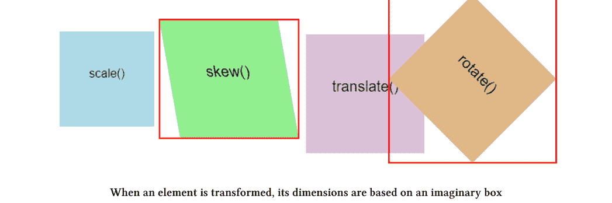
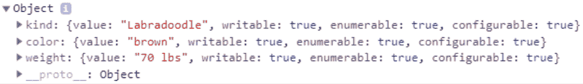
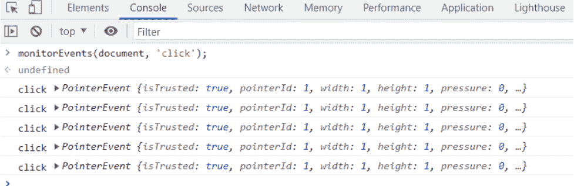
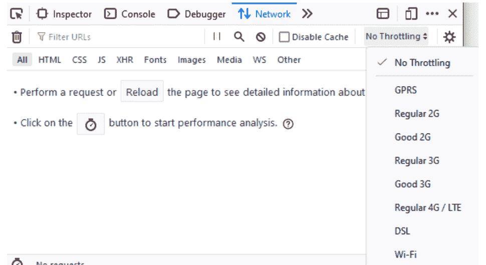
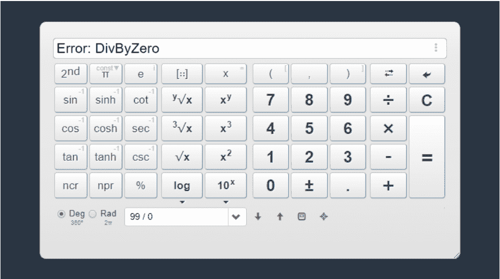
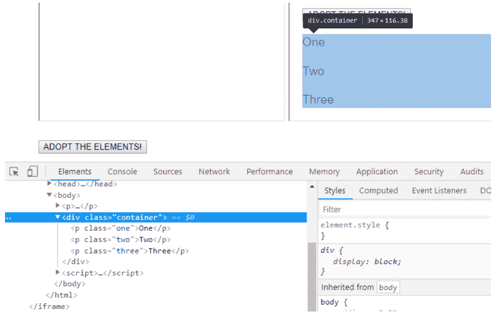

# JavaScript 与 DOM 技巧、妙招及技术（卷 4）

## 使用 `Array.sort()`

你可能知道，当 `Array.prototype.sort()` 与可选的第二个参数 `compareFunction` 一起使用时，它会变得更加强大和实用。这允许你定义排序顺序，对数字排序特别有帮助。

正如 MDN 所解释的[^1]，如果没有第二个参数：

> 数组会根据每个元素的字符串转换形式，按照每个字符的 Unicode 码点值进行排序。

为了演示这个自 ECMAScript 第一版就存在的方法的奇怪之处，我将对以下数组进行排序，其中包含一些不太典型的值：

```
let myArray = ['one', 'two', 'apple', 'mango', '', true, false, 'null', Infinity, NaN, null, 0, undefined, 6, 100, undefined, -3];
```

这里不太典型的例子包括：

- 布尔值
- `null`
- `Infinity`
- 多个 `undefined` 槽位
- 正整数和负整数

如前所述，如果没有第二个参数，所有值将在转换为字符串后进行排序。以下是对该数组调用 `sort()` 的结果：

```
console.log(myArray.sort());
// ["", -3, 0, 100, 6, Infinity, NaN, "apple", false, "mango", "null", null, "one", true, "two", undefined, undefined]
```

在 CodePen 上试试[^2]

需要注意的事项：

- 空字符串被排在最前面
- 数字排在后面，但它们不是按数值排序的，而是按字典顺序排序的
- `Infinity` 和 `NaN` 都排在 "apple" 之前，因为以大写字母开头的字符串会出现在任何以小写字母开头的字符串之前
- 字符串 "null" 排在 `null` 之前
- `true` 和 `false` 被视为小写字符串
- 所有 `undefined` 槽位都被排在最后

再次强调，使用 `Array.sort()` 的最佳方式是配合 `compareFunction` 参数，但如果你选择不使用 `compareFunction`，了解这些特性会很有帮助。

[^1]: https://developer.mozilla.org/en-US/docs/Web/JavaScript/Reference/Global_Objects/Array/sort
[^2]: https://codepen.io/impressivewebs/pen/KJpMOz?editors=0011

## `<label>` 元素上的点击事件

以下是一些你可能没有意识到的有趣现象：当 `<label>` 元素被点击时，`click` 事件不仅会在 `<label>` 元素上触发，还会在关联的表单控件上触发。

例如，我有以下 HTML：

```
<form>
  <label for="name">Name:</label>
  <input id="name">
</form>
```

name 字段通过 `for` 属性与 label 关联。这是使表单更易访问和更易用的常见做法。因此，当用户点击 label 时，name 字段将自动获得焦点。

在此基础上，我将设置两个独立的 `click` 处理程序。一个在 label 上触发 `click` 事件时在控制台显示消息，另一个在 input（name 字段）上触发 `click` 事件时在控制台显示消息。

这里有一个 CodePen 演示，你可以尝试一下[^3]

注意，当你点击 label 时，控制台会显示两条消息。一条是 label 的点击消息，另一条是 input 的点击消息（即使从技术上讲 input 并没有被点击）。在移动设备上点击也是如此。

另一方面，如果你直接点击（或轻触）input，你只会得到 input 的点击消息，而不会有 label 的。如果我将 `click` 事件改为 `focus` 事件，那么行为会更符合预期，每次聚焦只会产生一条消息。

我推测这样做的目的是为了帮助无障碍 API 以及它们如何与表单元素配合使用。无论如何，如果你注意到表单控件上意外触发了 `click` 事件，请记住这一点。

MDN 关于 label 的文章[^4]在使用说明中解释了这一点。感谢 Manuel Bieh 的这条推文[^5]指出了这一点。

[^3]: https://codepen.io/impressivewebs/pen/BMmvoY?editors=0011
[^4]: https://developer.mozilla.org/en-US/docs/Web/HTML/Element/label
[^5]: https://twitter.com/ManuelBieh/status/1143544730866896902

## 不同元素上的 `change` 事件与 `input` 事件

你很可能知道 `change` 事件与 `input` 事件是不同的。首先，`change` 事件存在的时间要长得多，至少从 DOM 2 规范就有了，而 `input` 是后来在 HTML5 DOM 规范中添加的。

它们在功能上的一个主要区别是，`change` 事件通常只在表单元素上触发，而 `input` 既可以在表单元素上工作，也可以在 `contenteditable` 属性设置为 `true` 的元素上工作。`input` 事件也会在使用 `document.designMode = 'on'` 编辑的元素上触发。

我设置了一个 [CodePen 演示](https://codepen.io/impressivewebs/pen/BMmvoY?editors=0011)，其中包含页面上的各种元素。每当元素被更改且 `input` 事件触发时，该演示会在控制台中打印一条消息。尝试在各个表单字段中输入一些文本，或调整复选框或单选按钮。你还可以编辑页面上的 `<div>` 和一个 iframe（其中没有源，但这没关系，你仍然可以编辑其子文档）。

这里还有另一个 [CodePen 演示](https://codepen.io/impressivewebs/pen/VgrgPB?editors=1001)，包含相同的元素，但这次查找的是 `change` 事件。

注意两个关键区别：

- 如前所述，`contenteditable` 和 `designMode` 元素不会触发 `change` 事件，但两者都会触发 `input`
- `change` 事件仅在元素内容被提交后触发。对于复选框和单选按钮，它与 `input` 事件相同，但文本字段元素在你将焦点移开字段之前不会触发 `change` 事件。
- 如果你想测试 iframe 示例并嵌入真实页面，[这里有一个简单的例子](https://www.impressivewebs.com/demo-files/iframe-designmode/)（打开控制台查看事件消息）。

如果你正在考虑使用这两种事件之一，需要注意这些细微的差别。

## ES6 Map 中的键

你们中的许多人可能已经了解并使用了 ES6 的 Map 功能，它类似于 Set。通过这个功能，你可以使用 `map.clear()`、`map.delete()`、`map.set()`、`map.get()` 等方法。

关于 ES6 Map 使其优于旧的对象字面量作为 map 技术的一点是，使用对象字面量作为键时总是会被强制转换为字符串，而 Map 允许你使用任何值，包括函数、对象或任何原始类型。你甚至可以使用 DOM 对象作为键。

以下是一些示例代码，在 ES6 Map 中使用三个不同的对象作为键：

```
let myMap = new Map(),
    myFunc = function () {
      return true;
    },
    myArray = [1, 2, 3];

myMap.set(myFunc, 'This is the function value.');
myMap.set(document, 'This is the document value.');
myMap.set(myArray, 'This is the array value.');

console.log( myMap.get(myFunc) );
console.log( myMap.get(document) );
console.log( myMap.get(myArray) );
```

[在 CodePen 上试试](https://codepen.io/impressivewebs/pen/PVBKqL?editors=0011)

如你所见，`myMap` 对象的键包括一个函数、一个数组，甚至 `document` 对象。

我不完全确定这样做是否实用或有用。我推测这里的想法是，你并不是在更改 `document` 对象（或函数或数组）的值，而只是将某个值与该特定对象关联起来，以便日后可以引用该值。

无论如何，你可以看到 Map 与旧的使用对象字面量模拟 map 的方法相比，功能更加强大和灵活。

## `window.scrollTo()`

长期以来，自定义窗口和元素滚动都是使用 jQuery 等库来完成的，有时还会配合插件。如今，有多种方法可以使用原生 DOM 技术和 CSS 实现平滑滚动。DOM/JavaScript 技术（我将在这里讨论）使用 `scrollTo()` 方法。

通常，你会看到 `scrollTo()` 类似于这样：

```
window.scrollTo(0, 2000);
```

这行代码告诉浏览器将页面从视口顶部向下滚动 2000 像素。你必须提供两个参数才能使其工作：一个是水平轴，第二个是垂直轴（更常用的）。

但关于 `scrollTo()` 方法还有一些其他细节需要注意。

首先，`scrollTo()` 不仅可以在 window 上调用，也可以在元素上调用。因此，如果指定的元素（如 `<div>`）可以通过 `overflow: auto` 和一些溢出内容的组合来滚动，那么 `scrollTo()` 同样适用于该元素。

另一个需要注意的是，传入 `scrollTo()` 的参数也可以表示为一个具有三个可选属性的 `scrollToOptions` 对象。以下是一个示例：

```
window.scrollTo({ left: 0, top: 2500, behavior: 'smooth' });
```

如你所见，`scrollToOptions` 可以指定从左边和从顶部的滚动量（与我之前所做的相同），以及一个 `behavior` 值。该行为指示我是要平滑滚动（如动画滚动）还是突然滚动（这是默认值，类似于在 HTML 中使用页内目标链接的效果）。

[这个 CodePen 演示](https://codepen.io/impressivewebs/pen/pGYXgj?editors=0010)使用 `scrollToOptions` 对象进行用户自定义滚动。在演示顶部的框中输入一个数字，并使用 `<select>` 元素选择你想要的滚动方式为 'smooth' 或 'auto'。

最后需要注意的是，`scrollToOptions` 对象对三个不同的滚动相关方法都有效：`scroll()`、`scrollBy()` 和 `scrollTo()`。这三个方法都可以在 `window` 或元素上调用。

## `addEventListener()` 的第三个参数

当你看到 `addEventListener()` 方法时，经常会发现它带有一个设置为 `false` 的最终布尔参数，如下所示：

```
btn.addEventListener('click', function () {
  // do something
}, false);
```

该参数定义了你是想使用事件冒泡还是事件捕获，这在本系列书籍的先前提示中讨论过。

然而，近年来，规范中第三个参数已演变成为一个选项对象，最多可接受三个属性/值对，包括 `capture`、`once` 和 `passive`。

因此，现在 `addEventListener()` 的调用可以像这样：

```
btn.addEventListener('click', function () {
  // do something
}, {
  capture: false,
  once: true,
  passive: false
});
```

以下是每个属性的含义：

- `capture` - 与之前相同；布尔值，指示是否使用冒泡或捕获。
- `once` - 布尔值，指示你是否希望事件监听器仅调用一次然后被移除。
- `passive` - 布尔值，指示该函数永远不会调用 `preventDefault()`，即使它包含在内。

[这里有一个 CodePen 演示](https://codepen.io/impressivewebs/pen/GeJZYz?editors=0010)，它在按钮点击上使用了 `once` 属性。注意按钮应该在页面上某个元素追加一些文本。这只发生一次，然后事件监听器被移除，后续点击无效。如果你将 `once` 值改为 `false`，每次点击按钮时文本都会重新追加。

这样做的主要问题是，尽管浏览器支持非常好，但在不支持的浏览器中却无法优雅降级。[MDN 的文章](https://developer.mozilla.org/en-US/docs/Web/API/EventTarget/addEventListener#Safely_detecting_option_support)讨论了一些特性检测和代码分支的技术，并且[这里有一个 polyfill](http://webreflection.github.io/dom4/)。但如果你只需要支持现代浏览器，那么直接使用应该没问题。

## 清除 JavaScript 定时器

如果你曾使用 `setInterval()` 或 `setTimeout()` 创建与定时相关的功能，那么你可能知道要清除定时器，可以使用 `clearInterval()` 或 `clearTimeout()` 方法，通过传入 ID 来识别要清除的那个。

例如：

```
let ID = window.setInterval(callback, 1000);

function callback() {
  // do something here...
  if (something) {
    window.clearInterval(ID);
  }
}
```

注意在使用 `setInterval()` 启动定时器后，我使用 `clearInterval()` 来停止它。我可以对 `setTimeout()` 和 `clearTimeout()` 做同样的事情。但规范这样说：

> "由于 `clearTimeout()` 和 `clearInterval()` 从同一个列表中清除条目，因此任一方法都可以用于清除由 `setTimeout()` 或 `setInterval()` 创建的定时器。"

因此，你可以用 `setTimeout()` 启动定时器，然后用 `clearInterval()` 结束它，它仍然会识别该 ID，因为正如规范所说，两个清除方法都是从同一个 ID 池中清除条目。

[这里有一个 CodePen 演示](https://codepen.io/impressivewebs/pen/EMZxVr?editors=0010)[^14]，展示了这一点。`setInterval()` 定时器在页面加载时启动（导致文本闪烁），而按钮（触发 `clearTimeout()` 调用）会停止 `setInterval()` 定时器。

MDN 在解释了它们可以这样互换使用之后，[明智地建议](https://developer.mozilla.org/en-US/docs/Web/API/WindowOrWorkerGlobalScope/clearInterval)[^15]：

> "……为了清晰起见，你应该避免这样做。"

同意！但我想了解一下还是好的，以防你遇到这样做的代码，而你一开始想不明白这就是问题所在。

[^14]: https://codepen.io/impressivewebs/pen/EMZxVr?editors=0010
[^15]: https://developer.mozilla.org/en-US/docs/Web/API/WindowOrWorkerGlobalScope/clearInterval

## `Node.isConnected`

Node 接口还有另一个有些冷门的属性，在特定情况下你可能会觉得有用：`Node.isConnected`。这是一个只读属性，返回一个布尔值，指示指定节点是否连接到上下文对象。

在大多数（如果不是全部？）情况下，常规 DOM 示例中的上下文对象将是 Document，如果处理的是 shadow DOM，则为 `ShadowRoot`。

一个简单的标准 DOM 示例是，元素已创建但尚未插入到文档中：

```
let myNode = document.createElement('div');

console.log(myNode.isConnected); // false

document.body.appendChild(myNode);

console.log(myNode.isConnected); // true
```

[在 CodePen 上试试](https://codepen.io/impressivewebs/pen/xBaaMo?editors=0011)

正如你所见，你不必传入上下文对象；上下文对象是隐含的。在这个例子中，它是 Document 对象，因为我在标准 DOM 中。如果我创建一个要插入到 shadow root 中的元素，我会有相同的结果（即，在追加节点之前，`isConnected` 属性会返回 `false`）。

## 获取元素尺寸的不同方法

如你所知，使用 JavaScript 有多种不同的方法来获取网页上元素的宽度和高度，但了解每种技术有何不同是很有用的。

我在 CodePen 上设置了一个[交互式演示](https://codepen.io/impressivewebs/pen/WWjNva?editors=0010)，使用五种不同的 DOM API 技术显示目标框的尺寸。点击按钮以显示五组不同的尺寸。

以下是正在发生的事的快速概要：

- 框的宽度和高度在 CSS 中使用分数值定义，并且框的 `box-sizing` 设置为 border-box。
- 第一组值使用 `getBoundingClientRect()`，它返回元素的实际宽度和高度，精确到多位小数。使用 `getClientRects()` 会得到相同的结果。
- 第二组值使用 `offsetWidth` 和 `offsetHeight`。如你所见，这些值被转换（而非四舍五入）为整数。
- 第三组使用 `getComputedStyle()`，它返回更合理的分数值。
- 第四组使用 CSSOM 的 `document.styleSheets` 接口从样式表中获取实际值。
- 最后一组并非真正获取尺寸，而是读取可滚动区域，这在测量滚动或隐藏溢出的元素时很有用。

还要记住，如果由于页面上的其他脚本或视口宽度变化而改变了元素的尺寸，那么其中一些值会有所不同，而另一些则保持不变（例如，CSSOM 方法将始终返回 CSS 中确切的内容）。

这些方法各有其用例，它们都很有用。但最有可能的是，`getBoundingClientRect()` 或 `getComputedStyle()` 方法会是你使用最多的，尤其是因为它们最为精确。

https://codepen.io/impressivewebs/pen/WWjNva?editors=0010

## 高效的事件委托

《JavaScript 忍者秘籍》¹ 一书有一个不错的提示，涉及事件委托和 `event.target` 属性。

假设我有一组元素，我想为它们都附加相同的事件。我可以使用循环来完成，像这样：

```
let cells = document.querySelectorAll('td');

for (i of cells) {
  i.addEventListener('click', function () {
    // do something...
  }, false);
}
```

这段代码不算太糟，但你可以想象如果有几十甚至上百个表格单元格，它的效率会多么低下。

相反，向父级 table 元素附加单个事件，然后使用 `event.target` 属性来确定是否点击了单元格并相应地响应，这样做要好得多。以下是改进后的代码：

```
let table = document.querySelector('table');

table.addEventListener('click', function (e) {
  if (e.target.tagName.toLowerCase() === 'td') {
    // do something...
  }
}, false);
```

默认情况下，单元格上的点击事件会冒泡到父元素（事件附加的位置）。这将检测到最初的点击。使用 `event.target` 可以让我确定事件实际上发生在哪个元素上，然后才冒泡到父元素。

这个 [CodePen 演示](https://codepen.io/impressivewebs/pen/axqdEP?editors=0010)² 展示了这是如何工作的。JavaScript 面板在代码注释中有低效的版本，但实时代码使用了将点击事件委托给 table 元素的版本。

¹https://amzn.to/2JqYwea
²https://codepen.io/impressivewebs/pen/axqdEP?editors=0010

## 鼠标滚轮事件

除了常见的基于鼠标的事件（如 `click`），你还可以使用 JavaScript 来检测用户是否滚动了鼠标滚轮。这基于一个相对较新的规范，称为 [Wheel Events](https://www.w3.org/TR/uievents/#events-wheelevents)。

因此，你可能会有类似这样的代码：

```
document.addEventListener('wheel', function (e) {
  console.log(e.deltaY);
}
```

这里我监听了一个 `wheel` 事件，然后打印出一条消息。信息从事件对象中获取，这里简写为 'e'。上面的代码展示了其中一个暴露的属性。可用的属性有：

- `deltaY` - 垂直滚动量
- `deltaX` - 水平滚动量（例如用于横向滚动的页面）
- `deltaZ` - z 轴上的滚动量
- `deltaMode` - 滚动量的单位

到目前为止，经过测试，我发现从大多数属性中获取任何可用的值都相当困难。[这里有一个 CodePen 演示](https://codepen.io/impressivewebs/pen/XwwNqb?editors=0010)，你可以亲自尝试。滚动鼠标滚轮或按住 `SHIFT` 键同时滚动（用于水平滚动）来查看页面上的结果。以下是我的一些观察：

- 滚动量几乎总是相同的，具体取决于浏览器。例如，Chrome 似乎是 100px，而 Firefox 奇怪地每次滚动只滚动 3px。非常奇怪。
- MS Edge 以 105.5999984741211px 的精确增量进行滚动，这让我只能说"好吧，好吧"。
- `deltaMode` 属性在 Chrome 和 Edge 中返回 `0`，但在 Firefox 中返回 `1`。关于这些值的含义，请参阅 [MDN 的文章](https://developer.mozilla.org/en-US/docs/Web/API/WheelEvent/deltaMode)。
- 移动设备不识别 `wheel` 事件。
- 读取 `deltaX` 属性来获取水平滚动似乎不起作用（我每次都得到 `0` 的值）。

我不知道这些结果是否与我的操作系统和使用的鼠标类型有关，所以这可能是一个因素。但我猜你们大多数人会有类似的结果。如果你看到不同的情况，请随时告诉我。

根据我的发现，用这个你唯一能做的真正可靠的事情就是检查滚轮是向上还是向下滚动了。除此之外，各种怪异行为似乎太多了。

有关此接口的更多信息，请参阅 [MDN 的主页](https://developer.mozilla.org/en-US/docs/Web/API/WheelEvent) 或上面链接的规范页面。

## DOM 元素尺寸和 CSS 变换

在之前的技巧中，我简要讨论了许多（如果不是全部的话？）通过 JavaScript 获取 DOM 元素尺寸的不同方法。

包括：

- 使用 `getBoundingClientRect()` 的 `width` 和 `height` 属性
- 使用 `offsetWidth` 和 `offsetHeight`
- 使用 `window.getComputedStyle()`
- 使用 `document.styleSheets` 对象
- 使用 `scrollWidth` 和 `scrollHeight`

正如你可能知道的，这些特性的工作方式并不相同，因此它们给出的结果并不完全一致。你可以通过查看以下演示来了解 `width` 和 `height` 值的差异：

[通过 DOM 脚本获取元素尺寸的不同方法](https://codepen.io/impressivewebs/pen/WWjNvz)²⁴

注意值之间的差异。盒子在 CSS 中定义的原始尺寸是 205.3px x 198.8px。我特意选择了小数值，并将 `box-sizing` 设置为 `border-box`。唯一获取原始尺寸的 DOM 技术是（当然）直接访问样式表的那个（`document.styleSheets`），这是 [CSS 对象模型](https://css-tricks.com/an-introduction-and-guide-to-the-css-object-model-cssom/)²⁵ 的一个特性，这是合情合理的。其他值要么精确得多，要么不够精确。你可以随意调整 CSS 来看看结果有什么不同。

然而，在研究这个问题时，我注意到 [MDN 上的一篇文章](https://developer.mozilla.org/en-US/docs/Web/API/CSS_Object_Model/Determining_the_dimensions_of_elements)²⁶ 中有以下说明：

> 在存在变换的情况下，`offsetWidth` 和 `offsetHeight` 返回元素的布局宽度和高度，而 `getBoundingClientRect()` 返回渲染宽度和高度。

这非常有趣！让我们来测试一下。在下面的演示中，我包含了四个不同的盒子，每个盒子都应用了 CSS 变换（缩放、倾斜、平移和旋转）。

页面上有两个按钮，一个通过 `getBoundingClientRect()` 显示四个盒子的尺寸，另一个通过 `offsetWidth` 和 `offsetHeight` 获取尺寸。

### 有变换的元素与无变换的元素的尺寸²⁷

如你所见，使用 `offsetWidth` 和 `offsetHeight` 时值是相同的（原始尺寸）。但使用 `getBoundingClientRect()` 时，我们得到的是应用变换后实际渲染在页面上的尺寸。而且你可能注意到了，平移变换不影响尺寸，因为平移只是移动元素，不影响其形状。

如果你好奇非矩形形状的尺寸是如何确定的，计算是基于一个假想的框，该框根据元素在变换状态下所达到的最远位置创建。以下图形演示了这一点：



**当元素发生变换时，其尺寸基于一个假想的框**

如果你好奇的话，使用 3D 变换时也适用相同的基本原理，如以下演示所示：

应用 3D 变换的元素的尺寸²⁸

同样，通过 `getBoundingClientRect()` 获取的变换后元素的尺寸（原始尺寸为 200 x 200）是不同的。

这是你在获取 DOM 中可能受 CSS 变换影响的元素的宽度和高度值时需要注意的。

²⁷ https://codepen.io/impressivewebs/pen/BgNWMq
²⁸ https://codepen.io/impressivewebs/pen/dBoePG

## 在全局作用域中使用 `const`

有时候，一个看似基础的编程问题可能会难倒很多开发者。本周的一个例子就是 Wes Bos 发布了一个非常直接的 JavaScript 测验题，我答错了，而且超过一半的回答者也答错了。他问的是：

这段代码输出什么？

```
const a = 1;
let b = 2;
var c = 3;

console.log(window.a, window.b, window.c);
```

可能的答案：

A) 1, 2, 3 B) undefined, 2, 3 C) undefined, undefined, 3 D) undefined, undefined, undefined

在继续阅读之前，先选好你的答案。Wes 的推文链接在下方。投票已经结束，所以如果你查看的话会看到结果，包括正确答案——但你就无法猜了。

正如我们许多人已经了解到的，`let` 和 `const` 变量与 `var` 不同，它们创建的是块级变量。所以很自然地，我的答案是"A"（1, 2, 3），因为没有外部块来阻止这些 `let` 和 `const` 声明本质上成为"全局的"。但它们在顶层作用域中声明时，行为仍然与 `var` 不同——这似乎很合理。但这确实是我从未真正考虑过的事情。

在阅读了 Twitter 帖子中的各种评论并深入研究后，以下是 [MDN 关于 const 的说明](https://developer.mozilla.org/en-US/docs/Web/JavaScript/Reference/Statements/const)：

> "此声明创建一个常量，其作用域可以是全局的，也可以是声明它的块的局部作用域。全局常量不会成为 window 对象的属性，这与 var 变量不同。"

关于 [let](https://developer.mozilla.org/en-US/docs/Web/JavaScript/Reference/Statements/let)：

> "在程序和函数的顶层，let 与 var 不同，不会在全局对象上创建属性。"

[29] https://developer.mozilla.org/en-US/docs/Web/JavaScript/Reference/Statements/const
[30] https://developer.mozilla.org/en-US/docs/Web/JavaScript/Reference/Statements/let

因此，从技术上讲，顶层 `let` 和 `const` 声明仍然是全局的，只是不附加到 `window` 上。我不太确定为什么这是必要的，但我的猜测是变量本来就不应该成为 `window` 的属性，所以这是在修正这个缺陷。

[这里是 Twitter 投票](https://twitter.com/wesbos/status/1143544730866896902)，[这里是一个 CodePen](https://codepen.io/impressivewebs/pen/WqZVmZ?editors=0011) 展示了相关代码。

³¹ https://twitter.com/wesbos/status/1143544730866896902
³² https://codepen.io/impressivewebs/pen/WqZVmZ?editors=0011

## `Array.fill()`

自 ES6 起新增、除 IE11 外所有浏览器均支持的 `Array.fill()` 方法允许你用新的指定值填充数组（或替换现有值）。

例如，如果你有一个包含五个元素的现有数组，你可以用相同的值填充所有位置：

```
let myArray = ['one', 'two', 'three', 'four', 'five'];
myArray.fill('Peach');

console.log(myArray);
// ["Peach", "Peach", "Peach", "Peach", "Peach"]
```

传入单个参数会将所有值替换为该参数的值（该参数也可以是一个求值为某个结果的表达式）。

你还可以提供第二个参数，指定从哪个索引开始插入给定值，它会从该索引起填充所有元素：

```
myArray.fill(7, 2);

console.log(myArray);
// ["Peach", "Peach", 7, 7, 7]
```

如果你使用第三个参数，可以指定用给定值填充数组的范围，从起始值开始，到结束值为止（不包括结束值）：

```
myArray.fill('Onion', 2, 4);

console.log(myArray);
// ["Peach", "Peach", "Onion", "Onion", 7]
```

最后，你可以对起始或结束参数使用负值：

```
myArray.fill('Apple', -4, -2);

console.log(myArray);
// ["Peach", "Apple", "Apple", "Onion", 7]
```

负值基本上是从数组末尾开始计算的，但不包含零索引。

当你需要填充一个数组、使其必须符合指定长度或大小时，这是一个非常有用的方法。[这里有一个 CodePen 演示](https://codepen.io/impressivewebs/pen/XLBWgY?editors=0011)，包含了上述所有示例。

## 数组方法的返回值

JavaScript 中最常用的数组方法可能是 `push()`、`pop()`、`shift()` 和 `unshift()`。这些方法允许你向数组中添加和移除元素。

但你可能忽略的是，这些方法的返回值可能并不完全符合你的预期。下面回顾一下这些方法各自的返回值：

- `Array.push()` 将一个元素添加到数组末尾，因此返回值不是被添加的元素，而是数组的新长度。
- `Array.unshift()` 将一个元素添加到数组开头，返回的同样是数组的新长度。
- `Array.pop()` 从数组末尾移除一个元素，但它返回的不是新长度，而是被移除的元素。
- `Array.shift()` 从数组开头移除一个元素，正如你猜到的，返回被移除的元素。

以下是一些带有注释的代码（假设注释行是被打印输出的）：

```
let myArray = ['blue', 'green', 'orange', 'brown', 'pink'];

myArray.length; // 5
myArray.push('purple'); // 6
myArray.unshift('black'); // 7

myArray.pop(); // "purple"
myArray.shift(); // "black"
myArray.length; // 5
```

[在 CodePen 上查看](https://codepen.io/impressivewebs/pen/VobdwN?editors=0011)

乍一看，记住哪些方法返回长度、哪些返回元素可能有点令人困惑。但你可以这样理解：如果元素从数组中消失了，代码会允许你保留它以供其他用途；否则，返回的就是长度。

如果你使用这些数组方法（它们通常成对出现——push/pop 和 shift/unshift），这一点值得注意（这也在一定程度上增加了对返回值的困惑）。

## JavaScript Thunk

最近我遇到一种以前从未见过的 JavaScript 模式，乍一看我肯定会认为它是一个语法错误。这种模式与所谓的立即调用函数表达式（IIFE）非常相似。

如果你还记得，IIFE 是这样的：

```
(function () {
  // 在这里做一些事情...
})();
```

代码的关键部分是两组括号紧挨着出现。一组包裹函数，另一组跟在后面以立即调用它。

但这次我看到了一种被 [Dave Ceddia](https://daveceddia.com/what-is-a-thunk/) 称为 "thunk"（一个编程术语）的模式。Dave 用它来指代以下模式：

```
function outerFunction() {
  return function thunk() {
    console.log('Inner function has returned.');
  };
}

outerFunction()();
```

[在 CodePen 上试试](https://codepen.io/impressivewebs/pen/mdbmLrj?editors=0011)

正如 Dave 所解释的，"thunk" 是由外部函数返回的函数。最后一行执行外部函数时，由于双括号的存在，也同时执行了内部函数。

从技术角度来看，我不完全确定这做了什么，但我猜测额外的那对括号的作用与 IIFE 相同：内部函数被立即调用，这（据我所知）是正确返回它的唯一方式。

显然，这种模式有一些实际的应用场景，例如 [这个 Stack Overflow 帖子](https://stackoverflow.com/questions/18234491/two-sets-of-parentheses-after-function-call) 以及上面提到的 Dave 的文章中讨论的内容。

## `Array.includes()`

ECMAScript 丰富多样的数组方法中，另一个有用的方法是 `Array.includes()`。如果在数组中找到给定值，该方法返回 true，否则返回 false。

例如，我使用以下数组：

```
let myArray = ['one', 2, '3', 'four', 5, NaN];
```

以下是使用单个正数参数的方式：

```
console.log(myArray.includes('one')); // true
console.log(myArray.includes('2')); // false
console.log(myArray.includes(2)); // true
console.log(myArray.includes('3')); // true
```

注意数据类型会被严格区分，不会进行强制转换。

我还可以使用第二个参数，它会从数组的指定索引开始搜索给定值：

```
console.log(myArray.includes('four', 4)); // false
console.log(myArray.includes('four', 3)); // true
```

整数值可以为负数，它告诉 JavaScript 引擎从 `array.length+整数` 的位置开始搜索给定值：

```
console.log(myArray.includes('one', -2)); // false
console.log(myArray.includes('four', -4)); // true
```

最后，你会注意到数组中包含一个 NaN 值。由于 JavaScript 中 `NaN !== NaN`，如果我使用 `Array.indexOf()` 来查找 `NaN`，搜索会失败。但 `Array.includes()` 可以找到数组中的 `NaN`：

```
console.log(myArray.indexOf(NaN)); // -1
console.log(myArray.includes(NaN)); // true
```

[这里有一个 CodePen](https://codepen.io/impressivewebs/pen/YzKLNdK?editors=0011)，使用了上述所有代码示例。

此功能在 ES7 中被添加到 ECMAScript 中，但拥有广泛的浏览器支持。它在所有桌面和移动设备上的现代浏览器中都受支持，唯一不支持的浏览器是 IE11。

## JavaScript 中的 `elseif`

你是否在 JavaScript 中使用过 else if 结构？例如：

```
let myNum = 30;

if (myNum < 10) {
  console.log('Number is Less than 10');
} else if (myNum > 25) {
  console.log('Number is greater than 25');
}
```

以上代码完全有效。如果你用 JSLint 或 JSHint 等代码检查工具运行它，不会收到任何与 else if 子句相关的警告或错误。但是，从严格的技术角度来看，JavaScript 中并不存在 else if（或 elseif）。

我上面写的内容等同于以下代码：

```
let myNum = 30;

if (myNum < 10) {
  console.log('Number is Less than 10');
} else {
  if (myNum > 25) {
    console.log('Number is greater than 25');
  }
}
```

在 CodePen 上试试

正如你可能知道的，JavaScript 中组成代码块的花括号并非总是必需的。因此你经常会看到开发者为了简洁而省略它们。所以从技术上讲，当你使用 else if 时，你所做的只是省略了 else 代码块外的可选花括号（而该代码块在这种情况下恰好也以 if 语句开头）。如果 JavaScript 真的有 else if，它应该像其他语言一样是一个单词——elseif。

但这一切的讽刺之处在于，上面第二个示例的代码风格真的很糟糕，最好还是像第一个示例那样使用 else if。或者更好的做法是，完全抛弃这种不美观的 if 语句，改用 switch 语句或方法查找表（也称为分发表）。

## `Object.preventExtensions()`

最近我偶然发现了 `Object.preventExtensions()` 这个方法，它用起来非常直接。这个方法可以阻止你向对象添加新的属性。例如：

```
'use strict';

let myObj = {
  one: 1,
  two: 2
};

console.log(myObj.one); // 1
console.log(myObj.two); // 2

Object.preventExtensions(myObj);

try {
  myObj.three = 3;
} catch (e) {
  console.log(e.message);
  // "Cannot add property three, object is not extensible"
}

console.log(myObj.three); // undefined
```

[在 CodePen⁴⁰ 上试试](https://codepen.io/impressivewebs/pen/YzPPvWq?editors=0011)

如你所见，向对象添加前两个属性没有问题。但在对该对象调用 `Object.preventExtensions()` 之后，我尝试添加的下一个属性就失败了。

在严格模式下（如上所示），浏览器会抛出 catch 块中显示的错误。我使用 try/catch 结构来记录消息，以便它能在 CodePen 的控制台中显示，而不会中断代码执行。在非严格模式下，尝试添加属性会静默地失败。

关于这个方法需要注意几点：

- 与使用 `Object.freeze()` 不同，你仍然可以删除属性。
- 这可以阻止添加自有属性，但你仍然可以向对象的原型添加内容（请参见上方演示代码的最后一部分）。

更多关于此方法的内容，请参阅 [MDN 的文章⁴¹](https://developer.mozilla.org/en-US/docs/Web/JavaScript/Reference/Global_Objects/Object/preventExtensions)。

## 在数字上调用方法

信不信由你，以下三行 JavaScript 代码没有语法错误，但会返回每行旁边注释中显示的结果。

## 带有多个类名的 `classList`

你可能熟悉 `classList.add()` 和 `classList.remove()` 方法，它们允许你轻松操作任何 HTML 元素的类名。你很可能只用这些方法处理单个类名，但如果你不知道，你可以使用以下语法在单行中添加或移除多个类名：

```
element.classList.add('one', 'two', 'three');
element.classList.remove('one', 'two', 'three');
```

你只需记住，每个类名都是一个单独的字符串值（因此需要引号），多个字符串用逗号分隔，类似于数组。所以你不能这样做：`add('one, two, three')`。

[这里有一个 CodePen 演示](https://codepen.io/impressivewebs/pen/MWYqdzQ?editors=0010)，页面上有两个按钮。这些按钮会移除或添加三个类名，这些类名用于为主要内容元素添加样式。

如果你们中有些人不知道这些方法可以接受多个类名，可能是因为许多开发者由于 Internet Explorer 不支持此功能而避免使用它（我知道这很令人震惊）。所以，只要你不关心 Edge 之前的 Microsoft 浏览器，你几乎可以在任何项目中放心地使用它们。

## `globalThis`

不久前，我听到 ECMAScript 正在考虑添加一个 `globalThis` 属性，以解决不同 JavaScript 环境中 `this` 关键字的许多问题。如果你错过了这个消息（我似乎也错过了！），`globalThis` 现在已成为标准，并且已经被添加到大多数当前浏览器中。主要缺乏支持的是 Opera 和 Edge。

从历史上看，开发者经常需要在他们的 JavaScript 程序中获取全局对象的引用。问题在于，无论全局对象是什么，都没有通用的方法来访问它。以下是在 `globalThis` 之前尝试执行此操作时遇到的问题总结：

- 在浏览器中，你可以使用 `window` 访问全局对象。
- 你也可以使用较少人知的 `window.self` 或 `window.frames` 访问同一个对象。
- 在 Web Workers 环境中，你只能使用 `self` 属性来获取全局对象的引用。
- 在 Node.js 环境中，你会使用 `global`。
- 在严格和非严格模式下，`this` 关键字通常引用全局对象。
- 在函数内部的非严格模式下，`this` 关键字仍然引用全局对象；但在严格模式下，`this` 是 undefined。
- 在模块内部，`this` 关键字也是 undefined。

你可以看到，在尝试使用 `this` 作为全局对象时，这有多么成问题。`globalThis` 属性解决了所有这些不一致性，允许开发者使用单个一致的关键字来引用全局对象（无论它是什么，取决于上下文）。

以下是在浏览器中使用 `globalThis` 的几个示例：

```
// 引用新的 globalThis 对象
console.log(globalThis); // Window

// 在浏览器中与 Window.name 相同
console.log(globalThis.name);

// this 是 undefined，但 globalThis 是 window
function myFunc () {
  'use strict';
  console.log(this); // undefined
  console.log(globalThis); // Window
}

myFunc();
```

[在 CodePen 上试试]⁴⁵ (https://codepen.io/impressivewebs/pen/ZEGbZVq?editors=0011)

你可以在 [MDN 的文章]⁴⁶ (https://developer.mozilla.org/en-US/docs/Web/JavaScript/Reference/Global_Objects/globalThis) 上找到更多关于此主题的信息，该页面还链接到一个 ES6 垫片，如果你需要，可以帮助获得更好的浏览器支持。

⁴⁵ https://codepen.io/impressivewebs/pen/ZEGbZVq?editors=0011
⁴⁶ https://developer.mozilla.org/en-US/docs/Web/JavaScript/Reference/Global_Objects/globalThis

## 属性描述符

对于每个 JavaScript 对象，你都可以访问该对象的属性描述符。描述符存在于对象的每个属性中，本质上是一个记录，保存了值，以及属性是否可写、可枚举或可配置等信息。

这里有一个简单的示例，使用 `getOwnPropertyDescriptor()` 方法访问一个属性的描述符：

```
const myDog = {
  kind: 'Labradoodle',
  color: 'brown',
  weight: '70 lbs'
};

console.log(Object.getOwnPropertyDescriptor(myDog, 'kind'));

/* Object {
  configurable: true,
  enumerable: true,
  value: "Labradoodle",
  writable: true
} */
```

请注意，输出仅针对 kind 属性。你可以通过这种方式访问任何单个属性的描述符，或者你可以使用 `getOwnPropertyDescriptors()`（注意这次结尾有个"s"）获取所有属性的描述符。这将产生类似下面图像中显示的内容：



从对象获取属性描述符

请注意，在这种情况下，属性的描述符作为单独的对象嵌套在一个主要输出对象内部。

[这里有一个 CodePen](https://codepen.io/impressivewebs/pen/bGdWqXx?editors=0011) 展示了这两个方法的使用。控制台显示了结果。这只是对属性描述符的简要介绍，你可以在 [MDN](https://developer.mozilla.org/en-US/docs/Web/JavaScript/Reference/Global_Objects/Object/getOwnPropertyDescriptor) 上阅读更多相关信息。

## `history.scrollRestoration`

History API 的一个特性已经存在一段时间了，你可能没有听说过，那就是 `history.scrollRestoration` 属性。这个属性的功能正如其名所示：允许你恢复浏览器历史中先前访问页面的滚动位置，而不是跳回到之前的滚动位置。

这在动态应用中可能很有用，其中内容不断变化，可能不希望发生滚动跳转。

你可以获取或设置当前的 scrollRestoration 值：

```
console.log(history.scrollRestoration); // auto（默认值）
history.scrollRestoration = 'manual';
```

据我所知，这在 Chromium 浏览器中运行良好，但在 Firefox 中似乎不起作用，尽管 Firefox 显然支持此功能。

为了测试这一点，我创建了两个简单的演示页面：

- 使用默认值 auto⁴⁹（因此你可以看到正常情况下它是如何运行的）
- 使用 manual 值⁵⁰

在这两种情况下，你都需要执行相同的操作，如页面上所述，这样你才能看到区别：

- 滚动到第 86 项，点击链接
- 在随后的页面上，使用浏览器的后退按钮返回到上一页

在默认演示中，你应该看到页面回到了之前滚动的位置（在那里你可以看到第 86 项）。但在第二个演示中，我将 `history.scrollRestoration` 属性设置为 manual，你会注意到，一旦你使用后退按钮返回，滚动位置就会恢复到页面顶部。如前所述，Firefox 似乎不遵守通过后退按钮返回时的 manual 值。

也许我对这个属性的某些方面还不理解，但我已经向 Firefox 提交了错误报告⁵¹，以看看这是否是需要纠正的问题。这看起来是一个有用的小功能，但当不同主流浏览器行为不同时，它的吸引力就不那么大了。

⁴⁹ https://www.impressivewebs.com/demo-files/scroll-restoration-auto/
⁵⁰ https://www.impressivewebs.com/demo-files/scroll-restoration-manual/
⁵¹ https://bugzilla.mozilla.org/show_bug.cgi?id=1648398

## `Object.assign()`

如果你在 JavaScript 中有多个对象，并且希望将它们合并在一起，同时保留共同的内容，那么 `Object.assign()` 方法将会非常有用。

以下是三个用于演示的示例对象：

```
const obj1 = { a: 1, b: 2, c:3, d:4 };
const obj2 = { b: 5, c: 6, e:7, f:8 };
const obj3 = { f: 9, g: 10, h:11, i:12 };
```

对象的键/值对使用英文字母命名。但你会注意到字母之间存在一些重叠。如果我想在合并这些对象时，保留任何特定键的最新值，我可以使用 `Object.assign()`：

```
const newObj = Object.assign(obj1, obj2, obj3);

// 显示修改后的目标对象
console.log(obj1);

// 显示返回的内容（与目标相同）
console.log(newObj);
```

[在 CodePen 上尝试](https://codepen.io/impressivewebs/pen/gOPobXz?editors=0011)

如你所见，`Object.assign()` 使用起来相当简单。第一个参数是你希望接收所有键/值对总和的对象（即“目标”对象）。其余的参数（一个或多个）构成了你希望合并后赋给目标的对象。

使用 `Object.assign()` 时需要记住以下几点：

- 目标对象接收源对象的所有可枚举自有属性
- 较后的属性会覆盖前面的属性（正如示例代码中“b”被覆盖等情况所示）
- “顺序”由你将参数放入方法调用中的顺序决定。示例 CodePen 也展示了另一种赋值排列方式（即 obj1、obj3、obj2），这会提供略微不同的输出

[MDN 的文章](https://developer.mozilla.org/en-US/docs/Web/JavaScript/Reference/Global_Objects/Object/assign)有更多信息和一些更复杂的示例，但这就是 `Object.assign()` 的概要。

## 使用 File API

我肯定你听说过 File API，它得到了浏览器的完整支持。它使用简单，可以与拖放功能结合使用，也可以通过接受文件上传的表单输入来使用。例如，假设我有以下 input 元素：

```
<input type="file" multiple>
```

这允许用户选择一个或多个文件添加到页面中。文件添加后，File API 允许我访问这些文件以获取各种信息。例如：

```
myInput.addEventListener('change', function () {
  myFiles = myInput.files;
  console.log(myFiles[0].name);
  console.log(myFiles[0].size);
  console.log(myFiles[0].lastModified);
}, false);
```

这假设我的文件输入是通过 `myInput` 变量引用的。我正在监听 `change` 事件，该事件允许浏览器识别文件已被添加到输入中。然后我可以访问 `files` 对象中的每个文件，它是输入的一个属性。

我整理了一个稍微复杂一点的实时示例，它读取名称、大小和内容，并将修改日期转换为可读格式（它以 Unix 时间返回）。

当我读取内容时，我使用的是 `text()` 方法，它是 Blob 接口的一个方法，返回一个 Promise。所以我使用类似下面的方式来处理它：

```
myFiles[0].text().then((text) => {
  // 在这里对文本进行一些操作
});
```

[你可以在 CodePen 上查看完整的可运行版本](https://codepen.io/impressivewebs/pen/MWKPKRp?editors=0010)[^54]

目前，测试此演示的最简单方法是添加一个或多个文本文件。如果你添加其他类型的文件，它可能会导致浏览器崩溃，因为代码试图读取简单的文本。请注意，添加的每个文件的信息都会追加到页面中。

随意操作一下这个演示，但这就是 File API 的概要，应该足以让你开始使用它（如果你还没有用过的话）。

[^54]: https://codepen.io/impressivewebs/pen/MWKPKRp?editors=0010

## 新的字符串方法

以防你错过了，ES2017 和 ES2019 中添加了几个新的字符串方法，它们都有相当不错的浏览器支持。

当然，描述它们的最好方式是通过一些代码示例：

```
let myStringPS = 'apples',
    myStringPE = 'oranges',
    myStringTS = '    peaches    ',
    myStringTE = '    watermelons    ';

myStringPS = myStringPS.padStart(15, 'Z');
myStringPE = myStringPE.padEnd(15, 'Z');
myStringTS = myStringTS.trimStart();
myStringTE = myStringTE.trimEnd();

console.log(myStringPS); // "ZZZZZZZZZapples"
console.log(myStringPE); // "orangesZZZZZZZZZ"
console.log(myStringTS); // "peaches    "
console.log(myStringTE); // "    watermelons"
```

其中最直接的是 `trimStart()` 和 `trimEnd()` 方法。它们完全如字面意思：它们从给定字符串的开头或结尾移除任何空格。

另外两个方法，`padStart()` 和 `padEnd()` 则不那么清晰。乍一看，你可能认为传入的整数值（第一个参数）将添加第二个参数指定的字符数量。但事实并非如此。

该整数表示字符串在“填充”后期望的总字符数。这意味着如果你的字符串已经比指定的数字长，那么它不会添加任何内容。另外，如果你省略第二个值，填充方法将使用空格字符作为默认值：

```
let myStringPS2 = 'guacamole',
    myStringPE2 = 'garbanzo';

myStringPS2 = myStringPS2.padStart(6, 'Z');
myStringPE2 = myStringPE2.padEnd(15);

console.log(myStringPS2); // 没有添加任何内容
console.log(myStringPE2); // "garbanzo            "
```

如你所见，第一个示例希望使字符串长度为 6 个字符。但它已经比这更长了，所以没有添加任何字符，因此保持不变。第二个示例使用空格字符将字符串“填充”到长度为 15（因此向现有的 8 个字符添加了 7 个空格）。

[你可以在这个 CodePen 中尝试所有示例。](https://codepen.io/impressivewebs/pen/gOPNGvW?editors=0011)

浏览器支持方面唯一的主要缺陷是 Edge 使用了非标准的 `trimLeft()` 和 `trimRight()`（而不是 start/end），但如果你关心 Edge 支持，修复起来应该很简单。

> https://codepen.io/impressivewebs/pen/gOPNGvW?editors=0011

## `Array.entries()`

ES6 引入了对 `Array`、`Map` 和 `Object` 略显被忽视的 `.entries()` 方法。这个方法的概念对于这三者是相同的，但在这个介绍中，我将重点介绍它在数组中的用法。

正如 [MDN 上解释的](https://developer.mozilla.org/en-US/docs/Web/JavaScript/Reference/Global_Objects/Array/entries)，“entries() 方法返回一个新的 Array Iterator 对象，其中包含数组每个索引的键/值对。”

这对于将数组元素的值与数组中的索引相匹配很有用。例如，`for...of` 循环遍历元素。我可以将 `for...of` 与 `Array.entries()` 结合使用，直接将值与其索引关联起来。

```
let myArray = ['fruit', 'fish', 'seahorses', 'mudslides'];

for (let [index, value] of myArray.entries()) {
  console.log(index, value);
}

/*
0 "fruit"
1 "fish"
2 "seahorses"
3 "mudslides"
*/
```

[在 CodePen 上尝试](https://codepen.io/impressivewebs/pen/BaKagxd?editors=0011)

上面的示例还使用了解构赋值来获取键/值对，或者更具体地说是索引/值对。解构发生在你看到循环头部 'of' 之前的方括号处。这使我在每次迭代时都能提取值，而不需要任何复杂的条件判断或其他冗余代码。你可以看到索引和值是如何用最少的代码被记录下来的。

如前所述，`entries()` 暴露了一个迭代器对象。这个对象也开启了 `next()` 方法的使用，而该方法本身返回一个对象。例如，如果我不使用循环而使用 `Array.entries()`，我可以像这样遍历项目：

```
let myArray = ['fruit', 'fish', 'seahorses', 'mudslides'],
    myIterator = myArray.entries();

console.log(myIterator.next().value); // [0, "fruit"]
console.log(myIterator.next().value); // [1, "fish"]
console.log(myIterator.next().value); // [2, "seahorses"]
console.log(myIterator.next().value); // [3, "mudslides"]
```

[在 CodePen 上尝试](https://codepen.io/impressivewebs/pen/BaKagEJ?editors=0011)

每次我使用 next() 时，迭代器都会移动到下一个项目。如你所见，我不必对每个项目的索引进行任何特殊请求；它就在那里，连同数组条目一起。

## `Object.keys()` 与 `Object.values()`

之前我讨论过 `Array.entries()` 方法的实用性，它允许你获取一个包含数组键值对的可迭代对象。如果需要特定对象的键值对，同样可以使用 `Object.entries()` 来实现。

相反，在处理对象时，你可能希望获取键（或仅属性名）的可迭代列表，或者仅获取值。因此，与其费力地使用 `Object.entries()` 再去掉其中一项，不如直接使用 `Object.keys()` 和 `Object.values()` 来轻松完成：

```javascript
let myObj = {
    a: 1,
    b: 'Data',
    c: false
};

console.log(Object.keys(myObj)); // ["a", "b", "c"]
console.log(Object.values(myObj)); // [1, "Data", false]
```

[在 CodePen 上试试](https://codepen.io/impressivewebs/pen/rNexyZP?editors=0011)⁵⁹

你将对象作为唯一参数传入这两个方法，每个方法都会返回一个包含项目的数组，这非常实用。

对于 `Object.keys()`，返回的属性名是该对象自身的可枚举属性。这不包括继承的属性，也不包括名称为 Symbol 的属性。

对于 `Object.keys()` 和 `Object.values()`，项目的收集顺序与通过遍历获取的顺序相同（但这些方法不会访问原型链中的属性）。

## 解构多个函数参数

之前我讨论过许多关于 ES6 中对象和数组解构的不同技巧，它们使代码更易于阅读和维护。我最近遇到的另一个好建议与在函数定义中使用两个以上参数有关。

通常建议，为了提高代码的可维护性，每个函数的参数不要太多。当然，这并不总是实际可行的。因此有人建议将三个或更多参数合并为单个对象：

```javascript
function doSomething (config) {
  console.log(config);
}

doSomething({
  pages: 3,
  posts: 10,
  editable: true,
  format: 'markdown',
  archive: false
});
```

这样没问题，而且一直被广泛使用，但有一个小问题是：仅从函数头部你无法确切知道需要哪些参数——即使你知道它是一个配置对象。

更好的做法是使用对象解构来实现同样的功能，同时在函数调用和函数定义中都保持对象的清晰度：

```javascript
function doSomething ({ pages, posts, editable, format, archive }) {
  // 用任意值执行操作...
}
```

[在 CodePen 上试试](https://codepen.io/impressivewebs/pen/QWNVKQQ?editors=0011)⁶⁰

这次，不再是那个可能包含任意数量属性/值对的模糊 'config' 对象，我可以清楚地看到函数期望哪些选项，而无需检查代码或阅读任何代码注释和文档。

另外，考虑解构前的示例。代码检查工具会告诉你函数是否使用了对象本身，但它**不会告诉你**是否使用了所有属性（这才是你真正想知道的）。另一方面，代码检查工具**会告知你**所有解构后的值是否都被使用了。

```javascript
function doSomething ({ pages, posts, editable, format, archive }) {
  console.log(pages, posts, editable);
}

doSomething({
  pages: 3,
  posts: 10,
  editable: true,
  format: 'markdown',
  archive: false
});
```

**解构对象时的 ESLint 错误**

这更加清晰，非常易于阅读，而且你的代码检查工具也会在这方面给你一些帮助。

## 快速搭建一个简易代码编辑器

（以下技巧由 JSchallenger 的创建者 Erik Kückelheim 提交）。

创建在线代码编辑器可能很棘手。我在开发 JSchallenger 上的 JavaScript 编辑器时体会到了这一点。这里我将一步步介绍该编辑器最基本的实现。你可以轻松自定义此设置，以创建自己的类似应用。

我需要做的第一件事是获取想要转换为编辑器的 HTML 元素，以便添加 contenteditable 属性来允许用户输入：

```javascript
const container = document.getElementById("container");

container.setAttribute("contenteditable", "true");
```

接下来，我将为 input 事件添加一个监听器，该事件触发时会调用 handleInput 函数：

```javascript
let timeout;

const debounce = (func, wait) => {
  clearTimeout(timeout);
  timeout = setTimeout(func, wait);
};

const handleInput = () => {
  debounce(() => {
    format();
    setCaret();
  }, 200);
};

container.addEventListener("input", handleInput);
```

`handleInput()` 函数在处理任何用户输入时被调用。它所做的就是调用 `format()` 和 `setCaret()` 函数，这两个函数由一个简单的 `debounce()` 实现包装。`debounce()` 减少了触发语法高亮的次数——这可能相当消耗性能，具体取决于你应用了多少高亮规则。

`format()` 函数读取用户输入并应用语法高亮规则：

```javascript
const format = () => {
  let text = container.innerText;
  text = text.replace(/"(.*?)"/g, (match) => {
    return `<span style='color:orange'>${match}</span>`;
  });
  container.innerHTML = text;
};
```

在这个简单的示例中，正则表达式检测被双引号包围的文本。`replace()` 将匹配的文本包裹在 span 元素内，一些内联 CSS 将其设置为橙色。`innerHTML` 用于让 HTML 语法在 DOM 中表示出来。

`innerHTML` 会破坏当前选区并将光标设置到编辑器开头。这会打断用户的操作流程。因此，我必须将光标恢复到之前的位置。

```javascript
const setCaret = () => {
  let node = container.lastChild;
  if (node) {
    const sel = window.getSelection();
    while(node.nodeType === 1 && node.childNodes.length > 0) {
      node = node.lastChild;
    }
    sel.collapse(node, node.length);
  }
};
```

上面的 `setCaret` 是 JSchallenger 实际实现的简化版本。它使用 `Selection.collapse()` 将光标设置到编辑器末尾——这需要获取编辑器的最后一个文本节点。然而，一旦我应用了语法高亮，编辑器可能会有多个不同类型的节点。

`container.lastChild` 给我编辑器的最后一个子节点——它可能是带有自己子节点的元素节点，也可能是文本节点。为了找到最后一个文本节点，我应用了一个 `while` 循环，检查当前节点是否是带有子节点的元素节点。如果是，我就更新当前节点并重复该过程，直到找到最后一个文本节点。最终我可以应用 `Selection.collapse()` 并将光标设置到最后一个文本节点的最后一个字符处。

就是这样！这提供了一个基本但可运行的代码高亮器，用于实时编辑器。[这里有一个基础的 CodePen 演示](https://codepen.io/impressivewebs/pen/ExKOxBb?editors=0010)，你可以在其中试试。但请记住，这个版本对于这个简短教程来说极其有限。要让编辑器完全支持多行代码，我还需要添加额外的功能。你可以在 [JSchallenger](https://www.jschallenger.com/) 上试用完整功能的版本。

## 从数组中移除所有假值

和编码中的许多事情一样，移除数组中所有“假值”的方法可能有很多种，但这里提供一种 JavaScript 方法：

```
let myArray = [2, false, true, 67, undefined, 0, 88, null, 123];
let myNewArray = myArray.filter(Boolean);

console.log(myNewArray); // -> [2, true, 67, 88, 123]
```

注意，原数组中包含一些有问题的值（`false`、`undefined`、`null` 等）。新数组已经过滤掉了所有这些值，包括同样被视为“假值”的零值。

新数组是通过对原数组应用 `filter()` 数组方法创建的。`filter()` 方法接受一个函数作为其参数。数组中所有通过该函数所提供测试的值都会保留在新数组中，其余值则被过滤掉。

但在本例中，我直接使用了 `Boolean()` 构造函数作为该函数，它会自动过滤掉假值，而无需在常规的 filter 函数中编写任何 `if/else` 逻辑或类似的条件分支。

你可以在 CodePen 上尝试一下。请记住，在某些数组中，你可能希望保留 `null` 和 `0` 这样的值，因此如果你的目标仅仅是移除 `undefined` 条目，这可能不是一个好方法。

## 带有 `preventScroll` 的 `focus()`

`focus()` 方法是一个众所周知的功能，用于以编程方式强制聚焦页面上的表单元素或其他可聚焦元素。我最近发现，在使用 `focus()` 时，有一个相对新的可选参数。其语法如下所示：

```
myElement.focus({
  preventScroll: true
});
```

如你所见，`focus()` 方法现在接受一个 `options` 对象，该对象包含一个属性/值对——即 `preventScroll` 属性，其值为 `true` 或 `false`。

此选项告诉浏览器，你是否希望页面滚动以将新获得焦点的元素带入视图。这意味着该元素仍然会获得焦点，但不会剧烈地滚动进入视口，这种情况在滥用 `focus()` 时经常发生。

[在 CodePen 上试一试](https://codepen.io/impressivewebs/pen/OJXQEmz?editors=0010)

在演示中有两个按钮。第一个按钮正常聚焦元素。结果是页面滚动了，因为被聚焦的输入框位于底部。

第二个按钮使用了 `preventScroll` 选项。输入框仍然获得焦点，但页面没有滚动。注意，如果你点击第二个按钮，然后立即开始输入一些文本，页面只会在你开始输入时向下滚动。

这是 `focus()` 方法的一个很好的改进，我几乎希望浏览器将其设为默认行为，因为因聚焦而导致的滚动一直是网页上的一个烦恼。事实上，你会在演示中注意到，我在第一个按钮上包含了 `preventScroll: false`。这样，如果浏览器决定将 `preventScroll: true` 设为默认值，此演示仍然能正常工作。

## 修复 `mousedown` 事件上的 `focus()`

在 [MDN 关于 `focus()` 方法的文章](https://developer.mozilla.org/en-US/docs/Web/API/HTMLElement/focus)中，我发现了一个冷僻的知识点。如你所知，任何可聚焦的 HTML 元素（例如 input 或任何具有 tabindex 值的元素）都可以通过 JavaScript 以编程方式接收焦点。

你只需获取对该元素的引用，然后使用 `element.focus()` 即可使其表现得如同通过 Tab 键切换或鼠标选中一样。

但请注意 MDN 的说法：

> "如果你从 `mousedown` 事件处理器中调用 `HTMLElement.focus()`，则必须调用 `event.preventDefault()` 以防止焦点离开 HTMLElement。"

你可能很少需要这样做，但每次遇到关于 DOM/JavaScript 的这些冷门小知识点时，我总是很着迷。因此，我设置了一个[快速简单的 CodePen 演示](https://codepen.io/impressivewebs/pen/qBNLqWN?editors=0010)，你可以在这里尝试一下。

前两个按钮分别使用了 `click` 和 `mouseup` 事件，它们工作正常。但第三个按钮使用了 `mousedown` 事件，尽管代码相同，但焦点并未作用于目标 `input` 元素。添加 `preventDefault()` 后，焦点就成功生效了：

```
btn.addEventListener('mousedown', function (e) {
  input.focus();
  e.preventDefault();
}, false);
```

我不太确定为什么需要这样做，但我的最佳猜测是：当你执行“鼠标按下”操作时，“鼠标按下”之后自然会发生的“默认”动作是，被“按下”的元素会因为随后的“鼠标抬起”动作而获得焦点。

但如果是这样的话，那意味着按住鼠标不放（不抬起）应该也能生效。但事实并非如此（你可以尝试第三个按钮）。所以我真的不确定。如果你认为你知道为什么会这样，请告诉我。否则，就把它归入“罕见但有趣”的知识类别吧。

## `keypress` 事件现已弃用

早在之前的一篇技巧中，我写过关于 `keypress` 和 `keydown` 事件，并详细讨论了两者之间的区别。这里我将重点关注关于这两个事件的两点，其中一点在当时并不成立：

- `keypress` 事件现已正式弃用（这对我来说是新闻）
- `keydown` 事件（如今是推荐的选择）对于任何单个键都会返回相同的 `keyCode` 值，无论显示的字符是什么；对于 `keypress` 事件则不是这样。

输出按键和 `keyCode` 的一个简单方法是使用类似下面的代码：

```
window.addEventListener('keydown', function (e) {
  console.log(e.key, e.keyCode);
}, false);
```

[在这个 CodePen 中试一试](https://codepen.io/impressivewebs/pen/ZEpEGbb?editors=0010)，它会在页面上打印这些值。


# JavaScript 事件与 API 详解

## 键盘事件：`keydown` 与 `keypress`

注意 `event.keyCode` 属性输出的数字。对于特定按键，`keyCode` 值总是相同的，但如果按下了 SHIFT，输出可能会不同（例如，按住 SHIFT 时按下“2”键将显示“@”）。

现在尝试将事件更改为 `keypress` 并做同样的事情。注意 `keyCode` 值将因每个字符而异，而不是因每个键而异。因此，使用 `keypress` 事件时，大写“Q”的 `keyCode` 将与小写“q”不同，而在使用 `keydown`（或 `keyup`）事件时，这两个键的 `keyCode` 是相同的。

你还会注意到，使用已弃用的 `keypress` 事件时，SHIFT、CTRL、TAB 和方向键等按键没有输出，但使用 `keydown` 事件时它们会有输出（这很棒）。

幸运的是，`keydown` 已经存在一段时间了，因此从 IE9 开始的所有浏览器都支持它，所以用它来代替 `keypress` 不应该有任何问题。

## `beforeinput` 事件

`input` 和 `change` 事件在处理表单控件中输入的数据时非常常见。规范中新增了一个在所有现代浏览器中都支持（Firefox 目前需要通过标志启用）的事件，称为 `beforeinput`。

`beforeinput` 事件可以应用于 `input`、`select` 和 `textarea` 元素，以及任何启用了 `contenteditable` 或 `designMode` 的元素（即任何接受输入的元素）。规范对 `input` 和 `beforeinput` 的描述如下，你可以看到细微的区别：

- `input` - "用户代理必须在 DOM 更新后立即派发此事件。"
- `beforeinput` - "用户代理必须在 DOM 即将更新时派发此事件。"

当你使用这两个事件来记录字段中的值时，它们的区别有点奇怪。

[试试这个 CodePen 演示](https://codepen.io/impressivewebs/pen/wvzKbVx?editors=0010)看看我的意思。

请确保使用 Chrome、Edge 或其他支持 `beforeinput` 的浏览器。注意，第一个记录值的输入框似乎总是落后一个按键。仔细想想，这是有道理的。该事件据称在任何数据输入“之前”触发。因此，它做的第一件事是输入空内容（这是字段的默认值）。然后，它在每个后续按键“之前”记录前一个值。

如果你给第一个输入框添加一个默认值，这会更容易理解。然后你会在第一次按键时看到默认值出现，之后会出现新值，并且每次按键都会如此更新。

与此同时，第二个表单字段上使用的 `input` 事件完美地实现了这个目的——它实时记录值，正如你所期望的那样。显然，如果你想记录正在输入的内容，`beforeinput` 事件是错误的工具。但这应该有助于演示该事件的作用。如果你需要在用户输入某些内容但该“输入”尚未最终确定时执行某个操作，那么 `beforeinput` 才是正确的工具。

<https://codepen.io/impressivewebs/pen/wvzKbVx?editors=0010>

# JavaScript 生成器函数简介

到目前为止，我从未深入研究过 JavaScript 的生成器函数。它们早在 ES6 版本中就被引入了，所以到现在还不熟悉它们，实在没有借口！那么，让我们来快速学习一下 JavaScript 生成器的速成课程。

MDN 上关于这个主题的文章很好地描述了它们及其实际用途：

> “生成器是可以在执行后退出，之后可以再次进入的函数。它们的上下文（变量绑定）会在多次进入之间被保存。”

这非常酷！乍一想，我可能想不出什么具体的例子需要用到这种函数，但我肯定能看到，一旦掌握了它，在我的知识工具箱里会派上用场。

我将创建一个简单的交互式演示来说明生成器的作用。演示将包含以下生成器函数：

```javascript
function* valuesLogger() {
  yield op.innerHTML = "Nothing";
  yield op.innerHTML = input.value;
  yield op.innerHTML = input.value;
  yield op.innerHTML = input.value;
}
```

注意 `function*` 语法，它告诉 JavaScript 引擎我想创建一个生成器函数。还要注意函数体中多处使用的 `yield` 关键字。

该演示包含一个输入框和一个按钮。每次按下按钮时，都会调用以下代码：

```javascript
myGenerator.next();
```

变量 `myGenerator` 是对 `valuesLogger()` 生成器函数的引用。当首次调用该函数时，会返回生成器的迭代器对象。当按钮被按下时，迭代器对象的 `next()` 方法会执行函数体，直到遇到 `yield` 关键字，然后退出函数。后续的每次按下都会从上次离开的地方进入函数体，再次寻找下一个 `yield`。

[在此处查看完整演示](https://codepen.io/impressivewebs/pen/jOMmKGX?editors=0011)

你可以在每次按钮点击后更改 `input` 字段中的文本。还要注意控制台中的日志，以及页面上显示的值。控制台记录了每次 `next()` 方法的返回值，这是一个包含以下内容的对象：

- 迭代器退出函数时返回的值
- 一个 `done` 属性，指示迭代器是否已经“产生”了它的最后一个值

我在这里讨论的只是基础知识，所以如果任何内容对你来说太新或有点令人困惑，只需稍微摆弄一下代码，就会更容易理解。

## `FormData()` 构造函数

使用 JavaScript 获取表单中输入数据的一种简单方法是使用一个你可能之前没听说过的构造函数：`FormData()`。

这个构造函数允许你创建一个 `FormData` 对象，该对象由表示表单字段及其值的键/值对组成。下面是一个代码示例，它使用页面上指定的表单填充 `FormData` 对象，然后循环显示键/值对：

```javascript
let formData = new FormData(form);

for (let formPairs of formData.entries()) {
  console.log(formPairs);
}
```

如上所述，上面的代码使用了 `FormData()` 构造函数，它接受一个可选参数。如果不提供参数，`FormData` 对象将是一个空对象，你可以随后进行操作。

可选参数（如果提供）应该是页面上的一个表单元素，它随后会暴露 `FormData` 接口，该接口具有许多不同的方法。在这种情况下，我在一个 `for...of` 循环中使用了 `entries()` 方法来显示表单的键/值对。

你可以在 [CodePen 上尝试完整演示](https://codepen.io/impressivewebs/pen/MWjXrGB?editors=1001)。请务必在 CodePen 或浏览器的开发者工具中打开控制台以查看输出。

请注意此功能的几个要点：

- 要被识别，包含在内的表单控件必须有一个 `name` 属性值
- 对于单选按钮或复选框，只有选中的值会包含在键/值对中
- 禁用的控件不会被包含在内

你还可以使用其他方法，但这应该为你提供了一个不错的起点。请查看 [MDN 上关于该主题的参考](https://developer.mozilla.org/en-US/docs/Web/API/FormData) 以了解更多功能和使用方法。

## 原生 JavaScript 中的 `$(document).ready()`

开发者喜欢 jQuery 的一点是它使用了 `$(document).ready()` 方法。这个有用的方法允许你运行任何 JavaScript 代码并安全地与任何 DOM 元素交互，而无需担心该元素不存在。如果你想用原生 JavaScript 实现这一点，有几个选择：

- 在 `window` 或 `document` 上监听 `DOMContentLoaded` 事件
- 在 `window` 上监听 `load` 事件

`DOMContentLoaded` 事件在 DOM 准备好可以交互时立即触发。所以这几乎等同于 jQuery 的 `$(document).ready()`。另一方面，`load` 事件在页面及其所有资源加载完成后触发。所以这个事件在某些情况下可能有用，但更可能需要的是 `DOMContentLoaded`。例如，如果你想获取页面上某个元素的精确尺寸，而其内容尚未加载完成，你可能无法获得准确的测量值。所以在这种情况下，`load` 事件会很有用。

我提到过 `DOMContentLoaded` 与 jQuery 的方法并不完全相同。jQuery 文档 [解释了区别](https://api.jquery.com/ready/)：

> “jQuery 的 `.ready()` 方法有一个重要且有用的差别：如果在代码调用 `.ready( handler )` 之前，DOM 已经准备好并且浏览器触发了 `DOMContentLoaded`，那么函数 handler 仍然会被执行。相反，在事件触发之后添加的 `DOMContentLoaded` 事件监听器永远不会被执行。”

关于这个问题，[MDN 建议](https://developer.mozilla.org/en-US/docs/Web/API/Document/DOMContentLoaded_event)：

> “DOMContentLoaded 可能在你的脚本有机会运行之前触发，所以在添加监听器之前进行检查是明智的。”

然后他们为你的代码提供了以下建议：

```javascript
if (d.readyState === 'loading') {
  d.addEventListener('DOMContentLoaded', doSomething);
} else {
  doSomething();
}
```

在这个例子中，“d” 是一个代表 `document` 的变量。

请注意，脚本首先使用 `readyState` 属性来检查 DOM 是否仍在加载。‘loading’ 状态是在加载过程中 ‘interactive’ 状态之前发生的那个状态。因此 DOM 尚未加载完毕。所以我可以安全地附加事件监听器。

如果 ‘loading’ 状态已经过去，`else` 分支会直接执行 DOM 准备好后要加载的内容。

如你所见，只要你准确理解了原生 JavaScript 事件的功能，那么你就不应该需要使用 jQuery 了，当然，前提是你不担心浏览器的错误和不一致性。

## `Array.flat()`

ECMA 规范在 ES2019 中添加了一个相对较新的数组方法，具有强大的浏览器支持，那就是简单易用但实用的 `Array.flat()`。

`Array.flat()` 允许你展平任何包含嵌套数组项（或一个或多个子数组中的元素）的数组。例如：

```javascript
let myArray = ['one', 'two', [1, 2, 3], 'three', 'four', 'five', [4, 5, 6], 'six'];

console.log(myArray.flat());
// ["one", "two", 1, 2, 3, "three", "four", "five", 4, 5, 6, "six"]
```

**在 CodePen 上试试看**

如你所见，原始数组有两个不同的子数组。当我调用 `myArray.flat()` 时，整个数组被转换为单级（即扁平）数组。此方法不会更改原始数组，而是返回一个新的扁平数组。

`Array.flat()` 还接受一个可选参数，一个整数，用于定义数组应展平的深度。默认值为 1，表示“向下展平一个子数组”。

几个代码示例应该能帮助你理解其工作原理：

```javascript
let myArray = ['one', 'two', [1, 2, ['a', 'b', 'c'], 3], 'three', 'four', 'five', 'six'];

console.log(myArray.flat(1));
// ["one", "two", 1, 2, ["a", "b", "c"], 3, "three", "four", "five", "six"]

console.log(myArray.flat(0));
// ["one", "two", [1, 2, ["a", "b", "c"], 3], "three", "four", "five", "six"]

console.log(myArray.flat(2));
// ["one", "two", 1, 2, "a", "b", "c", 3, "three", "four", "five", "six"]

console.log(myArray.flat(3));
// ["one", "two", 1, 2, "a", "b", "c", 3, "three", "four", "five", "six"]
```

### `Array.flat()` 详解

在 CodePen⁷⁹ 上尝试

如你所见，这次原始数组中有一个子数组，而该子数组内部又嵌套了另一个子数组。以下是不同参数值的响应方式：

- 使用默认参数 1 调用 `myArray.flat()` 只会展平数组的前两层，保持子子层不变
- 使用 0 作为参数则不会展平任何内容
- 使用参数 2 会将两个子层展平为单个扁平数组
- 使用 3 或更高的数值与使用 2 效果相同，因为在此例中不会深入更多层

正如 MDN 指出的⁸⁰，如果你不知道数组嵌套了多少层，可以使用 `Array.flat(Infinity)` 来展平整个数组。

以上就是 `Array.flat()` 的核心内容，它在所有现代浏览器中都可以安全使用。

## 可选链运算符

ECMAScript 规范中有一个实用的新特性，已在所有现代浏览器中得到广泛支持，这就是可选链运算符。该运算符允许你在检查特定对象或属性是否存在之前，绕过对所有关联对象存在性的检查。

代码示例是理解它的最佳方式（注意最后一行）：

```javascript
let animals = {
  dog: {
    name: 'Fido',
    color: 'yellow',
    paws: 4
  },
  cat: {
    name: 'Killer',
    color: 'white'
  },
  rhino: {
    name: 'Dexter',
    color: 'grey',
    paws: 0
  }
};

console.log(animals.dog.paws); // 4
console.log(animals.cat.paws); // undefined
console.log(animals.snake?.paws); // undefined
```

在 CodePen⁸¹ 上尝试

可选链运算符用于代码片段的最后一行。注意，我首先创建了一个包含一些嵌套属性的对象。第一个日志输出 "4"，因为它是对 `animals.dog.paws` 的正确引用，该属性存在。

下一个返回 `undefined`，因为 `cat` 没有 `paws` 属性。由于这是对象链中的最后一步，即使发生这种情况也不会抛出错误，所以问题不大。

然而，最后一行日志需要我使用可选链运算符（由 `?.` 表示）来避免抛出错误，因为不存在 `snake` 对象。这种简单的语法使我不必先检查 `animals` 是否存在，然后检查 `snake` 是否存在，再尝试访问 `paws`。在我的例子中，我只检查了 "snake"，但我也可以验证 "animals"。我想在某些情况下，为了确保安全，在对象链的每个部分（最后一部分除外）都使用它可能是有用的，尽管我不确定这个运算符的最佳实践是什么。

在这个运算符出现之前，做这件事并不是特别困难，但这点语法糖无疑使代码更具可读性且更易于维护。

### 关于可选链运算符的更多内容

我之前讨论了新的可选链运算符，用 `?.` 表示，它允许你进行深层对象属性引用，而无需查找对象链的每个部分。

使用这个运算符你可以做的另一件很酷的事是确保方法调用存在。MDN [指出](https://developer.mozilla.org/en-US/docs/Web/JavaScript/Reference/Operators/Optional_chaining)了为什么这可能很有用：

> "例如，当使用一个 API，其中某个方法可能不可用（无论是由于实现时间久远还是由于用户设备上不支持某个功能）时，这会很有帮助。"

这里有一个例子——注意最后一行使用的运算符：

```javascript
let myActions = {
  doThingOne: function () {
    console.log('Thing One Done');
  },

  doThingTwo: function () {
    console.log('Thing Two Done');
  }
};

myActions.doThingOne();
myActions.doThingTwo();
myActions.doThingThree?.();
```

[在 CodePen 上尝试](https://codepen.io/impressivewebs/pen/eYBaLKN?editors=0011)

这是在对象上定义方法的常见方式，类似于所谓的[模块模式](https://addyosmani.com/resources/essentialjsdesignpatterns/book/#modulepatternjavascript)。注意，当我调用每个函数时，我必须使用对象引用作为父作用域。

使用可选链运算符，我不必在调用任何函数之前检查它们是否存在。在我的例子中，我只在调用不存在的 `doThingThree()` 函数时使用了该运算符，但我也可以对所有函数都使用它，这将是最安全的做法。

与处理属性时一样，该运算符可确保在函数不存在时（或根据 MDN 的用例，当被访问的 API 部分因任何原因暂时不可用时）不会抛出错误。

最后需要注意几点：

- 如果函数名存在，但实际上是一个属性而非函数，这将抛出错误
- 如果根对象是 `null` 或 `undefined`，这将抛出错误，但如果你怀疑根对象可能不存在或已失效，可以在对象本身上使用可选链运算符（例如 `myActions?.doThingThree?.()`）

## 空值合并运算符

空值合并运算符于 2020 年被加入 ECMAScript 规范，目前在所有现代浏览器中都得到支持。

这个特性的名字听起来比其实际含义复杂得多。所以，如果你像我一样，很长一段时间里很大程度上忽略了它，这里有一个快速入门课程。

在你的 JavaScript 代码中，你可能以前做过类似这样的事情：

```javascript
let myVar = someVar || 7;
```

这是一个使用逻辑或运算符（`||`）的简单变量声明。这里的想法是，如果逻辑或运算符的左侧为假值，值 "7" 将被赋给 `myVar` 变量。这样做的问题是，下面这行代码也会将 7 赋给 `myVar`：

```javascript
let myVar = 0 || 7;
```

这行也会：

```javascript
let myVar = '' || 7;
```

零值或空字符串都被视为假值，因此 JavaScript 引擎会假设你想要值 7 而不是那些假值。但这些值并非在所有情况下都总是被视为假值。有时你希望保留空字符串或零值。

这就是新的空值合并运算符的用武之地。该运算符由两个问号（`??`）表示，确保只有 `null` 或 `undefined` 值被视为假值。

```javascript
let myVar3 = '' ?? 7;
console.log(myVar3); // ''
```

```javascript
let myVar4 = 0 ?? 7;
console.log(myVar4); // 0
```

```javascript
let myVar5 = null ?? 7;
console.log(myVar5); // 7
```

```javascript
let myVar6 = undefined ?? 7;
console.log(myVar6); // 7
```

在 [CodePen](https://codepen.io/impressivewebs/pen/vYggpGo?editors=0011)⁸⁵ 上尝试所有示例

注意上面的代码和在线演示中，当使用 `??` 运算符时，空字符串和零值被视为正确的值（这通常是你想要的）。最后两个示例表明 `null` 和 `undefined` 都将被视为假值（或者更准确地说，是空值）。

这是一个很好的改进，并且由于浏览器支持度高，如今在许多项目中应该可以安全使用。如果你需要支持旧版浏览器，可以使用 [Babel](https://babeljs.io/repl/)⁸⁶ 将你的代码编译为等效的旧版 JavaScript。

## 指数运算符

ECMAScript 规范中一项与数学相关的新特性是指数运算符。虽然你可能不经常使用，但如果你正在构建某种与数学相关的应用或功能，还是值得记住它。

指数运算符由两个星号（`**`）表示，是 JavaScript 中进行指数运算的简便方法。语法如预期那样。例如，"2 ** 4" 就是 "2 的 4 次方"。

以下是一些示例，日志结果在注释中：

```javascript
console.log(5 ** 5); // 3125
console.log(6 ** -2); // 0.027777777777777776
console.log((3 ** 5) ** 2); // 59049
console.log(2 ** 4 ** 2); // 65536
```

在 CodePen⁸⁷ 上尝试

这些示例包括一个负指数，如果你以前没见过，它可能不像你预期的那么简单⁸⁸。还有一些其他复杂的示例，只是为了演示使用该运算符的不同方式。

浏览器对指数运算符的支持非常好（它是 ES2016 版本的一部分），所以在大多数情况下你可以安全地使用它。但请注意，这个特性相当于使用旧的 `Math.pow()` 方法，但有一个例外：新的指数运算符也接受 BigInt⁸⁹ 作为操作数。

如果你是从其他使用指数运算符的编程语言转向 JavaScript，你可能需要阅读 MDN 的文章⁹⁰，其中解释了该运算符的一些重要差异。

---

⁷⁹ https://codepen.io/impressivewebs/pen/bGBKyJE?editors=0011

⁸⁰ https://developer.mozilla.org/en-US/docs

⁸¹ https://codepen.io/impressivewebs/pen/bGBKyJE?editors=0011

⁸⁵ https://codepen.io/impressivewebs/pen/vYggpGo?editors=0011

⁸⁶ https://babeljs.io/repl/

⁸⁷ https://codepen.io/impressivewebs/pen/yLgQvEV?editors=0011

⁸⁸ https://www.mathsisfun.com/algebra/negative-exponents.html

⁸⁹ https://developer.mozilla.org/en-US/docs/Web/JavaScript/Reference/Global_Objects/BigInt

⁹⁰ https://developer.mozilla.org/en-US/docs/Web/JavaScript/Reference/Operators/Exponentiation

## 正则表达式的粘性标志

早在 ES6 时代，ECMAScript 规范中新增了一个名为“粘性”的正则表达式标志，在语法中用 'y' 表示。

此标志与正则表达式实例的 `lastIndex` 属性结合使用。该属性是 ECMAScript 的一项旧特性。要理解粘性标志，我们先来探讨一下 `lastIndex` 的作用。

`lastIndex` 属性大致用于记录全局正则表达式搜索停止的位置。以下代码展示了在全局正则表达式搜索期间如何读取 `lastIndex` 属性，以及它在搜索中如何发挥作用：

```javascript
let myRegex = /wood/g;
let myString = 'How much wood could a woodchuck chuck';

// 0 (搜索开始的位置)
console.log(myRegex.lastIndex);

// true (匹配到了正则表达式)
console.log(myRegex.test(myString));

// 13 (第一次匹配后搜索停止的位置)
console.log(myRegex.lastIndex);

// true (在 lastIndex 之后再次匹配)
console.log(myRegex.test(myString));
```

注释解释了发生的事情，但你可以[在此 CodePen](https://codepen.io/impressivewebs/pen/xxgNOQr?editors=0011)¹ 中亲自尝试。如你所见，`lastIndex` 指示了开始搜索下一个可能匹配项的位置。

这就引出了“粘性”标志。这个新标志告诉搜索仅从 `lastIndex` 属性设定的精确位置开始进行。以下是一个示例，其中包含一行定义 `lastIndex` 的代码：

```javascript
let myRegex = /huck/y;
let myString = 'How much wood could a woodchuck chuck';

// 设置 lastIndex
myRegex.lastIndex = 27;

// true (在定义的 lastIndex 处找到)
console.log(myRegex.test(myString));

// 31 (找到后搜索停止的位置)
console.log(myRegex.lastIndex);

// false (在索引 31 处未找到)
console.log(myRegex.test(myString));
```

[在 CodePen 上试一试](https://codepen.io/impressivewebs/pen/GRqaqP?editors=0011)

这基本上就是粘性标志的核心，但如果你想更实际地讨论它的使用方法，[这篇文章](https://javascript.info/regexp-sticky)可能会有所帮助。

92 https://codepen.io/impressivewebs/pen/GRqaqP?editors=0011

93 https://javascript.info/regexp-sticky

## `import.meta`

使用 ES6 模块时，你可以访问一个名为 `import.meta` 的对象，它提供关于当前执行模块的元数据。此对象仅在模块内部可访问。

例如，你的页面可能会像这样引用一个模块：

```html
<script src="js/main.js" type="module"></script>
```

在该模块内部，你可以引用 `import.meta`：

```javascript
console.log(import.meta);
```

如果像上面的代码那样将此对象记录到控制台，根据所使用的浏览器，你将看到一个可以展开并查看其属性的对象。

`import.meta` 对象目前只暴露一个属性：`import.meta.url`。这是模块加载的 URL（在 Node.js 中，这是一个 `file://` URL）。

在 [JavaScript: The Definitive Guide](https://webtoolsweekly.com/reading/?view=2XsNnT8)⁹⁴ 中，David Flanagan 解释了这个特性的实际价值：

> “`import.meta.url` 的主要用例是能够引用与模块存储在同一目录中（或相对于模块）的图像、数据文件或其他资源。”

他接着提供了一个示例，其中需要将一个字符串本地化，用于使用 `URL()` 构造函数构建的 URL，该函数需要将基础 URL 作为第二个参数传入。该参数将是 `import.meta.url`。

如前所述，`url` 属性是暴露的唯一元数据。我猜想，如果规范扩展此特性，以后可能会添加更多属性。现在，如果你需要轻松访问正在执行的模块的位置，这是一个值得了解的小知识点。

⁹⁴ https://webtoolsweekly.com/reading/?view=2XsNnT8

## `Element.closest()`

这里有一个我以前在小贴士中尚未涵盖的 DOM 方法：`Element.closest()`。你可能听说过这个方法，因为它已经成为 HTML5 标准的一部分一段时间了，但由于在 Chromium 之前的 Edge 版本中缺乏支持，可能没有引起开发者的兴趣。现在它在现代浏览器中已得到全面支持。

此方法允许你从目标元素开始遍历 DOM，搜索与提供的选择器列表匹配的第一个元素。这里有几个示例：

```javascript
let myEl = document.querySelector('.inside');

myEl.closest('.previous, .next').innerText;
myEl.closest('.inside').className;
myEl.closest('.next').innerHTML;
```

请注意，在我获取所需元素后，我通过传入一个由逗号分隔的一个或多个有效选择器组成的字符串来使用该方法。

[在此 CodePen 演示中试一试](https://codepen.io/impressivewebs/pen/PomRRmR?editors=0011)

该演示针对嵌套在多个其他元素深处的元素，因此我可以向上遍历直到找到我想要的。我使用控制台日志来显示我正在获取的数据，因此请确保在 CodePen 或你的浏览器中查看控制台。

`closest()` 方法返回与指定选择器匹配的第一个元素。如果使用多个选择器（如我上面的第一个示例），则返回的元素是第一个匹配的元素。

在我使用两个选择器的示例中，如果没有类名为 "previous" 的元素，它将搜索类名为 "next" 的元素。如果两者都未找到，则返回 `null`。

此方法非常灵活，因为你可以传入任何有效的选择器字符串，包括像 `:not`、`:disabled`、`:empty` 等新的伪类。所以它有点像 `parentNode` 或 `parentElement` 的加强版。在项目中进行高级 DOM 操作时，这是一个值得记住的有趣且有用的 DOM 方法。

## 使用 Location 对象剖析 URL

我之前在 DOM/HTML 规范中讨论过 Location 对象，它提供了许多与页面位置相关的属性和方法。

最常用的使用方式是直接访问 `document.location` 或 `window.location`（它们是相同的），它们本身就提供了当前页面的 URL（可读或可写）。

但 Location 对象上还有其他不太常用的属性，在某些情况下可能会派上用场。以下是一些较少使用的属性：

- `Location.protocol` - 获取当前 URL 协议，包括尾随冒号但不包括斜杠
- `Location.port` - 获取 URL 上的端口号（如果存在）
- `Location.pathname` - 获取完整路径，以 "/" 开头，不包括域名/主机，也不包括任何查询字符串或哈希
- `Location.host` - 与 `Location.hostname` 不同，因为它还包括端口号

有用的是，[MDN 上关于此主题的文章](https://developer.mozilla.org/en-US/docs/Web/API/Location)有一个交互式 URL 查看器，让你可以将鼠标悬停在 URL 的不同部分上，查看它们如何映射到 Location 对象的不同属性。

<https://codepen.io/impressivewebs/pen/WNORBaW>

我已经将他们的代码（纯 HTML/CSS）移植到一个 CodePen 演示中，以便你可以尝试一下。当你悬停时可能有点刺眼，但你会理解其要义，如上图所示。

请注意，交互式演示包括文档位置的所有不同部分，而不仅仅是上面提到的那些。

## 编写干净、可维护的代码

Stack Overflow 上的问题，如 [这个 6 年前的 JavaScript 问题](https://stackoverflow.com/questions/34323527/what-does-do-in-javascript)，或 [这个 11 年前类似的 C/C++ 问题](https://stackoverflow.com/questions/1642028/what-is-the-operator-in-c-c)，提醒我们要尽一切努力保持代码干净且易于理解。

正如你在 JavaScript 问题中看到的，用户询问的是他粘贴的这部分代码：

```javascript
if (!--pending)
  done(null, results);
```

我们先不谈缺少花括号的问题（这不是我的偏好）。除此之外，代码使用 `!--` 的方式使其看起来像一个用户不熟悉的有效运算符。

如果你有 JavaScript 经验，那么你立即会知道这不是一个新运算符，而是如答案所指出的，是运算符的组合：非运算符 (`!`) 和递减运算符 (`--`)。因此，该代码是在检查 `pending` 变量在作为布尔值反转并减去一之后是否为真。

再次强调，有经验的 JavaScript 开发人员不会对此有问题。但想象一下，这对编程新手，或者可能是一个写了 15 年 JavaScript 但过去 5 年离开了这个行业的人来说会是什么样子——对他们来说，这可能是 ECMAScript 规范中新增的一个运算符。而且祝你好运，输入 `!--` 到搜索引擎中去获取任何有意义的结果！

我没有完全审查问题示例中的代码，但我确实觉得可以通过添加代码注释或更明确地表达正在发生的事情来改进。例如，这样是不是更好？

```javascript
--pending;
pending = !pending;

if (pending === true) {
  done(null, results);
}
```

问题是，我仍然觉得这具有误导性，因为根据一条评论，代码基本上是在说“当 pending 变量等于零时运行 `done()` 函数”。所以为什么不直接写清楚呢？

## `return` 语句

JavaScript 中的 `return` 语句通常被归类为与 `break`、`continue`、`yield` 等类似的特性。但 `return` 的使用频率要高得多，而且我们大多数人可能都认为它的细微之处是理所当然的。

大多数有经验的开发者都理解 `return` 的工作原理，但我想在 JavaScript 的语境下详细介绍一下它。

首先，`return` 语句只能在函数体内部使用。如果在函数体外部使用，脚本将会抛出错误。以下这个简单的示例演示了 `return` 的常见用法：

```javascript
function addNumbers(a, b) {
  return a + b;
}
```

如你所见，`return` 语句后面跟着一个表达式，用于计算在该函数体位置将要返回的值。

然而，`return` 语句后面并不一定需要表达式。如果没有表达式，函数将在 `return` 处停止执行，并在函数调用处恢复执行，函数将返回 `undefined`。

函数体中 `return` 之后的任何代码都不会执行。在以下示例中，最后一行永远不会被执行：

```javascript
function addNumbers(a, b) {
  return a + b;
  doSomething(); // 这行永远不会执行
}
```

有趣的是，如果你不小心写出了上面这样的代码，浏览器控制台会抛出警告，告知你函数体中存在"无法到达"的代码。

还需要注意的是，`return` 语句受 JavaScript 自动分号插入（ASI）规则的约束。这意味着你不能将表达式放在 `return` 语句的下一行。这就是为什么你有时会看到这样的代码：

```javascript
function addNumbers (a, b) {
  return (
    a + b
  );
}
```

注意被返回的表达式被单独放在一行——但它在上下都被括号包围着。还要注意表达式后面没有分号。如果我加上分号，就会抛出错误，因为这被视为代码中的单行，尽管它被拆分了。

在这种情况下，简单的 `a + b` 表达式并不需要括号。但如果我的表达式又长又复杂，这种技巧可以让我通过将其拆分为多行，甚至可能在行之间包含代码注释，使表达式更易于阅读。

当然，`return` 表达式仍然是一个单一表达式，通常可以放在与 `return` 同一行，无需括号。但使用括号将表达式拆分一下，可能会让代码更易读。

以上就是 `return` 语句的简要介绍。关于它真的没有太多其他需要了解的了，希望其中有一些对你来说是新知识。

## `replaceWith()`

DOM API 包含了另一个我最近偶然发现的有趣方法，它对于规范来说相对较新：`Element.replaceWith()`。简而言之，这个方法允许你用一个新元素以及嵌套在其中的任何子元素来替换一个元素。它也接受 DOM 字符串。

以下是演示三种不同用法的代码：

```javascript
// 用元素替换元素
par1.replaceWith(par2);

// 用文本替换元素
par1.replaceWith('Some example text');

// 用作为转义字符串的标签替换元素
par1.replaceWith('<div>More example text</div>');
```

你可以在[这个 CodePen 演示](https://codepen.io/impressivewebs/pen/jOLbEKv?editors=0010)中尝试一个真正的交互式示例。查看代码有助于了解发生了什么，但请注意关于上述代码和演示中替换主段落元素的三种方式的几点：

- 传入 `replaceWith()` 的单个参数可以是一个单独的 HTML 元素对象，可选地包含嵌套子元素。这些子元素将被保留。所以从技术上讲，你传入的是一个节点树。
- 当传入 DOM 字符串时，你需要用引号包裹参数，或者将其作为先前定义的字符串对象传入。同样，完整的字符串将替换该元素，使原始元素完全消失。
- 我上面代码中的最后一个示例在字符串值中包含了 HTML 标签。这些不会被识别为标签，而是会作为字符串的一部分被转义并显示在页面上。你可以在交互式演示中尝试这一点，在输入字段中输入 HTML 字符或其他特殊字符。
- 在实时演示中，注意被替换的段落还有一个子元素（用于斜体）。当父元素被替换时，这个元素也会消失。

这就是这个方法的全部内容了。它很方便，因为它很像 `innerHTML()`，但它不是替换目标元素的子元素，而是直接替换该元素，同时传入任何伴随的子元素。

<https://codepen.io/impressivewebs/pen/jOLbEKv?editors=0010>

## `monitorEvents()`

如果你正在开发一个应用程序，其中各种元素上发生了许多不同的事件（例如 `click`、`mouseover` 等），作为调试过程的一部分，你可能需要在浏览器控制台中记录某些事件。

随着你为特定情况添加特定的日志，这可能会变得繁琐。基于 Chromium 的浏览器中有一个有用的功能是 Console Utilities API 的 `monitorEvents()` 方法。

要记录目标元素上的事件，语法如下：

```javascript
monitorEvents(document, 'click');
```

你可以直接在浏览器控制台中输入这一行。它接受两个参数：你想要监控事件的对象，以及你想要监控的事件（以引号字符串的形式）。

在上面的示例中，我将记录文档对象上任何地方发生的所有点击事件。设置好之后，任何点击都会在浏览器控制台中产生类似以下的输出：



注意每个记录的点击事件都可以展开（注意三角形），然后允许你根据需要完整检查该事件。

这个过程将持续进行，直到你重新加载页面或使用 `unmonitorEvents()` 方法并传入相同的对象：

```javascript
unmonitorEvents(document);
```

你可以在 DevTools 中的任何网页上使用此功能，你只需要知道要针对哪个对象以及什么事件。我设置了一个[小型演示页面](https://www.impressivewebs.com/demo-files/monitor-events/)，其中包含一些基本说明和几个你可以尝试的示例，如下所示：

```javascript
monitorEvents(window.btn2, 'mouseover');
monitorEvents(window, 'resize');
monitorEvents(document.body, 'contextmenu');
```

如你所见，你可以监控鼠标事件、窗口调整大小、上下文菜单（即用户右键单击时）等。

这在 Firefox 中不起作用，只在 Chrome、Edge、Brave 以及类似的浏览器中有效——基本上任何 Chromium 浏览器。在这个 Stack Overflow 讨论串中讨论了一些 Firefox 的解决方案，但据我所知没有内置的功能。

关于 `monitorEvents()` 的更多信息，以下是几个链接：

- [Microsoft 的 Console API 文档中的 monitorEvents](https://learn.microsoft.com/en-us/microsoft-edge/devtools-guide-chromium/console/api)
- [Google Developers 上从控制台面板快速监控事件](https://developers.google.com/web/tools/chrome-console/console-reference)
- [感谢](https://twitter.com/htmx_org/status/1455242575363723265) htmx.org 和 Christian Heilmann

<https://www.impressivewebs.com/demo-files/monitor-events/>
<https://twitter.com/htmx_org/status/1455242575363723265>

## RORO 模式

我最近偶然看到一位名叫 Robert Thompson 的开发者于 2020 年发表的文章，介绍了一种在 JavaScript 中称为 [RORO 模式](https://www.tinyblog.dev/blog/2020-07-13-javascript-roro-pattern/)的东西。这是我第一次听说这种模式。他的文章讲解得非常出色，不过我在这里简要概述一下。

RORO 模式代表**接收一个对象，返回一个对象（Receive an Object, Return an Object）**。正如 Robert 在他的文章中解释道：

> "……函数应该始终接收一个对象作为参数，并且始终返回一个对象作为结果。然后我们对参数和返回值进行解构，从而以一种更具表现力的方式了解函数的输入和输出。"

这对于代码维护和可读性来说非常合理。例如，像下面这样的函数调用看起来相当令人困惑：

```javascript
doSomething(4789, 'Nightengale');
```

要弄清楚这些参数的作用，我们当然必须找到函数定义并检查那里的参数。但如果使用一个对象来在每次函数调用时都明确这一点，会变得容易得多：

```javascript
doSomething({
  id: 4789,
  name: 'Nightengale'
});
```

你可能已经注意到，这种做法在插件和工具库中很常见。这样，开发者可以轻松定义传递给函数的设置，以更改默认值。但这里的理念是对每个函数定义都这样做。

正如 Robert 在他的文章中指出的，借助 ES6 的对象解构，在函数定义中处理这个对象既简单又优雅：

```javascript
function doSomething({id, name}) {
  console.log(id, name); // 4789 "Nightengale"
}
```

注意函数头内部的那组花括号，它解构了传入的对象，因此结果与一开始没有使用对象时相同。

我认为这是一个不错的建议，所以一定要查看 Robert 的完整文章，了解更多关于该模式的示例和细节。

<https://www.tinyblog.dev/blog/2020-07-13-javascript-roro-pattern/>

## 魔术数字

我一直很认同在编写代码时避免使用硬编码值（通常称为"魔术数字"）的建议。不幸的是，因为我现在所做的工作都是自己的项目，所以像下面这样做并不会让我感到困扰：

```javascript
setTimeout(() => {
  // do stuff...
}, 3600000); // 一小时的毫秒数
```

如果没有注释说明这个魔术数字是什么，任何看到这段代码的人都不知道为什么要用那个特定的值。注释澄清了这一点：这是一小时所包含的毫秒数。

正如我所说，对于其他人不太可能接触的个人项目，我并不反对这样做。即使我将该值移到变量中，我认为注释也足以帮助将来维护这段代码片段。

但是，当在团队环境中开发大型应用程序，或者处理可能需要交接给他人的项目时，最好像下面这样做：

```javascript
// 分钟/小时 * 秒/分钟 * 毫秒/秒
const HOUR_IN_MILLISECONDS = 60 * 60 * 1000;

setTimeout(() => {
  // do stuff...
}, HOUR_IN_MILLISECONDS);

console.log(HOUR_IN_MILLISECONDS); // 3600000
```

上面的代码将值设置在一个命名清晰的常量中，这样当它在代码后面使用时就不会有混淆。此外，即使在我定义常量时，我也不是仅仅硬编码这个值，而是通过注释和完整的算式来"展示我的工作"。

现在，你可能会争辩说，这一切只是引入了三个更多的硬编码值。但我认为在这种情况下这是可以接受的。这些值永远不会改变，而且它们的作用相当清楚。

当然，理想情况下，你会希望从某种存储通用值的通用 API 中获取这些数字。这样一来，如果全人类决定要在每分钟里增加更多秒数之类的，这个值仍然会是正确的。但这有点像天方夜谭，所以我认为这个解决方案已经足够好了！

## `instanceof`

这里有一个我最近才了解的 JavaScript 运算符：`instanceof`。与返回字符串以表明传入表达式类型的 `typeof` 运算符类似，根据 [MDN](https://developer.mozilla.org/en-US/docs/Web/JavaScript/Reference/Operators/instanceof) 的说法，`instanceof` 运算符"用于检测构造函数的 `prototype` 属性是否出现在某个对象的原型链中的任何位置"。

我喜欢 David Flanagan 在最新版 [JavaScript: The Definitive Guide](https://webtoolsweekly.com/reading/?view=2XsNnT8) 中的解释。他说：

> "`instanceof` 运算符期望左侧操作数是一个对象，右侧操作数标识一类对象。如果左侧对象是右侧类的实例，则运算符求值为 `true`，否则求值为 `false`。"

一个简单的例子是测试用 JavaScript 的 `Date()` 构造函数创建的对象：

```javascript
let myDate = new Date();
console.log(myDate instanceof Date); // true
```

如你所见，与 `typeof` 不同，正如 Flanagan 所解释的，这个运算符需要左侧和右侧的操作数，除了运算符本身之外。

一个更具定制性的例子，如同 MDN 文章中所示，是当你自己构建一个对象并进行类似的检查时：

```javascript
function Dog(color, breed, age) {
  this.color = color;
  this.breed = breed;
  this.age = age;
}

let myDog = new Dog('brown', 'Dachshund', 4);
let myCat = 'Morris';

console.log(myDog instanceof Dog); // true
console.log(myCat instanceof Dog); // false
```

你可以使用 [这个 CodePen 演示](https://codepen.io/impressivewebs/pen/QWOEKzb?editors=0011)¹⁰⁵ 来尝试以上两个示例。使用 `instanceof` 时，如果左侧操作数不是对象，表达式将返回 `false`；但如果右侧操作数不是对象类，则会抛出 `TypeError`。

关于这里的机制，我再次请 Flanagan 来解释，因为他很好地阐明了为什么 MDN 的定义提到了原型链：

> "为了求值表达式 `o instanceof f`，JavaScript 会先求值 `f.prototype`，然后在 `o` 的原型链中查找该值。如果找到了，那么 `o` 就是 `f`（或 `f` 的子类）的实例，运算符返回 `true`。如果 `f.prototype` 不是 `o` 的原型链中的值之一，那么 `o` 就不是 `f` 的实例，`instanceof` 返回 `false`。"

¹⁰⁵ https://codepen.io/impressivewebs/pen/QWOEKzb?editors=0011

## 替换逻辑或

任何编程语言中的逻辑 OR 运算符都可能被滥用，导致代码变得相当混乱且难以维护。例如，看看下面的代码：

```javascript
if (myVar === 'one' || myVar === 'two' || myVar === 'three' || myVar === 'six' || myVar === 'seven') {
    // do something...
}
```

特别是在这种短行环境中，这看起来相当糟糕。我可以告诉你，我在 JavaScript、PHP 中，甚至在我以前写经典 ASP 的时候，都这样做过成千上万次。

在这种情况下，我可以利用 `Array.includes()` 方法来简化一下。当然，我这里不一定是在处理对象数组，但这没关系。我仍然可以这样做：

```javascript
let myVar = 'one';
let myArray = ['one', 'two', 'three', 'four', 'five', 'six', 'seven'];

console.log(myArray.includes(myVar));
```

在 CodePen 上试一试[106]

正如我在之前的技巧中讨论过的，`Array.includes()` 将返回一个布尔值，指示传入的项是否在数组中找到。你还可以传入第二个可选参数，一个表示在数组中开始搜索的位置的整数。

这个技巧归功于 Ravin[107]，他在一条推文图片中呈现了相同的基本思路。我喜欢这种技巧，因为它违背了我通常编码时的思维方式。如果我不是在处理数组，我不太会考虑如何将一组特定的值转换成数组，除非迫不得已。我想我会 sooner 考虑 JavaScript 对象而不是数组。

106 https://codepen.io/impressivewebs/pen/eEyOOg?editors=0011

107 https://twitter.com/ravinwashere/status/1493141661790052353

## `Image.complete`

我不确定这个 DOM 特性是怎么逃过我注意这么久的，但我最近发现了 `HTMLImageElement.complete` 属性，它是一个布尔值，用于指示图片是否已经完全加载。

这个属性要正确测试并不容易，因为通常图片加载得比较快，但有一些选项可以在浏览器的开发者工具中模拟慢速加载的图片。

首先，这里有一些代码来演示这个属性的用法：

```javascript
let myImage = document.querySelector('#myImage');

// will display true or false
console.log(myImage.complete);
```

这里没什么特别的，只是引用了一个图片元素，然后我将 `complete` 属性的值输出到控制台。这个属性是 DOM 中 `HTMLImageElement` API 提供的众多方法和属性之一。

你可以使用 [这个 CodePen 演示](https://codepen.io/impressivewebs/pen/MWOBKdX?editors=1001) 来试试，它特意包含了一张相对较大的 JPG 图片，以防控制台在较慢的网络连接上显示 `false`。

如果你以"调试模式"查看 CodePen（需要登录），你可以使用浏览器的开发者工具，通过网络节流来模拟慢速连接。下图展示了 Firefox 中 Network 选项卡的设置。基于 Chromium 的浏览器也有类似的功能。



### 使用 `image.complete`

设置好节流选项后，刷新页面，然后观察控制台。如果你选择了一个足够慢的连接，你应该会看到一条消息，指示图片尚未加载，因为代码实际上并没有等待页面加载完再运行脚本。

如果你要使用 `image.complete` 属性，请注意，如果以下任何条件为真，则该图片被视为"已完全加载"：

- 未指定 `src` 或 `srcset` 属性
- `src` 属性为空字符串
- 图片已被获取并准备好渲染
- 由于 URL 出错导致图片加载失败
- 用户在浏览器中禁用了图片显示

同样，以上所有情况都会构成一个"已完成"的图片，即使从技术上说图片并未实际加载。由此可见，这个属性应该仅用于你期望正处于加载过程中的图片。

## 移除空数组槽位

在 JavaScript 中，有多种不同的方法可以从数组中移除空元素。但在每种情况下，你都必须先确定什么算作"空"。你只关心空的数组槽位吗？那些包含 `null`、`false`、`undefined` 或 `0` 的槽位呢？

我之前讨论过从数组中移除假值的方法，所以这里也会再次涉及。但仅移除空值则更加具体一些，不过有几种方法可以实现。

让我们使用以下数组：

```javascript
let myArray = ['apple', 'orange', 'pear', , 'peach', , undefined, false];
```

请注意，该数组包含两个空槽位以及两个假值。以下是一些移除空槽位的选项。

`Array.filter(Boolean)` 会移除所有假值，包括空槽位：

```javascript
console.log(myArray.filter(Boolean));
// ["apple", "orange", "pear", "peach"]
```

如果你想保留假值但移除空槽位，并且你知道数组只包含字符串，你可以尝试这个：

```javascript
console.log(myArray.filter(String));
// ["apple", "orange", "pear", "peach", undefined, false]
```

这里 `String` 对象被用作一个函数，作用于各个值，通过将它们转换为字符串后检查是真值还是假值。类似地，使用 `Number` 作为传入的函数会移除除数字以外的所有值，这种方式的效果似乎更符合预期。

另一种与 `Boolean` 示例效果相同的技术是使用一个简单的函数来传递并返回每个值：

```javascript
console.log(myArray.filter(n => n));
// ["apple", "orange", "pear", "peach"]
```

这同样会消除所有假值，包括空值。

最后，这里有一个你可能以前没见过的方法：

```javascript
console.log(myArray.flat());
// ["apple", "orange", "pear", "peach", undefined, false]
```

这个方法要感谢 Ravin[^109]。通常 `Array.flat()` 用于展平包含一个或多个子数组的数组。但是，不知为何，它也会消除所有空值，同时保留假值。正如 Twitter 上的讨论所提到的，这并不理想，因为你可能在无意中展平了一个你没有意识到是多维的数组。

如果你知道其他实现方式，请告诉我，但以上这些选项应该足以应对各种情况。你可以在 [这个 CodePen](https://codepen.io/impressivewebs/pen/qBVeZoE?editors=0011)[^110] 中找到所有上述示例。

[^109]: https://twitter.com/ravinwashere/status/1494630822460071940

[^110]: https://codepen.io/impressivewebs/pen/qBVeZoE?editors=0011

## `Array.at()`

JavaScript 的数组方法列表悄然新增了一个名为 `Array.prototype.at()` 的方法。这个相对较新的特性，现在已得到所有现代浏览器的支持，可以替代使用方括号语法来访问数组中的特定元素。

例如，如果你想访问数组中的第 5 个元素，你可以使用方括号语法这样做：

```javascript
myArray[4];
```

使用 `Array.at()`，你只需传入一个整数，表示你要访问的数组索引：

```javascript
myArray.at(4);
```

你的第一反应可能是这基本上和方括号语法一样，只是多了几个字符。但 `Array.at()` 至少有一个额外的好处：你可以使用负值来从数组末尾开始按索引访问元素。以下代码展示了这一点：

```javascript
let myArray = ['hat', 'socks', 'belt', 'bandana', 'shoes'];

console.log(myArray.at(3)); // bandana
console.log(myArray.at(-1)); // shoes

myArray.push('pajamas');
console.log(myArray.at(-1)); // pajamas
```

> 在 CodePen 上试试[^111]

你可以看到我两次使用 -1 的值来访问数组的最后一个元素。第二次这样做是在我向数组末尾添加了一个元素之后。

这比使用 `myArray[myArray.length - 1]` 或其他复杂的方括号技巧要好得多。只要你知道负值在此上下文中的作用，上面的代码就更加简洁易懂。

如果你不向 `Array.at()` 传入任何值，它默认使用索引 0。该方法返回指定索引处的元素，不会影响原始数组。如果索引不存在，该方法返回 `undefined`。

[^111]: https://codepen.io/impressivewebs/pen/RwxZbeY?editors=0011

## 数组相等性

如果你已经写了一段时间的 JavaScript，你可能从来没有需要比较两个数组是否相等。但如果遇到了，当你谈论数组时，"相等"到底意味着什么？

对于两个字符串，我们很清楚它的含义。但对于数组，它可能意味着"它们包含相同的值？"，也可能是"它们是否以相同的顺序包含相同的值？"。

无论哪种情况，对两个数组进行直接的严格比较都无法告诉你它们是否相等：

```javascript
let myArray = ['a', 'b', 'c'],
    myArray2 = ['a', 'b', 'c'],
    myArray3 = myArray;

function compareFunc(a, b) {
  return a === b;
}

console.log(compareFunc(myArray, myArray2)); // false
console.log(compareFunc(myArray, myArray)); // true
console.log(compareFunc(myArray, myArray3)); // true
```

请注意，这两个数组完全相同。它们包含相同的项，且顺序也相同。但使用全等（`===`）的严格比较却说它们不相等。要使比较生效，唯一的方法是将数组的同一实例与自身进行比较（就像我最后两次输出所做的那样）。所以从技术上说，比较的是它们是否是内存中的同一个数组，而不是相同的值。

这并不意味着数组比较毫无意义。如果你有几个小时可以消磨，[这里有一个非常老的 Stack Overflow 帖子](https://stackoverflow.com/questions/7837456/how-to-compare-arrays-in-javascript)，包含了很多不同的答案。如果你只关心包含数字和字符串的简单数组，比较它们最简单的方法可能是将每个数组转换为字符串，然后进行比较：

```javascript
console.log(myArray.toString() === myArray2.toString());
// 输出 "true"
```

你可以在 [这个 CodePen](https://codepen.io/impressivewebs/pen/MWrVJmL?editors=0011) 中尝试以上两个代码示例。该 Stack Overflow 帖子包含大量复杂的答案，考虑了许多不同的因素，包括项的顺序、对象比较等。

最后补充一点，[有一个官方提案](https://github.com/tc39/proposal-array-equality) 已存在几年，它试图向 ECMAScript 规范添加一个数组比较方法。

## `RegExp` 的 `dotAll` 属性

几年前，ECMAScript 规范为 `RegExp` 对象添加了一个备受期待的新特性：`dotAll` 属性及其对应的 "s" 标志。这个特性现在已得到所有现代浏览器的支持。

`dotAll` 属性指示在正则表达式中使用点字符时是否使用了 "s" 标志。以前，在正则表达式中使用点时，正则表达式会反直觉地排除某些字符，例如换行符 `\r` 和 `\n`。

以下是一些演示代码：

```javascript
// 不使用 dotAll
console.log(/a.z/.test('a\nz')); // false
console.log(/a.z/.test('a\rz')); // false
console.log(/a.z/.test('a\u2029z')); // false

// 使用 dotAll
console.log(/a.z/s.test('a\nz')); // true
console.log(/a.z/s.test('a\rw')); // true
console.log(/a.z/s.test('a\u2029z')); // true
```

在第二组正则表达式示例中，通过包含 "s" 标志来指示 `dotAll` 的使用。

这里还有更多示例，这次使用 `RegExp()` 构造函数，然后使用 `dotAll` 属性本身来检查 "s" 标志是否存在：

```javascript
// 使用 RegExp 构造函数
let myRegExp = new RegExp(/a.z/, 's'),
    myRegExp2 = new RegExp(/a.z/);

console.log(myRegExp.test('a\u2028z')); // true
console.log(myRegExp2.test('a\u2029z')); // false

// 检查 "s" 标志是否存在
console.log(myRegExp.dotAll); // true
console.log(myRegExp2.dotAll); // false
```

你可以使用 [此 CodePen 演示](https://codepen.io/impressivewebs/pen/zYpboXe?editors=0011) 试用以上所有示例。使用 "s" 标志后，如上述示例所示，这些正则表达式现在可以匹配：

- U+000A 换行符 ("\n")
- U+000D 回车符 ("\r")
- U+2028 行分隔符
- U+2029 段落分隔符

如果只使用点字符而不带 "s" 标志，这是不可能实现的。另外，作为一个不错的补充，[正如 MDN 所指出](https://developer.mozilla.org/en-US/docs/Web/JavaScript/Reference/Global_Objects/RegExp/dotAll) 的，要匹配码位高于 U+10000 的字符，应该使用 "u"（Unicode）标志。同时使用这两个标志允许点匹配任何 Unicode 字符。

## Async/Await 函数

Async 函数在 JavaScript 社区中广为人知，有许多资源可以深入探讨这个主题。如果你还没有研究过它们的用法，我将在这里简要介绍一下。

JavaScript 的 Promise 有助于解决使用回调函数时固有的问题，但 Promise 本身还不够，因此 ECMAScript 规范添加了 async 函数。

以下是一个演示 async 函数语法的例子：

```javascript
function myAsyncFunc () {
  return new Promise(resolve => {
    setTimeout(() => resolve('Finished'), 4000);
  });
};

async function doSomething () {
  console.log(await myAsyncFunc());
}

doSomething();
```

上面示例中的 async 函数是 `doSomething()` 函数，由其前面的 `async` 关键字指示。该函数还使用了 `await` 关键字，它被置于另一个函数调用之前。你可以在 [这个 CodePen](https://codepen.io/impressivewebs/pen/eYyqjVe?editors=0011) 示例中尝试它。经过指定的时间后，消息将显示在控制台中。

`await` 关键字必须在 async 函数内部使用，并且它被置于一个返回 Promise 的函数调用之前。这会导致代码“等待”直到 Promise 被完成（fulfilled），然后返回其结果。async 函数总是返回一个 Promise，即使你在返回中没有显式定义一个 Promise。

[MDN 总结](https://developer.mozilla.org/en-US/docs/Web/JavaScript/Reference/Statements/async_function) async/await 的目的非常贴切：

> "async 和 await 关键字允许以更清晰的样式编写基于 Promise 的异步行为，避免了需要显式配置 Promise 链。"

因此，async/await 的功能本身并不是新的，但与使用替代方案（即 Promise 和生成器，或者，如果再追溯 JavaScript 历史，多个嵌套回调）相比，它使得语法更易于编写和维护。

本质上，async/await（及其前身技术）的实际用途是编写看起来像是在同步运行但不会阻塞主线程的异步代码。这样你就不会遇到这样的问题：某些操作在后台（异步）发生，而其他代码行继续在主线程中运行。如前所述，以前有旧技术可以实现这一点，但语言中的这些添加使其变得容易得多。

## `URL()` API

在之前的一篇技巧中，我简要介绍了使用 Location 对象（`Window.location` 或 `Document.location`）时可用的不同属性。了解 URL API 的存在也很有用，它类似于 Location 对象，但似乎是其更现代的升级版。

通过 URL，你可以访问一些 Location 对象上不可用的其他功能。一旦生成了一个 URL（例如使用 `URL()` 构造函数），你将拥有以下额外功能：

- `URL.username` - 这以前在 Location 上也可用，但现在已弃用。它允许你将用户名作为 URL 的一部分，用于私有登录。
- `URL.password` - 与 `URL.username` 类似，在 Location 上现已弃用，但在 URL 对象上可用。
- `URL.searchParams` - 这可能是 Location 对象上没有的最实用的属性。它允许你访问查询字符串中的各个参数，而不是提供整个查询字符串的 `URL.search` 属性。
- `URL.toJSON()` - 这个新方法返回一个包含 URL 序列化版本的字符串。MDN 的参考手册说不清楚这与 `URL.toString()` 有何不同，因此未来可能会有变化。
- `URL.createObjectURL()` - 创建一个包含表示参数中给定对象的 URL 的字符串。
- `URL.revokeObjectURL()` - 释放先前使用 `URL.createObjectURL()` 创建的现有对象 URL。

如前所述，`URL.searchParams` 属性可能是这些新增功能中最实用的。以下是一些演示如何使用它的示例代码：

```javascript
let url = new URL('https://webtoolsweekly.com/?view=archive&Issue=450');

console.log(url.searchParams.get('view')); // "archive"
console.log(url.searchParams.get('Issue')); // "450"
console.log(url.searchParams.get('issue')); // null
```

上面的代码首先使用 `URL()` 构造函数创建 URL，然后使用 `searchParams.get()` 访问各个查询字符串参数。如你所见，选择的查询字符串是区分大小写的，因此最后一行返回 null 值。

这个 CodePen 有一个此功能的交互式演示。在这种情况下，它只请求显示的特定查询字符串，但你可以根据需要调整代码以使用其他查询字符串名称。

## 深拷贝与浅拷贝

MDN 有几篇好文章讨论了在 JavaScript 中处理对象时 *深拷贝* 和 *浅拷贝* 之间的区别。

简单来说，对象的浅拷贝是一个其属性与源对象共享相同引用（即相同的底层值）的副本。深拷贝是一个其属性不共享相同引用的对象副本。在许多情况下，更倾向于使用深拷贝，但为了说明浅拷贝的固有缺陷，这里有一些示例代码：

```javascript
let myObj = ['Chris Murphy', { 'instruments': ['Bass', 'Drums']} ];

let myObjCopy = Array.from(myObj);
console.log(JSON.stringify(myObjCopy));
// "['Chris Murphy',{'instruments':['Bass','Drums']}]"

myObjCopy[1].instruments = ['Bass', 'Drums', 'Vocals'];
console.log(myObj[1].instruments);
// ["Bass","Drums","Vocals"]

console.log(JSON.stringify(myObj));
// "['Chris Murphy',{'instruments':['Bass','Drums','Vocals']}]"
```

[在 CodePen 上尝试](https://codepen.io/impressivewebs/pen/NWywOGj?editors=0011)

如果你梳理逻辑，你可以看到这里基本上发生了什么：

- 创建了一个带有嵌套的对象
- 使用 `Array.from()` 构建了该对象的一部分副本
- 修改了该部分
- 最后，副本和原始对象都反映了更改

这种情况的发生是因为，正如 MDN 所解释的，所有标准内置的对象复制操作都会创建浅拷贝。这些包括展开语法、`Array.concat()`、`Array.slice()`、`Array.from()`（上面使用了）、`Object.assign()` 和 `Object.create()`。

另一方面，如果你想创建一个深拷贝，你可以使用 `JSON.stringify()` 和 `JSON.parse()` 来序列化数据。但请注意，并非所有 JavaScript 对象都可以序列化（例如函数和 Symbols），因此你可以改用一个名为 `structuredClone()` 的新特性。

关于这些的更多细节，我建议查看 MDN 上的以下文章：

### 相关链接

- [浅拷贝](https://developer.mozilla.org/en-US/docs/Glossary/Shallow_copy)
- [深拷贝](https://developer.mozilla.org/en-US/docs/Glossary/Deep_copy)
- [`structuredClone()`](https://developer.mozilla.org/en-US/docs/Web/API/structuredClone)

你甚至可能会从这些页面中发现更多可以深入探索的内容，如果你想更深入地了解这些主题的话。

---

121 https://developer.mozilla.org/en 【获赞】https://developer.mozilla.org/en-US/docs/Glossary/Shallow_copy

122 https://developer.mozilla.org/en-US/docs/Glossary/Deep_copy

123 https://developer.mozilla.org/en-US/docs/Web/API/structuredClone

## 表单元素的 `labels` 属性

这是我刚学到的一点知识：所有可以有关联标签的 HTML 输入元素，都可以通过 DOM 的 `labels` 属性访问其关联标签。

语法如下：

```javascript
console.log(el.labels[0].innerText);
```

上面的代码假设我已经将表单元素的引用存储在了 "el" 变量中。同时请注意，我访问的是与该元素关联的第一个标签。这是因为 `labels` 属性返回的值是一个节点集合，包含了与该元素关联的所有标签。

实际上，这是我直到阅读这个主题时才知道的事情。单个表单元素实际上可以有多个标签。我想在某些情况下，这可能有助于让页面上的多个区域都能聚焦到同一个表单元素。

在大多数情况下，获取集合中的第一个元素（正如我在上面所做的）可能是最合理的选择，因为大多数元素只会有一个标签。这适用于 `<input>` 元素、`<select>` 元素，甚至 `<button>` 元素。

另外，作为题外话，通常标签是通过其 `for` 属性与表单输入关联的，该属性的值必须与其关联元素的 `id` 属性相同。这样就建立了两者之间的连接。然而，这并不总是必需的，如下一个例子所示：

```html
<label>My Input 2 <input type="text" class="inputs"></label>
```

请注意，这里的标签没有 `for` 属性，输入框也没有 `id` 属性。但在实际示例中，标签仍然会与表单输入关联，以实现无障碍性和交互性。这是因为标签包裹了输入框（这不是必需的）。因此在这种情况下，id/for 关联不是必需的。而且即使在这种情况下，使用 `labels` 属性时，标签仍然与输入框关联。

你可以在 [CodePen 这里](https://codepen.io/impressivewebs/pen/OJvPNzd?editors=0011) 尝试完整的演示。点击三个输入元素中的任意一个，你就会看到页面上显示关联的标签文本。该文本是通过 `labels` 属性访问的。

我还应该指出，`labels` 集合中对每个标签的引用都是 DOM 元素本身，所以一旦你获得了对它的引用，你几乎可以做任何你想做的事情。

> [124](https://codepen.io/impressivewebs/pen/OJvPNzd?editors=0011)

## `Object.freeze()` 和 `Object.seal()`

如果你在 JavaScript 中处理对象，你可以使用两种不同的方法来控制对象属性是否可以更改：`Object.freeze()` 和 `Object.seal()`。

`Object.freeze()` 允许你冻结一个对象，使其无法添加新属性、无法删除现有属性，也无法更改现有属性的值。示例如下：

```javascript
const myObj = { one: 1, two: 2, three: 3 };

Object.freeze(myObj);

// 尝试更改 "two" 属性
myObj.two = 5;

// 添加新属性
myObj.four = 4;

// 输出是 "2" 而不是 "5"
console.log(myObj.two);

// undefined
console.log(myObj.four);
```

[在 CodePen 上试一试](https://codepen.io/impressivewebs/pen/ZExBYjQ?editors=0011)

注意，在我"冻结"对象之后，我尝试更改属性的值并添加新属性。由于冻结，新值不会生效，新属性也不存在。

无论你尝试对冻结对象进行何种更改，该尝试要么静默失败，要么抛出错误，这取决于你是否处于严格模式。尝试取消代码示例顶部 'use strict' 行的注释，你就会看到控制台中抛出的错误。

那么 `Object.seal()` 呢？它与 freeze 有一些相似之处，但正如其名称所暗示的，它有特定的用途，并且对你能对该对象做什么没有相同的限制。密封对象的属性无法配置或转换为其他属性类型。但是，它的属性值可以更改。

```javascript
const myObj2 = { four: 4, five: 5, six: 6 };

Object.seal(myObj2);

// 尝试更改 "five" 属性
myObj2.five = 55;

// 添加新属性
myObj2.seven = 7;

// 输出是 55
console.log(myObj2.five);

// undefined
console.log(myObj2.seven);
```

[在 CodePen 上试一试](https://codepen.io/impressivewebs/pen/XWENbNe?editors=0011)

注意这里，对象被密封后，我仍然无法添加新属性，但我可以更改其中一个值。这两种方法比我这里提到的要复杂得多，但它们的主要区别在于：只有使用 `Object.seal()` 时，你才能更改属性值。

## JavaScript 类


# JavaScript 类

让我们来看看 JavaScript 类，这是早在 ES6 就添加的特性，并且此后有一些渐进式的改进。类的概念在 ES6 之前很久就被 JavaScript 模拟了，但原生类特性使得编写基于类的语法变得更加容易，这在许多编程语言中都很常见。

## 类语法示例

JavaScript 中的类语法看起来像这样：

```javascript
class Animal {
  constructor(name) {
    this.name = name;
  }

  printName() {
    console.log("This animal is a " + this.name);
  }
}

const myAnimal = new Animal("Quokka");

// 输出: "This animal is a Quokka"
myAnimal.printName();
```

## 语法解析

语法的不同部分如下：

- `class` 关键字表明我定义的函数是一个原生 JavaScript 类。上面的例子是一个类声明（类似于函数声明），而不是类表达式。
- 类体内部的 `constructor()` 方法是每个类的特殊方法，用于创建和初始化该类的一个对象实例。`constructor()` 方法在类体中只能出现一次。
- 实例属性是通过 `constructor()` 方法内的 `this` 关键字定义的。在上面的代码中，`this.name` 是类的一个实例属性。
- 类不能像函数一样被调用（例如 `Animal()`）。它只能使用 `new` 关键字来调用。
- 构造函数内部定义的所有方法（例如上面的 `printName()` 方法）都会被添加到类的原型上。当在 `Animal` 实例（我称之为 `myAnimal`）上调用 `printName()` 方法时，它访问的是类原型上的该方法。该类的所有未来实例都会访问相同的方法。

## 进阶资源

上面的代码是一个非常简单的 JavaScript 类示例，只有基础知识。如果你是类的新手，可以使用 [这个 CodePen 演示](https://codepen.io/impressivewebs/pen/KKomZoR?editors=0011) 来摆弄代码。尝试添加新方法、创建类的新实例，或者更改和访问实例属性。

如果你想知道原生 JavaScript 类与 ES5 中模拟类的旧方法相比如何，你可能想阅读 [这个 Stack Overflow 帖子](https://stackoverflow.com/questions/36419713/are-es6-classes-just-syntactic-sugar-for-the-prototypal-pattern-in-javascript/54661781)，它解释了为什么类不仅仅是语法糖。我还使用 ES5 风格的伪类实现了与上面相同的代码，你可以在 [这个 CodePen](https://codepen.io/impressivewebs/pen/bGvWayv?editors=0011) 中摆弄。

# 事件属性

在 JavaScript 中处理事件时，大多数时候你不会需要做太复杂的事情。大多数时候你是在添加事件监听器、做出相应响应、可能移除事件监听器。你可能习惯使用 `preventDefault()` 或 `stopPropagation()`，这两个方法在特定情况下都非常有用。

如果你确实需要一些关于你正在监听和响应的事件的具体信息，有一些不太常用的属性值得了解。

## 访问事件对象

你可以通过将 `event` 对象传递给事件监听器的函数来访问事件的不同属性，像这样：

```javascript
el.addEventListener('click', function (event) {
  // 对 "event" 做一些操作
}, false);
```

从那时起，你可以访问事件上的许多不同属性。在这个例子中，对象由变量 "event" 表示，但你可以使用任何你想要的变量名。通常为了简洁，简单地使用 "e"。

## 常用事件属性

以下是一些你可以访问的属性：

- `event.type` – 告诉你触发的事件类型（例如 "click"）
- `event.timeStamp` – 自页面开始监听事件以来经过的毫秒数
- `event.bubbles` – 布尔值，告诉你事件是否冒泡
- `event.cancelable` – 布尔值，指示事件的某部分是否可以通过 `preventDefault()` 取消
- `event.isTrusted` – 布尔值，指示事件是否由浏览器分发，作为一项安全措施
- `event.eventPhase` – 根据事件当前所处的阶段返回 0、1、2 或 3

你可以在 [这个 CodePen 演示](https://codepen.io/impressivewebs/pen/oNqqWoy?editors=0011) 中尝试这些。保持控制台打开以查看按钮点击的结果。我在这里没有对这些属性做太多扩展，但你可以在 [DOM 规范](https://dom.spec.whatwg.org/#interface-event) 中阅读更多内容。那里列出了一些其他属性，以及一些你可能也想查看的方法。

在我的演示中，我打印的是事件阶段的字面含义，你可以在 [这里阅读](https://dom.spec.whatwg.org/#dom-event-eventphase)，而不仅仅是如果不知道每个数字代表什么就毫无意义的整数值。

# 关于 JavaScript 中 Infinity 的一切你想知道的

你可能已经知道 ECMAScript 中有一个叫做 JavaScript `Infinity` 的东西，它是一个数值，你可以像将其他数字作为变量值一样，将其应用到任何变量上。

`Infinity` 当然与其他数字不同，所以我想用示例来总结一下关于 JavaScript `Infinity` 及其工作方式的许多怪癖和有用的事实。

## 什么是 Infinity？

如前所述，`Infinity` 是一个数值。从技术上讲，`Infinity` 被归类为 `Window` 对象的属性，类似于全局作用域中的变量如何成为 `Window` 的属性：

```javascript
console.log(window.Infinity); // Infinity
console.log(window.Infinity > 100); // true
console.log(window.Infinity < 100); // false
```

在 CodePen 上试试<sup>133</sup>

尽管如此，`Infinity` 是不可写、不可枚举、不可配置的。因此你不能像下面这样将 `Infinity` 作为对象来使用 `for...of`：

```javascript
// 这样是行不通的！
// Uncaught TypeError: Infinity is not iterable
for (let i of Infinity) {
    console.log(i);
}
```

这并不奇怪，因为你不能对任何数字这样做；你只能对可迭代对象这样做。但你可以将 `Infinity` 作为常规 for 循环的上限：

```javascript
// 不要这样做！
for (let i=0; i<Infinity; i++) {
  // 无限循环
}
```

当然，这会创建一个无限循环，要么会崩溃你的浏览器，要么你的浏览器会警告你脚本存在无限循环并试图跳出它。

## 什么时候会返回 Infinity？

如果返回的值太高，计算将返回 `Infinity`。也就是说，如果它超过了某个阈值。你可以在浏览器控制台中输入数字，直到得到等于 `Infinity` 的返回值，来大致了解这个阈值是多少，如下面的视频所示。

[返回 Infinity](https://impressivewebs.s3.amazonaws.com/2019-09/infinity-console.mp4)<sup>134</sup>

在这种情况下，我输入了九三百多次。实际上似乎我输入什么数字并不重要，只要不是全零；一旦达到 309 位，返回值就会是 `Infinity`。

像上面的数字也可以用科学记数法表示为 `1e309`。所以，例如，如果我将两个变量分别设置为 `1e308` 和 `1e309` 的值，你会注意到当我尝试将它们记录到控制台时，它们的区别：

```javascript
let bigNumber = 1e308,
    biggerNumber = 1e309;

console.log(bigNumber); // 1e+308
console.log(biggerNumber); // Infinity
```

同样，这只是展示了开始返回 `Infinity` 的大致阈值。为了更精确，[根据规范](https://tc39.es/ecma262/#sec-number.max_value)<sup>135</sup>，`Infinity` 代表所有大于 `1.7976931348623157e+308` 的值：

```javascript
let largeNumber = 1.7976931348623157e+308,
    largerNumber = 1.7976931348623157e+309;

console.log(largeNumber); // 1.7976931348623157e+308
console.log(largerNumber); // Infinity
```

[在 CodePen 上试试](https://codepen.io/impressivewebs/pen/QWLJQZO?editors=0011)<sup>136</sup>

当数字除以零时，也会返回 `Infinity`：

```javascript
console.log(46 / 0); // Infinity
```

这与你在[计算器上尝试](https://web2.0calc.com/?q=99%20%2F%200)<sup>137</sup>时发生的情况不同，计算器通常会显示"Cannot divide by zero"或类似的错误信息。



**计算器除以零错误**

返回 `Infinity` 的另一种方式是通过 JavaScript `Number` 对象的属性，如下面的代码所示：

```javascript
console.log(Number.POSITIVE_INFINITY); // Infinity
```

然而，这个常量并不是很有用，因为它只能以上面的形式使用，不能用于你自己创建的 `Number` 对象（虽然我也不确定为什么你会想这样做）。

## 检查 Infinity

根据上一节提到的常量，你可以使用类似这样的方法来检查 `Infinity`：

```javascript
function checkForInfinity (value) {
  return value === Number.POSITIVE_INFINITY;
}

console.log(checkForInfinity(Infinity)); // true
console.log(checkForInfinity(789)); // false
console.log(checkForInfinity(1.7976931348623157e+308)); // false
console.log(checkForInfinity(1.7976931348623157e+309)); // true
```

这里我只是将传入的值与始终返回 `Infinity` 的 `Number.POSITIVE_INFINITY` 常量进行比较。

在 CodePen 上试试<sup>138</sup>

相关地，JavaScript 有一个 `isFinite()` 方法，可以用来测试一个值是否是有限的（即，它不等于 `Infinity`）。如果有一些计算正在进行，而你怀疑某个动态值可能会变得太大，这可能是必要的。一些基本的日志演示了如何使用 `isFinite()`：

```javascript
console.log(isFinite(45)); // true
console.log(isFinite(-45)); // true
console.log(isFinite(Infinity)); // false
console.log(isFinite(1.7976931348623157e+308)); // true
console.log(isFinite(1.7976931348623157e+309)); // false
```

但在使用 `isFinite()` 时需要小心，因为它会将非数字值强制转换为数字：

```javascript
console.log(isFinite('45')); // true
console.log(isFinite('-75')); // true
```

在 CodePen 上试试<sup>139</sup>

所以在使用 `isFinite()` 时要记住这一点。对于任何非数字（例如，无法强制转换的字符串），此方法将返回 `false`。因此，你可能只应在知道被检查的值不可能是除有限或无限数字之外的任何其他类型时使用它（即，它不是字符串或其他类型）。

## Infinity 可以是正的或负的

虽然 `Infinity` 通常被视为一个"大数"，但当表示为负数时，它也可以扮演最小可能数字的角色。以下是一些控制台测试来演示。

首先是一些标准的大于和小于测试：

```javascript
console.log(Infinity > 100); // true
console.log(Infinity < 100); // false

console.log(-Infinity > 100); // false
console.log(-Infinity < -100); // true
```

现在我将正 `Infinity` 与最高的非 `Infinity` 值进行比较，并将负 `Infinity` 与最低的负值（但不是负 `Infinity`）进行比较：

```javascript
console.log(Infinity > 1.7976931348623157e+308); // true
console.log(-Infinity < -1.7976931348623157e+308); // true
```

在这里，我将确认正负两个方向 `Infinity` 阈值开始的位置：

```javascript
console.log(1.7976931348623157e+309); // Infinity
console.log(-1.7976931348623157e+309); // -Infinity
```

[在 CodePen 上试试<sup>140</sup>](https://codepen.io/impressivewebs/pen/RwbqQXR?editors=0011)

正如你可能猜到的，如果用负数除以零，返回值将是 `-Infinity`：

```javascript
console.log(-46 / 0); // -Infinity
```

你也可以使用 `Number` 对象的以下属性返回 `-Infinity`，这与前面提到的正无穷属性类似：

```javascript
console.log(Number.NEGATIVE_INFINITY); // -Infinity
```

有趣的是，如果没有传入任何值，`Math.max()`（返回传入值中的最大值）将返回 `-Infinity`，而 `Math.min()`（返回传入值中的最小值）将返回 `Infinity`。

```javascript
console.log(Math.max()); // -Infinity
console.log(Math.min()); // Infinity
```

[在 CodePen 上试试<sup>141</sup>](https://codepen.io/impressivewebs/pen/GRKwxKr?editors=0011)

## Infinity 作为默认值

在他的新书 [JavaScript for impatient programmers<sup>142</sup>](https://exploringjs.com/impatient-js/index.html) 中，Axel Rauschmayer 提出了一个将 `Infinity` 作为默认值的有趣用例。由于 `Infinity` 大于所有数字，它在检查数组中最小数字的函数中非常有用：

```javascript
function findMinimum(numbers) {
  let min = Infinity;
  for (const n of numbers) {
    if (n < min) min = n;
  }
  return min;
}

console.log(findMinimum([20, 6, 90])); // 6
```

这工作得很好，因为 `Infinity` 大于所有数字，所以除非数组中的所有数字都超过 `Infinity` 阈值，否则结果不会有任何问题。

在 CodePen 上试试<sup>143</sup>

## 转换为 JSON 时注意 Infinity

在处理 JSON 数据时，如果你使用 `JSON.stringify()` 将 JavaScript 对象转换为有效的 JSON 字符串，你应该了解 `Infinity` 值是如何被处理的。注意下面的示例：

```javascript
let myJSON = {
  value1: 6,
  value2: 'Example Text',
  value3: Infinity,
  value4: -Infinity,
  value5: 1.7976931348623157e+309
};

console.log(JSON.stringify(myJSON, null, 2));

/* Result:
{
  "value1": 6,
  "value2": "Example Text",
  "value3": null,
  "value4": null,
  "value5": null
}
*/
```

在 CodePen 上试试看<sup>144</sup>

请注意，在序列化之前，JavaScript 对象中的原始数据包含了三种不同的无限值。然而，当数据实际被序列化时，这些值都会被转换为 `null`。如果其中一个值最初是 `NaN`，也会发生同样的情况。

以上就是我关于 JavaScript `Infinity` 值所学到的大部分内容。希望其中有些内容对你来说是有趣的，即使你已经写了一段时间的 JavaScript。

<sup>144</sup> https://codepen.io/impressivewebs/pen/aboQYNo?editors=0011

# 拖放 API

## 基础拖放示例

如果你从未研究过如何使用 HTML 拖放 API，我创建了一个超级简单的代码示例，它使用了尽可能少的代码来演示在网页上将一个元素拖放到另一个元素中是多么简单。

首先，这是 HTML：

```html
<div id="box" draggable="true"></div>
<div id="dropzone"></div>
```

注意 `draggable` 属性被设置为 `true`，以及我将在 JavaScript 中用作钩子的 ID。这是 JavaScript：

```javascript
let box = document.getElementById('box'),
    dropzone = document.getElementById('dropzone');

dropzone.addEventListener('dragover', function (e) {
  e.preventDefault();
});

dropzone.addEventListener('drop', function (e) {
  e.target.appendChild(box);
});
```

在这里，我监听 `dragover` 和 `drop` 事件，以确保元素被正确移动。移动本身是通过众所周知的 `appendChild()` 方法完成的。

就是这样！除了变量声明，只有 6 行 JavaScript 代码。这段代码本身不会做太多事情。它所做的只是将 'box' 元素拖放到 'dropzone' 元素中。

你可以在[这个 CodePen 演示](https://codepen.io/impressivewebs/pen/bGdJWdJ?editors=0010)中看到实际效果，其中还包括一些额外的代码，功能如下：

- 添加一些样式以指示框可拖动，并指示正在被拖过放置区域
- 监听 `dragend` 事件以移除指示框可拖动的样式，并禁用“被拖过”的样式
- 将 `draggable` 属性切换为 `false`

这应该足以让你以此作为这个 API 的起点，但我将在后续的提示中扩展它。

[^145]: https://codepen.io/impressivewebs/pen/bGdJWdJ?editors=0010

## 使用 dataTransfer 对象进行拖放

之前，我为那些从未使用过 HTML 拖放 API 的人介绍了一个非常简单的入门知识。[该演示](https://codepen.io/impressivewebs/pen/bGdJWdJ)包含了创建拖放示例所需的最少代码。让我们在此基础上更进一步，整合 `dataTransfer` 对象，该对象具有可在拖放操作过程中使用的方法和属性。

首先，我可以使用 `dataTransfer` 对象的 `setData()` 方法，我将在监听 `dragstart` 事件（这是我在之前的演示中不需要使用的事件）的事件监听器中整合该方法。相关行看起来像这样（其中 "e" 是事件对象）：

```javascript
e.dataTransfer.setData('text/html', box.innerHTML);
```

如你所见，`setData()` 方法接受两个参数：数据类型和数据本身。在这种情况下，数据只是被拖动元素的 `innerHTML`。这是传输数据的第一步：设置数据，这在元素最初被拖动时发生。

代码中的下一个关键行将是使用 `getData()` 方法。在这种情况下，我将在我的放置区域元素触发 `drop` 事件时使用它：

```javascript
this.style.background = e.dataTransfer.getData('text/html');
```

我将要获取的数据是表示有效 CSS 颜色关键字的文本，它将位于每个可拖动元素内。数据可以是很多东西，但在这个例子中，我为了演示目的只使用了一些文本。如你所见，该文本设置了放置区域元素的背景颜色。

[在此处查看完整的有效演示](https://codepen.io/impressivewebs/pen/MWagROv?editors=0010)

那里自然有更多的代码，但它相当直接。我正在循环遍历可拖动的框，为每个框添加事件监听器。在该循环中使用了 `setData()` 和 `getData()` 方法来获取和应用颜色信息。

尝试将任何框拖入放置区域，以查看放置区域的背景发生变化。你甚至可以尝试更改 HTML 以使用不同的颜色（任何有效的 CSS 颜色值都可以）。只要颜色有效，放置区域元素的背景就会更改为该颜色。

这就是在使用拖放 API 时使用 `dataTransfer` 对象的基本方法。

## 在拖放中使用 setDragImage()

继续处理 HTML 拖放 API 的主题，你可以使用此 API 的另一件事是在任何拖动操作期间设置自定义图像。

通常，当你拖动一个可拖动的元素时，浏览器默认会显示被拖动对象的迷你版本，该版本出现在用户的光标旁边。在大多数情况下，这是可以接受的，也是期望的行为。但如果你愿意，可以使用 `dataTransfer` 对象的 `setDragImage()` 方法更改该图像。

这是代码：

```javascript
let img = new Image();
img.src = 'my-image.png';

box.addEventListener('dragstart', function (e) {
  e.dataTransfer.setDragImage(img, 92, 92);
});
```

请注意几件事：

- 我正在使用 `Image()` 构造函数创建一个图像。我也可以为此使用 `document.createElement('img')`
- 我正在将图像的 `src` 属性设置为指向我的图像
- 我正在 `dragstart` 事件的事件监听器内使用 `setDragImage()`

`setDragImage()` 方法接受三个参数，全部是必需的：

- 在拖动操作期间要使用的图像
- 相对于鼠标指针的水平（x）偏移量
- 相对于鼠标指针的垂直（y）偏移量

在 CodePen 上查看实际效果¹⁴⁸

在我的 CodePen 示例中，我使用 Web Tools Weekly¹⁴⁹ 时事通讯页眉/标志的一部分作为拖动图像。我还确保通过使用等于图像尺寸一半的 x/y 坐标，使鼠标指针居中于图像上方。

当然，在此示例中，图像与拖动操作无关，因此不会有任何图像出现在放置区域中或类似情况。这只是一个简单的示例，向你展示如何在拖动操作期间更改拖动图像。

## 不同的拖动事件

为了在基本 HTML 拖放 API 示例以及你可以使用 `dataTransfer()` 对象做的一些事情的基础上进行扩展，此提示将重点关注在拖动操作期间你可以监听的不同事件。

所有现代浏览器都支持 7 种拖动事件。它们是：

- `dragstart` - 拖动操作开始（在被拖动的项目上）
- `drag` - 拖动操作正在进行中（在被拖动的项目上）
- `dragenter` - 被拖动的项目进入有效的放置目标（在放置目标上）
- `dragover` - 正在拖过有效的放置目标（在放置目标上）
- `dragleave` - 被拖动的项目离开有效的放置目标（在放置目标上）
- `drop` - 被拖动的项目被放置在有效的放置目标上（在放置目标上）
- `dragend` - 拖动操作结束（在被拖动的项目上）

每个项目点旁边的括号中的注释表明，在监听事件时，事件监听器应放置在何处。

像往常一样，交互式示例总是更有趣，所以这里有一个 [CodePen 演示，通过在页面上打印每个事件来演示所有 7 个拖动事件](https://codepen.io/impressivewebs/pen/xxwLyVd?editors=0010)[^150]。当然，有些事件是同时发生的。另外，为了看到 `dragleave` 事件，你必须在再次进入放置目标以完成放置之前“离开”放置目标。

该演示显示每条消息一次，但应注意，`drag` 和 `dragover` 事件在项目被拖动或放置目标被拖过时会持续触发。其余事件各发生一次，直到发起另一个拖动操作、结束，或访问另一个放置目标等，否则不会再次发生。

还应注意，列出不同事件的 [MDN 文章](https://developer.mozilla.org/en-US/docs/Web/API/HTML_Drag_and_Drop_API#Drag_Events)[^151] 也列出了一个在某些浏览器中受支持的 `dragexit` 事件。但建议使用 `dragleave` 事件（显然与之等效）。

## 默认可拖动的元素

在使用 HTML 拖放 API（我在最近几期中涵盖了其各个方面）创建界面时，需要注意网页上的一些元素默认是“可拖动”的。你无疑已经注意到了这一点。[规范](https://html.spec.whatwg.org/multipage/dnd.html#the-draggable-attribute)[^152] 解释说，以下元素默认可拖动：

- 文本选择
- 一张图片
- 一个带有 `href` 属性的 `a` 元素

页面上每个没有显式设置 `draggable` 属性的元素，其 `draggable` 值都是 "auto"。但这并不意味着你可以检查到一个 "auto" 值。正如规范所述，如果元素的 `draggable` 属性没有设置为 `true` 或 `false`：

> “……元素的 `draggable` 内容属性具有 `auto` 状态。如果该元素是 `img` 元素、表示图像的 `object` 元素，或是带有 `href` 内容属性的 `a` 元素，则 `draggable` IDL 属性必须返回 `true`；否则，`draggable` IDL 属性必须返回 `false`。”

换句话说，浏览器会根据元素的类型自动将 `draggable` 值设置为 `true` 或 `false`。[试试这个 CodePen 演示](https://codepen.io/impressivewebs/pen/abvqRzM?editors=0010) 来查看实际效果。请注意演示中的几点：

- 三个元素上都没有 `draggable` 属性
- 我使用 `Window.getSelection()` 方法在拖拽操作开始后获取选中的文本
- 在放置时，我使用了 `preventDefault()` 以确保浏览器不会认为发生了可疑操作。如果我不包含这个，浏览器会在尝试导航到你拖拽的内容之前显示一个警告。

尝试完全选中三个颜色中的任意一个，甚至选中那些颜色文本中的部分内容以找到另一个有效的颜色值（例如，颜色 "HotPink" 里面的 "Pink"）。请注意，放置区的背景会相应改变。

顺便说一下，你可以选择页面上任何一段随机文本，然后如果你把它拖放到放置区，你会看到浏览器会尝试弄清楚如何处理这段文本。这类似于将一张图片（它本身是可拖拽的）拖拽到一个新页面，然后浏览器访问该图片的 URL。

## 使用 effectAllowed 属性

HTML 拖放 API 的一个看似有用的功能叫做 `dataTransfer.effectAllowed` 属性，它允许你确定允许哪种类型的拖拽操作。不幸的是，我要提前说明，这个功能在不同的浏览器中工作方式不同，所以我不知道它是否非常实用。

例如，用户可以使用 CTRL 和/或 SHIFT 键（或类似的组合键）来执行系统定义的拖拽操作。我在一台 Windows 10 机器上，所以在我的系统上，我显然找到了三种我可以弄清楚的操作：

- 通过简单拖拽（不按键）执行的 "move" 操作
- 通过 CTRL-拖拽执行的 "copy" 操作
- 通过 CTRL-SHIFT-拖拽执行的 "link" 操作

在 Mac 上，使用 OPTION 键代替 CTRL，CMD 键代替 SHIFT 也可以执行相同的操作（在 Mac 上，你还需要在使用这些键之前开始拖拽）。然而，Firefox 是唯一一个似乎允许这些基于键盘的拖拽操作的浏览器。我测试过的其他基于 Chromium 的浏览器都没有让这些按键起作用。

[试试这个 CodePen 演示](https://codepen.io/impressivewebs/pen/wvKEKoo?editors=0010)

使用 Firefox 并使用键盘修饰键执行拖拽操作。这些基本上是浏览器应该识别的系统级命令。请注意控制台，它会记录正在进行的操作。在 Chrome/Brave 浏览器中，日志中 `dragEffect` 属性（它告诉你正在执行哪种操作）似乎总是显示 'none'。

请注意，在演示中，你不能将任何方框拖到任何放置区（无论使用哪个浏览器）。这是通过前面提到的 `effectAllowed` 属性实现的，如下所示：

```javascript
dropzone.addEventListener('dragover', function(e) {
  e.dataTransfer.effectAllowed = 'copy';
});
```

我觉得需要更详细地介绍这个功能，并且可能要报告各种浏览器中由于行为不一致而出现的错误。如果你在浏览器中看到了不同的情况，或者你认为我误解了这个功能，请随时告诉我。

# 使用 CSS 和 JavaScript 在页面加载时淡入

当我访问一个页面时，如果网站还在加载中，我试图与元素交互时，我会感到恼火。通常东西在移动，字体还没完全加载，感觉像是出问题了。

我知道如今这个行业痴迷于在页面性能上争取每一毫秒。但在最近我翻新的几个项目中，我添加了一个微妙而干净的加载机制，我认为这让体验变得更好，即使它最终确实略微延迟了用户可以开始与我的页面交互的时间。

我谈论的两个网站是 [Web Tools Weekly](https://webtoolsweekly.com/) <sup>155</sup> 和 [CSS Values](https://cssvalues.com/) <sup>156</sup>。访问每个主页，你会注意到在每种情况下，内容都是淡入的，而不是笨重地加载。在 CSS Values 上更明显，因为那里有更多内容和一些需要加载的 JavaScript。此外，对于 CSS Values，每个“页面”都会发生这种情况，但对于 Web Tools Weekly，只在主页发生（尽管从技术上讲，CSS Values 页面更像是“状态”）。

## 我想完成的步骤

我相信有几种方法可以做到这一点，但我的方法干净且易于理解。我基本上做两件事：

1. 一旦 `<body>` 元素准备好，就用 CSS 将其设置为 `opacity: 0`
2. 当 DOM 准备好并且任何脚本运行完毕后，将 `<body>` 元素设置回 `opacity: 1`，并为其设置动画使其优雅地出现

我还确保页面对于任何关闭 JavaScript 查看的人来说都是完全可见和可访问的。这些用户不应该注意到任何问题。这意味着我必须使用 JavaScript 设置透明度。

这里的基本概念与我在页面上添加一个加载动画指示器相同，但因为页面不应该加载很长时间，所以我不在乎向用户指示正在发生什么。在其他情况下，加载动画指示器可能更合适，但在这里，我对简单的淡入效果很满意。

## 代码实现

我本可以在我的 HTML 中使用从我的样式表中引入的类。但样式表是外部的，我没有内联它。所以如果我试图在样式表加载完成之前与页面交互，这可能效果不会很好。因此，我选择在文档的 `<head>` 中添加一些 CSS。

这是我的 HTML 的样子：

```html
<style>
  .hidden {
    opacity: 0;
  }

  .visible {
    opacity: 1;
    transition: opacity 1s ease-out;
  }
</style>
</head>
<body>
  <script>
    document.body.className = 'hidden';
  </script>
```

请注意上面发生了什么：

- 我在 `<body>` 开始标签的正上方添加了一个 `<style>` 元素，其中包含两个声明块
- 我使用 CSS 过渡来实现导致淡入效果的微妙动画
- 我在 `<body>` 开始标签的正下方放了一个 `<script>` 元素
- JavaScript 添加了 `hidden` 类，这隐藏了 body 的内容

我在 body 元素的顶部这样做，因为我想让内容尽快消失。如果我等到我的外部 JavaScript 来处理这件事，那么它发生得就不够快。

在我的外部 JavaScript 中，我有类似下面的内容：

```javascript
function doStuff (callback) {
  // 在这里执行所有应用脚本...
  callback();
}

doStuff(function () {
  document.body.className = 'visible';
});
```

在这个例子中，我使用了一个简单的[回调结构](https://www.impressivewebs.com/callback-functions-javascript/) <sup>157</sup>。我想你也可以为此使用 Promise，但我没有真正研究过。我相信概念是一样的。

我基本上是确保初始化任何功能的所有应用或网站代码在 `<body>` 元素重新设置为可见之前完全加载。

为了进一步增强它，我还可以将整个东西包装在一个类似 jQuery 的 `document.ready` 处理程序中：

```javascript
window.addEventListener('DOMContentLoaded', function () {
  // 在这里做所有事情...
});
```

这意味着我将在运行我的脚本之前等待 DOM 准备就绪。然后脚本运行，完成后我让页面可见。我也可以使用 `load` 事件，这意味着我将等待整个页面资源加载，而不仅仅是 DOM 准备就绪。

## 结论

如果你想看一个精简的演示版本，你可以查看[这个页面](https://www.impressivewebs.com/demo-files/fade-in/) <sup>158</sup>。注意，它故意做成了一个非常大的页面，所以也许在手机上避免访问。我还运行了一些无用的 JavaScript（给 HTML 添加一堆类）来假装正在发生一些事情，营造出在淡入发生之前有一个停顿的假象。

如前所述，你也可以在 [Web Tools Weekly](https://webtoolsweekly.com/) <sup>159</sup> 和 [CSS Values](https://cssvalues.com/) <sup>160</sup> 上看到这是如何工作的。

你可以轻松地将其切换为在页面“准备就绪”时放置一个加载动画指示器。我选择做淡入效果是因为我认为它看起来不错，而且我并不担心任一网站会花很长时间加载。

# 结合嵌入式 iframe 使用 adoptNode() 方法

我最近发现了一个有趣的 DOM 特性，它是 `document` 对象的一个方法，允许你从嵌入在页面中的 `<iframe>` 里移除元素，并将其放入当前页面（反之亦然）：`adoptNode()`。

换句话说，就是将子框架中的元素"领养"到父框架中。`document.adoptNode()` 的代码如下：

```javascript
document.adoptNode(node)
```

其中 `node` 等于你想要从另一个文档中引入的节点。

假设我有一个名为 page.html 的文档，内容如下：

```html
<body>
  <p class="one">One</p>
  <p class="two">Two</p>
  <p class="three">Three</p>
</body>
```

这里只有一个 body 元素，里面包含三个具有唯一类名的段落。没什么特别的。

我将把该页面作为 iframe 的源嵌入到另一个文档中，另一个文档如下：

```html
<iframe src="page.html"></iframe>

<p><button>ADOPT THE ELEMENTS!</button></p>
<div class="container"></div>
```

父页面中的按钮将用于触发操作。以下是 JavaScript 代码：

```javascript
let myFrame = document.querySelector('iframe'),
    myPars = myFrame.contentDocument.querySelectorAll('p'),
    container = document.querySelector('.container');

document.querySelector('button').addEventListener('click', function() {
    myPars.forEach(function(par) {
        container.appendChild(document.adoptNode(par));
    });
}, false);
```

总结上述代码的主要部分：

- 使用 iframe 对象的 `contentDocument` 属性来访问该框架的文档
- 使用 `forEach` 循环遍历段落
- 每个段落都被单独"领养"到父文档中，并逐个追加到 `.container` 内部

访问下面的演示来试一试。

[查看演示](https://www.impressivewebs.com/demo-files/adopt-node/)<sup>161</sup>

在演示页面上，只需点击按钮，你就会看到三个段落从 iframe 中消失，并出现在父页面上。这与更广为人知的 `importNode()` 方法有所不同，后者大致做同样的事情，但导入的节点会保留在原始文档中（克隆它们而非移动它们）。

## 从父框架重新"领养"元素

现在我更进一步，使用第二个嵌入式 iframe（page2.html）将相同的段落从父框架中拉出，放入第二个框架。以下是我将在 page2.html 内部运行的代码：

```javascript
let container = document.querySelector('.container'),
    myPars = parent.document.querySelectorAll('p[class]');

document.querySelector('button').addEventListener('click', function() {
  myPars.forEach(function(par) {
    container.appendChild(document.adoptNode(par));
  });
}, false);
```

这里我做了以下操作：

- 使用 `parent.document` 访问父框架
- 抓取新"领养"的段落（使用 class 属性来限制 `querySelector` 调用中获取哪些段落）
- 使用与上一个示例相同的循环，将段落重新"领养"到第二个 iframe 的文档中
- 在此演示中，你必须先将节点"领养"到父框架中，然后使用第二个框架的按钮将它们重新"领养"到该框架中

[查看演示](https://www.impressivewebs.com/demo-files/adopt-node-2/)<sup>162</sup>

我最初在段落上包含的类名并不重要。我只是想证明这些元素会按照它们在原始页面中的样子被准确移动。如果你用开发者工具检查第二个框架，可以看到段落被拉入时类名保持完整，如下截图所示：



使用 `adoptNode()` 时节点保持完整

由于这些脚本在框架之间运行，这类操作会受到通常的跨域限制。因此，如果子框架页面不在同一源上，服务器必须为该页面启用跨域资源共享<sup>163</sup>（或 CORS），否则你的控制台中会出现指示跨域限制的错误。

## 用途？

首先想到的可能有用的场景是游戏环境。例如，一个在游戏中嵌入另一个页面的 iframe，允许用户与 iframe 交互，可能将项目从一个框架移动到另一个框架。

另一个例子可能是某种网格或类似电子表格的应用，嵌入各种 iframe，也许通过 Ajax 跟踪从一个页面移动到另一个页面的节点，本质上保存内容到它被"领养"的地方。

最后，如果你想知道浏览器支持情况，这在几乎所有地方都能工作，包括 IE9 及以上版本，所以这是一个较早的特性，具有相当广泛的支持。

<sup>163</sup> https://enable-cors.org/
