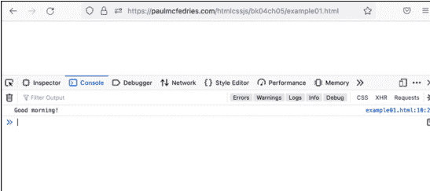
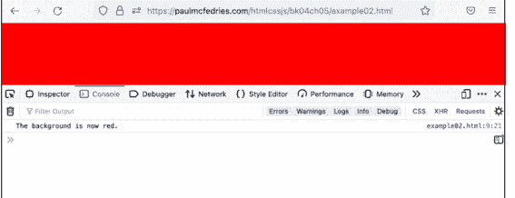
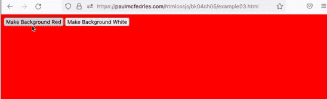
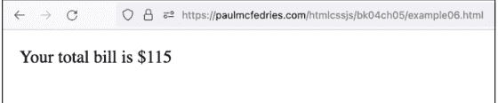
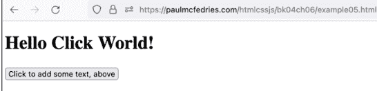
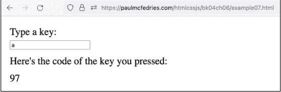
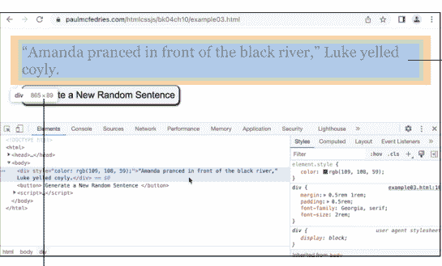
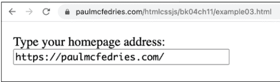
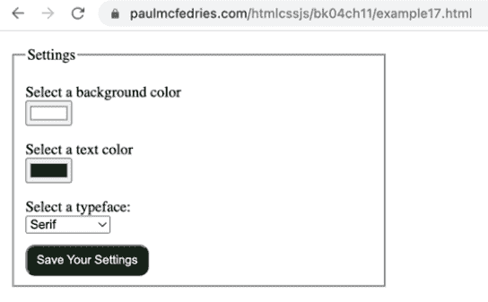

# JavaScript 入门指南

- 复习核心概念
- 启动你的技能扩展
- 寻找常见问题的解决方案

出版社：John Wiley & Sons, Inc., 111 River Street, Hoboken, NJ 07030-5774, www.wiley.com

版权所有 © 2024 John Wiley & Sons, Inc., Hoboken, New Jersey

在加拿大同步出版

未经出版者事先许可，不得以任何形式或通过任何方式（电子、机械、复印、录音或其他）复制本出版物的任何部分或存储在可检索系统中，除非符合 1976 年《美国版权法》第 107 条或 108 条的规定。许可请求请致出版者：John Wiley & Sons, Inc., 111 River Street, Hoboken, NJ 07030, (718) 748-6011，传真 (718) 748-6008，或访问 http。

商标：Wiley、For Dummies、The Dummies Man、Making Everything Easy 以及早期日期的均为 John Wiley & Sons 的注册商标或商标，未经事先许可不得使用。JavaScript 是 Oracle 或其关联公司的注册商标。所有其他商标均为其各自所有者的财产。John Wiley & Sons, Inc. 与书中提到的任何产品或开发人员均无关。

> **责任限制/免责声明**：尽管出版者和作者在准备本作品时尽了最大努力，但他们对本作品内容的准确性或完整性不作任何陈述或保证，并放弃所有保证，包括但不限于对可销性或适用于特定用途的任何暗示保证。销售代表可能通过产品或阶段上的材料或本作品的阶段创建或扩展书面销售。书中作为引用和信息来源的组织、网站或进一步信息，并不意味着出版者和作者认可该组织、网站或其可能做出的任何信息或建议。本作品的销售基于以下理解：即用户承担渲染服务的责任。此处包含的建议和策略可能不适用于您的情况。在适当的情况下，您应该咨询专家。此外，读者应当注意，本书中列出的网站在本书编写与阅读之间可能已经更改或消失。出版者和作者均不对任何利润损失或任何其他商业损害（包括但不限于特殊、偶然、后果性损害）负责。

有关我们其他产品和服务的通用信息，请联系我们在美国的客户服务部门：877-692-2974，美国境外：317-572-3993，或传真 317-572-4002。如技术支持，请访问 `http://www.wiley.com/community/support/dummies`。

Wiley 以多种电子格式和按需出版。本书标准印刷版的部分材料可能未包含在电子书或按需打印中。如果本书提到的媒体（如 CD 或 DVD）未包含在购买的版本中，您可以在 `http://booksupport.wiley.com` 下载这些材料。有关 Wiley 产品的更多信息，请访问 `www.wiley.com`。

美国国会控制号：2024933533

ISBN 1-8-994-26321-9 (平装); ISBN 1-8-994-26233-3 (电子版); ISBN 1-8-994-26322-6 (电子版)

使用注释记录你的脚本.............................................. 164

## 第 1 章 JavaScript：概览

```html
<head>

</html>
```

```javascript
alert("Hello JavaScript World!");
```


此脚本使用了 `document` 对象，这是一个内置 JavaScript 结构，指向脚本所在的任何 HTML 文件（文档）。更多关于 `document` 对象的信息请参阅第 6 章。`document.write()` 语句告诉浏览器将括号内的任何内容插入网页。`document.lastModified` 部分返回文件最后更改并保存的日期和时间。

通常，你可以使用括号来控制 JavaScript 计算表达式的顺序。括号内的项总是先计算，括号外的项按顺序（根据优先级）计算。

## 配置你的代码以决策

## 理解代码循环

## 设置代码循环

## 第 4 章

## 控制 JavaScript 的执行流

在默认的脚本流中，浏览器会逐条语句地处理 `<script>` 元素或外部 JavaScript 文件中的代码。浏览器读取并执行第一条语句，读取并执行第二条语句，以此类推，直到没有更多剩余的 JavaScript 代码需要读取和执行为止。

这种逐语句执行的流方式看起来很合理，但它的局限性极大。如果你想让代码测试某些条件，并根据测试结果跳转到特定的代码块该怎么办？如果你想让代码重复执行某些语句，并且每次重复都发生一些变化，该怎么办？运行测试的代码和自我重复的代码都属于**控制 JavaScript 执行流**的范畴。在本章中，你将探索这个迷人且强大的主题。

## 使用 if 语句进行决策

一个聪明的脚本会对环境进行测试，然后根据每个测试的结果决定下一步做什么。例如，假设你声明了一个变量，稍后在表达式中将其用除数。在表达式中使用该变量之前，你应该对其进行测试，以确保该变量的值不为零。

最基本的测试是简单的真/假决策（可以被认为是是/否或开/关决策）。在这种情况下，你的程序会查看某个条件，确定它当前是真还是假，并采取相应的行动。逻辑表达式（在第 3 章中介绍）在这里起着重要作用，因为它们总是返回一个真值的结果。

在 JavaScript 中，简单的真/假决策由 `if` 语句处理。你可以使用单行语法：

```javascript
if (expression) statement;
```

或者块语法：

```javascript
if (expression) {
  statement1;
  statement2;
  ...
}
```

在这两种情况下，`expression` 都是一个返回真或假的比较表达式或逻辑表达式，而 `statement(s)` 代表如果 `expression` 返回 `true` 则要运行的 JavaScript 语句或语句。如果 `expression` 返回 `false`，JavaScript 将跳过这些语句。

> 这里需要注意的是，JavaScript 定义了以下值等同于 `0`、`""`（即空字符串）、`null` 和 `undefined`。其他所有内容都等同于 `true`。

> 这是你第一次遇到 JavaScript 的大括号 `{` 和 `}`，所以花几秒钟理解它们的作用，它们经常出现。大括号包围了你想让 JavaScript 视为单个实体的一个或多个语句。这个实体本身就是一种语句，所以整体——大括号以及它们包含的代码——被称为**块语句**（block statement）。此外，任何由语句（如 `if`）后跟一个块语句组成的 JavaScript 结构都称为**复合语句**（compound statement）。此外，为了让你保持警惕，请注意包含大括号的行并不以分号结尾。

使用单行语法还是块语法，取决于你当 `expression` 返回 `true` 结果时想要运行的语句。如果你只有一条语句，可以使用任何一种语法。如果你有多个语句，请使用块语法。

考虑以下示例：

```javascript
if (totalSales != 0) {
  const grossMargin = (totalSales - totalExpenses) / totalSales;
}
```

这段代码假设脚本在此之前已经计算了总销售额和总支出，并分别存储在 `totalSales` 和 `totalExpenses` 变量中。代码计算毛利，毛利被定义为毛利润（即减去支出）除以销售额。代码使用 `if` 来测试 `totalSales` 变量的值是否不等于零。如果 `totalSales != 0` 表达式返回 `true`，则执行 `grossMargin` 计算；否则，什么都不会发生。示例中的测试是正确的，因为它确保了计算中的除数——`totalSales` 永远不会为零。

## 使用 if...else 语句进行分支

使用 `if` 语句进行决策为你的 JavaScript 工具箱增加了一把强大的新武器。然而，`if` 的简单版本有一个重要的局限性：假的结果只会跳过一个或多个语句；它不会执行自己的任何语句。在很多情况下确实如此，但有时你需要在条件返回 `true` 时运行一组语句，而在结果为 `false` 时运行另一组语句。为了处理这些场景，你需要使用 `if...else` 语句：

```javascript
if (expression) {
    statements-if-true
} else {
    statements-if-false
}
```

`expression` 是一个返回真或假的比较表达式或逻辑表达式。`statements-if-true` 代表当 `expression` 返回 `true` 时让 JavaScript 运行的语句块，而 `statements-if-false` 代表当 `expression` 返回 `false` 时执行的语句块。

作为一个示例，考虑以下代码：

```javascript
let discountRate;
if (currMonth === "December") {
    discountRate = 0.2;
} else {
    discountRate = 0.1;
}
const discountedPrice = regularPrice * (1 - discountRate);
```

这段代码计算物品的折扣价格，取决于当前月份是否为 12 月。代码假设脚本在此之前设置了当前月份（`currMonth`）和物品的价格（`regularPrice`）。在声明 `discountRate` 变量后，`if...else` 语句检查 `currMonth` 是否等于 "December"。*（注：此处原文似乎误复制了上文关于 totalSales 的描述，翻译时已按原文逻辑保留）*

## 理解循环的价值

有人会说编程的唯一目标就是完成任务。只要代码产生正确的结果，其他一切都是多余的。然而，在编码中引入效率的最佳方法是避免造轮子。例如，考虑以下代码：

```javascript
let sum = 0;
let num = prompt("Type a number:", 1);
sum += Number(num);
num = prompt("Type a number:", 1);
sum += Number(num);
num = prompt("Type a number:", 1);
sum += Number(num);
document.write("The total of your numbers is " + sum);
```

这段代码首先声明了一个变量为 `sum`。代码提示用户输入一个数字（使用默认值为 1 的 `prompt` 方法），存储在 `num` 变量中，加到 `sum` 上，然后重复多次。（注意我对 `Number` 函数的使用，它确保 `prompt` 返回的值被视为数字而不是字符串。）最后，向用户显示三个数字之和。

除了有点没用之外，这段代码极其缺乏效率，因为代码大部分由以下两行重复三次：

```javascript
num = prompt("Type a number:", 1);
sum += Number(num);
```

如果你把这两条语句只放在代码中一次，然后让 JavaScript 根据需要重复它们，不是更高效吗？

是的，而且好消息是不仅可以这样做，JavaScript 还提供了许多不同的方法来实现这种操作——被称为**循环**。我将在本章的剩余部分研究每种方法。

## 使用 while 循环

JavaScript 最直接的循环结构是 `while` 循环，它使用以下语法：

```javascript
while (expression) {
  statements
}
```

在这里，`expression` 是一个比较表达式或逻辑表达式（即返回 `true` 或 `false` 的表达式），只要它返回 `true`，就会告诉 JavaScript 继续执行块内部的 `statements`。

本质上

这里是 `while` 循环工作的详细原理：

1. 评估 `while` 语句中的 `expression`。
2. 如果 `expression` 为 `true`，继续执行第 3 步；如果 `expression` 为 `false`，跳转到第 5 步。
3. 执行块中的每个语句。
4. 返回第 1 步。
5. 退出循环（即执行 `while` 块之后的下一条语句）。

以下代码演示了如何使用 `while` 来重写上一节中所示的低效代码：

```javascript
let sum = 0;
let counter = 1;
let num;
while (counter <= 3) {
  num = prompt("Type a number:", 1);
  sum += Number(num);
  counter += 1;
}
document.write("The total of your numbers is " + sum);
```

为了控制循环，代码声明了一个名为 `counter` 的变量并将其初始化为 `1`，这意味着表达式 `counter <= 3` 为真，因此代码进入代码块（执行提示和求和操作），然后增加 `counter`。这个过程会一直重复，直到第三次循环结束，此时 `counter` 增加到 `4`，该点表达式 `counter <= 3` 变为为假，循环结束。

为了让你的循环代码具有最大的可读性，请务必对 `while` 块中的每个语句始终使用两个或四个空格的缩进。这对于我在在本章稍后介绍的 `for` 和 `do...while` 循环也是同样的。

当你确切知道想要运行循环的次数时，`while` 语句并不是最佳的循环选择。对于这种情况，请使用下一节介绍的 `for` 语句。`while` 语句的最佳用例是你的脚本具有某种自然发生的条件，你可以将其转换为比较表达式。一个很好的例子是当你提示用户输入值时。你通常希望一直提示用户，直到他们点击“取消”按钮。设置这种逻辑最简单的方法是将 `prompt` 放在 `while` 循环内部，所示：

```javascript
let sum = 0;
let num = prompt("Type a number or click Cancel.", 1);
```

```javascript
while (num != null) {
  sum += Number(num);
  num = prompt("Type a number or click Cancel:", 1);
}
document.write("The total of your numbers is " + sum);
```

第一个 `prompt` 方法显示一个如图 4-1 所示的对话框来获取初始值；然后将其存储在 `num` 变量中。

图 4-1：设置你的 while 表达式，以便在用户点击“取消”按钮时停止提示。

`while` 语句检查以下表达式：

```javascript
num != null
```

这里会发生两种情况：

- 如果用户输入了一个数字，该表达式返回 `true`，循环继续。在这种情况下，`num` 的值被加到 `sum` 变量中，并提示用户下一个数字。
- 如果用户点击“取消”，`prompt` 返回值为 `null`，因此表达式变为 `false`，循环停止。

## 使用 for 循环

尽管 `while` 是 JavaScript 循环中最直观的，但到目前最常见的类型是 `for` 循环。当你考虑到（很快就会发现）`for` 循环的语法比 `while` 循环复杂一点时，这一事实可能会让你感到惊讶。然而，`for` 循环擅长一点：当你确切知道想要重复一组语句的次数时进行循环。这在所有类型的编程中都非常常见，所以难怪 `for` 在脚本中如此如此。

一个典型的 `for` 循环结构如下：

```javascript
for (let counter = start; counterExpression; counterUpdate) {
  statements
}
```

这里包含了很多内容，我将逐一进行讲解：

- **counter**: 用作循环计数器的数值变量。循环计数器是一个记录程序通过循环次数的数字。（注意，只有当你这是在脚本中第一次使用该变量时，才需要包含它。）
- **start**: `counter` 的初始值。这个值通常是 `1`，但你可以使用任何对你的脚本有意义的值。
- **counterExpression**: 比较或逻辑表达式，用于决定循环运行的次数。该表达式通常将 `counter` 的当前值与某个最大值进行比较。
- **counterUpdate**: 一个改变 `counter` 值的表达式。该表达式在每次循环结束后都会被求值。大多数情况下，你会使用表达式 `counter += 1` 来增加 `counter` 的值。
- **statements**: 你希望 JavaScript 在每次循环中执行的语句。

当 JavaScript 遇到 `for` 循环时，它会遵循以下七步处理过程：

1. 将 `counter` 设置为 `start`。
2. 评估 `counterExpression`。
3. 如果 `counterExpression` 为 `true`，继续执行第 4 步；如果 `counterExpression` 为 `false`，则跳到第 7 步。
4. 执行 `statements`。
5. 使用 `counterUpdate` 增加 `counter`。
6. 返回到第 2 步。
7. 退出循环。

作为一个示例，以下代码展示了如何使用 `for` 来重写低效代码：

```javascript
let sum = 0;
let num;
for (let counter = 1; counter <= 3; counter += 1) {
  num = prompt("Type a number:", 1);
  sum += Number(num);
}
```

这是最高效的版本，因为它在语句中同时完成了 `counter` 的声明、初始化和增加。为了保持清晰，你可能更倾向于使用单词作为计数器，并应始终尝试使用 `for`。

使用 `for` 进行倒计时也是可能的。你通过使用减法赋值运算符代替加法赋值运算符来实现：

```javascript
for (let counter = start; counterExpression; counter -= 1) {
  statements
}
```

在这种情况下，你必须将 `counter` 变量初始化为你想要作为循环计数器的最大值，并使用 `counterExpression` 将 `counter` 的值与你想要结束循环的最小值进行比较。

在接下来的示例中，我使用递减计数器让用户倒序对他们的三种 CSS 颜色进行排序：

```javascript
for (let rank = 3; rank >= 1; rank -= 1) {
  let ordinal;
  let color;
  switch (rank) {
    case 1:
      ordinal = "first";
      break;
    case 2:
      ordinal = "second";
      break;
    case 3:
      ordinal = "third";
  }
  color = prompt("What is your " + ordinal + "-favorite CSS color?", "");
  document.write(rank + " " + color + "<br>");
}
```

循环通过递减 `rank` 变量从 3 减到 1 来运行。循环的每次迭代都会提示用户输入喜欢的 CSS 颜色，并将该颜色写入页面，同时使用 `rank` 的当前值来创建一个倒序列表，如图 4-3 所示。

图 4-2：此脚本使用 `counter` 变量的当前值来自定义提示消息。

- 3. papayawhip
- 2. lemonchiffon
- 1. chocolate

**图 4-3:** 排名变量的递减值用于创建一个倒序列表。


没有理由规定 `for` 循环计数器只能递增或递减。你实际上可以自由任何表达式来调整循环计数器的值。例如，假设你想让计数器只遍历奇数 1, 3, 5, 7 和 9。这里有一个可以实现该目的的 `for` 语句：

```javascript
for (let counter = 1; counter <= 9; counter += 2)
```

表达式 `counter += 2` 使用加赋值运算符在每次循环时将 `counter` 变量增加 2。

## 使用 do..while 循环

JavaScript 有第三种也是最后一种循环类型，我把它留到最后是因为你可能并不总是需要用到它。要理解你什么时候可能会使用它，请考虑这段代码片段：

```javascript
let sum = 0;
let num = prompt("输入一个数字或点击
取消:", 1);
while (num != null) {
	sum += Number(num);
	num = prompt("输入一个数字或点击
取消:", 1);
}
```

代码需要第一个 `prompt` 语句，以便可以评估循环的表达式。用户可能不想输入任何数字，他们可以通过点击第一个提示框中的“取消”（Cancel）来避免，从而跳过循环。

这看起来足够合理，但如果你的代码要求用户至少输入一个值呢？以下展示了更改代码以确保循环至少执行一次的方法：

```javascript
let sum = 0;
let num = 0;
while (!num === null || sum === 0) {
    num = prompt("输入一个数字；完成后，
    点击取消：", 1);
    sum += Number(num);
}
document.write("你的数字总和为
n " + sum);
```

这里的变化在于，代码将 `sum` 和 `num` 都初始化为 0。将两者都初始化为 0 确保了 `while` 表达式 `num != null || sum === 0` 在第一次循环时返回真，循环至少会执行一次。如果用户立即点击“取消”，`sum` 仍为 0，因此 `while` 表达式 `num != null || sum === 0` 返回真，循环再次重复。

这种方法运行良好，但你也可以转向 JavaScript 的第三种循环类型，它专门处理这种这种情况。它被称为 `do...while` 循环，其通用语法如下：

```javascript
do {
    statements
} while (expression);
```

在这里，`statements` 代表每次循环时要执行的语句块，而 `expression` 是一个比较或逻辑表达式，只要它返回 `true`，就会告诉 JavaScript 继续执行循环内的语句。

这种结构确保了 JavaScript 至少执行一次循环语句。仔细观察 JavaScript 如何处理 `do...while` 循环：

1. 执行块中的每个语句。
2. 评估 `while` 语句中的表达式。
3. 如果表达式为 `true`，则返回第 1 步；如果表达式为 `false`，则继续第 4 步。
4. 退出循环。

例如，以下内容展示了如何使用 `do...while` 来重构我之前向你展示的提示并求和的代码：

```javascript
let sum = 0;
let num;
do {
    num = prompt("输入一个数字；完成后，
    点击取消：", 1);
    sum += Number(num);
}
while (num != null || sum === 0);
document.write("你的数字总和为
n " + sum);
```

这段代码与我在本节稍早展示的 `while` 代码非常相似。真正改变的地方是 `while` 语句及其表达式移动到了语句块之后，因此在评估表达式之前必须执行一次循环。

## 本章内容

- 认识 JavaScript 函数
- 创建和使用自定义函数
- 传递函数值和返回函数值
- 使用匿名函数和箭头函数

## 第 5 章 运用函数的威力

除了简单的脚本外，几乎每个 JavaScript 项目都将一个或多个（通常多得多）任务或计算，而这些任务并不是 JavaScript 语言或任何 Web API 的一部分。程序员该怎么办？你得卷起袖子，编写你自己的代码来完成任务或运行计算。

本章展示了如何创建这种自己编写的代码。在接下来的页面中，你将探索强大且无限实用的自定义函数领域，在那里你可以编写可重用的代码来执行开箱用的 JavaScript 无法完成的任务。

## 了解函数结构

函数是一组 JavaScript 语句，它们与脚本的其他部分分离并执行指定的任务。当你的脚本需要执行该任务时，你告诉它运行——或者用术语说，执行（execute）——函数。

函数的基本结构如下：

```javascript
function functionName([arguments]) {
  JavaScript statements
}
```

以下是函数各个部分的总结：

- `function`: 标识代码块。
- `functionName`: 函数的唯一名称。
- `arguments`: 传递给函数或多个值。
- `JavaScript statements`: 这是执行任务的代码。

此外，大括号 `{ }` 用于封装函数。大括号只有两个规则：

- 开大括号必须出现在函数名之后。
- 闭大括号必须出现在语句之后。

## 调用函数

在定义函数之后，你最终需要告诉浏览器执行——调用——该函数。有三种方法：

- 当浏览器解析 `<script>` 标签时
- 在页面加载后
- 响应事件，例如用户点击按钮

### 当浏览器解析 `<script>` 标签时

调用函数的最简单方法是在脚本中包含一个函数名，后面跟着括号（假设你的函数没有参数）。下面的代码提供了示例。（我列出了整个页面以显示函数及其调用语句的位置。）

```html
<!DOCTYPE html>
<html lang="en">
<head>
  <meta charset="utf-8">
  <title>在解析 <script>
标签时调用函数</title>
  <script>
    function displayGreeting() {
      const currentHour = new Date().
      getHours();
      if (currentHour < 12) {
        console.log("Good morning!");
      } else {
        console.log("Good day!");
      }
    }
  displayGreeting();
  </script>
</head>
<body>
</body>
</html>
```

`<script>` 标签包含一个名为 `displayGreeting` 的函数，它根据当前是否为早晨向控制台（在第 9 章中学习控制台）写入问候。该函数是由紧跟在函数之后的 `displayGreeting()` 语句调用的。

图 5-1：在解析 `<script>` 标签时调用函数的示例。



### 当页面加载完成后

如果你的函数引用了页面元素，在页面的 `head` 部分调用函数将不起作用，因为浏览器解析脚本时，其余部分尚未加载，因此你的元素引用将失败。

为了解决这个问题，将另一个 `<script>` 标签放在 `body` 部分的末尾，就在闭合的 `</body>` 标签之前，如下：

```html
<!DOCTYPE html>
<html lang="en">
<head>
  <meta charset="utf-8">
  <title>在页面加载后调用函数</title>
  <script>
    function makeBackgroundRed() {
      document.body.style.backgroundColor = "red";
    }
  </script>
</head>
<body>
  <script>
    makeBackgroundRed();
  </script>
</body>
</html>
```

```html
console.log("The background is now red.");
</script>
</head>
<body>
<!-- Other body elements go here -->
<script>
makeBackgroundRed();
</script>
</body>
</html>
```

`makeBackgroundRed` 函数执行了两件事：它使用 `document.body.style.backgroundColor` 来改变 `body` 元素的颜色，并使用 `console.log` 在控制台上打印一条该效果的消息。

在函数中，`document.body` 是 `body` 元素的引用，它在页面完全加载之前是“不存在”的。如果你尝试在初始脚本中调用该函数，将会得到错误。为了正确执行该函数，在 `body` 元素的底部出现了第二个 `<script>` 标签，该脚本通过以下语句调用了函数：

```javascript
makeBackgroundRed();
```

当浏览器执行该语句时，`body` 元素已经存在，因此函数运行不会产生错误（查看图 5-2）。



图 5-2：页面加载后调用函数的示例。

### 当事件触发时

这是 JavaScript 函数响应某些事件被调用的常用方式之一。事件是一个如此重要的主题，以至于我将第 6 章的大部分内容都留给了它们。现在，来看一个相对直接的应用：当用户点击按钮时执行函数。以下代码展示了一种实现方法：

```html
<!DOCTYPE html>
<html lang="en">
<head>
  <meta charset="utf-8">
  <title>响应事件调用函数</title>
  <script>
    function makeBackgroundRed() {
      document.body.style.backgroundColor="red";
    }
    function makeBackgroundWhite() {
      document.body.style.backgroundColor="white";
    }
  </script>
</head>
<body>
  <button onclick="makeBackgroundRed()">
    将背景变为红色
  </button>
  <button onclick="makeBackgroundWhite()">
    将背景变为白色
  </button>
</body>
</html>
```

我在这里做的是脚本中放置了两个函数：`makeBackgroundRed` 如之前一样将页面背景改为红色，而 `makeBackgroundWhite` 将背景颜色改回白色。

这些按钮是标准的 HTML 按钮元素（查看图 5-3），每个按钮都包含 `onclick` 属性。该属性定义了一个处理器——即当用户点击按钮发生该事件时要执行的函数。例如，考虑第一个按钮：

```html
<button onclick="makeBackgroundRed()">
```



图 5-3：响应事件调用函数的示例。

这里的 `onclick` 属性实际上是在说：“当有人点击此按钮时，调用函数 `makeBackgroundRed`。”

## 向函数传递一个或多个值

使用函数的主要原因之一是获得对 JavaScript 代码执行时机的控制。上一节讨论了如何方便地使用函数进行设置，使得代码在用户点击按钮之前不会运行。

然而，使用函数还有另一个主要原因：避免代码重复。为了理解我的意思，请考虑上一节中的两个函数：

```javascript
function makeBackgroundRed() {
    document.body.style.backgroundColor="red";
}
function makeBackgroundWhite() {
    document.body.style.backgroundColor="white";
}
```

这些函数执行相同的任务——改变背景颜色——它们之间的唯一区别是一个将颜色改为红色，另一个将其改为白色。每当你发现两个或多个本质上执行相同事情的函数时，你就知道你的代码效率很低。那么，如何让代码更高效？这就是参数（arguments）发挥用场的地方。参数是被“发送”（或在编程术语中称为传递）给函数的值。参数的作用就像变量，它存储了值。

### 向函数传递一个值

作为一个示例，你可以取之前的两个函数，将其简化为一个函数，并将值设置为参数。这里有一个执行该操作的新函数：

```javascript
function changeBackgroundColor(newColor) {
  document.body.style.backgroundColor = newColor;
}
```

参数命名为 `newColor`，并添加到函数名后的括号之间。JavaScript 会自动将 `newColor` 为变量，因此你不需要单独的 `let` 或 `const` 语句。然后函数使用 `newColor` 值来改变背景颜色。那么你如何向函数传递值呢？以下代码提供了一个执行此操作的示例：

```html
<!DOCTYPE html>
<html lang="en">
<head>
  <meta charset="utf-8">
  <title>向函数传递单个值</title>
  <script>
    function changeBackgroundColor(newColor) {
      document.body.style.backgroundColor = newColor;
    }
  </script>
</head>
<body>
  <button onclick="changeBackgroundColor('red')">
    将背景变为红色
  </button>
  <button onclick="changeBackgroundColor('white')">
    将背景变为白色
  </button>
</body>
</html>
```

关键在于出现在两个 `<button>` 标签中的 `onclick` 属性。例如：

```html
onclick="changeBackgroundColor('red')"
```

字符串 `'red'` 被插入到函数名后的括号中，这样该值就被传递给函数本身。另一个按钮传递了值 `'white'`，函数的结果随之相应。

> 在示例代码的两个 `onclick` 属性中，注意传递给函数的值被包含在单引号中。这是必要的，因为整个 `onclick` 值是被包含在双引号中的。


### 向函数传递两个或多个值

对于更复杂的函数，你可能需要使用多个参数，以便传递不同类型的值。如果你使用多个参数，用逗号分隔每个参数，如下：

```javascript
function changeColors(newBackgroundColor, newForeColor) {
  document.body.style.backgroundColor = newBackgroundColor;
  document.body.style.color = newForeColor;
}
```

在这个函数中，`document.body.style.color` 语句改变前景颜色（即页面文本颜色）。以下代码展示了按钮向函数传递两个值：

```html
<!DOCTYPE html>
<html lang="en">
<head>
  <meta charset="utf-8">
  <title>向函数传递多个值</title>
  <script>
    function changeColors(newBackColor, newForegroundColor) {
      document.body.style.backgroundColor = newBackColor;
      document.body.style.color = newForegroundColor;
    }
  </script>
</head>
<body>
  <h1>向函数传递多个值</h1>
  <button onclick="changeColors('red', 'white')">红色背景，白色文字</button>
  <button onclick="changeColors('white', 'red')">白色背景，红色文字</button>
</body>
</html>
```

> 如果你定义的函数有多个参数，你必须始终为这些参数传递值。否则，传递的将 `undefined`，这可能会导致问题。

## 从函数获取值

到目前，我概述了使用函数的两个主要优势：

- 你可以使用它们来控制代码的执行时间。
- 你可以使用它们将重复的代码整合到一个程序中。

函数为 JavaScript带来的主要好处是你可以可以使用它们进行计算并返回结果。作为一个示例，这里有一个计算餐厅账单小的函数：

```javascript
function calculateTip(preTip, tipPercent) {
  const tipResult = preTip * tipPercent;
  return tipResult;
}

const preTipTotal = 100.00;
const tipPercentage = 0.15;
const tipCost = calculateTip(preTipTotal, tipPercentage);
const totalBill = preTipTotal + tipCost;
document.write("您的总账单为 $" + totalBill);
```

`return` 语句是 JavaScript 将值发送回调用该函数的语句的方式。该语句出现在函数之后：

```javascript
tipCost = calculateTip(preTipTotal, tipPercentage);
```

此语句首先将 `preTipTotal`（在脚本早些时候初始化为 100.00）和 `tipPercentage`（在早些时候初始化为 0.15）传递给 `calculateTip` 函数。当该函数返回结果时，整个表达式 `calculateTip(preTipTotal, tipPercentage)` 会被该结果替换，这意味着它被存储在变量 `cost` 中。`preTipTotal` 和 `tipCost` 相加，结果存储在 `totalBill` 中，并通过 `document.write` 语句显示最终计算结果（参见图 5-4）。



**图 5-4：** 输出包含了自定义函数的计算返回值。

## 使用匿名函数

让我们再次看看在本章之前提到的函数语法：

```javascript
function functionName([arguments]) {
  JavaScript statements
}
```

这种版本的函数语法创建了一个所谓的“命名函数”，因为——你猜得没错——这个函数有一个名字。

然而，创建一个没有名字的函数也是可能的：

```javascript
function ([arguments]) {
  JavaScript statements
}
```

这种多样的函数语法创建了一个所谓的“匿名函数”，因为——没错——这个函数没有名字。

为什么要使用匿名函数？嗯，首先，如果你不想用，就不必用。其次，使用匿名函数的主要原因是在不需要时避免创建一个命名对象。每个大型 Web 项目都有一个巨大的命名空间（namespace），它指的是你分配给变量和函数等项的标识符完整集合。命名空间越大，命名空间冲突的概率越高，即你为两个不同的事物使用了相同的标识符。坏消息是！

匿名函数是在 ES6 中引入的，所以如果你需要支持非常旧的浏览器（例如 Internet Explorer 11），就不要使用它们。

如果你有一个在项目中只使用一次的函数，那么将其制为匿名函数被认为是良好的现代编程实践，这样你的命名空间中就会少一个标识符。

好了，我听见你在想什么，我们之前提到过使用函数名来调用函数。如果匿名函数没有名字，我们该如何运行它呢？问得好！有两种主要方法可以观察：

- 将函数赋值给变量
- 用函数本身替换函数调用

### 将匿名函数赋值给变量

上一节的示例代码定义了命名函数 `calculateTip()`，并在稍后使用 `tipCost` 变量来存储函数结果。这是一个不需要命名函数的完美示例，因为你只使用该命名函数来计算 `tipCost` 值。在不需要的情况下向命名空间添加身份标识符会污染命名空间，这在现代 JavaScript 编程中是一个大忌。

你可以重写这段代码来使用匿名函数：

```javascript
const preTipTotal = 100.00;
const tipPercentage = 0.15;
```

（等一下，让我检查一下代码流）

```javascript
// 使用匿名函数声明 tipCost
const tipCost = function (preTip, tipPercent) {
  const tipResult = preTip * tipPercent;
  return (tipResult);
}
const totalBill = preTipTotal +
tipCost(preTipTotal, tipPercentage);
document.write("Your total bill is $" + +
totalBill);
```

这里的巨大变化是，现在我将 `tipCost` 变量的值声明为一个匿名函数。这个匿名函数与之前的 `calculateTip()` 命名函数相同，只是没有名字。在倒数第二个语句中，我通过 `tipCost(preTipTotal, tipPercentage)` 调用了该匿名函数。

### 用匿名函数替换函数调用

匿名函数最常见的用途之一是当你需要将函数作为参数传递给另一个函数时。传递的函数被称为回调函数（callback function）。

首先，这是一个使用命名函数的示例：

```html
<body
  <button id="bgRed">
    Make Background Red
  </button>
  <button id="bgWhite">
    Make Background White
  </button>
  <script>
    function makeBackgroundRed() {
      document.body.style.backgroundColor = 
      'red';
    }
    function makeBackgroundWhite() {
      document.body.style.backgroundColor = 
      'white';
    }
  </script>
```

```javascript
document.getElementById('bgRed').
addEventListener(
  'click',
  makeBackgroundRed
);
document.getElementById('bgWhite').
addEventListener(
  'click',
  makeBackgroundWhite
);
</script>
```

脚本声明了两个命名函数：`makeBackgroundRed()` 和 `makeBackgroundWhite()`。代码随后创建两个事件监听器。其中一个监听 id 为 `bgRed` 的按钮的点击，当检测到点击时，运行 `makeBackgroundRed()` 回调函数。另一个事件监听器监听 id 为 `bgWhite` 的按钮的点击，当检测到点击时，运行 `makeBackgroundWhite()` 回调函数。参考第 6 章获取有关 document 对象以及 `getElementById()` 和 `addEventListener()` 方法的详情。

再次，你有两个并不需要的函数，所以你可以通过将回调替换为匿名函数来将它们从命名空间中移除。这里是修改后的代码：

```html
<body>
  <button id="bgRed">
    Make Background Red
  </button>
  <button id="bgWhite">
    Make Background White
  </button>
  <script>
    document.getElementById('bgRed').addEventListener(
      'click',
      () => { document.body.style.backgroundColor = 'red'; }
    );
    document.getElementById('bgWhite').addEventListener(
      'click',
      () => { document.body.style.backgroundColor = 'white'; }
    );
  </script>
</body>
```

*(注：由于原文提供的示例 HTML 代码片段不完整且有重叠，此处根据语境补全了逻辑以确保清晰)*

## 使用箭头函数

随着你不断学习 JavaScript，你会发现自己不断地使用匿名函数。当你进入那个阶段时，很高兴发现 ES6 还提供了一种更简单的语法。也就是说，与其使用：

```javascript
function ([arguments]) {
  JavaScript statements
}
```

你可以使用：

```javascript
([arguments]) => {
  JavaScript statements
}
```

我所做的只是删除了 `function` 关键字，并在参数和大括号之间加上字符。这些字符看起来像箭头（程序员称之为胖箭头），因此这种版本的语法被称为箭头函数。

箭头函数是 ES6 的发明，如果你需要支持非常旧的浏览器（例如 Internet Explorer 11），就不要使用它们。

例如，这里是之前（“将匿名函数赋值给变量”一节）中的一个匿名函数：


**记住**

70 JavaScript Essentials For Dummies

```javascript
// 使用匿名函数声明 tipCost
const tipCost = function (preTip, tipPercent) {
  const tipResult = preTip * tipPercent;
  return (tipResult);
}
```

你可以使用箭头函数重写这段代码：

```javascript
// 使用箭头函数声明 tipCost
const tipCost = (preTip, tipPercent) => {
  const tipResult = preTip * tipPercent;
  return (tipResult);
}
```

如果你的匿名函数由单个语句组成，你可以利用箭头函数的特性——*隐式返回*（implicit return）：

```javascript
([arguments]) => statement
```

在这里，JavaScript 假设单语句意味着函数在执行语句后后返回，因此你可以省略大括号和 `return` 关键字。这是一个示例：

```javascript
// 使用带有隐式返回的箭头函数声明 tipCost
const tipCost = (preTip, tipPercent) => preTip * tipPercent;
```

同样，这里是上一节中的一个匿名回调函数：

```javascript
document.getElementById('bgRed').addEventListener(
  'click',
  function() {
    document.body.backgroundColor=
    'red';
  }
);
```

你可以如下所示重写这段代码，使用带有隐式返回的箭头函数：

```javascript
document.getElementById('bgRed').addEventListener(
  'click',
  () => document.body.style.backgroundColor= 'red'
);
```

## 第 6 章

## 编写文档对象模型

在过去的几个章节中，我讨论了很多 JavaScript，但从现实意义上说，那都只是编程世界的“垫了几道开胃菜”。现在是时候坐下来吃主菜了：编写文档对象模型。

在本章中，你将探索文档对象模型（DOM）这个迷人的世界。你将学习许多强大的编码技术，这些技术能让你的网页实现几乎任何你想的功能。你还会发现，这正是 Web 编码变得有趣甚至可能让人小微上瘾的地方（我保证是好事）。

## 熟悉对象

要编写真正实用的脚本，你必须完成 JavaScript 设计之初想要的任务：操作它正在显示的网页。这就是 JavaScript 的核心所在，而这种操作可以通过许多不同的形式存在：

- 为元素添加文本和 HTML 属性。
- 修改类或其他选择器的 CSS 属性。
- 在浏览器的内部存储中存储数据。
- 在提交表单之前验证表单数据。

列表中的**粗体项目**是你可以处理的“实体”示例，它们之所以特殊，仅仅是因为它们是可编程的。在 JavaScript 术语中，这些“可编程实体”被称为**对象**。

你可以通过以下任何方式在 JavaScript 中操作对象：

- 读取并修改对象的属性。
- 通过激活与对象关联的方法来让对象执行某个任务。
- 定义一个程序，每当对象发生特定事件时运行该程序。

## 使用对象属性

你通过以下通用表达式中的语法来引用属性：

```javascript
object.property
```

- `object`: 拥有该属性的对象
- `property`: 你想要处理的属性名称

例如，考虑以下表达式：

```javascript
document.location
```

该表达式引用文档对象的 `location` 属性，它存储了当前在浏览器窗口中显示的文档地址。（在口语中，你将其读作“document dot location”）下面的代码显示了一个简单的单行脚本，可以在控制台中显示该属性，如图 6-1 所示。

```javascript
console.log(document.location);
```

**img/e1fc091e438a5ffb052e3126ba2bbd1f_86_0.png**

**图 6-1：** 该脚本在控制台消息中显示 `document.location` 属性。

由于属性始终包含一个值，你可以自由在任何类型的 JavaScript 语句中使用属性表达式，并将其作为 JavaScript 表达式的操作数。例如，以下语句将 `document.location` 属性的当前值赋值给名为 `currentUrl` 的变量：

```javascript
const currentUrl = document.location;
```

同样，以下语句将 `document.location` 作为字符串表达式的一部分：

```javascript
const message = "The current address is " + 
document.location + ".";
```

某些属性是“只读的”，这意味着你的代码只能读取当前值而不能更改它。然而，许多属性是“可读可写的”，这意味着你也可以更改它们的值。要更改属性的值，请使用以下通用语法：

```javascript
object.property = value
```

这里各个部分的含义如下：

- **object：** 拥有该属性的对象
- **property：** 你想要更改的属性名称
- **value：** 字面量值（如字符串或数字）或返回你想要设置的属性的值的表达式

这里有一个例子：

```javascript
const newAddress = prompt("Enter the address you
want to surf to:");
document.location = newAddress;
```

该脚本提示用户输入网页地址并将结果存储在 `newAddress` 变量中。然后使用该值来更改 `document.location` 属性，这会告诉浏览器打开指定的地址。

## 使用对象方法

要运行方法，从最简单的情况开始，即不带任何参数的方法：

```javascript
object.method()
```

这里各个部分的含义如下：

- `object`: 拥有你想要处理的方法的对象
- `method`: 你想要执行的方法名称

例如，考虑以下语句：

```javascript
history.back();
```

这会运行 `history` 对象的 `back()` 方法，告诉浏览器后退。

如果方法需要参数，请使用以下格式：

```javascript
object.method(argument1, argument2)
```

例如，考虑以下语句：

```javascript
confirm("Do you want?");
```

最后，与属性一样，如果方法返回一个值，你可以将其赋值给变量。

## 引入文档模型

以下是一个简单页面的代码：

```html
<html lang="en">
  <head>
    <title>So Many Recipes</title>
  </head>
  <body>
    <header>
      <h1>Above and Beyond</h1>
    </header>
    <main>
      <p>
        <a href="kale">kale</a>
      </p>
    </main>
  </body>
</html>
```

检查此代码的一种方法是分层级的。箭头代表父-子关系。此外，处于同一层级的元素（如 `header` 和 `main`）被称为兄弟元素。

你在此处有几点需要考虑：

* 图 6-2 中的每个框都代表一个对象。
* 图 6-2 中的每个对象都是三种类型之一：元素、文本或属性。
* 整个页面由 `document` 对象表示。

因此，这种对象的表示被称为文档对象模型，通常称为 **DOM**。DOM 允许你的 JavaScript 代码访问 HTML 文档的结构。

**img/e1fc091e438a5ffb052e3126ba2bbd1f_89_0.png**

在讨论层次结构时，如果对象 P 包含对象 C，则对象 P 是 C 的父，对象 C 是 P 的子。

## 在代码中指定元素

元素代表文档中的标签，因此你会经常使用它们。本节将介绍引用一个或多个元素的几种方法。

### 通过 id 指定元素

如果你要在脚本中处理某个特定元素，可以通过先分配 `id` 属性直接引用该元素：

```html
<div id="kale-quotations">
```

有了这个，你可以使用可以使用对象的 `getElementById()` 方法在代码中引用该元素：

```javascript
document.getElementById(id)
```

注意：`id` 是你想要处理的元素的 `id` 属性的字符串。

例如，以下语句返回之前的 `<div>` 标签（`id="kale-quotations"` 的那个）：

```javascript
document.getElementById("kale-quotations")
```

编写文档对象时，不要将 `<script>` 标签放在页面的头部区域（即 `<head>` 和 `</head>` 之间）。如果你将代码放在那里，网页浏览器会在创建文档对象之前运行你的代码，这意味着你的代码将彻底失败。相反，请将 `<script>` 标签放在页面的底部，紧接 `</body>` 标签之前。

**img/e1fc091e438a5ffb052e3126ba2bbd1f_90_0.png**

### 通过标签名指定元素

除了处理单个元素外，你还可以处理元素集合。此类集合之一是页面中使用相同标签名的所有元素。例如，你可以引用所有的 `<a>` 标签或所有的 `<div>` 标签。

返回具有相同标签元素集合的机制是 `getElementsByTagName()` 方法：

```javascript
document.getElementsByTagName(tag)
```

**注意：** `tag` 是一个字符串，表示你想要操作的标签所使用的 HTML 名称。

该方法返回一个类数组集合，包含文档中所有使用指定标签的元素。（请参阅第 7 章以了解数组的工作原理。还请查看本章后半部分的“操作元素集合”。）例如，要返回包含当前页面中所有 `div` 元素的集合，你可以使用以下语句：

```javascript
const divs = document.getElementsByTagName("div");
```

### 通过类名识别元素

另一个你可以操作的集合是页面中所有使用相同类的元素集合。用于返回共享特定类名的所有元素的 JavaScript 工具是 `getElementsByClassName()` 方法：

```javascript
document.getElementsByClassName(class)
```

**注意：** `class` 是一个字符串，表示你想要操作的元素所使用的类名。

该方法返回一个类数组集合，包含文档中所有使用指定类名的元素。集合的顺序与元素在文档中出现的顺序一致。这里是一个示例：

```javascript
const keywords = document.getElementsByClassName("keyword");
```

### 通过选择器识别元素

你在 CSS 中使用的相同选择器和组合符也可以在 JavaScript 代码中使用，通过使用 `document` 对象的 `querySelector()` 和 `querySelectorAll()` 方法来引用页面元素：

```javascript
document.querySelector(selector)
document.querySelectorAll(selector)
```

注意：`selector` 是一个字符串，表示你想要操作的元素或多个元素的选择器或组合符。

这些方法之间的区别在于，`querySelectorAll()` 返回所有匹配你选择器的元素集合，而 `querySelector()` 只返回第一个匹配你选择器的元素。

例如，以下语句返回所有作为 `article` 元素直接子元素的 `section` 元素集合：

```javascript
const articles = document.querySelectorAll("article > section");
```

## 操作元素集合

`getElementsByTagName()`、`getElementsByClassName()` 和 `querySelectorAll()` 方法分别返回一个类数组集合，其中包含文档中所有使用指定标签、类或选择器的元素。集合的顺序与元素在文档中出现的顺序一致。例如，请考虑以下 HTML 代码：

```html
<div id="div1">
  This, of course, is div 1.
</div>
<div id="div2">
  Yeah, well <em>this</em> is div 2!
</div>
<div id="div3">
  Ignore those dudes. Welcome to div 3!
</div>
```

现在考虑以下语句：

```javascript
divs = document.getElementsByTagName("div");
```

在生成的集合中，第一个项目 (`divs[0]`) 将是 `id` 等于 `div1` 的 `<div>` 元素；第二个项目 (`divs[1]`) 将是 `id` 等于 `div2` 的 `<div>` 元素；第三个项目 (`divs[2]`) 将是 `id` 等于 `div3` 的 `<div>` 元素。

你也可以直接使用它们的 `id` 值来直接引用元素。例如，以下语句是等价的：

```javascript
const firstDiv = divs[0];
const firstDiv = divs.div1;
```

要学习集合中有多少项，你可以使用 `length` 属性：

```javascript
const totalDivs = divs.length;
```

要对集合中的每个项执行一个或多个操作，你可以使用 `for...of` 循环逐个遍历集合。在 JavaScript 交易中，这被称为迭代集合。以下是使用的语法：

```javascript
for (const item of collection) {
}
```

以下是各个部分的含义：

- `item`: 一个持有集合中项的变量。第一次循环时，`item` 被设置为集合中的第一个元素；第二次循环时，`item` 被设置为集合中的第二个元素；以此类推。
- `collection`: 你想要迭代的元素集合。
- `statements`: 你想要用于处理（或查看、或其他操作）`item` 的 JavaScript 代码。

例如，以下代码迭代了前述元素并在控制台中显示每个项的 `id` 值（有关控制台的详情请参阅第 9 章），如图 6-3 所示：

```javascript
divs = document.getElementsByTagName("div");
for (const d of divs) {
  console.log(d.id);
}
```

This, of course, is div 1!

Yeah, well this is div 2!

Ignore those dudes. Welcome to div 3!

| 过滤输出 | 位置 |
| :--- | :--- |
| div1 | example0.html:19:25 |
| div2 | example0.html:19:25 |
| div3 | example0.html:19:25 |

图 6-3：迭代 `div` 元素的脚本输出。

`for...of` 循环是 ECMAScript 2015 (ES6) 新的特性。如果你需要支持如 Internet Explorer 11 等旧浏览器，可以使用普通的 `for` 循环。

JavaScript 中的一个常见任务是操作父元素的子元素。要遍历 DOM，你可以使用以下属性：

- `childNodes`: 返回所有子节点，包括文本和注释。
- `children`: 仅返回元素节点。
- `firstChild`: 返回第一个子节点。
- `lastChild`: 返回最后一个子节点。
- `parentNode`: 返回元素的父节点。
- `nextSibling`: 返回下一个兄弟节点。
- `previousSibling`: 返回上一个兄弟节点。

例如，以下 HTML 代码：

```html
<div id="div1">
  This, of course, is div 1.
</div>
<div id="div2">
  Yeah, well <em>this</em> is div 2!
</div>
<div id="div3">
  Ignore those dudes. Welcome to div 3!
</div>
```

现在考虑以下语句：

```javascript
divs = document.getElementsByTagName("div");
```

在生成的集合中，第一个项目 (`divs[0]`) 将是 `id` 等于 `div1` 的 `<div>` 元素；第二个项目 (`divs[1]`) 将是 `id` 等于 `div2` 的 `<div>` 元素；第三个项目 (`divs[2]`) 将是 `id` 等于 `div3` 的 `<div>` 元素。

在此示例中，生成的节点是一个文本节点，代表了问号 (?) 以及 `</p>` 标签之前的空白字符。如果你想获取最后一个子元素节点，请改用 `lastElementChild` 属性。

```javascript
parent.lastElementChild
```

**注意：** *parent* 是父元素。

要从本节开始处获取 `p` 元素的最后一个子元素节点，你可以这样操作：

```javascript
const para = document.querySelector("main > p");
const lastParaElementChild = para.lastElementChild;
```

在示例中，这段代码返回了 `a` 元素。

## 获取子元素的父元素

如果你的代码需要处理子元素的父元素，请使用子元素的 `parentNode` 属性：

```javascript
child.parentNode
```

**注意：** *child* 是子元素。

例如，假设你想操作本节开始处的 HTML 示例中 `h1` 元素的父元素。以下是能够实现该功能的代码：

```javascript
const childElement = document.querySelector("h1");
const parentElement = childElement.parentNode;
```

## 获取元素的兄弟节点

父元素的子节点在 DOM 中出现的顺序与其在 HTML 代码中出现的顺序相同，这意味着兄弟节点也是按照它们在 HTML 中出现的顺序出现的。因此，对于给定的子元素，有两种兄弟节点的情况：

- **前一个兄弟（Previous sibling）：** 紧跟在你正在处理的子元素之前的兄弟节点。如果该子元素是第一个兄弟，它将没有前一个兄弟。
- **后一个兄弟（Next sibling）：** 紧跟在你正在处理的子元素之后的兄弟节点。如果该子元素是最后一个兄弟，它将没有后一个兄弟。

### 获取前一个兄弟

要返回特定元素的前一个兄弟节点，请使用 `previousElementSibling` 属性：

```javascript
element.previousElementSibling
```

注意：`element` 是你正在处理的元素。

例如，以下语句将 `main` 元素的前一个兄弟存储在变量中：

```javascript
const currElement = document.querySelector("main");
const prevSib = currElement.previousElementSibling;
```

### 获取后一个兄弟

要返回特定元素的后一个兄弟节点，请使用 `nextElementSibling` 属性：

```javascript
element.nextElementSibling
```

注意：`element` 是你正在处理的元素。

例如，以下语句将 `header` 元素的后一个兄弟存储在变量中：

```javascript
const currElement = document.querySelector("header");
const nextSib = currElement.nextElementSibling;
```

## 添加、修改和删除元素

在你获取了一个或多个元素的引用后，就可以可以使用代码以各种方式操作这些元素，如接几节所示。

## 向页面添加元素

Web 开发中最常见的任务之一是动态向网页添加元素。当你添加一个元素时，始终需要指定它将要添加到父元素，然后决定是将新元素添加到父元素元素集合的末尾还是开头。

要向页面添加元素，你需要遵循三个步骤：

1. 为你想要添加的元素类型创建一个对象。
2. 将第 1 步创建的新对象作为某个元素的子元素添加。
3. 在第 1 步的新对象中插入一些文本和标签。

### 步骤 1：创建元素

对于步骤 1，你使用 `document` 对象的 `createElement()` 方法：

```javascript
document.createElement(elementName)
```

注意：`elementName` 是一个字符串，包含你想要创建的元素类型的 HTML 元素名称。

该方法创建元素并将其返回，这意味着你可以将新元素存储在变量中。这是一个示例：

```javascript
const newArticle = document.createElement("article");
```

### 步骤 2：将新元素作为子元素添加

元素创建好后，步骤 2 是将其添加到现有的父元素中。你有四个选择：

- 将新元素追加到父元素元素集合的末尾：使用 `append()` 方法。

```javascript
parent.append(child)
```

以下是 `append()` 方法的各个部分：

- *parent*：新元素将要添加的父元素的引用。
- *child*：你正在添加的子元素的引用。注意，你可以通过逗号分隔每个元素来同时添加多个元素。`child` 参数也可以是文本字符串。

- 将新元素插入到父元素元素集合的开头：使用 `prepend()` 方法。

```javascript
parent.prepend(child)
```

以下是 `prepend()` 方法的各个部分：

- *parent*：新元素将要插入的父元素的引用。
- *child*：你正在添加的子元素的引用。注意，你可以通过逗号分隔每个元素来同时添加多个元素。`child` 参数也可以是文本字符串。

- 将新元素插入到父元素现有子元素之后：使用 `after()` 方法。

```javascript
child.after(sibling)
```

以下是 `after()` 方法的各个部分：

- *child*：新元素将插入在其之后的子元素的引用。
- *sibling*：你正在插入的新元素的引用。注意，你可以通过逗号分隔每个元素来同时插入多个元素。`sibling` 参数也可以是文本字符串。

- 将新元素插入到父元素现有子元素之前：使用 `before()` 方法：

```javascript
child.before(sibling)
```

以下是 `before()` 方法的各个部分：

- *child*：新元素将插入在其之前的子元素的引用。
- *sibling*：你正在插入的新元素的引用。注意，你可以通过逗号分隔每个元素来同时插入多个元素。`sibling` 参数也可以是文本字符串。

### 步骤 3：在新元素中添加文本和标签

元素创建并添加后，最后一步是使用 `innerHTML` 属性添加文本和标签：

```javascript
element.innerHTML = text
```

以下是各个部分：

- *element*：你想要在其内部添加文本和标签的元素引用。
- *text*：包含你想插入的文本和标签的字符串

赋值给 `innerHTML` 的任何值都会覆盖元素现有的文本和标签，因此在使用 `innerHTML` 时要小心。查看下一节了解如何插入文本标签而不是覆盖它们。

在此示例中，代码创建了一个 `nav` 元素，将其插入到 `main` 元素之前，并添加了一个标题：

```javascript
const newNav = document.createElement("nav");
document.querySelector("main").prepend(newNav);
newNav.innerHTML = "<h2>Navigation</h2>";
```

## 在元素中插入文本或 HTML

通常情况下你想保留元素现有的标签和文本，并插入新的标签和文本。每个元素都提供了几种方法来实现：

- **向元素中插入文本：** 使用 `insertAdjacentText()` 方法：

```javascript
element.insertAdjacentText(location, text)
```

以下是各个部分：

- *element*：新文本将要插入的元素引用。
- *location*：指定文本插入位置的字符串。我稍后会说明你的选择。
- *text*：包含你想插入的文本的字符串。

- **向元素中插入标签和文本：** 使用 `insertAdjacentHTML()` 方法：

```javascript
element.insertAdjacentHTML(location, data)
```

以下是各个部分：

- *element*：新标签和文本将要插入的元素引用。
- *location*：指定文本插入位置的字符串。我稍后会说明你的选择。
- *data*：包含你想插入的标签和文本的字符串。

对于这两种方法，你都可以使用以下字符串之一作为 `location` 参数：

- `"beforebegin"`: 将数据插入到元素外部且紧邻元素之前。
- `"afterbegin"`: 将数据插入到元素内部、元素第一个子节点之前。
- `"beforeend"`: 将数据插入到元素内部、元素最后一个子节点之后。
- `"afterend"`: 将数据插入到元素外部且紧邻元素之后。

例如，假设你的文档有以下元素：

```html
<h2 id="nav-heading">Navigation</h2>
```

如果你想将标题更改为 Main Navigation，以下代码可以完成任务：

```javascript
const navHeading = document.
getElementById("nav-heading");
navHeading.insertAdjacentText("afterbegin",
"Main ");
```

## 移除元素

如果你不再需要页面上的某个元素，可以使用该元素的 `remove()` 方法将其从 DOM 中删除：

```javascript
element.remove()
```

例如，以下语句从页面中移除 `id` 为 `temp-div` 的元素：

```javascript
document.getElementById("temp-div").remove();
```

## 使用代码玩转 CSS

尽管你在静态样式表 (.css) 文件中指定了 CSS 规则，但并不意味着规则本身必须是静态的。通过 JavaScript 的处理，你可以以多种方式修改元素的 CSS。

## 修改元素的样式

大多数元素都有一个 `style` 属性，允许你获取和修改标签的样式。工作原理如下：`style` 属性返回一个样式对象，该对象包含每个 CSS 属性的对应属性。在引用这些样式属性时，你需要记住两点：

- 单单词 CSS 属性（如 `color` 和 `visibility`），使用全小写字母。
- 多单词的 CSS 属性，去掉连字符，并将第二个单词（以及如果属性超过两个单词的后续每个单词）的首字母大写。例如，`font-size` 和 `border-left-width` 属性变为 `fontSize` 和 `borderLeftWidth`。

这是一个示例：

```javascript
const pageTitle = document.querySelector("h1");
pageTitle.style.fontSize = "64px";
pageTitle.style.color = "maroon";
pageTitle.style.textAlign = "center";
pageTitle.style.border = "1px solid black";
```

这段代码获取了页面第一个 `<h1>` 元素的引用。获取该引用后，代码使用样式对象设置了标题的四个属性：`fontSize`、`color`、`textAlign` 和 `border`。

## 为元素添加类

如果你添加了 CSS 中定义的类（class），可以通过向元素标签添加 `class` 属性，并将 `class` 属性的值设置为你的类规则名称，从而将该规则应用于元素。

首先，你可以使用 `classList` 属性获取元素分配的类列表：

```javascript
element.classList
```

注意：`element` 是你正在操作的元素。

返回的类列表是一个类数组对象，包含一个 `add()` 方法，你可以使用它为元素的现有类添加一个新类：

```javascript
element.classList.add(class)
```

以下是各个部分的含义：

- `element`: 你正在操作的元素。
- `class`: 表示你想要添加到元素中的类名称的字符串。你可以通过逗号分隔每个类来添加多个类。

这是一个示例，图 6-5 显示了结果。

图 6-5：此代码使用 `add()` 方法将类添加到 `div` 标签中。

```css
.my-class {
  display: flex;
  justify-content: center;
  align-items: center;
  border: 6px dotted black;
  font-family: Verdana, serif;
  font-size: 2rem;
  background-color: lightgray;
}
```

```html
<div id="my-div">
  Hello World!
</div>
```

```javascript
document.getElementById("my-div").classList.add("my-class");
```

（注：原文文本在后部分存在一些碎片化和重复，已根据 DOM 文档的逻辑流进行了清理。）

## 监听页面事件

在 Web 开发中，事件（event）是对某些外部刺激而发生的动作。一种常见的外部刺激是用户与网页的交互。以下是一些示例：

- 浏览到页面或刷新页面
- 点击按钮
- 按下按键
- 滚动到页面

为什么网页不会自动对事件做出响应？它们为什么只是静静地呆在那里？因为网页默认是静态的，这意味着它们会忽略周围发生的事件。作为 Web 开发人员，你的任务是改变这种行为，通过让你的网页“监听”特定事件的发生。你通过设置称为事件处理器（event handlers）的特殊代码块来实现这一点。事件处理器由两部分组成：

- 事件监听器（Event listener）：告诉 浏览器监视（“监听”）在特定元素上发生的特定事件。
- 回调函数（Callback function）：当浏览器检测到事件发生时，执行的代码。

你通过使用元素对象的 `addEventListener()` 方法设置事件处理器，来配置代码以监听并响应某个事件。语法如下：


# JavaScript 事件处理与数组操作

## addEventListener() 方法

```javascript
element.addEventListener(event, callback);
```

以下是各个部分的含义：

- `element`：要监控事件的网页元素。该事件被称为绑定到该元素上。
- `event`：一个字符串，指定你想让浏览器监听的事件名称。对于主要事件，请使用以下带引号的名称之一：`DOMContentLoaded`、`click`、`dblclick`、`mouseover`、`keypress`、`focus`、`blur`、`change`、`submit`、`scroll` 或 `resize`。
- `callback`：JavaScript 在事件发生时执行的回调函数。该回调可以是匿名函数，也可以是已命名函数的引用。

### 示例

**HTML:**

```html
<div id="my-div"></div>
<button id="my-button">Click to add some text, above</button>
```

**JavaScript:**

```javascript
const myButton = document.getElementById('my-button');
myButton.addEventListener('click', function() {
  const myDiv = document.getElementById('my-div');
  myDiv.innerHTML = '<h1>Hello Click World!</h1>';
});
```

HTML 设置了一个空的 `div` 元素和一个 `button` 元素。JavaScript 代码在按钮上附加了一个点击监听器，回调函数将 HTML 字符串 `<h1>Hello Click World!</h1>` 添加到 `div` 中。



### DOMContentLoaded 事件

如果你想在网页文档加载后运行某些代码，请向 `document` 对象添加一个监听 `DOMContentLoaded` 事件的事件处理器：

```javascript
document.addEventListener('DOMContentLoaded', function() {
  console.log('We are loaded!');
});
```

### Event 对象

当事件触发时，DOM 会创建一个 `Event` 对象，其属性包含有关事件的信息，包括：

- `target`：发生事件的网页元素。例如，如果你为一个 `div` 元素设置了点击处理器，那么该 `div` 就是点击的元素。
- `which`：一个数字代码，指定在 `keypress` 事件期间按下的按键代码。
- `pageX`：事件触发时，鼠标指针距离浏览器内容区域左边缘的距离（像素）。
- `pageY`：事件触发时，鼠标指针距离浏览器内容区域顶边缘的距离（像素）。
- `metaKey`：一个布尔值，如果用户在事件触发时按住了 Windows 键或 Mac Command 键 (⌘)，值为 `true`。
- `shiftKey`：一个布尔值，如果用户在事件触发时按住了 Shift 键，值为 `true`。

要访问这些属性，你只需将 `Event` 对象的名称作为参数插入事件处理器的回调函数：

```javascript
element.addEventListener(event, function(e) {
  // 此代码在事件触发时运行
});
```

> **注意：** `e` 是 DOM 生成事件对象的名称。你可以使用任何名称，但大多数代码人员使用 `e`（尽管 `evt` 和 `event` 也很常见）。

### keypress 事件示例

例如，在处理 `keypress` 事件时，你需要访问 `which` 属性来找到你按下的键的代码。

**HTML:**

```html
<div>
  Type a key:
</div>
<input id="key-input" type="text">
<div>
  Here's the code of the key you pressed:
</div>
<div id="key-output"></div>
```

**JavaScript:**

```javascript
const keyInput = document.getElementById('key-input');
keyInput.addEventListener('keypress', function(e) {
  const keyOutput = document.getElementById('key-output');
  keyOutput.innerHTML = e.which;
});
```

HTML 设置了一个 `<input>` 标签来接收按键，以及一个 `id="key-output"` 的 `<div>` 标签用于输出。JavaScript 代码在 `input` 元素上添加了 `keypress` 事件监听器，当事件触发时，回调函数将 `e.which` 写入输出 `div` 中。



---

# 第 7 章 数组

## 创建数组

### Array 构造函数

```javascript
const arrayName = new Array(value1, value2, ...);
```

**示例：**

```javascript
const dogPhotos = new Array("dog-1", "dog-2", "dog-3", "dog-4", "dog-5");
```

### 数组字面量

JavaScript 同时也支持数组字面量。你可以通过在方括号中包含一个或多个值来创建一个数组字面量。

```javascript
const arrayName = [value1, value2, ...];
```

**示例：**

```javascript
const dogPhotos = ["dog-1", "dog-2", "dog-3", "dog-4", "dog-5"];
```

大多数 JavaScript 程序员更倾向于使用这种语法而不是 `Array` 构造函数。

## 使用循环填充数组

你可以使用循环和某种类型的变量来通过程序化的访问数组的索引号来填充数组。

**示例：**

```javascript
const dogPhotos = [];
for (let counter = 0; counter < 5; counter += 1) {
  dogPhotos[counter] = "dog-" + (counter + 1);
}
```

`for()` 循环内部的语句使用变量 `counter` 作为数组的索引。例如，当 `counter` 为 0 时，语句看起来如下：

```javascript
dogPhotos[0] = "dog-" + (0 + 1);
```

在这种情况下，等号右侧的表达式求值为 "dog-1"，这是正确的值。

## 遍历数组

数组可以帮助让你的代码更高效，因为它让你能够将这些冗长的过程缩短为适合函数内部的更短路径。这些程序是 `Array` 对象的迭代方法，其中迭代意味着该方法会遍历数组中的项，并且对于每个项，一个函数（称为回调函数）会对该项执行或使用该项执行某些操作。

`Array` 对象实际上有 14 种迭代方法。接下来的几个章节中，我将讨论最常用的方法。

### forEach()

`Array` 对象的 `forEach()` 方法为数组中的每个元素运行一个回调函数。该回调接受最多三个参数：

- `value`：元素的值
- `index`：（可选）元素的数组索引
- `array`：（可选）正在被迭代的数组

你可以使用以下任何一种语法：

```javascript
array.forEach(namedFunction);
array.forEach(function (value, index, array) { /* code */ });
array.forEach((value, index, array) => { /* code */ });
```

**示例：**

```javascript
// 声明数组
const dogPhotos = ["dog-1", "dog-2", "dog-3", "dog-4", "dog-5"];

// 遍历数组
dogPhotos.forEach((value, index) => {
  console.log("Element " + index + " has the value " + value);
});
```

### map()

当你遍历数组时，对每个元素值应用某些操作是常见的。然而，在某些情况下，你希望保留原始数组的值并创建一个包含更新后值的新数组。

创建一个存储现有数组更新值的新数组的最简单方法是使用 `Array` 对象的 `map()` 方法。

```javascript
array.map(namedFunction);
array.map(function (value, index, array) { /* code */ });
array.map((value, index, array) => { /* code */ });
```

`map()` 方法返回一个包含更新值的 `Array` 对象，因此请务必将结果存储在变量中。

**示例：**

```javascript
// 声明一个华氏度温度数组
const tempsFahrenheit = [-40, 0, 32, 100, 212];

// 将每个数组值转换为摄氏度
const tempsCelsius = tempsFahrenheit.map(currentTemp => {
  return (currentTemp - 32) * 0.5556;
});

// 输出结果
console.log(tempsCelsius);
```

### reduce()

一种常见的迭代模式是对数组中的每个元素执行累加操作以产生一个值。例如，你可能想知道数组中所有值的和。

以这种方式遍历数组以产生一个值是 `Array` 对象 `reduce()` 方法的任务。

```javascript
array.reduce(namedFunction, initialValue);
array.reduce(function (value, index, array) { /* code */ });
array.reduce((value, index, array) => { /* code */ });
```

**示例：**

```javascript
// 声明一个数字数组
const numbers = [10, 20, 30, 40];

// 计算所有数字的和
const sum = numbers.reduce((accumulator, currentVal) => {
  return accumulator + currentVal;
}, 0);

// 输出结果
console.log("总和: " + sum);
```

### find()

要在数组中搜索符合某些条件的元素，请使用 `Array` 对象的 `find()` 方法。`find()` 返回第一个测试为真的元素，如果对所有元素都假，则返回 `undefined`。

```javascript
array.find(namedFunction);
array.find(function (value, index, array) { /* code */ });
array.find((value, index, array) => { /* code */ });
```

**示例：**

```javascript
// 声明一个对象数组
const products = [
  { name: 'doodad', units: 547 },
  { name: 'gizmo', units: 213 },
  { name: 'gimcrackery', units: 156 },
  { name: 'knickknack', units: 844 },
  { name: 'bric-a-brac', units: 449 },
  { name: 'thingamajig', units: 71 },
  { name: 'watchamacallit', units: 313 },
  { name: 'widget', units: 117 }
];

// 查询数组
const strQuery = "gizmo";

const stock = products.find((currentProduct) => {
  return currentProduct.name === strQuery;
});

// 输出结果
if (stock) {
  console.log("Product " + stock.name + " has " + stock.units + " units in stock.");
} else {
  console.log("Product " + strQuery + " not found.");
}
```

## 操作数组

和任何良好的对象一样，`Array` 带有大量的属性和方法供你工作和操作。

### length 属性

`Array` 对象只有几个属性，但你最常用的属性是 `length` 属性：

```javascript
array.length
```

`length` 属性返回指定数组中当前的元素数量。

### 实用的数组方法

表 7-1 列出了一些最实用的数组方法。

**表 7-1 有用的数组方法**

| 方法 | 语法 | 描述 |
| :--- | :--- | :--- |
| `concat()` | `array.concat(array1, array2, ...)` | 获取一个或多个现有数组的元素并将其合并到现有数组中，创建一个新数组 |
| `join()` | `array.join(separator)` | 获取数组中的值并将将其合并以形成一个字符串 |
| `pop()` | `array.pop()` | 从数组中移除最后一个元素并返回该元素的值 |
| `push()` | `array.push(value1, value2, ...)` | 在数组末尾添加一个或多个元素 |
| `reverse()` | `array.reverse()` | 反转指定数组中元素的顺序 |
| `shift()` | `array.shift()` | 从数组中移除第一个元素并返回该元素的值 |
| `slice()` | `array.slice(start, end)` | 返回一个包含现有数组元素子集的新数组 |
| `sort()` | `array.sort()` | 对指定的数组进行排序 |
| `unshift()` | `array.unshift(value1, value2, ...)` | 在数组开头插入一个或多个值并返回数组的新长度 |

---

# 第 8 章 处理字符串和日期

## 操作字符串

你所处理的任何字符串——无论是字符串字面量还是返回字符串的方法或函数的结果——都是一个 `String` 对象。

```javascript
const bookName = new String("JavaScript Essentials For Dummies");
const bookName = "JavaScript Essentials For Dummies";
```

这意味着在应用 `String` 对象的属性和方法时，你有一定的灵活性。例如，`String` 对象有一个 `length` 属性：

```javascript
bookName.length;
"JavaScript Essentials For Dummies".length;
prompt("Enter the book name").length;
myFunction().length;
```

## 使用字符串模板

字符串模板（也称为模板字面量）是一种字符串字面量，其中界定引号被反引号（` `）所替换：

```javascript
`Your string goes here`
```

字符串模板作为 ECMAScript 2015 (ES6) 的一部分引入的，因此只有在你不需要支持像 Internet Explorer 11 这样的旧网络浏览器时才使用它们。

### 解决三个常见问题

1.  **处理内部引号：** 你可以在字符串内任意数量的单引号或双引号：
    ```javascript
    `There's got to be some better way to do this.`
    ```

2.  **合并变量值：** 字符串模板支持插值，它可以插入变量的值：
    ```javascript
    const adjective = "better";
    const lament = `There's got to be some ${adjective} way to do this.`;
    ```

3.  **多行字符串：** 字符串模板可以跨行：
    ```javascript
    const myHeader = `<nav class="banner">
      <h3 class="nav-heading">Navigation</h3>
      <ul class="nav-links">
        <li>Home</li>
        <li>Away</li>
        <li>In Between</li>
      </ul>
    </nav>`;
    ```

## 确定字符串的长度

`String` 对象的最基本的属性是 `length`，它告诉你字符串中有多少个字符。

```javascript
function myFunction() {
  return "filename";
}
const bookName = "JavaScript Essentials For Dummies";

length1 = myFunction().length; // 12
length2 = bookName.length; // 37
length3 = "123\n578".length; // 8
```

## 查找子串

表 8-1 列出了在较大字符串中查找子串的几种 `String` 方法。

**表 8-1 查找子串的 String 方法**

| 方法 | 描述 |
| :--- | :--- |
| `endsWith(substring, start)` | 测试字符串是否以子串结尾 |
| `includes(substring, start)` | 测试字符串是否包含子串 |
| `indexOf(substring, start)` | 在字符串中查找子串首次出现的位置 |
| `lastIndexOf(substring, start)` | 在字符串中查找子串最后出现的位置 |
| `startsWith(substring, start)` | 测试字符串是否以子串开头 |

## 提取子串

表 8-2 列出了提取子串的 `String` 方法。

**表 8-2 提取子串的 String 方法**

| 方法 | 描述 |
| :--- | :--- |
| `charAt(index)` | 返回字符串中指定索引位置的字符 |
| `charCodeAt(index)` | 返回字符串中指定索引位置的字符的代码 |
| `slice(start, end)` | 返回从指定索引位置开始到指定索引位置结束之前的字符串子串 |
| `split(separator, limit)` | 返回一个数组，其中每个项目都是字符串中的子字符串，这些子字符串由分隔符字符隔开 |
| `substr(start, length)` | 返回字符串中从 `start` 指定的索引位置开始且长度为 `length` 的子字符串 |
| `substring(start, end)` | 返回字符串中从 `start` 指定的索引位置开始、在 `end` 指定的索引位置之前结束的子字符串 |

## 处理日期和时间

### 关键点

- JavaScript 时间是以毫秒来衡量的。JavaScript 通过计算 1970 年 1 月 1 日与目标日期和时间之间的毫秒数来测量时间。
- 在 JavaScript 世界中，时间始于格林威治标准时间 1970 年 1 月 1 日午夜。之前的日期在毫秒上为负值。
- 因为你的 JavaScript 程序运行在用户的浏览器中，所以日期和时间几乎总是用户的本地日期和时间。

### Date 对象参数

**表 8-3 与 Date 对象相关的参数**

| 参数 | 代表什么 | 可能的值 |
| :--- | :--- | :--- |
| `date` | 变量名 | 一个 `Date` 对象 |
| `yyyy` | 年份 | 四位整数 |
| `yy` | 年份 | 两位整数 |
| `month` | 月份 | 从 "January" 到 "December" 的完整月份名称 |
| `mth` | 月份 | 从 0（January）到 11（December）的整数 |
| `dd` | 月的几号 | 从 1 到 31 的整数 |
| `hh` | 天的小时 | 从 0（午夜）到 23（晚上 11:00）的整数 |
| `mm` | 小时的分钟 | 从 0 到 59 的整数 |
| `ss` | 分钟的秒 | 从 0 到 59 的整数 |
| `ms` | 秒的毫秒 | 从 0 到 999 的整数 |

### 创建 Date 对象

**指定当前日期：**

```javascript
const date = new Date();
```

**指定任何日期或时间：**

```javascript
const date = new Date("August 23, 2024");
const date = new Date(2024, 8, 23, 3, 21);
const date = new Date(2024, 8, 23);
const date = new Date(1692763200000);
```

### 获取日期信息

**表 8-4 提取值的 Date 对象方法**

| 方法语法 | 返回什么 |
| :--- | :--- |
| `date.getFullYear()` | 四位数字形式的年份（1999、2000 等） |
| `date.getMonth()` | 月份，从 0（January）到 11（December） |
| `date.getDate()` | 月的几号 |
| `date.getDay()` | 星期几，从 0（Sunday）到 6（Saturday） |
| `date.getHours()` | 小时，从 0（午夜）到 23 |
| `date.getMinutes()` | 分钟，从 0 到 59 |
| `date.getSeconds()` | 秒，从 0 到 59 |
| `date.getMilliseconds()` | 毫秒，从 0 到 999 |
| `date.getTime()` | 自 1970 年 1 月 1 日以来的毫秒 |

### 设置日期

**表 8-5 设置值的 Date 对象方法**

| 方法语法 | 设置什么 |
| :--- | :--- |
| `date.setFullYear(yyyy)` | 四位数字的年份（1999、2000 等） |
| `date.setMonth(mth)` | 月份，从 0（January）到 11（December） |
| `date.setDate(dd)` | 月的几号 |
| `date.setHours(hh)` | 小时，从 0（午夜）到 23 |
| `date.setMinutes(mm)` | 分钟，从 0 到 59 |
| `date.setSeconds(ss)` | 秒，从 0 到 59 |
| `date.setMilliseconds(ms)` | 毫秒，从 0 到 999 |
| `date.setTime(ms)` | 自 1970 年 1 月 1 日以来的毫秒 |

---

# 第 9 章 调试 JavaScript

## 布局你的调试工具

所有主要的浏览器都带有一套复杂的调试工具。

### 打开开发工具的方法

- **Windows 版 Chrome：** 点击自定义并控制 Google Chrome（地址栏右侧的三个点），然后选择“更多工具 > 开发者工具”。快捷键：`Ctrl+Shift+I`。
- **Mac 版 Chrome：** 选择“查看 > 开发者工具”。快捷键：`Option+Command+I`。
- **Windows 版 Firefox：** 点击应用程序菜单（工具栏右侧的三条横线），然后选择“更多工具 > 开发者工具”。快捷键：`Ctrl+Shift+I`。
- **Mac 版 Firefox：** 选择“工具 > 浏览器工具”。快捷键：`Option+Command+I`。
- **Windows 版 Edge：** 点击“设置和更多”（地址栏右侧的三个点），然后选择“更多工具 > 开发者工具”。快捷键：`Ctrl+Shift+I`。
- **Safari：** 选择“开发 > 显示检查器”。快捷键：`Option+Command+I`。

### 主要面板

- **元素：** 允许你检查每个元素的样式和盒模型尺寸。
- **网络：** 显示了网页引用的每个文件加载所需的时间。
- **网络存储：** 允许你检查存储在浏览器中的数据。



## 调试 101：使用控制台

### 显示控制台

- **Chrome (Windows)：** `Ctrl+Shift+J`
- **Chrome (Mac)：** `Option+J`
- **Firefox (Windows)：** `Ctrl+Shift+K`
- **Firefox (Mac)：** `Option+K`
- **Microsoft Edge：** `Ctrl+Shift+J`
- **Safari：** `Option+C`

### 打印程序数据

```javascript
console.log(output);
console.table(output);
```


### 在控制台中运行代码

控制台是交互式的，你可以直接在控制台中输入表达式或语句。

```javascript
for (let i=1; i < 10; i++) console.log(i);
```

## 将代码置于中断模式

### 设置断点

1. 显示浏览器的开发工具并切换到调试工具（如 Sources 标签页）。
2. 打开包含你要调试的 JavaScript 代码的文件。
3. 找到你想进入中断模式的语句。
4. 点击语句左侧的行号来设置断点。


### 禁用断点

- 临时禁用：取消勾选断点列表中该断点的复选框。
- 禁用所有：点击“停用断点”按钮。
- 完全移除：点击语句行号。

### 添加 debugger 语句

```javascript
document.querySelector('div').innerHTML = sentence;
const randomRed = parseInt(Math.random() * 128);
const randomGreen = parseInt(Math.random() * 128);
const randomBlue = parseInt(Math.random() * 128);
debugger;
```

### 退出暂停模式

- 点击 Resume（继续）按钮。
- 按下 `F8` 或 `Ctrl+\` (Windows) 或 `⌘+\` (macOS)。

## 逐行执行代码

### 逐行执行语句

- 点击 Step（单步）按钮。
- 按下 `F9`。

### 单步进入某些代码

- 点击 Step Into 按钮。
- 按下 `F11` 或 `Ctrl+` (Windows) 或 `⌘+` (macOS)。

### 跳过某些代码

- 点击 Step Over（跳过）按钮。
- 按下 `F10` 或 `Ctrl+'` (Windows) 或 `⌘+'` (macOS)。

### 跳出某些代码

- 点击 Step Out 按钮。
- 按下 `Shift+F11` 或 `Ctrl+Shift+` (Windows) 或 `⌘+Shift+` (macOS)。

---

# 第 10 章 处理表单

## 获取文本字段值

```javascript
field.value;
field.valueAsDate;
field.valueAsNumber;
```

**示例：**

```javascript
const searchString = document.getElementById('search-field').value;
console.log(searchString);
```

## 设置文本字段值

```javascript
field.value = value;
```

**示例：**

```javascript
const homepageField = document.getElementById('homepage-field');
const homepageURL = homepageField.value;
homepageField.value = homepageURL.toLowerCase();
```



## 复选框

### 创建复选框

```html
<input id="checkId" type="checkbox" name="checkName" value="checkValue" [checked]>
```

### 引用复选框

```javascript
document.querySelectorAll('input[type=checkbox]');
document.querySelectorAll('#formid input[type=checkbox]');
```

### 获取复选框状态

```javascript
checkbox.checked;
```

**示例：**

```javascript
const autoSaveCheckBox = document.querySelector('#autosave');
if (autoSaveCheckBox.checked) {
  console.log(`${autoSaveCheckBox.name} 已选中`);
} else {
  console.log(`${autoSaveCheckBox.name} 未选中`);
}
```

### 设置复选框状态

```javascript
checkbox.checked = true | false;
```

**示例：限制最多选择三个复选框**

```javascript
document.querySelector('form').addEventListener('click', event => {
  if (event.target.type === 'checkbox') {
    const totalSelected = document.querySelectorAll('input[type=checkbox]:checked').length;
    if (totalSelected > 3) {
      event.target.checked = false;
    }
  }
});
```

## 选择列表

### 创建选择列表

```html
<select id="listId" name="listName" [size="selectSize"] [multiple]>
  <option value="optionValue" [selected]>Option Text</option>
</select>
```

### 引用选择列表选项

```javascript
document.querySelector(list).options;
document.querySelector(list).options[n];
document.querySelector(list).options[2].text;
```

### 获取被选中的列表选项

```javascript
option.selected;
document.querySelector('#hair-color').selectedOptions[0];
```

**多选示例：**

```javascript
const selectedHairProducts = document.querySelector('#hair-products').selectedOptions;
for (const hairProduct of selectedHairProducts) {
  console.log(hairProduct.text);
}
```

### 修改被选中的选项

```javascript
option.selected = Boolean;
document.querySelector('#hair-products').options[2].selected = true;
document.querySelector('#hair-products').selectedIndex = -1;
```

## 处理表单事件

### 点击事件

```javascript
document.querySelector('form').addEventListener('click', () => {
  console.log('Thanks for clicking the form!');
});
```

### 焦点事件

```javascript
field.addEventListener('focus', () => { /* 焦点代码 */ });
document.querySelector('#user').addEventListener('focus', () => {
  console.log('用户名字段获得了焦点');
});
```

### Blur 事件

```javascript
field.blur();
field.addEventListener('blur', () => { /* blur 的代码 */ });
document.querySelector('#user').addEventListener('blur', () => {
  console.log('用户名字段不再拥有焦点！');
});
```

### Change 事件

```javascript
field.addEventListener('change', () => { /* change 的代码 */ });
```

**示例：**

```javascript
document.querySelector('#bgcolor').addEventListener('change', (event) => {
  const backgroundColor = event.target.value;
  document.body.style.backgroundColor = backgroundColor;
});
```

## 处理表单数据

### 使用按钮点击处理数据

**HTML:**

```html
<form>
  <fieldset>
    <legend>设置</legend>
    <label for="background-color">选择背景颜色</label>
    <input id="background-color" type="color" name="bg-color" value="#ffffff">
    <label for="text-color">选择文字颜色</label>
    <input id="text-color" type="color" name="text-color" value="#000000">
    <label for="font-stack">选择字体</label>
    <select id="font-stack">
      <option value="Georgia, Times New Roman, serif">衬线字体</option>
      <option value="Verdana, Tahoma, sans-serif">无衬线字体</option>
      <option value="Bradley Hand, Brush Script MT, cursive">草字体</option>
      <option value="Luminari, Fantasy">幻想字体</option>
      <option value="Monaco, Courier monospace">等宽字体</option>
    </select>
    <button id="save-btn">保存你的设置</button>
  </fieldset>
</form>
```

**JavaScript:**

```javascript
document.querySelector('#background-color').addEventListener('change', function() {
  const backgroundColor = this.value;
  document.body.style.backgroundColor = backgroundColor;
});

document.querySelector('#text-color').addEventListener('change', function() {
  const textColor = this.value;
  document.body.style.color = textColor;
});

document.querySelector('#font-stack').addEventListener('change', function() {
  const fontStack = this.selectedOptions[0].value;
  document.body.style.fontFamily = fontStack;
});

document.querySelector('#save-btn').addEventListener('click', () => {
  const userSettings = {
    backgroundColor: document.querySelector('#background-color').value,
    textColor: document.querySelector('#text-color').value,
    fontStack: document.querySelector('#font-stack').selectedOptions[0].value
  };
  localStorage.setItem('user-settings', JSON.stringify(userSettings));
});
```



---

# 第 11 章 十种 JavaScript 调试策略

1.  **进入你的开发工具** - 右键点击页面元素，然后点击“检查”，或按 `Ctrl+Shift+I` (Windows) / `Option+Command+I` (macOS)。
2.  **控制台是你最好的调试伙伴** - 使用 `console.log(output);` 查看变量值。
3.  **给你的代码一个停顿（断点）** - 设置断点或添加 `debugger` 语句。
4.  **逐行执行你的代码** - 使用开发工具的执行控制控件。
5.  **监控变量和属性值** - 在断点模式下悬停变量或在控制台输出。
6.  **缩进你的代码** - 两个或四个空格缩进让调试更易读。
7.  **拆解复杂任务** - 不要一次性解决所有问题。
8.  **拆分长语句** - 如果某个语句出现问题，请将其变短。
9.  **注释掉语句** - 使用 `//` 临时禁用某个语句。
10. **使用注释记录你的脚本** - 注释越多，调试就越容易。

---

# 索引

## 符号

- `-` (减法)
- `"` (双引号) - 内部引号, 字符串常量
- `/` (除法)
- `/*` (多行注释)
- `//` (单行注释)
- `;` (分号)
- `\` (反斜杠)
- `_` (下划线)
- `` ` `` (反引号)
- `||` (逻辑或)
- `+` (连接符号/加法)
- `=` (赋值)
- `=>` (箭头函数)
- `!` (逻辑非)
- `&&` (逻辑与)
- `*` (乘法)
- `[]` (方括号)
- `{}` (大括号) - if 语句, 匿名函数

## A

- `add()` 方法
- `addEventListener()` 方法
- `after()` 方法
- `alert()` 方法
- `AND` 运算符 (`&&`)
- 匿名函数
- 箭头函数 (`=>`)
- 属性 - HTML, `` 标签, `onclick`, `src`
- 数组 - 声明, 元素和, 索引数字, 迭代 (`find()`, `forEach()`, `map()`, `reduce()`), `length` 属性, 操控, 方法, 概述, 弹出
- `Array` 构造函数

## B

- 反引号 (`` ` ``)
- 反斜杠 (`\`)
- `before()` 方法
- 块级语句
- `blur` 事件
- `blur()` 方法
- `<body>` 标签
- 布尔值 - 事件值, 表达式, 运算符, 字面量
- 大括号 (`{}`) - if 语句, 函数
- 方括号运算符 (`[]`)
- `break` 模式
- 控制台 - 访问, 概述, 打印程序数据, 运行代码, 测试代码
- `ECMAScript 6`
- `debugger` 语句
- 断点

## C

- 回调函数
- 级联样式表 (CSS) - 添加元素样式, 更改元素样式, 移除类, 切换类
- `change()` 事件处理器
- 复选框 - 概述, 引用
- 子节点 - 添加元素, 获取元素, 节点, 概述
- `classList` 属性
- 代码 - 添加到网页, 浏览器不支持, 注释, 调试, 效率
- `console.log()` 方法
- `const` 关键字
- 构造函数
- 控制 JavaScript 流 - 循环 (`for...of`, `for`, `do...while`, `while`), 语句 (`if`, `if...else`)
- `concat()` 方法
- 拼接符号 (`+`)
- 控制台 - 访问


# 索引

## A

- **调试**
    - break 模式
    - 断点, 135–136, 162
    - `debugger` 语句, 136–137
    - 进入, 135–137
    - 退出, 137
    - 概述, 134–137
    - 步入 (Step Into) 按钮, 138–139
    - 步出 (Step Out) 按钮, 140
    - 步过 (Step Over) 按钮, 139–140
    - 逐行执行代码, 162

## B

- **布尔字面量**, 30

## C

- **代码**
    - 注释, 164
    - 概述, 137–140
    - **控制台**
        - 访问, 132
        - 概述, 130–133
        - 在其中打印程序数据, 132–133
        - 在其中运行代码, 133
        - 在其中测试代码, 162
    - 缩进代码, 163

- **拆解复杂任务**, 163

## D

- **数据类型**
    - 布尔字面量, 30
    - 浮点数, 27
    - 整数, 26
    - 指数计数法, 27
    - 十进制值, 27–28
    - 概述, 26–28

- **Date() 函数**, 125

- **日期和时间**
    - **Date 对象**
        - 参数, 124
        - 方法, 126
        - 概述, 125–126
        - 设置日期, 126
        - 指定, 125

- **声明**
    - 数组, 89–91

- **文档对象模型 (DOM)**
    - **元素**
        - 作为子节点, 98
        - 添加文本和标签, 91–92
        - 添加类, 94–96
        - 移除类, 96
        - 切换类, 97
        - 集合, 81–83
        - 创建, 89
        - 插入文本 HTML, 92–93
        - 修改, 92–93
        - 概述, 89–92–94
        - 移除, 93
        - 按类名指定, 80
        - 按 id 属性指定, 79
        - 按选择器方法指定, 80–81
        - 按标签名指定, 79–80
        - 修改样式, 94–97
    - **层级**
        - 子节点, 84–87
        - 获取父元素的子节点, 84–87
        - 获取子元素的父元素, 87
        - 获取元素的兄弟节点, 87–88
        - 概述, 83–84
        - 监听页面事件, 100–103
    - **对象**
        - 方法, 66–77
        - 概述, 73–77
        - 属性, 74–76
        - 概述, 77–78

- **调整 HTML 属性**
    - 按选择器方法指定, 80–81
    - 概述, 97–99
    - 按标签名指定, 79–80
    - 读取值, 98
    - 移除, 99
    - 设置值, 98–99

- **do ... while 循环**
    - 概述, 51–53
    - while 循环, 44–46

- **document 对象**, 9

## E

- **ECMAScript 5**, 13, 19
- **ECMAScript 6**, 12, 67, 70
- **外部文件**, 14–16

## F

- **find() 方法**, 112–114
- **Firefox**, 130
- **浮点数**, 27
- **控制 JavaScript 流**
    - **循环**
        - for ... of, 82–83
        - do ... while, 51–53
        - for, 47–51, 83, 109
        - 填充数组, 108–109
        - 结构, 47
        - while, 44–46
        - 概述, 39
    - **语句**
        - if, 40–41
        - if...else, 41–42
- **焦点事件**, 155–256
- **for 循环**
    - 过时的浏览器和, 83
    - 概述, 47–51
    - 填充数组, 108–109
    - `forEach()` 方法, 109–110
- **表单数据**
    - **复选框**
        - 获取状态, 145–146
        - 概述, 144–147
        - 引用, 145
        - 设置状态, 146–147
    - **事件**
        - 监听元素变化, 157–157
        - 监控模糊, 156
        - 监控焦点, 155–156
        - 概述, 154–157
        - 设置焦点, 155
        - 处理, 158–160
    - **单选按钮**
        - 获取状态, 148–149
        - 概述, 147–150
        - 引用, 148
        - 设置状态, 150
    - **选择列表**
        - 更改选项, 153–154
        - 获取选项, 152–153
        - 概述, 150–154
        - 引用选项, 151–152
        - 提交, 158–160
    - **文本框**
        - 获取值, 143–144
        - 概述, 141–144
        - 按类型引用, 142
- **函数**
    - **匿名**
        - 赋值给变量, 67–68
        - 概述, 66–70
        - 用替换函数调用, 68–84
    - 参数, 56
    - 箭头, 70–72
    - 回调, 68–71, 100
    - `Date()`, 125
    - 已定义, 8
    - `document.body`, 559
    - **执行**
        - 浏览器解析 `<script>` 标签, 57–58
        - 事件, 60–61
        - 加载页面, 58–59
        - 概述, 56–57
        - `find()`, 112–114
        - `forEach()`, 109–110
        - `map()`, 110–111
    - 命名, 66
    - 概述, 55
    - `reduce()`, 111–122
    - 结构, 55–56

## H

- **处理器**, 61
- `<head>` 标签, 6
- **十六进制整数值**, 27-28
- **层次级结构**
    - 子节点, 84-87
    - 获取父元素的子元素, 84-87
    - 获取子元素的父元素, 87
    - 获取元素的兄弟节点, 78–88
    - 概览, 83–84
- **HTML (超文本标记语言)**
    - `<body>` 标签, 6
    - 按钮元素, 调试工具, 130–131
    - `<head>` 标签, 6
    - **JavaScript 对比**, 1
    - `<script>` 标签
        - 向用户显示消息, 7–8
        - 位置, 6
        - 概览, 5
        - 向页面写入文本, 8–10
        - 调整属性, 97–99

## I

- **id 属性**, 79
- **if 语句**, 40–41
- **if-else 语句**, 41–42
- `` 标签, 97
- **代码缩进**
    - 作为调试策略, 163
    - 语法, 42
- **索引数字**, 105
- **innerHTML 属性**, 91–92
- `<input>` 标签
    - 单选框按钮, 147–148
    - 文本字段, 141–145
- **insertAdjacentHTML() 方法**, 92
- **insertAdjacentText() 方法**, 92
- **迭代**
    - **数组**
        - `find()` 方法, 112–114
        - `forEach()` 方法, 109–110
        - `map()` 方法, 110–111
        - `reduce()` 方法, 111–112
    - 遍历集合, 82

## J

- **JavaScript**
    - 浏览器不支持的代码, 10–12
    - 过时的, 12–13
    - 概览, 10–13
    - 向网页中添加代码, 5–10
    - 在浏览器中启用, 11
    - 对比 HTML, 1
    - 移动到外部文件, 14–16
    - 程序要求, 10
- **join() 方法**, 115

## K

- **调试快捷键**
    - 断点模式, 137, 139–140
    - 控制台, 132
    - 概览, 129–130
- **关键字**
    - `const`, 18–19
    - `let`, 18–19
    - `var`, 18–19

## L

- **字面量**
    - 数组, 108
    - 布尔值, 30
    - **数值**
        - 指数计数法, 27
        - 十六进制整数值, 27–38
        - 概览, 26–28
    - **字符串**
        - 转义序列, 29–30
        - 概览, 28
        - 字符串中的引号, 28
- **循环**
    - for ... of, 82–83
    - do ... while, 51–53
    - for, 47–51
    - while, 44–46
    - 使用循环填充数组, 108–109
    - 结构, 47

## M

- **map() 方法**, 101–111
- **方法**
    - `before()`, 91
    - `add()`, 95
    - `addEventListener()`, 100
    - `after()`, 90
    - `append()`, 90
    - **数组**
        - `find()`, 112–114
        - `forEach()`, 109–110
        - 列表, 114–115
        - `map()`, 110–111
        - `reduce()`, 111–112
    - `blur()`, 156
    - `concat()`, 115
    - `console.log()`
        - 作为调试策略, 163
        - 概览, 132–133

## N

- `\n` (转义序列), 66
- **命名函数**, 66
- **下一个兄弟节点**, 87
- **节点**, 子节点, 84–87

## O

- **对象**
    - **Date**
        - 参数, 124
        - 方法, 126
        - 概览, 125–126
        - 设置日期, 126–127
    - 指定日期和时间, 126
    - **document**, 9
        - 方法, 76–77
        - 监控值, 163
        - 概览, 73–77

## P

- **父元素**, 83–84
- **解析**, 和 `<script>` 标签, 57–58
- **pop() 方法**, 115
- **使用循环填充数组**, 108–109
- **prepend() 方法**, 90
- **前一个兄弟节点**, 87
- **prompt() 方法**, 22–23
- **push() 方法**, 115
- **属性**
    - `length`, 114
    - 复选框状态, 145–147
    - `classList`, 95–97
    - `innerHTML`, 91–92
    - 监控对象值, 163

## R

- **reduce() 方法**, 111–112
- **引用表单数据**
    - 复选框, 145
    - 选择列表, 151–152
    - 文本字段, 142
- **remove() 方法**, 93, 96
- **removeAttribute() 方法**, 99
- **留关键字**, 24
- **reverse() 方法**, 115

## S

- **Safari**, 130
- `<script>` 标签
    - 浏览器, 57–58
    - 向用户显示消息, 7–8
    - 执行, 57–58
    - 外部文件, 14
    - 位置, 6
    - 概览, 5
    - 解析, 57–58
    - 写入文本, 8–10
    - 调整属性, 97–99
- **字符串**
    - 确定长度, 121
    - 操作, 117–118
    - 子字符串, 121–123
- **选择列表**
    - 选项, 153–154
    - 获取, 152–153
    - 引用, 151–152
- **选择器**, 80–81
- **字符串字面量**, 28
- **步出按钮 (Step Out)**, 139–140
- **步入按钮 (Step Into)**, 138–139
- **逐行执行代码**, 162

## V

- **变量**
    - **Console**
        - 在字符串中整合, 119–120
        - 访问, 132
        - 存储在, 19–20
        - 概述, 130–133
    - 将匿名函数赋值给, 67–68
    - 计数器, 47–48
    - 声明
        - 使用 `const`, 21–22
        - 使用 `let`, 18–19
        - 概述, 17–18
    - 规则, 24
    - `var` 关键字, 19

## W

- **Web 浏览器**
    - **while 循环**
        - break 模式
        - do ... while, 51–53
        - 断点, 135–136, 162
        - 概述, 44–46

---

# 关于作者

信息自然而然从我身上淌出来，就像水獭从玫瑰中提取珍贵的花蜜一样。

> —马克·吐怀因

Paul Fedries 是一位技术作家，他每天的工作就是编写像你手中这本书这样的书。事实上，Paul 已经写了 100 多本书，全球销量已超过 400 万册。Paul 欢迎大家访问他的个人网站 `https://paulmcfedries.com`，或者在 X (`www.twitter.com/paulmcf`) 或 Facebook (`www.facebook.com/PaulMcFedries`) 上关注他。

# 献辞

给 Karen，我的龙虾。

# 作者致谢

每当我完成一本书时，出版社都会给我寄来装有几本所谓“作者副本”的沉重箱子。打开盒子，拿起书，感受那件一直以来毫无重量的数字事物如今带来的分量感，并看到封面上印着我的名字，我告诉你，那种感觉非常棒。这确实很酷，但你知道什么真正酷吗？在我的写作生涯中，我已经这样做过一百多次了，看到封面上自己的名字从未让我感到厌倦。

但因为封面上只有我这一个名字，并不意味着这本书是一个人的独角戏。恰非如此。当然，我写了这本书的文字并截了屏，但这仅代表了构成“书”的一部分。其余部分得益于 Wiley 编辑、图形和制作团队的奉献和专业精神，他们辛勤耕耘，将我的文字和图像转化成了真正的书。

我向所有让这本书成为可能的 Wiley 同仁表示由衷的感谢，但我想向与我直接合作的人员表示特别感谢：执行编辑 Lindsay Berg 和编辑 Elizabeth Kuball。

# 出版社致谢

- 执行编辑：Lindsay Berg
- 编辑：Elizabeth Kuball
- 制作：Saikarth Kumar
- 封面设计和图像：Wiley

# 随处可见 dummies

无论你是对电子书感兴趣、想从网上获取更多信息，还是沉浸于社交媒体，dummies 都能让一切变得简单。

dummies 是该领域全球领先且最受信赖的品牌。不再局限于实体书籍，读者现在可以获取 dummies 所需的内容。我们将共同打造一种在竞争中脱颖而出的解决方案，帮助你实现目标。

与积极互动的受众建立联系。`dummies.com` 是获取免费信息的一站式商店。通过任何语言创建解决方案，让你与竞争对手区分开来，扩大你的范围并鼓励读者做出决定。欲更多信息，请访问 `dummies.com/biz`

- 目标广告
- 视频
- 电子邮件
- 赞助

| ISBN | USA | UK |
| :--- | :--- | :--- |
| 7781191877900 | $26.00 | £17.99 |
| 7781191796399 | $21.99 | £15.99 |
| 7781191295354 | $24.99 | £17.99 |
| 7781191283367 | $22.99 | £16.99 |
| 7781191231068 | $22.99 | £16.99 |
| 7781191255006 | $24.99 | £17.99 |
| 7781191251163 | $24.99 | £17.99 |
| 7781191235491 | $26.99 | £19.99 |
| 7781191279952 | $24.99 | £17.99 |
| 7781191283133 | $24.99 | £16.99 |
| 7781191287117 | $24.99 | £16.99 |
| 7781191302446 | $22.99 | £16.99 |
| 7781191131041 | $24.99 | £17.99 |
| 7781191255796 | $39.99 | £27.99 |
| 7781191295439 | $26.99 | £17.99 |
| 7781191281467 | $26.99 | £19.99 |
| 7781191280651 | $29.99 | £21.99 |
| 7781191252132 | $24.99 | £17.99 |
| 7781191310563 | $34.00 | £24.99 |
| 7781191817705 | $29.99 | £21.99 |
| 7781192635993 | $26.99 | £19.99 |
| 778119257769 | $29.99 | £21.99 |
| 7781192934777 | $26.99 | £19.99 |
| 7781192653313 | $24.99 | £17.99 |
| 7781192393314 | $29.99 | £21.99 |
| 7781192933223 | $29.99 | £21.99 |

# 职业发展

# WILEY 最终用户许可协议

访问 `www.wiley.com/go/eula` 以访问 Wiley 的电子书最终用户许可协议 (EULA)。
