# JavaScript初学者入门指南

## 温习核心概念

## 启动你的技能扩展

## 寻找常见问题的解决方案


如需查看此书的快速备查表（Cheat Sheet），请访问 www.dummies.com 并在搜索框中搜索“JavaScript Essentials For Dummies Cheat Sheet”。

# 引言

HTML 和 CSS 是非常的技术，你可以用它们创建看起来惊艳的页面。但当你将页面推送到 Web 服务器并查看几（几十）次后，你可能会注意到一种微妙的失望感悄然袭来。为什么呢？这很难说，但那丝失落源于一个残酷的事实：你的网页只是那样呆呆在那里。

当然，你可能有一两个三个链接可以点击，但它们很可能只是带你进入更多同样呆呆在那里的页面。或者也许某个链接会带你进入完全另一个网站，一个感觉是动态、活跃且具有交互性的网站。啊，参与感！噢，兴奋感！

一个无所事事的页面和一个似乎一直在跳舞的页面之间有什么区别？只有一个词：JavaScript。如果你想让你的页面变成动态且可交互的，你需要一些幕后的 JavaScript 来。

“但是，”我听到你反驳道，“HTML 并不难学。JavaScript 是一门编程语言，老天呐！”我听到了。确实，只要从基础标签开始，研究大量工作原理的示例，并逐渐过渡到更复杂的页面，任何人都可以学习 HTML。这只是建立一个坚实基础并在其基础上构建的问题。

我深信 JavaScript 可以像我们对待其他事物一样对待。我绝不会告诉你 JavaScript 像学习 HTML 一样简单，那是彻头彻尾的谎言。我会告诉你，JavaScript 本身并没有什么困难之处。我相信，如果你从基础语法和规则开始，学习大量的示例以了解它们如何工作，然后慢慢构建出更复杂的脚本，你就能学会 JavaScript 编程。我在这里现在预言，当你读完这本书时，你甚至会对自己以及你所做的事情感到惊讶。

# 关于本书

欢迎阅读《自学 JavaScript 必备》（JavaScript Essentials For Dummies）。本书将为你提供关于 Web 基础的标准编程语言的坚实教育。你将学习如何设置所需的工具，并且针对任何你已经（或他人）使用 HTML 和 CSS 构建的网页，你将学习如何使用 JavaScript 为这些页面编程。我的目标是向你展示，在页面上洒上一点 JavaScript 魔法并不难学，即使是绿叶新手也能学会创建动态且可交互的网页，让他们的家人和朋友（以及他们自己）感到惊讶。

如果你在寻找大量的编程历史、计算机科学理论以及对概念的长篇大论，我很抱歉，你在这里找不到。我贯穿全本书的哲学源于 Linux 系统的创建者 Linus Torvalds：“口号是廉价的。给我看代码。”我会解释需要解释的内容，然后不再赘言（在大多数情况下，完全不赘言），直接进入示例和脚本，这些脚本比我能想出的任何冗长解释都能更好地阐明某个概念（相信我，我确实写出非常冗长的）。

# 幼稚的假设

本书不是一本关于互联网或使用全球维网的入门书。这是一本关于网页编码的书，纯粹。这意味着我假设了以下内容：

- 你知道如何操作基础文本编辑器，以及如何在电脑的操作系统和文件系统中进行操作。
- 你有互联网连接。
- 你知道如何使用 浏览器。
- 你了解 HTML 和 CSS 的基础知识。

是的，就是这些。

# 本书中使用的图标


此图标指出了对你可能反复有用的妙招——请不要忘记它们。


将这些图标视为建议栏的素材吧。它们针对正在讨论的话题提供了（理想情况下）建议或更多信息。


注意！在书中，当你看到这个图标时，我正试图帮助你避免可能浪费时间、金钱或尴尬的错误。

# 接下来的路线

你如何学习这本书取决于你目前的编码和/或 JavaScript 专业水平（或缺乏水平）：

- 如果你以前从未编程过，请从第 1 章开始，并按照自己的速度顺序完成第 2、3、4、5 章。
- 如果你以前有过编程经验，请从第 1 章开始，按照自己的速度顺序完成第 2、3、4、5 章。
- 如果你已经学过 JavaScript，请从第 1 章开始，按照自己的速度顺序完成第 6 章。

## 第 1 章：大局

### 感受 JavaScript 的魅力

- 泛泛使用 JavaScript
- 在 JavaScript 中添加注释
- 将代码存储在文件中

在本章中，我们将探索 JavaScript 的基础。如果你以前从未编程过，不要担心。这将提供你所需的一切。

### 将 JavaScript 添加到网页中

好了，是时候卷起袖子开始写代码了。

### `<script>` 标签

JavaScript 的基本容器是：

```html
<script>
  JavaScript 代码放在这里
</script>
```

### 你把脚本放在哪里？

在某些例外情况下，你把脚本放在哪里并不重要。HTML 标准建议将脚本放置在页头部内（即 `<head>` 和 `</head>` 之间）：

```html
<!DOCTYPE html>
<html lang="en">
<head>
  <meta charset="utf-8">
  <title>你把脚本放在哪里？</title>
  <script>
    JavaScript 代码放在这里
  </script>
</head>
<body>
</body>
</html>
```

以下是这种“脚本可以随处放置”技巧的例外情况：

- 如果你的脚本被设计为向页面写入数据，则 `<script>` 标签必须放置在主体内（即 `<body>` 和 `</body>` 之间），且必须位于你希望文本出现的确切位置。
- 如果你的脚本引用了页面上的某个项目（例如表单），则脚本必须放在该项目之后。
- 对于许多 HTML 标签，你可以直接在标签内作为属性添加一个或多个语句。

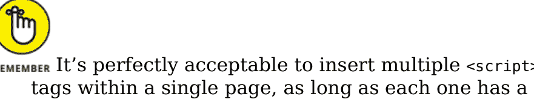

对应的 `</script>` 标签，只要你不是把一个 `<script>` 块放在另一个内部即可。

### 示例 1：向用户显示消息

你现在准备好构建并尝试你的第一个脚本了。这个示例向你展示了简单的 JavaScript 动作：向用户显示一条基础消息。以下代码显示了 HTML 文件中的脚本：

```html
<!DOCTYPE html>
<html lang="en">
<head>
  <meta charset="utf-8">
  <title>向用户显示消息</title>
  <script>
    alert("Hello JavaScript World!");
  </script>
</head>
<body>
</body>
</html>
```

如所示，将脚本放置在页头部，保存文件，然后在浏览器中打开该 HTML 文件。

此脚本只包含了一行：

```javascript
alert("Hello JavaScript World!");
```

这被称为语句（`statement`），每个语句都旨在执行单一的 JavaScript 任务。你的脚本范围将从只有几个语句的简单程序到由数百条语句组成的大型项目。

在示例中，该语句运行 JavaScript 的 `alert()` 方法，该方法会向用户显示括号内包含任何消息（可以是欢迎信息、您网站新功能的公告、促销活动广告等）。

图 1-1 显示了当你打开该文件时出现的消息。

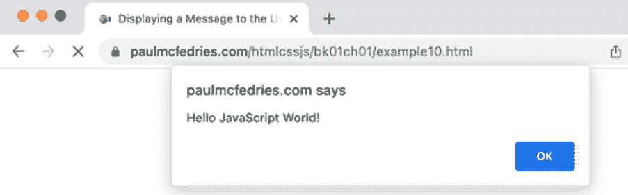

**图 1-1：** 当你打开包含示例脚本的 HTML 文件时，会显示这个“alert”消息。

浏览器是如何知道要运行该 JavaScript 语句的？当浏览器处理（口语中称为*解析*，`parses`）一个页面时，它基本上是从 HTML 文件的开始处开始一行一行地向下工作。如果它遇到了 `<script>` 标签，它就知道后面将出现一个或多个 JavaScript 语句，并在读取到这些语句后，按照顺序自动执行它们。唯一的例外是 JavaScript 语句被包含在*函数*（`function`）中，我将在第 5 章中进行解释。

> **警告** JavaScript 编程的核心准则之一是“一条语句一行”。也就是说，每个语句必须只出现在单行中，且每行不应超过一个语句。我在上一句的第二部分说“应该”，是因为只要你用分号（`;`）将每个语句隔开来，就可以将多个语句放在同一行中。虽然在少数情况下有必要在一行中放置两个或多个语句，但在编程的大部分时间内，你应该避免这样做，因为包含多个语句的行难以阅读和排查故障。

### 示例 #2：向页面写入文本

JavaScript 最强大的功能之一是能够动态地向网页写入文本，甚至是 HTML 标签。也就是说，当网络浏览器加载页面时，文本（无论内容如何）会被插入到页面中。这有什么用呢？首先，它对于时间敏感的数据是非常理想的。例如，你可能希望显示日期和网页最后修改的时间，以便访问者知道页面的新旧程度。这里有一段仅显示了脚本的代码：

```html
<!DOCTYPE html>
<html lang="en">
<head>
  <meta charset="utf-8">
  <title>向页面写入数据</title>
</head>
<body>
  这是一行普通的文本。<br>
  <script>
    document.write("Last modified: " + document.lastModified);
  </script>
  <br>这是另一行普通的文本。
</body>
</html>
```

注意脚本是如何出现在 HTML 文档的 `<body>` 中的，每当你想向页面写入数据时，这都是必要的。图 1-2 显示了结果。

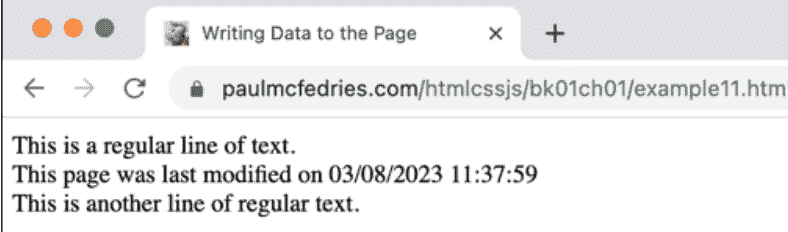

**图 1-2：** 当你打开文件时，文本显示了文件最后修改的日期和时间。

此脚本使用了 `document` 对象，这是一个内置的 JavaScript 结构，指向脚本所在的 HTML 文件（`document`）（有关 `document` 对象的更多信息，请参阅第 6 章）。`document.write()` 语句告诉浏览器将括号内的任何内容插入网页。`document.lastModified` 部分返回文件最后更改并保存的日期和时间。

### 入门准备

HTML 和 CSS 最棒的一点在于，入门时需要跨越的障碍不仅很短，而且数量很少。事实上，你只需要两样东西，而且都是免费的：一个用于输入文本、标签和属性的文本编辑器；以及一个用于查看结果的浏览器。（你还需要一个 Web 服务器来托管完成后的页面，但在创建页面时不需要服务器。）是的，有高端文本编辑器和华丽的图形程序，但这些属于“附加功能”（Bells and Whistles）类别；没有它们，你也可以创建非常体面的网页。

JavaScript 编程的基本要求与 HTML 完全相同：一个文本编辑器和一个浏览器。同样，有很多程序可以帮助你编写和测试脚本，但你并不需要。

### 处理两种特殊情况

在书中，我针对发布到网上后访问页面的人做了两个 JavaScript 假设：

- 这些人在他们的网络浏览器中启用了 JavaScript。
- 这些人使用的是较新的现代网络浏览器版本，例如 Chrome、Edge、Safari 或 Firefox。

这些是相当安全的假设，但稍微“偏执”一点，思考一下你如何处理那极小比例没有通过一个或两个测试的人是有好处的。

### 处理禁用 JavaScript 的浏览器

你不需要担心网络浏览器无法处理 JavaScript，因为所有现代浏览器已经支持 JavaScript 长期了。不过，你可能需要担心那些不支持 JavaScript 的人。虽然罕见，但仍有人关闭了浏览器的 JavaScript 功能。人们为什么要这样做呢？许多人禁用 JavaScript 是因为他们担心安全，不希望 cookie 被写入他们的硬盘等等。

为了处理这些特立独行者，请在页面的 `<body>` 内放置 `<noscript>` 标签：

```html
<noscript>
<p>
  嘿，你的浏览器禁用了 JavaScript！
</p>
<p>
  好的，很酷，也许你更喜欢这个<a href="no-js.html">非 JavaScript 版本</a>的页面。
</p>
</noscript>
```

如果浏览器启用了 JavaScript，则不会显示 `<noscript>` 标签内的内容。

要在禁用 JavaScript 的情况下测试网站，以下是常用浏览器的方法：

- **Chrome (桌面版):** 打开设置，点击隐私和安全，点击网站设置，然后选择“不允许使用 JavaScript”。
- **Chrome (Android):** 打开设置，点击网站设置，点击 JavaScript。
- **Edge:** 打开设置，点击设置菜单，点击 Cookie 和网站权限，点击 JavaScript，然后关闭允许开关。
- **Safari (macOS):** 打开设置，点击高级，选择“在菜单栏显示开发菜单”，然后关闭设置。选择开发 > 禁用 JavaScript。
- **Safari (iOS 或 iPadOS):** 打开设置，点击 Safari，点击高级，然后关闭 JavaScript 开关。
- **Firefox (桌面版):** 在地址栏输入 `about:config` 并按回车。如果 Firefox 显示警告页面，点击接受风险并继续显示高级偏好。在搜索偏好项中输入 `javascript.enabled`。在该偏好的右侧，点击切换按钮将值从 `true` 改为 `false`。

### 处理非常旧的浏览器

在书中，你学习的是名为 ECMAScript2015 的 JavaScript 版本，也称为 ECMAScript 6 或简单的 ES6。为什么是这个版本，而不是后续的版本？原因有两个：

- ES6 具有良好的浏览器支持，目前超过 98% 的浏览器都支持 ES 6 发布的功能。后续版本的 JavaScript 支持率较少。
- ES6 包含了你为页面添加各种实用且有趣的动态功能所需的所有内容。

那么，那少数不支持 ES6 的浏览器该怎么办？

首先，要知道不支持 ES6 特性的浏览器数量每天都在减少。诚然，现在是 2%（实际上是 1.7%），但六个月后将变为 1%，一年后将变为 0.5%，以此类推，直到数字小到无法测量。

其次，不支持 ES6 的浏览器百分比随地区而异（例如在非洲许多国家更高），并随环境而异。大多数那些运行不能完全支持 ES6 的浏览器的人正在使用 Internet Explorer 11，而其中大多数人处于无法升级的环境中（例如，某些企业环境）。

如果运气不佳，你的网页有很大比例的用户在这些旧浏览器上运行，那么你可能需要放弃 ES6 的强大特性，转而使用 ECMAScript 5 中经过久验证的特性。为此，当我介绍每个新的 JavaScript 特性时，我都会指出哪些是随 ES6 引入的，如果你倾向于使用 ES5，我会告诉你是否有简单的回退方案或变通方法（在 JavaScript 术语中被称为 `polyfill`，补丁）。

### 为代码编写注释

一个仅包含几行的脚本通常易于阅读和理解。然而，你的脚本不会长期保持简单，这些更长、更复杂的作品将变得相应难以阅读。（如果你在首次编写代码几周或几个月后再次查看代码，这种难度会变得格外严峻。）为了帮助你解读自己的代码，在整个脚本中大量使用注释是一种良好的编程习惯。注释是描述或解释某个语句或一组语句的文本。浏览器会忽略注释，因此你可以根据需要添加尽可能多的注释。

对于简短的单行注释，请使用双斜杠（`//`）。将 `//` 放在行的开头，然后在其后输入你的注释。这是一个示例：

```javascript
// 显示页面最后修改的日期和时间
document.write("This page was last modified on " + document.lastModified);
```

你也可以使用 `//` 注释编写两或三行文本，只要每行都以 `//` 开头即可。然而，如果你的注释超过了这种长度，最好使用以 `/*` 开头并以 `*/` 结尾的多行注释。这是一个示例：

```javascript
/*
此脚本演示了 JavaScript 的能力，
通过使用 document.write() 方法向网页写入文本，以显示网页文件最后修改的日期和时间。
*/
```

> **警告** 虽然在刚开始时添加很多注释是可以的，但你不需要对每个内容都添加注释。如果一个语句是微不足道的，或者其目的显而易见，请忘记注释并继续写吧。

### 迁移到外部 JavaScript 文件

在本章前面的部分，我讨论了如何通过在页面头部插入 `<script>` 和 `</script>` 标签（即在 `<head>` 和 `</head>` 标签之间），或者有时在页面主体中（即 `<body>` 和 `</body>` 标签之间）来向网页添加 JavaScript 代码。然后你在 `<script>` 和 `</script>` 标签之间编写你的代码。

如果脚本相对较短，将脚本放在页面内部并没有问题。然而，如果你的脚本（或多个脚本）占据几十或数百行代码，你的 HTML 代码看起来就会很杂乱。你可能遇到的另一个问题是在多个页面上需要相同的代码。诚然，你可以只需将代码复制到每个需要的页面中，但如果你以后对其进行了更改，你需要更新每个使用该代码的页面。

这两个问题的解决方案是将代码从 HTML 文件中移动到外部 JavaScript 文件中。移动代码可以将 HTML 文件中 JavaScript 的占用量减少到单行（你很快就会学到），并且意味着你只需要编辑外部文件即可更新代码。

关于使用外部 JavaScript 文件，需要注意以下几点：

- 文件必须使用纯文本格式。
- 命名文件时使用 `.js` 扩展名。
- 不要在文件内部使用 `<script>` 标签。只需像在 HTML 文件中一样直接输入你的语句。
- 浏览器执行外部文件中语句的规则与 HTML 文件内语句的规则完全相同。也就是说，函数之外的语句会在浏览器遇到你的文件引用时自动执行，而函数内部的语句在函数被调用之前不会执行。（不确定什么是“函数”吗？你将在第 5 章中获得完整信息。）

为了让浏览器知道外部 JavaScript 文件的存在，为 `<script>` 标签添加 `src` 属性。例如，如果外部文件名为 `myscripts.js`，你的 `<script>` 标签设置如下：

```html
<script src="myscripts.js">
```

此示例假设 `myscripts.js` 文件与 HTML 文件位于同一个目录下。如果文件位于不同的目录，请相应调整 `src` 值。例如，如果 `myscripts.js` 文件位于名为 `scripts` 的子目录中，你应该使用：

```html
<script src="scripts/myscripts.js">
```

你甚至可以通过指定完整的 URL 作为 `src` 值来指定另一个网站的文件（最好是你自己的！）：

```html
<script src="http://www.host.com/myscripts.js">
```

作为一个示例，以下代码显示了一个名为 `footer` 的单行外部 JavaScript 文件：

```javascript
document.write("This page is Copyright " + new Date().getFullYear());
```

该语句写入文本 "Copyright" 后面跟着当前年份。（我知道这段代码现在看起来像是胡言乱语。别担心，当我在第 8 章讨论 JavaScript Date 对象时，你将完全明白这里发生了什么。）

以下代码显示了一个包含外部 JavaScript 引用的 HTML 文件：

```html
<!DOCTYPE html>
<html lang="en">
<head>
    <meta charset="utf-8">
    <title>Using External File</title>
</head>
<body>
    <p>
        你的内容放在这里。
    </p>
    <hr>
    <footer>
        <script src="footer.js"></script>
    </footer>
</body>
</html>
```


**图 1-3** 此页面使用外部文件。

## 第 2 章：使用变量编程

### 在本章中

- 理解变量
- 为变量赋值
- 介绍数据类型
- 理解数字
- 字符串拼接

### 理解变量

为什么脚本需要短期记忆？因为在编码时出现的最常见概念之一就是需要存储一个临时值。在大多数情况下，你希望在同一个脚本的后续使用该值。然而，你可能在其他脚本中使用它、填充 HTML 表单，或者作为更大更复杂计算的一部分。

例如，你的页面可能有一个按钮可以在大字体和普通字体大小之间切换，因此你需要某种方式来“记住”那个选择。同样，如果你的脚本执行计算，你可能需要留出一个或多个计算值。例如，如果你正在构建一个购物车脚本，你可能需要计算税费。为了这一点，你必须首先计算订单总额，存储该值，然后取其百分比来计算税费。

在编程中，你为以后保存值的方法是将其存储在变量中。变量是内存中的一小块区域，用于存放一段程序数据。好消息是，从内存存储和检索数据的细节都在后台自动完成，因此你不需要担心这些。作为编码员，与变量工作只涉及三件事：

1. 创建（声明）变量
2. 为这些变量赋值
3. 在代码的其他语句中包含变量

接下来的三个章节将详细介绍这些。

### 使用 `let` 声明变量

在编程术语中，创建变量的过程被称为“声明”（`declaring`）。所有声明的意义实际上是你为变量提供一个名称，并告诉浏览器在内存中留出一块空间，以存储你最终存入变量中的任何值。在 JavaScript 中，声明变量时你使用 `let` 关键字，后面跟着一个空格、变量名以及通常的行尾分号。例如，要声明一个变量 `interestRate`，你可以使用以下语句：

```javascript
let interestRate;
```

> **记住** 在你的脚本中声明变量时，请记住以下几点：
>
> - **变量只声明一次：** 尽管你可以在脚本中根据需要多次使用一个变量，但你只需要声明该变量一次。尝试多次声明同一个变量会导致错误。
> - **使用注释描述每个变量：** 变量往往会增多到难以记住每个变量代表什么的程度。你可以在变量声明后紧跟着添加注释，从而使每个变量的用途变得清晰，如下：
>
> ```javascript
> let interestRate; // 用于贷款计算的年利率
> ```
>
> - **在运行变量之前声明它：** 如果你在声明变量之前就使用它，将会得到错误。
> - **在运行变量之前紧邻声明它：** 如果你遵循这一简单规则，你的编程和调试（参考第 9 章）生活将变得容易得多：在变量第一次使用之前（或尽可能靠近第一次使用的地方）声明它。

> **记住** `let` 关键字是在 ECMAScript 2015 (ES6) 中引入的。如果你需要支持非常老旧浏览器——我指的是 Internet Explorer 11 及更早版本——请改用 `var` 关键字。

### 在变量中存储值

变量声明后，你的下一个任务是给它赋一个值。你使用赋值运算符——等号 (`=`)——将值存储在变量中，如下通用语句所示：

```javascript
variableName = value;
```

这是一个为名为 `interestRate` 的变量赋值值 `0.06` 的示例：

```javascript
interestRate = 0.06;
```

同样注意，如果你提前知道变量的初始值，可以把声明和初始赋值合并为一个语句，如下：

```javascript
let interestRate = 0.06;
```

必须记住，对于使用 `let` 关键字声明的变量，你可以随心所欲更改该变量的值。例如，如果你赋给 `interestRate` 变量的值是年利率，稍后你的代码可能需要处理月利率，即年利率除以 12 的结果。与其用手计算，不如直接在代码中使用除法运算符 (`/`) 将其放入代码中：

```javascript
interestRate = 0.06 / 12;
```

关于变量赋值的最后一点，请看一种经常让初学者感到困惑的变体。具体来说，你可以设置一个语句，通过更改变量现有值来为变量赋新值。这里有一个示例：

```javascript
interestRate = interestRate / 12;
```

这种语句看起来可能有点不符合逻辑。一个东西怎么能等于它自己除以 12 呢？理解此类语句的秘密在于记住，浏览器总是先评估语句的右侧——即等号 (`=`) 右侧的表达式。换句话说，它获取 `interestRate` 的当前值（`0.06`），并将其除以 12。最后，得到的结果会被存储在 `interestRate` 中。关于运算符和表达式的更深入讨论，请查看第 3 章。

> **记住** 由于这种“先评估表达式、后存储结果”的行为，JavaScript 的赋值语句不应被读为“变量等于表达式”。相反，将它们视为“变量被设置为表达式”或“变量取表达式所给的值”会更符合逻辑。这样读取赋值语句有助于强化一个重要概念：表达式的结果正在被存储在变量中。

### 检查另一种声明变量的方法：`const`

“variable”（变量）一词意味着赋给变量的值是允许改变的，这你声明的大多数变量都是如此。大多数是，但不是所有。有时，你的脚本可能需要使用一个保持不变的值。例如，假设你正在构建一个将英里转换为公里的计算器。转换因子是 `1.60934`，该值在你的整个脚本运行期间将保持不变。

为了便于阅读，将此类值存储在变量中是一种良好的编程习惯。然而，如果你在此声明中使用 `let`，你可能会面临在代码某处意外更改该值的风险，因为用 `let` 声明的变量是可以改变的。

为了避免意外更改你想要保持不变的值，你可以使用 `const` 来声明变量。语法如下：

```javascript
const variableName = value;
```

注意，与 `let` 不同，当你用 `const` 声明变量时，必须为它赋值。这是一个声明变量 `milesToKilometers` 并为其赋值 `1.60934` 的示例：

```javascript
const milesToKilometers = 1.60934;
```

> **记住** 使用 `const` 相比 `let` 有什么实际优势吗？是的，有两个：
>
> - 使用 `const` 关键字提醒你正在处理一个不会改变的值。
> - 如果你尝试更改用 `const` 声明的变量的值，将产生错误。

> **提示** 鉴于这些优势，许多 JavaScript 程序员使用 `const` 声明每个变量，并只对他们知道会变化的变量使用 `let`。随着代码的进展，如果你发现某个变量需要更改，可以回去将 `const` 改为 `let`。

### 在语句中使用变量

在声明变量并为其赋值后，你就可以在语句中使用该变量了。当浏览器遇到该变量时，它会进入计算机内存，检索变量的当前值，然后将其替换到语句中。以下代码是一个示例：

```javascript
let interestRate = 0.06;
interestRate = interestRate / 12;
document.write(interestRate);
```

这段代码声明了一个值为 `0.06` 的变量 `interestRate`；它将该值除以 12并将结果存储在变量中。`document.write()` 语句显示变量的当前值，如图 2-1 所示。

以下代码显示了一个稍不同的示例：

```javascript
let firstName;
firstName = prompt("告诉我你的名字:");
document.write("欢迎访问我的网站，” + firstName);
```

该脚本使用 `prompt()` 方法（稍后会介绍）询问用户的名字，如图 2-2 所示。当用户点击 OK 时，他们的名字被存储在 `firstName` 变量中。随后，脚本使用 `document.write()` 语句结合 `firstName` 变量显示个性化的欢迎消息，如图 2-3 所示。

> 记住，当你需要从用户获取数据时，请运行 `prompt()` 方法：
>
> ```javascript
> prompt(string, default);
> ```
>
> 以下是各个部分的含义：
>
> - `string`：一个字符串，用于指示用户在提示框中输入什么内容。
> - `default`：一个可选字符串，用于指定在提示框中显示的初始值。
>
> `prompt()` 方法始终会返回一个值：
>
> - 如果用户点击“确定”，`prompt()` 返回用户在提示文本框中输入的值。
> - 如果用户点击“取消”，`prompt()` 返回 `null`。

### 变量命名：规则与最佳实践

如果你想编写清晰、易于遵循且易于调试的脚本（谁不想呢？），通过对你使用的变量名进行仔细思考，你可以朝着这一目标迈进。本节将通过介绍你需要遵循的规则，并提供一些创建良好变量名的提示和指南来帮助你。

### 变量命名规则

JavaScript 的变量规则很少：

- 第一个字符必须是字母或下划线 (`_`)。不能使用数字作为第一个字符。
- 变量名的其余部分可以包含任何字母、数字或下划线。不能使用任何其他字符，包括空格、符号和标点符号。
- 与 JavaScript 的其他部分一样，变量名对大小写敏感。也就是说，名为 `InterestRate` 的变量被视为与名为 `interestRate` 的变量完全不同的变量。
- 变量长度没有限制。
- 你不能使用 JavaScript 的保留字作为变量名（例如 `let`、`const`、`var`、`alert` 或 `prompt`）。所有的编程语言都有一组语言内部使用的词，这些词不能用变量名，因为这样做会导致混乱（或更糟）。

### 良好变量名的建议

声明变量的过程并不费脑，但这并不意味着你应该随手输入脑子里想到的任何变量名。多花几秒钟时间遵循以下指南想出一个好名字：

- 让你的名称具有描述性。诚然，使用仅几个字符的名字会让输入更简单，但我保证，当你以后查看脚本时，你不会记得这些变量代表什么。例如，如果你想让一个变量代表账户号码，请使用 `accountNumber` 或 `accountNum`，而不是 `acnm` 或 `accnum`。
- 使用不带空格的多个单词。创建描述性变量名的最佳方法是使用多个单词。然而，因为 JavaScript 不喜欢名称中出现空格，你需要某种方式来分隔单词以保持名称的可读性。使用多单词变量名的两种标准约定是驼峰命名法（`camelCase`），即将单词挤在一起并将每个单词的首字母大写（例如 `lastName`），或者用下划线分隔每个单词（例如 `last_name`）。我更倾向于前一种风格，因此我在书中一直都使用它。
- 使用不同的命名规范。为 JavaScript 变量使用一种命名规范，为 HTML 标识符和 CSS 类使用另一种规范。例如，如果你对多单词的 JavaScript 变量使用驼峰命名法，则使用连字符来分隔 id 值和类名中的单词。
- 将你的变量名与 JavaScript 关键字区分开。尽量让你的变量名看起来与 JavaScript 的关键字和其他内置术语（如 `alert`）尽可能不同。区分变量名有助于避免当看到一个术语却不记得它是变量还是 JavaScript 词汇时可能产生的混乱。
- 不要让你的名字太长。虽然应该摒弃短小而晦涩的变量名，转而使用更长、描述性的名称，但这并不意味着你应该使用整个句子。极长的名字是低效的，因为输入需要花费长时间，而且它们很危险，因为名称越长，你越可能拼错。2 到 4 个单词、8 到 20 个字符的名字就足够了。

### 理解字面量类型

在编程中，变量的*数据类型*指定了变量内存储的数据种类。数据类型是一个关键概念，因为它不仅决定了两个或多个变量如何组合（例如数学上），还决定了它们是否可以组合。*字面量*是一种特殊类型，涵盖固定（即使是暂时的）的值。例如，考虑以下变量赋值语句：

```javascript
let todaysQuestion = "What color is your parachute?";
```

在这里，文本 "What color is your parachute?" 是字符串常量值。JavaScript 支持三种字面量数据类型：数字、字符串和布尔。接下来的三节将讨论每个类型。

### 使用数字字面量

与其他编程语言不同，JavaScript 对所有数字视为相同，因此在处理两个基本数字字面量（整数和浮点数）时，你不需要进行特殊操作：

- **整数**：这些没有小数部分的数字。因此，你使用一个或多个数字的序列表示整数，如这些示例所示：

```
0
42
2001
-20
```

- **浮点数**：这些具有小数部分的数字。因此，你通过先写整数部分，然后是小数点，最后是小数部分来表示浮点数，如这些示例所示：

```
0.0
3.14159
-273.15
```

### 指数计数法

指数计数法用于表示非常大或非常小的数字。它使用 `e`（或 `E`）后跟指数，即 10 的幂。这是表示带有许多零的数字有效方法。

以下示例展示了如何使用指数法：

```
1.23e+4
4.56e-3
```

- `1.23e+4` 等于 `1.23` 乘以 `10^4`。
- `4.56e-3` 等于 `4.56` 乘以 `10^-3`。

### 十六进制整数值

十六进制系统使用数字 0 到 9 和字母 A 到 F（或 a 到 f），这些字母代表数字 10 到 15。在 JavaScript 中指定十六进制数时，该数字以 `0x`（或 `0X`）开头，如下：

```
0x23
0xff
```

### 使用字符串字面量

字符串字面量是一个或多个字母、数字或标点符号的序列，由双引号（`""`）或单引号（`''`）包围。这里是一些示例：

```javascript
"JavaScript Essentials";
'August 23, 1959';
""
"What's the good word?";
```

记住连续的引号 `""` 或 `''` 被称为空字符串。它代表一个不包含任何字符的字符串。

### 在字符串中使用引号

上一节的最后一个示例显示，在由另一种引号（如 `"`）包围的字符串内部插入一个或多个引号实例（如 `'`）是允许的。当你需要将一个字符串嵌入另一个字符串时，嵌套引号会非常有用，这非常常见（特别是在 HTML 标签中使用部分 JavaScript 时）。这里有一个示例：

```html
onsubmit="processForm('testing')";
```

然而，在字符串内部插入与闭合字符串相同的引号是不允许的，如此示例所示：

> This is "illegal" in JavaScript.";

### 理解转义序列

如果你必须在由双引号包围的字符串内部包含（例如）双引号，怎么办？嵌套相同类型的引号的情况很少见，但如果你在双引号前面加一个反斜杠 (`\`)，就是可能的，如下所示：

> "The double quotation mark (\") encloses this string."

这种 `\"` 组合被称为转义序列。你可以将反斜杠与其他许多字符组合以形成其他转义序列，每个转义序列都能让浏览器表示一个其本身是违法的或无法通过其他方式表示的字符。

表 2-1 列出了最常用的转义序列。

### 表 2-1 常见的 JavaScript 转义序列

| 转义序列 | 它代表的字符 |
|---|---|
| `\'` | 单引号 |
| `\"` | 双引号 |
| `\b` | 退格 |
| `\f` | 换页符 |
| `\n` | 换行 |
| `\r` | 回车 |
| `\t` | 制表符 |
| `\\` | 反斜杠 |

以下代码展示了一个示例脚本，它使用 `\n` 转义序列在警告框中显示多行文本。

```javascript
alert("This is line 1.\nSo what. This is line 2.");
```

图 2-4 显示了结果。

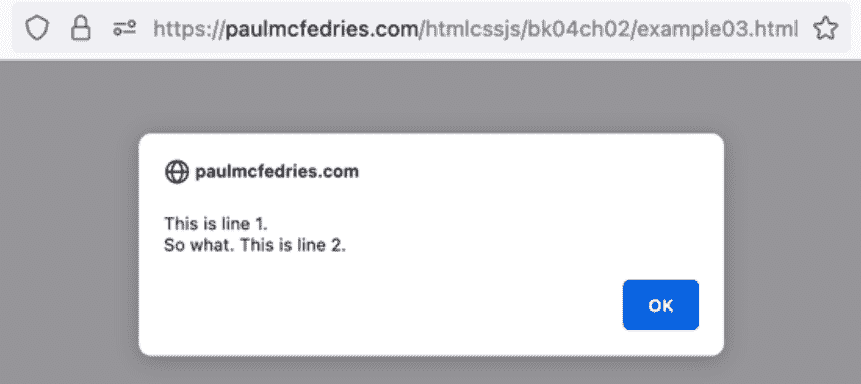

图 2-4：使用 `\n` 转义序列允许你对文本进行格式，使其在不同的行显示。

学习如何组合两个或多个字符串字面量，请查看第 3 章。此外，JavaScript 有一系列很好的字符串处理功能，我在第 8 章中讨论了它们。

### 使用布尔字面量

布尔值是所有字面量数据类型中最简单的，因为它们只能取两个值之一：`true` 或 `false`。这种简单性可能让布尔值看起来并不特别，但在 JavaScript 编程中，测试特定变量或条件是否为真或假的能力是无价的。

你可以直接将布尔字面量赋值给变量，如下：

```javascript
taskCompleted = true;
```

或者，你也可以通过表达式隐式地处理布尔值：

```javascript
currentMonth === "August"
```

比较表达式 `currentMonth === "August"` 询问：变量 `currentMonth` 的值是否等于字符串 "August"？如果是，该表达式求值为布尔值 `true`；如果不是，表达式求值为 `false`。我在第 3 章中讨论了更多关于比较的内容。

## 第 3 章：构建表达式

### 本章内容

- 理解什么是表达式
- 弄懂数值表达式
- 连接字符串表达式
- 掌握比较表达式
- 学习逻辑表达式

在 JavaScript 中编写代码时，你不断地使用表达式，因此理解它们是什么以及熟悉你可以使用的表达式类型至关重要。每个 JavaScript 程序员都不同，但我可以毫无保留地说，每个优秀的 JavaScript 程序员都精通表达式。

本章将带你了解关于表达式你需要的所有知识。你将发现一些表达式的基础知识，然后探索许多使用数字、字符串和布尔值构建强大表达式的技巧。

### 理解表达式的结构

一个 JavaScript 表达式接收一个或多个输入（例如账单总额和小费百分比），并以某种方式将它们结合——例如使用乘法。在表达式术语中，输入被称为操作数（`operands`），它们通过称为运算符（`operators`）的特殊符号进行组合。

- **操作数**：表达式的输入值。换句话说，它是表达式处理以产生结果的原始数据。它可以是一个数字、字符串、函数结果（参见第 5 章）或对象属性（参见第 6 章）。
- **运算符**：代表对一个或多个操作数执行特定操作的符号。例如，`*` 运算符表示乘法，`+` 运算符表示加法。我在整个章节中都会讨论各种 JavaScript 运算符。

例如，这里有一个计算小费并将结果赋值给变量的表达式：

```javascript
tipAmount = billTotal * tipPercentage;
```

表达式是等号 (`=`) 右侧的所有内容。在这里，`billTotal` 和 `tipPercentage` 是操作数，乘号 (`*`) 是运算符。

### 创建数值表达式

在 JavaScript 中，数学计算被称为数值表达式，它结合数值操作数和算术运算符来产生数值结果。本节讨论了所有的 JavaScript 算术运算符，并展示了如何最好使用它们来构建实用且方便的数值表达式。

表 3-1 列出了你可以在 JavaScript 表达式中使用的基本算术运算符。

JavaScript 还带有几个额外的运算符，它们结合了一些算术运算符和赋值运算符，赋值运算符就是谦虚的等号 (`=`)，它用于给变量赋值。表 3-2 列出了这些所谓的算术赋值运算符。

### 表 3-1 JavaScript 算术运算符

| 运算符 | 名称 | 示例 | 结果 |
|---|---|---|---|
| `+` | 加法 | `10 + 4` | `14` |
| `++` | 递增 | `10++` | `11` |
| `-` | 减法 | `10 - 4` | `6` |
| `-` | 取反 | `-10` | `-10` |
| `--` | 递减 | `10--` | `9` |
| `*` | 乘法 | `10 * 4` | `40` |
| `/` | 除法 | `10 / 4` | `2.5` |
| `%` | 取模 | `10 % 4` | `2` |

### 表 3-2 JavaScript 算术赋值运算符

| 运算符 | 示例 | 等效于 |
|---|---|---|
| `+=` | `x += y` | `x = x + y` |
| `-=` | `x -= y` | `x = x - y` |
| `*=` | `x *= y` | `x = x * y` |
| `/=` | `x /= y` | `x = x / y` |
| `^=` | `x ^= y` | `x = x ^ y` |
| `%=` | `x %= y` | `x = x % y` |

### 构建字符串表达式

字符串表达式是指其中至少有一个操作数是字符串，且表达式的结果是另一个字符串的表达式。字符串表达式在意义上很直接，因为只有一个运算符需要处理：拼接 (`+`)。你使用这个运算符来连接字符串。例如，`"Hello" + "World"` 返回 `"HelloWorld"`。

### 构建比较表达式

你使用比较表达式来比较值。例如，如果你的代码需要测试两个值是否相等，你可以通过比较表达式来实现。你会频繁地使用比较，因此理解它们是什么以及如何使用它们非常重要。表 3-3 总结了 JavaScript 的比较运算符。

### 表 3-3 比较运算符

| 运算符 | 名称 | 示例 | 结果 |
|---|---|---|---|
| `==` | 等于 | `10 == 4` | `false` |
| `!=` | 不等于 | `10 != 4` | `true` |
| `>` | 大于 | `10 > 4` | `true` |
| `<` | 小于 | `10 < 4` | `false` |
| `>=` | 大于等于 | `10 >= 4` | `true` |
| `<=` | 小于等于 | `10 <= 4` | `false` |
| `===` | 严格相等 | `10 === 4` | `false` |
| `!==` | 严格不等 | `10 !== 4` | `true` |

### 构建逻辑表达式

你使用逻辑表达式来组合或处理布尔值。例如，如果你的代码需要测试两个比较表达式是否都为真，你可以通过逻辑表达式来实现。表 3-4 列出了 JavaScript 的逻辑运算符。

### 表 3-4 逻辑运算符

| 运算符 | 名称 | 通用语法 | 返回值 |
|---|---|---|---|
| `&&` | 与 | `expr1 && expr2` | 如果 `expr1` 和 `expr2` 都为真，否则为假 |
| `||` | 或 | `expr1 || expr2` | 如果 `expr1` 或 `expr2` 为真，则为真；否则为假 |
| `!` | 非 | `!expr` | 如果 `expr` 为假则为真，反之 |

### 理解运算符优先级

在复杂的表达式中，计算的顺序至关重要。例如，考虑表达式 `3+5*2`。如果你从左到右计算，得到的答案是 16 (3+5 等于 8，8*2 等于 16)。但如果你先执行乘法再加法，结果是 13 (5*2 等于 10，3+10 等于 13)。

为了解决这个问题，JavaScript 根据预定义的优先级来评估表达式。这种优先级让 JavaScript 无歧义地计算表达式，确定先计算哪部分，后计算哪部分，依此类推。

#### 优先级

JavaScript 使用的优先级由我在本章为止涵盖的各种表达式运算符决定。表 3-5 总结了完整的优先级。

例如，表 3-5 告诉你 JavaScript 先执行乘法后执行加法。因此，刚刚讨论的表达式 `3+5*2` 的正确答案是 13。

### 表 3-5 JavaScript 运算符优先级表

| 运算符 | 操作 | 优先级 | 求值顺序 |
|---|---|---|---|
| `++` | 递增 | 第一 | R -> L |
| `--` | 递减 | 第一 | R -> L |
| `-` | 否定 | 第一 | R -> L |
| `!` | 逻辑 (NOT) | 第一 | R -> L |
| `*`, `/`, `%` | 乘法、除法、取模 | 第二 | L -> R |
| `+`, `-` | 加法、减法 | 第三 | L -> R |
| `+` | 字符串拼接 | 第三 | L -> R |
| `<`, `<=` | 小于、小于等于 | 第四 | L -> R |
| `>`, `>=` | 大于、大于等于 | 第四 | L -> R |
| `==` | 等于 | 第五 | L -> R |
| `!=` | 不等 | 第五 | L -> R |
| `===` | 严格相等 | 第五 | L -> R |
| `!==` | 严格不等于 | 第五 | L -> R |
| `&&` | 与 (AND) | 第六 | L -> R |
| `||` | 逻辑 (OR) | 第六 | L -> R |
| `?` | 三元运算符 | 第七 | R -> L |
| `=` | 赋值 | 第八 | R -> L |
| `+=`, `-=`, `*=`, `/=` | 算术赋值 | 第八 | R -> L |

### 控制优先级

有时，你想要控制局面并覆盖优先级。这看起来可能像是一件非常奇怪的事情，所以也许有必要举个例子。假设你知道某件物品的最终价格，并且根据税率，你想知道原始价格（即税前价格）。

JavaScript 计算的第一次尝试可能看起来像这样：

```javascript
retailPrice = totalPrice / 1 + taxRate;
```

但这是行不通的。为什么呢？嗯，根据优先级规则，JavaScript 会在执行加法之前执行除法，因此 `totalPrice` 的值首先除以 1，然后加上 `taxRate` 的值，这并不是正确的顺序。

为了得到正确答案，你必须覆盖优先级，以便先执行 `1 + taxRate` 加法。你通过在表达式的该部分加上括号来覆盖优先级，如下代码所示：

```javascript
const retailPrice = totalPrice / (1 + taxRate);
```

通常情况下，你可以使用括号来控制 JavaScript 计算表达式的顺序。括号内的项总是先计算；括号外的项按顺序计算（根据优先级）。

## 第 4 章：控制 JavaScript 的流

### 本章内容

- 设置你的代码以做出决策
- 理解代码循环
- 设置代码循环

在默认的脚本流下，浏览器会一次一条地处理 `<script>` 元素内部或外部 JavaScript 文件中的代码。浏览器读取并执行第一条语句，读取并执行第二条语句，依此类推，直到没有更多的 JavaScript 代码需要读取和执行为止。

这种逐条语句的流看起来很合理，但它的局限性非常大。如果你想让你的代码测试某些条件，并根据测试结果跳转到特定的代码块该怎么办？如果你想让你的代码重复执行某些语句，并且每次重复都会发生一些变化呢？运行测试的代码和自我重复的代码都统属于**控制 JavaScript 的流**的范畴。在本章中，你将探索这个迷人且强大的主题。

### 使用 `if` 语句进行决策

一个智能的脚本会对其环境进行测试，然后根据每个测试的结果决定下一步做什么什么。例如，假设你声明了一个变量，稍后你将其用作表达式中的除数。在表达式中使用它之前，你应该对该变量进行测试，以确保变量的值不是 0。

最基础的测试是简单的真/假决策（也可以被认为是是/否决策或开/关的决策）。在这种情况下，你的程序查看某个条件，确定它当前是真还是假，并采取相应的行动。比较和逻辑表达式（在第 3 章中介绍过）在这里起着很大作用，因为它们会返回真或假的结果。

在 JavaScript 中，简单的真/假决策由 `if` 语句处理。你可以使用单行语法：

```javascript
if (expression) statement;
```

或者使用块语法：

```javascript
if (expression) {
  statement1;
  statement2;
  ...
}
```

在这两种情况下，`expression` 都是一个返回真或假的比较或逻辑表达式，而 `statement(s)` 代表如果 `expression` 返回真要运行的 JavaScript 语句或语句。如果 `expression` 返回假，JavaScript 将跳过这些语句。


> **提示** 这里是一个很好的地方说明，JavaScript 将以下值定义为 `false` 的等价物：`0`、`""`（即空字符串）、`null` 和 `undefined`。其他所有内容都是 `true` 的等价物。

记住，这是你第一次遇到 JavaScript 的大括号（`{` 和 `}`），所以请花一点时间理解它们的作用，因为它们经常出现。大括号包围了你想让 JavaScript 视为单个实体的一个或多个语句。这个实体本身就是一种语句，整体——大括号以及它们包含的代码——被称为**块语句**。此外，任何由一个语句（如 `if`）后跟一个块语句组成的 JavaScript 结构都称为**复合语句**。而且，为了让你保持警觉，请注意包含括号的行末尾不以分号结束。

使用单行语法还是块语法，取决于你想在表达式返回真结果时运行的语句。如果你有一条语句，可以使用这种语法。如果你有多个条语句，请使用块语法。

考虑以下示例：

```javascript
if (totalSales != 0) {
  const grossMargin = (totalSales - totalExpenses) / totalSales;
}
```

*(注：原文示例代码中 if 后面多了一个冗余的括号，此处保留原样)*

```javascript
if (totalSales != 0) {
  const grossMargin = (totalSales - totalExpenses) / totalSales;
}
```

这段代码假设之前已经计算了销售额（`totalSales`）和费用（`totalExpenses`）。代码现在计算利润，即销售额减费用除以销售额。代码使用 `if` 测试 `totalSales` 是否不零。如果 `totalSales != 0` 表达式返回真，则执行计算。

### 使用 `if...else` 进行分支

使用 `if` 语句进行决策为你的 JavaScript 武器库增加了一种强大的新武器。然而，简单的 `if` 语句有一个重要的局限性：假的结果只会跳过一个或多个语句；它不会执行任何内容。这在很多情况下是可以的，但有时你需要在条件返回真时运行一组语句，而在结果为假时运行另一组语句。为了处理这些情况，你需要使用 `if...else` 语句：

```javascript
if (expression) {
  statements-if-true
} else {
  statements-if-false
}
```

`expression` 是一个返回真或假的比较或逻辑表达式。`statements-if-true` 代表如果 `expression` 返回真你想运行的语句块，而 `statements-if-false` 代表如果 `expression` 返回假你要执行的语句块。

作为一个例子，考虑以下代码：

```javascript
let discountRate;
if (currMonth === "December") {
  discountRate = 0.2;
} else {
    discountRate = 0.1;
}
const discountedPrice = regularPrice * (1 - discountRate);
```

这段代码计算物品的折扣价格，折扣取决于月份是否为 12 月。代码假设之前脚本设置了当前月份（`currMonth`）和物品的原价（`regularPrice`）。在声明 `discountRate` 变量后，`if...else` 语句检查 `currMonth` 是否等于 "December"。如果是，将 `discountRate` 设置为 `0.2`；否则，将 `discountRate` 设置为 `0.1`。最后，代码使用 `discountRate` 值计算 `discountedPrice`。


> **提示** 当你对每个块中的语句进行缩进时，`if...else` 语句会更容易读，就像我在示例中做的那样。这种缩进让你轻松识别在结果为真时运行哪个块，在结果为假时运行哪个块。

### 理解代码循环的价值

有人认为程序员的唯一目标应该是完成任务。只要代码产生正确的结果或按正确的顺序执行正确的任务，其他一切都是多余的。也许吧，但真正的程序员知道，编程的目标不仅是完成任务，而且尽可能高效地完成任务。

高效的脚本运行速度更快，编码时间更短，并且通常（并非总是，但通常是）更容易阅读和排查故障。

在编码中引入效率的最佳方法之一是避免重复造轮子。例如，考虑以下代码段：

```javascript
let sum = 0;
let num = prompt("Type a number:", 1);
sum += Number(num);
num = prompt("Type a number:", 1);
sum += Number(num);
num = prompt("Type a number:", 1);
sum += Number(num);
document.write("The total of your numbers is " + sum);
```

这段代码声明了一个名为 `sum` 的变量。代码提示用户输入一个数字（使用 `prompt` 方法，默认值为 `1`），并将该数字存储在 `num` 变量中，将该值加到 `sum` 上，并重复这种“提示并累加”的例程两次。（注意我这里使用了 `Number` 函数，它确保了该值被视为数字而不是字符串。）最后，向用户显示这三个数字之和。

这段代码除了有点没用外，还充漫着低效的气息，因为大部分代码都是由以下两行重复三次：

```javascript
num = prompt("Type a number:", 1);
sum += Number(num);
```

如果你只在代码中写一次这两个语句，然后通过某种方式让 JavaScript 按照需要重复这些语句，难道不是会更高效吗？

是的，这样做会更高效。但好消息是，这不仅可行，而且 JavaScript 还为你提供了多种不同的方法来执行这种所谓的“循环”。我将在本章的剩余部分中研究这些每种方法。

### 使用 `while` 循环

JavaScript 循环结构中最直接的是 `while` 循环，它使用以下语法：

```javascript
while (expression) {
  statements
}
```

在这里，`expression` 是一个比较或逻辑表达式（即返回 `true` 或 `false` 的表达式），只要它返回 `true`，就会告诉 JavaScript 继续执行块内的语句。

本质上，JavaScript 对 `while` 循环的解释如下：“好的，只要 `expression` 保持为 `true`，我就一直运行循环体语句，但一旦 `expression` 变为 `false`，我就会离开。”

让我们仔细查看 `while` 循环是如何工作的：

1. 求值 `while` 语句中的表达式。
2. 如果 `expression` 为 `true`，继续执行第 3 步；如果 `expression` 为 `false`，跳转到第 5 步。
3. 执行块中的每条语句。
4. 返回第 1 步。
5. 退出循环（即执行 `while` 块之后的下一个语句）。

下面的代码演示如何使用 `while` 重写上一节所示的低效代码：

```javascript
let sum = 0;
let counter = 1;
let num;
while (counter <= 3) {
  num = prompt("Type a number:");
  sum += Number(num);
  counter += 1;
}
document.write("The total of your numbers is " + sum);
```

为了控制循环，代码声明了一个名为 `counter` 的变量并将其初始化为 `1`，这意味着表达式 `counter <= 3` 为 `true`，因此代码进入块执行提示并累加操作，然后增加 `counter`。这个过程会一直重复，直到循环第三次结束，此时 `counter` 增加到 `4`，表达式 `counter <= 3` 变为 `false`，循环结束。

为了让你的循环代码尽可能具有读性，请始终为 `while` 块中的每条语句使用两个或四个空格的缩进。这对我在本章后面介绍的 `for` 和 `do..while` 循环同样适用。

当你知道要运行多少次时，`while` 语句并不是最好的循环选择。对于这种情况，请使用下一节介绍的 `for` 语句。`while` 语句的最佳用法是脚本具有某些自然产生的条件，你可以将其转换为比较表达式。一个很好的例子是当你提示用户输入值时。你通常希望一直提示用户，直到他们点击“取消”按钮。设置这种最简单的方法是将 `prompt` 放在 `while` 循环内部，如下所示：

```javascript
let sum = 0;
let num = prompt("Type a number or click Cancel", 1);
while (num != null) {
  sum += Number(num);
  num = prompt("Type a number or click Cancel", 1);
}
document.write("The total of your numbers is " + sum);
```

第一个 `prompt` 方法显示一个类似图 4-1 所示的对话框来获取初始值；然后将其存储在 `num` 变量中。

**图 4-1：** 设置你的 `while` 表达式，以便用户点击“取消”按钮时停止提示。

然后 `while` 语句检查以下表达式：

```javascript
num != null
```

这里可能会发生两种情况：

- 如果用户输入了一个数字，此表达式返回 `true`，循环继续。在这种情况下，`num` 的值被加到 `sum` 变量中，并提示用户下一个数字。
- 如果用户点击“取消”，`prompt` 返回的值为 `null`，循环停止。

### 使用 `for` 循环

尽管 `while` 是最直接的，当你知道要运行多少次循环时，通常会使用 `for` 循环。`for` 的结构如下：

```javascript
for (start; expression; increment) {
  statements
}
```

`for` 循环遵循以下七步过程：

- **start**: 计数器的初始值。
- **expression**: 返回 `true` 或 `false` 的比较或逻辑表达式。
- **increment**: 告诉 JavaScript 修改计数器的表达式。
- **statements**: 你想每次执行的语句。

`for` 循环通常比 `while` 更高效，因为计数器的变量声明、初始化和增加都发生在 `for` 语句中。作为一个示例，下面的代码展示了如何使用 `for` 重写之前的低效代码：

```javascript
let sum = 0;
for (let counter = 1; counter <= 3; counter++) {
  num = prompt("Type a number:");
  sum += Number(num);
}
document.write("The total of your numbers is " + sum);
```

记住，为了让脚本中的变量尽可能少，始终尝试在所有的循环计数器中使用相同的名称。字母 `i` 到 `n` 通常用于计数器。为了更清晰，你可能更喜欢完整的单词，例如 `count` 或 `counter`。

这里有一个稍微复杂的例子：

```javascript
let sum = 0;
for (let counter = 1; counter < 4; counter += 1) {
  let num;
  let ordinal;
  switch (counter) {
    case 1:
      ordinal = "first";
      break;
    case 2:
      ordinal = "second";
      break;
    case 3:
      ordinal = "third";
  }
  num = prompt("Enter the " + ordinal + " number:", 1);
  sum += Number(num);
}
document.write("The average is " + sum / 3);
```

此循环的目的是向用户询问三个数字，然后显示这些数值的平均值。`for` 语句被设置为循环三次。（注意 `counter < 4` 之后，循环块的第一件事是使用 `switch` 确定 `ordinal` 变量的值：如果 `counter` 为 1，`ordinal` 被设置为 "first"；如果 `counter` 为 2，它变为 "second"；以此类推。这些值使得脚本在每次通过循环时都能带有提示信息（查看图 4-2）。每次循环，用户输入一个数字，该值会被加到 `sum` 变量中。当循环退出时，显示平均值。

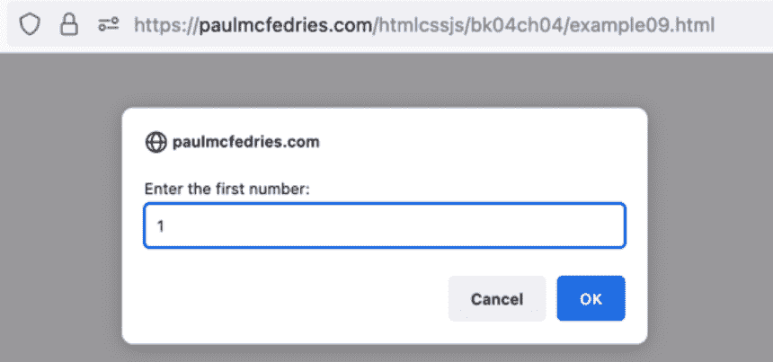

**图 4-2：** 此脚本使用计数器变量 `counter` 的当前值来定制提示消息。

也可以使用 `for` 循环进行倒计时。你可以通过使用减赋值运算符而不是加赋值运算符来实现这一点：

```javascript
for (let counter = start; counterExpression; counter -= 1) {
  statements
}
```

在这种情况下，你必须将 `counter` 变量初始化为你想要用于循环计数器的最大值，并使用 `counterExpression` 来比较 `counter` 的值与你想要结束循环的最小值。

在接下来的示例中，我使用一个递减计数器让用户按倒序排列他们喜欢三种 CSS 颜色：

```javascript
for (let rank = 3; rank >= 1; rank -= 1) {
  let ordinal;
  let color;
  switch (rank) {
    case 1:
      ordinal = "first";
      break;
    case 2:
      ordinal = "second";
      break;
    case 3:
      ordinal = "third";
  }
  color = prompt("What reason is your " + ordinal + "- favorite CSS color?", "");
  document.write(rank + " " + color + "<br>");
}
```

循环通过将 `rank` 变量从 3 减到 1 来运行。循环的每次迭代都会提示用户输入一种喜爱的 CSS 颜色，该颜色会被写入页面，并使用 `rank` 的当前值创建一个倒序列表，如图 4-3 所示。

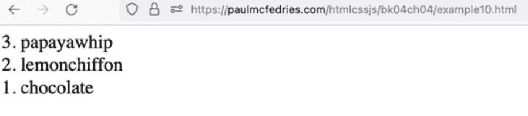

**图 4-3：** `rank` 变量的递减值用于创建一个倒序列表。


> 没有理由规定 `for` 循环计数器只能递增或递减。你实际上可以自由任何表达式来调整循环计数器的值。例如，假设你想让循环计数器只遍历奇数 1, 3, 5, 7 和 9。这里有一个可以实现该功能的语句：
>
> ```javascript
> for (let counter = 1; counter <= 9; counter += 2)
> ```
>
> 表达式 `counter += 2` 使用加赋值运算符告诉 JavaScript 增加 `counter` 变量。

### 使用 `do...while` 循环

JavaScript 有第三种也是最后一种类型的循环，我把它留到最后是因为你并不会经常使用它。要理解你何时可能会使用它，请考虑这段代码片段：

```javascript
let sum = 0;
let num = prompt("Type a number or click Cancel:", 1);
while (num != null) {
  sum += Number(num);
  num = prompt("Type a number or click Cancel:", 1);
}
```

代码需要第一个 `prompt` 语句以便求值 `while` 循环的表达式。用户可能不想输入任何数字，他们可以通过点击第一个提示框中的“取消”来避免，从而跳过循环。

这看起来很合理，但如果你的代码要求用户至少输入一个值呢？以下展示了更改代码以确保循环至少执行一次的方法：

```javascript
let sum = 0;
let num = 0;
while (num != null || sum === 0) {
  num = prompt("Type a number; when you're done, click Cancel:", 1);
  sum += Number(num);
}
document.write("Total of your numbers is " + sum);
```

变化之处在于代码将 `sum` 和 `num` 都初始化为 0。将两者初始化为 0 确保了 `while` 表达式 — `num != null || sum === 0` 在第一次通过循环时返回 `true`，因此循环至少会执行一次。如果用户立即点击“取消”，`sum` 仍然为 0，因此 `while` 表达式 — `num != null || sum === 0` 仍然返回 `true`，循环再次重复。

这种方法可行，但你也可以使用 `do...while` 循环来确保代码至少执行一次。以下是一种方法：

```javascript
let sum = 0;
let num = 0;
do {
  num = prompt("Type a number; when you're done, click Cancel:", 1);
  sum += Number(num);
} while (num != null || sum === 0);
document.write("Total of your numbers is " + sum);
```

## 第 5 章：利用函数的威力

### 本章内容

- 了解函数
- 创建和使用函数
- 传递和返回值
- 使用箭头函数

几乎每个函数都是代码块。在本章中，你将探索函数领域。

### 了解函数结构

函数是一组可重用的 JavaScript 语句。函数的的基本结构如下：

```javascript
function name(arguments) {
  statements
}
```

以下是函数部分的总结：

- **function**：标识随后的代码块。
- **name**：函数的唯一名称。
- **arguments**：传递给函数的一个或多个值，并在函数内部作为变量使用。
- **statements**：执行任务的代码。

同样注意大括号 `{ }` 的使用。它们用于将函数语句封装在一个块中，这告诉你（以及浏览器）函数代码的开始和结束位置。这些大括号出现只有两个规则：

- 左大括号必须出现在函数括号之后、第一个语句之前。
- 右大括号必须出现在最后一个函数语句之后。

### 调用函数

在定义函数后，你最终需要告诉浏览器执行（或调用）该函数。有三种主要方法可以：

- 当浏览器解析 `<script>` 标签时
- 在页面加载后
- 响应事件（例如用户点击按钮）

#### 当浏览器解析 `<script>` 标签时

调用函数最简单的方法是在你的脚本中包含一个仅由函数名加括号组成的语句（假设你的函数没有使用参数）。下面的代码提供了一个示例（我列出了整个页面，向你展示函数及其调用的语句出现在页面代码中的位置）。

```html
<!DOCTYPE html>
<html lang="en">
<head>
  <meta charset="utf-8">
  <title>在解析 <script> 标签时调用函数</title>
  <script>
    function displayGreeting() {
      const currentHour = new Date().getHours();
      if (currentHour < 12) {
        console.log("Good morning!");
      } else {
        console.log("Good day!");
      }
    }
    displayGreeting();
  </script>
</head>
<body>
</html>
```

`<script>` 标签包含一个名为 `displayGreeting` 的函数，该函数根据当前时间判断是否为早上，并向控制台写入问候信息（请查看图 5-1；你将在第 9 章学习控制台）。该函数由紧接在函数之后的 `displayGreeting()` 语句调用。

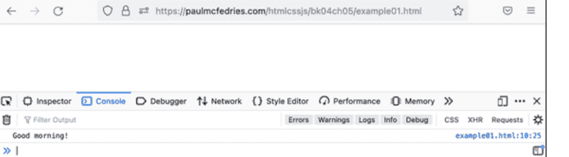

**图 5-1：** 在解析 `<script>` 标签时调用函数的示例。

#### 当页面加载完成后

如果你的函数引用了页面元素，那么在页面的 `<head>` 部分内部调用该函数将不起作用，因为当浏览器解析脚本时，页面的其余部分尚未加载，因此你的元素引用将失败。

为了解决这个问题，请在 `<body>` 部分的末尾、结束标签 `</body>` 标签之前放置另一个 `<script>` 标签，如下所示：

```html
<!DOCTYPE html>
<html lang="en">
<head>
  <meta charset="utf-8">
  <title>页面加载后调用函数</title>
  <script>
    function makeBackgroundRed() {
      document.body.style.backgroundColor = "red";
      console.log("The background is now red.");
    }
  </script>
</head>
<body>
  <!-- 其他 body 元素放在此处 -->
  <script>
    makeBackgroundRed();
  </script>
</body>
</html>
```

`makeBackgroundRed` 函数做了两件事：它使用 `document.body.style.backgroundColor` 将 `<body>` 元素的背景颜色改为红色，并使用 `console.log` 在控制台上打印一条相应的消息。

在函数中，`document.body` 是 `<body>` 元素的引用，它在页面完全加载之前并不“存在”。这意味着如果你尝试在初始脚本中调用该函数，将得到错误。为了正确执行该函数，在 `<body>` 元素的底部会出现第二个 `<script>` 标签，该脚本通过以下语句调用该函数：

```javascript
makeBackgroundRed();
```

当浏览器执行该语句时，`<body>` 元素已经存在，因此函数无错误运行（请查看图 5-2）。

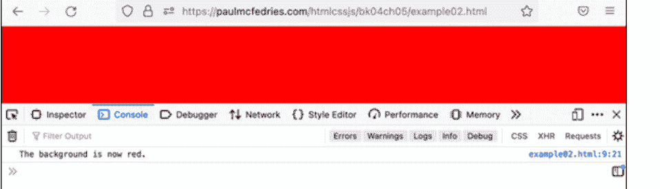

**图 5-2：** 在页面加载后调用函数的示例。

#### 当事件触发时

JavaScript 函数响应某些事件被调用的常用方式之一。事件是一个如此重要的话题，以我在第 6 章中花了大量篇幅讲解它们。现在，请看一个相对直接的应用：当用户点击按钮时执行函数。以下代码展示了实现方法：

```html
<!DOCTYPE html>
<html lang="en">
<head>
  <meta charset="utf-8">
  <title>响应事件调用函数</title>
  <script>
    function makeBackgroundRed() {
      document.body.style.backgroundColor = "red";
    }
    function makeBackgroundWhite() {
      document.body.style.backgroundColor = "white";
    }
  </script>
</head>
<body>
  <button onclick="makeBackgroundRed()">
    Make Background Red
  </button>
  <button onclick="makeBackgroundWhite()">
    Make Background White
  </button>
</body>
</html>
```

我在这里做是在脚本中放置了两个函数：`makeBackgroundRed` 像之前一样将页面背景改为红色，而 `makeBackgroundWhite` 将背景颜色改为白色。

这些按钮是标准的 HTML 按钮元素（请查看图 5-3），每个按钮都包含一个 `onclick` 属性。该属性定义了一个处理程序——即在用户点击按钮时发生事件要执行的函数。例如，考虑第一个按钮：

```html
<button onclick="makeBackgroundRed()">
```

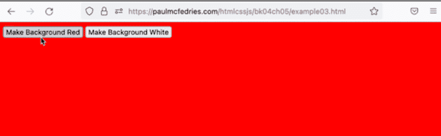

**图 5-3：** 响应事件调用函数的示例。

这里的 `onclick` 属性实际上是在说：“当有人点击此按钮时，调用名为 `makeBackgroundRed` 的函数。”

### 向函数传递一个或多个值

使用函数的主要原因之一是控制某些 JavaScript 代码段执行的时机。例如，上一节讨论了如何轻松使用函数进行设置，使得代码在用户点击按钮之前不会运行。

然而，使用函数还有另一个主要原因：避免不必要的代码重复。为了理解我的意思，请考虑上一节中的那两个函数：

```javascript
function makeBackgroundRed() {
  document.body.style.backgroundColor = "red";
}
function makeBackgroundWhite() {
  document.body.style.backgroundColor = "white";
}
```

这些函数执行相同的任务——改变背景颜色——它们之间唯一的区别是一个将颜色改为红色，另一个改为白色。每当你发现两个本质上完全相同的函数时，你就知道你的代码效率很低。你如何让代码更高效？这就是参数发挥作用的地方。

### 向函数传递一个值

作为一个示例，你可以将之前的函数合并为一个函数，并将颜色作为参数传递。

```javascript
function backgroundColor(newColor) {
  document.body.style.backgroundColor = newColor;
}
```

以下代码展示了该操作的示例页面：

```html
<!DOCTYPE html>
<html lang="en">
<head>
  <meta charset="utf-8">
  <title>向函数传递一个值</title>
  <script>
    function backgroundColor(newColor) {
      document.body.style.backgroundColor = newColor;
    }
  </script>
</head>
<body>
  <button onclick="backgroundColor('red')">
    Make Background Red
  </button>
  <button onclick="backgroundColor('white')">
    Make Background White
  </button>
</body>
</html>
```

这里的关键在于 `<button>` 标签中的 `onclick` 属性。例如：

```html
onclick="backgroundColor('red')"
```

字符串 `'red'` 被插入到函数括号中，因此该值被传递给了函数。另一个按钮传递了值 `'white'`，函数结果随之改变。

> **警告** 在示例代码的两个 `onclick` 属性中，注意传递给函数的值被单引号 (`'`) 包围。这是因为整个 `onclick` 的值是用双引号 (`"`) 包围的。

### 向函数传递两个或多个值

对于更复杂的函数，你可能需要多个参数以便传递不同类型的值。如果你使用多个参数，请用逗号分隔每个参数，如下所示：

```javascript
function changeColors(newBackColor, newForegroundColor) {
  document.body.style.backgroundColor = newBackColor;
  document.body.style.color = newForegroundColor;
}
```

在这个函数中，`document.body.style.color` 语句更改前景颜色（即页面文本的颜色）。以下代码展示了一个修改后的页面，其中按钮向函数传递了两个值：

```html
<!DOCTYPE html>
<html lang="en">
<head>
  <meta charset="utf-8">
  <title>向函数传递多个值</title>
  <script>
    function changeColors(newBackColor, newForegroundColor) {
      document.body.style.backgroundColor = newBackColor;
      document.body.style.color = newForegroundColor;
    }
  </script>
</head>
<body>
  <h1>向函数传递多个值</h1>
  <button onclick="changeColors('red', 'white')">
    Red Background, White Text
  </button>
</body>
</html>
```


```html
<button onclick="changeColors('white', 'red')">
  白色背景，红色文字
</button>
<body>
</body>
</html>
```


**警告** 如果你定义了一个具有多个参数的函数，你必须始终为该函数的每个参数传递一个值。如果你没有这样做，则相反传递 `undefined` 作为“值”，这可能会导致问题。

### 从函数获取值

到目前为止，我已经概述了使用函数的两个主要优势：

- 你可以使用它们来控制代码的执行时机。
- 你可以使用它们来将重复的代码合并到一个例程中。

函数为 JavaScript 带来的第三个主要好处是，你可以使用它们来执行计算并返回结果。例如，这是一个计算餐厅账单小费的函数：

```javascript
function calculateTip(preTip, tipPercent) {
  const tipResult = preTip * tipPercent;
  return tipResult;
}

const preTipTotal = 100.00;
const tipPercentage = 0.15;
```

```javascript
const tipCost = calculateTip(preTipTotal, tipPercentage);
const totalBill = preTipTotal + tipCost;
document.write("Your total bill is $" + totalBill);
```

名为 `calculateTip` 的函数接受两个参数：`preTip` 是小费之前的账单总额，`tipPercent` 是用于计算小费的百分比。该函数声明了一个名为 `tipResult` 的变量，并使用它来存储计算结果——`preTip` 乘以 `tipPercent`。

此示例的关键在于函数的第二行：

```javascript
return tipResult;
```

`return` 语句是 JavaScript 将值传回调用函数语句的方式。该语句位于函数之后：

```javascript
tipCost = calculateTip(preTipTotal, tipPercentage);
```

该语句首先将 `preTipTotal` 的值（在脚本早先初始化为 100.00）和 `tipPercentage`（在早先初始化为 0.15）传递给 `calculateTip` 函数。当该函数返回结果时，整个表达式 `calculateTip(preTipTotal, tipPercentage)` 会被该结果替换，这意味着它被存储在 `tipCost` 变量中。然后 `preTipTotal` 和 `tipCost` 相加，结果存储在 `totalBill` 中，`document.write` 语句显示最终计算结果（查看图 5-4）。

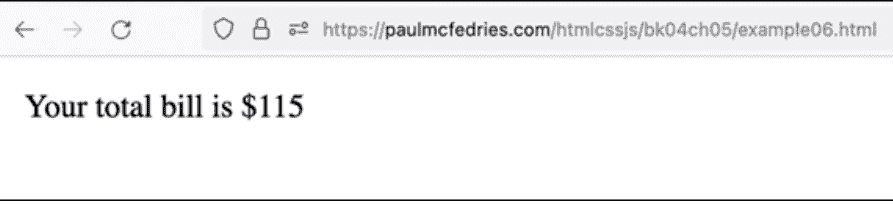

**图 5-4：** 输出包含了自定义函数计算的返回值。

### 使用匿名函数

让我们再次看看本章早先的函数语法：

```javascript
function functionName([arguments]) {
  JavaScript statements
}
```

这个版本的函数语法创建了一个所谓的“命名函数”，因为——你猜得没错——这个函数有一个名字。

然而，创建一个没有名字的函数也是可能的：

```javascript
function ([arguments]) {
  JavaScript statements
}
```

这种不同的函数语法创建了所谓的“匿名函数”，因为——没错——这个函数没有名字。

为什么要使用匿名函数？嗯，首先，如果你不想，就不必这样做。其次，使用匿名函数的主要原因是避免创建命名对象，因为每个大型 Web 项目都有一个巨大的命名空间，命名空间指的是你分配给变量和函数等的标识符完整集合。命名空间越大，发生命名冲突的概率越大（即你为两个不同的事物使用了相同的标识符）。坏消息！

> 记住，匿名函数是在 ES6 中引入的，如果你需要支持非常旧的浏览器（例如 Internet Explorer 11），请使用它们。

如果你有一个在项目中只使用一次的函数，将其变为匿名函数被认为是良好的编程习惯，这样你的命名空间中就少了一个标识符。

好了，我听到你在想，早些你说过通过使用函数名来调用函数。如果匿名函数没有名字，我们应该如何运行它呢？问得好！有两个主要方法可以来看：

- 将函数赋值给变量
- 用函数本身替换函数调用

### 将匿名函数赋值给变量

上一节的示例代码定义了命名函数 `calculateTip()`，并在稍后使用 `tipCost` 变量来存储函数结果。这是一个不需要命名函数的完美示例，因为你从未在别处使用函数名来计算 `tipCost` 值。在不需要的情况下向命名空间添加标识符被称为“污染命名空间”，这在现代 JavaScript 编程中是一个大忌。

你可以重写这段代码来使用匿名函数：

```javascript
const preTipTotal = 100.00;
const tipPercentage = 0.15;
```

```javascript
// 使用匿名函数声明 tipCost
const tipCost = function (preTip, tipPercent) {
  const tipResult = preTip * tipPercent;
  return (tipResult);
}
const totalBill = preTipTotal + tipCost(preTipTotal, tipPercentage);
document.write("Your total bill is $" + totalBill);
```

这里的巨大变化是我将 `tipCost` 变量的值声明为一个匿名函数。这个匿名函数与之前的 `calculateTip()` 命名函数相同，只是没有了名字。在倒数第二语句中，我通过使用 `tipCost(preTipTotal, tipPercentage)` 调用了该匿名函数。

### 用匿名函数替换函数调用

匿名函数最常见的用途之一是当你将一个函数作为参数传递给另一个函数时。

首先，这是一个使用命名函数的示例：`makeRed()` 和 `makeWhite()`。脚本随后创建两个事件监听器。其中一个监听 id 值为 `bgRed` 的按钮的点击，当检测到点击时，运行 `makeRed()` 回调函数。另一个事件监听器监听 id 值为 `bgWhite` 的按钮的点击，当检测到点击时，运行 `makeWhite()` 回调函数。请参考第 6 章获取有关文档对象以及 `getElementById()` 和 `addEventListener()` 方法的详情。

再次，你有两个不需要命名的函数，因此可以通过将回调替换为匿名函数将它们从命名空间中移除。以下是修改后的代码：

```html
<body>
<button id="bgRed">
  将背景变为红色
</button>
<button id="bgWhite">
  将背景变为白色
</button>
<script>
document.getElementById('bgRed').addEventListener(
'click',
function() {
  document.body.style.backgroundColor = 'red';
}
document.getElementById('bgWhite').addEventListener(
'click',
function() {
  document.body.style.backgroundColor = 'white';
}
)
</script>
</body>
```

### 使用箭头函数

随着 JavaScript 的深入，你会发现自己不断地使用匿名函数。当你到达那个阶段时，你会高兴地知道 ES6 还提供了一种更简单的匿名函数语法。也就是说，与其使用这种：

```javascript
function ([arguments]) {
  JavaScript statements
}
```

你可以使用这种：

```javascript
([arguments]) => {
  JavaScript statements
}
```

我在这里做的只是删除了 `function` 关键字，并在参数与大括号之间替换为 `=>` 字符。`=>` 字符看起来像箭头（JavaScript 程序员称之为“粗箭头”），因此这种版本的语法被称为箭头函数。


> 记住，箭头函数是 ES6 的发明，所以如果你需要支持非常旧的浏览器（例如 Internet Explorer 11），请使用它们。

例如，这里是之前的一个匿名函数（“将匿名函数赋值给变量”部分）：

```javascript
// 使用匿名函数声明 tipCost
const tipCost = function (preTip, tipPercent) {
  const tipResult = preTip * tipPercent;
  return (tipResult);
}
```

你可以使用箭头函数来重写这段代码：

```javascript
// Declare tipCost using an arrow function
const tipCost = (preTip, tipPercent) => {
  const tipResult = preTip * tipPercent;
  return (tipResult);
}
```

如果你的匿名函数只包含一条语句，你可以利用箭头函数的一个名为隐式返回（implicit return）的特性：

```javascript
([arguments]) => statement
```

在这里，JavaScript 假设单语句函数会在执行完语句后立即返回右侧的值，因此你可以省略括号和 `return` 关键字。这里是一个例子：

```javascript
// Declare tipCost using an arrow function with implicit return
const tipCost = (preTip, tipPercent) => preTip * tipPercent;
```

同样，这里是上一节中的一个匿名回调函数之一：

```javascript
document.getElementById('bgRed').addEventListener(
  'click',
  function() {
    document.body.style.backgroundColor='red'
  }
);
```

你可以如下重写这段代码，以使用隐式返回的箭头函数：

```javascript
document.getElementById('bgRed').addEventListener(
  'click',
  () => document.body.style.backgroundColor='red'
);
```

## 第 6 章

### 编写文档对象模型

### 本章内容

- 理解对象
- 操纵对象的属性和方法
- 深入研究文档对象模型
- 掌握事件

在过去的几个章节中，我谈了很多很多 JavaScript，但从现实意义上说，这一切都只是编程等同于吃了几道开胃菜。现在是时候坐下来吃主菜了：编写文档对象模型。

在本章中，你将探索文档对象模型这个迷人的世界。你将学习许多强大的编码技术，这些技术能够让你的网页执行你想要的任何操作。你还会发现，这正是 Web 编码变得有趣甚至可能让人上瘾的地方（我保证是件好事）。

### 熟悉对象

要编写真正实用的脚本，你必须执行 JavaScript 设计之初就要实现的功能：操作它所显示的网页。这正是 JavaScript 的核心，而这种操作可以以许多不同的形式出现：

- **向元素添加文本和 HTML 属性。**
- **修改类或其他选择器的 CSS 属性。**
- **在浏览器内部存储中存储某些数据。**
- **在提交表单之前验证表单数据。**

列表中的粗体项目是你可以处理的“实体”的示例，它们之所以特殊没有其他原因，仅仅是因为它们是可编程的。在 JavaScript 术语中，这些“可编程实体”被称为对象。

你可以通过以下三种方式之一在 JavaScript 中操作对象：

- **你可以读取并修改对象的属性。**
- **你可以通过激活与对象关联的方法让对象执行任务。**
- **你可以定义一个程序，每当对象发生特定事件时就会运行该程序。**

### 使用对象属性

你通过以下泛型表达式中的语法来引用属性：

```javascript
object.property
```

- **object:** 拥有该属性的对象
- **property:** 你想要操作的属性的名称

例如，考虑以下表达式：

```javascript
document.location
```

该表达式指向文档对象的 `location` 属性，它保存了当前在浏览器窗口中显示的文档地址。（在口语中，你读这个表达式为“document dot location”。）下面的代码显示了一个简单的单行脚本，在控制台中显示此属性，如图 6-1 所示。

```javascript
console.log(document.location);
```

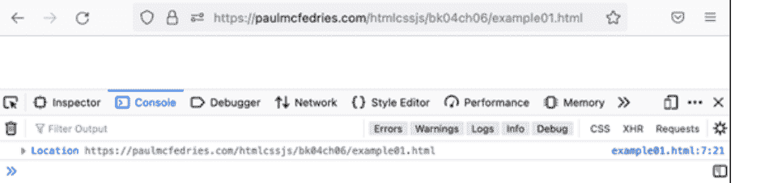

> **图 6-1:** 此脚本在控制台消息中显示 document.location 属性。

由于属性始终包含一个值，你可以在任何类型的 JavaScript 语句中使用属性表达式，并作为 JavaScript 表达式的操作数。例如，以下语句将 `document.location` 属性的当前值赋值给名为 `currentUrl` 的变量：

```javascript
const currentUrl = document.location;
```

同样，以下语句将 `document.location` 作为字符串表达式的一部分：

```javascript
const message = "The current address is " + document.location + ".";
```

某些属性是“只读的”，这意味着你的代码只能读取当前值而不能更改它。然而，许多属性是“可读可写的”，这意味着你也可以更改它们的值。要更改属性的值，请使用以下泛型语法：

```javascript
object.property = value
```

这些是各个部分的含义：

- **object:** 拥有该属性的对象
- **property:** 你想要更改的属性的名称
- **value:** 字面量值（如字符串或数字）或返回你想要设置的属性值的表达式

这是一个示例：

```javascript
const newAddress = prompt("Enter the address you want to surf:");
document.location = newAddress;
```

该脚本提示用户输入网页地址，并将结果存储在 `newAddress` 变量中。然后使用该值更改 `document.location`。

### 使用对象方法

要运行方法，请从以下泛型表达式开始，最简单的情况是它不带参数：

```javascript
object.method()
```

这些是各个部分的含义：

- **object:** 拥有该方法的对象
- **method:** 你想要执行的方法名称

如果方法需要参数，使用以下泛型语法：

```javascript
object.method(argument1, argument2, ...)
```

例如，考虑以下语句，它告诉浏览器返回上一页：

```javascript
history.back();
```

该方法接受一个参数——一个提示用户的字符串：

```javascript
confirm("Do you want to go back?");
```

最后，就像属性一样，如果方法返回一个值，你可以将该值赋值给变量（正如示例所示），或者将其引入表达式中。

### 介绍文档对象模型

这里是某个网页的源码：

```html
<html lang="en">
<head>
  <title>So Many Recipes</title>
</head>
<body>
  <header>
    <h1>Above and Beyond the Kale of Duty</h1>
  </header>
  <main>
    <p>
      Do you love to cook with <a href="kale.html">kale</a>?
    </p>
  </main>
</body>
</html>
```

有一种层次的方式查看这种代码。也就是说，`html` 元素在某种意义上是顶部元素，因为所有其他元素都包含其中。下一层是 `head` 和 `body` 元素。`head` 元素包含一个 `title` 元素，其包含文本 So Many Recipes。同样，`body` 元素包含一个 `header` 元素和一个 `main` 元素。

层次结构通常以视觉形式更容易理解，因此图 6-2 层次化地绘制了页面元素。

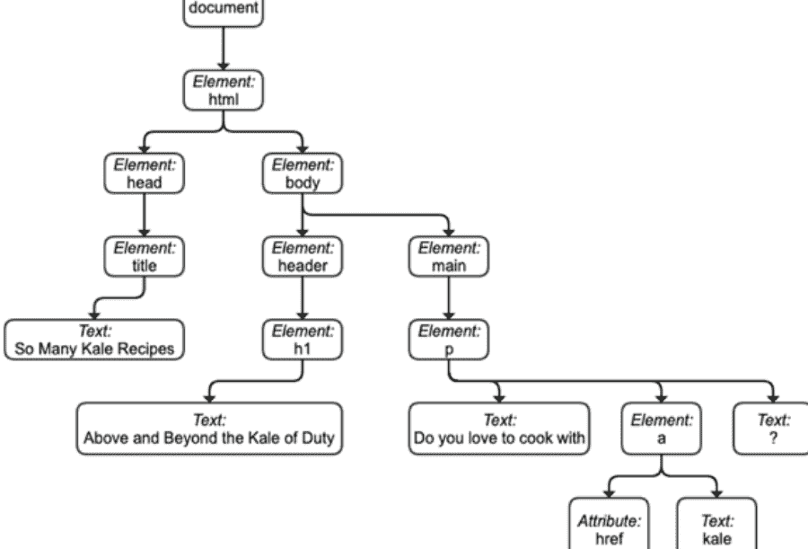

> 记住 在讨论对象层次结构时，如果对象 P 包含对象 C，则对象 P 被称为对象 C 的父节点，对象 C 被称为对象 P 的子节点。在图 6-2 中，箭头表示父子关系。此外，处于同一层级的元素（例如 `header` 和 `main` 元素）被称为兄弟节点。

- 图 6-2 中的每个框代表一个文档元素，
- 图 6-2 中的每个对象都是三种类型之一：元素、文本或属性。
- 图 6-2 中的每个对象无论其类型如何，都称为节点（node）。
- 整个页面由文档对象表示。

因此，这种层次对象表示被称为文档对象模型（Document Object Model），通常简称为 DOM。

### 在代码中指定元素

元素代表文档中的标签，因此你在代码中会不断使用它们。本节将介绍引用一个或多个元素的多种方法。

### 通过 id 指定元素

如果你想在脚本中处理某个特定的元素，可以先通过 `id` 属性为它分配一个标识符，然后直接引用该元素：

```html
<div id="kale-quotations">
```

完成后，你就可以使用 document 对象的 `getElementById()` 方法在代码中引用该元素了：

```javascript
document.getElementById(id)
```

**注意：** id 是一个字符串，代表你想处理的元素的 `id` 属性。

例如，以下语句返回了上一个 `<div>` 标签的引用（即 id 为 "kale-quotations" 的那个）：

```javascript
document.getElementById("kale-quotations")
```


> 警告：在编写文档对象代码时，不要将你的 `<script>` 标签放在页面的 `<head>` 区域（即在 `<head>` 和 `</head>` 标签之间）。如果你将代码放在那里，网页浏览器将在创建文档对象之前运行该代码，这意味着你的代码将彻底失败。相反，请将你的 `<script>` 标签放在页面的底部，紧接在 `<body>` 标签之前。

### 通过标签名指定元素

除了处理单个元素外，你还可以处理元素集合。其中一种集合是页面中所有使用相同标签名的元素集合。例如，你可以引用所有的 `<a>` 标签或所有的 `<div>` 标签。

返回具有相同标签的元素集合的机制是 `getElementsByTagName()` 方法：

```javascript
document.getElementsByTagName(tag)
```

**注意：** tag 是一个字符串，代表你想处理的标签所使用的 HTML 名称。

该方法返回一个类数组的集合，其中包含了文档中所有使用指定标签的元素。（请参阅第 7 章以了解数组是如何工作的。另外请查看本章后半部分的“处理元素集合”内容）。例如，若要返回一个包含当前页面中所有 `<div>` 元素的集合，你会使用以下语句：

```javascript
const divs = document.getElementsByTagName("div");
```

### 通过类名指定元素

你可以处理的另一个元素集合是页面中所有使用相同类（class）的元素集合。用于返回所有共享特定类名的元素的 JavaScript 工具是 `getElementsByClassName()` 方法：

```javascript
document.getElementsByClassName(class)
```

**注意：** class 是一个字符串，代表你想处理的元素所使用的类名。

该方法返回一个类数组的集合，包含了文档中所有使用指定类名的元素。集合的顺序与元素在文档中出现的顺序一致。这里有一个示例：

```javascript
const keywords = document.getElementsByClassName("keyword");
```

### 通过选择器指定元素

你在 CSS 中使用的相同选择器和组合符也可以用于 JavaScript 代码中，通过使用 document 对象的 `querySelector()` 和 `querySelectorAll()` 方法来引用页面元素：

```javascript
document.querySelector(selector)
document.querySelectorAll(selector)
```

**注意：** selector 是一个字符串，代表你想处理的元素或元素的选择器或组合符。

这些方法之间的区别在于，`querySelectorAll()` 返回所有匹配你选择器的元素集合，而 `querySelector()` 仅返回匹配你选择器的第一个元素。

例如，以下语句返回所有作为 `<article>` 元素直接子元素的 `<section>` 元素集合：

```javascript
const articles = document.querySelectorAll("article > section");
```

### 处理元素集合

`getElementsByTagName()`、`getElementsByClassName()` 和 `querySelectorAll()` 方法分别返回一个类数组的集合，其中包含了文档中所有使用指定标签、类名或选择器的元素。集合的顺序与元素在文档中出现的顺序一致。例如，考虑以下 HTML 代码：

```html
<div id="div1">
  这当然是 div 1。
</div>
<div id="div2">
  是的，<em>这个</em>是 div 2！
</div>
<div id="div3">
  忽略那些家伙们。欢迎来到 div 3！
</div>
```

现在考虑以下语句：

```javascript
divs = document.getElementsByTagName("div");
```

在生成的集合中，第一个项目（`divs[0]`）将是 id 等于 `div1` 的 `<div>` 元素；第二个项目（`divs[1]`）将是 id 等于 `div2` 的 `<div>` 元素；第三个项目（`divs[2]`）将是 id 等于 `div3` 的 `<div>` 元素。

你也可以直接使用它们的 `id` 值来引用元素。例如，以下语句是等价的：

```javascript
const firstDiv = divs[0];
const firstDiv = divs.div1;
```

要学习集合中有多少个项目，请使用 `length` 属性：

```javascript
const totalDivs = divs.length;
```

要对集合中的每个项目执行一次或多次操作，你可以使用 `for...of` 循环来逐个遍历集合。在 JavaScript 编程中，这被称为迭代集合。以下是使用的语法：

```javascript
for (const item of collection) {
  statements
}
```

以下是各个部分的含义：

- item: 一个用于保存集合中某个项目的变量。
- collection: 你想要遍历的集合。
- statements: 你想要执行的 JavaScript 代码。

例如，这里是遍历 div 元素并显示每个项目 id 代码，如图 6-3 所示：

```javascript
const divs = document.getElementsByTagName("div");
for (const d of divs) {
  console.log(d.id);
}
```

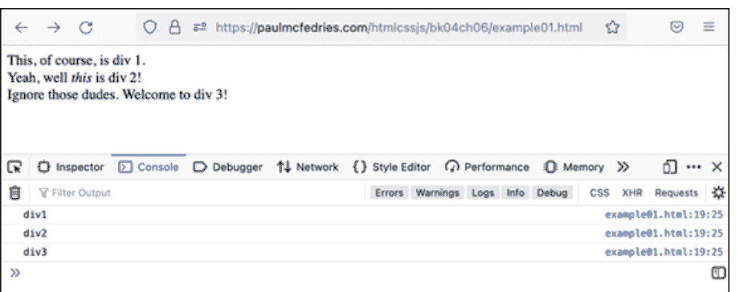

**图 6-3：** 遍历 div 元素的输出。

> 警告：`for...of` 循环是 ECMAScript 2015 (ES6) 的新增功能。如果你需要支持 Internet Explorer 等旧浏览器，请使用普通的 `for` 循环：

```javascript
for (var i = 0; i < collection.length; i++) {
```

### 使用代码遍历 DOM

JavaScript 中的一项常见任务是处理元素的子元素、父元素或兄弟元素。在后续章节中，我将使用以下 HTML 代码：

```html
<html lang="en">
<head>
  <title>大量的羽衣菜谱</title>
</head>
<body>
  <header id="page-banner">
    <h1>超越羽衣的职责</h1>
  </header>
  <main id="page-content">
    <p>
      你喜欢烹饪<a href="kale.html">羽衣</a>吗？
    </p>
  </main>
</body>
</html>
```

### 获取父元素的元素

当你处理一个特定元素时，通常会对该元素的元素执行一次或多次操作。每个父元素都提供了几个属性，让你处理其全部或部分子节点：

- 所有子节点
- 第一个子节点
- 最后一个子节点

#### 获取所有子元素

要返回父元素的所有子元素，你可以使用 `children` 属性：

```javascript
parent.children
```

注意：parent 是父元素。例如，以下语句将 body 元素的所有子元素存储在变量中：

```javascript
const bodyChildElements = document.body.children;
```

结果是一个 `HTMLCollection` 对象，它是一个类数组元素集合。如果你使用控制台（参考第 9 章）显示 `bodyChildElements` 的值，将得到图 6-4 所示的输出。

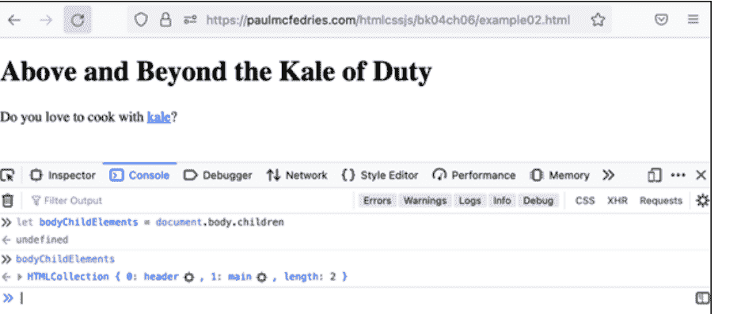

**图 6-4：** 控制台中显示的 `bodyChildElements` 变量的值。

这里是输出：

```
HTMLCollection { 0: header, 1: main, length: 2 }
```

数字 0 和 1 是每个子元素的索引数字。例如，你可以使用 `bodyChildElements[0]` 来引用集合中的第一个元素，在本例中它是页头元素。

### 获取第一个子节点

如果你像我在上一节描述的那样，使用父元素的 `childNodes` 或 `children` 属性来返回父元素的子节点，你可以通过在集合变量名后加上 `[0]` 来引用结果集合中的第一项。例如：

```javascript
bodyChildren[0]
bodyChildElements[0]
```

然而，DOM 提供了一种更直接的路径来获取第一个子节点：

```javascript
parent.firstChild
```

注意：parent 是父元素。

例如，假设你想处理本节开头 HTML 示例中 `main` 元素的第一个子节点。以下是一些可以实现该功能的代码：

```javascript
const content = document.getElementById("page-content");
const firstContentNode = content.firstChild;
```

在这个示例中，生成的节点是一个文本节点（`<main>` 和 `<p>` 标签之间的空白）。如果你想获取第一个子元素节点，请改用 `firstElementChild` 属性：

```javascript
parent.firstElementChild
```

注意：parent 是父元素。

要获取本节开头代码中 `main` 元素的第一个子元素节点，你可以这样操作：

```javascript
const content = document.getElementById("page-content");
const firstContentChildElement = content.firstElementChild;
```

在这个示例中，这段代码返回了 `p` 元素。

### 获取最后一个子节点

如果你的代码需要处理最后一个子节点，请使用父元素的 `lastChild` 属性：

```javascript
parent.lastChild
```

注意：parent 是父元素。

例如，假设你想处理本节开头 HTML 示例中 `p` 元素的最后一个子节点。以下是可以实现该功能的代码：

```javascript
const para = document.querySelector("main > p");
const lastChildNode = para.lastChild;
```

在这个示例中，生成的节点是一个代表问号（？）以及 `</p>` 标签之前空白的文本节点。如果你想获取最后一个子元素节点，请改用 `lastElementChild` 属性：

```javascript
parent.lastElementChild
```

注意：parent 是父元素。

要获取本节开头代码中 `p` 元素的最后一个子元素节点，你可以这样操作：

```javascript
const para = document.querySelector("main > p");
const lastChildElementElement = para.lastElementChild;
```

在这个示例中，这段代码返回了 `a` 元素。

### 获取子元素的父元素

如果你的代码需要处理子元素的父元素，请使用子元素的 `parentNode` 属性：

```javascript
child.parentNode
```

**注意：** child 是子元素。

例如，假设你想处理本节开头 HTML 示例中 `h1` 元素的父元素。以下是可以实现该功能的代码：

```javascript
const childElement = document.querySelector("h1");
const parentElement = childElement.parentNode;
```

### 获取元素的兄弟元素

父元素的子节点在 DOM 中的出现顺序与它们在 HTML 代码中的顺序相同，这意味着兄弟元素的出现顺序也取决于它们在 HTML 中的顺序。因此，对于给定的子元素，有两种兄弟可能性：

- **前一个兄弟元素 (Previous sibling):** 这是在 DOM 中紧接在你正在处理的子元素之前的兄弟元素。如果该子元素是第一个兄弟，它将没有前一个兄弟。
- **后一个兄弟元素 (Next sibling):** 这是在 DOM 中紧接在你正在处理的子元素之后的兄弟元素。如果该子元素是最后一个兄弟，它将没有后一个兄弟。

### 获取前一个兄弟元素

要返回特定元素的前一个兄弟元素，请使用 `previousElementSibling` 属性：

```javascript
element.previousElementSibling
```

**注意：** element 是你正在处理的元素。

例如，以下语句将 `main` 元素的前兄弟元素存储在变量中：

```javascript
const currElement = document.querySelector("main");
const prevSib = currElement.previousElementSibling;
```

### 获取后一个兄弟元素

要返回特定元素的后一个兄弟元素，请使用 `nextElementSibling` 属性：

```javascript
element.nextElementSibling
```

**注意：** element 是你正在处理的元素。

例如，以下语句将 `main` 元素的后一个兄弟元素存储在变量中：

```javascript
const currElement = document.querySelector("main");
const nextSib = currElement.nextElementSibling;
```

### 添加、修改和删除

获取引用后，你可以通过多种方式对其进行操作。

#### 向页面添加元素

要向页面添加一个元素，你需要遵循三个步骤：

1. **创建元素：** 使用 `createElement()` 方法创建一个指定类型的新元素。
2. **配置元素：** 为元素设置属性、特性或内部内容。
3. **将其插入 DOM：** 使用如 `appendChild()`、`insertBefore()` 或 `after()` 等方法将其添加到文档中。

例如，创建一个新的段落并将其添加到 `body` 中：

```javascript
const newP = document.createElement("p");
newP.textContent = "This is a new paragraph.";
document.body.appendChild(newP);
```

#### 修改元素

你可以通过更改其内容或属性来修改现有元素：

- **更改内容：** 使用 `textContent` 或 `innerHTML` 更新元素内部的文本或 HTML。
- **更改属性：** 使用 `setAttribute()` 和 `getAttribute()` 修改属性。
- **更改类：** 使用 `classList` 添加、删除或切换 CSS 类。

```javascript
const element = document.querySelector("p");
element.textContent = "Updated text!";
element.classList.add("highlight");
```

### 删除元素

要从 DOM 中删除一个元素，你可以使用：

- **`removeChild()`:** 在父元素上调用此方法以删除特定的子元素。
- **`remove()`:** 直接在元素本身上调用此方法将其从 DOM 中移除。

```javascript
const elementToRemove = document.querySelector(".old-element");
elementToRemove.remove();
```

在本示例中，代码创建了一个新的 `nav` 元素，将其插入到 `main` 元素之前，然后添加了一个标题：

```javascript
const newNav = document.createElement("nav");
document.querySelector("main").prepend(newNav);
newNav.innerHTML = "<h2>Navigation</h2>";
```

### 向元素插入文本或 HTML

通常情况下，你希望保留元素现有的标签和文本，并插入新的标签和文本。每个元素都提供了几种方法来实现这一点：

- **向元素中仅插入文本：** 使用 `insertAdjacentText()` 方法：

```javascript
element.insertAdjacentText(location, text)
```

以下是各个部分的含义：

- **element:** 指向要插入新文本的元素引用。
- **location:** 指定文本插入位置的字符串。我稍后会列出你的可选值。
- **text:** 包含你想插入的文本的字符串。

- **向元素中插入标签和文本：** 使用 `insertAdjacentHTML()` 方法：

```javascript
element.insertAdjacentHTML(location, data)
```

以下是各个部分的含义：

- **element:** 指向要插入新标签和文本的元素引用。
- **location:** 指定标签和文本插入位置的字符串。我稍后会列出你的可选值。
- **data:** 包含你想插入的标签和文本的字符串。

对于这两种方法，你可以使用以下字符串作为 `location` 参数：

- "beforebegin": 在元素外部且紧邻元素之前插入数据。
- "afterbegin": 在元素内部、第一个子元素之前插入数据。
- "beforeend": 在元素内部、最后一个子元素之后插入数据。
- "afterend": 在元素外部且紧邻元素之后插入数据。

例如，假设你的文档有以下元素：

```html
<h2 id="nav-heading">Navigation</h2>
```

如果你想将标题改为“Main Navigation”，以下代码可以完成任务：

```javascript
const navHeading = document.getElementById("nav-heading");
navHeading.insertAdjacentText("afterbegin", "Main ");
```

### 删除元素

如果你不再需要页面上的某个元素，可以使用元素的 `remove()` 方法将其从 DOM 中删除：

```javascript
element.remove()
```

例如，以下语句将从页面上删除 id 值为 `temp-div` 的元素：

```javascript
document.getElementById("temp-div").remove();
```

### 使用代码操作 CSS

尽管你在静态样式表（.css）文件中指定了 CSS 规则，但并不意味着规则本身必须是静态的。通过 JavaScript，你可以以多种方式修改元素的 CSS。

### 修改元素的样式

大多数元素都有一个 `style` 属性，允许你获取和修改标签的样式。其工作原理如下：`style` 属性实际上返回一个样式对象，该对象拥有每个 CSS 属性对应的属性。在引用这些样式属性时，你需要记住两点：

- 对于单单词 CSS 属性（如 `color` 和 `visibility`），使用全小写字母。
- 对于多单词 CSS 属性，去掉连字符，并将第二个单词的首字母大写（如果属性超过两个单词，则每个后续单词的首字母均大写）。例如，`font-size` 和 `border-left-width` CSS 属性变为样式对象的属性 `fontSize` 和 `borderLeft`。

这里是一个示例：

```javascript
const pageTitle = document.querySelector("h1");
pageTitle.style.fontSize = "64px";
pageTitle.style.color = "maroon";
pageTitle.style.textAlign = "center";
pageTitle.style.border = "1px solid black";
```

这段代码获取了页面第一个 `<h1>` 元素的引用。获取该引用后，代码使用样式对象对标题的四个属性进行了样式设置：size、color、text-align 和 border。

### 为元素添加类 (class)

如果你在 CSS 中定义了类规则，可以通过向元素标签添加 `class` 属性并将其值设置为你的类规则名来应用该规则。

首先，你可以使用 `classList` 属性获取元素分配的类列表：

```javascript
element.classList
```

注意：`element` 是你正在操作的元素。

返回的类列表是一个类数组对象，包含一个 `add()` 方法，你可以用它向元素的现有的类中添加新类：

```javascript
element.classList.add(class)
```

以下是各个部分的含义：

- **element**: 你正在操作的元素。
- **class**: 代表你想向元素添加的类名的字符串。你可以通过逗号分隔每个类名来添加多个类。

这里是一个示例，图 6-5 显示了结果。

### Hello World!

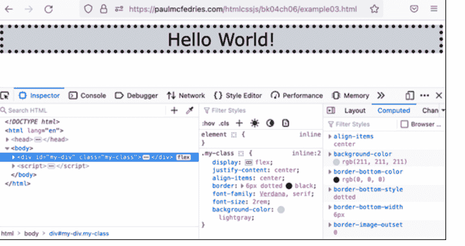

**图 6-5:** 此代码使用 `add` 方法将类名添加到 `<div>` 标签。

CSS:

```css
.my-class {
  display: flex;
}
```

```html
<div class="my-class">
  Hello World!
</div>
```

JavaScript:

```javascript
const div = document.querySelector("div");
div.classList.add("my-class");
```

在这个示例中，代码创建了一个新的 `nav` 元素，将其插入到 `main` 元素之前，然后添加了一个标题：

```javascript
const newNav = document.createElement("nav");
document.querySelector("main").prepend(newNav);
newNav.innerHTML = "<h2>Navigation</h2>";
```

### 移除属性

要从元素中移除属性，请使用元素的 `removeAttribute()` 方法：

```javascript
element.removeAttribute(attribute);
```

以下是各个部分的含义：

- element: 你想要操作的元素
- attribute: 一个字符串，用于指定你想要从元素中移除的属性名称

这里有一个示例：

```javascript
const headerImage = document.getElementById("header-image");
headerImage.removeAttribute("id");
```

### 监听页面事件

在 Web 开发中，事件是响应某些外部刺激而发生的动作。外部刺激的一种常见类型是用户与网页的交互。以下是一些示例：

- 浏览或重新加载页面
- 点击按钮
- 按击按键
- 滚动页面

为什么网页不会自动响应事件呢？它们为什么只是静静地呆在那里？因为网页默认是静态的，这意味着它们忽略了周围发生的所有事件。作为一名 Web 开发人员，你的任务就是通过让你的网页“监听”特定事件的发生来改变这种行为。你通过设置名为“事件处理器”（event handlers）的特殊代码块来实现。一个事件处理器由两部分组成：

- **事件监听器（Event listener）：** 告诉 Web 浏览器的指令，让它关注特定元素上发生的特定事件（监听监听）。
- **回调函数（Callback function）：** 当 Web 浏览器检测到事件发生时执行的代码。

你通过使用元素对象的 `addEventListener()` 方法设置事件处理器，来配置代码以监听并响应事件。以下是语法：

```javascript
element.addEventListener(event, callback);
```

以下是各个部分的含义：

- **element:** 要监控该事件的网页元素。该事件被认为**绑定**（bound）到该元素上。
- **event:** 一个字符串，用于指定你想让浏览器监听的事件名称。对于我在上一节中提到的主要事件，请使用以下内容之一，并用引号引号：DOMContentLoaded, click, dblclick, mouseover, keypress, focus, blur, change, submit, scroll, 或 resize。
- **callback:** 当事件发生时 JavaScript 执行的函数。回调可以是匿名函数，也可以是命名函数的引用。

这里有一个示例：

HTML:

```html
<div id="my-div"></div>
<button id="my-button">点击在上方添加一些文本</button>
```

JavaScript:

```javascript
const myButton = document.getElementById('my-button');
myButton.addEventListener('click', function() {
  const myDiv = document.getElementById('my-div');
  myDiv.innerHTML = '<h1>Hello Click World!</h1>';
});
```

HTML 设置了一个空的 div 元素和一个按钮元素。JavaScript 代码为按钮挂载了一个点击事件监听器，回调函数将 HTML 字符串 `<h1>Hello Click World!</h1>` 添加到 div 中。图 6-6 显示了点击按钮后生成的页面。

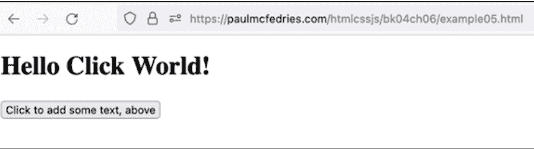

**图 6-6：** 点击事件回调函数向 div 元素添加了 HTML 和文本。

如果你想在网页文档加载后运行某些代码，请向 document 对象上添加一个监听 `DOMContentLoaded` 事件的事件处理器：

```javascript
document.addEventListener('DOMContentLoaded', function() {
  console.log('We are loaded!');
});
```

当事件触发时，DOM 会创建一个 `Event` 对象，其属性包含有关事件的信息，包括以下内容：

- **target:** 发生事件的网页元素。例如，如果你为一个 div 元素设置了点击处理器，那么该 div 就是点击的目标。
- **which:** 一个数字代码，用于指定在按键按下（keypress）事件期间按下的键值。
- **pageX:** 事件触发时，鼠标指针距离浏览器内容区域左边缘的距离（像素）。
- **pageY:** 事件触发时，鼠标指针距离浏览器内容区域顶边缘的距离（像素）。
- **metaKey:** 一个布尔值，如果用户在事件触发时按住了 Windows 键 (⊞) 或 Mac Command 键 (⌘)，则该值为 true。
- **shiftKey:** 一个布尔值，如果用户在事件触发时按住了 Shift 键，则该值为 true。

要访问这些属性，你需要在你的事件处理器的回调函数中将 `Event` 对象的名称作为参数传入：

```javascript
element.addEventListener(event, function(e) {
  // 此代码在事件触发时运行
});
```

**注意：** `e` 是 DOM 在事件触发时生成的 `Event` 对象的名称。你可以使用任何喜欢的名称，但大多数程序员使用 e（尽管 `evt` 和 `event` 也很常见）。

例如，在处理按键事件时，你需要访问 `which` 属性来找到用户按下的键的代码。这里有一个示例页面，可以帮助你确定应该使用哪个代码值：

HTML:

```html
<div>
  输入一个键：
</div>
<input id="key-input" type="text">
<div>
  这里是你按下的键的代码：
</div>
<div id="key-output"></div>
```

JavaScript:

```javascript
const keyInput = document.getElementById('key-input');
keyInput.addEventListener('keypress', function(e) {
  const keyOutput = document.getElementById('key-output');
  keyOutput.innerHTML = e.which;
});
```

## 第 7 章

### 数组

### 填充数组

在声明数组之后，你就可以开始向其填充你想要存储的数据值。以下是执行此操作的通用语法：

```javascript
arrayName[index] = value;
```

以下是各个部分的含义：

- arrayName: 数组变量的名称
- index: 你想要存储值的数组索引数字
- value: 你要存储在数组中的值

JavaScript 愿意在数组中放入几乎任何类型的数据，包括数字、字符串、布尔值，甚至是其他数组！你甚至可以在单个数组中混合多种数据类型。

例如，以下是几个语句，它们声明了一个名为 `dogPhotos` 的新数组，然后向数组输入五个字符串值：

```javascript
const dogPhotos = new Array(5);
dogPhotos[0] = "dog-1";
dogPhotos[1] = "dog-2";
dogPhotos[2] = "dog-3";
dogPhotos[3] = "dog-4";
dogPhotos[4] = "dog-5";
```

要引用数组值（例如，在表达式中使用它），你需要指定相应的索引：

```javascript
strURL + dogPhotos[3]
```

### 同时声明并填充数组

早些时候我提到 JavaScript 有另外两种声明数组的语法。这两种语法都允许你通过单个语句声明数组*并*向其填充值。

第一种方法使用以下通用格式的 `Array()` 构造函数：

```javascript
const arrayName = new Array(value1, value2, ...);
```

以下是各个部分的含义：

- **arrayName**: 你想要为该数组变量使用的名称
- **value1, value2, ...**: 你想要填充数组的初始值

这里是一个示例：

```javascript
const dogPhotos = new Array("dog-1", "dog-2", "dog-3", "dog-4", "dog-5");
```

JavaScript 还支持创建**数组字面量**（array literals）。你通过在方括号中包含一个或多个值来创建数组字面量。以下是通用格式：

```javascript
const arrayName = [value1, value2, ...];
```

以下是各个部分的含义：

- **arrayName**: 你想要为该数组变量使用的名称
- **value1, value2, ...**: 你想要填充数组的初始值

一个示例：

```javascript
const dogPhotos= ["dog-1", "dog-2", "dog-3", "dog-4", "dog-5"];
```

大多数 JavaScript 程序员更倾向于使用这种语法而不是使用 Array 构造函数。

### 使用循环填充数组

你可以使用循环和某种计数器变量通过程序化访问数组的索引来填充数组。这里是一个示例：

```javascript
const dogPhotos = [];
for (let counter = 0; counter < 5; counter += 1) {
  dogPhotos[counter] = "dog-" + (counter + 1);
}
```

`for()` 循环内部的语句使用变量 `counter` 作为数组的索引。例如，当 `counter` 为 0 时，语句看起来如下：

```javascript
dogPhotos[0] = "dog-" + (0 + 1);
```

在这种情况下，等号右侧的表达式求值为 "dog-1"，这是正确的值。

### 遍历数组

数组可以极大地帮助提高代码的效率，因为你能够将这些冗长的过程简化为适合函数内部的更短的例程。这些例程是 Array 对象的迭代方法（iterative methods），其中迭代意味着该方法会遍历数组中的项，并且对于每个项，由一个函数（称为回调函数）对该项执行某些操作。

Array 对象实际上有 14 个迭代方法。我没有涵盖所有的方法，但在接下来的几个章节中，我将介绍最有用的几个。

### 遍历数组：forEach()

Array 对象的 `forEach()` 方法为数组中的每个元素运行回调函数。该回调函数最多接收三个参数：

- value: 元素的值
- index:（可选）元素的数组索引
- array:（可选）正在被迭代的数组

你可以使用以下任何一种语法：

```javascript
array.forEach(namedFunction);
array.forEach(function (value, index, array) { code });
array.forEach((value, index, array) => { code });
```

以下是各个部分的含义：

- array: 你想要遍历的 Array 对象。
- namedFunction: 现有函数的名称。该函数应该接收 `value` 参数，并可能还接收可选的 `index` 和 `array` 参数。
- code: 在每次迭代期间运行的语句。

这里是一个示例：

```javascript
// 声明数组
const dogPhotos=["dog-1", "dog-2", "dog-3", "dog-4", "dog-5"];

// 遍历数组
dogPhotos.forEach((value, index) => {
console.log("Element " + index + " has the value " + value);
});
```

### 遍历并创建新数组：map()

当你遍历数组时，通常会对每个元素值应用某些操作。然而，在某些情况下，你希望保留原始数组的值，并创建一个包含更新后值的新数组。

创建一个存储更新值的新数组最简单的方法是使用 Array 对象的 `map()` 方法。有三种语法可以使用：

```javascript
array.map(namedFunction);
array.map(function(value, index, array) { code });
array.map((value, index, array) => { code });
```

以下是各个部分的含义：

- array: 包含你想要使用的值的 Array 对象。
- namedFunction: 一个对每个值执行操作的现有函数的名称。该函数应该接收 `value` 参数，并可能还接收可选的 `index` 和 `array` 参数。
- code: 在每次迭代期间运行的语句。

`map()` 方法返回一个包含更新后值的新数组。这里是一个示例：

```javascript
// 声明温度数组
const tempsFahrenheit = [32, 46, 56, 68, 80];

// 将每个数组转换为摄氏度
const tempsCelsius = tempsFahrenheit.map(currentTemp => {
  return (currentTemp - 32) * 5/9;
});

// 输出结果
console.log(tempsCelsius);
```

### 遍历数组以得到一个值：reduce()

一种常见的模式是对数组中的每个元素执行累加操作，以产生一个值。例如，你可能想要知道库存单位的总和。有三种语法可以使用：

```javascript
array.reduce(namedFunction, initialValue);
array.reduce(function(accumulator, value) { code }, initialValue);
array.reduce((accumulator, value) => { code }, initialValue);
```

以下是各个部分的含义：

- array: 你想要还原的 Array 对象。
- namedFunction: 一个执行还原操作的现有函数的名称。该函数应该接收 `accumulator` 参数，并可能还接收可选的 `index` 和 `array` 参数。
- code: 在每次迭代期间运行的语句。
- initialValue: 初始值。如果你省略 `initialValue`，JavaScript 将使用第一个元素。

这里是一个示例：

```javascript
// 声明库存数组
const inStock = [547, 213, 156, 844, 449, 71, 313];

// 获取库存总数
const totalUnits = inStock.reduce((accumulatedUnits, currentInventoryValue) => {
  return accumulatedUnits + currentInventoryValue;
}, 0);

// 输出结果
console.log("Total units in stock: " + totalUnits);
```

### 定元素：find()

要在数组中搜索符合条件的元素，请使用 Array 对象的 `find` 方法。有三种语法可以使用：

```javascript
array.find(namedFunction);
array.find(function (value, index, array) { code });
array.find((value, index, array) => { code });
```

以下是各个部分的含义：

- array: 你想要在其中搜索的 Array 对象。
- namedFunction: 对每个值应用条件的现有函数的名称。该函数应该接收 `value` 参数，并可能还接收可选的 `index` 和 `array` 参数。
- code: 在每次迭代期间运行的语句。

在 `namedFunction` 或 `code` 中，你设置一个逻辑条件测试数组中的每个元素，并使用 `return` 语句将测试结果传给 `find()` 方法。`find()` 返回的返回值是第一个测试为 true 的元素，如果对所有元素均为 false，则返回 `undefined`。

这里是一个示例：

```javascript
// 声明一个对象数组
const products = [
  { name: 'doodad', units: 547 },
  { name: 'gizmo', units: 213 },
  { name: 'gimcrackery', units: 156 },
  { name: 'knickack', units: 844 },
  { name: 'bric-a-brac', units: 449 },
  { name: 'thingamajig', units: 71 },
  { name: 'watchamacallit', units: 313 },
  { name: 'widget', units: 117 }
];

// 查询数组
const strQuery = "gizmo";
const stock = products.find((currentProduct) => {
  return currentProduct.name === strQuery;
});
```

```javascript
// 输出结果
if (stock) {
  console.log("Product " + stock.name + " has " + stock.units + " units in stock.");
} else {
  console.log("Product " + strQuery + " not found.");
}
```

### 数组操纵

与任何优秀的对象一样，数组（Array）带有一大量的属性和方法，你可以对其进行处理和操作。本章的其余部分将介绍其中一些实用的属性和方法。

### length 属性

Array 对象只有几个属性，但你最频繁使用的一个就是 `length` 属性。

```javascript
array.length
```

`length` 属性返回指定数组中当前的元素个数。

### 一些实用的数组方法

许多方法与数组相关，但俗话说，空间限制使我无法详细介绍它们。为了勾起你的兴趣，表 7-1 列出了一些最实用的数组方法。

#### 表 7-1 有用的数组方法

| 方法语法 | 描述 |
| --- | --- |
| `array.concat(array1, array2, ...)` | 获取一个或多个现有数组的元素，并将它们合并到现有数组中以创建一个新数组。 |
| `array.join(separator)` | 获取数组中的现有值并将其合并成一个字符串。 |
| `array.pop()` | 从数组删除最后一个元素并返回该元素的值。 |
| `array.push(value1, value2, ...)` | 在数组末尾添加一个或多个元素。 |
| `array.reverse()` | 反转指定数组中元素的顺序。 |
| `array.shift()` | 从数组中删除第一个元素并返回该元素的值。 |
| `array.slice(start, end)` | 返回一个包含现有数组元素子集的新数组。 |
| `array.sort()` | 对指定的数组进行排序。 |
| `array.unshift(value1, value2, ...)` | 在数组开头插入一个或多个值并返回数组的新长度。 |

## 第 8 章

### 编码字符串与日期

本章内容

- 组合字符串
- 处理日期
- 调整时间

尽管你的 JavaScript 代码会花费大量时间处理 HTML 标签和 CSS 属性等网页小摆件，但它还会执行许多幕后工作，这些工作需要操纵字符串以及处理日期和时间。为了帮助你完成这些任务，在本章中将探索 JavaScript 的两个内置对象：*String* 对象和 *Date* 对象。你将研究每个对象最重要的属性，并掌握最常用的方法。

### 操纵字符串

到目前为止，我在书中已经使用了几十个字符串示例。这些不仅包括字符串字面量（例如 "JavaScript Essentials For Dummies"），还包括返回字符串的方法（例如 `prompt()` 方法）。因此，到现在应该很清楚，字符串在所有 JavaScript 编程中都起着重要作用，很少有脚本是不以某种方式处理字符串的。

正因如此，精通操纵字符串是非常有意义的，这包括在字符串中定位文本以及从字符串中提取文本。你将在本节中了解到所有这些以及更多内容。

你所处理的任何字符串——无论是字符串字面量还是返回字符串的方法或函数的结果——都是一个 String 对象。例如，以下两个语句是等价的：

```javascript
const bookName = new String("JavaScript Essentials For Dummies");
const bookName = "JavaScript Essentials For Dummies";
```

这意味着在应用 String 对象的属性和方法时你有很大的灵活性。例如，String 对象有一个 `length` 属性，我将在下一节中描述它。以下是所有使用该属性的合法 JavaScript 表达式：

```javascript
bookName.length;
"JavaScript Essentials For Dummies".length;
prompt("Enter the name:").length;
myFunction().length;
```

最后一个示例假设 `myFunction()` 返回一个字符串值。

### 使用字符串模板

在深入研究 String 对象的属性和方法之前，请花几秒检查一种特殊的字符串类型，它旨在解决三个与字符串相关的问题……

表 8-1 列出了几种用于在较大的字符串查找子字符串的 String 对象方法。

### 表 8-1 用于查找子字符串的 String 对象方法

| 方法 | 功能 |
| --- | --- |
| `string.endsWith(substring, start)` | 测试子字符串是否出现在字符串的末尾 |
| `string.includes(substring, start)` | 测试子字符串是否出现在字符串中 |
| `string.indexOf(substring, start)` | 在字符串中搜索子字符串第一次出现的位置 |
| `string.lastIndexOf(substring, start)` | 在字符串中搜索子字符串最后一次出现的位置 |
| `string.startsWith(substring, start)` | 测试子字符串是否出现在字符串的开头 |

### 学习提取子字符串的方法

查找子字符串另一方面，你通常也需要提取子字符串。例如，如果用户输入了电子邮件地址，你可能需要提取用户名（@ 符号左侧的部分）或域名（@ 符号右侧的部分）。对于这类操作，JavaScript 提供了六种方法，如表 8-2 所示。

### 表 8-2 用于提取子字符串的 String 对象方法

| 方法 | 功能 |
| --- | --- |
| `string.charAt(index)` | 返回字符串中由 `index` 指定索引处的字符 |
| `string.charCodeAt(index)` | 返回 `string` 中由 `index` 指定索引处的字符的编码 |
| `string.slice(start, end)` | 返回 `string` 中从 `start` 指定索引位置开始到在 `end` 指定索引位置之前结束的子字符串 |
| `string.split(separator, limit)` | 返回一个数组，其中每个项目都是 `string` 中的子字符串，这些子字符串由分隔符分隔 |
| `string.substr(start, length)` | 返回 `string` 中从 `start` 指定索引位置开始且长度为 `length` 个字符的子字符串 |
| `string.substring(start, end)` | 返回 `string` 中从 `start` 指定索引位置开始到在 `end` 指定索引位置之前结束的子字符串 |

### 处理日期和时间

日期和时间似乎应该是直观的编程命题。毕竟，一年只有 12 个月，每月有 28 到 31 天，一周有 7 天，一天有 24 小时，每小时有 60 分钟，每分钟有 60 秒。如此板上钉钉的东西怎么可能出现最细微的异常呢，对吧？

你会感到惊讶的。日期和时间可能会变得奇怪，但如果你始终记住以下三个关键点，处理起来就会变得容易得多：

- JavaScript 时间是以毫秒（秒的千分之一）为单位的。具体来说，JavaScript 通过计算从 1970 年 1 月 1 日到目标日期时间之间经过的毫秒数来测量时间。例如，你可能会遇到 2001 年 1 月 1 日这个日期，并想：“啊，是的，新千年的开始。”然而，JavaScript 遇到该日期想的是“978220800000”。
- 在 JavaScript 世界中，时间始于格林尼治标准时间 1970 年 1 月 1 日午夜。之前的日期在毫秒上为负值。
- 由于你的 JavaScript 程序运行在用户的浏览器中，日期和时间几乎总是用户的本地日期和时间。也就是说，你的脚本的日期和时间将不是你页面所在服务器的时间。这意味着你永远无法知道用户查看你页面时是什么时间。

### 学习 Date 对象使用的参数

在深入研究 Date 对象及其相关方法之前，我将花一点时间过一遍 JavaScript 许多与日期相关的功能所需的各种参数。这可以避免我以后乏味地重复这些内容。表 8-3 是详细信息。

### 表 8-3 与 Date 对象相关的参数

| 参数 | 代表什么 | 可能的值 |
|---|---|---|
| date | 变量名 | 一个 Date 对象 |
| yyyy | 年份 | 四位数整数 |
| yy | 年份 | 二位数整数 |
| month | 月份 | 从 "January" 到 "December" 的完整月份名称 |
| mth | 月份 | 从 0（一月）到 11（十二月）的整数 |
| dd | 日期 | 从 1 到 31 的整数 |
| hh | 小时 | 从 0（午夜）到 23（晚上 11:00 点）的整数 |
| mm | 分钟 | 从 0 到 59 的整数 |
| ss | 秒 | 从 0 到 59 的整数 |
| ms | 毫秒 | 从 0 到 999 的整数 |

### 认识 Date 对象

每当你在 JavaScript 中处理日期和时间时，你都在操作 Date 对象的实例。更具体地说，当你在 JavaScript 中处理 Date 对象时，你处理的是一个特定的时刻，精确到毫秒。Date 对象永远不会是一个时间段，它也不是一个在你脚本运行时滴答作响的时钟。相反，Date 对象是一个时间快照，你用它提取时间的细节。

#### 指定当前日期

Date 对象最常用的用法是获取当前日期：

```javascript
const date = new Date();
```

#### 指定任何日期

如果你需要处理特定日期，可以使用 `Date()` 函数的参数。以下语句将给你年份、月份和日：

```javascript
const date = new Date(2024, 7);
```

#### 指定当前时间

如果你想显示当前时间，可以使用 `Date()` 函数。以下语句将给你小时、分钟和秒：

```javascript
const date = new Date();
```

#### 获取日期信息

当你想要从日期中提取信息时，使用表 8-4 所列的 Date 方法。

### 表 8-4 提取值的 Date 方法

| 方法语法 | 返回 |
|---|---|
| `getFullYear()` | 四位数年份（1999、2000 及以后） |
| `getMonth()` | 月份；从 0（一月）到 11（十二月） |
| `getDate()` | 月中的几日；从 1 到 31 |
| `getDay()` | 星期几；从 0（星期日）到 6（星期六） |
| `getHours()` | 小时；从 0（午夜）到 23（晚上 11:00 点） |
| `getMinutes()` | 分钟；从 0 到 59 |
| `getSeconds()` | 秒；从 0 到 59 |
| `getMilliseconds()` | 毫秒；从 0 到 999 |
| `getTime()` | 自 1970 年 1 月 1 日起的毫秒数 |

### 设置日期

进行日期运算时，通常需要更改现有 Date 对象的值。例如，电子商务脚本可能需要计算销售日期 90 天后的日期。简单的方法是创建一个 Date 对象，然后使用表达式或字面量来更改年份、月份或日期的其他组件。你可以通过表 8-5 所列的 Date 对象方法来实现。

### 表 8-5 设置日期的 Date 对象方法

| 方法语法 | 设置什么 |
|---|---|
| `setFullYear(yyyy)` | 四位数年份（1999、2000 及以后） |
| `setMonth(mth)` | 月份；从 0（一月）到 11（十二月） |
| `setDate(dd)` | 月中的几日；从 1 到 31 |
| `setHours(hh)` | 小时；从 0（午夜）到 23（晚上 11:00 点） |
| `setMinutes(mm)` | 分钟；从 0 到 59 |
| `setSeconds(ss)` | 秒；从 0 到 59 |
| `setMilliseconds(ms)` | 毫秒；从 0 到 999 |
| `setTime(ms)` | 自 1970 年 1 月 1 日起的毫秒数 |

## 第 9 章

### 调试 JavaScript

本章内容

- 使用控制台（Console）调试错误
- 设置断点
- 逐行执行 JavaScript 代码

JavaScript 和现代网页浏览器提供了大量许多顶级的调试工具，可以减轻解决程序问题时的负担。在本章中，你将深入研究这些工具，探索它们如何帮助你发现并修复大多数编程错误。你还将研究许多技巧和方法，这些方法对于帮助你从源头避免编码错误大有帮助。

### 布局你的调试工具

所有主要的网页浏览器都带有一套复杂的调试工具，这可以让你作为 Web 开发者的工作变得更容易、更有规律。大多数 Web 开发者使用 Google Chrome 调试脚本，因此在本章中我关注该浏览器。但在本节中，我将概述所有主流浏览器中提供的工具以及如何进入它们。

以下是在 Chrome、Firefox、Microsoft Edge 和 Safari 中打开 Web 开发工具的方法：

- Windows 版 Chrome：点击“自定义及 Google Chrome”（地址栏右侧的三个垂直点），然后选择“更多工具” ⇒ “开发者工具”。快捷键：Ctrl+Shift+I。
- Mac 版 Chrome：选择“查看” ⇒ “开发者工具”。快捷键：Option+⌘+I。
- Windows 版 Firefox：点击“应用程序菜单”（工具栏最右侧的三条横线），然后选择“更多工具” ⇒ “Web 开发工具”。快捷键：Ctrl+Shift+I。
- Mac 版 Firefox：选择“工具” ⇒ “浏览器工具” ⇒ “开发者工具”。快捷键：Option+⌘+I。
- Microsoft Edge：点击“设置及更多”（地址栏右侧的三个垂直点），然后选择“更多工具” ⇒ “开发者工具”。快捷键：Ctrl+Shift+I。
- Safari：选择“开发” ⇒ “显示检查器”。快捷键：Option+⌘+I。如果没有“开发”菜单，选择 Safari ⇒ “设置”，“高级”标签页，然后勾选“在菜单栏中显示菜单”。

这些开发工具提供的功能各不相同，但每个工具都提供相同的的基础工具集，这些是你最常用的工具。这些基础 Web 开发工具包括：

- **HTML 查看器**：此标签页（在 Firefox 中称为 Inspector，在其他浏览器中称为 Elements）显示网页使用的 HTML 源代码。当你将鼠标指针悬停在标签上时，浏览器会高亮显示显示页面中的元素，并显示其宽度和高度，如图 9-1 所示。当你点击一个标签时，浏览器会显示应用该标签的 CSS 样式，以及标签的盒模型（再次参考图 9-1）。
- **控制台（Console）**：此标签页允许你查看错误消息、日志消息、测试表达式并执行语句。我将在下一节中更详细地介绍控制台。
- **调试工具**：此标签页（在 Firefox 中称为 Debugger，在其他浏览器中称为 Sources）允许你暂停代码执行、逐行执行代码、观察变量和属性的值等。这是最重要的 JavaScript 调试工具，因此我将在本章的后半部分详细介绍它。
- **网络（Network）**：此标签页告知你加载网页引用的每个文件需要多长时间。如果你发现页面加载缓慢，此标签页可以帮助你找到瓶颈。
- **本地存储（Web storage）**：此标签页（在 Chrome 和 Edge 中称为 Application，在 Firefox 和 Safari 中称为 Storage）允许你检查存储在浏览器中的数据。

选中的元素在页面上被高亮显示

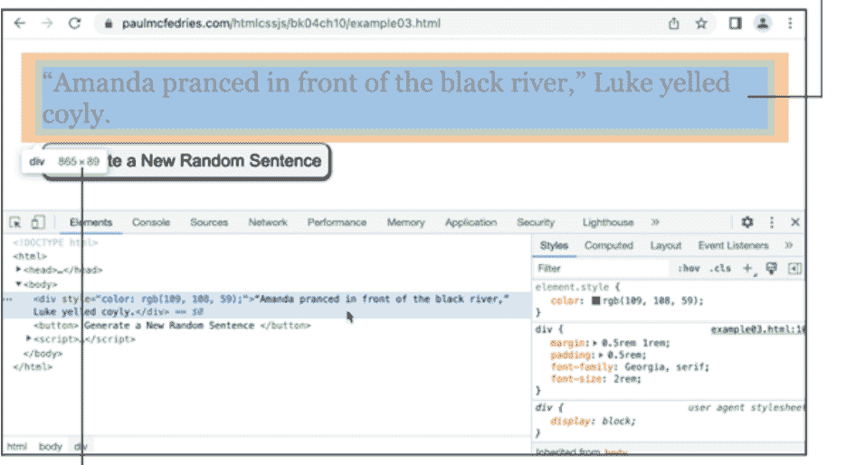

元素的宽度和高度

**图 9-1：** HTML 查看器（如 Chrome 中的 Elements 标签）允许你检查每个元素的样式和盒模型尺寸。

### 调试 101：使用控制台


# 第 9 章 调试

如果你的网页运行异常——例如，页面空白或缺少元素——你应该检查你的 HTML 代码以确保它是正确的。（常见的 HTML 错误包括没有用大于号（`>`）结束标签、未包含闭合标签以及属性值缺少闭合引号。）如果你的 HTML 检查无误，那么很有可能是你的 JavaScript 代码有问题。你如何知道呢？进入控制台窗口是你的第一步。

控制台是一个交互式浏览器窗口，可以显示警告和错误、显示`console.log()`语句的输出，并允许你在无需运行整个脚本的情况下执行表达式和语句。控制台是浏览器最方便的调试工具之一，因此你需要学会操作它。

## 让控制台显示在屏幕上

要显示控制台，打开浏览开发工具，然后点击 Console 标签。你也可以使用以下键盘快捷键：

- Windows 版 Chrome：按下`Ctrl+Shift+J`。
- Mac 版 Chrome：按下`Option+⌘J`。
- Windows 版 Firefox：按下`Ctrl+Shift+K`。
- Mac 版 Firefox：按下`Option+⌘K`。
- Microsoft Edge：按下`Ctrl+Shift+J`。
- Safari：按下`Option+⌘+C`。

## 在控制台中打印程序数据

你可以使用特殊控制台对象的`console.log()`方法在控制台中打印文本和表达式值：

```
console.log(output)
```

**注意**：`output`是你想在控制台中打印的表达式。

输出表达式可以是文本字符串、变量、对象属性、函数结果，或这些者的任何组合。

你还可以使用方便的`console.table()`方法以易读的表格格式输出值：

```
console.table(output)
```

**注意**：`output`是你想要在控制台中查看的数组或对象（以变量或字面量形式存在）。

为了调试，你通常使用控制台来关注属性的值。当脚本执行完成后，你可以打开控制台查看值。

## 在控制台中运行代码

控制台的强大功能之一是它是交互式的，这意味着你不仅可以读取浏览器或`console.log()`生成的消息，还可以直接在控制台中输入代码。此功能有许多用途：

- 你可以尝试某些表达式以确定它们对脚本的影响。
- 当脚本暂停时，你可以输出变量当前值。
- 当脚本暂停时，你可以更改变量的值。例如，如果你注意到一个零值即将用作除数，你可以将该变量改为非零以避免脚本崩溃。
- 当脚本暂停时，你可以运行函数或方法以判断它在当前条件下是否符合预期。

每个浏览器的 Console 标签都包含一个文本框（通常由大于号`>`提示符标记），可以使用它输入表达式或语句。


**提示**：你可以通过分号分隔每个语句，在控制台中执行多个语句。例如，你可以通过输入类似下面的语句来测试`for`循环：

```
for (let i=1; i < 10; i += 1){console.log(i**2); console.log(i**3);}
```


**提示**：如果你想在控制台中重复早前的代码执行，或者想运行一些与之前运行的代码非常相似的代码，可以调用你在当前浏览器会话中使用过的语句和表达式。按下向上箭头可以向上滚动之前执行的代码；按下向下箭头可以向前滚动代码。

## 将代码进入中断模式

在中途暂停代码允许你检查某些元素，例如变量的当前值和属性。它还允许一次执行一条程序代码，以便你可以监控脚本的执行流程。

当你暂停代码时，JavaScript 会进入断点模式（break mode），这意味着浏览器会显示调试工具，并突出显示 JavaScript 即将执行的当前语句。图 9-2 显示了 Chrome 调试器（Sources 标签页）中处于断点模式的脚本。

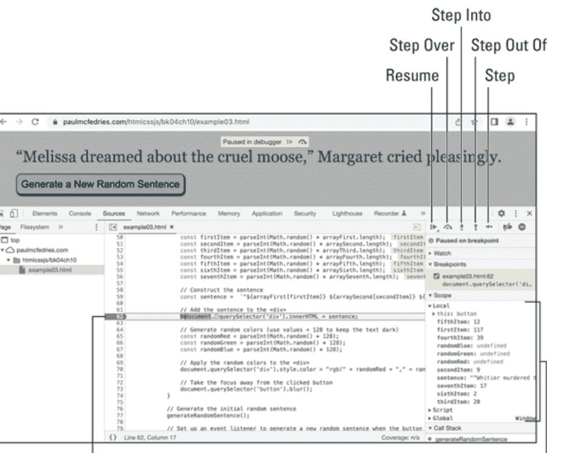

浏览器暂停在当前语句

脚本变量的当前值

**图 9-2**：当你调用断点模式时，网页浏览器会显示调试工具，并突出显示它即将执行的语句。

## 调用断点模式

JavaScript 提供了两种进入断点模式的方法：

- 通过设置断点
- 使用`debugger`语句

## 设置断点

如果你大致知道某个地方发生了错误或逻辑缺陷，可以通过设置断点在脚本的特定语句进入断点模式。以下是设置断点的步骤：

1. 显示你的 Web 浏览器的开发者工具并切换到调试工具（例如 Chrome 中的 Sources 标签页）。
2. 打开包含你要调试的 JavaScript 代码的文件。具体操作取决于你的浏览器：在 Chrome（以及大多数浏览器）中，你有两个选择：
   - 在左侧面板中，点击 HTML 文件（如果你的 JavaScript 代码位于 HTML 文件中的`<script>`元素内）或 JavaScript（.js）文件（如果你的代码存在于外部 JavaScript 文件中）。
   - 按`Ctrl+P`（Windows）或`Cmd+P`（macOS），然后点击列表中出现的文件。
3. 找到你想要进入断点模式的语句。JavaScript 将运行到该语句之前的每一行代码，但不包括该语句。
4. 点击语句左侧的行号来设置断点，如图 9-3 所示。

## 禁用断点

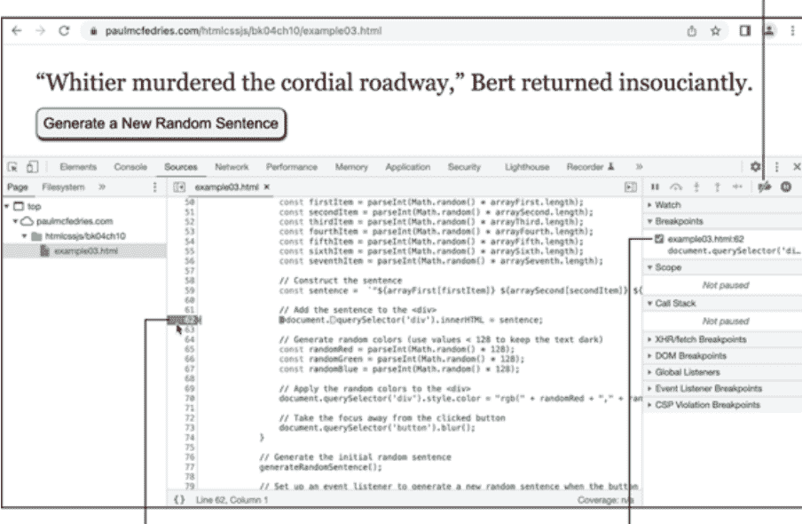

点击行号设置断点 取消选择以禁用断点 图 9-3: 点击行号

**图 9-3**：在浏览器的调试工具中，点击行号以在该语句上设置断点。

要移除断点，大多数浏览器提供了三种选择：

- 要临时禁用断点，在"断点"（Breakpoints）列表中取消选择断点的复选框。
- 要临时禁用所有断点，点击"禁用断点"（Deactivate Breakpoint）按钮。Chrome 版本的此按钮在此边边显示。再次点击此按钮可重新激活所有断点。
- 要移除断点，点击语句的行号。

## 添加 `debugger` 语句

在开发网页时，你通常会通过发送各种测试值或在不同条件下尝试测试脚本的健壮性。在许多情况下，你可能希望进入断点模式以确保一切正常。你可以在特定语句处设置断点，但如果你关闭文件，断点将会丢失。对于更持久的方法，你可以在脚本中包含一个`debugger`语句。每当 JavaScript 遇到`debugger`语句时，会自动进入断点模式。

这里有一段包含`debugger`语句的代码：

```javascript
// 将句子添加到 <div> 中
document.querySelector('div').innerHTML = sentence;
// 生成随机颜色（使用 < 128 的值以保持文字颜色）
const randomRed = parseInt(Math.random() * 128);
const randomGreen = parseInt(Math.random() * 128);
const randomBlue = parseInt(Math.random() * 128);
debugger;
```

## 退出断点模式

要退出断点模式，你可以在浏览器的调试工具中使用以下方法之一：

- 点击"恢复"（Resume）按钮。Chrome 版本的此按钮在此边边显示。
- 按浏览器的"恢复"快捷键。在 Chrome（以及大多数浏览器）中，按`F8`或按`Ctrl+\`（Windows）或`Cmd+\`（macOS）。

## 逐行执行代码

常见的（也是最实用的）调试技术之一是一次执行一条语句地逐行通过代码。这样做让你感受程序的流程，以确保循环和函数调用等操作执行正常。你可以使用四种技术：

- 一次执行一条语句
- 单入某些代码（Step Into）
- 跨过某些代码（Step Over）
- 跳出某些代码（Step Out）

### 一次执行一条语句

逐行执行代码最常见的方法是一次执行一条语句。在断点模式下，一次执行一条语句意味着两点：

- 你执行当前语句，然后在下一条语句处暂停。
- 如果要执行的当前语句是一个函数调用，单步将带你进入函数并在函数的第一个语句处暂停。然后你可以继续逐行执行该函数，直到执行最后一条语句，此时浏览器会将你返回到函数调用之后的语句。

要一次执行一条语句地通过代码，请设置一个断点，然后在代码进入断点模式后，执行以下操作之一来单执行单条语句：

- 点击"单步"（Step）按钮。Chrome 版本的此按钮在此边边显示。
- 按浏览器的"单步"快捷键。在 Chrome 中（大多数浏览器，Firefox 除外，Firefox 在编写本文时尚不支持"单步"；请改用"单入"按钮），按`F9`。

继续单步执行，直到脚本结束或直到你准备好恢复正常执行（通过点击"恢复"）。

### 单入某些代码

在所有主流浏览器中（Firefox 除外），单入某些代码与一次执行一条语句通过代码完全相同。区别在于当语句异步执行时（即它在延迟后执行操作，而不是立即执行）。

为了理解这种区别，请考虑以下代码（我在左侧添加了行号；它们不是代码的一部分）：

```javascript
1 setTimeout(() => {
2 console.log('Inside the setTimeout() block internal!');
3 }, 5000);
4 console.log('Outside the setTimeout() block internal!');
```

这段代码使用`setTimeout()`在五秒后执行一个匿名函数。假设你在`setTimeout()`语句（第 1 行）进入断点模式。使用"单步"（Step）和"单入"（Step Into）有什么区别？

- **单步**：点击"单步"按钮不会带你进入第 2 行，因为你可能……因为`setTimeout()`是异步的，单步实际上忽略了匿名函数并直接带你进入第 4 行。
- **单入**：点击"单入"按钮`会`带你进入第 2 行，但在指定的延迟之后（在本例中为五秒）。然后你可以根据需要逐行执行该匿名函数。

要单入代码，请设置一个断点，然后在代码进入断点模式后，执行以下操作之一：

- 点击"单入"（Step Into）按钮。Chrome 版本的此按钮在此边边显示。
- 按浏览器的"单入"快捷键。在 Chrome（以及大多数浏览器）中，按`F11`或按`Ctrl+`（Windows）或`Cmd+`（macOS）。


**注意**：我在这里对"单入"的描述在编写本文时不适用于 Firefox。相反，Firefox 的"单入"功能类似于我在上一节描述的"单步"功能。

### 跨过某些代码

某些语句会调用函数。如果你对逐行执行被调用的函数感兴趣，可以跨过它。跨过函数意味着 JavaScript 正常执行函数并在函数调用之后的语句处恢复断点模式。

跨过函数，首先执行代码到达你想跳过的函数调用，或者在函数调用处设置断点并刷新网页。当你处于断点模式时，可以使用以下任何一种技术来跨过函数：

- 点击"跨过"（Step Over）按钮。Chrome 版本的此按钮在此边边显示。
- 按浏览器的"跨过"快捷键。在 Chrome（以及大多数浏览器）中，按`F10`或按`Ctrl+'`（Windows）或`Cmd+'`（macOS）。

### 跳出某些代码

我总是无意中进入了那些我本想跳过的函数。如果函数很短，我就直接逐行执行它，直到回到原始代码。然而，如果函数很长，我不想浪费时间逐行执行每一个语句。相反，我通过以下任何方法调用"跳出"（Step Out）功能：

- **点击"跳出"按钮。** Chrome 版本的此按钮显示在侧边栏。
- **按下浏览器的"跳出"快捷键。** 在 Chrome（以及大多数浏览器）中，按下`Shift+F11`或按下`Ctrl+Shift+;`（Windows）或`⌘ Shift+;`（macOS）。

JavaScript 会执行函数的剩余部分，然后在函数调用后的第一行重新进入断点模式。

# 第 10 章 处理表单数据

- 本章内容
- 编写文本框
- 编写复选框、单选按钮和选择列表
- 监控和触发表单事件
- 处理表单数据

在本章中，你将学习如何通过将 HTML 表单接入某些 JavaScript 代码来"接线"。你将探索各种与表单相关的对象，然后直接开始处理文本字段、复选框、单选按钮和选择列表。你还将深入探索表单事件的有用世界，甚至学习如何使用快捷键增强你的表单控件。最后，你将大显身，学习如何使用 Web Storage API 存储表单数据。

## 编写文本字段

基于文本的字段是最常用的表单元素，大部分都使用`<input>`标签。`input`元素拥有大量属性，但从编码的角度来看，你通常只感兴趣其中四个：

```html
<input id="textField" type="text" name="txtName" value="defaultValue">
```

以下是各个部分的含义：

- `textId`：文本字段的唯一标识符
- `textType`：你想要在表单使用的文本字段类型
- `textName`：分配给字段的名称
- `textValue`：字段的初始值（如果有的话）

### 按字段类型引用

一种常见的表单脚本技术是对每个相同类型的字段执行某种操作。例如，你可能想对所有 URL 字段应用样式。这里是用于选择所有给定类型`input`元素的 JavaScript 选择器：

```javascript
document.querySelectorAll('input[type=fieldType]')
```

**注意**：`fieldType`是你想要选择的类型属性值，例如`text`或`url`。

这里是一个示例，JavaScript 返回所有使用类型`url`的`input`元素的集合：

HTML：

```html
<label for="url1">
  Site 1:
</label>
<input id="url1" type="url" name="url1" value="https://">
<label for="url2">
  Site 2:
</label>
<input id="url2" type="url" name="url2" value="https://">
<label for="url3">
  Site 3:
</label>
<input id="url3" type="url" name="url3" value="https://">
```

JavaScript：

```javascript
const urlFields = document.querySelectorAll('input[type=url]');
console.log(urlFields);
```

### 获取文本字段值

你的脚本可以使用字段对象的某个与值相关的属性来获取任何文本字段的当前值：

```javascript
field.value
field.valueAsDate
field.valueAsNumber
```

这里有一个示例：

HTML：

```html
<label for="search-field">
  Search the site:
</label>
<input id="search-field" name="q" type="search">
```

JavaScript：

```javascript
const searchString = document.getElementById('search-field').value;
console.log(searchString);
```

### 设置文本字段值

要更改文本字段的值，请将新字符串分配给字段对象的`value`属性：

```javascript
field.value = value
```

以下是各个部分的含义：

- `field`：你想操作的表单字段对象的引用
- `value`：你想要分配给文本字段的字符串

这里有一个示例：

HTML：

```html
<label for="homepage-field">
  Type your homepage address:
</label>
<input id="homepage-field" name="homepage" type="url" value="HTTPS://PAULMCFEDRIES.COM/**/">
```

JavaScript：

```javascript
const homepageField = document.getElementById('homepage-field');
const homepageURL = homepageField.value;
homepageField.value = homepageURL.toLowerCase();
```

HTML 定义了一个类型为`url`的`input`元素，其默认值为全大写字母。JavaScript 代码获取一个 URL，将其转换为全小写字母，然后返回到同一个`url`字段。如图 10-1 所示，文本框现在显示为全小写字母。

**图 10-1**：脚本将`input`元素的默认文本转换为全小写字母。

## 编写复选框

我们在 Web 表单中使用复选框来切换设置的开启（即复选框被选中）和关闭状态。你通过在表单中包含以下版本的`<input>`标签来创建复选框：

```html
<input id="isChecked" type="checkbox" name="checkName" value="checkValue">
```

这里是各个部分：

- `isChecked`：复选框的唯一标识符
- `checked`：当此可选属性存在时，复选框初始为选中

### 引用复选框

如果你的代码需要处理复选框，请使用以下选择器：

```javascript
document.querySelectorAll('input[type=checkbox]')
```

### 获取复选框状态

你的代码想要知道复选框是否被选中。这是`checked`属性：

```javascript
checkbox.checked
```

这里，示例，假设你有一个带有复选框的表单，你想知道复选框的状态。HTML：

```html
<label>
  <input id="autosave" type="checkbox" name="autosave">
  Autosave
</label>
```

JavaScript：

```javascript
const autoCheckBox = document.querySelector('#autosave');
if (autoCheckBox.checked) {
    console.log(`${autoCheckBox.name} 已选中`);
} else {
    console.log(`${autoCheckBox.name} 未选中`);
}
```

JavaScript 代码将复选框的引用存储在`autoCheckBox`变量中。`if`语句检查`checked`属性并在控制台中输出。

### 设置复选框状态

要将复选框设置为选中或取消选中，请将布尔表达式分配给`checked`属性：

```javascript
checkbox.checked = true
```

例如，假设你有很多复选框，你想限制最多选中三个。这里是实现此功能的代码：

```javascript
document.querySelector('form').addEventListener('click', event => {
    // 确保点击的是复选框
    if (event.target.type === 'checkbox') {

        // 获取选中的复选框总数
        const totalSelected = document.querySelectorAll('input[type=checkbox]:checked').length;

        // 是否超过了三个？
        if (totalSelected > 3) {

            // 如果是，取消点击的复选框
            event.target.checked = false;
        }
    }
});
```

此事件处理器在点击表单内的任何内容时运行，并将点击事件作为参数传递。然后代码使用`:checked`选择器返回所有具有`checked`属性的复选框元素集合，`length`告诉你有多少个。

## 编写单选按钮

你使用以下`<input>`标签变体创建单选按钮：

```html
<input id="radioId" type="radio" name="radioGroup" value="radioValue" [checked]>
```

以下是各个部分：

- `radioId`：单选按钮的唯一标识符
- `radioGroup`：分配给单选按钮组的名称。使用相同名称的单选按钮都属于该组。
- `radioValue`：分配给单选按钮的值。如果在提交表单时该单选按钮被选中，则提交中将包含该值。
- `checked`：当此可选属性存在时，单选按钮初始为选中。

### 引用单选按钮

如果你的代码需要处理页面上的所有单选按钮，请使用此 JavaScript 选择器：

```javascript
document.querySelectorAll('input[type=radio]')
```

如果你想获取特定表单中的单选按钮，可以使用表单 id 值的后代选择器或子选择器：

```
document.querySelectorAll('#formid input[type=radio]')
```

或者：

```
document.querySelectorAll('#formid > input[type=radio]')
```

如果你只需要特定组中的单选按钮，使用以下 JavaScript 选择器，其中`radioGroup`是该组的共同名称：

```javascript
document.querySelectorAll('[input[name=radioGroup]')
```

### 获取单选按钮状态

如果你的代码需要知道某个单选按钮是否被选中或未选中，你需要确定单选按钮的状态。你可以通过检查单选按钮的`checked`属性来实现，如下：

```
radio.checked
```

如果单选按钮被选中，`checked`属性返回`true`；如果未选中则返回`false`。

例如，考虑以下 HTML：

```html
<form>
  <fieldset>
    <legend>
      选择交付方式
   </legend>
    <label>
      <input type="radio" id="carrier-pigeon" name="delivery" value="pigeon" checked>信鸽快递
   </label>
    <label>
      <input type="radio" id="pony-express" name="delivery" value="pony">驿马快递
   </label>
    <label>
      <input type="radio" id="snail-mail" name="delivery" value="postal">蜗政
   </label>
 </fieldset>
</form>
```

```html
<label>
  <input type="radio" id="some-punk" name="delivery" value="bikecourier">骑自行车的某个浪子
</label>
</fieldset>
</form>
```

如果你的代码需要知道组中哪一个单选按钮被选中，可以通过对该组应用`:checked`选择器，然后获取返回对象的`value`属性：

```javascript
const deliveryMethod = document.querySelector('input[name=delivery]:checked').value;
```

### 设置单选按钮状态

要将单选按钮字段设置为选中或未选中状态，请为`checked`属性分配一个布尔表达式：

```
radio.checked = true|false
```

例如，在上一节的 HTML 代码中，表单组的初始状态是第一个单选按钮被。你可以通过选择该按钮来重置该组。你可以获取第一个单选按钮 id 的引用，但如果你之后更改（或其他人更改）了单选按钮的顺序怎么办？更安全的方法是获取组中第一个单选按钮的引用（无论它是什么），然后选择该元素。以下是实现此操作的代码：

```javascript
const firstRadioButton = document.querySelectorAll('input[name=delivery]')[0];
firstRadioButton.checked = true;
```

此代码使用`querySelectorAll()`返回交付组中所有单选按钮的`NodeList`集合；然后使用`[0]`引用中的第一个元素。接着将该元素的`checked`属性设置为`true`。

## 编写选择列表

选择列表是 HTML 表单中常见的元素，因为它们允许开发者在一个紧凑的控件中显示大量的选择，而大多数用户都知道如何操作。

要创建列表容器，使用`<select>`标签：

```html
<select id="selectId" name="selectName" size="selectSize" [multiple]>
```

以下是各个部分：

- `selectId`：选择列表的唯一标识符。
- `selectName`：你想要分配给选择列表的名称。
- `selectSize`：列表框中可见的行数（可选）。如果你省略此值，浏览器将把列表显示为下拉框。
- `multiple`：当此可选属性存在时，允许用户在列表中选择多个选项。

对于列表中的每个项目，在`<select>`和`</select>`标签之间添加`<option>`标签：

```html
<option value="optionValue" [selected]>
```

以下是各个部分：

- `optionValue`：你想要分配给列表选项的值。
- `selected`：当此可选属性存在时，列表选项初始状态为被选中。

### 引用选择列表选项

如果你的代码需要处理选择列表中的所有选项，请使用选择列表对象的`options`属性：

```javascript
document.querySelector(list).options
```

要处理列表中的特定选项，使用 JavaScript 的方括号运算符`[]`来指定选项位置的索引：

```javascript
document.querySelector(list).options[n]
```

以下是各个部分：

- `list`：你想要操作的 select 元素。
- `n`：选项在列表中的索引（0 是第一个选项，1 是第二个，以此此类推）。

要获取选项的文本（显示在列表中的内容），使用`text`属性：

```javascript
document.querySelector(list).options[2].text
```

### 获取被选选项

如果你的代码需要知道某个特定的单选按钮是否被选中或未选中，检查`checked`属性，如下：

```
option.checked
```

如果单选按钮被选中，`checked`属性返回`true`；如果未选中则返回`false`。

例如，考虑以下选择列表：

```html
<select id="color" name="color">
  <option value="black">黑色</option>
  <option value="blonde">金金色</option>
  <option value="brunette" selected>棕色</option>
  <option value="red">红色</option>
  <option value="neon">霓虹色</option>
  <option value="none">无</option>
</select>
```

如果你的代码需要知道组中的哪个选项被选中，可以通过对该组应用`:checked`选择器来实现：

```javascript
const selectedOption = document.querySelector('input[name=color]:checked');
```

## 表单事件

### 设置焦点

一个可以提高表单页面用户体验的简单功能，是在页面加载时为第一个表单字段设置焦点。设置焦点可以省去用户在第一个字段内进行那个恼人的点击操作。

要实现这一点，请在你希望启动时获得焦点的元素上运行 JavaScript 的`focus()`方法：

```
field.focus()
```

这是一个示例，展示如何在启动时为 id 为`user`的文本字段设置焦点：

HTML：

```html
<form>
<label for="user">用户名</label>
<input id="user" type="text" name="username">
<label for="pwd">密码</label>
<input id="pwd" type="password" name="password">
</form>
```

JavaScript：

```javascript
document.querySelector('#user').focus();
```

### 监控焦点事件

与其设置焦点，你可能更想监控特定字段何时获得焦点（例如，通过用户点击或使用 Tab 键进入该字段）。你可以通过在字段上设置一个焦点事件处理程序来监控这一点：

```javascript
field.addEventListener('focus', () => {
  // 在此处编写焦点代码
});
```

这是一个示例：

```javascript
document.querySelector('#user').addEventListener('focus', () => {
  console.log('用户名字段已聚焦！');
});
```

### 监控失去焦点（blur）事件

设置元素焦点的相反操作是让元素失去焦点（blur），这会移除元素上的焦点。你可以通过在元素上运行`blur()`方法来让元素失去焦点，导致其失去焦点：

```
field.blur()
```

然而，与其让元素失去焦点，你可能更会在特定元素失去焦点时运行某些代码（例如，通过用户点击或 Tab 键离开字段）。你可以通过设置`blur()`事件处理程序来监控特定的失去焦点元素：

```javascript
field.addEventListener('blur', () => {
  // 在此处编写失去焦点代码
});
```

这是一个示例：

```javascript
document.querySelector('#user').addEventListener('blur', () => {
  console.log('用户名字段不再聚焦了！');
});
```

### 监听元素变化

表单最有用的事件之一是`change`事件，当字段的值或状态以某种方式被修改时，该事件就会触发。该事件的触发取决于元素的类型：

- 对于`textarea`元素和各种文本相关的输入元素，当元素失去焦点时会触发`change`事件。
- 对于复选框、单选按钮、选择列表和选择器，当用户点击元素以修改选择或值时，`change`事件会立即触发。

你通过设置一个`change()`事件处理程序来监听字段的更改事件：

```javascript
field.addEventListener('change', () => {
  // 在此处编写更改代码
});
```

这是一个示例：

HTML：

```html
<label for="bgcolor">选择背景颜色</label>
<input id="bgcolor" type="color" name="bg-color" value="#ffffff">
```

JavaScript：

```javascript
document.querySelector('#bgcolor').addEventListener('change', (event) => {
  const backgroundColor = event.target.value;
  document.body.backgroundColor = backgroundColor;
});
```

HTML 代码设置了一个颜色选择器。JavaScript 代码为颜色选择器应用了`change`事件处理程序。当选择器上触发`change`事件时，代码通过引用`event.target.value`将新颜色值存储在`backgroundColor`变量中，其中`event.target`指向绑定监听器的元素（在此例为颜色选择器）。代码随后该颜色应用到`body`元素的`backgroundColor`属性。

### 处理表单数据

我之前没有涵盖的一个表单事件，它是非常重要的：`submit`事件，它在表单数据准备发送到服务器时触发。

然而，如果你的脚本仅在本地处理表单数据——也就是说，你不需要将数据发送到服务器——那么你就不需要担心提交表单。相反，在表单中添加一个按钮，并使用该按钮的点击事件处理程序以你需要的任何方式处理表单数据会更加直接。

这是一个示例：

HTML：

```html
<form>
  <fieldset>
    <legend>
      设置
   </legend>
    <label for="background-color">选择背景颜色</label>
    <input id="background-color" type="color" name="bg-color" value="#ffffff">
    <label for="text-color">选择文字颜色</label>
    <input id="text-color" type="color" name="text-color" value="#000000">
    <label for="font-stack">选择字体</label>
    <select id="font-stack" name="font-stack">
      <option value="Georgia, Times New Roman, serif">已选衬线</option>
      <option value="Verdana, Tahoma, sans-serif">无衬线</option>
      <option value="Bradley Hand, cursive">幻想</option>
      <option value="Monaco, Courier, monospace">等宽字体</option>
      <option value="Script MT, cursive">手体</option>
      <option value="Luminari, fantasy">幻想</option>
      <option value="Impact, charcoal">冲击</option>
   </select>
    <button>保存设置</button>
 </fieldset>
</form>
```

JavaScript：

```javascript
// 监听 #background-color 选择器的变化
document.querySelector('#background-color').addEventListener('change', function() {
  const backgroundColor = this.value;
  document.body.backgroundColor = backgroundColor;
});

// 监听 #text-color 选择器的变化
document.querySelector('#text-color').addEventListener('change', function() {
  const textColor = this.value;
  document.body.color = textColor;
});

// 监听 #font-stack 选择列表的变化
document.querySelector('#font-stack').addEventListener('change', function() {
  const fontStack = this.selectedOptions[0].value;
  document.body.fontFamily = fontStack;
});

// 监听按钮被点击
document.querySelector('button').addEventListener('click', () => {
  // 将数据存储在 JavaScript 对象中
  const settings = {
    backgroundColor: document.querySelector('#background-color').value,
    textColor: document.querySelector('#text-color').value,
    fontStack: document.querySelector('#font-stack').selectedOptions[0].value
  };

  // 将设置保存到本地存储中
  localStorage.setItem('user-settings', JSON.stringify(settings));
});
```

# 第 11 章 十种调试策略

- 使用控制台、断点和其他开发辅助工具进行调试
- 编写易于调试的代码
- 巧妙利用注释进行调试

## 进入你的开发工具

所有的网页页面调试都从访问浏览器开发工具开始。在每个浏览器中，打开开发工具最快的方法是右键点击页面元素并选择"检查"。你也可以按`Ctrl+Shift+I`（Windows）或`Option+I`（macOS）。

## 控制台是你最好的调试伙伴

在代码中，你可以通过将变量或对象属性的值输出到开发者工具的 Console（控制台）标签来查看其当前值：

```
console.log(output);
```


# JavaScript 调试与开发指南

## 控制台输出

将 `output` 替换为你想要在控制台中打印的表达式。输出表达式可以是文本字符串、变量、对象属性、函数结果，或这些者的任何组合。

## 给你的代码一个“休息”（断点）

暂停代码可以让你看到正在发生什么，并在控制台中运行某些命令。你有两种方法在执行中途暂停代码：

- **设置断点。** 在开发者工具中，打开包含 JavaScript 代码的文件，找到你想要暂停的语句，然后点击该语句左侧的行号。
- **添加 `debugger` 语句。** 在你的 JavaScript 代码中，在你想要暂停的语句之前的一行添加 `debugger` 语句。

### 逐行执行代码

一旦你的 JavaScript 代码进入断点模式，就可以使用开发者工具的执行控制控件来逐行执行代码。你可以一次执行一条语句、跳过函数或进入函数。

### 监控变量和对象属性值

你可以使用 `console.log()` 语句将值输出到控制台，或者在代码处于断点模式时，将鼠标悬停在变量或对象上，在提示框中查看其当前值。你还可以创建表达式（watch expressions）来监控值。

### 缩进你的代码

对每个语句块中的代码进行缩进会极大提高 JavaScript 代码的可读性。可读性代码更容易追踪和理解，因此你的调试工作就少了一个障碍。每条语句缩进两个或四个空格是常见的做法。

### 分解复杂任务

不要试图一次性解决所有问题。如果你有一个大型脚本或函数运行不正常，请将其分成小块进行测试，以缩小问题范围。

### 拆分长语句

脚本调试中最复杂的方面之一是理解长语句（尤其是表达式）。控制台窗口可以提供帮助（你可以用它打印语句的一部分），但通常最好是保持语句尽可能短。一旦你让程序正常运行，通常可以重新组合语句以获得更高效的代码。

### 注释掉问题语句

如果某个语句给你带来麻烦，你可以在行首放置两个斜杠（`//`）来临时禁用它。这告诉 JavaScript 将该行视为注释。如果你有多个语句需要跳过，可以在第一条语句的开头放置 `/*`，在最后一条语句的结尾放置 `*/`。

### 使用注释记录你的脚本

提到注释，编程中有一个共识：给代码添加的解释性注释永远不够。添加的注释越多，你的脚本就越容易调试。

## 索引

### 符号

- `-` (减号), 27
- `"` (引号)
  - 内部处理, 118-120
  - 字符串字面量, 28
- `'` (单引号)
  - `onclick` 属性, 63
  - 字符串字面量, 28
- `/` (除法运算符), 20
- `/*` (多行注释), 13-41
- `//` (双斜杠), 13
- `;` (分号), 7
- `\` (反斜杠), 29
- `_` (下划线), 24
- `` ` `` (反引号), 119
- `||` (或运算符), 35
- `+` (连接符号), 33
- `+` (加号), 27
- `=` (等号), 19-20
- `=>` (箭头函数), 70
- `!` (非运算符), 35
- `&&` (与运算符), 35
- `*` (乘法符号), 32
- `[]` (括号运算符), 150
- `{}` (大括号)
  - `if` 语句和, 40-41
  - 作为函数的一部分, 56

### A

- `add()` 方法, 95
- `addEventListener()` 方法, 100
- `after()` 方法, 90
- `alert()` 方法, 7-8
- `&&` (与运算符), 35
- 匿名函数
  - 赋值给变量, 67-68
  - 概览, 66-70
  - 用替换函数调用, 68-70
- `append()` 方法, 90
- 参数
  - 定义, 61
  - 用于 `Date` 对象, 124
  - 函数, 56
  - 位置, 93
- 算术赋值运算符, 32-33
- 数组
  - 声明, 106
  - 元素和, 80
  - 索引数字和, 105
  - 迭代
    - `find()` 方法, 112-114
    - `forEach()` 方法, 109-110
    - `map()` 方法, 110-111
    - `reduce()` 方法, 111-112
  - `length` 属性, 114
  - 操作方法, 114-115
  - 概览, 105
  - 填充, 106-109
  - 通过类名和标签名指定元素, 80
- `=>` (箭头函数), 70
- 属性
  - HTML, 97-99
  - `id`, 79
  - `` 标签, 97
  - `onclick`, 61, 63
  - 单选按钮状态, 147-148
  - 单引号和, 63
  - `src`, 15
  - 反引号 (`` ` ``), 119
  - 反斜杠 (`\`), 29
- `before()` 方法, 91
- 块语句, 40-41
- 块语法, 40
- `blur` 事件, 156
- `blur()` 方法, 156
- `<body>` 标签, 1
- 布尔
  - 事件值, 102
  - 表达式赋值给对象, 153
  - 运算符, 34
  - 字面量, 30
- 大括号 (`{}`)
  - `if` 语句和, 40-41
  - 作为函数的一部分, 56
- 括号运算符 (`[]`), 150
- 断点模式
  - `debugger` 语句, 136-137
  - 进入, 135-137
  - 退出, 137
  - 概览, 134-137
  - Step Into 按钮, 138-139
  - Step Out 按钮, 140
  - Step Over 按钮, 139-140
  - 逐步执行, 162
  - 调试策略, 162
  - 概览, 135-136
- 控制台
  - 访问, 132
  - 概览, 130-133
  - 打印数据, 132-133
  - 运行代码, 133
  - 测试代码, 162
- `console.log()` 方法
  - 调试策略, 163
  - 概览, 132-133
- `const` 关键字, 21–22
- 构造函数, 106
- 控制 JavaScript 循环
  - `for...of`, 82-83
  - `for`, 83, 109
  - 填充数组, 108-109
  - `do...while` 循环, 51-53
  - `for`, 47-51, 83, 109
  - 导入, 43-44
  - 结构, 47
  - `while`, 44-46
  - 概览, 39
- 语句
  - `if`, 40-41
  - `else`, 41-42
  - 变量, 47-48
  - 表达式, 47
  - 更新表达式, 47
- CSS (层叠样式表)
  - 为元素添加类, 94-96
  - 修改元素样式, 94-97
  - 移除类, 96
  - 切换类, 97
- `change()` 事件处理器, 157
- 子 (对象模型) 添加元素, 89-91
- Chrome, 129-130
- 类元素和添加, 94–96
- 通过名称指定, 80
- 移除, 96
- 切换, 97
- `classList` 属性, 95–97
- 代码
  - 添加到网页, 5-10
  - 不支持的浏览器, 10-12
  - 注释, 13-14
  - 调试策略, 164
  - 概览, 13-14
  - 语法, 13-14
  - 用于描述动作, 19
  - 调试, 137-140
- 效率
  - `do...while` 循环, 51-53
  - `if` 语句, 40-41
  - `else` 语句, 41-42
  - 重要性, 43-44
  - `for` 循环, 47-51, 83, 109
  - `for...of` 循环, 82-83
  - 循环, 43-44
  - 循环和数组, 108-109
  - 概览, 39
  - `while` 循环, 44-46
- 缩进
  - 调试策略, 163
  - 语法, 42
- 暂停
  - 调试策略, 162
  - 概览, 134-137
  - 运行, 133
  - 测试, 162
- 比较表达式和运算符, 34
- 复合语句, 41
- `concat()` 方法, 115
- 连接符号 (`+`), 33
- `const` 关键字, 21–22
- 构造函数, 106
- ECMAScript 6 和, 12
- 在...启用 JavaScript, 10-12
- 与 JavaScript, 10-13
- 过时的
  - 匿名函数, 67
  - 箭头函数, 70
  - 与 `for` 循环, 83
  - 概览, 12-13
- 解析 `<script>` 标签, 57-58
- 作为测试代码的要求, 10
- 调试策略中的 Web 开发工具, 161
- 概览, 129-131

### C

- 回调函数概览, 100
- 用匿名函数替换, 68-71
- `change()` 事件处理器, 157
- 子 (对象模型) 添加元素, 89-91
- Chrome, 129-130
- 类元素和添加, 94–96
- 通过名称指定, 80
- 移除, 96
- 切换, 97
- `classList` 属性, 95–97
- CSS (层叠样式表)
  - 为元素添加类, 94-96
  - 修改元素样式, 94-97
  - 移除类, 96
  - 切换类, 97

### D

#### 数据类型

- 布尔字面量, 30
- 浮点数, 27
- 整数, 26
- 数字字面量
  - 指数计数法, 27
  - 十六进制整数值, 27-28
- 字符串字面量
  - 转义序列, 29-30
  - 概览, 28-30
  - 字符串中的引号, 28

- `Date()` 函数, 125

#### 日期和时间

- `Date` 对象
  - 参数, 124
  - 方法, 126
  - 概览, 125-126
  - 设置日期, 126-127
  - 指定, 125
  - 概览, 123-127

- `debugger` 语句, 162

#### 调试

##### 中断模式

- 断点, 135-136
- `debugger` 语句, 136-137
- 进入, 135-137
- 退出, 137
- 概述, 134-137
- 步入（Step Into）按钮, 138-139
- 步出（Step Out）按钮, 140
- 步过（Step Over）按钮, 139-140
- 逐步执行代码, 162
- 分解复杂任务, 163

##### 代码

- 注释, 164
- 概述, 137-140

##### 控制台

- 访问, 132
- 概述, 130-133
- 在其中打印程序数据, 132-133
- 在其中运行代码, 133
- 在其中测试代码, 162

- 代码缩进, 163
- 监控变量和对象属性值, 163
- 网络工具, 131

##### 语句

- 注释, 164
- 概述, 138-140
- 缩短, 163

- 策略, 161-164
- 浏览器中的 Web 开发工具
  - 作为调试策略, 161
  - 概述, 129-131
- Web 存储工具, 131

#### 声明

- 数组, 106
- 变量
  - 使用 `const`, 21-22
  - 使用 `let`, 18-19

- 浏览器中的开发工具, 129-131
- 除法运算符 (`/`), 20
- `do...while` 循环
  - 概述, 51-53
  - `while` 循环, 44-46
- `document` 对象, 9

#### 文档对象模型 (DOM) 元素

- 作为子元素添加, 89-91
- 添加文本和标签, 91-92
- 类 (`class`), 添加到, 94-96
- 类 (`class`), 移除, 96
- 类 (`class`), 切换, 97
- 集合, 81-83
- 创建, 89
- 插入 HTML, 92-93
- 修改, 92-93
- 概述, 89-92, 94
- 移除, 93
- 通过类名指定, 80
- 通过 `id` 属性指定, 79
- 通过选择器方法指定, 80-81
- 通过标签名指定, 79-80
- 样式, 修改, 94-97

#### 层级

- 子节点, 84-87
- 获取父元素的子元素, 84-87
- 获取子元素的父元素, 87
- 获取元素的兄弟元素, 87-88
- 概述, 83-84

- 监听页面事件, 100-103

#### 对象

- 方法, 76-77
- 概述, 73-77
- 属性, 74-76
- 概述, 77-78

#### HTML 属性

- 概述, 97-99
- 读取值, 98
- 移除, 99
- 设置值, 98-99

- `document.body` 函数, 59
- `document.lastModified` 语句, 9-10

#### `document.write()` 语句

- 概述, 9-10
- 变量, 22-23

- 双斜线 (`//`), 13

### E

#### ECMAScript 5

- 概述, 13
- `var` 关键字, 19

#### ECMAScript 6

- 新功能, 67, 70
- 概述, 12

#### Edge, 130

### 元素

- 作为子元素添加, 89–91
- 添加文本和标签, 91–92
- 按钮, 61
- 修改样式, 94–97
- 与子元素, 87
- 类
  - 添加到, 94–96
  - 移除, 96
  - 切换, 97
- 集合, 81–83
- 创建, 89
- 监听表单数据变化事件, 156–157
- 修改, 92–93
- 概述, 89–92, 94
- 父元素, 84–87
- 移除, 93
- 与兄弟元素, 87–88
- 指定
  - 通过类名, 80
  - 通过 `id` 属性, 79
  - 通过选择器方法, 80–81
  - 通过标签名, 79–80
- 等号 (`=`), 19–20
- ES 5, 13, 19
- ES 6, 12, 67, 70
- 转义序列 (`\n`), 29–30

- 事件
  - 执行函数和, 60-61
  - 监听, 100-103

- 表单数据
  - 监听元素变化, 156-157
  - 监控失去焦点 (`blur`), 156
  - 监控聚焦 (`focus`), 155-156
  - 概述, 154-157
  - 设置焦点, 155
- 执行函数
  - 浏览器解析 `<script>` 标签, 57-58
  - 事件和, 60-61
  - 加载页面, 58-59
  - 概述, 56-57
  - 使用匿名函数替换, 68-70

- 指数符号, 27

### 表达式

- 布尔, 赋值给对象, 153
- 比较, 34
- 控制, 37
- 计数器, 47
- 定义, 31
- 在 `do...while` 循环中, 52
- 逻辑, 34–35
- NOT 运算符, 35
- 数值, 32
- 运算符和, 31–32
- AND 运算符, 35
- OR 运算符, 35
- 优先级, 35–37
- 概述, 35–37
- 字符串, 26
- 结构, 31–32
- 在 `while` 循环中, 44
- 提取字符串, 122–23

### F

- 文件, 14–16
- `find()` 方法, 112–114
- Firefox, 130
- 浮点数, 27

### JavaScript 流，控制循环

- `for...of`, 82–83
- `do...while`, 51–53
- `for`, 47–51, 83, 109
- 重要性, 43–44
- 使用数组填充, 108–109
- 结构, 47
- `while`, 44–46
- 概述, 39
- `if`, 40–41
- `if...else`, 41–42
- 焦点事件, 155–156
- `focus()` 方法, 155–156
- `for...of` 循环, 82–83
- `for` 循环（旧版浏览器）, 83
- 概述, 47–51
- 使用数组填充, 109
- `forEach()` 方法, 109–110

### 表单数据

- 复选框
  - 获取状态, 145–146
  - 概述, 144–147
  - 引用, 145
  - 设置状态, 146
- 事件
  - 监听元素变化, 156–157
  - 监控失去焦点 (`blur`), 156
  - 监控聚焦 (`focus`), 155–156
  - 概述, 154–157
  - 设置焦点, 155
- 处理, 158–160
- 单选按钮
  - 获取状态, 148–149
  - 概述, 147–150
  - 引用, 148
  - 设置状态, 150
- 选择列表
  - 修改选项, 153–154
  - 获取选项, 152–153
  - 概述, 150–154
  - 引用选项, 151–152
- 提交, 158–160
- 文本框获取值, 143–144
- 概述, 141–144
- 按类型引用, 142

### 函数

- 匿名
  - 赋值给变量, 67–68
  - 概述, 66–70
  - 替换函数调用, 68–70
- 参数, 56
- 箭头, 70–72
- 回调 (`callback`), 68–100
- `Date()`, 125
- 定义, 8
- `document.body`, 59
- 执行
  - 浏览器解析 `<script>` 标签, 57–58
  - 事件和, 60–61
  - 加载页面, 58–59
  - 概述, 56–57
- `find()`, 112–114
- `forEach()`, 109–110
- `map()`, 110–111
- 命名, 66
- 概述, 55
- `reduce()`, 111–112
- 结构, 55–56
- 值和
  - 从获取, 64–66
  - 传递给, 61–64

### G

- `getAttribute()` 方法, 98

### H

- 处理器, 61
- `<head>` 标签, 6
- `headerImage` 变量, 98
- 十进制整数值, 27-58
- 层级
  - 子节点, 84-87
  - 获取父元素的子元素, 84-87
  - 获取子元素的父元素, 87
  - 获取元素的兄弟元素, 87-88
- HTML (超文本标记语言)
- `<body>` 标签, 6
- 按钮元素, 61
- 调试工具, 130-131
- `<head>` 标签, 6
- JavaScript 对比, 1
- `<script>` 标签
  - 用向用户显示消息, 7-8
  - 位置, 6
  - 概述, 5
  - 向页面写入文本, 8-10
  - 调整属性, 97-99

### I

- `id` 属性, 79
- `if` 语句, 40-41
- `if...else` 语句, 41-42
- `` 标签, 97

- 代码缩进
  - 作为调试策略, 163
- 语法, 42
- 索引值, 105
- `innerHTML` 属性, 91-92

- `<input>` 标签
  - 单选按钮, 147
  - 文本框获取值, 143–144
  - 概述, 141–144
  - 按类型引用, 142

### J

- JavaScript
  - 添加到网页, 5-10
  - 调试策略, 161-164
  - 启用, 10-12
  - 执行, 56-61
  - 文件, 14-16
  - 概述, 1-4

### M

- `map()` 方法, 110-111
- `Math` 对象, 77-78
- 方法
  - `add()`, 95
  - `addEventListener()`, 100
  - `after()`, 90
  - `alert()`, 7-8
  - `append()`, 90
  - `before()`, 91
  - `blur()`, 156
  - `change()`, 157
  - `concat()`, 115
  - `Date()`, 125
  - `find()`, 112-114
  - `focus()`, 155-156
  - `forEach()`, 109-110
  - `getAttribute()`, 98
  - `map()`, 110-111
  - `pop()`, 115
  - `prepend()`, 90
  - `prompt()`, 22-23
  - `push()`, 115
  - `reduce()`, 111-112
  - `remove()`, 93, 96
  - `removeAttribute()`, 99
  - `reverse()`, 115
  - `setAttribute()`, 98-99
  - `shift()`, 115
  - `slice()`, 115
  - `sort()`, 115
  - `string.charAt()`, 122
  - `string.charCodeAt()`, 122
  - `string.slice()`, 122
  - `string.split()`, 123
  - `string.substr()`, 123
  - `string.substring()`, 123
  - `unshift()`, 115
- Microsoft Edge, 130
- 减号 (`-`), 27
- 多行注释 (`/*`), 13-14
- 乘法符号 (`*`), 32

### N

- `\n` (转义序列), 29-30
- 命名函数, 66
- 命名空间, 67
- 下一个兄弟节点, 87
- 节点，子节点, 84–87
- `<noscript>` 标签, 11
- NOT 运算符 (`!`), 35
- 空字符串, 28
- 数值
  - 表达式, 32–33
  - 字面量
    - 科学计数法, 27
    - 十进制整数值, 27–28
  - 概述, 26–28

### O

#### objects

##### Date

- 参数, 124
- 方法, 126
- 概述, 125–126
- 设置日期, 126–127
- 指定日期和时间, 125

##### document, 9

- 方法, 76–77
- 监控值, 163
- 概述, 73–77
- 属性, 74–76

##### Strings

- 确定长度, 121
- 操作, 117–118
- 子字符串, 121–123
- 模板, 118–120

##### `onclick` 属性

- 示例代码, 63
- 概述, 61

- 操作数和运算符, 31–52
- 选择列表中的选项
  - 更改, 153–154
  - 获取, 152–153
  - 引用, 151–152
- 逻辑或运算符 (`||`), 35

### P

- 父节点 (文档对象模型), 83–84
- 解析，浏览器和 `<script>` 标签, 57–58
- 加号 (`+`), 27
- 污染命名空间, 67
- `pop()` 方法, 115
- 填充数组
  - 使用循环, 108–109
  - 概述, 106–109
- `prepend()` 方法, 90
- 上一个兄弟节点, 87–88
- 程序数据，在 Console 中打印, 132–133
- `prompt()` 方法, 22–23
- 属性
  - 数组长度, 114
  - 复选框状态, 145–147
  - `classList`, 95–97
  - `innerHTML`, 91–92
  - 监控对象值, 163
- `push()` 方法, 115

### Q

- 引号 (`"`)
  - 处理内部, 118–120
  - 字符串字面量, 28

### R

- `reduce()` 方法, 111-112
- 引用表单数据
  - 复选框, 145
  - 选择列表, 151-152
  - 文本字段, 142
- `remove()` 方法, 93, 96
- `removeAttribute()` 方法, 99
- 保留关键字, 24
- `reverse()` 方法, 115

### S

- Safari, 130
- `<script>` 标签
  - 浏览器解析, 57-58
  - 向用户显示消息, 7-8
  - 执行函数和, 57-58
  - 外部文件和, 15
  - 位置, 6, 79
  - 概述, 5
  - 向页面写入文本, 8-10
- `<select>` 标签, 150
- 选择列表
  - 更改选项, 153-154
  - 获取选项, 152-153
  - 概述, 150-154
  - 引用选项, 151-152
- 分号 (`;`), 7
- `setAttribute()` 方法, 98-99
- `shift()` 方法, 115
- 兄弟节点 (文档对象模型), 83-84
- 单引号 (`'`)
  - `onclick` 属性, 63
  - 字符串字面量, 28
- 单行语法, 40
- `slice()` 方法, 115
- `sort()` 方法, 115
- `src` 属性, 15
- 起值, 47
- 复选框状态, 145-147
- 语句
  - 块, 40–41
  - 注释, 164
  - 复合, 41
- 调试
  - Console, 162
  - 概述, 137–140
  - 定义, 7
- 缩进
  - 作为调试策略, 163
  - 概述, 42
- `document.lastModified`, 9–10
- `document.write()`, 9, 22–23
  - 在其中, 8, 56
  - `if`, 40–41
  - `else`, 41–42
- 循环
  - `for...of`, 82–83
  - `do...while`, 52
  - `for`, 44
- 方法
  - `alert()`, 7–8
  - `find()`, 112–114
  - `forEach()`, 109–110
  - `map()`, 110–111
  - `reduce()`, 111–112
  - 多重, 8
  - 缩短, 163
  - Out/Over 和, 137-140
  - 使用变量, 22-23
  - Step Into (开发工具), 138-139
  - Step Out (开发工具), 140
  - Step Over (开发工具), 139
  - `string.charAt()`, 122
  - `string.charCodeAt()`, 122
- 字符串
  - 包含 3
  - 字面量
    - 转义序列, 29–30
    - 概述, 28–30
    - 字符串中的引号, 28
  - 方法
    - `string.slice()`, 122
    - `string.split()`, 123
    - `string.substr()`, 123
    - `string.substring()`, 123
  - 多行, 119–120
  - null, 28
  - 对象
    - 确定长度, 121
    - 操作, 117–118
    - 子字符串, 121–123
    - 模板, 118–120
  - `prompt()` 方法，部分, 23
  - 子字符串
    - 提取, 122–123
    - 查找, 121–122
  - 元素的样式，更改, 94–97
- 减法赋值, 50
- 语法
  - `addEventListener()` 方法, 100
  - 块, 40
  - `Date()` 函数, 125
  - 声明数组, 106
  - `for...of` 循环, 82–83
  - 对象, 74–77
  - 单行, 40
- 标签
  - 添加到元素, 91–92
  - `<body>`, 6
  - `<head>`, 6
  - ``, 97
  - `<input>`
    - 单选按钮, 147–148
    - 文本字段, 141–145
  - `<noscript>`, 11
  - `<script>`
    - 浏览器解析, 57–58
    - 向用户显示消息, 7–8
    - 执行函数和, 57–58
    - 外部文件和, 15
    - 位置, 79
    - 代码中的位置, 6
    - 概述, 5
    - 向页面写入文本, 8–10
  - `<select>`, 150
  - 按名称指定元素, 79–80
  - 模板，字符串, 118–120
- 文本
  - 添加到元素, 91–92
  - 向用户显示, 7–8
  - 编辑器, 10
  - 写入网页, 8–10
- 文本字段
  - 概述, 141–144
  - 按类型引用, 142
  - 值和, 142–144
- 时间和日期
  - `Date` 对象
    - 参数, 124
    - 方法, 126
    - 概述, 125–126
    - 设置日期, 126–127
    - 指定, 125
  - 概述, 123–127
  - 时间敏感数据，在网页显示, 9
  - 浏览器中的开发工具, 129–131
- Torvalds, Linus, 2

### U

- 下划线 (`_`), 24
- `unshift()` 方法, 115
- 用户，向其显示消息
  - 概述, 7–8
  - 提示, 22–23

### V

- 值
  - 布尔事件, 102
  - 函数和
    - 获取, 64–66
    - 传递到, 61–64
  - 十进制整数, 27–28
  - 索引号, 105
  - 监控, 163
  - 负时间, 123
  - 起始, 47
  - 文本字段, 142–144
- 变量
  - 包含在字符串, 119–120
  - 存储在, 19–20

- 变量
  - 赋值给匿名函数, 67–68
  - 计数器, 47–48
  - 数据类型
    - 布尔字面量, 30
    - 数值字面量, 26–28
    - 概述, 26
    - 字符串字面量, 28–30
  - 声明
    - 使用 `const`, 21–22
    - 使用 `let`, 18–19
    - 定义, 7
  - `headerImage`, 98
  - 命名
    - 示例, 24–25
    - 概述, 24–25
  - 规则
    - 概述, 24
  - 语句
    - 在其中使用, 22–23
  - 值和
    - 包含在字符串中, 119–120
    - 监控, 163
  - 存储在, 19–20
  - `var` 关键字, 19

### W

- Web 浏览器断点模式
  - 断点, 135–136
  - `debugger` 语句, 136
  - 进入, 135–137
  - 退出, 137
  - 概述, 134–137
  - 逐步执行代码, 162

- Console
  - 访问, 132
  - 概述, 130–133
  - 在其中打印程序数据, 132–133
  - 在其中运行代码, 133
  - 在其中测试代码, 162

- ECMAScript 6 和, 12
- 在中启用 JavaScript, 10–12
- JavaScript 和, 10–13
- 过时的
  - 匿名函数和, 67
  - 箭头函数和, 70
  - `for` 循环和, 83
  - 概述, 12–13
- 解析 `<script>` 标签, 57–58
- 作为测试代码的要求, 10

- Web 开发工具在作为调试策略, 161 概述, 129–131
- Web 开发工具在浏览器作为调试策略, 161 概述, 129–131

- 网页代码到，添加, 5–10
- 向用户显示消息 概述, 7–8
- 执行函数和, 58–59
- 监听事件, 100–103
- 加载, 58–59
- 时间敏感数据，在网页上显示, 9
- 向页面写入文本, 8–10

- `while` 循环
  - `do...while`, 51–53
  - 概述, 44–46

## 作者致谢

每当我完成一本书，出版商都会给我寄来一个沉重的箱，里面装有几本所谓的“作者赠送书”。打开箱子，拿出一本书，感受着这种在此之前还是虚无的数字产物如今拥有的踏实重量，并看到封面上印着我的名字——噢，那种感觉真的很棒，我告诉你吧。这确实很酷，但你知道什么是*真正*酷的吗？在我写作生涯中，我已经这样做过一百多次了，而看到封面上我的名字是你能看到的唯一名字，这*从未*让我感到厌倦。

但仅仅因为封面上看到的只有我的名字，并不意味着这本书是一个人的独角。远非如此。没错，我确实编写了这本书的文字并截取了屏幕，但这些只代表了构成“书”的一部分。其余部分得益于 Wiley 编辑、图形和制作团队的奉献和专业精神，他们付勤耕耘，将我的文字和图像转化成一本真正的书。

我向 Wiley 所有让这本书成为可能的同事致以诚心的感谢，但我想向与我直接合作的同事们表示特别谢意：执行编辑 Lindsay Berg 和编辑 Elizabeth Kuball。

## 出版致谢

**执行编辑：** Lindsay Berg

**编辑：** Elizabeth Kuball

**制作编辑：** Saikarthick Kumarasamy

**封面设计与图像：** Wiley

## 无论去哪里，都带上 dummies！

无论你是对电子书感到兴奋、想从网上获取更多内容、必须手机 App，还是沉浸在社交媒体中，dummies 都能让一切变得简单。


在线找到我们！


dummies.com

dummies 标志

## 利用 dummies 的力量

Dummies 是参考类别的全球领导者，也是世界上最受信任和备受推目的品牌之一。不再局限于书籍，客户现在可以以所需的格式获取所需的 dummies 内容。我们将共同打造一种能够吸引客户、在竞争中脱颖而出并帮助您实现目标的解决方案。

## 广告与赞助

在强大的多媒体网站上与高参与受众建立联系，并将您的信息与专家级的教学内容并列。Dummies.com 是免费在线信息和知识的一站式商店：由专家团队策划。

- 目标投放广告
- 视频
- 电子邮件营销
- 微型网站
- 抽奖
- 赞助


## 定制出版

通过创建能够让您区别于竞争对手、放大信息并鼓励客户做出购买决策的解决方案，以任何语言接触全球观众。

- 应用
- 书籍
- 电子书
- 视频
- 音频
- 网络研讨会

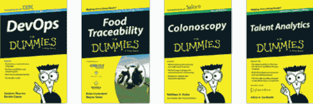

## 品牌授权与内容

利用全球受欢迎参考品牌的实力，触达新的受众和分销渠道。

**欲了解更多信息，请访问** dummies.com/biz


## 个人充实

| 保持敏锐 | Facebook | 吉他 | 投资 | 养蜂 | 数字摄影 |
| --- | --- | --- | --- | --- | --- |
| 978111251750 | 978111251750 | 978111252354 | 978111252347 | 978111251968 | 978111253506 |
| 美国 $24.99 | 美国 $24.99 | 美国 $24.99 | 美国 $24.99 | 美国 $24.99 | 美国 $24.99 |
| 加拿 $29.99 | 加拿 $29.99 | 加拿 $29.99 | 加拿 $29.99 | 加拿 $29.99 | 加拿 $29.99 |
| 英国 £19.99 | 英国 £17.99 | 英国 £17.99 | 英国 £16.99 | 英国 £16.99 | 英国 £17.99 |
| 冥想 | 怀孕 | 缝纫 | 钩针 | 营养 | |
| --- | --- | --- | --- | --- | --- |
| 978111251763 | 978111252349 | 978111257902 | 978111252153 | 978111252751 | 978111253046 |
| 美国 $24.99 | 美国 $24.99 | 美国 $24.99 | 美国 $24.99 | 美国 $24.99 | |
| 加拿 $29.99 | 加拿 $29.99 | 加拿 $29.99 | 加拿 $29.99 | 加拿 $29.99 | |
| 英国 £19.99 | 英国 £17.99 | 英国 £17.99 | 英国 £16.99 | 英国 £16.99 | |
| 专业发展 | | | | | |
| --- | --- | --- | --- | --- | --- |
| Windows 10 | Excel | Sharepoint | LinkedIn | | | |
| --- | --- | --- | --- | --- |
| 978111251910 | 978111252023 | 978111252769 | 978111252113 | 978111252914 | |
| 美国 $24.99 | 美国 $24.99 | 美国 $24.99 | 美国 $24.99 | 美国 $24.99 | |
| 加拿 $29.99 | 加拿 $29.99 | 加拿 $29.99 | 加拿 $29.99 | 加拿 $29.99 | |
| 英国 £19.99 | 英国 £17.99 | 英国 £17.99 | 英国 £16.99 | 英国 £16.99 | |
| 2016 | Office 365 | Salesforce.com | | | | |
| --- | --- | --- | --- | --- | ---
| 978111250341 | 978111250376 | 978111250362 | 978111250312 | | |
| 美国 $24.99 | 美国 $24.99 | 美国 $24.99 | 美国 $24.99 | | |
| 加拿 $29.99 | 加拿 $29.99 | 加拿 $29.99 | 加拿 $29.99 | | |
| 英国 £19.99 | 英国 £17.99 | 英国 £17.99 | 英国 £16.99 | | |

## 无论去哪里，都带上 dummies！


访问我们的网站


点赞 Facebook


关注我们的 Twitter


在 YouTube 上观看我们


加入 LinkedIn


在 Pinterest 上钉住我们


订阅我们的新闻通讯


创建你自己的 dummies 书封面


# WILEY 终端用户许可协议

请访问 `www://www.wiley.com/go/eula` 以访问 Wiley 的电子书 EULA。
