```
while (n < 4)
console.log("Loop stopped!");
</script>
</body>
</html>
```

在此示例中，变量 `n` 的值设置为 0。在每次循环迭代中，`n` 的值都会加 1。`while` 循环会重复执行，直到 `n` 的值不再小于 4（即 `n` 等于 4）。列表 4-7 的输出如图 4-11 所示。

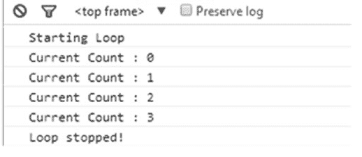

图 4-11。do...while 循环的输出

### for 循环

`for` 循环是一种条件循环，直到指定的条件的求值为 `false` 为停止。其通用语法为

```
for ([initialization]; [test condition]; [expression])
{
  Statement
}
```

在初始化部分，你将循环计数器初始化为起始值。在测试部分，你指定了必须检查的条件，以确定循环是否应该继续。表达式是增加或减少计数器或值的部分。列表 4-8 展示了在程序中使用 `for` 循环的示例。

列表 4-8。for 循环示例

```html
<html>
<body>
<script>
  var count;
  console.log("Starting Loop " + "");
  for(count = 0; count < 10; count++){
    console.log("Current Count : " + count);
  }
  console.log("Loop stopped!");
</script>
</body>
</html>
```

# 第 4 章 ■ JAVASCRIPT 中的控制结构

此示例声明了变量 `count`，然后在 `for` 循环中将 `count` 的值初始化为 0。然后，循环条件检查 `count` 的值是否小于 10。如果是，则计数器加 1。在迭代过程中，会显示 `count` 的当前值。在每次循环迭代后，`count` 增加 1，并根据条件检查其值。该循环运行十次（`count` 等于 0 到 9）。当 `count` 的值等于 10 时，条件求值为 `false`，循环停止。

程序的输出如图 4-12 所示。

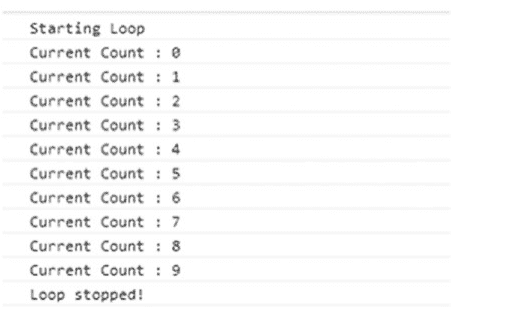

**图 4-12.** 程序输出

上一个示例展示了如何使用 `for` 循环来增加计数器值。列表 4-9 提供了另一个 `for` 循环示例，向你展示如何减少计数器值。

# **列表 4-9.** 反向 for 循环

```html
<html>
<body>
  <script>
    var count;
    console.log("Starting Loop " + "");
    for(count = 10; count > 0; count--){
      console.log("Current Count : " + count );
    }
    console.log("Loop stopped!");
  </script>
</body>
</html>
```

此示例显示了反向循环计数。它首先将 `count` 的值初始化为 10。条件检查 `count` 的值大于 0。在每次循环通过时，`count` 的值减 1。该程序的输出如图 4-13 所示。

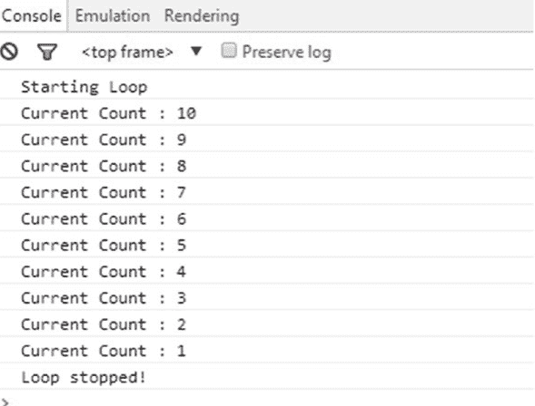

**图 4-13.** 程序输出

如你所示，第一个打印的值是 10，因为 `count` 的初始值是 10。只要 `count` 的值大于 0，代码就会运行（因此最后一个打印的值是 1）。

在循环代码块中，你还可以包含一个 `if` 语句。假设你有要求打印从 0 到 19 的所有偶数。你可以通过结合 `for` 循环和 `if` 语句来实现这一点，如列表 4-10 所示。

**列表 4-10。带有 if 语句的 for 循环**

```html
<html>
<body>
<script>
  var i;
  for(i = 0; i < 20; i++) {
    if((i % 2) == 0) {
      console.log("Number is divisible by 2 : " + i);
      continue;
    }
  }
</script>
</body>
</html>
```

此示例在 `for` 循环中使用 `if` 语句来检查变量 `i` 是否能被 2 整除。在 `i` 的值能被 2 整除的每情况下，程序都会打印该值。程序的输出如图 4-14 所示。

## 第 4 章 JAVASCRIPT 中的控制结构

| 控制台 | 仿真 | 渲染 |
| :--- | :--- | :--- |
| | <frame> | log |
| Number is divisible by 2 : 0 | | |
| Number is divisible by 2 : 2 | | |
| Number is divisible by 2 : 4 | | |
| Number is divisible by 2 : 6 | | |
| Number is divisible by 2 : 8 | | |
| Number is divisible by 2 : 10 | | | |
| Number is divisible by 2 : 12 | | | |
| Number is divisible by 2 : 14 | | | |
| Number is divisible by 2 : 16 | | | |
| Number is divisible by 2 : 18 | | | |

**图 4-14.** 程序输出


此示例声明了变量 `count`，然后在 `for` 循环中将 `count` 的值初始化为 0。然后，循环条件检查 `count` 的值是否小于 10。如果是，则计数器加 1。在迭代过程中，会显示 `count` 的当前值。在每次循环迭代后，`count` 增加 1，并根据条件检查其值。该循环运行十次（`count` 等于 0 到 9）。当 `count` 的值等于 10 时，条件求值为 false，循环停止。

程序的输出如图 4-12 所示。


**图 4-12.** 程序输出

上一个示例展示了如何使用 `for` 循环来增加计数器值。列表 4-9 提供了另一个 `for` 循环示例，向你展示如何减少计数器值。

# 列表 4-9. 反向 for 循环

```html
<html>
<body>
  <script>
    var count;
    console.log("Starting Loop " + "");
    for(count = 10; count > 0; count--){
      console.log("Current Count : " + count );
    }
    console.log("Loop stopped!");
  </script>
</body>
</html>
```

此示例显示了反向循环计数。它首先将 `count` 的值初始化为 10。条件检查 `count` 的值大于 0。在每次循环通过时，`count` 的值减 1。该程序的输出如图 4-13 所示。


**图 4-13.** 程序输出

如你所示，第一个打印的值是 10，因为 `count` 的初始值是 10。只要 `count` 的值大于 0，代码就会运行（因此最后一个打印的值是 1）。

在循环代码块中，你还可以包含一个 `if` 语句。假设你有要求打印从 0 到 19 的所有偶数。你可以通过结合 `for` 循环和 `if` 语句来实现这一点，如列表 4-10 所示。

# 列表 4-10. 带有 if 语句的 for 循环

```html
<html>
<body>
<script>
  var i;
  for(i = 0; i < 20; i++) {
    if((i % 2) == 0) {
      console.log("Number is divisible by 2 : " + i);
      continue;
    }
  }
</script>
</body>
</html>
```

此示例在 `for` 循环中使用 `if` 语句来检查变量 `i` 是否能被 2 整除。在 `i` 的值能被 2 整除的每情况下，程序都会打印该值。程序的输出如图 4-14 所示。

## 第 4 章 JavaScript 中的控制结构

| 控制台 | 仿真 | 渲染 |
| :--- | :--- | :--- |
| | <frame> | log |
| Number is divisible by 2 : 0 | | |
| Number is divisible by 2 : 2 | | |
| Number is divisible by 2 : 4 | | |
| Number is divisible by 2 : 6 | | |
| Number is divisible by 2 : 8 | | |
| Number is divisible by 2 : 10 | | |
| Number is divisible by 2 : 12 | | |
| Number is divisible by 2 : 14 | | |
| Number is divisible by 2 : 16 | | |
| Number is divisible by 2 : 18 | | |

### 表 5-1. 元字符

| 元字符 | 用途 |
| --- | --- |
| . | 搜索任意字符 |
| \s | 搜索空白字符 |
| \S | 搜索非空白字符 |
| \w | 搜索字母数字字符，如 1, 2, a, A, h, d 等（即：单词字符，意味着来自 a-z、A-Z 或 0-9 的字符，并包含下划线字符 `_`） |
| \W | 搜索非字母数字字符，如 %, #, %（即非单词字符） |
| \d | 搜索数字，如 1, 2 或 3。 |
| \D | 搜索非数字字符，如 *, #, a, b。 |

量词用于指定特定字符或字符组出现的次数。表 5-2 所示了一些常用的量词。

### 表 5-2. 量词

| 量词 | 用途 |
| --- | --- |
| p+ | 匹配 p 至少出现一次。 |
| p* | 匹配 p 零次或多次出现。 |
| p? | 检查字符串是否包含零次或一次的 p。 |
| p{A} | 匹配长度为 A 的 p 序列。例如，ab{2} 会匹配abab。 |
| p{A,B} | 检查字符串是否具有 A 到 B 个的 p 序列。 |
| p{A,} | 检查字符串是否具有至少 A 个的 p 序列。例如，ab{1,} 会匹配 ab、abab 等。 |
| p$ | 匹配以 p 结尾的字符串。例如，b$ 会匹配 ab、b 和 cab。 |
| ^p | 匹配以 p 开头的字符串。例如，^a 会匹配 ab、ab 和 aj。 |

你可以在正则表达式模式中使用方括号 `[]` 来指定要搜索的字符。方括号的典型用法如图 5-3 所示。

### 表 5-3. 表达式中方括号的用法

| 表达式 | 用途 |
| --- | --- |
| [xyz] | 搜索方括号中显示的任意字符 |
| [^xyz] | 搜索方括号内以外的任意字符 |
| [A-B] | 搜索位于 A 到 B 范围内的数字 |
| [^A-B] | 查找不在 A 到 B 范围内的任何数字 |
| (a|b) | 类似于“或”（OR），搜索字符 a 或 b |

```javascript
var regex = /High/i;
var regex = /[C-G]/gi;
var re = /\*\s\*/;
var text = new RegExp("Good morning", "g");
```

**注意** 关于如何编写正则表达式的详细解释超出了本章的范围。然而，我们将关注允许你通过编程编写正则表达式的 JS 方法，以解决典型的用户需求。

使用正则表达式有两种方法：

- 使用 String 对象的方法
- 使用正则表达式对象的属性和方法（RegExp 对象）

接下来的章节将逐一介绍这些。以下是一些正则表达式的示例：

### 字符串方法

在 JavaScript 中，以下是与正则表达式处理相关的字符串方法：

- search
- replace
- match
- split

接下来将逐一介绍这些字符串方法，并附带示例。

### search 方法

search 方法使用表达式搜索匹配项，并返回匹配的位置。`search(regexp)` 方法的语法为：

```javascript
str.search(regexp)
```

返回值将是第一个匹配的索引。列表 5-1 展示了这样一个简单示例。

# 列表 5-1. search() 方法示例

```html
<html>
<body>
  <script>
    var text = "Visit the Google";
    console.log(text.search("Google"));
  </script>
</body>
</html>
```

## 第 5 章：正则表达式与字符串方法

列表 5-1 声明了变量 `text`，并带有某些文本（"Visit the Google"）。`text.search()` 方法在变量 `text` 中搜索 "Google" 并返回其指定的位置。`console.log()` 方法用于显示输出。

列表 5-1 的输出如图 5-1 所示。

```
file:///C:/javascript/search.htm
Elements Console Sources Timeline Profiles Audits
<top frame> Preserve log
10
```

**图 5-1.** 程序输出

### replace 方法

如所示，replace 方法将文本中匹配给定正则表达式的子字符串替换为另一个（新的）子字符串。然后返回修改后的字符串。`replace()` 方法的语法为：

```javascript
str.replace(regexp, new)
```

返回值将是根据模式具有一个或多个匹配项的新字符串。考虑列表 5-2 中的示例。

# 列表 5-2. replace() 方法示例

```html
<html>
<body>
  <script>
    var text = "High level language";
    console.log(text.replace(/High/i, "Low"));
  </script>
</body>
</html>
```

在列表 5-2 中，使用 `text.replace()` 方法将字符串 "High" 替换为 "Low"。修饰符 `i` 用于忽略大小写。列表 5-2 的输出如图 5-2 所示。

```
file:///C:/javascript/search.htm
Elements Console Sources Timeline Profiles Audits
<top frame> Preserve log
Low level language
```

**图 5-2.** 输出

### match 方法

match 方法用于获取正则表达式匹配项。`match(regexp)` 的语法为：

```javascript
str.match(regexp)
```

返回值是一个包含所有匹配项的数组。如果没有匹配项，则返回 `null`。

### split 方法

split 方法使用正则表达式将字符串分割为子字符串数组。`split(regexp, limit)` 的语法为：

```javascript
str.split(regexp, limit)
```

## 第 5 章 正则表达式与字符串方法

| 元素 | 控制台 | 来源 | 网络 | 时间线 | 配置文件 | 资源 | 审计 |
|---|---|---|---|---|---|---|---|
| | <顶层帧> | 保留日志 | | | | | |
| 英国; 美国; 欧洲; 印度 | | | | | | | | |
| Array[4] | | | | | | | | |
| 0: "UK" | | | | | | | | |
| 1: "US" | | | | | | | | |
| 2: "Europe" | | | | | | | | |
| 3: "India" | | | | | | | | |
| length: 4 | | | | | | | | |
| __proto__: Array[0] | | | | | | | | |

图 5-5 输出

列表 5-6 显示了使用限制分割次数的 split 方法的另一种用法。

# 列表 5-6. 另一种 split() 方法示例

```html
<html>
<body>
  <script>
    var myString = 'Hello, this is JavaScript coding';
    var splits = myString.split(', ', 1);
    console.log(splits);
  </script>
</body>
</html>
```

在此示例中，split 会在字符串 `myString` 中查找空格，并在找到第一个匹配项时停止。列表 5-6 的输出如图 5-6 所示。

| file:///C:/javascript/split.htm | | |
| 元素 | 控制台 | 来源 | 网络 | 时间线 | 配置文件 | 资源 | 审计 |
|---|---|---|---|---|---|---|---|---|
| | <顶层帧> | 保留日志 | | | | | | |
| Array[1] | | | | | | | | | |
| 0: "Hello," | | | | | | | | | |
| length: 1 | | | | | | | | | |
| __proto__: Array[0] | | | | | | | | | |

图 5-6 程序输出

### 正则表达式对象

既然你已经熟悉了正则表达式对象的基础知识，本节将深入探讨其各种属性和方法的细节。

### 正则表达式对象属性

表 5-4 显示正则表达式对象的属性。

### 表 5-4. 正则表达式对象属性

| 属性 | 说明 |
| --- | --- |
| constructor | 包含创建对象原型的函数。 |
| global | 指定给定的正则表达式是否设置了 g 修饰符。 |
| ignoreCase | 指定给定的正则表达式是否设置了 i 修饰符。 |
| lastIndex | 指定下一次匹配的索引。 |
| multiline | 指定给定的正则表达式是否设置了 m 修饰符。 |
| source | 表示要搜索的模式文本。 |

#### constructor 属性

constructor 属性包含指向创建对象实例的函数的引用。使用 constructor 的语法为：

```javascript
RegExp.constructor
```

> 对于正则表达式，constructor 属性返回 `function RegExp() { [native code] }`。

**注意** constructor 属性也适用于数字和字符串等其他对象。对于数字，constructor 属性返回 `function Number() { [native code] }`。对于字符串，它返回 `function String() { [native code] }`。

列表 5-7 提供了 constructor 属性如何工作的示例。

# 列表 5-7. constructor 属性示例

```html
<html>
<body>
<script>
  var text = new RegExp("Good morning", "g");
  console.log("text.constructor is: " + text.constructor);
</script>
</body>
</html>
```

列表 5-7 的输出如图 5-7 所示。

# 第 5 章 正则表达式与字符串方法

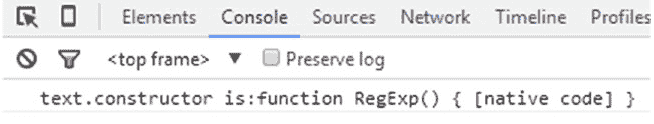

**图 5-7.** 程序输出

列表 5-8 显示了另一个 constructor 属性示例。

# 列表 5-8. constructor 属性示例

```html
<html>
<body>
  <script>
    var num = new Number(6);
    console.log("constructor is:" + num.constructor);
  </script>
</body>
</html>
```

列表 5-8 的输出如图 5-8 所示。

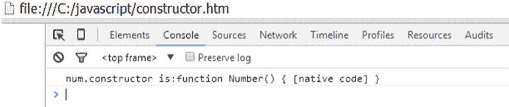

**图 5-8.** 程序输出

#### global 属性

global 属性指定正则表达式是否使用全局修饰符（即是否设置了修饰符）。访问 global 属性的语法为：

```javascript
RegExp.global
```

如果设置了 g 修饰符，则返回 true，否则返回 false。请参见列表 5-9 的示例。

# 列表 5-9. global 属性示例

```html
<html>
<body>
  <script>
    var text = "Learn JavaScript";
    var pattern1 = /Java/g;
    var result = pattern1.global;
    console.log("Text is matched with Java:" + pattern1.global);
    var pattern2 = /Java/;
    console.log("Text is matched with Java:" + pattern2.global);
  </script>
</body>
</html>
```

列表 5-9 的输出如图 5-9 所示。

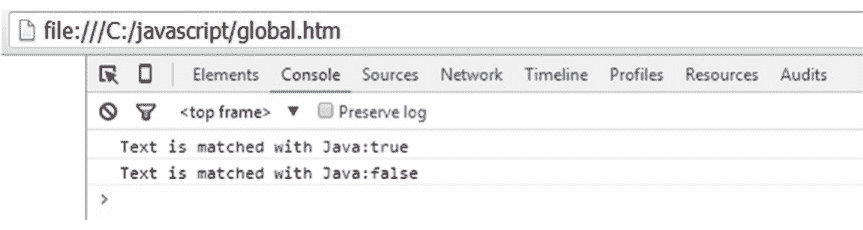

**图 5-9.** 输出

#### ignoreCase 属性

ignoreCase 属性指定正则表达式是否忽略大小写（即是否设置了 i 修饰符）。访问 ignoreCase 属性的语法为：

```javascript
RegExp.ignoreCase
```

如果设置了 i 修饰符，则返回 true，否则返回 false。列表 5-10 给出一个示例。

# 列表 5-10. ignoreCase 示例

```html
<html>
<body>
<script>
  var text = "Learn JavaScript";
  var pattern1 = new RegExp("java", "i");
  console.log("Match found: " + pattern1.test(text));
  var pattern2 = new RegExp("java");
  console.log("Match found: " + pattern2.test(text));
</script>
</body>
</html>
```

列表 5-10 的输出如图 5-10 所示。

### exec 方法

exec 方法在字符串中搜索匹配正则表达式的文本。exec 方法的通用语法如下：

```javascript
RegExp.exec(string)
```

`string` 参数表示要搜索的字符串。如果找到匹配项，该方法返回匹配的文本（与给定正则表达式对应的子字符串）。否则，返回 `null`。示例请参见列表 5-14。

# 列表 5-14. exec() 方法示例

```html
<html>
<body>
<script>
  var text = "Learn JavaScript its very interesting script";

  var pattern = new RegExp("Java", "g");
  var result = pattern.exec(text);
  console.log("Text is matched with Java:" + result);

  var pattern1 = new RegExp("language", "g");
  result = pattern1.exec(text);
  console.log("Text is matched with language:" + result);
</script>
</body>
</html>
```

此示例声明了一个 `text` 变量并为其赋值了要搜索的字符串。使用 `new` 和内置的 `RegExp` 对象声明了两个模式：`pattern` 和 `pattern1`。对于变量 `pattern` 和 `pattern1`，调用 `exec` 方法时使用的是相同的 "text" 字符串。结果存储在变量 `result` 中。

列表 5-14 的输出如图 5-14 所示。

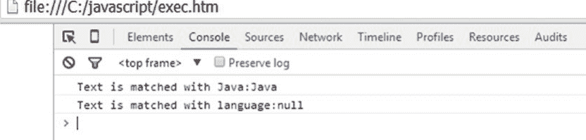

图 5-14. 输出

### test 方法

test 方法同样在给定字符串中搜索匹配正则表达式模式的文本。如果找到匹配项，它返回 `true`。否则，返回 `false`。test 的语法如下：

```javascript
RegExp.test(string)
```

`test` 方法接收一个字符串参数作为输入，如列表 5-15 所示。

# 列表 5-15. test 方法示例

```html
<html>
<body>
<script>
  var text = "Learn JavaScript its very interesting script";

  var pattern = new RegExp("Java", "g");
  var result = pattern.test(text);
  console.log("Text is matched with Java:" + result);

  var pattern = new RegExp("language", "g");
  var result = pattern.test(text);
  console.log("Text is matched with language:" + result);
</script>
</body>
</html>
```

列表 5-15 的输出如图 5-15 所示。

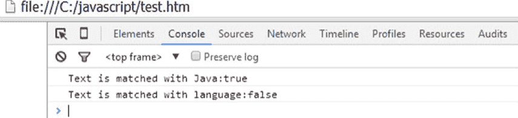

图 5-15. 输出

### toString 方法

`toString` 方法以正则表达式字面量的形式返回正则表达式对应的字符串表示。返回的字符串包含在反斜杠内，并且如果适用，还包含修饰符。`toString()` 的语法如下：

```javascript
RegExp.toString()
```

# 列表 5-16. toString() 方法示例

```html
<html>
<body>
  <script>
    var text;
    var pattern = new RegExp("Java", "g");
    var result = pattern.toString();
    console.log("Return value:" + result);

    var pattern = new RegExp("/", "g");
    var result = pattern.toString();
    console.log("Return value:" + result);
  </script>
</body>
</html>
```

此示例使用 `RegExp` 对象指定了两个模式，并对这两个模式调用了 `toString` 方法。列表 5-16 的输出如图 5-16 所示。

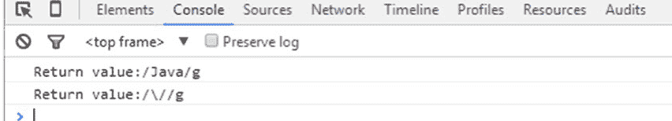

**图 5-16.** 输出

> **注意**：`exec` 和 `test` 方法的相似之处在于它们都接受要搜索的字符串作为输入。区别在于 `exec` 返回匹配的子字符串或 `null` 值，而 `test` 方法返回 `true` 或 `false`。

### 总结

本章向你介绍了正则表达式，包括如何结合字符串方法使用 `RegExp`。你还接触了 `RegExp` 对象的属性和方法，以及代码示例。

第 6 章将讨论 JavaScript 的另一个重要主题：函数。

## 第 6 章

## 函数

本章将介绍函数的基础知识以及它们提供的优势。首先，你将看到在 JavaScript 中用于创建函数的不同类型方法。然后，你将看到如何定义向调用程序返回值的函数，以及如何为定义的函数指定参数（参数）。

### 函数：概述

函数可以简单地定义为一组语句或一个可以在 JS 程序任何地方被使用或调用的子程序。函数通常有一个名称，但也可以没有名称，在这种情况下，它被称为匿名函数。函数可以有零个或多个参数。

函数有一个包含在大括号内的函数体，函数体可以包含多条语句。函数还可以包含一个 `return` 语句，该语句是可选的，用于向调用者返回计算后的值（你将在本章中学习更多关于 `return` 语句的知识）。函数的处理会在 `return` 语句停止。

使用函数为开发者提供了以下优势：

- 它节省了时间和精力。
- 它使代码更加紧凑、有序。
- 它更易于理解。

在 JavaScript 中定义函数使用 `function` 关键字，后面跟着名称、参数列表和大括号内的代码块。

```javascript
function name(parameter-list) {
  // code
}
```

如果函数没有参数，如下所示：

```javascript
function name() {
  // code
}
```

这个简单的示例将数字乘以三，然后返回该值。

# 列表 6-1. 函数示例

```javascript
function triple(num){
  return (3 * num);
}
```

该函数可以使用 `console.log`，也可以像下面这样在 `alert` 中：

```javascript
alert('Tripled figure is ' + triple(2));
```

此代码的输出如图 6-1 所示。

正如之前提到的，为了正确调用函数，你需要使用括号运算符 `()`。省略该运算符会导致返回函数的代码（定义）。考虑图 6-2 所示的示例。

# 列表 6-2. 省略的函数示例

```javascript
alert('Tripled figure is ' + triple);
```

列表 6-2 的输出如图 6-2 所示。

现在你熟悉 JS 函数的基础，本节描述了在程序中创建函数的一些方法。函数主要可以通过以下两种方式创建：

- 使用函数表达式
- 使用函数声明

下面的小节将详细介绍每种方式。

### 使用函数表达式

此选项涉及在较大的表达式中定义函数。通过函数表达式定义的函数可以是以下三种类型之一：

- 自执行函数
- 命名函数表达式
- 匿名函数表达式

### 自执行函数

自执行函数是一种可以带名称定义也可以不带名称定义，但会自动调用的函数。它不涉及声明和调用。该表达式会自动执行函数。

自执行函数的语法如下：

```javascript
function(){
  // code
}();
```

此示例声明了一个没有名的函数。该函数是自调用的，并在浏览器控制台中显示输出，如图 6-3 所示。

```
Console
"See you all!"
```

图 6-3. 输出

### 命名函数表达式

如名所示，命名函数是在函数表达式中带有一个名称的声明。

命名函数的语法如下：

```javascript
var myFunction = function namedFunction(){
  statements
}
```

在这里，定义了一个变量 `myFunction`，并将函数对象赋值给它。然后可以使用变量 `myFunction` 并根据需要提供与函数相关的任何值来执行函数的代码。

考虑列表 6-4 中的示例，它将函数名声明为 `myFunction` 并将其赋值给声明的变量 `myFunction`。

# 列表 6-4. 命名函数示例

```javascript
var myValue = function myFunction() {
  return 'Hello';
}
console.log("Text displayed as : " + myValue());
```

列表 6-4 的输出如图 6-4 所示。

```
Console
"Text displayed as : Hello"
```

图 6-4. 输出

### 匿名函数

一个没有名字函数（表达式）被称为匿名函数。匿名函数的语法如下：

```javascript
var myFunction = function() {
  statements
};
```

# 列表 6-5. 匿名函数示例

```javascript
var myFunction = function() {
  return 'Hello';
}
console.log("Text displayed as : " + myFunction());
```

此示例将相关函数表达式的结果赋值给变量 `myFunction`，并使用 `myFunction` 调用了它。

列表 6-5 的输出如图 6-5 所示。

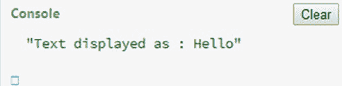

图 6-5. 输出

### 使用函数声明

函数声明定义了一个带名称的函数，不涉及任何变量赋值。声明的函数只有在被调用时才会执行，不会立即执行。

函数声明的语法如下：

```javascript
function func_name(parameters) {
  statements
};
```

# 列表 6-6. 函数声明示例

```javascript
function myFunction() {
  return 'Hello';
}
console.log("Text displayed as : " + myFunction());
```

在示例中，`myFunction()` 是声明的函数，并在 `console.log` 函数内部被调用。每当在程序中被调用时，它都会返回值 "Hello"。

**注意**：函数声明不是一个可执行的语句。函数声明的末尾没有分号。

列表 6-6 的输出如图 6-6 所示。

```
Console
"Text displayed as : Hello"
```

**图 6-6.** 输出

**注意**：除了函数表达式和函数声明外，还有使用函数构造函数的方法创建函数。在这种方法中，使用了 `new` 关键字。构造函数 `Function()` 将代码视为存储在字符串中的。其中一个示例是：

```javascript
var average = new Function('a', 'b', 'return ((a + b) / 2)');
```

在这里，参数在引号内提供并用逗号分隔（在这种情况下是 a 和 b）。第三个字符串是代码。这种方法很慢且难以调试，因此不建议使用。

最好使用函数表达式或函数声明。

### 函数声明与函数表达式的总结比较

这是一个声明：

```javascript
function product(a, b) {
  return a * b;
}
```

这是一个表达式：

```javascript
var product = function (a, b) {
  return a * b;
};
```

### 函数参数和参数

正如本章前面提到的，函数可能包含也可能不包含参数。对于给定的函数，可能有一个或多个参数。

根据提供给函数的参数值，函数的行为会发生变化并产生相应的结果。像 `a` 和 `b` 这样的参数可以像函数代码中的任何变量一样被引用。这些参数在括号内指定，并用逗号分隔。

在下面的示例中，`p1` 和 `p2` 是参数：

```javascript
function example(p1, p2) {
  ...
}
```

在函数调用时，为参数提供的相应值称为参数。在接下来的示例中，10 和 11 是参数：

```javascript
example(10, 11);
```

# 列表 6-7. 函数参数示例

```html
<!DOCTYPE html>
<html>
<body>
  <script>
    function mymessage(user) {
      console.log("Good to see you " + user);
    }
    mymessage("Diego Dora")
  </script>
</body>
</html>
```

在这段代码中，`mymessage` 在声明时使用了一个参数 `user`。它接受一个字符串作为参数。接下来，调用了 `mymessage` 并传递了文本 "Diego Dora"。

列表 6-7 的输出如图 6-7 所示。


图 6-7. 输出

## 第 6 章 函数

### 缺失的参数

可以调用函数并省略一个值。考虑列表 6-8 中的示例。

# 列表 6-8. 缺失参数示例

```javascript
function myFunction(number, divisor) {
  if (divisor === undefined) {
    return "Division by zero";
  }
  return number / divisor;
}
console.log(myFunction(100));
console.log(myFunction(100, 2));
```

在第一次调用中，`divisor` 是未定义的。在第二次调用中，提供了两个参数。列表 6-8 的输出如图 6-8 所示。


图 6-8. 输出

### 函数调用

函数也可以调用另一个函数。为了更好地理解，考虑列表 6-12 中的示例。

# 列表 6-12. 调用其他函数示例

```html
<!DOCTYPE html>
<html>
<body>
  <script>
    function total1(a, b) {
      return a + b;
    }
    function average1(a, b) {
      var av = total1(a, b) / 2;
      console.log("Average = " + av);
    }
    average1(8, 8);
  </script>
</body>
</html>
```

这段代码计算两个数字的平均值。它声明了两个函数，`total1` 和 `average1`，这两个函数都有两个参数，a 和 b。在函数内部，`total1` 函数返回两个数字的和或总和，然后将其除以 2 以计算平均值。`console.log` 函数用于显示平均值。调用 `average1` 函数时传入了 8 和 8。

列表 6-12 的输出如图 6-12 所示。

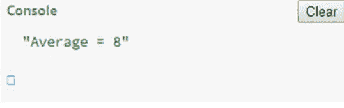

图 6-12. 输出

### return 语句

当你想要从函数返回一个值时，需要 `return` 语句——即它向调用者返回一个计算值。`return` 语句应该是函数的最后一个，因为一旦遇到 `return` 语句，执行就会停止。

# 列表 6-11. return 语句示例

```html
<html>
<body>
<script>
  var result = function(number, divisor)
  {
    return number / divisor;
  }
  console.log(result(150, 10))
</script>
</body>
</html>
```

所示函数有两个参数，`number` 和 `divisor`。`return` 语句将值返回给调用者。在执行期间，遇到 `return` 语句时，会将计算值立即交给调用者。

### 总结比较

| 特性 | 函数声明 | 函数表达式 |
| :--- | :--- | :--- |
| 语法 | `function name() { ... }` | `var name = function() { ... }` |
| 变量提升 | 提升 | 不提升 |
| 用途 | 通用 | 闭包、回调函数 |

### 参数是值传递还是引用传递？

在 JavaScript 中，你不能通过引用传递参数。当你将一个变量传递给函数并对其进行操作时，因此在函数内部，传递的参数的值无法被修改。

为了更好地理解为什么不能通过引用传递参数，请考虑列表 6-13 中所示示例。

# 列表 6-13. 引用传递尝试示例

```javascript
function decNumber(countVal) {
  countVal--;
}
var i = 10;
decNumber(i);
console.log("Value after attempt is : " + i);
```

该示例展示了尝试使用函数 `decNumber` 修改变量 `i` 的值。它声明了函数 `decNumber` 并传递了 `countVal`。即使在调用函数 `decNumber` 后，变量 `i` 的值也没有改变。

列表 6-13 的输出如图 6-13 所示。

| | Elements | Console | Sources |
|---|---|---|---|
| | top | Preserve log | |
| Value after attempt is : 10 | | | |

**图 6-13.** 输出

JS 执行传递给函数的值更改间接方法是通过使用数组。带有更改的相同示例在列表 6-14 中。

# 列表 6-14. 值传递函数示例

```javascript
function decNumber(countVal) {
  countVal[0]--;
}
var i = [10];
decNumber(i);
console.log("Value decremented to : " + i[0]);
```

该示例展示了如何使用 `decNumber()` 减少数组元素。它声明了一个数组 `i`，其元素 `i` 被赋值为要更改的值。该数组作为参数传递给函数。在函数代码内部，数组的零索引元素减了 1。在函数执行后，值被改变并显示。

列表 6-14 的输出如图 6-14 所示。

```
"Value decremented to : 9"
```

**图 6-14.** 输出

### 函数命名

在结束这一章关于 JavaScript 的之前，有必要提醒一下：永远不要用 `function` 这个名字来命名你的函数。这是严格不允许的。请考虑以下代码：

```javascript
function function(countVal) {
  countVal--;
}
```

在这种情况下，发生了图 6-15 所示的错误。

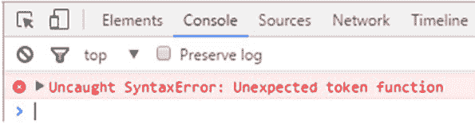

**图 6-15.** 错误

### 总结

在本章中，你首先探索了函数的知识并看到了它们的优点。然后你看到了是如何声明函数的。在这些重要的基础知识的基础上，第 7 章将讨论 JavaScript 中的高级函数。

# 第 7 章

# 函数的更多功能

第 6 章向你介绍了函数的知识以及它们如何轻松地执行复杂的数学代码。你学习了如何创建函数，以及每当你调用和触发它们时如何执行任务。你还看到了使用函数、参数和参数的不同方法。本章涵盖了与函数相关的更高级的主题。你将看到提升（hoisting）如何应用于函数，并学习为什么函数被称为“一等公民”。你还将学习如何声明嵌套函数，如何声明递归函数。

### 函数语境下的提升

正如第 1 章中提到的，变量提升意味着在实际声明之前使用变量。在函数语境下，也完全支持提升。这意味着你甚至可以在声明函数之前调用它。

请考虑列表 7-1 中的函数提升示例。

# 列表 7-1. 函数提升

```html
<html>
<body>
<script>
say_hello_to_user();

function say_hello_to_user(){
  alert('Hello how are you, today?');
}
</script>
</body>
</html>
```

这段代码运行完美，没有产生任何语法错误。脚本中的第一行是调用 `say_hello_to_user` 函数。该函数的声明实际上发生在后面。JavaScript 将函数的声明移动到作用域的开头。这等于列表 7-2 所示的示例。

## 第 7 章 函数更多功能

### 列表 7-2. 等效的 JS 代码

```javascript
<script>
function say_hello_to_user() {
  alert('Hello how are you, today');
}
say_hello_to_user();
</script>
```

列表 7-2 的输出如图 7-1 所示。


图 7-1. 输出

注意，函数表达式不会被提升，如图 7-2 所示。

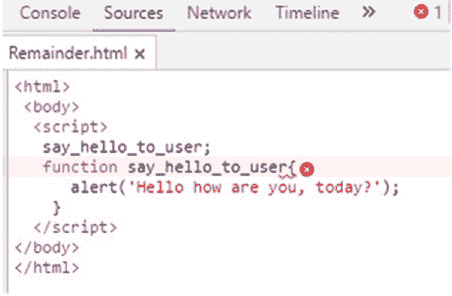

图 7-2. 错误

### 在代码中尝试将变量作为函数会导致语法错误。请考虑列表 7-3 中的示例。

# 列表 7-3. 错误代码

```javascript
<script>
var say_hello_to_user = function(){
  alert('Hello how are you, today?');
}
say_hello_to_user();
</script>
```

产生了语法错误，如图 7-3 所示。

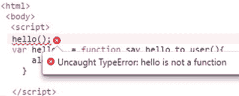

图 7-3. 输出

# 列表 7-4. 错误代码

```javascript
<script>
var func = function(input) {
  return input;
}
</script>
```

### 一等公民

在 JavaScript 中，函数被视为一等公民。它们可以：

- 分配给变量
- 作为参数传递给函数
- 从函数返回

为了对比，列表 7-5 显示了一个简单的示例。

# 列表 7-5. 简单函数示例

```html
<!DOCTYPE html>
<html>
<body>
  <script>
    var function1 = function() {
      console.log("Function 1 Called");
    };
    var function2 = function(fn) {
      return fn;
    };
    function2(function1)();
  </script>
</body>
</html>
```

在这里，函数在浏览器控制台中输出 "Function 1 Called"。这被赋值给变量 `function1`。接下来，另一个匿名函数接收一个参数并返回它。该函数被赋值给变量 `function2`。最后，调用 `function2` 并将 `function1` 作为参数传递。由于 `function2` 将传递它的任何值作为返回值，以下两个表达式是等价的：

- `function2(function1)`
- `function1`

要调用 `function1`，必须包含括号 `()`，否则将产生语法错误。程序的输出如图 7-6 所示。

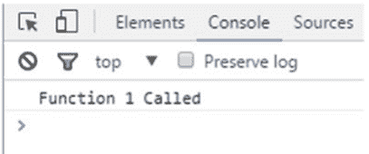

图 7-6. 输出

### 嵌套函数

嵌套函数，也称为内部函数，是在另一个函数内部定义的函数。包含内部函数的函数被称为外部函数。内部函数可能或不具有返回语句。每次调用外部函数时，都会创建一个嵌套函数的实例。

请考虑列表 7-7 中所示的嵌套函数示例。

# 列表 7-7. 嵌套函数示例

```html
<html>
<body>
<script>
function myfunction(d1, d2) {
  function doDivision(d1, d2) {
    return d1 / d2;
  }
  return doDivision(d1, d2);
}
var div = myfunction(4, 2);
console.log(div);
</script>
</body>
</html>
```

此示例展示了两个数字的除法。主外部函数命名为 `myfunction`，内部定义了 `doDivision` 函数。该内部函数通过提供值 `4` 和 `2` 来调用，其值被存储在变量 `div` 中，稍后在浏览器控制台中显示。在调用外部函数 `myfunction` 时，会创建一个内部函数 `doDivision` 的实例。

同样请注意，两个函数都指定了参数 `d1` 和 `d2`。这在 JavaScript 中是允许的，并且不会导致任何问题。函数的输出如图 7-7 所示。

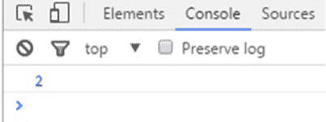

**图 7-7.** 程序输出

在处理嵌套函数时，重要的是要注意内部函数可以访问外部函数的作用域。换句话说，`doDivision` 函数可能会使用外部函数 `myfunction` 的参数和变量。在列表 7-7 中，`myfunction` 的参数 `d1` 和 `d2` 分别作为 `d1` 和 `d2` 提供给内部函数 `doDivision`。这并不是必要的，因为 `doDivision` 可以访问外部函数 `myfunction` 的 `d1` 和 `d2`。列表 7-8 显示了如何利用 `doDivision` 可以访问 `myfunction` 的 `d1` 和 `d2` 这一事实来简化列表 7-7 中的代码。

# 列表 7-8. 第二个嵌套函数示例

```html
<html>
<body>
<script>
function myfunction(d1, d2) {
  function doDivision() {
    return d1 / d2;
  }
  return doDivision();
}
var div = myfunction(4, 2);
console.log(div);
</script>
</body>
</html>
```

这是嵌套除法示例的更好形式，因为它从 `doDivision` 体中移除了冗余参数，列表 7-8 返回了 `d1 / d2` 的除法值（提供给 `myfunction` 的参数 `d1` 和 `d2`）。

该程序的输出如图 7-8 所示，且与之前的输出相同。

| 元素 | 控制台 | 来源 |
|---|---|---|
| top | 保留日志 | |
| 2 | | |

**图 7-8.** 程序输出

也可以匿名声明嵌套函数。列表 7-9 所示的示例尝试以一种稍微不同且更复杂的方式来解决前两个列表中的相同除法问题。

# 列表 7-9. 匿名嵌套函数示例

```html
<html>
<body>
<script>
    function doDivision(d2) {
        return function(d1) {
            return d1/d2;
        }
    }
    var div = doDivision(2);
    console.log(div(6));
</script>
</body>
</html>
```

在这种嵌套函数的形式中，`return` 语句被使用了两次。内部函数使用了外部函数的参数 `d2`。此外，内部函数返回了一个对函数的引用，该函数接收要被除的数字作为输入。第一个 `return` 语句用于调用另一个函数处理 `d1`，第二个 `return` 语句返回除法结果 `d1/d2`。

列表 7-9 的输出如图 7-9 所示。

### 词法作用域

在函数的语境下，词法作用域意味着变量的作用域是由变量在 JavaScript 源代码中的位置决定的。任何在函数外部声明的变量对于整个 JS 程序都是可见且可访问的（即全局变量）。相反，在给定函数内部声明的变量对该函数的代码块可见且可访问。这被称为函数作用域。在嵌套函数的情况下，内部函数可以访问在外部函数中定义的变量。在内部函数中定义的任何变量都无法在外部访问。

图 7-9. 嵌套函数概览。

让我们看看嵌套函数的另一种形式。也可以在外部函数自身的代码体内部调用（在外部函数内部定义的）内部函数。考虑列表 7-10 中的示例。

# 列表 7-10. 调用内部函数

```javascript
function myFunction() {
  var mytext = "Mytext";
  function showtext() {
    console.log(mytext);
  }
  showtext();
}
myFunction();
```

外部和内部函数分别是 `myFunction` 和 `showtext`。变量 `mytext` 在 `myFunction` 中定义。内部函数 `showtext` 在 `myFunction` 内部声明。然后调用 `showtext` 函数。当调用 `myFunction` 时，控制台中的输出如图 7-10 所示。

图 7-10. 程序输出

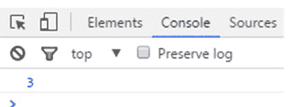

# 列表 7-11. 词法作用域

```javascript
function myFunction() {
  var mytext = "Mytext";
  function showtext() {
    console.log(mytext);
  }
  showtext();
}
```

`myFunction` 中定义了变量 `mytext = "Mytext"`。`showtext` 函数在 `myFunction` 内部声明。随后调用 `showtext`。当调用 `myFunction` 时，控制台中的输出如图 7-10 所示。

### 闭包

在 JavaScript 中，闭包是一个函数加上其词法环境的组合。这意味着闭包允许函数访问其定义时所在作用域中的变量，即使该作用域已经执行完毕。闭包在许多编程模式中非常有用，例如：
- 数据封装（模拟私有变量）
- 函数工厂
- 异步编程（回调函数）
- 状态持久化

以下是一个关于闭包的实现示例：

```javascript
function createCounter() {
  let count = 0; // 私有变量
  return {
    increment: function() {
      count++;
      return count;
    },
    decrement: function() {
      count--;
      return count;
    },
    getCount: function() {
      return count;
    }
  };
}
const counter = createCounter();
console.log(counter.increment()); // 1
console.log(counter.increment()); // 2
console.log(counter.decrement()); // 1
console.log(counter.getCount());   // 1
```

在这个示例中，`count` 变量是私有的，无法从 `counter` 外部直接访问。但通过返回的函数（`increment`、`decrement` 和 `getCount`），我们可以操作并读取它。这就是闭包的威力。

## 第 7 章 使用函数实现更多功能

考虑列表 7-16 中另一个关于闭包的有趣示例。

# 列表 7-16. 另一个闭包示例

```javascript
var add_element = (function() {
  var total_elements = 0;
  var array = [];
  return function addition(element) {
    array[total_elements] = element;
    console.log(array);
    total_elements = total_elements + 1;
  }
})();
```

```javascript
add_element(10);
add_element(11);
add_element(12);
```

此示例定义了一个函数并赋值给变量 `add_element`。在代码内部，变量 `total_elements` 和 `array` 分别用初始值 0 和 `[]` 初始化。属性被赋值给 `array` 的插入索引。此外，每向 `array` 插入一次，`total_elements` 计数器就会加 1。该函数返回一个函数，该函数将传递的新元素添加到数组中，并记住数组中元素的数量。

列表 7-16 中的示例调用了三次 `add_element`，分别提供了值 10、11 和 12。列表 7-16 的输出如图 7-13 所示。

| | 元素 | 来源 |
|---|---|---|
| [10] | | |
| [10, 11] | | |
| [10, 11, 12] | | |

**图 7-13.** 显示数组元素的程序输出

`add_element` 是一个包含 `addition` 函数的闭包。然而，列表 7-16 使用了自执行函数，因此初始化语句（将 `array` 设置为 `[]` 并将 `total_elements` 设置为 0）仅执行一次。正如你将看到的，每个闭包函数都会记住它被创建时所在状态。这些状态包括 `array` 和 `total_elements`。

### 递归函数

正如第 6 章中提到的，函数可以调用自己——即根据自身来定义的函数。此类函数被称为递归函数。递归可以解决的典型问题包括斐波契数列和著名的汉诺塔问题。递归为开发者提供了优势，例如开发整洁简短代码的能力，并帮助开发者避免循环。

## 第 7 章 使用函数实现更多功能

在定义递归函数时，指定一个终止条件是非常关重要的。如果没有指定此类条件，可能会发生无限“函数”。在通常情况下，递归函数被声明为命名函数。然而，也可以将匿名函数定义为递归函数。

现在让我们来看一个 JavaScript 中完全可行的递归函数示例。假设我们要求输入一个数字并单独拼出每个数字。如果传入的数字是 647，则必须按照正确的顺序单独显示数字 6、4 和 7。

与此示例相关的代码在列表 7-17 中。

### 列表 7-17. 递归示例

```html
<html>
<body>
<script>
function spell_number(num ) {
  if ( num < 10) {
    console.log(num);
  } else {
    spell_number(Math.floor(num / 10)) ;
    console.log(num % 10 );
  }
}
spell_number(647);
</script>
</body>
</html>
```

给定问题的基本解决方案是按数字位拼写该数字：

- 数字本身，如果数字小于 10
- 商（通过除以 10 得到）的拼写数字，后面跟着除以 10 的余数

列表 7-17 定义了一个名为 `spell_number` 的函数，它接收一个参数 `num` 作为输入。在代码内部，函数检查数字是否小于 10。终止条件是传入的数字小于 10。在这种情况下，函数应该返回该数字而不是调用递归函数。数字直接输出到控制台，且不会对 `spell_number` 进行任何递归调用。

如果数字大于或等于 10，列表 7-17 会递归地调用该函数并提供 `num` 除以 10 的商。接下来，在控制台中输出 `num` 除以 10 的余数。由于我们需要从左到右按正确顺序打印数字，因此我们先调用递归函数再打印余数。

对于输入数字 647，`spell_number` 函数的调用序列所示：

- 调用 `function spell_number(647)`，输入为 647
- 调用 `function spell_number(64)`，输入为 64
- 调用 `function spell_number(6)`，输入为 6

程序的输出如图 7-14 所示。

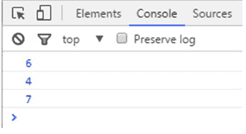

**图 7-14.** 程序输出

也可以使用匿名函数结合变量表达式来重写相同的问题。列表 7-18 显示了如何这样做。

# 列表 7-18. 匿名递归函数

```html
<html>
<body>
<script>
  var spell_number = function(num ) {
    if (num < 10) {
      console.log(num);
    } else {
      spell_number(Math.floor(num / 10));
      console.log(num % 10 );
    }
  }
  spell_number(647);
</script>
</body>
</html>
```


`add_element` 是一个包含 `addition` 函数的闭包。然而，列表 7-16 使用了自执行函数，因此初始化语句（将 `array` 设置为 `[]` 并将 `total_elements` 设置为 0）仅执行一次。正如你将看到的，每个闭包函数都会记住它被创建时所在状态。这些状态包括 `array` 和 `total_elements`。

### 总结

在本章中，你了解了闭包是如何工作的，并学习了什么是递归函数。你还发现了如何使用嵌套函数。最后，你了解了面向对象编程在 JavaScript 中是如何工作的。

## 第 8 章 JavaScript 中的面向对象编程

为了更好地理解继承的概念，请考虑图 8-3 所示的示例。将这个示例更进一步，假设你不允许创建通用的玩家（players），这意味着没有人仅仅是“玩家”。每个人必须是特定的玩家，例如板球运动员或足球运动员。在面向对象的领域，可以从现有类创建新类。这些新类被称为子类，它们可以继承父类的数据和代码（即它们源自的类）。这允许重用父类中的现有功能，而不是在多个独立的类中重复这些功能。如果需要，你也可以向派生类添加额外功能。

### 通用面向对象编程

要理解面向对象编程，你需要理解面向对象编程。在 OOP 中，你使用模型创建现实世界的对象。例如，你可以有一个 `Player` 类，它包含许多属性（数据）和一个开发者想要展示的功能（行为），如图 8-1 所示。

```
CLASS : PLAYER

PLAYER_NAME

WEIGHT

HEIGHT

SAYHELLO("MY NAME IS [PLAYER_NAME]")
```

**图 8-1.** 类

这种对象表示被称为类（在 JS 中，使用了不同的机制，稍后会描述）。类可以被视为一个模板，规定了源自它的对象必须具备的属性。

你可以创建一个类的多个实例。它们可以继承类中的数据和代码。例如，对于 `Player` 类，你可以创建任意数量玩家，如图 8-2 所示。在创建对象时，会执行类的构造函数以创建新的对象实例。这被称为实例化。

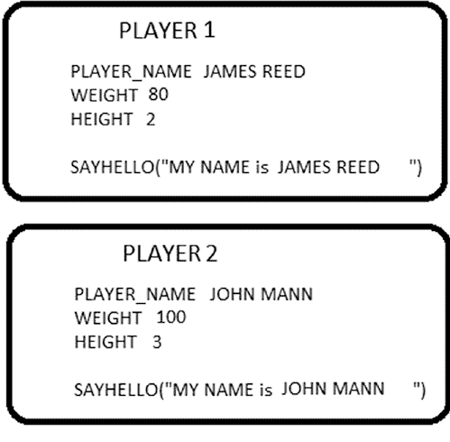

**图 8-2.** Player 的实例

图 8-2 所示的 `Player` 类有两个实例，`player1` 和 `player2`，它们各自拥有自己的 `player_name`、`weight` 和 `height` 属性，并且 `sayhello()` 方法中也有不同的字符串。

为了简洁起见，本章仅显示代码。从对象的概述开始，本章展示了面向对象编程是如何工作的。

### 板球球员

| 球员名称 | 重量 | 身高 | 郡县名称 | sayhello() |
| :--- | :--- | :--- | :--- | :--- |
| | | | | 我打板球 |

### 足球球员

| 球员名称 | 重量 | 身高 | 俱乐部名称 | sayhello() |
| :--- | :--- | :--- | :--- | :--- |
| | | | | 我踢足球 |

**图 8-3.** 板球球员和足球的子类

板球球员和足球类有许多共同属性，例如 `player_name`、`weight` 和 `age`，因此在父类 `Player` 中定义所有这些属性，并创建继承这些属性的 `CricketPlayer` 类和 `FootballPlayer` 类，会要容易得多。

在这些类中，也可以以不同的方式指定给定的功能。例如，板球球员类的 `sayhello()` 文本可以是“我是一个板球运动员”，而足球球员类的 `sayhello()` 文本必须是“我是一个足球运动员”。在不同对象类型中以不同方式实现相同的功能被称为多态。

现在可以从这些类创建实例了，例如 `Cricket1`、`CricketPlayer2`、`FootballPlayer1` 等。

### 对象实例和构造函数

JavaScript 不是一种典型的面向对象的编程语言。其他 OOP 语言有用于定义类的 `class` 语句（定义）。使用这些类可以创建包含类中属性和方法的对象。相比之下，JS 使用特殊函数作为构造函数来定义对象的属性和方法。一个构造函数可以创建任意数量的对象，并有向它们添加附加函数和数据的选项。

如果你使用构造函数创建一个新实例，构造函数内部可用的功能将通过原型链链接到类。（这与其他 OOP 语言不同，其他语言中所有功能都从类复制到新创建的对象。）

本节展示了在 JS 中模拟对象创建四种方法（使用 Player 对象作为真实示例）：

- 使用对象字面量
- 使用构造函数
- 使用 `Object()` 构造函数
- 使用 `create()` 方法

#### 方法 1：使用对象字面量

第一种方法是使用使用对象字面量的函数。列表 8-1 显示了一个处理球员示例的函数。

**列表 8-1.** 使用对象字面量

```javascript
function definePlayer(pname, weight, height) {
  var objmy = {};
  objmy.name = pname;
  objmy.weight = weight;
  objmy.height = height;
  objmy.sayhello = function() {
    alert('HI, my name is ' + this.pname + '.');
  };
  return objmy;
}
```

在这里，函数 `definePlayer` 将 `pname`、`weight` 和 `height` 作为输入。在球员函数定义了一个对象 `objmy`，然后添加了 name、weight 和 height 等属性。列表 8-1 还定义了 `sayhello` 方法。最后，函数返回该对象。

你可以通过调用此函数创建一个新的 player：

```javascript
var player = definePlayer('James Watson', 100, 50);
console.log(player.name);
console.log(player.sayhello());
```

这种安排可行，但冗长且声明了一个空对象并返回它。

#### 方法 2：使用构造函数

JavaScript 提供了使用构造函数创建对象的另一种快捷方法。你可以如列表 8-2 所示为球员示例定义构造函数。

**列表 8-2.** 构造函数

```javascript
function Player(pname, weight, height) {
  this.name = pname;
  this.weight = weight;
  this.height = height;
  this.sayhello = function() {
    alert('Hi, my name is ' + this.name + '.');
  };
}
```

> JavaScript 中的构造函数类似于其他 OOP 语言中的 `class` 关键字。

构造函数定义了属于对象的方法和属性。`this` 关键字用于给正在创建对象的属性赋值。方法 1（使用对象字面量）和方法 2 之间的主要区别是后者使用了 `this`。这意味着当使用构造函数创建对象时，各种属性将等于通过构造调用传递的参数。

考虑以下示例：

```javascript
var player1 = new Player('James', 100, 20);
var player2 = new Player('John', 120, 60);
```

此示例创建了两个对象，`player1` 和 `player2`。它们拥有 `pname` 和 `sayhello` 方法，是分别存储且不冲突的。

**列表 8-3.** 使用构造函数（重复示例）

```javascript
function Player(pname, weight, height) {
  this.name = pname;
  this.weight = weight;
  this.height = height;
  this.sayhello = function() {
    alert('Hi, my name is ' + this.name + '.');
  };
}
```

在 Web 浏览器控制台中显示 `player1` 的内容，其输出如图 8-5 所示。

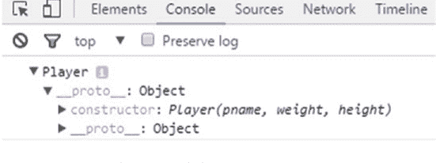

**图 8-5.** player1 的控制台输出

如你所示，位于原型对象中的成员是 `pname`、`weight` 和 `height`。这些成员存在于 `Player` 构造函数的原型对象上，即 `Object`。见图 8-6。

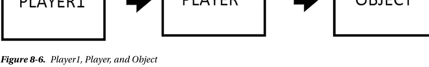

**图 8-6.** Player1、Player 和 Object

假设你使用 `player1` 调用位于 `Object` 中的方法，例如 `valueOf`。在这种情况下，JS 首先检查 `player1` 对象是否具有 `valueOf` 方法。由于该方法并不存在，JS 接下来在 `Player` 对象中查找 `valueOf` 方法。该方法在 `Player` 对象中也不存在。因此，JS 随后搜索 `Player` 构造函数的原型对象（这就是 `Object`）。`Object` 包含了你正在查找的方法。

为了更好地理解属性的继承，查看 `console.log` 中的 `Object`。`Object` 中存在大量属性。并非所有属性在 `player1` 对象中都是可用的。继承自 `Object` 原型对象的属性（即它们没有导入到 Object，而是导入到 `Object.prototype` 中）。"prototype" 属性的“值”实际上是一个对象，它包含一组属性和方法，这些属性和方法可以通过原型链向下继承。例如，`Object.prototype.valueOf()` 方法存在于任何继承自 `Object` 的对象中。另一方面，`Object.keys` 方法没有被继承自 `Object` 的对象继承。

回到之前显示的示例，`Player` 的原型如图 8-7 所示。

**图 8-7.** Player 的原型

```javascript
Object {
  constructor: Player(name, weight, height)
  __proto__: Object
    __defineGetter__: __defineGetter()
    __defineSetter__: __defineSetter()
    __lookupGetter__: __lookupGetter()
    __lookupSetter__: __lookupSetter()
  constructor: Object()
  hasOwnProperty: hasOwnProperty()
  isPrototypeOf: isPrototypeOf()
  propertyIsEnumerable: propertyIsEnumerable()
  toLocaleString: toLocaleString()
  toString: toString()
  valueOf: valueOf()
  get __proto__: __proto__()
  set __proto__: __proto__()
}
```

图 8-7 中没有多少内容，因为没有在 `Player` 构造函数上定义任何方法。
接下来，查看 Chrome 控制台中显示的 `Object.prototype`，如图 8-8 所示。

**图 8-8.** Object.prototype

```javascript
Object {
  __defineGetter__: __defineGetter()
  __defineSetter__: __defineSetter()
  __lookupGetter__: __lookupGetter()
  __lookupSetter__: __lookupSetter()
  constructor: Object()
  hasOwnProperty: hasOwnProperty()
  isPrototypeOf: isPrototypeOf()
  propertyIsEnumerable: propertyIsEnumerable()
  toLocaleString: toLocaleString()
  toString: toString()
  valueOf: valueOf()
  get __proto__: __proto__()
  set __proto__: __proto__()
}
```

假设你添加了以下语句：

```javascript
var another_player = Object.create(player1);
```

`Object` 的 `create` 方法从原型对象创建一个新对象。
如你所示，`another_player` 是使用 `player1` 创建的。假设你输入以下内容：

```javascript
console.log(another_player.__proto__);
```

该语句的输出如图 8-9 所示。

```
▼ Player
  height: 20
  name: "John"
  weight: 100
  __proto__: Object
    ► constructors: Player(name, weight, height)
    __proto__ : Object
```

**图 8-9.**

每个对象都有一个名为 `constructor` 的属性，链接到构造函数（用于创建实例）。`player1.constructor` 和 `player2.constructor` 的输出如图 8-10 所示。

**图 8-10.** Player1 和 Player2 构造函数

```javascript
function Player(name, weight, height) {
  this.pname = name;
  this.weight = weight;
  this.height = height;
}
```

如你所示，这两个都返回 `Player` 构造函数。
还可以使用 `constructor` 属性（以及必要的参数）来创建一个新实例。考虑这个示例：

```javascript
var player3 = new player1.constructor('John Mann', 100, 11);
```

此示例将 `constructor` 属性作为函数（带括号）结合 `new` 关键字使用。
当你输出新对象 `player3` 的内容时（如下所示），运行正常：

```
player3.pname
player3.weight
player3.height
```

### 继承

`CricketPlayer.prototype = Object.create(Player.prototype);`

在这里，使用 `create` 方法根据 `Player` 指向的值创建一个新对象。新对象被赋值给 `CricketPlayer.prototype`，以便 `CricketPlayer.prototype` 继承自 `Player.prototype` 中的方法。在此之前，`CricketPlayer.prototype` 等于 `Player()`（因为 `CricketPlayer.prototype` 被赋值为了一个 `Player.prototype` 对象的对象）。这可能会产生问题，因此你可能需要在最后添加以下语句：

```javascript
CricketPlayer.prototype.constructor = CricketPlayer;

CricketPlayer.prototype.tellname = function() {
  alert('My name is ' + this.pname + ' and I am a cricket Player of ' + this.cricketcounty + ' .');
}
```

在最后，你可以添加以下语句：

```javascript
var cper = new CricketPlayer('Jon Reed', 100, 190, ' Surrey County');
cper.tellname();
```

完整的继承代码如列表 8-5 所示。

**列表 8-5.** 完整的继承代码

```html
<html>
<body>
<script>
function Player(pname, weight, height) {
  this.pname = pname;
  this.weight = weight;
  this.height = height;
}

function CricketPlayer(pname, weight, height, cricketcounty) {
  Player.call(this, pname, weight, height);
  this.cricketcounty = cricketcounty;
}

CricketPlayer.prototype.tellname = function() {
  alert('My name is ' + this.pname + ' and I am a Player ');
}

CricketPlayer.prototype = Object.create(Player.prototype);

CricketPlayer.prototype.constructor = CricketPlayer;

CricketPlayer.prototype.tellname = function() {
  alert('My name is ' + this.pname + ' and I am a cricket Player of ' + this.cricketcounty + ' .');
};
</script>
</body>
</html>
```

```javascript
var per = new Player('James Wood ', 120, 20);
var cper = new CricketPlayer('Jon Reed', 100, 190, ' Surrey County');

per.tellname();
cper.tellname();
```

此时，`per` 和 `cper` 的内容如图 8-11 所示。

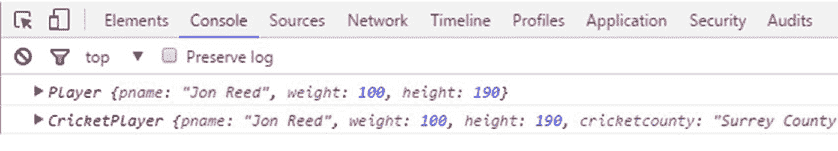

**图 8-11.** console.log 中 per 和 cper 的内容

第一个成员 `pname`、`height` 和 `weight` 继承自 `Player`，而 `cricketcounty` 是在 `CricketPlayer` 级别定义的。方法 `tellname` 在 `CricketPlayer` 级别被重新定义。

在列表 8-5 的末尾，使用 `new` 关键字定义了两个对象 `per` 和 `cper`，然后为对象 `per` 和 `cper` 调用了 `tellname` 方法。每次调用都会触发不同的方法。结果显示了两个不同的警告框，如图 8-12 和 8-13 所示。


**图 8-12.** 类 Player 的方法 tellname 输出

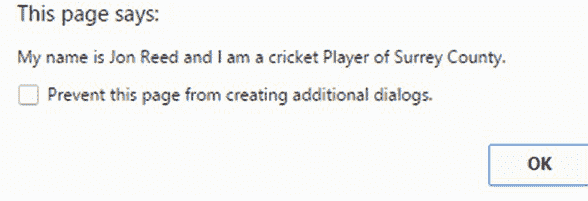

**图 8-13.** 类 CricketPlayer 的方法 tellname 输出

如你所见，两个方法的输出格式完全不同。这是多态性的演示。

### 总结

本章首先提供了面向对象编程的概述，然后向你展示了如何在 JS 中实现 OOP 以及相关的语法。它涵盖了 `new` 运算符，然后涵盖了创建对象的各种方式，最后是使用 `new` 关键字的实例化步骤。本章以介绍 JS 中使用原型链实现的继承作为结束。

在第 9 章中，你将详细介绍 JS 的许多内置对象，以及它们提供的属性和方法，JS 开发者可以利用这些内容来减少编程时间和精力。

## 第 9 章 内置对象

在 JavaScript 中，对象是一个无序的属性列表。属性由名称和值组成，也可以是一个函数。在这种情况下，该函数被称为方法。本章涵盖了在使用 JavaScript 编码时需要熟悉的一些标准对象。它还展示了你最可能使用的属性和方法示例。本章涵盖了数组、布尔对象、字符串对象和日期对象。

### 复习对象

列表 9-1 展示了一个简单的对象示例。

**列表 9-1.** 对象示例

```html
<html>
<body>
<script>
  var book = {novel: "Secret", author: "Rhonda Byrne", publicationDate: "Nov 6"};
  console.log(book.novel + " " + book.author);
</script>
</body>
</html>
```

如此示例所示，对象包含一个项目列表，其中每个项目都有一个键值对。属性为 `novel`、`author` 和 `publicationDate`，每个属性都被分配了一个值。该代码的输出如图 9-1 所示。

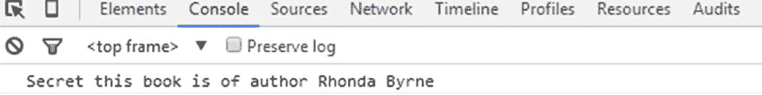

**图 9-1.** 输出

### 数组

数组允许在单个名称下存储多个值。索引从 0 开始，第二个元素是 1，以此类推。考虑列表 9-2 中的数组字面量。

**列表 9-2.** 数组字面量示例

```html
<html>
<body>
<script>
  var countries = ["India", "Germany", "Scotland"];
  console.log(countries);
</script>
</body>
</html>
```

此示例声明了 `countries` 数组，它包含了这些元素。如列表 9-2 所示，使用 `console.log` 打印数组。

#### 使用 new 关键字的数组

数组也可以使用 `new` 关键字定义，如列表 9-3 所示。

**列表 9-3.** 使用 new 关键字的数组示例

```html
<html>
<body>
<script>
  var countries = new Array("India", "Germany", "Scotland");
  console.log(countries);
</script>
</body>
</html>
```

此示例与列表 9-2 相同，只是增加了 `new` 关键字。两种方法的工作方式完全相同。

#### 数组属性

数组对象的最常用属性在表 9-1 中列出并描述。

**表 9-1.** 数组属性

| 属性 | 描述 |
| :--- | :--- |
| `constructor` | 返回数组函数 |
| `index` | 返回字符串中匹配项的零索引 |
| `length` | 给出数组的长度 |

接下来将详细介绍 `constructor` 和 `length` 属性。

##### constructor 属性

`constructor` 属性的语法是：

`array.constructor`

它返回 `Array() { [native code] }`。一个简单的示例见列表 9-5。

**列表 9-5.** 数组 constructor 属性示例

```html
<html>
<body>
<script>
  var countries = new Array("Germany", "India", "Scotland");
  console.log("countries.constructor is:" + countries.constructor);
</script>
</body>
</html>
```

此示例使用 `new` 关键字声明数组 `countries`，并使用 `console.log` 显示 `countries.constructor`。该代码的输出如图 9-5 所示。

```
Console Emulation Rendering
<top frame> Preserve log
countries.constructor is:function Array() { [native code] }
```

**图 9-5.** 输出

##### length 属性

顾其名，`length` 属性包含数组的长度。元素的数量以整数形式指定。`length` 属性的语法是：

`array.length`

这返回数组长度——即元素的总数。列表 9-6 提供了该属性的一个运行示例。

**列表 9-6.** Array length 属性示例

```html
<html>
<body>
<script>
  var countries = new Array("Germany", "India", "Scotland", "Austria");
  console.log("Length of array is: " + countries.length);
</script>
</body>
</html>
```

列表 9-6 的输出如图 9-6 所示。

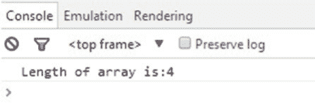

**图 9-6.** 输出

#### 数组方法

数组对象包含许多方法，其中几个在表 9-2 中列出并描述。

**表 9-2.** 数组对象的方法

| 方法 | 描述 |
| :--- | :--- |
| `concat()` | 合并两个或多个数组并返回新数组。 |
| `forEach()` | 对数组中的每个元素执行指定的函数。 |
| `join()` | 将数组的元素组合成字符串。 |
| `lastIndexOf()` | 返回给定元素在数组中找到的最后一个索引。如果元素不在数组中，则返回 -1。 |
| `pop()` | 删除并返回数组的最后一个元素。 |
| `push()` | 在数组末尾添加一个或多个元素并返回新数组的长度。 |
| `reverse()` | 反转数组的顺序。 |
| `toString()` | 以字符串形式返回数组的组件。 |
| `sort()` | 对数组元素进行排序。 |
| `shift()` | 删除第一个元素并返回更新后的数组。 |
| `slice()` | 根据指定的位置切出数组的一部分，并以字符串形式返回数组。 |

##### 方法 concat

`concat()` 方法的语法为：

```javascript
array.concat(arr1, arr2, ..., arrN);
```

在这里，`arr1` 和 `arr2` 是数组的元素。这返回另一个包含合并后值的数组。列表 9-7 显示了该方法的使用示例。

**列表 9-7.** 数组 concat() 方法示例

```html
<html>
<body>
<script>
  var countries = ["Germany", "Scotland", "Austria"];
  var continents = ["Europe", "Australia", "Africa"];
  var world = countries.concat(continents);
  console.log("The world map has countries & continents:" + world);
</script>
</body>
</html>
```

这声明了两个数组，一个使用变量 `countries`，另一个使用变量 `continents`。然后使用 `concat()` 方法合并这两个数组元素并形成一个新的数组。列表 9-7 的输出如图 9-7 所示。

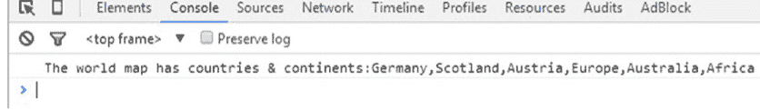

**图 9-7.** 输出

##### 方法 pop

`pop` 方法从数组中删除最后一个元素并返回其值。`pop()` 方法的语法为：

```javascript
array.pop();
```

这返回从数组中删除的元素或值。列表 9-8 提供了 `pop()` 方法的示例。

**列表 9-8.** 数组 pop() 方法示例

```html
<html>
<body>
<script>
  var countries = ["Germany", "Scotland", "Austria"];
  var value = countries.pop();
  console.log("Removed value from array is:" + value);
  var value = countries.pop();
  console.log("Removed value from array is:" + value);
</script>
</body>
</html>
```

此示例声明了带有一些数组元素的变量 `countries`，然后使用 `pop()` 方法。该值存储在变量 `value` 中并进行显示。此代码的输出如图 9-8 所示。

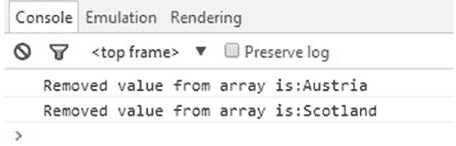

**图 9-8.** 输出

### 布尔

布尔对象表示两个值：真 (`true`) 或假 (`false`)。`Boolean` 的语法为：

`Boolean(value)`

**列表 9-9.** 布尔对象示例

```html
<html>
<body>
<script>
  function myBoolean() {
    console.log(10 < 15);
  }
  myBoolean();
</script>
</body>
</html>
```

此示例比较了布尔值。如果 10 小于 15，代码返回 `true`；否则，返回 `false`。列表 9-9 的输出如图 9-9 所示。

| 控制台 | 仿真 | 渲染 |
| :--- | :--- | :--- |
| true | <top frame> | 保留日志 |

**图 9-9.** 输出

#### 布尔属性

布尔对象的属性在表 9-3 中列出并描述。

**表 9-3.** 布尔属性

| 属性 | 描述 |
| :--- | :--- |
| `constructor` | 对象的构造函数 |
| `prototype` | 允许开发者添加属性和方法 |

#### 布尔方法

现在让我们讨论布尔对象的一些有用方法。

##### 方法 valueOf

`valueOf()` 方法的语法为：

```javascript
boolean.valueOf()
```

> 返回原始值。

**列表 9-10.** valueOf 方法示例

```html
<html>
<body>
<script>
  var bool = true;
  console.log(bool.valueOf());
</script>
</body>
</html>
```

### 字符串

字符串对象表示字符序列。`String` 的语法为：

`String(value)`

#### 字符串属性

字符串的属性在表 9-4 中列出。

**表 9-4.** 字符串属性

| 属性 | 描述 |
| :--- | :--- |
| `length` | 字符串的长度 |
| `constructor` | 对象的构造函数 |
| `prototype` | 允许开发者添加属性和方法 |

#### 字符串方法

字符串方法在表 9-5 中列出。

**表 9-5.** 字符串方法

| 方法 | 描述 |
| :--- | :--- |
| `concat()` | 合并多个字符串。 |
| `indexOf()` | 在字符串中搜索指定值。未找到返回 -1。 |
| `match()` | 返回与正则表达式匹配的数组。 |
| `replace()` | 将字符串替换为新字符串。 |
| `charAt()` | 返回指定位置的字符。 |
| `slice()` | 根据起始和结束位置截取字符串的一部分。 |
| `split()` | 根据指定的分隔符将字符串分割为子字符串。 |
| `search()` | 在字符串中搜索正则表达式。找到返回位置。 |
| `toUpperCase()` | 转换为大写。 |
| `toLowerCase()` | 转换为小写。 |
| `substr()` | 用于提取。指定起始位置和字符数。 |
| `includes()` | 检查字符串是否包含某个字符或字符集。 |
| `endsWith()` | 检查字符串是否以某个字符或字符集结尾。 |
| `repeat()` | 重复字符串指定次数。 |

##### length

`length` 的语法为：

```javascript
string.length
```

给出了字符串中的字符数。

**列表 9-11.** 字符串长度示例

```html
<html>
<body>
<script>
  var text = "JavaScript";
  var len = text.length;
  console.log("The length of the string is:" + len);
</script>
</body>
</html>
```

列表 9-11 的输出如图 9-11 所示。

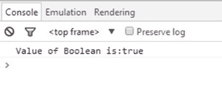

**图 9-11.** 输出

##### repeat

`repeat` 的语法为：

```javascript
string.repeat(n)
```

在这里，通过数字 `n` 指定字符串内容重复的次数。这返回一个包含重复文本的字符串。考虑列表 9-13 中的示例。

**列表 9-13.** String repeat() 方法示例

```html
<html>
<body>
<script>
  var text = "JavaScript Object";
  var string = text.repeat(2);
  console.log("The string repeats twice:" + string);
</script>
</body>
</html>
```

在此例中，通过 `repeat()` 方法将声明的字符串 "JavaScript Object" 写入了两次。此代码的输出如图 9-13 所示。

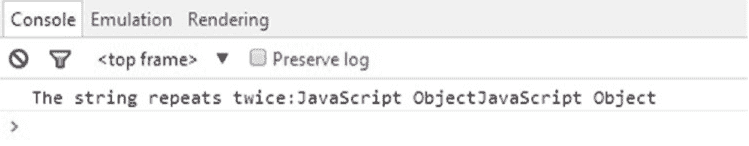

**图 9-13.** 输出

##### slice 方法

方法 `slice([startSlice, endSlice])` 的语法：

在这里，`startSlice` 是被移除之前提取部分的起始位置数字，而 `endSlice` 是可选的，用于从字符串右侧移除部分字符串。索引（位置）是从字符串的右侧指定的（即从字符串末尾向左计数）。此之后的所有内容都将被删除，且不会作为返回字符串的一部分发送。该数字以负号传递。因此，`-4` 表示四个字符。

考虑列表 9-14 中的 `slice` 方法示例。

**列表 9-14.** String slice() 方法示例

```html
<html>
<body>
<script>
  var text = "JavaScript is also Object oriented";
  var string = text.slice(4, -4);
  console.log("The new string is:" + string);
</script>
</body>
</html>
```

此示例声明了变量 `text` 并赋值该字符串。在 `slice` 方法中指定了起始和结束索引数字，代码将从字符串中提取它们之间的字符。输出如图 9-14 所示。

```
Console Emulation Rendering
<top frame> Preserve log
The new string is:Script is also Object orie >
```

**图 9-14.** 输出

### Date（日期）

Date 对象帮助我们处理日期和时间。创建此对象的四种方法：

```
new Date()
new Date(millisecond)
new Date(datestring)
new Date(year, month, date[, hour, minute, second, millisecond])
```

#### Date 属性

Date 属性在表 9-6 中列出并描述。

**表 9-6.** Date 属性

| 属性 | 描述 |
| :--- | :--- |
| `constructor` | 构造函数 |
| `prototype` | 允许开发者添加属性和方法 |

##### constructor 属性

构造函数返回创建日期对象原型的函数。构造函数的语法为：

`date.constructor`

考虑列表 9-15 中的构造函数属性示例。

**列表 9-15.** Date 构造函数属性示例

```html
<html>
<body>
<script>
  var tdyDate = new Date();
  console.log(tdyDate.constructor);
</script>
</body>
</html>
```

此示例声明了一个新日期变量 `tdyDate`。构造函数属性返回函数 `Date`。输出如图 9-15 所示。

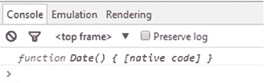

**图 9-15.** 代码输出

#### Date 方法

一些常用的 Date 对象方法在表 9-7 中列出并描述。

**表 9-7.** Date 对象的方法

| 方法 | 描述 |
| :--- | :--- |
| `getDate()` | 日期中的日（例如：1, 2, ... 31） |
| `getDay()` | 以数字形式给出星期几（例如：0, 1, ... 6） |
| `getFullYear()` | 返回日期的年份（例如：1978） |
| `getHours()` | 给出日期的小时（例如：0, 1, ... 23） |
| `getMinutes()` | 返回日期的分钟（例如：0, 1, ... 59） |
| `getMonth()` | 日期对象的月份（例如：0, 1, 2, ... 11） |
| `getSeconds()` | 返回秒数（例如：0, 1, 2, ... 59） |

> 对于表 9-7 中除 `getDay()` 之外的所有方法，都有相应的 set 方法，例如 `setFullYear` 等。让我们来看几个例子。

#### 使用 prototype 方法

如前所述，`prototype` 属性允许向对象添加属性和方法，无论它是布尔值、字符串、日期还是其他。使用 `prototype` 属性的语法为：

`Object.prototype.name = value`

**列表 9-16.** Date prototype 示例

```html
<html>
<body>
<script>
  function myDay() {
    var tdyDate = new Date();
    console.log(tdyDate.today());
  }
  Date.prototype.today = function() {
    switch (this.getDay()) {
      case 0: return "Sunday";
      case 1: return "Monday";
      case 2: return "Tuesday";
      case 3: return "Wednesday";
      case 4: return "Thursday";
      case 5: return "Friday";
      case 6: return "Saturday";
    }
  }
  myDay();
</script>
</body>
</html>
```

此示例向 date 对象添加了一个新函数 `today`。在该函数内部，首先通过 `getDay()` 找到代表日的数字。基于此，显示星期的名称——例如 0 代表周日，1 代表周一，依此类推。在函数 `myDay` 中，定义了一个新日期并调用了 `today` 方法。

列表 9-16 的输出如图 9-16 所示。

| Console | Emulation | Rendering |
| :--- | :--- | :--- |
| | <top frame> | Preserve log |
| Thursday | | |

**图 9-16.** 输出

##### setMonth 方法

`setMonth()` 方法的语法为：

`Date.setMonth(monthValue[, dayValue])`

在这里，`monthValue` 代表从 0 到 11（0 为一月），而 `dayValue` 是可选的，代表日期的日，例如 1, 2, ... 31。列表 9-17 显示了如何在程序中使用该方法。

**列表 9-17.** Date setMonth() 方法示例

```html
<html>
<body>
<script>
  var d1 = new Date("March 23, 2017 11:35:00");
  d1.setMonth(1);
  console.log("The date is to: " + d1);
</script>
</body>
</html>
```

此示例声明了日期 `d1` 并使用 `new` 关键字为其赋值。它调用了 `setMonth()` 方法并传递了值 1。这表示日期的月份为二月。此代码的输出如图 9-17 所示。

| Elements | Console | Sources | Profiles | Application | Security |
| :--- | :--- | :--- | :--- | :--- | :--- |
| top | Preserve log | | | | |

The date is to: Thu Feb 23 2017 GMT+0400 (Arabian Standard Time)

**图 9-17.** 程序输出

### 总结

本章介绍了在处理 JavaScript 时会遇到的几种基本对象，包括数组、布尔值、字符串和日期。描述了与它们相关的一些属性的方法，并展示了如何使用它们编写 JS 代码。

在第 10 章中，你将探索 JSON 格式。

## 第 10 章 JavaScript 对象表示 (JSON)

**列表 10-1.** JSON 示例

```html
<html>
<body>
<script>
  var empObj;
  empObj = { "name":"Kelvin Desouza", "empId":17924, "designation":"Trainer","city":"London" };
  console.log(empObj.name + " " + empObj.empId);
</script>
</body>
</html>
```

在这段代码中，你可以看到如何使用类 JSON 语法使用 JavaScript 创建一个对象。声明的变量 `empObj` 为其分配了一些键/值对，并使用点表示法访问对象的值。`console.log` 方法中仅指定了员工姓名和 ID，因此浏览器控制台中将只显示这两个值。

列表 10-1 的输出如图 10-1 所示。


**图 10-1.** 输出

### JSON 数据类型

JSON 具有以下数据类型：

- **数字**：JSON 中的数字不能出现在引号内，通常是整数或浮点数。例如：`{ "empId": 123 }`
- **字符串**：JSON 字符串用双引号编写。例如：`{ "empname": "Twinkle" }`
- **布尔值**：值可以是 `true` 或 `false`。例如：`{ "Pass": true }`
- **对象**：JSON 对象可以是任何一组键/值对。例如：
  ```json
  {
    "Employee": { "name":"Twinkle", "empid":1234, "position":"Trainer","city":"London" }
  }
  ```
- **数组**：值可以分组在一个数组中。例如：
  ```json
  {
    "Employee": [ "Twinkle", 1234, "Trainer", "London" ]
  }
  ```
- **空值**：这些是空值或没有值。例如：`{ "value": null }`

### JSON 对象

JSON 对象的语法是：

```javascript
var Employee = { "name":"Twinkle", "empid":1234, "position":"Trainer", "city":"London" }
```

如前所述，JSON 对象位于大括号 `{}` 之中，并包含由冒号 `:` 分隔的键值对。对于对象而言，键始终是双引号内的字符串。属于这些键的值可以是任何数据类型（如数字、字符串等）。

有两种方法访问对象：使用点 (`.`) 表示法，例如 `Employee.name`，或者通过将值放在括号中，例如 `Employee["name"]`。

通过 JS 代码创建 JSON 对象有三种方法：

- 创建一个空对象：
  ```javascript
  var myEm = {};
  ```
- 创建一个新对象：
  ```javascript
  var myEm = new Object();
  ```
- 创建带有键/值对的 JSON 对象：
  ```javascript
  var myEm = { "name":"Twinkle", "empid":1234, "position":"Trainer", "city":"London" }
  ```

**列表 10-2.** JSON 对象示例

```html
<html>
<body>
<script>
  var product, val;
  product = { "prname":"Smart Phone", "price":20000, "company":"Sony", "camera":null };
  console.log("Product name is: " + product["prname"] + " company: " + product["company"]);
</script>
</body>
</html>
```

这段代码与列表 10-1 所示的代码相同。此示例通过方括号访问值。在这种情况下，访问了产品名称和公司，因此预期的输出将是产品名称和公司。列表 10-2 的输出如图 10-2 所示。

```
Console
Preserve log
Product name is: Smart Phone company: Sony
> |
```

**图 10-2.** 输出

### JSON 数组

值在 JavaScript 中以数组的形式存在。值存储在方括号 `[]` 之中，且数组可以是任何数据类型（数字、字符串、数组、对象、布尔值或空）。

```json
{
  "soldin" : [ "US", "UK" ]
}
```

要访问数组，使用如下的索引数字：`soldin[1]`。

为了更好地理解这个概念，请考虑列表 10-3。

**列表 10-3.** JSON 数组示例

```html
<html>
<body>
<script>
  var sellingitem = {
    "itemname": "Smart Phone",
    "itemprice": 20000,
    "soldin": [ "US", "UK" ]
  };
  console.log("Product " + sellingitem.itemname + " is sold in " + sellingitem.soldin[0] + " and " + sellingitem.soldin[1]);
</script>
</body>
</html>
```

此示例有一个变量 `sellingitem`，它代表一个对象，并为其分配了相应的值。该对象内部有一个 `soldin` 数组，包含了该商品销售的国家。使用 `console` 方法在控制台中打印产品名称和国家。列表 10-3 的输出如图 10-3 所示。

| Elements | Console |
| :--- | :--- |
| Product name is: Smart Phone sold in US and UK | |

**图 10-3.** 输出

### JSON 方法

JSON 对象主要有两个核心方法：`JSON.parse()` 和 `JSON.stringify()`。

- `JSON.parse(text[, reviver])`：解析 JSON 字符串，构造由字符串描述的 JavaScript 值或对象。
- `JSON.stringify(value[, replacer[, space]])`：将 JavaScript 值转换为 JSON 字符串。

## 第 11 章 杂题

### 严格模式

现在，考虑图 11-2 所示在函数中使用严格模式的示例。

```html
<html>
<body>
<script>
var myObj = { att1: 10, att2: 15, att1: 20 };
function my() {
  "use strict";
  var myObj = { att1: 10, att2: 15, att1: 20 };
}
</script>
</body>
</html>
```

**图 11-2.** 在函数中使用严格模式

严格模式仅应用于函数 `my()`。尽管对象 `myObj` 均包含属性 `att1` 的重复定义，但只显示了一个错误，即函数内部的对象的。函数外部定义的第一个对象没有产生错误。

使用严格模式具有以下优势：

- 它不允许可能导致代码难以理解的编程方式。因此，它使得程序更容易被识别和维护。
- 它有助于在开发早期识别出使用不安全或在代码执行时可能抛出异常的错误。

严格模式下不允许的某些结构包括：

- **属性重复**：不允许在对象字面量中多次定义同一个属性。考虑以下代码，它包含了两次属性 `att1`：
  ```javascript
  var myObj = { att1: 10, att2: 15, att1: 20 };
  alert(myObj.att1);
  ```
  不使用严格模式的代码可以编译并在浏览器告警框中显示 20。如果使用了 `"use strict"`，则会产生错误。

- **重复的函数参数**：在严格模式下，不允许在函数中使用多次同一个参数名。考虑以下示例：
  ```javascript
  function myFunc(p1, p1) {
    return p1;
  }
  alert(myFunc(10, 10));
  ```
  在没有严格模式的情况下，此代码将显示 10。然而，当使用严格模式时，会产生图 11-3 所示的错误。

  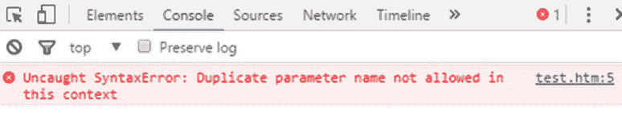

  **图 11-3.** 由重复参数名引起的语法错误

- **代码块中的函数声明**：使用严格模式时，不允许在代码块中声明函数。在严格模式下，函数可以在程序的最顶层或函数体内部定义。以下示例是不允许的：
  ```javascript
  "use strict"
  for (var i = 0; i < 10; i++) {
      function myfunc() {}
  }
  ```

- **使用 `with` 语句**：在严格模式下，不允许使用 `with` 语句。

### 调试 JavaScript

与所有语言一样，JavaScript 也需要调试。本节演示了如何在 Google Chrome 浏览器中调试程序，以防你在运行程序时浏览器内没有直接显示任何错误。

考虑以下代码：

```html
<html>
<body>
<script>
  var num1 = 10;
  alert(num1);
  num = 1;
</script>
</body>
</html>
```

如你所见，`num` 没有被声明。然而，当代码在浏览器中执行时，告警框仍然会显示（即：直到代码不再正确为止）。

要在 Chrome 浏览器中开启并探索调试器，请遵循以下步骤：

1. 按 `Ctrl+Shift+I`。这会打开浏览器右侧的“控制台”标签卡。
2. 点击“源”标签卡。这会在控制台中显示程序代码，并用红圈标出错误行（见图 11-4）。违规代码下方还有红色的波浪线。

   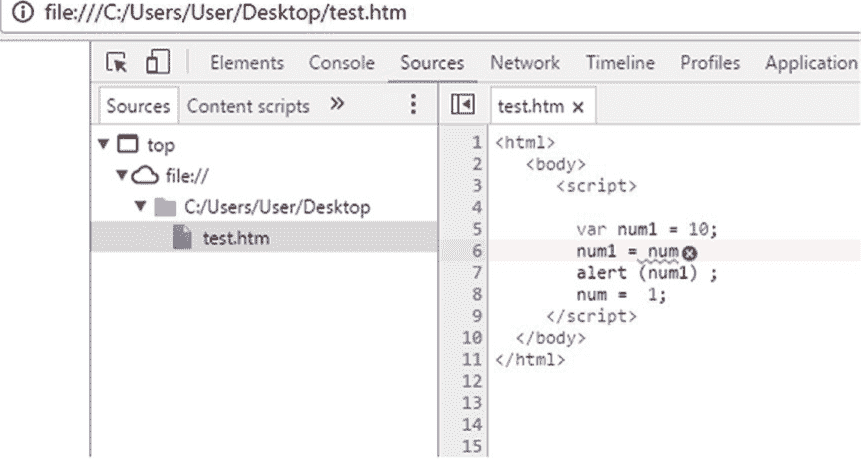

   **图 11-4.** 源代码错误

3. 点击“控制台”标签卡查看错误文本，如图 11-5 所示。

   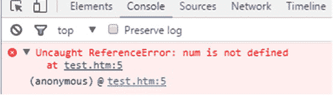

   **图 11-5.** 语法错误

假设你的程序没有语法错误，但存在某些逻辑错误，且你不确定原因是什么。在这种情况下，你首先需要找到合适的位置放置断点，然后需要查看各种语句的执行情况以及所用变量的内容。

要启动调试器，按 `Ctrl+Shift+I` 然后选择“源”标签卡。点击你想放置断点的行号。确保你点击的是行号，而不是代码本身。断点将显示为行号上方的蓝色高亮箭头，如图 11-6 的第 6 行所示。

接下来，重新运行 HTML 页面。这将重新运行 JS 代码，调试器将停在断点处；屏幕左侧将显示“调试器暂停”，如图 11-6 左下角的窗格所示。

要查看变量的内容，在屏幕右下角的窗格中点击“监视”标签卡。点击 `+` 按钮。在弹出的输入文本框中输入变量名。如图 11-6 所示，可以查看变量的值。

### 异常处理

JavaScript 使用 `try...catch...finally` 语句处理异常。

```javascript
try {
  // 可能发生异常的代码
} catch (e) {
  // 发生异常时执行的代码
} finally {
  // 无论是否发生异常，部分代码都会运行
}
```

在编写代码时，第一个块是 `try` 块。之后，你可能带有一个 `catch` 块或一个 `finally` 块（或者两者都有）。`finally` 块是可选的。如果在 `try` 块内发生异常，它将被放置在错误对象 `e` 中，并执行 `catch` 块中的代码。

`catch` 块提供了一个包含有关发生错误相关信息的错误对象。错误对象有三个属性：

- `name`：错误名称
- `message`：错误消息
- `description`：错误的描述

此外，错误名称可能是几种类型中的其中一种；这里显示了其中几个重要的类型：

- `ReferenceError`：非法引用
- `TypeError`：类型错误
- `RangeError`：数字超出范围
- `SyntaxError`：语法错误

在 `try/catch` 之后，无论是否发生异常，`finally` 块中的任何代码都会运行。

现在你已经了解了 JS 领域中如何处理异常，你准备好看到一些异常处理代码的实际运行了。假设你有以下这段代码块：

```html
<html>
<body>
<script>
  abcd("This message");
</script>
</body>
</html>
```

如你所见，程序调用了一个名为 `abcd` 的不存在函数。

此代码块在运行时运行。要更改此程序以捕获异常并在警告框中显示错误描述，你需要使用以下代码：

```html
<html>
<body>
<script>
  try {
    abcd("This message");
  } catch (exception) {
    alert("发生了一个异常，描述为：" + exception.message);
  }
</script>
</body>
</html>
```

尝试调用 `abcd` 函数的代码被放置在 `try` 块中。警告框被放置在 `catch` 块中。异常对象将包含有关所发生错误的必要信息。这些信息将显示在警告框中。

程序的输出如图 11-7 所示。

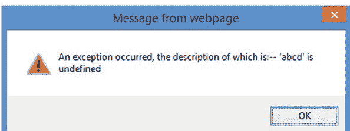

**图 11-7.** 异常已处理

### JavaScript 最佳实践

本节提供了在使用 JavaScript 语言时应实施的最佳实践概述。这些包含了一些技巧和窍门，例如避免使用全局变量和闭包、为参数分配默认值，以及在 `switch` 语句始终使用 `default` 子句。

#### 避免使用全局变量

建议在 JS 中避免使用全局变量。你有选择时，请使用局部变量。永远不要在全局定义数据、对象以及函数。作为默认行为，JS 会将所有声明提升到顶部。但是，请确保在程序顶部或编码时编写数据声明。

始终将声明保持在代码的顶部。这包括将数据放在主程序或任何使用的函数的顶部。通过遵循这种做法，代码不仅看起来整洁清晰，而且易于更改，因为所有声明的数据都在顶部。以下示例展示了这种做法。

```javascript
var playerName, myWeight, myHeight;
myName = "James";
myWeight = 201.1;
myHeight = 85;
```

即使对于 `for` 循环，也要确保使用的任何变量都声明在顶部：

```javascript
var a;
for (a = 0; a < 10; a++) {
}
```

#### 避免为数字、字符串或布尔值声明对象

为数字、字符串或布尔值声明对象可能会对性能产生不利影响，并可能产生错误的结果。

考虑以下情况，其中比较返回 `false`：

```javascript
var myst1 = "James";
var myst2 = new String("James");
console.log(myst1 == myst2); // false
```

现在考虑以下示例：

```javascript
var String1 = new String("James");
var String2 = new String("James");
console.log(String1 == String2); // false
console.log(String1 === String2); // false
```

比较语句都返回 `false`，因为你不能比较对象（在这种情况下是字符串对象）。

#### 在 switch 语句中使用 default 子句

使用 `switch` 语句时，始终使用 `default` 子句。考虑以下示例：

```javascript
switch (num) {
  case 0:
    value = "Off";
    break;
  case 1:
    value = "On";
    break;
}
```

在这种情况下，只有两种可能的结果；没有包含 `default` 子句。因此，当 `num` 的值既不是 0 也不是 1 时，你将不知道什么。我建议即使你认为有必要，也使用 `default` 子句。

此示例的正确形式是：

```javascript
switch (num) {
  case 0:
    value = "Off";
    break;
  case 1:
    value = "On";
    break;
  default:
    value = "Unknown";
}
```

`default` 子句在 `num` 的值既不是 0 也不是 1 时传递值 `Unknown`。

#### 在参数中分配默认值

在发生异常的情况下，在参数中分配默认值是一种良好的做法。考虑以下情况：

```javascript
function function1(a) {
  a = a || 10; // 默认值
}
```

#### 使用 === 比较

使用 `===` 代替 `==` 进行比较。`===` 同时进行值和类型比较，而 `==` 只进行值比较。为了说明差异：

```html
<html>
<body>
<script>
  console.log(8 == 8);   // true
  console.log(8 === "8"); // false
  console.log(0 == false); // true
  console.log(0 === false); // false
  console.log(1 == true);  // true
  console.log(1 === true); // false
</script>
</body>
</html>
```

#### 避免使用闭包

出于性能考虑，建议避免使用闭包。考虑以下情况：

```javascript
function Player() {
    this.method1 = function() {
    };
}
```

通过这种方法，无论创建多少个 `Player` 实例，都不会创建闭包。

### 总结

本章总结了对你有帮助的杂项主题。它从严格模式及其影响概述开始。接下来你了解了 JS 中如何处理异常。最后以调试和故障排除技巧结束。

# 索引

## A

- 加法运算符 (`+`), 31
- 匿名函数, 87
- 算术运算符：加 (`+`), 31, 减 (`-`), 34, 除法 (`/`), 32, 幂 (`**`), 33, 增 (`++`), 33, 乘 (`*`), 32, 取模 (`%`), 33, 一元取反 (`-`), 34
- 赋值运算符：不等于 (`!=`), 37, 小于等于 (`<=`), 37, 小于 (`<`), 35, 不相等 (`!=`), 37, 严格相等 (`===`), 37
- `console.log` 方法, 25
- 构造日志方法, 114
- 控制结构：块语句 (`{ }`), 49, 条件语句, 50, `if...else`, 50, `switch`, 53, `label` 关键字, 63, 循环（见 Loops），`create()` 方法, 117

## B

- 位运算符：AND (`&`), 41, 全功能编码, 44–45, 列表, 40, 左移 (`<<`), 43, NOT (`~`), 42, OR (`|`), 41, 右移 (`>>`), 44, 无符号右移 (`>>>`), 34

## D

- 数据类型：布尔, 23, `null`, 20, 数字值, 19, 对象, 21, 字符串, 17, 定义, 20, 使用, 17, 在对象内部, 22
- 调试器控制台表格, 26
- 定义函数表达式, 85

## C

- 闭包, 106
- 代码格式：空白, 158, 比较运算符, 159, 花括号, 159, 分号, 158, 源代码, 159
- 比较运算符, 34, 等于 (`==`), 37, 大于 (`>`), 35, 大于等于 (`>=`), 35

## E

- Eclipse (续)
  - 编辑器
    - HTML 编辑器, 12
    - JavaScript 编辑器, 12–13
- 异常处理。参见*运行时错误*
- `exec` 方法, 79
- 幂运算符 (`**`), 33
- 等于运算符 (`==`), 37
- 递增运算符 (`++`), 33
- 不等运算符 (`!=`), 37
- 输入数据, 28
- 实例与构造函数, 113

## F

- 一等公民, 100
- 函数
  - `function()` 运算符, 84
  - 优势, 83
  - 闭包, 106
  - 比较（声明与表达式）, 88
  - 声明（参见声明函数）
  - 一等公民, 100
  - 函数调用, 92
  - 函数命名, 95
  - 变量提升
    - 等效 JS 代码, 98
    - 错误代码, 99
    - 程序输出, 98–99
  - 词法作用域, 104
  - 嵌套函数, 101
  - 输出, 84
  - 概述, 83
  - 参数与实参数
    - 参数数组, 90
    - 传递参数, 91
    - `undefined` 值, 90
    - 值, 89
  - 括号, 84
  - 按值传递/按引用传递方法, 93
  - 递归, 108
  - `return` 语句, 92
  - 语法, 83

## J

- JavaScript, 162
  - 闭包, 165
  - `===` 比较, 164
  - 全局变量, 162
  - HTML 代码（参见超文本标记语言 (HTML)）
  - 嵌套注释, 2
  - 数字、字符串和布尔值, 163
  - 参数, 164
  - `switch` 语句, 163
- JavaScript (JS)
  - 创建, 2–3
  - 单行注释, 2

## K

- 关键字, 29

## L

- Label 关键字, 63


## 索引

### 符号

- 小于等于运算符 (`<=`), 35
- 小于运算符 (`<`), 35
- 词法作用域, 104

### 逻辑运算符

- AND (`&&&`) 运算符, 38–39
- NOT (`!`) 和 AND (`&&&`) 运算符, 39–40
- OR (`||`) 和 NOT (`!!`) 运算符, 38–39
- 程序输出, 39
- 短路求值, 40

### G

- 大于运算符 (`>`), 35
- 大于等于运算符 (`>=`), 36

### 循环

- `do...while` 循环, 57
- `for...in` 循环, 62
- `for` 循环, 59
- 类型, 56
- `while` 循环, 56

### H

- 超文本标记语言 (HTML)
- IS 代码, 5–6
- 标签, 4

### M

- `match()` 方法, 69
- 麦锡求值, 40
- 乘运算符 (`*`), 32

### N

- 命名函数表达式, 86
- 命名规范, 159
- 嵌套函数, 101
- 不等运算符 (`!=`), 37

### O

- 面向对象编程 (OOP), 111
- 类, 113
- 类 `player`, 111
- 通用选项, 111
- 实例与构造函数, 113
- `create()` 方法, 117
- 构造函数
  - 函数, 117
  - `Object()` 构造函数, 116
- 对象字面量, 114
- 实例, 112
- 实例化, 112

### P, Q

- `prompt` 方法, 28
- 原型继承, 121
- 原型
  - 控制台输出, 118
  - 构造函数, 120
  - `hello()` 方法, 121
  - JavaScript, 117
  - 对象, 118
  - `Object.prototype`, 119
  - `Object.prototype.valueOf()` 方法, 118
  - 对象, 117
  - `__proto__`, 120

### R

- 递归函数, 108
- 正则表达式, 65
  - 元字符, 65
  - 方法, 78
    - `exec` 方法, 79
    - `test()`, 80
    - `tostring()`, 80
  - 对象属性, 73
  - 构造函数, 73
  - 全局属性, 74
    - `ignoreCase` 属性, 75
    - `lastindex` 属性, 76
    - `multiline` 属性, 77
    - `source` 属性, 78
  - 概述, 65
  - 量词, 66
  - 方括号, 66
  - 用, 67
  - `replace()` 方法, 68
- `return` 语句, 92
- 运行时错误, 160

### S

- `search()` 方法, 67
- 自执行函数, 85
- 符号符号右移, 44
- `split()` 方法, 71
- 严格模式, 153
- 严格相等运算符 (`===`), 37
- 字符串方法, 67
  - `match()`, 69
  - 运算符, 46
  - `replace()`, 68
  - `search()`, 67
  - `split()`, 71
- 减法运算符 (`-`), 32

### T

- `test()` 方法, 80
- `tostring()` 方法, 80
- 类型运算符, 24

### U

- 一元运算符 (`-`), 32

### V

- 变量声明, 7–8

### W, X, Y, Z

- Window 对象, 15
