# JavaScript 核心 (Smashing eBook 系列, #21)


## 关于 Smashing Magazine

[Smashing Magazine](http://www.smashingmagazine.com) 是一本致力于全球 Web 设计师和开发者的在线杂志。其严谨的质量控制和彻底的编辑工作汇聚了超过五十万订阅者、关注者粉丝的忠实社区。每一篇发布的文章都是根据 Smashing Magazine 自身出版政策设定的高质量标准，经过仔细的准备、编辑、审核和策划。Smashing Magazine 每天发布文章，主题涵盖从业务、视觉设计、排版、前端以及后端开发，直到可用性和用户体验设计。本杂志是一直且一直是专业独立的在线出版物，不受任何第三方的控制或影响，以读者的最佳利益为宗旨提供内容。这些指南不断修订和更新，以确保所发布内容的质量绝不打折扣。

## 关于 Smashing Media GmbH

[Smashing Media GmbH](http://www.smashing-media.com) 是 Web 设计领域领先的在线出版公司之一。该公司由 Sven Lennartz 和 Vitaly Friedman 于 2009 年创立，总部位于德国南部的阳光明媚之城弗赖堡（Freiburg im Breisgau）。Smashing Media 的主刊物 Smashing Magazine 自 2006 年问世以来一直一直了全球关注，并得到了庞大的全球 Smashing 社区和读者的支持。Smashing Magazine 已证明是一个值得信赖的在线来源，包含了关于前沿设计和编码技术以及 Web 设计行业最新进展的高质量文章。

## 关于本电子书

对于 Web 开发人员和设计师来说，在必须选择正确解决方案时做出正确的决策并非易事。无论构建复杂的 Web 应用程序还是改进网站，都有无数预构建的解决方案可供选择，有时其中一个无疑会成为负担。在本文电子书中，我们阐明了在选择解决方案时必须注意的最重要问题，即：它的稳定性、易于定制性、可用性和可访问性如何、未来是否可以维护、具体支持哪些功能以及你如何自己扩展这些功能。

在本 Smashing 电子书 #13：JavaScript 精要中考虑的许多重要问题之一，是审查代码的重要性，以及在 JavaScript 中实现时应该避免出现什么。保持强大的编码标准并让你的编程远离常见错误应该是解决方案整体质量的基本要求，我们选择的文章将详细解释你如何如何实现这一目标。其中一个章节还建议让专家审查你的代码，并检查他们是否可以为你正在经历的问题提供其他解决方案。

最后但同样重要的是，你将更好地了解 JavaScript 基础动画的黄金法则，以及作为数据格式的 JSON 以及原生 JavaScript 函数（`Math`、`Array`、`String`）、简写符号等更多内容。当然，我们没有忽略让你的 Web 应用运行起来的 JS 事件、匿名函数的实现、模块模式、配置与后端的交互以及使用库来指定代码。对于那些对 AJAX 感兴趣的读者，如果你想让内容变得动态化且可搜索，你将获得所需的信息。

— Andrew Rogerson, Smashing eBook 编辑器

# 我希望自己在职业生涯中更早知道的七件 JavaScript 事

Christian Heilmann

我编写 JavaScript 代码的时间比我记得的要长得多。我对这种语言最近的成功感到非常兴奋；能够成为这一成功故事的一部分是很好的。我已就此写过几十篇文章、书籍章节以及一整本书，但仍然不断发现新事物。这里是我过去经历的一些“恍然顿悟”时刻，你可以尝试它们，而不是等待它们偶然找上门。

## 简写符号

我现在最喜欢 JavaScript 的点之一就是生成对象和数组的简写符号。所以，过去当我们想要创建一个对象时，我们这样写：

```javascript
var car = new Object();

car.colour = 'red';
car.wheels = 4;
car.hubcaps = 'spinning';
car.age = 4;
```

使用以下方式也可以实现：

```javascript
var car = {
colour:'red',
wheels:4,
hubcaps:'spinning',
age:4
}
```

要短得多，而且不需要重复对象的名称。

## JSON 作为数据格式

在发现用 JSON 存储数据之前，我曾用各种疯狂的方法将内容放入 JavaScript 可用的格式中：数组、带有控制字符分割的字符串以及其他畸产物。Douglas Crockford 创建的 [JSON](http://json.org/) 改变了一切。使用 JSON，你可以以 JavaScript 原生的格式存储复杂数据，而无需任何额外转换即可使用。

JSON 是“JavaScript 对象表示法”的缩写，它使用了我们之前涵盖的两种简写方式。

所以，例如，我想描述一个乐队，我可以这样做：

```javascript
var band = {
"name":"The Red Hot Chili Peppers",
"members":[
{
"name":"Anthony Kiedis",
"role":"lead vocals"
},
{
"name":"Michael 'Flea' Balzary",
"role":"bass guitar, trumpet, backing vocals"
},
{
"name":"Chad Smith",
"role":"drums,percussion"
},
{
"name":"John Frusciante",
"role":"Lead Guitar"
}
],
"year":"2009"
}
```


你可以直接在 JavaScript 中使用 JSON，并且当它被封装在函数调用中时，甚至可以作为 API 的返回格式。这被称为 JSON-P，许多 API 都支持它。你可以使用数据端点，在脚本节点中直接返回 JSON-P：

```html
<div id="delicious"></div><script>
function delicious(o){
var out = '<ul>';
for(var i=0;i<o.length;i++){
out += '<li><a href="' + o[i].u + '">' +
o[i].d + '</a></li>';
}
out += '</ul>';
document.getElementById('delicious').innerHTML = out;
}
</script>
<script src="http://feeds.delicious.com/v2/json/codepo8/javascript?count=15&callback=delicious"></script>
```

这会调用 Delicious Web 服务获取以 JSON 格式提供的最新的 JavaScript 书签，然后将其作为无序列表显示。

本质上，JSON 可能是描述复杂数据最轻量的方式——而且它运行在浏览器中。你甚至可以在 PHP 中使用 `json_decode()` 函数来使用它。

## 原生 JavaScript 函数（Math, Array And String）

令我惊讶的一点是我彻底学习了 JavaScript 的数学和字符串函数后，我的生活变得简单了多少。你可以使用这些函数来避免大量的循环和条件判断。例如，当我有一个找到数字数组中最大数的任务时，我过去会写一个循环，如下：

```javascript
var numbers = [3,342,23,22,124];
var max = 0;
for(var i=0;i<numbers.length;i++){
if(numbers[i] > max){
max = numbers[i];
}
}
alert(max);
```

这不需要循环就可以实现：

```javascript
var numbers = [3,342,23,22,124];
numbers.sort(function(a,b){return b - a});
alert(numbers[0]);
```

注意，你不能对数字数组使用 `sort()`，因为它是按字母顺序排序的。如果你需要更多信息，[这里有一个关于 `sort()` 的良好教程](http://www.javascriptkit.com/javatutors/arraysort.shtml)。

另一个有趣的方法是 `Math.max()`。它返回参数列表中的最大数字：

```javascript
Math.max(12,123,3,2,433,4); // 返回 433
```

因为它可以测试数字并返回最大的一个，你可以用它来测试浏览器对某些属性的支持情况：

```javascript
var scrollTop= Math.max(
doc.documentElement.scrollTop,
doc.body.scrollTop
);
```

这解决了 Internet Explorer 的一个问题。你可以读取当前文档的 `scrollTop`，但取决于文档的 `DOCTYPE`，其中一个属性会被赋予值。当你使用 `Math.max()` 时，你会得到正确的数字，因为这两个属性中只有一个会返回值；另一个将是 undefined。你可以在[这里]了解更多关于使用数学函数简化 JavaScript 的内容](http://www.wait-till-i.com/2007/06/28/shortening-javascripts-with-math/)。

其他处理字符串的强大函数是 `split()` 和 `join()`。它们最强大的例子可能过于编写一个函数为元素附加 CSS 类。

问题是，当你向 DOM 元素添加类时，你希望将其作为第一个类添加，或者将其添加到已有的类中并在前面加一个空格。当你移除类时，也需要移除空格（这在过去当某些浏览器无法应用带有尾随空格的类时要重要得多）。

所以，原始函数可能类似于这样：

```javascript
function addclass(elm,newclass){
var c = elm.className;
elm.className = (c === '') ? newclass : c+' '+newclass;
}
```

你可以使用 `split()` 和 `join()` 方法来自动化此过程：

```javascript
function addclass(elm,newclass){
var classes = elm.className.split(' ');
classes.push(newclass);
elm.className = classes.join(' ');
}
```

这自动确保了类之间用空格分隔，并且你的类被附加在末尾。

## 事件委托

事件让 Web 应用运行起来。我热爱事件，特别是自定义事件，它们让你的产品在不需要触碰核心代码的情况下具有扩展性。主要问题（实际上也是它的优点之一）是事件从 HTML 中移除了——你对某个元素应用事件监听器，然后它就变得活跃了。尽管如此，HTML 中没有任何地方表明这一点。考虑到这种抽象问题（初学者很难理解）以及像 IE6 这样的“浏览器”具有各种内存问题且应用了过多的事件这一事实，你会发现不在文档中使用不过多的事件处理器是明智的。

这正是[事件委托](http://icant.co.uk/sandbox/eventdelegation/) 的用场。当事件在某个元素以及 DOM 层级中其上面的所有元素上发生时，你可以通过在父元素上使用单个处理器来简化你的事件处理，而不是使用许多处理器。

我的什么意思呢？假设你有一个链接列表，你想调用一个函数而不是加载链接。HTML 如下：

```html
<h2>Great Web resources</h2>
<ul id="resources">
<li><a href="http://opera.com/wsc">Opera Web Standards Curriculum</a></li>
<li><a href="http://sitepoint.com">Sitepoint</a></li>
<li><a href="http://alistapart.com">A List Apart</a></li>
<li><a href="http://yuiblog.com">YUI Blog</a></li>
<li><a href="http://blameitonthevoices.com">Blame it on the voices</a></li>
<li><a href="http://oddlyspecific.com">Oddly specific</a></li>
</ul>
```

在这里应用事件处理器的正常方法是遍历链接：

```javascript
// 经典的事件处理示例
(function(){
var resources = document.getElementById('resources');
var links = resources.getElementsByTagName('a');
var all = links.length;
for(var i=0;i<all;i++){
// 为每个链接附加监听器
links[i].addEventListener('click',handler,false);
}
function handler(e){
var x = e.target; // 获取被点击的链接
alert(x);
e.preventDefault();
};
})();
```

这也可以通过单个事件处理器来实现：

```javascript
(function(){
var resources = document.getElementById('resources');
resources.addEventListener('click',handler,false);
function handler(e){
var x = e.target; // 获取元素
if(x.nodeName.toLowerCase() === 'a'){
alert('Event delegation:' + x);
e.preventDefault();
}
};
})();
```

因为点击发生在列表中的所有元素上，所以你只需要将 `nodeName` 与你想要响应事件的正确元素进行比较。

免责声明：虽然这两个事件示例在浏览器中都可以工作，但在 IE6 中会失败。对于 IE6，你需要应用除 W3C 模型以外的事件模型，这就是我们使用库来处理这些技巧的原因。

这种方法的益处不仅在于可以使用单个处理器。例如，假设你想向此列表动态添加更多链接。使用事件委托，不需要更改任何内容；而使用简单的事件处理，你必须重新分配处理器并重新循环列表。

## 匿名函数与模块模式

JavaScript 最令人恼的问题之一是它没有变量作用域。你任何在函数外部定义的变量、函数、数组或对象都是全局的，这意味着页面上的其他脚本可以访问并覆盖它们。

解决方法是将你的变量封装在一个匿名函数中，并在定义后立即调用该函数。例如，以下定义将产生三个全局变量和两个全局函数：

```javascript
var name = 'Chris';
var age = '34';
var status = 'single';
function createMember(){
// [...]
}
function getMemberDetails(){
// [...]
}
```

页面上任何其他名为 `status` 的变量都可能引起麻烦。如果我们将所有内容封装在一个名为 `myApplication` 的名称中，我们就解决了这个问题：

```javascript
var myApplication = function(){
var name = 'Chris';
var age = '34';
var status = 'single';
function createMember(){
// [...]
}
function getMemberDetails(){
// [...]
}

}();
```


然而，这在函数外部不会产生任何作用。如果这正是你需要的，那么太好了。你大可以抛弃这个名字了：

```javascript
(function(){

var name = 'Chris';

var age = '34';

var status = 'single';

function createMember(){

// [...]

}

function getMemberDetails(){

// [...]
}

})();
```

如果你需要让某些内容对外部可访问，那么你就需要修改这里。为了访问 `createMember()` 或 `getMemberDetails()`，你需要将它们返回到外部世界，使其成为 `myApplication` 的属性：

```javascript
var myApplication = function(){

var name = 'Chris';

var age = '34';

var status = 'single';

return{

createMember:function(){

// [...]
},

getMemberDetails:function(){
// [...]
}
}
}();

// myApplication.createMember() 和
// myApplication.getMemberDetails() 现在可以工作。
```

这被称为模块模式或单例。Douglas Crockford 经常提到它，并且被广泛应用于[雅虎用户界面库 YUI](http://developer.yahoo.com/yui)。令我困扰的是，我必须切换语法才能让函数或变量对外部可用。此外，如果我想从一个方法调用另一个方法，我必须在调用时加上 `myApplication` 名称。因此，我更倾向于直接返回我想要公开的元素的指针。这甚至允许我缩短外部使用的名称：

```javascript
var myApplication = function(){

var name = 'Chris';

var age = '34';

var status = 'single';

function createMember(){

// [...]
}

function getMemberDetails(){

// [...]
}

return{

create:createMember,

get:getMemberDetails
}
}();

//myApplication.get() 和 myApplication.create() 现在可以工作。
```

我将这种模式称为“[揭示模块模式](http://www.wait-till-i.com/2007/08/22/again-with-the-module-pattern-reveal-something-to-the-world/)”。

### 支持配置

每当我写了 JavaScript 并将其推给世界时，人们都会修改它，通常当他们想要它执行一些开箱即用无法实现的功能时——但往往也是因为我让人们修改内容变得太难了。

解决办法是在你的脚本中添加配置对象。我曾详细写过[JavaScript 配置对象](http://www.wait-till-i.com/2008/05/23/script-configuration/)，但这里是核心点：

- 在整个脚本中包含一个名为 `configuration` 的对象。
- 在其中存储所有人们在使用你的脚本时可能会更改的项：
    - CSS ID 和类名；
    - 用于生成按钮的字符串（如标签）；
    - 诸如“显示的图像数量”、“地图尺寸”等值；
    - 位置、区域和语言设置。
- 将该对象作为公共属性返回，以便人们可以对其进行覆盖。

大多数时候，你可以在编码过程的最后一步完成此操作。我整理了一个示例在[交给下一位开发者之前对脚本要做的五件事](http://www.wait-till-i.com/2008/02/07/five-things-to-do-to-a-script-before-handing-it-over-to-the-next-developer/)中。

本质上，你想要让人们轻松使用你的代码并根据他们的需求进行修改。如果你这样做了，你就不太可能收到那些抱怨你的脚本并引用他人实际所做更改的困惑邮件了。

### 与后端交互

我在多年 JavaScript 经验中中学到的主要点之一是，它是一个构建交互界面的极佳语言，但在处理数字和访问数据源时，它可能会让人力不从心。

最初，我学习 JavaScript 是为了取代 Perl，因为我厌倦了为了让它运行而将内容复制到 `cgi-bin` 文件夹。后来，我发现让后端语言为我进行主要的数据处理，而不是尝试在 JavaScript 中完成所有工作，在安全性和语言方面更有意义。

如果我访问一个 Web 服务，我可以获取 `JSON-P` 作为返回格式并在客户端进行大量数据转换，但既然我有一个拥有更丰富数据转换方式、并且可以以 `JSON` 或 `HTML` 返回数据并为我缓存的服务器，我为什么要那样做呢？

所以，如果你想使用 `AJAX`，请学习 `HTTP` 以及编写你自己的缓存和转换代理。从长远来看，这将节省你大量的时间精力。

### 浏览器特定代码是浪费时间。使用库！

当我开始 Web 开发时，使用 `document.all` 和使用 `document.layers` 作为访问文档的主要方式的战斗仍在进行中。我选择了 `document.layers`，因为我喜欢任何层都是自己的文档的想法（而且我写的 `document.write` 解决方案足够用一辈子了）。层模型失败了，`document.all` 也失败了。当 Netscape 6 全力仅支持 W3C DOM 模型时，我非常喜欢，但终端用户并不在意。终端用户只看到这个浏览器没有正确显示互联网的大部分内容（尽管它显示了）——是我们产生的代码有问题。我们编写了支持尖端环境的短期代码，而尖端技术的有趣之处在于它在不断变化。

我浪费了大量时间来学习所有浏览器的细节并解决它们的问题。在当时这样做确保了我的职业，并确保我有一份好工作。但我们再也不需要经历这种火礼了。

像 `YUI`、`jQuery` 和 `Dojo` 这样的库是为了帮助我们解决这些问题的。它们通过抽象实现不良、不一致和明显的 Bug 等痛苦来承担浏览器的问题，并将我们从这些繁琐工作中解脱出来。除非你是某个浏览器的忠实粉丝并对其进行 Beta 测试，否则不要在你的 JavaScript 解决方案中修复浏览器问题，因为你可能不会更新代码来移除这个修复。你所做的只是给 Web 上已经庞大的过时代码堆又添新砖。

尽管如此，完全依赖库作为核心技能是短视的。阅读 JavaScript，看一些关于它的优秀视频和教程，并理解这门语言。（提示：闭包是上帝给 JavaScript 开发者的礼物。）库将帮助你快速构建东西，但如果你分配了大量的事件和效果，并需要为文档中的每个 HTML 元素添加类，那么你的做法就错了。

### 资源

除了本文提到的资源外，还可以查看以下内容来学习 JavaScript：

- [Douglas Crockford 谈 JavaScript](http://yuiblog.com/crockford/)
    一个系列深度的视频讲座。
- [Opera Web 标准课程](http://dev.opera.com/articles/wsc/)
    包含关于 JavaScript 的详细章节。
WordPress Essentials: How To Create A WordPress Plugin

# 从 JavaScript 代码审查获得的教训

Addy Osmani

在我们开始之前，我想提一个问题：你上一次请求别人审查你的代码是什么时候？代码审查可能是提高你解决方案整体质量的单一最佳技术，如果你没有积极利用它，那么你就错过了识别 Bug 以及听取可能让你的代码更好的建议的机会。

我们没有人在任何时候都能写出 100% 没有 Bug 的代码，所以不要觉得寻求帮助带有污名。我们行业中一些经验最丰富的开发者，从框架作者到浏览器开发者，都会经常请求他人审查他们的代码；询问某些地方是否可以调整，绝不应该被认为是羞耻。审查是像任何其他技术一样的技术，应该尽可能地使用。

今天，我们将看看在哪里可以获得代码审查，如何构建你的请求，以及审查者在看什么。最近我被请求审查一个新 JavaScript 应用的代码，我想分享我的一些反馈，因为它们涵盖了一些始终有用的 JavaScript 基础知识。

## 引言


代码审查与维护良好的编码标准是密相分的。尽管如此，标准通常无法防止逻辑错误或对编程语言特性的误解，无论它是 `JavaScript`、`Ruby`、`Objective-C` 还是其他语言。即使是最经验丰富的开发者也会犯这类错误，而代码审查可以极大地帮助发现这些错误。

我们大多数人面对批评的第一反应是维护自己（或我们的代码），并可能进行反击。虽然批评可能会让人有些受挫，但请将其看作一次学习机会，促使我们做得更好、完善自我；因为在很多情况下，一旦我们冷静下来，它确实能带来帮助。

另外请记住，没有人义务对你的工作提供反馈，如果这些意见确实具有建设性，那么请对他们花时间提供建议表示感谢。

审查让我们能够借鉴他人的经验，并从第二双眼睛中获益。归结底，它们是我们写出更好代码的机会。是否利用这些机会完全取决于我们自己。

## 我可以在哪里获得代码审查？

通常最具挑战性的部分是找到一位你信任的进行审查的资深开发者。以下你可以请求他人审查你代码的地方（有时也包括其他语言）。

- [JSMentors](http://jsmentors.com/)

JSMentors 是一个讨论与 `JavaScript` 相关一切（包括 `Harmony`）的邮件列表，许多经验丰富的开发者是其评审小组成员（包括 `JD Dalton`、`Angus Croll` 和 `Nicholas Zakas`）。这些导师并不总是能在线，但他们会尽力对提交的代码提供有用且具建设性的反馈。如果你在寻找超越原生 `JavaScript` 针对特定 `JavaScript` 框架的帮助，大多数框架和库都有邮件列表或论坛，你可以在那里发帖，可能会提供类似水平的帮助。

- [freenode IRC](http://webchat.freenode.net/)

这里的许多聊天室专门用于讨论 `JavaScript` 语言以及寻求帮助或审查。最流行的房间显然是有命名的，`#javascript` 对于通用的 `JavaScript` 请求特别有用，而像 `#jquery` 和 `#dojo` 等频道则更适合与特定库和框架的问题及请求。

- [Code Review](http://codereview.stackexchange.com/) (beta)

你把 Code Review 和 `StackOverflow` 混淆是可以被原的，但它实际上是一个非常实用的、全领域的、客观工具，用于获取代码的同行评审。在 `StackOverflow` 上，你可能会问“为什么我的代码不起作用？”，而 Code Review 更适合诸如“为什么我的代码这么丑？”的问题。如果你对它提供的内容仍有怀疑，我强烈建议查看 [FAQs](http://codereview.stackexchange.com/faq)。

- [Twitter](http://twitter.com/)

这听起来可能很奇怪，但我提交审查的代码中至少有一半是通过社交网络的。当然，如果你的代码是开源的，社交网络的效果最好，但尝试一下也无害处。我唯一的建议是，确保你关注和与之互动的开发者是有经验的；经验不足的开发者进行的审查有时比完全不审查还要糟糕，所以要小心！

- [GitHub + reviewth.is](http://github.com/)

我们都知道 `GitHub` 为代码审查提供了极佳的架构。它带有 `commits`、文件和行注释、更新通知、跟踪 `git` 分叉和仓库的简单方法等。所有缺失的只有一种真正启动审查的方法。一个名为 [reviewth.is](http://reviewth.is/) 的工具试图纠正这一点，它为你提供了一个 post-commit hook 来帮助自动化这一过程，这样发布在外部的更改都有清晰的 `#reviewthis` 标签，你可以标记任何你希望审查你更新的用户。如果你的许多同事恰好使用你相同的语言进行开发，这套设置对于近源代码审查效果很好。一种[与此配合得良好的工作流](http://stackoverflow.com/questions/3730527/workflow-for-github-based-code-review)（如果你在团队或协作项目上工作）是在仓库的主题分支中执行你自己的工作，然后通过该分支发送拉取请求（pull requests）。审查者将检查更改和 `commits`，然后可以逐行、逐文件地发表评论。你（开发者）将获取这些反馈，并在该主题分支上进行破坏性变基，重新推送，并允许审查循环重复，直到合并可以接受为止。

## 我应该如何构建我的审查请求？

以下是根据经验的关于如何构建你的代码审查请求的一些指南，以增加它们被接受的几率。如果审查者在你的团队中，你可以随意一些；但如果审查者是外部人员，这些建议可能会为你节省一些时间：

- 隔离你想要审查的内容；确保它可以很容易地运行、分叉和发表注释；清楚地说明你认为哪里可以进行改进；最重要的是，要保持耐心。

- 让审查者查看、演示和更改你的代码尽可能容易。

- 不要提交你整个网站或项目的 `ZIP` 文件；很少有人有时间处理所有这些。只有在你的代码绝对需要本地测试的情况下，这种做法是可以接受的。

- 反之，在 [jsFiddle](http://jsfiddle.net/)、[jsbin](http://www.jsbin.com/) 或 [GitHub](http://gist.github.com/) gist 上隔离并减少你想要审查的内容。这将允许审查者轻松分叉你提供的内容，并对可以改进的地方发表意见。如果你更喜欢你的工作与他们建议的更改之间的 `diff`，你可能还会对 [PasteBin](http://pastebin.com/) 感兴趣。

- 明确你认为可以改进的地方。这将帮助审查者快速定位你最感兴趣的部分，并节省他们的时间。许多审查者都会查看你提交的其他部分，但如果他们知道你已经知道了这些资源，他们可能会提供替代方案（这正是你所需要的）。

- 如果英语不是你的母语言，说出来并无害。当其他开发者告知我时，我就知道在审查中应该保持语言技术性还是简单。

- 保持耐心。有些审查需要几天才有回复，这没有问题。其他开发者通常忙于其他项目，愿意安排查看你工作的人是友好的。这样做有时会有回报，因为审查者在有更多时可以提供更详细的反馈。

## 代码审查应该提供什么？

Jonathan Betz，一位 Google 前开发者，曾说过代码审查理想情况下应该涵盖六个方面：

1. 正确性 代码做到了它声称要做的吗？

2. 复杂度 它是否以直接的方式实现了目标？

3. 一致性 它是否一致地实现了目标？

4. 可维护性 团队中的其他成员是否可以在合理的努力范围内轻松扩展代码？


## 5. 可扩展性
代码的编写方式是否同时支持 100 个和 10,000 个用户？它是否经过了优化？

## 6. 风格
代码是否遵循特定的风格指南（如果是协作项目，最好是团队共同认可的）？

虽然我同意这个列表，但如果将其扩展为一份指导评审人员在实践中应该向开发者提供什么的指南，将会非常有帮助。因此，评审人员应该执行以下操作：

- 提供清晰的注释，展示专业知识并进行良好的沟通。
- 指出实现中的不足之处（但不要过度批评）。
- 说明为什么不推荐某种特定方法，并在可能的情况下，引用博客文章、Gists、规范、[MDN](http://developer.mozilla.org/) 页面和 [jsPerf](http://jsperf.com/) 测试来支持该论点。
- 建议替代方案，可以通过单独的可运行代码形式提供，也可以通过 fork（分支）集成到代码中，以便开发者能够清晰地看到自己的错误在哪里。
- 首先关注解决方案，其次才是风格。关于风格的建议可以在评审的后期提出，但在关注这些之前，应尽可能彻底地解决根本问题。
- 评审超出请求范围的内容。这完全取决于评审人员的自行判断，但如果我注意到开发者实现的其他方面存在问题，我通常会尝试建议他们如何改进这些问题。我还没有收到过关于此的投诉，所以我认为这不是坏事。

### 协作式代码评审

虽然由一个开发者进行评审可能效果良好，但另一种方法是让更多人参与到过程中。这有几个明显的优势，包括减少个人评审人员的负担以及让更多人接触你的实现，这可能会带来更多的改进建议。它还允许在评审人员不小心犯错时筛选并修正意见。

为了协助小组，你可能希望使用协作工具，让所有评审人员同时检查并对代码进行评论。幸运的是，有一些不错的工具值得尝试：

- [Review Board](http://www.reviewboard.org/)
这是一个基于 Web 的工具，采用 MIT 许可证免费提供。它可以与 `Git`、`CVS`、`Mercurial`、`Subversion` 以及其他版本控制系统集成。Review Board 可以安装在运行 `Apache` 或 `lighttpd` 的服务器上，且个人和商业用途均免费。

- [Crucible](http://www.atlassian.com/software/crucible)
该工具由澳大利亚软件公司 Atlassian 开发，同样基于 Web。它面向企业，在分布式团队中效果最好。Crucible 支持实时评审和实时评论，像 Review Board 一样，与许多版本控制工具集成，包括 `Git` 和 `Subversion`。

- [Rietveld](http://code.google.com/p/rietveld/)
与其他两个工具一样，Rietveld 也支持协作评审，但它实际上是由 Python 创始人 Guido van Rossum 编写的。它设计运行在 Google 的云服务上，并受益于 Guido 编写 Mondrian 的经验——Mondrian 是 Google 内部用于评审代码的专用应用程序。

- 其他
其他许多协作代码评审的选项并非为此目的创建的。包括 [CollabEdit](http://collabedit.com/)（免费且基于 Web）以及我个人喜欢的 [EtherPad](http://piratepad.net/front-page/)（同样免费且基于 Web）。


（图片来源：joelogon）

### 来自一次 JavaScript 代码评审的教训

进入评审环节。

最近有一开发者写信给我，请求我评审他们的代码，并就如何改进提供一些实用的建议。虽然我确实不是代码评审专家（别被上面的内容误导了），但这里是我提出的问题和解决方案。

#### 问题 1

**问题**：函数和对象作为参数传递给其他函数时，没有任何类型验证。

**反馈**：类型验证是确保你只处理所需类型输入的关键步骤。如果没有进行清理检查，你面临着用户传入几乎任何内容（字符串、日期、数组等）的风险，如果你在开发时没有进行防御性编程，这很容易破坏你的应用程序。对于函数，你起码应该执行以下操作：

1. 测试以确保传递的参数确实存在；
2. 进行 `typeof` 检查，以防止应用执行并非有效函数的输入。

```
if (callback && typeof callback === "function"){
  /* 剩余逻辑 */
}else{
  /* 不是有效函数 */
}
```

遗憾的是，仅靠简单的 `typeof` 检查本身是不够的。正如 Angus Croll 在他的文章 “[修复 typeof 运算符](http://javascriptweblog.wordpress.com/2011/08/08/fixing-the-javascript-typeof-operator/)”中所指，如果你将 `typeof` 用于函数以外的任何地方，就需要意识到 `typeof` 检查的许多问题。

例如，`typeof null` 返回 `object`，这在技术上是不正确的。事实上，当 `typeof` 应用于任何非函数的对象类型时，它返回 `object`，而无法区分 `Array`、`Date`、`RegEx` 或其他任何类型。

解决方案是使用 `Object.prototype.toString` 来调用 JavaScript 对象的底层内部属性，即 `[[Class]]`（对象的对象的类属性）。遗憾的是，专门的内置对象通常会覆盖 `Object.prototype.toString`，但你可以强制在它们上使用通用的 `toString` 函数：

```javascript
Object.prototype.toString.call([1,2,3]); //"[object Array]"
```

你可能还会发现 Angus 下面的这个函数作为 `typeof` 更可靠的替代方案。尝试对对象、数组和其他类型调用 `betterTypeOf()` 看看会发生什么。

```javascript
function betterTypeOf( input ){
  return Object.prototype.toString.call(input).match(/^\[object\s(.*)\]$/)[1];
}
```

在这里，`parseInt()` 被盲目地用于解析用户输入的整数值，但没有指定基。这可能会导致问题。

在 [JavaScript: The Good Parts](http://shop.oreilly.com/product/9780596517748.do) 中，Douglas Crockford  `parseInt()` 是危险的。虽然你可能知道传递一个字符串参数会返回一个整数，但理想情况下你也应该通过第二个参数指定一个基（radix），否则它可能会返回意外的输出。参考以下示例：

```javascript
parseInt('20'); // 返回你预期的结果，但是……
parseInt('020'); // 返回 16
parseInt('00020'); // 返回 16
parseInt('020', 10); // 因为指定了基，返回 20
```

你会对有多少开发者漏掉第二个参数感到惊讶，但这种情况经常发生。记住，你的用户（如果允许自由输入数字）并不一定遵循数字规范（因为他们疯了！）。我见过 `020`、`,20`、`;'20` 以及许多其他变体，所以尽力解析尽可能广泛的输入。以下使用 `parseInt()` 的技巧有时更好：

```javascript
Math.floor("020"); // 返回 20
Math.floor("0020"); // 返回 20
Number("020"); // 返回 20
Number("0020"); // 返回 20
+"020"; // 返回 20
```

#### 问题 2

**问题**：代码库中到处都是检查特定浏览器检查（例如功能检测、支持 ES5 特性的检查等）。

**反馈**：理想情况下，你的代码库应该尽可能 DRY（不要重复），这个问题有一些优雅的解决方案。例如，你可能会从加载时配置模式（也称为加载时和初始化分支）。基本思想是你只在应用程序加载时测试一次条件，然后在后续检查中访问该测试的结果。这种模式常见于加载时针对特定浏览器进行优化的 JavaScript 库中。

```javascript
var tools = {
  addMethod: null,
  removeMethod: null
};
```


```javascript
if(/* condition for native support */){
  tools.addMethod = function(/* params */){
    /* method logic */
  }
}else{
  /* fallback - eg. for IE */
  tools.addMethod = function(/* */){
    /* method logic */
  }
}
```

下面的示例演示了如何使用这来规范化获取 `XMLHttpRequest` 对象。

```javascript
var utils = {
  getXHR: null
};

if(window.XMLHttpRequest){
  utils.getXHR = function(){
    return new XMLHttpRequest;
  }
}else if(window.ActiveXObject){
  utils.getXHR = function(){
    /* this has been simplified for example sakes */
    return new ActiveXObject('Microsoft.XMLHTTP');
  }
}
```

关于一个很好的例子，Stoyan Stefanov 在他的书籍 [JavaScript Patterns](http://shop.oreilly.com/product/9780596806767.do) 中将此应用于跨浏览器的事件监听器绑定与移除：

```javascript
var utils = {
  addListener: null,
  removeListener: null
};

// the implementation
if (typeof window.addEventListener === 'function') {
  utils.addListener = function ( el, type, fn ) {
    el.addEventListener(type, fn, false);
  };
  utils.removeListener = function ( el, type, fn ) {
    el.removeEventListener(type, fn, false);
  };
} else if (typeof document.attachEvent === 'function') { // IE
  utils.addListener = function ( el, type, fn ) {
    el.attachEvent('on' + type, fn);
  };
  utils.removeListener = function ( el, type, fn ) {
    el.detachEvent('on' + type, fn);
  };
} else { // older browsers
  utils.addListener = function ( el, type, fn ) {
    el['on' + type] = fn;
  };
  utils.removeListener = function ( el, type, fn ) {
    el['on' + type] = null;
  }
}
```

### 问题 3

**问题**：原生的 `Object.prototype` 经常被扩展。

**反馈**：扩展原生类型通常是不被鼓励的，很少有（如果有的话）流行的代码库敢于扩展 `Object.prototype`。现实情况是，不太会出现你绝对需要以这种方式扩展它的情况。除了会破坏 JavaScript 中将对象作为哈希表的用特性并增加命名冲突的概率外，这通常被认为是一种坏实践，修改它应该只作为最后的手段（这与扩展你自定义对象的属性有很大不同）。

如果由于某种原因你最终确实扩展了对象原型，请确保该方法尚不存在，并对其进行记录，以便团队的其他成员了解其必要性所在。你可以使用以下代码示例作为指南：

```javascript
if(typeof Object.prototype.myMethod != 'function'){
  Object.prototype.myMethod = function(){
    //implem
  };
}
```

[Juriy Zaytsev](http://twitter.com/kangax) 关于[扩展原生和主机对象](http://perfectionkills.com/extending-built-in-native-objects-evil-or-not/) 写了一篇非常棒的帖子，你可能会感兴趣。

### 问题 4

**问题**：部分代码严重阻塞了页面，因为它们在执行进一步操作之前要么在等待进程完成，要么等待数据加载。

**反馈**：页面阻塞会导致糟糕的用户体验，有许多种方法可以在不损害应用程序的情况下规避这一点。

一种解决方案是使用“延迟执行”（通过 promises 和 futures）。promises 的基本思想是，与其对资源发出阻塞调用，不如立即返回一个代表未来值的 `promise`，该值最终会被兑现（fulfilled）。这可以很方便地让你编写出可以异步运行的非阻塞逻辑。在这个公式中，引入回调是常见的做法，它们会在请求完成后执行。

我曾与 Julian Aubourg 针对此写了一篇相对详尽[文章](http://msdn.microsoft.com/en-us/scriptjunkie/gg723713)，如果你感兴趣通过 jQuery 实现，但当然，也可以用原生 JavaScript 实现。

微框架 [Q](https://github.com/kriskowal/) 了一个了一个兼容 CommonJS 的 promises 和 futures 实现，它相对详尽，并可以如下使用：

```javascript
/* 定义一个仅限 promise 的延迟函数，它在超时完成后完成 resolve */
function delay(ms) {
  var deferred = Q.defer();
  setTimeout(deferred.resolve, ms);
  return deferred.promise;
}

/* 使用 Q 的 'when' 模式在 delay 兑现 promise 后执行回调 */
Q.when(delay(500), function () {
  /* 在回调中执行操作 */
});
```

如果你正在寻找某种更基础、易读的内容，那么这里有 Douglas Crockford 对 promises 的实现：

```javascript
function make_promise() {
  var status = 'unresolved',
  outcome,
  waiting = [],
  dreading = [];

  function vouch( deed, func ) {
    switch (status) {
      case 'unresolved':
        (deed === 'fulfilled' ? waiting : dreading).push(func);
        break;
      case deed:
        func(outcome);
        break;
    }
  };

  function resolve( deed, value ) {
    if (status !== 'unresolved') {
      throw new Error('The promise has already been resolved:' + status);
    }
    status = deed;
    outcome = value;
    (deed == 'fulfilled' ? waiting : dreading).forEach(function (func) {
      try {
        func(outcome);
      } catch (ignore) {}
    });
  }

  return {
    when: function ( func ) {
      vouch('fulfilled', func);
    },
    fail: function ( func ) {
      vouch('smashed', func);
    },
    fulfill: function ( value ) {
      resolve('fulfilled', value);
    },
    smash: function ( string ) {
      resolve('smashed', string);
    },
    status: function () {
      return status;
    }
  };
}
```

### 问题 5

**问题**：你正在使用 `==` 测试属性的显式相等性

**反馈**：你可能知道或不知道，JavaScript 中的 `==` 运算符是非常宽松的，即使值的类型不同它也会认为是相等的。这是因为该运算符在执行任何比较之前会强制将类型转换为单一类型（通常是数字）。我推荐使用 `===` 进行更具体的比较（在此情况下），是因为众所 `==` 存在许多陷阱，并被许多开发者认为是不可靠的。你可能还会感兴趣，在语言的抽象（如 CoffeeScript）中，`==` 运算符被完全丢弃，转而从底层使用 `===`。

不要只听我的，请看下面使用 `==` 进行布尔检查的示例，其中一些会导致意想不到的输出。

```javascript
3 == "3" // true
3 == "03" // true
3 == "0003" // true
3 == "+3" //true
3 == [3] //true
3 == (true+2) //true
" \t\n " == 0 //true
"\t\n" == 0 //true
"\t" == 0 // true
"\t\n" == 0 // true
"\t\r" == 0 // true
" " == 0 // true
"\t" == 0 // true
" \r\n " == 0 //true
```

### 问题 6

**问题**：在所有的 for 循环中都未缓存的数组长度。这在你遍历 `HTMLCollection` 时尤为糟糕。

这里有一个示例：

```javascript
for( var i=0; i<myArray.length;i++ ){
  /* do stuff */
}
```


反馈：这种方法的问题（我仍然看到许多开发者在使用它）是，在每次循环迭代时都会不必要地重新访问数组长度。这可能会导致非常慢，特别是在处理 `HTMLCollections` 的时候（在这种情况下，缓存长度可能比反复访问快多达 190 倍，正如 Nicholas C. Zakas 在他的书籍 [High-Performance JavaScript](http://shop.oreilly.com/product/9780596802806.do) 中提到的那样）。以下是几种缓存数组长度的优方案。

```javascript
/* cached outside loop */
var len = myArray.length;
for ( var i = 0; i < len; i++ ) {
}
```

```javascript
/* cached inside loop */
for ( var i = 0, len = myArray.length; i < len; i++ ) {
}
```

```javascript
/* cached outside loop using while */
var len = myArray.length;
while (len--) {
}
```

有一项 [jsPerf](http://jsperf.com/) 测试比较了在循环内和外部缓存数组长度的性能优势，使用了前缀递增、递减等方法，你也可以[查阅](http://jsperf.com/caching-array-length/7)，如果你想研究哪种性能最好。

### 问题 7

问题：使用 jQuery 的 `$.each()` 来遍历对象和数组，而在某些情况下，其他地方使用了 `for` 循环。

反馈：在 jQuery 中，我们有两种方式可以无缝地遍历对象和数组。通用的 [$.each](http://api.jquery.com/jQuery.each/) 会同时遍历这两种类型，而 [$.fn.each()](http://api.jquery.com/each/) 则专门遍历 jQuery 对象（如果你想在后者中使用标准对象，可以使用 `$()` 将其封装）。虽然底层的 `$.each` 性能比 `$.fn.each()` 更好，但标准的 JavaScript `for` 和 `while` 循环的性能都远优于这两者，这一个 [jsPerf 测试](http://jsperf.com/jquery-each-vs-for-loop/24/) 已经证明了这一点。以下是一些性能也更好的循环替代方案的示例：

```javascript
/* jQuery $.each */
$.each(a, function() {
  e = $(this);
});
```

```javascript
/* classic for loop */
var len = a.length;
for ( var i = 0; i < len; i++ ) {
  //如果这必须是一个 jQuery 对象，则..
  e = $(a[i]);
  //否则只需 e = a[i] 即可
};
```

```javascript
/* reverse for loop */
for ( var i = a.length; i-- ) {
  e = $(a[i]);
}
```

```javascript
/* classic while loop */
var i = a.length;
while (i--) {
  e = $(a[i]);
}
```

```javascript
/* alternative while loop */
var i = a.length - 1;
while ( e = a[i--] ) {
  $(e)
};
```

你可能会发现 Angus Croll 关于“[重新思考 JavaScript 循环](http://javascriptweblog.wordpress.com/2010/10/11/rethinking-javascript-for-loops/)”的文章是对这些建议的一个有趣的补充。

鉴于这是一个以数据为中心的应用，每个对象或数组中可能包含大量数据，你应该考虑重构以使用其中一种方法。从可扩展性的角度来看，你希望从处理密集型程序中尽可能减少毫秒，因为当页面上有数百或数千个元素时，这些时间会累积。

### 问题 8

问题：正在使用字符串拼接在内存中构建 JSON 字符串。

反馈：可以通过更优的方法来实现。例如，为什么不使用 `JSON.stringify()` 呢？该方法接受一个 JavaScript 对象并返回其 JSON 等表示。对象通常可以根据你的需要复杂或深度嵌套，这几乎会产生更简单、更短的解决方案。

```javascript
var myData = {};
myData.dataA = [’a’, ’b’, ’c’, ’d’];
myData.dataB = {
  ’animal’: ’cat’,
  ’color’: ’brown’
};
myData.dataC = {
  ’vehicles’: [{
    ’type’: ’ford’,
    ’tint’: ’silver’,
    ’year’: ’2015’
  }, {
    ’type’: ’honda’,
    ’tint’: ’black’,
    ’year’: ’2012’
  }]
};
myData.dataD = {
  ’buildings’: [{
    ’houses’: [{
      ’streetName’: ’sycamore close’,
      ’number’: ’252’
    }, {
      ’streetName’: ’slimdon close’,
      ’number’: ’101’
    }]
  }]
};
console.log(myData); //object
var jsonData = JSON.stringify(myData);
console.log(jsonData);

/*
{"dataA":["a","b","c","d"],"dataB":{"animal":"cat","color":"brown"},"dataC":{"vehicles":[{"type":"ford","tint":"silver","year":"2015"},{"type":"honda","tint":"black","year":"2012"}]},"dataD":{"buildings":[{"houses":[{"streetName":"sycamore close","number":"252"},{"streetName":"slimdon close","number":"101"}]}]}}
*/
```

作为一个额外的调试技巧，如果你想在控制台中以格式化形式打印 JSON 以便阅读，那么为 `stringify()` 添加以下额外参数可以实现这一目标：

```javascript
JSON.stringify({ foo: "hello", bar: "world" }, null, 4);
```

### 问题 9

问题：使用的命名空间模式在技术上是无效的。

反馈：虽然命名空间在应用程序的其他部分的实现正确，但对命名空间存在的初始检查是无效的。以下是你目前的代码：

```javascript
if ( !MyNamespace ) {
  MyNamespace = { };
}
```

问题是 `!MyNamespace` 将抛出 `ReferenceError`，因为变量 `MyNamespace` 从未被声明。更好的模式是利用内部变量声明进行布尔转换，如下：

```javascript
if ( !MyNamespace ) {
  var MyNamespace = { };
}
```

//或

```javascript
var myNamespace = myNamespace || {};
```

// 尽管有更高效的方法可以：
// myNamespace || ( myNamespace = {} );
// jsPerf 测试: [`jsperf.com/conditional-assignment`](http://jsperf.com/conditional-assignment)
//或

```javascript
if ( typeof MyNamespace == ’undefined’ ) {
  var MyNamespace = { };
}
```

当然，这可以通过许多其他方式完成。如果你对阅读更多命名空间模式感兴趣（以及关于命名空间扩展的一些想法），我最近写了“[本质 JavaScript 命名空间模式](http://addyosmani.com/blog/essential-js-namespacing/)”。[Juriy Zaytsev](http://twitter.com/kangax) 也有有一篇关于命名空间模式的[全面文章](http://perfectionkills.com/unnecessarily-comprehensive-look-into-a-rather-insignificant-issue-of-global-objects-creation/)。

### 结论

就是这些。审查代码是尽可能在高水平上强制执行并维护编码标准质量、正确性和一致性的极佳方法。我强烈建议所有开发者在日常项目中尝试它们，因为它们对于开发者和代码审查者来说都是极佳的学习工具。下次见之前，尝试让你的代码通过审查，并祝你的项目顺利！

# 通过七步测试找到正确的 JavaScript 解决方案

Christian Heilmann

作为 Web 开发者和设计师，我们现在是有的所挑选。为了构建复杂的 Web ，或者只是为网站添加一些高度交互的元素，我们有许多预构建的解决方案可供选择。每个库都带有组件和解决方案，每个开发者都试图通过发布针对特定界面问题的酷炫 JavaScript 解决方案来证明自己。

如此多的选择让我们很容易挑选，而这正是问题出现的地方。在大多数情况下，我们根据解决方案的便利性来衡量它的质量。我们选择一个解决方案而不是另一个的主要原因是：

它能完成我需要的吗？
• 它看起来酷吗？
• 它听起来好用吗？
• 我想用它吗？
• 它使用了我使用的框架吗？

然而，你真正应该寻找的是不同的：

• 解决方案稳定吗？如果这个不可用，是否有良好的替代方案？
• 易于自定义吗？你需要 JavaScript 专家才能修改组件吗？
• 易用性和可访问性如何？没有鼠标或使用移动浏览器的用户会被阻挡吗？
• 你理解发生了什么吗？你能修复问题并向他人解释吗？


支持哪些功能？你可以如何扩展功能？新的浏览器和客户端请求总是接踵而至？在本文中，我们将展示一些进一步了解这些问题的方法。不过，首先理解为 Web 开发意味着什么至关重要。

## 这与你无关

我们之所以立即选择某个特定的解决方案，很大程度上是因为我们自己自己，而这正是我们如履薄冰的地方。我们并不消费自己发布在 Web 上的内容；相反，消费的是我们不认识的人，而我们无法对他们的能力、设置、技术理解或品味做出假设。我们无法让自己的产品成功；我们只是构建了它，因此我们是该产品最糟糕的测试者。

我专业从事 Web 开发已经超过 10 年了，处理过从个人博客到多语言企业 CMS 解决方案，再到复杂的 Web 应用的所有工作。在这个过程中我学到了一点：永远不要为你自己或客户构建。相反，要为将使用该产品的人以及在你离开后必须接手项目的可怜的人而构建。

尽管我们必须采取行动来减少我们巨大的碳足迹，但我们需要留下一个更整洁的 Web。为了保持 Web 作为一个繁荣的市场和可持续的工作环境，我们必须改变在其中工作的方式，而不是留下不可维护、臃肿且半不可用（尽管很漂亮）的解决方案。我们必须让人们更容易使用 Web 应用程序，并防止其他开发者在后期被要求更改或扩展它时，浪费数小时去理解我们做了什么。

## 介绍针对 JavaScript 组件的七步测试法

为此，我整理了一套七步测试，可以应用于你找到任何开箱即用（out-of-the-box）组件。所有的建议都有其原理，因此在将这些观点斥为“精英主义”或“不真正适合我们的环境”之前，请深思。

不要忘记，即使有些东西是免费的，它的开发者也会为了名声将其卖给你，许多解决方案在邮件列表中被据理捍卫，而不是被更改或更新。原因是，作为开发者，我们总是在移动中。维护和扩展旧方案不如创建一个酷炫的新方案有趣。这导致了曾经在处于尖端时备受喜爱的、现在却在互联网上生锈的废墟。

为了测试任何开箱即用的解决方案，我主要使用一种工具：Firefox Web 开发者工具栏。你可以在 [Firefox 附加程序网站](https://addons.mozilla.org/en-US/firefox/addon/60) 获取它，它提供了一种简单测试你所选组件正在发生什么的方法。

好了，开始：在决定 JavaScript 解决方案时要的七件事。

### 1. 如果关闭 JavaScript 会怎样？

我对任何组件进行的第一个测试是关闭 JavaScript……但不是在文档加载后，而是在之前。通过 Web 开发者工具栏关闭 JavaScript 非常简单。只需从“禁用”菜单中选择“禁用所有 JavaScript”并重新加载页面：

```
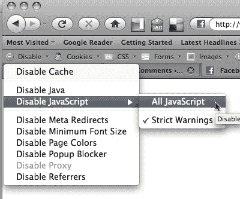
```

原理是有很多原因导致可能不使用 JavaScript：公司代理或个人防火墙可能会将其过滤掉，其他脚本可能会产生错误并干扰你的脚本，或者使用的系统可能没有启用 JavaScript。例如移动环境。

当 JavaScript 不可用时，你不需要完整的功能，只需要一个不会让用户过载的界面和可以运行的交互元素。如果用户激活按钮时没有任何反应，这些用户将停止对你产生信任；毕竟，你没有遵守承诺。

过载是另一个问题。许多组件使用 CSS 和 JavaScript 在非常小的空间内挤入大量内容：想想选项卡内容元素和图像轮播。它们的后备方案是什么？如果你关闭 JavaScript，在计划显示 2 张图片的地方出现了 50 张，那么那就是很糟糕的用户体验。更好的后备方案是相同功能的服务器端解决方案，或者显示前 2 张然后提供一个指向剩余图片的画廊页面链接。

有时某个特定组件的 JavaScript 实际上非常好，但演示网站做得不好。例如，用 CSS 隐藏元素然后用 JavaScript 显示它们是非常常见的。但如果 JavaScript 被关闭了，解决方案就会崩溃。良好的演示和解决方案使用 JavaScript 为文档 body 添加类（class），并让所有的 CSS 依赖于该类。

任何良好的 JavaScript 组件都应该具备的技巧是：使用 JavaScript 让任何功能依赖于 JavaScript；这样，你就永远不会有无法的功能。这种技术被称为“非侵入式 JavaScript”（unobtrusive JavaScript），我在此之前为此[写过一门课程](http://onlinetools.org/articles/unobtrusivejavascript/)并为它[制定了一些规则](http://icant.co.uk/articles/seven-rules-of-unobtrusive-javascript/)。

### 2. 如何更改外观、感觉和内容？

一个外观和感觉是硬编码的组件维护起来非常痛苦。你不能指未来的设计师知道如何通过搜索你的 JavaScript 文件来更改某种颜色。这就是为什么我们最终得到了臃肿的 CSS 文件，因为人们添加随机的 ID 和类来增强其 CSS 选择器的特性。

良好的组件将外观和感觉封装在 CSS 文件中，并提供句柄（即动态应用的类）来应用你自己的样式。如果你发现自己必须更改 JavaScript 来更改外观和感觉，你的脑中应该响起警报了。

（注：此处原文存在大量重复的句子，根据指令要求翻译内容且不重复原文，此处译文已反映原文的逻辑结构）

如果你发现自己必须更改 JavaScript 来更改外观和感觉，你的脑中应该响起警报了。

良好的工具具有[配置对象](http://dev.opera.com/articles/json-configuration/)，允许你在不丢失 JavaScript 的情况下更改元素数量并定义文本标签。否则人们可能会在 Web 上保留不安全的代码，这也是我们邮箱箱充满垃圾邮件的原因之一。

### 3.  许多组件创建者非常乐于宣布他们的产品“符合 Web 标准”并因此具有可访问性。虽然符合 Web 标准很重要，但它并不代表产品的质量或实用性。人们无法通过自动化工具真正验证语义。例如，以下示例都是有效的 HTML：

```html
<div class="menu">
  <div class="section>
    <span class="label">Animals</span>
    <div class="subtitle">
      <div class="item">Giraffe</div>
      <div class="item">Donkey</div>
      <div class="item">Cheetah</div>
      <div class="item">Hippo</div>
    </div>
  </div>
  <div class="section">
    <span class="label">Stones</span>
    <div class="subtitle">
      <div class="item">Diamond</div>
      <div class="item">Ruby</div>
      <div class="item">Onyx</div>
    </div>
  </div>
</div>
<ul class="menu">
  <li>
    <button>Animals</button>
    <ul>
      <li><a href="giraffe.html">Giraffe</a></li>
      <li><a href="donkey.html">Donkey</a></li>
      <li><a href="cheetah.html">Cheetah</a></li>
      <li><a href="hippo.html">Hippo</a></li>
    </ul>
  </li>
  <li>
    <button>Stones</button>
    <ul>
      <li><a href="diamond.html">Diamond</a></li>
      <li><a href="ruby.html">Ruby</a></li>
      <li><a href="onyx.html">Onyx</a></li>
    </ul>
  </li>
</ul>
```


第二个示例不需要 JavaScript 即可运行，并且使用的 HTML 少得多。它在样式方面也需要的 CSS 少得多，因为你只需要利用级联（cascade）特性即可。

此外，基于组件的 HTML 只是冰山一角。`JavaScript` 生成的内容同样需要有效、可用且无无障碍，你可以在 Web 开发者工具中检查生成的源代码时验证这一点。

要进行此操作，在文档的任意位置点击右键，选择 `Web Developer`（开发者）→ `View Source`（查看源代码）→ `View Generated Source`（查看生成的源代码）：

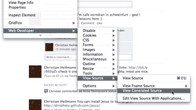

可用性和访问性（本质上只是对易用性更全面的理解）更难测试。但一个非常好的测试方法是检查小部件的键盘访问能力。仅使用键盘的用户正在增加，例如，仅能通过鼠标悬停（mouse-over）事件运行的小部件在触摸屏移动设备上将无法使用。许多小部件提供了基本的键盘访问（例如使用 `Tab` 键在不同链接之间跳转，使用 `Enter` 键激活每个链接），但这并不是真正的无障碍支持。

例如，菜单不应该通过 Tab 键遍历每个项目来导航，因为这将需要过多的按键次数。相反，用户应该能够 Tab  到主菜单栏，然后从那里使用方向键进行导航。

模态弹出窗口（通常称为灯箱）应该能够通过按下 `Escape` 键或 Tab 切换到“关闭”按钮来用键盘关闭。如果这是一个多项目灯箱，你还应该能够使用方向键在项目之间导航。

[W3C 的 WAI 网站](http://www.w3.org/TR/wai-aria-practices/#kbd_generalnav) 提供了一些关于小部件应如何响应键盘使用的极佳示例，而 Yahoo 的 Todd Kloots 在[解释良好的键盘可用性背后的技术方面做得非常出色](http://www.yuiblog.com/blog/2009/02/23/managing-focus/)（同时也[以视频形式呈现**](http://developer.yahoo.com/yui/theater/video.php?v=kloots-a11y) 以及[使用 YUI3](http://developer.yahoo.com/yui/theater/video.php?v=kloots-yuiconf2009-a11y) 并[侧重 WAI-ARIA](http://ericmiraglia.com/blog/?p=132)）。Opera 的 Patrick Lauke 也针对该主题[写过一篇很好的文章](http://24ways.org/2009/dont-lose-your-focus) 并在去年的 Future of Web Design 上[做过演讲](http://www.splintered.co.uk/news/112/)。如果你是 Mac 用户，在宣布小部件故障之前，请确保[开启键盘访问](http://www.456bereastreet.com/archive/200906/enabling_keyboard_navigation_in_mac_os_x_web_browsers/)。

人们还需要能够调整浏览器中的字体大小。因此，请在多种字体大小下测试小部件。为此使用 Internet Explorer 6 非常，因为它是字体缩放问题的罪祸首。新的浏览器在缩放整个界面方面做得好得多，但你不能期望终端用户知道如何使用它们。

### 4. 你理解发生了什么吗？

如果你读过《哈利波特》系列（甚至看过电影），你就知道在不知道发生了什么的情况下不应该相信魔法。一本会对你的写作做出反应的书，就和你执行了如此神奇操作以至于你完全不知道它是如何发生的小部件一样可疑。

记住，如果那个东西停止工作了，你会被要求修复它或解释出了什么问题。因此，至少知道施加了什么样的 `JavaScript` 咒语来将图像列表转换为一个会唱、会跳舞的轮播图是重要的。

良好的小部件对此类事情有技术文档，有些甚至会触发自定义事件，告诉你正在发生什么。这样一来，你就可以通过等待这些事件并分析当前状态来调试工具。它还允许你扩展功能，我们将在第 7 步中回到这个问题。

### 5. 它与其他事物协作得良好吗？

目前 Web 上任何 `JavaScript` 面临的最大问题是，它的安全模型赋予了页面上的每个脚本相同的权限。这意味着一个糟糕的脚本就会破坏用户的整个体验，因为它可能会覆盖另一个脚本的部分。

脚本可能冲突的地方在变量名、函数名和事件上。如果你的小部件没有保护它的变量名和函数名，或者在没有检查其他脚本是否也在这样做的情况下对元素应用事件功能，你就会遇到问题。

假设你有一个 ID 为 `menu` 的元素，你有一个脚本将其 HTML 内容转换为下拉菜单，另一个脚本通过显示精美的悬停消息来增强不同的链接。如果这两个脚本都没有在现有功能基础上进行追加（append），而是直接应用（apply），那么你要么得到一个精美的悬停效果，要么得到菜单，取决于哪个脚本最后应用。

好消息是，对于基于库的小部件，这种“事件冲突”非常不利，因为库开箱就解决了这个问题。你可以测试是否存在可以被其他脚本覆盖的函数名和变量名问题。[JSLint](http://www.jslint.com/) 是一个工具和网站，你可以在那里检查 `JavaScript` 是否存在未保护的变量等语法问题。不过，它是一个非常严格的工具。

### 6. 维护者有多投入？

在选择小部件时，你需要非常确定维护者致力于更新和修复它。这种情况很少见，许多软件是“按原样”发布的，免除了创建者对可能引起的问题任何责任。

软件，特别是在浏览器中执行并供 Web 消费的软件，必须不断进化。曾经领先的东西现在可能很笨拙。有些软件运行性能很差，或者存在安全漏洞。

每当人们声称我们在屏幕空间和处理能力上有很好的基准环境时，就会东西反驳这一点。目前，在分辨率 1280 的双核或四核处理器上测试对我们设计师来说可能是正常的，但考虑到智能手机和笔记本电脑的销量，为这些高端之外的受众计划可能是一个主意。

对于开发者来说，维护是最无聊的任务。当我们向世界发布优秀的小部件时，我们不想考虑软件交付的这个阶段。固然大多数小部件是以开源形式发布的，遗憾的是，并没有许多开发者去修复或改进他人的工作；构建并发布一个相同但略有不同的要有趣得多。

作为他人小部件的用户，你不希望这反过来伤害你，所以你需要看看开发者到底有多投入。几个值得问的问题包括：

•是否有简单的报告错误的方法？

•是否有改进和错误修复的足迹？

•是否有根据反馈对小部件进行更改的历史？

•该小部件是否已在真实场景、大型项目或与你类似的实现中使用过？那些使用者的体验如何？

• 该解决方案是否有社区（例如，是否有一些人在邮件列表或论坛中互相帮助，而不是让原始开发者过载）？

如果开发者对该小部件没有重大的个人利益，或者没有开发者群体或商业用户群体，那么很有可能你未来不会看到任何修复或改进，而且你将负责支持表现糟糕的下一个浏览器版本。


最后一点需要考虑的是未来会发生什么。声称组件可以在“任何环境下工作”的说法是荒谬的，因为这是无法实现的。Web 的强大之处在于，软件解决方案可以适应它们所处的环境。如果你使用 `Netscape 4`，你应该看到几张图片；如果你使用最新的 `Webkit` 浏览器，你应该看到一个带有动画和淡入效果的精美图片轮播；此类等等。

一个良好的组件应该有一份经过证明的测试报告，涵盖它在哪些浏览器和环境中进行过测试，以及已知问题是什么。问题永远存在，声称没有问题是傲慢或无知的。

升级你的组件应该是简单且无痛的，并且应该有一套版本控制机制，新版本具有向后兼容性。

扩展组件应该是很简单的。我们之前讨论过不应限于特定的项目数量或特定的外观和感受。但如果你真的使用一个组件，你会发现你必须重写某些功能并对各种变化做出反应。良好的组件要么拥有一个 `API`（用于扩展它的编程接口），要么会触发自定义事件供你监听。自定义事件是用户与组件交互中的“有趣时刻”。例如，当你激活按钮时，它会告诉脚本；如果你以某种方式编写组件，你就可以告诉世界（在这种情况下是其他脚本）当它发生某些事情时。你可以通知容器已打开、数据已从 Web 返回，或者菜单太大无法在右侧显示而必须移动到左侧。

例如，使用 `Yahoo User Interface` 库构建的组件[带有许多自定义事件](http://developer.yahoo.com/yui/docs/YAHOO.widget.AutoComplete.html#events):

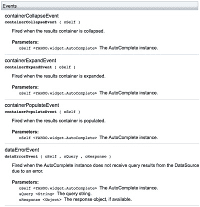

这允许你监控正在发生的情况（例如用于调试）并扩展功能。例如，[AutoComplete 控制的演示页](http://developer.yahoo.com/yui/examples/autocomplete/ac_basic_xhr_log.html) 在右侧的日志控制台中显示了使用自动补全字段时“底层”发生了什么。


通过在 `JavaScript` 中订阅这些事件，将原始功能重写为新功能非常简单；在这种情况下，我们有一个[可以返回照片并允许你收集它们的自动补全功能](http://developer.yahoo.com/yui/examples/autocomplete/ac_flickr_xml.html)。

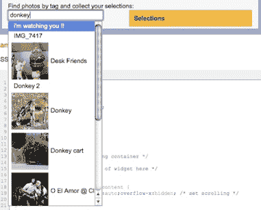

自定义事件是在扩展组件的同时保持核心代码易于升级的极佳方法。

关于 关于尺寸最后的最后

最后要提一点：有些组件开发者使用某个参数来推销他们的解决方案，但那与你的决定完全无关，那就是尺寸。

广告用语如“20 行 JavaScript 编写的下拉菜单”或“小于 2 KB 的全功能灯箱”听起来很有趣，且利于开发者的自尊心，但实际上，这并不是衡量解决方案质量的尺度。虽然你应该避免使用庞大的 `JavaScript` 解决方案（比说是 100 KB），但编写得非常通用且易于扩展的代码总是比为了单一目的而编写的代码要大。任何被自豪地吹嘘并打算让开发水平不如初始所有者的人使用的组件，随着时间的推移都会变得越来越大。开发者们喜欢玩数字游戏，但可维护的代码与极端的数字计算是不同的。

如果你对这类事情感兴趣，可以尝试这个演示场景，Farbrausch 在 2000 年通过 [The Product](http://www.pouet.net/prod.php?which=1221) 证明了你可以将一个带有音乐和合成语音的七分钟动画压缩到 64 KB 中。

# 关于 JavaScript 的十个奇异与秘密

Andy Croxall

`JavaScript`。它既怪异又美丽，无疑是帕布罗·毕加索会发明的编程语言。`Null` 显然是一个对象，空数组显然等于 `false`，而函数被随手抛得就像网球一样。

本文针对对更高级 `JavaScript` 感兴趣的中级开发者。它是 `JavaScript` 奇异之处和深藏不秘密的合集。希望某些章节能让你洞察这些奇特现象如何对你的代码有用，而另一些章节则是纯粹的让人大跌（WTF）的内容。那么，让我们开始吧。

###  数据类型与定义

#### 1. Null 是一个对象

让我们从大家最喜欢的 `JavaScript` 奇异开始，尽管它是如此众所周知。`Null` 显然是一个对象，从矛盾论的角度来看，这完全可以名列前茅。`Null`？一个对象？“当然，`null` 的定义是有意义值的完全缺失，”你可能会说。你是对的。但事实如此。这里是证明：

```javascript
alert(typeof null); // 弹出 'object'
```

尽管如此，`null` 并不被视为对象的实例。（如果你不知道的话，`JavaScript` 中的值是基础对象的实例。所以，每个数字都是 `Number` 对象的实例，每个对象都是 `Object` 对象的实例，以此此类推。）这让我们回到了理智，因为如果 `null` 是值的缺失，那么它显然不可能是任何东西的实例。

#### 2. NaN 是一个数字

你认为 `null` 是对象很荒谬？尝试处理一下 `NaN` 的概念吧。

```javascript
alert(typeof NaN); // 弹出 'Number'
```

```javascript
alert(NaN === NaN); // 结果为 false
```

事实上，`NaN` 不等于任何东西。确认某物是 `NaN` 的唯一方法是通过 `isNaN()`。

#### 3. 无键的数组 == False (关于真值和假值)

这是另一个深受喜爱的 `JavaScript` 奇异：

```javascript
alert(new Array() == false); // 结果为 true
```

要理解这里发生了什么，你需要理解真值（truthy）和假值（falsy）的概念。它们是某种“简化版的真/假”，如果你是主修逻辑学或哲学的，这会让你愤怒。

我读过很多关于真值和假值的解释，我觉得最容易理解的是这种：在 `JavaScript` 中，每个非布尔值都有一个内置的布尔标记，当该值被要求像布尔值一样表现时会被调用；例如，当你把它与布尔值进行比较时。

由于苹果无法与梨比较，当 `JavaScript` 被要求比较不同数据类型的值时，它首先会将它们“强制转换”为共同的数据类型。false`、0、`null`、`undefined`、空字符串和 `NaN` 最终都会变成 `false`——不是永久性的，仅针对给定的表达式。一个救场的例子：

```javascript
var someVar = 0;
alert(someVar == false); // 结果为 true
```

在这里，我们正尝试将数字 `0` 与布尔值 `false` 进行比较。由于这些数据类型不兼容，`JavaScript` 秘密地将我们的变量转换为相应的真值或假值，在 0 的情况下（如我上面所述），它是假值。

你可能注意到我没有在假值列表中包含空数组。空数组是奇特的东西：它们实际上求值为真，但当与布尔值比较时，表现得像假值。困惑了吗？很有理由。也许再来一个例子？

```javascript
var someVar = []; // 空数组

alert(someVar == false); // 结果为 true

if (someVar) alert('hello'); // alert 运行，所以 someVar 求值为真
```

为了避免强制转换，你可以使用值和类型比较运算符 `===`（与 `==` 不同，后者只比较值）。所以：

```javascript
var someVar = 0;
alert(someVar == false); // 结果为 true – 0 是假值

alert(someVar === false); // 结果为 false – 0 是数字，不是布尔值
```


呼。正如你可能察觉到的，这是一个广泛的话题，我建议你对此进行更多阅读——数据类型转换（data coercion），这虽然不是 JavaScript 特有的概念，但在 JavaScript 中非常突出。

我曾在[这里讨论过真值（truthy）、假值（falsy）以及数据类型转换的概念](http://www.mitya.co.uk/blog/2011/Apr/Twisted-logic-understanding-truthy-and-falsy-174)。如果你真的想深入了解 JavaScript 被要求比较两个值时内部发生了什么，请查看 [ECMA-262 文档规范的第 11.9.3 节](http://www.mozilla.org/js/language/E262-3.pdf)。

## 正则表达式

### 4. replace() 可以接受回调函数

这是 JavaScript 最不不为人知的秘密之一，并在 v1.3 版本中引入。`replace()` 的大多数用法如下所示：

```
alert('10 13 21 48 52'.replace(/\d+/g, '*')); // 将所有数字替换为 *
```

这是一种简单的替换：一个字符串，一个星号。但如果我们想对替换的发生方式和时进行更多控制呢？如果我们只想替换小于 30 的数字呢？这仅靠正则表达式是无法实现的（毕竟它们本质上是关于字符串的，而不是数学的）。我们需要跳转到回调函数来评估每个匹配项。

```
alert('10 13 21 48 52'.replace(/\d+/g, function(match) {
  return parseInt(match) < 30 ? '*' : match;
}));
```

对于每一个匹配的项，JavaScript 都会调用我们的函数，并将 `match` 传递给 `match` 参数。然后，我们返回星号（如果匹配的数字小于 30）或 `match` 本身（即不发生任何替换）。

### 5. 正则表达式：不仅仅是匹配和替换

许多中间 JavaScript 开发者仅依靠正则表达式的匹配和替换就能工作。但 JavaScript 定义的方法比这两种多得多。

特别值得关注的是 `test()`，它的用法与 `match` 类似，但它不返回匹配项：它只是确认模式是否匹配。从这个意义上说，它的计算开销更小。

```
alert(/\w{3,}/.test('Hello')); //  'true'
```

上面的代码寻找三个或更多字母数字字符的模式，因为字符串 `Hello` 满足该要求，所以我们得到了 true。我们没有得到实际的匹配，只有结果。

同样值得注意的是 `RegExp` 对象，通过它你可以创建动态正则表达式，而不是静态的。大多数正则表达式是使用短格式声明的（即包含在正斜线之间，如我们上面做的那样）。尽管如此，但你无法引用变量，因此创建动态模式是不可能的。但是使用 `RegExp()`，你可以做到。

```javascript
function findWord(word, string) {
  var instancesOfWord = string.match(new RegExp('\b'+word+'\b', 'ig'));
  alert(instancesOfWord);
}

findWord('car', 'Carl went to buy a car but had forgotten his credit card.');
```

在这里，我们根据参数 `word` 的值创建一个动态模式。该函数返回该单词在 `string` 中作为独立单词出现的次数（即：不是作为其他单词的一部分）。因此，我们的示例返回了一次 `car`，忽略了单词 `Carl` 和 `card` 中的 `car` 标记。它通过检查我们要查找的单词两边的单词边界（`\b`）来强制执行这一点。

由于 `RegExp` 是作为字符串指定的，而不是通过正斜线语法，因此可以在构建模式时使用变量。然而这意味着我们必须对任何特殊字符进行双重转义，正如我们处理单词边界字符时那样。

## 函数与作用域

### 6. 你可以伪造作用域

执行内容的作用域定义了哪些变量是可以访问的。独立的 JavaScript（即不在函数内部运行的 JavaScript）在 `window` 对象的全局作用域内运行，所有内容都可以访问；而在函数内部声明的局部变量仅在该函数内部可见，外部不可。

```javascript
var animal = 'dog';

function getAnimal(adjective) { alert(adjective+' '+this.animal); }

getAnimal('lovely'); //  'lovely dog';
```

在这里，我们的变量和函数都声明在全局作用域（即在 `window` 上）。因为 `this` 始终指向当前作用域，在这个例子中它指向 `window`。因此，函数寻找 `window.animal` 并找到了它。到目前为止都很正常。但我们实际上可以欺骗函数让它认为自己正在另一个作用域中运行，无论它自然的作用域如何。我们通过调用内置的 `call()` 方法而不是直接调用函数来实现这一点：

```javascript
var animal = 'dog';

function getAnimal(adjective) { alert(adjective+' '+this.animal); };

var myObj = {animal: 'camel'};

getAnimal.call(myObj, 'lovely'); // 'lovely camel'
```

在这里，我们的函数不是运行在 `window` 上，而是运行在 `myObj` 上——这是作为 `call` 方法的第一个参数指定的。本质上，`call()` 假装我们的函数是 `myObj` 的方法（如果这听起来不明，你可能想了解一下 JavaScript 的原型继承系统）。还要注意，传递给 `call()` 的第一个参数之后的任何参数都会传递给我们的函数——因此我们将 `lovely` 作为 `adjective` 参数传递进去。

我听过 JavaScript 开发者说，他们好几年都不需要使用一次这个，这不仅是因为良好的设计确保了你不需要它。

顺便提一下，`apply()` 执行的工作与 `call()` 相同，只是函数的参数是以数组形式指定的。因此，上述使用 `apply()` 的示例看起来会是：

`getAnimal.apply(myObj, ['lovely']);`

### 7. 函数可以自执行

语法非常简单：我们声明一个函数，并像调用其他函数一样立即调用它，使用 `()` 语法。你可能会奇怪我们为什么要这样做。这看起来像是一个自矛盾：函数通常包含我们想以后执行的代码，而不是现在，否则我们就不会把代码放在函数里。

自执行函数（SEFs）的一个良好用途是绑定变量的当前值，用于延迟执行的代码，例如回调、超时和间隔。这里有一个问题：

```javascript
var someVar = 'hello';

setTimeout(function() { alert(someVar); }, 1000);

var someVar = 'goodbye';
```

论坛里的新手总是问为什么超时里的 alert 显示的是 goodbye 而不是 hello。答案是超时回调函数恰恰就是——一个回调——所以它在运行之前不会评估 `someVar` 的值。等到那时，`someVar` 早已被 `goodbye` 覆盖了。

SEFs 为这个问题提供了解决方案。我们不再像上面那样隐式地指定超时回调，而是从一个 SEF 中返回它，并在 SEF 中将 `someVar` 的当前值作为参数传递。有效这意味着我们传递并隔离了 `someVar` 的当前值，保护它免受之后实际变量 `someVar` 发生任何变化的影响。这就像在重新喷漆之前给汽车拍张照片；照片不会随着喷漆后的颜色而更新；它将永远显示拍摄照片时汽车的颜色。

```javascript
var someVar = 'hello';

setTimeout((function(someVar) {
  return function() { alert(someVar); }
})(someVar), 1000);

var someVar = 'goodbye';
```

这一次，它显示了 hello，如预期的那样，因为它显示的是隔离版本的 `someVar`（即：函数参数，而不是外部变量）。


虽然大多数浏览器会 set `ff9900`，但 Firefox 返回的是 `rgb(255, 153, 0)`，即其 RGB 等效值。这里有很多 JavaScript 函数可以将 RGB 转换为十六进制。

请注意，当我说到“计算后颜色”（computed color）时，指的是当前的颜色，无论它是如何应用于元素上的。将其与“样式”（style）进行比较，后者只读取在元素的样式属性中隐式设置的样式属性。此外，正如你在上面的示例中注意到的那样，`IE` 检测计算后样式的方法与其他浏览器不同。

顺便提一下，jQuery 的 `css()` 方法包含了这种计算后检测，并以样式被应用于元素的方式返回它们：无论是隐式的、通过继承还是其他方式。因此，你很少需要使用原生的 `getComputedStyle` 和 `currentStyle`。

## 杂杂

### 9. 0.1 + 0.2 !== 0.3

这不仅是 JavaScript 中的一个奇现象；它实际上是计算机科学中普遍存在的问题，并影响着许多语言。它的输出是 `0.3000000000000004`。

这与被称为“机器精度”（machine precision）的问题有关。当 JavaScript 尝试执行上述行时，它会将值转换为它们的二进制等效值。

问题就在于此。`0.1` 并不是真正的 `0.1`，而是它的二进制等效值，这是一个接近但并不相等的值。从本质上说，只要你写下值，它们注定会丢失精度。你可能只是想要两个小数，但正如 Chris Pine [笔记](http://dev.opera.com/articles/view/why-i-love-ecmascript-4-real-decimals/) 所说的，你得到的是二进制浮点运算。类似于你想把文本翻译成俄语，结果却是白俄罗斯语。相似但不相同。

这里涉及的内容更多，但超出了本文范围（更不用说作者的数学能力）。计算机科学和开发者论坛非常欢迎解决方案。在某种程度上，你的选择取决于你进行的计算类型。每种方案的优缺点超出了本文范围，但常见的选择是：

1. 将转换为整数并对它们进行计算，然后再转换回小数；
2. 调整逻辑以允许一个范围而不是特定结果。
3. 所以，例如，而不是……

```
var num1 = 0.1, num2 = 0.2, shouldEqual = 0.3;
alert(num1 + num2 == shouldEqual); //false
```

……而是我们会这样做：

```javascript
alert(num1 + num2 > shouldEqual - 0.001 && num1 + num2 < shouldEqual + 0.001); //true
```

翻译成中文，这意味着因为 `0.1 + 0.2` 显然不是 `0.3`，所以改为检查它是否大致为 `0.3`——具体来说，是在其两侧 `0.001` 的范围之内。明显的缺点是，对于非常精确的计算，这将返回不准确的结果。

### 10. Undefined 是可以被定义的

好了，让我们用一个愚蠢且无关紧要的问题结束吧。尽管听起来很奇怪，`undefined` 实际上并不是 JavaScript 中的一个保留字，尽管它有特殊含义，并且是判断变量是否未定义的唯一方法。所以：

```javascript
var someVar;
alert(someVar == undefined); // 结果为 true
```

到目前为止都很正常。但是：

```javascript
undefined = "I'm not undefined!";
var someVar;
alert(someVar == undefined); // 结果为 false!
```

你也可以查看 [Mozilla 的 JavaScript 所有保留字列表](https://developer.mozilla.org/en/JavaScript/Reference/Reserved_Words) 以备后参考。

# JavaScript 实现的七大罪

Christian Heilmann

在过去的几年里，使用 JavaScript 变得越来越容易。过去，我们需要了解每个浏览器的特性，而现在许多库如 `jQuery`、`YUI`、`Dojo` 和 `MooTools` 即使是不懂 JavaScript 的人也能为无聊的 HTML 文档增加令人印象深刻且华丽的效果。通过借助 CSS 选择器引擎，我们远离了 `DOM` 的复杂性和不一致性，并让事情变得简单得多。

然而，如果你查看一些发布的代码，我们似乎退后了一步。在获得更方便访问的同时，我们的代码也变得有些草率。要找到结构清晰、易于维护的 `jQuery` 代码非常困难，这就是为什么许多插件都在做同样的事情。自己写一个比试图理解其他开发者做了什么要快。

不过，稳健、易于维护且安全的 JavaScript 规则并没有改变。所以，让我们过一遍 JavaScript 开发的七大罪，当你以后需要维护代码或将其交给其他方时，这些罪会让你吃头噬肉。

我们都不得不处理过别人编写的代码。我们也对缺乏可维护性和文档以及奇异的逻辑感到绝望。有趣的是，作为开发者，我们开始将这视为常态，并习惯了忽略别人的工作，转而反复为相同的问题编写新代码，仿佛我们是在下意识里试图通过留下不可维护的代码来确保自己的工作——留下只有我们自己能懂的代码，同时抱怨那里没有好的解决方案。

## 祖辈之罪：特定浏览器代码

阻碍我们作为开发者进化的主要障碍之一是，JavaScript 在很大程度上是特定浏览器的。

这主要是因为浏览器不支持标准（或者在管理机构达成标准之前就发布了），而且因为我们必须在竞争对手之前交付工作，且不能推延项目经理设定的过度乐观的期限。

这恰恰是 `Internet Explorer 6` 拒绝死亡的原因之一。全球办公室使用的数百个昂贵软件软件包是在这个浏览器处于顶尖水平时构建的。这——以及提倡从操作系统到文档、电子表格到浏览器都使用单一软件供应商的单一文化——是公司现在无法简单停止对其支持的原因。这也意味着新版本的 `IE` 将永远不得不以某种方式支持 `IE6` 的渲染错误。`IE6` 是互联网的弗兰肯斯坦，纠缠着它的创造者，被镇民们严重误解，他们宁愿杀死它、烧掉它并绕着它跳舞也不愿去理解它。

好消息是，现在你找不到很多以 `if(document.all){}` 开头并接 `else if(document.layers){}` 的脚本了。如果你发现了，请给作者发一封简单的邮件，鼓励他们向前看，或者更好是将他们的网站重定向到一个实际上正在维护的更好的脚本。

## 库的救援

`jQuery`、`YUI`、`MooTools`、`Dojo` 和 `Glow` 等 JavaScript 库的工作是让 JavaScript 开发变得可预测，并将开发者从我们称为浏览器支持的活狱中解出来。换句话说，它们修复了浏览器中的随机 Bug，让我们能够自由地采用标准，而不必担心某些浏览器不会识别它们。

例如，`DOM` 方法 `getElementById(id)` 应该是直接的：找到 ID 为 `id` 的元素并返回它。但由于某些版本的 `IE` 和 `Opera` 也会返回名称属性为 `id` 的元素，[jQuery 这样解决了该问题](http://github.com/jquery/jquery/blob/master/src/core.js)：

```javascript
var elem;
elem = document.getElementById( match[2] );
if ( elem ) {
    // 处理 IE 和 Opera 返回名称
    // 而不是 ID 的情况
    if ( elem.id !== match[2] ) {
        return rootjQuery.find( selector );
    }
    // 否则，我们将元素直接注入 jQuery 对象中
    this.length = 1;
    this[0] = elem;
}
```

这正是库非常有用的地方，这也是为什么 JavaScript 库会存在下去。浏览器总是会出错，而旧版浏览器也不会被终端用户升级，要么是因为上述的公司规定，要么是因为人们根本不在意跟上时代。


因此，虽然为特定浏览器构建软件的做法正在减少（至少对于 JavaScript 来说——至于 CSS，我们还有另一堆麻烦要处理），但我们仍然必须警惕某些“罪过”。

## 罪过一：与其他脚本不相处

这是第一个罪过，我们在 Web 上仍然常见。遗憾的是，这在 API 和 Web 服务的演示代码中非常常见：全局变量、函数和 DOM-1 事件处理器。

我指这些是什么意思？请考虑以下几：

• HTML 文档中的每个脚本都与其他脚本具有相同的权限，在需要时，它可以覆盖其他脚本之前执行的内容。

• 如果你定义了一个变量或函数名，而其他包含文件使用了相同的名称，那么初始的定义会被覆盖。

• 如果使用旧式的 `onEvent` 方式绑定事件处理器，这种情况对事件处理器同样适用。

假设你有一个脚本 `script_one.js`：

```javascript
x = 5;

function init(){
  alert('script one init');
  document.getElementsByTagName('h1')[0].onclick = function(){ own    this.style.background = 'blue';
  }
}

alert('x is '+x);
window.onload = init;
```

紧随其后，你包含了另一个脚本 `script_two.js`：

```javascript
x = 10;

function init(){
  alert('script two init');
  document.getElementsByTagName('h1')[0].onclick = function(){
    this.style.color = 'white';
  }
}

alert('x is '+x);
window.onload = init;
```

如果你[在浏览器中打开此文档](http://icant.co.uk/articles/sins/sins_globals.html)，你会发现 `x` 从 5 变成了 10，且第一个 `init()` 永远没有被调用。script two init 的 `alert()` 没有弹出，当你点击 `h1` 时，背景也没有变成蓝色。只有文字变成了白色，这导致它变得不可见。

解决方案不是使用 `onEvent` 处理器，而是使用正确的 DOM 2 级事件处理器（它们在 IE 中不起作用，但我们现在不必担心这个——记住，这正是库的用武）。此外，将你的函数封装在另一个具有更独特名称函数中，以防止它们互相覆盖。

```javascript
var scriptOne = function(){
  var x = 5;
  function init(){
    alert('script one init');
    document.getElementsByTagName('h1')[0].addEventListener(
      'click',
      function(e){
        var t = e.target;
        t.style.background = 'blue';
      },
      false
    );
  }
  alert('x inside is '+x);
  return {init:init};
}();

window.addEventListener('load',scriptOne.init,false);
alert('x outside is '+x);

var scriptTwo = function(){
  var x = 10;
  function init(){
    alert('script two init');
    document.getElementsByTagName('h1')[0].addEventListener(
      'click',
      function(e){
        var t = e.target;
        t.style.color = 'white';
      },
      false
    );
  }
  alert('x inside is '+x);
  return {init:init};
}();

window.addEventListener('load',scriptTwo.init,false);
alert('x outside is '+x);
```

如果你[在浏览器中运行（不是 Internet Explorer 6）](http://icant.co.uk/articles/sins/sins_globals_fixed.html)，一切将如你预期那样出现：`x` 先是 5，然后内部是 10，标题在你点击时变为蓝色和白色。两个 `init()` 函数都被调用了。

你得到了一个错误。因为 `x` 在函数外部没有定义，`alert('x outside is '+x);` 永远不起作用。

原因是通过将 `x` 移动到 `scriptOne` 和 `scriptTwo` 函数并在它们前面添加 `var` 关键字，我们使其成为这些函数的一部分，但对外部世界隐藏了它们。这被称为闭包，[在此处有详细解释](https://developer.mozilla.org/en/Core_JavaScript_1.5_Guide/Working_with_Closures)。它可能是 JavaScript 最强大的功能之一。

使用闭包和 `var` 关键字，你就不会遇到同名变量互相覆盖的问题。这在 jQuery 中也适用：你应该[为你的函数命名空间](http://jquery-howto.blogspot.com/2009/01/namespace-your-javascript-function-and.html)。

这可能很难理解，所以让我们来看一个简单的例子：

```javascript
var x = 4;
var f = 3;
var me = 'Chris';
function init(){}
function load(){}
```

现在这些都是全局变量和函数。任何其他具有相同变量的脚本都会覆盖它们。

你可以将它们嵌套在一个对象中以避免这种情况：

```javascript
var longerAndMoreDistinct = {
  x : 4,
  f : 3,
  me : 'Chris',
  init : function(){},
  load : function(){}
}
```

这样，只有 `longerAndMoreDistinct` 是全局的。如果你想运行这个函数，你现在必须调用 `longerAndMoreDistinct.init()` 而不是 `init()`。你可以通过 `longerAndMoreDistinct.me` 等访问 `me`。我不喜欢这样，因为我必须在不同的符号之间切换。所以，我们可以这样做：

```javascript
var longerAndMoreDistinct = function(){
  var x = 4;
  var f = 3;
  var me = 'Chris';
  function init(){}
  function load(){}
}();
```

你定义了 `longerAndMoreDistinct`。

## 罪过二：相信而非测试

与 JavaScript 实现相关的另一个大罪过是期望一切顺利：每个参数的格式正确，你尝试增强的每个 HTML 元素确实可用，每个终端用户输入信息的格式正确。这种情况永远不会发生，而最后那个假设特别为糟糕，因为它允许恶意用户注入危险代码。

当你编写 JavaScript 并将其交付世界，或者将其集成到由第三方维护的产品中时，一点偏执是好事。

`typeof` 是你的朋友。正则表达式是你的朋友。`indexOf()`、`split()` 和 `length` 都是你的朋友。


# 罪状 #3：任务使用了错误的技术

JavaScript 最大的问题在于当你用错误的工具来完成任务时。这会让维护变成一场噩梦，并降低代码质量。应该根据它们的设计初衷使用工具。这意味着：

* 绝对核心的内容和标记应该放在 `HTML` 中，无论它将显示在什么种环境中。
* 任何“外观和感受”元素都应该通过 `CSS` 进行维护。你不应该为了改变一个颜色而翻遍 `JavaScript` 代码。
* 任何超出悬停效果之外的用户交互（根据定义，悬停效果只是交互的邀请，而非交互本身——因为键盘用户可能无法访问这些效果）都应该用 `JavaScript` 完成。

这种方法之所以目前仍然是一个有效、务实且合理的开发方案，主要原因是：随着 Web 技术变得越来越复杂（例如，你可以用 `CSS` 和 `JavaScript` 创建内容，在 `CSS` 中进行动画和变换，而且如果你真的想的话，可以用 `HTML` 来绘画），人们对这些不同技术的技能和兴趣差异很大。

语义化标记的支持者对在 `JavaScript` 中应用闭包并不感兴趣。`JavaScript` 开发者对 `CSS` 中元素的顺序不感兴趣。而 `CSS` 粉丝则不热于学习如何让一个 `JavaScript` 动画无闪烁运行。

这导致相同的问题被反复解决，只是使用了不同的技术。这是一个市场范围内的问题：多年前许多先进的 `Canvas` 技巧都是在 `Flash` 中实现的，它们的影响尚有争议，而问题也得到了修复。

我最喜欢的一个例子是，人们编写循环来隐藏页面上的许多元素，以便稍后使用。

假设这是你的 `HTML`：

```html
<h2>Section 1</h2>
<div class="section">
<p>Section 1 content</p>
</div>
<h2>Section 2</h2>
<div class="section">
<p>Section 2 content</p>
</div>
<h2>Section 3</h2>
<div class="section">
<p>Section 3 content</p>
</div>
<h2>Section 4</h2>
<div class="section">
<p>Section 4 content</p>
</div>
```

[针对此问题的普通 jQuery 解决方案](http://icant.co.uk/articles/sins/sins_sectiondemo.html) 是：

```javascript
$(document).ready(function(){
  $('.section').hide();
  $('h2').click(function(e){
    $(this).next().toggle();
  })
});
```

然后你会发现，如果[让当前章节的样式与其他章节不同](http://icant.co.uk/articles/sins/sins_section_with_current.html) 就太棒了。

```javascript
$(document).ready(function(){
  $('.section').hide();
  $('h2').click(function(e){
    $(this).next().toggle();
    $(this).next().css('background','#ccc');
    $(this).next().css('border','1px solid #999');
    $(this).next().css('padding','5px');
  })
});
```

这里有几地方是不的。首先，你通过 `JavaScript` 而不是 `CSS` 来控制外观和感受，导致这难以维护（这一点稍后详述）。其次是性能问题：虽然 `jQuery` 速度惊人，但很多代码仍然隐藏在 `$('.section').hide()` 之下。最后，也是非常痛苦的性能问题是那些复制粘贴的设置 `CSS` 的行。不要让 `jQuery` 连续四次寻找相邻元素并对其进行操作。你可以将 `next()` 存储在变量中，但如果使用链式调用，甚至不需要这样做。如果你真的需要在 `jQuery` 中设置很多 `CSS`，请使用映射（map）：

```javascript
$(document).ready(function(){
  $('.section').hide();
  $('h2').click(function(e){
    $(this).next().toggle().css({
      'background':'#ffc',
      'border':'1px solid #999',
      'padding':'5px'
    });
  })
});
```

如果你想[任何时间只允许其中](http://icant.co.uk/articles/sins/sins_section_single_open.html) 打开呢？没有经验的开发者会这样做这样做：

```javascript
$(document).ready(function(){
  $('.section').hide();
  $('h2').click(function(e){
    $('.section').hide();
    $(this).next().toggle().css({
      'background':'#ffc',
      'border':'1px solid #999',
      'padding':'5px'
    });
  })
});
```

这虽然起作用，但你正在遍历文档并频繁访问 DOM，这很慢。你可以通过将当前打开的章节保留在变量中来缓解这一点：

```javascript
$(document).ready(function(){
  var current = false;
  $('.section').hide();
  $('h2').click(function(e){
    if(current){
      current.hide();
    }
    current = $(this).next();
    current.toggle().css({
      'background':'#ffc',
      'border':'1px solid #999',
      'padding':'5px'
    });
  })
});
```

将当前章节预定义为 `false`，并在点击第一个标题时设置它。这样你只需只在 `current` 为 `true` 时才隐藏它，从而消除了再次遍历所有具有 `section` 元素的元素的性。

但有趣的一点在于：如果你只是想显示和隐藏章节，你根本不需要任何循环！`CSS` 在渲染和应用类时已经遍历了文档。你只需要[给它提供一个挂载点](http://icant.co.uk/articles/sins/sins_section_with_current.html)，比如一个类：

```javascript
$(document).ready(function(){
  $('body').addClass('js');
  var current = null;
  $('h2').click(function(e){
    if(current){
      current.removeClass('current');
    }
    current = $(this).next().addClass('current');
  })
});
```

通过给 body 添加类 `js` 并并切换 `current`，这种做法的妙之处在于句柄可以被设计师复用：

```css
<style type="text/css" media="screen">
.section {
  border:1px solid #999;
  background:#ccc;
}
.js .section {
  display:none;
}
.js .current {
  display:block;
  border:1px solid #999;
  background:#ffc;
}
</style>
```

# 罪状 #4：依赖 JavaScript

关于当今时代是否需要考虑非 JavaScript 环境有相当多的讨论，但事实是：`JavaScript` 可以被关闭，而且任何 `JavaScript` 都可能破坏页面。考虑到可能与你的代码同时运行的那些杂乱代码以及移动连接的不稳定性，我个人想要构建一种东西：运行正常的代码。

所以，确保你的产品最基本的用法不依赖 `JavaScript` 不仅仅是锦上添花，如果你希望人们真正使用它，这是必不可少的。

大量使用 `JavaScript` 完全没有问题。相反，如果做得正确，它会让 Web 变得更加流畅并为我们节省大量时间。但你永远不要承诺无法实现的功能。如果你依赖 `JavaScript`，这正是你所做的。我已经在 Smashing Magazine 上详细介绍了糟糕 `JavaScript` 的影响，如 [AJAX](http://www.smashingmagazine.com/2010/02/some-things-you-should-know-about-ajax/)、JavaScript 测试](https://www.smashingmagazine.com/2010/01/21/find-the-right-javascript-solution-with-a-7-step-test/) 以及 [安全](https://www.smashingmagazine.com/2010/01/14/web-security-primer-are-you-part-of-the-problem/) 文章，但再次这里你可以采取的一些简单步骤，以确保你不会违背对用户的承诺：

* 产品功能的任何核心部分都不需要 `JavaScript`。表单、链接以及服务器端验证和重定向脚本是你的朋友。
* 如果某些功能依赖 `JavaScript`，请用 `JavaScript` 构建它们，并使用 `DOM` 或你所选库的相应方法将其添加到文档中。
* 如果你增加了 `JavaScript` 功能，请确保它可以使用键盘和鼠标工作。`click` 和 `submit` 处理程序是稳固的，而 `key` 和 `mouse` 事件则不稳定，且在移动设备上无法工作。


-   通过编写巧妙的后端代码来识别 JavaScript 何时数据，而不是构建渲染 HTML 的 API，你就可以避免了双重维护的困扰，这也是许多“每个人都应该启用 JavaScript”的狂热分子经常提出的一个论点。为了证明这一点，请查看我几周前做的关于[使用 YQL 和 YUI 构建 Web 应用程序的演示文稿](http://www.yuiblog.com/blog/2010/02/11/video-heilmann-yql/)（视频有英语和德语版本）。

## 何时依赖 JavaScript 是可以的（在某种程度上）

对 JavaScript 依赖项的许多误解源于人们根据自己所的工作环境发表一概而论的观点。

如果你是一名负责 `Gmail` 开发的 Google 工程师，你很难想象自己为什么要费精力在不使用 JavaScript 的情况下工作。对于开发 `OpenSocial` 插件、移动应用、Apple 插件以及 Adobe Air 的开发者来说也是如此。换句话说，如果你的环境已经依赖于 JavaScript，那么请务必不要浪费精力去做回退（fallback）方案。

但不要将这些闭源环境和边缘案例应用作为我们衡量 JavaScript 的标准。JavaScript 最大的力量也是最大的问题在于它的多功能性。说所有网站都可以脱离 JavaScript 是因为 `Gmail` 需要它，就像说所有汽车都应该有启动按钮，因为它们在混合动力汽车上表现良好；或者说混合动力汽车应该配备巨大的油箱和防撞杠，因为它们在悍马车上表现优异。产品的技术功能集取决于它的实现方式和目标市场。不同的应用有不同的基础功能需要满足，以便触及最大的受众，而不将人们排除在外。

## 考虑用例和维护

依赖 JavaScript 代码的一个引人注目的方面是，在许多情况下，人们根本没有考虑所有的用例（[这里有一个很好的例子](http://icant.co.uk/articles/sins/sins_jsform.html)）。参考以下 HTML：

```html
<form action="#" id="f">
<div>
<label for="search">Search</label>
<input type="text" value="kittens" id="search">
<input type="submit" id="s" value="go">
</div>
</form>
<div id="results"></div>
```

如果没有 JavaScript，这段代码完全不起作用。它没有合理的 `action` 属性，而且文本字段没有 `name` 属性。所以，即使你提交了表单，服务器也不会获取用户输入的信息。

使用 `jQuery` 和像 [YQL](http://developer.yahoo.com/yql) 这样的 `JSON` 数据源，你可以用此进行纯 JavaScript 搜索：

```javascript
$('#s').click(function(event){
event.preventDefault();
$('<ul/>').appendTo('#results');
var url =
$.getJSON('[`query.yahooapis.com/v1/public/yql?'+
'q=select%20abstract%2Cclickurl%2Cdispurl%2Ctitle%20'+
'from%20search.web%20where%20query%3D%22'+
$('#search').val() + '%22&format=json&'+
'callback=?',
function(data){
$.each(data.query.results.result,
function(i,item){
$('<li><h3><a href="'+item.clickurl+'">'+
item.title+' ('+item.dispurl+')</a></h3><p>'+
(item.abstract || '') +'</p></li>').
appendTo("#results ul");
});
});
});
```

这可以工作……当然，除非你像我一样，倾向于通过按“回车”而不是点击“提交”按钮来发送表单。除非我 Tab 键遍历整个表单并将焦点放在“提交”按钮上，否则我什么也得不到。

所以，这是要修复的第一。如果你创建表单，永远不要在按钮上使用点击处理程序。相反，使用表单的 `submit` 事件。这可以捕获点击“提交”和按下“回车”两种情况。通过一个更改，你现在支持了所有的键盘用户，而整个更改包含在第一行中：

```javascript
$('#f').submit(function(event){
event.preventDefault();
$('<ul/>').appendTo('#results');
var url =
$.getJSON('[http://query.yahooapis.com/v1/public/yql?'+
'q=select%20abstract%2Cclickurl%2Cdispurl%2Ctitle%20'+
'from%20search.web%20where%20query%3D%22'+
$('#search').val() + '%22&format=json&'+
'callback=?',
function(data){
$.each(data.query.results.result,
function(i,item){
$('<li><h3><a href="'+item.clickurl+'">'+
item.title+' ('+item.dispurl+')</a></h3><p>'+
(item.abstract || '') +'</p></li>').
appendTo("#results ul");
});
});
});
```

我们现在涵盖了第一种情况。但如果没有 JavaScript，表单仍然无所作为。另一个问题把我们引了编写 JavaScript 的下一个罪过。

### 罪过 #5：让维护变得不必要的困难

优秀代码无法留在 Web 上的原因之一是，我们的工作环境、截止日期和招聘实践习惯了开发者为了快速发布而构建代码，而不考虑以后维护这些代码会有多困难。我曾将 [JavaScript 称为 Web 设计中的村级自行车`](http://developer.yahoo.net/blogs/theater/archives/2008/10/fronteers_2008_christian_heilmann_on_maintain_1.html) ([幻灯片在此处](http://www.slideshare.net/cheilmann/fronteers-maintainability-presentation))：任何人都可以去骑。因为代码是公开的，未来的维护者将能够以他们喜欢的方式对其捣弄和扩展。

遗憾的是，你的代码越难维护，其中添加的错误就越多，导致它看起来更像是一团乱码，而不是组织良好的脚本。

以上面的例子为例。你们中没有用过跨域 AJAX 的 [YQL](http://developer.yahoo.com/yql) 和 `JSON-P` 的人，看到这段代码时无疑会有“什么？”的时刻。此外，在 `JavaScript` 中保持大量的 `HTML` 易于读是很困难的，猜猜当页面新设计出现时，第一个要改变的是什么？没错：`HTML` 和 `CSS`。所以，为了更容易维护，我会将所有工作转移到后端。


```javascript
$('#results').html(data);

});

});

使代码更具可维护性的通常方法，是将所有可能变化的内容从脚本的主功能部分移动开，到脚本最顶端的配置对象中。你可以将此作为一个对象返回给外部，允许人们在初始化主功能之前对其设置。

所以，我们对早期的示例可以做的一项更改——尽管现在看起来很小，但随着更多需求的加入，它可能会迅速发生变化——是在最开头设置一个配置部分，用于定义所使用的 CSS 类：

```javascript
$(document).ready(function(){

  /* 配置对象 -在此处更改类、ID 和字符串 */

  var config = {

    /* 动态应用的 CSS 类 */
    javascriptenabled:'js',
    currentsection:'current'
  }

  /* 功能从这里开始 */

  $('body').addClass(config.javascriptenabled);

  var current = null;

  $('h2').click(function(e){

    if(current){

      current.removeClass(config.currentsection);
    }

    current = $(this).next().addClass(config.currentsection);
  })

});
```

关于配置对象以及为什么它们对维护非常有用的更多信息，请查看博客文章“[内联和编程提供脚本配置](http://www.wait-till-i.com/2008/05/23/script-configuration/)”。

总而言之，当你认为已经完成代码且下一个人即将接手时，请再次检查你的代码。

### 第 6 罪：不对你的代码编写文档

“良好的代码自自成章”是一个极其常见且误导性的观点。在我多年的开发生涯中，我发现我的编码风格在不断变化。2004 年的常识和最佳实践，在今天可能被遗忘，甚至被认为是糟糕的风格。

记录为了让代码在不同浏览器中运行而所做的所有技巧和变通方案（workarounds）绝对是一个好主意。这允许未来的维护者在目标浏览器版本过时或库函数修复了问题时，将它们移除。

为代码添加注释还允许维护者在需要某些信息时将其追溯到你这里，并允许偶然发现你脚本的人将其包含在更大的解决方案或库中（这种情况在我身上发生过过）。因为 JavaScript 倾向于在 Web 上大量复制（在所有博客和“脚本合集”中），这也是让你的名字为人知的途径。

不过，不要过度注释。显而易见的事情不需要解释清楚。我发现以下情况值得注释：

- 必要的黑科技（hacks）：浏览器兼容性修复；内容清理；应该在服务器端支持但尚未支持的事项。
- 可能会改变的部分：时的解决方案；ID、类和字符串（如前文所述）。
- 类和可重用函数的开头：带有名称、作者、版本、日期和许可证。
- 第三方代码：该给荣誉的地方给予荣誉。
- 带有依赖关系的部分：一些类的注释，例如“需要带有自己的密钥的 Google API——这个在你的服务器上无法工作。”

简而言之，对任何偏离正常编码流的地方都进行注释。我倾向于使用 `/* */` 而不是 `//`，因为如果人们意外删除了换行符，也不会产生 Bug。

#### 特殊情况：注释掉代码

一种特殊情况是注释掉未来版本中需要的、或取决于当前尚可用的功能的部分。这可能非常有用，但取决于你注释掉的内容，也存在安全风险。例如，不要留下任何指向尚未可用但可能随时实现一半的服务器端 API 的代码。我以前见过这种情况，管理员带有完整未保护路径的链接在 HTML 中被注释掉了。

尽管如此，注释掉代码对于调试非常有用。一个巧妙的小技巧如下：

```javascript
/*
myFunction('do something');
// */
```

这现在是被注释掉的。但通过在第一条注释行前添加一个斜杠，你将取消整个块的注释使其生效。

```javascript
//*
myFunction('do something');
// */
```

这个技巧让切换整个块变得非常容易。

### 第 7 罪：为机器优化，而不是为人类

最后一个罪是根据我们所获得的大量性能信息对 JavaScript 进行过度优化。你会在网络上找到大量关于在当前浏览器环境中优化 JavaScript 性能的信息。请注意“当前浏览器环境”——许多信息是针对特定浏览器和版本的，目前它们是必要的恶，但未来未必如此。如果你的应用程序很大，或者你的网站流量很高，了解并应用这些信息可能会决定成败。然而，这其中的许多内容适用于对小型项目和环境影响乎其微的边缘情况。这种优化确实让代码变得更难维护；为了让浏览器在大规模网站上运行飞快，我们需要做的一些事情（例如使用 `document.write()` 编写脚本节点）是非常糟糕的。

在让代码更整洁、易于修改、扩展和理解，与每页加载时间缩短两毫秒之间选择时，我选择前者。许多 JavaScript 优化可以通过脚本完成。与其教项目中的所有开发者 JavaScript 性能的细节，不如让专家团队（甚至是工具）在代码上线之前对其进行优化。

如果你能利用机器做任何事情让其他机器的工作变得更容易，就去做吧。现在是时候像对待后端代码一样将构建过程应用于前端代码了，而不是强迫自己遵循违背编写代码自然流的编码规范。

# JavaScript 动画数学初探

Christian Heilmann

在学校里，我讨厌数学。它是一件可怕、枯燥且无味的东西，充满了陈旧的书籍和非常理论化的问题。更糟糕，许多任务是重复性的，每次迭代中只有简单的逻辑变化（手动除法数字、微分等）。这正是在我们发明计算机的原因。可以说，我的很多数学作业实际上是由我那可靠的 Commodore 64 和几行 Basic 代码完成的，我只是在之后复制结果即可。

这些工具以及我上过的几次几何课给了我时间和灵感，让数学对我来说变得有趣。我这样做首先是在 Demo、片头动画以及其它看似无意义的东西中创建遵循数学规则的视觉效果。

在我们所做的视觉内容中有很多数学，即使我们没有意识到。如果你想让某个东西看起来自然并移动得自然，你需要在其中加入一些物理和舍入。自然界并不是按照直角或线性加速度运行的。这就是为什么电影里的僵尸如此可怕。[之前在这里结合 CSS 动画讨论过](http://coding.smashingmagazine.com/2011/09/14/the-guide-to-css-animation-principles-and-examples/)，但今天让我们深入一点，看看平滑效果背后的简单数学。

### 从 0 到 1 且不无聊

如果你刚刚开始编程，被要求从 0 到 1 且中间几个步骤，你可能会选择一个 `for` 循环：

```javascript
for ( i = 0; i <= 1; i += 0.1 ) {
  x = i;
  y = i;
}
```

这会在图上产生一条 45 度的线。自然界中没有任何东西以这种精度运动：

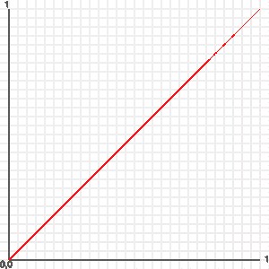

让这种运动稍微自然一点的一种简单方法是将该值乘以自身：

```javascript
for ( i = 0; i <= 1; i += 0.1 ) {
  x = i;
  y = i * i;
}
```

这意味着 0.1 是 0.01，0.2 是 0.04，0.3 是 0.09，0.4 是 0.16，0.5 是 0.25，依此类推。结果是一条开始平坦并在末尾变得越来越陡峭的曲线：

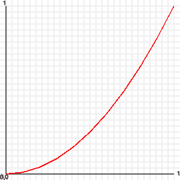

你可以通过继续相乘或使用“幂”函数 `Math.pow()` 来让这种效果更加明显：


```javascript
for ( i = 0; i <= 1; i += 0.1 ) {
x = i;
y = Math.pow( i, 4 );
}
```

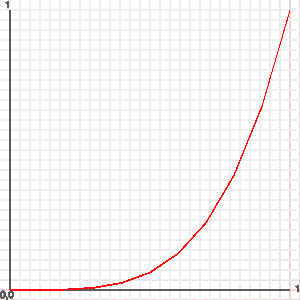

这是 `jQuery` 和 `YUI` 等库中使用的缓动函数（easing functions）技巧之一，也用于现代浏览器中的 CSS 过渡和动画。

你可以同样的方式使用它，但对于获取在 0 到 1 之间遵循自然运动的值，有一个甚至更简单的选项。

### 这不是错误，只是自然运动

[正弦波](http://en.wikipedia.org/wiki/Sine_wave) 可能是平滑动画最好的东西。它们存在于自然界：观察一个挂着重物的弹簧、海浪、声音和光。

在我们的案例中，我们想要平滑地从 0 移动到 1。

为了创建一个从 0 到 1 再回到 0 的平滑运动，我们可以使用一个在几步内从 0 变到 `π` 的正弦波。一个完整的从 0 到 `π` × `2`（即一整圈）的正弦波将产生从 -1 到 1 的值，我们暂时不需要那样。

```javascript
var counter = 0;
// 100 次迭代
var increase = Math.PI / 100;
for ( i = 0; i <= 1; i += 0.01 ) {
x = i;
y = Math.sin(counter);
counter += increase;
}
```

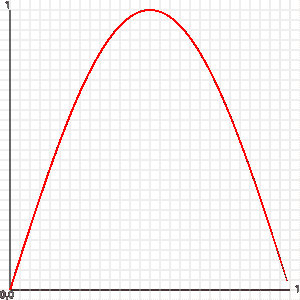

关于正弦和余弦数值的简要说明：`Math.sin()` 和 `Math.cos()` 都接受一个单位为[弧度](http://en.wikipedia.org/wiki/Radian)的角度。然而，作为人类，0 到 360 度的度更容易读得多。这就是为什么你能够并且应该这个简单的公式在它们之间进行转换：

```javascript
var toRadian = Math.PI / 180;
var toDegree = 180 / Math.PI;
var angle = 30;
var angleInRadians = angle * toRadian;
var angleInDegrees = angleInRadians * toDegree;
```

回到我们的正弦波。你可以对此玩很多。例如，你可以使用一个完整的 2 × `π` 循环的绝对值：

```javascript
var counter = 0;
// 100 次迭代
var increase = Math.PI * 2 / 100;
for ( i = 0; i <= 1; i += 0.01 ) {
x = i;
y = Math.abs( Math.sin( counter ) );
counter += increase;
}
```

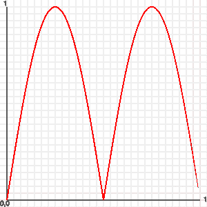

但再次，这看起来很粗糙。如果你想要完整的上下运动而中间没有断点，那么你需要偏移值。你必须将正弦减半，然后给它加上 0.5：

```javascript
var counter = 0;
// 100 次迭代
var increase = Math.PI * 2 / 100;
for ( i = 0; i <= 1; i += 0.01 ) {
x = i;
y = Math.sin( counter ) / 2 + 0.5;
counter += increase;
}
```

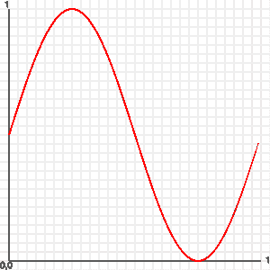

所以，你如何使用它？拥有一个可以根据你输入的任何内容返回 -1 到 1 的函数是非常酷炫的。你只需要将它的结果乘以你想要的值，并添加一个偏移量以避免负数。

例如，查看[这个正弦运动演示](http://www.smashingmagazine.com/wp-content/uploads/2011/09/sinejump.html)：

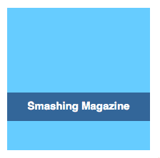

看起来很整洁，不是吗？很多技巧已经包含在 CSS 中：

```css
.stage {
width:200px;
height:200px;
margin:2em;
position:relative;
background:#6cf;
overflow:hidden;
}
.stage div {
line-height:40px;
width:100%;
text-align:center;
background:#369;
color:#fff;
font-weight:bold;
position:absolute;
}
```

`.stage` 元素具有固定尺寸并采用相对定位。这意味着在它内部绝对定位的所有内容都将相对于元素本身。

`.stage` 内部的 `div` 高 40 像素并是绝对定位的。现在，我们只需要用 JavaScript 以正弦波移动这个 `div` 即可：

```javascript
var banner = document.querySelector( '.stage div' ),
start = 0;
function sine(){
banner.style.top = 50 * Math.sin( start ) + 80 + 'px';
start += 0.05;
}
window.setInterval( sine, 1000/30 );
```

`start` 值不断变化，通过 `Math.sin()` 我们得到了一个很好的波浪运动。我们将其乘以 50 以得到一个更宽的波浪，并加上 80 像素使其在 `.stage` 元素中居中。是的，该元素高为 200 像素，100 是它的一半，但因为 banner 高 40 像素，所以我们需要减去它的一半来使其居中。

目前，这是一个简单的上下运动。但是，没有什么阻止你让它变得更有趣。例如，50 的倍数系数本身可以是不同值的正弦波：

```javascript
var banner = document.querySelector( '.stage div' ),
start = 0,
multiplier = 0;
function sine(){
multiplier = 50 * Math.sin( start * 2 );
banner.style.top = multiplier * Math.sin( start ) + 80 + 'px';
start += 0.05;
}
window.setInterval( sine, 1000/30 );
```

[这种结果](http://www.smashingmagazine.com/wp-content/uploads/2011/09/growingsinejump.html) 是一个似乎在试探性上下移动的 banner。在过去，在非常缓慢的 Commodore 64 上，实时计算正弦波太慢了。相反，我们有工具来生成正弦表（如果说是数组）。


这里可能唯一的新内容是带有不同浏览器前缀的转换以及定位。人们经常会犯一个错误：创建一个具有宽度 `w` 和高度 `h` 的 `div`，然后将其设置为屏幕上的 `x` 和 `y` 坐标。这意味着你将始终需要处理高度和宽度的偏移。通过在定位 `div` 之前减去宽度和高度的一半，你就可以真正将它设置在你想放置的位置——无论尺寸如何。[这里有一个证明](http://www.smashingmagazine.com/wp-content/uploads/2011/09/offsetissue1.html)：

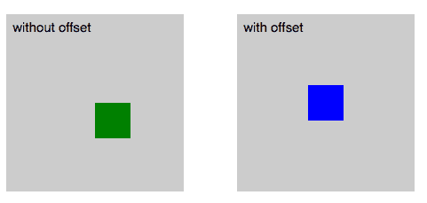

现在，让我们用这个方法来[在圆圈中绘制 10 个矩形](http://www.smashingmagazine.com/wp-content/uploads/2011/09/simplecircle.html)，好吗？


```javascript
var stage = document.querySelector('.stage'),

plots = 10;

increase = Math.PI * 2 / plots,

angle = 0,

x = 0,

y = 0;

for( var i = 0; i < plots; i++ ) {

var p = new Plot( stage );

p.setBackground( 'green' );

p.setDimensions( 40, 40 );

x = 100 * Math.cos( angle ) + 200;

y = 100 * Math.sin( angle ) + 200;

p.position( x, y );

angle += increase;

}
```

我们想要在一个圆中放置 10 个物体，所以我们需要找到想要放置它们的角度。一个圆周是 `Math.PI` 的两倍，所以我们所做的就是除以它。矩形的 `x` 和 `y` 位置可以根据我们想要的角度来计算。正如早之前在毕达哥定理部分解释的那样，`x` 是余弦，`y` 是正弦。那么，我们只需要将要在舞台上绘制的圆居中中（200,200 是舞台的中心），任务就完成了。我们在画布上用 10 步画了一个半径为 100 像素的圆。

问题是这看起来非常糟糕。如果我们真的想在圆周上绘制物体，那么它们的角度也应该指向中心，对吧？为了这一点，我们需要计算直角三角形的正切值，正如在这个[有趣的“数学很有趣”页面](http://www.mathsisfun.com/algebra/trig-finding-angle-right-triangle.html)中解释的那样。在 JavaScript 中，可以使用 [`Math.atan2()](https://developer.mozilla.org/en/JavaScript/Reference/Global_Objects/Math/atan2) 作为快捷方法。结果看起来好多了：


```javascript
var stage = document.querySelector('.stage'),

plots = 10;

increase = Math.PI * 2 / plots,

angle = 0,

x = 0,

y = 0;

for( var i = 0; i < plots; i++ ) {

var p = new Plot( stage );

p.setBackground( 'green' );

p.setDimensions( 40, 40 );

x = 100 * Math.cos( angle ) + 200;

y = 100 * Math.sin( angle ) + 200;

p.rotate( Math.atan2( y - 200, x - 200 ) + 'rad' );

p.position( x, y );

angle += increase;

}
```

注意，CSS 中的 `rotate` 转换在这种情况下对我们非常有帮助。否则，旋转我们矩形的数学计算将会无趣得多。CSS 转换也接受弧度和角度作为其值。在这种情况下，我们使用 `rad`；如果你想用角度旋转，只需使用 `deg` 作为值即可。

现在让圆圈动起来怎么样？嗯，第一件事是稍微修改脚本，因为我们不希望不断创建新的图形。除此之外，要[旋转圆圈只需要不断增加起始角度](http://www.smashingmagazine.com/wp-content/uploads/2011/09/rotatingcircle.html)：

```javascript
var stage = document.querySelector('.stage'),

plots = 10;

increase = Math.PI * 2 / plots,

angle = 0,

x = 0,

y = 0,

plotcache = [];

for( var i = 0; i < plots; i++ ) {

var p = new Plot( stage );

p.setBackground( 'green' );

p.setDimensions( 40, 40 );

plotcache.push( p );

}

function rotate(){

for( var i = 0; i < plots; i++ ) {

x = 100 * Math.cos( angle ) + 200;

y = 100 * Math.sin( angle ) + 200;

plotcache[ i ].rotate( Math.atan2( y - 200, x - 200 ) + 'rad' );

plotcache[ i ].position( x, y );

angle += increase;

}

angle += 0.06;

}

setInterval( rotate, 1000/30 );
```

想要更多吗？基于此做一个[旋转的文本消息](http://www.smashingmagazine.com/wp-content/uploads/2011/09/rotatingmessage.html) 怎么样？这其中的棘手之处在于我们还需要在每次迭代中将字符旋转 90°：


```javascript
var stage = document.querySelector('.stage'),

message = 'Smashing Magazine '.toUpperCase(),

plots = message.length;

increase = Math.PI * 2 / plots,

angle = -Math.PI,

turnangle = 0,

x = 0,

y = 0,

plotcache = [];

for( var i = 0; i < plots; i++ ) {

var p = new Plot( stage );

p.content( message.substr(i,1) );

p.setDimensions( 40, 40 );

plotcache.push( p );

}

function rotate(){

for( var i = 0; i < plots; i++ ) {

x = 100 * Math.cos( angle ) + 200;

y = 100 * Math.sin( angle ) + 200;

// 旋转并让文本旋转 90 度

turnangle = Math.atan2( y - 200, x - 200 ) * 180 / Math.PI + 90 + 'deg';

plotcache[ i ].rotate( turnangle );

plotcache[ i ].position( x, y );

angle += increase;

}

angle += 0.06;

}

setInterval( rotate, 1000/40 );
```

再次，这里没有东西是固定的。你可以让[圆的半径不断变化](http://www.smashingmagazine.com/wp-content/uploads/2011/09/growrotatingmessage.html)，就像我们之前做的跳动横幅消息一样（以下只是片段）：

```javascript
multiplier = 80 * Math.sin( angle );

for( var i = 0; i < plots; i++ ) {

x = multiplier * Math.cos( angle ) + 200;

y = multiplier * Math.sin( angle ) + 200;

turnangle = Math.atan2( y - 200, x - 200 ) * 180 / Math.PI + 90 + 'deg';

plotcache[ i ].rotate( turnangle );

plotcache[ i ].position( x, y );

angle += increase;

}

angle += 0.06;
```

当然，你也可以[移动圆的中心](http://www.smashingmagazine.com/wp-content/uploads/2011/09/rotaterotatingmessage.html)：

```javascript
rx = 50 * Math.cos( angle ) + 200;

ry = 50 * Math.sin( angle ) + 200;

for( var i = 0; i < plots; i++ ) {

x = 100 * Math.cos( angle ) + rx;

y = 100 * Math.sin( angle ) + ry;

turnangle = Math.atan2( y - ry, x - rx ) * 180 / Math.PI + 90 + 'deg';

plotcache[ i ].rotate( turnangle );

plotcache[ i ].position( x, y );

angle += increase;

}

angle += 0.06;
```

最后一个技巧，如何[允许特定范围 Coordinates](http://www.smashingmagazine.com/wp-content/uploads/2011/09/boxedrotatingmessage.html)？

```javascript
function rotate() {

rx = 70 * Math.cos( angle ) + 200;

ry = 70 * Math.sin( angle ) + 200;

for( var i = 0; i < plots; i++ ) {

x = 100 * Math.cos( angle ) + rx;

y = 100 * Math.sin( angle ) + ry;

x = contain( 70, 320, x );

y = contain( 70, 320, y );

turnangle = Math.atan2( y - ry, x - rx ) * 180 / Math.PI + 90 + 'deg';

plotcache[ i ].rotate( turnangle );

plotcache[ i ].position( x, y );

angle += increase;

}

angle += 0.06;

}

function contain( min, max, value ) {

return Math.min( max, Math.max( min, value ) );

}
```


Google 搜索喜欢简单、易于爬取的网站。而你喜欢那些能展示你的作品且引人注目的动态网站。但搜索引擎无法运行你的 JavaScript。那个加载你内容的酷炫 AJAX 程正在损害你的 SEO。

Google 的机器人可以轻松解析 HTML；它们可以拆解 Word 文档、PDF 甚至来自你网站偏远角落的图像。但对于它们来说，AJAX 内容是不可见的。

### AJAX 的问题

AJAX 彻底改变了 Web，但它也隐藏了内容。如果你有一个 Twitter 账户，尝试查看你个人资料页的源代码。那里没有任何推文 —— 只有代码！Twitter 页面上的几乎所有内容都是通过 JavaScript 动态构建的，爬虫无法看到任何内容。这就是为什么 Google 开发了 [AJAX 爬取](http://code.google.com/web/ajaxcrawling)。

由于 Google 无法从 HTML 中获取动态内容，你将通过其他方式提供它。但存在两个大问题：Google 不运行你的 JavaScript，而且它并不信任你。

Google 索引整个 Web，但它并不运行 JavaScript。现代网站是运行在浏览器中的小型应用程序，但在其索引时运行这些应用程序对 Google 和其他人来说都太慢了。

信任问题更为棘手。每个网站都想在搜索结果中排第一；你的网站正在和其他所有网站争夺顶部位置。Google 不能简单地给你一个 API 来返回你的内容，因为某些网站使用了如[遮蔽法](http://en.wikipedia.org/wiki/Cloaking) 等脏手段来尝试获得更高的排名。搜索引擎无法信任你会做正确的事。

Google 需要一种方法，让你向浏览器提供 AJAX 内容，同时向爬虫提供简单的 HTML 内容。换句话说，你需要多种格式的相同内容。

### 相同内容的两个 URL

让我们从一个简单的例子开始。我是一个名为 Spiffy UI 的开源项目的成员。它是一个用于 REST 和快速开发的 [Google Web Toolkit](http://code.google.com/webtoolkit/) (GWT) 框架。我们想要展示我们的框架，因此我们使用 GWT 制作了 [SpiffyUI.org](http://www.spiffyui.org/)。

GWT 是一个动态框架，将我们所有的内容都放在 JavaScript 中。我们的 `index.html` 文件看起来如下：

```html
<body>
<script type="text/javascript" language="javascript"
src="org.spiffyui.spsample.index.nocache.js"></script>
</body>
```

所有内容都通过 JavaScript 添加到页面，我们通过[标签 (hash tags)](http://en.wikipedia.org/wiki/Hashtag#Hashtags) 来控制内容（我稍后会解释原因）。每当你移动到应用程序的另一个页面时，你会得到一个新的标签。点击“CSS”链接，你会来到这里：

http://www.spiffyui.org#css

在大多数浏览器中，地址栏中的 URL 看起来如下：

http://www.spiffyui.org/?css

我们用 HTML5 修复了它。我将在本文后续部分向你展示如何做。

这种简单的哈希对我们的应用程序有效并可以书签，但它是不可爬取的。Google 不知道标签意味着什么，也不知道如何从中获取内容，但它确实为网站提供了一种返回内容的替代方法。因此，我们通过添加一个感叹号（“bang”）来让 Google 知道我们的哈希实际上是 JavaScript 代码，而是页面上的锚点，如下：

http://www.spiffyui.org#!css

这种 hash bang 是整个 AJAX 爬取方案中的秘密配方。当 Google 看到这两个字符在一起时，它就知道有更多内容被 JavaScript 隐藏了。它给了我们机会，通过向特殊的 URL 发起第二次请求来返回完整内容：

http://www.spiffyui.org?_escaped_fragment_=css

新 URL 用 `?_escaped_fragment=` 替换了 `#!`。使用 URL 参数而不是标签很重要，因为参数会被发送到服务器，而标签仅对浏览器可用。

这个新 URL 让我们在 Google 爬虫请求时，能够以 HTML 格式返回相同的内容。困惑吗？让我们逐步查看它是如何运作的。

### HTML 片段

整个页面是在 JavaScript 中渲染的。我们需要将该内容转换为 HTML，以便 Google 能够访问。第一步是将 SpiffyUI.org 拆分为 HTML 片段。

Google 仍然将网站视为一组页面，因此我们需要以这种方式提供我们的内容。对于我们的应用程序来说，这非常容易，因为我们有一组页面，每个页面都是一个独立的逻辑部分。第一步是让页面可以设置书签。

#### 书签

大多数时候，JavaScript 只是更改页面内的某些东西：当你点击那个按钮或弹出那个面板时，页面的 URL 不会改变。对于简单页面来说这很好，但当你通过 JavaScript 提供内容时，你希望给用户提供唯一的 URL，以便他们可以收藏应用程序的某些区域。

JavaScript 应用程序可以更改当前页面的 URL，因此它们通常通过添加标签来支持书签。标签比任何其他 URL 机制都更好，因为它们不会被发送到服务器；它们是 URL 中唯一无需刷新页面即可更改的部分。

标签本质上是一个在应用程序语境下有意义的值。选择一个对于它代表的应用程序区域逻辑合理的标签，并将其添加：

http://www.spiffyui.org#css

在大多数浏览器中，地址栏中的 URL 看起来如下：

http://www.spiffyui.org/?css

我们用 HTML5 修复了它。我将在本文后续部分向你展示如何做。

这种简单的哈希对我们的应用程序有效并可以书签，但它是不可爬取的。Google 不知道标签意味着什么，也不知道如何从中获取内容，但它确实为网站提供了一种返回内容的替代方法。因此，我们通过添加一个感叹号（“bang”）来让 Google 知道我们的哈希实际上是 JavaScript 代码，而是页面上的锚点，如下：

http://www.spiffyui.org#!css

这种 hash bang 是整个 AJAX 爬取方案中的秘密配方。当 Google 看到这两个字符在一起时，它就知道有更多内容被 JavaScript 隐藏了。它给了我们机会，通过向特殊的 URL 发起第二次请求来返回完整内容：

http://www.spiffyui.org?_escaped_fragment_=css

新 URL 用 `?_escaped_fragment=` 替换了 `#!`。使用 URL 参数而不是标签很重要，因为参数会被发送到服务器，而标签仅对浏览器可用。

这个新 URL 让我们在 Google 爬虫请求时，能够以 HTML 格式返回相同的内容。困惑吗？让我们逐步查看它是如何运作的。

#### 提供片段

整个页面是在 JavaScript 中渲染的。我们需要将该内容转换为 HTML，以便 Google 能够访问。第一步是将 SpiffyUI.org 拆分为 HTML 片段。

Google 仍然将网站视为一组页面，因此我们需要以这种方式提供我们的内容。对于我们的应用程序来说，这非常容易，因为我们有一组页面，每个页面都是一个独立的逻辑部分。第一步是让页面可以设置书签。

大多数时候，JavaScript 只是更改页面内的某些东西：当你点击那个按钮或弹出那个面板时，页面的 URL 不会改变。对于简单页面来说这很好，但当你通过 JavaScript 提供内容时，你希望给用户提供唯一的 URL，以便他们可以收藏应用程序的某些区域。

JavaScript 应用程序可以更改当前页面的 URL，因此它们通常通过添加标签来支持书签。标签比任何其他 URL 机制都更好，因为它们不会被发送到服务器；它们是 URL 中唯一无需刷新页面即可更改的部分。

标签本质上是一个在应用程序语境下有意义的值。选择一个对于它代表的应用程序区域逻辑合理的标签，并将其添加：

http://www.spiffyui.org#css

在大多数浏览器中，地址栏中的 URL 看起来如下：

http://www.spiffyui.org/?css

我们用 HTML5 修复了它。我将在本文后续部分向你展示如何做。

这种简单的哈希对我们的应用程序有效并可以书签，但它是不可爬取的。Google 不知道标签意味着什么，也不知道如何从中获取内容，但它确实为网站提供了一种返回内容的替代方法。因此，我们通过添加一个感叹号（“bang”）来让 Google 知道我们的哈希实际上是 JavaScript 代码，而是页面上的锚点，如下：

http://www.spiffyui.org#!css

这种 hash bang 是整个 AJAX 爬取方案中的秘密配方。当 Google 看到这两个字符在一起时，它就知道有更多内容被 JavaScript 隐藏了。它给了我们机会，通过向特殊的 URL 发起第二次请求来返回完整内容：

http://www.spiffyui.org?_escaped_fragment_=css


你可以看到我们的 [SiteMapServlet.java](http://spiffyui.googlecode.com/svn/trunk/spiffyui-app/src/main/java/org/spiffyui/spsample/server/SiteMapServlet.java) servlet 的所有源代码。这个 servlet 大多只是查找表，接收一个 ID 并从我们服务器上的某处提供关联内容。它被称为 `SiteMapServlet.java` 是因为该类还处理我们站点地图的生成。

## 使用站点地图整合一切

[我们的站点地图](http://www.spiffyui.org/sitemap.xml) 告诉爬虫我们的应用程序中有哪些内容。每个网站都应该有一个站点地图；没有站点地图，AJAX 爬取无法工作。

站点地图是简单的 XML 文档，列出了应用程序中的 URL。它们还可以包含关于页面优先级和更新频率的数据。站点地图的普通条目看起来如下：

```xml
<url>
<loc>[`www.spiffyui.org`](http://www.spiffyui.org)/</loc>
<lastmod>2011-07-26</lastmod>
<changefreq>daily</changefreq>
<priority>1.0</priority>
</url>
```

我们的 AJAX 可爬取条目看起来像这样：

```xml
<url>
<loc>[`www.spiffyui.org/#!css`](http://www.spiffyui.org/#!css)</loc>
<lastmod>2011-07-26</lastmod>
<changefreq>daily</changefreq>
<priority>0.8</priority>
</url>
```

hash bang（井号）告诉 Google 这是一个转义片段，其余部分的工作方式与任何其他页面一样。你可以混合使用 AJAX URL 和普通 URL，并且可以使用一个站点地图处理所有内容。

你可以手动编写站点地图，但有很多工具可以为你节省大量时间。关键是良好地格式化站点地图并将其提交到 Google Search Console 中。

## Google Webmaster Tools

[Google Web 站管理员工具](https://www.google.com/webmasters/tools) 让你有机会向 Google 介绍你的网站。使用你的 Google ID 登录或创建一个新账户，然后验证你的网站。


一旦验证通过，你就可以提交站点地图，然后 Google 将开始索引你的 URL。

然后你就等待。这部分让人抓狂。SpiffyUI.org 花了大约两周才在 Google 搜索中正常显示。我在帮助论坛上发了六次帖子，当时以为它坏了。

目前没有简单的方法来确保一切运行正常，但有一些工具可以帮助你查看发生了什么。最好的工具是[以 Googlebot 抓取](http://www.google.com/support/webmasters/bin/answer.py?hl=en&answer=158587)，它向你准确展示 Google 在爬取你的网站时看到的的内容。你可以在 Google Webmaster Tools 仪表板中的“诊断”下访问它。

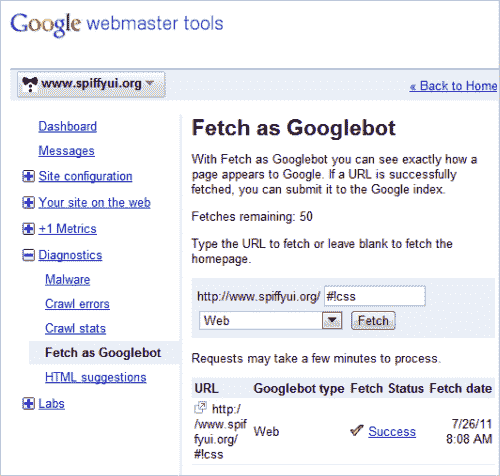

输入一个来自你网站的 hash bang URL，并点击“抓取”。Google 会告诉你抓取是否成功，如果成功，它将向你展示它看到的内容。

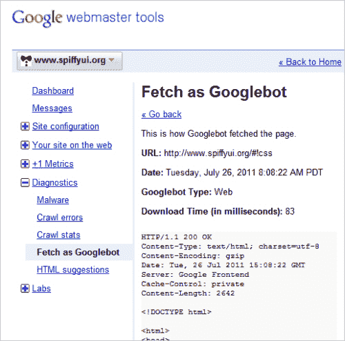

如果“以 Googlebot 抓取”按预期工作，那么你正确地返回了转义 URL。但你应该检查其他几点：

- [验证你的站点地图](http://www.validome.org/google/validate)。
- 手动尝试站点地图中的 URL。确保尝试了 hash-bang 和转义版本。
- 通过搜索 `site:[www.yoursite.com](http://www.yoursite.com)` 来检查你网站的 Google 搜索结果。

## 使用 HTML5 创建美化 URL

Twitter 在其 URL 中保留了 hash bang，如下：

http://twitter.com/#!/ZackGrossbart

这对于 AJAX 爬取效果良好，但同样，它看起来有点丑。你可以通过集成 [HTML5 history](http://www.w3.org/TR/html5/history.html) 让你的 URL 更美观。

Spiffy UI 使用 HTML5 history 集成将像这样的 hash-bang URL 转换……

http://www.spiffyui.org#!css

……转换为像这样的美观 URL：

http://www.spiffyui.org?css

HTML5 history 让更改此 URL 参数成为可能，因为井号是 HTML4 中你可以更改的唯一 URL 部分。如果你更改其他任何内容，整个页面都会重新加载。HTML5 history 在不刷新页面的情况下更改整个 URL，我们可以让 URL 呈现任何我们想要的样式。

这个更优的 URL 在我们的应用程序中有效，但我们仍在站点地图上列出 hash-bang 版本。当浏览器访问 hash-bang URL 时，我们用少量 JavaScript 将其更改为更优的版本。

## 欺骗 (Cloaking)

早我我提到欺骗。这是一种通过向 Google 显示一组页面而向普通浏览器显示另一组页面来提高网站在搜索结果中排名的做法。Google 不喜欢欺骗，可能会[从其搜索索引中移除违网站](http://www.google.com/support/webmasters/bin/answer.py?answer=66355)。

AJAX 可爬取应用程序向 Google 显示的结果始终与普通浏览器不同，但如果 HTML 包含用户会看到的相同内容，那么它就不属于欺骗。搜索引擎需要从本质上不可信的来源（我们）那里获取有用信息。

## Hash Bang 有点丑，但有效

Hash bangs 不应该取代 Web 上的每一个 URL。简单页面不需要 hash bangs，但 AJAX 页面需要。URL 看起来确实有点丑，但你可以用 HTML5 修复。

### 延伸阅读

等等，支持 AJAX 爬取意味着你需要更改客户端代码和服务器代码。这里有一些链接可以了解更多：

- “[让 AJAX 应用可爬取](http://code.google.com/web/ajaxcrawling),”Google Code
- “[会话历史与导航](http://www.w3.org/TR/html5/history.html),”HTML5 规范，章节 5.4 
- [sitemaps.org](http://www.sitemaps.org/)
- [Google Webmaster Tools](https://www.google.com/webmasters/tools)
- [Spiffy UI 源代码](https://code.google.com/p/spiffyui/source/checkout)，包含完整的 AJAX 爬取示例。
- 感谢 Kristen Riley 为本文中的图片提供的帮助。

# 作者

### Addy Osmani

Addy Osmani 是一位住在英国伦敦的 JavaScript 博客作者兼 AOL 的 UI 开发者。他还是 jQuery [Bug Triage/Docs/Front-end] 团队的成员，负责处理错误、文档编写和社区更新。最近，他被提名了 [.net “杰出新秀”奖](http://www.thenetawards.com/#num12)。

### Andy Croxall

Andy Croxall 是一位来自英国伦敦 Wandsworth 的 Web 开发者。他是一位 JavaScript 专家，jQuery 社区的活跃成员，发布插件和扩展。他服务的客户从伦敦证券交易所到杜乐士（Durex）应有尽。你可以在这里关注他和他的项目和创作

### Christian Heilmann

一位在英国美丽的伦敦镇为 Mozilla 工作的国际开发者布道师（Developer Evangelist）。

### Zack Grossbart


Zack Grossbart 是一位[工程师](http://www.zackgrossbart.com/hackito/)、设计师和[作者](http://www.zackgrossbart.com/blog/toc/)。他是 [Spiffy UI](http://www.spiffyui.org/) 项目的创始成员，[WordPress 编辑日历](http://stresslimitdesign.com/editorial-calendar-plugin)插件的架构师，也是 [NetIQ](http://www.netiq.com/) 的顾问工程师。

Zack 在五岁时就开始尝试从软盘加载 DOS 了。他在 15 岁时开始从事计算机专业工作，并在 16 岁时创立了自己的第一家软件公司。Zack 与妻子女儿住在马萨诸塞州的剑桥市。
