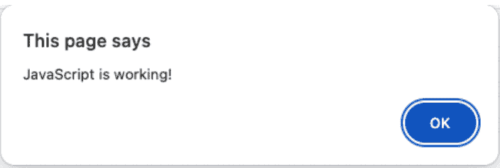

# JavaScript 示例


# 序言

如果你刚刚开始学习 JavaScript 编程，或者需要复习，这本书正适合你。我们涵盖了一些基础知识以便你理解它。然后我们还将进行一些基础编码。

在我的编程生涯中，有一段时间我会在开始之前读厚厚的书。我发现那是一种拖延。学习任何知识最好的方法就是实践。

在本书中，我们不会用大量信息让你 overwhelming不堪。正如人们所说，“只要陈述，女士”。读一两章后，你就应该准备好开始了。然后再回来获取更多小技巧。

祝编程愉快！

# JavaScript：疲惫大脑的有用工具


我有一个坦白。JavaScript 和我的开始很糟糕。我的第一次尝试是为了表单验证。我曾对它的存在大骂。

幸运的是，在重新接触它后，我开始尊重它。多年来，它已经成长为一种强大的语言。

## JavaScript

尽管起点卑微，JavaScript 已经演变成一种现代编程语言。从浏览器到服务器，它几乎可以处理一切。`Node.js` 在服务器端为它提供了强大的框架。

Mozilla 创建了它，以下是他们对其定义。“JavaScript 是一种具有一等函数的轻量级解释型编程语言。”这听起来真绕口！

# 代码

让我们来看基础代码。这是一个显示某些 JavaScript 的 HTML 文件。将此代码保存到你的本地机器。

```html
<html>
```

## 测试 1

## 测试 2

普通文本

当我们运行它时，我们将看到这个



### JavaScript 警告消息

一旦点击 ok，你将看到这个。

## 测试 1

## 测试 2

普通文本

### HTML 截图

## 语句

语句是 JavaScript 的基本指令。我们可以创建一些变量并为它们赋值。

```javascript
let a, b, c; // 创建三个变量的语句
a = 2; // 将值 2 赋值给变量 a 的语句
b = 3; // 将值 3 赋值给变量 b 的语句
c = a + b; // 将 a 加 b 赋值给 c 的语句
```

分号位于语句末。虽然我们可以多个语句放在一起。

```javascript
a = 2; b = 3;
```

这不可读，所以大多数程序员倾向于这样做。仅仅因为你可以做某事，并不意味着你应该这样做。

## 函数

当我们想要执行某个任务时，可以创建一个函数。如果我们需要两个数字之和，我们可以在代码中这样做，也可以创建一个函数。

```javascript
// 加两个数字
num3 = num1 + num2;
```

```javascript
// 两个数字之和的函数
function sumTwoNumbers(num1, num2) {
  return num1 + num2;
}
```

### 最迷人的入门简单 JavaScript 函数基础


图片由 Stanley Dai 提供自 Unsplash

函数是 JavaScript 的动力源。这是工作发生的地方。我们需要计算地板的面积吗？这就需要一个函数。

```javascript
function calculateFlooring(length, width) {
  return length * width;
}
```

如果我们重新装修厨房，这个函数将计算出所需的地板面积。那么，为什么我们需要函数呢？

#### 益处

将函数想象成你代码的容器。它类似于代码块，但我们可以重复调用这个函数。这将有助于代码的复用。在我们先先的示例中，你可以复制该语句。当然，如果我们想修改它，我们需要搜索那段代码并修改所有的出现处。

#### 示例

在第一个函数示例中，我们计算了地板面积。让我们退一步，让它变得更简单。我们可以在屏幕上打印一些内容。

```javascript
function greetTom() {
  alert("Hello Tom!");
}
```

当然，你可以把我的名字换成你的。如果你想遵循这个传统，可以将其替换为“Hello World”。你是否好奇过为什么这是传统，看……

#### 调用

代码看起来很不错，但如果你不调用它，什么都不会发生。该怎么做呢？我很高兴你问。这里有一个示例。

```javascript
function greetTom() {
  alert("Hello Tom!");
}

greetTom();
// do other things...
```

那个调用非常简单，因为它不需要参数。在我们第一个函数中，我们两个两个参数。让我们下一个试试。

#### 传递参数

在我们的第一个示例中，我们从一个计算地板的函数开始。它接收两个参数。

```javascript
function calculateFlooring(length, width) {
  return length * width;
}

calculateFlooring(12, 10);
```

我们可以传入这两个数字来获取所需的地板。在这个示例中，我们硬编码了值。你通常不会这样做，或者永远不会这样做。

```javascript
function calculateFlooring(length, width) {
  return length * width;
}

calculateFlooring(length, width);
```

如你在此看到的，我们将两个参数作为变量。名字与函数相同，但并不一定相同。

#### 返回数据

当我们返回计算结果时是有帮助的。如果不这样做，函数就没有它本可以那么用。我们只需要使用 `return`。我们在计算地板函数中已经这样做了。尽管我们需要将其赋值或打印出来。

```javascript
function calculateFlooring(length, width) {
  return length * width;
}

let totalFlooring = 0;
totalFlooring = calculateFlooring(length, width);
```

现在我们可以在应用程序稍后使用这个值。之前的示例没有使用返回的值。如果你以后不需要它，这始终是一个选项。

函数可以为我们做很多事情。它们为我们的代码提供了一个容器。然后我们可以调用它们并传递参数。此外，它们还可以返回数据。如果你需要更多信息，这里有一些进一步的……

### 使用这些简单的 JavaScript 条件判断避免痛苦的错误


图片由 Artur Aldyrkhanov 提供自 Unsplash

应用程序帮助我们做决定。一个基础决定是一个 `if` 条件。例如，如果披萨送卖员到了就开门。JavaScript 其他语言一样有很多条件判断，如：

```javascript
if
```

`if` 语句以一个条件开始。如果它为真，后面的语句将会执行。

```javascript
if (pizzaArrives) {
  openDoor();
}
```

所以，如果 `pizzaArrives` 为真，我们就调用函数 `openTheDoor`。我在 `if` 语句之后添加了大括号。这是可选的，但有助于可读性。省略大括号可能会导致你漏掉错误。所以请包含它们！

#### if/else

有时你有两种不同的行动方案。我们可以在 `if` 的同时添加 `else` 语句。假设你正在做一些汉堡。

```javascript
if (sideCooked) {
  flipBurger();
} else {
  keepCooking();
}
```

这个检查可以运行你最喜欢的汉堡店的烹饪机器人。它可能需要一些代码。如果你需要检查两个条件，你可以使用 `if else`：

```javascript
if (sideCooked) {
  flipBurger();
} else if (otherCooked) {
  removeFromGrill();
} else {
  keepCooking();
}
```

这让我们能够检查额外的值。如果你需要更多检查，`switch` 语句可能会更好。关于这一点稍后会介绍。

#### 条件运算符

我们用于 `if` 语句的运算符必须解析为真或假。你有很多选项供你使用。根据经验，你需要测试出正确的那个。

```javascript
if (9 > 5) { alert("Greater than"); } // 大于
if (5 < 8) { alert("Less than"); } // 小于
if (9 >= 6) { alert("Greater equal to"); } // 大于
if (4 <= 6) { alert("Less equal to"); } // 小于
if (4 != 6) { alert("Not equal to"); } // 不等于
```

还有逻辑运算符。逻辑与 (`&&`) 和逻辑或 (`||`)。 它们被频繁使用，但不要被它们吓到。

```javascript
const value1 = 4;
const value2 = -3;

console.log(value1 > 0 && value2 > 0); // 预期输出: false
console.log(value1 > 0 || value2 > 0); // 预期输出: true
```

逻辑与必须两个值都解析为真。逻辑或需要其中一个为真。

#### switch

`switch` 语句评估表达式以确定执行哪个语句。然后它一直运行直到遇到 `break` 语句。这里有一个示例告诉我们你想要的价格：

```javascript
const shoes = 'Reebok';
switch (shoes) {
  case 'Nike':
    console.log('Nike shoes are.');
    break;
  case 'Adidas':
  case 'Reebok':
    console.log('Adidas and Reebok.');
    break;
  default:
    console.log(`Sorry, we don't carry ${shoes}.`);
}
```

在这个示例中，我们从 `Nike` 语句中删除了 `break`。你知道会发生什么吗？条件判断是 JavaScript 的基础。`if/else` 和 `switch` 很容易用。

### JavaScript 有循环会让你大脑爆炸


正如一个孩子，我们在农场种了树需要浇水。就像生活一样，计算机程序必须重复。这就是循环有用的地方。`for` 循环非常常见，所以让我们从那里开始。

#### for

如果我们有一个书籍数组并想打印它们。可以使用以下循环。

```javascript
for (let i = 0; i < books.length; i++) {
  text += books[i] + "";
}
```

`for` 循环有三个部分。开始、条件和步骤。

##### start

这是我们设置循环变量的部分。在我们示例中，通常初始化为 0。尽管你也可以将其设置为 10 然后递减。

##### condition

下一步是条件，检查是否需要再次运行此循环。我们的示例检查是否还有更多书籍需要遍历。如果我们完成了就停止。

##### step

最后一部分是步骤。它告诉我们每次迭代后发生了什么。我们的示例使用了增量运算符(`++`)。这是正常的步骤，但我们也可以做其他事情。

#### while

如果我的狗 Baxter 想吃，我想创建一个在他饥饿时喂给他的循环。`while` 循环可以做到这一点。这里有一个示例。

```javascript
let baxterHungry = true;

while (baxterHungry) {
  console.log(feedBaxter);
  checBaxter();
}
```

我们将变量设置为真。然后我们喂狗直到它变为假。`while` 循环评估我们给它的条件。它需要解析为真或假。

如果是真，循环内部的代码将执行。我们再次评估条件。一旦条件变为假，循环停止。

#### do-while

`for` 和 `while` 循环检查条件后运行代码语句。`do-while` 不同之处在于它先运行代码然后检查你的条件。它不常见，但在特殊情况下有用。

```javascript
let donutsEaten = 0;
do {
  console.log("Donuts eaten " + donutsEaten);
  donutsEaten++;
} while (donutsEaten < 5)
console.log("I'm full of Donuts!");
```

do-while 一直运行到条件为假为止——与我们讨论过的其他两种循环类型相反。输出看起来如下所示。

```
Donuts eaten 0
Donuts eaten 1

Donuts eaten 2
Donuts eaten 3
Donuts eaten 4
I'm full of Donuts!
```

当你需要循环执行代码时，JavaScript 为你提供了几个选项。

与其他编程语言一样，它有 `for`、`while` 和 `do-while` 循环。

只需确保它符合你的需求。

# 你需要的意外改进 JavaScript 变量作用域


照片由 Markus Spiske 发布于 Unsplash

我妻子切换话题非常快。我开玩笑说她需要转向灯，这样我才能跟上她转移的焦点。她正在聊晚餐，然后我们就转向了下一次度假。

## 作用域 (Scope)

我们的代码也有类似的作用域概念。变量可以快速进入和离开作用域。作为开发者，我们必须将这一概念置于核心。

在 JavaScript 中，有几种不同类型的作用域。我们可以根据情况使用它们。如果你做过其他编程，就会遇到过类似的概念。

### 全局作用域 (Global)

全局作用域项在处处可见。在我们的示例中，我们在函数内部和外部创建了一个可见变量。

```javascript
let myGlobalVariable = "TheBigGlobalVariable";

function logGlobalVariable() {
  console.log(myGlobalVariable);
}

logGlobalVariable();
```

我猜你在想，如果我在函数内部添加一个变量怎么办？这引出了局部作用域的示例。

### 局部作用域 (Local)

局部变量只在函数内部可见。这里有一个示例可以尝试。

```javascript
let myGlobalVariable = "TheBigGlobalVariable";

function logGlobalVariable() {
  console.log(myGlobalVariable);
  let localVariable = "TheLocalOne"
  console.log(localVariable);
}

logGlobalVariable();

console.log(localVariable);
```

如果我们运行这段代码，将在最后一行得到一个错误。

```
console.log(localVariable);
^
ReferenceError: localVariable is not defined
```

所以你可以看到当你错误地将变量放在错误位置时会发生什么。

### 块作用域 (Block)

如果局部作用域是在函数内部，那么块作用域就是在大括号内部。有时你会创建大括号来标识某些代码。让我们来看看我想表达什么。

```javascript
console.log("here");
{
  let blockScopeVariable = 0;
  console.log(blockScopeVariable);
}
// 我们在在这里无法引用 blockScopeVariable
console.log(blockScopeVariable); // 将无法工作
```

如你所示，在大括号内创建了一个块作用域变量。但在外部，它将无法被引用。

### 注意事项 (Gotchas)

作用域可能会令人困惑并导致一些错误。随着你对 JavaScript 经验的增加，你可以尽早发现它们。例如，如果我们看这段代码片段：

```javascript
const colors = ['red', 'blue', 'white'];

for (let i = 0, l = colors.length; i < l; i++) {
    console.log(colors[i]); // 'red', 'blue', 'white'
}
console.log(l); // ???
console.log(i); // ???
```

变量 `i` 和 `l` 将会导致引用错误。它们与我们之前的示例类似，超出了作用域。Dmitri Pavlutin 深入解释了这一点。他还涵盖了我们在编码中可能犯的一些常见错误。

JavaScript 作用域有你需要记忆的基本原则。全局作用域随处可见。局部和块作用域更集中。

总而言，你应该使用后者并避免前者。继续编码吧！

# 多利用 JavaScript 闭包，不要恐慌


照片由 Cristina Gottardi 发布于 Unsplash

在我开发生涯中偶尔接触 JavaScript，闭包（Closures）是我并不经常遇到的东西。它们具有巨大的价值。

## 闭包 (Closures)

我们如何定义闭包？嗯，这篇文章是这样定义的：“JavaScript 中的闭包是词法作用域的一种形式，用于在函数的内部作用域中保留函数外部作用域的变量。”

```javascript
function outerFunction() {
  var x = 10;

  function innerFunction() {
    return x;
  }
  return innerFunction;
}

var inner = outerFunction();
console.log(inner);
```

这是一个闭包的示例。外部函数 `outerFunction()` 创建了一个变量 `x` 和一个函数 `innerFunction()`。内部函数 `innerFunction()` 返回变量 `x` 的值。然后外部函数返回了内部函数 `innerFunction()`。

接着，内部函数 `innerFunction()` 被赋值给变量 `inner`。当调用变量 `inner` 时，它会返回变量 `x` 的值，即使外部函数 `outerFunction()` 已经返回。

稍后我们将涵盖词法作用域。首先，让我们理解为什么需要它们。此外还有一些缺点。

## 优缺点 (Pros and Cons)

闭包可以帮助隐藏封装细节。类似于 Java 的私有变量和函数，这允许我们控制访问。此的缺点是闭包会占用更多内存。这些项无法被垃圾回收。最后，它可能会减慢执行速度。Deepak Mankotia 深入探讨了这一点。

## 词法作用域 (Lexical Scoping)

词法作用域术语指的是变量定义的地方。以及它是否可以被引用的。

```javascript
let x = 10
let myFunc = function () {
  let y = 20;
  console.log("x and y is accessible (outer):", x, y);
  let insideFunc = function () {
    let z = 30;
    console.log("x and y and z is accessible (inner):", x, y, z);
  }
  insideFunc();
  return;
}
myFunc();
console.log("only x is accessible (global):", x);
```

在这个示例中，`insideFunc` 定义在 `myFunc` 内部。在这种情况下，`myFunc` 是它的父级。父函数词法上绑定了子函数。JavaScript 闭包是词法作用域的形式。

JavaScript 闭包是强大的工具。它们具有独特的价值。它允许你封装细节，但可能会降低执行速度。考虑风险和回报是否适用于你的应用程序。

更多信息请参这里：


# 关于作者

Tom Henricksen 是一位解决问题型技术专家。他是 Code is Easy 的演讲者和作家。从开发者开始，他曾担任项目经理、技术主管、Scrum Master 和软件开发经理。

Tom 曾帮助组织进行敏捷转型。他还指导和培训了团队和个人。

Tom 也是一名创业者。Tom 是 Agile Online Summit 和 DevOps Online Summit 的创始人。在那里领导了一个超过 5000 人的强大在线社区。

Tom 学习了如何解决技术领域的挑战性问题并领导技术团队。也可以帮助你培养这些技能！

你可以以下方式与我联系：

- http://codeiseasy.co
- https://twitter.com/TomHenricksen
- https://www.linkedin.com/in/tomhenricksen

订阅我的时事：

https://t.co/NkolrQgXHM
