# 绝对初学者 JavaScript 入门指南


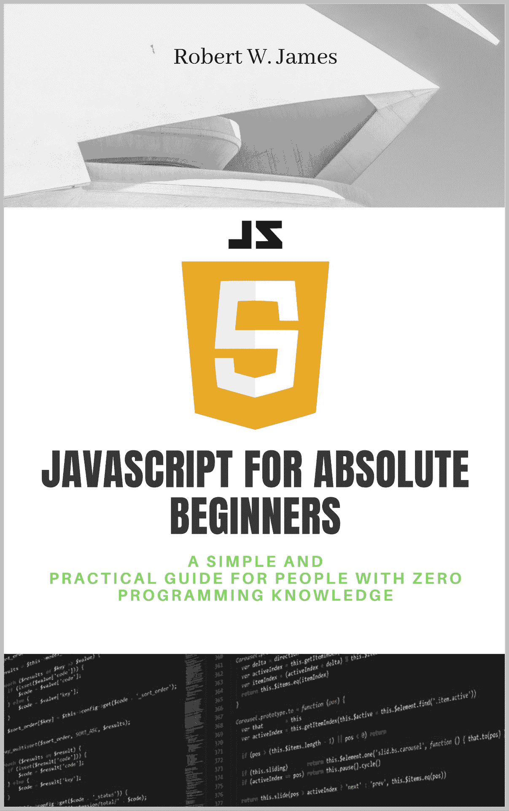


本书是为对学习 JavaScript 感兴趣但没有任何编程经验或编程知识的人士编写的入门编程指南。

 


## 引言
对于没有编程背景的初学者来说，JavaScript 是容易学习的语言之一。这是本书的核心假设——读者对编程一无所知。

书中还假设你至少知道如何在使用 `MS Word`（例如 Microsoft Word）之类的文字处理器上打字和组合单词。同时也假设你知道如何安装应用程序，以及编辑屏幕上输入的任何内容——在完成书中的练习和测试时，你将进行大量操作。

本书作者还假设你已经知道如何使用网络浏览器，并对万维网有良好的理解。某些读者可能对 `HTML`（超文本标记语言）和 `CSS`（层叠样式表）有一定的了解，那是好事。但如果你不知道，别担心。我们将在学习过程中介绍一些基本的 `HTML` 和其他相关概念。这意味着你也将学习一些基础的 `HTML` 编程（仅是基础知识，没有会吓到非编程人员的大内容）。

如果你对学习用 JavaScript 编程感兴趣，也应该花时间学习 `HTML` 和 `CSS`，因为这两种编程语言是相辅相成的。JavaScript 是初学者编程语言的绝佳选择。有些人将其与 Python 相比，后者也是另一种非常适合初者的语言。在我看来（IMHO），Python 对初学者非常友好，在学习了一两个 JavaScript 后，你可能也想了解它。

那么，为什么要学习 JavaScript 呢？
无论你不信，你每天都能看到它。当你用笔记本电脑的浏览器查看网站时，它就在那里。当你使用手机时，也会体验到它。当你与网页交互时，你可能正在看到 JavaScript 在工作。当你使用运行在互联网上的应用程序时，你已经在亲身体验这种编程语言了。

如果你的工作恰好涉及任何网站的服务器端——也许你在发布博客、更新公司在线商店的项目，或者你在公司网站上做的任何事情——那么意味着你可能已经在以 JavaScript 的风格处理一些东西了。


# JavaScript 语法规则

* 变量
* 注释
* 运算符
* 数学（我知道这很无趣）
* 函数
* 表达式
* 条件判断
* 值
* 以及许多其他有趣且酷的东西

现在，我知道事情有时会让人感到沮丧。但当你开始学习新事物时，情况就是如此。尽管如此，通往掌握 Web 编程的旅程充满了成功与失败——以及大量的 JavaScript（大笑！）。感谢下载本书。我们第一章见。

# 第 1 章：为什么是 JavaScript

在这一章中，我们将学习关于世界上最流行的编程语言之一的背景信息。让我们从这种编程语言的特性开始吧。

## 什么是 JavaScript？

JavaScript 是一种高级语言。这意味着什么呢？当我们说“高级”时，我们指的是一种看起来更像英语，而不是一堆只有机器才能理解的代码的编程语言。它看起来不像你在观看《黑客帝国》三部曲时在屏幕上看到的那些滚动字符。

### 高级语言
当你查看代码行时，你会看到英语单词中夹杂着大量的数学符号。JavaScript 的计算机代码看起来也像一条带有隐藏含义的加密信息。然而，经过一些练习，你会发现这种语言中的加密信息部分其实很容易理解。

现在，让我们深入探讨一下。
当你说高级语言时，我们指的是你不需要操心后台运行的其他技术细节的编程语言。例如，当你告诉计算机在浏览器或屏幕上显示字母“A”时，你并不知道程序具体是如何告诉计算机或移动设备（例如你的手机）如何操作的。

这里有几点你是看不见的运作。首先，后台运行的事情之一是，你的程序（任何程序，不非要是 JavaScript）正在告诉计算机使用其随机存内存的某部分。

它还会告诉计算机激活屏幕上的某些像素。它还告诉计算机屏幕的哪个部分将用于显示字母 A。你的程序告诉计算机应该使用什么颜色。它也告诉计算机应该使用哪些像素来创建那个特定的显示。

所有这些已经在后台处理好了。你所做的只是输入一条命令或一行代码，写着“在屏幕上显示字母 A”。

高级计算机语言允许你专注于代码。它会为你完成剩下的脏累活。

### 一种解释型动态语言
记住，JavaScript 看起来更像英语，而不是《黑客帝国》式的代码（即机器码）——是的，这里继续用双关语。事实是，机器听不懂英语。它们不是那样说话的——它们使用二进制代码，一系列 1 和 0（或开/关开关）。

不，你不需要学习二进制代码就能用 JavaScript 编程。但请记住这个重要的小知识——你需要将你的计算机程序从高级语言翻译成低级语言或机器码。

在高级编程语言和机器可读语言之间，通常有一个中间人，或者说你所说的“翻译官”。编程中的这种“翻译”被称为编译。

你在任何编程语言中编写的代码都需要被编译（即翻译），以便计算机（或手机或任何设备）能够遵循你写的指令。

在某些编程语言中，你需要在计算机执行指令之前先经过这一步。这些语言被称为静态语言。在执行之前应该先有一个编译阶段。

JavaScript 的情况并非如此。它被称为“解释型语言”，因为不需要在中间进行翻译过程。

你在这种编程语言中编写的代码是“即时”被“翻译”的，或者说是在代码被读取时进行翻译。速度非常快。不需要先暂停任何操作以便编译代码。这就是为什么它被称为动态语言。

现在，这提供了一些优势，例如：

* 闭包 (Closures)
* 对象运行时更改
* 函数式编程
* 反射
* 晚绑定
* 动态类型


现在不用担心所有这些术语。随着 JavaScript 编程课程的进行，你以后会学习它们。在学习不同章节时，我们会逐步处理相关的术语。

## 动态变量类型

你还记得数学中的变量吗？具体来说我指的是代数。简单回顾一下：变量是持有或包含一个值的东西。例如，我们有时会赋值 `x = 10`。变量 `x` 包含一个整数值。整数是一个不包含小数部分的数字——例如 `0.5` 或 `0.75`。

所以，在这个例子中，`x` 只包含 `10` 这一值——完全没有小数点。一旦你给变量 `x` 赋值了其他内容，它就会改变。所以，假设我们给 `x` 加上 `0.5`，它就会变成一个实数，因为它的值变成了 `10.5`。

在某些编程语言中，例如 `Pascal`、`Basic`、`C` 或 `C++`，如果你给变量指定了一个特定的类型（例如，根据我们之前的解释的整数），那么该变量只能包含整数。

如果你在过程中尝试更改它，程序将会产生错误并失败。这意味着如果你将值 `10` 赋值给变量 `x`，那么这个变量不能包含任何分数或小数部分。

你必须为实数创建一个不同的变量，这在许多静态编程语言中都是如此。

但 JavaScript 则不然。你可以在代码开头分配 `10`，稍后加上 `0.3`，这不会产生任何问题。这被称为**动态类型**。这是一种处理变量的方便方法，并且当计算机、手机或其他设备运行你的程序时减少运行时错误。

## 不是严厉的老师

正如你目前所见，JavaScript 并不是我们所说那种“严格”的编程语言。其他语言中常见的限制性规则在这里都被消除了。这允许编程初学者在编程时犯下常见的“错误”。

你可以专注于编程的基础概念，而无需担心许多关于程序结构的规则，即代码的某部分应该放在哪里或者哪个东西应该放在哪里。

它对初非常友好，这就是为什么 JavaScript 是想要学习网页编程的初者的绝佳选择。

**注意**：请注意 JavaScript 与 `Java` 是两种不同的编程语言。它们听起来一样，而且命名约定是非常糟糕的做法，但我们对此无能为力。每个人只能接受事实。只需记住我们正在学习的是 JavaScript，而不是名为 `Java` 的另一种全功能计算机编程语言。

## 客户端语言

这种脚本语言也被称为客户端语言。这意味着它的许多功能都是为了计算机用户的利益。相比之下，服务器端语言更关注网站后台发生的情况——特别是包含这些网站的服务器上。世界上还有其他的客户端和服务器端语言。

在 JavaScript 的情况下，这种编程语言通常用于改进网站与访问网站的用户之间的交互。你用这种语言编写程序代码将使事情更具互动性。

这就是为什么它除了网站之外还被用于其他地方。它被用于移动应用开发和游戏。你手机和其他移动设备上的应用和游戏需要交互性，而 JavaScript 是帮助你实现这一点的强大方式。

## 快速历史课

让我们快速通过这部分，这样我们就可以进入实际的代码编写。以下是该编程语言历史的快速概述：

* 它由 Brendan Eich 在 1995 年开发
* 它最初被称为 LiveScript，但后来更名为 JavaScript
* JavaScript 的许多语法取自或受 `C` 编程语言的影响
* 今天，它已经发展到不仅可以在计算机上运行，你还会在许多嵌入式应用、浏览器应用程序、电视应用，当然还有移动应用中找到它

如果你想深入研究这种编程语言的历史，你应该去其他来源查找。其他地方有大量的历史和语言发展信息。

现在，让我们进入细节吧，好吗？
第 2 章见。

## 第 2 章：编写你的第一个 JavaScript 程序

在本章中，我们将学习并编写你的第一个 JavaScript 程序——或者多个程序，因为你将在本章末尾完成几个练习。在这里，你将学习一些基础但非常重要的概念。在本章中，我们将介绍编写和运行 JavaScript 程序所需要的内容，以及 JavaScript 语法的前几个元素。

### 如何编写你的第一个 JavaScript 程序

我总是说，学习新事物的最好方法就是直接投入并完成任务。这正是我们现在要做做的——让你编写你的第一个 JavaScript 程序并看看会发生什么。那么，运行 JavaScript 程序需要什么？
运行 JavaScript 需要两样东西，如下：

1. 一个文本编辑器，如 `Atom`、`Sublime Text`、`Visual Studio Code` 和 `Notepad++`。
2. 一个浏览器，如 `Chrome`、`Safari`、`Firefox` 和 `Microsoft Edge`。


## 文本编辑器
任何这些文本编辑器都可以很好地工作。我不推荐简单的文本编辑器，因为使用那些工具只能打字。上述提到的编辑器兼具源代码编辑器的功能，这意味着它们可以自动纠正（并自动补全）你的编程代码语法。我在本书中将使用 `Notepad++` 显示代码，这是一款免费且易于下载的文本和源代码编辑器。你可以通过[点击此处](https://notepad-plus-plus.org/downloads/) 下载 `Notepad++`。在你的电脑上下载并安装它只需不到一分钟。请记住，JavaScript 是一种脚本语言，这意味着它不能独立运行程序。在这种设置下，你在文本编辑器中输入程序代码，而由你的浏览器负责解释并运行代码。JavaScript 也是一种非常可移植的语言，因为它可以在包括 Windows、iOS、Android、Mac 和 Linux 在内的任何操作系统上运行。

### 标签
现在，这里有一个某些读者将第一次学习的新概念。你的代码部分将被包含起始标签和结束标签之间。这里有一个例子：`<script>` 和 `</script>`。第一个是 `<script>`，显示代码从哪里开始或标签从哪里开始；第二个是 `</script>`，显示标签在哪里结束。你使用这两个标签来告诉浏览器，这两个标签之间的任何内容都是脚本的形式——在我们这里的这个小活动中，我们使用的是 JavaScript。

是的，还有其他脚本语言，例如 Ruby、Python、Perl 和 PHP 等。如果你玩过论坛中使用的 bb-codes，那么概念基本上是一样的。例如，你使用 `[b]` 和 `[/b]` 标签，使得脚本中的文本以**粗体**字体显示。例如，当你在在线论坛帖子中写以下内容时：“Hi! My name is [b]Jeff [/b]。” 它在论坛中将显示为“Hi! My name is Jeff .”如你所看到的，单词 Jeff 是粗体字符。

现在，我希望你已经下载了 `Notepad++` 或其他源代码编辑器。如果你还没有，那么现在是时候下载一个并安装到你的电脑上了。在安装好之后（记住我使用 `Notepad++` 是因为它是免费的），在代码编辑器中输入以下内容：
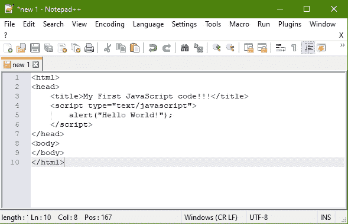

关于上面的示例代码，你应该注意以下几点。首先，第一行说是 `<html>`，这意味着这是一个 HTML 程序；HTML 代表超文本标记语言，它是用于构建网页的主要语言。正如之前提到的，你将学习关于该编程语言的一些知识。

### 起始标签和结束标签
如果你回看我们之前的示例，你会发现整个代码以 `<html>` 开始，并在底部由另一个标签 `</html>` 配对。前者被称为起始标签，后者被称为结束标签。JavaScript 也是如此。你的 JavaScript 代码也有起始标签和结束标签。在我们上面的示例中，其他的起始和结束标签对有 `<title>` 和 `</title>`、`<head>` 和 `</head>`、`<script>` 和 `</script>` 以及 `<body>` 和 `</body>`。注意，我们第一个示例中的大多数标签都是 HTML。JavaScript 实际上是以 `<script type="text/javascript">` 开始并以 `</script>` 结束的。现在请注意，这种脚本格式适用于 HTML，而不是 HTML5，后者是不同的。

这是另一个例子，我想让你识别不同的起始标签和结束标签：
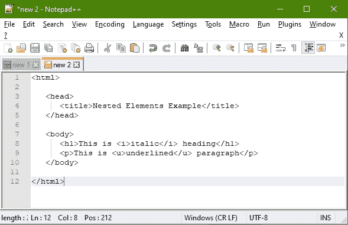

在识别不同的标签后，这里有你需要注意的几点：

*   代码以 `<html>` 标签开始，以 `</html>` 标签结束。
*   `<head>` 和 `</head>` 标签表示元数据。这被称为 `<head>` 元素，它不会显示在你的浏览器或设备屏幕上。它作为你的 HTML 文档的标题——或者说是你程序的标题。
*   `<h1>` 和 `</h1>` 标签是标题。将这些视为段落标题或书中的章节标题。
*   `<p>` 和 `</p>` 标签表示段落元素。它们告诉浏览器段落从哪里开始和结束。
*   `<i>` 和 `</i>` 标签以*斜体*显示文本，`<u>` 和 `</u>` 标签以下划线显示文本。
*   `<body>` 和 `</body>` 标签识别主体元素或文档主体——之前我们有一个 head 元素，现在我们有一个 body 元素。观察，body 元素应该始终位于 `<html>` 和 `<body>` 标签之间。

随着本书章节的推进，我们将学习更多 HTML 和 JavaScript 之间的相互作用。如果你运行我们第二个示例中的代码，它将在你的浏览器上显示类似如下的内容。
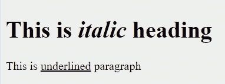

### 不仅仅显示文本
JavaScript 不仅仅是在你的屏幕上显示文本。它是你网站中使其更具交互性的部分。在 `Notepad++` 上创建一个新文件并输入以下内容：
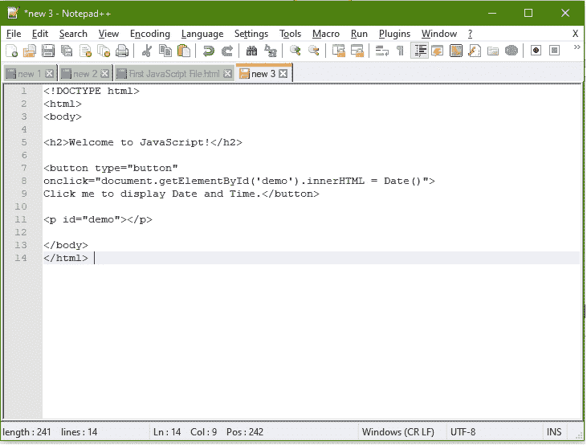

### 仅使用基础知识
如果你不想费心处理上述所有 HTML 代码，只想学习 JavaScript 的基础知识，请记住你只需要这个基础的骨架标签格式：
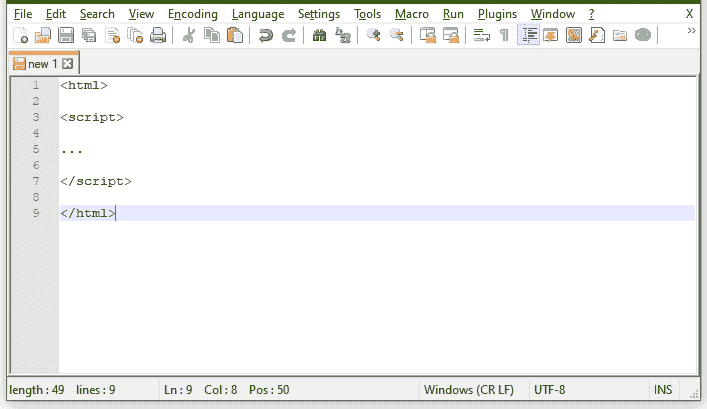

这些是你需要的全部四个标签，你所做的是将你的 JavaScript 代码（或简称为脚本）插入脚本标签之间（即省略号所在的地方）。但如果你想添加一些文本元素，你可以自由地使用 `<p>`、`<h1>` 和 `<h2>` 标签内的内容。即使你有这些文本元素，你的脚本仍然可以正常工作。

### 将你的工作保存为 HTML
你接下来需要做的另一件事是点击 `File > Save As`，然后在弹出的窗口中点击左面板上的 `Desktop`，这样将你的工作保存到桌面上。如果你喜欢，可以选择不同的文件夹。之后，点击 `Save as Type` 并从下拉菜单中选择 `HyperText Markup Language`，并将文件名写入 `Welcome to JavaScript`。你将在桌面（或你选择的文件夹）上看到一个名为“Welcome to JavaScript”的新文件，它将具有你默认浏览器的图标——我的是 Google Chrome，所以我我在桌面上看到一个新的 Chrome 文件。双击该文件，你的默认浏览器将打开它。在你的浏览器上，你将看到显示的内容：
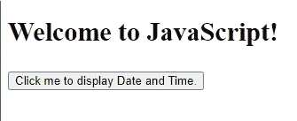

注意那里还有一个按钮。欢迎消息是**粗体**字体并是标题样式，这是因为使用了 `<h2>` 标签。现在，点击该按钮。你将看到你所在地区的当前日期和时间显示在屏幕上。如你所看到的，JavaScript 让页面更具交互性，而不仅仅是在屏幕上显示文本。


# 编程练习

在本节中，在我们进入本书的第 2 章之前，你将学习更多一些可以添加到你所构建的网页中的交互式功能。请记住，我们将只关注 JavaScript 的核心，并且只会顺带提及 HTML 和 CSS。我们将特定于浏览器的命令降到最低。这意味着我们不会处理该语言的某些特性，如文档、事件和接口。我们可能会顺带提到它们并提供一些示例，但我们不会重点介绍它们。

请记住，这本书是关于为初学者提供的 JavaScript 基础知识。我们只关注你作为一名通用编程初学者所需要的基础工作。回到本小节的主题，我们将通过几个程序示例，向你展示这种编程语言的交互式功能。

## 插入 <script> 标签和弹出窗口

请记住，你可以使用 `<script>` 标签在 HTML 代码的几乎任何位置插入 JavaScript 代码。在 Notepad++ 中输入以下代码并将其保存为 HTML。

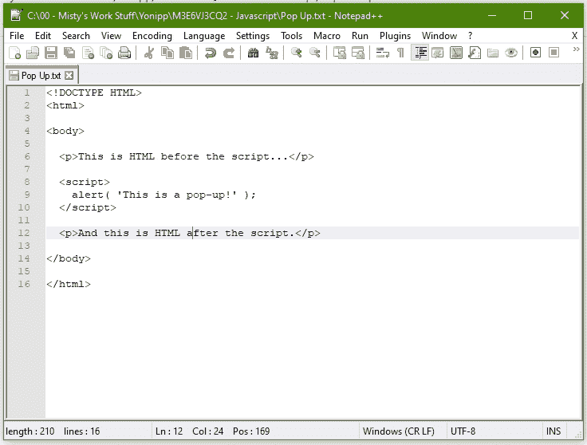

你可以随心为它命名。使用你的浏览器打开该 HTML 文件。注意，当你打开它时，你会看到一个显示消息“This is a pop-up”（这是一个弹出窗口）的弹出窗口。点击 OK 按钮，然后你会在浏览器窗口上看到一些文本。

如果你检查你编写的代码，JavaScript 代码被插入在两行 HTML 编程代码之间——即显示 script 之前和 script 之后的代码行（第 6 行和第 12 行）。这只是演示了你如何在 HTML 之间插入 JavaScript。注意，我们示例代码中的第 9 行包含 `alert`，这是一个特定于浏览器的命令。我们使用该命令来显示文本。注意它的语法。你可以使用单引号或双引号来表示要显示的文本。

我们将在本书的第 3 章中介绍语法规则。

## 修改 HTML 内容

这是你使用 JavaScript 可以做的另一个交互式操作：更改网页上的内容。在 Notepad++ 上创建一个新文件并输入以下代码。注意按钮元素的语法。我们稍后后会介绍该元素的各个部分。现在，我们将关注 JavaScript 的这一功能。

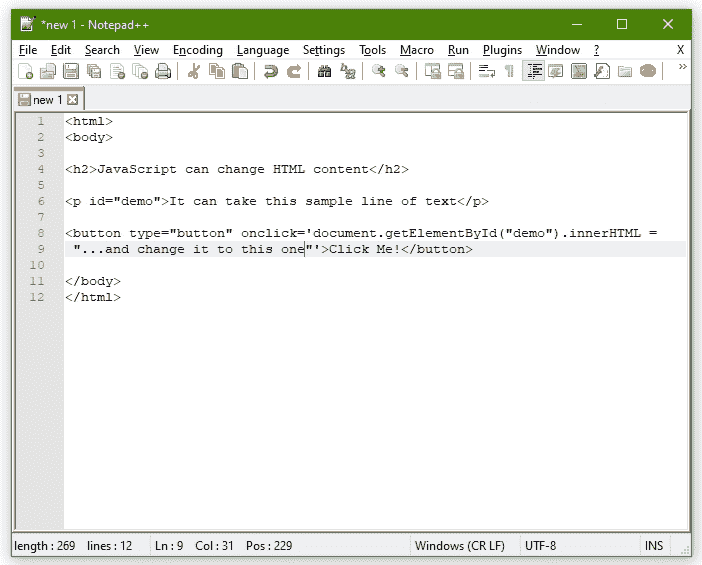

将你的工作保存为 HTML 文件，并使用你喜欢的任何名称。双击该文件，它将用你的默认浏览器打开。注意，你将看到顶部的标题（即 `<h2>` 标签中的文本）。下方是一行文本，后面跟着一个“click me”（点击我）按钮。当你点击按钮时，注意文本变成了按钮点击指定的文本。

## 修改 HTML 样式

你编写的 HTML 代码具有某些样式。这些样式显示了网页内容将如何呈现给访问者。JavaScript 可以更改页面呈现的样式。

这是一个你可以尝试的示例。将以下内容复制到 Notepad++ 的新文档中，保存为 HTML 文件，并在浏览器中打开该文档。

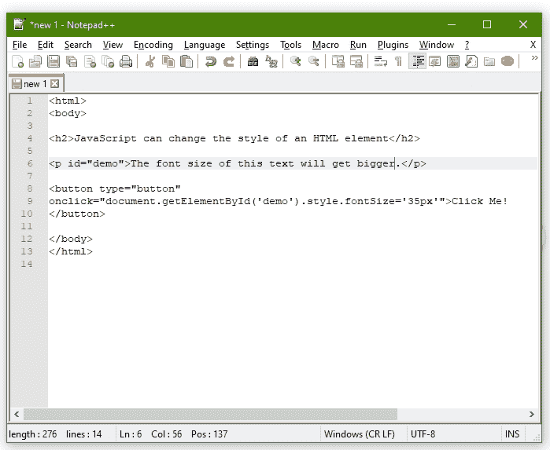

观察你点击按钮的情况。在你点击后，文本的字体大小发生了变化。

## 随堂测试

这是我们的第一次随堂测试。随着本书课程的进行，你还会遇到更多此类测试。问题将在这里给出，你可以在下一页找到答案。

### 任务
创建一个网页文档，显示消息“I’m JavaScript!”（我是 JavaScript!）。请使用目前为止提供的信息以及我们提供的示例中的小知识。将你的工作保存为 HTML 文件，并在浏览器中打开你的文件。

### 随堂测试答案
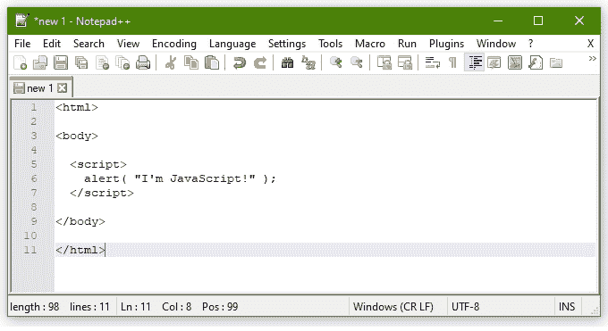

# 第 3 章：深入研究语法

在上一节中，我们已经过了一些关于 JavaScript 语法的基础知识。我们将在本章中更多地关注这一点。注意，与许多其他编程语言相比，这种语言使用的语法相当简单。

当我们说语法时，我们指的是 JavaScript 中单词和符号应该如何排列的规则。如果你正确地形成或排列了这些语言元素，你编写的程序代码将由浏览器正确解释，并完全按照你指示的方式执行执行。

然而，如果你在语法上犯了错误，就会产生错误。好消息是，我们需要涵盖的语法规则很少。作为初学者，你只需要学习语法的五个标题，包括以下：

*   大小写敏感
*   空白字符
*   标识符
*   字面量
*   注释
*   分号


让我们从最简单的主题开始：大小写敏感。

## 大写敏感
`JavaScript` 是一种对大小写敏感的语言。这意味着当你使用单词时，字母的大小写方式会起作用。例如，假设你想将网站用户输入的密码保存到一个名为变量的东西（稍后会详细介绍）中，并将此密码命名为 `Password`。那么它在你的整个程序中应该是这样显示的。如果你在程序代码中出于某种原因使用了 `password`，它会被视为与 `Password`不同的内容。记住，`password` 会被视为与 `Password`不同的内容。大写字母和小写字母会区分你代码中的不同内容。

## 空格
空白指的是你在任何文档中输入内容时所产生的空格、换行符和制表符。我们通常在输入的每个单词后只使用一个空格。例如，如果我们在 MS Word 中输入内容时输入了两个空格，拼写检查器就会提示你犯了那个拼写错误。然而，在 `JavaScript` 中，这些空格和制表符并不重要。这就是为什么你可以随意输入任意数量的空格而不会引起任何错误。在理论上，你可以添加任意数量的这些元素而不会出现问题。

在实践中，程序员之间存在一种不成文的规定或习惯，关于如何格式化你编写的每一段代码。我们寻找的是整洁的代码，以提高其可读性。你不希望你的代码看起来像所有部分都向所有可能的方向延伸。考虑我们之前的第一个示例代码，你可以在这里看到

正如你所见，从这个示例可以看出，所有内容都是左对齐的。如果元素嵌套在另一个元素中，则对其缩进。例如，看上面的示例代码，你会看到`<head>` 元素之后的所有内容都缩进了一个制表符。代码的第 3 到 6 行都是缩进的。这意味着它们位于 `<head>` 元素内部。对齐回到第 7 行。现在，看代码的第 5 行。你会看到 `alert("Hello World!");` 嵌套在`<script>` 标签内部。你已经在第 2 章中见过这个语句。在实践中，你应该对嵌套在另一个元素中的内容缩进，这有助于寻找特定的代码元素。这种做法也让你更容易发现程序中的错误。在我们编写代码时，都会犯错。

## 标识符
标识符是程序员提供的单词或字符。本质上，它们是你赋予程序中不同部分的名称。

回到早早的示例，假设你想让网站访问者输入密码（就像 Facebook 或其他网站一样）。假设我们要把密码存储在变量中，我们称为 `Password`。这是标识符的一个例子，就像代数一样。`JavaScript` 中的标识符可以是字母。你也可以使用像 `x` 或 `y` 这样的单个字符。再次，你的标识符可以以任何字母开头，也可以以下划线 `_` 开头。所以，假设我们使用 `_Password` 来存储用户提供的密码。某些标识符以 `$` 符号开头，但注意我们在 `JavaScript` 中使用 `$` 符号来引用元素。

## 字面量
我们将介绍 `JavaScript` 中的字面量语法规则。之前我们提到过 `JavaScript` 中的变量用于存储网站访问者提供的密码。字面量是赋值给变量的实际值。假设我们将变量 `Password` 赋值为 `"12345678"`。字面量是不需要编号的。它们可以是字母或数字的组合。

## 注释
查看以下代码并尝试寻找注释。(Image00014.jpg) 正如你从上面的代码中所看到的，在第 6 行有一个注释。注意，这些注释不会被视为编程代码。注释是为作者编写的说明。

## 分号
回到上面代码的第 5 行，在注释之前。代码如下：
```
alert("Hello World!");
```
如果你猜这行告诉浏览器在屏幕上显示 "Hello World!"，那么你是的。记住，在 `JavaScript` 中编写的每一行代码应该以分号结束。我们的示例中的 HTML 部分不需要分号，但如果你在写 JavaScript 时，则会导致错误。

# 第 4 章：现代标记和外部脚本
我们介绍了 `JavaScript` 中使用的语法细节，以及 HTML 部分。为什么我们仍然坚持旧的规则？这是因为旧的网站还没有更新。`<script>` 标签今天仍然使用的某些旧的属性已经不再适用了。

## Type 属性
在我们使用的示例之一（第一个）中，使用了 `type` 属性。这是示例代码：(Image00004.jpg) 在第 4 行插入这一行：`type="text/javascript"`。注意在现代标记语言如 `JavaScript` 中，这个属性不再需要了，因为浏览器已经更新并使这些功能废弃。`type` 属性不再有意义。

## 如何判断你正在查看旧脚本
如果你从事网页开发，你可能被要求编辑旧代码。有时你的任务会涉及新旧代码的结合。在 `JavaScript` 中，一种简单的方法是看脚本前后的注释。我们在第 3 章讨论过注释，记得吗？程序员曾在脚本前后添加注释：
```
<script type="text/javascript">
...
</script>
```

## 注释的作用是什么？
记住，浏览器不将注释视为代码，因此它们不会像指令一样执行。过去，程序员使用注释来隐藏脚本，以免旧浏览器出现问题。现在不再有这个问题了，所以你不需要“隐藏”你的 `JavaScript`。这意味着如果你被要求编辑代码，只需删除这些注释即可查看脚本。

## 外部脚本
假设你有很多脚本，并且从一个页面到另一个页面使用相同的脚本。重复编写所有代码会很无聊吧？好消息有一种方法保存经常使用的 JavaScript 代码，你就不需要重新输入或复制粘贴一遍。你需要的是将脚本保存在外部文件中。

## 创建 JavaScript 文件
要创建 JavaScript 文件，你只需像往常一样输入脚本代码。我们不将其保存为 HTML 文件，而是保存为 JavaScript 文件。它将具有 `.js` 扩展。你可以将它们保存在创建 HTML 文件相同的本地目录中，也可以使用它们所在的目录路径或文件夹引用它们。如果你将它们保存在网站服务器上，那么你应该使用服务器上目录的 URL。引用你创建的 JavaScript 文件使用 `src` 属性。这是一个示例：
```
<script src="/path/to/script.js"></script>
```
在这个示例中，`/path/to/` 部分是脚本文件所在的目录路径或文件夹，`script.js` 是保存的 JavaScript 文件名。当然，可以使用不同的目录路径和文件名。现在，假设你的脚本文件和 HTML 代码保存在同一个目录。你不需要编写整个目录路径。所以，在我们的示例中，你不需要 `src` 属性中包含 `/path/to/`。你可以这样写引用：
```
<script src="script.js"></script>
```
这意味着你创建的脚本文件保存在活动目录中。现在有一个 `src` 属性引用服务器上实际文件的示例：
```
<script src="https://cdnjs.cloudflare.com/ajax/libs/lodash.js/4.17.11/lodash.js"></script>
```
如果你想在代码中使用多个脚本文件，那么使用独立的 `src` 语句引用每一个。这是一个示例：
```
<script src="/myfiles/script1.js"></script>
<script src="/myfiles/script2.js"></script>
```
在上面的示例中，脚本文件存在 `myfiles` 文件夹中。脚本的名字是 `script1.js` 和 `script2.js`。

流行测验
任务：创建一个使用 `alert` 语句的脚本文件并显示它。


1. 什么是语句（statement）？
2. 什么是循环（loop）？
3. 请举例循环语句
4. 如何临时禁用部分代码？
5. 单行注释和多行注释之间有什么区别？

# 第 6 章：变量与常量

我们在上一章中提到了变量，在本章中将对它们进行详细介绍。如果你还记得，JavaScript 中的变量就像我们在代数和其他所有奇妙数学学科中的变量一样。然而，巨大的区别在于，JavaScript 中的变量并不仅包含数字，它们还可以包含其他类型的数据，如字母、符号等。

## Const 与 Let

你必须记住的一个规则是：在运行任何变量（或 JavaScript 中的任何其他类型元素）之前，你必须先对其进行声明。声明意味着你正在计算机的 RAM 中设置一个内存分配，该内存将用于你程序的这部分。你需要记住有两种语句：

* `const`
* `let`

我们在上一章中已经学习了语句，并描述了一些你在编写脚本或程序代码时可能会用语句或命令。让我们来看看这两个语句之间的区别，以及你如何使用它们来创建变量。

以下是如何使用 `const` 和 `let` 给变量赋值的示例：

```
const pi = 3.1416 ;
let message = 'Hello' ;
```

你使用等号（也称为赋值运算符）为这些变量中的每一个赋值。在上面的 `const` 示例中，它将 `3.1416` 赋值给 `pi`，而 `let` 将一个字符串赋值给名为 `message` 的变量。实际上，在这个示例中，`pi` 并不是变量，它被로常量。

### 有什么区别？

当你使用 `const` 时，变量的值是不允许改变的，这就是为什么它从初被称为常量的原因。另一方面，当你使用 `let` 语句时，值是可以改变的。

这是一个快速练习。输入以下代码，保存它，并在浏览器中打开。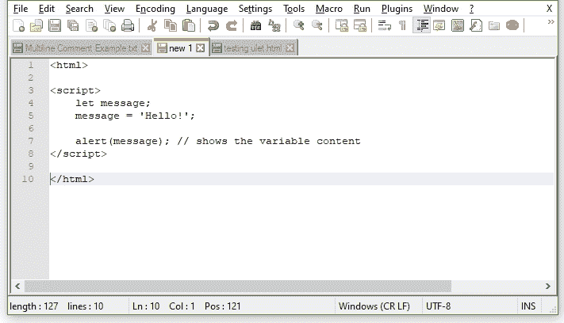

如你所示，`alert` 语句显示了名为 `message` 的变量的内容。记住，如果你在 `alert` 语句中使用变量作为参数，不要将变量包含在引号中。

### 声明多个变量

假设你想声明多个变量。你不需要写很多 `let` 语句来实现这一点。你只需要用一行声明所有内容，如下：

```
let user = 'Mary' , age = 18 , message = 'You’re late for class!' ;
```

使用逗号分隔每个变量声明。现在，你也可以分行声明它们，如下所示：

```
let user = 'Mary' ,age = 18 ,message = 'You’re late for class!' ;
```

## 堂测

**问题**：你认为以下代码的输出是什么？！[](Image00020.jpg)

**答案**：即使只使用了一个变量也会显示两个不同的文本。变量被赋予了两个值，然后显示在屏幕上。例如：变量的值可以被改变或操作——这意味着你可以添加、删除以及编辑或更改变量的内容。

### 两个 Lets 会产生错误

尝试以下代码。在 Notepad++ 中输入，将其保存为 HTML，然后使用浏览器打开。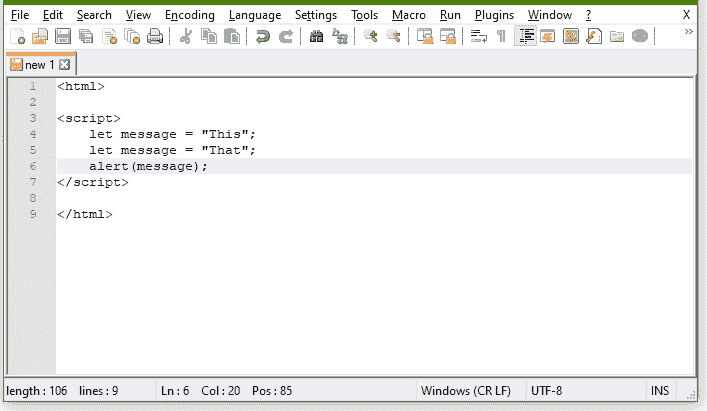

屏幕上显示了什么？如果你回答“什么都没有”，那么你是正确的。为什么你认为尽管那里有一个 `alert` 语句，但什么都没有显示？这是因为你不能两次声明同一个变量。如果你想更改变量的值，只需声明一次，然后使用赋值运算符或等号来更改变量的值。

### 变量命名规则

在为 JavaScript 中创建的变量命名时，你只需要记住两个规则：

1. 第一个字符不能是数字。
2. 你只能使用字母表字母、数字 `0` 到 `9` 以及符号 `_` 和 `$`。

如前提到的，JavaScript 是大小敏感的。另外一点是，当你使用多个单词的长变量名时，通常的做法是使用驼峰命名法（camel case），例如：

```
let userName ;
```

你可以将下一个单词的首字母大写。注意，JavaScript 也允许非英语字母，但不建议这样做。这里有一个例子：

```
let имя;
```

**提醒**：选择描述其所存储值的变量名。当我们把变量命名为“password”时，它应该包含密码。如果我们把变量命名为“monthlySales”，那么它应该包含该月的数字和销售数据。

### 保留字

JavaScript 中有很多保留字，你不能将它们作为变量或常量名。使用它们会导致代码产生错误。以下是该编程语言中保留字（也称为关键字）的列表：

`break`, `case`, `yield`, `function`, `with`, `catch`, `class`, `while`, `void`, `const`, `continue`, `var`, `typeof`, `debugger`, `default`, `try`, `this`, `throw`, `delete`, `do`, `super`, `switch`, `new`, `return`, `else`, `export`, `in`, `instanceof`, `extends`, `finally`, `if`, `import`, `for`

这些关键字在 JavaScript 中已经具有功能，这就是为什么你不能将它们作为用户生成的变量名。

# 第 7 章：数据类型与运算符

变量可以包含不同类型。有些是数字，有些是文本，在 JavaScript 中，有 8 种你可以处理的数据类型。我们还将概述用于修改变量内部包含值的各种运算符。

## 动态类型

正如本书早期提到的，JavaScript 是动态类型的。这意味着我们可以在开始为变量分配数值，然后在代码的后续部分分配数字，而不会出现任何问题。具有这种属性的编程语言被称为动态类型语言。

### 数字

JavaScript 中的数字可以是像 `100` 或 `7` 这样的整数，也可以是像 `3.1416` 或 `12.325` 这样的浮点数。你可以对数值数据使用以下运算符：

* `+`（加法）
* `-`（减法）
* `/`（除法）
* `*`（乘法）


尝试以下代码并在浏览器中查看输出：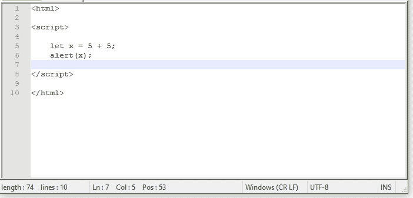

JavaScript 中还存在一些可以使用的特殊数字，例如 `infinity` 或 `∞`，以及 `NaN`。将此行添加到之前的练习代码中，并查看输出：

```
alert ( 1 / 0 );
```

另一方面，`NaN` 是当你进行计算错误时产生的输出。要尝试一下这个，请将此行添加到之前的练习代码中：

```
alert ( "not a number" / 2 ) ;
```

注意，此语句将返回“NaN”。如果你在它之后添加更多计算，它仍然会返回 `NaN`。请注意，JavaScript 中的数字包括正数和负数。

### BigInt
请注意，JavaScript 中使用的数字范围存在技术性限制。`number` 数据类型的范围从 `-(2⁵³ - 1)` 到 `(2⁵³ - 1)`。正数不能大于 `9,007,199,254,740,991`（负数也是同样的数字）。

如果你需要一个比这更大的数字，那么你就需要将数字转换为 `BigInt` 数据类型。要做到这一点，只需在你打算使用的巨大数字末尾添加一个“n”，就像这一个：`9,007,199,254,740,990,321,456n`。

### 字符串
JavaScript 中的字符串指的是字符，它们通常被放在单引号或双引号之间，例如“Hello”或 'This is an example of a string.'。

请注意，如果你将数字放在引号内，那么像“12345”这样的数字将被视为字符串或字符集，而不是数字。

如果你想在输出到屏幕时将变量嵌入字符串中，你需要使用反引号 `` ` ` 并在这种类型的括号 `${…}` 中包含表达式。尝试这段示例代码来查看反引号是如何工作的：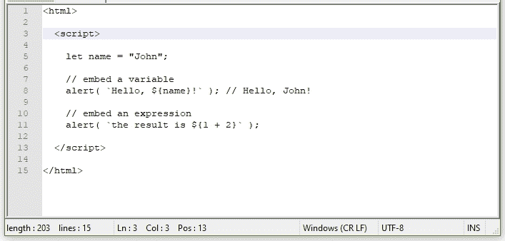

请注意，你只能使用反引号嵌入数字或数学表达式。如果你更改上一个示例中的反引号并使用单引号或双引号，你将无法嵌入表达式或数学公式，它们将被视为文本。

### 布尔数据类型
除了数字和字符串，另一个实用的数据类型是 `Boolean`。你可以使用此数据类型来测试某些表达式的逻辑。它有助于决策语句。布尔数据可以是 `true`（真）或 `false`（假）。

将以下代码嵌入 HTML 文件并在浏览器中打开它：

```
let isGreater = 5 > 1 ;
alert ( isGreater );
```

注意，此脚本的输出是“true”。变量 `isGreater` 被赋值为 `true` 是因为 `5` 大于 `1`。我们使用像 `>`（大于）、`<`（小于）、`!=`（不等于）和等于（==`）这样的比较运算符来进行这些逻辑测试。

另一个逻辑运算符是 `||`，它的意思是“或”。如果所比较的两个项目中任一个为真，或运算符将始终返回 `true`。只有当比较的两个项目均为假时，它才会返回 `false`。

另一个你应该熟悉的运算符是 `&&`（与）运算符。记住，在用 1 和 0 交流的计算机的世界里，数字 `1` 是真，0 是假。从技术上讲，任何正数都是真，零是假。

所以这意味着一个值为 `1` 的变量在逻辑测试时将返回 `true`。如果它的值为 0，那么它返回 `false`。

回到 `&&` 运算符，这里有一个示例表达式：

```
alert ( 1 && 0 ); // 0
```

`&&` 运算符先求值左侧的操作，然后是右侧的。在这个例子中，`&&` 运算符将返回零或假。为什么？因为它会寻找第一个假值，这就是为什么上面的 alert 语句将显示假或零。

查看下一个示例：

```
alert ( 1 && 5 ); // 5
```

注意，`&&` 运算符返回 `5` 或真。它所做的是左到右评估所有的操作数（即先是 `1` 然后是 `5`）。在这种情况下，没有零，所以没有假值。如果是这样，那么它将返回最后一个真值（即 `5`）。

### Null
`null` 值为变量分配一个空值或未知值。这是初始化变量的一种极佳方法，可以确保它们不包含来自内存的垃圾数据。你可以这样给变量分配一个 `null` 值：

```
let score = null ;
```

### 未定义 (Undefined)
如果你忘记给变量赋值并尝试在数学表达式、逻辑比较中使用它，或者只是将其显示在屏幕上，浏览器会自动返回“undefined”，这意味着该变量没有分配值。

尝试以下代码并查看你得到什么输出：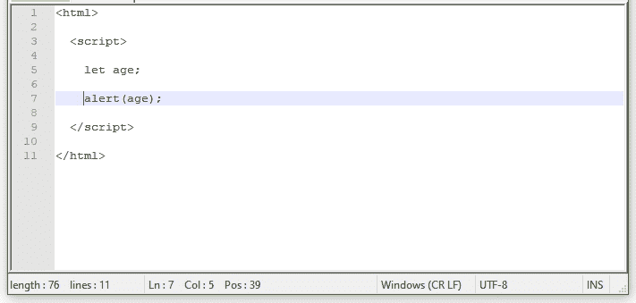

### 对象数据类型
我们在这里只介绍对象数据类型。到目前为止你看到的所有数据类型只包含一个值。这些数据类型被称为原始数据类型。

JavaScript 和其他编程语言中使用的更高级的数据类型是 `object`（对象），这种数据类型可以包含多个值。你可以这样想，你可以创建一个代表不同值的变量。这种记录可以包含多个位信息，例如姓名、电话号码、邮箱、社交媒体账号和交易。

### 符号 (Symbols)
最后一个我们要介绍的类型类型是 `Symbol`（符号）。它被用于创建标识符。

### 测验
（注：此处原文内容重复且混乱，翻译根据原意逻辑进行了整合）
）
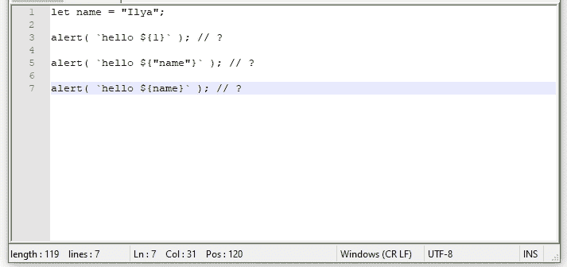

*(注：由于原文文本存在大量重复和逻辑混乱，翻译时保留了核心技术概念：BigInt, 字符串, 布尔, Null, Undefined, 对象, Symbols 以及逻辑运算符 && 和 ||)*

