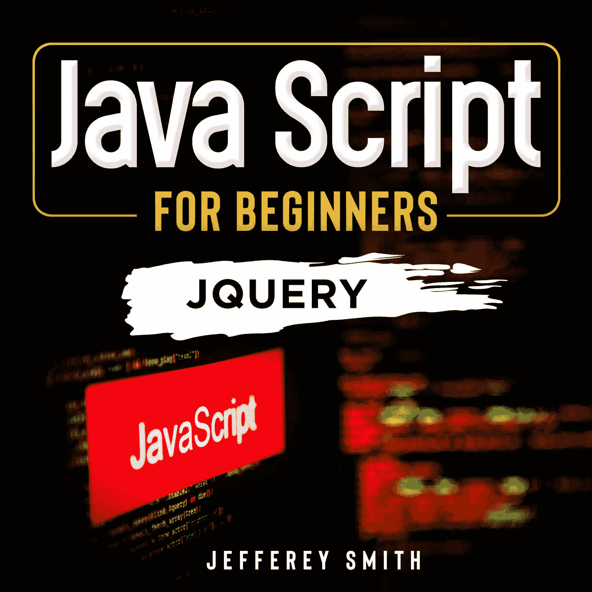
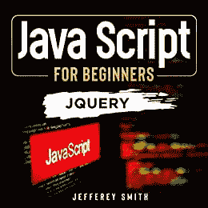

# JavaScript 初学者指南 - JQUERY！快速学习 JavaScript！发现你所需的知识！







# 引言

编程本质上是告诉计算机做什么、什么时候做以及如何做。它控制着大多数设备。从计算机到自动售卖机，最重要的网页。

JavaScript 被称为网页语言。这是因为大多数（如果不是所有）网站都在使用它。它很容易学习和理解，而且更新和升级的成本不高。很多软件都是开源的。


准确定 `JavaScript` 的核心组件并对其进行更深入的学习。不要觉得需要平等地学习所有内容。帕累托法则指出，在某些情况下，80% 的效果来自于 20% 的原因。因此，如果你专注于书中能带来 80% 预期结果的 20% 内容，你将能够以惊奇的速度进行学习。需要关注的关键领域包括 `Functions`、`Variables`、`Conditional statements`、`Objects` 和 `Arrays`。

## 2. 要勤奋。

在学习新知识时，观看教程和阅读非常有帮助。但是，投入更多时间在实践上对你更有帮助。当你学自行车时，你必须主动活动四肢才能前进。学习 `JavaScript` 也是如此，通过在机器上编写代码你会学得更快。此外，投入时间至关重要。每周至少花一小时练习和编写代码，将极大提高你的知识水平。

挑战自己，并用 `JavaScript` 构建一个实际项目，无论它有多小。这样做可以巩固你学到的一切知识。你还能识别出自己可能遇到困难的地方，并在那些领域投入额外努力。

## 3. 学习如何排除错误。

在学习 `JavaScript` 时，你会遇到 Bug。掌握解决问题的技能将始终有用。它会让你成为一名敏锐的程序员，并让你能够更快地完成项目。

## 什么是 JQuery？

许多年前，当程序员想要更改网页属性的外观和感受时，他们必须包含大量的字体标签和颜色属性。这导致他们的 HTML 页面充满了代码，非常难以维护。这意味着所有的网页都必须手动进行维护和修改。在 CSS 发明后，他们能够改变网站的外观，而无需为每个页面编写无尽的代码。当 `JavaScript` 出现时，程序员开始将 `JavaScript` 代码写在他们的 HTML 文档中，因为他们当时并不精通它。最终，他们将 CSS 理论应用于 `JavaScript`，`JavaScript` 库之诞生了。在当时存在的所有库中，`JQuery` 脱颖而出，我们今天仍在使用它。

当你谷歌搜索 `JQuery` 时，出现的只有它是一个 `JavaScript` 库，但它不止于此。它简化了客户端 HTML 的脚本编写。它的主要目标是让你使用 `JavaScript` 变得更容易。它还可以用于让添加动画变得更容易。它基本上将许多需要几行 `JavaScript` 才能运行的常见任务合并在一起，形成单行代码。

什么是客户端，什么是服务器端？

客户端和服务器端也被称为前端和后端，尽管它们并不完全相同。客户端是应用程序代码运行的地方，服务器端是存储源代码的地方。

`JQuery` 的一些最著名的特性包括：

- HTML 操作
- DOM 操作
- CSS 操作
- 效果和动画
- Ajax
- 工具函数

`JQuery` 变得流行是因为市场对能够简化编码体验的工具的需求。`JQuery` 比它的同类产品更快，并且不断被扩展。它有助于以尽可能少的行数编写用户界面函数代码。它兼容所有浏览器，并与最新功能保持同步。

# 第 1 章：初学者 JavaScript

在开始学习如何编码之前，有一些先决条件。你至少必须具备 `HTML` 和 `CSS` 的基础知识。

`HTML` 代表超文本标记语言。它不被视为编程语言。正如其名称所示，它是一种用于构建网页结构的标记语言。从核心上说，它是一种非常简单的语言，包含了应用于文本的元素以赋予其独特的含义。你可以使用这些元素来包裹、标记或封闭页面上的组件，并让它们看起来或表现具有特定的方式。它可以决定你文档中的文本是以段落形式、项目列表还是表格的形式出现。它还可以在页面上嵌入图片和视频。

当你访问任何网站时，会有许多文件发送给你。在基础层面上，你的网站将向你展示一个 `HTML` 页面和一个 `script.js` 页面。`HTML` 页面是网页的骨架。它告诉浏览器显示什么以及每个东西放在哪里。所以，如果顶部需要一个标题，中间一个段落，底部需要一张图片，`HTML` 文件负责将这些信息传递给浏览器。这很好，但它的限制很大，因为页面将始终是静态的，数据无法更改。这就是 `JavaScript` 发挥用场的地方。`JavaScript` 能够通过访问 `DOM` 来操作网站的外观`DOM` 代表文档对象模型。它告诉 `JavaScript` 页面上有什么，然后允许它更改页面元素。`DOM` 使读取、访问和获取 `HTML` 文档的内容变得更容易。如果我们进一步拆分，`Document`（文档）是 `HTML` 文件，`object`（对象）是 `HTML` 文件中的标签和元素，而 `Model`（模型）是布局或结构。没有 `DOM`，`JavaScript` 将对网页上的任何元素都无法感知，因此无法更改或操纵它们。`DOM` 信息通过 `API` 提供。`API` 代表应用程序编程接口。它基本上为 `JavaScript` 提供了一个控制 `HTML` 页面事务的入口。`API`充当了 `JavaScript` 和 `HTML` 之间的桥梁。

`HTML` 语法简单来说 `HTML` 的编写方式。`HTML` 元素以特定方式构造；它们由起始标签、内容和结束标签组成。起始标签是元素开始的地方。从视觉上看，它是包裹在起始和结束角括号中的元素名称。例如，当你的元素是一个段落时，起始标签看起来像这样：`<p>`。元素的内容放在中间，在这种情况下，就是段落中的文本。结束标签标记元素结束的地方。它与起始标签相似，但在第一个括号之后有一个斜杠。在这种情况下，它看起来像这样：`</p>`。如果你忘记插入斜杠或完全没有包含结束标签，可能无法达到预期的结果。

元素分为两类，即：块级元素和内联元素。块级元素创建你可以在页面上实际看到的块，它们通过创建换行来占据网页的完整宽度。内联元素仅占据它们所需的空间，并且能够在产生任何换行的情况下向页面添加内容。

`CSS` 或级联样式表是一种用于描述用 `HTML` 编写的文档外观的样式语言。它用于网页的格式和布局。它基本上负责让你的网页看起来非常漂亮。`CSS` 语法非常直观。语法的第一部分是 `selector`（选择器），后面跟着起始和结束大括号。括号用于显示将应用于 `selector` 的样式的开始和结束。它看起来像这样：`selector { property1: value;}`。`Property`（属性）指颜色、大小或长度，而 `value`（值）指属性应用的文本或图像。

## 语法

为了执行 `JavaScript`，我们必须将语句放在网页的 `script` HTML 标签内部。例如：
```
<script> JavaScript code </script>```
`script` 标签由两个属性组成：

- **Language**（语言）：定义你正在使用的脚本语言。值将始终是 `JavaScript`。
- **Type**（类型）：规定正在使用的脚本语言，并应始终设置为‘text/javascript’。


你的代码段看起来所示：

```html own<script language = “javascript” type = “text/javascript”> JavaScript code </script>
``` (JavaScript - Syntax, n.d.)

你可以完全自由地在程序中使用空格、制表符和换行符，你也可以以易于自己阅读和理解的方式对代码进行格式化和缩进，但 JavaScript 会忽略这些内容。在 JavaScript 中，简单语句后面通常跟着一个分号，但如果你的语句写在不同的行，你也可以选择省略分号。

如果你的语句看起来所示：

```html
<script language = “javascript” type = “text/javascript”>

<!

var1=20

var2=30

// -–>

</script>
```
(JavaScript - Syntax, n.d.)

你可以在没有分号的情况下编写它。当你的语句以单行格式编写且如下所示时：

```html
<script language = “javascript” type = “text/javascript”>

<! --

var1=20; var2=30;

// -–>

</script>
```
(JavaScript - Syntax, n.d.)

那么你必须使用分号。

JavaScript 是区分大小写的，所有变量和其他标识符必须以全大写写（注：此处原文描述可能有误，JavaScript 是区分大小写而非强制全大写）。

JavaScript 中的注释用于为你的代码添加备注，或者在不完全删除代码的情况下禁用部分代码。我们通过在单行之前放置一个正斜杠 `/` 或在多行之后添加一个正斜杠加星号 `*/` 来生成注释。代码注释是许多编程语言的核心特性。

以下是如何在 JavaScript 中使用注释的示例：

```javascript
<script language = “javascript” type = “text/javascript”>

<! --

//comment

/*

*multi-line comment

*multi-line comment line 2

*/

//-- >

</script>
```
(JavaScript - Syntax, n.d.)

当用户操作网页时，JavaScript 和 HTML 会相互交互，这被称为“事件”（Event）。这意味着在网页上执行的任何操作都是一个事件。开发者为所有事件编写响应代码。所以，如果你鼠标悬停在浏览器的任何窗口上，看到网站名称和网址，那就是对事件的响应。有很多事件类型，其中两种是：

-   **Onload**：页面加载时激活 `Onload` 事件
-   **Onmouseover**：当光标移动到元素上或元素周围时激活

### 浏览器中的 JavaScript

所有当前浏览器都支持 JavaScript，但有时你可能需要手动启用或禁用它。以下是在不同浏览器中管理它的方法：

#### Firefox:
- 打开一个新标签页，选择地址栏，然后输入：`about: config`
- 将出现一个警告页面，接受风险并继续
- 浏览器中将出现配置选项列表
- 转到搜索栏并输入 `javascript.enabled`
- 将出现开关，你可以根据意愿在禁用和启用之间切换。

#### Chrome:
- 点击右上角的菜单
- 点击“设置”
- 滚动到页面底部并点击“显示高级设置”
- 进入“隐私”部分并点击“内容设置”按钮
- 在那里你将找到 `JavaScript` 部分，你会有允许或禁止网站运行 JavaScript 的选项。

#### Edge:
- 点击“设置和更多”按钮
- 选择“设置”
- 找到 `JavaScript` 部分
- 通过开关选择启用或禁用 JavaScript

### 如何开始编写 JavaScript

编写 JavaScript 有三种方法。第一种是直接写在浏览器。这是最简单的方法，因为你不需要设置任何东西，可以通过尝试一些简单的注释来开始。缺点是如果你刷新页面，代码将会消失，你必须从头开始。而且你一次只能执行一条命令。

如果你正在进行开发，你将需要保存代码并在任何时候执行多个命令。为此，你可能希望在一个简单的文本文件中编写 JavaScript，然后将其发送到浏览器执行。


JavaScript 中的函数式编程

在这种语境下，函数式编程是指创建仅关注结果而非过程的纯函数。纯函数是不可变的，这意味着你不能改变它们的状态。它们在执行计算时使用条件表达式和递归。它们不依赖参数之外的任何内容，因此它们是可预测的。如果你提供相同的参数，结果将始终是相同的。递归是程序员当一行代码可以被拆分为几个相似但更简单的任务时使用的模式。

### 函数的类型
一等函数被视为独立的实体。它们是独立的。我们可以像处理数据一样使用它们。函数式编程将参数、返回值和变量作为函数，以创建更复杂的代码。一等函数具有较强的活性，因此某些面向对象的对象的语言也包含了它们。

### 高阶函数
高阶函数作用于其他函数，并将它们作为参数传入。它们还会返回其他函数作为输出。

函数式编程不支持循环语句或像 `if` 这样的条件语句。

### 什么是条件语句？
条件语句查看 JavaScript 代码中的条件，并据此做出决定。正如名称所示，一个语句可以是真，也可以为假。只有当条件为真时，代码才会被执行。条件语句有四种：

- `if` 语句：如果条件为真，执行部分代码。
- `else` 语句：如果条件为假，执行与 `else` 相关的代码。
- `else if` 语句：如果第一个 `if` 条件为假，则指定并测试一个新的条件。
- `switch-case` 语句：根据特定条件指定多个待执行的替换块。

## 面向对象编程
JavaScript 本身不是基于面向对象的语言，但在编程时我们仍然可以使用它。虽然函数式编程以函数和逻辑为中心，但 OOP（或面向对象编程）不是。它是一种更关注对象的模型。它是将你的数据组织成类，然后根据这些类组织成对象的过程。在这种情况下，对象是一个具有自身特征和属性的数据字段。OOP 适用于需要不断更新和维护的大型程序。但这会降低它们的运行速度并导致消耗大量内存。

在开始任何之前，你想要先理解数据建模。数据建模是你取所有想要处理的对象并对其进行比较。如果你的对象是汽车，你将根据品牌、颜色和大小对它们进行比较。

构成面向对象程序的要素有：
- 类 (Classes)：用于创建对象的模型。
- 对象 (Objects)：拥有特征并可以按类型组织的单元。
- 方法 (Methods)：让 JavaScript 能够操作或更改其内部的数据。
- 属性 (Attributes)：我们放在 `html` 元素开始和结束标签中的词，用于控制标签的作用。

### 对象
对象由特征组成。如果一个特征具有函数，它被认为是一个`method`。如果它没有函数，它只是一个属性。属性可以是任何原始数据类型，但它们通常是位于对象中的变量。

OOP 的原理是：
- 封装 (Encapsulation)：用于在对象内部持有重要信息并防止额外信息暴露的方法。它为其他对象提供了受控的访问并有助于防止任何数据损坏。
- 抽象 (Abstraction)：仅在对象之间共享相关的属性并隐藏任何不必要的代码
- 继承 (Inheritance)：类从另一个类获取属性（如字段）的操作。
- 多态 (Polymorphism)：以不同形式表示同一事的过程。在 JavaScript 中，这意味着不同的对象可以共享相同的属性。

OOP 更容易管理，并且类似于现实世界，因此更容易理解。

## 过程化编程
过程化编程有一种直接组织代码的方法。它的目标是将程序分解为过程。在这种情况下，过程是按顺序执行的函数。它告诉计算机顺序执行函数，直到达到预期结果。

### 过程化编程的基本特征
- 预定义函数 (Predefined Functions)：预定义函数是由名称标识的命令。它们包含在复杂的编程语言中，但它们存储在 JavaScript 库中而不是程序本身中。
- 局部变量 (Local Variable)：局部`Variable`在方法的结构结构声明，不能存在特定字段之外。局部变量只能在编写它们的方法。如果程序员尝试在方法之外编写它们，代码将失败。
- 全局变量 (Global Variable)：全局变量写在方法之外，可以在所有函数中使用。
- 模块化 (Modularity)：模块化是指两个不同的系统被赋予不同的任务，但组合在一起首先执行单一任务。每个组将按顺序执行其任务直到完成。
- 参数传递 (Parameter Passing)：参数传递是用于向函数、子程序或过程传递指南的操作。它们可以通过值、引用、结果和名称传递执行。

### JavaScript 编程的应用
JavaScript 几乎出现在软件开发的每一个方面。某些方面包括：
- HTML 操作：JavaScript 允许你添加、删除和更改任何 `HTML` 元素的外观，以适应任何设备设备。
- 用户通知：在将用户输入发送到服务器之前双检查用户输入至关重要，因此 JavaScript 在前端验证这些输入。
- 后端数据加载：`Ajax` 库允许在进行其他处理时加载后端数据。这确保了客户端不会中断。
- 演示文：JavaScript 让你构建演示文以增强网站的外观。
- 服务器应用程序：服务器应用程序与客户端应用程序几乎相同，因为它们都交付和接收数据。它们之间的唯一区别是连接到服务器的方式不同。
- 客户端验证：有助于整体用户体验。这是一个运行的初始检查，用于识别客户端上的任何无效数据，以便用户可以进行修复。

我们应该扩展的一个经常出现的术语是“客户端（client）”。

客户端（Client-Side）和服务端（Server-Side）是用于定义应用程序代码执行位置的表达式。在“无服务器”框架中，供应商将资源分发到所有发生在服务器端的进程。云服务提供商仍然利用服务器为开发者运行代码，因此该名称可能具有误导性。

客户端服务器模型（Client-Server Model）是位于网络上的框架。它将计算机分为两个部分。第一部分请求服务（客户端），第二部分为客户端提供服务（服务器）。服务器位于高性能计算机内部但它本身并不是计算机。服务器是辅助客户端功能的程序。客户端-服务器模型是请求和响应的持续循环。它被使用是因为它的容量更大，因此比用户设备更可靠。

现在你已经了解编程实际上包含什么，你已经准备好学习应用程序的骨架以及构建它的要素了。

# 第 3 章：JavaScript 架构
理解 JavaScript 架构对于你学习编程非常有帮助。如果你对 JavaScript 在网络上如何工作有良好的理解，你就处于优势。

有三种 JavaScript 架构。典型的、基于框架的和高级的。

## 典型的 JavaScript 架构


通常情况下，JavaScript 应用采用自底向上的方法。用户界面始终处于开发的中心。用户界面与服务器通过后端代码直接相连。

这种 JavaScript 架构主要用于简单的程序，例如不需要复杂框架的网站。它无法应对更复杂的程序。它允许你与屏幕进行交互，但并不具备处理大型应用的能力。

SPA 或单页应用利用了典型的 JavaScript 架构。它们很容易更新，并且在今天仍然很有需求。SPA 只能在网页浏览器中使用，因此它们非常依赖 JavaScript。SPA 的速度通常比移动端应用更快，因为用于构建它们的脚本只需要加载一次。从那时刻起，它的唯一工作就是在用户和服务器之间传输数据。

## 基于框架的架构
随着时间的推移，典型应用架构的能力已无法满足全球范围内程序员的需求。因此，基于框架的架构运而生。它可以解决更复杂的问题，因为它利用了 `MVC` 或 `MVVM` 模式。

`MVC` 代表 `Model View Controller`（模型-视图-控制器）。它将较大的应用程序分为不同的部分，每个部分都有独特的功能。每个部分都负责处理应用程序的不同方面。模型代表所有与数据相关的内容。它从控制器接收命令，然后执行用户的输入。视图控制所有与用户界面相关的内容。它从用户获取输入，然后将模型的数据呈现给用户。控制器是两者之间的连接。它处理并操作来自双方的数据，然后产生输出。

`MVC` 有不同的变体：

- `HMVC`–代表 `Hierarchical Model view controller`（分层模型视图控制器）。它本质上与 `MVC` 相同，但具有层次和更多功能。它将 `MVC` 重应用于应用程序的不同部分。分层对应用开发大有奇效。你可以轻松地重用代码，而不必担心持续维护。
- `MVA`–代表 `Model View Adapter`（模型-视图-适配器）。通常数据从控制器传输到模型，但在 `MVA` 中，控制器是中间人，`Model` 和 `View` 必须通过它传递。`View` 和 `Model` 实际上并不交叉。在这里，`Controller` 充当适配器。
- `MVP`–代表 `Model View Presenter`（模型-视图-演示器）。这与 `MVC` 取不同。演示器负责应用程序中所有的数据。它将这些数据发送到模型进行处理，接收返回，然后将其传递给 `View`。
- `MVVM`–代表 `Model-View ViewModel`（模型-视图-视图模型），类似于 `MVC` 和 `MVP` 的混合，因为它借鉴了它们的模式。数据和信息与用户界面完全分离。控制器被 `Viewmodel` 取代，它连接了 `Model` 和 `View`。`Viewmodel` 每次接收到输入都会更新 `Model`，并在发送到 `View` 之前对该数据进行适配。

框架拥有功能丰富的运行时，用于渲染并输出应用程序。我们可以将运行时环境比为一个容器。它包含了运行 JavaScript 代码所需的所有内容，即：
- `Engine`（引擎）
- `Web API’s`
- `Event loops`（事件循环）
- `Call back queue`（回调队列）
- `Micro task queue`（微任务队列）

## JavaScript 引擎
引擎将 JavaScript JavaScript 的复杂代码转换为机器可以理解的代码。每个浏览器都有自己的引擎。一些著名的引擎是 `V8`、`SpiderMonkey` 和 `JavaScript Core`。

### V8
没有两个引擎是相同的，它们的运行方式不同，但最终做的事情相同。在 `V8` 引擎中，一切始于 `Parser`（解析器）。`Parser` 检查语法和语义。语法是代码输入的结构，而语义指的是代码中某些单词和符号的含义。然后 `parser` 分析并拆解代码，生成抽象语法树 (`AST`)。`AST` 是源代码的树形表示。`AST` 然后进入 `Interpreter`（解释器）。`Interpreter` 将 `AST` 转换为字节码 (`Byte Code`)。这被称为 `ignition`。有时代码会重复高达千次。当这种情况发生时，`Profiler`（分析器）会检查代码重复并尝试对其优化。一旦获得优化后的代码，它就会移动到 `Compiler`（编译器）。V8 引擎中的编译器被称为 `TurboFan`。`Turbofan` 以最优化的形式发布 `Byte Code`。

### SpiderMonkey
`SpiderMonkey` 实际上是第一个引擎，创建于 1995 年。Mozilla 基金一直在维护它，并在今天在使用。该引擎首先将 JavaScript 代码转换为 `ByteCode`，然后将其发送给 `Interpreter` 和 `JIT Compiler`。`JIT` 代表 `Just in Time`（即时编译）。`JIT Compiler` 优化代码并将任何未使用的代码发送到 `Garbage collector`（垃圾回收器）。

### Web API’s
`API` 代表 Application Programming Interface（应用程序接口）。它是一个为用户一组函数的接口，同时隐藏了该函数的底层机制。`Web API’s` 实际上并不是 JavaScript 的一部分。它们位于浏览器中，但它们允许我们访问 `JavaScript Engine`。

`Web API’s` 包含：
- 一组 timeout–允许你在经过特定时间（由你定义）后执行一段代码。
- `DOM API’s` - 由定义 HTML 中每个元素如何工作方式的接口组成。这包括它们可能依赖的任何支持类型和接口。
- `Fetch`–`API` 让 JavaScript 能够操作 `Call Stack`（调用栈）中的请求和响应。
- `Local storage`–让 JavaScript 应用无限期保存重要的键值对。
- `Console`–注册由 JavaScript 代码记录的所有日志消息。
- `Location`–允许浏览器用户在任何时候共享他们的地理位置。

### Event Loops
JavaScript 是单线程代码。这意味着它一次只能运行一个命令。这些命令是同步的，因为它们一个接一个地运行。这在编程中并不总是有效，所以有方法让 JavaScript 异步执行。像 `Call stacks`（调用栈）这样的机制有助于避免同步线程中可能发生的任何阻塞。

`Call stack` 是解释器用于跟踪函数及其在任何给定脚本中位置的机制。它允许函数并发运行。当脚本调用函数时，解释器将其放入调用栈中然后执行该函数。

`Callback Queue`（回调队列）像一个安全屋，未执行的脚本行留在那里，直到到了运行时间。

`Event Loop`（事件循环）的工作是检查 `Call Stack` 和 `Callback Queue`。如果 `Call Stack` 为空，`Event Loop` 将提取 `Callback Queue` 中的语句并推入 `Call Stack`。这看起来是一个非常直接的过程，但有一个被称为 `MicroTask Queue`（微任务队列）。`MicroTask queue` 几乎是 `Callback Queue` 的副本，但它具有更高的优先级，这意味着其中的任何函数都将先执行。


尽管框架架构（Framework Architecture）比典型架构具有更多功能，但在构建大型应用时仍然有其局限性。它增长以适应更大应用的唯一方法就是持续的维护和开发。`MVC` 和 `MVVM` 模式虽然方便并允许开发者复用代码，但它们在框架中存在问题。由于控制器在操作视图的同时与服务器进行通信，导致用户界面受到了损害。人们开始需要功能更丰富的架构，于是“高级 JavaScript 架构”（Advanced JavaScript Architecture）应运而生。在这种架构中，用户界面与服务器的通信完全分离工作，因此可以轻松应对大型应用可能提出的任何需求。

在这种情况下，数据计算和用户界面是完全分离的。用户界面不再处于中心，因此应用程序变得更容易管理和使用。

## 通用应用

正式称为同构应用（Isomorphic applications），它们由于代码较少，因此提供了更快的浏览器连接。它们在客户端和服务器端均运行，确保了更简单的交互，并减少了程序员的工作量。唯一的缺点是它们非常难以调试。

# 第 4 章：JavaScript 和 JQuery

让我们回顾 JavaScript 的一些重要特性，以便让你更好地了解它的工作原理。第一个特性是变量（Variables）。变量就像存储值的容器。数据可以存放在这些容器中，然后你可以通过命名容器来引用它。每项有价值的编程任务都需要一个变量。如果值无法改变，你的网页交互性将会降低。在 JavaScript 程序中使用变量之前，你必须先声明它。变量的关键字（如第一章所示）是 `var`。

```html
<script type="text/javascript">
<! --
var age;
var race;
// -- >
</script>
```

你也可以使用相同的关键字声明不同的变量。它看起来像：

```html
<script type="text/javascript">
<! --
var age, race;
// -- >
</script>
``` (JavaScript - Syntax, n.d.)

当我们在变量中存储值时，就会发生初始化。你可以在任何时间添加值。我们创建了一个名为 `race` 的变量，因此我们可以稍后向它添加值‘black’，并可以在初始化时添加 `age` 的值。它看起来像：

```html
<script type="text/javascript">
<! --
var age = "39"
var race;
race= black;
// -- >
</script>
``` (JavaScript - Syntax, n.d.)

`var` 关键字只需要在初始化时使用一次。

变量的作用域（scope）是程序中定义它的区域。在 JavaScript 中只有两种：

-   **全局变量 (Global Variables)**：可以在 JavaScript 代码的任何地方定义。
-   **局部变量 (Local Variables)**：仅在定义的函数范围内可见。

在函数体内部，局部变量的优先级高于同名的全局变量。当局部变量或函数参数与全局变量同名时，全局变量实际上被隐藏了。例如：

```html
<html>
<body onload = checkscope();>
<script type="text/javascript">
<! --
var myVar = "global"; // 全局变量
function checkscope() {
var myVar = "local"; // 局部变量
document.write(myVar);
}
// —->
</script>
<body>
</html>
``` (JavaScript - Syntax, n.d.)

变量的命名遵循规则。变量名对大小写敏感，因此 `race` 和 `Race` 是两个不同的变量。变量名不能以数字开头。它们必须以字母或下划线开头。如果你的变量命名为 `345age`，它是无效的。但如果命名为 `_345age`，它是有效的。

有一组 JavaScript 保留关键字列表不能作为变量名。列表如下：

| abstract | boolean | break | byte | case | catch |
| :--- | :--- | :--- | :--- | :--- | :--- |
| char | class | const | continue | debugger | default |
| delete | do | double | else | enum | export |
| extends | false | final | finally | float | for |
| function | goto | if | implements | import | in |
| instanceof | int | interface | long | native | new |
| null | package | private | protected | public | return |
| short | static | super | switch | synchronized | this |
| throw | throws | transient | true | try | typeof |
| var | void | volatile | while | with | |

(JavaScript - Syntax, n.d.)

大多数应用程序的运行是因为客户端与远程服务器之间的交互。客户端指的是终端用户设备。客户端向服务器请求数据，服务器接收并处理请求，然后客户端以可读格式获取数据。在大多数情况下，我们确实需要客户端服务器模型，但通过 JavaScript 我们可以完全避免。JavaScript 通过在无需从服务器输入的情况下验证表单来减少流量。

JavaScript 引擎是将源代码翻译成计算机理解的语言的程序。如今所有的浏览器都带有 JavaScript 引擎，每个引擎都有两个组件：`MemoryHeap`（内存堆）和 `Call Stack`（调用栈）。`Memory Heap` 是任何时刻分配内存的地方。`Call Stack` 处理来自脚本添加的信息。

## JavaScript 框架

JavaScript 框架允许语言以最少的设置发挥最佳性能。它们为开发者提供了创建 JavaScript 应用所需的构建组件。这些构建组件是一组代码库。库生成的代码为正在开发的各类应用触发专门的功能。框架建立了整个应用程序的结构。目前有很多 JavaScript 框架，但最流行的有：

| 框架 |  |
| :--- | :--- |
| Node.js | Node.js 是一个跨平台、开源的后端 JavaScript 运行时环境，利用 V8 引擎在 Web 浏览器之外执行 JavaScript 代码。 |
| Vue.js | Vue.js 是一个用于创建界面和单页应用程序的开源 JavaScript 框架。它使用了模型-视图-视图模型（MVVM）架构模式。 |
| AngularJS | AngularJS 是一个基于 JavaScript 的构建单页应用程序的开源前端框架。 |
| Ember.js | Ember.js 是一个用于构建 Web 应用的开源 JavaScript 客户端框架。它通过提供包含数据管理和应用程序流的全面解决方案来实现客户端应用程序的。 |
| React | React 是一个用于使用 UI 组件创建界面的 JavaScript 工具包。 |

## JQuery 的特性

### HTML 操作
HTML 文档中的元素可以被操作，因为 JQuery 允许用户访问 DOM。

### DOM 操作
JQuery 提供了对 DOM API 的访问，以便你对 HTML 文档进行任何更改。你可以根据意愿添加、删除和重新排列元素。通过这种方式，你的网页无需刷新多次即可显示更新的信息。

### CSS 操作
JQuery 库包含用于控制和更改 CSS 和 DOM 元素的代码。

### 效果与动画
JQuery 有一个 `animate` 函数，可以更容易在网页上添加不同的效果和动画。它还可以通过操作 CSS 来动画化 HTML 元素。这些效果包括：`show`、`hide`、`fade in`、`fade out` 和 `slide`。

### Ajax
Ajax 代表异步 JavaScript 和 XML。它允许你在不刷新网站的情况下，将来自服务器或数据库的内容放置到你的网站上。如果你访问的是一个不断接收数据的网站，每次都刷新页面将非常不方便。

### 工具函数


实用程序是优化计算机性能的软件程序。某些实用程序有助于保持你的电脑免受病毒，而另一些则只是让你的桌面看起来更好看。

JQuery 可以被认为是遗留代码，因为它于 2006 年引入。它经受住了时间的考验，可以用于今天存在的大应用程序。大多数（不是全部）WordPress 站点在使用 JQuery。截至 2022 年，这类网站数量高达 4.55 亿。它能让你学到很多 JavaScript 的知识，而且是最容易使用的代码库。

# 第 5 章：少儿 JavaScript

这可能很难置信，但曾经有一段时间没有互联网的时代！在那之前，也没有计算机！想象一个没有这两者的世界可能非常困难，但人们过去确实过着电子产品较少的生活。

在手机发明之前，人们通过电话或写写信并通过邮政寄送来交流。在网上购物之前，人们必须亲自去商店，孩子们则必须有朋友在房间里才能一起玩电视或电脑游戏。

随着时间的推移，这一切都改变了。事情变得更快、更容易处理，而这都要归功于计算机。计算机是一种接收不同类型信息并对其进行处理，然后给出答案的设备。它的工作方式与计算器一样。你告诉计算器你想让它计算的和，它就会给你一个答案。

计算机通过操作系统工作。操作系统是一种基本上运行计算机运行的软件形式。它通过输入信息和输出信息来控制硬件。它还负责我们（用户）与计算机之间的连接。

如今，大多数人使用计算机接入互联网。互联网是一个连接了全球数百万台计算机的网络。网站多到我们甚至无法数清。让这些网站看起来很酷并能完成神奇事情的是 JavaScript。

JavaScript 是一种我们用来告诉计算机做什么以及如何做的语言。当你在键盘上输入内容或用鼠标在页面上滚动时，你正在使用的网页对此做出响应。这就是 JavaScript 的作用。

尽管 JavaScript 非常神奇，但你不能单独使用它来构建网站。网站是用三种语言构建的：HTML、CSS 和 JavaScript。

HTML 允许你在网页上放置内容。也就是你能看到的所有东西，如文字和图片。

CSS 获取你页面上的内容并改变它的外观。通过 CSS，你可以让文字和图片变大或变小。你还可以更改页面上显示的颜色！

最后，JavaScript 告诉页面上的内容如何行为。这意味着它可以让你的文字或图片移动，甚至可以添加动画。

## HTML 和 CSS

学习 HTML 非常简单。一些最成功的程序员和软件开发人员是从这里开始，谁知道呢？你可能是下一个马克·扎克伯格！

HTML 代表超文本标记语言（Hypertext Markup Language）。超文本描述你网页上作为超链接的文字或图片。超链接是可以点击的内容，它可以带你进入另一个页面，或者你所在页面的不同部分。标记语言是一组被称为标签（tags）的字母集合，它们告诉我们的网页应该长什么样。

你可以在计算机上的记事本应用中编写 HTML。

为了创建一个标签，我们将它们放在像 `<>` 这样的括号内。最常见的标签有用于标题的 `<h>`、用于段落的 `<p>` 和用于图片的 ``。

标签不能单独存在，它们总需要在中间放些东西。我们放在标签内部的东西被称为内容（content）。内容实际上显示在你网页上的东西。我们可以把标签想象成“老板”，因为内容总是会执行标签指定的任务。操作是这样的：

在网页的顶部，你可能想要一个标题。你的主标题将被称为 `<h1>`，这样计算机就知道它位于网页的最顶端。你的标题可以是你想要的任何内容，但对于今天它将是“我很聪明”。一旦你把它放在标签内，它看起来像这样：`<h1>I am smart</h1>`。这两个标签显示了你的标题从哪里结束。

CSS 代表级联样式表（Cascading Style Sheets）。级联意味着事情按顺序发生，或者一个接一个。如果我们把它想象成瀑布，样式可以从一张表格流到另一张。这使得许多不同的样式出现在同一个 HTML 表格中并在网页上。样式表是包含字体和样式设置的文件。

###  JavaScript 术语

我们可以从零开始编写 JavaScript，但不必这样做。存在一些代码库可以让编写脚本变得更容易。代码库是已经写好的代码集合。大多数代码库都是开源的，这意味着它们免费下载和使用。代码库的一个示例是 JQuery。

在 JQuery 的代码集中，你会找到：

- 变量（Variables）——我们可以把变量比作装满东西的箱子。变量一次存储一个单词或数字，可以分为三部分：类型、名称和值。
- 关键字（Keywords）——关键字是程序员预留的具有特殊含义的单词。
- 函数（Functions）——脚本中的单词，我们可以用它们来完成任务。
- 参数（Parameters）——有时函数需要一些额外信息才能正常执行。这些额外信息被称为参数。有时它们也被称为参数（arguments）。
- 数组（Arrays）——数组像是变量更大的箱子。它们接收相似的变量并将它们分组。

### JavaScript 中的数据类型

语言是人们用来交流的工具。所有语言都有其特有的单词。编程语言也是如此。它们各要素以特定的方式组成数据。JavaScript 拥有原始值（Primitive values）和对象（Objects）。

原始值是不能改变的数据形式。在 JavaScript 中有七种：

- 数字类型（Number type）
数字类型用于表示所有数字。它包括整数和浮点数。浮点数是带有小数的数字。
- BigInt 类型
BigInt 是 Big Integer（大整数）的缩写。整数是不带小数的整数。5 是整数但 5.5 不是。这种数据类型是在 2020 年初为 JavaScript 创建的，因为数字类型存在一个问题。它没有足够大的数字供程序员使用，因此在某些情况下他们在编码时会遇到问题。
- 空类型（Null type）
Null 是我们用来表示没有对象的值。在现实生活中，想象你真的想要一杯牛奶。你走向冰箱，拿一盒牛奶并开始倒进杯里，但什么也没有流出来。你的牛奶盒有一个 null 值，因为它是空的。
- 未定义类型（Undefined type）
我们可以将 Undefined 类比为不明确的东西。在 JavaScript 中，无法通过特征识别的变量会变成 undefined。许多人不确定 Null 和 Undefined 之间的区别是什么。
- 符号类型（Symbol type）
符号是最新的原始数据类型，最近被添加到 JavaScript 中。符号具有唯一值且无法重新创建。当我们想要给对象分配特定值以防止它与另一个对象冲突时，使用它们。
- 字符串类型（String type）
字符串是符号链。它可以包括从字母到数字的任何内容。
- 布尔类型（Boolean type）
布尔值是一个可以表示真或假陈述的值。我们在编码时通常将其与条件语句一起使用。

对象是具有自身特征并按类型组织的数值。我们通过使用变量给对象分配特征。

### 变量


“variable”（变量）一词意味着某种不变的东西，某种可以随时改变的事物。在 `JavaScript` 中，变量存储着可以随时更改的值。正如此，变量的名称不能相同。变量具有声明（declaration）和定义（definition）。`Declaration` 是代码中在任何操作发生之前变量所在的部分。定义则是变量在获得值并在代码中占据位置后所在的地方。

### 数组
在 `JavaScript` 中，`Array`（数组）是一个我们可以用它来存储不同元素的变量。将多个相同种类的项放在一起，更容易通过在基值上加上偏移量来确定每个元素的位置。现实生活中的例子是，如果老师所有的学生都坐在课桌旁，老师通过知道学生坐在几号桌子就能确定任何学生的位置。这让编码变得更容易，因为我们只需要输入单词就可以访问整个元素列表。

### 对象
Objects（对象）是你脚本中具有特征并可以按类型组织的单词。这些特征通常是由程序员确定的变量。

### 条件语句和循环
条件语句用于判断你的 `JavaScript` 代码中正在发生什么，然后使用布尔短语来决定结果。因此，条件语句的结果要么为真（true），要么为假（false）。共有四种条件语句：

- `if` 语句：如果条件为真，则运行某部分代码。
- `else` 语句：如果条件为假，则运行与 `else` 相关的代码。
- `else if` 语句：如果第一个 `if` 条件为假，则提供并测试一个新的条件。
- `switch-case` 语句：根据特定条件提供若干个备选执行的代码块。

循环语句有助于保持你的代码简洁明了。有时，你可能需要在你的 Web 应用程序上执行多次相同的操作。如果没有循环语句，程序员必须反复编写相同的行代码。循环语句有三种类型：

- `while` 循环：`while` 循环非常直观。如果条件语句为真，`while` 循环会反复执行该条件语句。一旦语句变为假，循环就会停止运行。
- `for` 循环：`for` 循环稍微复杂一点。它只运行指定的次数，由三部分组成：
    - `Loop Initialization`（循环初始化）：这让你的代码准备好接收起始值。这发生在循环开始之前。
    - `Test Statement`（测试语句）：测试条件是否为真。如果为真，则循环运行。如果为假，则循环不运行。
    - `Iteration Statement`（迭代语句）：让你增加或减少循环运行的次数。
- `for..in` 循环：如我们之前提到的，对象具有属性。`for..in` 循环的目的是遍历对象的特征。

### 函数
函数用于封装你代码的特定部分，以便你可以重复使用而无需多次输入。有时，开发者可能需要在同一个网站的不同部分或页面执行相同的操作。函数可以拆分为三个部分：

- `Function Statement`（函数语句）：函数语句展示一个函数。函数被保存并在仅被调用时才起作用。
- `Function Expression`（函数表达式）：函数表达式不给出函数的名称。可以省略代码行中的名称并创建一个匿名函数。
- `Function Declaration`（函数声明）：用其特殊参数命名函数。

## 编写第一行代码的三种方法
练习代码的第一种方法是直接写在浏览器中。这非常简单，因为你不需要设置任何东西，可以从尝试一些简单的注释开始。

- 首先，打开你的浏览器并找到搜索框。
- 输入 `about:blank` 并按回车——你的浏览器标签页应该是空的。
- 点击菜单并根据你的浏览器选择“工具”或“更多工具”。
- 选择“开发者工具”——应该会出现一个开发者标签。
- 点击 `Console`（控制台）。
- 输入你的第一行代码！

一旦习惯了编写和使用一些基本的 `HTML` 标签和内容，你就能保存你的代码，并且你可能想要同时使用很多命令。为了这样做，你必须在一个简单的文本文件中编写代码，然后将其发送到浏览器以便查看。浏览器接受扩展名为 `.html` 的文件。你可以在 Windows 上使用记事本创建 `HTML` 文件，在 Mac 上使用 Textedit（文本编辑）。一旦你将代码写入文件，你就需要将格式更改为 `HTML`。

**在 Windows 上：**
- 打开记事本
- 通过输入 `<!DOCTYPE html>` 定义文档类型
- 输入一些标签和内容，例如：
```html
<h1>I AM SMART</h1>
<p> I can code! </p>
```
- 点击左上角的“文件”
- 点击“另存为”
- 寻找：“保存类型”
- 点击下拉菜单并选择 `.html` 文件扩展。
- 保存你的文档

**在 Mac 上：**
- 打开 Textedit
- 转到页面最顶部点击“偏好”
- 选择“纯文本”选项
- 定义文档类型
- 输入一些标签和内容
- 点击保存并在文件名末尾输入 `.html`
- 保存你的文档

你必须非常小心，因为你将独立编写代码。

另一种编写代码的方法是使用特殊的代码编辑器。特殊的编辑器支持许多编程语言，并具有帮助你编写代码的特殊功能。它们会突出不同的关键词，并在出现语法错误时通知你。在线免费的编辑器是 `Visual Studio Code`。

现在你已经有了 `HTML` 和 `JavaScript` 的基础知识，请挑战自己做更多事情。在你编码之旅结束时，你应该能够创建漂亮的网站、构建游戏并制作非常酷的应用程序。

# 结论
当你学习新事物时，不建议直接进入深领域。你在这里拥有的是 `JavaScript` 的万米视角。拥有它的理论知识对你始终是有益的，而且没有人能夺走。在学习编程时，理论知识和实践知识都很重要，但仅有实践知识可能会受到局限。你需要理解你打算学习的代码背后的概念。在编码时解决问题将对你来说易如反掌，因为你对从底层开始的一切原理有深入了解。

软件开发领域正在不断增长和变化，所以了解 `JavaScript` 的基础意味着你将始终跟上任何更新。

每当我们说 `JavaScript` 无处不在时，我们不仅仅是在口说，它真的无处不在！它不仅仅是我们在网络浏览器上使用的东西。它还可以用于编写电子玩具、连接了 wifi 的咖啡机和移动应用程序。

根据 2021 年 StackOverflow 开发者调查，`JavaScript` 在所有网站中的使用率高达 94.5%。

就职业机会而言，可能性是无限的。科技行业一直在招聘，并且是少数以员工为中心的职业领域之一。他们理解员工满意度会提高生产力。你不断在学习，而且很可能很快地晋升，因为总有成长空间。

你可以成为前端开发者、后端开发者或全栈开发者。

前端开发者使用 `HTML`、`CSS` 和 `JavaScript` 从零构建网站。这是一份令人兴奋的工作，因为每个网站都不同，所以每天做同样事情的机会微乎其微。前端开发者需要确保他们跟上了该领域发生的所有变化，所以如果说有缺点，那就是他们需要不断进行研究。


后端开发人员工作在服务器端。后端开发是对任何网站的服务器和数据库的管理。他们创建了让前端开发能够存在的环境。

全栈开发人员既在客户端又在服务器端工作。这就像处于中间位置。他们负责处理前端和后端相遇时发生的所有事情。全栈开发者既可以设计软件，也可以对其进行调试。全栈开发者可以独立完成小型编程项目。为个人构建网站可以由一个人完成。

劳动力市场对 `JavaScript` 开发人员有巨大需求，因为并不是所有在科技行业的人都对它有深入的了解。美国 `JavaScript` 开发人员的平均基本工资约为每年 111,823 美元。

现在有许多自学 `JavaScript` 开发人员在工作。凭借时间、自律和学习意愿，你也可以成为其中之一！

## 你的免费赠品

你可以通过点击下方链接并加入我的邮件列表来获取你的副本。

免费书籍 [`imris-kdp-publishing.com/`](https://imris-kdp-publishing.com/)

## 参考文献

- A coding Nomad. (2020, 11 月 18 日). 3 分钟解释事件循环。[视频]. YouTube. https://www.youtube.com/watch?v=5YcMKYTZZvk
- akshitsaxenaa09\. (2021, 9 月 20 日). `Javascript` 引擎简介。Geeks for Geeks. https://www.geeksforgeeks.org/introduction-to-javascript-engines/
- Aryan, A. (n.d.). `JavaScript` 中的函数式编程。Toptal Engineering Blog. https://www.toptal.com/javascript/functional-programming-javascript#:~:text=Is%20JavaScript%20a%20functional%20programming
- Atnyla. (n.d.). `Javascript` 编程的应用有哪些？Atnyla. https://www.atnyla.com/qanswer/what-are-the-applications-of-javascript-programming-/10/772
- Automation Step by step. (2020, 11 月 26 日). 什么是 `DOM` | 文档对象模型入门教程。[视频]. YouTube. https://www.youtube.com/watch?v=ipkjfvl40s0
- Bhatia, S. (2021, 1 月 8 日). 什么是过程化编程？过程化编程的关键特征。Hackr. https://hackr.io/blog/procedural-programming
- Brewster, C. (n.d.). `JavaScript` 框架：它们是什么？是如何工作的？Trio. https://trio.dev/blog/javascript-framework
- Code With Ania Kubow. (2020, 5 月 14 日). 5 分钟让你懂 `setTimeout`！[视频]. YouTube. https://www.youtube.com/watch?v=z9lJb4D3nJY
- Cogan, B. (2010, 5 月 18 日). HMVC: 介绍与应用。Code Envato Tuts+. https://code.tutsplus.com/tutorials/hmvc-an-introduction-and-application--net-11850
- DataFlair. (2019, 2 月 27 日). `JavaScript` 架构 - 针对不同应用的架构。DataFlair. https://data-flair.training/blogs/javascript-architecture/
- Dorian Develops. (2020, 9 月 18 日). 不要浪费时间在学习 `jQuery` 上（2021 年及以后）。[视频]. YouTube. https://www.youtube.com/watch?v=ZEEiHzMejRw
- Elliott, E. (2019, 1 月 10 日). 高阶函数（软件组合）。Medium - JavaScript Scene. https://medium.com/javascript-scene/higher-order-functions-composing-software-5365cf2cbe99#:~:text=A%20higher%20order%20function%20is
- Envisage Digital. (2020). 60+ WordPress 市场份额与 CMS 使用统计数据（2021）。Envisage Digital. https://www.envisagedigital.co.uk/wordpress-market-share/
- freeCodeCamp. (2017, 3 月 13 日). `for` 循环 - Beau 教学 `JavaScript`。[视频]. YouTube. https://www.youtube.com/watch?v=24Wpg6njlYI
- FrontEnd NE. (2016, 7 月 11 日). 大规模 `JavaScript` 应用架构 - Andrew Humphreys | 2016 年 2 月。[视频]. YouTube. https://www.youtube.com/watch?v=1n4qWEEa8mI
- Geeks for Geeks. (2017, 10 月 27 日). 数组简介 - GeeksforGeeks。Geeks for Geeks. https://www.geeksforgeeks.org/introduction-to-arrays/
- Gillis, A. S., & Lewis, S. (2019). 什么是面向对象编程 (`OOP`)？- 来自 WhatIs.com 的定义。Search App Architecture. https://searchapparchitecture.techtarget.com/definition/object-oriented-programming-OOP
- Hack Reactor. (2018, 10 月 18 日). `JavaScript` 用什么？Hack Reactor. https://www.hackreactor.com/blog/what-is-javascript-used-for
- Hague, K. (n.d.). 考虑科技工作的 5 个棒理由。The Muse. https://www.themuse.com/advice/5-great-reasons-to-consider-a-job-in-tech
- Hartman, J. (2020, 1 月 11 日). `JavaScript` 变量：声明、赋值及示例。Guru 99. https://www.guru99.com/using-variables-in-javascript.html
- Javascript. (2021, 12 月 12 日). 递归与栈。JavaScript. https://javascript.info/recursion
- JavaScript Tutorial. (n.d.). `JavaScript` 函数。JavaScript Tutorial. https://www.javascripttutorial.net/javascript-function/
- Java T point. (n.d.). 什么是 `jQuery`？Java T point. https://www.javatpoint.com/what-is-jquery
- Junior Developer Central. (2020, 1 月 23 日). 你在 2020 年应该学习 `jQuery` 吗？[视频]. YouTube.. https://www.youtube.com/watch?v=bGHG6XKs6tE
- Karate & Padawan Vlogs. (2015, 4 月 13 日). `jQuery` 基础 - 什么是 `jQuery`？[视频]. YouTube. https://www.youtube.com/watch?v=U4UZVbQ8md0
- Krossing, D. (2017, 4 月 18 日). 1: 如何开始使用 `AJAX` | 初学者 `AJAX` 教程 | 学习 `AJAX` | PHP | `JavaScript`。[视频]. YouTube. https://www.youtube.com/watch?v=tNKD0kfel6o
- Krossing, D. (2017, 4 月 27 日). 7: 如何使用 `jQuery` 动画元素 - 学习 `jQuery` 前端编程。[视频]. YouTube. https://www.youtube.com/watch?v=fW7rwCpD0FY
- Lagutin, V. (2021, 9 月 15 日). 如何稍快地学习 `JavaScript`。Free Code Camp. https://www.freecodecamp.org/news/how-learn-javascript-a-little-faster/ (注：原文此处似乎有漏词，已按语意翻译)


# 参考与资源

- Pavlutin, D. (2017, 4 月 15 日). [处理 JavaScript 中 `undefined` 的 7 个技巧。Dmitri Pavlutin Blog](https://dmitripavlutin.com/7-tips-to-handle-undefined-in-javascript/#1-what-is-undefined)
- Pavluti, D. (2020, 9 月 22 日). [关于 JavaScript 中 `null` 的一切。Dmitri Pavlutin Blog](https://dmitripavlutin.com/javascript-null/#1-the-concept-of-null)
- Programiz. (n.d.). [入门 JavaScript。Programiz](https://www.programiz.com/javascript/get-started)
- Programming with Mosh. (2018, 3 月 29 日). [7 分钟学会面向对象编程 | Mosh。[视频]。 YouTube](https://www.youtube.com/watch?v=pTB0EiLXUC8)
- Rahmat, A. (2020, 1 月 30 日). [JavaScript `null` vs `undefined`。Medium](https://levelup.gitconnected.com/javascript-null-vs-undefined-2acda986f79f)
- Ryan. (2020, 12 月 7 日). [儿童版 JavaScript | 编程入门指南。ID Tech](https://www.idtech.com/blog/javascript-for-kids)
- Sharma, R. (2021, 3 月). [你如何在生活中使用 80/20 帕累托法则？Quora](https://www.quora.com/How-do-you-use-the-80-20-Pareto-principle-in-your-life)
- Smartcode. (2021, 10 月 5 日). [JavaScript 数字数据类型 | 第 12 部分 | JavaScript | #SmartCode。[视频]。 YouTube](https://www.youtube.com/watch?v=sHoX1oLaO1o)
- Steele, C. (2019, 1 月 11 日). [ES6 JS symbols 完整指南。[视频]。 YouTube](https://www.youtube.com/watch?v=4J5hnOCj69w)
- Team, D. (2019, 2 月 25 日). [JavaScript 的优缺点 - 权衡并明智选择！DataFlair](https://data-flair.training/blogs/advantages-disadvantages-javascript/)
- Tech World with Nana. (2020, 5 月 1 日). [在哪里写 JavaScript | 在哪里执行 JavaScript 代码 JavaScript 教程 #3。[视频]。 YouTube](https://www.youtube.com/watch?v=5N7Tq9e1U_0)
- TheTechCave. (2016, 5 月 20 日). [客户端-服务器模型 | 客户端与服务器。[视频]。 YouTube](https://www.youtube.com/watch?v=L5BlpPU_muY)
- The Net Ninja. (2015, 8 月 15 日). [初学者 JavaScript 教程 #11 - JavaScript 中的布尔值。[视频]。 YouTube](https://www.youtube.com/watch?v=B4ZCFdrBmbE)
- Tutorials Point. (n.d.). [JavaScript - `if...else` 语句。Tutorials Point](https://www.tutorialspoint.com/javascript/javascript_ifelse.htm)
- Tutorials Point. (n.d.). [JavaScript - 语法。Tutorials Point](https://www.tutorialspoint.com/javascript/javascript_syntax.htm)
- Tutorials Point. (2019). [MVC 框架 - 简介 - Tutorialspoint。Tutorials Point](https://www.tutorialspoint.com/mvc_framework/mvc_framework_introduction.htm)
- Tutorial Republic. (n.d.). [如何创建一个 HTML 页面 - Tutorial Republic。Tutorial Republic](https://www.tutorialrepublic.com/html-tutorial/html-get-started.php)
- Tutorials Teacher. (n.d.).使用 `jQuery` 操作 CSS。Tutorials Teacher](https://www.tutorialsteacher.com/jquery/jquery-css-manipulation)
- Tyson, M. (2021, 4 月 1 日). [什么是函数式编程？实用指南。InfoWorld](https://www.infoworld.com/article/3613715/what-is-functional-programming-a-practical-guide.html)
- Udondian, N. (2021, 8 月 9 日). [超文本标记语言 (HTML) 语法。Medium](https://medium.com/@nseabasiudondian_56413/hypertext-markup-language-html-syntax-3d1e68366363)
- Ukpaiugochi. (2021, 6 月 3 日). [JavaScript 工作原理：使用 MVC 实现模块化和可重用性。Medium](https://blog.sessionstack.com/how-javascript-works-writing-modular-and-reusable-code-with-mvc-16c65cbd9f64)
- W3 Schools. (n.d.). [JavaScript 函数语句。W3 Schools](https://www.w3schools.com/jsref/jsref_function.asp)
- Web Dev Simplified. (2018, 8 月 22 日). [20 分钟学会 CSS。[视频]。 YouTube](https://www.youtube.com/watch?v=1PnVor36_40&t=352s)
- Webstack. (2020, 8 月 28 日). [JavaScript 教程 #7 | es6 Symbol 数据类型 | JavaScript 中的 es6 Symbols。[视频]。 YouTube](https://www.youtube.com/watch?v=c7aJyJeBOxQ)
- [客户端和服务器是什么意思？ | 客户端对比服务器 | Cloudflare。(n.d.). Cloudflare](https://www.cloudflare.com/learning/serverless/glossary/client-side-vs-server-side/)

