# JavaScript 初学者与高级指南

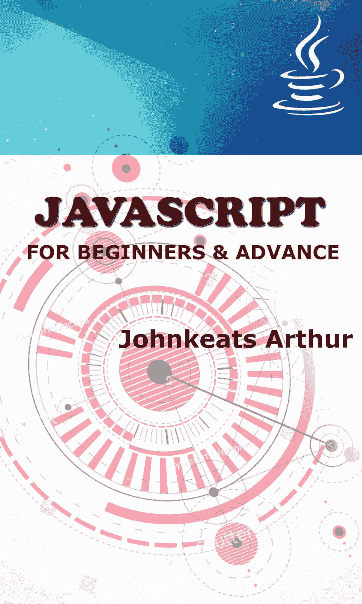


版权所有 © 2015 Johnkeats Arthur

## 初学者 JavaScript

### 1 什么是编程语言？

- 要点

### 2 服务端与客户端

- 要点

### 3 关于 JavaScript

- 要点

### 4 JavaScript 概览

- 要点
- 项目

### 5 对象、属性与方法

- 要点

### 6 给属性赋值

- 要点
- 项目

### 7 关于注释

- 要点
- 项目

### 8 为旧版浏览器隐藏脚本

- 要点
- 项目

### 9 自动重定向用户

- 要点
- 项目

### 10 Alert、Prompt 和 Confirm

- 要点
- 项目

### 11 变量与运算符

- 要点
- 项目

### 12 比较

- 要点
- 项目

### 13 条件语句

- 要点
- 项目
- 项目 2

### 14 循环

- 要点
- 项目

### 15 数组

- 要点
- 项目

### 16 关联数组与对象数组

- 要点
- 项目

### 17 二维数组

- 要点
- 项目

### 18 字符串处理

- 要点
- 项目

### 19 函数

- 要点
- 项目

### 20 逻辑运算符

- 要点
- 项目

### 21 事件处理程序

- 要点
- 项目

### 22 处理图片

- 要点
- 项目

### 23 简单的图片切换效果

- 要点
- 项目

### 24 对象实例化与更好的切换效果

- 要点
- 项目

### 25 处理窗口

- 要点
- 项目

### 26 窗口定位

- 要点
- 项目

### 27 焦点与失焦

- 要点
- 项目

### 28 动态创建的内容

- 要点
- 项目

### 29 处理多窗口

- 要点
- 项目

### 30 使用外部脚本

- 要点
- 项目

### 31 JavaScript 与表单

- 要点
- 项目

### 32 表单方法与事件处理程序

- 要点
- 项目

### 33 JavaScript 与数学

- 要点
- 项目

### 34 对象变量 – 复习

- 要点
- 项目

### 35 菜单项的动作

- 要点
- 项目

### 36 需要表单值或选择项

- 要点
- 项目

### 37 处理日期

- 要点
- 项目

### 38 从对象中检索信息

- 要点
- 项目

### 39 创建一个 JavaScript

- 要点
- 项目

## 1 什么是编程语言？

编程语言是一组我们用来给计算机下达指令的代码。常见的编程语言包括 `C++`、`COBOL`、`BASIC`、`LISP` 等。大多数编程语言都是易读的，因为它们共享许多共同概念。特别是它们都拥有`变量`、`数组`、`条件语句`和`函数`。我们稍后会遇到这些概念。

传统的编程语言被用于编写“独立”应用程序。诸如 `Microsoft Word`、`Mozilla Firefox` 和 `Lotus Notes` 等程序都是此类应用程序的示例。它们在 PC 上运行，并不一定需要在旁边安装其他软件。Web 应用程序在许多方面与这些程序不同，最显著的区别是它们都运行在浏览器内部。Web 应用程序的示例包括 `Google`、`Hotmail`、`Flickr` 和 Gmail。

## 2 服务端与客户端

万维网构建在多种技术之上。对于大多数用户来说，Web 的开始和结束于他们对浏览器的使用。浏览器被认为定义了 Web 的客户端，浏览器、运行它的计算机以及上网的用户统称为客户端。

考虑一个决定访问 `www.google.com` 网站的客户端。首先发生的是客户端向 Google 的 Web 服务器请求该网站的默认页面。Web 服务器是运行在 Google 拥有的计算机上的应用程序。与客户端一样，服务器程序及其运行的计算机定义了 Web 的服务端，并统称为服务器。

当服务器接收到对特定页面的请求时，它的工作是从计算机文件中检索页面并将其返回给客户端。在许多情况下，这种操作是一个非常简单的过程，对服务器部分很少或完全没有工作量要求。

然而，使用 `PHP`、`Perl` 或 `Java` 等编程语言，我们可以让服务器在将页面传给客户端之前对其进行修改，甚至可以完全从头开始生成页面。这被称为服务器端应用程序。传给客户端的页面（对客户端而言）与任何其他未修改的页面看起来完全一样。


服务器端应用程序的一个示例可能是向页面插入当前日期和时间。这意味着每当页面被请求时（例如，使用浏览器的刷新按钮），页面上就会被添加一个新的时间值。

一旦客户端从服务器接收到页面，它就会显示该页面并等待用户请求另一个页面。页面一进入这种状态，它就超出了服务器的控制范围。现在，任何服务器端应用程序都无法在不需要客户端再次返回服务器获取新的（且可能已更新的）页面副本的情况下，更改页面的内容。

然而，所有现代浏览器都允许运行客户端应用程序。这些是嵌入在页面本身 `HTML` 代码中的小型应用程序。

服务器端应用程序在修改发送给客户端的页面时，会忽略发现的任何客户端应用程序，因此通常情况下，这两类应用程序无法相互“交谈”。

然而，一旦客户端接收了客户端应用程序，它就可以开始动态地修改页面，而无需返回服务器。

客户端应用程序的一个示例可能是网页上每秒更新一次的时钟。

客户端应用程序一个遗憾的副作用是，所有代码都必须发送到客户端运行，这意味着应用程序的内部运作对任何人可见。这使得检查密码或执行任何可能导致机密信息泄露外界的操作变得不切实际。

此外，所有现代网络浏览器都为用户提供了完全关闭客户端应用程序的机会。除此之外，同一个客户端应用程序的运行方式会随着浏览器类型的不同而异。

尽管有这些缺点，客户端应用程序（或由于其通用性短小，常被称为`脚本`）仍然是开发 Web 应用程序时为 Web 用户提供丰富环境的最佳方式。


### 简而言之，这两种技术各有优劣：

客户端脚本允许开发者动态地更改页面，并立即响应用户操作，而无需等待服务器创建页面的新版本。然而，需要注意安全和跨浏览器兼容性问题，这些问题通常是非同寻常的。

服务器端应用程序允许开发者保持代码的安全和秘密性，从而能够创建更强大的应用程序。此外，由于运行代码的服务器始终是已知的实体，在一个浏览器中成功运行的应用程序将在所有浏览器中成功运行。然而，尽管有这些强大功能，服务器端应用程序并没有直接的方法在不强制客户端加载另一个页面的情况下更改页面。这使得对于下拉菜单、提交前的表单检查、定时器、警告警报等功能来说是完全不切实际。


## 3 关于 JavaScript

### 核心要点

`JavaScript` 是一种解释型的、客户端的、事件驱动的、面向对象的脚本语言，你可以用它为你的网页添加动态交互功能。

`JavaScript` 脚本是用纯文本编写的，类似于 `HTML`、`XML`、`Java`、`PHP` 以及几乎任何其他现代计算机代码。在代码中，我们将使用 Windows `NotePad`（记事本）来创建和编辑我们的 `JavaScript` 代码，但也有许多替代方案。选择 `NotePad` 是为了演示 `JavaScript` 的即时性和简单性。

你可以使用 `JavaScript` 实现任何以下功能：

- 使用图像创建特殊效果，当鼠标指针悬停在按钮上时，产生按钮被高亮或按下的错觉。
- 验证用户在你的 Web 表单中输入的信息。
- 在新窗口中打开页面，并自定义这些新窗口的外观。
- 检测用户浏览器的能力并相应地更改你的页面内容。
- 在无需 `PHP` 等服务器端语言的情况下，“即时”创建自定义页面。
- 以及更多更多……


`JavaScript` **并不是** `Java`，尽管如果你有 `Java` 背景，你会发现这两种语言在编写时看起来很相似。`Java` 是一种功能齐全且全面的编程语言，类似于 `C` 或 `C++`，尽管 `JavaScript` 可以与 `Java` Web 应用程序交互，但不应将两者混淆。

不同的网络浏览器会以不同的、有时是不兼容的方式运行你的 `JavaScript`。为了解决这个问题，通常需要使用 `JavaScript` 本身来检测它所处环境的能力，并根据结果更改其操作。

回顾本章的定义，请注意以下几点：

- **解释型的（Interpreted）** 指 `JavaScript` 代码在加载到浏览器时就会被执行（处理）。这与 `Java` 这样的编译型语言有所不同，后者在运行单行代码之前会彻底地检查你的程序，而且如果你来自非解释型编程背景，这可能会产生许多让你措手不及的影响。
- **客户端的（Client-side）** 已在上一章中定义过。
- **事件驱动的（Event-based）** 指 `JavaScript` 仅在指定事件发生时才运行某些代码的能力。事件可以是页面加载、表单提交、链接被点击或鼠标指针指向图像。
- **面向对象的（Object-oriented）** 表明 `JavaScript` 控制 `HTML` 页面的能力基于操作该页面内的对象。如果你熟悉面向对象编程，你将意识到这能为编码环境带来一些力量。


最后的说明：虽然 `JavaScript` 是一种编程语言，但 `HTML`（万维网语言）不是。`HTML` 是一种**标记语言**，这意味着它可以将文档的某些区域标记为具有特殊特征，如标题、段落、图像、表单等，但它本身无法执行任何逻辑处理。因此，虽然 `JavaScript` 通常与 `HTML` 一起编写，但一者的规则并不对另一个有任何影响。

## 4 JavaScript 之旅

### 核心要点

让我们快速浏览一下 `JavaScript` 的主要功能。本章旨在展示 `JavaScript` 能做什么，而不是对深层概念进行深入研究，所以如果你迷路或不理解你输入的代码，不要太担心！

### 项目

我们的所有 `JavaScript` 都将使用 `NotePad` 编写。打开 `NotePad` 并将生成的空文档保存到你的用户驱动器中，命名为 `chapter_4.htm`。

首先在你的空白文档中创建一个基础 HTML 页面。它不需要任何花哨——以下内容就完全足够了：

```html
<html>
<head>
<title>第 4 章：JavaScript 游览</title>
</head>
<body>
<h1>JavaScript 游览</h1>
</body>
</html>
```

按照惯例，当笔记意图让你将所有代码都写在同一行时，它们会使用一个像上面那样的箭头 `↵` 来指示你不应该在该处换行。对于 `HTML` 来说，这并不重要，但对于 `JavaScript` 来说，错误位置换行会导致你的代码无法运行。


保存你的新网页，并在网页浏览器中查看它。目前，请使用 `Internet Explorer` 查看此页面。要执行此操作，在你的用户驱动器上找到保存的文件，并双击它。这将默认用 `Internet Explorer` 打开文件，并让你看到刚刚创建的页眉。

到为止，我们还没有做任何超出 `HTML` 范围的事情。让我们给页面添加一些 JavaScript。

（通俗地说）网页上有三个地方可以让我们添加 `JavaScript`。其中第一个是位于新的一组 HTML 标签之间。这些 `script` 标签采用以下形式：

```html
<script language="JavaScript" ↵ type="text/JavaScript">
… code …
</script>
```

上面的 `script` 元素几乎可以放置在 `HTML` 页面中任何放置元素的地方——也就是说，可以放在 `head` 元素或 `body` 元素中。它最常被放在前者，尽管通常这样做是为了让所有的代码在页面上都能被找到。

同时注意，`HTML` 页面中包含的 `script` 元素数量没有限制。除了谨慎起见外，没有什么能阻止你在页面上散布上百个这样的标签。

让我们将起始和结束 `script` 标签添加到页面的 `head` 元素中，如下：

```html
<html>
<head>
<title> … </title>
<script language="JavaScript" ↵ type="text/JavaScript">
</script>
</head>
…
```


保存文件，然后尝试在浏览器窗口中刷新页面。注意，什么都没有发生。这是我们预料之中的——到为止我们只是在页面上设置了一个区域来存放我们的 `JavaScript`。

回到 `NotePad`，在起始和结束 `script` 标签之间输入以下文本：

```javascript
window.alert("Hello world!");
```

保存更改，再次在浏览器窗口中刷新页面。欢迎来到 JavaScript 世界！

回到 `NotePad` 并删除你刚刚添加的 `window.alert` 行。现在添加以下稍微复杂一点的代码：

```javascript
if ( confirm("Go to Google?") ) { 
    document.location = ↵ "http://www.google.com/";
}
```

再次保存更改并刷新页面。对于那些关注后续章节的人来说，这是一个条件语句的示例，我们要求 JavaScript 检查某事的条件（在这种情况下，是我们对一个问题的回答），然后根据它的发现来改变它的行为。

现在，这两段 JavaScript 代码在页面加载到浏览器时都是不受控制地运行的。在大多数情况下，我们希望对 JavaScript 何时执行我们要求的操作有更多控制。

这种控制是事件（events）的领域。在浏览器中，`HTML` 文档的每个元素都关联着若干可以发生在其身上的事件。链接可以被点击，表单可以提交，页面可以加载等等。

修改你 `script` 元素中之前的 JavaScript 行以匹配以下内容：

```javascript
function go_to_google() {
    if ( confirm("Go to Google?") ) { 
        document.location = ↵ "http://www.google.com/";
    }
}
```


在这里注意这里的括号！

保存并刷新，注意这次什么也没有发生。这是因为我们已经把之前的操作（弹出问题并根据响应采取行动）封装在一个 `function`（函数）中。`function` 是一个赋予了名称的代码块——在这种情况下，名称是 `go_to_google()`——并且只有当该名称被“调用”时才会运行。将函数视为在念出其名称时可以召唤的魔咒可能会很有用。

要施展这个魔咒，我们需要在页面上选择一个元素来触发它。一个自然的候选者是链接元素，因此在页面的 `body` 部分添加以下 HTML：

```html
<p>A quick <a href="#">test</a>.</p>
```

`#` 链接是一个常用的 HTML 技巧，允许我们创建一个“通往无何处的链接”。

保存并刷新，检查链接是否出现在页面上，以及点击时它是否没有去往任何地方。

现在，我们希望在点击链接时让页面询问我们是否要“前往 Google？”。方法如下：

获取链接元素并对其进行如下修改：

```html
<a href="#" onclick="go_to_google();">test</a>
```

保存并刷新，然后点击链接。这是一个事件处理器（event handler）的示例。当链接被点击（`onclick`）时，我们的浏览器会说“魔咒” `go_to_google()`，我们的函数就会被调用。

最后一个魔术，在页面的 `body` 部分包含链接的段落之后添加以下代码：

```html
<body>
…
<script language="JavaScript" ↵ type="text/JavaScript">
document.write("<h2>Here’s another ↵ header!</h2>");
</script>
</body>
```

注意，该行代码应该在同一行上！


保存页面并刷新浏览器。注意现在页面上多了一行新文本——另一个标题！我们使用 JavaScript 创建了 HTML 并告诉浏览器恰当地地显示它。在这个示例中，JavaScript 做的任何事情我们都能用 HTML 办到，但在未来的章节中，我们将看到如何利用它来编写当前日期。


## 5 对象、属性和方法

### 核心要点

- 通俗地说，对象（objects）是“东西”。例如，钢琴就是一个对象。
- 属性（properties）是用来描述和定义特定对象的术语。例如，我们的钢琴有颜色、重量、高度、踏板、键盘和盖子。
- 注意上述内容，对象的属性本身也可以是对象。所以我们存在这样的情况：钢琴盖子是钢琴的属性，但它本身也是一个对象，拥有自己的一组属性——例如，盖子有颜色、长度，甚至有开启或关闭的状态。
- 如果说对象是编程语言中的名词，属性是形容词，那么方法（methods）就是动词。方法是在特定对象上执行（或由特定对象执行）的操作。继续我们的钢琴例子，你可以弹钢琴、打开它的盖子或踩下延音踏板。
- 许多编程语言都有类似的方式引用对象及其属性或方法。通常，它们是层次级的，对象与其属性、方法以及与其他对象之间的关系通常可以通过编程表示法轻松看出。
- 在 JavaScript 中，我们使用“点符号表示”（dot notation）来表示对象及其属性和方法。例如，我们这样引用我们钢琴的颜色：
  `piano.colour;`


- 如果我们想指令 JavaScript 弹钢琴，可以写非常简单的：
  `piano.play();`
- 当我们决定打开钢琴盖子时，可以看到一个清晰的对象层次结构示例：
  `piano.lid.open();`
- 如果我们想按下钢琴的延音踏板，更是如此：
  ```javascript
  piano.pedals.sustain.press();
  ```

请注意，在上面的某些示例中，我们在每组单词后面都有括号`()`，而在另一些中没有。这是为了确保 JavaScript 能够理解我们说的内容。

JavaScript 在浏览器中的整个存在过程中都在与对象交互。页面上所有的 HTML 元素都可以描述为对象、属性或方法。我们在之前的介绍性章节中已经见过其中一些对象：

```javascript
document.write(…);
document.location;
```

在这些示例中，`document` 是一个对象，而 `write` 是一个方法，`location` 是一个属性。

在这些行中，我们看到了关于在这些语句中使用括号的线索。我们使用括号来告诉 JavaScript 我们正在谈论一个对象的方法，而不是同名的属性。

括号还允许我们向对象的方法传递某些额外信息。在上面的示例中，为了向网页文档写入文本“Hello world!”，我们将编写以下 JavaScript 代码：

```javascript
document.write(“Hello World”);
```

每个方法执行的操作都取决于括号中的内容（或者用技术术语说，“传递给方法的参数”）。事实上，许多方法可以接受多个“参数”来修改其行为。多个参数之间用逗号（`,`）分隔。


像这里显示的 JavaScript 指令被称为 JavaScript 语句。所有语句都应该以单个分号（`;`）结束。JavaScript 经常会忽略行尾缺失的分号，并自动为你插入分号。然而，这可能会导致一些意想不到的结果。请考虑以下情况：

```javascript
document.write(“<h1>
Hello World!
</h1>”);
```

在许多其他语言中，这是可以接受的。然而，JavaScript 经常会将此类内容解释为如下：

```javascript
document.write(“<h1>;
Hello World!;
</h1>”);
```

这种解释将产生错误，因为如果我们在结束语句时没有确保引号内的任何术语都有匹配的引号，JavaScript 就会报错。在这个示例中，第一行的“语句”被截断了，JavaScript 将会崩溃。

因此，建议你所有的语句都以分号结尾。


## 6 给属性赋值

### 关键点

虽然对象和方法允许我们在页面上执行某些操作，例如更改内容或弹出对话框与用户交互，但在许多情况下，我们可能想要直接更改对象某个属性的值。这些情况类似于将我们的钢琴漆成绿色。

考虑到我们目前为止对方法的讨论，我们可能会认为能够使用方法来更改对象的属性——例如，以下代码似乎是有逻辑的：

```javascript
piano.paint(“green”);
```

在很多情况下，这确实是我们要做的。然而，这里有两个缺点。首先，在课程中，我们发现的大多数对象都是内置并定义的。如果我们依靠一个方法来更改对象的属性，我们就是在依赖该方法存在这一事实。解决此问题的更直接的方法是直接访问对象的属性。例如：

```javascript
piano.colour = “green”;
```

在这里，我们不再使用方法，而是使用所谓的运算符 `=`。


在 JavaScript 中，我们可以非常有效地使用这个运算符。例如，我们可以动态地更改页面标题。这可以在用户点击页面部分时完成，也可以自动设置以显示时间。我们为此使用的代码是：

```javascript
document.title = “new”;
```

有很多赋值运算符。表中显示了一些常见的：

| 赋值 | 功能 |
| :--- | :--- |
| `x = y` | 将 `x` 的值设置为 `y` |
| `x += y` | 将 `x` 的值设置为 `x + y` |
| `x -= y` | 将 `x` 的值设置为 `x - y` |
| `x *= y` | 将 `x` 的值设置为 `x * y` |
| `x /= y` | 将 `x` 的值设置为 `x / y` |

并不是所有的赋值运算符都适用于所有类型。在处理数字时，结果是两个数字之和。在处理文本时，结果是两个字符串的拼接：

```javascript
document.title += “!”;
```

这将导致 `!` 被添加到当前标题的末尾。打开你的项目并将其保存为 `chapter_6.htm`。如下更改标题的值：

```html
<title>With help from</title>
```

现在，向你的脚本添加一条语句以添加以下：

```javascript
document.title = “JavaScript!”
```

重新加载页面并考虑结果。我们之前遇到过 `window` 对象。我们在第 4 节中对 `alert` 方法的演示写成：

```javascript
window.alert(“message”);
```

在很多情况下，我们在编写代码时可以省略对象/属性/方法层级中的某些部分。我们稍后会再次讨论这一点。为了理解 `prompt` 方法发生了什么，我们可以写下一个方法原型（prototype）。这是一种描述方法参数的方式，使它们对方法的影响更加自显其意。`window` 对象的 `prompt` 方法原型可能如下：

```javascript
window.prompt( message , default_response );
```

所以，我们可以看到第一个参数定义了出现在 prompt 对话框中的问题文本。第二个参数就没那么清楚了。用不同的值尝试你的代码，看看你的更改产生了什么变化。最后，我们注意到这个 prompt 方法以某种方式获取框中输入的信息，并将其传递给我们的 JavaScript 赋值。假设有人在框中输入了“Hello World”。就好像我们的赋值实际上是：

```javascript
document.title = “Hello World”;
```

当发生这种值的传递时，我们就说方法返回了所传递的值。在这种情况下，我们可以说“prompt 方法返回了值‘Hello World’”，或者说“prompt 方法的返回值为‘Hello World’”。当我们以后处理事件处理程序时，返回值将变得非常重要。


## 7 关于注释

### 核心要点

跟我读一遍：注释很重要。注释很重要。注释很重要。

在你的代码中添加注释始终是一种良好的做法。随着脚本复杂性的增加，注释可以帮助你在日后重新查看代码时，帮助你（以及他人）理解其结构。

许多快速创建的代码被称为“只写不读”代码，因为它们天生缺乏结构或注释。调试此类代码，或者在几个月后重新使用它，将变得极其困难，因为你试图记住某行代码本该是做什么的，或者为什么使用某些值会导致代码停止运行。

只要注释格式正确，JavaScript 会完全忽略它们，并且对脚本的运行速度不会产生任何影响。

然而，注释可能会减慢页面的加载速度——许多程序员会保留一份带有完整注释的“开发版”代码用于编辑，并在最终发布时删除代码中的所有注释。

JavaScript 中有两种类型的注释——单行注释和多行注释。

单行注释以两个正斜杠字符（`//`）开头，并换行结束：

```
this is a comment alert("hello"); // so is this
```


JavaScript 中的单行注释也可以使用你可能熟悉的 HTML 注释格式：

```html
<!-- this is a comment
alert("hello");
```

注意两点：首先，这种 HTML 注释格式的使用不需要闭合的 `-->` 标签。其次，这只是单行注释，与在 HTML 中的用法不同（HTML 中的注释会注释直到结束标签之前的所有行）。

你可以通过将注释块封装在 `/*` 和 `*/` 之间来添加多行注释。例如：

```javascript
/* 所有的文本将被将被 JavaScript 忽略。这允许我们编写更大的注释，而必担心需要“注释掉”每一行 */
alert("Hello World");
/* 一个单行的“多行”注释 */
```

除了为你的脚本添加说明外，你还可以使用注释从页面中移除代码，而无需删除代码。例如：

```javascript
this was the old message
alert("Hello World");
and this is the new message
alert("Hello everyone!");
```

如果你正尝试追踪代码中的错误，这非常有用——你可以逐个“注释掉”每一行可疑代码，直到你设法让代码重新工作为止。

### 项目

打开你之前的项目文件，并将其保存为 `chapter_7.htm`。

在脚本的开头添加单行注释：

`This is my first comment`


向你的脚本中添加一个多行注释，替换你之前的单行注释。多行注释应该描述你的脚本目前的功能。


## 8 向旧版浏览器隐藏脚本

### 核心要点

非常旧的浏览器不理解 JavaScript。今天在使用的此类浏览器寥寥无几，但有两个因素迫使我们继续考虑可能无法处理我们 JavaScript 代码的环境。

首先，所有现代浏览器都允许用户控制是否运行 JavaScript 代码。在许多情况下，用户对公司的策略没有话语权，甚至可能不知道他们的工作机器已经禁用了 JavaScript。

其次，并不是所有的访问者都会使用可以利用任何 JavaScript 的浏览器。盲文显示器、屏幕阅读器和其他非视觉浏览器对许多 JavaScript 技巧几乎无用武之地。此外，像 Google 这样的搜索引擎会忽略你在页面上使用的任何 JavaScript，这可能会隐藏重要内容，并导致你的页面无法被收录索引。

不支持 JavaScript 的浏览器本应该忽略开始和结束 script 标签之间的任何内容。然而，许多浏览器会违反这一规则，并尝试将你的代码渲染为 HTML，这可能会导致尴尬的后果。


然而，我们可以利用这样一个事实：`<!--` 在 JavaScript 中表示单行注释，但在 HTML 中表示多行注释，这可以确保我们的代码能被精通 JavaScript 的浏览器看到，但被其他设备视为被注释掉的 HTML 而忽略：

```html
<script>
<!-- hide from older browsers
… your code
stop hiding code --> </script>
```

这防止了旧版浏览器显示代码，但如果我们想将其替换为某些注释呢？例如，假设我们有一段代码用于显示时间并按名称问候用户。如果没有 JavaScript，在应该有问候语的地方将是一片空白。

我们可以使用 `<noscript>` 标签让我们的代码在 JavaScript 不可用时“优雅地失败”。该元素的内容在理解 JavaScript 的地方被忽略，在其他地方显示。例如：

```html
<noscript>
<h1>Welcome to our site!</h1>
</noscript>
<script>
<!-- hide from older browsers
stop hiding code --> </script>
```

### 项目

打开你之前的项目文件，并将其保存为 `chapter_8.htm`。

在代码中添加两行，以确保它不会混淆旧版浏览器或用户禁用了 JavaScript 的浏览器。


在可能的情况下你应该使用 `<noscript>` 元素提供能够充分替代脚本内容的内容。例如，如果你使用 JavaScript 在页面上构建一个导航面板，`noscript` 元素应该包含一个执行相同任务的纯列表。

## 9 自动重定向用户

### 核心要点

我们已经在第 4 章中见过浏览器重定向的使用。

为了更完整地表述这个想法，为了将用户重定向到不同的页面，你需要设置 `document` 对象的 `location` 属性。

正如我们在第 6 章中看到的，这里可以使用赋值运算符。例如：

```javascript
document.location = "http://www.bbc.co.uk/";
document.location = "chapter_4.html";
```

### 项目

打开你之前的项目文件，并将其保存为 `chapter_9_redirect.htm`。

保存该文件的副本，这次命名为 `chapter_9.htm`。

确保两个文件都保存在同一个文件夹中，并且你在编辑器中打开了 `chapter_9.htm`。

删除 script 标签之间的所有脚本，只保留你的浏览器隐藏行。确保 script 标签仍然在页面的 head 部分。

现在，向此脚本添加一条语句，以便在页面加载到浏览器时自动将用户重定向到 `chapter_9_redirect.html` 页面。


最后，在页面的 body 部分添加一个标题标签，其中包含“You can’t see me!”的文本。

关闭此页面，先不要在浏览器中检查，并在编辑器中打开 `chapter_9_redirect.html` 页面。

移除页面上的所有 JavaScript（包括你的 `script` 标签），并确保页面上只剩下 HTML。

在页面的 body 部分添加一个标题标签，其中包含“But you can see ME!”的文本。

保存此页面，并在浏览器中加载 `chapter_9.html` 页面。

尝试在 `chapter_9.html` 中变换 `script` 标签的不同位置，看看是否可以让标题在重定向之前出现。


## 10 Alert, Prompt 和 Confirm

### 关键点

到目前为止，我们已经看到了 `alert()`、`prompt()` 和 `confirm()` 对话框的简要示例，用于请求用户响应并在后台暂停所有代码直到请求得到满足。

所有这些框都是 `window` 对象方法的结果。该对象是 JavaScript 在浏览器中可以处理的最高级对象。因此，页面上的所有其他对象（少数例外除外）都是 `window` 对象的属性。

由于这种普遍性，即使省略了它，也被认为它存在。因此，在技术上我们应该写：

```javascript
window.document.write(“…”);
```

但写成这样同样有效：

```javascript
document.write(“…”);
```

正如我们一直这样做的那样。

同样，与其写：

```javascript
window.alert(“…”);
```

我们可以愉快地写成：

```javascript
alert(“…”);
```


这三个方法的原型是：

```javascript
window.alert( message );
window.confirm( message );
window.prompt( message, default_response );
```

`alert()` 在点击“ok”被清除时将始终返回值“true”。

`confirm()` 将根据所选的清除对话框的响应来返回“true”或“false”。

`prompt()` 将返回输入的值，如果未输入任何内容则返回“null”，如果框被取消则返回“false”。

### 项目

打开你之前的项目文件，并将其保存为 `chapter_10.html`。

清除之前的重定向代码，并确保 `script` 标签已返回文档的 head 部分。

在页面上的 `script` 中添加一条新语句，以便在显示页面其余部分之前显示以下消息：

Welcome to my website! Click OK to continue.

在浏览器中检查你的页面。

我们将在整个课程中反复使用 `alert()`、`confirm()` 和 `prompt()`。花一点时间在这个页面上轮流尝试每个方法，每次都停下来检查你的更改。

使用 `document` 对象的 `write()` 方法来检查每个方法的返回值。例如：

```javascript
document.write(alert(“hello world”));
```

确保你将此特定代码段放在页面 body 区域的 `script` 标签中，因为我们正在生成供浏览器渲染的文本输出。此外，注意此处对引号的使用（或不使用）。更多内容请见下一章！


## 11 变量与运算符

### 关键点

我们已经被引入了对象以及它们的各种属性和方法的概念。这些相互关联的概念允许任何网页被拆分为许多小段信息或数据段，然后可以通过 JavaScript 访问它们，并在许多情况下对其进行更改。

然而，如果我们想为不一定具有页面对应项的信息创建自己的存储空间该怎么办呢？例如，如果我们想在更改 `document` 的 `title` 属性之前存储其旧值，以便稍后检索；或者如果我们希望存储页面加载到浏览器的时间，以便在页面的多个处进行复制，而又不想每次都重新计算时间该怎么办？

变量是 JavaScript 中用于存储值的命名容器。它们在许多方面与对象属性相似，但有重要的区别：

- 从实际意义上说，变量没有与之关联的“父”对象。
- 变量可以由你作为开发者创建（“声明”），并可以在某些规则内赋予任何任意名称——然而，对象的属性受限于父对象的定义。例如，对于我们之前章节中的 `piano` 对象来说，有一个 `propeller` 属性是没有意义的！


变量命名规则非常直观——没有空格，名称必须以字母开头。有效变量名的示例有：`BrowserName`、`page_name`、`Message1`、`MESSAGE1`。

在许多浏览器中，JavaScript 是大小写敏感的，这意味着最后两个变量是不同的。为你的变量选择一种特定的风格并坚持下去是一个好主意。

在最简单的层面上，变量可以存储三种类型：

- 数字：例如，`3.14`
- 字符串：例如， `"Hello World"`
- 布尔值：例如，`true`、`false`

注意字符串可以包含数字，但以下变量是不等价的：`123` 和 `"123"`。后者是一个字符串。考虑：

```javascript
a = 123
b = 456
a + b // 579
"a" + "b" // "ab" (如果是字符串)
```

一些开发者在变量名上使用自己的命名约定来表示变量中预期的值类型。例如，`strMessage` 可能表示字符串变量，而 `numHits` 可能表示数值。

变量赋值的实现方式与对象属性相同。当变量第一次被赋值时，它会被自动创建。这与其它编程语言不同，在那些语言中，必须先显式创建变量，然后加载值。

以下是变量赋值的一些示例：

```javascript
numBrowserVersion = 5.5;
numTotal += 33;
Message = “Hello!”;
Message = “Goodbye”;
Message = 3;
```

注意最后三个示例显示变量可以在初始赋值后被更改，而且变量中存储的值类型也可以以类似的方式更改。一旦创建了变量并存储了值，我们希望能够访问它并可能对其进行操作。与对象属性类似，我们通过直接调用变量来访问它们：

```javascript
Message = “Hello!”;
alert(Message);
```

注意我们没有在变量名周围使用引号。上面的代码与此不同：

```javascript
alert(“Message”);
```

出于显而易见的原因。

除了使用变量存储和访问，我们还可以使用运算符组合并处理它们。例如：

```javascript
a = 12;
b = 13;
c = a + b // c 现在是 25
c += a // c 现在是 37
c = b + “ Hello!” // c 现在是 “13 Hello!”
```

我们的上一个例子可能出乎了意料——我们向一个字符串添加了一个数字，结果得到一个字符串。JavaScript 足够智能，能够意识到数字无法在数值意义上“加”到字符串上，因此它会将数字临时转换为字符串，并对这两个字符串进行拼接。请注意 `b` 仍然是 `13`，而不是“11”。

运算符表：

| 运算符 | 功能 |
| :--- | :--- |
| `x + y` | 如果两者均为数值，则将 `x` 加到 `y`；否则执行拼接 |
| `x – y` | 如果两者均为数值，则从 `y` 中减去 `x` |
| `x * y` | 将 `x` 与 `y` 相乘 |
| `x / y` | 将 `x` 除以 `y` |
| `x % y` | 将 `x` 除以 `y` 并返回余数 |
| `-x` | 反转 `x` 的符号 |
| `x++` | 在执行任何关联赋值**之后**给 `x` 加 1 |
| `++x` | 在执行任何关联赋值**之前**给 `x` 加 1 |
| `x--` | 在执行任何关联赋值**之后**给 `x` 减 1 |
| `--x` | 在执行任何关联赋值**之前**给 `x` 减 1 |

### 项目

打开你之前的项目文件，并将其保存为 `chapter_11.htm`。

清除之前的 JavaScript 代码，并确保脚本标签包含在文档的 `body` 部分。

将消息“Welcome to my web site”赋值给变量 `greeting`。


使用该变量创建一个包含该消息的警报框，并在页面上生成一个标题，而无需重新输入消息。

在浏览器中测试此页面。

现在，修改你的代码以创建两个变量 `var_1` 和 `var_2`。

为 `var_1` 赋值值“Welcome to”，为 `var_2` 赋值值“my web site”。

创建第三个变量 `var_3`，并将其赋值为 `var_1 + var_2`。然后使用警报框检查 `var_3` 的结果值。

在浏览器中测试此页面。

如果警报框中的文字没有按预期出现，请考虑变量赋值中的空格，并修正错误。

现在，修改你的代码以产生相同的结果，但不需要第三个变量。

清除当前脚本标签中的所有语句。

在脚本中添加两条语句，将数字 100 赋值给一个变量，将 5.5 赋值给另一个。

使用 `document.write` 显示第三页表格中给出的每个运算符在这两个数值上的效果。

将其中一个数值替换为文本字符串并重复此过程。注意它们之间的差异。


## 12 比较

### 关键点

比较运算符比较两个值。最常见的用法是比较两个变量的内容——例如，我们可能想要检查 `var_1` 的值在数值上是否大于 `var_2`。

当你使用比较运算符时，比较返回的值始终是 `true` 或 `false` 的布尔值。例如，考虑以下语句：

```
var_1 = 4;
var_2 = 10;
var_3 = var_1 > var_2;
```

在这种情况下，`var_3` 的值是 `false`。注意，布尔值 `false` 与文本字符串“false”并不相同：

```
var_4 = false; // 布尔值
var_5 = "false"; // 文本字符串
```

常见的比较运算符所示：

| 比较 | 功能 |
| :--- | :--- |
| `x == y` | 如果 `x` 和 `y` 等价，返回 `true`；否则返回 `false` |
| `x != y` | 如果 `x` 和 `y` 不相等，返回 `true`；否则返回 `false` |
| `x > y` | 如果 `x` 在数值上大于 `y`，返回 `true`；否则返回 `false` |
| `x >= y` | 如果 `x` 在数值上大于或等于 `y`，返回 `true`；否则返回 `false` |
| `x < y` | 如果 `x` 在数值上小于 `y`，返回 `true`；否则返回 `false` |
| `x <= y` | 如果 `x` 在数值上小于或等于 `y`，返回 `true`；否则返回 `false` |
| `!x` | 反转 `x` 的逻辑值 |

## 13 条件语句

### 关键点

到目前，我们的项目还无法做出决策。例如，如果有一个名字列表并以不同的方式进行问候，那就好了。条件语句赋予了我们这种能力，是使用 JavaScript 的关键。条件语句由三部分组成：

- 一个测试（通常带有比较运算符），用于检查给定条件为真为假。
- 如果条件为真，则执行的代码块。
- 如果条件为假，则执行的代码块（可选）。

这三部分在 JavaScript 中的表示方式如下所示：

```
if (conditional_test) {
    JavaScript statement;
    JavaScript statement;
    JavaScript statement;
}
else {
    JavaScript statement;
    JavaScript statement;
    JavaScript statement;
}
```

从第一个括号（括号）开始的所有都是可选的，因此以下原型也是有效的：

```
if (conditional_test) {
    JavaScript statement;
    JavaScript statement;
    JavaScript statement;
}
```

在这种情况下，如果 `conditional_test` 不返回 `true`，则什么都不会发生。

完整条件语句的示例如下：

```
if (var_1 > var_2) {
    alert("Variable 1 is greater”);
}
else {
    alert("Variable 2 is greater”);
}
```

注意，上面的条件并不总是正确的。考虑 `var_1` 等于 `var_2` 的情况。在这种情况下，上面的代码将产生“Variable 2 is greater”的消息，因为 `var_1 > var_2` 返回 `false`。在这种情况下，我们希望在 `else` 分支中添加一个额外的条件：

```
if (var_1 > var_2) {
    alert("Variable 1 is greater”);
}
else if (var_1 < var_2) {
    alert("Variable 2 is greater”);
}
```

在这种情况下，相等判断不会产生任何输出，因为没有任何一个条件会返回 true。为了完整性，我们可以在语句中添加一个最后的 `else` 分支：

```javascript
if ( var_1 > var_2 )
{
alert(“Variable 1 is greater”);
}
else
if ( var_1 < var_2 )
{
alert(“Variable 2 is greater”);
}
else
{
alert(“The variables are equal”);
}
```

注意，在这种情况下，我们不需要在最后一个分支中检查相等性，因为如果 `var_1` 既不大于 `var_2` 也不小于 `var_2`，那么——至少从数值上看——它们必须相等的。

我们可以根据需要在此堆栈中继续添加多个 `else if` 语句。


如果你在条件测试后只有一个语句，可以省略大括号：

```javascript
if ( var_1 > var_2 )
alert(“Variable 2 is greater”);
```

然而，如果你稍后想向此条件分支添加更多语句，你就必须在块周围添加大括号，这可能会导致混淆。建议使用大括号包裹所有的条件代码块。

考虑以下代码块：

```javascript
if ( var_1 > 4 )
{
var_2 = var_1;
}
else
{
var_2 = 4;
}
```

这段代码相当长，但实现的功能相对很少——`var_2` 等于 `var_1` 或 `4`，以较大者为准。

更简洁写法可以是：

```javascript
var_2 = 4;
if ( var_1 > var_2 )
{
var_2 = var_1;
}
```

然而，另一种更简洁的写法是使用三元运算符：

```javascript
var_2 = (var_1 > 4) ? var_1 : 4;
```

在上面的语句中，条件会被求值，如果为真，返回的是 `?` 和 `:` 符号之间的值；如果为假，则是 `:` 和 `;` 符号之间的值。

### 项目

打开你之前的项目文件，并将其另存为 `chapter_13.html`。

清除 script 标签中所有的 JavaScript 代码。

创建两个变量并为它们分配数值。


使用条件语句显示警报框，声明两个变量中哪一个更大。

考虑以下代码：

```javascript
var_3 = (var_1 > var_2);
```

在你的脚本中使用这段代码来简化你的条件检查代码。

现在，使用提示框（prompt box）询问访问者的姓名。将此姓名赋值给 `var_3`。

检查输入的名称是否是你自己的名字。如果是，使用 `document.write` 在页面上显示个性化的问候。否则，显示一个通用的问候。

使用多个 `else if` 分支将输入的名称与你一些朋友的名字进行比较。为他们所有人创建个性化的消息。

可能有一种方法简化你的条件问候代码，使其只使用一个 `document.write` 语句。看看你如何做到。提示——你可能会如何使用一个名为 `greeting` 的变量？

### 项目 2

在许多情况下，条件语句的简洁性取决于你能够在执行测试时构思正确的“问题”的能力。尝试让你对以下问题的解决方案尽可能简洁。

清除 script 标签中所有的代码。

确保你的 script 标签当前位于页面的 `body` 部分。创建一个名为 `exam_result` 的变量并存储一个 0 到 100 之间的数值。


使用一个 `if` 语句和多个 `else if` 语句根据以下评分标准检查该变量的值，并将适当的消息打印到页面上：

| 考试结果 | 消息 |
|---|---|
| 90 分或以上 | 优秀。优异通过。 |
| 70 到 89 分 | 做得好。荣誉通过。 |
| 50 到 69 分 | 刚通过。 |
| 54 分或以下 | 未及格。下次努力。 |

在浏览器中测试你的结果。改变 `exam_result` 的值并检查浏览器中显示的值。为了练习，尝试使用提示框来尽可能方便地更改 `exam_result`。


## 14 循环

### 关键要点

字母 `i`、`j` 和 `k` 传统上被程序员用来命名作为计数器的变量。例如，在程序的不同阶段，`i` 可能包含数字 1, 2, 3 等。为了实现“计数”效果，你需要根据一个固定值增加或减小计数器变量的值。以下是一些示例：

```javascript
i = i + 1;
i = i - 1;
i = i + 3;
incr = 0;
```

为了保持简洁，我们可以使用以下快捷方法：

```javascript
i++; // 等于 i + 1;
i--; // 等于 i - 1;
```

JavaScript 中的计数（像许多其他语言一样）通常从零开始。在很多情况下，这很有意义。然而，它经常会引起混淆。考虑从 0 开始数到 10。在这种情况下，我们实际上数了 11 个项目：

1. 在纸上写下数字 0。
2. 每次操作后，擦掉纸上的数字并将其加 1。
3. 在每次操作之前，检查纸上的数字。如果小于 100，则执行该操作。

或者，他们可能决定从 1 开始计数。在这种情况下，步骤是相同的，但每次操作前的检查将是确保数字严格小于 10。

在 JavaScript 中，我们几乎说相同的话。以下代码将在页面上显示 1 到 10 的数字：

```javascript
for (i = 1; i <= 10; i++)
{
  document.write("<p>" + i + "</p>");
}
```


`for` 语句告诉浏览器我们即将执行一个循环。这里的布局与条件语句非常相似，但在这种情况下，我们在括号中有更多信息：

1. **初始化 (initialiser)**：这设置了初始计数条件，在这种情况下为 `i = 1`。
2. **条件 (conditional)**：这与我们之前的条件语句相同，必须返回 true 或 false。如果返回 true，循环继续，否则退出。
3. **递增器 (incrementer)**：这定义了在每次循环结束时执行的操作。在这种情况下，`i` 增加了一个值为 1 的值。

通过让条件不依赖于计数值，可以创建一个无限循环——例如：

```javascript
for (i=0; 5 > 4; i++)
```

这将始终执行大括号中的脚本，并可能导致浏览器中出现错误。

请注意，在 JavaScript 中从 0 开始计数是非常常见的。其原因是因为我们通常希望统计某个操作执行了多少次。

考虑以下情况：

```javascript
for ( i=1; 1 < 2; i++ )
```

在这种情况下，循环将运行一次，但 `i` 的值将变为 2，因为在第一次运行后，`i` 会增加到 2，然后通过测试失败，循环就会退出。如果我们使用以下代码：

```javascript
for ( i=0; 1 < 1; i++ )
```

那么循环将运行一次，之后 `i` 的值将是 1，正正如我们所希望的那样。

### 项目

打开你之前的项目文件，并将其另存为 `chapter_14.htm`。

从你的脚本标签中清除所有的 JavaScript 代码。


编写一系列语句来生成如下所示的乘法表：

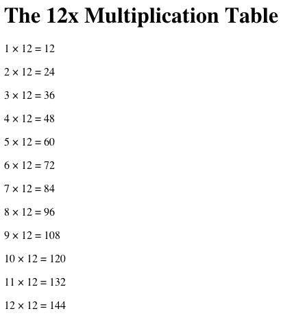

接下来的练习更多是一个 HTML 示例，但它展示了使用 JavaScript（实际上是任何编程语言）生成格式良好的文本的一个重要方面。

修改你之前的代码，使页面内容显示在页面中央。将你的乘法表放在 HTML 表格中，以确保等号、乘号等对齐成整齐的列：

 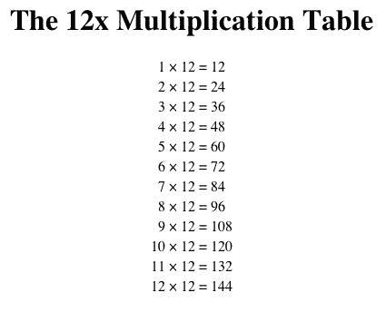

提示，这里是涉及的表格单元格预览：

 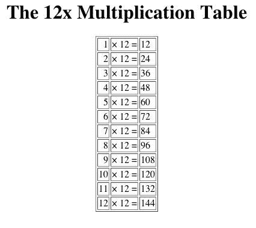

## 15 数组

### 关键点

在很多情况下，JavaScript 变量可以完全满足我们对数据存储的需求。然而，在许多情况下，我们可能希望将变量“分组”到一个相关项的集合中。

以星期几为例。每天我们都会执行若干任务，所以我们可能希望将每个任务记录作为一个单独的项目，放在一个名为（例如）“周一任务”的组下。

在 JavaScript 中，为了实现这一点，我们将每个任务存储在单独的变量中，将这些变量组合成数组。

数组是一种特殊的 JavaScript 对象，它可以存储多个数据值——与变量不同，变量一次只能存储一个数据值。

将数组想象成办公室里的一排邮箱可能会很有帮助，就像你可能把变量想象成单个、孤独的邮箱一样。

数组中的箱是从零开始向上编号的，从第 0 号箱开始——注意，这里的计数是从 0 开始的，正如我们在上一节中讨论的那样。分配给每个箱的数字被称为它的 `index`（索引）。


为了在 JavaScript 中使用数组，你必须先创建它。在 JavaScript 中创建数组有多种方法。最简单的方法如下：

```javascript
arrDays = new Array();
```

这条语句创建了一个名为 `arrDays` 的空数组。我们可以像调用变量一样调用数组，但只需进行微小的调整。

如果你已经知道给定数组将包含多少个元素，可以显式声明它：

```javascript
arrDays = new Array(7);
```

此修改创建了一个带有 7 个空箱的数组。然而，在 JavaScript 中，数组会扩展和收缩到所需的大小，因此你需要指定数组大小的情况很少。

然而，更有用的功能是在创建数组时“填充”数组的箱子。例如：

```javascript
arrDays = new Array(“Monday”,”Tuesday”);
```

现在我们有一个有两个元素的数组。第一个元素（元素 0）的值是“Monday”，第二个元素（元素 1）的值是“Tuesday”。我们不需要将数组中的值限制为字符串值——布尔值、数值和字符串值都是允许的，就像在普通变量中一样。我们甚至可以将其他数组赋值给数组元素——稍后会详细介绍。

创建数组最常用的方法是使用“方括号”符号。方括号在数组的使用中起着很大作用，因此这通常是最容易记忆的方法：

```javascript
arrDays = [“Monday”，“Tuesday”];
```

这与之前的示例完全相同。


要访问数组的元素，我们首先调用数组名称，然后在方括号中指定元素的数字，如下：

```javascript
alert(arrDays[0]);
```

注意这里 0 周围没有引号。这行代码等同于：

`alert(“Monday”);`

假设数组如之前的示例所示已定义。

我们不仅可以使用这种符号访问数组元素的值，还可以给它赋值：

```javascript
arrDays[2] = “Tuesday”;
arrDays[3] = “Wednesday”;
```

如果你想在不知道最后一个元素索引的情况下向数组添加一个元素，可以使用以下代码：

```javascript
arrDays[] = “some other day”;
```

正如我们将会看到的，数组实际上是特殊的 JavaScript 对象，并具有与之相关的属性和方法。每个数组都拥有的最重要的属性是它的 `length` 属性：

```javascript
how_many_days = arrDays.length;
```

除了属性外，数组还有非常有用的方法。如果你想对数组进行字母数字顺序排序，可以使用 `sort` 方法：

`arrDays.sort()`

注意 `sort` 方法作用于实际数组，会覆盖当前值。所以，如果你有一个每天作为一个元素的数组，调用它将意味着 `arrDays[0]` 随后变为“Friday”。

### 项目

打开你之前的文件，并将其另存为 `chapter_15.htm`。


从你的脚本标签中清除 所有的 JavaScript 代码。

编写一系列语句来生成如下所示的乘法表：


接下来的练习更多是一个 HTML 示例，但它展示了使用 JavaScript（实际上是任何编程语言）生成格式良好的文本的一个重要方面。

修改你之前的代码，使页面内容显示在页面中央。将你的乘法表放在 HTML 表格中，以确保等号、乘号等对齐成整齐的列：

 

提示，这里是涉及的表格单元格预览：

 

## 16 关联数组与对象数组

### 关键点

我们已经看到可以通过索引访问数组元素：

```javascript
arrDays = [“Monday”, “Tuesday”];
```

向页面打印“Monday”：`document.write(arrDays[0]);`

然而，能够为我们的数组元素命名可能会更有用。默认情况下，数组被创建为数值数组。我们也可以创建关联数组：

```javascript
arrDays = new Array();
arrDays[“Monday”] = “Go to the dentist”; 
arrDays[“Tuesday”] = “Attend JavaScript class”;
arrDays[“Wednesday”] = “JavaScript homework”;
```

提醒你周三的任务 `alert(arrDays["Wednesday"]);`

这看起来和我们之前讨论的对象和属性非常相似。事实上，由于数组实际上是一个对象，我们可以像访问属性一样访问它的元素：

```javascript
// 提醒你周三的任务 alert(arrDays.Wednesday);
```


注意这里有一个细微的差别——在我们之前的数值数组示例中，星期几的名称是数组元素的值。而在这里，星期几的名称是元素的索引。请避免以下常见错误：

```javascript
arrDays = ["Monday","Tuesday"];
arrDays["Monday"] = “Go to work”;

// 这实际上等同于
arrDays = new Array();
arrDays[0] = “Monday”;
arrDays[1] = “Tuesday”;
arrDays["Monday"] = “Go to work”;
// 现在的 arrDays.length 是 3，而不是 2
```

### 项目

打开你之前的项目文件，并将其另存为 `chapter_16.htm`。

删除脚本标签中所有的 JavaScript 代码。

编写一个新脚本，创建一个名为 `Week` 的包含七个元素的关联数组：

- 使用星期几的名称作为数组每个元素的索引。
- 在创建每个关联元素时，为每周的每天分配一项任务。
- 使用 `for` 循环在页面上显示日历，如下：

```
Monday: task
Tuesday: task
etc…
```

修改你的代码，使用 `prompt` 框让访问者选择一天，并在页面上显示分配给那天的任务。


## 17 二维数组

### 核心要点

回到我们之前的邮箱类比，我们的数组可以被想象成一排邮箱，每个邮箱都有自己的内容和标签，那么二维数组就可以被看作是这些排邮箱堆叠在一起的。

实际上，二维数组仅仅是一个数组，其中的每个元素本身也是另一个数组。二维数组的每个“子数组”长度可以是不同的——换句话说，二维数组并不非得是“正方形的”。

你可以使用两对方括号而不是一对来访问每个子数组的内容。下面的示例能最好地说明这一点：

```javascript
array_1 = ["element”, “element 2”];
array_2 = [another element”, 2, 98, true];
array_3 = [array_1, array_2];
alert(array_3[1][3]); // 显示 “98”
```

虽然你不能在一个数组中混合使用数值索引和字符串索引系统（即数组不能既是数值数组又是关联数组），但你可以在二维数组中同时拥有关联数组和数值数组。例如，将上述内容重构如下：

```javascript
array_3 = new Array();
array_3["firstArray"] = array_1;
array_3["secondArray"] = array_2;
alert(array_3["secondArray"][3]); // 再次显示 “98”
```


同样，我们可以愉快地对关联数组使用我们的“对象”符号：

```javascript
alert(array_3.secondArray[3]);
// 再次显示 “98”
```

### 项目

打开你之前的项目文件，并将其另存为 `chapter_17.htm`。

在你之前的项目的基础上，创建若干个新的七元素关联数组，以表示 4 个独立的周。

将这 4 周合并成一个包含四个元素的数组，以表示一个月。

修改你之前的代码，接收一个周数并将该周的所有活动打印到页面上。

修改其中一个周数组，使其不再由单个元素组成，而是由从早上 8 点到下午 5 点的小数组组成。这就代表了一个三维数组。我们可以扩展数组为 `n 维`，其中 `n` 几乎是任意的。

最后，修改你的代码提示用户输入三个值：周、日和小时。将这些值存储在三个独立的变量中，并使用这些变量来显示请求的任务，或者如果找不到任务则显示错误消息。


## 18 字符串处理

### 核心要点

在生产环境中使用 JavaScript 时，你经常会用它从变量中读取值，并根据发现的内容更改行为。

在测试相等性的比较章节，我们已经看到了一些基础的字符串读取。然而，这种“全有或无”的方法对于我们的目的来说往往不够细致。

以这种情况为例：我们需要检查用户的姓名是否在已知用户列表中。例如，如果用户输入的名字是“Karen”，那么只有当他们拼写的名字与我们记录的完全一致（包括大小写等）时，这才是正确的。如果用户决定输入她的全名，例如“Karen Aaronofsky”，代码将无法识别她。

在这种情况下，我们想看看文本“Karen”是否出现在字符串中。我们称之为 `子字符串搜索`，它可以非常有用。

最简单的子字符串搜索之一是通过使用 `indexOf` 方法完成的。每个字符串类型的变量都关联有这个方法。考虑这段代码：

```javascript
var_1 = “Karen Aaronofsky”;
var_2 = var_1.indexOf(“Karen”);
```

在这种情况下，`var_2` 的值为 0 —— 记住 JavaScript 从 0 开始计数的！


如果我们在这里搜索姓氏：

```javascript
var_1 = “Karen Aaronofsky”;
var_2 = var_1.indexOf(“Aaronofsky”);
```

`var_2` 的值将是 6。

最后，如果搜索“失败”了，例如我们搜索名为“Anisa”的子字符串，那么 `var_2` 的值将是 -1。注意，这种方式更灵活，但如果用户忘记大写我们正在搜索的任何子字符串中的某个字母，仍然会产生问题——在 JavaScript 中，“Karen”不等于“karen”。

为了解决这个问题，我们可能希望确保不考虑大小写。实现此点的一种简单方法是在检查之前将字符串强制转换为小写：

```javascript
real_name = “Karen”;
name = prompt(“Your name?”,””);
real_name = real_name.toLowerCase();
try_name = name.toLowerCase();
if ( try_name.indexOf(real_name) > -1 ) {
    alert(“Hello!”);
} else {
    // 注意我们在这里使用了原始的、未转换大小写的名字
    alert(“Welcome “ + name);
}
```

有很多字符串方法可以用来对字符串执行“值检查”。以下表格列出了其中一些常用方法：

| 方法 | 行为 |
| :--- | :--- |
| `String.indexOf(“str”)` | 返回子字符串 `str` 在 `String` 中第一个字符的数值位置 |
| `String.charAt(x)` | 返回字符串中位置 `x` 处的字符 —— `indexOf` 的相反操作 |
| `String.toLowerCase()` | 返回字符串的副本，将所有大写字母替换为对应的小写字母 |
| `String.toUpperCase()` | 返回字符串的副本，将所有小写字母替换为对应的大写字母 |
| `String.match(/exp/)` | 根据对字符串的正则表达式搜索返回真或假 |

这里的最后一种方法值得说明。什么是正则表达式？

正则表达式是编写易于识别的字符“模式”的标准方式。例如，考虑一个典型的电子邮件地址：

jonathan@relativesanity.com

电子邮件地址遵循一种“模式”，这使得人类能够一眼识别出它是一个电子邮件地址。如果我们能在 JavaScript 中定义这种模式供浏览器使用，那不是很方便吗？正则表达式（Regular expressions）让我们得以实现。

让我们再次看看我们的电子邮件地址。我们可以将其拆解为如下的“原型”电子邮件地址：

`[一些字母]@[更多字母].[再几个字母]`

当然，实际情况比这要复杂一点——某些字符是不允许出现在电子邮件地址的特定部分的（例如，不能有空格），但这能让你理解到将此字符串拆分为若干个必需“块”（chunks）的想法。

现在，将其转换为正则表达式。正如我们在 JavaScript 中使用引号来表示（或“界定”）字符串值一样，为了表示一个正则表达式，我们使用正斜杠：`/`。我们的电子邮件地址正则表达式可能像这样：

```
/^.+@.+\..+$/
```

这值得我们讨论一下。让我们逐个字符地来看它：

- `/` 表示正则表达式的开始


- `^` 表示我们希望这个正则表达式出现在我们正在搜索的字符串的最开头。
- `.+` 点符号 `.` 用于代表任何字符。`+` 表示我们希望找到至少一个这样的字符。所以这等同于我们的纯英语短语 `[一些字母]`。
- `@` 这仅仅是一个字符——除了表示我们想在从字符串开始至少经过一个字符之后找到一个 `@` 字符外，它没有特殊含义。
- `.+` 与之前相同——在 `@` 之后至少再有一个字符。
- `\.` 这很有趣。我们知道点符号在正则表达式中有特殊含义——它意味着“匹配任何字符”。然而，在这里我们想要找到一个真实的点。与没有特殊含义的 `@` 不同，我们必须告诉 JavaScript 忽略点的特殊含义。我们通过在它前面加一个反斜杠 `\` 来实现，这告诉 JavaScript 将紧随其后的字符视为没有特殊含义。这是你在编程过程中会遇到很多次的约定。这里的最终结果是，我们希望在一系列字符之后匹配一个点。
- `.+` 再次，在点之后至少再有一个字符。
- `$` 它是开头 `^` 的镜像——这匹配被测试字符串的结尾。
- `/` 告诉 JavaScript 我们到了正则表达式的结尾。

呼！这里有很多需要考虑的因素。正则表达式在最好的情况下也是一门深奥的艺术，所以如果上面的代码无法理解，也不要太担心。现在重要的是意识到，我们可以在 JavaScript 中执行相当复杂的模式识别，而无需多次检查字符串的每一个单独字符。


以下代码检查一个变量查看它看起来像不像电子邮件地址：

```javascript
var_1 = prompt("Your email?", "");
if ( var_1.match(/^.+@.+\..+$/) )
{
  alert("valid email address");
}
else
{
  alert("are you sure?");
}
```

这段代码目前有几个问题——例如，它会很顺然地通过“-@.-.-”这个字符串，这显然是错误的。我们将在课程的后续部分介绍解决办法。

### 项目

- 打开你之前的项目文件，并将其保存为 `chapter_18.html`。
- 清空 `script` 标签中所有的 JavaScript 代码。
- 使用提示框（prompt box）获取用户输入并赋值给变量 `check_string`。
- 使用 `document.write` 语句输出将各种字符串方法应用于用户输入时产生的结果。
- 检查用户输入查看它是否为电子邮件地址，并相应更改你的输出为“That’s an email address”（这是一个电子邮件地址）或“That doesn’t look like an email address to me!”（在我看来不像电子邮件地址！）。
- 在后者的情况下，也输出失败的字符串，以便用户可以看到自己的输入并在下次需要时进行修正。


## 19 使用函数

### 关键点

函数是一个执行任务的命名语句集合，出现在 `<script>` 标签内部。任务可以简单也可以复杂，函数的名称由你决定，类似于变量。声明如下：

```javascript
function name_of_function()
{
}
```

与我们为止看到的所有指令不同，函数在没有被特定请求之前不会运行。这种请求被称为函数调用（function call）：

```javascript
name_of_function()
```

```javascript
if ( address.match(/^.+@.+\..+$/) )
{
  return true;
}
return false;
```

或者更好的方法，因为 `address.match()` 本身就会返回一个布尔值：

```javascript
function check_email( address )
{
  return address.match(/^.+@.+\..+$/);
}
```


上面的函数看起来可能并不是很大的节省。毕竟，我们使用了四行代码来定义一个只执行一行代码的函数。对比一下：

```javascript
function check_email( address )
{
  return address.match(/^.+@.+\..+$/);
}
if ( check_email(address) )
{
  …执行一些邮件操作…
}
```

与此：

```javascript
if ( address.match(/^.+@.+\..+$/) )
{
  …执行一些邮件操作…
}
```


虽然这里的处理并不显而易见，但考虑一下这种情况：在未来的某个时刻，你发现了一种更好的检查电子邮件地址的方法。在上面的第二种情况下，你必须搜索代码中该方法的每一个实例，并将其替换为你的新方法，而新方法可能不仅仅一行代码。在第一种情况下，你只需要更改底层的函数定义，这种“升级”就会在整个代码中生效，而无需你更新每个出现的地方。

## 项目

- 打开你之前的项目文件，并将其另存为 `chapter_19.html`。
- 清除脚本标签（`script` 标签）中所有的 JavaScript 代码。
- 确保你在页面文档的 `head` 区域有一个 `script` 元素，在 `body` 区域也有一个。
- 在 `head` 区域，定义一个名为 `show_message` 的函数。该函数应该接受一个名为 `message` 的参数，并使用 `alert` 对话框来显示该参数的内容。
- 在 `body` 区域，使用带有各种消息作为参数调用该函数。


| JavaScript 初学者 | |

现在在 `body` 区域使用一个变量来存储 `prompt` 向用户询问消息的返回值。使用此变量作为 `show_message` 单一实例的参数。

- 在 `head` 区域定义一个名为 `get_message` 的新函数。它不应该接受参数，但应该复制 `body` 区域中 `prompt` 的功能，通过 `prompt` 框向用户询问消息。
- 确保 `get_message` 返回一个合理的值。我们的目标是将 `body` 区域中的 `prompt` 语句替换为以下代码：
  `message = get_message();`
  因此考虑你需要返回什么才能使其正常工作。
- 一旦你对 `get_message` 的定义满意，尝试用上述语句替换你 `body` 区域中的 `prompt` 代码。
- 为了演示函数的威力，将 `show_message` 的操作更改为将消息写入页面，而无需更改页面 `body` 区域的任何代码。


| JavaScript 初学者 | |

## 20 逻辑运算符

### 核心要点

在我们对条件语句的讨论中，我们看到了如何通过比较运算符来检查单个条件的真假性：

```javascript
if ( x > some_value )
{
  …表达式…
}
```

我们还看到了这种方法的局限性。假设我们想发现 `x` 是否位于两个值之间，例如 `val_1` 和 `val_2`。有多种方法可以实现这一点。在学生成绩的示例中，我们学习了可以使用 `if…else` 对来实现这种效果：

```javascript
if ( x > val_1 )
{
  …执行某些操作…
}
else
if ( x > val_2 )
{
  …执行其他操作…
}
```

上面的代码实现了我们的目标——对于第二个分支，`x` 必须位于 `val_2` 和 `val_1` 之间（假设 `val_1` 大于 `val_2`）。然而，它是相当臃肿的，无法优雅地扩展到三个条件（假设我们还想检查 `x` 是否为偶数），或者实际上到十个条件。逻辑运算符。这些运算符用于连接条件检查，并根据所有或任何检查是否为真返回真或假。


| JavaScript 初学者 | |

在英语中，我们用“AND”（与）和“OR”（或）来称呼这些运算符。例如，假设我们想在每周二晚上 8 点做某事情。我们想要检查当前是否是周二，以及时间是否是晚上 8 点。另一个例子：假设我们想在每月第一个星期二做某事情，并在每月的 3 号也这样做。我们必须检查当前日期是否是该月的第一个星期二，或者是否是该月的 3 号。注意最后一个例子，如果两个条件都为真，那么我们就是 3 号周二，并执行该操作。换句话说，`or` 条件允许其中一个、另一个、或者两个条件都为真。


| JavaScript 初学者 | |

在 JavaScript 中，我们使用以下语法来检查多个条件：

`(100 > 10 && 5 < 8)` 翻译为“如果 100 大于 10 且 5 小于 8”。在这种情况下，结果为 `true`。

`(100 > 200 && 4 < 9)` 在这种情况下，结果为 `false`。注意，这里实际上只检查了第一个条件。因为 `and` 要求两次比较都为真，一旦发现 `false`，它就会停止检查。这非常有用。

`(100 > 10 || 9 < 8)` 翻译为“如果 100 大于 10 或 9 小于 8”。在这种情况下，结果为 `true`，因为至少有一个条件被满足了。

`(100 > 200 || 4 > 9)` 在这种情况下，结果为 `false`，因为两个比较都不为真。最后：

`(100 > 200 || 5 < 2 || 3 > 2)` 在这种情况下，结果为 `true`。三个条件中的任何一个为真都会提供这个结果。

正如从最后一个例子中看到的，这种检查方法可以扩展到任意数量的条件。我们还可以混合使用运算符。例如：

`((100 > 200 && 100 > 300) || 100 > 2)` 在这种情况下，`and` 条件求值为假，但由于只要或最后一个条件为真就能返回真，整个条件返回 `true`，因为 100 确实大于 2。这种复杂的逻辑需要一些时间来理解，并且不是课程的一部分。但是，了解它是有用的。


| JavaScript 初学者 | |

### 项目

- 打开你之前的项目文件，并将其另存为 `chapter_20.html`。
- 清除脚本标签中所有的 JavaScript 代码。
- 确保你在文档的 `head` 区域有一个 `script` 元素，在 `body` 区域也有一个。
- 从网络驱动器复制 `available_plugins.js` 文件（老师会演示），并使用记事本的 `文件 > 打开` 命令打开它。
- 将 `available_plugins.js` 的全部内容复制并粘贴到当前项目文件的 `head` 区域 `script` 元素中。
- 阅读一遍代码。注意它定义了一个大型二维数组。该数组列出了浏览器中可能存在的各种组件（如 Flash 或 Quicktime）。
- 在 `head` 区域添加一个名为 `flash_exists()` 的函数。该函数应该使用 `for` 循环检查 `available_plugins` 数组的每个元素，并确定 Flash 是否存在。
- 在 `head` 区域再添加一个名为 `quicktime_exists()` 的函数。该函数也应该使用 `for` 循环检查数组的每个元素，这次是如果 Quicktime 存在则返回 `true`。
- 最后，在 `head` 区域添加一个名为 `both_quicktime_and_flash_exist()` 的函数。该函数应该调用之前的两个函数，将它们的结果存储在变量中，并产生一个包含以下消息的 `alert` 对话框：
  如果两个函数都返回 `true`，则显示“两者 Quicktime 和 Flash”；或者：如果其中一个函数返回 `false`，则显示“缺失 Quicktime 或 Flash 之一”。
- 从 `body` 区域的 `script` 元素调用最终函数。
- 在浏览器中检查你的结果。


## 21 使用事件处理器

### 核心要点

到目前为止，我们的脚本是在浏览器页面加载后就立即运行的。即使我们使用了函数来“封装”代码，这些函数也是在页面中被调用时立即运行的，或者如果没有调用，则完全不运行。换句话说，到目前为止我们的脚本响应的唯一事件就是页面加载到浏览器窗口的事件。

然而，大多数情况下，你可能希望代码能够对用户的活动做出特定响应。你会希望定义函数，并让它们仅在用户执行某些操作时才触发。这就是事件处理器。

每当用户与页面进行交互时，浏览器都会告诉 JavaScript 发生了一个“事件”。该事件可能是鼠标点击、鼠标指针移入或移出某个元素（如图像或段落）、用户使用 Tab 键切换到 HTML 表单的新部分、用户离开页面、用户提交表单等。

事件处理器是一段 JavaScript 代码，允许我们能够在每个事件发生时捕获它，并通过运行某些 JavaScript 代码来做出响应。

通常情况下，我们将事件处理器绑定到特定的 HTML 标签上，因此页面上某一个元素的鼠标点击可能会被事件处理器捕获，但点击其他地方可能会执行完全不同的操作，或者实际上什么都不发生。

下表是一些常见的事件处理器：

| 事件处理器 | 发生的情况是…… |
| :--- | :--- |
| `onload` | 元素在页面上加载 |
| `onunload` | 元素未加载，例如当用户离开页面时 |
| `onmouseover` | 当鼠标指针进入 HTML 元素定义的区域时 |
| `onmouseout` | 当鼠标指针离开 HTML 元素定义的区域时 |
| `onclick` | 在 HTML 元素定义的区域内点击左鼠标键时 |
| `onmousedown` | 在 HTML 元素定义的区域内按下左鼠标键时 |
| `onmouseup` | 在 HTML 元素定义的区域内松开左鼠标键时 |

最后三个是相关的，但存在细微的差异——`onclick` 被定义为在给定元素区域内同时发生 `mousedown` 和 `mouseup` 事件时。例如，如果你点击页面的某个区域，这会注册该区域的 `mousedown` 事件。如果你在松开鼠标之前按住鼠标并移动到另一个区域，它将注册另一个区域的 `mouseup` 事件。然而，浏览器的 `click` 事件将保持未注册状态。

理论上，我们可以将这些事件处理器中的大多数添加到我们想要的几乎任何 HTML 标签上。在实践中，许多浏览器限制了我们可以交互的内容。

我们将主要将事件处理器绑定到 ``、`<a>` 和 `<body>` 标签上。

要向标签绑定事件处理器，我们使用以下方法：

```html
<a href="..." onclick="a_function();">link</a>
```

我们可以使用此方法将上述列出的任何事件处理器绑定到页面元素。除了调用函数（当然可以带有任何可选参数），我们还可以直接在事件处理器中编写 JavaScript：

```html
<a href="..." onclick="alert('hello');">link</a>
```


注意这里引号的潜在问题——如果你在事件处理器周围使用双引号，则需要在内部使用单引号，反之亦然。

### 项目

打开你之前的项目文件，并将其保存为 `chapter_21.htm`。

清除你 `script` 标签中所有的 JavaScript 代码。

确保你在文档的 `head` 区域中有一个 `script` 元素，且 `body` 区域没有。

在 `head` 区域的 `script` 元素中，定义以下函数：

```javascript
function set_status( msg )
{
  window.status = msg;
}
```

调用时，此函数会将浏览器状态栏（窗口页面内容下方的部分）显示的文本设置为传递给参数的任何内容。例如，要设置状态栏显示“Welcome”，我们将调用：`set_status("Welcome");`。

现在紧接着上一个函数定义以下函数：

```javascript
function clear_status( )
{
  set_status("");
}
```

调用时，此函数将清空状态栏。注意我们在新函数中使用之前的函数。这是一种常见的编程技术，允许我们使用更通用的函数来定义特定情况的函数。

现在，在页面的 `body` 区域添加以下 HTML。记住，我们在这里添加的是 HTML 而不是 JavaScript，所以不要试图在项目的这部分使用 `script` 标签：

```html
<a href="#" onmouseover="set_status('hello');" onmouseout="clear_status();">testing</a>
```


在浏览器中加载页面，并观察当鼠标移动到链接上时发生了什么。

链接 `href` 属性的 `#` 值允许我们在页面上定义一个“死”链接。点击链接将不会带你去任何地方——试试看。

现在，修改代码使链接指向你已知的真实网站。

现在点击链接将带你离开页面。假设我们想抑制这种行为。当事件处理器拦截事件时，它会暂停正常操作。例如，如果你在链接上使用 `onclick` 弹出对话框，只有在对话框关闭后才会执行链接。我们可以使用事件处理器来取消操作。在 `head` 区域添加一个新函数：

```javascript
function confirm_link( )
{
  check = confirm("This will take you away from site. Are you sure?");
  return check;
}
```

`check` 的值将为 `true` 或 `false`。现在，修改你的链接包含以下事件处理器：

```html
onclick="return confirm_link();"
```

通过在我们的事件处理器中使用 `return`，函数的响应将决定是否执行剩余操作。在这种情况下，如果 `confirm_link()` 返回 `false`，我们的链接操作将被取消。在浏览器中加载页面并查看结果。


## 22 处理图像

### 核心要点

在 HTML 中，我们可以使用 `id` 属性标识页面上的特定元素。例如，为了“命名”图像，我们可以使用以下代码：

```html

```

在 JavaScript 中引用此元素，我们现在可以通过其 `id` 值直接获取它：`document.getElementById("theLogo")`。

该方法将返回一个指向页面给定元素的对象。如果找不到此类元素，该方法将返回 `false`。

为了方便使用，我们可以将找到的对象赋值给变量。例如，为了在脚本中创建一个名为 `our_logo` 的对象，我们可以使用以下行代码：

```javascript
our_logo = document.getElementById("theLogo");
```

结果对象具有许多属性。由于在这种情况下我们的对象代表图像元素，它的属性包括：

`our_logo.height`
`our_logo.width`
`our_logo.src`

我们可以使用 JavaScript 来更改这些属性中的任何一个，因此如果我们想更改显示的图像，可以采取如下操作：

```javascript
our_logo.src = “new_logo.gif”;
```


| JavaScript 初学者 |  |
|  |  |
|  |  |

### 项目

- 从网络驱动器将名为 `images` 的文件夹复制到你的项目文件夹。
- 打开你之前的项目文件，并将其保存为 `chapter_22.html`。
- 清除所有 `script` 标签中的所有 JavaScript 代码。
- 确保你在文档的 `head` 区域有一个 `script` 元素，且在 `body` 区域没有。
- 在页面的 `body` 区域内，创建一个图像元素，从 `images` 文件夹加载图像。为该元素分配一个合适的 `id` 属性。
- 在 `head` 区域的脚本元素中，定义一个名为 `describe_image()` 的函数，该函数将弹出一个警告框，包含关于你图像的以下信息：
    - 使用的图像文件
    - 图像宽度
    - 图像高度
- 为了让每段文本都换行显示，你可以在警告文本中添加以下字符：`\n`
- 例如：
  ```javascript
  alert(“line one\nLine two”);
  ```
- 在浏览器中加载你的页面并查看结果。


| JavaScript 初学者 |  |
|  |  |
|  |  |

## 23 简单的图像翻滚

### 关键点

简单的图像翻滚是鼠标悬停在页面上的图像（通常是链接按钮）上时发生的一种效果。原始图像会被另一个大小相同的图像替换，通常会产生按钮以某种方式高亮的效果。

根据我们目前所学的内容，我们已经具备了创建简单图像翻滚的能力。剩下的只是明确该过程的细节：

- 页面加载，原始图像按照 `` 标签的 `src` 属性显示在页面上。
- 鼠标移动到图像上，备用图像被加载到位置。
- 鼠标离开图像，原始图像重新加载。

正如你可能意识到的，我们将使用 JavaScript 来更改图像标签的 `src` 属性。最好的思考方式是将 `` 标签简单地视为页面上的一个空间，图像文件可以加载到该空间。`src` 属性告诉浏览器要向该空间加载哪个图像，因此如果我们更改了该值，图像就会改变。

换句话说，`` 标签的 `id` 属性是在命名这个“空间”，而不是图像。


| JavaScript 初学者 |  |
|  |  |
|  |  |

现在，为了用 JavaScript 更改 `src` 属性，我们需要告诉 JavaScript 我们想要更改哪一个图像“空间”。我们使用 `id` 属性结合上一章的 `getElementById()` 方法来实现这一点：

```javascript
button_img = document.getElementById(“button”);
button_img.src = “new_image.jpg”;
```

我们可以直接将此代码插入到图像的事件处理器中：

```html

```

注意，这段代码突然变得非常复杂。有两个直接的潜在解决方案。第一个是定义一个函数：

```javascript
function swap_image( id, new_image ) {
  img = document.getElementById(id);
  img.src = new_image;
}
```

```html

```

这是一个干净得多的解决方案，更重要的是，我们可以通过简单更改函数调用的参数，将此用于页面上的任何图像。我们还可以使用该函数来实现“切换回”功能：

```html

```


| JavaScript 初学者 |  |
|  |  |
|  |  |

尽管如此，我们可以进一步地“清理”我们的代码。由于事件处理器被用于更改正在发生事件的对象（即鼠标正移动到我们试图更改的图像标签上），我们可以使用“自动”的 JavaScript 对象 `this` 来执行操作：

```javascript
function swap_image( img, new_image ) {
  img.src = new_image;
}
```

```html

```

注意几点。首先，`this` 周围没有引号——我们像使用变量名一样使用它。其次，我们的函数现在直接使用第一个参数，而不是使用它从页面中获取相关对象。我们可以这样做是因为这实际上是一个对象——它会获取被调用时的任何对象的属性和方法，在这种情况下，它等同于 `document.getElementById(‘button’ )`，尽管明显短得多！

使用 `this` 有一些局限性。例如，如果我们想在鼠标移动过“button”时更改页面上任何其他图像的 `src` 属性，我们将无法使用它，因此必须定义另一个接受 `id` 作为参数的函数。

### 项目

- 从网络驱动器将名为 `images` 的文件夹复制到你的项目文件夹。
- 打开你之前的项目文件，并将其保存为 `chapter_23.html`。
- 清除所有 `script` 标签中的所有 JavaScript 代码。
- 确保你在文档的 `head` 区域有一个 `script` 元素，且在 `body` 区域没有。


| JavaScript 初学者 |  |
|  |  |
|  |  |

- 在页面的 `body` 区域内，创建一个包含六个图像元素的段落。将图像的 `src` 属性设置为你的 `images` 文件夹中的以下文件，并为每个分配一个合理的 `id`：
    - `contacts.jpg`
    - `home.jpg`
    - `people.jpg`
    - `products.jpg`
    - `quotes.jpg`
    - `whatsnew.jpg`
- 在 `head` 区域的脚本元素中创建一个 JavaScript 函数，接收两个参数——`id` 和文件名。它应该将相应对象的 `src` 属性更改为该文件名。
- 使用此函数在鼠标移动到图像上时，将按钮的 `src` 属性切换为 `contactsover.jpg`。
- 一旦运行成功，更新剩余的五个图像的事件处理器，将 `src` 属性切换到它们的“悬停”图像。
- 为所有六个图像添加事件处理器，以确保当鼠标离开时它们能恢复到原始状态。在浏览器中检查你的工作。
- 在之前的段落上方添加一个新的段落，并在其中添加一个包含文件夹中 `logo.jpg` 文件的 `` 标签。
- 在两个段落之间的新段落中添加一个文本链接。该链接应该是“虚拟”链接（即使用 `#` 作为其 `href` 属性值），但当鼠标移动到上方时，上方的图像应该更改为 `logo.gif`。
- 鼠标离开文本链接应将 logo 恢复到之前的状态。在浏览器中检查你的工作。

## 24 对象实例化与更好的翻滚

### 关键点

到目前，我们看到了一个非常简单的图像翻滚示例。它功能齐全并按预期工作，但在一些细节上尚有欠缺。

具体来说，当我们用 JavaScript 更改 `` 标签的 `src` 属性时，浏览器必须从头开始加载此图像。在我们的本地机器上，这不会引起可察觉的延迟，但在处理远程服务器（正如我们将在互联网上所做）时，这种延迟会导致明显的“延迟”，这可能会破坏动态界面的感觉。

理想情况下，我们希望指示浏览器在加载页面时加载任何替代图像。这将允许我们确保新图像已存在于用户的计算机上，准备好随时进行切换。

为了实现这一点，我们需要了解对象变量和对象实例化（或创建）。特别是，我们需要查看 `Image` 对象。

页面上的每个 `` 标签在 JavaScript 中都有一个对应的 `Image` 对象。我们已经研究了直接操纵这些对象的方法，并对 `Image` 对象可能具有的某些属性有了一些了解。

然而，我们可以直接在 JavaScript 中创建 `Image` 对象，而不需要在页面上有相应的 `` 标签。当我们创建这样的对象并设置其 `src` 属性时，浏览器会将适当的文件加载到内存中，但不会在页面上显示该图像。


| JavaScript 入学者教程 |  |
|  |  |
|  |  |

换句话说，我们可以创建存在 JavaScript 内部的“虚拟”图像，并使用这些 `Image` 对象来存储我们“真实”图像的替代图像。

要创建一个 `Image` 对象（事实上，是创建任何对象），我们需要使用以下代码：

```javascript
virtual_image = new Image();
```

我们以前见过这种语法——在我们创建数组（Arrays）时使用了 `new` 关键字。`new` 告诉 JavaScript 我们正在创建一个新对象。赋值中的 `virtual_image` 部分只是一个变量名。在这种情况下，该变量是一个对象变量，因为它包含一个对象。

要使用此变量来预加载我们的图像，我们利用它具有与其他任何图像相同的属性和方法的这一事实：

```javascript
virtual_image.src = “contactsover.jpg”;
```

浏览器现在将预加载我们的图像，准备在稍后切换。

### 项目

打开你之前的项目文件，并将其保存为 `chapter_24.htm`。

从你之前的代码开始，在页面的 `head` 区域脚本元素中创建一个名为 `preload_images` 的新函数。

使用此函数创建七个新的图像对象，并使用每个对象对应的对象变量来预加载你的“覆盖”图像变体。

在浏览器中检查你的工作，确保图像切换仍按预期工作。

将你的 `preload_images` 函数添加到页面的 `body` 标签中，以确保它在页面加载完成后运行。使用以下语法：

```html
<body onload=”preload_images();”>
```


| JavaScript 入学者教程 |  |
|  |  |
|  |  |

一旦你验证了图像切换仍按预期工作，扩展你的 `preload_images` 函数以定义一个要预加载的图像数组，然后使用 `for` 循环遍历数组并将每个图像分配给对象变量的 `src` 属性。提示：对象变量可以是任何存储信息的内容——例如数组元素。

在浏览器中检查你的工作。


| JavaScript 入学者教程 |  |
|  |  |
|  |  |

## 25 浏览器窗口操作

### 关键要点

使用标准的 HTML 链接，我们可以打开新的浏览器窗口：

```html
<a href=”#” target=”_new”>link</a>
```

然而，这种方法对结果窗口提供的控制能力几乎为零。我们无法通过这种方法控制该窗口的大小、形状、在屏幕上的位置或任何其他属性。

JavaScript 允许我们进行更精细的控制，正如我们预期的那样：

```javascript
window.open( page_url, name, parameters );
```

从上面的原型可以看出，该方法只能接受三个参数。然而，`parameters` 参数实际上比我们想象的要复杂得多：

`”param1,param2,param3,param4…”`

因为我们可以使用它为该方法添加许多参数。注意参数列表中没有空格。

`name` 用于给窗口一个 HTML 名称——因此我们可以使用上述 `target` 方法使用该名称将链接打开到新窗口中。


| JavaScript 入学者教程 |  |
|  |  |
|  |  |

来自 `open` 方法的返回值是一个指向新打开窗口的对象变量。换句话说，如果我们像这样打开一个新窗口：

```javascript
win = window.open(“page.html”, “”, “”);
```

我们可以使用对象变量 `win` 通过 JavaScript 更改新窗口。

一个实际示例——假设我们想打开一个高 300 像素、宽 400 像素的新窗口，并在其中显示 BBC 新闻页面。以下代码即可：

```javascript
window.open(“http://news.bbc.co.uk/”, “bbc”, “width=300,height=300”);
```

下表给出了一些可用参数：

| 参数 | 值 | 功能 |
| :--- | :--- | :--- |
| location | Yes/no | 指定是否显示位置（地址）栏 |
| menubar | Yes/no | 指定是否显示菜单栏 |
| status | Yes/no | 指定是否显示状态栏 |
| width | Pixels | 指定新窗口的宽度 |
| height | Pixels | 指定新窗口的高度 |
| resizable | Yes/no | 允许或禁止重调整窗口大小 |
| scrollbars | Yes/no | 允许或禁止窗口滚动 |

如果未设置任何参数，则每个参数的值在适当的情况下将被设置为“yes”。例如：

```javascript
window.open(“http://www.bbc.co.uk/”, “bbc”, “”);
```

等同于：

```html
<a href=”http://www.bbc.co.uk/” target=”bbc”>
```


| JavaScript 入学者教程 |  |
|  |  |
|  |  |

但是，如果设置了任何参数，所有其他参数都将默认为“no”。所以如果你只想有一个滚动条而没有其他设置，以下代码即可：

```javascript
window.open(“http://www.bbc.co.uk/”, “bbc”, “scrollbars=yes”);
```

### 项目

打开你之前的项目文件，并将其保存为 `chapter_25.htm`。

从你之前的代码开始，在页面的 `head` 区域脚本元素中创建一个名为 `view_new_log` 的新函数。该函数应该：

1. 打开一个 200 像素正方形的新窗口。
2. 从 images 文件夹加载图像 `logo.jpg`。
3. 命名为 `RLogo`。
4. 存储在对象变量 `objNewLog` 中。
5. 无滚动条，固定大小，并且尽可能没有其他功能。

从链接中删除所有事件处理程序，并添加一个新的处理程序以便在点击链接时运行上述函数。一旦你验证了点击链接时按需弹出窗口，请在函数测试上表中的每个参数。


| JavaScript 入学者教程 |  |
|  |  |
|  |  |

## 26 浏览器窗口的定位

### 关键要点

`screen` 对象允许你在 JavaScript 应用程序中访问用户计算机显示屏的属性。一些可用属性如下：

| 属性 | 描述 |
| :--- | :--- |
| availHeight | 用户屏幕的像素高度，减去工具栏和任何其他永久对象（例如 Windows 任务栏） |
| availWidth | 与 availHeight 相同，但处理水平空间 |
| colorDepth | 用户屏幕可以显示的最大颜色数（位格式，例如 24 位、16 位等） |
| height | 用户显示器的真实像素高度 |
| width | 用户显示器的真实像素宽度 |

`open()` 方法的 `left` 和 `top` 参数允许你通过指定从屏幕左侧和顶部的像素数来指定窗口在屏幕上的位置。

如果你需要使用变量来指定 `open()` 方法中参数的值，可以如下操作：

```javascript
window.open(“index.html”, “window_name”, “width=200,height=200,left=”+var_left+ “,top=”+var_top);
```

其中 `var_left` 和 `var_top` 是适当的变量。


| JavaScript 初学者教程 | |
|---|---|
| | | | |
| | | | |

注意使用 `+` 运算符，以确保在添加变量时，`open()` 方法的第三个参数保持为一个字符串。

为了让窗口在用户的屏幕上居中，需要一点简单的几何知识。屏幕的中心显然是屏幕宽度除以 2 且高度除以 2 得到的点。然而，如果我们将窗口的顶部和左侧值设置为这些坐标，居中的将是窗口的左上角，而不是窗口本身。

为了居中，我们需要从顶部值中减去窗口高度的一半，并从左侧值中减去窗口宽度的一半。实现此点的简单脚本如下：

```javascript
win_width = 200;
win_height = 200;
win_left = (screen.availWidth/2) - (win_width/2);
win_top = (screen.availHeight/2) - (win_height/2);
```

通过使用此脚本，对于任何适当使用 `win_width` 和 `win_height` 的窗口，`win_left` 和 `win_top` 的值将被正确设置，以便在屏幕上居中。

### 项目

打开之前的项目文件，并将其保存为 `chapter_26.htm`。

修改现有代码以确保 Logo 在用户的屏幕上居中。如果可能，不要通过增加两个新函数——`get_win_left(width)` 和 `get_win_top(height)` 来修改你的原始函数。


| JavaScript 初学者教程 | |
|---|---|
| | | | |
| | | | |

## 27 焦点与模糊

### 关键点

`window` 对象的 `focus()` 方法赋予特定窗口焦点。换句话说，它确保该窗口位于任何其他窗口之上，并由计算机激活。例如，如果我们创建了一个新窗口并将结果存储在名为 `new_window` 的对象变量中，我们可以在窗口打开后的任何时候通过以下代码确保该窗口回到最前层：

```javascript
new_window.focus();
```

相反，我们可以使用 `blur()` 方法移除指定窗口的焦点——并根据情况将焦点返回给之前选中的窗口。它的用法与 `focus()` 方法类似。

这两个事件都有关联的事件处理器：`onblur` 和 `onfocus`。然而，由于它们没有关联的 HTML 标签，我们该如何将事件处理器附加到对象上呢？

事实证明，在 JavaScript 中，每个对象对于其可以应用的每个事件处理器都有一个单独的属性。例如，如果我们想为页面上的图像标签添加事件处理器，可以采用以下方法之一：

```html

<script>
document.getElementById(“test_img”).onclick = do_something();
</script>
```


| JavaScript 初学者教程 | |
|---|---|
| | | | |
| | | | |

所以，为了将函数附加到窗口的焦点事件，我们可以使用：

```javascript
new_window.onfocus = some_function();
```

### 项目

打开之前的项目文件，并将其保存为 `chapter_27.htm`。

修改你的函数，在打开原始窗口的同时打开另一个窗口，并具有以下功能：

- 第二个窗口应命名为 `oldLogo`，赋值给对象变量 `objOldLogo`，并显示文件 `images/rocollogo.gif` 中的旧 Logo。
- 打开时，窗口的位置应该安排得使得两个窗口都能清晰可见。
- 此时测试你的修改。
- 观察窗口打开时函数的动作，然后将原始窗口置于它们前面并再次调用该函数。
- 在函数中添加一条新语句，使用 `focus()` 方法确保在调用函数时，两个新窗口都移动到窗口“堆栈”的顶部。
- 观察当调用函数时哪个 Logo 显示在“最上方”。再次使用 `focus()` 方法来改变这一点。


| JavaScript 初学者教程 | |
|---|---|
| | | | |
| | | | |

## 28 动态创建内容

### 关键点

按需创建新页面非常简单。在这种背景下，我们讨论的是在没有文件的情况下创建一个新页面。要做到这一点，调用 `window` 对象的 `open()` 方法并将位置留空：

```javascript
new_win = window.open("", “newWin”)
```

接下来，记住你可以使用窗口的 `write()` 方法向页面写入。到目前为止我们只使用了当前窗口。然而，我们可以指定想要操作的窗口：

```javascript
new_win.write("<html><head>");
new_win.write("<title>demo</title>");
new_win.write("</head><body>");
new_win.write("<h1>Hello!</h1>");
new_win.write("</body></html>");
```

### 项目

打开之前的项目，并将其保存为 `chapter_28.htm`。


| JavaScript 初学者教程 | |
|---|---|
| | | | |
| | | | |

修改你的现有脚本以创建一个具有以下内容的第三个窗口：

- 窗口应命名为 `newWin`，并赋值给对象变量 `objNewWin`。
- 它应该是 400 像素的正方形。
- 它在创建时不应加载任何页面。它应该以 `<h1>` 形式显示单词“Welcome”。
- 它应该包含一个文本为“Please decide which logo you like to choose.”的段落。
- 第三个窗口的标题应为“Rocol Art”。
- 当所有窗口都打开后，第三个窗口应获得焦点。
- 在浏览器中检查你的工作。

## 29 处理多个窗口

### 关键点

`window` 对象的 `close()` 方法允许你关闭窗口。如果你在当前窗口中有一个指向想要关闭的窗口的对象变量，你可以简单地使用：

```javascript
new_window.close();
```

来关闭该窗口。

当你想要从打开窗口的其他窗口关闭窗口时，情况会变得复杂一些。为了解决这个问题，我们需要考虑窗口的作用域。

当我们把 JavaScript 写入代码时，该脚本中的所有函数和变量供我们在该窗口内使用。例如，如果我们在主窗口中有一个名为 `say_hello()` 的函数，我们可以轻松地调用该函数。然而，如果我们想从新打开的窗口中调用该函数，就无法从新窗口直接调用它，因为我们的函数和变量是“绑定”在它们最初定义的窗口中的。

这就是为什么当我们想要向包含我们 JavaScript 代码的任何窗口写入内容时，我们必须访问该窗口的文档对象，以便将内容放在正确的位置。

但反方向呢？假设我们在主窗口（称之为窗口 1）中使用一个函数来打开一个新窗口（窗口 2）。如果我们把窗口 2 存储为对象变量，我们就可以通过该对象从窗口 1 访问窗口 2 的所有属性。问题是，我们如何从窗口 2 访问窗口 1 的任何属性呢？

关键在于 `window 2` 和 `window 1` 之间存在特殊的关系——“父/子”关系。我们可以通过使用名为 `opener` 的特殊对象从 `window 2` 访问 `window 1` 的任何属性。该对象是在任何由 JavaScript 打开的窗口中创建的，它始终引用打开该新窗口的那个窗口。

为了说明这一点，让我们考虑之前的项目。我们有三个新窗口和一个“父”窗口。如果我们想在其中一个新窗口上使用事件处理程序来关闭另一个新窗口，我们需要先访问父窗口，然后访问父窗口中指向我们想要关闭的窗口的对象变量。

假设我们想从 `window_1` 中的一个链接关闭 `window_2`。我们需要在链接中创建一个包含以下代码的事件处理程序：

```html
onclick="opener.window_2.close();"
```

### 项目

打开你之前的项目文件，并将其保存为 `chapter_29.htm`。

修改现有的脚本以实现以下功能：

- 在第三个窗口的内容中添加两个新段落，包含以下文本：
  The Old Logo（旧标志）
  The New Logo（新标志）
- 每一行都包含在一个超链接中，其事件处理程序将访问指向相应新窗口的父窗口对象变量。然后调用其 `close()` 方法。

在浏览器中检查你的工作。


## 30 使用外部脚本文件

### 关键点

- JavaScript 可以轻松地让我们避免编写大量的 HTML。正如我们所看到的，我们可以使用 JavaScript 少量的代码来生成大型表单元素和表格。这对我们来说是个好消息，因为它让我们的工作变得更简单。这对我们的访问者来说也是一个好消息，因为他们只需要下载少量的代码即可获得较大量的内容。
- 然而，我们可以做得更好。目前，如果我们有一个函数用于为表单的出生日期部分生成年份下拉菜单，我们需要在每个需要它的页面中都包含该函数。这意味着我们的访问者正在多次下载相同的内容。此外，如果我们更改或改进了该函数，就必须确保在包含该函数的每个页面中更新它。
- HTML 允许我们解决这个问题，因为它提供了一种机制，可以将外部文本文件加载到 HTML 页面中，并将其内容视为 JavaScript 代码。由于它是单独的文件，一旦被下载过，如果另一个页面请求该文件，浏览器将不再下载该文件的后续副本。换句话说，我们可以将所有的 JavaScript 代码加载到一个文件中，文件中的任何更改将立即反映在整个网站上。
- 要使用外部文件中的代码，我们仍然使用 `<script>` 标签——但使用一个新属性 `src` 属性。这与在页面上加载图像文件非常相似：

```html
<script language="JavaScript" type="text/JavaScript" src="script_file.js"></script>
```

注意三点：


- `language` 和 `type` 属性在这里是关键的。
- `script` 标签仍然有一个闭合标签 `</script>`。
- 当我们使用标签加载外部文件时，不能在标签之间添加任何额外的 JavaScript。要仅向当前页面添加 JavaScript，我们必须使用第二组 `<script>` 标签。

### 项目

打开你之前的项目文件，并将其保存为 `chapter_30.htm`。

- 将所有的 JavaScript 函数定义以及 `head` 部分 `script` 元素中的任何其他代码，移动到名为 `script.js` 的新文件中。
- 修改你的 `head` 部分 `script` 元素以从新文件加载代码。
- 检查你的页面是否仍按预期工作。

**注意**：`.js` 文件扩展仅是一种命名约定。`<script>` 标签将从任何文本文件加载 JavaScript（因此需要包含 `type` 和 `language` 属性）。然而，这是一个广泛使用的约定，值得遵循它，以确保未来任何可能维护你代码的人都能轻松理解它。


## 31 JavaScript 与表单

### 关键点

- 没有 JavaScript，服务器将处理所有通过表单提交的信息的验证和处理。在方程的客户端使用 JavaScript 可以为用户节省时间并创建一个更高效的过程。
- 某些处理可以由 JavaScript 处理（例如数学计算），并且 JavaScript 可以确保只将正确的数据发送到服务器进行处理。
- JavaScript 与服务器端处理配合使用——它不是它的替代品。
- 要访问表单中的信息，我们使用 `document` 对象的 `getElementById()` 方法，正如我们之前访问页面上的其他对象一样。例如，如果页面上有如下所示的表单：

```html
<form id="testForm" ... >
</form>
```

我们在 JavaScript 中通过以下方式访问它：

```javascript
document.getElementById('testForm');
```

生成的对象实际上是一个多维数组。它的每个元素本身都是一个包含表单信息（文本框、按钮）的数组。通过正确命名 `<input>` 标签中表单的每个元素，你就可以进行访问。


要访问表单中名为 `Name` 的文本框数据，你需要使用 `value` 属性，如下：

```javascript
objForm = document.getElementById('Enquiry');
strValue = objForm.Name.value
```

将表单数据发送到服务器有两种方法。使用 `method` 属性，你可以指定 `GET` 或 `POST` 方法：

```html
<form id="enquiryform" method="GET">
```

或者

```html
<form id="enquiryform" method="POST">
```

通常情况下，如果你想从表单发送大量数据（例如文件、大量文本），你应该使用 `POST` 方法。如果你想处理搜索表单等，应该使用 `GET` 方法，因为 `GET` 表单将像 URL 一样传输，因此可以被“保存”为书签或链接。

通常，会将表单发送到服务器端脚本，该脚本由表单的 `action` 属性指定：

```html
<form id="enquiryform" method="GET" action="process.php">
```

当用户点击表单的提交按钮时，如果没有 JavaScript 的干预，表单数据将直接发送到服务器进行处理。但你可以通过在 `<form>` 标签中包含 `onsubmit` 事件处理程序，在发送之前拦截数据（以便用 JavaScript 对其进行处理）。这允许你在发送数据之前运行 JavaScript 函数：

```html
<form id="enquiryform" method="GET" action="process.php" onsubmit="functionName()">
```

在上面的示例中，当用户点击提交按钮时，首先运行函数 `functionName()`，然后将数据发送到服务器。


当表单提交触发 `submit` 事件时，浏览器会等待发现事件处理程序返回的内容。默认情况下，事件处理程序将返回 `true`。

然而，如果事件处理程序返回 `false` 值，表单的提交将中止，页面将不会提交到服务器。

通过从你的函数返回 `true` 或 `false` 值（如上例中的 `functionName()`），并确保该值也是 `onsubmit` 事件处理器的返回值，你就可以决定表单数据是否实际发送到服务器。

你通过以下方式指定函数的返回值为 `onsubmit` 事件处理器的返回值：

`onsubmit="return functionName();"`

### 项目

打开你之前的项目文件，并将其保存为 `chapter_31.html`。

清除页面 `body` 元素中的所有内容，并确保 `head` 区域的 `script` 元素没有代码。

将此页面复制为 `processing_31.html`，并在 `body` 区域放置一个显示“success !”的 `<h1>` 元素。

现在，关闭你的 `processing_31.html` 页面，并在原始的 `chapter_31.html` 页面上使用 HTML 创建表单——如果你有困难，导师将提供一个示例供你复制。你的表单应该：

- `id` 为 `jsCourseForm`。
- 具有一个 `name` 值为 `name` 的单个输入框。
- 具有一个提交按钮。
- 使用 `GET` 方法提交。
- `action` 属性为 `processing_31.html`。


| JavaScript 初学者 | |
|---|---|
| | | |

- 具有一个 `onsubmit` 事件处理器，其返回（尚不存在的）`check_form()` 函数的值。

现在，在 `head` 区域的 `script` 元素中创建一个名为 `check_form()` 的函数。该函数应该：

- 使用 `document.getElementById()` 方法将表单对象的引用存储在一个对象变量中。
- 将表单 `name` 元素的值存储在另一个变量中。
- 如果 `name` 元素的值不是“Bugs Bunny”，则应该弹出一个警告框显示：
  “Sorry chum!
  可能你拼错了你的名字……
  或者你还没实力……
  请重试。”
- 此外，应该阻止表单提交。

然而，如果用户输入正确的名称，表单将无中断地提交。

在浏览器中检查你的工作结果。


| JavaScript 初学者 | |
|---|---|
| | | |

## 32 表单方法与事件处理器

### 关键点

每个表单对象（例如文本、按钮等）都有一组与其相关的属性。每个表单元素的情况都是不同的。`value` 属性是大多数表单元素共有的，是最常用的属性之一。

你可以通过如下方式将包含在 `id=Enquiry` 表单中的名为 `Name` 的文本框的数据赋值给变量：

`variable = document.getElementById('Enquiry');`
`Name.value`

表单对象还有与其相关的方法。每个表单对象的可用方法集是不同的。

以下是文本对象的常用方法列表：

| 方法 | 描述 |
|---|---|
| `blur()` | 移除文本框的焦点 |
| `focus()` | 给文本框赋予焦点 |
| `select()` | 选中文本框 |

以下是按钮对象的常用方法列表：

| 方法 | 描述 |
|---|---|
| `blur()` | 移除按钮的焦点 |
| `focus()` | 给按钮赋予焦点 |
| `click()` | 调用按钮的 `onclick` 事件处理器 |

| JavaScript 初学者 | |
| | |

表单对象还有与其相关的事件处理器。每个表单对象的可用事件处理器集是不同的。

以下是文本对象的常用事件处理器列表：

| 事件处理器 | 当……时运行 JavaScript 代码 |
|---|---|
| `onblur` | 文本框失去焦点。 |
| `onfocus` | 文本框获得焦点。 |
| `onselect` | 用户选择了文本框内的某些文本。 |
| `onchange` | 文本框失去焦点且文本被修改过。 |

以下是按钮对象的常用事件处理器列表：

| 事件处理器 | 当……时运行 JavaScript 代码 |
|---|---|
| `onBlur` | 按钮失去焦点 |
| `onFocus` | 按钮获得焦点 |
| `onClick` | 用户点击了按钮 |

最后，如果你正在向服务器发送数据，提交按钮并不是唯一的方法。你可以在由事件处理器调用的函数中使用 `submit()` 方法。它的运行方式就好像点击了提交按钮一样：

```javascript
document.getElementById('Enquiry').submit();
```

### 项目

打开你之前的项目文件，并将其保存为 `chapter_32.html`。

按如下方式修改你的表单：

- 移除提交按钮。
- 将提交按钮替换为标准的表单按钮。
- 为此按钮添加事件处理器，以调用 `head` 区域 `script` 元素中的函数。
- 从表单元素中移除 `onsubmit` 事件处理器。


| JavaScript 初学者 | |
|---|---|

现在，按如下方式修改 `check_form()` 函数：

- 如果用户输入“Bugs Bunny”，表单将使用 `submit()` 方法提交。
- 如果用户输入其他内容，则显示之前的警告框且不提交表单，同时在文本框中显示“please try again”。文本框获得焦点。
- 在浏览器中检查你的工作结果。


| JavaScript 初学者 | |
|---|---|

## 33 JavaScript 与数学

### 关键点

`Math` 对象是一个预定义的 JavaScript 对象，包含了你可以用于进行数学计算的属性和方法。

以下是部分 `Math` 方法的选取：

| 方法 | 返回 |
|---|---|
| `Math.ceil()` | 大于或等于某个数字的最小整数。也就是说，向上取整到整数。 |
| `Math.ceil(2.6)` | 3 |
| `Math.floor()` | 小于等于某个数字的最大整数。也就是说，向下取整到整数。 |
| `Math.floor(2.6)` | 2 |
| `Math.max(n1,n2)` | 两个参数中较大的。 |
| `Math.min(n1,n2)` | 两个参数中较小的。 |
| `Math.random()` | 0 到 1 之间的随机数。 |
| `Math.round()` | 四舍五入到最近整数。 |
| `Math.sqrt()` | 数字的平方根。 |

如果你不向服务器发送数据，则不需要 `<form>` 标签中包含 `Action` 或 `Method` 属性，尽管默认情况下 Action 将提交到当前页面，且 Method 将设置为“get”。

### 项目

打开你之前的项目文件，并将其保存为 `chapter_33.html`。

清除页面 `body` 部分的所有内容。

从网络中复制 `max_wins.html` 文件，并使用记事本的“文件 > 打开”命令打开它。

将 `max_wins.html` 的全部复制并粘贴到你当前项目文件的 `body` 元素中。

从页面头部部分的 `script` 元素中移除所有 JavaScript 代码。

花些时间在浏览器中打开你的项目文件，并研究代码。这个项目将使页面能够：

- 当按下按钮时，生成两个随机数。
- 在标记为 `player 1` 和 `player 2` 的文本框中显示这两个随机数。
- 比较这两个随机数，并在标记为 `winner` 的文本框中显示数字较大的玩家名称。

在学习代码时，请注意表单没有有效的 `action` 或 `method` 属性。它也没有“提交”按钮。我们完全不让表单提交到服务器，而是将使用 JavaScript 对表单进行所有处理。

现在，修改页面上的 HTML 代码，添加一个事件处理器来调用在 `head` 区域 `script` 元素中定义的新函数。当点击表单按钮时，该函数应执行以下操作：

- 在每个 `Player` 文本框中分别放置两个 0 到 100 之间的独立随机整数。


| JavaScript 初学者 |  |
|  |  |
|  |  |

- 找一种方法使用 `Math` 方法来比较输入的两个整数。比较完成后，该函数应在 `Winner` 文本框中放置 `Player 1`、`Player 2` 或 `Draw`（平局）的相关值。

在浏览器中检查你的工作。


| JavaScript 初学者 |  |
|  |  |
|  |  |

## 34 对象变量 – 复习

### 关键点

引用对象可能是一个漫长的过程。考虑上一个示例中的 `Player 1` 文本框。你如下完整地引用它：

```javascript
document.getElementById(“MaxWins”).Player1
```

这种表示法虽然精确，但枯燥、耗时，并且容易出错。幸运的是，有一些快捷方法可以节省时间并减少输入错误。

每当我们处于需要反复引用某些对象的情况时，就可以使用对象变量来简化工作。要使用对象变量，你首先简单地将其赋值给一个特定对象：

```javascript
oPlayer1 = document.getElementById(“MaxWins”).Player1
```

一旦赋值，你就可以在任何可以使用特定对象本身的地方使用该对象变量。使用上一段中的对象变量：

`oPlayer1.value` 等同于：

```javascript
document.getElementById(“MaxWins”).Player1.value
```


| JavaScript 初学者 |  |
|  |  |
|  |  |

请记住，你是将对象赋值给对象变量。你会将文本框、按钮或图像等赋值给对象变量，然后如上所示引用该对象的属性（`oPlayer1.value`）。你不会将文本或字符串值赋值给对象变量。因此：

```javascript
oPlayer1 = document.getElementById(“MaxWins”).Player1.value
```

这仅仅是将存储在 `Player 1` 中的值赋值给变量 `oPlayer1`。

希望显而易见，你不需要在对象变量名的开头包含‘o’。这只是为了区分不同类型变量的习惯。

### 项目

打开你之前的项目文件，并将其另存为 `chapter_34.htm`。

按如下方式修改 `head` 区域 `script` 元素中的函数：

- 所有被引用一次以上的特定对象在函数开始处各分配它们自己的对象变量。
- 将代码中对特定对象的引用替换为相应的对象变量。
- 在浏览器中测试你的工作，以确保它的功能与以前一样。


| JavaScript 初学者 |  |
|  |  |
|  |  |

## 35 选择菜单项的动作

### 关键点

HTML `<select>` 表单标签允许你创建一个包含选项的菜单（选择框），用户可以从中进行选择：

```html
<form id=”menu”>
  <select name=”Product”>
    <option value=”one”>Image one</option>
    <option value=”two”>Image two</option> 
    <option value=”three”>Image three</option>
  </select>
</form>
```

通常，从选择框中选择选项仅指定选择框的值。这将被用于进一步处理——通过 JavaScript 或通过服务器。

你可以使用 JavaScript 根据选择框的当前值（选中的选项）来调用动作。这些动作可能是直接加载另一个页面或执行某些其他类型的处理。

这种动作的另一种名称是“跳转菜单”。

为了实现这一点，你需要知道表单上的每个选择框都有一个与其关联的 select 对象。使用上面的示例，因此可以通过以下方式访问位于 `ProductMenu` 表单上的 `Product` 选择框的当前值（即当前选中选项的值）：

```javascript
document.getElementById(“menu”).Product.value
```


| JavaScript 初学者 |  |
|  |  |
|  |  |

正如你所预期的，select 对象具有关联的方法和事件处理器：

- `focus()` 方法赋予选择框焦点。
- `blur()` 方法从选择框中移除焦点。
- select 对象的可用事件处理器如下所示：

| 事件处理器 | 当……时运行 JavaScript 代码 |
| :--- | :--- |
| `onblur` | 选择框失去焦点 |
| `onfocus` | 选择框获得焦点 |
| `onchange` | 选择框的值被修改 |

当用户从选择框中选择选项时，调用动作的方法是准备一个 JavaScript 函数，该函数将通过 select 对象的 `onchange` 事件处理器被调用：

```html
<select name=”name” onchange=”functionname()”>
```

### 项目

打开你之前的项目文件，并将其另存为 `chapter_35.htm`。

清除 `head` 部分脚本元素中的 JavaScript，并移除页面主体区域的所有内容。

在页面主体区域创建一个表单。给表单分配 `id` 为 `jumpMenu`。

在表单中放置一个 select 元素。给 select 元素赋予以下值和标签：

```html
<select name=”menu”>
  <option value=” >> >option>
  …
</select>
```

| 值 | 标签 |
| :--- | :--- |
| `http://www.bbc.co.uk/` | BBC |
| `http://www.google.com/` | 谷歌 |
| `http://www.hotmail.com/` | Hotmail |
| `http://www.ed.ac.uk/` | 爱丁堡大学 |
| `http://www.apple.com/` | 苹果计算机 |
| `http://www.microsoft.com/` | 微软公司 |

最后，在你的菜单开头添加一个 option 元素，如下：

```html
<option value=”>Select a destination</option>
```

我们现在将使用菜单的 `onchange` 事件处理器来调用我们即将定义的函数。该函数命名为 `jump_to_page()`。

在 `head` 区域 `script` 元素中定义该函数。该函数应该：

- 创建引用代表菜单元素的对象的变量。
- 获取此时菜单的值。
- 如果值不等于 `""`（即如果选择了有效选项），该函数应使用 JavaScript 将选定的页面加载到浏览器。

在浏览器中检查你的工作。


## 36 要求表单值或选择

### 关键点

如果表单数据在没有某些信息的情况下被发送到服务器，则它可能是无效的——例如，如果用户漏掉了从菜单中选择项目。与其尝试处理无效信息而浪费用户和服务器的时间，不如不去处理它。

对于选择框，验证的一种方法是在默认选项中包含一个空值。在之前的项目中，选择框的默认值（除非另有说明，否则始终是第一个选项）是 `""`。如果用户没有主动进行其他选择，你可以在将其发送到服务器之前检查选择框的值。

另一个例子是单选按钮组。假设对于一家虚拟公司，订单单包含两个表单元素——一个指定订购哪个产品的选择框，以及两个指定是作为照片打印还是幻灯片的单选按钮。

假设订单表单的 `id` 为 `OrderForm`，每个单选按钮的 `name` 为 `Format`。（记住，在 HTML 中，一组单选按钮通过它们的 `name` 相关，每个相关的单选按钮的 name 必须相同）。

`radio` 对象是一个数组，数组中的每个元素存储与每个单选按钮对象相关的信息（记住，计数从 0 开始）。


| JavaScript 初学者 |  |
|  |  |
|  |  |

由于组中每个单选按钮的 `name` 都是相同的，你无法通过 `name` 访问单个单选按钮。但你可以使用标准的数组符号来访问它：

`oOrderForm.Format[i]`

在这种情况下，`i` 是 0 和 1 之间的整数，`oOrderForm` 是指向 `OrderForm` 元素的对象变量。

一组中的每个单选按钮都有一个 `checked` 属性，它存储一个指定单选按钮是否被选中的 `Boolean` 值。显然，你可以通过以下方式访问此值：

`oOrderForm.Format[i].checked`

因此，为了验证一组单选按钮中至少有一个被选中，你所做的就是使用数组的 `length` 属性遍历每个单选按钮，以指定循环的次数：

```javascript
FormatSelected = false;
oOrderForm = document.getElementById("OrderForm");
for ( i=0; i < oOrderForm.Format.length; i++ )
{
    if ( oOrderForm.Format[i].checked )
    {
        FormatSelected = true;
    }
}
```


| JavaScript 初学者 |  |
|  |  |
|  |  |

在我们的订单单示例中，某个产品可能只有幻灯片格式。你可以使用 `select` 对象的 `onchange` 事件处理器来调用一个函数，该函数会自动设置相关 radio 对象的 `checked` 属性值：

```javascript
function SetFormat ()
{
    oOrderForm = document.getElementById("OrderForm");
    if ( oOrderForm.Product.value == "Greek Boat" )
    {
        oOrderForm.Format[0].checked = true;
    }
}
```

其中 `Product` 是选择框的名称，`Format` 是单选按钮组的名称，第一个单选按钮的值为 `Slide`。

最后，使用 `reset()` 方法将所有表单对象重置为初始状态：

`oFormObject.reset()`

### 项目

1. 打开之前的项目文件，并将其保存为 `chapter_36.htm`。
2. 移除页面 `body` 部分的所有内容。
3. 从网络复制文件 `order_form.htm`，并使用记事本的 `文件 > 打开` 命令打开它。
4. 将 `order_form.htm` 的全部内容复制并粘贴到当前项目文件的页面 `body` 元素中。
5. 移除页面头部区域 `script` 元素中的所有 JavaScript 代码。
6. 花些时间在浏览器中打开你的项目文件，并研究代码。


| JavaScript 初学者 |  |
|  |  |
|  |  |

在你的页面的表单元素上添加一个事件处理器，在表单提交时将调用名为 `check_form()` 的函数。该函数将根据表单是否通过下述的若干测试来返回 `true` 或 `false`。记住在事件处理器的函数调用之前加上 `return`，以确保表单在继续之前等待函数的确认。

在头部区域的 `script` 元素中创建 `check_form()` 函数。该函数应执行以下步骤：

- 如果选择菜单的当前值为 `""`：
    - 显示一个消息为 `"please select a product"` 的 `alert`
    - 将焦点赋予菜单
    - 返回 `false`
- 如果没有选择任何单选按钮：
    - 显示一个消息为 `"please specify a format"` 的 `alert`
    - 返回 `false`
- 否则：
    - 返回 `true`

Greek Boat 只有幻灯片格式。为 `select` 元素添加一个事件处理器，运行一个名为 `set_format()` 的函数。在头部区域的 `script` 元素中创建 `set_format()` 函数。它应该检查菜单的值。如果是 Greek Boat，它应该检查单选按钮是否被选中。如果没有被选中，它应该进行修正。


| JavaScript 初学者 |  |
|  |  |
|  |  |

最后，请注意你的 `check_form()` 函数目前并不高效，因为它每次只报告一个错误。这对于用户来说可能是很乏味的，同时观察所有错误要好得多。在函数开头创建一个名为 `error` 的变量。将其设置为 `""`。不要在每次发现错误时都使用 `alert`，而是将消息添加到变量的末尾，例如 `error += "message\n"`。在完成所有检查后，如果 `error` 不再是 `""`，我们可以使用以下代码来报告所有错误：

```javascript
if ( error != ""
{
    alert("The following errors were found:\n" + error);
    return false;
}
else
{
    return true;
}
```

## 37 处理日期

### 关键点

`Date` 对象存储了从年份到毫秒的所有日期方面。要使用新日期，你必须创建它并将其赋值给对象变量。以下代码创建一个新对象，存储当前日期和时间并赋值给变量 `dtNow`：

```javascript
dtNow = new Date();
```

在创建日期对象时，你可以指定自己的参数：

```javascript
theDate = new Date(year, month, day, hours, minutes, seconds, mseconds);
```

前三个参数是强制性的，其余的是可选的。注意月份由数字 0 到 11 表示（1 月到 12 月）。日期由 1 到 31 表示，小时为 0 到 23，分钟和秒为 0 到 59，毫秒为 0 到 999。

以下代码将 2004 年 7 月 17 日晚上 9:15:30 存储在变量 `theDate` 中：

```javascript
theDate = new Date(2004,6,17,21,15,30,0);
```

`theDate = new Date(2004,6,17)` 给出上述日期的午夜。

可以通过以下方式使用字符串为变量赋值日期：

```javascript
theDate = new Date("Sun, 10 Oct 2000 21:15:00 – 0500");
```

从小时开始之后都是可选的，在实际操作中日期也是可选的。例如：

```javascript
theDate = new Date("10 Oct 2000");
```

是一个有效的日期。

打开你之前的项目文件，并将其保存为 `chapter_37.htm`。

移除页面 `body` 部分的所有内容。

在 `head` 部分的 `script` 元素中创建一个函数，用于显示一个包含当前日期和时间的警告框。在 `body` 部分的 `script` 元素中调用此函数。

现在修改你的脚本，使其也以标准的日期和时间格式将 `1955 年 7 月 17 日 凌晨 1:00` 写入页面。通过在新的 `Date()` 构造函数中输入相应的参数来实现。

现在，再次使用参数在你的脚本中添加新行，在现有日期下方另起一行显示 `2004 年 7 月 17 日 午夜 0:00`。

最后，使用日期对象的字符串方法，在你的脚本中添加新行，在现有信息下方另起一行以标准的日期和时间格式显示 `1999 年 12 月 31 日 午夜 0:00`。


## 38 从日期对象检索信息

### 关键点

以下是一些实用的方法选择，允许你从日期对象中检索一些有用信息：

| 方法 | 返回 |
| :--- | :--- |
| `getDate()` | 月份中的日期 (1-31) |
| `getDay()` | 星期几 (0 = 星期日，6 = 星期六) |
| `getFullYear()` | 四位年份 |
| `getHours()` | 小时 (0-23) |
| `getMilliseconds()` | 毫秒 (0-999) |
| `getMinutes()` | 分钟 (0-59) |
| `getMonth()` | 月份 (0-11) |
| `getSeconds()` | 秒 (0-59) |
| `getTime()` | 毫秒的日期和时间 – 也称为 Unix 时间 |

JavaScript 内部将日期和时间信息存储为从 1970 年 1 月 1 日开始计算的毫秒数。这是大多数编程语言的共同点，也是大多数计算机系统存储时间信息的方式。


例如：

```javascript
dtNow = new Date();
document.write(dtNow.getTime());
```

会写入自 1970 年 1 月 1 日以来经过的毫秒数。

意识到每秒有 1000 毫秒，一分钟有 60 秒，一小时有 60 分钟，一天有 24 小时，你可以通过从一个毫秒格式的日期减去另一个来建立两个日期之间的天数（或小时、分钟等）。为了获得所需的单位，请执行相应的除法（例如，计算分钟，先将减法结果除以 1000，再除以 60），然后对结果使用 `Math.floor()` 以根据需要将数字向下取整。

### 项目

打开你之前的项目文件，并将其保存为 `chapter_38.htm`。

清除页面 `script` 元素中的任何 JavaScript 代码。

在 `head` 部分的 `script` 元素中创建一个函数，执行以下操作：

- 创建两个数组，一个存储星期（“Sunday”, “Monday”等），另一个存储一年的月份（“January”, “February”等）
- 使用新的日期对象，结合数组和相应的日期方法，按以下格式将今天的日期写入页面：
  `Today it is: dayName, month, dayNumber.` 例如：`Today it is Tuesday, October 17.`


在日期下方，按以下格式写入时间：`It is currently hh:mm am (or pm)`

注意：要从 24 小时制转换，从任何大于 12 的值减去 12，并将 0 值替换为 12。任何大于或等于十二的值都应带有“pm”后缀。

在时间下方，按以下格式写入自千禧开始以来的天数：

`It is n days since the start of the millennium.`

最后，在页面的主体区域 `script` 元素中调用你的函数，并在浏览器中检查你的工作。


## 39 创建一个 JavaScript 时钟

### 关键点

`setTimeout()` 是 `window` 对象的一个方法。通常情况下，它允许你在指定的时间（毫秒）通过后运行任何函数。例如：

```javascript
setTimeout("functionName", 1000)
```

将在一秒后运行 `functionName()`。

你可以运行任意数量的“超时”。为了识别每一个，最好的做法是将 `setTimeout` 的返回值赋值给一个变量：

```javascript
firstTimeout = setTimeout("functionName", 5000)
```

如果你想取消超时，可以使用 `clearTimeout()` 方法。例如：

```javascript
clearTimeout(firstTimeout)
```

将起作用。

注意：你无法清除一个尚不存在超时。因此，你需要检查超时是否正在运行。一种方法是在时钟启动时将一个布尔变量设置为 true。通过检查这个变量，你可以停止它。

通常，让函数“递归”不是一个好主意。例如，想象以下情况：

```javascript
function annoy_me() {
    alert("BOO!");
}
```

这会不断弹出窗口，并可能锁定用户！

然而，你可能希望使用 `setTimeout` 定期调用自己。想象一个每秒调用自己一次来检查时间的函数。

为了显示一个 am/pm 时钟，你显然需要考虑分钟或秒小于 10 的情况。例如，考虑：`10:59:59 am` 变为 `11:0:0 am`。

在这种情况下，我们需要在实际值的前面拼接一个额外的“0”，以产生我们预期的 `11:00:00 am`。

我们可以使用 `if` 条件的简写形式来使其简单。例如：

```javascript
s = theDate.getSeconds();
s = ( s < 10 ) ? "0" + s : s;
```

这里发生了什么？首先，我们获取秒的当前值并将其存储在变量 `s` 中。接下来，我们根据括号中的条件重置 `s` 的值。这种 `if` 条件的形式原型是：`var = ( condition ) ? value if true : value if false;`

换句话说，我们可以把 `?` 想象成 `if` 条件的左括号 `{`，将 `:` 想象成 `} else {`，将 `;` 想象成右括号。条件测试的结果将存储在 `var` 中。

注意，为了便于阅读，这里分成三行。在实践中（见上文），我们可以将其放在一行以便方便使用。

在 `body` 部分，创建一个带有 `id="clockBox"` 的表单输入元素，以及两个标记为 `Start` 和 `Stop` 的表单输入按钮。

在 `head` 部分的 `script` 元素中，创建两个空函数——`start_clock()` 和 `stop_clock()`。

在两个函数定义之前，作为 `script` 元素的第一条语句，创建一个名为 `timer` 的变量，并将其赋值为 `null`。


| 页面初学者 JavaScript | |
|---|---|
| | | |
| | | |

紧接在该语句下方，创建一个名为 `timer_running` 的变量。将其赋值为 `false`。我们将使用这些变量来跟踪时钟的状态。

现在，在 `start_clock()` 函数中添加语句来实现以下操作：

- 获取当前时间。


- 将当前时间格式化为 `hh:mm:ss am/pm`（根据情况定）。
- 将格式化后的时间显示在页面的字段中。
- 创建一个 `timeout`，它将在半秒后再次运行 `start_clock()` 函数，并将该超时对象的返回对象赋值给 `timer` 变量。
- 将 `timer_running` 变量设置为 `true`。

在 `stop_clock()` 函数中添加语句来实现：
- 检查时钟是否正在运行。
- 如果正在运行，清除超时并将 `timer_running` 设置为 `false`。

最后，为两个表单按钮添加事件处理器，以确保标记为 `Stop` 的按钮在点击时调用函数 `stop_clock()`，而标记为 `Start` 的按钮在点击时调用函数 `start_clock()`。

虽然这应该可以工作（测试你的代码！），但你会发现输出有点丑。在文本字段中显示时间并不是页面上显示时钟最自然的方式。幸运的是，我们可以稍微修改代码以实现更专业的效果。

将你的输入字段替换为以下内容：

```html
<span id="clockBox"></span>
```

`<span>` 是一个 HTML 标签，允许你标记没有任何语义含义的内容区域——例如，时钟不是段落或标题，所以我们不想将其标记为这些。


| 面向初学者 JavaScript | |
|---|---|

通过 JavaScript，我们可以控制页面上的几乎任何元素的内容。在我们之前的示例中，我们使用了 `getElementById`（希望是这样！）来获取输入字段的引用，然后更改它的 `value` 属性来显示我们的时钟。

由于我们在这里使用了相同的 `id` 值，所以我们不需要对函数做太大修改。但是，`getElementById` 方法现在返回不同类型的对象——一个没有 `value` 属性的对象。

然而，HTML 中所有的内容标签（如 `<p>`、`<h1>`、`<div>` 等）在作为 JavaScript 对象返回时，都有一个特殊属性指向它们的文本内容——该属性是 `innerHTML`。

我们可以使用它来更改标签的内容。例如，如果我们之前的输入字段方案有以下代码：

```javascript
clk = document.getElementById("clockBox"); clk.value = formatted_time;
```

其中 `formatted_time` 是一个包含所需格式化时间的变量，那么将其替换为此代码：

```javascript
clk = document.getElementById("clockBox"); clk.innerHTML = formatted_time;
```

将允许我们使用修改后的 `<span>` 元素来代替 `<input>` 元素。

尝试调整你的代码使用这种方法在页面上显示内容。


# 高级 JavaScript 核心

# 课程 1：高级 JavaScript 简介

- 欢迎来到高级 JavaScript
- 控制台
- 使用控制台
- 良好的编程规范
- 在控制台中测试代码
- 在控制台中直接交互
- 为你的代码注释
- 测验 1

# 课程 2：了解你的类型

- 了解类型：原始类型和对象
- 原始类型
- 一些有趣的数字
- 对象
- 遍历对象属性
- 像对象的原始类型
- JavaScript 是动态类型的
- 测验 1 项目 1 项目 2 项目 3

# 课程 3：真值、假值与等性

- 真值、假值与等性
- 真值或假值的数值
- 隐式类型转换
- 测试等性
- 对象与真值
- 对象与等性
- 测验 1 项目 1 项目 2

# 课程 4：构造对象

- 构建 JavaScript 对象
- 使用构造函数构造对象
- 使用字面量构造对象
- 使用通用构造函数构造对象——创建对象的最佳方式是什么？在构造函数中初始化值
- `this`
- 数组对象
- 测验 1 项目 1 项目 2

# 课程 5：原型与继承

- JavaScript 中的面向对象编程
- `instanceof`
- 原型
- 字面量对象的原型
- 原型有什么用处？
- 原型链
- 原型继承
- 原型何时被创建？
- `hasOwnProperty`
- `__proto__`
- 将原型属性设置为一个对象
- 测验 1 测验 2 项目 1 项目 2

# 课程 6：函数

- JavaScript 函数
- 什么是函数？
- 定义函数的不同方式
- 作为一等值的函数
- 匿名函数
- 从函数返回函数
- 作为回调的函数
- 调用函数：值传递
- `return`
- 测验 1 测验 2 项目 1 项目 2

# 课程 7：作用域

- 作用域
- 变量作用域
- 函数作用域
- 提升
- 嵌套函数
- 法作用域
- 作用域链
- 作用域链
- 测验 1 项目 1

# 课程 8：调用函数

- 调用函数
- 调用函数的不同方式
- 调用函数时 `this` 会发生什么
- 嵌套函数
- 当你想控制 `this` 如何定义时
- `call()` 和 `apply()`
- 函数参数
- 调用函数的四种方式
- 测验 1 项目 1 项目 2

# 课程 9：调用模式

- 调用模式
- 递归
- 为什么要递归？
- 链式调用（仿 jQuery）
- 静态方法与实例方法
- 测验 1 项目 1 项目 2

# 课程 10：封装与 API

- 封装与 API
- 请保持隐私
- 示例
- 私有变量
- 私有函数
- 公共方法
- 从私有函数访问公共方法
- 封装与 API
- 测验 1 项目 1 项目 2

# 课程 11：闭包

- 闭包
- 创建闭包
- 什么是闭包？
- 玩转闭包
- 每个闭包都是唯一的
- 闭包的行为并不总是像你预期的那样
- 方法的闭包
- 使用闭包
- 我们之前在哪里用过闭包
- 测验 1 项目 1

# 课程 12：模块模式

- 模块模式
- IIFE 或立即执行函数表达式
- 模块模式
- 在 JavaScript 库中使用模块模式
- 使用模块模式的购物篮
- 为什么不直接使用对象构造函数？
- 测验 1 项目 1

# 第 13 课：JavaScript 环境

- JavaScript 在环境中的运行
- 核心语言与环境的扩展
- 浏览器如何运行 JavaScript 代码
- 在你的页面中引入 JavaScript
- JavaScript 事件循环
- 事件队列
- 异步编程
- 浏览器之外环境中的 JavaScript
- 测验 1 项目 1

# 第 14 课：ECMAScript 5.1

- JavaScript 的 ECMAScript 标准
- 严格模式
- 新方法
- 对象属性描述符
- 密封与冻结对象
- 创建对象
- 项目 1 项目 2


# 高级 JavaScript 简介


## 课程目标

当你完成本课时，你将能够：

- 使用 OST 的沙箱和学习工具。
- 了解高级 JavaScript 课程的预期内容。
- 复习 JavaScript 基础。
- 使用浏览器开发者工具访问 JavaScript 控制台，我们将在本课程中大量使用它。
- 使用 `console.log` 在控制台中显示消息（用于调试）。
- 在代码中使用良好的编程实践。 

## 课程格式

我们将在每节课中尝试许多示例。我们将让你编写代码、查看代码并编辑现有代码。代码将以框的形式呈现，框内将指示对代码需要进行的操作。

每当你看到像下面的白色框时，你将内容输入到编辑器窗口中亲自尝试示例。白色框顶部的 `CODE TO TYPE`（需输入的代码）栏包含你要遵循的指令：

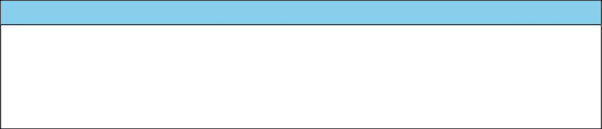

**需输入的代码：**

像这样的白色框包含供你尝试的代码（输入到文件中运行）。

如果你已经写了一些代码，你需要添加的新代码看起来像这样。

如果我们想让你删除现有代码，要删除的代码看起来像这样。

我们可能还会包含你不需要输入的指示性注释。

我们可能会在操作系统的终端会话或其他命令行环境中运行程序并进行其他活动。这些内容将如下所示：

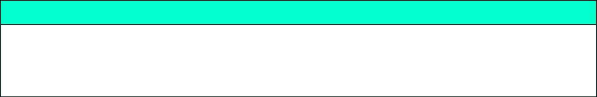

**交互会话：**

我们在这些 `INTERACTIVE`（交互）框中提供的纯黑文本是由系统提供的（不是让你输入的）。我们希望你插入命令看起来如下。

在灰色 `OBSERVE`（观察）框中呈现的代码和信息用于供你检查和吸收。这些信息通常会有颜色区分，并附有详细解释代码的文本：

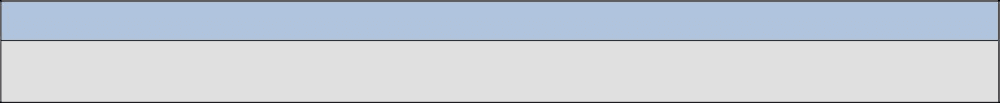

**观察：**

像这样的灰色的“观察”框包含供你观察的信息（通常是代码细节）。

随随其后的段落可能对“观察”框中高亮的信息提供更多细节。

我们还会把特别相关的信息单独列在“Note”（注意）框中：

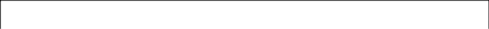

**注意：** 注意事项提供了有用的信息，但对于执行当前任务并非绝对必要。

 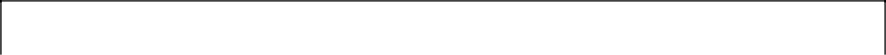

**提示：** 提示提供了可能帮助你更容易使用工具的信息，例如快捷键。

 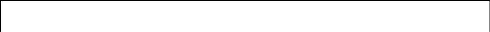

**警告：** 警告提供了有助于防止程序崩溃和数据丢失的信息。


## CodeRunner 屏幕

本课程在 CodeRunner 中呈现，它是 OST 的自环境。我们稍后会讨论细节，这里是屏幕各个区域的快速概述：

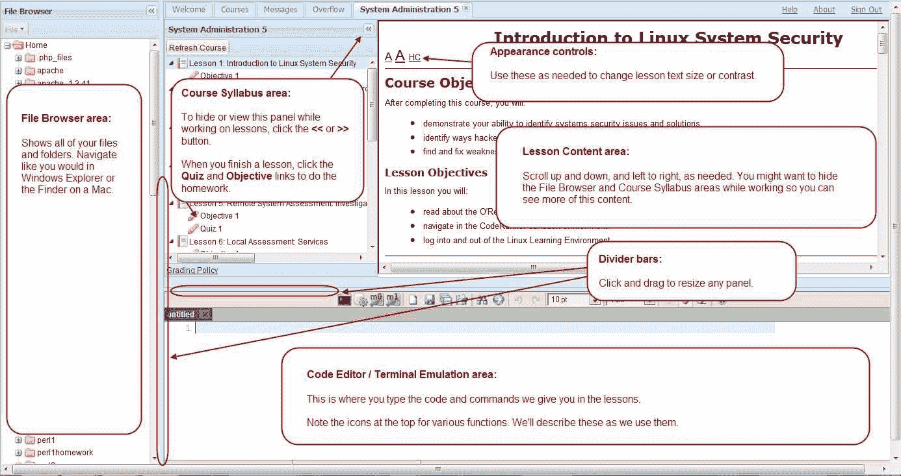

这些视频解释了如何使用 CodeRunner：

- [文件管理演示](http://www.youtube.com/watch?v=45sATp529Mw)
- [代码编辑器演示](http://www.youtube.com/watch?v=SvbM6vPAG9k)
- [课程演示](http://www.youtube.com/watch?v=WmajY8bIXrA)

## 欢迎来到高级 JavaScript

你可以快速上手 JavaScript。你只需要文本编辑器和一个浏览器，就可以开始实验。当你学习 JavaScript 基础时，你可能用它来修改网页，并可能根据用户输入修改页面的样式。你可能已经写过事件监听器来处理点击事件等事件，并且很可能使用 JavaScript 验证表单数据，或在用户与其交互时添加和移除元素。

在本课程中，我们将专注于 JavaScript 语言本身。由于我们使用 JavaScript 的主要地方是在浏览器中创建交互网页，我们仍然会构建网页应用程序，但重点将放在语言特性，而不是 Web 以及我们创建 Web 应用的技术。本课程的目标是将让你对 JavaScript 的理解提升到更深层次，从脚本编写变为程序员。你将学习如何在编程中利用 JavaScript 的强大功能，以及如何避免常见错误。

### 访问控制台

我们将频繁使用控制台来查看通过 `console.log` 生成的输出，并检查代码。因此，在做其他事情之前，让我们确保你熟悉开发者控制台，并记住如何在每个主流浏览器中访问和使用它。大多数终端用户从未见过控制台，因为它是为那些创建、测试和调试代码的开发者准备，所以如果你以前没有使用控制台的经验，不要担心，我们会让你快速进入状态。

在本课程中，我们将使用 Chrome 浏览器控制台显示大多数示例，因为截至本文编写，它功能最全且是所有浏览器控制台中最易使用的。但你应该熟悉多个浏览器控制台，以便测试和调试你的代码。

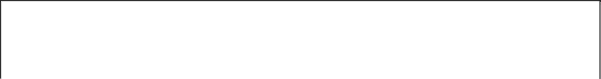 浏览器会不断更新新版本，其中包含新版本的控制台。注意，虽然控制台的基本功能可能保持不变，但你的控制台版本可能与你在本课程中看到的略有不同。当你熟悉不同的浏览器控制台时，你将学会如何使用每一个。


为你的工作创建一个文件夹。在文件浏览器中，右键点击 Home（主）文件夹并选择“新建文件夹...”（或点击 Home 文件夹并按 `Ctrl+n`），输入新文件夹名称 `AdvJS` 并按回车。

现在创建一个新的 HTML 文件，然后添加此代码：

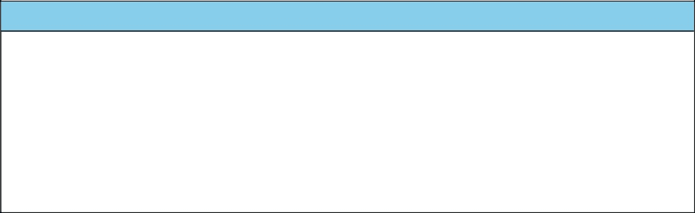

**需输入的代码：**

```html
<!doctype html>
<html>
<head>
<title> Getting Started </title>
<meta charset="utf-8">
<script src="basics.js"></script>
</head>
<body>
</body>
</html>
```

将其保存为 `basics.html` 位于你的 `/AdvJS` 文件夹中。

现在创建一个新的 JavaScript 文件并添加此代码：


**需输入的代码：**

```javascript
var onSale = true,
inventoryLevel = 12,
discount = 3;

if (onSale && inventoryLevel > 10) {
  console.log("We have plenty left");
}

if (onSale || discount > 0) {
  console.log("On sale!");
} else {
  console.log("Full price");
}
```

将其保存为 `basics.js` 位于你的 `/AdvJS` 文件夹中。

现在  预览你的 `basics.html` 文件。你会看到空白网页。要查看 JavaScript 的结果，请打开浏览器的控制台。获取访问控制台的指令，请点击你使用的浏览器链接：

- Chrome (Image00006.jpg)
- Safari (Image00006.jpg)
- Firefox (Image00006.jpg)
- Internet Explorer (Image00006.jpg)

在 Chrome 中访问控制台，使用 查看 | 开发者 | JavaScript 控制台 菜单：

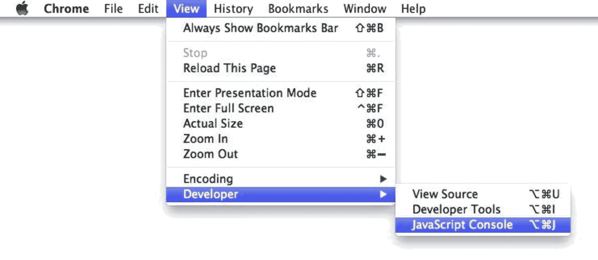

一旦启用了控制台，你可能需要刷新页面才能看到输出。你会看到：

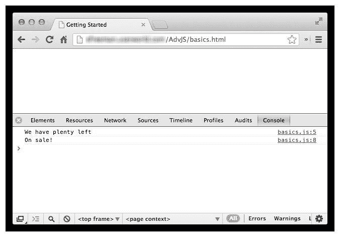

控制台有很多部分。在我们学习课程的过程中，你会越来越熟悉其中一些。

继续下一步。

要访问 Safari 中的控制台，请使用 `Developer | Show Web Inspector` 菜单（如果你没有启用 `Developer` 菜单，可以通过菜单栏中的 `Preferences | Advanced | Show Developer menu` 来启用）：

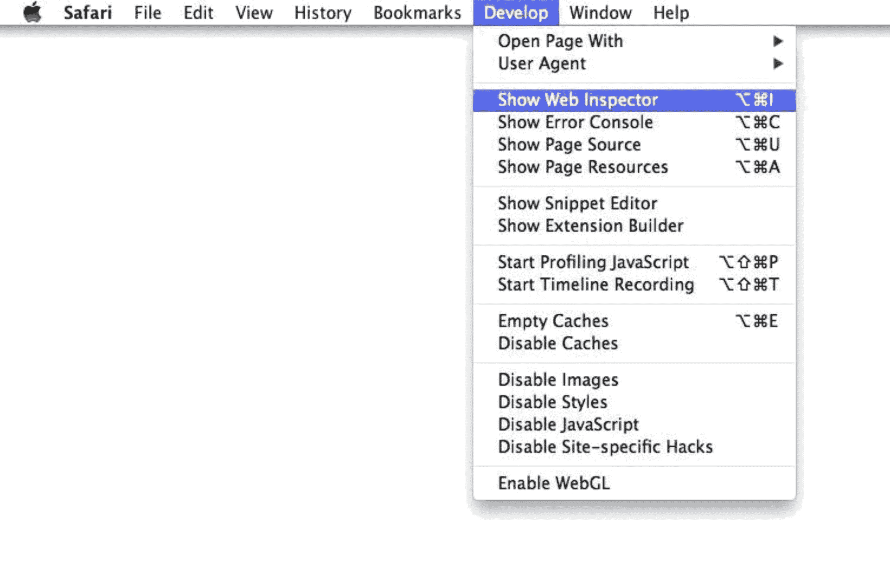

你可能需要刷新页面才能看到此输出：

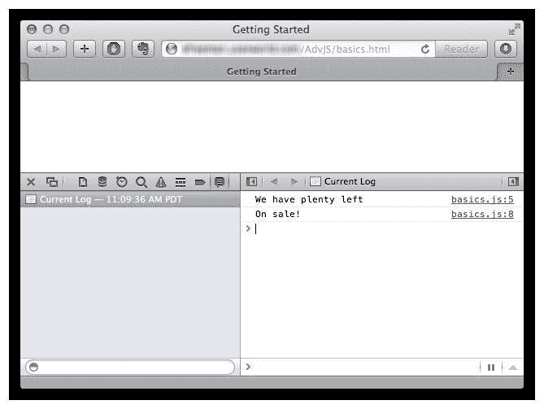

为了在 Safari 控制台中看到输出内容，请确保你已选择控制台中的 `Log` 标签页，并且选中了左侧列表顶部的“Current log”（你可能只看到一条日志，但如果你刷新页面，就可以看到之前的日志。当前日志始终位于最顶端。这里就是你通过 `console.log` 输出的最新内容将出现的地方）。

继续下一步。

要启用 Firefox 控制台，请使用 `Tools > Web Developer > Web Console` 菜单并访问控制台：

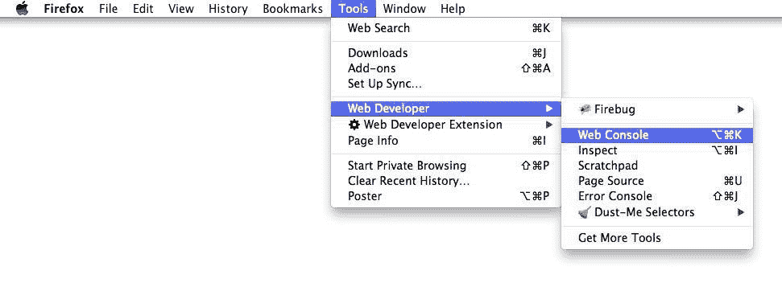

你可能需要刷新页面才能在控制台中看到输出。请注意，在 Firefox 中，控制台的默认位置在网页上方（与 Chrome 和 Safari 不同）。你可以点击控制台中的 `Position` 菜单并选择“bottom”（底部）或“window”（窗口）来更改控制台的位置。选择“window”会将控制台弹出一个独立的窗口。

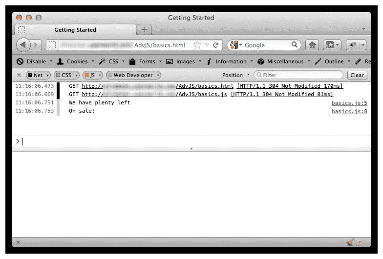

继续下一步。

要启用 Internet Explorer 控制台，请选择 `Tools | F12 Developer Tools` 然后选择 `Console` 标签页。

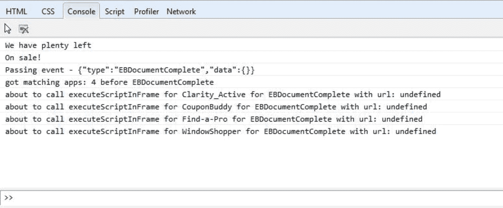

你可能需要刷新页面才能在控制台中看到输出。

## 使用控制台

让我们仔细观察 Chrome 控制台，因为我们在整个课程的示例中都将使用它。其他浏览器控制台具有相同的基本功能。当你需要专门使用 Chrome 控制台来跟进操作时，我们会通知你。


控制台顶部有几个标签页，包括我们正在使用的 `Console`。当你查看 `console.log()` 的结果以及通过检查是否有任何 JavaScript 错误来调试代码时，你会最频繁地使用 `Console`。在 Safari 中，等对应的内容是截图所示的 `Log` 标签页；在 Firefox 中，它是你从菜单访问 `Web Console` 时看到的默认视图；在 IE 中，它是一个标记为 `Console` 的标签页。

在 Chrome 中，如果你想将控制台在独立窗口中查看，点击左下角的图标：

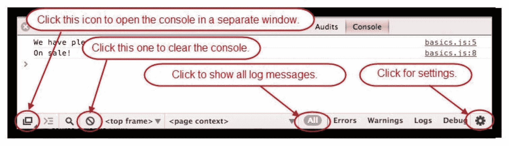

现在点击取消（undo）图标。这将为控制台创建一个独立的窗口。你可以点击该新窗口相同位置的图标，将其重新固定回原始窗口。尝试一下吧。

你在控制台中看到了我们在代码中通过 `console.log` 创建的两个消息：

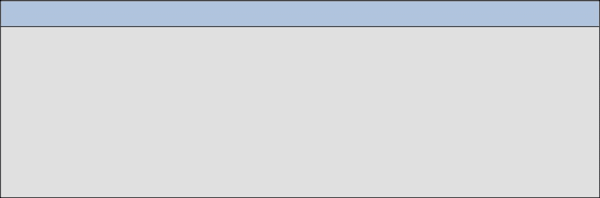

**观察：**

```javascript
var onSale = true,
inventoryLevel = 12,
discount = 3;
if (onSale && inventoryLevel > 10) {
  console.log("We have plenty left");
}

if (onSale || discount > 0) {
  console.log("On sale!");
} else {
  console.log("Full price");
}
```

上面以橙色显示的两个 `console.log()` 创建了控制台中的输出。语句出现的文件名以及这两个语句的行号会显示在控制台中，就在输出旁边。

在 Chrome 中，尝试点击其中一个行号，例如 `basics.js:5`。这将打开 `Sources` 标签页，并临时用黄色高亮该行：

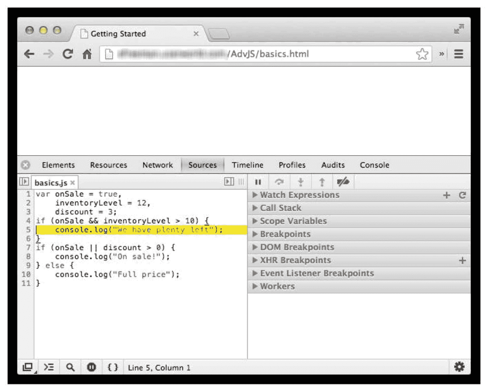

这可以帮助你追踪潜在的错误。“Sources”面板右侧有很多选项，包括“Call Stack”（调用栈）、“Scope variables”（作用域变量）和“Breakpoints”（断点），我们在以后学习更高级的主题时都会用到。请确保你已经下载了 Chrome 电脑上安装了最新版本以便测试。在编写本文时，当前版本是 `26`。你的版本可能不同，但没关系，因为控制台的基本功能是相同的。


遗憾的是目前其他浏览器默认没有安装相同的工具。请务必去下载 Chrome 并熟悉控制台工具，即使你通常使用其他浏览器来创建网页。


我们稍后会探索更多控制台内容，但现在我们仔细查看代码。

## 良好的编程风格实践

让我们回顾一些编写 JavaScript 程序的良好实践：


**观察：**

```javascript
var onSale = true,
inventoryLevel = 12,
discount = 3;
if (onSale && inventoryLevel > 10) {
  console.log("We have plenty left");
}

if (onSale || discount > 0) {
  console.log("On sale!");
} else {
  console.log("Full price");
}
```

我们使用的变量都声明在顶部并赋予了默认值。通常情况下，将变量声明在文件顶部（如果是局部变量则在函数顶部）并给它们赋值是一个良好的习惯。给变量赋值通常比让它们未定义（undefined）要好。

我们使用了逗号分隔的来声明变量。尽管如此，你也可以每个变量声明单独放在一行，如下：

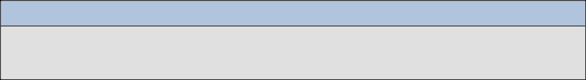

```javascript
var onSale = true;
inventoryLevel = 12;
discount = 3;
```

接下来，你会看到我们在每个语句后都使用了分号。虽然 JavaScript 不强制要求，但这是一个值得养成的习惯。如果你漏掉分号，JavaScript 可能会以你意料之外的方式解释你的语句。开始在每个语句后加上分号吧。


```javascript
var onSale = true,
inventoryLevel = 12,
discount = 3;
if (onSale && inventoryLevel > 10) {
  console.log("We have plenty left");
}

if (onSale || discount > 0) {
  console.log("On sale!");
} else {
  console.log("Full price");
}
```

另一个你应该养成的习惯是为每个 `if`（或 `while`、`for` 等）代码块使用大括号，即使块中只有一个语句。如果一个块中只有一个语句，技术上你不需要使用 `{` 和 `}` 字符来界定块。然而，这是一个坏习惯，因为会导致你漏掉错误。始终使用大括号！

使用大量的空白区域。增加空白区域并格式化代码使其易于阅读，比为了节省空间而让代码变短要好。在处理更大更复杂的程序时，可读性至关重要，而且你以后可以对 JavaScript 进行“压缩（minify）”，以移除空白并提高下载效率。


| Note | 市面上有很多“代码压缩”程序可以为你压缩代码，例如 [jscompress.com](http://jscompress.com) 和 [YUI compressor](http://refresh-sf.com/yui/) . |

我们将在整个课程中涵盖其他良好的编程实践和风格建议。我们会在每课结束时回顾它们，这样你就有充足的练习机会。如果你想进一步探索这个主题，网上还有很多优秀的风格指南（当然，并不是它们在所有方面都意见一致）。我们喜欢 [Airbnb JavaScript Style Guide (github)](https://github.com/airbnb/javascript) 。

让我们练习使用控制台来检查代码中的值。更新你的文件 `basics.js` 来定义一个对象 `rect`，然后使用 `console.log()` 显示它。在这里，我们将 `rect` 定义为一个对象字面量；即我们使用 `{` 和 `}` 字符来界定对象，并将其作为变量的值写出来。记住，对象只是键值对的集合。在这种情况下，`rect` 只有两个属性——`width` 和 `height`：

 **需输入的代码：**

```javascript
var onSale = true,
inventoryLevel = 12,
discount = 3;

if (onSale && inventoryLevel > 10) {
  console.log("We have plenty left");
}

if (onSale || discount > 0) {
  console.log("On sale!");
} else {
  console.log("Full price");
}

var rect = {
  width: 100,
  height: 50
};

console.log(rect);
```

保存你的更改（`basics.js`），并  预览你的 HTML 文件（`basics.html`），或者如果它仍在浏览器中打开着，只需重新加载页面即可。确保浏览器控制台已打开（你可能需要刷新页面才能看到输出）。你将看到此输出：


**观察：**

```
We have plenty left
On sale!
Object { width: 100, height: 50 }
```

在 Chrome 中，它看起来像这样：

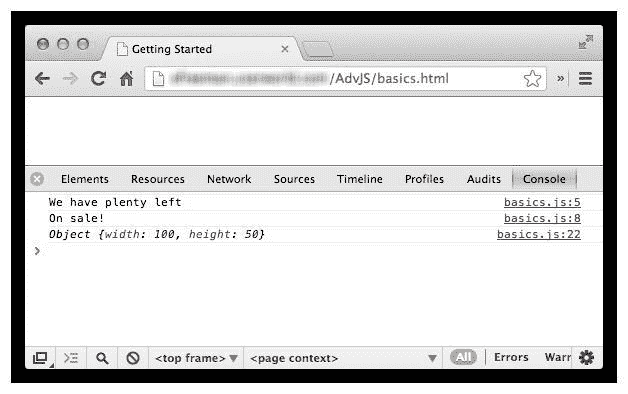

在 Safari 中，它看起来像这样（确保你点击 `Object` 旁边的小箭头以查看对象属性）：

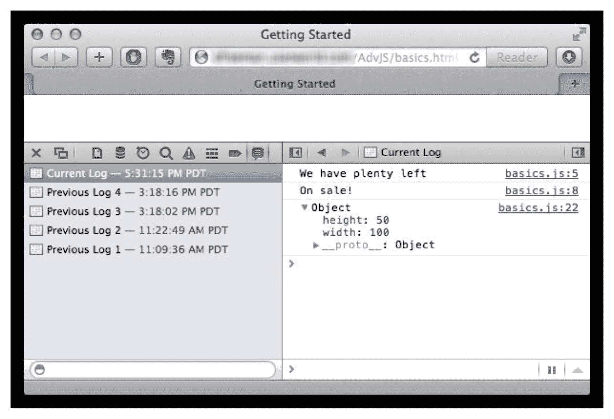

在 Firefox 中，它看起来像这样：

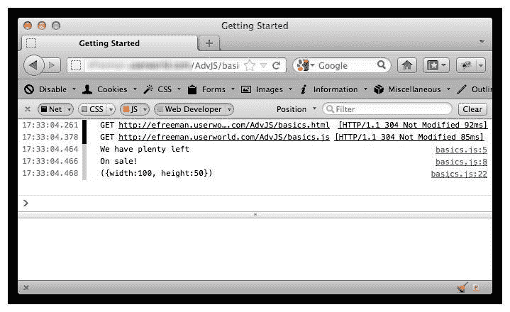

在 IE 中，它看起来像这样：

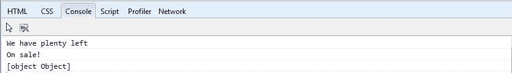

注意每个略有不同，但每个控制台向你展示了关于对象的相同基本信息，包括两个属性名/值对。

现在，让我们对代码做一个微小的更改：

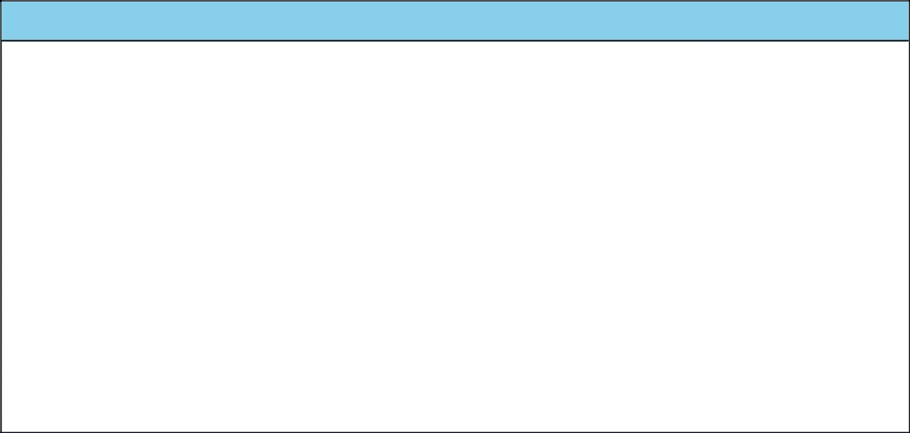

**需输入的代码：**

```javascript
var onSale = true,
inventoryLevel = 12,
discount = 3;

if (onSale && inventoryLevel > 10) {
  console.log("We have plenty left");
}

if (onSale || discount > 0) {
  console.log("On sale!");
} else {
  console.log("Full price");
}

var rect = {
  width: 100,
  height: 50
};

console.log(rect);
console.log("My object rect is: " + rect);
```

 和 。在控制台中，你看到：

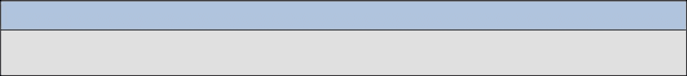

**观察：**

```
Object { width: 100, height: 50 }
My object rect is: [object Object]
```

你认为这是为什么的的？我们没有像之前那样看到对象包含的两个属性，而是只看到了对象的字符串表示 `"[object Object]"`。这并没有真正的帮助。在我们的代码中，我们在输出结果到控制台之前，通过将对象 `rect` 与字符串 `"My object rect is: "` 拼接创建了一个字符串。之前，我们将对象本身传递给 `console.log()`，因此 `console.log()` 函数显示了对象。现在我们传递一个字符串传递给 `console.log()`。当 JavaScript 将对象转换为字符串时，我们并没有得到一个非常有用的对象显示。

对你的代码做最后一次更改：

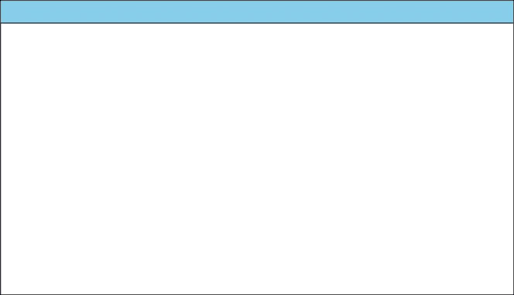

**需输入的代码：**

```javascript
var onSale = true,
inventoryLevel = 12,
discount = 3;

if (onSale && inventoryLevel > 10) {
  console.log("We have plenty left");
}

if (onSale || discount > 0) {
  console.log("On sale!");
} else {
  console.log("Full price");
}

var rect = {
  width: 100,
  height: 50 ,
  toString: function() {
    return "Width: " + this.width + ", height: " + this.height;
  }
};

console.log(rect);
console.log("My object rect is: " + rect);
console.log("My object rect is: " + rect.toString());
```

不要忘记在 `height` 属性值之后加上逗号！我们作为第三个属性值向此对象添加了一个方法，因此在第二个和第三个属性之间需要一个逗号  和 。


**观察：**

```
Object { width: 100, height: 50, toString: function }
My object rect is: Width: 100, height: 50
My object rect is: Width: 100, height: 50
```

`toString()` 方法现在作为 `rect` 对象的一部分出现在 `console.log(rect)` 的输出中，你可以在上面输出的第一行看到。我们刚刚那行代码调用了此方法来显示对象的 `width` 和 `height` 属性，你可以在上面输出的第三行看到它们。

然而，之前显示 `"[object Object]"` 的第二行现在显示的内容与第三行相同。这是因为 JavaScript 在将对象转换为字符串时会自动调用 `toString()` 方法。如果你在对象中自己实现了 `toString()` 方法，那么这就是 JavaScript 将调用的方法。如果你没有实现，JavaScript 就会调用 `Object` 对象中的 `toString()` 方法，它是你在 JavaScript 中创建的所有对象的父对象。`Object` 对象中实现的 `toString()` 版本在从对象创建有帮助的字符串方面做得并不好，正如你看到 `"[object Object]"` 显示时的那样。

现在不用担心这些细节；我们以后会回到这些问题。现在只需注意控制台显示输出的不同方式，这取决于你如何调用 `console.log()` 以及传递给此函数的值的类型。

这是 Chrome 中的输出。在截图中，我点击了显示对象属性的行（输出中的第三行），这会展开对象以显示更多细节，包括关于 `toString()` 方法的大量细节。再次，现在不要担心这些细节；我们将在课程的后续部分讨论它们，这样你在结束时就会知道它们的含义。

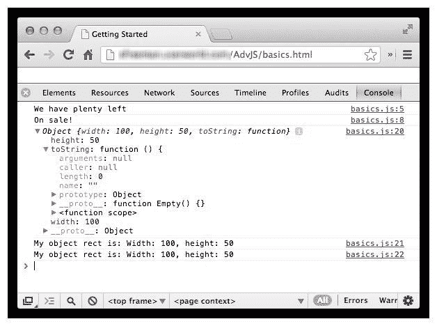

Safari（注意你可以在此控制台中打开对象，还可以打开 `toString()` 方法以查看类似的细节）：

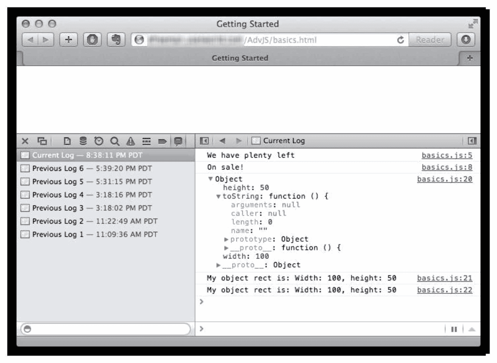

Firefox:

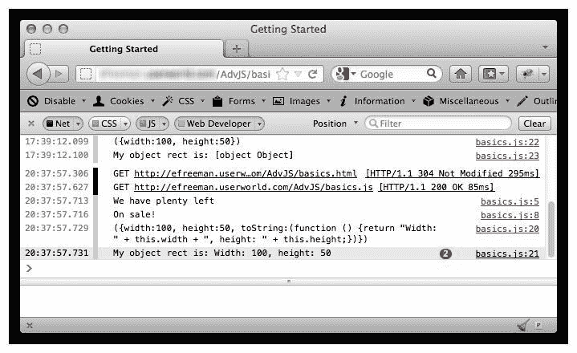

看到输出行旁边的 (2) 吗？这意味着同一行输出显示了两次。

IE:

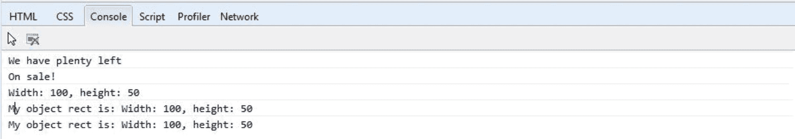

### 直接在控制台中进行交互

到目前为止，我们一直在使用 `console.log()` 在控制台中显示消息，但你可以直接与控制台交互以显示变量的值、创建新语句，甚至修改你的网页。

在浏览器的控制台中，你将看到一个提示符，指示你可以在哪里输入自己的 JavaScript。点击控制台窗口中提示符旁边并输入：

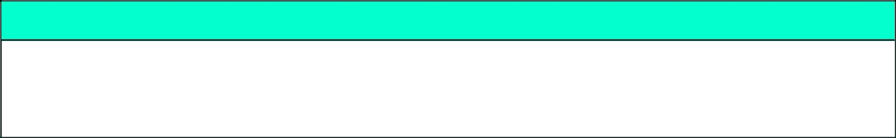 **交互会话：**

```
> onSale
true
```

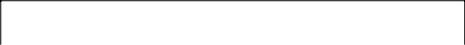 注意 ">" 字符是提示符，你不输入这部分。


我们输入了全局变量 `onSale` 并按了回车。JavaScript 返回了 `onSale` 的值。

这是在 Chrome、Safari、Firefox 和 IE 浏览器中的输出：

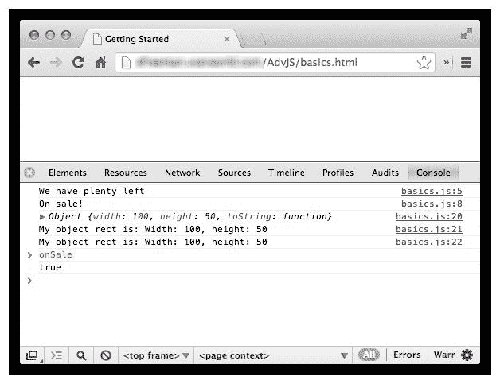 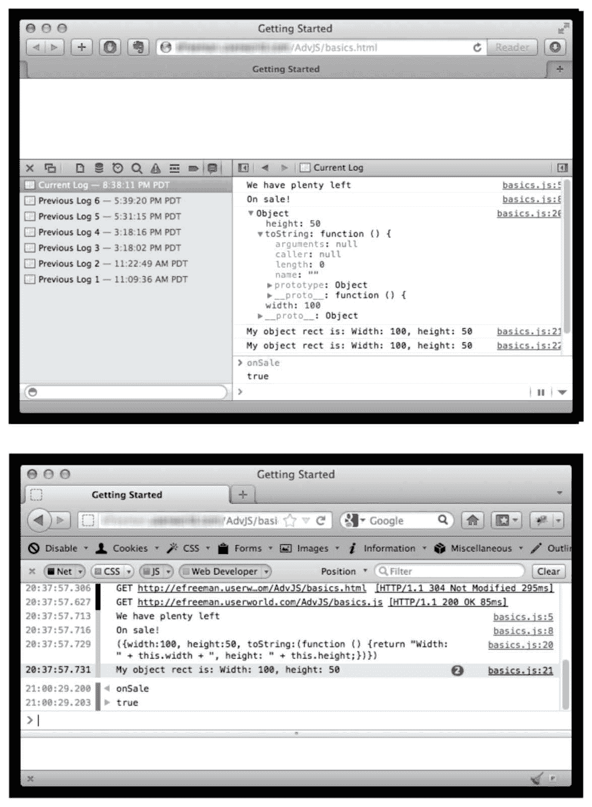 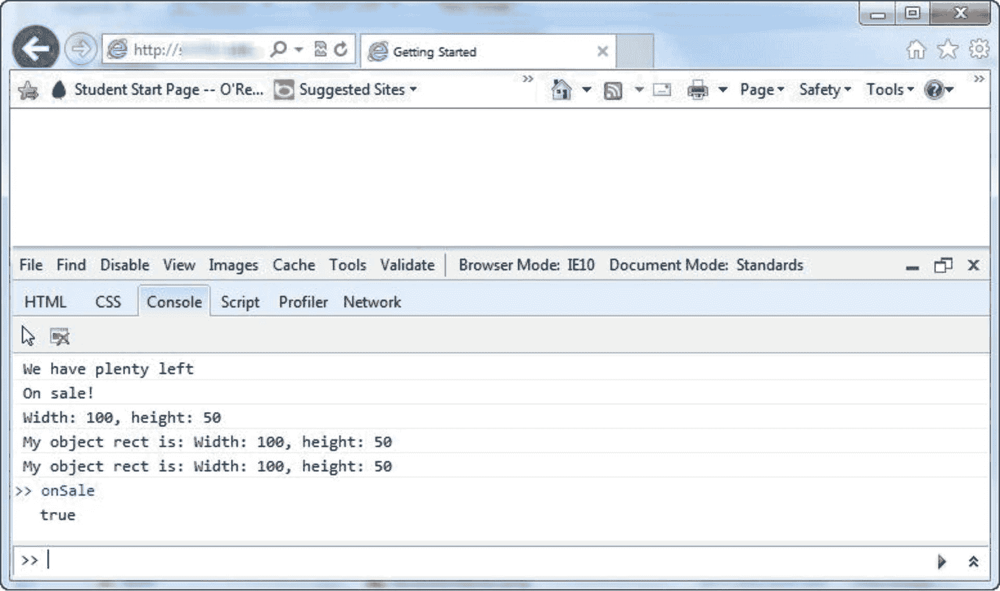

在这条语句中，你定义了一个新变量 `a`，其值为一个包含三个值的数组。你看到了值 `undefined`。这在起初可能会让你有点困惑。这并不意味着 `a` 的值是 `undefined`，它意味着执行这条语句后返回给控制台的结果是 `undefined`（也就是说，语句本身的值是 `undefined`）。

为了验证你确实为数组 `a` 创建了值，请在提示符处输入 `a`：


### 交互式演示：

```
a
[1, 2, 3]
```

现在，让我们在控制台中直接写一个循环来遍历这个数组。要做到这一点，你可以一行输入整个 `for` 循环，或者在 Chrome 和 Safari 中使用 `Ctrl+Enter`，在 Firefox 中使用 `Shift+Enter`，并点击多行模式图标 ( 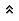 ) 在控制台中创建换行。

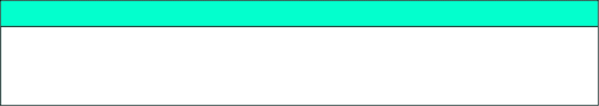 **交互式演示：**

```javascript
for (var i = 0; i < a.length; i++) { console.log("a[" + i + "]: " + a[i]);
}
```

如果你忘记创建换行符并不小心按了 `Enter`。一旦你输入完并误按了 `Enter`，你会得到一个错误并必须重新完成代码，你会看到此输出：


**观察：**

```
a[0]: 1
a[1]: 2
a[2]: 3
```

如果刷新页面会发生什么？`a` 的值会消失。通过控制台添加的变量仅对当前会话有效，在刷新或关闭标签页或窗口时就会消失。

实验一下吧！创建一些新变量并在控制台中写一些 JavaScript 语句。熟悉如何使用控制台，特别是在 Chrome 中。

## 为你的代码编写注释

当然，我们不能不提到注释就结束这节课。注释是创建可读程序的重要部分，特别是当你的程序变得巨大且复杂时。你可能已经知道，在 JavaScript 中有两种注释代码的方法：`/* ... */` 和 `//`。让我们都尝试一下这两个：


### 需要输入的代码：

```javascript
/*
var onSale = true,
inventoryLevel = 12,
discount = 3;
if (onSale && inventoryLevel > 10) {
  console.log("We have plenty left");
}
if (onSale || discount > 0) {
  console.log("On sale!");
} else {
  console.log("Full price");
}
var rect = {
  width: 100,
  height: 50,
  toString: function() {
    return "Width: " + this.width + ", height: " + this.height;
  }
};
console.log(rect);
console.log("My object rect is: " + rect); 
console.log("My object rect is: " + rect.toString()); */

//
// 此函数计算圆的面积
// @param {number} 圆的半径
// @return {number} 圆的面积
//
function computeArea(radius) {
  return radius * radius * Math.PI;
}
console.log("Area is: " + computeArea(3));
```

在这里，我们使用 `/* ... */` 来注释掉大块代码。这是标准做法，因为 `/*` 和 `*/` 分隔符为你提供了一种快速直接的方法来注释多行，这可以让测试和调试变得更容易。

我们还使用了 `//` 在我们添加到代码中的新 `computeArea()` 函数上方创建了几行注释。不过，我们没有将这些注释都放在 `/* ... */` 中，因为如果我们稍后决定注释掉整个函数，我们可以将整个部分（包括标题注释）都放在 `/*` 和 `*/` 分隔符之间，这使得注释大块代码（包括多个函数）变得简单得多。当然，我们可以使用 `//` 临时注释掉单行代码以进行调试，或在函数内部提供注释。

最后，注意我们注释此函数使用的样式。我们为该函数提供了简短描述，以及关于它预期的参数（圆的半径 `radius`）和它返回的值（圆的面积）的信息。

我们不会总是对示例进行详细注释，但要养成为项目代码注释的习惯。你的同事（以及老板）会感激不尽，当你以后（当）需要回来修改你的代码时，你也会感激的。

花些时间在控制台中进行实验。在示例中添加更多 `console.log()` 语句（或创建自己的示例并进行实验）。直接在控制台中编写语句。

从这里开始，我们将主要展示 Chrome 的截图，但你可以（也应该）在多个浏览器中尝试课程示例。当你需要使用特定的浏览器控制台进行测试时，我们会通知你。

现在你已经掌握了使用控制台的基础知识，我们在下一节课中将进入 JavaScript 类型的细节。

## 了解你的类型


### 课程目标

当你完成本节课时，你将能够：

- 区分原始类型和对象。
- 分类原始类型。
- 区分 null 和 undefined。
- 构建对象。
- 使用控制台对 JavaScript 类型、对象属性和各种数字表示进行实验。 

JavaScript 只有几种基本类型，但它们仍然需要考虑。在这节课中，我们将回顾原始类型和对象的基础知识，深入一些你可能从未遇到过的细节，并加深对基础的理解。

### 了解你的类型：原始类型和对象

JavaScript 中的每个值要么是原始类型要么是对象。原始类型是简单类型，如数字和字符串，而对象是复杂类型，因为它们由多个值组成，就像这个方形对象：

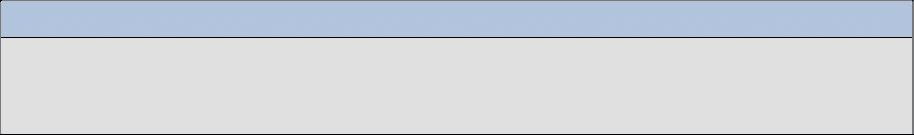

**观察：**

```javascript
var square = {
  width: 10,
  height: 10
};
```

这个对象由两个原始值组成：一个值为 `10` 的 `width`，另一个同样值为 `10` 的 `height`。

我们将首先查看原始类型；稍后会回到对象。

### 原始类型

你最常用的三种原始类型是数字、字符串和布尔值。你可以直接在浏览器的控制台中测试这些类型。

在浏览器窗口中打开控制台并尝试输入一些原始值。某些浏览器不允许对空白页打开控制台。你可以加载上一节课为 `basics.html` 创建的网页，然后打开控制台，尝试测试某些类型，如下：

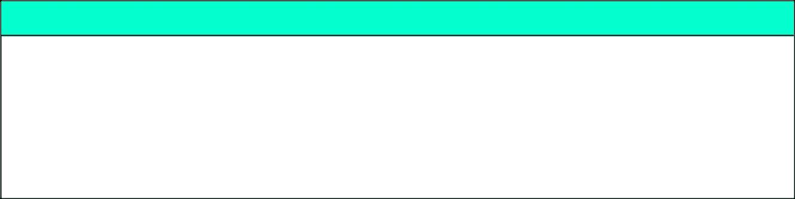

### 交互式演示：

```
3
3
"test"
"test"
true
true
```

让我们尝试一个表达式：


### 交互式演示：

```
3 + 5
8
```

当你输入一个表达式时，该表达式的结果是一个值，它显示在控制台中。

当你输入一条语句时，该语句的结果（通常）是 `undefined`：


### 交互式演示：

```javascript
var x = 3;
undefined
x + 5
8
```

在这里，我们在语句中声明了一个新变量 `x`（你在控制台中输入的第一个内容），然后在表达式 `x + 5` 中使用了它（你在控制台中键的第二个内容）。尽管语句将 `x` 的值设置为 `3`，但语句本身的结果是 `undefined`。表达式的结果只是表达式计算出的值。习惯这种行为，以免以后在控制台中看到 `undefined` 时会感到困惑！

### 使用 Typeof 获取值的类型

JavaScript 有一个 `typeof` 运算符，你可以用它来检查值的类型。有几个原因导致你不一定要在代码中依赖这个运算符。我们稍后会讨论这些原因，但现在我们使用 `typeof` 来检查原始类型的类型，如下：

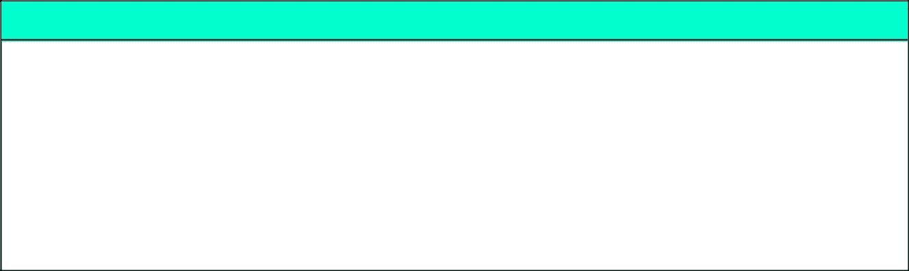

### 交互式演示：

```
typeof 3 "number"
typeof x "number"
typeof "test" "string"
typeof true "boolean"
```

`typeof` 运算符看起来看起来有点奇怪；它不像你习惯的那些接受两个值的运算符。`typeof` 只接受一个值，并把该值的类型作为字符串返回。因此，数字 3 的类型以字符串 "number" 返回。注意，我们可以对值（如 3）或包含值的变量（如 `x`）使用 `typeof`。

你可以在表达式中使用 `typeof`，如下所示：

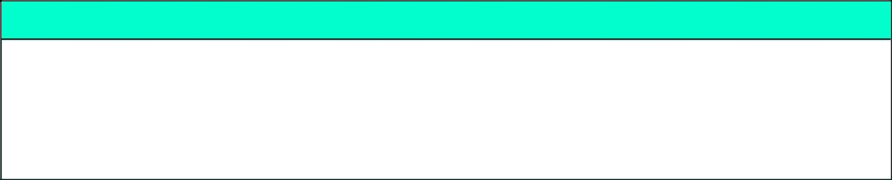

### 交互会话：

```javascript
if (typeof x == "number") {
  alert("x is a number!");
}
undefined
```

记得在控制台的行末尾使用 `Ctrl+Enter` 或 `Shift+Enter` 以避免产生错误。在 `if` 语句的末尾（闭合大括号 `}` 之后）使用 `Enter`。你看到弹窗提示了吗？

我们将表达式 `typeof x` 的结果与字符串 `"number"` 进行比较，如果它们相等，就会弹出一个消息（是的，你可以从控制台弹出警告！）。`if` 语句的结果是 `undefined`。

## Null 和 undefined

现在，让我们来看这两个原始类型：`null` 和 `undefined`。你已经在控制台输入的语句结果中看到过 `undefined` 了。它也会出现在其他地方，但不过，让我们先从 `null` 开始吧。

`null` 是表示变量“没有值”的一种方式：

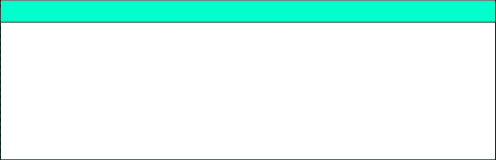 ### 交互会话：

```javascript
var y = null; undefined
if (y == null) {
  console.log("y is null!");
}
y is null!
undefined typeof y "object"
```

在这里，我们把值 `null` 赋值给变量 `y`。所以 `y` 有一个值——一个表示“没有值”的值。很奇怪。我们可以将该值与 `null` 进行比较，由于 `y` 的值是 `null`，所以这个比较为真，因此我们在控制台中看到了消息 "y is null!"（是的，我们可以从控制台调用 `console.log()`！）。注意你在控制台中看到了 "y is null"，然后你看到了语句的结果，即 `undefined`。在 Chrome 和 Safari 中，控制台会在语句结果 `undefined` 旁边显示一个微小的 `⋖` 字符，这样你就不会把控制台的输出（`"y is null!"`）与语句的结果（`undefined`）搞混。在 Firefox 中，你会在语句结果旁边看到看到一个指向右侧的箭头。

更奇怪的是，当你检查 `typeof y` 时，得到的结果是 `"object"`。什么？这看起来不对劲。好吧，你猜怎么着——它确实不对！这是 JavaScript 当前实现中的一个错误。结果本应该是 `null`，因为 `null` 的类型是 `null`。


这个错误就是你不想在代码中依赖 `typeof` 的原因之一。这个失误应该在 JavaScript 未来的实现中被修复，但现在如果你需要使用 `typeof`，请记住这一点。（`typeof` 还有另一个问题我们稍后会提到）。


那么，`undefined` 呢？很多人初开始学习 JavaScript 时会混淆 `null` 和 `undefined`，所以如果觉得它看起来有点模糊，不要担心。虽然 `null` 是一个表示“没有值”的值（这本身就很绕脑筋），但 `undefined` 表示一个变量完全没有值，甚至连 `null` 都没有：

 ### 交互会话：

```javascript
var z; undefined
z undefined
```

你可以通过声明一个变量但不对其进行初始化来创建一个 `undefined` 变量。在这里，我们声明了变量 `z`，但没有给它初始化值。当我们通过在控制台中输入它的名称来检查 `z` 的值时，得到的结果是 `undefined`。

不要把你看到的语句 `var z;` 的结果 `undefined` 与你看到的表达式 `z` 的结果 `undefined` 混混。

那么 `undefined` 的类型是什么呢？你能猜到吗？（这次，JavaScript 的实现是正确的。）

 ### 交互会话：

```javascript
typeof z undefined
```

是的，`undefined` 的类型是 `undefined`！

尽管 `z` 是 `undefined`（意味着它没有值），你仍然像这样测试 `z` 是否为 `undefined`：

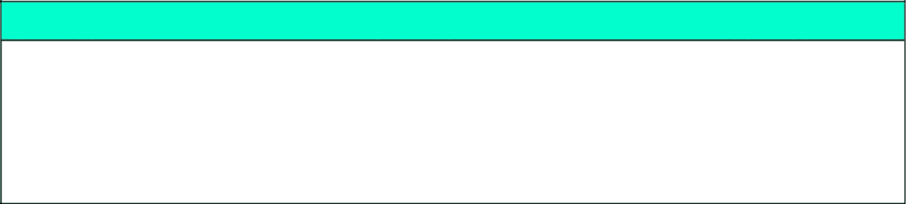 ### 交互会话：

```javascript
if (z == undefined) {
  console.log("z is undefined!");
}
z is undefined!
undefined
```

或者你可以像这样测试：

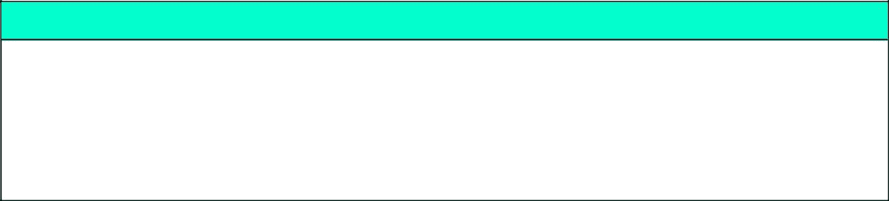 ### 交互会话：

```javascript
if (typeof z == "undefined") {
  console.log("z is undefined!");
}
z is undefined!
undefined
```

你会得到相同的结果。尝试一下吧！尽管如此，通常我们建议除非你有充分理由，否则不要使用 `typeof`。你可以直接通过比较变量的值（在这种情况下是变量 `z` 与值 `undefined`）来测试变量是否为 `undefined`。在这里你你根本不需要使用 `typeof`。

## 一些有趣的数字

在离开原始类型之前，让我们再多聊聊数字。在你的 JavaScript 程序中，你可能已经使用数字来遍历数组、表示价格、计数物品等等，但还有一些数字你可能还没有遇到。

首先，让我们过一下数字是如何表示的。在 JavaScript 中，表示数字有两种方式：整数（integers）和浮点数（floating point numbers）。例如：

 ### 交互会话：

```javascript
var myInt = 3; undefined
var myFloat = 3.12583E03; undefined
myInt 3
myFloat 3125.83
```

你可以使用科学计数法写浮点数，`3.12583E03`（这意味着 "E" 之后的数字是该数字乘以 10 的次数）。当你想要表示非常大或非常小的数字时，这非常方便。

说到这里，你如何知道最大或最小的数字？`Number` 对象（我们稍后会详细讨论）拥有这些的内置属性：`MAX_VALUE` 和 `MIN_VALUE`。在你的控制台中尝试它们：

 ### 交互会话：

```javascript
Number.MAX_VALUE 1.7976931348623157e308
Number.MIN_VALUE 5e-324
```

哇。`MAX_VALUE` 非常大，MIN_VALUE` 非常小。你可能认为这意味着 JavaScript 可以表示很多数字，但 JavaScript 能表示的数字比你想象的要少得多。为什么？因为 `MAX_VALUE` 和 `MIN_VALUE` 都是浮点数表示的，注意，它们在 17 位上是精确的。超过这个位数，它们就全是零了，例如 `1.79769313486231570000000e308`。

当你需要精度时，你会想要使用整数，并且你需要知道 JavaScript 可以表示的最大（和最小）整数。让我们来看看 2 的 53 次方：

 ### 交互会话：

```javascript
Math.pow(2, 53) 9007199254740992
```

这也是大数字，但比 `MAX_VALUE` 小得多。JavaScript 可以精确表示从零到这个数字的所有整数。这为你提供了大量的数字可以操作，而且也适用于最小整数 `Math.pow(2, -53)`。

理解计算机如何表示数字可能是一门课程，所以我们现在不会深入探讨这个主题。如果你对进一步探索这个主题感兴趣，可以 [ECMAScript](http://ecma262-5.com/ELS5_HTML.htm#Section_8.5)规范（JavaScript 基于的规范），以及关于[二进制编码](http://en.wikipedia.org/wiki/Binary-coded_decimal)小数的 Wikipedia 页面。

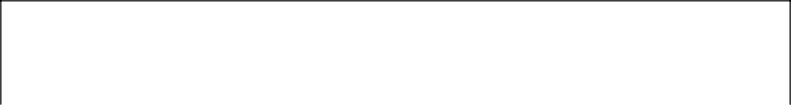

假设你正在现代电脑上使用现代浏览器，而 `Math.pow(2, 53)` 是基于 JavaScript 表示 64 位数字的能力，现代电脑上的现代浏览器可以做到这一点。如果由于某种原因，你在旧电脑上使用旧浏览器，那么你的最大数字可能是基于 32 位数字的。

## 直达无穷远

你可能还记得数学课上，如果除以 0，你会得到无穷。当你开始编程时，这会导致问题，因为如果你尝试在某些编程语言中表示无穷，呃这么说，你的电脑不会太高兴的。

## JavaScript 无穷 (Infinity)

然而，JavaScript 非常乐意表示无穷：


### 交互式会

```javascript
var zero = 0; undefined
var crazy = 3/zero; undefined
crazy
Infinity
```

JavaScript 在除以 0 时并没有报错，而是直接返回了值 `Infinity`。至少在 JavaScript 中，`Infinity` 是什么？（我想我们可能现实世界中可能无法得知。）


### 交互式会

```javascript
typeof crazy "number"
```

在 JavaScript 中，`Infinity` 是一个数字（`-Infinity` 也是如此）。如果你愿意，可以运行这个实验，但请准备好关闭浏览器窗口，因为这是一个永远不会结束的实验：

 **观察：**

```javascript
var counter = 0; undefined
while (counter < crazy) { 
  counter++; 
  console.log(counter);
}
```

1

2

3

... 永远

所以，虽然你可以在程序中表示 `Infinity`，但并不意味着你永远能到达它。不过，你可以通过测试它来防止错误：


### 交互式会

```javascript
if (crazy == Infinity) { console.log("stop!"); } stop!
```

⋖ undefined

## NaN

你应该知道的最后一个有趣的数字是 `NaN`，或者说 "Not a Number"（不是数字）。等一下，一个意思是“不是数字”的东西竟然是个数字？是的！这是 JavaScript 世界的另一个奇现象。试一试：


### 交互式会

```javascript
var invalid = parseInt("I'm not a number!"); undefined
invalid
typeof invalid "number"
```

在这里，我们尝试将字符串 "I'm not a number" 解析为整数。显然这会失败，因为在字符串 "I'm not a number" 中没有任何东西看起来像整数。那么变量 `invalid` 的结果是什么呢？嗯，它是 `NaN`。而当我们检查 `invalid` 的类型时，我们发现它确实是一个 "number"（数字），尽管它的值是 `NaN`。

你可能认为可以这样测试结果是否为 `NaN`：


### 交互式会

```javascript
if (invalid == NaN) { console.log("invalid is not a number!"); } undefined
```

但这不起作用。去吧，现在试一下。你不会在控制台中看到消息 "invalid is not a number!"。

相反，要测试一个变量是否不是数字，你需要使用内置函数 `isNaN()`：

 **交互式会：**

```javascript
if (isNaN(invalid)) { console.log("invalid is not a number!"); } invalid is not a number!
```

⋖ undefined

不过使用 `isNaN()` 要小心。如果你写下面的代码，你预期得到什么：


### 交互式会

```javascript
isNaN("3") false
```

你可能期望看到结果为 `true`（意味着字符串 "3" 不是数字），但我们得到了 `false`（意味着字符串 "3" 是数字）。为什么呢？因为 `isNaN()` 在检查它是否不是数字之前，会尝试将其参数转换为数字。在 "3" 的情况下，JavaScript 成功了。可以把这段代码等同于 `parseInt ("3")` 并将结果 `3` 传递给 `isNaN()`。这种行为被广泛认为是 JavaScript 的一个 bug，可能会在未来的版本中修复。在此期间，只需确保你知道 `isNaN()` 是如何工作的，以便在你传递给它的值可以转换为数字时做好做好准备。

## 对象 (Objects)

我们在原始类型世界中花费了大量时间，现在让我们来到对象世界待一会儿。到目前为止，你可能已经对对象有了相当丰富的经验，但让我们快速回顾一下，以确保你为接下来的一些更高级的对象课程做好准备。

对象是属性的集合。属性可以是原始值、其他对象或函数（当它们在对象内部时，被称为方法）。让我们来看一个对象的示例。我们将创建一个简单的 HTML 文件来装载我们的对象（这比在控制台提示符处输入要简单）：


### 需要输入的代码：

```html
<!doctype html>
<html>
<head>
<title> Objects </title>
<meta charset="utf-8">
<script>
var person = {
  name: "James T. Kirk",
  birth: 2233,
  isEgotistical: true,
  ship: {
    name: "USS Enterprise",
    number: "NCC-1701",
    commissioned: 2245
  },
  getInfo: function() {
    return this.name + " commands the " + this.ship.name;
  }
};
</script>
</head>
<body>
</body>
</html>
```

 将其保存为 `/AdvJS` 文件夹中的 `objects.html`，然后 。你在页面上不会看到任何内容，所以打开控制台（并刷新页面以防万一）。由于我们将 `person` 定义为全局变量，我们可以在控制台中使用它：

 **交互式会：**

```javascript
person.getInfo()
"James T. Kirk commands the USS Enterprise"
```

`person` 对象包含原始值属性和其它对象属性。我们说 `person.ship` 对象嵌套在 `person` 对象内部。你可以在对象中嵌套对象、在对象中嵌套对象，以此此类推，直到达到你想要的深度（尽管深度是有限制的，但在正常程序中不太可能触及），但请记住，嵌套的对象越多，你的对象就越低效。还要注意，最深层嵌套的对象必须具有原始值或方法属性（这样嵌套才能停止）。

## 添加和删除属性

JavaScript 对象的一个酷点是它们是动态的，也就是说，你可以通过更改其值、甚至通过添加或删除属性来随时更改属性：


### 交互式会

```javascript
person.title undefined
person.title = "Captain"; "Captain"
person.title
"Captain"
person
Object {
  name: "James T. Kirk",
  birth: 2233,
  isEgotistical: true,
  ship: Object,
  getInfo: function
  birth: 2233
  getInfo: function () {
  isEgotistical: true
  name: "James T. Kirk"
  ship: Object
  title: "Captain"
  __proto__: Object
}
```

在这里，我们获取了 `person` 中不存在的属性 `person.title` 的值。结果是 `undefined`，这是我们的预期。接下来，我们通过定义并赋予值 "Captain" 为 `person` 设置了属性 `title`。现在，我们可以使用 `person.title` 获取该属性的值。当我们控制台中显示 `person` 的值时（只需输入对象的名称并按回车），我们看到 `title` 已经被添加到对象中，就像它一直在那里一样。（注意，我们通过点击 Chrome 中对象旁边的箭头检查了 `person` 的详细信息。）

现在，假设你想删除 `title` 属性：


### 交互式会

```javascript
delete person.title true
person.title undefined
person
Object {
  name: "James T. Kirk",
  birth: 2233,
  isEgotistical: true,
  ship: Object,
  getInfo: function
  birth: 2233
  getInfo: function () {
  isEgotistical: true
  name: "James T. Kirk"
  ship: Object
  __proto__: Object
}
```

`delete` 删除的是整个属性，而不仅仅是值。该属性不再存在于对象中，所以当我们尝试获取它的值时，再次得到了 `undefined`。当我们检查对象时，可以看到 title 属性已经消失了。

这是加载 `objects.html` 后在 Chrome 中的控制台交互截图：


## 对象的类型是什么？

你想知道对象的类型吗？去吧，在控制台中使用 `typeof` 测试：


### 交互式会

```javascript
typeof person "object"
```

在这里，当我们询问 `person` 对象的类型时，JavaScript 返回了字符串 "object"。很好。

## 枚举对象属性

JavaScript 有在程序内部检查对象属性的能力。这被称为类型检查。让我们来看一个示例。按照所示修改 `objects.html`。

 **需要输入的代码：**

```html
<!doctype html>
<html>
<head>
<title> Objects </title>
<meta charset="utf-8">
<script>
var person = {
  name: "James T. Kirk",
  birth: 2233,
  isEgotistical: true,
  ship: {
    name: "USS Enterprise",
    number: "NCC-1701",
    commissioned: 2245
  },
  getInfo: function() {
    return this.name + " commands the " + this.ship.name;
  }
};
console.log(person);
</script>
</head>
<body>
</body>
</html>
```

```javascript
return this.name + " commands the " + this.ship.name;

};

for (var prop in person) {
  console.log(person[prop]);
}
```

 和  。 你会在控制台中看到对象的每个属性显示——这是它在 Chrome 中看起来的样子：


让我们仔细观察我们是如何做到的：


**观察：**

```javascript
for (var prop in person) {
  console.log(person[prop]);
}
```

我们使用 `for` 循环来遍历对象中的所有属性，但我们没有使用你可能熟悉的传统的 `for` 循环，而是使用了 `for/in` 循环（你可能在之前的课程中在访问 `LocalStorage` 中的键和值时用过它）。在 `for/in` 语句中，我们声明了一个变量：`prop`。每次循环时，`prop` 都会获取对象 `person` 中下一个属性的属性名。当我们遍历一个对象以访问其每个属性时，我们称之为为枚举对象的属性。

然后，在循环内部，我们在控制台中显示对象属性的值。我们使用方括号表示法来访问对象的属性。你可以自己在控制台中尝试一下这个，看看它是如何工作的的：


### 交互式练习：

```
person["name"] "James T. Kirk"
```

要使用方括号表示法访问对象的属性值，你需要将属性名放在括号内的双引号中，并紧接对象的名称。

这种表示法非常方便，因为它允许你预先访问属性（回想循环中的 `for/in` 属性名）。

在不知道循环变量的名称的情况下访问对象的属性，并看到我们正在使用一个变量 `prop` 作为...

你会在什么时候使用这个呢？嗯，你可能想将属性从一个对象复制到另一个对象，前提是该属性确实存在。你可以使用方括号表示法先检查属性是否存在。或者你可能正在使用 `XHR` (`Ajax`) 从文件加载 `JSON` 数据，并根据这些数据创建或修改对象。我们将在课程的后续部分看到几个例子，在其中枚举对象属性的能力将派上用场。

### 像对象一样的原始类型

之前我们说过，你可以将 JavaScript 值分为两类：原始类型和对象。这表明它们是完全分离的，而且在大多数情况下确实如此。然而，你应该知道，某些原始类型——特别是数字、字符串和布尔值——有时可以像对象一样工作。

尝试一下这个：


### 交互式练习：

```
var s = "I'm a string"; undefined
s
"I'm a string"
s.length
12
s.substring(0, 3); "I'm"
```

在第一行中，我们声明并初始化变量 `s` 为一个字符串 "I'm a string"。如你所知，字符串是一个原始类型。然而，我们请求了字符串的长度 `s.length` 以及字符串的前三个字母 `s.substring(0, 3)`，将字符串 `s` 视为一个对象处理。毕竟，只有对象才有像 `length` 这样的属性和像 `substring()` 这样的方法，对吧？那么，发生了什么呢？

我们有一个表现得像对象的原始类型！当你尝试访问作用于原始类型的属性和方法时，JavaScript 会在后台将该原始类型转换为对象，使用属性或调用方法，然后将其转换回原始类型。在这个例子中，字符串 `s` 被临时转换为一个 `String` 对象以便我们使用 `length` 属性，然后变回原始类型。接着，它又被转换为 `String` 对象以便我们调用 `substring()` 方法，然后再次变回原始类型。

同样的情况也发生在数字和布尔值上：


### 交互式练习：

```
var num = 32; undefined
num
32
num.toString()
"32"
var b = true; undefined
b.toString()
"true"
```

在实践中，你需要的数字和布尔值像对象一样工作的情况不多，除非你将它们转换为字符串，这种情况每当你像这样使用 `console.log()` 时就会发生：


### 交互式练习：

```
console.log("My num is " + num); My num is 32
undefined
```

在这里，`num` 被临时转换为 `Number` 对象，调用了它的 `toString()` 方法，结果与 "My num is" 拼接，结果显示在控制台中（此时 `num` 被转换回原始类型）。这一切都在后台完成，所以你不需要担心它。

与 `Array`、`Date` 和 `Math` 等内置对象类型类似，JavaScript 也有内置的对象类型 `Number`、`String` 和 `Boolean`。不过，你很少使用这些，而且当你只需要一个简单的原始值（如 3）时，你永远不应该这样做：


### 交互式练习：

```
var num = new Number(3); undefined
num
Number {}
```

为什么？因为 JavaScript 在需要时总是会将像 3 这样的原始类型转换为对象，而不需要你去担心它。所以，原始类型有时会在后台转换为对象，但你可能可能永远不需要直接使用这些对象。

### JavaScript 是动态类型语言的

如果你接触过其他语言，你可能遇到过某些在创建新变量时必须声明变量类型的语言，如下所示：


**观察：**

```
int x = 3;
String myString = "test";
```

在这些语言中，一旦你将变量声明为某种类型，该变量必须始终是该类型。如果你尝试将不同类型的值放入变量，就会得到错误。例如，你不能做类似的操作：


**观察：**

```
x = myString;
```

在这里，我们尝试将变量 `x` 设置为字符串，但我们做不到，因为 `x` 被声明为整数。这些语言被称为“静态类型”语言。“静态”是因为类型不能改变。

与之相反，JavaScript 是一种动态类型语言。在 JavaScript 中，你声明变量时不需要类型，并且可以随时更改值的类型：


### 交互式练习：

```
var x = 3; undefined
var myString = "test"; undefined
x = myString;
"test"
```

所以 `x` 初始是一个数字，最后变成了字符串。JavaScript 对此没有问题。


在使用相等运算符和类型转换时，请设计合适的条件测试。


## 探索对象的相等性。

 

你可能认为测试两个值的相等性是简单且直接的。事实上，有时是，有时则不是。在 JavaScript 中，当我们比较两个值时，会得到一个结果：true 或 false。然而，确定比较的结果并不总是像你想象的那么简单，因为除了 true 和 false 之外，我们还有真值（truthy）和假值（falsey）。此外，测试原始类型的相等性与测试对象的相等性是不同的。在本节中，你将学习当你比较值时背后到底发生了什么。

对于本节中的示例，欢迎创建一个带有 `<script>` 标签的 HTML 文件或使用控制台。任何一种都可以。我们将展示这两种者的示例。

## 真值、假值与相等性

在 JavaScript 中，我们一直都在比较值。例如，你可能会这样做：


**观察：**

```javascript
var weather = "sunny";

if ( weather == "sunny" ) {
  console.log("今天是晴天!");
} else {
  console.log("可能下雨了.")
}
```

我们使用条件表达式 `weather == "sunny"` 将字符串值与另一个字符串值比较，判断它们是否相等，该条件表达式的结果为 true 或 false（在这种情况下是 true）。在 `if` 语句中，我们使用条件表达式来决定是否执行一段代码。如果括号中的表达式结果为 true，则执行第一块代码；如果不是，则执行 `else` 块（如果有的话——如果没有，执行将继续运行 `if` 语句后的下一行代码）。

我们可以像这样对直接为 true 或 false 的值执行操作：


**观察：**

```javascript
var isItSunny = true;

if (isItSunny) {
  console.log("今天是晴天!");
} else {
  console.log("可能下雨了.")
}
```

注意，在这里我们不需要将 `isItSunny` 与 `true` 比较，因为我们知道 `isItSunny` 是一个布尔值。这意味着我们可以将表达式缩短为 `isItSunny`。

在很多情况下，我们处理的是为 true 或 false 的表达式，但有时我们处理的是真值（truthy）或假值（falsey）。这意味着某些值并不直接是 true 或 false，但在某些情况下（如条件表达式）会被 JavaScript 解释为 true 或 false。这里有一个示例（在你尝试在控制台中运行它们之前，先看看你是否能猜出每个语句的结果是什么）：

 **观察：**

```javascript
if (1 == 1) { console.log("1 真的等于 1"); }
if (1) { console.log("1 是真的"); }
```

请继续在控制台中尝试这些语句（记住你可能需要加载 HTML 页面才能访问控制台）：


**交互式：**

```javascript
if (1 == 1) { console.log("1 真的等于 1"); }
1 真的等于 1 ⋖ undefined

if (1) { console.log("1 是真的"); }
1 是真的
undefined
```

第一个语句是直观的；我们比较值 `1` 和值 `1`，所以我们自然认为它们是相等的，并期待控制台日志消息“1 真的等于 1”。

那么第二个语句呢？在这里，我们测试了值 `1` 以判断它是真是假，但 `1` 既不是真也不是假，它是 `1`，对吧？然而，这个语句的结果是我们确实看到了控制台日志消息“1 是真的”，这意味着 JavaScript 必须认为 `1` 是真的。嗯。这很困惑。

接下来这个例子呢？你认为会得到什么？


**观察：**

```javascript
if (0) { console.log("0 是真的!"); }
```

试一下。这次我们没有看到控制台日志消息，这意味着 JavaScript 必须认为 `0` 是假的：


**交互式：**

```javascript
if (0) { console.log("0 是真的!"); } undefined
```

再试一次实验：


**交互式：**

```javascript
if (-5) { console.log("-5 是真的!"); } -5 是真的!
⋖ undefined
```

很有趣。JavaScript 认为 `-5` 是真的！

事实证明，除 0 以外的数字都是**真值（truthy）**，而 `0` 是**假值（falsey）**。我们使用这些术语表示，尽管 `-5` 不是真，它在条件表达式中为真。`0` 也如此；尽管 `0` 不是假，它在条件表达式中为假。自己实验一下。例如，`NaN` 是真值还是假值？`Infinity` 呢？

## 真值或假值

我们需要找出 JavaScript 中其他哪些值是真值假值。让我们在控制台中进行一些测试，看看 JavaScript 如何处理真值和假值情况的值。我们从 `undefined` 开始。在看下面的示例之前，你认为 `undefined` 是真值还是假值？

 **交互式：**

```javascript
var myValue; undefined
if (myValue) { console.log("undefined 是真值!"); } undefined
if (!myValue) { console.log("undefined 是假值!"); } undefined 是假值!
⋖ undefined
```

记住 `!` 意味着 非（NOT），所以如果 `myValue` 为 false，那么 `!myValue` 为 true。所以 `undefined` 是假值，因为在第二个表达式中，`myValue` 解析为 false，然后我们用 `!myValue` 说“非假”，结果为 true，因此我们执行 `if` 语句块来显示消息“undefined 是假值！”。这是你预期的吗？即 `undefined` 是假值？这是 Chrome 控制台中的显示：


那么 `null` 呢？你能猜到吗？

 **交互式：**

```javascript
myValue = null; null
if (myValue) { console.log("null 是真值!"); } undefined
if (!myValue) { console.log("null 是假值!"); } null 是假值!
⋖ undefined
```

所以，`null` 也是假值。如果 `undefined` 是假值，那么 `null` 也是假值，这似乎很有道理，对吧？

好了，我们看了数字、`undefined` 和 `null`。那么字符串呢：

 **交互式：**

```javascript
var myString = "a string"; undefined
if (myString) { console.log("myString 是真值!"); } myString 是真值!
⋖ undefined
if (!myString) { console.log("myString 是假值!"); } undefined
```

在这种情况下，我们看到了字符串 "myString is true"，这意味着 `myString` 是真值。如果我们将 `myString` 设置为空字符串 `""` 会话呢？现在你认为 `myString` 是真值还是假值？

 **交互式：**

```javascript
myString = "";
""
if (myString) { console.log("myString 是真值!"); } undefined
if (!myString) { console.log("myString 是假值!"); } myString 是假值!
⋖ undefined
```

所以，带有字符的字符串是真值，但空字符串是假值。实验一下。如果 `myString` 是一个包含一个空格的字符串，像这样：" " 呢？

## 使用真假假值结果的快捷方法

知道 `undefined`、`null` 和 `""` 都是假值，你能想到好方法来缩短下面的代码吗？

 **要输入的代码：**

```html
<!doctype html>
<html>
<head>
<title> 真值、假值、相等性 </title>
<meta charset="utf-8">
<script>
var myString = prompt("输入字符串");
if (myString == null || myString == undefined || myString == "") {
  console.log("请输入一个非空字符串!");
} else {
  console.log("感谢输入字符串 '" + myString + "'");
}
</script>
</head>
<body>
</body>
</html>
```


 将其保存在 `/AdvJS` 文件夹中的 `stringTest.html`，并 。打开控制台（你可能需要刷新页面在控制台中看到输出）。输入一个字符串并注意你看到的消息。尝试在提示框中输入不同的值，例如 `null`（直接点击 OK ）、"" 和 "test"。

现在你了解了真值和假值，你可以缩短这段代码：

```html
<!doctype html>
<html>
<head>
<title> 真值、假值、相等性 </title>
<meta charset="utf-8">
<script>
var myString = prompt("输入字符串");
</script>
</head>
<body>
</body>
</html>
```

```javascript
if (myString == null || myString == undefined || myString == "") {
  console.log("Please enter a non-empty string!");
} else {
  console.log("Thanks for entering the string '" + myString + "'");
}
```

 和  再次运行（如果页面仍然打开，请重新加载）。你会得到与之前相同的行为，但条件表达式短得多。再次尝试输入几个不同的值以确保其运行符合你的预期。尝试将 `myString` 的提示词替换为 `undefined`、`null`、空字符串或其他内容。

在需要测试以确保变量具有“真值”（truthy value）但你并不不在乎该值具体是什么的情况下，你可以使用这种快捷方式来节省打字时间。

不过要小心。在需要测试特定值的情况下，你还需要理解**隐式类型转换**（implied typecasting）。我们将在下一步讨论。

## 隐式类型转换 (Implied Typecasting)

`88` 等于 `"88"` 吗？这是一个有趣的问题。让我们来看看：


交互会话：

```javascript
var myNum = 88; undefined
var myString = "88"; undefined
if (myNum == myString) {
  console.log("My number is equal to my string!");
}
My number is equal to my string!
undefined
```

JavaScript 在对 `myNum` 和 `myString` 进行比较之前，会将字符串 `"88"` 转换为数字，因此比较实际上发生在 `88` 和 `88` 之间。当然，这些值是相等，所以结果为 `true`，我们看到了控制台输出“My number is equal to my string!”

这种在进行比较或其他操作之前将字符串转换为数字的过程被称为“隐式类型转换”（也称为类型强制转换 type coercion 或类型转换 type conversion）。JavaScript 根据需要进行隐式类型转换。例如，当你执行如下操作时：

 交互会话：

```javascript
var age = 29; undefined
var output = "My age is " + age; undefined
output
"My age is 29"
```

在这里，你正在使用 JavaScript 将变量 `age` 从数字自动转换为字符串的能力，以便它可以与字符串 `"My age is."` 进行拼接。

在转换字符串和数字时，要小心，因为结果并不总是你预期的那样。你知道有时 JavaScript 会将字符串转换为数字，比如当我们比较 `88` 和 `"88,"` 时；你也知道有时 JavaScript 会将数字转换为字符串，当你想将一个数字连接到字符串时。那么，当你尝试将一个包含数字的字符串与数字相加时，你认为结果是什么？

 交互会话：

```javascript
var x = 4; undefined
x = x + "4"; "44"
x
"44"
```

你可能预期得到 `8`。

让我们尝试另一个实验：

 交互会话：

```javascript
var myString = "test"; undefined
if (myString) {
  console.log("'test' is truthy");
} else {
  console.log("'test' is falsey");
}
'test' is truthy
undefined

if (myString == true) { 
  console.log("'test' is true");
} else {
  console.log("'test' is false");
}
'test' is false
undefined
```

注意，在第一个 `if` 语句 `if (myString) ...` 中，我们依赖 `myString` 的真值或假值性来产生 `true` 或 `false`，以决定执行流。然而，在第二个 `if` 语句 `if (myString == true) ...` 中，我们显式地将 `myString` 的值与布尔值 `true` 进行比较。JavaScript 在这里没有对 `myString` 到 `true` 或 `false` 进行隐式类型转换和转换。

正如你可能看到的，要完全确定每种情况下 JavaScript 如何（或不会）对值进行类型转换以进行比较有点棘手。让你更有信心获得预期结果的方法之一是使用严格相等运算符 `===` 来代替相等运算符 `==`。

关于 JavaScript 如何执行类型转换的更多信息，请参阅 [ECMAScript 规范](http://www.ecma-international.org/ecma-262/5.1/#sec-9)。

## 测试相等性 (Testing Equality)

JavaScript 有两个用于测试相等性的运算符：`==` 和 `===`。你可能在 JavaScript 编程中一直使用 `==`，但考虑改用 `===`（至少有时）。让我们仔细看看这两个运算符的区别，以及为什么你可能使用其中一个而不是另一个。

我们将从观察这两个运算符运行的示例开始：

 交互会话：

```javascript
null == undefined true
null === undefined false
```

相等运算符 `==` 在比较两个值之前尝试进行隐式类型转换。因此，在上面的第一个表达式中，JavaScript 看到你正尝试比较不同类型的值，因此尝试将一种类型转换为另一种类型以进行比较。在这种情况下，JavaScript 可以将 `undefined` 转换为 `null`，或者将 `null` 转换为 `undefined`（JavaScript 两种方式都可以），然后这两个值就是相等的。

然而，严格相等运算符 `===` 不进行隐式类型转换。相反，它按原样比较两个值。如果两个操作数的类型不同，则结果将立即为 `false`。让我们看看在我们之前对 `88` 和 `"88"` 进行比较中使用严格相等会发生什么：

 交互会话：

```javascript
var myNum = 88; undefined
var myString = "88"; undefined
if (myNum === myString) {
  console.log("My number is equal to my string!");
} else {
  console.log("A number shouldn't really be equal to a string!");
}
A number shouldn't really be equal to a string!
undefined
```

让我们在一个假值值上尝试严格相等，例如 `0`：

 交互会话：

```javascript
var zero = 0; undefined
if (zero == false) {
  console.log("zero is a falsey value!");
}
zero is a falsey value!
undefined

if (zero === false) {
  console.log("zero is a falsey value!");
} else {
  console.log("Now we don't convert zero to false")
}
Now we don't convert zero to false
undefined
```

所以，严格相等防止了将假值（如 `0`）转换为 `false`。

就像 `==` 相等运算符有一个否定版本 `!=`（意味着不等于）一样，严格相等运算符也有一个否定版本 `!==`。`!=` 和 `!==` 的唯一区别在于 `!=` 尝试将操作数转换为相同类型，而 `!==` 不会。

对这四个运算符：`==`、`!=`、`===` 和 `!==` 做些实验。你可能会对发现感到惊讶。有些程序员总是使用严格相等（和严格不相等）而不是相等（和不相等）。然而，有时你可能想利用 JavaScript 进行类型转换的能力。如果你这样做，请务必小心并确保你确切知道该类型转换将如何作用于这些值的类型。

你可以在 [ECMAScript 规范](http://www.ecma-international.org/ecma-262/5.1/#sec-11.9)中获取相等运算符和严格相等运算符（也称为恒等运算符）算法的所有细节。

## 对象与真值性 (Objects and Truthy-ness)

到为止，我们一直在观察数字、字符串、`null` 和 `undefined` 等原始值的真值性和假值性。那么对象呢？

 交互会话：

```javascript
var o = { name: "object" }; undefined
o
Object {name: "object"}
if (o) {
  console.log("This object is truthy!");
}
This object is truthy!
undefined
```

所以看起来对象是真值。那么空对象呢？（记得空字符串是假的，所以你可能认为空对象也是假的。）

 交互会话：

```javascript
var p = {}; undefined
if (p) {
  console.log("This object is truthy!");
} else {
  console.log("This object is falsey!");
}
This object is truthy!
undefined
```

有趣。即使是完全空的对象，像 `p` 一样，它也是真值。但是……

 交互会话：

```javascript
p == true false
p == false false
```

尽管 `p` 可能是真值（truthy），但使用相等运算符时它并不等于 `true`（或 `false`），因此这里没有发生类型转换。

## 对象与相等性

让我们在控制台中再进行几次测试，并将我们的空对象 `p` 与其他值进行比较：

 交互会话：

```
var p = {}; undefined
p == 0 false
p == null false
p == undefined false
p == "{}" false
p == {} false
```

在这个示例中，我们使用了相等运算符 `==`，因为我们希望 JavaScript 尝试对值进行类型转换以便进行比较。如你所示，所有的结果都是 `false`，这意味着即使 JavaScript 能够进行类型转换，比较结果仍然是 `false`。

这些结果大部分可能意料之中，但最后一个结果绝对不是！我们知道 `p` 是一个空对象 `{}`，那么为什么 `p` 不等于另一个空对象呢？它们不是同一个东西吗？来创建一个包含两个对象的文件，我们可以进行实验：


需要输入的代码：

```html
<!doctype html>
<html>
<head>
<title> Comparing objects </title>
<meta charset="utf-8">
<script>
var book1 = {
title: "Harry Potter",
author: "JK Rowling",
published: 1999,
hasMovie: true
};
var book2 = {
title: "Harry Potter",
author: "JK Rowling",
published: 1999,
hasMovie: true
};
if (book1 == book2) {
console.log("The two books are the same"); } else {
console.log("The two books are different");
}
</script>
</head>
<body>
</body>
</html>
```

在这里，我们使用对象字面量创建了两个书籍对象，然后测试这些书是否相等。

 将此保存到你的 `/AdvJS` 文件夹中并命名为 `objectsTest.html`，然后 。在控制台中，你看到了消息：“The two books are different.”

这两本书 `book1` 和 `book2` 是完全相同的：它们具有相同的属性。所有的属性名都相同，属性值也相同，属性的数量也相同。那么为什么它们不等呢？（注意，我们在这里使用相等运算符来测试相等性；我们知道这两个对象的类型是相同的，所以我们不需要担心发生任何类型转换）。

这两个对象不相等，是因为计算机内存中存储原始值（primitive values）和存储对象的方式存在重要差异。当你创建一个原始值时，例如：


观察：

```
var x = 3;
```

计算机会分配一块内存，将其命名为 "x"，并将值 `3` 储存在那块内存中：


现在，对比一下当你创建一个对象时会发生什么，例如从上面的中创建 `book1`：


观察：

```javascript
var book1 = {
title: "Harry Potter",
author: "JK Rowling",
published: 1999,
hasMovie: true
};
```

在这种情况下，计算机为对象中的每个属性都命名并分配了一些内存，然后为变量名分配了一块单独的内存，并在该内存中存储一个指向对象实际存储内存位置的值。这被称为**对象引用**（object reference）。因此，变量 `book1` 并不包含对象本身；它实际上包含的是指向对象的引用。就像这样：


在这种情况下，对象值（即对象中的所有属性，加上关于对象的其他一些信息）存储在内存位置 `495823`（这只是为了这个示例随机编的，但你理解意思），而变量 `book1` 包含了该位置（就像 `x` 包含 `3` 一样）。

现在让我们看看创建第二个书籍对象 `book2` 时会发生什么：


观察：

```javascript
var book2 = {
title: "Harry Potter",
author: "JK Rowling",
published: 1999,
hasMovie: true
};
```

尽管属性完全相同，仍然了一个完全独立的书籍对象，并存储在内存完全不同的部分：


变量 `book2` 包含了这个第二个对象的内存位置，而该内存位置与 `book1` 的内存位置不同。

所以当我们比较 `book1` 和 `book2` 时：


观察：

```javascript
if (book1 == book2) {
console.log("The two books are the same"); } else {
console.log("The two books are different");
}
```

所比较的值是两个对象的内存位置。它们不相等，所以我们看到了消息“The two books are different.”


将此与比较原始值时发生的情况进行对比：


交互会话：

```javascript
var x = 3; undefined
var y = 3; undefined
if (x == y) { console.log("x and y are the same"); } x and y are the same
undefined
```


在上面比较两个书籍对象的示例中，我们使用了对象字面量来创建书籍。你认为如果我们使用对象构造函数，结果会相同吗？让我们看看：


需要输入的代码：

```html
<!doctype html>
<html>
<head>
<title> Comparing objects, take two </title> <meta charset="utf-8"> <script>
function Book(title, author, published, hasMovie) { this.title = title;
this.author = author;
this.published = published;
this.hasMovie = hasMovie;
}
var book1 = new Book("Harry Potter", "JK Rowling", 1999, true); var book2 = new Book("Harry Potter", "JK Rowling", 1999, true); if (book1 == book2) {
console.log("book1 is equal to book2");
} else {
console.log("book1 is NOT equal to book2");
}
</script>
</head>
<body>
</body>
</html>
```

现在我们使用构造函数 `Book()` 创建了两本书，然后测试这些书籍是否相等。

 将此保存到你的 `/AdvJS` 文件夹中并命名为 `objectsTest.html`，然后 。在控制台中，你看到了消息：“book1 is NOT equal to book2.”

结果是相同的，因为我们创建了两个不同的对象，尽管它们使用了相同的构造函数。

好了，既然你已经知道了对象是如何存储的，你认为当我们这样修改程序会发生什么？

 当我们将 `book1` 的值赋值给 `book2`（`var book2 = book1`）时，我们将 `book1` 中数据的内存位置存储到 `book2` 中，就像这样：


现在当我们比较 `book1` 和 `book2` 的值时，它们是相同的：它们都指向同一个内存位置。

让我们再次更新程序：

 需要输入的代码：

```html
<!doctype html>
<html>
<head>
<title> Comparing objects, take two </title>
<meta charset="utf-8">
<script>
function Book(title, author, published, hasMovie) { this.title = title;
this.author = author;
this.published = published;
this.hasMovie = hasMovie;
}
var book1 = new Book("Harry Potter", "JK Rowling", 1999, true);
var book2 = book1;
if (book1 == book2) {
console.log("book1 is equal to book2");
} else {
console.log("book1 is NOT equal to book2");
}
book1.star = "Harry";
console.log(book1);
console.log(book2);
</script>
</head>
<body>
</body>
</html>
```

 看看我们在控制台中显示的两个书籍对象。发现什么有趣的现象了吗？

 观察：

```javascript
Book {title: "Harry Potter", author: "JK Rowling", published: 1999, movie: true,
star: "Harry" }
```

```javascript
Book {title: "Harry Potter", author: "JK Rowling", published: 1999, movie: true, star: "Harry" }
```

在代码中，我们为 `book1` 添加了一个新属性 `star`，并将其值设置为 `"Harry."`。然而，当你查看控制台中的那两个对象时，你会发现 `book1` 和 `book2` 现在都拥有属性 `star`，且其值为 `"Harry"`。这是如何发生的呢？

嗯，请记住 `book2` 指向与 `book1` 相同的内存地址。因此，如果我们更改了 `book1` 中的数据，我们也就更改了 `book2` 中的数据，因为它们是同一个对象。

你认为如果我们更改了 `book2` 的标题会发生什么？尝试将 `book2` 的标题改为 `"Harry Potter and the Sorcerer's Stone."`。当你显示 `book1` 和 `book2` 时，你看到了什么？

现在，你可能会问：“如果我不能使用相等运算符来比较两个不同的对象以判断它们是否相同（即它们具有相同的属性和值），那么我该如何知道两个对象是否相同呢？”

答案是，你必须单独查看对象的每个属性。如果对象中的属性都是原始值（数字、字符串、布尔值），那么做起来并不难。然而，如果你的对象具有嵌套对象和/或方法，那么情况就会变得复杂一些，因为解决方案取决于你对两个对象之间“相等性”的定义。你认为一个对象与另一个对象“相等”意味着什么？这是一个非常值得你思考的话题。

各种 JavaScript 库通过实现检查对象相等性的函数来解决这个问题。但要非常小心，因为不同的库对对象相等性的含义可能有不同的解释。确保库函数的作用符合你的预期。例如，你可以使用 [Underscore.js](http://underscorejs.org/#isEqual) 库的 `isEqual()` 函数来测试对象的相等性。

本节我们涵盖了大量内容，包括真值（truthy）和假值（falsey）、隐式类型转换以及比较两个值时会发生的情况、两种不同的相等运算符，以及比较原始值和对象值之间的区别。呼！这些细节非常多，其中一些你可能从未遇到过，但在进入更高级的 JavaScript 编程时，你会需要这些知识。

休息一下让大脑放松放松，然后在进入下一节课程之前，通过测验和项目来帮助你吸收这些知识。

# 构建对象


### 课程目标

完成本节课程后，你将能够：

- 使用你自己的构造函数和 `new` 来构建对象。


- 构建对象字面量。


- 构建空对象并添加新属性。


- 比较函数作为函数和作为构造函数的工作方式。


- 在构造函数中初始化对象的属性值。


- 使用条件运算符。


- 探索对象创建时 `this` 的值。


- 用两种方式构建数组。

 

JavaScript 中的几乎一切内容都是对象，因此理解对象是理解和编写 JavaScript 的关键。在本节中，我们将深入探讨如何在 JavaScript 中创建对象。

# 构建 JavaScript 对象

当你在 JavaScript 中构建对象时，你实际上是在创建一个属性名和值的动态集合。你已经见过了创建不同的创建对象的方法，即使用构造函数（如我们在上一节课程中使用的 `Book()` 函数）和使用对象字面量。

让我们仔细观察构建对象的三个方法，以及它们之间的相似与不同之处。

## 使用构造函数构建对象

我们将检查的第一种构建对象的方法是使用构造函数。在上一节课程中，我们使用构造函数 `Book()` 来创建书籍对象，传递了 `title`、`author`、书籍出版日期以及是否已拍成电影的参数。我们在这里将使用同一个对象，但我们会为该对象添加一个新方法 `display()`：


**需要输入的代码：**

```html
<!doctype html>
<html>
<head>
<title> Constructing objects </title>
<meta charset="utf-8">
<script>
function Book(title, author, published, hasMovie) { 
  this.title = title;
  this.author = author;
  this.published = published;
  this.hasMovie = hasMovie;
  this.display = function() {
    console.log(this);
  };
}

var book1 = new Book("The Hound of the Baskervilles", "Sir Arthur Conan Doyle", 1901, true);
book1.display();
</script>
</head>
<body>
</body>
</html>
```

 将其保存在你的 `/AdvJS` 文件夹中并为 `objectConstructor.html`，并 。打开控制台（如果需要请刷新页面），你会看到构造函数创建了一个书籍对象：


（此截图是在 Chrome 控制台中截的，但在 IE 中看起来也相似）。构造函数与其他任何函数一样，但我们调用构造函数的方式不同：我们使用 `new` 关键字。

 **观察：**

```javascript
var book1 = new Book("The Hound of the Baskervilles", "Sir Arthur Conan Doyle", 1901, true);
```

`new` 单词表示我们正在使用一个函数来构建对象，而不仅仅是执行代码。在构造函数内部，我们将正在被创建的对象称为 `this`：

 **观察：**

```javascript
function Book(title, author, published, hasMovie) {  this.title = title;
  this.author = author;
  this.published = published;
  this.hasMovie = hasMovie;
  this.display = function() {
    console.log(this);
  };
}
```

当你使用 `new` 调用函数时，在该函数内部会创建一个新的空对象，并将 `this` 关键字设置为该对象。（在函数内部，`this` 的作用就像局部变量，不同之处是你不能自己设置它的值；这是由系统自动为你完成的）。然后你使用 `this` 来设置该对象中任何需要的属性值。在函数的结束处，你不需要显式地返回你创建的对象；JavaScript 会因为你使用了 `new` 关键字而自动为你完成这一操作。返回的对象就是 `this`：即在你调用函数时创建的新对象，它包含了你在函数中设置的属性。

当然，如果你愿意，任何函数都可以返回一个对象：

 **交互式演示：**

```javascript
function makeObj() { return { x: 1 }; }
undefined
var myObj = makeObj();
undefined
myObj Object {x: 1}
```

然而，在这个示例中，`makeObj()` true 一个构造函数，因为我们没有使用 `new` 调用它。相反，我们正常地调用了该函数，并在函数内部临时创建了一个对象字面量，并将其返回给函数 `makeObj()` 的调用者。这两种创建函数的方法看起来相似，但有一些关键区别。在 `makeObj()` 内部 `this` 的值没有被设置为正在创建的对象，而且如果你没有从 `makeObj()` 显式返回一个对象，默认返回值将是 `undefined`。

这些函数根据是否使用 `new` 调用而表现出的行为差异，这也是为什么我们总是（按照约定）使用大写字母开头来为构造函数命名（例如 `Book()`），而使用小写字母开头来为普通函数命名（例如 `makeObj()`）的原因之一。这样，你就能通过代码看出一个函数是否被设计为构造函数。

当你通过 `new` 调用构造函数创建对象时，还会发生另一件事，这在通过其他方式创建对象时不会发生。回来看我们调用 `makeObj()` 创建的对象：


现在将此与你之前在控制台中看到的 `book1` 对象进行对比（如果你仍然加载了页面，只需在控制台中输入 `book1` 即可再次查看，但请确保你是在特定的 Chrome 或 Safari 控制台中进行操作）：


当你在控制台中显示 `myObj` 时，你会在对象旁边看到 `Object` 单词：


观察：

```
Object {x: 1}
```

但你在 `book1` 对象旁边看到的是 "Book" 单词：


观察：

```
Book {title: "The Hound of the Baskervilles", author: "Sir Arthur Conan Doyle", published: 1901, hasMovie: true, display: function}
```

在 `Book` 示例中，我们使用 `Book()` 构造函数创建了 `book1` 对象。当你使用构造函数创建对象时，JavaScript 会通过一个名为 `constructor` 的属性来跟踪该函数。`constructor` 是对象（在本例中为 `book1`）的一个属性，它是通过调用构造函数 `Book()` 产生的。现在，JavaScript 也会为未使用构造函数创建的对象设置 `constructor` 属性，例如我们从 `makeObj()` 函数创建并返回的字面量对象，在这种情况下，`constructor` 属性被设置为 `Object ()`。

你可以访问对象的构造函数：

 交互会话：

```
myObj.constructor
function Object() { [native code] }

book1.constructor
function Book(title, author, published, hasMovie) { 
    this.title = title;
    this.author = author;
    this.published = published;
    this.hasMovie = hasMovie;
    this.display = function() {
        console.log(this);
    };
}
```

你可以将对象的构造函数（无论是 `Book()` 还是 `Object()`）理解为决定对象的类型。这在像 `Java` 这样的静态类型语言中并不完全严谨，但它可以作为描述对象的一种方便方法。我们将在后的课程中讨论 `instanceof` 运算符时再次回到这个观点。

目前，对你来说，关键要点是理解使用 `new` 关键字通过构造函数构建对象与我们创建对象的其他方式之间的区别。

### 使用字面量构建对象

你刚刚看到了创建一个字面量对象并从函数返回它的示例。让我们创建另一个字面量对象，即另一本书，这样我们就可以直接与使用构造函数创建的 `book1` 对象进行结果对比。如下所示修改 `objectConstructor.html`：

 需要输入的代码：

```html
<!doctype html>
<html>
<head>
<title> Constructing objects </title>
<meta charset="utf-8">
<script>
function Book(title, author, published, hasMovie) { 
    this.title = title;
    this.author = author;
    this.published = published;
    this.hasMovie = hasMovie;
    this.display = function() {
        console.log(this);
    };
}

var book1 = new Book("The Hound of the Baskervilles", "Sir Arthur Conan Doyle", 1901, true);
book1.display();

var book2 = {
    title: "The Adventures of Sherlock Holmes",
    author: "Sir Arthur Conan Doyle",
    published: 1892,
    movie: true,
    display: function() {
        console.log(this);
    }
};

book2.display();
</script>
</head>
<body>
</body>
</html>
```

 和  . 打开控制台，比较 `book1` 和 `book2`（使用 Chrome 或 Safari）：


这两个对象是相似的：它们都具有相同的属性名，都拥有一个 `display()` 方法，并且所有属性值的类型都是相同的。然而，如果你查看 `book1` 和 `book2` 的构造函数，你会发现（就像之前的 `myObj` 一样），`book1` 的构造函数是 `Book()`，因为我们是使用构造函数创建它的；但 `book2` 的构造函数是 `Object ()`，因为我们是使用对象字面量创建它的：

 交互会话：

```
book1.constructor
function Book(title, author, published, hasMovie) { 
    this.title = title;
    this.author = author;
    this.published = published;
    this.hasMovie = hasMovie;
    this.display = function() {
        console.log(this);
    };
}

book2.constructor
function Object() { [native code] }
```

`[native code]` 意味着 `Object()` 构造函数的实现是隐藏的，因为它是浏览器内部的。

对象中名为 `__proto__` 的属性是 `book1` 和 `book2` 对象中的最后一个属性：


`book1` 的 `__proto__` 值为 `Book`，而 `book2` 的 `__proto__` 值为 `Object`。你可能在认为 `__proto__` 属性必须与对象的构造函数相关，你是正确的（尽管它们并不是同一个东西）。

你可能还会注意到 `constructor` 属性没有列在 `book1` 和 `book2` 对象的属性中。这是因为该属性继承自对象的 `prototype`（原型）。正如你可能猜到的，`__proto__` 属性也与原型有关。我们将在后的课程中详细介绍原型。

字面量对象中的 `this` 是怎样的？你已经知道可以在对象的方法中使用 `this` 来指代“此对象”，但与构造函数不同，我们不（不能）使用 `this` 来初始化对象属性。相反，我们通过在对象中直接指定键值对（即直接输入它们）来创建并初始化属性。（这就是为什么它被称为对象字面量）。`this` 指向对象的唯一情况是在调用它的某个方法时。（`this` 如何被设置以及被设置成什么，是我们以后会深入探讨的另一个话题）。

### 使用通用对象构造函数构建对象

创建对象字面量的另一种方法是从一个空对象开始，然后向其添加属性。你可以通过两种方式之一创建一个空的通用对象：


观察：

```
var obj1 = { };
var obj2 = new Object();
```

这两种创建对象的方法的作用是相同的。你会经常看到通过第一种方法创建空对象（因为写起来简单一点），但理解第二种方法也是有益的。当你使用 `new Object()` 创建对象时，它与使用 `new Book()` 创建对象完全一样，区别在于 `Object()` 是一个不需要自己编写的内置构造函数。你不需要在构造函数中向 `Object()` 传递任何参数来初始化对象属性，而是在对象创建后添加所有属性。如下所示修改 `objectConstructor.html`：

 需要输入的代码：

```html
<!doctype html>
<html>
<head>
<title> Constructing objects </title>
<meta charset="utf-8">
<script>
function Book(title, author, published, hasMovie) { 
    this.title = title;
    this.author = author;
    this.published = published;
    this.hasMovie = hasMovie;
    this.display = function() {
        console.log(this);
    };
}

var book1 = new Book("The Hound of the Baskervilles", "Sir Arthur Conan Doyle", 1901, true);
book1.display();

var book2 = {
    title: "The Adventures of Sherlock Holmes",
    author: "Sir Arthur Conan Doyle",
    published: 1892,
    movie: true,
    display: function() {
        console.log(this);
    }
};
book2.display();

var book3 = new Object(); // 等于 var book3 = { }; book3.title = "A Study in Scarlet"; book3.author = "Sir Arthur Conan Doyle";
book3.published = 1887;
book3.movie = false;
book3.display = function() {
    console.log(this);
};
book3.display();
</script>
</head>
<body>
</body>
</html>
```

我们添加了与 `book1` 和 `book2` 完全相同的属性，只是某些值有所不同，因为这是一本不同的书。`book3` 也拥有一个 `display()` 方法，就像 `book1` 和 `book2` 一样。

 和  . 在控制台中，将 `book3` 与 `book2` 以及 `book1` 进行比较。


`book3` 看起来和 `book2` 相似，因为 `book3` 也是一个对象字面量；它的创建方式略有不同。注意 `book3` 的构造函数也是 `Object()`，你可以在浏览器控制台中对其进行测试：


**交互式会：**

```javascript
book3.constructor

function Object() { [native code] }
```

# 那么创建对象的最佳方法是什么？

你已经看到了三种不同的构造方式（在稍后的课程中你会看到第四种），但哪种是最佳方法呢？

这取决于具体情况。如果你只需要一个快速的、一次性的对象，那么像我们之前为 `book2` 或 `book3` 那样创建一个对象字面量可能足够了。然而，如果你知道自己将需要多个书籍对象，那么编写一个像 `Book()` 这样的构造函数，并用它来创建许多书籍对象是更好的选择。你还需要考虑你正在创建的对象是比如 `Books`（书籍）还是 `Magazines`（杂志）。正如你所看到的，用构造函数创建的对象带有关于它们如何创建的额外信息，这可能很有用。我们将在稍后的课程中讨论原型时看到相关的例子。

## 在构造函数中初始化值

现在让我们回到构造函数，看看如何通过函数初始化你正在构造的对象的属性。我们将使用一个不同的示例，请打开一个新文件：

 **需要输入的代码：**

```html
<!doctype html>
<html>
<head>
<title> 初始化对象 </title>
<meta charset="utf-8">
<script>
function Point(x, y) {
  if (x == undefined || x == null) {
    this.x = 50;
  } else { 
    this.x = x;
  }
  if (y == undefined || y == null) {
    this.y = 50;
  } else { 
    this.y = y;
  }
  // 创建一个我们可以使用的 toString() 方法来显示点
  this.toString = function() {
    return "[" + this.x + ", " + this.y + "]";
  }
}
// 构造函数中也可以包含代码
var p = new Point();
console.log("My point is: " + p.toString());
</script>
</head>
<body>
</body>
</html>
```

 将其保存到你的 `/AdvJS` 文件夹并命名为 `point.html`，然后在浏览器中打开它。打开控制台（如有需要刷新页面）；`Point` 对象 `p` 显示如下：


**观察：**

```
My point is: [50, 50]
```

在这段代码中，我们有一个 `Point()` 构造函数来创建 `Point` 对象。让我们讨论一下代码：

 **观察：**

```javascript
function Point( x, y ) {
  if (x == undefined || x == null) {
    this.x = 50;
  } else { 
    this.x = x;
  }
  if (y == undefined || y == null) {
    this.y = 50;
  } else { 
    this.y = y;
  }
  // toString(): 显示点
  this.toString = function() {
    return "[" + this.x + ", " + this.y + "]";
  }
}

var p = new Point();
console.log("My point is: " + p.toString());
```

我们使用构造函数 `Point()` 来设置对象 `p` 的属性，你会看到 `Point()` 创建了一个 `Point` 对象 `p`。因此，如果你看这个构造函数 `Point()`，它实际上期望两个参数 `x` 和 `y`，它们是点的坐标，但我们在不带任何参数的情况下调用了 `Point()`。事实证明 JavaScript 完全可以接受这一点，但除非我们进行进一步的操作，否则我们尝试创建的点的 `x` 和 `y` 坐标将是 `undefined`。因此，我们编写了测试代码来检查是否传递了 `x` 和 `y` 值。如果传递了，我们就分别用值 `x` 和 `y` 初始化 `this.x` 和 `this.y`。如果我们没有传递任何值，则对 `this.x` 和 `this.y` 使用默认值 `50`。

现在，你可能想走捷径，将 `if (x == undefined || x == null) { ... }` 改写为 `if (!x) { ... }`（基于你在上一节中中学到的关于真值和假值的知识），但要小心！我们可能想要一个位于 `0, 0` 的点，而 `0` 是假值，所以这种捷径在这种情况下对我们不起作用。不过，我们可以利用条件运算符来缩短初始化过程。按所示修改 `point.html`：

 **需要输入的代码：**

```html
<!doctype html>
<html>
<head>
<title> 初始化对象 </title>
<meta charset="utf-8">
<script>
function Point(x, y) {
  this.x = (!x && x != 0) ? 50 : x;
  this.y = (!y && y != 0) ? 50 : y;
  // 创建一个我们可以使用的 toString() 方法来显示点
  this.toString = function() {
    return "[" + this.x + ", " + this.y + "]";
  }
}
// 构造函数中也可以包含代码
var p = new Point();
console.log("My point is: " + p.toString());
</script>
</head>
<body>
</body>
</html>
```

 并打开它。你看到了与之前相同的结果。

现在，有些程序员像避瘟一样避免条件运算符（也简写为 `?:`），因为它难以阅读，而且你始终可以使用更易读的 if/else 语句来编写相同的代码。如果你属于这一派，请尽管使用 if/else 语句。尽管如此，你仍然需要知道阅读使用条件运算符的语句；它们在初始化对象时非常频繁。

所以，你读到这个：

 **观察：**

```javascript
this.x = (!x && x != 0) ? 50 : x;
```

像这样：

```javascript
this.x = (!x && x != 0) ? 50 : x;
```

换句话说，你读到的是：“如果 `x` 为假值且不等于 `0`，则将其赋值为 `50`，否则赋值为 `x`。”

## 探索对象创建时 `this` 的值

让我们更深入地探索 `this` 在对象创建时的行为。创建一个新文件 `rectangle.html`：

 **需要输入的代码：**

```html
<!doctype html>
<html>
<head>
<title> 探索 this </title>
<meta charset="utf-8">
<script>
// 创建矩形对象的构造函数
function Rectangle(width, height) { 
    console.log("This in Rectangle is: "); 
    console.log(this);

    this.width = width || 0;
    this.height = height || 0;

    this.getArea = function() {
        console.log("This in a Rectangle's getArea is: "); 
        console.log(this);
        return this.width * this.height;
    };
}

var rect1 = new Rectangle(5, 10);
console.log("Area of rectangle 1: " + rect1.getArea());

// 创建矩形对象的函数
function makeRectangle(width, height) { 
    console.log("This in makeRectangle is: "); 
    console.log(this);

    return {
        width: width || 0,
        height: height || 0,
        getArea: function() {
            console.log("This in makeRectangle's getArea is: "); 
            console.log(this);
            return this.width * this.height;
        }
    };
}

var rect2 = makeRectangle(5, 10);
console.log("Area of rectangle 2: " + rect2.getArea());

// 接收矩形对象并返回面积的函数
function getArea(r) {
    console.log("This in getArea is: "); 
    console.log(this);

    return (r.width * r.height);
}

console.log("Area from getArea(rect1): " + getArea(rect1));
</script>
</head>
<body>
</body>
</html>
```

 将此保存到你的 `/AdvJS` 文件夹并命名为 `rectangle.html`，然后 。在控制台中，你看到了大量的输出：


这里涉及的内容很多，我们将逐一进行逐步分析：


### 观察：

```javascript
// 创建矩形对象的构造函数
function Rectangle(width, height) { 
    console.log("This in Rectangle is: "); 
    console.log(this);

    this.width = width || 0;
    this.height = height || 0;

    this.getArea = function() {
        console.log("This in a Rectangle's getArea is: "); 
        console.log(this);
        return this.width * this.height;
    };
}

var rect1 = new Rectangle(5, 10);
console.log("Area of rectangle 1: " + rect1.getArea());
```

在这段代码中，我们有一个 `Rectangle()` 构造函数，可以使用它来创建具有 `width` 和 `height` 属性的矩形，以及一个返回矩形面积的方法 `getArea()`。我们在构造函数内部的两个地方添加了 `console.log()` 调用，以检查 `this` 的值。

当我们调用 `new Rectangle(5, 10)` 来创建一个矩形对象 `rect1` 时，函数中的前两行代码显示了 `this` 的值。结果是一个空的 `Rectangle` 对象：


### 观察：

```
This in Rectangle is:
Rectangle {}
```

当使用 `new` 调用构造函数时，首先发生的是创建了一个新的空对象。这就是我们在控制台中看到的这个 `Rectangle {}` 对象。它的构造函数是 `Rectangle`，并且它（目前）还没有任何属性。

构造函数的其余部分为 `width`、`height` 和 `getArea()` 属性赋值，这样当函数结束返回对象时，它的所有属性都已经被创建并赋予了值。

接下来，我们调用刚刚创建的 `Rectangle` 对象的 `getArea()` 方法。`getArea()` 方法的前两行在控制台中显示了 `this` 的值。我们看到 `this` 是一个 `Rectangle` 对象，并且现在包含了我们在构造函数中创建的属性：


### 观察：

```
This in Rectangle is:
Rectangle {}

This in Rectangle's getArea is:
Rectangle {width: 5, height: 10, getArea: function}

Area of rectangle 1: 50
```

最后，我们显示调用 `getArea()` 的结果，结果为 `50`。

因此，在构造函数体和方法中，`this` 指的“该对象”，即由构造函数创建的 `Rectangle` 对象。`this` 的第一次使用是在对象创建并修改时（即我们调用构造函数时）创建的对象。`this` 的第二次使用是在我们调用对象方法 `getArea()` 后访问它时的对象。在这种情况下，`this` 的值被自动赋值，因为你正在调用一个对象的方法。

现在让我们对比一下调用 `makeRectangle()` 来创建矩形对象时发生的情况。


### 观察：

```javascript
// 创建矩形对象的函数
function makeRectangle(width, height) { 
    console.log("This in makeRectangle is: "); 
    console.log(this);

    return {
        width: width || 0,
        height: height || 0,
        getArea: function() {
            console.log("This in makeRectangle's getArea is: "); 
            console.log(this);
            return this.width * this.height;
        }
    };
}

var rect2 = makeRectangle(5, 10);
console.log("Area of rectangle 2: " + rect2.getArea());
```

`makeRectangle()` 不是构造函数，它只是一个普通函数，所以我们不使用 `new` 调用它；而是用普通方式调用。`makeRectangle()` 中的前两行代码显示了 `this` 的值。你可以看到 `this` 是全局的 `Window` 对象：


### 观察：

```
This in makeRectangle is:
Window {top: Window, window: Window, location: Location, external: Object, chrome: Object}

This in a makeRectangle's getArea is:
Object {width: 5, height: 10, getArea: function}

Area of rectangle 2: 50
```

`makeRectangle()` 没有自动创建对象。虽然我们在在这个函数中创建了一个对象，但那个对象并不是 `this` 的值。我们在下一条语句中创建了那个对象（通过返回一个对象字面量）。

然而，当我们调用 `makeRectangle()` 返回的对象 `rect2` 的 `getArea()` 方法时，你可以看到 `getArea()` 方法中 `this` 的值确实是一个对象：


### 观察：

```
This in makeRectangle is:
Window {top: Window, window: Window, location: Location, external: Object, chrome: Object}

This in a makeRectangle's getArea is:
Object {width: 5, height: 10, getArea: function}

Area of rectangle 2: 50
```

我们看到的对象是 `rect2`，“该对象”，即我们调用方法的对象。再次注意，该对象的构造函数是 `Object()`（对比上面 `rect1` 的构造函数）。

最后，我们显示了 `rect2` 的面积，为 `50`。

我们还包含了一个函数 `getArea()`，它接收一个矩形对象并返回面积：


### 观察：

```javascript
function getArea(r) {
    console.log("This in getArea is: "); 
    console.log(this);
    return (r.width * r.height);
}

console.log("Area from getArea(rect1): " + getArea(rect1));
```

`getArea()` 函数中 `this` 的值显示为：


### 观察：

```
This in getArea is:
Window {top: Window, window: Window, location: Location, external: Object, chrome: Object}

Area from getArea(rect1): 50
```

再次，`this` 是全局的 `Window` 对象。就像 `makeRectangle()` 一样，`getArea()` 只是一个恰好接收对象并进行计算的普通函数。这个函数没有“该对象”，所以 `this` 的值被自动设置为 `Window` 对象。

在 JavaScript 中跟踪 `this` 的值可能很复杂，但它是重要的。你需要理解 `this` 的值是如何设置的，以及在所有情况下它被设置为什么什么。我们将在后续课程中回顾 `this`。

### 构造数组对象

在离开本节之前，我们来谈构造构造对象。数组是对象，尽管你应该认为它们具有某些我们目前为止创建的对象不具备的特征，例如索引以及对元素的排序。

创建数组有两种方法。在控制台中输入这些命令：


### 交互式：

```javascript
var a1 = new Array(); undefined
a1[0] = 1; // 1
a1[1] = 2; // 2
a1[2] = 3; // 3
a1 // [1, 2, 3]
```

在这里我们使用 `Array()` 构造函数创建了一个空数组 `a1`，像调用其他构造函数一样对其使用 `new`。然后我们向 0、1、2 索引逐个添加数组项。这类似于使用 `new Object()` 并逐个添加属性，正如我们在课程早期对 `book3` 所的那样。

### 可以括号法访问对象的属性，如下：


### 观察：

```javascript
var theTitle = book1["title"];
```

括号法用于访问数组项，我们使用的是索引而不是属性名。

创建数组的第二方法是使用数组字面量符号：


### 交互式：

```javascript
var a2 = [1, 2, 3]; undefined
a2 // [1, 2, 3]
```

这与上一个例子的效果完全相同；它创建一个在 0、1、2 索引带有值的新数组，但写法要短得多！在实践中，你很少使用 `Array()` 构造函数来创建数组。相反，你会使用更简洁的数组字面量符号。一种例外是当你需要创建一个预定义数量索引的空数组时：


### 交互式：

```javascript
var a3 = new Array(100); undefined
a3 // [undefined x 100]
```

这创建了一个长度为 100 的数组，每个索引上的所有项都设置为 `undefined`，Chrome 控制台使用简写 `[undefined x 100]` 来显示此数组的值。（其他浏览器不使用这种简写，因此当你请求 `a3` 的值时，在不同的浏览器中看到不同的结果）。

与任何其他对象一样，数组可以拥有命名属性，而且实际上它们带有一个命名属性 `length`，你可以用它来获取数组的长度：


### 交互会话：

```
a1.length
3
a2.length
3
a3.length
100
```

与其他对象一样，你可以使用 `constructor` 属性来检查数组的构造函数：

 

### 交互会话：

```
a1.constructor
function Array() { [native code] }

a2.constructor
function Array() { [native code] }

a3.constructor
function Array() { [native code] }
```

在每个情况下，数组的构造函数都是 `Array()`。这类似于 `Object()` 是使用字面量符号或 `new Object()` 创建对象的构造函数。

在本节中，你学习了如何构建对象、构造函数如何工作、使用构造函数创建的对象与使用字面量创建的对象之间的区别，以及当你构建和使用对象时发生了什么。

在下一节中，我们将探索更多与对象相关的优秀特性：原型和继承。在深入学习之前，请先完成测验和项目，然后进行一次应得的休息。

# 原型与继承


### 课程目标

当你完成本节后，你将能够：

* 使用 `instanceof` 检查特定对象的构造函数或“类型”。


* 检查构造函数的 `prototype` 属性。


* 向对象的原型添加方法，以便在对象之间共享它们。


* 探索在对象的原型中会发生什么。


* 检查对象的原型链。


* 使用原型继承从原型链的更高层访问属性。


* 使用 `hasOwnProperty()` 确定属性是定义在对象本身还是对象的原型上。


* 在控制台中通过 `__proto__` 检查对象的原型。

 

JavaScript 在两个方面上是一门“面向对象的语言”：首先，它是面向对象的，因为该语言中的几乎所有内容都是对象（除了几个原始类型）。其次，它也是面向对象的，是因为对象可以从其他对象继承属性，并因此与它们共享代码。然而，如果你有任何 `Java`、`C++` 或 `C#` 等语言的经验，请准备好在本节中用不同的方式思考，因为 JavaScript 对象继承属性的方式与这些语言不同。

# JavaScript 中的面向对象编程

理解 JavaScript 对象如何工作以及它们如何继承属性的关键在于理解 `prototypes`（原型）。在跳转到原型之前，让我们先复习如何使用构造函数创建对象，并引入一个新的操作符 `instanceof`。

## instanceof

让我们通过创建一个示例来开始对对象的深入研究。我们将让这个示例变得稍微有趣一点，并在网页中显示对象的表示（不过重点是理解对象是如何工作的，所以不要太沉迷于这个示例的酷炫网页）。按照所示创建一个新的 HTML 文件，然后逐步完成它：

 

**需要输入的代码：**

```html
<!doctype html>
<html>
<head>
<title> 带有原型和继承的形状 </title>
<meta charset="utf-8">
<style>
html, body, div#container {
width: 100%;
height: 100%;
margin: 0px;
padding: 0px;
}
div#container {
position: relative;
}
.shape {
position: absolute;
text-align: center;
}
.shape span {
position: relative;
top: 44%;
}
.square {
background-color: lightblue;
}
.circle {
background-color: goldenrod;
border-radius: 50%;
}
</style>
<script>
function Circle(name, radius) {
this.name = name;
this.radius = radius;
this.getCircumference = function() {
return this.radius * Math.PI * 2;
};
this.getName = function() {
return this.name;
};
}
function Square(name, size) {
this.name = name;
this.size = size;
this.getArea = function() {
return this.size ^ 2;
};
this.getName = function() {
return this.name;
};
}

// 全局变量，以便我们可以在控制台中轻松检查它们！（否则，我们通常会将它们设为 window.onload 函数局部）。
var circle1 = new Circle("circle1", 100);
var circle2 = new Circle("circle2", 200);
var square = new Square("my square", 150);

window.onload = function() {
addShapeToPage(circle1);
addShapeToPage(circle2);
addShapeToPage(square);
};

function addShapeToPage(shape) {

var container = document.getElementById("container");
var div = document.createElement("div");
var width = 0;
var classes = "shape ";

if (shape instanceof Circle) {
classes += "circle";
width = shape.radius;
} else if (shape instanceof Square) {
classes += "square";
width = shape.size;
}

div.setAttribute("class", classes);
div.style.left = Math.floor(Math.random() * (container.offsetWidth - 175)) + "px";
div.style.top = Math.floor(Math.random() * (container.offsetHeight - 175)) + "px";
div.style.width = width + "px";
div.style.height = width + "px";
var span = document.createElement("span");
span.innerHTML = shape.getName();
span.style.visibility = "hidden";
div.appendChild(span);

div.onmouseover = function() {
span.style.visibility = "visible";
};

container.appendChild(div);
}
</script>
</head>
<body>
<div id="container"></div>
</body>
</html>
```

 将此保存在你的 JS 文件夹中 。你在页面上三个形状：两个圆和一个正方形。打开控制台，验证你可以访问为这三个形状创建的全局变量：


### 交互会话：

```
circle1
Circle {name: "circle1", radius: 100, getCircumference: function, getName: function}

circle2
Circle {name: "circle2", radius: 200, getCircumference: function, getName: function}

square
Square {name: "my square", size: 150, getArea: function, getName: function}
```

这段代码中有许多讨论的内容，包括一个新的操作符 `instanceof`。我们将逐段进行讨论。

首先，我们有两个构造函数 `Circle()` 和 `Square()`：

 

### 观察：

```javascript
function Circle(name, radius) {
this.name = name;
this.radius = radius;
this.getCircumference = function() {
return this.radius * Math.PI * 2;
};
this.getName = function() {
return this.name;
};
}

function Square(name, size) {
this.name = name;
this.size = size;
this.getArea = function() {
return this.size ^ 2;
};
this.getName = function() {
return this.name;
};
}
```

当我们在控制台中显示这三个对象时，我们使用构造函数来创建每种形状。我们知道圆形是由 `Circle()` 构造函数创建的，正方形是由 `Square()` 构造函数创建的


### 观察：

> circle1

Circle {name: "circle1", radius: 100, getCircumference: function, getName: funct ion}

> circle2

Circle {name: "circle2", radius: 200, getCircumference: function, getName: funct ion}

> square

Square {name: "my square", size: 150, getArea: function, getName: function}

我们给 `window.onload` 属性分配了一个短函数，它会在浏览器运行且 DOM 准备就绪执行。该函数调用了我们创建 `addShapeToPage()`。

一旦页面加载，为每个形状执行该函数

 观察：

```javascript
function addShapeToPage( shape ) {
  var container = document.getElementById("container"); 
  var div = document.createElement("div"); 
  var width = 0;
  var classes = "shape ";

  if ( shape instanceof Circle) {
    classes += "circle";
    width = shape .radius;
  } else if ( shape instanceof Square) { 
    classes += "square";
    width = shape .size;
  }

  div.setAttribute("class", classes);
  div.style.left = Math.floor(Math.random() * (container.offsetWidth - 175)) + "px";
  div.style.top = Math.floor(Math.random() * (container.offsetHeight - 175)) + "px";
  div.style.width = width + "px";
  div.style.height = width + "px";

  var span = document.createElement("span");
  span.innerHTML = shape .getName();
  span.style.visibility = "hidden";
  div.appendChild(span);

  div.onmouseover = function() {
    this is the div (the shape) you click on this.firstElementChild.style.visibility = "visible";
  };
  container.appendChild(div);
}
```

`addShapeToPage()` 函数将形状添加到页面中。它有一个 `shape` 参数，可以是圆形也可以是正方形，并为该形状创建一个 `<div>` 元素。当然，我们希望我们的圆形看起来像圆形，正方形看起来像正方形，因此我们创建了 CSS 类来适当为每种形状的 `<div>` 元素样式。回过 CSS，你会发现我们为两种形状都有 `shape` 类，专门针对正方形的 `square` 类以及专门针对圆形的 `circle` 类：


### 观察：

```css
.shape {
  position: absolute;
  text-align: center;
}
.shape span {
  position: relative;
  top: 44%;
}
.square {
  background-color: lightblue;
}
.circle {
  background-color: goldenrod;
  border-radius: 50%;
}
```

在 `addShapeToPage()` 中，我们需要知道传入的形状是圆形还是正方形。为什么？因为如果是圆形，我们想给 `<div>` 添加 `circle` 类；如果是正方形，我们想给 `<div>` 添加 `square` 类。此外，为了正确设置 `<div>` 的宽度，我们需要访问圆形的 `radius` 属性或正方形的 `size` 属性。

那么我们如何确定传入的形状是正方形还是圆形呢？我们使用 `instanceof` 运算符：

 观察：


```javascript
var width = 0;
var classes = "shape ";

if (shape instanceof Circle) {
  classes += "circle";
  width = shape.radius;
} else if (shape instanceof Square) {
  classes += "square";
  width = shape.size;
}
```

`instanceof` 运算符是一个二元运算符：它接受两个参数。左侧的操作数是对象（你想确定该对象的类型），右侧的操作数是用于创建该对象的构造函数名称。在这种情况下，我们使用 `instanceof` 运算符来确定形状是否为 `Circle`。如果是，我们就知道该形状是使用 `Circle()` 构造函数构建的，并且是一个圆形对象。同样，如果是 `Square`，我们就知道形状是一个正方形。

一旦我们知道形状是圆形还是正方形，我们就可以设置 `classes` 和 `width` 变量，这样形状在网页中就能正确显示。

然后我们设置剩余的 `<div>` 以在网页中显示圆形或正方形，并将 `<div>` 添加到 DOM 以便在页面中显示。我们为 `<div>` 添加了一个 `mouseover` 处理器。关于该处理器：


### 观察

```javascript
div.onmouseover = function() {
  this is the div (the shape) you click on
  this.firstElementChild.style.visibility = "visible";
};
```

在上一节课程中，我们讨论了 `this` 以及当你构建一个对象或调用对象的方法时 `this` 会被设置为什么。

在大多数情况下，当附加到 DOM 对象上的事件处理器被调用时，`this` 被设置为发生事件的 DOM 对象。因此，在这种情况下，我们为代表形状的 `<div>` 对象挂载了 `mouseover` 处理器。当你把鼠标悬停在那个 `<div>` 上并且处理器函数被调用时，`this` 被设置为该 `<div>` 对象，而不是形状对象。

这很容易让你产生困惑，这也是为什么跟踪 `this` 是什么的另一个重要原因。

### 原型

那么原型到底是什么？

每当你在 JavaScript 中创建一个对象时，你都会得到第二个对象，即它的 `prototype`。原型与对象的构造函数相关。每个函数都有一个名为 `prototype` 的属性，它包含一个原型对象。每当你使用该函数作为构造函数创建新对象时，该新对象就会获得该函数 `prototype` 属性中的对象作为它的原型。因此，`Circle()` 构造函数有一个 `prototype` 属性，其中包含一个 `Circle` 原型对象。如果你使用 `Circle()` 创建一个新对象 `circle1`，那么 `circle1` 的原型将是 `Circle.prototype`（即 `Circle()` 构造函数 `prototype` 属性中的对象）。

你可以通过函数的 `prototype` 属性来查看构造函数的原型，如下：

 交互式会：

```javascript
function Circle(name, radius) {
  this.name = name;
  this.radius = radius;
  this.getCircumference = function() {
    return this.radius * Math.PI * 2;
  };
  this.getName = function() {
    return this.name;
  }
}
Circle.prototype = {}

function Square(name, size) {
  this.name = name;
  this.size = size;
  this.getArea = function() {
    return this.size ^ 2;
  };
  this.getName = function() {
    return this.name;
  }
}
Square.prototype = {}
```

当你在控制台中输入 `Circle` 时，你看到它的值是构造函数 `Circle()`。当你输入 `Circle.prototype` 时，你会看到它的值是一个对象 `Circle { }`。`Circle.prototype` 对象是一个空对象；里面什么都没有。然而，任何使用 `Circle()` 构造函数创建的对象都会获得这个 `Circle { }` 对象作为它的原型。

你可以通过获取该对象构造函数的原型来获取该对象的原型，如下：

 交互式会：

```javascript
circle1.constructor.prototype Circle { }
```

尝试使用控制台获取 `circle2` 和 `square` 对象的原型。你得到的是预期的结果吗？

起初要理清这一切可能会有点困惑。但只需这样想：每当你创建一个对象时，该对象都会获得一个原型。原型仅仅是一个对象！如果你想访问对象的原型，就使用该对象的构造函数的 `prototype` 属性。

所以，当你写 `new Circle("circle1", 100)` 时，你得到一个对象 `circle1`。`circle1` 对象的原型是另一个对象 `Circle.prototype`。注意，虽然我们说 `circle1` 的原型是 `Circle.prototype`，但这并不意味着 `circle1` 拥有一个名为 `prototype` 的属性（它并没有）。`circle1` 与其原型之间的关系不等同于 `circle1` 拥有该属性。现在，你可以通过 `circle1` 的构造函数 `Circle()` 使用构造函数的 `prototype` 属性来获取 `circle1` 的原型：`Circle.prototype`，但那是另一回事。也许这个图表有助于让这种区别更加清晰：


现在，因为你使用相同的构造函数 `Circle()` 创建了对象 `circle2`，所以 `circle2` 与 `circle1` 具有相同的原型：


交互式：

```javascript
circle1.constructor.prototype Circle { }
circle2.constructor.prototype Circle { }
circle1.constructor.prototype === circle2.constructor.prototype true
```

我应该指出的是，`prototype` 属性是 `Circle()` 函数的一个属性。是的，函数可以拥有属性！为什么呢？因为函数也是对象！它们是特殊的对象，但本质上仍然对象。我们稍后会更详细地讨论这一点。

### 字面量对象的原型

让我们来看一个使用字面量对象原型的示例：


交互式：

```javascript
var myObject = { x: 3 }; undefined
myObject
myObject.constructor
function Object() { [native code] }
myObject.constructor.prototype Object { }
myObject instanceof Object true
myObject instanceof Circle false
```

字面量对象 `myObject` 的构造函数是 `Object()`，而它的原型是 `Object.prototype`。我们可以使用 `instanceof` 来检查 `myObject` 是否是一个 `Object`。为了保险起见，我们又检查了 `myObject` 是否是 `Circle`，它并不是。很好！

### 原型有什么用？

说了这么多关于原型的内容，你可能还在想，原型到底有什么用？我为什么要关心一个对象是否拥有原型呢？

这就是“面向对象编程”大显身场的地方原型的一个巨大优势是，你可以将所有拥有该原型的对象共享的属性放在原型对象中。

当你尝试访问对象的属性时，无论该属性包含的是原始值还是方法，JavaScript 都会首先在对象中查找该属性；如果 JavaScript 在那里没有找到该属性，它就会去原型中查找。如果在原型中找到了该属性，那就是 JavaScript 将使用的值。这被称为`原型链`（prototype chain）。让我们仔细观察它是如何工作的。

`circle1` 和 `circle2` 各自拥有不同的名称和半径，但这两个对象的 `getCircumference()` 和 `getName()` 方法是相同的——它们不会发生改变。

然而，当我们像之前所做的那样，从同一个构造函数创建两个独立的对象时：


观察：

```javascript
var circle1 = new Circle("circle1", 100);
var circle2 = new Circle("circle2", 200);
```

每个对象都获得了一份 `getCircumference()` 和 `getName()` 方法的拷贝：


在这个例子中，这并不重要，但在每个对象都拥有大量属性或方法的情况下，就会出现问题。每个对象都会占用内存。对象占内存越多，程序使用的内存就越多，运行也越慢。

`circle1` 和 `circle2` 的 `Circle.prototype` 目前都是一个空对象：


交互式：

```javascript
circle1.constructor.prototype Circle { }
```

同样，`Square.prototype` 目前也是一个空对象。

我们可以将两个圆包含的两个方法移动到 `Circle.prototype` 对象中，并将所有正方形获得的方法移动到 `Square.prototype` 对象中。按照所示修改 `proto.html`：


需要输入的代码：

```javascript
function Circle(name, radius) {
  this.name = name;
  this.radius = radius;
  this.getCircumference = function() {
    return this.radius * Math.PI * 2;
  };
  this.getName = function() {
    return this.name;
  };
}

Circle.prototype.getCircumference = function() { return this.radius * Math.PI * 2; };
Circle.prototype.getName = function() { return this.name; };

function Square(name, size) {
  this.name = name;
  this.size = size;
  this.getArea = function() {
    return this.size ^ 2;
  };
  this.getName = function() {
    return this.name;
  };
}

Square.prototype.getArea = function() { return this.size * this.size; };
Square.prototype.getName = function() { return this.name; };

// 全局变量，以便我们在控制台中方便地检查它们！
//（否则，我们通常会将它们设为 window.onload 函数的局部变量）。
var circle1 = new Circle("circle1", 100);
var circle2 = new Circle("circle2", 200);
var square = new Square("my square", 150);

window.onload = function() {
  addShapeToPage(circle1);
  addShapeToPage(circle2);
  addShapeToPage(square);
};

function addShapeToPage(shape) {
  var container = document.getElementById("container");
  var div = document.createElement("div");
  div.className = "shape";
  div.innerHTML = shape.name;
  div.onmouseover = function() {
    div.style.visibility = "visible";
  };
  div.onmouseout = function() {
    div.style.visibility = "hidden";
  };
  container.appendChild(div);

  if (shape instanceof Circle) {
    div.className += " circle";
  } else if (shape instanceof Square) {
    div.className += " square";
  }
}
```

注意，原型对象中的方法仍然使用了 `this`。那么，`this` 是如何被设置为正确的对象的呢？毕竟，`getName()` 方法现在位于原型对象中，但它对两个圆形对象仍然有效。

当你调用一个方法时，例如 `circle1.getName()`，包含被调用方法的对象（在本例中为 `circle1`）将用用作 `this`，即使该方法在对象的原型中也是如此。因此，当你调用 `circle1.getName()` 时，`this` 被设置为 `circle1`。当你调用 `circle2.getName()` 时，`this` 被设置为 `circle2`。

让我们回到控制台，多做一些测试来帮助理解这些内容（接下来的章节来自 Chrome 控制台，所以如果你想完全复制这些操作，请使用 Chrome）：


### 交互会话

#### 圆形

```javascript
function Circle(name, radius) {
  this.name = name;
  this.radius = radius;
}

Circle.prototype

circle1
Circle { name: "circle1", radius: 100, getCircumference: function, getName: function }

circle1.constructor
function Circle(name, radius) {
  this.name = name;
  this.radius = radius;
}

circle1.constructor.prototype

circle2.constructor.prototype
Circle { getCircumference: function, getName: function }
```

首先，我们检查 `Circle` 的值。它只是构造函数 `Circle()`。然后我们检查 `Circle.prototype` 的值。记住，函数也是对象，所以它们可以像任何其他对象一样拥有属性。我们获取 `Circle()` 构造函数的 `prototype` 属性的值；该值是一个包含两个属性 `getCircumference()` 和 `getName()` 的 `Circle` 对象，这两个属性都是方法。

接下来，我们检查 `circle1` 的值。这是一个 `Circle` 对象，因为它是用 `Circle()` 构造函数创建的，并且包含了四个属性：`name`、`radius`、`getCircumference()` 和 `getName()`。等一下！我们将这两个方法移动到了原型中。为什么它们会列在对象里呢？在这种情况下，这是因为 Chrome 控制台显示了 `circle1` 原型对象中的属性，以证明它们可以作为属性被访问。（我们很快就会看到如何判断一个属性是存在对象中还是对象的原型中。）

最后，我们通过首先获取构造函数（使用对象的 `constructor` 属性，结果为 `Circle()`），然后使用构造函数的 `prototype` 属性获取原型，从而检查 `circle1` 和 `circle2` 对象的原型。我们看到这两个对象的原型都是一个 `Circle` 对象。

尝试对正方形对象执行此操作。

当我们创建用于放在代表形状的 `div` 内部的 `span` 时，我们正在访问变量 `shape` 中对象的 `getName()` 方法：


### 观察

```javascript
var span = document.createElement("span");
span.innerHTML = shape.getName();
span.style.visibility = "hidden";
div.appendChild(span);
```

正如我们在控制台会话中看到的那样，当我们访问 `shape.getName()` 时，我们使用的是存储在 `shape` 原型中的方法。无论形状是 `circle1`、`circle2` 还是 `square` 都没有关系；我们会在原型中（取决于变量 `shape` 中存储的是什么类型的对象，可能是 `Circle.prototype` 或 `Square.prototype`）找到 `getName()`，并且 `this` 被设置为变量 `shape` 中的对象。

由于 `Circle.prototype` 和 `Square.prototype` 是对象，它们也有自己的原型。`Circle.prototype` 的原型是 `Object.prototype`。记住 `Object()` 是一个内置的构造函数，用于创建对象，就像当你这样写时：


### 交互会话

```javascript
var o = { x: 3 }; undefined
o
Object { x: 3 }
o.constructor
function Object() { [native code] }
Object.prototype Object { }
```

`Object` 是一个对象，因为它是字面量对象，它的构造函数是 `Object()`。`Object()` 构造函数有一个 `prototype` 属性，包含了 `o` 的原型。`Object.prototype` 看起来是一个空的 `Object`，但那只是在控制台中看起来是那样。实际上，这个对象包含了一系列对象的内置方法，如 `toString()`。你看不见它们，因为 `Object.prototype` 的实现是浏览器内部的（也就是说，它不是你写的 JavaScript）；它就像你尝试检查 `Object()` 时看到的 `[native code]` 一样。

所以让我们看看输入这些内容会发生什么：


### 交互会话

```javascript
circle1.toString(); "[object Object]"
```

记住原型链：当你编写 `circle1.toString()` 时，JavaScript 首先在 `circle1` 中查找，在那里没有找到 `toString()` 方法，然后它会在 `circle1` 的原型（`Circle.prototype`）中查找。如果在那里也没有找到该方法，它就会在 `circle1` 原型的原型（`Object.prototype`）中查找，并在那里找到了。我们把这种行为称为“查找原型链”以寻找方法：


那么 `Object.prototype` 对象的原型是什么呢？它是 JavaScript 中唯一没有原型的对象。`Object.prototype` 是原型链的顶端，因此查找在 `Object.prototype` 处结束。

### 原型继承

你创建的每个对象都从原型继承属性，一直延伸到原型链。在我们的示例中，`circle1` 从它的原型继承了 `getName()` 和 `getCircumference()` 方法（因为我们特意将它们添加到原型中），并且 `circle1` 从 `Object.prototype` 继承了 `toString()` 方法。

我们称之为原型继承，这意味着如果你尝试访问对象的属性，而该属性在对象本身不存在，JavaScript 就会查找原型链尝试寻找该属性。大多数对象只有一个或两个原型。如果一个对象是对象字面量，或者是使用 `new Object()` 创建的，它将拥有原型 `Object.prototype`。如果对象使用如 `Circle()` 这样的构造函数创建，它将拥有两个原型，在这种情况下，链上的第一个原型是 `Circle.prototype`，第二个是链上再往一层的 `Object.prototype`。有些对象拥有更长的链，但这相当少见。

让我们暂时回到 `instanceof`。早些时候讨论过 `instanceof` 是一个用于确定你拥有什么种类型对象的运算符。我们在本节的示例中用它来判断 `shape` 是圆形还是正方形：


### 观察

```javascript
if (shape instanceof Circle) {
  classes += "circle";
  width = shape.radius;
} else if (shape instanceof Square) {
  classes += "square";
  width = shape.size;
}
```

`instanceof` 检查 `shape` 的原型链，查看是否存在 `Circle.prototype` 对象或 `Square.prototype` 对象。在我们的示例中，形状是由 `Circle()` 或 `Square()` 构造函数创建的，因此我们的形状将拥有 `Circle.prototype` 原型或 `Square.prototype` 原型，因此我们会在原型链中找到其中一个原型。

记住，`Object.prototype` 也在原型链中，所以我们可以这样：


### 交互会话

```javascript
circle1 instanceof Circle true
circle1 instanceof Object true
square instanceof Square true
square instanceof Object true
```

`circle1` 既是 `Circle` 的实例也是 `Object` 的实例！`square` 也是如此；`square` 既是 `Square` 的实例也是 `Object` 的实例。这很合理，毕竟所有对象都是对象的实例。然而，原型链中的额外对象提供了关于你正在处理的对象类型的更多信息。在这种情况下，它告诉你该对象是圆形还是正方形。

如果你有使用如 `Java`、`C++` 或 `C#` 等面向对象语言的经验，那么原型继承对你来说可能非常奇怪。它与经典继承确实不同——在经典继承中，你从类创建对象，并通过扩展其他对象来创建继承体系。关于原型继承、经典继承以及两者的比较，请参见维基百科上的[基于原型编程](http://en.wikipedia.org/wiki/Prototype-based_programming)[页面](http://en.wikipedia.org/wiki/Prototype-based_programming)。

## 原型对象是在何时创建的？

你可以在原型对象创建后向它们添加属性（例如 `Circle.prototype`），但原型对象是什么时候创建的？每当你定义一个函数时，就会创建一个原型对象。换句话说，每个函数都有一个包含原型对象的 `prototype` 属性。如果你稍之后使用该函数通过 `new` 创建一个新对象，该新对象就会获得该函数的原型。

因此，一旦定义了 `Circle()` 和 `Square()` 函数，我们就可以向 `Circle.prototype` 和 `Square.prototype` 对象添加属性，甚至在用它们创建任何对象之前就可以做到。回看代码，你会发现我们在定义 `circle1`、`circle2` 或 `square` 之前，就已经向这两个原型添加了属性。

在控制台中尝试以下操作（确保你已加载了 `proto.html` 文档）：

 交互会话：

```
Circle.prototype.x = 400; // 400
Circle.prototype.y = 200; // 200
circle1.x // 400
circle1.y // 200
circle2.x // 400
circle2.y // 200
```

我们在创建 `circle1` 和 `circle2` 对象后，向 `Circle.prototype` 对象添加了两个属性，但你可以看到，当我们查询 `circle1` 和 `circle2` 时，这些属性是有值的。在对象创建后，属性在没有专门修改这些对象（例如通过直接添加属性，如 `circle1.x = 400;`）的情况下就能出现在对象中，这似乎很奇怪。但如果你回看显示原型工作原理的图，你会发现，如果你尝试访问对象中的某个属性，而该属性在对象本身中不存在，我们就会沿着原型链向上查找。即使我们在对象创建后向该对象的原型添加了属性，该属性也可以从该对象被访问。

### hasOwnProperty

对象可以从其原型链继承属性，但你如何判断一个属性是在对象本身中，还是在对象的某个原型中呢？你应当使用 `hasOwnProperty()` 方法。确保你的 `proto.html` 文档已加载，并在控制台中尝试以下操作：


交互会话：

```
circle1.hasOwnProperty("name") // true
circle1.hasOwnProperty("getName") // false
circle1.hasOwnProperty("radius") // true
Circle.prototype.x = 400; // 400
circle1.hasOwnProperty("x") // false
```

传递给 `hasOwnProperty()` 的属性名必须是字符串（将属性名放在引号中）。调用 `circle1.hasOwnProperty("name")` 的结果为 `true`，因为属性名 `name` 定义在 `circle1` 对象中。然而，`getName` 属性（一个方法）没有定义在 `circle1` 对象中，而是定义在 `circle1` 的原型 `Circle.prototype` 中，因此在该属性上调用 `hasOwnProperty()` 的结果为 `false`。同样，属性 `radius` 定义在 `circle1` 中，但属性 `x` 没有定义；它定义在 `Circle.prototype` 中。

尝试这个：

 交互会话：

```
circle1.hasOwnProperty("x") // false
circle1.hasOwnProperty("radius") // true
```

# 引言

在这个示例中，我们为圆形和正方形使用了同一个对象作为原型：`shape`。这意味着原型对象中的属性和方法对于圆形和正方形来说都是有意义的。之前，我们通过编写 `Circle.prototype.PROPERTY = VALUE` 和 `Square.prototype.PROPERTY = VALUE` 来设置原型的属性，因为圆形和正方形需要不同的属性和方法。在设置对象原型时，请记住这一点：你选择如何设置原型链取决于你的具体情况，以及你的对象是否需要不同的原型或通用的原型。

查看圆形和正方形对象：


#### 交互式

```javascript
circle
Circle {radius: 50, computeArea: function, x: 100, y: 100, area: 7853.98163397448 3}

square
Square {size: 50, computeArea: function, x: 300, y: 300, area: 2500}

circle.constructor.prototype
Object {}

square.constructor.prototype
Object {}

circle instanceof Circle true

circle instanceof shape
TypeError: Expecting a function in instanceof check, but got #<Circle>
```

我们看到 `circle` 的构造函数是 `Circle`，`square` 的是 `Square`，但现在 `circle.constructor.prototype` 显示为 `Object {}`（之前是 `Circle {}`）。这是因为原型是 `square` 对象，由于 `square` 对象是一个字面量对象，它的构造函数是 `Object()`，所以它的“类型”是 `Object`。`square` 也是如此。

换句话说，`circle` 是 `Circle` 的实例（因为我们使用 `Circle()` 构造函数创建了 `circle`），而 `circle` 也是 `Object` 的实例，因为 `shape` 是一个字面量对象，它的构造函数是 `Object()`。

原型继承并不极其复杂，但这个主题可能很难理解，特别是如果你有类语言经验。你必须放下那些知识，以不同的方式思考对象和继承。这一切都归结为一点：在 JavaScript 中，每个对象都有原型（当然，`Object.prototype` 除外），并且可以从原型链继承属性。

请确保为自己留出充足的时间来练习和理解本节的概念。对自己的对象和原型进行实验。使用控制台检查你的对象，并利用你现在的工具进行测试，以确保你认为应该发生的事情确实发生了。在测验和项目中练习，并确保清楚自己在做什么。

# 函数


### 课程目标

完成本节后，你将能够：

* 使用基本函数。
* 使用函数组织代码。
* 使用函数声明和函数表达式定义函数。
* 比较使用函数声明和函数表达式的区别。
* 将函数表示为一等值。
* 将函数表示为匿名函数。
* 将函数作为值传递给其他函数。
* 从一个函数中返回一个函数。
* 将函数用事件处理器。
* 识别值如何通过“值传递”传递给函数。
* 解释当我们将对象传递给函数时会发生什么。

在过去的几节中，我们一直在处理对象；现在让我们关注函数。

## JavaScript 函数

在整个课程中，我们以各种方式使用了函数。如果不使用函数，想要进行任何严肃的 JavaScript 开发都是困难的。

### 什么是函数？

函数是一段定义一次的代码块，但可以执行多次。让我们来看一个简单的函数声明：


**观察**

```javascript
function computeArea ( radius ) {
  var area = radius * radius * Math.PI;
  return area;
}
```

这个函数有很多不同的部分，让我们逐步分析。首先，我们有 `function` 关键字。然后，是函数的名 `computeArea`。接着在括号中，我们有一个参数(`radius`）。函数体（调用函数时执行的语句）定义在大括号内。在函数体中，我们有两个语句：第一个是声明并计算局部变量 `area` 值的语句；第二个是 `return` 语句，它将 `area` 的值返回给调用函数的语句。

现在让我们调用这个函数：

 **需要输入的代码**

```html
<!doctype html>
<html>
<head>
<title> Functions </title>
<meta charset="utf-8">
<script>
function computeArea(radius) {
  var area = radius * radius * Math.PI;
  return area;
}
var circleArea = computeArea(3);
console.log("Area of circle with radius 3: " + circleArea);
</script>
</head>
<body>
</body>
</html>
```

 将其保存到你的 `/AdvJS` 文件夹并命名为 `functions.html`，。在控制台中，你看到了半径为 3 的圆的面积：


**观察**

`Area of circle with radius 3: 28.274333882308138`

让我们仔细观察一下：


**观察**

```javascript
function computeArea( radius ) {
  var area = radius * radius * Math.PI;
  return area;
}
var circleArea = computeArea ( 3 );
```

我们使用函数名 (`computeArea`) 调用函数，并向函数传递一个参数(`3`）。函数的参数 `radius` 获取了参数的值。该值被用于计算。当我们向函数传递参数时，我们说该参数绑定到了参数上。因此在这里，值 `3` 绑定到了参数 `radius`。

函数返回的值存储在变量 `circleArea` 中。

我们可以根据需要无限次调用该函数：

 **需要输入的代码**

```javascript
function computeArea(radius) {
  var area = radius * radius * Math.PI;
  return area;
}
var circleArea = computeArea(3);
console.log("Area of circle with radius 3: " + circleArea); 
circleArea = computeArea(5);
console.log("Area of circle with radius 5: " + circleArea); 
circleArea = computeArea(7);
console.log("Area of circle with radius 7: " + circleArea);
```

 和 。在控制台中，你现在可以看到半径为 5 和 7 的圆的面积，以及半径为 3 的圆的面积。

通过创建函数 `computeArea()`，我们封装了一段计算圆面积的代码；这样在每次调用函数时都可以重复使用。此外，我们可以通过为参数传递不同的值，在每次调用函数时对代码进行一些自定义。如果我们返回一个值，我们还可以从函数获取自定义的值。在这种情况下，我们得到了通过传入函数的半径所对应的圆的面积。注意，函数总是会返回一个值；如果你不显式返回，函数将返回 `undefined`（除非你将其作为构造函数使用，此时函数返回一个对象）。

所以，函数是重用代码的一种。它们也是组织代码的一种。良好的编程习惯是将函数视为将相关代码放在一起的方式。例如，你可以将所有与圆面积的代码放在一个函数中，而将所有与计算两点间距离的代码放在另一个函数中。

当你创建一个函数时，你实际上也是为可执行语句创建了一个作用域。在下一节中，我们将更详细地讨论作用域，但现在，请注意参数 `radius` 和变量 `area` 都是局部的（即只在函数体内部可见），而不是全局的（即在你的代码的任何地方可见）。程序员通常对 JavaScript 依赖全局变量持批评态度，因为全局变量很容易丢失和被误用。函数有助于将变量排除在全局作用域之外。当你将自己的代码与来自库的代码（如 `jQuery` 或 `Underscore.js`）结合时，这尤为有用。使用函数将变量排除在全局作用域之外通常被称为“模块模式”（Module Pattern）。我们将在后的课程中详细介绍它。

## 定义函数的不同方式

在上面的代码中，我们使用了所谓的“函数声明”（function declaration）来定义 `computeArea()` 函数。

也就是说，我们使用一个以 `function` 关键字开头的语句声明了该函数。它看起来如下：


观察：

```javascript
function functionName(parameters) {
  // 函数体放在这里
}
```

使用函数声明定义函数的优点之一是，你可以将函数放在使用它们的代码上方或下方。尝试一下：


需要输入的代码：

```javascript
function computeArea(radius) {
  var area = radius * radius * Math.PI;
  return area;
}

var circleArea = computeArea(3);
console.log("Area of circle with radius 3: " + circleArea); circleArea = computeArea(5);
console.log("Area of circle with radius 5: " + circleArea); circleArea = computeArea(7);
console.log("Area of circle with radius 7: " + circleArea);

function computeArea(radius) {
  var area = radius * radius * Math.PI;
  return area;
}
```

 和  ; 你的代码运行方式与之前完全相同，即使函数 `computeArea()` 定义在我们调用它的地方下方。

这之所以有效，是因为当浏览器加载你的页面时，它会在执行你的代码之前，遍历你所有的 JavaScript 并查找函数声明。当你像我们在这里这样在全局级别定义函数时，JavaScript 会将函数添加为全局 `window` 对象的属性，因此函数定义在你的代码的任何地方都可见。然后，浏览器回到 JavaScript 的顶部，并从上到下开始执行代码。所以，当 JavaScript 解释器到达调用 `computeArea()` 的第一行时，该函数已经定义好了，因此函数调用成功了。

创建函数的另一种方法是使用“函数表达式”（function expression）：


需要输入的代码：

```javascript
var circleArea = computeArea(3);
console.log("Area of circle with radius 3: " + circleArea); circleArea = computeArea(5);
console.log("Area of circle with radius 5: " + circleArea); circleArea = computeArea(7);
console.log("Area of circle with radius 7: " + circleArea);

function computeArea(radius) {
  var area = radius * radius * Math.PI;
  return area;
}

var computeArea = function(radius) {
  var area = radius * radius * Math.PI;
  return area;
};
```

我们用变量声明替换了函数声明：我们声明了变量 `computeArea`，并将该变量初始化为函数表达式的结果，即一个函数值。由于 `computeArea` 是一个全局变量，最终结果几乎相同：在全局 `window` 对象上添加了一个名为 `computeArea` 的属性，并将其设置为函数值。然而，当你  和  预览时，你看到的是一个错误而不是预期的日志消息。为什么呢？

JavaScript 将此语句仅视为变量的声明和初始化。变量的值恰好是一个函数，但由于我们没有使用函数声明，该函数在代码的第一遍扫描中不再被定义；相反，在 JavaScript 到达变量声明之前，函数是未定义的，而这正是从上到下执行代码的时候。现在函数在尝试调用它的语句之后才被定义，因此我们得到了错误信息。

我们可以通过将变量声明移动到代码顶部来修复错误，如下：


需要输入的代码：

```javascript
var computeArea = function(radius) {
  var area = radius * radius * Math.PI;
  return area;
}

var circleArea = computeArea(3);
console.log("Area of circle with radius 3: " + circleArea); circleArea = computeArea(5);
console.log("Area of circle with radius 5: " + circleArea); circleArea = computeArea(7);
console.log("Area of circle with radius 7: " + circleArea);

var computeArea = function(radius) {
  var area = radius * radius * Math.PI;
  return area;
}
```

 和  ; 你的代码再次正常工作。

当我们在对象中定义方法时，也会使用函数表达式：

 观察：

```javascript
circle = {
  radius: 3,
  computeArea: function() {
    var area = this.radius * this.radius * Math.PI;
    return area;
  }
};
```

你可以看到，我们使用相同的语法来定义方法（`circle` 对象中的 `computeArea()`），就像我们将其定义为全局函数时一样。区别在于，现在该属性只在 `circle` 对象中可见；函数不再是全局 `window` 对象的属性。

所以，在定义全局函数时，哪种方法更好：使用函数声明，还是声明变量并初始化为函数表达式？

使用函数声明定义全局函数的主要优点是，它们在代码随处可见，因此你不需要将它们都放在顶部。然而，只要你的函数在代码执行时已经定义，使用变量声明并将其设置为函数表达式的效果同样好。减少全局变量（包括函数！）在 JavaScript 中总是优先的。接下来，我们将查看其他使用函数表达式而非函数声明的情况。

## 作为一等值的函数

我们倾向于将函数与其他值（例如 `3` 或 `circle` 对象）区分开来，但在 JavaScript 中，函数只是另一种值，是可以赋值给变量或对象属性、甚至从函数返回的值。

我们说 JavaScript 中的函数是一等值。一等值是可以存储在变量中、传递给函数并从函数返回的值。你已经知道数字、字符串和布尔值是一等值；对象也是。如果你已经使用 JavaScript 了一段时间，你可能知道函数是一等值。并不是所有语言都有一等函数。在某些语言中，函数被与其他值分开并区别对待。

那么一等函数到底意味着什么？我们将通过查看 `map()` 方法来回答这个问题。创建一个新文件并添加以下代码：


需要输入的代码：

```html
<!doctype html>
<html>
<head>
<title> First Class Functions</title>
<meta charset="utf-8">
<script>
var myArray = [1, 2, 3];
var newArray = myArray.map(function(x) { return x+1; }); console.log(newArray);
</script>
</head>
<body>
</body>
</html>
```

 将此文件保存在 `/AdvJS` 文件夹中并为 `functions2.html`，并 。打开控制台。你在控制台中看到一个数组：


观察：

```
[2, 3, 4]
```

 如果你在尝试这段代码时遇到错误，是因为你的浏览器尚不支持 `map()` 。

注意：这是一个相当新的方法，作为 ECMAScript 5 标准的一部分添加到 JavaScript 中。确保你的浏览器是最新版本以尝试此代码，因为 `map()` 在所有最新浏览器中都得到了广泛支持。


`map()` 方法是一个数组方法，所有数组都继承自 `Array` 原型。它接收一个函数，并将该函数（按顺序）应用于数组的每个元素。因此，在我们的示例中，`map()` 首先将函数应用于 `myArray[0]`，然后是 `myArray[1]`，依此类推。数组元素被作为参数 `x` 的参数传递。`map()` 返回一个新数组，其长度与原数组相同，其中的元素是我们传递给 `map()` 的函数每次调用时返回的值。在我们的示例中，传递给 `map()` 的函数将数组的每个元素加 1，因此你返回的数组项比原始数组中的每个对应项都大 1。

我们传递给 `map()` 的值是一个函数。遗憾的是，由于 `map()` 会在后台为你将函数应用于数组的元素上，因此你无法看到作为参数传递的函数是如何工作的。让我们实现我们自己的版本的 `map()`，这样你不仅可以看到如何将一个函数作为参数传递，还能看到如何在传递给它的函数内部使用它：


需要输入的代码：

```html
<!doctype html>
<html>
<head>
<title> First Class Functions </title>
<meta charset="utf-8">
<script>
var myArray = [1, 2, 3];
var newArray = myArray.map(function(x) { return x+1; }); console.log(newArray);

function map(a, f) {
var newArray = [];
for (var i = 0; i < a.length; i++) {
newArray.push(f(a[i]));
}
return newArray;
}

function addOne(x) {
return x+1;
}
var newArray2 = map(myArray, addOne);
console.log(newArray2);
</script>
</head>
<body>
</body>
</html>
```

 和  预览。在控制台中，我们为自己版本的 `map()` 得到了与之前完全相同的结果，数组 `[2, 3, 4]`。让我们逐步检查代码：

 观察：

```javascript
function map( a , f ) {
var newArray = [];
for (var i = 0; i < a.length ; i++) {
newArray .push( f ( a[i] ));
}
return newArray ;
}

function addOne(x) {
return x+1;
}
var newArray2 = map( myArray , addOne );
```

我们版本的 `map()` 是一个函数而不是一个方法，因此我们需要将数组和作用于数组的 `f` 函数都传递给 `map()` 函数。这就是为什么我们的函数有两个参数而不是一个。

首先，我们创建了一个新的空数组 `newArray`。然后，我们遍历传入的数组 `a` 中的所有元素，并将函数 `f` 应用于数组元素。在 `map()` 内部，我们找到了 `f`。`f` 产生一个新值，然后将其添加到与 `a[i]` 相同索引的 `newArray` 中。完成后，我们返回 `newArray`。

现在让我们看看如何调用这个 `map()` 函数。我们需要一个数组和一个函数传递给它；我们将重用 `myArray`（来自代码顶部），并创建一个名为 `addOne()` 的函数进行传递。和之前一样，`addOne()` 是一个接收参数、对其加 1 并返回该值的函数。我们调用 `map()`，将 `myArray` 和 `addOne` 作为参数，得到一个每个元素都比 `myArray` 大 1 的新数组。

将函数传递给函数就像将任何其他值传递给函数，只不过你将其作为函数使用，并且需要知道函数期望什么样的参数以及它返回什么值（如果有）。你可以编写像 `map()` 这样执行有用工作的方法和函数，并通过传入不同的函数进行自定义。

### 匿名函数

我们在数组上调用 `map()` 方法时，使用了函数表达式作为传递给 `map()` 的参数，而在我们实现的 `map()` 中，我们使用定义的函数作为参数。使用哪种并不重要，如果你不在 `map()` 的参数处的地方使用 `addOne()` 函数，你可能想避免冗余并改用函数表达式： 需要的代码：

```html
<!doctype html>
<html>
<head>
<title> First Class Functions </title>
<meta charset="utf-8">
<script>
var myArray = [1, 2, 3];
var newArray = myArray.map(function(x) { return x+1; }); console.log(newArray);

function map(a, f) {
var newArray = [];
for (var i = 0; i < a.length; i++) {
newArray.push(f(a[i]));
}
return newArray;
}

function addOne(x) {
return x+1;
}
var newArray2 = map(myArray, addOne);
var newArray2 = map(myArray, function(x) { return x+1; }); console.log(newArray2);
</script>
</head>
<body>
</body>
</html>
```

 和 。你在控制台中看到了相同的结果。

现在，我们不是声明函数 `addOne()`，而是向 `map()` 传递一个函数表达式。与传递 `addOne()` 不同，这个函数没有名称。它被称为匿名函数。当然，它在 `map()` 内部有一个名称，因为它绑定到了参数 `f`。

匿名函数表达式只是没有名称的函数值。当我们向函数传递函数或从函数返回函数时这非常有用，因为在这两种情况下函数都会绑定到一个名称。当你将匿名函数传递给函数时，它绑定到参数变量上；当你从函数返回匿名函数时，它被存储在你用于持有返回值的变量中。你会在 JavaScript 中频繁看到匿名函数作为声明和命名函数的快捷方式。

### 从函数返回函数

你不仅可以将函数传递给函数，还可以从函数返回函数。让我们来看一个例子： 需要的代码：

```html
<!doctype html>
<html>
<head>
<title> Returning Functions </title>
<meta charset="utf-8">
<script>
function makeConverterFunction(multiplier, term) { return function(input) {
var convertedValue = input * multiplier;
convertedValue = convertedValue.toFixed(2);
return convertedValue + " " + term;
};
}

var kilometersToMiles = makeConverterFunction(0.6214, "miles"); console.log("10 km is " + kilometersToMiles(10));
var milesToKilometers = makeConverterFunction(1.62, "km"); console.log("10 miles is " + milesToKilometers(10));
</script>
</head>
<body>
</body>
</html>
```

将其保存到你的 `/AdvJS` 文件夹并命名为 `functions3.html`。在控制台中，你看到了这个输出：

观察：

10 km is 6.21 miles

10 miles is 16.20 km

让我们检查代码： 观察：

```javascript
function makeConverterFunction(multiplier, term) { return function(input) {
var convertedValue = input * multiplier;
convertedValue = convertedValue.toFixed(2);
return convertedValue + " " + term;
};
}

var kilometersToMiles = makeConverterFunction(0.6214, "miles"); console.log("10 km is " + kilometersToMiles(10));
var milesToKilometers = makeConverterFunction(1.62, "km"); console.log("10 miles is " + milesToKilometers(10));
```

我们正在使用一个函数 `makeConverterFunction()` 来创建另外两个函数 `kilometersToMiles` 和 `milesToKilometers`。`makeConverterFunction()` 接收两个参数：用于转换的乘法值（什么种转换无所谓，只要通过一个值乘以另一个值即可），以及一个代表我们从生成的函数中预期的单位字符串。

`makeConverterFunction()` 返回一个函数。它返回的函数接收一个参数 `input`，并使用该参数与 `makeConverterFunction()` 的参数进行计算。

`makeConverter()` 并不了解我们想要执行的转换类型。它只知道正在生成一个新函数，将输入乘以 `multiplier`，使用 `Fixed()` 确保生成的数字最多保留两位小数，然后返回一个由该数字与传入 `makeConverter()` 的 `term` 组合成的字符串。

我们可以使用 `makeConverter()` 来创建特定类型转换的函数，为 `multiplier` 传入一个值为 `term` 传入一个字符串。因此，为了创建一个将公里转换为英里（`kilometersToMiles`）的函数，我们传入 `0.6214` 作为 multiplier，并将 `"miles,"` 作为 term，返回一个可以在调用并传入公里数时执行此转换的函数。同样，我们可以通过为 `multiplier` 传入 `1.62` 并为 `term` 传入 `"km"` 来创建一个英里转换为公里（`milesToKilometers`）的函数。

仔细检查这段代码以确保你理解了它。`makeConverter()` 返回一个函数，该函数同时使用了 `makeConverter()` 的参数以及尚未绑定的参数 `input`。一旦 `makeConverter()` 创建并返回该函数，参数 `multiplier` 和 `term` 就会消失，但不知为何，函数 `kilometersToMiles()` 和 `milesToKilometers()` 却“记住”了这些值。这种带有魔法色彩的记忆能力的秘密就是闭包（closure）——我们将在后的课程中回到它。

现在，只需注意你传入 `makeConverter()` 的参数会被 `makeConverter()` 创建的函数使用（并记住）。因此，在 `kilometersToMiles()` 中，`multiplier` 的值为 `0.6214`，`term` 的值为 `"miles,"`；而在 `milesToKilometers()` 中，`multiplier` 的值为 `1.62`，`term` 的值为 `"km."`。

## 作为回调的函数

几乎每个 JavaScript 程序的内核都是事件。当你编写 Web 应用时，你使用 JavaScript 为页面添加交互性，这意味着你的程序需要响应由浏览器生成的事件以及用户生成的事件。

在 JavaScript 中，我们使用函数来处理事件。我们通常将事件处理器称为回调（callbacks），因为当事件发生时，我们会“回调用”一个函数来处理该事件。回调并不总是关于浏览器和用户事件，但很多时候确实如此。

你可能已经使用过函数来处理页面加载和按钮点击等事件。如果你在 JavaScript 程序中使用过 Ajax（也称为 XHR）或地理定位（Geolocation），你可能对用作回调的函数熟悉。例如，使用 Ajax 时，你提供一个函数在当 `XMLHttpRequest` 从文件加载数据时进行“回调”。使用地理定位时，你提供一个函数在浏览器定位到你的位置时进行“回调”。让我们快速看一个简单的地理定位示例，你就可以看到我们如何使用函数作为回调：


需要输入的代码：

```html
<!doctype html>
<html>
<head>
<title> Functions as callbacks </title>
<meta charset="utf-8">
<script>
window.onload = function() {
if (navigator.geolocation) {
navigator.geolocation.getCurrentPosition(getLocation);
}
else {
console.log("Sorry, no Geolocation support!"); return;
}
}
};

function getLocation(position) {
var latitude = position.coords.latitude;
var longitude = position.coords.longitude;
var div = document.getElementById("container");
div.innerHTML = "You are at lat: " + latitude + ", long: " + longitude;
}
</script>
</head>
<body>
<div id="container"></div>
</body>
</html>
```

 将此文件保存到你的 `/AdvJS` 文件夹中并命名为 `functions4.html`，然后 。稍后你的位置将在浏览器中显示出来。


| Note | 所有现代浏览器都支持地理定位，但地理定位失败有很多原因。如果你没有获取到位置，不要担心，只需跟着操作即可。 |

|  |


在这个示例中，我们在两个地方使用了函数作为回调：首先，我们通过将 `window.onload` 属性设置为该函数，将匿名函数作为加载事件处理器。这意味着当浏览器触发“加载”事件时——即页面完全加载时——存储在 `window.onload` 属性中的函数就会被调用。这是异步发生的。你无法预测页面何时加载；你唯一知道的是当浏览器加载完页面后，它会调用这个函数。

其次，我们将 `getLocation()` 函数作为地理定位 `getCurrentPosition()` 方法的回调。同样，这也是一个事件处理器：一个在特定事件发生时被调用的函数——在这种情况下，是当定位对象找到你的位置时。这个回调是异步的：你无法预测浏览器找到你的位置需要多久，你只需要知道当它找到时，浏览器会带上你的位置回调你的函数。

与 `window.onload` 不同，我们通过将 `getLocation()` 函数传递给 `getCurrentPosition()` 方法来指定此回调。`getCurrentPosition()` 方法会在浏览器获取你的位置后立即（在后台）调用 `getLocation()`。在 `getLocation` 中我们拥有一个有效的位置，因此我们将位置作为 `latitude` 和 `longitude` 添加到网页中。（如果在获取位置时出错，`getLocation()` 将不会被调用；它只在浏览器能找到你时才会被调用）。

## 调用函数：值传递

在本节中，我们看到了很多函数的示例，并且向函数传递了各种不同的值，包括数字、字符串和其他函数。让我们仔细观察向函数传递参数时发生了什么。创建一个新文件并添加以下代码：


需要输入的代码：

```html
<!doctype html>
<html>
<head>
<title> Functions: Pass by value </title>
<meta charset="utf-8">
<script>
function changeNum(num) {
num = 3;
}
var myNum = 10;
changeNum(myNum);
console.log(myNum);
</script>
</head>
<body>
</body>
</html>
```

 将此文件保存到你的 `/AdvJS` 文件夹中并命名为 `functions5.html`，然后 。打开控制台。

你看到了值 10。这是你预期的结果吗？当你将 `myNum` 传递给函数 `changeNum()` 时，参数 `num` 获得了 `myNum` 值的副本。当你将 `num` 改为 3 时，并没有改变 `myNum` 的值。

这种在向函数传递参数时值复制到参数的过程中被称为值传递（pass-by-value）。

现在向程序中添加以下代码：

 需要输入的代码：

```html
<!doctype html>
<html>
<head>
<title> Functions: Pass by value </title>
<meta charset="utf-8">
<script>
function changeNum(num) {
num = 3;
}
var myNum = 10;
changeNum(myNum);
console.log(myNum);

function changeObj(obj) {
obj.x = 3;
obj.z = 10;
}
var foo = {
    x: 0,
    y: 1
};
console.log("Before changeObj, foo is: "); console.log(foo);
changeObj(foo);
console.log("After changeObj, foo is: "); console.log(foo);
</script>
</head>
<body>
</body>
</html>
```

 和 。你看到了如下输出（或类似的内容；我们的来自 Chrome）：


观察：

调用 changeObj 前，foo 是：

Object {x: 0, y: 1}

调用 changeObj 后，foo 是：

Object {x: 3, y: 1, z: 10}

在新代码中，我们创建了一个对象 `foo`，它有两个属性：`foo.x` 和 `foo.y`。我们将对象 `foo` 传递给函数 `changeObj()`，该对象被绑定到参数 `obj`。该函数将属性 `obj.x` 的值设置为 3，并将属性 `obj.z` 的值设置为 10。

在我们调用 `changeObj()` 并将 `foo` 传递给函数后，`foo` 的属性发生了变化。JavaScript 是值传递（pass-by-value），这意味着函数参数获取的是我们传递给函数的参数值的副本。那么，`foo` 的属性到底是如何被改变的呢？

变量 `foo` 中的值是一个引用——也就是说，是一个内存地址，指向对象中数据的指针。当我们将 `foo` 传递给 `changeObj()` 时，传递的是内存地址的副本，而不是内存地址中数据的副本。因此 `obj`（参数）也是一个内存地址，指向与 `foo` 相同的地方。当你更改属性值或向 `obj` 添加新属性时，你实际上是在 `foo` 上进行了这些更改和添加，因为它们指向同一个对象。


这种值传递的概念起初可能有点棘手，所以花些时间查看这段代码，以确保你理解了它。自己做做实验。尝试向一个改变数组的函数传递一个数组。记住数组也是对象。你得到预期的结果了吗？

## Return

在我们结束本节之前，让我们来讨论 `return` 语句。`return` 用于从函数返回值。然而，如果你没有 `return` 语句，函数仍然会返回一个值：`undefined`（除非你将函数用构造函数，在这种情况下它会返回一个对象）。

你可能认为 `return` 总是是函数体中的最后一个语句，但并非如此。你可以使用 `return` 提前退出函数。创建一个新文件并添加下面的代码，我们就可以看到它是如何工作的：

 输入代码：

```html
<!doctype html>
<html>
<head>
<title> Functions </title>
<meta charset="utf-8">
<script>
function getWeather(temp) {
  if (temp >= 80) {
    return "It's hot!";
  } else if (temp >= 50 && temp < 80) { 
    return "It's nice!"; 
    console.log("test");
  } else {
    return "It's cold!";
  }
}
var returnValue = getWeather(71);
console.log(returnValue);
</script>
</head>
<body>
</body>
</html>
```

 将其保存到你的 `/AdvJS` 文件夹并命名为 `functions6.html`，然后  。在控制台中，你看到消息 "It's nice"，但你看不到消息 "test"。我们从 `getWeather()` 函数返回了一个字符串，然后在控制台中显示了该值。因此 `returnValue` 持有了从函数返回的值。注意，我们现在函数中有三个 `return` 语句。一旦执行了其中任何一个，函数就会返回，因此 `return` 语句之后的任何代码都会被忽略。当我们返回字符串 "It's nice" 时，函数执行停止，所以我们永远不会在控制台中看到 "test" 消息。

当你从函数返回一个值时，请仔细编写你的 `return` 语句。按照所示稍微修改你的代码：

 输入代码：

```html
<!doctype html>
<html>
<head>
<title> Functions </title>
<meta charset="utf-8">
<script>
function getWeather(temp) {
  if (temp >= 80) {
    return "It's hot!";
  } else if (temp >= 50 && temp < 80) { 
    return "It's nice!";
    return
    "It's nice!"; 
    console.log("test");
  } else {
    return "It's cold!";
  }
}
var returnValue = getWeather(71);
console.log(returnValue);
</script>
</head>
<body>
</body>
</html>
```

 和  。现在你在控制台中看到的只有 `undefined`；你没有看到消息 "It's nice!"。

通常情况下，你可以在 JavaScript 程序中添加空格而不影响程序的执行方式，但在这种情况下，函数不再不再按照我们预期的方式工作了。

这是一个“自动分号插入”（automatic semicolon insertion）的例子，它是人们过去在不使用分号编写 JavaScript 时的遗留。JavaScript 读取上述代码如下：

 观察：

```javascript
return ;
"It's nice!";
```

JavaScript 认为你忘记在 `return` 语句结束加上分号，所以它“体贴地”为你插入了一些分号，并在过程中破坏了你的代码。并没有报错，因为 "It's nice" 是一个有效的表达式和语句（它虽然没做什么，但它是完全有效的）。因此，你的函数在遇到 `return;` 语句时返回；因为你没有返回任何值，所以从函数返回的值是 `undefined`。语句 "It's nice"; 永远不会被执行（即使执行了，作为一个独立语句，也不会产生任何可见的结果）。

`return` 语句并不是 JavaScript 执行自动分号插入的唯一情况，但它是错误的常见原因，所以请注意！你可以在[ECMAScript 规范](http://www.ecma-international.org/ecma-262/5.1)中阅读更多关于自动分号插入的内容。

## Scope

要真正理解函数以及整个 JavaScript，你需要理解作用域。JavaScript 有两种作用域：全局作用域（global），意味着变量随处可见；以及局部作用域（local），意味着变量只在函数内部可见。你可能是在浏览器中使用 JavaScript，所以你知道全局作用域带有一个对象 `window`，它暴露了创建 Web 应用程序所需的所有浏览器相关功能。在本节中，我们将深入研究作用域；我们将从作用域的角度再次查看变量和函数的原理、JavaScript 的作用域规则，以及如何规划代码以避免某些“陷阱”。我们还将使用 Chrome 开发者工具来检查函数调用栈，并亲眼观察作用域的运作。让我们开始吧！

### Variable Scope

我们将从全局作用域开始。以下是创建全局变量的三种方法：

 输入代码：

```html
<!doctype html>
<html>
<head>
<title> Global Scope </title>
<meta charset="utf-8">
<script>
var globalScope1 = "Global";
//
        不使用 var 来定义新变量是不良习惯！
globalScope2 = "Global";

function f() {
globalScope3 = "Global";
}
</script>
</head>
<body>
</body>
</html>
```

 将其保存到你的 `/AdvJS` 文件夹并命名为 `globalScope.html`，然后  。打开控制台，查看哪些变量是全局定义的：

 交互会话：

globalScope1

"Global"

globalScope2

"Global"

globalScope3

ReferenceError: globalScope3 is not defined

`globalScope1` 和 `globalScope2` 都是全局变量，你可以在控制台中检查它们，但我们还没有调用函数 `f()`，所以 `globalScope3` 还没有创建。调用 `f()` 然后再次检查：

 交互会话：

f()

undefined

globalScope3

"Global"

现在，`globalScope` 被定义了，它是一个全局变量。为什么 `globalScope` 是一个全局变量呢？毕竟，我们是在函数 `f()` 内部定义它的。嗯，注意，我们没有使用 `var` 来声明这个变量。当你在函数中使用新变量而不使用 `var` 关键字时，JavaScript 会自动为你创建一个新的全局变量。如果你没有预料到这一点，这可能会产生问题！例如，如果你使用相同的名称并忘记写 `var`，你可能会意外覆盖现有全局变量的值。因此，避免在函数内部使用新变量名创建全局变量。通常情况下，无论全局变量还是局部变量，请始终使用 `var` 声明。

`global scope`（全局作用域）一词描述了变量的可见性。全局变量在 JavaScript 代码的任何地方都是可见，如果你加载了外部脚本，它们在外部文件中也是可见。因此，聪明的 JavaScript 程序员会在绝对必要的情况下才会使用全局变量。

全局变量被添加到 `global object`（全局对象）中，在所有当前浏览器中它都是 `window` 对象。在控制台中输入 `window`：


交互式演示：

```
window
Window {top: Window, window: Window, location: Location, external: Object, chrome: Object}
```

你看到了窗口对象及其许多方法和属性。在 Chrome、Safari 和 Firefox 中，如果你点击控制台中对象旁边的箭头，你会看到一些熟悉的方法和属性。向下滚动到以小字母 "g" 开头的属性，寻找你在上方代码中定义的全局变量。你在那里看到了所有三个属性。向上滚动回到 "f" 部分，你会看到我们定义的函数 `f()`。

每当你定义一个全局变量时，它都会作为一个属性被添加到 `global object` 中。

当你使用全局变量或方法时，无论是你自己定义的（如我们上面创建的全局变量），还是 `global object` 的属性（如 `alert()`、`console.log()` 或 `document` 文档对象），都不需要指定 `window.alert()` 或 `window.globalScope1`；你只需要输入名称即可，例如 `alert()` 或 `globalScope1`。全局对象是所有变量的默认作用域。

### Image00060.jpg

交互式演示：

```
window.globalScope1
"Global"
globalScope1
"Global"
```

两种方式都有效，所以我们通常直接省略 "window" 部分。

## 函数作用域

JavaScript 中的另一种作用域是 `local scope`（局部作用域）。每当你调用一个函数时，就会创建一个 `local scope`：

 需要输入的代码：


```html
<!doctype html>
<html>
<head>
<title> Local Scope </title>
<meta charset="utf-8">
<script>
var message = "Loading...";
window.onload = function() {
var message = "Done loading";
var div = document.getElementById("container"); div.innerHTML = message;
}
</script>
</head>
<body>
<div id="container"></div>
</body>
</html>
```

 将此文件保存到你的 `/AdvJS` 文件夹中，并命名为 `localScope.html`，然后 。你在网页上看到了 "Done loading" 的消息。打开控制台并尝试访问这些变量：


交互式演示：

```
message "Loading..."
div
ReferenceError: div is not defined
```

我们可以访问全局定义的变量 `message`，但无法访问局部定义的变量 `message` 和 `div`。此外，我们有两个同名的变量。在（匿名）函数内部定义的 `message` 是局部变量，而在函数上方定义的 `message` 是全局变量。同样地，变量 `div` 也是一个局部变量。

在函数内部，我们将 `div` 对象的 `innerHTML` 属性设置为局部 `message` 变量的值（即在函数内部定义的那个），因为局部 `message` 变量遮蔽（shadows）了全局的 `message` 变量。如果你在函数中使用与全局变量同名的局部变量，那么在函数内部引用它时将使用该局部变量。

参数也具有局部作用域。让我们修改一下代码，看看它是如何工作的：

 需要输入的代码：

```javascript
var message = "Loading...";
window.onload = function() {
var message = "Done loading";
var div = document.getElementById("container"); div.innerHTML = message;
updateMessage(message);
}
function updateMessage(msg) {
console.log(message);
console.log(msg);
var div = document.getElementById("container"); div.innerHTML = msg;
}
```

 和 。在控制台中，你看到了两条消息：

 观察：

```
Loading...
Done loading
```

第一个参数来自 `console.log(message)` 这一行。显示的是全局变量 `message` 的值，而不是 `window.onload` 函数中定义的值，尽管我们是从该函数中调用 `updateMessage()` 的。此外，我们从该函数将局部变量 `message` 的值传递给 `updateMessage()`，但将其作为参数赋予了一个新名 `msg`。记住，当你调用函数并传递参数时，函数的参数会获得该参数值的副本，因此 `msg` 得到了字符串 "Done loading" 的副本。这就是你在控制台中看到的第二条消息，也是你在网页的 `<div>` 中看到的消息。

`msg` 是一个局部变量；对于函数 `updateMessage()` 是局部的。尝试在控制台中显示 `msg` 的值：


交互式演示：

```
msg
ReferenceError: msg is not defined
```

你无法在定义它的函数外部访问局部变量。

你可能对变量遮蔽（variable shadowing）的工作原理感到好奇。是否存在一个存放所有全局变量的全局对象，是否也有一个用于局部变量的局部对象？我们稍后讨论作用域链时回到这些话题。

## 变量提升 (Hoisting)

我们已经讨论了 JavaScript 拥有的两种作用域：全局和局部。让我们仔细观察 `local scope`，因为有时局部作用域的行为可能不乎你的意料，特别是当函数中有代码块，并且你在这些块中定义了新变量时。我们所说的“块”（block）指的是循环或 if 语句，其中“块”由循环或 if 语句体内的所有语句组成（括号 `{}` 之间的所有内容）：

 需要输入的代码：

```html
<!doctype html>
<html>
<head>
<title> Hoisting </title>
<meta charset="utf-8">
<script>
var icecream = ["vanilla", "chocolate", "strawberry"]; function init() {
var flavorButton = document.getElementById("getFlavorButton"); flavorButton.onclick = checkFlavor;
}

function checkFlavor() {
console.log(flavor);
if (icecream.length > 0) {
var div = document.getElementById("container");
var flavor = document.getElementById("flavor").value; if (flavor) {
for (var i = 0; i < icecream.length; i++) {
if (icecream[i] == flavor) {
var found = true;
div.innerHTML = "We have " + flavor;
break;
}
}
}
}
if (!found) {
div.innerHTML = "Sorry, we don't have " + flavor;
}
}
}
console.log(flavor);
}
window.onload = init;
</script>
</head>
<body>
<div id="container">Enter a flavor of ice cream you'd like: </div> <form>
<input type="text" id="flavor">
<input type="button" id="getFlavorButton" value="Check flavor"> </form>
</body>
</html>
```

 将此文件保存到你的 `/AdvJS` 文件夹中，并命名为 `hoisting.html`，然后 。你看到了一个要求输入冰淇淋口味的消息、一个输入口味的表单输入以及一个提交表单的按钮。

在提交表单之前，仔细观察代码并确保你理解它是如何工作的：

 观察：

```javascript
var icecream = ["vanilla", "chocolate", "strawberry"]; function init() {
var flavorButton = document.getElementById("getFlavorButton"); flavorButton.onclick = checkFlavor ;
}

function checkFlavor() {
console.log(flavor);
if (icecream.length > 0) {
var div = document.getElementById("container");
```

```javascript
var flavor = document.getElementById("flavor").value; if (flavor) {
  for (var i = 0; i < icecream.length; i++) {
    if (icecream[i] == flavor) {
      var found = true;
      div.innerHTML = "We have " + flavor;
      break;
    }
  }
  if (!found) {
    div.innerHTML = "Sorry, we don't have " + flavor;
  }
  }
}
console.log(flavor);
```

我们为表单设置了一个点击处理器，当你点击按钮时，它会调用 `checkFlavor()` 函数。在 `checkFlavor()` 函数中，我们使用了一个名为 `flavor` 的变量来存储你输入表单的值。看看该变量在函数中的定义位置；我们在 `console` 中两次显示了它的值：一次在函数的顶部，在 `flavor` 变量定义之前；另一次在函数的末尾，紧在函数结束之前，并且在定义 `flavor` 的 `if` 块之外。

你认为当你输入一个冰淇淋口味并点击按钮运行这段代码时，会在 `console` 中看到什么？

好了，确保你的 `console` 已经打开，并输入 "vanilla"。你在页面上看到了 "We have vanilla" 的消息。检查 `console` 中显示的值。


观察：

undefined

vanilla

第一个 `console.log(flavor)` 显示 `undefined`，而第二个 `console.log(flavor)` 显示 `vanilla`。

你可能预预期第一个 `console.log(flavor)` 调用会产生错误，因为 `flavor` 变量还没有被定义，而且通常当你尝试访问一个未定义的变量时，会得到一个 `Reference Error`（引用错误）。（如果你需要复习 `Reference Error`，只需返回 `console` 并输入一个此程序未定义的变量名，比如 `x`。）

为什么在我们尝试在定义 `flavor` 之前或者在包含 `flavor` 定义的块结束之后尝试访问 `flavor` 时，我们没有得到 `Reference Error` 呢？答案是：`hoisting`（变量提升）。`hoisting` 是 JavaScript 中一种奇怪行为的非正式名称：无论你在函数内部何时定义变量，变量声明都会移动（或“提升”）到函数的顶部。再读一遍。注意，移动的只有声明；而不是初始化。所以，这就好像你是这样写 `checkFlavor()` 函数一样：

 观察：

```javascript
function checkFlavor() {
  var flavor;
  console.log(flavor);
  if (icecream.length > 0) {
    var div = document.getElementById("container");
    var flavor = document.getElementById("flavor").value; if (flavor) {
      for (var i = 0; i < icecream.length; i++) {
        if (icecream[i] == flavor) {
          var found = true;
          div.innerHTML = "We have " + flavor;
          break;
        }
      }
      if (!found) {
        div.innerHTML = "Sorry, we don't have " + flavor;
      }
    }
  }
  console.log(flavor);
}
```

当我们在第一个 `console.log(flavor)` 中访问它时，`flavor` 被定义了。它被定义了但没有被初始化，所以 `flavor` 的值是 `undefined`。这就是为什么你看到第一个 `console.log(flavor)` 的结果是 `undefined`。然后，我们将它的值设置为你输入表单的值，并且当我们到达第二个 `console.log(flavor)` 时，它保持为该值。

`hoisting` 发生在 `checkFlavor()` 中的所有局部变量上。你能找到函数中其他被提升的变量吗？

如果你有其他语言（比如 `Java` 或 `C#`）的经验，这种 `hoisting` 行为可能会让你感到惊讶，因为许多语言有第三种作用域：`block scope`（块作用域）。在 `block scope` 中，像 `flavor` 这样的变量只会在声明和初始化的块内被定义，而不在该块之外。在这种情况下，如果你在两个 `console.log(flavor)` 语句中尝试访问 `flavor`，你将得到 `reference error`。然而，JavaScript 并没有 `block scope`。它只有 `global scope`（全局作用域）和 `local scope`（局部作用域）。所有的局部变量在函数内部任何地方都是可见的，即使它们是在块内被定义和初始化的。


| Note | 截至本文写作，JavaScript 还没有块作用域，但以后可能会被添加。 |

|  |


## 嵌套函数

有时在 JavaScript 中，我们将函数嵌套在其他函数内部。通常这些是“辅助”函数，只由嵌套它们的函数使用。让我们来看一个例子，然后谈谈嵌套函数的作用域是如何工作的。

 需要输入的代码：

```html
<!doctype html>
<html>
<head>
<title> Nested Functions </title>
<meta charset="utf-8">
<style>
.red {
background-color: red;
}
.blue {
background-color: lightblue;
}
.pink {
background-color: pink;
}
</style>
<script>
window.onload = function() {
  var theId = "list";
  findElement(theId);
}
function findElement(id) {
  var color = "red";
  var el = document.getElementById(id);
  if (el) {
    changeAllBlueChildren(el);
  }
function changeAllBlueChildren(el) {
  for (var i = 0; i < el.childElementCount; i++) { var child = el.children[i];
    if (child.tagName.toLowerCase() == "li") {
      var theClass = child.getAttribute("class");
      if (theClass == "blue") {
        child.setAttribute("class", color);
      }
    }
  }
}
}
}
</script>
</head>
<body>
<ul id="list">
<li class="red">I'm already red</li>
<li class="blue">I'm blue</li>
<li class="blue">I'm blue too</li>
<li class="pink">And I'm pink</li>
</ul>
</body>
</html>
```

 将此保存到你的 `/AdvJS` 文件夹中命名为 `nested.html`，并  。列表中的前三项是红色的，最后一个是粉色的。在 HTML 和 CSS 中，第二和第三项属于 "blue" 类，所以通常这些项的背景应该是 "lightblue"，但我们使用代码更改了它。


在代码中，你还可以看到我们有一个 `window.onload` 函数，它在页面加载时被调用；该函数调用 `findElement()`，该函数找到 ID 为 "list" 的元素，并调用 `changeAllBlueChildren()`。`changeAllBlueChildren()` 遍历列表的所有子元素（所有的 `<li>` 元素），如果元素的类是 "blue"，`changeAllBlueChildren()` 就会将类更改为 "red"。


观察：

```javascript
function findElement(id) {
  var color = "red";
  var el = document.getElementById(id);
  if (el) {
    changeAllBlueChildren(el);
  }
function changeAllBlueChildren(el) {
  for (var i = 0; i < el.childElementCount; i++) { var child = el.children[i];
    if (child.tagName.toLowerCase() == "li") {
      var theClass = child.getAttribute("class");
      if (theClass == "blue") {
        child.setAttribute("class", color);
      }
    }
  }
}
}
```

在这里我们正在探索嵌套函数。`findElement()` 函数内部有一个嵌套函数：一个定义在函数内部的函数。与 `findElement()` 和 `window.onload` 等全局函数不同，`changeAllBlueChildren()` 是局部函数，只在 `findElement()` 内部可见。如果你尝试在 `console` 中访问该函数（或尝试从 `findElement()` 外部调用它），你将得到引用错误：


交互环节：

changeAllBlueChildren

ReferenceError: changeAllBlueChildren is not defined

本质上，`changeAllBlueChildren()` 在 `findElement()` 之外是隐藏的（我们将在课程后面的部分回到数据隐藏的概念）。

我们使用函数声明来声明 `changeAllBlueChildren()` 函数。如果我们将代码改为使用函数表达式来声明函数，会发生什么？


需要输入的代码：

```javascript
function changeAllBlueChildren(el) {
  var changeAllBlueChildren = function(el) {
    ...
  }
}
```

 和  .


观察：

> Uncaught TypeError: undefined is not a function

与函数中的其他局部变量一样，`changeAllBlueChildren` 变量也会被提升（hoisted）。因此，现在 `changeAllBlueChildren` 在函数顶部被隐式声明，但值是 `undefined`（就像所有其他局部变量一样）。由于我们在调用函数之后才将函数表达式赋值给该变量，这会导致一个错误。我们试图在 `changeAllBlueChildren` 仍然是 `undefined` 且在未赋值函数表达式之前调用该变量。

请继续将你的代码改回使用函数声明（function declaration）。函数声明同样是在在我们调用函数之后定义的，但与使用函数表达式定义的函数不同，嵌套的函数声明在它所嵌套的整个函数范围内都是可见的。这与在全局范围内声明的函数的工作方式相似：你可以将它们放在代码的底部，但在代码的任何地方访问它们。在这里，我们将 `changeAllBlueChildren` 函数声明放置在 `findElement()` 函数的底部，但现在（使用函数声明而不是函数表达式），它在整个 `findElement()` 函数中都是可见的（并且已定义！）。

### 词法作用域 (Lexical Scoping)

现在让我们来看看当存在嵌套函数时，变量的作用域会发生什么变化。记得我们之前说过局部变量在定义变量的整个函数范围内都是可见的。让我们来看看这个程序中的变量在哪些地方是的。


观察：

```javascript
window.onload = function() {
  var theId = "list";
  findElement( theId );
}

function findElement( id ) {
  var color = "red";
  var el = document.getElementById( id );
  if ( el ) {
    changeAllBlueChildren( el );
  }

  function changeAllBlueChildren( el ) {
    for (var i = 0; i < el .childElementCount; i++) {
      var child = el .children[i];
      if (child.tagName.toLowerCase() == "li") {
        var theClass = child.getAttribute("class");
        if (theClass == "blue") {
          child.setAttribute("class", color );
        }
      }
    }
  }
}
```

我们从 `theId` 开始。这个变量定义在 `window.onload` 或 `findElement()` 中。然而，我们将它传递给了 `findElement()` 函数，该函数不是全局可见的，因此它在参数变量 `id` 中获得了一个值的副本。`id` 是 `findElement()` 的局部变量，因此我们可以在该函数的任何地方访问它，但同样，在全局不可访问。同样，`color` 和 `el` 是局部变量，在 `findElement()` 的任何地方都是可见的。

接下来，看 `changeAllBlueChildren()`。我们有一个参数 `el` 以及几个局部变量，包括 `i`、`child` 和 `theClass`，它们都是 `changeAllBlueChildren()` 的局部变量。

这里发生着一些有趣的事情。我们在 `changeAllBlueChildren()` 内部使用了变量 `color`，尽管 `color` 在 `changeAllBlueChildren()` 中并没有定义，它也不是全局变量。之所以可能，是因为 `changeAllBlueChildren()` 嵌套在 `findElement()` 内部，`color` 在嵌套函数内部是可见的，所以我们可以像它是 `changeAllBlueChildren()` 的局部（或全局）变量一样访问它。这被称为**词法作用域**（lexical scoping）。这意味着，当你使用变量（如 `color`）时，你首先在局部作用域（即 `changeAllBlueChildren()`）中查找变量的值，然后在下一个外层作用域中查找。通常，下一个外层作用域是全局作用域，但在这种情况下，由于 `changeAllBlueChildren()` 嵌套在另一个函数内部，下一个外层作用域是 `findElement()`。`color` 定义在那里，所以这就是我们在 `changeAllBlueChildren()` 中使用的值。

看看 `el`。我们有一个参数 `el`，它是 `changeAllBlueChildren()` 的局部变量；我们在 `findElement()` 中也有变量 `el`，它在整个 `findElement()` 范围内都是可见的，包括 `changeAllBlueChildren()` 内部！那么我们使用哪个值呢？嗯，记得在 `changeAllBlueChildren()` 内部定义的 `el` 会屏蔽 `findElement()` 中的 `el`。为什么？因为词法作用域。当我们在 `changeAllBlueChildren()` 中使用 `el` 时，首先在局部作用域中查找，并在那里找到了它的值，所以我们使用那一个。

如果你在局部作用域内完全没有找到变量，那么就在全局作用域中查找。如果那里也没有，就会得到一个引用错误（Reference Error）。


好了，我们讨论了函数如何组织代码片段。这正是我们在这里所做的。我们将所有与将元素的蓝色子改为红色相关的代码都放在这个函数中，这使得代码更容易阅读和理解，同时也创建了一块易于重用的代码块。在这种情况下，我们只调用了一次 `changeAllBlueChildren()`，但你可以想象我们最终可能会调用它多次。通过将函数嵌套在 `findElement()` 内部，我们使其对不需要知道它的其他代码隐藏起来，并组织我们的代码，使相关部分在一起。如果我们想在代码的其他地方使用 `changeAllBlueChildren()`，我们就必须把它从 `findElement()` 中移动出来，以便其他代码可以调用它。

嵌套函数也有缺点：像 `changeAllBlueChildren()` 这样的嵌套函数在每次调用它所嵌套的函数时都必须重新创建，而在全局级别定义的函数只创建一次，并在程序运行期间一直存在。在我们的情况下，这是没问题的；我们只调用了一次 `findElement()`，所以我们只创建了一次 `changeAllBlueChildren()`。在中小型程序中，你可能会发现嵌套函数的组织益处大于对性能的影响。然而，如果你正在构建一个需要尽可能快速应用程序，你将希望避免嵌套函数。

### 作用域链 (Scope Chains)

你知道 JavaScript 有两种作用域：全局和局部。你还知道作用域是按“词法”工作的。当你想要解析变量（即在使用它时确定它的值是什么）时，首先查看你所处函数的局部作用域，如果没找到，就查看外层作用域，依此类推，直到到达全局作用域。如果你在这些地方都没有找到该变量，就会得到一个错误。

作用域在背后的工作方式是通过作用域链实现的。作用域链分两个阶段创建：第一阶段是函数定义时，第二阶段是函数执行时。当你定义函数时，会创建初始的作用域链。你可以将作用域链视为从函数指向定义时周围函数的作用域的指针列表。这些作用域是有序的，所以链顶的作用域（第一个位置）是紧邻函数的作用域（通常是全局作用域，除非函数是嵌套的），后续的作用域更远（如上一个图中的层）。

在第二个阶段，当函数执行时，会创建一个激活对象（activation object）。该对象代表函数执行时的状态，因此它包含了所有局部变量以及 `this`（通常是全局对象 `window`）。激活对象被添加到作用域链的顶部（第一个位置）。当函数执行并遇到一个变量且需要解析该变量以确定其值时，函数从作用域链的第一个位置开始，即激活对象。如果函数在该处找到了该变量（即该变量是函数的局部变量），它就会停在那里并使用该值。如果函数在该处没有找到变量，它将查找作用域链中的下一个位置，依此类推。函数继续沿链向下，直到找到包含该变量的作用域。如果它到达了末尾（全局作用域始终是链的最后一个站点）还没有找到该变量，我们就会得到一个引用错误。

让我们来看这个特定示例中函数的作用域链。`window.onload` 函数定义在顶层，因此它的定义时作用域链是全局对象。当 `window.onload` 被调用（由浏览器在页面加载时调用）时，一个激活对象（activation object）会被添加到作用域链的顶部。因此，当我们查找变量 `theId` 的值时，我们在激活对象中找到了它，不需要继续向链的下方查找。


同样，`findElement()` 是在全局定义的，因此在定义时，全局对象被添加到作用域链中；而在执行时——当我们调用该函数时——激活对象被添加到链中。我们首先在这些处查找函数中使用的变量值，如 `id` 和 `el` 以及 `document`。

`document` 未在激活对象中定义，因此我们在全局对象中查找并在那里找到了 `document`。


当我们调用 `findElement()` 时，定义了 `changeAllBlueChildren()`。在定义时，我们在链中多了一个额外的作用域对象：`findElement()` 的作用域对象。因为 `changeAllBlueChildren()` 是定义在 `findElement()` 函数内部的，所以它定义在 `findElement()` 函数的作用域内。额外的作用域对象包含了从嵌套函数引用的任何变量。在这种情况下，它只是 `color` 变量。当我们调用 `changeAllBlueChildren()` 时，它的激活对象被添加到链中。当我们查找变量 `color` 时，首先在激活对象中查找，但由于在其中没有找到，我们会在 `findElement()` 作用域中查找，找到后停止查找。


## 检查作用域链

你可以使用 Chrome 开发者工具在代码运行时查看作用域链的运行情况。确保你已将 `nested.html` 文件加载到浏览器页面，并在 Chrome 浏览器中打开控制台窗口（遗憾的是，其他浏览器的内置工具尚未提供相同的功能，因此你需要 Chrome 来进行操作）。

点击 `Sources`（源）标签页。如果你在控制台左侧面板没有看到任何内容，点击控制台左上角的向右 `Show Navigator`（显示导航器）箭头并选择你的文件 `nested.html`。执行后，你就能看到文件的源代码：


在右侧面板中，确保你打开了 `Call Stack`（调用栈）、`Scope Variables`（作用域变量）和 `Breakpoints`（断点）部分（它们旁边的箭头指向下方）。

现在，为你的代码添加断点。断点是告诉浏览器在某一点停止执行代码的方法。你可以通过点击左侧面板最左侧的任意行号来添加断点。当你添加断点时，你会看到一个小小的蓝色标记，指示断点所在的代码行。添加三个断点：一个在 `window.onload` 中调用 `findElement()` 的那行上；一个在 `findElement()` 中调用 `changeAllBlueChildren()` 的那行上；一个在 `changeAllBlueChildren()` 的最底部（函数的结束大括号，即文件中的倒数第二个大括号）。查看右侧面板中的 `Breakpoints` 下，以验证你是否点击了正确的行。


现在，刷新页面。不要担心，你的断点会留在原处。当你刷新时，你会发现在网页顶部显示了“Paused in debugger”（已在调试器中暂停）的消息，并且第一个断点处的代码行被高亮显示，这表示执行已在该行暂停：


在右侧面板的 `Call Stack` 部分，你看到了 `window.onload`。这是因为我们调用了 `window.onload`，并且在调用 `findElement()` 之前暂停了执行。现在，看 `Scope Variables` 部分。这就是作用域链。链的顶部是局部作用域；你可以看到在那里定义的局部变量，包括 `theId` 和 `this`。接下来你看到全局作用域，以及它所有的通常内容（你可以打开它查看，但它包含很多属性，完成后务必关闭它）。

现在，我们想要继续执行代码，直到遇到下一个断点。点击右面板左上角像“播放”按钮的小按钮（`Resume script execution`，恢复脚本执行）。当你点击此按钮时，执行将恢复，直到遇到位于调用 `changeAllBlueChildren()` 那一行的下一个断点：


执行再次在调用函数之前停止，因此我们可以检查调用栈和作用域变量。注意右侧面板中 `Call Stack` 下，现在 `findElement()` 位于顶部，`window.onload` 在下方。这意味着我们从 `window.onload` 调用了 `findElement()`。现在看 `Scope Variables`。作用域链的顶部部分包含了由 `findElement()` 定义的局部变量。下方是全局作用域。在继续之前，注意列表中的第二和第三项仍然是蓝色的，因为我们还没有调用 `changeAllBlueChildren()`！

点击 `Resume script execution` 按钮继续代码执行。现在执行停止在 `changeAllBlueChildren()` 函数的最后一行——在大括号处，就在该函数返回之前的一刻。


现在，列表中的第二和第三项是红色的。注意 `Call Stack`；你可以看到 `changeAllBlueChildren()` 在顶部。我们从 `findElement()` 调用了 `changeAllBlueChildren()`，而我们从 `window.onload` 调用了 `findElement()`（调用栈对于追踪哪些函数调用了哪些函数非常！）。

查看 `Scope Variables`。你看到作用域链顶部 `changeAllBlueChildren()` 函数的局部变量。下方是一个被称为 `Closure`（闭包）的东西。这是 `findElement()` 作用域的作用域链对象，包含了 `color` 变量。点击 `Closure` 旁边的箭头（使其指向下方），你就可以看到它。（我们将在另一课程中解释为什么它被称为闭包）。然后，作用域链的底部是全局作用域。

再次点击 `Resume script execution` 以继续执行并完成代码执行。页面恢复正常。你的断点仍在那里（在删除它们之前它们会一直留在那里），如果你想再次这样做，只需刷新页面并按照相同的步骤操作。要移除断点，点击蓝色标记，它们就会消失。一旦删除了断点，如果你刷新页面，页面将像通常一样运行，一直执行代码而没有任何停止。

在本节中，你学习了关于作用域的所有知识，包括它如何与作用域链工作的细节。嵌套函数（有时被称为“内部函数”）在作用域链中创建了额外的层，因此我们探索了如何创建嵌套函数以及在使用嵌套函数时作用域是如何工作的。词法作用域是一种规则，允许我们通过查看作用域链的每一层（从顶部（第一个位置）到底部（始终是全局作用域））找到要使用的变量正确值。

## 调用函数


### 课程目标

当你完成本节后，你将能够：

* 像函数一样调用函数。


* 像方法一样调用函数。


* 像构造函数一样调用函数。


* 使用 `apply()` 和 `call()` 调用函数。


* 在不同方式调用函数时使用 `this`。


* 比较嵌套函数中 `this` 的定义与全局函数中的定义。


* 使用 `apply()` 和 `call()` 控制 `this` 的定义。


* 使用 `arguments` 对象创建支持数量参数的函数。

 

## 调用函数

在 JavaScript 中，我们通过许多不同的方式来调用（call）或函数（invoke）。我们调用内置函数、创建并调用自己的函数、将函数作为构造函数、调用对象中的方法等等。在本节中，我们将查看调用函数的所有不同方式以及我们使用每种方式的原因。


**注意**：`Invoke` 只是 `call` 的另一个表达。在整个课程中，我们将交替使用这两个术语。


## 调用函数的不同方式

到目前，你已经熟悉了如何在 JavaScript 中调用函数。在编写脚本时，不调用至少一个函数是很的。你可能正在调用一个内置函数，如 `alert()`，或者是你自己写的函数，或者是由 JavaScript 库（如 `jQuery`）提供的函数。让我们来看一个包含几种不同类型函数调用的示例：


需要输入的代码：

```html
<!doctype html>
<html>
<head>
<title> Calling a function </title>
<meta charset="utf-8">
<script src="http://code.jquery.com/jquery-latest.min.js"></script>
<script>
function callMeMaybe(number) {
  return "Call me at " + number;
}

window.onload = function() {
  var number = callMeMaybe("555-1212");
  $("body").append("<div>" + number + "</div>");
  alert("Content added");
}
</script>
</head>
<body>
</body>
</html>
```

 将此文件保存到你的 `/AdvJS` 文件夹中命名为 `functionCalls.html`，并 。你在页面上看到“Call me at 555-1212”文字，以及一个显示文本“Content added”的警告框。

在这里我们看到了在 JavaScript 中调用函数的四种不同方式中的两种示例：

1. 作为函数调用


2. 作为方法调用


3. 作为构造函数调用（我们稍后会讲这个）


4. 使用 `apply()` 或 `call()` 调用（我们稍后也会讲这个）


首先，我们以函数的方式创建并调用了我们自己的函数 `callMeMaybe()`（即 `callMeMaybe()` 是我们按照普通调用函数的方式调用的普通函数）。我们还调用了由 jQuery 提供的函数 `$()`（它是 `jQuery()` 函数的简写——是的，`$` 是一个有效的函数名）。同样，我们像调用函数一样调用 `$()` 函数。

调用函数的第二种方式是作为方法调用。在这个示例中有两个方法调用：`$("body").append()` 和 `alert()`。`append()` 是从 `$()` 函数返回的 `jQuery` 对象的一个方法。我们使用“点符号法”来调用它，就像调用任何其他方法一样。

那么 `alert()` 呢？记得在课程早开始时，我们提到过像 `alert()` 这样的 JavaScript 内置函数实际上是全局 `window` 对象的方法，而 `window` 是浏览器中运行 JavaScript 程序的默认对象。因为它是默认对象，如果你在调用方法和属性时没有指定它（例如我们调用 `alert()` 时），JavaScript 会认为你的意思是 `window.alert()`。所以调用 `alert()` 实际上是一个方法调用，而不是函数调用。

这段代码中实际上还隐含了第三次方法调用。你能找到它吗？它是赋值给 `window.onload` 属性的函数。我们没有自己调用这个方法；当页面加载完成后，浏览器会我们调用它。

作为函数调用函数和作为方法调用方法的一个重要区别是（在大多数情况下）你需要使用点符号法来调用方法。你需要指定对象的名称（如 `window`）和方法的名称（如 `alert()`），并用点（句）将两者隔开以得到 `window.alert()`。而要调用函数，你直接使用函数名。

让我们来看第三种调用函数的方式：

 需要输入的代码：

```html
<!doctype html>
<html>
<head>
<title> Calling a function as a constructor </title>
<meta charset="utf-8">
<style>
.square {
background-color: lightblue;
cursor: pointer;
}
.circle {
background-color: orange;
cursor: pointer;
}
.square, .circle p {
padding-top: 35%;
text-align: center;
-webkit-user-select: none;
-moz-user-select: none;
-ms-user-select: none;
}
</style>
<script>
function Square(id, name, size) {
  this.id = id;
  this.name = name;
  this.size = size;
  this.display = function() {
    var el = document.getElementById(this.id);
    el.style.width = this.size + "px";
    el.style.height = this.size + "px";
    el.innerHTML = "<p>" + this.name + "</p>";
  };
}

window.onload = function() {
  var square = new Square("s1", "square one", 100);
  square.display();
}
</script>
</head>
<body>
<div id="s1" class="square"></div>
</body>
</html>
```

 将此文件保存到你的 `/AdvJS` 文件夹中命名为 `functionCalls.html`，并 。你在页面上看到“Call me at 555-1212”文字，以及一个显示文本“Content added”的警告框。

第四种也是最后调用函数的方式是间接调用，使用 `apply()` 和 `call()`。你还没有见过这些方法，所以我们将在该主题上花费大量时间。

## 调用函数时 `this` 发生了什么

当你调用函数时，`this` 的定义规则取决于你如何调用它以及你调用它的上下文。让我们来看一些示例。我们将修改之前的 `Square` 构造函数示例来展示

 需要输入的代码：

```html
<!doctype html>
<html>
<head>
<title> What happens to this?</title>
<meta charset="utf-8">
<style>
.square {
background-color: lightblue;
cursor: pointer;
}
.circle {
background-color: orange;
cursor: pointer;
}
.square, .circle p {
padding-top: 35%;
text-align: center;
-webkit-user-select: none;
-moz-user-select: none;
-ms-user-select: none;
}
</style>
<script>
var n = 0;
function Square(id, name, size) {
  console.log("This at the top of the Square constructor: "); console.log(this);
  this.id = id;
  this.name = name;
  this.size = size;
  this.display = function() {
    console.log("This in the Square's display method: "); console.log(this);
    var el = document.getElementById(this.id);
    el.style.width = this.size + "px";
    el.style.height = this.size + "px";
    el.innerHTML = "<p>" + this.name + "</p>";
  };
  console.log("This at the bottom of the Square constructor: "); console.log(this);
}

window.onload = function() {
  console.log("This in window.onload: "); console.log(this);
  var square = new Square("s1", "square one", 100);
  setupClickHandler(square);
  square.display();
}

function setupClickHandler(square) {
  var el = document.getElementById(square.id);
  el.onclick = function() {
    console.log("This in the click handler: "); console.log(this);
  };
}
</script>
</head>
<body>
<div id="s1" class="square"></div>
</body>
</html>
```

```javascript
function setupClickHandler(shape) {
  console.log("This in setupClickHandler: ");
  console.log(this);

  var elDiv = document.getElementById(shape.id);
  elDiv.onclick = function() {
    console.log("This in click handler: ");
    console.log(this);

    n++;
    var counter = document.getElementById("counter_" + shape.id);
    counter.innerHTML = "You've clicked " + n + " times.";
  };
}
```

</script>

</head>


<body>

<div id="s1" class="square"></div>

<p id="counter_s1"></p>

</body>

</html>

 将文件保存在你的 `/AdvJS` 文件夹中，命名为 `this.html` 并  。我们在几处添加了一些 `console.log()` 调用（请确保你现在找到了所有它们，因为我们下面会引用其中的每一个）。我们还添加了一个全新的函数 `setupClickHandler()`，它为 `"s1"` `<div>` 添加了一个点击处理程序，这样当你点击 `"s1"` `<div>` 时，你将看到一条消息，指示你点击了该 `<div>` 多少次。打开控制台（如果没有看到任何输出，请刷新页面），你会看到类似这样的消息：


### 观察：

在 `window.onload` 中：

Window {top: Window, window: Window, location: Location, external: Object, chrome: Object}

在 `Square` 构造函数的顶端：`Square {}`

在 `Square` 构造函数的底部：

Square {id: "s1", name: "square one", size: 100, display: function}

在 `setupClickHandler` 中：

Window {top: Window, window: Window, location: Location, external: Object, chrome: Object}

在 `Square` 的 `display` 方法中：

Square {id: "s1", name: "square one", size: 100, numClicks: 0, display: function }

square one 的大小为 100，是一个 `Square`

这些 `console.log()` 消息中的每一个都显示了代码中特定位置 `this` 的值。

第一条消息来自 `window.onload` 函数中的 `console.log()`。通常，当你调用对象的方法时，`this` 指向该对象。这里的情况如此：我们调用了赋值给 `window.onload` 属性的函数（因此该函数是一个方法），所以该方法中的 `this` 是 `window` 对象。

第二条消息来自 `Square()` 构造函数顶部的 `console.log()`。在这里，`this` 被设置为一个全新的对象（由构造函数创建的那个），并且由于我们尚未设置它的任何属性，因此该对象是空的。

在 `Square()` 构造函数的结束处，当我们为构造函数创建的对象添加了属性和方法后，我们看到了第三条消息。在消息中，我们看到一个完全构造好的 `Square` 对象，它将返回给调用 `new Square()` 的代码。

第四条消息来自 `setupClickHandler()` 中的 `console.log()`，我们在调用 `square.display()` 之前刚刚调用了它。`setupClickHandler()` 中 `this` 的值也是 `window` 对象，但原因完全不同。在这里，`this` 被设置为 `window` 对象，是因为 `setupClickHandler()` 是我们创建的一个全局定义函数，而它被调用的上下文是 `window` 对象——即全局对象。每当你作为函数调用全局定义的函数时，`this` 被设置为 `window` 对象（除非你将其设置为了其他值）。

最后两条消息来自 `square.display()` 方法中的 `console.log()`。`this` 被设置为 `Square` 对象；即我们从 `Square` 对象调用的该方法。

我们还没有看到 `"s1"` `<div>` 点击处理程序中的消息（假设你还没有点击那个 `<div>`；如果你已经点击了，请刷新页面并不要点击它，这样你的消息就能和我们的一致）。

现在，点击 `"s1"` `<div>`（通过点击文本上的任何地方）。页面上出现了更多文本，“You've clicked 1 times.”，并且在控制台中，你看到：


### 观察：

>在点击处理程序中：

<div id="s1" class="square" style="width: 100px; height: 100px;">...</div>

这是我们赋值给 `"s1"` `<div>` 的 `onclick` 属性的函数中的 `console.log()` 消息。由于我们正在给对象的点击属性赋值一个函数（一个代表 `<div>` 的元素对象），所以这个函数实际上是一个方法。在该方法内部，`this` 被设置为包含我们正在调方法的对象——即 `"s1"` `<div>`。

再次尝试点击。注意，每当你点击时，我们都会递增全局变量 `n`，以便跟踪你点击的总次数。（作为一个练习，思考一下为什么 `n` 在这里必须是一个全局变量。）

到目前为止一切顺利；一切几乎符合我们的预期。现在让我们来做修改并看看会发生什么：


### 需要输入的代码：

```javascript
var n = 0;

function Square(id, name, size) {
  console.log("This at the top of the Square constructor: "); console.log(this);
  this.id = id;
  this.name = name;
  this.size = size;
  this.numClicks = 0;
  this.display = function() {
    console.log("This in the Square's display method: "); console.log(this);
    var el = document.getElementById(this.id);
    el.style.width = this.size + "px";
    el.style.height = this.size + "px";
    el.innerHTML = "<p>" + this.name + "</p>";
    console.log(this.name + " has size " + this.size + ", and is a " + this.constructor.name);
  };
  this.click = function() {
    console.log("This in the Square's click method: ");
    this.this++;
    document.getElementById("counter_" + this.id).innerHTML = "You've clicked " + n + " times.";
  };
  console.log("This at the bottom of the Square constructor: ");
console.log(this);
}

window.onload = function() {
  console.log("This in window.onload: "); console.log(this);
  var square = new Square("s1", "square one", 100);
  setupClickHandler(square);
  square.display();
}

function setupClickHandler(shape) {
  console.log("This in setupClickHandler: ");
  console.log(this);
  var elDiv = document.getElementById(shape.id);
  elDiv.onclick = function() {
    console.log("This in click handler: ");
    console.log(this);

    n++;
    var counter = document.getElementById("counter_" + shape.id);
    counter.innerHTML = "You've clicked " + n + " times.";
  };
  elDiv.onclick = shape.click;
}
```

...

 和  预览。我们用 `square` 对象的方法 `square.click()` 替换了在 `setupClickHandler()` 中定义的 `"s1"` `<div>` 的点击处理程序（我们在 `setupClickHandler()` 中将 `square` 传递给名为 `shape` 的参数）。本质上，该处理程序执行相同的任务，只是我们现在使用 square 对象的属性 `numClicks` 来跟踪点击次数，而不是使用全局变量。

现在像以前一样尝试点击 `"s1"` `<div>`。它不起作用！你在页面上看到了“You've clicked NaN times on book”。记得 `NaN` 意味着“不是数字”，所以计数器出了问题。此外，我们没有看到书籍的名字。

查看 `click()` 方法的代码：


### 观察：

```javascript
this.click = function() {
  console.log("This in the Square's click method: ");
  console.log(this);
  this.numClicks++;
  document.getElementById("counter_" + this.id).innerHTML = "You've clicked " + this.numClicks + " times on " + this.name;
};
```

我们没有看到 `this.numClicks` 或 `this.name` 的值。再次查看控制台，你会发现 `click()` 方法中 `this` 的值是 `"s1"` `<div>` 对象（元素对象），而不是 `square` 对象：


### 交互式会话：

>在点击处理程序中：

<div id="s1" class="square" style="width: 100px; height: 100px;">...</div>

在这里，"s1" `<div>` 对象替换了 `square.click()` 方法中 `this` 的普通值。事实上，在任何你用作如 "click" 等事件处理程序的函数中，`this` 都会被定义为目标元素对象。当我们想要在点击处理句程序中访问被点击的元素时，这种行为非常有用，但在这种情况下，这种行为违背了我们对 `square` 对象方法中 `this` 应该是什么的预期。

幸运的是，有一个简单的方法可以避免这个问题。与其写：


观察：

`elDiv.onclick = shape.click;`

我们可以这样写：


观察：

```javascript
elDiv.onclick = function() {
  shape.click();
}
```

现在，`this` 被设置为外层点击处理句函数中的 "s1" `<div>`（即我们赋值给 `elDiv` 的 `onclick` 属性的匿名函数），但当我们从该函数内部调用 `shape.click()` 时，`this` 被设置为传递给 `setupClickHandler()` 的 square 对象（因为现在我们是像对象方法一样正常地调用它，而不是作为事件处理程序）。如果你出于某种原因在点击处理程序中需要 "s1" `<div>` 对象，你可以将 `this` 传递给方法：

 观察：

```javascript
elDiv.onclick = function() {
  shape.click(this);
}
```

...并修改 `Square` 构造函数中的 `click()` 方法，添加一个参数来接收此参数。

我们不需要在 `click()` 方法中 "s1" `<div>`，所以现在只需将代码修改如下：


输入代码：

```javascript
function setupClickHandler(book) {
  var elDiv = document.getElementById(shape.id);
  elDiv.onclick = shape.click;
  elDiv.onclick = function() {
    console.log("This in click handler: ");
    console.log(this);
    shape.click();
  };
}
```

 和 。现在，当你点击 "s1" `<div>` 时，页面会正确更新，在控制台中，你会看到 `this` 在点击处理函数中被设置为 "s1" `<div>` 对象，在 `square.click()` 方法中设置为 square 对象，正如你预期的那样。


JavaScript 在事件处理器中对 `this` 的处理是一个复杂的话。如果你使用内联事件处理器（不推荐！），例如 `<p onclick="click()">`，`this` 将指向全局 `window` 对象，而不是 `<p>` 元素对象。同样，如果你在 IE8 及之前的版本中使用（现过时的）`attachEvent()` 函数，`this` 将指向 `window` 对象。为了在处理 `this` 时保持一致，我们建议使用 `onclick` 属性来设置点击处理程序（以及其他常见的事件处理程序），或者如果你知道所有用户都在 IE9+，则添加 `addEventListener()`。在这两种情况下，`this` 都会被设置为事件处理函数中被点击的元素。


本节课程需要理解的关键点是：`this` 的值取决于你如何调用函数，而你想知道在这些不同情况下 `this` 的值将会是什么。

### 嵌套函数

嵌套函数中 `this` 的值可能不是你预期的。让我们来看例子。创建一个所示的新 HTML 文件：

 输入代码：

```html
<!doctype html>
<html>
<head>
  <title> 嵌套函数</title>
  <meta charset="utf-8">
  <script>
    function outer() {
      console.log("outer: ", this);
      inner();
      function inner() {
        console.log("inner: ", this);
      }
    }
    outer();
  </script>
</head>
<body>
</body>
</html>
```

 将其保存在你的 `/AdvJS` 文件夹中并为 `self.html`，并 。在控制台中，你看到：


观察：

outer:

Window {top: Window, window: Window, location: Location, external: Object, chromObject}

inner:

Window {top: Window, window: Window, location: Location, external: Object, chromObject}

第一个结果不应该感到意外：我们知道当你调用一个全局定义的函数时，`this` 被设置为全局 `window` 对象。

`inner()` 函数中 `this` 的值也是 `window` 对象。如果你预期 `this` 被定义为函数 `outer`，可能会惊讶（因为 `outer` 是一个对象——是的，函数也是对象！）。关于 `this` 还需要记住的另一点是：

如果在对象构造函数内部调用嵌套函数会怎样？

 输入代码：

```html
<!doctype html>
<html>
<head>
  <title> 嵌套函数</title>
  <meta charset="utf-8">
  <script>
    function outer() {
      console.log("outer: ", this);
      inner();
      function inner() {
        console.log("inner: ", this);
      }
    }
    outer();
    function MakeObject() {
      this.aProperty = 3;
      console.log("outer object: ", this);
      function inner() {
        console.log("inner to object: ", this);
      }
      inner();
    }
    var outerObject = new MakeObject();
  </script>
</head>
<body>
</body>
</html>
```

 和 。你这次看到的的结果可能更加令人：


观察：

outer object: MakeObject {aProperty: 3}

inner to object:

Window {top: Window, window: Window, location: Location, external: Object, chrome: Object}

`this` 被定义为我们在第一个消息中 `MakeObject()` 构造函数中创建的对象（正如预期的那样），但在 `inner()` 函数内部（在构造函数内部定义并调用它）中，`this` 被定义为全局 `window` 对象。我们在嵌套函数中“丢失”了 `this` 的值（即我们正在创建的对象）。

由于这种行为，JavaScript 中一种常见的惯用法是将 `this` 的值“保存”到另一个变量中，以便嵌套函数可以访问，如下所示：

 输入代码：

```html
<!doctype html>
<html>
<head>
  <title> 嵌套函数</title>
  <meta charset="utf-8">
  <script>
    function outer() {
      console.log("outer: ", this);
      inner();
      function inner() {
        console.log("inner: ", this);
      }
    }
    outer();
    function MakeObject() {
      this.aProperty = 3;
      console.log("outer object: ", this);
      var self = this;
      function inner() {
        console.log("inner to object: ", self);
      }
      inner();
    }
    var outerObject = new MakeObject();
  </script>
</head>
<body>
</body>
</html>
```

 和  预览。现在你看到：


观察：

outer object: MakeObject {aProperty: 3}

inner to object: MakeObject {aProperty: 3}

我们在调用 `inner()` 之前将 `this` 的值保存在变量 `self` 中。由于词法作用域，`inner()` 函数可以看到 `self`，因此可以访问由构造函数创建的对象。


| 注意 | 我们刚刚描述的行为（嵌套函数中定义为全局 window 对象）可能会在未来的 版本 中发生变化。 |

| | |


### 当你想控制如何定义

所以你已经看到了当作为函数调用全局函数、作为构造函数调用函数、作为方法调用函数，以及在点击处理程序和嵌套函数这些特殊情况下，`this` 是如何定义的。

在所有这些情况下，JavaScript 规则决定了 `this` 的定义。但如果你想在调用函数时控制并定义自己的 `this` 值呢？

那就是使用 `apply()` 和 `call()` 的时候。这些方法专门设计用于允许你在使用 `apply()` 或 `call()` 调用函数时定义 `this` 的值。

假设你决定为程序添加另一个形状。按所示编辑 `this.html`：

 编辑代码：this.html

```html
...
<script>
function Square(id, name, size) {
  this.id = id;
  this.name = name;
  this.size = size;
  this.numClicks = 0;
  this.display = function() {
    var el = document.getElementById(this.id);
    el.style.width = this.size + "px";
    el.style.height = this.size + "px";
    el.innerHTML = "<p>" + this.name + "</p>";
    console.log(this.name + " has size " + this.size + ", and is a " + this.constructor.name);
  };
  this.click = function() {
```

```javascript
console.log("This in the Square's click method: "); console.log(this);

this.numClicks++;

document.getElementById("counter_" + this.id).innerHTML =
"You've clicked " + this.numClicks + " times on " + this.name;

};

}

function Circle(id, name, radius) {
  this.id = id;
  this.name = name;
  this.radius = radius;
  this.numClicks = 0;
  this.display = function() {
    var el = document.getElementById(this.id);
    el.style.width = (this.radius * 2) + "px";
    el.style.height = (this.radius * 2) + "px";
    el.style.borderRadius = this.radius + "px";
    el.innerHTML = "<p>" + this.name + "</p>";
    console.log(this.name + " has radius " + this.radius + ", and is a " + this.constructor.name);
  };
  this.click = function() {
    this.numClicks++;
    document.getElementById("counter_" + this.id).innerHTML =
    "You've clicked " + this.numClicks + " times on " + this.name;
  };
}

window.onload = function() {
  var square = new Square("s1", "square one", 100);
  setupClickHandler(square);
  square.display();
  var circle = new Circle("c1", "circle one", 50);
  setupClickHandler(circle);
  circle.display();
}

function setupClickHandler(shape) {
  var elDiv = document.getElementById(shape.id);
  elDiv.onclick = function() {
    shape.click();
  }
}
```

</script>

</head>

<body>


<div id="s1" class="square"></div>

<div id="c1" class="circle"></div>

<p id="counter_s1"></p>

<p id="counter_c1"></p>

</body>

</html>

 and  。页面上出现了一个名为 "circle one" 的圆形。你可以点击正方形并看到消息 "You've clicked 1 times on square one"，你也可以点击圆形并看到消息 "You've clicked 1 times on circle one。" 重复点击任何一个对象都会在相应的显示句子中增加点击计数。

我们添加了一个新的 `Circle()` 构造函数，它与 `Square()` 相似，不同在于它有一个 `radius` 属性，且它的 `display()` 函数有所不同。不过，`click()` 函数是完全相同的。

我们还在 `window.onload` 函数中添加了新代码，以创建一个圆形对象，调用 `setupClickHandler()` 为代表页面中圆形的 `"c1"` `div` 对象添加点击处理程序，并调用 `circle.display()` 让我们就能在页面上看到它。

每个形状都有自己独立的点击处理程序。当我们把 `square` 传递给 `setupClickHandler()` 时，我们将 `"s1"` `div` 对象的点击处理程序设置为正形的 `click()` 方法；而当我们把 `circle` 传递给 `setupClickHandler()` 时，我们将 `"c1"` `div` 对象的点击处理程序设置为圆形的 `click()` 方法。

由于两者的代码完全相同，我们可以将代码从两个对象中提取出来，并对两者使用相同的代码。如所示再次修改 `this.html`。

 需要输入的代码：


```javascript
function Square(id, name, size) {
  this.id = id;
  this.name = name;
  this.size = size;
  this.numClicks = 0;
  this.display = function() {
    var el = document.getElementById(this.id);
    el.style.width = this.size + "px";
    el.style.height = this.size + "px";
    el.innerHTML = "<p>" + this.name + "</p>";
    console.log(this.name + " has size " + this.size + ", and is a " + this.constructor.name);
  };
  this.click = function() {
    this.numClicks++;
    document.getElementById("counter_" + this.id).innerHTML =
    "You've clicked " + this.numClicks + " times on " + this.name;
  };
}

function Circle(id, name, radius) {
  this.id = id;
  this.name = name;
  this.radius = radius;
  this.numClicks = 0;
  this.display = function() {
    var el = document.getElementById(this.id);
    el.style.width = (this.radius * 2) + "px";
    el.style.height = (this.radius * 2) + "px";
    el.style.borderRadius = this.radius + "px";
    el.innerHTML = "<p>" + this.name + "</p>";
    console.log(this.name + " has radius " + this.radius + ", and is a " + this.constructor.name);
  };
  this.click = function() {
    this.numClicks++;
    document.getElementById("counter_" + this.id).innerHTML =
    "You've clicked " + this.numClicks + " times on " + this.name;
  };
}

function click() {
  console.log("This in click function: ");
  console.log(this);
  this.numClicks++;
  document.getElementById("counter_" + this.id).innerHTML =
  "You've clicked " + this.numClicks + " times on " + this.name;
}

window.onload = function() {
  var square = new Square("s1", "square one", 100);
  setupClickHandler(square);
  square.display();
  var circle = new Circle("c1", "circle one", 50);
  setupClickHandler(circle);
  circle.display();
}

function setupClickHandler(shape) {
  var elDiv = document.getElementById(shape.id);
  elDiv.onclick = function() {
    shape.click();
    click.call(shape);
  }
}
```

...

保存并点击正方形和圆形。在页面上查看它们点击了多少次。在控制台中查看 `click()` 函数中的 `this`。在 `click()` 内部，`this` 被设置为正方形或圆形，取决于我们点击哪个元素。如果设置为正方形，我们引用了正方形的 `numClicks` 属性和 `name` 属性。对圆形也是同样的操作。

`call()` 是 `click()` 函数的一个方法。正如之前所说的，函数像任何对象一样具有属性和方法。每当你定义一个函数（如 `click()`），你实际上是在使用 `Function` 构造函数创建一个 `Function` 对象的实例（JavaScript 在后台为你完成）。记住，对象可以从它的原型继承方法和属性。在这种情况下，函数的原型中包含了 `call()` 方法。你可以自己检查（此会话假设你加载了 `this.html` 文件）：

交互会话：

```javascript
click() {
  console.log("This in click function: ");
  console.log(this);
  this.numClicks++;
  document.getElementById("counter_" + this.id).innerHTML =
  "You've clicked " + this.numClicks + " times on " + this.name;
}

click.call

function call() { [native code] }
```

首先，我们通过输入函数名称来显示函数 `click()`。然后我们请求查看 `click()` 函数的 `call` 属性，它是从其 `Function` 原型继承的，并且由浏览器原生实现（因此你无法看到细节）。

## call() 和 apply()

`call()` 和 `apply()` 方法本质上执行相同的操作，但你使用的方式略有不同。这两个方法的第一个参数都是你想要用来替代 `this` 的对象。如果你调用的函数接收参数，那么你也将把这些参数分别传递给 `call()` 和 `apply()`。对于 `call()`，你将这些参数作为参数列表传递（就像你通常传递参数那样），而对于 `apply()`，你将所有参数放在一个数组中传递。

所以，要使用 `call()`，你可以这样写：

观察：

```javascript
function myFunction( param1, param2, param3 ) {

...
}

var anObject = { x: 1 };

myFunction .call( anObject , 1, 2, 3 );
```

...而要使用 `apply()`，你可以这样写：

观察：

```javascript
function myFunction( param1, param2, param3 ) {

...

}

var anObject = { x: 1 };

myFunction .apply( anObject , [ 1, 2, 3 ]);
```

在这两个示例中，对象 `anObject` 被定义为函数 `myFunction()` 中 `this` 的值，参数 `1, 2, 3` 被传递给 `myFunction()`，并存储在参数 `param1`、`param2` 和 `param3` 中。

正如我们在使用 `call()` 调用 `click()` 函数的示例所示，参数是可选的——如果你的函数不需要参数，你就不需要提供任何参数。

你可以在自己的函数上使用 `call()` 和 `apply()`，也可以用于 JavaScript 的内置函数。例如，假设你有一个数字数组，你想找到数组中的最大数字。有一个方便的 `Math.max()` 方法可用，但它不接受数组，它接受的是数字列表：

交互式演示：

```javascript
var myArray = [1, 2, 3];
Math.max(myArray) // undefined
Math.max(1, 2, 3) // 3
```

然而，我们可以使用 `apply()` 来解决这个问题，如下所示：

交互式演示：

```javascript
Math.max.apply(null, myArray) // 3
```

注意，我们传递 `null` 作为 `this` 的值（因为我们不需要任何对象来代替 `this`），并且因为我们使用了 `apply()`，数组中的值被作为参数列表传递到 `Math.max()` 方法中。

### 函数参数

当你调用函数时，你将参数传递给函数的参数。当参数的数量与参数的数量相等时，每个参数都会获得来自函数的一个对应参数。那么，如果参数的数量与参数的数量不匹配会发生什么？

假设你想编写自己的 `max()` 函数（类似于 `Math.max()`）。你会如何做？嗯，你可以从简单的开始：

输入代码：

```html
<!doctype html>
<html>
<head>
<title> max </title>
<meta charset="utf-8">
<script>
function max(n1, n2) {
if (n1 > n2) {
return n1;
} else {
return n2;
}
}
console.log(max(99, 101)); // 101
</script>
</head>
<body>
</body>
</html>
```

将此保存在你的 `/JS` 文件夹中并为 `max.html`，然后点击。在控制台中，你看到 `101`。参数 `99` 确实传递给了函数，但由于我们没有为它提供参数名称也没有使用它，因此它没有包含在最大值的计算中。

如果你传递的参数太少，那么预期参数的参数值为 `undefined`。让我们看看如果只给 `max()` 函数传递一个参数会发生什么：

输入代码：

```javascript
function max(n1, n2) {
console.log("n2 is " + n2);
if (n1 > n2) {
return n1;
} else {
return n2;
}
}
console.log(max(99)); // n2 is undefined
```

点击和查看。在控制台中，你看到 "n2 is undefined."。我们希望编写 `max()` 函数，使其能够接收任意数量的参数（类似于 `Math.max()`），并找到最大值。为了实现这一点，我们可以使用 `arguments` 对象。该对象包含了传递给函数的所有参数。让我们重写 `max()` 函数来使用它：

输入代码：

```javascript
function max(n1, n2) {
console.log("n2 is " + n2);
if (n1 > n2) {
return n1;
} else {
return n2;
}
var max = Number.NEGATIVE_INFINITY;
for (var i = 0; i < arguments.length; i++) {
if (arguments[i] > max) {
max = arguments[i];
}
}
return max;
}
console.log(max(99, -55, 101, 22)); // 103
```

保存并点击。你在控制台中看到结果 `103`。首先注意，我们的 `max()` 函数不再指定任何参数。这是因为我们将通过 `arguments` 对象访问所有参数。

`arguments` 对象是一个类数组对象；你可以对其进行迭代，并且它有一个 `length` 属性，因此我们可以像使用数组一样遍历所有参数并找到最大值。为了这样做，我们将变量 `max` 初始化为负无穷，然后检查每个参数看它是否大于 `max`。每当一个参数大于 `max` 时，我们就更新 `max` 的值，因此最终结果就是传递给对象的所有参数中的最大值。

### 调用函数的四种方式

你已经见过调用函数的四种方式：

1. 作为函数
2. 作为方法
3. 作为构造函数
4. 使用 `apply()` 或 `call()`

你可能会经常使用前三种，但在某些情况下第四种（使用 `apply()` 或 `call()`）也会有用。通常情况下，`this` 关键字绑定到包含函数的对象。对于全局函数，它是全局 `window` 对象；对于构造函数，它是被构造的对象；对于方法，它是包含该方法的对象。

这个规则的三个大例外是：当你在像 "click" 这样的事件处理函数中时；当你显式使用 `call()` 或 `apply()` 修改了 `this` 的值时；以及当你处于嵌套函数中时。记住这在三种情况下的行为，以免产生困扰（更不用说，掌握这一点是应对那些 JavaScript 面试问题的佳方法！）。

在本节中，你学习了在 JavaScript 中调用函数的四种方式以及每种情况下 `this` 的情况。在进入下一节之前，花些时间练习调用函数，在下一节中我们将查看调用模式：使用某些有趣方式调用函数的代码设计。

### 调用模式

### 学习目标

当你完成本节后，你将能够：

- 递归调用函数
- 创建对象以便链式调用方法
- 通过链式调用函数
- 创建静态方法
- 区分静态方法和实例方法

```javascript
this.display = function() {
  var el = document.createElement("div");
  el.setAttribute("id", this.id);
  el.setAttribute("class", "square");
  el.style.width = this.size + "px";
  el.style.height = this.size + "px";
  el.innerHTML = "<p>" + this.id + "</p>";
  console.log(this.id + " has size " + this.size + ", and is a " + this.constructor.name);
  document.getElementById("squares").appendChild(el);
};
}

function createSquares(n) {
  var size = 10;
  if (n == 0) {
    return;
  }
  while (n >= 1) {
    var s = new Square(("s" + n), n * size);
    s.display();
    n--;
  }
}

window.onload = function() {
  createSquares(7);
};
```

将此文件保存在你的 `/AdvJS` 文件夹中，命名为 `recursion.html`，你会看到七个尺寸逐渐减小的正方形。（最小的正方形的名称无法正常放入 `<div>` 中；暂不用担心这个）。

来看这段代码：

```javascript
function createSquares( n ) {
  var size = 10;
  if ( n == 0) {
    return;
  }
  while ( n >= 1) {
    var s = new Square(("s" + n ), n * size);
    s.display();
    n--;
  }
}
```

我们使用函数 `createSquares()` 来创建指定数量的正方形。在 `Square()` 构造函数中，通过调用其循环来显示生成的正方形对象，我们调用了 `display()` 方法。`display()` 方法创建一个代表正方形的新 `<div>` 对象，并将其添加到页面中 ID 为 `"squares"` 的 `<div>` 中。

为了创建正确数量的正方形，我们使用 `while` 循环来迭代传入 `createSquares()` 的数字 `n`。我们还使用 `n` 来计算要添加到页面的正方形尺寸（使用 `n * size`，其中 `size` 为 10），并将其作为每个正方形名称的一部分（例如，`s3`）。

我们可以通过将 `while` 循环替换为对函数 `createSquares()` 的调用来重写这个函数：

```javascript
function createSquares(n) {
  var size = 10;
  if (n == 0) {
    return;
  }
  var s = new Square(("s" + n), n * size);
  s.display();
  createSquares(n-1);
}
```

你看到了同样的七个尺寸递减的正方形。让我们比较一下递归版本和迭代版本，看看它是如何运作的：

```javascript
while ( n >= 1) {
  var s = new Square(("s" + n ), n * size);
  s.display();
  n--;
}
```

在这里，它遍历 `n` 的所有值，直到 `n` 等于 1。当我们把 7 传递给函数 `createSquares()` 时，在第一次迭代中，`n` 是 7，我们得到一个尺寸为 70 的正方形（使用 `n * size`，即 `7 * 10`），然后将 `n` 减一，并继续循环直到 `n` 为 1。

```javascript
var s = new Square(("s" + n ), n * size);
s.display();
createSquares( n -1);
```

递归版本本质上做的是相同的事情，只是每次想要较小尺寸的正方形时都调用 `createSquares()`。第一次调用 `createSquares()` 时，`n` 是 7，所以我们创建并显示了一个尺寸为 70 的正方形。然后我们再次调用 `createSquares()`，但我们将 `n - 1` 作为参数传递给函数。所以在这次对 `createSquares()` 的调用中，`n` 是 6。我们创建并显示了一个尺寸为 60 的正方形，再次带参数 5 调用 `createSquares()`，以此类推。

当 `n` 为 1 时，我们执行创建并显示尺寸为 10 的正方形的代码。然后我们调用 `createSquares()` 并值 0 传递给 `n`。现在，我们没有执行创建尺寸为 0 的正方形的代码，而是检查发现 `n` 为 0 并返回：

```javascript
if (n == 0) {
  return;
}
```

这个 `if` 语句被称为**基准情况（base case）**，它极其重要，因为如果没有它，递归将无限持续——试一下。注释掉 `if` 块。这和迭代一样：必须提供一个条件测试来告诉迭代何时停止。在递归中，基准情况告诉递归何时停止。我们希望递归在 `n` 为 0 时停止。因此在这种情况下，我们不再再次调用 `createSquares()`，这导致递归停止。

这两个版本的 `createSquares()` 结果完全相同，但第一个使用迭代，第二个使用递归。再次，递归始终可以被迭代替换。

### 为什么要使用递归？

某些算法天生就是递归的。例如，计算数字 `n` 阶乘的算法就是递归的。要计算一个数字（例如 5）的阶乘，我们将 5 乘以该数字减 1 的阶乘：

- 5 的阶乘是 5 * 4 的阶乘。
- 4 的阶乘是 4 * 3 的阶乘。
- 3 的阶乘是 3 * 2 的阶乘。
- 2 的阶乘是 2 * 1 的阶乘。
- 1 的阶乘是 1。

所以，5 的阶乘是 5 * 4 * 3 * 2 * 1，结果为 120。用伪代码写出来，你可以看到阶乘：

```
factorial(5) = 5 * factorial(4)
factorial(4) = 4 * factorial(3)
factorial(3) = 3 * factorial(2)
factorial(2) = 2 * factorial(1)
factorial(1) = 1
```

你可能想要创建函数的许多算法天生是递归的。这些天生的递归函数用递归方式表示通常比用迭代（使用循环）表示更容易阅读。

然而，递归也有缺点。每当你调用一次函数，都会将该函数添加到调用栈中；这会占用内存。迭代也会占用内存，但通常没有像调用栈上的一堆函数那么多内存。要查看由递归调用创建的调用栈，我们可以使用 Chrome 浏览器工具，并在 `createSquares()` 中递归调用 `createSquares()` 的那行代码添加断点。

然后重新加载页面，在每次递归调用 `createSquares()` 时执行都会停止。在每次点击“恢复（Resume）”按钮时查看作用域变量；`n` 的值每次减一。最终，`n` 达到 0，递归停止，代码完成。这种发生是因为我们在上一次 `createSquares()` 调用完成之前，就在 `createSquares()` 内部调用了 `createSquares()`。对比，假设你有一个函数 `add()`（它不是递归的），你调用了它三次：

```javascript
function add(num1, num2) {
  return num1 + num2;
}

add(1, 2);
add(2, 3);
add(3, 4);
```

`add()` 函数会在调用栈上进入三次。然而，在任何时刻，调用栈上都只有一次 `add()` 的调用，这是因为每次 `add()` 的调用都会在下一次调用开始之前结束，所以调用栈的大小永远不会超过一个函数。

现在再次想一下 `createSquares()`。我们在上一次对 `createSquares()` 的调用完成之前，就再次调用了 `createSquares()`。因此，我们调用了 `createSquares(7)`，在该函数调用仍在栈上时，我们又调用了 `createSquares(6)`。这个函数调用位于 `createSquares(7)` 用的上方，因此栈上有有两个函数调用。然后我们又对 `createSquares(5)` 重复此操作，以此类推，直到我们调用 `createSquares(0)` 为止。

当我们调用 `createSquares(0)` 时，`createSquares(0)` 被添加到栈的最顶，但 `createSquares(0)` 直接返回了，因此它会立即从栈中弹出。当 `createSquares(0)` 返回后，`createSquares(1)` 就可以完成执行并从栈中弹出。一旦完成，`createSquares(2)` 就可以完成执行并从栈中弹出，以此类推，直到最后 `createSquares(7)` 完成并从栈中弹出，你就完成了。

这里是每次对 `createSquares()` 进行递归调用时，调用栈是如何构建的。当我们到达基本情况且每个函数调用都可以完成时，这些函数调用就会从栈中移除：

当你递归调用一个函数时，在调用栈上创建的这堆函数调用如果你的函数很小（且每个激活对象中没有太多变量），并且函数递归调用的次数（即进入栈的调用次数）较少，那么就不是大问题。但是，如果你的函数很大且包含很多变量和/或函数被递归调用了很多，那么你的代码将占用大量内存。此外，浏览器会限制同时允许在调用栈上的函数数量。

大多数时候，你的函数会有少量的局部变量，因此你调用递归函数的频率不会高到产生问题。现在你知道在在使用递归设计时遇到内存问题应该注意留意些什么了。

### 链式调用（仿 jQuery 式）

在 JavaScript 中你会看到的另一种调用模式是方法链式调用（method chaining）。链式调用在某些 JavaScript 库（如 jQuery）中很常见。这种技术允许你在同一个对象上以链的形式编写多个方法调用。例如，而不是写成：

观察：

```
obj.method1();
obj.method2();
obj.method3();
```

...你可以写成：

观察：

```
obj.method1().method2().method3();
```

为了让链式调用生效，每个方法都必须返回一个对象，以便可以在该对象上调用下一个方法。在上面的示例中，如果 `obj.method1()` 返回 `obj`，那么该对象就会立即用于调用 `obj.method2()`。

让我们来看一个具体的例子。我们将使用之前相同的 Squares 示例，并对其进行一些修改。将 `recursion.html` 保存到你 `/JS` 文件夹中的新文件中并命名为 `chaining.html`，并进行这些更改：

需要输入的代码：

```html
<!doctype html>
<html>
<head>
  <title>Chaining</title>
  <meta charset="utf-8">
  <style>
    .square {
      background-color: lightblue;
      cursor: pointer;
    }
    .square p {
      padding-top: 5%;
      text-align: center;
    }
    -webkit-user-select: none;
    -moz-user-select: none;
    -ms-user-select: none;
    user-select: none;
  </style>
  <script>
    function Square(id, size) {
      this.id = id;
      this.size = size;
      this.el = null;
      this.bigger = function(size) {
        if (this.el) {
          this.size += size;
          this.el.style.width = this.size + "px";
          this.el.style.height = this.size + "px";
        }
        return this;
      };
      this.color = function(color) {
        if (this.el) {
          this.el.style.backgroundColor = color;
        }
        return this;
      };
      this.display = function() {
        this.el = document.createElement("div");
        this.el.setAttribute("id", this.id);
        this.el.setAttribute("class", "square");
        this.el.style.width = this.size + "px";
        this.el.style.height = this.size + "px";
        this.el.innerHTML = "<p>" + this.id + "</p>";
        console.log(this.id + " has size " + this.size + ", is a " + this.constructor.name);
        document.getElementById("squares").appendChild(this.el);
        return this;
      };
    }

    function createSquares(n) {
      var size = 10;
      if (n == 0) {
        return;
      }
      var s = new Square("s" + n, size);
      s.display();
      createSquares(n - 1);
    }

    window.onload = function() {
      createSquares(7);
      var mySquare = new Square("mySquare", 100);
      mySquare.display().color("green");
      mySquare.el.onclick = function() {
        mySquare.bigger(50).color("red");
      };
    };
  </script>
</head>
<body>
  <div id="squares"></div>
</body>
</html>
```

保存并点击。你会看到一个名为 "mySquare" 的绿色正方形。点击这个正方形。正方形变大并变红。每次点击正方形它都会变大。

在我们的代码中，我们对 `display()` 方法进行了修改：现在该方法将为正方形创建的 `div`元素存储在 `Square` 对象的属性 `el` 中。现在我们可以在新增的两个方法 `bigger()` 和 `color()` 中使用该 `div` 。`bigger()` 接收一个值并将其正方形的大小，然后修改 `div` 的样式以改变大小（这会让正方形看起来变大了）。同样，`color()` 接收一个颜色字符串（如 "blue"、green" 或 "red"），并修改 `div` 的样式将背景更改为该颜色。

我们还在每个方法中都添加了一行返回 `this`。例如：

观察：

```javascript
this.color = function(color) {
  if (this.el) {
    this.el.style.backgroundColor = color;
  }
  return this;
};
```

`Square` 的三个方法中的每一个现在都返回 `this`，所以当我们调用 `mySquare.display()` 时，我们返回的是 `mySquare`。这意味着我们可以立即在返回的对象上调用其他方法之一，比如 `color()` 或 `bigger()`。我们可以将这些方法链起来！

事实上，这正是我们在创建 `mySquare` 之后在代码中所做的：

观察：

```javascript
mySquare.display().color("green");
mySquare.el.onclick = function() {
  mySquare.bigger(50).color("red");
};
```

### 静态方法与实例方法

我们在本节中看到的最后一种调用模式是调用静态方法，以及静态方法与实例方法之间的区别。

让我们开始探索 `Date()` 构造函数。你可以使用 `Date()` 创建新的日期对象，如下：

交互会话：

```javascript
var nowDate = new Date() undefined
nowDate.toString()
nowDate.getMonth() 8
nowDate.getTime() 1378401459465
```

在这里，我们通过调用 `Date()` 构造函数创建了一个新的日期对象 `nowDate`。如果你不向构造函数传递任何参数，该函数将创建一个表示当前日期和时间的对象，因此结果是一个表示“此时此刻”的日期对象，它（在编写本课程时）是 2013 年 9 月 5 日星期四上午 10:17 的日期对象。

日期对象 `nowDate` 具有各种方法和属性，你可以像使用任何其他对象一样使用它们。例如，你可以使用 `nowDate.toString()` 方法获取一个表示当前日期和时间的字符串，并使用 `nowDate.getMonth()` 获取月份（注意，返回的数值来自一个索引从 0 开始的数组，因此 9 月用数字 8 表示）。你可以使用 `getTime()` 方法获取代表日期和时间的数字。

现在尝试一下：

交互会话：

```javascript
var time = Date.now() undefined
time
1378401746077
```

我们在 `Date` 对象上调用了方法 `now()`。`Date` 和 `Date()` 是同一个对象：它们都是 `Date()` 构造函数。记住，函数也是对象——而对象确实可以拥有属性。

`now()` 方法是 `Date()` 函数对象的一个方法。

注意，结果 `time` 是一个包含当前时间数字的变量。但它与变量 `nowDate` 不同。`nowDate` 是 `Date` 对象，而 `time` 仅仅是一个数字：

交互会话：

```javascript
nowDate instanceof Date true
time instanceof Date false
```

你可以使用 `time` 来创建一个 `Date` 对象，如下所示：

交互会话：

```javascript
var anotherDate = new Date(time); undefined
anotherDate
anotherDate.getTime()
1378401746077
```

一旦你拥有了 `anotherDate` 对象，你就可以使用 `getTime()` 方法获取代表日期和时间的数字（它与我们最初用于创建对象时使用的变量 `time` 中的数字相同）。

那么，使用构造函数创建日期对象后在该日期对象上调用方法，与直接在函数对象本身上调用方法之间有什么区别？另外，你到底是如何直接向函数添加方法的呢？

我们将通过在本课程中一直在使用的 `Square()` 构造函数上添加一个方法来回答这些问题。按所示修改 `chaining.html` 中的 JavaScript 代码：

需要输入的代码：

```javascript
function Square(id, size) {
  this.id = id;
  this.size = size;
  this.el = null;
  this.bigger = function(size) {
    if (this.el) {
      this.size += size;
      this.el.style.width = this.size + "px";
      this.el.style.height = this.size + "px";
      return this;
    }
  };
  this.color = function(color) {
    if (this.el) {
      this.el.style.backgroundColor = color;
      return this;
    }
  };
  this.display = function() {
    this.el = document.createElement("div");
    this.el.setAttribute("id", this.id);
    this.el.setAttribute("class", "square");
    this.el.style.width = this.size + "px";
    this.el.style.height = this.size + "px";
    this.el.innerHTML = "<p>" + this.id + "</p>";
    console.log(this.id + " has size " + this.size + ", and is a " + this.constructor.name);
    document.getElementById("squares").appendChild(this.el);
    return this;
  };
}

Square.info = function() {
  return "Square is a constructor for making square objects with an id and size.";
};

window.onload = function() {
  var mySquare = new Square("mySquare", 100);
  mySquare.display().color("green");
  mySquare.el.onclick = function() {
    mySquare.bigger(50).color("red");
  };
  var info = Square.info();
  console.log(info);
};
```

保存并点击。在控制台中，显示了消息：“Square is a constructor for making square objects with an id and size.”

我们在这里正在处理两种不同的对象。首先，我们使用 `Square()` 构造函数通过调用 `new Square()` 来创建新对象：

观察：

```javascript
var mySquare = new Square("mySquare", 100);
```

在这种情况下，对象 `mySquare` 被称为 `Square` 的实例：它是由构造函数创建的对象，拥有我们在构造函数中通过 `this.PROPERTYNAME = SOME VALUE` 指定的属性和方法。像 `bigger()`、`color()` 和 `display()` 这样的方法是*实例方法*，因为它们是通过使用 `new` 调用 `Square()` 创建的对象实例的方法。

我们正在处理的另一个对象是...

...这没有意义。在没有创建特定实例之前，`Date` 不代表任何特定的日期。然而，`Date` 对象可以拥有实用的属性和方法，它们与你正在创建的特定日期无关。`now()` 方法就是这些实用用方法之一：它生成一个表示“此时”日期时间的数字。不需要创建一个新的日期对象实例来获取该数字。

同样，`Square.info()` 方法提供了关于 `Square` 构造函数的信息，这些信息与 `square` 的任何特定实例无关。同时，像 `color()` 和 `display()` 这样的方法对于 `square` 的特定实例有效，即具有大小并关联了分配颜色的元素的实例。

所以，从某种意义上说，调用静态方法和实例方法是一样的。静态方法是在定义它的对象（构造函数）上调用的，而实例方法也是在定义它的对象（通过调用构造函数创建的实例对象）上调用的。技巧在于追踪哪个对象是谁。

此外，我们不仅使用“静态”和“实例”来描述方法，还可以使用这些术语来描述对象的其他属性。在我们的 Squares 示例中，我们说 `size` 属性是 `square` 对象的实例变量。你可以向 `Square()` 构造函数添加一个静态变量，例如 `recommendedSize`，如下：

观察：

```
Square.recommendedSize = 100;
```

要从 `info()` 方法访问该变量，你需要写道：

观察：

```javascript
Square.info = function() {
  return "Square is a constructor for making square objects with an id and size. " +
  "The recommended size for a square is " + Square.recommendedSize + ".";
};
```

在本节中，我们讨论了三种在 JavaScript 中经常使用的调用模式：递归、链式调用和静态方法。当然，还有其他调用模式，在你继续学习 JavaScript 并获得更多经验时可能会遇到。在接后的课程中，我们将探索模块模式，但现在先完成测试和项目，然后休息一下。继续吧！

# 封装与 API

### 学习目标

完成本节后，你将能够：

- 在对象中创建私有属性和方法。
- 创建一个使用对象的公共接口。

## 封装与 API

面向对象语言中对象的优点之一是封装：能够将对象的属性和行为模块化，并提供一个接口，使得程序的其他部分不需要担心它们是如何实现的。对象只需要工作。想想你在 JavaScript 中使用的其他对象，如 `JSON`、`Date` 或 `Math`。这些对象都有属性和方法；你不需要担心内部机制。有时你可能想要隐藏属性和方法的内部操作，以免依赖实现。在本节中，我们将学习如何使用对象和函数来封装结构和行为，以及如何使用隐藏技术来保护细节。

## 私有性

在上一节中，我们使用 `Square()` 构造函数创建 square 对象并将它们显示在页面上。在那个示例中，我们创建了一些属性和方法，给一个新的 square 对象一个 `id`、一个 `size` 以及一个表示该对象的 `<div>` 元素：

观察：

```javascript
function Square(id, size) {
  this.id = id;
  this.size = size;
  this.el = null;
  this.bigger = function(size) {
    if (this.el) {
      this.size += size;
      this.el.style.width = size + "px";
      this.el.style.height = size + "px";
      return this;
    }
  };
  this.color = function(color) {
    if (this.el) {
      this.el.style.backgroundColor = color;
      return this;
    }
  };
  this.display = function() {
    this.el = document.createElement("div");
    this.el.setAttribute("id", id);
    this.el.setAttribute("class", "square");
    this.el.style.width = size + "px";
    this.el.style.height = size + "px";
    this.el.innerHTML = "<p>" + this.id + "</p>";
    console.log(this.id + " has size " + this.size + ", and is a " + this.constructor.name);
    document.getElementById("squares").appendChild(this.el);
    return this;
  };
}

window.onload = function() {
  var mySquare = new Square("mySquare", 100);
  mySquare.display().color("green");
  mySquare.el.onclick = function() {
    mySquare.bigger(50).color("red");
  };
};
```

square 对象中的所有值都是属性或方法，这意味着我们可以随时更改它们。例如，你可以写：

观察：

```javascript
mySquare.size = 200;
```

...这会改变 `mySquare` 对象的 size 属性，但页面上的 square 不会变大。仅仅更改 square 的 size 属性完全不会影响存储 `el` 属性中的 `<div>` 元素。除非调用 square 的 `bigger()` 方法，否则页面上 `<div>` 的大小不会发生变化。你也可以这样做：

观察：

```javascript
mySquare.el = document.createElement("p");
```

...因为如果代表 square 的元素没有正确设置（通过调用 `display()` 方法），square 就不会出现在页面上。

现在，你可能不会犯这些错误，但如果你把 `Square` 代码给一个朋友，而他不完全理解如何正确使用，就会出现各种问题。

所以，开发者喜欢创建保护对象内部机制的对象，并为其他开发者提供一个简单的接口来操作对象。接口是对象的公共视图，隐藏了它的内部机制，但允许使用对象的人与之交互。

例如，我们可能允许有人创建一个 square，但与其控制 square 的显示，不如让 square 私有处理，以便只显示一次（现在你可以调用两次 `display()`）。我们可能希望保护 `el` 属性以防任何人更改它。我们可能希望在 square 对象内部控制颜色和每次增长的量，并只允许 square 对象的用户来“增长”square。

## 示例

这太抽象了，让我们来看一个示例。我们将修改 Squares 示例，但从新文件从零开始。去创建一个新文件并添加以下代码：

输入代码：

```html
<!doctype html>
<html>
<head>
<title> Squares with API </title>
<meta charset="utf-8">
<style>
.square {
  background-color: lightblue;
  cursor: pointer;
}
.square p {
  padding-top: 35%;
  text-align: center;
  -webkit-user-select: none;
  -moz-user-select: none;
  -ms-user-select: none;
  user-select: none;
}
</style>
<script>
function Square(size) {
  var initialSize = size;
  var el = null;
  var id = getNextId();
  this.grow = function() {
    setBigger(10);
    setColor("red");
  };
  var self = this;
  display();
}
function setBigger(growBy) {
  if (el) {
    size += growBy;
    el.style.width = size + "px";
    el.style.height = size + "px";
  }
}
function setColor(color) {
  if (el) {
    el.style.backgroundColor = color;
  }
}
function display() {
  el = document.createElement("div");
  el.setAttribute("id", id);
  el.setAttribute("class", "square");
  el.style.width = size + "px";
  el.style.height = size + "px";
  el.innerHTML = "<p>" + id + "</p>";
  el.onclick = self.grow;
  document.getElementById("squares").appendChild(el);
}
function getNextId() {
  var squares = document.querySelectorAll(".square");
  if (squares) {
    return squares.length;
  }
  return 0;
}
}
</script>
</head>
<body>
<div id="squares"></div>
</body>
</html>
```

window.onload = function() {

  var square1 = new Square(100);

  var square2 = new Square(200);

};


```javascript

var growButton = document.getElementById("growButton"); growButton.onclick = function() {

  square1.grow();

  square2.grow();

};

```
</script>
</head>
<body>
<form>
<input type="button" id="growButton" value="Grow"> </form>
<div id="squares"></div>
</body>
</html>

保存并点击。当你点击一个正方形时，该正方形会增大；当你点击 Grow 按钮时，两个正方形都会增大。

让我们仔细观察代码。

### 观察：

```javascript

function Square(size) {

  var initialSize = size;

  var el = null;

  var id = getNextId();

  this.grow = function() {

    setBigger(10);

    setColor("red");

  };

  ...

window.onload = function() {

    var square1 = new Square(100);

    var square2 = new Square(200);

    var growButton = document.getElementById("growButton"); growButton.onclick = function() {

      square1.grow();

      square2.grow();

    };

  };

};

```

首先，注意到我们现在 `Square()` 构造函数中只有一个公共属性：一个方法 `grow()`。我们在这里说的“公共”是什么意思？嗯，回想构造函数的工作原理。当你使用 `new` 调用像 `Square()` 这样的函数时，构造函数创建一个新的对象实例，并包含你在构造函数中使用 `this` 添加的任何属性和方法。在这个示例中，我们只为 `Square()` 构造函数创建的对象添加了一个属性：`grow()` 方法。因此，结果对象将只包含这一个属性。

那么对象创建后，所有其他内容发生了什么？如果 `Square()` 构造函数执行完成后就消失了，我们该如何使用 `square` 对象中的变量和函数呢？

这些都是非常棒的问题。我们将在下一节中详细回答。简单的答案是：闭包（closure）。构造函数中的其他一些“内容”在 `Square()` 完成并返回新正方形对象后仍然是可以访问的，因为它们保存在闭包中。现在不用担心这个；只需将其记在心里，并知道与对象封装的变量和函数在构造函数完成后仍然可用。

### 私有变量

我们之前作为属性时创建的所有值现在都变成了变量：

### 观察：

```javascript

function Square(size) {

  var initialSize = size;

  var el = null;

  var id = getNextId();

  ...

}

```

这些变量是**私有**的。你不能通过编写这样的代码来访问它们：

观察：

```javascript

square1.id

```
在你创建正方形对象的代码中输入上述内容。试一下。看看尝试访问其中一个变量时会发生什么。

**需要输入的代码：** 更新 `squaresAPI.html` 中的代码以添加以下 JavaScript 代码……

```javascript

window.onload = function() {

  var square1 = new Square(100);

  var square2 = new Square(200);

  console.log(square1.id);

  var growButton = document.getElementById("growButton"); growButton.onclick = function() {

    square1.grow();

    square2.grow();

  };

};

```

保存并点击并检查控制台："undefined."。`square1` 没有 `id` 属性，所以 `square1.id` 的值为 `undefined`。

一旦你测试了这段代码，请删除你添加的那几行。

这些变量现在只能在构造函数内部访问。正方形对象的用户无法访问它们，因此我们说它们是**私有**的。我们使用 `initialSize` 变量来跟踪正方形的初始大小（我们可以通过 `this.grow()` 改变正方形的大小，所以如果以后需要，我们可能想知道原始大小是多少）。我们将使用 `el` 变量来持有 `<div>` 元素（一旦我们在 `display()` 函数中创建了它），并使用 `id` 来存储正方形唯一的 id，我们将使用 `getNextId()` 生成该 id。

### 私有函数

`Square()` 构造函数不接受 `id`（与上一节的版本不同）；相反，我们根据页面上已有的正方形数量在构造函数中生成 `id`。我们使用嵌套函数 `getNextId()` 来生成下一个 id。让我们更仔细地检查这个函数：

### 观察：

```javascript

function Square(size) {

  var initialSize = size;

  var el = null;

  var id = getNextId();

  ...

  function getNextId() {

    var squares = document.querySelectorAll(".square"); if (squares) {

      return squares.length;

    }

    return 0;

  }

};

```

为了将 `id` 变量设置为下一个 id（即不再被任何现有正方形用 id 的数字），我们调用了 `getNextId()`。该函数首先使用 `document.querySelectorAll()` 从 HTML 页面获取所有类名为 "square" 的元素，这会返回一个元素数组（如果存在的话）。如果我们还没有正方形，数组将为空，长度为 0，下一个 id 应该是 0。同样，如果页面上有一个正方形，那么数组长度为 1，下一个 id 应该是 1，依此类推。

再次注意，这个嵌套函数 `getNextId()` 是私有的，只能在构造函数内部访问。创建和使用正方形对象的代码无法访问它。

我们在构造函数运行时，在正方形创建时就设置了它的 `id`，在对象创建后我们完全不需要 `getNextId()` 了。

### 公共方法

到为止，我们看过的变量（`initialSize`、`el` 和 `id`）以及函数（`getNextId()`）都是**私有**的。下一个函数 `grow()` 是一个公共方法。这意味着该方法被添加到了构造函数创建的对象中，创建和使用正方形对象的代码可以调用它。

### 观察：

```javascript

function Square(size) {

  var initialSize = size;

  var el = null;

  var id = getNextId();

  this.grow = function() {

    setBigger(10);

    setColor("red");

  };

  ...

  function getNextId() {

    var squares = document.querySelectorAll(".square"); if (squares) {

      return squares.length;

    }

    return 0;

  }

}

```

这个方法是正方形对象的公共接口，暴露给代码的其他部分。一旦正方形被创建，就可以使用它进行交互。为了让正方形变大，调用 `grow()` 方法。该方法调用了两个私有函数：`setBigger()` 和 `setColor()`。这两个函数都嵌套在构造函数内部，因此 `grow()` 方法可以访问它们，但正方形外部的代码无法访问。你不能调用 `square1.setBigger(10)` 让正方形变大；你应该调用 `square1.grow()`。

### 观察：

```javascript

function Square(size) {

  var initialSize = size;

  var el = null;

  var id = getNextId();

  this.grow = function() {

    setBigger(10);

    setColor("red");

  };

  ...

  function setBigger(growBy) {

    if (el) {

      size += growBy;

      el.style.width = size + "px";

      el.style.height = size + "px";

    }

  }

  function setColor(color) {

    if (el) {

      el.style.backgroundColor = color;

    }

  }

  ...

  function getNextId() {

    var squares = document.querySelectorAll(".square"); if (squares) {

      return squares.length;

    }

    return 0;

  }

}

```

`setBigger()` 和 `setColor()` 都会检查 `el` 变量是否已正确初始化（我们将在 `display()` 函数中这样做），然后修改 `<div>` 元素的样式以使正方形变大并确保其颜色为正确的红色。

同样注意，`setBigger()` 和 `setColor()` 函数可以访问私有变量 `el`（这也是因为闭包）。因此我们可以通过调用公共方法来操作私有变量的值。但我们无法从对象外部操作该私有变量。这让你（作为此 `Square()` 构造函数以及由此创建的 `square` 对象的开发者）对这些对象的使用方式具有更大的控制权。

### 从私有函数访问公共方法

到此时，我们已经初始化了三个私有变量，并定义了一个公共方法 `grow()`。现在，我们需要创建一个代表页面上正方形的 `<div>` 元素。

为了实现这一点，我们将调用 `display()` 函数。这是一个嵌套函数，它首先为正方形创建一个新的 `<div>` 元素，然后设置各种属性使正方形具有正确的尺寸和颜色。

我们在这个函数中还为 `<div>` 设置了点击处理程序。当你点击正方形的 `<div>` 时，我们希望正方形增大，因此我们调用正在使用的正方形对象的 `grow()` 方法。你可能认为我们可以这样写 `display()` 函数：

### 观察：

```javascript

function display() {

  el = document.createElement("div");

  el.setAttribute("id", id);

  el.setAttribute("class", "square");

  el.style.width = size + "px";

  el.style.height = size + "px";

  el.innerHTML = "<p>" + id + "</p>";

  el.onclick = this.grow;

  document.getElementById("squares").appendChild(el);

}

```

然而，当你调用对象内部的嵌套函数时，`this` 被设置为全局 `window` 对象，而不是该函数所属的对象。那么，我们如何在 `display()` 方法内部引用这个 "this" 对象呢？

我们将 `this` 的值保存在另一个变量 `self` 中（你可以给这个变量起任何名字，但按照习惯它通常被称为 `self` 或 `that`。遵循这个习惯是一个好主意，可以让其他程序员更容易理解你的代码）。一旦我们将 `this` 的值保存到 `self` 中，就可以调用 `display()`，现在 `display()` 就可以通过 `self.grow` 引用对象的 `grow()` 方法了：

### 观察：

```javascript

function Square(size) {

  var initialSize = size;

  var el = null;

  var id = getNextId();

  this.grow = function() {

    setBigger(10);

    setColor("red");

  };

  var self = this;

  display();

  function setBigger(growBy) {

    if (el) {

      size += growBy;

      el.style.width = size + "px";

      el.style.height = size + "px";

    }

  }

  function setColor(color) {

    if (el) {

      el.style.backgroundColor = color;

    }

  }

  function display() {

    el = document.createElement("div");

    el.setAttribute("id", id);

    el.setAttribute("class", "square");

    el.style.width = size + "px";

    el.style.height = size + "px";

    el.innerHTML = "<p>" + id + "</p>";

    el.onclick = self.grow;

    document.getElementById("squares").appendChild(el);

  }

  function getNextId() {

    var squares = document.querySelectorAll(".square");

    if (squares) {

      return squares.length;

    }

    return 0;

  }

}

```

当你点击正方形时，会在存储在 `self` 中的对象上调用 `grow()` 方法，该对象是在将 `self` 的值赋值给 `this` 时创建的正方形对象。`self` 是私有变量，与其他私有变量和方法一样，它在正方形内部是可以访问的，尽管使用正方形对象的代码无法访问它。

让我们通过在代码中添加几个 `console.log()` 来检查我们在 `window.onload` 函数中创建的正方形对象的内容：

需要输入的代码：更新你在 `squaresAPI.html` 中的 JavaScript 代码：

```javascript

window.onload = function() {

  var square1 = new Square(100);

  var square2 = new Square(200);

  console.log(square1);

  console.log(square2);

  var growButton = document.getElementById("growButton");

  growButton.onclick = function() {

    square1.grow();

    square2.grow();

  };

};

```

保存并点击。在控制台中显示了两个正方形对象（Chrome 浏览器）：

你可以看到，每个正方形对象中唯一的（我们添加的）属性就是 `grow()` 方法。

点击正方形会导致该正方形增大，因为我们调用了你点击的正方形的 `grow()` 方法。

对正方形 `grow()` 方法的调用是在 `display()` 方法中设置的，但在你实际点击正方形之前该方法不会被调用。为了让你更显式地看到可以使用 `square1` 和 `square2` 对象调用正方形的 `grow()` 方法，我们设置了一个带有按钮 `Grow` 的表单，它会调用两个正方形对象的 `grow()` 方法：

### 观察：

```javascript

window.onload = function() {

  var square1 = new Square(100);

  var square2 = new Square(200);

  var growButton = document.getElementById("growButton");

  growButton.onclick = function() {

    square1.grow();

    square2.grow();

  };

};

```

首先，我们从页面获取按钮元素，并为按钮添加点击处理程序函数。点击处理程序调用了 `square1` 和 `square2` 的 `grow()` 方法。因为 `grow()` 是一个公共方法，也就是说我们用构造函数创建的对象的属性，因此该方法对对象外部的代码是可见的。

### 封装与 API

因此，正方形对象有很多许多“外部世界”无法访问的内部组件。这些都是我们在 `Square()` 构造函数中定义的私有变量和函数。

正方形拥有的唯一公共方法 `grow()` 是它的接口：即正方形与其他交互的点。你允许从正方形外部调用的方法只有 `grow()`。我们将这种接口称为应用程序接口，简称 `API`。当你在软件中使用 `API` 术语时，指的是决定软件组件如何相互作用的属性和方法集合。

我们封装了所有不希望外部代码交互的私有内容：`id`、代表正方形的元素对象、初始尺寸以及用于创建和操作正方形的函数。这些私有属性不在 API 中；它们被隐藏并保护，无法在外部使用。

封装是限制对象组件内容的语言机制。在某些语言（如 Java）中，我们使用关键字来指定对象的哪些部分是私有的或公共的。在 JavaScript 中，我们没有关键字提供帮助，但我们可以通过本节涵盖的技术将变量和函数设置为对象私有来实现封装。我们有时将这种技术称为信息隐藏，因为我们正在隐藏对象的实现细节，以防止其被错误使用。

封装并为正方形这样的对象提供 API 的优点是可以防止使用正方形的代码将对象的内部状态设置为无效状态。我们无法修改正方形的 `id` 或代表页面上正方形的元素——这两者都会破坏正方形的工作方式——因为这些值现在受到了不受外部操作的保护。

让我们回顾一下。我们定义了一个 `Square()` 构造函数，它创建一个新的正方形对象，并包含一个公共方法 `grow()` 以及各种私有变量（有时称为私有“成员”）和方法。在构造时添加到对象的任何属性和方法（例如 `grow()`），无论是通过构造函数还是通过对象的原型添加的，对于使用该对象的代码来说都是访问的。而在构造函数中定义的任何变量和函数（如 `id` 和 `display()`），对象外部的代码都是无法访问的。正方形对象的接口（API）就是 `grow()` 方法：这是外部代码可以调用的唯一方法。

如果你正在编写与他人共享的代码，那么为对象定义接口就尤为重要。也许你正在为工作中的产品开发组件，而开发小组的其他成员将使用你开发的组件。或者，你可能正在开发一个像 `jQuery` 这样希望在网上提供的库。通过封装对象的工作细节并为使用对象提供简单的接口，你将使你的对象变得更容易理解和更容易使用。

## 闭包 (Closures)

### 课程目标

完成本节课程后，你将能够：

* 创建并使用闭包来“记住”值。
* 解释闭包是如何创建的。
* 使用闭包为点击事件处理器存储值。

### 闭包

在上一节课程中，你学习了封装和信息隐藏。所有这些功能的实现都得益于 JavaScript 的特性：闭包。闭包看起来相对简单，但实际上可能很难理解。这整节课程都将致力于闭包：它们是什么、如何工作、以及何时该使用它们。

## 创建闭包

我们之前提到过闭包，现在是时候揭开围绕它们的神秘面纱了。我们将从一些基础示例开始，然后回到之前几中的中的几个示例，看看我们过去是如何使用闭包的。

创建一个新文件并添加以下代码：

需要输入的代码：

```html
<!doctype html>
<html>
<head>
<title> Closures </title>
<meta charset="utf-8">
<script>
function makeAdder(x, y) {
var adder = function() {
return x + y;
};
return adder;
}
var f = makeAdder(2, 3);
var result = f();
console.log("Result is: " + result);
</script>
</head>
<body>
</body>
</html>
```


# 闭包与模块模式

## 闭包

 将其保存到你的 `/AdvJS` 文件夹并命名为 `closure.html`，然后  。打开控制台（如有必要请刷新文件），你将看到“Result is: 5.”

在这段代码中，我们有一个返回另一个函数的函数。你可能在早之前的课程中记得，函数是一等公民值；也就是说，你可以从一个函数返回一个函数，就像你可以返回 `3` 或 `"string"` 这样的值一样。`makeAdder()` 函数返回一个函数 `adder()`，该函数会将两个值相加并返回结果。我们在 `makeAdder()` 内部将函数命名为 `adder()`，但当我们从 `makeAdder()` 返回它时，我们将其命名为 `f()`。因此，为了调用返回的函数，我们使用 `f()`。（我们可以在两个地方为函数使用相同的名称，但对于这节课程，我们希望在函数定义时有一种识别方式，在函数调用时另一种识别方式。）

我们想要相加的两个值是在调用 `makeAdder()` 函数时作为参数传递给该函数的。`adder()` 函数不接受任何参数。相反，`adder()` 会将传递给 `makeAdder()` 的两个数字相加。那么，它是如何工作的呢？

局部变量（包括函数的参数）在定义它们的函数执行完毕后就会消失。因此，虽然在创建函数 `adder()` 时定义了参数 `x` 和 `y`，但当我们稍后使用名称 `f()` 调用它时，`x` 和 `y` 早已消失了。那么，调用 `f()` 将是如何返回（正确的）值 `5` 的呢？似乎 `f()` 以某种方式“记住”了在创建 `f()`（即作为 `adder()`）时定义的 `x` 和 `y` 的值。

嗯，事实确实如此。函数 `f()` 通过闭包“记住”了 `x` 和 `y` 的值。让我们逐步执行这段代码，在 JavaScript 控制台中查看闭包。

首先，在 Chrome 浏览器中打开 `closure.html`，并在调用 `makeAdder()` 的代码行添加一个断点：


添加断点，点击“Sources”（源代码）选项卡，然后从左侧窗格打开 `closure.html`。点击你想添加断点的代码行旁的行号（在我们版本中，是第 16 行）。断点会出现在右侧面板的“Breakpoints”（断点）部分。

现在，刷新页面并双击“Step into”（步入）按钮。这是右侧面板从左数起第三个按钮，上方有一个指向下方的小箭头：


我们现在处于返回 `adder()` 的那一行。查看右侧面板下的“Scope Variables”（作用域变量）。在 `makeAdder()` 内部定义的局部变量，包括两个参数 `x` 和 `y`，以及 `adder()` 函数。这些都是局部变量，因为它们被定义在 `makeAdder()` 内部。

再点击两次“Step into”；我们现在停在调用 `f()` 的行（我们还没有执行这一行）。`f` 是一个全局变量（如果你在右侧面板的“Scope Variables”下打开“Global”，你会看到它被定义为全局变量，即全局 `window` 对象）。


再次点击一次“Step into”，以便调用 `f()` 并在返回 `x` 和 `y` 的相加结果之前停止：


在“Scope Variables”的“Local”下，你会看到一个名为“Closure”（闭包）的东西。在里面你会看到两个变量 `x` 和 `y`，它们的值被正确设置为 `2` 和 `3`——我们之前传递给 `makeAdder()` 的参数。这就是闭包，`f()` 获取相加的两个值的地方。

再次“Step into”两次执行代码行 `return x + y` 并返回 `f()`。闭包消失了：


点击“Resume”（恢复）执行脚本。

### 什么是闭包？

现在你了解了一个闭包，但闭包到底是什么？

要理解闭包，你需要记住作用域是如何工作的。在关于作用域的早期课程中，我们讨论了调用函数时如何创建作用域链。作用域链是包含函数变量的作用域对象序列。对于全局函数（即定义在顶层的函数），我们有两个作用域层：局部作用域（函数内部的作用域）和全局作用域。当你调用函数并引用变量时，我们首先通过局部作用域获取变量值，如果在那里找不到，我们就查看全局作用域。

现在，回想调用嵌套（或“内部”）函数时，有三个作用域层：嵌套函数的作用域、包含嵌套函数的函数的作用域，最后是全局作用域。

在示例中，我们创建了一个名为 `adder()` 的嵌套函数：


观察：

在 `adder()` 内部，我们引用了两个变量 `x` 和 `y`。这些变量定义在 `makeAdder()` 函数中，因此它们不是 `adder()` 的局部变量。如果我们直接在 `makeAdder()` 内部调用 `adder()`（例如将行 `return adder` 改为 `adder()`），你会为了确定变量 `x` 和 `y` 的值，我们将使用作用域链。我们首先在 `adder()` 的作用域中查找这些值，但在那里找不到，所以我们会在 `makeAdder()` 的作用域中查找这些值，并找到了它们。

然而，我们并没有在 `makeAdder()` 内部调用 `adder()`；而是从 `makeAdder()` 中返回 `adder()`。当我们返回 `adder()` 函数时，它会随带一个作用域对象：该对象包含了在 `adder()` 创建时所在作用域内的变量。这包括了两个变量 `x` 和 `y`。这个对象本质上与为作用域链创建的 `makeAdder()` 作用域对象是相同的。它是 `adder()` 被创建的上下文。

这个对象就是闭包（closure）。闭包是一个在函数创建时捕获其位置上下文的对象。闭包“记住”了内部函数创建时在作用域内的所有变量。如果我们直接调用内部函数，那么当包含它的函数结束时，闭包就会被丢弃；但如果我们返回了那个内部函数，闭包就会随之一起返回：


当我们稍后调用该函数并查找它所引用的变量值时，如果不在函数本身内部找到这些值（即它们不是局部变量），我们会在闭包中查找：


因此，当你调用一个函数时，闭包就成为了作用域链的一部分。

闭包看起来非常像从包含它的函数调用嵌套函数时添加到链中的作用域对象（例如，如果我们在 `makeAdder()` 内部调用 `adder()` 的话）。尽管在这里我们使用闭包而不是作用域对象，是因为我们是在包含函数返回后才调用返回的函数（`f()`），所以我们无法使用普通的作用域链来查找 `f()` 中变量的值；我们必须使用闭包。我们在闭包中“捕获”了嵌套函数创建时的作用域或上下文，以便我们可以在包含函数执行完毕很长时间之后仍然引用这些变量。

### 玩转闭包

让我们玩玩闭包，这样你就能看到它们是如何工作的。首先，让我们看看内部函数实际引用的变量是如何添加到闭包中的。修改 `closure.html` 如下所示以证明哪些变量是闭包：

需要输入的代码：

```html
<!doctype html>
<html>
<head>
<title> Closures</title>
<meta charset="utf-8">
<script>
function makeAdder(x, y) {
  var z = 10;
  var adder = function() {
    return x + y;
  };
  return adder;
}
var f = makeAdder(2, 3);
var result = f();
console.log("Result is: " + result);
</script>
</head>
<body>
</body>
</html>
```

 和 。在控制台中，打开 Sources（源代码）标签页，并查看 `closure.html`。清除之前的断点，并在返回 `x` 和 `y` 相加结果的行上（在 `adder()` 内部）添加一个断点，如下所示：


刷新页面。执行将停在断点处，这样你可以检查闭包。注意，尽管我们向 `makeAdder()` 添加了一个局部变量 `z`，但该变量并没有被包含在闭包中。为什么？

因为它没有被 `adder()` 引用，所以闭包中不需要它。

接下来，让我们证明只有非局部变量会被添加到闭包中：


需要输入的代码：

```html
<!doctype html>
<html>
<head>
<title> Closures</title>
<meta charset="utf-8">
<script>
function makeAdder(x, y) {
  var z = 10;
  var adder = function() {
    var x = 10;
    return x + y;
  };
  return adder;
}
var f = makeAdder(2, 3);
var result = f();
console.log("Result is: " + result);
</script>
</head>
<body>
</body>
</html>
```

 和  预览。在控制台中，打开 Sources 标签页，并查看 `closure.html`：


现在，只有 `y` 在闭包中。局部变量 `x` 隐藏了 `makeAdder()` 中的参数 `x`，所以闭包中不再需要 `x` ——因为如果我们在 `adder()` 中引用 `x`，将始终使用该局部变量的值。此外，查看控制台（点击 Console 标签页）；结果现在是 `13` 而不是 `5`。

你认为如果我们在 `adder()` 中引用 `z` 会发生什么？


需要输入的代码：

```html
<!doctype html>
<html>
<head>
<title> Closures</title>
<meta charset="utf-8">
<script>
function makeAdder(x, y) {
  var z = 10;
  var adder = function() {
    var x = 10;
    return x + y + z;
  };
  return adder;
}
var f = makeAdder(2, 3);
var result = f();
console.log("Result is: " + result);
</script>
</head>
<body>
</body>
</html>
```

 和 。在控制台中，打开 Sources 标签页，并查看 `closure.html`。注意我们现在向 `x` 和 `y` 添加了 `z`。在返回 `x`、`y` 和 `z` 相加结果的行上（在 `adder()` 内部）添加一个断点，如下所示：


刷新页面。当执行停止时，你会发现 `z` 现在被包含在闭包中了，因为它被 `adder()` 引用。

你认为如果我们删除 `z` 的声明，但保留 `adder()` 中对 `z` 的引用会发生什么？试试看吧！

### 每个闭包都是唯一的

每次调用 `makeAdder()`，你都会得到一个将两个数字相加的函数。让我们再写一个函数 `g()`，将数字 `4` 和 `5` 相加：


需要输入的代码：

```html
<!doctype html>
<html>
<head>
<title> Closures</title>
<meta charset="utf-8">
<script>
function makeAdder(x, y) {
  var z = 10;
  var adder = function() {
    var x = 10;
    return x + y + z;
  };
  return adder;
}
var f = makeAdder(2, 3);
var result = f();
console.log("Result is: " + result);
var g = makeAdder(4, 5);
var anotherResult = g();
console.log("Another result is: " + anotherResult);
</script>
</head>
<body>
</body>
</html>
```

 和 。在控制台中，你会看到调用 `g()` 的结果是 `9`。现在，打开 Sources 标签页并查看 `closure.html`。在返回 `adder()` 的行（我们版本中的第 10 行）添加一个断点，并刷新页面。执行第一次停在断点处时，我们在调用 `f()`，所以你会看到闭包中 `x` 和 `y` 的值为 `2` 和 `3`。再次继续。现在执行停在断点处时，我们在调用 `g()`，你会看到闭包中 `x` 和 `y` 的值为 `4` 和 `5`。

换句话说，`f()` 和 `g()` 获得了不同 `x` 和 `y` 值的独立闭包。在调用 `g()` 之后再次调用 `f()`，你仍然会得到正确的答案。当 `f()` 和 `g()` 创建时，`x` 和 `y` 的值是不同的，因此每个函数都有一个独立的闭包，其中包含的值不同。记住，闭包捕获了函数创建时的上下文。


### 闭包并不总是如你预期

现在，尝试这个：


需要输入的代码：

```html
<!doctype html>
<html>
<head>
<title> Closures</title>
<meta charset="utf-8">
<script>
function makeAdder(x, y) {
  var adder = function() {
    return x + y;
  };
  x = 10;
  return adder;
}
var f = makeAdder(2, 3);
var result = f();
console.log("Result is: " + result);
var g = makeAdder(4, 5);
var anotherResult = g();
console.log("Another result is: " + anotherResult);
</script>
</head>
<body>
</body>
</html>
```

 和 。查看控制台中的结果。调用 `f()` 的结果现在是 `13`，调用 `g()` 的结果现在是 `15`。如果你仍在第 10 行设置了断点，你会发现闭包现在在两个函数中 `x` 的值都是 `10`。这是因为闭包是指向一个对象的引用：该对象包含了与闭包相关的函数作用域内的变量值。因此，当我们第一次调用 `makeAdder()` 时，我们通过在 `makeAdder()` 中定义它来创建函数 `adder()`。闭包被创建了，`adder()` 获取了对该闭包对象的引用，该对象包含一个名为 `x` 的属性，其值为 `2`（我们传递给 `makeAdder()` 的值）。在返回 `adder()` 函数值之前，我们更改了与 `adder()` 关联的闭包对象中属性的值。`adder()` 仍然指向闭包对象，但我们更改了该闭包对象中的值，因此稍后当我们调用 `f()`（这只是我们在调用 `makeAdder(2, 3)` 时创建的 `adder()` 函数的另一个名称）时，我们查找 `x` 的值发现的是 `10` 而不是 `2`：


理解这一点非常重要，请仔细查看几次。如果你不记得与函数相关的闭包是一个对象，并且存储在函数对象中作为闭包的实际上是对对象的引用，你可能会遇到问题。如果你在创建函数后更改了该对象，该函数将使用对象中的新值，而不是原始值。

### 方法的闭包

闭包也适用于方法（方法只是对象中的函数）：


需要输入的代码：

```html
<!doctype html>
<html>
<head>
<title> Closures </title>
<meta charset="utf-8">
<script>
function makeAdder(x, y) {
var adder = function() {
return x + y;
};
x = 10;
return adder;
}
var f = makeAdder(2, 3);
var result = f();
console.log("Result is: " + result);
var g = makeAdder(4, 5);
var anotherResult = g();
console.log("Another result is: " + anotherResult);
function makeObject(x, y) {
return {
z: 10,
adder: function() {
return x + y + this.z;
}
};
}
var o = makeObject(2, 3);
var result2 = o.adder();
console.log("Result in o is: " + result2);
</script>
</head>
<body>
</body>
</html>
```

 和 。在控制台中，你看到 `result 2` 的值为 `15`。

继续通过在新的 `makeObject()` 函数的返回处设置断点进行实验（在我们版本中第 28 行）。当你在带有断点的情况下执行代码时，你会发现当我们调用 `o.adder()` 时，`this` 的值是对象 `o`（很好！），而且该对象包含两个属性：方法 `adder()` 和值为 `10` 的属性 `z`。闭包包含了 `x` 和 `y` 的值 `2` 和 `3`。我们不需要闭包中包含 `this.z` 的值，因为我们是从包含正在调用的方法的对象中获取该值的。


### 使用闭包

现在你知道闭包是如何工作的了，那么它们什么时候有用呢？毕竟，在日常代码中，我们并不经常创建返回其他函数的函数。让我们来看看闭包派上用场的几个例子。

#### 使用闭包创建私有数据

我们将从创建一个计数函数开始。创建一个新文件并添加此代码：


需要输入的代码：

```html
<!doctype html>
<html>
<head>
<title> Counter </title>
<meta charset="utf-8">
<script>
function makeCounter() {
var count = 0;
return function() {
count = count + 1;
return count;
};
}
var counter = makeCounter();
console.log("Counter: " + counter());
console.log("Counter: " + counter());
console.log("Counter: " + counter());
console.log("Counter: " + counter());
console.log("Counter: " + counter());
</script>
</head>
<body>
</body>
</html>
```

 将此文件保存为 `counter.html` 并保存在 `AdvJS` 文件夹中 。 打开文件 。在控制台中，你看到：


观察：
Counter: 1
Counter: 2
Counter: 3
Counter: 4
Counter: 5

这非常酷，因为我们使用闭包来封装 `count` 变量。每次我们调用 `counter()`，它都会增加 `count` 的值并返回它。`count` 变量是私有的，因为在外部无法直接访问它，只能通过 `counter()` 函数来访问。

#### 使用闭包修复循环中的变量捕获问题

当 `i` 的值为 `3` 时，我们的循环就会停止迭代。因此，当我们稍后调用这些点击处理函数之一时（例如当你点击一个 `<div>` 时），你看到的是 `i` 在循环结束时的值，而不是在最初创建闭包时 `i` 的值。

尝试使用控制台在代码中添加断点以检查闭包。在点击处理函数中我们 `console.log()` 显示 `<div>` 信息的那行上添加断点。点击 `<div>`，以便在点击处理函数被调用时查看闭包。

我们可以通过创建另一个闭包来修复这个问题。让我们来看看如何操作：


需要输入的代码：

```javascript
window.onload = function() {
  var numDivs = 3;
  for (var i = 0; i < numDivs; i++) {
    var div = document.getElementById("div" + i);
    div.onclick = function() {
      console.log("You just clicked on div number " + i);
    };
    div.onclick = (function(divNum) {
      return function() {
        console.log("You just clicked on div number " + divNum);
      };
    })(i);
  }
};
```

 和  。再次尝试点击每个 `<div>`。现在你为每个 `<div>` 获得了正确的数值。

### 它是如何工作的？


观察：

```javascript
window.onload = function() {
  var numDivs = 3;
  for (var i = 0; i < numDivs; i++) {
    var div = document.getElementById("div" + i);
    div.onclick = (function(divNum) {
      return function() {
        console.log("You just clicked on div number " + divNum);
      };
    })(i);
  }
};
```

当我们为每个 `<div>` 的点击处理函数赋值时，我们是通过执行另一个函数来实现，该函数返回一个函数值作为点击处理函数。这个函数会立即执行。这看起来有点奇怪，因为我们先把函数表达式放在括号中，在函数表达式之后，我们还有另一组括号：


观察：

`div.onclick = (function(divNum) { ... }) (i);`

我们正在调用刚刚创建的那个函数。（我们将在后续的课程中详细讨论这种一步完成函数创建和调用的模式）。

将函数表达式放在括号中，可以确保该函数表达式被视为一个表达式而不是一个函数声明。此外，我们把 `i` 的值传递给我们正在调用的函数。该值被传递给变量 `divNum`，它由我们从刚刚调用的函数返回的函数所使用。当我们从一个函数中返回另一个函数时，我们会创建一个闭包，它包含了被返回函数所引用的任何变量，而这些变量定义在包含它的函数中。在这种情况下，这两个函数都是匿名的；我们实际上并没有像之前使用 `makeAdder()` 和 `adder()` 那样给它们命名，但没关系。闭包的工作原理完全相同。在这种情况下，与返回函数关联的闭包包含了 `divNum` 的值。请注意，这个值不会改变。即使 `i` 的值发生了变化，闭包中的 `divNum` 的值也不会变化（记住参数是按值传递给函数的，所以 `divNum` 获取的是 `i` 值的副本）。

返回的函数被赋值给 `div.onclick` 属性，因此一旦 `window.onload` 函数完成，它就可以可用了。这意味着该函数闭包中的值也是可用的，所以当你点击一个 `<div>` 时，你会得到该 `<div>` 的正确数字，因为你正在访问闭包中的 `divNum` 变量。再次在代码的 `console.log()` 行上（在我们版本中是第 23 行）添加断点，并在点击 `<div>` 时检查闭包。你会看到变量 `divNum` 以及你所点击的 `<div>` 的正确数字：


这种使用闭包通过将变量传递给返回另一个函数的函数来捕获变量当前值的方法，是 JavaScript 程序员常用的技术（我们将在下节课程中进一步探讨）。

### 我们之前在哪里用过闭包

在结束课程之前，让我们看看课程早期使用闭包的两个例子。

首先，再看一眼函数（Functions）课程中的示例 `AdvJS/functions3.html`。（如果你没有这个文件，不用担心——你可以将其复制并保存为 `AdvJS/functions3.html`）。

 需要输入的代码：此代码位于你 `AdvJS/` 文件夹下的 `functions3.html` 文件中

```html
<!doctype html>
<html>
<head>
  <title> Returning Functions </title>
  <meta charset="utf-8">
  <script>
    function makeConverterFunction(multiplier, term) {
      return function(input) {
        var convertedValue = input * multiplier;
        convertedValue = convertedValue + term;
        return convertedValue;
      };
    }
    var converter = makeConverterFunction(2, "px");
    console.log(converter(10)); // 20px
  </script>
</head>
<body>
</body>
</html>
```

*(注：提供的代码块文本为乱码/不完整；我根据提示中提到的“Returning Functions”和“makeConverterFunction”的上下文重构了逻辑结构。)*

由 `Square()` 构造函数创建的闭包并不明显，但它确实存在。在 `this.grow()` 中，我们引用了两个嵌套函数：`setBigger()` 和 `setColor()`。它们都是嵌套函数，这意味着它们是 `Square()` 构造函数中的局部变量。就像任何其他种类的局部变量（如 `initialSize` 或 `id`）一样，这些函数的值在 `Square()` 执行完成后就会消失。

由于我们在 `this.grow()` 中引用了这些函数，因此这些函数被添加到 `this.grow()` 方法的闭包中。此外，这两个函数作用范围内的任何局部变量也会被添加到闭包中。为什么？因为当我们调用 `square1.grow()` 和 `square2.grow()` 时，可能需要这些值，否则我们将会得到引用错误。因此，被 `this.grow()` 直接使用的两个函数值，以及这两个函数作用范围内的任何其他变量，都被添加到闭包中。

你可以通过在 `this.grow()` 的某行代码上添加断点来检查闭包。当你点击 `Grow` 按钮调用正方形的 `this.grow()` 方法时，你会遇到断点，并能够看到闭包：


每当你创建一个引用了周围上下文变量的函数时，就会创建一个闭包。如果你从一个函数返回该函数，或者将其赋值给对象的属性（使得该函数在其创建的上下文之外可用），那么闭包会随函数一起到来。这意味着函数可以“记住”它所引用的变量值。这就是闭包名称的由来：闭包在函数创建时“闭合”作用范围内的变量，以便在原始上下文消失后，函数仍能继续使用这些变量。可以将闭包看作“函数加上作用域”。如果你理解了作用域，你就会理解它。注意，全局变量不需要闭包，因为全局变量具有全局作用域。它们在你的代码的任何地方都是可用的，因此没有必要在闭包中“记住”它们。闭包的主要用途是创建私有数据，就像我们在计数器示例和正方形示例中所做的那样。你会经常看到这样使用闭包（例如在 jQuery 和 Backbone.js 等库中）。闭包以难以理解著称，所以请花额外的时间复习课程，确保你已经掌握了。使用控制台检查你创建的闭包，以帮助你理解发生了什么。

## 模块模式


### 课程目标

当你完成本课程时，你将能够：
- 使用立即执行函数表达式 (`IIFE`) 为你的代码创建局部作用域。
- 解释在 `IIFE` 完成后如何使用闭包访问变量。
- 在 jQuery 的实现中使用模块模式。
- 使用模块模式创建代码模块。

### 模块模式

模块模式已成为你在 JavaScript 中能看到的最常见模式之一。大多数 JavaScript 库和插件脚本都使用了它，包括 Backbone.js、jQuery、YUI 和 Prototype 等库。你可以使用该模式来保持代码结构整洁、减少使用的全局变量数量、封装结构和行为，并为你的对象提供简单的 API。这一切之所以成为实现，是因为闭包，而你已经在上一节课中学习了闭包。在本节课中，我们将查看模块模式：它是什么、它是如何工作的、它与闭包的关系，以及它如何帮助你组织代码。

#### IIFE 或立即执行函数表达式 (Immediately Invoked Function Expressions)

要理解模块模式，你需要了解闭包是如何运作的（你已经学过了）、如何使用带闭包的对象来创建私有和公共数据（你已经学过了），以及为对象创建公共 API 意味着什么（你已经学过了）。你唯一还不知道（尽管我们在上一节课中见过一个）就是立即执行函数表达式。让我们来看你所创建的最简单的一类 `IIFE`：

需要输入的代码：
```html
<!doctype html>
<head>
  <title>IIFE</title>
  <meta charset="utf-8">
  <script>
  (function() {
    var x = 3;
  })();
  </script>
</head>
<body>
</body>
</html>
```
 将此文件保存到你的 `/JS` 文件夹中并重命名为 `ifife.html`，。你现在还什么都看不到，因为到目前为止，我们的 `IIFE` 并没有做什么。我们需要让它做些事情，但首先，让我们仔细看看代码中到底发生了什么：

观察：
```javascript
(function() {
  var x = 3;
})();
```
将这段代码拆解为三部分。首先，看 `function expression`（函数表达式）。这是一个匿名函数（没有名字的函数），它现在所做的只是将变量 `x` 初始化为 `3`。其次，我们在函数周围加上了括号。我们加上括号是因为我们想要立即执行该 `function`，这是第三部分。我们需要在函数周围加上括号是为了使其成为一个`函数表达式`而不是`函数声明`（function declaration），因为当你在全局层级使用 `function` 关键字时，JavaScript 会自动创建一个`函数声明`。如果你尝试立即执行一个`函数声明`，你将得到语法错误（试一看：去掉括号你就会得到语法错误）。通过在函数周围加上括号，我们创建了一个`函数表达式`，然后可以通过在函数后添加括号来立即执行它。这段代码与以下代码几乎相同：

观察：
```javascript
function foo() {
  var x = 3;
}
foo();
```
在这里，我们有一个函数 `foo` 的`函数声明`。然后我们在定义后立即调用了该 `function`。这两段代码本质上完成了相同的事情：它们为变量 `x` 创建了一个上下文（或作用域）。`x` 是局部变量；它只在函数作用域内可用。然而，有一个关键区别：在第一个版本中，我们从未给函数命名，因此没有对全局对象做任何更改。代码执行完全不影响全局对象（它没有添加任何新的变量或函数定义）。在第二个版本中，我们确实更改了全局对象：向它添加了名称 `foo`，并将 `foo` 的值设置为一个函数。

代码的版本是一个 `IIFE`。`IIFE` 用于创建一个带有函数的上下文，在这个上下文中你可以声明变量、定义函数并执行代码，而不会影响你 JavaScript 中的全局变量。`IIFE` 之所以命名，是因为我们在定义函数的同一个表达式中调用（触发）了它。换句话说，我们立即执行了该`函数表达式`。`IIFE` 非常有用。例如，你可以创建一个 `IIFE` 为页面上的某个元素设置点击处理程序。按照所示修改 `ifife.html`：

需要输入的代码：
```html
<!doctype html>
<head>
  <title>IIFE</title>
  <meta charset="utf-8">
  <script>
  (function() {
    var x = 3;
    var message = "I've been clicked!";
    window.onload = function() {
      var div = document.querySelector("div");
      div.onclick = function() {
        alert(message);
      };
    };
  })();
  </script>
</head>
<body>
  <div>click me!</div>
</body>
</html>
```
 和 。文字 "click me!" 出现在你的页面上。点击文本，你就会看到 "I've been clicked!" 警告框。我们在页面中完成了一些工作（设置了点击处理程序），但再次，除了为 `window.onload` 属性赋值值外，我们没有向全局对象添加任何新内容。然而，其他变量 `x`、`message` 和 `div` 都是 `IIFE` 的私有的，一旦页面加载时函数执行完毕后就会消失。

然而，我们可以点击文本并在 IIFE 运行结束很久后看到消息。怎么做到呢？当然是使用闭包！每当我们创建一个引用了其所在上下文定义的变量的函数，并让该函数在上下文之外可用时，它就会带上一个包含该函数所需变量值的闭包，从而使该函数能够“记住”这些值。

在我们的 IIFE 内部，我们将一个点击处理函数赋值给 `<div>` 元素的 `onclick` 属性。该函数引用了变量 `message`，并且由于该函数在我们的 IIFE 消失后仍然可用（因为我们将其保存在了 `<div>` 元素的 `onclick` 属性中，而 `<div>` 元素并没有消失），所以我们随函数一起获得了一个闭包。该闭包包含了变量 `message`。

 观察：
```javascript
(function() {
  var message = "You've been clicked!";
  window.onload = function() {
    var div = document.querySelector("div");
    div.onclick = function() {
      alert( message );
    };
  };
})();
```
IIFE 有助于在完成工作的同时对全局作用范围的影响降到最低。此外，你还可以通过给对象的属性赋值（例如 `<div>` 元素）来设置稍后运行的代码，因为这些对象在 IIFE 消失后仍然存在。

### 模块模式

现在你已经掌握了使用模块模式所需的所有知识。让我们来看一个使用该模式结构的小程序示例。按所示创建一个新文件：

 需要输入的代码：
```html
<!doctype html>
<html>
<head>
<title> Module Pattern </title>
<meta charset="utf-8">
<script>
  var counterModule = (function() {
    var counter = 0;
    return {
      increment: function() {
        counter++;
      },
      decrement: function() {
        counter--;
      },
      reset: function() {
        counter = 0;
      },
      getValue: function() {
        return counter;
      }
    };
  })();
  window.onload = function() {
    counterModule.increment();
    counterModule.increment();
    counterModule.decrement();
    counterModule.increment();
    console.log(counterModule.getValue());
    counterModule.reset();
  };
</script>
</head>
<body>
</body>
</html>
```
 将其保存在你的 `/AdvJS` 文件夹中并为 `module.html`，然后 。控制台中会显示值 `2`。

让我们更仔细检查这段代码。首先，我们使用一个 IIFE 创建了一个管理变量 `counter` 的对象。与我们之前的 IIFE 示例不同，我们实际上从函数中返回了一个值：一个包含四个用于管理计数器的方法的对象。然而，`counter` 并不是返回的对象的一部分。相反，它是 IIFE 的局部变量，这意味着它是一个私有变量。因为对象的方法引用了该变量，当对象被返回时，我们为每个方法都获得了一个包含 `counter` 变量的闭包（注意，每个闭包都引用同一个变量，因此如果其中一个方法更改了 `counter` 的值）。

接下来，我们为返回的对象命名。我们给它命名为 `counterModule`。这是一个全局变量，因此程序的其余部分可以使用它，但请注意这是我们创建的唯一全局变量。这就是模块模式的意义：减少你创建的全局变量数量。

### 在 JavaScript 库中使用模块模式

模块模式对于 JavaScript 库特别有用，因为它允许你组合来自不同来源的代码，同时不必担心意外覆盖变量。因为模块为私有数据提供了公共 API，你访问它时也不可能发生灾难性的操作。

例如，看看 [jQuery](http://jquery.com/latest.js) 是如何结构的。实际代码包含一些我们不会深入探讨的复杂性，但如果你查看下面的代码片段，你会发现 jQuery 的作者使用模块模式来构建库。jQuery 的内部是私有变量和方法，而供你使用的库通过公共方法暴露。在这种情况下，一旦对象在 IIFE 内部设置好，并没有返回该对象，而是将对象赋值给全局对象的两个属性：`window.$` 和 `window.jQuery`。

 观察：
```javascript
(function( window, undefined ) {
  // 这里有大量代码
  // 定义 jQuery 的本地拷贝
  var jQuery = function( selector, context ) {
    // jQuery 对象实际上是 init 构造函数
    return new jQuery.init( selector, context );
  };
  // 更多代码...
  // 在此处我们将 jQuery 对象作为全局变量添加
  window.jQuery = window.$ = jQuery;
})( window );
```
不要担心上面代码的细节（这只是从 jQuery 版本中提取的一个小片段）。只需注意库的结构使用了模块模式即可。几乎每个 JavaScript 库都使用这种模式。

如果你正在使用多个库，可能会发现使用模块模式组织自己的代码很有用，并如下所示将库导入你的模块：

 观察：
```javascript
var myModule = (function( J$ , U$ ) {
})( jQuery , _ );
```
在这里，我们向 IIFE 传递两个参数：`jQuery` 对象（我们在链接 jQuery 库时获取）和 `_` 对象（它是 [Underscore](http://underscorejs.org) 库的全局对象名称）。我们可以通过在 IIFE 参数中使用不同的名称来为这两个库对象设置别名：`J$` 代表 jQuery，`U$` 代表 Underscore。你可能只是更喜欢这些名字；但有时这样做是为了避免模块内部的命名冲突。

### 使用模块模式的购物篮

这是另一个使用模块模式的示例——一个购物篮模块：

 需要输入的代码：
```html
<!doctype html>
<html>
<head>
<title> Shopping Basket: Module Pattern </title>
<meta charset="utf-8">
<script>
  var basket = (function() {
    var basket = {};
    var items = [];
    // 向购物篮添加新物品。
    // 如果物品已存在，则增加现有物品的计数。
    function addItem(item, cost) {
      for (var i = 0; i < items.length; i++) {
        if (items[i].name == item) {
          items[i].count++;
          return items[i].count;
        }
      }
      items.push({ name: item, price: cost, count: 1 });
      return 1;
    }
    // 从篮中移除物品
    // 如果篮中该物品数量大于 1，则减少计数。
    // 如果移除一个后没有剩余该物品，则完全移除该物品。
    // 返回：剩余该物品的数量；如果尝试移除的物品不存在，则返回 -1。
    function removeItem(item) {
      for (var i = 0; i < items.length; i++) {
        if (items[i].name == item) {
          items[i].count--;
          if (items[i].count == 0) {
            items.splice(i, 1);
            return 0;
          }
          return items[i].count;
        }
      }
      return -1;
    }
    // 计算篮中物品的总费用。
    function cost() {
      var total = 0;
      for (var i = 0; i < items.length; i++) {
        total += items[i].price * items[i].count;
      }
      return total;
    }
    basket.addItem = function(item, cost) {
      var count = addItem(item, cost);
      console.log("You have " + count + " of " + item + " in your basket.");
    };
    basket.removeItem = function(item) {
      var count = removeItem(item);
      if (count >= 0) {
        console.log("You have " + count + " of " + item + " left in your basket.");
      } else {
        console.log("Sorry, couldn't find " + item + " in your basket to remove.");
      }
    };
    basket.cost = function() {
      var totalCost = cost();
      console.log("Your total cost is: " + totalCost);
    };
    basket.show = function() {
      console.log("====== Shopping Basket =========");
      for (var i = 0; i < items.length; i++) {
        console.log(items[i].count + " " + items[i].name + ", " + (items[i].price * items[i].count));
      }
      console.log(" ");
    };
    return basket;
  })();
  window.onload = function() {
    basket.addItem("broccoli", 1.49);
    basket.addItem("pear", 0.89);
    basket.addItem("kale", 2.38);
    basket.addItem("broccoli", 1.49);
    basket.show();
    basket.cost();
    basket.removeItem("broccoli");
    basket.cost();
  };
</script>
</head>
<body>
</body>
</html>
```
将此文件保存到你的 `/AdvJS` 文件夹中命名为 `basket.html`。在控制台中，将显示输出：

**观察：**
You have 1 of broccoli in your basket.
You have 1 of pear in your basket.
You have 1 of kale in your basket.
You have 2 of broccoli in your basket.
====== Shopping Basket =========
2 broccoli, 2.98
1 pear, 0.89
1 kale, 2.38
Your total cost is: 6.25
You have 1 of broccoli left in your basket.
Your total cost is: 4.76

在我们的模块中，我们有两个私有变量：`basket`（我们作为模块值返回的对象）和 `items`（存储篮中物品的数组）。我们还有几个处理管理购物篮功能的私有函数：`addItem()`、`removeItem()` 和 `cost()`。一旦模块创建完成，这些私有变量或函数对模块用户来说都是不可用的，除非通过公开 API，而该公开 API 是通过从 IIFE 中返回 `basket` 对象并将结果存储在 `basket` 全局变量中创建的。

请注意，我们对篮对象的局部变量和存储已完成模块的全局变量使用了相同的名称。这完全没有问题。

公开 API 是 `basket` 对象中方法的集合：`basket.addItem()`、`basket.removeItem()`、`basket.cost()` 和 `basket.show()`。这些方法可以被使用 `basket` 模块的代码调用。

浏览代码并确保你理解它是如何工作的以及它是如何使用模块模式构建的。请记住，该模式是一种设计指南，而不是具体的实现，因此它根据你实现的特定模块的需求，在代码中以不同的方式表示。

### 为什么不直接使用对象构造函数？

那么，既然你可以直接使用对象构造函数并实现相同的效果（如下所示），为什么要使用模块模式呢？

**需要输入的代码：**
```html
<!doctype html>
<html>
<head>
<title> Counter Constructor instead of Module Pattern </title>
<meta charset="utf-8">
<script>
function CounterModule() {
  var counter = 0;
  this.increment = function() {
    counter++;
  };
  this.decrement = function() {
    counter--;
  };
  this.reset = function() {
    counter = 0;
  };
  this.getValue = function() {
    return counter;
  };
};
var counterModule;
window.onload = function() {
  counterModule = new CounterModule();
  counterModule.increment();
  counterModule.increment();
  counterModule.decrement();
  counterModule.increment();
  console.log(counterModule.getValue());
  counterModule.reset();
};
</script>
</head>
<body></body>
</html>
```
将此文件保存到你的 `/AdvJS` 文件夹中命名为 `module2.html`。在控制台中，显示的输出与我们之前的计数器模块版本相同：`2`。

在这里，我们使用构造函数 `CounterModule()` 来创建一个与之前完全相同类型的对象：一个具有一些公开方法的对象，用于管理计数器，而该计数器是一个私有变量（并且只能通过这些公开方法访问）。

这两种方法的区别在于创建计数器的方式。如果我们使用构造函数，我们需要使用 `new CounterModule()` 来创建一个 `counterModule`（这是可以的）。使用 `new` 来创建对象或使用模块模式来创建对象在本质上是相同的。

# JavaScript 与浏览器环境

在本课程中，我们一直关注 JavaScript 的语言特性，但它的意义远于此，因为 JavaScript 运行在一个环境中。大多数情况下，该环境就是浏览器。当我们使用 JavaScript 通过添加新元素或设置样式来更新 DOM，或者从表单获取用户输入时，我们已经看到过 JavaScript 与浏览器之间的交互。在本节中，我们将仔细观察 JavaScript 如何与其环境进行交互，以及在浏览器中运行 JavaScript 时需要注意的事项。

## 核心语言与环境扩展

JavaScript 创建于 1995 年（在互联网时代是很久以前的事了），专门为在 Netscape 浏览器中运行而设计；JavaScript 仍然主要是浏览器的语言。不过，它已经超越了浏览器的范围，最著名的作为 PDF 文档、OpenOffice、DX Studio、Logic Pro 等的脚本语言。此外，JavaScript 现在可以作为服务器端语言运行在 `Node.js` 等环境中。

JavaScript 运行在一个环境中，该环境通常是浏览器。根据 JavaScript 运行环境的不同，你有方法可以修改语言来操纵该环境。如果你在浏览器中运行 JavaScript，你会在获得基础语言之外获得额外的“东西”，这允许你从页面获取数据、操纵页面内容，甚至更改页面样式。

你可以将 JavaScript 视为由两部分组成的语言：核心语言以及由其运行环境提供的扩展。语言的核心是控制动作的语法和语义，例如你如何定义变量和函数、如何编写循环、如何调用函数、作用域如何工作等。

语言的扩展是由环境提供的部分。通常，这些部分是对象，为你提供一个 JavaScript 接口供你在环境中使用。对于浏览器来说，这指的是 `document` 对象、`window` 对象以及随这些对象一起的所有属性和方法。

在控制台中检查这些对象：


### 交互会话：
```
window
Window {top: Window, window: Window, location: Location, external: Object, chrome: Object}
```
在 Chrome 中尝试一下。点击结果旁边的箭头，你将看到一个 `window` 对象各种属性的长列表：


如果你在控制台中输入此内容，每个浏览器都会给你一个 `window` 对象的某种表示，但它们之间可能略有不同。

现在尝试 `document` 对象：


### 交互会话：
```
document #document
<!DOCTYPE html PUBLIC "-//W3C//DTD HTML 3.2 Final//EN"> <html>...</html>
```
再次，展开 `#document` 旁边的箭头，即可看到 `document` 对象的显示。`document` 对象代表你的网页，所以当你打开它时，就能看到页的内容。

`document` 有许多你可以用于访问页面内容的属性和方法，如 `getElementById()` 等。要查看 `document` 拥有哪些属性，输入 `"document"` 并在后面跟一个点：


### 交互会话：
```
document.
```
如果你在 Chrome、Safari、Firefox 或 IE 中执行此操作，你将看到弹出的窗口，显示你之后可以输入的 `document` 所有属性：


向下滚动列表，你将看到许多你熟悉的属性，以及许多你尚不熟悉的属性。

`document` 对象是 `window` 对象的一个属性：

### 交互会话：
```
window.document
#document
<!DOCTYPE html PUBLIC "-//W3C//DTD HTML 3.2 Final//EN"> <html>...</html>
```
你用 JavaScript 进行的所有与浏览器相关的操作都是 `window` 对象的属性。我们说 `window` 对象是全局对象或头对象，因为它让你访问所有用于操纵浏览器环境的其他对象。尝试在浏览器中输入这些属性名称并查看结果（我们在这里展示 Chrome 的结果）：


### 交互会话：
```
window.localStorage
Storage {2269ae85-adeb-40cb-aef0-c43e9b4940ea_popup_openPosition: "{"top":184,"left":270}", 235486a4-943d-45a7-a1f4-31d1b4d6bae1_popup_openPosition: "{"top":184,"left":314}", 3437639f-10f2-4bd7-8e24-2314e5beeb6d_popup_openPosition: "{"top":184,"left":270}", 3af686d4-ef0e-4ba4-a302-81bf2a8c23d6_popup_openPosition: "{"top":33,"left":2}", 46c2259c-fa5e-4c41-8bf7-3973fc2f678e_popup_openPosition: "{"top":184,"left":270}"...}
window.navigator.geolocation
Geolocation {getCurrentPosition: function, watchPosition: function, clearWatch function}
window.JSON
JSON {}
```
记住，由于 `window` 对象是全局对象，它也是默认对象，所以访问 `window` 对象的属性时不需要输入 `window`。例如，你可以写 `window.alert()` 或直接写 `alert()`，写 `window.JSON` 或 `JSON`。

你还可以直接在控制台中创建并检查元素，以查看浏览器中各种元素对象支持哪些属性。例如，如果你想查看 `<video>` 元素支持的属性，尝试这样做：


### 交互会话：
```
var media = document.createElement("video")
undefined
media.
```
我们使用 `document.createElement()` 方法创建了一个 `<video>` 元素。一旦我们拥有该元素（在变量中，尚未添加到页面），我们就可以输入 `"media"` 后跟一个点来检查它。和之前一样，会弹出一个窗口，显示 `<video>` 元素支持的所有各种属性。列表中的某些属性和方法是其他元素或 `document` 对象不支持的。因为视频对象是一个 DOM 对象，它将继承所有元素对象都拥有的许多方法，但它也有诸如 `autoplay` 和 `loop` 这样视频特有的属性（音频也具有许多与视频相似的属性）。

## 浏览器如何运行 JavaScript 代码

当 JavaScript 首次被添加到浏览器时，它纯粹是一种解释型语言。为了在你的网页中运行 JavaScript，浏览器会在页面加载时从上到下解释并执行你的 JavaScript。你代码的每一行都会由浏览器内部的其他代码解析并进行评估。浏览器的运行时环境包含了你所有的变量、函数等，所以如果你声明一个变量 `x` 并给它赋值 `3`，浏览器会在该运行时环境中创建一段存储空间，并将值 `3` 存储在那里。

解释型语言通常比编译型语言（如 `C`、`C++`、`Java` 和 `C#`）慢，因为它们在运行之前没有转换为机器码或进行优化。浏览器在到达下一行时解释每一行代码，并且按照你编写的方式解析每一行代码。

出于这个原因，浏览器中的 JavaScript 以慢而闻名。然而，随着开发者开始扩展网页的使用方式，并创建更像应用程序而非静态文档的网页，浏览器开发者开始看到让 JavaScript 变快的巨大优势。想想 Google Maps：我们希望地图运行得快，这样我们可以在地图上滚动、缩放，并让页面快速响应。

浏览器开发者开始在浏览器中构建可以编译 JavaScript 代码的引擎（使用“即时”，即 JIT 编译器），将其转换为浏览器可以更快运行的特殊代码。例如，Chrome 的 `V8` JavaScript 引擎会在浏览器执行代码之前将你的 JavaScript 编译为机器码。当浏览器编译代码时，它可以进行优化，使代码运行得更快。

浏览器仍然从上到下运行你的代码（正如大多数运行时环境一样），因此你编写代码的方式没有改变。然而，浏览器处理你代码的方式发生了变化，这导致在运行 JavaScript 时速度有了巨大的提升，所以现在你可以在网页中编写运行快速的庞大应用程序（例如 Google 地图和邮箱、Facebook、Netflix 和 Hulu、Evernote、Vimeo 和 YouTube 等许多应用）。


| 注意 | 若要了解更多关于浏览器中 JavaScript 引擎的工作原理，请查看 [JavaScript Engine](http://en.wikipedia.org/wiki/JavaScript_engine#JavaScript_engines) 维基百科页面。 |


## 在你的页面中引入 JavaScript

在页面中引入 JavaScript 有两种方法：作为 HTML 页面中的嵌入脚本（使用 `<script>` 元素），以及指向外部脚本的链接。如果你将脚本（无论是嵌入脚本还是链接）放在页面顶部（通常在 `<head>` 元素中），JavaScript 将在浏览器解释你的 HTML 之前执行：


观察：
```html
<!doctype html>
<html>
<head>
<title> </title>
<meta charset="utf-8">
<script>
var x = 3;
</script>
</head>
<body></body>
</html>
```
或者


观察：
```html
<!doctype html>
<html>
<head>
<title> </title>
<meta charset="utf-8">
<script src="external.js"> </script>
</head>
<body></body>
</html>
```
将你的代码放在页面的末尾，如下所示：

 观察：
```html
<!doctype html>
<html>
<head>
<title> </title>
<meta charset="utf-8">
</head>
<body>
<div>
其他 HTML 内容
</div>
<script>
var x = 3;
</script>
</body>
</html>
```
该代码将在页面其他部分加载且浏览器解释完 HTML 之后运行。

我们以前建议你将 JavaScript 添加到文档的 `<head>` 中，但最近有更多开发者建议你将 JavaScript 添加到底部，紧邻闭合的 `</body>` 标签。随着 JavaScript 变得越来越大（对于更复杂的页面），下载、解析和执行 JavaScript 需要的时间越长，用户必须等待越久才能看到网页。两种方法都得通，但如果你正在编写带有大型 JavaScript 文件的复杂页面，你可能想测试你的页面，看看将 JavaScript 放在文件底部是否会带来更好的用户体验。

将 JavaScript 放在外部文件中有一个优势是：如果多个网页都使用该 JavaScript，浏览器将缓存该 JavaScript 文件，这样就不需要多次下载。这对于库文件尤为重要，例如 `jQuery` 或 `Underscore.js`，它们通常用于整个网站而不仅仅是一个页面。如果你为库使用知名的 URL（例如网站的托管 URL，甚至是 [Google 服务器上的某个 URL](https://developers.google.com/speed/libraries/?csw=1) ），那么用户的浏览器可能已经缓存了该文件，这将进一步缩短下载时间。

要查看将代码包含在页面 `<head>` 中和位于底部之间的区别，请尝试以下操作：


需要输入的代码：
```html
<!doctype html>
<html>
<head>
<title> Script Testing </title>
<meta charset="utf-8">
<script>
var div = document.getElementById("div1");
div.innerHTML = "Testing when the browser loads a script";
</script>
</head>
<body>
<div id="div1"></div>
</body>
</html>
```
 将此保存到你的 `/AdvJS` 文件夹中并命名为 `testLoad.html`，然后 。 打开控制台。你会看到一条消息：`"Uncaught TypeError: Cannot set property 'innerHTML' of null."`

现在将脚本移动到页面底部：

 需要输入的代码：
```html
<!doctype html>
<html>
<head>
<title> Script Testing </title>
<meta charset="utf-8">
</head>
<body>
<div id="div1"></div>
<script>
var div = document.getElementById("div1");
div.innerHTML = "Testing when the browser loads a script";
</script>
</body>
</html>
```
 和 。现在控制台中没有错误，页面显示了消息。

因为浏览器是从上到下评估页面的，在第一个版本中，当浏览器执行你的脚本时，DOM 尚未准备好。在第二个版本中，DOM 已经构建完成，你正在修改的 `<div>` 在 DOM 中，因此脚本可以工作。如果你希望将脚本放在文档的 `<head>` 中，请确保任何使用或操作 DOM 的代码都是从 `window.onload` 事件处理程序内部调用的。如果你学习 JavaScript 有段时间了，你已经知道这一点，但值得重申，因为这很重要。

## JavaScript 事件循环

一旦浏览器在加载页面时从上到下执行了你的代码，它就会进入事件循环。这个循环是浏览器内部的。它基本上是一个等待事件发生的循环。如果你移动鼠标、点击某个元素或从另一个网站请求数据，就会生成一个事件。浏览器也有内部事件。例如，当浏览器完成页面加载时，它会生成 `"load"` 事件，如果你定义了它，它将导致你的 `window.onload` 事件处理程序执行。

当事件发生时，浏览器会检查你是否为该事件定义了事件处理器；如果有，就会运行该函数。函数完成后，浏览器将再次开始事件循环。只要网页加载着，这个事件循环就会持续。

在执行的这个阶段（即浏览器等待事件的阶段），事件可能随时发生，而不是按照特定的顺序。你可以通过编写占用浏览器过多处理能力的代码来干扰事件处理。请看下面的代码。


可以随意输入下面的代码并尝试，但要警告你的是——你可能需要关闭浏览器。如果是这样，我们建议使用与你阅读课程时不同的浏览器。

 需要输入的代码：
```html
<!doctype html>
<html>
<head>
<title> Script Testing </title>
<meta charset="utf-8">
<script>
window.onload = function() {
document.onclick = function() {
alert("You clicked on the web page!");
}
var div = document.getElementById("div1");
for (var i = 0; i < 100000000000; i++) {
div.innerHTML += i + ",";
}
}
</script>
</head>
<body>
<div id="div1"></div>
</body>
</html>
```
 将此保存到你的 `/AdvJS` 文件夹中并命名为 `scriptError.html`，然后 。你可能会得到一个类似下面的（来自 Firefox）"unresponsive script" 对话框：


如果是，选择停止脚本选项，可能会重新获得浏览器的控制权。然而，你的浏览器可能会完全无响应。在这种情况下，你可以在 Mac 上通过按下 `Option+Command+Escape`（同时按下）强制退出浏览器，选择无响应的浏览器并选择 `Force quit`。在 Windows 中，在任务栏上右键点击，选择 `Start Task Manager`，选择浏览器应用程序并选择 `End Task`。

让我们逐步分析代码查看发生了什么：

 观察：
```javascript
window.onload = function() {
document.onclick = function() {
alert("You clicked on the web page!");
}
var div = document.getElementById("div1");
for (var i = 0; i < 100000000000; i++) {
div.innerHTML += i + ",";
}
}
```
首先，我们现在 `window.onload` 事件处理程序中运行所有代码。这在浏览器完成页面加载后运行，因此我们可以安全地访问 DOM。

我们在 `document` 上设置了一个点击事件处理程序。这意味着你在页面上的任何地方点击都会触发此事件。一旦设置完成，我们从页面中获取 `"div1"` 对象，然后开始一个循环，使用 `innerHTML` 向 `<div>` 标签的内容中连续添加整数。然而，循环的终点是一个非常大的数字。即使对于快速的计算机来说，这个循环也将花费很长时间。

现在，如果你愿意，可以尝试点击页面。浏览器正忙于执行该循环，在你看到浏览器错误之前，它可能一段时间都不会识别出该事件（如果它能识别的话）。

将上面的非常大的数字改为 `10,000`：


需要输入的代码：
```html
<!doctype html>
<html>
<head>
<title> Script Testing </title>
<meta charset="utf-8">
<script>
window.onload = function() {
document.onclick = function() {
alert("You clicked on the web page!");
}
var div = document.getElementById("div1");
for (var i = 0; i < 10000 ; i++) {
div.innerHTML += i + ",";
}
}
</script>
</head>
<body>
<div id="div1"></div>
</body>
</html>
```
 和  。在页面加载后立即点击网页。你可能需要等待一会儿，但你最终会收到一个弹窗。

## 事件队列

所以，浏览器完成循环仍然需要一小段时间，但它最终会完成，并对你的点击做出响应。即使你在循环完成之前点击了页面，浏览器也不会忘记该事件，因为每当浏览器中发生事件时，该事件就会被添加到事件队列中。浏览器按照事件发生的顺序处理这些事件。

事件队列确保了即使发生了多个事件，并且其中某些事件的处理程序执行需要一些时间，浏览器最终也能处理所有事件（除非某个事件处理程序耗时过长，导致浏览器显示无响应脚本对话框，或者事件处理程序发生错误导致你的浏览器完全停止执行脚本）。

## 异步编程

假设你编写了一个脚本，为鼠标点击设置了点击处理程序，并使用 `XHR`（`XMLHttpRequest`，也称为 Ajax）发送请求以获取更多数据。你获取更多数据的请求可能立即启动，但如果获取数据需要一段时间，那么在接收数据后调用的事件处理程序将在一段时间后执行。在此期间，你可以多次点击鼠标，你的鼠标点击事件处理程序将会执行。

你创建的获取更多数据的 `XHR` 请求是异步执行的。也就是说，在等待从 `XHR` 请求获取数据时，浏览器允许你执行其他事情。事实上，在等待数据时，浏览器返回执行事件循环，以便响应其他事件。当你最终通过 `XHR` 获取数据时，你的 `XHR` 事件处理程序将被执行。对比浏览器处理同步循环（如我们上面创建的）的方式与处理 `XHR` 等异步请求的方式：循环会阻塞事件循环，而 `XHR` 请求不会。

这是一个使用 `XHR` 为你的应用程序获取数据的简单示例。它还设置了一个点击处理程序：


需要输入的代码：
```html
<!doctype html>
<html>
<head>
<title> XHR Asynchronous Request </title>
<meta charset="utf-8">
<script>
window.onload = function() {
document.onclick = function() {
alert("You clicked on the web page!");
}
var request = new XMLHttpRequest();
request.open("GET", "data.json");
request.onreadystatechange = function(response) {
var div = document.getElementById("div1");
if (this.readyState == this.DONE && this.status == 200) {
if (response != null) {
div.innerHTML = this.responseText;
}
else {
div.innerHTML += "<br>Error: Problem getting data";
}
}
else {
div.innerHTML += "<br>Error: " + this.status;
}
}
request.send();
}
</script>
</head>
<body>
<div id="div1"></div>
</body>
</html>
```
如果你想尝试这段代码并查看这些事件的运行， 将文件保存在你的 `/AdvJS` 文件夹中命名为 `eventQueue.html`。在同一文件夹中创建一个名为 `data.json` 的文件。你可以在文件中放入任何 JSON 数据，如下所示：


观察：
```json
[ "test data" ]
```


 预览 `eventQueue.html` 文件。`["test data"]` 出现在网页上。你可以点击页面来查看弹窗。

我们的数据很小，所以获取不需要花费太多时间，浏览器加载你的 JSON 数据的速度快到让你无法在它完成之前点击页面。尽管如此，你从代码中可以看到我们设置了两个事件：一个会在你每次点击鼠标时发生，另一个会在文件 `"data.json"` 中的数据被获取后发生。我们无法知道哪一个会先发生（但我们可以做一个合理的推测，因为你点击鼠标的速度没那么快）。如果你从未点击鼠标，那么鼠标点击事件将永远不会发生。

如果你将此处的少量数据替换为大量数据，你可能延迟加载足够长的时间来点击鼠标。如果你愿意，可以尝试一下。

记住，浏览器中的 JavaScript 是事件驱动的；一旦浏览器在第一阶段（加载页面时）加载并执行了你的代码，第二阶段就会响应事件，这使得你的网页具有交互性。

还要记住，某些操作（如 `XHR` 请求）是异步执行的。我们设置 `XHR` 事件处理程序的方法与其他类型的事件处理程序相同：通过将函数赋值给对象的属性，在这种情况下，是 `XMLHttpRequest` 对象。当 `XHR` 请求请求的数据返回浏览器时，事件处理程序会被调用。我们无法确切知道事件何时发生，而且因为浏览器在等待数据时不会停止事件循环，我们可以继续与浏览器交互。

## 浏览器之外的环境中的 JavaScript

你在浏览器中使用 JavaScript，但你在本课程中学学的很多内容也适用于其他环境中的 JavaScript。例如，如果你正在为 Photoshop 编写 JavaScript 脚本，访问 Photoshop 环境的主要入口是 `app` 对象。更多关于为 Photoshop 编写 JavaScript 的信息，请查看此处链接：[`www.adobe.com/devnet/photoshop/scripting.html`](http://www.adobe.com/devnet/photoshop/scripting.html)。当然，其他 Adobe 产品也提供脚本功能。

另一个日益流行的 JavaScript 环境是 [Node.js](http://nodejs.org/api/)。`Node.js` 允许你在命令行运行 JavaScript，你可以使用 `Node.js` 提供网页服务并运行网络服务。如果你下载并安装了 Node.js，可以通过命令行中运行 `node` 来对其进行实验。就像使用 JavaScript 控制台一样与它交互，只是你没有所有内置的浏览器对象；相反，你将拥有内置的 `Node.js` 对象。这里来自我自己电脑的一个示例交互会话（除非安装了 Node.js，否则你无法重现这一点，这对于本课程并不是必要的；我们展示此会话以防你感兴趣）：


交互会话：
```bash
[elisabeth-robsons-mac-pro]% node

var i = 3; undefined

i

3

console.log("i is " + i) i is 3

undefined

require("os")

{
  endianness: [Function],
  hostname: [Function],
  loadavg: [Function],
  uptime: [Function],
  freemem: [Function],
  totalmem: [Function],
  cpus: [Function],
  type: [Function],
  release: [Function],
  networkInterfaces: [Function],
  arch: [Function],
  platform: [Function],
  tmpdir: [Function],
  tmpDir: [Function],
  getNetworkInterfaces: [Function: deprecated],
  EOL: '\n'
}

os.arch()

'x64'

os.uptime()

28466
```

如你所见，本节的第一部分看起来和浏览器的 JavaScript 控制台会话完全一样。

然而，在进行一半时，我们写了 `require("os")`。这加载了一个 `Node.js` 模块，它就是一个 JavaScript 代码库（类似于在网页中引用了像 `jQuery` 这样的库）。一旦我们加载了这个模块，我们就可以访问另一个对象 `os`，它可以提供有关我们正在运行 `Node.js` 的操作系统的信息。JavaScript 在浏览器中无法做到这一点，因为浏览器中的 JavaScript 运行在沙箱中：这是浏览器的一个特殊区域，保护你的系统免受下载到浏览器中执行的任何代码（这有助于防止 JavaScript 病毒）。

如果你想探索另一个 JavaScript 环境，你会发现可以将目前学的大部分信息应用到该环境中，但你也需要学习该环境的扩展，以理解如何在该环境中使用 JavaScript。

浏览器提供的用于操作浏览器的 JavaScript 对象很大程度上是基于 [W3C](http://w3.org)（万维网联盟）编写的规范。虽然大多数浏览器厂商同意，如果浏览器支持相同的功能，我们将受益（这样我们就不需要为不同的浏览器编写不同的代码），但各种浏览器制造商总是在想出酷酷的新功能。其中一些功能进入了规范并被其他浏览器实现，而另一些则没有。

我们在本课程中讨论过的所有浏览器扩展都受到了所有主流浏览器的最新版本的支持。要使用正在加入浏览器的前沿功能，请测试这些功能，可以通过你自己编写测试代码，或者使用像 [Modernizr](http://modernizr.com) 这样的 JavaScript 库。针对功能而非特定浏览器进行测试可以确保你的代码具有向前兼容：也就是说，如果用户现在没有支持该功能的浏览器，他们将来可能会，因此你的 Web 应用程序对他们有效。

库，如 [jQuery](http://jquery.com) 和 [Underscore.js](http://underscorejs.org)（以及许多其他），也可以帮助浏览器兼容性。这些库提供了所谓的“垫片（shims）”，为并非所有浏览器都支持的功能提供回退行为。

要了解更多关于（很大程度上）决定浏览器支持哪些功能的规范，请查看 [W3C TR 页面](http://www.w3.org/TR/)（从 DOM、DOM 事件和 JavaScript API TR 开始，并继续向下查看）。此外，每个浏览器厂商都会在其网站上提供关于其各个独立浏览器所支持功能的文档：

- [Safari Developer Center](https://developer.apple.com/devcenter/safari/index.action) 
- [MDN Developer Network](https://developer.mozilla.org/en-US/) 
- [Chrome Developer Site](https://developers.google.com/chrome/) 
- [IE Developer Site](http://msdn.microsoft.com/en-us/ie/aa740469.aspx) 
- [Opera Developer Site](http://www.opera.com/developer) 

## ECMAScript 5.1

### 课程目标

当你完成本课时，你将：
- 描述 JavaScript 基础的最新版本标准 `ECMAScript 5.1`。
- 使用 `strict mode`（严格模式）防止常见错误。
- 探索 `ES5` 中添加的新方法。
- 使用对象属性描述符控制对对象的访问。
- 根据你自己的原型创建对象。 

### JavaScript 的 ECMAScript 标准

JavaScript 有一段[复杂的历史](http://www.w3.org/community/webed/wiki/A_Short_History_of_JavaScript)，但好消息是，所有主流浏览器现在（多程度上）都支持标准的 JavaScript 版本。有了核心语言标准和浏览器扩展标准（正如我们在上一节课中讨论过的），现在使用 JavaScript 比以前要好得多，那时我们还必须为每个不同的浏览器编写不同的 JavaScript。那真是一团糟！

核心 JavaScript 语言的标准被描述在 `ECMAScript` 规范中，该规范由 `ECMA International` 组织维护，它是一个面向信息和通信系统的国际性的、私有的（基于成员制）、非营利标准组织。JavaScript `ECMAScript` 标准的当前版本是 `5.1`。你可以在 [`www.ecma-international.org/publications/standards/Ecma-262.htm`](http://www.ecma-international.org/publications/standards/Ecma-262.htm) 找到该标准的规范 [[PDF]。（一个](http://www.ecma-international.org/publications/standards/Ecma-262.htm) [HTML 版本](http://www.ecma-international.org/ecma-262/5.1/) 同样可用）。]

标准的 `5.1` 版本（我们通常称之为 `ES5`）于 2011 年完成；主流浏览器今天已实现了该标准的大部分。幸运的是，`5.1` 版本与之前的版本（`3.1`；别问版本 `4` 怎么了）完全向下兼容，所以你不需要遗忘任何东西来学习 `5.1` 版本中的新内容。这里有一份方便的[兼容表](http://kangax.github.io/es5-compat-table/)，描述了浏览器对各种 `ES5` 功能的支持情况。我们将在本课中对这些功能中的一些进行实验，因此请确保你安装了最喜爱浏览器的最新版本。

语言的 `ES5` 版本有很多相当细小的变化，对 `Objects` 有一些有趣的添加，以及一个我们将探索的新 `strict mode`。请记住，语言规范是针对核心语言，不涉及我们在上一节课中探索的浏览器扩展。

### 严格模式 (Strict Mode)

尽管我们刚刚说了不需要为 `ES5` 遗忘任何东西，但在 JavaScript 中，你可以做一些你真的不应该被允许做的事。（你在本课程中没有做这些事，但了解它们对你是有主意的。）这些特殊用法中的某些在 `ES5` 中被废弃了。这意味着它们在语言中不再被支持，但浏览器仍然允许你这样做（作为与标准上一个版本的向兼容的一部分）。这里有一个例子：


要输入的代码：

```html
<!doctype html>
<html>
<head>
<title> </title>
<meta charset="utf-8">
<script>
myVar = "I'm not declared!";
</script>
</head>
<body>
</body>
</html>
```

 将其保存在你的 `/AdvJS` 文件夹中并为 `strict.html`， 。打开控制台并输入所示命令：

 交互会话：
```js
myVar
"I'm not declared!"
```

你看到了变量 `myVar` 中字符串的值。这段代码的问题在于你没有声明变量 `myVar`。正如我们在课程早些时候讨论的那样，这是不好的。我们总是希望你声明变量。此外，尽量尽量减少你使用的全局变量数量。

ES5 引入了一种新模式，称为 `strict mode`（严格模式），帮助你捕获这些错误。当你处于严格模式时，你不能给未声明的变量赋值。以下是是将你的代码放入严格模式的方法：

```html
<!doctype html>
<html>
<head>
<title> </title>
<meta charset="utf-8">
<script>
"use strict";
myVar = "I'm not declared!";
</script>
</head>
<body>
</body>
</html>
```

 和  。在控制台中你看到这个错误（如果你使用的是 Chrome 的浏览器，则看到类似的）：


观察：
```
Uncaught ReferenceError: myVar is not defined
```

在严格模式（strict mode）下，你不允许犯这种错误。要修复此错误，请在变量前添加 `"var"` 关键字：


需要输入的代码：

```html
<!doctype html>
<html>
<head>
<title> </title>
<meta charset="utf-8">
<script>
"use strict";
var myVar = " I'm not I am declared!";
</script>
</head>
<body>
</body>
</html>
```

 和  。在控制台中，你再也不会看到错误，并且你可以输入 `"myVar"` 并看到它的值。

你可以在全局层级上使用 `"use strict"`，也可以也可以在单个函数内部使用。如果你在全局级别放置 `"use strict"`，它会影响你所有的代码。如果你只把它放在函数内部，它将只会影响该函数内部的代码。因此，你可以将所有的严格模式代码放入一个 IIFE（立即执行函数表达式）中，如下所示：

 需要输入的代码：

```html
<!doctype html>
<html>
<head>
<title> </title>
<meta charset="utf-8">
<script>
"use strict";
var myVar = "I am declared!";
(function() {
"use strict";
innerMyVar = "I'm not declared in this function either.";
})();
</script>
</head>
<body>
</body>
</html>
```

 和  。在控制台中，你会看到一个引用错误（reference error）。你可以通过在变量 `innerMyVar` 前添加 `"var"` 来修复它。

让我们看看严格模式帮助防止错误的另一种另一种方法：

 需要输入的代码：

```html
<!doctype html>
<html>
<head>
<title> </title>
<meta charset="utf-8">
<script>
(function() {
"use strict";
var innerMyVar = "I'm not declared in this function either.";
var o = {
    3,
    10
};
})();
</script>
</head>
<body>
</body>
</html>
```

我们添加了一个对象 `o`，并在对象定义中定义了两次属性 `o.x`。让我们看看在严格模式下会发生什么。 和  。在控制台中，你看到一个错误（在 Chrome 中）：


观察：
```
Uncaught SyntaxError: Duplicate data property in object literal not allowed in strict mode
```

在此之前，在对象中定义两次相同的属性是完全允许的（尽管这不是个好主意）。尝试一下看看会发生什么（你可以通过用 `//` 注释掉 `"use strict "` 行来尝试）。在严格模式下，我们不能再这样做，浏览器会生成一个描述该问题的错误。

严格模式可以帮助你编写更整洁、更好的代码。严格模式还将帮助你完成其他任务；更多信息请查阅 [MDN 开发者网络上的严格模式页面](https://developer.mozilla.org/en-US/docs/Web/JavaScript/Reference/Functions_and_function_scope/Strict_mode)。

我们告诉浏览器使用严格模式的方式看起来可能有点奇怪；毕竟，它只是一个字符串，`"use strict."`。

你认为为什么语言设计师决定这样做？

他们这样做是为了让不支持严格模式的旧浏览器能够安全地忽略该语句。对于旧浏览器来说，`"use strict"` 仅仅是一个字符串，完全不会影响你代码的运行方式。对于较新的浏览器，当然，这个字符串会导致浏览器进入严格模式。这意味着你可以在代码中使用严格模式，而无需担心旧浏览器无法运行这些代码。然而，如果你在页面中链接了多个脚本，请务必注意。如果所有脚本都是严格的，或都是非严格的，你可以将它们合并，但你不能将两者混合！在链接它们之前，请确保你了解所有脚本的模式。

## 新方法

语言中的对象中添加了一些新方法。让我们来看看其中一些最实用的方法。

对于字符串，`trim()` 方法现在是语言的一部分。浏览器已经实现它一段时间了。实用的 `trim()` 方法可以移除字符串开头和结尾的空白字符：


交互式会话：
```
| > var s = "   Lots of white space here | ";
| undefined | |
| > s | " | |
| " | Lots of white space here | |
| > | s.trim() | | "Lots of white space here"
```

很棒！你可以自己实现一个 `trim()` 函数，正如你在之前的项目中所看到的那样，但将其内置语言中要好得多。

还有一些新的数组方法：


交互式会话：
```
      var a = [1, 2, 3]; undefined
      a
[1, 2, 3]
      a.forEach(function(x, i, a) { a[i] = x + 1; }); undefined
      a
[2, 3, 4]
```

在这里，我们定义了一个数组 `a`，然后使用 `forEach()` 方法对数组的每个元素应用函数。（这可能让你觉得很熟悉，因为你在课程早些时候已经实现了自己的 `forEach()` 函数。）`forEach()` 接收一个函数，并将该函数应用于数组的每个元素以对其修改。该函数的三个参数是 `x`（正在应用于函数的当前数组项的值）、`i`（当前数组项的索引）和 `a`（数组本身）。我们的函数为数组中的每个项加 1。注意 `forEach` 方法不返回任何内容，但在（严格模式下）它会修改数组。现在让我们试试 `map()` 方法：


交互式会话：
```
| > a.map(function(x) { return x * 2; }); undefined
| > a
[4, 6, 8]
```
`map()` 将函数应用于每个项，并创建一个包含值的新数组。ES5 定义了其他几个数组方法，包括 `isArray()`、`every()`、`filter()` 和 `reduce()`。

## 对象描述符

在 ES5 中，对象变得稍微复杂了。幸运的是，你不需要改变创建对象的方式。对象的一个大变化是对象属性现在带有一个属性描述符（property descriptor）。事实上，假设你正在使用实现 ES5 标准的浏览器，你在本课程中创建的对象都有属性描述符。


交互式会话：
```
| > var o = { x: 1 } undefined
| > Object.getOwnPropertyDescriptor(o, "x")
Object { value: 1, writable: true, enumerable: true, configurable: true }
```
我们定义了一个简单对象 `o`，只有一个属性 `o.x`，其值为 1。然后我们使用 `Object` 方法（记住，它是所有对象的父对象）`Object.getOwnPropertyDescriptor()` 来获取属性 `x` 的属性描述符。我们将对象和属性名称（作为字符串）作为参数传递给方法，并返回属性描述符。

属性描述符显示属性的值，以及 `writable`、`enumerable` 和 `configurable` 属性的值。让我们这些这些属性。

如果 `writable` 为 `true`，你可以更改属性的值：


交互式会话：
```
| > o.x = 10
10
| > o
Object { x: 10 }
```
正如你预期的那样，这是默认行为。那么，如果你想更改它呢？你有几种方法可以做到。一种是使用 `Object` 方法 `Object.defineProperty()` 直接修改属性描述符的属性。我们现在尝试这种方法，但稍后我们会看一种更简单的方法来更改对象以防止其属性不可写。


交互式会话：
```
| > Object.defineProperty(o, "x", { writable: false }); Object { x: 10 }
| > o.x = 20;
20
| > o.x
10
```

`Object.defineProperty()` 方法接受三个参数：你想要修改属性的属性、属性名（注意这是一个字符串），以及一个包含你想要修改的属性的对象。在这种情况下，我们传递了一个将 `writable` 属性设置为 `false` 的对象。然后我们尝试将属性 `o.x` 的值改为 `20`，但我们无法做到这一点；`o.x` 的值仍然是 `10`。注意，我们并没有得到错误！赋值只是被忽略了。这是因为我们没有在控制台中使用严格模式。让我们尝试在严格模式下执行相同的操作。按照所示所示修改 `strict.xml`：


需要键入的代码：

```html
<!doctype html>
<html>
<head>
<title> </title>
<meta charset="utf-8">
<script>
(function() {
"use strict";
var innerMyVar = "I'm not declared in this function either.";
var o = {
    3 ,
         10
};
Object.defineProperty(o, "x", { writable: false }); o.x = 20;
})();
</script>
</head>
<body>
</body>
</html>
```

在这里，我们定义了一个对象 `o`，修改属性 `x` 使其变得不可写，然后尝试将 `x` 的值设置为 `20`。 和 。在控制台中，你会看到这个错误（在 Chrome 中）：


观察结果：
```
Uncaught TypeError: Cannot assign to read only property 'x' of #<Object>
```

因此，在严格模式下，尝试设置一个不可写属性的值将生成一个错误；如果你不在严格模式下，赋值将失败，但你不会得到错误（并且你的代码将继续执行）。我们将继续在控制台中操作，但我们会注明在控制台中被忽略的操作在严格模式下何会产生错误。

请记住，当你使用 `Object.defineProperty()` 修改属性的属性时，你并不是在修改整个对象的属性；你只是在修改对象中特定属性的属性。你添加到对象的每个属性都将有自己的一套属性。让我们尝试向以下对象添加新属性：


交互式：
```javascript
var o = { x: 10 } undefined
Object.defineProperty(o, "x", { writable: false }); Object {x: 10}
o.y = 20;
20
o
Object.getOwnPropertyDescriptor(o, "x");
Object { value: 10, writable: false , enumerable: true, configurable: true }
Object.getOwnPropertyDescriptor(o, "y");
Object { value: 20, writable: true , enumerable: true, configurable: true }
```

首先我们向 `o` 添加了一个新属性；这像往常一样工作。然后我们显示这两个属性的描述符。你可以看到 `o.x` 不是可写的，而 `o.y` 是（因为 `writable` 默认是 `true`）。

好了，我们探索了 `writable` 属性，现在 `enumerable` 呢？这个属性表示当在你遍历对象的属性时（或使用其中一个新的 `Object` 方法显示属性时），你可以枚举该属性。让我们尝试一下：


交互式：
```javascript
o
for (var prop in o) { console.log(prop); }
x y
⋖ undefined
```

我们的对象 `o` 有两个属性，目前它们都是可枚举的（回看上面两个属性的 `enumerable` 属性，你会发现两个属性值都是 `true`）。这意味着当我们通过上面的 `for` 循环遍历对象中的所有属性名来枚举它们时，我们可以看到两个属性名。

ES5 添加了另外两个枚举对象属性名的方法：`Object.keys()` 和 `Object.getOwnPropertyNames()`。让我们尝试这两种方法来枚举 `o` 中的属性名：


交互式：
```javascript
Object.keys(o); ["x", "y"]
Object.getOwnPropertyNames(o); ["x", "y"]
```

在两种情况下，结果都是一个属性名的数组。这些获取对象属性名的新方法（在 ES5 中添加）实际上非常高效。当你使用它们时，不需要编写循环来访问每个属性名。

现在，让我们尝试将 `o.y` 属性的 `enumerable` 属性设置为 `false`：


交互式：
```javascript
Object.defineProperty(o, "y", { enumerable: false }); Object { x: 10 }
o
Object.getOwnPropertyDescriptor(o, "y");
Object { value: 20, writable: true, enumerable: false , configurable: true }
Object.keys(o);
["x"]
Object.getOwnPropertyNames(o); ["x", "y"]
```

首先，我们把 `o.y` 的 `enumerable` 属性设置为 `false`。你可以立即看到，当我们显示对象时，不再看到 `y` 属性了。这意味着 `Object.toString()` 方法无法“看到”不可枚举的属性。

我们获取 `o.y` 的属性描述符，发现 `enumerable` 属性确实被设置为 `false`。当我们使用 `Object.keys()` 方法获取对象 `o` 中的属性名时，在结果数组中我们不再看到 `"y"` 了。所以 `Object.keys()` 方法也无法“看到”不可枚举的属性。

最后，我们使用 `Object.getOwnPropertyNames()` 方法获取属性名，再次在结果中看到了 `"y"`。

所以，我们有一种方法可以在显示对象时隐藏属性名，或者在尝试使用 `Object.getOwnPropertyNames()` 之外的任何方法枚举属性名时。

现在，让我们来看看 `configurable` 属性。一旦你将此属性设置为 `false`，你就无法将其改回，因为该属性不再是可配置的。如果一个属性不可配置的，它就无法从对象中删除。


交互式：
```javascript
o.z = 3;
Object.defineProperty(o, "z", { configurable: false }); Object {x: 10, z: 3}
o.z = 4;
4
delete o.z;
TypeError: Cannot delete property 'z'
```

首先，我们添加一个新属性 `o.z` 并将其 `configurable` 属性设置为 `false`。我们仍然可以更改属性的值，我们确实这样做了（设置为 `4`），但我们无法删除该属性，无法将其 `configurable` 属性设回 `true`。

 对象的密封与冻结

你有两种快捷方法可以设置属性属性并帮助保护你的对象。

第一个是 `Object.seal()`。该方法将对象中每个属性的 `configurable` 属性设置为 `false`，并且不允许向对象添加任何新属性。你仍然可以读取、写入和枚举对象中的属性；你只是不能删除属性或添加新的。

 交互式：
```javascript
var myObject = {
name: "Elisabeth",
course: "Advanced JavaScript",
year: 2013
};
undefined
myObject
Object {name: "Elisabeth", course: "Advanced JavaScript", year: 2013}
Object.getOwnPropertyDescriptor(myObject, "name");
Object {value: "Elisabeth", writable: true, enumerable: true, configurable: true }
Object.getOwnPropertyDescriptor(myObject, "course");
Object {value: "Advanced JavaScript", writable: true, enumerable: true, configurable: true}
Object.getOwnPropertyDescriptor(myObject, "year");
Object {value: 2013, writable: true, enumerable: true, configurable: true}
Object.seal(myObject);
Object {name: "Elisabeth", course: "Advanced JavaScript", year: 2013}
Object.getOwnPropertyDescriptor(myObject, "name");
Object {value: "Elisabeth", writable: true, enumerable: true, configurable: false}
Object.getOwnPropertyDescriptor(myObject, "course");
Object {value: "Advanced JavaScript", writable: true, enumerable: true, configurable: false}
Object.getOwnPropertyDescriptor(myObject, "year");
Object {value: 2013, writable: true, enumerable: true, configurable: false}
myObject.z = 4;
4
myObject.newProperty = "attempting to add a new property"; "attempting to add a new property"
myObject
Object {name: "Elisabeth", course: "Advanced JavaScript", year: 2013}
Object.keys(myObject);
["name", "course", "year"]
myObject.name = "Scott";
Object {name: "Scott", course: "Advanced JavaScript", year: 2013}
```

这些属性允许你对对象的属性有更多的控制。

首先，我们定义了一个新对象 `myObject`，它包含三个属性：`name`、`course` 和 `year`。默认情况下，这些属性的属性描述符（property descriptor）中的属性均为 `true`，我们可以通过使用 `Object.getOwnPropertyDescriptor()` 检查它们来确认。（遗憾的是，没有办法一次查看所有属性的属性描述符）。

接下来，我们通过调用 `Object.seal()` 并传入对象 `myObject` 来“封印”（seal）该对象。这会将每个属性的可配置性（configurable）属性设置为 `false`。

我们尝试向对象中添加一个新属性 `myObject.newProperty`。当我们尝试这样做时，并没有得到错误信息（因为我们不在严格模式下），但赋值操作被忽略了，该属性没有被添加到对象中。当我们使用 `Object.keys()` 方法显示对象中的属性名时，可以看到没有添加任何新属性。

最后，我们将 `myObject.name` 属性的值从 "Elisabeth" 改为 "Scott"，这只是为了证明即使对象被封印，我们仍然可以更改属性的值。


如果你在严格模式下尝试向 `myObject`（已封印）添加新属性，你将得到错误信息 `Uncaught TypeError: Can't add property newProperty, object is not extensible`。

 

你可以使用 `Object.isSealed()` 方法检查一个对象是否被封印：

交互会话：
```
Object.isSealed(myObject) true
```

一个类似的方法是 `Object.freeze()`。它的作用类似于 `Object.seal()`，但此外，它还会将所有属性描述符的可写性（writable）属性设置为 `false`，因此你无法更改属性的值：


交互会话：
```
Object.freeze(myObject);
myObject.name = "Elisabeth" "Elisabeth"
myObject
Object {name: "Scott", course: "Advanced JavaScript", year: 2013}
```

你可以使用 `Object.isFrozen()` 方法判断一个对象是否被冻结。


如果你在严格模式下尝试设置冻结对象中的属性值，你将得到错误信息 `Uncaught TypeError: Cannot assign to read only property 'name' of #<Object>`。


`Object.seal()` 和 `Object.freeze()` 方法对于保护你的对象非常有用，同时仍然允许对属性进行访问（包括读取属性值和枚举属性）。

`Object.seal()` 和 `Object.freeze()` 都会通过将对象设置为不可扩展（non-extensible）来禁止向对象中添加新属性。你可以使用 `Object.preventExtensions()` 方法自己（独立地）完成这一操作，并使用 `Object.isExtensible()` 方法判断一个对象是否是可扩展的。

我们将这些 JavaScript 对象新功能的描述留到了课程的最后，因为它们是最近添加的，因此目前使用得不多。尽管如此，知道在需要时可以使用它们仍然很重要。在某些情况下，你可能会需要它们，比如当你想要确保一个对象免受更改时。此外，这些功能可能会在语言未来的扩展中被使用。

## 创建对象

ES5 添加的另一个 `Object` 新方法是 `Object.create()`。你已经知道如何通过编写字面量对象和使用构造函数来创建对象。

`Object.create()` 有些不同，因为它允许你创建一个对象并指定其原型（prototype）。因此，如果你创建了一个对象（例如下面的 `Person` 对象），你就可以创建使用 `Person` 作为原型的对象（这意味着这些对象继承了 `Person` 对象的属性和方法）：

 需要输入的代码：

```html
<!doctype html>
<html>
<head>
<title> Creating Objects </title>
<meta charset="utf-8">
<script>
var Person = {
welcome: function() {
  console.log("Welcome " + this.name + "!");
},
isAdult: function() {
  if (this.age > 17) {
    return true;
  }
}
};
var bob = Object.create(Person);
bob.name = "Bob Parsons";
bob.age = 42;
bob.welcome();
if (bob.isAdult()) {
  console.log(bob.name + " can get a beer");
}
var mary = Object.create(Person);
mary.name = "Mary Smith";
mary.age = 12;
mary.welcome();
if (!mary.isAdult()) {
  console.log("Sorry, " + mary.name + " can't get a beer");
}
</script>
</head>
<body>
</body>
</html>
```

 将文件保存在你的 `/AdvJS/` 文件夹中名为 `createObjects.html` 并 。打开控制台；你看到：


观察：
```
Welcome Bob Parsons!
Bob Parsons can get a beer
Welcome Mary Smith!
Sorry, Mary Smith can't get a beer
```

我们将这些变量设为全局变量，以便你可以在控制台中访问它们。尝试一下：

 交互会话：
```
Person.isPrototypeOf(bob) true
Person.isPrototypeOf(mary) true
bob
Object {name: "Bob Parsons", age: 42, welcome: function, isAdult: function}
mary
Object {name: "Mary Smith", age: 12, welcome: function, isAdult: function}
```

`Person` 对象都是 `bob` 和 `mary` 的原型，这些对象确实继承了来自 `Person` 的属性。（那么，当你使用 `Object.keys()` 获取 `bob` 和 `mary` 的属性名时会发生什么？为什么？）

然而，注意，因为我们使用 `Object.create()` 而不是构造函数来创建 `bob` 和 `mary`，当你这样查看 `bob` 的构造函数时：


交互会话：
```
bob.constructor
function Object() { [native code] }
bob
Object {name: "Bob Parsons", age: 42, welcome: function, isAdult: function}
```

...你可以看到构造函数是 `Object()`。`bob` 和 `mary` 是在幕后使用 `Object()` 构造函数创建的，然后显式地将原型对象更改为 `Person`。当我们在控制台中显示 `bob` 时也能反映这一点：你看到 "Object" 是对象的“类型”，尽管该对象的原型是 `Person`。

每当你使用构造函数创建对象时，该对象都会获得一个存储在构造函数 `prototype` 属性中的原型。回想我们通过编写 `new Circle()` 创建了一个圆，结果对象的原型是 `Circle.prototype` 中的 `Circle` 对象。将将这种创建对象的方法与使用 `Object.create()` 进行对比。`Object.create()` 允许你在不（显式）使用构造函数的情况下分配对象的原型（尽管在幕后使用了 `Object()` 构造函数）。

此外，通过 `Object.create()`，你可以向该方法传递第二个参数，其中包含一个指定属性属性的对象：

 交互会话：
```
var jim = Object.create(Person, { name: {
  value: "Jim Smith",
  writable: false
}, age: {
  value: 42,
  writable: false
}
});
undefined
jim.name "Jim Smith"
jim.age 42
jim.welcome() Welcome Jim Smith!
jim.isAdult() true
jim.name = "Joe Schmoe" "Joe Schmoe"
jim.welcome() Welcome Jim Smith!
```

在这里，我们使用 `Object.create()` 创建了一个新对象，并传递 `Person` 对象作为原型。我们还传递了一个定义新对象属性值及其属性的对象。

由于我们设置了两个属性使其均不可写，因此我们无法更改 `jim` 对象中的值。


| 注意 | 如果你在严格模式下尝试更改 `jim.name` 的值，你将看到错误信息 `Uncaught TypeError: Cannot assign to read only property 'name' of #<Object>`。 |
| --- | --- |


所以，`Object.create()` 为 JavaScript 中对象的创建原型链提供了一种高效的方法。

在本节中，你学习了 ES5（或 ECMAScript 5.1 规范）中添加的一些 JavaScript 新特性。如果你运行的是最新版本的现代浏览器，那么你很可以使用所有这些新特性。

开发者们已经在为 JavaScript 的下一个版本（代号为 Harmony）制定 ECMAScript 6 规范工作了。你可以在 [ECMAScript wiki](http://wiki.ecmascript.org/doku.php?id=harmony:specification_drafts)看到正在制定中的规范。截至本文写作时，新规范的创建正在进行中，因此许多新特性在浏览器中尚不可用。变化将比 ES5 更广泛，包括块级作用域、类和模块的引入。令人兴奋！

你在本课程中已经走了很远的路，探索了 JavaScript 语言的大量内容，包括类型和值、函数、对象和闭包。你还学习了编程技巧，例如使用模块模式来减少全局变量并保持对象的某些部分为私有。做得好！我们期待看到你在最终项目中的表现！

Copyright © 2015 Johnkeats Arthur.
