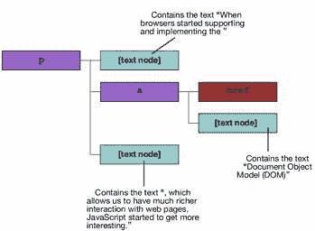
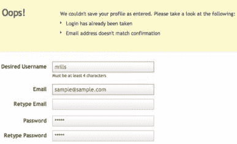
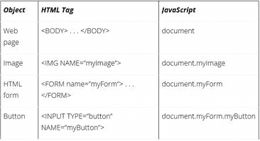

# JavaScript 初学者指南：用一半倍的时间轻松 JavaScript 编程


## JavaScript 简介

JavaScript 是一种解释型编程语言，基于 `ECMAScript` 标准。该语言的定义非常广泛，因为它可以定义为基于原型的、过程化的、命令式的、弱类型的和动态语言。

JavaScript 主要作为客户端编程语言，作为浏览器的一部分实现，允许开发者以改进的方式实现网页中的用户界面和动态功能，尽管也有服务器端的 JavaScript 实现 (`SSJS`)，但该语言的流行完全归功于客户端实现。JavaScript 也可以在网络应用程序之外使用，例如为 PDF 文档和桌面小组件添加交互功能。

JavaScript 的设计语法与 C 相似，尽管它借鉴了 Java 编程语言的名称和约定。然而，Java 和 JavaScript 的名称之间没有关系，语法也不同。JavaScript 最初由 Netscape 的 Brendan Eich 开发，后来被更名为 JavaScript。该名称的变化大约发生在 1995 年 Netscape 在 Navigator 2.0 版本中添加对其支持时。JavaScript 这个名字被创造出来，赋予了该语言 Java 的延伸，并被标记为新网络编程的脚本语言。

微软作为 Internet Explorer 3 的一部分开发了类似的客户端编程语言。微软将其称为 `JScript` 以避免与品牌相关的问题。"javascript" 和 "js" 术语经常互换，但 JavaScript 并非 100% 兼容 ECMAScript 规范。为了避免这些问题，万维网联盟 (`W3C`) 设计了标准的文档对象模型 (`DOM`)，分别在 Internet Explorer 3.0 和 Navigator 4 版本中实现。

1997 年，曾有一项将 JavaScript 提交给 ECMA 制造商的提案。同年，它被采用为 ECMA 标准。JavaScript 还是 ISO 标准，并成为了最常用的编程语言。

> **注意**：JavaScript 是 Oracle 的注册商标。它在 Oracle 及其当前实体创建的产品下使用。

## JavaScript 的用途

今天 JavaScript 存在于大多数页面中。很有可能你正在查看的页面包含了 JavaScript 代码。尝试一下这个活动：右键点击网页，然后点击“查看源代码”。你应该能在代码的某处找到这个词。

虽然 HTML 标记语言允许网页开发者格式化内容，但 JavaScript 允许他们让页面动态化。例如，HTML 允许加粗文本、创建文本框和按钮，而 JavaScript 允许更改页面上的文本、创建弹出消息以及验证文本框中的文本，以确保必填字段已填写。JavaScript 通过允许用户与网页交互、点击元素和更改页面，使网页更具动态。

## JavaScript 能为你做什么

让我们后退一步，数数 JavaScript 的优点：

- JavaScript 非常易于实现。你只需要将代码放在 HTML 文档中，并告诉浏览器它是 JavaScript 即可。
- JavaScript 在用户的计算机上运行——即使在他们离线状态下也是如此！
- JavaScript 允许你创建高响应的界面，改善用户体验并提供动态功能，而无需等待服务器响应并显示另一个页面。JavaScript 可以在用户需要时将内容加载到文档中，而无需重新加载整个页面——这通常被称为 `Ajax`。
- JavaScript 可以测试浏览器中的可能性并帮助修复问题——例如修复布局问题。对于一种直到最近才被 ECMA 制造商采纳的语言来说，这已经很多了。JavaScript 是一种 ECMA 标准并成为了最常用的编程语言。

> **注意**：JavaScript 是 Oracle 的注册商标。它在 Oracle 及其当前实体创建的产品下使用。

这主要导致了验证脚本，当出现错误时阻止用户向服务器发送表单，以及简单的转换器和计算器。此外，我们还设法制作了一些极其没用的东西，比如提示框询问用户的姓名，只为了之后将其打印出来。

我们使用的另一个东西是 `document.write()` 向文档中添加内容。我们还处理过弹出窗口和框架（`frames`），在尝试让它们相互通信时耗尽了许多心力并抓掉了许多头发。一想到这些大多数技术就应该让任何开发者反复摇摇头，蜷缩成胎儿并说“让它们消失吧”，所以我们不要纠结于这些了——有更好的使用 JavaScript 的方法！

## 进入 DOM 脚本

当浏览器开始支持并实现文档对象模型（`DOM`）时（这允许我们与网页进行更丰富的交互），JavaScript 开始变得越来越有趣。

`DOM` 是文档的对象表示。例如，上文的一段文字（通过“查看源代码”检查其源码）在 DOM 语言中是一个 `nodeName` 为 `p` 的元素节点。它包含三个子节点——一个 `nodeValue` 包含“当浏览器开始支持并实现 DOM 的”的文本节点，一个 `nodeName` 为 `a` 的元素节点，以及另一个 `nodeValue` 为“这允许我们与网页进行更丰富的交互，JavaScript 开始变得越来越有趣。”的文本节点。该子节点还有一个名为 `href` 的属性，其有一个值，以及一个 `nodeValue` 为“文档对象模型(DOM)”的文本节点子节点。

你也可以使用树形图直观地表示这段文字，如图 2 所示。


图 2：我们的示例 DOM 树的可视化表示。

用人类的话说，你可以说 DOM 解释了文档中所有内容的类型、值和层级结构——你现在不需要更多。

- 访问文档中的任何元素并操纵它的外观、内容和属性。
- 创建新的元素和内容，并在需要时将它们应用于文档中。

这意味着我们再也不需要依赖窗口、框架、表单和丑陋的警告框（`alerts`），并且以良好的样式在文档中向用户提供反馈，如图 3 所示。


图 3：使用 DOM 你可以创建更美观、侵入性更小的错误消息。

结合事件处理，这是一个创建交互和美观界面的强大武器库。

事件处理意味着我们的代码对浏览器中发生的事情做出反应。这些可能是自动发生的事情——如加载完成——但大多数时候是用户对浏览器的操作。用户可能会调整窗口大小、滚动页面、点击链接和按钮。通过事件处理，我们可以等待事情发生，并让网页按需对操作做出响应。过去，点击任何链接都会带你进入另一个文档，现在我们可以劫持此功能并显示诸如显示隐藏面板或获取信息并使用它。

## JavaScript 的其他现代用途

这基本上就是我们用 JavaScript 做的。增强旧的、过时的网页界面——点击链接、输入信息和发送表单等——使其对用户的响应更灵敏。例如：注册表可以检查名称是否可用，防止你不得不忍受令人沮丧的页面刷新。搜索框可以在你输入时根据你输入的内容提供建议结果（例如输入“bi”可以带来来自该字符串的建议，如“bird”、“big”和“busy”）。这种用法被称为自动补全。不断变化的信息可以自动加载以供用户交互，例如比赛结果或股市。静态且运行冗余的信息可以在用户访问时加载一次。网站导航可以在用户激活菜单项时按需进行。JavaScript 可以修复布局问题。使用它你可以找到元素在页面上的位置以及窗口的尺寸。利用这些信息你可以防止重叠和其他问题。例如假设你有一个多级菜单；通过在显示子菜单之前检查它是否显示，你可以防止滚动条出现或菜单项重叠。JavaScript 可以增强 HTML 给予我们的界面。虽然有一个文本输入框很不错，但你可能想要一个组合框（`combo`），让你从预设值列表中选择或输入自己的值。你可以制作页面元素的动画——显示和隐藏信息，或突出显示页面的特定部分——这可以带来更好、更丰富的用户体验。

## 明智且负责任地使用 JavaScript

JavaScript 没有什么是你做不到的——尤其是当你将其与 `Canvas` 或 `SVG` 等其他技术结合时。然而，巨大的力量伴随巨大的责任，在使用 JavaScript 时你应该始终记住以下几点。

- JavaScript 可能不可用——这很容易测试，所以并不是真的问题。然而，依赖 JavaScript 的东西应该带有这种心态创建，并且你应该确保如果 JavaScript 不可用，你的网站不会崩溃（基本功能不可用）。
- 如果使用 JavaScript 没有帮助用户更快速、更高效地实现目标，那么你可能用错了。通过使用 JavaScript，我们经常打破人们多年来使用网络习惯的惯例（例如点击链接去到其他页面）。

## JavaScript 和 HTML

你可以将 JavaScript 视为 HTML 的扩展；或者说是一个插件吧。

它是这样工作的：HTML 标签创建对象；JavaScript 让你操作这些对象。例如，你使用 HTML 的 `<body>` 和 `</body>` 标签创建一个 Web 页面或文档。如表 1 所示，创建文档后，你可以使用 JavaScript 与其交互。例如，你可以使用一种特殊的 JavaScript 结构 `onload` 事件处理器在文档加载到 Web 浏览器时触发操作——也许是播放一段简短的欢迎曲。使用 JavaScript 交互的其他 HTML 对象示例还包括窗口、文本字段、图像和嵌入的 Java 应用。

表 1：创建和操作对象



要将 JavaScript 添加到 Web 页面，你要做的只是将 JavaScript 代码嵌入 HTML 文件中。在嵌入 JavaScript 代码的行下方，你可以响应事件处理器或 HTML 链接引用或调用该 JavaScript 代码。

在 HTML 文件中嵌入 JavaScript 代码时，你有两个选择：

- 你可以使用 `<script>` 和 `</script>` 标签将 JavaScript 代码直接包含在 HTML 文件中。

在下面的示例中，名为 `processOrder()` 的 JavaScript 函数定义在 HTML 文件的顶部。在 HTML 文件的下方，JavaScript 函数与事件处理器关联——具体说是 `processOrder` 按钮的 `onclick` 事件处理器。（换句话说，当用户点击 processOrder 按钮时，`processOrder()` 中包含的 JavaScript 代码就会运行。）

```html
<html>
<head>
<script language="JavaScript">
function processOrder() {
// 这里有更多 JavaScript
}
</script>
</head>
<body>
<form name="myForm">
<input type="button" name="processOrder" value="Click processOrder" onclick="processOrder();">
</form>
</body>
</html>
```

- 你可以使用 `<script>` 和 `</script>` 标签包含一个外部 JavaScript 文件（仅包含 JavaScript 和 `.js` 扩展名）。在下面的示例中，JavaScript `processOrder()` 函数定义在 `myfile.js` 中。当用户点击链接时，该函数会被触发或调用。

```html
<html>
<head>
<script language="JavaScript" src="myfile.js"></script>
</head>
<body>
<a href="javascript:processOrder();">点击这里</a>
</body>
</html>
```

Web 页面不仅仅由 HTML 组成，JavaScript 提供的是 HTML 对象。JavaScript 还提供了浏览器特定的插件（如 RealPlayer 和 Adobe）、你可以操作的当前浏览器对象。构成网站的所有对象——HTML 对象和 JavaScript 内置的特殊对象——被称为文档模型 (`DOM`)。

## HTML 基础

如果你对 HTML 一无所知，你应该从基础开始；也许可以在网上读一些东西。一旦你掌握了 HTML 基础，剩下的应该很容易。然而，和任何学科一样，HTML 必须留心学习。你不能跳过任何一步。建议一次关注 HTML 的一个方面，只有在理解了简单内容后才进入高级步骤。再给一个建议——不要因为基础知识看起来需要学很久而感到沮丧；这一切都是值得的。首先，你必须知道 HTML 是什么以及为什么要用它。HTML 是超文本标记语言的缩写，它是一种标记语言。简单来说，HTML 是一个由标记组成的纯文本文件。当浏览器收到打开网页的指令时，它会查找页面中的 HTML 代码。然后浏览器会将这些代码转换为布局、图像和指向其他网站的链接。必须记住的其他基础知识之一是 HTML 是文本文件，因此可以使用简单的文本编辑器编写。一些流行的文本编辑器 `FrontPage` 和 `Dreamweaver` 将允许你使用 Word 创建页面。现在，这有多容易呢？

为了让事情变得更容易，这里有一些你一定会喜欢的更多 HTML 基础。一旦你得到了页面布局，你就可以自己让代码运行。此外，如果你仍然认为自己编码很难，例如，你可以将代码放在扩展名为 `.html` 的文件中。你必须知道的是标签。标签告诉浏览器如何做。然后你必须了解结构。

## 你知道 HTML 是什么吗？

HTML 代表超文本标记语言。

它本质上是人们在世界网上进行交流和认可彼此的方式，因为它是核心语言。最新版本的超文本标记语言 HTML5 最近发布，具有可以自豪的新功能和元素。它非常容易使用；它的设计就是如此。你不需要成为程序员就能使用它。它是一种旨在创建网站的计算机语言。这些网站可以被任何连接到互联网的人查看。

它是网络浏览器用于显示网页内容的标记语言。它控制网页上的格式、字体、页边距、布局、颜色、表格、链接以及其他若干项目。它的设计目的并不是为了控制文档布局的这些方面。你应该做的是使用它来标记标题、段落、列表、超链接以及文档的其他结构部分，然后添加样式表来单独指定布局，就像你在传统的桌面出版软件包中可能做的那样。

它是一种计算机语言，尽管是一种非常局限且特殊的语言。因此，如果你希望拥有一个可以随时间轻松演变的系统，你就需要编写清晰且易于理解的 HTML。它是世界上最领先的标记语言，基本上是“Web 的语言”，但自 1997 年 HTML 4 发布以来，它实际上已经几乎没有维护了。因此，今天在 Web 上发布的许多内容如果严格执行 HTML 4 规范，将无法跨浏览器进行渲染，而且 HTML 4 还存在很多歧义。它是一种语言，使得呈现信息成为可能（例如，你在互联网上查看页面时看到的是你的浏览器对 HTML 的解释）。

浏览器通常以不可编辑的方式显示它——这迫使用户使用外部软件来编辑原始内容。对于非编程人员的用户来说，使用多个工具来操作文档的紧迫性可能是一项痛苦的任务。这是一种我们永远不会说、我们大多数人永远不会提到的语言。它是每台计算机后的语言或代码。

它还设定了一种媒体愿景——特别是视频——这种愿景不依赖花哨、消耗资源的专有插件。看看你的插件文件夹；你可能至少看到四个视频插件。限制是一种美德。它在不同的查看客户端之间的渲染方式并不相同，所有的可访问性保证都化为乌有。这对于视障人士来说尤其是一个问题。

标记语言具有非常稳定的格式。命令在任何地方都具有相同的含义。它经常被人们批评为一种糟糕的语言。人们（通常习惯了 XML）谈论缺乏用于标记作者和日期等内容的良好元素。

它被用于结构化信息——将某些文本标记为标题、段落、列表等——并可用于描述、装饰文档的方面。它是为了构建文档而设计的。关键在于：如果你按预期使用每种工具，你将拥有一个更具语义化的 Web，并且它可以完全帮助构建从未设计过的应用程序。它不是，因为它是一种功能性标记（是结构化而非页面布局）。它的确切渲染并不由发布的文档指定，而是留给浏览器。

最为人知的标记。尽管该库是用多种语言编写的，使其在其他环境中可用。它是非交互式布局。它可以布局文本并提供颜色、粗体字体，但 HTML 也是标记。标记是文本，其格式带有附加功能：文本的部分与其他文本部分链接，使其易于从一个文本跳转到另一个文本。

它的目的不是为了持有内容，它包含了描述自身和引用内容的数据。Web 上的文本不仅仅是线性的，还是标记。它的设计目的不是产生艺术家梦想的视觉效果。相反，它是允许信息以结构化的方式组织，以便从设计者的宽屏到文本终端，再到盲人的语音阅读器，都能以易于理解的方式进行渲染。它是一个代码。仅此而已。

它不是一种编程语言——它是一种“标记”语言，将简单的代码嵌入到描述文档结构、布局和格式的叙述中。代码由网络浏览器“解释”或“解析”，并希望页面能按照设计意图显示。它通常在 Firefox 或 Internet Explorer 等网络浏览器中读取，并以网页的形式显示在用户的屏幕上。由于许多网页的默认属性未被留空，由相同 HTML 代码组成的页面在不同浏览器中可能不同。它本质上是人们在世界性网上通信和认可彼此的方式，因为它是核心标记语言。最新版本的 HTML 标记语言 HTML5 最近已发布，具有新的功能和待构建的内容。

它不是一种语言。它由放置在内容周围的标签组成。你应该做的是使用它来标记标题、段落、列表、链接以及文档的其他结构部分，然后添加样式表来单独布局，就像你在传统的桌面出版软件包中可能做的那样。它是 Web 上最基础、常见的语言，而且相对容易学习。

它被大多数开发者和内容创建者认为是纯粹面向人类的。但日益增长的处理器（无论是通过搜索引擎、作为屏幕阅读器的可访问性设备，还是浏览器本身）对于作为在线信息的人类读者来说正变得越来越重要。Mozilla 和 Safari 均推荐使用它而非 XHTML，而且所有主流浏览器对它的支持通常优于 XHTML。它（简而言之，不涉及许多争议性领域）是用 SGML 创建的许多标记语言之一，而且是目前为止最广泛的一种。SGML 本身有一套语法，其所有应用（即所有用它创建的语言）都必须遵循，但它本身（略过几个与本文讨论无关的问题）并没有语义。

HTML 是一系列代码，用于在 MySpace 上创建网页，并更改显示的功能。对于一个简单易懂的 HTML MySpace 教程，应该先创建一个 MySpace 账户。HTML 由浏览器处理。当浏览器读取你的 HTML 文档中的 `JavaScript` 代码时，它会处理该代码，然后在网页内显示任何输出。

回到 20 年前，当互联网还处于婴儿阶段时，构建网页的唯一方法就是使用记事本，这是 Microsoft Windows 提供的一个免费文本编辑器。现在，随着互联网已变成音乐、特效和 Flash 的汇聚，编写 HTML 代码的艺术正在逐渐流失给 Microsoft FrontPage 和 Macromedia Dreamweaver MX 等 HTML 编辑器。然而，无论你是否喜欢，为了有效地构建网站，你仍然需要了解基础的 HTML 代码。

让我来解释一下……

HTML（即超文本标记语言）本质上是万维网的语言。没有 HTML，我们像 Netscape、Internet Explorer 或 Firefox 这样的网络浏览器就无法解析我们的网页。HTML 由一系列标签组成，这些标签描述了你希望呈现网页的内部运行机制和结构。现在严肃地说，你可以在完全不知一丁 HTML 的情况下生存并构建网页，但要在互联网上取得真正的成功，事实并非如此。

搜索引擎现在是互联网上使用的主要工具之一，你每天都能看到微软的 MSN、Yahoo 和 Google 在搜索引擎的角逐中争夺第一位置，但作为一名 Web 程序员，能够将自己定位在排名靠前可能是你需要掌握的最重要技能之一。因为在你的关键词中处于领先位置，意味着你将为你的网站带来免费且精准的流量，这比通过 Google AdWords、Overture 以及任何其他基于文本的广告服务付费要多得多。

所以，为什么了解 HTML 会帮助你将网站定位在搜索引擎的高端位置呢……

你首先需要知道的是如何正确格式化网页的标题标签（`header tags`），因为没有格式化正确的标题标签，搜索引擎就不知道你的网站关于什么，以及你希望与网页关联的关键词。我在某些 HTML 编辑器中发现的一个大问题是，它们没有解决标题标签或特别是元标签（`meta tags`）问题，这意味着如果你正在构建网站，你已经在损害网站在搜索引擎中被置于正确位置的能力。

例如，许多 HTML 编辑器会提供弹出表单，帮助你设置描述和关键词的元数据，但它们忽略了其他元数据，例如搜索引擎是否应该索引所有页面、网页语言、字符集以及你根据 HTML 标准创建的是什么类型的文档。

```html
<!DOCTYPE HTML PUBLIC "-//W3C//DTD HTML 40 Transitional//EN">
<html>
<head>
<meta charset="UTF-8">
<meta name="viewport" content="width=device-width, initial-scale=1">
<meta name="generator" content="Microsoft FrontPage 6.0">
<meta name="pageId" content="FrontPage.Document">
<title>Your Title</title>
<meta name="description" content="Your Description">
<meta name="keywords" content="Your Keywords">
```

我应该澄清的一点是，仅仅你提供了所有信息并不意味着

a) 所有的搜索引擎都使用这些信息

b) 你保证能在搜索引擎中获得首页

但当你正确放置网页中的每个微小元素时，内容就会出现在搜索结果中。不过请记住，每个搜索引擎都是不同的，它们用于网站内容的算法是经过严密保护的。

你应该学会如何编写至少基础 HTML 代码的另一个原因是帮助你构建指向你网页的反向链接（`incoming links`）。你可以遵循的构建这些入链的技术是编写为人们提供关于你业务信息的文章。例如，如果你有一个销售所有高尔夫用品的网站，你可能会考虑写关于如何选择高尔夫球或在哪里可以找到最好的高尔夫球俱乐部和练习场的文章。

当你向 Articles.com、GoArticles.com 或 ArticlesON.com 等地方提交文章时，他们会要求你使用某些 HTML 标签来突出你的文章。例如，通常在文章正文中，你只能使用加粗、*斜体*、下划线和列表项目，但在其他区域，如你放置内容语言和字符集标签的地方，可能会影响他们的软件是否能正确读取你的网站。因此，如果你的客户群体建立在例如残障人士占 30% 市场份额的基础上，那么你可能正在浪费钱。

现在我们需要将我们的插件文件和 jQuery 库一起引入到主 HTML 页面（`index.html`）。最佳实践是直接从 Google API 服务器引入 jQuery 库，因为它们遍布全球，而不是位于你的单一服务器位置：更近的服务器通常意味着访问者的响应速度更快。从 Google 引入 jQuery 的另一个优势是，当访问访问你的网站时，他们的本地缓存中可能已经有了 jQuery 脚本。预缓存的内容通常意味着访问者的加载速度更快。

## jQuery 插件结构

jQuery 提供了所有必要的钩子（`hooks`）来帮助你开发我们的插件。但遵循 JavaScript 的良好实践很重要，因此我们必须确保所有内容都留在局部作用范围内。让我们从 jQuery 插件的基本框架开始：

```javascript
(function($) {

$.fn.simpleAccordion = function() {

  //TODO: simple accordion 插件代码

}

}(jQuery));
```

让我们快速过一下这里发生了什么。通过将所有内容包含在 `(function() {})` 自执行 JavaScript 模式中，我们确保了插件中的所有变量都将安全地留在全局命名空间之外。我们不会与页面上运行的任何其他 JavaScript 发生冲突，因此我们必须像上面那样隔离我们的代码。

你可能注意到的点是，我们定义插件的方式就像 jQuery 处于“无冲突”模式一样。同样，我们试图避免与页面上的其他 JavaScript 冲突，因此我们想确保插件不依赖于默认的 `$`，因为它可能被其他库使用。最后，`.fn` 是 jQuery 允许你定义插件的方法，我们将其命名为 `simpleAccordion`。现在所有部分已就绪，让我们开始构建吧！

## 为我们的插件添加功能

jQuery 的之处在于它允许你使用任何需要的选择器。然而，你必须记住，我们的插件可能会处理多种不同的元素类型。使用 `this` 关键字让我们的插件能够循环对每个元素应用函数。

### 获取 HTML 部分 - 构建折叠面板结构

由于我们正在构建折叠面板（`accordion`），我们需要它的 HTML 结构，所以如下：

- 标题 1：标题、内边距、下边框
- 标题 2：内容、边框
- 标题 3：内容
- 标题 4：列表项

这是一个简单的折叠面板结构，定义了四个标题及其相应的内容区域。因此，`id` 的作用是我们的插件会将这段代码转换为功能性的折叠面板，用户可以打开和折叠不同的部分。这是它现在的样子：

```css
.accordion {
  width: 600px;
  border: 1px solid;
  border-bottom: none;
}

.accordion dt {
  border-bottom: 1px solid;
  margin: 0px;
}

.accordion dt {
  background: rgb(193, 221, 252, 0.24);
  cursor: pointer;
  padding: 8px 4px;
  font-size: 14px;
  font-weight: bold;
}

.accordion dd {
  padding: 12px 8px;
}
```

现在我们的折叠面板结构应该像这样：jQuery 部分 - 让它运行起来！为了给我们的插件添加功能，我们将编辑 js 文件并添加以下代码：

```javascript
(function($) {

$.fn.simpleAccordion = function(options) {
  return $(this).each(function() {
    var dt = $(this).children('dt');
    dt.click(accordionClick);
    dt.each(reset);
  });

  function accordionClick() {
    $(this).siblings('dt').each(hide);
    $(this).next().slideDown('fast');
    return false;
  }

  function hide() {
    $(this).next().slideUp('fast');
  }

  function reset() {
    $(this).next().hide();
  }

})(jQuery);
```

让我们快速过一下这段代码在做什么。首先，你需要理解 jQuery 是一个扩展 JavaScript 语言的库。在创建任何 jQuery 插件时，你实际上是在扩展 jQuery 库，而 jQuery 又在扩展 JavaScript。真正理解你的插件如何扩展 jQuery 库需要理解 JavaScript。虽然 JavaScript 没有被直接使用，但它通过 jQuery `fn` 在后台使用，`fn` 是 jQuery 的一个别名。

此外，你可以通过 `plugin-name` 从 jQuery 为我们的插件添加选项。为了给插件添加选项，jQuery 插件可以包含默认值和选项。选项是你可以传递给插件的参数。我们并没有像标准 jQuery 那样通过选项对象发送元素。在你的插件中遵循选项时，最佳实践是使用默认对象。让我们快速给我们的插件添加一些选项来展示这一点。我们将在折叠面板首次加载时传递一个参数来打开它的第一个部分。

```javascript
(function($) {

  $.fn.simpleAccordion = function(options) {
    var state = $.extend({}, {open: false}, options);
    return $(this).each(function() {
      var dt = $(this).children('dt');
      dt.click(accordionClick);
      dt.each(reset);
      if(state.open)
        $(this).children('dt:first-child').next().show();
    });
  }

  function accordionClick() {
    $(this).siblings('dt').each(hide);
    $(this).next().slideDown('fast');
    return false;
  }

  function hide() {
    $(this).next().slideUp('fast');
  }

  function reset() {
    $(this).next().hide();
  }

})(jQuery);
```

如果你注意到，我们使用了 `open: false` 的默认值，所以如果没有传递任何选项，插件将假设你希望折叠面板在首次加载时是关闭。当插件接收到选项时，你可以依赖 `.extend` 方法来执行实际的覆盖。`.extend` 方法的作用合并两个或多个对象。

## JavaScript 和 CSS

CSS 和 JavaScript：界限似乎随着每个浏览器的发布而变得模糊。它们的工作一直非常不同，但最终它们都是前端技术，所以它们需要配合。我们有 `.js` 文件，但这并不意味着 CSS 不能进行比 JavaScript 允许更多的交互。JavaScript 和 CSS 共同工作有五种方式

## 使用 JavaScript 获取伪元素

我们知道可以获取元素的基本样式，但伪元素呢？是的，JavaScript 可以访问这些内容。

```javascript
// 获取 .element:before 的颜色
var color = window.getComputedStyle(element, ":before").color;

// 获取 .element:before 的内容
var content = window.getComputedStyle(element, ":before").content;
```

我们都非常熟悉通过 `element.style.propertyName` 方法来修改样式，并且用过 JavaScript 工具包来实现它，但你知道你实际上可以读取和写入新旧及现有样式表中的规则吗？这个 API 实际上非常简单！

```javascript
function addCSSRule(sheet, selector, rules, index) { 
  if(sheet.insertRule) {
    sheet.insertRule(selector + "{" + rules + "}", index); 
  } else {
    sheet.addRule(selector, rules, index);
  }
}

// 使用它吧！
addCSSRule(document.styleSheets[0], "header", "float: left");
```

最常见的用例是创建一个新的样式表，但如果你想修改现有的样式表，尽管去尝试吧。

## 使用加载器加载 CSS 文件

懒加载图像、JSON 和脚本等资源是缩短加载时间的一种极佳方法。我们可以使用 `curl.js` 等 JavaScript 加载器加载这些外部资源，但你知道你可以懒加载样式表并在同一个回调函数中获取通知吗？

```javascript
curl( [
  "namespace/MyWidget",
  "css!namespace/resources/MyWidget.css"
],
function(MyWidget) {
  // 对 MyWidget 执行一些操作
  // CSS 引用不在签名中，因为我们不在乎它；// 我们只关心它现在已经在页面中了
})
);
```

## CSS 核心基础

### CSS pointer-events

CSS `pointer-events` 属性非常有意思，因为它的作用几乎类似于 JavaScript：当值为 `none` 时会有效禁用元素，而在值不是 `none` 时则允许元素正常运行。你可能会说“那又如何”，但 `pointer-events` 甚至阻止 JavaScript 事件的触发！

```css
.disabled { pointer-events: none; }
```

#### 用法

该包可以通过 bower 安装

`bower install css-essentials`

使用方法

`<link rel="stylesheet" href="bower_components/css-essentials/dist/cssessentials-min.css">`

或者通过 npm `npm install css-essentials`

#### 基础设置

我们确定需要比比常更多的 3-4 个断点才能真正让设计适应世上所有的屏幕。因此，我们定义了以下断点：

`@of-xsm : 460px; @of-sm: 606px; @of-md: 800px; @of-lg: 1164px; @of-xlg: 1440px; @of-xxlg: 1740px;`

浏览器支持

我们倾向于至少支持 n-1，其中 n 是任何浏览器的当前版本。

##### 网格

基于 24 列的网格使用 flex 创建。

快速开始：

```html
<div class="of-row">
  <div class="xxsm-col-24 xsm-col-18 sm-col-12 md-col-6 lg-col-4 xlg-col-2 xxlg-col-1"> 内容 </div>
</div>
```

这将在最小的屏幕上铺满整行，并在大屏幕上将变为 1 列。

默认情况下，行（`row`）两侧有 24px 的内边距（在 xxsm 屏幕上为 0，在 xsm 屏幕上为 12px），每列之间有 12px 的内边距。可以使用 `.of-row-no-padding` 忽略行的内边距。

##### 加载动画

加载动画可以用于指示正在加载。

快速开始：

```html
<div class="of-row">
  <div class="xxsm-col-24">
    <div id="loading-bar-spinner"><div class="spinner-icon"></div></div>
  </div>
</div>
```

##### 文本截断

当你希望在一行内显示文本并在其超过行宽时对其进行截断时，文本截断非常有用。

快速开始：`<div class="of-row"><div class="xxsm-col-12"><div class="truncate">...</div></div>`

##### 推入动画

推入动画是元素悬停时的一种漂亮效果。

快速开始：只需为你的元素添加 `.of-push-animation` 即可。

##### 自定义

可以通过编辑 `stylesheets` 中的值并运行 `npm install` 来编辑网格断点。

##### 命令值

除此之外，你还可以向命令指定网格断点的所需值：`npm install release breakpoints='xxm 0px, xsm 460px, sm 606px, md 800px, lg 1164px, xlg 1440px, xxlg 1740px'`

此 `breakpoints` 参数将覆盖 `stylesheets` 中指定的默认值。它必须是一个由逗号分隔的数组。然后，每个断点由 `<name><width>` 组成：`<name>` 是一个字符串，用于识别你的断点，它的类将使用 `<space>`（简单的空格）来分隔名称和宽度 `<width>` 是一个 px 单位的值（正确的值如：0px, 300px, 500px 等）。

## 每位设计师都应该知道的 20 个核心 CSS 技巧

### 1. 绝对定位

如果你想始终控制元素在网站上的显示位置，绝对定位是实现这一点的关键。如果你将浏览器看作一个边界框，绝对定位允许你精确控制元素留在该框的哪个位置。使用 `top`、`right`、`bottom` 和 `left`，配合像素值来控制元素停留的位置。

```css
position: absolute;
top: 20px;
right: 20px;
```

### 2. 选择器

`*` 选择器允许你选择文档中的所有元素。例如，如果你使用了 `*` 并添加了 CSS 样式，它将应用于带有 `<p>` 标签的所有元素。这可以全局地定位网站的部分。

### 3. 覆盖所有样式

这种方法应谨慎使用，因为如果你对所有内容都这样做，长远来看你会遇到麻烦。但是，如果你想覆盖某个元素的样式，可以使用 `!important`。例如，如果我想让 section 中的 H2 变成红色，我会使用如下：

```css
.section h2 { color: red !important; }
```

### 4. 居中

居中很复杂，因为它取决于你尝试居中的什么。让我们看看需要居中的项目。文本使用 `text-align:center;` 居中。如果你想让靠左或靠右，使用 `text-align`。

`div`（或任何其他元素）可以通过添加 `display: block;` 并使用 `auto` 边距来实现居中。我之所以将宽度设置为“100% 以下的”，是因为如果它是全宽的，它将无法居中。

```css
div {
  display: block;
  margin: auto;
  width: 50%;
}
```

### 5. 垂直对齐（针对单行文本）

你会在导航菜单中使用此技术，关键是让菜单的高度和文本行高（`line-height`）保持一致。当我回修改客户的现有网站时，经常看到这种技术。这里是一个示例：

```css
.nav li {
  line-height: 50px;
  height: 50px;
}
```

### 6. 悬停效果

这种效果用于按钮、文本链接、网站的区块、图标等。如果你希望某个元素在用户悬停在其上方时改变颜色，请使用相同的 CSS，但对其添加 `:hover` 并更改样式。这里是一个示例：

```css
.entry h2 {
  font-size: 36px;
  color: #000;
  font-weight: 800;
}

.entry h2:hover {
  color: #f00;
}
```

这段代码的作用是当鼠标悬停在 `h2` 标签上时，将其颜色从黑色变为红色。使用 `:hover` 的强大之处在于，如果字体没有变化，你不需要再次声明 `font-size` 或 `weight`。它只会改变你指定的属性。

### 7. Transition（过渡效果）

对于 `hover` 效果（例如菜单或网站上的图片），你不希望颜色太快地跳到最终结果。理想情况下，你希望变化逐渐过渡，这时 `transition` 属性就派上用场了

```css
.entry h2:hover{
  color:#f00;
  transition: all 0.3s ease;
}
```

这使得变化发生在 0.3 秒内，而不是瞬间变成红色。这让悬停效果看起来更平顺自然，不那么突兀。

### 8. Link states（链接状态）

很多设计师忽略了这些样式，这确实会给访问者带来可用性问题。`:link` 伪类控制所有尚未点击过的链接。`:visited` 伪类处理你所有已访问过的链接的样式。这告诉网站访问者他们已经在你的网站去过哪里，哪些地方尚未探索。

```css
a:link { color: blue; }
a:visited { color: purple; }
```

### 9. 轻松缩放图片以适应

有时你会遇到一种情况：需要图片在适应特定宽度的同时按比例缩放。处理这种情况的一种简单方法是使用 `max-width`。这里有一个示例：

这意味着图片最大可以达到 100%，高度根据图片宽度自动计算。在某些情况下，你可能还需要手动指定宽度为 100%。

```css
img {
  max-width:100%; 
  height:auto;
}
```

### 10. 控制区域内的元素

使用上面的图片示例，如果你只想针对特定区域（如你的博客）的图片，请为博客区域使用一个类，并将其与实际选择器结合。这将允许你只选择博客区域的图片，而不是其他图片，例如你的 Logo、社交媒体图标或网站其他区域（如侧边栏）的图片。CSS 如下：

```css
.blog img{
  max-width:100%; 
  height:auto;
}
```

### 11. Direct children（直接子元素）

我希望我刚开始使用 CSS 时就知道这个。这本可以节省我很多时间！使用 `>` 来选择元素的直接子元素。例如：

```css
#footer > a
```

这将选择并样式化紧跟在 ID 为 `footer` 下的所有活动链接元素。它不会选择活动元素之后的任何内容，也不会选择页脚内的任何其他内容（如纯文本）。这对于顶层导航元素也非常好用。

#### Specific Child Elements（特定子元素）

相信我，这在样式化列表时非常有用。你只需要数出想要样式化的元素是向下第几个，然后应用该样式即可。

```css
li:nth-child(2) {
  font-weight:800; 
  color: blue;
  text-style:underline;
}
```

上面的 CSS 针对列表中的第二个项目，并将其加粗、添加下划线并变为蓝色。在括号数字后加上一个“n”，你就可以针对每 2 个列表项。想象一下，能够为表格风格的布局中的每隔行设置样式以便方便阅读。CSS 应该如下：

```css
li:nth-child(2n)
```

### 12. 将 CSS 应用到多个类或选择器

假设你想给所有图片、博客区域和侧边栏添加完全相同的边框。你不需要写 3 次完全相同的 CSS。只需用逗号隔开列出这些项目即可。这是一个示例：

```css
.blog, img, .sidebar { border:1px solid black; }
```

无论你是已经做了多年 Web 设计，还是刚开始学习如何正确构建网站，这都是一段无尽的旅程。一旦你确定了想要学习的语言，就必须学习并完善你的技能。无论你学什么，CSS 都是一项必须掌握的挑战性技能。不过它并不一定困难，特别是如果你知道一些完成工作的实用小技巧。

### 13. box-sizing: border-box;

这是许多设计师的最爱，因为它解决了内边距（`padding`）和布局问题。通常，当你给一个框设置特定宽度并添加内边距时，内边距会增加框的大小。然而，使用 `box-sizing:border-box`，这种情况被消除了，框的大小保持原样。


### 14. :before

这个 CSS 选择器允许你选择一个元素，并在每个应用了特定类的元素之前插入内容。假设你有一个网站，想在每个 `h2` 之前添加特定的文本。

```css
h2:before {
  content: "Read: ";
}
```

这非常方便，特别是当你使用图标字体时。你可以在某些元素之前放置图标，并全局应用。

### 15. :after

与 `:before` 选择器一样，你可以使用 `:after` 在元素上全局地插入内容。一个实用的用途是在博客的每篇文章末尾添加“阅读更多”。以下是实现方法。

```css
p:after{
  content: " -Read more..."; 
  color:#f00;
}
```

### 16. content

`content` 是一个 CSS 属性，当你需要插入一个想要控制的元素时它就会派上用场。我见过的最常见的用法是在特定位置插入图标字体中的图标。在上面的示例中，你可以看到必须将要插入的文本包裹在引号中。

### 17. CSS reset（CSS 重置）

不同的浏览器有默认的 CSS 设置，因此必须重置这些设置，以获得一个公平、一致的平台。把它比作盖房子，无论你建在山坡、沙滩还是森林地带，你都希望地基是平整的。

这种 CSS 重置方法为你的所有网站设置了一个标准基础，使它们的 CSS 起始点保持一致。它移除了不需要的边框、预设的边距、内边距、行高、列表样式等。Eric Meyer 创建了一个有效的重置方案。

### 18. Drop caps（首字母大字）

大家都喜欢首字母。它让我们想起传统的印刷书籍，是开启页面内容的好极方法。第一个大字母真的会吸引你的注意力。在 CSS 中创建首字母有一个简单的方法，就是使用伪元素：`:first-letter`。这是一个示例：

```css
:first-letter{
  display:block; 
  float:left;
  margin:3px; 
  color:#f00;
  font-size:30px;
}
```

> *(注：由于提供的原文存在大量重复段落，译文已按要求去重，仅保留核心内容逻辑。)*

如果你有一个链接，用户在手机上点击时会拨打电话，你可能无法使用传统的活动链接选择器对其进行样式。相反，请使用以下 CSS：

```css
a[href^=tel] { 
  color: #FFF; 
  text-decoration: none; 
}
```

## 运行 JavaScript 函数的不同方法

### 1 – 裸锚点 (anchor naked)

在某些浏览器中，鼠标悬停时指针可能不会变化。可以使用 CSS 来解决这个问题：`a {cursor:pointer; }`

### 2 – 锚点哈引用 (anchor hash ref)

鼠标悬停时显示链接 `#` 。在 IE6、IE7 上页面可能会跳转到顶部

### 3 – 锚点伪协议 (anchor pseudo)

点击链接时调用函数的旧方法。出于可用性和可访问性考虑，不建议使用伪协议引用。

如今，由于可用 API 的大量出现，这被认为是过时的编程。

它很杂乱、很长，人们会在状态栏看到它，而且它没有任何意义。Opera 不喜欢 `href="javascript:[anything]"`

### 4 – 锚点伪协议 void (anchor pseudo void)

使用 `javascript:[anything]` 被一些人认为是坏习惯。伪协议引用可能会导致 IE 进入等待状态，预期页面将被替换，并自动禁用消耗资源的活动。`javascript:[anything]` 用于书签。

`javascript:void(0);` 是什么？

...

### 5 – 锚点返回 false (anchor return false)

返回 `false` 会导致 `href="#"` 不生效。

比使用上述伪协议示例（如页面跳转）更安全的方法。

`return` 有时不可靠。

...

### 6 – 锚点美化 URL/jQuery (anchor pretty url/jQuery)

用户悬停在链接上会看到 `#some-real-url`。如果禁用了 JavaScript，他们会看到一些信息性的内容。...

```javascript
$(document).on('click', 'a.mylink', function(e) {
  //防止页面跳转到引用
  e.preventDefault();
  //运行函数 foo();
});
```

## 学习 CSS 语法和正确应用

一旦你实实在在地了 CSS 及其功能，下一步就是理解 CSS 的语法以及将其应用于文档的几种方式方法。

## CSS 语法由三个元素组成。

- **选择器 (Selector)**：选择器是你 HTML 文档中想要样式化的元素。例如，如果你在 HTML 中放置了一个段落标签（`p`），你的选择器就是 `"p"` —— CSS 中的标准段落标签。如果你想对网站的整个主体应用样式，将使用 `"body"` 作为选择器。稍后，你将学习如何使用 `"class"` 和 `"id"` 标签创建你自己的选择器。
- **属性 (Property)**：属性是可以应用于特定选择器的元素。以上面示例中的段落为例，你可以用于样式化该选择器的几个属性包括 `font-family`、`font-size`、`color` 以及其他几个。
- **值 (Value)**：值是应用于特定属性的形状、大小、尺寸等。例如，如果你想让段落文字以 20px 显示，则对上述属性应用 `20px` 的值。

- 选择器：`p {}`
- 选择器 + 属性：`p {font-size:}`
- 选择器 + 属性 + 值：`p {font-size: 20px;}`

现在，让我们进入 CSS 的应用。你有种方法可以文档应用样式。

### 内联样式 (Inline Styles)

内联样式意味着你将特定元素的样式放置在标签内部。例如，如果你想更改段落的文字颜色，可以在段落标签内应用 `blue;`。这种方法可以接受，但不推荐。如果你有一个 100 个页面的网站并使用了内联样式，当需要更改时，你必须逐个更改所有页面。

### 内部样式 (Internal Styles)

内部样式将样式包含在 HTML 文档本身中。在文档开头有 `head` 标签。你的样式将放置在标签之间以便引用。如果你只有一个页面，可能可以使用这种方法。

### 外部样式 (External Styles)

使用外部样式是使用 CSS 最有效的方法。你的样式存储在所有 HTML 文件连接的文档外部。这使得全局更改变得轻而易举。假设你想更改 100 页面网站的链接颜色。与其逐个更改页面，你只需更改外部文档中的样式，就搞定了。所有页面都会被更改，因为它们都已链接。

## 为什么 JavaScript 中的大小写敏感如此重要？

这是它的本质。脚本是用文本编写的，起初如此，但它不像 HTML（HTML 是大小写不敏感的），它是代码，并且受许多浏览器内部工作机制（`DOM API`）的影响。

`var names`：变量看起来相似，但它们是不同的。重要的是我们要识别它。

```javascript
function Person(name, age){
  this.name = name
  this.age = age
}

var person = new Person("Zach", 29);
```

我们可以忽略这段代码中尚未涵盖的部分。重点是显示 `person` 和 `Person` 是两个不同的对象。`Person` 是一个对象函数，而 `person` 是该构造函数的实例。

```javascript
console.log(person); // { name: 'Zach', age: 29 }
console.log(Person); // [Function]
```

目前，你必须检查你的大小写，否则可能会遇到可能的负面后果，如语法错误和其他异常。培养敏锐的眼光并记住 JS 是大小写敏感的。我们对此无能为力。

## 理解注释

你可以输入并跟踪有关个人和组织的注释。你可以查看关于某个个人的所有注释，或由特定个人输入的所有注释。由于个人注释是主观的且通常保密，请仔细分析你机构对输入和跟踪注释的需求和要求。在系统中设置或创建注释之前，你应该熟悉管理功能和 CC 组安全。

在适当的安全访问权限下，你可以在关于该个人或组织的功能区域页面上点击“创建注释”按钮，为个人或组织的记录附上或查看注释。

你还可以通过菜单访问本文档中描述的注释页面。

### 句子中的冒号用法

- 目前有两种选择：逃跑或战斗。我们知道谁会赢得比赛：鹰队。
- 他想看意大利的三个城市：罗马、佛罗伦萨和威尼斯。
- 记住：彼此相爱（两个人可以玩这种游戏）。
- 她不断重复：“我真的想要那辆车！”
- 我想知道我为什么没有收到它：我没有收到。
- 州名开头是：密歇根州、密西西州和缅因州。
- 你现在可以选择了：我感觉好多了。永远不要忘记这个：思而后言。
- 这间房子拥有我需要的一切：两个卧室，一个车库。
- 这个小镇让我想起了童年的假期：海滩。
- 我有好几种类型的电影：剧情、科幻和惊悚。

---

我吃了一顿大餐；然而，我已经又饿了。圣诞节装饰品终于收起来了：小而闪闪光的，大而明亮的，还有手工制作的。

她接受过防身训练；因此她击退了袭击者。

我们的学生来自秘鲁的利马、智利的圣地亚哥和委内瑞拉的加拉加斯。

我们失误了太多次；我们输掉了比赛。

我知道你不喜欢西兰花；尽管如此，它对你很有好处。米歇尔开的是捷马；索尼开的是保时捷。

我完成了主菜；现在我得做甜点了。春天带来了和雨和更温暖的天气；此外还有雷雨和冰雹。

她称之为洗浴室；我称它为厕所。妈妈想让家务完成；而且她希望完成得体面。

我一忙完工作就会过去；这是一个我一定会遵守的承诺。

她没有看到另一辆车开过来；结果现在她的车上有一个巨大的凹痕。全球变暖的证据越来越充分；当然，有些人永远不会相信这一点。

# 信誉循环

### 偶尔

在旧世界，我们去学校获取信息，我们信任法律和其他权威，并将看广告当作娱乐。大多数 30 岁以上的人还记得那个时代，每个人在电影开始前十分钟到达电影院，只为了看广告。今天，我们几乎在任何地方都能获取信息。我们质疑权威，因为他们服务的是系统而非人民，广告已成为最不可靠的信息类型。广告是单向传播，而今天的消费者渴望并要求互动。

我们变得越来越批判、见多识广，并希望自己搜索和寻找信息。经常向朋友或小社区/亚文化咨询参考信息这或多少是一条规则；我们绝不相信广告页。广告行业长期以来产出质质但价格过高的素材，这在未来将是不可能的。我们都知道，在如今的媒体喧嚣中，很难让自己的声音被听到，多增加一次广告活动并不是让你穿透噪音的最佳解决方案。

这是广告本身引发的质疑，以及所有（在所有其他意义上）将昨天的广告文化护在羽下的精明商人/女性。有很多例子表明广告并不能提高销量。那么，为什么我们仍然拥有一种“广告景观”的文化，拥有那些没有产生预期效果的昂贵广告呢？

### 恐惧

设定媒体预算的基础依据是什么？我们只能推测，但我们完全可以说，心理影响是巨大的。对安全的渴望和对失败的恐惧比对以往做法及其结果的质疑更强大。

昂贵且失败的广告活动无法从财务或理性角度证明合理。但从情感和心理原因来说，这种情况经常发生。我们看到的是一种全球性的群体幻幻，一群成功的公司（广告代理商）正在销售被过度夸的产品。这怎么会发生？广告已经变成了一种昂贵的保险费吗？

### 感知

接收者的感知已经发生了。随着互联网以及某些地区的全球化（从积极角度看），人们现在拥有质疑广告能力的独特可能。过去传播信息需要几天或几个月，而现在只需要一秒。现在人们倾向于通过网络搜索、朋友影响力群体直接获取信息和建议。例如：如果你去纽约并想住一家特殊的酒店，你会查看酒店广告吗？不太可能。你可能去问朋友或阅读酒店评论。很少有人相信酒店广告：它们是主观的，且只传递酒店的信息。

### 国内生产总值 (GNP)

公司的广告支出超过了国家的生产总值。2004 年全球广告支出仅为 10 亿（1,000,000,000）美元。仅在美国，支出就至少了 5000 亿（大部分是 290 亿）。再加上 2005 年全球支出的 110 亿（118,000,000），或者美国营销界所说的“……广告如此少”，这对任何事情都是可能的吗？

### 线之前

我们想通过一条线及其方式来挑战 GNP 事实：有多少人接收，以及通过这一小部分可以节省多少钱？解释和理解很重要，但在本期中，我们决定关注现状。我们拥有当今广告世界的替代方案，因为我们认为它更具创造性，且有利于新产品的品牌开发。我们称之为“信誉循环”。

### 线之前

你现在只需要大量事实才能进入市场。所有的竞争对手都有良好的服务、良好的分销、优秀的人、良好的价格、良好的沟通和良好的……只是有俗话说，所有产品都有功能、性能和价格。将他们的产品与竞争对手区分开来的唯一因素就是设计。为什么不投入大部分精力开发良好的设计呢？创意行业内部有很多关于线上（`ATL`）和线下（`BTL`）沟通的讨论。在红角坐着 ATL，它涉及杂志、广播、电视和户外印刷品的传统广告。在蓝角我们能找到 BTL，它涉及公关、网络、零售沟通等。如果你问我们，ATL 已经被击倒了。但我们将问题更进一步，引入了我们自己的 BTL：线之前。我们的 BTL 像蝴蝶一样飞舞，像蜜蜂一样停留……更快的马

直到今天，营销人员一直负责将新产品引入市场，这（仅仅）是因为他们的工作是了解人们喜欢和想要。但他们真的知道人们需要什么吗？观察人们做什么比听他们说什么更有趣。看看你的孩子；他们像你那样做，而不是像你要求他们那样。而不是“一辆带有四个轮子的动力车辆”，亨利·福特在直接回答人们的需求时可能会得到“更快的马”这个答案。

我们认为营销人员经常具有同样的狭隘思维。他们中的许多人看不透现有类别，往往倾向于已经存在且可能的事物。

所以，让创意设计文化席卷组织，将研发部门的创新思维与营销部门的外向思维相结合。只有通过结合不同的技能和思想，你才能创造出真正的创新，让你改变未来的可能。

从起初就将沟通特性融入产品中。通过赋予产品和服务以更好的意义，目标群体自发选择它们的机会会大得多。

一个很好的例子：当 iPod 在 2001 年推出时，苹果花费了 2450 万美元来发布该产品。这是一笔巨款，但可能仅是使用一个缺乏吸引力的产品来获得同样的全球成功所需成本的十分之一。良好的设计和口碑完成了大部分工作。

正如瑞典伟大平面设计师 Ollie Eksell 在 1964 年描述的那样：设计 = 经济。归根结底：这关乎掌控局面。设计策略的触角延伸到每一个地方，在这些地方，我们相信通过良好的设计和创新策略，公司将建立起更有信力的品牌，而不是在最后只用广告来包装产品。广告资金应该更好地用于那些能产生影响并造福企业和社会的创新。谁又不想通过开发更具吸引力和可持续性的产品和服务，让人们的生活变得更好、更平等、更快乐呢？

有些人可能会认为一切都会被复制：无论是产品还是服务。如果足够成功，它们当然会被复制。当每个人都拥有相同的技术时，复制品将永远存在。因此，你必须差异化并保持独特性，你需要更聪明、更主动。一个好的发展方向是少一点技术官僚主义，多一点文化，因为企业的价值观是法院最难通过蓝图界定的部分。通过在公司战略中整合设计策略（与营销、人力资源、研发、财务等一起），你将走得很远。

我们都熟悉 80 年代以来关于品牌的讨论：“我们的品牌是我们最有价值的资产”。今天这已是常谈，一种基础卫生因素。如今，设计策略是“新的”品牌策略。像苹果这样拥有清晰设计策略的成功公司已经明白，设计问题必须在最高管理层进行讨论和决定。设计策略的触角应该渗透到公司战略的各个，这就是它是必要且不可战胜的竞争优势。它超越了身份识别和平面设计；它关乎你公司发生的一切切。你的客户服务如何？办公室里有鲜花和水果吗？接待室播放什么音乐？你的产品或服务是什么？你是如何展示它的？一切都重要，没有什么是是不重要的，你必须具备全局观并管理流程——设计。这是你最重要的流程之一，因为设计帮助你在沟通中取得成功。通过良好的沟通，你将触达客户，并成为客户心目中快乐且可能的积极的一部分。

总结这个永恒的品牌：品牌及其价值是设计过程的结果。今天，人都知道你必须进行开发、创新并寻找生存的方法——无论是出于业务考量还是环境考虑。在 David Report，我们承担责任并关注业务困境——当你可以做一些强有力的事情，并通过创新的研发真正建立你的品牌并售出更多产品/服务时，为什么还要打广告呢？

当你阅读以上内容时，我们主张从广告导向转向以设计为核心的研发。在我们看来，这是通往未来社会和商业生活的唯一途径。设计也是视觉化品牌和业务战略的最佳方式。明智地质疑广告标准，并在我们的信誉循环中体验一下，换句话说：通过智能性的设计策略来建立你的品牌。

## C# .Net 中的数组

### 什么是数组？

简单来说，数组是一个组织的集合。它可以是任何东西的集合。要记住的一点是它是一个集合。

### 我们每天都使用数组

一包 M&Ms 巧克力是数组的一个很好的例子。我们很容易想象一袋流行的糖果。我们可以想象每一颗 M&Ms 从袋子里取出来时的样子。它们基本上都是一样的，但颜色不同。尽管颜色不同，但它们都是带有硬糖壳的巧克力糖。一袋 M-M's 是数据类型 M-M's 的数组。它是糖果的集合。

### 如何声明数组？

声明数组与声明其他变量非常相似。区别在于你正在声明一个将包含多个对象的变量。让我们比较一下这两个声明。

```csharp
String strEmotion = "happy";

String[] strEmotions = {"happy","sad","elated","afraid","angry","peaceful"};
```

上述两个变量 `strEmotion` 和 `strEmotions` 都是使用显式声明（`Explicit Declaration`）定义的，这意味着值在创建的同时被设置了。

### 实际应用

在这个示例中，我们有一个 `System.Drawing.Color` 数组，我们将用它更改表单的背景颜色。这个简单的应用程序有助于理解如何引用数组中的每个不同项目。它还展示了如何找到哪个控件调用了函数。

首先声明了一个 `System.Drawing.Color` 数组，并同时添加了四种颜色：绿色、红色、黄色和蓝色。注意表示数组声明的括号 `[]`。

```csharp
System.Drawing.Color[] myArray = {System.Drawing.Color.Green, System.Drawing.Color.Red, System.Drawing.Color.Yellow, System.Drawing.Color.Blue};
```

由于我们在声明时填充了数组，所以我们说它是显式声明的。

#### 获取特定值

起初可能会有点困惑，因为数组是从零开始索引的。这意味着列表中的第一个项目位于第 0 位。

```csharp
strEmotions[0] = happy
strEmotions[1] = sad
strEmotions[2] = elated
strEmotions[3] = afraid
strEmotions[4] = angry
strEmotions[5] = peaceful
```

```csharp
private void ChangeColors(object sender, EventArgs e)
{
    /*获取调用方法的单选按钮的引用。我们知道调用此方法的控件将是单选按钮，因此我们首先创建一个类型为 Radio Button 的变量。然后将我们的变量设置为 sender 对象。但我们首先需要将 sender 变量转换为 Radio 数据类型*/
    System.Windows.Forms.RadioButton rbtn = (System.Windows.Forms.RadioButton)sender;
    if (rbtn.Name == "rbtnGreen") this.BackColor = myColorArray[0];//
}
```

---

JavaScript 是一种客户端脚本语言。当你打开一个网页时，你的浏览器会首先从服务器下载所有必要的文件以正确显示该页面。这些必要的文件包括 HTML、CSS、图像、视频等，也包括 JavaScript 文件。下载完成后，浏览器会在窗口中显示该页面，任何与其链接的脚本都将从下载的脚本文件中运行。

在 `Ajax` 技术中，用户输入和其他数据通过 JavaScript 发送到 Web 服务器。JavaScript 创建 `XMLHttpRequest` 对象来与服务器连接、提交数据并请求服务器响应。当响应返回时，会触发 JavaScript 事件，然后执行与该事件相关的函数。因此，在 Ajax 技术中，JavaScript 仅用于在客户端和服务器之间传输数据，而主程序（即数据处理）在服务器端使用 PHP 或任何其他服务端语言执行。

由于 JavaScript 运行在客户端计算机上，其执行时间非常短，几乎是瞬时的。视图也可以不连接服务器的情况下运行 JavaScript。但在 Ajax 中，视图必须连接到服务器。这里的执行时间要长得多，取决于它们的互联网连接速度、服务器硬件以及客户端与服务器之间传输的字节数。

在服务器安全方面，JavaScript 是绝对安全的，因为它没有从客户端向服务器传输任何用户输入。但在 Ajax 中，你必须特别小心以防止来自恶意用户的任何恶意数据。在 JavaScript 中，你无法隐藏源代码。用户可以很容易从运行在他们计算机上的源代码视图中读取你的源码。但在 Ajax 中，数据处理发生在服务器端，因此用户看不到源码。

在 Ajax 中，你可以使用服务器数据来支持你的程序。对于一个长程序，如果你使用 JavaScript 来实现它，你的网页尺寸将会更大。这样下载就会花费更长时间，这是一个糟糕的特性。但在 Ajax 中，你可以运行处理所有数据的长程序，而你的页面仍然保持很小。由于并不是所有浏览器都遵循标准，因此编写与浏览器无关的 JavaScript 容易。JavaScript 仅用于规范中，而 Ajax 的应用是无限的。

## CSS - 基础

正在考虑 CSS 但想了解需要知道的内容，或者在加入之前需要学习什么？让我先说一下，CSS 可以减少你坐在电脑前的时间。但你需要学习的知识是什么？CSS 是否与搜索引擎和你的浏览器兼容吗？这些都是我将尝试回答的问题，同时也会简单介绍一下 CSS 的本质。CSS 代表级联样式表（`Cascading Style Sheets`）。CSS 是一组格式指令，用于控制网页或多个页面的外观。支持 CSS 的浏览器包括（Firefox、IE3 或更高版本、NN4 或更高版本）。你可能会说，太棒了，这绝对会节省一些时间。如此，你也需要知道，尽管大多数浏览器都理解 CSS，但它们并没有完全支持所有的功能。XHTML - XHTML 是可扩展标记语言（`Extensible Markup Language`）。XHTML 是带有严格规则的 HTML，它增加了一致性并且 100% 符合 XML 标准。因此，你应该熟悉或更习惯 HTML、XHTML 以及 CSS 的样式属性。

### 你可以用 CSS 做什么

你可以构建构建布局，调整标题或正文文本的大小和颜色，还可以定位你的图片。这意味着页面只需要编写一次，而无需手动在你的每个网页中输入相同的代码。翻译过来，就是消除了重复的格式。

### 如何让搜索引擎看到你的文案

有人说，搜索引擎在理解 CSS 方面仍然存在一些问题。但如果你想使用 CSS，是否有方法让搜索引擎看到你想展示的内容。

1. 保持你的文本整洁，如果你在网页中有太多垃圾内容，那么爬虫将难以判断哪些是相关的，哪些不是。因此，CSS 能够让你的页面保持整洁，而无需为每个元素编写冗余代码。这里有一个代码示例：

```css
h1 { font-size: 18px; font-weight: bold; }
```


## CSS 语法

首先，CSS 可以在文本编辑器中编写。但该文本文件必须以 CSS 扩展名保存。CSS 的语法由选择器（`selector`）和声明（`declaration`）组成。选择器是你网页体内的标识符；声明是你想要作为属性和规则的代码。假设你想让你所有的 H1 标题都是绿色的，字体为 Arial。CSS 的代码如下：

```
selector { property: value; }
```

## CSS 的放置位置

有三个放置 CSS 的地方：在 Head 中（内部）、在外部文件中或单个标签内（内联）。

- **内部** - 用于具有样式的网页内。
- **内联** - 带有内容的代码。有时你需要使用它，但这种样式消除了使用样式表的需求。
- **外部** - CSS 与网页主体分离并与网页链接。因此，要将外部文件链接到页面中，你需要使用 `link` 标签。示例：

```html
<link rel="stylesheet" type="text/css" href="NameofCSS.css">
```
*(位于 head 部分的 title 标签之后)*

你喜欢哪种方式？如果你有一个大型网站或一个将扩展的网站，外部文件是快速方便地一次性操作你所有网页的更好方法。

### 注意垃圾信息

但对于互联网上的任何事物，CSS 既可以用于善意，也可以用于恶意。显然，如果你想让你的网站长期运行，应该避免某些 CSS 技术。为什么？因为某些 CSS 技术可能被搜索引擎视为垃圾信息，从而如果你使用这些技术，它们会封锁你的网站。黑名单策略包括：

1. 使用 CSS 将人类肉眼隐藏从标题到正文的文本；
2. 仅为了搜索爬虫的利益而隐藏、加粗或斜体文案。

总结来说，CSS 可以并且是让你的网页更易维护的一种可行方法——如果大多数页面遵循相同的格式。如果你还不精通 CSS，请花时间看一些教程。它们非常有启发性，可以帮助你开始学习 CSS。

## 结论

JavaScript 是一种用于网络的奇妙技术。它并不难学，而且非常通用。它与 HTML 和 CSS 等其他网络技术配合良好，甚至可以与 Flash 等插件交互。使用 JavaScript 可以让在线系统变为离线，并在计算机上线后恢复。

JavaScript 并不局限于浏览器。与其他语言相比，JavaScript 运行速度快且内存占用小，这使得它的用途越来越广泛——从在 Illustrator 等程序中自动化重复性任务，到作为带有独立解析器的服务器端语言使用。

未来是广阔的；无论你在不久的将来作为 Web 开发者做什么，我深信你迟早都要与 JavaScript 打交道。

….. 再次感谢你花时间阅读这本书！

现在你应该对 JavaScript 有了良好的理解，并能够使用 JavaScript 开发了。

如果你喜欢这本书，请花时间在 Amazon 上给我留个评价。我很感谢你的诚实反馈，这对我继续创作高质量书籍非常有帮助。
